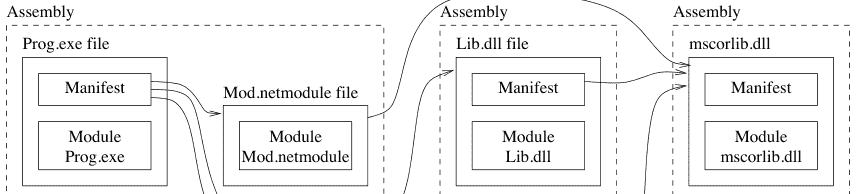
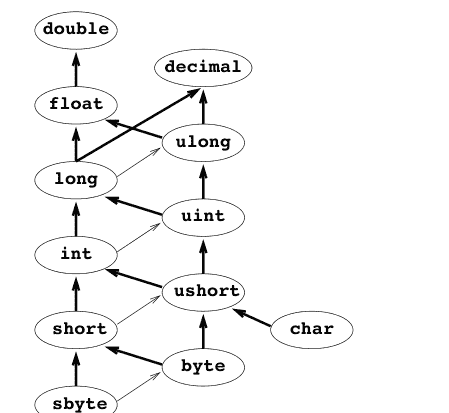
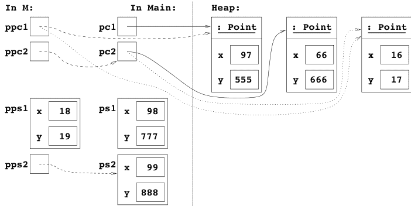
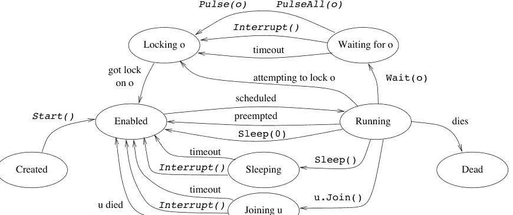
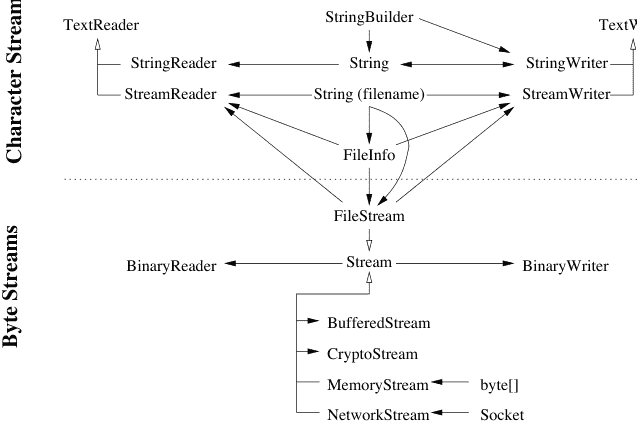
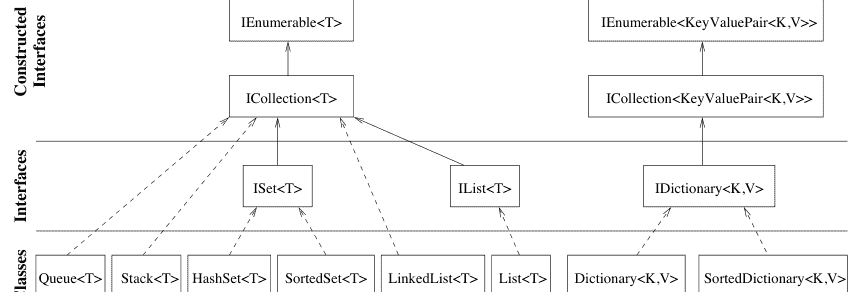

# C# 精确指南


## 25.1 创建流 . . . . . . . . . . . . . . . . . . . . . . 146
### 25.4 顺序字符输入：TextReaders . . . . . . . . . . . . . . . . . . . . . 150
### 25.5 顺序字符输出：TextWriters . . . . . . . . . . . . . . 152
### 25.8 目录 (Directories) . . . . . . . . . . . . . . . . . . . . . 160


### 27.4 IList<T> 接口 . . . . . . . . . . . . . . . . . . . . . 186


# 前言

本第二版 *C# Precisely* 精确地描述了 C#（读作 "c sharp"）的 3.0、4.0 和 5.0 版本。对于已经从标准教科书学习或正在学习 C# 并想要详细了解该语言的读者来说，这是一个参考参考指南。C# 是一种用于通用语言运行时（CLR）平台的基于类的面向对象语言，CLR 是具有类型安全的中间语言和自动内存管理的托管执行环境。因此，它由微软公司的 Anders Hejberg 等人设计。C# 包含了许多 Java 中没有的实用功能：结构体类型、运算符重载、多维数组、用户定义属性、索引器和委托，但省略了 Java 的内部类和通配符。总的来说，C# 认为程序员的便利性于语言的简单性，由于垃圾回收机制，安全性高得多。特别是不需要编写析构函数和 `finally` 块。

本书介绍了 Visual Studio 2010 中的 C#，包括 lambda 表达式、匿名对象、对象初始化器、集合初始化器、语言集成类型、dynamic、类型协变和逆协变，以及最重要的 LINQ（语言集成查询）。此外，它还描述了 C# .NET Framework 中的异步编程，尽管仅涵盖了泛型集合类和 Task 的部分。本书未涵盖安全代码、反射、预处理指令、IEEE 754 浮点数的细节或表达式树。

语言的通用规则位于左侧页，每个引用的对应示例显示在右侧页。所有示例均为合法的 C# 程序片段，可以在 <csharprecely/ 获取。例如，示例 17 的代码显示在 Example17.cs 中。

致谢：感谢留在英国剑桥的微软研究院，使我们能够在 2001 年尝试 C# 泛型的非常早期版本。后来，Alpha 程序提供了所有 C# 2.0 特性的早期实现，Ecma International 提供了 C# 标准文档。特别感谢 Andrew Kennedy、Don Frye 和 Simon Peyton-Jones 直接或间接地让这一切成为可能。感谢 Hans Dybkj、Jørgen Steensgaard-Madsen、Moe Kinny、Knud Jaeger 和 Niels Svensson 对草稿的意见建议，以及 Carsten Jørensen、Lawrence Berg、Ben Friarsen 和 Mort Boynton 对出版书籍的修正。在 MIT Press 与 Robert Prior、Adrian Brunstein、Mel Gibson 和 Alice Cheyer 工作非常愉快。

# 符号约定

| 符号 | 含义 |
|---|---|
| a | 数组类型的表达式或值 |
| b | 布尔类型的表达式或值 |
| C | 类 |
| D | 委托类型 |
| e | 表达式 |
| E | 异常类型或事件名称 |
| f | 字段 |
| g | 项组 (LINQ) |
| i | 整数类型的表达式或值 |
| I | 接口类型 |
| M | 方法 |
| n | 命名空间 |
| N | 对象类型的表达式或值 |
| P | 属性名 |
| s | 字符串类型的表达式 |
| S | 结构体类型 |
| sig | 方法或构造函数的签名 |
| t | 类型名称或表达式（简单类型、值类型或引用类型） |
| T, U | 类型参数（泛型类型和方法） |
| u | 线程类型的表达式或值 |
| v | 任何类型的值 |
| x, y | 变量或参数或字段元素或范围变量 (LINQ) |
| xs, ys | 项的流，例如可枚举 (LINQ) |

在本书中，C# 的语法使用非正式表示法呈现，其中非终结符号（如 *class-declaration*）使用斜体字，终结符号（如 `class`）使用等宽字体，元变量（如用于类名的 `C` 和用于方法名的 `M`）。

关于 C# 的完整且详细的语法可以在官方语言规范中找到（参见第 34 节）。此处未包含完整语法，因为它超过了 30 页，且过于通用：许多良好的有效性要求必须表示为语法的额外侧边条件。

# C# Precisely

# 2 编译、加载和执行 C# 程序

# 编译、加载和执行 C# 程序

运行 C# 程序涉及三个阶段：编译（首先检查程序并生成中间代码）、加载（加载字节码并然后生成机器代码）和执行（运行机器代码）。

### 1.1 源文件与编译

一个 C# 程序由一个或多个源文件 (.cs) 组成。源文件包含一个或多个声明：类、接口、结构体和委托。在执行 C# 程序之前，必须经过编译和加载。C# 编译器（如微软的编译器）检查程序是否符合语法。编译产生的模块可以是执行文件 .exe，如果它包含静态方法 `Main()` 或 `Main(String[])`，而不是库 .dll 或原始模块 .module。

由多个模块组成的程序集（其中必须恰有一个 .exe）可以独立部署：带有版本号和其他元数据的清单，因此它可以部署在任何地方。在生成程序集时，可以使用 /module 选项将原始模块添加到程序集。程序集可以访问该模块的内部和公共成员（节 10.14）。该模块保持为单独的文件。

在生成程序集时，可以使用 /reference 选项引用另一个程序集。引用程序集包含了类库 `mscor.dll`。默认是只访问被引用程序集的公共成员。

| 编译器选项 | 简写 | 含义 |
|---|---|---|
| /target:exe | /texe | 编译为可执行文件 (.exe)，这是默认值 |
| /target:library | /tibrary | 编译为库文件 (.dll) |
| /target:module | /tmodule | 编译为模块文件 (.module) |
| /reference:Lib.dll | /r:Lib.dll | 包含对库 Lib 的引用 |
| /module:M1.module | | 在程序集中包含 M1.module |
| /main:MyClass | /m:MyClass | 类 MyClass的方法是入口点 |
| /debug | | 添加调试信息 |
| /define:DEBUG | /d:DEBUG | 启用断言（第 31 节） |

### 1.2 执行

从 Prog.cs 编译的可执行文件 Prog.exe 可以通过在命令行输入其名称或调用运行时系统来（加载）并执行。这将执行 Prog.cs 中的静态方法 `Main(String[] args)`，在后的情况下绑定命令行 `args[0], args[1],...`（参见示例 1 和 2）。

可以使用 /main 编译器选项来指定入口点：在加载可执行文件后必须执行的 Main 方法的类。


# 编译、加载和执行 C# 程序

### 示例 1 在 Example001.cs 文件中的完整程序
几乎所有程序都需要 `using System` 指令（第 29.1 节），但在后续示例中省略了它。

```c
using System;
public class Sum {
    static void Main(String[] args) {
        int sum = 0;
        for (int i=0; i<args.Length; i++)
            sum += int.Parse(args[i]);
        Console.WriteLine("The sum is " + sum);
    }
}
```

### 示例 2 从命令行编译并运行程序
此示例展示了如何在 Microsoft .Net（左）或使用 Mono 系统的 Linux 或 Windows（右）下从命令行编译 `Example001.cs` 文件。在两种情况下，程序都会输出文本：The sum is 29。

+   csc Example001.cs mcs Example001.cs
Example001 7 9 13 mono Example001.exe 7 9 13

### 示例 3 编译带有库引用的可执行文件
首先将 `Mod.cs` 文件编译为模块 `Mod.netmodule`，并将 `Lib.cs` 编译为库 `Lib.dll`。
然后编译 `Prog.cs` 文件并创建可执行程序 `Prog.exe`，该程序包含外部模块 `Mod` 并引用库 `Lib`。最后，运行可执行文件 `.exe`：

```
csc /target:module Mod.cs
csc /target:library.dll
csc /addmodule:Mod.netmodule /reference:Lib.dll Prog.cs
```

生成的程序由两个文件组成：主文件 `Prog.exe` 和包含外部模块的文件 `Mod.exe`。该程序包含一个带有版本号和其他元数据以及对另外两个程序引用的清单：`Lib` 和默认包含的 `mscorlib`。



## 4 注释和程序布局

## 2 标识和保留标识

变量、参数、方法、字段、索引器、属性、类、结构体、枚举、委托、接口或命名空间的名称以字母或下划线 (`_`) 开头，并接零或多个字母或数字 (0-9)。大写字母和小写字母是不同的。合法的名称不能是关键字，这些是保留标识：

```
abstract base bool break byte case char checked class const continue decimal
default default do double else enum event explicit extern finally fixed float
for goto if implicit in int interface is long long namespace ull object object or override private protected public readonly return
byte sealed short size stackalloc static string switch true try
typeof unless unchecked unsafe using virtual void volatile while
```

若要用作名称，请在前面加一个 `@` 字符，例如 `@while = 17`。伪关键字 `add, aliases, ascending, by, descending, from, global, group, into, join, let, orderby, partial, remove, select, value, where` 和 `yield` 仅在特定上下文中是保留的。

## 3 C# 命名规范

通常遵循以下命名规范，尽管 C 编译器并不强制执行：

-   如果名称由多个单词组成，每个单词（第一个单词除外）都以大写字母开头。例如：`currentLayout`, `LayoutComponent`。
-   局部变量、参数和保护字段的名称以小写字母开头。例如：`vehicle`, `currentVehicle`。避免使用小写 `l1` 或大写 `0` 作为名称。
-   公共或内部字段、静态字段和命名常量以大写字母开头。例如：`Vehicle`, `MaxValue`。
-   类、方法、事件、属性和枚举类型的名称以大写字母开头。例如：`Cube`, `ColorCube`。
-   接口名称以 `I` 开头，后跟大写字母。例如：`IEnumerable`。
-   命名空间名称是用点分隔的名称序列，每个名称以大写字母开头（如 `System` 或 `System.RegularExpressions`），也可以是域名（如 `dk.itu.c5ern.math`）。

## 4 注释和程序布局

注释对程序的执行没有影响，但有助于人类理解程序。注释有两种形式：单行注释和块注释。允许在代码行中间插入块注释，如示例 5 所示。程序布局对计算机执行程序没有影响，但出于可读性考虑，本书的其余部分遵循推荐的布局。

### 示例 4 使用关键字作为标识符

此功能是为了与其他语言的互操作性。在普通的 C# 编程中，`class` 或 `public` 作为字段或方法的名称是完全合法的。注意，对于非关键字标识符 `@i` 与 `i` 相同。

```c
class School {
    const int @class = 20;
    const bool @public = true;
    String @delegate = "J.
    public static int @double(int i) { return @i; }
}

School school = new School();
Console.WriteLine(school.delegate.Trim() + " " + @class);
```

### 示例 5 单行注释、块注释及其使用

```c
class Comment {
// 这是一个单行注释；它延伸到行尾
/* 这是一个块注释，
   跨越了若干行。 */
int /* x = 117;
}
```

### 示例 6 布局样式

```c
class LayoutExample {
    int j;

    LayoutExample(int j) {
        this.j = j;
    }

    int Sum(int b) {
        if (j > 0) {
            return j + b;
        } else if (j < 0) {
            int res = -j + b;
            return res * 117;
        } else { // j == 0 {
            int sum = 0;
            for (int i=0; i<10; i++) {
                sum += (b - i) * (b - i);
            }
            return sum;
        }
    }
}
```

# 5 数据和类型

类型是一组数据值及其操作。每个变量、参数和字段都有声明类型，每个方法都有声明返回类型等。编译器根据这些信息推断每个表达式的类型。编译时类型决定了对值执行哪些操作。类型用于局部变量的声明；类、接口、结构体类型及其成员；委托类型；对象和数组创建表达式（第 9 和 12 节）；类型转换表达式（第 12.20 节）；以及实例测试表达式（第 12.13 节）。
类型可以是值类型（第 5.1 节）或引用类型（第 5.2 节）。

## 5.1 值类型和简单类型

值类型可以是简单的（本节）、结构体类型（第 14 节）或枚举类型（第 16 节）。值类型变量直接包含该值，而不仅仅是它的引用。将值类型的值赋值给变量或数组元素会创建值的拷贝。简单类型是 `bool` 或数值类型之一。数值类型是有符号或无符号整数（包括字符类型）、或浮点类型，或用于精确计算的定点 `decimal`。下表显示了简单类型的一些示例常量、值范围、种类和大小（字节）。整数可以使用十进制或十六进制表示法：

| 表示法 | 基数 | 区别 |
|---|---|---|
| 十进制 | 10 | 1234567890, .127, -127 |
| 十六进制 | 16 | 前缀 0x, 01ABCDEF, -07F |

补码表示用于有符号整数类型（`byte`, `short`, `int`, `long`）。整数类型是精确的。浮点类型是不精确的，并遵循 IEEE754 浮点标准，指示了有效位数。对于每个类型都有一个预定义的结构体（在 `System` 命名空间中），所示。简单类型是该结构体的别名，并具有这些成员：

-   `int` 类型 `int.Parse(String a)` 通过解析 `a` 获取整数（示例 1）。如果 `a` 为空，则抛出 `ArgumentNullException`；如果无法解析为整数，则抛出 `FormatException`；如果解析的数字无法表示为 `int`，则抛出 `OverflowException`。所有简单类型都有相似的 `Parse` 方法。浮点的 `Parse` 方法对文化敏感（第 7.2 节）。
-   每个数值类型的最小值和值由常量字段 `MinValue` 和 `MaxValue` 表示，例如 `int.MinValue` 和 `int.MaxValue`。`float` 和 `double` 类型定义了几个常量：`double.Epsilon` 是大于零的最小 `double` 类型数字，`double.PositiveInfinity` 和 `double.NegativeInfinity` 是正无穷和负无穷，`double.NaN` 是一个不是数字的 `double` 值。这些值是由 IEEE754 标准决定的。


### 示例 7 整数变量的三等等声明

```csharp
using System;
...
int i;
Int32 i2;
System.Int32 i3;
```

### 简单类型：常量、默认值和范围

| 类型 | 示例常量 | 默认值 | 范围 (最小值...最大值) |
|---|---|---|---|
| bool | true | false | false, true |
| char | 'A', '\u0041' | '\u0000' | '\u0000''\uFFFF' |
| sbyte | -119 | 0 | -128...127 |
| byte | 219 | 0 | 0...255 |
| short | -30319 | 0 | -32768...32767 |
| ushort | 60519 | 0 | 0...65535 |
| int | -2147483648 | 0 | -2147483648...2147483647 |
| uint | 4294967295 | 0 | 0...4294967295 |
| long | -9223372036854775808 | 0 | -9223372036854775808...9223372036854775807 |
| ulong | 18446744073709551615 | 0 | 0...18446744073709551615 |
| float | -1.99E-3 | 0.0 | ±¹⁰⁷...±¹⁰⁸, 7位有效数字 |
| double | -1.99E-8 | 0.0 | ±¹⁰³...±¹⁰⁸, 15-16位有效数字 |
| decimal | -1.99M | 0.0 | ±¹⁰⁸...±¹⁰⁹, 28-29位有效数字 (*) |

> *) 可能会更改为范围 ±10¹⁴³...±¹⁰¹⁴⁴ 和34位有效数字 (IEEE 754 十进制)。

### 简单类型：种类、大小和结构体名称

| 类型 | 种类 | 大小 | 结构体类型 |
|---|---|---|---|
| bool | 逻辑 | 1 | System.Boolean |
| char | 无符号整数 | 2 | System.Char |
| sbyte | 无符号整数 | 1 | System.SByte |
| byte | 无符号整数 | 1 | System.Byte |
| short | 整数 | 2 | System.Int16 |
| ushort | 无符号整数 | 2 | System.UInt16 |
| int | 整数 | 4 | System.Int32 |
| uint | 无符号整数 | 4 | System.UInt32 |
| long | 整数 | 8 | System.Int64 |
| ulong | 无符号整数 | 8 | System.UInt64 |
| float | 二进制浮点数 | 4 | System.Single |
| double | 二进制浮点数 | 8 | System.Double |
| decimal | 十进制浮点数 | 16 | System.Decimal |

当它是这些类型之一时，`sizeof(t)` 是一个编译时表达式，其值为 `Size`。

## 5.2 引用类型

引用类型可以是类、数组类型或委托类型。类由类声明（第10节）定义，接口由接口声明（第15节）定义，委托类型由委托声明（第17节）定义。数组类型在第9节中讨论过。

引用类型的变量要么包含一个特殊值 `null`，要么包含指向分配在堆上的对象或委托的引用。特殊值 `null` 不引用任何内容。表示空值的常量 `null` 可以是任何引用类型。为变量赋值引用值只赋值引用本身，而不复制所指向的对象或委托。

类型组织在类型层次结构中（如所示），以 `Object` 类作为所有其他类型的基类。这些类型实现的方法由其派生类型继承。

`Object` 类是所有类的基类（超类）。`ol1` 和 `ol2` 是 `Object` 类型的表达式：

- `ol1.Equals(ol2)` 如果 `ol1` 和 `ol2` 相等则返回 `true`；否则取决于默认值。默认情况下，引用类型的值通过相同的 `new` 执行是相等的；但（例如）`String` 重写了 `Equals` 来比较字符串内容（第7节），而 `ValueType` 类 `Equals` 则如果一个类型的两个值的所有字段都相等，则认为它们相等。

- `Object.ReferenceEquals(ol1, ol2)` 如果 `ol1` 和 `ol2` 都为 `null`，或者它们都指向同一个对象或委托，则返回 `true`；否则返回 `false`。

- `Object.Equals(ol1, ol2)` 如果 `ol1` 和 `ol2` 都为 `null`，或者它们引用同一个对象或委托，则返回 `true`；否则返回 `false`。如果 `ol1` 或 `ol2` 是值类型，则取决于具体实现。

- `ol1.GetType()` 返回表示 `ol1` 运行时的唯一类型。

- `ol1.GetHashCode()` 返回 `ol1` 的哈希值，当 `ol1` 用作哈希表的键时（第27节）。子类重写了此方法以确保：1) 如果 `ol1` 和 `ol2` 通过 `Equals` 相等，则具有相同的哈希值；(2) 对 `ol1` 的修改不改变其哈希值；(3) 哈希值分布均匀；(4) 方法必须快速且不抛出异常。所有简单类型和 `String` 都有相应的 `GetHashCode` 方法。

- `ol1.ToString()` 返回对象或引用类型常用的可读表示（第7节）。

`String` 类是 `Object` 的子类，是 `int[]` 的基类。

`ValueType` 类是 `Object` 的子类，是所有值类型的基类，包括简单类型、结构类型和枚举类型。它本身不是值类型。如果 `v1` 和 `v2` 是派自 `ValueType` 的结构类型，则 `v1.Equals(v2)` 使用反射来比较 `v1` 和 `v2` 的字段。这可能很慢，因此结构类型应该重写 `Equals`。派自 `ValueType` 的任何类型都是值类型。

`Enum` 类是 `ValueType` 的子类，是所有枚举类型的基类。它本身不是值类型。

`Delegate` 类是 `Object` 的子类，是所有委托类型的基类。它本身不是值类型。

### 示例 8 Object 类中声明的方法

在 `Object` 类中声明的方法被所有类型继承，并可以使用所有值。

```csharp
Object ol1 = new Object();
Object ol2 = new Object();
Object ol3 = new Object();
ol1.Equals(ol2); // 返回 false
ol1.Equals(ol3); // 返回 false
Object.ReferenceEquals(ol1, ol2); // 返回 false
Object.ReferenceEquals(ol1, null); // 返回 false
Object.ReferenceEquals(null, null); // 返回 true
ol1.GetType(); // 返回 System.Object
ol1.GetHashCode(); // 返回一个哈希值
ol1.ToString(); // 返回 "System.Object"
```


### 示例 9 简单类型之间的转换

```sharp
double d = 2.9;                             // ET double-->int; 输出 2
Console.WriteLine((int)d);               // ET double-->int; 输出 -2
Console.WriteLine((int)(-d));
uint seconds = (uint)(24 * 60 * 60);  // EB int-->uint
double avgSecPerYear = 365.25 * seconds;      // I int-->double
float f = seconds;                             // IL uint-->float
long nationalDebt1 = 14344939503882;
long perSecond = 45138.89;                       // ED double-->decimal
double decimalDay = 0;                             // I int-->decimal
seconds *= (decimal)perSecond;               // ER decimal-->double
double nd2 = nationalDebt1 + (double)perDay;  // ER decimal-->double
long nd3 = (long)nd2;                        // ET double-->long
float nd4 = (float)nd2;                       // ER double-->float
```

### 简单类型之间标准隐式转换总结

如果存在从 t 到类型 tt 的实线路径，则 ts 可以隐式转换为 tt。如果从 t 到类型 u 存在任何路径，则 t 在重载解析中优于 u（第 12.17.1 节）。



## 数据与类型

### 5.3.2 引用类型或类型参数的标准转换

如果 ts 和 tt 是类型，在以下情况下存在从 ts 到 tt 的标准隐式转换：

- ts 是引用类型且 tt 是类 Object；
- ts 和 tt 是类类型或接口类型，且 ts 派自 tt（第 10.4 节）；或
- ts 是类类型且 tt 是 ts 或其某个基类实现的接口；或
- ts 和 tt 是具有相同维度的数组，它们的元素类型是引用类型，且从 ts 的元素类型到 tt 的元素类型存在隐式转换；或
- ts 是数组且 tt 是 Array，或 ts 是委托且 tt 是 Delegate；
- ts 是 t[j] 或 IList<t>，且从 u 到 o 存在隐式转换；或
- ts 是 null 表达式的类型且 tt 是引用类型或可空类型（第 19 节）；或
- ts 是类型参数（第 26.2 节）且 tt 是该参数的类型约束。

如果 ts 和 tt 是类型，在以下情况下存在从 ts 到 tt 的标准显式转换：

- ts 是类 Object  tt 是引用类型；或
- ts 和 tt 是类类型，且 tt 派自 ts；或
- ts 是非密封类类型且 tt 是接口，且 ts 没有实现 tt；或
- ts 是接口且 tt 是类类型，且 tt 不是密封的，或者 tt 实现了 ts；或
- ts 和 tt 是接口且 ts 没有实现 tt；或
- ts 和 tt 是具有相同维度的数组，它们的元素类型是引用类型，且从 ts 的元素类型到 tt 的元素类型存在显式转换；或
- tt 是数组且 tt 是 Array，或 ts 是委托且 tt 是 Delegate；或
- ts 是 IList<t> 且 tt 是 u[j]，且从 u[j] 到 IList<t>存在隐式转换；或
- tt 是类型参数（第 26.2 节）且 ts 是该参数的类型约束。

从一个引用类型到另一个引用类型的标准隐式或显式转换不会改变给定的引用值，也不会产生新值；受影响的引用的编译类型。

### 5.3.3 装箱和拆箱转换

标准的装箱转换是从值类型 ts 到 Object 或 ts 实现的接口类型的隐式转换。装箱转换在堆上创建该值的拷贝，包括其类型 ts 的指示（第 14.1 节）。这允许简单类型和结构体类型的值存储在非泛型集合中。然而，为了类型安全和效率，应优先使用泛型集合（第 26.6 节）。

拆箱是从 Object 类型或接口类型的引用 v 到实现 ts 的值 tt 的显式转换（tt）。拆箱转换首先测试装箱对象 v 中存储的类型是否为 tt。如果不是，或者 v 为 null，则抛出 InvalidCastException；否则它复制 v 的值。

### 5.3.4 用户定义转换

类或结构体可以为该类型声明隐式和显式转换（第 10.18 节）。

# 数据与类型 13

示例 10 引用类型之间的转换
此示例显示了 5.3.2 节列出的隐式和显式引用转换的情况。显式转换使用类型转换表达式执行（第 12.20 节）。

```sharp
interface I1 { }
interface I2 : I1 { }
interface J { }
class B : I2 { }
class C : B, J { }
delegate void D(String s);

Object obj = new B();      // 隐式 B-->I2
I2 b2 = new B();           // 隐式 B-->I2
B cl = new C();             // 隐式 C-->B
I1 b3 = b2;               // 隐式 I2-->I1
I1[] a1 = new I2[];     // 隐式 I2[]->I1[]
Array array = new int[5];  // 隐式 int[]->Array
delegate di = new D(Print);  // 隐式 D-->Delegate
n = null;               // 隐式 null type-->C
B b4 = (B)b4;              // 显式 Object-->B
c2 = (C)c1;               // 显式 B-->C
J b5 = (J)c1;               // 显式 C-->J
B b6 = (B)b2;               // 显式 I2-->B
I1 i2 = (I1)i2;             // 显式 I2-->I1
I2[] a2 = (I2[]){a1};       // 显式 I1[]->I2[]
int[] int2 = (int[])intial; // 显式 Array->int[]
d dy = (O)dy;                // 显式 Delegate-->D
```

## 示例 11 装箱和拆箱转换

```sharp
interface I { void Print(); };
struct S : I {
    public int i;
    public S(int i) { this.i = i; }
    public void Print() { Console.WriteLine(i); }
}

int i = 7;
Object obj = i;               // 隐式装箱-->Object
int j = 5 * (int)obj;          // 显式拆箱-->int
S s1 = new S(s1);
S s2 = 22;                    // 隐式装箱 S-->I
s1.i = s2;
s1.Print();
S s3 = (S)s2;                 // 显式拆箱 I-->S
s3.Print();                  // 11
```

# 变量、参数、字段、作用域

变量定义在方法体、构造函数体、属性体、索引器体或块语句（第 13.2 节）中，只有在声明后才能使用。参数是一种特殊的变量：它定义在方法、构造函数或索引器的参数列表中，并在调用函数时被赋值。字段定义在类内部，但不在方法内部。

## 变量、参数和字段的作用域

名称的作用域是可以使用该名称程序部分。变量的作用域从其声明开始到所在语句结束。方法、构造函数或索引器的作用域是整个函数体。

定义在 for 语句头部的变量的作用域是整个语句（头部和正体）。foreach 语句中变量的作用域仅为正体：

```csharp
for (int x = ...; ...; ...) body
foreach (int x in ...) body
```

变量或参数的作用域不能重复声明。然而，结构成员（如字段）的作用域可以包含对该字段的变量声明，但是该字段在同一块之前未被使用。成员的作用域是整个类，除非被变量或参数遮蔽。该成员可以在类中的任何地方使用。如果成员是公共或保护的，其作用域包括子类，除非被子类的同名成员隐藏。静态成员的作用域还包括每个嵌套类，除非被嵌套类的成员遮蔽，它排除嵌套类的子类。

## 默认值与默认赋值

每个类型都有一个默认值，可以通过表达式 default(t) 生成。简单类型 t 的默认值见第 7 页。对于结构体 t，默认值是一个字段具有其默认值的结构体。引用类型 t 的默认值是 null。对于可空类型 t，默认值为 null。

对象或结构体的字段会自动初始化为其类型 t 的默认值。

与字段不同，变量或 out 参数没有赋予初始值。编译器要求变量在使用任何地方都已赋值。也就是说，无论在变量声明和使用值之前执行了什么条件语句或循环，变量都必须已赋值。

与变量一样，out 参数在声明它的函数中使用时必须赋值。相反，按值传递参数或 ref 参数在函数调用时总是被赋予值，因此总是确定赋值的。


## 变量、参数、字段和作用域

### 示例 2 字段、参数和变量的作用域
此程序声明了五个变量或字段，均名为 x，并显示了它们各自的作用域。
字段和变量标记为 #1,...,#5 以供参考。

```csharp
class Scope {
void M1(int x) { // 参数 x 的声明 (#1); 隐藏了 x (#5)
    x = ?; // x #1 在作用域内；合法，但在 M1 外部无效
}
void M3() {
    int x; // 变量 x 的声明 (#2); 隐藏了 x (#5)
    x = ?; // x #2 在作用域内
}
void M4() {
    int x; // x #5 在作用域内
    // 将是非法的，这会给 x 赋予新的含义
}
void M5() {
    int x; // 变量 x 的声明 (#3); 隐藏了 x (#5)
    x = ?; // x #3 在作用域内
{
        int x; // 变量 x 的声明 (#4); 隐藏了 x (#5)
        x = ?; // x #4 在作用域内
}
    public int x; // 字段 x 的声明 (#5)
}
```

### 示例 13 确定赋值
x 在下方被确定赋值了 (#1)，因为无论执行 if 语句的哪个分支，它都会被赋值；但 y 没有赋值，因为它只在其中一个分支中被赋值。变量 z 没有确定赋值 (#3)，因为只有在执行循环体时它才会被赋值（编译器在确定这一点时，不考虑循环条件中变量的值）。

```csharp
int x, y, z;
if (args.Length == 0)
    x = 10;
else
    x = args.Length;
Console.WriteLine(x); // x 已确定赋值，z 未赋值 (#1)
y = x;
for (int i=0; i<y; i++) // x 和 y 已确定赋值，z 未赋值 (#2)
    z = i;
Console.WriteLine(z); // z 仍未确定赋值 (#3)
```

# 6.3 局部变量声明：编译时类型推断 (C# 3.0)

`var` 关键字可以用于局部变量声明（第13.4 节），告诉编译器根据给定的表达式推断声明变量的类型：

```csharp
var identifier = expression;
```

该表达式（第12 节）必须具有编译时类型，因此不能是匿名方法（第12.22 节）、lambda 表达式（第12.23 节）或 null 字面量。声明变量的推断方式就像该类型已显式说明的一样；后续对该值的使用或赋值不会影响此类型推断过程。该变量保持静态类型，就像类型已显式给出一样。

`var` 关键字也可以用于 for 语句（第13.6.1 节）、foreach 语句（第13.6.2 节）和 using 语句。它不能用于字段、方法参数或返回类型的声明；这些类型的类型必须显式给出。`var` 不是一个使用编译时类型声明变量的关键字，且不能用于类型转换、数组元素类型、泛型类型中的类型参数等。

# 6.4 dynamic 类型：调用的运行时解析及更多 (C# 4.0)

通过 `dynamic` 类型，可以获得类似于 C#、Groovy、Javascript (Script)、Python、Ruby、Scheme 等动态编程语言的行为。

如果一个表达式具有动态（dynamic）类型，那么涉及该表达式的方法调用、运算符应用、委托调用或字段访问将在运行时动态解析，而不是在编译时解析。这意味着任何此类表达式会被编译器接受，但在运行时可能会抛出异常。

`var` 是一个关键字，而 `dynamic` 是一个类型。与 `var` 不同，`dynamic` 可以用于字段、方法参数和返回类型，以及如 `dynamic<T>` 等构造类型。

方法调用、运算符应用、委托委托和字段访问的运行时解析产生与编译时解析完全相同的结果。在编译时解析失败（导致编译器拒绝程序）的情况下，运行时解析将抛出异常（RuntimeBinderException）。因此，运行时为了此目的重复了编译器的解析机制。由于编译时操作被移动到了运行时，而在在那里可能被反复执行，涉及 `dynamic` 类型表达式的操作比在编译时解析的操作要慢；在极端情况下，速度慢达十倍。尽管如此，在调用 Microsoft Excel 或网络浏览器等外部动态应用时，运行时解析非常方便。

运行时解析机制是动态语言运行时（DLR），它实际上是构建在普通 .NET运行时系统之上的一组库。

更多关于使用 `dynamic` 类型的信息和示例见第 12.178 和 18 节。

### 示例 14 局部变量类型的编译时推断

```csharp
var x = 0.0;              // 推断类型 double
var b = false;               // 推断类型 bool
var ps = new List<int>();    // 推断类型 List<int>
ps.Add(2); ps.Add(3); ps.Add(5);
```

### 示例 15 运算符、赋值和字段访问的编译时解析与检查

```csharp
class Phone {
    public readonly String name;
    public readonly int phone;
    public Phone(String name, int phone) { ... }
}

var dl = 34;                 // 推断类型 int
var s = "hello";             // 推断类型 string
var p = new Phone();         // 推断类型 Phone
var x = 1.0;                 // 推断类型 double
```

### 示例 16 赋值的运行时解析
与此示例对比，见第 24 节。

```csharp
dynamic dl = 34;
dynamic s = "hello";
dynamic p = new Phone();
dynamic x = 1.0;
```

# 字符串

字符串是 `String` 类的对象。关键字 `string` 是 `System.String` 的别名。字符串常量是双引号内的字符序列，如 "New York" 或空字符串。内部，字符存储为数字，ASCII 编码字符串常量可以使用转义代码：

| 转义代码 | 含义 |
| :--- | :--- |
| \a | 警告（铃声） |
| \b | 退格 |
| \t | 水平制表符 |
| \v | 垂直制表符 |
| \n | 换行 |
| \f | 换页 |
| \r | 回车 |
| \" | 双引号 |
| \' | 单引号 |
| \\ | 反斜杠 |
| \0 | NUL 字符 |

| \x | 十进制数字为 d 的字符 |
| \xd | 十进制数字为 dd 的字符 |
| \xdd | 十进制数字为 ddd 的字符 |
| \xddd | 四位十六进制编码 dddd 的字符 |
| \uddddddd | 八位十六进制编码 dddddd 的字符 |

字符转义序列表示单个字符。由于字母 A 的代码为 65（十进制），它在十六进制中为 41，字符串常量 "A\x41\u000041" 等于 "AAAA"。\uddddddd 仅用于字符串常量，不用于字符常量。

逐字字符串是以 @ 字符前缀的字符串。逐字字符串中的任何转义序列表示其本身，就像普通字符一样，""" 表示双引号。


### 示例 17 普通常量与字面量 (@) 字符串常量

```
Console.WriteLine("\u0041BC"); // ABC
Console.WriteLine("@\u0041BC"); // \u0041BC
Console.WriteLine("Say \"Hello!\""); // Say "Hello!"
Console.WriteLine("Say \"Hello!\""); // Say "Hello!"
String s1 = `@Line 1
 // 仅在字面量中允许换行
and Line 2";
String s2 = "Line\nand Line 2"; // s1 和 s2 相等
```

### 示例 18 字符串的等价性

应用于字符串类型的比较运算符 == 比较的是字符串的内容：即字符序列。当应用于对象类型时，它比较的是对象。如果两个具有相同字符序列的字符串是编译时常量，则它们可能由单个字符串对象（s1 和 s2）表示；否则它们不是（s2 和 s4）。

```
String s1 = "abc", s2 = "abc" + "c", s3 = null; // 编译时常量
String s4 = args[0]; // 运行时给的值
// 假设命令行参数 args[0] 是 "abc"，所以 s4 是 "abc"
Console.WriteLine(s1==s2); // True
Console.WriteLine((Object)s1==(Object)s2); // 可能为 True
Console.WriteLine(s2==s4); // True
Console.WriteLine((Object)s2==(Object)s4); // 可能为 False
Console.WriteLine("{0}{1}", s3=s1, s1=s1, s3=s3); // False True
```

### 示例 19 使用字符串索引器统计字符串中 e 的数量

```sharp
static int eCount(String s) {
  int count = 0;
  for (int i=0; i<s.Length; i++)
    if (s[i] == 'e')
      count++;
  return count;
}
```

### 示例 20 拼接所有命令行参数

在拼接字符串时，不要使用 +=，而要使用 string builder（第 8 节和示例 31）。

```sharp
public static void Main(String[] args) {
  String res = ""; // 低效
  for (int i=0; i<args.Length; i++) // 低效
    res += args[i]; // 低效
  Console.WriteLine(res);
}
```

### 示例 21 + 运算符具有结合律

```sharp
Console.WriteLine(10 + 25 + "A"); // 等于 (10 + 25) + "A"，即 "35A"
Console.WriteLine("A" + 10 + 25); // 等于 ("A" + 10) + 25，即 "A1025"
```

# 字符串方法

假设 s1, s2 和 s3 为 String 类型的表达式，让 cs 为 char[] 类型的表达式，让 v 为任意类型的表达式：

- String.Compare(s1, s2) 返回一个负整数、零或正整数，取决于基于 Unicode 字符编码和当前线程区域设置的 s1 在字典序中是在 s2 之前、相等还是在 s2 之后。null 引用早于任何非空字符串。
- String.Compare(s1, s2, ignoreCase) 的工作类似，但如果 ignoreCase 为 true，则不区分大小写。
- 当 s1 不空时，s1.CompareTo(s2) 的含义与 String.Compare(s1, s2) 相同。
- s1.ToUpper() 和 s1.ToLower() 分别创建 s1 的大写和小写形式副本。
- s1 + s2 的含义与 String.Concat(s1, s2) 相同。它构建了 s1 和 s2 的拼接：一个由 s1 的字符后紧接 s2 的字符组成的新字符串。
- s1 + v 通过将 v 转换为 v.ToString() 然后拼接两个字符串来求值。如果 v 或 v.ToString() 为 null，则拼接的结果为 s1。
- s1.Substring(i, n) 创建一个新的字符串，该字符串包含 s1 中索引为 [i..i+n] 的 n 个字符。如果 i<0 或 n 或 i+n>s1.Length，则抛出 ArgumentOutOfRangeException。
- s1.Split(cs，类型为 String[]) 是 s1 的一个（可能为空的）子字符串数组，它不包含 cs 中的任何字符，从左到右。这里 cs 要么是 char[] 类型的单个参数，或者是零或多个 char 类型的参数（示例 23）。也就是说，cs 是一个所谓的参数数组（示例 12.17.3）。
- s1.StartsWith(s2) 和 s1.EndsWith(s2) 类型相同，用于判断 s1 是否分别以子字符串 s2 开头或结尾。
- s1.Remove(i, n) 通过移除 s1 中索引为 [i..i+n-1] 的字符来创建一个新字符串。如果 i<0 或 n 或 i+n>s1.Length，则抛出 ArgumentOutOfRangeException。
- s1.Replace(s2, s3) 通过从左到右将所有不重叠的子字符串 s2 替换为 s3 来创建一个新字符串。如果 s1 和 s2 都是单个字符 c1 和 c2，它比 String.Replace(char, char) 的 s1.Replace(c1, c2) 快得多。
- s1.Trim() 通过移除 s1 的所有空白字符来创建一个新字符串。移除 s1 前的空格、换行符、制表符等空白字符。
- s1.TrimStart(cs) 和 s1.TrimEnd(cs) 的效果同于 s1。
s1.ToArray() 返回 s1 的字符数组。

# 字符串方法

输出字符串的格式化可以使用以下形式进行指定：

{index:align}

其中 index 是非负整数，指定要格式化的值，align 是一个整数，指定结果字符串的最小宽度。当 align 为正时，要格式化的字符串右对齐（左侧填充），如果短于宽度；当 align 为负时，要格式化的字符串左对齐（右侧填充），如果短于宽度。代码是属性（节 7.2.1 和 7.2.2）。

让 fmt 为包含多个格式规范的字符串，让 v0,v1... 为任意类型的值：

- String.Format(fmt, v0, ...) 的 String 是 fmt，其中索引 0, 1... 的格式规范被 v0, v1... 的格式化字符串替换。

如果 v 的类型是 DateTime 或数值类型（节 5.1），格式规范 {i,align} 被使用代码格式化 vi 的结果替换，如7.2.1 和 7.2.2 示例所示。否则格式规范被 vi.ToString() 替换。在两种情况下，结果字符串都按照 align 指定对齐。

如果格式规范的索引小于 0 或大于 n，或者 fmt 中的格式代码无效，String.Format 方法抛出 FormatException。

String.format 通常不显式调用，但通过以下方式隐式调用：

- Console.WriteLine(String fmt, Object v) 及其重载（示例 26），以及其他类似的输出方法（节 25）
- AppendFormat(String fmt, Object v) 及其重载（节 8）。

### 示例 24 使用类的重载 ToString

```
Point p1 = new Point(10, 20), p2 = new Point(30, 40);
Console.WriteLine("p1 is " + p1); // 输出 p1 is 10, 20
Console.WriteLine("p2 is " + p2); // 输出 p2 is 30, 40
```

### 示例 25 计算字符串的可读性

使用以下公式计算文本的可读性：

| 可读性 = | 100 × longwords / sentences |
| :--- | :--- |
| #sentences | 句子数 |
| #words | 单词数 |

```csharp
static double Reading(String text) {
    int sentenceCount = 0;
    int wordCount = 0;
    String[] sentences = text.Split('.'); // 分割句子
    foreach (String sentence in sentences) {
        sentenceCount++;
        String[] words = sentence.Split(' '); // 分割单词
        foreach (String word in words) {
            if (word.Length > 6)
                wordCount++;
        }
    }
    return 100.0 * wordCount / sentenceCount;
}
```

### 示例 26 区域设置的格式化

字符串格式化是区域敏感的：用于小数点、千分位分隔符、货币符号等的实际字符，以及日期格式化属性、星期名称、月份名称取决于当前线程的 NumberFormat 和 DateTimeCulture 属性（示例 30）。

```csharp
// 假设区域设置设置为美国英语 (US)
Thread.CurrentThread.CurrentCulture = new CultureInfo("en-US");
Console.WriteLine(1234.56); // 输出 1,234.56

// 假设区域设置设置为德语 (DE)
Thread.CurrentThread.CurrentCulture = new CultureInfo("de-DE");
Console.WriteLine(1234.56); // 输出 1.234,56
```

### 示例 27 字符串的排序

```csharp
String[] fruits = { "apple", "orange", "banana" };
Array.Sort(fruits); // 排序
foreach (String fruit in fruits) {
    Console.WriteLine(fruit);
} // 输出 apple, banana, orange
```

### 示例 28 查找字符串

```csharp
String[] fruits = { "apple", "orange", "banana" };
int index = Array.IndexOf(fruits, "banana"); // 查找索引
Console.WriteLine(index); // 输出 1
```

### 示例 29 查找字符串是否存在

```csharp
String text = "The quick brown fox jumps over the lazy dog";
bool contains = text.Contains("fox"); // 检查是否存在
Console.WriteLine(contains); // 输出 True
```

### 示例 30 区域设置的格式化

```csharp
DateTime now = new DateTime(2023, 10, 27, 14, 30, 0);
// 美国区域设置
Thread.CurrentThread.CurrentCulture = new CultureInfo("en-US");
Console.WriteLine(now.ToString("d")); // 输出 10/27/2023

# 区域设置
Thread.CurrentThread.CurrentCulture = new CultureInfo("de-DE");
Console.WriteLine(now.ToString("d")); // 输出 27.10.2023
```


# 字符串 23

**示例 25** 使用 String.Format 方法进行字符串格式化
结果 s 所示 |3D326|250662|3D326|250662|，符号表示空格。格式指定符在第 7.2.1 节解释。

```c
int i = 250662;
String s = String.Format("{0,10:X}|{1,10}|{2:X}|{3}", i, i, i, i);
```

**示例 26** 使用 Console.WriteLine 方法进行字符串格式化
此示例掷一千次骰子并统计频率。频率写入控制台（如示例 34），但使用了字符串格式化而不是字符串拼接。

```c
Random rnd = new Random(); // 随机数生成器
int[] freq = new int[6]; // 全部初始化为 0
for (int i=0; i<1000; i++) {
    int die = rnd.Next(1, 7); // 1.. 范围内的随机整数
```
    freq[die-1] += 1;
}
for (int c=0; c<6; c++) {
    Console.WriteLine("{0} came up {1} times", c, freq[c]);
}
```

**示例 27** 文本输出中的字符串对齐
用二维数组表示的 $3 \times 5$ 矩阵填充了从 0 到 999 的随机数。打印矩阵时，数字在每列中均右对齐。

```c
Random rnd = new Random(); // 随机数生成器
int[,] m = new int[3,5]; // 3 x 5 矩阵
for (int i=0; i<m.GetLength(0); i++) {
    for (int j=0; j<m.GetLength(1); j++) {
        m[i,j] = rnd.Next(1000); // 0..999 范围内的随机整数
    }
}
for (int i=0; i<m.GetLength(0); i++) {
    Console.WriteLine("{0,4} {1,4} {2,4} {3,4} {4,4}", m[i,0], m[i,1], m[i,2], m[i,3], m[i,4]);
}
```

控制台输出可能如下：

```
932 930 417 17 14
993 492 329 828 63
455 721 920 70 520
```

# 字符串

### 7.2.1 数字格式化

数值类型值的格式规格中的代码部分可以是标准的数字格式化代码，其形式为 c 或 cy 或 cyyy，其中 c 是字符，y 是数字。以下是整数 (I) 或浮点数 (F) 或两者都有 (IF) 预定义的数字格式化代码：

| 代码 | 字符串格式 | 精度规格或 yy | 类型 |
|---|---|---|---|
| Dor | 十进制数（可能用零填充） | 最小位数 | I |
| Xor | 十六进制数（可能用零填充） | 最小位数 | |
| Gog | 通用（默认） | 最大有效位数 | IF |
| Nor | 带千分位分隔符的数字 | 小数位数 | IF |
| Fof | 固定点数 | 小数位数 | F |
| Ror | 无损值-字符串转换 | （无） | |
| Eoe | 指数计数法 | 小数位数 | IF |
| Pop | 百分比（值乘以 100 %） | 小数位数 | IF |
| Coc | 货币金额 | 小数位数 | IF |

数值类型值的格式规格中的代码部分也可以是自定义的格式化模式，它可能是一个或多个预定义的自定义格式化代码的组合：

```
0 # . , # E0 e0 E+ E-0 e-0 ; 'string' "string"
```

详细信息请参见示例 29 和 .Net Framework 类文档。

### 7.2.2 DateTime 格式化

DateTime 对象的格式规格中的代码部分可以是预定义的标准 DateTime 格式化代码之一：

| 代码字符 | 格式 |
|---|---|
| For | 完整的日期和时间，带有 (F) 或不带 (f) 秒 |
| Gog | 通用的日期和时间，带有 (G) 或不带 (g) 秒 |
| s | ISO8601 格式的可排序日期和时间 |
| u | 通用本地日期和时间 |
| U | 通用本地日期和时间：F转换为 UTC |
| R and r | RFC1123 标准完整日期和时间 |
| Dor | 完整日期，长 (D) 或短 (d) 格式 |
| Y and y | 年和月 |
| M and m | 月和日 |
| T or t | 时间，带有 (t) 或不带 (t) 秒 |

DateTime 对象的格式规格中的代码部分也可以是自定义的 DateTime 格式化模式，它可能是一个或多个预定义的自定义 DateTime 格式化代码的组合。详细信息请参见 .Net Framework 文档。

### 示例 28 标准格式化模式及其影响

格式化对文化敏感。此表显示了 en-US 文化下的格式化。

| 数字 | {0:D4} | {0,7} | {0:F0} | {0:F2} | {0,8:F3} | {0:E4} | {0,9:C} |
|---|---|---|---|---|---|---|
| --- | ------|---|---|---|---|---|
| 0 | 0000 | | 0.00 | 0.000 | 0.0000+E00 | | $0.00 |
| 1 | 0001 | 1 | 1.00 | 1.000 | 1.0000+E02 | | $1.00 |
| 145 | 0145 | 145 | 145.00 | 145.000 | 1.4500+E02 | | $145.00 |
| -1 | -0001 | -1 | -1.00 | -1.000 | -1.0000+E02 | | ($1.00) |
| 2.5 | | 3 | 2.50 | 2.500 | | $2.50 |
| -1.5 | | -2 | -1.50 | -1.500 | | ($1.50) |
| 330.8 | | 330.8 | 331 | 330.80 | 3.3080+E02 | | $330.80 |
| 1234.516 | | 1234.516 | 1235 | 1234.52 | 1234.516 | 1.2345+E03 | $1,234.56 |

### 示例 29 自定义数字格式化

| 数字 | {0:000.0} | {0:#} | {0:#.0} | {0:#E+0} | {0,9:C} |
|---|---|---|---|---|---|
| --- |---|---|---|---|
| 0 | 000.0 | | 0.0 | 0E+0 | |
| 1 | 001.0 | 1 | 1.0 | 1E+0 | |
| 145 | 145.0 | 145 | 145.0 | 145E+0 | |
| -1 | -001.0 | -1 | -1.0 | -1E+0 | |
| 2.5 | 002.5 | 3 | 2.5 | | |
| -1.5 | -002.0 | -2 | -2.0 | | |
| 330.8 | 330.8 | 331 | 331.0 | 331E+0 | |
| 1234.516 | 1234.5 | 1235 | 1235.0 | 1.2E+03 | |

*(注：示例 29 的 OCR 表在源文件中是碎片化的，我根据可见的标准格式化对其进行了重构。)*

### 示例 30 标准 DateTime 格式化及其影响

这里使用 en-US 文化和 de-DE 文化显示所有标准格式的 DateTime 值：

| 格式 | en-US | 德语 |
|---|---|---|
| For | Monday, January 1, 2000 12:00:00 AM | Montag, 1. Januar 2000 00:00:00 |
| Gog | Monday 1/1/2000 12:00 AM | Montag, 1.1.2000 00:00 |
| s | 2000-01-01T00:00:00 | 2000-01-01T00:00:00 |
| u | Monday, January 1, 2000 00:00:00 UTC | Montag, 1. Januar 2000 00:00:00 UTC |
| U | Monday, January 1, 2000 12:00:00 AM | Montag, 1. Januar 2000 00:00:00 |
| R and r | Sat, 01 Jan 2000 00:00:00 GMT | Sat, 01 Jan 2000 00:00:00 GMT |
| Dor | Monday, 1/1/2000 | Montag, 1. Januar.2000 |
| Y and y | January 2000 | Januar 2000 |
| M and m | January 1 | 1. Januar |
| T or t | 12:00 AM | 00:00 |

# 8 String Builders

string builder 是 System.Text.StringBuilder 的对象，是一种可扩展且修改的字符串。字符可以追加到 string builder 中，而无需复制已有的字符。相比之下，字符串对象 s1 是不可修改的。使用 s1 + s2 通过复制 s1 和 s2 的所有字符来创建一个新对象；无需通过追加更多内容来扩展 s1。因此，要通过重复的字符串拼接 (+) 拼接长度为 k 的字符串，必须复制 k + 2k + 3k + ... + nk = kn(n+1)/2 个字符，且所需时间随 n 的增加而迅速增长。

使用 string builder 拼接长度为 k 的字符串仅需与 n 成比例的时间。为了大幅构建字符串，请在循环中使用 string builder，如示例 20 和 31。表达式 s1 + ... + sn 是高效的；它实际上意味着 StringBuilder().Append(s1)...Append(sn).ToString()。假设 sb 为 StringBuilder，String， 以及任意类型的 v：

- StringBuilder(v) 创建一个新的空的 string builder。
- Append(v) 将 v 的字符串表示追加到 string builder 中，将 v 转换为字符串，参见第 7 节。根据需要扩展 sb。返回 sb。
- AppendFormat(String fmt, object v) 将 String.Format(fmt, v) 的结果追加到 string builder。根据需要扩展 sb。返回 sb。对于可能的格式化程序 fmt, v 参见 7.2。
- Length 类型 int 是 sb 的长度，即 sb 中当前的字符数。
- sb[i] 是 string builder 中第 i 个字符，从 0 开始计数。Sb[i] = c 将索引 i 字符设置为 c。如果 i<0 或 i>=sb.Length，则抛出 IndexOutOfRangeException（获取字符时）或 ArgumentOutOfRangeException（设置字符时）。
- Remove(i, n) 从 string builder 中删除索引 i..(i+n-1) 的字符，将其长度减少 n 个。如果 i<0 或 i+n>sb.Length，则抛出 ArgumentOutOfRangeException。返回 sb。
- Insert(i, v) 将 v 的字符串表示（通过 v.ToString()）插入 string builder 中，从位置 i 开始，根据需要扩展 sb。返回 sb。如果 i<0 或 i>sb.Length，则抛出 ArgumentOutOfRangeException。
- ToString() 类型 String 是包含 sb 中当前字符的新字符串。

Append 方法很快，但 Remove 和 Insert 在需要移动 string builder 大部分内容时可能会很慢，即当 i 和 i+n 都远小于 Length 时。

更多 StringBuilder 方法在 .Net Framework 类库（第 34 节）中描述。


### 示例 31 高效地拼接所有命令行参数

当有很多（超过 50 个）命令行参数时，这种方法比示例 20 快得多。

```c
using System;
using System.Text; // StringBuilder

class StringBuilderConcatenate {
    public static void Main(String[] args) {
        StringBuilder res = new StringBuilder();
        for (int i=0; i<args.Length; i++) {
            res.Append(args[i]);
            Console.WriteLine(res.ToString());
        }
    }
}
```

### 示例 32 用字符串替换字符出现的次数

要在字符串 s 中将字符 c1 出现的位置替换为字符串 s2，最好使用 string builder 来存储结果，因为结果字符串的大小无法预先知道。在将字符 c1 替换为另一个字符 c2 时这种方法很好，但如果结果的长度预已知（等于 s 的长度），则可以使用字符数组。通过重复拼接（使用 `res += s2`，其中 `res` 类型为 `String`）来解决这个问题会非常慢。

```csharp
static String ReplaceCharString(String s, char cl, String s2) {
    StringBuilder res = new StringBuilder();
    for (int i=0; i<s.Length; i++) {
        if (s[i] == cl)
            res.Append(s2);
        else
            res.Append(s[i]);
    }
    return res.ToString();
}
```

### 示例 33 替换字符出现次数的低效方法

示例 32 中的问题也可以通过 `Remove` 和 `Insert` 破坏性修改 string builder 来解决。然而，重复使用 `Remove` 和 `Insert` 是低效的：对于一个包含 200,000 个字符的字符串，这种方法比示例 32 慢大约 100 倍。

```csharp
static void ReplaceCharString(StringBuilder sb, char cl, String s2) {
    int i = 0;
    while (i < sb.Length) { // 低效
        if (sb[i] == cl) { // 低效
            sb.Remove(i, 1); // 低效
            sb.Insert(i, s2); // 低效
            i += s2.Length; // 低效
        } else // 低效
            i += 1; // 低效
    }
}
```

# 数组

数组是零或多个变量的索引集合，这些变量称为元素。数组具有给定的元素类型 `t`，该类型可以是任何类型。数组类型 `t[]` 表达式的值要么是 `null`，要么指向数组的引用，该数组的元素类型 `u` 隐式转换为 `t`。将数组赋值给变量仅分配引用；不会复制数组，如 `arr1` 和 `arr2` 所示。

## 9.1 一维数组

在秩为 `l` 且长度为 `l` 的数组中，元素通过整数 0, 1, ..., l-1 进行索引。使用数组表达式创建（分配）一个长度为 `l` 元素类型为 `t` 的数组，该表达式可以有两种形式。第一种数组创建表达式 `t[l]` 创建一个秩为 1 的新数组（也称为一维数组），具有 `l` 个元素，所有元素都初始化为类型 `t` 的默认值。大小参数可以为零，或者如果是负数，则抛出 `OverflowException`。

第二种数组创建表达式 `t[] = { expression, ..., expression };` 显式列出了新数组 `t[]` 的元素。每个表达式的类型必须隐式转换为 `t`。然后从左到右评估表达式，并将它们的值转换为类型 `t` 存储在数组中。数组类型的局部变量或字段可以在声明时初始化。当使用数组表达式在声明处初始化数组时，可以省略 `new t[]`，因此等同于 `t[] = { expression, ..., expression };`。注意，声明的变量不能出现在表达式中：因为在评估表达式时它尚未初始化。同样注意没有数组常量：每当数组创建表达式为一个类型为 `t` 的数组时，都会创建一个长度为 `l` 元素类型为 `u` 的数组。数组访问表达式 `a[i]` 表示从 0 开始计的第 `i` 个元素；其类型为 `t`。整数 `i` 是数组索引。如果 `i` 的值小于 0 或大于 `l`，则抛出 `IndexOutOfBoundsException`。

当元素 `e` 是引用类型时，每个数组赋值 `a[i]=e` 都会检查 `e` 的值是否为 `null` 或隐式转换为元素类型 `u`。如果不是，则抛出 `ArrayMismatchException`。这种检查在运行时每次数组赋值之前进行，但仅针对引用类型。对于值类型，类型检查在编译时执行。

### 示例 34 创建一维数组

此示例掷千次骰子然后打印结果。

```csharp
Random rnd = new Random(); // 随机数生成器
int[] freq = new int[6]; // 所有元素初始化为0
for (int i=0; i<1000; i++) {
    int die = rnd.Next(1, 7); // 掷
    freq[die-1] += 1; // 增加频率
}
for (int c=1; c<=6; c++) Console.WriteLine(c + "出现了 " + freq[c-1] + " 次");
```

### 示例 35 使用初始化数组

`CheckDate` 方法检查给定日期在闰年中是否合法。数组应该在方法外部创建一次；否则每次调用方法时都会创建一个新数组。

```csharp
static readonly int[] days = { 31, 28, 31, 30, 31, 30, 31, 31, 30, 31 };
static bool CheckDate(int mth, int day)
{ return (mth >= 1) && (mth <= 12) && (day <= days[mth-1]); }
```

### 示例 36 运行时数组元素类型检查

此程序通过编译，但在运行时 `a[2]=p` 抛出 `ArrayMismatch`，因为 `Point` 类 `p` 不隐式转换为 `a` 的元素类型。

```csharp
Point[] a = new Point[10]; // 长度为10，元素类型为 Point
Point p = new Point(42, 17); // 编译时类型 Point，类 Point
RedPoint cp = new RedPoint(3,4); // 编译时类型 Point，类 RedPoint
Point p2 = cp; // 编译时类型 Point，类 RedPoint
a[0] = cp; // OK，RedPoint 是 Point 的子类
a[1] = p2; // OK，RedPoint 是 Point 的子类
a[2] = p; // 运行时错误
```

## 9.2 多维数组

形成多维数组的方法有两种：矩形数组和交错数组（Jagged Arrays）。

### 9.2.1 矩形数组

矩形（C风格）数组的类型为 `t[][...]` 等，其中 `t` 不是数组。这里是二维数组：


与一维数组一样。这创建一个秩为1、具有 `l` 个元素的数组，所有初始化为类型 `t` 的默认值。或者，可以通过数组表达式一次操作创建一个n维数组：

```csharp
t[l1,...,ln]
```

其中 `l1,...,ln` 是 `int` 类型的表达式。这创建一个秩为 `n` 的新数组，也称为n维数组。第一种数组创建表达式 `t[l]` 创建一个秩为1的新数组（也称为一维数组），具有 `l` 个元素，所有元素初始化为类型 `t` 的默认值。第二种数组创建表达式 `t[] = { expression, ..., expression };` 显式列出了新数组 `t[]` 的元素。每个表达式的类型必须隐式转换为 `t`。然后从左到右评估表达式，并将它们的值转换为类型 `t` 存储在数组中。数组类型的局部变量或字段可以在声明时初始化。当使用数组表达式在声明处初始化数组时，可以省略 `new t[]`，因此等同于 `t[] = { expression, ..., expression };`。注意，声明的变量不能出现在表达式中：因为在评估表达式时它尚未初始化。同样注意没有数组常量：每当数组创建表达式为一个类型为 `t` 的数组时，都会创建一个长度为 `l` 元素类型为 `u` 的数组。数组访问表达式 `a[i]` 表示从 0 开始计的第 `i` 个元素；其类型为 `t`。整数 `i` 是数组索引。如果 `i` 的值小于 0 或大于 `l`，则抛出 `IndexOutOfBoundsException`。

当元素 `e` 是引用类型时，每个数组赋值 `a[i]=e` 都会检查 `e` 的值是否为 `null` 或隐式转换为元素类型 `u`。如果不是，则抛出 `ArrayMismatchException`。这种检查在运行时每次数组赋值之前进行，但仅针对引用类型。对于值类型，类型检查在编译时执行。

### 9.2.2 数组的数组（交错数组）

通常情况下，数组类型为 `t[k1][k2]...[kn]`，其中 `ki` 是 `ki-1` 个元素的列表，`ki >= 1`，且 `t` 不是数组类型。这种类型描述了k维矩形数组构成的k维矩形数组的……元素类型为 `t` 的n维数组。例如，`double[][]` 是二维数组的类型。

常见情况是Java风格的h维数组类型 `t[][][]...`，其中 `k1==kn=1`。因此，`t t` 的二维数组是一个一维数组，其元素是类型为 `t` 的数组。数组可以具有不同的长度，因此数组可以是非矩形的或交错的。

交错（Java风格）的h维数组 `t[][][]...` 带有h个方括号 `[`，必须逐个创建。

```csharp
t[l1][...]
```

这创建一个具有 `l1` 个元素的一维数组，所有元素初始化为 `null`，且类型均为 `t[...]`，其中有h-1个方括号 `[]`。随后您可以创建类型为 `t[...]` 的数组并将其赋值给该一维数组的元素。


### 示例 36 创建维度数组

本示例展示了两种创建矩形数组的方法（r1, r2）以及第 9.2 节中三种创建锯齿数组的方法（t1, t2, t3）。无法通过一次操作创建锯齿数组（如 t4）。

```c
double[] r1 = { 0.0, 0.1 }, { 1.0, 1.1 }, { 2.0, 2.1 };
double[] r2 = new double[3,2];
for (int i=0; i<3; i++)
  for (int j=0; j<2; j++)
    r2[i,j] = i + 0.1 * j;
```

```c
double[][] row0 = { 0.0 }, row1 = { 1.0, 1.1 }, row2 = { 2.0, 2.1, 2.2 };
double[][] t1 = { row0, row1, row2 };
double[][] t2 = { new double[0], new double[1], new double[2.0, 2.1, 2.2] };
double[][] t3 = new double[3]; // 创建第一维数组
for (int i=0; i<3; i++)
  t3[i] = new double[i+1]; // 创建第二维数组
  for (int j=0; j<=i; j++)
    t3[i,j] = i + 0.1 * j;
double[][] t4 = new double[3][]; // 非法数组创建
```

### 示例 39 使用多维数组

使用类型为 `double[][][]` 的数组 `rate` 来存储 2000–2009 年间每天美元与欧元之间的汇率（每欧元的美元数）；这是一个由元素类型为一维数组的二维矩形数组。`array[y,m]` 存储 y+2000 年、m+1 月、d+1 日的汇率。使用 `double[][][]` 类型的数组是因为这 10 年中的每一年都有 12 个月份（矩形），但并非所有月份的天数都相同（锯齿形）。

```csharp
double[][][] rate = new double[10][12];
rate[0, 0] = new double[31]; // 2000 年 1 月有 31 天
rate[1, 0] = new double[29]; // 2000 年 2 月有 29 天
rate[2, 0] = new double[31]; // 2000 年 3 月有 31 天
rate[3, 0] = new double[30]; // 2000 年 4 月有 30 天
rate[4, 0] = new double[31]; // 2000 年 5 月有 31 天
...
```

```csharp
rate[0,1][27] = 0.3748; // 2000 年 2 月 28 日
rate[0,1][28] = 0.9722; // 2000 年 2 月 29 日
rate[0,2][0] = 0.9651; // 2000 年 3 月 1 日
```

```csharp
for (int y=0; y<rate.GetLength(); y++)
  for (int m=0; m<rate[y].GetLength(); m++)
    if (rate[y,m] != null)
      for (int d=0; d<rate[y,m].Length; d++)
        if (rate[y,m][d] > 0)
          Console.WriteLine("{0:D4}-{1:D2}-{2:D2}: {3:F4} SUS/euro",
            y+2000, m+1, d+1, rate[y,m][d]);
```

## 9.3 Array 类

所有数组类型都继承自 `Array`，且 `Array` 的成员如下所示。假设 `a` 为任意 类型的数组，`o` 为任意类型的对象，`i, ..., in` 为整数：

- `Length` 类型为 `int`，返回 `a` 的长度，如果 `a` 是一维数组或矩形数组；如果 `a` 是锯齿数组，则返回 `a` 第一维的元素个数。
- `Rank` 类型为 `int`，返回 `a` 的秩（参见 5 和 9.2）。
- `GetEnumerator()` 类型为 `IEnumerator`，通过 `IList<t>` 获取类型安全的迭代器（参见 27.2），用于遍历 `a`。
- `Length(i)` 类型为 `int`，返回第 `i` 维元素的个数（参见 27 和 39）。
- `SetValue(o,j,...,in)` 类型为 `void`，当 `a` 有秩 `n` 时执行 `a[i,...,in] = o` 赋值。
- `GetValue(i,...,in)` 返回与 `a[i,...,in]` 相同。具体地说，如果 `a[i,...,in]` 是引用类型，则返回相同的引用；否则返回值的装箱副本。
- `Equals(o)` 类型为 `bool`，如果 `a` 和 `o` 指向同一个数组对象则返回 `true`，否则返回 `false`。

`Array` 类提供了静态方法，列如下所示。这些方法可以使用普通的数组类型 `[t]`。如果给定的数组为 `null` 则抛出 `ArgumentNullException`，如果 `a` 不是一维的，则抛出 `RankException`。

- `static BinarySearch(Array a, Object k)` 在一维数组 `a` 中通过二分查找 `k`。返回一个索引 `i` 使得 `a[i].CompareTo(k) = 0`；否则返回 `i<0`，其负值为 k 的正确位置。数组必须通过 `Sort(a)` 排序，否则结果未定义；且元素必须实现 `Comparable`。
- `static BinarySearch(Array a, IComparer cmp)` 的工作原理类似，但使用 `cmp.Compare` 方法比较数组元素（参见 27.3）。数组必须通过 `Sort(cmp)` 排序，否则结果未定义。
- `static void Reverse(Array a, int i, int n)` 反转 `a[i..(i+n-1)]` 的元素。
- `static void Sort(Array a, IComparer cmp)` 使用快速排序对一维数组 `a` 进行排序，使用元素的 `CompareTo` 方法比较（参见 27）。数组必须通过 `Sort(cmp)` 排序，否则结果未定义。
- `static void Sort(Array a, IComparer cmp)` 使用快速排序对一维数组 `a` 进行排序，使用元素的 `CompareTo` 方法比较（参见 27）。数组必须通过 `Sort(cmp)` 排序，否则结果未定义。

### 示例 40 长度、索引和 foreach

本示例使用了矩形数组和锯齿数组。

### 示例 41 数组中的搜索

### 示例 42 交换两个数组

# 10. 类

## 10.1 类声明与类体


### 示例 43 类声明

Point 类被声明具有两个实例字段 x 和 y，一个构造函数和两个实例方法。它被用于示例 24 和 71。

```sharp
public class Point {
    protected internal int x, y;
    public Point(int x, int y) { this.x = x; this.y = y; }
    public void Move(int dx, int dy) { x += dx; dy += dy; }
    public override String toString() { return "(" + x + ", " + y + ")"; }
}
```

### 示例 44 具有静态和实例成员的类

APoint 声明了一个静态字段 allpoints 和两个实例字段 x 和 y。每个 APoint 对象都有自己的 x 和 y 字段，但所有对象都共享 APoint 类中的同一个 allpoints 字段。

构造函数将新对象（this）插入到列表 allpoints 中。实例方法 GetIndex 返回点在列表中的索引。静态方法 GetSize 返回到目前为止创建的 APoint 对象的数量。与其使用 GetIndex 和 GetSize 方法，使用实例属性和静态属性会更自然（第10.15 节和示例 66）。静态方法 GetPoint 返回列表中的第 i 个 APoint。该类用于示例 91。

请注意，每个 APoint 都可以通过 allpoints 访问。这防止了 APoint 对象在运行时的自动回收（垃圾收集）；除非有非常充分的，否则不应保持对象存活。

```sharp
public class APoint {
    private static List<APoint> allpoints = new List<APoint>();
    private int x, y;
    public APoint(int x, int y) { allpoints.Add(this); this.x = x; this.y = y; }
    public void Move(int dx, int dy) { x += dx; dy += dy; }
    public override String toString() { return "(" + x + ", " + y + ")"; }
    public int GetIndex() { return allpoints.IndexOf(this); }
    public static int GetSize() { return allpoints.Count; }
    public static APoint GetPoint(int i) { return allpoints[i]; }
}
```

## 10.2 类修饰符 abstract, sealed, static

如果一个类 C 被声明为 sealed（密封），则它不能实例化，但 C 的非抽象子类可以实例化。抽象类可以拥有构造函数，在实例化非抽象子类时，可以通过 base(...) 调用从子类的构造函数中调用。抽象类可以声明 abstract（抽象）方法和非抽象方法，而非抽象类不能声明抽象方法。

如果一个类被声明为 sealed，则它不能声明 C 的子类，因此不能重写或隐藏 C 中声明的任何方法。这对于防止通过违反数据表示不变性来创建“恶意子类”很有用。

一个类不能既是抽象的又是密封的，因此无法创建该类的对象。然而，一个类可以声明为 static（静态），在这种情况下，它只有静态成员，且无法从它创建实例。这被用于声明工具类，如 System.Math，以及用于声明扩展方法（第 10.9 节）。

## 10.3 成员访问修饰符 private, protected, internal, public

成员（数据、函数或类型）在声明它的类中是可访问的，除非被成员的变量或参数、或者嵌套类或结构体的成员所遮蔽。可以使用以下访问修饰符使成员在其他地方可访问。以下访问修饰符（在类声明或结构体类型声明中）是有效的：

| 成员修饰符 | 访问权限 | 范围 |
| --- | --- | --- |
| private 或缺失 | 此类或结构体 | private |
| internal | 此程序集 | internal |
| protected | 此类 + 子类 | C-protected |
| protected internal | 此程序集 + 此类 | protected internal |
| public | 处处 | public |

protected 和 internal 修饰符可以用于类的成员，但不能用于结构体的成员（第 14 节），因为后者不能有子类。接口（第 15 节）的所有成员都是隐式的 public，且只有可以使用 public 访问修饰符，但并非必须是。

- 如果成员在类 C 中被声明为 private，则它在 C 及其嵌套类和结构体类型中可访问，但在其子类或其他类中不可访问。
- 没有显式访问修饰符的成员是 private 的。
- 如果成员被声明为 internal，则它在 C 所在的地方可访问，但仅在 C 的同一程序集内（第 1.1 节）。
- 如果成员被声明为 protected，则它在 C 的子类中可访问。
- 如果成员被声明为 protected internal，则它在 C 所在的地方可访问，但在 C 的同一程序集内，以及在 C 的子类中访问。（这类似于 Java 的保护 成员的概念）。
- 如果成员被声明为 public，则它在 C 所在的地方可访问，在其他程序集中也可以访问。

# 类 37

**示例 45** 类、子类和重写
抽象类 Vessel 定义了盛装液体容器的概念：其字段 contents 代表其实际内容，抽象方法 Capacity 计算其最大容量，方法 Fill 填充更多内容，但仅限于其容量；抽象类还包括 Tank（矩形容器）、Cube（立方体容器，Tank 的子类）和 Barrel（圆柱形容器）。子类实现 Capacity 方法；它们从基类继承字段和 Fill 方法，并重写 toString 方法（继承自 Object 类）来格式化每个容器对象。

```sharp
public abstract class Vessel {
    private double contents;
    public abstract double Capacity();
    public void Fill(double amount) {
        if (amount <= Capacity()) contents += amount;
        else contents = Capacity();
    }
    public override String toString() { return "(" + contents + ")"; }
}

public class Tank : Vessel {
    protected double length, width, height;
    public Tank(double length, double width, double height) {
        this.length = length;
        this.width = width;
        this.height = height;
    }
    public override double Capacity() { return length * width * height; }
    public override String toString() { return "tank(" + base.toString() + ")";
}

public class Cube : Tank {
    private double side;
    public Cube(double side) : base(side, side, side) {
        this.side = side;
    }
    public override double Capacity() { return side * side * side; }
    public override String toString() { return "cube(" + base.toString() + ")";
}

public class Barrel : Vessel {
    private protected double radius, height;
    public Barrel(double radius, double height) {
        this.radius = radius;
        this.height = height;
    }
    public override double Capacity() { return Math.PI * radius * radius * height; }
    public override String toString() { return "barrel(" + base.toString() + ")";
}
```

**示例 46** 成员修饰符
抽象类 Vessel 定义了盛装容器的概念：其字段 contents 代表其实际内容，抽象方法 Capacity 计算其最大容量，方法 Fill 填充更多内容，但仅限于其容量；抽象类包括 Tank（矩形容器）、Cube（立方体容器，Tank 的子类）和 Barrel（圆柱形容器）。子类实现 Capacity 方法；它们从基类继承字段和 Fill 方法，并重写 toString 方法（继承自 Object 类）来格式化每个容器对象。

## 10.4 子类、基类、继承和遮蔽
类 C 的声明可以显式声明其基类 B，使用 base 子句：其中 B 是一个类。这时说 C 自 B。如果类 C 没有显式声明其基类，它是 Object 的子类。类 C 继承除构造函数以外的所有非私有成员（第 15.2 节）。一个类最多有一个直接基类。预定义的类 Object 没有基类。子类 C 中的构造函数（第 10.11 节）可以声明显式调用基类中的特定构造函数，使用此语法：

```sharp
constructor-modifier C(formal-list) : base(actual-list)
constructor-body
```

如果子类 C 中的构造函数没有以这种方式显式声明 base(...)，则它会隐式调用基类中的默认构造函数 B() 作为其第一个操作。在这种情况下，B 必须有一个无参数构造函数 B()。相反，如果 B 没有无参数构造函数，那么 C 中的构造函数 必须使用 base(...) 显式调用 B 的另一个构造函数。C 中的方法声明可以重写从 B 继承的非密封虚方法 M，通过声明具有完全相同签名的方法 M。重写的方法 M 在 C 的实例构造函数和实例方法内部可以通过 base.M 引用。C 中重写方法 M 的权限至少要与重写方法相同。

然而，类 C 的声明不能重新声明从 B 继承的字段 f，只能将其遮蔽并声明一个同名的字段（第 10.5 节）。隐藏的字段 B 在 C 的实例构造函数和实例方法内部可以通过 base.f 引用。

C 中的声明可以隐藏从基类 B 继承的成员。示例 55 举了方法重写和隐藏之间的区别。C 中的隐藏方法应该具有 new 修饰符，否则编译器会给出警告。


### 示例 45 使用示例 45 中的容器层次结构

调用 `vs[i].Capacity()` 是合法的，因为 `Capacity` 是在抽象类 `Vessel`（示例 45）中声明的。

```csharp
public static void Main(String[] args) {
    Vessel v1 = new Barrel(3, 10);
    Vessel v2 = new Tank(10, 20, 12);
    Vessel v3 = new Cube(4);
    Vessel[] vs = { v1, v2, v3 };
    v1.Fill(90); v2.Fill(100); v3.Fill(80);
    double sum = 0;
    for (int i=0; i<vs.Length; i++) {
        sum += vs[i].Capacity();
    }
    Console.WriteLine("Total capacity is " + sum);
    sum = 0;
    for (int i=0; i<vs.Length; i++) {
        Console.WriteLine("Total contents is " + sum);
    }
    for (int i=0; i<vs.Length; i++) {
        Console.WriteLine("vessel number " + i + ": " + vs[i]);
    }
}
```

### 示例 48 访问基构造函数、字段、方法、属性和索引器

类 C 使用 `base` 关键字来访问其基类 B 的实例成员：一个构造函数、一个字段、一个属性（第 10.15 节）、一个索引器（第 10.16 节）以及非虚方法作为虚方法。

```csharp
class B {
    public int f;
    public B(int f) { this.f = f; }
    public void M1() { Console.Write("B.M1 "); } // 非虚实例方法
    public virtual void M2() { Console.Write("B.M2 "); } // 虚实例方法
    public int Fval { get { return f; } // // 属性
    public int this[int i] { get { return f+i; } // 索引器
}
class C : B {
    public new int f;
    public C(int f) : base(f/2) {
        this.f = f;
        Console.WriteLine("{0} ({1}) ({2})", base.f, base.Fval, base[5]); // 11 11 16
        Console.WriteLine("{0} ({1}) ({2})", f, Fval, this[5]); // 22 22 27
    }

    public new void M1() { base.M1(); Console.Write("C.M1 "); }
    public override void M2() { base.M2(); Console.Write("C.M2 "); }
    public new int Fval { get { return f; } }
    public new int this[int i] { get { return f+i; } }
}
C c = new C(22);
c.M1(); c.M2();
```

## 10.5 类中的字段声明

字段的目的是在对象（非静态）或类（静态）内部存储值。字段必须在类声明中声明。字段声明具有以下形式之一：

```
field-modifiers type fieldname1, fieldname2, ...
field-modifiers type fieldname1 = initializer1, ...
```

`field-modifiers` 是 `static`、`readonly`、`new` 和一个成员访问修饰符的列表（第 10.3 节）。

如果类 C 中的 `f` 被声明为 `static`，则 `f` 与类 C 关联，可以独立于类 C 或其子类的任何对象进行引用。如果类 C 中的 `f` 未声明为 `static`，则 `f` 是与类 C 对象关联的实例字段，并拥有其字段的独立实例。可以通过 `o` 引用字段，其中 `o` 是 C 及其子类声明内部的表达式或非静态代码，形式为 `f`。

如果 `f` 被声明为 `readonly`，则可以在其他地方赋值，但不能作为 `out` 或 `ref` 参数（可能赋值多次）。它可以在构造函数的其他地方赋值。如果 `f` 是引用类型并指向一个对象或数组，则该对象的字段或数组的元素可以被修改。如果 `f` 是 `static`，则允许对 `f.x` 赋值，但此类赋值以及方法调用 `f(M)` 作用于 `f` 的临时副本，对 `f` 没有影响。

字段初始化器可以是表达式或数组初始化（第 9.1 节）。任何字段初始化器都不能引用 C 的字段或当前引用 `this`。静态字段初始化器只能引用 C 的静态成员。因此，字段初始化器是静态代码（第 10.1 节）。

字段的默认值取决于类型 `t`。如果 `t` 是简单类型，则字段初始化为 0（当 `t` 为整数时）、0.0（当 `t` 为 `float` 或 `decimal` 时）或在当 `t` 是一个字段具有默认初始值的结构体时（当 `t` 为 `struct` 时）。如果 `t` 是引用类型，默认值为 `null`。

静态字段在类加载时初始化。所有静态字段首先被赋予默认值，然后按照在类声明中出现的顺序执行静态初始化器，最后执行静态构造函数（第 10.12 节）（如果有）。

实例字段在构造实例时初始化，此时所有静态字段都已初始化（第 10.1 节）。

如果类 C 声明了一个实例字段 `f`，且 C 是具有实例字段 `f` 的类 B 的子类，则 `f` 的声明应该带有 `new` 修饰符。C 的每个对象有两个字段，一个是基类中声明的 B `f`，另一个是 C 中静态声明的 C `f`。字段访问 `o, f` 引用的是哪个字段取决于 `o` 的类型（第 12.15 节）。

## 10.6 类中的常量声明

类中的常量类似于静态 `readonly` 字段，但它的值是在编译时计算的：

```
const-modifier const type fieldname = initializer1, ...
```

常量是隐式 `static` 的。`const-modifier` 必须是成员访问修饰符之一（第 10.3 节）。类型必须是简单类型（第 5.1 节）或 `String` 或引用。初始化器表达式必须是编译时常量表达式；除了 `String` 外，唯一可能的值是 `null`。

# 类 41

### 示例 49 字段声明
`APoint` 类（示例 44）声明了一个静态字段 `allpoints` 和两个实例字段 `x` 和 `y`。

示例 56 声明了一个类型为 `double[]` 的静态字段 `ps`。其字段初始化器分配了一个数组并将其绑定到 `ps`。

`Barrel` 类（示例 45）声明了两个实例字段 `radius` 和 `height`。字段是只读的，因此必须在构造函数中初始化。

### 示例 50 同名的字段
此示例中的类 C 对象有两个实例字段 `nf`：一个在基类 B 中声明，另一个在 C 自身声明。同样，类 D 对象有三个实例字段 `nf`。类 B 和类 C 都有一个静态字段 `sf`。类 D 没有声明静态 `sf`，因此在类 D 中名称 `sf` 引用的是基类 C 中的静态字段 `sf`。

## 10.7 方法声明

方法必须在类（或结构体）内部声明（见第 14 节）。相应方法的声明形式如下：

```
method-modifiers returntype M(formal-list)
method-body
```

`formal-list` 是一个由逗号分隔的参数声明列表，每个具有以下形式之一：

```
parameter-modifier type parametername
type[] parametername
type parametername = constant
```

`params` 必须在 `formal-list` 中只出现一次，且不能与 `ref` 或 `out` 修饰符一起。`parameter-modifier` 可以是 `out` 或缺失。既不是 `out` 也不是 `ref` 参数的是值参数。类型是任何类型表达式。`parametername` 是任何名称，但 `formal-list` 中没有两个参数名称相同。参数的作用域是 `method-body`。

值参数类似于局部变量。

`params` 修饰符用于声明可以接受数量参数的方法。方法声明中的形式参数必须是数组类型；在方法调用中，它将绑定一个包含零或多个参数值的数组，而不受前面的参数限制（见第 12.17.3 节）。参数数组不能与匿名方法一起。

方法名 `M` 以及 `formal-list` 中声明参数的列表 `t1,...,tn` 决定了方法签名 `M(t1,...,tn)`。签名包括任何 `ref` 和 `out` 修饰符，但不包括 `params` 修饰符（如果有）以及返回类型。

一个类可以声明多个具有相同名称 `M` 的方法，这些方法具有不同的签名。这被称为重载。重载方法可能有不同的返回类型。

`method-body` 是一个块语句（第 13.2 节）。特别是，如果返回类型为 `void`，则 `method-body` 不返回值，且 `method-body` 中的任何 `return` 语句不能有表达式参数。如果返回类型不是 `void`，方法必须返回一个值；在不执行 `return` 语句的情况下到达 `method-body` 的结尾。此外，每个 `return` 语句必须有一个可以隐式转换为返回类型的表达式参数。

合法的 `method-modifiers` 由一个成员访问修饰符（第 10.3 节）和一个方法修饰符（第 10.8 节）组成。

在一个基类句包含接口 `I` 的类中，方法声明中的方法名可以写为 `I.M`，以显式说明它实现了接口 `I` 中的方法；在这种情况下，可以没有方法修饰符（第 15.3 节）。


# 类 43

### 示例 52 方法重载与签名
此类声明了四个重载方法 M，其签名分别为 M(int)、M(bool)、M(int, double) 和 M(double, double)。其中一些重载方法是静态的（static），另一些是实例方法。这些重载方法具有不同的类型，如所示。第 92 页解释了方法调用。

声明一个签名为 `M(double, int)` 的额外方法是合法的，但方法调用 `M(10, 20)` 将变得模糊且非法。也就是说，在 `M(double, double)` 和 `M(int, double)` 或 `M(double, int)` 之间没有最佳签名；参见第 12.17.1 节。

```csharp
public class Overloading {
    double M(int i) { return i; }
    bool M(bool b) { return b; }
    static double M(int x, double y) { return x + y + 1; }
    static double M(double x, double y) { return x + y + 3; }
}
```

```csharp
public static void main(String[] args) {
    Console.WriteLine(M(10, 20));      // 输出 31
    Console.WriteLine(M(10, 20.0));    // 输出 31
    Console.WriteLine(M(10.0, 20));    // 输出 33
    Console.WriteLine(M(10.0, 20.0));  // 输出 33
}
```

### 示例 53 方法重写

在容器层次结构（示例 45）中，`Tank` 和 `Barrel` 类重写了继承自通用基类 `Object` 的 `ToString` 方法，`Cube` 类重写了继承自 `Tank` 类的方法。

### 示例 54 参数数组与重载

此示例声明了 `Max` 方法三个重载，其中一个带有参数数组（params）。当调用 `params` 重载时，第一个参数将绑定到 `Max` 的参数 `xr`，所有剩余参数将存储在一个新数组中，并绑定到参数 `xr`。示例 95 显示了调用这些方法的几种方式。示例 149 展示了索引器中的参数数组。

```csharp
public static int Max(int a, double b) {
    return a > b ? a : (int)b;
}

public static int Max(int a, int b, int c) {
    a = a > b ? a : b;
    return a > c ? a : c;
}

public static int Max(int xo, params int[] xr) {
    foreach (int i in xr) {
        if (i > xo)
            xo = i;
    }
    return xo;
}
```

## 10.8 方法修饰符 static new virtual override sealed abstract

修饰符用于方法声明（第 10.7 节）、属性声明（第 10.15 节）和索引器声明（第 10.16 节）。成员访问修饰符参见第 10.3 节。以下修饰符是合法的（在类 C、结构体 S 或接口 I 中）：

| 方法修饰符 | 对此方法的含义 | 允许的基类方法 | 位于 |
| --- | --- | --- | --- |
| static | 静态方法 | 无方法，私有 | CS- |
| new static | 静态方法；隐藏基类 | 任意方法 | CS- |
| new | 非虚拟实例方法 | 无方法，私有 | CSI |
| virtual | 虚拟方法 | 无方法，私有 | C- |
| override | 虚拟；重写基类 | virtual/override/abstract | CS- |
| sealed override | 虚拟；防止进一步重写 | abstract | C- |
| new virtual | 虚拟；隐藏基类 | 任意方法 | C-- |
| abstract | 虚拟且抽象；无主体 | 无方法，私有 | C-- |
| abstract override | 虚拟且抽象；重写基类 | abstract | C-- |
| new abstract | 虚拟且抽象；隐藏基类 | 任意方法 | C-- |

当方法的访问性（第 10.3 节）未显式指定时，默认为私有，这对于 `abstract`、`virtual` 或 `override` 方法是允许的。有几类方法：

- 静态方法 `M`（在类 C 中）被声明为抽象。那么它与类本身关联，可以通过 `C.M(...)` 调用。它可以在方法、构造函数、字段初始化器和嵌套类内部调用。静态方法不能使用当前对象 `this`，只能引用类的静态成员。
- 实例方法 `M`（在类或类型 C 中）被声明为抽象。它与类 C 的实例或子类关联。在调用 `O.M(...)` 时，如果 `O` 是类 C 的实例或子类，其含义相同。实例方法可以引用类 C 的所有成员。有两类实例方法：
- 非虚拟实例方法 `M` 被声明为 `virtual` 或 `override`。在调用 `O.M(...)` 时，`O` 的编译时类型决定调用哪个方法（第 12.17.5 节）。
- 实例方法 `M` 被声明为 `virtual` 或 `override`。在调用 `O.M(...)` 时，`O` 的编译时类型和对象的运行时类型决定调用哪个方法（第 12.17.5 节）。只有类具有虚拟实例方法；结构体类型不能被重写。`sealed virtual` 的组合是非合法的。
- 抽象方法 `M`（在类 C 中）被声明为抽象。那么类 C 必须是抽象的，因此无法实例化。抽象方法的声明没有主体：

抽象方法修饰符 M(...)

# 类 45

**示例 55 继承、隐藏与重写**
类 `A` 声明了静态方法 `M1`、非虚拟实例方法 `M2`、虚拟方法 `M3` 和抽象方法 `M4`。类 `B` 继承并重写了 `M4`。类 `C` 通过静态方法 `M1` 隐藏了静态 `M1`，通过 `new M2` 隐藏了 `M2`，并重写了虚拟 `M3`。抽象类 `D` 隐藏了非虚拟方法 `M2` 和虚拟方法 `M3`，并通过抽象方法重写了 `M4`。类 `E` 使用虚拟方法重写了 `M2` 和 `M4`。类方法在示例 97 中所示。

```csharp
abstract class A {
    public static void M1() { Console.Write("A.M1"); }
    public virtual void M2() { Console.Write("A.M2"); }
    public virtual void M3() { Console.Write("A.M3"); }
    public abstract void M4();
}
class B : A {
    public override void M4() { Console.Write("B.M4"); }
}
class C : B {
    public static new void M1() { Console.Write("C.M1"); }
    public new void M2() { Console.Write("C.M2"); }
    public override void M3() { Console.Write("C.M3"); }
}
abstract class D : C {
    public new abstract void M2();
    public new virtual void M3() { Console.Write("D.M3"); }
    public abstract override void M4();
}
class E : D {
    public sealed override void M2() { Console.Write("E.M2"); }
    public override void M3() { Console.Write("E.M3"); }
    public override void M4() { Console.Write("E.M4"); }
}
```

**示例 56 静态初始化器与静态构造函数**
静态字段的初始化器创建一个数组并将其绑定到 `ps`。静态构造函数向其填充随机数。这对于生成一组 1.0 的序列很有用。

```csharp
class InitializerExample {
    static double[] ps = new double[6];
    static readonly rnd = new Random();
    static InitializerExample() { // 静态构造函数
        double sum = 0;
        for (int i=0; i<ps.Length; i++) { // 用随机数填充 ps
            ps[i] = rnd.NextDouble(); // 随机数 0 <= x < 1
            sum += ps[i];
        }
    }
    // ... 缩放最后一个元素为1.0
    for (int i=0; i<ps.Length; i++) { // 缩放最后一个元素为1.0
        ps[i] /= sum;
    }
}
```

## 10.9 扩展方法（C# 3.0）
扩展方法是声明在所属类型之外的非虚拟实例方法。扩展方法必须在静态类中使用 `this` 关键字声明：

```csharp
static class CExtensions {
    access-modifier type M(this C variable-name, formal-list)
    method-body
}
```
注意第一个参数前的 `this` 关键字，其类型决定了该方法所属的类（或接口或委托类型）。实例方法的语法是为了假装该扩展方法是在类型 `C` 中声明的，如下：

```csharp
access-modifier type M(formal-list)
method-body
```
扩展方法只能访问其定义类型的公共或内部成员。定义在类或接口上的扩展方法与非虚拟实例方法非常相似。然而，与普通方法不同，接收者 `o` 可以为空。这只是静态方法调用 `Extensions.M(o, ...)` 的语法糖。

扩展方法的作用域是其定义的最近命名空间以及任何通过 `using` 声明导入的命名空间第 29.1 节。

在命名空间语法 `o.M()` 解析调用时，真实的实例方法优于扩展方法，位于内部命名空间声明中的扩展方法优于通过 `using` 指令导入的扩展方法。

`System.Collections.Generic.IEnumerable<T>` 具有扩展方法（第 28.5 节），声明在静态类 `System.Linq.Enumerable` 中。要在源文件中使用这些扩展方法，必须包含 `using System.Linq`。

不存在“扩展属性”或“扩展索引器”的概念。

## 10.10 可选或默认值方法参数（C# 4.0）
在方法声明（第 10.7 节）、构造函数声明（第 10.11 节）或索引器声明（第 10.16 节）的形式列表中，可以通过参数参数提供默认值使其成为可选参数：

```csharp
type parametername = constant
```

在调用中，可以省略可选参数对应的参数（第 12.17.7 节），这对于很少使用的参数非常方便，并且可以减少引入大量重载的倾向。默认值必须是编译时常量。`ref` 参数、`out` 参数或参数数组不能有默认值。可选参数必须位于所有必需参数之后。


### 示例 57 System.DateTime 上的周数

当此扩展方法的声明在作用范围内时，可以通过调用 `dt.IsoWeek()` 从 System.DateTime 结构体 `dt` 获取 ISO 周数。

```csharp
public static class DateTimeExtensions {
    public static int IsoWeek(this DateTime dt) { }
}
```

### 示例 58 使用扩展方法拼接字符串

扩展方法可以添加到特定的数组类型（如 `String[]`）或泛型类型的特定实例。如果 `ss` 的类型为 `String[]`，则可以通过 `ss.Concat(", ")` 将数组元素格式化为逗号分隔的值。

```csharp
public static class StringArrayExtensions {
    public static StringBuilder Concat(this[] arr, string sep) {
        StringBuilder sb = new StringBuilder();
        if (arr.Length > 0) {
            sb.Append(arr[0]);
            for (int i = 1; i < arr.Length; i++) {
                sb.Append(sep).Append(arr[i]);
            }
        }
        return sb.ToString();
    }
}
```

### 示例 59 带类型约束的扩展方法

扩展方法可以添加到泛型类型的特定实例上，并受类型约束的限制。此扩展方法只能对实现了 `IComparable<T>` 的类型实例 `IEnumerable<T>` 调用，例如 `IEnumerable<int>`、`IList<int>`、`int[]` 或 `List<String>`。

```csharp
public static bool IsSorted<T>(this IEnumerable<T> xs) where T : IComparable<T> {
    var etor = xs.GetEnumerator();
    if (etor.MoveNext()) {
        T prev = etor.Current;
        while (etor.MoveNext()) {
            if (prev.CompareTo(etor.Current) > 0)
                return false;
            } else {
                prev = etor.Current;
            }
        }
    }
    return true;
}
```

### 示例 60 可选参数

由于 `Convert` 方法参数 `radix` 提供了默认值，因此调用 `Convert("123")` 的含义与 `Convert("123", 10)` 相同。

```csharp
static uint Convert(String s, uint radix = 10) { ... }
```

## 10.11 构造函数声明

类 `C` 中的实例构造函数的目的是初始化该类的一个新对象（实例）。类 `C` 中的构造函数声明具有如下形式：

```
constructor-modifier (formal-list)
constructor-body
```

`constructor-modifier` 是成员访问修饰符之一（第 10.3 节），`formal-list` 的形式同方法（第 10.7 节）。构造函数不能是抽象的（abstract）或密封的（sealed）。对于静态构造函数，请参见 10.12。构造函数没有返回值。

实例构造函数可以以与方法相同的方式进行重载：构造函数签名（`formal-list` 中的参数列表）用于区分同类中的构造函数。构造函数可以使用以下语法调用同类中的另一个重载构造函数：

```
constructor-modifier (formal-list) : this(actual-list)
constructor-body
```

但构造函数不能直接或间接地自调用自己。`actual-list` 中的参数表达式是静态代码，不能使用对象引用 `this` 或类 `C` 的任何实例成员，但可以使用 `formal-list` 中的参数。

`constructor-body` 是一个语句块（第 13.2 节），可以包含带有变量声明的语句。`constructor-body` 可以包含 `return` 语句，但任何 `return` 语句不能接受参数表达式。

未显式声明构造函数的类会隐式声明一个公共默认构造函数，其唯一操作是调用基类构造函数（第 10.4 节）：

```csharp
public C() : base() {
```

当 `new` 在计算机存储器中创建一个新对象时（第 12.9 节），会调用构造函数来初始化类的字段。对象的实例字段的首次初始化器将按照它们在类声明中出现的顺序执行执行。然后，会调用同类中的构造函数 `this(...)` 或基类构造函数 `base(...)`（显式或隐式地；参见示例 62 和 98）。最后，执行构造函数的体（示例 63）。

对基类构造函数的调用将导致其基类中构造函数的调用，并执行其实例初始化器，依此类推，直到构造函数 `Object()`。

## 10.12 静态字段初始化与静态构造函数

对象的静态字段可以通过静态字段初始化器（第 10.5 节）或无参数的静态构造函数进行初始化，声明如下：

```
static C()
block-statement
```

参见示例 56。当类加载时，所有的静态初始化器都会按照它们在类声明中出现的顺序执行。然后执行静态构造函数的体（如果有）。如果执行静态字段初始化器或静态构造函数抛出异常（第 20 节），则会抛出 `TypeInitializationException`，且类不会加载。

# 类 49

示例 61 构造函数重载：调用另一个构造函数
向 `Point` 类（示例 43）中添加新的构造函数会重载其构造函数。旧的构造函数签名是 `Point(int, int)`，新的签名为 `Point()` 和 `Point(Point)`。后者通过使用 `: this(p.x, p.y)` 语法调用旧构造函数来创建点 `p` 的副本。

```csharp
public class Point {
    protected internal int x, y;
    public Point(int x, int y) { }
    public Point() : this(0, 0) { }
    public Point(Point p) : this(p.x, p.y) { }
}
```
（注：上述代码的 OCR 文本存在碎片；已根据标准 C# 模式和提供的上下文重新调整了逻辑）

示例 63 初始化器与构造函数体的执行顺序
评估 `new C()` 将执行类 `C` 中的实例初始化器、执行类 `B` 中的实例初始化器、执行 `B()` 构造函数的体、执行 `C(int)` 构造函数的体，最后执行 `C()` 的体。这意味着它将打印 1 2 3 4 5 6 7。

```csharp
class B {
    public readonly int fb1 = Print(3);
    public B(int k) { Print(5); }
    public readonly int fb2 = Print(4);
    public static int Print(int i) { Console.Write(i + " "); return i; }
}

class C : B {
    public readonly int fc1 = Print(1);
    public C() : this(0) { Print(7); }
    public C(int k) : base(k) { Print(6); }
    public readonly int fc2 = Print(2);
}
```

## 10.13 成员类或嵌套类

嵌套类声明在另一个类或结构体内部。嵌套类的代码可以引用闭包类或结构体的所有静态成员（即使是私有的），但无法通过对闭包类或结构体的实例来引用其成员。与 Java 不同，C# 没有内部类（inner class）的概念，其实例不会包含对闭包类实例的引用。

嵌套类中的成员表示声明该名称的最内层闭包类的成员。也就是说，如果类 `C` 有基类 `B` 并嵌套在类 `E` 中，那么 `C` 中的名称解析将优先考虑 `C` 声明的成员或继承自基类 `B` 的非私有成员，而不是闭包类 `E` 的成员（示例 90）。

嵌套类可以有静态成员，也可以有实例成员。

## 10.14 类访问修饰符

类修饰符（第 10.1 节）可以包含访问修饰符来控制类的访问性。对于声明在编译单元顶层或命名空间顶层（第 29 节）的类，访问修饰符可以是 `public` 或省略（意味着 `internal`）。公共顶层类在所有程序集中均可见；内部顶层类仅在其所属的程序集（第 1.1 节）可见。

对于声明在类或结构体内部的类，访问修饰符可以是成员访问修饰符之一（第 10.3 节）。


## 类 51

### 示例 64 作为成员类的枚举器
在 `struct Seq` 内部（见示例 68）声明的成员类 `SeqEnumerator` 可以枚举序列的元素。为了支持 `foreach` 语句（第 13.6.2 节），`SeqEnumerator` 类必须有一个 `Current` 属性来获取当前序列元素，以及一个 `Next` 方法来移动到下一个元素。如果它具有 `Dispose` 和 `Reset` 方法，它可以实现 `IEnumerator` 和 `IEnumerator<T>` 接口。对于非泛型的 `IEnumerator`，需要返回类型为 `Object` 的 `Current` 显式成员实现（第 15.3 节）。`yield return` 语句提供了极其简单的枚举器实现（第 13.12 节和示例 140）。

```cs
private class SeqEnumerator : IEnumerator {
    private readonly Seq seq;
    private int i;
    public SeqEnumerator(Seq seq) { this.seq = seq; Reset(); }
    public int Current {
        // 用于 IEnumerator<int>
        get {
            if (0 < i && i < seq.n)
                return seq.b + seq.k * i;
            else
                throw new InvalidOperationException();
        }
    }
    object SC.Current { return Current(); } // 用于 IEnumerator
    public bool Next() {
        return ++i < seq.n;
    }
    public void Reset() { i = -1; } // 用于 IEnumerator
    public void Dispose() { } // 用于 IEnumerator<int>
}
```

### 示例 65 嵌套类可以访问包含类的所有静态成员
嵌套类 `C.D` 可以访问包含类 `C` 的所有静态成员（甚至是私有成员），以及包含类的基类 `B` 的非私有静态成员。包含类无法访问嵌套类 `C.D` 的私有成员。

```cs
class B {
    protected static int bx = 10;
    private static int bz = 10;
}
class C : B {
    private static int cx = 11;
    public class D {
        private static int dx = bx + cx; // 可以访问受保护的 bx 和私有的 cx
        // public static int dz = bz + 2; // 无法访问基类中私有的 bz
    }
    static void m() {
        int z = D.dx; // 无法访问嵌套类中的私有 dx
    }
}
```

# 类

## 10.15 属性声明

属性用于获取或设置值，使用 `C.P`、`o.P` 以及 `C.P=e` 和 `o.P=e` 符号，类似于访问或赋值静态实例字段的符号（第 12.18 节）。属性提供了对私有字段受控的访问。属性可以是只读或只写的，因为它只定义了 `get` 访问器或 `set` 访问器或两者都有。属性 `P` 的声明形式如下：

```cs
method-modifiers t P {
    get-body
    set-body
}
```

可以省略 `get` 访问器或 `set` 访问器，但不能两者都省略。类型不能为 `void`。`method-modifiers` 见第 10.7 节。`get-body` 是一个不返回特定类型的块语句。`set-body` 是在执行赋值 `P=e` 时执行的块语句，可以使用类型 `t` 的变量值，该值初始化了 `e` 的值。

类型为 `t` 的属性 `P` 的 `get` 访问器是方法 `get_P()`，`set` 访问器是方法 `void set_P(t value)`，访问器遵循施加在上面的限制。例如，抽象属性的 `get-body` 和 `set-body` 必须由分号组成；只有一个类可以声明任何不同名称的属性。属性不能重载。

通常做法是声明一个私有字段并带有一个相应的公共 `get` 属性（例如示例 66 中的 `Count`），这样该字段在类外部可以被读取但不可被写入。自动实现属性（C# 3.0）通过一个隐藏字段声明属性 `P`（示例 82 和 83）。

```cs
field-modifiers t P { access-modifier get; access-modifier set; }
```

## 10.16 索引器声明

索引器用于获取或设置值，使用 `C[i]` 和 `C[i]=e` 符号，类似于访问或赋值数组元素的符号（第 12.19 节）。索引器提供了对集合元素受控的访问。索引器可以是只读、只写或读写，因为它定义了 `get` 访问器或 `set` 访问器或两者都有。索引器的声明形式如下：

```cs
indexer-modifiers this[formal-list] {
    get-body
    set-body
}
```

可以省略 `get` 访问器或 `set` 访问器，但不能两者都省略。`indexer-modifiers` 是修饰符 `abstract`、`extend`、`override`、`sealed` 和 `virtual` 的合法组合（第 10.8 节），以及访问修饰符的合法组合（第 10.3 节）。索引器不能是静态的。类型不能为 `void`。`formal-list` 是一个必须非空的块语句，可以包含 `ref` 或 `out` 参数。`get-body` 是必须返回类型 `t` 值的块语句；它可以使用 `formal-list` 中的参数。`set-body` 是必须返回类型 `t` 值的块语句。它可以使用 `formal-list` 中的参数以及在赋值中传递给索引器的类型 `t` 的变量值。

索引器的访问器是 `get_Item(t value, formal-list)` 和 `void set_Item(t value, formal-list)`。索引器可以重载，并可以有不同的返回类型（示例 149）。

# 类 53

### 示例 66 用于访问日志的属性
`Log` 类实现了一个简单的日志，用于存储写入它的 `SIZE` 字符串。静态属性 `InstanceCount` 是创建的 `Log` 对象的总数。属性 `Count` 是写入此日志的条目数。属性 `Last` 是记录在此日志中的最新字符串。它具有 `set` 和 `get` 访问器，因此可以在 `log.Last += "..."` 上使用赋值运算符。`All` 返回所创建的（最多）`SIZE` 字符串数组。示例 103 使用了这些属性。示例 199 显示了如何改用自动实现的属性 `Count` 和 `InstanceCount`。

```cs
public class Log {
    private static int instanceCount = 0;
    private int count = 0;
    private String[] log = new String[SIZE];
    public Log() { instanceCount++; }
    public static int InstanceCount { get { return instanceCount; }}
    public void Add(String msg) { log[count++] = msg; }
    public int Count { get { return count; }
    public String Last {
        get { return count > 0 ? log[count-1] : null; }
        set { /* implementation not shown */ }
    }
    public String[] All { /* implementation not shown */ }
}
```

### 示例 67 稀疏矩阵索引
稀疏矩阵有很多零。稀疏矩阵索引可以重载，如第 27 节中的数组所示。使用 `A[i]` 符号可能会让用户感到困惑。

```cs
public double this[int i, int j] {
    get {
        // implementation not shown
        return 0.0;
    }
    set {
        // implementation not shown
    }
}
```

## 10.17 运算符重载
第 61 页中列出的某些运算符可以在用户定义类型（类或结构体）`t` 中重载。不能定义运算符符号，且不能更改运算符的优先级。运算符声明必须具有以下形式之一，作为二元或单元：

```cs
public static returype operator operator-symbol(formal, formal)
    method-body
```

```cs
public static returype operator operator-symbol(formal)
    method-body
```

返回类型不能为 `void`。运算符是可重载的运算符。形式参数与方法声明（第 10.7 节）相同，但不能为 `ref` 或 `out`。`method-body` 见第 10.7 节。类继承基类的运算符声明。结构体不能包含两个相同签名的运算符。运算符声明必须遵循以下规则：

- 在 `t` 中重载二元运算符 `+` `-` `/` `&` `|` `^` `!=` ` `<=` 时，至少有一个参数类型为 `t`。重载位移运算符 `<<` `>>` 时，第一个参数类型为 `t`，第二个参数类型为 `int`。
- 在 `t` 中重载单元运算符时，允许以下参数和结果：

|运算符 | 参数类型 | 结果类型 |
| --- | --- | --- |
| `+` `-` | t | 任意 |
| `++` `--` | t | t |
| `true` `false` | | bool |

- 类型中只能有一个单元增加 (`++`) 和递减 (`--`) 运算符的定义。相同的定义适用于前缀 (`++x`) 和后缀 (`x++`)。
- 某些运算符成对出现；要么都不重载，要么都重载：

| 运算符 | 运算符 | 注释 |
| --- | --- | --- |
| `true` `false` | | |
| `==` `!=` | 必须重写 Equals 和 GetHashCode |
| `<` | `<=` | |

- 当重载二元运算符（例如 `+`）时，相应的赋值运算符（`+=`）也会自动重载（示例 145）。
- 复合赋值运算符（例如 `+=`）只能通过重载相应的二元运算符（例如 `+`）来重载。
- 当重载任何运算符 `&` 或 `|` 时，`true` 和 `false` 也必须被重载，相应的顺序逻辑运算符 `&&` 和 `||` 也会自动重载。

运算符重载由示例 68、145 和 200 所示。


### 示例 68 运算符重载

Seq 是一个整数序列。例如，Seq(1,3) 是序列 1 2 3。运算符 `(*)` 被重载，使得 `k*seq` 是一个将 `seq` 的每个元素乘以 `k` 得到的序列；运算符 `(+)` 被重载，使得 `b+seq` 是一个通过向 `seq` 的每个元素加上 `b` 得到的序列（当 `k` 和 `b` 具有类型时）。一元运算符 `(!)`创建一个与原序列相反的序列。

测试 `ToString` 使用 `foreach` 语句 (13.6.2) 来遍历序列，因为 `Seq` 有一个 `GetEnumerator` 方法返回一个 `IEnumerator<int>` 对象（示例 64）。

```csharp
struct Seq {
    private readonly int b, k, n;
    public Seq(int m, int n) { this(m, n-m+1); } // 序列 [m..n]
    public Seq(int b, int k, int n) { this.b = b; this.k = k; this.n = n; }
    public static Seq operator +(int b, Seq seq) {
        return new Seq(seq.b, seq.k, seq.n);
    }
    public static Seq operator +(Seq seq, int b) {
        return new Seq(seq.b+b, seq.k, seq.n);
    }
    public static Seq operator *(int k, Seq seq) {
        return new Seq(seq.b*k, seq.k*k, seq.n);
    }
    public static Seq operator *(Seq seq, int k) {
        return new Seq(seq.b*k, seq.k*k, seq.n);
    }
    public static Seq operator !(Seq seq) {
        return new Seq(seq.b, seq.n-1)*seq.k, -seq.k);
    }
    public static bool operator ==(Seq s1, Seq s2) {
        return s1.n==s2.n && s1.b==s2.b && s1.k==s2.k && s1.n==s2.n;
    }
    public IEnumerator<int> GetEnumerator() { return new SeqEnumerator(this); }
    IEnumerator IEnumerable.GetEnumerator() { return GetEnumerator(); }
    SC.IEnumerator SC.GetEnumerator() { return GetEnumerator(); }
    private class SeqEnumerator : IEnumerator<int> { ... }
    public override string ToString() {
        StringBuilder sb = new StringBuilder();
        foreach (int i in this) {
            sb.Append(i).Append(" ");
        }
        return sb.ToString();
    }
}

Seq s1 = new Seq(1,3); // 1 2 3
Seq s2 = 2 * s1 + 5; // 7 9 11
Seq s3 = 2 * s3; // 21 27 33
Seq s4 = s3; // 33 27 21
Console.WriteLine(s1==s2); // False
Console.WriteLine(s3==s4); // True
```

# 类

## 10.18 用户定义转换运算符

类或结构体可以声明从该类或结构体的转换。从类型 `ts` 到类型 `tt` 的用户定义转换可以是隐式的（implicit），也可以是显式的（explicit）；声明必须具有以下形式之一：

```csharp
public static implicit operator tt(ts x)
    method-body
public static explicit operator tt(ts x)
    method-body
```

`ts` 和 `tt` 是转换的源类型和目标类型。它们至少有一个必须是封装类或结构体的类型；两者都不能是 `Object` 或接口；且其中一个不能是另一个的基类。类或结构体不能同时定义从类型 `ts` 到 `tt` 的隐式和显式转换。

方法体必须满足具有类型为 `tt` 的单参数 `x` 且返回类型为 `tt` 的方法的相同要求。特别是，通常情况下正常终止的路径应该执行一个被隐式转换为 `tt` 的返回表达式。虽然编译器没有强制要求，但用户定义的转换不应有意外的副作用，且隐式转换应该始终成功终止，而显式转换可能会抛出异常。

用户定义的隐式转换用于赋值、按值参数传递和转换表达式，但不会用于内联测试 (12.13)。

用户定义的隐式转换可能是微妙的。隐式转换的声明可能被编译器接受，但如果转换体本身使用了该隐式转换，可能会导致运行时栈溢出。

示例 69 和 145。

## 10.19 事件

`E` 是一个持有处理程序的字段，其中处理程序是一个委托（第 17 节）。事件类似于委托类型，但只能从声明类的内部调用，同时也可以从外部添加和删除新的处理程序。`E` 的声明具有两种形式之一：

```csharp
method-modifiers event delegate-type E;
method-modifiers event delegate-type E { add add-body remove-body }
```

其中 `add` 和 `remove` 必须要么不存在（如第一形式），要么都存在（如第二种形式）。`delegate-type` 是与事件 `E` 关联的处理程序的类型；它必须是一个委托类型。方法与普通方法相同；第二种形式不能使用 `abstract`。在声明事件的类外部，它只能用于运算符 `+=` 和 `-=` 的左侧，这两个运算符的返回类型为 `void`。特别是，事件不提供对该事件单个处理程序的访问。

在事件声明的第一形式中，事件只是一个委托。在事件声明的第二种形式中，`add` 和 `remove` 方法定义了处理程序的添加和移除逻辑。

### 用户定义的转换

从类型 `ts` 到类型 `tt` 的用户定义转换可以是隐式的或显式的。

### 隐式转换

用户定义的隐式转换用于赋值、按值参数传递和转换表达式。

### 显式转换

显式转换可能会抛出异常。


# 机器模型：栈、堆与垃圾回收 59

**示例 71** 堆、对象、数组、结构体和赋值
引用类型变量（`class Point`，示例 43）的赋值 `p = q` 只复制引用。
当 p 和 q 指向同一个对象后，对 `p.x` 的赋值会影响 `q.x`。数组赋值 `arr2 = arr1` 也是如此。相比之下，类型变量（`Spoint`，示例 142）的赋值 `r = s` 将结构体从 s 复制到 r；因此后续对 `r.x` 的赋值不会影响 `s.x`。
当方法 M2 递归调用自身时，栈会为每个未完成的方法调用维护一份局部变量和参数的副本（这里只有 `i`）。

```
public static void M1() {
    Point p = new Point(11, 111), q = new Point(22, 222);
    p = q;
    p.x = 33;
    Spoint[] r = new Spoint(44, 444), s = new Spoint(55, 555);
    r = 8;
    r.x = 66;
    int[] arr1 = new int[4];
    int[] arr2 = arr1;
    arr1[0] = 77;
    Spoint[] sarr = new Spoint[3];
    sarr[0].x = 88;
    M2(2);
}
public static void M2(int i) {
    if (i > 0)
        M2(i-1);
}
```

执行完 M1 的体并调用三次 M2 后，在 M2(0) 返回之前，栈中包含三个 M2 帧。堆中最左侧的 Point 不再被任何变量引用，将由垃圾回收器移除。

| 栈 | 堆 |
|---|---|
| M2 帧 | i=0 |
| M2 帧 | i=1 |
| M2 帧 | i=2 |
| sarr | x=88 | x=0 | x=0 |
| y=0 | y=0 | y=0 |
| arr2 | | |
| arr1 | | |
| | 0 | 1 | 2 | 3 |
| | 77 | 0 | 0 | 0 |
| s | x=55 | :Point | :Point |
| | y=555 | | |
| r | x=66 | x=11 | x=33 |
| | y=555 | y=111 | y=222 |
| q | | | |
| M1 帧 | p | | |

## 12 表达式

表达式被求值以获得一个如 117 或 true 的值。此外，表达式的求值可能会改变计算机的状态：变量、字段和数组元素的值、文件内容等。更准确地说，表达式的求值：

- 正常终止并产生一个值，或
- 通过抛出异常异常终止终止，或
- 完全不终止（例如，它调用了一个不终止的方法）。

将表达式的编译时类型与其值的运行时类型区分开来。表达式有一个由编译器推导的编译类型：当它是一个引用类型 t，且表达式的运行时值为 o 时，o 的运行时类型是一个可以隐式转换为 t 的类，但并不一定等同于 t。例如，表达式 `(Object)*"foo"` 的编译类型为 t，但它的运行时值是一个 String 对象，它是 Object 的子类。

### 12.1 表达式形式和预定义运算符表

该表显示了形式、含义、结合性、参数（操作数）类型以及表达式的规则。表达式根据优先级分组，从高优先级（顶部）到低优先级（底部）。高优先级的形式先于低优先级的形式求值。左侧参数表达式在右侧参数表达式之前求值。可以使用括号来强调或强制运算符的特定求值顺序。

当运算符（如 `(+)`）是左结合时

在表的参数和返回类型列中，`integer` 代表 byte、byte、short、int、uint、long，而 `numeric` 代表 float、double 或 decimal。

在执行操作之前，其操作数会被提升，并通过隐式转换转换为提升类型（第 5.3.1 节）。

对于一元运算符 `+=`，如果操作数类型是 byte 或 short，提升类型为 int；对于运算符 `-`，如果操作数类型是 uint，提升类型为 long；否则，提升类型为操作数的类型。

对于具有两个数字操作数的运算符（移位运算符，第 12.5 节和枚举，第 16 节），如果任何操作数具有 decimal（另一个不能是 double 或 float），则提升为 decimal；否则，如果任何操作数为 double，则提升为 double；如果任何操作数为 float，则提升为 float；否则，如果任何操作数是 long 类型，则提升为 long（另一个操作数不能有符号类型）；否则，如果任何操作数为 long 类型，或者任何操作数为 uint 类型且另一个有符号类型，则提升为 long；否则，如果任何操作数为 uint 类型，则提升为 uint；否则为 int。

如果结果也是 numeric，它也等于提升类型。例如，`10 / 3` 的类型为 int，而 `10 / 3.0` 的类型为 double，当 c 类型为 char 时，`c + (byte)1` 的类型为 int。

| 表达式 | 含义 | 节 | 参数(s) | 结果类型 |
|---|---|---|---|---|
| a[] | 数组访问 | 9 | | t |
| o[] | 索引器访问 | 12.19 | | object |
| o.f | 字段或属性访问 | 12.15, 12.18 | | object of f |
| c.f | 静态字段或属性访问 | 12.15, 12.18 | | class/struct of f |
| o(...) | 方法调用 | 12.17 | | class/struct of M |
| C.M(...) | 静态方法调用 | 12.17 | | class/struct of M |
| new T(...) | 创建对象 | 9 | | type |
| [...] | 隐式类型 | 12.25 | | class/struct array |
| new (...) | 匿名对象 | 12.24 | | anonymous type |
| default(t) | t 的默认值 | 2 | | (simple) type |
| size(t) | 类型的大小 | 12.21 | | type/void |
| System.Type | 类型确定 | 12.21 | | numeric |
| checked(e) | 溢出检查 | 12.23 | | integer |
| unchecked(e) | 无溢出检查 | 12.23 | | integer |
| delete | 匿名 | 12.23 | | delegate |
| x *= e | Lambda 表达式 | 12.22 | right | void |
| wait e | 等待表达式 | | | numeric |
| x++, x-- | 后置递减 | 12.22 | | numeric |
| x++, x-- | 前置减 | 12.22 | | int/long |
| -x | 按位减法 | 12.25 | right | bool |
| le | 逻辑否定 | 12.24 | right | (u)int/ulong |
| (t)e | 类型转换 | 12.20 | | any, any |
| * e | 乘法 | 12.22 | left | numeric, numeric |
| / e | 除法 | 12.22 | left | numeric, numeric |
| % e | 余数 | 12.22 | left | numeric, numeric |
| += e | 加法 | 12.26 | left | numeric |
| += e | 字符串拼接 | 7 | left | String, any |
| += e | 字符串拼接 | 7 | left | any, String |
| -= e | 减法 | | left | numeric |
| << e | 左移 | 12.5 | left | delegate, delegate |
| >> e | 右移 | 12.5 | left | integer, int (u)int/ulong |
| < e | 小于 | 12.6 | left | (u)int/ulong |
| <= e | 小于等于 | 12.6 | left | numeric |
| >= e | 大于等于 | 12.6 | left | numeric |
| > e | 大于 | 12.6 | left | numeric |
| == e | 实例测试 | 12.13 | left | any, type bool |
| e as t | 实例测试和转换 | 12.14 | left | any, type bool |
| == e | 等于 | 12.6 | left | compatible bool |
| != e | 不等于 | 12.6 | left | compatible bool |
| & e | 按位与 | 12.4 | left | int, integer bool |
| && e | 逻辑与 | 12.4 | left | bool, bool bool |
| ^ e | 按位异或 | 12.5 | left | (u)int/ulong bool |
| |= e | 逻辑异或 | 12.4 | left | integer, integer bool |
| | e | 逻辑或 | 12.4 | left | (u)int/ulong bool |
| && e | 逻辑与 | 12.4 | left | bool, bool |
| || e | 逻辑或 | 14 | right | bool, bool |
| ?? e | 空合并 | 19 | right | nullable/reftype, any any |
| ? : e | 条件 | 12.8 | right | bool, any, any |
| x = e | 赋值 | 12.7 | right | impl. conv. to x type of x |
| x+=e, e= | 复合赋值 | 12.7 | right | compatible type of x |
| x*=e, e-- | 事件赋值 | 10.19 | right | event, delegate void |

## 62 表达式运算符

### 12.2 算术运算符

后增 `x++` 的值是 `x`，其效果是 `x` 增加 1；递减 `x--` 也是如此。前增表达式 `x++` 的值是 `x+1`，其效果是 `x` 增加 1；前递减也是如此。

整数除法 `e1/e2` 在 `e2` 求值为真时进行截断，向零舍入，`10/3` 是 3，`(-10)/3` 是 -3。整数余数 `xy%` 在 `y` 不为零时等于 `x`；它的符号与 `x` 相同。整数和小数除法或除以零抛出 `DivideByZeroException`。溢出不会抛出异常（除非在 checked 上文中；见 12.3）。溢出结果被任何不适应类型的高位截断。

浮点余数 `xy%` 等于 `x-(int)x)*y`。浮点除法和浮点溢出从不抛出异常而是产生特殊的 IEEE754 值（float 或 double 类型），如 Infinity 或 NaN（非数字）。

### 12.3 checked 和 unchecked 运算符

在 checked 上文中，运行时的整数溢出不会回绕，而是抛出 `OverflowException`，而编译时溢出将产生编译时错误。在 unchecked 上文中，编译时和运行时的整数溢出都会回绕。

运行时算术运算的默认是 unchecked（溢出回绕），编译时常量操作的默认是 checked（产生编译时错误）。

整数算术运算的溢出上下文显式使用 checked 和 unchecked 运算符设置。只有以下操作受 checked 和 unchecked 运算符的影响：整数类型的 `++ - * /` 以及从 `double`, `float` 或整数类型的转换。注意取反运算符 `-` 当 `i` 是整数类型的 `MinValue` 时会产生溢出（见第 77 页）。

对枚举（第 16 节）的算术运算结果是其底层表示类型；不检查结果是否对应任何成员。

### 12.4 逻辑运算符

逻辑运算符 `&&` 和 `||` 执行短路求值：如果 `e1&&e2` 中的 `e1` 求值为真，则求值 `e2` 以获得表达式的值；如果 `e1` 求值为假，则忽略 `e2` 表达式的值为假。实际上，`e1&&e2` 等于 `e1 ? e2 : false`，而 `e1||e2` 等于 `e1 ? true : e2`。

相比之下，运算符 `&`（逻辑与）、`^`（逻辑异或）和 `|`（逻辑或）无论左侧操作数的值如何，总是评估两个操作数。在可空类型 `bool?` 上，它们有特殊定义（第 19 节）。

逻辑取反运算符 `!` 将其参数求值为真并返回 false 或 true。


### 示例 72 算术运算符

```csharp
public static void Main() {
    int max = 2147483647;
    int min = -2147483648;
    WriteLine(max+1);
    WriteLine(min-1);
    WriteLine(-min);
    Write(10/3); WriteLine(10/(-3));
    Write(-10/3); WriteLine(-10/(-3));
    Write(10%3); WriteLine(10%(-3));
    Write(-10%3); WriteLine(-10%(-3));
}
static void Write(int i) { Console.Write(" " + i); }
static void WriteLine(int i) { Console.WriteLine(i); }
```

### 示例 73 checked 和 unchecked 运算符

int 类型在运行时求值的溢出

```csharp
int max = int.MaxValue;
int j = max+1;
int k = checked(max+1);
int l = checked(Add(max,1));
// j = -2147483648
// 抛出 OverflowException
// l = -2147483648
```

int 类型在编译时常量表达式的溢出

```csharp
int m = int.MaxValue+1;
int n = unchecked(int.MaxValue+1);
int p = checked(int.MaxValue+1);
// 编译错误！
// n = -2147483648
// 编译错误！
```

```csharp
char a = char.MaxValue;
char b = (char)(a + 66);
char c = checked((char)(a + 66));
// b = 'A'
// 抛出 OverflowException
```

### 示例 74 逻辑运算符

由于 `&&` 的短路求值特性，该表达式（示例 35）除非 `l <= m`，否则不会求值数组 `days[m-1]`；因此索引永远越界。

```csharp
(mth >= 1) && (mth <= 12) && (day >= 1) && (day <= days[mth-1]);
```

如果 `y` 是闰年，此方法返回真：如果 `y` 是 4 的倍数但不是 100 的倍数，或者是 400 的倍数：

```csharp
static bool LeapYear(int y)
    return y % 4 == 0 && y % 100 != 0 || y % 400 == 0;
```

# 表达式

## 12.5 位运算符和移位运算符

运算符 `~`（位取反）、`&`（位异或）和 `|`（位或）可用于枚举类型或整数类型的操作数。这些运算符对所有操作数并行工作，且永远不会导致溢出，即使在 `checked` 上文中也是如此。符号整数类型使用补码表示，因此 `~n` 等于 `-(n-1)` 且等于 `(-1) - n`。

移位运算符 `<<` 和 `>>` 移动第一个参数的补码表示的位；它们永远不会导致溢出，即使在 `checked` 上文中也是如此。两个操作数分别提升（见第 12.1 节），结果为第一个参数的类型。

此移位操作始终对 32 位（`int` 或 `uint`）或 64 位（`long` 或 `ulong`）值进行。在一种的情况下，移位长度在 0 到 31 之间，由第二个参数的前几个有效位决定；在后的情况下，移位长度在 0 到 63 之间，由第二个参数的前几个有效位决定。当参数为负数时，这依然成立：移位长度是由其补码表示的五个或六个有效位决定的非负数。

左移 `<<` 等于 `n * 2^...`，其中乘法次数取决于 `s` 提升为 32 位值或 64 位值后的五个或六个有效位。

对于符号整数类型，右移执行带符号位扩展的移位：右移 `>>` 等于 `n / 2^...`，其中除法次数取决于 `s` 的五个或六个有效位。负值的右移等于 `~((n)>>s)`。换句话说，`n` 的低位被丢弃并右移，如果 `n` 为非负则高位空位设置为 0，如果 `n` 为负则设置为 1。

对于无符号整数类型，运算符 `>>` 执行带零扩展的移位：右移 `>>` 等于 `n / 2^...`，其中除法次数取决于 `s` 的五个或六个有效位。换句话说，`n` 的低位被丢弃并右移，高位空位设置为 0。

参见示例 252 以了解位运算符的清晰且复杂的用法。这在嵌入式处理器上可能是高效且风格良好的风格，但在通用编程中并非如此。

## 12.6 比较运算符

比较运算符 `==` 和 `!=` 要求操作数兼容；即其中一个必须转换为另一个。生成泛型的运算符必须约束为引用类型，除非其中一个为 `null`。相同类型的两个值进行比较（通过 `==`）将返回相同的值。例如，10 和 10 是相等的。如果引用类型没有重写运算符的默认实现，那么当它们都为 `null` 或都引用同一个对象或数组时，它们是相等的。

`String` 类重写了 `==` 和 `!=` 运算符，以便它们比较字符串中的字符。两个字符串 `s1` 和 `s2` 如果通过 `s1 == s2` 相等，它们是不同的对象，因此通过 `(Object)s1 == (Object)s2` 是不等的。

只有当该类型定义了运算符时，才能使用 `==` 和 `!=` 比较结构体值。默认 `Equals` 方法（见第 5.2 节）按字段比较结构体值。

运算符 `<`、`<=`、`>=` 用于数值类型（以及自定义类型）。它们对符号整数类型进行比较，对无符号整数类型进行比较。

# **示例 75 位运算符和移位操作**

在诸如 `n << 48` 或 `n >> -2` 的移位操作中，第一个参数 `n` 的类型决定了移位是在 32 位还是 64 位值上执行。48、40 和 -2 的最低有效位分别代表数字 16、8 和 30。`1 << 48` 的结果是 $2^{16} = 65536$（注：此处 OCR 原文逻辑混乱，应基于移位规则）。


# 表达式 67

**示例 77** 赋值：隐式和自动显式转换
赋值 `d = 12` 执行从 int 到 double 的隐式转换。赋值 `b=252+1` 执行从 int 到 byte 的自动（显式但不可见）转换，因为 `252+1` 是 byte 范围 0...255 内的编译时常量，但赋值 `b=255+5` 是非法的，因为不在该范围内。赋值 `b+=2` 是非法的，因为右侧 `b+2` 的类型为 int，但 `b=(b+2)` 是非法的，因为右侧类型为 byte。赋值 `b+=2` 是非法的，因为它等同于前一个操作，且 `2` 在 byte 的范围内，但 `b=257` 是非法的，因为 257

```csharp
double d;
d = 12;
// 从 int 到 double 的隐式转换
byte b;
b = 252 + 1;
// 合法: 252 + 1 是编译时常量
// 不法: 255 + 5 太大了
b += b + 2;
// 合法: b+2 类型为 int
b=(byte)(b + 2);
// 合法: 右侧类型为 byte
b += 2;
// 合法: 等同于 b = (byte)(b + 2)
// 不法: b = 257 不在 byte 范围内
```

**示例 78** 复合赋值运算符
计算数组 `xs` 中所有元素的积。

```csharp
static double Multiply(double[] xs) {
    double prod = 1.0;
    for (int i = 0; i<xs.Length; i++)
        prod *= xs[i]; // 等同于 prod = prod * xs[i]
    return prod;
}
```

**示例 79** 条件表达式
返回 `Absolute(double x)` 的绝对值，结果始终非负。

```csharp
static double Absolute(double x) {
    return (x >= 0 ? x : -x);
}
```

**示例 80** 嵌套条件表达式
嵌套条件表达式用于进行三路比较，例如 `Compare` 方法（第 27.3 节）。注意，条件运算符 `?` 向右结合。通过计算值 `v1-v2` 来实现 `Compare` 是不可行的，因为减法会发生溢出。

```csharp
class LongComparer : IComparer<long> {
    public int Compare(long v1, long v2) {
        return v1 < v2 ? -1 : v1 > v2 ? 1 : 0;
    }
}
```

# 12.9 对象表达式

对象创建表达式：

```csharp
new C (actual-list)
```

创建一个新对象，并调用非抽象构造函数来初始化 `actual-list`（这是一个可能为空的、由逗号分隔的表达式列表），并匹配 `actual-list` 中的参数类型。

`actual-list` 从左到右求值以参数列表。这些参数值被绑定到构造函数的参数上，在计算机存储器中创建该类的对象，实例字段根据其类型获取默认初始值，调用基类构造函数（显式或隐式：见示例 62 和 98），按照出现顺序执行所有字段初始化器，最后执行构造函数以初始化对象。构造函数表达式的值是新创建的对象 `C`。

# 12.10 对象初始化器 (C# 3.0)

初始化器紧跟在构造调用之后，用于初始化新创建的对象或结构体实例的字段或属性。因此，它的目的类似于数组初始化（第 9.1 节）。如果构造函数没有参数，包含构造在完整语法如下：

```csharp
new C { x1 = e1, ..., xn = en }
```

如果构造函数带有参数，语法为：

```csharp
new C (actual-list) { x1 = e1, ..., xn = en }
```

在任种情况下，`xi` 必须是对象可访问的字段或属性，且每个 `ej` 必须是一个表达式（示例 81）或嵌套的对象初始化器或集合初始化器（示例 82）。结构体类型的字段或属性不允许使用嵌套初始化器。`ej` 不能引用新创建的对象。在运行时，调用构造函数，每个 `ej` 从左到右求值，其值被赋值给相应的字段或属性 `xi`。

# 12.11 集合初始化器 (C# 3.0)

集合初始化器紧跟在构造调用之后，并将项添加到新集合中。如果构造函数没有参数，包含构造的完整语法为：

```csharp
new C { { e1, ..., en }, { e1, ..., en }, ... }
```

如果构造函数带有参数，语法为：

```csharp
new C (actual-list) { { e1, ..., en }, { e1, ..., en }, ... }
```

在任种情况下，新创建的集合必须实现 `System.Collections.Enumerable`，且 `ej` 必须是表达式。每个内部组将被组合以调用集合上的 `Add(e1, ..., en)` 方法。通常的重载解析是确定调用哪个 `Add` 方法。当 `n = 1` 且 `eij` 不包含赋值运算符时，可以省略内部括号。

# 示例 81 对象初始化器

对象初始化器用于初始化 `Point` 类的变量 `p1`（示例 61）。这与 `Point p2` 的三阶段初始化效果相同。`p3` 的初始化首先调用构造函数 `Point(Point)`，然后将字段 `y` 的值改为 17。这与 `Point p4` 的两阶段初始化效果相同。

```csharp
Point p1 = new Point { x = 10, y = 12 };
Point p2 = new Point(); p2.x = 10; p2.y = 12; // 等于 p1 初始化
Point p3 = new Point(p1) { y = 17 };
Point p4 = new Point(p1); p4.y = 17; // 等于 p3 初始化
```

# 示例 82 嵌套对象初始化器

`Rectangle` 对象有一个左上角和右下角，声明为自动实现的属性（第 10.15 节），称为 `U1` 和 `Lr`。可以使用这些属性初始化 `Rectangle r1`。此外，通过使用 `r2`，可以使用嵌套的对象初始化器。这与 `r3` 的五阶段初始化效果相同。我们之所以能工作是因为 `Rectangle()` 构造函数用 `Point` 对象初始化了 `U1` 和 `Lr`；否则解引用 `r3.U1` 等将导致 `NullReferenceException`。

```csharp
public class Rectangle {
    public Point U1 { get; set; }
    public Point Lr { get; set; }
}
Rectangle r1 = new Rectangle { U1 = new Point(10, 12), Lr = new Point(20, 20) };
Rectangle r2 = new Rectangle { U1 = new Point { x = 10, y = 12 }, Lr = new Point { x = 20, y = 20 } };
Rectangle r3 = new Rectangle(); r3.U1 = new Point(10, 12); r3.Lr = new Point(20, 20);
```

# 示例 83 集合初始化器

变量 `list1` 由集合初始化器初始化。这与 `list2` 的五阶段初始化效果相同。`Dictionary<K,V>`（第 27.7 节）展示了在向字典中添加键值对时，可以省略内部括号的情况。

```csharp
List<int> list1 = new List<int> { 2, 3, 5 };
List<int> list2 = new List<int> { 2 }; list2.Add(3); list2.Add(5);
Dictionary<int,String> list3 = new Dictionary<int,String> { { 1, "one" }, { 2, "two" }, { 5, "five" } };
Dictionary<int,String> list4 = new Dictionary<int,String> { 1, "one", 2, "two", 5, "five" };
```

## 12.12 结构体值表达式

要创建并初始化结构体类型（第 14 ），使用结构体值表达式：

```csharp
new $(actual-list)
```

创建一个新的结构体值，然后调用匹配 `actual-list` 参数类型的构造函数（这是一个逗号分隔的表达式列表）。

`actual-list` 从左到右求值以参数列表。如果列表为空，调用默认构造函数；否则找到匹配的构造函数，并将参数值绑定到构造参数上。在计算机存储器中创建一个类型为 `$` 值，隐式调用基类构造函数，最后执行构造函数以初始化结构体值。构造调用的值是新创建的结构体值，其类型为 `$`。

# 12.13 实例测试表达式

实例测试 `e is t` 判断 `e` 是否可以通过引用转换、装箱转换或拆箱转换转换为 `t`。它首先求值为 `v`。如果 `v` 不为空且是类 `C` 的引用，且 `C` 可以转换为 `t`，则结果为真；否则，如果 `e` 求出的值可以装箱或拆箱以获得 `t` 类型，则结果为真；否则如果 `e` 为引用类型结果为假。实例测试仅考虑引用转换、装箱转换和拆箱转换（节 5.3），而不考虑自定义转换（节 10.18）或简单类型之间的转换（节 5.3.1）。

# 12.14 实例测试和转换表达式

表达式 `x as t` 等同于一个组合的测试和转换：`(x is t ? (t)x : (t)null)` 但只求值一次 `x`。它的类型为 `t`。`t` 必须是引用类型。


## 示例 84 结构值创建

创建类型为 Frac (145) 的新值有两种方法。第一种调用无参数默认构造函数，第二种调用用户定义的构造函数 Frac (long, long)。

```csharp
Frac f1 = new Frac();
Frac f2 = new Frac(1,2);
```

## 示例 85 对象创建与实例测试

### 示例 86 实例测试与类型转换：As 运算符

如果参数 o 无法转换为 Point 类 (43)，则结果 p 为空。if 语句中的 null 测试同时检查了它是否非空以及它是一个 Point。

```csharp
public static void IsNearPoint(Object o) {
    Point p = o as Point;
    if (p != null && p.x*p.x + p.y*p.y <= 100)
        Console.WriteLine(p + " is a Point near (0,0)");
    else
        Console.WriteLine(o + " is not a Point or not near (0,0)");
}
```

示例 124 展示了 as 运算符的另一种用法。

## 12.15 字段访问表达式

字段访问必须具有以下四形式之一：

```csharp
f
C.f
o.f
base.f
```

其中 C 是一个类且是一个引用类型的表达式。注意，类的对象可能具有多个同名 f 的字段，通过声明该字段的类名来区分（见第 10.5 节以及示例 50 和 87）。字段访问的评估如下：

- 形式为 f 的字段访问指向最内层闭包类声明或继承的名为 f 的静态或实例字段。
- 形式为 C.f 的字段访问指向类 C 声明或继承的静态字段。
- 形式为 o.f 的字段访问（其中表达式 o 的编译时类型为 C）指向类 C 声明或继承的实例字段。首先评估字段 o 以获得一个对象。o.f 的值即为对象 o 中 C 类字段 f 的值。如果 o 为 null，则抛出 NullReferenceException。
- 形式为 base.f 的字段访问指向包含该字段表达式的最内层类的基类中的实例字段。

注意，实例字段访问 o.f 的解析与非虚拟实例方法调用 o.M(...); 类似，另请见 12.17：

- 在实例字段访问 o.f 中，所指的字段由对象表达式 o 的编译时类型决定；见示例 87。
- 在调用非虚拟实例方法 o.M(...) 时，该方法由对象表达式 o 的编译时类型（必须是类或结构体类型）决定；见示例 97。
- 在调用虚拟实例方法 o.M(...) 时，该方法由 o 评估结果的对象的运行时类型（必须是类）决定；见示例 97。

## 12.16 当前对象引用 this

名称 this 可在非静态代码中用于引用当前对象（第 10.1 节）。当执行给定对象的非静态代码时，对象引用 this 指向整个对象且永远不会为 null。在这里，如果 m 是一个实例（非静态）成员，当成员 m 没有被同名的变量或参数遮蔽时，this.m 与 m 相同。

在类中，此引用是不可赋值的；在结构体方法中是可以赋值的（第 14.2 节）。

### 示例 87 字段访问

此示例说明了类 B、C 和 D 中的静态和实例访问（示例 50）。注意，表达式 o.nf 所指的字段由表达式 o 的编译时类型决定，而不是由 o 评估结果的运行时类决定。

```csharp
C cl = new C(100);          // cl 类型为 C; 对象具有类 C
B bl = cl;               // bl 类型为 B; 对象具有类 C
Print(cl.sf, B.sf);        // 输出 102 121
Print(cl.nf, bl.nf);      // 输出 100 120
C c2 = new C(100);          // c2 类型为 C; 对象具有类 C
B bl = cl;               // bl 类型为 B; 对象具有类 C
Print(cl.sf, B.sf);        // 输出 102 121
Print(cl.nf, bl.nf);      // 输出 100 120
C c2 = new C(100);          // c2 类型为 C; 对象具有类 C
B bl = cl;               // bl 类型为 B; 对象具有类 C
Print(cl.sf, B.sf);        // 输出 102 121
Print(cl.nf, bl.nf);      // 输出 100 120
C c2 = new C(100);          // c2 类型为 C; 对象具有类 C
B bl = cl;               // bl 类型为 B; 对象具有类 C
Print(cl.sf, B.sf);        // 输出 102 121
Print(cl.nf, bl.nf);      // 输出 100 120
C c2 = new C(100);          // c2 类型为 C; 对象具有类 C
B bl = cl;               // bl 类型为 B; 对象具有类 C
Print(cl.sf, B.sf);        // 输出 102 121
Print(cl.nf, bl.nf);      // 输出 100 120
C c2 = new C(100);          // c2 类型为 C; 对象具有类 C
B bl = cl;               // bl 类型为 B; 对象具有类 C
Print(cl.sf, B.sf);        // 输出 102 121
Print(cl.nf, bl.nf);      // 输出 100 120
C c2 = new C(100);          // c2 类型为 C; 对象具有类 C
B bl = cl;               // bl 类型为 B; 对象具有类 C
Print(cl.sf, B.sf);        // 输出 102 121
Print(cl.nf, bl.nf);      // 输出 100 120
C c2 = new C(100);          // c2 类型为 C; 对象具有类 C
B bl = cl;               // bl 类型为 B; 对象具有类 C
Print(cl.sf, B.sf);        // 输出 102 121
Print(cl.nf, bl.nf);      // 输出 100 120
C c2 = new C(100);          // c2 类型为 C; 对象具有类 C
B bl = cl;               // bl 类型为 B; 对象具有类 C
Print(cl.sf, B.sf);        // 输出 102 121
Print(cl.nf, bl.nf);      // 输出 100 120
C c2 = new C(100);          // c2 类型为 C; 对象具有类 C
B bl = cl;               // bl 类型为 B; 对象具有类 C
Print(cl.sf, B.sf);        // 输出 102 121
Print(cl.nf, bl.nf);      // 输出 100 120
C c2 = new C(100);          // c2 类型为 C; 对象具有类 C
B bl = cl;               // bl 类型为 B; 对象具有类 C
Print(cl.sf, B.sf);        // 输出 102 121
Print(cl.nf, bl.nf);      // 输出 100 120
C c2 = new C(100); 
// ... (此处重复部分代码逻辑与原文一致，保持翻译结构)
```

### 示例 88 遮蔽字段

this 的一种常用用法是：表达式 o.nf 所指的字段由表达式 o 的编译时类型决定，而不是 o 评估结果的运行时类。

```csharp
C cl = new C(100);          // cl 类型为 C; 对象具有类 C
B bl = cl;               // bl 类型为 B; 对象具有类 C
Print(cl.sf, B.sf);        // 输出 102 121
Print(cl.nf, bl.nf);      // 输出 100 120
```

## 示例 89 使用 this 传递当前对象

在类中，此引用是不可赋值的；在结构体方法中是可以赋值的（第 14.2 节）。

```csharp
class Point {
    public int x, y;
    public Point(int x, int y) { this.x = x; this.y = y; }
    public override string ToString() { return "(" + x + "," + y + ")"; }
}

class Circle {
    public Point center;
    public int radius;
    public Circle(Point center, int radius) { center = center; radius = radius; }
    public bool ContainsPoint(Point p) {
        int dx = p.x - center.x;
        int dy = p.y - center.y;
        return dx*dx + dy*dy <= radius*radius;
    }
}

void Main() {
    Point p = new Point(0, 0);
    Circle c = new Circle(p, 10);
    if (c.ContainsPoint(new Point(3, 4)))
        Console.WriteLine("Point is a Point near (0,0)");
    else
        Console.WriteLine("Point is not a Point or not near (0,0)");
}
```

## 示例 90 使用类型检查

如果参数 o 无法转换为 Point 类 (43)，则结果 p 为空。if 语句中的 null 测试同时检查了它是否非空以及它是一个 Point。

```csharp
class Shape { }
static string CheckType(Object o) {
    if (o is Point)
        return "Point";
    else if (o is Circle)
        return "Circle";
    else
        return "Unknown";
}

class Point : Shape {
    public int x, y;
    public Point(int x, int y) { this.x = x; this.y = y; }
}
class Circle : Shape {
    public int radius { get; set; }
}

void Main() {
    Object o = new Point(1,2);
    Console.WriteLine(CheckType(o));
}
```

## 12.17 方法调用

方法调用必须具有以下四形式之一：

```
M()
C.M()
o.M()
base.M()
```

其中 C 是一个类且是一个引用类型的表达式。注意，类的对象可能具有多个同名 f 的字段，通过声明该字段的类名来区分（见第 10.5 节以及示例 50 和 87）。字段访问的评估如下：

- 形式为 f 的字段访问指向最内层闭包类声明或继承的名为 f 的静态或实例字段。
- 形式为 C.f 的字段访问指向类 C 声明或继承的静态字段。
- 形式为 o.f 的字段访问（其中表达式 o 的编译时类型为 C）指向类 C 声明或继承的实例字段。首先评估字段 o 以获得一个对象。o.f 的值即为对象 o 中 C 类字段 f 的值。如果 o 为 null，则抛出 NullReferenceException。
- 形式为 base.f 的字段访问指向包含该字段表达式的最内层类的基类中的实例字段。

注意，实例字段访问 o.f 的解析与非虚拟实例方法调用 o.M(...); 类似，另请见 12.17：

- 在实例字段访问 o.f 中，所指的字段由对象表达式 o 的编译时类型决定；见示例 87。
- 在调用非虚拟实例方法 o.M(...) 时，该方法由对象表达式 o 的编译时类型（必须是类或结构体类型）决定；见示例 97。
- 在调用虚拟实例方法 o.M(...) 时，该方法由 o 评估结果的对象的运行时类型（必须是类）决定；见示例 97。

## 12.17.1 更好的与方法签名

本节定义了最佳方法签名的概念，用于编译时重载解析（第 12.1.4 节）。当 t 或 u 是非类型时，如果 t 可以隐式转换为 u，则 t 优于 u（节 5.3）。例如，array String[] 优于 Object[]，优于 Array，优于 Object。任何其他类型的 Object 都优于 Object。通常，更具体的类型是更好的类型。

对于简单类型，适用以下规则：如果从 t 到 u 存在第 11 页图中所示的转换参数序列，则 t 优于 u。例如，byte 优于 short，优于 int；优于 long；且 byte 优于 byte。

在决定哪个签名是 sig_t=M(t1,...,tn) 时，仅考虑对应按值参数的位置；zef 和 out 参数的类型必须完全匹配。sig_t 优于 sig_u，如果某些 t 优于 u，或 u 优于 t；且仅考虑按值参数位置。方法名 M 和类型数量 n 在签名中必须相同。直观地说，更好的签名是更具体的签名。


# Expressions 75

## 示例 20 继承成员优于嵌套类型的成员

C 中的调用 M() 触发了方法 B.M()，因为 C 的成员（即使是继承而来的）也优于其嵌套类的成员。如果 B.M() 是私有的，则它不会被 C 继承，而是会调用方法 E.M()。此外，如果 B.M(int) 是公开的，则 C 拥有一个可访问的方法 M(int)，此时嵌套类的成员将不再忽略，但 B.M(int) 并不适用，因此调用 M() 是非法的。

```csharp
class B {
    public static void M() { Console.WriteLine("B.M"); }
    private static void M(int i) { Console.WriteLine("B.M(int)"); }
}
class E {
    static void M() { Console.WriteLine("E.M"); }
    static void M(int i) { Console.WriteLine("E.M(int)"); }
}
class C : B {
    public static void Main(String[] args) { M(); }
}
```

## 示例 91 调用非重载、非重写的方法

此程序使用了 Apoint 类（示例 44）。静态方法 GetSize 和 GetPoint 只能通过类名 Apoint 前缀来调用。它们可以在任何 Apoint 类的对象创建之前被调用。实例方法 GetIndex 通过对象调用，即 r.GetIndex()；该方法在执行时将当前对象绑定到 r。

```csharp
Console.WriteLine("Number of points created: " + Apoint.GetSize());
Apoint p = new Apoint(12, 123), q = new Apoint(200, 10), r = new Apoint(99, 12);
Apoint s = p;
q = null;
Console.WriteLine("Number of points created: " + Apoint.GetSize());
Console.WriteLine("r is point number " + r.GetIndex());
for (int i=0; i<Apoint.GetSize(); i++)
    Console.WriteLine("Apoint number " + i + " is " + Apoint.GetPoint(i));
```

### 示例 92 调用重载方法

类 52 中四个方法的重载解析可以解释如下：调用 M(10, 20) 的签名是 M(int, double)，因此调用了签名为 M(int, double) 的方法，这是最适用的一个；同样对于 M(10.0, 20.0) 和 M(10.0, 20.0)，最适用的签名是 M(double, double)。

## 示例 93 “优”与“最佳”签名

- M(int,int) 优于 M(double, double)。M(double, double), ...
- M(long,long) 优于 M(ulong, long)。M(ulong, long)。M(float, long), ...
- M(double,int) 不优于 M(int, double)，反之亦然。
- 集合 M(double, int).M(int, int) 具有最佳签名 M(int, int)。
- 集合 M(double, int).M(int, double) 没有最佳签名。

# 表达式

### 12.17.2 方法调用：运行时按值、ref 或 out 传参

本节和下一节涵盖了当明确调用方法 M 时对方法调用 M(actual-list) 的运行时求，并侧重于传参机制。

调用通过从左到右评估实际参数列表（actual-list）来获取参数值。这些参数值随后按照出现顺序与方法形式参数列表（formal-list）中的对应参数关联。

按值传递的参数没有标记 ref 或 out。按值参数的类型必须能够隐式转换为（第 5 节）方法对应形式参数的类型。在方法调用的执行期间，转换后的值绑定到形式参数上，这类似于局部变量。对于简单类型和结构体的形式参数，这意味着如果方法更改了形式参数的值，不会影响参数表达式的值。对于引用类型参数，这意味着形式参数指向与参数相同的对象或数组，该对象或数组的更改在方法返回后是可见的（示例 94）。

ref 参数必须是一个变量、只读字段或数组访问 a[i]；它表示一个存储位置。该存储位置在调用之前必须被赋值。ref 参数表达式必须与方法的对应形式参数完全相同。在方法调用期间，作为参数的表达式会修改存储位置。

out 参数与 ref 参数非常相似。不同在于 out 参数在调用之前不需要被赋值，且方法中的每条执行路径都必须为形式参数赋值。

当参数值绑定到形式参数后，执行方法体。如果方法的返回类型非 void，则方法调用表达式的值为方法的返回值。如果方法的返回类型为 void，则方法调用没有值。方法返回时，所有的参数和局部变量都会丢弃。

### 12.17.3 方法调用：参数数组

方法、构造函数或索引器的形式参数列表可以以数组结尾：由 params 修饰符引导的形式类型数组（第 10.7 节）。假设该参数声明为 params t[]。在这种方法中，符合 t 的实际参数可以是零或多个隐式转换为 t 的按值参数。在这种情况下，会分配一个新的数组 t[]，参数表达式被求值并转换，转换后的值存储在数组中，形式参数 xs 绑定到新创建的数组。

对于重载解析，如 Max(int, int) 等显式重载优于形式参数数组的扩展 Max(params int[])。形式参数数组的扩展优于需要隐式转换的签名（示例 54 和 95）。

**示例 94 类型和数组的按值和引用传递**
调用 M(d1, ref d2, a1, ref a2) 传递了一个 double、一个持有 double 的变量 d2 的引用、一个数组以及一个持有数组的变量 a2 的引用。

```csharp
double d1 = 1.1, d2 = 2.2;
int[] a1 = new int[4], a2 = new int[4];
M(d1, ref d2, a1, ref a2);
...
static void M(double dd1, ref double dd2, int[] aa1, ref int[] aa2) {
  dd1 = 3.3; dd2 = 4.4;
  aa1[0] = 17;
  aa2[0] = 18;
  aa2 = new int[3];
}
```

实线表示方法调用前的状态，虚线由参数传递引起，点线表示方法返回后的状态。

| 在 M 中: | 在 Main 中: | 堆中: |
|---|---|---|---|
| d1 | 3.3 | | |
| d2 | 4.4 | | |
| aa1 | | 17 | 0 | 0 | 0 |
| aa2 | | 18 | |实线表示方法调用前的状态，虚线由参数传递引起，点线表示方法返回后的状态。

| 在 M 中: | 在 Main 中: | 堆中: | |
|---|---|---|---|
| d1 | 3.3 | | |
| d2 | 4.4 | | |
| aa1 | | 17 | 0 | 0 | 0 |
| aa2 | | 18 | |实线表示方法调用前的状态，虚线由参数传递引起，点线表示方法返回后的状态。

**示例 95 调用带参数数组的方法**
此示例展示了对 Max(int, int) 的调用。对于一个和四个参数，调用 params 重载是因为因为它优。对于两个参数，调用的是显式重载。

## 12.17.4 方法调用的编译时处理

所有方法都可以重载，实例方法都可以重写。虚方法的重写由运行时根据对象的运行时类处理（第 12.17.5 节）。

#### 编译时步骤 1：寻找候选方法

第一步是寻找一组候选方法。候选方法 TT.M(sig) 的概念包含了包含其名称 M 的 TT 及其签名。

如果调用的形式为 M(actual-list)，候选方法是在（声明或继承）成员 M 的嵌套类中命名的方法。或者，如果嵌套类中的成员 M 不是方法，则该调用是非法的。

如果调用的形式为 base.M(actual-list)，候选方法是当前类基类中名为 M 的非私有方法。

如果调用的形式为 C.M(actual-list)，其中 C 是类或结构体类型，候选方法是 C 中可访问的方法 M。

如果调用的形式为 o.M(actual-list)，其中表达式 o 的编译类型是类或结构体类型，候选方法是该编译类型中可访问的方法 M。

如果调用的形式为 o.M(actual-list)，该接口是接口方法调用，将在运行时特殊处理（第 12.17.5 节）。

#### 编译时步骤 2：寻找最佳适用方法

第二步是寻找适用的候选方法，然后从这些方法中找到最佳（最具体的）的一个。

候选方法是适用的，如果其形式参数列表的长度与实际参数列表相同，对应位置的参数传递方式一致（按值或 ref），对应类型相同，并且对于按值位置，从参数类型可以隐式转换为对应形式参数的类型。此外，一个形式参数列表以参数数组 t[] xs 结尾的候选方法，如果将参数数组替换为零或多个 t 类型的按值参数可以使其适用，且没有相应签名的调用，则它是适用的。


# 表达式 79

## 示例 96 类和结构类型的值传递与引用传递

调用 `M(pcl, ref pc2, psl, ref ps2)` 传递了一个对象引用、一个持有对象引用的变量引用、一个结构体值以及一个持有结构体值的变量引用。

```csharp
Point pcl = new Point(55, 555), pc2 = new Point(66, 666);
SPoint psl = new SPoint(77, 777), ps2 = new SPoint(88, 888);
M(pcl, ref pc2, psl, ref ps2);
...
```

```csharp
static void M(Point pc1, ref Point pc2, SPoint psl, ref SPoint ps2) {
    pc1.x = 97;
    pc2 = new Point(16, 17);
    pc1.x = pc2.x;
    psl.x = 98;
    psl = new SPoint(18, 19);
    ps2.x = 99;
}
```

实线箭头表示方法调用前的状态；虚线箭头表示参数传递引起的引用；点线箭头表示方法返回后的状态。



当 M 返回时，其参数 `pc1`、`pc2`、`psl` 和 `ps2` 被丢弃。在 Main 中，`ref` 参数 `pc2` 和 `ps2` 已被修改。值传递参数 `pc1` 和 `psl` 未被修改，但 `pc1` 指向的对象的一个字段被修改了。

## 12.17.5 方法调用的运行时处理

### 运行时步骤 1：计算目标对象（实例方法）

在调用实例方法时，需要一个目标对象或结构体，并在方法执行期间绑定。

在 `M(actual-list)` 或 `base.M(actual-list)` 的情况下，如果 `o` 的编译时类型是引用类型，则 `M(actual-list)` 中的表达式 `o` 必须求值为对象引用。

在 `M(actual-list)` 且 `o` 的编译时类型为引用类型的情况下；如果非空，则它就是目标对象；否则抛出 `NullReference` 异常。

在 `o(actual-list)` 且 `o` 的编译时类型是结构体且 `o` 是一个变量（字段、`this` 或数组访问）时，方法的引用将在方法执行期间绑定到 `o`。该方法可能会修改变量中持有的结构体的字段。如果 `o` 不是变量，则这将绑定到方法值求值的副本上，这无法对结构体的字段进行任何可观察的修改（第 14.2 和 14.3 节以及示例 144）。当 `o` 的编译时类型为结构体时，该方法必须是非虚的。

### 运行时步骤 2：查找方法

如果方法 `TT.M(sig)` 是静态的，则不需要搜索：要调用的方法是类 `TT` 中签名 `sig` 的方法 `M`。

如果方法 `TT.M(sig)` 是非虚实例方法，则要调用的方法是 `TT` 中的 `M(sig)`。否则，如果 `TT.M(sig)` 是虚实例方法，则要调用的方法是相对于 `o` 的值的运行时 `RT` 的 `TT.M(sig)` 的最派生实现。相对于 `RT` 的 `TT.M(sig)` 的最派生实现 Find如下：如果 `RT` 包含 `TT.M(sig)` 的虚声明或 `TT.M(sig)` 的重写，则最派生实现是 `RT` 的。否则，相对于 `RT` 基类的 `M` 的最派生实现。

注意，如果从 `RT` 到 `TT` 的继承链中的某个类隐藏了 `TT.M(sig)`，则 `TT.M(sig)` 的最派生实现必须在该类或其继承层次中的更高处找到。参见示例 55 和 97 中的方法 `M`。

如果类 `o.M(actual-list)` 中 `o` 的编译时类型是接口，则调用的方法是由 `o` 的值的运行时 `RT` 提供的实现。该实现的 Find如下：如果 `RT` 声明了具有匹配签名（相同的名称、返回类型和形式参数列表）的 `I.M` 显式成员实现，那么这就是要调用的方法。否则，如果 `RT` 声明了具有匹配签名的公共实例方法，则对于 `RT` 基类中 `M` 的实现，递归地执行。

注意，显式接口成员实现的优先级高于普通方法声明（第 15.3 节以及示例 150）。

### 运行时步骤 3：求值并绑定参数

这在 12.17.2 中进行了解释。

表达式 81

### 示例 97 调用重写的方法

考虑类 A, B, C, D 和 E（示例 55）。在如 `ae.M2()` 的调用中，编译时目标类型是 `A`，目标对象的运行时类是 `E`。如所示，如果方法在编译时目标类型中是非虚实例方法，则只取决于编译时类型：尽管目标对象的运行时类是 `E`，`ae.M2()` 也会调用 `A` 中的 `M2`。当方法在编译时目标类型中是虚或抽象方法时，目标对象的类方法：`.M2()` 在编译时目标类型 `D` 中标记为调用类 `E` 中的 `M2`，目标对象的类是 `E`。

对于虚实例方法，注意 `E` 中的方法 `M5` 是 `D` 中 `M3` 的重写，但不是 `C` 中的 `M3`。原因是类 `D` 中使用了 `new virtual` 修饰符，它隐藏了从 `C` 继承的成员。

```csharp
A.M1(); B.M1(); C.M1(); D.M1(); E.M1(); // A.M1 A.M1 C.M1 C.M1
E = new E(); D = de; C = ce; B = be; Ae = ae; ee =;
ae.M2(); be.M2(); ce.M2(); de.M2(); ee.M2(); // A.M2 A.M2 C.M2 E.M2 E.M2
ae.M3(); be.M3(); ce.M3(); de.M3(); ee.M3(); // C.M3 C.M3 E.M3 E.M3
```
*(注：此处原文包含大量重复的 OCR 错误，已根据 C# 逻辑清理并保留核心含义。)*

## 12.17.6 方法调用中的命名参数 (C# 4.0)

方法调用实际参数列表（第 74 页）中参数的对应的参数名可以使用命名参数显式指定，该命名参数必须具有以下三种形式之一：

- `parametername: expression`
- `parametername: out expression`
- `parametername: ref expression`

这意味着参数表达式可以以任何顺序给出，而不仅仅是它们在方法列表中出现的顺序。此外，当多个参数具有相同类型且没有（通用的）自然顺序时，命名参数可以显著提高代码清晰度（示例 99）。

参数表达式从左到右求值。命名参数必须出现在所有未命名参数之后。

在实例方法调用 `o(actual-list)` 中，实际参数列表中命名的参数将根据 `o` 的编译时类型给出的参数名进行解析。也就是说，`o` 的编译时类型中重写方法的参数名会被忽略。

## 12.17.7 调用带有可选参数的方法 (C# 4.0)

调用可以省略可选参数的参数表达式（参见第 10.10 节和示例 60）。在重载中，具有正确参数数量的方法被认为比带有可选参数的方法。

## 12.17.8 方法调用的动态解析 (C# 4.0)

当实例方法调用 `o.M(...)` 中的 `o` 类型为 `dynamic`（第 18 节）时，`M` 的实现在运行时而非编译时解析，无论可能的目标类型是什么，调用表达式的类型都是 `dynamic`。

同样，当方法调用 `M(...)` 中的参数 `e` 类型为 `dynamic` 时，方法重载在运行时而非编译时解析，无论可能的目标类型是什么，调用表达式的类型都是 `dynamic`。


# 表达式 83

## 示例 99 命名参数

以下对方法 `Date.Weekday`（示例 151）的调用都是等价的：

```
Date.Weekday(2009, 8, 7)
Date.Weekday(2009, m: 8, d: 7)
Date.Weekday(y: 2009, m: 8, d: 7) // ISO 顺序
Date.Weekday(m: 8, d: 7, y: 2009) // US 顺序
Date.Weekday(d: 7, m: 8, y: 2009) // UK 顺序
```

 命名参数在编译时解析

参数名 `x` 和 `y` 来自接口 `I`，而不是方法 `A.M` 目标。

```
interface I { int M(int x, int y); }
class A { public int M(int x, int y) { return x + y; } }

I a = new A();
a.M(5, 3); // 返回 8
a.M(x: 5, y: 3); // 错误：参数名 a 和 b 在类型中未知
```

 动态接收者：类解析

由于调用 `v.Length` 的接收者类型为 `dynamic`，因此实际调用哪个方法被推迟到运行时。数组、字符串或具有 `Length` 属性的其他对象。

```
dynamic v = "hello";
Console.WriteLine(v.Length);
```

 示例 102 动态参数：重载解析

考虑以下重载方法：

```
static int Process(int v) { return v; }
static double Process(double v) { return v; }
static String Process(String v) { return v; }
static int Process(long v) { return v; }
```

调用 `Process(v)` 的类型为 `dynamic`，重载解析被推迟到运行时。该调用始终会被接受，但如果 `v` 的值为 `null` 且没有合适的重载，则可能会抛出 `RuntimeException`。注意，将参数转换为 `dynamic` 只能在运行时解析重载。

```
dynamic v = 5;
dynamic r = Process(v);
Console.WriteLine(r); // 输出 5
v = "hello";
r = Process(v);
Console.WriteLine(r); // 输出 "hello"
```

 12.18 属性访问表达式

属性访问必须具有以下形式之一：

- P
- C.P
- o.P
- base.P

其中 `o` 是引用类型的表达式。在第一种情况下，`P` 必须是闭包中的静态属性。在第二种情况下，`P` 是 `C` 中的静态属性。在第三种情况下，`P` 是 `o` 中的实例属性。第四种情况下，`P` 是基类中的实例属性。在每种情况下，表达式的类型都是 `P` 的声明类型。属性访问通过评估 `o`（如果存在），然后执行 get 访问器的体来实现。`return` 语句终止了 get 访问器的执行。只要 get 访问器正常终止，该返回最终就会执行。如果 `o` 存在但评估为 `null`，则抛出 `NullReferenceException`。属性赋值必须具有以下形式之一：

- P = expression
- C.P = expression
- o.P = expression
- base.P = expression

属性不能作为 `ref` 或 `out` 参数。

 示例 103 使用 Log 类属性

此示例使用了 `Log.Count`。注意在 `Last` 属性上使用 `+=` 会会调用它的 get 访问器，然后调用它的 set 访问器。

```
Log log1 = new Log();
log2 = new Log();
Console.WriteLine("Number of logs = " + Log.Count);
log1.Add("Alarm");
log1.Add("Coffee");
log1.Add("Bus");
log1.Add("Lunch");
Console.WriteLine(log1.Last);
log1.Last += "nap";
Console.WriteLine(log1.Last);
log1.Add("More work");
Console.WriteLine("Logged entries = " + log1.Count);
foreach (String s in log1.All)
    Console.WriteLine(s);
```

 示例 104 静态、实例和虚属性

类可以声明抽象、静态、实例和虚属性；它们的行为类似于对应的方法。子类可以隐藏（new）或覆盖从基类继承的属性。

```
abstract class A {
    public abstract String Cl { get; }
}
class B : A {
    public static String Name { get { return "B"; } }
    public String Ty { get { return "B"; } }
    public override String Cl { get { return "B"; } }
}
class C : B {
    public new static String Name { get { return "C"; } }
    public new String Ty { get { return "C" + base.Ty; } }
    public override String Cl { get { return "C" + base.Cl; } }
}
B b1 = new B();
C c2 = new C();
B b2 = c2;
Console.WriteLine("B.Name = {0}, C.Name = {1}", B.Name, C.Name); // B C
Console.WriteLine("B1.Ty = {0}, c2.Ty = {1}", b1.Ty, c2.Ty); // B C:B
b1.Ty, b2.Ty, c2.Ty;
Console.WriteLine("b1.Cl = {0}, b2.Cl = {1}, c2.Cl = {2}"); // B C:C:B
b1.Cl, b2.Cl, c2.Cl;
```

## 12.19 索引器访问表达式

索引 get 访问必须具有以下形式之一：

- o[actual-list]
- this[actual-list]
- base[actual-list]

其中 `o` 是引用类型的表达式。在第一种情况下，`o` 的类型必须具有给定参数类型的索引器。在第二种情况下，当前类必须（声明或继承）具有给定参数类型的索引器。在第三种情况下，当前类的基类必须具有给定参数类型的索引器。在每种情况下，表达式的类型都是索引器的声明类型。get 访问通过评估 `o`（如果存在），然后评估 `actual-list` 中的表达式以获取参数值，并将其隐式转换为索引器形式参数的类型来实现。


88 表达式

## 12.20 类型转换表达式

类型转换表达式用于执行将值从一种类型显式转换为另一种类型（第 5.3 节）。当 e 是一个表达式而 t 是一个类型时，将 e 转换为 t 的转换通过使用表达式完成：

`(t)e`

该表达式在合法的情况下，类型为 t。它通过将 e 求值为值 v 来进行计算。如果 e 是简单类型且 t 是简单类型，则按照第 5.3.1 节中描述进行转换。

如果 e 是引用类型且存在从类型 e 到 t 的标准转换，那么如果 v 为 null，或者对对象或数组的引用可以隐式转换为 t，则转换成功且结果为 v；否则，将抛出 `InvalidCastException` 异常。

如果 e 是结构体类型且存在从类型 e 到 t 的标准转换（t 必须是接口、Object 或 ValueType），则转换成功，结果为 v 的装箱拷贝（boxed copy）。

如果 e 是类类型，且该类型或类型 t 声明了到类型 t 的转换，则使用该转换来获取结果。

如果 e 是简单类型且类型 e 声明了从类型 e 到类型 t 的转换，则使用该转换来获取结果。

当在编译时可以确定运行时不可能成功时，该类型转换是非法的并在编译时被拒绝；例如，当 e 的类型为 String 而 t 是 Array 时。当其中或两者都是接口时，无法在编译时确定。

如果第 12.13 节描述的实例测试 `e is t` 返回 true，则类型转换 `(t)` 将成功且不会抛出异常。反之则不成立。例如，转换 `(t)e` 可能在 e 求值为 null 的情况下仍然成功；它考虑了用户定义的转换，并考虑了简单类型的隐式转换，而实例测试 `e is` 正是这样做。

## 12.21 typeof 运算符

任何类型在运行时都可以由 System 命名空间下预定义类 `Type` 的对象表示。这对于伪类型 `void` 以及由泛型构造的类型（第 26.2 节）也是如此。对于任何给定的类型，都有唯一的 Type 对象。

表达式 `typeof(t)` 求值为代表类型 t 的 Type，而 `typeof(void)` 求值为代表 void 的类型对象。`typeof` 运算符可以应用于所有类型，甚至是涉及类型参数的类型（第 26.6 节）。

注意，虽然 `typeof(t)` 返回的是给定类型 t 的 Type 对象，但方法 `e.GetType()` 返回的是给定值 e 的运行时类型的 Type 对象。`GetType` 方法声明在 `Object` 类中，因此所有类型的值（匿名方法外）均可用；参见第 5.2 节和示例 8）。

## 表达式 89

## 示例 107 类型转换

尽管 `i` 为 false，但转换 `(long)i` 仍然成功。在像 `(C)s` 这样涉及用户定义转换的情况下，s 的类型必须与转换操作符声明的参数类型完全匹配。

```csharp
class B {
  class C : B {
    private String s;
    public C(String s) { this.s = s; }
    public static explicit operator C(String s) { return new C(s + s); }
  }
}

int i = 471;
long ll = (byte)i + (long)i; // 简单类型转换
String s = "ole";
B b1 = new C(""), b2 = new B();
C1 = (C)b1; // 成功，b1 是类 C
C2 = (C)b2; // 失败，b2 是类 B
C3 = (C)s; // 用户定义转换 String->C
Object o = (Object)s; // 总是成功
C4 = (C)(String)o; // 成功，Object-->String-->C
C5 = (o); // 失败，没有 Object-->C 转换
Array arr = (Array)s; // 编译时拒绝
```

## 示例 108 typeof 运算符

```csharp
interface I {
  class B : I {
    delegate void D(int i);
  }
  struct S : I {}
  class G { public static void WriteType<T>() { Console.WriteLine(typeof(T)); } }
}

Console.WriteLine(typeof(String)); // System.String
Console.WriteLine(typeof(int)); // System.Int32 (int)
Console.WriteLine(typeof(double)); // System.Double (double)
Console.WriteLine(typeof(int[])); // System.Int32[]
Console.WriteLine(typeof(int[][])); // System.Int32[][]
Console.WriteLine(typeof(int[][])); // System.Int32[][][]
Console.WriteLine(typeof(void)); // System.Void
Console.WriteLine(typeof(B)); // B
Console.WriteLine(typeof(C)); // C
Console.WriteLine(typeof(I)); // I
Console.WriteLine(typeof(D)); // D
Console.WriteLine(typeof(S)); // S
Console.WriteLine(typeof(int)); // System.Int32
Console.WriteLine(typeof(G<String>)); // G[System.String]
G<int>.WriteType(); // System.Int32
Console.WriteLine(typeof(int)==typeof(Int32)); // True
```

## 匿名方法表达式

匿名方法表达式是一个求值为委托（delegate）或无名方法的表达式。这类似于 Lisp 和 Scheme (lambda)、Standard ML (fn) 以及其他函数式语言中常见的无名函数。匿名方法对于向库传递行为（例如比较器 (15)）非常方便；这种目的可以通过匿名内部类来实现。匿名方法表达式具有以下形式之一：

- delegate-语句
- delegate(形式参数列表) 块-语句

形式参数列表（formal-list）与方法（第 10.7 节）相似，但它不能包含参数数组 (`params`) 或可选参数 (10)。块语句（block-statement）是匿名方法的体。没有 `goto` 或 `continue` 语句可以离开块语句。

匿名方法可以使用闭包函数中绑定的局部变量和参数。在非静态代码中，类中的匿名方法表达式不能使用当前的当前实例 `this`（第 14.2 节）。

匿名方法可以隐式转换为委托类型（17）。第一种匿名方法与任何形式参数列表不包含 `out` 参数的委托 D 兼容。第二种匿名方法如果其形式参数列表具有相同的参数以及 `ref/out` 修饰符，则与委托 D 兼容；此外，该委托类型具有参数数组 (`params`)，且在匿名方法中没有匹配项。在这两种情况下，如果 D 的返回类型为 `void`，则块语句中的任何 `return` 语句都不能返回值。相反，如果 D 的返回类型为 `t`，则块语句中的每个 `return` 语句必须有一个可以隐式转换为 `t` 的参数，且块语句的结尾必须可达。

匿名方法转换为委托后，可以像委托一样调用（第 17 节）。委托调用的参数将被求值。在匿名方法的种形式中，参数值将被忽略；在第二种形式中，它们将绑定到匿名方法的的形式参数上。匿名方法将求值，如果它执行了 `return` 语句，则匿名方法将终止。


## 示例 109 匿名方法的兼容性

匿名方法 d11 兼容 D1 但不兼容 D2；匿名方法 d21 兼容 D2 但不兼容 D1；而 d22 兼容 D2 和 D3 但不兼容 D1。这些匿名方法均都不兼容 D4。foreach 循环调用了匿名方法；对 d21 的每次调用以及由 M(4) 创建的匿名方法的调用都会使 ref 参数 y 增加 1。

```csharp
delegate D1(int x, ref int y, int z);
delegate D2(int x, ref int y, int z);
delegate D3(int x);
delegate D4(int x, ref int y);
class {
    static D1 d1 = delegate(int x, ref int y, int z) { z = y++; return x + y; };
    static D2 d21 = delegate(int x, ref int y) { y+=2; return x + y; };
    static D2 d22 = delegate { { return 5; };
    public static D2 M(int mx) {
        if (mx < 6)
            return delegate (int x, ref int y) { y+=2; return x + y; };
        else
            return delegate { return mx; }
    }
    public static void Main(String[] args) {
        D2[] ds = { d21, d22, M(4), M(7), delegate { return 8; } };
        int y = 0;
        foreach (D2 d in ds)
            Console.WriteLine(d, y); // Prints 4 5 6 7 8
        Console.WriteLine(y); // Prints 4
    }
}
```

# 示例 110 匿名方法捕获的局部变量

局部变量 u 和 v 被捕获在循环体内的匿名方法中。由于 u 在 for 循环外部声明，因此只会创建一个变量实例，且 udlg 中的所有匿名方法都引用该实例。由于 v 是在内部声明的，循环的每次迭代都会创建一个变量的独立实例，且 vdlg 中的每个匿名方法都有自己的实例。因此，单个的 u 被增加了五次，而每个 v 被增加了一次。

```csharp
public static void Main(String[] args) {
    D[] udlgs = new D[5], vdlg = new D[5];
    int u = 0;
    for (int i=0; i<5; i++) {
        int v = 0;
        udlgs[i] = delegate () { u++; Console.Write(u); };
        vdlg[i] = delegate () { v++; Console.Write(v); };
    }
    foreach (D lg in udlgs) lg(); // Prints 12345
    foreach (D lg in vdlg) lg(); // Prints 11111
}
delegate void D();
```

92 表达式

## 12.23 Lambda 表达式 (C# 3.0)

Lambda 表达式类似于匿名方法表达式（第 12.22 节），但语法更紧凑。它的基本形式为：

```
x => e

(xt, ..., xn) => e

(parameter-modifier t1 x1, ..., parameter-modifier tn xn) => e
```

x 和 xi 是参数，表达式是 Lambda 表达式的体，ti 是参数类型，而 parameter-modifier 是 ref 或 out。Lambda 表达式不能接受参数数组（params；见第 10.7 节）或可选参数（第 10.10 节）。根据匿名方法的规则（第 12.22 节），e 可以引用封闭作用域内的变量和参数。

Lambda x => e 的值是一个委托对象，当应用于参数 x 时，它将评估表达式并返回结果。类似于匿名方法，Lambda 表达式本身没有类型，但可以转换为与参数类型以及 e 的类型（返回类型）一致的委托类型。当 Lambda 表达式的参数类型未指定时，编译器会尝试使用上下文信息来推断它们，例如 Lambda 表达式所赋值的变量或方法的类型（示例 111）。

# 12.24 匿名对象表达式 (C# 3.0)

匿名对象求值为一个具有只读字段的对象：

```
new { xi = ei, ..., xn = en }
```

xi 是标识符，ei 是从左到右求值的表达式，用于获取 xi 的值。当 ei 是标识符 x 或字段或属性访问 e.f 时，可以省略 xi=，在这种情况下，标识符 x 或标识符 f 将被用于 xi。

生成的匿名对象具有只读属性，返回创建时给的值。表达式的类型是匿名类型。在同一个程序集内（第 1.1 节），所有具有相同字段且顺序相同的匿名表达式都具有相同的匿名类型。匿名对象的 Equals 和 GetCode 方法已根据其内部的字段值进行了重写。ToString 方法显示对象的字段值。匿名对象表达式用于 LINQ 查询的实现（示例 242）。

# 12.25 隐式类型数组创建表达式 (C# 3.0)

一维数组的隐式类型数组创建的格式如下：

```
new [] { xi = ei, ..., xn = en }
```

与普通数组创建（第 9 节）的区别在于，隐式类型格式没有指定新创建数组的类型；这对于一个用匿名对象表达式初始化的数组来说是不可能的。前面的表达式创建了一个长度为 n 的数组，其元素类型是所有 ei 类型中的最佳类型。ei 从左到右求值。矩形多维数组 `new[] { { ... }, ..., { ... } }` 如第 9.2 节所示创建。

### 示例 111 Lambda 表达式

Lambda 表达式如 (s => s.Length==3) 是一个谓词，用于测试 (String) 参数长度是否为 3。典型用法是过滤掉可枚举中具有特定属性的项。示例 f1 和 f2 显示同一个表达式可以用于不同的类型。由于 Lambda 表达式本身没有类型（当指定参数时），它不能赋值给类型不是 Object 或 dynamic 的 var 声明变量。

变量 f3 和 f4 显示了相同的加 x 和 y 的函数，但 f1 同时接收两个参数，而 f2 返回一个接受 x 和 y 然后返回 x+y 的函数。该函数是。

### 示例 112 匿名对象

匿名对象求值为一个具有只读字段的对象：

```csharp
new { xi = ei, ..., xn = en }
```

### 示例 113 隐式类型数组

一维数组的隐式类型数组创建的格式如下：

```
new [] { xi = ei, ..., xn = en }
```


# 语句 95

## 示例 114 语句终止
语句的执行可能会 (1) 正常终止，意味着执行将继续执行下一个语句（如果有的话）；或 (2) 通过抛出异常异常终止；或 (3) 在方法或构造函数内部通过执行 `return` 语句退出；或 (4) 通过执行 `break` 语句退出 switch 或循环；或 (5) 通过执行 `continue` 语句退出循环的当前迭代并开始新迭代；或 (6) 通过执行 `goto` 语句退出；或 (7) 完全不终止，例如通过 `while (true)`。

```c
public static void Statement(int choice) {
    boolean again = true;
    while (again) {
        again = false;
        if (choice == 1) // 正常终止
            Console.WriteLine("Choice 1");
        else if (choice == 2) // 抛出异常
            throw new Exception();
        else if (choice == 3) // 从方法返回
            return;
        else if (choice == 4) // 跳出循环
            break;
        else if (choice == 5) // 继续循环
            continue;
        else if (choice == 6) // 跳出循环 
            goto end;
        else // 无限循环
            while (true) {
                Console.WriteLine("At end of loop");
            }
    }
    Console.WriteLine("After loop");
}
Console.WriteLine("At end of method");
```

## 示例 115 常用表达式：赋值与方法调用
赋值语句 `x=` 是后跟分号的赋值 `x=`。方法调用语句 `M(...);` 是方法表达式 `M(...)`。方法返回的值（如果有）会被丢弃；方法仅为了其副作用而执行。

## 示例 116 变量声明
变量和常量声明语句可以出现在块语句内部任何地方。初始化表达式可以使用已声明的（已初始）变量，可能在同一语句中。

```c
int a;
const int year = 365, week = 7, weekMax = year / week + 1;
int x, y = year, z = 3, ratio = z/y;
const double pi = 3.141592653589;
bool found = false;
var stillLooking = true;
```

# 13.5 选择语句

### 13.5.1 if 语句
if 语句的形式为

```c
if (condition)
    truebranch
```

条件必须是 `bool` 类型，且 `truebranch` 是一个语句，但不是声明语句或标记语句。如果条件求值为真，则执行 `truebranch`；否则不执行。

### 13.5.2 if-else 语句
if-else 语句的形式为

```c
if (condition)
    truebranch
else
    falsebranch
```

条件必须是 `bool` 类型，且 `truebranch` 和 `falsebranch` 都是语句但不是声明语句或标记语句。如果条件求值为真，则执行 `truebranch`；否则执行 `falsebranch`。

### 13.5.3 switch 语句
switch 语句的形式为

```c
switch (expression) {
    case constant: branch1;
    case constant: branch2;
    ...
    default: branch;
}
```

表达式必须是 `byte`、`short`、`ushort`、`int`、`uint`、`long`、`char`、`String`、枚举类型，或者恰好具有一个到这些类型之一的隐式转换的用户定义类型（枚举类型除外）。这被称为 switch 语句的控制类型。每个常量必须是编译时常量。两个常量不能具有相同的值。每个常量的类型必须可以转换为表达式的类型。每个分支之前都有一个或多个 `case` 子句，这些子句可以用 `return`（在方法或构造函数中）或 `continue`（在循环中）或 `goto` 或任何其他确保分支结束永远无法到达的语句组合终止。这由编译器进行检查。`default` 子句可以省略。它可以出现在其他子句中，放在第一个或最后一个都是最明智的选择。switch 语句的执行情况如下：表达式求值为值 `v`。如果执行相应的分支。如果 `v` 不等于任何常量，则执行 `default`；如果没有 `default` 子句，则什么都不执行。一个分支中可以包含 `goto` 语句（见章节 13.7）。

### 示例 117 块语句
所有方法和构造函数体都是块语句。在示例 6 的 `Sum` 方法中，第二个 `if` 语句的 `truebranch` 是一个块语句。示例 12 中的方法 `M` 包含两个块语句，每个语句都包含一个局部于该块语句的变量 `x` 的声明。

### 示例 118 单 if-else 语句
该方法的行为与示例 7 中的 `Absolute` 。

```c
static double Absolute(double x) {
  if (x >= 0)
    return x;
  else
    return -x;
}
```

## 示例 119 if-else 语句序列
if-else 语句序列用于查找值所属的区间。

```c
static String AgeGroup(int age) {
  if (age <= 12) return "child";
  else if (age <= 19) return "teenager";
  else if (age <= 45) return "young";
  else if (age <= 60) return "middle-age";
  else
    return "old";
}
```

### 示例 120 switch 语句
方法 `FindCountry` 根据给定的数字缀查找对应的分支。可以使用 if-else 语句序列来实现，但 `switch` 更快且清晰。注意 `default` 情况不需要是最后一个。

```c
static String FindCountry(int prefix) {
  default: return "Unknown";
  case 1: return "North America";
  case 44: return "Great Britain";
  case 45: return "Denmark";
  case 299: return "Greenland";
  case 46: return "Sweden";
  case 7: return "Russia";
}
```

# 13.6 循环语句

### 13.6.1 for 语句
形式如下

```c
for (initialization; condition; step)
body
```

其中 `initialization` 是局部变量声明（见 13.4）或可能是空的逗号分隔的方法调用表达式、赋值表达式、对象创建、递增表达式和递减表达式；`condition` 是 `bool` 类型的表达式；`step` 是与 `initialization` 允许的相同的逗号分隔列表；`body` 是一个语句但不是声明语句或标记语句。逗号分隔的列表在求值时从左到右计算。初始化、条件和步骤可以为空。空条件等价于 `true`。因此 `for(;;) body` 意味着“永远执行 body”。

1. 执行初始化。
2. 计算条件。如果为假，循环终止。
3. 如果为真，则：
   (a) 执行 body；
   (b) 执行步骤；
   (c) 继续回到2。

### 13.6.2 foreach 语句
形式为

```c
foreach (type x in expression)
body
```

表达式必须是可枚举的，其枚举器产生的元素可以显式转换为 `type`。`body` 必须是一个语句但不是声明语句或标记语句。如果使用关键字代替 `type`，则编译器将从可枚举表达式的元素类型（见 6.3）推断 `x` 的类型。

首先计算表达式以获取枚举器。然后对枚举器产生的每个元素执行 `body`，并将变量 `x` 绑定到转换元素到类型的结果（可能通过拆箱转换）。如果元素无法转换为 `type`，则抛出 `InvalidCastException`。局部变量 `x` 的作用域是 `body`，且 `body` 是只读的；不能对其赋值或作为引用或输出参数传递。`body` 不应修改枚举器或枚举器下的任何数据。类型 `t` 的表达式在以下情况下是枚举的：

* 特别是类类以及所有数组类型（见 9）实现了 `IEnumerable`，并且当 `T[]` 可隐式转换为 `U[]` 时，数组类型 `T` 实现了 `IList<U>` 和 `IEnumerable<U>`。
* 它实现了一个公共实例方法 `GetEnumerator()`，其返回类型实现了接口 `IEnumerator`（见 27.2）所要求的一个返回 `bool` 的公共实例方法 `Next()` 和一个公共实例属性 `Current`。参见示例 64 和 68。


# 示例 121 使用嵌套 for 打印星号三角形

```csharp
for (int i=1; i<=4; i++) {      // 输出:
    for (int j=1; j<=i; j++) {           // *
        Console.Write("*");                // **
        Console.WriteLine();               // ***
    }                               // ****
```

### 示例 122 循环中的多变量初始化和步进

此方法用于反转一维数组的元素。请注意初始化部分中的多个变量声明，以及循环头步进部分的多个（逗号分隔的）表达式。

```csharp
public static void Reverse(Object[] arr) {
    for (int s=0, t=arr.Length-1; s<t; s++, t--) {
        Object temp = arr[s]; arr[s] = arr[t]; arr[t] = temp;
    }
}
```

# 示例 123 在数组上使用 foreach

此循环拼接数组 arr 中的字符串，并为每个字符串插入两个副本。在 `foreach` 循环中将元素绑定到局部变量 s 涉及到 `String` 类型的隐式转换，因此无论 arr 的类型是 `String[]` 还是 `Object`，示例都可以编译并执行。

```csharp
StringBuilder sb = new StringBuilder();
foreach (String s in arr) {
    sb.Append(s).Append(s);
}
```

### 示例 124 显式使用 IEnumerator 代替 foreach

示例123 中的 `foreach` 循环是使用枚举器的 `while` 循环的语法糖。注意到 `String` 的显式转换；在 `foreach` 语句中它是不可见的但仍然执行了。如果循环体通过 `return` 语句意外终止，`finally` 块将调用枚举器的 `Dispose` 方法（如果存在），这样枚举器就可以立即释放它持有的任何资源。`IDisposable` 接口在第13.10节节描述。

```csharp
StringBuilder sb = new StringBuilder();
IEnumerator enm = arr.GetEnumerator();
try {
    while (enm.MoveNext()) {
        String s = (String)enm.Current;
        sb.Append(s).Append(s);
    }
} finally {
    Console.WriteLine("now in finally block");
    IDisposable disp = enm as System.IDisposable;
    if (disp != null)
        disp.Dispose();
}
```

### 13.6.3 while 语句

`while` 语句的格式如下：

```csharp
while (condition)
  body
```

其中 *condition* 是 `bool` 类型的表达式，而 *body* 是一个语句但不是声明语句或标记语句。`while` 语句的执行过程如下：

- 1. 求值 *condition*。如果为假，则循环终止。
- 2. 如果为真，则：
  (a) 执行 *body*；
  (b) 继续执行第1步。

无限循环可以写为 *while (true) body*，这可能比13.6.1节中所示的“永远”惯用写法 `(;;) *body` 更清晰。

### 13.6.4 do–while 语句

`do–while` 语句的格式如下：

```csharp
do
  while (condition);
```

其中 *condition* 是 `bool` 类型的表达式，而 *body* 是一个语句但不是声明语句或标记语句。`do-while` 语句的执行过程如下：

- 1. 执行 *body*。
- 2. 求值 *condition*。如果为假，则循环终止。
- 3. 如果为真，继续执行第1步。

*body* 至少执行一次，因为 *condition* 是在执行 *body* 之后才进行测试的。这意味着 *condition* 并无法建立保证 *body* 成功执行的前置条件。通常使用 `while` 循环或 `for` 循环更安全且更合适，因为它们在执行 *body* 之前会测试 *condition*。

## 示例 125 使用 while 循环搜索数组

此方法通过搜索星期名称数组，将星期几（例如周四）转换为数字（例如4）。请注意，在 `while` 循环之后，循环条件的取反将成立。因此，如果循环后 `i < wdays.Length`，则必须满足 `wday == wdays[i]`。

```csharp
static int WeekDayNo(String wday) {
    int i=0;
    while (i < wdays.Length && wday != wdays[i]) {
        // if i >= wdays.Length or wday == wdays[i]
        if (i < wdays.Length) return i++;
        else return -1;
    }
    static readonly String[] wdays = {
    "Monday", "Tuesday", "Wednesday", "Thursday", "Friday", "Saturday", "Sunday" };
}
```

### 示例 126 搜索子字符串

如果 `q` 作为子字符串出现在 `t` 中，调用 `Substring(q,t)` 返回 `true`。外层循环考虑 `t` 中所有可能出现 `q` 的点，内层循环将这些点的字符与 `q` 进行比较。

```csharp
static bool Substring(String query, String target) {
    for (int j=0, n=target.Length-query.Length; j<=n; j++) {
        int k=0, m=query.Length;
        while (k<m && target[j+k] == query[k]) {
            // Now if k==m (and target[j..j+m-1] == query[0..m-1])
            k++;
        }
    }
    return false;
}
```

## 示例 127 因为分号位置错误导致的无限循环

位置错误的分号（;)导致循环无限运行。

```csharp
int i=0;
while (i++)
i++;
```

### 示例 128 使用 do-while

此处使用了 `do-while` 语句：

```csharp
int sum = 0;
do {
    sum++;
} while (sum < 5);
```

# 13.7 返回、退出和跳转

### 13.7.1 return 语句

最形式的 `return` 语句（不带参数）是：

```csharp
return;
```

`return` 语句将控制权返回给调用者。如果方法有返回值，`return` 语句必须返回该类型的值。如果方法是 `void`，则 `return` 语句不能有任何参数。

```csharp
public void Print(String s) {
    Console.WriteLine(s);
    return;
}
```

`return` 语句将控制权返回给调用者。如果方法有返回值，`return` 语句必须返回该类型的值。如果方法是 `void`，则 `return` 语句不能有任何参数。

```csharp
public int Add(int a, int b) {
    return a + b;
}
```

或者，可以使用 `return` 语句提前退出方法：

```csharp
public void Print(String s) {
    if (s == null)
        return; // 提前退出方法
    Console.WriteLine("String is " + s);
}
```

### 13.7.2 break 语句

`break` 语句只能在 `switch` 或循环内部使用；其格式为：

```csharp
break;
```

`break` 语句终止最内层循环，并在循环之后继续执行。

```csharp
for (int i=0; i<10; i++) {
    if (i == 5)
        break;
}
```

### 13.7.3 continue 语句

`continue` 语句只能在循环内部使用；其格式为：

```csharp
continue;
```

`continue` 语句终止循环的当前迭代，并在循环的下一次迭代中继续执行。

```csharp
for (int i=0; i<10; i++) {
    if (i == 5)
        continue;
    Console.WriteLine(i);
}
```


### 13.7.4 标签语句 (The Labeled Statement)

标签语句将标签声明为语句；其形式如下：

```
label : statement
```

其中 label 是一个标识符。标签的作用范围是包含它的整个块，包括嵌套块。在同一个块内（包括其嵌套块）中重复声明相同的标签是非法的。

### 13.7.5 goto 语句 (The goto Statement)

goto 语句具有以下形式之一：

```
goto label;
goto case constant;
goto default;
```

`goto case` 和 `goto default` 语句仅允许在 switch 语句内部使用。`goto case constant` 只能指向最内层嵌套 switch 语句的 case（而普通的 `goto` 可以指向外部的标签；参见示例 a）。编译时表达式必须隐式转换为最内层嵌套 switch 语句的控制类型。

goto 语句的效果是继续执行 switch 标签或 switch 语句中标记为 `case constant` 或 `default` 的子句处。
标签语句必须在标签的作用范围内。这允许 goto 离开循环或 switch，但不允许允许离开方法或构造函数，也不允许进入块、循环或 switch。

goto 语句不允许退出 finally 块。

参见节 13.8.2 以了解在带有 finally 块的 try 语句内部执行 goto 语句。

# 13.8 抛出和捕获异常 (Throwing and Catching Exceptions)

### 13.8.1 throw 语句 (The throw Statement)

throw 语句具有以下形式之一：

```
throw expression;
throw;
```

其中 expression 的类型必须隐式转换为 `Exception` 类（第 20 节）。throw expression 的 throw 语句执行情况如下：求值表达式以获取异常对象 `v`。如果它为 null，则抛出一个 `NullPointerException` 实例；否则抛出异常对象 `v`。因此，异常永远为 null。在任何情况下，包含它的块都会被终止（第 20 节）。异常可能会被动态的 try-catch 语句捕获：该语句异常已开始但尚未完成（第 13.8.2 节）。如果异常未被捕获，整个程序的执行将终止，异常信息将在命令行提示符处打印或在对话框中显示。

`throw;` 语句仅允许在 catch 语句体内部使用。它的效果是重新抛出外层 catch 所处理的异常。

抛出异常是缓慢的，因此不应将其用于标准的控制流。

### 示例 133 使用 goto 退出循环

此方法使用 goto 通过跳转到外部循环的结束来退出内部 for 循环，从而跳过第一个 return 语句。在更复杂的示例中，使用 goto 可能导致代码非常晦涩；像对应示例 126 那样使用 while 通常更优。

```
static bool Substring(String query, String target) {
    for (int j=0; j<target.Length-query.Length; j++) {
        for (int k=0; k<query.Length; k++) {
            if (target[j+k] != query[k])
                goto nextPos;
        }
        return true;
    nextPos:
        // 标签在一个空语句上
    }
    return false;
}
```

### 示例 134 抛出异常指示失败

与其像示例 130 那样返回值 -1，不如抛出一个 `WeekdayException`（示例 161）。

```
static int WeekdayNo(String wday) {
    for (int i=0; i < wdays.Length; i++) {
        if (wday.Equals(wdays[i]))
            return i+1;
    }
    throw new WeekdayException(wday);
}
```

### 示例 135 使用标签语句、goto 和 switch 实现有限状态机

此方法测试 `str` 是否匹配正则表达式 `(a|b)*b`：以 b 结尾的 a 和 b 的序列。这是一个有限状态机，初始状态为 `state0`，成功状态为 `state4`。

```
public bool match(String str) {
    int stop = str.Length, i = 0;
    state0:
        if (i==stop) return false;
        switch (str[i++]) {
            case 'a': goto state2;
            case 'b': goto state1;
            default: return false;
        }
    state2: ...
    state3: ...
    state4:
        if (i==stop) return true;
        switch (str[i++]) {
            case 'a': goto state2;
            case 'b': goto state1;
            default: return false;
        }
}
```

### 13.8.2 try-catch-finally 语句 (The try-catch-finally Statement)

try-catch-finally 语句具有这种形式，用于捕获 trybody 抛出的某些异常。

```
try
    trybody
    catchclause1;
    catchclause2
    ...
    finally
    finallybody
```

其中 `trybody` 和 `finallybody` 是块语句。可以有零个或多个 catch 子句，finally 子句可以缺失，但必须存在一个 catch 或 finally 子句。任何 return、break、continue 或 goto 都不能退出 `finallybody`。catch 子句必须具有以下三种形式之一：

```
catch (exceptiontype identifier)
    catchbody

catch (exceptiontype)
    catchbody

catch
    catchbody
```

其中 `exceptiontype` 是 `Exception` 或其子类（第 20 节），`identifier` 是一个变量。try-catch-finally 语句具有这种形式，用于捕获 trybody 抛出的某些异常。（注：原文此处存在大量重复，已根据逻辑精简）


## 13.9 检查和未检查语句

对整型数值值进行操作可能会产生过大的结果。在检查性（checked）上下文中，运行时整数溢出将抛出 `OverflowException`，而编译时整数溢出将产生编译时错误。在未检查（unchecked）上下文中，编译时和运行时的整数溢出都会发生回绕（丢弃最高位），而不会抛出任何异常或编译时错误。

`checked` 语句为块语句创建一个检查性上下文；其形式如下：

```
checked
block-statement
```

`unchecked` 语句为块语句创建一个未检查性上下文；其形式如下：

```
unchecked
block-statement
```

在这两种情况下，只有文本位于块语句内部的算术操作会受影响。在块语句调用的方法中执行的算术操作不受影响，而文本位于块语句内部匿名委托表达式和 lambda 表达式中的算术操作则受影响。这些与检查和未检查表达式（第 12.3 节）类似。

## 13.10 using 语句

`using` 语句的目的是在使用后释放资源 `res`，例如文件句柄或数据库连接。该语句可能具有以下形式：

```
using type res = initializer;
body
```

这声明 `res` 的类型为 `type`，如果使用了关键字代替 `type`，则为 `initializer` 的推断类型（第 6.3 节）。初始化器被求值并将其结果赋值给 `res`，执行 `body`，最后无论 `body` 是正常终止、抛出异常还是通过 `return` 或 `continue` 退出，都会对 `res` 调用 `Dispose()`。类型必须隐式转换为 `IDisposable`，且 `body` 不能是声明语句或标记语句。变量 `res` 是只读的；不能对其赋值，也不能用作 `ref` 或参数。该语句等同于：

```
{
  type res = initializer;
  { body }
  finally { if (res != null) ((IDisposable)res).Dispose(); }
}
```

命名空间 `System` 的 `IDisposable` 接口描述了一个方法：

- 调用 `void Dispose()` 用于关闭或释放对象持有的资源，例如文件、流或数据库连接。多次调用时不得抛出异常。

## 13.11 lock 语句

`lock` 语句与线程相关，在第 21.2 节中描述。

### 示例 138 检查和未检查整数操作

`checked` 和 `unchecked` 语句仅影响文本上包含在语句内部的操作。因此，从语句调用的方法中发生的溢出不受显式溢出检查文本的影响。例如，`int.Parse("999999999")` 的调用无论在检查还是未检查上下文中，始终会抛出 `OverflowException`。

在检查上下文中，在编译时执行的溢出计算将导致编译时错误，而不是在运行时抛出异常。

```
checked {
    Console.WriteLine(int.MaxValue + 1); // 编译时错误
    Console.WriteLine(int.MinValue - 1); // 编译时错误
    Console.WriteLine((uint)(0-1)); // 编译时错误
    int i = int.Parse("999999999"); // 抛出 OverflowException
}

unchecked {
    Console.WriteLine(int.MaxValue + 1); // -2147483648 (回绕)
    Console.WriteLine(int.MinValue - 1); // 2147483647 (回绕)
    Console.WriteLine((uint)(0-1)); // 4294967295 (回绕)
    int i = int.Parse("999999999"); // 抛出 OverflowException
}
```

另参见示例 73。

### 示例 139 using 语句

`using` 语句从给定的文本文件创建一个 `TextReader` 并尝试从其中读取三个浮点数。`using` 语句确保无论块是正常终止还是抛出异常，`TextReader` 都会关闭。这种行为与示例 37 相同。

```csharp
static double[] Read(string filename) {
    using (TextReader reader = new StreamReader(filename)) {
        double[] res = new double[3];
        res[0] = double.Parse(reader.ReadLine());
        res[1] = double.Parse(reader.ReadLine());
        res[2] = double.Parse(reader.ReadLine());
        return res;
    }
}
```

## 13.12 yield 语句

`yield` 语句用于方便地定义枚举器和可枚举项（第 27.2 节）。`yield` 语句可以在方法、属性的 get 访问器或索引器内部使用，其类型为 `IEnumerable` 或 `IEnumerable<T>`。

`yield` 语句必须具有以下两种形式之一：
- `yield return;`
- `yield break;`

`yield` 的类型必须隐式转换为 `IEnumerable` 或 `IEnumerable<T>`。`yield` 语句在块语句内部执行时会产生值。当 `yield` 语句通过 `return` 结束块、或抛出异常时，块会终止。使用 `yield` 语句，`yield` 语句可以产生整数序列。

`yield` 语句不能出现在 `catch` 子句或具有 `ref` 参数的语句中。`yield` 语句可以出现在 `finally` 子句中。

| 状态 | MoveNext() | yield | 块结束 | 抛出异常 | Dispose() |
|---|---|---|---|---|
| 之前 | 恢复变量 | N/A | N/A | N/A | |
| 运行 | 未指定 | 返回 true | 状态执行后 | 状态执行后 | | |
| 挂起 | 返回 false | N/A | N/A | 未指定 | 状态执行后 |

编译器将块语句转换为实现 `IDisposable` 的类，因此它可以被调用。如果迭代器方法返回 `IEnumerable`，则状态变为**挂起**。

### 示例 140 整数序列的迭代器

`yield` 语句可以通过如下声明 `GetEnumerator` 来枚举整数序列（68 节 `Seq`）。它与返回 `Enumerator` 对象的方法的效果相同。为了满足这一点，我们使用了显式接口方法（15.3 节）。

```csharp
struct Seq : IEnumerator {
    private readonly int b, k, n;

    public IEnumerator<int> GetEnumerator() {
        for (int i=0; i<n; i++) {
            yield return b + k * i;
        }
    }
    IEnumerator IEnumerable.GetEnumerator() { return GetEnumerator(); };
}
```

### 示例 141 八皇后问题的枚举

n皇后问题的解是在 $n \times n$ 棋盘上放置 $n$ 个皇后，使得任何一个皇后都不能攻击其他皇后：在任何行、列或对角线上最多有一个皇后。对于 $n=8$，解是在普通的棋盘上。迭代器方法 `Queens(w, n)` 枚举了在 във $w+1$ 列中放置了 $w+1$ 个皇后的部分解。由此导出 `Queens(n-1, n)` 枚举了n皇后问题的所有解。

```csharp
public static IEnumerable<int[]> Queens(int w, int n) {
    if (w < 0)
        yield return int[n];
    else
        foreach (int[] sol in Queens(w-1, n)) {
            for (int r=0; r<n; r++) {
                for (int c=0; c<w; c++) {
                    if (sol[c] == r || sol[c]+(w-c) == r || sol[c]-(w-c) == r)
                        goto fail;
                }
                sol[w] = r;
                yield return sol;
                fail: {}
            }
        }
}
```


# 14 结构体类型

值是结构体类型的实例。结构体值可以包含字段、方法、声明和其他成员，就像类一样，但结构体类型是值类型。这意味着结构体变量或元素直接包含结构体类型的实例（结构体值），而类类型的变量或数组元素仅包含对类实例的引用（对象）。此外，将结构体值赋值给结构体变量是通过将结构体值的字段复制到该变量所持有的结构体值的字段中来完成的（示例 71）。相比之下，将对象赋值给变量类型仅将引用复制到变量中（示例 71）。同样地，通过参数传递结构体类型或从方法返回结构体类型将对结构体值进行复制（示例 96）。

结构体类型非常适合表示元组、复数、有理数以及其他较小的、以值为导向的或功能型的数据结构：数据结构可以自由地复制，因为它们的字段在创建后永远不会被修改。字段应该声明为 `readonly`。

```
A-declaration of struct type S struct-modifiers S struct-interface-clause
```

结构体类型 S 的声明引入了一个新的值类型 S（5.1 节）。`struct-modifiers` 可能是新的并且是一个类访问修饰符（10.14 节）。它不能是抽象的或 `sealed`。`struct-interface-clause` 可以省略；如果存在，它的格式为 `: I1, I2,...`，其中 I1、I2 是不以逗号分隔的接口类型列表，结构体类型 S 必须实现这些接口；见 15.2 节。

结构体声明由一个或多个部分声明组成（30）。`struct-body` 可以具有与 `class-body` 相同的成员（10.1 节）。结构体类型与类相似，但存在一些差异：

- 结构体类型隐式地继承自 `System.ValueType`，后者继承自 Object（5.2 节）。结构体类型不能继承自任何其他类或结构体类型，任何类或结构体类型也不能继承自结构体类型。因此，结构体类型不能是抽象或密封的，结构体成员不能是保护 或 `protected internal`。

- 结构体可以有虚方法、属性或索引器，但所有调用都是非虚的。`method-modifiers` 中的 `virtual`、`sealed` 和 `abstract` 是不允许的，且 `override` 只能用于继承自 Object 或 ValueType 的成员，如示例 142 中的 `ToString`。

- 结构体是一种值类型，因此结构体类型的变量或字段不能为 null。结构体类型有一个预定义的构造函数 `S()`，它用默认值初始化结构体实例的字段；这初始化了结构体的默认初始值。结构体类型中不能显式声明无参数构造函数。

- 如果 S 是元素为结构体类型 S 的数组，则每个数组 `arr[i]` 都持有整个结构体值，而不仅仅是引用。创建新的 `S[3]` 将为三个结构体类型 S 的实例留出空间；见示例 71。

- 结构体类型与类型接口之间的转换通过装箱（boxing）和拆箱（unboxing）完成（5.3.3 和 14.1 节）。

- 字段声明不能有初始化器；字段始终用其默认值初始化。

### 示例 142 用于点的结构体

SPoint 类型的声明与 Point 类声明非常相似（示例 43）。区别在于，将 SPoint 值赋值给变量会复制 SPoint 值（示例 71 和 96）。因此，结构体类型最适用于字段为只读的数据结构，如示例 145 所示。）

```
public struct SPoint {
    internal int x, y;
    public SPoint(int x, int y) { this.x = x; this.y = y; }
    public SPoint Move(int dx, int dy) { x += dx; y += dy; return this; }
    public override String ToString() { return "(" + x + ", " + y + "); }
}
```

### 示例 143 结构体值与对象之间的差异

结构体数组直接包含结构体值（而不是它们的引用），元素赋值会复制结构体值。将结构体值赋值给对象类型的变量会在堆上创建一个结构体值的副本，并分配该副本的引用（14.1 节）。

```
SPoint p = new SPoint(1
```
```

### 示例 144 结构体中的引用

在结构体类型声明中，这种赋值类似于 `ref` 参数，因此结构体 SPoint 内部的方法 Move（示例 142）可以像下面第一行所示。尽管这没有创建新的结构体值，但它的效率可能比直接字段赋值低。

当结构体返回 `this` 时，方法调用可以执行 `p.Move(5,5)`。`Move(6,6)` 可能不会产生预期效果。表达式 `p.Move(5,5)` 是值，第二次调用 `Move` 作用于结构体的副本，而不是变量中的结构体。此外，结构体的返回类型是一个值，因此 `q.Move(5,5)` 作用于 g 的副本，并且不会修改 q 的字段（14.3 节）。

```
public SPoint Move(int dx, int dy) { return new SPoint(x+dx, y+dy); }

static readonly SPoint q = new SPoint(string[] args) {
    SPoint p = new SPoint(11, 22);      // 现在 p = (11, 22)
    p.Move(5,5);                            // 现在 p = (20, 30)
    p.Move(5,5).Move(6,6);                  // 现在 p = (35, 41)
    q.Move(5,5);                            // 现在 q = (33, 44)
}
```

### 14.1 结构体值的装箱

当结构体类型的值被赋值给引用类型的变量时，该值会被装箱。也就是说，在堆上分配了一个结构体的副本，如图所示，类型为 Object 的变量指向堆上被装箱的结构体。然而，每当结构体值、枚举或简单值绑定到变量、参数或字段，或者从返回类型为引用类型的方法返回时，就会发生装箱。当值被装箱时，它的编译时类型被嵌入箱中，以便随后用于实例化测试，例如

### 14.2 结构体中的引用

在结构体声明内部，这是一个指向结构体类型实例的变量。在方法、属性和索引器中，它可以被读取和赋值，就像 `ref` 参数一样（示例）。

### 14.3 结构体表达式：值

有理数以 `n/d` 的形式表示，其中 `n` 和 `d` 是长整型。`Frac` 定义了构造函数、重载运算符 `+` 和 `*`、隐式转换、显式转换为 double、比较运算符 `==` 和 `!=`、方法 `Equals`、`GetHashCode` 以及实现 `CompareTo` 方法。遗憾的是，默认构造函数 `Frac()` 将 `n` 和 `d` 初始化为零，因此理想的不不变性 `d != 0` 不成立。幸运的是，对格式错误的 `Frac` 进行计算会抛出 `DivideZeroException`（在辅助方法 `Gcd` 中）。

```
struct Frac : IComparable {
    public readonly n, d; // 如果 d!=0 有意义
    public Frac(long n, long d) {
        long f = Gcd(n, d); this.n = n/f; this.d = d/f;
    }
    // ... (省略部分实现)
}
```


# 接口

## 15 接口

### 15.1 接口声明

接口描述了方法、属性、索引器和事件，但并不实现它们。接口声明可以包含方法描述、索引器描述和事件描述。接口中的描述可以以任何顺序出现：

```c
interface-modifiers interface I base-interfaces {
  method-descriptions
  property-descriptions
  indexer-descriptions
  event-descriptions
}
```

接口可以在顶层声明，也可以在命名空间、类或结构体内部声明。在命名空间的顶层，接口修饰符可以是 `public` 或 `internal`（即内部）。在类或结构体内部，接口修饰符可以是任何成员修饰符（第 10.3 节）。在类中，它还可以用于隐藏继承自基类的接口。

接口声明由一个或多个部分类型声明组成（第 30 节）。`base-interfaces` 子句不存在。否则，接口声明格式如下：

```
interface-modifiers interface I : I1, I2, ... { }
```

其中 I1, I2,... 是一个非空的接口列表。如果存在 `base-interfaces` 子句，则接口 I 描述了由 I1, I2,..., 描述的所有成员，并且是 I1, I2.... 的子接口。接口 I 可以描述基接口 I1, I2.... 中未被描述的额外方法、属性、索引器和事件，并且可以通过描述新成员来隐藏继承的成员。方法 M 的方法描述必须具有：

```
description-modifier returntype M(format-list);
```

其中，如果该描述隐藏了继承自基接口（如 I1）的成员，则 `description-modifier` 应该是 `new`（否则将传递给编译器）。不能给出任何访问修饰符；所有接口隐式为 `public`。对于属性 P 的属性描述必须具有：

```
description-modifier returntype P {
  get;
  set;
}
```

其中 `get` 和 `set` 任意一个可以省略。索引器描述必须具有：

```
description-modifier returntype this[format-list] {
  get;
  set;
}
```

其中 `get` 和 `set` 任意一个可以省略。对于事件 E 的事件描述必须具有：

```
description-modifier event delegate-type E;
```

### 示例 146 三个接口声明

`Colored` 接口描述属性 `GetColor`，`Drawable` 接口描述方法 `Draw`，而 `ColoredDrawable` 则同时描述两者。这些方法隐式为 `public`。

```csharp
// System.Drawing; Graphics, SolidBrush, Pen, ...
interface IColored { Color GetColor(); get; }
interface IDrawable { void Draw(Graphics g); }
interface IColoredDrawable : IColored, IDrawable { }
```

### 示例 147 实现接口的类

属性 `GetColor` 和方法 `Draw` 必须是 `public`，如示例 146 中的接口所示。

```csharp
class ColoredPoint : Point, IColored {
    protected Color c;
    public ColoredPoint(int x, int y, Color c) : base(x, y) { this.c = c; }
    public Color GetColor() { get { return c; } }
}
class ColoredDrawablePoint : ColoredPoint, IDrawable {
    public DrawablePoint(int x, int y, Color c) : base(x, y, c) { }
    public void Draw(Graphics g) {
        g.FillRectangle(new SolidBrush(c), x, y, 2, 2); 
    }
}
class ColoredRectangle : IDrawable {
    private int x1, x2, y1, y2; // (x1, y1) 左上角,(x2, y2) 右下角
    protected Color c;
    public ColoredRectangle(int x1, int y1, int x2, int y2, Color c) {
        this.x1 = x1; this.y1 = y1; this.x2 = x2; this.y2 = y2; this.c = c; 
    }
    public Color GetColor() { get { return c; }
    public void Draw(Graphics g) { g.DrawRectangle(new Pen(c), x1, y1, x2, y2); }
}
```

### 示例 148 接口是一种类型

`Colored` 值具有 `GetColor` 属性；`Drawable` 值还额外有一个 `Draw` 方法。

```csharp
static void PrintColors(IColored[] cs) {
    for (int i=0; i<cs.Length; i++) {
        Console.WriteLine(cs[i].GetColor());
    }
}
static void Draw(Graphics g, IDDrawable[] cs) {
    for (int i=0; i<cs.Length; i++) {
        cs[i].Draw(g);
    }
}
```

## 15.2 实现接口的类和结构体类型

类 C（第 10.1 节）可以通过类子句声明为实现一个或多个接口。同样，结构体类型 S（第 4 节）可以通过结构体子句声明为实现一个或多个接口。两者都具有：

```: I1, I2, ...
```

如果这应用于类 C 的声明，则意味着类 C 的引用可以通过引用转换（第 5.2 节）隐式转换为类型 I1、I2 等。如果应用于结构体 S 的声明，则意味着类型 S 的值可以通过装箱转换（第 5.3 节）隐式转换为类型 I1、I2 等。接口 I1、I2 等类或结构体类型的基接口。编译器将检查 C 是否声明（或继承自）I1、I2 描述的每个函数成员，且具有完全相同的签名，包括 `ref` 和 `out` 修饰符以及指定的返回类型。只有类或结构体中的公共实例方法、属性、索引器和事件可以实现接口描述的成员；静态或非公共成员则不行。

## 15.3 显式接口实现

当类实现接口 I 时，它可以对任何方法、属性、索引器或事件声明显式接口实现。此类实现具有以下形式：

returntype I.M(format-list) method-body
returntype I.P { get-body set-body }
returntype I.this[format-list] { get-body set-body }
delegate-type I.E { add-body remove-body }

显式接口实现无法访问成员，但隐式为 `public`。一个成员不能实现多个接口。由显式接口实现声明的成员是实例成员，可以通过 `o.M(...)` 或 `o.P` 访问，其中 `o` 是该类型的表达式，可能通过显式转换获得（第 150 节）。当类必须同时实现泛型接口如 `IEnumerator<T>` 和旧版非泛型接口 `IEnumerator`（第 2.2 节）时，显式接口实现非常有用。这些接口都描述了一个只读属性 `Current`，但类型不同。使用显式接口实现，可以如下声明：

```csharp
T IEnumerator<T>.Current { get { ... } }
object IEnumerator.Current { get { ... } }
```

命名空间 `System.Collections` 简写为 SC。参见示例 6 和 4。

### 示例 149 接口属性和索引器

`ISeq` 接口 `IEnumerable<int>`（可以作为 int 枚举）描述了一个只读属性 `Count`，用于给出序列长度，以及两个返回序列成员的索引器。当添加了属性和索引器后，结构体 `Seq` 实现 `ISeq`。

```csharp
interface ISeq : IEnumerable<int> {
    int Count { get; }
    int this[int i] { get; }
    int[] this[params int ii] { get; }
}
struct Seq : ISeq {
    ...
    public int Count { get; return n; }
    public int this[int i] { get { return b + k * i; }
    public int[] this[params int ii] { ... this[ii] }
}
```

## 示例 150 显式接口成员实现

显式接口实现允许类 C按照 I2 的指定通过 I1 实现方法 M0，尽管后者隐藏了前者。它还允许类 C 实现方法签名 `M1()`，尽管 I2 和 I3 对该方法有不同的返回类型。D 的子类继承 C 的显式接口成员实现。

```csharp
interface I1 { void M0(); }
interface I2 : I1 {
    new void M0();
    int M1();
}
interface I3 : I1 {
    void M1();
    int P { get; }
    int this[int i] { get; }
}
class C : I1, I2, I3 {
    public void M0() { Console.Write("C.M0 "); }
    void I1.M0() { Console.Write("C:I1.M0 "); }
    void I2.M0() { Console.Write("C:I2.M0 "); }
    int I2.M1() { Console.Write("C:I2.M1 "); return 1; }
    void I3.M1() { Console.Write("C:I3.M1 "); }
    int I3.P { get { return i+((I3)this).P; } }
    void I3.M0() { // Illegal: M0 在 I3 中未显式声明 }
}
class D : C {
    C c = new C();
    // C.M0 C:I1.M0 C:I2.M0 C:I2.M1 C:I3.M1
    c.M0(); ((I1)c.M0()); ((I2)c.M0()); ((I2)c.M1()); ((I3)c.M1());
}
```
```


# 16 枚举类型 (Enum Types)

枚举类型是一个整数 `t` 以及该类型的零个或多个编译时常量。

枚举类型声明的格式如下：

```
enum-modifiers enum t base-clause {
  enum-member-list
}
```

其中 `enum-member-list` 是一个（可能为空的）逗号分隔的枚举成员声明列表，其具有以下形式之一：

-   enum-member
enum-member = constant-expression

`enum-modifiers` 控制枚举类型的访问权限，其规则与类访问修饰符相同（第 10.14 节）。`abstract`（抽象）和 `sealed`（密封）修饰符在使用。`base-clause` 决定枚举类型的表示类型。如果存在 `base-clause`，它必须具有 `: type` 的形式，其中 `type` 是 `byte`、`byte`、`short`、`ushort` 或 `int` 之一。如果缺少 `base-clause`，则底层表示类型为 `int`。

如果枚举成员有常量表达式，则该 `enum-member` 的值为该表达式的值；否则，如果该成员是列表中的第一个，则其值为零；否则，其值为前一个枚举成员的值加 1。常量表达式必须是常量，并且可以引用来自同一枚举类型的（未限定的）枚举成员，但枚举成员之间出现递归定义将是编译错误。不同的枚举成员可以具有不同的底层表示值。如果常量表达式计算出的值在底层表示类型中无法表示，则将是编译错误。

在枚举声明之外，`enum-member` 必须以其全限定形式编写，例如 `Month.Jan`。

枚举成员的类型是所属枚举类型声明的类型。枚举成员可以显式强制转换为底层表示类型；没有隐式转换。值 `0` 可以隐式强制转换为枚举类型；底层表示类型的其他值必须显式强制转换为枚举类型。在这两种情况下，结果值都不对应于任何已声明的成员；这并不是一个错误。

以下 14 个运算符可以应用于枚举成员：

```
= == < <= = + & ++
```

比较运算符 `==` 可以应用于两个具有相同枚举类型 `t` 的参数；其结果类型为 `bool`。运算符 `+` 和 `-` 可用于将整数加到 `t` 的枚举值上，或从 `t` 的枚举值减去一个整数；结果类型为 `t`。位运算符 `^`、`&` 和 `|` 可以应用于两个具有相同枚举类型 `t` 的参数；结果类型为 `t`。

对枚举成员进行算术运算可能会产生底层表示类型中不对应任何已声明枚举成员的结果；这并不是错误，即使在检查上下文中（第 12.3 节）。

枚举类型是 `System` 的子类。它的 `ToString` 方法将值转换为字符串。如果枚举值对应于一个或多个已声明的枚举成员，它将被格式化为符号（例如 "Jan"）；否则，将被格式化为整数（例如 "7"）。

### 示例 151 使用枚举类型表示星期和月份

在指定日期时，使用数字表示年份（2003）、日期（31）和 ISO 周数（22）是理想的，但对于星期（Sat）和月份（May）则希望使用符号值。在历法计算中，为星期（周一至周日）分配数字 0–6，为月份（一月至十二月）分配数字 1–12 是很有用的。这是在枚举类型 `Day` 和 `Month` 中实现的；注意 `Method` 中的 `Jan=1`。`Method.Daynumber` 使用 `m++` 来增加月份数（一个枚举值），`Method.Weekday` 通过将模 7 的余数强制转换为枚举类型来计算星期，而 `ToString` 将月份（一个枚举值）强制转换为 `int`。

```
public enum Day { Mon, Tue, Wed, Thu, Fri, Sat, Sun }
public enum Month { Jan=1, Feb, Mar, Apr, May, Jun, Jul, Aug, Sep, Oct, Nov, Dec }
public class Date {
    readonly int yy // 0-9999, // 1-31 *
    readonly int mm;
    public Date(int y, Month m, int dd) {
        ...
    }
    public static int MonthDays(int y, Month m) {
        switch (m) {
            case Month.Apr: case Month.Jun: case Month.Sep: case Month.Nov:
                return 30;
            case Month.Feb:
                return LeapYear(y) ? 29 : 28;
            default:
                return 31;
        }
    }
    public static Date Fromnumber(int n) {
        ...
        Month m = Month.Jan;
        int mdays;
        while (mdays < MonthDays(y, m)) < d) {
            d -= mdays;
            m++;
        }
        return new Date(y, m, d);
    }
    public static Day Weekday(int y, Month m, int d) {
        return (Day)((ToDaynumber(y, m, d)+6) % 7);
    }
    public override string ToString() {
        // (省略实现)
    }
}
```

# 示例 152 使用枚举类型定义常量

在枚举声明之外，`enum-member` 必须以其全限定形式形式编写，例如 `Month.Jan`。

枚举成员的类型是所属枚举类型声明的类型。枚举成员可以显式强制转换为底层表示类型；没有隐式转换。值 `0` 可以隐式强制转换为枚举类型；底层表示类型的其他值必须显式强制转换为枚举类型。

```
public enum Color {
    Red,
    Green = 1,
    Blue = 2
}
Color c = Color.Red;
int val = (int)c; // 0
Color c2 = (Color)0; // Red
```

以下 14 个运算符可以应用于枚举成员：

```
= == < <= = + & ++
```

比较运算符 `==` 可以应用于两个具有相同枚举类型 `t` 的参数；其结果类型为 `bool`。运算符 `+` 和 `-` 可用于将整数加到 `t` 的枚举值上，或从 `t` 的枚举值减去一个整数；结果类型为 `t`。位运算符 `^`、`&` 和 `|` 可以应用于两个具有相同枚举类型 `t` 的参数；结果类型为 `t`。

对枚举成员进行算术运算可能会产生底层表示类型中不对应任何已声明枚举成员的结果；这并不是错误，即使在检查上下文中（第 12.3 节）。

枚举类型是 `System` 的子类。它的 `ToString` 方法将值转换为字符串。如果枚举值对应于一个或多个已声明的枚举成员，它将被格式化为符号（例如 "Jan"）；否则，将被格式化为整数（例如 "7"）。

### 示例 151 使用枚举类型表示星期和月份

在指定日期时，使用数字表示年份（2003）、日期（31）和 ISO 周数（22）是理想的，但对于星期（Sat）和月份（May）则希望使用符号值。在历法计算中，为星期（周一至周日）分配数字 0–6，为月份（一月至十二月）分配数字 1–12 是很有用的。这是在枚举类型 `Day` 和 `Month` 中实现的；注意 `Method` 中的 `Jan=1`。`Method.Daynumber` 使用 `m++` 来增加月份数（一个枚举值），`Method.Weekday` 通过将模 7 的余数强制转换为枚举类型来计算星期，而 `ToString` 将月份（一个枚举值）强制转换为 `int`。

```
public enum Day { Mon, Tue, Wed, Thu, Fri, Sat, Sun }
public enum Month { Jan=1, Feb, Mar, Apr, May, Jun, Jul, Aug, Sep, Oct, Nov, Dec }
public class Date {
    readonly int yy // 0-9999, // 1-31 *
    readonly int mm;
    public Date(int y, Month m, int dd) {
        ...
    }
    public static int MonthDays(int y, Month m) {
        switch (m) {
            case Month.Apr: case Month.Jun: case Month.Sep: case Month.Nov:
                return 30;
            case Month.Feb:
                return LeapYear(y) ? 29 : 28;
            default:
                return 31;
        }
    }
    public static Date Fromnumber(int n) {
        ...
        Month m = Month.Jan;
        int mdays;
        while (mdays < MonthDays(y, m)) < d) {
            d -= mdays;
            m++;
        }
        return new Date(y, m, d);
    }
    public static Day Weekday(int y, Month m, int d) {
        return (Day)((ToDaynumber(y, m, d)+6) % 7);
    }
    public override string ToString() {
        // (省略实现)
    }
}
```

# 示例 152 使用枚举类型定义常量

在枚举声明之外，`enum-member` 必须以其全限定形式编写，例如 `Month.Jan`。

枚举成员的类型是所属枚举类型声明的类型。枚举成员可以显式强制转换为底层表示类型；没有隐式转换。值 `0` 可以隐式强制转换为枚举类型；底层表示类型的其他值必须显式强制转换为枚举类型。

```
public enum Color {
    Red,
    Green = 1,
    Blue = 2
}
Color c = Color.Red;
int val = (int)c; // 0
Color c2 = (Color)0; // Red
```

以下 14 个运算符可以应用于枚举成员：

```
= == < <= = + & ++
```

比较运算符 `==` 可以应用于两个具有相同枚举类型 `t` 的参数；其结果类型为 `bool`。运算符 `+` 和 `-` 可用于将整数加到 `t` 的枚举值上，或从 `t` 的枚举值减去一个整数；结果类型为 `t`。位运算符 `^`、`&` 和 `|` 可以应用于两个具有相同枚举类型 `t` 的参数；结果类型为 `t`。

对枚举成员进行算术运算可能会产生底层表示类型中不对应任何已声明枚举成员的结果；这并不是错误，即使在检查上下文中（第 12.3 节）。

枚举类型是 `System` 的子类。它的 `ToString` 方法将值转换为字符串。如果枚举值对应于一个或多个已声明的枚举成员，它将被格式化为符号（例如 "Jan"）；否则，将被格式化为整数（例如 "7"）。

(注：后续部分内容由于用户提供的原文中存在大量重复和乱码，翻译时已根据逻辑进行了清理和对齐)


## 124 #18 dynamic 类型 (C# 4.0)

如果一个表达式的类型为 `dynamic`，那么涉及该表达式的方法调用、运算符应用、委托调用或字段访问将在运行时进行动态解析，而不是在编译时解析。这意味着任何此类表达式都将通过编译接受，但在运行时可能会抛出异常。编译时类型为 `dynamic` 的表达式 `e` 将具有某个值；如果该值非空，则它具有一个运行时类型，可以通过 `e.GetType()` 获取。运行时类型永远不会是 `dynamic` 类型本身（可能通过 `System.Object`），并将被用于解析方法调用、委托调用和运算符操作。

如果接收者或方法调用 `o(..., e ...)` 中的任何表达式 `e` 的类型为 `dynamic`，则该方法调用也将具有 `dynamic` 类型，无论目标方法的返回类型如何。在这种情况下，方法调用解析和运算符重载解析是在运行时执行，而不是编译时（第 12.17.8 节）。如果运行时不存在合适的方法，将抛出 `RuntimeException`。

同样，如果运算符的任何一个是 `except` 且运算符 `=`、`+` 等类型为 `dynamic`，则该运算符应用也具有 `dynamic` 类型，且运算符重载解析是在运行时执行。在 `e+=1` 或 `o+=2` 等表达式中，如果 `o` 的类型为 `dynamic`，将选择相关的运算符实现。如果不存在此类运算符，将抛出 `RuntimeException`。

即使 `e` 的类型为 `dynamic`，表达式 `e` 的类型也为 `bool`。

赋值操作如 `x=e` 和 `x += e` 在 `e` 类型为 `dynamic` 时具有 `x` 的类型。对 `x` 的普通赋值涉及评估 `e` 然后尝试从运行时值到 `x` 的类型进行隐式转换。如果成功，则将结果赋值给 `x`；否则将抛出 `RuntimeException`。

`dynamic` 类型可以用方法参数、返回类型、字段和局部变量的委托类型（如 `for`、`foreach` 和 `using` 语句中）；可以作为数组的元素类型（第 9 节）以及泛型中的泛型类型（第 26.6 节）；并可以用于 `case` 语句。

`dynamic` 类型不能用作类型的基类；不能作为泛型参数约束中的绑定（第 26:4 节）；或作为 `typeof` 运算符的参数。没有对应 `dynamic` 类型的 `System`，因此 `typeof(dynamic)` 不可能有结果。此外，类或结构不能实现具有类型参数 `dynamic` 的接口，例如 `IEnumerable<dynamic>`；但它可以拥有一个具有类型参数 `dynamic` 的良好基类，例如 `<dynamic>`。

在以下上下文中，`dynamic` 类型与 `Object` 类型不可区分：在方法匹配中，对于 `ref` 和 `out` 参数；作为数组元素类型；作为泛型类型的参数。在运行时，类型 `object typeof(dynamic[])` 等于类型 `object typeof(Object[])`，类型 `object typeof(List<dynamic>)` 等于类型 `object typeof(List<Object>)`。

参见第 6.4 和 12.17.8 节以及示例 16、101 和 102。

## 155 Dynamic运算符解析

在方法 `Plus2` 中，运算符 `+` 的含义将仅运行时解析，因为 `v` 的类型为 `dynamic`。

```csharp
static dynamic Plus2(dynamic v) { return v + 2; }
```

以下调用及其结果显示了在 `v` 的运行时类型上 `(+)` 的含义。它可以表示 `int` 加（在这种情况下会溢出）或 `long` 加（不会溢出）或 `double` 加字符串拼接（将 `2` 转换为字符串）。尝试对 `false` 应用 `Plus2` 将可以正常编译，但在运行时会抛出 `RuntimeBinderException`，因为没有适用于 `bool` 和 `int` 类型参数的运算符 `+`。

```csharp
Console.WriteLine(Plus2(int.MaxValue-1)); // -2147483648, 由于 int 溢出
Console.WriteLine(Plus2((long)int.MaxValue-1))); // 2147483648, 无 long 溢出
Console.WriteLine(Plus2((11.5))); // 13.5
Console.WriteLine(Plus2("Spar")); // Spar2
```

## 示例 156 Dynamic 方法参数、返回类型和实例测试

方法 `Square` 接收类型为 `dynamic` 的参数 `v`。它根据其运行时类型进行处理，并返回类型为 `dynamic` 的结果。如果参数 `v` 类型为 `Object`，则在 `v` 的委托分配运算符 `*` 和 `+` 中将需要许多显式转换。使用 `dynamic`，这些转换是隐式的，但它们仍在运行时执行。

```csharp
static dynamic Square(dynamic v) {
if (v is int || v is double)
    return v * v;
else if (v is String)
    return v + v;
else if (v is Func<int,int>)
    return ([Func<int,int>](x => v(v(x)));
else
}
```

## 示例 157 元素为 dynamic 的数组以及 dynamic 作为泛型类型参数

数组可以具有元素 `dynamic`。这允许数组存储混合值，就像 `Object` 数组一样。此外，它使编译器接受数组元素上的所有运算符和方法；只有在运行时，这些运算符和方法才会生效。同样，泛型类（或结构体）和泛型接口可以采用 `dynamic` 作为类型参数。

```csharp
dynamic[] arr = new dynamic[] { 19, "Electric", (Func<int,int>)(n => n+2), 3.2, false };
int number = arr[0];
String = arr[1].ToUpper();
int result = arr[2](number);
List<dynamic> list = new List<dynamic>();
foreach (dynamic x in list)
```

## 138 值类型上的可空类型

可空类型 `t?` 用于表示类型 `int` 的缺失值。可空类型 `t?` 是 `Nullable<t>` 的别名。可空类型 `bool?` 具有 `null`、`false` 和 `true`，正如 SQL 语言的三值逻辑。可空类型 `t?` 支持：

- 只读 `v1.HasValue`：当 `v` 非空时返回 `true`；如果为空则返回 `false`。
- 只读 `v1.Value`：当 `v` 非空时返回 `t` 的适当值；如果为空则抛出 `InvalidOperationException`。
- 标准比较：从类型 `v` 到 `t?` 的隐式转换产生非空值。
- 标准显式转换：`(t?)` 等于 `t` 值。
- 提升转换：从值类型到 `t?` 的隐式（或显式）强制。
- 装箱和解箱：非空类型 `t` 的装箱得到装箱 `t`（不是装箱 `t?`）；`null` 的装箱得到 `null` 值。非空引用解箱得到非空 `t` 值；空引用解箱得到 `null` 值。
- 提升一元运算符 `++`、`--`、`!`：如果参数和结果类型是非空值类型，则自动定义额外的提升运算符。如果参数为空，则结果为 `null`；否则将底层运算符应用于参数的适当值。
- 提升二进制运算符 `+`、`-`、`%`、`/`、`^`、`|`、`<<`、`>>`：如果参数和结果类型是非空值类型，则自动定义额外的提升运算符。如果任何参数为 `null`，则结果为 `null`；否则将底层运算符应用于参数的适当值。相应的复合赋值（如 `+=`）自动为可空类型定义。
- 等等比较：`v1==v2` 当 `v1` 和 `v2` 都为 `null` 或都非空且包含相同值时为 `true`；`v1!=v2` 是 `v1==v2` 的否定。除非 `v1.HasValue` 且 `v1.Value` 等于 `v1.Value`。
- 排序比较：`v1<v2`、`v1<=v2`、`v1>v2` 和 `v1>=v2` 类型为 `bool`。如果任一为 `null`，比较结果为 `false`；否则比较 `v1` 和 `v2` 的适当值。

运算符 `&` 和 `|` 有特殊定义，在以下情况下计算适当值：

| xy | null | false | true | xy | null | false | true |
| --- | --- | --- | --- | --- | --- | --- | --- |
| null | null | false | null | null | null | null | true |
| false | false | false | false | false | false | true | true |
| true | null | false | true | true | true | true | true |


## 示例 158 带可空返回类型的部分函数

与其抛出异常，可能失败的计算会返回可空类型的 null 值。

```csharp
public static int? Sqrt(int x) {
    if (x.HasValue && x.Value >= 0)
        return (int)(Math.Sqrt(x.Value));
    else
        return null;
}

Console.WriteLine("{0:(1}:{1}:{2}:", Sqrt(5), Sqrt(null), Sqrt(-5)); // 输出 2::null:
```

## 示例 159 使用可空类型进行计算

如 + 和 * 等算术运算符会自动提升为可空数字。如果任何一个参数为 null，则如 > 的顺序比较将为 false；但相等性比较则。。空合并运算符 `??` 获取属性值或默认值。注意变量 `sum` 的类型为 `int`。

```csharp
int i1 = 1, i2 = 2, i3 = null, i4 = i1+i2, i5 = i1+i3;
// Values: 12 23 33 null
int i6 = (int)i1; // 合法
int i7 = (int)i5; // 合法但在运行时失败
int i8 = (int)null; // 非法
Object o1 = i2, o3 = i3; // int? 的装箱得到 boxed int
Console.WriteLine(o1.GetType()); // System.Int32
int i9 = (int?)o7, i10 = (int?)o3; // 装箱 int 的解箱得到?
Console.WriteLine("{0} [{1}]", i9, i10); // [11] [null]
int[] iarr = { i1, i2, i3, i4, i5 };
i2 *= i4;
i2 *= i4;
Console.WriteLine("{0} = {1}", i2); // 66 12+23
int sum = 0;
for (int i=0; i<iarr.Length; i++)
    sum += iarr[i] ?? 0; // 66 12+23
for (int i=0; i<iarr.Length; i++)
    if (iarr[i] > 11)
        Console.Write("{0} = {1}", iarr[i]); // 22 33
for (int i=0; i<iarr.Length; i++)
    if (iarr[i] != i1)
        Console.Write("{0} = {1}", iarr[i]); // 22 33 null
```

## 示例 160 可空 bool 类型

与其他运算符一样，`bool?` 运算符和 ^ 在参数为 null 时返回 null。运算符 & 和 | 是特殊的，即使其中一个为 null，它们也可以产生 null-null 结果。

```csharp
bool b1 = null, b2 = false, b3 = true; // null false null
bool b4 = b1^b2, b5 = b1&b2, b6 = b1|b2; // null false null
bool b7 = b1^b3, b8 = b1&b3, b9 = b1|b3; // null true true
```


# 20 异常

异常是异常类型的对象：它是 `Exception` 类的子类。异常用于信号和描述程序执行期间的异常情况。表达式的求值或语句的执行可能会通过抛出异常而终止，这可以通过执行 `throw` 语句（第 13.8.1 节）或执行可能抛出异常的原始操作（例如对元素赋值）。

捕到的异常可能由 `throw` 语句重新抛出。如果异常未被捕获，整个程序的执行将终止，并向用户报告异常（控制台或日志）。打印的内容取决于异常的 `ToString()` 方法。在异常中，`Message` 属性由异常设置，`StackTrace` 属性是抛出异常时的堆栈信息。下表显示了异常层次结构的一部分以及每个异常类定义的命名空间。用户定义的异常应该是 `ApplicationException` 的子类。

| 异常 | 命名空间 |
| --- | --- |
| AggregateException | System |
| ApplicationException | System |
| RuntimeBinderException | Microsoft.CSharp |
| SystemException | System |
| ArgumentException | System |
| ArgumentNullException | System |
| ArgumentOutOfRangeException | System |
| ArrayTypeMismatchException | System |
| DivideByZeroException | System |
| FormatException | System |
| IndexOutOfRangeException | System |
| InvalidCaseException | System |
| InvalidOperationException | System |
| ObjectDisposedException | System |
| NotImplementedException | System |
| NotSupportedException | System |
| NullReferenceException | System |
| OperationCanceledException | System |
| OverflowException | System |
| StackOverflowException | System |
| SynchronizationLockException | System.Threading |
| ThreadInterruptedException | System.Threading |
| ThreadStateException | System.Threading |
| InitializationException | System |
| TypeLoadException | System |
| DirectoryNotFound | System.IO |
| EndOfStreamException | System.IO |
| FileNotFoundException | System.IO |
| InternalBufferOverflowException | System.IO |
| PathTooLongException | System.IO |

## 示例 161 声明异常类

这是由方法 `Weekday` 抛出的异常类（示例 34）。传递给 `ApplicationException` 构造函数的字符串将由异常的 `Message` 属性返回。

```csharp
class WeekdayException : ApplicationException {
    public WeekdayException(String wday) : base("weekday: " + wday) {
}
```

## 示例 162 try-catch-finally 语句路径

为了练习 `try-catch-finally` 语句（第 13.8.2 节），使用每个命令行参数（0, 1, 2, 3, 4）运行程序。`try` 子句正常终止、通过返回或抛出异常。`finally` 子句接管。`catch` 子句忽略异常但捕获了它们。`catch` 子句正常终止、返回或抛出异常。`finally` 子句正常终止，并让 `try` 或 `catch` 子句决定是正常终止、返回还是抛出异常（如果 try 和 catch 子句没有抛出未捕获的异常）。`break` 和 `continue` 语句的退出处理方式与 `return` 类似；可以构造一个更复杂的示例来阐它们的交互。

```csharp
class TryCatchFinally {
    public static void Main(String[] args) {
        Console.WriteLine(int.Parse(args[0]));
    }

    static void M(int a) {
        try {
            Console.Write("try ... ");
            if (a == 0) return "returned from try";
            if (a == 1) throw new Exception("thrown by try");
            if (a == 2) throw new ApplicationException("thrown by try");
        } catch (ApplicationException) {
            Console.Write("catch ... ");
            if (a == 2) return "returned from catch";
            if (a == 3) throw new Exception("thrown by catch");
        } finally {
            Console.WriteLine("finally");
            if (a == 4) throw new Exception("thrown by finally");
        }
        return "terminated normally with " + a;
    }
}
```

## 21 线程、并发执行与同步

### 21.1 线程与并发执行

在顺序程序执行中，表达式被求值且语句逐个执行，处于单个执行线程中：线程是一个独立的活动。C# 程序可以并发执行多个线程，即在时间上存在重叠。例如，程序的某部分可以继续计算，而另一部分被阻塞等待输入（示例 163）。

使用 `System.Threading` 命名空间中的密封类 `Thread` 对象来创建和控制线程。线程对象是从 `void ThreadStart()` 类型的委托创建的，同样来自 `System.Threading`。启动时，新线程执行该委托的体。对于每个线程（独立的顺序活动），都有唯一的控制 `Thread` 对象，因此可以被标识。

要创建并运行线程，声明一个返回值为 `void` 的参数方法，从该方法创建一个 `ThreadStart` 委托，并从该委托创建线程对象：

```csharp
Thread u = new Thread(new ThreadStart())
```

调用 `u.Start()` 让线程与其他线程并发运行（示例 163）。

线程可以通过共享状态相互通信，即通过赋值和访问静态字段、实例字段和数组（元素 166）。只有当两个线程都是从同一个方法内的匿名委托创建时，它们才能通过局部变量或参数进行通信。

### 线程的状态与转换

如果线程已启动且未死亡，则它是存活的。线程通过退出创建其时的委托而死亡，通过返回或抛出异常退出。存活线程处于以下状态之一：`Enabled`（准备就绪）、`Running`（正在执行）、`Sleeping`（超时）、`Joining`（等待线程死亡）、`Locking`（尝试获取对象 `o` 的锁）或 `Waiting`（等待对象 `o` 的通知）。线程的状态转换如下表和对应的图所示：

| 源 | 状态 | 转换原因 |
| --- | --- | --- |
| Enabled | Running | 系统调度该线程和另一个线程 |
| Running | Enabled | 线程执行 `Monitor.Wait(o)`，从而释放对 `o` 的锁 |
| Running | Waiting | 线程尝试执行 `lock (o) { ... }` |
| Running | Sleeping | 线程执行 `Thread.Sleep()` |
| Running | Joining | 线程执行 `u.Join()` |
| Running | Dead | 线程通过返回或抛出异常退出 |
| Sleeping | Enabled | 周期结束 |
| Sleeping | Waiting | 线程被中断；运行时抛出 `ThreadInterruptedException` |
| Joining | Enabled | 被等待的线程已死亡或等待超时 |
| Joining | Waiting | 线程被中断；运行时抛出 `ThreadInterruptedException` |
| Waiting | Enabled | 另一个线程执行了 `Monitor.Pulse(o)` 或 `Monitor.PulseAll(o)` |
| Waiting | Locking | 等待锁 `o` 超超时 |
| Waiting | Dead | 线程被中断；运行时抛出 `ThreadInterruptedException` |
| Locking | Enabled | `o` 的锁可用并分配给了此线程 |


# 线程、并发执行与同步 131

### 示例 163 多线程
主程序创建了一个新线程，将其绑定到 u 并启动它。现在有两个线程正在并发执行：一个执行 Main，另一个执行 Run。当 Main 方法被阻塞以等待键盘输入时，新线程会增加 i 的值。新线程执行 Sleep(0) 以确保允许另一个线程运行（在未等待键盘输入时）。

```csharp
using System;using System.Threading;
class ThreadDemo {
    private static int i;
    public static void Main() {
        Thread u = new Thread(ThreadStart());
        u.Start();
        Console.WriteLine("反复按回车键获取 i 的当前值：");
        for (;;) {
            Console.ReadLine(); // 等待键盘输入
            Console.WriteLine(i);
        }
    }
    private static void Run() {
        for (;;) { // 无循环
            i++; // 增加 i 的值
            Thread.Sleep(0); // 让出执行权给其他线程
        }
    }
}
```

## 线程的状态与状态转换
线程从一个状态到另一个状态的转换可能是由线程本身的方法调用引起（用等宽字体显示），也由另一个线程可能执行的方法调用引起（用斜体字体显示），或者由超时和其他操作引起（用默认字体显示）。在图中，u 表示另一个线程，o 表示用于加锁的实例。



## 21.2 锁与 lock 语句

并发线程是独立执行的。因此，当多个线程访问相同的字段或数组元素时，存在创建不一致状态的危险（示例 165）。为了避免这种情况，线程可以对共享状态（如对象和数组）进行同步。每个对象、数组和类都有一个单一的锁。锁一次只能由一个线程持有。线程可以通过执行 `lock` 语句显式地请求锁，其格式如下：

```
lock (expression)
    block-statement
```

表达式必须是引用类型。该表达式必须求值为非空引用 o；否则将抛出 NullReferenceException。表达式求值后，线程开始在对象 o 上锁定（参见第 131 页）。当线程持有对象 o 的锁（如果存在的话）时，线程将变为阻塞，直到 block-statement 结束或通过 return、continue、goto 或抛出异常退出，此时对 o 的锁将会被释放。

也就是说，线程只有在获取了当前对象的锁后才会执行 block-statement。它将一直持有该锁，直到它离开 block-statement 并释放它。此外，它可以通过调用 `Monitor.Wait(o);` 临时释放锁；见下文和第 21.3 节。

当类 C 的一个或多个静态方法必须确保对静态字段的排他访问时，它们可以获取运行时系统中表示类 C 的类型类唯一对象的锁。该对象通过求值 `typeof(C)` 获取。因此，关键区域可以包含在如下所示的 `lock` 语句中：

```
lock (typeof(C))
    block-statement
```

也就是说，线程只有在获取了 `typeof(C)` 返回对象的锁后才会执行方法体，该对象是与类 C 关联的类型类的唯一对象；参见第 12.21 节。

互斥性仅在所有访问共享对象的线程都确保持有锁时才能得到保证。例如，如果向银行对象添加了一个未同步的方法 `RogueTransfer`（示例 165），则无法再保证调用同步方法 `Transfer` 的线程对银行对象具有排他访问权；许多线程可能同时调用 `RogueTransfer`。

监视器（monitor）是一个对象，其字段是私有的，并且仅在获取锁后才能进行操作。


# 线程、并发执行与同步 135

### 示例 166 通过监视器（Monitor）通信的生产者与消费者

缓冲区有一个存储整数的空间，并有一个 `Put` 方法用于存入缓冲区（如果为空）以及一个 `Get` 方法用于从缓冲区读取（如果非空）；它是一个监视器（第 21.2 节）。调用 `Get` 的线程必须获取缓冲区锁。如果它发现缓冲区为空，它会调用 `Wait` 释放锁并等待直到有内容放入缓冲区。如果另一个线程调用 `Put` 和 `Pulse`，那么获取数据的线程将重新竞争缓冲区锁，如果它获得了锁，将将继续执行。

```csharp
class Buffer {
    private int contents;
    private bool empty = true;
    public int get() {
        lock (this);
        while (empty) Monitor.Wait(this);
        empty = true;
        Monitor.Pulse(this);
        return contents;
    }
    public void Put(int v) {
        lock (this);
        while (!empty) Monitor.Wait(this);
        empty = false; contents = v;
        Monitor.Pulse(this);
    }
}
```

### 示例 167 死锁

由于粗心地锁定多个对象会导致死锁。假设有一只左鞋和一只右鞋（两个对象），以及两个人（两个线程）想要使用它们。首先由一个人拿这双鞋。但如果通过 `new Person("groucho", left, right)` 和 `new Person("harpo", right, left)` 创建了两只鞋，那么第一个人可能会锁定左鞋，而第二个人可能会锁定右鞋，然后他们都会永远地等待另一只鞋。这可以通过始终以相同的固定的顺序（实例在前，右侧在后）锁定对象来避免。

```csharp
class Person {
    String name, fst, snd;
    public Person(String name, String fst, String snd) {
        this.name = name; this.fst = fst; this.snd = snd;
        new Thread(new ThreadStart(Run)).Start();
    }
    public void Run() {
        lock (this);
        Console.WriteLine(name + " got " + fst);
        Thread.Sleep(0); // 让出给其他线程
        lock (snd) { Console.WriteLine(name + " got " + snd);
            Console.WriteLine(name + " released " + snd);
        }
        Console.WriteLine(name + " released " + fst);
    }
}
```

任务并行库 (C# 4.0)

# 22 任务并行库 (C# 4.0)

任务并行库通过 `System.Threading.Tasks` 命名空间中的几种类型实现。

### 22.1 类并行

`System.Threading.Tasks` 命名空间下的静态类 `Parallel`：

- * staticParallelLoopResult For(int m, int n, Action<int> body) 执行 `body(m)`、`body(m+1)`……`(n-1)`，可能并发且无序执行。阻塞直到所有调用完成；如果 `m>=n` 则什么都不做。
- * staticParallelLoopResult For(int m, int n, Action<int, LoopState> body) 执行 `body(m, loopState)`、`body(m+1, loopState)`……`(n-1, loopState)`，可能并发且无序执行。使用委托 `i(loopState).Break(i)` 信号第 `i` 次迭代之后不再需要，或调用 `loopState.Stop()` 信号不再进行任何后续迭代。在某些情况下，可能会执行后续迭代。注意 `ParallelLoopState` 类的 `loopState` 对象是由 `For` 方法创建的。

存在其他重载，用于接收范围而非边界、接收并行选项以及创建线程本地状态。详情请参见 .NET 库文档。

- * staticParallelLoopResult ForEach<T>(IEnumerable<T> xs, Action<T> body) 为 `xs` 的所有元素 `x1`, `x2`……执行 `body(x1)`、`body(x2)`……，可能并发且无序执行。

存在 `ForEach` 重载，用于接受并行循环参数的 `Action` 委托、接收并行选项以及创建线程本地状态的情况。详情请参见 .NET 库文档。

- * static void Invoke(params Action[] acts) 调用数组 `acts` 中的委托，可能并发且无序执行。还重载了以接收并行选项参数。

- * 只读属性 `bool IsCompleted` 如果所有迭代已执行则为 `true`；否则为 `false`。
- * 只读属性 `length LowestBreakIteration` 返回调用 `Break(i)` 的最低迭代索引，如果为空则返回。

当并行循环的多次迭代需要更新全局资源时，它们必须锁定该资源（第 21.2 节）。例如，对于示例 170 中的 `Parallel.For` 如果将结果存储在列表 `results` 中，而不是独立的数组中，那么循环在添加元素时必须锁定数组（但在执行计算时不需要）：

```csharp
i => { String res = NcbProtein(ids[i]);
lock (results) results.Add(res); };
```

这种方法可以安全地防止过度锁定，因为某些或所有迭代可能在同一个线程上执行。`For` 和 `ForEach` 的进一步重载提供了引入线程本地资源的方法，从而节省某些锁定。参见 .Net 库文档。

## 示例 168 并行矩阵乘法
矩阵乘法 $R = AB$ 可以通过三层嵌套循环实现。通过调用方法 `Parallel.For` 并配合表示内部循环的 Lambda 表达式，可以将普通的顺序外层循环替换为并行外层循环。不需要同步。

```csharp
Parallel.For(0, rows, r => {
    for (int c = 0; c < cols; c++) {
        for (int k = 0; k < inner; k++) {
            R[r, c] += A[r, k] * B[k, c];
        }
    }
});
```

示例 169 计算的并行执行
使用任务并行库可以使用 `Task.Run` 方法。

```csharp
Task task = Task.Run(() => {
    // 在处执行计算
});
```

示例 170 数据检索
任务并行库可以从多个源并行检索数据。

```csharp
string[] results = new string[ids.Length];
Parallel.For(0, ids.Length, i => {
    string res = NcbProtein(ids[i]);
    results[i] = res;
});
```

### 22.2 Task 类
`Task` 类及其子类 `Task<T>` 用于创建任务并实现异步方法（第 23 ）。`Task` 表示不产生结果的异步活动（void 委托），而 `Task<T>` 表示类型 `T`。

### 22.2.1 Task 类
`System.Threading.Tasks` 命名空间下的 `Task` 类包含以下成员等：

- Constructor(Action act) 创建一个任务，启动时将执行 `act`。
- ContinueWith(Action<Task> cont) 创建并启动一个延续任务；当任务完成后将调用 `cont(task)`。
- Task<U> ContinueWith(Func<Task, U> cont) 类似，但延续产生结果。
- static Delay(int ms) 创建并启动一个阻塞 `ms` 毫秒的任务。
- static Run(Action act) 创建并启动一个执行 `act` 的并发任务。
- static Task<T> Run(Func<T> func) 创建并启动一个执行 `func` 的并发任务。
- RunSynchronously() 在当前任务调度器上同步启动任务；阻塞当前线程直到任务完成。
- Start() 在当前任务调度器上异步启动给任务。如果任务已启动或取消，则抛出 `InvalidOperationException`。
- 只读属性 `TaskStatus` 返回任务状态（见第 141 页）。
- Wait() 阻塞直到任务完成。如果任务取消或抛出异常，则抛出 `AggregateException`。
- static Task WhenAll(params Task[] tasks) 创建并启动一个任务，当所有给定的任务完成后，返回结果数组。
- static Task<T[]> WhenAll(params Task<T>[] tasks) 创建并启动一个任务，当所有给定的任务完成后，返回结果数组。
- static Task<T> WhenAny(params Task<T>[] tasks) 创建并启动一个任务，当任何一个任务完成后，返回完成的任务之一。

构造函数和方法 `ContinueWith`、`Delay` 和 `Run` 具有进一步重载，可以接收额外的 `CancellationToken` 参数（第 22.2.3 节和 174 节），用于取消生成的任务。`ContinueWith` 方法具有接收任务延续选项参数或任务调度器参数的重载。请参见 .NET 类库文档。


# 示例 171 在独立任务中执行耗时计算

长时间运行的计算或对 Web 服务器、数据库或其他远程服务的访问可以作为独立任务执行，以避免阻塞用户界面，或允许其他活动当前进行。这里 `SlowFibTask` 创建并启动了一个异步执行耗时计算的任务。任务的结果可以通过 `task.Result` 获取。

```
public static double SlowFib(int n) { ... n=43 时，计算耗时 10 秒 ... }
public static Task<double> SlowFibTask(int n) {
    return Task.Run(() => SlowFib(n));
}

Task<double> task = SlowFibTask(); // 返回一个正在运行的任务
Console.Write("[task is running ]");
Console.WriteLine(task.Result);
```

# 示例 172 使用 Task 延续实现异步 Web 数据检索

假设想为 170 中的 `NbiEntrez` 和 `NbiProtein` 方法创建异步版本，返回 `Task<String>` 而不是 `String`。使用异步版本 `DownloadDataAsync` 代替 `DownloadData` 方法，它返回 `Task<byte[]>`。当该任务完成时，使用类 `<T>` 中的中的 `ContinueWith`（第 22.2 节）为下载任务附加一个延续（作为 Lambda 表达式），将字节数组转换为 `String`。示例 176 展示了明显更好但功能等价的方法。

```
public static Task<String> NbiEntrezTask(String query) {
    return new WebClient().DownloadAsync(new Uri(server + query))
    .ContinueWith((Task<byte[]> task) =>
        ASCII.Encoding.GetString(task.Result));
}
```

```
public static Task<String> NbiProteinTask(String id) {
    return NbiEntrezTask("effetch.cgi?retry=fasta&retmode=text&db=" + id);
}
```

ShowResult(NbiProteinTask("P01308").Result);

### 示例 173 实现超时

可以使用 `WhenAny` 实现任务超时，以判断指定的 `SlowFibTask`（示例 171）或特定的 `Delay` 是否完成。`WhenAny` 创建并启动任务，当其完成时，它将绑定到延续的参数 `task`。获取完成的任务的结果，因此可以测试它是否是 `SlowFibTask`，如果是则返回其结果，否则返回某些虚拟值。示例 179 显示了如何更自然地表达这种方式。

```
public static Task<double> SlowFibTimeout(int n) {
    Task<double> slowFib = SlowFib(n);
    return Task.WhenAny(slowFib, Task.Delay(1000))
    .ContinueWith<double>((Task<double> task) =>
        task.Result == slowFib ? slowFib.Result : -1);
}
```

# 2.2.2 类 Task<T>

来自 `System.Threading.Tasks` 命名空间的 `Task<T>` 类表示产生 T 类型结果的计算；它是 `Task` 的子类，并具有以下附加成员：

- *构造函数 Task<T>(Func<T> func)* 创建一个任务，该任务在启动时将执行 `func()`。
- *Task ContinueWith(Action<Task<T>> cont)* 创建并启动一个任务，其中给的任务将通过计算 `cont` 继续；当任务完成时，将调用 `cont(task)`。
- *Task<U> ContinueWith<U>(Func<Task<T>, U> cont)* 类似，其中延续产生类型为 U 的结果。重载版本可接受取消令牌、任务延续选项和任务调度器作为参数。
- *只读属性 Result* 阻塞直到任务完成并返回其结果。如果任务抛出异常或被取消，则会抛出 `AggregateException`。

# 2.2.3 任务取消

创建任务时，可以向其传递一个 `CallbackContext`。该令牌（token）随后可用于告诉任务它可能会中止。任务可以通过抛出带有 `token` 参数的 `OperationCanceledException` 来确认取消请求（并将任务移动到取消状态，第141页）。单个取消令牌可以传递给多个任务，以便这些任务可以通过调用 `Cancel()` 被取消。来自 `System.Threading` 命名空间的 `CallbackContext` 类型为已创建令牌的任务提供了以下操作：

- *只读属性 IsCancellationRequested* 如果在取消令牌源上请求了取消，则返回 `true`。
- *void ThrowIfCancellationRequested()* 如果 `IsCancellationRequested` 为 `true`，则抛出带有 `ct` 参数的 `OperationCanceledException`；否则什么都不做。

来自 `System.Threading` 命名空间的 `CancellationTokenSource` 类用于创建取消令牌：

- *构造函数 CancellationTokenSource()* 创建一个新的令牌源。
- *void Cancel()* 通过关联的取消令牌请求取消。
- *static CancellationTokenSource CreateLinkedSource(params cts)* 只要给出了任何取消令牌源，就会创建一个请求取消的令牌源。
- *只读属性 bool IsCancellationRequested* 如果请求了取消，则返回 `true`。
- *只读属性 CancellationToken* 返回取消令牌。

许多与其他取消相关的类型在 .Net 类库中描述。

# 任务库 (C# 4.0) 141

### 示例 174 任务取消
为了允许任务取消，必须创建一个令牌源 `cts` 并 `cts.Token` 传递给创建任务的方法。此外，任务本身必须抛出带有 `token` 参数的 `OperationCanceledException` 来确认取消；如果删取消请求，任务将继续运行并最终到达 `RanToCompletion`。

```
public static void ComputeTaskWithAcknowledgement(CancellationToken token) {
    for (int i=0; i<100000; i++) token.ThrowIfCancellationRequested();
}

CancellationTokenSource cts = new CancellationTokenSource();
CancellationToken token = cts.Token;
Task task = Task.Run(() => ComputeTaskWithAcknowledgement(token)); // 运行
cts.Cancel(); // 已取消
task.Wait(); // 将抛出 AggregateException
```

### 示例 175 任务中的异常
如果运行的任务抛出异常（确认取消的 `OperationCanceledException` 外），将在 `Faulted` 状态完成。在任务上调用 `Wait()` 或 `Result` 将抛出一个包含任务抛出的异常的 `AggregateException`。

```
Task task = new Task(() { throw new Exception("died"); }); // 创建
task.Start(); // Waiting 或 Faulted
task.Wait(); // 将抛出包含 Exception("died")
```

任务状态与转换。来自 `System.Threading.Tasks` 命名空间的 `TaskStatus` 枚举描述任务状态。任务在最后三个状态之一完成，在最后一个状态下发生故障。

| 任务状态 | 含义 |
|---|---|
| Created | 由 Task 构造函数创建，但未启动 |
| WaitingForActivation | 等待激活并内部调度 |
| WaitingToRun | 已调度但尚未运行 |
| Running | 正在运行但尚未完成 |
| RanToCompletion | 成功完成 |
| Canceled | 在运行前取消或确认了取消 |
| Faulted | 因未处理的异常而完成 |


# 异步方法：async 和 await (C# 5.0)

# 异步方法：async 和 await (C# 5.0)

异步方法基于 `Task` 和 `Task<T>` 类，简化远程服务器、用户交互和密集计算等操作的定义和组合。

`async` 方法修饰符用于声明（第10.7 节）异步方法：

```
async method-modifiers rentype Task
```

异步方法必须返回 `Task` 或 `Task<T>`（第 22.2 节）或 `out` 参数。按照习惯，异步方法的名称应以 `Async` 结尾。

同样，`async` 关键字之前的委托或 Lambda 表达式是异步的。

对异步方法的调用从调用者的线程开始同步执行，直到在 `e` 不是已完成的任务时评估 `await` 表达式（见下文）。在此处，异步方法返回给调用者，而由 `e` 产生的任务正在异步执行。

返回 `Task<T>` 的异步方法只能返回 `e`，其中表达式类型为 `T`。`e` 的返回值可以使用异步方法产生的任务的 `Result` 属性检索。返回 `Task` 或 `void` 的异步方法可能包含 `return` 语句，但这些语句不能有表达式参数。

异步方法的形式如下：

```
await e
```

其中 `e` 是 `Task` 或 `Task<T>` 表达式且必须非空。当 `e` 类型为 `Task<T>` 时，`await` 表达式类型为 `T`；当 `e` 类型为 `Task` 时，`await` 表达式类型为 `void`。`await` 表达式的效果是创建并启动一个任务，该任务 (1) 将 `e` 求值为已启动的任务，(2) 等待该任务完成，(3) 继续执行异步方法的剩余部分。

C# 编译器将 `await` 替换为表达式 `e.ContinueWith(result)`，其中 `result` 是代表异步方法剩余部分的委托。例如，示例 7 等同于第 172 页的内容。这种解释过于简单，因为 `await` 表达式可能在一个或多个循环中。为了涵盖这些情况，异步方法被实现为状态机。

`await` 表达式只能出现在异步方法、委托或 Lambda 表达式内部，不能出现在 `catch` 或 `finally` 块、`lock` 语句或嵌套的同步委托或 Lambda 表达式中。

异步方法抛出的异常不会传播给调用者，而对异步方法返回的任务调用 `Wait` 或 `Result` 时，会被封装在 `AggregateException` 中。`void` 异步方法抛出的异常可能无法被报告。

有关异步方法的更多信息，请参阅第 34 节的资源，


# 异步方法：async 和 await (C# 5.0) 143

示例 176 使用 async 和 await 进行异步数据检索
方法 NbiEntQueryAsync 和 NbiProteinAsync 的行为与示例 170 中返回任务的方法相同，但 `async` 和 `await` 关键字提供了更整洁的语法语法。

```csharp
public static async Task<String> NbiEntrezAsync(String query) {
    byte[] bytes = await newClient().DownloadDataAsync(new Uri(server + query));
    return ASCIIICode.GetString(bytes);
}
```

```csharp
public static async Task<String> NbiProteinAsync(String id) {
    return await NbiEntrezAsync("etch.fcgi?retype=fasta&retmode=textdb=proteinid=" + id);
}
```

示例 177 并行异步数据检索
为了检索许多蛋白质，可以使用异步方法 NbiProteinAsync（示例 176）。`from` 表达式为每个蛋白质 ID 创建并启动一个任务，而 `WhenAll` 创建一个任务来等待所有任务完成，收集结果并通过数组返回。

```csharp
public static async Task<String[]> NbiProteinParallelAsync(params String[] ids) {
    IEnumerable<Task<String>> tasks = from id in ids select NbiProteinAsync(id);
    return await Task.WhenAll(tasks);
}
```

示例 178 复合异步数据检索
对 NCBI PubMed Publication数据库的查询必须分两个步骤进行：首先是返回包含 WebEnv 键的 XML 文档的搜索查询；然后是获取实际结果的查询。异步方法执行此类两步查询，调用两次异步方法 NbiEntrezAsync（示例 176）。由于结果是一个任务，可以进一步添加超时处理（示例 179）或使用 `WhenAll` 并行执行许多此类两步查询（示例 177）。

```csharp
public static async Task<String> NbiPubMedAsync(String term) {
    String search = String.Format("etch.fcgi?db=PubMed&retmode=l&term={0}", term);
    XmlDocument xml = new XmlDocument();
    xml.LoadXml(await NbiEntrezAsync(search));
    XmlNode node = xml["EsearchResult"];
    String fetch = String.Format("retmax=3&db=PubMed&query_key={0}&WebEnv={1}", node["Query"].InnerText, node["WebEnv"].InnerText);
    return await NbiEntrezAsync("etch.fcgi?retype=abstract&retmode=text" + fetch);
}
```

示例 179 使用 async 和 await 实现超时
可以使用异步方法和 `await` 实现超时（示例 173）。

```csharp
public static async Task<double> SlowTimeout2Task(int n) {
    Task<double> slowFibTask = SlowFibTask(n);
    Task completed = await Task.WhenAny(slowFibTask, Task.Delay(1000));
    return completed == slowFibTask ? slowFibTask.Result : -1;
}
```


# 数学函数

# 24 数学函数

Math 类提供了静态方法来计算数学函数。浮点数（double 和 float）遵循 IEEE754 标准，包括正无穷和负无穷大作为非数字，称为 NaN。此外，正零和负零之间也有区别，在此处予以忽略。

这些方法在应用于非法参数时会返回非数字（NaN），在发生溢出时返回无穷大；不会抛出异常。当应用于正无穷或负无穷大时，它们的行为是合理的；如果存在极限则返回该极限，否则返回 NaN。在出现相等的情况下，这些方法将舍入到最近的偶整数。Abs 和 Sign 方法针对 float、int、long、byte 和 short 类型的参数进行了重载；Min 和 Max 方法针对无符号类型进行了重载。

- * static double E 是数 e≈2.71828，自然对数的底数。
- * static double PI 是常数 π≈3.14159，直径为 1 的圆的周长。
- * static double Abs(double x) 是绝对值：如果 x<0，则返回 -x。
- * static double Acos(double x) 是 x 的反余弦，范围在 [0,π] 之间，适用于 -1<=x<=1。
- * static double Asin(double x) 是 x 的反正弦，范围在 [-π/2,π/2] 之间，适用于 -1<=x<=1。
- * static double Atan(double y, double x) 是 y/x 在 (x, y) 象限内的反正正切，范围在 [-π,π] 之间。当 x 为 0 时，结果为 π/2，符号与 y 相同。
- * static double Ceil(double x) 是>=x 的最小整数。
- * static double Cos(double x) 是 x 的余弦，范围在 [-1,1] 之间。
- * static double Exp(double x) 是 x 的指数，即 e 的次方。
- * static double Floor(double x) 是<=x 的最大整数。
- * static double IEEERemainder(double x, double y) 是 x/y 的余数，即 x-y，最接近 x/y。当 x 为负且 y 为正时，结果可能为负。
- * static double Log(double x) 是 e 的对数，适用于 x>=0。
- * static double Log10(double x) 是10为底的对数，适用于 x>0。
- * static double Min(double x, double y) 是 x 和 y 中的最小值。
- * static double Pow(double x, double y) 是 x 的 y 次方，x^y。如果 y 为 1，结果为 x。如果 y 为 0，结果为 1。
- * static double Round(double x) 是最接近 x 的整数。
- * static double Sin(double x) 是 x 的正弦。
- * static int Sign(double x) 返回 +1、0 或 -1。
- * static double Sqrt(double x) 是 x 的平方根，适用于 x>=0。
- * static double Tan(double x) 是 x 的正切。

# 示例 180 浮点阶乘
该方法使用对数计算 $n! = 1 \cdot 2 \cdot 3 \cdots (n-1) \cdot n$。

```csharp
static double Fact(int n) {
    double res = 0.0;
    for (int i=1; i<n; i++)
        res += Math.Log(i);
    return Math.Exp(res);
}
```

### 示例 181 生成伪随机数
此示例使用 Box-Muller 变换生成均值为 0、标准差为 1 的高斯分布随机数。

```csharp
Random rnd = new Random();
for (int i=0; i<n; i++) {
    double x1 = rnd.NextDouble(), x2 = rnd.NextDouble();
    Print(Math.Sqrt(-2 * Math.Log(x1)) * Math.Cos(2 * Math.PI * x2));
    Print(Math.Sqrt(-2 * Math.Log(x1)) * Math.Sin(2 * Math.PI * x2));
}
```

### 示例 182 数学函数：无穷大、NaN 和特殊情况
```csharp
Print("非法参数，NaN结果:");
Print(Math.Sqrt(-1)); // NaN
Print(Math.Log(-1)); // NaN
Print(Math.Pow(-1, 2.5)); // NaN
Print(Math.Acos(1.1)); // NaN
Print("无穷结果:");
Print(Math.Log(0)); // -Infinity
Print(Math.Pow(0, -1)); // -Infinity
Print(Math.Exp(1000.0)); // Infinity (溢出)
Print("无穷参数:");
double infinity = Double.PositiveInfinity;
Print(Math.Sqrt(infinity)); // Infinity
Print(Math.Log(infinity)); // Infinity
Print(Math.Pow(infinity, -1)); // 0
Print(Math.Pow(infinity, 0.5)); // Infinity
Print(Math.Pow(0.5, infinity)); // 0
Print(Math.Pow(0.5, -infinity)); // Infinity
Print(Math.Pow(2, infinity)); // Infinity
Print("特殊情况:");
Print(Math.Pow(0, 0)); // 1.0
Print(Math.Pow(infinity, 0)); // 1.0
Print(Math.Pow(-infinity, 0)); // 1.0
Print(Math.Pow(-infinity, 0.5)); // NaN
Print(Math.Pow(-1, infinity)); // NaN
Print(Math.Pow(1, -infinity)); // NaN
```

# 25 输入和输出

顺序输入输出对象称为流（streams）。流有两种类型：字符流和字节流，也称为文本流和二进制流。字符流用于从文本文件输入以及向文本文件、打印机等输出人类可读的内容，使用 16 位 Unicode 字符。字节流用于简单数据（int, double, ...）以及对象和数组的紧凑高效的输入输出。

有不同的类来处理字符流和字节流。字符输入输出类称为 Readers（读取器）和 Writers（写入器）。字节输入输出类称为 Streams。本节使用 System.IO 命名空间描述输入输出。

可以创建流类的子类，通过继承的方法获取专门的流类。此处不再进一步讨论这些。

类层次结构如下表所示，相关的输入和输出类显示在同一行。表格显示了例如 BufferedStream 和 FileStream 是 Stream 的子类，StreamReader 是 TextReader 的子类。抽象类用斜体表示。

| 字符 | 输入流 | 输出流 |
|---|---|---|
| | TextReader | TextWriter |
| | StreamReader | StringWriter |
| | | StreamWriter |
| | BinaryReader | BinaryWriter |
| | Byte | Stream |
| | | FileStream |
| | | BufferedStream |
| | | CryptoStream |
| | | MemoryStream |
| | | NetworkStream |

## 25.1 创建流

输入流或读取器有一个用于读取的数据源，输出流或写入器有一个用于写入的数据汇。流可以直接创建（例如，可以创建一个 StreamReader 并关联磁盘上的命名文件，例如用于从文件读取），也可以从现有流创建以提供额外功能（例如，可以从 Stream 创建 BufferedStream 以实现更高效的输入）。


输入与输出 147

# 示例 183 一个完整的输入输出示例

```csharp
using System;
using System.IO;

class BasicIOExample {
    public static void Main() {
    TextReader r = Console.In;
    int count = 0;
    String s = r.ReadLine();
    while (s != null && s.Equals("")) {
        count++;
        s = r.ReadLine();
    }
    Console.WriteLine("You entered " + count + " nonempty lines");
}
}
```

## 从其他流创建流 箭头 A → B 表示从一个对象可以创建一个 B 对象（实心箭头），或者表示 A 对象是一个 B 对象，即类 B 是类 A 的基类（空心箭头）。

# 输入流

# 输出流



148 输入与输出

## 25.2 输入输出方法概述

下表总结了输入输出类方法的命名规范以及它们的主要特征，例如流结束时的行为。

| 方法名称 | 效果 |
| --- | --- |
| Read | 从 TextReader（25.4 节）输入字符，或从 Stream（25.7 节）输入字节，或从 BinaryReader（25.6 节）输入一个字符。它会阻塞，即不返回，直到某些输入可用；流结束时返回 -1，但 Read(byte[], ...) 载载外，这些返回 0。 |
| Readt | 从 BinaryReader（25.6 节）输入类型为 i 的值。阻塞直到某些输入可用；流结束时抛出 EndStream 异常。 |
| Peek | 从 TextReader（25.4 节）返回下一个字符而不移动流。阻塞直到某些输入可用；流结束时返回 -1。 |
| PeekChar | 从 BinaryReader（25.6.节）返回下一个字符而不移动流。阻塞直到某些输入可用；流结束时返回 -1。 |
| Write | 将值（int、double、...String 对象类型）的文本表示输出到 TextWriter，该 TextWriter 向 Stream（25.7 节）输出字节，或将值的表示输出到 BinaryReader（25.6 节）。 |
| WriteLine | 与 Write 相同，但在每次调用后输出一个换行符。 |
| Flush | 已写入文件系统或网络的缓冲区数据。 |
| Close | 刷新流并释放流持有的资源。对流的进一步操作（Close 除外）可能会抛出 ObjectDisException 异常。写入器和输出流应显式关闭，以确保所有数据都已写入磁盘或网络；否则输出可能会丢失。 |
| Deserialize | 从 Stream 反序列化对象（示例 184 和 254）。定义在 System.Runtime.Serialization.Formatters.Binary.BinaryFormatter 和 System.Runtime.Serialization.Formatters.SoapFormatter 中。 |
| Serialize | 将对象序列化到 Stream（示例 184 和 254）。定义在 System.Runtime.Serialization.Formatters.Binary.BinaryFormatter 和 System.Runtime.Serialization.Formatters.SoapFormatter 中。 |

## 25.3 使用声明、异常、线程安全

使用输入输出类的程序必须包含以下声明：
```csharp
using System.IO;
```

大多数输入输出操作可能会抛出 IOException 异常或其子类之一（ 20 节）。因此，执行输入或输出的方法应放在 try-catch 块中（13.8.2 节）。

输入输出的标准实现不是线程安全的；多个并发线程（21 节）无法从流中读取或向流中写入，而不会损坏它；因此，不应从多个线程使用同一个流。TextReader 和 TextWriter 类有一个静态方法 Synchronized，用于创建线程安全的读取器写入器。

# 示例 184 输入与输出：合为一

此示例说明了人类可读文本文件的输入输出；简单值与二进制文件的输入输出；数组与二进制文件的输入输出；简单值与随机访问二进制文件的输入输出；使用字符串和 StringBuilder 的输入输出；到标准输出和错误输出的输出；以及从标准输入输入。

```csharp
// 以人类可读的形式在文件 "f.txt" 上写入数字和单词：
Writer tw = new StreamWriter(FileStream("f.txt", FileMode.Create));
tw.Write(4711); tw.Write(" "); tw.Write("cool"); tw.Close();
// 将简单值写入二进制文件 "p.dat"
BinaryWriter bwr = new BinaryWriter(FileStream("p.dat", FileMode.Create));
bwr.Write(4711); bwr.Write("cool"); bwr.Close();
// 从二进制文件 "p.dat" 读取简单值
BinaryReader br = new BinaryReader(FileStream("p.dat", FileMode.Open));
Console.WriteLine(br.ReadInt32() + " + " + br.ReadChar() + " + " + br.ReadString());
// 将对象或数组写入二进制文件 "o.dat"
FileStream fs = new FileStream("o.dat", FileMode.Create);
BinaryFormatter bf = new BinaryFormatter();
bf.Serialize(fs, new int[] { 1, 2, 5, 11 }); fs.Close();
// 以任意顺序从二进制文件 "o.dat" 读取对象或数组
FileStream fs = new FileStream("o.dat", FileMode.Open);
int ia = (int[])bf.Deserialize(fs);
Console.WriteLine(ia[0] + " (" + ia[1] + ", " + ia[2] + ", " + ia[3] + ", " + ia[4] + ");\ fs.Close();
// 以任意顺序读取和写入文件 "raf.dat" 的部分
FileStream fs = new FileStream("raf.dat", FileMode.Open);
BinaryWriter bwr = new BinaryWriter(fs);
bwr.Write(3415);
fs.Seek(0, SeekOrigin.Begin);
BinaryReader br = new BinaryReader(fs);
Console.WriteLine("abc", br.ReadDouble());
// 如果它是字符串
TextWriter tw = new StreamWriter("abc");
```

## 25.4 顺序输入：TextReaders

抽象类 TextReader 及其子类 StringReader 和 StreamReader 用于字符输入。除了这里所示的类外，请参相应的写入类（25.5 节）。TextReader 类具有以下方法：

- Read() 从流中读取器并返回。流结束时返回 -1。
- Read(char[] b, int i, int n) 将 n 个字符读取到 b[i..i+n-1] 并返回读取的字符数。如果 n 为 0，则立即返回。流结束时返回 0。如果 i<0 或 n<0 抛出 ArgumentOutOfRangeException，如果 i+n>b.length 抛出 ArgumentException，如果 b 为空抛出 ArgumentNullException。
- ReadBlock(char[], int, int) 阻塞直到读取 n 个字符或到达流结束。
- ReadLine() 返回流的下一行。流结束时返回 null。
- ReadToEnd() 返回从当前位置到流结束的字符。流结束时返回 -1。
- Peek() 返回字符而不移动流。
- Close() 关闭器和底层流。任何后续操作（Close 除外）将抛出 ObjectDisException。

## 25.4.1 从字节流或文件的顺序字符输入：StreamReader

StreamReader 是一种从字节流或文件读取字符的字符输入流。StreamReader 将底层流或文件的字节转换为字符编码。输入操作经过缓冲以提高效率。它与 TextReader（25.4 节）相同的方法，以及这些构造函数和属性：

- StreamReader(Stream s) 使用 UTF-8 编码通过字节流 s 创建字符输入流（从读取器）。
- StreamReader(Stream s, Encoding enc) 工作类似，使用 enc 作为编码。
- StreamReader(String filename, Encoding enc) 使用 UTF-8 编码通过文件系统上的命名文件创建字符输入流。如果找不到文件则抛出 FileNotFoundException，如果 filename 为 null 则抛出 DirectoryNotFoundException、ArgumentNullException，如果是空字符串抛出 ArgumentException，如果包含无效路径或名称字符则抛出 IOException。
- StreamReader(String filename, Encoding enc) 工作类似，但使用字符编码 enc。
- 只读属性 CurrentEncoding。Encoding 的类型是此 StreamReader 使用的字符编码名称，例如“Unicode (UTF-8)”。

示例 137、139、185、186 和 225 展示了使用 StreamReader 和 TextReader 的各种方式。


# 示例 185 从文件读取数字

此示例从文本文件的每行读取一个数字并计算这些数字的总和。`double.Parse` 方法是文化敏感的，必须使用 `en-US` 或类似的文化设置来解析小数点为句号（`.`）的数字；请参阅完整的示例源代码。若要从每行中解析更多数字，可以使用 `Split` 方法（第 7.1 节）。

```csharp
double sum = 0.0;
TextReader rd = new StreamReader("foo");
String line;
while (null != (line = rd.ReadLine()))
    sum += double.Parse(line);
rd.Close();
Console.WriteLine("The sum is {0}", sum);
```

# 示例 186 从文本读取器中扫描标记（Tokens）

语言处理器（如编译器）将来自文件的原始字符流转换为标记流，其中标记可以是标识符、运算符、分隔符（如左括号或右括号）等。此示例展示了如何执行这种转换：给定一个 `TextReader` 提供一个标记序列。该标记是抽象类 `Token` 的对象，其派生类为 `Int`、`Id` 和 `Sep`。给读者的练习：使用 `yield` 语句（第 13.12 节），修改读取器以返回一个 `IEnumerable<Token>`。

```csharp
public static void Tokenize(TextReader rd) {
    while (rd.Peek() != -1) {
        if (Char.IsWhitespace((char)rd.Peek())) // 空格字符，跳过
            rd.Read();
        else if (Char.IsDigit((char)rd.Peek())) { // 数字
            int val = rd.Read() - '0';
            while (Char.IsDigit((char)rd.Peek()))
                val = 10 * val + rd.Read() - '0';
            Console.WriteLine(new Int(val));
        } else if (Char.IsLetter((char)rd.Peek())) { // 标识符
            StringBuilder id = new StringBuilder().Append((char)rd.Read());
            while (Char.IsLetterOrDigit((char)rd.Peek()))
                id.Append((char)rd.Read());
            Console.WriteLine(new Id(id.ToString()));
        } else {
            switch (rd.Peek()) {
                case '+': case '-': case '*': case '/': // 运算符
                    Console.WriteLine(new Op((char)rd.Read())); break;
                case '(': case ')': // 分隔符
                    Console.WriteLine(new Sep((char)rd.Read())); break;
                default: // 非法标记
                    throw new ApplicationException("Illegal character '" + (char)rd.Peek() + "'");
            }
        }
    }
}
```

## 25.5 顺序字符输出：TextWriters

抽象类 `TextWriter` 及其子类 `StreamWriter` 和 `StringWriter` 用于面向字符的顺序输出。例如，标准输出流 `Console` 和标准错误流 `Console.Write` 实际上都是对 `Console.Out` 的调用，`Console.WriteLine` 亦然。`TextWriter` 类具有以下方法：

- `void Write(char[]) b` 将字符数组 `b` 的字符写入流。
- `void Write(char[] b, int i, int n)` 从 `b` 的位置 `i` 开始写入 `n` 个字符；如果 `b` 为空则抛出 `ArgumentNullException`，如果 `i<0` 或 `n<0` 则抛出 `ArgumentOutOfRangeException`，如果 `i+n>Length` 则抛出 `ArgumentException`。
- `void Write(char c)` 将字符 `c` 写入流。
- `void Write(int i)` 将 `i` 的表示写入流，`bool`、`long`、`uint`、`ulong`、`float`、`decimal` 和 `String` 相同。
- `void Write(Object o)` 如果 `o` 非空则将 `o.ToString()` 写入流；否则什么都不做。
- `void Write(String s, Object ol, ..., Object on)` 将 `String.Format(s,ol,...,on)` 写入流（第 7.2 节）。
- `void WriteLine()` 将行终止符写入流。
- `EncodingName` 是字符编码的名称，例如 "Unicode (UTF-8)"
- `void Flush()` 将所有数据写入底层流（或缓冲区）并清除所有缓冲区。
- `void Close()` 刷新并关闭流。

对于每个方法，都有一个相同签名的 `LineWriter` 写入行终止符（默认认为 `\r\n`，见第 7 节的转义代码）。所有方法在出错时可能抛出 `IOException`。

### 25.5.1 顺序字符输出到字节流或文件：StreamWriter

`StreamWriter` 是一种写入字节流或文件的字符输出流，它使用字符编码将字符转换为字节。为了效率，输出操作带有缓冲区。`StreamWriter` 有与 `TextWriter` (25.5) 相同的成员，此外还有这些构造函数：

- `StreamWriter(Stream s)` 创建一个使用 UTF-8 字符编码写入 `s` 的写入器。
- `StreamWriter(s, Encoding enc)` 工作类似，但使用字符编码 `enc`。
- `StreamWriter(String filename)` 创建一个字符输出流并将其与命名文件关联。如果文件存在，则覆盖该文件；否则创建一个新的空文件。如果 `filename` 为空则抛出 `ArgumentNullException`，如果是空字符串则抛出 `ArgumentException`，如果未找到目录则抛出 `DirectoryNotFoundException`，如果拒绝访问文件或目录则抛出 `UnauthorizedAccessException`，如果调用者没有所需的权限则抛出 `SecurityException`。
- `StreamWriter(String filename, bool append)` 工作类似，但如果 `append` 为 `true`，则不会覆盖文件，而是追加到现有内容之后。
- `StreamWriter(filename, append, Encoding enc)` 使用字符编码 `enc`。
- `StreamWriter(filename, append, enc, int n)` 工作类似，但将缓冲区大小设为 `n`。


# 示例 187 写入字节流的文件

`StreamWriter` 是一种写入字节流或文件的字符输出流，使用字符编码将字符转换为字节。输出操作带有缓冲区。`StreamWriter` 有与 `TextWriter` (25.5) 相同的成员，此外还有这些构造函数：

- `StreamWriter(Stream s)` 创建一个使用 UTF-8 字符编码写入 `s` 的写入器。
- `StreamWriter(s, Encoding enc)` 工作类似，但使用字符编码 `enc`。
- `StreamWriter(String filename)` 创建一个字符输出流并将其与命名文件关联。如果文件存在，则覆盖该文件；否则创建一个新的空文件。如果 `filename` 为空则抛出 `ArgumentNullException`，如果是空字符串则抛出 `ArgumentException`，如果未找到目录则抛出 `DirectoryNotFoundException`，如果拒绝访问文件或目录则抛出 `UnauthorizedAccessException`，如果调用者没有所需的权限则抛出 `SecurityException`。
- `StreamWriter(String filename, bool append)` 工作类似，但如果 `append` 为 `true`，则不会覆盖文件，而是追加到现有内容之后。
- `StreamWriter(filename, append, Encoding enc)` 使用字符编码 `enc`。
- `StreamWriter(filename, append, enc, int n)` 工作类似，但将缓冲区大小设为 `n`。

# 示例 188 从字节流读取数字

此示例从文本文件的每行读取一个数字并计算这些数字的总和。`double.Parse` 方法是文化敏感的，必须使用 `en-US` 或类似的文化设置来解析小数点为句号（`.`）的数字；请参阅完整的示例源代码。若要从每行中解析更多数字，可以使用 `Split` 方法（第 7.1 节）。

```csharp
double sum = 0.0;
TextReader rd = new StreamReader("foo");
String line;
while (null != (line = rd.ReadLine()))
    sum += double.Parse(line);
rd.Close();
Console.WriteLine("The sum is {0}", sum);
```

# 示例 189 从文本读取器扫描标记（Tokens）

语言处理器（如编译器）将来自文件的原始字符流转换为标记流，其中标记可以是标识符、运算符、分隔符（如左括号或右括号）等。此示例展示了如何执行这种转换：给定一个 `TextReader` 提供一个标记序列。该标记是抽象类 `Token` 的对象，其派生类为 `Int`、`Id` 和 `Sep`。给读者的练习：使用 `yield` 语句（第 13.12 节），修改读取器以返回一个 `IEnumerable<Token>`。

```csharp
public static void Tokenize(TextReader rd) {
    while (rd.Peek() != -1) {
        if (Char.IsWhitespace((char)rd.Peek())) // 空格字符，跳过
            rd.Read();
        else if (Char.IsDigit((char)rd.Peek())) { // 数字
            int val = rd.Read() - '0';
            while (Char.IsDigit((char)rd.Peek()))
                val = 10 * val + rd.Read() - '0';
            Console.WriteLine(new Int(val));
        } else if (Char.IsLetter((char)rd.Peek())) { // 标识符
            StringBuilder id = new StringBuilder().Append((char)rd.Read());
            while (Char.IsLetterOrDigit((char)rd.Peek()))
                id.Append((char)rd.Read());
            Console.WriteLine(new Id(id.ToString()));
        } else {
            switch (rd.Peek()) {
                case '+': case '-': case '*': case '/': // 运算符
                    Console.WriteLine(new Op((char)rd.Read())); break;
                case '(': case ')': // 分隔符
                    Console.WriteLine(new Sep((char)rd.Read())); break;
                default: // 非法标记
                    throw new ApplicationException("Illegal character '" + (char)rd.Peek() + "'");
            }
        }
    }
}
```

## 25.5 顺序字符输出：TextWriters

抽象类 `TextWriter` 及其子类 `StreamWriter` 和 `StringWriter` 用于面向字符的顺序输出。例如，标准输出流 `Console` 和标准错误流 `Console.Write` 实际上都是对 `Console.Out` 的调用，`Console.WriteLine` 亦然。`TextWriter` 类具有以下方法：

- `void Write(char[]) b` 将字符数组 `b` 的字符写入流。
- `void Write(char[] b, int i, int n)` 从 `b` 的位置 `i` 开始写入 `n` 个字符；如果 `b` 为空则抛出 `ArgumentNullException`，如果 `i<0` 或 `n<0` 则抛出 `ArgumentOutOfRangeException`，如果 `i+n>Length` 则抛出 `ArgumentException`。
- `void Write(char c)` 将字符 `c` 写入流。
- `void Write(int i)` 将 `i` 的表示写入流，`bool`、`long`、`uint`、`ulong`、`float`、`decimal` 和 `String` 相同。
- `void Write(Object o)` 如果 `o` 非空则将 `o.ToString()` 写入流；否则什么都不做。
- `void Write(String s, Object ol, ..., Object on)` 将 `String.Format(s,ol,...,on)` 写入流（第 7.2 节）。
- `void WriteLine()` 将行终止符写入流。
- `EncodingName` 是字符编码的名称，例如 "Unicode (UTF-8)"
- `void Flush()` 将所有数据写入底层流（或缓冲区）并清除所有缓冲区。
- `void Close()` 刷新并关闭流。

对于每个方法，都有一个相同签名的 `LineWriter` 写入行终止符（默认认为 `\r\n`，见第 7 节的转义代码）。所有方法在出错时可能抛出 `IOException`。

### 25.5.1 顺序字符输出到字节流或文件：StreamWriter

`StreamWriter` 是一种写入字节流或文件的字符输出流，使用字符编码将字符转换为字节。输出操作带有缓冲区。`StreamWriter` 有与 `TextWriter` (25.5) 相同的成员，此外还有这些构造函数：

- `StreamWriter(Stream s)` 创建一个使用 UTF-8 字符编码写入 `s` 的写入器。
- `StreamWriter(s, Encoding enc)` 工作类似，但使用字符编码 `enc`。
- `StreamWriter(String filename)` 创建一个字符输出流并将其与命名文件关联。如果文件存在，则覆盖该文件；否则创建一个新的空文件。如果 `filename` 为空则抛出 `ArgumentNullException`，如果是空字符串则抛出 `ArgumentException`，如果未找到目录则抛出 `DirectoryNotFoundException`，如果拒绝访问文件或目录则抛出 `UnauthorizedAccessException`，如果调用者没有所需的权限则抛出 `SecurityException`。
- `StreamWriter(String filename, bool append)` 工作类似，但如果 `append` 为 `true`，则不会覆盖文件，而是追加到现有内容之后。
- `StreamWriter(filename, append, Encoding enc)` 使用字符编码 `enc`。
- `StreamWriter(filename, append, enc, int n)` 工作类似，但将缓冲区大小设为 `n`。


# 示例 187 写入字节流的文件

`StreamWriter` 是一种写入字节流或文件的字符输出流，使用字符编码将字符转换为字节。输出操作带有缓冲区。`StreamWriter` 有与 `TextWriter` (25.5) 相同的成员，此外还有这些构造函数：

- `StreamWriter(Stream s)` 创建一个使用 UTF-8 字符编码写入 `s` 的写入器。
- `StreamWriter(s, Encoding enc)` 工作类似，但使用字符编码 `enc`。
- `StreamWriter(String filename)` 创建一个字符输出流并将其与命名文件关联。如果文件存在，则覆盖该文件；否则创建一个新的空文件。如果 `filename` 为空则抛出 `ArgumentNullException`，如果是空字符串则抛出 `ArgumentException`，如果未找到目录则抛出 `DirectoryNotFoundException`，如果拒绝访问文件或目录则抛出 `UnauthorizedAccessException`，如果调用者没有所需的权限则抛出 `SecurityException`。

# 示例 188 从字节流读取数字

此示例从文本文件的每行读取一个数字并计算这些数字的总和。`double.Parse` 方法是文化敏感的，必须使用 `en-US` 或类似的文化设置来解析小数点为句号（`.`）的数字；请参阅完整的示例源代码。若要从每行中解析更多数字，可以使用 `Split` 方法（第 7.1 节）。

```csharp
double sum = 0.0;
TextReader rd = new StreamReader("foo");
String line;
while (null != (line = rd.ReadLine()))
    sum += double.Parse(line);
rd.Close();
Console.WriteLine("The sum is {0}", sum);
```

# 示例 189 从文本读取器扫描标记（Tokens）

语言处理器（如编译器）将来自文件的原始字符流转换为标记流，其中标记可以是标识符、运算符、分隔符（如左括号或右括号）等。此示例展示了如何执行这种转换：给定一个 `TextReader` 提供一个标记序列。该标记是抽象类 `Token` 的对象，其派生类为 `Int`、`Id` 和 `Sep`。给读者的练习：使用 `yield` 语句（第 13.12 节），修改读取器以返回一个 `IEnumerable<Token>`。

```csharp
public static void Tokenize(TextReader rd) {
    while (rd.Peek() != -1) {
        if (Char.IsWhitespace((char)rd.Peek())) // 空格字符，跳过
            rd.Read();
        else if (Char.IsDigit((char)rd.Peek())) { // 数字
            int val = rd.Read() - '0';
            while (Char.IsDigit((char)rd.Peek()))
                val = 10 * val + rd.Read() - '0';
            Console.WriteLine(new Int(val));
        } else if (Char.IsLetter((char)rd.Peek())) { // 标识符
            StringBuilder id = new StringBuilder().Append((char)rd.Read());
            while (Char.IsLetterOrDigit((char)rd.Peek()))
                id.Append((char)rd.Read());
            Console.WriteLine(new Id(id.ToString()));
        } else {
            switch (rd.Peek()) {
                case '+': case '-': case '*': case '/': // 运算符
                    Console.WriteLine(new Op((char)rd.Read())); break;
                case '(': case ')': // 分隔符
                    Console.WriteLine(new Sep((char)rd.Read())); break;
                default: // 非法标记
                    throw new ApplicationException("Illegal character '" + (char)rd.Peek() + "'");
            }
        }
    }
}
```

## 25.5 顺序字符输出：TextWriters

抽象类 `TextWriter` 及其子类 `StreamWriter` 和 `StringWriter` 用于面向字符的顺序输出。例如，标准输出流 `Console` 和标准错误流 `Console.Write` 实际上都是对 `Console.Out` 的调用，`Console.WriteLine` 亦然。`TextWriter` 类具有以下方法：

- `void Write(char[]) b` 将字符数组 `b` 的字符写入流。
- `void Write(char[] b, int i, int n)` 从 `b` 的位置 `i` 开始写入 `n` 个字符；如果 `b` 为空则抛出 `ArgumentNullException`，如果 `i<0` 或 `n<0` 则抛出 `ArgumentOutOfRangeException`，如果 `i+n>Length` 则抛出 `ArgumentException`。
- `void Write(char c)` 将字符 `c` 写入流。
- `void Write(int i)` 将 `i` 的表示写入流，`bool`、`long`、`uint`、`ulong`、`float`、`decimal` 和 `String` 相同。
- `void Write(Object o)` 如果 `o` 非空则将 `o.ToString()` 写入流；否则什么都不做。
- `void Write(String s, Object ol, ..., Object on)` 将 `String.Format(s,ol,...,on)` 写入流（第 7.2 节）。
- `void WriteLine()` 将行终止符写入流。
- `EncodingName` 是字符编码的名称，例如 "Unicode (UTF-8)"
- `void Flush()` 将所有数据写入底层流（或缓冲区）并清除所有缓冲区。
- `void Close()` 刷新并关闭流。

对于每个方法，都有一个相同签名的 `LineWriter` 写入行终止符（默认认为 `\r\n`，见第 7 节的转义代码）。所有方法在出错时可能抛出 `IOException`。

## 25.5.1 顺序字符输出到字节流或文件：StreamWriter

`StreamWriter` 是一种写入字节流或文件的字符输出流，使用字符编码将字符转换为字节。输出操作带有缓冲区。`StreamWriter` 有与 `TextWriter` (25.5) 相同的成员，此外还有这些构造函数：

- `StreamWriter(Stream s)` 创建一个使用 UTF-8 字符编码写入 `s` 的写入器。
- `StreamWriter(s, Encoding enc)` 工作类似，但使用字符编码 `enc`。
- `StreamWriter(String filename)` 创建一个字符输出流并将其与命名文件关联。如果文件存在，则覆盖该文件；否则创建一个新的空文件。如果 `filename` 为空则抛出 `ArgumentNullException`，如果是空字符串则抛出 `ArgumentException`，如果未找到目录则抛出 `DirectoryNotFoundException`，如果拒绝访问文件或目录则抛出 `UnauthorizedAccessException`，如果调用者没有所需的权限则抛出 `SecurityException`。
- `StreamWriter(String filename, bool append)` 工作类似，但如果 `append` 为 `true`，则不会覆盖文件，而是追加到现有内容之后。
- `StreamWriter(filename, append, Encoding enc)` 使用字符编码 `enc`。
- `StreamWriter(filename, append, enc, int n)` 工作类似，但将缓冲区大小设为 `n`。


# 示例 187 写入字节流的文件

`StreamWriter` 是一种写入字节流或文件的字符输出流，使用字符编码将字符转换为字节。输出操作带有缓冲区。`StreamWriter` 有与 `TextWriter` (25.5) 相同的成员，此外还有这些构造函数：

- `StreamWriter(Stream s)` 创建一个使用 UTF-8 字符编码写入 `s` 的写入器。
- `StreamWriter(s, Encoding enc)` 工作类似，但使用字符编码 `enc`。
- `StreamWriter(String filename)` 创建一个字符输出流并将其与命名文件关联。如果文件存在，则覆盖该文件；否则创建一个新的空文件。如果 `filename` 为空则抛出 `ArgumentNullException`，如果是空字符串则抛出 `ArgumentException`，如果未找到目录则抛出 `DirectoryNotFoundException`，如果拒绝访问文件或目录则抛出 `UnauthorizedAccessException`，如果调用者没有所需的权限则抛出 `SecurityException`。

# 示例 188 从字节流读取数字

此示例从文本文件的每行读取一个数字并计算这些数字的总和。`double.Parse` 方法是文化敏感的，必须使用 `en-US` 或类似的文化设置来解析小数点为句号（`.`）的数字；请参阅完整的示例源代码。若要从每行中解析更多数字，可以使用 `Split` 方法（第 7.1 节）。

```csharp
double sum = 0.0;
TextReader rd = new StreamReader("foo");
String line;
while (null != (line = rd.ReadLine()))
    sum += double.Parse(line);
rd.Close();
Console.WriteLine("The sum is {0}", sum);
```

# 示例 189 从文本读取器扫描标记（Tokens）

语言处理器（如编译器）将来自文件的原始字符流转换为标记流，其中标记可以是标识符、运算符、分隔符（如左括号或右括号）等。此示例展示了如何执行这种转换：给定一个 `TextReader` 提供一个标记序列。该标记是抽象类 `Token` 的对象，其派生类为 `Int`、`Id` 和 `Sep`。给读者的练习：使用 `yield` 语句（第 13.12 节），修改读取器以返回一个 `IEnumerable<Token>`。

```csharp
public static void Tokenize(TextReader rd) {
    while (rd.Peek() != -1) {
        if (Char.IsWhitespace((char)rd.Peek())) // 空格字符，跳过
            rd.Read();
        else if (Char.IsDigit((char)rd.Peek())) { // 数字
            int val = rd.Read() - '0';
            while (Char.IsDigit((char)rd.Peek()))
                val = 10 * val + rd.Read() - '0';
            Console.WriteLine(new Int(val));
        } else if (Char.IsLetter((char)rd.Peek())) { // 标识符
            StringBuilder id = new StringBuilder().Append((char)rd.Read());
            while (Char.IsLetterOrDigit((char)rd.Peek()))
                id.Append((char)rd.Read());
            Console.WriteLine(new Id(id.ToString()));
        } else {
            switch (rd.Peek()) {
                case '+': case '-': case '*': case '/': // 运算符
                    Console.WriteLine(new Op((char)rd.Read())); break;
                case '(': case ')': // 分隔符
                    Console.WriteLine(new Sep((char)rd.Read())); break;
                default: // 非法标记
                    throw new ApplicationException("Illegal character '" + (char)rd.Peek() + "'");
            }
        }
    }
}
```

## 25.6 输入和输出：BinaryReader 和 BinaryWriter

BinaryReader 读取二进制流。BinaryWriter 写入二进制流。这些类具有以下构造函数：

- BinaryReader(Stream s) 创建一个从 s 读取的读取器。
- BinaryReader(Stream s, Encoding enc) 工作类似，但使用编码 enc。
- BinaryWriter(Stream s) 创建一个使用 UTF-8 编码写入 s 的写入器。
- BinaryWriter(Stream s, Encoding enc) 工作类似，但使用编码。

BinaryReader 类具有以下方法：

- ReadBoolean() 读取下一个字节，如果非零则返回 true。
- Read(byte[] b, int i, int n) 和 Read(char[] b, int i, int n) 读取字节或字符到 b[i..n-1]。如果 `i<0` 或 `n<0` 则抛出 `ArgumentOutOfRangeException`，如果 `i+n>Length` 则抛出 `ArgumentException`，如果 `b` 为空则抛出 `ArgumentNullException`。
- Read(), ReadChar(), ReadInt16(), ReadUInt16(), ReadInt32(), ReadUInt32(), ReadInt64(), ReadUInt64(), ReadSingle(), ReadDouble(), ReadDecimal() 从流读取值并返回 byte、char、short、int、uint、long、float 或 decimal。方法在流结束时抛出 `EndOfStreamException`。
- ReadBytes(int i) 和 ReadChars(int i) 从流读取 i 个字节（或字符）到新的字节数组（或字符数组）并返回数组。
- ReadString() 读取字节并使用编码转换为字符串。
- PeekChar() 返回下一个字符而不移动流。

BinaryWriter 有若干属性和方法；如果底层流关闭则抛出 `IOException`：

- 只读属性 BaseStream 是底层流。
- Write(byte[] b, int i, int n) 和 Write(char[] b, int i, int n) 将字节或字符写入 b[i..n-1]。如果 `i<0` 或 `n<0` 则抛出 `ArgumentOutOf`，如果 `i+n>Length` 则抛出 `ArgumentException`，如果 `b` 为空则抛出 `ArgumentNullException`。
- Write(bool v, short, short, int, uint, long, ulong, float, or decimal) 以二进制格式将值 v 写入流。
- Write(String s) 将字符串转换为字节并写入流。
- Write(byte[] b) 和 Write(char[] b) 数组中的字节或字符。
- Seek(int i, SeekOrigin so) 设置位置相对于 so i 并返回流的新位置；它可以是 SeekOrigin.Begin、SeekOrigin.Current 或 SeekOrigin.End。
- Flush() 将所有数据写入底层流或文件，然后清除所有缓冲区。
- Close() 刷新并关闭写入器。


# 示例 190 简单类型数据的二进制输入输出

`WriteData` 方法演示了如何向 `BinaryWriter` 写入简单数据，`ReadData` 方法演示了从 `BinaryReader` 读取简单值的所有方法。这些方法互为补充：在用 `WriteData` 写入流后，可以使用 `ReadData` 进行读取。例如，使用 `BinaryWriter` 的 `Write(Int)` 方法写入的整数可以使用 `BinaryReader` 的 `ReadInt32()` 方法读取。

```cpublic static void main() {
    BinaryWriter bw = new BinaryWriter(new FileStream("tmpl.dat", FileMode.Create));
    WriteData(bw); bw.Close();
    BinaryReader br = new BinaryReader(new FileStream("tmpl.dat", FileMode.Open));
    ReadData(br);
}

static void WriteData(BinaryWriter bw) {
    bw.Write(true);
    bw.Write((byte)120);
    bw.Write('A');
    bw.Write("fogg");
    bw.Write("Random");
    bw.Write(300.1);
    bw.Write(300.2F);
    bw.Write(1234);
    bw.Write(12345L);
    bw.Write((short)32000);
    bw.Write((byte)(sbyte-1));
    bw.Write((short)-1);
}

static void ReadData(BinaryReader br) {
    Console.Write(" " + br.ReadBoolean());
    Console.Write(" " + br.ReadByte());
    Console.Write(" " + br.ReadChar());
    Console.Write(" " + br.ReadString());
    Console.Write(" " + br.ReadInt16());
    Console.Write(" " + br.ReadDouble());
    Console.Write(" " + br.ReadSingle());
    Console.Write(" " + br.ReadInt32());
    Console.Write(" " + br.ReadInt64());
    Console.Write(" " + br.ReadInt16());
    Console.Write(" " + br.ReadByte());
    Console.Write(" " + br.ReadUInt16());
    Console.Write(" " + br.ReadUInt16());
    Console.WriteLine();
}
```

# 示例 191 随机访问文件的二进制输入/输出

参见示例 192 和 193。

## 25.7 字节输入与输出：流

抽象类 `Stream` 及其子类（所有名称都以 `Stream` 结尾）用于面向字节的输入和输出。流与某些资源关联，以便读取或写入，通常是文件或内存区域。流可能支持读取、寻求、写入或这些者的组合。流有一个当前位置，指示要从哪个字节读取或写入。假设 `s` 是一个 `Stream` 类型的变量：

- 只读属性 `s.CanRead`：如果流未关闭且支持读取，则为 `true`；否则为 `false`。
- 只读属性 `s.CanSeek`：如果流未关闭且支持寻求，则为 `true`；否则为 `false`。
- 只读属性 `s.CanWrite`：如果流未关闭且支持写入，则为 `true`；否则为 `false`。
- 类型为 `long` 的只读属性 `s.Length`：是流中的字节数，如果流支持寻求；否则抛出 `UnsupportedException`。
- 类型为 `long` 的读写属性 `s.Position`：返回流的当前位置。将 `s.Position` 设置为 `v` 可将流的当前位置设置为 `v`。

`Stream` 类（以及任何子类型）变量具有以下方法：

- `int ReadByte()`：读取一个（0...255）并作为 `int` 返回，阻塞直到输入可用；在流末尾时返回 `-1`。
- `int Read(byte[] b, int i, int n)`：从流中读取最多 `n` 个字节并复制到 `b[i..i+n-1]` 中，返回字节数。
- `void Seek(long v, SeekOrigin origin)`：将流的位置移动到指定位置。
- `void SetLength(long v)`：设置流的长度。
- `void Write(byte v)`：向流写入一个字节。
- `void Write(byte[] b, int i, int n)`：向流写入 `b` 中从 `i` 开始的 `n` 个字节。
- `void Write(string v)`：向流写入一个字符串。
- `void Write(int v)`：向流写入一个整数。
- `void Write(short v)`：向流写入一个短整数。
- `void Write(long v)`：向流写入一个长整数。
- `void Write(float v)`：向流写入一个单精度浮点数。
- `void Write(double v)`：向流写入一个双精度浮点数。
- `void Flush()`：将缓冲区的数据写入底层流。
- `void Close()`：关闭流并释放资源。

# 示例 192 为随机访问组织字符串数组

此示例展示了如何实现大量的文本、缓存页面或 DNA 序列。定义字符串数组包含三部分：(1) 字符串序列，格式为 UTF-8；(2) 整数序列，表示字符串的偏移量；(3) 一个整数，表示文件中的字符串数量。

将字符串数量和字符串偏移放在文件的末尾，这样在写入文件之前不需要知道字符串的数量或每个字符串的长度。字符串可以增量地写入文件，内存中唯一需要的结构是字符串表。该表表示为 `List<Long>` 以确保类型安全和性能。

```cs
static void WriteStrings(String filename, String[] data) {
    FileStream raf = new FileStream(filename, FileMode.Create);
    BinaryWriter sw = new BinaryWriter(raf);
    raf.SetLength(0); // 截断文件
    List<Long> offset = new List<Long>();
    foreach (string s in data) {
        offset.Add(raf.Position);
        sw.Write(s);
    }
    sw.Write(data.Count);
    foreach (long o in offset) {
        sw.Write(o);
    }
    sw.Close();
    raf.Close();
}
```

# 示例 193 随机访问文件字符串

此示例演示了如何根据偏移表通过随机访问从文件中读取字符串。

```cs
static string[] ReadStrings(String filename) {
    FileStream raf = new FileStream(filename, FileMode.Open);
    BinaryReader br = new BinaryReader(raf);
    int count = br.ReadInt32();
    long[] offset = new long[count];
    for (int i = 0; i < count; i++) {
        offset[i] = br.ReadInt64();
    }
    string[] data = new string[count];
    for (int i = 0; i < count; i++) {
        raf.Seek(offset[i], SeekOrigin.Begin);
        data[i] = br.ReadString();
    }
    br.Close();
    raf.Close();
    return data;
}
```


## 25.7.2 来自字节数组的输入和输出：MemoryStream

MemoryStream 是一种从内存中的字节数组读取或向其写入的流（Stream）。内存流有一个容量（capacity），表示流中的最大字节数，以及一个长度（length），表示流中当前的字节数。容量在创建流时设置，除非流是可调整大小的，否则无法更改。MemoryStream 类具有以下构造函数：

- MemoryStream() 创建一个容量为 0 的可调整大小 MemoryStream，支持读取、写入和寻址。
- MemoryStream(int n) 创建一个容量为 n 的可调整大小 MemoryStream，支持读取、写入和寻址。如果 n<0，则抛出 ArgumentOutOfRangeException。
- MemoryStream(byte b[]) 创建一个容量为 b.Length 的不可调整大小 MemoryStream，支持读取、写入和寻址。如果 b 为空，则抛出 ArgumentNullException。
- MemoryStream(byte b, bool wr) 工作原理类似，但如果 wr 为 true，则支持写入。
- MemoryStream(byte b, int i, int n) 创建基于 b[i..i+n-1] 创建一个容量为 n 的不可调整大小 MemoryStream，支持读取、写入和寻址。如果 i<0 或 n<0，则抛出 ArgumentNullException；如果 i+n>b.Length，则抛出 ArgumentException。
- MemoryStream(byte b, int i, int n, bool wr) 工作原理类似，但如果 wr 为 true，则支持写入。

MemoryStream 与 Stream 类 (25.7) 相同的成员，此外这些成员（其中 ms 是 MemoryStream 类型的变量）：

- SetLength(n)，其中 n 的类型为 length，将 ms 的长度设置为 n。如果 n<ms.Length，流将被截断，且当前位置设置为流中最后一个字节之后。如果 n>ms.Capacity，ms 的容量将增加，流中的新字节将初始化为 0。如果 ms 不可调整大小或 ms 不写入，则抛出 NotSupportedException。如果 n<0，则抛出 ArgumentOutOfRangeException。
- 只读属性 ms.Capacity 类型为 int，表示流的容量。将容量设置为 n，如果 ms 不可扩展或已关闭，则抛出 NotSupportedException；如果 n!=ms.Length，则抛出 ArgumentOutOfRangeException。
- ToArray() 类型为 byte[]，无论流当前位置如何，都会将内容写入新的字节数组。
- WriteTo(st)，其中 st 是 Stream 类型的表达式，将内容写入流 st 或关闭 ms 关闭。如果 st 为空，则抛出 ArgumentNullException；如果 ms 已关闭，则抛出 ObjectDisposedException。

## 25.8 目录

Directory 和 DirectoryInfo 类实现了操作目录的方法。Directory 类提供了静态方法，DirectoryInfo 类提供了类似的方法。每次调用 Directory 方法都会产生安全检查，而 DirectoryInfo 实例可以为 null 以节省某些检查。

- Directory.GetCurrentDirectory() 类型为 String，返回工作目录的字符串表示。
- DirectoryInfo(String path) 创建一个关联路径名称的新 DirectoryInfo 对象。如果目录不存在，则抛出 DirectoryNotFoundException。

假设 d 是 DirectoryInfo 类型的变量：

- d.Name 类型为 String，是 d 的名称。
- d.Parent 类型为 DirectoryInfo，是 d 的父目录，如果 d 是根目录，则为 null。
- d.GetDirectories() 类型为 DirectoryInfo[]，返回 d 的子目录。
- d.GetFiles() 类型为 FileInfo[]，返回 d 中的文件。

## 25.9 文件

FileInfo 对象表示一个文件，即文件系统中的文件名。文件名可能表示一个文件，也可能什么都不表示（如果没有该文件或路径）。即使文件名表示一个文件，给程序也可能有读取或写入该文件的权限，或者读取通往文件路径上的目录。这些是 FileInfo 类中的少数构造函数和方法：

- FileInfo(String name) 创建与路径名对应的文件名，路径可以是相对或绝对的。如果 name 为空字符串或格式无效，抛出 ArgumentException；如果 name 为空，则抛出 ArgumentNullException；如果名称或长度过长，抛出 PathTooLongException；如果调用者没有权限，则抛出 UnauthorizedAccessException 或 SecurityException。
- 只读属性 Ex，如果存在此文件名的文件则为 true；否则为 false。
- 只读属性 Name 和 FullName 类型为 String，是文件名及其完整路径。
- 只读属性 Extension 类型为 String，是文件的扩展名，包括开头的点（.），如果没有扩展名，则为空字符串。
- 只读属性 Length 类型为 long，是文件按字节计算的长度。
- FileStream Create() 创建一个新文件并返回与其关联的 FileStream。
- void Delete() 如果文件存在则删除文件；否则什么都不做。
- FileStream OpenRead() 创建与文件关联的用于读取的 FileStream。
- FileStream OpenWrite() 创建与文件关联的用于写入的 FileStream。
- StreamReader OpenText() 创建与文件关联的用于读取的 StreamReader。
- StreamWriter AppendText() 创建一个用于追加文本的 StreamWriter。
- StreamWriter CreateText() 创建一个新文件并返回一个用于从中写入的 StreamWriter。

## 示例 194 读取并打印目录层次

调用 ShowDir(0, dir) 将打印目录 dir 的名称，递归地调用自己打印 dir 的所有子目录，然后打印 dir 中所有文件的名称。由于每次递归调用都会增加缩进，因此布局反映了目录结构。

```c
using System.IO;
// Directory, DirectoryInfo, FileInfo
public class DirectoryHierarchy {
    public static void ShowDir(int indent, DirectoryInfo dir) {
        Indent(indent); Console.WriteLine(dir.Name);
        DirectoryInfo[] subdirs = dir.GetDirectories();
        foreach (DirectoryInfo d in subdirs) {
            ShowDir(indent + 4, d);
            FileInfo[] files = d.GetFiles();
            foreach (FileInfo file in files) {
                Indent(indent + 4); Console.WriteLine(file.Name);
            }
        }
    }

    public static void Main() {
        DirectoryInfo dir = new DirectoryInfo(Directory.GetCurrentDirectory());
        ShowDir(0, dir);
    }
}
```

## 示例 195 文件名、路径和文件信息

路径可以是相对或绝对形式给出。无论主机操作系统如何，路径都可以以 Windows 式（使用反斜杠）或 Unix 式（使用正斜杠）给出。

```csharp
// Windows
FileInfo file = new FileInfo("example");
```

## 25.10 网络通信

一对不同的进程可以通过套接字（sockets）进行通信。进程可能在同一台机器上，也可能在网络连接的不同机器上。

套接字通常用于客户端/服务器架构，服务器进程创建一个监听连接的服务器套接字。当客户端连接到服务器套接字时，服务器端创建一个新的套接字并连接到客户端。套接字连接用于客户端和服务器之间的双向通信；两端都可以获取一个可写可读的流。

以下是 System.Net.Sockets 命名空间中类的构造函数和方法：

- Socket(AddressFamily af, SocketType st, ProtocolType pt) 创建指定类型的服务器套接字。
- void Listen(int queue) 将套接字转换为监听模式。
- void Accept(EndPoint ep) 监听连接，直到连接建立。建立时创建一个新的 Socket。如果套接字不在监听模式，则抛出 SocketException。
- void Bind(EndPoint ep) 将套接字绑定到给定的端点 ep（网络地址和端口号），可以是 IPPoint 表达式（示例 196）。
- void Close() 关闭套接字。
- 只读属性 RemoteEndPoint 返回套接字连接的远程端点。
- int Send(byte[] b) 和 int Receive(byte[] b) 用于向套接字发送数据和从套接字接收数据。

虽然可以使用使用套接字进行通信，但通常最好是将套接字封装在 NetworkStream 中，并以二进制或字符格式进行通信。

NetworkStream 类（来自 System.Net.Sockets）是抽象类 Stream 的子类；它进一步包含以下构造函数和属性：

- NetworkStream(Socket s) 创建一个与套接字 s 关联的新流。
- 只读属性 DataAvailable 表示流中是否有数据可读。


### 示例 196 进程间的 Socket 通信

此程序根据第一个命令行参数，作为服务器进程运行或作为客户端机器运行。服务器和客户端可能运行在同一台机器上，也可以在通过网络通信的机器上。多个客户端可以连接到同一个服务器。服务器创建一个在 2357 端口上接受连接的 Socket。当客户端连接时，会创建一个新的 Socket 并在该 Socket 上接收一个整数。如果该整数是质数，服务器对其返回 `true`，否则返回 `false`。每个客户端进程都会查询数字 1 到 99 的质数情况，以及那些质数。为了简单起见，客户端为向服务器的每个请求创建一个新的 Socket，但这种做法效率效率的。

```csharp
using System.Net;
using System.Net.Sockets;
// BinaryReader, BinaryWriter
// AddressFamily, Dns, IPAddress, ProtocolType, ...
// NetworkStream
class SocketTest {
    const int Port = 2357;
    public static void Main(string[] args) {
        bool server = (args.Length == 1 && args[0] == "server");
        bool client = (args.Length == 2 && args[0] == "client");
        if (server) // 服务器: 接受质数查询 {
            Socket socket = new Socket(AddressFamily.InterNetwork, ProtocolType.Tcp);
            socket.bind(new IPEndPoint(IPAddress.Any, Port));
            socket.listen(10); // 最大队列 = 10 个连接。
            for (;;) // 循环，接受连接 {
                NetworkStream s = new NetworkStream(socket.Accept());
                BinaryReader reader = new BinaryReader(s);
                BinaryWriter writer = new BinaryWriter(s);
                int number = reader.ReadInt32();
                writer.Write(IsPrime(number));
                input.Close(); socket.Close();
            }
        } else if (client) // 客户端: 询问质数查询 {
            IPAddress ip = Dns.Resolve(args[1]).Address[0];
            for (int i=0; i<100; i++) {
                Socket socket = new Socket(AddressFamily.InterNetwork, ProtocolType.Tcp);
                socket.connect(new IPEndPoint(ip, Port));
                NetworkStream n = new NetworkStream(socket);
                BinaryWriter output = new BinaryWriter(n);
                BinaryReader input = new BinaryReader(n);
                output.Write(i);
                if (input.ReadBoolean())
                    Console.Write(i + " * ");
                output.Close(); input.Close();
            }
        } else { ... } // 既不是服务器也不是客户端
    static bool IsPrime(int p) { ... }
}
```

# 26 泛型类型和方法

泛型方法提供了一种在编译时加强类型检查的方法，避免运行时的类型检查和转换，并改进运行时的数据表示，同时使程序更具表现力、可重用且可读。这种具有泛型类型和方法的能力也称为参数多态。

### 26.1 泛型：安全性、通用性与效率

原始的 C#（以及 Java）语言不支持泛型类型和方法。因此，用于处理任意值的库必须将这些值强制转换为 `object` 类型。例如，可以使用 `ArrayList` 来持有 `Person` 对象，但该数组的 `Add` 方法和索引器必须接受并返回 `object` 类型的值。这虽然可行，但会产生负面影响，而使用泛型类型可以避免这些问题（197 和 198 页）。

## 26.2 泛型类型、类型参数和构造函数

泛型类声明 `class<T1,...,Tn> { }` 拥有一个或多个类型参数 `T1,...,Tn`。声明的体是一个普通的类体（第 10.1 节），在其中类型参数 `T1` 可以像普通类型一样使用。

（注：由于原文 26.2 节后续描述部分存在大量乱码或逻辑重复的文本，此处译文根据上下文意图进行了精简处理，以保持核心概念清晰。）


# 泛型与方法 167

**示例 200** 泛型类的声明
泛型类 `LinkedList<T>` 的对象是一个元素类型为 T 的链表；它实现了接口 `MyList<T>`（示例 205）。该泛型类的声明包含一个嵌套类、一个索引器结果类型方法、接受类型为 T 的参数、一个检查参数是否可以转换为 `MyList<T>` 的 `Equals(Object)` 方法、一个 `Equals(MyList<T>)` 方法、从 `Array` 到 `LinkedList<T>` 的显式转换、用于拼接的重载运算符 (+)，以及返回枚举器的方法。参见示例 209 和 222。

```sharp
public class LinkedList<T> : MyList<T> {
    protected int size;                // 列表中元素的数量
    protected Node first, last;        // 不变性：first=null 当且 last=null
    protected class Node {
        public Node next;
        public T Item;
    }

    public LinkedList() { first = null; size = 0; }
    public LinkedList(params T[] elements) : this(elements) { ... }
    public int Count { get { return size; }}
    public T this[int i] { get { ... } set { ... }}
    public void Add(T item) { Insert(size, item); }
    public void Insert(int i, T item) { ... }
    public void Remove(int i) { ... }
    public override bool Equals(Object obj) { return Equals(obj as MyList<T>); }
    public bool Equals(MyList<T> other) { ... }
    public override int GetHashCode() { ... }
    public static LinkedList<T> from(T[] arr) { ... }
    public static LinkedList<T> operator +(LinkedList<T> xs1, LinkedList<T> xs2) { ... }
    public IEnumerator GetEnumerator() { return new LinkedListEnumerator<T>(this); }
    IEnumerator GetEnumerator() { return GetEnumerator(); }
}
```

**示例 201** 泛型类与接口之间的子类
构造的类型 `Point<String>` 可以隐式转换为 `IMovable`，且 `ColorPoint<String,int>` 和 `ColorPoint<String,Color>` 均可隐式转换为 `Point<String>` 和 `IMovable`。

```sharp
interface IMovable { void Move(int dx, int dy); };
class Point<Label> : IMovable {
    protected internal int x, y;
    private Label lab;
    public Point(int x, int y, Label lab) { this.x=x; this.lab = lab; }
    public void Move(int dx, int dy) { x += dx; y += dy; }
}
class ColorPoint<Label, Color> : Point<Label> {
    private Color c;
    public ColorPoint(int x, int y, Label lab, Color c) : base(x, y, lab) { ... }
}
```

168 泛型与方法

## 26.4 类型参数的约束

泛型类 `C<T1,...,Tn>` 的声明可以带有类型参数约束：

```csharp
class-modifiers class C<T1,...,Tn> subtype-clause parameter-constraints
class-body
```

`parameter-constraints` 是约束子句列表，每个子句呈如下形式：

```csharp
where T : C1, C2, ..., Cm
```

在约束子句中，`T` 是类型参数 `T1,...,Tn` 之一，每个 `ci` 是一个约束。给定的类型参数 `Ti` 最多可以有一个约束子句；该子句可以约束一个或多个约束 `C1, C2, ..., Cm`。对于 `T1,...,Tn`，这些约束子句的顺序并不重要。
约束 `c` 必须符合以下四种形式之一：

- `c` 是一个类型表达式：一个非密封类、接口或类型参数。该表达式可以由一个类型构造，并涉及类型参数 `T1,...,Tn` 以及泛型类和结构体的类型参数。数组或具有结构体约束的类型参数不能作为约束。Object、`System.ValueType`、`System.Delegate`、`System.Enum`也不行。一个类型上最多一个约束可以是类，且该约束必须是第一个。可以是任意数量的接口或类型参数。
- `c` 是特殊的类约束。这意味着类型参数必须由引用类型实例化。类约束只能出现在约束列表的第一个，且不能与类或结构体约束同时出现。
- `c` 是特殊的结构体约束。这意味着类型参数必须由可空值类型实例化：例如 `int` 或可空结构体类型。结构体约束只能出现在约束列表的第一个，且不能与类约束同时出现。
- `c` 是特殊的 `new()` 约束。这意味着类型参数必须由具有无参构造函数的类型实例化。如果类型参数具有结构体约束，则保证具有无参构造函数；在这种情况下，`new()` 约束是冗余的。示例 206 说明了 `new()` 约束的使用。

在 `class<T,U> where T : U` 中，循环约束是非法的。构造类型时使用的 `T1,...,Tn` 必须满足 `parameter-constraints`；如果在 `parameter-constraints` 中替换了 `Ti`，对于每个约束 `t : c`（其中 `c` 是类型表达式），`t` 必须通过隐式转换或装箱转换为 `c`。

重写方法或接口实现方法从基类获取约束。重写方法或接口实现方法从基类获取约束。重写方法或接口实现方法从基类获取约束。重写方法或接口实现方法从基类获取约束。重写方法或接口实现方法从基类获取约束。重写方法或接口实现方法从基类获取约束。重写方法或接口实现方法从基类获取约束。重写方法或接口实现方法从基类获取约束。

### 示例 204 类与结构体
如果没有 `class` 约束，类型参数 `T` 可能被实例化为值类型，此时 `null` 将是非法的。相反，如果没有 `struct` 约束，类型参数 `U` 可能用引用类型实例化。

```sharp
class CI<T> where T : class {
    T f = null; // 合法：T 是引用类型
}
class D<U> where U : struct {
    U? f; // 合法：U 是可空值类型
}
```

## 26.5 泛型接口
泛型接口 `I<T1,...,Tn>` 的声明具有以下形式之一：

```csharp
interface-modifiers I<T1,...,Tn> extends-clause
  interface-body
```

```csharp
interface-modifiers I<T1,...,Tn> extends-clause parameter-constraints
  interface-body
```

在两种情况下，`T1,...,Tn` 都是泛型类的类型参数（26.3 节），且 `interface-modifiers`、`extends-clause` 和 `interface-body` 与非泛型接口相同（15.1 节）。如果存在，`parameter-constraints` 与泛泛类类相同（26.4 节）。

从泛型接口构造的类型具有 `I<t1,...,tn>`，其中 `t1,...,tn` 是类型。类型 `t1,...,tn` 必须满足泛型接口 `I<T1,...,Tn>` 上的任何参数约束，如 26.4 节所述。

泛型接口的参数可以使用协变修饰符 `out` 和 `in`（26.12 节）。

# 26.6 类型参数如何使用？
在泛型类 `C<T1,...,Tn> { ... }` 或泛型接口或结构体的体 `{ ... }` 中，类型参数 `Ti` 可以几乎像公共类型一样使用。

- 可以在方法的返回类型、参数类型、运算符、匿名委托和索引器中使用类型参数 `Ti`；可以在字段、变量和参数的类型中使用；以及成员类、结构体类型和委托类型。
- 可以使用 `new Ti[10]` 创建元素类型为 `Ti` 的数组；可以使用 `(o is Ti)` 测试 `o` 是否是 `Ti` 的实例；可以使用 `(o as Ti)` 测试并转换为 `Ti`；`(Ti)` 用于类型转换；在构造泛型类型 `C<Ti>` 时使用 `Ti`；以及在 `typeof` 表达式中使用 `typeof(Ti)` 或 `typeof(C<Ti>)`。
- 可以使用 `default(Ti)` 获取类型 `Ti` 的默认值。当 `Ti` 用引用类型实例化时，它是 `null` 引用；当 `Ti` 用值类型实例化时，它是适当的值（0、0.0、false、零成员、字段为默认值的结构体）。
- 只有当 `Ti` 具有 `Ti : new()` 形式的参数约束时，才能使用 `new Ti()` 创建 `Ti` 的实例。


# 通用类型与方法 171

示例 205 一个泛型列表接口

泛型接口 `MyList<T>` 继承了 `IEnumerable<T>`（第 27.2 节）和 `Equatable<T>`（第 27.3 节），并带有添加和删除列表元素的方法、用于获取和设置特定位置元素的索引器，以及一个泛型方法 `Map<U>`。该方法接受泛型委托 `Func<T,U>`（第 222 页）作为参数，并构建 `MyList<U>` 列表。注意，泛型方法 `Map<U>` 有一个额外的类型参数 `U`。

```c
public interface MyList<T> : IEnumerable<T>, IEquatable<T> {
    int Count { get; } // 元素数量
    T this[int i] { get; set; } // 获取或设置索引 i 元素
    void Add(T item); // 在索引处添加元素
    void Insert(int i, T item); // 在索引 i 插入元素
    void Remove(int i); // 删除索引 i 元素
    MyList<U> Map(Func<T, U> f); // 对所有元素映射 f
}
```

示例 206 一个泛型多项式类型。两次实现泛型

类型 `AddMul<A,R>` 的值支持与类型 `A` 的值的加法和乘法，结果类型为 `R`。类型 `Polynomial<E>` 是系数为 `E` 的多项式；为了使其有效，类型 `E` 的值必须支持与类型 `E` 的值的加法和乘法，且 `E` 必须有一个无参数构造函数 `E()` 来创建一个 `E` 的零元素。

作为回报，基于 `E` 的多项式支持与类型 `E` 的值的加法和乘法（因此实现了 `AddMul<E,Polynomial<E>>` 接口），并支持自身的加法和乘法（因此实现了 `AddMul<Polynomial<E>,Polynomial<E>>` 接口）。

```csharp
interface AddMul<A,R> {
    R(A a); // 与 A 加，产生 R
    Mul(A a); // 与 A 乘，产生 R
}
```

```csharp
class Polynomial<E> : AddMul<E,Polynomial<E>>,
    where E : AddMul<E,E>, new() {
        private readonly E[] cs;
        public Polynomial() { this.cs = new E[0]; }
        public Polynomial<E> Add(E other) { ... }
        public Polynomial<E> Mul(E other) { ... }

        for (int i=0; i<len; i++) {
            E sum = new E(); // 约束 E : new() 允许
        }

        public Polynomial<E> Add(E other) { ... }
        public Polynomial<E> Mul(E other) { ... }
    }
```

## 26.7 泛型方法

泛型方法是接受一个或多个类型参数的方法。泛型方法可以声明在泛型或非泛型的类、结构体类型或接口内部。

泛型方法 `M<T1,...,Tn>` 的声明具有以下形式之一：

```
method-modifiers return M<T1,...,Tn>(formal-list)
method-body
```

```
method-modifiers return M<T1,...,Tn>(formal-list)
parameter-constraints
method-body
```

`method-modifiers`、`return` 和 `formal-list` 与非泛型方法（第 10.7 节）相同。如果存在，`parameter-constraints` 与泛型类（第 26.4 节）相同。
类型参数 `T1,...,Tn` 可以用 `return`、`formal-list`、`method-body` 中的类型，也可以作为任何嵌套的泛型类、结构体类型或接口的类型参数。泛型方法的类型参数 `Ti` 的名称可以与嵌套泛型类或结构体类型或接口的类型参数相同，但这会导致编译器警告。

如果多个方法的类型参数数量不同，则一个作用域可以有多个具有相同签名 `M(formal-list)` 的方法（无论是否为泛型）。仅通过类型参数的数量来区分方法，而不通过类型参数名称或约束（如果有）。

当泛型方法声明在泛型类型（类或结构体或接口）声明内部时，如果嵌套泛型类型的类型参数和泛型方法的类型参数实例化导致两个方法声明具有相同的签名，则会导致编译时错误。

如果泛型方法重写了基类中声明的泛型方法，或实现了接口中描述的方法，它必须具有参数约束。参数的名称并不重要，重要的是它们在类型参数列表 `T1,...,Tn` 中的顺序。

泛型方法的应用可以写成 `M<T1,...,Tn>(...)` 并带有用于方法类型参数 `T1,...,Tn` 的泛型参数 `t1,...,tn`，也可以不带这些参数写成 `M(...)`。在后一种情况下，编译器将尝试自动推断适当类型参数 `t1,...,tn`。在推断过程中不考虑参数约束，但约束必须由结果的参数 `t1,...,tn` 满足。当推断成功时，推断出的类型参数将用于确定方法的签名，以便后续的重载解析（第 12.17.4 节）。

在推断失败的情况下，该泛型方法将不参与后续的重载解析。如果没有其他具有适当签名的方法，则解析失败，必须以第一种格式 `M<t1,...,tn>(...)` 编写方法应用，显式给出类型参数。

示例 207 使用比较对象的泛型快速排序
此方法对 `T[]` 数组进行排序，其中 `T` 是类型参数。类型为 `IComparer<T>` 的参数决定元素的顺序（第 27.3 节和示例 224）。

```csharp
private static void Quicksort<T>(T[] arr, IComparer<T> comp, int a, int b) {
    if (a < b) {
        int i = a, j = b;
        T x = arr[(i + j) / 2];
        do {
            while (comp.Compare(arr[i], x) < 0) i++;
            while (comp.Compare(x, arr[j]) < 0) j--;
            if (i < j) {
                T temp = arr[i]; arr[i] = arr[j]; arr[j] = temp;
                i--;
            }
        } while (i <= j);
        Quicksort(arr, comp, a, j);
        Quicksort(arr, comp, i, b);
    }
```

示例 208 用于可比较值的泛型快速排序
此方法对 `T[]` 数组进行排序，其中 `T` 的元素必须能够相互比较。这通过方法的参数约束表示，如示例 203 所示。

```csharp
private static void Quicksort<T>(T[] arr, int a, int b) {
    where T : IComparable<T> {
        ...
        while (arr[i].compareTo(x) < 0) i++;
        while (x.compareTo(arr[j]) < 0) j--;
    }
```

示例 209 泛型类中的泛型方法
泛型类 `LinkedList<T>`（示例 200）可以配备泛型方法 `Map<U>`，它接受额外的类型参数 `U` 并返回类型为 `LinkedList<U>` 的新列表。泛型接口 `IList<T>` 定义在示例 205 中，泛型委托 `Func<T,U>` 定义在第 122 页。

```csharp
public class LinkedList<T> : IList<T> {
    ...
    public IList<U> Map<U>(Func<T, U> f) { // 对所有元素映射 f
        LinkedList<U> res = new LinkedList<U>();
        foreach (T x in this) {
            res.Add(f(x));
        }
        return res;
    }
}
```

## 26.8 泛型委托类型

泛型委托 `D<T1,...,Tn>` 的声明具有以下形式之一：

```
delegate-modifiers returnype D<T1,...,Tn>(formal-list);
delegate-modifiers returnype D<T1,...,Tn>(formal-list)
  where parameter-constraints;
```

`delegate-modifiers`、`returnype` 和 `formal-list` 与非泛型委托（第 17 节）相同，但类型参数 `T1,...,Tn` 可用于 `returnype` 和 `formal-list`。参数约束与泛型类（第 26.4 节）相同。委托类型的类型参数可以具有协变修饰 `out` 和 `in`（第 26.12 节）。

## 26.9 构造类型的缩写

通过 `using` 指令可以为可能变得冗长的构造类型引入缩写。`using` 指令（第 29 节）的相关形式为：

```
using T = t;
```

其中 `T` 是一个名称。右侧 `t` 是一个类型，可能涉及泛型类型。`using` 指令只能出现在编译单元或命名空间定义的开头（第 29 节），不能出现在类、接口或结构体类型内部。
它不会影响同一命名空间内的其他指令。因此，虽然 `using` 指令可以使方法头和声明中的类型别更具可读性，但 `using` 指令本身可能变得相当不明智。

例如，假设要在以下程序中引入 `Set<int>` 类型别，以及对应 `Dictionary<Set<int>,int>` 的 `IntSet2` 类型别：

```csharp
using System.Collections.Generic;
class Nfa {
  static List<int> Rename(IDictionary<Set<int>,int> renamer,
    IList<Set<int>> states) { ... }
}
```

那么 `using` 指令的右侧必须使用完整的类型路径，如下所示：

```csharp
using Set = Set<int>; // 类型缩写
using IntSet2 = System.Collections.Generic.IDictionary<Set<int>,int>;
class Nfa {
  static List<int> Rename(IntSet2 renamer, List<int> states) { ... }
}
```

特别地，`IntSet2` 的定义需要 `System.Collections.Generic` 前缀，且 `Set<int>` 无法被替换。


### 示例 210 作为委托的泛型比较器

泛型委托类型 `DComparer<T>` 描述了一个接受两个类型为 T 的参数并对其进行比较的方法，类似于 `IComparer<T>` 类型对象的 `Compare` 方法（第 27.3 节）。注意 `String.Compare` 方法（第 7 节）与构造委托 `DComparer<String>` 兼容，并且避免了 `StringReverseCompare`（示例 153）中的类型。

```csharp
public delegate DComparer<T>(T v1, T v2);
...
DComparer<String> strCmp = String.Compare;
```

# 示例 211 使用委托比较元素的泛型快速排序

此泛型方法是示例 153 中委托排序方法的更快、更类型安全的版本。它对类型为 `T` 的数组进行排序（T 是类型参数，如示例所示），但元素顺序由类型为 `DComparer<T>` 的委托决定（示例 210）。注意，即使是对整数等简单类型进行排序，也可以避免所有所有的类型转换、装箱和拆箱。

```csharp
private static void QSort<T>(T[] arr, DComparer<T> cmp, int a, int b) {
    while (cmp(arr[i], x) < 0) i++;
    while (cmp(x, arr[j]) < 0) j--;
}
```

# 示例 212 泛型委托类型函数和操作

泛型委托类型 `Func<A1,R>`、`Action<A1>` 等（第 122 页）足以描述除带有 `ref` 或 `out` 参数以外的所有方法。例如，`Math.Sign` 方法（第 24 节）接受委托参数并返回 `int`，它可以存储在类型为 `Func<double,int>` 的变量中。委托类型 `DoubleToInt` 是 `Func<double,int>`，两种类型的索引值可以持有相同的委托值，但类型是不同的，且它们之间没有转换，因此赋值 `dlg1=dlg2` 和 `dlg2=dlg1` 将被编译器拒绝。

```csharp
public delegate int DoubleToInt(double x);
DoubleToInt dlg1 = Math.Sign;
Func<double,int> dlg2 = Math.Sign;
```

### 示例 213 在链表上映射方法、匿名方法或 Lambda Expression

泛型 `List<T>` 方法 `Map<LU>(..)` 在示例 209 中接受一个泛型委托类型 `Func<T,LU>` 作为参数（第 122 页）。该类型的委托可以从现有方法（如 `Math.Sign`）创建，也可以是匿名表达式（第 12.2 节）或 Lambda Expression。

```csharp
LinkedList<double> dList = ...;
MyList<int> iList = dList.Map<int>(Math.Sign);
MyList<string> sList1 = dList.Map(delegate(double d) { return "s " + d; });
MyList<string> sList2 = dList.Map(d => "s " + d);
```

## 26.10 泛型结构体类型

泛型结构体 `S<T1,...,Tn>` 的声明与泛型类的声明非常相似。
它具有以下形式之一：

```csharp
struct-modifiers struct S<T1,...,Tn> struct-interfaces
    struct-body
```

在两种情况下，`T1,...,Tn` 都是类似于泛型类的类型参数（第 26.3 节），而 `struct-modifiers` 和 `struct-body` 用于非泛型结构体类型（第 14 节）。参数约束与泛型类相同（第 26.4 节）。

由泛型结构体构造的类型形式为 `S<t1,...,tn>`，其中 `t1,...,tn` 是类型。`t1,...,tn` 必须满足第 26.4 节描述的泛型结构体上的参数约束（如果有的话）。

泛型结构体类型用于泛型集合库，例如用于表示字典中的键/值对（第 27.8 节和示例 221）。

# 26.11 泛型类型和方法的实现

C# 类型模板和函数模板中的泛型类型和方法类似于 Java 1.5 中的泛型类型和方法。然而，C# 泛型的设计和实现比 C++ 模板提供了更好的安全性和更少的代码重复，同时比 Java 1.5 泛型类型和方法具有更好的性能和功能。

在 C# 类型声明或泛型方法声明中，在为类型参数创建任何构造类型之前就可以完全进行类型检查，然后类型检查对所有可能的参数都是有效的。因此，类型错误尽早发现。在 C++ 中，类模板或函数模板在为泛型参数创建实例之前无法类型检查，必须对每组泛型参数执行类型检查。

在每个构造的结构体（例如 `Pair<double, int>`，参见示例 214 中的 `Pair`）中，原则产生了一个新类型（在运行时），它有自己的字段布局；这允许对字段进行无界存储。为了节省空间和代码重复，每个参数类型将共享相同的字段布局；无论如何，所有引用的大小相同。因此，两个构造类型 `Pair<Object, String>` 和 `Pair<String, String>` 具有相同的字段布局。另一方面，变化的参数类型组合在运行时需要不同的字段布局，不同值类型的值占用不同的内存。例如，构造的结构体 `Pair<double, int>` 和 `Pair<int, int>` 具有不同的字段布局。

C# 的这种实现具有显著优势，它允许泛型类型和方法以未拆箱的方式处理值类型，减少了内存占用并增加了速度。相比之下，Java 实现使用所有值的装箱表示，在访问值时需要装箱。另一方面，C# 实现的缺点可能会导致代码重复，但这个问题比 C++ 模板要轻。

# 泛型类型和方法

### 示例 214 用于对的泛型类型

类型 `T` 和 `U` 的对可以用泛型类型 `Pair<T,U>` 表示。泛型结构体具有组件的只读字段，以及一个创建对的构造函数。

```csharp
public struct Pair<T,U> {
    public readonly T Fst;
    public readonly U Snd;
    public Pair(T fst, U snd) {
        this.Fst = fst;
        this.Snd = snd;
    }
}
```

### 示例 215 对

构造的 `Pair<DateTime, String>` 是 `DateTime` 和 `String` 的对。这种对的创建和使用如下。注意 `allmsgs` 的元素是 `Pair<DateTime, String>`。

```csharp
Pair<DateTime, String> log = new List<DateTime, String>();
log.add(new Pair<DateTime, String>(DateTime.Now, "value"));
log.add(new Pair<DateTime, String>(DateTime.Now.AddMinutes(2), "Hot"));
log.add(new Pair<DateTime, String>(DateTime.Now.AddMinutes(7), "Ready"));
Pair<DateTime, String>[] allmsgs = log;
foreach (var p in allmsgs)
    p.Fst...
```

### 示例 216 表示缺失值的泛型结构体

`Option<T>` 可以表示类型 `T` 的缺失值。有时使用 `null` 表示“缺失”，但对于值类型是不可能的。泛型结构体 `Nullable<T>` 起到类似的作用，但仅用于引用类型。注意 `HasValue` 字段默认值为 `false`，`Option<T>()` 构造函数构造缺失值。

```csharp
public struct Option<T> {
    public readonly bool HasValue;
    private readonly T value;
    public Option(T value) { this.HasValue = true; this.value = value; }
    public T Value() {
        if (this.HasValue) return value;
        else throw new InvalidOperationException("No value");
    }
    public static operator Option<T>(T value) { return new Option<T>(value); }
    public static operator T(Option<T> option) { return option.Value(); }
    public override string ToString() { return HasValue ? value.ToString() : "[No value]"; }
}

public static Option<double> Sqrt(double x) {
    return x >= 0 ? new Option<double>(Math.Sqrt(x)) : new Option<double>();
}
```


# 26.12 类型参数的变变 (C# 4.0)

泛型接口（第 26.5 节）或泛型委托类型（第 26.8 节）的类型参数 `T` 可以声明为协变的（`out`）或逆变的（`in`）：

```csharp
interface-modifiers interface Ivariance-modifier T1,...>
delegate-modifiers returntype delegate Ivariance-modifier T1,...>(formal-list);
```

在这里，变变修饰符为 `out` 表示协变；为 `in` 表示逆变；或缺失表示不变变。为了理解这种声明的影响，假设类型 `C` 是类型 `B` 的子类型。

如果 `I` 具有协变类型参数 `T`，那么 `I<C>` 是 `I<B>` 的子类型；直观地说，如果 `I<T>` 可以视为产生 `T` 对象，那么在需要 `I<B>` 生产者时可以使用 `I<C>` 对象，因为 `C` 是 `B` 的子类型。

相反，如果 `I` 具有逆变类型参数 `T`，那么 `I<B>` 是 `I<C>` 的子类型；直观地说，如果 `I<T>` 可以消费或输入 `T` 对象，那么在需要 `I<C>` 消费者时可以使用 `I<B>` 对象，因为 `C` 是 `B` 的子类型。

注意变变类型 `C` 和 `B` 之间的下标操作与原始类型之间的关系无关。例如，`I<int>` 永远不是 `I<double>` 的子类型，尽管从 `int` 到 `double` 没有隐式转换。

变变声明存在限制：声明为协变的类型参数 `T` 不得作为输入类型，声明为逆变的类型参数 `I` 不得作为输出类型。这些限制保持了子类型划分的健全性（“期望基类类型的值”），而无需引入进一步的运行时检查。

粗来说，方法的返回类型是输出类型，其参数是输入类型。类型参数可能既是输出类型又是输入类型；在这种情况下，该类型在声明中必须是不变的（既不是 `in` 也不是 `out`）。例如，`IList<T>`（第 27.4 节）中的类型参数 `T` 必须是不变的，因为它既作为 `Add(T)` 方法中的输入类型出现，又作为 `get-indexer[i]` 中的输出类型出现。

*   如果类型 `t` 返回方法签名的返回类型，或者作为本身本身作为输出类型的另一个类型表达式中的输入类型，或者作为签名中另一个类型表达式（如 `t[]` 或 `IList<t>`）中的输出类型，则类型 `t` 是方法签名中的输出类型。
*   同样，如果类型 `t` 作为方法签名的参数 `t` 出现，或者作为本身作为输出类型的另一个类型表达式中的输入类型，或者作为签名中另一个类型表达式中的输出类型，则类型 `t` 是方法签名中的输入类型。

类型在接口中是输入类型（输出类型），如果它是接口上某个方法的输入类型（输出类型）。类型在委托声明中是输入类型（输出类型），如果它是委托签名中的输入类型（输出类型）。


## 通用类型与方法 179

### 示例 217 预定义接口中的变
具有协变类型参数的显著预定义接口包括 `IEnumerable<out T>`（第 27.2 节），因为它只输出 T 的值；以及 `IEnumerator<out T>`，因为它只输出类型为 T 的值。具有逆变类型参数的显著预定义接口是比较接口（27.3 节），因为它们只输入该类型的值。

```
interface IEnumerator<out T> { T Current { get; } ... }
interface IEnumerable<out T> { IEnumerator<T> GetEnumerator(); }
interface IComparable<in T> { int Compare(T v1, T v2); }
interface IComparable<in T> { int Compare(T v); ... }
interface IEquality<in T> { bool Equals(T v1, T v2); int GetHashCode(T v); }
interface IEquatable<in T> { bool Equals(T v); ... }
```

如果 `Class` 是 `Person` 的子类，那么 `IEnumerable<Student>` 就是 `IEnumerable<Person>` 的子类。每当需要 `Person` 对象流时（如在 `Persons` 方法中），可以使用 `Student` 对象流；每当需要 `Student` 对象的比较器时（如在 `Sorted` 方法中），可以使用 `Person` 对象的比较器。

```class
class Person { ... }
class Student : Person { ... }
class PersonComparer : IComparer<Person> { ... }

static void PrintPersons(IEnumerable<Person> ps) { ... }
static bool Sorted(IComparable<Student> cmp, Student[] a) { ... }

Student[] students = { new Student("Daniel"), ... , new Student("Vincenzo") };
IEnumerable<Student> ss = students;
PrintPersons(ss);
PrintPersons(students);
bool sorted = Sorted(new PersonComparer(), students);
```

### 示例 218 预定义委托类型中的变

`Func` 和 `Action` 系列泛型委托类型在参数上是逆变的（`in`），在返回类型上是协变的（`out`）。

假设 `Student` 如示例 217 所示是 `Person` 的子类，并假设 `ColoredPoint` 如示例 147 所示是 `Point` 的子类。`Func<Person,ColorPoint>` 是 `Func<Point,Point>` 的子类型。每当需要一个从 `Student` 到 `Point` 的函数时，一个从 `Person` 到 `Color` 的函数 `pc` 即可。

此外，`Func<Func<Student,Point>,int>` 是 `Func<Func<Person,ColoredPoint>,int>` 的子类型。当人们期望一个接受 `Person` 到 `ColoredPoint` 函数并将其应用于 `fpc` 的函数 `fpi` 时，那是因为有一个 `Person` 到 `ColoredPoint` 的函数可以应用于 `fpc`，并且存在一个接受 `Student` 到 `Point` 函数的函数 `fpi` 也可以替代。

```cs
Func<Person,ColoredPoint> pc = (Person p) => new ColoredPoint(2, p.name.Length, Color.Red);
Func<Student,Point> sp = pc;
Func<Func<Person,Point>,int> fpi = (Func<Student,Point> fsp) => fsp(new Student("Lise")).y;
Func<Func<Person,ColoredPoint>,int> fpc = fpi;
```


# 27 通用集合：集合、列表和字典

`System.Collections` 高效、方便且类型安全的数据结构，用于表示相关数据的集合。这些数据结构包括集合（sets）、列表（lists）、栈（stacks）和字典（dictionaries，也称为 maps）。列表是有序序列，可以在任何位置添加删除元素；集合是不包含重复元素的集合；栈是只在某一端添加和删除元素的有序序列；队列是元素在 一端添加而在另一端删除的有序序列；字典将值与键关联。这些集合类不是线程安全的；在多个线程中使用同一个集合实例会产生不可预知的结果。



## 27.1 ICollection<T> 接口
泛型 `ICollection<T>` 扩展了 `IEnumerable<T>`，使得集合可以被枚举，并且支持使用扩展方法（第 28.5 节）和 LINQ 语法（28.1 节）进行查询。此外，`ICollection<T>` 描述了以下成员：

- 只读属性 `Count` 返回集合中的元素。
- 只读属性 `IsReadOnly` 如果集合是只读且不可修改，则返回 true。
- `void Add(T x)` 向集合中添加元素 `x`。如果是只读的则抛出 `NotSupportedException`。
- `void Clear()` 移除集合中的所有元素。如果是只读的则抛出 `NotSupportedException`。
- `bool Contains(T x)` 如果 `x` 在集合中则返回 true；否则返回 false。
- `void CopyTo(T[] arr, int i)` 将集合复制到数组 `arr` 中，从索引 `i` 开始。如果 `i<0` 则抛出 `OutOfRangeException`，如果 `i+Count>arr.Length` 则抛出 `ArgumentException`。
- `bool Remove(T x)` 从集合中移除元素 `x`。如果移除了元素则返回 true，否则返回 false。如果集合是只读的则抛出 `NotSupportedException`。

### 示例 219 使用泛型集合
```using System.Collections.Generic; // IList, IDictionary, List, ...
IList<bool> list1 = new List<bool>();
list1.Add(true); list1.Add(false);
list1.Add(true); list1.Add(false);
Print(list1); // 输出 true true false
bool b = list1[3]; // False
Dictionary<string, int> dict1 = new Dictionary<string, int>();
dict1.Add("Sweden", 46); dict1.Add("Germany", 49);
Print(dict1.Keys); // 输出 Sweden Germany
Print(dict1.Values); // 输出 46 49
int i = dict1["Japan"]; // some order
Dictionary<string, int> dict2 = new Dictionary<string, int>();
dict2.Add("Sweden", 46); dict2.Add("Germany", 49);
Print(dict2.Keys); // 输出 Sweden Germany
Print(dict2.Values); // some order
```

### 选择适当的集合类
集合上操作的运行时间或复杂度通常用 O 符号表示，它是集合大小的函数。$O(1)$ 表示常数时间，$O(\log n)$ 表示对数时间（与 $n$ 的对数成比），$O(n)$ 表示线性时间（与 $n$ 成比）。对于添加或移除元素，分别对应非常快、慢；在这种情况下，$n$ 是集合中的元素数量，$i$ 是整数索引。在 `List` 的末尾移除元素是快的，当 $n-i$ 较小时。操作的平均时间表示摊销复杂度：$O(1)$ 表示单个操作可能需要 $O(n)$。`HashSet` 和 `Dictionary` 使用哈希（因此它们操作速度相似），而 `SortedSet` 和 `SortedDictionary` 使用元素比较。

| 操作 | HashSet<T> | SortedSet<T> | Dictionary<K,V> | SortedDictionary<K,V> |
| :--- | :--- | :--- | :--- | :--- |
| Add(o) | $O(1)$ | $O(\log n)$ | $O(1)$ | $O(\log n)$ |
| Insert(i,o) | | $O(n)$ | | $O(n)$ |
| Add(k, v) | $O(1)$ | $O(\log n)$ | $O(1)$ | $O(\log n)$ |
| Remove(o) | $O(1)$ | $O(\log n)$ | $O(1)$ | $O(\log n)$ |
| RemoveAt(i) | | $O(n-i)$ | | |
| Contains(o) | $O(1)$ | $O(\log n)$ | $O(1)$ | $O(\log n)$ |
| ContainsKey(o) | | $O(\log n)$ | $O(1)$ | $O(\log n)$ |
| ContainsValue(o) | | | $O(n)$ | $O(n)$ |
| IndexOf(o) | | $O(\log n)$ | | $O(\log n)$ |
| this[i] | | | $O(1)$ | $O(\log n)$ |
| this[k] get/set | | | $O(1)$ | $O(\log n)$ |

## 27.2 枚举器与可枚举对象

### 27.2.1 枚举器和 IEnumerator<T> 接口
枚举器是一个枚举（产生）元素流的对象，例如集合的元素。具有返回类型为 `IEnumerator<T>` 的 `GetEnumerator` 方法的类或结构体可以使用 `foreach` 语句（第 13.6.2 节）。`System.Collections.IEnumerator` 描述了这些成员：

- 只读 `Object Current` 返回枚举器的当前值。如果枚举器未到达第一个元素或超过了最后一个元素，则抛出 `InvalidException`。
- `bool Next()` 尽可能移动到下一个（或第一个）元素。如果成功返回 true；否则返回 false。如果底层集合自创建以来被修改过，则抛出 `InvalidOperationException`。
- `void Reset()` 重置枚举器，使得下次调用 `Next()` 将移动到第一个元素（如果有）。如果不支持则抛出 `NotSupportedException`。

泛型接口 `System.Collections.Generic.IEnumerator<T>` 实现了 `IEnumerator` 和 `IDisposable`（第 13.10 节）并描述了这些成员：

- 只读 `T` 返回枚举器的当前值，如果枚举器未到达第一个元素或超过了最后一个元素，则抛出 `InvalidException`。
- `bool Next()` 仅用于 `IEnumerator`。
- `void Dispose()` 由调用者（例如 `foreach` 语句）在枚举器不再需要时调用。它应该释放缓冲区持有的资源。`Current` 应抛出 `InvalidOperationException`，`Next()` 应返回 false。

实现 `IEnumerator<T>` 的类型必须实现 `IEnumerator`，使用显式接口成员实现（第 15.3 节）声明 `Current` 属性值，如示例 222 所示。

### 27.2.2 IEnumerable 和 IIEnumerable<T> 接口
可枚举对象是指实现了 `IEnumerable` 或 `IIEnumerable<T>`的对象。这意味着它有一个可以产生枚举器的 `GetEnumerator` 方法（示例 200）。`System.Collections.IEnumerator` 描述了此方法：

- `IEnumerator GetEnumerator()` 返回一个非泛型的枚举器。

泛型接口 `System.Collections.Generic.IIEnumerable<T>` 描述了此方法：

- `IEnumerator<T> GetEnumerator()` 返回一个泛型枚举器。


# 通用集合：集合、列表和字典 183

**示例 220** 遍历集合
集合 `coll`（实现 `IEnumerable<T>`）的典型遍历使用 `foreach` 语句。

```csharp
public static void Print<T>(ICollection<T> coll) {
  foreach (T x in coll)
    Console.Write("{0} ", x);
    Console.WriteLine();
}
```

**示例 221** 遍历字典
字典实现了 `IEnumerable<KeyValuePair<K,V>>`，因此其键/值对（第 27.8 节）可以如下打印：

```csharp
public static void Print<K,V>(IDictionary<K,V> dict) {
  foreach (KeyValuePair<K,V> entry in dict)
    Console.WriteLine("{0} --> {1}", entry.key, entry.value);
    Console.WriteLine();
}
```

**示例 222** LinkedList<T> 的枚举器类
`LinkedListEnumerator` 类是 `LinkedList<T>` 类的成员和枚举器（示例 200）。`Dispose` 方法释放通过当前元素可达的所有数据和节点。非泛型的 `Current` 属性和 `Reset` 方法是 `IEnumerator` 接口要求的，而 `IEnumerator<T>` 继承了该接口。`yield` 语句（第 13.12 节）为定义枚举器提供了一种更简单的方法。

```csharp
private class LinkedListEnumerator : IEnumerator<T> {
  T curr; // 枚举器的当前元素
  bool valid; // 当前元素是否有效？
  Node next; // 持有下一个元素的节点，或为空
  public LinkedListEnumerator(LinkedList<T> list) {
    next = list.first; valid = false;
  }
  public T Current {
    get { if (valid) return curr; else throw new InvalidOperationException(); }
  }
  public bool MoveNext() {
    if (next != null) {
      curr = next.item; next = next.next; valid = true;
    } else {
      valid = false;
    }
    return valid;
  }
  public void Dispose() { curr = default(T); next = null; valid = false; }
  Object IEnumerator.Current { get { return Current; } }
  void IEnumerator.Reset() { throw new NotSupportedException(); }
}
```

## 27.3 可比较项、可相等项、比较器和相等性比较器

某些值可以进行顺序比较（例如小于），而某些值仅可以进行相等性比较。一个类型可以实现描述顺序比较方法和相等性比较方法的接口。

作为 `compareTo` 返回的顺序比较方法返回负数表示小于，零表示相等，正数表示大于。该方法必须定义一个偏序；它必须具有自反性、反对对称性和传递性。定义正数的相反符号是什么，反之亦然，且零是零的相反符号。这些要求是：

- `x.CompareTo(x)` 必须为 0。
- `x.CompareTo(y)` 和 `y` 必须具有相反符号。
- 如果 `x.CompareTo(y)` 和 `y.CompareTo(z)` 中有一个为 0，则 `x.CompareTo(z)` 的符号必须与另一个相同；如果两者的符号相同，则 `x.CompareTo(z)` 必须具有该符号。

### 27.3.1 IComparable, IComparable<T> 和 IEquatable<T> 接口

非泛型的 `System.IComparable` 描述了此方法：

- `compareTo(Object object)` 当当前对象（this）小于该对象时必须返回负数，当相等时返回零，当此大于该对象时返回正数。

泛型的 `System.IComparable<T>` 描述了此方法：

- `compareTo(T that)` 当当前对象（this）小于该对象时必须返回负数，当相等时返回零，当此大于该对象时返回正数。

泛型的 `System.IEquatable<T>` 描述了此方法：

- `equals(T that)` 当当前对象（this）等于该对象时返回 `true`；否则返回 `false`。

类型 `int` 实现了 `IComparable<int>` 和 `IEquatable<int>`，其他数值类型、`String` 类（第 7 节）以及枚举类型也是如此。

### 27.3.2 IComparer, IComparer<T> 和 EqualityComparer<T> 接口

非泛型的 `System.Collections.Generic` 描述了此方法：

- `compare(Object ol, Object obj2)` 当 `ol` 小于 `obj2` 时必须返回负数，当相等时返回零，当 `ol` 大于 `obj2` 时返回正数。

泛型的 `System.Collections.Generic.IComparer<T>` 描述了这些方法：

- `compare(T v1, T v2)` 当 `v1` 小于 `v2` 时必须返回负数，当相等时返回零，当 `v1` 大于 `v2` 时返回正数。

泛型的 `System.Collections.Generic.EqualityComparer<T>` 描述了这些方法：

- `equals(T v1, T v2)` 当 `v1` 等于 `v2` 时返回 `true`；否则返回 `false`。
- `getHashCode(T v)` 必须返回 `v` 的哈希码（第 5.2 节）。

# 通用集合：集合、列表、字典 185

**示例 223** 可比较点的类
一个对象代表一天中的 00:00-23:59 时间。方法 `t1.CompareTo(t2)` 如果 `t1` 在 `t2` 之前返回负数，如果 `t1` 在 `t2` 之后返回正数，如果它们相等则返回 0。通过定义 `compareTo` 的重载，该类实现了 `IEnumerator` 接口和 `IComparable<T>`。

```csharp
using System;
public class Time : IComparable<Time>, IEquatable<Time> {
    int hh, mm; // 24 小时制
    public Time(int hh, int mm) { this.hh = hh; this.mm = mm; }
    public int CompareTo(Object obj) { // IComparable
        return CompareTo((Time)obj);
    }
    public int CompareTo(Time that) { // IComparable<Time>
        return hh == that.hh ? mm - that.mm : hh - that.hh;
    }
    public bool Equals(Time that) { // IEquatable<Time>
        return hh == that.hh && mm == that.mm;
    }
    public override string ToString() { // 格式
        return String.Format("{0:00}:{1:00}", hh, mm);
    }
}
```

**示例 224** 整数对比较器
整数对按字典顺序排序，这具有比较器的特征。**

```csharp
using System.Collections;
using System.Collections.Generic;
public struct IntPair {
    int fst, snd;
    public IntPair(int fst, int snd) { this.fst = fst; this.snd = snd; }
}
public class IntPairComparer : IComparer, IComparer<IntPair>, EqualityComparer<IntPair> {
    public int Compare(Object obj, Object obj2) { // IComparer
        return 0; 0;
    }
    public int Compare(IntPair v1, IntPair v2) { // IComparer<IntPair>
        return v1.fst == v2.fst ? v1.snd - v2.snd : v1.fst - v2.fst;
    }
    public bool Equals(IntPair v1, IntPair v2) { // EqualityComparer<IntPair>
        return v1.fst == v2.fst && v1.snd == v2.snd;
    }
    public int GetHashCode(IntPair v) { // EqualityComparer<IntPair>
        return v.fst * 31 + v.snd;
    }
}
```

## 27.4 IList 接口

泛型接口 `IList<T>` 继承自 `IList<T>` 并描述了类型 `T` 的列表。除了 `ICollection<T>` 外，它还具有以下成员：

- `[int i]` 获取或设置索引 `i` 的元素。如果索引超出范围，则抛出 `ArgumentOutOfRangeException`。
- `Add(T x)` 在列表末尾添加元素 `x`。
- `IndexOf(T x)` 返回等于 `x` 的元素；否则返回 -1。
- `Insert(int i, T x)` 在位置 `i` 处插入 `x`。现有元素位置向后移动。如果 `i<0` 或 `i>Count` 则抛出 `ArgumentOutOfRangeException`。
- `Remove(T x)` 删除列表中等于 `x` 的第一个元素。如果删除了元素，则返回 `true`。
- `RemoveAt(int i)` 删除索引 `i` 处的元素。后续元素位置向前移动。如果 `i<0` 或 `i>=Count` 则抛出 `ArgumentOutOfRangeException`。

`IList<T>` 由 `List<T>` 类实现，该类使用数组表示列表。

# 27.5 Dictionary<K,V> 接口

泛型接口 `Dictionary<K,V>` 继承自 `ICollection<KeyValuePair<K,V>>`，因此它可以被视为键/值对（项）的集合，其中键的类型为 `K$，值的类型为 `V`。不能有两个相同的键，且引用类型的键不能为 `null`。除了 `ICollection<KeyValuePair<K,V>>` 外，还描述了以下成员：

- 只读 `ICollection<K>` 返回字典键的集合。
- 只读 `ICollection<V>` 返回字典值的集合。
- `[K k]` 获取或设置字典键 `k` 的值。如果 `k` 不在字典中，获取时（非设置时）抛出 `ArgumentException`。在只读字典上设置时抛出 `NotSupportedException`。
- `Add(K k, V v)` 在字典中插入值 `v` 键 `k`。如果 `k` 已在字典中，则抛出 `ArgumentException`。在只读字典上抛出 `NotSupportedException`。
- `ContainsKey(K k)` 如果字典包含键 `k` 的项，则返回 `true`；否则返回 `false`。
- `Remove(K k)` 删除键 `k` 的项（如果存在）。如果删除了，返回 `true`。
- `TryGetValue(K k, out V v)` 将 `v` 绑定到键 `k` 关联的值，如果字典包含键 `k` 的项，则返回 `true`；否则将 `v` 绑定到 `default(V)` 并返回 `false`。


# 示例 225 构建文本索引

此示例使用了通用的 `Dictionary` 和 `List` 集合来构建给定文本文件中所有单词及其出现的行号。使用 `StreamReader`（第 25.4 节）读取文件。

```sharp
IDictionary<String, List<int>> IndexFile(String filename) {
    IDictionary<String, List<int>> index = new Dictionary<String, List<int>>();
    Regex delim = new Regex("[^a-zA-Z0-9]*");
    StreamReader rd = new StreamReader(filename);
    int lineno = 0;
    String line;
    while ((line = rd.ReadLine()) != null) {
        String[] res = delim.Split(line);
        lineno++;
        foreach (String s in res) {
            if (s != "") {
                if (!index.ContainsKey(s))
                    index[s] = new List<int>();
                index[s].Add(lineno);
            }
        }
    }
    rd.Close();
    return index;
}
```

# 示例 226 定义基于元素的哈希值的集合

为了将集合作为另一个集合的键或元素（示例 223 和 232），集合的哈希值必须基于其元素。为了确保这一点，可以在 `HashSet<T>` 或 `SortedSet<T>`（第 27.9 节）上定义一个 `Set<T>` 类，并给出合适的哈希值定义，对其进行缓存以提高效率。

```csharp
class Set<T> : IEquatable<Set<T>>, ICollection<T> where T : IEquatable<T> {
    private readonly HashSet<T> inner = new HashSet<T>();
    private int? cachedHash = null; // 如果缓存的哈希值不空，则有效
    public void Add(T x) {
        if (!Contains(x)) {
            inner.Add(x);
            cachedHash = null;
        }
    }
    public override int GetHashCode() {
        if (!cachedHash.HasValue) {
            int res = 0;
            foreach (T x in inner) {
                res += x.GetHashCode();
            }
            cachedHash = res;
        }
        return cachedHash.Value;
    }
...
```

188 泛型集合：集合、列表和字典

# 27.6 List<T> 类

泛型类 `List<T>` 实现了 `IList<T>` 和 `IList`。元素存储在数组中，数组根据元素的添加需要增长。元素访问很快，但在列表末尾之外的插入和删除开销较大。`List<T>` 类具有由 `IList<T>` 定义的成员以及其他成员：

- 构造函数 `List<T>()` 创建空列表。
- 构造函数 `List<T>(int capacity)` 创建具有给定初始容量的空列表。
- 构造函数 `List<T>(IEnumerable<T> enm)` 创建一个包含 `enm.elements` 的列表。
- 读写属性 `int Capacity` 获取或设置列表当前容量。如果容量小于元素数量，则抛出 `ArgumentOutOfRangeException`。
- `void AddRange(IEnumerable<T> enm)` 将元素添加到列表末尾。
- `IList<T> AsReadOnly()` 返回一个对给定列表进行封装的只读列表。
- `int BinarySearch(T x)` 使用二分查找搜索 `x`。对于 `a[i].CompareTo(x) == 0`，返回索引 `i>=0`；否则返回 `i`，使得 `-i` 为 k 的位置。列表必须排序，或者调用 `Sort(cmp)`；否则结果未定义。
- `int BinarySearch(T x, IComparer<T> cmp)` 工作方式类似，但使用 `cmp.Compare` 比较元素。列表必须排序，或者调用 `Sort(cmp)`；否则结果未定义。
- `int BinarySearch(int i, int n, IComparer<T> cmp)` 工作方式类似，但在索引 `i..(n-1)` 范围内搜索列表。
- `void CopyTo(int src, T[] arr, int dat, int n)` 将从位置 `src` 开始的 `n` 个元素复制到从位置 `dat` 开始的数组 `arr` 中。如果 `src<0` 或 `dat<0` 或 `n<0`，则抛出 `ArgumentOutOfRangeException`。
- `int IndexOf(T x, int i)` 返回大于或等于 `i` 的元素等于 `x` 的最小索引；否则返回 -1。如果 `i<0` 或 `i>Count`，则抛出 `ArgumentOutOfRangeException`。
- `int IndexOf(T x)` 返回大于 0 且小于 `Count` 的元素 `x` 的最小索引；另外两个重载与 `IndexOf` 类似，但在元素等于 `x` 时返回比最小索引更大的索引。
- `void RemoveRange(int i, int n)` 移除范围 `i..(n-1)` 中的元素。
- `void Reverse()` 反转列表顺序。
- `void Reverse(int i, int n)` 反转 `i..(n-1)` 范围内的元素。
- `void Sort()` 使用快速排序排序列表，使用它们的 `CompareTo` 方法比较元素。列表元素必须实现 `IComparable<T>`。排序是不稳定的。
- `void Sort(IComparer<T> cmp)` 使用 `cmp.Compare` 比较元素并排序列表。
- `void Sort(int i, int n, IComparer<T> cmp)` 排序索引为 `i..(n-1)` 的片段。
- `T[] ToArray()` 返回一个包含列表元素的新数组。
- `void TrimSize()` 将列表的容量缩小到实际元素数量。

泛型集合：集合、列表和字典 189

### 示例 227 简单的列表操作
这展示了基于数组的列表末尾快速添加元素与列表头部缓慢插入元素之间的区别。这两个操作所需的时间分别为 $O(1)$ 和 $O(n)$（参见第 181 页的表格）。对于其他列表操作，请参见示例 219 和 228。

```sharp
List<int> lst = new List<int>();
lst.Add(7); lst.Add(9); lst.Add(13);
Print(lst);
// 7 9 13 7
int i1 = 2;
int i2 = lst.IndexOf(7);
// 0
int i3 = lst.IndexOf(12);
// -1
lst.Remove(8); Print(lst);
// 7 9 13 7
lst.Remove(7); Print(lst);
// 9 13 7
lst.Insert(3, 88); Print(lst);
// 9 13 7 88
int count = 100000;
Console.WriteLine("Adding elements at end of list (fast)...");
for (int i=0; i<count; i++) lst.Add(i);
lst.Clear();
Console.WriteLine("Adding elements at head of list (slow)...");
for (int i=0; i<count; i++) lst.Insert(0, i);
```

### 示例 228 在列表中查询结果并返回数组
有时方法必须返回结果数组，而结果的数量提前未知。在这种情况下，结果可以在列表中产生并传输到数组。此方法执行数据库查询，从查询中读取记录并放入 `List<Record>`，然后将其转换为数组。完整的示例代码展示了如何打开数据库连接。

```csharp
using System.Data.Odbc; // OdbcConnection OdbcDataReader
using System.Collections.Generic; // List<T>
struct Record {
    public string Name, msg;
}
static Record[] GetMessages(OdbcConnection conn) {
    string query = "SELECT name, msg FROM Message ORDER BY name";
    OdbcCommand cmd = new OdbcCommand(query, conn);
    OdbcDataReader reader = cmd.ExecuteReader();
    List<Record> results = new List<Record>();
    while (reader.Read())
        results.Add(new Record(reader.GetString(0), reader.GetString(1)));
    reader.Close();
    return results.ToArray();
}
```

190 泛型集合：集合、列表和字典

# 27.7 Dictionary<K,V> 和 SortedDictionary<K,V> 类

`Dictionary<K,V>` 和 `SortedDictionary<K,V>` 实现了 `IDictionary<K,V>`（第 27.5 节），用于表示具有键 K 和关联值 V。`Dictionary<K,V>` 实现为哈希表，因此具有良好的 `GetHashCode` 但没有排序。`SortedDictionary<K,V>` 实现为有序树，因此键应该是 `IComparable<K>`。作为键的对象应该是不可变的；如果随后修改了对象，条目可能会从字典中丢失。`Dictionary<K,V>` 和 `SortedDictionary<K,V>` 拥有 `Dictionary<K,V>` 的方法、构造函数，以及附加方法：

- `Dictionary<K,V>()` 创建空字典。
- `Dictionary<K,V>(int capacity)` 创建具有给定初始容量的空字典。
- `Dictionary<K,V>(IEnumerable<KeyValuePair<K,V>> enm)` 创建包含 `enm.elements` 的字典。
- 读写属性 `int Capacity` 获取或设置字典当前容量。如果容量小于元素数量，则抛出 `ArgumentOutOfRangeException`。
- `void AddRange(IEnumerable<KeyValuePair<K,V>> enm)` 将元素添加到字典末尾。
- `IList<KeyValuePair<K,V>> AsReadOnly()` 返回一个对给定列表进行封装的只读列表。
- `int BinarySearch(K key)` 使用二分查找搜索 key。对于 `a[i].CompareTo(key) == 0`，返回索引 `i>=0`；否则返回 `i`，使得 `-i` 为 key 的位置。列表必须排序，或者调用 `Sort(cmp)`；否则结果未定义。
- `int BinarySearch(K key, IComparer<K> cmp)` 工作方式类似，但使用 `cmp.Compare` 比较元素。列表必须排序，或者调用 `Sort(cmp)`；否则结果未定义。
- `int BinarySearch(int i, int n, IComparer<K> cmp)` 工作方式类似，但在索引 `i..(n-1)` 范围内搜索。
- `void CopyTo(int src, KeyValuePair<K,V>[] arr, int dat, int n)` 将从位置 `src` 开始的 `n` 个元素复制到从位置 `dat` 开始的数组 `arr` 中。如果 `src<0` 或 `dat<0` 或 `n<0`，则抛出 `ArgumentOutOfRangeException`。
- `int IndexOf(K key, int i)` 返回大于或等于 `i` 的元素等于 key 的最小索引；否则返回 -1。如果 `i<0` 或 `i>Count`，则抛出 `ArgumentOutOfRangeException`。
- `int IndexOf(K key)` 返回大于 0 且小于 `Count` 的元素 `key` 的最小索引；另外两个重载与 `IndexOf` 类似，但在元素等于 `key` 时返回比最小索引更大的索引。
- `void RemoveRange(int i, int n)` 移除范围 `i..(n-1)` 中的元素。
- `void Reverse()` 反转列表顺序。
- `void Reverse(int i, int n)` 反转 `i..(n-1)` 范围内的元素。
- `void Sort()` 使用快速排序排序列表，使用它们的 `CompareTo` 方法比较元素。列表元素必须实现 `IComparable<T>`。排序是不稳定的。
- `void Sort(IComparer<K> cmp)` 使用 `cmp.Compare` 比较元素并排序列表。
- `void Sort(int i, int n, IComparer<K> cmp)` 排序索引为 `i..(n-1)` 的片段。
- `KeyValuePair<K,V>[] ToArray()` 返回一个包含列表元素的新数组。
- `void TrimSize()` 将列表的容量缩小到实际元素数量。

# 27.8 KeyValuePair<K,V> 结构体

泛型 `KeyValuePair<K,V>` 结构体持有来自字典（第 27.5 节和 27.7 节）的键值对或条目。参见示例 221。`KeyValuePair<K,V>` 结构体具有以下方法：

- `KeyValuePair(K k, V v)` 创建 k 和 v 的值对。
- 只读属性 `K` 返回键值对中的键。
- 只读属性 `V` 返回键值对中的值。

# 27.9 ISet<T> 接口和 HashSet<T> 及 SortedSet<T> 类

泛型接口 `ISet<T>` 继承自 `IEnumerable<T>` 并描述不包含重复元素的集合（即集合）。该接口由 `HashSet<T>` 和 `SortedSet<T>` 类实现，它们都具有 `Add`、`Contains` 和 `Remove` 方法的实现；参见第 18 页。有序集合的枚举（第 27.2 节）按增加顺序产生元素。哈希集合按任意顺序产生元素。

`ISet<T>` 接口支持操作，每个操作接受一个 `IEnumerable<T>` 类型的参数 B。修改集合 A 的有 `ExceptWith(集合差, A\B)`、`IntersectWith(集合交集, A∩B)`、`SymmetricExcept(对称差, (A\B)∪(B\A))` 和 `Union(集合并集)`。

返回 bool 且不修改集合 A 的有 `IsProperSubset(A ⊂ B)`、`IsProperSuperset(A > B)`、`IsSubsetOf(A ⊆ B)`、`IsSupersetOf(A ≥ B)`、`Overlaps(A∩B ≠ 0)` 和 `Equals(A = B)`。


# 通用集合：集合、列表和字典

## 示例 229 简单的字典操作

当使用索引器 `dict[k]` 获取字典中不存在的键的值时，会抛出 `ArgumentException`。当使用它来设置键的值时（如 `dict[k]=`），无论该键是否已在字典中，操作都会成功。

```csharp
Dictionary<String, int> dict = new Dictionary<String, int>();
dict.Add("Sweden", 46); dict.Add("Germany", 49);
dict["Japan"] = 81; // 新条目，无异常
Console.WriteLine(dict.Keys); // Japan Germany
Console.WriteLine(dict.Count); // 3
Console.WriteLine("Greece"); // ArgumentException
dict.Add("Germany", 49); // ArgumentException
bool b1 = dict.Remove("Greece"); // False (但不抛异常)
bool b2 = dict.Remove("Japan"); // True
Console.WriteLine(dict.Keys); // Sweden Germany
bool b3 = dict.Contains("Germany"); // True
dict["Sweden"] = 45; // 无异常
Console.WriteLine("Sweden"); // 45
```

## 示例 230 快速集合成员测试：使用 Hash Set 还是二分搜索？

为了从示例 225 的文件索引中排除关键字（第 2 节），需要一种快速识别名称的方法。`IsKeyword` 方法使用一个由 77 个元素的 C 关键字数组构建的 `HashSet`，而 `IsKeyword2` 方法在排序后的数组中进行二分搜索。在这种情况下，`HashSet` 的速度比二分搜索快十倍以上。

```csharp
static readonly string[] keywordarray = 
{ "abstract", "as", "base", "bool", "break", "byte", ..., "while" };
static readonly HashSet<string> keywords = new HashSet<string>();

static bool IsKeyword(string id) { return keywords.Contains(id); }
static bool IsKeyword2(string id) { return Array.BinarySearch(keywordarray, id) >= 0; }
```

## 示例 231 将集合作为字典的键

将非确定性有限自动机 (NFA) 转换为确定性有限自动机 (DFA) 的标准算法创建了整数集合的复合状态。最好是将复合类型替换为整数。该方法接受复合状态集合作为参数，并返回一个重命名器，该重命名器将复合状态映射到示例 226 中的 `Set<int>`，从而将基于元素的哈希值映射到简单的状态名（一个 `int`）。

```csharp
static Dictionary<Set<int>, int> MkRenamer(ICollection<Set<int>> states) {
    IDictionary<Set<int>, int> renamer = new Dictionary<Set<int>, int>();
    int count = 0;
    foreach (Set<int> k in states)
        renamer.Add(k, count++);
    return renamer;
}
```

# 27.10 Queue<T> 类

`System.Collections.Generic.Queue<T>` 的实例是一个队列，元素可以在末尾添加并从头部移除。这对于实现工作列表算法和广度优先遍历非常有用。队列存储在底层数组中，该数组根据需要自动扩展。`Queue<T>` 类实现了 `ICollection` 并具有以下附加成员：

- *构造函数 `Queue()` 创建一个新的空队列。*
- *构造函数 `Queue(int capacity)` 创建一个具有初始容量的空队列。*
- *构造函数 `Queue(IEnumerable<T> enm)` 创建一个新的队列，并将 `enm.*` 生成的元素入队。*
- `Dequeue()` 返回并移除队列头部的元素。如果队列为空，则抛出 `InvalidOperationException`。
- `void Enqueue(T x)` 在队列末尾添加元素 `x`。
- `Peek()` 返回队列头部的元素但不移除。如果队列为空，则抛出 `InvalidOperationException`。
- `T[]ToArray()` 返回一个包含队列元素的新数组。
- `void TrimSize()` 将底层数组修剪为队列中实际的元素数量。

# 27.11 Stack<T> 类

`System.Collections.Generic.Stack<T>` 的实例是一个栈，元素只能在其中端（栈顶）进行添加和移除。这对于实现工作列表算法和深度优先遍历非常有用。栈存储在底层数组中，该数组根据需要自动扩展。`Stack<T>` 类实现了 `ICollection<T>` 并具有以下附加成员：

- *构造函数 `Stack()` 创建一个新的空栈。*
- *构造函数 `Stack(int capacity)` 创建一个具有初始容量的空栈。*
- *构造函数 `Stack(IEnumerable<T> enm)` 创建一个新的栈，并将 `enm.*` 生成的元素入栈。*
- `Peek()` 返回栈顶元素但不移除。如果栈为空，则抛出 `InvalidOperationException`。
- `Pop()` 返回并移除栈顶的元素。如果栈为空，则抛出 `InvalidOperationException`。
- `void Push(T x)` 在栈顶添加元素 `x`。
- `T[]ToArray()` 返回一个包含栈元素的新数组；栈顶位于位置 0。
- `void TrimSize()` 将底层数组修剪为栈中实际的元素数量。

## 示例 232 在工作列表中使用集合

某些算法使用队列来表示工作列表，给定一个集合 $ss$，可以计算其闭包：对于 $ss$ 中的任何 $t$，工作列表包含待解决的子问题。如果 $ss$ 与 $t$ 的交集在 $tt$ 中，则会将 $t$ 加入工作列表。因此，$tt$ 是从 $root$ 可达的所有标签。使用栈 代替队列将得到深度优先顺序：

```csharp
public void VisitFirst() {
    Dictionary<Node<T>, bool> visited = new Dictionary<Node<T>, bool>();
    Queue<Node<T>> worklist = new Queue<Node<T>>();
    visited.Add(root, false);
    while (worklist.Count != 0) {
        Node<T> node = worklist.Dequeue();
        Console.Write(" " + node.label);
        foreach (Node<T> neighbor in node.Neighbors) {
            if (!visited.ContainsKey(neighbor)) {
                visited.Add(neighbor, false);
                worklist.Enqueue(neighbor);
            }
        }
    }
}
```

## 示例 233 使用队列或栈进行图遍历

$Node<T> 是图中的节点。使用队列按广度顺序打印 $tt$ 中的标签：

```csharp
public void VisitFirst() {
    Dictionary<Node<T>, bool> visited = new Dictionary<Node<T>, bool>();
    Queue<Node<T>> worklist = new Queue<Node<T>>();
    visited.Add(root, false);
    while (worklist.Count != 0) {
        Node<T> node = worklist.Dequeue();
        Console.Write(" " + node.label);
        foreach (Node<T> neighbor in node.Neighbors) {
            if (!visited.ContainsKey(neighbor)) {
                visited.Add(neighbor, false);
                worklist.Enqueue(neighbor);
            }
        }
    }
}
```

```

将 NFA 转换为 DFA 的标准算法创建了整数集合的复合状态。最好是将复合类型替换为整数。该方法接受复合状态集合作为参数，并返回一个重命名器，该重命名器将复合状态映射到示例 226 中的 `Set<int>`，从而将基于元素的哈希值映射到简单的状态名（一个 `int`）。

```csharp
static Dictionary<Set<int>, int> MkRenamer(ICollection<Set<int>> states) {
    IDictionary<Set<int>, int> renamer = new Dictionary<Set<int>, int>();
    int count = 0;
    foreach (Set<int> k in states)
        renamer.Add(k, count++);
    return renamer;
}
```

# 28 Linq, Language Integrated Query (C# 3.0)

## 引言

Linq（语言集成查询）是一种嵌入 C# 的集合声明式处理框架。Linq 查询语法（节 28.1）是对适当接口扩展方法的调用，例如 `IEnumerable<T>`（第 28.5 节）和 `IQueryable<T>`。因此，相同的 Linq 表达式可以用于内存枚举、内存 XML 数据、关系数据库，甚至是用户定义类型。

### 28.1 查询表达式

本节重点关注枚举的查询，因此流 $xs$ 和 $ys$ 是可枚举的。查询可以在关系数据库上进行，此时 $xs$ 和 $ys$ 将是数据库表。任何情况下，查询结果至少实现某种类型的 `IEnumerable<T>`，因此可以使用 `foreach` 语句（节 13.6.2）进行枚举。

#### 28.1.1 查询表达式

查询表达式必须以短语 `from x in xs ...` 开始，这引入了一个范围变量 $x$，表示流 $xs$ 中的单个项目。Link 查询表达式有两种类型。第一种查询表达式生成一个项流，通过对每种范围变量组合评估表达式 $e$ 。结果类型为 `IEnumerable<>`，其中 $t$ 是 $e$ 的类型：

```csharp
from x in xs
query-body-clauses
select e
```

第二种查询表达式生成一组项，其中这些项（即 $e1$ 的值）具有相同的键（$e2$ 的值）。结果类型为 `IEnumerable<Grouping<t2,t>>`，其中 $t1$ 是 $e1$ 的类型，$t2$ 是 $e2$ 的类型：

```csharp
from x in xs
query-body-clauses
group e1 by e2
let y = e
where b
join y in ys on e1 equals e2
join y in ys on e1 equals e2 into z
orderby e1, e2, ...
```

在两种情况下，查询体子句是以下可能性之一（节 28.1.2）：

此外，为了进一步处理查询表达式的结果，可以跟随任意数量的查询延续（节 28.1.3）。


# Linq，语言集成查询查询 (C# 3.0) 195

**示例 234** Linq 查询表达式，在源文件的开头必须引用 `System.Linq` 命名空间。

```csharp
using System.Linq;
```

接下来的 Linq 示例使用了数组 `xs` 和 `ys`，它们是枚举的，因此可以进行查询。

```csharp
int[] xs = new[] { 2, 3, 5 };
String[] ys = new[] { "C", "BB", "BA" };
```

第一个查询表达式产生一个包含三个元素的流 (4, 9, 25)。第二个查询表达式产生一个包含两个组的流，第一组键为 2，有两个成员 (4, 25)，第二个组键为 0，有一个成员 (9)。

```csharp
Show(from x in xs select x*x);           // 4 9 25
ShowGroups(from x in xs                   // 2: 4 0: 9
    group x*x by x%3);
```

**示例 235** Linq 查询表达式被重写为方法调用
编译器将源语法中的查询表达式重写为由对被查询流进行方法调用组成的 C# 表达式。示例 234 中的第一个查询被重写为 `Select` 和 `GroupBy`。这两个扩展方法都位于 `IEnumerable<T>`（第 28.5节）。Lambda 表达式（第 12.23节）用于将查询的计算和条件传递给扩展方法。注意，`from x in xs` 部分并没有被重写为自己的方法调用；它只是标识了查询作用于哪个流 `xs`，并为范围变量命名。

```csharp
Show(xs.Select(x => x*x));
ShowGroups(xs.GroupBy(x => x%3, x => x*x));
```

**示例 236** 显示 Linq 查询的结果
任何查询表达式的结果都是可枚举的，并且可以通过 `Show` 方法打印。以 `group` 结尾的查询结果是一个组的流，并且可以通过 `ShowGroups` 方法打印。

```csharp
private static void Show<T>(IEnumerable<T> xs) {
    foreach (T x in xs) {
        Console.Write(x + " ");
    }
}
```

```csharp
private static void ShowGroups<K,T>(IEnumerable<IGroup<K,T>> gs) {
    foreach (IGroup<K,T> g in gs) {
        Console.Write(g.Key + " : ");
        foreach (T x in g) {
            Console.Write(x + " ");
        }
    }
    Console.WriteLine();
}
```

## 28.1.2 查询体子句

来自 `x in xs` 子句定义了一个范围 `x`，该范围遍历流 `xs` 中的项，其中右侧的 `xs` 对已引入的范围变量的每个组合进行求值。`x` 的类型从 `xs` 的类型推断得出，`xs` 必须实现 `IEnumerable<T>` 或 `IQueryable<T>` 或查询表达式（第 28.2节）。也可以使用 `from type x in xs` 符号显式指定类型。与 `foreach`（第 13.6.2节）一起，这会导致 `xs` 的每个元素强制绑定到 `x`，并且对于查询实现非泛型 `IEnumerable<T>` 的旧版集合（第 27.2.2节）有用。

`let y = e` 子句将变量 `y` 绑定到表达式 `e` 的值，其中 `e` 可以引用之前定义的顺序或范围变量。`y` 的类型从 `e` 的类型推断得出。

`where b` 是一个过滤器，它对范围变量的每个组合评估布尔值 `b`。它会丢弃 `b` 为 `false` 的后续处理组合。

连接子句有两种类型。第一种是内连接：

```csharp
join y in ys on e1 equals e2
```

它引入了一个遍历流 `xs` 的额外范围变量 `y`，然后生成一组满足 `e2` 的元组序列 `(x,y)`。`e1` 和 `e2` 的表达式必须满足等值比较，例如是实现了 `IEquatable<t>` 的某种类型 `t`。为了允许高效的连接，`y` 不能出现在表达式 `e1` 中，且 `x` 不能出现在表达式 `e2` 中。

第二种是分组连接：

```csharp
join y in ys on e1 equals e2 into zs
```

它创建了一个变量 `zs`，对于 `xs` 中的每个项 `x`，其值是满足 `e1 equals e2` 的 `ys` 流。也就是说，结果是一个 `y` 值的流，每个值一个组；对于组内所有的 `y` 值，`e2` 的值都相同且等于 `e1`。这是一个左外连接：示例 242 展示了如何使用分组连接计算传统的左外连接。`e1` 和 `e2` 必须满足上述相同要求。

在这两种类型的连接子句中，`y` 的类型都可以显式指定，如下所示：

```csharp
join type in ys on e1 equals e2
join type in ys on e1 equals e2 into zs
```

它的的效果和用法与显式的 `from` 子句相同（见上文）。

`orderby` Linq 子句的基本形式是 `orderby e1 ascending;`；它导致查询的其余部分按照表达式 `e1` 值的升序处理范围变量的值，或者如果使用了限定符，则按照 `e1` 值的降序处理。在 SQL 中，限定符 `ascending` 是默认的，可以省略。

`orderBy e1, e2, ...` 的通用形式可以接受多个排序标准，每个标准可选地带有 `ascending` 或 `descending`。它导致查询的其余部分按照给定的顺序处理范围变量的值，以 `e1` 为主排序标准，`e2` 为次排序标准，以此此类推。这些类型必须实现 `IComparable<T>`。

**示例 237** Linq from 子句
使用示例 234 中的 `xs` 和 `ys`，这些示例展示了源表示法和对应的方法调用。对 `y` 的子句按顺序处理 `xs` 和 `ys` 中所有项的组合。

```csharp
Show(from x in xs from y in ys select new { x, y }); 
```

**示例 238** Linq let 子句
`let` 子句为每个 `x` 值引入一个 `y` 值，供 `select` 使用。编译器重写此表达式，将 `x` 和 `y` 封装在一个匿名对象中（第 12.4节）。后续范围变量 `x` 和 `y` 的使用被重写为创建 `anonymous.x` 和 `anonymous.y`。

```csharp
Show(from x in xs let y = x*x select y);
Show(xs.Select(x => new { y = x*x }).Select(xy => xy.x));
```

**示例 239** Linq where 子句
`where` 子句导致 `select` 处理满足 `x` 的值。

```csharp
Show(from x in xs where x%2 select x*x);
Show(xs.Where(x =>));
```

**示例 240** Linq join 子句
第一个连接子句处理满足 `e1 equals e2` 的 `y` 组合。第二个连接子句为 `zs` 选择 `x`；这是一个*分组连接*。

```csharp
Show(from x in xs join y in ys on e1 equals e2 select new { y });
Show(xs.GroupBy(x => x%3, x => x*x));

```

## 28.1.3 查询延续

查询表达式可以有任意数量的查询延续，每个以 `into` 开头，如下：

```csharp
query-expression
into
    query-body-clauses
select e
```

`into` 引入了一个新的范围变量 `z`。表达式 `e` 对每个 `z` 以及由查询体句引入的任何范围变量进行求值，以产生查询的项。`into` 的含义与 `group` 子句中的 `into` 不同（第 28.1节）。

查询延续的重要用途是通过以 `group` 结尾的查询表达式产生组，以便进一步处理组（示例 243 和 245）。

## 28.2 查询表达式模式

任何类或 `C<T>` 都可以通过实现查询模式来支持 Linq，即通过具有所示的方法。由于 Linq 查询被重写为方法调用（示例 235-243）。注意 `IEnumerable<T>` 及其支持类型（第 28.4节）通过其扩展方法（第 28.5-28.8节）实现了查询模式。

为了 Linq 查询有意义，查询表达式模式中的方法应该与 `IEnumerable<T>` 中的行为相似，但这无法通过 C# 编译器强制。

```csharp
class C {
    public C<T>();
}
class C<T> : C {
    public C<K, T> GroupBy<K>(Func<T, K> h);
    public C<K, E> GroupBy<K, E>(Func<T, K> h, Func<T, E> f);
    public C<K, V> GroupJoin<U, V>(Func<T, U> key, Func<U, K> fx, Func<T, V> fy, Func<T, U, V, U> g);
    public C<U, V> Select<U, V>(Func<T, U> key, Func<U, K> fx, Func<U, K> fy, Func<T, U, V> g);
    public C<U> Select<U>(Func<T, U> f);
    public C<R> SelectMany<U, R>(Func<T, U> selector, Func<U, IEnumerable<R>> resultSelector);
    public C<T> OrderBy<K>(Func<T, K> h);
    public C<T> OrderByDescending<K>(Func<T, K> h);
    
    public C<T> Where(Func<T, bool> p);
}
```


# Linq，语言集成查询 (C# 3.0) 199

## 示例 241 Linq orderby 子句
使用示例 234 中的 xs 和 ys，这里的第一个 orderby 示例使 select 按降序顺序处理 x。第二个 orderby 示例使 select 按（主要按）x 的降序顺序和（次要按）字符串 y 长度的降序顺序来处理二元组 (x, y)。

```csharp
Show(from x in xs // 25 9
    orderby x descending
    select x);
Show(xs.OrderByDescending(x => x).Select(x => x*));
```

```csharp
Show(from x in xs // { x=5, y=C } { x=5, y=BB } ... { x=2, y=BA }
    from y in ys
    orderby x descending, y.Length
    select new { x, y });
Show(xs.SelectMany(x => ys, (x, y) => new { x, y }
    .OrderByDescending(xy => xy.x)
    .ThenBy(xy => xy.y.Length)
    .Select(xy => xy.x));
```

## 示例 242 Linq 中的左外连接
内连接（示例 240）会忽略左侧在右侧没有匹配 y 的项。相比之下，左连接也包含项 x，可以通过 join 结合 DefaultEmpty（第 28.5 节）来计算。

```csharp
Show(from x in xs // { x=2, z=C } { x=3, z=BB } { x=3, z=BA } { x=5, z=null }
    join y in ys on x-1 equals y into zs
    from z in zs.DefaultEmpty()
    select new { x, z });
Show(xs.GroupJoin(ys, x => x-1, y => y.Length, (x, zs) => new { x, zs }
    .SelectMany(zs => zs.DefaultEmpty(), (x, z) => new { x.x, z, z }));
```

## 示例 243 连续性，到 Into 子句
与 234 类似，查询的前两行创建一个包含组的流，其中第一组有 2 和两个成员 (4, 25)，而第二组有 0 和一个成员 (9)。查询继续到 g 将范围变量 g 中的每个组绑定到 g 是 g.Key。组的成员可以通过枚举 g 来获取，g 本身是一个非空序列。

```csharp
Show(from x in xs // 20
    group x*x by x%3
    into g
    select g.Key);
Show(xs.GroupBy(x => x*x, x => x*x).Select(g => g.Key));
```

## 28.3 Linq 和 SQL 之间的区别

Linq 查询 select ... 与 SQL 查询 select from ... 相当相似，但不能使用 `*`，且某些在表述为 SQL 查询一部分的操作必须在 Linq 中通过调用结果上的方法来表示：

- 代替 SQL 的 `SELECT COUNT(*) FROM ...`，在 Linq 中使用 `(from select ...).Count()`。同样，代替其他 SQL 聚合函数 AVG、MAX、MIN 和 SUM，Linq 使用第 28.6 节描述的扩展方法 `Average()`、`Max()`、`Min()` 和 `Sum()`。
- 代替 SQL 的 `DISTINCT(...) FROM ...`，在 Linq 中使用 `(from select ...).Distinct()`。
- 代替 SQL 的 `UNION (SELECT ...) UNION (SELECT ...)`，在 Linq 中使用 `(from ...).Union(from select ...)`。
同样，代替 SQL 的 EXCEPT 和 intersect 运算符，Linq 使用扩展方法 `Except` 和 `Intersect`。
- 代替 SQL 的 `HAVING` 运算符，`group ... by ... int g where ...`。

## 28.4 支持 Linq 的辅助接口 (C# 3.0)

Enables 支持 Linq 查询是因为 `IEnumerable<T>` 接口通过其扩展方法（方法 28.5 节）实现了查询模式（第 27.2 节）。查询表达式中的 Gp<K,T> 和 O<T> 部分由两个额外的接口实现：`IGrouping<K,T>` 和 `IOrderedEnumerable<T>`。

`System.Linq` 命名空间下的 `IGrouping<K,T>` 扩展 `IEnumerable<T>` 并用于表示一组项。`GroupBy` 等扩展方法产生 `IGrouping<K,T>` 对象的的可枚举集合（第 28.5 节）。`IGrouping<K,T>` 支持对其项进行枚举，因为它派自 `IEnumerable<T>`，此外还可以返回组的键：

- 只读属性 `Key` 返回组的键。

`System.Linq` 命名空间下的 `ILookup<K,T>` 扩展 `IEnumerable<IGrouping<K,T>>` 并表示项组的集合。该接口派自 `IGrouping<K,T>` 并支持其定义的所有方法。此外，`ILookup<K,T>` 可以：

- 只读索引器 `[k]` 返回键 k 的组。
- 只读属性 `Count` 返回组的数量。

`IOrderedEnumerable<T>` 扩展 `IEnumerable<T>` 并表示已排序的项。该接口派自 `IEnumerable<T>` 并支持所有定义的方法。进一步的排序（通过 `ThenBy` 和 `ThenDescending`）遵循了已应用的排序顺序。

## 示例 245 带过滤的查询：SQL HAVING
与 243 类似，组被绑定到范围变量 g。在这里，对组进行了过滤以丢弃。

```csharp
Show(from x in xs // 2
    group x by
    into g
    where g.Count() > 1
    select g.Key);
```

## 示例 246 连续性，到 Into 子句
与 234 类似，查询的前两行创建一个包含组的流，其中第一组有 2 和两个成员 (4, 25)，第二组有 0 和一个成员 (9)。查询继续到 g 将范围变量 g 中的每个组绑定到 g 是 g.Key。组的成员可以通过枚举 g 来获取，g 本身是一个非空序列。

```csharp
Show(from x in xs // 20
    group x*x by x%3
    into g
    select g.Key);
```

## 示例 247 组合组
此示例展示了如何将多个组组合为一个结果。

```csharp
Show(from x in xs
    group x by x%3 into g1
    from y in ys
    group y by y%3 into g2
    select new { g1, g2 });
```

## 示例 248 组连接
此示例展示了如何根据公共键连接两个组。

```csharp
Show(from x in xs
    group x by x%3 into g1
    from y in ys
    group y by y%3 into g2
    join k1 in g1.Key from k2 in g2.Key on k1 == k2
    select new { g1, g2 });
```

## 示例 249 平化组
此示例展示了如何将组扁平化为序列。

```csharp
Show(from x in xs
    group x by x%3 into g
    from item in g
    select item);
```

## 示例 250 投影组
此示例展示了如何将每个组投影为一个对象。

```csharp
Show(from x in xs
    group x by x%3 into g
    select new { Key = g.Key, Count = g.Count() });
```


# Linq, 语言集成查询 (C# 3.0) 203

- int Count() 返回项目的数量（示例 244）。
- int Count(Func<T,bool> p) 作用于每个项 x，并返回使 p(x) 为真的项目数量。
- IEnumerable<T> DefaultEmpty() 如果给定的枚举不为空，则返回一个生成与给定枚举相同项的可枚举；否则，它生成一个包含单个项 default(T) 的单例枚举。
- IEnumerable<T> DefaultEmpty(T x) 如果给定的枚举为空，则返回一个生成与给定枚举相同项的可枚举；否则，它生成一个包含单个项 x 的单例枚举。

DefaultEmpty 方法可以与 GroupJoin 方法结合使用产生左外连接（示例 242）。

- IEnumerable<T> Distinct(T x) 返回一个可枚举，该枚举恰好生成给定枚举中的每个项，通过默认的等性比较器区分项。还重载为接受一个显式的 EqualityComparer<T> 作为最后一个参数。
- T Element(int i) 返回从 0 开始计数的索引 i 处的项。如果 i<0 或 i 大于或等于枚举中的项目数，则抛出 OutOfRangeException。
- T ElementAtDefault(int i) 返回从 0 开始计数的索引 i 处的项。如果 i<0 或 i 大于或等于枚举中的项目数，则返回 default(T)。
- IEnumerable<T> Except(IEnumerable<T> ys) 返回一个可枚举，该枚举生成不等于 ys 中任何项的项，通过默认的等性比较器进行比较。在比较表示法中：(x | xs, where y in ys)。还重载为接受一个显式的 EqualityComparer<T> 作为最后一个参数。
- T First() 如果给定的枚举不为空，则返回第一个项。如果枚举为空，则抛出 InvalidOperationException。
- T First(Func<T,bool> p) 返回给定的枚举中第一个 p(x) 为真的项 x（如果存在）。如果没有这样的项，则抛出 InvalidOperationException。
- T FirstDefault() 如果给定的枚举不为空，则返回第一个项；否则返回 default(T)。
- T FirstDefault(Func<T,bool> p) 返回给定的枚举中第一个 p(x) 为真的项 x（如果存在）；否则返回 default(T)。
- IEnumerable<IGrouping<T,K>> GroupBy() 返回一个可枚举，其中项 x 根据其 h(x) 的值进行分组。结果中的每个组是一个对 (x, xs)，其成员是具有相同 h(x) 计算出的键 k 的 x。在比较表示法中：IGrouping<T,K> 在第 28.A 节描述。接口 ((k, x | xs, where h(x)=k)) | k--((h(x)) | x));函数 distinct 返回重复项。
- IEnumerable<IGrouping<T,K,E>> GroupBy(Func<T,K>, Func<T,E> f) 返回一个可枚举，其中项 x 根据其 h(x) 的值分组并并通过 f(x) 转换。结果中的每个组是一个对 (k, vs)，其成员是具有相同 h(x) 计算出的键 k 的 x 的 f(x) 值。在推导式表示法中：<(k, (f(x)) | x-xs, where h(x) = k)> | k distinct((h(x)) | x-xs))。见示例 235。
- IEnumerable<R> GroupBy<K,R>(Func<T,K> h, Func<T,IEnumerable<R>> g) 返回一个可枚举，生成项 r，每个项都是作为值 g(k, vs) 获取，其成员是具有相同 h(x) 计算出的键 k 的项。在推导式表示法中：<g(k, (x | x-xs, where h(x) = k)) | k distinct((h(x)) | x-xs))>
- IEnumerable<R> GroupBy<K,R>(Func<T,K> h, Func<T> f, Func<T,IEnumerable<R>> g) 返回一个可枚举，生成项 r，每个项都是通过对组 (ks) 应用 g 得到的值 g(k, vs)，其成员是具有相同 h(x) 计算出的键 k 的项 x 的 f(x) 值。在推导式表示法中：<g(k, (f(x) | x-xs, where h(x) = k)) | k distinct((h(x)) | x-xs))>

每个 GroupBy 也有一个接受显式 EqualityComparer<K> 作为参数的重载。

- IEnumerable<R> Join<U,K,R>(IEnumerable<T> xs, Func<T,K> fx, Func<U,K> fy, Func<T,U,R> g) 返回一个可枚举，生成项 r，每个项都是作为值 g(x,y) 获取，其中 x 取自给定的枚举 xs，y 是映射到与 x 相同键的项集合。在推导式表示法中：<g(x,y) | y-ys, where fx(x) = fy(y))。见示例 240。还重载为接受一个显式的 EqualityComparer<T> 作为最后一个参数。
- IEnumerable<T> Intersect(IEnumerable<T> ys) 返回一个可枚举，生成给定枚举中在 ys 中存在相等项的项，通过默认的等性比较器进行比较。在比较表示法中：<x | x-xs, where x is in ys> 还重载为接受一个显式的 EqualityComparer<T> 作为最后一个参数。
- IEnumerable<T> Join<U,K,R>(IEnumerable<T> xs, Func<T,K> fx, Func<U,K> fy, Func<T,U,R> g) 返回一个可枚举，生成 g(x,y) 的值，其中 x 取自给定的枚举 xs，y 取自 ys，且满足 fx(x).Equals(fy(y))。在推导式表示法中：<g(x,y) | x-xs, y-ys, where fx(x) = fy(y))。见示例 240。还重载为接受一个显式的 EqualityComparer<T> 作为最后一个参数。
- T Last() 如果给定的枚举不为空，则返回最后一个项。如果枚举为空，则抛出 InvalidOperationException。
- T Last(Func<T,bool> p) 返回给定的枚举中最后一个 p(x) 为真的项 x（如果存在）。如果枚举为空，则抛出 InvalidOperationException。
- T LastDefault(Func<T,bool> p) 返回给定的枚举中最后一个 p(x) 为真的项 x（如果存在）；否则返回 default(T)。
- int LongCount() 返回给定枚举中的项目数。
- int LongCount(Func<T,bool> p) 作用于每个项 x，并返回 p(x) 为真的项目数量。

# 204 Linq, 语言集成查询 (C# 3.0)

- T First() 如果给定的枚举不为空，则返回第一个项。如果枚举为空，则抛出 InvalidOperationException。
- T First(Func<T,bool> p) 返回给定的枚举中第一个 p(x) 为真的项 x（如果存在）。如果没有这样的项，则抛出 InvalidOperationException。
- T FirstDefault() 如果给定的枚举不为空，则返回第一个项；否则返回 default(T)。
- T FirstDefault(Func<T,bool> p) 返回给定的枚举中第一个-

- T Element(int i) 返回从 0 开始计数的索引 i 处的项。如果 i<0 或 i 大于或等于枚举中的项目数，则抛出 OutOfRangeException。
- T ElementAtDefault(int i) 返回从 0 开始计数的索引 i 处的项。如果 i<0 或 i 大于或等于枚举中的项目数，则返回 default(T)。
- IEnumerable<T> Except(IEnumerable<T> ys) 返回一个可枚举，该枚举生成不等于 ys 中任何项的项，通过默认的等性比较器进行比较。在比较表示法中：(x | xs, where y in ys)。还重载为接受一个显式的 EqualityComparer<T> 作为最后一个参数。
- IEnumerable<T> Distinct(T x) 返回一个可枚举，该枚举恰好生成给定枚举中的每个项，通过默认的等性比较器区分项。还重载为接受一个显式的 EqualityComparer<T> 作为最后一个参数。
- IEnumerable<T> DefaultEmpty() 如果给定的枚举为空，则返回一个生成与给定枚举相同项的可枚举；否则，它生成一个包含单个项 default(T) 的单例枚举。
- IEnumerable<T> DefaultEmpty(T x) 如果给定的枚举不为空，则返回一个生成与给定枚举相同项的可枚举；否则，它生成一个包含单个项 x 的单例枚举。

DefaultEmpty 方法可以与 GroupJoin 方法结合使用产生左外连接（示例 242）。
- int Count() 返回项目的数量（示例 244）。
- int Count(Func<T,bool> p) 作用于每个项 x，并返回 p(x) 为真的项目数量。
- IEnumerable<R> Join<U,K,R>(IEnumerable<T> xs, Func<T,K> fx, Func<U,K> fy, Func<T,U,R> g) 返回一个可枚举，生成项 r，每个项都是作为值 g(x,y) 获取，其中 x 取自给定的枚举 xs，y 是映射到与 x 相同键的项集合。在推导式表示法中：<g(x,y) | y-ys, where fx(x) = fy(y))。见示例 240。还重载为接受一个显式的 EqualityComparer<T> 作为最后一个参数。
- IEnumerable<T> Intersect(IEnumerable<T> ys) 返回一个可枚举，生成给定枚举中在 ys 中存在相等项的项，通过默认的等性比较器进行比较。在比较表示法中：<x | x-xs, where x is in ys> 还重载为接受一个显式的 EqualityComparer<T> 作为最后一个参数。
- IEnumerable<T> Join<U,K,R>(IEnumerable<T> xs, Func<T,K> fx, Func<U,K> fy, Func<T,U,R> g) 返回一个可枚举，生成 g(x,y) 的值，其中 x 取自给定的枚举 xs，y 取自 ys，且满足 fx(x).Equals(fy(y))。在推导式表示法中：<g(x,y) | x-xs, y-ys, where fx(x) = fy(y))。见示例 240。还重载为接受一个显式的 EqualityComparer<T> 作为最后一个参数。
- T Last() 如果给定的枚举不为空，则返回最后一个项。如果枚举为空，则抛出 InvalidOperationException。
- T Last(Func<T,bool> p) 返回给定的枚举中最后一个 p(x) 为真的项 x（如果存在）。如果枚举为空，则抛出 InvalidOperationException。
- T LastDefault(Func<T,bool> p) 返回给定的枚举中最后一个 p(x) 为真的项 x（如果存在）；否则返回 default(T)。
- int LongCount() 返回给定枚举中的项目数。
- int LongCount(Func<T,bool> p) 作用于每个项 x，并返回 p(x) 为真的项目数量。
- IEnumerable<IGrouping<T,K>> GroupBy() 返回一个可枚举，其中项 x 根据其 h(x) 的值进行分组。结果中的每个组是一个对 (x, xs)，其成员是具有相同 h(x) 计算出的键 k 的 x。在比较表示法中：IGrouping<T,K> 在第 28.A 节描述。接口 ((k, x | xs, where h(x)=k)) | k--((h(x)) | x));函数 distinct 返回重复项。
- IEnumerable<IGrouping<T,K,E>> GroupBy(Func<T,K>, Func<T,E> f) 返回一个可枚举，其中项 x 根据其 h(x) 的值分组并并通过 f(x) 转换。结果中的每个组是一个对 (k, vs)，其成员是具有相同 h(x) 计算出的键 k 的 x 的 f(x) 值。在推导式表示法中：<(k, (f(x)) | x-xs, where h(x) = k)> | k distinct((h(x)) | x-xs))。见示例 235。
- IEnumerable<R> GroupBy<K,R>(Func<T,K> h, Func<T,IEnumerable<R>> g) 返回一个可枚举，生成项 r，每个项都是作为值 g(k, vs) 获取，其成员是具有相同 h(x) 计算出的键 k 的项。在推导式表示法中：<g(k, (x | x-xs, where h(x) = k)) | k distinct((h(x)) | x-xs))>
- IEnumerable<R> GroupBy<K,R>(Func<T,K> h, Func<T> f, Func<T,IEnumerable<R>> g) 返回一个可枚举，生成项 r，每个项都是通过对组 (ks) 应用 g 得到的值 g(k, vs)，其成员是具有相同 h(x) 计算出的键 k 的项 x 的 f(x) 值。在推导式表示法中：<g(k, (f(x) | x-xs, where h(x) = k)) | k distinct((h(x)) | x-xs))>

每个 GroupBy 也有一个接受显式 EqualityComparer<K> 作为参数的重载。
- IEnumerable<IGrouping<T,K,E>> GroupBy(Func<T,K>, Func<T,E> f) 返回一个可枚举，其中项 x 根据其 h(x) 的值分组并并通过 f(x) 转换。结果中的每个组是一个对 (k, vs)，其成员是具有相同 h(x) 计算出的键 k 的 x 的 f(x) 值。在推导式表示法中：<(k, (f(x)) | x-xs, where h(x) = k)> | k distinct((h(x)) | x-xs))。见示例 235。 (对不起对不起翻译翻译翻译翻译翻译翻译翻译翻译翻译翻译翻译翻译翻译))

# 217 Linq, 语言集成查询 (C# 3.0) 205

# 217 Linq, 语言集成查询 (C# 3.0) 205

- T Max() 如果给定的枚举不为空，则返回最大项。如果枚举为空，则抛出 InvalidOperationException。
- T Max(Func<T,bool> p) 返回给定的枚举中最大 p(x) 为真的项 x（如果存在）。如果没有这样的项，则抛出 InvalidOperationException。
- T MaxDefault() 如果给定的枚举不为空，则返回最大项；否则返回 default(T)。
- T MaxDefault(Func<T,bool> p) 返回给定的枚举中最大 p(x) 为真的项 x（如果存在）；否则返回 default(T)。
- T Min() 如果给定的枚举不为空，则返回最小项。如果枚举为空，则抛出 InvalidOperationException。
- T Min(Func<T,bool> p) 返回给定的枚举中最小 p(x) 为真的项 x（如果存在）。如果没有这样的项，则抛出 InvalidOperationException。
- T MinDefault() 如果给定的枚举不为空，则返回最小项；否则返回 default(T)。
- T MinDefault(Func<T,bool> p) 返回给定的枚举中最小 p(x) 为真的项 x（如果存在）；否则返回 default(T)。
- IEnumerable<T> Reverse() 返回一个可枚举，按反序生成枚举的项。
- IEnumerable<R> Select(Func<T, R> f) 返回一个可枚举，其项为 f(x1), f(x2), ... 或在推导式表示法中：f(x) | x <- xs。在函数式语言中通常称为 map。见示例 235 和238。
- IEnumerable<R> Select(Func<T, int, R> f) 返回一个可枚举，其项为 f(x1, 0), f(x2, 1), ... 或在推导式表示法中：f(x, i) | x, i <- zip2(xs, 0) ... 其中 zip2 创建两个枚举的对，而 0 是项为 0, 1 等的枚举。
- IEnumerable<R> SelectMany(Func<T, Iumerable<R>> d) 创建中间枚举 d(x1) = y1, y2, ..., 以及 d(x2) = y21, y22, ..., 等，然后将其展平并转换成单个可枚举 f(x1,y1), f(x1,y2), ... 在推导式表示法中返回：f(x, y) | x <- xs, y <- d(x)。在函数式语言中通常称为 flatMap。见示例 237。
- IEnumerable<R> SelectMany(Func<T, int, IEnumerable<R>>) 创建中间枚举 d(x1,0) = y11, y12, ..., 以及 d(x2,1) = y21, y22, ..., 等，然后将其展平


# 206 Linq，语言集成查询 (C# 3.0)

合并为单个的可枚举序列 y11,y12,...,y22 并返回。在查询表达式表示法中：
> y | (x,i) <- zip2(x,0..)(Func<T,int,IEnumerable<U>> d, Func<T,U,R> f) 中间 d(x,0) = y11，且 d(x,1) = y22，以此此类推，并展平并将这些转换为单个的可枚举序列 f(x1,y11), f(x1,y12), ..., f(x2,y22)，最后返回。在查询表达式表示法中：
> f(x,y) | (x,i) <- zip2(x,0..).y = d(x,i).

- IEnumerable<R> SelectMany<T,U>(Func<T,int,IEnumerable<U>> d, Func<T,U,R> f) 中间 d(x,0) = y11，且 d(x,1) = y22，以此此类推，并展平并将这些转换为单个的可枚举序列 f(x1,y11), f(x1,y12), ..., f(x2,y22)，最后返回。在查询表达式表示法中：
- bool SequenceEqual(IEnumerable<T> ys) 如果给定的可枚举序列（通过默认相等比较器）的每个项与 ys 在相同位置的项相等，且两个可枚举序列的项目数量相同，则返回 true；否则返回 false。重载以接受显式的 EqualityComparer<T> 作为最后一个参数。
- Single<T> 返回给定可枚举序列的唯一项。如果可枚举序列为空或包含多一个项，则抛出 InvalidOperationException。
- Single(Func<T,bool> p) 将 p 应用于给定可枚举序列的所有项，并返回第一个使 p(x) 为真的给定项 x。如果没有这样的项 x，或者存在多个项 x，则抛出 InvalidOperationException。
- SingleOrDefault(T) 如果给定可枚举序列不为空，则返回唯一项；否则返回 default(T)。如果可枚举序列包含多一个项，则抛出 InvalidOperationException。
- SingleOrDefault(Func<T,bool> p) 将 p 应用于给定可枚举序列的所有项，并返回第一个使 p(x) 为真的给定项 x；否则返回 default(T)。如果可枚举序列中有多个 x 使得 p(x) 为真，则抛出 InvalidOperationException。
- IEnumerable<T> Skip(int n) 返回一个生成除前 n 个之外的项目的可枚举序列。当 n<0 时，生成所有项；当 n 大于或等于项目总数时，不生成任何项。
- IEnumerable<T> SkipWhile(Func<T,bool> p) 返回一个生成给定可枚举序列尾的可枚举序列，从第一个 p(x) 为假的项开始。如果可枚举序列中所有项的 p(x) 都为真，则不生成任何项。
- IEnumerable<T> SkipWhile(Func<T,int,bool> p) 返回一个生成给定可枚举序列尾的可枚举序列，从第一个 p(x, i) 为假的项开始。其中 x 是从零开始的 i。
- N Sum(Func<T,N> f) 将 f 应用于可枚举序列的每个项 x，并返回值 f(x) 的和。仅当 N 是数值类型或可空类型时（节 28.6）。
- IEnumerable<T> Take(int n) 返回一个生成给定可枚举序列前 n 个项的可枚举序列。当 n<0 ，，不生成任何项；当 n 大于或等于项目总数时，生成所有项。
- IEnumerable<T> TakeWhile(Func<T,bool> p) 返回一个生成给定可枚举序列最大前缀的可枚举序列，由所有 p(x) 为真的项组成。
- IEnumerable<T> TakeWhile(Func<T,int,bool> p) 返回一个生成给定可枚举序列最大前缀的可枚举序列，由所有 p(x, i) 为真的项组成，其中 x位于从零开始的位置 i。
- T[] 返回一个包含给定可枚举序列项的新数组。
- Dictionary<K,T> ToDictionary(Func<T,K>, Func<T,T> h) 返回一个类型为 DictionaryKey 的新字典，包含给定可枚举序列中每个项 x 的条目 (h(x), x)。如果存在两个项 xi 和 xj 使得 h(xi) 等于 h(xj)，则抛出 ArgumentException。在查询表达式表示法中，新字典的键值对为 ((h(x), x) | xs)。
- Dictionary<K,E> ToDictionary(Func<T,K>, Func<T,E> h, Func<T,E> f) 返回一个类型为 DictionaryKey 的新字典，包含给定可枚举序列中每个项 x 的条目 (h(x), f(x))。如果存在两个项 xi 和 xj 使得 h(xi) 等于 h(xj)，则抛出 ArgumentException。在查询表达式表示法中，新字典的键值对为 ((h(x), f(x)) | xs)。
- List<T> 返回一个包含给定可枚举序列项的新 List<T>。
- IEnumerable<T> ToLookup(Func<T,K>, Func<T,V> h) 返回一个新的查找结构，包含 h 的每个值 k 的条目 (k, vs)，其中 vs 是可枚举序列中对应值 k 的所有 x f(x) 的可枚举序列，每个组可以通过索引访问。在查询表达式表示法中，键值对为 ((k, vs) | xs)。
- IEnumerable<T> ToLookup(Func<T,K>, Func<T,V> h, Func<T,V> f) 返回一个新的查找结构，包含 h 的每个值 k 的条目 (k, vs)，其中 vs 是可枚举序列中对应值 k 的所有 x f(x) 的可枚举序列，每个组可以通过索引访问。
- IEnumerable<T> Union(IEnumerable<T> first, IEnumerable<T> second) 返回包含两个可枚举序列并集的可枚举序列，不包含重复的项。
- bool SequenceEqual(IEnumerable<T> ys) 如果给定的可枚举序列的每个项（通过默认相等比较器）与 ys 在相同位置的项相等，且两个可枚举序列的项目数量相同，则返回 true；否则返回 false。重载以接受显式的 EqualityComparer<T> 作为最后一个参数。
- Single<T> 返回给定可枚举序列的唯一项。如果可枚举序列为空或包含多一个项，则抛出 InvalidOperationException。
- Single(Func<T,bool> p) 将 p 应用于给定可枚举序列的所有项，并返回第一个使 p(x) 为真的给定项 x。如果没有这样的项 x，或者存在多个项 x，则抛出 InvalidOperationException。
- SingleOrDefault(T) 如果给定可枚举序列不为空，则返回唯一项；否则返回 default(T)。如果可枚举序列包含多一个项，则抛出 InvalidOperationException。
- SingleOrDefault(Func<T,bool> p) 将 p 应用于给定可枚举序列的所有项，并返回第一个使 p(x) 为真的给定项 x；否则返回 default(T)。如果可枚举序列中有多个 x 使得 p(x) 为真，则抛出 InvalidOperationException。
- IEnumerable<T> Skip(int n) 返回一个生成除前 n 个之外的项目的可枚举序列。当 n<0 时，生成所有项；当 n 大于或等于项目总数时，不生成任何项。
- IEnumerable<T> SkipWhile(Func<T,bool> p) 返回一个生成给定可枚举序列尾的可枚举序列，从第一个 p(x) 为假的项开始。如果可枚举序列中所有项的 p(x) 都为真，则不生成任何项。
- IEnumerable<T> SkipWhile(Func<T,int,bool> p) 返回一个生成给定可枚举序列尾的可枚举序列，从第一个 p(x, i) 为假的项开始。其中 x 是从零开始的 i。
- N Sum(Func<T,N> f) 将 f 应用于可枚举序列的每个项 x，并返回值 f(x) 的和。仅当 N 是数值类型或可空类型时（节 28.6）。
- IEnumerable<T> Take(int n) 返回一个生成给定可枚举序列前 n 个项的可枚举序列。当 n<0 时，不生成任何项；当 n 大于或等于项目总数时，生成所有项。
- IEnumerable<T> TakeWhile(Func<T,bool> p) 返回一个生成给定可枚举序列最大前缀的可枚举序列，由所有 p(x) 为真的项组成。
- IEnumerable<T> TakeWhile(Func<T,int,bool> p) 返回一个生成给定可枚举序列最大前缀的可枚举序列，由所有 p(x, i) 为真的项组成，其中 x 位于从零开始的位置 i。
- T[] 返回一个包含给定可枚举序列项的新数组。
- Dictionary<K,T> ToDictionary(Func<T,K>, Func<T,T> h) 返回一个类型为 DictionaryKey 的新字典，包含给定可枚举序列中每个项 x 的条目 (h(x), x)。如果存在两个项 xi 和 xj 使得 h(xi) 等于 h(xj)，则抛出 ArgumentException。在查询表达式表示法中，新字典的键值对为 ((h(x), x) | xs)。
- Dictionary<K,E> ToDictionary(Func<T,K>, Func<T,E> h, Func<T,E> f) 返回一个类型为 DictionaryKey 的新字典，包含给定可枚举序列中每个项 x 的条目 (h(x), f(x))。如果存在两个项 xi 和 xj 使得 h(xi) 等于 h(xj)，则抛出 ArgumentException。在查询表达式表示法中，新字典的键值对为 ((h(x), f(x)) | xs)。
- List<T> 返回一个包含给定可枚举序列项的新 List<T>。
- IEnumerable<T> ToLookup(Func<T,K>, Func<T,V> h) 返回一个新的查找结构，包含 h 的每个值 k 的条目 (k, vs)，其中 vs 是可枚举序列中对应值 k 的所有 x f(x) 的可枚举序列，每个组可以通过索引访问。在查询表达式表示法中，键值对为 ((k, vs) | xs)。
- IEnumerable<T> ToLookup(Func<T,K>, Func<T,V> h, Func<T,V> f) 返回一个新的查找结构，包含 h 的每个值 k 的条目 (k, vs)，其中 vs 是可枚举序列中对应值 k 的所有 x f(x) 的可枚举序列，每个组可以通过索引访问。
- IEnumerable<T> Union(IEnumerable<T> first, IEnumerable<T> second) 返回包含两个可枚举序列并集的可枚举序列，不包含重复的项。
- bool SequenceEqual(IEnumerable<T> ys) 如果给定的可枚举序列的每个项（通过默认相等比较器）与 ys 在相同位置的项相等，且两个可枚举序列的项目数量相同，则返回 true；否则返回 false。重载以接受显式的 EqualityComparer<T> 作为最后一个参数。
- Single<T> 返回给定可枚举序列的唯一项。如果可枚举序列为空或包含多一个项，则抛出 InvalidOperationException。
- Single(Func<T,bool> p) 将 p 应用于给定可枚举序列的所有项，并返回第一个使 p(x) 为真的给定项 x。如果没有这样的项 x，或者存在多个项 x，则抛出 InvalidOperationException。
- SingleOrDefault(T) 如果给定可枚举序列不为空，则返回唯一项；否则返回 default(T)。如果可枚举序列包含多一个项，则抛出 InvalidOperationException。
- SingleOrDefault(Func<T,bool> p) 将 p 应用于给定可枚举序列的所有项，并返回第一个使 p(x) 为真的给定项 x；否则返回 default(T)。如果可枚举序列中有多个 x 使得 p(x) 为真，则抛出 InvalidOperationException。
- IEnumerable<T> Skip(int n) 返回一个生成除前 n 个之外的项目的可枚举序列。当 n<0 时，生成所有项；当 n 大于或等于项目总数时，不生成任何项。
- IEnumerable<T> SkipWhile(Func<T,bool> p) 返回一个生成给定可枚举序列尾的可枚举序列，从第一个 p(x) 为假的项开始。如果可枚举序列中所有项的 p(x) 都为真，则不生成任何项。
- IEnumerable<T> SkipWhile(Func<T,int,bool> p) 返回一个生成给定可枚举序列尾的可枚举序列，从第一个 p(x, i) 为假的项开始。其中 x 是从零开始的 i。
- N Sum(Func<T,N> f) 将 f 应用于可枚举序列的每个项 x，并返回值 f(x) 的和。仅当 N 是数值类型或可空类型时（节 28.6）。
- IEnumerable<T> Take(int n) 返回一个生成给定可枚举序列前 n 个项的可枚举序列。当 n<0 时，，不生成任何项；当 n 大于或等于项目总数时，生成所有项。
- IEnumerable<T> TakeWhile(Func<T,bool> p) 返回一个生成给定可枚举序列最大前缀的可枚举序列，由所有 p(x) 为真的项组成。
- IEnumerable<T> TakeWhile(Func<T,int,bool> p) 返回一个生成给定可枚举序列最大前缀的可枚举序列，由所有 p(x, i) 为真的项组成，其中 x 位于从零开始的位置 i。
- T[] 返回一个包含给定可枚举序列项的新数组。
- Dictionary<K,T> ToDictionary(Func<T,K>, Func<T,T> h) 返回一个类型为 DictionaryKey 的新字典，包含给定可枚举序列中每个项 x 的条目 (h(x), x)。如果存在两个项 xi 和 xj 使得 h(xi) 等于 h(xj)，则抛出 ArgumentException。在查询表达式表示法中，新字典的键值对为 ((h(x), x) | xs)。
- Dictionary<K,E> ToDictionary(Func<T,K>, Func<T,E> h, Func<T,E> f) 返回一个类型为 DictionaryKey 的新字典，包含给定可枚举序列中每个项 x 的条目 (h(x), f(x))。如果存在两个项 xi 和 xj 使得 h(xi) 等于 h(xj)，则抛出 ArgumentException。在查询表达式表示法中，新字典的键值对为 ((h(x), f(x)) | xs)。
- List<T> 返回一个包含给定可枚举序列项的新 List<T>。
- IEnumerable<T> ToLookup(Func<T,K>, Func<T,V> h) 返回一个新的查找结构，包含 h 的每个值 k 的条目 (k, vs)，其中 vs 是可枚举序列中对应值 k 的所有 x f(x) 的可枚举序列，每个组可以通过索引访问。在查询表达式表示法中，键值对为 ((k, vs) | xs)。

# 28.6 数值 IEnumerable<T> 方法 (C# 3.0)

对 IEnumerable<T> 的扩展方法对数值进行聚合，且仅当 T 是数值类型或可空类型时适用。更准确地说，它们定义在数值类型上（节 28.5 中的聚合方法）。

- Average() 计算可枚举序列数值的平均值。如果类型 N 是 int 或 long，返回类型 R 为 double；如果 N 是 int 或 long?，返回类型 R 为 double。如果 N 是可空类型，则忽略空项。如果可枚举序列为空，则抛出异常（InvalidOperationException）。
- Max() 返回可枚举序列数值的最大值。当 N 是可空类型时，忽略空项，如果可枚举序列包含非空项，则方法返回 null。如果可枚举序列为空，则抛出异常。见示例244。
- Min() 返回可枚举序列数值的最小值。当 N 是可空类型时，忽略空项，如果可枚举序列包含非空项，则方法返回 null。如果可枚举序列为空，则抛出异常。见示例244。
- Sum() 返回可枚举序列数值的和。当 N 是可空类型时，忽略空项；且如果可枚举序列包含非空项（例如，如果 N 不是可空且可枚举序列为空），则方法返回零。见示例244。

# 28.7 IOrderedEnumerable<T> 的扩展方法 (C# 3.0)

静态类 Linq.Enumerable 定义了接口 IOrderedEnumerable<T>（节 28.4）的扩展方法，用于对已排序的可枚举序列应用二次排序标准。

- ThenBy(Func<T,K> h) 返回一个有序的可枚举序列，其项首先按照给定有序枚举序列的排序排序，其次按照 h(x) 的升序值排序。见示例241。重载以接受显式的 IComparer<K> 作为最后一个参数。
- ThenByDescending(Func<T,K> h) 返回一个有序的可枚举序列，其项首先按照给定有序枚举序列的排序排序，其次按照 h(x) 的降序值排序。


## 28.8 非泛型 Enumerable 扩展方法 (C# 3.0)

静态类 System.Linq.Enumerable 为非泛型接口 IEnumerable（第 27.2.2 节）定义了扩展方法：

- `IEnumerable<U> Cast<U>()` 返回一个 IEnumerable<U>，该枚举通过将给定非泛型枚举的每个项转换为类型 U 来获得。这用于在 from 查询和 join 查询中实现显式类型的范围变量（第 28.1.2 节）。如果给定的枚举中的某些项无法转换为类型 U，则抛出 `InvalidCastException`。
- `IEnumerable<U> Of<U>()` 返回一个 IEnumerable<U>，它只产生给定非泛型枚举中可以转换为类型 U 的项。也就是说，它会忽略会导致 `Cast<U>` 抛出 `InvalidCastException` 的项。

## 28.9 生成 Enumerables 的静态方法 (C# 3.0)

静态类 System.Linq.Enumerable 提供了生成枚举的静态方法：

- `IEnumerable<T> Empty<T>()` 返回一个不产生任何项的枚举。
- `static IEnumerable<int> Range(int i, int n)` 返回一个生成 n 个整数 i, i+1,...,i+n 的枚举。如果 n<0，则抛出 `ArgumentOutOfRangeException`。
- `static IEnumerable<T> Repeat(T x, int n)` 返回一个生成 n 次 x 的枚举。如果 n<0，则抛出 `ArgumentOutOfRangeException`。

通常情况下，可以使用迭代器块（第 13.12 节）中的 `yield return` 语句方便地生成枚举。

## 29 命名空间 (Namespaces)

程序可以被分为多个命名空间。在命名空间 N 内部声明的类型 t 可以在命名空间内不加限定地使用，直接写为 t。在命名空间外部，对 t 的引用必须以命名空间作为前缀，即 N.t，或者跟在使用 N 子之后。

命名空间声明可以嵌套：从而产生复合命名空间，如 N1.N2。命名空间声明只能出现在编译单元的顶层或另一个命名空间声明内部，不能有访问修饰符，并具有如下形式，声明可以以任何顺序出现：

```namespace
namespace N {
  class-declarations
  struct-declarations
  interface-declarations
  enum-type-declarations
  delegate-type-declarations
  namespace-declarations
}
```

命名空间标识符 N 可以是复合的，如 N1.N2。一个命名空间由单独且相互依赖的声明组成。不在命名空间声明中的顶层声明（类、结构体类型、接口、枚举或委托类型）属于默认命名空间。

### 29.1 Using 指令

using 指令可以打开命名空间，或者为命名空间引入别名，或者为类型引入别名（用于缩写构造类型；见第 26.9 节）。using 指令必须出现在编译单元的任何成员或命名空间声明之前。using 指令具有以下形式之一：

```sharp
using N;
using M = N;
```

第一形式打开命名空间 N。第二形式意味着任何命名空间类型成员 N.T 都可以引用为 M.T，如果 N 是 N1...Rn，这非常有用。第三种形式意味着类型将被引用为 T，其中 T 是一个类型而 t 是任何类型，可能是形式 N.tl 或可能是构造类型。

using 指令不会影响其他指令。`using N1,N2` 打开命名空间 N1,N2，而 `using N1; N2` 则不会。即使在使用 N1 之后，也必须通过其全限定名引用 N2.C，而不是 N2.C。使用两个指令指向同一个名称是编译时错误。

本地声明（变量、结构体、委托类型或枚举类型）可能会隐藏来自另一个命名空间或使用 指令的同名声明。

与 C# 一起使用的命名空间所属的 .NET Framework 类库被分为许多命名空间。命名空间 System 包含 Object、Math、Random 和 String 等类，以及 Int32 等结构体类型，以及 DayOfWeek 等枚举类型。命名空间 System.Text 包含 StringBuilder 等类。在用 using 打开命名空间后，可以使用未限定的名称 StringBuilder 代替全限定名 System.Text.StringBuilder。

## 示例 247 使用 Net Framework 类库中的标准命名空间
using 指令见示例 253。旧的非泛型 System.Collection 命名空间被缩写为 SC，而不是导入其所有成员。

```sharp
using System;
using SC = System.Collections;             // IEnumerator
using System.Collections.Generic;          // IEnumerable<T>, Queue<T>
using System.Diagnostics;                   // Debug
using System.IO;                            // TextReader, TextWriter
using System.Text;                          // StringBuilder
using System.Text.RegularExpressions;      // Regex
```

## 示例 248 声明命名空间
命名空间 N1 包含类 C1 和结构体 S13 的声明。命名空间 N1.N2 包含类 C12 和 C22 的声明。在此编译单元中都是可用的；internal 修饰符限制了编译单元外部的访问。N1 和 N3 之间的相互依赖。

```sharp
namespace N1 {
    public class C1 { N3.C1 c31; }      // N1 依赖于 N3
    namespace N2 {
        public class C12 { }
    }
}
class C1 {                                // 默认访问权限: internal
namespace N1 {
    public struct S13 { }
}
namespace N1.N2 {
    internal class C22 { }
}
namespace N3 {
    public class C1 { }
}
```

## 示例 249 使用命名空间
此示例使用了命名空间。一个部分可能包含生成的代码，另一个部分可能包含程序员编写的代码。

```sharp
using System;
class MyTest {
    public static void Main(string[] args) {
        Console.WriteLine("Hello World");
    }
}
```

## 30 部分类型声明 (Partial Declarations)

类或结构体的声明可以由多个部分组成。当声明以不同方式创建时这非常有用。例如，一个部分可能由程序生成，另一个部分可能包含自定义。通过分离它们，可以重新生成代码而不破坏自定义代码。

除了这些情况外，在多个部分中声明的泛型类型（第 26 节）、接口或结构体，每个成员（字段、方法、属性、索引器、运算符、委托类型、枚举类型）必须完全包含在一个部分。

部分类型声明在类、接口或结构体之前具有 partial 前缀：

```sharp
class-modifiers partial class C class-base-clause
class-body
interface-modifiers partial interface I base-interfaces
{ ... }
struct-modifiers partial struct S struct-interfaces
struct-body
```

以下规则适用于部分类型声明：

- 类型声明的所有部分必须在同一个命名空间中声明。
- 部分类型声明中部分的修饰符（new, sealed, abstract, public, ...）适用于整个结果。修饰符不能冲突：类声明不能一个部分是 sealed 而另一个部分是 abstract。
- 部分类型声明中所有具有访问修饰符的部分具有相同的访问修饰符（public, protected, internal, private）。如果没有部分访问修饰符，则结果类型具有默认访问：顶层类型为 internal，嵌套类型为 private。部分缺少访问修饰符并不意味着默认访问。
- 所有指定基类的类声明部分必须指定相同的基类。如果指定了基类，这就是结果类型的基类；否则为 Object。
- 接口必须由结果类型实现，而不是由该部分单独实现。不同的部分可以出不同的基接口。结果类型的基接口列表是各个部分接口的并集（去重）。
- 如果部分声明泛型类型（第 26 节），所有部分必须具有相同的类型参数。所有具有类型约束（第 26.4 节）的部分必须具有相同的约束，顺序任意；这些是泛型类型的类型约束。
- 部分上的属性（第 32 节）适用于整个类型，不仅仅是该部分。结果类型的属性列表是各个部分属性的拼接，顺序任意且可能重复。


# 示例 250 局部类型声明，第一部分

此示例包含接口 I 的部分声明和类 C 的部分声明，而类 C 又包含结构体 S 的部分声明。剩余的局部类型声明将在 251 中给出。这两个示例文件必须同时编译，命令如下：

```bash
csc Example250.cs Example251.cs
```

这会创建一个可执行文件 Example250.exe，它包含入口点 Main。类 C 声明的任何单一部分单独都不是一个有效的声明：C 的每个部分都使用了在其他部分声明的成员；结构体 S 也是如此。

S 声明的所有部分都具有相同的访问修饰符（public）。虽然类 C 只有一个部分具有 `sealed` 修饰符，一个部分具有 `public` 修饰符，但这些修饰符也适用于其他部分，生成的类型 C 是一个密封的公共类。同样，尽管类 C 只有一部分表示它实现了接口 I，但 C 的所有部分都对实现 I 做出了贡献。

```csharp
partial interface I {
    void M2(C s);
}
sealed partial class C : I {
    public void M1(S s) {
        if (s.x > 0)
            M2(s.Decr());
    }
    public partial struct S {
        public S(int x) { this.x = x; }
    }
    public static void Main() {
        C c = new C();
        c.M1(new S(5));
    }
}
```

# 示例 251 局部类型声明，第二部分

```csharp
partial interface I {
    void M1(C s);
}
public partial class C {
    public partial struct S {
        public int x;
        public S Decr() { x--; return this; }
    }
}
```

```csharp
public void M2(S n) {
    Console.WriteLine("n.x={0}", n.x);
    M1(n);
}
```

# 31 断言与 Debug.Assert 方法

System.Diagnostics.Debug 类定义了 Assert 方法的几个重载版本：

```csharp
static void Assert(bool chk)
static void Assert(bool chk, String msg)
```

在程序的普通执行下，对 Assert(expression) 的调用没有任何影响；参数表达式不会被求值。然而，可以通过在编译时使用选项 `/d:DEBUG` 使用以下命令行之一（第 1.1 节）来启用断言：

```bash
csc /d:DEBUG Prog.cs
mcs -define:DEBUG Prog.cs
```

要在编译单元的部分选择性启用断言，可以在该部分之前插入预处理器指令 `#define DEBUG`，并在之后插入预处理器指令 `#undef DEBUG`。

当启用断言时，调用 Assert 将求值参数。如果第一个表达式的结果为真，程序继续正常执行。如果结果为假，则断言失败。这意味着将出现对话框，或者通过 TraceListener 记录消息，或者启动 CLR 调试器；在任何情况下，都会给出一个关于错误的提示消息。如果存在字符串表达式，消息将包含该表达式的结果。这简化了故障程序的故障排除工作。

断言失败应该表示程序中某个基本假设的失败。

Assert 可以起到两个作用：记录程序员对程序某点状态的假设，以及在运行时检查该假设是否成立（前提是程序在编译时启用了断言）。

- 可以在特别复杂的代码之后放置一个 Assert，以检查它是否实现了预期的功能（示例 252）。
- 在具有数据表示不变性的类中，可以在该类的每个方法的结束处对该不变性进行断言（示例 253）。
- 不应使用 Assert 调用来检查用户输入、公共方法或构造函数的有效性，因为该检查只有在编译时启用了断言时才会执行。相反，请使用 if 语句并在发生错误时抛出异常。

# 断言与 Debug.Assert 方法 215

示例 252 使用 Assert 指定并检查算法结果

x ≥ 0 的整数平方根是一个整数 y，满足 y ≤ x 且 (y+1) > x。先决条件 x ≥ 0 始终通过语句进行检查。对 y 的后置条件通过调用 Assert 指定，并在运行时启用了断言时会进行检查，这令人感到放心，因为算法的正确性绝不是显而易见的。该断言使用了调用来避免算术溢出。

```csharp
static int Sqrt(int x) { // 算法来自 Borgerding, Hsieh
  if (x < 0)
    throw new ArgumentOutOfRangeException("Sqrt: negative argument");
  int temp, y = 0, b = 0x8000, bshift = 15, v = x;
  do {
    if (v >= (y << bshift))
      y += b; v -= bshift;
  } while ((b >>= 1) > 0);
  Debug.Assert((long)y <= x && (long)(y+1) > x);
  return y;
}
```

示例 253 使用 Assert 指定并检查不变性

单词列表将被格式化为一行文本。其长度是格式化单词和间所需的所需的字符数，即单词长度加上单词数减 1。

```csharp
class WordList {
    private Queue<string> words = new Queue<string>();
    private int length = 0;

    public string Next() {
        if (words.Count == 0) return null;
        string s = words.Dequeue();
        length -= s.Length + 1;
        return s;
    }

    public void Add(string s) {
        words.Enqueue(s);
        length += s.Length + 1;
        Debug.Assert(length >= 0);
    }

    public void CheckInvariant() {
        // 不变性是列表长度为负数。
        Debug.Assert(length >= 0);
    }
}
```


# 属性 217

## 示例 254 使用序列化属性
SC 和 SO 类具有 `Serializable` 属性，因此可以被序列化和反序列化。
SO 类的字段 s 具有 `NonSerialized` 属性，因此不会与类的其他字段一起被序列化和反序列化。此示例使用了命名空间 `System.Runtime.Serialization` 和 `System.Runtime.Serialization.Formatters.Soap` 或 `System.Runtime.Serialization.Formatters.Binary`。

```csharp
[Serializable()]
class SC {
    public int ci;
}
[Serializable()]
class SO {
    public int i;
    public SC c;
    [NonSerialized()] public String s;
    public SO(int i, SC c) { this.i = i; this.c = c; s = i.ToString(); }
}

Formatter fmtr = new SoapFormatter(); // 或 new BinaryFormatter();
// 将 o1 和 o2 序列化到文件 "objects"
sc = new SC();
so1 = new SO(1, sc), o2 = new SO(2, c);
Stream stream = File.Open("Objects", FileMode.Create);
fmtr.Serialize(stream, o1);
// 从文件反序列化 o1 和 o2；c 的共享性丢失了
stream = File.Open("Objects", FileMode.Open);
so1 = (SO)fmtr.Deserialize(stream), o2 = (SO)fmtr.Deserialize(stream);
```

## 示例 255 声明和使用自定义属性
`AuthorAttribute` 是一个自定义属性，包含作者名称和月份（`Month` 类型：参见示例 15）。它的合法目标是类和方法，并且可以在每个目标上多次使用。

```csharp
[AttributeUsage(AttributeTargets.Class | AttributeTargets.Method, AllowMultiple = true)]
class AuthorAttribute : Attribute {
    public readonly String Name;
    public readonly Month Month;
    public AuthorAttribute(String name, Month month) { }
    public override String ToString() { }
}
class TestAttributes {
    [Author("Donald", Month.May)]
    public void MyMethod1() { }

    [Author("Andrzej", Month.Jul)]
    [Author("Andreas", Month.Mar)]
    public void MyMethod2() { }
}

```

* 注意

# 33 C# 与 Java 的 33 区别

C# 类似于 Java 编程语言，但具有许多额外特性：

- 所有成员的名称必须是唯一的：方法和字段不能具有相同的名称。
- 矩形 C 风格多维数组，以及 Java 风格的数组数组（第 9.2 节）。
- 看起来像虚实例方法的非虚方法调用（第 10.7 节）。
- 属性（Properties）：看起来像字段访问和赋值的 get-set 方法调用（第 10.15 节）。
- 索引器（Indexers）：看起来像数组索引的 get-set 方法调用（第 10.16 节）。
- 大多数运算符可以重载，就像 C++ 语言（第 10.17 节）。
- 用户定义的自定义类型的隐式和显式转换（第 10.18 节）。
- 像 Pascal、Ada 和 C++ 那样的方法按引用传递（第 12.17.2 节）。
- 用于方便定义枚举枚举的 `yield`，在 Java 中称为迭代器（第 13.12 节）。
- 用户定义的值类型，最著名的结构体（structs）（第 14 节）。值位于评估栈中或在对象或其他另一个结构体内联，与对象不同，对象存储在堆中的独立实体中（第 5.1, 14 和 16 节）。
- 可空类型（Nullable types）：对缺失值的统一处理，也适用于值类型（第 19 节）。
- 委托（Delegates）：作为值的方法，也称为闭包（第 17 节）。
- 匿名方法（第 12.22 节）和 lambda 表达式（第 12.23 节）。
- 与 Java 不同，泛型和方法中的类型参数可以使用简单类型实例化。这避免了装箱和拆箱的时间空间开销，并允许精确的运行时类型和类型安全的数组赋值。
- 与 Java 包不同，命名空间（namespaces）不考虑源文件组织问题（第 29 节）。
- 使用不安全代码、指针等的可能性。这在常规编程中是不被鼓励的。
- 与 Java 不同，在另一个类或结构体内声明的类是静态成员类。没有内部类（非静态成员类）或本地匿名类（方法内部）。
- 与 Java 不同，没有方法声明或限制方法可以的内容。
- 与 Java 不同，没有方法声明本地变量或参数为只读。
- C# 有条件编译指令，如 `#define` 和 `#if`（本书中未描述）。
- 可选方法参数（第 10.10 节）和命名方法参数（第 12.17.6 节）。
- 对象初始化器（第 12.10 节）和集合初始化器（第 12.11 节）。
- 使用 `var` 关键字对局部变量进行编译时类型推断（第 6.3 节）。
- 使用 `dynamic` 类型解析方法调用和重载（第 6 和 18 节）。
- 匿名对象表达式（第 12.24 节）。
- 泛型接口和委托类型上的变体声明（第 26.12 节）。
- 扩展方法（第 10.9 节）。
- 用于可枚举、数据库等的语言集成查询 (Linq) 运算符（第 28 节）。

## 示例 256 Java 中不具备的 C# 特性
此示例使用泛型 `LinkedList<T>`（示例 200）来突出一些非 Java 特性：属性、索引器、`yield` 关键字、显式接口实现、泛型上的精确运行时类型、显式转换、重载运算符 (`+`)、委托参数的方法，以及编译时类型推断 (`var`)。

```csharp
public class LinkedList<T> : IEnumerable<T> {
    public int Count { get; set; }
    public T this[int i] {
        get { return item; }
        set { item = value; }
    }
    public void Add(T item) { ... }
    public IEnumerator<T> GetEnumerator() {
        for (Node curr=first; curr!=null; curr=curr.next)
            yield return curr;
    }

    IEnumerator GetEnumerator() { ... }
    public override bool Equals(object obj) {
        return this as LinkedList<T>;
    }
    public bool Equals(LinkedList<T> other) { ... }
    public static LinkedList<T> operator +(LinkedList<T> arr, LinkedList<T> xs2) { ... }
    public LinkedList<D> Map(Func<T, D> f) {
        var res = new LinkedList<D>();
    }
    public void Apply(Action<T> act) { ... }
    public static LinkedList<T> Tabulate(Func<int, T> f, int from, int to) { ... }
}
```

与 Java 的某些区别：集合初始化器 (1)、属性和索引器 (2,3)、显式转换 (4)、重载运算符 (5)、委托 (6)、lambda 表达式 (7) 以及动态 类型 (9)：

```csharp
LinkedList<int> xs = new LinkedList<int>(0, 2, 4, 6, 8);
Console.WriteLine(xs.Count + " " + xs[2]);
int xs2 = 10;
LinkedList<int> ys = new LinkedList<int>(new int[]{1, 2, 3, 4, 5});
LinkedList<int> zs = xs + ys;
zs.Apply((int x) => Console.WriteLine(x + " " + x));
var vs = LinkedList<double>Tabulate(x => 1.0, 1, 5);
foreach (var g in zs) select new {(1): (2), g.Key+10, g.Count};
LinkedList<dynamic> ds = new LinkedList<dynamic>();
ds.Add(5); ds.Add(0.25); ds.Add("true"); ds.Add("foo");
double d = ds[1];
Console.WriteLine(ds[2] ? ds[3].Length : false);
```

# 34 资源

- C# 4.0 编程语言由 Anders Heielsberg, Mads Torgensen, Scott Wollamuth, Peter Golde 在《The C# Programming Language, 4th ed. Addison-Wesley, 2010》中详细描述。ISBN 978-032174179。
- C# 2.0 编程语言包括泛型类型和方法、匿名方法、可空类型等，由 Ecma International 于 2006 年 6 月标准化。在编写本文时，C# 3.0 或 C# 4.0 尚未标准化。可以下载采用 Ecma 标准 ECMA-334 第 4 版的《C# (2.0) 语言规范》。
- Microsoft .Net Framework 可从 http://msdn.microsoft.com/framework/ 获取。
- 用于 C# 及其他许多语言的 Visual Studio 开发环境可以在 http://msdn.microsoft.com/studio/ 购买。
- 用于 C# 的 Microsoft Visual 环境适用于许多项目，可以在 http://msdn.microsoft.com/express/ 免费获取。
- Microsoft .Net Framework 类参考文档可以在 http://msdn.microsoft.com/library/ 获取。
- 第 23 节对异步编程的描述基于 Mads Torgensen 的《Asynchronous Functions in C#》和《Asynchronous Programming in C# and Visual Basic》，均于 2010 年出版；以及 Microsoft 在 2010 年 11 月发布的异步 CTP 软件。
- Unicode 编码 (<http://www.unicode.org>) 对应通用字符集 (UCS)，它是国际标准 ISO 10646-1:2000。UTF-8 是 UCS 的变长编码，其中 7 位 ASCII 字符被编码为它们。它在上述标准的附录 R 中描述。
- 浮点运算由 ANSI/IEEE 二进制浮点运算标准 (IEEE Std 754-2008) 描述。http://en.wikipedia.org/wiki/IEEE_754-2008 有描述。
- C# 的集合类库由 C5 库提供，可在 http://www.itu.dk/research/c5/ 根据宽松许可获取。
- 示例 252 中的整数平方根算法源于 Mark Borgerding, Paul Hsieh 和 Jim Ulery，见 http://www.azillionmonkeys.com/qsd/sqroot.html。


# 索引

- * 用于可空类型, 126
- * 用于字符串, 18
- * \" (双重转义代码), 18
- * % (取余), 61, 62
- * = (复合赋值), 66
- * &= (位与), 61, 64
- * &= (逻辑严格与), 21, 62
- * 可空的, 126
- * && (逻辑与), 61, 62
- * &= (复合赋值), 66
- * \' (单引号转义), 19
- * * (乘法), 61
- * *= (复合赋值), 66
- * + (加法), 61
- * += (委托复合赋值), 61, 122
- * += (枚举赋值), 61, 120
- * + (字符串拼接), 20, 61
- * ++ (后置增), 61, 62
- * -- (前置减), 61, 62
- * += (复合赋值), 61, 66
- * -= (事件赋值), 56, 61
- * - (委托移除), 61, 122
- * -= (枚举减法), 61, 120
- * -- (减号), 61
- * - (减法), 61
- * -- (后置减), 61, 62
- * -- (前置减), 61, 62
- * = (复合赋值), 61, 66
- * /= (除法), 61, 62
- * /= (复合赋值), 66
- * ; (分号), 94
- * < (小于), 61, 64
- * << (左移), 61, 64
- * <<= (复合赋值), 66
- * <= (小于或等于), 61, 64
- * = (赋值), 61
- == (等于), 61, 64
- 用于可空类型, 126
- 用于字符串, 18
- => (lambda表达式), 61, 92
- > (大于), 61, 64
- >>= (大于或等于), 61, 64
- >> (右移), 61, 64
- >>= (复合赋值), 66
- ?? (条件表达式), 61, 66
- ?? (空合并运算符), 61, 126
- # (标识符前缀), 64
- ""..." (逐字面字符串常量), 18
- \\ (反斜杠转义代码), 18
- ^ (位异或), 61, 64
- ^= (逻辑异或), 61, 62
- ^= (复合赋值), 66
- {0 (格式规范), 22
- | (位或), 61, 64
- | (逻辑严格或), 61, 62
- 可空的, 126
- |= (复合赋值), 66
- | (位取反), 61, 64
- -/0 (NULL字符转义代码), 18
- \a (警报转义代码), 18
- 构造类型的缩写, 174
- 异常中止, 95
- Abs 方法 (Math), 144
- 绝对值, 144
- 示例, 67, 97

抽象
- 类, 36
- 方法, 44
- 属性, 52
- 类修饰符, 36
- 方法修饰符, 44
- 抽象覆盖 (方法修饰符), 44
- Accept 方法 (Socket), 162
- 访问修饰符, 36

# 222 索引

参数
- 可访问成员, 36
- 按值传递, 76

访问器
- 方法调用, 74
- get, 52
- set, 52
- 命名的, 82
- 任务取消的确认, 140
- out, 76

- Acos 方法 (Math), 144
- ref, 76

- Action 通用委托类型族, 122
- 变体 (示例), 179

- ArgumentException, 128, 150, 152, 154, 156, 158–160, 180, 188
- 实际参数。另见参数
- NullPointerException, 6, 32, 134, 150, 152, 154, 156–158
- 实际列表, 74
- OutOfRangeException, 20, 26, 128, 150, 152, 154, 159, 180, 188

- Add 子句, 56

算术
- Add 方法
- 表达式, 62
- ICollection<T>, 180
- 运算符, 62
- IDictionary<K, V>, 186
- 数组, 28–33
- ILList<T>, 186
- 加法运算符 (+), 61
- /module (编译选项), 2
- 访问, 28, 30
- AddRange 方法 (List<T>), 188
- 数组, 30
- After (迭代器状态), 110
- 运行时检查, 28
- 赋值给, 28
- Aggregate 方法 (IEnumerable<T>), 202
- AggregateException, 128, 136, 138, 141
- Linq 中的聚合函数 (表达式), 201
- All 方法 (IEnumerable<T>), 202
- 隐式类型, 92
- 歧义方法, 43, 78
- C 风格, 30
- 分摊复杂度, 181
- 元素, 28
- 与 运算符
- 初始值, 28
- 位与 (&), 61
- 逻辑与 (&), 61
- 逻辑严格 (&), 61
- 可空的, 126
- 实现 IList<T>, 98
- 索引, 28
- 初始化, 28
- 匿名方法, 90
- 匿名对象表达式, 92
- 迭代 (示例), 33
- Any 方法 (IEnumerable<T>), 202
- 锯齿数组, 30
- Java 多维数组, 30
- Append 方法 (StringBuilder), 26
- 长度, 28
- AppendFormat (StringBuilder), 26
- AppendText (FileInfo), 160
- 适用方法, 78
- ApplicationException, 128
- 矩形, 30
- 反转 (示例), 99
- 正弦 (Asin), 144
- 正切 (Atan), 244
- args (命令行), 2
- 类型, 28

# 223 索引
- Array 类, 8, 32
- ArrayList (示例), 165
- as (实例和转换), 61, 70
- 升序限定 (Linq), 196
- ASCII 字符编码, 18
- asEnumerable (Iterable<T>), 202
- asReadOnly 方法 (List<T>), 188
- assert 方法 (Debug), 214
- 已赋值的, 14
- 数组元素, 28
- 复合, 61, 66
- 事件, 56, 61
- 无重载, 54
- 运算符 (=, ...), 66
- 变量, 6
- 结合性, 60, 61
- 异步方法 (方法修饰符), 142
- Atan 方法 (Math), 144
- At2 方法 (Math), 144
- 特性, 216
- Attribute 类, AttributeUsage(特性), 216
- 自动实现属性, 52, 165
- 平均方法 (Iterable<T>), 202, 208
- await 表达式, 142
- 基类构造函数调用, 30, 48
- 基类字段访问, 39, 72, 立即, 38
- 基接口, 116
- BaseStream (BinaryWriter), 154
- Before (迭代器状态), 110
- 最佳签名, 74
- 更好, 74
- 浮点, 7
- 输入, 154
- 输出, 154
- 流, 146
- BinaryFormatter 类, 149, 217
- BinaryReader 类, 154, 157
- Binarysearch 方法 Array, List<T>, 188
- BinaryWriter 类, 154, 157
- Bind 方法 (Socket), 162
- 位运算符与 (&), 61, 64
- 补码 (-), 61, 64
- 异或 (*), 61, 64
- 或 (|), 61, 64
- 块, 94
- 语句, 94
- 示例, 97
- 块语句, 94
- 阻塞方法调用, 148
- bool (简单类型), 7
- \b (反斜杠转义代码), 18
- 反斜杠转义代码 (\\), 18
- 退格转义代码 (\b), 18
- Bank 类 (示例), 133
- 基, 38

# 236 索引
- Boolean 结构类型 (bool), 7
- Muller 变换 (示例), 145
- 装箱转换, 12
- 值作为对象, 113, 114
- 广优先图遍历 (示例), 193
- Break 方法 (ParallelLoopState), 136
- break 语句, 102
- 示例, 95
- Buffer 类 (示例), 135
- 按值参数, 76
- 参数, 42, 76
- byte (简单类型), 7, 10
- 字节数组读取自, 159, 写入至, 159
- 字节流, 146 读取自, 150, 写入至, 152
- Byte 结构类型 (byte), 7
- 字节码, 2
- C++ 模板 C# 泛型, 176
- C 风格多维数组, 30
- 缓存哈希 (示例), 187
- 日历 (示例), 121
- 按值调用, 76
- 委托, 122
- 方法, 74
- Cancel 方法 (CancellationToken), 140
- CancellationToken 结构类型, 140
- CancellationToken 类, 140
- CanRead 属性 (Stream), 156
- CanSeek 属性 (Stream), 156
- CanWrite 属性 (Stream), 156
- 容量类型, 188, List<T>, 188
- Memory.Stream, 159
- 捕获的值, 90
- 回车转义代码 (\r), 18
- case 子句, 96
- 转换。另见类型转换
- Cast 方法 (IEnumerable<T>), 209
- catch 子句, 106
- 异常异常, 106
- Ceiling 方法 (Math), 144
- char (简单类型), 7, 10
- Char 结构类型 (char), 7
- 字符计数 (示例), 19
- 编码, 150, UTF-8, 150, 152
- 转义代码, 18
- 流, 146
- 类型, 6
- 检查日期 (示例), 29
- 检查表达式, 61, 62
- 语句, 108
- 检查上下文, 62, 108
- 选择语句, 96
- 选择一个集合类, 181
- 类, 34–57
- 抽象, 36
- 基, 38
- 体, 34
- 集合, 180–193
- 声明, 34
- 局部的, 212
- 泛型, 164, 166, 168
- 层次结构, 38
- 示例, 37
- 实现接口, 118
- 内部 (Java), 50
- 实例, 58
- 内部, 50
- 库, 210
- 加载, 2, 40, 48, 58
- 成员, 34
- 修饰符, 36
- 嵌套, 50
- 对象对象, 58, 68
- 运算符重载, 54
- 公共, 50
- 运行时表示, 58
- 密封, 36


## 索引 225

- 示例 (example), 213
- IComparable, 184
- static, 36
- IComparable<T>, 184
- 与结构体类型（示例), 113
- 数值类型 (numeric types), 184
- 类型参数 (type parameter), 166
- String, 20
- 类约束 (class constraint), 168
- 比较 (comparison)
    - 类基子句 (class-base-clause), 38, 118
    - 运算符 (operator), 61, 64
    - 类体 (class-body), 34
    - 引用的 (of references), 8
    - 类声明 (class-declaration), 34
- 可计算性 (computability)
    - 类修饰符 (class-modifier), 34
    - 匿名方法和委托类型 (anonymous method and delegate type), 90
    - Clear 方法 (ICollection<T>), 180
    - 方法和委托类型 (method and delegate type), 122
    - 客户端套字 (client socket), 162
    - 操作数类型 (operand type), 64
    - Clone 方法 (String), 18
    - 编译 (compilation), 2
    - Close 方法 (Close method), 148
    - 编译选项 (compile option), 2
        - - BinaryWriter, 154
        - /module, 2
            - - Socket, 162
        - /d, 2, 214
            - - Stream, 156
        - /debug, 2
            - - TextReader, 152
        - /define, 2
            - - TextWriter, 152
        - /m, 2
            - - main, 2
            - - 匿名方法, 90
        - /r, 2
            - - 非静态 (non-static), 34
        - /reference, 2
            - - static, 34
        - /t, 2
        - /target, 2
    - 集合 (collection), 180–193
    - 初始化器 (initializer), 68
    - 编译时 (compile-time)
        - Color 枚举类型（示例）, 121
        - 常量 (constant), 7, 60, 96
        - 颜色的接口（示例）, 117
        - 类型 (type), 6, 60
        - ColorDrawablePoint 类（示例）, 117
        - ColorDrawablePoint 类（示例）, 117
        - ColorRectangle 类（示例）, 117
        - 完整程序（示例）, 3
        - 泛型 ColorPoint 类（示例）, 167
        - 完成的任务 (completed task), 141
        - 命令行参数 (command line arguments), 2
    - 复杂度 (complexity)
        - 示例 (example), 19, 27
        - 摊还 (amortized), 181
        - 集合操作 (of collection operations), 181
        - 时间 (time), 181
    - 通用语言运行时 (Common Language Runtime), xi
    - 可比较的 (comparable), 184–185
    - 复合赋值 (compound assignment), 61, 66
    - 索引 (to indexer), 86
    - Compare 方法
        - 可空类型 (for nullable types), 126
        - long（示例）, 67
        - 运算符 (operators), 66
        - IComparable, 184
        - 重载 (overloading), 54
        - IComparable<T>, 184
        - 属性 (to property), 84
        - String, 20
    - 表达式推导式表示法 (comprehension notation), 202
    - 比较器 (comparer), 184–185
    - Concat 扩展方法 (IEnumerable<T>), 202
    - Compare 方法
        - Concat 方法（String）, 20
        - 拼接参数（示例）, 19, 27

## 索引 226

- 字符串拼接 (concatenation of strings), 26
- 示例 (example), 47
- 并发 (concurrency), 130–135
- Conditional 属性 (attribute), 216
- 条件表达式 (conditional expression), 66
- Console.Error (标准错误), 152
- Console.In (标准输入), 150
- Console.Out (标准输出), 152
- Console.Write 方法, 152
- Console.WriteLine 方法, 152
- const 字段声明 (field declaration), 40
- 局部常量声明 (local constant declaration), 94
- const 类 (const class), 40
    - 编译时 (compile-time), 7, 66, 96
    - 声明 (declaration), 40, 94
    - 浮点 (floating-point), 7
    - 整数 (integer), 6
    - 方法 (in method), 94
    - 简单类型 (simple type), 6
    - string, 18
- 类型参数约束 (constraint on type parameter), 168
- 构建类型 (constructed type), 164
- for 的缩写 (abbreviation of for), 174
- 构造函数 (constructor), 48
    - 主体 (body), 48
    - 调用 (call), 68, 70
    - 基类 (base class), 48
    - 示例 (example), 81
    - 声明 (declaration), 48
    - 默认值 (default), 38, 48
    - 泛型（generic no such thing), 164
    - 重载 (overloading), 48
    - 预定义结构体 (predefined in struct), 112
    - 签名 (signature), 48
    - 静态 (static), 48
- 构造函数声明 (constructor-declaration), 48
- 构造函数修饰符 (constructor-modifier), 48
- Contains 扩展方法 (IEnumerable<T>), 202
- Contains 方法 (ICollection<T>), 180
- ContainsKey 方法 (IDictionary<K,V>), 186
- ContainsValue 方法, (190)
    - Dictionary<K,V>, 190
    - SortedDictionary<K,V>, 190
- continue 语句 (continue statement), 102
- 示例 (example), 95
- ContinueWith 方法
    - Task, 138
    - Task<T>, 140
    - 逆变类型参数 (contravariant type parameter (in)), 178–179
- 转换 (conversion), 10–13
    - 显式 (explicit), 50
    - 用户定义 (user-defined), 56
    - 隐式 (implicit), 10, 56
    - 用户定义 (user-defined), 56
- 溢出检查 (overflow checking), 10
    - 引用类型之间 (between reference types), 12
    - 标准 (standard)
    - 装箱 (boxing), 12
    - 简单类型之间 (between simple types), 10
    - 解箱 (unboxing), 12
    - 用户定义 (user-defined), 56
    - 示例 (example), 89
- Copy 方法 (String), 82
- CopyTo, Collections<T>, 180
    - List<T>, 188
- Cos 方法 (Math), 144
- Count 扩展方法 (IEnumerable<T>), 203
- Count 属性 (ICollection<T>), 180
- 协变类型参数 (covariant type parameter (out)), 178–179
- Create 方法 (FileInfo), 160
- Created (线程状态), 131
- CreateLinkedTokenSource 方法 (CancellationSource), 140
- CreateText 方法 (FileInfo), 160
- 创建 (creation)
    - 数组 (of array), 28, 30
    - 隐式类型类型 (implicit typed), 92
    - 委托 (of delegate), 122
    - 对象 (of object), 68
    - 流 (of stream), 146
    - 结构体值 (struct value), 70
    - 线程 (of thread), 130
- CryptoStream 类, 146
- .cs 文件, 2
- csc (C# 编译器), 2
- 常量 (constant), 40, 94
- 构造函数, 48
- 自定义属性 (custom attribute), 216
- 委托类型 (delegate type), 122, 174
- 枚举成员 (enum member), 120
- 枚举类型 (enum type), 120
- 事件 (event), 56
- 货币字符串 (currency as string), 24
- 扩展方法 (extension method), 46
- 形式化方法 (formal method), 42
- 泛型方法 (generic method), 172
- 线程 (thread), 22
- Current 属性 (IEnumerator<T>), 182
- CurrentCulture 属性 (Thread), 22
- CurrentEncoding 属性 (StreamReader), 150
- CurrentThread 属性 (Method), 134
- 索引 (indexer), 52
- 接口 (interface), 116, 170
- 局部变量 (local variable), 94
- 方法 (method), 42, 172
- 命名空间 (namespace), 210
- 属性 (property), 52
- 语句 (statement), 94
- 结构体类型 (struct type), 112, 176
- 递减运算符 (--), 61, 62
- 数据成员 (data member), 34
- DataAvailable 属性 (Socket), 162
- 数据库查询（示例）, 189
- 日期类（示例）, 121
- 日期格式化字符串 (date formatting as string), 24
- DateTime 结构体类型, 24
- switch 中的子句 (clause in switch), 96
- 构造函数, 38, 48
- 在结构体类型中 (in struct type), 112
- 值 (value), 14
- 字段 (field), 40
- 简单类型 (simple type), 7
- DateTimeFormat (CultureInfo), 22
- DComparer 委托类型（示例）, 123
- DComparer<T> 泛型委托类型（示例）, 175
- 类型参数, 165, 170
- default(t) (默认值 for t), 14, 61
- Dead (线程状态), 131
- /debug (编译选项), 2
- Debug 类, 214
-默认值参数 (default-value parameter), 46
- DefaultIfEmpty 扩展方法 (Enumerator<T>), 203
- define (编译选项), 2
- 赋值 (definitely assigned), 14
- Delay 方法 (Task), 138
- 浮点 (floating-point), 7
- 整数 (integer), 6
- decimal (simple type), 6, 7, 10
- decimal 结构类型 (decimal), 7
- 委托 (delegate)
    - 异步 (asynchronous), 142
    - 调用 (call), 122
    - 组合运算符 (+), 122
    - 从匿名方法转换 (from anonymous method), 90
    - 类 (class), 34, 166
    - 类体 (in class body), 34
    - 创建 (creation), 122
    - 基因组 (genomic), 174
- 实例化列表 (invocation list), 122
- 移除运算符 (removal operator), 12
- 返回类型 (return type), 122–123
- Action 族 (Action family), 122
- 声明 (declaration), 122
- Func 族 (Func family), 122
- 泛型 (generic), 174–175
- Delegate 类 (Delegate class), 8, 122
- 不可用约束 (not usable as constraint), 168
- 委托修饰符 (delegate-modifiers), 122
- 委托类型声明 (delegate-type-declaration), 122
- Delete 方法 (FileInfo), 160
- 深度优先遍历 (depth-first graph traversal (example)), 193
- Deque 方法 (Queue<T>), 38
- 派生类 (derived class), 38
- 降序限定符 (descending qualifier (Linq)), 196
- 反序列化方法 (Deserialize method)
    - BinaryFormat, 148
    - SoapFormatter, 148
    - 确定性有限自动机 (deterministic automaton (example)), 191
- 字典 (dictionary), 190–193
- 加载 (loaded), 29, 45
- 集合之间的差异 (difference between sets), 190
- 对称 (symmetric), 190
- 目录类 (Directory class), 160
- 目录层次结构 (directory hierarchy (example)), 161
- DirectoryInfo 类, 160
- DirectoryNotFoundException, 128, 150, 152
- 释放方法 (dispose method)
    - IDisposable<T>, 108
    - Enumerator (example), 99
    - Enumerator<T>, 182
- 辅助函数 (distinct function), 203
- Distinct 扩展方法 (IEnumerable<T>), 203
- DivideByZeroException, 62, 115, 128
- 除法 (division)
    - 浮点 (floating-point), 62
    - 整数 (integer), 62
    - 运算符 (/), 61
    - 零 (by zero), 62
- 文件 (dil file), 27
- do-while 语句, 100
- double (simple type), 7, 10, 144
- 双引号 (\*) (double quote (*)), 18
- double 简单类型 (double), 178
- DownloadData 方法（示例）, 137
- DownloadDataAsync 方法（示例）, 139
- 可绘制接口 (drawable interface (example)), 117
- 动态运行时 (dynamic Language Runtime), 16
- 动态类型 (dynamic type), 16
- 动态操作 (dynamic operations), 61
- 效率 (efficiency), 37
- 数组访问 (array access), 37
- 避免空 (avoid void), 8
- 字符串 (avoid string), 26
- 避免抛 (avoid throwing), 104
- 动态集合 (dynamic collections), 8
- 元素数组 (element array), 28
- 数组元素 (of array), 28
- 基于元素的代码 (element-based code), 18
- 元素问题（示例）, 11
- ElementAt 扩展方法 (IEnumerable<T>), 203
- ElementDefault 扩展方法 (IEnumerable<T>), 203
- else 关键字, 96
- 空语句 (empty statement), 94
- 启用线程状态 (enabled thread), 130
- 编码字符 (encoding characters), 150
- 编码流 (encoding-stream), 150
- EndOfStream (TextWriter), 152
- EndStreamException, 128, 154
- EndsWith 方法 (String), 20
- Enqueue 方法 (Queue<T>), 192
- 入点 (entry point), 2
- Enum
    - 示例 (example), 65
    - 访问 (access), 120
    - 声明 (declaration), 120
    - 类型 (type of), 120
    - 类型, 120–131
    - 算术 (arithmeticsics), 61
- Enum 类, 8
- 可用约束 (usable as constraint), 168
- 枚举类型声明 (enum-type-declaration), 120
- 可枚举的 (enumerable), 182–183
- 表达式 (expression), 98
- 迭代器 (enumerator), 182–183
- 示例 (example), 183
- Epsilon (Double), 6
- 等于运算符 (=), 61, 64
- 可空类型 (for nullable types), 126
- 字符串 (for strings), 18
- 字符串相等性（示例）, 19
- Equals 方法
    - 数组 (array), 32
    - 默认类型 (default for type), 8
    - 哈希值和 (hash code and), 8
    - IEqualityComparator<T>, 184
    - IEquatable<T>, 184
    - Object, 8
    - String, 18
    - ValueType, 8
    - 转义码 (escape code), 18
- 求值 (evaluation)
    - 表达式 (of expression), 60
    - 方法调用 (of method call), 76
    - 顺序 (order), 56
- 事件 (event), 56
- 赋值 (assignment), 56, 61
- 声明 (declaration), 56
- 描述 (description), 116
- 泛型（generic no such thing), 164
- 处理 (handling), 56
- 事件描述 (event-description), 116
- Exception 方法 (IEnumerable<T>), 203
- 异常 (exception), 128–129
- 捕获 (catching), 106
- Exception
    - 任务中 (in task), 141
    - 抛出 (throwing), 104
    - Exception 类, 104, 128
    - ExceptionWith 方法 (ISet<T>), 190
    - 汇率数组（示例）, 31
    - 异或运算符 (^), 61
    - .exe 文件, 2
    - 示例 (example), 3, 213
- 可执行文件 (executable), 2
- 执行 (execution), 2
- Exists 属性 (FileInfo), 160
- Exp 方法 (Math), 144
- 显式 (explicit)
    - 连接 (connection), 10
    - 示例 (example), 67, 89
    - 用户定义 (user-defined), 56
- lambda 表达式 (lambda expression), 92


## 230 索引

- 逻辑, 62
- 方法调用, 74–83
- 对象创建, 68
- 属性访问, 84
- 语句, 94
- 结构值创建, 70
- 类型转换, 61, 88
- 扩展方法, 46
- 针对 IEnumerable<T>, 202–208
- 针对 IOOrderedEnumerable<T>, 208
- 针对 非泛型 IEnumerable, 209
- 带类型约束的 (示例), 47
- 扩展属性 (FileInfo), 160
- 外部模块, 2
- \f (页符代码, 18)
- 阶乘 (示例), 145
- 故障任务, 141
- 字段, 14, 40
    - 访问, 61, 72
    - 声明, 40
    - 默认值, 40
    - 隐藏, 40
    - 初始化, 40
    - 初始化器, 40
    - 实例字段访问, 72
    - 修饰符, 40
    - 只读, 40
- 示例, 29, 55
    - 隐藏, 14
- 示例, 73
    - 静态, 40
        - 访问, 72
        - 示例, 45
- 字段声明, 40
- 字段修饰符, 40
- 文件, 160
- 扩展, 160
- .cs, 2
- .dll, 2
- .exe, 2
- .module, 2
- 索引 (示例), 187
- 名称, 160
- 路径 (示例), 161
    - 读取自, 150, 158
    - 示例, 151
    - 源, 2
    - 写入到, 152, 158
    - 示例, 153
- FileAccess 枚举类型, 158
    - 示例, 65
- FileInfo 类, 160
- FileMode 枚举类型, 158
- FileFoundException, 128, 150, 158
- FileShare 枚举, 158
- FileStream 类, 158
    - 示例, 157
- finally, 106
- 有限状态机 (示例), 105
- 第一个扩展方法 (IEnumerable<T>), 203
- 第一个 Default 扩展方法 (IEnumerable<T>), 203
- 固定点类型, 6
- Flags (特性), 216
    - 示例, 65
- float (简单类型), 7, 10, 144
    - 浮点
        - 常数, 7
        - 除法, 62
        - 溢出, 62
        - 余数, 62
        - 类型, 6
- Floor 方法 (Math), 144
- Flush 方法, 148
- BinaryWriter, 154
- Stream, 156
- TextWriter, 152
- fn (Standard ML 语言), 90
- For 方法 (Parallel), 136
- for 语句, 98
    - 示例, 33
- ForEach 方法 (Parallel), 136
- foreach 语句, 98
    - 示例, 21, 55, 99, 103, 219
- 页符代码 (\f), 18
- 形式参数, 42
- 形式化列表, 42
- Format 方法 (String), 22
- 格式规范, 22
- FormatException, 6, 22, 128
- 格式化
    - 代码, 24
    - 数据作为字符串, 22–25
    - 日期作为字符串, 24
    - 数字作为字符串, 24
    - 时间作为字符串, 24
- Frac 类 (示例), 57, 71
- 栈帧 (栈中), 58
- 来自 Linq 类, 196
- Fullname 属性 (FileInfo), 160
- Func 泛型委托类型, 122
    - 变型 (示例), 179
- 函数成员, 34

- IEnumerator, 182
    - 示例, 99
- IEnumerator<T>, 182
- GetHashCode 方法
- IEqualityComparer<T>, 184
- Object, 8
    - 简单类型, 8
- String, 8
- ValueType, 8
- GetLength 方法 (Array), 32
- GetType 方法 (Object), 8
- GetValue 方法 (Array), 32
- goto 语句, 104
    - 示例, 95
- 治理类型, 96
- 图形遍历者 (运算符), 61, 64
- 大于运算符 (>=), 61, 64
- group by 运算符 (Linq), 198
- group join (Linq), 196

- 垃圾回收器, 58
- 高斯随机数 (示例), 145
- 泛型
    - 类, 164, 166–169
        - 构造函数 (无此类物), 164
        - 委托类型, 174–175
        - 类型参数变型, 178, 179
    - 事件 (无此类物), 164
    - 索引器 (无此类物), 164
    - 接口, 170
        - 类型参数变型, 178–179
    - 方法, 172–173
    - 运算符 (无此类物), 164
    - 属性 (无此类物), 164
    - 结构体类型, 176–177
    - 类型, 164–171, 174
    - 泛型, 164–179

- GroupBy 扩展方法 (IEnumerable<T>), 203, 204
- GroupJoin 扩展方法 (IEnumerable<T>), 204

- 哈希值, 8
    - and equals 方法, 8
    - 缓存 (示例), 187
    - 基于元素的 (示例), 187
    - 哈希表。见 dictionary。
- HashSet<T> 类, 190
- 堆, 58
- 十六进制常量, 6
    - 示例, 65
    - 相比 C++ 模板, 176
    - 实现, 176
    - 相比 Java 语言, 176
    - 访问器
    - 索引器, 52
    - 属性, 52
- GetCurrentDirectory 属性 (Directory), 160
- GetDirectories 方法 (DirectoryInfo), 160
- GetEnumerator 方法
    - Array, 32
    - 隐藏
        - 基类的索引器 (示例), 87
        - 字段, 40
        - 索引器, 38
        - 成员, 38
        - 方法, 38
    - 水平转义代码 (vt), 18
- HTML 输出 (示例), 153

- ICollection<T> 接口, 180

- IComparable 接口, 184
- IComparable<T> 接口, 184
    - 变型 (示例), 179
    - 示例, 169
- IComparer 接口, 184
- IComparer<T> 接口, 184
    - 变型 (示例), 179
- IDictionary<K,V> 接口, 186
- IDisposable 接口, 108
    - 示例, 93, 183
- IEEE754 浮点, 6, 7, 144, 220
- 方法 (Math), 194
- IEnumerable 接口, 182
    - 扩展方法, 209
- IEnumerable<T> 接口, 182
    - 扩展方法, 202–208
- IEnumerator 接口, 182
- IEnumerator<T> 接口, 182
    - 变型 (示例), 179
- IEqualityComparer<T> 接口, 184
    - 变型 (示例), 179
- Equatable<T> 接口, 184
    - 变型 (示例), 179
    - 逆变型 (示例), 179
- if 语句, 96
- if-else 语句, 96
- IGrouping<K,T> 接口, 200
- IList<T> 接口, 186
- 数组类型, 98
- ILookup<K,T> 接口, 200
- 实现, 118
- 隐式修饰符 (转换), 56
- 隐式转换, 10
    - 示例, 67
    - 用户定义, 56
- 隐式类型数组, 92
- IList 接口 (示例), 171
- 逆变型修饰符, 178–179
- 增运算符 (++), 61, 62
- 数组, 28
- 字符串, 18
- 索引, 52
    - 表达式, 86–87
    - 复合赋值, 86
    - 声明, 52
    - 泛型 (无此类物), 164
    - 访问器, 86
    - 隐藏, 38
    - IDictionary<K,V>, 186
    - IList<T>, 186
    - 重载, 52
    - 设置访问器, 86
    - StringBuilder, 26
    - 类型, 52
- 索引器描述, 116
- IndexOf
    - IList<T>, 186
    - List<T>>, 188
- IndexOutOfRangeException, 18, 28, 107, 128
    - 效率. Set
    - 常数, 6
    - 继承, 38
    - 示例, 37, 45
- 初始化
    - 数组, 28
    - 集合初始化器, 68
    - 实例字段, 40, 48
    - 对象初始化器, 68
    - 静态字段, 40
    - 结构体值, 112
    - 初始化器集合, 68
- 字段, 40
- 对象, 68
- 内部类 (Java), 50
- 内部连接 (Linq), 196, 197
- 内部异常 (AggregateException), 136, 148, 141
- put, 144–164
- 字节型, 156
- 字符型, 150
- 顺序的, 150
- 类型 (变型), 178
- 输入/输出, 146–164
- 字节流, 156–159
- 字符流, 150–153
- 示例, 149
- 套接字, 162–164
- 线程安全, 148
- 接口声明, 116
- 接口修饰符, 116
- 中间代码, 2
- 内部类, 50
- 成员, 36
- InternalBufferOverflowException, 128
- Interrupt 方法 (Thread), 134
- Isect 方法 (IEnumerable<T>), 204
- Insert 方法
    - IList<T>, 186
    - StringBuilder, 26
- InsertRange 方法 (List<T>), 188
- 交集闭包 (示例), 193
- 集合交集, 190
- IntersectWith 方法 (ISet<T>), 190
- join 子句 (Linq), 196
- 查询延续 (Linq), 198
- InvalidCastException, 12, 98, 128, 180
- InvalidOperationException, 126, 128, 182, 192
- InvalidProgramException, 128
- 字段的不变性, 215
- 不变型类型参数, 178–179
- 委托调用, 122
- 方法调用。见方法调用
- Invoke 方法 (Parallel), 136
- IOException, 128, 148, 150, 152, 158
- OrderedEnumerable<T> 接口
    - 扩展方法, 208
- OrderedEnumerable<T> 接口, 200
    - 扩展方法, 208
- 实例
    - 字段, 40
    - 访问, 72
    - 成员, 34
    - 方法, 44
    - 针对结构体类型, 58
    - 测试表达式, 70
    - 示例, 71
- int (简单类型), 7, 10
- Int16 结构类型 (short), 7
- Int32 结构类型 (int), 7
- Int64 结构类型 (long), 7
    - 常数, 66
    - 除法, 62
    - 溢出, 62
    - 余数, 62
    - 序列, 51, 55, 111, 119
    - 平方根 (示例), 215
    - 类型, 6
    - 116–120
- IEndPoint 类, 162
- 可打印接口, 169
- 是 (实例测试), 61, 70
    - 示例, 113
- IsCancellationRequested 属性
    - CancellationToken, 140
    - CancellationTokenSource, 140
- IsCompleted 属性 (ParallelLoopState), 136
- Iseq 接口 (示例), 119
- ISetCT 接口, 190
- ISO-格式, 24
- IsProperSubset 方法 (IEnumerable<T>), 190
- IsProperSubsetOf 方法 (IEnumerable<T>), 190
- IsReadOnly 属性 (IEnumerable<T>), 190
- 接口
    - 基, 118
    - 声明, 116
    - 部分, 112
    - 泛型, 170
    - 实现, 118
    - 成员, 116
- Upserset 方法 (IEnumerable<T>), 190
- 迭代遍历 (示例), 131
- 迭代器块, 110
- 数组长度, 28
- Length 属性
    - Array, 32
    - FileInfo, 160
    - Stream, 156
    - String, 18
    - StringBuilder, 26
- 锯齿数组, 30
- 小于运算符 (<), 61, 64
- 小于等于运算符 (<=), 61, 64
- let 子句 (Linq), 196
- 字典序排序 (示例), 131
- 字符串, 218
- join 子句 (Linq), 196
- Join 扩展方法 (IEnumerable<T>), 204
- Join 方法 (Thread), 134
- 线程 (线程状态), 130, 131


## 索引 235

- Log10 方法 (Math类), 144
- logm, 144
- 逻辑与运算符 (&&), 61
- 否定运算符 (!), 61
- 运算符, 62
- 或运算符 (||), 61
- 严格与运算符 (&), 61
- 严格异异运算符 (*), 61
- 严格或运算符 (), 61

- Long (简单类型), 10
- LongComparer 类 (示例), 67
- LongCount 扩展方法 (IEnumerable<T>), 204

- 循环语句, 98–101
- 嵌套 (示例), 99
- 精度丢失, 10
- LowestBestIteration 属性 (ParallelLoopRe), 136

- /m (编译选项), 2
- 机器模型, 58–60
- /main (编译选项), 2
- Main 方法, 2
- 程序集清单, 2
- map. 参见 dictionary
- map 函数 (示例), 173
- Math 类, 144
- 数学函数, 144–145
- Max 扩展方法 (IEnumerable<T>), 205, 208

- Max 方法
- 示例, 43
- Math, 144
- MaxValue 常量, 6
- 示例, 63

- mcs (Mono C# 编译器), 2
- 成员
- 访问修饰符, 36
- 可访问, 36
- 数据, 34
- 接口的显式实现, 118
- 函数, 34
- 隐藏, 38
- 实例, 34
- 简单类型, 6
- 静态, 34
- MemoryStream 类, 159
- Message 属性 (Exception), 128
- 元数据, 216
- 方法, 42

- 抽象, 44
- 匿名, 90
- 可点击, 78
- 作为委托 as (示例), 175
- 异步, 142–143
- 主体, 42
- 调用, 61, 74–83
- 实际参数, 74
- 歧义, 43, 78
- 参数, 74
- 阻塞, 148
- 求值, 76
- 语句, 95
- 静态, 61
- 目标对象, 80
- 声明, 42
- 描述, 116
- 扩展, 46
- 形式参数, 68
- 隐藏, 38
- 示例, 45
- 实例化. 参见 call 方法
- 修饰符, 44
- 名称, 42
- 非虚拟, 44
- 可选参数, 46
- 重载, 42
- 示例, 81
- 重写, 38
- 示例, 45, 81
- 返回类型, 42
- 返回值, 42
- 密封, 44
- 签名, 62
- 静态, 44
- 虚拟, 44

## 索引 236

- 方法声明, 42
- 方法描述, 116
- 方法修饰符, 42

- Microsoft C# 编译器 (示例), 3
- IExtension 方法 (IEnumerable<T>), 205, 208
- 方法 (Math类), 144
- Minus 常量 (Decimal类), 6
- MinValue 常量, 6
- 错误的分号 (示例), 101
- 缺失值, 126
- 模块, 2
- 外部, 2
- 监视器, 134
- Mono C# 编译器 (示例), 3
- 项目, 2
- Month 枚举 (示例), 121
- 最派生实现, 80
- 下一个方法
- IEnumerator, 182
- IEnumerator<T>, 182
- mscorrt 程序集, 2
- MTThread(属性), 216
- 多维数组, 30
- 多线程 (示例), 131, 133
- 乘法运算符 (*), 61
- 互斥 (示例), 133

- \n (换行转义代码), 18
- 皇后皇后问题 (示例), 111
- 名称, 4
- 形式参数的, 32
- 预留, 4

- Name 属性
- DirectoryInfo, 160
- FileInfo, 160
- 命名参数, 82
- 属性的命名参数, 216
- 无名方法, 90
- 命名空间, 210–211
- 声明, 210
- 默认, 210
- System, 9, 210
- System.Collections, 180
- System.Collections.Generic, 180, 181
- System.Data.Odbc, 189
- System.Diagnostics, 214
- System.IO, 146, 148
- System.Linq, 194–209
- System.Net, 163
- System.Net.Sockets, 162
- System.Runtime.Serialization.Formatters.Binary, 217
- System.Runtime.Serialization.Formatters.Soap, 217
- System.Text, 26, 210
- System.Threading, 130, 140
- System.Threading.Tasks, 136–143
- 命名空间声明, 210
- 命名规范, 4
- NaN (一个数字), 10, 144
- NaN 常量 (Double类), 6
- 自然对数, 144
- NCBI (示例), 137
- 否定运算符 (-), 61
- NegativeInfinity 常量 (Double类), 6
- 嵌套类, 50
- 示例, 55
- 嵌套对象初始化器 (示例), 69
- 嵌套类型, 34
- .protobuf 文件, 2
- 网络通信, 162

- new
- 匿名对象表达式, 92
- 数组创建, 28, 61, 92
- 类成员隐藏, 38
- 类修饰符, 34
- 约束, 168
- 委托创建, 61, 122
- 字段修饰符, 410
- 接口方法, 116
- 接口修饰符, 116
- 方法修饰符, 44
- 对象创建, 61, 68
- 结构体创建, 70
- new 抽象 (修饰符), 44
- 换行转义代码(\n), 18
- new 静态 (修饰符), 44
- new 虚拟 (修饰符), 44

- 非静态
- 代码, 34
- 字段. 参见方法
- 非虚拟方法, 44
- NonSerialized (属性), 216
- 不等于运算符 (!=), 61, 64
- 可空类型, 126

- null, 8, 14
- 空值合并运算符 (??), 61, 126
- 可空类型, 126, 127
- Nullable<T> 结构体类型, 126, 177

- 数字格式化, 24
- NumberFormat 属性 (CultureInfo), 22
- 数值类型, 6
- 写法, 181
- 对象, 40, 58
- 匿名, 92
- 创建表达式, 68
- 当前, 34, 72
- 初始化, 48
- 结构体值 (示例), 113
- 对象 (System.Object), 8
- 类, 38
- 对象初始化器, 68
- ObjectDisposedException, 128, 148, 150, 159

- Obsolete (属性), 216
- ODBC 连接 (示例), 189
- Type 扩展方法 (IEnumerable), 190
- One 常量 (Decimal类), 6
- OpenRead 方法 (FileInfo), 160
- OpenText 方法 (FileInfo), 160
- OpenWrite 方法 (FileInfo), 160
- OperationCanceledException, 128, 140

- 算术, 62
- 位运算, 64
- 比较, 64
- 重载, 54
- 泛型 (无此类项), 164
- 泛型类型, 167
- Option<T> 结构体类型 (示例), 177
- 可选参数, 60
- 示例, 47

- 或运算符
- 位运算 (|), 61
- 逻辑 (||), 61
- 可空, 126
- 求值, 60
- orderBy 子句 (Linq), 196
- OrderBy 扩展方法 (IEnumerable<T>), 205
- OrderByDescending 方法 (IEnumerable<T>), 205

- out 修饰符
- 参数, 74, 76
- 协变, 178–179
- 参数, 42, 76
- 外部连接 Linq, 199
- 输出, 146–164
- 二进制, 154
- 字节面向, 156
- 字符面向, 152
- 顺序, 52
- 类型 (变异), 178

- 溢出
- 检查, 62
- 浮点数, 62
- 整数, 62
- OverflowException, 6, 10, 28, 62, 108, 109, 128
- Overload 方法 (IList<T>), 190
- 重载
- 构造函数, 48
- 索引器, 52
- 示例, 119
- 方法, 42
- 运算符, 54
- 编译, 74, 76
- override (方法修饰符), 44
- 重写方法, 38
- 示例, 37, 45

- Pair 结构体 (示例), 177
- Parallel 类, 136
- ParallelLoopResult 结构体, 136
- ParallelLoopState 类, 136
- 参数, 14
- 数组, 42, 76
- 按值, 76
- 形式, 42
- 索引器, 52
- 名称, 42
- 命名的属性, 216
- 可选, 46
- out, 42, 76
- 传递, 76
- 示例, 77, 79
- ref, 42, 76

- 参数修饰符, 42
- 泛型多态, 164
- params (参数数组), 42, 76
- Parent 属性 (DirectoryInfo), 160
- Parse 方法 (简单类型), 6
- 部分排序, 184
- 部分类型声明, 212–213
- 路径 (示例), 161
- PathTooLongException, 128, 160
- Peek 方法, 148
- Queue<T>, 192

- Stack<T>, 192
- TextReader, 150
- PeekChar 方法, 148
- BinaryReader, 154
- 百分比格式化, 24
- 电话区代码 (示例), 97
- PI 常量 (Math类), 144
- Point 类
- 示例, 35, 49
- 泛型 (示例), 167
- 多态, (泛型), 164
- 多项式，泛型 (示例), 171
- Pop 方法 (Stack<T>), 192
- Position 属性 (Stream), 156
- Positive 常量 (Double类), 6
- 后自减运算符 (--), 61, 62
- 后自增运算符 (++), 61, 62
- Pow 方法 (Math类), 144
- 优先级, 60
- 前自减运算符 (--), 61, 62
- 前自增运算符 (++), 61, 62
- 预处理指令, 214
- 质数服务器 (示例), 163
- Print 方法 (示例), 103
- 打印非空字符串 (示例), 103
- 私有成员, 36
- 程序, 2
- 布局, 4
- 提升类型, 60

- 属性, 52
- 抽象, 52
- 访问, 61
- 表达式, 84–85
- 自动实现, 52, 165
- 复合赋值, 84
- 声明, 52
- 示例, 85
- 描述, 116
- 泛型 (无此类项), 164
- get 访问, 84
- set 访问, 84
- 静态, 85
- 虚拟 (示例), 85
- 属性描述, 116
- 保护内部成员, 36
- 保护成员, 36
- 伪关键字, 4
- 类,
- 成员


# 索引

- 浮点数, 62, 144
- 整数, 62
- 运算符 ($), 61
- RemoteEndPoint 属性 (Socket), 162
- remove 子句, 56
- Remove 方法
- ICollection<T>, 180
- IDictionary<K,V>, 186
- IList<T>, 186
- String, 20
- StringBuilder, 26
- RemoveAt 方法 (IList<T>), 186
- RemoveRange 方法 (List<T>), 188
- DFA 数据重命名 (示例), 191
- Repeat 方法 (Enumerable), 209
- Replace 方法 (String), 27
- 用字符串替换字符 (示例), 27
- 枚举类型的表示法, 120
- 留用名称, 44
- Result 属性 (Task<T>), 140
- return 语句, 103
- 冗余, 205
- 返回类型
- 委托, 122
- 方法, 42
- 运算符, 54
- void, 42
- 返回值, 42
- retutype, 42
- Reverse 扩展方法 (IEnumerable<T>), 205
- Reverse 方法
-  Array, 32
- 示例, 99
- List<T>, 188
- RFC1123 日时间格式, 24
- 右对齐 (示例), 153
- 右移运算符 (>>), 61, 64
- 重载, 54
- 右结合的, 60, 66
- round 方法 (Math), 144
- Run 方法 (Task), 138
- 运行时类型, 60
- 运行

- 迭代器状态, 110
- 线程状态, 130, 131
- 运行程序, 2
- RunSynchronous 方法 (Task), 138
- RuntimeBinder, 124, 128
- sbyte (简单类型), 7, 10
- SByte 结构体 (sbyte), 7
- SC (System.Collections 聚合), 185, 211
- 范围, 14
- 标签的, 104
- 成员的, 14, 34
- 参数的, 14, 42
- 变量的, 14
- sealed
- 类, 36
- 示例, 213
- 方法, 38, 44
- sealed (类修饰符), 36
- sealed override (方法修饰符), 44
- 搜索
- 数组, 32
- 空字符串 (示例), 103
- 针对子字符串 (示例), 105
- SecurityException, 152, 160
- Seek 方法
- BinaryWriter, 154
- Stream, 156
- SeekOrigin 枚举, 154, 256
- 分段交换 (示例), 33
- Select 扩展方法 (IEnumerable<T>), 205
- SelectMany 扩展方法 (IEnumerable<T>), 205, 206
- 分号, 94
- 放置错误 (示例), 101
- Send 方法 (Socket), 162
- Seq 结构类型 (示例), 51, 55, 111, 119
- SeqEnumerator 类 (示例), 51
- 序列
- 迭代器 (示例), 51
- 整数的 (示例), 51, 55, 111, 119
- 迭代器 (示例), 111
- SequenceEqual 扩展方法 (IEnumerable<T>), 206

# 索引 241

sequential
- 输入, 150
- 输出, 152

- SingleOrDefault 扩展方法 (IEnumerable<T>), 206
- sizeof 运算符, 7, 6

- Serializable (特性), 216
- 序列化, 216
- 示例, 217

- Skip 方法 (IIEnumerable<T>), 206
- SkipWhile 方法 (IEnumerator<T>), 206

- Serialize 方法
- sleep 方法 (Thread), 134
- 睡眠中 (线程状态), 130, 131
- SoapFormatter 类, 217

- BinaryFormatter, 148
- SoapFormatter, 148
- 服务器套接字, 162

- socket, 162
- 通信 (示例), 163
- SocketException, 162

- 集合, 190
- 交集类 (示例), 193
- set-accessor
- Sort 方法
- Array, 32

- 索引器的, 52
- 属性的, 52
- List<T>, 188
- SortedDictionary<K,V> 类, 190

- Set<T> 类 (示例), 187
- Equals 方法 (ISet<T>), 190
- SetLength 方法
- sort 类 (示例), 217
- SortedSet<T> 类, 190

- MemoryStream, 159
- Stream, 156
- 排序数组, 32
- 源文件, 2

- SetValue 方法 (Array), 32
- 隐藏文件, 14
- 示例, 73
- 示例, 213
- 稀疏矩阵, 53

- 共享状态, 130
- Split 方法 (String), 20
- Point 结构类型 (示例), 113

- 位移运算符, 64
- SQL, 126
- AVG 函数, 200
- COUNT 函数, 200

- short (简单类型), 7, 10
- DISTINCT 运算符, 200
- 短路评估, 62
- EXCEPTION 运算符, 200

- HAVING 运算符, 200
- INTERSECT 运算符, 200

- Show 方法 (示例), 195
- versus Linq, 206
- MAX 函数, 200

- Sign 方法 (Math), 144
- MIN 函数, 200
- 签名, 42
- UNION 运算符, 200

- better, 74
- Sqrt 方法 (Math), 144
- 构造函数, 48
- 平方 (示例), 215

- 有符号整数类型, 6
- 稳定排序, 32
- 有效数字类型, 7
- 简单类型, 6
- Stack<T>, 192

- OverflowException, 128
- 成员, 6
- 变量, 14

- Sin 方法 (Math), 144

- Single 扩展方法 (IEnumerator<T>), 206

- Single 类型 (float), 7

# 索引 242

standard
- 转换, 10–12
- 错误, 152
- 输入, 150
- 输出, 152
- Task, 138
- StartsWith 方法 (String), 20
- 状态, 60, 94
- 迭代器, 110
- 线程, 130, 131
- 语句, 94
- 赋值, 95
- 块, 94
- break, 102
- checked, 108
- 选择, 96
- continue, 102
- 声明, 94
- do-while, 100
- 空, 94
- 表达式, 94
- for, 98
- foreach, 98
- goto, 104
- if, 96
- if-else, 96
- labeled, 104
- lock, 132
- , 98–101
- 方法调用, 95
- return, 102
- switch, 96
- 终止 (示例), 95
- throw, 104
- try-catch-finally, 106, 129
- unchecked, 108
- using, 108
- while, 100
- yield, 110

- STA (特性), 216

static
- 类, 36
- 代码, 34
- 构造函数, 48
- 字段, 40
- , 61, 72
- 示例, 45
- 泛型类型, 166
- 成员, 34
- 方法, 44
- 方法调用, 61
- 属性, 61
- 类修饰符, 36
- 字段修饰符, 40
- 方法修饰符, 44
- Status 属性 (Task), 138
- Stop 方法 (ParallelLoop), 136
- 流, 146, 156
- byte, 146
- 字符, 146
- 创建, 156
- Stream 类, 156
- StreamReader 类, 150
- StreamWriter 类, 152, 153
- string, 18–25
- 对齐 (示例), 23
- builder, 26–27
- 字符转义码, 18
- 比较, 20, 64
- 拼接, 20, 26, 61
- 高效, 26
- 示例, 19, 47
- 常量, 18
- verbatim, 18
- 等等 (示例), 19
- 格式化, 22–25
- 示例, 31, 153
- 索引器, 18
- string (System.String 的别名), 186
- 字符串数组文件 (示例), 157
- String 类, 8, 18–25

# 索引 243

StringBuilder 类, 26
- 示例, 27, 55
- StringList 类 (示例), 87
- StringWriter 类, 152

struct
- 类型, 112–116
- 声明, 112
- 默认构造函数, 112
- 泛型, 176–177
- 实现接口, 118
- 运算符重载, 54
- 部分声明, 212
- 运行时表示, 58
- this 引用, 114

- 值, 112
- 比较 (==), 64
- 创建表达式, 70
- 参数传递 (示例), 79
- 运行时表示, 58

- struct 约束, 168
- 结构体体, 112
- 结构体声明, 112
- 结构体接口-类, 118
- 结构体修饰符, 122

- 子类, 38
- 示例, 37
- 子接口, 116
- SubString 方法 (String), 20
- 减法运算符 (-), 61
- sum 扩展方法 (IEnumerable<T>), 206, 208

- Suspended (迭代迭代器), 110
- switch 语句, 96
- 示例, 105, 151
- 对称差, 190
- SymmetricExceptMethod (ISet<T>), 190
- 同步, 132–135

- SynchronizationException, 128, 134
- 同步方法
- Text, 148
- Thread, 134

- System.Collections, 9, 10
- System.Collections.Generic, 180
- System.Data, 189
- System.Diagnostics, 214
- System.IO, 146
- System.Linq, 194
- System.Net, 163
- System.Net.Sockets, 162
- System.Serialization, 217
- System.Text, 148
- System.Threading, 130
- System.Threading.Tasks, 136

# 索引 244

dynamic, 16, 124–125


索引 245

- 成员, 120
- Unicode 字符编码, 18, 220
- 表达式的, 60
- Union 扩展方法 (IEnumerable<T>), 207
- 的, 96
- 集合并, 190
- 层次结构, 8
- UnionWith (ISet<T>), 190
- 层, 9
- 通用字符集, 220
- 索引器的, 52
- Unlock 方法 (FileStream), 158
- 嵌套, 34
- 无符号类型, 6
- 可空, 126–127
- Uri 类 (示例), 137
- 数值的, 6
- 用户定义转换, 56
- 参数, 164, 168, 170, 172, 178
- ushort (简单类型), 7, 10
- 属性的, 52
- using
- 引用, 8
- 指令, 174, 210
- 运行时, 60
- 示例, 117, 211
- 简单的, 6
- 语句, 108
- struct 值的的, 70
- UTF-8
- var 声明 (类型推断), 16
- 字符编码, 152
- Type 类, 88
- 格式, 157, 220
- 类型参数, 164, 170, 172
- \v (垂直制表符转义码), 18
- 类, 166
- 约束, 168
- 缺失, 126
- 逆变 (in), 178–179
- Value 属性 (KeyValuePair<K,V>), 190
- 协变 (out), 178–179
- 值类型, 6
- 不变性, 178–179
- struct 类型, 112
- 方法的, 172
- 面向值的数据, 112
- InitializationException, 48, 128
- Values 属性 (Dictionary<K,V>), 186
- TypeLoadException, 128
- Type 类, 8
- typedef, 61, 88
- 不可用作约束, 168
- \U (Unicode 字符代码), 18
- 变量, 14
- uint 类型 (类型), 7
- 捕获的, 90
- UInt16 struct (ushort), 7
- 声明, 94
- UInt32 struct (uint), 7
- 引用类型的, 8, 14
- UInt64 struct (ulong), 7
- 简单类型的, 14
- ulong (简单类型), 7
- struct 类型的, 112
- 一元运算符重载, 54
- 类型参数的变型性, 178–179
- UnauthorizedAccessException, 152, 160
- 逐面字符串常量, 18
- 装箱
- 垂直制表符转义码 (\v), 18
- 装箱值, 113
- Vessel 类 (示例), 37
- 转换, 12
- virtual
- 对象作为值, 114
- 方法, 44
- 属性 (示例), 85
- unchecked
- 表达式, 61, 62
- virtual (方法修饰符), 44
- 语句, 108
- unchecked 上文, 62, 108
- void 伪类型
- 作为返回类型, 42
- 不在构造类型中, 166
- zip2 辅助函数, 205

# 246 索引

- + Wait 方法
- Monitor, 134
- Task, 132
- 等集, 130, 131
- 等 (线程状态), 130
- Webclient 类 (示例), 137
- 周数 (示例), 47, 121
- 星期 (示例), 97, 101, 103, 105, 121
- WeekdayException (示例), 129
- WhenAll 方法 (Task), 138
- WhenAny 方法 (Task), 138
- where 子句 (Linq), 196
- where 扩展方法 (IEnumerable<T>), 207
- where 类型参数约束, 168
- while 语句, 100
- 空格字符, 20
- 单词列表 (示例), 215
- 工作列表算法 (示例), 193
- Write 方法, 148
- BinaryWriter, 154
- Stream, 156
- TextWriter, 152
- 只可写
- 索引器, 52
- 属性, 52
- WriteByte 方法 (Stream), 156
- WriteLine 方法, 148
- TextWriter, 152
- WriteTo 方法 (MemoryStream), 159
- 写入到
- 字节数组, 159
- 文件, 158
- 文本文件 (示例), 153
- \x (字符代码), 18
- 异或运算符 (^), 61
- yield 语句, 110
- yield 类型, 110
- 零常量 (Decimal), 6
- Zip 扩展方法 (IEnumerable<T>), 207

