# C语言入门宝典（第6版）（开发者文库）


### Popular Models

| Model | Description | Speed | Average |
|-------|-------------|-------|---------|
| GPT-3.5 | Fast and efficient | 10 rpm | 7.5 |
| GPT-4 | Multimodal, powerful | 6.8 rpm | 8.2 |
| Claude 3.5 | Strong reasoning | 7.5 rpm | 8.0 |
| Gemini 1.5 | Long context | 8.1 rpm | 7.8 |

**Notes:**

+   - All numbers are based on internal benchmark tests.
+   - Speed is measured in requests per minute (rpm).
+   - Average is a normalized score out of 10.

> > “The models are constantly evolving — please check the official docs for the latest metrics.”

Recursion Pros and Cons  360

Compiling Programs with Two or More Source Code Files  361

Unix  362

Linux  362

DOS Command-Line Compilers  362

Windows and Apple IDE Compilers  362

Using Header Files  363

Finding Addresses: The & Operator  367

Altering Variables in the Calling Function  369

Pointers: A First Look  371

The Indirection Operator: *  371

Declaring Pointers  372

Using Pointers to Communicate Between Functions  373

Key Concepts  378

Summary  378

Review Questions  379

Programming Exercises  380

# 10  Arrays and Pointers  383

Arrays  383

Initialization  384

Designated Initializers (C99)  388

Assigning Array Values  390

Array Bounds  390

Specifying an Array Size  392

Multidimensional Arrays  393

Initializing a Two-Dimensional Array  397

Key Concepts  558

Summary  558

Review Questions  559

Programming Exercises  561

# 13  File Input/Output  565

Communicating with Files  565

What Is a File?  566

The Text Mode and the Binary Mode  566

Levels of I/O  568

Standard Files  568

Standard I/O  568

Checking for Command-Line Arguments  569

The fopen() Function  570

The getc() and putc() Functions  572

End-of-File  572

The fclose() Function  574

Pointers to the Standard Files  574

A Simple-Minded File-Condensing Program  574

File I/O: fprintf(), fscanf(), fgets(), and fputs()  576

The fprintf() and fscanf() Functions  576

The fgets() and fputs() Functions  578

Adventures in Random Access: fseek() and ftell()  579

How fseek() and ftell() Work  580

Binary Versus Text Mode  582

Portability  582

The fgetpos() and fsetpos() Functions  583

Behind the Scenes with Standard I/O  583

Other Standard I/O Functions  584

The int ungetc(int c, FILE *fp) Function  585

The int fflush() Function  585

The int setvbuf() Function  585

Binary I/O: fread() and fwrite()  586

The size_t fwrite() Function  588

The size_t fread() Function  588

The int feof(FILE *fp) and int ferror(FILE *fp) Functions  589

An fread() and fwrite() Example  589

Random Access with Binary I/O  593

Key Concepts  594

Summary  595

Review Questions  596

Programming Exercises  598

# 14 Structures and Other Data Forms  601

Sample Problem: Creating an Inventory of Books  601

Setting Up the Structure Declaration  604

Defining a Structure Variable  604

Initializing a Structure  606

Gaining Access to Structure Members  607

Initializers for Structures  607

Arrays of Structures  608

Declaring an Array of Structures  611

Identifying Members of an Array of Structures  612

Program Discussion  612

Nested Structures  613

Pointers to Structures  615

Declaring and Initializing a Structure Pointer  617

Member Access by Pointer  617

Telling Functions About Structures  618

Passing Structure Members  618

Using the Structure Address  619

Passing a Structure as an Argument  621

More on Structure Features  622

Structures or Pointer to Structures?  626

Character Arrays or Character Pointers in a Structure  627

Structure, Pointers, and malloc()  628

Compound Literals and Structures (C99)  631

Flexible Array Members (C99)  633

Anonymous Structures (C11)  636

Functions Using an Array of Structures  637

Saving the Structure Contents in a File  639

A Structure-Saving Example  640

Program Points  643

Structures: What Next?  644


位字段和位运算符  696

对齐特性（C11）  703

关键概念  705

小结  706

复习题  706

编程练习  708

## 16 C预处理器和C库  711

翻译程序的第一步  712

明示常量：#define  713

记号  717

重新定义常量  717

在#define中使用参数  718

从宏参数创建字符串：#运算符  721

预处理器的粘合剂：##运算符  722

可变参数宏：...和__VA_ARGS__  723

宏还是函数？  725

文件包含：#include  726

头文件：一个示例  727

头文件的用途  729

其他指令  730

#undef指令  731

被定义——C预处理器的视角  731

条件编译  731

预定义宏  737

#line和#error  738

#pragma  739

泛型选择（C11）  740

内联函数（C99）  741

_Noreturn函数（C11）  744

C库  744

访问C库  745

使用库描述  746

数学库  747

一点三角学  748

类型变体  750

tgmath.h库（C99）  752

通用工具库  753

exit()和atexit()函数  753

qsort()函数  755

断言库  760

使用assert  760

_Static_assert（C11）  762

来自string.h库的memcpy()和memmove()  763

可变参数：stdarg.h  765

关键概念  768

小结  768

复习题  768

编程练习  770

## 17 高级数据表示  773

探索数据表示  774

从数组到链表  777

使用链表  781

事后思考  786

抽象数据类型（ADT）  786

抽象化  788

构建接口  789

使用接口  793

实现接口  796

使用ADT实现队列  804

定义队列抽象数据类型  804

定义接口  805

实现接口的数据表示  806

测试队列  815

用队列模拟  818

链表与数组的对比  824

二叉查找树  828

二叉树ADT  829

二叉查找树接口  830

二叉树实现  833

试用二叉树  849

树的思考  854

条件运算符  911

指针相关运算符  912

符号运算符  912

结构与联合运算符  912

位运算符  913

杂项运算符  914

第三部分：基本类型和存储类别  915

小结：基本数据类型  915

小结：如何声明简单变量  917

小结：限定符  919

第四部分：表达式、语句和程序流程  920

小结：表达式和语句  920

小结：while语句  921

小结：for语句  921

小结：do while语句  922

小结：使用if语句进行选择  923

小结：使用switch进行多选  924

小结：程序跳转  925

第五部分：标准ANSI C库及C99和C11新增内容  926

诊断：assert.h  926

复数：complex.h（C99）  927

字符处理：ctype.h  929

错误报告：errno.h  930

浮点环境：fenv.h（C99）  930

浮点特性：float.h  933

整数类型的格式转换：inttypes.h（C99）  935

替代拼写：iso646.h  936

本地化：locale.h  936

数学库：math.h  939

非局部跳转：setjmp.h  945

信号处理：signal.h  945

对齐：stdalign.h（C11）  946

可变参数：stdarg.h  947

原子操作支持：stdatomic.h（C11）  948

布尔支持：stdbool.h（C99）  948

公共定义：stddef.h  948

整数类型：stdint.h  949

+   指向void的指针 1002
+   布尔类型 1003
+   替代拼写 1003
+   宽字符支持 1003
+   复数类型 1003
+   内联函数 1003
+   C++11中不具备的C99/11特性 1004

索引 1005

## 献词

*谨以此书纪念我的父亲，威廉·普拉塔。*

## 关于作者

**斯蒂芬·普拉塔**现已退休，曾在加利福尼亚州肯特菲尔德的马林学院教授天文学、物理学和编程。他获得了加州理工学院的理学学士学位和加州大学伯克利分校的博士学位。他与计算机的渊源始于对星团的计算机建模。斯蒂芬撰写或合著了十余本书，包括*《C++ Primer Plus》*和*《Unix Primer Plus》*。

## 致谢

我要感谢培生公司的马克·塔伯，感谢他启动这个项目并将其推进到底。我还要感谢丹尼·卡莱夫的技术帮助，以及他建议使用“程序作用域”这一术语。

## 我们期待您的反馈！

作为本书的读者，*您*是我们最重要的批评家和评论者。我们重视您的意见，想知道我们哪些方面做得对、哪些可以做得更好、您希望我们在哪些领域出版，以及您愿意与我们分享的任何其他真知灼见。

您可以直接发送电子邮件或写信告诉我们，您喜欢或不喜欢这本书的哪些方面，以及我们能做些什么让我们的书变得更好。

*请注意，我们无法帮助您解决与本书主题相关的技术问题，而且由于我们收到的邮件数量庞大，我们可能无法回复每一封邮件。*

写信时，请务必在信中包含本书的书名、版次和作者，以及您的姓名和联系方式。

Email: feedback@developers-library.info
Mail: Reader Feedback
Addison-Wesley Developer’s Library
800 East 96th Street
Indianapolis, IN 46240 USA

## 读者服务

请访问我们的网站并在 informit.com/register 注册本书，以便方便地获取本书可能提供的任何更新、下载或勘误。

此页有意留白。

## 准备工作

在本章中，你将学习以下内容：

- C语言的历史和特性
- 编写程序所需的步骤
- 关于编译器和链接器的一些知识
- C标准

欢迎来到C的世界——一种充满活力、专业且深受业余和商业程序员喜爱的编程语言。本章将为你学习和使用这种强大而流行的语言做好准备，并向你介绍你最可能在哪些环境中练就自己的C语言功底。

首先，我们回顾C语言的起源，审视它的一些特性，包括优点和缺点。然后，我们回顾编程的起源，探讨一些通用的编程原则。最后，我们讨论如何在一些常见系统上运行C程序。

## C语言从何而来？

贝尔实验室的丹尼斯·里奇于1972年创造了C语言，当时他正与肯·汤普森一起设计Unix操作系统。然而，C语言并非从里奇的脑袋里蹦出来就完全成形的。它源自汤普森的B语言，而B语言又源自……但那是另一个故事了。重要的是，C语言是作为工作程序员的工具而创建的，所以它的首要目标是成为一门实用的语言。

大多数语言都以有用为目标，但往往还有其他考量。例如，Pascal的主要目标是为教授良好的编程原则提供坚实的基础。另一方面，BASIC的开发是为了接近英语，使不熟悉计算机的学生也能轻松学习。这些都是重要的目标，但并不总能与务实、日常的实用性兼容。然而，C语言作为一门为程序员设计的语言，其发展使它成为现代首选语言之一。

## 为什么选择C？

在过去的四十年里，C语言已成为最重要、最流行的编程语言之一。它发展壮大是因为人们尝试并喜欢它。在过去的一二十年里，许多人从C语言转向了C++、Objective-C和Java等语言，但C语言本身仍然是一门重要的语言，同时也是通往这些语言的一条迁移路径。当你学习C语言时，你会认识到它的诸多优点（见图1.1）。现在让我们先预览其中的几个。

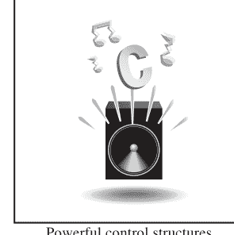

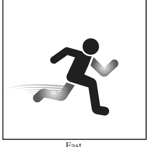

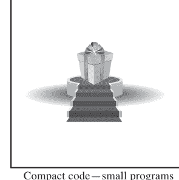

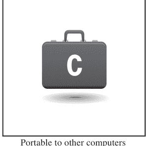

图1.1 C语言的优点。

## 设计特性

C语言是一门现代语言，融合了计算机科学理论和实践认为可取的控制特性。它的设计使其天然适合自顶向下规划、结构化编程和模块化设计，结果是程序更加可靠、易于理解。


## 效率

C 是一种高效的编程语言。它的设计充分利用了当前计算机的能力。C 程序往往体积紧凑、运行迅速。实际上，C 具有通常与汇编语言相关联的那种精细控制能力。（汇编语言是一组特定中央处理器设计所使用的内部指令的助记符表示；不同的 CPU 系列有不同的汇编语言。）如果你愿意，可以对程序进行微调，以实现最大速度或最高效的内存使用。

### 可移植性

C 是一种可移植的语言，这意味着在一个系统上编写的 C 程序可以在其他系统上运行，只需很少或无需修改。如果需要进行修改，通常只需更改主程序附带的一个头文件中的几个条目即可。大多数语言都旨在可移植，但任何将 IBM PC BASIC 程序转换为 Apple BASIC（它们还是近亲），或者尝试在 Unix 系统上运行 IBM 大型机 FORTRAN 程序的人都知道，移植至少是非常麻烦的。C 在可移植性方面处于领先地位。C 编译器（将 C 代码转换为计算机内部使用的指令的程序）可用于许多计算机体系结构，从 8 位微处理器到 Cray 超级计算机。不过，请注意，程序中专门用于访问特定硬件设备（如显示器）或操作系统特殊功能（如 Windows 8 或 OS X）的部分，通常是不可移植的。

由于 C 与 Unix 的紧密联系，Unix 系统通常附带 C 编译器作为其一部分。Linux 安装通常也包含 C 编译器。个人电脑也有多种 C 编译器可用，包括运行各种 Windows 版本的 PC 和 Macintosh。因此，无论你使用的是家用电脑、专业工作站还是大型机，很可能都能找到适用于你特定系统的 C 编译器。

## 强大而灵活

C 强大而灵活（这是计算机文献中两个最受欢迎的词）。例如，强大灵活的 Unix 操作系统大部分是用 C 编写的。其他语言的许多编译器和解释器——如 FORTRAN、Perl、Python、Pascal、LISP、Logo 和 BASIC——也是用 C 编写的。因此，当你在 Unix 机器上使用 FORTRAN 时，最终是 C 程序完成了生成最终可执行程序的工作。C 程序已被用于解决物理和工程问题，甚至用于动画制作电影特效。

## 面向程序员

C 旨在满足程序员的需求。它让你能够访问硬件，并允许你操作内存中的各个位。其丰富的运算符选择让你能够简洁地表达自己。C 在限制你能做什么方面，不如 Pascal 甚至 C++ 严格。这种灵活性既是优点也是危险。优点是许多任务（如数据格式转换）在 C 中要简单得多。危险是使用 C 时，你可能会犯下某些其他语言中不可能犯的错误。C 给了你更多自由，但也让你承担更多责任。

此外，大多数 C 实现都有一个大而实用的 C 函数库。这些函数处理程序员常遇到的许多需求。

## 缺点

C 确实有一些缺点。通常，就像人一样，缺点和优点是同一特征的两个方面。例如，我们提到过 C 的表达自由也需要额外的责任。特别是 C 对指针的使用（你可以在本书中期待学习的内容）意味着你可能会犯难以追踪的编程错误。正如一位计算机初学者曾评论的那样，自由的代价是永恒的警惕。

C 的简洁性，加上其丰富的运算符，使得编写极难理解的代码成为可能。你并非被迫编写晦涩的代码，但机会就在那里。毕竟，还有什么语言每年都举办“混淆代码大赛”呢？

还有更多优点，而且无疑还有更多缺点。与其深入探讨这个问题，不如让我们继续一个新话题。

## C 路在何方？

到 20 世纪 80 年代初，C 在 Unix 系统的小型机世界中已成为主导语言。此后，它扩展到个人电脑（微型计算机）和大型机（大块头）。参见图 1.2。许多软件公司使用 C 作为生产文字处理程序、电子表格、编译器和其他产品的首选语言。这些公司知道 C 能生成紧凑高效的程序。更重要的是，他们知道这些程序易于修改，也易于适应新型计算机。

对公司和对 C 老手有利的东西，对其他用户也有利。越来越多的计算机用户转而使用 C，以获得其优势。你不一定是计算机专业人士才能使用 C。

在 20 世纪 90 年代，许多软件公司开始转向 C++ 语言进行大型编程项目。C++ 将面向对象编程工具嫁接到 C 语言上。（*面向对象编程*是一种理念，试图让语言适应问题，而不是让问题适应语言。）C++ 几乎是 C 的超集，这意味着任何 C 程序都是或者几乎是合法的 C++ 程序。通过学习 C，你也学习了 C++ 的大部分内容。

尽管像 C++ 和 Java 这样的较新语言很流行，C 仍然是软件业务中的核心技能，通常在期望技能中排名前十。特别是，C 在嵌入式系统编程中变得流行。也就是说，它被用于为汽车、相机、DVD 播放器和其他现代便利设备中日益常见的微处理器编程。此外，C 已在 FORTRAN 长期主导的科学编程领域取得进展。最后，作为一种为开发操作系统而创建的语言，它在 Linux 的开发中发挥着重要作用。因此，在二十一世纪的第二个十年，C 依然强劲。

CPU 的生命，至少在如此简单的描述中，非常简单。它从内存中取出一条指令并执行。它再从内存中取下一条指令并执行，如此反复。（一个千兆赫兹的 CPU 每秒大约可以做到十亿次，因此 CPU 可以以惊人的速度过着它枯燥无味的生活。）CPU 有自己的小型工作区，由几个寄存器组成，每个寄存器可以保存一个数字。一个寄存器保存下一条指令的内存地址，CPU 利用这个信息来获取下一条指令。获取指令后，CPU 将指令存储在另一个寄存器中，并将第一个寄存器更新为下一条指令的地址。CPU 能理解的指令（称为指令集）数量有限。此外，这些指令相当具体；其中许多指令要求计算机将数字从一个位置移动到另一个位置——例如，从内存位置移动到寄存器。

这个描述伴随着两个有趣的点。首先，计算机中存储的所有内容都是以数字形式存储的。数字以数字形式存储。字符，例如你在文本文档中使用的字母字符，以数字形式存储；每个字符都有一个数字代码。计算机加载到寄存器中的指令也以数字形式存储；指令集中的每条指令都有一个数字代码。其次，计算机程序最终必须以这种数字指令代码来表示，也就是所谓的机器语言。

计算机工作方式的一个后果是，如果你想让计算机做某事，你必须提供一份具体的指令列表（程序），告诉它确切要做什么以及如何做。你必须用计算机直接理解的语言（机器语言）来创建程序。这是一项细致、枯燥、严苛的任务。像两个数字相加这样简单的事情都必须分解为几个步骤，可能如下所示：

- 1. 将内存位置 2000 中的数字复制到寄存器 1。
- 2. 将内存位置 2004 中的数字复制到寄存器 2。
- 3. 将寄存器 2 的内容加到寄存器 1 的内容上，将结果留在寄存器 1 中。
- 4. 将寄存器 1 的内容复制到内存位置 2008。

而且你必须用数字代码来表示这些指令！

如果以这种方式编写程序听起来像是你想做的事，那么你会遗憾地得知，机器语言编程的黄金时代早已过去。但如果你更喜欢稍微有趣一点的事情，那么请向高级编程语言敞开你的心扉。

## 高级计算机语言与编译器

高级编程语言，如 C，在多个方面简化了你的编程生活。首先，你不需要用数字代码来表达指令。其次，你使用的指令更接近你对问题的思考方式，而不是计算机采取的具体方法。你无需担心特定 CPU 会采取的确切步骤。


processors，委员会基于那些在现实生活中处理此问题的人的经验制定了对标准的增补。第三个目标是提高 C 语言进行科学和工程项目关键数值计算的适用性，使 C 成为比 FORTRAN 更有吸引力的替代方案。

这三个要点——国际化、缺陷修正以及计算实用性的改进——是主要的变化导向目标。剩余的变更计划在性质上更为保守——例如，最小化与 C90 和 C++ 的不兼容性，并保持语言概念上的简单性。用委员会的话说，“...委员会乐于让 C++ 成为大而雄心勃勃的语言。”

结果是 C99 的变更保留了 C 的本质特征，C 仍然是一种精简、干净、高效的语言。本书指出了 C99 的许多变更。然而，尽管标准已经发布了一段时间，但目前并非所有编译器都完全实现了所有 C99 变更。你可能会发现其中一些在你的系统上不可用。或者你可能会发现只有在更改编译器设置后某些 C99 特性才可用。

## C11 标准

维护标准是一个永恒的过程，2007 年标准委员会承诺进行下一次修订 C1X，最终实现为 C11。委员会提出了一些新的指导原则。其中之一是，“信任程序员”的目标在当代编程安全性和安全性关注面前应有所缓和。委员会还做出了一些重要观察。其中之一是 C99 并没有像 C90 那样得到供应商的良好接受和支持。因此，C99 的某些特性对 C11 来说是可选的。一个原因是委员会认为为小型机器市场服务的供应商不应被要求支持其目标环境中未使用的特性。另一个观察是，标准被修订并不是因为它坏了，而是因为需要跟踪新技术。一个例子是针对使用多处理器计算机的趋势而增加对并发编程的可选支持。我们简要地看一下这个主题，但探索它超出了本书的范围。

Note
本书将使用术语 ANSI C 或，出于更国际化的精神，ANSI/ISO C 或仅 ISO C 来表示 C89/90 及以后标准共有的特性，并用 C99 和 C11 来指代新特性。偶尔，它会提到 C90（例如，在讨论某个特性首次添加到 C 时）。

## 使用 C：七个步骤

C，如你所见，是一种编译语言。如果你习惯使用编译语言，例如 Pascal 或 FORTRAN，你将熟悉组装 C 程序的基本步骤。然而，如果你的背景是在解释型语言，例如 BASIC，或在

## 第 7 步：维护和修改程序

当你为自己或他人创建一个程序时，该程序可能会被广泛使用。如果是这样，你可能会发现有理由对其进行更改。也许在有人输入以 Zz 开头的名称时才会出现一个小错误，或者你可能会想到在程序中做某事的更好方法。你可以添加一个巧妙的新功能。你可能需要使程序适应在不同的计算机系统上运行。所有这些任务如果清楚地记录程序并遵循良好的设计实践，就会大大简化。

## 评论

编程通常并不像刚才描述的过程那样线性。有时你需要在步骤之间来回移动。例如，当你编写代码时，你可能会发现你的计划不切实际。你可能会看到做事的更好方法，或者，在看到程序运行后，你可能会有动力改变设计。记录你的工作有助于你在各层级之间来回移动。

大多数学习者倾向于忽视步骤 1 和 2（定义程序目标和设计程序）并直接进入步骤 3（编写程序）。你编写的第一个程序足够简单，你可以在脑海中可视化整个过程。如果犯了错误，很容易找到。随着程序变得更长、更复杂，心理可视化开始失效，错误变得更难找到。最终，那些忽视规划步骤的人将被判处数小时的失落时间、困惑和挫折，因为他们会产生丑陋、功能失调且晦涩的程序。工作越大越复杂，需要的规划就越多。

这里的寓意是，你应该养成在编码前先规划的习惯。使用古老但光荣的笔和纸技术来记录程序的目标并概述设计。如果你这样做，你最终会在节省时间和获得的满足感方面获得丰厚回报。

## 编程机制

你必须遵循的确切步骤来生成程序取决于你的计算机环境。由于 C 是可移植的，它在许多环境中可用，包括 Unix、Linux、MS-DOS（是的，有些人仍然使用它）、Windows 和 Macintosh OS。本书没有足够的空间来涵盖所有环境，特别是因为特定产品会演变、消亡并被取代。

首先，让我们看看许多 C 环境共有的一些方面，包括我们刚刚提到的五个。你实际上不需要知道以下内容来运行 C 程序，但它是良好的背景知识。它还可以帮助你理解为什么你必须经历一些特定的步骤才能获得 C 程序。

当你用 C 语言编写程序时，你将所写的内容存储在一个称为源代码文件 的文本文件中。大多数 C 系统，包括我们提到的那些，要求文件名为

你可以在 MS Windows 或 Linux 下运行 IBM PC 兼容机。硬件在两种情况下都相同，因此相同的目标代码对两者都有效，但你需要为 Windows 的启动代码与为 Linux 的不同，因为这些系统以不同的方式处理程序。

第二个缺失的元素是库例程的代码。几乎所有 C 程序都使用标准 C 库的一部分例程（称为 *函数*）。例如，concrete.c 使用函数 printf()。目标代码文件不包含此函数的代码；它仅包含使用 printf() 函数的指令。实际代码存储在另一个文件中，称为库。库文件包含许多函数的目标代码。

链接器的作用是将这三个元素——你的目标代码、系统的标准启动代码以及库代码——汇集在一起并放入单个文件，即可执行文件。对于库代码，链接器仅从库中提取你使用的函数所需的代码（见图 1.4）。

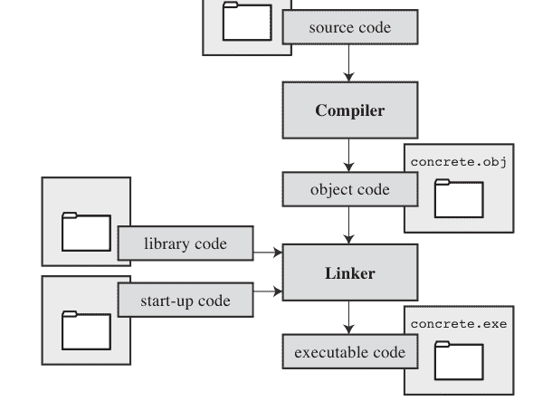

图 1.4 编译器和链接器。

简而言之，目标文件和可执行文件都由机器语言指令组成。然而，目标文件仅包含你使用的代码的机器语言翻译，而可执行文件还具有你使用的库例程和启动代码的机器代码。

请注意，安装 GCC 在安装 Linux 时可能是可选的，因此你（或某人）可能需要在之前未安装的情况下安装 GCC。通常，安装会使 cc 成为 gcc 的别名，因此你可以在命令行中使用 cc 而不是 gcc，如果你愿意的话。

你可以在 http://www.gnu.org/software/gcc/index.html 上获得有关 GCC 的进一步信息，包括有关新版本的信息。

## PC 的命令行编译器

C 编译器不是 Windows 标准包的一部分，因此你可能需要获取并安装 C 编译器。Cygwin 和 MinGW 是免费下载，可使 GCC 编译器在 PC 上用于命令行使用。Cygwin 在自己的窗口中运行，该窗口具有命令提示符的外观，但模仿 Linux 命令行环境。MinGW 另一方面在 Windows 命令提示符模式下运行。它们附带最新（或接近最新）的 GCC 版本，支持 C99 并且至少支持部分 C11。Borland C++ Compiler 5.5 是另一个免费下载；它支持 C90。

源代码文件应为文本文件，而不是文字处理器文件。（文字处理器文件包含大量有关字体和格式的额外信息。）你应该使用文本编辑器，例如 Windows 记事本。你可以使用文字处理器，如果你使用“另存为”功能以文本模式保存文件。文件应具有 .c 扩展名。一些文字处理器会自动向文本文件添加 .txt 扩展名。如果这种情况发生在你身上，你需要更改文件名，将 txt 替换为 c。

PC 的 C 编译器通常，但不总是，生成具有 .obj 扩展名的中间目标代码文件。与 Unix 编译器不同，这些编译器通常在完成后不会删除这些文件。一些编译器生成具有 .asm 扩展名的汇编语言文件或使用自己的特殊格式。

一些编译器在编译后自动运行链接器；其他可能需要你手动运行链接器。链接会生成可执行文件，该文件将 .EXE 扩展名附加到原始源代码基本名。例如，编译并链接名为 concrete.c 的源代码文件会生成一个名为 concrete.exe 的文件。你可以通过在命令行键入基本名来运行程序：

```
C>concrete
```

## 集成开发环境（Windows）

相当多的供应商，包括 Microsoft、Embarcadero 和 Digital Mars，提供基于 Windows 的集成开发环境，或 IDE。（这些天，大多数是组合的 C 和 C++ 编译器。）免费下载包括 Microsoft Visual Studio Express 和 Pelles C。所有这些都为组装 C 程序提供了快速、集成的环境。关键点是这些程序中的每一个都有内置编辑器，可用于编写 C 程序。每个都提供菜单，可让你命名和保存源代码文件，以及提供菜单让你在不离开 IDE 的情况下编译和运行程序。每个在


experimenting to learn how your compiler works. You might even have to read the manual or try an online tutorial.

## Microsoft Visual Studio and the C Standard

Microsoft Visual Studio 和免费软件 Microsoft Visual Studio Express 在 Windows 软件开发中占据最大份额，因此它们与 C 标准的关系具有一定的重要性。简而言之，微软鼓励程序员从 C 转向 C++ 或 C#。Visual Studio 支持 C89/90，但截至目前，其对后续标准的支持仅限于同时存在于 C++ 中的新特性，例如 long long 类型。此外，自 2012 版起，Visual Studio 不再提供 C 作为项目类型的选项之一。然而，你仍然可以使用 Visual Studio 来运行本书中的绝大多数程序。一个选择是只需选择 C++ 选项，然后选择 Win32 Console，再在 Application settings 中选择 Empty Project。几乎所有的 C 都与 C++ 兼容，因此本书中的大多数 C 程序也可以作为 C++ 程序运行。或者，在选择 C++ 选项后，你也可以为源文件使用 .c 扩展名而不是默认的 .cpp 扩展名，这样编译器就会使用 C 规则而不是 C++ 规则。

## The Windows/Linux Option

许多 Linux 发行版可以从 Windows 安装，以设置双启动系统。你的部分存储空间将被分配给 Linux 系统，然后你可以启动到 Windows 或 Linux。你不能从 Windows 运行 Linux 程序，反之亦然，你也不能从 Windows 访问 Linux 文件，但你可以从 Linux 访问 Windows 文档。

## C on the Macintosh

目前，Apple 提供其 Xcode 开发系统作为免费下载。过去，有时它是免费的，有时需要支付少量费用。它允许你从多种编程语言中进行选择，包括 C。

Xcode 具有处理多种编程语言、面向多个平台以及开发大规模项目的能力，可能显得令人望而生畏。但你只需学习足够的内容来生成简单的 C 程序即可。使用 Xcode 4.6，请使用 File 菜单选择 New、Project、OS X Application Command Line Tool，然后输入产品名称并选择 C 作为 Type。Xcode 对 C 代码使用 Clang 或 GCC C 编译器。过去默认使用 GCC，现在默认使用 Clang。你可以使用 Xcode 设置来选择它使用的编译器以及支持的 C 标准。受许可问题影响，随 Xcode 提供的 Clang 版本比 GCC 版本更新。

Mac OS X 基于 Unix 构建，Terminal 实用程序打开一个窗口，让你可以在 Unix 命令行环境中运行程序。Apple 不在其标准包中提供命令行编译器，但如果你下载 Xcode，你也可以下载可选的命令行工具，从而能够使用 clang 和 gcc 命令在命令行模式下编译。

## How This Book Is Organized

组织信息的方式有很多种。最直接的方法之一是先介绍关于主题 A 的所有内容，然后是主题 B，依此类推。这对于参考书特别有用，这样你可以在一个地方找到有关给定主题的所有信息。但通常这并不是学习一门学科的最佳顺序。例如，如果你开始学习英语时先学习所有名词，你表达思想的能力将受到严重限制。当然，你可以指着物体并大声喊出它们的名字，但如果你学习一些名词、动词、形容词等，以及这些部分如何相互关联的一些规则，你将更好地表达自己。

为了让你更均衡地获取信息，本书采用螺旋式方法，在早期章节中介绍多个主题，并在之后返回更深入地讨论它们。例如，理解函数对于理解 C 至关重要。因此，早期章节中的几章都包含了一些关于函数的讨论，这样当你读到第 9 章“Functions”中的完整讨论时，你已经对使用函数感到比较轻松了。同样，早期章节预览了字符串和循环，以便你可以在详细学习它们之前就开始在程序中使用这些有用的工具。

## Conventions Used in This Book

我们几乎准备好开始学习 C 语言本身了。本节介绍我们在呈现材料时使用的一些约定。

## Typeface

对于代表程序和计算机输入输出的文本，我们使用一种类似于你在屏幕上或打印输出中看到的字体。我们已经使用过几次了。如果它没有引起你的注意，这种字体看起来如下：

```
#include <stdio.h>
int main(void)
{
    printf("Concrete contains gravel and cement.\n");
    return 0;
}
```

相同的等宽字体用于文本中代码相关的术语，例如 main()，以及文件名，例如 stdio.h。书中使用斜体等宽字体表示占位符术语，你需要为其替换特定术语，如以下声明模型所示：
type_name variable_name;

在这里，例如，你可以将 type_name 替换为 int，将 variable_name 替换为 zebra_count。

## Program Output

计算机的输出以相同格式打印，唯一例外是用户输入以粗体显示。例如，以下是第 14 章“Structures and Other Data Forms”中示例的程序输出：

```
Please enter the book title.
Press [enter] at the start of a line to stop.
```

```
My Life as a Budgie
Now enter the author.
```

```
Mack Zackles
```

以普通计算机字体打印的行是程序输出，而粗体行是用户输入。

你和计算机之间有许多种通信方式。然而，我们假设你使用键盘输入命令，并在屏幕上阅读响应。

## Special Keystrokes

通常，你通过按下标有 Enter、c/r、Return 或其变体的键来发送一行指令。我们在文本中将此键称为 Enter 键。通常，本书默认你在每行输入的末尾按下 Enter 键。然而，为了阐明特定要点，少数示例明确显示 Enter 键，使用符号 [enter] 来表示它。括号意味着你按下单个键而不是输入单词 enter。

我们还提及控制字符，例如 Ctrl+D。这种表示法意味着在按下标有 Ctrl（或可能是 Control）的键的同时按下 D 键。

## Systems Used in Preparing This Book

C 的某些方面，例如存储数字所使用的空间，取决于系统。当我们给出示例并提到“我们的系统”时，我们通常指的是运行 OS X 10.8.4 的 iMac，并使用 Xcode 4.6.2 开发系统和 Clang 3.2 编译器。大多数程序也已使用 Microsoft Visual Studio Express 2012 和 Pelles C 7.0 在 Windows 7 系统上编译，以及在 Ubuntu 13.04 Linux 系统上使用 GCC 4.7.3 编译。

你可以在 www.informit.com/register 注册本书后下载本书示例的代码。

## Your System—What You Need

你需要拥有一个 C 编译器或可以访问一个。C 运行在大量不同的计算机系统上，因此你有很多选择。务必确保你使用的是为你的特定系统设计的 C 编译器。本书中的一些示例需要 C99 或 C11 标准的支持，但大多数示例可以用 C90 编译器运行。如果你使用的编译器是 pre-ANSI/ISO，你将不得不进行调整，可能频繁到足以促使你寻找更新的版本。

大多数编译器厂商为学生和教育工作者提供特殊价格，因此如果你属于该类别，请查看厂商网站。

## Special Elements

本书包含几个突出特定要点的特殊元素：Sidebars、Tips、Cautions 和 Notes。以下说明了它们的出现形式和用途：

Sidebar
侧边栏提供更深入的讨论或额外的背景信息，以帮助阐明主题。

Tip
提示提供对特定编程情况的简短、有用的指导。

Caution
警告提醒你潜在的陷阱。

Note
注释提供了一个总括类别，用于那些不属于其他类别的评论。

## Summary

C 是一种功能强大、简洁的编程语言。它之所以流行，是因为它提供了有用的编程工具，对硬件有良好的控制，并且 C 程序比大多数程序更容易从一个系统移植到另一个系统。

C 是一种编译语言。C 编译器和链接器是将 C 语言源代码转换为可执行代码的程序。

用 C 编程可能很费力、困难且令人沮丧，但也可能引人入胜、令人兴奋且令人满意。我们希望你能像我们一样觉得它有趣且迷人。


## 复习题

你可以在附录 A“复习题答案”中找到复习题的答案。

- 1. 在编程上下文中，*可移植性*是什么意思？
- 2. 解释源代码文件、目标代码文件和可执行文件之间的区别。
- 3. 编程的七大步骤是什么？
- 4. 编译器做什么？
- 5. 链接器做什么？

## 编程练习

我们还不期望你编写 C 代码，因此本练习将重点放在编程过程的早期阶段。

- 1. 你刚刚被 MacroMuscle, Inc.（为强健体魄者打造软件）聘用。这家公司正在进入欧洲市场，需要一个能将英寸转换为厘米（1 英寸 = 2.54 厘米）的程序。公司希望程序能够提示用户输入一个英寸值。你的任务是定义程序目标并设计程序（编程过程的第 1 步和第 2 步）。

继续读下去。第二遍（“Pass 2：程序细节”）将探讨具体的含义和细节，帮助你更深入地理解。

图 2.1 总结了 C 程序的各个部分；它包含的元素比我们的第一个示例所使用的要多。

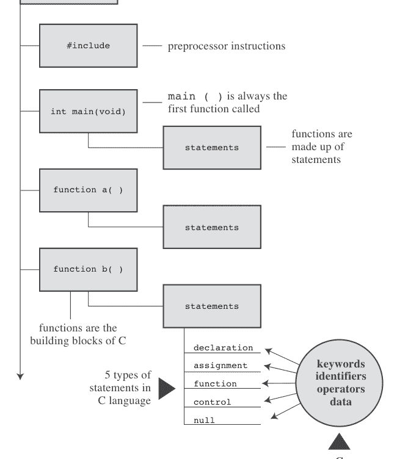

图 2.1 C 程序剖析。

## 第 1 遍：快速概览

本节逐行展示程序，并附上简短说明；下一节（第 2 遍）会更充分地探讨这里提出的主题。

```
#include <stdio.h>      include another file
```

这一行告诉编译器包含文件 stdio.h 中的信息，stdio.h 是所有 C 编译器包的标准组成部分；该文件为键盘输入和显示输出提供支持。

```
int main(void)      ←a function name
```

C 程序由一个或多个函数组成，函数是 C 程序的基本模块。本程序由一个名为 main 的函数组成。圆括号表示 main() 是一个函数名。int 表示 main() 函数返回一个整数，void 表示 main() 不接收任何参数。这些我们稍后会深入讨论。现在，只需接受 int 和 void 是标准 ANSI C 定义 main() 的方式的一部分。（如果你使用的是 pre-ANSI C 编译器，请省略 void；你可能需要换一个更新的编译器以避免不兼容。）

```
/* a simple program */      ←a comment
```

符号 /* 和 */ 括起来的是注释——有助于澄清程序的说明。它们仅供读者阅读，编译器会忽略它们。

```
{      ←beginning of the body of the function
```

这个左花括号标志着组成该函数的语句的开始。右花括号 } 标志着该函数定义的结束。

```
int num;      ←a declaration statement
```

这条语句声明你将使用一个名为 num 的变量，并且 num 将是 int（整数）类型。

```
num = 1;      ←an assignment statement
```

语句 num = 1; 将值 1 赋给名为 num 的变量。

```
printf("I am a simple ");      ←a function call statement
```

第一条使用 printf() 的语句会在屏幕上显示短语 I am a simple，并将光标停在同一行。这里的 printf() 是标准 C 库的一部分。它被称为函数，在程序中使用函数称为调用函数。

```
printf("computer.\n");      ←another function call statement
```

下一次调用 printf() 函数时，会把 computer 附加到上一次打印内容的末尾。\n 是告诉计算机开始新一行的代码——也就是说，把光标移到下一行的开头。

```
printf("My favorite number is %d because it is first.\n", num);
```

最好不要依赖这一点。每当本书使用库函数时，都会使用 ANSI/ISO 标准为这些函数指定的包含文件。

### 注意：为什么输入和输出不是内建的

也许你会奇怪，为什么像输入和输出这样基本的功能没有被自动包含进来。一种答案是，并非所有程序都会使用这个 I/O（输入/输出）包，而 C 的哲学之一就是避免携带不必要的负担。这种经济利用资源的原则使 C 在嵌入式编程中广受欢迎——例如，为控制汽车燃油系统或蓝光播放器的芯片编写代码。顺便说一句，#include 行甚至不是 C 语言语句！第 1 列中的 # 符号将该行标识为在编译器接管之前由 C 预处理器处理的行。你以后会遇到更多预处理指令的例子，第 16 章“C 预处理器和 C 库”会更全面地讨论这个主题。

### main() 函数

```
int main(void)
```

程序中的这一行声明了一个名为 main 的函数。没错，main 是个相当朴素的名字，但它是唯一可选的名字。C 程序（有一些我们不必担心的例外）总是从名为 main() 的函数开始执行。你可以自由地为你使用的其他函数选择名字，但 main() 必须存在以启动一切。那圆括号呢？它们将 main() 标识为函数。你很快就会学到更多关于函数的内容。现在，只需记住函数是 C 程序的基本模块。

int 是 main() 函数的返回类型。这意味着 main() 能返回的值的种类是整数。返回给哪里？返回给操作系统——我们将在第 6 章“C 控制语句：循环”中回到这个问题。

函数名后面的圆括号通常包含传递给函数的信息。在这个简单的例子中，没有传递任何信息，所以圆括号中包含单词 void。（第 11 章“字符串和字符串函数”介绍了第二种格式，它允许从操作系统向 main() 传递信息。）

如果你翻阅古老的 C 代码，你常会看到程序以下列格式开头：

```
main()
```

C90 标准勉强容忍这种形式，但 C99 和 C11 标准不容忍。所以，即使你当前的编译器允许你这样做，也不要这样做。

下面是你可能会看到的另一种形式：

```
void main()
```

一些编译器允许这种形式，但没有任何标准将它列为可识别的选项。因此，编译器不必接受这种形式，而且有些编译器确实不接受。还是坚持使用标准形式吧，这样你在把程序从一个编译器移到另一个编译器时就不会遇到问题。

### 注释

```
/* a simple program */
```

程序中括在 /* */ 符号之间的部分是注释。使用注释能让别人（包括你自己）更容易理解你的程序。C 注释的一个很好的特性是它们可以放在任何地方，甚至可以与它们解释的内容放在同一行。较长的注释可以单独占一行，甚至可以跨越多行。编译器会忽略开头的 /* 和结尾的 */ 之间的所有内容。下面是一些有效和无效的注释形式：

```
/* This is a C comment. */
/* This comment, being somewhat wordy, is spread over
two lines. */
/*
    You can do this, too.
*/
/* But this is invalid because there is no end marker.
```

C99 增加了第二种注释风格，这种风格因 C++ 和 Java 而流行。新风格使用 // 符号创建限于一行内的注释：

```
// Here is a comment confined to one line.
int rigue;      // Such comments can go here, too.
```

因为行尾标志着注释的结束，所以这种风格只需要在注释开头加上注释标记即可。

新形式是对旧形式潜在问题的一种回应。假设你有以下代码：

```
/*
I hope this works.
*/
x = 100;
y = 200;
/* Now for something else. */
```

接下来，假设你决定删除第四行，却不小心也删掉了第三行（*/）。代码就变成了：

```
/*
I hope this works.
y = 200;
/* Now for something else. */
```


现在编译器将第一行的 /* 与第四行的 */ 配对，使这四行都变成一条注释，包括本应属于代码的那一行。因为 // 形式不会跨越多行，所以不会出现这种“代码消失”问题。

某些编译器可能不支持此功能；其他编译器可能需要更改编译器设置以启用 C99 或 C11 功能。

本书秉持着无谓的一致性会很无聊的理论，使用了这两种注释。

## 大括号、正文和块

```
{
...
}
```

在第 2.1 节清单中，大括号限定了 main() 函数。一般来说，所有 C 函数都使用大括号来标记函数体的开始和结束。它们的存在是强制性的，所以不要省略。只有大括号 ({ }) 适用于此目的，圆括号 (( )) 和方括号 ([ ]) 不行。

大括号也可以用来将函数内的语句聚合成一个单元或块。如果你熟悉 Pascal、ADA、Modula-2 或 Algol，你会认识到大括号与这些语言中的 begin 和 end 类似。

## 声明

```
int num;
```

程序中的这一行被称为声明语句。声明语句是 C 的最重要的特性之一。这个特定的例子声明了两件事。首先，在函数中的某个位置，你有一个名为 num 的变量。其次，int 声明 num 为整数——即没有小数点或小数部分的数量。（int 是数据类型的一个例子。）编译器使用此信息为 num 变量在内存中安排合适的存储空间。行尾的分号标识该行为一条 C 语句或指令。分号是语句的一部分，而不仅仅是 Pascal 中语句之间的分隔符。

单词 int 是 C 关键字，标识了 C 基本数据类型之一。关键字是用来表达一种语言的词语，你不能将它们用于其他目的。例如，你不能将 int 用作函数或变量的名称。这些关键字限制在语言之外并不适用，因此给猫或心爱的孩子命名为 int 是可以的。（当地习俗或法律可能在某些地区使此选项失效。）

本例中的单词 num 是一个标识符——即你为变量、函数或其他实体选择的名称。因此，声明将特定标识符与计算机内存中的特定位置连接起来，并且还建立了要在该位置存储的信息类型或数据类型。

在 C 中，所有变量必须在使用前声明。这意味着你必须提供程序中使用的所有变量的列表，并且必须显示每个变量的数据类型。声明变量被认为是一种良好的编程技术，在 C 中它是强制性的。

传统上，C 要求变量必须在块的开头声明，并且在任何声明之前不允许出现其他类型的语句。也就是说，main() 的主体可能看起来像以下内容：

```
int main()    // traditional rules
{
    int doors;
    int dogs;
    doors = 5;
    dogs = 3;
    // other statements
}
```

C99 和 C11 遵循 C++ 的做法，允许你在块中的任何位置放置声明。然而，你仍然必须在使用变量之前声明它。因此，如果你的编译器支持此功能，你的代码可以如下所示：

```
int main()        // current C rules
{
// some statements
    int doors;
    doors = 5;      // first use of doors
// more statements
    int dogs;
    dogs = 3;       // first use of dogs
    // other statements
}
```

为了与旧系统有更大的兼容性，本书将坚持使用原始约定。

到目前为止，你可能有三个问题。第一，数据类型是什么？第二，在选择名称时有哪些选择？第三，为什么必须声明变量？让我们看一些答案。

## 数据类型

C 处理几种种类（或类型）的数据：整数、字符和浮点数等。将变量声明为整数或字符类型可以使计算机正确地存储、获取和解释数据。你将在下一章研究可用的各种类型。

## 名称选择

你应该为变量使用有意义的名称（或标识符）（例如，如果你的程序计数绵羊，使用 sheep_count 而不是 x3）。如果名称不足以说明问题，请使用注释来解释变量代表什么。以这种方式记录程序是良好编程的基本技术之一。

在 C99 和 C11 中，你可以使标识符的名称任意长，但编译器只需将前 63 个字符视为有意义。对于外部标识符（参见第 12 章“存储类、链接和内存管理”）只需识别 31 个字符。这是对 C90 要求的 31 个字符和 6 个字符的实质性增加，而旧的 C 编译器通常在最多 8 个字符时停止。实际上，你可以使用超过最大字符数的字符，但编译器不必注意额外的字符。这意味着什么？如果有两个标识符各长 63 个字符，除了一个字符外完全相同，编译器必须将它们识别为彼此不同。如果有两个标识符长 64 个字符，除了最后一个字符外完全相同，编译器可能会将它们识别为不同，也可能不会；标准没有定义这种情况下应该发生什么。

你可以使用的字符有小写字母、大写字母、数字和下划线（_）。第一个字符必须是字母或下划线。以下是一些示例：

| 有效名称 | 无效名称 |
|---|---|
| wiggles | $Z** |
| cat2 | 2cat |
| Hot_Tub | Hot-Tub |
| taxRate | tax rate |
| _kcab | don’t |

操作系统和 C 库经常使用以一个或两个初始下划线字符开头的标识符，例如 _kcab，因此最好避免自己使用这种用法。标准将以一个或两个下划线字符开头的标识符，例如库标识符，保留。这意味着虽然使用它们不是语法错误，但可能会导致名称冲突。

C 名称区分大小写，这意味着大写字母被视为与对应的小写字母不同。因此，stars 与 Stars 和 STARS 不同。

为了使 C 更具国际化，C99 和 C11 通过通用字符名称（或 UCN）机制提供了大量字符供使用。参考附录 B 中的参考部分 VII，“扩展字符支持”，讨论了这一补充。这使得可以使用非英语字母表的字符。

## 声明变量的四个好理由

一些较旧的语言，例如 FORTRAN 和 BASIC 的原始形式，允许你在不声明的情况下使用变量。那么为什么在 C 中不能采用这种轻松的做法呢？原因如下：

- 将所有变量放在一个地方使读者更容易理解程序的内容。如果给变量有意义的名称（例如 taxrate 而不是 r），这一点尤其正确。如果名称不足以说明问题，请使用注释来解释变量代表什么。以这种方式记录程序是良好编程的基本技术之一。

- 思考要声明哪些变量会鼓励你在着手编写程序之前做一些规划。程序需要什么信息才能开始？程序的输出到底应该是什么？我怎样才能最好地表示数据？

- 声明变量有助于防止编程中最微妙和难以找到的错误之一——变量名拼写错误。例如，假设在某种缺乏声明的语言中，你写了语句

    ```
    RADIUS1 = 20.4;
    ```

    而在程序的其他地方你误输入了

    ```
    CIRCUM = 6.28 * RADIUSl;
    ```

    你无意中用字母 l（小写 L）替换了数字 1。那种其他语言会创建一个名为 RADIUSl 的新变量并使用它所拥有的任何值（也许是零，也许是垃圾）。CIRCUM 会被赋予错误的值，你可能很难弄清楚原因。在 C 中这种情况不会发生（除非你愚蠢到声明了两个如此相似的变量名），因为当未声明的 RADIUSl 出现时编译器会抱怨。

- 如果你不声明变量，你的 C 程序将无法编译。如果前面的理由不能打动你，你应该认真考虑这一点。

既然你需要声明变量，它们放在哪里？如前所述，C 在 C99 之前要求声明放在块的开头。遵循这一做法的一个好理由是，将声明放在一起使得更容易看出程序在做什么。当然，传播声明也有一个好理由，正如 C99 现在允许的那样。想法是在你准备给它们赋值之前声明变量。这样就不太容易忘记给它们赋值。就实际而言，许多编译器尚未支持 C99 规则。

## 赋值

```
num = 1;
```

下一个程序行是 *赋值语句*，它是 C 中的基本操作之一。这个特定的例子意味着“将值 1 分配给变量 num”。之前的 `int num;` 行预留了


有什么新内容？代码提供了一个程序说明，声明了多个变量，做了一些乘法运算，并打印了两个变量的值。让我们更详细地检查这些要点。

## 文档

首先，程序以一条注释（使用新的注释风格）开始，标识文件名和程序的目的。这种程序文档只需花费片刻时间，但在浏览多个文件或打印它们时很有帮助。

## 多重声明

接下来，程序在单个声明语句中声明了两个变量而不是一个。要做到这一点，请在声明语句中用逗号分隔两个变量（feet 和 fathoms）。也就是说，

```
int feet, fathoms;
```

和

```
int feet;
int fathoms;
```

是等价的。

## 乘法

第三，程序进行了一次计算。它利用计算机系统的巨大计算能力将 2 乘以 6。在 C 中，如同许多语言中一样，* 是乘法的符号。因此，语句

```
feet = 6 * fathoms;
```

意味着“查找变量 fathoms 的值，将其乘以 6，并将此计算的结果赋给变量 feet。”

## 打印多个值

最后，程序对 printf() 做了更精细的使用。如果你编译并运行示例，输出应如下所示：

```
There are 12 feet in 2 fathoms!
Yes, I said 12 feet!
```

这次，代码在第一次使用 printf() 时做了两次替换。引号中的第一个 %d 被替换为引号段之后列表中的第一个变量（feet）的值，第二个 %d 被替换为列表中的第二个变量（fathoms）的值。请注意，要打印的变量列表位于语句的尾部，在引号部分之后。另请注意，每个项目都用逗号与其他项目分隔开。

第二次使用 printf() 说明打印的值不必是变量；它只需要是某种东西，例如 6 * fathoms，能够简化为正确类型的值即可。

该程序范围有限，但它可以构成将 fathoms 转换为 feet 的程序的核心。所需要的一切只是以交互方式为 feet 分配额外值的方法；我们将在后面的章节中解释如何做到这一点。

## 顺便说一下——多个函数

到目前为止，这些程序使用了标准的 printf() 函数。清单 2.3 向你展示了如何在程序中加入你自己的函数——除了 main() 之外。

## 清单 2.3 The two_func.c Program

```
// two_func.c -- a program using two functions in one file
#include <stdio.h>
void butler(void);      /* ANSI/ISO C function prototyping */
int main(void)
{
    printf("I will summon the butler function.\n");
    butler();
    printf("Yes. Bring me some tea and writeable DVDs.\n");

    return 0;
}

void butler(void)      /* start of function definition */
{
    printf("You rang, sir?\n");
}
```

输出如下所示：

```
I will summon the butler function.
You rang, sir?
Yes. Bring me some tea and writeable DVDs.
```

butler() 函数在这个程序中出现了三次。第一次出现是在原型中，它通知编译器将使用哪些函数。第二次出现是在 main() 中，以函数调用的形式。最后，程序提供了函数定义，即函数本身的源代码。让我们依次查看这三种出现。

C90 标准增加了原型，而旧编译器可能不识别它们。（我们稍后会告诉你在使用此类编译器时该怎么做。）原型向编译器声明你正在使用某个特定函数，因此它被称为 *函数声明*。它还指定了函数的属性。例如，butler() 函数原型的第一个 void 表示 butler() 没有返回值。（通常，函数可以向调用函数返回一个值供其使用，但 butler() 不会。）第二个 void——位于 butler(void) 中的那个——意味着 butler() 函数没有参数。因此，当编译器到达 main() 中使用 butler() 的位置时，它可以检查 butler() 是否被正确使用。请注意，void 用来表示“空”，而不是“无效”。

旧的 C 支持一种更有限的函数声明形式，其中你只指定返回类型但省略对参数的描述：

```
void butler();
```

旧的 C 代码使用与前面类似的函数声明而不是函数原型。C90、C99 和 C11 标准承认这种旧形式但指出它将随着时间的推移被淘汰，因此不要使用它。如果你继承了一些遗留的 C 代码，你可能希望将旧式声明转换为原型。本书后面的章节将再次讨论原型、函数声明和返回值。

接下来，你只需通过给出其名称并加上括号即可在 main() 中调用 butler()。当 butler() 完成其工作后，程序将移动到 main() 中的下一条语句。

最后，函数 butler() 的定义方式与 main() 相同，具有函数头和用大括号括起来的主体。头重复了原型中提供的信息：butler() 不接受参数也没有返回值。对于旧编译器，请省略第二个 void。

需要注意的一点是，是 main() 中 butler() 调用的位置——而不是文件中 butler() 定义的位置——决定了 butler() 函数何时执行。例如，你可以将 butler() 定义放在 main() 定义之上，程序仍然会以相同的方式运行，butler() 函数在 main() 中的两次 printf() 调用之间执行。记住，所有 C 程序都从 main() 开始执行，无论 main() 在程序文件中位于何处。然而，通常的 C 做法是将 main() 列在前面，因为它通常为程序提供基本框架。

C 标准建议你为使用的所有函数提供函数原型。标准包含文件为标准库函数处理了此任务。例如，在标准 C 下，stdio.h 文件具有 printf() 的函数原型。第 6 章的最后一个示例将向你展示如何将原型扩展到非 void 函数，第 9 章全面介绍函数。

## 介绍调试

现在你能够编写一个简单的 C 程序，你就有机会犯一些简单的错误。程序错误通常被称为 bug，而查找和修复错误称为调试。清单 2.4 展示了一个带有一些 bug 的程序。看看你能发现多少个。

```
Listing 2.4  The nogood.c Program
/* nogood.c -- a program with errors */
#include <stdio.h>
int main(void)
(
    int n, int n2, int n3;

/* this program has several errors
    n = 5;
    n2 = n * n;
    n3 = n2 * n2;
    printf("n = %d, n squared = %d, n cubed = %d\n", n, n2, n3)

    return 0;
)
```

## 语法错误

清单 2.4 包含几个语法错误。当你不遵循 C 的规则时，就会犯语法错误。这类似于英语中的语法错误。例如，考虑以下句子：Bugs frustrate be can。此句子使用了有效的英语单词，但没有遵循词序规则，而且用词也不完全正确。C 语法错误在错误的位置使用了有效的 C 符号。

那么 nogood.c 犯了什么语法错误呢？首先，它使用括号而不是大括号来标记函数体——它在错误的位置使用了有效的 C 符号。其次，声明本应是

```
int n, n2, n3;
```

或者可能是

```
int n;
int n2;
int n3;
```

接下来，示例省略了完成注释所必需的 */ 符号对。（或者，你可以用新的 // 形式替换 /*。）最后，它省略了应终止 printf() 语句的强制分号。


如何检测语法错误？首先，在编译之前，你可以浏览源代码，看看是否能发现明显的错误。其次，你可以检查编译器发现的错误，因为检测语法错误是编译器工作的一部分。当你尝试编译此程序时，编译器会报告它发现的任何错误，指出每个错误的性质和位置。

然而，编译器可能会感到困惑。一个位置的真正的语法错误可能会导致编译器错误地认为它发现了其他错误。例如，由于示例没有正确声明 n2 和 n3，编译器可能会在这些变量被使用时认为它发现了进一步的错误。事实上，如果你无法理解所有报告的错误，而不是试图一次性纠正所有报告的错误，你应该只纠正其中一两个，然后重新编译；其他一些错误可能会消失。以这种方式继续，直到程序正常工作。另一个常见的编译器“技巧”是晚一行报告错误。例如，编译器可能要到尝试编译下一行时才推断出缺少分号。因此，如果编译器抱怨某一行缺少分号而该行实际上有分号，请检查前一行。

## 语义错误

语义错误是意义上的错误。例如，考虑以下句子：Scornful derivatives sing greenly。语法是正确的，因为形容词、名词、动词和副词都在正确的位置，但句子没有任何意义。在 C 中，当你正确遵循 C 的规则但达到错误的结果时，就会犯语义错误。示例中有一个这样的错误：

```
n3 = n2 * n2;
```

这里，n3 应该表示 n 的立方，但代码将其设置为 n 的四次方。

编译器不会检测语义错误，因为它们不违反 C 规则。编译器无法推断出你的真实意图。这就留给你去寻找这类错误。一种方法是比较程序的实际行为与你期望的行为。例如，假设你修复了示例中的语法错误，使其现在如第 2.5 节清单所示。

### Listing 2.5 The stillbad.c Program

```
/* stillbad.c -- a program with its syntax errors fixed */
#include <stdio.h>
int main(void)
{
    int n, n2, n3;

    /* this program has a semantic error */
    n = 5;
    n2 = n * n;
    n3 = n2 * n2;
    printf("n = %d, n squared = %d, n cubed = %d\n", n, n2, n3);
```

```
return 0;
}
```

其输出如下：

```
n = 5, n squared = 25, n cubed = 625
```

如果你对立方有所了解，你会注意到 625 是错误的值。下一步是追踪你是如何得到这个答案的。对于这个例子，你可能可以通过检查来发现错误。一般来说，你需要采取更系统的方法。一种方法是假装自己是计算机并一步一步地跟随程序步骤。我们现在就尝试这种方法。

程序的主体首先声明了三个变量：n、n2 和 n3。你可以通过画三个方框并用变量名标记它们来模拟这种情况（见图 2.6）。接下来，程序将 5 赋给 n。用在 n 方框中写上 5 来模拟。接下来，程序将 n 乘以 n 并将结果赋给 n2，所以查看 n 方框，看到值是 5，将 5 乘以 5 得到 25，并将 25 放入 n2 方框。要复制下一个 C 语句（n3 = n2 * n2;），查看 n2 并找到 25。你将 25 乘以 25，得到 625，并将其放入 n3。啊！你是在对 n2 进行平方而不是将其乘以 n。

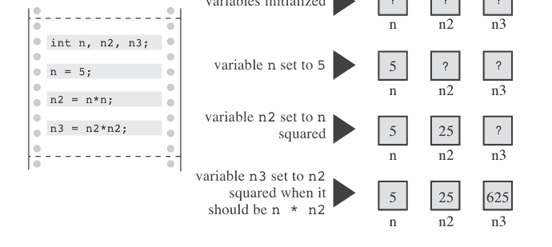

Figure 2.6 Tracing a program.

好吧，也许这个过程对于这个例子来说有点过头了，但以这种方式逐步执行程序通常是了解正在发生什么的最佳方法。

## ISO C Keywords

| do | long | union | _Noreturn |
| double | register | unsigned | _Static_assert |
| else | restrict | void | _Thread_local |
| enum | return | volatile | |

如果你尝试使用关键字，例如作为变量名，编译器会将其捕获为语法错误。还有其他标识符，称为*保留标识符*，你不应该使用。它们不会导致语法错误，因为它们是有效名称。然而，语言已经使用它们或保留使用它们的权利，因此如果你使用这些标识符来表示其他含义，可能会导致问题。保留标识符包括以下划线字符开头的那些以及标准库函数的名字，例如 `printf()`。

## Key Concepts

计算机编程是一项具有挑战性的活动。它要求抽象的概念性思维与对细节的仔细关注相结合。你会发现编译器强制执行对细节的关注。当你与朋友交谈时，你可能会错误地使用几个词，犯一两个语法错误，也许留下一些未完成的句子，但你的朋友仍然会理解你想表达的意思。但编译器不会做出这样的宽容；对它来说，几乎正确仍然是错误。

编译器不会帮助你解决概念性问题，例如这些问题，因此本书将尝试填补这一空白，通过概述每章中的关键概念。

对于本章，你的目标应该是理解什么是 C 程序。你可以把程序看作是你准备的描述，说明你希望计算机如何行为。编译器处理将你的描述转换为底层机器语言的真正详细工作。（作为编译器工作量的衡量标准，它可以从你的 1KB 源代码文件创建 60KB 的可执行文件；即使是简单的 C 程序也需要大量的机器语言来表示。）由于编译器没有真正的智能，你必须用编译器的术语来表达你的描述，而这些术语是由 C 语言标准设定的正式规则。（尽管有局限性，这仍然比直接用机器语言表达你的描述要好得多！）

编译器期望以特定的格式接收其指令，我们已在本章中详细描述了该格式。作为程序员，你的工作是在编译器——在 C 标准指导下——能够成功处理的框架内表达你对程序应如何行为的想法。

## Summary

C 程序由一个或多个 C 函数组成。每个 C 程序必须包含一个名为 main() 的函数，因为它是程序启动时调用的函数。一个简单的函数由函数头、后跟一个左大括号、后跟构成函数体的语句、后跟一个终止的或关闭的大括号组成。

每个 C 语句都是对计算机的指令，并以一个终止的分号标记。声明语句为变量创建名称并标识要存储在变量中的数据类型。变量的名称是标识符的示例。赋值语句将值赋给变量，或更一般地赋给存储区域。函数调用语句导致命名函数被执行。当被调用函数完成时，程序返回到函数调用之后的下一条语句。

`printf()` 函数可用于打印短语和变量的值。

语言的语法是管理该语言中有效语句如何组合在一起的规则集。语句的语义是其含义。编译器可以帮助你检测语法错误，但语义错误只有在程序编译后才会在其行为中显现。检测语义错误可能涉及跟踪程序状态——即每个程序步骤后所有变量的值。

最后，关键字是 C 语言的词汇。

## Review Questions

你可以在附录 A“复习题答案”中找到复习题的答案。

- 1. C 程序的基本模块叫什么名字？
- 2. 什么是语法错误？请用英语和 C 各举一个例子。
- 3. 什么是语义错误？请用英语和 C 各举一个例子。
- 4. Indiana Sloth 准备了以下程序并带来请你审批。请帮助他。

```
include studio.h
int main{void} /* this prints the number of weeks in a year /*
(
int s

s := 56;
print(There are s weeks in a year.);
return 0;
```


5. 假设以下每个示例都是完整程序的一部分，每个将打印什么？

```
a. printf("Baa Baa Black Sheep.");
printf("Have you any wool?\n");
```

```
b. printf("Begone!\nO creature of lard!\n");
```

```
c. printf("What?\nNo\nfish?\n");
```

```
d. int num;

num = 2;
printf("%d + %d = %d", num, num, num + num);
```

6. 以下哪些是 C 关键字？ main, int, function, char, =

7. 你将如何打印变量 words 和 lines 的值，使其以以下形式出现：

```
There were 3020 words and 350 lines.
```

这里，3020 和 350 代表两个变量的值。

8. 考虑以下程序：

```
#include <stdio.h>
int main(void)
{
    int a, b;

    a = 5;
    b = 2;      /* line 7 */
    b = a;      /* line 8 */
    a = b;      /* line 9 */
    printf("%d %d\n", b, a);
    return 0;
}
```

第 7 行后程序状态如何？第 8 行？第 9 行？

9. 考虑以下程序：

```
#include <stdio.h>
int main(void)
{
    int x, y;

    x = 10;
    y = 5;      /* line 7 */
y = x + y;    /* line 8 */
x = x*y;      /* line 9 */
printf("%d %d\n", x, y);
return 0;
}
```

第 7 行后程序状态如何？第 8 行？第 9 行？

## 编程练习

仅阅读 C 是不够的。你应该尝试编写一两个简单的程序，看看编写程序是否像本章中看起来那样顺利。以下是一些建议，但你也应该尝试自己想出一些问题。你可以在出版商网站上找到部分编程练习的答案。

- 1. 编写一个程序，使用一个 printf() 调用在一行上打印你的名字和姓氏，使用第二个 printf() 调用将你的名字和姓氏打印在两行上，并使用一对 printf() 调用将你的名字和姓氏打印在一行上。输出应如下所示（但使用你的名字）：
  
  Gustav Mahler ←第一个打印语句
  Gustav          ←第二个打印语句
  Mahler           ←仍是第二个打印语句
  Gustav Mahler ←第三个和第四个打印语句

- 2. 编写一个程序打印你的姓名和地址。

- 3. 编写一个程序，将你的年龄（以年为单位）转换为天数并显示两个值。此时，不必担心分数年和闰年。

- 4. 编写一个程序，产生以下输出：
  
  For he’s a jolly good fellow!
  For he’s a jolly good fellow!
  For he’s a jolly good fellow!
  Which nobody can deny!
  
  让程序使用 main() 之外的两个用户定义函数：一个名为 jolly() 的函数打印一次“jolly good”信息，一个名为 deny() 的函数打印最后一次行。

5. 编写一个程序，产生以下输出：
Brazil, Russia, India, China
India, China,
Brazil, Russia

让程序使用 main() 之外的两个用户定义函数：一个名为 br() 的函数打印一次“Brazil, Russia”，一个名为 ic() 的函数打印一次“India, China”。让 main() 处理任何额外的打印任务。

6. 编写一个程序，创建一个名为 toes 的整数变量。让程序将 toes 设置为 10。还让程序计算 toes 的两倍和 toes 的平方。程序应打印全部三个值，并加以标识。

7. 许多研究表明微笑有益。编写一个程序，产生以下输出：
Smile!Smile!Smile!
Smile!Smile!
Smile!

让程序定义一个函数显示一次字符串 Smile!，并让程序根据需要多次使用该函数。

8. 在 C 中，一个函数可以调用另一个函数。编写一个程序，调用一个名为 one_three() 的函数。该函数应在一行上显示单词 one，调用另一个名为 two() 的函数，然后在一行上显示单词 three。函数 two() 应在一行上显示单词 two。main() 函数应在调用 one_three() 之前显示短语 starting now:，并在调用后显示 done!。因此，输出应如下所示：
starting now:
one
two
three
done!

## 数据和 C

在本章中你将学习以下内容：

- 关键字：
  `int, short, long, unsigned, char, float, double, _Bool, _Complex, _Imaginary`
- 运算符：
  `sizeof`
- 函数：
  `scanf()`
- C 使用的基本数据类型
- 整数类型和浮点类型之间的区别
- 编写常量和声明这些类型的变量
- 如何使用 `printf()` 和 `scanf()` 函数读取和写入不同类型的值

程序处理数据。你将数字、字母和单词提供给计算机，并期望它对数据做些什么。例如，你可能希望计算机计算利息支付或显示酿酒商的排序列表。本章你不仅仅阅读关于数据的内容；你练习操作数据，这更有趣。

本章探讨两种伟大的数据类型家族：整数和浮点。C 提供了这些类型的几种变体。本章告诉你类型是什么，如何声明它们，以及如何何时使用它们。此外，你还会发现常量和变量之间的区别，作为奖励，你的第一个交互式程序即将到来。

### 一个示例程序

再次，我们从一个示例程序开始。如前所述，你会发现一些不熟悉的皱褶，我们很快会为你理顺。程序的总体意图应该很清楚，所以请尝试编译并运行第 3.1 节所示的源代码。为了节省时间，你可以省略输入注释。

### 列表 3.1 platinum.c 程序

```
/* platinum.c -- your weight in platinum */
#include <stdio.h>
int main(void)
{
    float weight;    /* user weight            */
    float value;     /* platinum equivalent    */

    printf("Are you worth your weight in platinum?\n");
    printf("Let's check it out.\n");
    printf("Please enter your weight in pounds: ");

    /* get input from the user                */
    scanf("%f", &weight);
    /* assume platinum is $1700 per ounce     */
    /* 14.5833 converts pounds avd. to ounces troy */
    value = 1700.0 * weight * 14.5833;
    printf("Your weight in platinum is worth $%.2f.\n", value);
    printf("You are easily worth that! If platinum prices drop,\n");
    printf("eat more to maintain your value.\n");

    return 0;
}
```

### 提示 错误和警告

如果你错误地输入此程序，例如省略分号，编译器会给出语法错误消息。即使你正确输入它，编译器也可能会给出类似“Warning—conversion from ‘double’ to ‘float,’ possible loss of data.”的警告。错误消息意味着你做错了什么并阻止程序编译。但是，警告意味着你做了有效代码但可能不是你想要做的。警告不会停止编译。此特定警告涉及 C 如何处理 1700.0 等值。这对本示例不是问题，本章后面会解释警告。

当你输入此程序时，你可能想将 1700.0 更改为贵金属铂的当前价格。但是，不要修改 14.5833，它代表一磅中的盎司数。（那是用于贵金属的盎司 troy，以及用于人——珍贵或非珍贵的——的磅 avoirdupois。）

注意，“输入”你的体重意味着输入你的体重然后按 Enter 或 Return 键。（不要只输入体重然后等待。）按 Enter 会通知计算机你已完成输入响应。程序期望你输入一个数字，例如 156，而不是单词，例如 too much。输入字母而不是数字会导致需要 if 语句（第 7 章“C 控制语句：分支和跳转”）来解决的问题，所以请礼貌地输入一个数字。以下是一些示例输出：

```
Are you worth your weight in platinum?
Let's check it out.
Please enter your weight in pounds: 156
Your weight in platinum is worth $3867491.25.
You are easily worth that! If platinum prices drop,
eat more to maintain your value.
```

### 程序调整

即使你在程序中添加了以下行，如第 2 章“介绍 C”所述，此程序的输出是否在屏幕上短暂闪现然后消失？

```
getchar();
```

对于本示例，你需要使用该函数调用两次：

```
getchar();
getchar();
```

getchar() 函数读取下一个输入字符，因此程序必须等待输入。在这种情况下，我们通过输入 156 然后按 Enter（或 Return）键提供输入，该键传输换行字符。因此 scanf() 读取数字，第一个 getchar() 读取换行字符，第二个 getchar() 导致程序暂停，等待进一步输入。

### 此程序中的新内容？

此程序中有几个 C 的新元素：

- 注意代码使用了新的变量声明种类。之前的示例只使用了整数变量类型（int），但这个添加了浮点变量类型（float），以便你处理更广泛的数据。float 类型可以保存带小数点的数字。
- 程序演示了一些编写常量的新方法。你现在有带小数点的数字。
- 要打印这种新类型的变量，请在 printf() 代码中使用 %f 规范符来处理浮点值。%f 规范符的 .2 修饰符微调输出的外观，使其显示小数点右边两位。
- scanf() 函数向程序提供键盘输入。%f 指示 scanf() 从键盘读取浮点数，而 &weight 告诉 scanf()


## 数据变量和常量

在程序的指导下，计算机可以做很多事情。它可以加数字、排序名称、指挥扬声器或视频屏幕的服从、计算彗星轨道、准备邮件列表、拨打电话号码、画简笔画、得出结论，或是你想象力能创造的任何其他事情。为了完成这些任务，程序需要使用数据，即承载你所使用信息的数字和字符。有些数据类型在程序使用前就已预设，并在程序生命周期内保持值不变。这些是常量。其他数据类型可能在程序运行过程中发生变化或被赋予值；这些是变量。在示例程序中，weight 是一个变量，而 14.5833 是一个常量。那 1700.0 呢？确实，在现实生活中铂金的价钱不是常量，但此程序将其视为常量。变量与常量的区别在于，变量可以在程序运行期间被赋值或更改，而常量则不能。

## 数据：数据类型关键字

除了变量与常量的区别之外，还有不同数据类型之间的区别。有些数据类型是数字。有些是字母，或更一般地说，是字符。计算机需要一种方法来识别和使用这些不同的种类。C 通过识别几种基本数据类型来实现这一点。如果一个数据项是常量，编译器通常仅凭其外观就能判断其类型：42 是整数，而 42.100 是浮点数。变量则需要在声明语句中宣布其类型。你将在继续学习的过程中了解声明变量的细节。首先，让我们先看看 C 识别的基本类型关键字。K&R C 识别了七个与类型相关的关键字。C90 标准在列表中又增加了两个。C99 标准又增加了另外三个（参见表 3.1）。

## 表 3.1 C 数据关键字

| 原始 K&R 关键字 | C90 K&R 关键字 | C99 关键字 |
|---|---|---|
| int | signed | _Bool |
| long | void | _Complex |
| short |  | _Imaginary |
| unsigned |  |  |
| char |  |  |
| float |  |  |
| double |  |  |

int 关键字提供了 C 中使用的基本整数类。接下来的三个关键字（long、short 和 unsigned）以及 C90 新增的 signed 用于提供基本类型的变体，例如 unsigned short int 和 long long int。接下来，char 关键字指定用于字母表字母以及其他字符（如 #、$、% 和 *）的类型。char 类型也可以用来表示小整数。接下来，float、double 以及组合 long double 用于表示带小数点的数字。_Bool 类型用于布尔值（true 和 false），而 _Complex 和 _Imaginary 分别表示复数和虚数。

这些关键字创建的类型可以根据它们在计算机中的存储方式分为两个家族：整数类型和浮点类型。

## 位、字节和字

术语位、字节和字可以用来描述计算机数据的单位，也可以用来描述计算机内存的单位。我们这里主要集中于第二种用法。

内存的最小单位称为位。它可以保存两种值之一：0 或 1。（或者你可以说位被设置为“关”或“开”。）一个位无法存储太多信息，但计算机拥有大量的位。位是计算机内存的基本构建块。

字节是计算机内存的常用单位。对于几乎所有机器来说，一个字节是 8 位，这就是标准定义，至少在用于衡量存储时是如此。（C 语言的定义却不同，如本章后面“使用字符：类型 char”一节所述。）由于每个位可以是 0 或 1，因此 8 位字节中可以容纳 256 个（即 2 自乘 8 次）0 和 1 的位模式。这些模式可用于例如表示 0 到 255 的整数或表示一组字符。表示可以通过二进制代码实现，二进制代码（方便的是）仅使用 0 和 1 来表示数字。（第 15 章“位操作”讨论了二进制代码，但如果你愿意，现在就可以阅读该章的介绍性材料。）

字是给定计算机设计中内存的自然单位。对于 8 位微型计算机，如最初的 Apple 电脑，一个字就是 8 位。此后，个人电脑发展到 16 位字、32 位字，到了现在是 64 位字。更大的字长可以实现更快的数据传输并允许访问更多的内存。

## 整数与浮点类型

整数类型？浮点类型？如果你觉得这些术语陌生而令人不安，放松一下。我们即将为你简要介绍它们的含义。如果你对位、字节和字不熟悉，你可能想先阅读附近关于它们的侧边栏。是否必须学习所有细节？不一定，不比你必须学习内燃机原理才能开车多多少，但了解计算机或发动机内部的一些运作原理偶尔会有所帮助。

对人类来说，整数和浮点数的区别体现在它们可以被写出的方式上。对计算机来说，区别体现在它们被存储的方式上。让我们依次看一下这两个类别。

- 由于在任何范围内都有无限多个实数——例如在 1.0 到 2.0 之间——计算机浮点数无法表示该范围内的所有值。相反，浮点值通常是真实值的近似值。例如，7.0 可能会被存储为 6.99999 的浮点值——稍后会详细介绍精度。
- 过去，浮点运算比整数运算慢得多。然而，今天许多 CPU 都集成了浮点处理器，缩小了差距。

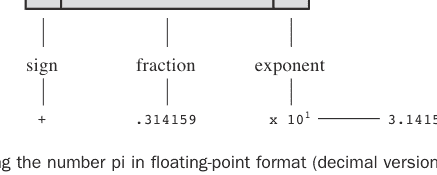

图 3.3 以浮点格式（十进制版本）存储数字 pi。

## 基本 C 数据类型

现在让我们看看 C 使用的基本数据类型的具体情况。对于每种类型，我们描述如何声明变量，如何用字面值（如 5 或 2.78）表示常量，以及典型的用途是什么。一些较旧的 C 编译器不支持所有这些类型，因此请查阅你的文档以查看你有哪些可用类型。

## int 类型

C 提供了许多整数类型，你可能会想知道为什么一种类型不够用。答案是 C 给予程序员将类型与特定用途匹配的选项。特别是，C 整数类型在所提供的值范围以及是否可以使用负数方面有所不同。int 类型是基本选择，但如果你需要其他选择来满足特定任务或机器的要求，它们也是可用的。

int 类型是有符号整数。这意味着它必须是整数，并且可以为正、负或零。可能的值范围取决于计算机系统。通常，int 使用一个机器字进行存储。因此，旧的 IBM PC 兼容机，其字长为 16 位，使用 16 位来存储 int。这允许的值范围为 −32768 到 32767。当前个人电脑通常具有 32 位整数，并将 int 适配到该大小。现在个人电脑行业正转向 64 位处理器，自然会使用更大的整数。ISO C 规定类型 int 的最小范围应为 −32767 到 32767。通常，系统通过使用特定位的值来表示符号来表示有符号整数。第 15 章讨论了常见方法。

```
int sows;
```

创建存储

```
int boars=2;
```

Boars

创建存储并赋予其值

图 3.4 定义和初始化变量。

## 类型 int 常量

上一个示例中的各种整数（21、32、14 和 94）是整数常量，也称为整数字面量。当你写一个没有小数点和没有指数的数字时，C 会将其识别为整数。因此，22 和 −44 是整数常量，但 22.0 和 2.2E1 不是。C 将大多数整数常量视为类型 int。非常大的整数可能会被不同对待；请参阅“long 常量和 long long 常量”一节中关于 long int 类型的后续讨论。

## 打印 int 值

你可以使用 printf() 函数打印 int 类型。如你在第 2 章中看到的，%d 记号用于指示整数应在行中打印的位置。%d 被称为格式说明符，因为它指示 printf() 用于显示值的形式。格式字符串中的每个 %d 必须与要打印的项目列表中对应的 int 值相匹配。该值可以是 int 变量、int 常量，或任何具有 int 值的其他表达式。确保格式说明符的数量与值的数量相匹配是你的责任；编译器不会捕获此类错误。清单 3.2 展示了一个简单的程序，它初始化一个变量并打印变量的值、常量的值以及简单表达式的值。它还展示了如果你不小心会发生什么。

## 清单 3.2 printf1.c 程序

```
/* printf1.c-displays some properties of printf() */
#include <stdio.h>
int main(void)
{
    int ten = 10;
    int two = 2;

    printf("Doing it right: ");
    printf("%d minus %d is %d\n", ten, 2, ten - two );
```


- 类型 `short int` 或更简写为 `short` 可能比 `int` 使用更少的存储空间，因此在只需要较小的数字时可以节省空间。与 `int` 一样，`short` 是一种有符号类型。
- 类型 `long int`，或 `long`，可能比 `int` 使用更多的存储空间，从而使你能够表示更大的整数值。与 `int` 一样，`long` 是一种有符号类型。
- 类型 `long long int`，或 `long long`（在 C99 标准中引入），可能比 `long` 使用更多的存储空间。最低限度，它必须至少使用 64 位。与 `int` 一样，`long long` 是一种有符号类型。
- 类型 `unsigned int`，或 `unsigned`，用于仅具有非负值的变量。这种类型会改变可以存储的数字范围。例如，16 位的 `unsigned int` 允许的值范围从 0 到 65535，而不是从 −32768 到 32767。用于指示有符号数字符号的位现在变成了另一个二进制数字，从而允许更大的数字。
- 类型 `unsigned long int`，或 `unsigned long`，以及 `unsigned short int`，或 `unsigned short`，被 C90 标准认可为有效。C99 对此列表添加了 `unsigned long long int`，或 `unsigned long long`。
- 关键字 `signed` 可以与任何有符号类型一起使用以使你的意图明确。例如，`short`、`short int`、`signed short` 和 `signed short int` 都是同一类型的名称。

## 声明其他整数类型

其他整数类型以与 `int` 类型相同的方式声明。下面的列表显示了几个示例。并非所有旧的 C 编译器都识别最后三个，而最后一个示例是 C99 标准的新内容。

```
long int estine;
long johns;
short int erns;
short ribs;
unsigned int s_count;
unsigned players;
unsigned long headcount;
unsigned short yesvotes;
long long ago;
```

## 为什么有多种整数类型？

我们为什么说 `long` 和 `short` 类型“可能”比 `int` 使用更多或更少的存储空间？因为 C 只保证 `short` 不长于 `int`，并且 `long` 不短于 `int`。想法是使类型适应机器。例如，在 Windows 3 的时代，`int` 和 `short` 都是 16 位，而 `long` 是 32 位。后来，Windows 和 Apple 系统改为使用 16 位用于 `short`，32 位用于 `int` 和 `long`。使用 32 位允许超过 20 亿的整数。现在 64 位处理器很常见，需要 64 位整数，这就是 `long long` 类型的动机。

今天个人计算机上最常见的做法是将 long long 设置为 64 位，long 设置为 32 位，short 设置为 16 位，int 设置为 16 位或 32 位，具体取决于机器的自然字长。原则上，这四种类型可以表示四种不同的大小，但在实践中至少某些类型通常会重叠。

C 标准提供了指定每个基本数据类型允许的最小大小的指南。short 和 int 的最小范围均为 −32,767 到 32,767，对应于 16 位单元，long 的最小范围为 −2,147,483,647 到 2,147,483,647，对应于 32 位单元。 （注：为便于阅读，我们使用了逗号，但 C 代码不允许这样做。）对于 unsigned short 和 unsigned int，最小范围为 0 到 65,535，对于 unsigned long，最小范围为 0 到 4,294,967,295。long long 类型旨在支持 64 位需求。它的最小范围为相当大的 −9,223,372,036,854,775,807 到 9,223,372,036,854,775,807，而 unsigned long long 的最小范围为 0 到 18,446,744,073,709,551,615。对于你们这些写支票的人来说，那就是十八 quintillion，四百四十六 quadrillion，七百四十四 trillion，七十三 billion，七百九 million，五百五十一 thousand，六百十五，使用美国命名法（短尺度或 échelle courte 系统），但谁在计数呢？

何时使用各种 int 类型？首先，考虑无符号类型。使用它们进行计数很自然，因为你不需要负数，而且无符号类型使你能够达到比有符号类型更高的正数。

如果需要使用 long 可以处理而 int 不能处理的数字，请使用 long 类型。但是，在 long 比 int 更大的系统上，使用 long 会减慢计算速度，因此如果不是必需的，不要使用 long。还有一点：如果你在 int 和 long 尺寸相同的机器上编写代码，并且确实需要 32 位整数，你应该使用 long 而不是 int，这样程序在转移到 16 位机器时仍能正常运行。同样，如果需要 64 位整数值，请使用 long long。

使用 short 来节省存储空间，如果例如你在 int 为 32 位的系统上需要 16 位值。通常，只有当你的程序使用相对于系统可用内存而言很大的整数数组时，节省存储空间才重要。另一个使用 short 的原因是它可能与计算机中特定组件使用的硬件寄存器大小相对应。

## 整数溢出

如果整数变得太大而无法容纳其类型会怎样？让我们将一个整数设置为其可能的最大值，然后加到它上面，看看会发生什么。尝试有符号和无符号类型。 （printf() 函数使用 %u 限定符来显示 unsigned int 值。）

```
/* toobig.c—exceeds maximum int size on our system */
#include <stdio.h>
int main(void)
{
    int i = 2147483647;
    unsigned int j = 4294967295;

    printf("%d %d %d\n", i, i+1, i+2);
```

```
printf("%u %u %u\n", j, j+1, j+2);

    return 0;
}
```

这是我们系统的结果：

```
2147483647 -2147483648 -2147483647
4294967295 0 1
```

无符号整数 j 像汽车里程表一样工作。当它达到最大值时，它从头开始。整数 i 也类似。主要区别在于无符号 int 变量 j，像里程表一样，从 0 开始，但 int 变量 i 从 −2147483648 开始。请注意，你不会被告知 i 已超出（溢出）其最大值。你必须包含自己的编程来跟踪这一点。

这里描述的行为由 C 对无符号类型的规则强制执行。标准并未定义有符号类型应如何表现。这里显示的行为是典型的，但你可能会遇到不同的情况

## long 常量和 long long 常量

通常，当你在程序代码中使用 2345 这样的数字时，它被存储为 int 类型。如果你在 int 无法容纳如此大数字的系统上使用 1000000 这样的数字怎么办？那么编译器将其视为 long int，前提是该类型足够大。如果数字大于 long 最大值，C 将其视为 unsigned long。如果仍然不足，C 将值视为 long long 或 unsigned long long，如果这些类型可用。

八进制和十六进制常量被视为 int 类型，除非值太大。然后编译器尝试 unsigned int。如果不行，它按顺序尝试 long、unsigned long、long long 和 unsigned long long。

有时你可能希望编译器将一个小数字存储为 long 整数。例如，涉及在 IBM PC 上显式使用内存地址的编程可能会产生这种需求。此外，一些标准 C 函数需要类型为 long 的值。为了使一个小常量被视为 long 类型，你可以附加 l（小写 L）或 L 作为后缀。第二种形式更好，因为它看起来不像数字 1。因此，在 int 为 16 位且 long 为 32 位的系统上，整数 7 被视为 16 位，而整数 7L 被视为 32 位。l 和 L 后缀也可以与八进制和十六进制整数一起使用，如 020L 和 0x10L。

同样，在支持 long long 类型的系统上，你可以使用 ll 或 LL 后缀来指示 long long 值，如 3LL。为无符号 long long 添加 u 或 U 到后缀，如 5ull 或 10LLU 或 6LLU 或 9ULL。

## 打印 short、long、long long 和 unsigned 类型

要打印 unsigned int 数字，请使用 %u 记法。要打印 long 值，请使用 %ld 格式说明符。如果你的系统上 int 和 long 尺寸相同，只需 %d 就足够了，但你的程序在转移到两种类型不同的系统上时将无法正常工作，因此请为 long 使用 %ld 说明符。你也可以对 x 和 o 使用 l 前缀。所以你会使用 %lx 以十六进制格式打印 long 整数，使用 %lo 以八进制格式打印。注意，虽然 C 允许常量后缀使用大写和小写字母，但这些格式说明符仅使用小写。

C 有几个额外的 printf() 格式。首先，你可以对 short 类型使用 h 前缀。因此，%hd 以十进制形式显示 short 整数，%ho 以八进制形式显示 short 整数。h 和 l 前缀都可与 u 一起用于无符号类型。例如，你会使用 %lu 记法来打印 unsigned long 类型。列表 3.4 提供了示例。支持 long long 类型的系统使用 %lld 和 %llu 用于有符号和无符号版本。第 4 章提供了格式说明符的更完整讨论。

## 列表 3.4 print2.c 程序

```
/* print2.c-more printf() properties */
#include <stdio.h>
int main(void)
{
    unsigned int un = 3000000000; /* system with 32-bit int */
    short end = 200;              /* and 16-bit short     */
    long big = 65537;
    long long verybig = 12345678908642;

    printf("un = %u and not %d\n", un, un);
    printf("end = %hd and %d\n", end, end);
    printf("big = %ld and not %hd\n", big, big);
    printf("verybig= %lld and not %ld\n", verybig, verybig);

    return 0;
}
```

这是一个系统的输出（结果可能有所不同）：

```
un = 3000000000 and not -1294967296
end = 200 and 200
big = 65537 and not 1
verybig= 12345678908642 and not 1942899938
```

此示例指出使用错误的规范可能会产生意外结果。首先，注意对无符号变量 un 使用 %d 说明符会产生负数！原因在于无符号值 3000000000 和有符号值 -1294967296 在我们系统上的内存内部表示完全相同。 （第 15 章解释


this property in more detail.) So if you tell printf() that the number is unsigned, it prints one value, and if you tell it that the same number is signed, it prints the other value. This behavior shows up with values larger than the maximum signed value. Smaller positive values, such as 96, are stored and displayed the same for both signed and unsigned types.

Next, note that the short variable end is displayed the same whether you tell printf() that end is a short (the %hd specifier) or an int (the %d specifier). That’s because C automatically expands a type short value to a type int value when it’s passed as an argument to a function. This may raise two questions in your mind: Why does this conversion take place, and what’s the use of the h modifier? The answer to the first question is that the int type is intended to be the integer size that the computer handles most efficiently. So, on a computer for which short and int are different sizes, it may be faster to pass the value as an int. The answer to the second question is that you can use the h modifier to show how a longer integer would look if truncated to the size of short. The third line of output illustrates this point. The value 65537 expressed in binary format as a 32-bit number is 00000000000000001000000000000001. Using the %hd specifier persuaded printf() to look at just the last 16 bits; therefore, it displayed the value as 1. Similarly, the final output line shows the full value of verybig and then the value stored in the last 32 bits, as viewed through the %ld specifier.

Earlier you saw that it is your responsibility to make sure the number of specifiers matches the number of values to be displayed. Here you see that it is also your responsibility to use the correct specifier for the type of value to be displayed.

## Tip Match the Type printf() Specifiers

Remember to check to see that you have one format specifier for each value being displayed in a printf() statement. And also check that the type of each format specifier matches the type of the corresponding display value.

## Using Characters: Type char

The char type is used for storing characters such as letters and punctuation marks, but technically it is an integer type. Why? Because the char type actually stores integers, not characters. To handle characters, the computer uses a numerical code in which certain integers represent certain characters. The most commonly used code in the U.S. is the ASCII code given in the table on the inside front cover. It is the code this book assumes. In it, for example, the integer value 65 represents an uppercase A. So to store the letter A, you actually need to store the integer 65. (Many IBM mainframes use a different code, called EBCDIC, but the principle is the same. Computer systems outside the U.S. may use entirely different codes.)

The standard ASCII code runs numerically from 0 to 127. This range is small enough that 7 bits can hold it. The char type is typically defined as an 8-bit unit of memory, so it is more than large enough to encompass the standard ASCII code. Many systems, such as the IBM PC and the Apple Macs, offer extended ASCII codes (different for the two systems) that still stay within an 8-bit limit. More generally, C guarantees that the char type is large enough to store the basic character set for the system on which C is implemented.

Many character sets have many more than 127 or even 255 values. For example, there is the Japanese kanji character set. The commercial Unicode initiative has created a system to represent a variety of characters sets worldwide and currently has over 110,000 characters. The International Organization for Standardization (ISO) and the International Electrotechnical Commission (IEC) have developed a standard called ISO/IEC 10646 for character sets. Fortunately, the Unicode standard has been kept compatible with the more extensive ISO/IEC 10646 standard.

The C language defines a byte to be the number of bits used by type char, so one can have a system with a 16-bit or 32-bit byte and char type.

## Declaring Type char Variables

As you might expect, char variables are declared in the same manner as other variables. Here are some examples:

```
char response;
char itable, latan;
```

This code would create three char variables: response, itable, and latan.

## Character Constants and Initialization

Suppose you want to initialize a character constant to the letter A. Computer languages are supposed to make things easy, so you shouldn’t have to memorize the ASCII code, and you don’t. You can assign the character A to grade with the following initialization:

```
char grade = 'A';
```

A single character contained between single quotes is a C character constant. When the compiler sees 'A', it converts the 'A' to the proper code value. The single quotes are essential. Here’s another example:

```
char broiled;        /* declare a char variable        */
broiled = 'T';      /* OK                             */
broiled = T;        /* NO! Thinks T is a variable     */
broiled = "T";    /* NO! Thinks "T" is a string    */
```

If you omit the quotes, the compiler thinks that T is the name of a variable. If you use double quotes, it thinks you are using a string. We’ll discuss strings in Chapter 4.

Because characters are really stored as numeric values, you can also use the numerical code to assign values:

```
char grade = 65;  /* ok for ASCII, but poor style */
```

In this example, 65 is type int, but, because the value is smaller than the maximum char size, it can be assigned to grade without any problems. Because 65 is the ASCII code for the letter A, this example assigns the value A to grade. Note, however, that this example assumes that the

| Sequence | Meaning |
|---|---|
| \" | Double quote ("). |
| \? | Question mark (?). |
| \ooo | Octal value. (o represents an octal digit.) |
| \xhh | Hexadecimal value. (h represents a hexadecimal digit.) |

Escape sequences must be enclosed in single quotes when assigned to a character variable. For example, you could make the statement

```
char nerf = '\n';
```

and then print the variable nerf to advance the printer or screen one line.

Now take a closer look at what each escape sequence does. The alert character (\a), added by C90, produces an audible or visible alert. The nature of the alert depends on the hardware, with the beep being the most common. (With some systems, the alert character has no effect.) The C standard states that the alert character shall not change the active position. By active position, the standard means the location on the display device (screen, teletype, printer, and so on) at which the next character would otherwise appear. In short, the active position is a generalization of the screen cursor with which you are probably accustomed. Using the alert character in a program displayed on a screen should produce a beep without moving the screen cursor.

Next, the \b, \f, \n, \r, \t, and \v escape sequences are common output device control characters. They are best described in terms of how they affect the active position. A backspace (\b) moves the active position back one space on the current line. A form feed character (\f) advances the active position to the start of the next page. A newline character (\n) sets the active position to the beginning of the next line. A carriage return (\r) moves the active position to the beginning of the current line. A horizontal tab character (\t) moves the active position to the next horizontal tab stop (typically, these are found at character positions 1, 9, 17, 25, and so on). A vertical tab (\v) moves the active position to the next vertical tab position.

These escape sequence characters do not necessarily work with all display devices. For example, the form feed and vertical tab characters produce odd symbols on a PC screen instead of any cursor movement, but they work as described if sent to a printer instead of to the screen.

The next three escape sequences (\\, \', and \") enable you to use \, ', and " as character constants. (Because these symbols are used to define character constants as part of a printf() command, the situation could get confusing if you use them literally.) Suppose you want to print the following line:

```
Gramps sez, "a \ is a backslash."
```

Then use this code:

```
printf("Gramps sez, \"a \\ is a backslash.\"\n");
```


最后两种形式（\ooo 和 \xhh）是 ASCII 码的特殊表示。要用其八进制 ASCII 码表示一个字符，需在其前加上反斜杠（\ ）并将整个内容用单引号括起来。例如，如果你的编译器不识别警报字符（\a），你可以用 ASCII 码代替：

```
beep = '\007';
```

可以省略前导零，因此 '\07' 甚至 '\7' 也可使用。这种记法会使数字被解释为八进制，即使没有初始的 0。

从 C90 开始，C 提供了第三种选择——使用十六进制形式表示字符常量。在这种情况下，反斜杠后跟 x 或 X 以及一到三个十六进制数字。例如，Ctrl+P 字符的 ASCII 十六进制码为 10（十进制为 16），因此可以表示为 '\x10' 或 '\X010'。图 3.5 显示了一些代表性的整数类型。

| Examples of Integer Constants |
|---|---|---|---|
| type | hexadecimal | octal | decimal |
| char | \0x41 | \0101 | N.A. |
| int | 0x41 | 0101 | 65 |
| unsigned int | 0x41u | 0101u | 65u |
| long | 0x41L | 0101L | 65L |
| unsigned long | 0x41UL | 0101UL | 65UL |
| long long | 0x41LL | 0101LL | 65LL |
| unsigned long long | 0x41ULL | 0101ULL | 65ULL |

Figure 3.5 Writing constants with the int family.

使用 ASCII 码时，注意数字与数字字符之间的区别。例如，字符 4 由 ASCII 码值 52 表示。记法 '4' 表示符号 4，而不是数值 4。

到目前为止，你可能有三个问题：

- 为什么在最后一个例子中转义序列没有用单引号括起来（printf("Gramps sez, \"a \\ is a backslash\"\n");)？当一个字符，无论是否转义序列，是双引号括起来的字符串的一部分时，不要用单引号括起来。注意本例中其他字符（G、r、a、m、p、s 等）都没有用单引号标出。用双引号括起来的字符串称为字符字符串。 （第 4 章探讨字符串。）同样，printf("Hello!\007\n"); 会打印 Hello! 并发出蜂鸣声，但 printf("Hello!7\n"); 会打印 Hello!7。不是转义序列一部分的数字被视为要打印的普通字符。

```
{
    int32_t me32;    // me32 a 32-bit signed variable

    me32 = 45933945;
    printf("First, assume int32_t is int: ");
    printf("me32 = %d\n", me32);
    printf("Next, let's not make any assumptions.\n");
    printf("Instead, use a \"macro\" from inttypes.h: ");
    printf("me32 = %" PRId32 "\n", me32);

    return 0;
}
```

在最终的 printf() 参数中，PRId32 被其 inttypes.h 定义的 "d" 替换，使该行变为：

```
printf("me16 = %" "d" "\n", me16);
```

但 C 会将连续的带引号字符串合并为一个带引号字符串，使该行变为：

```
printf("me16 = %d\n", me16);
```

以下是输出；注意示例还使用了 \" 转义序列来显示双引号：

```
First, assume int32_t is int: me32 = 45933945
Next, let's not make any assumptions.
Instead, use a "macro" from inttypes.h: me32 = 45933945
```

本节的目的不是教你所有关于扩展整数类型的内容。其主要意图是向你保证，如果需要的话，你可以获得这种对类型的控制。参考附录 B 中的第 VI 节“Extended Integer Types”提供了 inttypes.h 和 stdint.h 头文件的完整说明。

## Note C99/C11 Support

即使 C 已发展到 C11 标准，编译器编写者也以不同的速度和不同的优先级实现了 C99 功能。在本书准备时，一些编译器尚未实现 inttypes.h 头文件和功能。

## Types float, double, and long double

各种整数类型对于大多数软件开发项目来说已经足够好。然而，金融和数学导向的程序通常使用浮点数。在 C 中，这类数字称为 type float、double 或 long double。它们对应于 FORTRAN 和 Pascal 的实数类型。浮点方法，如前所述，使你能够表示更大范围的数字，包括小数。浮点数

C 还有一个 double（双精度）浮点类型。double 类型的最小范围要求与 float 相同，但它将可表示的最小有效位数扩展到 10。典型的 double 表示使用 64 位而不是 32 位。一些系统使用全部 32 个额外位用于非指数部分。这增加了有效位数并减少了舍入误差。其他系统使用部分位来容纳更大的指数；这增加了可容纳的数字范围。任一方法都至少能达到 13 位有效数字，超过了最低标准。

C 允许第三种浮点类型：long double。其目的是提供比 double 更高的精度。然而，C 仅保证 long double 的精度至少与 double 相同。

## Declaring Floating-Point Variables

浮点变量的声明和初始化方式与它们的整数对应物相同。以下是一些示例：

```
float noah, jonah;
double trouble;
float planck = 6.63e-34;
long double gnp;
```

## Floating-Point Constants (Literals)

当你编写字面浮点常量时，有很多选择。浮点字面量的基本形式是带符号的数字序列，包括小数点，后跟 e 或 E，后跟带符号的指数表示使用的 10 的幂。以下是两个有效的浮点常量：

```
-1.56E+12
2.87e-3
```

可以省略正号。可以没有小数点（2E5）或指数部分（19.28），但不能同时都没有。可以省略小数部分（3.E16）或整数部分（.45E-6），但不能两者都省略（那样就没什么了！）。以下是一些更多有效的浮点常量：

```
3.14159
.2
4e16
.8E-5
100.
```

不要在浮点常量中使用空格。

```
Wrong: 1.56 E+12
```

默认情况下，编译器假定浮点常量为双精度。假设，例如，some 是一个 float 变量，并且你有以下语句：
some = 4.0 * 2.0;

那么 4.0 和 2.0 被存储为 double，通常每个使用 64 位。乘积使用双精度算术计算，然后才将答案修剪为常规 float 大小。这确保了计算的更高精度，但可能会减慢程序。

C 允许你通过使用 f 或 F 后缀使编译器将浮点常量视为 type float 来覆盖此默认值；示例为 2.3f 和 9.11E9F。l 或 L 后缀使数字为 type long double；示例为 54.31 和 4.32e4L。请注意，L 不太可能被误认为 1（一）而不是 l。如果浮点数没有后缀，则为 type double。

自 C99 以来，C 有一种新的表达浮点常量的格式。它使用十六进制前缀（0x 或 0X）与十六进制数字，使用 p 或 P 代替 e 或 E，以及指数为 2 的幂而不是 10 的幂。这样的数字可能看起来像这样：
0xa.1fp10

a 为十六进制的 10，.1f 为 1/16 加 15/256（f 为十六进制的 15），p10 为 2^10，或 1024，使完整值为（10 + 1/16 + 15/256）x 1024，或基数 10 表示法中的 10364.0。

并非所有 C 编译器都已添加对该功能的支持。

## Printing Floating-Point Values

printf() 函数使用 %f 格式说明符以十进制表示法打印 type float 和 double 数字，并使用 %e 以指数表示法打印它们。如果你的系统支持浮点数的十六进制格式，你可以使用 a 或 A 代替 e 或 E。long double 类型需要 %Lf、%Le 和 %La 说明符来打印该类型。请注意，float 和 double 都使用 %f、%e 或 %a 说明符进行输出。这是因为 C 会自动将 type float 值扩展为 type double，当它们作为参数传递给任何函数（如 printf()）时，该函数不显式声明参数类型。列表 3.7 说明了这些行为。

## Listing 3.7 The showf_pt.c Program

```
/* showf_pt.c -- displays float value in two ways */
#include <stdio.h>
int main(void)
{
    float aboat = 32000.0;
    double abet = 2.14e9;
    long double dip = 5.32e-5;

    printf("%f can be written %e\n", aboat, aboat);
    // next line requires C99 or later compliance
    printf("And it's %a in hexadecimal, powers of 2 notation\n", aboat);
```


超过 1。在这种情况下，函数返回 NaN 值，printf() 将其显示为 nan、NaN 或类似内容。

## 浮点舍入误差

取一个数，给它加上 1，再减去原来的数。你得到什么？你得到 1。以下这样的浮点计算可能会给出另一个答案：

/* floater.c--demonstrates round-off error */
#include <stdio.h>
int main(void)
{
    float a,b;

    b = 2.0e20 + 1.0;
    a = b - 2.0e20;
    printf("%f \n", a);

    return 0;
}
```

输出如下：

```
0.000000 ←older gcc on Linux
-13584010575872.000000 ←Turbo C 1.5
4008175468544.000000 ←Xcode 4.5, Visual Studio 2012, current gcc
```

这些奇怪结果的原因是计算机没有保留足够的十进制位来正确执行该操作。数字 2.0e20 是 2 后面跟着 20 个零，而加上 1 意味着你试图改变第 21 位数字。要正确完成此操作，程序需要能够存储 21 位数字。float 数字通常只有六或七位有效数字，并通过指数缩放为更大或更小的数字。尝试注定失败。另一方面，如果你使用 2.0e4 而不是 2.0e20，你会得到正确答案，因为你试图改变第五位数字，而 float 数字对此足够精确。

### 浮点表示

前面的侧边栏列出了同一程序在不同计算机系统上可能的不同输出。原因是在前面讨论的总体框架内，浮点表示的实现方式有很多种。为了提供更大的统一性，电气和电子工程师学会 Institute of Electrical and Electronics Engineers (IEEE) 制定了浮点表示和计算的标准，该标准现已被许多硬件浮点单元采用。2011 年，该标准被采纳为国际 ISO/IEC/IEEE 60559:2011 标准。该标准作为选项被纳入 C99 和 C11 标准，目的是在符合硬件的平台上得到支持。floater.c 程序的最后一个输出示例来自支持该浮点标准的系统。C 支持包括捕获该问题的工具。有关更多详细信息，请参阅附录 B，第 V 节。

## 复杂和虚数类型

科学和工程中的许多计算使用复数和虚数。C99 支持这些数字，但有一些保留。自由站立的实现，例如用于嵌入式处理器的实现，不需要这些类型。 （VCR 芯片在执行其工作时可能不需要复数。）此外，更一般地说，虚数类型是可选的。在 C11 中，整个复数包是可选的。

简而言之，有三种复数类型，称为 float _Complex、double _Complex 和 long double _Complex。例如，float _Complex 变量将包含两个 float 值，一个表示复数的实部，一个表示虚部。类似地，有三种虚数类型，称为 float _Imaginary、double _Imaginary 和 long double _Imaginary。

包含 complex.h 头文件允许你用 complex 替代 _Complex，用 imaginary 替代 _Imaginary，并允许你使用符号 I 表示 −1 的平方根。

你可能会想知道为什么 C 标准不直接使用 complex 作为关键字，而使用 _Complex，然后添加一个头文件将 complex 定义为 _Complex。标准委员会不愿引入新关键字，因为这可能会使使用相同词作为标识符的现有代码失效。例如，在 C99 之前，许多程序员已经使用过，例如 struct complex 来定义表示复数的结构，或，也许，心理状况。 （关键字 struct，如第 14 章“结构和其他数据形式”中所述，用于定义能够容纳多个值的数据结构。）使 complex 成为关键字将使这些先前的用法成为语法错误。但有人使用 struct _Complex 的可能性要小得多，尤其是因为使用以初始下划线开头的标识符本应被保留。因此委员会选择了 _Complex 作为关键字，并将 complex 作为那些不必担心与过去用法冲突的人的选项提供。

## 超越基本类型

这完成了基本数据类型列表。对于你们中的一些人来说，这个列表必须显得很长。你们中的其他人可能认为需要更多类型。字符字符串类型呢？C 没有，但它仍然可以很好地处理字符串。你将在第 4 章中首次了解字符串。

C 确实有其他从基本类型派生的类型。这些类型包括数组、指针、结构和联合。虽然它们是后面章节的主题，但我们已经在这一章的示例中偷偷使用了一些指针。例如，指针指向变量或其他数据对象的存储位置。scanf() 函数中使用的 & 前缀创建了一个指针，告诉 scanf() 将信息放在哪里。

- **long double**—用于保存浮点数的（可能）更大的单元。它可能允许比 double 更多有效数字和更大的指数。

## 复数和虚数浮点：

虚数类型是可选的。实部和虚部基于相应的实类型：

- float _Complex
- double _Complex
- long double _Complex
- float _Imaginary
- double _Imaginary
- long double _Imaginary

## 摘要：如何声明简单变量

- 1. 选择你需要的类型。
- 2. 使用允许的字符为变量选择一个名称。
- 3. 使用以下格式进行声明语句：
  `type-specifier variable-name;`
  *type-specifier* 由一个或多个类型关键字组成；以下是声明示例：
  `int erest;`
  `unsigned short cash;`.
- 4. 你可以通过用逗号分隔变量名来声明多个相同类型的变量。以下是示例：
  `char ch, init, ans;`.
- 5. 你可以在声明语句中初始化变量：
  `float mass = 6.0E24;`

## 类型大小

你的系统使用什么类型大小？尝试运行第 3.8 节中的程序来了解。

## 第 3.8 节 typesize.c 程序

```
//* typesize.c -- prints out type sizes */
#include <stdio.h>
int main(void)
{
    /* c99 provides a %zd specifier for sizes */
printf("Type int has a size of %zd bytes.\n", sizeof(int));
printf("Type char has a size of %zd bytes.\n", sizeof(char));
printf("Type long has a size of %zd bytes.\n", sizeof(long));
printf("Type long long has a size of %zd bytes.\n", sizeof(long long));
printf("Type double has a size of %zd bytes.\n", sizeof(double));
printf("Type long double has a size of %zd bytes.\n", sizeof(long double));
return 0;
}
```

C 有一个内置运算符称为 sizeof，可给出以字节为单位的大小。C99 和 C11 为 sizeof 使用的类型提供 %zd 指定符。不合规的编译器可能需要 %u 或 %lu 代替。以下是示例输出：

```
Type int has a size of 4 bytes.
Type char has a size of 1 bytes.
Type long has a size of 8 bytes.
Type long long has a size of 8 bytes.
Type double has a size of 8 bytes.
Type long double has a size of 16 bytes.
```

该程序只找到了六种类型大小，但你可以轻松修改它以查找任何其他感兴趣的类型大小。请注意，char 的大小必然为 1 字节，因为 C 用 char 来定义 1 字节的大小。因此，在 char 为 16 位而 double 为 64 位的系统上，sizeof 将报告 double 的大小为 4 字节。你可以检查 limits.h 和 float.h 头文件以获取有关类型限制的更详细信息。 （下一章将进一步讨论这两个文件。）

顺便说一下，注意在最后几行中，printf() 语句如何分布在两行上。你可以这样做，只要换行不发生在引号部分或单词中间即可。

## 使用数据类型

当你开发程序时，请注意你需要的变量以及它们应是什么类型。很可能，你可以使用 int 或可能是 float 来表示数字，以及 char 来表示字符。在使用它们的函数开头声明它们。为变量选择一个暗示其含义的名称。当你初始化变量时，使常量类型与变量类型匹配。以下是示例：

```
int apples = 3;      /* RIGHT */
int oranges = 3.0;   /* POOR FORM */
```


作为程序员，你的职责是确保格式说明符的数量与附加参数的数量匹配，并且说明符类型与值类型匹配。C语言现在有一种函数原型机制，可以检查函数调用是否具有正确数量和正确类型的参数，但它不适用于`printf()`和`scanf()`，因为它们接受可变数量的参数。如果你没有尽到程序员的职责，会发生什么？例如，假设你编写了一个如程序清单3.9所示的程序。

### 程序清单3.9 badcount.c程序

```c
/* badcount.c -- incorrect argument counts */
#include <stdio.h>
int main(void)
{
    int n = 4;
    int m = 5;
    float f = 7.0f;
    float g = 8.0f;

    printf("%d\n", n, m);    /* too many arguments  */
    printf("%d %d %d\n", n); /* too few arguments    */
    printf("%d %d\n", f, g); /* wrong kind of values */

    return 0;
}
```

以下是来自Xcode 4.6（OS 10.8）的示例输出：

```
4
4 1 -706337836
1606414344 1
```

接下来，这是来自Microsoft Visual Studio Express 2012（Windows 7）的示例输出：

```
4
4 0 0
0 1075576832
```

注意，使用`%d`显示浮点值并不会将浮点值转换为最接近的整数。此外，参数不足或参数类型错误时得到的结果因平台而异，并且每次运行也可能不同。

我们尝试过的所有编译器都没有拒绝编译此代码；尽管大多数确实发出了警告，提示可能有问题。运行程序时也没有任何抱怨。确实，有些编译器可能会捕获此类错误，但C标准并不要求它们这样做。因此，计算机可能无法捕获此类错误，而且由于程序在其他方面可能运行正确，你可能也不会注意到这些错误。如果程序没有打印出预期数量的值，或者打印出了意外的值，请检查你是否使用了正确数量的`printf()`参数。

## 另一个示例：转义序列

让我们再运行一个打印示例，这个示例使用了C语言中一些特殊的字符转义序列。特别是，程序清单3.10展示了退格（\b）、制表符（\t）和回车符（\r）是如何工作的。这些概念源于计算机使用电传打字机进行输出的时代，它们并不总能成功地转化为当代的图形界面。例如，程序清单3.10在某些Macintosh实现上并不像描述的那样工作。

### 程序清单3.10 escape.c程序

```c
/* escape.c -- uses escape characters */
#include <stdio.h>
int main(void)
{
    float salary;

    printf("\aEnter your desired monthly salary:");/* 1 */
    printf(" $______\b\b\b\b\b\b");            /* 2 */
    scanf("%f", &salary);
    printf("\n\t$%.2f a month is $%.2f a year.", salary,
           salary * 12.0);                     /* 3 */
    printf("\rGee!\n");                        /* 4 */

    return 0;
}
```

### 程序运行时会发生什么

让我们在转义字符按描述工作的系统上逐步浏览这个程序。（实际行为可能不同。例如，Xcode 4.6将\a、\b和\r字符显示为倒置的问号！）

第一个`printf()`语句（标号为1的那条）发出警报信号（由\a触发），然后打印以下内容：

```
Enter your desired monthly salary:
```

因为字符串末尾没有\n，光标停留在冒号后面。

第二个`printf()`语句从第一个语句停止的地方继续，因此当它完成后，屏幕看起来如下：

```
Enter your desired monthly salary: $______
```

```c
scanf("%f", &salary);
```

无论输入缓冲区是否被刷新，此代码都能工作。然而，它也会将光标置于下一行，使你无法在提示字符串的同一行输入数据。另一种解决方案是使用第13章“文件输入/输出”中描述的`fflush()`函数。

## 关键概念

C语言拥有数量惊人的数值类型。这反映了C语言避免给程序员设置障碍的意图。C语言并不是规定说一种整数类型就足够了，而是试图给程序员提供选择特定种类（有符号或无符号）和大小的选项，以满足特定程序的需求。

浮点数在计算机上与整数有着根本的不同。它们的存储和处理方式不同。两个32位的内存单元可能包含相同的位模式，但如果一个被解释为float，另一个被解释为long，它们将表示完全不同的、不相关的值。例如，在一台PC上，如果你取表示浮点数256.0的位模式并将其解释为long值，你会得到113246208。C语言确实允许你编写包含混合数据类型的表达式，但它会进行自动转换，以便实际计算只使用一种数据类型。

在计算机内存中，字符通过数字代码来表示。ASCII码在美国最为常见，但C语言支持使用其他代码。字符常量是计算机系统上使用的数字代码的符号表示——它由单引号括起来的字符组成，例如'A'。

## 总结

C语言有多种数据类型。基本类型分为两类：整数类型和浮点类型。整数类型的两个显著特征是分配给类型的存储量以及它是有符号还是无符号。最小的整数类型是`char`，它可以是有符号或无符号的，具体取决于实现。你可以使用`signed char`和`unsigned char`来明确指定你想要的类型，但这通常是在你使用该类型存储小整数而不是字符代码时才这样做。其他整数类型包括`short`、`int`、`long`和`long long`类型。C语言保证这些类型中的每一种至少与前一种类型一样大。它们中的每一个都是有符号类型，但你可以使用`unsigned`关键字来创建相应的无符号类型：`unsigned short`、`unsigned int`、`unsigned long`和`unsigned long long`。或者你可以添加`signed`修饰符来明确声明该类型是有符号的。最后，还有`_Bool`类型，它是一种无符号类型，能够保存表示假和真的0和1值。

三种浮点类型是`float`、`double`，以及自C90以来的`long double`。每一种都至少与前一种一样大。可选地，实现可以通过将`_Complex`和`_Imaginary`关键字与浮点类型关键字结合来支持复数和虚数类型。例如，可以有`double _Complex`类型和`float _Imaginary`类型。

整数可以用十进制、八进制或十六进制形式表示。前导0表示八进制数，前导0x或0X表示十六进制数。例如，32、040和0x20是同一个值的十进制、八进制和十六进制表示。后缀l或L表示long值，而ll或LL表示long long值。

字符常量通过将字符放在单引号中来表示：例如'Q'、'8'和'$'。C语言的转义序列，如'\n'，表示某些非打印字符。你可以使用'\007'这种形式通过ASCII码来表示一个字符。

浮点数可以写成固定小数点的形式，如9393.912，或指数形式，如7.38E10。C99和C11提供了第三种指数形式，使用十六进制数字和2的幂，如0xa.1fp10。

`printf()`函数使你能够使用转换说明符打印各种类型的值，在最简单的形式中，转换说明符由一个百分号和一个指示类型的字母组成，如`%d`或`%f`。

## 复习题

复习题的答案在附录A“复习题答案”中。

- 1. 你会为以下每种数据使用哪种数据类型（有时可能不止一种类型合适）？
  - a. 东简单顿的人口
  - b. 一张DVD电影的成本
  - c. 本章中最常见的字母
  - d. 该字母在本章中出现的次数
- 2. 为什么你会使用`long`类型变量而不是`int`类型？
- 3. 哪些可移植类型可以用来获取32位有符号整数，每种选择的原因是什么？
- 4. 识别以下每个常量的类型和含义（如果有）：
  - a. '\b'
  - b. 1066
  - c. 99.44


## 编程练习

- 1. 通过实验的方法，找出你的系统对整数溢出、浮点溢出和浮点下溢的处理方式；也就是说，编写出现这些问题的程序。（你可以通过检查 limits.h 和 float.h 中第 4 章的讨论来获取最大和最小值的指导。）
- 2. 编写一个程序，要求你输入一个 ASCII 码值，例如 66，然后打印具有该 ASCII 码的字符。
- 3. 编写一个程序发出警报，然后打印以下文本：
```
Startled by the sudden sound, Sally shouted,
"By the Great Pumpkin, what was that!"
```
- 4. 编写一个程序读取一个浮点数，然后先以十进制点记法打印它，再以指数记法打印它，然后，如果你的系统支持，则以 p 记法打印它。输出应使用以下格式（指数显示的实际位数取决于系统）：
```
Enter a floating-point value: 64.25
fixed-point notation: 64.250000
exponential notation: 6.425000e+01
p notation: 0x1.01p+6
```
- 5. 一年大约有 3.156 × 10⁷ 秒。编写一个程序请求你的年龄（以年为单位），然后显示等效的秒数。
- 6. 一个水分子的质量约为 3.0×10⁻²³ 克。一夸脱水约为 950 克。编写一个程序请求水的量（以夸脱为单位），并显示该量中水分子的数量。
- 7. 一英寸等于 2.54 厘米。编写一个程序要求你输入身高（以英寸为单位），然后显示身高（以厘米为单位）。或者，如果你愿意，可以要求以厘米为单位的身高并将其转换为英寸。
- 8. 在美国体积测量系统中，一品脱为 2 杯，一杯为 8 盎司，一盎司为 2 汤匙，一汤匙为 3 茶匙。编写一个程序请求以杯为单位的体积，并显示以品脱、盎司、汤匙和茶匙为单位的等效体积。为什么浮点类型比整数类型更适合此应用？

此页 intentionally left blank

## Listing 4.1 The talkback.c Program

```
// talkback.c -- nosy, informative program
#include <stdio.h>
#include <string.h>      // for strlen() prototype
#define DENSITY 62.4     // human density in lbs per cu ft
int main()
{
    float weight, volume;
    int size, letters;
    char name[40];      // name is an array of 40 chars

    printf("Hi! What's your first name?\n");
    scanf("%s", name);
    printf("%s, what's your weight in pounds?\n", name);
    scanf("%f", &weight);
    size = sizeof name;
    letters = strlen(name);
    volume = weight / DENSITY;
    printf("Well, %s, your volume is %2.2f cubic feet.\n", name, volume);
    printf("Also, your first name has %d letters,\n", letters);
    printf("and we have %d bytes to store it.\n", size);

    return 0;
}
```

运行 talkback.c 会产生如下结果：

```
Hi! What's your first name?
Christine
Christine, what's your weight in pounds?
154
Well, Christine, your volume is 2.47 cubic feet.
Also, your first name has 9 letters,
and we have 40 bytes to store it.
```

以下是此程序的主要新特性：

- 它使用 *array* 来保存 *character string*。在这里，某人的名字被读入数组中，在本例中，该数组是内存中 40 个连续字节的序列，每个字节可容纳一个字符值。
- 它使用 `%s` *conversion specification* 来处理字符串的输入和输出。请注意 name 与 weight 不同，在与 `scanf()` 一起使用时不使用 & 前缀。（正如你稍后会看到的，`&weight` 和 name 都是地址。）

%s 告诉 printf() 打印一个字符串。%s 出现了两次，因为程序打印了两个字符串：一个存储在 name 数组中，另一个由 PRAISE 表示。运行 praise1.c 应产生类似如下的输出：

```
What's your name? Angela Plains
Hello, Angela. You are an extraordinary being.
```

你不需要自己将空字符放入 name 数组中。scanf() 在读取输入时已为你完成了此任务。你也不需要在字符字符串常量 PRAISE 中包含空字符。我们很快会解释 #define 语句；现在，只需注意，PRAISE 后面的文本所包围的双引号标识该文本为字符串。编译器负责放入空字符。

请注意（这很重要），scanf() 只读取 Angela Plains 的名字。scanf() 开始读取输入后，它会在遇到第一个空白字符（空格、制表符或换行符）时停止读取。因此，它在遇到 Angela 和 Plains 之间的空格时停止扫描 name。一般来说，scanf() 与 %s 一起使用时只读取单个单词作为字符串，而不是整句话。C 还有其他输入读取函数，例如 fgets()，用于处理一般字符串。后续章节将更全面地探讨字符串函数。

## 字符串与字符

字符串常量 "x" 与字符常量 'x' 不同。一个区别是 'x' 是基本类型（char），但 "x" 是派生类型，即 char 数组。另一个区别是 "x" 实际上由两个字符组成，'x' 和 '\0'，即空字符（见图 4.3）。


图 4.3 字符 'x' 和字符串 "x"。

## strlen() 函数

上一章介绍了 sizeof 运算符，它给出事物以字节为单位的大小。strlen() 函数给出字符串以字符为单位的长度。因为一个字符需要一个字节来存储，你可能会认为两者应用于字符串时结果相同，但事实并非如此。添加几行代码，如 Listing 4.3 所示，看看原因。

```
Your name of 11 letters occupies 40 memory cells.
The phrase of praise has 31 letters and occupies 32 memory cells.
```

你看，数组 name 有 40 个存储单元，这就是 sizeof 运算符报告的。 然而，只有前 11 个单元需要用来保存 Serendipity，而这正是 strlen() 报告的。数组 name 中的第十二个单元包含空字符，其存在告诉 strlen() 何时停止计数。图 4.4 用一个较短的字符串说明了这一概念。

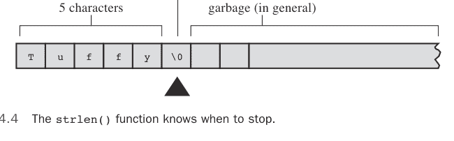

图 4.4 strlen() 函数知道何时停止。

当你处理到 PRAISE 时，你会发现 strlen() 再次给出字符串中确切的字符数（包括空格和标点）。sizeof 运算符给出的数字大一，因为它还计算了用于结束字符串的不可见空字符。程序并没有告诉计算机为存储该短语预留多少内存。它必须自行计算双引号之间的字符数。

如第 3 章“数据与 C”所述，C99 和 C11 标准使用 %zd 指定符表示 sizeof 运算符使用的类型。这也适用于 strlen() 返回的类型。对于 C 的早期版本，你需要知道 sizeof 和 strlen() 返回的实际类型；通常是 unsigned 或 unsigned long。

还有一点：上一章使用 sizeof 时带了括号，但本例中没有。是否使用括号取决于你想要类型的大小还是特定量的大小。类型的大小需要括号，但特定量的大小括号是可选的。也就是说，你会使用 sizeof(char) 或 sizeof(float)，但也可以使用 sizeof name 或 sizeof 6.28。 然而，在这些情况下使用括号也没问题，例如 sizeof (6.28)。

最后一个例子使用 strlen() 和 sizeof 的目的相当琐碎，只是为了满足用户的好奇心。实际上，strlen() 和 sizeof 是重要的编程工具。例如，strlen() 在各种字符字符串程序中都很有用，正如你在第 11 章中会看到的那样。

让我们继续讨论 #define 语句。


## 常量与 C 预处理器

有时你在程序中需要使用一个常量。例如，你可以这样给出圆的周长：

```
circumference = 3.14159 * diameter;
```

这里，常量 3.14159 代表世界闻名的常数 pi（π）。要使用一个常量，只需像示例中那样输入实际值即可。然而，使用符号常量是有充分理由的。也就是说，你可以使用如下语句，让计算机稍后代入实际值：

```
circumference = pi * diameter;
```

为什么使用符号常量更好？首先，名称比数字提供的信息更多。比较下面两个语句：

```
owed = 0.015 * housevalue;
owed = taxrate * housevalue;
```

如果你阅读一个长程序，第二种版本的含义更清晰。

另外，假设你已在多个地方使用了某个常量，并且有必要更改其值。毕竟，税率确实会变化。那么你只需要修改符号常量的定义，而不必在程序中查找并更改常量的每一个出现位置。

好吧，如何设置符号常量？一种方法是声明一个变量并将其设为所需常量。你可以这样写：

```
float taxrate;
taxrate = 0.015;
```

这提供了符号名称，但 taxrate 是一个变量，因此你的程序可能会意外更改其值。幸运的是，C 有几种更好的方法。

最初的更好方法是 C 预处理器。在第 2 章“介绍 C”中，你看到预处理器如何使用 #include 来合并来自另一个文件的信息。预处理器还允许你定义常量。只需在包含程序的文件顶部添加如下行：

```
#define TAXRATE 0.015
```

当你的程序被编译时，值 0.015 将在你使用 TAXRATE 的每个地方被替换。这称为编译时替换。到程序运行时，所有替换都已完成（见图 4.5）。这种定义的常量通常被称为显式常量。

```
#define TAXRATE 0.015
int main(void)
{
  
  
  
  bill=TAXRATE * sum;
{
  
  
  
}
```

你输入的内容

```
int main(void)
{
  
  
  
  bill=0.015 * sum;
  
  
  
}
```

预处理器
工作时

编译器

图 4.5 你输入的内容与编译的内容。

注意格式。首先是 #define。接下来是常量的符号名（TAXRATE），然后是常量的值（0.015）。（注意此构造不使用 = 号。）因此一般形式如下：

```
#define NAME value
```

你可以用你选择的符号名替换 NAME，并用适当的值替换 value。不使用分号，因为这是由预处理器处理的替换机制，而不是 C 语句。为什么 TAXRATE 是大写的？将常量以大写形式书写是合理的 C 传统。然后，当你在程序深处遇到它时，你立刻知道它是一个常量，而不是变量。将常量大写只是使程序更易读的另一种技巧。如果你不将常量大写，你的程序仍然可以工作，但养成大写常量的习惯是合理的。

其他较少见的命名约定包括在名称前加上 c_ 或 k_ 以表示常量，产生诸如 c_level 或 k_line 之类的名称。

你为符号常量使用的名称必须满足与变量名称相同的规则。你可以使用大写和小写字母、数字和下划线字符。第一个字符不能是数字。清单 4.4 显示了一个简单示例。

## 清单 4.4 pizza.c 程序

```
/* pizza.c -- uses defined constants in a pizza context */
#include <stdio.h>
#define PI 3.14159
int main(void)
{
    float area, circum, radius;

    printf("What is the radius of your pizza?\n");
    scanf("%f", &radius);
    area = PI * radius * radius;
    circum = 2.0 * PI *radius;
    printf("Your basic pizza parameters are as follows:\n");
    printf("circumference = %1.2f, area = %1.2f\n", circum, area);
    return 0;
}
```

printf() 语句中的 %1.2f 会使打印结果四舍五入到小数点后两位。当然，这个程序可能并不反映你主要的披萨关注点，但它确实在披萨程序世界中填补了一个小 niche。以下是示例运行：

```
What is the radius of your pizza?
6.0
Your basic pizza parameters are as follows:
circumference = 37.70, area = 113.10
```

#define 语句也可以用于字符和字符串常量。只需对前者使用单引号，对后者使用双引号。以下示例均有效：

```
#define BEEP '\a'
#define TEE 'T'
#define ESC '\033'
#define OOPS "Now you have done it!"
```

记住，符号名之后的所有内容都会被替换为它。不要犯这个常见错误：

```
/* the following is wrong */
#define TOES = 20
```

如果你这样做，TOES 会被替换为 = 20，而不是仅仅 20。在这种情况下，像这样的语句

```
digits = fingers + TOES;
```

会被转换为以下错误表示：

```
digits = fingers + = 20;
```

## const 修饰符

C90 增加了一种创建符号常量的第二种方法——使用 const 关键字将变量声明转换为常量声明：

```
const int MONTHS = 12;    // MONTHS a symbolic constant for 12
```

这使 MONTHS 成为只读值。也就是说，你可以显示 MONTHS 并在计算中使用它，但不能更改 MONTHS 的值。这种更新的方法比使用 #define 更灵活；它允许你声明类型，并更好地控制程序的哪些部分可以使用该常量。第 12 章“存储类、链接和内存管理”讨论了 const 的这种和其他用途。

实际上，C 还有第三种创建符号常量的方法，那就是第 14 章“结构和其他数据形式”中讨论的 enum 设施。

## 工作中的显式常量

C 头文件 limits.h 和 float.h 分别提供有关整数类型和浮点类型的大小限制的详细信息。每个文件都定义了一系列适用于你的实现的显式常量。例如，limits.h 文件包含类似以下的行：

```
#define INT_MAX   +32767
#define INT_MIN   -32768
```

你系统使用的 float.h 头文件。）此示例与 float 类型相关。等效常量已为 double 和 long double 类型定义，将名称中的 FLT 分别替换为 DBL 和 LDBL。（该表假设系统以 2 的幂表示浮点数。）

### 表 4.2 来自 float.h 的一些符号常量

| 符号常量 | 代表 |
|---|---|
| FLT_MANT_DIG | float 的尾数中的位数 |
| FLT_DIG | float 的最小有效十进制位数 |
| FLT_MIN_10_EXP | 具有完整有效数字的 float 的最小基数-10 负指数 |
| FLT_MAX_10_EXP | float 的最大基数-10 正指数 |
| FLT_MIN | 保持全精度的正 float 的最小值 |
| FLT_MAX | 正 float 的最大值 |
| FLT_EPSILON | 1.00 与大于 1.00 的最小 float 值之间的差值 |

清单 4.5 说明了使用 float.h 和 limits.h 中的数据。（注意，不完全支持 C99 标准的编译器可能不接受 LLONG_MIN 标识符。）

## 清单 4.5 defines.c 程序

```
// defines.c -- uses defined constants from limit.h and float.
#include <stdio.h>
#include <limits.h>    // integer limits
#include <float.h>    // floating-point limits
int main(void)
{
    printf("Some number limits for this system:\n");
    printf("Biggest int: %d\n", INT_MAX);
    printf("Smallest long long: %lld\n", LLONG_MIN);
    printf("One byte = %d bits on this system.\n", CHAR_BIT);
    printf("Largest double: %e\n", DBL_MAX);
    printf("Smallest normal float: %e\n", FLT_MIN);
    printf("float precision = %d digits\n", FLT_DIG);
    printf("float epsilon = %e\n", FLT_EPSILON);
    return 0;
}


以下是示例输出：

```
Some number limits for this system:
Biggest int: 2147483647
Smallest long long: -9223372036854775808
One byte = 8 bits on this system.
Largest double: 1.797693e+308
Smallest normal float: 1.175494e-38
float precision = 6 digits
float epsilon = 1.192093e-07
```

C 预处理器是一个有用且有帮助的工具，因此在你能使用时请充分利用它。随着你在本书中继续学习，我们会向你展示更多应用。

## 探索和利用 printf() 和 scanf()

函数 printf() 和 scanf() 使你能够与程序进行通信。它们被称为输入/输出函数，或简称为 I/O 函数。它们不是你可以用 C 使用的唯一 I/O 函数，但它们是最通用的。历史上，这些函数与 C 库中的所有其他函数一样，并不是 C 定义的一部分。C 最初将 I/O 的实现留给编译器编写者；这使得 I/O 能够更好地匹配特定机器。出于兼容性的考虑，各种实现都附带了 scanf() 和 printf() 的版本。然而，不同实现之间偶尔会出现差异。C90 和 C99 标准描述了这些函数的标准版本，我们将遵循该标准。

虽然 printf() 是输出函数而 scanf() 是输入函数，但两者工作方式非常相似，各自使用一个控制字符串和一个参数列表。我们将首先介绍 printf()，然后介绍 scanf()，向你展示它们的工作方式。

## printf() 函数

当你要求 printf() 打印一个变量时，你给出的指令取决于变量类型。例如，我们在打印整数时使用过 %d 记法，在打印字符时使用过 %c 记法。这些记法称为转换说明，因为它们指定了数据如何转换为可显示形式。我们将列出 ANSI C 标准为 printf() 提供的转换说明，然后展示如何使用其中最常见的说明。表 4.3 展示了转换说明符以及它们导致打印的输出类型。

表 4.3 转换说明符及 resulting 打印输出

| Conversion | Output Specification |
|------------|----------------------|
| %a | Floating-point number, hexadecimal digits and p-notation (C99/C11). |
| %A | Floating-point number, hexadecimal digits and P-notation (C99/C11). |

```
printf("Farewell! thou art too dear for my possessing,\n");
printf("%c%d\n", '$', 2 * cost);

return 0;
}
```

输出，当然是

```
The 7 contestants ate 12.750000 berry pies.
The value of pi is 3.141593.
Farewell! thou art too dear for my possessing,
$15600
```

这是使用 printf() 的格式：

```
printf(Control-string, item1, item2,...);
```

Item1、item2 等是要打印的项目。它们可以是变量或常量，甚至是先求值后再打印值的表达式。Control-string 是一个字符字符串，描述项目如何打印。如第 3 章所述，控制字符串应包含与每个要打印的项目对应的转换说明符。例如，考虑以下语句：

```
printf("The %d contestants ate %f berry pies.\n", number,
    pies);
```

Control-string 是用双引号括起来的短语。此特定控制字符串包含两个转换说明符，对应于 number 和 pies——两个要显示的项目。图 4.6 显示了另一个 printf() 语句的示例。

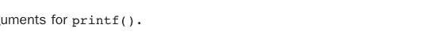

图 4.6 Arguments for printf().

以下是示例中的另一行：

```
printf("The value of pi is %f.\n", PI);
```

这次，项目列表只有一个成员——符号常量 PI。

正如你在图 4.7 中看到的，Control-string 包含两种不同的信息形式：

- 实际打印的字符
- 转换说明

### Caution

不要忘记为 Control-string 之后列表中的每个项目使用一个转换说明。如果你忘记了这个基本要求，后果不堪设想！不要这样做：

```
printf("The score was Squids %d, Slugs %d.\n", score1);
```

这里，第二个 %d 没有值。这种失误的结果取决于你的系统，但最好的情况你也会得到部分无意义的内容。

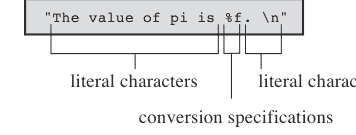

图 4.7 Anatomy of a control string.

如果你只想打印一个短语，就不需要任何转换说明。如果你只想打印数据，可以省略运行中的评论。以下来自清单 4.6 的每个语句都是完全可以接受的：

```
printf("Farewell! thou art too dear for my possessing,\n");
```

```
printf("%c%d\n", '$', 2 * cost);
```

在第二个语句中，注意打印列表中的第一个项目是字符常量而不是变量，第二个项目是乘法。这说明 printf() 使用的是值，无论是变量、常量还是表达式。

由于 printf() 函数使用 % 符号来标识转换说明，如果你想打印 % 符号本身，就会有一个小问题。如果你只使用一个 % 符号，编译器会认为你搞砸了转换说明。解决方法很简单——只需使用两个 % 符号，如下所示：

```
pc = 2*6;
```

```
printf("Only %d%% of Sally's gribbles were edible.\n", pc);
```

以下输出会产生：

```
Only 12% of Sally's gribbles were edible.
```

## printf() 的转换说明符修饰符

你可以通过在 % 和定义转换字符之间插入修饰符来修改基本的转换说明。表 4.4 和 4.5 列出了你可以在那里合法放置的字符。如果你使用多个修饰符，它们应按表中的顺序排列

| Modifier | Meaning |
|---|---|
| t | 与整数转换说明符一起使用，表示 `ptrdiff_t` 值。这是对应于两个指针之间差值的类型。 (C99)。 |
|  | Examples: `"%td"` and `"%12ti"`. |
| z | 与整数转换说明符一起使用，表示 `size_t` 值。这是 `sizeof` 返回的类型。 (C99)。 |
|  | Examples: `"%zd"` and `"%12zx"`. |

## Note Type Portability

`sizeof` 运算符，回顾一下，返回类型或值的大小，以字节为单位。这应该是某种形式的整数，但标准只规定它应为无符号整数。因此它可能是 `unsigned int`、`unsigned long`，甚至是 `unsigned long long`。因此，如果你要使用 `printf()` 显示一个 `sizeof` 表达式，你可能在一个系统上使用 `%u`，在另一个系统上使用 `%lu`，在第三个系统上使用 `%llu`。这意味着你需要研究适用于你的系统的正确用法，并且如果你将程序移动到不同的系统，可能需要更改你的程序。好吧，本来是这样的，除了 C 提供了帮助以使类型更具可移植性。首先，`stddef.h` 头文件（在包含 `stdio.h` 时包含）将 `size_t` 定义为你的系统用于 `sizeof` 的类型；这称为底层类型。其次，`printf()` 使用 `z` 修饰符来指示用于打印的相应类型。类似地，C 定义了 `ptrdiff_t` 类型和 `t` 修饰符，以指示系统用于两个地址之间差值的底层有符号整数类型。

## Note Conversion of float Arguments

有转换说明符用于打印浮点类型 `double` 和 `long double`。然而，没有用于 `float` 的说明符。原因是在 K&R C 中，`float` 值在用于表达式或作为参数之前会自动转换为 `double` 类型。ANSI C（或更晚版本）通常不会自动将 `float` 转换为 `double`。为了保护大量假设 `float` 参数会被转换为 `double` 的现有程序，所有传递给 `printf()` 的 `float` 参数——以及任何其他不使用显式原型的 C 函数——仍然会自动转换为 `double`。因此，在 K&R C 或 ANSI C 下，显示 `float` 类型不需要特殊的转换说明符。

## Table 4.5 The printf() Flags

| Flag | Meaning |
|---|---|
| - | 项目左对齐；即它从字段左侧开始打印。 |
|  | Example: `"%-20s"`. |


*959*
*959*
*      959*
*959      *

第一个转换说明是不带修饰符的 %d。它生成的字段宽度与待打印整数的宽度相同。这是默认选项；也就是说，如果没有给出进一步指示，打印出的结果就是这样。第二个转换说明是 %2d。它应当生成宽度为2的字段，但由于整数是三位数，字段会自动扩展以容纳该数字。下一个转换说明是 %10d。它生成一个宽度为10个空格的字段，确实，在两个星号之间有7个空格和3位数字，数字被置于字段的右端。最后一个说明是 %-10d。它也生成一个宽度为10个空格的字段，- 将数字置于左端，正如所宣传的那样。用习惯之后，这个系统使用起来很容易，并能很好地控制输出的外观。尝试改变 PAGES 的值，看看不同位数的数字是如何打印的。

现在来看一些浮点格式。输入、编译并运行程序清单4.8中的程序。

## 程序清单4.8：floats.c 程序

```c
// floats.c -- some floating-point combinations
#include <stdio.h>

int main(void)
{
    const double RENT = 3852.99;  // const-style constant

    printf("*%f*\n", RENT);
    printf("*%e*\n", RENT);
    printf("*%4.2f*\n", RENT);
    printf("*%3.1f*\n", RENT);
    printf("*%10.3f*\n", RENT);
    printf("*%10.3E*\n", RENT);
    printf("*%+4.2f*\n", RENT);
    printf("*%010.2f*\n", RENT);

    return 0;
}
```

这次，程序使用关键字 const 创建了一个符号常量。输出是

```
*3852.990000*
*3.852990e+03*
*3852.99*
*3853.0*
* 3852.990*
* 3.853E+03*
```

*+3852.99*
*0003852.99*

这个例子以默认版本 %e 开始。在这种情况下，有两个默认项——字段宽度和小数点右侧的位数。第二个默认项是6位数字，而字段宽度是能容纳该数字所需的大小。

接下来是 %E 的默认版本。它在小数点左侧打印一位数字，在右侧打印六位。我们得到了很多数字！解决办法是指定小数点右侧的位数，本小节的接下来四个示例正是这样做的。注意第四个和第六个示例使输出四舍五入。另外，第六个示例使用 E 而不是 e。

最后，+ 标志使结果连同其代数符号一起打印，在本例中是加号；0 标志产生前导零，将结果补齐到完整的字段宽度。注意在说明符 %010.2f 中，第一个 0 是一个标志，句点之前的其余数字（10）指定字段宽度。

你可以修改 RENT 的值，看看不同大小的值是如何打印的。程序清单4.9演示了更多的组合。

## 程序清单4.9：flags.c 程序

```c
/* flags.c -- illustrates some formatting flags */
#include <stdio.h>
int main(void)
{
    printf("%x %X %#x\n", 31, 31, 31);
    printf("**%3d** %3d **%3d\n", 42, 42, -42);
    printf("**%5d**%5.3d**%5d**%5.3d**\n", 6, 6, 6, 6);
    return 0;
}
```

输出如下：

```
1f 1F 0x1f
**42** 42**-42**
**   6** 006**00006** 006**
```

首先，1f 是31的十六进制等价形式。x 说明符产生 1f，X 说明符产生 1F。使用 # 标志会提供一个前导 0x。

输出的第二行说明了在说明符中使用空格如何为正值产生前导空格，但不会为负值产生前导空格。这可以产生令人满意的输出，因为具有相同有效数字位数的正值和负值会以相同的字段宽度打印。

## 问题1

## 德国

在黑森林、巴伐利亚阿尔卑斯山和萨克森瑞士的导览徒步之旅。专业的当地领队、舒适的酒店住宿和精心规划的路线。

- 柏林
- 汉堡
- 慕尼黑
- 德累斯顿
- 陶伯河上游的罗滕堡

沿莱茵河、摩泽尔河和多瑙河的自助骑行假期，包含每日路线规划、行李转运和优质自行车租赁。

- 莱茵河自行车路线
- 摩泽尔河谷
- 多瑙河小径
- 波罗的海海岸步道

## 法国

在阿尔卑斯山、比利牛斯山和普罗旺斯的经典徒步假期——从勃朗峰到卡朗格峡湾。导览徒步、小木屋住宿和美食野餐午餐。

- 勃朗峰环线
- 科西嘉 GR20
- 比利牛斯穿越
- 韦尔东峡谷

定制自行车假期穿越勃艮第、卢瓦尔河谷和法国里维埃拉，包括品酒、城堡游览和海滨度假地。

- 卢瓦尔河谷葡萄园
- 勃艮第度假
- 里维埃拉海岸公路
- 巧克力工厂之旅

> “旅行是唯一你花钱买来却会让你更富有的东西。”

邂逅高山土拨鼠，品尝手工巧克力，发现远离热门路线的如画小镇。我们的行程平衡了活动、文化与休闲。

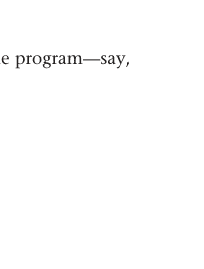

## 转换说明转换什么？

让我们更仔细地看看转换说明到底转换了什么。它将计算机中以某种二进制格式存储的值转换为一系列字符（即字符串）以便显示。例如，数字76在内部可能存储为二进制01001100。%d 转换说明将此转换为字符7和6，显示为76。%x 转换将相同的值（01001100）转换为十六进制表示 4c。%c 转换将相同的值转换为字符表示 L。

“转换”这一术语可能有点误导，因为它可能暗示原始值被替换为转换后的值。转换说明实际上是翻译说明；%d 的意思是“把给定值翻译为十进制整数的文本表示，并打印该表示”。

## 不匹配的转换

当然，你应该使转换说明与要打印的值的类型相匹配。通常你会有多种选择。例如，如果要打印 int 类型的值，可以使用 %d、%x 或 %o。所有这些说明符都假定你打印的是 int 类型的值；它们只是提供该值的不同表示。类似地，可以使用 %f、%e 或 %g 来表示 double 类型的值。

如果转换说明与类型不匹配怎么办？你在前一章已经看到，不匹配会导致问题。这是需要牢记的非常重要的一点，因此程序清单4.11展示了整数族内更多不匹配的示例。

## 程序清单4.11：intconv.c 程序

```c
/* intconv.c -- some mismatched integer conversions */
#include <stdio.h>
#define PAGES 336
#define WORDS 65618
int main(void)
{
    short num = PAGES;
    short mnum = -PAGES;

    printf("num as short and unsigned short: %hd %hu\n", num, num);
    printf("-num as short and unsigned short: %hd %hu\n", mnum, mnum);
    printf("num as int and char: %d %c\n", num, num);
    printf("WORDS as int, short, and char: %d %hd %c\n", WORDS, WORDS, WORDS);
    return 0;
}
```

我们的系统产生了如下结果：

```
num as short and unsigned short:  336 336
-num as short and unsigned short: -336 65200
num as int and char: 336 P
WORDS as int, short, and char: 65618 82 R
```

看第一行，可以看到 %hd 和 %hu 都为变量 num 输出336；这里没有问题。在第二行，%u（mnum 的无符号版本）却输出为65200，而不是你可能会预期的336；这源于我们的参考系统表示有符号 short int 值的方式。首先，这些值大小为2字节。其次，系统使用一种称为二进制补码的方法来表示有符号整数。在这种方法中，数字0到32767表示自身，数字32768到65535表示负数，其中65535表示 -1，65534表示 -2，依此类推。因此，-336 用 65536 - 336，即65200表示。所以65200在被解释为有符号 int 时表示 -336，而被解释为无符号 int 时表示65200。要当心！同一个数字可以解释为两个不同的值。并非所有系统都使用这种方法来表示负整数。不过，这给我们一个教训：不要期望 %u 转换会简单地从数字中去除符号。

第三行展示了当你试图将一个大于255的值转换为字符时会发生什么。在这个系统上，short int 是2字节，char 是1字节。当 printf() 使用 %c 打印336时，它只看用于存储336的2字节中的1个字节。这种截断（见图4.8）相当于将该整数除以256并只保留余数。在这种情况下，余数是80，即字符 P 的ASCII值。更技术性地说，可以认为这个数是按256取模来解释的，也就是用该数除以256后的余数。

图4.8 将336作为字符读取。

最后，我们尝试打印一个大于我们系统允许的最大 short int（32767）的整数（65618）。计算机再次做了它的取模运算。由于65618太大，在我们的系统上它被存储为4字节的 int 值。当我们使用 %hd 说明符打印它时，printf() 只使用最后2个字节。这相当于使用除以65536后的余数。在这种情况下，余数是82。如果余数在32767到65536之间，由于负数的存储方式，它将被打印为负数。整数大小不同的系统会有相同的一般行为，但数值不同。


跨越多行的语句，只要你在元素之间放置换行符即可。例如，清单 4.13 的语句使用了两行。

```c
printf("The printf() function printed %d characters.\n",
        rv);
```

行在逗号元素和 `rv` 之间被折断。为了向读者表明该行在继续，示例对 `rv` 进行了缩进。C 会忽略多余的空格。

然而，你不能在引号字符串中间断开。假设你尝试类似以下的操作：

```c
printf("The printf() function printed
        %d characters.\n", rv);
```

C 会抱怨你在字符串常量中有一个非法字符。你可以在字符串中使用 `\n` 来表示换行符，但你不能在字符串中包含由 Enter（或 Return）键生成的实际换行符。

如果你确实需要拆分一个字符串，你有三种选择，如清单 4.14 所示。

### Listing 4.14 The longstrg.c Program

```c
/* longstrg.c — printing long strings */
#include <stdio.h>
int main(void)
{
    printf("Here's one way to print a ");
    printf("long string.\n");
    printf("Here's another way to print a \
long string.\n");
    printf("Here's the newest way to print a "
           "long string.\n");     /* ANSI C */
    return 0;
}
```

以下是输出：

```
Here's one way to print a long string.
Here's another way to print a long string.
Here's the newest way to print a long string.
```

方法 1 是使用多个 `printf()` 语句。因为第一个打印的字符串不以 `\n` 字符结尾，所以第二个字符串会从第一个结束的地方继续。

方法 2 是用反斜杠/回车组合来终止第一行的末尾。这会导致屏幕上的文本开始新行，而字符串中不包含换行符。其效果是将字符串继续到下一行。然而，下一行必须从最左边开始，如图所示。如果你将该行缩进，例如五个空格，这五个空格将成为字符串的一部分。

方法 3 是 ANSI C 引入的字符串连接。如果你仅用空白分隔一个带引号的字符串常量后跟另一个，C 会将组合视为单个字符串，因此以下三种形式是等价的：

```c
printf("Hello, young lovers, wherever you are.");
printf("Hello, young "  "lovers" ", wherever you are.");
printf("Hello, young lovers"
    ", wherever you are.");
```

使用所有这些方法时，你应该在字符串中包含任何必需的空格：`"young" "lovers"` 变成 `"younglovers"`，但组合 `"young " "lovers"` 是 `"young lovers"`。

## Using scanf()

现在让我们从输出转向输入并检查 `scanf()` 函数。C 库包含多个输入函数，而 `scanf()` 是其中最通用的，因为它可以读取多种格式。当然，来自键盘的输入是文本，因为键会生成文本字符：字母、数字和标点符号。当你想要输入，例如整数 2014 时，你会输入字符 2 0 1 和 4。如果你想将其作为数值存储而不是字符串，你的程序必须将字符串逐字符转换为数值；这就是 `scanf()` 所做的！它将字符串输入转换为各种形式：整数、浮点数、字符和 C 字符串。它是 `printf()` 的逆过程，后者将整数、浮点数、字符和 C 字符串转换为要在屏幕上显示的文本。

与 `printf()` 类似，`scanf()` 使用控制字符串后跟参数列表。控制字符串指示输入字符流的目的地数据类型。主要区别在于参数列表。`printf()` 函数使用变量名、常量和表达式。`scanf()` 函数使用指向变量的指针。幸运的是，你不需要了解指针就可以使用该函数。只需记住这些简单规则：

- 如果你使用 `scanf()` 为我们讨论过的基本变量类型之一读取值，请在变量名前面加上一个 `&`。
- 如果你使用 `scanf()` 将字符串读入字符数组，不要使用 `&`。

清单 4.15 展示了一个说明这些规则的简短程序。

### Listing 4.15 The input.c Program

```c
/* input.c -- when to use & */
#include <stdio.h>
int main(void)
{
    int age;        // variable
```

使用其他数字说明符进行输入读取的工作方式与 `%d` 情况大致相同。主要区别在于 `scanf()` 可能将更多字符识别为数字的一部分。例如，`%x` 说明符要求 `scanf()` 识别十六进制数字 a–f 和 A–F。浮点说明符要求 `scanf()` 识别小数点、e 表示法和新的 p 表示法。

如果你使用 `%s` 说明符，任何非空白字符都是可以接受的，因此 `scanf()` 跳过空白到第一个非空白字符，然后保存非空白字符直到再次遇到空白。这意味着 `%s` 导致 `scanf()` 读取单个单词——即不包含空白的字符串。如果你使用字段宽度，`scanf()` 会在字段末尾或第一个空白处停止，以先到者为准。你不能使用字段宽度使 `scanf()` 为一个 `%s` 说明符读取多个单词。最后一点：当 `scanf()` 将字符串放入指定数组时，它会添加终止符 `'\0'` 以使数组内容成为 C 字符串。

如果你使用 `%c` 说明符，所有输入字符都是公平的。如果下一个输入字符是空格或换行符，则空格或换行符会被分配给指示的变量；不会跳过空白。

实际上，`scanf()` 并不是 C 中最常用的输入函数。它在这里被介绍是因为其多功能性（它可以读取所有不同数据类型），但 C 还有其他输入函数，如 `getchar()` 和 `fgets()`，更适合特定任务，例如读取单个字符或读取包含空格的字符串。我们将在第 7 章“ C 控制语句：分支和跳转”；第 11 章“字符字符串和字符串函数”；以及第 13 章“文件输入/输出”中介绍其中一些函数。在此期间，如果你需要整数、小数、字符或字符串，你可以使用 `scanf()`。

### Regular Characters in the Format String

`scanf()` 函数确实允许你在格式字符串中放置普通字符。除了空格字符之外的普通字符必须与输入字符串完全匹配。例如，假设你在两个说明符之间意外放置了一个逗号：

```c
scanf("%d,%d", &n, &m);
```

`scanf()` 函数解释为你将输入一个数字，输入一个逗号，然后输入第二个数字。也就是说，你必须按如下方式输入两个整数：

```
88,121
```

因为逗号紧跟在格式字符串中的 `%d` 之后，所以你必须在 88 之后立即输入它。然而，因为 `scanf()` 会跳过整数前面的空白，所以你在输入时可以在逗号后输入空格或换行符。也就是说，

```
88, 121
```

和

```
88,
121
```

也会被接受。

格式字符串中的空格意味着跳过下一个输入项之前的任何空白。例如，语句

```c
scanf("%d ,%d", &n, &m);
```

会接受以下任何输入行：

```
88,121
88 ,121
88 , 121
```

请注意，“任何空白”的概念包括无空白的特殊情况。

除了 `%c` 之外，说明符会自动跳过输入值之前的空白，因此 `scanf("%d%d", &n, &m)` 与 `scanf("%d %d", &n, &m)` 行为相同。对于 `%c`，在格式字符串中添加空格字符确实会产生差异。例如，如果 `%c` 在格式字符串中前面有空格，`scanf()` 会跳到第一个非空白字符。也就是说，命令 `scanf("%c", &ch)` 读取输入中遇到的第一个字符，而 `scanf(" %c", &ch)` 读取输入中遇到的第一个非空白字符。

### The scanf() Return Value

`scanf()` 函数返回它成功读取的项目数。如果它没有读取任何项目，例如当你输入非数字字符串而它期望数字时，`scanf()` 返回值 0。它在检测到“文件结束”条件时返回 `EOF`。(`EOF` 是在 `stdio.h` 文件中定义的一个特殊值。通常，`#define` 指令将 `EOF` 的值设为 -1。）我们将在第 6 章“ C 控制语句：循环”中讨论文件结束，并在本书后面使用 `scanf()` 的返回值。在你学习了 `if` 语句和 `while` 语句后，你可以使用 `scanf()` 的返回值来检测和处理不匹配的输入。

### The * Modifier with printf() and scanf()

`printf()` 和 `scanf()` 都可以使用 `*` 修饰符来修改说明符的含义，但方式不同。首先，让我们看看 `*` 修饰符能为 `printf()` 做什么。

假设你不想提前承诺字段宽度，而是希望程序指定它。你可以通过使用 `*` 代替数字作为字段宽度来实现，但你也必须添加一个参数来说明字段宽度应该是什么。也就是说，如果你有转换说明符 `%*d`，参数列表应包括 `*` 的值和 `d` 的值。该技术也可以与浮点值一起使用，以指定精度和字段宽度。清单 4.16 是一个简短示例，展示了其工作原理。

### Listing 4.16 The varwid.c Program

```c
/* varwid.c -- uses variable-width output field */
#include <stdio.h>
```


```c
scanf("%*d %*d %d", &n);
printf("The last integer was %d\n", n);

return 0;
}
```

清单 4.17 中的 `scanf()` 指令表示：“跳过两个整数，将第三个整数复制到 n 中。”下面是一个示例运行：

```
Please enter three integers:
2013 2014 2015
The last integer was 2015
```

如果程序需要读取文件中按统一列排列的数据中的某一列，这种跳过功能就很有用。

## `printf()` 的使用技巧

当你想打印数据列时，指定固定的字段宽度非常有用。因为默认字段宽度就是数字本身的宽度，所以重复使用如下语句：

```
printf("%d %d %d\n", val1, val2, val3);
```

如果某一列中的数字大小不一，就会产生参差不齐的列。例如，输出可能如下所示：

```
12 234 1222
4 5 23
22334 2322 10001
```

（这假设变量的值在两次打印语句之间已经改变。）

使用足够大的固定字段宽度可以让输出变得整齐。例如，使用：

```
printf("%9d %9d %9d\n", val1, val2, val3);
```

```
printf("Count Beppo ran %.2f miles in 3 hours.\n", distance);
```

可能会产生：

```
Count Beppo ran 10.22 miles in 3 hours.
```

将转换说明改为 `%10.2f` 你会得到：

```
Count Beppo ran      10.22 miles in 3 hours.
```

## 区域设置的选择

美国以及世界上许多其他地方使用句点来分隔十进制值的整数部分和小数部分，例如 3.14159。但世界上许多其他地方使用逗号代替，例如 3,14159。你可能已经注意到 `printf()` 和 `scanf()` 的转换说明似乎不提供逗号格式。但 C 并未忽视世界其他地方。如附录 B 第五节“标准 ANSI C 库与 C99 增补”中所述，C 支持区域设置（locale）的概念。这使 C 程序可以选择特定的区域设置。例如，它可以指定荷兰区域设置，那么 `printf()` 和 `scanf()` 在显示和读取浮点数值时就会使用当地的约定（此处即逗号）。另外，一旦你指定了该环境，你在代码中出现的数字也应使用逗号约定：

```
double pi = 3,14159;  // 荷兰区域设置
```

C 标准只要求两种区域：“C”和“”。默认情况下，程序使用“C”区域，这基本上就是美国的用法。“”区域代表你的系统上当前使用的本地区域。原则上它与“C”区域可以相同。实际上，Unix、Linux 和 Windows 等操作系统提供了很长的区域选择列表。不过，它们的列表可能并不相同。

## 关键概念

C 的 char 类型表示单个字符。要表示字符序列，C 使用字符串。字符串的一种形式是字符常量，其中字符括在双引号中；“Good luck, my friend”就是一个例子。你可以将字符串存储在字符数组中，该数组由内存中相邻的字节组成。字符串，无论是表示为字符常量还是存储在字符数组中，都以一个称为空字符的隐藏字符结尾。

在程序中用符号表示数值常量是一个好习惯，可以使用 `#define` 或关键字 `const`。符号常量使程序更易读，也更容易维护和修改。

标准 C 输入和输出函数 `scanf()` 和 `printf()` 使用一种系统，在该系统中，你必须将第一个参数中的类型说明符与后续参数中的值相匹配。例如，将 `%d` 这样的 int 说明符与 float 值匹配会产生奇怪的结果。你必须格外小心，使说明符的数量和类型与函数的其余参数相匹配。对于 `scanf()`，记得在变量名前加上地址运算符（`&`）。

空白字符（制表符、空格和换行符）在 `scanf()` 如何看待输入方面起着关键作用。除了在 `%c` 模式下（只读取下一个字符），`scanf()` 在读取输入时会跳过空白字符，直到遇到第一个非空白字符。然后它会继续读取字符，直到遇到空白字符或遇到与正在读取的类型不匹配的字符为止。让我们考虑如果将相同的输入行提供给几种不同的 `scanf()` 输入模式会发生什么。从以下输入行开始：

```
 -13.45e12# 0
```

首先，假设我们使用 `%d` 模式；`scanf()` 会读取三个字符（-13）并在句点处停止，使句点成为下一个输入字符。然后 `scanf()` 将字符序列 -13 转换为相应的整数值，并将该值存储在目标 `int` 变量中。接下来，以 `%f` 模式读取同一行，`scanf()` 会读取 -13.45E12 字符并在 `#` 符号处停止，使其成为下一个输入字符。然后它将字符序列 -13.45E12 转换为相应的浮点值，并将该值存储在目标 `float` 变量中。以 `%s` 模式读取同一行时，`scanf()` 会读取 -13.45E12#，在空格处停止，将其留作下一个输入字符。然后它将这 10 个字符的字符代码存储到目标字符数组中，并在末尾追加一个空字符。最后，使用 `%c` 说明符读取同一行时，`scanf()` 会读取并存储第一个字符，在本例中是一个空格。

## 总结

字符串是作为一个单元处理的一系列字符。在 C 中，字符串由一系列以空字符结尾的字符表示，空字符是 ASCII 码为 0 的字符。字符串可以存储在字符数组中。数组是一系列类型相同的项或元素。要声明一个名为 name 且具有 30 个 char 类型元素的数组，请执行以下操作：

```
char name[30];
```

请务必分配足够的元素数量来容纳整个字符串，包括空字符。

字符串常量通过将字符串括在双引号中来表示：“This is an example of a string”。

`strlen()` 函数（在 `string.h` 头文件中声明）可用于查找字符串的长度（不包括结尾的空字符）。`scanf()` 函数与 `%s` 说明符一起使用时，可用于读取单词形式的字符串。

C 预处理器在源代码程序中搜索以 `#` 符号开头的预处理指令，并在程序编译之前对它们执行。`#include` 指令使预处理器将另一个文件的内容添加到你的文件中该指令所在的位置。`#define` 指令允许你建立显式常量，即符号常量。

```c
printf("Please enter your first name.");
scanf("%s", name);
printf("All right, %c, what's your age?\n", name);
scanf("%f", age);
xp = age + X;
printf("That's a %s! You must be at least %d.\n", B, xp);
return 0;
}
```

5. 假设程序开始如下：

```
#define BOOK "War and Peace"
int main(void)
{
    float cost =12.99;
    float percent = 80.0;
```

构造一个使用 BOOK、cost 和 percent 的 `printf()` 语句，打印以下内容：

```
This copy of "War and Peace" sells for $12.99.
That is 80% of list.
```

6. 你会使用哪种转换说明来打印以下各项？

- a. 字段宽度等于位数的十进制整数
- b. 宽度为 4 的表单为 8A 的十六进制整数
- c. 字段宽度为 10 的表单为 232.346 的浮点数
- d. 字段宽度为 12 的表单为 2.33e+002 的浮点数
- e. 在宽度为 30 的字段中左对齐的字符串

7. 你会使用哪种转换说明来打印以下各项？

- a. 字段宽度为 15 的无符号长整数
- b. 宽度为 4 的表单为 0x8a 的十六进制整数
- c. 在宽度为 12 的字段中左对齐的表单为 2.33E+02 的浮点数
- d. 字段宽度为 10 的表单为 +232.346 的浮点数
- e. 在八个字符宽的字段中字符串的前八个字符


## 8. 要打印以下各项，你会使用什么转换说明？
+   a. 一个十进制整数，最小宽度为4位，字段宽度为6
+   b. 一个八进制整数，字段宽度在参数列表中给出
+   c. 一个字符，字段宽度为2
+   d. 一个浮点数，形式为 +3.13，字段宽度等于该数字的字符数
+   e. 一个字符串的前五个字符，在宽度为7的字段中左对齐

## 9. 对于以下每一行输入，提供一个 scanf() 语句来读取它。同时声明该语句中使用的任何变量或数组。
+   a. 101
+   b. 22.32 8.34E-09
+   c. linguini
+   d. catch 22
+   e. catch 22（但跳过 catch）

## 10. 什么是空白字符？

## 11. 下面的语句有什么问题？你如何修复它？
```
printf("The double type is %z bytes.\n", sizeof (double));
```

## 12. 假设你更愿意在程序中使用圆括号而不是花括号。下面这种做法效果如何？
```
#define ( {
#define ) }
```

## 编程练习
+   1. 编写一个程序，询问你的名和姓，然后以“姓, 名”的格式打印姓名。
+   2. 编写一个程序，请求输入你的名，并执行以下操作：
+   a. 将名放在双引号中打印
+   b. 在宽度为20个字符的字段中打印名，整个字段用引号括起来，名位于字段的右端

在小数点右侧。另外，让程序包含 `float.h` 并显示 `FLT_DIG` 和 `DBL_DIG` 的值。显示的 1.0/3.0 的值是否与这些值一致？

8. 编写一个程序，要求用户输入行驶的英里数和消耗的汽油加仑数。然后计算并显示每加仑英里数（miles-per-gallon）的值，在小数点右侧显示一位数字。接下来，利用1加仑约等于3.785升、1英里约等于1.609公里的事实，将每加仑英里数转换为每100公里升数（liters-per-100-km），这是欧洲通常表示燃油消耗量的方式，并显示结果，在小数点右侧显示一位数字。注意，美国的方案测量的是每单位燃油行驶的距离（数值越高越好），而欧洲的方案测量的是每单位距离消耗的燃油量（数值越低越好）。使用符号常量（使用 `const` 或 `#define`）来表示这两个转换因子。

## 运算符、表达式和语句

在本章中，你将学习以下内容：
+   - 关键字：
+     `while, typedef`
+   - 运算符：
+     `= - * /`
+     `% ++ -- (type)`
+   - C 的众多运算符，包括用于常见算术运算的那些运算符
+   - 运算符优先级以及术语 *语句* 和 *表达式* 的含义
+   - 便捷的 `while` 循环
+   - 复合语句、自动类型转换和类型强制转换
+   - 如何编写使用参数的函数

现在你已经了解了表示数据的方法，接下来让我们探索处理数据的方法。C 为此提供了丰富的运算操作。你可以进行算术运算、比较值、修改变量、逻辑组合关系等。让我们从基本算术开始——加法、减法、乘法和除法。

处理数据的另一个方面是组织程序，使其按正确顺序执行正确的步骤。C 有几种语言特性可以帮助你完成这项任务。其中一个特性就是循环，在本章中你将首次接触它。循环使你能够重复执行操作，让你的程序更有趣、更强大。

## 循环简介

程序清单5.1 展示了一个示例程序，它进行一点简单的算术运算，来计算穿美国9号（男式）鞋的脚的长度（以英寸为单位）。为了让你更好地理解循环，这第一个版本展示了不使用循环编程的局限性。

### 程序清单5.1 shoes1.c 程序
```
/* shoes1.c -- converts a shoe size to inches */
#include <stdio.h>
#define ADJUST 7.31          // one kind of symbolic constant
int main(void)
{
    const double SCALE = 0.333;  // another kind of symbolic constant
    double shoe, foot;

    shoe = 9.0;
    foot = SCALE * shoe + ADJUST;
    printf("Shoe size (men's)    foot length\n");
    printf("%10.1f %15.2f inches\n", shoe, foot);

    return 0;
}
```

输出如下：
```
Shoe size (men's)    foot length
        9.0          10.31 inches
```

该程序演示了创建符号常量的两种方法，并且使用了乘法和加法。它接受你的鞋码（如果你穿9号鞋），并告诉你的脚有多长（以英寸为单位）。你说：“但是，我用手（或计算器）解决这个问题，比你输入程序还要快。”说得没错。一个只处理一个鞋码的一次性程序是在浪费时间和精力。你可以把这个程序写成交互式程序，让它更有用，但这仍然几乎没有发挥出计算机的潜力。

我们需要的是让计算机针对一连串鞋码进行重复计算的方法。毕竟，这正是使用计算机进行算术运算的主要原因之一。C 提供了几种进行重复计算的方法，我们在这里介绍其中一种。这种方法称为 while 循环，它将使你能够更有趣地探索运算符。程序清单5.2 展示了改进后的鞋码计算程序。

### 程序清单5.2 shoes2.c 程序
```
/* shoes2.c -- calculates foot lengths for several sizes */
#include <stdio.h>
#define ADJUST 7.31          // one kind of symbolic constant
```

此时，程序回到 while 部分检查条件。为什么是在这里？因为下一行是一个右花括号 (})，代码使用一对花括号 ({}) 来标记 while 循环的范围。两个花括号之间的语句就是要重复执行的语句。程序中被花括号括起来的部分称为块。现在回到程序。值 4 小于 18.5，因此 while 后面被花括号括起来的整个命令序列（即块）会重复执行。（用计算机术语来说，程序会“循环”执行这些语句。）这个过程一直持续到 shoe 达到 19.0。此时条件
```
shoe < 18.5
```
变为假，因为 19.0 不小于 18.5。当这种情况发生时，控制权传递给 while 循环之后的第一条语句。在这里，也就是最后的 printf() 语句。

你可以轻松修改这个程序来进行其他转换。例如，把 SCALE 改为 1.8，ADJUST 改为 32.0，你就得到了一个将摄氏度转换为华氏度的程序。把 SCALE 改为 0.6214，ADJUST 改为 0，你就可以将公里转换为英里。如果你做了这些修改，为了不造成混淆，你也应该修改打印出来的信息。

while 循环提供了一种方便、灵活的程序控制手段。现在让我们来看看可以在程序中使用的那些基本运算符。

## 基本运算符

C 使用运算符来表示算术运算。例如，+ 运算符会将它两侧的两个值相加。如果 operator 这个术语让你觉得奇怪，请记住，这些东西总得有个名字。“运算符”确实比“那些东西”或“算术交易者”之类的说法好得多。现在来看看用于基本算术运算的运算符：=、+、-、* 和 /。（C 没有指数运算符。不过，标准 C 数学库提供了 pow() 函数来实现这个目的。例如，pow(3.5, 2.2) 返回 3.5 的 2.2 次幂。）

## 赋值运算符：=

在 C 中，等号并不表示“等于”。相反，它是一个赋值运算符。语句
```
bmw = 2002;
```
从数学角度看，这个语句没有意义。如果你给一个有限的数加上 1，结果并不“等于”你原来的数，但作为一条计算机赋值语句，它是完全合理的。它的意思是：“找到名为 i 的变量的值，将该值加 1，然后将这个新值赋给变量 i。”（参见图5.1）。

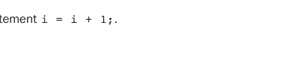

图5.1 语句 i = i + 1;

像
```
2002 = bmw;
```
这样的语句在 C 中毫无意义（实际上也是无效的），因为 2002 是 C 所称的右值（rvalue），在这里只是一个字面常量。你不能把一个值赋给常量；它已经是它自己的值了。因此，当你坐到键盘前时，要记住 = 号左边的项必须是变量名。实际上，左边必须引用一个存储位置。最简单的方法是使用变量名，但正如你稍后将看到的，可以使用“指针”来指向某个位置。更一般地，C 使用“可修改的左值”（modifiable lvalue）这个术语来标记那些你可以赋值给它们的实体。“可修改的左值”也许并不是你遇到的最直观的说法，所以让我们来看一些定义。

## 一些术语：数据对象、左值、右值和操作数

考虑一条赋值语句。它的目的是将一个值存储到一个内存位置。数据对象是“可用于保存值的数据存储区域”的通用术语。C 标准仅使用“对象”这个术语来表达这个概念。标识对象的一种方式是使用变量名。但是，正如你最终会学到的，还有其他标识对象的方法。例如，你可以指定数组的一个元素、结构的一个成员，或者使用涉及对象地址的指针表达式。C 使用术语“左值”（lvalue）来表示任何这类标识特定数据对象的名称或表达式。“对象”指的是实际的数据存储，而“左值”是用于标识或定位该存储的标签。

在 C 语言早期，说某物是左值意味着两件事：
+   1. 它指定了一个对象，因此引用了一个内存地址。
+   2. 它可以用在赋值运算符的左侧，因此左值中的“左”（l）由此而来。

但后来 C 添加了 const 修饰符。这允许你创建一个对象，但该对象的值不能被更改。因此，const 标识符满足上述两个属性中的第一个，但不满足第二个。这时，标准继续使用“左值”来指代任何标识对象的表达式，即使某些左值不能用在赋值运算符的左侧。


而且 C 引入了 *modifiable lvalue* 这个术语来标识其值可以被改变的对象。因此，赋值运算符的左边应该是一个可修改的左值。

当前的标准建议 *object locator value* 可能是一个更好的术语。

术语 *rvalue* 指的是可以赋给可修改左值的量，但其本身不是左值。例如，考虑下面的语句：

```
bmw = 2002;
```

这里，*bmw* 是一个可修改的左值，而 2002 是一个右值。正如你可能猜到的，*rvalue* 中的 *r* 来自 *right*。右值可以是常量、变量，或任何产生值的表达式，例如函数调用。事实上，当前标准使用 *value of an expression* 而不是 *rvalue*。

让我们看一个简短的例子：

```
int ex;
int why;
int zee;
const int TWO = 2;
why = 42;
zee = why;
ex = TWO * (why + zee);
```

这里 *ex*、*why* 和 *zee* 都是可修改的左值（或对象定位值）。它们可以在赋值运算符的左边或右边使用。*TWO* 是一个不可修改的左值；它只能在右边使用。（在将 *TWO* 初始化为 2 的上下文中，= 运算符表示初始化，而不是赋值，因此规则并未被违反。）与此同时，42 是一个右值；它不引用某个特定的内存位置。此外，虽然 *why* 和 *zee* 是可修改的左值，但表达式 (*why + zee*) 是一个右值；它不代表特定的内存位置，你也不能为其赋值。它只是一个程序计算出来的临时值，在用完后就被丢弃了。

只要你正在学习事物的名称，我们所称的“项”（如“= 左边的项”）的正确术语是 *operand*。操作数是运算符所操作的对象。例如，你可以把吃汉堡描述为将“eat”运算符应用于“hamburger”操作数；同样，你可以说 = 运算符的左操作数应为可修改的左值。

基本的 C 赋值运算符比大多数都要花哨一些。试试第 5.3 节中的简短程序。

### Listing 5.3 The golf.c Program

```
/* golf.c -- golf tournament scorecard */
#include <stdio.h>
int main(void)
{
int jane, tarzan, cheeta;

cheeta = tarzan = jane = 68;
printf("        cheeta   tarzan   jane\n");
printf("First round score %4d %8d %8d\n",cheeta,tarzan,jane);

return 0;
}
```

许多语言会拒绝该程序中的三重赋值，但 C 常规接受。赋值是从右到左进行的：首先，jane 得到值 68，然后 tarzan 也得到，最后 cheeta 也得到。因此，输出如下：

```
        cheeta   tarzan   jane
First round score   68      68      68
```

## Addition Operator: +

加法运算符会将它两边的两个值相加。例如，语句

```
printf("%d", 4 + 20);
```

会打印数字 24，而不是表达式

```
4 + 20.
```

要相加的值（操作数）也可以是变量而不仅仅是常量。因此，语句

```
income = salary + bribes;
```

会使计算机查找右边两个变量的值，将它们相加，然后把这个总和赋给变量 income。

作为提醒，注意 income、salary 和 bribes 都是可修改的左值，因为每个都标识了一个可以赋值的对象，但表达式 salary + bribes 是一个右值，是一个计算出来的值，不与特定的内存位置相关联。

## Subtraction Operator: –

减法运算符会将 – 号后面的数字从前面的数字中减去。语句

```
takehome = 224.00 - 24.00;
```

## Multiplication Operator: *

乘法用 * 符号表示。语句

```
cm = 2.54 * inch;
```

将变量 inch 乘以 2.54 并把结果赋给 cm。

碰巧你想要一个平方表吗？C 没有平方函数，但如第 5.4 节所示，你可以使用乘法来计算平方。

### Listing 5.4 The squares.c Program

```
/* squares.c -- produces a table of first 20 squares */
#include <stdio.h>
int main(void)
{
    int num = 1;
    while (num < 21)
    {
        printf("%4d %6d\n", num, num * num);
        num = num + 1;
    }
    return 0;
}
```

该程序打印前 20 个整数及其平方，你可以自行验证。让我们看一个更有趣的例子。

## Exponential Growth

你可能听说过那个权势强大的统治者想要奖励一位为他立下大功的学者的故事。当学者被问及想要什么时，他指向棋盘说，第一格放一粒小麦，第二格放两粒，第三格放四粒，第四格放八粒，依此类推。统治者缺乏数学修养，对这个请求的谦逊感到惊讶，因为他本已准备好提供巨大的财富。当然，笑话在统治者身上，正如第 5.5 节中的程序所示。它计算每格放多少粒小麦并保持累计总数。由于你可能对小麦产量不了解，程序还将累计总数与世界年小麦产量的粗略估计进行比较。

### Listing 5.5 The wheat.c Program

```
/* wheat.c -- exponential growth */
#include <stdio.h>
#define SQUARES 64        // squares on a checkerboard
```

注意整数除法不会四舍五入到最接近的整数，而是总是截断（即丢弃整个小数部分）。当你混合整数和浮点数时，结果与纯浮点数相同。实际上，计算机并不能真正将浮点类型除以整数类型，因此编译器会将两个操作数转换为单一类型。在这种情况下，整数在除法前被转换为浮点数。

在 C99 标准之前，C 给语言实现者留了一些余地来决定负数整数除法如何工作。一种观点认为舍入过程是找到小于或等于浮点数的最大整数。显然，3 符合这个描述，与 3.8 相比。但 -3.8 呢？最大整数方法会建议舍入到 -4，因为 -4 小于 -3.8。但另一种看待舍入过程的方式是它只是丢弃小数部分；这种解释称为向零截断，建议将 -3.8 转换为 -3。在 C99 之前，一些实现使用一种方法，一些使用另一种方法。但 C99 规定向零截断，因此 -3.8 被转换为 -3。

整数除法的特性对于某些问题非常有用，你很快就会看到一个例子。首先，还有另一件重要的事情：当你把多个操作组合到一个语句中时会发生什么？那是下一个主题。

## Operator Precedence

考虑以下代码行：

```
butter = 25.0 + 60.0 * n / SCALE;
```

该语句包含加法、乘法和除法运算。哪个运算先执行？是先把 25.0 加到 60.0 上，得到 85.0 的结果再乘以 n，然后再除以 SCALE？是先把 60.0 乘以 n，结果加到 25.0 上，然后再除以 SCALE？还是其他顺序？让我们取 n 为 6.0，SCALE 为 2.0。如果你用这些值计算该语句，你会发现第一种方法得到的值为 255。第二种方法得到 192.5。C 程序必须有其他顺序，因为它会使 butter 的值为 205.0。

显然，各种运算的执行顺序会产生差异，因此 C 需要明确的规则来选择先做什么。C 通过建立运算符的优先级顺序来实现这一点。每个运算符都被分配一个优先级级别。如同普通算术一样，乘法和除法的优先级高于加法和减法，因此先执行。假如两个运算符具有相同的优先级呢？如果它们共享一个操作数，则按照它们在语句中出现的顺序执行。对于大多数运算符，顺序是从左到右。（= 运算符是此规则的例外。）因此，在语句

```
butter = 25.0 + 60.0 * n / SCALE;
```

中，运算顺序如下：

60.0 * n    表达式中的第一个 * 或 / （假设 n 为 6，则 60.0 * n 为 360.0）


360.0 / SCALE    然后表达式中的第二个 * 或 /
25.0 + 180    最后（因为 SCALE 为 2.0），表达式中的第一个 + 或 – ，得到 205.0

许多人喜欢用一种叫做表达式树的图表来表示求值顺序。图 5.3 就是这种图表的一个例子。该图表显示了原始表达式如何逐步化简为一个单一值。

```
SCALE=2;
n=6;
butter=25.0+60.0*n/ SCALE;
```

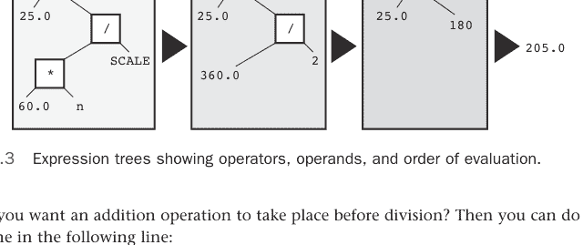

图 5.3 表达式树显示了运算符、操作数和求值顺序。

如果您希望加法运算在除法之前进行？那么您可以像下面这行代码所做的那样操作：

```
flour = (25.0 + 60.0 * n) / SCALE;
```

用括号括起来的内容会先执行。在括号内部，适用通常的规则。对于此示例，首先进行乘法，然后进行加法。这就完成了括号内的表达式。现在结果可以除以 SCALE。

表 5.1 总结了迄今为止使用的运算符的规则。 （本书的内页封面提供了涵盖所有运算符的表格。）

### 表 5.1 按优先级递减顺序排列的运算符

| Operators | Associativity |
|---|---|
| () | Left to right |
| + - (unary) | Right to left |
| * / | Left to right |

| Operators | Associativity |
|---|---|
| + - (binary) | Left to right |
| = | Right to left |

请注意，减号的两种用法具有不同的优先级，加号的两种用法也是如此。结合性列告诉您运算符与其操作数是如何关联的。例如，一元减号与它右侧的量相关联，在除法中，左操作数被右操作数除。

## 优先级和求值顺序

运算符优先级为确定表达式中求值顺序提供了重要的规则，但它并不一定确定完整的顺序。C 将一些选择留给实现。考虑以下语句：

```
y = 6 * 12 + 5 * 20;
```

优先级规定了当两个运算符共享一个操作数时求值的顺序。例如，12 同时是 * 运算符和 + 运算符的操作数，优先级说明乘法先进行。同样，优先级说明 5 应该相乘，而不是相加。简而言之，乘法 6 * 12 和 5 * 20 在任何加法之前进行。优先级没有确定的这两个乘法中哪一个先发生。C 将这种选择留给实现，因为一种选择可能对一种硬件更有效，而另一种选择可能在另一种硬件上效果更好。在任何情况下，表达式都化简为 72 + 100，因此这种选择不会影响此特定示例的最终值。“但是，”你说，“乘法从左到右关联。这难道不意味着最左边的乘法先执行吗？” （也许你不会这么说，但有些人会这么说。）关联规则适用于共享操作数的运算符。例如，在表达式 12 / 3 * 2 中，/ 和 * 运算符具有相同的优先级，共享操作数 3。因此，在这种情况下，左到右规则适用，表达式化简为 4 * 2，即 8。 （从右到左则得到 12 / 6，即 2。这里选择很重要。）在前面的示例中，两个 * 运算符没有共享公共操作数，因此左到右规则不适用。

## 尝试规则

让我们在更复杂的示例——清单 5.7 上尝试这些规则。

### 清单 5.7 The rules.c 程序

```
/* rules.c -- precedence test */
#include <stdio.h>
int main(void)
{
    int top, score;

    top = score = -(2 + 5) * 6 + (4 + 3 * (2 + 3));
    printf("top = %d, score = %d\n", top, score);

    return 0;
}
```

这个程序会打印什么值？先算出来，然后运行程序或阅读以下描述来检查你的答案。

首先，括号具有最高的优先级。-(2 + 5) * 6 中的括号或 (4 + 3 * (2 + 3)) 中的括号先求值取决于实现，如上所述。对于此示例，任何一种选择都会得到相同的结果，所以我们先取左边。括号的高优先级意味着在子表达式 -(2 + 5) * 6 中，你先求值 (2 + 5)，得到 7。接下来，将一元减号运算符应用于 7 得到 -7。现在表达式是

```
top = score = -7 * 6 + (4 + 3 * (2 + 3))
```

下一步是求值 2 + 3。表达式变为

```
top = score = -7 * 6 + (4 + 3 * 5)
```

接下来，因为括号内的 * 优先于 +，表达式变为

```
top = score = -7 * 6 + (4 + 15)
```

然后

```
top = score = -7 * 6 + 19
```

将 -7 乘以 6 得到以下表达式：

```
top = score = -42 + 19
```

然后加法使其变为

```
top = score = -23
```

现在 score 被赋值为 -23，最后 top 得到值 -23。请记住，= 运算符从右到左关联。

## 一些额外的运算符

C 有大约 40 个运算符，但有些使用得比其他的多。刚刚介绍的运算符是最常见的，但让我们再添加四个有用的运算符。

## sizeof 运算符和 size_t 类型

你在第 3 章“数据和 C”中见过 sizeof 运算符。为了回顾，sizeof 运算符返回其操作数的大小，以字节为单位。 （请记住，C 字节定义为 char 类型使用的大小。过去，这通常是 8 位，但某些字符集可能使用更大的字节。）操作数可以是特定的数据对象，例如变量名，也可以是类型。如果是类型，例如 float，则操作数必须用括号括起来。清单 5.8 中的示例展示了这两种形式。

### 清单 5.8 The sizeof.c 程序

```
// sizeof.c -- uses sizeof operator
// uses C99 %z modifier -- try %u or %lu if you lack %zd
#include <stdio.h>
int main(void)
{
    int n = 0;
    size_t intsize;

    intsize = sizeof (int);
    printf("n = %d, n has %zd bytes; all ints have %zd bytes.\n",
           n, sizeof n, intsize );

    return 0;
}
```

C 规定 sizeof 返回类型为 size_t 的值。这是一个无符号整数类型，但不是全新的类型。相反，正如你可能从上一章回忆的那样，它是基于标准类型定义的。C 有一个 typedef 机制（在第 14 章“结构和其他数据形式”中进一步讨论），让你为现有类型创建别名。例如，

```
typedef double real;
```

使 real 成为 double 的另一个名称。现在你可以声明 real 类型的变量：

```
real deal;  // using a typedef
```

编译器会看到单词 real，回想起 typedef 语句使 real 成为 double 的别名，并将 deal 创建为 double 类型变量。类似地，C 头文件系统可以使用 typedef 使 size_t 在一个系统上成为 unsigned int 的同义词，在另一个系统上成为 unsigned long。因此，当你使用 size_t 类型时，编译器将为你的系统替换可用的标准类型。

C99 更进一步，提供 %zd 作为用于显示 size_t 值的 printf() 格式说明符。如果你的系统未实现 %zd，你可以尝试改用 %u 或 %lu。

```
154
154 seconds is 2 minutes, 34 seconds.
Enter next value (<=0 to quit):
567
567 seconds is 9 minutes, 27 seconds.
Enter next value (<=0 to quit):
0
Done!
```

清单 5.2 使用计数器控制 while 循环。当计数器超过给定大小时，循环退出。清单 5.9 则使用 scanf() 为变量 sec 获取新值。只要值是正数，循环就继续。当用户输入零或负值时，循环退出。两种情况下的重要设计点是，每个循环周期都会修改正在测试的变量的值。

负数怎么办？在 C99 确定整数除法的“向零截断”规则之前，有几种可能性。但有了该规则，你就会在第一个操作数为负时得到负的模数，否则得到正的模数：

11 / 5 is 2, and 11 % 5 is 1

11 / -5 is -2, and 11 % -2 is 1

-11 / -5 is 2, and -11 % -5 is -1

-11 / 5 is -2, and -11 % 5 is -1

如果你的系统显示不同的行为，它还没有跟上 C99 标准。无论如何，标准在效果上说，如果 a 和 b 是整数值，你可以通过从 a 中减去 (a/b)*b 来计算 a%b。例如，你可以这样求值 -11%5：

```
-11 - (-11/5) * 5 = -11 -(-2)*5 = -11 -(-10) = -1
```

## 自增和自减运算符：++ 和 --

自增运算符执行一个简单的任务；它将操作数的值增加 1。该运算符有两种变体。第一种变体将 ++ 放在受影响变量之前；这是前缀模式。第二种变体将 ++ 放在受影响变量之后；这是后缀模式。两种模式在递增发生的确切时间上有所不同。我们先解释相似之处，然后再回到这种差异。清单 5.10 中的简短示例展示了自增运算符的工作方式。

### 清单 5.10 The add_one.c 程序

```
/* add_one.c -- incrementing: prefix and postfix */
#include <stdio.h>
int main(void)
{
```


```
int ultra = 0, super = 0;

while (super < 5)
{
    super++;
    ++ultra;
    printf("super = %d, ultra = %d \n", super, ultra);
}

return 0;
}
```

运行 add_one.c 会产生以下输出：

```
super = 1, ultra = 1
super = 2, ultra = 2
super = 3, ultra = 3
super = 4, ultra = 4
super = 5, ultra = 5
```

该程序同时对五进行了两次计数。你可以通过用以下内容替换两个自增语句得到相同的结果：

```
super = super + 1;
ultra = ultra + 1;
```

这些语句简单明了。为什么要费心创建一个，甚至两个缩写呢？一个原因是紧凑的形式使你的程序更整洁、更容易跟随。这些运算符为你的程序增添了一种优雅的外观，令人赏心悦目。例如，你可以这样重写 shoes2.c 的一部分（清单 5.2）：

```
shoe = 3.0;
while (shoe < 18.5)
{
    foot = SCALE * size + ADJUST;
    printf("%10.1f %20.2f inches\n", shoe, foot);
    ++shoe;
}
```

然而，你仍然没有充分利用自增运算符。你可以这样缩短该片段：

```
shoe = 2.0;
while (++shoe < 18.5)
{
    foot = SCALE*shoe + ADJUST;
    printf("%10.1f %20.2f inches\n", shoe, foot);
}
```

在这里，你将自增过程和 while 比较合并到一个表达式中。这种构造在 C 中非常常见，值得仔细研究。

首先，这种构造是如何工作的？很简单。shoe 的值先增加 1，然后与 18.5 比较。如果它小于 18.5，则大括号之间的语句执行一次。然后 shoe 再次增加 1，循环重复，直到 shoe 变得太大。我们将 shoe 的初始值从 3.0 改为 2.0，以补偿 shoe 在 foot 的首次求值之前被自增（参见图 5.4）。

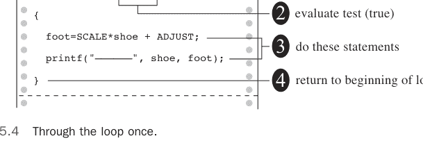

图 5.4 循环一次。

其次，这种方法有什么好处？它更紧凑。更重要的是，它将控制循环的两个过程集中在同一位置。主要过程是测试：是否继续？在本例中，测试是检查鞋码是否小于 18.5。次要过程改变测试的一个元素；在本例中，鞋码被增加。

假设你忘记改变鞋码。那么 shoe 始终小于 18.5，循环将永远不会结束。计算机将不断输出一模一样的行，被困在可怕的无限循环中。最终，你会对输出失去兴趣，不得不以某种方式终止程序。将循环测试和循环更改放在一个位置，而不是分开的位置，有助于你记住更新循环。

一个缺点是，在单个表达式中合并两个操作可能会使代码更难理解，并更容易出现计数错误。

自增运算符的另一个优点是它通常会产生稍微更高效的机器语言代码，因为它类似于实际的机器语言指令。然而，随着厂商生产出更好的 C 编译器，这种优势可能会消失。一个聪明的编译器可以识别 x = x + 1 可以与 ++x 相同处理。

最后，这些运算符还有一个额外的特性，在某些微妙的情况下可能很有用。要了解这个特性是什么，请尝试运行清单 5.11 中的程序。

## prefix

```
q = 2*++a;
```

首先，将 a 增加 1；
然后，将 a 乘以 2 并赋给 q

## postfix

```
q = 2*a++;
```

首先，将 a 乘以 2，赋给 q
然后，将 a 增加 1

图 5.5 前缀和后缀。

也许更明智的做法是避免使用前缀或后缀形式会产生差异的代码。例如，而不是

```
b = ++i;  // 如果使用 i++，b 的结果会不同
```

使用

```
++i;  // 第 1 行
b = i;  // b 的结果与在第 1 行使用 i++ 相同
```

然而，有时做得有点鲁莽更有趣，所以本书并不总是遵循这种明智的建议。

## 自减：--

对于每种形式的自增运算符，都有相应的自减运算符。代替 ++，使用 --：

```
--count;  // 自减运算符的前缀形式
count--;  // 自减运算符的后缀形式
```

清单 5.12 说明了计算机可以成为出色的抒情诗人。

### 清单 5.12 bottles.c 程序

```
#include <stdio.h>
#define MAX 100
int main(void)
{
    int count = MAX + 1;
    while (--count > 0) {
        printf("%d bottles of spring water on the wall, "
"%d bottles of spring water!\n", count, count);
        printf("Take one down and pass it around,\n");
        printf("%d bottles of spring water!\n\n", count - 1);
    }

return 0;
}
```

输出开始如下：

```
100 bottles of spring water on the wall, 100 bottles of spring water!
Take one down and pass it around,
99 bottles of spring water!

99 bottles of spring water on the wall, 99 bottles of spring water!
Take one down and pass it around,
98 bottles of spring water!
```

它继续进行并以这种方式结束：

```
1 bottles of spring water on the wall, 1 bottles of spring water!
Take one down and pass it around,
0 bottles of spring water!
```

显然，这位出色的抒情诗人对复数有问题，但这可以通过使用第 7 章的条件运算符来修复。

顺便说一下，> 运算符表示“大于”。像 <（“小于”）一样，它是一个关系运算符。你将在第 6 章“C 控制语句：循环”中更详细地了解关系运算符。

## 优先级

自增和自减运算符具有非常高的结合优先级；只有括号更高。因此，x*y++ 表示 (x)*(y++)，而不是 (x*y)++，这很幸运，因为后者是无效的。自增和自减运算符作用于一个变量（或更一般地，一个可修改的左值），而组合 x*y 本身不是可修改的左值，尽管其部分是。

不要将这两个运算符的优先级与求值顺序混淆。假设你有以下内容：

```
y = 2;
n = 3;
nextnum = (y + n++)*6;
```

nextnum 得到什么值？代入值得到

```
nextnum = (2 + 3)*6 = 5*6 = 30
```

只有在 n 被使用之后，它才会被增加到 4。优先级告诉我们 ++ 只附加到 n，而不是 y + n。它还告诉我们在求值表达式时何时使用 n 的值，但自增运算符的性质决定了何时更改 n 的值。

当 n++ 是表达式的一部分时，你可以认为它的意思是“使用 n；然后递增它”。另一方面，++n 的意思是“递增 n；然后使用它”。

## 不要太聪明

如果你试图一次做太多事情，使用自增运算符可能会让你上当。例如，你可能会认为可以通过用以下 while 循环替换 squares.c 程序（清单 5.4）中的 while 循环来改进打印整数及其平方的程序：

```
while (num < 21)
{
    printf("%10d %10d\n", num, num*num++);
}
```

这看起来合理。你打印 num，将其乘以自身得到平方，然后将 num 增加 1。事实上，这个程序在某些系统上甚至可能有效，但并非所有系统。问题是当 printf() 去获取打印的值时，它可能会先求值最后一个参数，并在处理到其他参数之前递增 num。因此，它可能不是打印

5          25

而是打印

6          25

它甚至可能从右到左工作，对最右边的 num 使用 5，对接下来的两个使用 6，导致以下输出：

6          30

在 C 中，编译器可以选择先求值函数的哪个参数。这种自由度提高了编译器效率，但如果你在函数参数上使用自增运算符，可能会引起麻烦。

另一个可能的麻烦来源是这样的语句：

```
ans = num/2 + 5*(1 + num++);
```

同样，问题在于编译器可能不会按你想象的顺序执行操作。你会认为它会先找到 num/2，然后继续，但它可能会先做最后一项，增加 num，并在 num/2 中使用新值。没有任何保证。


```
8;
3 + 4;
```

然而，这些语句对你的程序没有任何作用，不能算是合理的语句。更典型的是，语句改变值并调用函数：

```
x = 25;
++x;
y = sqrt(x);
```

尽管一条语句（至少是一条合理的语句）是一个完整的指令，但并非所有完整指令都是语句。考虑下面的语句：

```
x = 6 + (y = 5);
```

其中，子表达式 y = 5 是一个完整指令，但它只是语句的一部分。因为完整指令不一定是语句，所以需要分号来标识真正是语句的指令。

到目前为止，你已经遇到了五种语句（不算空语句）。清单5.13给出了一个使用这五种语句的简短示例。

### 清单5.13 addemup.c 程序

```c
/* addemup.c -- five kinds of statements */
#include <stdio.h>
int main(void)                /* finds sum of first 20 integers */
{
    int count, sum;            /* declaration statement          */

    count = 0;                 /* assignment statement           */
    sum = 0;                   /* ditto                          */
    while (count++ < 20)       /* while                          */
        sum = sum + count;     /* statement                      */
    printf("sum = %d\n", sum); /* function statement             */

    return 0;                  /* return statement               */
}
```

让我们来讨论一下清单5.13。到现在，你对声明语句应该已经很熟悉了。不过，我们要提醒你，声明语句确立了变量的名称和类型，并为它们预留内存位置。注意，声明语句不是表达式语句。也就是说，如果从声明中移除分号，你得到的东西既不是表达式，也没有值：

```c
int port                    /* not an expression, has no value */
```

赋值语句是许多程序的主力；它将一个值赋给变量。它由变量名、赋值运算符（=）、表达式和分号组成。注意，这个特定的 while 语句内部包含一条赋值语句。赋值语句是表达式语句的一个例子。

函数语句使函数执行其功能。在本例中，调用 printf() 函数来打印一些结果。while 语句有三个不同的部分（见图5.6）。首先是关键字 while。然后在括号内是测试条件。最后，是在条件满足时执行的语句。循环中只包含一条语句。它可以是一个简单语句，就像本例中那样，此时无需花括号来标记；或者可以是一个复合语句，像前面一些例子那样，此时需要花括号。稍后你就会读到关于复合语句的内容。

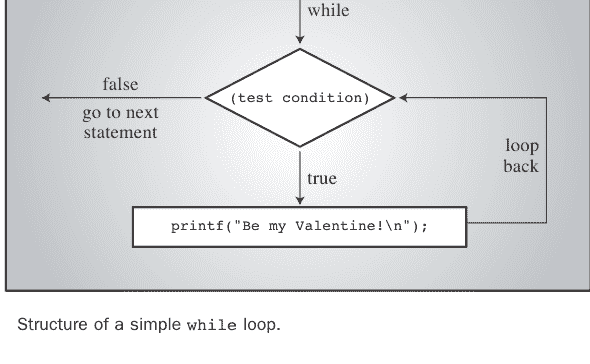

图5.6 简单while循环的结构。

while 语句属于一类有时被称为结构化语句的语句，因为它们具有比简单赋值语句更复杂的结构。在后面的章节中，你还会遇到许多其他类型的结构化语句。

return 语句终止函数的执行。

## 副作用和序列点

现在介绍一点更多的C术语：副作用指的是对数据对象或文件的修改。例如，语句的副作用

```c
states = 50;
```

是将 states 变量设置为 50。副作用？这看起来更像是主要意图！然而，从C语言的角度来看，主要意图是求表达式的值。给C表达式 4 + 6，C会求出值为10。给它表达式 states = 50，C求出值为50。求那个表达式的值具有将 states 变量改为50的副作用。递增和递减运算符，和赋值运算符一样，具有副作用，并且主要因其副作用而被使用。

类似地，当你调用 printf() 函数时，它显示信息这一事实就是一个副作用。（回忆一下，printf() 的值是显示的项数。）

序列点是程序执行中的一个点，在该点上所有副作用都在进入下一步之前被求值。在C中，语句中的分号标记一个序列点。这意味着语句中由赋值运算符、递增运算符和递减运算符所做的所有改变，必须在程序进入下一条语句之前发生。我们将在后面章节讨论的一些运算符也有序列点。此外，任何完整表达式的结束都是一个序列点。

什么是完整表达式？完整表达式是不是更大表达式的子表达式的表达式。完整表达式的例子包括表达式语句中的表达式，以及作为 while 循环测试条件的表达式。

序列点有助于澄清后缀递增发生的时机。例如，考虑下面的代码：

```c
while (guests++ < 10)
    printf("%d \n", guests);
```

有时C新手会认为，“先使用值然后再递增”在此上下文中意味着在 printf() 语句中使用 guests 之后再递增 guests。然而，表达式 guests++ < 10 是一个完整表达式，因为它是 while 循环的测试条件，所以该表达式的结尾是一个序列点。因此，C保证副作用（递增 guests）在程序继续执行 printf() 之前发生。不过，使用后缀形式保证 guests 在与10比较之后才会递增。

现在考虑这个语句：

```c
y = (4 + x++) + (6 + x++);
```

表达式 4 + x++ 不是一个完整表达式，所以C不保证在子表达式 4 + x++ 求值后立即递增 x。这里，完整表达式是整个赋值语句，分号标记了序列点，所以C只保证在程序进入下一条语句之前，x 已经被递增了两次。C没有指定 x 是在每个子表达式求值后递增，还是仅在所有表达式求值后才递增，这就是为什么你应该避免这类语句的原因。

## 复合语句（块）

复合语句是通过花括号将两个或更多语句组合在一起的一组语句；它也被称为块。shoes2.c 程序使用块让 while 语句涵盖多个语句。比较下面的程序片段：

```c
/* fragment 1 */
index = 0;
while (index++ < 10)
    sam = 10 * index + 2;
printf("sam = %d\n", sam);
```

```c
/* fragment 2 */
index = 0;
while (index++ < 10)
{
    sam = 10 * index + 2;
    printf("sam = %d\n", sam);
}
```

在片段1中，只有赋值语句包含在 while 循环中。在没有花括号的情况下，while 语句从 while 开始一直到下一个分号。printf() 函数只会在循环结束后被调用一次。

在片段2中，花括号确保两条语句都是 while 循环的一部分，并且在每次执行循环时都调用 printf()。就 while 语句的结构而言，整个复合语句被视为单个语句（见图5.7）。

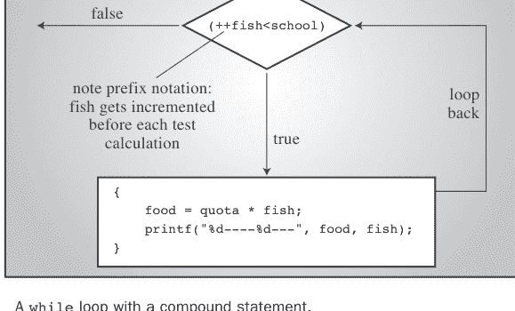

图5.7 带复合语句的while循环。

## 类型转换

语句和表达式通常应只使用一种类型的变量和常量。然而，如果你混用类型，C不像Pascal那样会戛然而止。相反，它使用一组规则自动进行类型转换。这可能会带来方便，但也可能带来危险，尤其是当你不小心混用类型时。（许多Unix系统上的 lint 程序会检查类型“冲突”。许多非Unix的C编译器会在你选择更高的错误级别时报告可能的类型问题。）对类型转换规则至少有一些了解是个好主意。

基本规则如下

- 1. 当出现在表达式中时，char 和 short（无论有符号还是无符号）都会自动转换为 int，或在必要时转换为 unsigned int。（如果 short 与 int 大小相同，unsigned short 比 int 大；这种情况下，unsigned short 转换为 unsigned int。）在 K&R C 中（而非当前C），float 自动转换为 double。由于它们是转换为更大的类型，因此称为提升。
- 2. 在任何涉及两种类型的操作中，两个值都会被转换为这两种类型中级别较高的类型。
- 3. 类型从高到低的排名是：long double, double, float, unsigned long long, long long, unsigned long, long, unsigned int 和 int。一个可能的例外是当 long 和 int 大小相同时，此时 unsigned int 的排名高于 long。short 和 char 类型不出现在这个列表中，因为它们已经被提升为 int 或也许是 unsigned int。
- 4. 在赋值语句中，计算的最终结果会被转换为被赋值变量的类型。这个过程可能产生如规则1所述的提升，也可能产生降级，即值被转换为较低排名的类型。
- 5. 作为函数参数传递时，char 和 short 转换为 int，float 转换为 double。这种自动提升会被函数原型覆盖，如第9章“函数”所述。

提升通常是一个顺利、无波折的过程，但降级可能导致真正的麻烦。原因很简单：较低排名的类型可能不足以容纳完整的数值。例如，一个8位的 char 变量可以容纳整数101，但不能容纳整数22334。

当转换后的值无法放入目标类型时会发生什么？答案取决于所涉及的类型。以下是当赋值无法放入目标类型时的规则：

- 1. 当目标类型是某种无符号整数，且被赋的值是整数时，使值过大的多余位会被忽略。例如，如果目标类型是8位 unsigned char，被赋的值就是原值对256取模的结果。


- **第11行和第14行**——字符变量'c'被转换为整数67，然后与1相加。得到的4字节整数68被截断为1字节并存储在ch中。当使用%c说明符打印时，68被解释为'D'的ASCII码。
- **第12行和第14行**——ch的值被转换为4字节整数(68)以进行乘以2的运算。得到的整数(136)被转换为浮点数以便与f1相加。结果(203.00f)被转换为int并存储在i中。
- **第13行和第14行**——ch的值('D'，即68)被转换为浮点数以进行乘以2.0的运算。i的值(203)被转换为浮点数进行加法运算，结果(339.00)存储在f1中。
- **第15行和第16行**——这里示例尝试了一种降级（demotion）的情况，将ch设置为一个超出范围的数。在忽略多余的位之后，ch最终得到S字符的ASCII码。更具体地说，1107 % 256等于83，即S的ASCII码。
- **第17行和第18行**——这里示例尝试了另一种降级的情况，将ch设置为一个浮点数。在截断发生之后，ch最终得到P字符的ASCII码。

## 强制类型转换运算符

你通常应该避开自动类型转换，尤其是降级，但有时进行转换也很方便，前提是你要小心谨慎。到目前为止我们讨论的类型转换都是自动完成的。然而，你可以要求进行你想要的精确类型转换，或者明确说明你知道自己正在进行类型转换。这种操作的方法称为强制类型转换（cast），即在量的前面加上括号中的目标类型名称。括号和类型名称一起构成强制类型转换运算符。以下是强制类型转换运算符的一般形式：

```
(type)
```

实际想要的类型（如long）替换"type"一词。

考虑下面两行代码，其中mice是一个int变量。第二行包含两个强制转换为int类型的转换。

```
mice = 1.6 + 1.7;
mice = (int) 1.6 + (int) 1.7;
```

第一个示例使用自动转换。首先，1.6和1.7相加得到3.3。然后这个数字通过截断转换为整数3以匹配int变量。在第二个示例中，1.6在加法前被转换为整数(1)，1.7也是如此，因此mice被赋值为1+1，即2。两种形式没有哪种本质上更正确；你需要考虑编程问题的上下文来判断哪种更有意义。

通常，你不应该混合类型（这就是为什么有些语言不允许这样做），但有些时候这样做很有用。C语言的哲学是避免设置障碍，并让你承担不滥用这种自由的责任。

## 小结：C语言中的运算

以下是我们目前讨论过的运算符：

### 赋值运算符：

- `=` — 将右侧的值赋给左侧的变量。

### 算术运算符：

- `+` — 将右侧的值与左侧的值相加。
- `-` — 从左侧的值中减去右侧的值。
- `-` — 作为一元运算符，改变右侧值的符号。
- `*` — 将左侧的值乘以右侧的值。
- `/` — 用左侧的值除以右侧的值。如果两个操作数都是整数，结果会被截断。
- `%` — 左侧的值除以右侧的值时产生余数（仅限整数）。
- `++` — 将右侧变量的值加1（前缀模式），或将左侧变量的值加1（后缀模式）。
- `--` — 与`++`类似，但改为减1。

### 其他运算符：

- `sizeof` — 返回右侧操作数的大小（以字节为单位）。操作数可以是括号中的类型说明符，如`sizeof (float)`，也可以是特定变量、数组等的名称，如`sizeof foo`。
- `(type)` — 作为强制类型转换运算符，将后面的值转换为括号内关键字指定的类型。例如，`(float) 9`将整数9转换为浮点数9.0f。

## 带参数的函数

到目前为止，你已经熟悉了使用函数参数。掌握函数的下一步是学习如何编写带参数的自定义函数。现在让我们预览一下这项技能。（此时，你可能想回顾一下第2章“C语言概述”末尾附近的butler()函数示例；它展示了如何编写没有参数的函数。）清单5.15包含一个pound()函数，用于打印指定数量的#号。（这个符号也被称为数字符号和井号。）该示例还说明了有关类型转换的一些要点。

### 清单5.15 pound.c程序

```c
/* pound.c -- defines a function with an argument  */
#include <stdio.h>
void pound(int n);   // ANSI function prototype declaration
int main(void)
{
    int times = 5;
    char ch = '!';   // ASCII code is 33
    float f = 6.0f;

    pound(times);    // int argument
    pound(ch);       // same as pound((int)ch);
    pound(f);        // same as pound((int)f);

    return 0;
}

void pound(int n)   // ANSI-style function header
{                   // says takes one int argument
    while (n-- > 0)
        printf("#");
    printf("\n");
}
```

运行该程序产生如下输出：

```
#####
#################################
######
```

首先，让我们检查一下函数头：

```
void pound(int n)
```

如果函数不带参数，函数头的括号中会包含关键字void。由于该函数接受一个int类型的参数，括号中包含一个名为n的int变量声明。你可以使用任何符合C语言命名规则的名称。

声明参数会创建一个变量，称为形式参数（formal argument或formal parameter）。在这种情况下，形式参数是名为n的int变量。进行像pound(10)这样的函数调用会将值10赋给n。在这个程序中，调用pound(times)将times的值(5)赋给n。我们说函数调用传递一个值，这个值称为实际参数（actual argument或actual parameter），因此函数调用pound(10)将实际参数10传递给函数，其中10被赋给形式参数（变量n）。也就是说，main()中times变量的值被复制到pound()中新的变量n。

### 注意：实参与形参

虽然实参（argument）和形参（parameter）这两个术语经常被互换使用，但C99文档决定用实参（argument）来指代实际参数，用形参（parameter）来指代形式参数。按照这个约定，我们可以说形参是变量，实参是函数调用提供的值，并被赋给相应的形参。因此，在清单5.15中，times是传给pound()的实参，而n是pound()的形参。类似地，在函数调用pound(times+4)中，表达式times+4的值就是实参。

变量名对于函数来说是私有的。这意味着在一个函数中定义的名称不会与其他地方定义的相同名称冲突。如果你在pound()中使用times而不是n，那将创建一个与main()中的times不同的变量。也就是说，你会拥有两个同名的变量，但程序会跟踪哪个是哪个。

现在来看函数调用。第一个是pound(times)，正如我们所说，它导致times的值5被赋给n。这使函数打印五个#符号和一个换行符。

第二个调用是pound(ch)。这里，ch是char类型。它被初始化为!字符，在ASCII系统中，这意味着ch的数值为33。但对于pound()函数来说，char是错误类型。这就是程序顶部的函数原型发挥作用的地方。原型是一种函数声明，描述函数的返回值及其参数。这个特定的原型说明了关于pound()函数的两点：

- 该函数没有返回值（这就是void部分）。
- 该函数接受一个int类型的参数。

在这种情况下，原型告知编译器pound()期望一个int参数。作为响应，当编译器遇到pound(ch)表达式时，它会自动对ch参数进行类型转换，将其转换为int参数。在这个系统上，参数从存储在1字节中的33变为存储在4字节中的33，因此值33现在以正确的形式用作该函数的参数。类似地，最后一个调用pound(f)也会生成类型转换，将float类型的变量f转换为该参数的正确类型。

在ANSI C之前，C使用不是原型的函数声明；它们只指明名称和返回类型，但不指明参数类型。为了向后兼容，C仍然允许这种形式：

```
void pound();      /* pre-ANSI function declaration */
```

如果在pound.c程序中使用这种形式的声明而不是原型，会发生什么？第一个函数调用pound(times)会正常工作，因为times是int类型。第二个调用pound(ch)也会正常工作，因为在没有原型的情况下，C会自动将char和short参数提升为int。然而，第三个调用pound(f)会失败，因为在没有原型的情况下，float会被自动提升为double，

```
rate = distm / time * S_PER_H;
// time/distance = time per mile
mtime = (double) time / distm;
mmin = (int) mtime / S_PER_M; // find whole minutes
msec = (int) mtime % S_PER_M; // find remaining seconds
printf("You ran %1.2f km (%1.2f miles) in %d min, %d sec.\n", distk, distm, min, sec);
printf("That pace corresponds to running a mile in %d min, ", mmin);
printf("%d sec.\nYour average speed was %1.2f mph.\n", msec, rate);

return 0;
}
```

程序清单 5.16 使用了与前面 min_sec.c 相同的方法将最终时间转换为分钟和秒，但它也进行了类型转换。为什么？因为程序的“秒转换为分钟”部分需要整数参数，而公制距离到英里的转换涉及浮点数。我们使用了强制类型转换运算符来明确这些转换。

说实话，只使用自动转换应该也能写出这个程序。事实上，我们确实这么做了，使用 int 类型的 mtime 来强制将时间计算转换为整数形式。然而，该版本在我们尝试的 11 个系统中的 1 个系统上运行失败。那个编译器（一个古老而过时的版本）没有遵守 C 语言规则。使用强制类型转换不仅能让读者更清楚你的意图，也许还能让编译器更清楚。

下面是一个输出示例：

```
This program converts your time for a metric race
to a time for running a mile and to your average
speed in miles per hour.
Please enter, in kilometers, the distance run.
10.0
Next enter the time in minutes and seconds.
Begin by entering the minutes.
36
Now enter the seconds.
23
You ran 10.00 km (6.21 miles) in 36 min, 23 sec.
That pace corresponds to running a mile in 5 min, 51 sec.
Your average speed was 10.25 mph.
```

## 关键概念

C 使用运算符来提供各种服务。每个运算符可以通过它需要的操作数数量、优先级和结合律来刻画。后两个性质决定了当两个运算符共享一个操作数时，哪个运算符先被应用。运算符与值组合产生表达式，而每个 C 表达式都有一个值。如果你不了解运算符优先级和结合律，你可能会构造出非法的表达式，或者其值与你的意图不同的表达式；这不会提升你作为程序员的名声。

C 允许你编写组合不同数值类型的表达式。但算术运算要求操作数具有相同类型，因此 C 会进行自动转换。然而，良好的编程实践是不依赖自动转换。相反，通过选择正确类型的变量或使用强制类型转换，使你的类型选择明确。这样，你就不会成为意外自动转换的受害者。

## 小结

C 有许多运算符，例如本章讨论的赋值运算符和算术运算符。通常，一个运算符作用于一个或多个操作数以产生一个值。只接受一个操作数的运算符，如负号和 sizeof，称为一元运算符。需要两个操作数的运算符，如加法和乘法运算符，称为二元运算符。

表达式是运算符和操作数的组合。在 C 中，每个表达式都有一个值，包括赋值表达式和比较表达式。运算符优先级规则有助于确定表达式求值时各项如何分组。当两个运算符共享一个操作数时，优先级较高的运算符先被应用。如果运算符优先级相同，则结合律（从左到右或从右到左）决定哪个运算符先被应用。

语句是给计算机的完整指令，在 C 中以分号结尾。到目前为止，你已经接触过声明语句、赋值语句、函数调用语句和控制语句。包含在一对大括号内的一组语句构成复合语句，或称块。一种特殊的控制语句是 while 循环，只要测试条件保持为真，它就会重复执行其中的语句。

在 C 中，许多类型转换是自动进行的。当 char 和 short 类型出现在表达式中，或作为没有函数原型的函数参数时，它们都会被提升为 int 类型。float 类型用作函数参数时会被提升为 double 类型。在 K&R C（而非 ANSI C）中，float 在表达式中使用时也会被提升为 double。当一种类型的值赋给另一种类型的变量时，该值会被转换为与变量相同的类型。当较大的类型转换为较小的类型时（例如 long 转换为 short 或 double 转换为 float），可能会丢失数据。在混合算术的情况下，较小的类型会按照本章概述的规则转换为较大的类型。

当你定义一个带参数的函数时，你需要在函数定义中声明一个变量，即形式参数。然后函数调用中传入的值被赋给这个变量，该变量现在可以在函数中使用。

## 复习题

复习题的答案见附录 A“复习题答案”。

- 1. 假设所有变量都是 int 类型。求出下列每个变量的值：
  - a. `x = (2 + 3) * 6;`
  - b. `x = (12 + 6)/2*3;`
  - c. `y = x = (2 + 3)/4;`
  - d. `y = 3 + 2*(x = 7/2);`

- 2. 假设所有变量都是 int 类型。求出下列每个变量的值：
  - a. `x = (int) 3.8 + 3.3;`
  - b. `x = (2 + 3) * 10.5;`
  - c. `x = 3 / 5 * 22.0;`
  - d. `x = 22.0 * 3 / 5;`

- 3. 计算下列每个表达式：
  - a. `30.0 / 4.0 * 5.0;`
  - b. `30.0 / (4.0 * 5.0);`
  - c. `30 / 4 * 5;`
  - d. `30 * 5 / 4;`
  - e. `30 / 4.0 * 5;`
  - f. `30 / 4 * 5.0;`

- 4. 你怀疑下面这个程序中有一些错误。你能找出它们吗？

```
int main(void)
{
    int i = 1,
    float n;
    printf("Watch out! Here come a bunch of fractions!\n");
    while (i < 30)
        n = 1/i;
        printf("%f", n);
}
```

- 7. 下面这个程序会打印什么？

```
#include <stdio.h>
int main(void)
{
    char c1, c2;
    int diff;
    float num;

    c1 = 'S';
    c2 = 'O';
    diff = c1 - c2;
    num = diff;
    printf("%c%c%c:%d %3.2f\n", c1, c2, c1, diff, num);
    return 0;
}
```

- 8. 下面这个程序会打印什么？

```
#include <stdio.h>
#define TEN 10
int main(void)
{
    int n = 0;

    while (n++ < TEN)
        printf("%5d", n);
    printf("\n");
    return 0;
}
```

- 9. 修改上一个程序，让它改为打印字母 a 到 g。

- 10. 如果下面这些代码片段是某个完整程序的一部分，它们会打印什么？

  - a.

```
int x = 0;

while (++x < 3)
    printf("%4d", x);
```

  - b.

```
int x = 100;

while (x++ < 103)
    printf("%4d\n", x);
printf("%4d\n", x);
```

  - c.

```
char ch = 's';

while (ch < 'w')
{
    printf("%c", ch);
    ch++;
}
printf("%c\n", ch);
```

- 11. 下面这个程序会打印什么？

```
#define MESG "COMPUTER BYTES DOG"
#include <stdio.h>
int main(void)
{
    int n = 0;

    while ( n < 5 )
        printf("%s\n", MESG);
        n++;
    printf("That's all.\n");
    return 0;
}
```

- 12. 编写实现以下操作的语句（或者说，具有以下副作用的语句）：
  - a. 将变量 x 增加 10。
  - b. 将变量 x 增加 1。
  - c. 将 a 与 b 之和的两倍赋给 c。
  - d. 将 a 加上 b 的两倍赋给 c。

- 13. 编写实现以下操作的语句：
  - a. 将变量 x 减少 1。
  - b. 将 n 除以 k 的余数赋给 m。

## 编程练习

- 1. 编写一个程序，将以分钟为单位的时间转换为小时和分钟。使用 `#define` 或 `const` 为 60 创建一个符号常量。使用 `while` 循环允许用户重复输入值，如果输入的时间值小于或等于 0，则终止循环。

- 2. 编写一个程序，要求输入一个整数，然后打印从该值（包括该值）到比它大 10 的值（包括该值）之间的所有整数。（也就是说，如果输入是 5，输出从 5 到 15。）确保每个输出值之间用空格、制表符或换行符分隔。

- 3. 编写一个程序，要求用户输入天数，然后将该值转换为周和天。例如，它会把 18 天转换为 2 周 4 天。按以下格式显示结果：

  `18 days are 2 weeks, 4 days.`

  使用 `while` 循环允许用户重复输入天数值；当用户输入非正值（如 0 或 -20）时终止循环。

- 4. 编写一个程序，要求用户输入以厘米为单位的身高，然后以厘米以及英尺和英寸为单位显示该身高。应允许厘米和英寸为小数，并且程序应允许用户继续输入身高，直到输入非正值。一次示例运行应如下所示：

```
Enter a height in centimeters: 182
182.0 cm = 5 feet, 11.7 inches
Enter a height in centimeters (<=0 to quit): 168.7
168.7 cm = 5 feet, 6.4 inches
Enter a height in centimeters (<=0 to quit): 0
bye
```

- 5. 修改程序 `addemup.c`（程序清单 5.13），该程序用于求前 20 个整数的和。（如果你愿意，可以把 `addemup.c` 看作一个计算你 20 天内能得到多少钱的程序：第一天得到 1 美元，第二天得到 2 美元，第三天得到 3 美元，以此类推。）请修改程序，使其能以交互方式告诉它计算应进行到多远。也就是说，用读入的变量替换 20。

- 6. 现在修改编程练习 5 的程序，使它计算整数的平方和。（如果你愿意，可以这样想：如果你第一天得到 1 美元，第二天得到 4 美元，第三天得到 9 美元，以此类推，你会收到多少钱。这看起来划算多了！）C 没有平方函数，但你可以利用 n 的平方等于 n * n 这一事实。


7. 编写一个程序，要求用户输入一个 `double` 类型的数字，并输出该数字的立方值。使用你自行设计的函数计算并输出该值。`main()` 程序应将输入的值传递给该函数。

8. 编写一个程序，显示执行取模运算的结果。用户应首先输入一个整数作为第二个操作数，该操作数之后保持不变。然后，用户输入要计算取模的数字；当输入 0 或更小的数字时，终止该过程。示例运行如下：

```
This program computes moduli.
Enter an integer to serve as the second operand: 256
Now enter the first operand: 438
438 % 256 is 182

Enter next number for first operand (<= 0 to quit): 1234567
1234567 % 256 is 135
Enter next number for first operand (<= 0 to quit): 0
Done
```

9. 编写一个程序，要求用户输入华氏温度。程序应将温度读取为 `double` 类型的数字，并将其作为参数传递给一个名为 `Temperatures()` 的用户自定义函数。该函数应计算对应的摄氏温度和开尔文温度，并以小数点右侧两位的精度显示这三个温度。每个值都应标明其所代表的温标。以下是将华氏温度转换为摄氏温度的公式：

`Celsius = 5.0 / 9.0 * (Fahrenheit - 32.0)`

开尔文温标通常用于科学领域，它将 0 定义为绝对零度，即可能达到的最低温度。以下是将摄氏温度转换为开尔文温度的公式：

`Kelvin = Celsius + 273.16`

`Temperatures()` 函数应使用 `const` 创建转换公式中出现的三个常量的符号表示。`main()` 函数应使用循环允许用户反复输入温度；当输入 `q` 或其他非数字值时停止。请利用 `scanf()` 返回所读取项目数量这一事实：如果读取到一个数字，它将返回 1；但如果用户输入 `q`，则不会返回 1。`==` 运算符用于测试相等性，因此可以使用它将 `scanf()` 的返回值与 1 进行比较。

## C 控制语句：循环

本章将学习以下内容：

- 关键字：
  - `for`
  - `while`
  - `do while`
- 运算符：
  - `< > >=`
  - `<= != == +=`
  - `*= -= /= %=`
- 函数：
  - `fabs()`
- C 的三种循环结构——`while`、`for` 和 `do while`
- 使用关系运算符构造表达式，以控制这些循环
- 其他几种运算符
- 数组，它们通常与循环一起使用
- 编写具有返回值的函数

强大、智能、灵活且实用！我们大多数人都不会介意被这样形容。使用 C，至少有机会让我们的程序获得这样的评价。关键在于控制程序的流程。根据计算机科学（它是研究计算机的科学，而不是由计算机进行的科学……至少目前还不是），一门优秀的语言应该提供以下三种程序流程形式：

- 执行一系列语句
- 重复执行一系列语句，直到满足某个条件（循环）
- 使用测试在不同的语句序列之间做出选择（分支）

第一种形式你已经很熟悉了；之前的所有程序都由一系列语句组成。`while` 循环是第二种形式的一个例子。本章将更深入地介绍 `while` 循环，以及另外两种循环结构——`for` 和 `do while`。最后一种形式，即在不同的可能行动方案之间进行选择，会使程序更加“智能”，并极大地提高计算机的实用性。遗憾的是，在获得这种能力之前，你还需要再等一章。本章还将介绍数组，因为数组能让你运用新学到的循环知识。此外，本章还会继续讲解函数。现在，让我们先复习一下 `while` 循环。

### 再访 `while` 循环

你已经对 `while` 循环有了一定了解，不过让我们通过一个对从键盘输入的整数求和的程序来复习它（见程序清单 6.1）。这个示例利用 `scanf()` 的返回值来终止输入。

**程序清单 6.1 summing.c 程序**

```
/* summing.c -- sums integers entered interactively */
#include <stdio.h>
int main(void)
{
    long num;
    long sum = 0L;      /* initialize sum to zero  */
    int status;

    printf("Please enter an integer to be summed ");
    printf("(q to quit): ");
    status = scanf("%ld", &num);
    while (status == 1) /* == means "is equal to"  */
    {
        sum = sum + num;
        printf("Please enter next integer (q to quit): ");
        status = scanf("%ld", &num);
    }
    printf("Those integers sum to %ld.\n", sum);

    return 0;
}
```

程序清单 6.1 使用 `long` 类型，以便容纳更大的数字。为了保持一致，程序将 `sum` 初始化为 `0L`（`long` 类型的 0），而不是 `0`（`int` 类型的 0）；尽管 C 的自动转换机制允许你直接使用普通的 `0`。

下面是一次示例运行：

```
Please enter an integer to be summed (q to quit): 44
Please enter next integer (q to quit): 33
Please enter next integer (q to quit): 88
Please enter next integer (q to quit): 121
Please enter next integer (q to quit): q
Those integers sum to 286.
```

### 程序注释

我们先来看看 `while` 循环。该循环的测试条件是下面这个表达式：

```
status == 1
```

`==` 运算符是 C 的相等运算符；也就是说，该表达式用于测试 `status` 是否等于 1。不要将它与 `status = 1` 混淆，后者是将 1 赋值给 `status`。在 `status == 1` 这一测试条件下，只要 `status` 的值为 1，循环就会继续执行。每次循环中，程序都会将 `num` 的当前值加到 `sum` 上，因此 `sum` 始终保存一个不断更新的总和。当 `status` 获得非 1 的值时，循环终止，程序输出 `sum` 的最终值。

为了使程序正常工作，它应在每次循环中为 `num` 获取一个新值，并在每次循环中更新 `status`。程序通过使用 `scanf()` 的两个不同特性来实现这一点。首先，它使用 `scanf()` 尝试读取 `num` 的新值。其次，它利用 `scanf()` 的返回值报告这次尝试是否成功。回顾第 4 章“字符字符串与格式化输入/输出”中的内容，`scanf()` 返回成功读取的项目数量。如果 `scanf()` 成功读取一个整数，它会将该整数放入 `num`，并返回值 1；这个值随后被赋给 `status`。（注意，输入值会被放入 `num`，而不是 `status`。）这同时更新了 `num` 和 `status` 的值，于是 `while` 循环进入下一轮。如果你输入非数字内容，例如 `q`，`scanf()` 找不到可读取的整数，因此其返回值以及 `status` 都将为 0。这会终止循环。输入字符 `q` 由于不是数字，会被放回输入队列；它不会被读取。（实际上，不只是 `q`，任何非数字输入都会终止循环；但要求用户输入 `q`，比要求用户输入非数字内容更简单。）

如果 `scanf()` 在尝试转换值之前遇到问题（例如检测到文件结尾或遇到硬件问题），它会返回特殊值 `EOF`，该值通常被定义为 -1。这个值同样会导致循环终止。

`scanf()` 的这种双重用途解决了循环交互式输入中的一个棘手问题：如何告诉循环何时停止？例如，假设 `scanf()` 没有返回值。那么，每次循环中唯一会发生变化的就是 `num` 的值。你可以利用 `num` 的值终止循环，例如使用 `num > 0`（`num` 大于 0）或 `num != 0`（`num` 不等于 0）作为测试条件，但这样会阻止你输入某些值。可以将循环替换为下面的形式：

```
while (scanf("%ld", &num) == 1)
{
    /* loop actions */
}
```

第二种形式同时以两种不同的方式使用 `scanf()`。首先，如果函数调用成功，它会将一个值放入 `num`。其次，函数的返回值（它是 1 或 0，而不是 `num` 的值）控制着循环。由于循环条件会在每次迭代时进行测试，因此每次迭代都会调用 `scanf()`，从而获取新的 `num` 和新的测试结果。换句话说，C 的语法特性允许你用下面这种简化形式替代标准循环格式：

```
while getting and testing the value succeeds
    process the value
```

现在，让我们更加正式地了解一下 `while` 语句。

### `while` 语句

这是 `while` 循环的一般形式：

```
while (expression)
    statement
```

`statement` 部分可以是一个以分号结尾的简单语句，也可以是一个用花括号括起来的复合语句。

到目前为止，示例中的 `expression` 部分都使用了关系表达式；也就是说，`expression` 是对值进行比较。更一般地说，你可以使用任意表达式。如果 `expression` 为真（或者更准确地说，非零），则执行一次 `statement`，然后再次测试 `expression`。这种测试和执行的循环会一直重复，直到 `expression` 变为假（零）。每次循环都称为一次迭代（见图 6.1）。

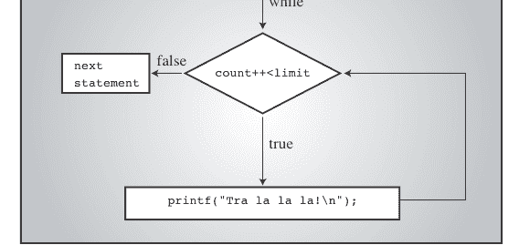

图 6.1 `while` 循环的结构。


## 终止 while 循环

关于 while 循环，有一点至关重要：在构造 while 循环时，必须包含一些改变测试表达式值的操作，使表达式最终变为假。否则，循环永远不会终止。（实际上，你可以使用 `break` 和 `if` 语句来终止循环，但你尚未学习这些内容。）请看下面的例子：

```
index = 1;
while (index < 5)
    printf("Good morning!\n");
```

前面的片段会无限地打印那条令人愉悦的消息。为什么？因为循环内没有任何内容改变 `index` 的初始值 1。现在看看这个：

```
index = 1;
while (--index < 5)
    printf("Good morning!\n");
```

最后一个片段也好不到哪里去。它确实改变了 `index` 的值，但方向错了！至少这个版本最终会终止，当 `index` 降到系统能处理的最负数以下，变成最大的正数时。（第 3 章“数据与 C”中的 `toobig.c` 程序说明了为什么最大的正数加 1 通常会产生一个负数；类似地，最小的负数减 1 通常会产生一个正数。）

## 循环何时终止

重要的是要认识到，仅在计算测试条件时才会决定是终止循环还是继续循环。例如，请考虑程序清单 6.2 中所示的程序。

### 程序清单 6.2 when.c 程序

```
// when.c -- when a loop quits
#include <stdio.h>
int main(void)
{
    int n = 5;
    while (n < 7)            // line 7
    {
        printf("n = %d\n", n);
        n++;                 // line 10
        printf("Now n = %d\n", n);  // line 11
    }
    printf("The loop has finished.\n");
    return 0;
}
```

运行程序清单 6.2 会产生以下输出：

```
n = 5
Now n = 6
n = 6
Now n = 7
The loop has finished.
```

在循环的第二次迭代中，变量 `n` 在第 10 行首次变为 7。然而，程序并未在此处退出。相反，它完成了循环（第 11 行），并且只有在第 7 行的测试条件被第三次求值时才会退出循环。（变量 `n` 在第一次测试时为 5，第二次测试时为 6。）

## while：入口条件循环

while 循环是一种使用入口条件的条件循环。它之所以被称为“条件”循环，是因为循环体语句的执行取决于测试表达式所描述的条件，例如 `(index < 5)`。该表达式是入口条件，因为必须满足条件才能进入循环体。在如下所示的情况下，循环体永远不会进入，因为条件一开始就是假的：

```
index = 10;
while (index++ < 5)
    printf("Have a fair day or better.\n");
```

将第一行改为

```
index = 3;
```

循环就会执行。

## 语法要点

使用 `while` 时，请记住，只有紧跟在测试条件之后的那个简单或复合语句才是循环的一部分。缩进是为了方便读者阅读，而不是为了计算机。程序清单 6.3 说明了如果忘记这一点会发生什么。

### 程序清单 6.3 while1.c 程序

```
/* while1.c -- watch your braces */
/* bad coding creates an infinite loop */
#include <stdio.h>
int main(void)
{
    int n = 0;
    while (n < 3)
```

如前所述，循环在测试条件之后的第一个简单或复合语句处结束。由于第 7 行的测试条件之后紧跟着一个分号，循环在那里结束，因为单独的分号也算作一条语句。第 8 行的 `printf` 语句不属于循环的一部分，因此每次循环中 `n` 都会递增，但只有在退出循环后才会打印 `n`。

在此示例中，测试条件后面跟的是空语句，它什么都不做。在 C 语言中，单独的分号表示空语句。有时，程序员会故意将 `while` 语句与空语句一起使用，因为所有工作都在测试中完成了。例如，假设你想跳过输入，直到遇到第一个不是空白字符或数字的字符。可以使用这样的循环：

```
while (scanf("%d", &num) == 1)
;      /* skip integer input */
```

只要 `scanf()` 读到一个整数，它就会返回 1，循环继续。请注意，为了清晰起见，应将分号（空语句）放在下一行，而不是与 `while` 语句同行。这样在阅读程序时更容易看到空语句，也提醒你这是有意为之。更好的做法是使用下一章讨论的 `continue` 语句。

## 哪个更大：使用关系运算符和表达式

while 循环常常依赖于进行比较的测试表达式，因此比较表达式值得更仔细地研究。这类表达式称为关系表达式，其中出现的运算符称为关系运算符。你已经用过其中几个了，表 6.1 给出了 C 关系运算符的完整列表。该表几乎涵盖了数值关系的所有可能。（数字，即使是复数，也比人类简单。）

表 6.1 关系运算符

| 运算符 | 含义 |
| --- | --- |
| < | 小于 |
| <= | 小于或等于 |
| == | 等于 |
| >= | 大于或等于 |
| > | 大于 |
| != | 不等于 |

关系运算符用于构成关系表达式，这些表达式用于 `while` 语句以及我们稍后将讨论的其他 C 语句中。这些语句检查表达式是真还是假。下面是三个互不相关的语句，其中包含关系表达式的示例。我们希望其含义是清晰的。

```
while (number < 6)
{
    printf("Your number is too small.\n");
    scanf("%d", &number);
}
```

```
while (ch != '$')
{
    count++;
    scanf("%c", &ch);
}
```

```
while (scanf("%f", &num) == 1)
    sum = sum + num;
```

注意，在第二个示例中，关系表达式也可以用于字符。比较时使用的是机器字符编码（我们一直假定是 ASCII）。但是，不能使用关系运算符来比较字符串。第 11 章“字符串和字符串函数”将向你展示字符串比较应当使用什么。

关系运算符也可以用于浮点数。但要注意：在浮点数比较中，应仅限于使用 `<` 和 `>`。原因是舍入误差可能会使两个数在逻辑上相等，但实际上却不相等。例如，3 和 1/3 的乘积当然是 1.0。但如果将 1/3 表示为六位小数，乘积就是 .999999，并不完全等于 1。在 `math.h` 头文件中声明的 `fabs()` 函数，对于浮点数测试很方便。该函数返回浮点数的绝对值——即不带符号的值。例如，你可以像程序清单 6.5 那样测试一个数是否接近期望结果。

### 程序清单 6.5 cmpflt.c 程序

```
// cmpflt.c -- floating-point comparisons
#include <math.h>
#include <stdio.h>
int main(void)
{
    const double ANSWER = 3.14159;
    double response;

    printf("What is the value of pi?\n");
    scanf("%lf", &response);
```

程序清单 6.6 将两个关系表达式的值赋给两个变量。直接地说，它将一个真表达式的值赋给 `true_val`，将一个假表达式的值赋给 `false_val`。运行该程序会产生以下简单输出：

```
true = 1; false = 0
```

啊哈！对于 C 语言来说，真表达式的值为 1，假表达式的值为 0。实际上，有些 C 程序使用以下结构来构造永远运行的循环，因为 1 始终为真：

```
while (1)
{
...
}
```

## 还有什么为真？

既然可以用 1 或 0 作为 `while` 语句的测试表达式，那么可以使用其他数字吗？如果可以，会发生什么？让我们尝试程序清单 6.7 中的程序来做实验。

### 程序清单 6.7 truth.c 程序

```
// truth.c -- what values are true?
#include <stdio.h>
int main(void)
{
    int n = 3;
    while (n)
        printf("%2d is true\n", n--);
    printf("%2d is false\n", n);
    n = -3;
    while (n)
        printf("%2d is true\n", n++);
    printf("%2d is false\n", n);
    return 0;
}
```

以下是结果：

```
3 is true
2 is true
1 is true
0 is false
-3 is true
```


-2 为真
-1 为真
0 为假

第一个循环在 n 为 3、2 和 1 时执行，但在 n 为 0 时终止。类似地，第二个循环在 n 为 -3、-2 和 -1 时执行，但在 n 为 0 时终止。更一般地，所有非零值都被视为真，只有 0 被识别为假。C 对真值有非常宽容的概念！

或者，你可以说 while 循环只要其测试条件求值为非零就会执行。这使得测试条件基于数值而非真/假。记住，关系表达式在为真时求值为 1，在为假时求值为 0，所以此类表达式确实是数值。

许多 C 程序员利用了测试条件的这一特性。例如，短语 while (goats != 0) 可以被 while (goats) 替换，因为表达式 (goats != 0) 和表达式 (goats) 只有在 goats 的值为 0 时才会变为 0 或假。第一种形式对于刚学习语言的人来说可能更清晰，但第二种形式是 C 程序员最常用的习惯用法。你应该努力熟悉 while (goats) 这种形式，使其对你来说变得自然。

## 真值的麻烦

C 宽容的真值概念会导致麻烦。例如，让我们对《图 6.1》中的程序做一个细微的改动，得到《图 6.8》所示的程序。

### Listing 6.8 The trouble.c Program

```
// trouble.c -- misuse of =
// will cause infinite loop
#include <stdio.h>
int main(void)
{
    long num;
    long sum = 0L;
    int status;

    printf("Please enter an integer to be summed ");
    printf("(q to quit): ");
    status = scanf("%ld", &num);
    while (status = 1)
    {
        sum = sum + num;
        printf("Please enter next integer (q to quit): ");
        status = scanf("%ld", &num);
    }
```

```
printf("Those integers sum to %ld.\n", sum);

return 0;
}
```

Listing 6.8 产生的输出如下：

```
Please enter an integer to be summed (q to quit): 20
Please enter next integer (q to quit): 5
Please enter next integer (q to quit): 30
Please enter next integer (q to quit): q
Please enter next integer (q to quit):
Please enter next integer (q to quit):
Please enter next integer (q to quit):
Please enter next integer (q to quit):
```

...然后一直持续下去，直到你杀掉程序——所以也许你不应该真的尝试运行这个例子。

这个麻烦的例子在 while 测试条件中做了一个改动，用 status = 1 替换了 status == 1。第二个语句是赋值语句，所以它给 status 赋值为 1。此外，赋值语句的值是左边的取值，所以 status = 1 的数值值为 1。因此在实际操作上，while 循环等同于使用 while (1); 也就是说，它是一个永不退出的循环。你输入 q，status 被设为 0，但循环测试会把 status 重置为 1 并开始新一轮。

你可能会想知道，为什么程序一直循环，用户在输入 q 之后却没有机会再输入任何内容。当 scanf() 无法读取指定形式的输入时，它会把不符合规范的输入留在原地以便下次读取。当 scanf() 尝试把 q 读作整数并失败时，它会留下 q。在下一轮循环中，scanf() 会尝试从上次离开的地方继续读取——也就是 q。再次，scanf() 无法把 q 读作整数，所以这个例子不仅设置了一个无限循环，还创建了一个无限失败的循环，这是一个令人望而生畏的概念。幸运的是，计算机目前还没有感情。让计算机永远遵循愚蠢的指令，对它来说并不比成功预测未来 10 年的股市更好或更坏。

不要用 = 代替 ==。某些计算机语言（例如 BASIC）确实对赋值运算符和关系相等运算符使用相同的符号，但这两个操作完全不同（参见图 6.2）。赋值运算符把值赋给左变量。而关系相等运算符则检查左右两侧是否已经相等。它不会改变左手变量的值，如果存在的话。这里有一个例子：

```
canoes = 5      ←Assigns the value 5 to canoes
canoes == 5     ←Checks to see whether canoes has the value 5
```

要小心使用正确的运算符。编译器会让你使用错误的形式，从而产生意想不到的结果。（然而，由于人们经常误用 =，今天大多数编译器都会发出警告，提示你可能不小心使用了它。）如果比较的值之一是常量，你可以把它放在比较的左边以帮助捕获错误：

```
5 = canoes      ←syntax error
5 == canoes     ←Checks to see whether canoes has the value 5
```

要点是，给常量赋值是非法的，所以编译器会把赋值运算符的使用标记为语法错误。许多实践者在使用构造相等性测试的表达式时把常量放在前面。

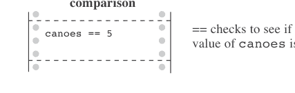

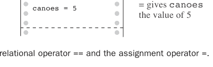

Figure 6.2  The relational operator == and the assignment operator =.

总之，关系运算符用于形成关系表达式。关系表达式在为真时取值为 1，在为假时取值为 0。诸如 while 和 if 之类的语句通常使用关系表达式作为测试，但可以使用任何表达式作为测试，非零值被识别为“真”，零值被识别为“假”。

## 新的 _Bool 类型

传统上，代表真/假值的变量在 C 中由类型 int 表示。C99 增加了专门用于此类变量的 _Bool 类型。该类型以乔治·布尔命名，这位英国数学家开发了用于表示和解决逻辑问题的代数系统。在编程中，表示真或假的变量被称为布尔变量，因此 _Bool 是布尔变量的 C 类型名。_Bool 变量只能取值为 1（真）或 0（假）。如果你尝试给 _Bool 变量赋一个非零数值，变量会被设为 1，这反映了 C 认为任何非零值都是真的。

### Listing 6.9 The boolean.c Program

```
// boolean.c -- using a _Bool variable
#include <stdio.h>
int main(void)
{
    long num;
    long sum = 0L;
    _Bool input_is_good;

    printf("Please enter an integer to be summed ");
    printf("(q to quit): ");
    input_is_good = (scanf("%ld", &num) == 1);
    while (input_is_good)
    {
        sum = sum + num;
        printf("Please enter next integer (q to quit): ");
        input_is_good = (scanf("%ld", &num) == 1);
    }
    printf("Those integers sum to %ld.\n", sum);

    return 0;
}
```

注意代码如何把比较的结果赋给变量：

```
input_is_good = (scanf("%ld", &num) == 1);
```

这说得通，因为 == 运算符返回的值要么是 1 要么是 0。顺便说一下，包围 == 表达式的括号不是必需的，因为 == 运算符的优先级高于 =；然而，它们可能使代码更易读。还要注意变量名称的选择使 while 循环测试易于理解：

```
while (input_is_good)
```

C99 还提供了 stdbool.h 头文件。该头文件使 bool 成为 _Bool 的别名，并定义 true 和 false 为 1 和 0 的符号常量。包含此头文件允许你编写与 C++ 兼容的代码，C++ 将 bool、true 和 false 定义为关键字。

如果你的系统尚未支持 _Bool 类型，你可以用 int 替换 _Bool，示例将同样工作。

## 关系运算符的优先级

关系运算符的优先级低于算术运算符，包括 + 和 –，而高于赋值运算符。这意味着，例如，

```
x > y + 2
```

与

```
x > (y + 2)
```

相同。它还意味着

```
x = y > 2
```

意味着

```
x = (y > 2)
```

换句话说，如果 y 大于 2，则 x 被赋值为 1，否则为 0；x 并未被赋予 y 的值。

关系运算符的优先级高于赋值运算符。因此，

```
x_bigger = x > y;
```

意味着

```
x_bigger = (x > y);
```

关系运算符本身被组织成两个不同的优先级。

较高优先级组：< <= > >=
较低优先级组：== !=

像大多数其他运算符一样，关系运算符从左到右结合。因此，

```
ex != wye == zee
```

与

```
(ex != wye) == zee
```

相同。首先，C 检查 ex 和 wye 是否不相等。然后，将得到的值 1 或 0（真或假）与 zee 的值进行比较。我们不期望使用这种构造，但我们认为有责任指出这种旁注。

表 6.2 显示了迄今为止引入的运算符的优先级，附录 B 参考部分 II“ C 运算符”中提供了所有运算符的完整优先级排名。


### 表6.2 运算符优先级

| 运算符（按优先级从高到低） | 结合性 |
|---|---|
| () | 从左到右 |
| - + ++ -- sizeof | 从右到左 (类型) (所有一元运算符) |
| * / % | 从左到右 |
| + - | 从左到右 |
| < > <= >= | 从左到右 |
| == != | 从左到右 |
| = | 从右到左 |

## 小结：while语句

### 关键字：
```
while
```

### 一般说明：
while语句创建一个循环，该循环会重复执行，直到测试表达式变为假（或0）。while语句是入口条件循环——也就是说，在循环执行之前就已经决定是否再执行一次循环。因此，该循环有可能一次都不执行。该形式中的语句部分可以是简单语句，也可以是复合语句。

### 格式：
```
while (expression)
    statement
```
语句部分将重复执行，直到表达式变为假或0。

### 示例：
```
while (n++ < 100)
    printf(" %d %d\n",n, 2 * n + 1); // single statement
```

```
while (fargo < 1000)
{
    // compound statement
    fargo = fargo + step;
    step = 2 * step;
}
```

```
return 0;
}
```

尽管清单6.10中使用的形式运行良好，但它并不是这种情况下的最佳选择，因为定义循环的操作并没有全部集中在一起。让我们详细说明这一点。

设置一个重复固定次数的循环涉及三个操作：
- 1. 必须初始化计数器。
- 2. 将计数器与某个限制值进行比较。
- 3. 每次遍历循环时递增计数器。

while循环条件负责比较。递增运算符负责递增。在清单6.10中，递增操作在循环末尾进行。这种选择使得有可能不小心漏掉递增操作。因此，更好的做法是使用`count++ <= NUMBER`将测试和更新操作合并到一个表达式中，但计数器的初始化仍然在循环外部完成，这就可能让人忘记初始化计数器。经验告诉我们，可能发生的事情最终都会发生，所以我们来看一种避免这些问题的控制语句。

## for循环

for循环将这三个操作（初始化、测试和更新）集中在一处。通过使用for循环，你可以用清单6.11所示的程序替换前面的程序。

程序清单6.11 sweetie2.c程序

```
// sweetie2.c -- a counting loop using for
#include <stdio.h>
int main(void)
{
    const int NUMBER = 22;
    int count;

    for (count = 1; count <= NUMBER; count++)
        printf("Be my Valentine!\n");

    return 0;
}
```

关键字for后面的括号中包含三个由两个分号分隔的表达式。第一个表达式是初始化。它只在for循环第一次

清单6.12打印整数1到6及其立方值。

```
n  n cubed
1  1
2  8
3  27
4  64
5  125
6  216
```

for循环的第一行立刻告诉了我们关于循环参数的所有信息：num的起始值、num的最终值以及每次循环时num增加的数量。

## 使用for实现灵活性

尽管for循环看起来类似于FORTRAN的DO循环、Pascal的FOR循环和BASIC的FOR...NEXT循环，但它比它们都灵活得多。这种灵活性源于for规范中三个表达式的使用方式。到目前为止的示例都用第一个表达式初始化计数器，第二个表达式表示计数器的限制，第三个表达式使计数器加1。这样使用时，C语言的for语句与我们提到的其他语言非常相似。然而，它还有更多的可能性；这里有九种变体：
- 你可以使用递减运算符来倒数而不是正数：

```
/* for_down.c */
#include <stdio.h>
int main(void)
{
    int secs;

    for (secs = 5; secs > 0; secs--)
        printf("%d seconds!\n", secs);
    printf("We have ignition!\n");
    return 0;
}
```

输出如下：
```
5 seconds!
4 seconds!
3 seconds!
2 seconds!
1 seconds!
We have ignition!
```

4        70
5        75

注意，测试涉及的是y，而不是x。for循环控制中的三个表达式都可以使用不同的变量。（注意，尽管这个示例是有效的，但它没有显示出良好的风格。如果不把更新过程与代数计算混在一起，程序会更清晰。）
- 你甚至可以将一个或多个表达式留空（但不要省略分号）。只需确保循环体本身包含某个最终能使循环终止的语句。

```
/* for_none.c */
#include <stdio.h>
int main(void)
{
    int ans, n;

    ans = 2;
    for (n = 3; ans <= 25; )
        ans = ans * n;
    printf("n = %d; ans = %d.\n", n, ans);
    return 0;
}
```

输出如下：

n = 3; ans = 54.

循环将n的值保持在3。变量ans从值2开始，然后增加到6和18，最终得到54。（因为18小于25，所以for循环还会再执行一次迭代，将18乘以3得到54。）顺便说一句，中间控制表达式为空时被视为真，因此下面的循环将永远运行：
```
for (; ; )
    printf("I want some action\n");
```
- 第一个表达式不一定非要是初始化变量。它也可以是一个某种形式的printf()语句。只需记住，第一个表达式在执行循环的任何其他部分之前，只被求值或执行一次。

```
/* for_show.c */
#include <stdio.h>
int main(void)
{
    int num = 0;

    for (printf("Keep entering numbers!\n"); num != 6; )
        scanf("%d", &num);
```
```
printf("That's the one I want!\n");
return 0;
}
```

这个片段会先打印一次第一条消息，然后不断接收数字，直到你输入6：
```
Keep entering numbers!
3
5
8
6
That's the one I want!
```
- 循环表达式的参数可以通过循环体内的操作来改变。例如，假设你有一个如下设置的循环：
```
for (n = 1; n < 10000; n = n + delta)
```
如果程序在几次迭代后判断delta太小或太大，循环内的if语句（参见第7章“C控制语句：分支和跳转”）可以改变delta的大小。在交互式程序中，用户可以在循环运行时改变delta。这种调整有点危险；例如，将delta设为0会使你（和循环）陷入困境（无法继续）。

简而言之，你在选择控制for循环的表达式时拥有的自由度，使这个循环能够做的远不止是执行固定次数的迭代。for循环的实用性还因我们接下来将要讨论的运算符而进一步增强。

## 小结：for语句

### 关键字：
for

### 一般说明：
for语句使用三个由分号分隔的控制表达式来控制循环过程。初始化表达式在任何循环语句执行之前只执行一次。然后对测试表达式进行求值，如果它为真（或非零），则循环执行一次。然后对更新表达式求值，并再次检查测试表达式。for语句是入口条件循环——在遍历循环之前就决定是否再执行一次循环。因此，该循环有可能一次都不执行。该形式中的语句部分可以是简单语句，也可以是复合语句。

### 格式：
```
for (initialize ; test ; update)
    statement
```
循环将重复执行，直到test变为假或0。

### 示例：
```
for (n = 0; n < 10 ; n++)
    printf(" %d %d\n", n, 2 * n + 1);
```

## 更多赋值运算符：+=、-=、*=、/=、%=

C语言有几种赋值运算符。最基本的当然是=，它只是将右侧表达式的值赋给左侧的变量。其他赋值运算符会更新变量。每个运算符的左侧是变量名，右侧是表达式。变量被赋予一个新值，该值等于其旧值根据右侧表达式的值进行调整后的结果。具体如何调整取决于运算符。例如：
```
scores += 20 is the same as scores = scores + 20.
```
```
dimes -= 2 is the same as dimes = dimes - 2.
```
```
bunnies *= 2 is the same as bunnies = bunnies * 2.
```
```
time /= 2.73 is the same as time = time / 2.73.
```
```
reduce %= 3 is the same as reduce = reduce % 3.
```
上面的列表在右侧使用了简单的数字，但这些运算符也适用于更复杂的表达式，例如：
```
x *= 3 * y + 12 is the same as x = x * (3 * y + 12).
```
我们刚才讨论的赋值运算符的优先级与=相同，即低于+或*。这种低优先级体现在最后一个示例中：12先与3 * y相加，然后结果再乘以x。

你并非必须使用这些形式。不过，它们比更长的形式更紧凑，而且可能会生成更高效的机器代码。当你试图将复杂的内容塞进for循环规范中时，组合赋值运算符尤其有用。

## 逗号运算符

逗号运算符扩展了for循环的灵活性，使你能够在单个for循环规范中包含多个初始化或更新表达式。例如，清单6.13展示了一个打印第一类邮资费率的程序。（在撰写本文时，首盎司的费率是46美分，每增加一盎司是20美分。你可以在互联网上查询当前费率。）


# 列表 6.13 postage.c 程序

```
// postage.c -- first-class postage rates
#include <stdio.h>
int main(void)
{
    const int FIRST_OZ = 46; // 2013 rate
    const int NEXT_OZ = 20;  // 2013 rate
    int ounces, cost;

    printf(" ounces   cost\n");
    for (ounces=1, cost=FIRST_OZ; ounces <= 16; ounces++,
        cost += NEXT_OZ)
        printf("%5d   $%4.2f\n", ounces, cost/100.0);

    return 0;
}
```

输出的前五行看起来像这样：

```
ounces  cost
    1  $0.46
    2  $0.66
    3  $0.86
    4  $1.06
```

该程序在初始化和更新表达式中使用了逗号运算符。其在第一个表达式中的存在导致 ounces 和 cost 被初始化。其第二次出现导致 ounces 增加 1，cost 在每次迭代中增加 20（NEXT_OZ 的值）。所有计算都在 for 循环规范中完成（参见图 6.4）。

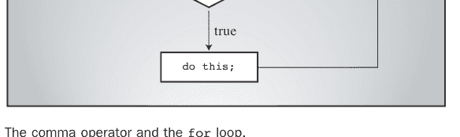

图 6.4 逗号运算符和 for 循环。

逗号运算符并不局限于 for 循环，但它最常在那里使用。该运算符还有另外两个属性。首先，它保证其分隔的表达式按从左到右的顺序求值。换句话说，逗号是一个序列点，因此逗号左侧的所有副作用在程序移动到逗号右侧之前就会发生。因此，ounces 在 cost 之前被初始化。对于此示例，顺序并不重要，但如果 cost 的表达式包含 ounces，则顺序会很重要。例如，假设你有这个表达式：

```
ounces++, cost = ounces * FIRST_OZ
```

这将递增 ounces，然后在第二个子表达式中使用 ounces 的新值。逗号作为序列点保证左子表达式的副作用在右子表达式被求值之前发生。

其次，整个逗号表达式的值是右手成员的值。语句

```
x = (y = 3, (z = ++y + 2) + 5);
```

的效果是首先将 3 赋给 y，将 y 递增到 4，然后将 2 加到 4 上并将结果值 6 赋给 z，接下来将 5 加到 z 上，最后将结果值 11 赋给 x。为什么有人会这样做超出了本书的范围。另一方面，假设你粗心大意并在书写数字时使用逗号表示法：

```
houseprice = 249,500;
```

这不是语法错误。相反，C 将其解释为逗号表达式，其中 houseprice = 249 是左子表达式，500 是右子表达式。因此，整个逗号表达式的值是右手表达式的值，并且左子语句将值 249 赋给 houseprice 变量。因此，其效果与以下代码相同：

```
houseprice = 249;
500;
```

请记住，任何表达式在加上分号后都成为语句，因此 500; 是一个不做任何事情的语句。

另一方面，语句

```
houseprice = (249,500);
```

将 500，即右子表达式的值，赋给 houseprice。

逗号也用作分隔符，因此逗号在

```
char ch, date;
```

和

```
printf("%d %d\n", chimps, chumps);
```

```
time = 1.998047 when terms = 10.
time = 1.999023 when terms = 11.
time = 1.999512 when terms = 12.
time = 1.999756 when terms = 13.
time = 1.999878 when terms = 14.
time = 1.999939 when terms = 15.
```

你可以看到，虽然你不断添加更多项，总和似乎趋于平稳。事实上，数学家已经证明，随着项数趋于无穷大，总和趋近于 2.0，就像这个程序所暗示的那样。这里有一个演示。假设你让 S 表示和：

```
S = 1 + 1/2 + 1/4 + 1/8 + ...
```

这里的省略号表示“等等”。然后除以 2 得到

```
S/2 = 1/2 + 1/4 + 1/8 + 1/16 + ...
```

用第二个表达式减去第一个表达式得到

```
S - S/2 = 1 +1/2 -1/2 + 1/4 -1/4 +...
```

除了初始值 1 之外，每个其他值都成对出现，一个为正，一个为负，因此这些项相互抵消，剩下

```
S/2 = 1.
```

然后，两边乘以 2 得到

```
S = 2.
```

从中可以得出一个可能的道德是：在进行复杂的计算之前，先检查一下数学家是否有更简单的方法来做它。

程序本身怎么样？它表明你可以在一个表达式中使用多个逗号运算符。你初始化了 time、power_of_2 和 count。在设置循环条件后，程序本身非常简短。

## 一个退出条件循环：do while

while 循环和 for 循环都是入口条件循环。测试条件在循环的每次迭代之前检查，因此循环中的语句可能永远不执行。C 还有一个退出条件循环，其中条件在循环的每次迭代之后检查，保证语句至少执行一次。这种变体称为 do while 循环。列表 6.15 显示了一个示例。

# 列表 6.15 do_while.c 程序

```
/* do_while.c -- exit condition loop */
#include <stdio.h>
int main(void)
{
    const int secret_code = 13;
    int code_entered;

    do
    {
        printf("To enter the triskaidekaphobia therapy club,\n");
        printf("please enter the secret code number: ");
        scanf("%d", &code_entered);
    } while (code_entered != secret_code);
    printf("Congratulations! You are cured!\n");

    return 0;
}
```

列表 6.15 中的程序在用户输入 13 之前读取输入值。以下是一个示例运行：

To enter the triskaidekaphobia therapy club,
please enter the secret code number: 12
To enter the triskaidekaphobia therapy club,
please enter the secret code number: 14
To enter the triskaidekaphobia therapy club,
please enter the secret code number: 13
Congratulations! You are cured!

使用 while 循环的等效程序会长一些，如列表 6.16 所示。

# 列表 6.16 entry.c 程序

```
/* entry.c -- entry condition loop */
#include <stdio.h>
int main(void)
{
    const int secret_code = 13;
    int code_entered;

    printf("To enter the triskaidekaphobia therapy club,\n");
    printf("please enter the secret code number: ");
    scanf("%d", &code_entered);
    while (code_entered != secret_code)
    {
```

```
printf("To enter the triskaidekaphobia therapy club,\n");
printf("please enter the secret code number: ");
scanf("%d", &code_entered);
}
printf("Congratulations! You are cured!\n");

return 0;
}
```

以下是 do while 循环的一般形式：

```
do
    statement
while ( expression );
```

statement 可以是简单语句或复合语句。请注意，do while 循环本身算作一个语句，因此需要以分号结尾。另请参阅图 6.5。

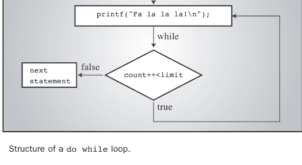

图 6.5 do while 循环的结构。

do while 循环总是至少执行一次，因为测试是在循环体执行后进行的。相比之下，for 循环或 while 循环可能执行零次，因为测试是在执行之前进行的。你应该将 do while 循环的使用限制在需要至少一次迭代的情况下。例如，密码程序可以包含如下伪代码的循环：

```
do
{
    prompt for password
    read user input
} while (input not equal to password);
```

```
int row;
char ch;

for (row = 0; row < ROWS; row++)        /* line 10 */
{
    for (ch = 'A'; ch < ('A' + CHARS); ch++)  /* line 12 */
        printf("%c", ch);
    printf("\n");
}

return 0;
}
```

运行程序会产生以下输出：

```
ABCDEFGHIJ
ABCDEFGHIJ
ABCDEFGHIJ
ABCDEFGHIJ
ABCDEFGHIJ
ABCDEFGHIJ
```

## 程序讨论

从第 10 行开始的 for 循环称为外层循环，而从第 12 行开始的循环称为内层循环，因为它位于另一个循环内部。外层循环以 row 的值为 0 开始，并在 row 达到 6 时终止。因此，外层循环进行六次循环，row 的值从 0 到 5。每次循环中的第一个语句是内层 for 循环。此循环进行 10 次循环，在同一行上打印字符 A 到 J。外层循环的第二个语句是 printf("\n")。此语句开始新行，以便下一次运行内层循环时，输出在新行上。

请注意，对于嵌套循环，内层循环会在外层循环的每次单次迭代中完成其全部迭代范围。在最后一个示例中，内层循环在一行上打印 10 个字符，外层循环创建六行。

## 一个嵌套变体

在前面的示例中，内层循环在外层循环的每个周期中做同样的事情。你可以通过使内层循环的一部分依赖于外层循环，使内层循环在每个周期中表现不同。列表 6.18 例如，通过使内层循环的起始字符依赖于外层循环的周期号，对最后一个程序进行了轻微修改。它还使用更新的注释样式和 const 而不是 #define，以帮助你熟悉两种方法。


# 列表 6.18 rows2.c 程序

```
// rows2.c -- using dependent nested loops
#include <stdio.h>
int main(void)
{
    const int ROWS = 6;
    const int CHARS = 6;
    int row;
    char ch;

    for (row = 0; row < ROWS; row++)
    {
        for (ch = ('A' + row); ch < ('A' + CHARS); ch++)
            printf("%c", ch);
        printf("\n");
    }

    return 0;
}
```

这次的输出如下：

```
ABCDEF
BCDEF
CDEF
DEF
EF
F
```

因为在外层循环的每次循环中都会给 row 加上 'A'，所以 ch 在每一行中都会被初始化为字母表中靠后一个字符。然而测试条件保持不变，因此每一行仍然以 F 结束。这导致每一行打印的字符比上一行少一个。

## 介绍数组

数组是许多程序中的重要特性。它们使你能够以方便的方式存储多个相关信息。我们将在第 10 章“数组和指针”中专门讨论数组，但由于数组经常与循环一起使用，我们现在想先介绍它们。

数组是相同类型的数值序列，例如 10 个 char 或 15 个 int，按顺序存储。整个数组有一个名称，而各个项目或元素则通过整数索引来访问。例如，声明

```
float debts[20];
```

用于标识数组元素的数字称为下标、索引或偏移量。下标必须是整数，并且如前所述，下标从 0 开始。数组元素在内存中彼此相邻存储，如图 6.7 所示。

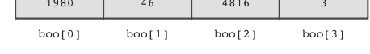

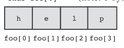

图 6.7 内存中的 char 和 int 数组。

## 使用 for 循环处理数组

数组有很多很多用途。列表 6.19 是一个相对简单的例子。它是一个读取 10 个高尔夫球成绩的程序，这些成绩稍后会被处理。通过使用数组，你避免了为每个成绩发明 10 个不同的变量名的需要。此外，你还可以使用 for 循环来进行读取。该程序随后会报告成绩的总和、平均值以及差点，即平均值与标准成绩或杆数之间的差值。

## 列表 6.19 scores_in.c 程序

```
// scores_in.c -- uses loops for array processing
#include <stdio.h>
#define SIZE 10
#define PAR 72
int main(void)
{
    int index, score[SIZE];
    int sum = 0;
    float average;

    printf("Enter %d golf scores:\n", SIZE);
    for (index = 0; index < SIZE; index++)
        scanf("%d", &score[index]); // read in the ten scores
    printf("The scores read in are as follows:\n");
    for (index = 0; index < SIZE; index++)
        printf("%5d", score[index]); // verify input
    printf("\n");
```

```
for (index = 0; index < SIZE; index++)
    sum += score[index];      // add them up
average = (float) sum / SIZE;    // time-honored method
printf("Sum of scores = %d, average = %.2f\n", sum, average);
printf("That's a handicap of %.0f.\n", average - PAR);

return 0;
}
```

让我们看看列表 6.19 是否有效；然后我们可以做一些评论。以下是输出：

```
Enter 10 golf scores:
99 95 109 105 100
96 98 93 99 97 98
The scores read in are as follows:
99  95  109  105  100   96   98   93   99   97
Sum of scores = 991, average = 99.10
That's a handicap of 27.
```

它有效，所以让我们检查一些细节。首先，注意虽然示例显示输入了 11 个数字，但只读取了 10 个，因为读取循环只读取 10 个值。因为 scanf() 会跳过空白，所以你可以将全部 10 个数字输入在一行中，将每个数字放在单独一行中，或者像本例中一样，使用换行符和空格的混合来分隔输入。 （因为输入是缓冲的，所以数字只有在你按下 Enter 键时才会被发送到程序。）

其次，使用数组和循环比使用 10 个单独的 scanf() 语句和 10 个单独的 printf() 语句来读取和验证 10 个成绩要方便得多。for 循环为使用数组下标提供了一种简单直接的方法。请注意，int 数组的元素像 int 变量一样处理。要读取 int 变量 fue，你会使用 scanf("%d", &fue)。列表 6.19 读取的是 int 元素 score[index]，因此它使用 scanf("%d", &score[index])。

这个例子说明了几个风格要点。首先，使用 #define 指令创建一个显式常量（SIZE）来指定数组的大小是个好主意。你在定义数组和设置循环限制时都会使用这个常量。如果以后需要将程序扩展为处理 20 个成绩，只需将 SIZE 重新定义为 20 即可。你不必更改程序中所有使用数组大小的部分。其次，习惯用法

```
for (index = 0; index < SIZE; index++)
```

是处理大小为 SIZE 的数组的便捷方法。正确获取数组限制很重要。第一个元素的索引为 0，循环通过将 index 设置为 0 开始。因为编号从 0 开始，最后一个元素的元素索引是 SIZE - 1。也就是说，第十个元素是 score[9]。使用测试条件 index < SIZE 就实现了这一点，使得循环中使用的 index 的最后一个值为 SIZE - 1。

第三，一个好的做法是让程序重复或“回显”它刚刚读取的值。这有助于确保程序正在处理你认为的数据。

最后，注意列表 6.19 使用了三个独立的 for 循环。你可能会想知道这是否真的有必要。你能否将一些操作合并到一个循环中？答案是可以，你可以这样做。这会使程序更紧凑。然而，你应该被模块化原则所说服。这个术语背后的思想是程序应该被分解成独立的单元，每个单元执行一项任务。这使得程序更易于阅读。也许更重要的是，模块化使得如果程序的不同部分没有交织在一起，则更容易更新或修改程序。当你足够了解函数时，你可以将每个单元做成一个函数，从而增强程序的模块化。

## 使用函数返回值的一个循环示例

本章的最后一个例子使用一个函数来计算将一个数提高到整数次幂的结果。 （对于认真的数值计算者，math.h 库提供了一个更强大的幂函数 pow()，它允许使用浮点指数。）本次练习的三个主要任务是设计计算答案的算法、用返回答案的函数表达算法，以及提供一种方便的测试函数的方法。

首先，让我们看一个算法。我们将通过将其限制为正整数幂来使函数保持简单。然后，要将 n 提高到 p 次幂，只需将 n 乘以自身 p 次。这是一个循环的自然任务。你可以将变量 pow 设置为 1，然后反复将其乘以 n：

```
for(i = 1; i <= p; i++)
    pow *= n;
```

请记住 *= 运算符将左侧乘以右侧。在第一次循环周期后，pow 为 1 乘以 n，即 n。在第二次周期后，pow 为其先前的值（n）乘以 n，即 n 的平方，以此类推。在这种情况下 for 循环很自然，因为循环在预定次数（在 p 已知后）执行。

现在我们有了算法，我们可以决定使用哪些数据类型。指数 p 是整数，应为类型 int。为了允许 n 及其幂的值有足够的范围，使 n 和 pow 为类型 double。

接下来，让我们考虑如何组装函数。我们需要给函数两个值，函数应返回一个值。为了将信息传递给函数，我们可以使用两个参数，一个 double 和一个 int，指定要将哪个数提高到什么幂。我们如何安排函数向调用程序返回一个值？要编写一个具有返回值的函数，请执行以下操作：

- 1. 当你定义一个函数时，说明它返回的值的类型。
- 2. 使用关键字 return 来指示要返回的值。


例如，我们可以这样做：

```
double power(double n, int p)  // returns a double
{
    double pow = 1;
    int i;

    for (i = 1; i <= p; i++)
        pow *= n;

    return pow;            // return the value of pow
}
```

要声明函数类型，只需在函数名前面加上类型，就像声明变量时所做的那样。关键字 return 使函数向调用函数返回以下值。这里函数返回一个变量的值，但它也可以返回表达式的值。例如，下面是一个有效的语句：

```
return 2 * x + b;
```

该函数将计算表达式的值并返回它。在调用函数中，返回值可以赋给另一个变量，可以用作表达式中的值，可以用作另一个函数的参数——例如 printf(" %f", power(6.28, 3))——也可以被忽略。

现在让我们在程序中使用该函数。为了测试函数，能够向函数提供多个值以查看其反应会很方便。这提示我们设置一个输入循环。自然的选择是 while 循环。你可以使用 scanf() 一次读取两个值。如果成功读取两个值，scanf() 返回值 2，因此你可以通过将 scanf() 的返回值与 2 进行比较来控制循环。还有一点：要在程序中使用 power() 函数，你需要声明它，就像声明程序使用的变量一样。清单 6.20 显示了该程序。

### Listing 6.20 The power.c Program

```
// power.c -- raises numbers to integer powers
#include <stdio.h>
double power(double n, int p); // ANSI prototype
int main(void)
{
    double x, xpow;
    int exp;

    printf("Enter a number and the positive integer power");
    printf(" to which\nthe number will be raised. Enter q");
    printf(" to quit.\n");
    while (scanf("%lf%d", &x, &exp) == 2)
    {
```
```
xpow = power(x,exp);  // function call
printf("%.3g to the power %d is %.5g\n", x, exp, xpow);
printf("Enter next pair of numbers or q to quit.\n");
}
printf("Hope you enjoyed this power trip -- bye!\n");

return 0;
}

double power(double n, int p)  // function definition
{
    double pow = 1;
    int i;

    for (i = 1; i <= p; i++)
        pow *= n;

    return pow;            // return the value of pow
}
```

以下是示例运行：

```
Enter a number and the positive integer power to which
the number will be raised. Enter q to quit.
1.2 12
1.2 to the power 12 is 8.9161
Enter next pair of numbers or q to quit.
2
16
2 to the power 16 is 65536
Enter next pair of numbers or q to quit.
q
Hope you enjoyed this power trip -- bye!
```

### Program Discussion

main() 程序是驱动程序的一个例子，一个专门用于测试函数的短程序。

while 循环是我们之前使用过的形式的概括。输入 1.2 12 会导致 scanf() 成功读取两个值并返回 2，循环继续。因为 scanf() 会跳过空白，所以输入可以分布在多行上，如示例输出所示，但输入 q 会产生返回值 0，因为 q 不能使用 %lf 说明符读取。这会导致 scanf() 返回 0，从而终止循环。同样，输入 2.8 q 会产生 scanf() 返回值 1；这也会终止循环。

现在让我们来看一下与函数相关的问题。power() 函数在该程序中出现了三次。第一次出现是：

```
double power(double n, int p); // ANSI prototype
```

该语句宣布，或声明，程序将使用一个名为 power() 的函数。初始关键字 double 表示 power() 函数返回类型为 double 的值。编译器需要知道 power() 返回什么类型的值，以便知道期望多少字节的数据以及如何解释它们；这就是为什么你必须声明函数的原因。括号内的 double n, int p 表示 power() 接受两个参数。第一个应为类型 double 的值，第二个应为类型 int。

第二次出现是：

```
xpow = power(x,exp);        // function call
```

这里程序调用函数，并向其传递两个值。函数计算 x 的 exp 次幂并将结果返回给调用程序，其中返回值被赋给变量 xpow。

第三次出现是在函数定义的头部：

```
double power(double n, int p)  // function definition
```

这里 power() 接受两个参数，一个 double 和一个 int，由变量 n 和 p 表示。请注意，power() 在函数定义中出现时后面不跟分号，但在函数声明中出现时后面跟分号。函数头之后是指定 power() 执行什么操作的代码。

请回忆函数使用 for 循环计算 n 的 p 次幂的值并将其赋给 pow。下面的行使 pow 的值成为函数返回值：

```
return pow;                // return the value of pow
```

### Using Functions with Return Values

声明函数、调用函数、定义函数、使用 return 关键字——这些是定义和使用带返回值的函数的基本要素。

到目前为止，你可能有一些疑问。例如，如果你应该在你使用其返回值之前声明函数，为什么你在使用 scanf() 的返回值时没有声明 scanf()？为什么你必须单独声明 power()，而你的定义已经说明它是 double 类型？

让我们先回答第二个问题。编译器在程序中第一次遇到 power() 时需要知道 power() 的类型。此时，编译器尚未遇到 power() 的定义，因此它不知道定义说明返回类型是 double。为了帮助编译器，你通过使用前向声明来预览即将发生的事情。该声明告知编译器 power() 在其他地方定义，并且它将返回类型 double。如果你在文件中将 power() 函数定义放在 main() 之前，你可以省略前向声明，因为编译器在到达 main() 之前已经了解了 power() 的所有信息。然而，这不是标准的 C 风格。因为 main() 通常为程序提供整体框架，所以最好先显示 main()。此外，函数通常保存在单独的文件中，因此前向声明是必不可少的。

接下来，为什么你没有声明 scanf()？好吧，你声明了。stdio.h 头文件为 scanf()、printf() 和其他几个 I/O 函数提供了函数声明。scanf() 声明指出它返回类型 int。

## Key Concepts

循环是一个强大的编程工具。在设置循环时，你应特别注意三个方面：

- 清楚地定义导致循环终止的条件
- 确保循环测试中使用的值在第一次使用之前已初始化
- 确保循环在每个周期做一些事情来更新测试

C 通过数值评估来处理测试条件。结果为 0 表示假，任何其他值表示真。使用关系运算符的表达式通常用作测试，它们更具体一些。关系表达式在为真时求值为 1，在为假时求值为 0，这与新的 _Bool 类型允许的值一致。

数组由相同类型的相邻内存位置组成。你需要记住，数组元素编号从 0 开始，因此最后一个元素的下标始终比元素数量少一。C 不会检查你是否使用有效的下标值，因此责任在你。

使用函数涉及三个独立步骤：

- 1. 使用函数原型声明函数。
- 2. 从程序内部使用函数调用来使用函数。
- 3. 定义函数。

原型允许编译器查看你是否正确使用了函数，而定义则规定了函数的工作方式。原型和定义是当代编程实践中将程序元素分离为接口和实现的一个例子。接口描述了功能的使用方式，这就是原型所做的，而实现则规定了采取的具体操作，这就是定义所做的。


## 摘要

本章的主要主题是程序控制。C 提供了许多用于结构化程序的辅助工具。`while` 和 `for` 语句提供了入口条件循环。`for` 语句特别适合涉及初始化和更新的循环。逗号运算符使你能够在一个 `for` 循环中初始化和更新一个以上的变量。对于较少见的需要出口条件循环的情况，C 有 `do while` 语句。

一个典型的 `while` 循环设计如下所示：

```
get first value
while (value meets test)
{
    process the value
    get next value
}
```

执行相同功能的 `for` 循环如下所示：

```
for (get first value; value meets test; get next value)
    process the value
```

所有这些循环都使用测试条件来确定是否执行另一次循环。总体而言，如果测试表达式求值为非零值，则循环继续；否则，循环终止。通常，测试条件是一个关系表达式，即使用关系运算符形成的表达式。这样的表达式如果关系为真则值为 1，否则为 0。C99 引入的 `_Bool` 类型的变量只能保存值 1 或 0，表示真或假。

除了关系运算符之外，本章还研究了 C 的几个算术赋值运算符，例如 `+=` 和 `*=`。这些运算符通过对其执行算术运算来修改左操作数的值。

数组是下一个主题。数组使用方括号声明以指示元素数量。数组的第一个元素编号为 0；第二个编号为 1，以此类推。例如，声明

```
double hippos[20];
```

创建一个包含 20 个元素的数组，各个元素从 `hippos[0]` 到 `hippos[19]`。用于编号数组的子脚本可以通过使用循环方便地操作。

最后，本章展示了如何编写和使用具有返回值 的函数。

## 复习题

你可以在附录 A“复习题答案”中找到复习题的答案。

- 1. 在每行之后 `quack` 的值是多少；最后五条语句中的每一条都使用前一条语句产生的 `quack` 的值。
  ```
  int quack = 2;
  quack += 5;
  quack *= 10;
  quack -= 6;
  quack /= 8;
  quack %= 3;
  ```

- 2. 已知 `value` 为 `int`，以下循环会产生什么输出？
  ```
  for ( value = 36; value > 0; value /= 2 )
      printf("%3d", value);
  ```
  如果 `value` 是 `double` 而不是 `int` 会有什么问题？

- 3. 表示以下每个测试条件：
  a. `x` 大于 5。
  b. `scanf()` 尝试读取一个 `double`（称为 `x`）并失败。
  c. `x` 的值为 5。

- 4. 表示以下每个测试条件：
  a. `scanf()` 成功读取一个整数。
  b. `x` 不等于 5。
  c. `x` 大于或等于 20。

- 5. 你怀疑以下程序不完美。你能找到什么错误？
  ```
  #include <stdio.h>
  int main(void)
  {
      int i, j, list(10);
  
      for (i = 1, i <= 10, i++)
      {
          list[i] = 2*i + 3;
          for (j = 1, j >= i, j++)
              printf(" %d", list[j]);
  ```

```
printf("\n");
}
/* line 11 */
/* line 12 */
```

- 6. 使用嵌套循环编写一个产生以下模式的程序：

$$$$$$$$ 
$$$$$$$$ 
$$$$$$$$ 
$$$$$$$$

- 7. 以下每个程序会打印什么？

a.
```
#include <stdio.h>

int main(void)
{
    int i = 0;

    while (++i < 4)
        printf("Hi! ");
    do
        printf("Bye! ");
    while (i++ < 8);
    return 0;
}
```

b.
```
#include <stdio.h>

int main(void)
{
    int i;
    char ch;

    for (i = 0, ch = 'A'; i < 4; i++, ch += 2 * i)
        printf("%c", ch);
    return 0;
}
```

- 8. 给定输入 `Go west, young man!`，以下每个程序会产生什么输出？（`!` 在 ASCII 序列中跟在空格字符之后。）

a.
```
#include <stdio.h>
```
```
int main(void)
{
    char ch;

    scanf("%c", &ch);
    while ( ch != 'g' )
    {
        printf("%c", ch);
        scanf("%c", &ch);
    }
    return 0;
}
```

b.
```
#include <stdio.h>

int main(void)
{
    char ch;

    scanf("%c", &ch);
    while ( ch != 'g' )
    {
        printf("%c", ++ch);
        scanf("%c", &ch);
    }
    return 0;
}
```

c.
```
#include <stdio.h>

int main(void)
{
    char ch;

    do {
        scanf("%c", &ch);
        printf("%c", ch);
    } while ( ch != 'g' );
    return 0;
}
```

d.
```
#include <stdio.h>

```
{ char ch;

scanf("%c", &ch);
for ( ch = '$'; ch != 'g'; scanf("%c", &ch) )
    printf("%c", ch);
return 0;
}
```

9. 以下程序会打印什么？

```
#include <stdio.h>
int main(void)
{
    int n, m;

    n = 30;
    while (++n <= 33)
        printf("%d|",n);

    n = 30;
    do
        printf("%d|",n);
    while (++n <= 33);

    printf("\n***\n");

    for (n = 1; n*n < 200; n += 4)
        printf("%d\n", n);

    printf("\n***\n");

    for (n = 2, m = 6; n < m; n *= 2, m+= 2)
        printf("%d %d\n", n, m);

    printf("\n***\n");

    for (n = 5; n > 0; n--)
    {
        for (m = 0; m <= n; m++)
            printf("=");
        printf("\n");
    }
    return 0;
}
```

10. 考虑以下声明：

```
double mint[10];
```

- a. 数组名是什么？
- b. 数组有多少个元素？
- c. 每个元素可以存储什么类型的值？
- d. 以下哪一个是使用 `scanf()` 与此数组的正确用法？
  i. scanf("%lf", mint[2])
  ii. scanf("%lf", &mint[2])
  iii. scanf("%lf", &mint)

11. 诺亚先生喜欢逢二计数，所以他编写了以下程序来创建一个数组并用整数 2、4、6、8 等填充它。这个程序有什么问题，如果有的话？

```
#include <stdio.h>
#define SIZE 8
int main(void)
{
    int by_twos[SIZE];
    int index;

    for (index = 1; index <= SIZE; index++)
        by_twos[index] = 2 * index;
    for (index = 1; index <= SIZE; index++)
        printf("%d ", by_twos[index]);
    printf("\n");
    return 0;
}
```

12. 你想编写一个返回 `long` 值的函数。你的函数定义应包含什么？

13. 定义一个函数，它接受一个 `int` 参数并返回该值的平方作为 `long`。

14. 以下程序会打印什么？

```
#include <stdio.h>
int main(void)
{
    int k;
```

如果你的系统不按数字顺序编码字母，请参阅编程练习 3 中的建议。

- 5. 让程序要求用户输入一个大写字母。使用嵌套循环产生如下的金字塔模式：
  A
  ABA
  ABCBA
  ABCDCBA
  ABCDEDCBA

模式应扩展到输入的字符。例如，前面的模式将由输入值 `E` 产生。提示：使用外层循环处理行。使用一行中的三个内层循环，一个处理空格，一个用于按升序打印字母，一个用于按降序打印字母。如果你的系统不使用 ASCII 或类似系统，该系统以严格的数字顺序表示字母，请参阅编程练习 3 中的建议。

- 6. 编写一个程序打印一张表，每行给出一个整数、其平方和其立方。要求用户输入表的下限和上限。使用 `for` 循环。

- 7. 编写一个程序将单个单词读入字符数组，然后反向打印该单词。提示：使用 `strlen()`（第 4 章）计算数组中最后一个字符的索引。

- 8. 编写一个程序请求两个浮点数并打印它们之差除以它们之积的值。让程序循环处理输入值对，直到用户输入非数字输入。

- 9. 修改练习 8，使其使用函数返回计算值。

- 10. 编写一个程序请求下限和上限整数限制，计算从下限的平方到上限的平方的所有整数平方之和，并显示答案。程序应继续提示输入限制并显示答案，直到用户输入的上限小于或等于下限。示例运行应如下所示：

```
Enter lower and upper integer limits: 5 9
The sums of the squares from 25 to 81 is 255
Enter next set of limits: 3 25
The sums of the squares from 9 to 625 is 5520
Enter next set of limits: 5 5
Done
```


11. 编写一个程序，将八个整数读入数组，然后按逆序打印它们。

12. 考虑这两个无穷级数：
1.0 + 1.0/2.0 + 1.0/3.0 + 1.0/4.0 + ...
1.0 - 1.0/2.0 + 1.0/3.0 - 1.0/4.0 + ...

编写一个程序，计算这两个级数在若干项数限制下的运行总和。提示：-1 自身相乘奇数次结果为 -1，自身相乘偶数次结果为 1。让用户交互输入限制；以零或负值终止输入。查看 100 项、1000 项、10,000 项后的运行总和。是否有任一系列看起来收敛到某个值？

13. 编写一个程序，创建一个包含八个元素的 int 数组，并将元素设置为 2 的前八次幂，然后打印这些值。使用 for 循环设置值，为变化起见，使用 do while 循环显示值。

14. 编写一个程序，创建两个包含八个元素的 double 数组，并使用循环让用户为第一个数组的八个元素输入值。让程序将第二个数组的元素设置为第一个数组元素的累积总和。例如，第二个数组的第四个元素应等于第一个数组的前四个元素的和，第二个数组的第五个元素应等于第一个数组的前五个元素的和。可以通过嵌套循环实现，但利用第二个数组的第五个元素等于第二个数组的第四个元素加上第一个数组的第五个元素这一事实，可以避免嵌套，只用一个循环完成此任务。最后，使用循环显示两个数组的内容，第一个数组显示在一行中，第二个数组的每个元素显示在第一个数组对应元素下方。

15. 编写一个程序，读取一行输入，然后按逆序打印该行。你可以将输入存储在 char 数组中；假设该行不超过 255 个字符。记住你可以使用 scanf() 配合 %c 格式说明符逐个字符地从输入中读取字符，并且换行符 (\n) 在按下 Enter 键时生成。

16. Daphne 以 10% 的单利投资 100 美元。也就是说，每年投资赚取的利息等于原始投资的 10%。Deirdre 以 5% 的年复利投资 100 美元。也就是说，利息是当前余额的 5%，包括之前的利息累加。编写一个程序，计算 Deirdre 的投资价值超过 Daphne 的投资价值需要多少年。也显示那时的两个值。

17. Chuckie Lucky 赢得了一百万美元（税后），他将其存入年收益 8% 的账户。每年最后一天，Chuckie 提取 100,000 美元。编写一个程序，计算 Chuckie 耗尽账户需要多少年。

18. Rabnud 教授加入了一个社交媒体群组。最初他有五个朋友。他注意到他的好友数量以以下方式增长。第一周有一位朋友退出，剩余好友数量翻倍。第二周有两位朋友退出，剩余好友数量翻倍。一般来说，第 N 周有 N 位朋友退出，剩余人数翻倍。编写一个程序，计算并显示每周的好友数量。程序应一直继续，直到计数超过邓巴数。邓巴数是对一个凝聚力社交群体的最大规模的粗略估计，在该群体中每个成员都认识其他每个成员以及他们之间的关系。其近似值为 150。

## C 控制语句：分支和跳转

本章你将学习以下内容：

- 关键字
  - `if, else, switch, continue`
  - `break, case, default, goto`
- 运算符
  - `&& || ?: `
- 函数
  - `getchar(), putchar(), the ctype.h family`
- 如何使用 `if` 和 `if else` 语句以及如何嵌套它们
- 使用逻辑运算符将关系表达式组合成更复杂的测试表达式
- C 的条件运算符
- `switch` 语句
- `break, continue, and goto` 跳转
- 使用 C 的字符 I/O 函数——`getchar()` 和 `putchar()`
- `ctype.h` 头文件提供的字符分析函数族

随着你对 C 越来越熟悉，你可能希望处理更复杂的任务。当你这样做时，你需要控制和组织这些项目的方法。C 提供了满足这些需求的工具。你已经学会使用循环来编程重复性任务。在本章中，你将学习 `if` 和 `switch` 等分支结构，它们允许程序基于检查的条件来决定其行为。此外，你还将接触 C 的逻辑运算符，它使你能够在 `while` 或 `if` 条件中测试多个关系，并且你将看到

```
{
    // compound statement
    joecash++;
    printf("You lose, Ron.\n");
}
```

请注意，整个 if 结构被视为单个语句，即使它使用复合语句也是如此。

## 在 if 语句中添加 else

if 语句的简单形式让你可以选择执行一个语句（可能是复合的）或跳过它。C 还允许你使用 if else 形式在两个语句之间进行选择。让我们使用 if else 形式来修正来自列表 7.1 的一个笨拙片段。

```
if (all_days != 0)
    printf("%d days total: %.1f%% were below freezing.\n",
           all_days, 100.0 * (float) cold_days / all_days);
if (all_days == 0)
    printf("No data entered!\n");
```

如果程序发现 all_days 不等于 0，它应该知道 days 必须为 0 而无需重新测试，并且确实如此。使用 if else，你可以通过以下方式重写该片段来利用这一知识：

```
if (all_days!= 0)
    printf("%d days total: %.1f%% were below freezing.\n",
           all_days, 100.0 * (float) cold_days / all_days);
else
    printf("No data entered!\n");
```

只进行一次测试。如果 if 测试表达式为真，则打印温度数据。如果为假，则打印警告信息。

注意 if else 语句的一般形式：

```
if (expression)
    statement1
else
    statement2
```

如果 expression 为真（非零），则执行 statement1。如果 expression 为假或为零，则执行 else 之后的那条单个语句。语句可以是简单语句或复合语句。C 不要求缩进，但缩进是标准风格。缩进可以一眼看出哪些语句依赖于测试才执行。

如果你希望在 if 和 else 之间有多个语句，则必须使用大括号创建一个单一块。以下构造违反了 C 语法，因为编译器期望 if 和 else 之间只有一个语句（简单或复合）：

## 另一个示例：介绍 getchar() 和 putchar()

到目前为止的示例大多使用数值输入。为了让你练习其他类型，让我们看一个面向字符的示例。你已经知道如何使用 scanf() 和 printf() 配合 %c 格式说明符来读写字符；但现在你将遇到一对专门为字符 I/O 设计的 C 函数——getchar() 和 putchar()。

getchar() 函数不带参数，并返回来自输入的下一个字符。例如，以下语句读取下一个输入字符并将其值赋给变量 ch：

```
ch = getchar();
```

该语句的效果与以下语句相同：

```
scanf("%c", &ch);
```

putchar() 函数打印其参数。例如，下一个语句将之前赋给 ch 的值作为字符打印：

```
putchar(ch);
```

该语句的效果与以下语句相同：

```
printf("%c", ch);
```

由于这些函数只处理字符，因此比更通用的 scanf() 和 printf() 函数更快、更紧凑。此外，注意它们不需要格式说明符；这是因为它们只处理字符。两个函数通常在 stdio.h 文件中定义。并且，通常它们是预处理器宏而不是真正的函数；我们将在第 16 章“ C 预处理器和 C 库”中讨论类似函数的宏。

让我们通过编写一个程序来重复输入行但用 ASCII 码序列中下一个字符替换每个非空格字符来看看这些函数如何工作。空格将按原样重现。你可以把期望的响应表述为：“如果字符是空格，则打印它；否则，打印 ASCII 序列中的下一个字符。”

C 代码看起来与该语句非常相似，如列表 7.2 所示。

### Listing 7.2 The cypher1.c Program

```
// cypher1.c -- alters input, preserving spaces
#include <stdio.h>
#define SPACE ' '      // that's quote-space-quote
int main(void)
{
    char ch;

    ch = getchar();      // read a character
    while (ch != '\n')  // while not end of line
    {


```
if (ch == SPACE)      // leave the space
    putchar(ch);      // character unchanged
else
    putchar(ch + 1);  // change other characters
ch = getchar();      // get next character
}
putchar(ch);          // print the newline

return 0;
}
```

（如果你的编译器抱怨由于转换可能导致数据丢失，请不要担心。第 8 章“字符输入/输出和输入验证”将在介绍 EOF 时解释所有内容。）

这里有一个示例运行：

```
CALL ME HAL.
DBMM NF IBM/
```

将此循环与第 7.1 节中的循环进行比较。第 7.1 节使用 scanf() 返回的状态而不是输入项的值来确定何时终止循环。而第 7.2 节则使用输入项本身的值来决定何时终止循环。这种差异导致了略有不同的循环结构，在循环之前有一个读语句，在每个循环的末尾有一个读语句。然而，C 灵活的语法使你能够通过将读取和测试合并为一个表达式来模拟第 7.1 节。例如，你可以把如下形式的循环

```
ch = getchar();          /* read a character          */
while (ch != '\n')       /* while not end of line      */
{
    ...                     /* process character          */
    ch = getchar();         /* get next character         */
}
```

替换为如下形式：

```
while ((ch = getchar()) != '\n')
{
    ...                     /* process character          */
}
```

关键行是

```
while ((ch = getchar()) != '\n')
```

它展示了 C 编程中一个典型的风格——在一个表达式中组合两个动作。C 的自由格式功能可以帮助使该行的各个组成部分更清晰：

```
while (
    (ch = getchar())      // assign a value to ch
        != '\n')          // compare ch to \n
```

这些动作是为 ch 分配一个值并将该值与换行符进行比较。ch = getchar() 周围的括号使其成为 != 运算符的左操作数。为了评估这个表达式，计算机必须首先调用 getchar() 函数，然后将其返回值赋给 ch。因为赋值表达式的值是左成员的值，所以 ch = getchar() 的值只是 ch 的新值。因此，在读取 ch 之后，测试条件就简化为 ch != '\n'（即 ch 不是换行符）。

这种特定的习惯用法在 C 编程中非常常见，所以你应该熟悉它。你也应该确保记住使用括号正确地分组子表达式。

所有括号都是必要的。假设你错误地使用了这样的方式：

```
while (ch = getchar() != '\n')
```

!= 运算符的优先级高于 =，因此首先被评估的表达式是 getchar() != '\n'。因为这是一个关系表达式，其值是 1 或 0（真或假）。然后这个值被赋给 ch。省略括号意味着 ch 被赋值为 0 或 1 而不是 getchar() 的返回值；这不是期望的结果。

语句

```
putchar(ch + 1);   /* change other characters */
```

再次说明字符实际上是以整数存储的。在表达式 ch + 1 中，ch 会被扩展为类型 int 以进行计算，并且 resulting int 被传递给 putchar()，putchar() 接受 int 参数但只使用最后的字节来确定要显示哪个字符。

## ctype.h 字符函数族

注意，第 7.2 节的输出显示句号被转换成了斜杠；这是因为斜杠字符的 ASCII 码比句号字符大一。但如果程序的目的是只转换字母，那么最好让所有非字母字符，而不是仅空格，保持不变。逻辑运算符将在本章后面讨论，提供了一种测试字符是否不是空格、不是逗号等的方法，但列出所有可能性会相当繁琐。幸运的是，C 有一套用于分析字符的标准函数；ctype.h 头文件包含其原型。这些函数接受一个字符作为参数，如果字符属于特定类别则返回非零（真），否则返回零（假）。例如，isalpha() 函数如果其参数是字母则返回非零值。第 7.3 节通过使用此函数对第 7.2 节进行了概括；它还结合了我们刚刚讨论的缩短的循环结构。

如果你担心你的能源管理，你可能想准备一个计算能源成本的程序。第 7.4 节中的程序就是朝着这个方向迈出的第一步。

### 第 7.4 节 electric.c 程序

```
// electric.c -- calculates electric bill
#include <stdio.h>
#define RATE1 0.13230      // rate for first 360 kwh
#define RATE2 0.15040      // rate for next 108 kwh
#define RATE3 0.30025      // rate for next 252 kwh
#define RATE4 0.34025      // rate for over 720 kwh
#define BREAK1 360.0       // first breakpoint for rates
#define BREAK2 468.0       // second breakpoint for rates
#define BREAK3 720.0       // third breakpoint for rates
#define BASE1  (RATE1 * BREAK1)
// cost for 360 kwh
#define BASE2  (BASE1 + (RATE2 * (BREAK2 - BREAK1)))
// cost for 468 kwh
#define BASE3  (BASE1 + BASE2 + (RATE3 *(BREAK3 - BREAK2)))
//cost for 720 kwh
int main(void)
{
    double kwh;            // kilowatt-hours used
    double bill;           // charges

    printf("Please enter the kwh used.\n");
    scanf("%lf", &kwh);    // %lf for type double
    if (kwh <= BREAK1)
        bill = RATE1 * kwh;
    else if (kwh <= BREAK2)  // kwh between 360 and 468
        bill = BASE1 + (RATE2 * (kwh - BREAK1));
    else if (kwh <= BREAK3)  // kwh between 468 and 720
        bill = BASE2 + (RATE3 * (kwh - BREAK2));
    else                     // kwh above 680
        bill = BASE3 + (RATE4 * (kwh - BREAK3));
    printf("The charge for %.1f kwh is $%.2f.\n", kwh, bill);

    return 0;
}
```

以下是一些示例输出：

```
Please enter the kwh used.
580
The charge for 580.0 kwh is $97.50.
```

第 7.4 节使用符号常量表示费率，以便将常量集中在一个地方。如果电力公司更改其费率（这是可能的），将费率放在一个地方使其易于更新。列表还以符号形式表达了费率的断点。它们也可能发生变化。BASE1 和 BASE2 是以费率和断点表示的。然后，如果费率或断点发生变化，基数将自动更新。你可能还记得预处理器不做计算。在程序中出现 BASE1 时，它将被替换为 0.13230 * 360.0。别担心；编译器会将此表达式计算为其数值（47.628），因此最终的程序代码使用 47.628 而不是计算。

程序的流程很直接。程序根据 kwh 的值选择其中一个公式之一。你应该特别注意，程序只能在 kwh 大于或等于 360 时才能到达第一个 else。因此，else if (kwh <= BREAK2) 行实际上等同于要求 kwh 在 360 到 482 之间，正如程序注释所指出的。同样，最后的 else 只能在 kwh 超过 720 时到达。最后，请注意 BASE1、BASE2 和 BASE3 分别代表前 360、468 和 720 千瓦时的总费用。因此，你只需要加上超出这些数量的电力的额外费用。

实际上，else if 是你已经知道的一种变体。例如，程序的核心只是另一种写法

```
if (kwh <= BREAK1)
    bill = RATE1 * kwh;
else
    if (kwh <= BREAK2)  // kwh between 360 and 468
        bill = BASE1 + (RATE2 * (kwh - BREAK1));
    else
        if (kwh <= BREAK3)  // kwh between 468 and 720
            bill = BASE2 + (RATE3 * (kwh - BREAK2));
        else                // kwh above 680
            bill = BASE3 + (RATE4 * (kwh - BREAK3));
```

也就是说，程序由一个 if else 语句组成，其 else 部分的语句是另一个 if else 语句。第二个 if else 语句被说成嵌套在第一个语句中，第三个嵌套在第二个语句中。请记住整个 if else 结构被视为一个语句，这就是为什么我们不需要用大括号括起嵌套的 if else 语句。然而，使用大括号会更清晰地说明这种特定格式的意图。

这两种形式是完全等价的。唯一的区别在于空格和换行符的位置，而编译器会忽略这些差异。尽管如此，第一种形式更好，因为它更清楚地表明你正在进行四种选择。这种形式使你更容易浏览程序并了解选择是什么。保存嵌套的缩进形式以备需要时使用——例如，当你必须测试两个不同的量时。一种这样的情况的例子是在夏季对超过 720 千瓦时的用电量收取 10% 的附加费。


你可以根据需要串联任意多个 else if 语句（当然在编译器的限制范围内），如下片段所示：

```
if (score < 1000)
    bonus = 0;
else if (score < 1500)
    bonus = 1;
else if (score < 2000)
    bonus = 2;
else if (score < 2500)
    bonus = 4;
else
    bonus = 6;
```

（这可能是游戏程序的一部分，其中 bonus 表示下一轮你获得的额外光子炸弹或食物颗粒的数量。）

说到编译器限制，C99 标准要求编译器至少支持 127 层嵌套。

## 将 else 与 if 配对

当你有很多 if 和 else 时，计算机如何决定哪个 if 与哪个 else 匹配？例如，考虑以下程序片段：

```
if (number > 6)
    if (number < 12)
        printf("You're close!\n");
else
    printf("Sorry, you lose a turn!\n");
```

什么时候会打印 Sorry, you lose a turn!? 当 number 小于或等于 6 时，还是当 number 大于 12 时？换句话说，else 是与第一个 if 还是第二个 if 匹配？答案是，else 与第二个 if 匹配。也就是说，你会得到以下响应：

| Number | Response |
| --- | --- |
| 5 | None |
| 10 | You're close! |
| 15 | Sorry, you lose a turn! |

规则是，除非大括号另有指示，否则 else 与最近的 if 匹配（参见图 7.2）。

传统上，C 使用 int 类型作为标志，但新的 _Bool 类型完全符合要求。此外，通过包含 stdbool.h 头文件，你可以使用 bool 代替关键字 _Bool 作为类型，并使用标识符 true 和 false 代替 1 和 0。

程序清单 7.5 结合了所有这些想法。为了扩展范围，程序使用类型 long 而不是类型 int。（如果你的系统不支持 _Bool 类型，你可以使用 int 类型作为 isPrime，并使用 1 和 0 代替 true 和 false。）

### 程序清单 7.5 divisors.c 程序

```
// divisors.c -- nested ifs display divisors of a number
#include <stdio.h>
#include <stdbool.h>
int main(void)
{
    unsigned long num;        // number to be checked
    unsigned long div;        // potential divisors
    bool isPrime;             // prime flag

    printf("Please enter an integer for analysis; ");
    printf("Enter q to quit.\n");
    while (scanf("%lu", &num) == 1)
    {
        for (div = 2, isPrime = true; (div * div) <= num; div++)
        {
            if (num % div == 0)
            {
                if ((div * div) != num)
                    printf("%lu is divisible by %lu and %lu.\n", num, div, num / div);
                else
                    printf("%lu is divisible by %lu.\n", num, div);
                isPrime= false; // number is not prime
            }
        }
        if (isPrime)
            printf("%lu is prime.\n", num);
        printf("Please enter another integer for analysis; ");
        printf("Enter q to quit.\n");
    }
    printf("Bye.\n");

    return 0;
}
```

请注意，程序在 `for` 循环控制表达式中使用了逗号运算符，以便为每个新的输入数字将 `isPrime` 初始化为 true。

下面是一个示例运行：

```
Please enter an integer for analysis; Enter q to quit.
123456789
123456789 is divisible by 3 and 41152263.
123456789 is divisible by 9 and 13717421.
123456789 is divisible by 3607 and 34227.
123456789 is divisible by 3803 and 32463.
123456789 is divisible by 10821 and 11409.
Please enter another integer for analysis; Enter q to quit.
149
149 is prime.
Please enter another integer for analysis; Enter q to quit.
2013
2013 is divisible by 3 and 671.
2013 is divisible by 11 and 183.
2013 is divisible by 33 and 61.
Please enter another integer for analysis; Enter q to quit.
q
Bye.
```

该程序会将 1 识别为质数，而实际上它不是。下一节即将介绍的逻辑运算符可以让你将 1 从质数列表中排除。

## 摘要：使用 `if` 语句进行选择

**关键字：**

`if`, `else`

**总体说明：**

在以下每种形式中，语句可以是简单语句或复合语句。真表达式是指具有非零值的表达式。

**形式 1：**

```
if (expression)
    statement
```

如果 `expression` 为真，则执行 `statement`。

**形式 2：**

```
if (expression)
    statement1
else
    statement2
```

```
{
    if (ch != '"' && ch != '\'')
        charcount++;
}
printf("There are %d non-quote characters.\n", charcount);

return 0;
}
```

下面是一个示例运行：

```
I didn't read the "I'm a Programming Fool" best seller.
There are 50 non-quote characters.
```

操作开始时，程序读取一个字符并检查它是否为句号，因为句号标志着句子的结束。接下来出现了新内容，使用逻辑 AND 运算符 && 的语句。你可以将 if 语句翻译为：“如果字符不是双引号 AND 如果它不是单引号，则将 charcount 增加 1。”

只有当两个条件都为真时，整个表达式才为真。逻辑运算符的优先级低于关系运算符，因此不需要使用额外的括号来分组子表达式。

C 有三个逻辑运算符：

| Operator | Meaning |
|---|---|
| && | and |
| || | or |
| ! | not |

假设 exp1 和 exp2 是两个简单的关系表达式，例如 cat > rat 和 debt == 1000。那么你可以陈述以下内容：

+   - exp1 && exp2 只有当 exp1 和 exp2 都为真时才为真。
+   - exp1 || exp2 如果 exp1 或 exp2 为真，或两者都为真时为真。
+   - !exp1 如果 exp1 为假则为真，如果 exp1 为真则为假。

以下是一些具体示例：

5 > 2 && 4 > 7 为假，因为只有一个子表达式为真。
5 > 2 || 4 > 7 为真，因为至少有一个子表达式为真。
!(4 > 7) 为真，因为 4 不大于 7。

顺便说一下，最后一个表达式等价于以下内容：

```
4 <= 7
```

如果你对逻辑运算符不熟悉或不习惯，记住

```
(practice && time) == perfection
```

## 替代拼写：iso646.h 头文件

C 在美国开发，使用的是标准美国键盘。但在更广阔的世界里，并非所有键盘都有与美国键盘相同的符号。因此，C99 标准增加了逻辑运算符的替代拼写。它们在 iso646.h 头文件中定义。如果你使用此头文件，你可以使用 and 代替 &&，使用 or 代替 ||，使用 not 代替 !。例如，你可以重写

```
if (ch != '"' && ch != '\'')
    charcount++;
```

如下：

```
if (ch != '"' and ch != '\'')
    charcount++;
```

表 7.3 列出了你的选择；它们很容易记住。事实上，你可能会想知道为什么 C 没有简单地使用新术语。答案可能是 C 历史上一直试图保持关键字数量少。参考第 V 节，“带 C99 和 C11 增补的标准 ANSI C 库”，列出了一些你尚未遇到过的运算符的额外替代拼写。

### 表 7.3 逻辑运算符的替代表示

| Traditional | iso646.h |
|-------------|----------|
| && | and |
| || | or |
| ! | not |

## 优先级

! 运算符具有非常高的优先级——高于乘法，与自增运算符相同，且仅低于括号。&& 运算符的优先级高于 ||，两者都低于关系运算符，高于赋值。因此，表达式

```
a > b && b > c || b > d
```

会被解释为
((a > b) && (b > c)) || (b > d)

也就是说，b 在 a 和 c 之间，或 b 大于 d。

许多程序员会使用括号，如第二个版本所示，即使它们不是必需的。这样，即使读者不完全记得逻辑运算符的优先级，含义也很清晰。

## 求值顺序

除了两个运算符共享一个操作数的情况外，C 通常不保证复杂表达式的各个部分求值的顺序。例如，在以下语句中，表达式 5 + 3 可能在 9 + 6 之前求值，也可能在之后求值：

```
apples = (5 + 3) * (9 + 6);
```

这种模糊性被保留在语言中，以便编译器设计者为特定系统做出最有效的选择。对此规则（或缺乏规则）的一个例外是对逻辑运算符的处理。C 保证逻辑表达式从左到右求值。&& 和 || 运算符是序列点，因此所有副作用在程序从一个操作数移动到下一个操作数之前发生。此外，它保证一旦发现使整个表达式无效的元素，求值就会停止。这些保证使得使用以下构造成为可能：

```
while ((c = getchar()) != ' ' && c != '\n')
```

此构造设置了一个循环，读取字符直到第一个空格或换行符。第一个子表达式为 c 赋一个值，然后在第二个子表达式中使用它。如果没有顺序保证，计算机可能会在弄清楚 c 的值之前尝试测试第二个表达式。

这里是另一个例子：

```
if (number != 0 && 12/number == 2)
    printf("The number is 5 or 6.\n");
```

如果 number 的值为 0，第一个子表达式为假，关系表达式就不会被进一步求值。这避免了计算机尝试除以零的创伤。许多语言都没有这个特性。在发现 number 为 0 之后，它们仍会继续检查下一个条件。

最后，考虑这个例子：

```
while ( x++ < 10 && x + y < 20)
```

事实是 && 运算符是序列点，保证 x 在对右侧表达式求值之前被递增。


### 摘要：逻辑运算符和表达式

### 逻辑运算符：

逻辑运算符通常以关系表达式作为操作数。! 运算符取一个操作数。其余运算符取两个——一个在左边，一个在右边。

| 运算符 | 含义 |
|---|---|
| && | 与 |
| || | 或 |
| ! | 非 |

### 逻辑表达式：

`expression1 && expression2` 当且仅当两个表达式都为真时为真。`expression1 || expression2` 如果其中一个或两个表达式为真则为真。`!expression` 如果表达式为假则为真，反之亦然。

### 求值顺序：

逻辑表达式从左到右求值。只要发现使表达式为假的情况，求值就会停止。

### 示例：

|  |  |
| `6 > 2 && 3 == 3` | 真。 |
| `! (6 > 2 && 3 == 3)` | 假。 |
| `x != 0 && (20 / x) < 5` | 只有当 x 非零时，才会求值第二个表达式。 |

### 范围

你可以使用 && 运算符来测试范围。例如，要测试 score 是否在 90 到 100 的范围内，可以这样做：

```
if (range >= 90 && range <= 100)
    printf("Good show!\n");
```

重要的是要避免模仿常见的数学记法，如下所示：

```
if (90 <= range <= 100)    // NO! Don't do it!
    printf("Good show!\n");
```

问题在于代码是语义错误，而不是语法错误，因此编译器不会捕获它（尽管它可能会发出警告）。因为 <= 运算符的求值顺序是从左到右，所以测试表达式被解释如下：

```
(90 <= range) <= 100
```

子表达式 90 <= range 要么具有值 1（真），要么具有值 0（假）。这两个值都小于 100，因此整个表达式始终为真，无论 range 的值如何。所以使用 && 来测试范围。

大量代码使用范围测试来查看一个字符是否是例如小写字母。例如，假设 ch 是一个 char 变量：

```
if (ch >= 'a' && ch <= 'z')
    printf("That's a lowercase character.\n");
```

这对于 ASCII 等字符代码有效，其中连续字母的代码是连续的数字。然而，这对于某些代码（包括 EBCDIC）来说并非如此。更可移植的方法是使用 ctype.h 系列中的 islower() 函数（参考表 7.1）：

```
if (islower(ch))
    printf("That's a lowercase character.\n");
```

islower() 函数无论使用哪种特定的字符代码都有效。 （然而，一些古老的实现缺乏 ctype.h 系列。）

### 一个词数统计程序

现在你已经有了制作词数统计程序的工具（即读取输入并报告找到的词数的程序）。顺便说一下，你也可以统计字符和行数。让我们看看这样的程序涉及什么。

首先，程序应逐字符读取输入，并且应有一种知道何时停止的方法。其次，它应能够识别并统计以下单位：字符、行和词。这里有一个伪代码表示：

```
read a character
while there is more input
    increment character count
    if a line has been read, increment line count
    if a word has been read, increment word count
    read next character
```

你已经有输入循环的模型：

```
while ((ch = getchar()) != STOP)
{
    ...
}
```

这里，STOP 表示 ch 的某个值，表示输入结束。迄今为止的示例已使用换行符和句点用于此目的，但对于通用词数统计程序来说都不令人满意。目前，选择一个不

子表达式 90 <= range 要么具有值 1（真），要么具有值 0（假）。这两个值都小于 100，因此整个表达式始终为真，无论 range 的值如何。所以使用 && 来测试范围。

```
if (isspace(c) && inword)
    inword = false; // reached end of word
    prev = c;           // save character value
}

if (prev != '\n')
    p_lines = 1;
printf("characters = %ld, words = %d, lines = %d, ",
        n_chars, n_words, n_lines);
printf("partial lines = %d\n", p_lines);

return 0;
}
```

这里是一个示例运行：

```
Enter text to be analyzed (| to terminate):
Reason is a
powerful servant but
an inadequate master.
|
characters = 55, words = 9, lines = 3, partial lines = 0
```

该程序使用逻辑运算符将伪代码转换为 C。例如，

```
if c is not whitespace and inword is false
```

被翻译成以下内容：

```
if (!isspace(c) && !inword)
```

再次注意 !inword 等价于 inword == false。整个测试条件肯定比逐个测试每个空白字符更易读：

```
if (c != ' ' && c != '\n' && c != '\t' && !inword)
```

两种形式都表示：“如果 c 不是空白字符并且你不在一个词中。”如果两个条件都满足，你必须正在开始一个新词，并且 n_words 会递增。如果你正处于一个词的中间，第一个条件成立，但 inword 将为真，并且 n_words 不会递增。当你到达下一个空白字符时，inword 会再次设为 false。检查代码，看看程序在词与词之间有多个空格时会不会混淆。第 8 章展示了如何修改此程序以统计文件中的词。

### 条件运算符：? :

C 提供了一种表达 if else 语句的一种形式的简写方式。它被称为条件表达式，使用 ?: 条件运算符。这是一个两部分运算符，具有三个操作数。回想一下，具有一个操作数的运算符称为一元运算符，具有两个操作数的运算符称为二元运算符。在这种传统中，具有三个操作数的运算符称为三元运算符，而条件运算符是 C 在该类别中的唯一示例。以下是一个产生数字绝对值的示例：

```
x = (y < 0) ? -y : y;
```

= 和 ; 之间的所有内容都是条件表达式。语句的含义是“如果 y 小于零，则 x = -y；否则，x = y。”用 if else 术语来说，含义可以表示如下：

```
if (y < 0)
    x = -y;
else
    x = y;
```

以下是条件表达式的一般形式：

```
expression1 ? expression2 : expression3
```

如果 expression1 为真（非零），整个条件表达式的值与 expression2 相同。如果 expression1 为假（零），整个条件表达式的值与 expression3 相同。

你可以在想要将变量赋值为两个可能值之一时使用条件表达式。一个典型的例子是设置变量等于两个值的最大值：

```
max = (a > b) ? a : b;
```

如果 a 大于 b，则 max 设为 a，否则设为 b。

通常，if else 语句可以完成与条件运算符相同的任务。但是条件运算符版本更紧凑，并且根据编译器，可能导致更紧凑的程序代码。

让我们看一个油漆程序示例，见清单 7.8。该程序计算绘制给定平方英尺数所需的油漆罐数。基本算法很简单：将平方英尺数除以每罐覆盖的平方英尺数。然而，假设答案是 1.7 罐。商店出售整罐，而不是分数罐，所以你必须买两罐。因此，程序应在涉及分数油漆罐时向上舍入到下一个整数。条件运算符用于处理这种情况，并且还用于根据需要打印 cans 或 can。

### 清单 7.8 paint.c 程序

```
/* paint.c -- uses conditional operator */
#include <stdio.h>
#define COVERAGE 350     // square feet per paint can
int main(void)
{
```

```
int sq_feet;
int cans;

printf("Enter number of square feet to be painted:\n");
while (scanf("%d", &sq_feet) == 1)
{
    cans = sq_feet / COVERAGE;
    cans += ((sq_feet % COVERAGE == 0)) ? 0 : 1;
    printf("You need %d %s of paint.\n", cans,
           cans == 1 ? "can" : "cans");
    printf("Enter next value (q to quit):\n");
}

    return 0;
}
```

这里是一个示例运行：

```
Enter number of square feet to be painted:
349
You need 1 can of paint.
Enter next value (q to quit):
351
You need 2 cans of paint.
Enter next value (q to quit):
q
```

由于程序使用类型 int，除法会被截断；也就是说，351/350 变成 1。因此，cans 会向下舍入到整数部分。如果 sq_feet % COVERAGE 为 0，则 COVERAGE 能整除 sq_feet，并且 cans 保持不变。否则，有余数，所以加 1。这是通过以下语句完成的：

```
cans += ((sq_feet % COVERAGE == 0)) ? 0 : 1;
```

它将 += 右侧表达式的值加到 cans 上。右侧的表达式是一个条件表达式，其值取决于 COVERAGE 是否能整除 sq_feet，为 0 或 1。

printf() 函数的最后一个参数也是一个条件表达式：

```
cans == 1 ? "can" : "cans");
```

如果 cans 的值为 1，则使用字符串 "can"。否则，使用 "cans"。这演示了条件运算符可以为其第二个和第三个操作数使用字符串。


### 摘要：条件运算符

### 条件运算符：

```
?:
```

### 一般说明：

该运算符接受三个操作数，每个操作数都是一个表达式。它们排列如下：

```
expression1 ? expression2 : expression3
```

整个表达式的值如果 expression1 为真，则等于 expression2 的值。否则，等于 expression3 的值。

### 示例：

- (5 > 3) ? 1 : 2 的值为 1。
- (3 > 5) ? 1 : 2 的值为 2。
- (a > b) ? a : b 的值为 a 或 b 中较大的值。

## 循环辅助：continue 和 break

通常，在进入循环体后，程序会在执行下一次循环测试之前执行循环体中的所有语句。continue 和 break 语句使你能够根据循环体中进行的测试跳过循环的一部分甚至终止循环。

## continue 语句

此语句可用于三种循环形式。遇到时，它会导致跳过当前迭代的剩余部分并开始下一次迭代。如果 continue 语句位于嵌套结构内部，它仅影响包含它的最内层结构。让我们在第 7.9 节的简短程序中尝试 continue。

### 列表 7.9 skippart.c 程序

```
/* skippart.c -- uses continue to skip part of loop */
#include <stdio.h>
int main(void)
{
    const float MIN = 0.0f;
    const float MAX = 100.0f;

    float score;
    float total = 0.0f;
    int n = 0;
    float min = MAX;
```

```
/* statements */
}
```

在此情况下使用 continue 的一个优点是，你可以消除主语句组中的一层缩进。当语句很长或已经深度嵌套时，简洁可以增强可读性。

continue 的另一种用途是作为占位符。例如，下面的循环读取并丢弃输入直到包括行尾：

```
while (getchar() != '\n')
    ;
```

这种技术在程序已经从一行读取了一些输入并且需要跳到下一行的开头时很有用。问题是单独的分号很难发现。如果使用 continue，代码会更易读：

```
while (getchar() != '\n')
    continue;
```

不要在 continue 使代码复杂化而不是简化时使用它。例如，考虑以下片段：

```
while ((ch = getchar()) != '\n')
{
    if (ch == '\t')
        continue;
    putchar(ch);
}
```

此循环跳过制表符，并在遇到换行符时退出。该循环可以更经济地表示为：

```
while ((ch = getchar()) != '\n')
    if (ch != '\t')
        putchar(ch);
```

通常，如本例所示，反转 if 测试可以消除对 continue 的需求。

你已经看到 continue 语句会导致跳过循环体的剩余部分。循环究竟在何处恢复？对于 while 和 do while 循环，continue 语句执行后采取的下一步操作是求值循环测试表达式。例如，考虑以下循环：

```
count = 0;
while (count < 10)
{
    ch = getchar();
    if (ch == '\n')
        continue;
    putchar(ch);
    count++;
}
```

它读取 10 个字符（不包括换行符，因为当 ch 为换行符时 count++; 语句会被跳过）并回显它们，但不包括换行符。当执行 continue 语句时，下一个被求值的表达式是循环测试条件。

对于 for 循环，下一步操作是求值更新表达式，然后是循环测试表达式。例如，考虑以下循环：

```
for (count = 0; count < 10; count++)
{
    ch = getchar();
    if (ch == '\n')
        continue;
    putchar(ch);
}
```

在这种情况下，当执行 continue 语句时，首先 count 会递增，然后与 10 比较。因此，此循环的行为与 while 示例略有不同。如前所述，只有非换行符字符会被显示。然而，这次换行符包含在计数中，因此它读取 10 个字符，包括换行符。

## break 语句

循环中的 break 语句会导致程序跳出包含它的循环并继续执行程序的下一阶段。在列表 7.9 中，用 break 替换 continue 将导致在输入例如 188 时循环退出，而不是仅仅跳到下一个循环周期。图 7.3 比较了 break 和 continue。如果 break 语句位于嵌套循环内部，它仅影响包含它的最内层循环。

有时 break 用于在有两种不同的退出原因时离开循环。列表 7.10 使用一个计算矩形面积的循环。如果矩形的长度或宽度输入为非数字输入，则循环终止。

### 列表 7.10 break.c 程序

```
/* break.c -- uses break to exit a loop */
#include <stdio.h>
int main(void)
{
    float length, width;

    printf("Enter the length of the rectangle:\n");
    while (scanf("%f", &length) == 1)
    {
        printf("Length = %0.2f:\n", length);
        printf("Enter its width:\n");
        if (scanf("%f", &width) != 1)
            break;
        printf("Width = %0.2f:\n", width);
        printf("Area = %0.2f:\n", length * width);
        printf("Enter the length of the rectangle:\n");
    }
    printf("Done.\n");

    return 0;
}
```

```
while ( (ch = getchar() ) !=EOF)
{
    blahblah(ch);
    if (ch == '\n')
        break;
    yakyak(ch);
}
blunder(n,m);
```

```
while ( (ch = getchar() ) !=EOF)
{
    blahblah(ch);
    if (ch == '\n')
        continue;
    yakyak(ch);
}
blunder(n,m);
```

你也可以这样控制循环：

```
while (scanf("%f %f", &length, &width) == 2)
```

然而，使用 break 使单独回显每个输入值变得简单。

与 continue 一样，不要在 break 使代码复杂化时使用它。例如，考虑以下循环：

```
while ((ch = getchar()) != '\n')
{
    if (ch == '\t')
        break;
    putchar(ch);
}
```

如果两个测试放在同一位置，逻辑会更清晰：

```
while ((ch = getchar()) != '\n' && ch != '\t')
    putchar(ch);
```

break 语句是 switch 语句的重要补充，switch 语句将在后面介绍。

break 语句将执行直接带到循环之后的第一个语句；与 for 循环中 continue 的情况不同，控制部分的更新部分会被跳过。嵌套循环中的 break 只会使程序退出内部循环；要退出外部循环需要第二个 break：

```
int p, q;

scanf("%d", &p);
while ( p > 0 )
{
    printf("%d\n", p);
    scanf("%d", &q);
    while( q > 0 )
    {
        printf("%d\n",p*q);
        if (q > 100)
            break;        // break from inner loop
        scanf("%d", &q);
    }
    if (q > 100)
        break;            // break from outer loop
    scanf("%d", &p);
}
```

## 多选题：switch 和 break

条件运算符和 if else 构造使编写在两种备选方案之间选择的程序变得容易。然而，有时程序需要在几种备选方案中选择一种。你可以通过使用 if else if...else 来做到这一点。然而，在许多情况下，使用 C switch 语句更方便。列表 7.11 显示了 switch 语句的工作方式。此程序读取一个字母，然后通过打印以该字母开头的动物名称来响应。

### 列表 7.11 animals.c 程序

```
/* animals.c -- uses a switch statement */
#include <stdio.h>
#include <ctype.h>
int main(void)
{
    char ch;

    printf("Give me a letter of the alphabet, and I will give ");
    printf("an animal name\nbeginning with that letter.\n");
    printf("Please type in a letter; type # to end my act.\n");
    while ((ch = getchar()) != '#')
    {
        if('\n' == ch)
            continue;
        if (islower(ch))    /* lowercase only    */
            switch (ch)
            {
                case 'a' :
                    printf("argali, a wild sheep of Asia\n");
                    break;
                case 'b' :
                    printf("babirusa, a wild pig of Malay\n");
                    break;
                case 'c' :
                    printf("coati, racoonlike mammal\n");
                    break;
                case 'd' :
                    printf("desman, aquatic, molelike critter\n");
                    break;
                case 'e' :
                    printf("echidna, the spiny anteater\n");
                    break;
                case 'f' :
                    printf("fisher, brownish marten\n");
                    break;


那么break语句呢？它使程序跳出switch，并跳转到switch之后的下一语句（见图7.4）。如果没有break语句，从匹配的标签到switch末尾的所有语句都将被执行。例如，如果从程序中删除所有break语句，然后使用字母d运行该程序，你将得到如下交互：

```
Give me a letter of the alphabet, and I will give an animal name
beginning with that letter.
Please type in a letter; type # to end my act.
d [enter]
desman, aquatic, molelike critter
echidna, the spiny anteater
fisher, a brownish marten
That's a stumper!
Please type another letter or a #.
# [enter]
Bye!
```

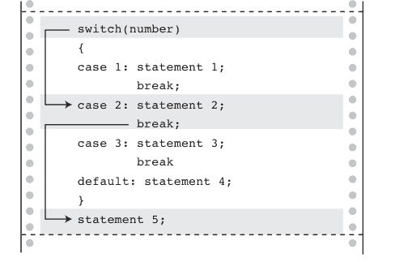

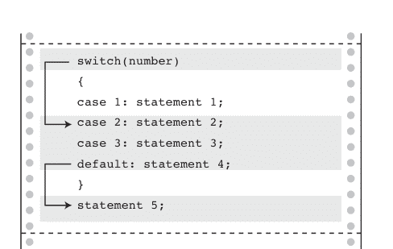

图7.4 有break和无break时switch中的程序流程。

从`case 'd' :`到switch末尾的所有语句都被执行了。

顺便提一下，break语句可用于循环和switch，而continue只能用于循环。不过，如果switch语句位于循环内，continue也可以作为switch的一部分使用。在这种情况下，与其他循环一样，continue会使程序跳过循环的其余部分，包括switch的其他部分。

如果你熟悉Pascal，你会看出switch语句与Pascal的case语句类似。最重要的区别是，如果只想处理标签对应的那条语句，switch语句需要使用break。此外，不能用范围作为C的case标签。

switch测试表达式位于括号内，其值应为整数（包括char类型）。case标签必须是整数类型（包括char）的常量或整数常量表达式（只包含整数常量的表达式）。case标签不能使用变量。那么，switch的结构如下：

```
switch (integer expression)
{
    case constant1:
        statements      <--optional
    case constant2:
        statements      <--optional
    default :           <--optional
        statements      <--optional
}
```

### 只读取一行中的第一个字符

animals.c中另一个新特性是它如何读取输入。你可能已经注意到，在示例运行中，当输入dab时，只有第一个字符被处理。这种丢弃行中其余字符的行为，在需要单字符响应的交互式程序中通常很理想。下面的代码实现了这一行为：

```
while (getchar() != '\n')
    continue;      /* skip rest of input line */
```

这个循环从输入中读取字符，直到（并包括）Enter键产生的换行符。注意，函数返回值没有赋给ch，因此这些字符只是被读取并丢弃。因为最后丢弃的字符是换行符，所以下一个要读取的字符是下一行的第一个字符。它由getchar()读取，并赋给外层while循环中的ch。

假设用户一开始就按下Enter，那么遇到的第一个字符就是换行符。下面的代码处理了这种情况：

```
if (ch == '\n')
    continue;
```

### 多个标签

对于同一条语句，可以使用多个case标签，如程序清单7.12所示。

### 程序清单7.12 vowels.c程序

```
// vowels.c -- uses multiple labels
#include <stdio.h>
int main(void)
{
    char ch;
    int a_ct, e_ct, i_ct, o_ct, u_ct;

    a_ct = e_ct = i_ct = o_ct = u_ct = 0;

    printf("Enter some text; enter # to quit.\n");
    while ((ch = getchar()) != '#')
    {
        switch (ch)
        {
            case 'a':
            case 'A':   a_ct++;
                        break;

            case 'e':
            case 'E':   e_ct++;
                        break;

            case 'i':
            case 'I':   i_ct++;
                        break;

            case 'o':
            case 'O':   o_ct++;
                        break;

            case 'u':
            case 'U':   u_ct++;
                        break;

            default:    break;
        }                   // end of switch
    }                       // while loop end
    printf("number of vowels:   A    E    I    O    U\n");
    printf("                    %4d %4d %4d %4d %4d\n",
           a_ct, e_ct, i_ct, o_ct, u_ct);

    return 0;
}
```

例如，如果ch是字母i，switch语句将转到标有`case 'i':`的位置。因为该标签没有关联break，程序流程会继续执行下一条语句，即`i_ct++;`。如果ch是I，程序流程将直接转到该语句。实际上，两个标签指向同一条语句。

严格来说，`case 'U':`的break语句并非必需，因为如果没有它，程序流程会转到switch中的下一条语句，即default情况的break。所以`case 'U'`的break可以省略，从而缩短代码。另一方面，如果以后可能会添加其他情况（例如你可能想把字母y视为有时是元音），那么提前放好break可以防止你忘记添加一个。

下面是一个示例运行：

```
Enter some text; enter # to quit.
I see under the overseer.#
number of vowels:    A    E    I    O    U
                     0    7    1    1    1
```

在这种特定情况下，你可以使用ctype.h函数族中的toupper()函数（参见表7.2）在测试前将所有字母转换为大写，从而避免多个标签：

```
while ((ch = getchar()) != '#')
{
    ch = toupper(ch);
    switch (ch)
    {
        case 'A' :  a_ct++;
                    break;
        case 'E' :  e_ct++;
                    break;
        case 'I' :  i_ct++;
                    break;
        case 'O' :  o_ct++;
                    break;
        case 'U' :  u_ct++;
                    break;
        default :   break;
    }                         // end of switch
}                             // while loop end
```

或者，如果你愿意，可以让ch保持不变，并使用toupper(ch)作为测试条件：

```
switch(toupper(ch))
```

## 总结：使用switch进行多项选择

### 关键字：

```
switch
```

### 一般说明：

程序控制跳转到与表达式值对应的case标签。然后程序流继续执行所有剩余的语句，除非再次使用break语句改变流向。表达式和case标签都必须有整数值（包括char类型），并且标签必须是常量或仅由常量组成的表达式。如果没有case标签与表达式值匹配，则控制转到标记为default的语句（如果存在）。否则，控制传递到switch语句之后的下一条语句。

### 格式：

```
switch (expression)
{
    case label1 : statement1 // use break to skip to end
    case label2 : statement2
    default     : statement3
}
```

标签语句可以多于两个，default情况是可选的。

### 示例：

```
switch (choice)
{
    case 1 :
    case 2 : printf("Darn tootin!\n"); break;
    case 3 : printf("Quite right!\n");
    case 4 : printf("Good show!\n"); break;
    default : printf("Have a nice day.\n");
}
```

如果choice的整数值为1或2，则打印第一条消息。如果为3，则打印第二条和第三条消息。（流程会继续执行下一条语句，因为case 3之后没有break语句。）如果为4，则打印第三条消息。其他值只打印最后一条消息。

## switch与if else

什么时候应该使用switch，什么时候应该使用if else结构？通常你没有选择余地。如果你的选择基于对浮点变量或表达式的求值，就不能使用switch。如果变量必须落在某个范围内，使用switch也不方便。但下面这样写很简单：

```
if (integer < 1000 && integer > 2)
```


```
}
 bill = cost * flag;
```

- 选择两个备选方案：

```c
if (ibex > 14)
    goto a;
sheds = 2;
goto b;
a: sheds = 3;
b: help = 2 * sheds;
```

有了 if else 结构，C 就可以更清晰地表达这种选择：

```c
if (ibex > 14)
    sheds = 3;
else
    sheds = 2;
help = 2 * sheds;
```

确实，较新版本的 BASIC 和 FORTRAN 已在其语法中加入了 else。

- 设置一个无限循环：

```c
readin: scanf("%d", &score);
if (score < 0)
    goto stage2;
lots of statements
goto readin;
stage2: more stuff;
```

改用 while 循环：

```c
scanf("%d", &score);
while (score <= 0)
{
    lots of statements
    scanf("%d", &score);
}
more stuff;
```

- 跳到循环末尾并开始下一轮。改用 continue。

- 离开循环。改用 break。实际上，break 和 continue 是 goto 的特化形式。使用它们的优点在于其名称说明了它们应做什么，并且由于它们不使用标签，因此不会出现标签放错位置的危险。

- 疯狂地跳到程序的不同部分。用一句话说，不要！

许多 C 实践者容忍的一种 goto 用法是，如果出现问题，就从一组嵌套循环中退出（单个 break 只能使你退出最内层的循环）：

```c
while (funct > 0)
{
    for (i = 1; i <= 100; i++)
    {
        for (j = 1; j <= 50; j++)
        {
            statements galore;
            if (bit trouble)
                goto help;
            statements;
        }
        more statements;
    }
    yet more statements;
}
and more statements;
help: bail out;
```

从其他示例可以看出，替代形式比 goto 形式更清晰。当你混合多种情况时，这种差异会变得更大。哪些 gotos 在帮助 if，哪些在模拟 if else，哪些在控制循环，哪些只是因为你把自己逼进了死角而存在？过度使用 goto 会造成程序流程的迷宫。如果你不熟悉 goto，就保持这样。如果你习惯使用它们，试着训练自己不要使用。具有讽刺意味的是，C 虽然不需要 goto，但它的 goto 比大多数语言更好，因为它允许你使用描述性单词作为标签而不是数字。

## 摘要：程序跳转

关键字：
break, continue, goto

总体评论：
这三个指令会导致程序流程从程序的一个位置跳转到另一个位置。

break 命令：
break 命令可与三种循环形式以及 switch 语句一起使用。它会导致程序控制跳过包含它的循环或 switch 的其余部分，并从循环或 switch 之后接下来的命令恢复。

示例：

```c
switch (number)
{
    case 4: printf("That's a good choice.\n");
```

条件运算符（`? :`）创建了一个表达式，在许多情况下，它提供了比 if else 语句更紧凑的替代方案。

ctype.h 家族的字符函数，例如 isspace() 和 isalpha()，提供了基于对字符进行分类来创建测试表达式的便捷工具。

switch 语句使你能够从一组用整数值标记的语句中进行选择。如果 switch 关键字之后测试条件的整数值与标签匹配，执行就会转到带有该标签的语句。执行随后会继续进行标记语句之后的语句，除非你使用 break 语句。

最后，break、continue 和 goto 是跳转语句，会导致程序流程跳转到程序中的另一个位置。break 语句会导致程序跳转到包含 break 的循环或 switch 末尾之后的下一条语句。continue 语句会导致程序跳过包含循环的其余部分并开始下一轮。

## 复习问题

你可以在附录 A“复习问题的答案”中找到复习问题的答案。

1. 判断哪些表达式为真，哪些为假。

   a. 100 > 3 && 'a' > 'c'
   b. 100 > 3 || 'a' > 'c'
   c. !(100>3)

2. 构造表达式以表达以下条件：

   a. number 大于或等于 90 但小于 100。
   b. ch 不是 q 或 k 字符。
   c. number 在 1 到 9 之间（含端值）但不是 5。
   d. number 不在 1 到 9 之间。

3. 以下程序具有不必要复杂的关联表达式以及一些明显的错误。简化并纠正它。

```c
#include <stdio.h>
int main(void)
{
    int weight, height; /* weight in lbs, height in inches */
    scanf("%d%d", &weight, &height);
    if (weight < 100 && height > 64)
        if (height >= 72)
            printf("You are very tall for your weight.\n");
    else if (height < 72 && > 64)
        printf("You are tall for your weight.\n");
    else if (weight > 300 && ! (weight <= 300)
        && height < 48)
        if (!(height >= 48) )
            printf(" You are quite short for your weight.\n");
    else
        printf("Your weight is ideal.\n");
    return 0;
}
```

4. 以下每个表达式的数值是多少？

   a. 5 > 2
   b. 3 + 4 > 2 && 3 < 2
   c. x >= y || y > x
   d. d = 5 + ( 6 > 2 )
   e. 'X' > 'T' ? 10 : 5
   f. x > y ? y > x : x > y

5. 以下程序会打印什么？

```c
#include <stdio.h>
int main(void)
{
    int num;
    for (num = 1; num <= 11; num++)
    {
        if (num % 3 == 0)
            putchar('$');
        else
            putchar('*');
            putchar('#');
        putchar(' ');
    }
    putchar('\n');
    return 0;
}
```

6. 以下程序会打印什么？

```c
#include <stdio.h>
int main(void)
{
    int age = 0;
    while (age++ <= 65)
    {
        if (( age % 20) == 0) /* is age divisible by 20? */
            printf("You are %d. Here is a raise.\n", age);
        if (age = 65)
            printf("You are %d. Here is your gold watch.\n", age);
    }
    return 0;
}
```

9. 当给定以下输入时，以下程序会打印什么？

```
q
c
h
b
```

```c
#include <stdio.h>
int main(void)
{
    char ch;

    while ((ch = getchar()) != '#')
    {
        if (ch == '\n')
            continue;
        printf("Step 1\n");
        if (ch == 'c')
            continue;
        else if (ch == 'b')
            break;
        else if (ch == 'h')
            goto laststep;
        printf("Step 2\n");
    laststep: printf("Step 3\n");
    }
    printf("Done\n");
    return 0;
}
```

10. 重写复习问题 9 中的程序，使其表现出相同的行为但不使用 continue 或 goto。

## 编程练习

8. 修改练习 7 中的假设 a.，使程序呈现供选择的工资率菜单。使用 switch 选择工资率。运行开始应如下所示：

```
****************************************************************
Enter the number corresponding to the desired pay rate or action:
1) $8.75/hr                2) $9.33/hr
3) $10.00/hr               4) $11.20/hr
5) quit
****************************************************************
```

如果选择 1 到 4，程序应请求已工作小时数。程序应循环直到输入 5。如果输入的是 1 到 5 以外的选项，程序应提醒用户正确的选择，然后循环。使用 #define 常量为各种收入率和税率。

9. 编写一个程序，接受正整数作为输入，然后显示小于或等于该数的所有质数。

10. 1988 年美国联邦税表在最近几年中最为简单。它有四个类别，每个类别有两个税率。以下是摘要（美元金额为应税收入）：

| 类别 | 税 |
|---|---|
| 单身 | 17,850 美元首笔的 15% 加上超出部分的 28% |
| 户主 | 23,900 美元首笔的 15% 加上超出部分的 28% |
| 已婚，联合 | 29,750 美元首笔的 15% 加上超出部分的 28% |
| 已婚，单独 | 14,875 美元首笔的 15% 加上超出部分的 28% |

例如，应税收入为 20,000 美元的单身工资收入者需缴纳 0.15 × $17,850 + 0.28 × ($20,000−$17,850)。编写一个程序，让用户指定税类别和应税收入，然后计算税款。使用循环使用户可以输入多个税案例。

11. ABC 邮件订购杂货店以每磅 $2.05 出售洋蓟，以每磅 $1.15 出售甜菜，以每磅 $1.09 出售胡萝卜。它在添加运费前对 $100 或以上的订单给予 5% 折扣。它对 5 磅或以下的任何订单收取 $6.50 包装和运费，对超过 5 磅且不足 20 磅的订单收取 $14.00 包装和运费，对 20 磅或以上的货物收取 $14.00 加上每磅 $0.50。编写一个程序，使用循环中的 switch 语句，使得响应 a 允许用户输入所需的洋蓟磅数，b 输入甜菜磅数，c 输入胡萝卜磅数，q 允许用户退出订购过程。程序应跟踪累计总额。也就是说，如果用户输入 4 磅甜菜，后来又输入 5 磅甜菜，程序应报告 9 磅甜菜。程序然后


应计算总费用、折扣（如有）、运费以及总计。程序随后应显示所有购买信息：每种蔬菜的每磅成本、订购磅数以及该订单的费用、订单总成本、折扣（如有）、运费以及所有费用的总计。

它们也可以轻松地从一个系统移动到另一个系统。它们也适用于使用文件进行输入和输出的程序。

许多程序面临的一个重要任务是验证输入；即确定用户输入是否符合程序的预期。本章说明了与输入验证相关的问题和解决方案。

## 单字符 I/O：getchar() 和 putchar()

正如你在第 7 章“ C 控制语句：分支和跳转”中所看到的，getchar() 和 putchar() 每次执行一个字符的输入和输出。这种方法可能让你觉得是一种相当愚蠢的做法。毕竟，你可以轻松读取大于单个字符的分组，但这种方法确实符合计算机的能力。此外，这种方法也是处理文本——即普通单词——的大多数程序的核心。为了提醒你这些函数的工作方式，请查看清单 8.1，这是一个非常简单的示例。它所做的只是从键盘输入获取字符并将其发送到屏幕。此过程称为回显输入。它使用一个 while 循环，当遇到 # 字符时终止。

### Listing 8.1 The echo.c Program

```
/* echo.c -- repeats input */
#include <stdio.h>
int main(void)
{
    char ch;

    while ((ch = getchar()) != '#')
        putchar(ch);

    return 0;
}
```

自 ANSI 标准以来，C 将 stdio.h 头文件与使用 getchar() 和 putchar() 关联起来，这就是为什么我们在程序中包含该文件的原因。 （通常，getchar() 和 putchar() 并不是真正的函数，而是使用预处理器宏定义的，我们将在第 16 章“ C 预处理器和 C 库”中介绍这一主题。）使用此程序会产生如下交互：

```
Hello, there. I would[enter]
Hello, there. I would
like a #3 bag of potatoes.[enter]
like a
```

## 文件、流和键盘输入

*文件* 是存储信息的一块内存。通常，文件保存在某种永久性存储器中，例如硬盘、USB 闪存驱动器或光盘，例如 DVD。你无疑意识到文件对计算机系统的重要性。例如，你的 C 程序保存在文件中，用于编译你的程序的程序也保存在文件中。最后一个例子说明了一些程序需要能够访问特定文件。当你编译存储在名为 echo.c 的文件中的程序时，编译器会打开 echo.c 文件并读取其内容。编译器完成后，它会关闭文件。其他程序，例如文字处理器，不仅打开、读取和关闭文件，还会向其写入。

C 强大、灵活等，具有许多用于打开、读取、写入和关闭文件的库函数。在一个层面上，它可以使用主机操作系统的基本文件工具来处理文件。这称为 *低级 I/O*。由于计算机系统之间存在许多差异，不可能创建通用低级 I/O 函数的标准库，ANSI C 也没有尝试这样做；然而，C 还在称为 *标准 I/O 包* 的第二层上处理文件。这涉及创建标准模型和用于处理文件的一组标准 I/O 函数。在这个更高层面上，系统之间的差异由特定的 C 实现处理，以便你处理统一的接口。

我们谈论的是什么样差异？例如，不同的系统以不同的方式存储文件。有些将文件内容存储在一个地方，将有关文件的信息存储在别处。有些则将文件的描述构建到文件本身中。在处理文本时，一些系统使用单个换行符来标记行的结束。其他系统可能使用回车和换行字符的组合来表示行的结束。一些系统以字节为单位测量文件大小；一些系统以字节块为单位测量。

当你使用标准 I/O 包时，你会被屏蔽这些差异。因此，为了检查换行符，你可以使用 if (ch == '\n')。如果系统实际上使用回车/换行组合，I/O 函数会自动在两种表示之间进行转换。

从概念上讲，C 程序处理的是流而不是直接处理文件。*流* 是数据理想化的流动，实际的输入或输出映射到该流上。这意味着具有不同属性的各种输入由具有更统一属性的流表示。打开文件的过程然后成为将流与文件关联的过程，读写通过流进行。

第 13 章更详细地讨论了文件。对于本章，只需注意 C 将输入和输出设备与存储设备上的常规文件同等对待。特别是，键盘和显示设备被视为每个 C 程序自动打开的文件。键盘输入由名为 stdin 的流表示，输出到屏幕（或电传打字机或其他输出设备）由名为 stdout 的流表示。getchar()、putchar()、printf() 和 scanf() 函数都是标准 I/O 包的成员，它们处理这两个流。

所有这一切的一个含义是，你可以使用与文件相同的技术来处理键盘输入。例如，读取文件的程序需要一种方法来检测文件末尾，以便知道何时停止读取。因此，C 输入函数配备了内置的、文件结束检测器。由于键盘输入被视为文件，你也应该能够使用该文件结束检测器来终止键盘输入。让我们从文件开始看看这是如何完成的。

## 文件结束

计算机操作系统需要某种方法来告诉每个文件开始和结束的位置。检测文件结束的一种方法是放置一个特殊字符在文件中以标记结束。例如，这是在 CP/M、IBM-DOS 和 MS-DOS 文本文件曾经使用的方法。今天，这些操作系统可能会使用嵌入的 Ctrl+Z 字符来标记文件的结束。曾经，这是这些操作系统唯一使用的方法，但现在还有其他选择，例如跟踪文件大小。因此，现代文本文件可能有也可能没有嵌入的 Ctrl+Z，但如果有，操作系统会将其视为文件结束标记。图 8.2 说明了这种方法。

prose:

```
Ishpbat the robot
slid open the hatch
and shouted his challenge.
```

prose in a file:

```
Ishpbat the robot\nslid open the hatch\nand shouted his challenge.\n^Z
```

Figure 8.2 A file with an end-of-file marker.

第二种方法是操作系统存储有关文件大小的信息。如果文件有 3000 字节并且程序已读取 3000 字节，则程序已到达末尾。MS-DOS 及其相关系统对二进制文件使用这种方法，因为这种方法允许文件包含所有字符，包括 Ctrl+Z。DOS 的更新版本也对文本文件使用这种方法。Unix 对所有文件使用这种方法。

C 通过让 getchar() 函数在到达文件末尾时返回一个特殊值来处理这种方法的多样性，无论操作系统如何实际检测文件末尾。给这个值起的名字是 EOF（end of file）。因此，当 getchar() 检测到文件结束时，其返回值是 EOF。scanf() 函数在检测到文件结束时也返回 EOF。通常，EOF 在 stdio.h 文件中定义如下：

```
#define EOF (-1)
```

为什么是 -1？通常，getchar() 返回 0 到 127 范围内的值，因为这些是对应于标准字符集的值，但如果系统识别扩展字符集，它可能会返回 0 到 255 的值。在任何一种情况下，值 -1 都不对应于任何字符，因此可以用它来表示文件结束。


某些系统可能将 EOF 定义为 -1 以外的数值，但该定义始终与合法输入字符产生的返回值不同。如果包含 stdio.h 文件并使用 EOF 符号，你就不用担心其数值定义。关键点在于 EOF 代表一个信号值，表示检测到文件结束；它并不是文件中实际存在的符号。

那么，如何在程序中使用 EOF 呢？将 getchar() 的返回值与 EOF 进行比较。如果两者不同，就说明尚未到达文件末尾。换句话说，你可以使用类似这样的表达式：

```
while ((ch = getchar()) != EOF)
```

如果读取的是键盘输入而不是文件怎么办？大多数系统（但并非全部）都有一种方法可以从键盘模拟文件结束条件。知道这一点后，你可以重写基本的读入并回显程序，如第 8.2 节所示。

### Listing 8.2 The echo_eof.c Program

```
/* echo_eof.c -- repeats input to end of file */
#include <stdio.h>
int main(void)
{
    int ch;

    while ((ch = getchar()) != EOF)
        putchar(ch);

    return 0;
}
```

注意以下几点：

- 你不必定义 EOF，因为 stdio.h 已处理了这一点。
- 你不必担心 EOF 的实际值，因为 stdio.h 中的 #define 语句使你能够使用符号表示 EOF。你不应该编写假设 EOF 具有特定值的代码。
- 变量 ch 从类型 char 改为类型 int，因为 char 变量可能以 0 到 255 范围内的无符号整数表示，但 EOF 可能具有数值 -1。这对于无符号 char 变量来说是不可能的值，但对于 int 来说是可以的。幸运的是，getchar() 本身就是 int 类型，因此它可以读取 EOF 字符。使用有符号 char 类型的实现可能通过将 ch 声明为 char 类型来凑合，但最好使用更通用的形式。
- getchar() 是 int 类型这一事实就是为什么某些编译器在将 getchar() 的返回值赋给 char 类型变量时会警告可能的数据丢失。
- ch 是整数这一事实并不会影响 putchar()。它仍然打印字符等价物。
- 要在键盘输入上使用此程序，你需要一种输入 EOF 字符的方法。不，你不能只输入字母 E O F，也不能只输入 –1。（输入 –1 将会传输两个字符：连字符和数字 1。）相反，你必须查明你的系统需要什么。例如，在大多数 Unix 和 Linux 系统上，在行首按下 Ctrl+D 会导致传输文件结束信号。许多微型计算机系统将行首的 Ctrl+Z 识别为文件结束信号；有些系统在任何位置的 Ctrl+Z 都解释为文件结束信号。

以下是 echo_eof.c 在 Unix 系统上运行的缓冲示例：

```
She walks in beauty, like the night
She walks in beauty, like the night
  Of cloudless climes and starry skies...
Of cloudless climes and starry skies...
            Lord Byron
            Lord Byron
[Ctrl+D]
```

每次按下 Enter 时，缓冲区中存储的字符都会被处理，并打印出该行的副本。这会一直持续到你模拟文件结束，Unix 风格为止。在 PC 上，你应改按 Ctrl+Z。

让我们稍作停顿，思考一下 echo_eof.c 的可能性。它会将你提供给它的任何输入复制到屏幕上。假设你 somehow 能将一个文件提供给它。那么它就会在屏幕上打印出文件的内容，直到到达文件末尾，在发现 EOF 信号时停止。假设相反，你能找到一种方法将程序的输出定向到一个文件。那么你就可以从键盘输入数据，并使用 echo_eof.c 将你输入的内容存储到一个文件中。假设你能同时做到两者：从一个文件将输入定向到 echo_eof.c 并将输出发送到另一个文件。那么你就可以使用 echo_eof.c 来复制文件。这个小程序有查看文件内容、创建新文件以及复制文件的潜力——对于这样一个短小的程序来说相当不错！关键在于控制输入和输出的流向，而这就是下一个主题。

### Note Simulated EOF and Graphical Interfaces

模拟 EOF 的概念产生于使用文本界面的命令行环境。在这种环境中，用户通过按键与程序交互，操作系统生成 EOF 信号。某些做法并不特别适用于图形界面，例如 Windows 和 Macintosh，具有更复杂的用户界面，包含鼠标移动和按钮点击。遇到模拟 EOF 时的程序行为取决于编译器和项目类型。例如，Ctrl+Z 可能终止输入，也可能终止整个程序，具体取决于特定的设置。

程序按前面所述运行，其输入来自键盘。现在假设你想在名为 words 的文本文件上使用该程序。文本文件是包含文本的文件——即以人类可读字符存储的数据。它可以是一篇论文或 C 语言程序，例如。包含机器语言指令的文件，例如保存程序可执行版本的那个文件，并不是文本文件。因为程序使用字符，所以它应与文本文件一起使用。你所需要做的就是输入以下命令，而不是之前的命令：

```
echo_eof < words
```

< 符号是 Unix 和 Linux 以及 DOS/Windows 的重定向操作符。它使 words 文件与 stdin 流关联，将文件内容 channel 到 echo_eof 程序中。echo_eof 程序本身并不知道（也不关心）输入是来自文件而不是键盘。它所知道的是有一串字符被提供给它，因此它逐个字符地读取并打印它们，直到文件结束出现。因为 C 将文件和 I/O 设备置于同等地位，所以文件现在就是 I/O 设备。试试看！

### Note Redirection Sidelights

对于 Unix、Linux 和 Windows 命令提示符，< 两侧的空格是可选的。某些系统，例如 AmigaDOS（对于那些仍在怀旧的人来说），支持重定向但不允许在重定向符号和文件名之间留有空格。

以下是针对某个特定 words 文件的示例运行；$ 是标准的 Unix 和 Linux 提示符。在 Windows/DOS 系统上，你会看到 DOS 提示符，也许是 A> 或 C>。

```
$ echo_eof < words
The world is too much with us: late and soon,
Getting and spending, we lay waste our powers:
Little we see in Nature that is ours;
We have given our hearts away, a sordid boon!
$
```

好吧，这次我们得到了我们应得的 words。

## Redirecting Output

现在假设你希望 echo_eof 将你的键盘输入发送到名为 mywords 的文件。然后你可以输入以下内容并开始输入：

```
echo_eof > mywords
```

> 是第二个重定向操作符。它会为你创建一个名为 mywords 的新文件，然后将 echo_eof 的输出（即你输入的字符的副本）重定向到该文件。重定向将 stdout 从显示设备（你的屏幕）重新分配到 mywords 文件。如果已有名为 mywords 的文件，通常它会被擦除然后被新文件替换。（然而，许多操作系统会给你通过将其设为只读来保护现有文件的选项。）所有出现在你屏幕上的只是你输入的字母，而副本则转到文件。要结束程序，在行首按下 Ctrl+D（Unix）或 Ctrl+Z（DOS）。试试看。如果你想不出要输入什么内容，就模仿下一个示例。在其中，我们使用 $ Unix 提示符。记住在按下 Enter 发送缓冲区内容到程序之前结束每一行。

```
$ echo_eof > mywords
You should have no problem recalling which redirection
operator does what. Just remember that each operator points
in the direction the information flows. Think of it as
a funnel.
[Ctrl+D]
$
```

在处理 Ctrl+D 或 Ctrl+Z 之后，程序终止并返回你的系统提示符。程序工作了吗？Unix ls 命令或 Windows 命令提示符 dir 命令，该命令列出文件名，应该会显示文件 mywords 现在存在。你可以使用 Unix 和 Linux cat 或 DOS type 命令来检查内容，或者你可以使用 echo_eof 再次，这次将文件重定向到程序：

```
$ echo_eof < mywords
You should have no problem recalling which redirection
operator does what. Just remember that each operator points
in the direction the information flows. Think of it as a
funnel.
$
```

## Combined Redirection

现在假设你想复制文件 mywords 并将其命名为 savewords。只需发出下一个命令即可，

```
echo_eof < mywords > savewords
```

任务就完成了。以下命令同样有效，因为重定向操作的顺序无关紧要：

```
echo_eof > savewords < mywords
```

注意：不要对同一命令使用相同的文件作为输入和输出。

```
echo_eof < mywords > mywords....<--WRONG
```

原因在于 > mywords 会在它被用作输入之前将原始 mywords 截断为零长度。

简而言之，使用 Unix、Linux 或 Windows/DOS 时，使用两个重定向操作符（< 和 >）的规则如下：

- 重定向操作符将可执行程序（包括标准操作系统命令）与数据文件连接起来。它不能用于连接一个数据文件到另一个数据文件，也不能用于连接一个程序到另一个程序。


### 列表 8.3 file_eof.c 程序

```
// file_eof.c --open a file and display it
#include <stdio.h>
#include <stdlib.h>  // for exit()
int main()
{
    int ch;
    FILE * fp;
    char fname[50];          // to hold the file name

    printf("Enter the name of the file: ");
    scanf("%s", fname);
    fp = fopen(fname, "r"); // open file for reading
    if (fp == NULL)          // attempt failed
    {
        printf("Failed to open file. Bye\n");
        exit(1);             // quit program
    }
    // getc(fp) gets a character from the open file
    while ((ch = getc(fp)) != EOF)
        putchar(ch);
    fclose(fp);              // close the file

    return 0;
}
```

## 摘要：如何重定向输入和输出

在大多数 C 系统中，你可以使用重定向，要么通过操作系统对所有程序生效，要么仅对 C 程序生效，由 C 编译器提供。在下面，令 prog 为可执行程序的名称，file1 和 file2 为文件名称。

### 重定向输出到文件：>

```
prog >file1
```

### 从文件重定向输入：<

```
prog <file2
```

### 组合重定向：

```
prog <file2 >file1
prog >file1 <file2
```

两种形式都使用 file2 作为输入，file1 作为输出。

### 空格：

某些系统要求重定向操作符左侧有一个空格，右侧没有空格。其他系统，例如 Unix，则接受操作符两侧有空格或没有空格。

## 创建更友好的用户界面

我们大多数人在某个时候都写过使用起来很别扭的程序。幸运的是，C 提供了工具来使输入过程更顺畅、更愉快。不幸的是，学习这些工具起初可能会带来新的问题。本节的目标是引导你通过这些问题，构建一个更友好的用户界面，使交互式数据输入更轻松，并平滑处理错误的输入。

### 处理缓冲输入

缓冲输入通常对用户来说是一种便利，提供了在发送给程序之前编辑输入的机会，但当使用字符输入时，它对程序员来说可能很麻烦。问题在于，正如你在一些早期示例中看到的，缓冲输入要求你按下 Enter 键来传输输入。这个动作还会传输一个换行符，程序必须处理它。让我们通过一个猜数程序来检查这个问题和其他问题。你选择一个数字，程序尝试猜它。程序使用笨拙的方法，但我们关注的是 I/O，而不是算法。列表 8.4 显示了程序的初始版本，该版本需要进一步改进。

### 列表 8.4 guess.c 程序

```
/* guess.c -- an inefficient and faulty number-guesser */
#include <stdio.h>
int main(void)
{
    int guess = 1;

    printf("Pick an integer from 1 to 100. I will try to guess ");
    printf("it.\nRespond with a y if my guess is right and with");
    printf("\n n if it is wrong.\n");
    printf("Uh...is your number %d?\n", guess);
    while (getchar() != 'y')  /* get response, compare to y */
        printf("Well, then, is it %d?\n", ++guess);
    printf("I knew I could do it!\n");

    return 0;
}
```

下面是一个示例运行：

```
Pick an integer from 1 to 100. I will try to guess it.
Respond with a y if my guess is right and with
an n if it is wrong.
Uh...is your number 1?
n
Well, then, is it 2?
```

然后将循环改为这样：

```
while ((response = getchar()) != 'y')      /* get response */
{
    if (response == 'n')
        printf("Well, then, is it %d?\n", ++guess);
    else
        printf("Sorry, I understand only y or n.\n");
    while (getchar() != '\n')
        continue;                       /* skip rest of input line */
}
```

现在程序的响应如下所示：

```
Pick an integer from 1 to 100. I will try to guess it.
Respond with a y if my guess is right and with
an n if it is wrong.
Uh...is your number 1?
n
Well, then, is it 2?
no
Well, then, is it 3?
no sir
Well, then, is it 4?
forget it
Sorry, I understand only y or n.
n
Well, then, is it 5?
Y
I knew I could do it!
```

当你编写交互式程序时，你应该尝试预见用户可能无法遵循说明的方式。然后你应该设计程序以优雅地处理用户失败。告诉他们何时错误，并给他们另一个机会。

当然，你应该向用户提供清晰的说明，但无论你多么清晰，总会有人误解，然后责怪你说明不清。

### 混合数字和字符输入

假设你的程序需要使用 getchar() 进行字符输入，同时使用 scanf() 进行数字输入。这两个函数各自完成工作良好，但两者混合使用效果不佳。这是因为 getchar() 读取每个字符，包括空格、制表符和换行符，而 scanf() 在读取数字时则会跳过空格、制表符和换行符。

为了说明由此引起的问题，列表 8.5 展示了一个读取一个字符和两个数字作为输入的程序。然后它使用输入指定的行数和列数打印该字符。

### 列表 8.5 showchar1.c 程序

```
/* showchar1.c -- program with a BIG I/O problem */
#include <stdio.h>
void display(char cr, int lines, int width);
int main(void)
{
    int ch;                 /* character to be printed      */
    int rows, cols;         /* number of rows and columns */
    printf("Enter a character and two integers:\n");
    while ((ch = getchar()) != '\n')
    {
        scanf("%d %d", &rows, &cols);
        display(ch, rows, cols);
        printf("Enter another character and two integers;\n");
        printf("Enter a newline to quit.\n");
    }
    printf("Bye.\n");
    return 0;
}

void display(char cr, int lines, int width)
{
    int row, col;
    for (row = 1; row <= lines; row++)
    {
        for (col = 1; col <= width; col++)
            putchar(cr);
        putchar('\n');  /* end line and start a new one */
    }
}
```

请注意，程序以 int 类型读取字符，以便能够进行 EOF 测试。然而，它以 char 类型将字符传递给 display() 函数。因为 char 比 int 小，一些编译器会警告转换。在这种情况下，你可以忽略警告。或者你可以通过使用类型转换来消除警告：

```
display(char(ch), rows, cols);
```

程序设置为主函数 main() 获取数据，display() 函数负责打印。让我们看一个示例运行，看看问题是什么：

```
Enter a character and two integers:
c 2 3
ccc
ccc
```

```
Enter another character and two integers;
Enter a newline to quit.
Bye.
```

程序开始时运行良好。输入 c 2 3，它按预期打印两行三个 c 字符。然后程序提示你输入第二组数据，并在你有机会响应之前退出！怎么回事？又是那个换行符，这次是第一个输入行中 3 之后的换行符。scanf() 函数将其留在输入队列中。与 scanf() 不同，getchar() 不会跳过换行符，因此在下一次循环中，在你有机会输入其他内容之前，这个换行符会被 getchar() 读取。然后它被赋给 ch，而 ch 为换行符正是终止循环的条件。

为了解决这个问题，程序必须跳过上一次输入循环的最后一个数字与下一行开头的字符之间的任何换行符或空格。此外，如果程序能够在 scanf() 阶段以及 getchar() 测试时终止，那就更好了。下一个版本，显示在列表 8.6 中，实现了这一点。

### 列表 8.6 showchar2.c 程序

```
/* showchar2.c -- prints characters in rows and columns */
#include <stdio.h>
void display(char cr, int lines, int width);
int main(void)
{
    int ch;            /* character to be printed      */
    int rows, cols;    /* number of rows and columns   */

    printf("Enter a character and two integers:\n");
    while ((ch = getchar()) != '\n')
    {
        if (scanf("%d %d",&rows, &cols) != 2)
            break;
        display(ch, rows, cols);
        while (getchar() != '\n')
            continue;
        printf("Enter another character and two integers;\n");
        printf("Enter a newline to quit.\n");
    }
    printf("Bye.\n");

    return 0;
}

void display(char cr, int lines, int width)
{
```


```
int row, col;

for (row = 1; row <= lines; row++)
{
    for (col = 1; col <= width; col++)
        putchar(cr);
    putchar('\n'); /* end line and start a new one */
}
```

while语句使程序丢弃scanf()输入之后的所有字符，包括换行符。这为循环读取下一行开头的第一个字符做好了准备。这意味着你可以相当自由地输入数据：

输入一个字符和两个整数：
 c 1 2
 cc
 输入另一个字符和两个整数；
 输入换行符退出。
 ! 3 6
 !!!!!!
 !!!!!!
 !!!!!!
 输入另一个字符和两个整数；
 输入换行符退出。

 再见。

通过使用带break的if语句，如果scanf()的返回值不是2，我们就终止程序。这种情况发生在其中一个或两个输入值不是整数，或者遇到文件结尾时。

### 输入验证

实际上，程序用户并不总是遵循指令，你可能会遇到程序期望的输入与实际输入不匹配的情况。这种情况可能导致程序失败。然而，你通常可以预见可能的输入错误，并通过一些额外的编程工作，让程序检测并处理这些错误。

例如，假设你有一个处理非负数的循环。用户可能犯的一种错误是输入负数。你可以使用关系表达式来检测：

```
long n;
scanf("%ld", &n);      // get first value
while (n >= 0)          // detect out-of-range value
```

```
{ // process n scanf("%ld", &n); // get next value }
```

另一个潜在陷阱是用户可能输入错误类型的值，例如字符q。检测这类误操作的一种方法是检查scanf()的返回值。你记得，这个函数返回它成功读取的项目数；因此，表达式

```
scanf("%ld", &n) == 1
```

只有当用户输入整数时，这个表达式才为真。这提示我们可以对代码进行如下修订：

```
long n;
while (scanf("%ld", &n) == 1 && n >= 0)
{
    // process n
}
```

用语言描述，while循环的条件是“当输入是整数且该整数为正数时”。

最后一个示例在用户输入错误类型的值时终止输入。然而，你可以选择让程序更友好一些，给用户机会重新输入正确类型的值。在这种情况下，你需要首先处理导致scanf()失败的输入，因为scanf()会把错误输入留在输入队列中。在这里，输入实际上是一个字符流这一事实变得很有用，因为你可以使用getchar()一个字符一个字符地读取输入。你甚至可以把所有这些想法整合到一个函数中，如下所示：

```
long get_long(void)
{
    long input;
    char ch;

    while (scanf("%ld", &input) != 1)
    {
        while ((ch = getchar()) != '\n')
            putchar(ch); // dispose of bad input
        printf(" is not an integer.\nPlease enter an ");
        printf("integer value, such as 25, -178, or 3: ");
    }

    return input;
}
```

这个函数尝试将一个int值读取到变量input中。如果失败，函数进入外层while循环的循环体。内层while循环然后逐个字符地读取有问题的输入。注意，这个函数选择丢弃该行上所有剩余的输入。其他可能的选择是只丢弃下一个字符或单词。然后函数提示用户重试。外层循环会一直进行，直到用户成功输入整数，使scanf()返回1。

在用户成功输入整数之后，程序可以检查这些值是否有效。考虑一个需要用户输入定义值范围的下限和上限的示例。在这种情况下，你可能希望程序检查第一个值不大于第二个值（通常范围假定第一个值是较小的那个）。它可能还需要检查这些值是否在可接受的限制内。例如，档案搜索可能无法处理小于1958或大于2014的年份值。这种检查也可以通过一个函数来完成。

以下是一种可能；下面的函数假定已经包含了stdbool.h头文件。如果你的系统没有_Bool，你可以用int替换bool，用1替换true，用0替换false。注意，如果输入无效，该函数返回true；因此命名为bad_limits()：

```
bool bad_limits(long begin, long end,
    long low, long high)
{
    bool not_good = false;

    if (begin > end)
    {
        printf("%ld isn't smaller than %ld.\n", begin, end);
        not_good = true;
    }
    if (begin < low || end < low)
    {
        printf("Values must be %ld or greater.\n", low);
        not_good = true;
    }
    if (begin > high || end > high)
    {
        printf("Values must be %ld or less.\n", high);
        not_good = true;
    }

    return not_good;
}
```

程序清单8.7使用这两个函数将整数提供给一个算术函数，该函数计算指定范围内所有整数的平方和。程序将范围的上限和下限分别限制为1000和−1000。

```
}
printf("Done.\n");

return 0;
}

long get_long(void)
{
    long input;
    char ch;

    while (scanf("%ld", &input) != 1)
    {
        while ((ch = getchar()) != '\n')
            putchar(ch);  // dispose of bad input
        printf(" is not an integer.\nPlease enter an ");
        printf("integer value, such as 25, -178, or 3: ");
    }

    return input;
}

double sum_squares(long a, long b)
{
    double total = 0;
    long i;

    for (i = a; i <= b; i++)
        total += (double)i * (double)i;

    return total;
}

bool bad_limits(long begin, long end,
                long low, long high)
{
    bool not_good = false;

    if (begin > end)
    {
        printf("%ld isn't smaller than %ld.\n", begin, end);
        not_good = true;
    }
    if (begin < low || end < low)
    {
        printf("Values must be %ld or greater.\n", low);
        not_good = true;
    }
```

```
}
if (begin > high || end > high)
{
    printf("Values must be %ld or less.\n", high);
    not_good = true;
}

return not_good;
}
```

下面是一个示例运行：

```
This program computes the sum of the squares of integers in a range.
The lower bound should not be less than -10000000 and
the upper bound should not be more than +10000000.
Enter the limits (enter 0 for both limits to quit):
lower limit: low
low is not an integer.
Please enter an integer value, such as 25, -178, or 3: 3
upper limit: a big number
a big number is not an integer.
Please enter an integer value, such as 25, -178, or 3: 12
The sum of the squares of the integers from 3 to 12 is 645
Enter the limits (enter 0 for both limits to quit):
lower limit: 80
upper limit: 10
80 isn't smaller than 10.
Please try again.
Enter the limits (enter 0 for both limits to quit):
lower limit: 0
upper limit: 0
Done.
```

### 分析程序

checking.c程序的计算核心（函数sum_squares()）很短，但输入验证支持使它比我们之前给出的示例更加复杂。让我们看看它的一些要素，首先关注整体程序结构。

我们采用了模块化方法，使用独立的函数（模块）来验证输入和管理显示。程序越大，使用模块化编程就越重要。

main()函数管理流程，将任务委托给其他函数。它使用get_long()获取值，使用while循环处理这些值，使用bad_limits()函数检查有效值，并使用sum_squares()函数进行实际计算：

```
start = get_long();
printf("upper limit: ");
```

```
stop = get_long();
while (start != 0 || stop != 0)
{
    if (bad_limits(start, stop, MIN, MAX))
        printf("Please try again.\n");
    else
    {
        answer = sum_squares(start, stop);
        printf("The sum of the squares of the integers ");
        printf("from %ld to %ld is %g\n", start, stop, answer);
    }
    printf("Enter the limits (enter 0 for both "
           "limits to quit):\n");
    printf("lower limit: ");
    start = get_long();
    printf("upper limit: ");
    stop = get_long();
}
```

### 输入流与数字

在编写处理错误输入的代码时，例如清单8.7中使用的代码，你应该清楚地了解C语言输入的工作原理。考虑如下一行输入：

```
is 28 12.4
```

在我们看来，它像是一串字符后跟一个整数，再跟一个浮点值。但对于C程序来说，它看起来像是一个字节流。第一个字节是字母i的字符代码，第二个是字母s的字符代码，第三个是空格字符的字符代码，第四个是数字2的字符代码，依此类推。因此，如果get_long()遇到这一行（以一个非数字字符开头），下面的代码会读取并丢弃整行，包括其中的数字，它们只是该行上的其他字符：

```
while ((ch = getchar()) != '\n')
    putchar(ch); // dispose of bad input
```

尽管输入流由字符组成，但scanf()函数可以在你指定时将它们转换为数值。例如，考虑以下输入：

```
42
```

如果你使用带%c说明符的scanf()，它只会读取字符4并将其存储在一个char变量中。如果你使用%s说明符，它会读取两个字符，即字符4和字符2，并将它们存储在一个字符串中。如果你使用%d说明符，scanf()会读取相同的两个字符，但随后会计算出它们对应的整数值是4 × 10 + 2，即42。然后它会将该值的整数二进制表示存储在一个int变量中。如果你使用%f说明符，scanf()会读取这两个字符，计算它们对应于


ch = getchar();        /* read next character */
while (getchar() != '\n')
    continue;          /* skip rest of line */
return ch;
}

### 混合字符和数值输入

创建菜单提供了另一个说明，说明混合字符输入与数值输入会引起问题的例子。假设，例如，count() 函数（选项 c）看起来像这样：

```
void count(void)
{
    int n,i;

    printf("Count how far? Enter an integer:\n");
    scanf("%d", &n);
    for (i = 1; i <= n; i++)
        printf("%d\n", i);
}
```

如果你随后输入 3 作为响应，scanf() 将读取 3 并将换行符留在输入队列中的下一个字符。接下来对 get_choice() 的调用将导致 get_first() 返回该换行符，从而导致不期望的行为。

解决该问题的一种方法是重写 get_first()，使其返回下一个非空白字符而不是仅仅返回遇到的下一个字符。我们将此作为读者的练习。另一种方法是让 count() 函数自行清理并清除换行符。这是本示例采用的方法：

```
void count(void)
{
    int n,i;

    printf("Count how far? Enter an integer:\n");
    n = get_int();
    for (i = 1; i <= n; i++)
        printf("%d\n", i);
    while ( getchar() != '\n')
        continue;
}
```

此函数还使用了第 8.7 节中的 get_long() 函数，但将其改为 get_int() 以获取类型为 int 而不是类型为 long 的值；请回忆原始函数会检查有效输入并给用户重试的机会。清单 8.8 显示了最终的菜单程序。

### 清单 8.8 menuette.c 程序

```
/* menuette.c -- menu techniques */
#include <stdio.h>
char get_choice(void);
char get_first(void);
int get_int(void);
void count(void);
int main(void)
{
    int choice;
    void count(void);

    while ( (choice = get_choice()) != 'q')
    {
        switch (choice)
        {
            case 'a' : printf("Buy low, sell high.\n");
                       break;
            case 'b' : putchar('\a');  /* ANSI */
                       break;
            case 'c' : count();
                       break;
            default  : printf("Program error!\n");
                       break;
        }
    }
    printf("Bye.\n");

    return 0;
}

void count(void)
{
    int n,i;

    printf("Count how far? Enter an integer:\n");
    n = get_int();
    for (i = 1; i <= n; i++)
        printf("%d\n", i);
    while ( getchar() != '\n')
        continue;
}

char get_choice(void)
{
    int ch;

printf("Enter the letter of your choice:\n");
printf("a. advice            b. bell\n");
printf("c. count              q. quit\n");
ch = get_first();
while ( (ch < 'a' || ch > 'c') && ch != 'q')
{
    printf("Please respond with a, b, c, or q.\n");
    ch = get_first();
}

return ch;
}

char get_first(void)
{
    int ch;

    ch = getchar();
    while (getchar() != '\n')
        continue;

    return ch;
}

int get_int(void)
{
    int input;
    char ch;

    while (scanf("%d", &input) != 1)
    {
        while ((ch = getchar()) != '\n')
            putchar(ch); // dispose of bad input
        printf(" is not an integer.\nPlease enter an ");
        printf("integer value, such as 25, -178, or 3: ");
    }

    return input;
}
```

以下是示例运行：

```
Enter the letter of your choice:
a. advice            b. bell
c. count              q. quit
a
```

```
Buy low, sell high.
Enter the letter of your choice:
a. advice        b. bell
c. count         q. quit
count
Count how far? Enter an integer:
two
two is not an integer.
Please enter an integer value, such as 25, -178, or 3: 5
1
2
3
4
5
Enter the letter of your choice:
a. advice        b. bell
c. count         q. quit
d
Please respond with a, b, c, or q.
q
```

让菜单界面工作得像你希望的那样顺畅可能是一项艰巨的工作，但一旦你开发出可行的方案，你就可以在各种情况下重复使用它。

另一个需要注意的点是，每个函数在面临稍微复杂一点的事情时，都将任务委托给另一个函数，从而使程序更加模块化。

## 关键概念

C 程序将输入视为传入字节流。getchar() 函数将每个字节解释为字符代码。scanf() 函数以相同的方式查看输入，但受其转换说明符的指导，它可以将字符输入转换为数值。许多操作系统提供重定向，这允许你用文件代替键盘作为输入，并用文件代替显示器作为输出。

程序通常期望特定形式的输入。你可以通过预见用户可能犯的输入错误并使程序能够应对这些错误，从而使程序更加健壮和用户友好。

对于小型程序，输入验证可能是代码中最复杂的部分。它也提供了许多选择。例如，如果用户输入了错误类型的信息，你可以终止程序，可以给用户固定次数的机会来正确输入，或者给用户无限次的机会。

## 总结

许多程序使用 getchar() 按字符读取输入。通常，系统使用行缓冲输入，这意味着当你按下 Enter 时，输入才会被传输到程序。按下 Enter 也会传输一个换行符，可能需要编程上的注意。ANSI C 要求缓冲输入作为标准。

C 具有一组函数，称为标准 I/O 包，它以统一的方式处理不同系统上的不同文件形式。getchar() 和 scanf() 函数属于这一家族。两个函数在检测到文件结束时都返回 EOF 值（在 stdio.h 头文件中定义）。Unix 系统允许你通过在行首按下 Ctrl+D 来模拟键盘上的文件结束条件；DOS 系统使用 Ctrl+Z 实现相同目的。

许多操作系统，包括 Unix 和 DOS，都具有重定向功能，这使你能够使用文件代替键盘和屏幕进行输入和输出。读取输入直到 EOF 的程序然后可以用键盘输入和模拟文件结束信号或重定向文件来使用。

在调用 getchar() 和调用 scanf() 之间交错使用可能会导致问题，因为 scanf() 会在调用 getchar() 之前在输入中留下换行符。然而，通过意识到这个问题，你可以绕过它进行编程。

当你编写程序时，请深思熟虑地规划用户界面。尝试预见用户可能犯的错误类型，然后设计你的程序来处理它们。

## 复习问题

你可以在附录 A“复习问题的答案”中找到复习问题的答案。

- 1. putchar(getchar()) 是一个有效表达式；它做什么？getchar(putchar()) 也有效吗？

- 2. 以下每个语句会完成什么？
  - a. putchar('H');
  - b. putchar('\007');
  - c. putchar('\n');
  - d. putchar('\b');

- 3. 假设你有一个名为 count 的可执行程序，它计算其输入中的字符数。设计一个使用 count 程序的命令行命令来计算文件 essay 中的字符数并将结果存储在名为 essayct 的文件中。

4. 给定问题 3 中的程序和文件，以下哪些是有效命令？

- a. essayct <essay
- b. count essay
- c. essay >count

5. 什么是 EOF？

6. 对于指示的输入，每个以下片段的输出是什么（假设 ch 是 int 类型并且输入是缓冲的）？

a. 输入如下：
If you quit, I will.[enter]

片段如下：

```
while ((ch = getchar()) != 'i')
    putchar(ch);
```

b. 输入如下：
Harhar[enter]

片段如下：

```
while ((ch = getchar()) != '\n')
{
    putchar(ch++);
    putchar(++ch);
}
```

7. C 如何处理不同计算机系统具有不同的文件和换行约定？

8. 在缓冲系统上混合数值输入与字符输入时，你会面临什么潜在问题？

## 编程练习

以下几个程序要求输入以 EOF 终止。如果你的操作系统使重定向笨拙或不可能，请使用其他终止输入的测试，例如读取 & 字符。

1. 设计一个程序，计算其输入中到文件结束的字符数。


## Functions

你将在本章学习以下内容：

- 关键字：
  `return`
- 运算符：
  `* (unary) & (unary)`
- 函数以及如何定义它们
- 如何使用参数和返回值
- 如何使用指针变量作为函数参数
- 函数类型
- ANSI C 原型
- 递归

如何组织一个程序？C 的设计哲学是使用函数作为构建块。我们已经依赖标准 C 库中的函数，例如 `printf()`、`scanf()`、`getchar()`、`putchar()` 和 `strlen()`。现在我们准备扮演更积极的角色——创建自己的函数。你在前面的章节中已经预览了该过程的几个方面，本章将整合你之前的知识并在此基础上进行扩展。

## Reviewing Functions

首先，什么是函数？一个 *function* 是为完成特定任务而设计的自包含的程序代码单元。语法规则定义了函数的结构以及如何使用它。C 中的函数在其他语言中扮演函数、子例程和过程的相同角色，尽管细节可能有所不同。某些函数会引起某个动作的发生。例如，`printf()` 会导致数据打印在你的屏幕上。某些函数会为程序找到一个值来使用。例如，`strlen()` 会告诉程序某个字符串有多长。总的来说，一个函数既可以产生动作也可以提供值。

为什么应该使用函数？首先，它们可以帮你避免重复编程。如果你需要在程序中多次执行某个任务，你只需要编写一次合适的函数。然后程序可以在需要的地方使用该函数，或者你可以在不同的程序中重复使用同一个函数，就像你已经在许多程序中使用 putchar() 一样。此外，即使你只在一个程序中执行一次任务，使用函数也是值得的，因为它使程序更模块化，因而更易于阅读、更改或修复。假设，例如，你想编写一个程序执行以下操作：

- 读取一组数字
- 对数字进行排序
- 求其平均值
- 打印条形图

你可以使用以下程序：

```
#include <stdio.h>
#define SIZE 50
int main(void)
{
    float list[SIZE];

    readlist(list, SIZE);
    sort(list, SIZE);
    average(list, SIZE);
    bargraph(list, SIZE);
    return 0;
}
```

当然，你还必须编写四个函数 readlist()、sort()、average() 和 bargraph()——只是细节问题。描述性的函数名使程序的功能和组织方式一目了然。你可以分别处理每个函数，直到它正确完成工作，并且，如果你使函数足够通用，你可以在其他程序中重用它们。

许多程序员喜欢把函数看作一个“黑盒子”，它由输入的信息和它产生的输出值或动作来定义。黑盒子内部发生了什么并不是你的关注点，除非你就是要编写该函数的人。例如，当你使用 printf() 时，你知道你必须给它一个控制字符串和，也许，一些参数。你也知道 printf() 应该产生什么输出。你不必考虑创建 printf() 所涉及的编程。这样思考函数有助于你专注于程序的整体设计而不是细节。在担心编写代码之前，先仔细思考函数应该做什么以及它与整个程序的关系。

你需要了解函数方面的哪些知识？你需要知道如何正确定义它们，如何调用它们，以及如何设置函数之间的通信。为了刷新你的记忆，我们将从一个非常简单的例子开始，然后逐步引入更多特性，直到你掌握完整的内容。

## Creating and Using a Simple Function

我们谦逊的第一个目标是创建一个函数，该函数连续打印 40 个星号。为了给函数一个上下文，让我们在一个打印简单信头的程序中使用它。Listing 9.1 展示了完整的程序。它由函数 main() 和 starbar() 组成。

### Listing 9.1 The lethead1.c Program

```
/* lethead1.c */
#include <stdio.h>
#define NAME "GIGATHINK, INC."
#define ADDRESS "101 Megabuck Plaza"
#define PLACE "Megapolis, CA 94904"
#define WIDTH 40

void starbar(void); /* prototype the function */

int main(void)
{
    starbar();
    printf("%s\n", NAME);
    printf("%s\n", ADDRESS);
    printf("%s\n", PLACE);
    starbar();    /* use the function    */

    return 0;
}

void starbar(void)  /* define the function  */
{
    int count;

    for (count = 1; count <= WIDTH; count++)
        putchar('*');
    putchar('\n');
}
```

输出如下：

```
**************************************************
GIGATHINK, INC.
101 Megabuck Plaza
Megapolis, CA 94904
**************************************************
```

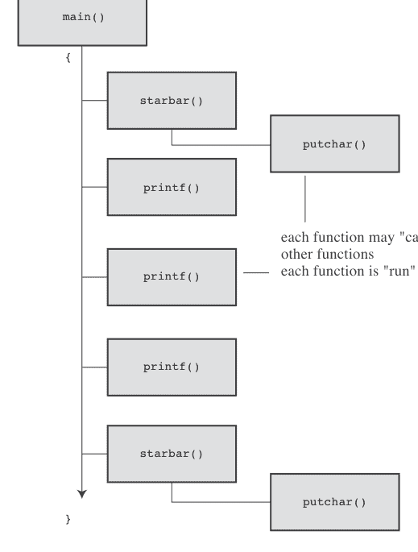

Figure 9.1 Control flow for lethead1.c (Listing 9.1).

- 程序在定义 starbar() 时遵循与定义 main() 相同的形式。它以类型、名称和括号开始。然后提供开始大括号、使用的变量声明、函数的定义语句，最后是结束大括号（参见 Figure 9.2）。注意，这个 starbar() 实例后面没有分号。缺少分号告诉编译器你是在定义 starbar() 而不是调用或原型声明它。
- 程序将 starbar() 和 main() 包含在同一个文件中。你也可以使用两个单独的文件。单文件形式编译起来稍容易一些。两个单独的文件使在不同程序中使用同一函数变得更简单。如果你确实将函数放在单独的文件中，你也会在该文件中放置必要的 #define 和 #include 指令。我们稍后会讨论使用两个或多个文件。现在，我们将把所有函数放在一个文件中。main() 的结束大括号告诉编译器该函数在哪里结束，随后的 starbar() 头部告诉编译器 starbar() 是一个函数。

```
void dibs(x, y, z)
int x, y, z;      /* valid */
```

标准的意图是逐步淘汰 pre-ANSI C 形式。你应该了解它，以便能够理解旧代码，但对于新程序，你应该使用现代形式。 （C99 和 C11 继续警告其即将过时。）

尽管 show_n_char() 函数接受来自 main() 的值，但它不返回值。因此，show_n_char() 的类型为 void。

现在让我们看看这个函数是如何使用的。

## Prototyping a Function with Arguments

我们使用 ANSI C 原型在函数使用之前声明它：

```
void show_n_char(char ch, int num);
```

当函数接受参数时，原型通过使用逗号分隔的类型列表来指示其数量和类型。如果你愿意，可以省略原型中的变量名：

```
void show_n_char(char, int);
```

在原型中使用变量名并不会真正创建变量。它只是澄清了 char 表示一个 char 变量，依此类推。

同样，ANSI C 也识别旧的函数声明形式，即不带参数列表：

```
void show_n_char();
```

这种形式最终将被从标准中删除。即使不是这样，原型格式也是更好的设计，如你稍后会看到的。你需要了解这种形式的主要原因是，如果你在旧代码中遇到它，你能够识别并理解它。

## Calling a Function with an Argument: Actual Arguments

你通过在函数调用中使用实际参数来为 ch 和 num 提供值。考虑 show_n_char() 的第一次使用：

```
show_n_char(SPACE, 12);
```

实际参数是空格字符和 12。这些值被分配给 show_n_char() 中的对应形式参数——变量 ch 和 num。简而言之，形式参数是被调用函数中的一个变量，而实际参数是由调用函数赋给函数变量的特定值。示例表明，实际参数可以是常量、变量，甚至更复杂的表达式。无论是哪种情况，实际参数都会被求值，其值会被复制到函数对应的形式参数中。例如，考虑 show_n_char() 的最后一次使用：

```
show_n_char(SPACE, (WIDTH - strlen(PLACE)) / 2);
```


## 黑盒视角

从黑盒视角来看 show_n_char()，输入是要显示的字符和要跳过的空格数，结果动作是将该字符打印指定次数。输入通过参数传递给函数。这些信息足以告诉你在 main() 中如何使用该函数，同时也为编写该函数提供了设计规范。

ch、num 和 count 是 show_n_char() 函数私有的局部变量，这是黑盒方法的一个基本方面。如果你在 main() 中使用相同名称的变量，它们将是独立的变量。也就是说，如果 main() 中有一个 count 变量，更改它的值不会改变 show_n_char() 中 count 的值，反之亦然。黑盒内部发生的事情对调用函数是隐藏的。

## 使用 return 从函数返回值

你已经看到了如何将信息从调用函数传递给被调用函数。要向相反方向传递信息，可以使用函数返回值。为了回顾其工作原理，我们将构造一个返回两个参数中较小值的函数。我们将这个函数命名为 imin()，因为它专为处理 int 值而设计。我们还将创建一个简单的 main()，其唯一目的是检查 imin() 是否正常工作。像这样用于测试函数的程序有时称为驱动程序。驱动程序会“试驾”函数。如果函数表现良好，它就可以安装到更重要的程序中。程序清单 9.3 展示了该驱动程序和最小值函数。

### 程序清单 9.3 lesser.c 程序

```
/* lesser.c -- finds the lesser of two evils */
#include <stdio.h>
int imin(int, int);

int main(void)
{
    int evil1, evil2;

    printf("Enter a pair of integers (q to quit):\n");
    while (scanf("%d %d", &evil1, &evil2) == 2)
    {
        printf("The lesser of %d and %d is %d.\n", evil1, evil2, imin(evil1,evil2));
        printf("Enter a pair of integers (q to quit):\n");
    }
    printf("Bye.\n");

    return 0;
}
```

```
int imin(int n,int m)
{
    int min;

    if (n < m)
        min = n;
    else
        min = m;

    return min;
}
```

回想一下，scanf() 返回成功读取的项数，因此输入不是两个整数将导致 while 循环终止。下面是一个示例运行：

```
Enter a pair of integers (q to quit):
509 333
The lesser of 509 and 333 is 333.
Enter a pair of integers (q to quit):
-9393 6
The lesser of -9393 and 6 is -9393.
Enter a pair of integers (q to quit):
q
Bye.
```

关键字 return 使后续表达式的值成为函数的返回值。在本例中，函数返回赋给 min 的值。由于 min 是 int 类型，因此 imin() 函数也是 int 类型。

变量 min 是 imin() 私有的，但 min 的值通过 return 传递回调用函数。如下一条语句的效果是将 min 的值赋给 lesser：

```
lesser = imin(n,m);
```

你能改写成下面这样吗？

```
imin(n,m);
lesser = min;
```

不能，因为调用函数根本不知道 min 的存在。请记住，imin() 的变量是 imin() 的局部变量。函数调用 imin(evil1,evil2) 将一组变量的值复制给另一组变量。

返回值不仅可以赋给变量，还可以用作表达式的一部分。例如：

```
answer = 2 * imin(z, zstar) + 25;
printf("%d\n", imin(-32 + answer, LIMIT));
```

返回值可以由任何表达式提供，而不只是变量。例如，你可以将程序缩短为：

```
/* minimum value function, second version */
imin(int n,int m)
{
    return (n < m) ? n : m;
}
```

条件表达式的计算结果为 n 或 m，选其中较小者，然后该值返回给调用函数。如果你为了清晰或风格，喜欢将返回值括在括号中，也是可以的，尽管括号并非必需。

如果函数返回的类型与声明的类型不同会怎样？

```
int what_if(int n)
{
    double z = 100.0 / (double) n;
    return z; // what happens?
}
```

那么实际返回值就是你把指定的返回值赋给声明返回类型的变量后得到的值。因此，在这个例子中，最终效果与将 z 的值赋给一个 int 变量然后返回该值相同。例如，假设我们有以下函数调用：

```
result = what_if(64);
```

那么 z 被赋值为 1.5625。但 return 语句返回的是 int 值 1。

使用 return 还有另一个作用：它会终止函数并将控制权返回给调用函数中的下一条语句。即使 return 语句不是函数中的最后一条语句，也会发生这种情况。因此，你可以这样编写 imin()：

```
/* minimum value function, third version */
imin(int n,int m)
{
    if (n < m)
        return n;
    else
        return m;
}
```

许多（但不是所有）C 语言实践者认为，最好只在函数末尾使用一次 return，以便更容易让人跟踪函数的控制流。然而，在像这样短小的函数中使用多个 return 也并非大错。无论如何，对用户来说，三个版本都是一样的，因为所有版本接受相同的输入并产生相同的输出，只是内部实现不同。即使这个版本也能同样工作：

```
/* minimum value function, fourth version */
imin(int n, int m)
```

## 问题所在

让我们看一些涉及 imax()（imin() 的近亲）的例子。程序清单 9.4 展示了一个以老式方式声明 imax() 然后错误使用它的程序。

### 程序清单 9.4 misuse.c 程序

```
/* misuse.c -- uses a function incorrectly */
#include <stdio.h>
int imax();      /* old-style declaration */

int main(void)
{
    printf("The maximum of %d and %d is %d.\n", 3, 5, imax(3));
    printf("The maximum of %d and %d is %d.\n", 3, 5, imax(3.0, 5.0));
    return 0;
}

int imax(n, m)
int n, m;
{
    return (n > m ? n : m);
}
```

第一次调用 printf() 时省略了 imax() 的一个参数，第二次调用则使用了浮点参数而不是整数。尽管存在这些错误，程序仍然可以编译和运行。

以下是使用 Xcode 4.6 的示例输出：

```
The maximum of 3 and 5 is 1606416656.
The maximum of 3 and 5 is 3886.
```

使用 gcc 运行的示例产生了 1359379472 和 1359377160 这些值。这两个编译器都工作正常；它们只是程序未使用函数原型的受害者。

发生了什么？具体机制可能因系统而异，但在 PC 或 VAX 上是这样的：调用函数将其参数放入一个称为栈的临时存储区域，被调用函数从栈中读取这些参数。这两个过程并不相互协调。调用函数根据调用中的实际参数决定传递哪种类型，而被调用函数则根据其形式参数的类型读取值。因此，调用 imax(3) 将一个整数放到栈上。当 imax() 函数开始执行时，它从栈上读取两个整数。实际上只放了一个整数，所以读取的第二个值是当时恰好位于栈上的某个值。

示例第二次使用 imax() 时，将 float 值传递给 imax()。这会在栈上放置两个 double 值。（回想一下，float 作为参数传递时会被提升为 double。）在我们的系统上，这是两个 64 位的值，所以栈上放置了 128 位数据。当 imax() 从栈上读取两个 int 时，它读取栈上前 64 位，因为在我们的系统上每个 int 是 32 位。这些位恰好对应两个整数值，其中较大的是 3886。

## ANSI C 的解决方案

ANSI C 标准针对参数不匹配问题的解决方案是允许函数声明也声明变量类型。结果就是函数原型——一种声明，它说明返回类型、参数数量以及这些参数的类型。为了表明 imax() 需要两个 int 参数，你可以使用以下任一原型声明它：

```
int imax(int, int);
int imax(int a, int b);
```

第一种形式使用逗号分隔的类型列表。第二种形式在类型后加上变量名。请记住，变量名是占位名，不必与函数定义中使用的名称一致。

有了这些信息，编译器就可以检查函数调用是否与原型匹配。参数数量是否正确？类型是否正确？如果存在类型不匹配并且两种类型都是数字，编译器会将实际参数的值转换为与形式参数相同的类型。例如，imax(3.0, 5.0) 会变成 imax(3, 5)。我们已经修改了程序清单 9.4 以使用函数原型，结果如程序清单 9.5 所示。

### 程序清单 9.5 proto.c 程序

```
/* proto.c -- uses a function prototype */
#include <stdio.h>
int imax(int, int);      /* prototype */
int main(void)
{
    printf("The maximum of %d and %d is %d.\n", 3, 5, imax(3));
    printf("The maximum of %d and %d is %d.\n", 3, 5, imax(3.0, 5.0));
    return 0;
}

int imax(int n, int m)
{
    return (n > m ? n : m);
}
```


当我们在编译程序清单9.5时，编译器给出了一条错误消息，指出对 imax() 的调用参数太少。

那么类型错误呢？为了调查这些错误，我们将 imax(3) 替换为 imax(3, 5) 并重新编译。这次没有错误消息，我们运行了程序。以下是输出结果：

```
The maximum of 3 and 5 is 5.
The maximum of 3 and 5 is 5.
```

正如承诺的那样，第二次调用中的 3.0 和 5.0 被转换为 3 和 5，以便函数能够正确处理输入。

虽然没有给出错误消息，但我们的编译器确实给出了一条警告，大意是 double 被转换为 int，并且可能存在数据丢失。例如，调用

```
imax(3.9, 5.4)
```

等同于：

```
imax(3, 5)
```

错误和警告之间的区别在于，错误会阻止编译，而警告允许编译。有些编译器会在不告知你的情况下进行这种类型转换。这是因为标准并不要求发出警告。然而，许多编译器允许你选择警告级别，以控制编译器在发出警告时的详细程度。

## 无参数和未指定参数

假设你给出这样的原型：

```
void print_name();
```

ANSI C 编译器会认为你已经决定放弃函数原型，并且不会检查参数。要表示一个函数确实没有参数，请在括号内使用 void 关键字：

```
void print_name(void);
```

ANSI C 将前面的表达式解释为 print_name() 不接收参数。然后它会检查你在调用此函数时是否确实没有使用参数。

少数函数（如 printf() 和 scanf()）接收可变数量的参数。例如，在 printf() 中，第一个参数是字符串，但其余参数的类型和数量都不是固定的。ANSI C 允许在这种情况下进行部分原型化。例如，你可以为 printf() 使用以下原型：

```
int printf(const char *, ...);
```

## 递归揭秘

为了了解其中涉及的内容，让我们看一个例子。程序清单9.6中的 main() 函数调用 up_and_down() 函数。我们将此称为“递归的第一级”。然后 up_and_down() 调用自身；我们称之为“递归的第二级”。第二级调用第三级，依此类推。这个例子被设置为进行四级递归。为了深入了解正在发生的事情，程序不仅显示变量 n 的值，还显示 &n，即变量 n 存储的内存地址。（本章稍后将更全面地讨论 & 运算符。printf() 函数为地址使用 %p 说明符。如果你的系统不支持该格式，请尝试 %u 或 %lu。）

### 程序清单9.6 recur.c程序

```
/* recur.c -- recursion illustration */
#include <stdio.h>
void up_and_down(int);

int main(void)
{
    up_and_down(1);
    return 0;
}

void up_and_down(int n)
{
    printf("Level %d: n location %p\n", n, &n); // 1
    if (n < 4)
        up_and_down(n+1);
    printf("LEVEL %d: n location %p\n", n, &n); // 2
}
```

在某系统上的输出如下：

```
Level 1: n location 0x0012ff48
Level 2: n location 0x0012ff3c
Level 3: n location 0x0012ff30
Level 4: n location 0x0012ff24
LEVEL 4: n location 0x0012ff24
LEVEL 3: n location 0x0012ff30
LEVEL 2: n location 0x0012ff3c
LEVEL 1: n location 0x0012ff48
```

让我们跟踪程序，看看递归是如何工作的。首先，main() 以参数 1 调用 up_and_down()。结果，up_and_down() 中的形参 n 的值为 1，因此打印语句 #1 打印 Level 1。然后，因为 n 小于 4，up_and_down()（第1级）以实际参数 n + 1（即 2）调用 up_and_down()（第2级）。这导致 n 在

第二，每个函数调用都有一个与之匹配的返回。当程序流程到达最后一个递归级别末尾的 return 时，控制权传递给前一个递归级别。程序不会直接跳回 main() 中的原始调用。相反，程序必须逐级返回，从一级的 up_and_down() 返回到调用它的那一级 up_and_down()。

第三，递归函数中位于递归调用之前的语句，其执行顺序与函数被调用的顺序相同。例如，在程序清单9.6中，打印语句 #1 位于递归调用之前。它按照递归调用的顺序执行了四次：第1级、第2级、第3级和第4级。

第四，递归函数中位于递归调用之后的语句，其执行顺序与函数被调用的顺序相反。例如，打印语句 #2 位于递归调用之后，它的执行顺序是：第4级、第3级、第2级、第1级。递归的这一特性对于涉及顺序反转的编程问题很有用。你很快就会看到一个例子。

第五，虽然每一级递归都有自己的变量集合，但代码本身并不会被复制。代码是一条指令序列，函数调用是跳转到该指令集开头的命令。因此，递归调用会将程序返回到该指令集的开头。除了递归调用在每次调用时创建新变量外，它们很像一个循环。实际上，有时递归可以代替循环，反之亦然。

最后，递归函数中必须包含一些能终止递归调用序列的内容。通常，递归函数使用 if 测试（或等效手段），在函数参数达到特定值时终止递归。要做到这一点，每次调用都需要为参数使用不同的值。例如，在最后一个例子中，up_and_down(n) 调用 up_and_down(n+1)。最终，实际参数达到值4，导致 if (n < 4) 测试失败。

## 尾递归

在最简单的递归形式中，递归调用位于函数的末尾，紧接在 return 语句之前。这被称为尾递归或末端递归，因为递归调用出现在末尾。尾递归是最简单的形式，因为它像一个循环。

让我们来看一个计算阶乘的函数的循环版本和尾递归版本。一个整数的阶乘是从1到该整数的所有整数的乘积。例如，3的阶乘（写作3!）是1*2*3。另外，0! 被定义为1，负数没有阶乘。程序清单9.7提供了一个使用 for 循环计算阶乘的函数，以及一个使用递归的函数。

### 程序清单9.7 factor.c程序

```
// factor.c -- uses loops and recursion to calculate factorials
#include <stdio.h>
long fact(int n);
long rfact(int n);
int main(void)
{
    int num;

    printf("This program calculates factorials.\n");
    printf("Enter a value in the range 0-12 (q to quit):\n");
    while (scanf("%d", &num) == 1)
    {
        if (num < 0)
            printf("No negative numbers, please.\n");
        else if (num > 12)
            printf("Keep input under 13.\n");
        else
        {
            printf("loop: %d factorial = %ld\n",
                num, fact(num));
            printf("recursion: %d factorial = %ld\n",
                num, rfact(num));
        }
        printf("Enter a value in the range 0-12 (q to quit):\n");
    }
    printf("Bye.\n");

    return 0;
}

long fact(int n)    // loop-based function
{
    long ans;

    for (ans = 1; n > 1; n--)
        ans *= n;

    return ans;
}

long rfact(int n)   // recursive version
{
    long ans;
    if (n > 0)
        ans= n * rfact(n-1);
    else
        ans = 1;

    return ans;
}
```

测试驱动程序将输入限制为整数0–12。事实证明，12! 略小于5亿，这使得13! 远远大于我们系统上的 long。要计算超过12! 的值，你需要使用范围更大的类型，例如 double 或 long long。

下面是示例运行：

```
This program calculates factorials.
Enter a value in the range 0-12 (q to quit):
5
loop: 5 factorial = 120
recursion: 5 factorial = 120
Enter a value in the range 0-12 (q to quit):
10
loop: 10 factorial = 3628800
recursion: 10 factorial = 3628800
Enter a value in the range 0-12 (q to quit):
q
Bye.
```

循环版本将 ans 初始化为1，然后将其乘以从 n 到2的整数。严格来说，你应该乘以1，但这不会改变值。

现在考虑递归版本。关键在于 n! = n × (n−1)!。这是因为 (n−1)! 是直到 n−1 的所有正整数的乘积。因此，乘以 n 就得到了直到 n 的乘积。这暗示了一种递归方法。如果你调用函数 rfact()，rfact(n) 就是 n * rfact(n−1)。因此，你可以通过让 rfact(n) 调用 rfact(n−1) 来求值，如程序清单9.7所示。当然，你必须在某个点结束递归，可以在 n 为0时将返回值设置为1来做到这一点。

程序清单9.7的递归版本产生与循环版本相同的输出。请注意，虽然对 rfact() 的递归调用并不是函数中的最后一行，但它是当 n > 0 时最后执行的语句，因此它是尾递归。

既然既可以使用循环也可以使用递归来编写函数，那么应该使用哪一种呢？通常，循环是更好的选择。首先，因为每次递归调用都有自己的变量集合，递归会使用更多内存；每次递归调用都会在栈上放置一组新的变量。而栈的空间限制可能会限制递归调用的次数。其次，递归较慢，因为每次函数调用都需要时间。那么为什么要展示这个例子呢？因为尾递归是理解起来最简单的递归形式，而递归值得理解，因为在某些情况下，没有简单的循环替代方案。

## 递归与逆序

现在让我们来看一个递归的反转顺序能力很有用的问题。（这是一个递归比使用循环更简单的例子。）问题是这样的：编写一个函数，打印一个整数的二进制等价形式。二进制表示法是用2的幂来表示数字。正如十进制中的234表示 2 × 10² + 3 × 10¹ + 4 × 10⁰ 一样，二进制中的101表示 1 × 2² + 0 × 2¹ + 1 × 2⁰。二进制数字只使用0和1。


你需要一种方法，或者说一种算法。比如说，如何找到 5 的二进制表示呢？嗯，奇数的二进制表示必定以 1 结尾。偶数则以 0 结尾，所以你可以通过计算 5 % 2 来判断最后一位是 1 还是 0。如果结果是 1，说明 5 是奇数，最后一位就是 1。一般来说，如果 n 是一个数，最后一位就是 n % 2，因此你最先找到的数字恰恰是最后要打印的数字。这提示我们使用一个递归函数：在递归调用之前计算 n % 2，但在递归调用之后才打印它。这样，最先计算的值最后才被打印出来。

要得到下一位数字，将原始数字除以 2。这相当于把小数点向左移动一位，以便检查下一个二进制位。如果这个值是偶数，下一个二进制位就是 0；如果是奇数，下一个二进制位就是 1。例如，5/2 等于 2（整数除法），所以下一位是 0。到目前为止得到 01。现在重复这个过程。将 2 除以 2 得到 1。计算 1 % 2 得到 1，所以下一位是 1。这样就得到了 101。什么时候停止呢？当除以 2 的结果小于 2 时就停止，因为只要结果大于或等于 2，就还有一位二进制数字。每除以 2 一次，就去掉一位二进制数字，直到到达末尾。（如果这让你感到困惑，不妨试试十进制的类比。628 除以 10 的余数是 8，所以 8 是最后一位数字。628 除以 10 的整数除法得到 62，62 除以 10 的余数是 2，所以那是下一位数字，依此类推。）程序清单 9.8 实现了这种方法。

### 程序清单 9.8 binary.c 程序

```
/* binary.c -- prints integer in binary form */
#include <stdio.h>
void to_binary(unsigned long n);

int main(void)
{
    unsigned long number;
    printf("Enter an integer (q to quit):\n");
    while (scanf("%lu", &number) == 1)
    {
        printf("Binary equivalent: ");
        to_binary(number);
        putchar('\n');
        printf("Enter an integer (q to quit):\n");
    }
    printf("Done.\n");
    return 0;
}

void to_binary(unsigned long n)  /* recursive function */
{
    int r;
    r = n % 2;
    if (n >= 2)
        to_binary(n / 2);
    putchar(r == 0 ? '0' : '1');
    return;
}
```

to_binary() 函数应该显示字符 '0'（如果 r 的数值为 0）或 '1'（如果 r 的数值为 1）。条件表达式 r == 0 ? '0' : '1' 提供了这种将数值转换为字符值的转换。

下面是一个示例运行：

```
Enter an integer (q to quit):
9
Binary equivalent: 1001
Enter an integer (q to quit):
255
Binary equivalent: 11111111
Enter an integer (q to quit):
1024
Binary equivalent: 10000000000
Enter an integer (q to quit):
q
Done.
```

你能在不使用递归的情况下用这种算法计算二进制表示吗？可以，你可以。但由于这种算法先计算最后一位数字，你必须在显示结果之前先把所有数字存储在某处（例如存储在数组中）。第 15 章“位操作”展示了一个非递归方法的示例。

## 递归的利与弊

递归有优点也有缺点。一个优点是，递归为某些编程问题提供了最简单的解决方案。一个缺点是，某些递归算法会迅速耗尽计算机的内存资源。此外，递归可能难以编写文档和维护。让我们看一个同时体现优点和缺点的示例。

斐波那契数可以这样定义：第一个斐波那契数是 1，第二个斐波那契数是 1，之后的每个斐波那契数都是前两个斐波那契数之和。因此，序列中最初的几个数字是 1、1、2、3、5、8、13。斐波那契数是数学中最受喜爱的数字之一；甚至有一本专门研究它们的期刊。但我们先不谈这个。相反，让我们创建一个函数，给定一个正整数 n，返回对应的斐波那契数。

首先是递归的优势：递归提供了简单的定义。如果我们把这个函数命名为 Fibonacci()，那么当 n 为 1 或 2 时，Fibonacci(n) 应返回 1；否则应返回 Fibonacci(n-1) + Fibonacci(n-2) 之和：

```
unsigned long Fibonacci(unsigned n)
{
    if (n > 2)
        return Fibonacci(n-1) + Fibonacci(n-2);
    else
        return 1;
}
```

这个递归的 C 函数仅仅重述了递归的数学定义。这个函数使用了双重递归；也就是说，函数会调用自身两次。这导致了一个弱点。

要了解这个弱点的本质，假设你调用 Fibonacci(40)。这是递归的第一层，它会分配一个名为 n 的变量。然后它调用 Fibonacci() 两次，在递归的第二层创建两个名为 n 的变量。这两次调用中的每一次又会生成两次调用，在递归的第三层需要四个名为 n 的变量，总共七个变量。每一层需要的变量数量是前一层的两倍，变量数量呈指数增长！正如你在第 5 章“运算符、表达式和语句”中的麦粒示例中所看到的，指数增长会迅速导致巨大的数值。在这种情况下，指数增长很快就会使计算机需要大量的内存，极有可能导致程序崩溃。

嗯，这是一个极端的例子，但它确实说明了使用递归时需要谨慎，尤其是在效率很重要的时候。

## 所有 C 函数生而平等

程序中的每个 C 函数与其他函数地位相同。每个函数都可以调用任何其他函数，也可以被任何其他函数调用。这使得 C 函数与 Pascal 和 Modula-2 的过程有些不同，因为那些过程可以嵌套在其他过程之中。一个嵌套中的过程对其他嵌套中的过程一无所知。

main() 函数难道不特殊吗？是的，它有点特殊，因为当一个由多个函数组成的程序组合在一起时，执行从 main() 中的第一条语句开始，但它的特殊也就仅限于此了。即使是 main() 也可以被自身递归调用或被其他函数调用，尽管很少这样做。

## 编译包含两个或更多源代码文件的程序

使用多个函数最简单的方法是将它们放在同一个文件中。然后像编译单个函数的文件一样编译该文件。其他方法更依赖于系统，如下几节所述。

### Unix

这假设 Unix 系统安装了 Unix C 编译器 cc。（最初的 cc 已经退役，但许多 Unix 系统使 cc 命令成为其他编译器命令的别名，通常是 gcc 或 clang。）假设 file1.c 和 file2.c 是包含 C 函数的两个文件。那么以下命令将编译这两个文件并生成一个名为 a.out 的可执行文件：

```
cc file1.c file2.c
```

此外，还会生成两个名为 file1.o 和 file2.o 的目标文件。如果之后修改了 file1.c 而没有修改 file2.c，你可以使用以下命令编译第一个文件并将其与第二个文件的目标代码版本组合：

```
cc file1.c file2.o
```

Unix 有一个 make 命令可以自动管理多文件程序，但这超出了本书的范围。

请注意，OS X 的终端实用程序会打开一个命令行 Unix 环境，但你必须从 Apple 下载命令行编译器（GCC 和 Clang）。

### Linux

这假设 Linux 系统安装了 GNU C 编译器 GCC。假设 file1.c 和 file2.c 是包含 C 函数的两个文件。那么以下命令将编译这两个文件并生成一个名为 a.out 的可执行文件：

```
gcc file1.c file2.c
```

此外，还会生成两个名为 file1.o 和 file2.o 的目标文件。如果之后修改了 file1.c 而没有修改 file2.c，你可以使用以下命令编译第一个文件并将其与第二个文件的目标代码版本组合：

```
gcc file1.c file2.o
```

### DOS 命令行编译器

大多数 DOS 命令行编译器的工作方式与 Unix cc 命令类似，但使用不同的名称。一个区别是目标文件以 .obj 扩展名而不是 .o 扩展名结尾。有些编译器生成汇编语言或其他特殊代码的中间文件，而不是目标代码文件。

### Windows 和 Apple IDE 编译器

用于 Windows 和 Macintosh 的集成开发环境编译器是面向项目的。项目描述了特定程序使用的资源。这些资源包括你的源代码文件。如果你一直在使用这些编译器之一，你可能已经不得不创建项目。


用于运行单文件程序。对于多文件程序，请找到允许你向项目添加源代码文件的菜单命令。你应该确保所有源代码文件（扩展名为 `.c` 的文件）都被列为项目的一部分。许多集成开发环境（IDE）不会要求你把头文件（扩展名为 `.h` 的文件）列入项目列表。其理念是，项目管理使用哪些源代码文件，而源代码文件中的 `#include` 指令管理使用哪些头文件。不过，对于 Xcode，你确实需要将头文件添加到项目中。

## 使用头文件

如果你把 `main()` 放在一个文件中，把函数定义放在第二个文件中，那么第一个文件仍然需要函数原型。与其每次使用函数文件时都重新输入这些原型，不如将函数原型存放在一个头文件中。标准 C 库正是这样做的，例如，将 I/O 函数原型放在 `stdio.h` 中，将数学函数原型放在 `math.h` 中。你也可以为自己的函数文件这样做。

此外，你通常会使用 C 预处理器来定义程序中使用的常量。这样的定义只对包含 `#define` 指令的文件有效。如果你将程序中的函数放在不同的文件中，你也必须让每个文件都能使用这些 `#define` 指令。最直接的方法是为每个文件重新输入这些指令，但这既耗时又增加了出错的可能性。而且还会带来维护问题：如果你修改了某个 `#define` 值，必须记得在每个文件中都进行修改。更好的解决方案是将 `#define` 指令放在头文件中，然后在每个源代码文件中使用 `#include` 指令。

因此，将函数原型和已定义常量放在头文件中是一种良好的编程实践。让我们来看一个示例。假设你管理着四家连锁酒店。每家酒店的房价不同，但同一家酒店的所有房间价格相同。对于预订多晚的客人，第二晚的价格是第一晚的 95%，第三晚是第二晚的 95%，以此类推。（不用担心这种政策的经济效益。）你想要一个程序，能够让你指定酒店和住宿晚数，并计算总费用。你希望程序有一个菜单，可以让你继续输入数据，直到你选择退出。

清单 9.9、9.10 和 9.11 显示了你可能编写出的代码。第一个清单包含 `main()` 函数，它提供了程序的整体结构。第二个清单包含支持函数，我们假设它们放在一个单独的文件中。最后，清单 9.11 显示了一个头文件，其中包含所有程序源文件的已定义常量和函数原型。回忆一下，在 Unix 和 DOS 环境中，指令 `#include "hotels.h"` 中的双引号表示被包含的文件位于当前工作目录中（通常是包含源代码的目录）。如果你使用 IDE，则需要了解它如何将头文件纳入项目中。

### 清单 9.9 usehotel.c 控制模块

```
/* usehotel.c -- room rate program */
/* compile with Listing 9.10 */
#include <stdio.h>
```

```
#define STARS "***********************************"

// shows list of choices
int menu(void);

// returns number of nights desired
int getnights(void);

// calculates price from rate, nights
// and displays result
void showprice(double rate, int nights);
```

下面是一个示例运行：

```
***************************************************
Enter the number of the desired hotel:
1) Fairfield Arms          2) Hotel Olympic
3) Chertworthy Plaza       4) The Stockton
5) quit
***************************************************
3
How many nights are needed? 1
The total cost will be $255.00.

***************************************************
Enter the number of the desired hotel:
1) Fairfield Arms          2) Hotel Olympic
3) Chertworthy Plaza       4) The Stockton
5) quit
***************************************************
4
How many nights are needed? 3
The total cost will be $1012.64.

***************************************************
Enter the number of the desired hotel:
1) Fairfield Arms          2) Hotel Olympic
3) Chertworthy Plaza       4) The Stockton
5) quit
***************************************************
5
Thank you and goodbye.
```

顺便说一句，这个程序本身有一些有趣的特点。特别是，`menu()` 和 `getnights()` 函数通过测试 `scanf()` 的返回值并使用 `scanf("%*s")` 调用来跳过到下一个空白字符，从而跳过非数值数据。注意下面摘自 `menu()` 的代码片段如何同时检查非数值输入和超出范围的数值输入：

```
while ((status = scanf("%d", &code)) != 1 ||
    (code < 1 || code > 5))
```

这段代码利用了 C 语言的保证：逻辑表达式从左到右求值，并且一旦语句明确为假就停止求值。在此例中，只有在确定 `scanf()` 成功读取了一个整数值之后，才会检查 `code` 的值。

将不同的任务分配给不同的函数有助于这种细化。`menu()` 或 `getnights()` 的初版可能只使用一个简单的 `scanf()`，而不带后来添加的数据验证功能。然后，在基本版本运行正常之后，你可以开始改进每个模块。

## 查找地址：& 运算符

C 语言最重要的概念之一（有时也是最令人困惑的概念之一）是指针，它是一种用于存储地址的变量。你已经看到 `scanf()` 使用地址作为参数。更一般地说，任何不使用返回值就能修改调用函数中值的 C 函数都会使用地址。我们接下来将介绍使用地址的函数，从一元 `&` 运算符开始。（下一章将继续深入探讨和利用指针。）

一元 `&` 运算符给出变量存储的地址。如果 `pooh` 是一个变量的名字，那么 `&pooh` 就是该变量的地址。你可以把地址看作是内存中的一个位置。假设你有以下语句：

```
pooh = 24;
```

假设 `pooh` 存储的地址是 `0B76`。（PC 地址通常以十六进制值给出。）那么语句

```
printf("%d %p\n", pooh, &pooh);
```

将产生如下输出（`%p` 是地址的格式说明符）：

```
24 0B76
```

清单 9.12 使用这个运算符来查看同名变量——但在不同函数中——存储在哪里。

### 清单 9.12 loccheck.c 程序

```
/* loccheck.c -- checks to see where variables are stored */
#include <stdio.h>
void mikado(int);          /* declare function */
int main(void)
{
    int pooh = 2, bah = 5;     /* local to main() */
```

```
printf("In main(), pooh = %d and &pooh = %p\n", pooh, &pooh);
printf("In main(), bah = %d and &bah = %p\n", bah, &bah);
mikado(pooh);

return 0;
}

void mikado(int bah)                /* define function  */
{
    int pooh = 10;                  /* local to mikado() */

    printf("In mikado(), pooh = %d and &pooh = %p\n", pooh, &pooh);
    printf("In mikado(), bah = %d and &bah = %p\n", bah, &bah);
}
```

清单 9.12 使用 ANSI C 的 `%p` 格式来打印地址。在我们的系统上，这个小练习产生了以下输出：

```
In main(), pooh = 2 and &pooh = 0x7fff5fbff8e8
In main(), bah = 5 and &bah = 0x7fff5fbff8e4
In mikado(), pooh = 10 and &pooh = 0x7fff5fbff8b8
In mikado(), bah = 2 and &bah = 0x7fff5fbff8bc
```

`%p` 表示地址的方式因实现而异。然而，许多实现（例如本例中使用的这个）以十六进制形式显示地址。顺便说一句，考虑到每个十六进制数字对应四位，这些 12 位数字的地址对应 48 位地址。

这个输出说明了什么？首先，两个 `pooh` 具有不同的地址。两个 `bah` 也是如此。所以，正如所承诺的，计算机将它们视为四个独立的变量。其次，调用 `mikado(pooh)` 确实将实参（`main()` 中的 `pooh`）的值（2）传递给了形参（`mikado()` 中的 `bah`）。请注意，只是值被传递了。涉及的两个变量（`main()` 中的 `pooh` 和 `mikado()` 中的 `bah`）保持各自独立的身份。

我们提出第二点，是因为并非所有语言都是如此。例如，在 FORTRAN 中，子例程会影响调用例程中的原始变量。子例程的变量可能有不同的名称，但地址是相同的。C 语言不是这样。每个函数都使用自己的变量。这样做更可取，因为它防止原始变量被被调用函数的某些副作用神秘地修改。然而，这也会带来一些困难，如下一节所示。


## 在调用函数中更改变量

有时你希望一个函数能够更改另一个函数的变量。例如，在排序问题中，一个常见的任务是交换两个变量的值。假设你有两个变量叫做 x 和 y，你想交换它们的值。简单的序列

```
x = y;
y = x;
```

不起作用，因为当执行到第二行时，x 的原始值已经被原始的 y 值替换了。需要额外的一行来临时存储 x 的原始值。

```
temp = x;
x = y;
y = temp;
```

现在方法可行了，你可以把它放到一个函数中并构造一个驱动程序来测试它。为了明确哪些变量属于 main()，哪些属于 interchange() 函数，列表 9.13 对前者使用 x 和 y，对后者使用 u 和 v。

### 列表 9.13 swap1.c 程序

```
/* swap1.c -- first attempt at a swapping function */
#include <stdio.h>
void interchange(int u, int v); /* declare function */

int main(void)
{
    int x = 5, y = 10;

    printf("Originally x = %d and y = %d.\n", x , y);
    interchange(x, y);
    printf("Now x = %d and y = %d.\n", x, y);

    return 0;
}

void interchange(int u, int v)  /* define function  */
{
    int temp;

    temp = u;
    u = v;
    v = temp;
}
```

运行程序得到以下结果：
Originally x = 5 and y = 10.
Now x = 5 and y = 10.

糟糕！值没有被交换！让我们在 interchange() 中加入一些打印语句来看看出了什么问题（见列表 9.14）。

### 列表 9.14 swap2.c 程序

```
/* swap2.c -- researching swap1.c */
#include <stdio.h>
void interchange(int u, int v);

int main(void)
{
    int x = 5, y = 10;

    printf("Originally x = %d and y = %d.\n", x , y);
    interchange(x, y);
    printf("Now x = %d and y = %d.\n", x, y);

    return 0;
}

void interchange(int u, int v)
{
    int temp;

    printf("Originally u = %d and v = %d.\n", u , v);
    temp = u;
    u = v;
    v = temp;
    printf("Now u = %d and v = %d.\n", u, v);
}
```

以下是新的输出：
Originally x = 5 and y = 10.
Originally u = 5 and v = 10.
Now u = 10 and v = 5.
Now x = 5 and y = 10.

interchange() 没有问题；它确实交换了 u 和 v 的值。问题在于将结果传达给 main()。正如我们指出的，interchange() 使用的变量与 main() 不同，因此交换 u 和 v 的值对 x 和 y 没有影响！你能 somehow 使用 return 吗？好吧，你可以用这一行结束 interchange()

使用地址和间接运算符以这种方式实现结果是一种相当间接的方法，因此得名“间接运算符”。

### 摘要：指针相关运算符

地址运算符：

```
&
```

总体说明：

当跟随变量名时，& 给出该变量的地址。

示例：

```
&nurse is the address of the variable nurse.
```

间接运算符：*

总体说明：

当跟随指针名或地址时，* 给出指向地址中存储的值。

示例：

```
nurse = 22;
ptr = &nurse;  // pointer to nurse
val = *ptr;    // assigns value at location ptr to val
```

净效果是将值 22 分配给 val。

## 声明指针

你已经知道如何声明 int 变量和其他基本类型。如何声明指针变量？你可能会猜测形式如下：

```
pointer ptr;    // not the way to declare a pointer/
```

为什么不行？因为仅仅说一个变量是指针是不够的。你还必须指定指针指向的变量类型。原因是不同变量类型占用不同的存储量，而某些指针操作需要知道该存储大小。此外，程序必须知道地址处存储的是什么类型的数据。long 和 float 可能使用相同的存储量，但它们存储数字的方式却大不相同。指针的声明方式如下：

```
int * pi;        // pi is a pointer to an integer variable
char * pc;       // pc is a pointer to a character variable
float * pf, * pg; // pf, pg are pointers to float variables
```

类型说明符标识被指向变量的类型，而星号 (*) 标识变量本身是指针。声明 int * pi; 表示 pi 是一个指针，并且 *pi 是 int 类型（见图 9.5）。

```
printf("Originally x = %d and y = %d.\n", x, y);
interchange(&x, &y);  // send addresses to function
printf("Now x = %d and y = %d.\n", x, y);

    return 0;
}
```

```
void interchange(int * u, int * v)
{
    int temp;

    temp = *u;      // temp gets value that u points to
    *u = *v;
    *v = temp;
}
```

经过这么多的铺垫，列表 9.15 真的能工作吗？

```
Originally x = 5 and y = 10.
Now x = 10 and y = 5.
```

是的，它能工作。

现在，让我们看看列表 9.15 是如何工作的。首先，函数调用如下所示：

```
interchange(&x, &y);
```

函数不是传输 x 和 y 的值，而是传输它们的地址。这意味着形式参数 u 和 v，在 interchange() 的原型和定义中出现，将具有地址作为其值。因此，它们应声明为指针。因为 x 和 y 是整数，所以 u 和 v 是指向整数的指针，因此按如下方式声明它们：

```
void interchange (int * u, int * v)
```

接下来，函数的函数体声明

```
int temp;
```

以提供所需的临时存储。要将 x 的值存储在 temp 中，使用

```
temp = *u;
```

记住，u 的值是 &x，所以 u 指向 x。这意味着 *u 给出你 x 的值，这正是我们想要的。不要写

```
temp = u;  /* NO */
```

因为那样会将 temp 分配 x 的地址而不是其值，而我们试图交换值，而不是地址。

类似地，要将 y 的值赋给 x，使用

```
*u = *v;
```

最终效果如下：

```
x = y;
```

让我们总结一下这个例子做了什么。我们希望一个函数能够改变 x 和 y 的值。通过将 x 和 y 的地址传递给函数，我们让 interchange() 访问这些变量。使用指针和 * 运算符，函数可以检查这些位置存储的值并更改它们。

你可以在 ANSI C 原型中省略变量名。然后原型声明如下所示：

```
void interchange(int *, int *);
```

一般来说，你可以通过两种方式将变量的信息传达给函数。如果你使用形式为

```
function1(x);
```

的调用，你就传输 x 的值。如果你使用形式为

```
function2(&x);
```

的调用，你就传输 x 的地址。第一种形式要求函数定义包含与 x 相同类型的形式参数：

```
int function1(int num)
```

第二种形式要求函数定义包含指向正确类型的形式参数：

```
int function2(int * ptr)
```

### 摘要：函数

### 形式：

典型的 ANSI C 函数定义具有以下形式：

```
return-type name(parameter declaration list)
function body
```

参数声明列表是以逗号分隔的变量声明列表。函数参数以外的变量在函数体内部声明，函数体由大括号包围。

### 示例：

```
int diff(int x, int y)      // ANSI C
{                           // begin function body
    int z;                   // declare local variable

    z = x - y;

    return z;                // return a value
}                           // end function body
```

### 通信值：

参数用于将值从调用函数传达给函数。如果变量 a 和 b 的值分别为 5 和 2，则调用

```
c = diff(a,b);
```

将 5 和 2 传输给变量 x 和 y。值 5 和 2 称为实际参数，而 diff() 变量 x 和 y 称为形式参数。关键字 return 将一个值从函数传回调用函数。在此示例中，c 接收 z 的值，即 3。函数通常对调用函数中的变量没有影响。要直接影响调用函数中的变量，请使用指针作为参数。这在你想要将多个值传回调用函数时可能是必要的。

### 函数返回类型：

函数返回类型指示函数返回的值的类型。如果返回的值的类型与声明的返回类型不同，则值将被类型转换为声明的类型。

### 函数签名：

函数返回类型与函数参数列表共同构成函数签名。因此，它指定进入函数的值的类型以及从函数出来的值的类型。

### 示例：

```
double duff(double, int);  // function prototype
int main(void)
{
    double q, x;
    int n;
```


## 复习题

你可以在附录 A“复习题答案”中找到复习题的答案。

- 1. 实际参数和形式参数之间有什么区别？
- 2. 为以下描述的函数编写 ANSI C 函数头。注意我们只需要头，不需要函数体。
  - a. donut() 接受一个 int 参数并打印该数量的 0。
  - b. gear() 接受两个 int 参数并返回类型为 int。
  - c. guess() 不接受参数并返回一个 int 值。
  - d. stuff_it() 接受一个 double 和一个 double 变量的地址，并将第一个值存储到给定位置。
- 3. 为以下描述的函数编写 ANSI C 函数头。注意你只需要写头，不需要函数体。
  - a. n_to_char() 接受一个 int 参数并返回一个 char。
  - b. digits() 接受一个 double 参数和一个 int 参数并返回一个 int。
  - c. which() 接受两个 double 的地址作为参数并返回一个 double 的地址。
  - d. random() 不接受参数并返回一个 int。
- 4. 设计一个函数返回两个整数的和。
- 5. 如果要让第 4 题的函数对两个 double 数进行加法，需要做哪些改动，如果有的话？
- 6. 设计一个名为 alter() 的函数，它接受两个 int 变量 x 和 y，并将其值分别更改为它们的和和它们的差。
- 7. 这个函数定义有什么问题吗？

```
void salami(num)
{
    int num, count;

    for (count = 1; count <= num; num++)
        printf("O salami mio!\n");
}
```

**8.** 编写一个函数返回三个整数参数中的最大值。

**9.** 给出以下输出：

```
Please choose one of the following:
1) copy files             2) move files
3) remove files          4) quit
Enter the number of your choice:
```

- a. 编写一个函数显示四个编号选择的菜单并要求你选择一个。 （输出应与前面所示类似。）
- b. 编写一个函数有两个 `int` 参数：下限和上限。函数应从输入读取一个整数。如果整数超出限制，函数应再次打印菜单（使用本问题“a”部分的函数）以重新提示用户，然后获取新值。当输入的整数在正确限制范围内时，函数应将该值返回给调用函数。输入非整数应导致函数返回退出值 4。
- c. 编写一个使用“a”和“b”部分函数的最小程序。通过 *最小*，我们指的是它不必实际执行菜单承诺的操作；它只需显示选择并获取有效响应即可。

## 编程练习

- 1. 设计一个名为 `min(x,y)` 的函数，返回两个 double 值的较小者。用简单的驱动程序测试该函数。
- 2. 设计一个函数 `chline(ch,i,j)`，在列 i 到 j 打印所请求的字符。在简单的驱动程序中测试它。
- 3. 编写一个函数接受三个参数：一个字符和两个整数。字符将被打印。第一个整数指定该字符在一行上打印的次数，第二个整数指定要打印的行数。编写一个使用此函数的程序。
- 4. 两个数的调和平均数是通过取两个数的倒数，对它们取平均，然后取结果的倒数得到的。编写一个函数接受两个 double 参数并返回这两个数的调和平均数。
- 5. 编写并测试一个名为 `larger_of()` 的函数，它用两个 double 变量的最大值替换这两个 double 变量的内容。例如，`larger_of(x,y)` 将把 x 和 y 都重置为两者中较大的值。

6. 编写并测试一个函数，它接受三个 double 变量的地址作为参数，并将最小变量的值移到第一个变量，将中间值移到第二个变量，并将最大值移到第三个变量。

7. 编写一个程序从标准输入读取字符直到文件结束。对于每个字符，让程序报告它是否是字母。如果是字母，还报告它在字母表中的数值位置。例如，c 和 C 都是字母 3。包含一个函数，它接受一个字符作为参数，如果字符是字母则返回其数值位置，否则返回 −1。

8. 第 6 章“ C 控制语句：循环” （列表 6.20）展示了一个 power() 函数，它返回将类型为 double 的数提高到正整数次幂的结果。改进该函数，使其正确处理负数次幂。同时，将 0 的任意次幂（0 次幂除外）为 0 以及任意数的 0 次幂为 1 构建到函数中。 （它应报告 0 的 0 次幂未定义，然后说它使用值为 1。）使用循环。 在程序中测试该函数。

9. 重做编程练习 8，但这次使用递归函数。

10. 将列表 9.8 的 to_binary() 函数推广为 to_base_n() 函数，它接受第二个参数，范围为 2–10。然后它应以第二个参数给出的数字基数打印其第一个参数的数字。例如，to_base_n(129,8) 将显示 201，即 129 的 8 进制等价。 在完整的程序中测试该函数。

11. 编写并测试一个 Fibonacci() 函数，它使用循环而不是递归来计算斐波那契数。

## 数组和指针

在本章中你将学习以下内容：

- 关键字：
  `static`
- 运算符：
  `&` `*` （一元）
- 如何创建和初始化数组
- 指针（在你已知的基礎上构建）以及它们如何与数组相关
- 编写处理数组的函数
- 二维数组

人们求助于计算机来处理跟踪每月开支、每日降雨量、季度销售额和每周体重等任务。企业求助于计算机来管理工资单、库存和客户交易。作为程序员，你不可避免地要处理大量相关数据。通常，数组提供了一种高效、方便地处理此类数据的方法。第 6 章“ C 控制语句：循环” 介绍了数组，本章进行了更深入的探讨。特别是，它研究了如何编写数组处理函数。这样的函数使你能够将模块化编程的优势扩展到数组。在此过程中，你可以看到数组和指针之间的密切关系。

## 数组

回想一下，*数组* 由一系列相同数据类型元素组成。你使用 *声明* 来告诉编译器你想要一个数组。*数组声明* 告诉编译器数组包含多少个元素以及这些元素的类型是什么。掌握这些信息后，编译器可以正确设置数组。数组元素可以与普通变量具有相同的类型。考虑以下数组声明的示例：

```
/* some array declarations */
int main(void)
```

### 列表 10.1 day_mon1.c 程序

```
/* day_mon1.c -- prints the days for each month */
#include <stdio.h>
#define MONTHS 12

int main(void)
{
    int days[MONTHS] = {31,28,31,30,31,30,31,31,30,31,30,31};
    int index;

    for (index = 0; index < MONTHS; index++)
        printf("Month %d has %2d days.\n", index +1,
            days[index]);

    return 0;
}
```

输出如下所示：

```
Month  1 has 31 days.
Month  2 has 28 days.
Month  3 has 31 days.
Month  4 has 30 days.
Month  5 has 31 days.
Month  6 has 30 days.
Month  7 has 31 days.
Month  8 has 31 days.
Month  9 has 30 days.
Month 10 has 31 days.
Month 11 has 30 days.
Month 12 has 31 days.
```

不算一个很棒的程序，但在每四年中只有一个月是错误的。该程序使用用大括号括起来的逗号分隔值列表初始化 days[]。

注意，此示例使用符号常量 MONTHS 表示数组大小。这是常见且推荐的做法。例如，如果世界改用 13 个月的历法，你只需修改 #define 语句，而不必追踪程序中所有使用数组大小的地方。

## 注意 使用 const 与数组

有时你可能会使用一个打算作为只读数组的数组。也就是说，程序将从数组中检索值，但不会尝试向数组写入新值。在这种情况下，你可以使用 const 关键字在声明和初始化数组时使用，并且应该使用。因此，列表 10.1 的更好选择是

```
const int days[MONTHS] = {31,28,31,30,31,30,31,31,30,31,30,31};
```


> 这使得程序将数组中的每个元素都视为常量。就像常规变量一样，你应该使用声明来初始化 const 数据，因为一旦声明为 const，就不能再之后赋值。现在你知道了这一点，我们可以在后续示例中使用 const。

如果未能初始化数组会怎样？清单 10.2 显示了会发生什么。

### 清单 10.2 The no_data.c Program

```
/* no_data.c -- uninitialized array */
#include <stdio.h>
#define SIZE 4
int main(void)
{
    int no_data[SIZE];  /* uninitialized array */
    int i;

    printf("%2s%14s\n",
           "i", "no_data[i]");
    for (i = 0; i < SIZE; i++)
        printf("%2d%14d\n", i, no_data[i]);

    return 0;
}
```

以下是一些示例输出（你的结果可能有所不同）：

i      no_data[i]
0      0
1      4204937
2      4219854
3      2147348480

数组成员就像普通变量一样——如果你不初始化它们，它们可能具有任意值。编译器允许直接使用这些内存位置上已存在的值，这就是为什么你的结果可能与这些结果不同。

### Note Storage Class Caveat

> 数组与其他变量一样，可以使用不同的存储类创建。第 12 章将研究这个主题，但目前，你应该知道本章描述的数组属于自动存储类。这意味着它们是在函数内部声明的，并且没有使用关键字 static。本书迄今为止使用的所有变量和数组都是自动类型的。
> 
> 在此提及存储类的原因是，有时不同的存储类具有不同的属性，因此你不能将本章中的所有内容推广到其他存储类。特别是，如果未初始化，某些其他存储类的变量和数组的内容将被设置为 0。

```
for (index = 0; index < sizeof days / sizeof days[0]; index++)
    printf("Month %2d has %d days.\n", index +1,
        days[index]);

return 0;
}
```

清单 10.4 中有两点需要注意：

- 当你使用空括号初始化数组时，编译器会计算列表中的项目数并使数组变得那么大。
- 注意我们在 for 循环控制语句中所做的事情。我们对自己的计数能力缺乏信心（并且有理由），因此让计算机给出数组的大小。sizeof 运算符给出其后对象或类型的大小，以字节为单位。因此 sizeof days 是整个数组的大小，以字节为单位，而 sizeof days[0] 是一个元素的大小，以字节为单位。将整个数组的大小除以一个元素的大小告诉我们数组中有多少个元素。

运行此程序的结果如下：

```
Month  1 has 31 days.
Month  2 has 28 days.
Month  3 has 31 days.
Month  4 has 30 days.
Month  5 has 31 days.
Month  6 has 30 days.
Month  7 has 31 days.
Month  8 has 31 days.
Month  9 has 30 days.
Month 10 has 31 days.
```

糟糕！我们只输入了 10 个值，但我们让程序查找数组大小的方法阻止了我们尝试打印超出数组末尾的内容。这指出了自动计数的潜在缺点：元素数量的错误可能不会被注意到。

还有一种更简短的初始化数组的方法。因为它仅适用于字符字符串，所以我们将它留到下一章。

### Designated Initializers (C99)

C99 增加了一个新功能：指定初始化器。此功能允许你挑选和选择要初始化哪些元素。假设，例如，你只想初始化数组中的最后一个元素。使用传统的 C 初始化语法，你还必须初始化最后一个元素之前的所有元素：

```
int arr[6] = {0,0,0,0,0,212};  // traditional syntax
```

假设你不指定数组大小？

```
int stuff[] = {1, [6] = 23};      // what happens?
int staff[] = {1, [6] = 4, 9, 10}; // what happens?
```

编译器会使数组足够大以容纳初始化值。因此 stuff 将有七个元素，编号为 0-6，而 staff 将有另外两个元素，或 9 个。

## Assigning Array Values

在声明数组后，你可以通过使用数组索引或下标为数组成员赋值。例如，以下片段将偶数赋给数组：

```
/* array assignment */
#include <stdio.h>
#define SIZE 50
int main(void)
{
    int counter, evens[SIZE];

    for (counter = 0; counter < SIZE; counter++)
        evens[counter] = 2 * counter;
    ...
}
```

请注意，代码使用循环逐个元素地赋值。C 不允许你将一个数组作为一个整体赋给另一个数组。也不允许在初始化之外使用花括号列表形式。以下代码片段显示了一些不允许的赋值形式：

```
/* nonvalid array assignment */
#define SIZE 5
int main(void)
{
    int oxen[SIZE] = {5,3,2,8};      /* ok here      */
    int yaks[SIZE];

    yaks = oxen;                    /* not allowed  */
    yaks[SIZE] = oxen[SIZE];        /* out of range */
    yaks[SIZE] = {5,3,2,8};         /* doesn't work */
```

请记住，oxen 的最后一个元素是 oxen[SIZE-1]，因此 oxen[SIZE] 和 yaks[SIZE] 引用的是两个数组末尾之后的数据。

## Array Bounds

你必须确保使用在界限内的数组索引；也就是说，你必须确保它们对数组有效。例如，假设你做出以下声明：

```
int doofi[20];
```

```
address of arr[-1]: 0x7fff5fbff8cc
address of arr[4]: 0x7fff5fbff8e0
address of value1: 0x7fff5fbff8e0
address of value2: 0x7fff5fbff8cc
```

请注意，这个编译器似乎将 value1 存储在数组之后，而 value2 存储在其前面。（其他编译器可能以不同的内存顺序存储数据。）在这种情况下，如输出所示，arr[-1] 对应于与 value2 相同的内存位置，而 arr[4] 对应于与 value1 相同的内存位置。因此，使用超出界限的数组索引导致程序改变了其他变量的值。另一个编译器可能会产生不同的结果，包括程序中止。

你可能会想知道为什么 C 允许发生这种讨厌的事情。这可以追溯到 C 信任程序员的哲学。不检查界限允许 C 程序运行得更快。编译器不一定能捕获所有索引错误，因为索引的值可能要到生成的程序开始执行后才确定。因此，为了安全，编译器必须添加额外的代码来在运行时检查每个索引的值，这会减慢速度。因此，C 信任程序员正确编码，并以更快的程序作为回报。当然，并非所有程序员都值得这种信任，然后问题就会出现。

要记住的一个简单事情是，数组编号从 0 开始。要养成的一个简单习惯是，在数组声明和其他地方使用数组大小时使用符号常量：

```
#define SIZE 4
int main(void)
{
    int arr[SIZE];
    for (i = 0; i < SIZE; i++)
    ....
```

这有助于确保你在整个程序中一致地使用相同的数组大小。

## Specifying an Array Size

到目前为止，示例在声明数组时使用了整数常量：

```
#define SIZE 4
int main(void)
{
    int arr[SIZE];    // symbolic integer constant
    double lots[144]; // literal integer constant
    ...
```

还允许什么？直到 C99 标准，答案是你在声明数组时必须在方括号之间使用常量整数表达式。常量整数

它告诉我们 rain 是一个有五个元素的数组。但这些元素的每一个是什么？现在看声明的剩余部分（现在加粗）：

```
float rain[5] [12]; // an array of 12 floats
```

这告诉我们每个元素都是类型为 float[12]；也就是说，rain 的五个元素中的每一个本身都是一个包含 12 个 float 值的数组。

继续这种逻辑，rain[0]，作为 rain 的第一个元素，是一个包含 12 个 float 值的数组。rain[1]、rain[2] 等也是如此。如果 rain[0] 是一个数组，其第一个元素是 rain[0][0]，第二个元素是 rain[0][1]，依此类推。简而言之，rain 是一个包含 12 个元素数组的五元素数组，rain[0] 是一个包含 12 个 float 的数组，而 rain[0][0] 是一个 float。要访问例如第 2 行、第 3 列的值，使用 rain[2][3]。（记住，数组计数从 0 开始，因此第 2 行是第三行。）

你也可以将这个 rain 数组可视化为一个二维数组，由五行组成，每行 12 列，如图 10.1 所示。通过改变第二个下标，你可以逐月沿一行移动。通过改变第一个下标，你可以逐年沿一列垂直移动。

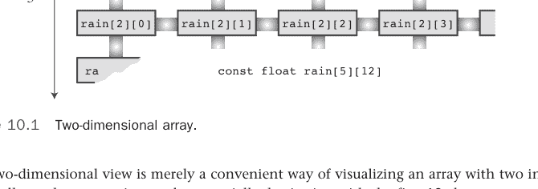

Figure 10.1 Two-dimensional array.

二维视图只是可视化具有两个索引的数组的一种方便方法。内部，这种数组是顺序存储的，以第一个 12 元素数组开头，后跟第二个 12 元素数组，依此类推。

让我们在天气程序中使用这个二维数组。程序的目标是找到每年的总降雨量、年平均降雨量和每月的平均降雨量。要找到一年的总降雨量，你必须将该行中的所有数据相加。要找到给定月份的平均降雨量，你必须将该列中的所有数据相加。二维数组使这些活动的可视化和执行变得容易。清单 10.7 显示了该程序。


### 列表 10.7 rain.c 程序

```c
/* rain.c -- finds yearly totals, yearly average, and monthly average for several years of rainfall data */

#include <stdio.h>
#define MONTHS 12  // number of months in a year
#define YEARS  5   // number of years of data
int main(void)
{
    // initializing rainfall data for 2010 - 2014
    const float rain[YEARS][MONTHS] =
    {
        {4.3,4.3,4.3,3.0,2.0,1.2,0.2,0.2,0.4,2.4,3.5,6.6},
        {8.5,8.2,1.2,1.6,2.4,0.0,5.2,0.9,0.3,0.9,1.4,7.3},
        {9.1,8.5,6.7,4.3,2.1,0.8,0.2,0.2,1.1,2.3,6.1,8.4},
        {7.2,9.9,8.4,3.3,1.2,0.8,0.4,0.0,0.6,1.7,4.3,6.2},
        {7.6,5.6,3.8,2.8,3.8,0.2,0.0,0.0,0.0,1.3,2.6,5.2}
    };
    int year, month;
    float subtot, total;

    printf(" YEAR    RAINFALL  (inches)\n");
    for (year = 0, total = 0; year < YEARS; year++)
    {
        // for each year, sum rainfall for each month
        for (month = 0, subtot = 0; month < MONTHS; month++)
            subtot += rain[year][month];
        printf("%5d %15.1f\n", 2010 + year, subtot);
        total += subtot; // total for all years
    }
    printf("\nThe yearly average is %.1f inches.\n\n", total/YEARS);
    printf("MONTHLY AVERAGES:\n\n");
    printf(" Jan Feb Mar Apr May Jun Jul Aug Sep Oct ");
    printf(" Nov Dec\n");

    for (month = 0; month < MONTHS; month++)
    {
        // for each month, sum rainfall over years
        for (year = 0, subtot =0; year < YEARS; year++)
            subtot += rain[year][month];
        printf("%4.1f ", subtot/YEARS);
    }
    printf("\n");

    return 0;
}
```

## 初始化二维数组

初始化二维数组建立在初始化一维数组的技术之上。首先，回顾一下，初始化一维数组看起来是这样的：

```c
sometype arr[5] = {val1, val2, val3, val4, val5};
```

这里 val1、val2 等都是适合 sometype 的值。例如，如果 sometype 是 int，val1 可能是 7，或者如果 sometype 是 double，val1 可能是 11.34。但 rain 是一个五元素数组，其每个元素都是 array-of-12-float 类型。因此，对于 rain，val1 将是适合初始化 float 的一维数组的值，例如以下内容：

```c
{4.3,4.3,4.3,3.0,2.0,1.2,0.2,0.2,0.4,2.4,3.5,6.6}
```

也就是说，如果 sometype 是 array-of-12-double，val1 就是 12 个 double 值的列表。因此，我们需要一个由逗号分隔的五个这样的东西的列表来初始化二维数组，例如 rain：

```c
const float rain[YEARS][MONTHS] =
{
    {4.3,4.3,4.3,3.0,2.0,1.2,0.2,0.2,0.4,2.4,3.5,6.6},
    {8.5,8.2,1.2,1.6,2.4,0.0,5.2,0.9,0.3,0.9,1.4,7.3},
    {9.1,8.5,6.7,4.3,2.1,0.8,0.2,0.2,1.1,2.3,6.1,8.4},
    {7.2,9.9,8.4,3.3,1.2,0.8,0.4,0.0,0.6,1.7,4.3,6.2},
    {7.6,5.6,3.8,2.8,3.8,0.2,0.0,0.0,0.0,1.3,2.6,5.2}
};
```

此初始化使用五个带大括号的数字列表，全部包含在一层外部大括号中。第一个内部大括号集中的数据分配给数组的第一行，第二个内部大括号集中的数据分配给第二行，以此类推。我们讨论过的数据与数组大小不匹配的规则适用于每一行。也就是说，如果第一个内部大括号集包含 10 个数字，则只有第一行的前 10 个元素会受到影响。该行最后两个元素随后默认初始化为零。如果数字太多，则是错误；数字不会被推入下一行。

你可以省略内部大括号，只保留两个最外层的大括号。只要你有正确数量的条目，效果是相同的。但是，如果条目不足，数组将按行顺序填充，直到数据用完。然后剩余元素初始化为 0。图 10.2 显示了初始化数组的两种方法。

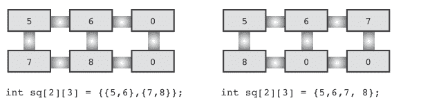

```c
int sq[2][3] = {{5,6},{7,8}};
```

```c
int sq[2][3] = {5,6,7,8};
```

图 10.2 初始化数组的两种方法。

由于 rain 数组保存的数据不应被修改，程序在声明数组时使用了 const 修饰符。

## 更多维度

我们对二维数组所说的一切都可以推广到三维数组以及更进一步。你可以这样声明一个三维数组：

```c
int box[10][20][30];
```

你可以将一维数组可视化为一行数据，将二维数组可视化为一张数据表，将三维数组可视化为一叠数据表。例如，你可以将 box 数组可视化为 10 个二维数组（每个 20×30）堆叠在一起。

另一种思考 box 的方式是将其视为数组的数组的数组。也就是说，它是一个 10 元素数组，其每个元素都是一个 20 元素数组。每个 20 元素数组的元素然后是 30 元素数组。或者，你可以简单地根据所需索引的数量来思考数组。

通常，你会使用三个嵌套循环来处理三维数组，使用四个嵌套循环来处理四维数组，以此类推。我们在示例中坚持使用两个维度。

## 指针和数组

指针，如你可能从第 9 章“函数”中回忆的那样，提供了一种使用地址的符号方式。由于计算机器的硬件指令严重依赖地址，指针使你能够以接近机器表达方式的方式表达自己。这种对应关系使使用指针的程序高效。特别是，指针提供了一种处理数组的高效方式。事实上，正如你将看到的，数组记法只是指针的伪装使用。

这种伪装使用的一个例子是，数组名也是数组第一个元素的地址。也就是说，如果 flizny 是一个数组，则以下内容为真：

```c
flizny == &flizny[0];    // name of array is the address of the first element
```

flizny 和 &flizny[0] 都表示该第一个元素的内存地址。 （请记住 & 是地址运算符。）两者都是常量，因为它们在程序持续期间保持固定不变。但是，它们可以被赋值为指针变量，你可以更改变量的值，如列表 10.8 所示。注意指针的值在你向其添加数字时会发生什么变化。 （请记住，指针的 %p 指定符通常以十六进制值显示。）

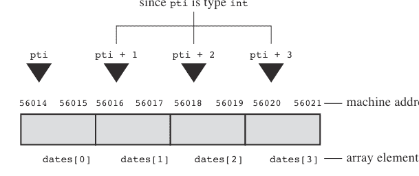

```c
int dates[y], *pti;
pti = dates; (or pti = & dates[0];)
```

图 10.3 一个数组和指针加法。

现在我们可以更清楚地定义什么是指向 int 的指针、指向 float 的指针或指向任何其他数据对象的指针：

- 指针的值是指向对象的地址。地址在内部如何表示取决于硬件。许多计算机，包括 PC 和 Macintosh，是字节可寻址的，这意味着内存中的每个字节按顺序编号。在这里，大对象的地址，例如 type double 变量，通常是该对象的第一个字节的地址。
- 对指针应用 * 运算符会产生指向对象中存储的值。
- 对指针加 1 会使其值增加指向类型大小的字节数。

由于 C 的巧妙，我们有以下等式：

```c
dates + 2 == &dates[2]      // same address
*(dates + 2) == dates[2]    // same value
```

这些关系总结了数组和指针之间的密切联系。它们意味着你可以使用指针来标识数组的单个元素并获取其值。从本质上讲，我们有两个不同的表示相同事物的记法。事实上，C 语言标准以指针为术语描述数组记法。也就是说，它将 ar[n] 定义为 *(ar + n)。你可以将第二个表达式理解为：“转到内存位置 ar，移动 n 个单位，然后检索那里的值。”


原型会是什么？记住，数组的名称是其第一个元素的地址，所以实际参数 marbles，即 int 的地址，应该赋给一个指向 int 的指针形式参数：

```
int sum(int * ar);  // corresponding prototype
```

sum() 从这个参数得到什么信息？它得到数组第一个元素的地址，并且知道在该位置会找到一个 int。请注意，此信息并未说明数组中元素的数量。我们剩下几种选择来将该信息传递给函数。第一个选择是将固定的数组大小编码到函数中：

```
int sum(int * ar)    // corresponding definition
{
    int i;
    int total = 0;

    for( i = 0; i < 10; i++ )  // assume 10 elements
        total += ar[i];    // ar[i] the same as *(ar + i)
    return total;
}
```

这里，我们利用了这样一个事实：正如你可以用指针表示法使用数组名一样，你也可以用数组表示法使用指针。此外，请回忆 += 运算符会将右侧操作数的值加到左侧操作数上。因此，total 是数组元素的累加和。

这个函数定义是有限的；它仅适用于包含 10 个元素的 int 数组。更灵活的方法是将数组大小作为第二个参数传递：

```
int sum(int * ar, int n)  // more general approach
{
    int i;
    int total = 0;

    for( i = 0; i < n; i++ )  // use n elements
        total += ar[i];    // ar[i] the same as *(ar + i)
    return total;
}
```

这里，第一个参数告诉函数在哪里找到数组以及数组中数据的类型，第二个参数告诉函数有多少个元素。

关于函数参数还有一件事要说明。在函数原型或函数定义头部的上下文中，并且仅在该上下文中，你可以用 int ar[] 替代 int * ar：

```
int sum (int ar[], int n);
```

形式 int * ar 总是意味着 ar 是指向 int 的指针类型。形式 int ar[] 也意味着 ar 是指向 int 的指针类型，但仅当用于声明形式参数时。想法是第二种形式提醒读者 ar 不仅指向一个 int，它还指向一个数组元素中的 int。

### Note Declaring Array Parameters

由于数组的名称是第一个元素的地址，数组名称作为实际参数要求匹配的形式参数为指针。在此上下文中，并且仅在此上下文中，C 将 int ar[] 解释为与 int * ar 相同；也就是说，ar 是指向 int 的指针类型。由于原型允许你省略名称，以下四个原型都是等价的：

```
int sum(int *ar, int n);
int sum(int *, int);
int sum(int ar[], int n);
int sum(int [], int);
```

你不能在函数定义中省略名称，因此，对于定义，以下两种形式是等价的：

```
int sum(int *ar, int n)
{
    // code goes here
}
```

```
int sum(int ar[], int n);
{
    // code goes here
}
```

你应该能够使用上述四个原型中的任何一个与所示的两个定义中的任一个。

Listing 10.10 显示了一个使用 sum() 函数的程序。为了指出关于数组参数的一个有趣事实，该程序还打印了原始数组的大小和表示数组的函数参数的大小。 （如果你的编译器不支持用于打印 sizeof 量的 %zd 说明符，请使用 %u 或可能是 %lu。）

### Listing 10.10 The sum_arr1.c Program

```
// sum_arr1.c -- sums the elements of an array
// use %u or %lu if %zd doesn't work
#include <stdio.h>
#define SIZE 10
int sum(int ar[], int n);
int main(void)
{
```
```
int marbles[SIZE] = {20,10,5,39,4,16,19,26,31,20};
long answer;

answer = sum(marbles, SIZE);
printf("The total number of marbles is %ld.\n", answer);
printf("The size of marbles is %zd bytes.\n", sizeof marbles);

return 0;
}

int sum(int ar[], int n)    // how big an array?
{
    int i;
    int total = 0;

    for( i = 0; i < n; i++)
        total += ar[i];
    printf("The size of ar is %zd bytes.\n", sizeof ar);

    return total;
}
```

我们在系统上的输出如下所示：

```
The size of ar is 8 bytes.
The total number of marbles is 190.
The size of marbles is 40 bytes.
```

请注意，marbles 的大小是 40 字节。这是有意义的，因为 marbles 包含 10 个 int，每个 4 字节，总共 40 字节。但 ar 的大小只有 8 字节。那是因为 ar 本身不是数组；它是指向 marbles 第一个元素的指针。我们的系统使用 8 字节存储地址，因此指针变量的大小为 8 字节。 （其他系统可能使用不同数量的字节。）简而言之，在 Listing 10.10 中，marbles 是一个数组，ar 是指向 marbles 第一个元素的指针，而 C 中数组和指针之间的联系使你能够用数组表示法使用指针 ar。

### Using Pointer Parameters

处理数组的函数需要知道开始和停止的位置。sum() 函数使用指针参数来标识数组的开始，并使用整数参数来指示要处理的元素的数量。 （指针参数还标识数组中数据的类型。）但这不是告诉函数它需要知道内容的唯一方法。描述数组的另一种方法是传递两个指针，一个指示数组开始的位置（如前所述），另一个指示数组结束的位置。Listing 10.11 说明了这种方法。它还利用了指针参数是一个变量这一事实，这意味着函数可以使用索引来指示要访问的数组中的哪个元素，或者函数可以改变指针本身的值，使其依次指向每个数组元素。

### Listing 10.11 The sum_arr2.c Program

```
/* sum_arr2.c -- sums the elements of an array */
#include <stdio.h>
#define SIZE 10
int sump(int * start, int * end);
int main(void)
{
    int marbles[SIZE] = {20,10,5,39,4,16,19,26,31,20};
    long answer;

    answer = sump(marbles, marbles + SIZE);
    printf("The total number of marbles is %ld.\n", answer);

    return 0;
}

/* use pointer arithmetic  */
int sump(int * start, int * end)
{
    int total = 0;

    while (start < end)
    {
        total += *start; // add value to total
        start++;         // advance pointer to next element
    }

    return total;
}
```

指针 start 最初指向 marbles 的第一个元素，因此赋值表达式 total +=*start 将第一个元素的值（20）加到 total 上。然后表达式 start++ 增加指针变量 start，使其指向数组中的下一个元素。因为 start 指向类型 int，C 会将 start 的值增加 int 的大小。

请注意，sump() 函数使用的方法与 sum() 不同来结束求和循环。sum() 函数使用元素数量作为第二个参数，循环使用该值作为循环测试的一部分：

```
for( i = 0; i < n; i++)
```

- **Adding an integer to a pointer**—你可以使用 + 运算符将整数加到指针上或将指针加到整数上。在任何一种情况下，整数都会乘以指向类型的字节数，然后结果加到原始地址上。这使得 ptr1 + 4 与 &urn[4] 相同。如果结果位于原始指针指向的数组之外，则加法的结果是未定义的，除了数组末尾元素的下一个地址保证有效。

- **Incrementing a pointer**—递增指向数组元素的指针会使其移动到数组的下一个元素。因此，ptr1++ 将 ptr1 的数值增加 4（我们系统上每个 int 4 字节）并使 ptr1 指向 urn[1]（参见图 10.4，使用简化地址）。现在 ptr1 的值为 0x7fff5fbf f8d4（下一个数组地址），而 *ptr1 的值为 200（urn[1] 的值）。请注意，ptr1 本身的地址仍然是 0x7fff5fbf f8c8。毕竟，变量不会因为值改变而到处移动！

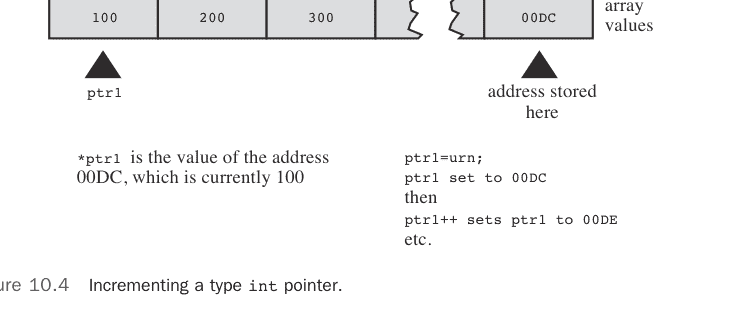

Figure 10.4 Incrementing a type int pointer.

- **Subtracting an integer from a pointer**—你可以使用 – 运算符从指针中减去整数；指针必须作为第一个操作数，整数值作为第二个操作数。整数乘以指向类型的字节数，然后结果从原始地址中减去。这使得 ptr3 – 2 与 &urn[2] 相同，因为 ptr3 指向 &urn[4]。如果结果位于原始指针指向的数组之外，则减法的结果是未定义的，除了数组末尾元素的下一个地址保证有效。

- **Decrementing a pointer**—当然，你也可以递减指针。在此示例中，递减 ptr2 使其指向第二个数组元素而不是第三个。请注意，你可以使用增量和减量运算符的前缀和后缀形式


因此，函数调用

```
add_to(prices, 100, 2.50);
```

会使 prices 数组中的每个元素都被替换为比 2.5 大的值；该函数修改了数组的内容。它之所以能够做到这一点，是因为通过使用指针，函数使用了原始数据。

然而，其他函数并不打算修改数据。例如，下面的函数旨在查找数组内容的和；它不应该改变数组。然而，由于 `ar` 实际上是一个指针，编程错误可能导致原始数据被破坏。这里，例如，表达式 `ar[i]++` 会导致每个元素的值增加 1：

```
int sum(int ar[], int n)  // faulty code
{
    int i;
    int total = 0;

    for (i = 0; i < n; i++)
        total += ar[i]++;  // error increments each element
    return total;
}
```

### 使用 const 作为形式参数

使用 K&R C，避免此类错误唯一的方法是保持警惕。使用 ANSI C 时，有另一种选择。如果函数的意图是不改变数组的内容，请在原型中以及函数定义中声明形式参数时使用关键字 `const`。例如，`sum()` 的原型和定义应如下所示：

```
int sum(const int ar[], int n);  /* prototype */
```

```
int sum(const int ar[], int n)  /* definition */
{
    int i;
    int total = 0;

    for (i = 0; i < n; i++)
        total += ar[i];
    return total;
}
```

这告诉编译器函数应将 `ar` 指向的数组视为包含常量数据。然后，如果你不小心使用了诸如 `ar[i]++` 这样的表达式，编译器可以捕获它并生成错误消息，告诉你函数试图修改常量数据。

```
for (i = 0; i < n; i++)
    ar[i] *= mult;
}
```

以下是输出：

```
The original dip array:
    20.000   17.660    8.200   15.300   22.220
The dip array after calling mult_array():
    50.000   44.150   20.500   38.250   55.550
```

请注意两个函数都是类型 void。`mult_array()` 函数确实为 dip 数组提供了新值，但不是通过使用返回机制。

### 更多关于 const 的内容

之前，你看到可以使用 `const` 来创建符号常量：

```
const double PI = 3.14159;
```

这也是你可以使用 `#define` 指令完成的事情，但 `const` 还允许你创建常量数组、常量指针和指向常量的指针。

列表 10.4 展示了如何使用 `const` 关键字来保护数组：

```
#define MONTHS 12
...
const int days[MONTHS] = {31,28,31,30,31,30,31,31,30,31,30,31};
```

如果程序代码随后尝试修改数组，你会得到编译时错误消息：

```
days[9] = 44;    /* compile error */
```

指向常量的指针不能用于更改值。考虑以下代码：

```
double rates[5] = {88.99, 100.12, 59.45, 183.11, 340.5};
const double * pd = rates;    // pd points to beginning of the array
```

你仍然可以使用 `rates` 来更改值。此外，请注意你可以让 `pd` 指向其他位置：

```
pd++;      /* make pd point to rates[1] -- allowed */
```

指向常量的指针通常用作函数参数，以表示函数不会使用该指针来更改数据。例如，列表 10.14 中的 `show_array()` 函数本可以原型化为

```
void show_array(const double *ar, int n);
```

你应该了解有关指针赋值和 `const` 的一些规则。首先，将常量数据或非常量数据的地址赋给指向常量的指针是有效的：

```
double rates[5] = {88.99, 100.12, 59.45, 183.11, 340.5};
const double locked[4] = {0.08, 0.075, 0.0725, 0.07};
const double * pc = rates;      // valid
pc = locked;                    // valid
pc = &rates[3];                 // valid
```

然而，只有非常量数据的地址可以赋给普通指针：

```
double rates[5] = {88.99, 100.12, 59.45, 183.11, 340.5};
const double locked[4] = {0.08, 0.075, 0.0725, 0.07};
double * pnc = rates;          // valid
pnc = locked;                   // not valid
pnc = &rates[3];                // valid
```

这是合理的规则。否则，你就可以使用该指针来更改本应为常量的数据。

这些规则的实际后果是，像 `show_array()` 这样的函数可以接受普通数组和常量数组的名称作为实际参数，因为两者都可以赋给指向常量的指针：

```
show_array(rates, 5);   // valid
show_array(locked, 4);   // valid
```

因此，在函数参数定义中使用 `const` 不仅保护了数据，还允许函数处理被声明为 `const` 的数组。

然而，像 `mult_array()` 这样的函数不应该将常量数组的名称作为参数传递：

```
mult_array(rates, 5, 1.2);   // valid
mult_array(locked, 4, 1.2);   // bad idea
```

C 标准所说的是，使用非 const 标识符（例如 `mult_array()` 形式参数 `ar`）尝试修改 const 数据（例如 `locked`）会导致未定义行为。

in zippo[0][0]，一个 int 值。同样，`*zippo` 表示其第一个元素的数值，`zippo[0]`，但 `zippo[0]` 本身是 int 的地址。它是地址 `&zippo[0][0]`，因此 `*zippo` 是 `&zippo[0][0]`。对两个表达式应用解引用操作符意味着 `**zippo` 等于 `*&zippo[0][0]`，这简化为 `zippo[0][0]`，一个 int。简而言之，`zippo` 是地址的地址，必须解引用两次才能得到普通值。地址的地址或指针的指针是双重间接的示例。

显然，增加数组维度的数量会增加指针视图的复杂性。在这一点上，大多数 C 学习者开始意识到为什么指针被认为是该语言更困难的方面之一。你可能想仔细研究前面的要点，并看看它们如何在列表 10.15 中得到说明，该列表显示了一些地址值和数组内容。

### 列表 10.15 zippo1.c 程序

```
/* zippo1.c -- zippo info */
#include <stdio.h>
int main(void)
{
    int zippo[4][2] = { {2,4}, {6,8}, {1,3}, {5, 7} };

    printf("  zippo = %p,      zippo + 1 = %p\n", zippo, zippo + 1);
    printf("zippo[0] = %p,  zippo[0] + 1 = %p\n", zippo[0], zippo[0] + 1);
    printf("  *zippo = %p,    *zippo + 1 = %p\n", *zippo, *zippo + 1);
    printf("zippo[0][0] = %d\n",  zippo[0][0]);
    printf("  *zippo[0] = %d\n", *zippo[0]);
    printf("   **zippo = %d\n", **zippo);
    printf("    zippo[2][1] = %d\n", zippo[2][1]);
    printf("*(*(zippo+2) + 1) = %d\n", *(*(zippo+2) + 1));

    return 0;
}
```

以下是某个系统的输出：

```
zippo = 0x0064fd38,    zippo + 1 = 0x0064fd40
zippo[0] = 0x0064fd38,  zippo[0] + 1 = 0x0064fd3c
*zippo = 0x0064fd38,    *zippo + 1 = 0x0064fd3c
zippo[0][0] = 2
*zippo[0] = 2
```

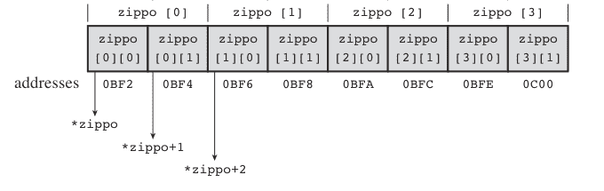

图 10.5 一个数组的数组。

### 指向多维数组的指针

你如何声明一个指针变量 `pz`，使其可以指向像 `zippo` 这样的二维数组？这样的指针例如可以在编写处理 `zippo` 类似数组的函数时使用。指针到 int 的类型是否足够？不行。该类型与 `zippo[0]` 兼容，后者指向单个 int。但 `zippo` 是其第一个元素的地址，该元素是一个包含两个 int 的数组。因此，`pz` 必须指向一个包含两个 int 的数组，而不是单个 int。你可以这样做：

```
int (*pz)[2]; // pz points to an array of 2 ints
```

此语句表示 `pz` 是一个指向包含两个 int 的数组的指针。为什么需要括号？好吧，`[]` 的优先级高于 `*`。因此，使用如下声明

```
int * pax[2]; // pax is an array of two pointers-to-int
```

你首先应用方括号，使 `pax` 成为两个某物的数组。接下来，应用 `*`，使 `pax` 成为两个指针的数组。最后使用 `int`，使 `pax` 成为两个指向 int 的指针的数组。此声明创建了两个指向单个 int 的指针，但原始版本使用括号首先应用 `*`，创建了一个指向包含两个 int 的数组的指针。列表 10.16 显示了如何使用此类指针就像原始数组一样。

### 列表 10.16 zippo2.c 程序

```
/* zippo2.c -- zippo info via a pointer variable */
#include <stdio.h>
int main(void)
{
    int zippo[4][2] = { {2,4}, {6,8}, {1,3}, {5, 7} };
    int (*pz)[2];
    pz = zippo;
    printf("  pz = %p,   pz + 1 = %p\n",


```
pz,		pz + 1);
printf("pz[0] = %p, pz[0] + 1 = %p\n", 
	pz[0],		pz[0] + 1);
printf(" *pz = %p,   *pz + 1 = %p\n", 
	*pz,		*pz + 1);
printf("pz[0][0] = %d\n", pz[0][0]);
printf(" *pz[0] = %d\n", *pz[0]);
printf("  **pz = %d\n", **pz);
printf("      pz[2][1] = %d\n", pz[2][1]);
printf("*( *(pz+2) + 1) = %d\n", *( *(pz+2) + 1));

return 0;
}
```

以下是新的输出：

```
pz = 0x0064fd38,   pz + 1 = 0x0064fd40
pz[0] = 0x0064fd38, pz[0] + 1 = 0x0064fd3c
 *pz = 0x0064fd38,   *pz + 1 = 0x0064fd3c
pz[0][0] = 2
  *pz[0] = 2
    **pz = 2
        pz[2][1] = 3
*( *(pz+2) + 1) = 3
```

同样，你可能会得到不同的地址，但关系会保持相同。正如所承诺的，你可以使用诸如 pz[2][1] 这样的记法，即使 pz 是一个指针，而不是数组名。更一般地，你可以使用数组记法或指针记法，通过数组名或指针来表示单个元素：

```
zippo[m][n] == *( *(zippo + m) + n)
pz[m][n] == *( *(pz + m) + n)
```

## 指针兼容性

将一个指针赋给另一个指针的规则比数值类型的规则更严格。例如，你可以在不使用类型转换的情况下将 int 值赋给 double 变量，但不能对指向这两种类型的指针做同样的事：

```
int n = 5;
double x;
int * p1 = &n;
double * pd   = &x;
x = n;                // implicit type conversion
pd = p1;              // compile-time error
```

以下是输出：

```
row 0: sum = 20
row 1: sum = 24
row 2: sum = 36
col 0: sum = 17
col 1: sum = 19
col 2: sum = 21
col 3: sum = 23
Sum of all elements = 80
```

第 10.17 节中的程序作为参数传递了名称 junk，它是指向第一个元素的指针、一个子数组，以及符号常量 ROWS，表示 3，即行数。每个函数随后将 ar 视为由四个 int 组成的数组的数组。列数已内置到函数中，但行数保持开放。相同的函数如果传入 12 作为行数，也可以用 12x4 数组。之所以可行，是因为 rows 是元素数；然而，由于每个元素都是一个数组，或一行，rows 就变成了行数。

请注意 ar 的使用方式与 main() 中 junk 的使用方式相同。这是因为 ar 和 junk 的类型相同：指向由四个 int 组成的数组的指针。

请注意，以下声明不会正常工作：

```
int sum2(int ar[][], int rows); // faulty declaration
```

请回忆，编译器会将数组记法转换为指针记法。这意味着，例如，ar[1] 将变成 ar+1。对于编译器要计算这一点，它需要知道 ar 所指向的对象的大小。声明

```
int sum2(int ar[][4], int rows); // valid declaration
```

表示 ar 指向一个由四个 int 组成的数组，因此，在我们的系统上，它指向一个 16 字节长的对象，所以 ar+1 意味着“将地址加上 16 字节”。使用空括号版本时，编译器就不知道该怎么做。

你也可以在另一对括号中包含大小，如下所示，但编译器会忽略它：

```
int sum2(int ar[3][4], int rows); // valid declaration, 3 ignored
```

这对于使用 typedef 的人来说很方便，typedef 在第 5 章“运算符、表达式和语句”中提到，并在第 14 章“结构和其他数据形式”中讨论：

```
typedef int arr4[4];              // arr4 array of 4 int
typedef arr4 arr3x4[3];           // arr3x4 array of 3 arr4
int sum2(arr3x4 ar, int rows);    // same as next declaration
int sum2(int ar[3][4], int rows); // same as next declaration
int sum2(int ar[][4], int rows);  // standard form
```

一般来说，要声明对应于 N 维数组的指针，你必须为除最左侧的一组括号之外的所有括号提供值：

```
int sum4d(int ar[][12][20][30], int rows);
```

这是因为第一组括号表示一个指针，而其余的括号描述被指向的数据对象的类型，如以下等价的原型所示：

```
int sum4d(int (*ar)[12][20][30], int rows);  // ar a pointer
```

这里，ar 指向一个 12×20×30 的 int 数组。

### 变长数组 VLA

你可能已经注意到处理二维数组的函数有一个奇怪之处：你可以用函数参数描述行数，但列数已内置到函数中。例如，看看这个定义：

```
#define COLS 4
int sum2d(int ar[][COLS], int rows)
{
    int r;
    int c;
    int tot = 0;

    for (r = 0; r < rows; r++)
        for (c = 0; c < COLS; c++)
            tot += ar[r][c];
    return tot;
}
```

接下来，假设以下数组已被声明：

```
int array1[5][4];
int array2[100][4];
int array3[2][4];
```

你可以用 sum2d() 函数处理这些数组中的任何一个：

```
tot = sum2d(array1, 5);   // sum a 5 x 4 array
tot = sum2d(array2, 100); // sum a 100 x 4 array
tot = sum2d(array3, 2);   // sum a 2 x 4 array
```

这是因为行数传递给了 rows 参数，是一个变量。但如果你想求和一个 6×5 数组，你就需要使用一个新的函数，一个 COLS 定义为 5 的函数。这种行为是由于你必须使用常量作为数组维度；因此，你不能用变量替换 COLS。

第二，这里是如何定义该函数：

```
int sum2d(int rows, int cols, int ar[rows][cols])
{
    int r;
    int c;
    int tot = 0;

    for (r = 0; r < rows; r++)
        for (c = 0; c < cols; c++)
            tot += ar[r][c];
    return tot;
}
```

除了新的函数头之外，与这个函数的经典 C 版本相比，唯一的区别是常量 COLS 被变量 cols 替换。函数头中存在变长数组正是使这种改变成为可能的原因。此外，具有表示行数和列数的变量让我们可以用新的 sum2d() 处理任意大小的二维 int 数组。第 10.18 节说明了这一点。然而，它需要一个实现 VLA 特性的 C 编译器。它还演示了这个基于 VLA 的函数可以用传统的 C 数组或变长数组使用。

### 第 10.18 节 vararr2d.c 程序

```
//vararr2d.c -- functions using VLAs
#include <stdio.h>
#define ROWS 3
#define COLS 4
int sum2d(int rows, int cols, int ar[rows][cols]);
int main(void)
{
    int i, j;
    int rs = 3;
    int cs = 10;
    int junk[ROWS][COLS] = {
        {2,4,6,8},
        {3,5,7,9},
        {12,10,8,6}
    };

    int morejunk[ROWS-1][COLS+2] = {
        {20,30,40,50,60,70},
        {5,6,7,8,9,10}
    };

    int varr[rs][cs]; // VLA

    for (i = 0; i < rs; i++)
        for (j = 0; j < cs; j++)
            varr[i][j] = i * j + j;

    printf("3x4 array\n");
    printf("Sum of all elements = %d\n", sum2d(ROWS, COLS, junk));

    printf("2x6 array\n");
    printf("Sum of all elements = %d\n", sum2d(ROWS-1, COLS+2, morejunk));

    printf("3x10 VLA\n");
    printf("Sum of all elements = %d\n", sum2d(rs, cs, varr));

    return 0;
}

// function with a VLA parameter
int sum2d(int rows, int cols, int ar[rows][cols])
{
    int r;
    int c;
    int tot = 0;

    for (r = 0; r < rows; r++)
        for (c = 0; c < cols; c++)
            tot += ar[r][c];

    return tot;
}
```

以下是输出：

```
3x4 array
Sum of all elements = 80
2x6 array
Sum of all elements = 315
3x10 VLA
Sum of all elements = 270
```

需要指出的一点是，函数定义参数列表中的 VLA 声明实际上并没有创建数组。就像旧语法一样，VLA 名称实际上是一个指针。这意味着具有 VLA 参数的函数实际上操作的是原始数组中的数据，因此

这里，类型是 int [2][4]，即 2×4 的 int 数组。

第 10.19 节将这些示例合并成一个完整的程序。

### 第 10.19 节 flc.c 程序

```
// flc.c -- funny-looking constants
#include <stdio.h>
#define COLS 4
int sum2d(const int ar[][COLS], int rows);
int sum(const int ar[], int n);
int main(void)
{
    int total1, total2, total3;
    int * pt1;
    int (*pt2)[COLS];

    pt1 = (int [2]) {10, 20};
    pt2 = (int [2][COLS]) { {1,2,3,-9}, {4,5,6,-8} };

    total1 = sum(pt1, 2);
    total2 = sum2d(pt2, 2);
    total3 = sum((int []){4,4,4,5,5,5}, 6);
    printf("total1 = %d\n", total1);
    printf("total2 = %d\n", total2);
    printf("total3 = %d\n", total3);

    return 0;
}

int sum(const int ar[], int n)
{
    int i;
    int total = 0;

    for( i = 0; i < n; i++)
        total += ar[i];

    return total;
}

int sum2d(const int ar[][COLS], int rows)
{
    int r;
    int c;
    int tot = 0;
```


```
for (r = 0; r < rows; r++)
    for (c = 0; c < COLS; c++)
        tot += ar[r][c];

    return tot;
}
```

你需要一个接受此 C99 扩展的编译器（并非所有编译器都支持）。以下是输出：

```
total1 = 30
total2 = 4
total3 = 27
```

请记住，复合字面量是一种提供仅在暂时需要的值的手段。它具有块作用域，这一概念在第 12 章中介绍。这意味着一旦程序执行离开定义复合字面量的块，即包含该定义的最近一对大括号，其存在就不再得到保证。

## 关键概念

当你需要存储许多相同类型项时，数组可能是答案。C 将数组称为 *派生类型*，因为它们建立在其他类型之上。也就是说，你不仅仅声明一个数组。相反，你声明一个 int 数组或一个 float 数组，或某种其他类型的数组。该其他类型本身也可以是数组类型，在这种情况下，你得到的是数组的数组，或二维数组。

通常编写函数来处理数组是很有利的；这有助于通过将特定任务定位在特定函数中来模块化程序。必须认识到，当你使用数组名作为实际参数时，你并没有将整个数组传递给函数；你只是传递了数组的地址（因此，对应的形式参数是指针）。要处理数组，函数必须知道数组在哪里以及数组有多少个元素。数组地址提供了“在哪里”；“有多少”要么必须内置于函数中，要么作为单独参数传递。第二种方法更通用，使得同一个函数可以处理不同大小的数组。

数组和指针之间的联系非常紧密，你通常可以使用数组记法或指针记法来表示相同的操作。正是这种联系使得你可以在数组处理函数中使用数组记法，即使形式参数是指针而不是数组。

你必须用常量表达式指定传统 C 数组的大小，因此大小在编译时确定。C99/C11 提供了变长数组的替代方案，其大小说明符可以是变量。这使你能够推迟在程序运行时指定 VLA 的大小。

## 摘要

*数组* 是一组具有相同数据类型元素。数组元素按顺序存储在内存中，并通过整数索引（或 *偏移量*）访问。在 C 中，数组的第一个元素的索引为 0，因此 n 个元素的数组的最后一个元素的索引为 n - 1。使用数组索引是你的责任，因为编译器或运行程序不需要检查其有效性。

要声明一个简单的 *一维* 数组，使用以下形式：

```
type name[size];
```

这里，*type* 是每个元素的的数据类型，*name* 是数组的名称，*size* 是元素个数。传统上，C 要求 *size* 为常量整数表达式。C99/C11 允许你使用非常量整数表达式；在这种情况下，数组称为变长数组。

C 将数组名解释为数组第一个元素的地址。换句话说，数组名等价于指向第一个元素的指针。一般来说，数组和指针密切相关。如果 ar 是一个数组，则表达式 ar[i] 和 *(ar + i) 是等价的。

C 不允许将整个数组作为函数参数传递，但你可以传递数组的地址。然后函数可以使用此地址操作原始数组。如果函数的意图不是修改原始数组，你应该在声明表示数组的形式参数时使用 const 关键字。你可以在被调用函数中使用数组记法或指针记法。在任何一种情况下，你实际上都在使用指针变量。

向指针添加整数或递增指针会使指针的值按所指向对象所占的字节数变化。也就是说，如果 pd 指向数组中的一个 8 字节 double 值，给 pd 加 1 会使其值增加 8，以便指向数组的下一个元素。

*二维* 数组表示数组的数组。例如，声明

```
double sales[5][12];
```

```
void display(double ar[][12], int rows);
...
display(sales, 5);
```

变长数组提供了一种第二种语法，其中两个数组维度都作为参数传递。在这种情况下，函数原型和函数调用看起来像这样：

```
void display(int rows, int cols, double ar[rows][cols]);
...
display(5, 12, sales);
```

我们在此讨论中使用了 int 数组和 double 数组，但相同的概念适用于其他类型。字符字符串则有许多特殊规则。这源于字符串中的终止空字符提供了一种方式，使函数无需传递大小即可检测字符串的结束。我们将在第 11 章“字符字符串和字符串函数”中详细讨论字符字符串。

## 复习问题

你可以在附录 A“复习问题的答案”中找到复习问题的答案。

- 1. 这个程序会打印什么？

```
#include <stdio.h>
int main(void)
{
    int ref[] = {8, 4, 0, 2};
    int *ptr;
    int index;

    for (index = 0, ptr = ref; index < 4; index++, ptr++)
        printf("%d %d\n", ref[index], *ptr);
    return 0;
}
```

- 2. 在问题 1 中，ref 有多少个元素？

- 3. 在问题 1 中，ref 是什么的地址？ref + 1 呢？++ref 指向什么？

- 4. 在每种情况下，*ptr 和 *(ptr + 2) 的值是多少？

  a.

```
int *ptr;
int torf[2][2] = {12, 14, 16};
ptr = torf[0];
```

b.
int * ptr;
int fort[2][2] = { {12}, {14,16} };
ptr = fort[0];

# 5. 在每种情况下，**ptr 和 **(ptr + 1) 的值是多少？

a.
int (*ptr)[2];
int torf[2][2] = {12, 14, 16};
ptr = torf;

b.
int (*ptr)[2];
int fort[2][2] = { {12}, {14,16} };
ptr = fort;

# 6. 假设你有以下声明：
int grid[30][100];

- a. 用一种方式表示 grid[22][56] 的地址。
- b. 用两种方式表示 grid[22][0] 的地址。
- c. 用三种方式表示 grid[0][0] 的地址。

# 7. 为以下每个变量创建适当的声明：

- a. digits 是一个包含 10 个 int 的数组。
- b. rates 是一个包含六个 float 的数组。
- c. mat 是一个包含三个数组的数组，每个数组有五个整数。
- d. psa 是一个包含 20 个指向 char 的指针的数组。
- e. pstr 是一个指向包含 20 个 char 的数组的指针。

### 8.

- a. 声明一个包含六个 int 的数组并将其初始化为值 1、2、4、8、16 和 32。
- b. 使用数组记法表示第 a 部分数组的第三个元素（值为 4 的那个）。
- c. 假设 C99/C11 规则生效，声明一个包含 100 个 int 的数组并将其初始化为最后一个元素为 -1；不必关心其他元素。
- d. 假设 C99/C11 规则生效，声明一个包含 100 个 int 的数组并将其初始化为元素 5、10、11、12 和 3 为 101；不必关心其他元素。

9. 10 个元素的数组的索引范围是什么？

10. 假设你有这些声明：

```
float rootbeer[10], things[10][5], *pf, value = 2.2;
int i = 3;
```

将以下每个语句标识为有效或无效：

- a. rootbeer[2] = value;
- b. scanf("%f", &rootbeer );
- c. rootbeer = value;
- d. printf("%f", rootbeer);
- e. things[4][4] = rootbeer[3];
- f. things[5] = rootbeer;
- g. pf = value;
- h. pf = rootbeer;

11. 声明一个 800×600 的 int 数组。

12. 这里有三个数组声明：

```
double trots[20];
short clops[10][30];
long shots[5][10][15];
```

- a. 显示一个处理 trots 的传统 void 函数的函数原型和函数调用，以及一个使用 VLA 的 C 函数。
- b. 显示一个处理 clops 的传统 void 函数的函数原型和函数调用，以及一个使用 VLA 的 C 函数。
- c. 显示一个处理 shots 的传统 void 函数的函数原型和函数调用，以及一个使用 VLA 的 C 函数。

13. 这里有两个函数原型：

```
void show(const double ar[], int n);  // n 是元素个数
void show2(const double ar2[][3], int n);  // n 是行数
```

- a. 显示一个函数调用，将包含值 8、3、9 和 2 的复合字面量传递给 show() 函数。
- b. 显示一个函数调用，将包含值 8、3 和 9 作为第一行，以及值 5、4 和 1 作为第二行的复合字面量传递给 show2() 函数。


## 编程练习

1. 修改第 10.7 节中的 rain 程序，使其使用指针而不是下标进行计算。 （你仍然必须声明并初始化数组。）

2. 编写一个程序，初始化一个 double 型数组，然后将数组的内容复制到另外三个数组中。 （四个数组都应在 main 程序中声明。） 要进行第一次复制，使用带数组表示法的函数。 要进行第二次复制，使用带指针表示法和指针递增的函数。 让前两个函数以目标数组的名称、源数组的名称和要复制的元素数量作为参数。 让第三个函数以目标的名称、源的名称和指向源最后一个元素之后的元素指针作为参数。 也就是说，给定以下声明，函数调用将如下所示：

```
double source[5] = {1.1, 2.2, 3.3, 4.4, 5.5};
double target1[5];
double target2[5];
double target3[5];
copy_arr(target1, source, 5);
copy_ptr(target2, source, 5);
copy_ptrs(target3, source, source + 5);
```

3. 编写一个函数，返回存储在 int 型数组中的最大值。 在一个简单的程序中测试该函数。

4. 编写一个函数，返回存储在 double 型数组中的最大值的索引。 在一个简单的程序中测试该函数。

5. 编写一个函数，返回 double 型数组中最大元素与最小元素之间的差值。 在一个简单的程序中测试该函数。

6. 编写一个函数，反转 double 型数组的内容，并在简单的程序中测试它。

7. 编写一个程序，初始化一个二维 double 型数组，并使用练习 2 中的复制函数之一将其复制到第二个二维数组。 （由于二维数组是数组的数组，可以使用一维复制函数处理每个子数组。）

8. 使用编程练习 2 中的复制函数，将七个元素的数组中的第三到第五个元素复制到一个三元素数组中。 函数本身不必更改； 只需选择正确的实际参数。 （实际参数不必是数组名称和数组大小。它们只需要是数组元素的地址和要处理的元素的数量。）

9. 编写一个程序，初始化一个二维 3×5 的 double 型数组，并使用基于 VLA 的函数将其复制到第二个二维数组。 还提供一个基于 VLA 的函数来显示两个数组的内容。 这两个函数应能够一般地处理任意 N×M 数组。 （如果您无法使用支持 VLA 的编译器，请使用传统的 C 方法，即能够处理 N×5 数组的函数。）

10. 编写一个函数，将数组中的每个元素设置为另外两个数组中对应元素的总和。 也就是说，如果数组 1 的值是 2、4、5 和 8，数组 2 的值是 1、0、4 和 6，则该函数将数组 3 的值设为 3、4、9 和 14。 该函数应以三个数组名称和一个数组大小作为参数。 在一个简单的程序中测试该函数。

11. 编写一个程序，声明一个 3×5 的 int 数组并将其初始化为你选择的某些值。 让程序打印这些值，将所有值加倍，然后显示新的值。 编写一个函数来执行显示，并编写第二个函数来执行加倍。 让函数以数组名称和行数作为参数。

12. 重写第 10.7 节中的 rain 程序，使主要任务由函数执行而不是在 main() 中执行。

13. 编写一个程序，提示用户输入三组五个 double 数字。 （你可以假设用户正确响应并且不会输入非数字数据。）程序应完成以下所有操作：

    a. 将信息存储在 3×5 数组中。
    b. 计算每组五个值的平均值。
    c. 计算所有值的平均值。
    d. 确定 15 个值中的最大值。
    e. 报告结果。

    每个主要任务应由一个单独的函数处理，使用传统的 C 方法处理数组。 通过使用一个计算并返回一维数组平均值的函数来实现任务“b”； 使用循环调用此函数三次。 其他任务应将整个数组作为参数，并且执行任务“c”和“d”的函数应将答案返回给调用程序。

14. 做编程练习 13，但使用变长数组函数参数。

## 字符字符串和字符串函数

在本章中你将学习以下内容：

- 函数：
  `gets(), gets_s(), fgets(), puts(), fputs(), strcat(), strncat(), strcmp(), strncmp(), strcpy(), strncpy(), sprintf(), strchr()`
- 创建和使用字符串
- 使用 C 库中的多个字符串和字符函数并创建自己的字符串函数
- 使用命令行参数

字符字符串是 C 中最有用和最重要的数据类型之一。你一直在一直使用字符字符串，但关于它们还有很多东西需要学习。C 库提供了广泛的函数用于读取和写入字符串、复制字符串、比较字符串、组合字符串、搜索字符串等。本章将把这些功能添加到你的编程技能中。

### 表示字符串和字符串 I/O

当然，你已经知道最基本的一个事实：字符字符串是以空字符（\0）结尾的 char 数组。因此，你关于数组和指针所学的内容同样适用于字符字符串。但由于字符字符串使用非常普遍，C 提供了许多专门设计用于处理字符串的函数。本章讨论字符串的本质，如何声明和初始化字符串，如何将它们输入和输出程序，以及如何操作字符串。

让我们看一个简短的程序（见第 11.1 节），它说明了在程序中表示字符串的一些方法。

### Listing 11.1 The strings1.c Program

```
// strings1.c
#include <stdio.h>
#define MSG "I am a symbolic string constant."
#define MAXLENGTH 81
int main(void)
{
    char words[MAXLENGTH] = "I am a string in an array.";
    const char * pt1 = "Something is pointing at me.";
    puts("Here are some strings:");
    puts(MSG);
    puts(words);
    puts(pt1);
    words[8] = 'p';
    puts(words);
    return 0;
}
```

puts() 函数与 printf() 一样，属于 stdio.h 系列的输入/输出函数。它只显示字符串，并且与 printf() 不同，它会自动在显示的字符串后附加一个换行符。以下是输出：

```
Here are some strings:
I am a symbolic string constant.
I am a string in an array.
Something is pointing at me.
I am a spring in an array.
```

与其逐行分析 Listing 11.1，不如采取更全面的方法。首先，我们将查看在程序中定义字符串的方法。然后我们将了解将字符串读入程序所涉及的内容。最后，我们将研究输出字符串的方法。

### 在程序中定义字符串

正如你在阅读 Listing 11.1 时可能注意到的那样，有许多方法可以定义字符串。主要方法包括使用字符串常量、使用 char 数组和使用 char 指针。程序应确保有地方存储字符串，我们也会涵盖该主题。

### 字符字符串字面量（字符串常量）

字符串字面量，也称为字符串常量，是任何用双引号括起来的内容。被括起来的字符，加上编译器自动提供的终止 \0 字符，被存储在内存中作为字符字符串。因此 "I am a symbolic string constant."、"I am a string in an array."、"Something is pointing at me." 和 "Here are some strings:" 都是字符串字面量。


Recall that, beginning with the ANSI C standard, C concatenates string literals if they are separated by nothing or by whitespace. For example,

```
char greeting[50] = "Hello, and"" how are" " you"
                  " today!";
```

is equivalent to this:

```
char greeting[50] = "Hello, and how are you today!";
```

If you want to use a double quotation mark within a string, precede the quotation mark with a backslash, as follows:

```
printf("\"Run, Spot, run!\" exclaimed Dick.\n");
```

This produces the following output:

```
"Run, Spot, run!" exclaimed Dick.
```

Character string constants are placed in the static storage class, which means that if you use a string constant in a function, the string is stored just once and lasts for the duration of the program, even if the function is called several times. The entire quoted phrase acts as a pointer to where the string is stored. This action is analogous to the name of an array acting as a pointer to the array's location. If this is true, what kind of output should the program in Listing 11.2 produce?

### Listing 11.2 The strptr.c Program

```
/* strptr.c -- strings as pointers */
#include <stdio.h>
int main(void)
{
    printf("%s, %p, %c\n", "We", "are", *"space farers");
    
    return 0;
}
```

The %s format should print the string We. The %p format produces an address. So if the phrase "are" is an address, then %p should print the address of the first character in the string. (Pre-ANSI implementations might have to use %u or %lu instead of %p.) Finally, *"space farers" should produce the value to which the address points, which should be the first character of the string "space farers". Does this really happen? Well, here is the output:

```
We, 0x100000f61, s
```

```
int n = 8;
char cookies[1];    // valid
char cakes[2 + 5];  // valid, size is a constant expression
char pies[2*sizeof(long double) + 1];  // valid
char crumbs[n];     // invalid prior to C99, a VLA after C99
```

The name of a character array, like any array name, yields the address of the first element of the array. Therefore, the following holds:

```
char car[10] = "Tata";
car == &car[0] , *car == 'T', and *(car+1) == car[1] == 'a'
```

Indeed, you can use pointer notation to set up a string. For example, Listing 11.1 uses the following declaration:

```
const char * pt1 = "Something is pointing at me.";
```

This declaration is very nearly the same as this one:

```
const char ar1[] = "Something is pointing at me.";
```

The declarations amount to saying that both pt1 and ar1 are addresses of strings. In both cases, the quoted string itself determines the amount of storage set aside for the string. Nonetheless, the forms are not identical.

### Array Versus Pointer

What is the difference, then, between an array and a pointer form? The array form (ar1[]) causes an array of 29 elements (one for each character plus one for the terminating '\0') to be allocated in the computer memory. Each element is initialized to the corresponding character of the string literal. Typically, what happens is that the quoted string is stored in a data segment that is part of the executable file; when the program is loaded into memory, so is that string. The quoted string is said to be in static memory. But the memory for the array is allocated only after the program begins running. At that time, the quoted string is copied into the array. (Chapter 12, "Storage Classes, Linkage, and Memory Management," will discuss memory management more fully.) Note that, at this time, there are two copies of the string. One is the string literal in static memory, and one is the string stored in the ar1 array.

Hereafter, the compiler will recognize the name ar1 as a synonym for the address of the first array element, &ar1[0]. One important point here is that in the array form, ar1 is an address constant. You can't change ar1, because that would mean changing the location (address) where the array is stored. You can use operations such as ar1+1 to identify the next element in an array, but ++ar1 is not allowed. The increment operator can be used only with the names of variables (or, more generally, modifiable lvalues), not with constants.

The pointer form (*pt1) also causes 29 elements in static storage to be set aside for the string. In addition, once the program begins execution, it sets aside one more storage location for the pointer variable pt1 and stores the address of the string in the pointer variable. This variable

This produces the following output:

```
I love Millie!
```

Suppose you want head to agree with heart. You can say

```
head = heart;  /* head now points to the array heart */
```

This makes the head pointer point to the first element of the heart array.

However, you cannot say

```
heart = head;  /* illegal construction */
```

The situation is analogous to x = 3; versus 3 = x;. The left side of the assignment statement must be a variable or, more generally, a modifiable lvalue, such as *p_int. Incidentally, head = heart; does not make the Millie string vanish; it just changes the address stored in head. Unless you've saved the address of "I love Millie!" elsewhere, however, you won't be able to access that string when head points to another location.

There is a way to alter the heart message—go to the individual array elements:

```
heart[7] = 'M';
```

or

```
*(heart + 7) = 'M';
```

The elements of an array are variables (unless the array was declared as const), but the name is not a variable.

Let's go back to a pointer initialization that doesn't use the const modifier:

```
char * word = "frame";
```

Can you use the pointer to change this string?

```
word[1] = 'l';  // allowed??
```

Your compiler may allow this, but, under the current C standard, the behavior for such an action is undefined. Such a statement could, for example, lead to memory access errors. The reason is that, as mentioned before, a compiler can choose to represent all identical string literals with a single copy in memory. For example, the following statements could all refer to a single memory location of string "Klingon":

```
char * p1 = "Klingon";
p1[0] = 'F';     // ok?
printf("Klingon");
printf(": Beware the %s!\n", "Klingon");
```

That is, the compiler can replace each instance of "Klingon" with the same address. If the compiler uses this single-copy representation and allows changing p1[0] to 'F', that would

```
printf("\nsizeof mytalents: %zd, sizeof yourtalents: %zd\n", sizeof(mytalents), sizeof(yourtalents));

return 0;
}
```

Here is the output:

Let's compare talents.
My Talents                        Your Talents
Adding numbers swiftly            Walking in a straight line
Multiplying accurately            Sleeping
Stashing data                     Watching television
Following instructions to the letter  Mailing letters
Understanding the C language      Reading email

sizeof mytalents: 40, sizeof yourtalents: 200

In some ways, mytalents and yourtalents are much alike. Each represents five strings. When used with one index, as in mytalents[0] and yourtalents[0], the result is a single string. And, just as mytalents[1][2] is 'l', the third character of the second string represented by mytalents, yourtalents[1][2] is 'e', the third character of the second string represented by yourtalents. Both are initialized in the same fashion.

But there are differences, too. The mytalents array is an array of five pointers, taking up 40 bytes on our system. But yourtalents is an array of five arrays, each of 40 char values, occupying 200 bytes on our system. So mytalents is a different type from yourtalents, even though mytalents[0] and yourtalents[0] both are strings. The pointers in mytalents point to the locations of the string literals used for initialization, which are stored in static memory. The arrays in yourtalents, however, contain copies of the string literals, so each string is stored twice. Furthermore, the allocation of memory in the arrays is inefficient, for each element of yourtalents has to be the same size, and that size has to be at least large enough to hold the longest string.

One way of visualizing this difference is to think of yourtalents as a rectangular two-dimensional array, with each row being of the same length, 40 bytes, in this case. Next, think of mytalents as a ragged array, one in which the row length varies. Figure 11.2 shows the two kinds of arrays. (Actually, the strings pointed to by the mytalents array elements don't necessarily have to be stored consecutively in memory, but the figure does illustrate the difference in storage requirements.)


### Listing 11.5 The p_and_s.c Program

```
/* p_and_s.c -- pointers and strings */
#include <stdio.h>
int main(void)
{
    const char * mesg = "Don't be a fool!";
    const char * copy;

    copy = mesg;
    printf("%s\n", copy);
    printf("mesg = %s; &mesg = %p; value = %p\n", mesg, &mesg, mesg);
    printf("copy = %s; &copy = %p; value = %p\n", copy, &copy, copy);

    return 0;
}
```

### Note

Use %u or %lu instead of %p if your compiler doesn't support %p.

Looking at this program, you might think that it makes a copy of the string "Don't be a fool!", and your first glance at the output might seem to confirm this guess:

```
Don't be a fool!
mesg = Don't be a fool!; &mesg = 0x0012ff48; value = 0x0040a000
copy = Don't be a fool!; &copy = 0x0012ff44; value = 0x0040a000
```

But study the printf() output more carefully. First, mesg and copy are printed as strings (%s). No surprises here; all the strings are "Don't be a fool!".

The next item on each line is the address of the specified pointer. For this particular run, the two pointers mesg and copy are stored in locations 0x0012ff48 and 0x0012ff44, respectively.

Now notice the final item, the one we called value. It is the value of the specified pointer. The value of the pointer is the address it contains. You can see that mesg points to location 0x0040a000, and so does copy. Therefore, the string itself was never copied. All that copy = mesg; does is produce a second pointer pointing to the very same string.

Why all this pussyfooting around? Why not just copy the whole string? Well, ask yourself which is more efficient: copying one address or copying, say, 50 separate elements? Often, the address is all that is needed to get the job done. If you truly require a copy that is a duplicate, you can use the strcpy() or strncpy() function, discussed later in this chapter.

Now that we have discussed defining strings within a program, let's turn to strings provided by keyboard input.

If the input string is too long, you get buffer overflow, meaning the excess characters overflow the designated target. The extra characters might just go into unused memory and cause no immediate problems, or they may overwrite other data in your program, but those certainly aren’t the only possibilities. Here’s a sample run for which SLEN was reset to 5 to make it easier to overflow the buffer:

```
Enter a string, please.
warning: this program uses gets(), which is unsafe.
I think I’ll be just fine.
Your string twice:
I think I’ll be just fine.
I think I’ll be just fine.
Done.
Segmentation fault: 11
```

“Segmentation fault” doesn’t sound healthy, and it isn’t. On a Unix system, this message indicates the program attempted to access memory not allocated to it.

But C provides many paths for poor programming to lead to embarrassing and difficult to trace failures. Why, then, single out gets() for special mention? Probably because its unsafe behavior poses a security risk. In the past, people have taken advantage of system programming that uses gets() to insert and run code that compromised system security.

For a while, many in the C programming community have recommended banishing gets() from the programming vocabulary. The committee that created the C99 standard also published a rationale for the standard. This rationale acknowledged the problems with gets() and discouraged its use. However, it justified keeping gets() as part of the standard because it was a convenient function, in the right circumstances, and because it was part of much existing code.

The C11 committee, however, has taken a tougher view and has dropped gets() from the standard. However, a standard establishes what a compiler must support, not what it must not support. In practice, most compilers will continue to provide the function in the interests of backwards compatibility. But, as with the compiler we used, they don’t have to be happy about it.

### The Alternatives to gets()

The traditional alternative to gets() is fgets(), which has a slightly more complex interface and which handles input slightly differently. The C11 standard adds gets_s() to the mix. It’s a bit more like gets() and is more easily substituted into existing code as a replacement. However, it’s part of an optional extension to the stdio.h family of input/output functions, so C11 C compilers need not support it.

### The fgets() Function (and fputs())

The fgets() function meets the possible overflow problem by taking a second argument that limits the number of characters to be read. This function is designed for file input, which makes it a little more awkward to use. Here is how fgets() differs from gets():

- It takes a second argument indicating the maximum number of characters to read. If this argument has the value n, fgets() reads up to n-1 characters or through the newline character, whichever comes first.
- If fgets() reads the newline, it stores it in the string, unlike gets(), which discards it.
- It takes a third argument indicating which file to read. To read from the keyboard, use stdin (for standard input) as the argument; this identifier is defined in stdio.h.

Because the fgets() function includes the newline as part of the string (assuming the input line fits), it’s often paired with fputs(), which works like puts(), except that it doesn’t automatically append a newline. It takes a second argument to indicate which file to write to. For the computer monitor we can use stdout (for standard output) as an argument. Listing 11.7 illustrates how fgets() and fputs() behave.

### Listing 11.7 The fgets1.c Program

```
/* fgets1.c -- using fgets() and fputs() */
#include <stdio.h>
#define STLEN 14
int main(void)
{
    char words[STLEN];

    puts("Enter a string, please.");
    fgets(words, STLEN, stdin);
    printf("Your string twice (puts(), then fputs()):\n");
    puts(words);
    fputs(words, stdout);
    puts("Enter another string, please.");
    fgets(words, STLEN, stdin);
    printf("Your string twice (puts(), then fputs()):\n");
    puts(words);
    fputs(words, stdout);
    puts("Done.");

    return 0;
}
```

Here’s a sample run:

```
Enter a string, please.
apple pie
Your string twice (puts(), then fputs()):
apple pie

apple pie
Enter another string, please.
strawberry shortcake
Your string twice (puts(), then fputs()):
strawberry sh
strawberry shDone.
```

The first input, apple pie, is short enough that fgets() reads the whole input line and stores apple pie\n\0 in the array. So when puts() displays the string and adds its own newline to the output, it produces a blank output line after apple pie. Because fputs() doesn’t add a newline, it doesn’t produce a blank line.

The second input line, strawberry shortcake, exceeds the size limit, so fgets() reads the first 13 characters and stores strawberry sh\0 in the array. Again, puts() adds a newline to the output and fputs() doesn’t.

The fgets() function returns a pointer to char. If all goes well, it just returns the same address that was passed to it as the first argument. If the function encounters end-of-file, however, it returns a special pointer called the null pointer. This is a pointer guaranteed not to point to valid data so it can be used to indicate a special case. In code it can be represented by the digit 0 or, more commonly in C, by the macro NULL. (The function also returns NULL if there is some sort of read error.) Listing 11.8 shows a simple loop that reads and echoes text until fgets() encounters end-of-file or until it reads a blank line, indicated by the first character being a newline character.

### Listing 11.8 The fgets2.c Program

```
/* fgets2.c -- using fgets() and fputs() */
#include <stdio.h>
#define STLEN 10
int main(void)
{
    char words[STLEN];

    puts("Enter strings (empty line to quit):");
    while (fgets(words, STLEN, stdin) != NULL && words[0] != '\n')
        fputs(words, stdout);
    puts("Done.");

    return 0;
}
```


### 列表 11.9 fgets3.c 程序

```c
/* fgets3.c -- using fgets() */
#include <stdio.h>
#define STLEN 10
int main(void)
{
    char words[STLEN];
    int i;

    puts("Enter strings (empty line to quit):");
    while (fgets(words, STLEN, stdin) != NULL
                && words[0] != '\n')
    {
        i = 0;
        while (words[i] != '\n' && words[i] != '\0')
            i++;
        if (words[i] == '\n')
            words[i] = '\0';
        else // must have words[i] == '\0'
            while (getchar() != '\n')
                continue;
        puts(words);
    }
    puts("done");
    return 0;
}
```

循环

```c
while (words[i] != '\n' && words[i] != '\0')
    i++;
```

会遍历字符串直到遇到换行符或空字符，以先出现的为准。如果该字符是换行符，则下面的 if 语句会将其替换为空字符。否则，else 部分会丢弃输入行的剩余部分。以下是示例运行：

```
Enter strings (empty line to quit):
This
This
program seems
program s
unwilling to accept long lines.
unwilling
But it doesn't get stuck on long
But it do
```

如果输入行放不下怎么办？那么 gets() 就不安全了；它会破坏你的数据并危及安全。gets_s() 函数是安全的，但如果你不想让程序中止或以其他方式退出，你就需要学习如何编写和注册特殊的“处理程序”。此外，如果你设法让程序继续运行，gets_s() 会在你是否想要的情况下丢弃输入行的剩余部分。fgets() 函数在行放不下时最容易使用，并且给你更多选择。如果你想让程序处理输入行的剩余部分，你可以像列表 11.8 所示那样做。如果相反，你想丢弃输入行的剩余部分，你也可以这样做，就像列表 11.9 所示。

因此，当输入未达到预期时，gets_s() 比 fgets() 更不方便、更不灵活。也许这就是 gets_s() 只是 C 库的可选扩展的一个原因。鉴于 gets_s() 是可选的，使用 fgets() 通常是更好的选择。

### s_gets() 函数

列表 11.9 展示了一种使用 fgets() 的方法：读取整行并将换行符替换为空字符，或读取能放下的行的一部分并丢弃其余部分——有点像没有额外负担的 gets_s() 函数。没有标准函数符合该描述，但我们可以创建一个。它在后面的示例中会很有用。列表 11.10 显示了一种方法。

### 列表 11.10 s_gets() 函数

```c
char * s_gets(char * st, int n)
{
    char * ret_val;
    int i = 0;

    ret_val = fgets(st, n, stdin);
    if (ret_val)  // i.e., ret_val != NULL
    {
        while (st[i] != '\n' && st[i] != '\0')
            i++;
        if (st[i] == '\n')
            st[i] = '\0';
        else // must have words[i] == '\0'
            while (getchar() != '\n')
                continue;
    }
    return ret_val;
}
```

如果 fgets() 返回 NULL，表示到达文件末尾或读取错误，s_gets() 会跳过其余处理。否则，它会模仿列表 11.9，如果字符串中存在换行符则将其替换为空字符，否则丢弃行的剩余部分。然后它返回 fgets() 返回的相同值。我们将在后面的示例中使用此函数。

也许你会想知道丢弃过长行的剩余部分的理由。问题在于，如果行的剩余部分保留在原位，它就会成为下一次读语句的输入。例如，如果下一次读语句正在查找类型为 double 的值，这可能会导致程序崩溃。丢弃行的剩余部分可使读语句与键盘输入保持同步。

我们的 s_gets() 函数并不完美。它的最严重缺陷是它对遇到放不下的输入保持沉默。它在程序或用户不知情的情况下丢弃多余输入，从而关闭了其他选择，例如让用户重试或寻找更多存储空间。另一个缺陷是它无法应对误用，例如传入大小为 1 或更小的情况。但它足以作为我们示例的 gets() 替代品。

### scanf() 函数

让我们再次回顾 scanf()。我们之前使用过 scanf() 配合 %s 格式来读取字符串。scanf() 与 gets() 或 fgets() 的主要区别在于它们如何决定何时到达字符串末尾：scanf() 更像是“获取单词”而不是“获取字符串”函数。gets() 函数，如你所见，会读取所有字符直到第一个换行符，fgets() 也是如此，如果字符串足够短的话。scanf() 函数在终止输入方面有两个选择。对于任一选择，字符串都从遇到的第一个非空白字符开始。如果使用 %s 格式，字符串会运行到（但不包括）下一个空白字符（空格、制表符或换行符）。如果你指定字段宽度，如 %10s，scanf() 会收集最多 10 个字符或直到第一个空白字符，以先到者为准（参见图 11.3）。

| 输入语句 | 原始输入队列* | 名称内容 | 剩余队列 |
| --- | --- | --- | --- |
| scanf("%s", name); | Fleebert□Hup | Fleebert | □Hup |
| scanf("%5s", name); | Fleebert□Hup | Fleeb | ert□Hup |
| scanf("%5s", name); | Ann□Ular | Ann | □Ular |

□ 代表空格字符。

图 11.3 字段宽度和 scanf()。

请记住，scanf() 函数返回一个整数值，该值等于成功读取的项目数，或在遇到文件末尾时返回 EOF。

列表 11.11 说明了当你指定字段宽度时 scanf() 的工作方式。

### 列表 11.11 scan_str.c 程序

```c
/* scan_str.c -- using scanf() */
#include <stdio.h>
```

## 字符串输出

现在让我们从字符串输入转向字符串输出。同样，我们将使用库函数。C 有三个标准库函数用于打印字符串：`puts()`、`fputs()` 和 `printf()`。

### `puts()` 函数

`puts()` 函数非常容易使用。只需将其作为参数提供一个字符串的地址即可。列表 11.12 说明了许多这样做的方法。

### 列表 11.12 `put_out.c` 程序

```c
/* put_out.c -- using puts() */
#include <stdio.h>
#define DEF "I am a #defined string."
int main(void)
{
    char str1[80] = "An array was initialized to me.";
    const char * str2 = "A pointer was initialized to me.";

    puts("I'm an argument to puts().");
    puts(DEF);
    puts(str1);
    puts(str2);
    puts(&str1[5]);
    puts(str2+4);

    return 0;
}
```

输出如下：

```
I'm an argument to puts().
I am a #defined string.
An array was initialized to me.
A pointer was initialized to me.
rary was initialized to me.
nter was initialized to me.
```

与之前的示例一样，每个字符串都单独显示在一行上，因为 `puts()` 在显示字符串时会自动附加换行符。

这个示例提醒你，双引号中的短语是字符串常量，被视为地址处理。同样，字符数组字符串的名称也被视为地址。表达式 `&str1[5]` 是数组 `str1` 的第六个元素的地址。该元素包含字符 `'r'`，并且 `puts()` 使用该字符作为其起点。类似地，

```c
char line[81];
while (gets(line))   // same as while (gets(line) != NULL)
    puts(line);
```

请记住，gets() 在遇到文件末尾时会返回空指针。空指针被视为零，或 false，因此会终止循环。或者你可以这样做：

```c
char line[81];
while (fgets(line, 81, stdin))
    fputs(line, stdout);
```

在第一个循环中，line 数组中的字符串会单独显示在一行上，因为 puts() 添加了换行符。在第二个循环中，line 数组中的字符串会单独显示在一行上，因为 fgets() 存储了换行符。请注意，如果你混合使用 fgets() 输入和 puts() 输出，你会为每个字符串显示两个换行符。重点是 puts() 设计用于与 gets() 配合使用，而 fputs() 设计用于与 fgets() 配合使用。

当然我们提到 gets() 只是为了让你知道它在代码中是如何工作的，而不是鼓励你使用它。

### `printf()` 函数

我们在第 4 章“字符字符串和格式化输入/输出”中相当彻底地讨论了 printf()。与 puts() 一样，它接受一个字符串地址作为参数。printf() 函数比 puts() 使用起来不那么方便，但它更通用，因为它格式化各种数据类型。

一个区别是 printf() 不会自动将每个字符串打印到新行。相反，你必须指出你想要新行在哪里。因此，

```c
printf("%s\n", string);
```

的效果与

```c
puts(string);
```

相同。如你所见，第一种形式需要更多的输入。它也需要计算机更长的时间来执行（你不会注意到）。另一方面，printf() 使在一行中组合字符串变得简单。例如，以下语句将 Well、用户的姓名和一个 #defined 字符字符串组合在一行上：

```c
printf("Well, %s, %s\n", name, MSG);
```

### 自行制作的选项

你并不局限于标准 C 库的输入输出选项。如果你没有这些选项或不喜欢它们，你可以基于 getchar() 准备自己的版本。


and putchar(). 假设你想要一个像 puts() 那样的函数，但不自动添加换行符。Listing 11.14 显示了一种创建它的方法。

### Listing 11.14 The putl() Function

```
/* putl.c -- prints a string without adding \n */
#include <stdio.h>
void putl(const char * string) /* string not altered */
{
    while (*string != '\0')
        putchar(*string++);
}
```

字符指针 string 最初指向被调用参数的第一个元素。因为这个函数不会改变字符串，所以使用 const 修饰符。打印完该元素的內容后，指针递增并指向下一个元素。这会一直持续到指针指向包含空字符的元素为止。记住，++ 相对于 * 的优先级更高，这意味着 putchar(*string++) 打印 string 指向的值，但递增的是 string 本身，而不是它指向的字符。

你可以把 putl.c 视作编写字符串处理函数的模型。因为每个字符串都有一个空字符标记其结尾，所以你不必向函数传递大小。相反，函数依次处理每个字符，直到遇到空字符为止。

用数组记法写这个函数的一种稍长的方式是：

```
int i = 0;
while (string[i]!= '\0')
    putchar(string[i++]);
```

这需要一个额外的变量作为索引。

许多 C 程序员会使用以下测试作为 while 循环的条件：

```
while (*string)
```

当 string 指向空字符时，*string 的值为 0，从而终止循环。这种方法当然比前一种版本输入更少。如果你不熟悉 C 的实践，它就没那么明显了。然而，这种习惯用法很普遍，C 程序员被期望熟悉它。

### Note

为什么 Listing 11.14 使用 const char * string 而不是 const char string[] 作为形式参数？从技术上讲，两者是等价的，所以任一种形式都可以使用。使用方括号记法的一个原因是提醒用户该函数处理的是一个数组。然而，对于字符串来说，实际参数可以是数组名、带引号的字符串，或被声明为类型 char * 的变量。使用 const char * string 提醒你实际参数不一定是一个数组。

假设你想要一个像 puts() 那样的函数，同时还能告诉你打印了多少个字符。如 Listing 11.15 所示，添加这个功能很容易。

### Listing 11.15 The put2() Function

```
/* put2.c -- prints a string and counts characters */
#include <stdio.h>
int put2(const char * string)
{
    int count = 0;
    while (*string)        /* common idiom      */
    {
        putchar(*string++);
        count++;
    }
    putchar('\n');        /* newline not counted */
    return(count);
}
```

下面的调用打印字符串 pizza：

```
put1("pizza");
```

下一个调用还返回一个字符计数，该计数被赋给 num（本例中值为 5）：

```
num = put2("pizza");
```

Listing 11.16 展示了一个使用 put1() 和 put2() 的驱动程序，并显示了嵌套函数调用。

### Listing 11.16 The put_put.c Program

```
//put_put.c -- user-defined output functions
#include <stdio.h>
void put1(const char *);
int put2(const char *);

int main(void)
{
    put1("If I’d as much money");
    put1(" as I could spend,\n");
    printf("I count %d characters.\n",
           put2("I never would cry old chairs to mend."));
    return 0;
}

void put1(const char * string)
{
    while (*string) /* same as *string != '\0' */
        putchar(*string++);
}

int put2(const char * string)
{
    int count = 0;
    while (*string)
    {
        putchar(*string++);
        count++;
    }
    putchar('\n');
    return(count);
}
```

嗯，我们正在使用 printf() 打印 put2() 的值，但在求出 put2() 的值的过程中，计算机必须先执行该函数，导致字符串被打印。以下是输出：

```
If I'd as much money as I could spend,
I never would cry old chairs to mend.
I count 37 characters.
```

## String Functions

C 库提供了几个字符串处理函数；ANSI C 使用 string.h 头文件提供原型。我们将查看其中一些最有用和最常见的函数：strlen()、strcat()、strncat()、strcmp()、strncmp()、strcpy() 和 strncpy()。我们还将检查由 stdio.h 头文件支持的 sprintf()。有关 string.h 系列函数的完整列表，请参阅参考部分 V，“The Standard ANSI C Library with C99 Additions”，附录 B。

### The strlen() Function

strlen() 函数，如你所知，找到字符串的长度。它在下面的示例中被使用，该示例是一个缩短冗长字符串的函数：

```
void fit(char *string, unsigned int size)
{
    if (strlen(string) > size)
        string[size] = '\0';
}
```

这个函数确实会改变字符串，所以函数头在声明形式参数 string 时不使用 const。

尝试在 Listing 11.17 的测试程序中使用 fit() 函数。注意代码使用了 C 的字符串字面量连接特性。

### Listing 11.17 The test_fit.c Program

```
/* test_fit.c -- try the string-shrinking function */
#include <stdio.h>
#include <string.h> /* contains string function prototypes */
void fit(char *, unsigned int);

int main(void)
{
    char mesg[] = "Things should be as simple as possible," " but not simpler.";

    puts(mesg);
    fit(mesg,38);
    puts(mesg);
    puts("Let’s look at some more of the string.");
    puts(mesg + 39);

    return 0;
}

void fit(char *string, unsigned int size)
{
    if (strlen(string) > size)
        string[size] = '\0';
}
```

输出如下：

```
Things should be as simple as possible, but not simpler.
Things should be as simple as possible
Let’s look at some more of the string.
    but not simpler.
```

fit() 函数在数组的第 39 个元素中放置了一个 '\0' 字符，替换了一个逗号。puts() 函数在遇到第一个空字符时停止，并忽略数组的其余部分。然而，数组的其余部分仍然存在，如下面的调用所示：

```
puts(mesg + 39);
```

表达式 mesg + 39 是 mesg[39] 的地址，它是一个空格字符。因此 puts() 显示该字符并继续，直到遇到原始的空字符为止。图 11.4 用一个较短的字符串说明了该程序中发生的情况。

(Variations of the quotation in the mesg array are attributed to Albert Einstein, but it appears more likely to be a representation of his philosophy than a direct quote.)

Original string:


String after fit(mesg, 7):

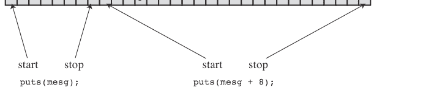

Figure 11.4 The puts() function and the null character.

string.h 文件包含 C 字符串函数族的函数原型，这就是为什么本示例包含它的原因。

### Note

一些 pre-ANSI 系统使用 strings.h，而其他系统可能完全没有字符串头文件。

### The strcat() Function

strcat()（字符串连接）函数接受两个字符串作为参数。第二字符串的副本被附加到第一字符串的末尾，这个组合版本成为新的第一字符串。第二字符串不会被改变。strcat() 函数的类型是 char *（即指针到 char）。它返回其第一个参数的值——即第二个字符串被附加到的字符串的第一个字符的地址。

Listing 11.18 说明了 strcat() 能做什么。它还使用了我们在 Listing 11.10 中定义的 s_gets() 函数；回想一下，它使用 fgets() 读取一行，然后删除换行符（如果存在）。

### Listing 11.18 The str_cat.c Program

```
/* str_cat.c -- joins two strings */
#include <stdio.h>
#include <string.h> /* declares the strcat() function */
#define SIZE 80
char * s_gets(char * st, int n);
int main(void)
{
    char flower[SIZE];
    char addon[] = "s smell like old shoes.";

    puts("What is your favorite flower?");
    if (s_gets(flower, SIZE))
    {
        strcat(flower, addon);
        puts(flower);
        puts(addon);
    }
    else
        puts("End of file encountered!");
    puts("bye");

    return 0;
}

char * s_gets(char * st, int n)
{
    char * ret_val;
    int i = 0;

    ret_val = fgets(st, n, stdin);
    if (ret_val)
    {
        while (st[i] != '\n' && st[i] != '\0')
            i++;
        if (st[i] == '\n')
            st[i] = '\0';
        else // must have st[i] == '\0'
            while (getchar() != '\n')
                continue;
    }
    return ret_val;
}
```


This is a sample output:

```text
What is your favorite flower?
wonderflower
wonderflowers smell like old shoes.
s smell like old shoes.
bye
```

The output illustrates that flower is altered while addon is not.

### The strcat() Function

The strcat() function does not check to see whether the second string will fit in the first array. If you fail to allocate enough space for the first array, you will run into problems as excess characters overflow into adjacent memory locations. Of course, you can use strlen() to look before you leap, as shown in Listing 11.15. Note that it adds 1 to the combined lengths to allow space for the null character. Alternatively, you can use strncat(), which takes a second argument indicating the maximum number of characters to add. For example, strncat(bugs, addon, 13) will add the contents of the addon string to bugs, stopping when it reaches 13 additional characters or the null character, whichever comes first. Therefore, counting the null character (which is appended in either case), the bugs array should be large enough to hold the original string (not counting the null character), a maximum of 13 additional characters, and the terminal null character. Listing 11.19 uses this information to calculate a value for the available variable, which is used as the maximum number of additional characters allowed.

### Listing 11.19 The join_chk.c Program

```c
/* join_chk.c -- joins two strings, check size first */
#include <stdio.h>
#include <string.h>
#define SIZE 30
#define BUGSIZE 13
char * s_gets(char * st, int n);
int main(void)
{
    char flower[SIZE];
    char addon[] = "s smell like old shoes.";
    char bug[BUGSIZE];
    int available;

    puts("What is your favorite flower?");
    s_gets(flower, SIZE);
    if ((strlen(addon) + strlen(flower) + 1) <= SIZE)
        strcat(flower, addon);
    puts(flower);
    puts("What is your favorite bug?");
```

### The strcmp() Function

Suppose you want to compare someone's response to a stored string, as shown in Listing 11.20.

### Listing 11.20 The nogo.c Program

```c
/* nogo.c -- will this work? */
#include <stdio.h>
#define ANSWER "Grant"
#define SIZE 40
char * s_gets(char * st, int n);

int main(void)
{
    char try[SIZE];

    puts("Who is buried in Grant's tomb?");
    s_gets(try, SIZE);
    while (try != ANSWER)
    {
        puts("No, that's wrong. Try again.");
        s_gets(try, SIZE);
    }
    puts("That's right!");

    return 0;
}

char * s_gets(char * st, int n)
{
    char * ret_val;
    int i = 0;

    ret_val = fgets(st, n, stdin);
    if (ret_val)
    {
        while (st[i] != '\n' && st[i] != '\0')
            i++;
        if (st[i] == '\n')
            st[i] = '\0';
        else // must have words[i] == '\0'
            while (getchar() != '\n')
                continue;
    }
    return ret_val;
}
```

As nice as this program might look, it will not work correctly. ANSWER and try really are pointers, so the comparison try != ANSWER doesn’t check to see whether the two strings are the same. Rather, it checks to see whether the two strings have the same address. Because ANSWER and try are stored in different locations, the two addresses are never the same, and the user is forever told that he or she is wrong. Such programs tend to discourage people.

What you need is a function that compares string contents, not string addresses. You could devise one, but the job has been done for you with strcmp() (for string comparison). This function does for strings what relational operators do for numbers. In particular, it returns 0 if its two string arguments are the same and nonzero otherwise. The revised program is shown in Listing 11.21.

### Listing 11.21 The compare.c Program

```c
/* compare.c -- this will work */
#include <stdio.h>
#include <string.h>  // declares strcmp()

#define ANSWER "Grant"
#define SIZE 40
char * s_gets(char * st, int n);

int main(void)
{
    char try[SIZE];

    puts("Who is buried in Grant's tomb?");
    s_gets(try, SIZE);
    while (strcmp(try,ANSWER) != 0)
    {
        puts("No, that's wrong. Try again.");
        s_gets(try, SIZE);
    }
    puts("That's right!");

    return 0;
}

char * s_gets(char * st, int n)
{
    char * ret_val;
    int i = 0;

    ret_val = fgets(st, n, stdin);
    if (ret_val)
```

```c
printf("strcmp(\"B\", \"A\") is ");
printf("%d\n", strcmp("B", "A"));

printf("strcmp(\"C\", \"A\") is ");
printf("%d\n", strcmp("C", "A"));

printf("strcmp(\"Z\", \"a\") is ");
printf("%d\n", strcmp("Z", "a"));

printf("strcmp(\"apples\", \"apple\") is ");
printf("%d\n", strcmp("apples", "apple"));

    return 0;
}
```

Here is the output on one system:

```text
strcmp("A", "A") is 0
strcmp("A", "B") is -1
strcmp("B", "A") is 1
strcmp("C", "A") is 1
strcmp("Z", "a") is -1
strcmp("apples", "apple") is 1
```

Comparing "A" to itself returns 0. Comparing "A" to "B" returns -1, and reversing the comparison returns 1. These results suggest that strcmp() returns a negative number if the first string precedes the second alphabetically and that it returns a positive number if the order is the other way. Therefore, comparing "C" to "A" gives a 1. Other systems might return 2—the difference in ASCII code values. The ANSI standard says that strcmp() returns a negative number if the first string comes before the second alphabetically, returns 0 if they are the same, and returns a positive number if the first string follows the second alphabetically. The exact numerical values, however, are left open to the implementation. Here, for example, is the output for another implementation, one that returns the difference between the character codes:

```text
strcmp("A", "A") is 0
strcmp("A", "B") is -1
strcmp("B", "A") is 1
strcmp("C", "A") is 2
strcmp("Z", "a") is -7
strcmp("apples", "apple") is 115
```

What if the initial characters are identical? In general, strcmp() moves along until it finds the first pair of disagreeing characters. It then returns the corresponding code. For instance, in the very last example, "apples" and "apple" agree until the final s of the first string. This matches up with the sixth character in "apple", which is the null character, ASCII 0. Because the null character is the very first character in the ASCII sequence, s comes after it, and the function returns a positive value.

The last comparison points out that strcmp() compares all characters, not just letters, so instead of saying the comparison is alphabetic, we should say that strcmp() goes by the machine collating sequence. That means characters are compared according to their numeric representation, typically the ASCII values. In ASCII, the codes for uppercase letters precede those for lowercase letters. Therefore, strcmp("Z", "a") is negative.

Most often, you won’t care about the exact value returned. You just want to know if it is zero or nonzero—that is, whether there is a match or not—or you might be trying to sort the strings alphabetically, in which case you want to know if the comparison is positive, negative, or zero.

### Note

The strcmp() function is for comparing strings, not characters. So you can use arguments such as "apples" and "A", but you cannot use character arguments, such as 'A'. However, recall that the char type is an integer type, so you can use the relational operators for character comparisons. Suppose word is a string stored in an array of char and that ch is a char variable. Then the following statements are valid:

```c
if (strcmp(word, "quit") == 0)  // use strcmp() for strings
    puts("Bye!");
if (ch == 'q')                  // use == for chars
    puts("Bye!");
```

However, don’t use ch or 'q' as arguments for strcmp().

Listing 11.23 uses the strcmp() function for checking to see whether a program should stop reading input.

### Listing 11.23 The quit_chk.c Program

```c
/* quit_chk.c -- beginning of some program */
#include <stdio.h>
#include <string.h>
#define SIZE 80
#define LIM 10
#define STOP "quit"
char * s_gets(char * st, int n);

int main(void)
{
    char input[LIM][SIZE];
    int ct = 0;

    printf("Enter up to %d lines (type quit to quit):\n", LIM);
    while (ct < LIM && s_gets(input[ct], SIZE) != NULL &&
```


```c
while (ct < LIM && s_gets(input[ct], SIZE) != NULL &&
        strcmp(input[ct], STOP) != 0)
{
    ct++;
}
printf("%d strings entered\n", ct);

return 0;
}

char * s_gets(char * st, int n)
{
    char * ret_val;
    int i = 0;

    ret_val = fgets(st, n, stdin);
    if (ret_val)
    {
        while (st[i] != '\n' && st[i] != '\0')
            i++;
        if (st[i] == '\n')
            st[i] = '\0';
        else // must have st[i] == '\0'
            while (getchar() != '\n')
                continue;
    }
    return ret_val;
}
```

该程序在遇到 EOF 字符时停止读取输入（此时 s_gets() 返回 NULL），当你输入单词 quit 时，或当达到限制 LIM 时。

顺便说一下，有时通过输入空行来终止输入会更方便——即按下 Enter 键或 Return 键而不输入任何其他内容。为此，你可以修改 while 循环控制语句，使其如下所示：

```c
while (ct < LIM && s_gets(input[ct], SIZE) != NULL
    && input[ct][0] != '\0')
```

这里，input[ct] 是刚刚输入的字符串，而 input[ct][0] 是该字符串的第一个字符。如果用户输入空行，s_gets() 会在第一个元素中放置空字符，因此表达式

```c
input[ct][0] != '\0'
```

用于检测空输入行。

### The strncmp() Variation

strcmp() 函数会比较字符串直到找到不同的对应字符为止，这可能需要搜索到其中一个字符串的末尾。strncmp() 函数会比较字符串直到它们不同或已比较了第三个参数指定的字符数。例如，如果你想搜索以 "astro" 开头的字符串，可以将搜索限制在前五个字符。表 11.24 展示了如何操作。

### Listing 11.24 The starsrch.c Program

```c
/* starsrch.c -- use strncmp() */
#include <stdio.h>
#include <string.h>
#define LISTSIZE 6
int main()
{
    const char * list[LISTSIZE] =
    {
        "astronomy", "astounding",
        "astrophysics", "ostracize",
        "asterism", "astrophobia"
    };
    int count = 0;
    int i;

    for (i = 0; i < LISTSIZE; i++)
        if (strncmp(list[i], "astro", 5) == 0)
        {
            printf("Found: %s\n", list[i]);
            count++;
        }
    printf("The list contained %d words beginning"
           " with astro.\n", count);

    return 0;
}
```

以下是输出结果：

```
Found: astronomy
Found: astrophysics
Found: astrophobia
The list contained 3 words beginning with astro.
```

### The strcpy() and strncpy() Functions

我们说过，如果 pts1 和 pts2 都是指向字符串的指针，表达式

```c
pts2 = pts1;
```

只会复制字符串的地址，而不是字符串本身。假设你确实想复制一个字符串。那么你可以使用 strcpy() 函数。表 11.25 让用户输入以 q 开头的单词。程序将输入复制到临时数组中，如果第一个字母是 q，程序会使用 strcpy() 将字符串从临时数组复制到永久目标。strcpy() 函数是赋值运算符的字符串等价物。

### Listing 11.25 The copy1.c Program

```c
/* copy1.c -- strcpy() demo */
#include <stdio.h>
#include <string.h>  // declares strcpy()
#define SIZE 40
#define LIM 5
char * s_gets(char * st, int n);

int main(void)
{
    char qwords[LIM][SIZE];
    char temp[SIZE];
    int i = 0;

    printf("Enter %d words beginning with q:\n", LIM);
    while (i < LIM && s_gets(temp, SIZE))
    {
        if (temp[0] != 'q')
            printf("%s doesn't begin with q!\n", temp);
        else
        {
            strcpy(qwords[i], temp);
            i++;
        }
    }
    puts("Here are the words accepted:");
    for (i = 0; i < LIM; i++)
        puts(qwords[i]);

    return 0;
}

char * s_gets(char * st, int n)
{
    char * ret_val;
    int i = 0;

    ret_val = fgets(st, n, stdin);
    if (ret_val)
    {
        while (st[i] != '\n' && st[i] != '\0')
            i++;
        if (st[i] == '\n')
            st[i] = '\0';
        else // must have st[i] == '\0'
            while (getchar() != '\n')
                continue;
    }
    return ret_val;
}
```

第二个参数称为源。你可以通过注意其顺序与赋值语句的顺序相同来记住参数的顺序（目标字符串在左侧）：

```c
char target[20];
int x;
x = 50;                /* assignment for numbers */
strcpy(target, "Hi ho!"); /* assignment for strings */
target = "So long";      /* syntax error */
```

你有责任确保目标数组有足够的空间来复制源。以下做法会带来麻烦：

```c
char * str;
strcpy(str, "The C of Tranquility"); // a problem
```

该函数会将字符串 "The C of Tranquility" 复制到 str 指定的地址，但 str 未初始化，因此复制可能会到处乱放！

简而言之，strcpy() 以两个字符串指针作为参数。第二个指针指向原始字符串，可以是指定的指针、数组名或字符串常量。第一个指针指向副本，应指向足够容纳该字符串的数据对象，例如数组。记住，声明数组会为数据分配存储空间；声明指针只会为一个地址分配存储空间。

### Further strcpy() Properties

strcpy() 函数还有两个你可能会觉得有用的属性。首先，它的类型是 `char *`。它返回其第一个参数的值——一个字符的地址。其次，第一个参数不必指向数组的开头；这让你可以只复制数组的一部分。表 11.26 同时说明了这两点。

### Listing 11.26 The copy2.c Program

```c
/* copy2.c -- strcpy() demo */
#include <stdio.h>
#include <string.h>   // declares strcpy()
#define WORDS  "beast"
#define SIZE 40

int main(void)
{
    const char * orig = WORDS;
    char copy[SIZE] = "Be the best that you can be.";
    char * ps;

    puts(orig);
    puts(copy);
    ps = strcpy(copy + 7, orig);
    puts(copy);
    puts(ps);

    return 0;
}
```

以下是输出结果：

```
beast
Be the best that you can be.
Be the beast
beast
```

请注意 strcpy() 会从源字符串复制空字符。在此示例中，空字符覆盖了 copy 中 `that` 中的第一个 `t`，使得新字符串以 `beast` 结束（参见图 11.5）。还请注意 ps 指向 copy 的第八个元素（索引为 7），因为第一个参数是 copy + 7。因此，puts(ps) 会从该点开始打印字符串。

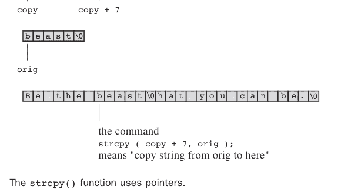

Figure 11.5 The strcpy() function uses pointers.

### The Careful Choice: strncpy()

strcpy() 函数与 strcat() 共享一个问题——两者都不会检查源字符串是否真的适合目标字符串。更安全地复制字符串的方法是使用 strncpy()。它接受第三个参数，即要复制的最大字符数。表 11.27 是表 11.25 的重写，使用 strncpy() 代替 strcpy()。为了说明如果源字符串过大时会发生什么，它为目标字符串使用了一个相当小的大小（七个元素，六个字符）。

### Listing 11.27 The copy3.c Program

```c
/* copy3.c -- strncpy() demo */
#include <stdio.h>
#include <string.h>  /* declares strncpy() */
#define SIZE 40
#define TARGSIZE 7
#define LIM 5
char * s_gets(char * st, int n);

int main(void)
{
    char qwords[LIM][TARGSIZE];
    char temp[SIZE];
    int i = 0;

    printf("Enter %d words beginning with q:\n", LIM);
    while (i < LIM && s_gets(temp, SIZE))
    {
        if (temp[0] != 'q')
            printf("%s doesn't begin with q!\n", temp);
        else
        {
            strncpy(qwords[i], temp, TARGSIZE - 1);
            qwords[i][TARGSIZE - 1] = '\0';
            i++;
        }
    }
    puts("Here are the words accepted:");
    for (i = 0; i < LIM; i++)
        puts(qwords[i]);

    return 0;
}

char * s_gets(char * st, int n)
{
    char * ret_val;
    int i = 0;

    ret_val = fgets(st, n, stdin);
    if (ret_val)
    {
        while (st[i] != '\n' && st[i] != '\0')
            i++;
        if (st[i] == '\n')
            st[i] = '\0';
        else // must have st[i] == '\0'
            while (getchar() != '\n')
                continue;
    }
    return ret_val;
}
```

这是一个示例运行：

```
Enter your first name:
Annie
Enter your last name:
von Wurstkasse
Enter your prize money:
25000
von Wurstkasse, Annie        : $25000.00
```

sprintf() 命令获取输入并将其格式化为标准形式，然后将其存储在字符串 `formal` 中。

### Other String Functions

ANSI C 库有超过 20 个字符串处理函数，下面的列表总结了一些更常用的函数：

- `char *strcpy(char * restrict s1, const char * restrict s2);`
  该函数将 s2 指向的字符串（包括空字符）复制到 s1 指向的位置。返回值是 s1。

- `char *strncpy(char * restrict s1, const char * restrict s2, size_t n);`
  该函数将 s2 指向的字符串最多 n 个字符复制到 s1 指向的位置。空字符之后没有字符会被复制，如果源字符串短于 n 个字符，目标字符串会用空字符填充。如果源字符串有 n 个或更多字符，则不会复制空字符。返回值是 s1。

- `char *strcat(char * restrict s1, const char * restrict s2);`
  s2 指向的字符串被复制到 s1 指向的字符串末尾。s2 字符串的第一个字符被复制到 s1 字符串的空字符上。返回值是 s1。

- `char *strncat(char * restrict s1, const char * restrict s2, size_t n);`
  s2 字符串的前 n 个字符最多被追加到 s1 字符串，s2 字符串的第一个字符被复制到 s1 字符串的空字符上。s2 字符串中的空字符及其后的字符不会被复制，结果后会追加一个空字符。返回值是 s1。

- `int strcmp(const char * s1, const char * s2);`
  该函数如果 s1 字符串在机器排序序列中位于 s2 字符串之后，则返回正值；如果两个字符串相同，则返回 0；如果第一个字符串在机器排序序列中位于第二个字符串之前，则返回负值。

- `int strncmp(const char * s1, const char * s2, size_t n);`
  该函数的工作方式与 strcmp() 相同，只是比较在 n 个字符后或遇到第一个空字符时停止，以先到者为准。


```
char *strchr(const char * s, int c);
```

此函数返回字符串 s 中首次出现字符 c 的位置的指针。（终止空字符是字符串的一部分，因此可以被搜索。）如果未找到该字符，则函数返回空指针。

```
char *strpbrk(const char * s1, const char * s2);
```

此函数返回字符串 s1 中首次出现 s2 字符串中任一字符的位置的指针。如果未找到任何字符，则函数返回空指针。

```
char *strrchr(const char * s, int c);
```

此函数返回字符串 s 中字符 c 最后一次出现的位置的指针。（终止空字符是字符串的一部分，因此可以被搜索。）如果未找到该字符，则函数返回空指针。

```
char *strstr(const char * s1, const char * s2);
```

此函数返回字符串 s1 中字符串 s2 首次出现的位置的指针。如果未找到该字符串，则函数返回空指针。

```
size_t strlen(const char * s);
```

此函数返回字符串 s 中字符的数量，不包括终止空字符。

请注意，这些原型使用关键字 const 来指示哪些字符串不会被函数修改。例如，考虑以下内容：

```
char *strcpy(char * restrict s1, const char * restrict s2);
```

其含义是 s2 指向一个字符串，该字符串不能被更改，至少不能被 strcpy() 函数更改，而 s1 指向一个可以被更改的字符串。这是有意义的，因为 s1 是目标字符串，会被修改，而 s2 是源字符串，应保持不变。

关键字 restrict 在第 12 章中讨论，表示对函数参数使用方式的限制，例如，不将字符串复制到自身。

size_t 类型，如第 5 章“运算符、表达式和语句”中所讨论的，是 sizeof 运算符返回的任何类型。C 规定 sizeof 运算符返回一个整数类型，但并未指定是哪种整数类型，因此 size_t 在一个系统上可以是 unsigned int，在另一个系统上可以是 unsigned long。string.h 文件为特定系统定义 size_t，或者引用包含该定义的另一个头文件。

如前所述，参考部分 V 列出了 string.h 系列中的所有函数。许多实现提供了超出 ANSI 标准要求的额外函数。你应查阅你所使用实现的文档以查看可用内容。

```
while (st[i] != '\n' && st[i] != '\0')
    i++;
if (st[i] == '\n')
    st[i] = '\0';
else // must have words[i] == '\0'
    while (getchar() != '\n')
        continue;
}
return ret_val;
}
```

我们向清单 11.29 输入了一首晦涩的童谣来测试它：

```
Input up to 20 lines, and I will sort them.
To stop, press the Enter key at a line's start.

O that I was where I would be,
Then would I be where I am not;
But where I am I must be,
And where I would be I can not.
```

以下是排序后的列表：

```
And where I would be I can not.
But where I am I must be,
O that I was where I would be,
Then would I be where I am not;
```

嗯，这首童谣似乎在字母排序后也没有受太大影响。

### 排序指针而非字符串

该程序的棘手之处在于，我们并没有重新排列字符串本身，而是重新排列了指向字符串的指针。让我们看看这意味着什么。最初，ptrst[0] 被设置为 input[0]，依此类推。这意味着指针 ptrst[i] 指向数组 input[i] 中的第一个字符。每个 input[i] 都是一个包含 81 个元素的数组，而每个 ptrst[i] 只是一个变量。排序过程重新排列 ptrst，而 input 保持不变。例如，如果 input[1] 在字母顺序上排在 input[0] 之前，程序就会交换指针，使得 ptrst[0] 指向 input[1] 的开头，而 ptrst[1] 指向 input[0] 的开头。这比使用 strcpy() 之类的函数交换两个输入字符串的内容要容易得多。图 11.6 提供了该过程的另一种视图。它还有保留 input 数组中原始顺序的优点。

**排序前：**

```
ptrst[0] points to input[0]
ptrst[1] points to input[1]
etc
```

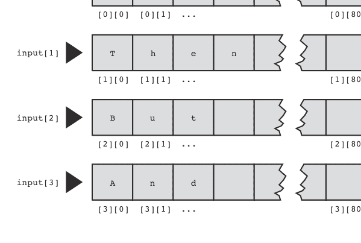

**排序后：**

```
ptrst[0] points to input[3]
ptrst[1] points to input[2]
etc
```

图 11.6 排序字符串指针。

### 选择排序算法

为了排序指针，我们使用选择排序算法。其思想是使用 for 循环依次将每个元素与第一个元素进行比较。如果比较的元素排在当前第一个元素之前，程序就会交换这两个元素。当程序到达循环末尾时，第一个元素包含指向机器排序序列中第一个字符串的指针。然后外部 for 循环重复该过程，这次从 input 的第二个元素开始。当内部循环完成后，指向第二排名字符串的指针会出现在 ptrst 的第二个元素中。该过程一直持续到所有元素都被排序为止。

现在让我们更详细地看看选择排序。以下是伪代码的大纲：

```
for n = first to n = next-to-last element,
    find largest remaining number and place it in the nth element
```

计划如下：首先，从 n = 0 开始。扫描整个数组，找到最大的数字，并将其与第一个元素交换。接下来，设 n = 1，然后扫描数组中除第一个元素外的所有元素。找到剩余的最大数字并将其与第二个元素交换。继续此过程，直到到达倒数第二个元素。现在只剩下两个元素。将它们进行比较并将较大的一个放在倒数第二个位置。这会使所有元素中最小的一个留在最后位置。

看起来像是一个 for 循环任务，但我们仍需更详细地描述“查找并放置”过程。选择剩余最大值的一种方法是比较剩余数组的第一个和第二个元素。如果第二个更大，则交换这两个值。现在将第一个元素与第三个元素进行比较。如果第三个更大，则交换这两个值。每次交换都会将更大的元素移到顶部。继续这种方式，直到将第一个元素与最后一个元素进行比较。完成后，最大值现在位于剩余数组的第一个元素中。你已对数组的第一个元素进行了排序，但其余数组仍处于混乱状态。以下是伪代码中的过程：

```
for n = second element to last element,
    compare nth element with first element; if nth is greater, swap values
```

该过程看起来像另一个 for 循环。它将嵌套在第一个 for 循环中。外部循环指示要填充哪个数组元素，内部循环找到要放入其中的值。将伪代码的两个部分放在一起并将其翻译成 C，我们得到清单 11.29 中的函数。顺便说一下，C 库包含一个更高级的排序函数，称为 qsort()。其中包括其他内容，它使用指向函数的指针来进行排序比较。第 16 章“C 预处理器和 C 库”给出了其用法的示例。

### ctype.h 字符函数和字符串

第 7 章“C 控制语句：分支和跳转”介绍了 ctype.h 系列的字符相关函数。这些函数不能应用于整个字符串，但可以应用于字符串中的各个字符。例如，清单 11.30 定义了一个函数，该函数将 toupper() 函数应用于字符串中的每个字符，从而将整个字符串转换为大写。它还定义了一个函数，该函数使用 ispunct() 来计算字符串中标点字符的数量。最后，该程序使用前面描述的 strchr() 来处理由 fgets() 读取的字符串中的换行符（如果有）。

### 清单 11.30 mod_str.c 程序

```
/* mod_str.c -- modifies a string */
#include <stdio.h>
#include <string.h>
```


```c
#include <ctype.h>
#define LIMIT 81
void ToUpper(char *);
int PunctCount(const char *);

int main(void)
{
    char line[LIMIT];
    char * find;

    puts("Please enter a line:");
    fgets(line, LIMIT, stdin);
    find = strchr(line, '\n');  // look for newline
    if (find)                   // if the address is not NULL,
        *find = '\0';           // place a null character there
    ToUpper(line);
    puts(line);
    printf("That line has %d punctuation characters.\n", PunctCount(line));

    return 0;
}

void ToUpper(char * str)
{
    while (*str)
    {
        *str = toupper(*str);
        str++;
    }
}

int PunctCount(const char * str)
{
    int ct = 0;
    while (*str)
    {
        if (ispunct(*str))
            ct++;
        str++;
    }

    return ct;
}
```

`while (*str)` 循环处理 `str` 指向的字符串中的每个字符，直到遇到空字符为止。此时，`*str` 的值变为 0（空字符的代码），或为 false，循环终止。以下是示例运行：

```text
Please enter a line:
Me? You talkin' to me? Get outta here!
ME? YOU TALKIN' TO ME? GET OUTTA HERE!
That line has 4 punctuation characters.
```

`ToUpper()` 函数对字符串中的每个字符应用 `toupper()`。 （C 区分大小写，这使得这两个函数名不同。）根据 ANSI C 的定义，`toupper()` 函数仅改变小写字符。然而，非常旧的 C 实现不会自动执行该检查，因此旧代码通常会这样做：

```c
if (islower(*str))      /* pre-ANSI C -- check before converting */
    *str = toupper(*str);
```

顺便说一下，ctype.h 函数通常以宏的形式实现。这些是 C 预处理器构造，其作用类似于函数但有一些重要区别。我们将在第 16 章介绍宏。

该程序使用 `fgets()` 和 `strchr()` 的组合来读取输入行并将换行符替换为空字符。这种方法与使用 `s_gets()` 的主要区别在于，后者会丢弃输入行的剩余部分（如果有），为程序的下一次输入语句做准备。在本例中，只有一个输入语句，因此不需要额外的步骤。

接下来，让我们尝试填补我们生活中一个旧的空白，即 `main()` 中括号之间的空白。

### 命令行参数

在现代图形界面之前，有命令行界面。DOS 和 Unix 就是例子，Linux 终端提供了一个类似 Unix 的命令行环境。命令行是你用来在命令行环境中运行程序的行。假设你有一个名为 fuss 的程序文件。那么在 Unix 中运行它的命令行可能看起来像这样：

```text
$ fuss
```

或者在 Windows 命令提示符模式下可能看起来像这样：

```text
C> fuss
```

命令行参数是同一行上的额外项目。以下是一个例子：

```text
$ fuss -r Ginger
```

C 程序可以读取这些额外项目供其自身使用（参见图 11.7）。

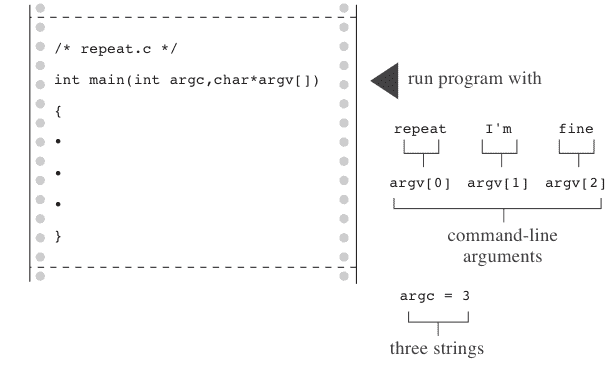

图 11.7 命令行参数。

C 程序通过使用 `main()` 的参数来读取这些项目。列表 11.31 显示了一个典型的例子。

### 列表 11.31 repeat.c 程序

```c
/* repeat.c -- main() with arguments */
#include <stdio.h>
int main(int argc, char *argv[])
{
    int count;

    printf("The command line has %d arguments:\n", argc - 1);
    for (count = 1; count < argc; count++)
        printf("%d: %s\n", count, argv[count]);
    printf("\n");

    return 0;
}
```

将此程序编译为名为 repeat 的可执行文件。以下是从命令行运行它时的情况：

```text
C>repeat Resistance is futile
The command line has 3 arguments:
1: Resistance
2: is
3: futile
```

你可以看到为什么它被称为 repeat，但你可能会想知道它是如何工作的。我们现在来解释。

C 编译器允许 `main()` 没有参数或有两个参数。 （某些实现允许额外的参数，但那将是标准的扩展。）有两个参数时，第一个参数是命令行中的字符串数量。按传统（但不是必须），这个 int 参数称为 `argc`，即 argument count。系统使用空格来判断一个字符串何时结束下一个字符串开始。因此，repeat 示例有四个字符串，包括命令名，而 fuss 示例有三个。程序将命令行字符串存储在内存中，并将每个字符串的地址存储在指针数组中。 该数组的地址存储在第二个参数中。按惯例，这个指向指针的指针称为 `argv`，即 argument values。 在可能的情况下（某些操作系统不允许这样做），`argv[0]` 被赋予程序本身的名称。然后 `argv[1]` 被赋予第一个后续字符串，以此类推。对于我们的示例，我们有以下关系：

```text
argv[0] points to repeat (for most systems)

argv[1] points to Resistance

argv[2] points to is

argv[3] points to futile
```

列表 11.31 中的程序使用 for 循环依次打印每个字符串。回想一下，`printf()` 的 `%s` 说明符期望作为参数提供字符串的地址。每个元素——`argv[0]`、`argv[1]` 等——就是这样的地址。

形式与任何其他具有形式参数的函数相同。许多程序员使用不同的 `argv` 声明：

```c
int main(int argc, char **argv)
```

这种对 `argv` 的替代声明实际上等同于 `char *argv[]`。它表示 `argv` 是指向 char 的指针的指针。示例最终归结为同一件事。它有一个包含七个元素的数组。数组的名称是指向第一个元素的指针，因此 `argv` 指向 `argv[0]`，而 `argv[0]` 是指向 char 的指针。因此，即使使用原始定义，`argv` 也是指向指向 char 的指针。你可以使用任一形式，但我们认为第一个更清楚地表明 `argv` 代表一组字符串。

顺便说一下，许多环境，包括 Unix 和 DOS，允许使用引号将多个单词合并为单个参数。例如，命令

```text
repeat "I am hungry" now
```

会将字符串 "I am hungry" 分配给 `argv[1]`，并将字符串 "now" 分配给 `argv[2]`。

### 集成环境中的命令行参数

集成 Windows 环境，例如 Apple 的 Xcode、Microsoft Visual C++ 和 Embarcadero C++ Builder，不使用命令行来运行程序。然而，其中一些有一个项目对话框，允许你为特定项目指定命令行参数。在其他情况下，你可能能够在 IDE 中编译程序，然后打开 MS-DOS 窗口以命令行模式运行程序。但如果你的系统有运行命令行编译器（如 GCC）的选项，那就更简单了。

### Macintosh 上的命令行参数

如果你使用的是 Xcode 4.6（或类似版本），可以通过转到 Product 菜单并选择 Scheme、Edit Scheme、Run 来提供命令行参数。然后选择 Arguments 选项卡并在 Arguments Passed on Launch 中输入参数。

或者你可以进入 Mac 的 Terminal 模式，进入命令行 Unix 世界。然后你可以定位包含程序可执行代码的目录（Unix 中的文件夹），或者，如果你已下载命令行工具，可以使用 gcc 或 clang 编译程序。

### 字符串到数字的转换

数字可以存储为字符串或数字形式。将数字存储为字符串意味着存储数字字符。例如，数字 213 可以存储为字符字符串数组中的数字 '2'、'1'、'3'、'\0'。将 213 以数字形式存储意味着将其存储为，例如，int。

C 需要数字形式来进行数字运算，例如加法和比较，但要在屏幕上显示数字则需要字符串形式，因为屏幕显示字符。`printf()` 和 `sprintf()` 函数通过其 `%d` 等说明符将数字形式转换为字符串形式，而 `scanf()` 可以将输入字符串转换为数字形式。C 还有专门用于将字符串形式转换为数字形式的函数。

例如，假设你希望程序使用数字命令行参数。不幸的是，命令行参数被读取为字符串。因此，要使用数值，必须先将字符串转换为数字。如果该数字是整数，可以使用 `atoi()` 函数（alphanumeric to integer 的缩写）。它接受一个字符串作为参数并返回相应的整数值。列表 11.32 显示了一个示例用法。

### 列表 11.32 hello.c 程序

```c
/* hello.c -- converts command-line argument to number */
#include <stdio.h>
#include <stdlib.h>

int main(int argc, char *argv[])
```


让我们看一个涉及 strtol() 的示例。它的原型如下：

```
long strtol(const char * restrict nptr, char ** restrict endptr, int base);
```

这里，nptr 是指向要转换的字符串的指针，endptr 是指向指针的地址，该指针会被设置为终止输入数字的字符的地址，而 base 是数字的书写进制。一个例子，给出在第 11.33 节中，使这一点更清楚。

### 第 11.33 节 strcnvt.c 程序

```
/* strcnvt.c -- try strtol() */
#include <stdio.h>
#include <stdlib.h>
#define LIM 30
char * s_gets(char * st, int n);

int main()
{
    char number[LIM];
    char * end;
    long value;

    puts("Enter a number (empty line to quit):");
    while(s_gets(number, LIM) && number[0] != '\0')
    {
        value = strtol(number, &end, 10);  /* base 10 */
        printf("base 10 input, base 10 output: %ld, stopped at %s (%d)\n", value, end, *end);
        value = strtol(number, &end, 16);  /* base 16 */
        printf("base 16 input, base 10 output: %ld, stopped at %s (%d)\n", value, end, *end);
        puts("Next number:");
    }
    puts("Bye!\n");
    return 0;
}

char * s_gets(char * st, int n)
{
    char * ret_val;
    int i = 0;
    ret_val = fgets(st, n, stdin);
    if (ret_val)
    {
        while (st[i] != '\n' && st[i] != '\0')
        i++;
        if (st[i] == '\n')
            st[i] = '\0';
        else // must have words[i] == '\0'
            while (getchar() != '\n')
                continue;
    }
    return ret_val;
}
```

以下是一些示例输出：

```
Enter a number (empty line to quit):
10
base 10 input, base 10 output: 10, stopped at  (0)
base 16 input, base 10 output: 16, stopped at  (0)
Next number:
10atom
base 10 input, base 10 output: 10, stopped at atom (97)
base 16 input, base 10 output: 266, stopped at tom (116)
Next number:

Bye!
```

首先，注意字符串 "10" 在 base 为 10 时被转换为数字 10，而在 base 为 16 时转换为 16。还要注意如果 end 指向一个字符，*end 就是一个字符。因此，第一次转换在到达空字符时结束，所以 end 指向空字符。打印 end 显示一个空字符串，而用 %d 格式打印 *end 显示空字符的 ASCII 码。

对于第二个输入字符串（base-10 解释），end 被赋予 'a' 字符的地址。所以打印 end 显示字符串 "atom"，而打印 *end 显示 'a' 字符的 ASCII 码。然而，当 base 改为 16 时，'a' 字符被识别为有效的十六进制数字，并且函数将十六进制数 10a 转换为 266，base 10。

strtol() 函数可达 base 36，使用字母到 'z' 作为数字。strtoul() 函数做同样的事，但转换无符号值。strtod() 函数仅做 base 10，因此它只使用两个参数。

许多实现都有 itoa() 和 ftoa() 函数用于将整数和浮点值转换为字符串。然而，它们不是标准 C 库的一部分；为了获得更大的兼容性，请改用 sprintf()。

## 关键概念

许多程序处理文本数据。程序可能会要求你输入你的名字、公司列表、地址、某种蕨类的植物学名称、音乐剧的演员表，或……好吧，由于我们使用词语与世界互动，文本示例几乎无穷无尽。而字符串是 C 程序处理字符串的手段。

C 字符串——无论是由字符数组、指针还是字符串字面量标识——都存储为包含字符代码的字节序列，并且序列以空字符终止。C 通过提供用于操作、搜索和分析它们的函数库来认识到字符串的实用性。特别是，请记住在比较字符串时应使用 strcmp() 而不是关系运算符，并且在将字符串赋给字符数组时应使用 strcpy() 或 strncpy() 而不是赋值运算符。

## 摘要

C 字符串是由空字符 '\0' 终止的字符序列。字符串可以存储在字符数组中。字符串也可以用字符串常量表示，其中字符除空字符外用双引号括起来。编译器提供空字符。因此，"joy" 存储为四个字符 j、o、y 和 \0。字符串的长度，如 strlen() 所测，不计空字符。

字符串常量，也称为字符串字面量，可用于初始化字符数组。数组大小应至少比字符串长度大一，以容纳终止的空字符。字符串常量也可以用于初始化类型为指针到 char 的指针。

函数使用指向字符串第一个字符的指针来标识要操作的哪个字符串。通常，对应的实际参数是数组名、指针变量或引号字符串。在每种情况下，第一个字符的地址都会被传递。一般来说，没有必要传递字符串的长度，因为函数可以使用终止的空字符来定位字符串的末尾。

fgets() 函数获取一行输入，而 puts() 和 fputs() 函数显示一行输出。它们是 stdio.h 系列函数的一部分，就像曾经的、现在已被唾弃和废弃的 gets() 函数一样。

C 库包含几个字符串处理函数。在 ANSI C 下，这些函数在 string.h 文件中声明。库中还有几个字符处理函数；它们在 ctype.h 文件中声明。

你可以通过向 main() 函数提供适当的两个形式变量，使程序访问命令行参数。第一个参数，传统上称为 argc，是一个 int，并被赋予命令行词的计数。第二个参数，传统上称为 argv，是指向指针数组的指针。每个指针到 char 指向其中一个命令行参数字符串，其中 argv[0] 指向命令名，argv[1] 指向第一个命令行参数，以此类推。

atoi()、atol() 和 atof() 函数将数字的字符串表示形式分别转换为类型 int、long 和 double 形式。strtol()、strtoul() 和 strtod() 函数将数字的字符串表示形式分别转换为类型 long、unsigned long 和 double 形式。

## 复习问题

你可以在附录 A“复习问题的答案”中找到复习问题的答案。

- 1. 这个字符字符串的尝试声明有什么问题？

```
int main(void)
{
    char name[] = {'F', 'e', 's', 's'};
    ...
}
```

- 2. 这个程序会打印什么？

```
#include <stdio.h>
int main(void)
{
    char note[] = "See you at the snack bar.";
    char *ptr;

    ptr = note;
    puts(ptr);
    puts(++ptr);
    note[7] = '\0';
    puts(note);
    puts(++ptr);
    return 0;
}
```

- 3. 这个程序会打印什么？

```
#include <stdio.h>
#include <string.h>
int main(void)
{
    char food[] = "Yummy";
    char *ptr;

    ptr = food + strlen(food);
    while (--ptr >= food)
```

+ e. 如果 *--pc 被替换为 *pc-- 会打印什么？
+ f. 两个 while 表达式测试什么？
+ g. 如果 pr() 用空字符串作为参数提供会发生什么？
+ h. 在调用函数中必须做什么才能使 pr() 按所示使用？

# 6. 假设此声明：

```
char sign = '$';
```

sign 使用多少字节的内存？'$' 呢？"$" 呢？

# 7. 下列程序打印什么？

```
#include <stdio.h>
#include <string.h>
#define M1  "How are ya, sweetie? "
char M2[40] = "Beat the clock.";
char * M3  = "chat";
int main(void)
{
    char words[80];
    printf(M1);
    puts(M1);
    puts(M2);
    puts(M2 + 1);
    strcpy(words,M2);
    strcat(words, " Win a toy.");
    puts(words);
    words[4] = '\0';
    puts(words);
    while (*M3)
        puts(M3++);
    puts(--M3);
    puts(--M3);
    M3 = M1;
    puts(M3);
    return 0;
}
```

# 8. 下列程序打印什么？

```
#include <stdio.h>
int main(void)
{
    char str1[] = "gawsie";    // plump and cheerful
    char str2[] = "bletonism";
```


```
char *ps;
int i = 0;

for (ps = str1; *ps != '\0'; ps++) {
    if ( *ps == 'a' || *ps == 'e' )
        putchar(*ps);
    else
        (*ps)--;
        putchar(*ps);
    }
putchar('\n');
while (str2[i] != '\0' ) {
    printf("%c", i % 3 ? str2[i] : '*');
    ++i;
}
return 0;
}
```

- 9. 本章定义的 `s_gets()` 函数可以用指针表示法代替数组表示法来编写，从而省去变量 `i`。请这样做。
- 
- 10. `strlen()` 函数接受一个指向字符串的指针作为参数，并返回该字符串的长度。请编写你自己的这个函数的版本。
- 
- 11. 本章定义的 `s_gets()` 函数可以用 `strchr()` 而不是 while 循环来查找换行符。请这样做。
- 
- 12. 设计一个函数，它接受一个字符串指针作为参数，并返回一个指针，指向字符串中从所指向位置开始（含该位置）的第一个空格字符。如果找不到空格，则返回空指针。
- 
- 13. 使用 `ctype.h` 中的函数重写清单 11.21，使程序无论用户输入大写还是小写都能识别正确答案。

## 编程练习

- 1. 设计并测试一个函数，从输入中获取接下来的 n 个字符（包括空格、制表符和换行符），将结果存储在一个地址作为参数传入的数组中。
- 
- 2. 修改并测试练习 1 中的函数，使其在遇到 n 个字符或者第一个空格、制表符或换行符时停止，以先到者为准。（不要只使用 `scanf()`。）

## 存储类别、链接和内存管理

在本章中，你将学习以下内容：

- 关键字：
  - `auto`, `extern`, `static`, `register`, `const`, `volatile`, `restricted`, `_Thread_local`, `_Atomic`
- 函数：
  - `rand()`, `srand()`, `time()`, `malloc()`, `calloc()`, `free()`
- C 如何允许你确定变量的作用域（它有多广的可见范围）和变量的生命周期（它存在多长时间）
- 设计更复杂的程序

C 的一个优势是它让你能够控制程序的细节。C 的内存管理系统就体现了这种控制：它让你决定哪些函数知道哪些变量，以及一个变量在程序中存在多长时间。使用内存存储是程序设计的又一个要素。

## 存储类别

C 提供了几种不同的模型，或称为存储类别，用于在内存中存储数据。要理解这些选项，先了解一些概念和术语会很有帮助。

本书中的每个编程示例都将数据存储在内存中。这方面涉及硬件——每个存储的值都占用物理内存。C 文献用术语“对象”来指代这样一块内存。一个对象可以保存一个或多个值。一个对象可能尚未真正存储值，但它会有合适的大小来容纳相应的值。（“面向对象编程”这个短语以更扩展的含义使用“对象”一词来表示类对象，其定义既包含数据又包含对数据的允许操作；C 不是面向对象的编程语言。）

还有软件方面——程序需要一种访问对象的方式。例如，可以通过声明一个变量来实现：

```
int entity = 3;
```

这个声明创建了一个名为 *entity* 的*标识符*。标识符是一个名称，在这种情况下，它用来指定某个特定对象的内容。标识符满足第 2 章“C 语言概述”中讨论的变量命名约定。在这个例子中，标识符 *entity* 是软件（C 程序）指定存储在硬件内存中的对象的方式。这个声明还提供了一个要存储在该对象中的值。

变量名并不是指定对象的唯一方式。例如，考虑以下声明：

```
int * pt = &entity;
int ranks[10];
```

在第一种情况下，*pt* 是一个标识符。它指定了一个保存地址的对象。接下来，表达式 *pt* 不是标识符，因为它不是名称。然而，它确实指定了一个对象，在这个例子中，它指定的是与 *entity* 相同的对象。一般来说，你可能还记得第 3 章“数据和 C”中的内容，指定对象的表达式称为左值。因此，*entity* 是标识符，也是左值，而 *pt* 是表达式，也是左值。同理，表达式 *ranks + 2 * entity* 既不是标识符（不是名称），也不是左值（不指定内存位置的内容）。但表达式 *(ranks + 2 * entity)* 是左值，因为它确实指定了特定内存位置的值，即 *ranks* 数组的第七个元素。顺便说一下，*ranks* 的声明创建了一个能够容纳十个 *int* 的对象，数组的每个成员也是一个对象。

如果像所有这些示例一样，你可以使用左值来修改对象中的值，那么它就是*可修改的左值*。现在考虑这个声明：

```
const char * pc = "Behold a string literal!";
```

这导致程序将字符串字面量的内容存储在内存中，这个字符值数组是一个对象。数组中的每个字符也是一个对象，因为它可以被单独访问。这个声明还创建了一个具有标识符 *pc* 的对象，它保存该字符串的地址。标识符 *pc* 是可修改的左值，因为它可以被重置为指向不同的字符串。*const* 防止你修改所指向字符串的内容，但不会阻止你更改所指向的字符串。因此，*pc*（它指定保存字符 'B' 的数据对象）是左值，但不是可修改的左值。类似地，字符串字面量本身，因为它指定了保存该字符串的对象，也是左值，但不是可修改的左值。

你可以根据对象的*存储期*来描述它，存储期指它在内存中保留多长时间。你可以根据*作用域*和*链接*来描述用于访问对象的标识符，这两者一起指示程序的哪些部分可以使用它。不同的存储类别提供作用域、链接和存储期的不同组合。你可以有可以在多个源代码文件中共享的标识符，可以在某个特定文件中被任何函数使用的标识符，只能在某个特定函数内使用的标识符，甚至只能在函数的某个子部分中使用的标识符。你可以有存在于整个程序运行期间的对象，也可以有只存在于包含它们的函数执行期间的对象。对于并发编程，你可以有存在于特定线程期间的对象。你还可以通过函数调用显式分配和释放内存来存储数据。

接下来，让我们研究作用域、链接和存储期这些术语的含义。之后，我们将回到具体的存储类别。

## 作用域

作用域描述了程序可以访问标识符的一个或多个区域。C 变量具有以下作用域之一：块作用域、函数作用域、函数原型作用域或文件作用域。迄今为止的程序示例几乎都只对变量使用块作用域。块，正如你所回忆的，是一段包含在左花括号和匹配的右花括号之间的代码区域。例如，函数的整个函数体就是一个块。函数内的任何复合语句也是一个块。在块内部定义的变量具有块作用域，并且从定义点开始到包含该定义的块的末尾可见。此外，形式函数参数，即使它们出现在函数的左花括号之前，也具有块作用域，并且属于包含函数体的块。因此，我们迄今为止使用的局部变量，包括形式函数参数，都具有块作用域。因此，以下代码中的变量 cleo 和 patrick 都具有延伸到右花括号的块作用域：

```
double blocky(double cleo)
{
    double patrick = 0.0;
    ...
    return patrick;
}
```

在内部块中声明的变量的作用域仅限于该块：

```
double blocky(double cleo)
{
    double patrick = 0.0;
    int i;
    for (i = 0; i < 10; i++)
    {
        double q = cleo * i; // q 的作用域开始
        ...
        patrick *= q;
    }                // q 的作用域结束
    ...
```


```
void critic(void)
{
    ...
}
```

这里，变量 units 具有文件作用域，并且可以在 main() 和 critic() 中使用。（更准确地说，units 具有文件作用域且具有外部链接，我们将在下一节中介绍这一区别。）由于它们可以在多个函数中使用，文件作用域变量也称为全局变量。

> Note  Translation Units and Files
> 
> 你所看到的多个文件在编译器看来可能是一个文件。例如，假设正如通常情况一样，你在一个源代码文件（.c 扩展名）中包含一个或多个头文件（.h 扩展名）。头文件本身又可能包含其他头文件。因此可能涉及多个独立的物理文件。然而，C 预处理本质上是用头文件的内容替换 #include 指令。因此编译器看到的是一个包含你的源代码文件以及所有头文件信息的文件。这个单一文件称为翻译单元。当我们说一个变量具有文件作用域时，它实际上对整个翻译单元可见。如果你的程序由多个源代码文件组成，那么它将由多个翻译单元组成，每个翻译单元对应一个源代码文件及其包含的文件。

## Linkage

接下来，让我们来看链接。C 变量具有以下其中一种链接：外部链接、内部链接或无链接。具有块作用域、函数作用域或函数原型作用域的变量没有链接。这意味着它们是私有的，仅限于它们被定义所在的块、函数或原型。具有文件作用域的变量可以具有内部链接或外部链接。具有外部链接的变量可以在多文件程序中的任何地方使用。具有内部链接的变量可以在单个翻译单元中的任何地方使用。

> Note  Formal and Informal Terms
> 
> C 标准使用“具有内部链接的文件作用域”来描述仅限于一个翻译单元（源代码文件加上其包含的头文件）的范围，并使用“具有外部链接的文件作用域”来描述范围至少潜在地扩展到其他翻译单元。但程序员并不总是愿意或有耐心使用这些术语。一些常见的简写是使用“文件作用域”表示“具有内部链接的文件作用域”，并使用“全局作用域”或“程序作用域”表示“具有外部链接的文件作用域”。

那么你如何判断一个文件作用域变量具有内部链接还是外部链接呢？你要查看外部定义中是否使用了存储类说明符 static：

```
int giants = 5;      // file scope, external linkage
static int dodgers = 3; // file scope, internal linkage
int main()
{
    ...
}
...
```

变量 giants 可以被同一程序的其他文件使用。dodgers 变量是此特定文件的私有变量，但文件中的任何函数都可以使用它。

## Storage Duration

作用域和链接描述标识符的可见性。存储持续期描述这些标识符所访问的对象的持久性。C 对象具有以下四种存储持续期之一：静态存储持续期、线程存储持续期、自动存储持续期或分配存储持续期。

如果对象具有静态存储持续期，它在整个程序执行期间都存在。具有文件作用域的变量具有静态存储持续期。注意，对于文件作用域变量，关键字 static 表示链接类型，而不是存储持续期。使用 static 声明的文件作用域变量具有内部链接，但所有文件作用域变量，无论使用内部链接还是外部链接，都具有静态存储持续期。

线程存储持续期在并发编程中发挥作用，在这种编程中，程序执行可以分为多个线程。具有线程存储持续期的对象从其声明时存在直到线程终止。这样的对象是在本应创建文件作用域对象的声明被关键字 _Thread_local 修改时创建的。当变量使用此说明符声明时，每个线程都会获得该变量的私有副本。

具有块作用域的变量通常具有自动存储持续期。当程序进入定义它们的块时，为这些变量分配内存，并在退出块时释放内存。想法是用于自动变量的内存是一个工作区或草稿纸，可以重复使用。例如，在函数调用结束后，它用于其变量的内存可以用来保存下一个被调用函数的变量。

变长数组提供了一个小例外，它们从声明点存在到块结束，而不是从块开始到块结束。

我们迄今为止使用的局部变量都属于自动类别。例如，在以下代码中，变量 number 和 index 每次调用 bore() 函数时都会产生，并在函数完成时消失：

```
void bore(int number)
{
    int index;
```
```
for (index = 0; index < number; index++)
    puts("They don't make them the way they used to.\n");
return 0;
}
```

然而，变量可能具有块作用域但具有静态存储持续期。要创建这样的变量，请在块内声明它并在声明中添加关键字 static：

```
void more(int number)
{
    int index;
    static int ct = 0;
    ...
    return 0;
}
```

这里变量 ct 存储在静态内存中；它从程序加载时存在直到程序终止。但其作用域仅限于 more() 函数块。只有在该函数执行期间，程序才能使用 ct 来访问它所指定的对象。（然而，可以通过允许函数通过指针参数或返回值提供存储的地址来间接访问，从而实现间接访问。）

C 使用作用域、链接和存储持续期来定义变量的几种存储方案。本书不涉及并发编程，因此我们不会深入讨论该方面。我们将在本章后面讨论分配存储。那就剩下五种存储类：automatic、register、具有块作用域的 static、具有外部链接的 static 和具有内部链接的 static。表 12.1 列出了组合。现在我们已经介绍了作用域、链接和存储持续期，我们可以更详细地讨论这些存储类。

### Table 12.1 Five Storage Classes

| Storage Class | Duration | Scope | Linkage | How Declared |
|---|---|---|---|---|
| automatic | Automatic | Block | None | In a block |
| register | Automatic | Block | None | In a block with the keyword register |
| static with external linkage | Static | File | External | Outside of all functions |
| static with internal linkage | Static | File | Internal | Outside of all functions with the keyword static |
| static with no linkage | Static | Block | None | In a block with the keyword static |

### Automatic Variables

属于自动存储类的变量具有自动存储持续期、块作用域和无链接。默认情况下，在块或函数头中声明的任何变量都属于自动存储类。你也可以通过显式使用关键字 auto 来明确你的意图，如下所示：

```
int main(void)
{
    auto int plox;
```

例如，你可能会这样做，以记录你是有意覆盖外部变量定义，或者不更改变量的存储类很重要。关键字 auto 被称为存储类说明符。C++ 已将 auto 关键字重新用于完全不同的用途，因此为了 C/C++ 兼容性，最好根本不将 auto 用作存储类说明符。

块作用域和无链接意味着只有变量被定义的块可以通过名称访问该变量。（当然，可以使用参数将变量的值和地址传达给另一个函数，但那是间接的了解。）另一个函数可以使用同名的变量，但它将是存储在不同内存位置的独立变量。

回想一下，自动存储持续期意味着变量在程序进入包含变量声明的块时产生。当程序退出块时，自动变量消失。其内存位置现在可以用于其他用途，尽管不一定如此。

让我们更仔细地看一下嵌套块。变量仅对其被声明的块以及该块内部的任何块可见：

```
int loop(int n)
{
    int m;          // m in scope
    scanf("%d", &m);
    {
        int i;      // both m and i in scope
        for (i = m; i < n; i++)
            puts("i is local to a sub-block\n");
    }
    return m;       // m in scope, i gone
}
```

在此代码中，i 仅在内部大括号内可见。如果你尝试在内部块之前或之后使用它，你会得到编译器错误。通常，在设计程序时你不会使用此功能。有时，如果变量在其他地方未使用，将变量定义在子块中是有用的。这样，你可以将变量的含义记录在靠近使用它的地方附近。此外，变量不会在不再需要时占用内存空闲。The


变量 n 和 m，既在函数头中定义又在外部块中定义，对整个函数有效，直到函数终止。

如果在内部块中声明一个与外部块中同名的变量怎么办？那么在块内定义的名称就是块内使用的变量。我们说它隐藏了外部定义。然而，当执行退出内部块时，外部变量重新进入作用域。清单 12.1 说明了这些点以及更多内容。

### 清单 12.1 The hiding.c 程序

```
// hiding.c -- variables in blocks
#include <stdio.h>
int main()
{
    int x = 30;      // original x

    printf("x in outer block: %d at %p\n", x, &x);
    {
        int x = 77;  // new x, hides first x
        printf("x in inner block: %d at %p\n", x, &x);
    }
    printf("x in outer block: %d at %p\n", x, &x);
    while (x++ < 33) // original x
    {
        int x = 100; // new x, hides first x
        x++;
        printf("x in while loop: %d at %p\n", x, &x);
    }
    printf("x in outer block: %d at %p\n", x, &x);

    return 0;
}
```

以下是输出：

```
x in outer block: 30 at 0x7ffff5fbff8c8
x in inner block: 77 at 0x7ffff5fbff8c4
x in outer block: 30 at 0x7ffff5fbff8c8
x in while loop: 101 at 0x7ffff5fbff8c0
x in while loop: 101 at 0x7ffff5fbff8c0
x in while loop: 101 at 0x7ffff5fbff8c0
x in outer block: 34 at 0x7ffff5fbff8c8
```

首先，程序创建了一个值为 30 的 x 变量，正如第一个 printf() 语句所示。然后它定义了一个值为 77 的新 x 变量，正如第二个 printf() 语句所示。它是一个隐藏第一个 x 的新变量这一点由地址以及第三个

printf() 语句证明。它位于第一个内部块之后，并显示原始 x 值，表明原始 x 变量从未消失，也从未被更改。

程序中最有趣的部分可能是 while 循环。while 循环测试使用原始 x：

```
while(x++ < 33)
```

在循环内部，程序看到第三个 x 变量，一个在 while 循环块内刚定义的变量。因此当代码在循环体中使用 x++ 时，被递增到 101 并显示的是新的 x。当每次循环周期完成时，该新 x 消失。然后循环测试条件使用并递增原始 x，循环块再次进入，并且新的 x 再次创建。在此示例中，该 x 被创建和销毁三次。请注意，为了终止，此循环必须在测试条件中递增 x，因为在循环体中递增 x 递增的是与测试条件中使用的不同的 x。

这个特定编译器没有重用 x 的内部块内存位置用于 while 循环版本的 x，但某些编译器会这样做。

这个示例的意图并不是鼓励你编写这样的代码。相反，它是为了说明当你在块内定义变量时会发生什么。鉴于 C 的命名规则提供的名称种类繁多，不太难想出除了 x 之外的其他名称。

### 无大括号的块

前面提到过的一个 C99 特性是，循环或 if 语句的一部分语句即使没有使用大括号（即 { }）也构成一个块。更完整地说，整个循环是包含它的块的子块，而循环体是整个循环块的子块。类似地，if 语句是一个块，其关联的子语句是 if 语句的子块。这些规则影响了你可以在哪里声明变量以及该变量的作用域。清单 12.2 显示了 for 循环中是如何工作的。

### 清单 12.2 The forc99.c 程序

```
// forc99.c -- new C99 block rules
#include <stdio.h>
int main()
{
    int n = 8;

    printf("  Initially, n = %d at %p\n", n, &n);
    for (int n = 1; n < 3; n++)
        printf("    loop 1: n = %d at %p\n", n, &n);
    printf("After loop 1, n = %d at %p\n", n, &n);
    for (int n = 1; n < 3; n++)
    {
        printf("  loop 2 index n = %d at %p\n", n, &n);
        int n = 6;
```

```
int repid;
int tents = 5;
```

tents 变量初始化为 5，但 repid 变量最终得到的是分配给 repid 的空间中先前占据的任何值。你不能依赖此值是 0。你可以用非常量表达式初始化自动变量，只要使用的变量之前已定义即可：

```
int main(void)
{
    int ruth = 1;
    int rance = 5 * ruth;  // use previously defined variable
```

### 寄存器变量

变量通常存储在计算机内存中。运气好的话，寄存器变量存储在 CPU 寄存器中，或更一般地存储在可用的最快内存中，在那里它们可以比普通变量更快地被访问和操作。因为寄存器变量可能在寄存器中而不是在内存中，所以你不能取寄存器变量的地址。在大多数其他方面，寄存器变量与自动变量相同。也就是说，它们具有块作用域、无链接和自动存储期。变量通过使用存储类说明符 register 声明：

```
int main(void)
{
    register int quick;
```

我们说“运气好的话”，因为将变量声明为寄存器类更多是请求而不是直接命令。编译器必须权衡你的要求与可用寄存器数量或快速内存量，或者它可以简单地忽略请求，因此你可能得不到你想要的结果。在这种情况下，变量变成普通的自动变量；然而，你仍然不能使用地址运算符。

你可以请求将形式参数设为寄存器变量。只需在函数头中使用关键字即可：

```
void macho(register int n)
```

可以声明为 register 的类型可能受到限制。例如，处理器中的寄存器可能不足以容纳 type double。

### 具有块作用域的静态变量

静态变量这个名字听起来像矛盾，像是不能变化的变量。实际上，static 意味着变量在内存中固定下来，而不一定是值。具有文件作用域的变量自动地（并且必然地）具有静态存储期。如前所述，你还可以创建具有块作用域但具有静态持续期的局部变量。这些变量具有与自动变量相同的范围，但在包含函数结束工作时不会消失。也就是说，这样的变量具有块作用域、无链接，但具有静态存储期。计算机记住它们的值从一次函数调用到下一次——此类变量是通过在块中声明它们（提供块作用域和缺乏链接）并使用存储类说明符 static（提供静态存储期）来创建的。清单 12.3 说明了这种技术。

### 清单 12.3 The loc_stat.c 程序

```
/* loc_stat.c -- using a local static variable */
#include <stdio.h>
void trystat(void);

int main(void)
{
    int count;

    for (count = 1; count <= 3; count++)
    {
        printf("Here comes iteration %d:\n", count);
        trystat();
    }

    return 0;
}

void trystat(void)
{
    int fade = 1;
    static int stay = 1;

    printf("fade = %d and stay = %d\n", fade++, stay++);
}
```

请注意 trystat() 在打印其值后递增每个变量。运行程序返回以下输出：

```
Here comes iteration 1:
fade = 1 and stay = 1
Here comes iteration 2:
fade = 1 and stay = 2
Here comes iteration 3:
fade = 1 and stay = 3
```

静态变量 stay 记住其值增加了 1，但 fade 变量每次都重新开始。这指出了初始化方面的差异：fade 在每次调用 trystat() 时初始化，但 stay 只初始化一次，在 trystat() 编译时。静态变量如果未显式初始化为其他值，则初始化为零。

这两个声明看起来相似：

```
int fade = 1;
static int stay = 1;
```

然而，第一条语句实际上是 trystat() 函数的一部分，并且在每次调用函数时执行。它是运行时操作。第二条语句实际上不是 trystat() 函数的一部分。如果你使用调试器逐步执行程序，你会看到程序似乎跳过了该步骤。那是因为静态变量和外部变量在程序加载到内存后已经就位。将语句放在 trystat() 函数中告诉编译器只有 trystat() 函数被允许看到该变量；它不是在运行时执行的一条语句。

你不能对函数参数使用 static：

```
int wontwork(static int flu);  // not allowed
```

具有块作用域的静态变量的另一个术语是“局部静态变量”。此外，如果你阅读一些较旧的 C 文献，你会发现这种存储类被称为内部静态存储类。然而，internal 这个词用于表示内部于函数，而不是内部链接。

### 具有外部链接的静态变量

具有外部链接的静态变量具有文件作用域、外部链接和静态存储期。此类有时称为外部存储类，此类变量称为外部变量。你通过在任何函数之外放置定义性声明来创建外部变量。出于文档目的，外部变量还可以在使用它的函数内部使用 extern 关键字额外声明。如果某个特定外部变量在第一个源代码文件中定义，并在第二个源代码文件中使用，则在第二个文件中用 extern 声明该变量是强制性的。声明如下所示：

```
int Errupt;          /* externally defined variable      */
double Up[100];      /* externally defined array          */
extern char Coal;    /* mandatory declaration if          */
                     /* Coal defined in another file      */
void next(void);
int main(void)
{
    extern int Errupt;  /* optional declaration              */
    extern double Up[]; /* optional declaration              */
    ...
}
void next(void)
```


### 初始化外部变量

与自动变量一样，外部变量也可以显式初始化。与自动变量不同，如果你不初始化它们，外部变量会自动初始化为零。该规则也适用于外部定义的数组元素。与自动变量的情况不同，你只能使用常量表达式来初始化文件作用域变量：

```
int x = 10;          // ok, 10 is constant
int y = 3 + 20;      // ok, a constant expression
size_t z = sizeof(int); // ok, a constant expression
int x2 = 2 * x;      // not ok, x is a variable
```

（只要类型不是变长数组，sizeof 表达式就被视为常量表达式。）

### 使用外部变量

让我们看一个涉及外部变量的简单示例。具体来说，假设你希望两个函数，称为 main() 和 critic()，能够访问变量 units。你可以通过将 units 声明在两个函数之外且之上来实现，如 12.4 节所示。 （注意：此示例的目的是展示外部变量的工作方式，而不是展示典型的用法。）

### 12.4 节 global.c 程序

```
/* global.c -- uses an external variable */
#include <stdio.h>
int units = 0;        /* an external variable      */
void critic(void);
int main(void)
{
    extern int units;  /* an optional redeclaration */

    printf("How many pounds to a firkin of butter?\n");
    scanf("%d", &units);
    while ( units != 56 )
        critic();
    printf("You must have looked it up!\n");

    return 0;
}

void critic(void)
{
    /* optional redeclaration omitted */
    printf("No luck, my friend. Try again.\n");
    scanf("%d", &units);
}
```

以下是一些示例输出：

```
How many pounds to a firkin of butter?
14
No luck, my friend. Try again.
56
You must have looked it up!
```

（我们确实查了。）

注意 critic() 函数读取了 units 的第二个值，但 main() 在 while 循环结束时也知道了这个新值。因此 main() 函数和 critic() 函数都使用标识符 units 来访问同一个变量。用 C 的术语来说，我们说 units 具有文件作用域、外部链接和静态存储期。

我们通过在任何函数定义之外（即在函数外部）定义 units 使其成为外部变量。这就是使 units 可供文件中后续所有函数使用的全部操作。

让我们看一些细节。首先，在其声明处声明 units 使其无需进一步操作即可供其下方的函数使用。因此 critics() 使用 units 变量。

同样，无需做任何操作即可使 main() 访问 units。然而，main() 中有以下声明：

```
extern int units;
```

在此示例中，该声明主要是一种文档说明。存储类说明符 extern 告诉编译器，此特定函数中对 units 的任何提及都指的是在函数外部定义的变量，甚至可能在文件外部定义。同样，main() 和 critic() 都使用外部定义的 units。

### 外部名称

C99 和 C11 标准要求编译器识别本地标识符的前 63 个字符和外部标识符的前 31 个字符。这修改了先前要求识别本地标识符的前 31 个字符和外部标识符的前六个字符的要求。可能你仍在使用旧规则。外部变量名称的规则比本地变量更严格的原因是，外部名称需要遵守本地环境规则，而本地环境可能更受限制。

### 定义和声明

让我们更详细地看看定义变量和声明它之间的区别。考虑以下示例：

```
int tern = 1;        /* tern defined */
main()
{
    external int tern; /* use a tern defined elsewhere */
```

这里，tern 被声明了两次。第一次声明为变量分配存储空间。它构成了变量的定义。第二次声明只是告诉编译器使用之前创建的 tern 变量，因此它不是定义。第一次声明称为定义性声明，第二次称为引用性声明。关键字 extern 表示声明不是定义，因为它指示编译器在其他地方查找。

假设你这样做：

```
extern int tern;
int main(void)
{
```

编译器将假设 tern 的实际定义在程序中的其他地方，也许在另一个文件中。此声明不会导致分配空间。因此，不要使用关键字 extern 来创建外部定义；仅将其用于引用现有的外部定义。

外部变量只能初始化一次，并且必须在变量定义时进行。假设你有以下内容：

```
// file one.c
char permis = 'N';
...
// file two.c
extern char permis = 'Y';  /* error */
```

这是错误，因为 file_one.c 中的定义性声明已经创建并初始化了 permis。

### 具有内部链接的静态变量

此类存储类的变量具有静态存储期、文件作用域和内部链接。你可以通过在任何函数之外定义它（与外部变量相同）并使用存储类说明符 static 来创建它：

```
static int svil = 1;  // static variable, internal linkage
int main(void)
{
```

此类变量曾被称为外部静态变量，但这有点令人困惑，因为它们具有内部链接。不幸的是，没有新的简洁术语取代外部静态，因此我们只能使用具有内部链接的静态变量。普通的外部变量可以被程序中任何文件的函数使用，但具有内部链接的静态变量只能被同一文件的函数使用。你可以通过使用存储类说明符 extern 在函数内重新声明任何文件作用域变量。这样的声明不会改变链接。考虑以下代码：

```
int traveler = 1;      // external linkage
static int stayhome = 1; // internal linkage
int main()
{
    extern int traveler;  // use global traveler
    extern int stayhome;  // use global stayhome
    ...
```

对于此特定翻译单元，traveler 和 stayhome 都是全局的，但只有 traveler 可以被其他翻译单元中的代码使用。两个使用 extern 的声明记录了 main() 正在使用这两个全局变量，但 stayhome 仍然具有内部链接。

### 多个文件

内部链接和外部链接之间的区别只有在程序由多个翻译单元构建时才重要，因此让我们快速了解一下这个主题。

复杂的 C 程序通常使用多个单独的源代码文件。有时这些文件可能需要共享一个外部变量。C 的做法是在一个文件中进行定义性声明，在其他文件中进行引用性声明。也就是说，除了一个声明（定义性声明）之外，所有声明都应使用 extern 关键字，并且只有定义性声明应用于初始化变量。

请注意，在一个文件中定义的外部变量，除非在第二个文件中使用 extern 也声明它，否则不可用于第二个文件。仅凭外部声明本身只能使变量潜在地可供其他文件使用。

历史上，许多编译器在这方面遵循不同的规则。例如，许多 Unix 系统允许你在多个文件中声明一个变量而无需使用 extern 关键字，前提是最多只有一个声明包含初始化。如果有一个包含初始化的声明，则将其视为定义。

### 存储类说明符汇总

你可能已经注意到关键字 static 和 extern 的含义取决于上下文。C 语言有六个关键字被归为存储类说明符。它们是 auto、register、static、extern、_Thread_local 和 typedef。typedef 关键字与内存存储无关，但出于语法原因被包含在内。特别是，在大多数情况下，你在一个声明中最多只能使用一个存储类说明符，这意味着你不能将其他存储类说明符作为 typedef 的一部分使用。唯一的例外是 _Thread_local 可以与 static 和 extern 一起使用。

auto 说明符表示具有自动存储期的变量。它只能用于具有块作用域的变量声明，而这些变量本身就具有自动存储期，因此其主要用途是记录意图。


寄存器说明符也只能与块作用域的变量一起使用。它将变量放入寄存器存储类别，这相当于请求最小化该变量的访问时间。它还阻止你获取该变量的地址。

static 说明符创建一个具有静态持续期的对象，即在程序加载时创建，并在程序终止时结束。如果 static 与文件作用域声明一起使用，则作用域限制在该文件内。如果 static 与块作用域声明一起使用，则作用域限制在该块内。因此，该对象在程序运行期间一直存在并保留其值，但只能在块内的代码执行时通过标识符访问它。具有块作用域的 static 变量没有链接。具有文件作用域的 static 变量具有内部链接。

extern 说明符表示你正在声明一个在其他地方定义的变量。如果包含 extern 的声明具有文件作用域，则所引用的变量必须具有外部链接。如果包含 extern 的声明具有块作用域，则所引用的变量可以根据该变量的定义声明具有外部链接或内部链接。

### Summary: Storage Classes

自动变量具有块作用域、无链接和自动存储期。它们是局部的、私有的，仅对定义它们的块（通常是函数）可见。寄存器变量具有与自动变量相同的属性，但编译器可能会使用更快的内存或寄存器来存储它们。你不能获取寄存器变量的地址。

具有静态存储期的变量可以具有外部链接、内部链接或无链接。当变量在文件中的函数外部声明时，它是外部变量，具有文件作用域、外部链接和静态存储期。如果你在此类声明中添加 static 关键字，你将得到一个具有静态存储期、文件作用域和内部链接的变量。如果你在一个函数内部声明变量并使用 static 关键字，该变量具有静态存储期、块作用域和无链接。

具有自动存储期的变量的内存是在程序执行进入包含变量声明的块时分配，并在退出块时释放。如果未初始化，则此类变量具有垃圾值。具有静态存储期的变量的内存是在编译时分配，并在程序运行期间一直存在。如果未初始化，则此类变量被设为 0。

具有块作用域的变量是局部于包含声明的块。具有文件作用域的变量对其声明之后文件（或翻译单元）中的所有函数都已知。如果文件作用域变量具有外部链接，它可以被程序中的其他翻译单元使用。如果文件作用域变量具有内部链接，它只能在声明它的文件中使用。

下面是一个使用全部五种存储类别的简短程序。它分布在两个文件（Listing 12.5 和 Listing 12.6）中，因此你需要进行多文件编译。 （请参阅第 9 章“Functions”或你的编译器手册以获取指导。）其主要目标是使用全部五种存储类型，而不是提供设计模型；更好的设计不需要文件作用域变量。

### Listing 12.5 The parta.c File

```
// parta.c --- various storage classes
// compile with partb.c
#include <stdio.h>
void report_count();
void accumulate(int k);
int count = 0;      // file scope, external linkage

int main(void)
{
    int value;      // automatic variable
    register int i; // register variable

    printf("Enter a positive integer (0 to quit): ");
    while (scanf("%d", &value) == 1 && value > 0)
    {
        ++count;      // use file scope variable
        for (i = value; i >= 0; i--)
            accumulate(i);
        printf("Enter a positive integer (0 to quit): ");
    }
    report_count();

    return 0;
}

void report_count()
{
    printf("Loop executed %d times\n", count);
}
```

### Listing 12.6 The partb.c File

```
// partb.c -- rest of the program
// compile with parta.c
#include <stdio.h>

extern int count;      // reference declaration, external linkage

static int total = 0;  // static definition, internal linkage
void accumulate(int k); // prototype

void accumulate(int k)  // k has block scope, no linkage
{
    static int subtotal = 0;  // static, no linkage
    if (k <= 0)
    {
        printf("loop cycle: %d\n", count);
        printf("subtotal: %d; total: %d\n", subtotal, total);
        subtotal = 0;
    }
    else
    {
        subtotal += k;
        total += k;
    }
}
```

在这个程序中，块作用域 static 变量 subtotal 保持传递给 accumulate() 函数的值的运行子总数，而文件作用域、内部链接变量 total 保持运行总数。accumulate() 函数在传递给它的值非正时报告 total 和 subtotal；函数报告时，它将 subtotal 重置为 0。

parta.c 中的 accumulate() 原型是强制性的，因为该文件包含对 accumulate() 函数的调用。对于 partb.c，原型是可选的，因为函数已定义，但在该文件中未被调用。该函数还使用外部变量 count 来跟踪 main() 中 while 循环的执行次数。 （顺便说一下，这是一个不使用外部变量的好例子，因为它不必要地将 parta.c 的代码与 partb.c 的代码交织在一起。）在 parta.c 中，main() 和 report_count() 共享对 count 的访问。

这是一个示例运行：

```
Enter a positive integer (0 to quit): 5
loop cycle: 1
subtotal: 15; total: 15
Enter a positive integer (0 to quit): 10
loop cycle: 2
subtotal: 55; total: 70
Enter a positive integer (0 to quit): 2
loop cycle: 3
subtotal: 3; total: 73
Enter a positive integer (0 to quit): 0
Loop executed 3 times
```

### Storage Classes and Functions

函数也有存储类别。函数可以是外部的（默认值）或 static 的。 （C99 增加了一种第三种可能性，即 inline 函数，讨论见第 16 章“The C Preprocessor and the C Library”。）外部函数可以被其他文件中的函数访问，但 static 函数只能在定义它的文件中使用。例如，考虑包含以下函数原型的文件：

```
double gamma(double);      /* external by default */
static double beta(int, int);
extern double delta(double, int);
```

函数 gamma() 和 delta() 可以被程序中其他文件中的函数使用，但 beta() 不能。因为这个 beta() 限制在一个文件中，你可以在其他文件中使用具有相同名称的不同函数。使用 static 存储类别的一个原因是创建私有给特定模块的函数，从而避免名称冲突的可能性。

通常的做法是在声明在其他文件中定义的函数时使用 extern 关键字。这种做法主要是出于清晰性的考虑，因为函数声明默认假设为 extern，除非使用 static 关键字。

### Which Storage Class?

“Which storage class?” 这个问题的答案最常见的是“automatic”。毕竟，自动为什么被选为默认值？是的，我们知道乍一看外部存储相当诱人。只要让你的所有变量都是外部的，你就永远不必担心使用参数和指针在函数之间进行通信。然而，这里有一个微妙的陷阱。你将不得不担心函数 A() 偷偷地更改函数 B() 中使用的变量，尽管你的本意并非如此。无数年集体计算机经验的无可置疑的证据表明，这种微妙的危险远远超过了不加区别地使用外部存储的表面吸引力。

一个常见的例外是 const 数据。因为它们不能被更改，所以你不必担心意外的更改：

```
const int DAYS = 7;
const char * MSGS[3] = {"Yes", "No", "Maybe"};
```

保护性编程的黄金法则之一是“need to know” 原则。尽可能将每个函数的内部工作保持为该函数的私有，只共享需要共享的变量。其他类别是有用的，并且可以使用。在使用之前，先问问自己是否必要。

### A Random-Number Function and a Static Variable

现在你对不同的存储类别有了一些背景知识，让我们来看几个使用其中一些的程序。首先，让我们看一个使用具有内部链接的 static 变量的函数：一个随机数函数。ANSI C 库提供了 rand() 函数来生成随机数。生成随机数的算法有多种，ANSI C 允许实现为特定机器使用最佳算法。然而，ANSI C 标准还提供了一种标准、可移植的算法，该算法在不同系统上产生相同的随机数。实际上，rand() 是一个“伪随机数生成器”，意味着实际的数字序列是可预测的（计算机


这里是练习使用多个文件的又一次机会。将程序清单12.7放在一个文件中，程序清单12.8放在另一个文件中。`extern`关键字提醒你`rand0()`是在另一个文件中定义的，但它并不是必需的。

输出如下：

```
16838
5758
10113
17515
31051
```

输出看起来是随机的，但让我们再运行一次。这次结果如下：

```
16838
5758
10113
17515
31051
```

嗯，看起来似曾相识；这就是“伪随机”的一面。每次运行主程序时，都会从相同的种子1开始。你可以通过引入第二个函数`srand1()`来解决这个问题，该函数允许你重置种子。诀窍是让`next`成为一个具有内部链接的静态变量，仅供`rand1()`和`srand1()`使用。（C库中与`srand1()`对应的函数叫做`srand()`。）将`srand1()`添加到包含`rand1()`的文件中。程序清单12.9展示了修改后的内容。

### 程序清单12.9 s_and_r.c程序

```
/* s_and_r.c -- rand1() 和 srand1() 的文件 */
/* 使用 ANSI C 可移植算法 */
static unsigned long int next = 1; /* 种子 */

int rand1(void)
{
/* 生成伪随机数的神奇公式 */
    next = next * 1103515245 + 12345;
    return (unsigned int) (next/65536) % 32768;
}

void srand1(unsigned int seed)
{
    next = seed;
}
```

```
if (dice < 1)
{
    printf("Need at least 1 die.\n");
    return -1;
}

for (d = 0; d < dice; d++)
    total += rollem(sides);

return total;
}
```

这个文件增加了一些新特点。首先，它将`rollem()`变成了此文件私有的函数，作为`roll_n_dice()`的辅助函数。其次，为了说明外部链接是如何工作的，该文件声明了一个名为`roll_count`的外部变量。这个变量用来跟踪`rollem()`函数被调用了多少次。这个例子有点刻意，但它展示了外部变量特性的工作方式。

第三，该文件包含以下语句：

```
#include "diceroll.h"
```

当你使用标准库函数（如`rand()`）时，你会包含标准头文件（对于`rand()`是`stdlib.h`），而不是声明函数。那是因为头文件已经包含了正确的声明。我们将通过提供一个与`roll_n_dice()`函数配合使用的`diceroll.h`头文件来模拟这种方法。将文件名放在双引号中而不是尖括号中，是让编译器在本地查找该文件，而不是在编译器用于查找标准头文件的标准位置中查找。“本地查找”的含义取决于具体实现。一些常见的解释是：将头文件放在与源代码文件相同的目录或文件夹中，或放在与项目文件相同的目录或文件夹中（如果你的编译器使用项目文件的话）。程序清单12.12展示了该头文件的内容。

### 程序清单12.12 diceroll.h文件

```
//diceroll.h
extern int roll_count;

int roll_n_dice(int dice, int sides);
```

该头文件包含函数原型和一个`extern`声明。因为`diceroll.c`文件包含了这个头文件，所以`diceroll.c`实际上包含了两个`roll_count`的声明：

```
extern int roll_count;  // 来自头文件
int roll_count = 0;     // 来自源代码文件
```

这没有问题。一个变量只能有一个定义性声明。但是带`extern`的声明是引用性声明，你可以有任意多个这样的声明。

使用`roll_n_dice()`的程序也应该包含这个头文件。这不仅为`roll_n_dice()`提供了原型，也使`roll_count`对该程序可用。程序清单12.13说明了这些要点。

### 程序清单12.13 manydice.c文件

```
/* manydice.c -- 多次掷骰子 */
/* 与 diceroll.c 一起编译 */
#include <stdio.h>
#include <stdlib.h>          /* 用于库函数 srand() */
#include <time.h>            /* 用于 time() */
#include "diceroll.h"        /* 用于 roll_n_dice() */
/* 以及 roll_count */
int main(void)
{
    int dice,roll;
    int sides;
    int status;

    srand((unsigned int) time(0)); /* 随机化种子 */
    printf("Enter the number of sides per die, 0 to stop.\n");
    while (scanf("%d", &sides) == 1 && sides > 0 )
    {
        printf("How many dice?\n");
        if ((status = scanf("%d", &dice)) != 1)
        {
            if (status == EOF)
                break;          /* 退出循环 */
            else
            {
                printf("You should have entered an integer.");
                printf(" Let's begin again.\n");
                while (getchar() != '\n')
                    continue;   /* 丢弃错误输入 */
                printf("How many sides? Enter 0 to stop.\n");
                continue;       /* 新的循环周期 */
            }
        }
        roll = roll_n_dice(dice, sides);
        printf("You have rolled a %d using %d %d-sided dice.\n",
               roll, dice, sides);
        printf("How many sides? Enter 0 to stop.\n");
    }
    printf("The rollem() function was called %d times.\n",
           roll_count);       /* 使用外部变量 */

    return 0;
}
```

```
How many sides and how many dice?
6 3
Here are 18 sets of 3 6-sided throws.
  12  10   6   9   8  14   8  15   9  14  12  17  11   7  10
  13   8  14
How many sets? Enter q to stop.
q
```

`rand1()`或`rand()`（但不是`rollem()`）的另一个用途是创建一个猜数字程序，让计算机选择数字，你来猜。你可以自己尝试一下。

### 分配内存：malloc()和free()

首先，让我们回顾一些关于内存分配的事实。所有程序都必须预留足够的存储空间来存放它们使用的数据。其中一些内存分配是自动完成的。例如，你可以声明

```
float x;
char place[] = "Dancing Oxen Creek";
```

并预留足够的存储空间来存放该浮点数或字符串，或者你也可以更明确地请求一定数量的内存：

```
int plates[100];
```

该声明预留了100个内存位置，每个位置适合存储一个`int`值。在所有这些情况下，声明还为该内存提供了一个标识符，因此你可以使用`x`或`place`来标识数据。回想一下，静态数据是在程序加载到内存时分配的，自动数据是在程序执行进入一个块时分配、在离开该块时释放的。

C语言不止于此。你可以在程序运行时分配更多内存。主要工具是`malloc()`函数，它接受一个参数：你所需的内存字节数。然后`malloc()`会找到一块合适的空闲内存。这些内存是匿名的；也就是说，`malloc()`分配了内存但没有为它指定名字。然而，它确实返回了该块内存第一个字节的地址。因此，你可以将该地址赋给一个指针变量，并使用该指针来访问内存。因为`char`代表一个字节，`malloc()`传统上被定义为指向`char`的指针类型。不过，自从ANSI C标准以来，C使用了一种新类型：指向`void`的指针。这种类型意在成为一种“通用指针”。`malloc()`函数可用于返回指向数组、结构体等的指针，因此通常返回值会被强制转换为适当的类型。在ANSI C下，为了清晰起见，你仍应该进行类型转换，但将指向`void`的指针值赋给另一种类型的指针并不被视为类型冲突。如果`malloc()`找不到所需的空间，它会返回空指针。

让我们将`malloc()`应用于创建数组的任务。你可以在程序运行时使用`malloc()`来请求一块存储空间。你还需要一个指针来跟踪这块内存在内存中的位置。例如，考虑以下代码：

```
double * ptd;
ptd = (double *) malloc(30 * sizeof(double));
```

这段代码请求存放30个`double`类型值的空间，并将`ptd`设置为指向该位置。请注意，`ptd`被声明为指向单个`double`的指针，而不是指向30个`double`值的块。记住，数组的名称是它第一个元素的地址。因此，如果你让`ptd`指向该块的第一个元素，你就可以像使用数组名一样使用它。也就是说，你可以使用表达式`ptd[0]`访问该块的第一个元素，`ptd[1]`访问第二个元素，依此类推。正如你之前学过的，你可以在数组名上使用指针表示法，也可以对指针使用数组表示法。

你现在有三种创建数组的方法：

- 使用常量表达式作为数组维度声明数组，并使用数组名访问元素。这种数组可以使用静态或自动内存创建。
- 使用变量表达式作为数组维度声明变长数组，并使用数组名访问元素。（回想一下，这是C99的一个特性。）此特性仅适用于自动内存。
- 声明一个指针，调用`malloc()`，将返回值赋给指针，并使用指针访问元素。指针既可以是静态的，也可以是自动的。

你可以使用第二种和第三种方法来做一些普通声明数组无法做到的事情——创建动态数组，即程序运行时分配、并且你可以在程序运行时为其选择大小的数组。例如，假设`n`是一个整数变量。在C99之前，你不能这样做：

```
double item[n];    /* C99之前：如果n是变量则不允许 */
```

然而，即使使用C99之前的编译器，你也可以这样做：

```
ptd = (double *) malloc(n * sizeof(double)); /* 可以 */
```

这样可以工作，并且正如你将要看到的，它比变长数组稍微灵活一些。

通常，你应该让每次`malloc()`的使用都与一次`free()`的使用保持平衡。`free()`函数接受`malloc()`先前返回的地址作为参数，并释放之前分配的内存量。因此，所分配内存的持续时间是从调用`malloc()`分配内存开始，直到调用`free()`释放内存以便其可以被重用为止。可以把`malloc()`和`free()`想象成管理一个内存池。每次调用`malloc()`都会为程序使用分配内存，而每次调用`free()`都会将内存返还给池，以便它

可以被重用。传递给 free() 的参数应是指向由 malloc() 分配的内存块的指针；你不能使用 free() 来释放通过其他方式分配的内存，例如声明一个数组。malloc() 和 free() 的原型都在 stdlib.h 头文件中。

因此，通过使用 malloc()，程序可以在运行时决定需要多大的数组并创建它。清单 12.14 说明了这种可能性。它将内存块的地址赋给指针 ptd，然后以与使用数组名相同的方式使用 ptd。此外，exit() 函数在内存分配失败时被调用以终止程序，exit() 的原型也在 stdlib.h 中。EXIT_FAILURE 的值也在该头文件中定义。标准提供了两个保证适用于所有操作系统的返回值：EXIT_SUCCESS（或等价的值 0）表示正常程序终止，以及 EXIT_FAILURE 表示异常终止。某些操作系统，包括 Unix、Linux 和 Windows，可以接受额外的整数值来表示特定形式的失败。

### 清单 12.14 The dyn_arr.c Program

```
/* dyn_arr.c -- dynamically allocated array */
#include <stdio.h>
#include <stdlib.h> /* for malloc(), free() */

int main(void)
{
    double * ptd;
    int max = 0;
    int number;
    int i = 0;

    puts("What is the maximum number of type double entries?");
    if (scanf("%d", &max) != 1)
    {
        puts("Number not correctly entered -- bye.");
        exit(EXIT_FAILURE);
    }
    ptd = (double *) malloc(max * sizeof (double));
    if (ptd == NULL)
    {
        puts("Memory allocation failed. Goodbye.");
        exit(EXIT_FAILURE);
    }
    /* ptd now points to an array of max elements */
    puts("Enter the values (q to quit):");
    while (i < max && scanf("%lf", &ptd[i]) == 1)
        ++i;
    printf("Here are your %d entries:\n", number = i);
    for (i = 0; i < number; i++)
    {
        printf("%7.2f ", ptd[i]);
```

```
if (i % 7 == 6)
    putchar('\n');
}
if (i % 7 != 0)
    putchar('\n');
puts("Done.");
free(ptd);

return 0;
}
```

下面是一个示例运行。在其中，我们输入了六个数，但程序只处理其中五个，因为我们将数组大小限制为 5。

```
What is the maximum number of entries?
5
Enter the values (q to quit):
20 30 35 25 40 80
Here are your 5 entries:
    20.00    30.00    35.00    25.00    40.00
Done.
```

让我们看一下代码。程序通过以下几行找到所需的数组大小：

```
if (scanf("%d", &max) != 1)
{
    puts("Number not correctly entered -- bye.");
    exit(EXIT_FAILURE);
}
```

接下来，以下行分配足够的空间来保存请求的数量的条目，然后将块的地址赋给指针 ptd：

```
ptd = (double *) malloc(max * sizeof (double));
```

类型转换到 (double *) 在 C 中是可选的，但在 C++ 中是必需的，因此使用类型转换可以更简单地将程序从 C 移植到 C++。

malloc() 可能无法获取所需数量的内存。在这种情况下，函数返回空指针，程序终止：

```
if (ptd == NULL)
{
    puts("Memory allocation failed. Goodbye.");
    exit(EXIT_FAILURE);
}
```

如果程序度过了这一关，它就可以把 ptd 当作由 max 个元素组成的数组名来对待，于是它就这样做了。

但循环执行 1,000 次，因此到循环结束时，已从内存池中移除了 16,000,000 字节的内存。事实上，程序可能在走到这一步之前就已经用完内存了。这种类型的问题称为内存泄漏，如果在函数末尾加上对 free() 的调用，本可以防止它。

### The calloc() Function

内存分配的另一种选择是使用 calloc()。典型的用法如下所示：

```
long * newmem;
```

```
newmem = (long *)calloc(100, sizeof (long));
```

与 malloc() 一样，calloc() 在其 pre-ANSI 版本中返回指向 char 的指针，在 ANSI 下返回指向 void 的指针。如果你想存储不同类型，应该使用强制转换运算符。此新函数接受两个参数，两者都应为无符号整数（自 ANSI 起为类型 size_t）。第一个参数是你想要的内存单元数。第二个参数是每个单元的字节大小。在我们的例子中，long 使用 4 个字节，因此此指令设置了 100 个 4 字节单元，总共使用 400 字节进行存储。

使用 sizeof (long) 而不是 4 使这种编码更具可移植性。它将在 long 的大小不是 4 的系统上也能工作。

calloc() 函数还提供了一个额外的功能：它将块中的所有位都设置为零。 （请注意，在某些硬件系统上，浮点值 0 并不是由所有位都设置为 0 表示的。）

free() 函数也可以用来释放由 calloc() 分配的内存。

动态内存分配是许多高级编程技术的关键。我们将在第 17 章“高级数据表示”中研究其中的一些。你的 C 库可能还提供了几种其他内存管理函数——有些可移植，有些不可。你可能想花点时间查看一下它们。

### Dynamic Memory Allocation and Variable-Length Arrays

可变长度数组（VLAs）与 malloc() 的使用之间存在一些功能重叠。例如，两者都可用于创建在运行时确定大小的数组：

```
int vlamal()
{
    int n;
    int * pi;
    scanf("%d", &n);
    pi = (int *) malloc (n * sizeof(int));
    int ar[n];  // vla
    pi[2] = ar[2] = -5;
```

...
}

一个区别是 VLA 是自动存储。自动存储的一个结果是，当执行离开定义块时——在本例中，当 vlamal() 函数终止时——VLA 使用的内存空间会自动释放。因此，你不必担心使用 free()。另一方面，使用 malloc() 创建的数组不必将其访问限制在一个函数中。例如，一个函数可以创建一个数组并返回指针，从而使调用函数能够访问。然后调用函数可以在完成后调用 free()。使用 free() 的指针变量与使用 malloc() 的指针变量不同是可以的；必须一致的是指针中存储的地址。但是，你不应尝试两次释放同一块内存。

VLAs 对于多维数组更方便。你可以使用 malloc() 创建二维数组，但语法很别扭。如果编译器不支持 VLA 功能，其中一个维度必须固定，就像在函数调用中一样：

```
int n = 5;
int m = 6;
int ar2[n][m];      // n x m VLA
int (* p2)[6];      // works pre-C99
int (* p3)[m];      // requires VLA support
p2 = (int (*)[6]) malloc(n * 6 * sizeof(int));  // n * 6 array
p3 = (int (*)[m]) malloc(n * m * sizeof(int));  // n * m array
// above expression also requires VLA support
ar2[1][2] = p2[1][2] = 12;
```

值得回顾一下指针声明。malloc() 函数返回一个指针，因此 p2 必须是一个合适的类型的指针。声明

```
int (* p2)[6];    // works pre-C99
```

表示 p2 指向一个包含六个 int 的数组。这意味着 p2[i] 将被解释为由六个 int 组成的元素，而 p2[i][j] 将是一个单个 int。

第二个指针声明使用一个变量来指定 p3 所指向的数组的大小。这意味着 p3 被视为指向 VLA 的指针，这就是为什么该代码在 C90 标准下无法工作的原因。

### Storage Classes and Dynamic Memory Allocation

你可能想知道存储类与动态内存分配之间的联系。让我们看一个理想化的模型。你可以认为程序将可用内存分为三个独立的部分：一个用于具有外部链接、内部链接和无链接的静态变量；一个用于自动变量；以及一个用于动态分配的内存。


静态持续存储类所需的内存量在编译时已知，并且存储在该部分的数据在程序运行期间一直可用。这些类别的每个变量在程序启动时产生，并在程序结束时失效。

然而，自动变量在程序进入包含变量定义的代码块时产生，并在退出该代码块时失效。因此，随着程序调用函数以及函数终止，自动变量使用的内存量会增长和缩减。这部分内存通常以栈的方式处理。这意味着新变量在创建时按顺序添加到内存中，然后在它们消亡时按相反顺序移除。

动态分配的内存在调用 malloc() 或相关函数时产生，并在调用 free() 时释放。内存的持久性由程序员控制，而不是由一组固定规则控制，因此内存块可以在一个函数中创建，在另一个函数中释放。因此，用于动态内存分配的内存部分最终可能会碎片化——也就是说，未使用的块可能散布在活动的内存块之间。此外，使用动态内存往往比使用栈内存更慢。

通常，程序对静态对象、自动对象和动态分配的对象使用不同的内存区域。程序清单 12.15 说明了这一点。

### 程序清单 12.15 where.c 程序

```
// where.c -- where's the memory?

#include <stdio.h>
#include <stdlib.h>
#include <string.h>

int static_store = 30;
const char * pcg = "String Literal";
int main()
{
    int auto_store = 40;
    char auto_string[] = "Auto char Array";
    int * pi;
    char * pcl;

    pi = (int *) malloc(sizeof(int));
    *pi = 35;
    pcl = (char *) malloc(strlen("Dynamic String") + 1);
    strcpy(pcl, "Dynamic String");

    printf("static_store: %d at %p\n", static_store, &static_store);
    printf("  auto_store: %d at %p\n", auto_store, &auto_store);
    printf("         *pi: %d at %p\n", *pi, pi);
    printf(" %s at %p\n", pcg, pcg);
    printf(" %s at %p\n", auto_string, auto_string);
    printf(" %s at %p\n", pcl, pcl);
    printf("  %s at %p\n", "Quoted String", "Quoted String");
    free(pi);
    free(pcl);

    return 0;
}
```

以下是某个系统的输出：

```
static_store: 30 at 00378000
  auto_store: 40 at 0049FB8C
    *pi: 35 at 008E9BA0
String Literal at 00375858
Auto char Array at 0049FB74
Dynamic String at 008E9BD0
  Quoted String at 00375908
```

如你所见，静态数据（包括字符串字面量）占据一个区域，自动数据占据第二个区域，动态分配的数据占据第三个区域（通常称为内存堆或自由存储区）。

### ANSI C 类型限定符

你已经看到，变量由其类型和存储类别共同表征。C90 增加了两个属性：恒常性（constancy）和易变性（volatility）。这些属性通过关键字 const 和 volatile 声明，它们创建限定类型。C99 标准增加了第三个限定符 restrict，旨在促进编译器优化。C11 又增加了第四个限定符 _Atomic。C11 提供了一个可选库，由 stdatomic.h 管理，以支持并发编程，而 _Atomic 是该可选支持的一部分。

C99 赋予类型限定符一个新属性——它们现在是幂等的！虽然这听起来很厉害，但实际上只是意味着你可以在声明中多次使用同一个限定符，多余的会被忽略：

```
const const const int n = 6; // same as const int n = 6;
```

例如，这使得以下序列可以被接受：

```
typedef const int zip;
const zip q = 8;
```

### `const` 类型限定符

第 4 章“字符串和格式化输入/输出”和第 10 章“数组和指针”已经介绍了 const。回顾一下，声明中的 const 关键字建立了一个变量，其值不能通过赋值或递增/递减来修改。在符合 ANSI 的编译器上，代码

```
const int nochange;    /* qualifies m as being constant */
nochange = 12;         /* not allowed                 */
```

应该会产生错误消息。但是，你可以初始化 const 变量。因此，以下代码是没问题的：

```
const int nochange = 12;   /* ok */
```

前面的声明使 nochange 成为只读变量。初始化后，它就不能被更改。

例如，你可以使用 const 关键字创建程序无法更改的数据数组：

```
const int days[12] = {31,28,31,30,31,30,31,31,30,31,30,31};
```

### 将 const 用于指针和参数声明

在声明简单变量和数组时使用 const 关键字相当容易。指针则更复杂，因为必须区分使指针本身为 const 和使所指向的值为 const。声明

```
const float * pf;   /* pf points to a constant float value */
```

表示 pf 指向一个必须保持恒定的值。pf 本身的值可以改变。例如，它可以被设置为指向另一个 const 值。相比之下，声明

```
float * const pt;    /* pt is a const pointer */
```

表示指针 pt 本身的值不能被改变。它必须始终指向同一个地址，但所指向的值可以改变。最后，声明

```
const float * const ptr;
```

意味着 ptr 必须始终指向同一位置，并且存储在该位置的值不得改变。

还有第三个位置可以放置 const：

```
float const * pfc;    // same as const float * pfc;
```

如注释所示，将 const 放在类型名之后、* 之前，意味着该指针不能用于更改所指向的值。简而言之，const 位于左侧任意位置

第二种方法是将常量放在包含文件中。在这里，你必须额外使用静态外部存储类别：

```
/* constant.h -- defines some global constants */
static const double PI = 3.14159;
static const char * MONTHS[12] =
    {"January", "February", "March", "April", "May", "June", "July",
     "August", "September", "October", "November", "December"};

/* file1.c -- use global constants defined elsewhere */
#include "constant.h"

/* file2.c -- use global constants defined elsewhere */
#include "constant.h"
```

如果不使用关键字 static，在 file1.c 和 file2.c 中包含 constant.h 会导致每个文件都有同一个标识符的定义性声明，这是 C 标准不支持的。（不过，有些编译器确实允许这样做。）通过使每个标识符成为静态外部，实际上给了每个文件一份独立的数据副本。如果这些文件打算使用这些数据相互通信，那就不行了，因为每个文件只能看到自己的副本。然而，由于数据是常量（通过使用 const 关键字）且完全相同（通过让两个文件都包含同一个头文件），所以这不是问题。

头文件方法的优点是，你不必记得在一个文件中使用定义性声明，在另一个文件中使用引用性声明；所有文件只需包含同一个头文件即可。缺点是数据被复制了。对于前面的示例来说，这不是真正的问题，但如果你的常量数据包含巨大的数组，就可能成为问题。

### `volatile` 类型限定符

volatile 限定符告诉编译器，变量的值可能被程序以外的机构改变。它通常用于硬件地址以及与同时运行的其他程序或线程共享的数据。例如，某个地址可能保存当前时钟时间。无论你的程序在做什么，该地址的值都会随时间变化。或者，某个地址可用于接收来自另一台计算机等传输的信息。

语法与 const 相同：

```
volatile int loc1;  /* loc1 is a volatile location */
volatile int * ploc; /* ploc points to a volatile location */
```

这些语句声明 loc1 是一个 volatile 值，ploc 指向一个 volatile 值。

你可能认为 volatile 是一个有趣的概念，但你可能想知道为什么 ANSI 委员会认为有必要将 volatile 作为关键字。原因是它有助于编译器优化。例如，假设你有如下代码：


知道restar是其所指向数据块的唯一初始访问方式，编译器可以将涉及restar的两条语句替换为一条具有相同效果的语句：

```c
restar[n] += 8;    /* ok replacement */
```

然而，如果要将涉及par的两条语句合并成一条，那将是一个计算错误：

```c
par[n] += 8;    /* gives wrong answer */
```

它给出错误答案的原因是，循环使用ar在par两次访问同一数据之间改变了数据的值。

如果没有restrict关键字，编译器必须假设最坏的情况；也就是说，某个其他标识符可能在指针的两次使用之间改变了数据。使用了restrict关键字后，编译器就可以自由地寻找计算捷径。

你可以将restrict关键字用作指针函数参数的限定符。这意味着编译器可以假设在函数体内没有其他标识符修改指针所指的数据，并且编译器可以尝试它原本可能不会使用的优化。例如，C库有两个从一个位置向另一个位置复制字节的函数。在C99下，它们有如下原型：

```c
void * memcpy(void * restrict s1, const void * restrict s2, size_t n);
void * memmove(void * s1, const void * s2, size_t n);
```

每个函数将n个字节从位置s2复制到位置s1。memcpy()函数要求两个位置之间不能重叠，而memmove()没有这个要求。将s1和s2声明为restrict意味着每个指针都是唯一访问方式，所以它们不能访问同一数据块。这与无重叠的要求相匹配。memmove()函数允许重叠，因此在复制数据时必须更加小心，以免在数据使用之前将其覆盖。

restrict关键字有两个受众。一个是编译器，它告诉编译器可以自由地做出关于优化的某些假设。另一个受众是用户，它告诉用户只使用满足restrict要求的参数。一般来说，编译器无法检查你是否遵守这一限制，但如果你无视它，风险自负。

### _Atomic 类型限定符（C11）

并发编程将程序执行划分为可以并行执行的线程。这带来了几个编程挑战，包括如何管理访问同一数据的不同线程。C11作为可选项而非强制要求，提供了由可选头文件stdatomic.h和threads.h建立的管理方法。其中一个方面是原子类型的概念，访问原子类型的对象由各种宏函数控制。当一个线程对原子类型的对象执行原子操作时，其他线程不会访问该对象。例如，类似

## 关键概念

C提供了几种管理内存的模型。你应该熟悉这些不同选择。你还需要培养一种何时选择不同类型的感觉。大多数情况下，自动变量是最好的选择。如果你决定使用另一种类型，你应该有充分的理由。对于函数之间的通信，通常使用自动变量、函数参数和返回值比使用全局变量更好。另一方面，全局变量对于常量数据特别有用。

你应该努力理解静态内存、自动内存和分配内存的属性。特别要注意，静态内存的使用量在编译时确定，静态数据在程序加载到内存时被加载到内存中。自动变量在程序运行期间分配和释放，因此自动变量使用的内存量在程序执行期间会变化。你可以将自动内存看作一个可重写的工作区。分配内存也会增长和收缩，但在这种情况下，该过程由函数调用控制，而不是自动发生。

## 总结

程序中用于存储数据的内存可以用存储期、作用域和链接来描述。存储期可以是静态、自动或分配的。如果是静态的，内存在程序执行开始时分配，并且只要程序运行就持续存在。如果是自动的，变量在程序执行进入定义该变量的块时分配内存，在退出该块时释放。如果是分配的，内存通过调用malloc()（或相关函数）分配，并通过调用free()函数释放。

作用域决定程序的哪些部分可以访问数据。在任何函数外部定义的变量具有文件作用域，并且对变量声明之后定义的任何函数可见。在块内定义或作为函数参数的变量具有块作用域，仅在该块及其嵌套的任何块中可见。

链接描述程序中一个单元中定义的变量可以在多大程度上与其他地方链接。具有块作用域的变量是局部的，没有链接。具有文件作用域的变量可以具有内部链接或外部链接。内部链接意味着该变量只能在包含其定义的文件中使用。外部链接意味着该变量也可以在其他文件中使用。

以下是C的五个存储类（不包括线程概念）：

- **自动**——在块中（或函数头中作为参数）声明且没有存储类修饰符，或带有auto存储类修饰符的变量，属于自动存储类。它具有自动存储期、块作用域和没有链接。如果未初始化，其值是不确定的。

- **寄存器**——在块中（或函数头中作为参数）声明且带有register存储类修饰符的变量属于寄存器存储类。它具有自动存储期、块作用域、没有链接，并且不能取其地址。声明

如果必要，用空字符填充每一行，以使长度合适。或者系统可能会在每行开头编码该行的长度。

为了给文本文件的处理带来一些规范性，C提供了两种访问文件的方式：二进制模式和文本模式。在二进制模式下，程序可以访问文件中的每一个字节。然而，在文本模式下，程序看到的内容可能与文件中的内容不同。使用文本视图时，本地环境对行尾或文件结尾等内容的表示会在读取文件时映射到C视图。类似地，C视图会映射到输出的本地表示。例如，一个在老式Macintosh上编译并使用文本模式的C程序，在以文本模式读取文件时会把\r转换为\n，在写入文件时会把\n转换为\r。或者，在MS-DOS平台上编译的C文本模式程序，在从文件读取时会把\r\n转换为\n，在写入文件时会把\n转换为\r\n。为其他环境编写的文本模式程序也会进行类似的调整。

你不必仅限于对文本文件使用文本视图。你也可以使用同一文件的二进制视图。如果你对旧式MS-DOS文本文件这样做，你的程序会看到文件中的\r和\n字符；不会发生映射。（图13.1用一段航海文本说明了这一点。）如果你想编写一个文本查看程序，使其适用于旧Mac格式、MS-DOS格式和Unix/Linux格式，你会使用二进制模式，这样程序就能确定实际文件内容并相应地处理。

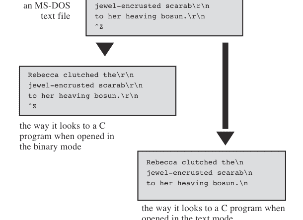

图13.1 二进制视图和文本视图。


程序名。使用 `argv[0]` 而不是显式地使用程序名，可以在你更改可执行文件名时自动改变错误信息。这个特性在 Unix 等允许一个文件拥有多个名称的环境中也很方便。但要注意——某些操作系统可能不识别 `argv[0]`，因此这种用法并非完全可移植。

`exit()` 函数会导致程序终止，并关闭所有打开的文件。`exit()` 的参数会被传递给某些操作系统，包括 Unix、Linux、Windows 和 MS-DOS，其他程序可以使用它。通常的约定是，正常终止的程序传递值 0，异常终止则传递非零值。可以使用不同的退出值来区分不同的失败原因，这是 Unix 和 DOS 编程中的常见做法。然而，并非所有操作系统都识别相同范围的返回值。因此，C 标准规定了一个相当有限的取值范围。具体来说，标准要求使用值 0 或宏 `EXIT_SUCCESS` 表示成功终止，使用宏 `EXIT_FAILURE` 表示不成功终止。这些宏以及 `exit()` 的原型都位于 `stdlib.h` 头文件中。

在 ANSI C 中，在初次调用 `main()` 时使用 `return` 与调用 `exit()` 具有相同的效果。因此，在 `main()` 中，语句

```
return 0;
```

你一直使用的这条语句，其效果等同于下面这条语句：

```
exit(0);
```

但请注意限定短语“初次调用”。如果你让 `main()` 成为一个递归程序，`exit()` 仍然会终止程序，但 `return` 会将控制权传递给上一级递归，直到到达最初的那一级。此时 `return` 才会终止程序。`return` 和 `exit()` 的另一个区别是，即使在 `main()` 之外的其他函数中调用 `exit()`，它也会终止程序。

### fopen() 函数

接下来，程序使用 `fopen()` 打开文件。该函数在 `stdio.h` 中声明。它的第一个参数是要打开的文件的名称；更确切地说，是包含该名称的字符串的地址。第二个参数是一个字符串，用于标识文件要以何种模式打开。C 库提供了多种可能模式，如表 13.1 所示。

表 13.1 fopen() 的模式字符串

| 模式字符串 | 含义 |
|---|---|
| "r" | 以读取模式打开文本文件。 |
| "w" | 以写入模式打开文本文件，将现有文件截断为零长度；如果文件不存在，则创建该文件。 |

### fclose() 函数

`fclose(fp)` 函数关闭 `fp` 所标识的文件，并在需要时刷新缓冲区。对于一个不像这个程序这样随意的程序，你应该检查文件是否已成功关闭。`fclose()` 函数在成功时返回值 0，失败时返回 EOF：

```
if (fclose(fp) != 0)
    printf("Error in closing file %s\n", argv[1]);
```

例如，如果磁盘已满、可移动存储设备已被移除，或者发生了 I/O 错误，`fclose()` 函数可能会失败。

### 指向标准文件的指针

`stdio.h` 文件将三个文件指针与 C 程序自动打开的三个标准文件关联起来：

| 标准文件 | 文件指针 | 通常情况 |
|---|---|---|
| 标准输入 | stdin | 键盘 |
| 标准输出 | stdout | 屏幕 |
| 标准错误 | stderr | 屏幕 |

这些指针都是指向 FILE 的指针类型，因此它们可以用作标准 I/O 函数的参数，就像示例中的 `fp` 一样。接下来，我们看一个创建新文件并向其中写入数据的示例。

### 一个简易的文件精简程序

接下来的程序将选定数据从一个文件复制到另一个文件。它同时打开两个文件，一个使用“r”模式，另一个使用“w”模式。该程序（见程序清单 13.2）采用只保留每第三个字符这种简单粗暴的方式来压缩第一个文件的内容。最后，它将压缩后的文本放到第二个文件中。第二个文件的名称是在旧名称后附加 `.red`（表示 reduced）得到的。使用命令行参数、同时打开多个文件以及追加文件名，通常都是非常实用的技术。这种特定的压缩形式吸引力有限，但正如你将看到的，它也有自己的用处。（同样，把这个程序改成使用标准 I/O 技术而不是命令行参数来提供文件名，也是一件简单的事。）

### 程序清单 13.2 reducto.c 程序

```
// reducto.c -- reduces your files by two-thirds!
#include <stdio.h>
#include <stdlib.h>    // for exit()
#include <string.h>

int main(int argc, char *argv[])
{
    FILE *in, *out;   // declare two FILE pointers
    int ch;
    char name[LEN];   // storage for output filename
    int count = 0;

    // check for command-line arguments
    if (argc < 2)
    {
        fprintf(stderr, "Usage: %s filename\n", argv[0]);
        exit(EXIT_FAILURE);
    }
    // set up input
    if ((in = fopen(argv[1], "r")) == NULL)
    {
        fprintf(stderr, "I couldn't open the file \"%s\"\n", argv[1]);
        exit(EXIT_FAILURE);
    }
    // set up output
    strncpy(name,argv[1], LEN - 5); // copy filename
    name[LEN - 5] = '\0';
    strcat(name,".red");           // append .red
    if ((out = fopen(name, "w")) == NULL)
    {
        // open file for writing
        fprintf(stderr,"Can't create output file.\n");
        exit(3);
    }
    // copy data
    while ((ch = getc(in)) != EOF)
        if (count++ % 3 == 0)
            putc(ch, out);  // print every 3rd char
    // clean up
    if (fclose(in) != 0 || fclose(out) != 0)
        fprintf(stderr,"Error in closing files\n");

    return 0;
}
```

假设可执行文件名为 `reducto`，我们将其应用于名为 `Eddy` 的文件，该文件包含下面这一行：

So even Eddy came oven ready.

命令如下：

```
reducto eddy
```

输出被写入一个名为 `eddy.red` 的文件。程序不会在屏幕上产生任何输出，但显示 `eddy.red` 文件应该会显示以下内容：

```
Send money
```

这个示例说明了几个编程技术。现在让我们来考察其中的一些。

`fprintf()` 函数与 `printf()` 类似，只是它需要一个文件指针作为第一个参数。我们使用 `stderr` 指针将错误消息发送到标准错误；这是 C 的常见做法。

为了构造输出文件的新名称，程序使用 `strncpy()` 将名称 `eddy` 复制到数组 `name` 中。参数 `LEN - 5` 为 `.red` 后缀和最后的空字符留出了空间。如果 `argv[1]` 字符串的长度大于 `LEN - 5`，就不会复制空字符，因此程序会添加一个空字符以防万一。在 `strncpy()` 调用之后，当 `strcat()` 函数附加 `.red` 字符串时，`name` 中的第一个空字符会被 `.red` 中的句点覆盖，从而生成 `eddy.red`。我们还检查了程序是否成功打开了该名称的文件。在某些环境中，这一点尤其重要，因为像 `strange.c.red` 这样的文件名可能是无效的。例如，在传统 DOS 下，你不能在扩展名后面再添加扩展名。（正确的 MS-DOS 做法是将任何现有扩展名替换为 `.red`，因此 `strange.c` 的精简版本将是 `strange.red`。例如，你可以使用 `strchr()` 函数定位名称中的句点（如果有），并只复制句点之前的字符串部分。）

这个程序同时打开了两个文件，因此我们声明了两个 FILE 指针。请注意，每个文件都是独立于另一个文件打开和关闭的。一次打开的文件数量是有限制的。限制取决于你的系统和实现；范围通常在 10 到 20 之间。只要这些文件不是同时打开的，你就可以对不同的文件使用同一个文件指针。

### 文件 I/O：fprintf()、fscanf()、fgets() 和 fputs()

前面各章中的每个 I/O 函数都有一个对应的文件 I/O 函数。主要区别在于，你需要使用 FILE 指针来告诉新函数要操作哪个文件。与 `getc()` 和 `putc()` 一样，这些函数要求你使用指向 FILE 的指针（例如 `stdout`）来标识文件，或者使用 `fopen()` 的返回值。

### fprintf() 和 fscanf() 函数

文件 I/O 函数 `fprintf()` 和 `fscanf()` 的工作方式与 `printf()` 和 `scanf()` 完全一样，只是它们需要一个额外的第一个参数来标识正确的文件。你已经使用过


字符数加上空字符的最大值。如果 fgets() 在达到字符限制之前读取了一整行，它会将换行符放入字符串中，位于空字符之前，用来标记行尾。fgets() 函数在遇到 EOF 时返回 NULL 值。你可以用它来检查文件是否结束。否则，它返回传递给它的地址。

fputs() 函数接受两个参数：首先是字符串的地址，然后是文件指针。它将指向位置找到的字符串写入指定的文件。与 puts() 不同，fputs() 在打印时不会附加换行符。函数调用如下所示：

```
fputs(buf, fp);
```

这里，buf 是字符串地址，fp 标识目标文件。

由于 fgets() 保留换行符而 fputs() 不会添加换行符，它们配合使用效果很好。如清单 11.8 所示，即使 STLEN 小于输入行长度，它们也能很好地协同工作。

### 随机访问探险：fseek() 和 ftell()

fseek() 函数使你能够像对待数组一样对待文件，并直接移动到由 fopen() 打开的文件中的任意特定字节。要了解其工作原理，让我们创建一个程序（见清单 13.4），该程序以逆序显示文件。请注意，fseek() 有三个参数并返回 int 值。ftell() 函数以 long 值返回文件中的当前位置。

### 清单 13.4 reverse.c 程序

```
/* reverse.c -- displays a file in reverse order */
#include <stdio.h>
#include <stdlib.h>
#define CNTL_Z '\032'  /* eof marker in DOS text files */
#define SLEN 81
int main(void)
{
    char file[SLEN];
    char ch;
    FILE *fp;
    long count, last;

    puts("Enter the name of the file to be processed:");
    scanf("%80s", file);
    if ((fp = fopen(file,"rb")) == NULL)
    {
        /* read-only mode */
        printf("reverse can't open %s\n", file);
        exit(EXIT_FAILURE);
    }
}
```
```
fseek(fp, -count, SEEK_END);    /* go backward */
    ch = getc(fp);
}
```

第一次循环将程序定位到文件末尾之前的第一个字符（即文件的最后一个字符）。然后程序打印该字符。下一个循环将程序定位到前一个字符并打印它。此过程一直持续到第一个字符被到达并打印为止。

### 二进制与文本模式

我们设计清单 13.4 使其在 Unix 和 MS-DOS 环境中都能工作。Unix 只有一种文件格式，因此不需要特殊调整。然而 MS-DOS 则需要额外注意。许多 MS-DOS 编辑器用 Ctrl+Z 字符标记文本文件的结尾。当此类文件以文本模式打开时，C 识别该字符为文件结束标记。然而，当同一文件以二进制模式打开时，Ctrl+Z 字符只是文件中的另一个字符，实际的文件结束在后面。它可能紧跟在 Ctrl+Z 之后出现，或者文件可能用空字符填充以使大小成为例如 256 的倍数。空字符在 DOS 下不会打印，我们包含了代码以防止程序尝试打印 Ctrl+Z 字符。

另一个不同点我们之前提到过：MS-DOS 用 \r\n 组合表示文本文件的换行符。C 程序以文本模式打开同一文件时，“看到” \r\n 为简单的 \n，但在二进制模式下，程序会看到两个字符。因此，我们包含了代码来抑制打印 \r。由于 Unix 文本文件通常既不包含 Ctrl+Z 也不包含 \r，此额外代码不会影响大多数 Unix 文本文件。

ftell() 函数在文本模式下可能与二进制模式下工作不同。许多系统具有与 Unix 模型足够不同的文本文件格式，以至于从文件开头开始的字节计数不是有意义的数量。ANSI C 规定，对于文本模式，ftell() 返回的值可作为 fseek() 的第二个参数使用。例如，对于 MS-DOS，ftell() 可以返回一个将 \r\n 看作单个字节的计数。

### 可移植性

理想情况下，fseek() 和 ftell() 应符合 Unix 模型。然而，实际系统中的差异有时使这成为不可能。因此，ANSI 对这些函数提供了降低的期望。以下是一些限制：

- 在二进制模式下，实现不必支持 SEEK_END 模式。因此，清单 13.4 不能保证可移植。更可移植的方法是逐字节读取整个文件直到结束。但顺序读取文件以找到末尾比直接跳转到末尾慢。C 预处理器条件编译指令，在第 16 章“ C 预处理器和 C 库”中讨论，提供了一种系统地处理替代代码选择的方法。

setvbuf() 函数设置一个替代缓冲区供标准 I/O 函数使用。它在文件打开后、在对流执行任何其他操作之前调用。指针 fp 标识流，buf 指向要使用的存储。如果 buf 的值不是 NULL，你必须创建缓冲区。例如，你可以声明一个 1,024 个字符的数组并传递该数组的地址。然而，如果你对 buf 使用 NULL，函数本身会分配缓冲区。size 变量告诉 setvbuf() 数组有多大。（size_t 类型是一个派生整数类型；参见第 5 章“运算符、表达式和语句”。）mode 从以下选项中选择：_IOFBF 表示完全缓冲（缓冲区满时刷新），_IOLBF 表示行缓冲（缓冲区满时或写入换行符时刷新），_IONBF 表示非缓冲。函数在成功时返回零，否则返回非零。

假设你有一个程序处理存储的数据对象，每个大小例如为 3,000 字节。你可以使用 setvbuf() 创建一个缓冲区，其大小是数据对象大小的倍数。

### 二进制 I/O：fread() 和 fwrite()

fread() 和 fwrite() 函数接下来列出，但首先一些背景。你到目前为止使用的标准 I/O 函数是面向文本的，处理字符和字符串。如果想将数值数据保存到文件中怎么办？确实，你可以使用 fprintf() 和 %f 格式保存浮点值，但那样保存的是字符序列。例如，代码

```
double num = 1./3.;
fprintf(fp,"%f", num);
```

将 num 保存为八个字符的序列：0.333333。使用 %.2f 指定符将其保存为四个字符：0.33。使用 %.12f 指定符将其保存为 14 个字符：0.333333333333。更改指定符会改变存储值所需的空间；它也可能导致存储不同的值。在 num 的值被存储为 0.33 之后，读取文件时无法恢复完整精度。一般来说，fprintf() 将数值转换为字符数据，可能改变值。

存储数字最准确和一致的方法是使用计算机本身使用的位模式。因此，double 值应以 double 大小的单元存储。当数据使用程序使用的相同表示形式存储在文件中时，我们说数据以二进制形式存储。没有从数值形式到字符序列的转换。对于标准 I/O，fread() 和 fwrite() 函数提供此二进制服务（见图 13.3）。

实际上，正如你可能回忆的那样，所有数据都以二进制形式存储。即使字符也是使用字符代码的二进制表示存储的。然而，如果文件中的所有数据都被解释为字符代码，我们说文件包含文本数据。如果部分或全部数据被解释为二进制形式的数值数据，我们说文件包含二进制数据。（此外，数据代表机器语言指令的文件是二进制文件。）


图 13.3 二进制和文本输出。

术语二进制和文本的使用可能会令人困惑。ANSI C 识别打开文件的两种模式：二进制和文本。许多操作系统识别两种文件格式：二进制和文本。信息可以作为二进制数据存储或读取，也可以作为文本数据存储或读取。这些都是相关的，但并不相同。你可以在二进制模式下打开文本格式文件。你可以在二进制格式文件中存储文本。你可以使用 getc() 来复制包含二进制数据的文件。一般来说，你使用二进制模式将二进制数据存储在二进制格式文件中。同样，你最常在文本格式打开的文本文件中使用文本数据。 （文字处理程序产生的文档通常是二进制文件，因为它们包含大量描述字体和格式的非文本信息。）

```
int num = 12345;
```
stores 12345 as binary number in num

00110000 00111001

```
fprintf(fp,"%d", num);
```
writes the binary codes for the characters '1','2','3','4','5' to the file

00110001 0011010 00110011 00110100 00110101

```
fwrite(&num, sizeof (int), 1, fp);
```
writes the binary codes for the value 12345 to the file

00110000 00111001

(this figure assumes an integer size of 16 bits)

For a grand finale, the program rewinds the append file to the beginning and displays the contents.

For practice, we’ll use fread() and fwrite() for the copying. Listing 13.5 shows the result.

### Listing 13.5 The append.c Program

```
/* append.c -- appends files to a file */
#include <stdio.h>
#include <stdlib.h>
#include <string.h>
#define BUFSIZE 4096
#define SLEN 81
void append(FILE *source, FILE *dest);
char * s_gets(char * st, int n);

int main(void)
{
    FILE *fa, *fs;    // fa for append file, fs for source file
    int files = 0; // number of files appended
    char file_app[SLEN];  // name of append file
    char file_src[SLEN];  // name of source file
    int ch;

    puts("Enter name of destination file:");
    s_gets(file_app, SLEN);
    if ((fa = fopen(file_app, "a+")) == NULL)
    {
        fprintf(stderr, "Can't open %s\n", file_app);
        exit(EXIT_FAILURE);
    }
    if (setvbuf(fa, NULL, _IOFBF, BUFSIZE) != 0)
    {
        fputs("Can't create output buffer\n", stderr);
        exit(EXIT_FAILURE);
    }
    puts("Enter name of first source file (empty line to quit):");
    while (s_gets(file_src, SLEN) && file_src[0] != '\0')
    {
        if (strcmp(file_src, file_app) == 0)
            fputs("Can't append file to itself\n",stderr);
        else if ((fs = fopen(file_src, "r")) == NULL)
            fprintf(stderr, "Can't open %s\n", file_src);
        else
        {
            if (setvbuf(fs, NULL, _IOFBF, BUFSIZE) != 0)
            {
```

### Random Access with Binary I/O

随机访问通常与使用二进制 I/O 写入的二进制文件一起使用，因此让我们看一个简短的示例。Listing 13.6 中的程序创建一个 double 数字文件，然后让你访问其内容。

### Listing 13.6 The randbin.c Program

```
/* randbin.c -- random access, binary i/o */
#include <stdio.h>
#include <stdlib.h>
#define ARSIZE 1000

int main()
{
    double numbers[ARSIZE];
    double value;
    const char * file = "numbers.dat";
    int i;
    long pos;
    FILE *iofile;

    // create a set of double values
    for(i = 0; i < ARSIZE; i++)
        numbers[i] = 100.0 * i + 1.0 / (i + 1);
    // attempt to open file
    if ((iofile = fopen(file, "wb")) == NULL)
    {
        fprintf(stderr, "Could not open %s for output.\n", file);
        exit(EXIT_FAILURE);
    }
    // write array in binary format to file
    fwrite(numbers, sizeof (double), ARSIZE, iofile);
    fclose(iofile);
    if ((iofile = fopen(file, "rb")) == NULL)
    {
        fprintf(stderr,
            "Could not open %s for random access.\n", file);
        exit(EXIT_FAILURE);
    }
    // read selected items from file
    printf("Enter an index in the range 0-%d.\n", ARSIZE - 1);
    while (scanf("%d", &i) == 1 && i >= 0 && i < ARSIZE)
    {
        pos = (long) i * sizeof(double); // calculate offset
        fseek(iofile, pos, SEEK_SET);    // go there
        fread(&value, sizeof (double), 1, iofile);
```
```
printf("The value there is %f.\n", value);
printf("Next index (out of range to quit):\n");
}
// finish up
fclose(iofile);
puts("Bye!");

return 0;
}
```

首先，程序创建一个数组并向其中放置一些值。然后它以二进制模式创建一个名为 numbers.dat 的文件，并使用 fwrite() 将数组内容复制到文件中。每个 double 值的 64 位模式从内存复制到文件中。你不能用文本编辑器读取 resulting 二进制文件，因为值没有被翻译成字符串。然而，每个值在文件中存储的方式与在内存中存储的方式完全相同，因此不会丢失精度。此外，每个值在文件中占用恰好 64 位存储，因此计算每个值的位置变得非常简单。

程序的第二部分打开文件以进行读取，并提示用户输入值的索引。将索引乘以每个 double 的字节数即可得到文件中的位置。然后程序使用 fseek() 前往该位置并使用 fread() 读取该处的值。注意没有格式说明符。相反，fread() 将从该位置开始的 8 个字节复制到 &value 指示的内存位置。然后程序可以使用 printf() 显示 value。以下是示例运行：

```
Enter an index in the range 0-999.
500
The value there is 50000.001996.
Next index (out of range to quit):
900
The value there is 90000.001110.
Next index (out of range to quit):
0
The value there is 1.000000.
Next index (out of range to quit):
-1
Bye!
```

## Key Concepts

C 程序将输入视为字节流；该流的来源可以是文件、输入设备（如键盘），甚至是另一个程序的输出。同样，C 程序将输出视为字节流；目标可以是文件、视频显示等。

C 如何解释输入流或输出流的字节取决于你使用的输入/输出函数。程序可以原样读取和存储字节，也可以将字节解释为字符，而字符又可以被解释为普通文本或数字的文本表示。同样，在输出时，你使用的函数决定了二进制值是原样传输还是转换为文本或数字的文本表示。如果你有想要保存和恢复且不丢失精度的数值数据，请使用二进制模式和 fread() 与 fwrite() 函数。如果你保存的是文本信息并且希望创建可以用普通文本编辑器查看的文件，请使用文本模式和 getc() 与 fprintf() 等函数。

要访问文件，你需要创建一个文件指针（类型 FILE *）并将其与特定文件名关联。后续代码在处理文件时使用指针，而不是文件名。

了解 C 如何处理文件结束概念很重要。通常，文件读取程序使用循环读取输入直到到达文件末尾。C 输入函数在尝试读取超出末尾之后才会检测到文件结束。这意味着对文件结束的测试应在尝试读取之后立即进行。你可以使用本章“文件结束”部分中标记为“良好设计”的两个文件输入模型作为指导。

## Summary

读写文件对于大多数 C 程序来说是必不可少的。大多数 C 实现为此目的提供低级 I/O 服务和标准高级 I/O 服务。由于 ANSI C 库包含标准 I/O 服务但不包含低级服务，因此标准包更具可移植性。

标准 I/O 包会自动创建输入和输出缓冲区以加快数据传输。fopen() 函数打开文件以进行标准 I/O 并创建旨在保存有关文件和缓冲区的信息的数据结构。fopen() 函数返回指向该数据结构的指针，并且该指针由其他函数用来标识要处理的文件。feof() 和 ferror() 函数报告 I/O 操作失败的原因。

C 将输入视为字节流。如果你使用 fread()，C 将输入视为要放置到你指定的存储位置的二进制值。如果你使用 fscanf()、getc()、fgets() 或任何相关函数，C 将每个字节视为字符代码。fscanf() 和 scanf() 函数然后尝试根据格式说明符将字符代码转换为其他类型。例如，%f 说明符会将 23 的输入转换为浮点值，%d 说明符会将相同的输入转换为整数值，而 %s 说明符会将字符输入保存为字符串。getc() 和 fgets() 系列函数将输入保留为字符代码并将其存储在 char 变量中作为单个字符，或存储在 char 数组中作为字符串。同样，fwrite() 将二进制数据直接放入输出流，而其他输出函数在将其放入输出流之前会将非字符数据转换为字符表示。


```c
putchar(ch);
fclose(fp);

return 0;
}
```

### 3. 假设程序中包含以下语句：

```c
#include <stdio.h>
FILE *fp1, *fp2;
char ch;

fp1 = fopen("terky", "r");
fp2 = fopen("jerky", "w");
```

同时假设两个文件都成功打开。请为以下函数调用补充缺失的参数：

- a. `ch = getc();`
- b. `fprintf( ,"%c\n", );`
- c. `putc( , );`
- d. `fclose(); /* close the terky file */`

### 4. 编写一个程序，接受零个或一个命令行参数。如果有一个参数，则将其解释为文件名。如果没有参数，则使用标准输入（stdin）作为输入。假设输入全部由浮点数组成。让程序计算并报告输入数字的算术平均值（平均数）。

### 5. 编写一个程序，接受两个命令行参数。第一个是字符，第二个是文件名。程序应只打印文件中包含该给定字符的那些行。

### 注意

文件中的行以终止的 `'\n'` 标识。假设没有一行超过 256 个字符。你可能需要使用 `fgets()`。

### 6. 二进制文件与文本文件之间、以及二进制流与文本流之间的区别分别是什么？

### 7.

- a. 使用 `fprintf()` 保存 8238201 与使用 `fwrite()` 保存它有什么区别？
- b. 使用 `putc()` 保存字符 S 与使用 `fwrite()` 保存它有什么区别？

### 8. 以下三者之间有什么区别？

```c
printf("Hello, %s\n", name);
fprintf(stdout, "Hello, %s\n", name);
fprintf(stderr, "Hello, %s\n", name);
```

### 9. `"a+"`、`"r+"` 和 `"w+"` 模式都可以打开文件进行读写。哪一种最适合修改文件中已有的内容？

## 编程练习

- 1. 修改程序清单 13.1，使其提示用户输入文件名并读取用户的响应，而不是使用命令行参数。
- 2. 编写一个文件复制程序，从命令行获取原文件名和复制后的文件名。尽可能使用标准 I/O 和二进制模式。
- 3. 编写一个文件复制程序，提示用户输入作为源文件的文本文件名和输出文件名。程序应使用 `ctype.h` 中的 `toupper()` 函数，在写入输出文件时将所有文本转换为大写。使用标准 I/O 和文本模式。
- 4. 编写一个程序，依次在屏幕上显示命令行中列出的所有文件。使用 `argc` 控制循环。
- 5. 修改程序清单 13.5 中的程序，使其使用命令行界面而不是交互式界面。
- 8. 编写一个程序，将字符以及零个或多个文件名作为命令行参数。如果字符后面没有参数，则让程序读取标准输入。否则，让它依次打开每个文件，并报告该字符在每个文件中出现的次数。文件名和字符本身也应与计数一起报告。包含错误检查，以查看参数数量是否正确以及文件是否能被打开。如果文件无法打开，让程序报告这一情况并继续处理下一个文件。
- 9. 修改程序清单 13.3 中的程序，使每个单词按照其添加到列表中的顺序编号，从 1 开始。确保程序第二次运行时，新单词的编号从上次编号停止的地方继续。
- 10. 编写一个程序，打开一个文件名通过交互方式获得的文本文件。建立一个循环，要求用户输入文件位置。然后程序应打印从该位置开始到下一个换行符为止的文件部分。让负数或非数值输入终止用户输入循环。
- 11. 编写一个程序，接受两个命令行参数。第一个是字符串；第二个是文件名。然后程序应搜索该文件，打印所有包含该字符串的行。由于这个任务是面向行的而不是面向字符的，请使用 `fgets()` 而不是 `getc()`。使用标准 C 库函数 `strstr()`（在第 11 章练习 7 中简要介绍过）来搜索每一行中的字符串。假设没有一行超过 255 个字符。
- 12. 创建一个文本文件，包含 20 行，每行 30 个整数。整数应在 0-9 范围内，并用空格分隔。该文件是图片的数字表示，值 0 到 9 表示递增的黑暗程度。编写一个程序，将文件内容读入一个 20×30 的 int 数组。采用一种粗略的方法将这种数字表示转换为图片：让程序使用该数组中的值来初始化一个 20×31 的 char 数组，其中值 0 对应空格字符，值 1 对应句点字符，依此类推，每个较大的数字由一个占据更多空间的字符表示。例如，你可以使用 # 来表示 9。每行的最后一个字符（第 31 个）应为空字符，使其成为 20 个字符串的数组。让程序显示生成的图片（即打印这些字符串），并将结果存储在一个文本文件中。例如，假设你从以下数据开始：

```text
0 0 9 0 0 0 0 0 0 0 0 0 5 8 9 9 8 5 2 0 0 0 0 0 0 0 0 0 0 0
0 0 0 0 9 0 0 0 0 0 0 0 5 8 9 9 8 5 5 2 0 0 0 0 0 0 0 0 0 0
0 0 0 0 0 0 0 0 0 0 0 0 5 8 1 9 8 5 4 5 2 0 0 0 0 0 0 0 0 0
0 0 0 0 9 0 0 0 0 0 0 0 5 8 9 9 8 5 0 4 5 2 0 0 0 0 0 0 0 0
0 0 9 0 0 0 0 0 0 0 0 0 5 8 9 9 8 5 0 0 4 5 2 0 0 0 0 0 0 0
0 0 0 0 0 0 0 0 0 0 0 0 5 8 9 1 8 5 0 0 0 4 5 2 0 0 0 0 0 0
0 0 0 0 0 0 0 0 0 0 0 0 5 8 9 9 8 5 0 0 0 0 4 5 2 0 0 0 0 0
5 5 5 5 5 5 5 5 5 5 5 5 8 9 9 8 5 5 5 5 5 5 5 5 5 5 5 5 5 5
```

## 结构和其他数据形式

在本章中，你将了解以下内容：

- 关键字：
  - `struct`, `union`, `typedef`
- 运算符：
  - `.`, `->`
- 什么是 C 结构，以及如何创建结构模板和结构变量
- 如何访问结构的成员，以及如何编写处理结构的函数
- C 的 `typedef` 机制
- 联合和函数指针

设计程序时最重要的步骤之一，就是选择一种好的方式来表现数据。在许多情况下，一个简单的变量甚至数组都不够用。C 借助 C *结构变量*，将你表现数据的能力又向前推进了一步。C 结构的基本形式足够灵活，可以表示多种多样的数据，并且使你能够发明新的形式。如果你熟悉 Pascal 的记录，那么你应该很容易理解结构。如果不熟悉，本章将向你介绍 C 结构。让我们研究一个具体示例，看看为什么可能需要 C 结构，以及如何创建和使用它。

### 示例问题：创建书籍清单

格温·格伦（Gwen Glenn）想要打印一份她的书籍清单。她想为每本书打印各种信息：书名、作者、出版社、版权日期、页数、册数和美元价值。其中一些项目，如书名，可以存储在字符串数组中。其他项目则需要 int 数组或 float 数组。由于有七

### 建立结构声明

*结构声明* 是描述结构如何组合在一起的总体方案。该声明如下所示：

```c
struct book {
    char title[MAXTITL];
    char author[MAXAUTL];
    float value;
};
```

该声明描述了一个由两个字符数组和一个 *float* 变量组成的结构。它并不会创建实际的数据对象，而是描述了这样一个对象由什么构成。（有时，我们会把结构声明称为 *模板*，因为它勾勒出数据将如何存储。如果你听说过 C++ 中的模板，那是这个词的一种不同且更复杂的用法。）让我们来看看细节。首先是关键字 *struct*。它标识接下来的内容是一个结构。接下来是一个可选的 *标记*（tag）——即 *book* 这个词——它是一个简写标签，你可以用它来指代这个结构。因此，后面我们会有这样的声明：

```c
struct book library;
```

它声明 *library* 是一个使用 *book* 结构设计的结构变量。

接下来，在结构声明中，结构成员列表被一对花括号括起来。每个成员都由自己的声明来描述，并以分号结束。例如，*title* 部分是一个包含 *MAXTITL* 个元素的 *char* 数组。成员可以是任何 C 数据类型——也包括其他结构！

右花括号后的分号结束结构设计的定义。你可以像我们这样，将此声明放在任何函数之外（外部），或放在函数定义内部。如果声明放在函数内部，其标记只能在该函数内部使用。如果声明是外部的，则文件中该声明之后的所有函数都可以使用它。例如，在另一个函数中，你可以定义

```c
struct book dickens;
```

而该函数将拥有一个遵循 *book* 设计形式的变量 *dickens*。

标记名称是可选的，但当你像我们这样，在一个地方定义结构设计、在另一个地方定义实际变量时，就必须使用标记。在我们看了如何定义结构变量之后，很快就会回到这一点。

### 定义结构变量

*结构* 这个词有两种含义。一种含义是“结构方案”，也就是我们刚才讨论的内容。结构方案告诉编译器*如何*表示数据，但它并不会让计算机为数据*分配*空间。下一步是创建一个*结构变量*，即


### 访问结构成员

结构就像一个“超级数组”，其中一个元素可以是 char，下一个元素是 float，再下一个是 int 数组。你可以通过使用下标来访问数组的各个元素。如何访问结构的各个成员？使用点号（.），即结构成员运算符。例如，library.value 是 library 的 value 部分。你可以像使用任何其他 float 变量一样使用 library.value。同样，你可以像使用 char 数组一样使用 library.title。因此，程序使用如下表达式

```
s_gets(library.title, MAXTITL);
```

和

```
scanf("%f", &library.value);
```

本质上，.title、.author 和 .value 充当 book 结构的下标。

请注意，尽管 library 是一个结构，但 library.value 是 float 类型，并像任何其他 float 类型一样使用。例如，scanf("%f",...) 需要一个 float 位置的地址，而 &library.value 就是它。这里点号的优先级高于 &，因此该表达式等同于 &(library.value)。

如果你有第二个相同类型的结构变量，你会使用相同的方法：

```
struct book bill, newt;
```

```
s_gets(bill.title, MAXTITL);
s_gets(newt.title, MAXTITL);
```

.title 指的是 book 结构的第一个成员。请注意初始程序如何以两种不同的格式打印结构 library 的内容。这说明了你在使用结构成员时拥有的自由度。

### 结构的初始化器

C99 和 C11 为结构提供了指定初始化器。其语法与数组的指定初始化器类似。然而，结构的指定初始化器使用点运算符和成员名称来标识特定元素，而不是使用方括号和索引。例如，要仅初始化 book 结构的 value 成员，你可以这样做：

```
struct book surprise = { .value = 10.99 };
```

你可以用任何顺序使用指定初始化器：

```
struct book gift = { .value = 25.99,
    .author = "James Broadfool",
    .title = "Rue for the Toad" };
```

与数组一样，指定初始化器之后出现的普通初始化器会为指定成员之后的成员提供值。此外，为特定成员提供的最后一个值就是它得到的值。例如，考虑以下声明：

```
struct book gift= { .value = 18.90,
    .author = "Philionna Pestle",
    0.25};
```

值 0.25 被分配给 value 成员，因为它是在结构声明中 author 成员之后列出的第一个成员。新的 0.25 值取代了之前提供的 18.90 值。现在你掌握了这些基础知识，就准备好扩展视野，查看结构的几个推论。你将看到结构的数组、结构的嵌套、指向结构的指针，以及处理结构的函数。

### 结构的数组

让我们扩展我们的 book 程序以处理更多书籍。显然，每本书都可以用 book 类型的结构变量来描述。要描述两本书，你需要使用两个这样的变量，以此类推。要处理多本书，你可以使用此类结构的数组，这就是我们在下一程序中创建的内容，见清单 14.2。 （如果你使用 Borland C/C++，请参阅本章后面的“Borland C 和浮点数”部分。）

### 结构与内存

manybook.c 程序使用一个包含 100 个结构的数组。因为该数组是自动存储类对象，信息通常放在栈上。如此大的数组需要一大块内存，这可能会导致问题。如果出现运行时错误，也许抱怨栈大小或栈溢出，你的编译器可能使用的默认栈大小对于此示例来说太小了。要修复这个问题，你可以使用编译器选项将栈大小设置为 10,000 以容纳结构的数组，或者你可以使数组为 static 或 external（这样它就不会放在栈中），或者你可以将数组大小减少到 16。为什么我们一开始不把栈做得小一点？因为你应该了解潜在的栈大小问题，以便在自己遇到时能够应对。

### 清单 14.2 manybook.c 程序

```
/* manybook.c -- multiple book inventory */
#include <stdio.h>
#include <string.h>
char * s_gets(char * st, int n);
#define MAXTITL  40
#define MAXAUTL  40
#define MAXBKS   100        /* maximum number of books  */

struct book {
    /* set up book template */
    char title[MAXTITL];
    char author[MAXAUTL];
    float value;
};

int main(void)
{
    struct book library[MAXBKS]; /* array of book structures */
    int count = 0;
    int index;

    printf("Please enter the book title.\n");
    printf("Press [enter] at the start of a line to stop.\n");
    while (count < MAXBKS && s_gets(library[count].title, MAXTITL) != NULL
        && library[count].title[0] != '\0')
    {
        printf("Now enter the author.\n");
        s_gets(library[count].author, MAXAUTL);
        printf("Now enter the value.\n");
        scanf("%f", &library[count++].value);
        while (getchar() != '\n')
            continue;           /* clear input line */
        if (count < MAXBKS)
            printf("Enter the next title.\n");
    }

    if (count > 0)
    {
        printf("Here is the list of your books:\n");
        for (index = 0; index < count; index++)
            printf("%s by %s: $%.2f\n", library[index].title,
                library[index].author, library[index].value);
    }
    else
        printf("No books? Too bad.\n");

    return 0;
}

char * s_gets(char * st, int n)
{
    char * ret_val;
    char * find;

    ret_val = fgets(st, n, stdin);
    if (ret_val)
```

```
char first[LEN];
char last[LEN];
};

struct guy {
    // second structure
    struct names handle;    // nested structure
    char favfood[LEN];
    char job[LEN];
    float income;
};

int main(void)
{
    struct guy fellow = {  // initialize a variable
        { "Ewen", "Villard" },
        "grilled salmon",
        "personality coach",
        68112.00
    };

    printf("Dear %s, \n\n", fellow.handle.first);
    printf("%s%s\n", msgs[0], fellow.handle.first);
    printf("%s%s\n", msgs[1], fellow.job);
    printf("%s\n", msgs[2]);
    printf("%s%s%s", msgs[3], fellow.favfood, msgs[4]);
    if (fellow.income > 150000.0)
        puts("!!");
    else if (fellow.income > 75000.0)
        puts("!");
    else
        puts(".");
    printf("\n%40s%s\n", " ", "See you soon,");
    printf("%40s%s\n", " ", "Shalala");

    return 0;
}
```

以下是输出：

Dear Ewen,

    Thank you for the wonderful evening, Ewen.
You certainly prove that a personality coach
is a special kind of guy. We must get together
over a delicious grilled salmon and have a few laughs.

                                    See you soon,
                                    Shalala

指定结构成员值的第二种方法源于以下序列：如果 him == &fellow[0]，那么 *him == fellow[0]，因为 & 和 * 是互逆运算符。因此，通过替换，你得到以下内容：

```
fellow[0].income == (*him).income
```

需要括号，因为 . 运算符的优先级高于 *。

总之，如果 him 是指向名为 barney 的 guy 类型结构的指针，以下所有表达式都是等价的：

```
barney.income == (*him).income == him->income   // assuming him == &barney
```

现在让我们看看结构与函数之间的交互。

### 告诉函数关于结构

回想一下，函数参数将值传递给函数。每个值都是一个数字——可能是 int，可能是 float，可能是 ASCII 字符代码，或可能是地址。结构比单个值复杂一些，因此不足为奇，古老的 C 实现不允许结构作为函数的参数使用。这一限制在更新的实现中被移除了，ANSI C 允许结构作为参数使用。因此，现代实现为你提供了在参数中传递结构和传递指向结构的指针之间的选择——或者如果你只关心结构的一部分，你可以传递结构成员作为参数。我们将检查这三种方法，首先从传递结构成员作为参数开始。

### 传递结构成员

只要结构成员是具有单一值的数据类型（即 int 或其相关类型、char、float、double 或指针），它就可以作为函数参数传递给接受该特定类型的函数。清单 14.5 中初级的财务分析程序，它将客户的银行账户加到其储蓄和贷款账户，说明了这一点。

### 清单 14.5 funds1.c 程序

```
/* funds1.c -- passing structure members as arguments */
#include <stdio.h>
#define FUNDLEN 50

struct funds {
    char  bank[FUNDLEN];
    double bankfund;
    char  save[FUNDLEN];
    double savefund;
};
```


### 将结构体作为参数传递

对于允许将结构体作为参数传递的编译器，上一个示例可以改写为如 14.7 节所示。

### 列表 14.7 funds3.c 程序

```
/* funds3.c -- passing a structure */
#include <stdio.h>
#define FUNDLEN 50

struct funds {
    char  bank[FUNDLEN];
    double bankfund;
    char  save[FUNDLEN];
    double savefund;
};

double sum(struct funds moolah);  /* argument is a structure */

int main(void)
{
    struct funds stan = {
        "Garlic-Melon Bank",
        4032.27,
        "Lucky's Savings and Loan",
        8543.94
    };

    printf("Stan has a total of $%.2f.\n", sum(stan));

    return 0;
}

double sum(struct funds moolah)
{
    return(moolah.bankfund + moolah.savefund);
}
```

再次，输出如下：

Stan has a total of $12576.21.

我们用 moolah 替换了 money，后者是指向 struct funds 的指针，而 moolah 是一个 struct funds 变量。当 sum() 被调用时，会根据 funds 模板创建一个名为 moolah 的自动变量。然后该结构体的成员被初始化为结构体 stan 中对应成员的值的副本。因此，计算

```
void showinfo(const struct namect *);
char * s_gets(char * st, int n);

int main(void)
{
    struct namect person;

    getinfo(&person);
    makeinfo(&person);
    showinfo(&person);
    return 0;
}

void getinfo (struct namect * pst)
{
    printf("Please enter your first name.\n");
    s_gets(pst->fname, NLEN);
    printf("Please enter your last name.\n");
    s_gets(pst->lname, NLEN);
}

void makeinfo (struct namect * pst)
{
    pst->letters = strlen(pst->fname) +
    strlen(pst->lname);
}

void showinfo (const struct namect * pst)
{
    printf("%s %s, your name contains %d letters.\n",
           pst->fname, pst->lname, pst->letters);
}

char * s_gets(char * st, int n)
{
    char * ret_val;
    char * find;

    ret_val = fgets(st, n, stdin);
    if (ret_val)
    {
        find = strchr(st, '\n');    // look for newline
        if (find)                   // if the address is not NULL,
            *find = '\0';           // place a null character there
        else
            while (getchar() != '\n')
                continue;           // dispose of rest of line
```

```
}
    return ret_val;
}
```

编译并运行程序会产生如下结果：

```
Please enter your first name.
Viola
Please enter your last name.
Plunderfest
Viola Plunderfest, your name contains 16 letters.
```

程序的工作被分配给从 main() 调用的三个函数。在每种情况下，person 结构体的地址都被传递给函数。

getinfo() 函数将信息从自身传输到 main()。具体来说，它从用户获取姓名并将它们放入 person 结构体中，使用 pst 指针来定位它。回想一下 pst->lname 表示由 pst 指向的结构体的 lname 成员。这使得 pst->lname 等同于一个字符数组的名称，因此是 gets() 的合适参数。注意，尽管 getinfo() 向主程序提供信息，但它不使用返回机制，因此其类型为 void。

makeinfo() 函数执行双向信息传输。通过使用指向 person 的指针，它定位存储在结构体中的两个姓名。它使用 C 库函数 strlen() 计算每个姓名中的字母总数，然后使用 person 的地址存放总和。同样，类型为 void。最后，showinfo() 函数使用指针定位要打印的信息。由于该函数不更改数组的内容，因此它将指针声明为 const。

在所有这些操作中，只有一个结构体变量 person，而每个函数都使用结构体地址来访问它。一个函数将信息从自身传输到调用程序，一个函数将信息从调用程序传输到自身，还有一个函数同时做了这两者。

现在让我们看看如何使用结构体参数和返回值来编程相同的任务。首先，要传递结构体本身，请使用参数 person 而不是 &person。相应的形式参数然后被声明为 struct namect 类型，而不是指向该类型的指针。其次，要向 main() 提供结构体值，可以返回一个结构体。列表 14.9 展示了非指针版本。

### 列表 14.9 names2.c 程序

```
/* names2.c -- passes and returns structures */
#include <stdio.h>
#include <string.h>

#define NLEN 30
struct namect {
```

```
char * ret_val;
char * find;

ret_val = fgets(st, n, stdin);
if (ret_val)
{
    find = strchr(st, '\n');    // look for newline
    if (find)                   // if the address is not NULL,
        *find = '\0';           // place a null character there
    else
        while (getchar() != '\n')
            continue;           // dispose of rest of line
}
return ret_val;
}
```

这个版本产生的最终结果与前一个版本相同，但其进行的方式不同。三个函数中的每一个都创建了 person 的自己的副本，因此该程序使用四个不同的结构体而不是只有一个。

例如，考虑 makeinfo() 函数。在第一个程序中，person 的地址被传递，函数操作实际的 person 值。在这个第二个版本中，创建了一个名为 info 的新结构体。存储在 person 中的值被复制到 info，函数对副本进行操作。因此，当字母数被计算时，它存储在 info 中，而不是 person 中。然而，返回机制修复了这个问题。makeinfo() 行

```
return info;
```

结合 main() 行

```
person = makeinfo(person);
```

将存储在 info 中的值复制到 person 中。注意 makeinfo() 函数必须被声明为 struct namect 类型，因为它返回一个结构体。

### 结构体还是指向结构体的指针？

假设你必须编写一个与结构体相关的函数。你应该使用结构体指针作为参数，还是使用结构体参数和返回值？每种方法都有其优缺点。

指针参数方法的两个优点是它适用于较旧的 C 实现以及较新的 C 实现，并且速度快；你只需传递一个地址。缺点是你的数据保护较少。被调用函数中的某些操作可能会无意中影响原始结构体中的数据。然而，ANSI C 添加的 const 限定符解决了这个问题。例如，如果你在列表 11.8 的 showinfo() 函数中加入更改结构体任何成员的代码，编译器会将其捕获为错误。

传递结构体作为参数的一个优点是函数使用原始数据的副本，这比使用原始数据更安全。此外，编程风格往往更清晰。假设你定义了以下结构体类型：

```
struct vector {double x; double y;};
```

你想将向量 ans 设置为向量 a 和 b 的和。你可以编写一个结构体传递和返回的函数，使程序看起来像这样：

```
struct vector ans, a, b;
struct vector sum_vect(struct vector, struct vector);
...
ans = sum_vect(a,b);
```

前一个版本对工程师来说看起来比指针版本更自然，指针版本可能看起来像这样：

```
struct vector ans, a, b;
void sum_vect(const struct vector *, const struct vector *, struct vector *);
...
sum_vect(&a, &b, &ans);
```

此外，在指针版本中，用户必须记住和的地址应该是第一个还是最后一个参数。

传递结构体的两个主要缺点是较旧的实现可能无法处理代码，并且浪费时间和空间。特别是在函数只使用结构体的一两个成员时，传递大型结构体尤其浪费。在这种情况下，传递指针或仅将所需成员作为单独参数传递更有意义。

通常，程序员出于效率原因使用结构体指针作为函数参数，在需要时使用 const 来保护数据免受非预期更改。通过值传递结构体通常是针对本身就很小的结构体进行的。

### 结构体中的字符数组还是字符指针

到目前为止的示例都使用字符数组在结构体中存储字符串。你可能想知道是否可以使用指向 char 的指针代替。例如，列表 14.3 有以下声明：

```
#define LEN 20
struct names {
    char first[LEN];
    char last[LEN];
};
```

你能这样做吗？

```
struct pnames {
    char * first;
```


```
char * last;
};
```

答案是你可以这样做，但除非你理解其含义，否则可能会遇到麻烦。请考虑以下代码：

```
struct names veep = {"Talia", "Summers"};
struct pnames treas = {"Brad", "Fallingjaw"};
printf("%s and %s\n", veep.first, treas.first);
```

这段代码是合法的，并且可以工作，但请考虑字符串存储的位置。对于 struct names 变量 veep，字符串存储在结构内部；该结构总共分配了 40 字节来保存这两个名字。对于 struct pnames 变量 treas 来说，字符串则存储在编译器存储字符串常量的位置。结构所保存的只是两个地址，在我们的系统上总共占用 16 字节。特别是，struct pnames 结构不会分配任何空间来存储字符串。它只能与在其他地方已分配空间的字符串一起使用，例如字符串常量或数组中的字符串。简而言之，pnames 结构中的指针只能用于管理在程序其他地方创建和分配的字符串。

让我们看看这种限制在何处会成为问题。请考虑以下代码：

```
struct names accountant;
struct pnames attorney;
puts("Enter the last name of your accountant:");
scanf("%s", accountant.last);
puts("Enter the last name of your attorney:");
scanf("%s", attorney.last);  /* here lies the danger */
```

就语法而言，这段代码是正确的。但输入存储在哪里呢？对于 accountant，名字存储在 accountant 变量的 last 成员中；该结构有一个数组来保存字符串。对于 attorney，scanf() 被告知将字符串放在 attorney.last 提供的地址。因为这是一个未初始化的变量，地址可能有任何值，程序可能会尝试把名字放在任何地方。如果你运气好，程序可能有时能工作——或者一次尝试就会导致程序崩溃。实际上，如果程序能工作，你就倒霉了，因为程序存在一个你并不知晓的危险编程错误。

因此，如果你想要一个结构来存储字符串，使用字符数组成员会更简单。存储指向 char 的指针也有其用途，但也存在严重误用的潜在风险。

### Structure, Pointers, and malloc()

使用 malloc() 分配内存并使用指针存储地址时，在结构中使用指针来处理字符串是有意义的一种情况。这种方法的好处是你可以要求 malloc() 只分配存储字符串所需的空间。你可以要求 4 字节来存储 "Joe"，以及 18 字节来存储马达加斯加的名字

```
char * fname; // using pointers
char * lname;
int letters;
};

void getinfo(struct namect *);        // allocates memory
void makeinfo(struct namect *);
void showinfo(const struct namect *);
void cleanup(struct namect *);       // free memory when done
char * s_gets(char * st, int n);

int main(void)
{
    struct namect person;

    getinfo(&person);
    makeinfo(&person);
    showinfo(&person);
    cleanup(&person);

    return 0;
}

void getinfo (struct namect * pst)
{
    char temp[SLEN];
    printf("Please enter your first name.\n");
    s_gets(temp, SLEN);
    // allocate memory to hold name
    pst->fname = (char *) malloc(strlen(temp) + 1);
    // copy name to allocated memory
    strcpy(pst->fname, temp);
    printf("Please enter your last name.\n");
    s_gets(temp, SLEN);
    pst->lname = (char *) malloc(strlen(temp) + 1);
    strcpy(pst->lname, temp);
}

void makeinfo (struct namect * pst)
{
    pst->letters = strlen(pst->fname) +
    strlen(pst->lname);
}

void showinfo (const struct namect * pst)
{
    printf("%s %s, your name contains %d letters.\n",
```

```
pst->fname, pst->lname, pst->letters);
}
```

```
void cleanup(struct namect * pst)
{
    free(pst->fname);
    free(pst->lname);
}
```

```
char * s_gets(char * st, int n)
{
    char * ret_val;
    char * find;

    ret_val = fgets(st, n, stdin);
    if (ret_val)
    {
        find = strchr(st, '\n');    // look for newline
        if (find)                   // if the address is not NULL,
            *find = '\0';          // place a null character there
        else
            while (getchar() != '\n')
                continue;           // dispose of rest of line
    }
    return ret_val;
}
```

以下是一些示例输出：

```
Please enter your first name.
Floresiensis
Please enter your last name.
Mann
Floresiensis Mann, your name contains 16 letters.
```

### Compound Literals and Structures (C99)

C99 的复合字面量特性同样适用于结构体和数组。如果只需要一个临时的结构体值，这个特性就很方便。例如，你可以使用复合字面量来创建一个结构体作为函数参数，或将其赋给另一个结构体。语法是在用括号括起的类型名后加上用大括号括起的初始化列表。例如，下面是一个 struct book 类型的复合字面量：

```
(struct book) {"The Idiot", "Fyodor Dostoyevsky", 6.99}
```

```
double area;
area = rect_area( (struct rect) {10.5, 20.0});
```

这会使 area 被赋值为 210.0。

如果一个函数期望一个地址，你可以传递复合字面量的地址：

```
struct rect {double x; double y;};
double rect_areap(struct rect * rp){return rp->x * rp->y;}
...
double area;
area = rect_areap( &(struct rect) {10.5, 20.0});
```

这会使 area 被赋值为 210.0。

在任何函数之外出现的复合字面量具有静态存储期，而在块内出现的复合字面量具有自动存储期。复合字面量遵循与普通初始化列表相同的语法规则。这意味着，例如，你可以在复合字面量中使用指定初始化。

### Flexible Array Members (C99)

C99 有一个称为灵活数组成员的特性。它允许你声明一个结构体，其最后一个成员是一个具有特殊属性的数组。一个特殊属性是该数组并不存在——至少不是立即存在。第二個特殊属性是，通过正确的代码，你可以像它确实存在并且具有你需要的任意数量元素一样使用灵活数组成员。这听起来可能有点奇怪，所以让我们逐步了解如何创建和使用具有灵活数组成员的结构体。

首先，这里是声明灵活数组成员的规则：

- 灵活数组成员必须是结构体的最后一个成员。
- 必须至少有一个其他成员。
- 灵活数组像普通数组一样声明，只是方括号为空。

下面是一个说明这些规则的示例：

```
struct flex
{
    int count;
    double average;
    double scores[];  // flexible array member
};
```

如果你声明一个 struct flex 类型的变量，你不能对 scores 做任何事，因为没有为其预留内存空间。事实上，本意并不是让你声明 struct flex 类型的变量。相反，你应该声明一个指向 struct flex 类型的指针，然后使用 malloc() 为 struct flex 的普通内容加上灵活数组成员所需的额外空间分配足够的内存。例如，假设你希望 scores 表示一个包含五个 double 值的数组。那么你会这样做：

```
struct flex * pf;  // declare a pointer
// ask for space for a structure and an array
pf = malloc(sizeof(struct flex) + 5 * sizeof(double));
```

现在你有一个足够大的内存块来存储 count、average 和一个包含五个 double 值的数组。你可以使用指针 pf 来访问这些成员：

```
pf->count = 5;        // set count member
pf->scores[2] = 18.5;  // access an element of the array member
```

清单 14.12 在一定程度上扩展了这个示例，让灵活数组成员在一例中表示五个值，在另一例中表示九个值。它还说明了为处理具有灵活数组元素的结构体编写函数。

### Listing 14.12 The flexmemb.c Program

```
// flexmemb.c -- flexible array member (C99 feature)
#include <stdio.h>
#include <stdlib.h>

struct flex
{
    size_t count;
    double average;
    double scores[];  // flexible array member
};

void showFlex(const struct flex * p);

int main(void)
{
    struct flex * pf1, *pf2;
    int n = 5;
    int i;
    int tot = 0;

    // allocate space for structure plus array
    pf1 = malloc(sizeof(struct flex) + n * sizeof(double));
    pf1->count = n;
    for (i = 0; i < n; i++)
    {
        pf1->scores[i] = 20.0 - i;
        tot += pf1->scores[i];
    }
```


```
pf1->average = tot / n;
showFlex(pf1);

n = 9;
tot = 0;
pf2 = malloc(sizeof(struct flex) + n * sizeof(double));
pf2->count = n;
for (i = 0; i < n; i++)
{
    pf2->scores[i] = 20.0 - i/2.0;
    tot += pf2->scores[i];
}
pf2->average = tot / n;
showFlex(pf2);
free(pf1);
free(pf2);

return 0;
}
```

```
void showFlex(const struct flex * p)
{
    int i;
    printf("Scores : ");
    for (i = 0; i < p->count; i++)
        printf("%g ", p->scores[i]);
    printf("\nAverage: %g\n", p->average);
}
```

输出如下：

```
Scores : 20 19 18 17 16
Average: 18
Scores : 20 19.5 19 18.5 18 17.5 17 16.5 16
Average: 18
```

具有柔性数组成员的结构确实有一些特殊的处理要求。首先，不要使用结构赋值进行复制：

```
struct flex * pf1, *pf2; // *pf1 and *pf2 are structures
...
*pf2 = *pf1;  // don't do this
```

这样做只会复制结构的非柔性成员。相反，应使用第16章“C预处理器和C库”中描述的 memcpy() 函数。

当然，你也可以直接将 first 和 last 作为 person 的成员，从而免去嵌套结构。匿名特性在嵌套联合中会更有用，我们将在本章后面讨论。

### 使用结构数组的函数

假设你有一个结构数组，希望用一个函数处理它。数组名是其地址的同义词，因此可以传递给函数。函数同样需要访问结构模板。为了说明这一点，程序清单 14.13 将我们的货币程序扩展为两个人，从而得到一个包含两个 funds 结构的数组。

### 程序清单 14.13 funds4.c 程序

```
/* funds4.c -- passing an array of structures to a function */
#include <stdio.h>
#define FUNDLEN 50
#define N 2

struct funds {
    char  bank[FUNDLEN];
    double bankfund;
    char  save[FUNDLEN];
    double savefund;
};

double sum(const struct funds money[], int n);

int main(void)
{
    struct funds jones[N] = {
        {
            "Garlic-Melon Bank",
            4032.27,
            "Lucky's Savings and Loan",
            8543.94
        },
        {
            "Honest Jack's Bank",
            3620.88,
            "Party Time Savings",
            3802.91
        }
    };

    printf("The Joneses have a total of $%.2f.\n",
```

### 将结构内容保存到文件中

因为结构可以保存各种各样的信息，所以它们是构建数据库的重要工具。例如，你可以用结构保存有关一名雇员或一个汽车部件的所有相关信息。最终，你会希望能够将这些信息保存到文件中，并从文件中检索。数据库文件可以包含任意数量的此类数据对象。保存在结构中的整组信息称为记录，其中的各个数据项称为字段。让我们来研究这些主题。

```
#define MAXTITL  40
#define MAXAUTL  40
struct book {
    char title[MAXTITL];
    char author[MAXAUTL];
    float value;
};
```

如果 pbooks 标识了一个文件流，你可以用下面的语句将信息保存在名为 primer 的 struct book 变量中：

```
fprintf(pbooks, "%s %s %.2f\n", primer.title,
    primer.author, primer.value);
```

对于含有30个成员的结构，这种写法会变得笨重。此外，它还带来检索问题，因为程序需要某种方式来判断一个字段在哪里结束、另一个字段在哪里开始。这个问题可以通过使用定长字段的格式（例如 "%39s%39s%.2f"）来解决，但那种方法仍然很别扭。

```
fwrite(&primer, sizeof (struct book), 1, pbooks);
```

（这条语句）会从 primer 结构的起始地址开始，将结构的所有字节复制到与 pbooks 关联的文件中。sizeof (struct book) 告诉函数要复制的块有多大，而 1 表示只复制一块。使用相同参数的 fread() 函数则从文件中把一块结构大小的数据复制到 &primer 所指向的位置。简言之，这些函数一次读写整个记录，而不是一次读写一个字段。

以二进制表示保存数据的一个缺点是，不同系统可能使用不同的二进制表示，因此数据文件可能不可移植。即便在同一系统上，不同的编译器设置也可能导致不同的二进制布局。

```
if (ret_val)
{
    find = strchr(st, '\n');    // look for newline
    if (find)                    // if the address is not NULL,
        *find = '\0';            // place a null character there
    else
        while (getchar() != '\n')
            continue;             // dispose of rest of line
}
    return ret_val;
}
```

我们来看几个示例运行，然后讨论主要的编程要点。

```
$ booksave
Please add new book titles.
Press [enter] at the start of a line to stop.
Metric Merriment
Now enter the author.
Polly Poetica
Now enter the value.
18.99
Enter the next title.
Deadly Farce
Now enter the author.
Dudley Forse
Now enter the value.
15.99
Enter the next title.
[enter]
Here is the list of your books:
Metric Merriment by Polly Poetica: $18.99
Deadly Farce by Dudley Forse: $15.99
Bye.
$ booksave
Current contents of book.dat:
Metric Merriment by Polly Poetica: $18.99
Deadly Farce by Dudley Forse: $15.99
Please add new book titles.
The Third Jar
Now enter the author.
Nellie Nostrum
Now enter the value.
22.99
Enter the next title.
[enter]
Here is the list of your books:
```

### 使用联合

下面演示如何使用联合：

```
fit.digit = 23;  // 23 is stored in fit; 2 bytes used
fit.bigfl = 2.0;  // 23 cleared, 2.0 stored; 8 bytes used
fit.letter = 'h'; // 2.0 cleared, h stored; 1 byte used
```

点运算符表明正在使用哪种数据类型。每次只存储一个值。你不能同时存储一个 char 和一个 int，即使有足够的空间可以这样做。你有责任编写程序，以跟踪联合中当前存储的数据类型。

你可以像将 -> 运算符用于指向结构的指针一样，将其用于指向联合的指针：

```
pu = &fit;
x = pu->digit;  // same as x = fit.digit
```

下面的序列展示了不应做什么：

```
fit.letter = 'A';
inum = 3.02*fit.bigfl;  // ERROR ERROR ERROR
```

这个序列是错误的，因为存储的是 char 类型，但下一行假设 fit 的内容是 double 类型。

然而，有时用一个成员将值存入联合，再用另一个成员来查看内容，这种做法会很有用。下一章的程序清单 15.4 展示了这样一个示例。

另一个可能使用联合的场景是：结构中所存储的信息取决于其中某个成员。例如，假设你有一个表示汽车的结构。如果汽车归用户所有，你可能需要一个描述所有者的结构成员。如果汽车是租赁的，你可能需要让该成员描述租赁公司。那么，你可以按照下面的方式来做：

```
struct owner {
    char socsecurity[12];
    ...
};

struct leasecompany {
    char name[40];
    char headquarters[40];
    ...
};

union data {
    struct owner owncar;
```

### 小结：结构运算符与联合运算符

### 成员运算符：.

**一般说明：**

该运算符与结构名或联合名一起使用，以指定该结构或联合中的某个成员。如果 name 是结构的名称，member 是结构模板指定的成员，则下面的表达式标识该结构的这个成员：

```
name.member
```

name.member 的类型就是为 member 指定的类型。成员运算符也可以以同样的方式用于联合。

**示例：**

```
struct {
    int code;
    float cost;
} item;
```

```
item.code = 1265;
```

最后一条语句将值赋给了结构 item 的 code 成员。

### 间接成员运算符：->

**一般说明：**

该运算符与指向结构或联合的指针一起使用，以标识该结构或联合中的某个成员。假设 ptrstr 是指向结构的指针，member 是结构模板指定的成员。那么，语句

```
ptrstr->member
```

标识所指向结构的该成员。间接成员运算符也可以以同样的方式用于联合。

**示例：**

```
struct {
    int code;
    float cost;
} item, * ptrst;
ptrst = &item;
ptrst->code = 3451;
```

最后一条语句将 int 值赋给 item 的 code 成员。以下三个表达式是等价的：

```
ptrst->code    item.code    (*ptrst).code
```


### 枚举类型

你可以使用枚举类型来声明符号名以表示整数常量。通过使用 enum 关键字，你可以创建一个新的“类型”并指定它可能具有的值。（实际上，枚举常量是 int 类型；因此，它们可以在你使用 int 的任何地方使用。）枚举类型的目的是增强程序的可读性。其语法与结构体的使用相似。例如，你可以做出以下声明：

```
enum spectrum {red, orange, yellow, green, blue, violet};
enum spectrum color;
```

第一个声明将 spectrum 建立为标签名，这使你可以使用 enum spectrum 作为类型名。第二个声明使 color 成为该类型的变量。大括号内的标识符枚举了 spectrum 变量可能具有的值。因此，color 的可能值是 red、orange、yellow 等等。这些符号常量称为枚举数。然后，你可以使用如下语句：

```
int c;
color = blue;
if (color == yellow)
    ...;
for (color = red; color <= violet; color++)
    ...;
```

尽管枚举数如 red 和 blue 是 int 类型，但枚举变量被更宽松地约束为只要该类型能容纳枚举常量即可的整型。例如，spectrum 的枚举常量范围为 0–5，因此编译器可以选择使用 unsigned char 来表示 color 变量。

顺便说一下，某些 C 枚举属性并未延续到 C++。例如，C 允许你对枚举变量应用 ++ 运算符，而 C++ 标准不允许。因此，如果你认为你的代码某天可能会被合并到 C++ 程序中，你应该将前面的示例中的 color 声明为 int 类型。这样代码就能同时适用于 C 或 C++。

### enum 常量

blue 和 red 到底是什么？技术上，它们是 int 类型的常量。例如，给定前面的枚举声明，你可以尝试这样做：

```
printf("red = %d, orange = %d\n", red, orange);
```

以下是输出：

```
red = 0, orange = 1
```

发生的情况是 red 变成了代表整数 0 的命名常量。类似地，其他标识符是代表整数 1 到 5 的命名常量。你可以在任何可以使用整数常量的地方使用枚举常量。例如，

你可以用它们作为数组声明中的大小，并可以用它们作为 switch 语句中的标签。

### 默认值

默认情况下，枚举列表中的常量被赋予整数值 0、1、2 等等。因此，声明

```
enum kids {nippy, slats, skippy, nina, liz};
```

导致 nina 的值为 3。

### 指定值

你可以选择常量想要具有的整数值。只需在声明中包含所需的值即可：

```
enum levels {low = 100, medium = 500, high = 2000};
```

如果你为一个常量指定了值但未为其后的常量指定值，则其后的常量将按顺序编号。例如，假设你有以下声明：

```
enum feline {cat, lynx = 10, puma, tiger};
```

那么 cat 默认是 0，而 lynx、puma 和 tiger 分别是 10、11 和 12。

### enum 用法

回想一下，枚举类型的目的是增强程序的可读性并使其更易于维护。如果你处理的是颜色，使用 red 和 blue 比使用 0 和 1 更明显。请注意枚举类型用于内部使用。如果你想为 color 输入 orange 的值，你必须输入 1，而不是单词 orange，或者你可以读取字符串 "orange" 并让程序将其转换为值 orange。

由于枚举类型是整数类型，enum 变量可以像整数变量一样在表达式中使用。它们很方便地作为 case 语句的标签。

清单 14.15 显示了一个使用 enum 的简短示例。该示例依赖于默认的值分配方案。这使得 red 的值为 0，这使其成为指向字符串 "red" 的指针的索引。

### 清单 14.15 The enum.c 程序

```
/* enum.c -- uses enumerated values */
#include <stdio.h>
#include <string.h>   // for strcmp(), strchr()
#include <stdbool.h>  // C99 feature
char * s_gets(char * st, int n);
```

```
enum spectrum {red, orange, yellow, green, blue, violet};
const char * colors[] = {"red", "orange", "yellow",
    "green", "blue", "violet"};
#define LEN 30

int main(void)
{
    char choice[LEN];
    enum spectrum color;
    bool color_is_found = false;

    puts("Enter a color (empty line to quit):");
    while (s_gets(choice, LEN) != NULL && choice[0] != '\0')
    {
        for (color = red; color <= violet; color++)
        {
            if (strcmp(choice, colors[color]) == 0)
            {
                color_is_found = true;
                break;
            }
        }
        if (color_is_found)
            switch(color)
        {
            case red    : puts("Roses are red.");
                break;
            case orange : puts("Poppies are orange.");
                break;
            case yellow : puts("Sunflowers are yellow.");
                break;
            case green  : puts("Grass is green.");
                break;
            case blue   : puts("Bluebells are blue.");
                break;
            case violet : puts("Violets are violet.");
                break;
        }
        else
            printf("I don't know about the color %s.\n", choice);
        color_is_found = false;
        puts("Next color, please (empty line to quit):");
    }
    puts("Goodbye!");

    return 0;
```

```
}

char * s_gets(char * st, int n)
{
    char * ret_val;
    char * find;

    ret_val = fgets(st, n, stdin);
    if (ret_val)
    {
        find = strchr(st, '\n');    // look for newline
        if (find)                   // if the address is not NULL,
            *find = '\0';           // place a null character there
        else
            while (getchar() != '\n')
                continue;           // dispose of rest of line
    }
    return ret_val;
}
```

代码在输入字符串与 colors 数组成员指向的字符串之一匹配时跳出 for 循环。如果循环找到匹配的颜色，程序随后使用枚举变量的值来匹配用作 case 标签的枚举常量。以下是示例运行：

```
Enter a color (empty line to quit):
blue
Bluebells are blue.
Next color, please (empty line to quit):
orange
Poppies are orange.
Next color, please (empty line to quit):
purple
I don't know about the color purple.
Next color, please (empty line to quit):

Goodbye!
```

### 共享命名空间

C 使用术语命名空间来标识程序中名称被识别的部分。作用域是概念的一部分：两个同名但作用域不同的变量不会冲突；两个同名且作用域相同的变量会冲突。命名空间还有一个类别方面。特定作用域中的结构体标签、联合标签和枚举标签共享相同的命名空间，而该命名空间不同于普通变量使用的命名空间。这意味着你可以对一个变量和

你可以在使用 typedef 为结构体类型命名时省略标签：

```
typedef struct {double x; double y;} rect;
```

假设你这样使用 typedef：

```
rect r1 = {3.0, 6.0};
rect r2;
```

这被翻译为

```
struct {double x; double y;} r1= {3.0, 6.0};
struct {double x; double y;} r2;
r2 = r1;
```

如果两个结构体在没有标签声明的情况下具有相同的成员（成员名和类型都匹配），C 认为这两个结构体是同一类型，因此将 r1 分配给 r2 是有效操作。

使用 typedef 的第二个原因是 typedef 名称通常用于复杂类型。例如，声明

```
typedef char (* FRPTC ()) [5];
```

使 FRPTC 声明一种类型，即返回指向 char 五元素数组的指针的函数。（请参阅下一节中关于花哨声明的讨论。）

使用 typedef 时，请记住它不会创建新类型；它只是创建方便的标签。这意味着，例如，使用我们创建的 STRING 类型的变量可以作为期望类型指针到 char 的函数的参数使用。

对于结构体、联合和 typedef，C 为你提供了高效且可移植的数据处理的工具。

### 花哨声明

C 使你能够创建精巧的数据形式。虽然我们坚持使用更简单的形式，但我们认为有责任指出其中的一些可能性。当你做出声明时，名称（或标识符）可以通过附加修饰符来修改。

| 修饰符 | 意义 |
|---|---|
| * | 表示指针 |
| ( ) | 表示函数 |
| [ ] | 表示数组 |


C语言允许你同时使用多个修饰符，这样你就可以创建多种类型，如下面的示例所示：

```
int board[8][8];   // an array of arrays of int
int ** ptr;        // a pointer to a pointer to int
int * risks[10];   // a 10-element array of pointers to int
int (* rusks)[10]; // a pointer to an array of 10 ints
int * oof[3][4];   // a 3 x 4 array of pointers to int
int (* uuf)[3][4]; // a pointer to a 3 x 4 array of ints
int (* uof[3])[4]; // a 3-element array of pointers to
                   // 4-element arrays of int
```

解读这些声明的诀窍在于弄清楚修饰符的应用顺序。以下规则应该能帮助你掌握：

- 1. 表示数组的[]和表示函数的()具有相同的优先级。该优先级高于*间接运算符的优先级，这意味着下面的声明使risks成为一个指针数组，而不是一个指向数组的指针：

  ```
  int * risks[10];
  ```

- 2. []和()从左向右结合。因此，下面的声明使goods成为一个包含12个数组的数组，每个数组包含50个int，而不是一个包含50个数组、每个数组包含12个int的数组：

  ```
  int goods[12][50];
  ```

- 3. []和()具有相同的优先级，但由于它们从左向右结合，下面的声明在应用方括号之前将*和rusks组合在一起。这意味着下面的声明使rusks成为一个指向包含10个int的数组的指针：

  ```
  int (* rusks)[10];
  ```

让我们将这些规则应用于下面的声明：

```
int * oof[3][4];
```

[3]的优先级高于*，并且根据从左向右结合的规则，它先于[4]应用。因此，oof是一个具有三个元素的数组。接下来是[4]，所以oof的元素是包含四个元素的数组。*告诉我们这些元素是指针。int完成了整个描述：oof是一个包含三个元素的数组，每个元素是一个包含四个指向int的指针的数组，简而言之，就是一个3×4的指向int的指针数组。此时会为12个指针分配存储空间。

现在看看这个声明：

```
int (* uuf)[3][4];
```

括号使*修饰符具有最高优先级，从而使uuf成为一个指向3×4 int数组的指针。此时会为单个指针分配存储空间。

这些规则还会产生以下类型：

ToUpper()函数的类型是"接受char *参数并返回void类型的函数"。要声明一个名为pf的指向此函数类型的指针，请这样做：

```
void (*pf)(char *);    // pf a pointer-to-function
```

阅读这个声明，你会看到第一对括号将*运算符与pf关联在一起，意味着pf是一个指向函数的指针。这使得(*pf)成为一个函数，从而使(char *)成为该函数的参数列表，void成为返回类型。创建这种声明的最简单方法可能是注意到它用表达式(*pf)替换了函数名ToUpper。因此，如果你想声明一个指向特定函数类型的指针，你可以先声明该类型的一个函数，然后用形如(*pf)的表达式替换函数名，从而创建函数指针声明。如前所述，由于运算符优先级规则，第一对括号是必需的。省略它们会导致完全不同的结果：

```
void *pf(char *);    // pf a function that returns a pointer
```

### 提示

要声明一个指向特定函数类型的指针，首先声明所需类型的函数，然后用形如(*pf)的表达式替换函数名；pf之后便成为指向该类型函数的指针。

有了函数指针之后，你可以将适当类型函数的地址赋给它。在这种上下文中，函数名可以用来表示函数的地址：

```
void ToUpper(char *);
void ToLower(char *);
int round(double);
void (*pf)(char *);
pf = ToUpper;      // valid, ToUpper is address of the function
pf = ToLower;      // valid, ToLower is address of the function
pf = round;        // invalid, round is the wrong type of function
pf = ToLower();    // invalid, ToLower() is not an address
```

最后一个赋值也是无效的，因为你不能在赋值语句中使用void函数。注意，指针pf可以指向任何接受char *参数并返回void类型的函数，但不能指向具有其他特征的函数。

正如你可以使用数据指针来访问数据一样，你也可以使用函数指针来访问函数。奇怪的是，这样做有两条逻辑上不一致的语法规则，如下所示：

```
void ToUpper(char *);
void ToLower(char *);
void (*pf)(char *);
char mis[] = "Nina Metier";
pf = ToUpper;
(*pf)(mis);    // apply ToUpper to mis (syntax 1)
pf = ToLower;
pf(mis);       // apply ToLower to mis (syntax 2)
```

每种方法听起来都有道理。第一种方法是这样：由于pf指向ToUpper函数，*pf就是ToUpper函数，因此表达式(*pf)(mis)等同于ToUpper(mis)。只需查看ToUpper和pf的声明，就会看到ToUpper和(*pf)是等价的。第二种方法是：由于函数名本身就是一个指针，你可以互换地使用指针和函数名，因此pf(mis)等同于ToLower(mis)。只需查看pf的赋值语句，就会看到pf和ToLower是等价的。从历史上看，贝尔实验室的C和Unix开发者持第一种观点，而伯克利分校的Unix扩展者持第二种观点。K&R C不允许第二种形式，但为了与现有代码保持兼容，ANSI C将两种形式（(*pf)(mis)和pf(mis)）都视为等价形式而接受。随后的标准继续保持着这种超然的模棱两可态度。

正如数据指针最常见的用途之一是作为函数参数，函数指针最常见的用途之一也是作为函数参数。例如，考虑下面这个函数原型：

```
void show(void (* fp)(char *), char * str);
```

它看起来有些凌乱，但它声明了两个参数：fp和str。fp参数是一个函数指针，str是一个数据指针。更具体地说，fp指向一个接受char *参数并返回void类型的函数，而str指向一个char。因此，结合我们之前的声明，你可以进行如下的函数调用：

```
show(ToLower, mis);  /* show() uses ToLower() function: fp = ToLower  */
show(pf, mis);       /* show() uses function pointed to by pf: fp = pf */
```

那么show()如何使用传给它的函数指针呢？它使用fp()或(*fp)()语法来调用该函数：

```
void show(void (* fp)(char *), char * str)
{
    (*fp)(str); /* apply chosen function to str */
    puts(str);  /* display result               */
}
```

例如，这里的show()先将fp指向的函数应用于str来转换字符串，然后显示转换后的字符串。

顺便提一下，带返回值的函数可以以两种不同的方式用作其他函数的参数。例如，考虑下面的例子：

```
function1(sqrt);      /* passes address of sqrt function     */
function2(sqrt(4.0)); /* passes return value of sqrt function */
```

    str++;
}
}
void Transpose(char * str)
{
    while (*str)
    {
        if (islower(*str))
            *str = toupper(*str);
        else if (isupper(*str))
            *str = tolower(*str);
        str++;
    }
}

void Dummy(char * str)
{
    // leaves string unchanged
}

void show(void (* fp)(char *), char * str)
{
    (*fp)(str); // apply chosen function to str
    puts(str);  // display result
}

char * s_gets(char * st, int n)
{
    char * ret_val;
    char * find;

    ret_val = fgets(st, n, stdin);
    if (ret_val)
    {
        find = strchr(st, '\n');  // look for newline
        if (find)                 // if the address is not NULL,
            *find = '\0';         // place a null character there
        else
            while (getchar() != '\n')
                continue;         // dispose of rest of line
    }
    return ret_val;
}

下面是一个示例运行：

```
Enter a string (empty line to quit):
Does C make you feel loopy?
```


输入菜单选择：
u) 大写      l) 小写
t) 转置大小写 o) 原始大小写
n) 下一个字符串
t
dOES c MAKE YOU FEEL LOOPY?
输入菜单选择：
u) 大写      l) 小写
t) 转置大小写 o) 原始大小写
n) 下一个字符串
l
does c make you feel loopy?
输入菜单选择：
u) 大写      l) 小写
t) 转置大小写 o) 原始大小写
n) 下一个字符串
n
输入一个字符串（空行退出）：

再见！

注意，ToUpper()、ToLower()、Transpose()和Dummy()函数都具有相同的类型，因此这四个函数都可以赋给pfun指针。该程序使用pfun作为show()的参数，但您也可以直接使用这四个函数名中的任何一个作为参数，例如show(Transpose, copy)。

在这种情况下，您可以使用typedef。例如，程序可以这样做：

```
typedef void (*V_FP_CHARP)(char *);
void show (V_FP_CHARP fp, char *);
V_FP_CHARP pfun;
```

如果您想大胆尝试，可以声明并初始化这样一个指针数组：

```
V_FP_CHARP arpf[4] = {ToUpper, ToLower, Transpose, Dummy};
```

然后，如果您将showmenu()函数修改为int类型，并且当用户输入u时返回0，输入l时返回1，输入t时返回2，依此类推，您就可以将包含switch语句的循环替换为以下代码：

```
index = showmenu();
while (index >= 0 && index <= 3)
{
    strcpy(copy, line);      /* make copy for show() */
    show(arpf[index], copy); /* use selected function */
    index = showmenu();
}
```

您不能拥有函数数组，但可以拥有函数指针数组。

现在您已经看到了函数名的四种使用方式：定义函数、声明函数、调用函数以及作为指针。图14.4总结了这些用途。

| 函数名用于原型声明： | int comp(int x, int y); |
| 函数名用于函数调用： | status = comp(q,r); |
| 函数名用于函数定义： | int comp(int x, int y) { ... } |
| 函数名用作赋值中的指针： | pfunct = comp; |
| 函数名用作指针参数： | slowsort(arr,n,comp); |

图14.4 函数名的各种用途。

就菜单处理而言，showmenu()函数展示了几种技术。首先，代码

```
ans = getchar();    // get response
ans = tolower(ans); // convert to lowercase
```

和

```
ans = tolower(getchar());
```

展示了两种将用户输入转换为一种大小写的方式，这样您就不必同时测试'u'和'U'等。

eatline()函数处理输入行中剩余的部分。这在两个方面很有用。第一，要输入选择，用户输入一个字母后按回车键，这会生成一个换行符。如果不先处理掉这个换行符，它将被读取为下一个响应。第二，假设用户输入整个单词uppercase而不是字母u。没有eatline()函数，程序会将uppercase中的每个字符都视为单独的响应。使用eatline()，程序处理u并丢弃该行的其余部分。

接下来，showmenu()函数被设计为只向程序返回有效的选择。为了帮助完成这项任务，程序使用了string.h头文件中的标准库函数strchr()：

```
while (strchr("ulton", ans) == NULL)
```

该函数在字符串"ulton"中查找字符ans第一次出现的位置，并返回指向该位置的指针。如果找不到该字符，则返回空指针。因此，这个while循环测试是以下代码更方便的替代：

```
while (ans != 'u' && ans != 'l' && ans != 't' && ans != 'o' && ans != 'n')
```

需要检查的选择越多，使用strchr()就越方便。

```
6,
{"Berbnazel", "Gwolkawolk"},
"Arcturan"
};

pb = &deb;
```

+   a. 下面的每条语句会打印什么？
+   ```
+   printf("%d\n", deb.limbs);
+   printf("%s\n", pb->type);
+   printf("%s\n", pb->type + 2);
+   ```

+   b. 你如何用结构表示法表示“Gwolkawolk”（两种方式）？

+   c. 编写一个函数，该函数接受一个bem结构体的地址作为参数，并按如下形式打印该结构体的内容（假设结构模板位于名为starfolk.h的文件中）：
+   **Berbnazel Gwolkawolk is a 6-limbed Arcturan.**

### 8. 考虑以下声明：

```
struct fullname {
    char fname[20];
    char lname[20];
};
struct bard {
    struct fullname name;
    int born;
    int died;
};
struct bard willie;
struct bard *pt = &willie;
```

+   a. 使用willie标识符标识willie结构体的born成员。

+   b. 使用pt标识符标识willie结构体的born成员。

+   c. 使用scanf()调用，通过willie标识符为born成员读入一个值。

+   d. 使用scanf()调用，通过pt标识符为born成员读入一个值。

+   e. 使用scanf()调用，通过willie标识符为name成员的lname成员读入一个值。

+   f. 使用scanf()调用，通过pt标识符为name成员的lname成员读入一个值。

2. 编写一个程序，提示用户输入日、月和年。月份可以是月份数字、月份名称或月份缩写。然后程序应返回截至给定日期的年内总天数。（要考虑闰年。）

3. 修改清单14.2中的图书列表程序，使其按输入顺序打印图书描述，然后按书名字母顺序打印，再按价值递增顺序打印。

4. 编写一个程序，根据以下标准创建一个包含两个成员的结构模板：

+   a. 第一个成员是社会保险号。第二个成员是一个包含三个成员的结构。它的第一个成员包含名字，第二个成员包含中间名，最后一个成员包含姓氏。创建并初始化一个包含五个此类结构的数组。让程序以以下格式打印数据：
+   
+   Dribble, Flossie M. — 302039823
+   
+   只打印中间名的首字母，并添加句点。如果中间名成员为空，则显然不打印首字母，也不打印句点。编写一个函数来完成打印；将结构数组传递给该函数。

+   b. 修改a部分，改为传递结构值而不是地址。

5. 编写一个符合以下要求的程序：

+   a. 在外部定义一个name结构模板，包含两个成员：一个用于存放名字的字符串和一个用于存放姓氏的字符串。

+   b. 在外部定义一个student结构模板，包含三个成员：一个name结构、一个用于存放三个浮点分数的grade数组，以及一个用于存放这三个分数平均值的变量。

+   c. 让main()函数声明一个CSIZE（CSIZE = 4）个student结构的数组，并将name部分初始化为您选择的名字。使用函数执行d、e、f和g部分描述的任务。

+   d. 通过提示用户输入学生姓名和分数请求，交互式地获取每个学生的分数。将分数放在相应结构的grade数组部分。所需的循环可以在main()中完成，也可以在函数中完成，随您喜好。

+   e. 计算每个结构的平均分数值，并将其赋值给相应的成员。

+   f. 打印每个结构中的信息。

+   g. 打印每个数值结构成员的班级平均值。

6. 一个文本文件包含关于垒球队的信息。每行数据的排列方式如下：

```
4 Jessie Joybat 5 2 1 1
```

第一项是球员的号码，范围在0–18之间。第二项是球员的名，第三项是球员的姓。每个名字都是一个单词。下一项是球员的正式上场击球次数，接下来是安打数、保送数和打点数（RBI）。文件中可能包含多场比赛的数据，因此同一名球员可能有不止一行数据，而且在那些行之间可能还有其他球员的数据。编写一个程序，将数据存储到一个结构数组中。结构体应具有表示名、姓、上场击球次数、安打、保送和打点（RBI）的成员，以及打击率（稍后计算）。您可以使用球员号码作为数组索引。程序应读取到文件末尾，并应为每名球员保持累计总数。

棒球统计的世界是复杂的。例如，保送或由于失误而上垒不算作上场击球次数，但可能会产生打点。但该程序所要做的只是按下面的说明读取和处理数据文件，而不必担心数据的真实程度。

程序继续运行的最简单方法是将结构内容初始化为零，将文件数据读入临时变量，然后将它们添加到相应结构的内容中。程序读完文件后，应计算每名球员的打击率并将其存储在相应的结构成员中。打击率的计算方法是将球员的累计安打次数除以累计上场击球次数；这应该是浮点计算。然后程序应显示每名球员的累计数据，并附带一行显示整个球队的综合统计。

7. 修改清单14.14，使每从文件中读取一条记录并显示给您后，您都有机会删除该记录或修改其内容。如果删除记录，请将空出的数组位置用于读取下一条记录。为了允许更改现有内容，您需要使用"r+b"模式而不是"a+b"模式，并且必须更加注意定位文件指针，以便追加的记录不会覆盖现有记录。最简单的方法是在程序内存中对存储的数据进行所有更改，然后将最终信息集写入文件。一种跟踪方法是向book结构添加一个成员，指示该记录是否要删除。

8. Colossus Airlines机队由一架可容纳12人的飞机组成。它每天飞行一次。编写一个座位预订程序，具有以下功能：

+   a. 程序使用一个包含12个结构的数组。每个结构应包含一个座位标识号、一个指示座位是否已分配的标记、座位持有人的姓以及座位持有人的名。


- b. 程序显示以下菜单：

  ```
  To choose a function, enter its letter label:
  a) Show number of empty seats
  b) Show list of empty seats
  c) Show alphabetical list of seats
  d) Assign a customer to a seat assignment
  e) Delete a seat assignment
  f) Quit
  ```

- c. 程序成功执行其菜单所承诺的功能。选项 d) 和 e) 需要额外输入，并且每个选项都应允许用户中止输入。

- d. 执行完特定功能后，程序会再次显示菜单，选项 f) 除外。

- e. 数据在两次运行之间保存在文件中。程序重新启动时，首先从文件加载数据（如果有的话）。

- 9. 巨像航空公司（来自练习 8）购置了第二架飞机（相同容量），并将服务扩展到每日四个航班（航班 102、311、444 和 519）。扩展程序以处理四个航班。设置一个顶层菜单，提供航班选择和退出选项。选择特定航班后，应显示一个与练习 8 类似的菜单。不过，应新增一个项目：确认座位分配。此外，退出选项应替换为返回顶层菜单的选项。每个显示都应指明当前正在处理的航班。同时，座位分配显示应指明确认状态。

- 10. 编写一个程序，使用指向函数的指针数组实现菜单。例如，从菜单中选择 a 将激活数组第一个元素所指向的函数。

- 11. 编写一个名为 `transform()` 的函数，它接受四个参数：一个包含 `double` 类型数据的源数组名、一个 `double` 类型的目标数组名、一个表示数组元素数量的 `int`，以及一个函数名（或等价地，一个指向函数的指针）。`transform()` 函数应将指定的函数应用于源数组中的每个元素，并将返回值放入目标数组。例如，调用

  ```
  transform(source, target, 100, sin);
  ```

  会将 `target[0]` 设置为 `sin(source[0])`，依此类推，共处理 100 个元素。在程序中测试该函数，调用 `transform()` 四次，使用 `math.h` 库中的两个函数以及你自己设计的两个合适函数作为连续调用 `transform()` 函数的参数。

### 位操作

在本章中，你将了解以下内容：

- 运算符：
  - `~` `&` `|` `^`
  - `>>` `<<`
  - `&=` `|=` `^=` `>>=` `<<=`
- 二进制、八进制和十六进制数表示法（回顾）
- 两种用于处理值中单个位的 C 语言工具：位运算符和位字段
- 关键字：
  - `_Alignas`, `_Alignof`

使用 C 语言，你可以操作变量中的单个位。也许你会好奇为什么有人想要这样做。请放心，有时这种能力是必要的，或者至少是有用的。例如，硬件设备通常通过向其发送一两个字节来控制，其中每个位都有特定的含义。此外，操作系统关于文件的信息通常也通过使用特定位来表示特定项目来存储。许多压缩和加密操作都会操作单个位。高级语言通常不处理这种细节级别的操作；C 语言既能提供高级语言的功能，又能处理通常为汇编语言保留的级别，这使得它成为编写设备驱动程序和嵌入式代码的首选语言。

在本章中，我们先介绍一些关于位、字节、二进制表示法和其他数制的基本背景知识，然后探讨 C 语言的位操作能力。

### 二进制数、位和字节

通常书写数字的方式基于数字 10。例如，2157 中，2 在千位，1 在百位，5 在十位，7 在个位。这意味着你可以将 2157 看作如下形式：

```
2 × 1000 + 1 × 100 + 5 × 10 + 7 × 1
```

然而，1000 是 10 的立方，100 是 10 的平方，10 是 10 的一次方，并且按照惯例，1 是 10（或任何正数）的零次方。因此，你还可以将 2157 写成如下形式：

```
2 × 10³ + 1 × 10² + 5 × 10¹ + 7 × 10⁰
```

由于我们的数字书写系统基于 10 的幂，我们说 2157 是以 10 为基数（十进制）书写的。

大概十进制系统是因为我们有 10 根手指而演变出来的。从某种意义上说，计算机位只有“两根手指”，因为它只能被设置为 0 或 1，即关闭或打开。因此，基数为 2 的系统对计算机来说很自然。它使用 2 的幂而不是 10 的幂。以 2 为基数表示的数字称为二进制数。对于二进制数，数字 2 所起的作用与十进制数中数字 10 所起的作用相同。例如，像 1101 这样的二进制数表示：

```
1 × 2³ + 1 × 2² + 0 × 2¹ + 1 × 2⁰
```

在十进制数中，它变为：

```
1 × 8 + 1 × 4 + 0 × 2 + 1 × 1 = 13
```

你可以使用二进制系统将任何整数（如果有足够的位）表示为 1 和 0 的组合。这个系统对数字计算机非常方便，因为数字计算机用开和关状态的组合来表示信息，这些状态可以被解释为 1 和 0。让我们看看二进制系统如何用于 1 字节整数。

### 二进制整数

通常，一个字节包含 8 位。请记住，C 语言使用术语“字节”来表示容纳系统字符集所需的大小，因此 C 语言的字节可以是 8 位、9 位、16 位或其他值。然而，8 位字节是描述内存芯片时使用的字节，也是描述数据传输速率时使用的字节。为了简单起见，本章假设使用 8 位字节。（为了清晰起见，计算领域通常使用术语“八位字节”（octet）来表示 8 位字节。）你可以将这 8 位看作从左到右编号为 7 到 0。位 7 称为高位（high-order bit），位 0 是字节中的低位（low-order bit）。每个位编号对应于 2 的特定指数。想象这个字节如图 15.1 所示。

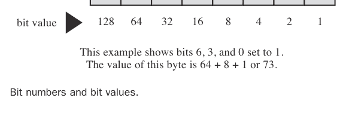

图 15.1 位编号和位值。

这里，128 是 2 的 7 次方，依此类推。这个字节能容纳的最大数字是 11111111，所有位都设置为 1。这个二进制数的值如下：

```
128 + 64 + 32 + 16 + 8 + 4 + 2 + 1 = 255
```

最小的二进制数将是 00000000，即简单的 0。一个字节可以存储从 0 到 255 的数字，总共 256 个可能的值。或者，通过以不同的方式解释位模式，程序可以使用一个字节存储从 −128 到 +127 的数字，同样总共是 256 个值。例如，`unsigned char` 通常使用一个字节表示 0 到 255 的范围，而 `signed char` 通常使用一个字节表示 −128 到 +127 的范围。

### 有符号整数

有符号数的表示由硬件决定，而不是由 C 语言决定。也许表示有符号数最简单的方法是保留 1 位（例如高位）来表示符号。在 1 字节值中，这为数字本身留下了 7 位。在这种符号-数值表示法中，10000001 是 −1，00000001 是 1。那么总范围就是 −127 到 +127。

这种方法的一个缺点是它有两个零：+0 和 −0。这很令人困惑，并且对于仅仅一个值却使用了两种位模式。

二进制补码方法避免了这个问题，并且是当今最常用的系统。我们将讨论这种方法应用于 1 字节值的情况。在这种背景下，值 0 到 127 由最后 7 位表示，高位设置为 0。到目前为止，这与符号-数值方法相同。此外，如果高位是 1，则该值为负数。区别在于确定该负数的值。从 9 位模式 100000000（即二进制的 256）中减去负数的位模式，结果就是该值的绝对值。例如，假设位模式是 10000000。作为无符号字节，它是 128。作为有符号值，它是负数（位 7 是 1），其值为 100000000 − 10000000，即 10000000（128）。因此，这个数是 −128。（在符号-数值系统中，它将是 −0。）类似地，10000001 是 −127，11111111 是 −1。这种方法表示的范围是 −128 到 +127。


反转二进制补码二进制数的符号的最简单方法是反转每个位（将 0 转换为 1，将 1 转换为 0），然后加 1。因为 1 是 00000001，所以 −1 是 11111110 + 1，或 11111111，就像你之前看到的那样。

原码方法通过反转模式中的每个位来形成一个数的负数。例如，00000001 是 1，而 11111110 是 −1。这种方法也有一个 −0：11111111。它的范围（对于 1 字节值）为 −127 到 +127。

### 二进制浮点数

浮点数存储为两部分：二进制小数和二进制指数。让我们看看这是如何完成的。

### 二进制小数

普通分数 0.527 表示

```
5/10 + 2/100 + 7/1000
```

分母代表 10 的递增幂。在二进制小数中，你使用 2 的幂作为分母，因此二进制小数 .101 表示

```
1/2 + 0/4 + 1/8
```

用十进制表示为

```
0.50 + 0.00 + 0.125
```

或 0.625。

许多分数，例如 1/3，不能在十进制表示法中精确表示。同样，许多分数也不能在二进制表示法中精确表示。事实上，唯一可以精确表示的分数是 1/2 的幂的倍数的组合。因此，3/4 和 7/8 可以精确表示为二进制小数，但 1/3 和 2/5 不能。

### 浮点表示

要在计算机中表示浮点数，会预留一定数量的位（取决于系统）来保存二进制小数。额外的位保存指数。一般来说，数的实际值由二进制小数乘以 2 的指数次幂组成。将浮点数乘以例如 4，会使指数增加 2，而二进制小数保持不变。乘以不是 2 的幂的数会改变二进制小数，并在必要时改变指数。

### 其他数字基数

计算机工作者经常使用基于 8 和 16 的数字系统。因为 8 和 16 是 2 的幂，这些系统与计算机的二进制系统比十进制系统更密切相关。

### 八进制

*八进制* 指的是基数 8 系统。在此系统中，数中的不同位置代表 8 的幂。你使用 0 到 7 的数字。例如，八进制数 451（在 C 中写为 0451）表示：

```
4 x 8² + 5 x 8¹ + 1 x 8⁰ = 297 (base 10)
```

关于八进制的一个方便之处是，每个八进制数字对应三个二进制数字。表 15.1 显示了对应关系。这种对应关系使在两种系统之间转换变得简单。例如，八进制数 0377 在二进制中为 11111111。我们用 011 替换了 3，去掉了前导 0，然后用 111 替换了每个 7。唯一棘手的部分是，3 位八进制数在二进制形式中可能占用多达 9 位，因此大于 0377 的八进制值需要超过一个字节。请注意内部 0 不会被丢弃：0173 是 01 111 011，而不是 01 111 11。

表 15.1 八进制数字的二进制等价

| Octal Digit | Binary Equivalent |
|-------------|-------------------|
| 0 | 000 |
| 1 | 001 |
| 2 | 010 |
| 3 | 011 |
| 4 | 100 |
| 5 | 101 |
| 6 | 110 |
| 7 | 111 |

### 十六进制

*十六进制*（或 *hex*）指的是基数 16 系统。它使用 16 的幂和 0 到 15 的数字，但由于基数 10 没有单个数字来表示 10 到 15 的值，十六进制使用字母 A 到 F 用于此目的。例如，十六进制数 A3F（在 C 中写为 0xA3F）表示

```
10 x 16² + 3 x 16¹ + 15 x 16⁰ = 2623 (base 10)
```

因为 A 代表 10，F 代表 15。在 C 中，你可以使用小写或大写字母表示额外的十六进制数字。因此，你也可以将 2623 写为 0xa3f。

每个十六进制数字对应一个 4 位二进制数，因此两个十六进制数字恰好对应一个 8 位字节。第一个数字代表高 4 位，第二个数字代表最后 4 位。这使得十六进制成为表示字节值的自然选择。

表 15.2 显示了对应关系。例如，十六进制值 0xC2 翻译为 11000010。反过来，二进制值 11010101 可以视为 1101 0101，翻译为 0xD5。

### 表 15.2 十进制、十六进制和二进制等价

| Decimal Digit | Hexadecimal Digit | Binary Equivalent | Decimal Digit | Hexadecimal Digit | Binary Equivalent |
|---|---|---|---|---|---|
| 0 | 0 | 0000 | 8 | 8 | 1000 |
| 1 | 1 | 0001 | 9 | 9 | 1001 |
| 2 | 2 | 0010 | 10 | A | 1010 |
| 3 | 3 | 0011 | 11 | B | 1011 |
| 4 | 4 | 0100 | 12 | C | 1100 |
| 5 | 5 | 0101 | 13 | D | 1101 |
| 6 | 6 | 0110 | 14 | E | 1110 |
| 7 | 7 | 0111 | 15 | F | 1111 |

现在你已经了解了位和字节是什么，让我们来看看 C 能用它们做什么。C 有两种设施来帮助你操作位。第一种是一组六个按位运算符，它们作用于位。第二种是字段数据形式，它让你访问 int 中的位。以下讨论概述了这些 C 特性。

### C 的按位运算符

C 提供按位逻辑运算符和移位运算符。在下面的示例中，我们将以二进制表示法写出值，以便你可以看到位发生了什么变化。在实际程序中，你会使用整数变量或以通常形式编写的常量。例如，而不是 00011001，你会使用 25 或 031 或 0x19。对于我们的示例，我们将使用 8 位数，位编号为 7 到 0，从左到右。

### 按位逻辑运算符

四个按位逻辑运算符作用于整数类型数据，包括 char。它们被称为按位运算符，因为它们独立于左右位对每个位进行操作。不要将它们与常规逻辑运算符（&&、|| 和 !）混淆，后者对值整体进行操作。

### 原码，或按位取反：~

一元运算符 ~ 将每个 1 更改为 0，每个 0 更改为 1，如以下示例所示：

```
~(10011010)  // expression
(01100101)  // resulting value
```

假设 val 是一个无符号 char，被赋值为 2。在二进制中，2 是 00000010。那么 ~val 的值为 11111101，或 253。请注意，运算符不会改变 val 的值，就像 3 * val 不会改变 val 的值一样；val 仍然是 2，但它确实创建了一个新的值，可以在其他地方使用或赋值：

```
newval = ~val;
printf("%d", ~val);
```

如果你想将 val 的值更改为 ~val，使用这个简单的赋值：

```
val = ~val;
```

### 按位 AND：&

二进制运算符 & 通过对两个操作数进行逐位比较来生成新值。对于每个位位置，结果位只有在两个操作数中的对应位都为 1 时才为 1。（就真/假而言，结果只有在两个位操作数都为真时才为真。）因此，表达式

```
(10010011) & (0011101)  // expression
```

计算为以下值：

```
(00010001)          // resulting value
```

原因是只有位 4 和位 0 在两个操作数中都为 1。

C 还有一个组合的按位 AND 赋值运算符：&=。语句

```
val &= 0377;
```

产生的最终结果与以下相同：

```
val = val & 0377;
```

### 按位 OR：|

二进制运算符 | 通过对两个操作数进行逐位比较来生成新值。对于每个位位置，结果位如果两个操作数中的对应位中任一为 1，则为 1。（就真/假而言，结果如果一个或另一个位操作数为真，或两者都为真，则为真。）因此，表达式

```
(10010011) | (0011101)  // expression
```

计算为以下值：

```
(10111111)          // resulting value
```

原因是除位 6 外的所有位位置在其中一个操作数（或两者）中都具有值 1。

C 还有一个组合的按位 OR 赋值运算符：|=。语句

```
val |= 0377;
```

产生的最终结果与此相同：

```
val = val | 0377;
```

### 按位异或：^

二进制运算符 ^ 对两个操作数进行逐位比较。对于每个位位置，结果位如果两个操作数中的对应位中恰好一个为 1（但不是两者）则为 1。（就真/假而言，结果只有当一个或另一个位操作数为真——但不是两者——时才为真。）因此，表达式

```
(10010011) ^ (0011101) // expression
```

计算为以下值：

```
(10101110) // resulting value
```

请注意，因为位位置 0 在两个操作数中都为 1，所以结果 0 位的值为 0。

C 还有一个组合的按位 OR 赋值运算符：^=。语句

```
val ^= 0377;
```

产生的最终结果与此相同：

```
val = val ^ 0377;
```

### 用法：掩码

按位 AND 运算符通常与掩码一起使用。掩码是一个位模式，其中一些位设置为开（1），一些位设置为关（0）。为了了解为什么掩码被称为掩码，让我们看看当一个量与掩码通过 & 组合时会发生什么。例如，假设你定义符号常量 MASK 为 2（即二进制 00000010），只有位号 1 非零。那么语句

```
flags = flags & MASK;
```

将导致 flags 的所有位（除位 1 外）都设置为 0，因为任何位与 0 使用 & 运算符组合都会得到 0。位号 1 将保持不变。（如果该位为 1，1 & 1 为 1；如果该位为 0，0 & 1 为 0。）这个过程被称为“使用掩码”，因为掩码中的零隐藏了 flags 中对应的位。


你可以改用这个简写形式：

```
flags &= ~MASK;
```

### 用法：切换位

切换一个位意味着：如果它是开的就把它关掉，如果它是关的就把它打开。你可以使用按位异或（EXCLUSIVE OR）运算符来切换一个位。其原理是：如果 b 是一个位的值（1 或 0），那么当 b 为 1 时，1 ^ b 为 0；当 b 为 0 时，1 ^ b 为 1。另外，无论 b 的值如何，0 ^ b 均为 b。因此，如果用一个掩码通过 ^ 与一个值组合，那么掩码中与 1 对应的位会被切换，与 0 对应的位保持不变。要切换 flags 中的位 1，你可以采用以下任一方式：

```
flags = flags ^ MASK;
flags ^= MASK;
```

例如，假设 flags 为 00001111，MASK 为 10110110。表达式

```
flags ^ MASK
```

变为

```
(00001111) ^ (10110110)  // expression
```

并计算得到以下结果：

```
(10111001)          // resulting value
```

MASK 中所有设置为 1 的位都会导致 flags 中对应的位被切换。flags 中与 MASK 中 0 位对应的那些位则保持不变。

### 用法：检查位的值

你已经了解了如何改变位的值。现在假设你想检查某个位的值。例如，flags 的位 1 是否被设置为 1？你不应该简单地将 flags 与 MASK 进行比较：

```
if (flags == MASK)
    puts("Wow!");    /* doesn't work right */
```

即使 flags 中的位 1 被设置为 1，flags 中的其他位也可能会使这个比较不成立。相反，你必须先屏蔽 flags 中的其他位，以便只将 flags 的位 1 与 MASK 进行比较：

```
if ((flags & MASK) == MASK)
    puts("Wow!");
```

按位运算符的优先级低于 ==，因此需要加上括号把 flags & MASK 括起来。

为了避免边缘信息泄露，位掩码的宽度至少应与被掩码的值的宽度相同。

### 按位移位运算符

现在来看 C 语言的移位运算符。按位移位运算符将位向左或向右移动。同样，我们将明确写出二进制数来展示其原理。

### 左移：<<

左移运算符（<<）将左操作数的值的各位向左移动右操作数所指定的位数。空出的位置补 0，超出左操作数末端被移出的位则丢失。因此，在下面的示例中，每个位向左移动两位：

```
(10001010) << 2  // expression
(00101000)        // resulting value
```

该操作会产生一个新的位值，但不会改变其操作数。例如，假设 stonk 为 1，那么 stonk<<2 为 4，但 stonk 仍然是 1。你可以使用左移赋值运算符（<<=）来真正改变变量的值。该运算符将变量中的位向左移动右侧值所指定的位数。下面是一个示例：

```
int stonk = 1;
int onkoo;
onkoo = stonk << 2;  /* assigns 4 to onkoo */
stonk <<= 2;         /* changes stonk to 4 */
```

### 右移：>>

右移运算符（>>）将左操作数的值的各位向右移动右操作数所指定的位数。超出左操作数右端被移出的位则丢失。对于无符号类型，左端空出的位置补 0。对于有符号类型，结果取决于具体机器。空出的位置可能补 0，也可能用符号位（最左端位）的副本填充：

```
(10001010) >> 2  // expression, signed value
(00100010)        // resulting value, some systems
(10001010) >> 2  // expression, signed value
(11100010)        // resulting value, other systems
```

对于一个无符号值，情况如下：

```
(10001010) >> 2  // expression, unsigned value
(00100010)        // resulting value, all system
```

每个位向右移动两位，空出的位置补 0。

右移赋值运算符（>>=）将左侧变量中的位向右移动所指定的位数，如下所示：

```
int sweet = 16;
int ooosw;
```

```
ooosw = sweet >> 3;  // ooosw = 2, sweet still 16
sweet >>=3;          // sweet changed to 2
```

### 用法：按位移位运算符

按位移位运算符可以提供快速、高效（取决于硬件）的 2 的幂次乘法和除法：

| number << n | 将 number 乘以 2 的 n 次方 |
| number >> n | 如果 number 不为负，则将 number 除以 2 的 n 次方 |

这些移位操作类似于十进制系统中移动小数点以乘以或除以 10 的做法。

移位运算符还可以用于从较大的数据单元中提取位组。例如，假设你使用一个 unsigned long 值来表示颜色值，其中低字节存储红色强度，下一个字节存储绿色强度，第三个字节存储蓝色强度。假设你随后想把每种颜色的强度存储到各自的 unsigned char 变量中，那么你可以这样做：

```
#define BYTE_MASK 0xff
unsigned long color = 0x002a162f;
unsigned char blue, green, red;
red = color & BYTE_MASK;
green = (color >> 8) & BYTE_MASK;
blue = (color >> 16) & BYTE_MASK;
```

这段代码使用右移运算符将 8 位的颜色值移动到低字节，然后使用掩码技术将低字节赋值给所需的变量。

### 编程示例

在第 9 章“函数”中，我们使用递归编写了一个将数字转换为二进制表示的程序。现在我们用按位运算符来解决同样的问题。程序清单 15.1 中的程序从键盘读取一个整数，并将其和一个字符串地址传递给名为 itobs() 的函数（当然，即 integer-to-binary string，整数转二进制字符串）。该函数随后使用按位运算符来确定正确的 1 和 0 模式，并放入字符串中。

### 程序清单 15.1 binbit.c 程序

```
/* binbit.c -- using bit operations to display binary */
#include <stdio.h>
#include <limits.h> // for CHAR_BIT, # of bits per char
char * itobs(int, char *);
void show_bstr(const char *);

int main(void)
{
    char bin_str[CHAR_BIT * sizeof(int) + 1];
    int number;

    puts("Enter integers and see them in binary.");
    puts("Non-numeric input terminates program.");
    while (scanf("%d", &number) == 1)
    {
        itobs(number,bin_str);
        printf("%d is ", number);
        show_bstr(bin_str);
        putchar('\n');
    }
    puts("Bye!");

    return 0;
}

char * itobs(int n, char * ps)
{
    int i;
    const static int size = CHAR_BIT * sizeof(int);

    for (i = size - 1; i >= 0; i--, n >>= 1)
        ps[i] = (01 & n) + '0'; // assume ASCII or similar
    ps[size] = '\0';

    return ps;
}

/* show binary string in blocks of 4 */
void show_bstr(const char * str)
{
    int i = 0;

    while (str[i]) /* not the null character */
    {
        putchar(str[i]);
```

```
if(++i % 4 == 0 && str[i])
    putchar(' ');
}
}
```

程序清单 15.1 使用了 limits.h 中的 CHAR_BIT 宏。该宏表示 char 中的位数。sizeof 运算符返回以 char 为单位的大小，因此表达式 CHAR_BIT * sizeof(int) 就是 int 中的位数。bin_str 数组有那么多元素，再加 1 用于存放终止的空字符。

itobs() 函数返回传入它的同一个地址，因此你可以将该函数用作，比如说，printf() 的参数。初次进入 for 循环时，函数计算表达式 01 & n。01 是一个掩码的八进制表示，除第 0 位外其余各位均设置为 0。因此，01 & n 就是 n 中最后一位的值。这个值是 0 或 1，但对于数组来说，你需要的是字符 '0' 或字符 '1'。加上 '0' 的编码即可完成这种转换。（这里假设数字是按顺序编码的，如在 ASCII 中那样。）结果被放在数组的倒数第二个元素中。（最后一个元素保留给空字符。）

顺便说一下，你也可以用 1 & n 代替 01 & n。使用八进制 1 而不是十进制 1 只是让气氛更有点计算机韵味。从这个角度看，也许 0x1 & n 甚至更好。

然后循环执行语句 i-- 和 n >>= 1。第一条语句将数组索引前移一个元素，第二条语句将 n 中的位向右移动一位。于是，下一次循环时，代码就会找到新的最右端位的值。相应的数字字符随即被放在最后一个数字之前的元素中。这样，函数就从右到左填充数组。

你可以使用 printf() 或 puts() 来显示结果字符串，但程序清单 15.1 定义了 show_bstr() 函数，它把位分成每 4 位一组，以便于阅读。

下面是一个示例运行：

```
Enter integers and see them in binary.
Non-numeric input terminates program.
7
7 is 0000 0000 0000 0000 0000 0000 0000 0111
2013
2013 is 0000 0000 0000 0000 0000 0111 1101 1101
-1
-1 is 1111 1111 1111 1111 1111 1111 1111 1111
32123
32123 is 0000 0000 0000 0000 0111 1101 0111 1011
q
Bye!
```


### 另一个示例

让我们再通过一个示例来说明。这次的目标是编写一个函数，该函数反转值中最后 n 位的值，其中 n 和该值都是函数参数。

~ 运算符会反转位，但它会反转字节中的所有位，而不仅仅是其中几个。然而，^ 运算符（异或），正如你所见，可以用来切换单个位。假设你创建一个掩码，其最后 n 位设为 1，其余位设为 0。然后将该掩码与一个值应用 ^ 操作，就会切换或反转最后 n 位，而其他位保持不变。这就是这里采用的方法：

```
int invert_end(int num, int bits)
{
    int mask = 0;
    int bitval = 1;

    while (bits-- > 0)
    {
        mask |= bitval;
        bitval <<= 1;
    }
    return num ^ mask;
}
```

while 循环创建掩码。最初，mask 的所有位都设为 0。第一次通过循环时，将位 0 设为 1，然后将 bitval 的值增加到 2；也就是说，将位 0 设为 0 并将位 1 设为 1。接下来一次循环则将 mask 的位 1 设为 1，以此类推。最后，num ^ mask 操作会产生期望的结果。

要测试该函数，可以将其插入前面的程序中，如第 15.2 节清单所示。

### 清单 15.2 invert4.c 程序

```
/* invert4.c -- using bit operations to display binary */
#include <stdio.h>
#include <limits.h>
char * itobs(int, char *);
void show_bstr(const char *);
int invert_end(int num, int bits);

int main(void)
{
    char bin_str[CHAR_BIT * sizeof(int) + 1];

    int number;

    puts("Enter integers and see them in binary.");
    puts("Non-numeric input terminates program.");
    
while (scanf("%d", &number) == 1)
{
	itobs(number,bin_str);
	printf("%d is\n", number);
	show_bstr(bin_str);
	putchar('\n');
	number = invert_end(number, 4);
	printf("Inverting the last 4 bits gives\n");
	show_bstr(itobs(number,bin_str));
	putchar('\n');
}
puts("Bye!");

return 0;
}

char *itobs(int n, char *ps)
{
	int i;
	const static int size = CHAR_BIT * sizeof(int);
	for (i = size - 1; i >= 0; i--, n >>= 1)
		ps[i] = (01 & n) + '0';
	ps[size] = '\0';
	return ps;
}

/* show binary string in blocks of 4 */
void show_bstr(const char * str)
{
	int i = 0;
	while (str[i]) /* not the null character */
	{
		putchar(str[i]);
		if(++i % 4 == 0 && str[i])
			putchar(' ');
	}
}

int invert_end(int num, int bits)
{
	int mask = 0;
	int bitval = 1;
	while (bits-- > 0)
	{
		mask = (mask << 1) | 1;
		num = (num & ~mask) | (bitval & mask);
		bitval <<= 1;
	}
	return num;
}
```

下面是一个示例运行：

```
Enter integers and see them in binary.
Non-numeric input terminates program.
7
7 is
0000 0000 0000 0000 0000 0000 0000 0111
Inverting the last 4 bits gives
0000 0000 0000 0000 0000 0000 0000 1000
12541
12541 is
0000 0000 0000 0000 0011 0000 1111 1101
Inverting the last 4 bits gives
0000 0000 0000 0000 0011 0000 1111 0010
q
Bye!
```

### 位字段

操作位的第二种方法是使用位字段，它只是在有符号 int 或无符号 int 内的若干相邻位。 （C99 和 C11 还允许类型 _Bool 位字段。）位字段通过结构声明来设置，其中每个字段都被标记并确定其宽度。例如，以下声明设置了四个 1 位字段：

```
struct {
    unsigned int autfd  : 1;
    unsigned int bldfc  : 1;
    unsigned int undln  : 1;
    unsigned int itals  : 1;
} prnt;
```

此定义使 prnt 包含四个 1 位字段。现在你可以使用通常的结构成员运算符为各个字段赋值：

```
prnt.itals = 0;
prnt.undln = 1;
```

由于这些特定字段每个只有 1 位，因此你只能使用 1 和 0 进行赋值。变量 prnt 存储在一个 int 大小的内存单元中，但在该示例中只使用了 4 位。

带位字段的结构提供了一种方便的方式来跟踪设置。许多设置，例如字体的粗体和斜体，只需指定两种选择之一，例如开或关，是或否，或真或假。当你只需要一个位时，就没有必要使用一个完整的变量。带位字段的结构允许你在一个单元中存储多个设置。

有时设置的选择不止两种，因此需要一个以上的位来表示所有选择。这不是问题，因为字段的尺寸不限于 1 位。你也可以这样做：

```
struct {
    unsigned int code1 : 2;
    unsigned int code2 : 2;
    unsigned int code3 : 8;
} prcode;
```

此代码创建了两个 2 位字段和一个 8 位字段。现在你可以进行如下赋值：

```
prcode.code1 = 0;
prcode.code2 = 3;
prcode.code3 = 102;
```

只要确保值不超过字段的容量即可。

如果声明的总位数超过无符号 int 的大小，则会使用下一个无符号 int 存储位置。单个字段不允许跨越两个无符号 int 之间的边界。编译器会自动移动重叠的字段定义，使字段与无符号 int 边界对齐。当这种情况发生时，它会在第一个无符号 int 中留下未命名的空洞。

你可以通过使用未命名的字段宽度来“填充”字段结构。使用 0 的未命名字段宽度会强制下一个字段与下一个整数对齐：

```
struct {
    unsigned int field1 : 1;
    unsigned int      : 2;
    unsigned int field2 : 1;
    unsigned int      : 0;
    unsigned int field3 : 1;
} stuff;
```

这里，stuff.field1 和 stuff.field2 之间有一个 2 位的间隙，而 stuff.field3 存储在下一个 int 中。

一个重要的机器依赖性是字段放置到 int 中的顺序。在某些机器上，顺序是从左到右；在其他机器上，则是从右到左。此外，机器在字段边界的位置上也存在差异。由于这些原因，位字段往往不是很可移植。通常情况下，它们用于不可移植的目的，例如将数据以特定硬件设备使用的确切形式放置。

### 位字段示例

通常位字段被用作存储数据的更紧凑方式。假设，例如，你决定表示屏幕上一个框的属性。让我们保持图形简单，假设该框具有以下属性：

- 框是不透明的或透明的。
- 填充颜色从以下调色板中选择：黑色、红色、绿色、黄色、蓝色、洋红、青色或白色。
- 边框可以显示或隐藏。
- 边框颜色从与填充颜色相同的调色板中选择。
- 边框可以使用三种线型之一——实线、点线或虚线。

你可以使用单独的变量或完整大小的结构成员为每个属性提供值，但这有点浪费位。例如，你只需要一个位来指示框是不透明还是透明，只需要一个位来指示边框是否显示或隐藏。八种可能的颜色值可以用 3 位单元的八种可能值来表示，而 2 位单元足以表示三种可能的边框样式。总共 10 位就足以表示所有五个属性的可能设置。

信息的可能表示之一是使用填充将填充相关信息放在一个字节中，将边框相关信息放在第二个字节中。struct box_props 声明就是这样做的：

```
struct box_props {
    bool opaque           : 1;
    unsigned int fill_color : 3;
    unsigned int           : 4;
    bool show_border       : 1;
    unsigned int border_color : 3;
    unsigned int border_style : 2;
    unsigned int           : 2;
};
```

填充使结构达到 16 位。没有填充，结构将为 10 位。请记住，C 使用 unsigned int 作为带位字段的结构的基本布局单元。因此，即使结构的唯一成员是一个单个 1 位字段，该结构的大小也与 unsigned int 相同，在我们的系统上为 32 位。此外，此编码假设 C99 _Bool 类型可用，并在 stdbool.h 中别名为 bool。


你可以为opaque成员使用值1来表示方框不透明，使用值0表示透明。对于show_border成员也可以这样做。对于颜色，你可以使用简单的RGB（红-绿-蓝）表示。这些是混合光的原色。显示器通过混合红色、绿色和蓝色像素来再现不同的颜色。在计算机彩色显示的早期，每个像素要么开要么关，因此你可以用一位来表示三种二进制颜色中每一种的强度。通常的顺序是左边一位表示蓝色强度，中间一位表示绿色强度，右边一位表示红色强度。表15.3显示了八种可能的组合。它们可以用作fill_color和border_color成员的值。最后，你可以选择用0、1、2分别表示实线、点线和虚线样式；它们可以用作border_style成员的值。

**表15.3 简单颜色表示**

| 位模式 | 十进制 | 颜色 |
|---|---|---|
| 000 | 0 | 黑色 |
| 001 | 1 | 红色 |
| 010 | 2 | 绿色 |
| 011 | 3 | 黄色 |
| 100 | 4 | 蓝色 |
| 101 | 5 | 品红色 |
| 110 | 6 | 青色 |
| 111 | 7 | 白色 |

程序清单15.3在简单示例中使用了box_props结构。它使用#define为可能的成员值创建符号常量。注意，原色由单个位为1来表示。其他颜色可以由原色的组合来表示。例如，品红色由蓝色位和红色位同时为1组成，因此可以用组合BLUE | RED来表示。

**程序清单15.3 fields.c程序**

```c
/* fields.c -- define and use fields */
#include <stdio.h>
#include <stdbool.h>   // C99, defines bool, true, false

/* line styles */
#define SOLID  0
#define DOTTED 1
#define DASHED 2
/* primary colors */
#define BLUE   4
#define GREEN 2
#define RED 1
/* mixed colors */
#define BLACK 0
#define YELLOW (RED | GREEN)
#define MAGENTA (RED | BLUE)
#define CYAN (GREEN | BLUE)
#define WHITE (RED | GREEN | BLUE)

const char * colors[8] = {"black", "red", "green", "yellow",
"blue", "magenta", "cyan", "white"};

struct box_props {
    bool opaque : 1; // or unsigned int (pre C99)
    unsigned int fill_color : 4;
    unsigned int show_border : 1; // or unsigned int (pre C99)
    unsigned int border_color : 3;
    unsigned int border_style : 2;
    unsigned int : 2;
};

void show_settings(const struct box_props * pb);

int main(void)
{
    /* create and initialize box_props structure */
    struct box_props box = {true, YELLOW, true, GREEN, DASHED};
    printf("Original box settings:\n");
    show_settings(&box);
    box.opaque = false;
    box.fill_color = WHITE;
    box.border_color = MAGENTA;
    box.border_style = SOLID;
    printf("\nModified box settings:\n");
    show_settings(&box);
    return 0;
}

void show_settings(const struct box_props * pb)
{
    printf("Box is %s.\n",
    pb->opaque == true ? "opaque" : "transparent");
    printf("The fill color is %s.\n", colors[pb->fill_color]);
    printf("Border %s.\n", pb->show_border == true ? "shown" : "not shown");
    printf("The border color is %s.\n", colors[pb->border_color]);
    printf("The border style is ");
    switch(pb->border_style)
    {
        case SOLID  : printf("solid.\n"); break;
        case DOTTED : printf("dotted.\n"); break;
        case DASHED : printf("dashed.\n"); break;
        default     : printf("unknown type.\n");
    }
}
```

下面是输出：

```text
Original box settings:
Box is opaque.
The fill color is yellow.
Border shown.
The border color is green.
The border style is dashed.
```

```text
Modified box settings:
Box is transparent.
The fill color is white.
Border shown.
The border color is magenta.
The border style is solid.
```

有几点需要注意。首先，你可以使用与普通结构相同的语法来初始化位字段结构：

```c
struct box_props box = {true, YELLOW, true, GREEN, DASHED};
```

类似地，你可以给位字段成员赋值：

```c
box.fill_color = WHITE;
```

此外，你可以将位字段成员用作switch语句的值表达式。你甚至可以将位字段成员用作数组索引：

```c
printf("The fill color is %s.\n", colors[pb->fill_color]);
```

注意，colors数组的定义方式是，每个索引值对应于一个字符串，该字符串代表以该索引值为其数值颜色值的颜色名称。例如，索引1对应字符串"red"，而符号常量red的值为1。

### 位字段与按位运算符

位字段和按位运算符是解决同一类编程问题的两种可选方法。也就是说，通常你可以使用其中任何一种方法。例如，前面的示例使用了一个与unsigned int大小相同的结构来保存图形框的信息。相反，你可以使用一个unsigned int变量来保存相同的信息。然后，你可以使用按位运算符来访问不同部分，而不是使用结构成员表示法。通常，这样做会更麻烦一些。让我们看一个同时采用这两种方法的示例，以说明它们之间的差异，而不是建议同时采用两种方法是个好主意！

你可以使用联合作为将结构方法与按位方法结合起来的手段。给定现有的struct box_props类型声明，你可以声明以下联合：

```c
union Views /* look at data as struct or as unsigned short */
{
    struct box_props st_view;
    unsigned short us_view;
};
```

在某些系统上，unsigned int和box_props结构都占用16位内存。在其他系统上，例如我们的系统，unsigned int和box_props是32位。无论哪种情况，使用这个联合，你可以使用st_view成员将该内存视为结构，或者使用us_view成员将同一块内存视为unsigned short。结构的哪些位字段对应于unsigned short中的哪些位？这取决于实现和硬件。下面的示例假设结构从字节的低位端到高位端加载到内存中。也就是说，结构中的第一个位字段进入字的位0。（为简单起见，图15.3用16位单元说明了这一概念。）

程序清单15.4使用Views联合来比较位字段方法和按位方法。其中，box是一个Views联合，因此box.st_view是使用位字段的box_props结构，而box.us_view是将相同数据视为unsigned short的视图。回想一下，联合可以初始化其第一个成员，因此初始化值与结构视图匹配。程序使用基于结构视图的函数以及基于unsigned short视图的函数来显示框属性。两种方法都可以访问数据，但技术不同。程序还使用本章前面定义的itobs()函数将数据显示为二进制字符串，以便你可以看到哪些位为1，哪些位为0。

```text
box.us_view
the box union seen as an integer
bit 15
bit 0

box.st_view
the box union seen as a structure
num_prtrs
gameio
num_comcds
num_drives
vid_setup
mother_bd
has_drive
```

**图15.3 联合作为整数和结构。**

**程序清单15.4 dualview.c程序**

```c
/* dualview.c -- bit fields and bitwise operators */
#include <stdio.h>
#include <stdbool.h>
#include <limits.h>
/* BIT-FIELD CONSTANTS */
/* line styles */
#define SOLID 0
#define DOTTED 1
#define DASHED 2
/* primary colors */
#define BLUE 4
#define GREEN 2
#define RED 1
/* mixed colors */
#define BLACK 0
#define YELLOW (RED | GREEN)
#define MAGENTA (RED | BLUE)
#define CYAN (GREEN | BLUE)
#define WHITE (RED | GREEN | BLUE)

/* BITWISE CONSTANTS */
#define OPAQUE 0x1
#define FILL_BLUE 0x8
#define FILL_GREEN 0x4
#define FILL_RED 0x2
#define FILL_MASK    0xE
#define BORDER       0x100
#define BORDER_BLUE  0x800
#define BORDER_GREEN 0x400
#define BORDER_RED   0x200
#define BORDER_MASK  0xE00
#define B_SOLID      0
#define B_DOTTED     0x1000
#define B_DASHED     0x2000
#define STYLE_MASK   0x3000

const char * colors[8] = {"black", "red", "green", "yellow",
    "blue", "magenta", "cyan", "white"};
struct box_props {
    bool opaque           : 1;
    unsigned int fill_color : 3;
    unsigned int           : 4;
    bool show_border      : 1;
    unsigned int border_color : 3;
    unsigned int border_style : 2;
    unsigned int           : 2;
};

union Views    /* look at data as struct or as unsigned short */
{
    struct box_props st_view;
    unsigned short us_view;
};

void show_settings(const struct box_props * pb);
void show_settings1(unsigned short);
char * itobs(int n, char * ps);

int main(void)
{
    /* create Views object, initialize struct box view */
    union Views box = {{true, YELLOW, true, GREEN, DASHED}};
    char bin_str[8 * sizeof(unsigned int) + 1];

    printf("Original box settings:\n");
    show_settings(&box.st_view);
    printf("\nBox settings using unsigned int view:\n");
    show_settings1(box.us_view);

    printf("bits are %s\n",
        itobs(box.us_view, bin_str));
    box.us_view &= ~FILL_MASK;      /* clear fill bits */
```


```
box.us_view |= (FILL_BLUE | FILL_GREEN); /* reset fill */
box.us_view ^= OPAQUE;                 /* toggle opacity */
box.us_view |= BORDER_RED;            /* wrong approach */
box.us_view &= ~STYLE_MASK;           /* clear style bits */
box.us_view |= B_DOTTED;              /* set style to dotted */
printf("\nModified box settings:\n");
show_settings(&box.st_view);
printf("\nBox settings using unsigned int view:\n");
show_settings1(box.us_view);
printf("bits are %s\n", itobs(box.us_view,bin_str));

return 0;
}

void show_settings(const struct box_props * pb)
{
    printf("Box is %s.\n", pb->opaque == true ? "opaque": "transparent");
    printf("The fill color is %s.\n", colors[pb->fill_color]);
    printf("Border %s.\n", pb->show_border == true ? "shown" : "not shown");
    printf("The border color is %s.\n", colors[pb->border_color]);
    printf ("The border style is ");
    switch(pb->border_style)
    {
        case SOLID  : printf("solid.\n"); break;
        case DOTTED : printf("dotted.\n"); break;
        case DASHED : printf("dashed.\n"); break;
        default     : printf("unknown type.\n");
    }
}

void show_settings1(unsigned short us)
{
    printf("box is %s.\n", (us & OPAQUE) == OPAQUE? "opaque": "transparent");
    printf("The fill color is %s.\n", colors[(us >> 1) & 07]);
    printf("Border %s.\n", (us & BORDER) == BORDER? "shown" : "not shown");
    printf ("The border style is ");
    switch(us & STYLE_MASK)
    {
        case B_SOLID  : printf("solid.\n"); break;
        case B_DOTTED : printf("dotted.\n"); break;
        case B_DASHED : printf("dashed.\n"); break;
default : printf("unknown type.\n");
}
printf("The border color is %s.\n", colors[(us >> 9) & 07]);
}

char * itobs(int n, char * ps)
{
    int i;
    const static int size = CHAR_BIT * sizeof(int);

    for (i = size - 1; i >= 0; i--, n >>= 1)
        ps[i] = (01 & n) + '0';
    ps[size] = '\0';

    return ps;
}
```

以下是输出：

Original box settings:
Box is opaque.
The fill color is yellow.
Border shown.
The border color is green.
The border style is dashed.

Box settings using unsigned int view:
box is opaque.
The fill color is yellow.
Border shown.
The border style is dashed.
The border color is green.
bits are 00000000000000001001010000111

Modified box settings:
Box is transparent.
The fill color is cyan.
Border shown.
The border color is yellow.
The border style is dotted.

Box settings using unsigned int view:
box is transparent.
The fill color is cyan.
Border not shown.

The border style is dotted.
The border color is yellow.
bits are 0000000000000000001011100001100

有几个要点需要讨论。位域和按位视图之间的一个区别是，按位视图需要位置信息。例如，我们使用 BLUE 来表示蓝色颜色。该常量具有数值 4。但由于数据在结构中的排列方式，实际保存填充颜色蓝色设置的位是位 3（记住编号从 0 开始——参见图 15.1），而保存边框颜色蓝色设置的位是位 11。因此，程序定义了一些新的常量：

```
#define FILL_BLUE    0x8
#define BORDER_BLUE   0x800
```

这里，0x8 是仅位 3 置为 1 时的值，0x800 是仅位 11 置为 1 时的值。你可以使用第一个常量来设置填充颜色的蓝色位，使用第二个常量来设置边框颜色的蓝色位。使用十六进制表示法更容易看出涉及哪些位。回想一下，每个十六进制数字代表四位。因此，0x800 与 0x8 具有相同的位模式，只是后面加上了八个 0 位。这种关系用 2048 和 8，即十进制等价物，就远不那么明显。

如果值是 2 的幂，可以使用左移运算符来提供值。例如，你可以用以下内容替换最后的 #define 语句：

```
#define FILL_BLUE    1<<3
#define BORDER_BLUE   1<<11
```

这里，第二操作数是与 2 配合使用的幂。即，0x8 是 2³，0x800 是 2¹¹。等价地，表达式 1<<n 是整数中仅第 n 位设为 1 的值。像 1<<11 这样的表达式是常量表达式，并在编译时求值。

你可以使用枚举而不是 #define 来创建符号常量。例如，可以这样做：

```
enum { OPAQUE = 0x1, FILL_BLUE = 0x8, FILL_GREEN = 0x4, FILL_RED = 0x2,
    FILL_MASK = 0xE, BORDER = 0x100, BORDER_BLUE = 0x800,
    BORDER_GREEN = 0x400, BORDER_RED = 0x200, BORDER_MASK = 0xE00,
    B_DOTTED = 0x1000, B_DASHED = 0x2000, STYLE_MASK = 0x3000};
```

如果你不打算创建枚举变量，就不需要在声明中使用标签。

请注意，使用按位运算符更改设置会更复杂。例如，考虑将填充颜色设置为青色。仅仅打开蓝色位和绿色位是不够的：

```
box.us_view |= (FILL_BLUE | FILL_GREEN); /* reset fill */
```

问题在于颜色还取决于红色位的设置。如果该位已经设置（对于黄色颜色就是如此），此代码会保留红色位并设置蓝色和绿色位，导致颜色变为白色。解决此问题的最简单方法是先关闭所有颜色位，然后再设置新值。即程序使用以下代码：

```
box.us_view &= ~FILL_MASK;        /* clear fill bits */
box.us_view |= (FILL_BLUE | FILL_GREEN); /* reset fill */
```

为了展示如果不先清除相关位会发生什么，程序还执行了以下操作：

```
box.us_view |= BORDER_RED;        /* wrong approach */
```

由于 BORDER_GREEN 位已经设置，结果颜色为 BORDER_GREEN | BORDER_RED，换算为黄色。

在这种情况下，位域版本更简单：

```
box.st_view.fill_color = CYAN;    /*bit-field equivalent */
```

你不需要先清除位。此外，对于位域成员，你可以使用与填充相同的颜色值用于边框，但对于按位运算符方法，你需要使用不同的值（反映实际位位置的值）。

接下来，比较以下两个打印语句：

```
printf("The border color is %s.\n", colors[pb->border_color]);
printf("The border color is %s.\n", colors[(us >> 9) & 07]);
```

在第一个语句中，表达式 pb->border_color 的值在 0–7 范围内，因此可作为 colors 数组的索引。使用按位运算符获得相同信息更复杂。一种方法是使用 ui >> 9 将边框颜色位右移到值中的最右位置（位 0–2），然后将此值与掩码 07 结合，以便关闭除最右三个位之外的所有位。然后剩下的部分在 0–7 范围内，可作为 colors 数组的索引。

### Caution

位字段与位位置之间的对应关系取决于实现。例如，在旧的 Macintosh PowerPC 上运行清单 15.4 产生以下输出：

```
Original box settings:
Box is opaque.
The fill color is yellow.
Border shown.
The border color is green.
The border style is dashed.

Box settings using unsigned int view:
box is transparent.
The fill color is black.
Border not shown.
The border style is solid.
The border color is black.
```

```
bits are 1011000010101000000000000000000

Modified box settings:
Box is opaque.
The fill color is yellow.
Border shown.
The border color is green.
The border style is dashed.

Box settings using unsigned int view:
box is opaque.
The fill color is cyan.
Border shown.
The border style is dotted.
The border color is red.
bits are 1011000010101000001001000001101
```

代码更改了相同的位，但 Macintosh PowerPC 将结构加载到内存中的方式不同。特别是，它将第一个位字段加载到最高有效位而不是最低有效位。因此，结构表示最终位于前 16 位中（顺序与 PC 版本不同），而无符号整数表示最终位于后 16 位中。因此，清单 15.4 对位位置的假设对于 Macintosh 是不正确的，使用按位运算符更改不透明度和填充颜色设置会更改错误的位。

### Alignment Features (C11)

C11 的对齐功能更像是字节操作而不是位操作，但它们也体现了 C 关联硬件事项的能力。对齐在此上下文中是指对象在内存中的定位方式。例如，为了最高效率，系统可能要求类型为 double 的值存储在能被四整除的内存地址上，但允许 char 存储在任何地址。对大多数程序员来说大多数时间，对齐不是问题。但某些情况可能受益于对齐控制，例如从一个硬件位置向另一个硬件位置传输数据或调用同时操作多个数据项的指令。

_Alignof 运算符给出类型的对齐要求。它通过在 _Alignof 关键字后跟带括号的类型来使用：

```
size_t d_align = _Alignof(float);
```

d_align 的值例如为 4 表示 float 对象具有 4 的对齐要求。这意味着 4 是存储该类型值的连续地址之间的字节数。一般来说，对齐值应为非负的 2 的幂。更大


这里是一个示例输出：

```
char alignment:  1
double alignment:  8
&dx: 0x7fff5fbfb660
&ca: 0x7fff5fbfb65f
&cx: 0x7fff5fbfb65e
&dz: 0x7fff5fbfb650
&cb: 0x7fff5fbfb64f
&cz: 0x7fff5fbfb648
```

在我们的系统上，double 的对齐值为 8 意味着该类型与能被 8 整除的地址对齐。以 0 或 8 结尾的十六进制地址能被 8 整除，而两个 double 变量以及被赋予 double 对齐值的 char 变量 cz 就使用了这类地址。因为 char 的对齐值为 1，编译器可以为普通的 char 变量使用任意地址。

包含 stdalign.h 头文件后，你就可以使用 alignas 和 alignof 来使用 _Alignas 和 _Alignof。这与 C++ 关键字相匹配。

C11 还通过在 stdlib.h 库中添加一个新的内存分配函数，为分配的内存提供了对齐能力。其原型如下：

```
void *aligned_alloc(size_t alignment, size_t size);
```

第一个参数指定所需的对齐方式，第二个参数请求所需的字节数；它应是第一个参数的倍数。与其他内存分配函数一样，使用后需用 free() 释放内存。

## 关键概念

C 与大多数高级语言相比的一个特点是它能够访问整数中的单个位。这通常是与硬件设备和操作系统接口的关键。

C 有两种主要用于访问位的方式。一种是位运算符族，另一种是在结构体中创建位域的能力。

C11 增加了检查内存对齐要求并请求更严格要求的能力。

通常，但并非总是，使用这些特性的程序与特定的硬件平台或操作系统绑定，并不打算可移植。

## 总结

计算硬件与二进制数系统紧密相关，因为二进制数的 1 和 0 可用于表示计算机内存和寄存器中位的开和关状态。虽然 C 不允许你以二进制形式书写整数，但它确实识别相关的八进制和十六进制表示。就像每个二进制位代表 1 位，每个八进制数字代表 3 位，每个十六进制数字代表 4 位。这种关系使得将二进制数转换为八进制或十六进制形式相对简单。

C 提供了几种位运算符，因此称为位运算符，因为它们独立地对值中的每一位进行操作。按位取反运算符 (~) 反转其操作数中的每一位，将 1 转换为 0，反之亦然。按位 AND 运算符 (&) 从两个操作数形成一个值。值中的每一位如果两个操作数中对应的位都是 1 则设为 1；否则，位设为 0。按位 OR 运算符 (|) 也从两个操作数形成一个值。值中的每一位如果两个操作数中对应的位有一个或两个为 1 则设为 1；否则，位设为 0。按位异或运算符 (^) 作用类似，只是结果位仅在两个操作数中对应的位只有一个为 1 而另一个不为 1 时才设为 1。

C 还有左移 (<<) 和右移 (>>) 运算符。每个运算符都产生一个值，该值将位模式中的位向左或向右移动指定位数。对于左移运算符，空出的位设为 0。对于右移运算符，如果值是无符号的，则空出的位设为 0。右移运算符对有符号值的行为是实现定义的。

你可以在结构体中使用位域来寻址值中的单个位或一组位。细节是实现无关的。

你可以使用 _Alignas 对数据存储施加对齐要求。

这些位工具帮助 C 程序处理硬件相关事项，因此它们最常出现在实现相关的上下文中。

## 复习问题

你可以在附录 A “复习问题的答案” 中找到复习问题的答案。

- 1. 将以下十进制值转换为二进制：
- a. 3
- b. 13
- c. 59
- d. 119

2. 将以下二进制值转换为十进制、八进制和十六进制：
a. 00010101
b. 01010101
c. 01001100
d. 10011101

3. 求值以下表达式；假设每个值是 8 位：
a. -3
b. 3 & 6
c. 3 | 6
d. 1 | 6
e. 3 ^ 6
f. 7 >> 1
g. 7 << 2

4. 求值以下表达式；假设每个值是 8 位：
a. -0
b. -10
c. 2 & 4
d. 2 && 4
e. 2 | 4
f. 2 || 4
g. 5 << 3

5. 因为 ASCII 码仅使用最后 7 位，有时需要屏蔽其他位。适当的掩码在二进制中是什么？在十进制中？在八进制中？在十六进制中？

6. 在清单 15.2 中，你可以用

```
while (bits-- > 0)
{
    mask |= bitval;
    bitval <<= 1;
}
```

替换为
```
while (bits-- > 0)
{
    mask += bitval;
    bitval *= 2;
}
```

程序仍然可以工作。这是否意味着操作 *= 2 等价于 <<= 1？|= 和 += 呢？

7. a. Tinkerbell 计算机有一个硬件字节可以读入程序。该字节包含以下信息：

| 位(s) | 含义 |
| --- | --- |
| 0–1 | 1.4MB 软盘驱动器数量 |
| 2 | 未使用 |
| 3–4 | CD-ROM 驱动器数量 |
| 5 | 未使用 |
| 6–7 | 硬盘数量 |

像 IBM PC 一样，Tinkerbell 从右到左填充结构体位域。创建一个适合保存这些信息的位域模板。

b. Klinkerbell 是 Tinkerbell 的近似克隆，从左到右填充结构体。创建 Klinkerbell 对应的位域模板。

## 编程练习

- 1. 编写一个函数，将二进制字符串转换为数值值。也就是说，如果你有
- ```
char * pbin = "01001001";
```
- 你可以将 pbin 作为参数传递给函数，并让函数返回 int 值 25。

- 2. 编写一个程序，读取两个二进制字符串作为命令行参数并打印对每个数字应用 ~ 运算符的结果以及对该对应用 &, | 和 ^ 运算符的结果。以二进制字符串形式显示结果。 （如果没有可用的命令行环境，让程序交互式读取字符串。）

- 3. 编写一个函数，接受一个 int 参数并返回该参数中“开启”位的数量。在程序中测试该函数。

4. 编写一个函数，接受两个 int 参数：一个值和一个位位置。让函数在该特定位位置为 1 时返回 1，否则返回 0。在程序中测试该函数。

5. 编写一个函数，将无符号 int 的位向左旋转指定位数。例如，rotate_l(x,4) 将把 x 中的位向左移动四位，左端丢失的位将重新出现在右端。也就是说，高位移出的位被放在低位。在程序中测试该函数。

6. 设计一个位域结构体，保存以下信息：
Font ID: 0-255 范围内的数字
Font Size: 0-127 范围内的数字
Alignment: 0-2 范围内的数字，表示 Left、Center 和 Right 的选择
Bold: 关闭 (0) 或开启 (1)
Italic: 关闭 (0) 或开启 (1)
Underline: 关闭 (0) 或开启 (1)
在程序中使用此结构体显示字体参数并使用循环菜单让用户更改参数。例如，示例运行可能如下所示：

```
ID SIZE ALIGNMENT  B  I  U
1  12  left    off off off

f)change font   s)change size   a)change alignment
b)toggle bold   i)toggle italic u)toggle underline
q)quit
s
Enter font size (0-127): 36

ID SIZE ALIGNMENT  B  I  U
1  36  left    off off off

f)change font   s)change size   a)change alignment
b)toggle bold   i)toggle italic u)toggle underline
q)quit
a
Select alignment:
l)left   c)center   r)right
r

ID SIZE ALIGNMENT  B  I  U
1  36  right   off off off
```


f)change font  s)change size  a)change alignment
b)toggle bold  i)toggle italic  u)toggle underline
q)quit
i

ID SIZE ALIGNMENT  B  I  U
1  36  right  off  on  off

f)change font  s)change size  a)change alignment
b)toggle bold  i)toggle italic  u)toggle underline
q)quit
q
Bye!

程序应使用&运算符和合适的掩码，以确保ID和size条目被转换到指定范围内。

7. 编写一个与练习6中描述的行为相同的程序，但使用一个unsigned long变量来保存字体信息，并使用位运算符而不是位成员来管理该信息。

# C预处理器与C库

在本章中，你将学习以下内容：

+   - 预处理器指令：
+     `#define, #include, #ifdef`
+     `#else, #endif, #ifndef`
+     `#if, #elif, #line, #error, #pragma`
+   - 关键字：
+     `_Generic, _Noreturn, _Static_assert`
+   - 函数/宏：
+     `sqrt(), atan(), atan2()`
+     `exit(), atexit()`
+     `assert()`
+     `memcpy(), memmove()`
+     `va_start(), va_arg(), va_copy(), va_end()`
+   - C预处理器的更多功能
+   - 类函数宏与条件编译
+   - 泛型选择表达式
+   - 内联函数
+   - C库总体概述以及其中一些特别的实用函数

C语言本身建立在C关键字、表达式和语句以及使用它们的规则之上。然而，C标准不仅仅描述了C语言本身。它还描述了C预处理器应如何运作，确定了哪些函数构成标准C库，并详细说明了这些函数的工作方式。在本章中，我们将从预处理器开始，探讨C预处理器和C库。

预处理器在程序编译之前查看程序（因此称为“预处理器”）。按照你的预处理器指令，预处理器将程序中的符号缩写替换为它们所代表的指令。预处理器可以根据你的要求包含其他文件，它还可以选择编译器看到哪些代码。预处理器并不了解C。基本上，它接受一些文本并转换为其他文本。这种描述不足以体现它的真正用途和价值，所以让我们来看一些示例。你已经在前面遇到了一些#define和#include的示例。现在我们可以把所学的内容集中起来，并加以补充。

# 程序翻译的第一步

编译器在进入预处理之前，必须先让程序经历一些翻译阶段。编译器开始工作时，会将源代码中出现的字符映射到源字符集。这会处理多字节字符和三字符序列——这些字符扩展使C语言的外部形态更具国际化。（附录B“参考部分VII，扩展字符支持”对这些扩展进行了概述。）

其次，编译器定位每一个反斜杠后跟换行符的实例，并将它们删除。也就是说，两个物理行，例如

```
printf("That's wond\
erful!\n");
```

会被转换为一个逻辑行：

```
printf("That's wonderful!\n");
```

请注意，在这种语境下，“换行符”指的是按Enter键在源代码文件中开始新一行时产生的字符；它并不是指符号表示\n。

这个特性为预处理准备工作提供了便利，因为预处理表达式需要是一个逻辑行那么长，但这个逻辑行可以跨越多个物理行。

接下来，编译器将文本分解为一系列预处理记号，以及空白和注释的序列。（基本来说，记号是由空格、制表符或换行分隔开的组；本章稍后会更详细地讨论记号。）现在一个值得注意的点是，每个注释都会被替换为一个空格字符。因此，类似

```
int/* this doesn't look like a space*/fox;
```

会变成

```
int fox;
```

每个#define行（也就是逻辑行）都有三个部分。第一部分是#define指令本身。第二部分是你选择的缩写，称为宏。有些宏（如这些示例）表示值，它们被称为类对象宏。（C还有类函数宏，我们稍后会讲到。）宏名中不能有空格，并且必须符合C变量遵循的命名规则：只能使用字母、数字和下划线（_）字符，且第一个字符不能是数字。第三部分（该行的其余部分）称为替换列表或主体（见图16.1）。当预处理器在程序中发现你的某个宏时，它几乎总是用主体替换它。（只有一个例外，稍后我们会展示。）这种从宏到最终替换的过程称为宏展开。请注意，你可以在#define行上使用标准C注释；如前所述，在预处理器看到它之前，每个注释都会被替换为一个空格。

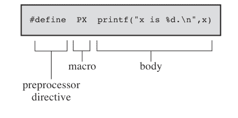

图16.1 类对象宏定义的各个部分。

让我们运行示例，看看它是如何工作的：

```
X is 2.
X is 4.
Consistency is the last refuge of the unimaginative. - Oscar Wilde
TWO: OW
```

事情是这样的。语句

```
int x = TWO;
```

变成

```
int x = 2;
```

因为已将2替换为TWO。然后语句

```
PX;
```

变成

```
printf("X is %d.\n", x);
```

因为进行了整体替换。这是一个新情况，因为到目前为止，我们只用宏来表示常量。在这里你会看到，宏可以表达任何字符串，甚至一个完整的C表达式。但请注意，这是一个常量字符串；%x只会打印名为x的变量。

下一行也代表了新的内容。你可能会认为FOUR被替换成了4，但实际过程是这样的：

```
x = FOUR;
```

变成

```
x = TWO*TWO;
```

然后又变成

```
x = 2*2;
```

宏展开过程到此结束。实际的乘法不是在预处理器工作时进行的，而是在编译期间进行的，因为C编译器会在编译时计算所有常量表达式（只包含常量的表达式）。预处理器不做任何计算；它只是非常字面地执行建议的替换。

请注意，宏定义可以包含其他宏。（有些编译器不支持这种嵌套特性。）

在下一行中，

```
printf (FMT, x);
```

变成

```
printf("X is %d.\n",x);
```

因为FMT被对应的字符串替换了。如果你有一个很长的控制字符串需要多次使用，这种方法会很方便。或者，你也可以这样做：

```
const char * fmt = "X is %d.\n";
```

然后你可以将fmt用作printf()的控制字符串。

在下一行中，OW被替换为相应的字符串。双引号使替换后的字符串成为字符串常量。编译器会将其存储在以空字符结尾的数组中。因此，

```
#define HAL 'Z'
```

定义了一个字符常量，而

```
#define HAP "Z"
```

定义了一个字符串：Z\0。

在示例中，我们在行末紧挨着使用了一个反斜杠，以将字符串延伸到下一行：

```
#define OW "Consistency is the last refuge of the unimagina\
tive. - Oscar Wilde"
```

请注意，第二行是左对齐的。相反，假设我们这样做：

```
#define OW "Consistency is the last refuge of the unimagina\
    tive. - Oscar Wilde"
```

那么输出将会是：

```
Consistency is the last refuge of the unimagina    tive. - Oscar Wilde
```

行首与tive之间的空格会计入字符串的一部分。

一般来说，无论预处理器在程序中的什么地方发现你的某个宏，它都会用相应的替换文本逐字替换。如果该字符串还包含宏，这些宏也会被替换。替换的一个例外是位于双引号内的宏。因此，

```
printf("TWO: OW");
```

会逐字打印TWO: OW，而不是打印

```
2: Consistency is the last refuge of the unimaginative. - Oscar Wilde
```

要打印最后这一行，你可以这样使用：

```
printf("%d: %s\n", TWO, OW);
```

在这里，宏位于双引号之外。

什么时候应该使用符号常量？对于大多数数值常量，你应该使用它们。如果某个数字是计算中使用的常量，符号名称会使它的含义更清晰。如果数字是数组大小，符号名称会使以后修改数组大小和循环限制更加容易。如果数字是系统代码，例如EOF，符号表示会使你的程序更具可移植性；只需更改一个EOF定义即可。便于记忆、易于修改、可移植性——这些特性都使符号常量很有价值。

确实，C现在支持的const关键字允许以更灵活的方式创建常量。使用const，你可以创建全局常量和局部常量、数值常量、数组常量和结构常量。另一方面，宏常量可以用来指定标准数组的大小，并作为const值的初始化值：

```
#define LIMIT 20
const int LIM = 50;
static int data1[LIMIT];    // valid
static int data2[LIM];      // not required to be valid
const int LIM2 = 2 * LIMIT; // valid
const int LIM3 = 2 * LIM;   // not required to be valid
```


我们来看一下那些“不要求有效”的注释。在C语言中，非自动数组的数组大小应当是一个整数常量表达式，即它是整数常量（如5）、枚举常量和sizeof表达式的组合。这不包括使用const声明的值。（这是C++与C的一个区别；在C++中，可以将const值用作常量表达式的一部分。）然而，实现可以接受其他形式的常量表达式。因此，例如，GCC 4.7.3不接受data2的声明，但Clang 4.6接受。

### 记号

从技术上讲，宏的主体被视为一串记号（token），而不是一串字符。C预处理器的记号是宏定义主体中相互独立的“单词”。它们之间用空白分隔。例如，定义

```
#define FOUR 2*2
```

只有一个记号——即序列2*2——但定义

```
#define SIX 2 * 3
```

包含三个记号：2、*和3。

字符串与记号串在对主体中多个空格的处理上有所不同。考虑以下定义：

```
#define EIGHT 4   *   8
```

将主体解释为字符串的预处理器会用4 * 8替换EIGHT。也就是说，多余的空格会成为替换文本的一部分，而将主体解释为记号的预处理器会用三个由单个空格分隔的记号——4 * 8——来替换EIGHT。换句话说，字符串解释将空格视为主体的一部分，而记号解释将空格视为主体记号之间的分隔符。实际上，有些C编译器将宏主体视为字符串而非记号。这种差异只对比我们这里尝试的用法更复杂的情况才具有实际重要性。

顺便说一句，C编译器对记号的看法比预处理器更复杂。编译器理解C的规则，不一定要求用空格分隔记号。例如，C编译器会将2*2视为三个记号，因为它能识别出每个2都是常量，而*是运算符。

### 重定义常量

假设你将LIMIT定义为20，然后稍后在同一个文件中又将其定义为25。这个过程称为重定义常量。不同的实现对于重定义策略有不同的做法。有些实现认为除非新定义与旧定义相同，否则就是错误。其他实现允许重定义，但可能会发出警告。ANSI标准采取第一种观点，仅当新定义与旧定义完全相同时才允许重定义。

定义相同意味着主体必须具有相同顺序的相同记号。因此，以下两个定义是一致的：

```
#define SIX 2 * 3
#define SIX 2      *      3
```

两者都有相同的三个记号，多余的空格不属于主体的一部分。下一个定义则被视为不同：

```
#define SIX 2*3
```

它只有一个记号，而不是三个，因此不匹配。如果你想重定义一个宏，可以使用#undef指令，我们稍后会讨论。

如果你确实需要重定义常量，使用const关键字和作用域规则可能更容易达到目的。

### 使用参数定义#define

通过使用参数，你可以创建*函数式宏*，它们的外观和行为都很像函数。带参数的宏看起来非常类似于函数，因为参数放在括号内。函数式宏定义在括号内有一个或多个参数，这些参数随后出现在替换部分，如图16.2所示。


图16.2 函数式宏定义的组成部分。

下面是一个示例定义：

```
#define SQUARE(X) X*X
```

它可以像这样在程序中使用：

```
z = SQUARE(2);
```

这看起来像函数调用，但它的行为不一定完全相同。程序清单16.2演示了如何使用这个宏以及另一个宏。其中一些示例还指出了可能的陷阱，因此请仔细阅读。

### 程序清单16.2 mac_arg.c程序

```
/* mac_arg.c -- macros with arguments */
#include <stdio.h>
#define SQUARE(X) X*X
#define PR(X)  printf("The result is %d.\n", X)
int main(void)
{
    int x = 5;
    int z;

    printf("x = %d\n", x);
    z = SQUARE(x);
    printf("Evaluating SQUARE(x): ");
    PR(z);
    z = SQUARE(2);
    printf("Evaluating SQUARE(2): ");
    PR(z);
    printf("Evaluating SQUARE(x+2): ");
    PR(SQUARE(x+2));
    printf("Evaluating 100/SQUARE(2): ");
    PR(100/SQUARE(2));
    printf("x is %d.\n", x);
    printf("Evaluating SQUARE(++x): ");
    PR(SQUARE(++x));
    printf("After incrementing, x is %x.\n", x);

    return 0;
}
```

SQUARE宏的定义如下：

```
#define SQUARE(X) X*X
```

在这里，SQUARE是宏标识符，SQUARE(x)中的x是宏参数，x*x是替换列表。在程序清单16.2中，凡是出现SQUARE(x)的地方，都会被替换为x*x。这与前面的示例不同，因为使用这个宏时，你可以自由使用除x以外的符号。宏定义中的x会被替换为程序中宏调用所用的符号。因此，SQUARE(2)被替换为2*2，所以x确实起到了参数的作用。

然而，你很快就会看到，宏参数的工作方式与函数参数并不完全相同。下面是运行该程序的结果。请注意，有些结果可能与你预期的不同。事实上，对于倒数第二行，你的编译器甚至可能不会给出与这里相同的结果：

```
x = 5
Evaluating SQUARE(x): The result is 25.
Evaluating SQUARE(2): The result is 4.
```

```
Evaluating SQUARE(x+2): The result is 17.
Evaluating 100/SQUARE(2): The result is 100.
x is 5.
Evaluating SQUARE(++x): The result is 42.
After incrementing, x is 7.
```

前两行是可以预料的，但接着你会看到一些奇怪的结果。回想一下，x的值是5。这可能会让你期望SQUARE(x+2)的结果是7*7，即49，但输出显示的是17，这是一个素数，当然不是一个平方数！这个误导性输出的简单原因就是我们已经指出的——预处理器不进行计算；它只是替换字符序列。无论定义中哪里出现x，预处理器都会替换为字符x+2。因此，

```
x*x
```

变成

```
x+2*x+2
```

唯一的乘法是2*x。如果x是5，这个表达式的值就是：

```
5+2*5+2 = 5 + 10 + 2 = 17
```

这个例子揭示了一个函数调用和宏调用之间的重要区别。函数调用在程序运行时将参数的值传递给函数。宏调用在编译前将参数记号传递给程序；这是在不同时间进行的不同过程。能否修正定义，使SQUARE(x+2)产生36？当然可以。你只需要更多的括号：

```
#define SQUARE(x)  (x)*(x)
```

现在SQUARE(x+2)变成(x+2)*(x+2)，由于括号在替换字符串中得以保留，你得到了所需的乘法。

然而，这并不能解决所有问题。考虑导致下一行输出的事件：

```
100/SQUARE(2)
```

变成

```
100/2*2
```

根据优先级规则，表达式从左到右求值：(100/2)*2 即 50*2 即 100。这种混乱可以通过如下定义SQUARE(x)来避免：

```
#define SQUARE(x)  (x*x)
```

这将产生100/(2*2)，最终计算结果为100/4，即25。

为了同时处理前面的两个示例，你需要这样的定义：

```
#define SQUARE(x)  ((x)*(x))
```

这里的教训是：使用尽可能多的括号，以确保运算和结合能够按照正确的顺序进行。

即使有这些预防措施，也无法避免最后一个示例的麻烦：

```
SQUARE(++x)
```

变成

```
++x*++x
```

并且x被递增两次，一次在乘法之前，一次在乘法之后：

```
++x*++x = 6*7 = 42
```

由于运算顺序未作规定，有些编译器会得到乘积7*6。而其他编译器可能在进行乘法前将两个项都递增，得到7*7，即49。实际上，对这个表达式的求值会导致标准所说的未定义行为。不过，在所有这些情况下，x从值5开始，最终变为7，尽管代码看起来只对x递增了一次。

这个问题最简单的解决办法是避免将++x用作宏参数。通常，不要将递增或递减运算符用于宏。请注意，++x作为函数参数是可以的，因为它会被求值为6，然后将值6传给函数。

### 从宏参数创建字符串：#运算符

下面是一个函数式宏：

```
#define PSQR(X) printf("The square of X is %d.\n", ((X)*(X)));
```

假设你这样使用这个宏：

```
PSQR(8);
```

下面是输出：

```
The square of X is 64.
```

请注意，引号字符串中的x被视为普通文本，而不是可以被替换的记号。

假设你确实想要在字符串中包含宏参数。C允许你这样做。在函数式宏的替换部分，符号#成为一个预处理运算符，它将记号转换为字符串。例如，假设x是一个宏参数，那么#x就是被转换为字符串“x”的参数名。这个过程称为字符串化。程序清单16.3演示了该过程的工作原理。


### 程序清单16.3 subst.c程序

```
/* subst.c -- substitute in string */
#include <stdio.h>
#define PSQR(x) printf("The square of " #x " is %d.\n",((x)*(x)))

int main(void)
{
    int y = 5;

    PSQR(y);
    PSQR(2 + 4);

    return 0;
}
```

下面是输出：

```
The square of y is 25.
The square of 2 + 4 is 36.
```

在第一次调用宏时，#x被替换为"y"，第二次调用时#x被替换为"2 + 4"。然后，ANSI C的字符串连接功能将这些字符串与printf()语句中的其他字符串组合，生成最终使用的字符串。例如，第一次调用变成这样：

```
printf("The square of " "y" " is %d.\n",((y)*(y)));
```

然后字符串连接将三个相邻的字符串转换为一个字符串：

```
"The square of y is %d.\n"
```

### 预处理器的粘合剂：##运算符

与#运算符一样，##运算符可以用于函数式宏的替换部分。此外，它还可以用于对象式宏的替换部分。##运算符将两个记号组合成一个记号。例如，你可以这样做：

```
#define XNAME(n) x ## n
```

那么宏

```
XNAME(4)
```

将展开为：

```
x4
```

程序清单16.4使用了这个宏和另一个使用##的宏来进行一些记号粘合。

### 程序清单16.4 glue.c程序

```
// glue.c -- use the ## operator
#include <stdio.h>
#define XNAME(n) x ## n
#define PRINT_XN(n) printf("x" #n " = %d\n", x ## n);

int main(void)
{
    int XNAME(1) = 14;  // becomes int x1 = 14;
    int XNAME(2) = 20;  // becomes int x2 = 20;
    int x3 = 30;
    PRINT_XN(1);        // becomes printf("x1 = %d\n", x1);
    PRINT_XN(2);        // becomes printf("x2 = %d\n", x2);
    PRINT_XN(3);        // becomes printf("x3 = %d\n", x3);
    return 0;
}
```

下面是输出：

```
x1 = 14
x2 = 20
x3 = 30
```

注意PRINT_XN()宏如何使用#运算符组合字符串，以及如何使用##运算符将记号组合成一个新的标识符。

### 可变参数宏：...和__VA_ARGS__

有些函数（如printf()）接受可变数量的参数。本章后面讨论的stdvar.h头文件提供了创建带有可变数量参数的用户自定义函数的工具。C99/C11对宏也做了同样的事情。虽然标准中没有使用，但“可变参数”（variadic）一词已经流行起来，用来表示这一功能。（然而，将“字符串化”和“可变参数”添加到C词汇中的过程，尚未导致将固定数量参数的函数或宏称为“固定参数函数”和“固定参数宏”。）

其思想是，宏定义参数列表中的最后一个参数可以是省略号（即三个句点）。如果是这样，预定义的宏__VA_ARGS__可以在替换部分使用，以指示省略号将被替换为什么。例如，考虑这个定义：

```
#define PR(...) printf(__VA_ARGS__)
```

假设你稍后像这样调用宏：

```
PR("Howdy");
PR("weight = %d, shipping = %$.2f\n", wt, sp);
```

对于第一次调用，__VA_ARGS__展开为一个参数：

```
"Howdy"
```

对于第二次调用，它展开为三个参数：

```
"weight = %d, shipping = %$.2f\n", wt, sp
```

因此，生成的代码如下：

```
printf("Howdy");
printf("weight = %d, shipping = %$.2f\n", wt, sp);
```

程序清单16.5展示了一个稍微复杂一点的例子，它使用了字符串连接和#运算符：

### 程序清单16.5 variadic.c程序

```
// variadic.c -- variadic macros
#include <stdio.h>
#include <math.h>
#define PR(X, ...) printf("Message " #X ": " __VA_ARGS__)

int main(void)
{
    double x = 48;
    double y;

    y = sqrt(x);
    PR(1, "x = %g\n", x);
    PR(2, "x = %.2f, y = %.4f\n", x, y);

    return 0;
}
```

在第一次宏调用中，x的值为1，所以#X变成"1"。这使得展开看起来像这样：

```
print("Message " "1" ": " "x = %g\n", x);
```

然后四个字符串被连接起来，将调用简化为：

```
print("Message 1: x = %g\n", x);
```

下面是输出：

```
Message 1: x = 48
Message 2: x = 48.00, y = 6.9282
```

别忘了，省略号必须是宏的最后一个参数：

```
#define WRONG(X, ..., Y) #X __VA_ARGS__ #Y // won’t work
```

假设你已经开发了一些喜欢的宏函数。每次编写新程序时都需要重新输入它们吗？如果你记得`#include`指令，就不需要。下一节将回顾该指令。

### 文件包含：`#include`

当预处理器遇到`#include`指令时，它会查找后面的文件名，并将该文件的内容包含到当前文件中。源代码文件中的`#include`指令会被替换为被包含文件的文本。就好像你在源文件的那个特定位置坐下来键入了被包含文件的全部内容一样。`#include`指令有两种形式：

```c
#include <stdio.h>        // Filename directive in angle brackets
#include "mystuff.h"      // Filename in double quotation marks
```

在Unix系统上，尖括号告诉预处理器在一个或多个标准系统目录中查找文件。双引号告诉它首先在当前目录（或你在文件名中指定的其他目录）中查找，然后在标准位置查找：

```c
#include <stdio.h>        // Searches system directories
#include "hot.h"           // Searches your current working directory
#include "/usr/biff/p.h"    // Searches the /usr/biff directory
```

集成开发环境（IDE）也有一个或多个系统头文件的标准位置。许多IDE提供菜单选项，用于指定使用尖括号时要搜索的其他位置。与Unix一样，使用双引号意味着首先搜索本地目录，但具体搜索哪个目录取决于编译器。有些搜索源代码所在的目录；有些搜索当前工作目录；还有些搜索项目文件所在的目录。

ANSI C并不要求遵循文件的目录模型，因为并非所有计算机系统都以类似方式组织。一般来说，命名文件的方法依赖于系统，但尖括号和双引号的使用方式不是。

为什么要包含文件？因为它们包含编译器需要的信息。例如，`stdio.h`文件通常包含`EOF`、`NULL`、`getchar()`和`putchar()`的定义。后两者被定义为宏函数。它还包含C I/O函数的函数原型。

`.h`后缀通常用于*头文件*——包含放在程序开头的信息的文件。头文件通常包含预处理器语句。有些头文件（如`stdio.h`）随系统提供，但你可以自由创建自己的头文件。

包含一个大的头文件不一定会增加程序的体积。头文件的内容大部分是编译器用来生成最终代码的信息，而不是要添加到最终代码中的材料。

### 头文件：一个示例

假设你开发了一个用于保存人名的结构体，并编写了一些使用该结构体的函数。你可以将各种声明收集到一个头文件中。程序清单16.6展示了这样一个例子。

### 程序清单16.6 names_st.h头文件

```
// names_st.h -- names_st structure header file
// constants
#include <string.h>
#define SLEN 32

// structure declarations
struct names_st
{
    char first[SLEN];
    char last[SLEN];
};

// typedefs
typedef struct names_st names;

// function prototypes
void get_names(names *);
void show_names(const names *);
char * s_gets(char * st, int n);
```

这个头文件包含了头文件中常见的许多内容：#define指令、结构体声明、typedef语句和函数原型。请注意，这些都不是可执行代码；相反，它们是编译器在创建可执行代码时使用的信息。

这个特定的头文件有点简单。通常，你应该使用#ifndef和#define来防止头文件被多次包含。我们稍后会回到这个技术。

可执行代码通常放在源代码文件中，而不是头文件中。例如，程序清单16.7展示了头文件中声明的那些函数的函数定义。它包含了头文件，以便编译器知道names类型。


### 程序清单16.7 name_st.c源文件

```
// names_st.c -- define names_st functions
#include <stdio.h>
#include "names_st.h"    // include the header file

// function definitions
void get_names(names * pn)
{
    printf("Please enter your first name: ");
    s_gets(pn->first, SLEN);

    printf("Please enter your last name: ");
    s_gets(pn->last, SLEN);
}

void show_names(const names * pn)
{
    printf("%s %s", pn->first, pn->last);
}

char * s_gets(char * st, int n)
{
    char * ret_val;
    char * find;

    ret_val = fgets(st, n, stdin);
    if (ret_val)
    {
        find = strchr(st, '\n');    // look for newline
        if (find)                   // if the address is not NULL,
            *find = '\0';           // place a null character there
        else
            while (getchar() != '\n')
                continue;           // dispose of rest of line
    }
    return ret_val;
}
```

get_names()函数使用fgets()（通过s_gets()）以免超出目标数组的范围。程序清单16.8是一个使用该头文件和源代码文件的程序示例。

### 程序清单16.8 useheader.c程序

```
// useheader.c -- use the names_st structure
#include <stdio.h>
#include "names_st.h"
```

类型定义——你可能还记得，标准I/O函数使用指向FILE的指针作为参数。通常，stdio.h使用#define或typedef使FILE表示指向结构的指针。类似地，size_t和time_t类型也是在头文件中定义的。

许多程序员会开发自己的标准头文件供程序使用。如果你开发了一组相关的函数和/或结构，这一点尤其有价值。

此外，你还可以使用头文件声明由多个文件共享的外部变量。例如，如果你开发了一组函数，它们共享一个用于报告某种状态（如错误条件）的变量，那么这样做是有意义的。在这种情况下，你可以在包含函数声明的源代码文件中定义一个具有文件作用域、外部链接的变量：

```
int status = 0;    // file scope, source code file
```

然后，在与源代码文件关联的头文件中，你可以放置一个引用声明：

```
extern int status;  // in header file
```

然后，该代码将出现在你包含此头文件的任何文件中，使该变量可供使用这组函数的文件使用。通过包含机制，此声明也会出现在函数源代码文件中，但只要声明类型一致，同一个文件中同时具有定义声明和引用声明也是可以的。

另一个适合放入头文件的是具有文件作用域、内部链接和const限定符的变量或数组。const部分可防止意外修改，static部分意味着每个包含该头文件的文件都有自己的常量副本，因此不会出现需要一个文件包含定义声明而其余文件包含引用声明的问题。

#include和#define指令是使用最频繁的C预处理器特性。我们将简要介绍其他指令。

### 其他指令

程序员可能需要准备能在各种环境中运行的C程序或C库包。代码类型的选择可能因环境而异。预处理器提供了几个指令，帮助程序员通过更改某些#define宏的值来生成可以从一个系统移植到另一个系统的代码。#undef指令取消先前的#define定义。#if、#ifdef、#ifndef、#else、#elif和#endif指令允许你指定编译哪些代码的不同备选方案。#line指令允许你重置行和文件信息，#error指令允许你发出错误消息，#pragma指令允许你向编译器发出指令。

### #undef指令

#undef指令“取消定义”给定的#define。也就是说，假设你有以下定义：

```
#define LIMIT 400
```

那么指令

```
#undef LIMIT
```

会移除该定义。现在，如果你愿意，可以重新定义LIMIT，使其具有新值。即使LIMIT一开始没有被定义，取消定义它也是有效的。如果你想使用某个特定名称，但不确定它以前是否被使用过，为了保险起见，可以取消定义它。

### 被定义——C预处理器的视角

预处理器遵循与C相同的规则来确定什么构成标识符。标识符只能由大写字母、小写字母、数字和下划线字符组成，并且数字不能是第一个字符。当预处理器在预处理指令中遇到标识符时，它将该标识符视为已定义或未定义。这里的“已定义”是指由预处理器定义。如果标识符是同一文件中先前由#define指令创建的宏名称，并且尚未被#undef指令取消，则它是已定义的。如果标识符不是宏，而是（比如说）文件作用域的C变量，那么对预处理器而言，它并不算已定义。

```
#define LIMIT 1000 // LIMIT is defined
#define GOOD // GOOD is defined
#define A(X) ((-(X))*(X)) // A is defined
int q; // q not a macro, hence not defined
#undef GOOD // GOOD not defined
```

请注意，#define宏的作用域从它在文件中声明的位置开始，直到它成为#undef指令的对象或直到文件结束，以先到者为准。另外请注意，如果宏是通过头文件引入的，那么#define在文件中的位置将取决于#include指令的位置。

一些预定义宏（如__DATE__和__FILE__（本章后面讨论））始终被视为已定义，并且不能被取消定义。

### 条件编译

你可以使用提到的其他指令来设置条件编译。也就是说，你可以使用它们根据编译时的条件告诉编译器接受或忽略信息或代码块。

### #ifdef、#else和#endif指令

一个简短的示例将阐明条件编译的作用。请考虑以下代码：

```
#ifdef MAVIS
    #include "horse.h"  // gets done if MAVIS is #defined
    #define STABLES  5
#else
    #include "cow.h"  // gets done if MAVIS isn't #defined
    #define STABLES  15
#endif
```

这里我们使用了较新的实现和ANSI标准允许的缩进。如果你的实现较旧，则可能需要将所有指令（或至少是#符号，请参见下一个示例）移到最左边：

```
#ifdef MAVIS
#  include "horse.h"  /* gets done if MAVIS is #defined  */
#  define STABLES  5
#else
#  include "cow.h"  /* gets done if MAVIS isn't #defined */
#  define STABLES  15
#endif
```

#ifdef指令的意思是，如果后面的标识符（MAVIS）已被预处理器定义，那么执行所有指令，并编译直到下一个#else或#endif（以先到者为准）为止的所有C代码。如果有#else，那么当标识符未定义时，执行从#else到#endif之间的所有内容。

#ifdef #else的形式与C的if else非常相似。主要区别在于，预处理器不识别用花括号（{}）标记块的方法，因此它使用#else（如果有的话）和#endif（必须存在）来标记指令块。这些条件结构可以嵌套。你也可以使用这些指令来标记C语句块，如程序清单16.9所示。

## 程序清单16.9 ifdef.c程序

```
/* ifdef.c -- uses conditional compilation */
#include <stdio.h>
#define JUST_CHECKING
#define LIMIT 4

int main(void)
{
    int i;
    int total = 0;

    for (i = 1; i <= LIMIT; i++)
{
    total += 2*i*i + 1;
#ifdef JUST_CHECKING
    printf("i=%d, running total = %d\n", i, total);
#endif
}
    printf("Grand total = %d\n", total);

    return 0;
}
```

按所示方式编译并运行该程序，将产生以下输出：

```
i=1, running total = 3
i=2, running total = 12
i=3, running total = 31
i=4, running total = 64
Grand total = 64
```

如果省略JUST_CHECKING定义（或将其放在C注释中，或使用#undef取消定义它）并重新编译程序，则只显示最后一行。例如，你可以使用这种方法来帮助调试程序。定义JUST_CHECKING并有选择地使用#ifdef，编译器将包含用于打印中间值以进行调试的程序代码。当一切正常后，你可以移除定义并重新编译。如果以后发现再次需要这些信息，你可以重新插入定义，而不必重新输入所有额外的打印语句。另一种可能是在适合不同C实现的备选代码块之间使用#ifdef进行选择。

### #ifndef指令

#ifndef指令可以与#else和#endif一起使用，方式与#ifdef相同。#ifndef询问后面的标识符是否未被定义；#ifndef是#ifdef的否定形式。该指令通常用于在常量尚未定义时定义该常量。以下是一个示例：

```
/* arrays.h */
#ifndef SIZE
#define SIZE 100
#endif
```

（较旧的实现可能不允许缩进#define指令。）

通常，这种惯用法用于在包含多个头文件时防止同一宏的重复定义，每个头文件都可能包含一个定义。在这种情况下，第一个被包含的头文件中的定义成为有效定义，其他头文件中的后续定义将被忽略。


这是另一种用途。假设我们将这一行

```c
#include "arrays.h"
```

放在文件开头。这会使 `SIZE` 被定义为 100。但将

```c
#define SIZE 10
#include "arrays.h"
```

放在文件开头，则会将 `SIZE` 定义为 10。这里，在处理 `arrays.h` 中的各行时，`SIZE` 已经被定义，因此 `#define SIZE 100` 这一行会被跳过。例如，你可以这样做来测试一个使用更小数组大小的程序。当程序按你的要求正常工作时，你可以删除 `#define SIZE 10` 这条语句并重新编译。这样，你就不必担心修改数组头文件本身了。

`#ifndef` 指令通常用于防止一个文件被多次包含。也就是说，头文件通常按照以下方式设置：

```c
/* things.h */
#ifndef THINGS_H_
    #define THINGS_H_
    /* rest of include file */
#endif
```

假设这个文件由于某种原因被包含了多次。当预处理器第一次遇到这个包含文件时，`THINGS_H_` 尚未定义，因此程序会继续定义 `THINGS_H_` 并处理文件的其余部分。下一次预处理器遇到这个文件时，`THINGS_H_` 已经被定义，因此预处理器会跳过文件的其余部分。

为什么要多次包含一个文件呢？最常见的原因是许多包含文件本身又包含其他文件，因此你可能会显式地包含一个另一个包含文件已经包含过的文件。为什么这会成为问题？因为包含文件中出现的一些项（如结构类型声明）在一个文件中只能出现一次。标准 C 头文件使用 `#ifndef` 技术来避免多次包含。其中一个问题是要确保你正在测试的标识符没有在其他地方被定义。供应商通常的解决办法是使用文件名作为标识符，采用大写形式，将句点替换为下划线，并使用一个下划线（也许两个下划线）作为前缀和后缀。例如，如果你检查自己的 `stdio.h` 头文件，你很可能会发现类似这样的内容：

```c
#ifndef _STDIO_H
#define _STDIO_H
// contents of file
#endif
```

你也可以做类似的事情。但是，你应该避免使用下划线作为前缀，因为标准规定这种用法是保留的。你不会希望意外定义一个与标准头文件中的某些内容冲突的宏。程序清单 16.10 使用 `#ifndef` 为程序清单 16.6 中的头文件提供多重包含保护。

### 程序清单 16.10 names.h 头文件

```c
// names.h --revised with include protection

#ifndef NAMES_H_
#define NAMES_H_

// constants
#define SLEN 32

// structure declarations
struct names_st
{
    char first[SLEN];
    char last[SLEN];
};

// typedefs
typedef struct names_st names;

// function prototypes
void get_names(names *);
void show_names(const names *);
char * s_gets(char * st, int n);

#endif
```

你可以使用程序清单 16.11 中的程序测试这个头文件。当使用程序清单 16.10 中显示的头文件时，这个程序应该能正确工作；如果你从程序清单 16.10 中移除 `#ifndef` 保护，它应该编译失败。

### 程序清单 16.11 doubincl.c 程序

```c
// doubincl.c -- include header twice
#include <stdio.h>
#include "names.h"
#include "names.h"  // accidental second inclusion

int main()
{
    names winner = {"Less", "Ismoor"};
    printf("The winner is %s %s.\n", winner.first,
           winner.last);
    return 0;
}
```

### #if 和 #elif 指令

`#if` 指令与常规的 C `if` 更相似。它后面跟着一个常量整数表达式，如果该表达式非零，则被视为真；你可以在其中使用 C 的关系运算符和逻辑运算符：

```c
#if SYS == 1
#include "ibm.h"
#endif
```

你可以使用 `#elif` 指令（在某些较旧的实现中不可用）来扩展 `if`-`else` 序列。例如，你可以这样做：

```c
#if SYS == 1
    #include "ibmpc.h"
#elif SYS == 2
    #include "vax.h"
#elif SYS == 3
    #include "mac.h"
#else
    #include "general.h"
#endif
```

较新的实现提供了另一种测试名称是否已定义的方法。除了使用

```c
#ifdef VAX
```

你也可以使用这种形式：

```c
#if defined (VAX)
```

这里，`defined` 是一个预处理器运算符，如果其参数已被 `#defined`，则返回 1，否则返回 0。这种新形式的优点是它可以与 `#elif` 一起使用。利用它，你可以将前面的示例改写成这样：

```c
#if defined (IBMPC)
    #include "ibmpc.h"
#elif defined (VAX)
    #include "vax.h"
#elif defined (MAC)
    #include "mac.h"
#else
    #include "general.h"
#endif
```

例如，如果你在一台 VAX 机器上使用这些代码行，你需要在文件前面的某个位置用这样一行定义 VAX：

```c
#define VAX
```

条件编译功能的一个用途是使程序更具可移植性。通过更改文件开头的一些关键定义，你可以为不同的系统设置不同的值并包含不同的文件。

### 预定义宏

C 标准规定了几种预定义宏，表 16.1 列出了这些宏。

| 宏 | 含义 |
|-------|---------|
| `__DATE__` | 一个字符字符串字面量，形式为 "Mmm dd yyyy"，表示预处理时的日期，例如 Nov 23 2013 |
| `__FILE__` | 一个表示当前源代码文件名的字符串字面量 |
| `__LINE__` | 一个表示当前源代码文件中行号的整型常量 |
| `__STDC__` | 设置为 1 表示实现符合 C 标准 |
| `__STDC_HOSTED__` | 对于宿主环境设置为 1；否则为 0 |
| `__STDC_VERSION__` | 对于 C99，设置为 199901L；对于 C11，设置为 201112L |
| `__TIME__` | 以 "hh:mm:ss" 形式表示的翻译时间 |

在我们讨论预定义标识符时，C99 标准规定了一个名为 `__func__` 的标识符。它展开为一个字符串，表示包含该标识符的函数名称。因此，这个标识符必须具有函数作用域，而宏本质上具有文件作用域。所以，`__func__` 是 C 语言的预定义标识符，而不是预定义宏。

### 程序清单 16.12 predif.c 程序

```c
// predif.c -- predefined identifiers
#include <stdio.h>
void why_me();

int main()
{
    printf("The file is %s.\n", __FILE__);
    printf("The date is %s.\n", __DATE__);
    printf("The time is %s.\n", __TIME__);
    printf("The version is %ld.\n", __STDC_VERSION__);
    printf("This is line %d.\n", __LINE__);
    printf("This function is %s\n", __func__);
    why_me();

    return 0;
}

void why_me()
{
    printf("This function is %s\n", __func__);
    printf("This is line %d.\n", __LINE__);
}
```

下面是一个示例运行：

```c
The file is predef.c.
The date is Sep 23 2013.
The time is 22:01:09.
The version is 201112.
This is line 11.
This function is main
This function is why_me
This is line 21.
```

### #line 和 #error

`#line` 指令允许你重置 `__LINE__` 和 `__FILE__` 宏所报告的行号和文件名。你可以像这样使用 `#line`：

```c
#line 1000    // reset current line number to 1000
#line 10 "cool.c" // reset line number to 10, file name to cool.c
```

`#error` 指令会促使预处理器发出一条错误消息，其中包含该指令中的所有文本。如果可能的话，编译过程应该停止。你可以像这样使用该指令：

```c
#if __STDC_VERSION__ != 201112L
#error Not C11

#endif
```

然后尝试编译该程序可能会产生如下结果：

```c
$ gcc newish.c
newish.c:14:2: error: #error Not C11
$ gcc -std=c11 newish.c
$
```

当编译器使用较旧的标准时，编译过程会失败；而当它使用 C11 标准时，编译过程会成功。

### #pragma

现代编译器有若干设置，可以通过命令行参数或使用 IDE 菜单进行修改。`#pragma` 允许你在源代码中放置编译器指令。例如，在 C99 标准开发期间，它被称为 C9X，一家编译器使用了以下 pragma 来开启 C9X 支持：

```c
#pragma c9x on
```

通常，每种编译器都有自己的 pragma 集合。例如，它们可能用于控制为自动变量预留的内存量、设置错误检查的严格程度，或启用非标准语言特性。C99 标准确实提供了三个技术性较强的标准 pragma，但这里就不讨论了。

C99 还提供了 `_Pragma` 预处理器运算符。它可以将一个字符串转换为普通的 pragma。例如，

```c
_Pragma("nonstandardtreatmenttypeB on")
```

等价于以下内容：

```c
#pragma nonstandardtreatmenttypeB on
```

由于该运算符不使用 `#` 符号，你可以将它用作宏展开的一部分：

```c
#define PRAGMA(X) _Pragma(#X)
#define LIMRG(X) PRAGMA(STDC CX LIMITED RANGE  X)
```

然后你可以使用这样的代码：

```c
LIMRG ( ON )
```

顺便说一下，下面的定义并不起作用，尽管它看起来似乎可以：

```c
#define LIMRG(X) _Pragma(STDC CX_LIMITED_RANGE  #X)
```

问题在于它依赖于字符串拼接，但编译器要等到预处理完成之后才会拼接字符串。

`_Pragma` 运算符会完整地执行“去字符串化”操作；也就是说，字符串中的转义序列会被转换成它们所代表的字符。因此，

```c
_Pragma("use_bool \"true \"false")
```


变为

```
#pragma use_bool "true" "false"
```

### 泛型选择（C11）

在编程中，*泛型编程*一词指的是不特定于某一类型的代码，而是一旦指定了类型，就可以转换为该类型代码的代码。例如，C++ 允许你以模板形式创建泛型算法，编译器可以用这些模板为指定类型自动实例化代码。C 没有完全类似的东西。然而，C11 增加了一种新形式的表达式，称为*泛型选择表达式*，它可以根据表达式的类型（即表达式类型是 int、double 还是其他类型）来选择一个值。泛型选择表达式不是预处理指令，但它通常用作 #define 宏定义的一部分，具有泛型编程的某些方面。

泛型选择表达式如下所示：

```
_Generic(x, int: 0, float: 1, double: 2, default: 3)
```

这里 _Generic 是一个新的 C11 关键字。_Generic 后面的括号中包含几个逗号分隔的项。第一项是一个表达式，其余每一项都是一个类型后跟冒号再跟值，例如 float: 1。第一项的类型与其中一个标签匹配，整个表达式的值就是匹配标签后的值。例如，假设前面表达式中的 x 是一个 int 类型变量。那么 x 的类型与 int: 标签匹配，使 0 成为整个表达式的值。如果类型与任何标签都不匹配，则使用与 default: 标签关联的值作为整个表达式的值。泛型选择语句有点像 switch 语句，只不过与标签匹配的是表达式的类型而不是表达式的值。

让我们看一个将泛型选择语句与宏定义结合的例子：

```
#define MYTYPE(X) _Generic((X),\
    int: "int",\
    float : "float",\
    double: "double",\
    default: "other"\
)
```

回想一下，宏必须在一个逻辑行上定义，但你可以使用 \ 将一个逻辑行分成多个物理行。在这种情况下，泛型选择表达式求值为一个字符串。例如，宏调用 MYTYPE(5) 求值为字符串 "int"，因为值 5 的类型与 int: 标签匹配。程序清单 16.13 进一步说明了这个宏。

### 程序清单 16.13 predef.c 程序

```
// mytype.c

#include <stdio.h>

#define MYTYPE(X) _Generic((X),\
    int: "int",\
    float : "float",\
    double: "double",\
    default: "other"\
)

int main(void)
{
    int d = 5;

    printf("%s\n", MYTYPE(d));      // d is type int
    printf("%s\n", MYTYPE(2.0*d)); // 2.0* d is type double
    printf("%s\n", MYTYPE(3L));    // 3L is type long
    printf("%s\n", MYTYPE(&d));    // &d is type int *
    return 0;
}
```

以下是输出：

```
int
double
other
other
```

最后两个 MYTYPE() 实例使用的类型没有匹配的标签，因此使用 default 字符串。我们本来可以使用更多类型标签来扩展宏的功能，但这个例子足以说明基于 _Generic 的宏是如何工作的。

在计算泛型选择表达式时，程序不会计算第一项；它只确定类型。它真正计算的只有与匹配标签对应的那个表达式。

你可以使用 _Generic 来定义行为类似类型无关（“泛型”）函数的宏。本章后面关于数学库的一节提供了一个例子。

### 内联函数（C99）

通常，函数调用会有开销。这意味着设置调用、传递参数、跳转到函数代码并返回需要执行时间。如你所见，你可以使用宏将代码内联放置，从而避免这种开销。C99 从 C++ 借用了（但并非总是完全一致）另一种方法：内联函数。从名字上看，你可能会认为内联函数会用内联代码替换函数调用，但你会被误导。C99 和 C11 标准实际说的是：“将函数设置为内联函数，意味着对该函数的调用应尽可能快。这种建议的有效程度由实现定义。”因此，将函数设置为内联函数可能会使编译器用内联代码替换函数调用，和/或执行其他类型的优化，也可能没有效果。

创建内联函数定义有多种方法。标准规定，具有内部链接的函数可以设置为内联，并且内联函数的定义必须与使用该函数的文件在同一文件中。所以一种简单的方法是使用 inline 函数说明符以及 static 存储类说明符。通常，内联函数在文件中首次使用之前定义，因此该定义也充当原型。也就是说，代码看起来像这样：

```
#include <stdio.h>
inline static void eatline()    // inline definition/prototype
{
    while (getchar() != '\n')
        continue;
}

int main()
{
...
    eatline();                // function call
...
}
```

看到 inline 声明后，编译器可以选择，例如，用函数体替换 eatline() 函数调用。也就是说，最终效果可能与你编写以下代码相同：

```
#include <stdio.h>
inline static void eatline()    // inline definition/prototype
{
    while (getchar() != '\n')
        continue;
}

int main()
{
...
    while (getchar() != '\n')    // function call replaced
        continue;
...
}
```

因为内联函数没有为它单独设置一块代码，所以你不能获取它的地址。（实际上，你可以获取地址，但这样编译器会生成一个非内联函数。）此外，内联函数可能不会显示在调试器中。

内联函数应该很短。对于长函数，调用函数所消耗的时间与执行函数体所花费的时间相比很短，因此使用内联版本在时间上没有很大的节省。

要让编译器进行内联优化，它必须知道函数定义的内容。这意味着内联函数定义必须与函数调用在同一个文件中。因此，内联函数通常具有内部链接。所以，如果你有一个多文件程序，你需要在每个调用该函数的文件中提供一个内联定义。实现这一目标最简单的方法是将内联函数定义放在头文件中，然后在包含使用该函数的文件中包含该头文件。

```
// eatline.h
#ifndef EATLINE_H_
#define EATLINE_H_
inline static void eatline()
{
    while (getchar() != '\n')
        continue;
}
#endif
```

内联函数是“不将可执行代码放在头文件中”这一规则的一个例外。因为内联函数具有内部链接，在多个文件中定义它不会引起问题。

与 C++ 不同，C 还允许内联定义与外部定义（具有外部链接的函数定义）混用。例如，一个程序有以下三个文件：

```
//file1.c
...
```

```
//file2.c
...
```

```
//file3.c
...
```

```
//file1.c
...
inline static double square(double);
double square(double x) { return x * x; }

int main()
{
    double q = square(1.3);
...
```

```
//file2.c
...
double square(double x) { return (int) (x*x); }
void spam(double v)
{
    double kv = square(v);
```

```
//file3.c
...
inline double square(double x) { return (int) (x * x + 0.5); }
void masp(double w)
{
    double kw = square(w);
...
```

一个使用如前的 inline static 定义。一个使用普通函数定义，因此具有外部链接。还有一个使用省略了 static 限定符的内联定义。

会发生什么？file2.c 中的 spam() 函数使用该文件中的 square() 定义。该定义具有外部链接，对其他文件可见，但 file1.c 中的 main() 使用 square() 的本地静态定义。由于该定义也是内联的，编译器可能会（也可能不会）优化代码，也许进行内联。最后，对于 file3.c，编译器可以自由使用 file3.c 的内联定义或 file2.c 中的外部链接定义（或两者都用！）。如果你从内联定义中省略 static，如 file3.c 所示，该内联定义被视为可以代替外部定义使用的替代方案。

注意，GCC 在 C99 之前实现的内联函数使用了有些不同的规则，因此 GCC 对内联的解释可能取决于你使用的编译器标志。

### _Noreturn 函数（C11）

当 C99 添加 inline 关键字时，该关键字成为函数说明符的唯一例子。（extern 和 static 这两个关键字称为存储类说明符，可以应用于数据对象和函数。）C11 添加了第二个函数说明符 _Noreturn，用于指示一个函数在完成后不会返回调用函数。exit() 函数就是 _Noreturn 函数的一个例子，因为一旦调用 exit()，调用函数就不会再恢复执行。注意这与 void 返回类型不同。典型的 void 函数确实会返回调用函数；只是不提供可赋值的结果。

_Noreturn 的目的是告知用户和编译器，某个特定函数不会将控制权返回给调用程序。告知用户有助于防止误用该函数，告知编译器则可能使其进行一些代码优化。

### C 库

最初，没有官方的 C 库。后来，基于 Unix 实现的 C 出现了一个事实上的标准。ANSI C 委员会随后制定了一个官方的标准库，


这主要基于事实标准。认识到C世界的扩大，委员会随后寻求重新定义库，以便它能在各种各样的系统上实现。

我们已经讨论了库中的一些I/O函数、字符函数和字符串函数。在本章中，我们将浏览更多函数。不过，首先让我们谈谈如何使用库。

### 访问C库

如何访问C库取决于你的实现，因此你需要了解这些更一般的说明如何应用于你的系统。首先，通常有多个不同的地方可以找到库函数。例如，getchar() 通常作为 stdio.h 文件中的宏定义，而 strlen() 通常保存在库文件中。其次，不同的系统访问这些函数的方式也不同。下面几节将概述三种可能性。

### 自动访问

在许多系统上，只需编译程序，常见的库函数就会自动可用。

请记住，你应该为你使用的函数声明函数类型。通常，你可以通过包含相应的头文件来实现。描述库函数的用户手册会告诉你要包含哪些文件。然而，在一些较旧的系统上，你可能必须自己输入函数声明。同样，用户手册会指明函数类型。另外，附录B“参考章节”按头文件分组总结了ANSI C库。

过去，不同实现的头文件名并不一致。ANSI C标准将库函数分成若干族，每一族都有一个特定的头文件来存放其函数原型。

### 文件包含

如果一个函数被定义为宏，你可以使用 #include 指令包含包含其定义的文件。通常，类似的宏会被收集在命名恰当的头文件中。例如，自ANSI C引入以来，C编译器附带一个 ctype.h 文件，其中包含几个判定字符性质的宏：大写字母、数字等。

### 库包含

在编译或链接程序的某个阶段，你可能必须指定一个库选项。即使是自动检查其标准库的系统，也可能有其他较少使用的函数库。这些库必须通过编译时选项显式请求。注意，这个过程与包含头文件不同。头文件提供函数声明或原型。库选项告诉系统在哪里可以找到函数代码。显然，我们无法详尽说明所有系统的具体细节，但这些讨论应该提醒你需要注意什么。

### 使用库描述

我们没有足够的篇幅来讨论完整的库，但我们会看一些有代表性的例子。不过，首先让我们看一下文档。

你可以在多个地方找到函数文档。你的系统可能有在线手册，集成环境通常也有在线帮助。C供应商可能会提供描述库函数的印刷版用户指南，或者将同等材料放在参考CD-ROM或在线环境中。一些出版商已经发行了C库函数的参考手册。有些是通用的，有些针对特定实现。而且，如前所述，本书的附录B提供了一个摘要。

阅读文档时所需的关键技能是解释函数标题。这种风格随时间而改变。例如，下面是 `fread()` 在较旧的Unix文档中的列法：

```
#include <stdio.h>

fread(ptr, sizeof(*ptr), nitems, stream)
FILE *stream;
```

首先，给出了适当的包含文件。`fread()`、`ptr`、`sizeof(*ptr)` 或 `nitems` 都没有给出类型。在过去，默认情况下它们被视为 `int` 类型，但上下文清楚地表明 `ptr` 是一个指针。（在C语言早期，指针被当作整数处理。）`stream` 参数被声明为指向 `FILE` 的指针。该声明看起来好像你应该使用 `sizeof` 运算符作为第二个参数。实际上，它是说这个参数的值应该是 `ptr` 所指向对象的大小。通常，你会像所示那样使用 `sizeof`，但任何 `int` 类型的值都满足语法。

后来，形式变成了这样：

```
#include <stdio.h>

int fread(ptr, size, nitems, stream)
char *ptr;
int size, nitems;
FILE *stream;
```

现在所有类型都显式给出，`ptr` 被当作指向 `char` 的指针。

ANSI C90标准提供了以下描述：

```
#include <stdio.h>
size_t fread(void *ptr, size_t size, size_t nmemb, FILE *stream);
```

首先，它使用了新的原型格式。其次，它更改了一些类型。size_t 类型被定义为 sizeof 运算符返回的无符号整数类型。通常，它是 unsigned int 或 unsigned long。stddef.h 文件包含 size_t 的 typedef 或 #define，其他几个文件如 stdio.h 通常也通过包含 stddef.h 来提供。包括 fread() 在内的许多函数经常将 sizeof 运算符作为实际参数的一部分。size_t 类型使该形式参数符合这种常见用法。

此外，ANSI C使用指向 void 的指针作为某种通用指针，用于可能用到指向不同类型指针的情况。例如，fread() 的实际第一个参数可能是指向 double 数组的指针，或指向某种结构的指针。如果实际参数是指向20个 double 的数组的指针，而形式参数是 void 指针，编译器会生成适当的类型版本，而不会抱怨类型冲突。

最近，C99/C11标准将新的 restrict 关键字纳入描述中：

```
#include <stdio.h>
size_t fread(void * restrict ptr, size_t size,
    size_t nmemb, FILE * restrict stream);
```

现在让我们看一些具体的函数。

### 数学库

数学库包含许多有用的数学函数。math.h 头文件为这些函数提供了函数声明或原型。表16.2列出了 math.h 中声明的几个函数。注意，所有角度都以弧度为单位（1弧度 = 180/π = 57.296度）。参考章节V“带C99增补的标准ANSI C库”提供了C99标准所指定函数的完整列表。

表16.2 一些ANSI C标准数学函数

| 原型 | 描述 |
|---|---|
| double acos(double x) | 返回余弦值为x的角度（0到π弧度） |
| double asin(double x) | 返回正弦值为x的角度（−π/2到π/2弧度） |
| double atan(double x) | 返回正切值为x的角度（−π/2到π/2弧度） |
| double atan2(double y, double x) | 返回正切值为y/x的角度（−π到π弧度） |
| double cos(double x) | 返回x的余弦值（x以弧度为单位） |
| double sin(double x) | 返回x的正弦值（x以弧度为单位） |
| double tan(double x) | 返回x的正切值（x以弧度为单位） |
| double exp(double x) | 返回x的指数函数值（e^x） |
| double log(double x) | 返回x的自然对数 |
| double log10(double x) | 返回x的以10为底的对数 |
| double pow(double x, double y) | 返回x的y次幂 |
| double sqrt(double x) | 返回x的平方根 |
| double cbrt(double x) | 返回x的立方根 |
| double ceil(double x) | 返回不小于x的最小整数值 |
| double fabs(double x) | 返回x的绝对值 |
| double floor(double x) | 返回不大于x的最大整数值 |

### 一点三角学

让我们用数学库来解决一个常见问题：从x/y坐标转换为幅度和角度。例如，假设你在网格上画一条线，它在水平方向跨越4个单位（x值），在垂直方向跨越3个单位（y值）。这条线的长度（幅度）是多少？它的方向是什么？三角学告诉我们如下：

```
magnitude = square root (x² + y²)
```

和

```
angle = arctangent (y/x)
```

数学库提供了一个平方根函数和几个反正切函数，因此你可以在C程序中表达这个解决方案。平方根函数名为 sqrt()，接受一个 double 参数，并返回该参数的平方根，也是 double 类型的值。

atan() 函数接受一个 double 参数——正切值——并返回以该值作为正切值的角度。不幸的是，atan() 函数会被例如 x 和 y 值分别为 −5 和 −5 的线所混淆。因为 (−5)/(−5) 等于 1，atan() 会报告 45°，与 x 和 y 值分别为 5 和 5 的线相同。换句话说，atan() 不区分给定角度的线和方向相反 180° 的线。（实际上，atan() 以弧度报告，而不是度；我们稍后会讨论这种转换。）

幸运的是，C库还提供了 atan2() 函数。它接受两个参数：x 值和 y 值。这样，函数可以检查 x 和 y 的符号，从而确定正确的角度。与 atan() 一样，atan2() 以弧度返回角度。要转换为度数，将结果角度乘以 180 并除以 π。你可以通过表达式 4 * atan(1) 让计算机计算 π。程序清单 16.14 演示了这些步骤。它还让你有机会回顾结构体和 typedef 功能。


### 列表 16.14 rect_pol.c 程序

```
/* rect_pol.c -- converts rectangular coordinates to polar */
#include <stdio.h>
#include <math.h>

#define RAD_TO_DEG (180/(4 * atan(1)))

typedef struct polar_v {
    double magnitude;
    double angle;
} Polar_V;

typedef struct rect_v {
    double x;
    double y;
} Rect_V;

Polar_V rect_to_polar(Rect_V);

int main(void)
{
    Rect_V input;
    Polar_V result;

    puts("Enter x and y coordinates; enter q to quit:");
    while (scanf("%lf %lf", &input.x, &input.y) == 2)
    {
        result = rect_to_polar(input);
        printf("magnitude = %0.2f, angle = %0.2f\n", result.magnitude, result.angle);
    }
    puts("Bye.");

    return 0;
}

Polar_V rect_to_polar(Rect_V rv)
{
    Polar_V pv;

    pv.magnitude = sqrt(rv.x * rv.x + rv.y * rv.y);
    if (pv.magnitude == 0)
        pv.angle = 0.0;
    else
        pv.angle = RAD_TO_DEG * atan2(rv.y, rv.x);

    return pv;
}
```

下面是一个示例运行：

```
Enter x and y coordinates; enter q to quit:
10 10
magnitude = 14.14, angle = 45.00
-12 -5
magnitude = 13.00, angle = -157.38
q
Bye.
```

如果在编译时，你收到类似以下的消息

```
Undefined:    _sqrt
```

或

```
'sqrt': unresolved external
```

或类似内容，你的编译器-链接器找不到数学库。Unix 系统可能需要你指示链接器搜索数学库，使用 -lm 标志：

```
cc rect_pol.c -lm
```

请注意 -lm 标志位于命令的末尾。这是因为链接器在编译器编译 C 文件之后才起作用。Linux 上的 GCC 编译器可能也有同样的行为：

```
gcc rect_pol.c -lm
```

### 类型变体

基本浮点数学函数接受 type double 参数并返回 type double 值。你可以向它们传递 type float 或 type long double 参数，函数仍然可以工作，因为参数会被转换为 type double。这很方便但不一定最优。如果不需要 double 精度，使用单精度 float 值进行计算可能会更快。而 type long double 值在传递给 type double 参数时会丢失精度；该值甚至可能无法表示。为了解决这些潜在问题，C 标准提供了 type float 和 type long double 版本的标准函数，使用 f 或 l（“ell”）后缀作为函数名。因此 sqrtf() 是 sqrt() 的 type float 版本，而 sqrtl() 是 type long double 版本。

C11 添加的通用选择表达式让我们可以定义一个通用宏，根据参数类型选择最合适的数学函数版本。列表 16.15 显示了两种方法。

### 列表 16.15 generic.c 程序

```
// generic.c -- defining generic macros

#include <stdio.h>
#include <math.h>
#define RAD_TO_DEG (180/(4 * atanl(1)))

// generic square root function
#define SQRT(X) _Generic((X),\
    long double: sqrtl, \
    default: sqrt, \
    float: sqrtf)(X)

// generic sine function, angle in degrees
#define SIN(X) _Generic((X),\
    long double: sinl((X)/RAD_TO_DEG),\
    default:     sin((X)/RAD_TO_DEG),\
    float:       sinf((X)/RAD_TO_DEG)\
)

int main(void)
{
    float x = 45.0f;
    double xx = 45.0;
    long double xxx =45.0L;

    long double y = SQRT(x);
    long double yy= SQRT(xx);
    long double yyy = SQRT(xxx);
    printf("% .17Lf\n", y);   // matches float
    printf("% .17Lf\n", yy);  // matches default
    printf("% .17Lf\n", yyy); // matches long double
    int i = 45;
    yy = SQRT(i);              // matches default
    printf("% .17Lf\n", yy);
    yyy= SIN(xxx);             // matches long double
    printf("% .17Lf\n", yyy);

    return 0;
}
```

以下是输出：

```
6.70820379257202148
6.70820393249936942
6.70820393249936909
6.70820393249936942
0.70710678118654752
```

正如你所见，SQRT(i) 的返回值与 SQRT(xx) 相同，因为两种参数类型（int 和 double）都对应于 default 标签。

一个有趣的点是如何让使用 _Generic 的宏像函数一样工作。SIN() 的定义采用了也许更明显的方法：每个标记的值都是一个函数调用，因此 _Generic 表达式的值是一个特定的函数调用，例如 sinf((X)/RAD_TO_DEG)，其中 SIN() 的参数替换了 X。

SQRT() 的定义也许更优雅。在这种情况下，_Generic 表达式的值是函数名，例如 sinf。函数名会被替换为函数的地址，因此 _Generic 表达式的值是指向函数的指针。然而，整个 _Generic 表达式后面跟着 (X)，而函数指针(argument) 的组合会使用指定的参数调用所指向的函数。

简而言之，对于 SIN()，函数调用位于通用选择表达式内部，而对于 SQRT()，通用选择表达式求值为一个指针，然后用它来调用函数。

### tgmah.h 库（C99）

C99 标准提供了 tgmah.h 头文件，定义了与列表 16.15 中类似效果的类型通用宏。如果为 float、double 和 long double 三种类型定义了 math.h 函数，tgmah.h 文件会创建一个与 double 版本同名的类型通用宏。例如，它定义了一个 sqrt() 宏，根据提供的参数类型展开为 sqrtf()、sqrt() 或 sqrtl() 函数。换句话说，sqrt() 宏的行为就像列表 16.15 中的 SQRT() 宏一样。

如果编译器支持复数运算，它会支持 complex.h 头文件，该文件声明了数学函数的复数类似物。例如，它声明了 csqrtf()、csqrt() 和 csqrtl()，分别返回 type float complex、double complex 和 long double complex 的复数平方根。当提供此类支持时，tgmah.h 的 sqrt() 宏也可以展开为相应的复数平方根函数。

如果你想在包含 tgmah.h 后仍然调用 sqrt() 函数而不是 sqrt() 宏，可以将函数名用括号括起来：

```
#include <tgmath.h>
...
    float x = 44.0;
    double y;
    y = sqrt(x);  // invoke macro, hence sqrtf(x)
    y = (sqrt)(x); // invoke function sqrt()
```

这是因为函数式宏名必须后跟一个左括号，使用包围的括号可以规避这一点。否则，除了运算顺序外，括号不会影响被包含的表达式，因此将函数名用括号括起来仍然会产生函数调用。事实上，由于 C 关于函数指针的奇怪矛盾规则，你也可以使用 (*sqrt()) 来调用 sqrt() 函数。

C11 用 _Generic 表达式添加的内容，提供了一种在不使用 C 标准之外机制的情况下实现 tgmah.h 宏的简单方法。

### 通用实用库

通用实用库包含一个抓包的函数，包括随机数生成器、搜索和排序函数、转换函数以及内存管理函数。你已经在第 12 章“存储类、链接和内存管理”中见过 rand()、srand()、malloc() 和 free()。在 ANSI C 下，这些函数的原型存在于 stdlib.h 头文件中。附录 B 参考部分 V 列出了这个家族的所有函数；我们现在将更仔细地查看其中几个。

### exit() 和 atexit() 函数

我们已经在多个示例中显式使用了 exit()。此外，在从 main() 返回时会自动调用 exit() 函数。ANSI 标准添加了一些我们尚未使用过的特性。最重要的补充是你可以指定在 exit() 执行时调用的特定函数。atexit() 函数通过注册要在退出时调用的函数来提供此功能；atexit() 函数以函数指针作为其参数。列表 16.16 显示了其工作原理。

### 列表 16.16 byebye.c 程序

```
/* byebye.c -- atexit() example */
#include <stdio.h>
#include <stdlib.h>
void sign_off(void);
void too_bad(void);

int main(void)
{
    int n;

    atexit(sign_off);  /* register the sign_off() function */
    puts("Enter an integer:");
    if (scanf("%d",&n) != 1)
    {
        puts("That's no integer!");
        atexit(too_bad); /* register the too_bad() function */
        exit(EXIT_FAILURE);
    }
    printf("%d is %s.\n", n, (n % 2 == 0)? "even" : "odd");

    return 0;
}

void sign_off(void)
{
    puts("Thus terminates another magnificent program from");
```


由 atexit() 注册的函数应该像 sign_off() 和 too_bad() 一样，是不接受参数的 void 类型函数。通常，它们会执行一些维护任务，例如更新程序监控文件或重置环境变量。

请注意，即使没有显式调用 exit()，sign_off() 也会被调用；这是因为当 main() 终止时，exit() 会被隐式调用。

### 使用 exit()

在 exit() 执行完 atexit() 指定的函数后，它还会自行做一些清理工作。它会刷新所有输出流，关闭所有打开的流，并关闭由标准 I/O 函数 tmpfile() 调用创建的临时文件。然后，exit() 将控制权返回给主机环境，并在可能的情况下向环境报告终止状态。传统上，Unix 程序使用 0 表示成功终止，使用非零值表示失败。Unix 返回码未必适用于所有系统，因此 ANSI C 定义了一个名为 EXIT_FAILURE 的宏，可以可移植地用于指示失败。类似地，它还定义了 EXIT_SUCCESS 来表示成功，但 exit() 也接受 0 用于此目的。在 ANSI C 中，在非递归的 main() 函数中使用 exit() 函数等同于使用关键字 return。不过，在 main() 以外的函数中使用 exit() 同样会终止程序。

### qsort() 函数

“快速排序”方法是最有效的排序算法之一，尤其适用于较大的数组。它由 C.A.R. Hoare 于 1962 年开发，将数组不断划分为规模越来越小的部分，直到达到元素级别。首先，将数组分成两部分，其中一个分区中的每个值都小于另一个分区中的每个值。这个过程一直持续到数组完全排序。

快速排序算法的 C 实现名称为 qsort()。qsort() 函数对数据对象数组进行排序。它具有以下 ANSI 原型：

```c
void qsort (void *base, size_t nmemb, size_t size,
    int (*compar)(const void *, const void *));
```

第一个参数是指向待排序数组起始位置的指针。ANSI C 允许将任何数据指针类型强制转换为 void 指针，因此 qsort() 的第一个实际参数可以指向任何类型的数组。

第二个参数是要排序的项数。原型将此值转换为 size_t 类型。你可能还记得前面多次提到过，size_t 是 sizeof 运算符返回的整数类型，定义在标准头文件中。

由于 qsort() 会将其第一个参数转换为 void 指针，因此 qsort() 无法得知每个数组元素的大小。为了弥补这一点，你必须显式地告诉 qsort() 数据对象的大小。这正是第三个参数的用途。例如，如果你正在排序一个 double 类型的数组，可以使用 sizeof(double) 作为这个参数。

最后，qsort() 需要一个函数指针，用于确定排序顺序。比较函数应接受两个参数：指向被比较的两个项的指针。如果第一个项应排在第二个项之后，则应返回正整数；如果两个项相同，则返回零；如果第二个项应排在第一个项之后，则返回负整数。qsort() 函数将使用这个函数，并向它传递根据其他给定信息计算出的指针值。

比较函数必须采用的形式已在 qsort() 原型的最后一个参数中阐明：

```c
int (*compar)(const void *, const void *)
```

这表明最后一个参数是一个函数指针，该函数返回 int 并接受两个参数，每个参数都是 const void 类型的指针。这两个指针指向正在比较的项。

程序清单 16.17 及其后的讨论说明了如何定义比较函数以及如何使用 qsort()。该程序创建一个随机浮点值数组，并对其进行排序。

### 程序清单 16.17 qsorter.c 程序

```c
/* qsorter.c -- using qsort to sort groups of numbers */
#include <stdio.h>
#include <stdlib.h>

#define NUM 40
void fillarray(double ar[], int n);
void showarray(const double ar[], int n);
int mycomp(const void * p1, const void * p2);

int main(void)
{
    double vals[NUM];
    fillarray(vals, NUM);
    puts("Random list:");
    showarray(vals, NUM);
    qsort(vals, NUM, sizeof(double), mycomp);
    puts("\nSorted list:");
    showarray(vals, NUM);
    return 0;
}

void fillarray(double ar[], int n)
{
    int index;

    for (index = 0; index < n; index++)
        ar[index] = (double)rand()/((double) rand() + 0.1);
}

void showarray(const double ar[], int n)
{
    int index;

    for (index = 0; index < n; index++)
    {
        printf("%9.4f ", ar[index]);
        if (index % 6 == 5)
            putchar('\n');
    }
    if (index % 6 != 0)
        putchar('\n');
}

/* sort by increasing value */
int mycomp(const void * p1, const void * p2)
{
    /* need to use pointers to double to access values  */
    const double * a1 = (const double *) p1;
    const double * a2 = (const double *) p2;

    if (*a1 < *a2)
        return -1;
    else if (*a1 == *a2)
        return 0;
    else
        return 1;
}
```

下面是一个示例运行：

```text
Random list:
    0.0001    1.6475    2.4332    0.0693    0.7268    0.7383
   24.0357    0.1009   87.1828    5.7361    0.6079    0.6330
    1.6058    0.1406    0.5933    1.1943    5.5295    2.2426
    0.8364    2.7127    0.2514    0.9593    8.9635    0.7139
    0.6249    1.6044    0.8649    2.1577    0.5420   15.0123
    1.7931    1.6183    1.9973    2.9333   12.8512    1.3034
    0.3032    1.1406   18.7880    0.9887

Sorted list:
    0.0001    0.0693    0.1009    0.1406    0.2514    0.3032
    0.5420    0.5933    0.6079    0.6249    0.6330    0.7139
    0.7268    0.7383    0.8364    0.8649    0.9593    0.9887
    1.1406    1.1943    1.3034    1.6044    1.6058    1.6183
    1.6475    1.7931    1.9973    2.1577    2.2426    2.4332
    2.7127    2.9333    5.5295    5.7361    8.9635    12.8512
    15.0123   18.7880   24.0357   87.1828
```

我们来看两个主要方面：qsort() 的使用和 mycomp() 的定义。

### 使用 qsort()

qsort() 函数对数据对象数组进行排序。ANSI 原型再次给出如下：

```c
void qsort (void *base, size_t nmemb, size_t size,
    int (*compar)(const void *, const void *));
```

第一个参数是指向待排序数组起始位置的指针。在本程序中，实际参数是 vals，即 double 数组的名称，因此它是指向数组第一个元素的指针。ANSI 原型会将 vals 参数强制转换为 void 指针类型。这是因为 ANSI C 允许将任何数据指针类型强制转换为 void 指针，因此 qsort() 的第一个实际参数可以指向任何类型的数组。

第二个参数是要排序的项数。在程序清单 16.17 中，它是 NUM，即数组元素的数量。原型将此值转换为 size_t 类型。

第三个参数是每个元素的大小——在本例中为 sizeof(double)。

最后一个参数是 mycomp，即用于比较元素的函数的地址。

### 定义 mycomp()

如前所述，qsort() 原型规定了比较函数的形式：

```c
int (*compar)(const void *, const void *)
```

这表明最后一个参数是一个函数指针，该函数返回 int 并接受两个参数，每个参数都是 const void 类型的指针。我们使 mycomp() 函数的原型与此原型保持一致：

```c
int mycomp(const void * p1, const void * p2);
```

请记住，函数名在用作参数时就是指向该函数的指针，因此 mycomp 与 compar 原型匹配。

qsort() 函数将要比较的两个元素的地址传递给比较函数。因此，在本程序中，p1 和 p2 被赋值为两个待比较的 double 类型值的地址。请注意，qsort() 的第一个参数指向整个数组，而比较函数中的两个参数指向数组中的两个元素。这里有一个问题。要比较指针所指向的值，你需要解引用指针。由于这些值是 double 类型，你需要解引用一个 double 类型的指针。然而，qsort() 要求的是 void 类型的指针。解决这个问题的方法是在函数内部声明适当类型的指针，并将它们初始化为作为参数传入的值：


```c
/* sort by increasing value */
int mycomp(const void * p1, const void * p2)
{
    /* need to use pointers to double to access values */
    const double * a1 = (const double *) p1;
    const double * a2 = (const double *) p2;

    if (*a1 < *a2)
        return -1;

    else if (*a1 == *a2)
        return 0;
    else
        return 1;
}
```

简而言之，qsort() 和比较函数使用 void 指针以实现通用性。因此，你必须明确告诉 qsort() 数组中每个元素的大小，并且在比较函数的定义中，你必须将其指针参数转换为适合应用程序类型的指针。

> **注意** *C 与 C++ 中的 void \**
>
> C 和 C++ 对 void 指针的处理方式不同。在两种语言中，都可以将任意类型的指针赋给 void * 类型的指针。例如，程序清单 16.17 中调用 qsort() 时，将 double * 类型的指针赋给了 void * 类型的指针。但是，C++ 在将 void * 指针赋给其他类型的指针时要求类型转换，而 C 没有这个要求。例如，程序清单 16.17 中的 mycomp() 函数对 void * 类型的指针 p1 进行了如下类型转换：
>
> ```c
> const double * a1 = (const double *) p1;
> ```
>
> 在 C 中，这个类型转换是可选的；在 C++ 中则是必需的。由于类型转换版本在两种语言中都能正常工作，因此使用它是合理的。这样，如果你把程序转换为 C++，就不必记得修改这部分内容。

我们再来看一个比较函数的例子。假设你有如下声明：

```c
struct names {
    char first[40];
    char last[40];
};
struct names staff[100];
```

对 qsort() 的调用应该是什么样子？按照程序清单 16.17 中的模式，调用可以写成这样：

```c
qsort(staff, 100, sizeof(struct names), comp);
```

这里，comp 是比较函数的名称。这个函数应该是什么样子？假设你想先按姓氏排序，再按名字排序。你可以这样编写该函数：

```c
#include <string.h>
int comp(const void * p1, const void * p2)   /* mandatory form */
{
    /* get right type of pointer */
    const struct names *ps1 = (const struct names *) p1;
    const struct names *ps2 = (const struct names *) p2;
    int res;

    res = strcmp(ps1->last, ps2->last);   /* compare last names */
    if (res != 0)
        return res;
    else        /* last names identical, so compare first names */
        return strcmp(ps1->first, ps2->first);
}
```

该函数使用 strcmp() 函数进行比较；其可能的返回值符合比较函数的要求。注意，需要使用指向结构的指针才能使用 -> 运算符。

### assert 库

assert 库由 assert.h 头文件支持，是一个旨在帮助调试程序的小型库。它由一个名为 assert() 的宏组成。该宏接受一个整数表达式作为参数。如果表达式求值为假（零），assert() 宏会将一条错误消息写入标准错误流（stderr），并调用 abort() 函数终止程序。（abort() 函数在 stdlib.h 头文件中声明。）其思想是，在程序中确定某些条件应为真的关键位置，如果指定条件之一不为真，就使用 assert() 语句终止程序。通常，参数是一个关系表达式或逻辑表达式。如果 assert() 确实中止了程序，它会首先显示未通过的测试、包含该测试的文件名以及行号。

### 使用 assert

程序清单 16.18 展示了一个使用 assert 的简短示例。该程序在尝试求平方根之前断言 z 大于或等于 0。同时，它错误地用减法代替了加法，这使得 z 有可能取得不允许的值。

#### 程序清单 16.18 assert.c 程序

```c
/* assert.c -- use assert() */
#include <stdio.h>
#include <math.h>
#include <assert.h>
int main()
{
    double x, y, z;

    puts("Enter a pair of numbers (0 0 to quit): ");
    while (scanf("%lf%lf", &x, &y) == 2
        && (x != 0 || y != 0))
    {
        z = x * x - y * y;  /* should be + */
        assert(z >= 0);
        printf("answer is %f\n", sqrt(z));
        puts("Next pair of numbers: ");
    }
    puts("Done");

    return 0;
}
```

```text
Enter a pair of numbers (0 0 to quit):
4 3
answer is 2.645751
Next pair of numbers:
5 3
answer is 4.000000
Next pair of numbers:
3 5
Assertion failed: (z >= 0), function main, file /Users/assert.c, line 14.
```

具体措辞将取决于编译器。一个可能令人困惑的地方是，该消息并不是说 z >= 0，而是说 z >= 0 这一断言未通过。

你也可以使用 if 语句实现类似的功能：

```c
if (z < 0)
{
    puts("z less than 0");
    abort();
}
```

然而，assert() 方法有几个优点。它能自动识别文件。它能自动定位问题所在的行号。最后，有一种机制可以在不修改代码的情况下打开和关闭 assert() 宏。如果你认为已经消除了程序中的 bug，可以在包含 assert.h 的位置之前放置宏定义

```c
#define NDEBUG
```

然后重新编译程序，编译器将停用文件中所有的 assert() 语句。如果问题再次出现，可以移除 #define 指令（或将其注释掉），然后重新编译，这样就可以重新激活所有 assert() 语句。

### \_Static\_assert (C11)

assert() 表达式是运行时检查。C11 新增了一个特性，即 `_Static_assert` 声明，它进行编译时检查。因此，assert() 可能导致正在运行的程序中止，而 `_Static_assert()` 可能导致程序无法编译。后者接受两个参数：第一个是整数常量表达式，第二个是字符串。如果第一个表达式求值为 0（或假），编译器将显示该字符串并且不编译该程序。我们先来看程序清单 16.19 中的简短示例，然后再看 assert() 与 `_Static_assert()` 之间的区别。

#### 程序清单 16.19 statasrt.c 程序

```c
// statasrt.c
#include <stdio.h>
#include <limits.h>
_Static_assert(CHAR_BIT == 16, "16-bit char falsely assumed");
int main(void)
{
    puts("char is 16 bits.");
    return 0;
}
```

```text
$ clang statasrt.c
statasrt.c:4:1: error: static_assert failed "16-bit char falsely assumed"
_Static_assert(CHAR_BIT == 16, "16-bit char falsely assumed");
^^^^^^^^^^^^^^^^^^^^^^^^^^^^^^^^^^^^^^^^^^^^^^^^^^^^^^^^^^^^^^^
1 error generated.
$
```

从语法上讲，`_Static_assert` 被视为一条声明语句。因此，与大多数 C 语句不同，它可以出现在函数内部，也可以像本例这样出现在函数外部。

`_Static_assert` 的第一个参数必须是整数常量表达式，这一要求保证了它能在编译期间求值。（回想一下，sizeof 表达式也算整数常量。）因此，你不能在程序清单 16.18 中用 `_Static_assert` 替代 assert，因为该程序使用 z >= 0 作为测试表达式，这是一个非常量表达式，只能在程序运行时求值。你也可以在程序清单 16.19 的 main() 函数体中使用 assert(CHAR_BIT == 16)，但这样只会在编译并运行程序之后才提示错误，效率较低。

assert.h 头文件将 static_assert 定义为 C 关键字 `_Static_assert` 的别名。这是为了使 C 与 C++ 更兼容，C++ 使用 static_assert 作为该特性的关键字。

### string.h 库中的 memcpy() 和 memmove()

你不能将一个数组直接赋给另一个数组，所以我们一直使用循环逐个元素地将一个数组复制到另一个数组。唯一的例外是，对于字符数组，我们使用了 strcpy() 和 strncpy() 函数。对于其他类型的数组，memcpy() 和 memmove() 函数几乎提供了同样的便利。下面是这两个函数的原型：

```c
void *memcpy(void * restrict s1, const void * restrict s2, size_t n);
void *memmove(void *s1, const void *s2, size_t n);
```

这两个函数都将 n 个字节从 s2 指向的位置复制到 s1 指向的位置，并且都返回 s1 的值。如关键字 restrict 所示，两者的区别在于 memcpy() 可以假定两个内存范围之间没有重叠。而 memmove() 函数不做这种假设，因此复制过程就像是先把所有字节复制到一个临时缓冲区，然后再复制到最终目的地。如果在范围重叠时使用 memcpy() 会怎样？行为是未定义的，意味着它可能正常工作，也可能不正常。编译器不会阻止你在不该使用 memcpy() 时使用它，因此使用时有责任确保范围不重叠。这只是程序员需要承担的又一份责任。

由于这些函数被设计为适用于任意数据类型，所以两个指针参数的类型是 void 指针。C 允许你将任何指针类型赋给 void * 类型的指针。这种宽容接受的另一面是，这些函数无法知道正在复制的是什么类型的数据。因此，它们使用第三个参数来表示要复制的字节数。注意，对于数组来说，字节数通常不等于元素个数。因此，如果你要复制一个包含 10 个 double 值的数组，第三个参数应使用 10*sizeof(double)，而不是 10。

程序清单 16.20 展示了一些使用这两个函数的示例。该程序假设 double 的大小是 int 的两倍，并使用 C11 的 `_Static_assert` 特性来测试这一假设。


### 列表 16.20 mems.c 程序

```
// mems.c -- using memcpy() and memmove()
#include <stdio.h>
#include <string.h>
#include <stdlib.h>
#define SIZE 10
void show_array(const int ar[], int n);
// remove following if C11 _Static_assert not supported
_Static_assert(sizeof(double) == 2 * sizeof(int), "double not twice int size");
int main()
{
    int values[SIZE] = {1,2,3,4,5,6,7,8,9,10};
    int target[SIZE];
    double curious[SIZE / 2] = {2.0, 2.0e5, 2.0e10, 2.0e20, 5.0e30};

    puts("memcpy() used:");
    puts("values (original data): ");
    show_array(values, SIZE);
    memcpy(target, values, SIZE * sizeof(int));
    puts("target (copy of values):");
    show_array(target, SIZE);

    puts("\nUsing memmove() with overlapping ranges:");
    memmove(values + 2, values, 5 * sizeof(int));
    puts("values -- elements 0-5 copied to 2-7:");
    show_array(values, SIZE);

    puts("\nUsing memcpy() to copy double to int:");
    memcpy(target, curious, (SIZE / 2) * sizeof(double));
    puts("target -- 5 doubles into 10 int positions:");
    show_array(target, SIZE/2);
    show_array(target + 5, SIZE/2);

    return 0;
}

void show_array(const int ar[], int n)
{
    int i;

    for (i = 0; i < n; i++)
        printf("%d ", ar[i]);
    putchar('\n');
}
```

以下是输出：

```
memcpy() used:
values (original data):
1 2 3 4 5 6 7 8 9 10
target (copy of values):
1 2 3 4 5 6 7 8 9 10
```

```
Using memmove() with overlapping ranges:
values -- elements 0-5 copied to 2-7:
1 2 1 2 3 4 5 8 9 10
```

```
Using memcpy() to copy double to int:
target -- 5 doubles into 10 int positions:
0 1073741824 0 1091070464 536870912
1108516959 2025163840 1143320349 -2012696540 1179618799
```

最后一次调用 memcpy() 将数据从类型为 double 的数组复制到类型为 int 的数组。这表明 memcpy() 不知道也不关心数据类型；它只是从一个位置复制字节到另一个位置。 （例如，你可以从一个结构体复制字节到一个字符数组。）此外，没有数据转换。如果你有一个逐元素赋值的循环，类型为 double 的值在赋值期间会被转换为类型为 int。在这种情况下，字节是“原样”复制的，然后程序将位模式解释为好像它们是类型为 int 一样。

### 可变参数：stdarg.h

前面，本章讨论了可变宏——可以接受可变数量参数的宏。 stdarg.h 头文件为函数提供了类似的功能。但使用起来稍微复杂一些。你必须执行以下操作：

- 1. 使用省略号提供函数原型。
- 2. 在函数定义中创建一个 va_list 类型变量。
- 3. 使用宏将变量初始化为参数列表。
- 4. 使用宏访问参数列表。
- 5. 使用宏进行清理。

让我们更详细地看看这些步骤。这样的函数的原型应该有一个参数列表，其中至少有一个参数后跟省略号：

```
void f1(int n, ...);      // valid
int f2(const char * s, int k, ...);  // valid
char f3(char c1, ..., char c2);      // invalid, ellipsis not last
double f3(...);                      // invalid, no parameter
```

最右边的参数（省略号之前的那个）起着特殊的作用；标准使用术语 parmN 作为讨论时使用的名称。在前面的示例中，parmN 对于第一种情况是 n，对于第二种情况是 k。传递给此参数的实际参数将是省略号部分表示的参数数量。例如，以前原型化的 f1() 函数可以这样使用：

```
f1(2, 200, 400);      // 2 additional arguments
f1(4, 13, 117, 18, 23);  // 4 additional arguments
```

接下来，va_list 类型，该类型在 stdarg.h 头文件中声明，表示用于保存对应于参数列表省略号部分的参数的数据对象。可变函数定义的开始看起来像这样：

```
double sum(int lim,...)
{
    va_list ap;             // declare object to hold arguments
```

在此示例中，lim 是 parmN 参数，它将指示可变参数列表中的参数数量。

在此之后，函数将使用 va_start() 宏，该宏也定义在 stdarg.h 中，将参数列表复制到 va_list 变量。宏有两个参数：va_list 变量和 parmN 参数。继续前面的示例，va_list 变量称为 ap，parmN 参数称为 lim，因此调用看起来像这样：

```
va_start(ap, lim);      // initialize ap to argument list
```

下一步是获取对参数列表内容的访问权限。这涉及使用 va_arg()，另一个宏。它接受两个参数：va_list 变量和类型名称。第一次调用时，它返回列表中的第一项；下一次调用时，它返回下一项，依此类推。类型参数指定返回值的类型。例如，如果列表中的第一个参数是 double，第二个是 int，你可以这样做：

```
double tic;
int toc;
...
tic = va_arg(ap, double);  // retrieve first argument
toc = va_arg(ap, int);     // retrieve second argument
```

要小心。参数类型确实必须与规范匹配。如果第一个参数是 10.0，以上代码对 tic 来说效果很好。但如果参数是 10，代码可能无法工作；赋值时起作用的 double 到 int 的自动转换在这里不会发生。

最后，你应该使用 va_end() 宏进行清理。它可能例如释放动态分配以保存参数的内存。此宏以 va_list 变量作为其参数：

```
va_end(ap);             // clean up
```

在此之后，除非使用 va_start 重新初始化它，否则变量 ap 可能无法使用。

由于 va_arg() 不提供返回到以前参数的方法，因此保留 va_list 类型变量的副本可能很有用。C99 添加了一个用于此目的的宏。它称为 va_copy()。它的两个参数都是 va_list 类型变量，它将第二个参数复制到第一个参数：

```
va_list ap;
va_list apcopy;
double tic;
int toc;
...
va_start(ap, lim);      // initialize ap to argument list
va_copy(apcopy, ap);    // make apcopy a copy of ap
tic = va_arg(ap, double);  // retrieve first argument
toc = va_arg(ap, int);     // retrieve second argument
```

此时，即使它们已从 ap 中删除，你仍然可以从 apcopy 中检索前两项。

列表 16.21 是如何使用这些设施来创建求和可变数量参数的函数的简短示例；这里，sum() 的第一个参数是要求和的项目数。

### 列表 16.21 varargs.c 程序

```
//varargs.c -- use variable number of arguments
#include <stdio.h>
#include <stdarg.h>
double sum(int, ...);

int main(void)
{
    double s,t;

    s = sum(3, 1.1, 2.5, 13.3);
    t = sum(6, 1.1, 2.1, 13.1, 4.1, 5.1, 6.1);
    printf("return value for "
           "sum(3, 1.1, 2.5, 13.3):           %g\n", s);
    printf("return value for "
           "sum(6, 1.1, 2.1, 13.1, 4.1, 5.1, 6.1): %g\n", t);

    return 0;
}

double sum(int lim,...)
{
    va_list ap;                 // declare object to hold arguments
    double tot = 0;
    int i;
    va_start(ap, lim); // initialize ap to argument list
    for (i = 0; i < lim; i++)
        tot += va_arg(ap, double); // access each item in argument list
    va_end(ap); // clean up
    return tot;
}
```

```
return value for sum(3, 1.1, 2.5, 13.3): 16.9
return value for sum(6, 1.1, 2.1, 13.1, 4.1, 5.1, 6.1): 31.6
```

如果你检查算术，你会发现 sum() 对第一次函数调用求和了三个数字，对第二次函数调用求和了六个数字。

总的来说，使用可变函数比使用可变宏更复杂，但函数的应用范围更广。

## 关键概念

C 标准不仅仅描述了 C 语言；它描述了一个由 C 语言、C 预处理器和标准 C 库组成的包。预处理器让你能够塑造编译过程，列出要进行的替换，指示应编译哪些代码行，以及编译器行为的其他方面。C 库扩展了语言的范围，并为许多编程问题提供了预包装的解决方案。

## 摘要

C 预处理器和 C 库是 C 语言的两个重要补充。C 预处理器在源代码被编译之前，根据预处理器指令调整你的源代码。C 库提供了许多旨在帮助输入、输出、文件处理、内存管理、排序和搜索、数学计算和字符串处理等任务的函数，等等。附录 B 参考部分 V 列出了完整的 ANSI C 库。

## 复习问题

- 1. 这里有一组一个或多个宏，后面跟着使用它们的源代码行。每个情况下的结果代码是什么？它是否有效代码？（假设 C 变量已被声明。）


+   a.

```
#define FPM 5280    /* feet per mile */
dist = FPM * miles;
```

+   b.

```
#define FEET 4
#define POD FEET + FEET
plort = FEET * POD;
```

+   c.

```
#define SIX = 6;
nex = SIX;
```

+   d.

```
#define NEW(X) X + 5
y = NEW(y);
berg = NEW(berg) * lob;
est = NEW(berg) / NEW(y);
nilp = lob * NEW(-berg);
```

2. 修正第 1 题 d 部分中的定义，使其更可靠。

3. 定义一个返回两个值中较小值的宏函数。

4. 定义 EVEN_GT(X,Y) 宏，如果 X 是偶数且大于 Y，则返回 1。

5. 定义一个宏函数，打印两个整数表达式的表示及其值。例如，如果它的参数是 3+4 和 4*12，它可能会打印

3+4 is 7 and 4*12 is 48

6. 创建 #define 语句来实现以下目标：

+   a. 创建一个值为 25 的命名常量。

+   b. 让 SPACE 表示空格字符。

+   c. 让 PS() 表示打印空格字符。

+   d. 让 BIG(X) 表示给 X 加 3。

+   e. 让 SUMSQ(X,Y) 表示 X 和 Y 的平方和。

7. 定义一个宏，按以下格式打印一个 int 变量的名称、值和地址：
name: fop; value: 23; address: ff464016

8. 假设你在测试一个程序时有一块代码想临时跳过。如何在不真正从文件中删除该代码的情况下实现这一点？

9. 给出一个代码片段，如果定义了宏 PR_DATE，则打印预处理的日期。

10. 关于内联函数的讨论展示了 square() 函数的三个不同版本。这三个版本在行为上有什么不同？

11. 使用泛型选择表达式创建一个宏：如果宏参数的类型是 _Bool，则求值为字符串 "boolean"，否则求值为 "not boolean"。

12. 这个程序有什么问题？

```
#include <stdio.h>
int main(int argc, char argv[])
{
    printf("The square root of %f is %f\n", argv[1],
           sqrt(argv[1]) );
}
```

13. 假设 scores 是一个包含 1000 个 int 值的数组，你想按降序排序。又假设你使用 qsort() 和一个名为 comp() 的比较函数。
a. 对 qsort() 的一个合适调用是什么？
b. comp() 的一个合适定义是什么？

14. 假设 data1 是一个包含 100 个 double 值的数组，data2 是一个包含 300 个 double 值的数组。
a. 编写一个 memcpy() 函数调用，将 data2 的前 100 个元素复制到 data1。
b. 编写一个 memcpy() 函数调用，将 data2 的最后 100 个元素复制到 data1。

## 编程练习

1. 开始开发一个你想要的预处理器定义头文件。

2. 两个数的调和平均数的求法是：先对这两个数取倒数，求出它们的平均值，再对平均值取倒数。使用 #define 指令定义一个执行此运算的宏“函数”。编写一个简单的程序来测试该宏。

3. 极坐标用一个向量的大小以及从 x 轴逆时针到该向量的角度来描述向量。直角坐标用 x 和 y 分量来描述同一个向量（见图 16.3）。编写一个程序，读取向量的大小和角度（以度为单位），然后显示 x 和 y 分量。相关方程如下：

x = r cos A   y = r sin A

要完成换算，请使用一个函数：它接受包含极坐标的结构体，并返回包含直角坐标的结构体（如果你愿意，也可以使用指向此类结构体的指针）。

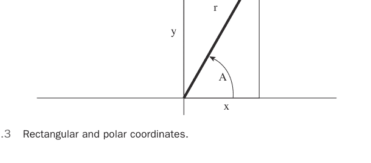

4. ANSI 库提供了一个 clock() 函数，其描述如下：

```
#include <time.h>

clock_t clock (void);
```

这里，clock_t 是在 time.h 中定义的一种类型。该函数返回处理器时间，以某种与实现相关的单位给出。（如果处理器时间不可用或无法表示，该函数返回 -1。）不过，同样定义在 time.h 中的 CLOCKS_PER_SEC 表示每秒处理器时间单位的个数。因此，将 clock() 的两次返回值之差除以 CLOCKS_PER_SEC，就可以得到这两次调用之间经过的秒数。在除法前将值强制转换为 double，可以让你得到几分之一秒。

编写一个函数，它接受一个 double 参数表示期望的时间延迟，然后运行一个循环，直到经过该时间量。编写一个简单的程序来测试该函数。

5. 编写一个函数，其参数为一个 int 元素数组的名称、数组大小，以及一个表示选取次数的值。然后，该函数应从数组中随机选择指定数量的项并打印它们。任何数组元素都不能被选取超过一次。（这模拟了抽取彩票号码或挑选陪审团成员。）另外，如果你的实现有 time()（在第 12 章讨论过）或类似的函数可用，请将其输出与 srand() 结合使用，以初始化 rand() 随机数生成器。编写一个简单的程序来测试该函数。

6. 修改程序清单 16.17，使其使用 struct names 元素数组（如清单后面所定义），而不是 double 数组。使用更少的元素，并显式地将数组初始化为一组合适的名字。

7. 下面是一个使用变参函数的部分程序：

```
#include <stdio.h>
#include <stdlib.h>
#include <stdarg.h>
void show_array(const double ar[], int n);
double * new_d_array(int n, ...);

int main()
{
    double * p1;
    double * p2;

    p1 = new_d_array(5, 1.2, 2.3, 3.4, 4.5, 5.6);
    p2 = new_d_array(4, 100.0, 20.00, 8.08, -1890.0);
    show_array(p1, 5);
    show_array(p2, 4);
    free(p1);
    free(p2);

    return 0;
}
```

new_d_array() 函数接受一个 int 参数和可变数量的 double 参数。该函数返回一个指向由 malloc() 分配的内存块的指针。int 参数表示动态数组中的元素个数，double 值用于初始化这些元素：第一个值赋给第一个元素，依此类推。请提供 show_array() 和 new_d_array() 的代码，补全该程序。

## 高级数据表示

在本章中，你将学习以下内容：

-   函数：
-   更多 malloc()
-   使用 C 表示多种数据类型
-   新算法，以及增强你从概念上开发程序的能力
-   抽象数据类型（ADT）

学习计算机语言就像学习音乐、木工或工程。一开始，你使用这一行的工具，练习音阶，学习拿锤子的哪一头、避开哪一头，解决无数涉及下落、滑动和平衡物体的问题。到目前为止，你在本书中一直在获取和练习技能，学习创建变量、结构体、函数等。然而，最终你会进入一个更高的层次，在这个层次中，使用工具已变成第二天性，真正的挑战是设计和创建项目。你逐渐培养出将项目视为一个连贯整体的能力。本章将重点放在这个更高的层次上。你可能会发现这里涵盖的材料比前面的章节更有挑战性，但也可能觉得它更有收获，因为它帮助你从学徒的角色转变为工匠的角色。

我们将从程序设计中一个至关重要的方面开始：程序表示数据的方式。通常，程序开发中最重要的方面是找到该程序所操作的数据的良好表示。把数据表示搞对，可以让程序其余部分的编写变得简单。到现在为止，你已经见过 C 的内置数据类型：简单变量、数组、指针、结构体和联合体。

然而，找到正确的数据表示往往不只是选择一种类型。你还应该考虑需要哪些操作。也就是说，你应该决定如何存储数据，并定义哪些操作对该数据类型是有效的。例如，C 实现通常既将 C 的 int 类型存储为整数，也将 C 的指针类型存储为整数，但是


两种类型具有不同的有效操作集。例如，你可以把一个整数乘以另一个整数，但不能把一个指针乘以另一个指针。你可以使用 * 运算符来解引用指针，但该操作对整数来说毫无意义。C 语言定义了其基本类型的有效操作。然而，当你设计一个方案来表示数据时，你可能需要自行定义有效操作。在 C 中，你可以通过设计 C 函数来表示所需的操作来实现这一点。简而言之，设计一个数据类型包括决定如何存储数据以及设计一组函数来管理数据。

你还将研究一些 *算法*，即操作数据的配方。作为程序员，你会积累这样一套配方，并反复将其应用于类似的问题。

本章探讨设计数据类型的过程，该过程将算法与数据表示相匹配。在其中，你将遇到一些常见的数据形式，例如队列、列表和二叉搜索树。

你还将被介绍抽象数据类型（ADT）的概念。ADT 以问题导向而非语言导向的方式打包方法和数据表示。在你设计出 ADT 之后，你可以轻松地在不同情况下重用它。理解 ADT 在概念上为你进入面向对象编程（OOP）和 C++ 语言的世界做好了准备。

### 探索数据表示

让我们先思考数据。假设你要创建一个通讯录程序。你会使用什么数据形式来存储信息？由于每个条目都关联着多种信息，用结构体来表示每个条目是有意义的。你如何表示多个条目？用标准的结构体数组？用动态数组？还是用其他形式？条目是否应该按字母顺序排列？你是否应该能够按邮政编码搜索条目？按区号搜索？你想要执行的操作可能会影响你决定如何存储信息。总之，在投入编码之前，你有很多设计决策要做。

你将如何表示一个你想存储在内存中的位图图形图像？位图图像是指屏幕上的每个像素都是单独设置的。在黑白屏幕的时代，你可以用一台计算机位（1 或 0）来表示一个像素（开或关），因此得名 *位图*。使用彩色显示器时，描述单个像素需要不止一个位。例如，如果你为每个像素分配 8 位，你可以获得 256 种颜色。现在行业已发展到 65,536 种颜色（每个像素 16 位）、16,777,216 种颜色（每个像素 24 位）、2,147,483,648 种颜色（每个像素 32 位），甚至更远。如果你的颜色是 32 位并且你的显示器分辨率为 2560×1440，你将需要近 1.18 亿位（14MB）来表示一幅位图图形的单个屏幕。这是可行的方法，还是你可以开发一种压缩信息的方法？这种压缩应该是 *无损* 的（不丢失数据）还是 *有损* 的（丢失相对不重要的数据）？同样，在深入编码之前，你有很多设计决策要做。

让我们处理一个特定的数据表示案例。假设你想编写一个程序，让你输入一年中看过的所有电影（包括录像带、DVD 和蓝光）的列表。对于每部电影，你想记录各种信息，例如标题、上映年份、导演、主演、长度、电影类型（喜剧、科幻、浪漫、胡说八道等等）、你的评价等等。这表明为每部电影使用一个结构体，为列表使用一个结构体数组。为了简化问题，让我们将结构体限制为两个成员：电影标题和你的评价，一个 0 到 10 的等级。清单 17.1 显示了使用这种方法的基本实现。

```
Listing 17.1  **The `films1.c` Program**

```c
/* films1.c -- using an array of structures */
#include <stdio.h>
#include <string.h>
#define TSIZE          45      /* size of array to hold title  */
#define FMAX           5       /* maximum number of film titles */

struct film {
    char title[TSIZE];
    int rating;
};
char * s_gets(char * st, int n);
int main(void)
{
    struct film movies[FMAX];
    int i = 0;
    int j;

    puts("Enter first movie title:");
    while (i < FMAX && s_gets(movies[i].title, TSIZE) != NULL &&
           movies[i].title[0] != '\0')
    {
        puts("Enter your rating <0-10>:");
        scanf("%d", &movies[i++].rating);
        while (getchar() != '\n')
            continue;
        puts("Enter next movie title (empty line to stop):");
    }
    if (i == 0)
        printf("No data entered. ");
    else
        printf ("Here is the movie list:\n");

        for (j = 0; j < i; j++)
            printf("Movie: %s Rating: %d\n", movies[j].title,
                   movies[j].rating);
}
```
```

```
printf("Bye!\n");

return 0;
}

char * s_gets(char * st, int n)
{
    char * ret_val;
    char * find;

    ret_val = fgets(st, n, stdin);
    if (ret_val)
    {
        find = strchr(st, '\n');    // look for newline
        if (find)                   // if the address is not NULL,
            *find = '\0';           // place a null character there
        else
            while (getchar() != '\n')
                continue;           // dispose of rest of line
    }
    return ret_val;
}
```

该程序创建一个结构体数组，然后用用户输入的数据填充数组。输入会一直继续，直到数组已满（FMAX 测试），直到到达文件结束（NULL 测试），或直到用户在行首按下 Enter 键（‘\0’ 测试）。

这种表述存在一些问题。首先，该程序很可能会浪费大量空间，因为大多数电影的标题没有 40 个字符那么长，但有些电影的标题确实很长，例如 The Discreet Charm of the Bourgeoisie 和 Won Ton Ton, The Dog Who Saved Hollywood。其次，许多人会发现每年五部电影的限制过于严格。当然，你可以增加该限制，但什么值才合适？有些人一年看 500 部电影，所以你可以将 FMAX 增加到 500，但这对某些人来说仍然可能太小，而对其他人来说可能会浪费大量内存。此外，一些编译器为自动存储类变量（如 movies）可用的内存量设置了默认限制，而这样大的数组可能会超出该值。你可以通过将数组设为静态或外部数组或指示编译器使用更大的栈来修复它，但这并没有解决真正的问题。

真正的问题是数据表示过于不灵活。你必须在编译时做出在运行时做出更好决定的决策。这表明切换到使用动态内存分配的数据表示。你可以尝试这样做：

```
#define TSIZE 45          /* size of array to hold title */
struct film {
    char title[TSIZE];
    int rating;
};
```

```
```c
int n, i;
struct film * movies; /* pointer to a structure */
...
printf("Enter the maximum number of movies you'll enter:\n");
scanf("%d", &n);
movies = (struct film *) malloc(n * sizeof(struct film));
```
```

在这里，就像第 12 章“存储类、链接和内存管理”中一样，你可以使用指针 movies，就好像它是一个数组名一样：

```
```c
while (i < FMAX && s_gets(movies[i].title, TSIZE) != NULL && movies[i].title[0] != '\0')
```
```

通过使用 malloc()，你可以推迟确定元素数量直到程序运行时，因此如果只需要 20 个元素，程序就不必分配 500 个元素。然而，它把为条目数量提供正确值的负担放在了用户身上。

### 超越数组到链表

理想情况下，你希望能够无限地添加数据（或直到程序内存耗尽）而无需提前指定将要创建多少条目，也无需让程序不必要地分配巨大的内存块。你可以通过在每次输入后调用 malloc() 并只分配足够空间来容纳新条目来实现这一点。用户输入三部电影，程序调用 malloc() 三次。如果用户输入 300 部电影，程序调用 malloc() 300 次。

这个好主意引发了一个新问题。为了了解它是什么，请比较一次调用 malloc()，请求足够容纳 300 个电影结构体的空间，以及 300 次调用 malloc()，每次请求足够容纳一个电影结构体的空间。前一种情况将内存分配为一个连续的内存块，你只需要跟踪内容的一个指向结构体变量（film），该变量指向块中的第一个结构体，如前面的代码段所示。第二种方法的难题在于，不能保证连续的 malloc() 调用会产生相邻的内存块。这意味着结构体不一定会连续存储（参见图 17.1）。因此，与其存储指向 300 个结构体块的一个指针，不如存储 300 个指针，每个独立分配的结构体一个！


```
struct film * movie;

movie = (struct film *) malloc(5 * sizeof(struct film));
```

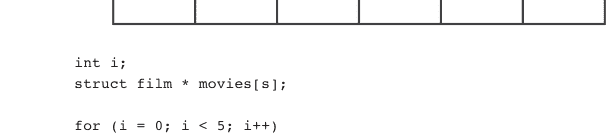

```
int i;
struct film * movies[5];

for (i = 0; i < 5; i++)
    movies[i] = (struct film *) malloc(sizeof(struct film));
```

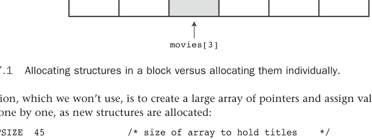

图 17.1 整体分配结构与逐个分配结构的对比。

一种我们不打算采用的解决方案是，创建一个大型指针数组，并在分配新结构时逐个为指针赋值：

```
#define TSIZE 45          /* size of array to hold titles  */
#define FMAX  500          /* maximum number of film titles */
struct film {
    char title[TSIZE];
    int rating;
};
...
struct film * movies[FMAX]; /* array of pointers to structures */
int i;
...
movies[i] = (struct film *) malloc (sizeof (struct film));
```

如果你没有用完所有的指针，这种方法可以节省大量内存，因为一个包含 500 个指针的数组比一个包含 500 个结构的数组占用的内存少得多。不过，它仍然会浪费未使用的指针所占用的空间，并且仍然会强加 500 个结构的限制。

有更好的办法。每次使用 malloc() 为一个新结构分配空间时，你也可以为一个新指针分配空间。但你会说：“那样我就需要另一个指针来跟踪新分配的指针，而那个指针又需要一个指针来跟踪，如此类推。”避免这个潜在问题的诀窍是重新定义结构，使每个结构都包含一个指向下一个结构的指针。这样，每次你创建一个新结构时，都可以将其地址存储在前一个结构中。简而言之，你需要这样重新定义 film 结构：

```
#define TSIZE 45      /* size of array to hold titles */
struct film {
    char title[TSIZE];
    int rating;
    struct film * next;
};
```

确实，一个结构不能包含其自身类型的结构，但可以包含指向自身类型的结构的指针。这样的定义是定义链表的基础——链表中的每一项都包含描述如何找到下一项的信息。

在查看链表的 C 代码之前，让我们先在概念上过一遍这样的链表。假设用户输入“摩登时代”作为标题，并输入 10 作为评级。程序会为 film 结构分配空间，将字符串“摩登时代”复制到 title 成员中，并将 rating 成员设为 10。为了表示没有结构跟在它后面，程序会将 next 成员指针设为 NULL。（回想一下，NULL 是在 stdio.h 文件中定义的符号常量，表示空指针。）当然，你需要跟踪第一个结构存储在哪里。你可以将它的地址赋给一个单独的指针，我们称之为头指针。头指针指向链表中的第一项。图 17.2 展示了这个结构的样子。（为了节省图中的空间，省略了 title 成员中的空白部分。）

```
#define TSIZE 45
struct film {
    char title[TSIZE];
    int rating;
    struct film * next;
};
struct film * head;
```

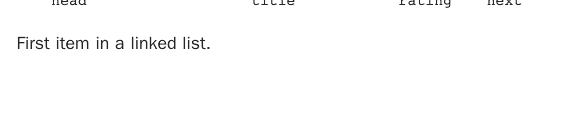

图 17.2 链表中的第一项。

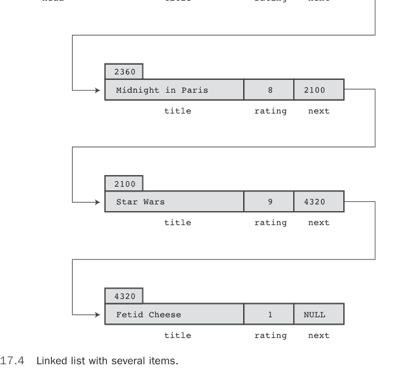

图 17.4 包含多个项的链表。

### 使用链表

现在你已经有链表如何工作的概念了，让我们来实现它。程序清单 17.2 修改了程序清单 17.1，使用链表而不是数组来保存电影信息。

### 程序清单 17.2 films2.c 程序

```
/* films2.c -- using a linked list of structures */
#include <stdio.h>
#include <stdlib.h>    /* has the malloc prototype    */
#include <string.h>    /* has the strcpy prototype    */
#define TSIZE  45      /* size of array to hold title */

struct film {
    char title[TSIZE];
    int rating;
    struct film * next; /* points to next struct in list */
};
char * s_gets(char * st, int n);

int main(void)
{
    struct film * head = NULL;
    struct film * prev, * current;
    char input[TSIZE];

    /* Gather and store information */
    puts("Enter first movie title:");
    while (s_gets(input, TSIZE) != NULL && input[0] != '\0')
    {
        current = (struct film *) malloc(sizeof(struct film));
        if (head == NULL)      /* first structure */
            head = current;
        else                   /* subsequent structures */
            prev->next = current;
        current->next = NULL;
        strcpy(current->title, input);
        puts("Enter your rating <0-10>:");
        scanf("%d", &current->rating);
        while (getchar() != '\n')
            continue;
        puts("Enter next movie title (empty line to stop):");
        prev = current;
    }

    /* Show list of movies */
    if (head == NULL)
        printf("No data entered. ");
    else
        printf("Here is the movie list:\n");
    current = head;
    while (current != NULL)
    {
        printf("Movie: %s  Rating: %d\n",
            current->title, current->rating);
        current = current->next;
    }

    /* Program done, so free allocated memory */
    current = head;
    while (current != NULL)
    {
        free(current);
        current = current->next;
    }
    printf("Bye!\n");

    return 0;
}

char * s_gets(char * st, int n)
{
    char * ret_val;
    char * find;

    ret_val = fgets(st, n, stdin);
    if (ret_val)
    {
        find = strchr(st, '\n');    // look for newline
        if (find)                   // if the address is not NULL,
            *find = '\0';           // place a null character there
        else
            while (getchar() != '\n')
                continue;           // dispose of rest of line
    }
    return ret_val;
}
```

该程序使用链表执行两项任务。首先，它构建链表并用输入的数据填充它。其次，它显示链表。显示是较简单的任务，所以我们先来看它。

### 显示链表

思路是先将一个指针（称之为 current）设置为指向第一个结构。因为头指针（称之为 head）已经指向那里，所以以下代码就足够了：

```
current = head;
```

然后你可以使用指针表示法访问该结构的成员：

```
printf("Movie: %s  Rating: %d\n", current->title, current->rating);
```

下一步是将 current 指针重置为指向链表中的下一个结构。该信息存储在结构的 next 成员中，因此以下代码可以完成此任务：

```
current = current->next;
```

完成这一步后，重复整个过程。当链表中的最后一项显示完毕时，current 将被设置为 NULL，因为这是最后一个结构的 next 成员的值。

你可以利用这个事实来终止打印。下面是 films2.c 用来显示链表的全部代码：

```
while (current != NULL)
{
    printf("Movie: %s  Rating: %d\n", current->title, current->rating);
    current = current->next;
}
```

为什么不直接使用 head，而要创建一个新指针（current）来遍历链表呢？因为使用 head 会改变 head 的值，程序就再也无法找到链表的开头了。

### 创建链表

创建链表涉及三个步骤：

1. 使用 malloc() 为一个结构分配足够的空间。
2. 存储该结构的地址。
3. 将正确的信息复制到结构中。

如果没有需要，就没有必要创建结构，因此程序使用临时存储（input 数组）来获取用户输入的电影名称。如果用户从键盘模拟 EOF 或输入空行，输入循环就会退出：

```
while (s_gets(input, TSIZE) != NULL && input[0] != '\0')
```

如果有输入，程序就为一个结构请求空间，并将其地址赋给指针变量 current：

```
current = (struct film *) malloc(sizeof(struct film));
```

第一个结构的地址应该存储在指针变量 head 中。每个后续结构的地址应该存储在其前一个结构的 next 成员中。因此，程序需要一种方法来判断它正在处理的是否是第一个结构。一种简单的方法是在程序启动时将 head 指针初始化为 NULL。然后程序就可以使用 head 的值来决定如何操作：

```
if (head == NULL)      /* first structure      */
    head = current;
else                   /* subsequent structures */
    prev->next = current;
```

在这段代码中，prev 是一个指向上一次分配的结构的指针。

接下来，你必须将结构成员设置为正确的值。特别是，你应该将 next 成员设置为 NULL，以表示当前结构是链表中的最后一个。你


应该把输入数组中的电影标题复制到 title 成员，并为 rating 成员获取一个值。下面的代码完成这些操作：

```
current->next = NULL;
strcpy(current->title, input);
puts("Enter your rating <0-10>:");
scanf("%d", &current->rating);
```

由于 s_gets() 的调用会将输入限制在 TSIZE − 1 个字符以内，输入数组中的字符串一定能放入 title 成员，因此使用 strcpy() 是安全的。

最后，你需要让程序为输入循环的下一轮做好准备。具体来说，需要让 prev 指向当前结构，因为在输入下一个电影名并分配下一个结构之后，当前结构就会成为上一个结构。程序在循环末尾设置这个指针：

```
prev = current;
```

这样行吗？下面是一个示例运行：

```
Enter first movie title:
Spirited Away
Enter your rating <0-10>:
9
Enter next movie title (empty line to stop):
The Duelists
Enter your rating <0-10>:
8
Enter next movie title (empty line to stop):
Devil Dog: The Mound of Hound
Enter your rating <0-10>:
1
Enter next movie title (empty line to stop):

Here is the movie list:
Movie: Spirited Away Rating: 9
Movie: The Duelists Rating: 8
Movie: Devil Dog: The Mound of Hound Rating: 1
Bye!
```

### 释放链表内存

在许多环境中，程序终止时会释放 malloc() 使用的内存，但最好养成让 free() 调用与 malloc() 调用保持平衡的习惯。因此，程序通过对每个已分配的结构调用 free() 来清理内存使用：

```
current = head;
while (current != NULL)
{
    free(current);
    current = current->next;
}
```

### 后记

films2.c 程序有点单薄。例如，它没有检查 malloc() 是否成功获得所需内存，也没有提供从列表中删除条目的功能。不过这些缺陷是可以修复的。例如，你可以添加代码检查 malloc() 的返回值是否为 NULL（这表示它未能获得所需内存）。如果程序需要删除条目，你可以编写更多代码来完成。

这种在需要时临时解决问题和添加功能的方式，并不总是最好的编程方法。另一方面，你通常无法预料到程序需要做的所有事情。随着编程项目越来越大，程序员或编程团队事先规划一切的模式变得越来越不现实。人们已经注意到，最成功的大型程序往往是从成功的小程序逐步演化而来的。

鉴于你可能需要修改计划，最好以一种便于修改的方式发展你最初的想法。程序清单 17.2 中的示例没有遵循这一准则。特别是，它倾向于将编码细节与概念模型混在一起。例如，在示例程序中，概念模型是向列表中添加条目。而程序把 malloc() 和 current->next 指针等细节推到前台，模糊了这种接口。如果能以一种让“向列表添加内容”一目了然的方式编写程序，并把调用内存管理函数、设置指针之类的簿记细节隐藏起来，那就太好了。将用户接口与细节分离开来，会让程序更容易理解和更新。通过重新开始，你可以实现这些目标。来看看怎么做。

### 抽象数据类型（ADT）

在编程中，你会努力使数据类型与编程问题的需求相匹配。例如，用 int 类型表示你拥有的鞋子数量，用 float 或 double 类型表示你每双鞋子的平均花费。在电影示例中，数据构成了一个条目列表，每个条目由电影名（一个 C 字符串）和评分（一个 int）组成。没有哪种基本 C 类型与这种描述相符，因此我们定义了一个结构来表示各个条目，然后设计了几种方法将一系列结构连接起来形成列表。本质上，我们是在利用 C 语言的能力来设计一种符合需求的新数据类型，但这样做并不系统。现在，我们将采用更系统的方法来定义类型。

什么构成类型？类型规定两类信息：一组属性和一组操作。例如，int 类型的属性是它表示一个整数值，因此具有整数的一切属性。允许的算术操作包括改变符号、两个 int 相加、两个 int 相减、两个 int 相乘、一个 int 除以另一个 int，以及一个 int 对另一个 int 取模。当你声明一个变量为 int 时，你就是在表示这些操作、且只有这些操作可以影响它。

### 整数性质说明

在 C 的 int 类型背后是一个更抽象的概念，即整数。数学家能够以正式的抽象方式定义整数的性质，而且事实上也正是这样做的。例如，如果 N 和 M 是整数，那么 N + M = M + N；或者说，对于任意两个整数 N 和 M，存在一个整数 S，使得 N + M = S。如果 N + M = S 且 N + Q = S，那么 M = Q。你可以把数学看作提供整数的抽象概念，而把 C 看作提供该概念的一种实现。例如，C 提供了存储整数的手段，也提供了执行加法和乘法等整数运算的手段。注意，提供算术运算支持是表示整数的重要组成部分。如果你只能存储一个值而不能在算术表达式中使用它，int 类型就不会那么有用了。还要注意，这种实现并不能完美地表示整数。例如，整数有无穷多个，但一个 2 字节的 int 只能表示其中 65,536 个；不要把抽象概念与具体实现混为一谈。

假设你想定义一个新数据类型。首先，你必须提供一种存储数据的方式，也许可以通过设计一个结构来实现。其次，你必须提供操作数据的方式。例如，考虑 films2.c 程序（程序清单 17.2）。它用一组链接起来的结构保存信息，并提供添加信息和显示信息的代码。然而，这个程序并没有以明确表明我们在创建新类型的方式来做这些事。我们原本应该怎么做呢？

计算机科学已经发展出一种非常成功的定义新数据类型的方法。这是一个从抽象到具体的三步过程：

1. 提供类型属性以及可对该类型执行的操作的抽象描述。这种描述不应依赖于任何特定实现，甚至不应依赖于特定编程语言。这样正式的抽象描述被称为抽象数据类型（ADT）。
2. 开发实现该 ADT 的编程接口。也就是说，说明如何存储数据，并描述一组执行所需操作的函数。例如，在 C 中，你可能提供一个结构定义，以及用于操作这些结构的函数原型。这些函数对用户定义类型所起的作用，与 C 的内置运算符对 C 基本类型所起的作用相同。想使用新类型的人将使用这个接口进行编程。
3. 编写代码实现该接口。当然，这一步必不可少，但使用新类型的程序员不必了解实现的细节。

让我们通过一个示例来了解这个过程是如何运作的。由于我们已经为电影列表示例投入了一些精力，不妨用新方法重做一遍。

### 进行抽象

基本上，电影项目所需要的只是一个条目列表。每个条目包含一个电影名和一个评分。你需要能够将新条目添加到列表末尾，并且需要能够显示列表的内容。我们把处理这些需求的抽象类型称为列表。列表应该具有哪些属性？显然，列表应该能够容纳一系列条目。也就是说，列表可以容纳多个条目，而且这些条目按某种顺序排列，因此可以谈论列表中的第一个条目、第二个条目或最后一个条目。接下来，列表类型应该支持诸如向列表添加条目之类的操作。下面是一些有用的操作：

- 将列表初始化为空
- 向列表末尾添加条目
- 确定列表是否为空
- 确定列表是否已满
- 确定列表中有多少条目
- 访问列表中的每个条目以执行某些操作，例如显示条目

这个项目不需要更多操作，但一个更通用的列表操作清单可能包括以下内容：

- 在列表中的任意位置插入条目
- 从列表中移除条目
- 从列表中检索条目（列表保持不变）
- 用另一个条目替换列表中的一个条目
- 在列表中搜索条目

于是，对列表的非正式但抽象的定义是：它是一个能够容纳一系列条目的数据对象，并且可以对其应用上述任何操作。这个定义没有说明列表中可存储哪种条目，也没有指定应使用数组、一组链接的结构还是其他数据形式来容纳条目，更没有规定用什么方法（例如确定列表中的元素个数）。这些事项都是留给实现处理的细节。

为了保持示例简单，我们采用一种简化的列表作为抽象数据类型，它只体现电影项目所需的特性。下面是该类型的摘要：

| 类型名称： | 简单列表 |
|---|---|
| 类型属性： | 可以容纳一系列条目。 |
| 类型操作： | 将列表初始化为空。<br>确定列表是否为空。<br>确定列表是否已满。 |


+   - 确定列表中的项目数。
+   - 将项目添加到列表末尾。
+   - 遍历列表，处理列表中的每个项目。
+   - 清空列表。

下一步是为简单的列表 ADT 开发 C 语言接口。

### Building an Interface

简单列表的接口有两个部分。第一部分描述数据如何表示，第二部分描述实现 ADT 操作的函数。例如，将会有用于向列表添加项目以及报告列表中项目数的函数。接口设计应尽可能与 ADT 描述保持一致。因此，它应以某种通用的 Item 类型来表达，而不是以某种特定类型（如 int 或 struct film）来表达。一种实现方法是使用 C 的 typedef 设施将 Item 定义为所需类型：

```
#define TSIZE 45    /* size of array to hold title  */
struct film
{
    char title[TSIZE];
    int rating;
};

typedef struct film Item;
```

然后你就可以对剩余的定义使用 Item 类型。如果以后你想要另一种形式数据的列表，你可以重新定义 Item 类型，而其余的接口定义保持不变。

在定义了 Item 之后，你现在必须决定如何存储该类型的数据。此步骤实际上属于实现阶段，但现在做出决定会使示例更容易遵循。链接结构方法在 films2.c 程序中效果相当不错，所以让我们按如下所示进行改编：

```
typedef struct node
{
    Item item;
    struct node * next;
} Node;
typedef Node * List;
```

在链表实现中，每个链接称为一个节点。每个节点包含构成列表内容的信息以及指向下一个节点的指针。为了强调这种术语，我们使用了 node 作为节点结构的标签名，并使用 typedef 使

### Chapter 17 Advanced Data Representation

定义 struct node 结构的 type name。最后，为了管理链表，我们需要指向其开头的指针，我们使用 typedef 使 List 成为此类指针的名称。因此，声明

```
List movies;
```

这是否定义 List 类型的唯一方法？不是。例如，你可以加入一个变量来跟踪条目数：

```
typedef struct list
{
	Node * head; /* pointer to head of list */
	int size; /* number of entries in list */
} List; /* alternative definition of list */
```

你也可以添加第二个指针来跟踪列表的末尾。稍后你会看到一个这样做的例子。现在，让我们坚持使用第一个 List 类型的定义。重要的是，你应该把声明

List movies;
视为建立一个列表，而不是建立一个指向节点的指针或建立一个结构。movies 的确切数据表示是实现细节，在接口级别应保持不可见。

例如，程序在开始时应将头指针初始化为 NULL，但你不应该使用类似这样的代码：

movies = NULL;

为什么不呢？因为后来你可能会发现 List 类型的结构实现更好，而这需要以下初始化：

movies.next = NULL;
movies.size = 0;

使用 List 类型的任何人都不应担心此类细节。相反，他们应该能够做类似以下的操作：

InitializeList(movies);

/* operation: initialize a list */
/* preconditions: plist points to a list */

程序员只需要知道他们应该使用 InitializeList() 函数来初始化列表即可。他们不需要知道 List 变量的确切数据实现。这就是数据隐藏的例子，即从编程的高层隐藏数据表示细节的艺术。

为了指导用户，你可以提供类似以下的行函数原型：

/* postconditions: the list is initialized to empty */
void InitializeList(List *plist);

有三点你应该注意。首先，注释概述了前置条件——即函数调用前应成立的条件。这里，例如，你需要一个要初始化的列表。其次，注释概述了后置条件——即函数执行后应成立的条件。最后，函数使用指向列表的指针而不是列表作为其参数，所以这将是函数调用：

```
InitializeList(&movies);
```

原因是 C 按值传递参数，因此 C 函数更改调用程序中变量的唯一方法是通过指向该变量的指针。在这里，语言的限制使接口与抽象描述略有偏差。

C 将所有类型和函数信息绑定到单个包中的方法是把类型定义和函数原型（包括前置条件和后置条件注释）放在头文件中。该文件应提供程序员使用该类型所需的所有信息。Listing 17.3 显示了简单列表类型的头文件。它定义了特定结构作为 Item 类型，然后以 Item 定义 Node 并以 Node 定义 List。表示列表操作的函数随后使用 Item 类型和 List 类型作为参数。如果函数需要修改参数，它使用指向相应类型的指针而不是直接使用该类型。文件将每个函数名大写，以将其标记为接口包的一部分。此外，文件使用了第 16 章“ C 预处理器和 C 库”中讨论的 #ifndef 技术，以防止文件被多次包含。如果你的编译器不支持 C99 bool 类型，你可以替换

```
#include <stdbool.h> /* C99 feature */
```

```
enum bool {false, true}; /* define bool as type, false, true as values */
```

### Listing 17.3 The list.h Interface Header File

```
/* list.h -- header file for a simple list type */
#ifndef LIST_H_
#define LIST_H_
#include <stdbool.h> /* C99 feature */

/* program-specific declarations */
#define TSIZE 45 /* size of array to hold title */
struct film
{
 char title[TSIZE];
 int rating;
};
```

```
/* general type definitions */

typedef struct film Item;

typedef struct node
{
    Item item;
    struct node * next;
} Node;

typedef Node * List;

/* function prototypes */

/* operation:      initialize a list                */
/* preconditions:  plist points to a list           */
/* postconditions: the list is initialized to empty */
void InitializeList(List * plist);

/* operation:      determine if list is empty       */
/*                 plist points to an initialized list */
/* postconditions: function returns True if list is empty */
/*                 and returns False otherwise       */
bool ListIsEmpty(const List *plist);

/* operation:      determine if list is full        */
/*                 plist points to an initialized list */
/* postconditions: function returns True if list is full */
/*                 and returns False otherwise       */
bool ListIsFull(const List *plist);

/* operation:      determine number of items in list */
/*                 plist points to an initialized list */
/* postconditions: function returns number of items in list */
unsigned int ListItemCount(const List *plist);

/* operation:      add item to end of list          */
/* preconditions:  item is an item to be added to list */
/*                 plist points to an initialized list */
/* postconditions: if possible, function adds item to end */
/*                 of list and returns True; otherwise the */
/*                 function returns False             */
bool AddItem(Item item, List * plist);

/* operation:      apply a function to each item in list */
/*                 plist points to an initialized list    */
```

```
/*			pfun points to a function that takes an		*/
/*			Item argument and has no return value		*/
/* postcondition:	 the function pointed to by pfun is		*/
/*			executed once for each item in the list		*/
void Traverse (const List *plist, void (* pfun)(Item item) );

/* operation:		free allocated memory, if any		*/
/*			plist points to an initialized list		*/
/* postconditions:	any memory allocated for the list is freed */
/*			and the list is set to empty			*/
void EmptyTheList(List * plist);

#endif
```

只有 InitializeList()、AddItem() 和 EmptyTheList() 函数会修改列表，因此从技术上讲，它们是唯一需要指针参数的方法。然而，如果用户必须记住对某些函数传递 List 参数，而对其他函数传递 List 的地址作为参数，就会变得令人困惑。所以，为了简化用户的责任，所有函数都使用指针参数。

头文件中的一个原型比其他原型更复杂一些：

```
/* operation:		apply a function to each item in list	*/
/*			plist points to an initialized list		*/
/*			pfun points to a function that takes an		*/
/*			Item argument and has no return value		*/
/* postcondition:	 the function pointed to by pfun is		*/
/*			executed once for each item in the list		*/
void Traverse (const List *plist, void (* pfun)(Item item) );
```

参数 pfun 是一个指向函数的指针。特别是，它是指向一个接受 item 值作为参数且没有返回值 的函数的指针。正如你可能还记得第 14 章“结构和其他数据形式”中所说的，你可以将指向函数的指针作为参数传递给第二个函数，并且第二个函数随后可以使用指向的函数。在这里，例如，你可以让 pfun 指向一个显示项目的函数。Traverse() 函数随后将此函数应用于列表中的每个项目，从而显示整个列表。

### Using the Interface

我们的主张是，你应该能够使用此接口编写程序，而无需知道任何进一步的细节——例如，无需知道函数是如何编写的。让我们在编写支持函数之前立即编写电影程序的新版本。因为接口以 List 和 Item 类型表示，所以程序应以这些术语表述。以下是可能计划的伪代码表示：

```
Create a List variable.
Create an Item variable.
```


初始化列表为空。
当列表未满且仍有更多输入时：
    读取输入到 Item 变量中。
    将项目添加到列表末尾。
遍历列表中的每个项目并显示它。

Listing 17.4 所示的程序遵循这一基本计划，并带有一些错误检查。注意它如何使用 list.h 文件中描述的接口（Listing 17.3）。还要注意该列表包含 showmovies() 函数的代码，该代码符合 Traverse() 所需的原型。因此，程序可以将指针 showmovies 传递给 Traverse()，以便 Traverse() 可以将 showmovies() 函数应用于列表中的每个项目。（请记住，函数名是指向该函数的指针。）

### Listing 17.4 The films3.c Program

```
/* films3.c -- using an ADT-style linked list */
/* compile with list.c */
#include <stdio.h>
#include <stdlib.h>    /* prototype for exit() */
#include "list.h"    /* defines List, Item */
void showmovies(Item item);
char * s_gets(char * st, int n);
int main(void)
{
    List movies;
    Item temp;

    /* initialize */
    InitializeList(&movies);
    if (ListIsFull(&movies))
    {
        fprintf(stderr,"No memory available! Bye!\n");
        exit(1);
    }

    /* gather and store */
    puts("Enter first movie title:");
    while (s_gets(temp.title, TSIZE) != NULL && temp.title[0] != '\0')
    {
        puts("Enter your rating <0-10>:");
        scanf("%d", &temp.rating);
        while(getchar() != '\n')
            continue;
        if (AddItem(temp, &movies)==false)
        {
```
```
fprintf(stderr,"Problem allocating memory\n");
    break;
    }
    if (ListIsFull(&movies))
    {
        puts("The list is now full.");
        break;
    }
    puts("Enter next movie title (empty line to stop):");
}

/* display           */
    if (ListIsEmpty(&movies))
        printf("No data entered. ");
    else
    {
        printf ("Here is the movie list:\n");
        Traverse(&movies, showmovies);
    }
    printf("You entered %d movies.\n", ListItemCount(&movies));

/* clean up          */
    EmptyTheList(&movies);
    printf("Bye!\n");

    return 0;
}

void showmovies(Item item)
{
    printf("Movie: %s  Rating: %d\n", item.title,
            item.rating);
}
char * s_gets(char * st, int n)

    char * ret_val;
    char * find;

    ret_val = fgets(st, n, stdin);
    if (ret_val)
    {
        find = strchr(st, '\n');    // look for newline
        if (find)                   // if the address is not NULL,
            *find = '\0';           // place a null character there
        else
            while (getchar() != '\n')
```
```
continue; // dispose of rest of line
}
return ret_val;
}
```

### Implementing the Interface

当然，你仍然必须实现 List 接口。C 语言的做法是将函数定义收集到一个名为 list.c 的文件中。这样，完整的程序就由三个文件组成：list.h，它定义了数据结构并为用户接口提供原型，list.c，它提供函数代码来实现接口，以及 films3.c，它是一个源代码文件，将列表接口应用于特定的编程问题。Listing 17.5 显示了 list.c 的一种可能实现。要运行程序，必须编译 films3.c 和 list.c 并链接它们。（你可能想回顾第 9 章“Functions”中关于编译多文件程序的讨论。）list.h、list.c 和 films3.c 文件一起构成了一个完整的程序（见图 17.5）。

### Listing 17.5 The list.c Implementation File

```
/* list.c -- functions supporting list operations */
#include <stdio.h>
#include <stdlib.h>
#include "list.h"

/* local function prototype */
static void CopyToNode(Item item, Node *pnode);

/* interface functions */

/* set the list to empty */
void InitializeList(List *plist)
{
    *plist = NULL;
}

/* returns true if list is empty */
bool ListIsEmpty(const List *plist)
{
    if (*plist == NULL)
        return true;
    else
        return false;
}
```

# Abstract Data Types (ADTs) 797

```
/* returns true if list is full */
bool ListIsFull(const List *plist)
{
	Node * pt;
	bool full;
	pt = (Node *) malloc(sizeof(Node));
	if (pt == NULL)
		full = true;
	else
		full = false;
	free(pt);
	return full;
}
```

```
/* returns number of nodes */
unsigned int ListItemCount(const List *plist)
{
	unsigned int count = 0;
	Node * pnode = *plist; /* set to start of list */
	while (pnode != NULL)
	{
		++count;
		pnode = pnode->next; /* set to next node */
	}
	return count;
}
```

```
/* creates node to hold item and adds it to the end of */
/* the list pointed to by plist (slow implementation) */
bool AddItem(Item item, List *plist)
{
	Node * pnew;
	Node * scan = plist;
	pnew = (Node *) malloc(sizeof(Node));
	if (pnew == NULL) /* quit function on failure */
		return false; /* quit function on failure */
	CopyToNode(item, pnew);
	pnew->next = NULL;
	if (scan == NULL) /* empty list, so place */
```

```
*plist = pnew;        /* pnew at head of list */
else
{
    while (scan->next != NULL)
        scan = scan->next;  /* find end of list     */
    scan->next = pnew;     /* add pnew to end      */
}

    return true;
}

/* visit each node and execute function pointed to by pfun */
void Traverse  (const List * plist, void (* pfun)(Item item) )
{
    Node * pnode = *plist;    /* set to start of list  */

    while (pnode != NULL)
    {
        (*pfun)(pnode->item); /* apply function to item */
        pnode = pnode->next;   /* advance to next item   */
    }
}

/* free memory allocated by malloc() */
/* set list pointer to NULL          */
void EmptyTheList(List * plist)
{
    Node * psave;

    while (*plist != NULL)
    {
        psave = (*plist)->next; /* save address of next node */
        free(*plist);           /* free current node         */
        *plist = psave;         /* advance to next node      */
    }
}

/* local function definition */
/* copies an item into a node */
static void CopyToNode(Item item, Node * pnode)
{
    pnode->item = item; /* structure copy */
}
```

```
list.h
/* list.h--header file for a simple list type */
/* program-specific declarations */
#define TSIZE 45 /* size of array to hold title */
struct film
{
    char title[TSIZE];
    int rating;
};
.
.
void Traverse (List l, void (*pfun)(Item item));
```

```
list.c
/* list.c--functions supporting list operations */
#include <stdio.h>
#include <stdlib.h>
#include "list.h"
.
.
/* copies an item into node */
static void CopyToNode (Item item, Node * pnode)
{
    pnode->item = item; /* structure copy */
}
```

```
films3.c
/* films3.c -- using and ADT-style linked list */
#include <stdio.h>
#include <stdlib.h> /* prototype for exit() */
#include "list.h"
void showmovies(Item item);

int main(void)
{
.
.
.
}
```

Figure 17.5 The three parts of a program package.

### Program Notes

list.c 文件有很多有趣之处。其中之一说明了你何时可能会使用具有内部链接的函数。如第 12 章所述，具有内部链接的函数仅在其定义的<|message|> 中已知。在实现接口时，你有时会发现编写辅助函数很方便，这些函数不是官方接口的一部分。例如，示例使用 CopyToNode() 函数将类型为 Item 的值复制到类型为 Item 的变量。因为此函数是实现的一部分而不是接口的一部分，我们通过使用 static 存储类限定符将其隐藏在 list.c 文件中。现在，让我们检查其他函数。

InitializeList() 函数将列表初始化为空。在我们的实现中，这意味着将类型为 List 的变量设置为 NULL。如前所述，这需要将指向 List 变量的指针传递给函数。

ListIsEmpty() 函数非常简单，但它确实依赖于列表变量在列表为空时被设置为 NULL。因此，在首次使用 ListIsEmpty() 函数之前初始化列表非常重要。此外，如果你要扩展接口以包含删除项目，则应确保删除函数在删除最后一个项目时将列表重置为空。对于链表，列表的大小受可用内存量的限制。ListIsFull() 函数尝试为新项目分配足够的空间。如果失败，则列表已满。如果成功，它必须释放刚刚分配的内存，以便可用于真正的项目。

ListItemCount() 函数使用通常的链表算法遍历列表，并在遍历过程中计数项目：

```
unsigned int ListItemCount(const List * plist)
{
    unsigned int count = 0;
    Node * pnode = *plist;    /* set to start of list */

    while (pnode != NULL)
    {
        ++count;
        pnode = pnode->next;  /* set to next node     */
    }

    return count;
}
```

AddItem() 函数是一组中最为复杂的：

```
bool AddItem(Item item, List * plist)
{
    Node * pnew;
    Node * scan = *plist;

    pnew = (Node *) malloc(sizeof(Node));
    if (pnew == NULL)
        return false;    /* quit function on failure  */

    CopyToNode(item, pnew);
    pnew->next = NULL;
    if (scan == NULL)        /* empty list, so place */
        *plist = pnew;       /* pnew at head of list */
    else
    {
        while (scan->next != NULL)
```


```
scan = scan->next;    /* find end of list     */
scan->next = pnew;    /* add pnew to end      */
}

    return true;
}
```

AddItem() 函数做的第一件事是为一个新节点分配空间。如果分配成功，该函数便使用 CopyToNode() 将项复制到节点中。然后，它将节点的 next 成员设置为 NULL。您还记得，这表示该节点是链表中的最后一个节点。最后，在创建节点并为其成员赋予正确值之后，函数将该节点附加到列表末尾。如果该项是添加到列表中的第一项，程序会将头指针设置为指向第一项。（请记住，AddItem() 是以头指针的地址作为其第二个参数调用的，因此 *plist 就是头指针的值。）否则，代码会遍历链表，直到找到其 next 成员为 NULL 的项。该节点当前是最后一个节点，因此函数将其 next 成员重置为指向新节点。

良好的编程实践要求您在尝试向列表添加项之前调用 ListIsFull()。然而，用户可能不会遵守这一要求，因此 AddItem() 会自行检查 malloc() 是否成功。此外，用户有可能在调用 ListIsFull() 和调用 AddItem() 之间做了其他分配内存的操作，所以最好检查一下 malloc() 是否成功。

Traverse() 函数类似于 ListItemCount() 函数，不同之处在于它对列表中的每个项都应用一个函数：

```
void Traverse  (const List * plist, void (* pfun)(Item item) )
{
    Node * pnode = *plist;    /* set to start of list  */

    while (pnode != NULL)
    {
        (*pfun)(pnode->item); /* apply function to item */
        pnode = pnode->next;   /* advance to next item    */
    }
}
```

回想一下，pnode->item 表示节点中存储的数据，pnode->next 标识链表中的下一个节点。例如，函数调用

```
Traverse(movies, showmovies);
```

会将 showmovies() 函数应用于列表中的每一项。

最后，EmptyTheList() 函数释放之前用 malloc() 分配的内存：

```
void EmptyTheList(List * plist)
{
```

```
Node * psave;

while (*plist != NULL)
{
    psave = (*plist)->next; /* save address of next node */
    free(*plist);           /* free current node      */
    *plist = psave;         /* advance to next node   */
}
}
```

该实现通过将 List 变量设置为 NULL 来表示空列表。因此，该函数需要传入 List 变量的地址，以便能够重置它。由于 List 本身就是一个指针，所以 plist 是指向指针的指针。因此，在代码中，表达式 *plist 的类型是指向 Node 的指针。当列表终止时，*plist 为 NULL，这意味着原来的实际参数现在被设置为 NULL。

代码保存下一个节点的地址，因为调用 free() 原则上可能会使当前节点（即 *plist 所指向的节点）的内容不再可用。

### 关于 const 的局限性

几个处理列表的函数都有参数 const List * plist。这表明这些函数无意修改列表。在这里，const 确实提供了一些保护。它防止 *plist（即 plist 所指向的量）被更改。在这个程序中，plist 指向 movies，所以 const 防止这些函数更改 movies，而 movies 又指向列表中的第一个链接。因此，在 ListItemCount() 中，类似下面的代码是不允许的：

```
*plist = (*plist)->next;   // not allowed if *plist is const
```

这是好的，因为更改 *plist（从而更改 movies）会导致程序丢失数据。然而，*plist 和 movies 被视为 const 并不意味着 *plist 或 movies 所指向的数据也是 const。例如，类似于下面的代码是允许的：

```
(*plist)->item.rating = 3; // allowed even if *plist is const
```

这是因为这段代码不会更改 *plist，而是更改 *plist 所指向的数据。这里的教训是，您不能总是依赖 const 来捕获意外修改数据的编程错误。

### 反思您的工作

现在花一点时间评估一下 ADT 方法为您带来了什么。首先，将程序清单 17.2 与程序清单 17.4 进行比较。两个程序都使用相同的基本方法（动态分配链接结构）来解决电影列表问题，但程序清单 17.2 暴露了所有编程管道，将 malloc() 和 prev->next 摆在了公众视野中。另一方面，程序清单 17.4 隐藏了这些细节，并用直接与任务相关的语言来表达程序。也就是说，它谈论的是创建列表和向列表添加项，而不是调用内存函数或重置指针。简而言之，程序清单 17.4 根据要解决的问题来表达程序，而不是根据解决问题所需的底层工具。ADT 版本面向最终用户关注的问题，并且更易于阅读。

接下来，list.h 和 list.c 文件共同构成一个可重用的资源。如果您需要另一个简单列表，只需拿出这些文件即可。假设您需要存储亲属的清单：姓名、关系、地址和电话号码。首先，您需要打开 list.h 文件并重新定义 Item 类型：

```
typedef struct itemtag
{
    char fname[14];
    char lname[24];
    char relationship[36];
    char address[60];
    char phonenum[20];
} Item;
```

接下来……好吧，在这种情况下，您所要做的就是这些，因为所有简单列表函数都是根据 Item 类型定义的。在某些情况下，您还需要重新定义 CopyToNode() 函数。例如，如果项是一个数组，您无法通过赋值来复制它。

另一个重要的一点是，用户界面是根据抽象的列表操作来定义的，而不是根据某些特定的数据表示和算法。这使您可以自由地修改实现，而不必重做最终程序。例如，当前的 AddItem() 函数效率有点低，因为它总是从列表的开头开始，然后搜索结尾。您可以通过跟踪列表的结尾来解决这个问题。例如，您可以这样重新定义 List 类型：

```
typedef struct list
{
    Node * head;      /* points to head of list */
    Node * end;       /* points to end of list  */
} List;
```

当然，您之后必须使用这个新定义重写列表处理函数，但您不必在程序清单 17.4 中更改任何内容。这种将实现与最终接口隔离的做法对于大型编程项目特别有用。它被称为数据隐藏，因为详细的数据表示对最终用户隐藏了。

请注意，这个特定的 ADT 甚至不强制您将简单列表实现为链表。这里还有另一种可能性：

```
#define MAXSIZE 100
typedef struct list
{
    Item entries[MAXSIZE];  /* array of items      */
```

```
int items;        /* number of items in list */
} List;
```

同样，这将需要重写 list.c 文件，但使用列表的程序不需要更改。

最后，想想这种方法为程序开发过程带来的好处。如果出现问题，您很可能可以将问题定位到单个函数。如果您想到了完成某项任务（例如添加项）的更好方法，您只需重写那一个函数。如果您需要新功能，您可以考虑向包中添加一个新的函数。如果您认为数组或双向链表更好，您可以重写实现，而不必修改使用该实现的程序。

### 使用 ADT 处理队列

正如您所看到的，C 语言编程中的抽象数据类型方法涉及以下三个步骤：

- 1. 以抽象、通用的方式描述一个类型，包括其操作
- 2. 设计一个函数接口来表示新类型
- 3. 编写详细代码来实现该接口

您已经看到了这种方法应用于简单列表。现在，将它应用于稍微复杂一些的东西：队列。

### 定义队列抽象数据类型

队列是一种具有两个特殊属性的列表。首先，新项只能添加到列表的末尾。在这方面，队列与简单列表相似。其次，项只能从列表的开头移除。您可以把队列想象成排队买剧院门票的人们。您在队尾加入，在买完票后从队首离开。队列是一种先进先出（FIFO）的数据形式，就像排队看电影一样（如果没有插队）。让我们再次构建一个非正式的、抽象的定义，如下所示：

| 类型名称： | 队列 |
| 类型属性： | 能保存有序的项序列。 |
| 类型操作： | 将队列初始化为空。确定队列是否为空。确定队列是否已满。确定队列中的项数。将项添加到队列末尾。从队列开头移除并取回项。清空队列。 |


### 定义接口

接口定义将进入名为 queue.h 的文件。我们将使用 C 的 typedef 设施为两种类型创建名称：Item 和 Queue。对应结构的确切实现应为 queue.h 文件的一部分，但从概念上讲，设计结构是详细实现阶段的一部分。目前，只需假设类型已定义，并集中于函数原型。

首先，考虑初始化。它涉及修改 Queue 类型，因此函数应以 Queue 的地址作为参数：

```
void InitializeQueue (Queue * pq);
```

接下来，判断队列是否为空或已满涉及一个应返回 true 或 false 值的函数。这里我们假设 C99 stdbool.h 头文件可用。如果不可用，可以使用类型 int 或自行定义 bool 类型。因为该函数不修改队列，所以可以接受 Queue 参数。另一方面，取决于 Queue 类型对象的大小，仅传递 Queue 的地址可能更快且占用内存更少。让我们尝试这种方法。另一个优点是这样所有函数都将以地址作为参数。为了表示这些函数不改变队列，你可以，也应该，使用 const 限定符：

```
bool QueueIsFull(const Queue * pq);
bool QueueIsEmpty (const Queue * pq);
```

换句话说，指针 pq 指向一个 Queue 数据对象，该对象不能通过 pq 的媒介被更改。你可以为返回队列中项目数量的函数定义类似的原型：

```
int QueueItemCount(const Queue * pq);
```

向队列末尾添加一项涉及识别该项和队列。这次队列被修改，因此使用指针是必要的，而非可选的。函数可以是 void 类型，也可以利用返回值来指示添加项操作是否成功。让我们采用第二种方法：

```
bool Enqueue(Item item, Queue * pq);
```

最后，移除一项可以有多种方式。如果项被定义为结构或基本类型之一，它可以由函数返回。函数参数可以是 Queue 或指向 Queue 的指针。因此，一个可能的原型是：

```
Item Dequeue(Queue q);
```

然而，以下原型更通用一些：

```
bool Dequeue(Item * pitem, Queue * pq);
```

从队列中移除的项会进入 pitem 指针所指向的位置，而返回值指示操作是否成功。

对于清空队列的函数，只需要队列的地址这一参数即可，提示该原型：

```
void EmptyTheQueue(Queue * pq);
```

### 实现接口数据表示

第一步是决定为队列使用哪种 C 数据形式。一个可能性是数组。数组的优点是易于使用，并且向数组已填充部分的末尾添加项很容易。问题出现在从队列前端移除项时。在人们排队买票的类比中，从队列前端移除项包括复制数组第一个元素的值（简单），然后将数组中每个项向左移动一个元素位置。虽然这很容易编程，但浪费了大量计算机时间（参见图 17.6）。

队列中的四个人

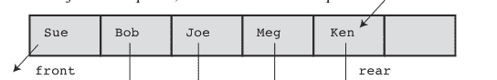

Ken 加入队列，然后 Sue 离开队列

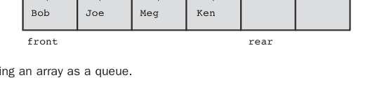

图 17.6 使用数组作为队列。

在数组实现中处理移除问题的第二种方法是让剩余元素保持原位，而改动我们称之为前端的元素（参见图 17.7）。这种方法的缺点是被腾出的元素会变成死空间，因此队列中的可用空间会不断减少。

队列中的四个人

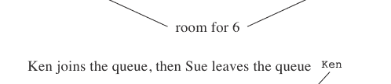

Ken 加入队列，然后 Sue 离开队列

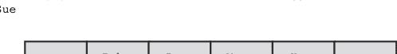

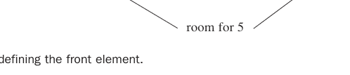

图 17.7 重新定义前端元素。

解决死空间问题的巧妙方案是使队列循环。这意味着从数组末尾绕回到开头。也就是说，将数组的第一个元素视为紧跟在最后一个元素之后，这样当你到达数组末尾时，如果开头元素已被腾空，就可以开始向开头元素添加项（参见图 17.8）。你可以想象把数组画在一张纸条上，然后把数组的一端粘到另一端形成一条带。当然，你现在需要做一些精细的记账，以确保队列末尾不会超过前端。

另一种解决方案是使用链表。这具有移除前端项不需要移动所有其他项的优点。相反，你只需重置前端指针以指向新的第一个元素。因为我们已经在处理链表，所以我们将采用这种方式。为了测试我们的想法，我们将从一个整数队列开始：

```
typedef int Item;
```

链表由节点构建，因此让我们先定义一个节点：

```
typedef struct node
{
    Item item;
    struct node * next;
} Node;
```

队列中的四个人

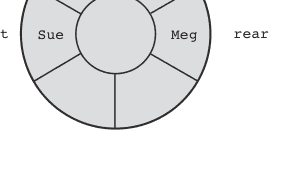

Sue 和 Bob 离开队列，Ken 加入队列


Liz 和 Ben 加入队列


循环队列绕回到数组前端

图 17.8 一个循环队列。

对于队列，你需要跟踪前端和后端项。你可以使用指针来做到这一点。此外，你可以使用计数器来跟踪队列中的项数。因此，结构将有两个指针成员和一个类型为 int 的成员：

```
typedef struct queue
{
    Node * front;    /* pointer to front of queue */
    Node * rear;     /* pointer to rear of queue */
```

```
int items;    /* number of items in queue */
} Queue;
```

请注意，Queue 是一个具有三个成员的结构，因此之前决定使用指向队列的指针而不是整个队列作为参数的决定节省了时间和空间。

接下来，考虑队列的大小。对于链表，可用内存决定了限制，但通常更小的尺寸更为合适。例如，你可能会使用队列来模拟等待降落的飞机。如果等待的飞机数量过大，新的到达飞机可能会被改道到其他机场。我们将最大队列大小设为 10。清单 17.6 包含队列接口的定义和原型。它将 Item 类型的确切定义留待开放。在使用接口时，你会插入适用于特定程序的适当定义。

### 清单 17.6 队列.h 接口头文件

```
/* queue.h -- interface for a queue */
#ifndef _QUEUE_H_
#define _QUEUE_H_
#include <stdbool.h>

/* INSERT ITEM TYPE HERE */
/* FOR EXAMPLE, */
typedef int Item; // for use_q.c
/* OR typedef struct item {int gumption; int charisma;} Item; */

#define MAXQUEUE 10

typedef struct node
{
    Item item;
    struct node * next;
} Node;

typedef struct queue
{
    Node * front;  /* pointer to front of queue  */
    Node * rear;   /* pointer to rear of queue   */
    int items;     /* number of items in queue   */
} Queue;

/* operation:      initialize the queue               */
/* precondition:   pq points to a queue               */
/* postcondition:  queue is initialized to being empty*/
void InitializeQueue(Queue * pq);

/* operation:      check if queue is full             */
/* precondition:    pq points to previously initialized queue */
/* postcondition:  returns True if queue is full, else False   */
bool QueueIsFull(const Queue * pq);

/* operation:       check if queue is empty                  */
/* precondition:    pq points to previously initialized queue */
/* postcondition:  returns True if queue is empty, else False */
bool QueueIsEmpty(const Queue *pq);

/* operation:       determine number of items in queue       */
/* precondition:    pq points to previously initialized queue */
/* postcondition:  returns number of items in queue          */
int QueueItemCount(const Queue * pq);

/* operation:       add item to rear of queue                */
/* precondition:    pq points to previously initialized queue */
/*                  item is to be placed at rear of queue    */
/* postcondition:   if queue is not empty, item is placed at */
/*                  rear of queue and function returns       */
/*                  True; otherwise, queue is unchanged and  */
/*                  function returns False                   */
bool Enqueue(Item item, Queue * pq);

/* operation:       remove item from front of queue          */
/* precondition:    pq points to previously initialized queue */
/* postcondition:   if queue is not empty, item at head of   */
/*                  queue is copied to *pitem and deleted from */
/*                  queue, and function returns True; if the */
/*                  operation empties the queue, the queue is */
/*                  reset to empty. If the queue is empty to */
/*                  begin with, queue is unchanged and the   */
/*                  function returns False                   */
bool Dequeue(Item *pitem, Queue * pq);

/* operation:       empty the queue                          */
/* precondition:    pq points to previously initialized queue */
/* postconditions:  the queue is empty                       */
void EmptyTheQueue(Queue * pq);

#endif
```

### 实现接口函数

现在我们可以开始编写接口代码了。首先，将队列初始化为“空”意味着将前端和后端指针设为 NULL，并将项计数（items 成员）设为 0：


```c
void InitializeQueue(Queue * pq)
{
    pq->front = pq->rear = NULL;
    pq->items = 0;
}
```

接下来，items成员使得检查队列是否已满或为空以及返回队列中项的数量变得容易：

```c
bool QueueIsFull(const Queue * pq)
{
    return pq->items == MAXQUEUE;
}
```

```c
bool QueueIsEmpty(const Queue * pq)
{
    return pq->items == 0;
}
```

```c
int QueueItemCount(const Queue * pq)
{
    return pq->items;
}
```

向队列添加一项涉及以下步骤：

- 1. 创建一个新节点。
- 2. 将项复制到节点中。
- 3. 将节点的next指针设置为NULL，将该节点标识为列表中的最后一个节点。
- 4. 将当前rear节点的next指针设置为指向新节点，从而将新节点链接到队列中。
- 5. 将rear指针设置为指向新节点，这样便于找到最后一个节点。
- 6. 将项计数加1。

此外，该函数还必须处理两种特殊情况。首先，如果队列为空，应将front指针设置为指向新节点。这是因为当只有一个节点时，该节点既是队列的队首也是队尾。其次，如果函数无法为节点分配到内存，它应该做一些处理。由于我们设想使用小型队列，这种失败应该很少见，所以如果程序内存耗尽，我们只需让函数终止程序。下面是EnQueue()的代码：

```c
bool EnQueue(Item item, Queue * pq)
{
    Node * pnew;
```

```c
if (QueueFull(pq))
	return false;
pnew = (Node *) malloc(sizeof(Node));
if (pnew == NULL)
{
	fprintf(stderr,"Unable to allocate memory!\n");
	exit(1);
}
CopyToNode(item, pnew);
pnew->next = NULL;
if (QueueIsEmpty(pq))
	pq->front = pnew; /* item goes to front */
else
{
	pq->rear->next = pnew; /* link at end of queue */
	pq->rear = pnew; /* record location of end */
	pq->items++;
	/* one more item in queue */
}
return true;
}
```

CopyToNode()函数是一个静态函数，用于将项复制到节点：

```c
static void CopyToNode(Item item, Node * pn)
{
	pn->item = item;
}
```

从队列前端移除一项涉及以下步骤：

- 1. 将项复制到一个等待变量中
- 2. 释放被腾出的节点所使用的内存
- 3. 将front指针重置为队列中的下一项
- 4. 如果移除的是最后一项，则将front和rear指针重置为NULL
- 5. 将项计数减1

下面是完成所有这些操作的代码：

```c
bool DeQueue(Item * pit, Queue * pq)
{
	Node * pt;
	if (QueueIsEmpty(pq))
		return false;
	CopyToItem(pq->front, pit);
	pt = pq->front;
	pq->front = pq->front->next;
	// (code continues in image but truncated in provided text)
```

```c
free(pt);
pq->items--;
if (pq->items == 0)
    pq->rear = NULL;

return true;
}
```

关于指针，有几点你需要注意。首先，代码在删除最后一项时并没有显式地将front指针设置为NULL。这是因为它已经将front指针设置为被删除节点的next指针。如果该节点是最后一个节点，其next指针为NULL，因此front指针会被设置为NULL。其次，代码使用一个临时指针（pt）来跟踪被删除节点的位置。这是因为指向第一个节点的正式指针（pq->front）会被重置为指向下一个节点，所以如果没有临时指针，程序将无法跟踪应该释放哪块内存。

我们可以使用Dequeue()函数来清空队列。只需使用一个循环反复调用Dequeue()，直到队列为空：

```c
void EmptyTheQueue(Queue * pq)
{
    Item dummy;
    while (!QueueIsEmpty(pq))
        Dequeue(&dummy, pq);
}
```

### 注意 保持ADT的纯粹性

在定义了ADT接口之后，你应该只使用接口中的函数来处理该数据类型。例如，注意Dequeue()依赖于Enqueue()函数正确地设置指针，并将rear节点的next指针设置为NULL。如果在一个使用该ADT的程序中，你决定直接操作队列的某些部分，可能会破坏接口包中各函数之间的协调。

程序清单17.7显示了接口的所有函数，包括在Enqueue()中使用的CopyToItem()函数。

### 程序清单17.7 queue.c实现文件

```c
/* queue.c -- the Queue type implementation*/
#include <stdio.h>
#include <stdlib.h>
#include "queue.h"

/* local functions */
static void CopyToNode(Item item, Node * pn);
```

```c
static void CopyToItem(Node * pn, Item * pi);

void InitializeQueue(Queue * pq)
{
    pq->front = pq->rear = NULL;
    pq->items = 0;
}

bool QueueIsFull(const Queue * pq)
{
    return pq->items == MAXQUEUE;
}

bool QueueIsEmpty(const Queue * pq)
{
    return pq->items == 0;
}

int QueueItemCount(const Queue * pq)
{
    return pq->items;
}

bool Enqueue(Item item, Queue * pq)
{
    Node * pnew;

    if (QueueIsFull(pq))
        return false;
    pnew = (Node *) malloc( sizeof(Node) );
    if (pnew == NULL)
    {
        fprintf(stderr,"Unable to allocate memory!\n");
        exit(1);
    }

    CopyToNode(item, pnew);
    pnew->next = NULL;
    if (QueueIsEmpty(pq))
        pq->front = pnew;                /* item goes to front    */
    else
        pq->rear->next = pnew;           /* link at end of queue  */
    pq->rear = pnew;                     /* record location of end */
    pq->items++;                         /* one more item in queue */

    return true;
}
```

```c
bool DeQueue(Item * pitem, Queue * pq)
{
    Node * pt;

    if (QueueIsEmpty(pq))
        return false;
    CopyToItem(pq->front, pitem);
    pt = pq->front;
    pq->front = pq->front->next;
    free(pt);
    pq->items--;
    if (pq->items == 0)
        pq->rear = NULL;

    return true;
}

/* empty the queue            */
void EmptyTheQueue(Queue * pq)
{
    Item dummy;
    while (!QueueIsEmpty(pq))
        DeQueue(&dummy, pq);
}

/* Local functions            */

static void CopyToNode(Item item, Node * pn)
{
    pn->item = item;
}

static void CopyToItem(Node * pn, Item * pi)
{
    *pi = pn->item;
}
```

### 测试队列

在将一个新设计（如队列包）插入到关键程序之前，最好先对其进行测试。一种测试方法是编写一个短程序，有时称为驱动程序，其唯一目的就是测试该包。例如，程序清单17.8使用了一个队列，使你可以添加和删除整数。使用该程序之前，请确保queue.h中存在以下行：

```
typedef int item;
```

还要记住，你必须链接queue.c和use_q.c。

### 程序清单17.8 use_q.c程序

```c
/* use_q.c -- driver testing the Queue interface */
/* compile with queue.c */
#include <stdio.h>
#include "queue.h"  /* defines Queue, Item */

int main(void)
{
    Queue line;
    Item temp;
    char ch;

    InitializeQueue(&line);
    puts("Testing the Queue interface. Type a to add a value,");
    puts("type d to delete a value, and type q to quit.");
    while ((ch = getchar()) != 'q')
    {
        if (ch != 'a' && ch != 'd')  /* ignore other input */
            continue;
        if ( ch == 'a')
        {
            printf("Integer to add: ");
            scanf("%d", &temp);
            if (!QueueIsFull(&line))
            {
                printf("Putting %d into queue\n", temp);
                EnQueue(temp,&line);
            }
            else
                puts("Queue is full!");
        }
        else
        {
            if (QueueIsEmpty(&line))
                puts("Nothing to delete!");
            else
            {
                DeQueue(&temp,&line);
                printf("Removing %d from queue\n", temp);
            }
        }
        printf("%d items in queue\n", QueueItemCount(&line));
        puts("Type a to add, d to delete, q to quit:");
    }
```

```c
EmptyTheQueue(&line);
puts("Bye!");

    return 0;
}
```

下面是一个示例运行。你还应该测试一下当队列已满时实现是否表现正确。

```
Testing the Queue interface. Type a to add a value,
type d to delete a value, and type q to quit.
a
Integer to add: 40
Putting 40 into queue
1 items in queue
Type a to add, d to delete, q to quit:
a
Integer to add: 20
Putting 20 into queue
2 items in queue
Type a to add, d to delete, q to quit:
a
Integer to add: 55
Putting 55 into queue
3 items in queue
Type a to add, d to delete, q to quit:
d
Removing 40 from queue
2 items in queue
Type a to add, d to delete, q to quit:
d
Removing 20 from queue
1 items in queue
Type a to add, d to delete, q to quit:
d
Removing 55 from queue
0 items in queue
Type a to add, d to delete, q to quit:
d
Nothing to delete!
0 items in queue
Type a to add, d to delete, q to quit:
q
Bye!
```


### 使用队列进行模拟

嗯，队列能用了！现在让我们用它做点更有趣的事情。许多现实生活中的情况都涉及队列。例如，顾客在银行和超市排队，飞机在机场排队，任务在多任务计算机系统中排队。你可以使用 queue 包来模拟这些情况。

假设，例如，Sigmund Landers 在商场里设立了一个咨询亭。顾客可以购买一分钟、两分钟或三分钟的咨询服务。为了保证人流畅通，商场规定排队的顾客人数限制为 10 人（恰好等于程序的最大队列长度）。假设人们随机出现，并且他们想要的咨询时间在三种选择（一分钟、两分钟或三分钟）中随机分布。平均而言，Sigmund 一小时能接待多少顾客？顾客平均需要等待多长时间？队伍平均有多长？这些都是队列模拟可以回答的问题。

首先，让我们决定在队列中放什么。你可以根据顾客加入队列的时间以及他或她想要咨询的分钟数来描述每位顾客。这提示我们为 Item 类型定义如下：

```c
typedef struct item
{
    long arrive;    /* the time when a customer joins the queue  */
    int processtime; /* the number of consultation minutes desired */
} Item;
```

要将 queue 包转换为处理这种结构，而不是上一个示例使用的 int 类型，你只需将之前 Item 的 typedef 替换为这里显示的这一个。完成后，你就不必担心队列的详细机制了。相反，你可以继续解决真正的问题——模拟 Sigmund 的等待队列。

下面是一种方法。让时间以一分钟为增量移动。每分钟检查一次是否有新顾客到达。若有顾客到达且队列未满，则将该顾客加入队列。这包括在 Item 结构中记录顾客的到达时间以及顾客想要的咨询时间，然后将该项加入队列。然而，如果队列已满，则让顾客离开。为了记账，记录顾客总数和“被拒之门外的人数”（因队列已满而无法进入排队的人）的总数。

接下来，处理队列的前端。也就是说，如果队列不为空，并且 Sigmund 没有在忙前一位顾客，则移除队列前端的项。回想一下，该项包含顾客加入队列的时间。将这个时间与当前时间进行比较，你就得到顾客已在队列中等待的分钟数。该项还包含顾客想要的咨询分钟数，这决定了 Sigmund 将接待新顾客多长时间。使用一个变量来跟踪这个等待时间。如果 Sigmund 很忙，则没有人“出队”。然而，跟踪等待时间的变量应该递减。

核心代码可以如下所示，每个循环对应一分钟的活动：

```c
for (cycle = 0; cycle < cyclelimit; cycle++)
{
    if (newcustomer(min_per_cust))
    {
        if (QueueIsFull(&line))
            turnaways++;
        else
        {
            customers++;
            temp = customertime(cycle);
            EnQueue(temp, &line);
        }
    }
    if (wait_time <= 0 && !QueueIsEmpty(&line))
    {
        DeQueue (&temp, &line);
        wait_time = temp.processtime;
        line_wait += cycle - temp.arrive;
        served++;
    }
    if (wait_time > 0)
        wait_time--;
    sum_line += QueueItemCount(&line);
}
```

注意，时间分辨率相对较粗（一分钟），因此每小时的最大顾客数仅为 60。

以下是一些变量和函数的含义：

- min_per_cust 是顾客到达之间的平均分钟数。
- newcustomer() 使用 C 的 rand() 函数来确定在这一分钟内是否有顾客出现。
- turnaways 是被拒之门外的人数。
- customers 是加入队列的顾客数。
- temp 是描述新顾客的 Item 变量。
- customertime() 设置 temp 结构体的 arrive 和 processtime 成员。
- wait_time 是 Sigmund 完成当前客户之前剩余的分钟数。
- line_wait 是到目前为止所有顾客在队伍中花费的累计时间。
- served 是实际服务的客户数。
- sum_line 是到目前为止队伍的累计长度。

想一想，如果这些代码中散布着 malloc() 和 free() 函数以及指向节点的指针，那它会变得多么凌乱和晦涩。拥有 queue 包使你能够专注于模拟问题，而不是编程细节。

清单 17.9 展示了商场咨询亭模拟的完整代码。它使用标准的 rand()、srand() 和 time() 函数生成随机值，遵循第 12 章建议的方法。要使用该程序，请记得用以下内容更新 queue.h 中的 Item 定义：

```c
typedef struct item
{
    long arrive;      // the time when a customer joins the queue
    int processtime;  // the number of consultation minutes desired
} Item;
```

同时请记得将 mall.c 的代码与 queue.c 链接起来。

### 清单 17.9 mall.c 程序

```c
// mall.c -- use the Queue interface
// compile with queue.c
#include <stdio.h>
#include <stdlib.h>    // for rand() and srand()
#include <time.h>      // for time()
#include "queue.h"     // change Item typedef
#define MIN_PER_HR 60.0

bool newcustomer(double x);   // is there a new customer?
Item customertime(long when); // set customer parameters

int main(void)
{
    Queue line;
    Item temp;                // new customer data
    int hours;                // hours of simulation
    int perhour;              // average # of arrivals per hour
    long cycle, cyclelimit;   // loop counter, limit
    long turnaways = 0;       // turned away by full queue
    long customers = 0;       // joined the queue
    long served = 0;          // served during the simulation
    long sum_line = 0;        // cumulative line length
    int wait_time = 0;        // time until Sigmund is free
    double min_per_cust;      // average time between arrivals
    long line_wait = 0;       // cumulative time in line

    InitializeQueue(&line);
    srand((unsigned int) time(0)); // random initializing of rand()

puts("Case Study: Sigmund Landers's Advice Booth");
puts("Enter the number of simulation hours:");
scanf("%d", &hours);
cyclelimit = MIN_PER_HR * hours;
puts("Enter the average number of customers per hour:");
scanf("%d", &perhour);
min_per_cust = MIN_PER_HR / perhour;

for (cycle = 0; cycle < cyclelimit; cycle++)
{
    if (newcustomer(min_per_cust))
    {
        if (QueueIsFull(&line))
            turnaways++;
        else
        {
            customers++;
            temp = customertime(cycle);
            EnQueue(temp, &line);
        }
    }
    if (wait_time <= 0 && !QueueIsEmpty(&line))
    {
        DeQueue (&temp, &line);
        wait_time = temp.processtime;
        line_wait += cycle - temp.arrive;
        served++;
    }
    if (wait_time > 0)
        wait_time--;
    sum_line += QueueItemCount(&line);
}

if (customers > 0)
{
    printf("customers accepted: %ld\n", customers);
    printf("  customers served: %ld\n", served);
    printf("        turnaways: %ld\n", turnaways);
    printf("average queue size: %.2f\n", (double) sum_line / cyclelimit);
    printf("average wait time: %.2f minutes\n", (double) line_wait / served);
}
else
    puts("No customers!");
EmptyTheQueue(&line);
puts("Bye!");

return 0;
}

// x = average time, in minutes, between customers
// return value is true if customer shows up this minute
bool newcustomer(double x)
{
    if (rand() * x / RAND_MAX < 1)
        return true;
    else
        return false;
}

// when is the time at which the customer arrives
// function returns an Item structure with the arrival time
// set to when and the processing time set to a random value
// in the range 1 - 3
Item customertime(long when)
{
    Item cust;

    cust.processtime = rand() % 3 + 1;
    cust.arrive = when;

    return cust;
}
```

该程序让你可以指定要模拟的小时数和每小时的平均顾客数。选择较大的小时数可以获得较好的平均值，而选择较小的小时数则可以看出逐小时可能出现的随机变化。下面的运行结果说明了这些观点。注意80小时的平均队列长度和平均等待时间与800小时大致相同，但两个一小时的样本彼此之间以及与长期平均值之间都有很大差异。这是因为较小的统计样本往往具有较大的相对变化。

```
Case Study: Sigmund Landers's Advice Booth
Enter the number of simulation hours:
80
Enter the average number of customers per hour:
20
customers accepted: 1633
    customers served: 1633
        turnaways: 0
average queue size: 0.46
average wait time: 1.35 minutes
```


案例研究：西格蒙德·兰德的咨询亭
输入模拟小时数：
800
输入每小时平均顾客数：
20
    接受的顾客：16020
        已服务的顾客：16019
            流失顾客：0
平均队列长度：0.44
平均等待时间：1.32 分钟

案例研究：西格蒙德·兰德的咨询亭
输入模拟小时数：
1
输入每小时平均顾客数：
20
    接受的顾客：20
        已服务的顾客：20
            流失顾客：0
平均队列长度：0.23
平均等待时间：0.70 分钟

案例研究：西格蒙德·兰德的咨询亭
输入模拟小时数：
1
输入每小时平均顾客数：
20
    接受的顾客：22
        已服务的顾客：22
            流失顾客：0
平均队列长度：0.75
平均等待时间：2.05 分钟

另一种使用该程序的方式是保持小时数不变，但尝试不同的每小时平均顾客数。以下是探索这种变化的两次示例运行：

案例研究：西格蒙德·兰德的咨询亭
输入模拟小时数：
80
输入每小时平均顾客数：
25
    接受的顾客：1960
        已服务的顾客：1959
            流失顾客：3
平均队列长度：1.43
平均等待时间：3.50 分钟

案例研究：西格蒙德·兰德的咨询亭
输入模拟小时数：
80
输入每小时平均顾客数：
30
    接受的顾客：2376
        已服务的顾客：2373
            流失顾客：94
平均队列长度：5.85
平均等待时间：11.83 分钟

请注意，随着顾客光顾频率的增加，平均等待时间急剧上升。每小时20名顾客（80小时模拟）的平均等待时间为1.35分钟。当每小时25名顾客时，平均等待时间攀升至3.50分钟；当每小时30名顾客时，则飙升至11.83分钟。此外，流失顾客的数量从0增加到3再增加到94。西格蒙德可以利用这类分析来决定他是否需要第二个咨询亭。

### 链表与数组

许多编程问题，例如创建列表或队列，既可以通过链表处理——即动态分配结构的链接序列——也可以通过数组处理。每种形式都有其优缺点，因此选择使用哪一种取决于问题的具体需求。表17.1总结了链表和数组的特性。

表17.1 数组与链表的比较
| 数据形式 | 优点 | 缺点 |
| 数组 | 由C直接支持。提供随机访问。 | 大小在编译时确定。插入和删除元素耗时 |
| 链表 | 大小在运行时确定。插入和删除元素快速。 | 不支持随机访问。用户必须提供编程支持。 |

更仔细地观察插入和删除元素的过程。要在数组中插入一个元素，你必须移动其他元素为新元素腾出空间，如图17.9所示。新元素插入的位置越靠前，需要移动的元素就越多。然而，要在链表中插入一个节点，你只需为两个指针赋值，如图17.10所示。类似地，从数组中删除元素需要整体移动元素，而从链表中删除节点则只需重置指针并释放被删除节点占用的内存。

通过移动元素腾出空间

放置新元素

图17.9 向数组中插入元素。

创建新节点

重置指针

图17.10 向链表中插入元素。

接下来，考虑如何访问列表的成员。使用数组时，你可以通过数组索引立即访问任何元素。这称为*随机访问*。使用链表时，你必须从列表顶端开始，然后逐个节点移动，直到到达你想要的节点，这称为*顺序访问*。数组也可以进行顺序访问。只需将数组索引每次递增一步，即可按顺序遍历数组。在某些情况下，顺序访问就足够了。例如，如果你想要显示列表中的每一项，顺序访问就很好。其他情况则非常需要随机访问，你将在下面看到。

假设你想在列表中搜索某个特定项。一种算法是从列表开头开始按顺序搜索，这称为*顺序搜索*。如果各项没有按某种顺序排列，顺序搜索几乎就是你所能做的一切。如果所找的项不在列表中，你必须查看列表中的每一项，才能断定该项不在那里。（并发编程在这方面可能会有所帮助，因为不同的CPU可以同时搜索列表的不同部分。）

你可以先对列表进行排序来改进顺序搜索。这样，如果你还没有找到某项，但已经到达一个本应排在其后的项，就可以终止搜索。例如，假设你在一个按字母顺序排列的列表中查找*Susan*。从列表顶部开始，你逐项查看，最终遇到*Sylvia*却没有找到*Susan*。此时你可以停止搜索，因为*Susan*如果在列表中，会排在*Sylvia*之前。平均而言，对于尝试查找不在列表中的项，这种方法可以将搜索时间减半。

对于有序列表，使用*二分搜索*方法可以比顺序搜索好得多。其工作原理如下。首先，将你要查找的列表项称为*目标*，并假设列表按字母顺序排列。接下来，选取列表中间位置的项，并将其与目标进行比较。如果两者相同，搜索结束。如果该列表项在字母顺序上位于目标之前，那么目标若在列表中，必定位于后半部分。如果该列表项在字母顺序上位于目标之后，那么目标必定位于前半部分。无论哪种情况，这次比较都排除了一半的列表作为搜索范围。接下来，再次应用该方法。也就是说，在剩余的那一半列表中选择一个中间项。同样，这种方法要么找到该项，要么排除剩余列表的一半。继续这样进行，直到你找到该项，或者直到你排除了整个列表（见图17.11）。这种方法非常高效。例如，假设列表有127项。顺序搜索平均要进行64次比较才能找到一项或排除其存在。另一方面，二分搜索方法最多只需七次比较。第一次比较将可能的匹配项减少到63，第二次比较将可能的匹配项减少到31，依此类推，直到第六次比较将可能性减少到1。第七次比较再确定剩下的这一个选择是否就是目标。一般来说，*n*次比较可以处理包含2ⁿ−1个成员的数组，因此列表越长，二分搜索相对于顺序搜索的优势就越大。

使用数组实现二分搜索很简单，因为你可以使用数组索引来确定任何列表或列表子分区的中间点。将子分区的首尾元素下标相加并除以2。例如，在一个包含100个元素的列表中，第一个索引是0，最后一个索引是99，初始猜测为(0 + 99) / 2，即49（整数除法）。如果索引为49的元素在字母顺序上太靠后，正确选择必定在0-48范围内，因此下一个猜测为(0 + 48) / 2，即24。如果元素24在字母顺序上太靠前，下一个猜测为(25 + 48) / 2，即36。这正是数组随机访问特性的用武之地。它使你能够从一个位置跳到另一个位置，而无需访问其间的每个位置。链表仅支持顺序访问，无法提供跳转到列表中间位置的手段，因此不能在链表上使用二分搜索技术。


你可以看到，选择数据类型取决于问题。如果情况需要一个不断调整大小且频繁进行插入和删除但很少被搜索的列表，那么链表是更好的选择。如果情况需要一个相对稳定的列表，只偶尔进行插入和删除但需要频繁搜索，那么数组是更好的选择。

如果需要一种数据形式，既支持频繁的插入和删除，又支持频繁的搜索呢？链表和数组都不适合这组用途。另一种形式——二叉搜索树——可能正是你所需要的。

### 二叉搜索树

二叉搜索树是一种结合了二叉搜索策略的链接结构。树中的每个节点包含一个项目和指向其他两个节点的指针，称为子节点。图 17.12 显示了二叉搜索树中节点的链接方式。其思想是每个节点有两个子节点——左节点和右节点。排序来自于左节点中的项目先于父节点中的项目，而右节点中的项目后于父节点中的项目。这一关系适用于每个有子节点的节点。此外，所有可以追溯到父节点左节点的祖先的项目都包含先于父节点项目的项目，而从右节点派生的每个项目都包含后于父节点项目的项目。图 17.12 中的树以这种方式存储单词。树的顶部，在植物学的有趣倒置中，被称为根。树是一种层次组织，意味着数据按等级或级别组织，每个等级通常在其上、下都有等级。如果二叉搜索树完全填充，每个级别的节点数是其上一级别的两倍。


图 17.12 存储单词的二叉搜索树。

二叉搜索树中的每个节点本身就是从它派生的节点的根，使该节点及其后代成为一棵子树。例如，在图 17.12 中，包含单词 fate、carpet 和 llama 的节点构成了整棵树的左子树，而单词 voyage 是 style-plenum-voyage 子树的右子树。

假设你想在这样的树中查找一个项目——称之为目标。如果该项目先于根项目，则只需搜索树的左半部分，如果目标后于根项目，则只需搜索根节点的右子树。因此，一次比较就消除了树的一半。这意味着将目标与左子节点中的项目进行比较。如果目标先于左子节点项目，则只需搜索其后代的左半部分，依此类推。与二叉搜索一样，每次比较都会将潜在匹配的数量减半。

让我们应用这种方法来看看单词 puppy 是否在图 17.12 所示的树中。将 puppy 与 melon（根节点项目）进行比较，你会发现 puppy 如果存在，必须在树的右半部分。因此，你转到右子节点并将 puppy 与 style 进行比较。在这种情况下，puppy 先于节点项目，所以你必须跟随链接到左节点。那里你找到了 plenum，它先于 puppy。你现在必须为该节点跟随右分支，但它是空的，所以三次比较就表明 puppy 不在树中。

因此，二叉搜索树结合了链接结构和二叉搜索效率。编程代价是，构建一棵树比创建链表更复杂。

让我们为下一个，也是最后一个 ADT 项目制作一棵二叉树。

### 一个二叉树 ADT

与往常一样，我们将首先以一般术语定义二叉树。此特定定义假设树中不包含重复项目。许多操作与列表操作相同。区别在于数据的层次排列。以下是此 ADT 的非正式总结：

- **类型名称：** 二叉搜索树

- **类型属性：** 二叉树要么是空的节点集合（空树），要么是节点集合，其中一个节点被指定为根。每个节点恰好有两个子树，称为左子树和右子树，从它派生下来。每个子树本身就是一棵二叉树，其中包括为空树的可能性。二叉搜索树是有序二叉树，其中每个节点包含一个项目，其中左子树中的所有项目都先于根项目，并且根项目先于右子树中的所有项目。

- **类型操作：**
  - 将树初始化为空。
  - 确定树是否为空。
  - 确定树是否已满。
  - 确定树中项目的数量。
  - 向树中添加一个项目。
  - 从树中删除一个项目。
  - 在树中搜索一个项目。
  - 访问树中的每个项目。
  - 清空树。

### 二叉搜索树接口

原则上，你可以用多种方式实现二叉搜索树。你甚至可以通过操作数组索引将其实现为数组。但最直接的实现二叉搜索树的方法是使用动态分配的节点通过指针链接起来，所以我们将从以下定义开始：

```c
typedef SOMETHING Item;

typedef struct trnode
{
    Item item;
    struct trnode * left;
    struct trnode * right;
} Trnode;

typedef struct tree
{
    Trnode * root;
    int size;
} Tree;
```

每个节点包含一个项目、指向左子节点的指针和指向右子节点的指针。你可以将 Tree 定义为指向 Trnode 的指针类型，因为你只需要知道根节点的位置即可访问整棵树。然而，使用包含 size 成员的结构会使跟踪树的大小变得更简单。

我们将开发的示例是 Nerfville 宠物俱乐部的名册，每个项目由宠物名称和宠物种类组成。考虑到这一点，我们可以设置如清单 17.10 所示的接口。我们将树大小限制为 10。较小的尺寸使得更容易测试程序在树填满时是否表现正确。如果需要，你始终可以将 MAXITEMS 设置为更大的值。

**清单 17.10 tree.h 接口头文件**

```c
/* tree.h -- binary search tree */
/* no duplicate items are allowed in this tree */

#ifndef _TREE_H_
#define _TREE_H_
#include <stdbool.h>

/* redefine Item as appropriate */
typedef struct item
{
    char petname[20];
    char petkind[20];
} Item;

#define MAXITEMS 10

typedef struct trnode
{
    Item item;
    struct trnode * left;  /* pointer to left branch  */
    struct trnode * right; /* pointer to right branch   */
} Trnode;

typedef struct tree
{
    Trnode * root;        /* pointer to root of tree  */
    int size;             /* number of items in tree  */
} Tree;

/* function prototypes */

/* operation:    initialize a tree to empty          */
/* preconditions: ptree points to a tree              */
/* postconditions: the tree is initialized to empty   */
void InitializeTree(Tree * ptree);

/* operation:    determine if tree is empty          */
/* preconditions: ptree points to a tree              */
/* postconditions: function returns true if tree is  */
/*                 empty and returns false otherwise  */
bool TreeIsEmpty(const Tree * ptree);

/* operation:    determine if tree is full           */
/* preconditions: ptree points to a tree              */
/* postconditions: function returns true if tree is  */
/*                 full and returns false otherwise   */
bool TreeIsFull(const Tree * ptree);

/* operation:    determine number of items in tree   */
/* preconditions: ptree points to a tree              */
/* postconditions: function returns number of items in */
/*                 tree                                */
int TreeItemCount(const Tree * ptree);

/* operation:      add an item to a tree            */
/* preconditions:  pi is address of item to be added */
/*                 ptree points to an initialized tree */
/* postconditions: if possible, function adds item to */
/*                 tree and returns true; otherwise,  */
/*                 the function returns false          */
bool AddItem(const Item * pi, Tree * ptree);

/* operation:      find an item in a tree           */
/* preconditions:  pi points to an item              */
/*                 ptree points to an initialized tree */
/* postconditions: function returns true if item is in */
/*                 tree and returns false otherwise   */
bool InTree(const Item * pi, const Tree * ptree);

/* operation:      delete an item from a tree       */
/* preconditions:  pi is address of item to be deleted */
/*                 ptree points to an initialized tree */
/* postconditions: if possible, function deletes item */
/*                 from tree and returns true;        */
/*                 otherwise the function returns false*/
bool DeleteItem(const Item * pi, Tree * ptree);

/* operation:      apply a function to each item in */
/*                 the tree                          */
/* preconditions:  ptree points to a tree            */
/*                 pfun points to a function that takes*/
/*                 an Item argument and has no return */
/*                 value                              */
/* postcondition:  the function pointed to by pfun is */
/*                 executed once for each item in tree */
void Traverse(const Tree * ptree, void (* pfun)(Item item));

/* operation:      delete everything from a tree    */
/* preconditions:  ptree points to an initialized tree */
/* postconditions: tree is empty                     */
void DeleteAll(Tree * ptree);

#endif
```


```c
return true;          /* successful return */
}
```

SeekItem()、MakeNode() 和 AddNode() 函数并不是 Tree 类型的公共接口的一部分。相反，它们是隐藏在 tree.c 文件中的静态函数。它们处理诸如节点、指针和结构等实现细节，这些都不属于公共接口。

MakeNode() 函数非常简单。它处理动态内存分配和节点的初始化。函数参数是指向新项目的指针，而函数的返回值是指向新节点的指针。请记住，如果 malloc() 无法完成请求的分配，它会返回空指针。MakeNode() 函数仅在内存分配成功时才初始化新节点。以下是 MakeNode() 的代码：

```c
static Trnode * MakeNode(const Item * pi)
{
    Trnode * new_node;

    new_node = (Trnode *) malloc(sizeof(Trnode));
    if (new_node != NULL)
    {
        new_node->item = *pi;
        new_node->left = NULL;
        new_node->right = NULL;
    }

    return new_node;
}
```

AddNode() 函数是二叉搜索树包中第二困难的函数。它必须确定新节点的位置，然后将其添加进去。特别是，它需要将新项目与根项目进行比较，以查看新项目应进入左子树还是右子树。如果项目是数字，你可以使用 < 和 > 来进行比较。如果项目是字符串，你可以使用 strcmp() 来进行比较。但项目是一个包含两个字符串的结构，因此你必须为比较定义自己的函数。稍后要定义的 ToLeft() 函数，如果新项目应位于左子树则返回 True，而 ToRight() 函数如果新项目应位于右子树则返回 True。这两个函数分别类似于 < 和 >。假设新项目进入左子树。左子树可能为空。在这种情况下，函数只需使左子指针指向新节点。如果左子树不为空呢？那么函数应将新项目与左子节点中的项目进行比较，决定新项目应进入子节点的左子树还是右子树。此过程应继续，直到函数到达空子树，此时可以添加新节点。实现这种搜索的一种方法是使用递归——即对子节点而不是根节点应用 AddNode() 函数。递归的函数调用序列在左子树或右子树为空时结束——即当 root->left 或 root->right 为 NULL 时。请记住，root 是指向当前子树的顶部的指针，因此在每次递归调用时它都指向一个新的、更低级别的子树。（你可能想回顾第 9 章中关于递归的讨论。）

```c
static void AddNode (Trnode * new_node, Trnode * root)
{
    if (ToLeft(&new_node->item, &root->item))
    {
        if (root->left == NULL)      /* empty subtree      */
            root->left = new_node;  /* so add node here   */
        else
            AddNode(new_node, root->left);/* else process subtree*/
    }
    else if (ToRight(&new_node->item, &root->item))
    {
        if (root->right == NULL)
            root->right = new_node;
        else
            AddNode(new_node, root->right);
    }
    else                         /* should be no duplicates */
    {
        fprintf(stderr, "location error in AddNode()\n");
        exit(1);
    }
}
```

ToLeft() 和 ToRight() 函数取决于 Item 类型的性质。Nerville Pet Club 的成员将按名称按字母顺序排序。如果两个宠物的名称相同，则按种类排序。如果它们种类也相同，则这两个项目是重复项，而基本搜索树中不允许重复。请记住，标准 C 库函数 strcmp() 如果第一个参数表示的字符串在第二个字符串之前，则返回负数，如果两个字符串相同则返回零，如果第一个字符串在第二个字符串之后则返回正数。ToRight() 函数具有类似的代码。使用这两个函数而不是在 AddNode() 中直接进行比较，使得代码更容易适应新的需求。当需要不同形式的比较时，不必重写 AddNode()，只需重写 ToLeft() 和 ToRight()。

```c
static bool ToLeft(const Item * i1, const Item * i2)
{
    int compl;

    if ((compl = strcmp(i1->petname, i2->petname)) < 0)
        return true;
    else if (compl == 0 &&
            strcmp(i1->petkind, i2->petkind) < 0 )
        return true;
    else
        return false;
}
```

### Finding an Item

三个接口函数涉及在树中搜索特定项目：AddItem()、InTree() 和 DeleteItem()。此实现使用 SeekItem() 函数提供该服务。DeleteItem() 函数有额外要求：它需要知道被删除项目的父节点，以便在删除子节点时更新父节点的子指针。因此，我们设计 SeekItem() 返回一个包含两个指针的结构：一个指向包含项目的节点（如果未找到项目则为 NULL），一个指向父节点（如果节点是根且没有父节点则为 NULL）。结构类型定义如下：

```c
typedef struct pair {
    Trnode * parent;
    Trnode * child;
} Pair;
```

SeekItem() 函数可以递归实现。然而，为了让你接触到各种编程技术，我们将使用 while 循环来处理遍历树。像 AddNode() 一样，SeekItem() 使用 ToLeft() 和 ToRight() 在树中导航。SeekItem() 最初设置 look.child 指针指向树的根，然后在追踪项目应被找到的路径时，将 look.child 重置为连续的子树。与此同时，look.parent 被设置为指向连续的父节点。如果未找到匹配的项目，look.child 将为 NULL。如果匹配的项目在根节点中，look.parent 为 NULL，因为根节点没有父节点。以下是 SeekItem() 的代码：

```c
static Pair SeekItem(const Item * pi, const Tree * ptree)
{
    Pair look;
    look.parent = NULL;
    look.child = ptree->root;

    if (look.child == NULL)
        return look; /* early return */

    while (look.child != NULL)
    {
        if (ToLeft(pi, &(look.child->item)))
        {
            look.parent = look.child;
            look.child = look.child->left;
        }
        else if (ToRight(pi, &(look.child->item)))
        {
            look.parent = look.child;
            look.child = look.child->right;
        }
        else              /* must be same if not to left or right */
            break;         /* look.child is address of node with item */
    }

    return look;                  /* successful return */
}
```

请注意，由于 SeekItem() 函数返回一个结构，因此它可以用结构成员运算符使用。例如，AddItem() 函数使用了以下代码：

```c
if (SeekItem(pi, ptree).child != NULL)
```

在你有了 SeekItem() 之后，很容易编写 InTree() 公共接口函数：

```c
bool InTree(const Item * pi, const Tree * ptree)
{
    return (SeekItem(pi, ptree).child == NULL) ? false : true;
}
```

### Considerations in Deleting an Item

删除项目是最困难的任务之一，因为你必须重新连接剩余的子树以形成有效的树。在尝试编程此任务之前，最好先形成一个视觉图像，了解需要做什么。

图 17.13 说明了最简单的情况。这里要删除的节点没有子节点。这样的节点称为 *leaf*。在这种情况下要做的就是将父节点中的指针重置为 NULL，并使用 free() 函数收回被删除节点使用的内存。

接下来复杂的是删除一个有一个子节点的节点。删除该节点会使子子树与树的其余部分分离。为了解决这个问题，子子树的地址需要在父节点中存储在以前被删除节点地址占据的位置（见图 17.14）。


最后一种情况是删除具有两个子树的节点。其中一个子树（比如说左子树）可以连接到被删除节点原先所连接的位置。但另一个子树应该放到哪里呢？请记住树的基本设计。左子树中的每个项都排在父节点的项之前，右子树中的每个项都排在父节点的项之后。这意味着右子树中的每个项都排在左子树中每个项之后。此外，因为右子树曾经是被删除节点所带头子树的一部分，所以右子树中的每个项都排在删除节点的父节点之前。想象一下沿树向下寻找放置右子树头节点的位置。它在父节点之前，所以你必须从那里沿左子树向下。然而，它又在左子树中每个项之后，所以你必须走左子树的右分支，看看是否有空位可以放置新节点。如果没有，你必须沿左子树的右侧继续向下，直到找到空位。图 17.15 说明了这种方法。


### 删除节点

现在你可以开始规划必要的函数了，将工作分成两个任务。一是将特定项与要删除的节点关联起来，二是实际删除该节点。需要注意的一点是，所有情况都涉及修改父节点中的一个指针，这有两个重要的后果：

-   程序必须识别要删除节点的父节点。
-   为了修改指针，代码必须将该指针的地址传递给删除函数。

我们稍后会再讨论第一点。同时，要修改的指针本身是 Trnode * 类型（即指向 Trnode 的指针）。因为函数参数是该指针的地址，所以参数将是 Trnode ** 类型（即指向指针的指针）。假设你有正确的地址，就可以编写如下删除函数：

```
static void DeleteNode(Trnode **ptr)
/* ptr is address of parent member pointing to target node */
{
    Trnode * temp;

    if ( (*ptr)->left == NULL)
    {
        temp = *ptr;
        *ptr = (*ptr)->right;
        free(temp);
    }
    else if ( (*ptr)->right == NULL)
    {
        temp = *ptr;
        *ptr = (*ptr)->left;
        free(temp);
    }
    else   /* deleted node has two children */
    {
        /* find where to reattach right subtree */
        for (temp = (*ptr)->left; temp->right != NULL;
             temp = temp->right)
            continue;
        temp->right = (*ptr)->right;
        temp = *ptr;
        *ptr =(*ptr)->left;
        free(temp);
    }
}
```

这个函数明确处理三种情况：没有左子节点的节点、没有右子节点的节点和有两个子节点的节点。没有子节点的节点可以视为没有左子节点情况的一种特例。如果节点没有左子节点，代码将右子节点的地址赋给父指针。但如果节点也没有右子节点，该指针为 NULL，这正是无子节点情况下的正确值。

注意，代码使用临时指针来跟踪被删除节点的地址。在父指针（*ptr）被重置后，程序会丢失被删除节点的位置，但你需要该信息来使用 free() 函数。因此，程序将 *ptr 的原始值存储在 temp 中，然后使用 temp 释放被删除节点占用的内存。

对于有两个子节点的情况，代码首先使用 temp 指针在 for 循环中沿左子树的右侧向下搜索空位。当找到空位时，它将右子树连接到那里。然后重新使用 temp 来跟踪被删除节点的位置。接下来，它将左子树连接到父节点，然后释放 temp 指向的节点。

注意，因为 ptr 是 Trnode ** 类型，所以 *ptr 是 Trnode * 类型，与 temp 类型相同。

### 删除项

问题的剩余部分是将节点与特定项关联起来。你可以使用 SeekItem() 函数来完成。回想一下，它返回一个结构，其中包含一个指向父节点的指针和一个指向包含该项的节点的指针。然后你可以使用父节点指针获取正确的地址，传递给 DeleteNode() 函数。这里显示的 DeleteItem() 函数遵循这个计划：

```
bool DeleteItem(const Item * pi, Tree * ptree)
{
    Pair look;

    look = SeekItem(pi, ptree);
    if (look.child == NULL)
        return false;

    if (look.parent == NULL)    /* delete root item    */
        DeleteNode(&ptree->root);
    else if (look.parent->left == look.child)
        DeleteNode(&look.parent->left);
    else
        DeleteNode(&look.parent->right);
    ptree->size--;

    return true;
}
```

首先，将 SeekItem() 函数的返回值赋给 look 结构变量。如果 look.child 为 NULL，则搜索未能找到该项，DeleteItem() 函数退出并返回 false。如果找到了该项，函数将处理三种情况。首先，look.parent 为 NULL 表示该项是在根节点中找到的。在这种情况下，没有父节点需要更新。相反，程序必须更新 Tree 结构中的根指针。因此，函数将该指针的地址传递给 DeleteNode() 函数。否则，程序会确定要删除的节点是父节点的左孩子还是右孩子，然后传递相应指针的地址。

注意，公共接口函数（DeleteItem()）以最终用户关心的术语（项和树）来表达，而隐藏的 DeleteNode() 函数处理指针调整的细节。

### 遍历树

遍历树比遍历链表更复杂，因为每个节点都有两个分支需要跟踪。这种分支特性使得分治递归（第 9 章）成为处理该问题的自然选择。在每个节点处，函数应执行以下操作：

-   处理节点中的项。
-   处理左子树（递归调用）。
-   处理右子树（递归调用）。

你可以将这个流程分解为两个函数：Traverse() 和 InOrder()。注意，InOrder() 函数先处理左子树，然后处理项，再处理右子树。这种顺序会导致按字母顺序遍历树。如果有时间，你可能想看看使用不同顺序会发生什么，例如 项-左-右 和 左-右-项。

```
void Traverse (const Tree * ptree, void (* pfun)(Item item))
{
    if (ptree != NULL)
        InOrder(ptree->root, pfun);
}
static void InOrder(const Trnode * root, void (* pfun)(Item item))
{
    if (root != NULL)
    {
        InOrder(root->left, pfun);
        (*pfun)(root->item);
        InOrder(root->right, pfun);
    }
}
```

### 清空树

清空树的过程基本上与遍历树相同。也就是说，代码需要访问每个节点并对其调用 free()。它还需要重置 Tree 结构的成员，以表明树已清空。DeleteAll() 函数负责处理 Tree 结构，并将释放内存的任务交给 DeleteAllNodes()。后者与 InOrder() 具有相同的设计。它确实保存了 root->right 的指针值，以便在释放根节点后仍然可用。以下是这两个函数的代码：

```
void DeleteAll(Tree * ptree)
{
    if (ptree != NULL)
        DeleteAllNodes(ptree->root);
    ptree->root = NULL;
    ptree->size = 0;
}
```

```
static void DeleteAllNodes(Trnode * root)
{
    Trnode * pright;

    if (root != NULL)
    {
        pright = root->right;
        DeleteAllNodes(root->left);
        free(root);
        DeleteAllNodes(pright);
    }
}
```

### 完整程序包

程序清单 17.11 显示了完整的 tree.c 代码。tree.h 和 tree.c 一起构成了一个树编程程序包。

### 程序清单 17.11 tree.c 实现文件

```
/* tree.c -- tree support functions */
#include <string.h>
#include <stdio.h>
#include <stdlib.h>
#include "tree.h"

/* local data type */
typedef struct pair {
    Trnode * parent;
    Trnode * child;
```


### 第17章 高级数据表示

```c
} Pair;

/* prototypes for local functions */
static Trnode * MakeNode(const Item * pi);
static bool ToLeft(const Item * il, const Item * i2);
static bool ToRight(const Item * il, const Item * i2);
static void AddNode (Trnode * new_node, Trnode * root);
static void InOrder(const Trnode * root, void (* pfun)(Item item));
static Pair SeekItem(const Item * pi, const Tree * ptree);
static void DeleteNode(Trnode **ptr);
static void DeleteAllNodes(Trnode * ptr);

/* function definitions */
void InitializeTree(Tree * ptree)
{
    ptree->root = NULL;
    ptree->size = 0;
}

bool TreeIsEmpty(const Tree * ptree)
{
    if (ptree->root == NULL)
        return true;
    else
        return false;
}

bool TreeIsFull(const Tree * ptree)
{
    if (ptree->size == MAXITEMS)
        return true;
    else
        return false;
}

int TreeItemCount(const Tree * ptree)
{
    return ptree->size;
}

bool AddItem(const Item * pi, Tree * ptree)
{
    Trnode * new_node;
    if (TreeIsFull(ptree))
    {
        fprintf(stderr,"Tree is full\n");
        return false;
    }

}

void Traverse (const Tree * ptree, void (* pfun)(Item item))
{
    if (ptree != NULL)
        InOrder(ptree->root, pfun);
}

void DeleteAll(Tree * ptree)
{
    if (ptree != NULL)
        DeleteAllNodes(ptree->root);
    ptree->root = NULL;
    ptree->size = 0;
}

/* local functions */
static void InOrder(const Trnode * root, void (* pfun)(Item item))
{
    if (root != NULL)
    {
        InOrder(root->left, pfun);
        (*pfun)(root->item);
        InOrder(root->right, pfun);
    }
}

static void DeleteAllNodes(Trnode * root)
{
    Trnode *pright;
    if (root != NULL)
    {
        pright = root->right;
        DeleteAllNodes(root->left);
        free(root);
        DeleteAllNodes(pright);
    }
}

static void AddNode (Trnode * new_node, Trnode * root)
{
    if (ToLeft(&new_node->item, &root->item))
    {
        if (root->left == NULL) /* empty subtree */
            root->left = new_node; /* so add node here */
        else
            AddNode(new_node, root->left);/* else process subtree*/
    }
    else if (ToRight(&new_node->item, &root->item))
    {
        if (root->right == NULL)
            root->right = new_node;
        else
            AddNode(new_node, root->right);
    }
    else                         /* should be no duplicates */
    {
        fprintf(stderr,"location error in AddNode()\n");
        exit(1);
    }
}

static bool ToLeft(const Item * i1, const Item * i2)
{
    int compl;

    if ((compl = strcmp(i1->petname, i2->petname)) < 0)
        return true;
    else if (compl == 0 &&
        strcmp(i1->petkind, i2->petkind) < 0 )
        return true;
    else
        return false;
}

static bool ToRight(const Item * i1, const Item * i2)
{
    int compl;

    if ((compl = strcmp(i1->petname, i2->petname)) > 0)
        return true;
    else if (compl == 0 &&
        strcmp(i1->petkind, i2->petkind) > 0 )
        return true;
    else
        return false;
}

static Trnode * MakeNode(const Item * pi)
{
    Trnode * new_node;

    new_node = (Trnode *) malloc(sizeof(Trnode));
    if (new_node != NULL)
    {
        new_node->item = *pi;
        new_node->left = NULL;
        new_node->right = NULL;
    }

    return new_node;
}

static Pair SeekItem(const Item * pi, const Tree * ptree)
{
    Pair look;
    look.parent = NULL;
    look.child = ptree->root;

    if (look.child == NULL)
        return look;                    /* early return */

    while (look.child != NULL)
    {
        if (ToLeft(pi, &(look.child->item)))
        {
            look.parent = look.child;
            look.child = look.child->left;
        }
        else if (ToRight(pi, &(look.child->item)))
        {
            look.parent = look.child;
            look.child = look.child->right;
        }
        else        /* must be same if not to left or right */
            break; /* look.child is address of node with item */
    }

    return look;                        /* successful return */
}

static void DeleteNode(Trnode **ptr)
/* ptr is address of parent member pointing to target node */
{
    Trnode * temp;

    if ( (*ptr)->left == NULL)
    {
        temp = *ptr;
        *ptr = (*ptr)->right;
        free(temp);
    }
    else if ( (*ptr)->right == NULL)
    {
        temp = *ptr;
        *ptr = (*ptr)->left;
        free(temp);
    }
    else   /* deleted node has two children */
    {
        /* find where to reattach right subtree */
        for (temp = (*ptr)->left; temp->right != NULL;
            temp = temp->right)
            continue;
        temp->right = (*ptr)->right;
        temp = *ptr;
        *ptr =(*ptr)->left;
        free(temp);
    }
}
```

### 尝试使用该树

现在你已经有接口和函数实现，让我们来使用它们。程序清单17.12中的程序通过菜单提供以下选择：向俱乐部成员名单添加宠物、列出成员、报告成员数量、检查成员资格以及退出。简短的main()函数专注于基本的程序框架，辅助函数完成了大部分工作。

### 程序清单17.12 petclub.c程序

```c
/* petclub.c -- use a binary search tree */
#include <stdio.h>
#include <string.h>
#include <ctype.h>
#include "tree.h"

char menu(void);
void addpet(Tree * pt);
void droppet(Tree * pt);
void showpets(const Tree * pt);
void findpet(const Tree * pt);
void printitem(Item item);
void uppercase(char * str);
char * s_gets(char * st, int n);

int main(void)
{
    Tree pets;
    char choice;

    InitializeTree(&pets);
    while ((choice = menu()) != 'q')
    {
        switch (choice)
        {
            case 'a' : addpet(&pets);
                break;
            case 'l' : showpets(&pets);
                break;
            case 'f' : findpet(&pets);
                break;
            case 'n' : printf("%d pets in club\n", TreeItemCount(&pets));
                break;
            case 'd' : droppet(&pets);
                break;
            default  : puts("Switching error");
        }
    }
    DeleteAll(&pets);
    puts("Bye.");

    return 0;
}

char menu(void)
{
    int ch;

    puts("Nerfville Pet Club Membership Program");
    puts("Enter the letter corresponding to your choice:");
    puts("a) add a pet          l) show list of pets");
    puts("n) number of pets     f) find pets");
    puts("d) delete a pet       q) quit");
    while ((ch = getchar()) != EOF)
    {
        while (getchar() != '\n')  /* discard rest of line */
            continue;
        ch = tolower(ch);
        if (strchr("alrfndq",ch) == NULL)
            puts("Please enter an a, l, f, n, d, or q:");
        else
            break;
    }
    if (ch == EOF)    /* make EOF cause program to quit */
        ch = 'q';

    return ch;
}

void addpet(Tree * pt)
{
    Item temp;

    if (TreeIsFull(pt))
        puts("No room in the club!");
    else
    {
        puts("Please enter name of pet:");
        s_gets(temp.petname,SLEN);
        puts("Please enter pet kind:");
        s_gets(temp.petkind,SLEN);
        uppercase(temp.petname);
        uppercase(temp.petkind);
        AddItem(&temp, pt);
    }
}

void showpets(const Tree * pt)
{
    if (TreeIsEmpty(pt))
        puts("No entries!");
    else
        Traverse(pt, printitem);
}

void printitem(Item item)
{
    printf("Pet: %-19s  Kind: %-19s\n", item.petname,
        item.petkind);
}

void findpet(const Tree * pt)
{
    Item temp;

    if (TreeIsEmpty(pt))
    {
        puts("No entries!");
        return; /* quit function if tree is empty */
    }

    puts("Please enter name of pet you wish to find:");
    s_gets(temp.petname, SLEN);
    puts("Please enter pet kind:");
    s_gets(temp.petkind, SLEN);
    uppercase(temp.petname);
    uppercase(temp.petkind);
    printf("%s the %s ", temp.petname, temp.petkind);
    if (InTree(&temp, pt))
        printf("is a member.\n");
    else 
        printf("is not a member.\n");
}

void droppet(Tree * pt)
{
    Item temp;
    if (TreeIsEmpty(pt))
    {
        puts("No entries!");
        return; /* quit function if tree is empty */
    }

    puts("Please enter name of pet you wish to delete:");
    s_gets(temp.petname, SLEN);
    puts("Please enter pet kind:");
    s_gets(temp.petkind, SLEN);
    uppercase(temp.petname);
    uppercase(temp.petkind);
    printf("%s the %s ", temp.petname, temp.petkind);
    if (DeleteItem(&temp, pt))
        printf("is dropped from the club.\n");
    else 
        printf("is not a member.\n");
}

void uppercase(char * str)
{
    while (*str)
    {
        *str = toupper(*str);
        str++;
    }
}
```


```
}

char * s_gets(char * st, int n)
{
    char * ret_val;
    char * find;

    ret_val = fgets(st, n, stdin);
    if (ret_val)
    {
        find = strchr(st, '\n');    // look for newline
        if (find)                   // if the address is not NULL,
            *find = '\0';           // place a null character there
        else
            while (getchar() != '\n')
                continue;           // dispose of rest of line
    }
    return ret_val;
}
```

该程序将所有字母转换为大写，因此 SNUFFY、Snuffy 和 snuffy 不会被视为不同的名字。下面是一个示例运行：

```
Nerfville Pet Club Membership Program
Enter the letter corresponding to your choice:
a) add a pet          l) show list of pets
n) number of pets     f) find pets
q) quit
a
Please enter name of pet:
Quincy
Please enter pet kind:
pig
Nerfville Pet Club Membership Program
Enter the letter corresponding to your choice:
a) add a pet          l) show list of pets
n) number of pets     f) find pets
q) quit
a
Please enter name of pet:
Bennie Haha
Please enter pet kind:
parrot
Nerfville Pet Club Membership Program
Enter the letter corresponding to your choice:
a) add a pet          l) show list of pets
n) number of pets     f) find pets
q) quit
```

```
q) quit
a
Please enter name of pet:
Hiram Jinx
Please enter pet kind:
domestic cat
Nerfville Pet Club Membership Program
Enter the letter corresponding to your choice:
a) add a pet        l) show list of pets
n) number of pets   f) find pets
q) quit
n
3 pets in club
Nerfville Pet Club Membership Program
Enter the letter corresponding to your choice:
a) add a pet        l) show list of pets
n) number of pets   f) find pets
q) quit
l
Pet: BENNIE HAHA          Kind: PARROT
Pet: HIRAM JINX           Kind: DOMESTIC CAT
Pet: QUINCY              Kind: PIG
Nerfville Pet Club Membership Program
Enter the letter corresponding to your choice:
a) add a pet        l) show list of pets
n) number of pets   f) find pets
q) quit
q
Bye.
```

### Tree Thoughts

二叉搜索树有一些缺点。例如，二叉搜索树只有在完全填充或 *平衡* 时才高效。假设你存储的是随机输入的单词。很可能树会呈现出相当茂密的外观，如图 17.12 所示。现在假设你按字母顺序输入数据。那么每个新节点都会添加到右侧，树可能看起来像图 17.16。图 17.12 的树被称为 *平衡*，而图 17.16 的树是 *不平衡* 的。搜索这棵树的效果与顺序搜索链表没有什么不同。

避免出现细长的树的一种方法是构建树时更加谨慎。如果一棵树或子树开始在一侧或另一侧变得过于不平衡，就重新排列节点以恢复更好的平衡。同样，删除后也可能需要重新排列树。俄罗斯数学家 Adelson-Vel’skii 和 Landis 开发了一种执行此操作的算法。用他们的方法构建的树称为 *AVL 树*。由于额外的重构，构建平衡树需要更长的时间，但你可以确保最大或接近最大的搜索效率。


### Figure 17.16 A badly unbalanced binary search tree.

图 17.16 一个严重不平衡的二叉搜索树。

你可能想要一个允许重复项的二叉搜索树。例如，假设你想通过跟踪文本中每个单词出现的次数来分析某些文本。一种方法是定义 Item 为保存一个单词和一个数字的结构。第一次遇到一个单词时，它会被添加到树中，数字设为 1。下一次遇到同一个单词时，程序会找到包含该单词的节点并将数字递增。修改基本的二叉搜索树以实现这种行为并不需要太多工作。

对于另一个可能的变体，考虑 Nerfville Pet Club。示例按名称和种类对树进行排序，因此它可以在一个节点中保存 Sam 这只猫，在另一个节点中保存 Sam 这只狗，在第三个节点中保存 Sam 这只山羊。然而，你不能有两个叫 Sam 的猫。另一种方法是仅按名称对树进行排序。仅做这一改变就会允许只有一个 Sam，无论种类如何，但你可以将 Item 定义为结构列表而不是单个结构。第一次出现 Sally 时，程序会创建一个新节点，然后创建一个新列表，然后将 Sally 及其种类添加到列表中。下一个出现的 Sally 将被导向同一个节点并添加到列表中。

### Tip Add-On Libraries

你可能已经得出结论，实现诸如链表或树之类的 ADT 是艰苦的工作，有很多出错的机会。附加库提供了一种替代方法：让别人做工作和测试。经过本章中两个相对简单的示例后，你将更好地理解和欣赏此类库。

### Other Directions

在本书中，我们涵盖了 C 的基本特性，但我们仅触及了库。ANSI C 库包含大量有用的函数。大多数实现还提供大量特定于特定系统的函数。基于 Windows 的编译器支持 Windows 图形界面。Macintosh C 编译器提供函数以访问 Macintosh 工具箱，以便制作具有标准 Macintosh 界面的程序或用于 IOS 系统（如 iPhone 和 iPad）的程序。同样，有用于创建具有图形界面的 Linux 程序的工具。花时间探索你的系统提供的功能。如果它没有你想要的，自己制作函数吧。这就是 C 的一部分。如果你认为自己可以在输入函数等方面做得更好，就去做吧！随着你改进和完善编程技术，你将从 C 到光辉的 C。

如果你发现列表、队列和树的概念令人兴奋且有用，你可能想阅读一本关于高级编程技术的书籍或参加相关课程。计算机科学家投入了大量精力和才智来开发和分析算法和数据表示方式。你可能会发现有人已经开发出了你需要的确切工具。

在你熟悉 C 之后，你可能想研究 C++、Objective C 或 Java。这些面向对象的语言根源于 C。C 已经拥有从简单的 char 变量到大型而复杂的结构的数据对象。面向对象的语言将对象的概念更进一步。例如，对象的属性不仅包括它能保存什么样信息，还包括可以对其执行什么样操作。本章中的 ADT 遵循这种模式。此外，对象可以从其他对象继承属性。OOP 将模块化提升到比 C 更高的抽象层次，并且有助于编写大型程序。

你可能想查看参考部分 I“Additional Reading”中的书目，以获取可能进一步你的兴趣的书籍。

## Key Concepts

数据类型由数据的结构和存储方式以及可能的运算来表征。抽象数据类型（ADT）以抽象的方式指定表征一种类型的属性和操作。从概念上讲，你可以将 ADT 翻译成特定编程语言分为两步。第一步是定义编程接口。在 C 中，你可以通过使用头文件来定义类型名并提供与允许操作相对应的函数原型来实现这一点

第二步是实现接口。在 C 中，你可以用源代码文件来实现它，该文件提供与原型相对应的函数定义。

## Summary

列表、队列和二叉树是计算机编程中常用的 ADT 的示例。它们通常使用动态内存分配和链表结构实现，但有时用数组实现是更好的选择。

当你使用特定类型（例如队列或树）编程时，你应该以类型接口为基础编写程序。这样，你就可以在不修改使用该接口的程序的情况下修改和改进实现。

## Review Questions

你可以在附录 A“Answers to the Review Questions”中找到复习题的答案。

-   1. 定义数据类型涉及什么？
-   2. 为什么 Listing 17.2 中的链表只能单向遍历？你如何修改 struct film 定义以使链表可以双向遍历？
-   3. 什么是 ADT？
-   4. QueueIsEmpty() 函数将指向队列结构的指针作为参数，但它也可以写成接受队列结构而不是指针作为参数。两种方法的优点和缺点是什么？
-   5. 栈是列表家族的另一种数据形式。在栈中，添加和删除只能在列表的一端进行。项目被说成是“推入”栈顶并“弹出”栈。因此，栈是 LIFO 结构（即后进先出）。
    a. 设计一个栈的 ADT。
    b. 设计一个栈的 C 编程接口，即 stack.h 头文件。
-   6. 顺序搜索和二分搜索在确定特定项目不在包含三个项目、1,023 个项目、65,535 个项目的已排序列表中时，最多需要多少次比较？


7. 假设一个程序使用本章开发的算法构造了一个由单词组成的二叉查找树。画出四棵树，分别对应以下每种单词输入顺序：

   a. nice food roam dodge gate office wave  
   b. wave roam office nice gate food dodge  
   c. food dodge roam wave office gate nice  
   d. nice roam office food wave gate dodge

8. 考虑复习题 7 中构造的二叉查找树。使用本章算法从每棵树中删除单词 food 后，每棵树分别是什么样子？

## 编程练习

1. 修改程序清单 17.2，使其既能以原始顺序显示电影列表，也能以逆序显示。一种方法是修改链表定义，使列表可以双向遍历。另一种方法是使用递归。

2. 假设 list.h（程序清单 17.3）使用以下列表定义：

```c
typedef struct list
{
    Node * head;    /* points to head of list */
    Node * end;     /* points to end of list  */
} List;
```

重写 list.c（程序清单 17.5）中的函数以匹配该定义，并使用 films3.c（程序清单 17.4）程序测试得到的代码。

3. 假设 list.h（程序清单 17.3）使用以下列表定义：

```c
#define MAXSIZE 100
typedef struct list
{
    Item entries[MAXSIZE];    /* array of items          */
    int items;                /* number of items in list */
} List;
```

5. 编写一个程序，让你输入一个字符串。程序应将字符串的字符逐一压入栈中（参见复习题 5），然后从栈中弹出字符并显示。这样会以逆序显示字符串。

6. 编写一个函数，它接受三个参数：一个已排序整数数组的名称、数组中元素的个数，以及要查找的整数。如果该整数在数组中，函数返回 1，否则返回 0。该函数应使用二分查找技术。

7. 编写一个程序，打开并读取一个文本文件，并记录文件中每个单词出现的次数。使用一个经过修改的二叉查找树来存储单词及其出现次数。程序读完文件后，应提供一个包含三个选项的菜单。第一个选项是列出所有单词及其出现次数。第二个选项是让你输入一个单词，程序报告该单词在文件中出现的次数。第三个选项是退出。

8. 修改 Pet Club 程序，使所有同名的宠物都存储在同一节点中的列表中。当用户选择查找宠物时，程序应请求输入宠物名称，然后列出所有具有该名称的宠物（以及它们的种类）。

## 复习题答案

### 第 1 章复习题答案

1. 一个完全可移植的程序是指其源代码无需修改，就能在各种不同的计算机系统上编译成成功运行的程序。

2. 源代码文件包含程序员所使用的某种语言编写的代码。目标代码文件包含机器语言代码；它未必是完整程序的代码。可执行文件包含构成可执行程序的完整机器语言代码。

3. a. 确定程序目标。

   b. 设计程序。

   c. 编写程序代码。

   d. 编译程序。

   e. 运行程序。

   f. 测试和调试程序。

   g. 维护和修改程序。

4. 编译器将源代码（例如用 C 编写的代码）翻译成等价的机器语言代码，也称为*目标代码*。

5. 链接器将翻译后的源代码与库代码和启动代码组合，生成可执行程序。

### 第 2 章复习题答案

1. 它们被称为函数。

2. 语法错误是违反关于句子或程序如何组合的规则。这里有一个英文示例：“Me speak English good.” 这里有一个 C 语言示例：

```
printf"Where are the parentheses?";
```

3. 语义错误是含义上的错误。这里有一个英文示例：“This sentence is excellent Czech.” 下面是一个 C 语言示例：

```
thrice_n = 3 + n;
```

4. 第 1 行：以 # 开头；将文件拼写为 stdio.h；将文件名放在尖括号内。

第 2 行：使用 ()，而不是 {}；以 */ 而不是 /* 结束注释。

第 3 行：使用 {，而不是 (。

第 4 行：用分号结束语句。

第 5 行：印第安纳这一行（空行）是对的！

第 6 行：赋值应使用 =，而不是 :=。（显然，印第安纳懂一点 Pascal。）每年使用 52 周，而不是 56 周。

第 7 行：应为

```
printf("There are %d weeks in a year.\n", s);
```

第 9 行：没有第 9 行，但应该有，并且应由右花括号 } 构成。

以下是这些修改之后的代码：

```c
#include <stdio.h>
int main(void) /* this prints the number of weeks in a year */
{
    int s;

    s = 52;
    printf("There are %d weeks in a year.\n", s);
    return 0;
}
```

5. a. Baa Baa Black Sheep. Have you any wool?

### 第 3 章复习题答案

3. 要精确获得 32 位，可以使用 int32_t，前提是您的系统定义了它。要获得能够存储至少 32 位的最小类型，请使用 int_least32_t。而要获得能为 32 位提供最快计算速度的类型，请选择 int_fast32_t。

4. a. char 常量（但存储为 int 类型）

   b. int 常量

   c. double 常量

   d. unsigned int 常量，十六进制格式

   e. double 常量

5. 第 1 行：应为 #include <stdio.h>。

第 2 行：应为 int main(void)。

第 3 行：使用 {，而不是 (。

第 4 行：g 和 h 之间应为逗号，而不是分号。

第 5 行：正确。

第 6 行（空行）：正确。

第 7 行：e 之前应至少有一位数字。1e21 或 1.0e21 都可以，不过数值相当大。

第 8 行：正确，至少在语法上是如此。

第 9 行：使用 }，而不是 )。

缺失的行：首先，rate 从未被赋值。其次，变量 h 从未被使用。此外，程序从未告知你计算结果。这些错误都不会阻止程序运行（尽管你可能会收到一个关于未使用变量的警告），但它们确实降低了本已有限的实用性。此外，末尾还应有 return 语句。

以下是一个可能的正确版本：

```c
#include <stdio.h>
int main(void)
{
    float g, h;
    float tax, rate;

    rate = 0.08;
    g = 1.0e5;
    tax = rate*g;
    h = g + tax;
    printf("You owe %f plus %f in taxes for a total of %f.\n", g, tax, h);
    return 0;
}
```

6.

| 常量 | 类型 | 转换说明符 |
|----------|------|-----------|
| a. 12 | int | %d |
| b. 0x3 | unsigned int | %#X |
| c. 'C' | char（实际上是 int） | %c |
| d. 2.34E07 | double | %e |
| e. '\040' | char（实际上是 int） | %c |
| f. 7.0 | double | %f |
| g. 6L | long | %ld |
| h. 6.0f | float | %f |
| i. 0x5.b6p12 | float | %a |

7.

| 常量 | 类型 | 转换说明符 |
|----------|------|-----------|
| a. 012 | unsigned int | %#o |
| b. 2.9e05L | long double | %Le |
| c. 's' | char（实际上是 int） | %c |
| d. 100000 | long | %ld |
| e. '\n' | char（实际上是 int） | %c |
| f. 20.0f | float | %f |
| g. 0x44 | unsigned int | %x |
| h. -40 | int | %d |

8.

```c
printf("The odds against the %d were %ld to 1.\n", imate, shot);
printf("A score of %f is not an %c grade.\n", log, grade);
```

9.

```c
ch = '\r';
ch = 13;
ch = '\015';
ch = '\xd';
```

10. 第 0 行：应有 #include <stdio.h>。

第 1 行：使用 /* 和 */ 或者 //

第 3 行：int cows, legs;

第 4 行：printf("How many cow legs did you count?\n");

第 5 行：使用 %d，而不是 %c；将 legs 替换为 &legs

第 7 行：使用 %d，而不是 %f

另外，添加一个 return 语句。

以下是一个正确的版本：

```c
#include <stdio.h>
int main(void) /* this program is perfect */
{
    int cows, legs;
    printf("How many cow legs did you count?\n");
    scanf("%d", &legs);
    cows = legs / 4;
    printf("That implies there are %d cows.\n", cows);
    return 0;
}
```

11. a. 换行符

    b. 反斜杠字符

    c. 双引号

    d. 制表符

### 第 4 章复习题答案

1. 程序出现故障。第一个 scanf() 语句只读取了你的名，留下你的姓未读取，但仍存储在输入“缓冲区”中。（这个缓冲区只是一个用于存储输入的临时存储区域。）当下一个 scanf() 语句到来寻找你的体重时，它会从上次读取结束的位置继续，并试图将你的姓作为体重读取。这会让 scanf() 感到困惑。另一方面，如果你在回答姓名请求时输入类似 Lasha 144 的内容，它就会使用 144 作为你的体重，即使你是在被请求体重之前输入它的。

2. a. 他以 234.50 美元卖掉了那幅画。

   b. 嗨！


（注意：第一个字符是字符常量，第二个是转换为字符的十进制整数，第三个是字符常量的八进制 ASCII 表示。）

### c.

```
His Hamlet was funny without being vulgar.
has 42 characters.
```

### d. 1.20e+003 与 1201.00 相同吗？

### 3. 使用 \，如下所示：

```
printf("\%s\"\n"has %d characters.\n", Q, strlen(Q));
```

### 4. 这里是修正后的版本：

```
#include <stdio.h>    /* don't forget this     */
#define B "booboo"    /* add #, quotes          */
#define X 10           /* add #                  */
int main(void)        /* instead of main(int) */
{
    int age;
    int xp;           /* declare all variables */
    char name[40];    /* make into an array    */

    printf("Please enter your first name.\n"); /* \n for readability */
    scanf("%s", name);
    printf("All right, %s, what's your age?\n", name); /* %s for string */
    scanf("%d", &age);      /* %d, not %f, &age, not age */
    xp = age + X;
    printf("That's a %s! You must be at least %d.\n", B, xp);
    return 0;               /* not rerun             */
}
```

### 5. 回顾一下用于打印 % 的 %% 结构。

```
printf("This copy of \"%s\" sells for $%0.2f.\n", BOOK, cost);
```

```
printf("That is %0.0f%% of list.\n", percent);
```

### 6.

+   a. %d
+   b. %4X
+   c. %10.3f
+   d. %12.2e
+   e. %-30s

### 7.

+   a. %15lu
+   b. %#4x

+   c. % -12.2E
+   d. %+10.3f
+   e. %8.8s

### 8.

+   a. %6.4d
+   b. %*o
+   c. %2c
+   d. %+0.2f
+   e. %-7.5s

### 9.

+   a.
+   int dalmatians;
+   scanf("%d", &dalmatians);

+   b.
+   float kgs, share;
+   scanf("%f%f", &kgs, &share);
+   （注意：对于输入，e、f 和 g 可以互换使用。另外，除了 %c 之外，在转换说明符之间留不留空格都没有区别。）

+   c.
+   char pasta[20];
+   scanf("%s", pasta);

+   d.
+   char action[20];
+   int value;
+   scanf("%s %d", action, &value);

+   e.
+   int value;
+   scanf("%*s %d", &value);

### 10.

空白由空格、制表符和换行符组成。C 使用空白来分隔彼此相邻的记号；scanf() 使用空白来分隔连续的输入项。

### 11.

%z 中的 z 是修饰符，而不是转换说明符，所以它需要一个转换说明符来供它修饰。可以使用 %zd 以十进制打印结果，或者使用不同的转换说明符以其他基数打印，例如 %zx 表示十六进制。

### 12.

替换将会发生。不幸的是，预处理器无法区分哪些圆括号应该被替换为大括号，哪些不应该。因此，

```
#define ( {
#define ) }
int main(void)

(
    printf("Hello, O Great One!\n");
)
```

变为

```
int main{void}
{
    printf{"Hello, O Great One!\n"};
}
```

### 第5章复习题答案

+   1. a. 30。
+      b. 27（不是 3）。(12 + 6)/(2*3) 会得到 3。
+      c. x = 1，y = 1（整数除法）。
+      d. x = 3（整数除法），y = 9。

+   2. a. 6（化简为 3 + 3.3）
+      b. 52
+      c. 0（化简为 0 * 22.0）
+      d. 13（化简为 66.0 / 5 或 13.2，然后赋给 int）

+   3. a. 37.5（化简为 7.5 * 5.0）
+      b. 1.5（化简为 30.0 / 20.0）
+      c. 35（化简为 7 * 5）
+      d. 37（化简为 150 / 4）
+      e. 37.5（化简为 7.5 * 5）
+      f. 35.0（化简为 7 * 5.0）

+   4. 第 0 行：应该包含 <stdio.h>。
+      第 3 行：应该以分号结尾，而不是逗号。
+      第 6 行：while 语句会构成无限循环，因为 i 的值保持为 1，并且总是小于 30。大概我们本意是写 while(i++ < 30)。
+      第 6-8 行：缩进暗示我们希望第 7 行和第 8 行构成一个块，但缺少花括号意味着 while 循环只包含第 7 行。应该加上花括号。

第 7 行：因为 1 和 i 都是整数，当 i 为 1 时除法结果是 1，对于所有更大的值结果为 0。使用 n = 1.0/i; 会让 i 在除法之前转换为浮点数，从而得到非零的结果。

第 8 行：我们在控制语句中漏掉了换行符（\n）。这会导致（如果可能的话）所有数字被打印在同一行。

第 10 行：应该是 return 0;

这里是修正后的版本：

```
#include <stdio.h>
int main(void)
{
    int i = 1;
    float n;
    printf("Watch out! Here come a bunch of fractions!\n");
    while (i++ < 30)
    {
        n = 1.0/i;
        printf(" %f\n", n);
    }
    printf("That's all, folks!\n");
    return 0;
}
```

5. 主要问题在于测试语句（sec 是否大于 0？）与获取 sec 值的 scanf() 语句之间的关系。特别地，第一次进行测试时，程序还没有机会获得 sec 的值，因此会比较该内存位置上碰巧存在的某个垃圾值；它可能大于 0，也可能不大于 0。一个解决方案（尽管不够优雅）是将 sec 初始化为 1，这样第一次测试就能通过。这又暴露了第二个问题：当你最终输入 0 来终止程序时，sec 直到循环结束后才被检查，因此 0 秒的结果也被打印了出来。你真正想要的是在 while 测试之前有一个 scanf() 语句。你可以通过将程序的核心部分改为如下方式来实现：

```
scanf("%d", &sec);
while ( sec > 0 ) {
    min = sec/S_TO_M;
    left = sec % S_TO_M;
    printf("%d sec is %d min, %d sec. \n", sec, min, left);
    printf("Next input?\n");
    scanf("%d", &sec);
}
```

第一次循环时，使用的是循环外部的 scanf()。之后，使用的是循环末尾（也就是循环即将再次开始之前）的 scanf()。这是处理此类问题的常用方法，这就是为什么程序清单 5.9 使用了这种方法。

### 6. 输出如下：

```
%s! C is cool!
! C is cool!
11
11
12
11
```

来解释一下。第一条 printf() 语句与下面这条相同：

```
printf("%s! C is cool!\n","%s! C is cool!\n");
```

第二条打印语句先将 num 递增到 11，然后打印该值。第三条打印语句打印 num（此时为 11），然后将其递增到 12。第四条打印语句打印 n 的当前值（仍然是 12），然后将 n 递减到 11。最后一条打印语句打印 num 的当前值，即 11。

### 7. 输出如下：

```
SOS:4 4.00
```

表达式 c1 - c2 与 's' - '0' 的值相同，在 ASCII 中即为 83 - 79。

### 8. 它在一行上打印数字 1 到 10，每个数字占用 5 列宽的字段，然后开始新的一行：

```
1   2   3   4   5   6   7   8   9   10
```

### 9. 下面是一种可能的写法，它假设字母是连续编码的，就像 ASCII 那样：

```
#include <stdio.h>

int main(void)
{
    char ch = 'a';
    while (ch <= 'g')
        printf("%5c", ch++);
    printf("\n");
    return 0;
}
```

### 10. 每个示例的输出如下：

+   a. 1 2

注意，x 先递增，然后再进行比较。光标停留在同一行。

b.

```
101
102
103
104
```

注意，这次 x 先被比较，然后再递增。在这个例子和示例 a 中，x 都是在打印之前递增的。还要注意，第二条 printf() 语句的缩进并不会使它成为 while 循环的一部分。因此，它只在 while 循环结束后被调用一次。

c. stuvw

这里，在第一条 printf() 之后才进行递增。

### 11. 这是一个构造得很差的程序。因为 while 语句没有使用花括号，只有 printf() 语句是循环的一部分，所以程序会无限地打印消息 COMPUTER BYTES DOG，直到你能够终止该程序为止。

+   12.
+     a. x = x + 10;
+     b. x++; 或 ++x; 或 x = x + 1;
+     c. c = 2 * (a + b);
+     d. c = a + 2* b;

+   13.
+     a. x--; 或 --x; 或 x = x - 1;
+     b. m = n % k;
+     c. p = q / (b - a);
+     d. x = (a + b) / (c * d);

### 第6章复习题答案

+   1. 2, 7, 70, 64, 8, 2

2. 它将产生如下输出：

```
36 18 9 4 2 1
```

如果 value 是 double 类型，即使 value 小于 1，测试仍然为真。循环将持续进行，直到浮点下溢产生一个值为 0 的结果。另外，%3d 转换说明符也不是正确的选择。

+   3.
+     a. x > 5
+     b. scanf("%lf",&x) != 1
+     c. x == 5


+   4. a. scanf("%d", &x) == 1
+   b. x != 5
+   c. x >= 20

5. 第 4 行：应为 list[10]。
第 6 行：逗号应为分号。
第 6 行：i 的范围应为 0 到 9，而不是 1 到 10。
第 9 行：逗号应为分号。
第 9 行：>= 应为 <=。否则，当 i = 1 时，循环会运行相当长一段时间。
第 10 行：在第 9 行和第 10 行之间应再有一个闭合大括号。一个大括号关闭复合语句，一个大括号关闭程序。中间应有一行 return 0;。

下面是一个修正后的版本：

```
#include <stdio.h>
int main(void)
{
	int i, j, list[10]; /* line 3 */
	for (i = 0; i < 10; i++) /* line 6 */
	{
		list[i] = 2*i + 3; /* line 7 */
		for (j = 1; j <= i; j++) /* line 8 */
			printf("%d", list[j]); /* line 9 */
		printf("\n"); /* line 10 */
	}
	return 0;
}
```

6. 这里有一种方法：

```
#include <stdio.h>
int main(void)
{
	int col, row;
	for (row = 1; row <= 4; row++)
	{
		for (col = 1; col <= 8; col++)
		{
			printf("$");
		}
		printf("\n");
	}
}
```

```
return 0;
}
```

+   7.
+     a. 它会产生以下输出：
+       Hi! Hi! Hi! Bye! Bye! Bye! Bye! Bye!
+     b. 它会产生以下输出：
+       ACGM

因为代码将 int 值加到 char 值上，编译器可能会警告可能丢失有效数字。

+   8.
+     a. 它会产生以下输出：
+       Go west, youn
+     b. 它会产生以下输出：
+       Hp!xftu-!zpvo
+     c. 它会产生以下输出：
+       Go west, young
+     d. 它会产生以下输出：
+       $o west, youn

9. 你应该得到以下输出：

```
31|32|33|30|31|32|33|
***
1
5
9
13

***
2 6
4 8
8 10

***
======
=====
====
===
==
```

+   10.
+     a. mint
+     b. 10 个元素

+   c. 类型为 double 的值

+   d. 第 ii 行是正确的；mint[2] 是一个类型为 double 的值，&mint[2] 是它的位置。

### 11.

因为第一个元素的索引为 0，所以循环范围应为 0 到 SIZE - 1，而不是 1 到 SIZE。这样修改后，第一个元素会被赋值为 0 而不是 2。因此应这样重写循环：

```
for (index = 0; index < SIZE; index++)
    by_twos[index] = 2 * (index + 1);
```

同样，第二循环的限制也应更改。此外，应使用数组名配合数组索引：

```
for( index = 0; index < SIZE; index++)
    printf("%d ", by_twos[index]);
```

糟糕的循环限制的一个危险之处在于程序可能能工作；然而，由于它将数据放置在不应该放置的位置，它可能在未来某个时间无法工作，形成一种编程定时炸弹。

### 12.

它应将返回类型声明为 long，并且应有一个返回语句返回 long 值。

### 13.

将 num 类型转换为 long 可确保计算作为 long 计算进行，而不是作为 int 计算。在使用 16 位 int 的系统上，两个 int 的乘法会将结果截断为 int 后再返回，可能丢失数据。

```
long square(int num)
{
    return ((long) num) * num;
}
```

### 14.

以下是输出：

```
1: Hi!
k = 1
k is 1 in the loop
Now k is 3
k = 3
k is 3 in the loop
Now k is 5
k = 5
k is 5 in the loop
Now k is 7
k = 7
```

### 第 7 章复习题答案

+   1. 真：b。

+   2. a. number >= 90 && number < 100
+   b. ch != 'q' && ch != 'k'
+   c. (number >= 1 && number <= 9) && number != 5
+   d. !(number >= 1 && number <= 9) 是一个选择，但 number < 1 || number > 9 更易于理解

3. 第 5 行：应为 scanf("%d %d", &weight, &height);。不要忘记 scanf() 中的那些 &。此外，此行之前应有一行提示输入。

第 9 行：意思是 (height < 72 && height > 64)。然而，表达式的第一部分是不必要的，因为 height 必须小于 72 才能在首先到达 else if 时成立。因此，简单的 (height > 64) 就足够了。但第 6 行已经保证了 height > 64，所以根本不需要测试，if else 应该只是 else。

第 11 行：条件是冗余的；第二个子表达式（weight 不小于或等于 300）与第一个含义相同。简单的 (weight > 300) 就足够了。但还有更大的问题。第 11 行被附加到了错误的 if！显然，这个 else 是要与第 6 行一起使用的。根据最近的 if 规则，它将被与第 9 行的 if 关联。因此，当 weight 小于 100 且 height 在 64 或以下时，会到达第 11 行。这使得在到达此语句时 weight 不可能超过 300。

第 7 行至第 10 行：应用大括号括起来。然后第 11 行将成为第 6 行的替代，而不是第 9 行的替代。或者，如果第 9 行的 if else 被替换为简单的 else，则不需要大括号。

第 13 行：简化为 if (height > 48)。实际上，你可以完全省略这一行，因为第 12 行已经做了这个测试。

第 15 行：这个 else 与最后一个 if 关联，即第 13 行的那个。用大括号括起第 13 行和第 14 行，强制此 else 与第 11 行的 if 关联。或者，如建议的那样，简单地删除第 13 行。

下面是一个修正后的版本：

```
#include <stdio.h>
int main(void)
{
    int weight, height;  /* weight in lbs, height in inches */
    printf("Enter your weight in pounds and ");
```

```
printf("your height in inches.\n");
scanf("%d %d", &weight, &height);
if (weight < 100 && height > 64)
    if (height >= 72)
        printf("You are very tall for your weight.\n");
    else
        printf("You are tall for your weight.\n");
else if (weight > 300 && height < 48)
    printf(" You are quite short for your weight.\n");
else
    printf("Your weight is ideal.\n");

return 0;
}
```

### 4.

+   a. 1。断言为真，数值上为 1。
+   b. 0。3 不小于 2。
+   c. 1。如果第一个表达式为假，第二个为真，反之亦然；只需要一个真表达式。
+   d. 6，因为 6 > 2 的值为 1。
+   e. 10，因为测试条件为真。
+   f. 0。如果 x > y 为真，表达式的值为 y > x，在这种情况下为假，或 0。如果 x > y 为假，表达式的值为 x > y，在这种情况下为假。

### 5.

程序打印以下内容：

```
*# $ * # $ * # $ * # $ * # $ * # $ * # $ * # $ * # $ * # $ * # $ * # $ * # $
```

尽管缩进暗示了这一点，但 # 在每次循环中都会被打印，因为它不是复合语句的一部分。

### 6.

程序打印以下内容：

```
fat hat cat Oh no!
hat cat Oh no!
cat Oh no!
```

### 7.

第 5 行至第 7 行的注释应以 */ 终止，否则你可以用 // 替换 /*。表达式 'a' <= ch >= 'z' 应替换为：

```
ch >= 'a' && ch <= 'z'
```

或者，更简单、更可移植的是，你可以包含 ctype.h 并使用 islower()。顺便说一下，'a' <= ch >= 'z' 在语法上是有效的 C；它只是没有正确的含义。因为关系运算符从左到右关联，表达式被解释为 ('a' <= ch) >= 'z'。括号内的表达式具有值 1 或 0（真或假），并且此值被检查是否大于或等于 'z' 的数值代码。0 也不满足该测试，因此整个表达式始终求值为 0（假）。在第二个测试表达式中，|| 应为 &&。此外，虽然 !(ch < 'A') 在含义上既有效又正确，但 ch >= 'A' 更简单。'z' 后应跟两个闭合括号，而不是一个。同样，更简单地使用 isupper()。oc++; 语句之前应有 else。否则，它会在每个字符时递增。printf() 调用中的控制表达式应用双引号括起来。

下面是一个修正后的版本：

```
#include <stdio.h>
#include <ctype.h>
int main(void)
{
    char ch;
    int lc = 0;    /* lowercase char count */
    int uc = 0;    /* uppercase char count */
    int oc = 0;    /* other char count */

    while ((ch = getchar()) != '#')
    {
        if (islower(ch))
            lc++;
        else if (isupper(ch))
            uc++;
        else
            oc++;
    }
    printf("%d lowercase, %d uppercase, %d other", lc, uc, oc);
    return 0;
}
```

8. 不幸的是，它会无限打印同一行：

```
You are 65. Here is your gold watch.
```

问题在于这一行

```
if (age = 65)
```

将 age 设置为 65，每次循环周期都测试为真。

9. 使用给定输入的运行结果如下：

```
q
Step 1
Step 2
```


+   2.
+   	a. 显示字符 H。
+   	b. 如果系统使用 ASCII，则发出警报声。
+   	c. 将光标移动到下一行的开头。
+   	d. 退格。

3. count <essay >essayct or else count >essayct <essay

4. 没有一个是有效的。

5. 它是 `getchar()` 和 `scanf()` 返回的一个信号（一个特殊值），用于表明它们已经检测到了文件末尾。

+   6.
+   	a. 输出如下：
+   	If you qu

注意，字符 I 与字符 i 是不同的。还要注意，i 没有被打印出来，因为循环在检测到它时就退出了。

+   b. ASCII 码的输出如下：
+   	HJacrt hjacrt

第一次循环时，ch 的值是 H。ch++ 会先使用该值（打印），然后再递增（变为 I）。接着，++ch 会先递增该值（变为 J），再使用它（打印）。之后，读取下一个字符（a），并重复这个过程。这里需要注意的重要一点是，递增操作影响的是 ch 在被赋值之后的值；它们并不会以某种方式导致程序在输入队列中向前移动。

7. C 的标准 I/O 库将各种不同的文件形式映射为可以等价处理的统一流。

8. 数值输入会跳过空格和换行符，但字符输入不会。假设你有如下代码：

```
int score;
char grade;
printf("Enter the score.\n");
scanf("%s", &score);
printf("Enter the letter grade.\n");
grade = getchar();
```

### 第9章复习题答案

+   1. 形参（formal parameter）是在被调用函数中定义的变量。实参（actual argument）是函数调用中出现的值；该值被赋给形参。你可以把实参看作形参在函数被调用时被初始化的值。

+   2.
+   a. void donut(int n)
+   b. int gear(int t1, int t2)
+   c. int guess(void)
+   d. void stuff_it(double d, double *pd)

+   3.
+   a. char n_to_char(int n)
+   b. int digits(double x, int n)
+   c. double * which(double * p1, double * p2)
+   d. int random(void)

+   4.

```
int sum(int a, int b)
{
    return a + b;
}
```

+   5. 将整个函数中的 int 替换为 double：

```
double sum(double a, double b)
{
    return a + b;
}
```

+   6. 这个函数需要使用指针：

```
void alter(int * pa, int * pb)
{
    int temp;
    temp = *pa + *pb;
    *pb = *pa - *pb;
    *pa = temp;
}
```

或者

```
void alter(int * pa, int * pb)
{
    *pa += *pb;
    *pb = *pa - 2 * *pb;
}
```

7. 是的；`num` 应该声明在 `salami()` 的参数列表中，而不是花括号后面。另外，应该是 `count++`，而不是 `num++`。

8. 下面是一种解法：

```
int largest(int a, int b, int c)
{
    int max = a;
    if (b > max)
        max = b;
    if (c > max)
        max = c;
    return max;
}
```

9. 下面是一个最简程序；`showmenu()` 和 `getchoice()` 函数分别为 a 和 b 两部分提供了可行的解法。

```
#include <stdio.h>
void showmenu(void);    /* declare functions used */
int getchoice(int, int);
int main()
{
    int res;

    showmenu();
    while ((res = getchoice(1,4)) != 4)
    {
        printf("I like choice %d.\n", res);
        showmenu();
    }
    printf("Bye!\n");
    return 0;
}
void showmenu(void)
{
    printf("Please choose one of the following:\n");
    printf("1) copy files          2) move files\n");
    printf("3) remove files        4) quit\n");
    printf("Enter the number of your choice:\n");
}

int getchoice(int low, int high)
{
    int ans;
    int good;
    good = scanf("%d", &ans);
    while (good == 1 && (ans < low || ans > high))
    {
        printf("%d is not a valid choice; try again\n", ans);
        showmenu();
        scanf("%d", &ans);
    }
    if (good != 1)
    {
        printf("Non-numeric input. ");
        ans = 4;
    }
    return ans;
}
```

### 第10章复习题答案

+   1. 输出如下：
+   8 8
+   4 4
+   0 0
+   2 2

+   2. 数组 ref 有四个元素，因为初始化列表中的值的个数就是四个。

+   3. 数组名 ref 指向数组的第一个元素，即整数 8。表达式 ref + 1 指向第二个元素，即整数 4。`++ref` 这种写法不是有效的 C 表达式；`ref` 是常量，不是变量。

+   4. ptr 指向第一个元素，ptr + 2 指向第三个元素，也就是第二行的第一个元素。
+   
+   a. 12 和 16。
+   
+   b. 12 和 14（由于花括号的原因，只有 12 被放入第一行）。

+   5. ptr 指向第一行，ptr+1 指向第二行；*ptr 指向第一行中的第一个元素，*(ptr + 1) 指向第二行中的第一个元素。

无效；rootbeer 不是浮点类型。

c. rootbeer = value;

无效；rootbeer 不是浮点类型。

d. printf("%f", rootbeer);

无效；rootbeer 不是浮点类型。

e. things[4][4] = rootbeer[3];

有效。

f. things[5] = rootbeer;

无效；不能对数组进行赋值。

g. pf = value;

无效；value 不是地址。

h. pf = rootbeer;

有效。

11. int screen[800][600];

### 12.

```
a.
void process(double ar[], int n);
void processvla(int n, double ar[n]);
process(trots, 20);
processvla(20, trots);
```

```
b.
void process2(short ar2[30], int n);
void process2vla(int n, int m, short ar2[n][m]);
process2(clops, 10);
process2vla(10, 30, clops);
```

```
c.
void process3(long ar3[10][15], int n);
void process3vla(int n, int m,int k, long ar3[n][m][k]);
process3(shots, 5);
process3vla(5, 10, 15, shots);
```

### 13.

```
a.
show( (int [4]) {8,3,9,2}, 4);
```

```
b.
show2( (int [][3]){{8,3,9}, {5,4,1}}, 2);
```

### 第11章复习题答案

+   1. 如果希望结果是一个字符串，初始化中应该包含一个 `'\0'`。当然，另一种语法会自动添加空字符：
+   
+   ```
+   char name[] = "Fess";
+   ```

+   2.
+   
+   ```
+   See you at the snack bar.
+   ee you at the snack bar.
+   See you
+   e you
+   ```

+   3.
+   
+   ```
+   y
   
+   my
   
+   mmy
   
+   ummy
   
+   Yummy
+   ```

+   4. ```I read part of it all the way through.```

+   5.
+     a. ```Ho Ho Ho!!OH oH oH```
+     b. 指向字符的指针（即 `char *`）。
+     c. 初始 H 的地址。
+     d. `*--pc` 表示将指针减 1，并使用该位置处的值。`--*pc` 表示取出 `pc` 指向的值，并将该值减 1（例如，H 变为 G）。
+     e. ```Ho Ho Ho!!OH oH o```

### 注

在 `!` 和 `!` 之间有一个空字符，但通常它不会产生任何打印效果。

+   f. `while(*pc)` 检查 `pc` 是否不指向空字符（即字符串的末尾）。该表达式使用的是指针所指位置处的值。
+   
+   ```
+   while(pc - str) checks to see that pc does not point to the same location
+   that str does (the beginning of the string). The expression uses the values of the
+   pointers themselves.
+   ```

```
*st = '\0';
else
    while (getchar() != '\n')
        continue;
}
return ret_val;
}
```

10. 下面是一种解法：

```
int strlen(const char * s)
{
    int ct = 0;

    while (*s++)    // or while (*s++ != '\0')
        ct++;

    return(ct);
}
```

11. 下面是一种解法：

```
#include <stdio.h>    // for fgets(), getchar()
#include <string.h>    // for strchr();
char * s_gets(char * st, int n)
{
    char * ret_val;
    char * find;

    ret_val = fgets(st, n, stdin);
    if (ret_val)
    {
        find = strchr(st, '\n');    // look for newline
        if (find)                   // if the address is not NULL,
            *find = '\0';          // place a null character there
        else
            while (getchar() != '\n')
                continue;
    }
    return ret_val;
}
```

12. 下面是一种解法：

```
#include <stdio.h>    /* for NULL definition          */
char * strblk(char * string)
{
    while (*string != ' ' && *string != '\0')
```


string++;
if (*string == '\0')
    return NULL;    /* NULL is the null pointer     */
else
    return string;
}

下面是第二个解决方案，它防止函数修改字符串，但允许返回值用于更改字符串。表达式 (char *) string 被称为“去掉 const 的强制转换”。

```
#include <stdio.h>    /* for NULL definition          */
char * strblk(const char * string)
{
    while (*string != ' ' && *string != '\0')
        string++;    /* stops at first blank or null */
    if (*string == '\0')
        return NULL;    /* NULL is the null pointer     */
    else
        return (char *) string;
}
```

### 13. 这里有一个解决方案：

```
/* compare.c -- this will work */
#include <stdio.h>
#include <string.h>  // declares strcmp()
#include <ctype.h>
#define ANSWER "GRANT"
#define SIZE 40
char * s_gets(char * st, int n);
void ToUpper(char * str);

int main(void)
{
    char try[SIZE];

    puts("Who is buried in Grant's tomb?");
    s_gets(try, SIZE);
    ToUpper(try);
    while (strcmp(try,ANSWER) != 0)
    {
        puts("No, that's wrong. Try again.");
        s_gets(try, SIZE);
        ToUpper(try);
    }
    puts("That's right!");
```

```
return 0;
}

void ToUpper(char * str)
{
    while (*str != '\0')
    {
        *str = toupper(*str);
        str++;
    }
}
```

```
char * s_gets(char * st, int n)
{
    char * ret_val;
    int i = 0;

    ret_val = fgets(st, n, stdin);
    if (ret_val)
    {
        while (st[i] != '\n' && st[i] != '\0')
            i++;
        if (st[i] == '\n')
            st[i] = '\0';
        else // must have words[i] == '\0'
            while (getchar() != '\n')
                continue;
    }
    return ret_val;
}
```

### 第12章 复习题答案

- 1. 自动存储类别、寄存器存储类别，以及静态、无链接存储类别。
- 2. 静态、无链接存储类别；静态、内部链接存储类别；以及静态、外部链接存储类别。
- 3. 静态、外部链接存储类别。静态、内部链接存储类别。
- 4. 无链接。
- 5. 关键字 extern 用于在声明中使用，以指示在其他地方定义过的变量或函数。

```
fp = fopen("gelatin", "w");
for (k = 0; k < 30; k++)
    fputs("Nanette eats gelatin.\n", fp);
fclose(fp);
return 0;
}
```

2. 它会打开，如果可能的话，以第一个命令行参数命名的文件，并将文件中的每个数字字符显示在屏幕上。

- 3.
  - a. ch = getc(fp1);
  - b. fprintf(fp2,"%c\n",ch);
  - c. putc(ch,fp2);
  - d. fclose(fp1); /* close the terky file */

### 注意

fp1 用于输入操作，因为它标识以只读模式打开的文件。同样，fp2 以写模式打开，因此它与输出函数一起使用。

4. 这里有一个方法：

```
#include <stdio.h>
#include <stdlib.h>

int main(int argc,char * argv[])
{
    FILE * fp;
    double n;
    double sum = 0.0;
    int ct = 0;

    if (argc == 1)
        fp = stdin;
    else if (argc == 2)
    {
        if ((fp = fopen(argv[1],"r")) == NULL)
        {
            fprintf(stderr, "Can't open %s\n", argv[1]);
            exit(EXIT_FAILURE);
        }
    }
    else
    {
        fprintf(stderr, "Usage: %s [filename]\n", argv[0]);
```

```
int has_ch(char ch, const char * line)
{
    while (*line)
        if (ch == *line++)
            return(1);
    return 0;
}
```

fgets() 和 fputs() 函数一起工作，因为 fgets() 会在字符串中保留 Enter 产生的 \n，而 fputs() 不会像 puts() 那样添加 \n。

- 6. 二进制文件和文本文件之间的区别是系统相关的文件格式差异。 二进制流和文本流之间的区别在于程序在读取或写入流时执行的转换。 （二进制流没有转换；文本流可能会转换换行符和其他字符。）

- 7. a. 当使用 fprintf() 保存 8238201 时，它以 7 个字符保存在 7 个字节中。 当使用 fwrite() 时，它以该数值的二进制表示形式保存在 4 字节整数中。
  b. 没有区别；在每种情况下，它都以 1 字节的二进制代码保存。

- 8. 第一个只是第二个的简写表示法；第三个写入标准错误。 通常，标准错误被定向到与标准输出相同的位置，但标准错误不受标准输出重定向的影响。

- 9. “r+”模式允许你在文件中任意位置读写，因此最适合。 “a+”模式只允许你在文件末尾追加内容，而“w+”模式从干净的板开始，丢弃以前的文件内容。

### 第14章 复习题答案

- 1. 正确的关键字是 struct，而不是 structure。 模板需要在大括号前有一个标签或在大括号后有一个变量名。 此外，* 标签之后和模板末尾应有分号。

- 2. 这里是输出：
  - 6 1
  - 22 Spiffo Road
  - S p

- 3.

```
struct month {
    char name[10];
    char abbrev[4];
```

```
int days;
int monumb;
};
```

### 4.

```
struct month months[12] =
{
    {"January", "jan", 31, 1},
    {"February", "feb", 28, 2},
    {"March", "mar", 31, 3},
    {"April", "apr", 30, 4},
    {"May", "may", 31, 5},
    {"June", "jun", 30, 6},
    {"July", "jul", 31, 7},
    {"August", "aug", 31, 8},
    {"September", "sep", 30, 9},
    {"October", "oct", 31, 10},
    {"November", "nov", 30, 11},
    {"December", "dec", 31, 12}
};
```

### 5.

```
extern struct month months[];
int days(int month)
{
    int index, total;

    if (month < 1 || month > 12)
        return(-1);  /* error signal */
    else
    {
        for (index = 0, total = 0; index < month; index++)
            total += months[index].days;
        return( total);
    }
}
```

请注意 index 比月份数字小一，因为数组从下标 0 开始。 因此，使用 index < month 而不是 index <= month。

### 6.

- a. 包含 string.h 以提供 strcpy()：

```
typedef struct lens {     /* lens descriptor */
    float foclen;          /* focal length,mm */
    float fstop;           /* aperture        */
    char brand[30];        /* brand name      */
} LENS;
```

```
float epampg;
float wbase;
int year;
};
```

10. 函数可以这样设置：

```
struct gas {
    float distance;
    float gals;
    float mpg;
};
```

```
struct gas mpgs(struct gas trip)
{
    if (trip.gals > 0)
        trip.mpg = trip.distance / trip.gals ;
    else
        trip.mpg = -1.0;
    return trip;
}
```

```
void set_mpgs(struct gas * ptrip)
{
    if (ptrip->gals > 0)
        ptrip->mpg = ptrip->distance / ptrip->gals ;
    else
        ptrip->mpg = -1.0;
}
```

请注意，第一个函数不能直接更改调用程序中的值，因此你必须使用返回值来传递信息：

```
struct gas idaho = {430.0, 14.8};  // set first two members
idaho = mpgs(idaho);               // reset structure
```

第二个函数 however 直接访问原始结构：

```
struct gas ohio = {583, 17.6};   // set first two members
set_mpgs(&ohio);                 // set third member
```

11. enum choices {no, yes, maybe};

12. char * (*pfun)(char *, char);

13.

```
double sum(double, double);
double diff(double, double);
```

```
double times(double, double);
double divide(double, double);
double (*pf1[4])(double, double) = {sum, diff, times, divide};
```

或者，更简单地，用这些行替换代码的最后一行：

```
typedef double (*ptype)(double, double);
ptype pf1[4] = {sum, diff, times, divide};
```

调用 diff() 函数：

```
pf1[1](10.0, 2.5);    // first notation
(*pf1[1])(10.0, 2.5); // equivalent notation
```

### 第15章 复习题答案

- 1.
  - a. 00000011
  - b. 00001101
  - c. 00111011
  - d. 01110111

- 2.
  - a. 21, 025, 0x15
  - b. 85, 0125, 0x55
  - c. 76, 0114, 0x4C
  - d. 157, 0235, 0x9D

- 3.
  - a. 252
  - b. 2
  - c. 7
  - d. 7
  - e. 5
  - f. 3
  - g. 28

- 4.
  - a. 255
  - b. 1 (不是假即为真)
  - c. 0
  - d. 1 (真且真即为真)
  - e. 6


f. 1（真或真为真）

g. 40

5. 在二进制中，掩码是 1111111；在十进制中，它是 127；在八进制中，它是 0177；在十六进制中，它是 0x7F。

6. 无论是 bitval *= 2 还是 bitval << 1，都会使 bitval 的当前值加倍，因此两者等价。但是，只有当 bitval 和 mask 没有共同置为“开”的位时，mask += bitval 和 mask |= bitval 的效果才相同。例如，2 | 4 等于 6，但 3 | 6 也等于 6。

7. a.

```
struct tb_drives {
    unsigned int diskdrives  : 2;
    unsigned int            : 1;
    unsigned int cdromdrives : 2;
    unsigned int            : 1;
    unsigned int harddrives  : 2;
};
```

b.

```
struct kb_drives {
    unsigned int harddrives  : 2;
    unsigned int            : 1;
    unsigned int cdromdrives : 2;
    unsigned int            : 1;
    unsigned int diskdrives  : 2;
};
```

### 第 16 章复习题答案

1. a. dist = 5280 * miles; 有效。

b. plort = 4 * 4 + 4; 有效。但如果用户真正想要的是 4 * (4 + 4)，就应该使用 #define POD (FEET + FEET)。

c. nex = 6;; 无效。（如果两个等号之间没有空格，它会有效但无意义。）显然，用户忘了自己是在为预处理器编写代码，而不是在编写 C 代码。

d. y = y + 5; 有效。berg = berg + 5 * lob; 有效，但这可能不是预期的结果。est = berg + 5/ y + 5; 有效，但这可能不是预期的结果。nilp = lob *-berg + 5; 有效，但这可能不是预期的结果。

2. #define NEW(X) ((X) + 5)

11. 下面是一种可能的写法：

```
#define BOOL(X) _Generic((X), _Bool : "boolean", default : "not boolean")
```

12. argv 参数应声明为类型 char *argv[]。命令行参数以字符串形式存储，因此程序应先将 argv[1] 中的字符串转换为 double 类型的值——例如，使用 stdlib.h 库中的 atof()。还应包含 math.h 头文件以使用 sqrt() 函数。程序在求平方根之前应检查负值。

13. a. 函数调用应如下所示：

```
qsort( (void *)scores, (size_t) 1000, sizeof (double), comp);
```

b. 下面是一个合适的比较函数：

```
int comp(const void * p1, const void * p2)
{
    /* need to use pointers to int to access values */
    /* the type casts are optional in C, required in C++ */
    const int * a1 = (const int *) p1;   const int * a2 = (const int *) p2;

    if (*a1 > *a2)
        return -1;
    else if (*a1 == *a2)
        return 0;
    else
        return 1;
}
```

14. a. 函数调用应如下所示：

```
memcpy(data1, data2, 100 * sizeof(double));
```

b. 函数调用应如下所示：

```
memcpy(data1, data2 + 200 , 100 * sizeof(double));
```

### 第 17 章复习题答案

1. 定义数据类型包括决定如何存储数据，并设计一组函数来管理这些数据。

2. 列表只能沿一个方向遍历，因为每个结构包含下一个结构的地址，而不包含前一个结构的地址。你可以修改结构定义，使每个结构包含两个指针——一个指向前一个结构，一个指向下一个结构。当然，每次添加新结构时，程序都必须为这些指针赋予正确的地址。

7. 见图 A.1。


图 A.1 单词的二叉搜索树。

8. 见图 A.2。


图 A.2 删除后的单词二叉搜索树。

不过，其内容主要只覆盖到 C89。

如果你对 C 库有疑问，可以从以下网站获取信息：www.acm.uiuc.edu/webmonkeys/book/c_guide/index.html

下一个网站对指针进行了全面的讨论：pweb.netcom.com/~tjensen/ptr/pointers.htm

你也可以使用 Google、Yahoo! Search 等搜索引擎来查找关于特定主题的文章和网站：

+   - www.google.com
+   - search.yahoo.com
+   - www.bing.com

你可以使用这些网站的高级搜索功能来更精细地调整搜索。例如，你可以尝试搜索 C 语言教程。

新闻组让你有机会在网络上提问。新闻组通常通过新闻阅读器程序访问，这些程序使用你的互联网服务提供商提供的账户。另一种访问方式是通过 Web 浏览器访问以下地址：http://groups.google.com

你应该先花时间阅读这些新闻组，以了解它们涵盖哪些主题。例如，如果你有关于如何用 C 语言做某件事的问题，可以试试这些新闻组：

+   - comp.lang.c
+   - comp.lang.c.moderated

在这里，你会发现愿意也有能力提供帮助的人。问题应当是关于标准 C 语言的。不要在这里问如何在 Unix 系统上获取无缓冲输入；有专门的新闻组处理特定平台的问题。最重要的是，不要问他们如何做作业题！

如果你有关于 C 标准解释的问题，试试这个小组：

+   - comp.std.c

但不要在这里问如何声明指向三维数组的指针；这类问题应提交给 comp.lang.c 小组。

最后，如果你对 C 语言的历史感兴趣，C 语言的创造者丹尼斯·里奇在以下网站的一篇 1993 年的文章中描述了 C 语言的诞生和发展。

+   - cm.bell-labs.com/cm/cs/who/dmr/chist.html

### 参考书目

Harbison, Samuel P. and Steele, Guy L. C: A Reference Manual, Fifth Edition. Englewood Cliffs, NJ: Prentice Hall, 2002.

这本参考手册介绍了 C 语言的规则，并描述了大多数标准库函数。它包含了对 C99 的讨论，并提供了许多示例。

Plauger, P.J. The Standard C Library. Englewood Cliffs, NJ: Prentice Hall, 1992.

这本大型参考手册描述了标准库函数，其说明比典型的编译器手册更为详尽。

The International C Standard. ISO/IEC 9899:2011

在撰写本书时，该标准可从 www.ansi.org 以 285 美元的电子下载形式获取，也可从 IEC 以 238 欧元下载获取。不要指望通过这份文档学习 C 语言，因为它不是教程。以下是其中一句有代表性的话：“如果在翻译单元中的任何位置可见某个特定标识符的多个声明，则语法上下文会消解指向不同实体的用法的歧义。”

### C++ 图书

Prata, Stephen. C++ Primer Plus, Sixth Edition. Upper Saddle River, NJ: Addison-Wesley, 2012.

这本书向你介绍 C++ 语言（C++11 标准）以及面向对象编程的理念。

Stroustrup, Bjarne. The C++ Programming Language, Fourth Edition. Reading, MA: Addison-Wesley, 2013.

这本书由 C++ 的创造者撰写，介绍了 C++11 标准。

### 第 II 部分：C 运算符

C 语言的运算符十分丰富。表 RS.II.1 按优先级从高到低的顺序列出了 C 运算符，并说明了它们的结合方式。除非另有说明，所有运算符都是二元运算符（两个操作数）。注意，某些二元和一元运算符（如 *（乘法）和 *（间接引用））共享相同的符号，但优先级不同。表后是每个运算符的摘要。

### 表 RS.II.1 C 运算符

| 运算符（按优先级从高到低） | 结合性 |
|---|---|
| ++（后缀）--（后缀）()（函数调用）[] {}（复合字面量）.-> | L→R |
| ++（前缀）--（前缀）-- + - ! *（解引用）&（取地址） |  |


### 关系运算符

以下每个运算符都将左侧的值与右侧的值进行比较：

- < 小于
- <= 小于或等于
- == 等于
- >= 大于或等于
- > 大于
- != 不等于

### 关系表达式

一个简单的关系表达式由一个关系运算符和两侧各一个操作数组成。如果关系为真，则关系表达式的值为 1。如果关系为假，则关系表达式的值为 0。以下是两个示例：

5 > 2 为真，其值为 1。

(2 + a) == a 为假，其值为 0。

### 赋值运算符

C 语言有一个基本赋值运算符和几个组合赋值运算符。= 运算符是基本形式：

= 将右侧的值赋给其左侧的左值。

以下每个赋值运算符都使用指定的操作，通过右侧的值更新其左侧的左值（我们使用 R-H 表示右侧，L-H 表示左侧）：

- += 将右侧的量加到左侧变量上，并将结果放入左侧变量中。
- -= 从左侧变量中减去右侧的量，并将结果放入左侧变量中。
- *= 将左侧变量乘以右侧的量，并将结果放入左侧变量中。
- /= 将左侧变量除以右侧的量，并将结果放入左侧变量中。
- %= 计算左侧量除以右侧量的余数，并将结果放入左侧变量中。
- &= 将 L-H & R-H 的结果赋给左侧量，并将结果放入左侧变量中。
- |= 将 L-H | R-H 的结果赋给左侧量，并将结果放入左侧变量中。
- ^= 将 L-H ^ R-H 的结果赋给左侧量，并将结果放入左侧变量中。
- >>= 将 L-H >> R-H 的结果赋给左侧量，并将结果放入左侧变量中。
- <<= 将 L-H << R-H 的结果赋给左侧量，并将结果放入左侧变量中。

### 示例

```
rabbits *= 1.6; 与 rabbits = rabbits * 1.6; 效果相同。
```

### 逻辑运算符

逻辑运算符通常以关系表达式作为操作数。! 运算符接受一个操作数。其余运算符接受两个操作数：一个在左侧，一个在右侧。

&& 与

|| 或

! 非

### 逻辑表达式

expression1 && expression2 为真，当且仅当两个表达式都为真。

expression1 || expression2 为真，如果其中一个表达式为真或两个表达式都为真。

!expression 为真，如果该表达式为假，反之亦然。

### 逻辑表达式的求值顺序

逻辑表达式从左到右求值。一旦发现某个条件使表达式为假，求值立即停止。

### 示例

6 > 2 && 3 == 3 为真。

! ( 6 > 2 && 3 == 3 ) 为假。

x != 0 && 20/x < 5。仅当 x 非零时，才求值第二个表达式。

### 条件运算符

? : 接受三个操作数，每个操作数都是一个表达式。它们的排列方式如下：

```
expression1 ? expression2 : expression3
```

整个表达式的值等于：如果 expression1 为真，则为 expression2 的值；否则为 expression3 的值。

>> 是右移运算符，它产生一个值，该值通过将左侧操作数的位向右移动右侧操作数指定的位数而获得。对于无符号整数，空出的位用零填充。有符号值的行为取决于实现。

### 示例

假设你有以下代码：

```
int x = 2;
int y = 3;
```

那么 x & y 的值为 2，因为对于 x 和 y 来说，只有第 1 位是“开”的。此外，y<<x 的值为 12，因为那是将 3 的位模式左移两位所得到的值。

### 杂项运算符

sizeof 以 char 值的大小为单位，给出其右侧操作数的大小。通常，一个 char 值是 1 字节。操作数可以是括号中的类型说明符，如 sizeof (float)，也可以是特定变量、数组等的名称，如 sizeof foo。sizeof 表达式的类型为 size_t。

_Alignof (C11) 给出其操作数所指定类型的对齐要求。某些系统要求特定类型存储在某个特定值（如 4）的倍数地址上。这个整数就是对齐要求。

(type) 是强制转换运算符，它将后面的值转换为括号内关键字指定的类型。例如，(float) 9 将整数 9 转换为浮点数 9.0。

, 是逗号运算符；它将两个表达式连接成一个表达式，并保证最左边的表达式先被求值。整个表达式的值是右侧表达式的值。该运算符通常用于在 for 循环控制表达式中包含更多信息。

### 示例

```
for (step = 2, fargo = 0; fargo < 1000; step *= 2)
fargo += step;
```

### 第三部分：基本类型与存储类别

### 摘要：基本数据类型

C 语言的基本类型分为两类：整数类型和浮点类型。不同的变体为你提供了范围和精度方面的选择。

### 关键字

基本数据类型使用以下八个关键字来设置：int, long, short, unsigned, char, float, double 和 signed（ANSI C）。

### 有符号整数

有符号整数可以具有正值或负值：

int 是给定系统的基本整数类型。

long 或 long int 可以容纳至少与最大 int 一样大、甚至可能更大的整数；long 至少为 32 位。

最大的 short 或 short int 整数不超过最大的 int，并且可能更小。short 至少为 16 位。通常，long 大于 short，而 int 与两者之一相同。例如，用于 PC 的 C DOS 编译器提供 16 位的 short 和 int 以及 32 位的 long。这完全取决于系统。

long long 类型由 C99 标准提供，至少与 long 一样大，并且至少为 64 位。

### 无符号整数

无符号整数只能具有零或正值，这扩展了最大正数的范围。请在所需类型前使用关键字 unsigned：unsigned int、unsigned long、unsigned short 或 unsigned long long。单独的 unsigned 与 unsigned int 相同。

### 字符

字符是诸如 A、& 和 + 之类的印刷符号。根据定义，char 变量使用一个字节的内存。在过去，8 位是 char 最常见的尺寸。然而，C 语言处理更大字符集的能力可能导致 16 位甚至 32 位的字节。

char 是该类型的关键字。某些实现使用 signed char，但其他实现使用 unsigned char。ANSI C 允许你使用关键字 signed 和 unsigned 来指定你需要的哪种形式。从技术上讲，char、unsigned char 和 signed char 是三种不同的类型，其中 char 类型与另外两种类型之一具有相同的表示形式。

### 布尔类型（C99）

C99 布尔类型是 _Bool。它是一种无符号整数类型，可以保存两个值之一：0 表示假，1 表示真。包含 stdbool.h 头文件允许你使用 bool 代替 _Bool，使用 true 代替 1，使用 false 代替 0，从而使代码与 C++ 兼容。

### 实数浮点类型和复数浮点类型

C99 识别两个域的浮点类型：实数浮点类型和复数浮点类型。总的来说，这两个域构成了浮点类型。

实数浮点数可以具有正值或负值。C 语言识别三种实数浮点类型：

float 是系统的基本浮点类型。它可以精确表示至少 6 位有效数字。通常，float 使用 32 位。

double 是一个（可能）更大的用于保存浮点数的单元。它可能允许比 float 更多的有效数字和更大的指数。它可以精确表示至少 10 位有效数字。通常，double 使用 64 位。

long double 是一个（可能）更大的用于保存浮点数的单元。它可能允许比 double 更多的有效数字和更大的指数。

复数有两个组成部分：实部和虚部。C99 在内部使用一个双元素数组表示复数，第一个元素是实部，第二个元素是虚部。有三种复数类型：

- float _Complex 使用 float 类型的值表示实部和虚部。
- double _Complex 使用 double 类型的值表示实部和虚部。
- long double _Complex 使用 long double 类型的值表示实部和虚部。

在每种情况下，前缀类型被称为相应的实数类型。例如，double 是 double _Complex 的相应实数类型。

在 C99 下，复数类型在独立环境中是可选的，在这种环境中 C 程序可以在没有操作系统的情况下运行。在 C11 下，复数类型在独立环境和托管环境中都是可选的。

还有三种虚数类型；它们在独立环境和托管环境（C 程序在操作系统下运行的环境）中都是可选的。虚数只有虚部。三种类型如下所列：

- float _Imaginary 使用 float 类型的值表示虚部。
- double _Imaginary 使用 double 类型的值表示虚部。
- long double _Imaginary 使用 long double 类型的值表示虚部。


C11 新增了一个存储类限定符：_Thread_local。用此限定符声明的对象具有线程存储期，意味着它在声明它的线程的生命周期内持续存在，并在线程开始时初始化。因此此类对象是线程本地的。

属性：

下表总结了存储类的属性：

| 存储类 | 持续期 | 作用域 | 链接 | 如何声明 |
|---|---|---|---|---|
| Automatic | Automatic | Block | None | In a block |
| Register | Automatic | Block | None | In a block with the keyword register |
| Static with external linkage | Static | File | External | Outside of all functions |
| Static with internal linkage | Static | File | Internal | Outside of all functions and with static |
| Static with no linkage | Static | Block | None | In a block with the keyword static |
| Thread with external linkage | Thread | File | External | Outside all blocks with keyword _Thread_local |
| Thread with internal linkage | Thread | File | Internal | Outside all blocks with keywords static and _Thread_local |
| Thread with no linkage | Thread | Block | None | Inside a block with keywords static and _Thread_local |

请注意，关键字 extern 仅用于重新声明在别处外部定义过的变量。将变量定义在函数之外使其成为外部的这一行为即为定义。

除这些存储类外，C 还提供分配的内存。此内存通过调用 malloc() 系列函数之一进行分配，该函数返回可用于访问内存的指针。内存保持分配状态，直到调用 free() 或程序终止为止。只要函数能够访问指向该内存的指针，就可访问该内存。例如，一个函数可以向另一个函数返回指针值，后者即可访问该内存。

### Summary: Qualifiers

### Keywords

使用以下关键字来限定变量：

```
const, volatile, restrict
```

### General Comments

限定符以某种方式约束变量的使用。const 变量在初始化后不可被更改。编译器不能假设 volatile 变量未被某些外部机构，例如硬件更新所更改。用 restrict 限定的指针被理解为在特定作用域内提供对内存块的唯一访问。

### Properties

声明

```
const int joy = 101;
```

确定 joy 的值为固定为 101。

声明

```
volatile unsigned int incoming;
```

确定 incoming 的值可能在程序中一次出现与下一次出现之间发生变化。

声明

```
const int * ptr = &joy;
```

以及等价的原型

```
void supple(int pi[const]);
```

确定函数 supple() 不会更改参数 pi 的值。

原型

```
void interleave(int * restrict p1, int * restrict p2, int n);
```

表示 p1 和 p2 各自是其所指向的内存块的唯一访问；这意味着这两个块之间没有重叠。

### Section IV: Expressions, Statements, and Program Flow

### Summary: Expressions and Statements

在 C 中，表达式表示值，语句表示对计算机的指令。

### Expressions

*expression* 是运算符和操作数的组合。最简单的表达式只是没有运算符的常量或变量，例如 22 或 beebop。更复杂的例子是 55 + 22 和 vap = 2 * (vip + (vup = 4))。

### Statements

*statement* 是对计算机的命令。任何后面跟分号的表达式都构成一个语句，尽管不一定是有意义的。语句可以是简单或复合的。*Simple statements* 以分号结尾，如以下示例所示：

| Declaration statement: | int toes; |
| Assignment statement: | toes = 12; |
| Function call statement: | printf ("%d\n", toes); |
| Control statement: | while (toes < 20) toes = toes + 2; |
| Null statement: | ; /* does nothing */ |

（从技术上讲，标准将声明分配为其自己的类别，而不是将其与语句分组。）

*Compound statements*，或 *blocks*，由一个或多个语句（本身也可以是复合的）组成，用大括号括起来。以下 while 语句是一个例子：

```
while (years < 100)
{
    wisdom = wisdom + 1;
    printf("%d %d\n", years, wisdom);
    years = years + 1;
}
```

### Summary: The while Statement

### Keyword

while 语句的关键字是 while。

### General Comments

while 语句创建一个循环，直到测试表达式变为假或零为止重复。while 语句是入口条件循环；在循环被遍历之前就做出是否再进行一次循环的决定。因此，循环可能永远不被遍历。形式的语句部分可以是简单语句或复合语句。

### Form

```
while (expression)
statement
```

语句部分重复执行，直到 expression 变为假或零。

### Examples

```
while (n++ < 100)
    printf(" %d %d\n",n, 2*n+1);
```

```
while (fargo < 1000)
{
    fargo = fargo + step;
    step = 2 * step;
}
```

### Summary: The for Statement

### Keyword

for 语句的关键字是 for。

### General Comments

for 语句使用三个由分号分隔的控制表达式来控制循环过程。初始化表达式在任何循环语句执行之前执行一次。如果测试表达式为真（或非零），则循环执行一次。然后求值更新表达式，然后是再次检查测试表达式的时候。for 语句是入口条件循环；在循环被遍历之前就做出是否再进行一次循环的决定。因此，循环

可能永远不被遍历。*statement* 部分的形式可以是简单语句或复合语句。

### Form

```
for (initialize ; test ; update)
statement
```

循环重复执行，直到 *test* 变为假或零。

C99 允许初始化部分包含声明。变量的作用域和持续期限制在 for 循环内。

### Examples

```
for (n = 0; n < 10 ; ++n)
    printf("%d %d\n", n, 2 * n+1);
for (int k = 0; k < 10 ; ++k)    // C99
    printf("%d %d\n", k, 2 * k+1);
```

### Summary: The do while Statement

### Keywords

do while 语句的关键字是 do 和 while。

### General Comments

do while 语句创建一个循环，直到测试 *expression* 变为假或零为止重复。do while 语句是 *exit-condition* 循环；在循环被遍历 *之后* 才做出是否再进行一次循环的决定。因此，循环必须至少执行一次。*statement* 部分的形式可以是简单语句或复合语句。

### Form

```
do
statement
while (expression);
```

*statement* 部分重复执行，直到 *expression* 变为假或零。

### Example

```
do
    scanf("%d", &number)
while(number != 20);
```

```
default : printf("Have a nice day.\n");
}
```

如果 letter 的值为 'a' 或 'e'，则打印全部三条消息；'c' 和 'n' 会导致打印最后两条。其他值仅打印最后一条消息。

### Summary: Program Jumps

### Keywords

程序跳转的关键字是 break、continue 和 goto。

### General Comments

三个指令 break、continue 和 goto 会导致程序流程从程序的一个位置跳转到另一个位置。

### The break Command

break 命令可与三种循环形式以及 switch 语句一起使用。它会导致程序控制跳过包含它的循环或 switch 的其余部分，并从循环或 switch 之后下一个命令继续。

### Example

```
while ((ch = getchar()) != EOF)
{
    putchar(ch);
    if (ch == ' ')
        break;      // terminate loop
    chcount++;
}
```

### The continue Command

continue 命令可与三种循环形式一起使用，但不能与 switch 一起使用。它会导致程序控制跳过循环中的剩余语句。对于 while 或 for 循环，将开始下一个循环周期。对于 do while 循环，将测试退出条件，然后在必要时开始下一个循环周期。

### Example

```
while ((ch = getchar()) != EOF)
{
    if (ch == ' ')
        continue;   // go to test condition
    putchar(ch);
```


```
chcount++;
}
```

该代码片段回显非空格字符并对其计数。

### goto 命令

goto 语句使程序控制跳转到带有指定标签的语句。冒号用于将带标签的语句与其标签分隔开。标签名遵循变量名的命名规则。带标签的语句可以出现在 goto 之前或之后。

### 格式

```
goto label;
label : statement
```

### 示例

```
top : ch = getchar();
    if (ch != 'y')
    goto top;
```

### 第 V 节：标准 ANSI C 库（含 C99 和 C11 增补）

ANSI C 库将函数分为若干组，每组都有对应的头文件。本附录对库进行概述，列出了头文件并简要描述其相关函数。其中一些函数（例如几个 I/O 函数）在正文中有更详细的讨论。更一般地，要获取完整描述，请查阅你的实现的文档、参考手册，或尝试在线参考，例如：http://www.acm.uiuc.edu/webmonkeys/book/c_guide/

### 诊断：assert.h

该头文件将 assert() 定义为一个宏。在包含 assert.h 头文件之前定义宏标识符 NDEBUG 会使 assert() 宏失效。用作参数的表达式通常是关系表达式或逻辑表达式，如果程序运行正常，该表达式在程序中的那个位置应为真。表 RS.V.1 描述了 assert() 宏。

### 对称点的连线与对称轴有什么关系？

探究：如图13.1-4，在硬纸板上画一个三角形，并画出它的对称轴 l，分别作出这个三角形关于直线 l 对称的图形。

(1) △ABC 与 △A'B'C' 关于直线 l 对称，延长对应点 A 和 A' 的连线，你发现了什么？

(2) 量一量对应点 A 和 A' 到对称轴 l 的距离，你发现了什么？


图13.1-4

可以发现：对应点 A 和 A' 的连线与对称轴 l 垂直，并且被对称轴 l 平分。

> 如果两个图形关于某条直线对称，那么对称轴是任何一对对应点所连线段的垂直平分线。

类似的，轴对称图形的对称轴，是任何一对对应点所连线段的垂直平分线。

例如，图13.1-3中，l 垂直平分 AA'，也垂直平分 BB'。

如果有一个图形和一条直线，如何画出这个图形关于这条直线对称的图形呢？

例1 如图13.1-5，已知△ABC 和直线 l，画出与△ABC 关于直线 l 对称的图形。


| 原型 | 描述 |
|---|---|
| double carg(double complex z); | 返回 z 的相位角（或辐角），单位为弧度。 |
| double cimag(double complex z); | 以实数形式返回 z 的虚部。 |
| double complex conj(double complex z); | 返回 z 的共轭复数。 |
| double complex cproj(double complex z); | 返回 z 在黎曼球面上的投影。 |
| double complex CMPLX(double x,double y); | 返回一个复数，其实部为 x，虚部为 y（C11）。 |
| double creal(double complex z); | 以实数形式返回 z 的实部。 |

### 字符处理：ctype.h

这些函数接受 int 参数，这些参数应能表示为 unsigned char 值或 EOF；提供其他值的效果未定义。在表 RS.V.4 中，“true”用作“非零值”的简写。某些定义的解释取决于当前的区域设置（locale），该设置由 locale.h 的函数控制；表中显示的是“C”区域设置下的解释。

### 表 RS.V.4 字符处理函数

| 原型 | 描述 |
|---|---|
| int isalnum(int c); | 如果 c 是字母数字（字母或数字），则返回真。 |
| int isalpha(int c); | 如果 c 是字母，则返回真。 |
| int isblank(int c); | 如果 c 是空格或水平制表符，则返回真。（C99） |
| int iscntrl(int c); | 如果 c 是控制字符（如 Ctrl+B），则返回真。 |
| int isdigit(int c); | 如果 c 是数字，则返回真。 |
| int isgraph(int c); | 如果 c 是除空格以外的任何可打印字符，则返回真。 |
| int islower(int c); | 如果 c 是小写字符，则返回真。 |
| int isprint(int c); | 如果 c 是可打印字符，则返回真。 |
| int ispunct(int c); | 如果 c 是标点字符（除空格或字母数字字符以外的任何可打印字符），则返回真。 |

| 宏 | 表示 |
|---|---|
| FE_UPWARD | 向上取整 |
| FE_DFL_ENV | 表示默认环境，类型为 const fenv_t *。 |

表 RS.V.8 显示了 fenv.h 头文件中的标准函数原型。请注意，参数值和返回值通常与表 RS.V.7 中的宏相对应。例如，FE_UPWARD 是 fesetround() 的一个合适参数。

### 表 RS.V.8 fenv.h 类型

| 原型 | 描述 |
|---|---|
| void feclearexcept(int excepts); | 清除由 excepts 表示的异常。 |
| void fegetexceptflag(fexcept_t *flagp, int excepts); | 将 excepts 指示的浮点状态标志的状态存储到 flagp 指向的对象中。 |
| void feraiseexcept(int excepts); | 引发 excepts 指定的异常。 |
| void fesetexceptflag(const fexcept_t *flagp, int excepts); | 将 excepts 指示的浮点状态标志设置为 flagp 提供的值；flagp 应通过之前调用 fegetexceptflag() 设置。 |
| int fetestexcept(int excepts); | excepts 指定要查询的状态标志；函数返回这些指定状态标志的按位或。 |
| int fegetround(void); | 返回当前舍入方向。 |
| int fesetround(int round); | 将舍入方向设置为 round 提供的值；当且仅当成功时返回 0。 |
| void fegetenv(fenv_t *envp); | 将当前环境存储到 envp 指向的位置。 |
| int feholdexcept(fenv_t *envp); | 将当前浮点环境保存到 envp 指向的位置，清除浮点状态标志，然后如果可能，安装非停止模式，在该模式下即使出现异常也继续执行；当且仅当成功时返回 0。 |
| void fesetenv(const fenv_t *envp); | 安装由 envp 表示的浮点环境；envp 应指向由先前调用 fegetenv() 或 feholdexcept() 设置的数据对象，或指向浮点环境宏。 |

| 原型 | 描述 |
|---|---|
| void feupdateenv
(const fenv_t *envp); | 该函数将当前引发的浮点异常保存在自动存储中，安装 envp 指向的对象所表示的浮点环境，然后引发已保存的浮点异常；envp 应指向由先前调用 fegetenv() 或 feholdexcept() 设置的数据对象，或指向浮点环境宏。 |

### 浮点特性：float.h

float.h 头文件定义了几个表示各种限制和参数的宏。表 RS.V.9 列出了这些宏，其中 C11 新增部分以斜体显示。许多宏涉及以下浮点表示模型：

x = s b^e sum_{k=1}^{p} f_k b^{-k}

如果第一个数字 f1 非零（且 x 非零），则该数称为规范化浮点数。本附录的第 VIII 节更完整地解释了这一点以及其中一些宏的含义。

### 表 RS.V.9 float.h 宏

| 宏 | 表示 |
|---|---|
| FLT_ROUNDS | 默认舍入方案 |
| FLT_EVAL_METHOD | 计算浮点表达式的默认方案 |
| FLT_HAS_SUBNORM | float 次正规数存在与否 |
| DBL_HAS_SUBNORM | double 次正规数存在与否 |
| LDBL_HAS_SUBNORM | long double 次正规数存在与否 |
| FLT_RADIX | 指数表示中使用的基数（b）（最小值为 2） |
| FLT_MANT_DIG | float 的尾数中以 FLT_RADIX 为基数的位数（p） |
| DBL_MANT_DIG | double 的尾数中以 FLT_RADIX 为基数的位数（p） |
| LDBL_MANT_DIG | long double 的尾数中以 FLT_RADIX 为基数的位数（p） |
| FLT_DECIMAL_DIG | 一个 float 可以从基数 b 转换为十进制再转换回基数 b 而值不变所需的十进制位数（最小值为 6） |


| 宏 | 表示 |
|---|---|
| `DBL_DECIMAL_DIG` | double 从基数 b 转换为基数 10 再转换回基数 b 时数值不变的十进制位数（最小值为 10） |
| `LDBL_DECIMAL_DIG` | long double 从基数 b 转换为基数 10 再转换回基数 b 时数值不变的十进制位数（最小值为 10） |
| `DECIMAL_DIG` | 支持的最宽浮点类型从基数 b 转换为基数 10 再转换回基数 b 时数值不变的十进制位数（最小值为 10） |
| `FLT_DIG` | float 从基数 10 转换为基数 b 再转换回基数 10 时数值不变的十进制位数（最小值为 6） |
| `DBL_DIG` | double 从基数 10 转换为基数 b 再转换回基数 10 时数值不变的十进制位数（最小值为 10） |
| `LDBL_DIG` | long double 从基数 10 转换为基数 b 再转换回基数 10 时数值不变的十进制位数（最小值为 10） |
| `FLT_MIN_EXP` | float 的 e 的最小负整数值 |
| `DBL_MIN_EXP` | double 的 e 的最小负整数值 |
| `LDBL_MIN_EXP` | long double 的 e 的最小负整数值 |
| `FLT_MIN_10_EXP` | 满足 10 的该次幂仍是规范化 float 数的最小负整数（不大于 -37） |
| `DBL_MIN_10_EXP` | 满足 10 的该次幂仍是规范化 double 数的最小负整数（不大于 -37） |
| `LDBL_MIN_10_EXP` | 满足 10 的该次幂仍是规范化 long double 数的最小负整数（不大于 -37） |
| `FLT_MAX_EXP` | float 的 e 的最大正整数值 |
| `DBL_MAX_EXP` | double 的 e 的最大正整数值 |
| `LDBL_MAX_EXP` | long double 的 e 的最大正整数值 |
| `FLT_MAX_10_EXP` | 满足 10 的该次幂在可表示的有限 float 值范围内的最大正整数（至少 +37） |
| `DBL_MAX_10_EXP` | 满足 10 的该次幂在可表示的有限 double 值范围内的最大正整数（至少 +37） |
| `LDBL_MAX_10_EXP` | 满足 10 的该次幂在可表示的有限 long double 值范围内的最大正整数（至少 +37） |

| 宏 | 表示 |
|---|---|
| FLT_MAX | 最大可表示的有限 float 值（至少为 1E+37） |
| DBL_MAX | 最大可表示的有限 double 值（至少为 1E+37） |
| LDBL_MAX | 最大可表示的有限 long double 值（至少为 1E+37） |
| FLT_EPSILON | 1 与大于 1 的最小 float 值之间的差值（不超过 1E-5） |
| DBL_EPSILON | 1 与大于 1 的最小 double 值之间的差值（不超过 1E-9） |
| LDBL_EPSILON | 1 与大于 1 的最小 long double 值之间的差值（不超过 1E-9） |
| FLT_MIN | 最小正规范化 float 值（不超过 1E-37） |
| DBL_MIN | 最小正规范化 double 值（不超过 1E-37） |
| LDBL_MIN | 最小正规范化 long double 值（不超过 1E-37） |
| FLT_TRUE_MIN | 最小正 float 值（不超过 1E-37） |
| DBL_TRUE_MIN | 最小正 double 值（不超过 1E-37） |
| LDBL_TRUE_MIN | 最小正 long double 值（不超过 1E-37） |

### 整数类型的格式转换：inttypes.h（C99）

此头文件定义了若干宏，可用作扩展整数类型的格式说明符。第六节“扩展整数类型”对此做了进一步讨论。该头文件还声明了以下类型：

```
imaxdiv_t
```

这是一个结构类型，表示 idivmax() 函数的返回值。

该头文件还包含 stdint.h，并声明了几个使用最大宽度整数类型（在 stdint.h 中声明为 intmax）的函数。表 RS.V.10 列出了这些函数。

表 RS.V.10 最大宽度整数函数

| 原型 | 描述 |
|---|---|
| intmax_t imaxabs(intmax_t j); | 返回 j 的绝对值 |
| imaxdiv_t imaxdiv(intmax_t numer, intmax_t denom); | 在单次操作中计算 numer/denom 的商和余数，并将这两个值存入返回的结构体中 |

| 原型 | 描述 |
|---|---|
| `intmax_t strtoimax(const char * restrict nptr, char ** restrict endptr, int base);` | 与 `strtol()` 函数等效，不同之处在于它将字符串转换为 `intmax_t` 类型并返回该值 |
| `uintmax_t strtoumax(const char * restrict nptr, char ** restrict endptr, int base);` | 与 `strtoul()` 函数等效，不同之处在于它将字符串转换为 `uintmax_t` 类型并返回该值 |
| `intmax_t wcstoimax(const wchar_t * restrict nptr, wchar_t ** restrict endptr, int base);` | `strtoimax()` 的 `wchar_t` 版本 |
| `uintmax_t wcstoumax(const wchar_t * restrict nptr, wchar_t ** restrict endptr, int base);` | `strtoumax()` 的 `wchar_t` 版本 |

### 替代拼写：`iso646.h`

此头文件提供 11 个宏，它们展开为对应的运算符，如表 RS.V.11 所示。

### 表 RS.V.11 替代拼写

| 宏 | 运算符 | 宏 | 运算符 | 宏 | 运算符 |
|---|---|---|---|---|---|
| and | `&&` | and_eq | `&=` | bitand | `&` |
| bitor | `\|` | compl | `~` | not | `!` |
| not_eq | `!=` | or | `\|\|` | or_eq | `\|=` |
| xor | `^` | xor_eq | `^=` |  |  |

### 本地化：`locale.h`

*locale（区域设置）*是一组控制诸如小数点符号等项目的设置。区域设置值存储在以 `struct lconv` 类型定义的结构体中，该结构体在 `locale.h` 头文件中定义。区域设置可以由一个字符串指定，该字符串用于为结构体成员指定一组特定的值。默认区域设置由字符串 "c" 表示。表 RS.V.12 列出了本地化函数，随后是简要讨论。

表 RS.V.14 列出了 struct lconv 结构体的必需成员。

表 RS.V.14 必需的 struct lconv 成员

| 宏 | 描述 |
|---|---|
| char *decimal_point | 非货币值的小数点字符。 |
| char *thousands_sep | 用于分隔非货币量小数点前数字分组的字符。 |
| char *grouping | 一个字符串，其元素指示非货币量每组数字的大小。 |
| char *int_curr_symbol | 国际货币符号。 |
| char *currency_symbol | 本地货币符号。 |
| char *mon_decimal_point | 货币值的小数点字符。 |
| char *mon_thousands_sep | 用于分隔货币量小数点前数字分组的字符。 |
| char *mon_grouping | 一个字符串，其元素指示货币量每组数字的大小。 |
| char *positive_sign | 用于指示非负格式化货币值的字符串。 |
| char *negative_sign | 用于指示负格式化货币值的字符串。 |
| char int_frac_digits | 国际格式货币量在小数点后显示的位数。 |
| char frac_digits | 本地格式货币量在小数点后显示的位数。 |
| char p_cs_precedes | 设置为 1 或 0，取决于 currency_symbol 是位于非负格式化货币量值之前还是之后。 |
| char p_sep_by_space | 设置为 1 或 0，取决于 currency_symbol 是否与非负格式化货币量值用空格分隔。 |
| char n_cs_precedes | 设置为 1 或 0，取决于 currency_symbol 是位于负格式化货币量值之前还是之后。 |
| char n_sep_by_space | 设置为 1 或 0，取决于 currency_symbol 是否与负格式化货币量值用空格分隔。 |

| 宏 | 描述 |
|---|---|
| char p_sign_posn | 设置为指示 positive_sign 字符串位置的数值；0 表示括号包围数量和货币符号，1 表示字符串位于数量和货币符号之前，2 表示字符串位于数量和货币符号之后，3 表示字符串紧邻货币符号之前，4 表示字符串紧邻货币符号之后。 |
| char n_sign_posn | 设置为指示 negative_sign 字符串位置的数值；含义与 char p_sign_posn 相同。 |
| char int_p_cs_precedes | 设置为 1 或 0，取决于 int_currency_symbol 是位于非负格式化货币量值之前还是之后。 |
| char int_p_sep_by_space | 设置为 1 或 0，取决于 int_currency_symbol 是否与非负格式化货币量值用空格分隔。 |
| char int_n_cs_precedes | 设置为 1 或 0，取决于 int_currency_symbol 是位于负格式化货币量值之前还是之后。 |
| char int_n_sep_by_space | 设置为 1 或 0，取决于 int_currency_symbol 是否与负格式化货币量值用空格分隔。 |
| char int_p_sign_posn | 设置为指示非负国际格式化货币量 positive_sign 位置的数值。 |
| char int_n_sign_posn | 设置为指示负国际格式化货币量 negative_sign 位置的数值。 |

### 数学库：math.h

在 C99 中，math.h 头文件定义了两个类型：

```
float_t
double_t
```

这两个类型分别至少与 float 和 double 一样宽，且 double_t 至少与 float_t 一样宽。它们分别被设计为执行 float 和 double 计算时最高效的类型。

该头文件还定义了几个宏，如表 RS.V.15 所述；除 HUGE_VAL 外，其余宏都是 C99 新增的。其中一些宏在第八节“C99 数值计算增强”中有更详细的讨论。


| 原型 | 描述 |
|---|---|
| double tanh(double x); | 返回 x 的双曲正切。 |
| double exp(double x); | 返回 x 的指数函数 (e^x)。 |
| double exp2(double x); | 返回 2 的 x 次幂 (C99)。 |
| double expm1(double x); | 返回 e^x - 1 (C99)。 |
| double frexp(double v, int *pt_e); | 将值 v 分解为一个归一化分数，返回该分数，并将 2 的幂置于 pt_e 所指向的位置。 |
| int ilogb(double x); | 返回 x 的指数作为有符号 int (C99)。 |
| double ldexp(double x, int p); | 返回 2 的 p 次幂乘以 x。 |
| double log(double x); | 返回 x 的自然对数。 |
| double log10(double x); | 返回 x 的以 10 为底的对数。 |
| double log1p(double x); | 返回 log(1 + x) (C99)。 |
| double log2(double x); | 返回 x 的以 2 为底的对数 (C99)。 |
| double logb(double x); | 返回其参数的有符号指数，用于在系统上表示浮点值的底层基数 (FLT_RADIX) (C99)。 |
| double modf(double x, double *p); | 将 x 分解为同号的整数部分和分数部分，返回分数部分，并将整数部分存储在 p 所指向的位置。 |
| double scalbn(double x, int n); | 返回 x × FLT_RADIX^n (C99)。 |
| double scalbln(double x, long n); | 返回 x × FLT_RADIX^n (C99)。 |
| double cbrt(double x); | 返回 x 的立方根 (C99)。 |
| double hypot(double x, double y); | 返回 x 和 y 的平方和的平方根 (C99)。 |
| double pow(double x, double y); | 返回 x 的 y 次幂。 |
| double sqrt(double x); | 返回 x 的平方根。 |
| double erf(double x); | 返回 x 的误差函数 (C99)。 |
| double erfc(double x); | 返回 x 的互补误差函数 (C99)。 |
| double lgamma(double x); | 返回 x 的伽马函数绝对值的自然对数 (C99)。 |
| double tgamma(double x); | 返回 x 的伽马函数 (C99)。 |
| double ceil(double x); | 返回不小于 x 的最小整数值。 |
| double fabs(double x); | 返回 x 的绝对值。 |

signal() 函数的第二个参数是指向一个 void 函数的指针，该函数接受一个 int 参数。它也返回相同类型的指针。响应信号而被调用的函数称为信号处理程序。标准定义了三个符合此原型的宏：

```
void  (*funct)(int);
```

表 RS.V.19 列出了这些宏。

表 RS.V.19 类型 void (*f)(int) 宏

| 宏 | 描述 |
|---|---|
| SIG_DFL | 当用作 signal() 的参数时，连同信号值一起使用，该宏表示将对该信号执行默认处理。 |
| SIG_ERR | 当 signal() 无法返回其第二个参数时，作为 signal() 的返回值使用。 |
| SIG_IGN | 当用作 signal() 的参数时，连同信号值一起使用，该宏表示将忽略该信号。 |

如果信号 sig 被引发并且 func 指向一个函数（参见表 RS.V.20 中的 signal() 原型），首先，在大多数情况下，会调用 signal(sig, SIG_DFL) 将信号处理重置为默认值，然后调用 (*func)(sig)。func 所指向的信号处理函数可以通过执行 return 语句或调用 abort()、exit() 或 longjmp() 来终止。表 RS.V.20 列出了信号函数。

表 RS.V.20 信号函数

| 原型 | 描述 |
|---|---|
| void (*signal(int sig, void (*func)(int)))(int); | 导致 func 所指向的函数在信号 sig 被引发时执行。如果可能，返回 func；否则返回 SIG_ERR。 |
| int raise(int sig); | 向正在执行的程序发送信号 sig；成功时返回零，否则返回非零。 |

### 对齐：stdalign.h (C11)

### 原子支持：stdatomic.h (C11)

此头文件连同 threads.h 一起为并发编程提供支持。该主题远远超出了本书的范围，但一般来说，stdatomic.h 头文件提供了用于创建原子操作的宏。编程社区使用原子一词，就像德谟克利特在他的物质理论中所做的那样，意味着不可分割。一个操作，例如将一个结构赋给另一个结构，在编程层面可能看起来是原子的，但在机器语言层面可能由多个步骤组成。如果程序被拆分为多个线程，一个线程可能会读取或修改第二个线程正在使用的数据。例如，你可能会得到一个结构的嵌合体，其中一些成员由一个线程赋予值，其他成员由另一个线程赋予值。stdatomic.h 头文件使你能够创建在行为上如同原子的操作，以便一个线程无法中断另一个线程的工作。

### 布尔支持：stdbool.h (C99)

此头文件定义了表 RS.V.23 中显示的四个宏。

表 RS.V.23 stdbool.h 宏

| 宏 | 描述 |
|---|---|
| bool | 展开为 _Bool |
| false | 展开为整数常量 0 |
| true | 展开为整数常量 1 |
| __bool_true_false_are_defined | 展开为整数常量 1 |

### 常用定义：stddef.h

此头文件定义了一些类型和宏，如表 RS.V.24 和 RS.V.25 所示

表 RS.V.24 stddef.h 类型

| 类型 | 描述 |
|---|---|
| ptrdiff_t | 用于表示一个指针减去另一个指针的结果的有符号整数类型 |
| size_t | 表示 sizeof 运算符结果的无符号整数类型 |
| wchar_t | 可表示由支持的区域设置指定的最大扩展字符集的整数类型 |

表 RS.V.25 stddef.h 宏

| 宏 | 描述 |
| --- | --- |
| NULL | 表示空指针的实现定义常量。 |
| offsetof(type, member-designator) | 展开为 size_t 值，表示从类型为 type 的结构开头到指定成员的偏移量，以字节为单位；如果成员是位域，则行为未定义。 |

### 示例

```
#include <stddef.h>

struct car
{
    char brand[30];
    char model[30];
    double hp;
    double price;
};
int main(void)
{
    size_t into = offsetof(struct car, hp);  /* offset of hp member */
    ...
```

### 整数类型：stdint.h

此头文件使用 typedef 设施创建指定整数属性的整数类型名称。此头文件被 inttypes.h 头文件包含，后者提供了用于输入/输出函数调用的宏。参考部分 VI（“扩展整数类型”）概述了如何使用这些类型。

### 精确宽度类型

一组 typedef 标识具有精确大小的类型。表 RS.V.26 列出了名称和大小。请注意，并非所有系统都可能支持所有类型。

表 RS.V.26 精确宽度类型

| typedef 名称 | 属性 |
| --- | --- |
| int8_t | 8 位有符号 |
| int16_t | 16 位有符号 |
| int32_t | 32 位有符号 |
| int64_t | 64 位有符号 |
| uint8_t | 8 位无符号 |
| uint16_t | 16 位无符号 |
| uint32_t | 32 位无符号 |
| uint64_t | 64 位无符号 |

### 最小宽度类型

最小宽度类型保证至少具有特定位数大小的类型。表 RS.V.27 列出了最小宽度类型。这些类型始终存在。

表 RS.V.27 最小宽度类型

| typedef 名称 | 属性 |
|---|---|
| int_least8_t | 至少 8 位有符号 |
| int_least16_t | 至少 16 位有符号 |
| int_least32_t | 至少 32 位有符号 |
| int_least64_t | 至少 64 位有符号 |
| uint_least8_t | 至少 8 位无符号 |
| uint_least16_t | 至少 16 位无符号 |
| uint_least32_t | 至少 32 位无符号 |
| uint_least64_t | 至少 64 位无符号 |

### 最快最小宽度类型

对于特定系统，一些整数表示可能比其他表示更快。因此 stdint.h 还定义了表示至少特定位数最快的类型。表 RS.V.28 列出了最快最小宽度类型。这些类型始终存在。在某些情况下，可能没有明确的最快选择；在这种情况下，系统只需指定其中一个选择。

表 RS.V.28 最快最小宽度类型

| typedef 名称 | 属性 |
|---|---|
| int_fast8_t | 至少 8 位有符号 |
| int_fast16_t | 至少 16 位有符号 |


对于 int32_t 类型，其最小值是 INT32_MIN，而 uint_fast16_t 类型的最大值是 UINT_FAST16_MAX。表 RS.V.31 总结了这些常量，其中 N 代表位数，以及与 intptr_t、uintptr_t、intmax_t 和 uintmax_t 类型相关的已定义常量。这些常量的大小将等于或超过（除非指定了“精确”）所列出的值。

### 表 RS.V.31 整数常量

| 常量标识符 | 最小（量值）值 |
|---|---|
| INTN_MIN | 精确为 −(2^(N−1)−1) |
| INTN_MAX | 精确为 2^(N−1)−1 |
| UINTN_MAX | 精确为 2^N−1 |
| INT_LEASTN_MIN | −(2^(N−1)−1) |
| INT_LEASTN_MAX | 2^(N−1)−1 |
| UINT_LEASTN_MAX | 2^N−1 |
| INT_FASTN_MIN | −(2^(N−1)−1) |
| INT_FASTN_MAX | 2^(N−1)−1 |
| UINT_FASTN_MAX | 2^N−1 |
| INTPTR_MIN | −(2^15−1) |
| INTPTR_MAX | 2^15−1 |
| UINTPTR_MAX | 2^16−1 |
| INTMAX_MIN | −(2^63−1) |
| INTMAX_MAX | 2^63−1 |
| UINTMAX_MAX | 2^64−1 |

该头文件还为在其他地方定义的类型定义了一些常量。表 RS.V.32 列出了这些常量。

### 表 RS.V.32 其他整数常量

| 常量标识符 | 含义 |
|---|---|
| PTRDIFF_MIN | ptrdiff_t 类型的最小值 |
| PTRDIFF_MAX | ptrdiff_t 类型的最大值 |
| SIG_ATOMIC_MIN | sig_atomic_t 类型的最小值 |
| SIG_ATOMIC_MAX | sig_atomic_t 类型的最大值 |
| WCHAR_MIN | wchar_t 类型的最小值 |
| WCHAR_MAX | wchar_t 类型的最大值 |
| WINT_MIN | wint_t 类型的最小值 |
| WINT_MAX | wint_t 类型的最大值 |
| SIZE_MAX | size_t 类型的最大值 |

### 扩展整数常量

stdint.h 头文件定义了一些宏，用于指定各种扩展整数类型的常量。本质上，该宏是对底层类型的一次类型转换——也就是对在特定实现中表示该扩展类型的基本类型进行强制转换。

宏名称的构成方式是：取类型名称，将 _t 替换为 _C，并将所有字母变为大写。例如，要将 1000 变为 uint_least64_t 类型的常量，可使用表达式 UINT_LEAST64_C(1000)。

### 标准 I/O 库：stdio.h

ANSI C 标准库包含若干与流和 stdio.h 文件相关的标准 I/O 函数。表 RS.V.33 给出了这些函数的 ANSI 原型，并简要说明了它们的功能。（其中许多函数在第 13 章“文件输入/输出”中有更完整的描述。）该头文件还定义了 FILE 类型、EOF 和 NULL 值，以及标准 I/O 流 stdin、stdout 和 stderr，以及本库中函数所使用的若干常量。

### 表 RS.V.33 C 标准 I/O 函数

| 原型 | 说明 |
|---|---|
| void clearerr(FILE *); | 清除文件结束指示符和错误指示符 |
| int fclose(FILE *); | 关闭指定文件 |
| int feof(FILE *); | 测试文件结束标志 |
| int ferror(FILE *); | 测试错误指示符 |
| int fflush(FILE *); | 刷新指定文件 |
| int fgetc(FILE *); | 从指定输入流获取下一个字符 |
| int fgetpos(FILE * restrict, fpos_t * restrict); | 存储文件位置指示符的当前值 |
| int printf(const char * restrict, ...); | 将格式化输出写入标准输出 |
| int putc(int, FILE *); | 将指定字符写入指定输出 |
| int putchar(int); | 将指定字符写入标准输出 |
| int puts(const char *); | 将字符串写入标准输出 |
| int remove(const char *); | 删除指定文件 |
| int rename(const char *, const char *); | 重命名指定文件 |
| void rewind(FILE *); | 将文件位置指针设置为文件开头 |
| int scanf(const char * restrict, ...); | 从标准输入读取格式化输入 |
| void setbuf(FILE * restrict, char * restrict); | 设置缓冲区大小和位置 |
| int setvbuf(FILE * restrict, char * restrict, int, size_t); | 设置缓冲区大小、位置和模式 |
| int snprintf(char * restrict, size_t n, const char * restrict, ...); | 将格式化输出最多 n 个字符写入指定字符串 |
| int sprintf(char * restrict, const char * restrict, ...); | 将格式化输出写入指定字符串 |
| int sscanf(const char * restrict, const char * restrict, ...); | 从指定字符串读取格式化输入 |
| FILE * tmpfile(void); | 创建临时文件 |
| char * tmpnam(char *); | 为临时文件生成唯一名称 |
| int ungetc(int, FILE *); | 将指定字符推回输入流 |
| int vfprintf(FILE * restrict, const char * restrict, va_list); | 类似于 fprintf()，区别在于使用一个由 va_start 初始化的 va_list 类型的列表参数，而不是可变参数列表 |
| int vprintf(const char * restrict, va_list); | 类似于 printf()，区别在于使用一个由 va_start 初始化的 va_list 类型的列表参数，而不是可变参数列表 |
| int vsnprintf(char * restrict, size_t n, const char * restrict, va_list); | 类似于 snprintf()，区别在于使用一个由 va_start 初始化的 va_list 类型的列表参数，而不是可变参数列表 |
| int vsprintf(char * restrict, const char * restrict, va_list); | 类似于 sprintf()，区别在于使用一个由 va_start 初始化的 va_list 类型的列表参数，而不是可变参数列表 |
| int vscanf(const char * restrict, va_list); | 类似于 scanf()，区别在于使用一个由 va_start 初始化的 va_list 类型的列表参数，而不是可变参数列表 |
| int vsscanf(const char * restrict, const char * restrict, va_list); | 类似于 sscanf()，区别在于使用一个由 va_start 初始化的 va_list 类型的列表参数，而不是可变参数列表 |

### 通用工具：stdlib.h

ANSI C 标准库包含多种在 stdlib.h 中定义的实用函数。该头文件定义了表 RS.V.34 所示的类型。

### 表 RS.V.34 stdlib.h 中声明的类型

| 类型 | 说明 |
|---|---|
| size_t | sizeof 运算符返回的整数类型。 |
| wchar_t | 用于表示宽字符的整数类型。 |
| div_t | div() 返回的结构体类型；它包含 quot 和 rem 两个成员，均为 int 类型。 |
| ldiv_t | ldiv() 返回的结构体类型；它包含 quot 和 rem 两个成员，均为 long 类型。 |
| lldiv_t | lldiv() 返回的结构体类型；它包含 quot 和 rem 两个成员，均为 long long 类型。（C99） |

该头文件定义了表 RS.V.35 所列的常量。

### 表 RS.V.35 stdlib.h 中定义的常量

| 类型 | 说明 |
|------|-------------|
| NULL | 空指针（相当于 0） |
| EXIT_FAILURE | 可用作 exit() 的参数，以指示程序执行失败 |
| EXIT_SUCCESS | 可用作 exit() 的参数，以指示程序执行成功 |
| RAND_MAX | rand() 返回的最大值（一个整数） |
| MB_CUR_MAX | 当前区域设置对应的扩展字符集中多字节字符的最大字节数 |

表 RS.V.36 列出了在 stdlib.h 中声明原型的函数。

### 表 RS.V.36 通用工具

| 原型 | 说明 |
|-----------|-------------|
| double atof(const char * nptr); | 返回字符串 nptr 的初始部分，转换为 double 类型值；转换在遇到第一个不属于数字的字符时结束；跳过开头的空白字符；如果未找到数字，则返回 0。 |
| int atoi(const char * nptr); | 返回字符串 nptr 的初始部分，转换为 int 类型值；转换在遇到第一个不属于数字的字符时结束；跳过开头的空白字符；如果未找到数字，则返回 0。 |
| int atol(const char * nptr); | 返回字符串 nptr 的初始部分，转换为 long 类型值；转换在遇到第一个不属于数字的字符时结束；跳过开头的空白字符；如果未找到数字，则返回 0。 |
| double strtod(const char * restrict nptr, char ** restrict eptr); | 返回字符串 nptr 的初始部分，转换为 double 类型值；转换在遇到第一个不属于数字的字符时结束；跳过开头的空白字符；如果未找到数字，则返回 0。如果转换成功，则将数字之后第一个字符的地址赋给 eptr 所指向的位置；如果转换失败，则将 nptr 赋给 eptr 所指向的位置。 |
| float strtof(const char * restrict nptr, char ** restrict eptr); | 与 strtod() 相同，但将 nptr 所指向的字符串转换为 float 类型值（C99）。 |


| 原型 | 描述 |
|---|---|
| `char *getenv(const char *name);` | 返回一个指针，指向表示由 name 指向的环境变量值的字符串；如果无法匹配指定名称，则返回 NULL。 |
| `_Noreturn void quick_exit(int status);` | 导致正常程序终止发生。不会调用由 atexit() 注册的函数以及由 signal() 注册的信号处理函数。由 at_quick_exit() 注册的函数将按注册顺序的逆序被调用。如果程序多次调用 quick_exit()，或者同时调用 quick_exit() 和 exit()，则行为未定义。通过调用 _Exit(status) 将控制权返回给宿主环境。(C11) |
| `int system(const char *str);` | 将 str 指向的字符串传递给宿主环境，由命令处理器（如 DOS 或 UNIX）执行。如果 str 是 NULL 指针，则当存在可用的命令处理器时函数返回非零值，否则返回零；如果 str 不为 NULL，则返回值由实现定义。 |
| `void *bsearch(const void *key, const void *base, size_t nmem, size_t size, int (*comp)(const void *, const void *));` | 在 base 指向的、具有 nmem 个大小为 size 的元素的数组中，搜索与 key 指向的对象匹配的元素；元素由 comp 指向的函数进行比较；如果 key 对象小于某个数组元素，比较函数返回小于零的值；如果两者等价，返回零；如果 key 对象大于该数组元素，返回大于零的值。该函数返回指向匹配元素的指针，如果没有元素匹配则返回 NULL；如果两个或更多元素与 key 匹配，将选择其中哪一个匹配元素是未指定的。 |
| `void qsort(void *base, size_t nmem, size_t size, int (*comp)(const void *, const void *));` | 按照 comp 指向的函数所提供的顺序，对 base 指向的数组进行排序；该数组有 nmem 个元素，每个元素的大小为 size 字节；如果第一个实参指向的对象小于第二个实参指向的对象，比较函数返回小于零的值；如果对象等价，返回零；如果第一个对象大于第二个对象，返回大于零的值。 |
| `int abs(int n);` | 返回 n 的绝对值；如果 n 是一个没有对应正值的负数（在二进制补码表示中，当 n 为 INT_MIN 时可能发生），则返回值可能是未定义的。 |
| `div_t div(int numer, int denom);` | 计算 numer 除以 denom 的商和余数，将商放入 div_t 结构的 quot 成员，余数放入 rem 成员；对于不精确的除法，商是大小最接近代数商且幅值较小的整数（即向零截断）。 |
| `long labs(long n);` | 返回 n 的绝对值；如果 n 是一个没有对应正值的负数（在二进制补码表示中，当 n 为 LONG_MIN 时可能发生），则返回值可能是未定义的。 |
| `ldiv_t ldiv(long numer, long denom);` | 计算 numer 除以 denom 的商和余数，将商放入 ldiv_t 结构的 quot 成员，余数放入 rem 成员；对于不精确的除法，商是大小最接近代数商且幅值较小的整数（即向零截断）。 |
| `long long llabs(long long n);` | 返回 n 的绝对值；如果 n 是一个没有对应正值的负数（在二进制补码表示中，当 n 为 LONG_LONG_MIN 时可能发生），则返回值可能是未定义的（C99）。 |
| `lldiv_t lldiv(long long numer, long long denom);` | 计算 numer 除以 denom 的商和余数，将商放入 lldiv_t 结构的 quot 成员，余数放入 rem 成员；对于不精确的除法，商是大小最接近代数商且幅值较小的整数——即向零截断（C99）。 |
| `int mblen(const char *s, size_t n);` | 返回构成 s 所指向的多字节字符的字节数（最多 n 个）；如果 s 指向空字符，则返回 0；如果 s 不指向有效的多字节字符，则返回 -1；如果 s 为 NULL，则当多字节字符具有依赖状态的编码时返回非零值，否则返回零。 |
| `int mbtowc(wchar_t *pw, const char *s, size_t n);` | 如果 s 不为 NULL，则确定构成 s 所指向的多字节字符的字节数（最多 n 个），并确定该字符的 wchar_t 代码；如果 pw 不为 NULL，则将该代码赋给 pw 所指向的位置；返回与 mblen(s, n) 相同的值。 |
| `int wctomb(char *s, wchar_t wc);` | 将 wc 中的字符代码转换为对应的多字节字符表示，并存储到 s 指向的数组中（除非 s 为 NULL）；如果 s 不为 NULL，当 wc 不是有效的多字节字符时返回 -1。如果 wc 有效，则返回构成该多字节字符的字节数。如果 s 为 NULL，则当多字节字符具有依赖状态的编码时返回非零值，否则返回零。 |
| `size_t mbstowcs(wchar_t * restrict pwcs, const char * restrict s, size_t n);` | 将 s 指向的多字节字符数组转换为宽字符代码数组，存储在以 pwcs 开头的位置；转换进行到 pwcs 数组中的 n 个元素或 s 数组中的空字节（以先到者为准）。如果遇到无效的多字节字符，则返回 (size_t) (-1)；否则，返回填充的数组元素个数（不包括空字符，如果有的话）。 |
| `size_t wcstombs(char * restrict s, const wchar_t * restrict pwcs, size_t n);` | 将存储在 pwcs 指向的数组中的宽字符代码序列转换为多字节字符序列，并复制到 s 指向的位置，在存储了 n 个字节或一个空字符后停止，以先到者为准。如果遇到无效的宽字符代码，则返回 (size_t) (-1)；否则，返回填充的数组字节数（不包括空字符，如果有的话）。 |

### _Noreturn：stdnoreturn.h

这里定义了宏 noreturn，它展开为 _Noreturn。

### 字符串处理：string.h

string.h 库定义了 size_t 类型和用于空指针的 NULL 宏。它提供了几个用于分析和处理字符串的函数，以及一些更一般地处理内存的函数。表 RS.V.37 列出了这些函数。

### 表 RS.V.37 字符串函数

| 原型 | 描述 |
|---|---|
| `void *memchr(const void *s, int c, size_t n);` | 在 s 指向的对象的前 n 个字符中查找 c（转换为 unsigned char）的第一次出现；返回指向第一次出现位置的指针，如果未找到则返回 NULL。 |
| `int memcmp(const void *s1, const void *s2, size_t n);` | 比较 s1 指向的对象的前 n 个字符与 s2 指向的对象的前 n 个字符，将每个值解释为 unsigned char。如果所有 n 对都匹配，则两个对象相同；否则，按第一对不匹配的值进行比较。如果两个对象相同，返回零；如果第一个对象在数值上小于第二个对象，返回小于零的值；如果第一个对象大于第二个对象，返回大于零的值。 |
| `void *memcpy(void * restrict s1, const void * restrict s2, size_t n);` | 将 n 个字节从 s2 指向的位置复制到 s1 指向的位置；如果两个位置重叠，则行为未定义；返回 s1 的值。 |
| `void *memmove(void *s1, const void *s2, size_t n);` | 将 n 个字节从 s2 指向的位置复制到 s1 指向的位置；其行为如同先复制到临时位置，因此可以复制到重叠的位置；返回 s1 的值。 |
| `void *memset(void *s, int v, size_t n);` | 将值 v（转换为 unsigned char 类型）复制到 s 指向的前 n 个字节；返回 s。 |


| 原型 | 描述 |
|---|---|
| char *strcat(char * restrict s1, const char * restrict s2); | 将 s2 所指向的字符串的副本（包括空字符）附加到 s1 所指向的位置；s2 字符串的第一个字符覆盖 s1 字符串的空字符；返回 s1。 |
| char *strncat(char * restrict s1, const char * restrict s2, size_t n); | 将 s2 所指向的字符串中最多 n 个字符或直到空字符的副本附加到 s1 所指向的位置，s2 的第一个字符覆盖 s1 的空字符；始终附加空字符；函数返回 s1。 |
| char *strcpy(char * restrict s1, const char * restrict s2); | 将 s2 所指向的字符串（包括空字符）复制到 s1 所指向的位置；返回 s1。 |
| char *strncpy(char * restrict s1, const char * restrict s2, size_t n); | 将 s2 所指向的字符串中最多 n 个字符或直到空字符复制到 s1 所指向的位置；如果在复制 n 个字符之前在 s2 中遇到空字符，则追加空字符以使总数达到 n；如果在到达空字符之前复制了 n 个字符，则不追加空字符；函数返回 s1。 |
| int strcmp(const char *s1, const char *s2); | 比较 s1 和 s2 所指向的字符串；如果所有配对都匹配，则两个字符串相同；否则，字符串按第一个不匹配的配对比较。字符使用字符代码值比较；函数在字符串相同时返回零，小于零表示第一个字符串小于第二个，大于零表示字符串数组更大。 |
| int strcoll(const char *s1, const char *s2); | 工作方式与 strcmp() 相同，只是它使用 setlocale() 函数设置的当前区域设置的 LC_COLLATE 类别指定的排序序列。 |
| int strncmp(const char *s1, const char *s2, size_t n); | 比较 s1 和 s2 所指向的数组的前 n 个字符或直到第一个空字符；如果所有测试的配对都匹配，则两个数组相同；否则，数组按第一个不匹配的配对比较。字符使用字符代码值比较；函数在数组相同时返回零，小于零表示第一个数组小于第二个，大于零表示第一个数组更大。 |
| size_t strxfrm(char * restrict s1, const char * restrict s2, size_t n); | 转换 s2 中的字符串并将最多 n 个字符（包括终止空字符）复制到 s1 所指向的数组；转换的标准是，两个转换后的字符串按 strcmp() 放置的顺序与 strcoll() 将未转换的字符串放置的顺序相同；函数返回转换后字符串的长度（不包括终止空字符）。 |

| 原型 | 描述 |
|---|---|
| char *strchr(const char *s, int c); | 在 s 所指向的字符串中搜索 c（转换为 char）的第一次出现；空字符是字符串的一部分；返回指向第一次出现的指针，如果未找到则返回 NULL。 |
| size_t strcspn(const char *s1, const char *s2); | 返回 s1 的最大初始段的长度，该段不包含在 s2 中找到的任何字符。 |
| char *strpbrk(const char *s1, const char *s2); | 返回指向 s1 中第一个与 s2 中的任何字符匹配的字符位置的指针；如果未找到匹配项则返回 NULL。 |
| char *strrchr(const char *s, int c); | 在 s 所指向的字符串中搜索 c（转换为 char）的最后一次出现；空字符是字符串的一部分；返回指向第一次出现的指针，如果未找到则返回 NULL。 |
| size_t strspn(const char *s1, const char *s2); | 返回 s1 的最大初始段的长度，该段完全由 s2 中的字符组成。 |
| char *strstr(const char *s1, const char *s2); | 返回指向 s1 中 s2 字符序列（不包括终止空字符）的第一次出现位置的指针；如果未找到匹配项则返回 NULL。 |
| char *strtok(char * restrict s1, const char * restrict s2); | 此函数将字符串 s1 分解为单独的标记；字符串 s2 包含被识别为标记分隔符的字符。函数按顺序调用。对于初始调用，s1 应指向要分解为标记的字符串。函数定位在非分隔符字符之后出现的第一个标记分隔符并将其替换为空字符。它返回一个指向保存第一个标记的字符串的指针。如果未找到标记，则返回 NULL。要在字符串中找到进一步的标记，请再次调用 strtok()，但第一个参数为 NULL。每次后续调用返回指向下一个标记的指针，或如果未找到进一步的标记则返回 NULL。 （参见本表之后的示例。） |
| char * strerror(int errno); | 返回指向与 errno 中存储的错误号相对应的实现相关错误消息字符串的指针。 |
| int strlen(const char * s); | 返回字符串 s 中字符的数量（不包括终止空字符）。 |

strtok() 函数在使用方式上有点不寻常，因此这里有一个简短的示例：

```
#include <stdio.h>
#include <string.h>
```

```
fy = sin(fx);  // expands to fy = sinf(fx)
cly = sin(clx); // expands to cly = csinl(clyx)
```

头文件为三类函数定义了通用宏。第一类由 math.h 和 complex.h 函数组成，使用 l 和 f 后缀以及 c 前缀定义了六种变体，如之前的 sin() 示例所示。在这种情况下，通用宏的名称与该函数的 double 类型版本相同。

第二类由 math.h 函数组成，使用 l 和 f 后缀定义了三种变体，没有复数对应项，例如 erf()。在这种情况下，宏名称与不带后缀的函数相同，例如此示例中的 erf()。使用复数参数使用此类宏的效果未定义。

第三类由 complex.h 函数组成，使用 l 和 f 后缀定义了三种变体，没有实数对应项，例如 cimag()。在这种情况下，宏名称与不带后缀的函数相同，例如此示例中的 cimag()。使用实数参数使用此类宏的效果未定义。

### 表 RS.V.38 通用数学函数

| acos | asin | atanb | acosh | asinh | atanh |
| cos | sin | tan | cosh | sinh | tanh |
| exp | log | pow | sqrt | fabs | atan2 |
| cbrt | ceil | copysign | erf | erfc | exp2 |
| expm1 | fdim | floor | fma | fmax | fmin |
| fmod | frexp | hypot | ilogb | ldexp | lgamma |
| llrint | llround | log10 | log1p | log2 | logb |
| lrint | lround | nearbyint | nextafter | nexttoward | remainder |
| remquo | rint | round | scalbn | scalbln | tgamma |
| trunc | carg | cimag | conj | cproj | creal |

在 C11 之前，实现者不得不求助于标准的扩展来实现通用宏。但 _Generic 表达式的添加允许使用标准 C11 进行直接实现。

### 表 RS.V.41 struct tm 结构体的成员

| 成员 | 描述 |
|---|---|
| int tm_sec | 分钟后的秒数（0–61） |
| int tm_min | 小时后的分钟数（0–59） |
| int tm_hour | 午夜后的小时数（0–23） |
| int tm_mday | 月份中的天数（0–31） |
| int tm_mon | 自一月以来的月份数（0–11） |
| int tm_year | 自 1900 年以来的年数 |
| int tm_wday | 自星期日以来的天数（0–6） |
| int tm_yday | 自 1 月 1 日以来的天数（0–365） |
| int tm_isdst | 夏令时标志（大于零的值表示 DST 生效；零表示未生效；负值表示信息不可用） |

术语日历时间表示当前日期和时间；例如，它可以是自 1900 年第一秒以来经过的秒数。术语本地时间是针对本地时区表示的日历时间。表 RS.V.42 列出了时间函数。

### 表 RS.V.42 时间函数

| 原型 | 描述 |
|---|---|
| clock_t clock(void); | 返回程序被调用以来处理器时间的实现最佳近似值；除以 CLOCKS_PER_SEC 可得到以秒为单位的时间。如果时间不可用或无法表示，则返回 (clock_t)(-1)。 |
| double difftime(time_t t1, time_t t0); | 计算两个日历时间之间的差值（t1− t0）；以秒为单位表示结果并返回结果。 |
| time_t mktime(struct tm *tmptr); | 将 tmptr 所指向的结构中的分解时间转换为日历时间；使用与 time() 函数相同的编码，结构会被修改，即超出范围的值会被调整（例如，2 分钟 100 秒变为 3 分钟 40 秒），并且 tm_wday 和 tm_yday 会设置为其他成员所暗示的值。如果日历时间无法表示，则返回 (time_t)(-1)；否则，以 time_t 格式返回日历时间。 |
| time_t time(time_t *ptm) | 返回当前日历时间，并将其放置在 ptm 所指向的位置，前提是 ptm 不为 NULL。如果日历时间不可用，则返回 (time_t)(-1)。 |


| Prototype | Description |
|---|---|
| int timespec_get(struct timespec * ts, int base) | 将 ts 所指向的结构设置为基于指定时间基准的当前日历时间。如果成功则返回 base（非零值），否则返回零。（C11） |
| char *asctime(const struct tm *tmpt); | 将 tmpt 所指向的结构中的分解时间转换为形如 Thu Feb 26 13:14:33 1998\n\0 的字符串，并返回指向该字符串的指针。 |
| char *ctime(const time_t *ptm); | 将 ptm 所指向的日历时间转换为形如 Wed Aug 11 10:48:24 1999\n\0 的字符串，并返回指向该字符串的指针。 |
| struct tm *gmtime(const time_t *ptm); | 将 ptm 所指向的日历时间转换为分解时间，以协调世界时（UTC）表示，即格林尼治标准时间（GMT）的继任者，并返回指向保存该信息的结构的指针。如果 UTC 不可用则返回 NULL。 |
| struct tm *localtime(const time_t *ptm); | 将 ptm 所指向的日历时间转换为以本地时间表示的分解时间。存储一个 tm 结构并返回指向该结构的指针。 |
| size_t strftime(char * restrict s, size_t max, const char * restrict fmt, const struct tm * restrict tmpt); | 将字符串 fmt 复制到字符串 s，并用从 tmpt 所指向的分解时间结构内容派生的适当数据替换 fmt 中的格式说明符（参见表 RS.V.38）；最多向 s 中放置 max 个字符。该函数返回放置的字符数（不包括空字符）；如果结果字符串（包括空字符）大于 max 个字符，则函数返回 0 且 s 的内容不确定。 |

表 RS.V.43 显示了 strftime() 函数使用的格式说明符。许多替换值，例如月份名称，取决于当前区域设置。

### 表 RS.V.43 strftime() 函数使用的格式说明符

| Format Specifier | Replaced By |
|---|---|
| %a | Locale’s abbreviated weekday name |
| %A | Locale’s full weekday name |
| %b | Locale’s abbreviated month name |
| %B | Locale’s full month name |
| %c | Locale’s appropriate date and time designation |
| %d | Day of the month as a decimal number (01–31) |
| %D | Equivalent to “%m/%d/%y” |
| %e | Day of the month as a decimal number, with single digits preceded by a space |
| %F | Equivalent to “%Y–%m–%d” |
| %g | The last two digits of the week-based year (00–99) |
| %G | The week-based year as a decimal number |
| %h | Equivalent to “%b” |
| %H | The hour (24-hour clock) as a decimal number (00–23) |
| %I | The hour (12-hour clock) as a decimal number (01–12) |
| %j | The day of the year as a decimal number (001–366) |
| %m | The month as a decimal number (01–12) |
| %n | The newline character |
| %M | The minute as a decimal number (00–59) |
| %p | Locale’s equivalent of a.m./p.m. for 12-hour clock |
| %r | Locale’s 12-hour clock time |
| %R | Equivalent to “%H:%M” |
| %S | The second as a decimal number (00–61) |
| %t | The horizontal tab character |
| %T | Equivalent to “%H:%M:%S” |
| %u | ISO 8601 weekday number (1–7), with Monday being 1 |
| %U | Week number of the year, counting Sunday as the first day of week 1 (00–53) |
| %V | ISO 8601 week number of the year, counting Sunday as the first day of week 1 (00–53) |
| %w | Weekday as a decimal, beginning with Sunday (0–6) |
| %W | Week number of the year, counting Monday as the first day of week 1 (00–53) |
| %x | The locale’s date representation |
| %X | The locale’s time representation |
| %y | The year without century as a decimal number (00–99) |
| %Y | The year with century as a decimal number |
| %z | Offset from UTC in ISO 8601 format ("-800" meaning eight hours behind Greenwich, thus eight hours west); no characters are substituted if the information is not available |
| %Z | The time zone name; no characters are substituted if the information is not available |
| %% | % (that is, the percent sign) |

### Unicode 实用工具：uchar.h（C11）

C99 wchar.h 头文件提供了两种支持更大字符集的方法。C11 通过提供适用于 UTF-16 和 UTF-32 编码的类型专门添加了对 Unicode 的支持（参见表 RS.V.44）。

表 RS.V.44 uchar.h 中声明的类型
| Type | Description |
|---|---|
| char16_t | 用于 16 位字符的无符号整数类型（与 stdint.h 中的 uint_least16_t 相同类型） |
| char32_t | 用于 32 位字符的无符号整数类型（与 stdint.h 中的 uint_least32_t 相同类型） |
| size_t | sizeof 运算符返回的整数类型（stddef.h） |
| mbstate_t | 一种非数组类型，可保存将多字节字符序列与宽字符序列之间转换所需的转换状态信息（wchar.h） |

头文件声明了函数（参见表 RS.V.45）用于将多字节字符字符串转换为 char16_t 和 char32_t 格式，反之亦然。

表 RS.V.45 宽字符、多字节转换函数
| Prototype | Description |
|---|---|
| size_t mbrto16(char16_t * restrict pwc, const char * restrict s, size_t n, mbstate_t * restrict ps); | 与 mbrtowc()（wchar.h）相同，只是转换目标类型为 char16_t，而不是 wchar_t |
| size_t mbrto32(char32_t * restrict pwc, const char * restrict s, size_t n, mbstate_t * restrict ps); | 与 mbrto16() 相同，只是转换目标类型为 char32_t |
| size_t c16rtomb(char * restrict s, char16_t wc, mbstate_t * restrict ps); | 与 wcrtomb()（wchar.h）相同，只是转换来源为 char16_t，而不是 wchar_t |
| size_t c32rtomb(char * restrict s, char32_t wc, mbstate_t * restrict ps); | 与 wcrtomb()（wchar.h）相同，只是转换来源为 char32_t，而不是 wchar_t |

### 扩展多字节和宽字符实用工具：wchar.h（C99）

每个实现都有一个基本字符集，并且 C char 类型必须足够宽以处理该集合。实现还可能支持扩展字符集，这些字符的表示可能需要每个字符多于一个字节。多字节字符可以与单字节字符一起存储在普通的 char 数组中，其中特定的字节值指示多字节字符的存在和大小。多字节字符的解释可能取决于移位状态。在初始移位状态下，单字节字符保留其通常的解释。然后特定的多字节字符可以改变移位状态。特定的移位状态一直有效，直到被显式更改。

wchar_t 类型提供了表示扩展字符的第二种方法，该类型足够宽以表示支持的区域设置指定的扩展字符集的任何成员的编码。这种宽字符表示允许单个字符存储在 wchar_t 变量中，宽字符字符串存储在 wchar_t 数组中。字符的宽字符表示不必与多字节表示相同，因为后者可能使用移位状态而前者不使用。

wchar.h 头文件提供了处理扩展字符两种表示的设施。它定义了表 RS.V.46 中显示的类型。（其中一些类型也在其他头文件中定义。）

表 RS.V.46 wchar.h 中定义的类型

| Type | Description |
|---|---|
| wchar_t | 一种整数类型，可以表示由支持的区域设置指定的最大扩展字符集 |
| wint_t | 一种整数类型，可以容纳扩展字符集的任何值以及至少一个不属于扩展字符集的值 |
| size_t | sizeof 运算符返回的整数类型 |
| mbstate_t | 一种非数组类型，可保存将多字节字符序列与宽字符序列之间转换所需的转换状态信息 |
| struct tm | 用于保存日历时间组件的结构类型 |


该头文件还定义了一些宏，如表 RS.V.47 所示。

### 表 RS.V.47 wchar.h 中定义的宏

| 宏 | 描述 |
|-------|-------------|
| NULL | 空指针。 |
| WCHAR_MAX | wchar_t 的最大值。 |
| WCHAR_MIN | wchar_t 的最小值。 |
| WEOF | 类型为 wint_t 的常量表达式，不对应扩展字符集中的任何成员；它是 EOF 的宽字符等价物，用于指示宽字符输入的结束。 |

该库提供了与 stdio.h 中描述的标准 I/O 函数类似的输入/输出函数。在标准 I/O 函数返回 EOF 的情况下，对应的宽字符函数返回 WEOF。表 RS.V.48 列出了这些函数。

### 表 RS.V.48 宽字符 I/O 函数

| 函数原型 |
|--------------------|
| int fwprintf(FILE * restrict stream, const wchar_t * restrict format, ...); |
| int fwscanf(FILE * restrict stream, const wchar_t * restrict format, ...); |
| int swprintf(wchar_t * restrict s, size_t n, const wchar_t * restrict format, ...); |
| int swscanf(const wchar_t * restrict s, const wchar_t * restrict format, ...); |
| int vfwprintf(FILE * restrict stream, const wchar_t * restrict format, va_list arg); |
| int vfwscanf(FILE * restrict stream, const wchar_t * restrict format, va_list arg); |
| int vswprintf(wchar_t * restrict s, size_t n, const wchar_t * restrict format, va_list arg); |
| int vswscanf(const wchar_t * restrict s, const wchar_t * restrict format, va_list arg); |
| int vwprintf(const wchar_t * restrict format, va_list arg); |
| int vwscanf(const wchar_t * restrict format, va_list arg); |
| int wprintf(const wchar_t * restrict format, ...); |
| int wscanf(const wchar_t * restrict format, ...); |
| wint_t fgetwc(FILE *stream); |
| wchar_t *fgetws(wchar_t * restrict s, int n, FILE * restrict stream); |
| wint_t fputwc(wchar_t c, FILE *stream); |
| int fputws(const wchar_t * restrict s, FILE * restrict stream); |
| int fwide(FILE *stream, int mode); |
| wint_t getwc(FILE *stream); |
| wint_t getwchar(void); |
| wint_t putwc(wchar_t c, FILE *stream); |
| wint_t putwchar(wchar_t c); |
| wint_t ungetwc(wint_t c, FILE *stream); |

有一个没有标准 I/O 对应物的宽字符 I/O 函数：

```
int fwide(FILE *stream, int mode);
```

如果 mode 为正，它会首先尝试使参数 stream 所表示的流成为宽字符定向流；如果 mode 为负，它会首先尝试使该流成为字节定向流；如果 mode 为 0，它不会尝试改变流的方向。只有当流最初没有方向时，它才会尝试改变方向。在所有情况下，如果流是宽字符定向的，它返回正值；如果流是字节定向的，返回负值；如果流没有方向，则返回零。

该头文件提供了几个仿照 string.h 中函数的字符串转换和操作函数。通常，string.h 标识符中的 str 会被替换为 wcs，因此 wcstod() 是 strtod() 函数的宽字符版本。表 RS.V.49 列出了这些函数。

### 表 RS.V.49 宽字符字符串工具

### 函数原型

```
double wcstod(const wchar_t * restrict nptr, wchar_t ** restrict endptr);
float wcstof(const wchar_t * restrict nptr, wchar_t ** restrict endptr);
long double wcstold(const wchar_t * restrict nptr, wchar_t ** restrict endptr);
long int wcstol(const wchar_t * restrict nptr, wchar_t ** restrict endptr, int base);
long long int wcstoll(const wchar_t * restrict nptr, wchar_t ** restrict endptr, int base);
unsigned long int wcstoul(const wchar_t * restrict nptr, wchar_t ** restrict endptr, int base);
unsigned long long int wcstoull(const wchar_t * restrict nptr, wchar_t ** restrict endptr, int base);
wchar_t *wcscpy(wchar_t * restrict s1, const wchar_t * restrict s2);
wchar_t *wcsncpy(wchar_t * restrict s1, const wchar_t * restrict s2, size_t n);
wchar_t *wcscat(wchar_t * restrict s1, const wchar_t * restrict s2);
wchar_t *wcsncat(wchar_t * restrict s1, const wchar_t * restrict s2, size_t n);
int wcscmp(const wchar_t *s1, const wchar_t *s2);
int wcscoll(const wchar_t *s1, const wchar_t *s2);
int wcsncmp(const wchar_t *s1, const wchar_t *s2, size_t n);
size_t wcsxfrm(wchar_t * restrict s1, const wchar_t * restrict s2, size_t n);
wchar_t *wcschr(const wchar_t *s, wchar_t c);
size_t wcscspn(const wchar_t *s1, const wchar_t *s2);
size_t wcslen(const wchar_t *s);
wchar_t *wcspbrk(const wchar_t *s1, const wchar_t *s2);
wchar_t *wcsrchr(const wchar_t *s, wchar_t c);
size_t wcsspn(const wchar_t *s1, const wchar_t *s2);
wchar_t *wcsstr(const wchar_t *s1, const wchar_t *s2);
wchar_t *wcstok(wchar_t * restrict s1, const wchar_t * restrict s2, wchar_t ** restrict ptr);
wchar_t *wmemchr(const wchar_t *s, wchar_t c, size_t n);
int wmemcmp(wchar_t * restrict s1, const wchar_t * restrict s2, size_t n);
wchar_t *wmemcpy(wchar_t * restrict s1, const wchar_t * restrict s2, size_t n);
wchar_t *wmemmove(wchar_t *s1, const wchar_t *s2, size_t n);
wchar_t *wmemset(wchar_t *s, wchar_t c, size_t n);
```

该头文件还声明了一个仿照 time.h 头文件中 strftime() 函数的函数：

```
size_t wcsftime(wchar_t * restrict s, size_t maxsize,
const wchar_t * restrict format,
const struct tm * restrict timeptr);
```

最后，该头文件声明了几个用于在宽字符字符串和多字节字符串之间转换的函数，如表 RS.V.50 所示。

### 表 RS.V.50 宽字符与多字节转换函数

| 原型 | 描述 |
|---|---|
| wint_t btowc(int c); | 如果 (unsigned char)c 是初始移位状态下的有效单字节字符，该函数返回宽字符表示；否则返回 WEOF。 |
| int wctob(wint_t c); | 如果 c 是扩展字符集的成员，且其多字节字符在初始移位状态下的表示是单个字节，则该函数将以 unsigned char 转换为 int 的单字节表示返回；否则返回 EOF。 |
| int mbsinit(const mbstate_t *ps); | 如果 ps 是空指针，或者指向一个指定初始转换状态的数据对象，该函数返回非零值；否则返回零。 |
| size_t mbrlen(const char * restrict s, size_t n, mbstate_t * restrict ps); | mbrlen() 函数等价于调用 mbrtowc(NULL, s, n, ps != NULL ? ps : &internal)，其中 internal 是 mbrlen() 函数的 mbstate_t 对象，但由 ps 指定的表达式只被求值一次。 |
| size_t mbrtowc(wchar_t * restrict pwc, const char * restrict s, size_t n, mbstate_t * restrict ps); | 如果 s 是空指针，该调用等价于将 pwc 设置为空指针并将 n 设置为 1。如果 s 不为空，该函数最多检查 n 个字节，以确定完成下一个多字节字符（包括任何移位序列）所需的字节数。如果函数确定下一个多字节字符是完整且有效的，它会确定相应宽字符的值，然后如果 pwc 不是空指针，则将该值存储到 pwc 所指向的对象中。如果相应的宽字符是空宽字符，则所描述的结果状态是初始转换状态。如果检测到空宽字符，函数返回 0。如果检测到另一个有效的宽字符，则返回完成该字符所需的字节数。如果 n 个字节不足以指定一个有效的宽字符，但似乎可能表示其中一个部分，则函数返回 -2。如果存在编码错误，函数返回 -1，将 EILSEQ 存入 errno，并且不存储任何值。 |
| size_t wcrtomb(char * restrict s, wchar_t wc, mbstate_t * restrict ps); | 如果 s 是空指针，该调用等价于将 wc 设置为空宽字符，并使用一个内部缓冲区作为第一个参数。如果 s 不是空指针，wcrtomb() 函数确定表示与 wc 给定的宽字符对应的多字节字符（包括任何移位序列）所需的字节数，并将多字节字符表示存储到以 s 指向的第一个元素的数组中。最多存储 MB_CUR_MAX 个字节。如果 wc 是空宽字符，则存储一个空字节，前面加上恢复初始移位状态所需的任何移位序列；所描述的结果状态是初始转换状态。如果 wc 是有效的宽字符，该函数返回存储多字节版本所需的字节数，包括指定移位状态的字节（如果有）。如果 wc 无效，该函数将 EILSEQ 存入 errno，并返回 -1。 |
| size_t mbsrtowcs(wchar_t * restrict dst, const char ** restrict src, size_t len, mbstate_t * restrict ps); | mbsrtowcs() 函数将从由 ps 指向的对象所描述的转换状态开始的多字节字符序列，从由 src 间接指向的数组中，转换为相应的宽字符序列。如果 dst 不是空指针，则转换后的字符存储到由 dst 指向的数组中。转换一直持续到并包括结束的空字符，该空字符也会被存储。转换在两种情况下会提前停止：遇到不能形成有效多字节字符的字节序列时，以及（如果 dst 不是空指针）当 len 个宽字符已存储到 dst 指向的数组中时。每次转换都如同调用 mbrtowc() 函数一样进行。如果 dst 不是空指针，则由 src 指向的指针对象会被赋值为空指针（如果转换因到达结束空字符而停止）或最后一个已转换多字节字符之后的地址（如果有）。如果转换因到达结束空字符而停止，并且 dst 不是空指针，则所描述的结果状态是初始转换状态。如果成功，函数返回成功转换的多字节字符数（不包括空字符，如果有）；否则返回 -1。 |


| 原型 | 描述 |
|---|---|
| `size_t wcsrtombs(char * restrict dst,const wchar_t ** restrict src,size_t len,mbstate_t * restrict ps);` | `wcsrtombs()` 函数将由 `src` 间接指向的数组中的宽字符序列转换为对应的多字节字符序列，该序列始于由 `ps` 指向的对象所描述的转换状态。如果 `dst` 不是空指针，则转换后的字符被存储到 `dst` 指向的数组中。转换持续进行，直到并包括一个终止空宽字符（该字符也会被存储）。在两种情况下转换会提前停止：遇到一个不对应于有效多字节字符的宽字符时；以及（如果 `dst` 不是空指针）当下一个多字节字符将超过要存储到 `dst` 指向数组中的 `len` 总字节数限制时。每次转换都如同调用 `wcrtomb` 函数一样进行。如果 `dst` 不是空指针，则由 `src` 指向的指针对象被赋值为空指针（如果转换因到达终止空宽字符而停止）或最后一个已转换宽字符之后的地址（如果有的话）。如果转换因到达终止空宽字符而停止，则所描述的结果状态为初始转换状态。如果成功，函数返回结果多字节序列中的多字节字符数（不包括空字符，如果有的话）；否则返回 −1。 |

### 宽字符分类与映射工具：wctype.h (C99)

wctype.h 库提供了 ctype.h 中字符函数的宽字符对应版本，并附带一些额外函数。它还定义了表 RS.V.51 中显示的三种类型和宏。

### 表 RS.V.51 wctype.h 类型和宏

| 宏 | 描述 |
|---|---|
| wint_t | 一种整数类型，可以容纳扩展字符集中的任何值，以及至少一个不属于扩展字符集的值。 |
| wctrans_t | 一种标量类型，可以表示特定于区域设置的字符映射。 |
| wctype_t | 一种标量类型，可以表示特定于区域设置的字符分类。 |
| WEOF | 类型为 wint_t 的常量表达式，不对应于扩展字符集中的任何成员；它是 EOF 的宽字符等价物，用于指示宽字符输入的文件结束。 |

本库中的字符分类函数在宽字符参数满足函数所描述的条件时返回真（非零）。通常，如果对应的 ctype.h 函数对与该宽字符对应的单字节字符返回真，则宽字符函数也返回真。表 RS.V.52 列出了这些函数。

### 表 RS.V.52 宽字符分类函数

| 原型 | 描述 |
|---|---|
| int iswalnum(wint_t wc); | 如果 wc 表示字母数字（字母或数字）字符，则返回真。 |
| int iswalpha(wint_t wc); | 如果 wc 表示字母字符，则返回真。 |
| int iswblank(wint_t wc); | 如果 wc 表示空白，则返回真。 |
| int iswcntrl(wint_t wc); | 如果 wc 表示控制字符，则返回真。 |
| int iswdigit(wint_t wc); | 如果 wc 表示数字，则返回真。 |
| int iswgraph(wint_t wc); | 如果 iswprint(wc) 为真且 iswspace(wc) 为假，则返回真。 |
| int iswlower(wint_t wc); | 如果 wc 表示小写字符，则返回真。 |
| int iswprint(wint_t wc); | 如果 wc 表示可打印字符，则返回真。 |
| int iswpunct(wint_t wc); | 如果 wc 表示标点字符，则返回真。 |
| int iswspace(wint_t wc); | 如果 wc 表示制表符、空格或换行符，则返回真。 |
| int iswupper(wint_t wc); | 如果 wc 对应大写字符，则返回真。 |
| int iswxdigit(wint_t wc); | 如果 wc 表示十六进制数字，则返回真。 |

该库还包含两个分类函数，它们被称为可扩展的，因为它们使用当前区域设置的 LC_CTYPE 值来对字符进行分类。表 RS.V.53 列出了这些函数。

### 表 RS.V.53 可扩展宽字符分类函数

| 原型 | 描述 |
|---|---|
| int iswctype(wint_t wc, wctype_t desc); | 如果 wc 具有由 desc 描述的属性，则返回真。（参见随附文本中的讨论。） |
| wctype_t wctype(const char *property); | wctype 函数构造一个类型为 wctype_t 的值，该值描述由字符串参数 property 标识的一类宽字符。如果根据当前区域设置的 LC_CTYPE 类别，property 标识了一类有效的宽字符，则 wctype() 函数返回一个非零值，该值可作为 iswctype() 函数的第二个参数；否则返回零。 |

wctype() 的有效参数是宽字符分类函数的名称去掉 isw 前缀后以字符串形式表示。例如，wctype("alpha") 描述的是由 iswalpha() 函数测试的字符类别。因此，调用

iswctype(wc, wctype("alpha"))

等价于调用

```
iswalpha(wc)
```

不同之处在于字符是使用 LC_CTYPE 类别进行分类的。

该库提供了四个与转换相关的函数。其中两个是 ctype.h 库中 toupper() 和 tolower() 的宽字符等价物。第三个是可扩展版本，使用区域设置中的 LC_CTYPE 设置来确定哪些字符被视为大写或小写。第四个为第三个提供合适的分类参数。表 RS.V.54 列出了这些函数。

### 表 RS.V.54 宽字符转换函数

| 原型 | 描述 |
|---|---|
| wint_t towlower(wint_t wc); | 如果 wc 是小写，则返回 wc 的大写版本；否则返回 wc。 |
| wint_t towupper(wint_t wc); | 如果 wc 是大写，则返回 wc 的小写版本；否则返回 wc。 |
| wint_t towctrans(wint_t wc, wctrans_t desc); | 如果 desc 等于 wctrans("lower") 的返回值，则返回 wc 的小写版本（由 LC_CTYPE 设置确定）；如果 desc 等于 wctrans("upper") 的返回值，则返回 wc 的大写版本（由 LC_CTYPE 设置确定）。 |
| wctrans_t wctrans(const char *property); | 如果参数是 "upper" 或 "lower"，函数返回一个 wctrans_t 值，可用作 towctrans() 的参数，并反映 LC_CTYPE 设置；否则返回 0。 |

### 第六章：扩展整数类型

如第3章“数据与C”所述，C99 头文件 inttypes.h 为各种整数类型提供了一套系统化的替代名称。这些名称比标准名称更清晰地描述了类型的属性。例如，int 类型可能是 16 位、32 位或 64 位，但 int32_t 类型始终是 32 位。

更确切地说，inttypes.h 头文件定义了可与 scanf() 和 printf() 一起使用的宏，用于读写这些类型的整数。该头文件包含 stdlib.h 头文件，后者提供了实际的类型定义。格式化宏是字符串，可以与其他字符串连接起来以产生正确的格式化指示。

这些类型使用 typedef 定义。例如，一个具有 32 位 int 的系统可能使用以下定义：

```
typedef int int32_t;
```

格式说明符使用 #define 指令定义。例如，一个使用前面 int32_t 定义的系统可能有以下定义：

```
#define PRId32 "d"   // output specifier
#define SCNd32 "d"   // input specifier
```

使用这些定义，你可以声明一个扩展整数变量，输入一个值，并按如下方式显示它：

```
int32_t cd_sales;  // 32-bit integer
scanf("%" SCNd32, &cd_sales);
printf("CD sales = %10" PRId32 " units\n", cd_sales);
```

然后，字符串连接会在需要时组合字符串，以获得最终的控制字符串。因此，前面的代码被转换为以下内容：

```
int cd_sales;  // 32-bit integer
scanf("%d", &cd_sales);
printf("CD sales = %10d units\n", cd_sales);
```

如果你将原始代码移至一个具有 16 位 int 的系统，该系统可能会将 int32_t 定义为 long，将 PRId32 定义为 "ld"，将 SCNd32 定义为 "ld"。但你仍可使用相同的代码，并知道它使用的是 32 位整数。

本参考章节的其余部分列出了扩展类型以及表示类型限制的格式说明符和宏。

### 精确宽度类型

一组 typedef 标识具有精确大小的类型。一般形式为：有符号类型是 intN_t，无符号类型是 uintN_t，其中 N 表示位数。但请注意，并非所有系统都能支持所有类型。例如，可能存在一个最小可用内存大小为 16 位的系统；这样的系统不支持 int8_t 和 uint8_t 类型。格式宏对于有符号类型可以使用 d 或 i，因此 PRIi8 和 SCNi8 也可用。对于无符号类型，你可以用 o、x 或 X 替换 u，以获得 %o、%x 或 %X 说明符，而不是 %u。例如，你可以使用 PRIX32 以十六进制格式打印 uint32_t 类型的值。表 RS.VI.1 列出了精确宽度类型、格式说明符和值限制。


### 最快的最小宽度类型

对于特定的系统，某些整数表示可能比其他表示更快。例如，int_least16_t 可能被实现为 short，但系统可能使用类型 int 进行算术运算更快。因此，inttypes.h 还定义了表示至少特定位数的最快类型。这些类型始终存在。在某些情况下，可能没有明确的最快选择；在这种情况下，系统只需指定其中一种选择。表 RS.VI.3 列出了最快的最小宽度类型、格式说明符和值限制。

### 表 RS.VI.3 最快的最小宽度类型

| Type Name | printf() Specifier | scanf() Specifier | Minimum Value | Maximum Value |
|---|---|---|---|---|
| int_fast8_t | PRIFASTd8 | SCNFASTd8 | INT_FAST8_MIN | INT_FAST8_MAX |
| int_fast16_t | PRIFASTd16 | SCNFASTd16 | INT_FAST16_MIN | INT_FAST16_MAX |
| int_fast32_t | PRIFASTd32 | SCNFASTd32 | INT_FAST32_MIN | INT_FAST32_MAX |
| int_fast64_t | PRIFASTd64 | SCNFASTd64 | INT_FAST64_MIN | INT_FAST64_MAX |
| uint_fast8_t | PRIFASTu8 | SCNFASTu8 | 0 | UINT_FAST8_MAX |
| uint_fast16_t | PRIFASTu16 | SCNFASTu16 | 0 | UINT_FAST16_MAX |
| uint_fast32_t | PRIFASTu32 | SCNFASTu32 | 0 | UINT_FAST32_MAX |
| uint_fast64_t | PRIFASTu64 | SCNFASTu64 | 0 | UINT_FAST64_MAX |

### 最大宽度类型

有时你可能想要使用可用的最大整数类型。表 RS.VI.4 列出了这些类型。它们实际上可能比 long long 或 unsigned long long 更宽，因为系统可能提供比所需类型更宽的附加类型。

### 表 RS.VI.4 最大宽度类型

| Type Name | printf() Specifier | scanf() Specifier | Minimum Value | Maximum Value |
|---|---|---|---|---|
| intmax_t | PRIdMAX | SCNdMAX | INTMAX_MIN | INTMAX_MAX |
| uintmax_t | PRIuMAX | SCNuMAX | 0 | UINTMAX_MAX |

### 表 RS.VII.1 三字符序列

| Trigraph | Symbol | Trigraph | Symbol | Trigraph | Symbol |
|---|---|---|---|---|---|
| ??= | # | ??( | [ | ??/ | \ |
| ??) | ] | ??' | ^ | ? ?< | { |
| ??! | | | ? ?> | } | ??- | ~ |

C 用相应的符号替换源代码文件中这些三字符序列的所有出现，即使在引用的字符串中也是如此。因此，

```
??=include <stdio.h>
??=define LIM 100
int main()
??<
    int q??(LIM??);
    printf("More to come.??/n");
    ...
??>
```

变为以下内容：

```
#include <stdio.h>
#define LIM 100
int main()
{
    int q[LIM];
    printf("More to come.\n");
    ...
}
```

你可能需要打开编译器标志来激活此功能。

### 双字符序列

认识到三字符系统的笨拙，C99 提供了可用于代替某些标准 C 标点符号的双字符标记，称为双字符序列。表 RS.VII.2 列出了这些双字符序列。

### 表 RS.VII.2 双字符序列

| Digraph | Symbol | Digraph | Symbol | Digraph | Symbol |
|---|---|---|---|---|---|
| <: | [ | :> | ] | <% | { |
| %> | } | %: | # | %: : | ## |

实现可能提供扩展字符集，允许你例如输入与基本字符集不对应的键盘字符。这些字符可用于字符串字面量和字符常量，并可出现在文件中。实现还可能提供基本字符集中字符的多字节等价物，可用于代替三字符序列或双字符序列。

例如，德语实现可能允许你在字符串中使用变音字符：

```
puts("eins zwei drei vier fünf");
```

通常，可用于程序的扩展字符集取决于区域设置。

### 通用字符名称 (UCNs)

多字节字符可用于字符串，但不能用于标识符。通用字符名称 (UCNs) 是 C99 的一个补充，允许你将扩展字符集中的字符用作标识符名称的一部分。系统扩展了转义序列的概念，以允许对 ISO/IEC 10646 标准中的字符进行编码。该标准是国际标准化组织 (ISO) 和国际电工委员会 (IEC) 的联合工作成果，为大量字符提供了数字代码。10646 标准与 Unicode 紧密协调（参见侧边栏）。

### Unicode 和 ISO 10646

Unicode 通过为大量字符和符号提供标准编号系统来解决各种字符集的表示问题，按类型对它们进行分组。例如，ASCII 代码被作为 Unicode 的子集合并，因此美国拉丁字符如 A 和 Z 在两种系统下的表示相同。但 Unicode 还包含其他拉丁字符，例如用于欧洲语言的字符；来自其他字母表的字符，包括希腊语、西里尔语、希伯来语、切罗基语、阿拉伯语、泰语和孟加拉语；以及表意文字，例如用于中文和日文的表意文字。到目前为止，Unicode 代表了超过 110,000 个符号和 100 种脚本，并且仍在开发中。如果你想了解更多信息，可以查看 Unicode 联盟的网站，网址为 www.unicode.org。

Unicode 为其每个字符分配一个称为代码点的数字。Unicode 代码点的典型表示如下所示：U-222B。U 标识这是 Unicode 字符，222B 是该字符的十六进制数字，在本例中为积分符号。

国际标准化组织 (ISO) 成立了一个工作组来开发 ISO 10646，这也是多语言文本编码的标准。ISO 10646 小组和 Unicode 小组自 1991 年以来一直共同努力，使其标准保持同步。

UCN 序列有两种形式。第一种是 \u hexquad，其中 hexquad 是四个十六进制数字的序列；\u00F6 是一个例子。第二种是 \U hexquadhexquad；\U0000AC01 是一个例子。因为每个十六进制数字对应四位，所以 \u 形式可用于 16 位整数可表示的代码，\U 形式可用于 32 位整数可表示的代码。

如果你的系统实现了 UCNs 并在扩展字符集中包含所需字符，则 UCNs 可用于字符串、字符常量和标识符：

```
wchar_t value\u00F6\u00F8 = L'\u00f6';
```

### 宽字符

C99 通过 wchar.h 和 wctype.h 库，通过使用宽字符为更大的字符集提供了更多支持。这些头文件将 wchar_t 定义为整数类型；确切类型取决于实现。其预期用途是保存扩展字符集中的字符，该字符集是基本字符集的超集。根据定义，char 类型足以处理基本字符集。wchar_t 类型可能需要更多位来处理更大的代码值范围。例如，char 可能是 8 位字节，而 wchar_t 可能是 16 位无符号 short。

宽字符常量和字符串字面量用 L 前缀表示，你可以使用 %lc 和 %ls 修饰符来显示宽字符数据：

```
wchar_t wch = L'I';
wchar_t w_arr[20] = L"am wide!";
printf("%lc %ls\n", wch, w_arr);
```

如果例如 wchar_t 被实现为 2 字节单元，则 'I' 的 1 字节代码将存储在 wch 的低位字节中。非标准集中的字符可能需要两个字节来保存字符代码。你可以使用通用字符代码，例如来指示字符代码值超过 char 范围的字符：

```
wchar_t w = L'\u00E2'; /* 16-bit code value */
```

wchar_t 值的数组可以保存宽字符字符串，每个元素保存一个宽字符代码。代码值为 0 的 wchar_t 值是空字符的 wchar_t 等价物，被称为空宽字符。它用于终止宽字符字符串。

你可以使用 %lc 和 %ls 说明符读取宽字符：

```
wchar_t wch1;
wchar_t w_arr[20];
puts("Enter your grade:");
scanf("%lc", &wch1);
puts("Enter your first name:");
scanf("%ls",w_arr);
```

wchar.h 头文件提供了进一步的宽字符支持。特别是，它提供了宽字符 I/O 函数、宽字符转换函数和宽字符字符串操作函数。在很大程度上，它们是现有函数的宽字符等价物。例如，你可以使用 fwprintf() 和 wprintf() 进行输出，使用 fwscanf() 和 wscanf() 进行输入。主要区别是这些函数需要宽字符


字符没有移位状态。多字节字符文件将使用标准输入函数读入普通的 char 数组；宽字符文件将使用宽字符输入函数之一读入宽字符数组。

C99 通过 wchar.h 库提供了在多字节表示与 wchar_t 表示之间转换的函数。mbrtowc() 函数将多字节字符转换为宽字符，wctomb() 函数将宽字符转换为多字节字符。类似地，mbstowcs() 函数将多字节字符串转换为宽字符串，wcstombs() 函数将宽字符串转换为多字节字符串。

C11 通过 uchar.h 库提供了在多字节表示与 char16_t 表示之间、以及在多字节表示与 char32_t 表示之间转换的函数。

### 第八节：C99/C11 数值计算增强

从历史上看，FORTRAN 一直是数值科学计算和工程计算的首要语言。C90 使 C 的计算方法与 FORTRAN 更加一致。例如，float.h 中使用的浮点特性规范就是基于 FORTRAN 标准化委员会开发的模型。C99 和 C11 标准继续致力于增强 C 在计算工作方面的适用性。例如，在 C99 中添加但在 C11 中变为可选的变长数组，比传统的 C 数组更符合 FORTRAN 的用法。（C11 规定了一个 __STDC_NO_VLA__ 宏，如果实现不支持变长数组，该宏的求值结果为 1。）

### IEC 浮点标准

国际电工委员会（IEC）发布了浮点计算标准（IEC 60559）。该标准包括浮点格式、精度、NaN、无穷、舍入做法、转换、异常、推荐函数和算法等的讨论。C99 将这一标准作为 C 浮点计算实现的指南。C99 对浮点设施的大部分新增内容都属于这项工作的一部分，例如 fenv.h 头文件和若干新的数学函数。此外，float.h 头文件定义了几个与 IEC 浮点模型相关的宏。

### 浮点模型

让我们快速了解一下浮点模型。该标准将浮点值 x 视为某个数基的幂乘以该数基下的小数，类似于 C 的 E 记法，例如可以将 876.54 写作 0.87654E3。正如你所料，其正式表示看起来更复杂：

x = s b^e ∑_{k=1}^{p} f_k b^{-k}

简而言之，这表示一个数为数基 b 的某个幂（即指数 e）乘以一个有效数（多位数小数）的积。

以下是各个分量的含义：

s 是符号（±1）。

b 是基数（radix），即所用的数基。最常见的值是 2，因为浮点处理器通常使用二进制运算。

e 表示一个整数指数。（不应将其与用作自然对数底数的数值常量 e 混淆。）它将被限制在一个具有最小值和最大值的范围内。这些值取决于用于存储指数的位数。

f_k 表示基数 b 的可能数字；例如，在基数 2 中，可能的数字是 0 和 1；在十六进制中，可能的数字是 0 到 F。

p 是精度，即用于表示有效数的基数 b 数字的个数。它的值将受到用于存储有效数的位数限制。

理解这种表示是理解 float.h 和 fenv.h 内容的关键，所以让我们看两个示例，说明浮点表示是如何工作的。

首先，假设数基 b（即基数）为 10。再假设精度 p 为 5。那么值 24.51 可以写成这样：

(+1)10^3(2/10 + 4/100 + 5/1000 + 1/10000 + 0/100000)

计算机（假设它能存储十进制数字）可以存储符号、指数 3 以及五个 f_k 值：2、4、5、1 和 0。（这里 f_1 为 2，f_2 为 4，依此类推。）因此，有效数为 0.24510。将其乘以 10^3 得到 24.51。

接下来，假设基数 b 为 2（这更常见）。假设 p 为 7，指数为 5，有效数按 p 的指定用 7 个二进制数字存储为 1011001。再假设符号为正。那么我们可以按上面的公式构造这个数：

x = (+1)2^5(1/2 +0/4 + 1/8 + 1/16 + 0/32 + 0/64 + 1/128)
= 32(1/2 +0/4 + 1/8 + 1/16 + 0/32 + 0/64 + 1/128)
= 16 + 0 + 4 + 2 +0 + 0 + 1/4 = 22.25

float.h 中的许多宏都与这种表示有关。例如，FLT_RADIX 是 b，即所用的数基；FLT_MANT_DIG 是 p，即 float 值有效数中的数字（基数 b）个数。

### 规格化值与次正规值

规格化浮点值的概念起着重要作用，所以让我们来研究一下。为简单起见，假设系统使用基数 10（b = FLT_RADIX = 10），并且 float 值的有效数使用 5 个十进制数字（p = FLT_MANT_DIG = 5）。（标准要求更高的精度，但我们为了简单可以忽略这一要求。）考虑表示值 31.841 的以下几种方式：

指数 = 3，有效数 = .31841（.31841E3）
指数 = 4，有效数 = .03184（.03184E4）
指数 = 5，有效数 = .00318（.00318E5）

显然，第一种方法最精确，因为它在有效数中使用了全部五个可用数字。规格化的非零浮点值的有效数首位数字非零，浮点值通常就是这样存储的。

现在假设最小指数（FLT_MIN_EXP）为 -10。那么最小的规格化值如下：

指数 = -10，有效数 = .10000（.10000E-10）

通常，乘以或除以 10 意味着增大或减小指数，但在这种情况下，如果除以 10，指数无法进一步减小。不过，你可以改变有效数来得到如下表示：

指数 = -10，有效数 = 0.0100（.01000E-10）

这种数被称为次正规数，因为它没有使用有效数的全部精度。例如，将 0.12343E-10 除以 10 得到 .01234E-10，从而丢失了一个数字的信息。

对于这个具体示例，0.1000E-10 是最小的非零规格化表示（FLT_MIN），最小的非零次正规值是 0.00001E-10（FLT_TRUE_MIN）。

float.h 中的宏 FLT_HAS_SUBNORM、DBL_HAS_SUBNORM 和 LDBL_HAS_SUBNORM 描述了实现如何处理次正规值。下面是这些宏的可能值及其含义：

- -1 不确定（没有一致的处理方式）
- 0 不存在（例如，实现可以用 0 代替次正规值）
- 1 存在

math.h 库提供了多种手段，包括 fpclassify() 和 isnormal() 宏，可以用来识别程序何时产生次正规值，从而丢失精度。

### 求值方案

float.h 中的宏 FLT_EVAL_METHOD 表示实现用于求值浮点表达式的方案。指定的选项如下：

- -1 不确定
- 0 将运算和常量求值为该类型的范围和精度
- 1. 将 `float` 和 `double` 类型的运算和常量求值为 double 类型的范围和精度，并将 `long double` 运算和常量求值为 `long double` 的范围和精度
- 2. 将所有浮点类型的运算和常量求值为 `long double` 的范围和精度

允许实现提供额外的负数值来表示其他选项。

例如，假设你的程序将两个 `float` 值相乘，并把结果赋给第三个 `float`。在选项 1 下（K&R C 就是这样做的），两个 `float` 值会被扩展为 `double`，计算以 `double` 完成，结果在赋值时舍入为 `float`。

在选项 0 下（ANSI C 将其作为一个选项），两个 `float` 值将按 `float` 相乘，然后赋值结果。这可能会比模式 1 更快，但可能会有轻微精度损失。

### 舍入

`float.h` 中的宏 `FLT_ROUNDS` 描述了系统如何处理舍入。指定的舍入可能性如下：

| 值 | 含义 |
|---:|---|
| -1 | 不确定 |
| 0 | 向零 |
| 1 | 向最近值 |
| 2 | 向正无穷 |
| 3 | 向负无穷 |

具有不同选项的系统可以定义其他值。

某些系统提供对舍入方案的控制，在这种情况下，`fenv.h` 中的 `fesetround()` 函数提供了编程控制。

如果你是在计算做 37 个蛋糕需要多少面粉，不同的舍入方法的影响可能并不重要，但它们可能会影响，比如说，关键性的金融或科学计算。显然，当你将高精度浮点值转换为低精度值时，舍入方法就会发挥作用，例如将 double 计算的结果赋给 float。当你改变数基时，它也可能发挥作用。一个分数在一个数基中可能有精确表示，但在另一个数基中可能没有。例如，考虑以下代码：

```c
float x = 0.8;
```


分数 8/10，或 4/5，可以在基数 10 中精确表示。但大多数计算机系统会以基数 2 存储结果，而在该基数中，4/5 是一个无限重复的小数：

```
0.1100110011001100...
```

因此，0.8 在存储到 x 时会被舍入为近似值，且该值可能取决于舍入方法。

然而，可能存在一种实现并不满足 IEC 60559 的所有要求；例如，底层硬件可能无法胜任。因此，C99 定义了两个宏，可在预处理器指令中用于检查合规性。首先，宏

```
__STDC_IEC_559__
```

如果实现符合 IEC 60559 浮点规范，则有条件地定义为常量 1。其次，宏

```
__STDC_IEC_559_COMPLEX__
```

如果实现遵循 IEC 60559 兼容的复数运算，则有条件地定义为常量 1。

如果实现未定义这些宏，则无法保证 IEC 60559 合规性。

### The fenv.h Header File

fenv.h 头文件提供了一种与浮点环境交互的手段。也就是说，它允许你设置浮点控制模式值，以控制浮点计算的进行方式，并且允许你确定浮点状态标志或异常的值，这些标志或异常报告有关算术计算影响的信息。控制模式设置的示例是指定用于舍入数字的方法。状态标志的示例是当操作产生浮点溢出时被设置的标志。设置状态标志的操作被描述为引发异常。

状态标志和控制模式只有在硬件支持它们时才有意义。例如，如果硬件没有该选项，你就无法更改舍入方法。

你使用预处理器指令来打开支持：

```
#pragma STDC FENV_ACCESS ON
```

支持保持开启，直到程序到达包含该 pragma 的块的末尾，或者，如果该 pragma 是外部的，则到文件或翻译单元的末尾。或者，你可以使用以下指令关闭支持：

```
#pragma STDC FENV_ACCESS OFF
```

你也可以发出以下 pragma：

```
#pragma STDC FENV_ACCESS DEFAULT
```

这会恢复编译器的默认状态，该状态取决于实现。

此功能对于从事关键浮点计算的人员很重要，但对普通用户来说兴趣有限，因此本附录不涉及细节。

### The STDC FP_CONTRACT Pragma

某些浮点处理器可以将多操作符浮点表达式收缩为单个操作。例如，处理器可能能够一步计算以下表达式：

```
x*y - z
```

这会提高计算速度，但会降低计算的可预测性。STDC FP_CONTRACT pragma 允许你打开或关闭此功能。默认状态取决于实现。

要为特定计算关闭收缩功能，然后再次打开，可以这样做：

```
#pragma STDC FP_CONTRACT OFF
val = x * y - z;
#pragma STDC FP_CONTRACT ON
```

### Additions to the math.h Library

C90 数学库在很大程度上声明了类型为 double 参数和类型为 double 返回值的函数，例如以下

```
double sin(double);
double sqrt(double);
```

C99 和 C11 库为所有这些函数提供了类型为 float 和类型为 long double 的版本。这些函数在名称中使用 f 或 l 后缀，如下所示：

```
float sinf(float);            /* float version of sin() */
long double sinl(long double);  /* long double version of sin() */
```

具有不同精度级别的函数族允许你为特定目的选择所需的最有效类型和函数组合。

C99 还添加了几种在科学、工程和数学计算中常用的函数。表 RS.V.14 列出了所有数学函数的类型为 double 的版本，并标识了 C99 的新增内容。在许多情况下，函数返回的值可以使用现有函数计算，但新函数速度更快或更准确。例如，log1p(x) 表示与 log(1 + x) 相同的值，但 log1p(x) 使用不同的算法，对于 x 的小值更准确。因此，你通常会使用 log() 函数进行计算，但如果高精度至关重要，则对于 x 的小值使用 log1p()。

除了这些函数之外，数学库还定义了几个与数字分类和舍入相关的常量和函数。例如，一个值可以被分类为无穷大、非数字(NaN)、正常、次正规和真零。(NaN 是一个特殊值，表示值不是数字；例如，asin(2.0) 返回 NaN，因为 asin() 仅对范围在 −1 到 1 之间的参数有定义。次正规数是指其大小小于可完全精确表示的最小值的数。) 还有专门的比较函数，其行为与标准关系运算符在有一个或多个参数为异常值时不同。

你可以使用 C99 的分类方案来检测计算中的不规则性。例如，来自 math.h 的 isnormal() 宏如果其参数是正常数则返回 true。以下是使用该函数在数字变为次正规时终止循环的代码：

```
#include <math.h>  // for isnormal()
...
float num = 1.7e-19;
float numprev = num;

while (isnormal(num))  // while num has full float precision
{
    numprev = num;
    num /= 13.7f;
}
```

简而言之，对浮点计算如何处理的详细控制支持得到了扩展。

### Support for Complex Numbers

复数是一个具有实部和虚部的数。实部是普通实数，例如浮点类型所表示的。虚部表示一个虚数。虚数本身是 -1 的平方根的倍数。在数学中，复数通常写成 4.2 + 2.0i 的形式；i 象征地表示 -1 的平方根。

C99 支持三种复数类型（在 C11 中此支持为可选）：

- `float _Complex`
- `double _Complex`
- `long double _Complex`

例如，float _Complex 值将使用与 float 的两个元素数组相同的内存布局存储，实值存储在第一个元素中，虚值存储在第二个元素中。

C99 和 C11 实现也可能支持三种虚数类型：

- `float _Imaginary`
- `double _Imaginary`
- `long double _Imaginary`

包含 `complex.h` 头文件可让你使用 `complex` 表示 `_Complex`，使用 `imaginary` 表示 `_Imaginary`。

复数类型的算术运算遵循数学的通常规则。例如，`(a+b*I)*(c+d*I)` 的值是 `(a*c-b*d)+(b*c+a*d)*I`。

`complex.h` 头文件定义了一些宏和几个接受复数并返回复数的函数。特别是，宏 `I` 表示 -1 的平方根。它使你能够执行以下操作：

```
double complex c1 = 4.2 + 2.0 * I;
float imaginary c2 = -3.0 * I;
```

C11 提供了一种第二种方法，即 `CMPLX()` 宏，用于为复数赋值。例如，如果 `re` 和 `im` 是类型为 `double` 的值，你可以这样做：

```
double complex c3 = CMPLX(re, im);
```

其意图是该宏可以更好地处理特殊情况，例如 `im` 为无穷大或非数字，比直接赋值更好。

`complex.h` 头文件原型化了几个复数函数。许多是 `math.h` 函数的复数等价物，使用 `c` 前缀。例如，`csin()` 返回其复数参数的复数正弦。其他函数专门与复数的特性相关。例如，`creal()` 返回复数的实部，`cimag()` 以实数形式返回虚部。也就是说，给定 `z` 为类型 `double complex`，以下为真：

```
z = creal(z) + cimag(z) * I;
```

如果你熟悉复数并需要使用它们，你会想要浏览 `complex.h` 的内容。

以下是说明复数支持某些部分的简短程序。

```
// complex.c -- complex numbers
#include <stdio.h>
#include <complex.h>
void show_cmlx(complex double cv);
int main(void)
{
    complex double v1 = 4.0 + 3.0*I;
    double re, im;
    complex double v2;
    complex double sum, prod, conjug;
    printf("Enter the real part of a complex number: ");
```


### `char` 常量

C 将 `char` 常量视为类型 `int`，而 C++ 将其视为类型 `char`。例如，考虑以下语句：

```
```c
char ch = 'A';
```
```

在 C 中，常量 `'A'` 存储在 int 大小的内存块中；更精确地说，字符代码存储在 `int` 中。相同的数值也存储在变量 `ch` 中，但这里它只占用一个字节的内存。

C++ 另一方面，对 `'A'` 以及 `ch` 都使用一个字节。这种区别不会影响本教材中的任何示例。然而，一些 C 程序确实利用 char 常量为类型 `int` 的特性，使用字符表示法来表示整数值。例如，如果一个系统具有 4 字节的 `int`，你可以在 C 中这样做：

```
```c
int x = 'ABCD';  /* ok in C for 4-byte int but not for C++ */
```
```

`'ABCD'` 的含义是一个 4 字节的 `int`，其中第一个字节存储字母 A 的字符代码，第二个字节存储字符代码 B，依此类推。请注意，`'ABCD'` 与 "ABCD" 完全不同。前者只是以一种有趣的方式写出一个 `int` 值，而后者是一个字符串，对应于一个 5 字节内存块的地址。

考虑以下代码：

```
```c
int x = 'ABCD';
char c = 'ABCD';
printf("%d %d %c %c\n", x, 'ABCD', c, 'ABCD');
```
```

在我们的系统上，它产生以下输出：

```
```text
1094861636 1094861636 D D
```
```

这个例子说明，如果你将 `'ABCD'` 视为 `int`，它是一个 4 字节的整数值，但如果你将其视为类型 char，程序只查看最后一个字节。尝试使用 `%s` 说明符打印 `'ABCD'` 导致程序在我们的系统上崩溃，因为 `'ABCD'` 的数值 1094861636 是一个越界地址。

使用 `'ABCD'` 等值的原因是它提供了一种独立设置 `int` 中每个字节的方法，因为每个字符恰好对应一个字节。然而，更好的方法，因为它不依赖于特定的字符代码，是使用十六进制值作为整数常量，利用每个两位十六进制组对应一个字节的事实。第 15 章“位操作”讨论了这种技术。早期版本的 C 没有提供十六进制表示法，这可能就是多字符常量技术最初被开发的原因。

### `const` 修饰符

在 C 中，全局 `const` 具有外部链接，而在 C++ 中，它具有内部链接。也就是说，C++ 声明

```
const double PI = 3.14159;
```

等价于 C 声明

```
static const double PI = 3.14159;
```

前提是两个声明都在任何函数之外。C++ 规则的目标是使在头文件中更简单地使用 const。如果常量具有内部链接，每个包含头文件的文件都会得到常量的一个副本。如果常量具有外部链接，一个文件必须有一个定义声明，而其他文件必须有一个引用声明，后者使用关键字 extern。

顺便说一下，C++ 可以使用关键字 extern 使 const 值具有外部链接，因此两种语言都可以创建具有内部链接和外部链接的常量。区别仅在于默认使用哪种链接。

C++ const 的另一个附加属性是它可用于声明普通数组的大小：

```
const int ARSIZE = 100;
double loons[ARSIZE];  /* in C++, same as double loons[100];  */
```

你可以在 C99 中做出相同的声明，但在 C99 中，该声明创建一个可变数组。

在 C++ 中但不在 C 中，你可以使用 const 值初始化其他 const 值：

```
const double RATE = 0.06;        // valid C++, C
const double STEP = 24.5;        // valid C++, C
const double LEVEL = RATE * STEP;  // valid C++, invalid C
```

### 结构体和联合体

在你声明了一个具有标签的结构体或联合体后，你可以在 C++ 中使用该标签作为类型名：

```
struct duo
{
    int a;
    int b;
};
struct duo m;  /* valid C, C++ */
duo n;        /* invalid C, valid C++ */
```

因此，结构体名称可能会与变量名称冲突。例如，以下程序可以作为 C 程序编译，但作为 C++ 程序会失败，因为 C++ 将 printf() 语句中的 duo 解释为结构体类型而不是外部变量：

```
#include <stdio.h>
float duo = 100.3;
int main(void)
{
    struct duo { int a; int b;};
```

```
int * pi;
void * pv;
pv = ar;          /* ok in C, C++ */
pi = pv;          /* ok in C, invalid in C++ */
pi = (int * ) pv; /* ok in C, C++ */
```

C++ 的另一个区别是你可以将派生类对象的地址赋给基类指针，但这与 C 中根本不存在的特性有关。

### 布尔类型

在 C++ 中，布尔类型是 bool，而 true 和 false 是关键字。在 C 中，布尔类型是 _Bool，但包含头文件 stdbool.h 会使 bool、true 和 false 可用。

### 替代拼写

在 C++ 中，or 用于 || 等的替代拼写是关键字。在 C99 和 C11 中，它们被定义为宏，你需要包含 iso646.h 才能使它们可用。

### 宽字符支持

在 C++ 中，wchar_t 是一个内置类型，wchar_t 是一个关键字。在 C99 和 C11 中，wchar_t 类型在多个头文件中定义（stddef.h、stdlib.h、wchar.h、wctype.h）。类似地，char16_t 和 char32_t 是 C++11 关键字，但在 C11 中是 uchar.h 中定义的宏。

C++ 通过 iostream 头文件提供宽字符 I/O 支持（wchar_t、char16_t 和 char32_t），而 C99 通过 wchar.h 头文件提供完全不同的 I/O 支持包。

### 复杂类型

C++ 通过 complex 头文件提供的 complex 类支持复杂类型。C 具有内置的复杂类型并通过 complex.h 头文件支持它们。两种方法完全不同且不兼容。C 版本反映了对数值计算社区需求和实践的更大关注。

### 内联函数

C99 已添加内联函数支持，这是 C++ 已有的特性。然而，C99 的实现更灵活。在 C++ 中，内联函数默认具有内部链接。如果一个 C++ 内联函数出现在多个文件中，它必须具有相同的定义，使用相同的标记。例如，一个文件不能使用类型 int 参数的定义，而另一个文件使用类型 int32_t 参数的定义，即使 int32_t 是 int 的 typedef。C  however 允许这种安排。此外，如第 15 章所述，C 允许内联和外部定义的混合，而 C++ 不允许。

### C99/11 中未在 C++11 中找到的特性

尽管 C 传统上或多或少是 C++ 的子集，但 C99 标准添加了 C++ 中缺少的几个特性。以下是一些更突出的 C99/C11 仅有特性：

- 指定初始化器
- 复合初始化器
- 受限指针
- 可变长度数组
- 灵活数组成员
- 具有可变数量参数的宏

注意
此列表只是某个特定时间的快照，共享和未共享特性的列表将继续演变。例如，C++14 添加了一个类似于 C99 可变长度数组的特性。

### 索引

### 符号

-/+ （符号运算符），149

[ ] （方括号），102

arrays，384

empty，388，424

%= 赋值运算符，214

*= 赋值运算符，214，230

+= 赋值运算符，214

-= 赋值运算符，214

/= 赋值运算符，214

~ 按位运算符，688

<< （左移）按位运算符，684

>> （右移）按位运算符，684-685

. （句点）字符，262

* 修饰符，printf( ) 函数，133-135

! 运算符，264

### 运算符，字符串从宏参数，721-722

### 运算符，722-723

& 运算符，367-368

按位，679

&& 运算符，264

范围，267-268

| 运算符，按位，679-680

|| 运算符，264

+ （加法）运算符，149

= （赋值）运算符，146-149，202

?: （条件）运算符，272-273

– （递减）运算符，164-166


### A

- ==（相等）运算符，191
- ++（自增）运算符，160-166
- *（间接寻址）运算符，371-372
- *（乘法）运算符，151-153
- .（成员）运算符，912-913
- ==（关系）运算符，202
- +（符号）运算符，150
- -（减法）运算符，149-150
- */ 符号，30，33-34
- /* 符号，30，33-34
- * 一元运算符，406
- ++ 一元运算符，406
- /（除法）运算符，153-154
- <（重定向）运算符，308
- >（重定向）运算符，308
- { }（大括号），34
  - while 循环，146

- a+b 模式，643
- 实际参数，343-344
- add_one.c 程序，160-161
- addaword.c 程序，577-578
- addemup.c 程序，169-170
- AddItem( ) 函数，793，800-801，833-837
- addition (+) 运算符，149
- AddNode( ) 函数，833-835
- 地址
  - & 运算符，367-368
  - 双引号，465
  - 函数指针，657
  - 内联函数，743
  - 指针，409
  - 结构体，619-620
  - 变量，375
- addresses.c 程序，446-447

- ADT（抽象数据类型），774，786-787
  - 二叉搜索树，829
    - EmptyTree( ) 函数，833
    - FullTree( ) 函数，833
    - InitializeTree( ) 函数，833
    - 接口，830-832
    - TreeItems( ) 函数，833
  - 定义，787
  - 接口
    - 构建，789-793
    - 定义，805-806
    - 函数，810-815
    - 实现，796-802
    - 使用，793-796
  - 列表，操作，788
  - 队列，804
- align.c 程序，704-705
- 对齐，C11，703
- 已分配内存，543
  - calloc( ) 函数，548
  - 动态，VLAs 与，548-549
  - free( ) 函数，545-548
  - malloc( ) 函数，543-544
  - 存储类与，549-551
  - 结构体，605
- altnames.c 程序，78-79
- AND 运算符，679
- animals.c 程序，280-281
- 匿名结构体，636-637
- 匿名联合体，647
- ANSI（美国国家标准学会），8
- ANSI C，8-9，17
  - 函数，原型化，349-353
  - 数学函数，748
  - 类型限定符，551
    - _Atomic，556-557
    - const，552-554
    - 形式参数，557
    - restrict，555-556
    - volatile，554-555
- ANSI/ISO C 标准，8-9
- a.out 文件，17
- append.c 程序，590-592
- Apple，Xcode，21
- 参数，89-91
  - 实际，343-344
  - 命令行，497
    - 集成环境，500，569-570
  - #define，718-722
    - ## 运算符，722-723
    - 可变参数宏，723-724
  - float，转换，116
  - fseek( ) 函数，580-581
  - 函数，340
  - 带参数的函数，177-180
  - 无，352-353
  - 传递，124，621-622
  - printf( ) 函数，114
  - 未指定，352-353
- 算术运算符，908
- array2d.c 程序，424-426
- 数组，226-227，407。另见 VLAs（变长数组）
  - [ ]（方括号），102，384
    - 空，388
  - 数组的数组，419
  - 边界，390-392
  - char，101-102，227
    - 在内存中，228
  - 字符字符串数组，444-445，449-451
  - 复合字面量，432
  - const 关键字，385
  - 数组大小，431
  - 内容保护，412-417
  - 创建，544
  - days[ ]，385
  - 声明，102
    - 常量表达式，544
    - 指针与，544
    - 变量表达式与，544
  - 描述，101
  - 指定初始化器，388-390
  - 元素，插入，824
  - 函数指针，664
  - 索引，384
  - 初始化，384-388，444-445
    - 多维，396
  - int，在内存中，228
  - 链表与，824-828
  - for 循环中，228-230
  - 成员，灵活，633-636
  - 多维，393-398
    - 函数与，423-427
    - 指针与，417-427
    - 二维，394-398
  - 名称，指针表示法，402
  - 表示法，指针与，402
  - 参数，声明，403
  - 指针与，398
    - 比较，445-447
    - 差异，447-449
    - 括号，420
  - 作为队列，806
  - 不规则，450
  - 矩形，450
  - 大小，指定，392-393
  - 存储类，386
  - 结构体，607-608
    - 字符数组，627-628
    - 声明，611
    - 函数，637-638
    - 成员，612
    - 联合体的，645
  - 值，赋值，390
  - VLAs，动态内存分配与，548-549
- arrchar.c 程序，449-450
- ASCII 码，数字与数字字符，75
- 汇编语言，3
- assert 库，760
- assert() 函数，760-763
- assert.c 程序，761-762
- 已赋值，枚举类型，650
- 赋值
  - 指针，409
  - void 函数，658
- 赋值运算符，910-911
  - =，146-149，202
  - %=，214
  - *=，214，230
  - +=，214
  - -=，214
  - /=，214
- 赋值语句，37-38
- atan() 函数，747
- atexit() 函数，753-755
- atoi() 函数，500-502
- _Atomic 类型限定符，556-557
- auto 关键字，518
- 自动访问 C 库，745
- 自动变量，存储类，518-522

### B

- B 语言，1
- 基数 2 系统，674
- bases.c 程序，66
- BASIC，3
- Bell Labs，1
- 二进制文件，566，582
- 二进制浮点数
  - 浮点表示，676
  - 分数，676
- 二进制整数，674-675
- 二进制 I/O，随机访问，593-594
- 二进制数
  - 十进制等价，678
  - 十六进制等价，678
  - 八进制数字，677
- 二进制运算符，150
- 二进制输出，586
- 二进制搜索，826-827
  - 树，828-829
    - 添加项目，833-836
    - AddItem() 函数，833-835，836-837
    - AddNode() 函数，833-835
    - ADTs，829-843
    - DeleteAll() 函数，843
    - DeleteItem() 函数，836-837，841-842
    - DeleteNode() 函数，841-842
    - 删除项目，837-839，841-842
    - 删除节点，840-841
    - 清空，843
    - EmptyTree() 函数，833
    - 查找项目，836-837
    - FullTree() 函数，833
    - InitializeTree() 函数，833
    - 接口，830-832
    - InTree( ) 函数，836-837
    - MakeNode( ) 函数，833-835
    - SeekItem( ) 函数，833-835，836-837，841-842
    - 提示，854-856
    - ToLeft( ) 函数，835
    - ToRight( ) 函数，835
    - 遍历树，842
    - TreeItems( ) 函数，833
- 二进制系统，674
- 二叉树，644
- 二进制视图（文件），567
- binary.c 程序，359-360
- binbit.c 程序，686-687
- 位域，690-692
  - 位运算符与，696-703
  - 示例，692-695
- 位数，值，674
- 位图图像，774
- 位，60，674
- 位运算符，683，913-914
  - ~，688
  - binbit.c 程序，686-687
  - 位域与，696-703
  - 清除位，682-683
  - 逻辑，678-680
  - 掩码，680-681
  - 设置位，681-682
  - 移位运算符，684-685
  - 值，检查，683-684
- 黑盒观点，345
- 空行，41
- 块作用域，514
- 块（复合语句），171-173
- 函数体，40
- 图书库存示例，601-602
  - 结构体数组，函数，637-638
  - book.c 程序，602-603
  - 灵活数组成员，633-636
  - manybook.c 程序，608-613
  - 结构体声明，604
    - 初始化，606
    - 初始化器，607-608
    - 成员访问，607
    - struct 关键字，604
    - 变量，605-608
  - 结构体
    - 地址，619-620
    - 匿名，636-637
    - 数组，608-613
    - 复合字面量与，631-633
    - 作为参数传递，621-622
    - 传递成员，618-619
    - 指针，626-627
    - 保存内容到文件，639-644
- book.c 程序，602-603
- 书籍
  - C++，908
  - C 语言，907
  - 编程，907
  - 参考，908
- booksave.c 程序，640-643
- _Bool 类型，77，203-204
- Borland C，浮点值与，608
- Borland C++ Compiler 5.5，19
- bottles.c 程序，164-165
- 边界，数组，390-392
- bounds.c 程序，391-392
- 大括号 ({ })，30，34
  - while 循环，146

### C

- 方括号 ([ ]) ，102
  - 数组，384
  - 空，424
- break 语句，282-283
  - 循环，277-279
- break.c 程序，277-279
- 缓冲区，300-302
  - 文件位置指示器与，584
  - 输入，用户界面，312-314
- butler() 函数，44-45，177
- 字节，60
- 函数，内联，741-744
- tgmath.h 库，752
- 调用函数
  - 参数，343-344
  - 嵌套调用，468-469
  - 变量，改变，369-371
- calloc() 函数，548
- case 标签
  - enum 变量与，650
  - 多个，284-285
- 强制转换运算符，类型转换，176
- cc 编译器，17
- CDC 6600 计算机，7
- char 数组，101-102，227
  - 在内存中，228
- char 关键字，60
- char 类型，71-72，93，136
  - 非打印字符，73-76
  - 打印字符，76
  - 有符号，77
  - 无符号，77
  - 变量，声明，72
- 字符数组，结构体，627-628
- 字符常量，94
  - 初始化，72-73
- 字符函数，ctype.h，252-253
- 字符输入，与数字混合，314-317，327-330
- 字符指针，结构体，627-628
- 字符字符串数组，444-445，449-451
- 字符字符串字面量，442-443
- 字符字符串，101，227，441
- 字符
  - 空，459
  - 读取单个，283
  - 单字符 I/O，300-301
  - 与字符串对比，103
- C 语言
  - 运算符，908-909
  - 参考书籍，907
- C 库
  - 访问
    - 自动，745
    - 文件包含，745
    - 库包含，745-746
  - 描述，746-747
- C Reference Manual，8
- C++，4
  - 书籍，908
  - C++ 对比，const 关键字，423
  - 枚举，649
- C11 标准，9
  - 对齐，703-705
  - 通用选择，740-741
  - _Noreturn 函数，744
- C99 标准，8-9
  - 复合字面量，结构体与，631-633
  - 灵活数组成员，633-636


Unix 和，16-18
Unix 系统，多个源代码文件和，362
Windows，多个源代码文件和，362-363
复杂类型，85
complit.c 程序，632-633
复合字面量，431
数组，432-434
结构体和，631-633
复合语句（块），171-173
条件编译，731
#elif 指令，736-737
#else 指令，732-733
#endif 指令，732-733
#error 指令，738-740
#if 指令，736-737
#ifdef 指令，732-733
#line 指令，738-740
宏，预定义，737-740
条件运算符，911-912
条件（?:）运算符，272-273
const 关键字，109，148
数组，385
保护，415-417
大小和，431
与 C++ 相比，423
常量创建，716
形式参数，413-415
const 类型限定符，552
全局数据，553-554
参数声明，552-553
指针和，552-553
常量，57-59
字符常量，初始化，72-73

enum 关键字，649-650
表达式，数组声明，544
浮点，81-82
int，64
long，68
long long，68
显式，109-110
#define 指令，713
预处理器和，106-112
重新定义，717-718
字符串常量，442-443
双引号，465
符号，106-111
何时使用，716
数组内容，保护，412-417
continue 语句，循环，274-277
控制字符串，114-115
scanf()，128
转换说明符，112-113
不匹配的转换，122-124
修饰符，116-121，129
转换。另见类型转换
字符串到数字，500-503
copy1.c 程序，482-484
copy2.c 程序，484-485
copy3.c 程序，486-487
CopyToNode() 函数，799
count.c 程序，569
计数循环，207-208
CPU（中央处理器），5
ctype.h
字符函数，252-253，495
字符串，495
Cygwin，19
cypher1.c 程序，250-252

### D

数据关键字，59-60

数据对象，147

数据表示，773-774
  films1.c 程序，775-777
  接口
    构建，789-793
    定义，805-806
    实现，796-802，806-810
    使用，793-796

数据类型，35。另见 ADT（抽象数据类型）
  基本，87
  _Bool，203-204
  int，62-65
  不匹配，89
  size_t，158

day_mon1.c 程序，385-386

day_mon2.c 程序，387-388

day_mon3.c 程序，401

days[ ] 数组，385

调试，12
  nogood.c，46-49
  程序状态，49
  调试程序，49
  语义错误，47-48
  语法错误，46-47
  追踪，48

十进制系统，674
  二进制等价，678

声明，34-35
  fathm_ft.c 程序，43
  函数声明，45
  修饰符，655-656

声明
  数组，102
    常量表达式，544
  参数，403
  指针，544
    变量表达式，544
  指针，372-373

声明变量，37，57，102
  char 类型，72
  int，63

递减（–）运算符，164-166

递减指针，410-411

#define 语句，109，136
  参数，718
    ## 运算符，722-723
    类函数宏，718
    mac_arg.c 程序，719-721
    字符串从宏参数，721-722
    可变参数宏，723-724
  枚举代替，701
  显式常量，713
  typedef，654

defines.c 程序，111-112

DeleteAll( ) 函数，843

DeleteItem( ) 函数，836-837，841-842

DeleteNode( ) 函数，841-842

取消引用未初始化指针，411

设计特性，2

指定初始化器，388-390

设计程序，11

掷骰子示例，538-543

diceroll.c 文件，539-540

diceroll.h 文件，540

指针之间的差值，411

指令
  #elif，736-737
  #else，732-733
  #endif，732-733
  first.c 程序，31-32

#if，736-737
#ifdef，732-733
#ifndef，733-735
#undef，731
磁盘，5
显示链表，783-784
除法（ / ）运算符，153-154
divisors.c 程序，261-262
DLL（动态链接库），20
do while 循环，220-223
文档
  注释，13
  fathm_ft.c 程序，43
doubincl.c 程序，735
double 关键字，60
双引号，465
  宏和，716
double 类型，80-81
do_while.c 程序，221
dualview.c 程序，697-703
Dummy( ) 函数，663
动态内存分配
  存储类和，549-551
  VLA 和，431，548-549
dyn_arr.c 程序，545-547
E
eatline( ) 函数，664
echo.c 程序，300
echo_eof.c 程序，305-306
编辑器，Unix 系统，16
效率，3
electric.c 程序，255-257
元素
  数组，824
  链表，824
#elif 指令，736-737
#else 指令，732-733
else if 语句，253-257
emacs 编辑器，16
EmptyTheList( ) 函数，793
EmptyTree( ) 函数，833
#endif 指令，732-733
结束文件。另见 EOF（结束文件）
实体标识符，512
入口条件循环，195
enum 关键字，649
  常量，649-650
  用法，650-652
enum.c 程序，650-652
枚举类型，649
  C++，649
  共享命名空间，652-653
  值
    赋值，650
    默认，650
枚举，#define 语句，701
EOF（结束文件），304-306
  标准 I/O，572-573
相等（==）运算符，191
#error 指令，738-740
错误
  语义，47-48
  语法，46-47
转义序列，73，91，94
  escape.c 程序，91
  printf( ) 函数，91-92
escape.c 程序，91
异或运算符，680
可执行文件，14-18
执行，平滑，325
exit( ) 函数，570，753-755

出口条件循环，220-223
EXIT_FAILURE 宏，570
EXIT_SUCCESS 宏，570
表达式，167-168
  泛型选择，740-741
  逻辑，911
  关系，910
    假，199-203
    真，199-203
  值，168
extern 关键字，536
外部链接，515

F
printf( ) 函数中的 %f 说明符，57
factor.c 程序，356-358
fathm_ft.c 程序，42-43
  声明，43
  文档，43
  乘法，43
fclose( ) 函数，574
feof( ) 函数，589
ferror( ) 函数，589
fflush( ) 函数，585
fgetpos( ) 函数，583
fgets( ) 函数，495-497，578-579
  字符串输入，456-461
fgets1.c 程序，456-457
fgets2.c 程序，457-458
fgets3.c 程序，459-460
斐波那契数，360
字段，位字段，690-692
  位运算符和，696-703
  存储，692-695
fields.c 程序，693-695

文件包含
  C 库，745
  #include 指令，726-730
文件 I/O
  fgets( ) 函数，578-579
  fprintf( ) 函数，576-578
  fputs( ) 函数，578-579
  fscanf( ) 函数，576-578
文件压缩程序，574-576
文件名，14
文件，303
  二进制，566，582
  二进制视图，567
  描述，566
  EOF（结束文件），304-306
  可执行，14-18
  目标代码，14-18
  可移植性，582-583
  重定向，307
  大小，566
  源代码，14
  结构体内容，保存，639-644
  文本，566
    与二进制相比，582
    二进制模式，567
    文本模式，567
  文本视图，567
films1.c 程序，775-777
films3.c 程序，794-796
first.c 程序，28
  { }（大括号），34
  注释，33-34
  数据类型，35
  声明，34-35
  指令，31-32
  头文件，31-32
  main( ) 函数，32-33

名称选择，36
return 语句，40
stdio.h 文件，31
fit( ) 函数，470-471
flags.c 程序，120
flc.c 程序，433-434
C 的灵活性，3
灵活数组，633-636
flexmemb.c 程序，634-636
float 参数，转换，116
float 关键字，60
float 类型，80-81
浮点，二进制
  二进制分数，676
  浮点表示，676
浮点常量，81-82
浮点数，61-57，93
  上溢，83-84
  舍入误差，84
  下溢，83-84
浮点表示，84
浮点类型，94
  整数比较，60
浮点值
  Borland C 和，608
  打印，82-83
浮点变量，声明，81
刷新输出，92-93
fopen( ) 函数，570-572，579，584
for 关键字，209
for 循环，208-209
  数组和，228-230
  逗号运算符和，216
  灵活性，210-214
  选择，223-224
  结构，209
for_cube.c 程序，209-210
FORTRAN，7
fprintf( ) 函数，576-578
fputs( ) 函数，578-579
  字符串输入，456-460
  字符串输出，465-466
小数部分，61
分数，二进制，676
fread( ) 函数，586-639
  示例，589-590
free( ) 函数，545-547，802
  重要性，547-548
friend.c 程序，615-618
fscanf( ) 函数，576-578
fseek( ) 函数，579-582
fsetpos( ) 函数，583
ftell( ) 函数，579-582
ftoa( ) 函数，503
FullTree( ) 函数，833
func_ptr.c 程序，660-664
函数声明，45
函数指针，657
  地址，657
  ToUpper( ) 函数，657-658
函数作用域，514
类函数宏，718，731
函数，4
  { }（大括号），34
  AddItem( )，793，800-801，833-835
  AddNode( )，833-835
  ANSI C，原型，349-353
  参数，177-180，340-342
    形式参数，342-343
    无，352-353
    原型化带参数的函数，343
    未指定，352-353


数组
  多维数组，423-427
  结构体数组，637-638
assert()，760-763
atan()，747
atoi()，500
黑盒视角，345
函数体，34, 40
butler()，44-45, 177
调用
  修改变量，369-371
  带参数，343-344
  嵌套调用，468-469
calloc()，548
字符，ctype.h，252-253
创建，337-340
DeleteAll()，843
DeleteItem()，841-842
DeleteNode()，841-842
描述，335
Dummy()，663
eatline()，664
EmptyTheList()，793
EmptyTree()，833
exit()，570, 753-755
fclose()，574
feof()，589
ferror()，589
fflush()，585
fgetpos()，583
fgets()，456-461, 578-579
fit()，470-471
fopen()，570-572, 579, 584
fputs()，456-460, 465-466, 578-579
fread()，586-590, 639
free()，545-548, 802
fseek()，579-582
fsetpos()，583
ftell()，579-582
ftoa()，503
FullTree()，833
fwrite()，586-590, 639
getc()，572
getchar()，20, 250-252
get_choice()，325-327
getinfo()，624
get_long()，322
getnights()，366
gets()，453-455, 460-461
gets_s()，460-461
头文件，40
imax()，350-351
imin()，345-348
InitializeList()，793, 800
InitializeTree()，833
内联，725, 741-744
InOrder()，842
输入，584
isalnum()，254
isalpha() 函数，254
isblank()，254
iscntrl()，254
isdigit()，254
isgraph()，254
islower()，254, 268
isprint()，254
ispunct()，254
isspace()，254, 269
isupper()，254
isxdigit()，254
itoa()，503
itobs()，687
ListIsEmpty()，800
ListIsFull()，800-801
ListItemCount()，800-801
与宏的对比，725-726
main()，30-33, 232, 337-340
makeinfo()，624-626
MakeNode()，833-835
malloc()，543-544, 628-631, 777
数学库，748
memcpy()，763-765
memmove()，763-765
menu()，366
mult_array()，415-416
多个，44-45
mycomp()，758-760
名称，336
  用途，664
_Noreturn（C11），744
指针
  指针数组，664
  通信与，373-375
  声明，658
pound()，179
pow()，230
power()，233
printf()，30-31, 38-39
  多个值，43-44
print_name()，352-353
原型
  ANSI C，349-353
  参数与，343
  作用域，514-515
put1()，467
put2()，468
putc()，572
putchar()，250-252
puts()，442, 453-455, 464-465, 471
qsort()，657, 755-758
rand()，534, 819-820
rand0()，535
递归，353-355
  返回，356
  语句，356
  变量，355
返回值，233-234
rewind()，577, 643
rfact()，358
scanf()，58, 128-129
SeekItem()，833-835, 841-842
setvbuf()，584-586
s_gets()，461-462, 592
show()，659
show_array()，416
show_bstr()，687
showmenu()，663-664
show_n_char()，340-344
sprintf()，487-489
sqrt()，660, 747
srand()，536-538, 542, 820
starbar()，337-340
存储类，533-534
strcat()，471-473, 489
strchr()，490, 664
strcmp()，475-480, 489
strcpy()，482-485, 489
strlen()，101-105, 469-471, 490
strncat()，473-474, 489
strncmp()，489
strncpy()，482-489
strpbrk()，490
strstr()，490
strtod()，503
strtol()，503
strtoul()，503
结构体，339
sum()，402

IDE（集成开发环境），头文件，726
标识符
  实体，512
  保留的，49-50
IDE（集成开发环境），19-21
`#if` 指令，736-737
if else 配对，257-259
if else 语句，248-249, 291
  ?:（条件）运算符，272-273
  与 switch 语句比较，286-287
if 语句，246-248, 291
  与 if else 比较，249
`#ifdef` 指令，732-733
ifdef.c 程序，732-733
`#ifndef` 指令，733-735
图像，位图，774
虚数类型，85
imax( ) 函数，350-351
imin( ) 函数，345-348
`#include` 指令
  C 库文件包含，745-746
  文件包含，726-730
`#include` 语句，30-31
递增（++）运算符，160-164
递增指针，410
不定循环，207-208
索引，数组，384
间接成员运算符，913
初始化
  数组，384-388
    多维，396
  字符串数组，444-445
  结构体，606
联合体，645
变量，63
InitializeList( ) 函数，793, 800
InitializeTree( ) 函数，833
内联定义，744
内联函数，725, 741-744
inline 关键字，744
InOrder( ) 函数，842
输入
  缓冲的，301
  字符与数字混合，314-317
  函数，584
  键盘，304
    终止，302-306
  数字，323-324
  数字与字符输入混合，314-317, 327-330
  重定向，307-308
  字符串
    缓冲区溢出，455
    fgets( ) 函数，456-460
    fputs( ) 函数，456-460
    gets( ) 函数，453-455
    gets_s( ) 函数，460-461
    长字符串，455
    scanf( ) 函数，462-463
    s_gets( ) 函数，461-462
    空间创建，453
  用户界面，312-314
  数字与字符混合，314-317
  验证，299-300, 317-324
int 数组，内存中，228
int 常量，64
int 关键字，60
int 类型，30, 34, 62
常量，75
十六进制数，65-66
long，66-67
多个，67-68
八进制数，65-66
打印 int 值，64
short，66-67
unsigned，66-67
变量声明，63
intconv.c 程序，122-123
整数，61
二进制，674-675
与浮点类型的比较，60
与浮点类型混合，124
溢出，69
指针，410
相减，410
属性，787
有符号，675-676
联合体作为，697
集成环境，命令行参数，500
交互式程序，58
interchange( ) 函数，369-371
接口
二叉搜索树，830-832
构建，ADT 与，789-793
定义，805-806
函数，实现，810-815
实现，796-802
使用，793-796
中间文件，14
内部链接，515
InTree( ) 函数，836-837
inttypes.h，78
inword 标志，269-270
I/O（输入/输出）
文件 I/O
fprintf( ) 函数，576-578
fscanf( ) 函数，576-578
文件压缩程序，574-576
函数，299-300
级别，568
单字符，300-301
标准，568-569
命令行参数，569-570
文件结束，572-573
fclose( ) 函数，574
fopen( ) 函数，570-572
getc( ) 函数，572
指向文件的指针，574
putc( ) 函数，572
I/O 包，32
isalnum( ) 函数，254
isalpha( ) 函数，254
isblank( ) 函数，254
iscntrl( ) 函数，254
isdigit( ) 函数，254
isgraph( ) 函数，254
islower( ) 函数，254, 268
ISO（国际标准化组织），8
C 关键字，49
ISO C，9
isprint( ) 函数，254
ispunct( ) 函数，254, 495-497
isspace( ) 函数，254, 269
isupper( ) 函数，254
isxdigit( ) 函数，254
itoa( ) 函数，503
itobs( ) 函数，687

### J
**jove 编辑器，16**

### K
**键盘输入，304**
**按键，23**
**关键字，49-50**
  for，209
  auto，518
  char，60
  const，109, 385
    C/C++ 比较，423
    形参，413-415
    保护数组，415-417
  数据类型，59-60
  double，60
  enum，649
    常量，649-650
    用法，650-652
    值，650
  extern，536
  float，60
  _Generic，740-741
  inline，744
  int，34, 60
  long，60
  return，230, 345-348
  short，60
  struct，604
  typedef，158, 653, 654-656
    与 `#define` 语句，654
    位置，653
    变量名，653-654
  unsigned，60
  void，178
**K&R C，8**

### L
**标签，case，284-285**
**语言**
  经典 C，8
  编译器，7
  高级，6
  K&R C，8
  标准，7-9
**字符串长度，101**
**lesser.c 程序，345-348**
**lethead1.c 程序，337-340**
**库，14-18**
  assert，760
    assert() 函数，760-763
  C 库
    自动访问，745
    描述，746-747
    文件包含，745
    库包含，745-746
  通用工具
    atexit() 函数，753-755
    exit() 函数，753-755
    qsort() 函数，755-758
  数学，747
    ANSI C 标准函数，748
    tgmath.h 库，752
    三角函数，747-750
    类型，750-752
**库包含（C 库），745-746**
**C 的局限性，4**
**`#line` 指令，738-740**
**链接，515-516**
  外部，静态变量，524-529
  内部，静态变量，529-530
  变量作用域与，515


- 链表，779-780
  - 与数组的比较，824-828
  - 创建，784-785
  - 显示列表，783-784
  - 元素，插入，824
  - films2.c 程序，781-785
  - 列表内存，释放，785-786
  - 搜索，826
  - 多项，781
  - 两项，780
- Linux 系统，18-19
  - 编译，多个源代码文件和，362-363
  - 重定向，307-311
  - Windows/Linux 选项，21
- list.c 程序，796-802
- list.h 头文件，791-793
- ListIsEmpty( ) 函数，800
- ListIsFull( ) 函数，800-801
- ListItemCount( ) 函数，800-801
- 列表
  - 抽象数据类型，操作，788
  - 链表
    - 与数组，824-828
    - 创建，784-785
    - 显示，783-784
    - 释放列表内存，785-786
  - 有序列表，826
- 字面量，81-82
  - 字符串字面量，442-443
  - 复合字面量，431
    - 数组，432-434
    - 结构与，631-633
  - 字符串字面量，存储，512
- LLVM 项目，18
- loccheck.c 程序，367-368
- 逻辑运算符，264, 911
  - 替代拼写，265
  - 按位，678-680
  - 逻辑，678-680
  - 求值顺序，266
  - 优先级，265-266
  - 关系表达式，291
- long 常量，68
- long double 类型，80-81
- long int 类型，66-67
  - 打印，70
- long 关键字，60
- long long 常量，68
- long long int 类型，打印，70
- 长字符串，打印，126-128
- 循环
  - break 语句，277-279
  - continue 语句，274-277
  - 计数，207-208
  - do while，220-223
  - 入口条件，195
  - for，210-214
  - 不定，207-208
  - 介绍，144-146
  - 嵌套，224-226
  - 选择，223-224
  - 尾递归与，356-358
  - while，144, 190-191, 195
    - 终止，194-195

### M

- mac_arg.c 程序，719-721
- 机器语言，6
- Macintosh
  - 命令行参数，500
  - Xcode，21
- 乘法（*）运算符，151-153
- mycomp( ) 函数，758-760

### N

- names1.c 程序，622-624
- names2.c 程序，624-626
- names3.c 程序，629-631
- names.h 头文件，735
- 命名空间，共享，652-653
- names_st.h 头文件，727
- 命名，36
  - 数组，指针表示法，402
  - 函数，336
    - 名称的用途，664
  - 指针变量，371
  - 指针，数组与，402
  - 变量，375
  - typedef，653-654
- 嵌套函数调用，468-469
- 嵌套 if 语句，259-262
- 嵌套循环，224-226
- 嵌套结构，613-615
- 换行符
  - 预处理指令，713
  - 去除，603
- no_data.c 程序，386
- nogood.c 程序，46-49
- nono.c 程序，465
- 非打印字符，73-76
- _Noreturn 函数（C11），744
- 记事本，19
- 空字符，101, 459
  - scanf( ) 函数，103
- 空指针，459
- num 变量，30, 34
- 数字输入，与字符混合，314-317, 327-330
- 数字，6
  - 二进制，八进制数字，677
  - 位，值，674
  - 小数点，57
  - 十进制系统，674
  - 浮点数，57-61
  - 十六进制，65-66, 94, 677-678
  - 输入，323-324
  - 八进制，65-66, 94
  - 数字基数顺序，676-678

### O

- 目标代码文件，14-18
- 对象宏，714, 731
- 八进制数字，65-66, 94, 677
- 反码，679
- 在线资源，905-906
- 运算符
  - #，713
  - ##，722
  - 与（AND），679
  - +（加法），149
  - =（赋值），146-149, 202
  - ?:（条件），272-273
  - --（自减），164-166
  - ==（相等），191
  - ++（自增），166
  - *（间接引用），371-372
  - .（成员），912
  - *（乘法），151-153
  - ==（关系），202
  - -/+（符号运算符），150
  - -（减法），149-150
  - /（除法），153-154
  - <（重定向），308
  - >（重定向），308
  - 算术，908
  - 赋值，910-911
    - %=，215
    - *=，215
    - +=，215
    - -=，215
    - /=，215
  - 二元，150
  - 按位，913-914
    - binbit.c 程序，686-687
    - 位字段与，696-703
    - 清除位，682-683
    - 逻辑，678-680
    - 掩码，680-681
    - 设置位，681-682
    - 移位运算符，684-685
    - 切换位，683
    - 值检查，683-684
  - C，908
  - 逗号运算符，214-218
  - 条件，911-912
  - 异或，680
  - 间接成员，913
  - 逻辑，264, 911
    - 替代拼写，265
    - 求值顺序，266
    - 优先级，265-266
  - 杂项，914
  - 取模，159-160
  - 或（OR），679-680
  - 与指针相关，912
  - 优先级，154-155
    - 自增/自减，165-166
    - 逻辑运算符，265-266
    - 求值顺序，155-157, 266
  - 关系，197, 910
    - 表达式，910
    - 优先级，205
  - 符号，912
  - sizeof，158, 388
  - 结构，617-618, 647, 912-913
  - 结构指针，913
  - 一元，150
    - *，406
    - ++，406
  - 联合，912-913
- 或（OR）运算符，679-680
- 数字基数顺序，676-678
- 运算符求值顺序，155-157
  - 逻辑运算符，266
- order.c 程序，406-407
- 有序列表，826
- 输出，23
  - 二进制，586
  - 消失，28, 57
  - printf() 函数，92-93
  - 重定向，308-309
  - 字符串
    - fputs() 函数，465-466
    - printf() 函数，466
    - puts() 函数，464-465
  - 文本，586

### P

- paint.c 程序，272-273
- 参数
  - 数组，声明，403
  - const 类型限定符，552-553
  - 形参
    - const 关键字，413-415
    - 函数参数，342-343
  - 指针，404-407
- 圆括号，指向数组的指针，420
- 预定义宏，737-740
- 前缀，163-164
- preproc.c 程序，713-718
- 预处理
  - 常量与，106-112
  - 指令，换行符，713
  - 标识符与，731
- print_name( ) 函数，352-353
- print1.c 程序，64-65
- print2.c 程序，70-71
- printf( ) 函数，30-31, 38-39
  - * 修饰符，133-135
  - %f 说明符，57
  - 参数，89-91, 114
  - 转换说明，112-113
    - 不匹配的转换，122-124
    - 修饰符，116-121
  - 转义序列，91-92
  - 标志，118
  - 多个值，43-44
  - 输出，92-93
  - 返回值，126
  - 使用技巧，135-136
- 打印
  - char 类型与，76
  - 浮点值，82-83
  - int 值，64
  - long long 类型，70
  - long 类型，70
  - short 类型，70
  - 字符串，102-103
    - 长字符串，126-128
  - unsigned 类型，70
- printout.c 程序，112-114
- prntval.c 程序，126
- 程序跳转，290
- 程序状态，49
- 程序员，3
- 编程
  - 书籍，907
  - 代码，编写，11
  - 注释，13
  - 编译，11-12
  - 调试，12
  - 设计，11
  - 维护，13
  - 目标，10
  - 运行程序，12
  - 七个步骤，
  - 测试，12
- 程序
  - 可读性，41-42
  - 结构，40
- 保护数组内容，412-417
- proto.c 程序，351-352
- 函数原型
  - ANSI C，349-353
  - 参数与，343
  - 作用域，514-515
- ptr_ops.c 程序，408-409
- put1( ) 函数，467
- put2( ) 函数，468
- putc( ) 函数，572
- putchar( ) 函数，250-252
  - 单字符 I/O 与，300-301
- put_out.c 程序，464-465
- put_put.c 程序，468-469
- puts( ) 函数，442
  - 空字符与，471
  - 字符串输入，453-455
  - 字符串输出，464-465

### Q

- qsort( ) 函数，657, 755-758
- 队列抽象数据类型，804
  - 数组作为队列，806
  - 环形队列，808
  - 接口，定义，805-806
  - 模拟，818-824
  - 测试队列，815-817
- queue.c 实现文件，813-815
- queue.h 接口头文件，809-810
- 双引号，465

### R

- 不规则数组，450
- rain.c 程序，395-396
- RAM（随机存取存储器），5
- rand( ) 函数，534, 819, 820
- rand0( ) 函数，535
- randbin.c 程序，593-594
- 随机访问
  - 二进制 I/O，593-594
  - fgetpos( ) 函数，583
  - fopen( ) 函数，579
  - fseek( ) 函数，579-582
  - fsetpos( ) 函数，583
  - ftell( ) 函数，579-582
- 范围，&& 运算符，267-268
- 可读性，41-42
- 矩形数组，450
- rect_pol.c 程序，749-750
- recur.c 程序，354-355
- 递归，353-355
  - 斐波那契数与，360
  - 优点/缺点，360-361
  - 返回，356
  - 反转与，358-360
  - 语句，356
  - 尾递归，356-358
  - up_and_down( ) 函数，354-355
  - 变量，355
- 重定义常量，717-718
- 重定向，307
  - < 运算符，308
  - > 运算符，308
  - 组合，309-310
  - 命令行，310
  - 输入，307-308
  - 输出，308-309
- reducto.c 程序，574-576
- 参考书，908
- 寄存器变量，存储类别，522
- 关系表达式
  - 假，199-203
  - 逻辑运算符与，291
  - 真，199-203
- 关系运算符，197, 910
  - ==，191
  - 表达式，910
  - 优先级，205
- repeat.c 程序，498-499
- 保留标识符，49-50
- 资源
  - 书籍
    - C++，907
    - C 语言，907
    - 编程，907
    - 参考，908
  - 在线，905-906
- restrict 类型限定符，555-556
- return 关键字，230, 345-348
- return 语句，40


return values
functions, 233-234
printf( ) function, 126
scanf( ) function, 133
reversal, recursion and, 358-360
reverse.c program, 579-580
rewind( ) function, 577, 643
rfact( ) function, 358
Ritchie, Dennis, 1
routines, library routines, 15
rows1.c program, 224-225
running.c program, 180-181

### S

samples, book inventory, 601-602
scanf( ) function, 58, 128-129
arguments, 89-91
conversion specifiers, 129
format string, regular characters, 132-133
input, 129-132
null character, 103
return value, 133
while loop and, 191-193
scope
block, 514
function, 514
function prototypes, 514-515
linkage, 515-516
storage classes, 513-515
scores_in.c program, 228-230
searches
binary, 826-827
binary search trees, 828-829
adding items, 833-836
AddItem( ) function, 833-837

AddNode( ) function, 833-835
ADT, 829-843
DeleteAll( ) function, 843
DeleteItem( ) function, 836-837, 841-842
DeleteNode( ) function, 841-842
deleting items, 837-842
deleting nodes, 840-841
emptying, 843
EmptyTree( ) function, 833
finding items, 836-837
FullTree( ) function, 833
InitializeTree( ) function, 833
interface, 830-832
InTree( ) function, 836-837
MakeNode( ) function, 833-835
SeekItem( ) function, 833-837, 841-842
tips, 854-856
ToLeft( ) function, 835
ToRight( ) function, 835
traversing trees, 842
TreeItems( ) function, 833
linked lists, 826

SeekItem( ) function, 833-837, 841-842
selection sort algorithm, 494-495
semantic errors, 47-48
sequence points, statements, 170-171
setting bits (bitwise operators), 681-682
setvbuf( ) function, 584-586
s_gets( ) function, 592
string input, 461-462
shared namespaces, 652-653
shift operators (bitwise), 684-685
short int type, 66-67
printing, 70
short keyword, 60

side effects, 170-171
switch, 280-283, 291
terminating semicolon, 40
while, 145, 170, 193
static class qualifier, 557
static variables, 534
storage classes, 522-524
external linkage, 524-529
internal linkage, 529-530
stdarg.h file, variadic macros, 765-768
stdin stream, 307
stdint.h, 77-78
stdio.h file, 31
pointers to standard files, 574
storage, 5
bit fields, 692-695
numbers, 6
string literals, 512
storage classes, 511-513
arrays and, 386
automatic, 517
dynamic memory allocation, 549-551
functions and, 533-534
linkage, 515-516
multiple files, 530
register, 517
scope, 513-515
selecting, 534
specifiers, 530-531
static w/ external linkage, 517
static w/ internal linkage, 517
static w/ no linkage, 517
storage duration, 516-517
variables
automatic, 518-522
register, 522
static with block scope, 522-524
static with external linkage, 524-529
static with internal linkage, 529-530
storage duration, 516-517
strcat( ) function, 471-473, 489
strchr( ) function, 490, 495-497, 664
strcmp( ) function, 475-480, 489
strcvt.c program, 502-503
strcpy( ) function, 482-484, 489
pointers, 485
properties, 484-485
streams, 303
string functions
sprintf( ), 487-489
strcat( ), 471-473, 489
strchr( ), 490
strcmp( ), 475-480, 489
strcpy( ), 482-484, 489
properties, 484-485
strlen( ), 469-471, 490
strncat( ), 473-474, 489
strncmp( ), 489
strncpy( ), 482-489
strpbrk( ), 490
strstr( ), 490
string input
buffer overflow, 455
fgets( ) function, 456-460
fputs( ) function, 456-460
gets( ) function, 453-455
gets_s( ) function, 460-461
long, 455
scanf( ) function, 462-463
s_gets( ) function, 461-462
space creation, 453

string literals, storage, 512

### string output

fputs( ) function, 465-466
printf( ) function, 466
puts( ) function, 464-465

### stringf.c program, 121

### string.h library

memcpy( ) function, 763-765
memmove( ) function, 763-765

### strings, 102-103

character string arrays, 444-445, 449-451
character string literals, 442-443
character strings, 101, 227, 441
versus characters, 103
constants, 442-443
double quotation marks, 465
control strings, 115-114
defining, within program, 442-452
displaying, 442
length, 101
long strings, printing, 126-128
from macro arguments, 721-722
macros, 715
mode strings, fopen( ) function, 571
pointers and, 451-452
printing, 102-103
long strings, 126-128
puts( ) function, 442
regular characters, 132-133
sorting, 491
pointers, 493
selection sort algorithm, 494-495

### strings1.c program, 442

### string-to-number conversions, 500-503

strlen( ) function, 101, 103-105, 469-471, 490

strcat( ) function, 473-474, 489
strncpy( ) function, 489
strncpy( ) function, 482-489
strpbrk( ) function, 490
strptr.c program, 443
strstr( ) function, 490
strtod( ) function, 503
strtol( ) function, 503
strtoul( ) function, 503
struct keyword, 604

### structure declaration

initialization, 606
initializers, 607-608
member access, 607
memory allocation, 605
struct keyword, 604
variables, defining, 605-608

### structure operators, 912-913

### structure pointer operator, 913

### structures

address, 619-620
allocating in a block, 778
anonymous, 636-637
arrays, 607
declaring, 611
functions, 637-638
members, 612
arrays of, 608
binary tree, 644
character arrays, 627-628
character pointers, 627-628
compound literals and, 631-633
malloc( ) function, 628-631
members, passing, 618-619
memory and, 608
nested, 613-615

operator, 617-618
operators, 647
passing as argument, 621-622
pointers to, 615-616, 626-627
declaring, 617
initializing, 617
member access, 617-618
saving contents to file, 639-644
union as, 697
subst.c program, 722
subtraction (-) operator, 149-150
sum( ) function, 402
structure addresses, 619-620
sum_arr1.c program, 403-404
sum_arr2.c program, 405-407
summing.c program, 190-191
sump( ) function, 405
swap3.c program, 373-375
sweetie1.c program, 207-208
sweetie2.c program, 208
switch statement, 280-283, 291
if else statement comparison, 286-287
symbolic constants, 106-111
when to use, 716
symbols
*/, 30, 33-34
/*, 30
syntax errors, 46-47
syntax points, while loop, 195-197
system requirements, 24

### T

tail recursion, 356-358
talkback.c program, 100
tasks, 324
terminating while loop, 194-195

test_fit.c program, 470-471
testing programs, 12
text files, 566
versus binary, 582
binary mode, 567
text mode, 567
versus word process files, 19
text output, 586
text view (files), 567
tgmath.h library, 752
Thompson, Ken, 1
time( ) function, 538, 654, 820
to_binary( ) function, 360
toggling bits (bitwise operators), 683
tokens
macros, 717
translation and, 712-713
ToLeft( ) function, 835
ToLower( ) function, 663
tolower( ), 253
ToRight( ) function, 835
ToUpper( ) function, 657-659, 663
toupper( ), 253, 495-497
tracing, 48
translation
compiler and, 712
newline character and, 712
tokens, 712-713
whitespace characters, 713
Transpose( ) function, 663
Traverse( ) function, 793, 801, 842
tree.c implementation file, 843-849
tree.h header file, 830-832
TreeItems( ) function, 833
trigonometry, math library and, 747-750
trouble.c program, 201-203

two-dimensional array, 394-396
initializing, 397-398
two_func.c program, 44-45
type conversions, 174-176
cast operator, 176
type portability, 116
type qualifiers, ANSI C
_Atomic, 556-557
const, 552-554
formal parameters, 557
restrict, 555-556
volatile, 554-555
type sizes, 86-88
typedef keyword, 158, 655-656
#define statement and, 654
location, 653
variables, names, 653-654
typeface in book, 22
types
enumerated, 649
math library, 750-752

### U

unary operators, 150
&, 354
*, 406
++, 406
#undef directive, 731
ungetc() function, 585
union operators, 912-913
unions
anonymous, 647
arrays of, 645
initializing, 645
as integer, 697
as structure, 697

templates, tags and, 645
uses, 646-647
Unix systems
compiling, multiple source code files and, 362
editors, 16
file size, 566
filenaming, 16
redirection, 307-311
unsigned int type, 66-67
printing, 70
unsigned keyword, 60
unsigned types, char, 77
unspecified arguments, 352-353
up_and_down() function, 354-355
usehotel.c
control module, 363-364
function support module, 364-365
use_q.c program, 816-817
user interface
input
buffered, 312-314
numeric mixed with character, 314-317
menus, 324
tasks, 324

### V

-v option, 18
va_arg() macro, 766
va_copy() macro, 767
va_end() macro, 766
va_start() macro, 766
validation, input, 299-300, 317-324
va_list type variable, 765-766


值

数组，赋值，390  
位数字，674  
按位运算符，683-684  
更改，常量指针，415  
表达式，168  
指针与，409  
return 关键字，345-348  
变量，375

varargs.c 程序，767-768  
varr2d.c 程序，429-431

变量，59

地址，375  
自动，存储类，518-522  
调用函数，修改，369-371  
声明，37，57，102  
  char 类型，72  
  浮点型，81  
  int，63  
表达式，数组声明，544  
浮点型，声明，81  
初始化，63  
名称，375  
  typedef，653-654  
num，30，34  
指针  
  声明，372-373  
  名称，371  
递归，355  
register，存储类，522  
static，534  
  具有块作用域，522-524  
  具有外部链接，524-529  
  具有内部链接，529-530  
结构，定义，605-608  
值，375

可变参数宏，723-724  
  stdarg.h 文件，765-768  
varwid.c 程序，133-134  
vi 编辑器，16  
Visual Studio，20-21  
VLAs（变长数组），427  
  动态内存分配，431，548-549  
  函数，二维 VLA 参数，428  
  malloc( ) 函数，548  
  限制，428  
  大小，428  
  支持，428  
void，17  
void 函数，赋值语句，658  
void 关键字，178  
volatile 类型限定符，554-555  
vowels.c 程序，284-285

### W

when.c 程序，194-195  
where.c 程序，550-551  
while 循环，144，190-191  
  复合语句与，172  
  条件，146  
  入口条件循环，195  
  scanf( ) 函数，191-193  
  选择，223-224  
  结构，193  
  语法要点，195-197  
  终止，194-195  
while 语句，145，170，193  
空白字符，137  
  scanf( ) 函数，129  
  翻译与，713

本页 intentionally left blank

