# C++ 入门指南 Plus（开发者文库）


❖

献给我的父母，满怀爱意。

❖

## 致谢

### 第六版致谢

我要感谢Pearson的Mark Taber和Samantha Sinkhorn指导并管理本项目，感谢David Horvath提供技术审校和编辑。

### 第五版致谢

我要感谢Sams Publishing的Loretta Yates和Songlin Qiu指导并管理本项目。感谢我的同事Fred Schmitt提出的若干有用建议。我还要再次感谢Metrowerks的Ron Liechty提供的帮助。

### 第四版致谢

Pearson和Sams的几位编辑帮助发起并维护本项目；感谢Linda Sharp、Karen Wachs和Laurie McGuire。还要感谢Michael Maddox、Bill Craun、Chris Maunder和Phillipe Bruno提供技术审校和编辑。再次感谢Michael Maddox和Bill Craun为“现实世界注释”提供材料。最后，我要感谢Metrowerks的Ron Liechty和Comeau Computing的Greg Comeau在C++编译器方面提供的帮助。

### 第三版致谢

我要感谢Macmillan和The Waite Group的编辑为本书的编写所做的工作：Tracy Dunkelberger、Susan Walton和Andrea Rosenberg。还要感谢Russ Jacobs提供内容编辑和技术编辑。在Metrowerks方面，我要感谢Dave Mark、Alex Harper，尤其是Ron Liechty，感谢他们的帮助与合作。

### 第二版致谢

我要感谢Mitchell Waite和Scott Calamar支持第二版，感谢Joel Fugazzotto和Joanne Miller指导本项目直至完成。感谢Metrowerks的Michael Marcotty解答我关于其beta版CodeWarrior编译器的问题。我还要感谢以下教师抽出时间为第一版提供反馈：Jeff Buckwalter、Earl Brynner、Mike Holland、Andy Yao、Larry Sanders、Shalini Montazi和Don Stephens。最后，我要感谢Heidi Brumbaugh对新内容和修订内容所做的有益内容编辑。

### 第一版致谢

许多人为本书做出了贡献。我尤其要感谢Mitch Waite在开发、塑造和反复修改本书以及审阅手稿方面所做的工作。我感谢Harry Henderson审阅最后几章并使用Zortech C++编译器测试程序。感谢David Gerrold审阅全部手稿并维护经验较少的读者的需求。还要感谢Hank Shiffman使用Sun C++测试程序，感谢Kent Williams使用AT&T cfront和G++测试程序。感谢Borland International的Nan Borreson对Turbo C++和Borland C++提供及时而愉快的帮助。感谢Ruth Myers和Christine Bush处理这类项目所涉及的源源不断的纸张流转。最后，感谢Scott Calamar确保一切按计划进行。

## 作者简介

**斯蒂芬·普拉塔**曾在加利福尼亚州肯特菲尔德的马林学院教授天文学、物理学和计算机科学。他在加州理工学院获得理学学士学位，在加州大学伯克利分校获得博士学位。他撰写或合著了十余本编程主题书籍，包括*New C Primer Plus*，该书获得计算机出版社协会1990年最佳计算机操作指南图书奖；以及*C++ Primer Plus*，该书于1991年获得计算机出版社协会最佳计算机操作指南图书奖提名。

## 我们期待您的反馈！

作为本书的读者，*您*是我们最重要的批评者和评论者。我们重视您的意见，想知道我们哪些地方做得好、哪些地方可以做得更好、您希望我们在哪些领域出版，以及您愿意分享的任何其他智慧之言。

您可以通过电子邮件或直接写信告诉我们您喜欢或不喜欢本书的哪些方面，以及我们可以如何使我们的书更完善。

*请注意，我们无法帮助您解决与本书主题相关的技术问题，并且由于我们收到的邮件量很大，我们可能无法回复每封邮件。*

写信时，请务必包括本书的书名和作者，以及您的姓名、电子邮件地址和电话号码。

电子邮件：feedback@developers-library.info  
邮寄地址：Reader Feedback  
Addison-Wesley Developer’s Library  
800 East 96th Street  
Indianapolis, IN 46240 USA

## 读者服务

请访问我们的网站并在www.informit.com/register注册本书，以便方便获取本书可能提供的任何更新、下载或勘误。


## 简介

学习 C++ 是一场发现之旅，尤其是因为该语言支持多种编程范式，包括面向对象编程、泛型编程和传统的过程式编程。本书第五版描述了 ISO C++ 标准中规定的语言，该标准非正式地称为 C++98 和 C++03，有时也合称为 C++98/03。（2003 版本在很大程度上是对 1999 标准的技术修正，并未添加任何新功能。）自那时起，C++ 持续演进。在撰写本书时，国际 C++ 标准委员会刚刚批准了一个新版本的标准。该标准在开发期间的非正式名称为 C++0x，现在将称为 C++11。大多数当代编译器都能很好地支持 C++98/03，本书中的大多数示例也符合该标准。但新标准的许多特性已经出现在一些实现中，而本版 *C++ Primer Plus* 将探讨这些新特性。

*C++ Primer Plus* 讨论了基本的 C 语言并介绍了 C++ 的特性，使本书自成一体。它展示了 C++ 的基础知识，并通过简短、切中要害的程序加以说明，这些程序易于复制和实验。你将学习输入/输出（I/O）、如何让程序执行重复任务并做出选择、处理数据的多种方式，以及如何使用函数。你还将了解 C++ 为 C 添加的许多特性，包括以下内容：

-   类和对象
-   继承
-   多态、虚函数和运行时类型识别（RTTI）
-   函数重载
-   引用变量
-   泛型（即与类型无关）编程，由模板和标准模板库（STL）提供
-   用于处理错误条件的异常机制
-   用于管理函数、类和变量名称的命名空间

## 入门之道

*C++ Primer Plus* 在呈现所有这些内容方面具有多项优点。它秉承了近二十年前由 *C Primer Plus* 开创的入门书传统，并接纳了其成功的理念：

-   入门书应当是易于使用、友好的指南。
-   入门书不假设你已经熟悉所有相关的编程概念。
-   入门书强调动手学习，使用简短、易于输入的示例，一次一两个概念地培养你的理解。
-   入门书通过插图阐明概念。
-   入门书提供问题和练习，让你检验自己的理解，使本书适合自学或课堂教学。

遵循这些原则，本书帮助你理解这一丰富的语言及其使用方法。例如：

-   它提供了关于何时使用特定功能的概念性指导，例如使用公有继承来建模所谓的 *is-a*（是一种）关系。
-   它展示了常见的 C++ 编程惯用法和技术。
-   它提供了各种边栏，包括技巧、警告和注意。

本书的作者和编辑尽最大努力使叙述切中要害、简单且有趣。我们的目标是，在读完本书时，你将能够编写可靠、高效的程序，并乐在其中。

## 本书使用的示例代码

本书提供了大量的示例代码，其中大部分是完整程序。与前几版一样，本书采用通用 C++ 编写，因此不依赖于任何特定的计算机、操作系统或编译器。这些示例已在 Windows 7 系统、Macintosh OS X 系统和 Linux 系统上测试通过。使用 C++11 特性的程序需要支持这些特性的编译器，其余程序则应在任何符合 C++98/03 的系统上运行。

本书所述完整程序的示例代码可在本书网站上获取。有关更多信息，请参阅封底给出的注册链接。

## 本书的组织结构

本书分为 18 章和 10 个附录，摘要如下：

-   **第 1 章：C++ 入门**——第 1 章讲述了 Bjarne Stroustrup 如何通过向 C 语言添加面向对象编程支持来创建 C++ 编程语言。你将了解过程式语言（如 C）与面向对象语言（如 C++）之间的区别。你将了解到 ANSI/ISO 联合制定 C++ 标准的工作。本章讨论创建 C++ 程序的机制，概述几种当前 C++ 编译器的方法。最后，它描述了本书使用的约定。

-   **第 2 章：C++ 起步**——第 2 章指导你完成创建简单 C++ 程序的过程。你将了解 `main()` 函数的作用以及 C++ 程序使用的某些语句类型。你将使用预定义的 `cout` 和 `cin` 对象进行程序输出和输入，并学习创建和使用变量。最后，你将了解函数，即 C++ 的编程模块。

-   **第 3 章：处理数据**——C++ 提供了用于存储两种数据的内置类型：整数（没有小数部分的数字）和浮点数（有小数部分的数字）。为了满足程序员的不同需求，C++ 在每个类别中都提供了多种类型。第 3 章讨论这些类型，包括创建变量和编写各种类型的常量。你还将了解 C++ 如何处理从一种类型到另一种类型的隐式和显式转换。

-   **第 4 章：复合类型**——C++ 允许你从基本内置类型构造更复杂的类型。最先进的形式是类，将在第 9 章到第 13 章讨论。第 4 章讨论其他形式，包括数组（保存单个类型的多个值）、结构（保存不同类型的多个值）和指针（标识内存中的位置）。你还将学习如何创建和存储文本字符串，以及如何使用 C 风格字符数组和 C++ `string` 类处理文本 I/O。最后，你将学习 C++ 处理内存分配的一些方式，包括使用 `new` 和 `delete` 运算符显式管理内存。

-   **第 5 章：循环和关系表达式**——程序通常必须执行重复操作，C++ 为此提供了三种循环结构：`for` 循环、`while` 循环和 `do while` 循环。这类循环必须知道何时终止，而 C++ 关系运算符使你能够创建测试来指导此类循环。在第 5 章中，你将学习如何创建逐字符读取和处理输入的循环。最后，你将学习如何创建二维数组以及如何使用嵌套循环处理它们。

-   **第 6 章：分支语句和逻辑运算符**——如果程序能够根据情况调整自身行为，它们就能表现得非常智能。在第 6 章中，你将学习如何使用 `if`、`if else` 和 `switch` 语句以及条件运算符来控制程序流程。你将学习如何使用逻辑运算符来帮助表达决策测试。此外，你还会接触 ctype 函数库，它用于评估字符关系，例如测试一个字符是数字还是不可打印字符。最后，你将初步了解文件 I/O。

定义显式赋值运算符。第 12 章展示了如何操作，并讨论了如果你未能提供显式定义，隐式生成的成员函数的行为。你还将通过使用指向对象的指针和研究队列模拟问题来扩展你的类使用经验。

-   **第 13 章：类继承**——面向对象编程最强大的特性之一是继承，通过继承，派生类可以继承基类的特性，从而使你能够重用基类代码。第 13 章讨论公有继承，它建模 *is-a*（是一种）关系，意味着派生对象是基对象的特例。例如，物理学家是科学家的特例。某些继承关系是多态的，这意味着你可以编写使用相关类混合体的代码，其中相同的方法名可能调用依赖于对象类型的行为。实现这种行为需要使用一种称为虚函数的新型成员函数。有时，使用抽象基类是处理继承关系的最佳方法。本章讨论这些问题，指出公有继承何时适用、何时不适用。

-   **第 14 章：在 C++ 中重用代码**——公有继承只是重用代码的一种方式。第 14 章探讨了其他几种方式。包含是指一个类包含另一个类的对象作为成员。它可用于建模 *has-a*（有一个）关系，其中一个类拥有另一个类的组成部分。例如，汽车有发动机。你也可以使用私有继承和保护继承来建模此类关系。本章向你展示具体做法，并指出不同方法之间的差异。此外，你还将学习类模板，它允许你根据某种未指定的泛型类型定义类，然后使用该模板根据特定类型创建具体类。例如，栈模板使你能够创建整数栈或字符串栈。最后，你将学习多重公有继承，即一个类可以从多个类派生。

-   **第 15 章：友元、异常和其他**——第 15 章将友元的讨论扩展到友元类和友元成员函数。然后它介绍了 C++ 中的几项新发展，首先是异常，它提供了一种处理程序异常情况的机制，例如不合适的函数参数值和内存耗尽。然后你将学习 RTTI，一种用于识别对象类型的机制。最后，你将了解不受限制的类型转换的更安全替代方案。

-   **第 16 章：string 类和标准模板库**——第 16 章讨论了一些最近添加到该语言中的有用的类库。string 类是传统 C 风格字符串的一种方便而强大的替代方案。`auto_ptr` 类有助于管理动态分配的内存。STL 提供了多种泛型容器，包括数组、队列、列表、集合和映射的模板表示形式。它还提供了一个高效的泛型算法库，可用于 STL


容器以及普通数组。`valarray` 模板类为数值数组提供支持。

- **第17章：输入、输出和文件**——第17章回顾了C++的I/O，并讨论了如何格式化输出。你将学习如何使用类方法来确定输入或输出流的状态，例如，查看输入时是否出现了类型不匹配，或者是否检测到文件结尾。C++使用继承来派生管理文件输入和输出的类。你将学习如何打开文件进行输入和输出，如何向文件追加数据，如何使用二进制文件，以及如何实现对文件的随机访问。最后，你将学习如何应用标准I/O方法从字符串读取和写入字符串。
- **第18章：探访新的C++11**——第18章首先回顾了前面章节中介绍的几个C++11特性，包括新类型、统一初始化语法、自动类型推导、新的智能指针和限定作用域枚举。然后本章讨论了新的右值引用类型，以及如何使用它来实现一种称为*移动语义*的新特性。接下来，本章涵盖了新的类特性、lambda表达式和可变参数模板。最后，本章概述了本书前面章节未涉及的许多新特性。
- **附录A：数制**——附录A讨论了八进制、十六进制和二进制数。
- **附录B：C++保留字**——附录B列出了C++关键字。
- **附录C：ASCII字符集**——附录C列出了ASCII字符集，以及十进制、八进制、十六进制和二进制表示。
- **附录D：运算符优先级**——附录D按优先级递减的顺序列出了C++运算符。
- **附录E：其他运算符**——附录E总结了正文中未涉及的C++运算符，例如按位运算符。
- **附录F：String模板类**——附录F总结了string类的方法和函数。
- **附录G：标准模板库方法和函数**——附录G总结了STL容器方法和通用的STL算法函数。
- **附录H：精选读物和互联网资源**——附录H列出了一些可以帮助你进一步理解C++的书籍。
- **附录I：转换为ISO标准C++**——附录I提供了从C和较旧的C++实现迁移到ANSI/ISO C++的指南。
- **附录J：章节复习答案**——附录J包含每章末尾提出的复习问题的答案。

## 给教师的话

本版C++ *Primer Plus*的目标之一是提供一本既可用于自学也可用作教科书的书。以下是一些支持将C++ *Primer Plus*（第六版）用作教科书的特性：

- 本书描述的是通用C++，因此不依赖于特定实现。
- 内容紧跟ISO/ANSI C++标准委员会的工作，并包括对模板、STL、`string`类、异常、RTTI和命名空间的讨论。
- 它不假设读者具备C语言知识，因此可以在没有C语言先修课程的情况下使用。（不过，有一定编程背景是可取的。）
- 主题的安排使得对于确实有C语言先修课程的课程，早期章节可以作为复习章节快速讲解。
- 各章包含复习题和编程练习。附录J提供了复习题的答案。
- 本书介绍了几个适合计算机科学课程的主题，包括抽象数据类型（ADT）、栈、队列、简单列表、模拟、泛型编程，以及使用递归实现分治策略。
- 大多数章节足够简短，可以在一周或更短时间内讲完。
- 本书讨论了*何时*使用某些特性以及*如何*使用它们。例如，它将公有继承与*is-a*关系联系起来，将组合和私有继承与*has-a*关系联系起来，并讨论了何时使用虚函数以及何时不使用。

## 本书使用的约定

本书使用几种排版约定来区分不同类型的文本：

- 代码行、命令、语句、变量、文件名和程序输出以计算机字体显示：

```cpp
#include <iostream>
int main()
{
    using namespace std;
    cout << "What's up, Doc!\n";
    return 0;
}
```

- 需要你键入的程序输入以**粗体计算机字体**显示：

  `请输入你的姓名：`
  `柏拉图`

- 语法描述中的占位符以*斜体计算机字体*显示。你应该用实际的文件名、参数或它所代表的任何元素替换占位符。
- *斜体*用于表示新术语。

**侧边栏**

侧边栏提供更深入的讨论或额外的背景知识，以帮助阐明某个主题。

**提示**

提示为特定的编程情况提供简短、有用的指导。

**警告**

警告提醒你注意潜在的陷阱。

**注意**

注释提供了一个包罗万象的类别，用于放置不属于其他类别的评论。

## 用于开发本书编程示例的系统

郑重说明，本书中的C++11示例是使用Microsoft Visual C++ 2010和带有GNU g++ 4.5.0的Cygwin开发的，两者均在64位Windows 7下运行。其余示例在这些系统上进行了测试，也在使用OS X 10.6.8下g++ 4.2.1的iMac上以及使用g++ 4.4.1的Ubuntu Linux系统上进行了测试。大多数C++11之前的示例最初是使用Microsoft Visual C++ 2003和Metrowerks CodeWarrior Development Studio 9在Windows XP Professional下开发的，并在同一系统上使用Borland C++ 5.5命令行编译器和GNU g++ 3.3.3进行了检查，也使用SuSE 9.0 Linux下的Comeau 4.3.3和GNU g++ 3.3.1，以及OS 10.3下的Macintosh G4上的Metrowerks Development Studio 9进行了检查。C++为程序员提供了很多；学习并享受吧！

## C++入门

在本章中，你将学习以下内容：

- C和C++的历史和哲学
- 过程式编程与面向对象编程
- C++如何将面向对象的概念添加到C语言中
- C++如何将泛型编程的概念添加到C语言中
- 编程语言标准
- 创建程序的机制

欢迎来到C++！这门激动人心的语言将C语言与对面向对象编程和泛型编程的支持相结合，成为1990年代最重要的编程语言之一，并在2000年代继续强劲发展。它的C血统为C++带来了高效、紧凑、快速和可移植语言的传统。它的面向对象血统为C++带来了一种全新的编程方法论，旨在应对现代编程任务日益增长的复杂性。它的模板特性又带来了另一种新的编程方法论：泛型编程。这种三重血统既是福也是祸。它使语言非常强大，但也意味着需要学习很多东西。

本章将进一步探讨C++的背景，然后介绍一些创建C++程序的基本规则。本书的其余部分将教你使用C++语言，从语言的基础知识开始，一直到面向对象编程（OOP）的辉煌及其支持的新术语——对象、类、封装、数据隐藏、多态和继承——然后继续到对泛型编程的支持。（当然，当你学习C++时，这些术语将从流行语转变为文明交流的必要词汇。）

## 学习C++：你面前的是什么

C++结合了三种独立的编程类别：以C为代表的过程式语言；以C++添加到C中的类增强为代表的面向对象语言；以及由C++模板支持的泛型编程。本章将探讨这些传统。但首先，让我们考虑一下这种血统对学习C++意味着什么。使用C++的一个原因是利用其面向对象的特性。要做到这一点，你需要扎实的标准C背景，因为该语言提供了基本类型、运算符、控制结构和语法规则。所以，如果你已经知道C，你就准备好了学习C++。但这不仅仅是学习几个更多的关键字和结构的问题。从C过渡到C++可能比最初学习C需要更多的工作。此外，如果你知道C，在过渡到C++时，你必须改掉一些编程习惯。如果你不知道C，你必须掌握C组件、OOP组件和泛型组件来学习C++，但至少你可能不必改掉编程习惯。如果你开始觉得学习C++可能需要你付出一些脑力上的努力，你是对的。本书将以清晰、有用的方式，一步一步地引导你完成这个过程，因此脑力上的拉伸将是足够温和的，让你的大脑保持弹性。

C++ Primer Plus通过同时教授其C基础和新的组件来介绍C++，因此它假设你之前没有C语言知识。你将首先学习C++与C共享的特性。即使你知道C，你可能会发现本书的这一部分是一个很好的复习。它还指出了以后会变得重要的概念，并指出了C++与C的不同之处。在你对C的基础有了扎实的了解之后，你将学习C++的上层结构。在这一点上，你将学习对象和类，以及C++如何实现它们。你还将学习模板。

本书并非旨在成为完整的C++参考书；它不会探索语言的每一个角落。但你将学习该语言的大部分主要特性，包括模板、异常和命名空间。

现在让我们简要了解一下C++的一些背景。

## C++的起源：一点历史

计算机技术在过去的几十年里以惊人的速度发展。今天，一台笔记本电脑的计算速度和存储信息量都超过了20世纪60年代的大型机。（相当多的程序员能回忆起捧着成叠穿孔卡片，提交给一个庞大的、占据整个房间的、拥有威严的100KB内存的计算机系统——这比今天任何智能手机使用的内存都少得多。）计算机语言也在发展。变化可能没有那么引人注目，但它们很重要。更大、更强大的计算机催生了更大、更复杂的程序，这反过来又给程序管理和维护带来了新的问题。

在20世纪70年代，像C和Pascal这样的语言帮助开创了结构化编程的时代，这是一种为这个急需秩序和纪律的领域带来了一些秩序和纪律的哲学。除了提供结构化编程的工具外，C


编程包括确定计算机应采取的行动，然后使用编程语言来实现这些行动。程序规定计算机要遵循的一系列步骤以产生特定结果，就像食谱规定厨师要遵循的一系列步骤以制作蛋糕一样。

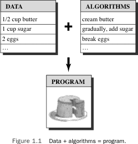

早期的过程式语言，如 FORTRAN 和 BASIC，随着程序规模增大，遇到了组织性问题。例如，程序经常使用分支语句，根据某种测试结果将执行流程引向一组或另一组指令。许多较老的程序有如此纠结的路由（称为“意大利面条式编程”），以至于几乎不可能通过阅读来理解程序，修改这样的程序无异于招致灾难。作为回应，计算机科学家开发了一种更有纪律的编程风格，称为结构化编程。C 语言包含了促进这种方法的特性。例如，结构化编程将分支（选择下一步执行哪条指令）限制为少数几种行为良好的结构。C 语言将这些结构（for 循环、while 循环、do while 循环和 if else 语句）纳入其词汇表。

自顶向下设计是新的原则之一。对于 C 语言，其思想是将大型程序分解为更小、更易于管理的任务。如果其中一项任务仍然过于宽泛，就将其分解为更小的任务。继续这一过程，直到程序被划分成小的、易于编程的模块。（整理你的书房。啊！好吧，整理你的书桌、桌面、文件柜和书架。啊！好吧，从书桌开始，整理每个抽屉，从中间那个开始。嗯，也许我能完成这项任务。）C 语言的设计促进了这种方法，鼓励你开发称为*函数*的程序单元来表示各个任务模块。你可能已经注意到，结构化编程技术反映了一种过程式思维模式，即从程序执行的操作角度来思考程序。

## C++ 的转变：面向对象编程

尽管结构化编程的原则提高了程序的清晰度、可靠性和易维护性，但大规模编程仍然是一个挑战。OOP 为这一挑战带来了新的方法。与强调算法的过程式编程不同，OOP 强调数据。OOP 不是试图让问题去适应语言的过程式方法，而是试图让语言适应问题。其思想是设计与问题基本特征相对应的数据形式。

在 C++ 中，*类*是描述这种新数据形式的规范，而*对象*是根据该计划构建的特定数据结构。例如，一个类可以描述公司高管的一般属性（如姓名、头衔、薪水、特殊能力），而一个对象则可以代表一位具体的高管（吉尔福德·希普布拉特，副总裁，年薪 925,000 美元，懂得如何恢复 Windows 注册表）。通常，类定义了用于表示*对象*的数据以及可对该数据执行的*操作*。例如，假设你正在开发一个能够绘制矩形的计算机绘图程序。你可以定义一个类来描述矩形。规范的数据部分可以包括角的位置、高度和宽度、边界线的颜色和样式，以及用于填充矩形的颜色和图案。规范的操作部分可以包括移动矩形、调整大小、旋转、更改颜色和图案，以及将矩形复制到其他位置的方法。如果你随后使用程序绘制一个矩形，程序将根据类规范创建一个对象。该对象将保存描述矩形的所有数据值，你可以使用类方法来修改该矩形。如果你绘制两个矩形，程序将创建两个对象，每个矩形一个。

OOP 的程序设计方法是首先设计能够准确表示程序所处理事物的类。例如，绘图程序可以定义类来表示矩形、直线、圆、画笔、钢笔等。请记住，类定义包括对每个类允许的操作的描述，例如移动圆或旋转直线。然后，你将使用这些类的对象来设计程序。从较低的组织级别（如类）到较高的级别（如程序设计）的过程，称为*自底向上*编程。

OOP 不仅仅是把数据和方法绑定到类定义中。例如，OOP 有助于创建可重用的代码，这最终可以节省大量工作。信息隐藏保护数据免受不当访问。多态性允许你为运算符和函数创建多个定义，由编程上下文决定使用哪个定义。继承允许你从旧类派生新类。正如你所看到的，OOP 引入了许多新思想，并涉及一种与过程式编程不同的编程方法。你不是专注于任务，而是专注于表示概念。你不是采用自顶向下的编程方法，有时会采用自底向上的方法。本书将引导你了解所有这些要点，并提供大量易于理解的示例。

设计一个有用、可靠的类可能是一项困难的任务。幸运的是，OOP 语言使得将现有类整合到你自己的编程中变得简单。供应商提供了各种有用的类库，包括旨在简化在 Windows 或 Macintosh 等环境下创建程序的类库。C++ 的真正优点之一是，它可以让你轻松地重用和改编现有的、经过充分测试的代码。

## C++ 与泛型编程

泛型编程是 C++ 支持的另一种编程范式。它与 OOP 的共同目标是简化代码复用，并采用抽象一般概念的技术。但是，OOP 强调编程的数据方面，而泛型编程强调对特定数据类型的独立性。而且它的焦点不同。OOP 是管理大型项目的工具，而泛型编程提供了执行常见任务的工具，例如对数据排序或合并列表。术语*泛型*指的是类型无关的代码。C++ 的数据表示有多种类型——整数、带小数部分的数字、字符、字符串，以及用户定义的由多种类型组成的复合结构。例如，如果你想要对这些不同类型的数据进行排序，通常需要为每种类型创建单独的排序函数。泛型编程涉及扩展语言，使你可以为泛型（即未指定的）类型编写一次函数，并将其用于各种实际类型。C++ 模板提供了这样做的机制。

## C++ 的起源

与 C 一样，C++ 诞生于贝尔实验室，比雅尼·斯特劳斯特鲁普在 20 世纪 80 年代初开发了该语言。用斯特劳斯特鲁普自己的话说，“C++ 的设计初衷主要是让我和我的朋友不必再用汇编语言、C 或各种现代高级语言编程。它的主要目的是让个人程序员更轻松、更愉快地编写优质程序”（比雅尼·斯特劳斯特鲁普，*《C++ 编程语言》*，第三版。马萨诸塞州雷丁：Addison-Wesley，1997）。

> ### 比雅尼·斯特劳斯特鲁普的主页
> 
> 比雅尼·斯特劳斯特鲁普设计并实现了 C++ 编程语言，并且是权威参考手册*《C++ 编程语言》*和*《C++ 的设计与演化》*的作者。他在 AT&T 实验室研究部的个人网站应该是你创建的第一个 C++ 书签或收藏：
> 
> www.research.att.com/~bs
> 
> 该网站包含了对 C++ 语言来龙去脉的有趣历史视角、斯特劳斯特鲁普的个人传记资料以及 C++ 常见问题解答（FAQ）。令人惊讶的是，斯特劳斯特鲁普最常被问到的问题可能是如何发音*比雅尼·斯特劳斯特鲁普*。查看斯特劳斯特鲁普网站上的 FAQ，下载 .WAV 文件，亲耳听一听吧！


Stroustrup 更关心让 C++ 变得实用，而不是强制执行特定的编程哲学或风格。在确定 C++ 语言特性时，实际的编程需求比理论纯粹性更重要。Stroustrup 将 C++ 建立在 C 之上，因为 C 简洁、适合系统编程、广泛可用，并且与 Unix 操作系统密切相关。C++ 的面向对象（OOP）方面受到一种名为 Simula 67 的计算机仿真语言的启发。Stroustrup 在不显著改变 C 组件的情况下，为 C 添加了 OOP 特性和泛型编程支持。因此，C++ 是 C 的超集，这意味着任何有效的 C 程序也是有效的 C++ 程序。存在一些细微差异，但无关紧要。C++ 程序可以使用现有的 C 软件库。库是编程模块的集合，你可以从程序中调用它们。它们为许多常见编程问题提供经过验证的解决方案，从而节省大量时间和精力。这有助于 C++ 的传播。

C++ 这个名字来自 C 的增量运算符 ++，它将变量的值加一。因此，C++ 这个名字正确地暗示了 C 的增强版本。

计算机程序将现实生活中的问题转化为计算机要执行的一系列动作。C++ 的 OOP 方面使该语言能够与问题中涉及的概念建立联系，而 C++ 的 C 部分使该语言能够贴近硬件（见图1.2）。这种能力组合促进了 C++ 的传播。当你从程序的一个方面转向另一个方面时，这可能还涉及思维方式的转换。（事实上，一些 OOP 纯粹主义者认为，给 C 添加 OOP 特性就像给猪加上翅膀，尽管那是一头精瘦、高效的猪。）另外，由于 C++ 将 OOP 嫁接到 C 上，你可以忽略 C++ 的面向对象特性。但如果你只这样做，你会错过很多。

只有在 C++ 取得一些成功之后，Stroustrup 才添加了模板，从而实现泛型编程。而且只有在模板特性被使用并增强之后，人们才明显看到，模板或许是和 OOP 同样重要的新增特性——有些人甚至会认为它更重要。C++ 同时融合了 OOP、泛型编程以及更传统的过程式方法，这一事实表明 C++ 强调实用主义而非意识形态，这也是该语言成功的原因之一。

## 可移植性与标准

假设你为工作中运行 Windows 2000 的老式 Pentium PC 编写了一个方便的 C++ 程序，但管理层决定用一台使用不同操作系统的新计算机替换这台机器，比如 Mac OS X 或 Linux，也许还采用不同的处理器设计，例如 SPARC 处理器。你能在新平台上运行你的程序吗？当然，你必须使用为新平台设计的 C++ 编译器重新编译该程序。但是，你需要对自己编写的代码做任何修改吗？如果你无需修改就能重新编译程序，并且它运行顺利，我们就说该程序是可移植的。

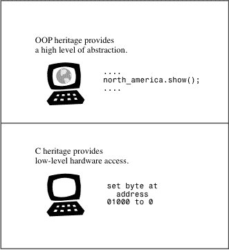

图1.2 C++ 的双重性。

可移植性有两个障碍，第一个是硬件。特定于硬件的程序不太可能具有可移植性。例如，一个直接控制 IBM PC 视频板的程序，对于 Sun 计算机来说，就像在说胡话。（你可以通过将依赖硬件的部分本地化到函数模块中来最小化可移植性问题；这样你只需重写那些特定模块。）本书避免这种编程。

可移植性的第二个障碍是语言分歧。当然，口语也会有这个问题。一个约克郡人对当天事件的描述可能无法移植到布鲁克林，尽管据说这两个地区都讲英语。计算机语言也可能发展出方言。尽管大多数实现者希望让自己的 C++ 版本与其他版本兼容，但如果没有一份已发布的标准来准确描述该语言如何工作，就很难做到这一点。因此，美国国家标准协会（ANSI）在1990年成立了一个委员会（ANSI X3J16）来制定 C++ 标准（ANSI 已经制定了 C 标准）。国际标准化组织（ISO）很快带着自己的委员会（ISO-WG-21）加入这一进程，形成了 ANSI/ISO 联合制定 C++ 标准的努力。经过数年的工作，最终产生了国际标准（ISO/IEC 14882:1998），该标准于1998年由 ISO、国际电工委员会（IEC）和 ANSI 采纳。这一标准通常称为 C++98，它不仅细化了现有 C++ 特性的描述，还通过异常、运行时类型识别（RTTI）、模板和标准模板库（STL）扩展了该语言。2003年发布了 C++ 标准的第二版（ISO/IEC 14882:2003）；新版本是一次技术修订，意味着它整理了第一版——修正拼写错误、减少歧义等——但不改变语言特性。这一版本通常称为 C++03。由于 C++03 没有改变语言特性，我们将遵循常见用法，用 C++98 来指代 C++98/C++03。

C++ 继续发展，ISO 委员会于2011年8月批准了一项新标准，编号为 ISO/IEC 14882:2011，并被非正式地称为 C++11。与 C++98 一样，C++11 为该语言增加了许多特性。此外，它的目标是消除不一致之处，并使 C++ 更易于学习和使用。该标准曾被称作 C++0x，最初预期 x 会是 7 或 8，但标准工作是缓慢、详尽且令人疲惫的过程。幸运的是，人们很快意识到 0x 会是一个十六进制整数（见附录 A“数制”），这意味着委员会要到2015年才需完成工作。因此，按照这个标准衡量，他们提前完成了任务。

ISO C++ 标准还借鉴了 ANSI C 标准，因为 C++ 应尽可能成为 C 的超集。这意味着任何有效的 C 程序理想上也应该是有效的 C++ 程序。ANSI C 与 C++ 的相应规则之间有一些差异，但都很小。事实上，ANSI C 吸收了一些最初在 C++ 中引入的特性，例如函数原型和 `const` 类型限定符。

在 ANSI C 出现之前，C 社区遵循一种事实标准，该标准基于 Kernighan 和 Ritchie 所著的*《C 程序设计语言》*（Addison-Wesley Publishing Company，Reading，MA，1978）一书。这一标准通常被称为 K&R C；随着 ANSI C 的出现，较简单的 K&R C 现在有时被称为*经典 C*。

ANSI C 标准不仅定义了 C 语言，还定义了一个 ANSI C 实现必须支持的标准 C 库。C++ 也使用该库；本书将其称为*标准 C 库*或*标准库*。此外，ISO C++ 标准提供了一个 C++ 类的标准库。

C 标准最后一次修订为 C99，该标准于1999年被 ISO 采纳，并于2000年被 ANSI 采纳。该标准为 C 添加了一些特性，例如一种新的整数类型，一些 C++ 编译器支持这些特性。

## 语言的发展

最初，C++ 的事实标准是一份65页的参考手册，收录在 Stroustrup 所著的328页的*《C++ 程序设计语言》*（Addison-Wesley，1986）中。

下一个重要的已发布事实标准是 Ellis 和 Stroustrup 所著的*《C++ 参考手册（注释版）》*（Addison-Wesley，1990）。这是一部453页的著作；除了参考资料外，它还包含大量评论。

C++98 标准由于增加了许多特性，即使只有极少的注释，也达到了近800页。

C++11 标准长达1350多页，因此它大幅扩充了旧标准。

## 本书与 C++ 标准

当代编译器为 C++98 提供了良好支持。在撰写本书时，一些编译器也支持部分 C++11 特性，而且既然新标准已被采纳，我们可以预期支持程度会迅速提高。本书反映了当前情况，相当全面地涵盖 C++98，并介绍若干 C++11 特性。其中一些特性与相关 C++ 主题的讲解结合在一起。第18章“探访新的 C++ 标准”集中介绍新特性，总结本书前面提到的特性，并展示其他特性。

鉴于撰写本书时可用的支持并不完整，要充分涵盖所有新的 C++11 特性将非常困难。但即使新标准得到完全支持，显然全面覆盖也会超出任何篇幅合理的书籍的范围。本书采取的方法是集中介绍一些编译器已经提供的特性，并简要总结许多其他特性。

在进入 C++ 语言本身之前，让我们先介绍一些与创建程序相关的基础知识。

## 创建程序的机制

假设你已经编写了一个 C++ 程序。如何让它运行起来？具体步骤取决于你的计算机环境和你使用的特定 C++ 编译器，但应该与以下步骤类似（见图1.3）：

- 1. 使用某种文本编辑器编写程序并将其保存到文件中。该文件构成程序的*源代码*。
- 2. 编译源代码。这意味着运行一个程序，将源代码转换为宿主计算机使用的内部语言，称为*机器语言*。包含翻译后程序的文件是程序的*目标代码*。
- 3. 将目标代码与其他代码链接。例如，C++ 程序通常使用*库*。C++ 库包含一组计算机例程（称为*函数*）的目标代码，用于执行诸如在屏幕上显示信息或计算数字平方根之类的任务。链接会将你的目标代码与你所用函数的目标代码以及一些标准启动代码组合起来，生成程序的*运行时*版本。包含这一最终产品的文件称为*可执行代码*。

你将在本书中经常遇到*源代码*这个术语，所以一定要把它存入你的个人随机存取存储器中。


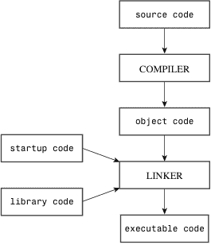

图 1.3 编程步骤。

本书中的大多数程序都是通用的，应当能在任何支持 C++98 的系统中运行。然而，有些程序，尤其是第 18 章中的程序，确实需要一定的 C++11 支持。在撰写本书时，一些编译器需要额外的标志才能启用其部分 C++11 支持。例如，从 4.3 版开始，g++ 在编译源代码文件时目前使用 -std=c++0x 标志：

```
g++ -std=c++0x use_auto.cpp
```

构建程序的步骤可能有所不同。我们再进一步看看这些步骤。

## 创建源代码文件

本书其余部分讨论源文件中包含的内容；本节讨论创建源文件的具体操作。一些 C++ 实现，例如 Microsoft Visual C++、Embarcadero C++ Builder、Apple Xcode、Open Watcom C++、Digital Mars C++ 和 Freescale CodeWarrior，提供了集成开发环境（IDE），让你可以在一个主程序中管理程序开发的所有步骤，包括编辑。其他实现，例如 Unix 和 Linux 上的 GNU C++、AIX 上的 IBM XL C/C++，以及 Borland 5.5（由 Embarcadero 分发）和 Digital Mars 编译器的免费版本，只处理编译和链接阶段，并要求你在系统命令行上输入命令。在这种情况下，你可以使用任何可用的文本编辑器来创建和修改源代码。例如，在 Unix 系统上，你可以使用 vi、ed、ex 或 emacs。在命令提示符模式下运行的 Windows 系统上，你可以使用 edlin。

## 编译与链接

最初，Stroustrup 使用一个 C++ 到 C 的编译器程序来实现 C++，而不是开发一个直接将 C++ 转换为目标代码的编译器。这个程序称为 cfront（即 *C 前端*），它将 C++ 源代码转换为 C 源代码，然后可以由标准 C 编译器编译。这种方法简化了将 C++ 引入 C 社区的过程。其他实现也使用这种方法将 C++ 引入其他平台。随着 C++ 的发展和流行，越来越多的实现者转向创建直接从 C++ 源代码生成目标代码的 C++ 编译器。这种直接方法加快了编译过程，并强调 C++ 是一种独立的语言，尽管它与 C 相似。

编译的具体机制取决于实现，下面几节概述几种常见形式。这些小节只概述基本步骤，不能替代查阅系统文档。

### Unix 编译与链接

最初，Unix 的 CC 命令会调用 cfront。然而，cfront 未能跟上 C++ 的演进，其最后一个版本发布于 1993 年。如今，一台 Unix 计算机可能没有编译器，也可能有专有编译器或第三方编译器，后者可能是商业软件，也可能是免费软件，例如 GNU g++ 编译器。在许多其他情况下（但不是在没有编译器的情况下！），CC 命令仍然可用，但实际调用的编译器因系统而异。为简单起见，我们假设 CC 可用，但你要意识到，在下面的讨论中，你可能需要用一个不同的命令来替代 CC。

你使用 CC 命令来编译程序。该名称使用大写字母，以区别于标准 Unix C 编译器 cc。CC 编译器是一个命令行编译器，这意味着你要在 Unix 命令行上输入编译命令。

例如，要编译 C++ 源代码文件 `spiffy.C`，你可以在 Unix 提示符下输入以下命令：

```
CC spiffy.C
```

如果凭借技巧、专注或运气，你的程序没有错误，编译器会生成一个扩展名为 o 的目标代码文件。在这种情况下，编译器会生成一个名为 `spiffy.o` 的文件。

接下来，编译器会自动将目标代码文件传递给系统链接器，该程序将你的代码与库代码组合起来，生成可执行文件。默认情况下，可执行文件称为 `a.out`。如果你只使用了一个源文件，链接器还会删除 `spiffy.o` 文件，因为不再需要它。要运行程序，你只需输入可执行文件的名称：

```
a.out
```

请注意，如果你编译一个新程序，新的 `a.out` 可执行文件会替换之前的 `a.out`。（这是因为可执行文件占用大量空间，因此覆盖旧的可执行文件有助于降低存储需求。）但如果你开发了一个想要保留的可执行程序，只需使用 Unix 的 mv 命令更改可执行文件的名称。

在 C++ 中，与 C 一样，你可以将一个程序分散到多个文件中。（本书第 8 章到第 16 章中的许多程序都这样做。）在这种情况下，你可以通过在命令行中列出所有文件来编译程序，如下所示：

```
CC my.C precious.C
```

如果有多个源代码文件，编译器不会删除目标代码文件。这样，如果你只更改了 my.C 文件，就可以用以下命令重新编译程序：

```
CC my.C precious.o
```

这会重新编译 my.C 文件，并将其与之前编译的 precious.o 文件链接起来。你可能需要显式指定一些库。例如，要访问数学库中定义的函数，你可能需要在命令行中添加 -lm 标志：

```
CC usingmath.C -lm
```

### Linux 编译与链接

Linux 系统最常使用 g++，即自由软件基金会提供的 GNU C++ 编译器。大多数 Linux 发行版都包含该编译器，但它可能并不总是已安装。g++ 编译器的用法与标准 Unix 编译器非常相似。例如，以下命令会生成一个名为 `a.out` 的可执行文件：

```
g++ spiffy.cxx
```

某些版本可能要求你链接 C++ 库：

```
g++ spiffy.cxx -lg++
```

要编译多个源文件，只需在命令行中列出它们：

```
g++ my.cxx precious.cxx
```

这会生成一个名为 `a.out` 的可执行文件，以及两个目标代码文件 my.o 和 precious.o。如果你随后只修改了其中一个源代码文件，比如 my.cxx，你可以使用 my.cxx 和 precious.o 重新编译：

```
g++ my.cxx precious.o
```

GNU 编译器可用于许多平台，包括基于 Windows 的 PC 的命令行模式，以及各种平台上的 Unix 系统。

### Windows 命令提示符模式下的命令行编译器

在 Windows PC 上编译 C++ 程序的一种低成本途径，是下载一个在 Windows 命令提示符模式下运行的免费命令行编译器，该模式会打开一个类似 MS-DOS 的窗口。包含 GNU C++ 编译器的免费 Windows 下载有 Cygwin 和 MinGW；它们使用 g++ 作为编译器名称。

要使用 g++ 编译器，首先打开一个命令提示符窗口。Cygwin 和 MinGW 会在你启动这些程序时自动为你完成此操作。要编译一个名为 `great.cpp` 的源代码文件，请在提示符下输入以下命令：

```
g++ great.cpp
```

如果程序编译成功，生成的可执行文件名为 `a.exe`。

### Windows 编译器

Windows 产品数量太多，且经常修订，因此逐一描述它们并不合理。目前最流行的是 Microsoft Visual C++ 2010，它可在免费的 Microsoft Visual C++ 2010 Express 版中获取。维基百科链接（http://en.wikipedia.org/wiki/List_of_compilers）提供了许多平台（包括 Windows）的编译器综合列表。尽管设计目标不同，大多数基于 Windows 的 C++ 编译器都共享一些共同特征。

通常，你必须为一个程序创建一个项目，并将构成该程序的一个或多个文件添加到项目中。每个供应商都提供一个 IDE，其中包含菜单选项，并可能在创建项目时提供自动化辅助。你必须确定的一件非常重要的事情是你要创建的程序类型。通常，编译器会提供许多选择，例如 Windows 应用程序、MFC Windows 应用程序、动态链接库、ActiveX 控件、DOS 或字符模式可执行文件、静态库或控制台应用程序。其中一些可能同时提供 64 位和 32 位版本。

由于本书中的程序是通用的，你应当避免选择需要平台特定代码的选项，例如 Windows 应用程序。相反，你希望在基于字符的模式下运行。具体选择取决于编译器。一般来说，你应当查看是否有标记为 Console、character-mode 或 DOS executable 的选项，并尝试使用它。例如，在 Microsoft Visual C++ 2010 中，选择 Win32 Console Application 选项，单击 Application Settings，然后选择 Empty Project 选项。在 C++Builder XE 中，在 C++Builder Projects 下选择 Console Application。

项目设置完成后，你必须编译和链接程序。IDE 通常会给你几个选择，例如 Compile、Build、Make、Build All、Link、Execute、Run 和 Debug（但同一个 IDE 中不一定都有这些选择！）：

- *Compile* 通常表示编译当前打开文件中的代码。
- *Build* 或 *Make* 通常表示编译项目中所有源代码文件的代码。这通常是一个增量过程。也就是说，如果项目有三个文件，而你只更改了其中一个，那么只会重新编译那一个文件。
- *Build All* 通常表示从头编译所有源代码文件。
- 如前所述，*Link* 表示将编译后的源代码与必要的库代码合并。
- *Run* 或 *Execute* 表示运行程序。通常，如果你尚未完成前面的步骤，Run 会在尝试运行程序之前完成这些步骤。
- *Debug* 表示在可以选择单步执行的情况下运行程序。


## Mac 上的 C++

苹果目前随 Mac OS X 操作系统提供了一个名为 Xcode 的开发者框架。它是免费的，但通常不会预装。你可以从操作系统安装盘安装它，也可以从苹果公司以象征性费用下载。（请注意，其下载量超过 4GB。）它不仅提供了一个支持多种编程语言的集成开发环境（IDE），还安装了几个编译器——g++ 和 clang——它们可以在通过终端工具访问的 Unix 模式下作为命令行程序使用。

> **提示**
>
> 关于 IDE：为了节省时间，你可以只用一个项目来存放所有示例程序。只需从项目列表中删除之前的示例源代码文件，然后添加当前的源代码即可。这样可以节省时间、精力，并减少磁盘杂乱。

## 小结

随着计算机变得越来越强大，计算机程序也变得越来越大、越来越复杂。为了应对这些情况，计算机语言也在不断演进，使得编程过程更容易管理。C 语言引入了控制结构和函数等特性，以更好地控制程序流程，并实现更结构化、模块化的方法。在这些工具的基础上，C++ 增加了对面向对象编程和泛型编程的支持。这实现了更高的模块化，并促进了可重用代码的创建，从而节省时间并提高程序可靠性。

C++ 的流行导致了针对许多计算平台的大量实现；C++ ISO 标准（C++98/03 和 C++11）为保持这些众多实现的相互兼容提供了基础。该标准规定了语言应具备的特性、语言应表现出的行为，以及函数、类和模板的标准库。该标准支持跨不同计算平台和不同语言实现的便携式语言目标。

要创建一个 C++ 程序，你需创建一个或多个源文件，其中包含用 C++ 语言表达的程序。这些是文本文件，必须经过编译和链接才能生成构成可执行程序的机器语言文件。这些任务通常在 IDE 中完成，IDE 提供用于创建源文件的文本编辑器、用于生成可执行文件的编译器和链接器，以及项目管理、调试功能等其他资源。但同样的任务也可以在命令行环境中通过单独调用适当的工具来完成。

## 2 开始学习 C++

在本章中，你将了解以下内容：

- 创建一个 C++ 程序
- C++ 程序的一般格式
- `#include` 指令
- `main()` 函数
- 使用 `cout` 对象进行输出
- 在 C++ 程序中放置注释
- 如何以及何时使用 `endl`
- 声明和使用变量
- 使用 `cin` 对象进行输入
- 定义和使用简单函数

当你建造一座简单的住宅时，你从地基和框架开始。如果从一开始就没有牢固的结构，以后在填充细节时就会遇到麻烦，例如窗户、门框、天文台圆顶和镶木舞厅。同样，当你学习一门计算机语言时，你应该从学习程序的基本结构开始。只有这样，你才能继续学习细节，例如循环和对象。本章概述了 C++ 程序的基本结构，并预览了一些主题——特别是函数和类——这些主题将在后面的章节中更详细地介绍。（这样做的目的是在通往后来重大领悟的路上，逐步引入至少一些基本概念。）

### C++ 入门

让我们从一个显示消息的简单 C++ 程序开始。程序清单 2.1 使用 C++ 的 `cout`（发音为“see-out”）设施来生成字符输出。源代码中包含了几条给读者的注释；这些行以 `//` 开头，编译器会忽略它们。C++ 是区分大小写的；也就是说，它会区分大写字母和小写字母。这意味着你必须小心使用与示例相同的大小写。例如，此程序使用 `cout`，如果你替换为 `Cout` 或 `COUT`，编译器会拒绝你的代码并指责你使用了未知标识符。（编译器也区分拼写，所以也不要尝试 `coud` 或 `coot`。）`.cpp` 文件扩展名是表示 C++ 程序的常用方式；你可能需要使用不同的扩展名，如第 1 章“C++ 入门”所述。

**程序清单 2.1. myfirst.cpp**

```cpp
// myfirst.cpp -- displays a message

#include <iostream>                    // a PREPROCESSOR directive
int main()                             // function header
{                                      // start of function body
    using namespace std;               // make definitions visible
    cout << "Come up and C++ me some time.";  // message
    cout << endl;                      // start a new line
    cout << "You won't regret it!" << endl;   // more output
    return 0;                          // terminate main()
}                                      // end of function body
```

### 程序调整

你可能会发现必须修改本书中的示例才能在系统上运行。最常见的原因是编程环境的问题。某些窗口环境会在单独窗口中运行程序，然后在程序结束时自动关闭该窗口。如第 1 章所述，你可以通过在 `return` 语句之前添加以下代码行来让窗口保持打开，直到你按下某个键：

```cpp
cin.get();
```

对于某些程序，你必须添加两行这样的代码才能让窗口保持打开直到你按键。你将在第 4 章“复合类型”中了解更多关于 `cin.get()` 的内容。

如果你的系统非常老旧，它可能不支持 C++98 标准引入的特性。有些程序需要编译器对 C++11 标准有一定程度的支持。这些程序会被明确标识，并且如果可能的话，会建议替代的非 C++11 代码。

使用你选择的编辑器复制此程序（或者使用本书网页上在线提供的源代码文件——有关更多信息，请查看封底的注册链接），然后你可以按照第 1 章所述，使用你的 C++ 编译器创建可执行代码。以下是运行程序清单 2.1 中编译后程序的输出：

```text
Come up and C++ me some time.
You won't regret it!
```

### C 的输入和输出

如果你习惯于用 C 语言编程，看到 `cout` 而不是 `printf()` 函数可能会有点惊讶。事实上，C++ 可以使用 `printf()`、`scanf()` 以及所有其他标准 C 输入输出函数，前提是你包含通常的 C 头文件 `stdio.h`。但这是一本 C++ 书籍，所以它使用 C++ 的输入设施，这些设施在许多方面都比 C 版本有所改进。

你从称为 *函数* 的构建块来构建 C++ 程序。通常，你将程序组织为几个主要任务，然后设计单独的函数来处理这些任务。程序清单 2.1 中显示的示例非常简单，只包含一个名为 `main()` 的函数。*myfirst.cpp* 示例具有以下元素：

- 注释，由 `//` 前缀表示
- 一条预处理 `#include` 指令
- 函数头：`int main()`
- 一条 `using namespace` 指令
- 函数体，由 `{` 和 `}` 分隔
- 使用 C++ `cout` 设施显示消息的语句
- 一条终止 `main()` 函数的返回语句

让我们更详细地看看这些各种元素。`main()` 函数是一个很好的起点，因为 `main()` 之前的一些特性（例如预处理指令）在你看到 `main()` 的作用后会更容易理解。

### `main()` 函数的特性

去掉修饰后，程序清单 2.1 中显示的示例程序具有以下基本结构：

```cpp
int main()
{

    statements
    return 0;
}
```

这些行说明有一个名为 `main()` 的函数，并描述了该函数的行为方式。它们共同构成一个 *函数定义*。此定义由两部分组成：第一行 `int main()`，称为 *函数头*，以及用大括号（`{` 和 `}`）括起来的部分，即 *函数体*。（快速在网上搜索会发现大括号还有其他名称，包括“curly brackets”、“flower brackets”、“fancy brackets”和“chicken lips”。）然而，ISO 标准使用术语“braces”（大括号）。函数头是函数与程序其余部分接口的简要总结，函数体则代表计算机关于函数应做什么的指令。在 C++ 中，每条完整指令称为 *语句*。你必须用分号结束每条语句，因此在输入示例时不要省略分号。


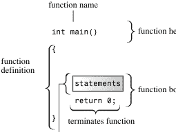

`main()` 中的最后一条语句称为*返回语句*，它终止函数。随着你读完本章，你将更多地了解返回语句。

## 语句和分号

语句表示要执行的动作。为了理解你的源代码，编译器需要知道一条语句在何处结束、另一条语句在何处开始。有些语言使用语句分隔符。例如，FORTRAN 使用行尾来分隔语句。Pascal 使用分号来分隔语句。在 Pascal 中，某些情况下你可以省略分号，例如在 END 之前的语句后面，此时你实际上并不是在分隔两条语句。（实用主义者和极简主义者会对*能*是否意味着*应该*这一问题产生分歧。）但 C++ 和 C 一样，将分号用作*终止符*，而不是分隔符。区别在于，作为终止符的分号是语句的*一部分*，而不是语句*之间*的标记。实际结果是，在 C++ 中永远不应省略分号。

## 函数头作为接口

现在要记住的重点是，C++ 语法要求你使用这个函数头开始定义 `main()` 函数：`int main()`。本章稍后将在“函数”一节中更详细地讨论函数头语法，但为了让那些无法抑制好奇心的人先睹为快，这里做一个预览。

一般而言，C++ 函数由另一个函数激活或*调用*，函数头描述了函数与其调用函数之间的接口。函数名之前的部分称为*函数返回类型*；它描述了从函数返回到调用它的函数的信息流。函数名后面括号中的部分称为*参数列表*或*形参列表*；它描述了从调用函数到被调用函数的信息流。当你将这一通用描述应用于 `main()` 时，会有点令人困惑，因为你通常不会从程序的其他部分调用 `main()`。然而，通常情况下，`main()` 是由编译器添加到程序中的启动代码调用的，这些代码在程序与操作系统（Unix、Windows 7、Linux 或其他系统）之间起中介作用。实际上，函数头描述了 `main()` 与操作系统之间的接口。

考虑一下 `main()` 的接口描述，从 `int` 部分开始。一个被另一个函数调用的 C++ 函数可以向激活（调用）它的函数返回一个值。该值称为*返回值*。在本例中，`main()` 可以返回一个整数值，正如关键字 `int` 所表示的那样。接下来，注意空的括号。通常，C++ 函数在调用另一个函数时可以向该函数传递信息。函数头中括号括起来的部分描述了这些信息。在本例中，空的括号意味着 `main()` 函数不接收信息，或者用通常的术语来说，`main()` 不带参数。（说 `main()` 不带参数并不意味着 `main()` 是一个不讲理的、专制的函数。相反，*参数*是计算机爱好者用来指代从一个函数传递给另一个函数的信息的术语。）

简而言之，下面的函数头表明 `main()` 函数向调用它的函数返回一个整数值，并且 `main()` 不从调用它的函数接收任何信息：

```
int main()
```

许多现有程序使用经典 C 函数头替代：

```
main()    // original C style
```

在经典 C 中，省略返回类型等同于说函数是 `int` 类型。然而，C++ 已逐步淘汰了这种用法。

你也可以使用这种变体：

```
int main(void)    // very explicit style
```

在括号中使用关键字 `void` 是一种明确表示函数不接受参数的方式。在 C++（但不是 C）中，括号留空等同于在括号中使用 `void`。（在 C 中，括号留空意味着你对是否存在参数保持沉默。）

有些程序员使用这个函数头并省略返回语句：

```
void main()
```

这在逻辑上是一致的，因为 `void` 返回类型意味着函数不返回值。然而，尽管这种变体在某些系统上可以工作，但它不是 C++ 标准的一部分。因此，在其他系统上它会失败。所以你应该避免这种形式，使用 C++ 标准形式；正确使用并不需要太多额外的努力。

最后，ISO C++ 标准对那些抱怨必须在 `main()` 末尾放置返回语句这一令人厌烦的必要性的人做出了让步。如果编译器到达 `main()` 的末尾却没有遇到返回语句，其效果将与你用以下语句结束 `main()` 相同：

```
return 0;
```

这种隐式返回仅提供给 `main()`，而不提供给任何其他函数。

## 为什么 `main()` 换个名字就不行？

将 `myfirst.cpp` 程序中的函数命名为 `main()` 有一个极其令人信服的理由：你必须这样做。通常，C++ 程序需要一个名为 `main()` 的函数。（顺便说一下，不是 `Main()` 或 `MAIN()` 或 `mane()`。记住，大小写和拼写都很重要。）因为 `myfirst.cpp` 程序只有一个函数，所以该函数必须承担起作为 `main()` 的责任。当你运行 C++ 程序时，执行总是从 `main()` 函数的开头开始。因此，如果你没有 `main()`，就没有完整的程序，编译器会指出你尚未定义 `main()` 函数。

也有例外。例如，在 Windows 编程中，你可以编写动态链接库（DLL）模块。这是其他 Windows 程序可以使用的代码。因为 DLL 模块不是独立程序，所以它不需要 `main()`。面向专用环境的程序，例如机器人中的控制器芯片，可能不需要 `main()`。有些编程环境提供了一个骨架程序，调用一些非标准函数，如 `tmain()`：在这种情况下，有一个隐藏的 `main()` 调用 `tmain()`。但普通的独立程序确实需要 `main()`；本书讨论的正是这类程序。

## C++ 注释

双斜杠（`//`）引入一条 C++ 注释。*注释*是程序员写给读者的话，通常用于标识程序的某个部分或解释代码的某些方面。编译器会忽略注释。毕竟，它至少和你一样懂 C++，而且无论如何，它都无法理解注释。就编译器而言，清单 2.1 看起来就像没有注释一样，如下所示：

```cpp
#include <iostream>
int main()
{
    using namespace std;
    cout << "Come up and C++ me some time.";
    cout << endl;
    cout << "You won't regret it!" << endl;
    return 0;
}
```

C++ 注释从 `//` 开始，一直到行尾。注释可以独占一行，也可以与代码在同一行。顺便说一下，注意清单 2.1 中的第一行：

```cpp
// myfirst.cpp -- displays a message
```

在本书中，所有程序都以一条注释开头，给出源代码的文件名和简短的程序摘要。如第 1 章所述，源代码的文件扩展名取决于你的 C++ 系统。其他系统可能使用 `myfirst.c` 或 `myfirst.cxx` 作为文件名。

> **提示**
>
> 你应该使用注释来记录你的程序。程序越复杂，注释就越有价值。注释不仅帮助他人理解你所做的事情，也帮助你理解自己所做的事情，尤其是当你有一段时间没有查看该程序时。

## C 风格注释

C++ 也识别 C 注释，C 注释用 `/*` 和 `*/` 符号括起来：

```
#include <iostream>  /* a C-style comment */
```

因为 C 风格注释由 `*/` 而不是行尾结束，所以你可以将其扩展到多行。你可以在程序中使用其中一种风格，也可以两种都用。但是，尽量坚持使用 C++ 风格。因为它不需要记住将结束符号与开始符号正确配对，所以不太可能引起问题。事实上，C99 已将 `//` 注释添加到 C 语言中。

## C++ 预处理器与 iostream 文件

这里是你需要知道的简短版本：如果你的程序要使用通常的 C++ 输入或输出功能，你需要提供这两行：

```
#include <iostream>
using namespace std;
```

使用第二行有一些替代方案，但我们现在还是保持简单。（如果你的编译器不喜欢这些行，那么它不兼容 C++98，并且它在处理本书中的示例时还会遇到许多其他问题。）这就是让程序正常工作真正需要了解的全部内容，但现在让我们更深入地了解一下。

C++ 和 C 一样，使用预处理器。这是一个在主编译之前处理源文件的程序。（你可能还记得第 1 章中提到，有些 C++ 实现使用翻译程序将 C++ 程序转换为 C。虽然翻译程序也是一种预处理器，但我们不是在讨论那个预处理器；相反，我们讨论的是处理名称以 # 开头的指令的那个预处理器。）你不必做任何特殊操作来调用这个预处理器。当你编译程序时，它会自动运行。

清单 2.1 使用了 `#include` 指令：

```
#include <iostream>      // a PREPROCESSOR directive
```

该指令使预处理器将 iostream 文件的内容添加到你的程序中。这是典型的预处理器操作：在编译之前添加或替换源代码中的文本。

这就引出了一个问题：为什么要把 iostream 文件的内容添加到程序中？答案与程序与外部世界之间的通信有关。iostream 中的 io 指的是输入（input）和输出（output），输入是带入程序的信息，输出是从程序发送出的信息。C++ 的输入/输出方案涉及 iostream 文件中的若干定义。你的第一个程序需要


## 命名空间

如果你使用 `iostream` 而不是 `iostream.h`，则应使用以下命名空间指令，使 `iostream` 中的定义可用于你的程序：

```
using namespace std;
```

这被称为 *using 指令*。最简单的做法是暂时接受这一点，以后再操心（例如，在第9章“内存模型与命名空间”中）。不过，为了不让你完全摸不着头脑，下面概述一下正在发生的事情。

命名空间支持是 C++ 的一项特性，旨在简化大型程序以及组合来自多个供应商的现有代码的程序的编写，并帮助组织程序。一个潜在问题是，你可能使用两个预打包产品，它们都有一个名为 `wanda()` 的函数。如果你随后使用 `wanda()` 函数，编译器就不知道你指的是哪个版本。命名空间机制让供应商可以将其产品打包到一个称为 *命名空间* 的单元中，这样你就可以使用命名空间名称来指明想要哪个供应商的产品。因此，Microflop Industries 可以将其定义放在一个名为 `Microflop` 的命名空间中。那么 `Microflop::wanda()` 就会成为其 `wanda()` 函数的全名。类似地，`Piscine::wanda()` 将表示 Piscine Corporation 版本的 `wanda()`。因此，你的程序现在可以使用命名空间来区分不同版本：

```
Microflop::wanda("go dancing?");        // use Microflop namespace version
Piscine::wanda("a fish named Desire");  // use Piscine namespace version
```

本着这种精神，作为 C++ 编译器标准组成部分的类、函数和变量现在都放在一个名为 `std` 的命名空间中。这发生在不带 .h 的头文件中。这意味着，例如，用于输出并在 `iostream` 中定义的 `cout` 变量实际上名为 `std::cout`，而 `endl` 实际上是 `std::endl`。因此，你可以省略 using 指令，而改用以下风格编写代码：

```
std::cout << "Come up and C++ me some time.";
std::cout << std::endl;
```

然而，许多用户不想把使用 `iostream.h` 和 `cout` 的命名空间之前的代码转换为使用 `iostream` 和 `std::cout` 的命名空间代码，除非他们能不太麻烦地做到这一点。这正是 using 指令的用武之地。下面这一行意味着你可以使用 `std` 命名空间中定义的名称，而无需使用 `std::` 前缀：

```
using namespace std;
```

这条 using 指令使 `std` 命名空间中的所有名称都可用。现代实践认为这有点偷懒，并且在大型项目中可能成为问题。更可取的方法是使用 `std::` 限定符，或使用所谓的 using 声明来只让特定名称可用：

```
using std::cout;    // make cout available
using std::endl;    // make endl available
using std::cin;     // make cin available
```

如果你使用这些指令而不是下面这条，就可以使用 `cin` 和 `cout` 而不必给它们加上 `std::`：

```
using namespace std;  // lazy approach, all names available
```

但如果你需要使用 `iostream` 中的其他名称，就必须将它们逐个加入 using 列表。本书最初采用这种偷懒的做法，原因有几个。第一，对于简单程序而言，你采用哪种命名空间管理技术并不是什么大问题。第二，我更想强调学习 C++ 的更基础方面。本书后面会使用其他命名空间技术。

## 使用 cout 进行 C++ 输出

现在来看看如何显示消息。`myfirst.cpp` 程序使用了以下 C++ 语句：

```
cout << "Come up and C++ me some time.";
```

双引号括起来的部分是要打印的消息。在 C++ 中，任何用双引号括起来的字符序列都称为 *字符串*，大概是因为它由若干字符串接成一个更大的单元。`<<` 记法表示该语句正在把字符串发送给 `cout`；这些符号指明了信息流动的方向。那么 `cout` 是什么呢？它是一个预定义对象，知道如何显示各种内容，包括字符串、数字和单个字符。（你可能还记得，*对象* 是类的特定实例，而 *类* 定义数据如何存储和使用。）

嗯，这么早使用对象有点别扭，因为你要再过几章才会学习对象。实际上，这揭示了对象的一个优势：你不必了解对象的内部构造就能使用它。你只需知道它的接口——也就是如何使用它。`cout` 对象有一个简单的接口。如果 string 表示一个字符串，你可以这样做来显示它：

```
cout << string;
```

要显示字符串，你只需知道这些；但现在看看 C++ 的概念视图如何表示这一过程。在这种视图中，输出是一个流——即从程序流出的一系列字符。`cout` 对象代表该流，其属性定义在 `iostream` 文件中。`cout` 的对象属性包括一个插入运算符（`<<`），它将其右侧的信息插入流中。考虑以下语句（注意结尾的分号）：

```
cout << "Come up and C++ me some time.";
```

它把字符串“Come up and C++ me some time.”插入输出流。因此，与其说你的程序显示了一条消息，不如说它把一个字符串插入输出流。不知怎么，这听起来更了不起（见图2.2）。

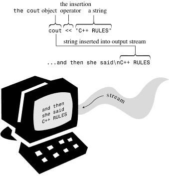

图2.2  使用 cout 显示字符串。

## 初识运算符重载

如果你从 C 转向 C++，可能已经注意到插入运算符（<<）看起来就像按位左移运算符（<<）。这是 *运算符重载* 的一个例子：同一个运算符符号可以具有不同含义。编译器利用上下文来判断意图是哪种含义。C 本身也有一些运算符重载。例如，& 符号既表示取地址运算符，也表示按位与运算符。* 符号既表示乘法，也表示解引用指针。这里的重点不是这些运算符的具体功能，而是同一个符号可以具有不止一种含义，由编译器根据上下文确定正确含义。（你在判断“sound card”中的“sound”与“sound financial basis”中的“sound”含义时，做的也差不多。）C++ 扩展了运算符重载的概念，允许你为称为类的用户定义类型重新定义运算符含义。

## 操纵符 endl

现在来看看代码清单2.1中第二条输出语句里出现的一个看起来奇怪的记法：

```
cout << endl;
```

endl 是一种特殊的 C++ 记法，表示开始新行这一重要概念。将 endl 插入输出流会使屏幕光标移动到下一行开头。像 endl 这样对 cout 具有特定含义的特殊记法被称为 *操纵符*。与 cout 一样，endl 定义在 iostream 头文件中，并且是标准命名空间的一部分。

注意，cout 设施在打印字符串时不会自动移到下一行，因此代码清单2.1中的第一条 cout 语句会让光标停在输出字符串末尾的句点之后。每条 cout 语句的输出都从上次输出结束的位置开始，所以省略 endl 会使代码清单2.1产生如下输出：

Come up and C++ me some time. You won’t regret it!

注意，\n 紧跟在句点之后。再看另一个例子。假设你尝试以下代码：

```
cout << "The Good, the";
cout << "Bad, ";
cout << "and the Ukulele";
cout << endl;
```

它产生以下输出：

```
The Good, theBad, and the Ukulele
```

再次注意，一个字符串的开头紧接在前一个字符串的结尾之后。如果你希望在两个字符串连接处有一个空格，就必须将其包含在其中一个字符串中。（请记住，要尝试这些输出示例，必须把它们放入一个完整程序中，并带有 main() 函数头以及开头和结尾花括号。）

## 换行字符

C++ 还有另一种更古老的方式在输出中表示新行——C 记法 \n：

```
cout << "What's next?\n";    // \n means start a new line
```

\n 组合被视为单个字符，称为 *换行* 字符。

如果要显示字符串，把换行符作为字符串的一部分包含进去，比在末尾附加 endl 更省打字：

```
cout << "Pluto is a dwarf planet.\n";        // show text, go to next line
cout << "Pluto is a dwarf planet." << endl;   // show text, go to next line
```

另一方面，如果你想单独生成一个换行，两种方法需要的打字量相同，但大多数人觉得 endl 的按键更舒服：

```
cout << "\n";  // start a new line
cout << endl;  // start a new line
```

通常，本书在显示带引号的字符串时使用内嵌的换行字符（\n），其他情况下使用 endl 操纵符。一个区别是，endl 保证输出会被 *刷新*（在这种情况下，立即显示在屏幕上），然后程序才继续执行。使用 "\n" 则没有这种保证，这意味着在某些


不需要用空白分隔的标记。以下示例说明了何时可以使用空白，以及何时可以省略空白：

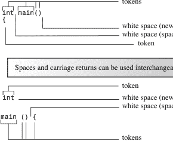

图 2.3   标记与空白。

```cpp
return0;        // INVALID, must be return 0;
return 0;       // VALID, white space omitted
return 0;       // VALID, white space used
int main();     // INVALID, white space omitted
int main()      // VALID, white space omitted in ()
int main ()     // ALSO VALID, white space used in ()
```

## C++ 源代码风格

尽管 C++ 为你提供了很大的格式自由，但如果遵循合理的风格，你的程序会更容易阅读。有效但丑陋的代码应该会让你不满意。大多数程序员使用类似于清单 2.1 的风格，该风格遵循以下规则：

- 每行一条语句
- 函数的左花括号和右花括号各自独占一行
- 函数中的语句相对于花括号缩进
- 与函数名关联的圆括号周围不留空白

前三条规则的意图很简单，就是保持代码整洁易读。第四条有助于将函数与某些同样使用圆括号的内置 C++ 结构（如循环）区分开来。本书会在出现其他准则时提醒你。

## C++ 语句

C++ 程序是函数的集合，而每个函数又是语句的集合。C++ 有几种语句，因此我们来看一些可能的形式。清单 2.2 提供了两种新类型的语句。第一，声明语句创建一个变量。第二，赋值语句为该变量提供一个值。此外，该程序还展示了 cout 的一项新能力。

清单 2.2  `carrots.cpp`

```cpp
// carrots.cpp -- Food processing program
// uses and displays a variable

#include <iostream>

int main()
{
    using namespace std;

    int carrots;          // declare an integer variable

    carrots = 25;         // assign a value to the variable
    cout << "I have ";
    cout << carrots;      // display the value of the variable
    cout << " carrots.";
    cout << endl;
    carrots = carrots - 1; // modify the variable
    cout << "Crunch, crunch. Now I have " << carrots << " carrots." << endl;
    return 0;
}
```

空行将声明与程序的其余部分分隔开。这种做法是通常的 C 语言惯例，但在 C++ 中不太常见。以下是清单 2.2 的程序输出：

```text
I have 25 carrots.
Crunch, crunch. Now I have 24 carrots.
```

接下来几页将考察这个程序。

### 声明语句和变量

计算机是精确、有序的机器。要在计算机中存储一项信息，你必须确定存储位置以及该信息需要多少内存存储空间。在 C++ 中，一种相对轻松的方法是使用声明语句来指明存储类型，并为该位置提供一个标签。例如，清单 2.2 中的程序有如下声明语句（注意分号）：

```cpp
int carrots;
```

这条语句提供两类信息：所需的内存存储类型，以及附加到该存储上的标签。具体来说，该语句声明程序需要足够的存储空间来容纳一个整数，C++ 用标签 `int` 来表示这种类型。编译器负责为该任务分配和标记内存的细节。C++ 可以处理若干种类（或类型）的数据，而 `int` 是最基本的数据类型。它对应一个整数，即没有小数部分的数。C++ 的 `int` 类型可以是正数或负数，但其大小范围取决于具体实现。第 3 章会详细介绍 `int` 和其他基本类型。

为存储命名是完成的第二项任务。在本例中，声明语句声明：此后程序将使用名称 `carrots` 来标识存储在该位置的值。`carrots` 被称为*变量*，因为你可以改变它的值。在 C++ 中，必须声明所有变量。如果你在 `carrots.cpp` 中省略该声明，那么当程序稍后尝试使用 `carrots` 时，编译器将报告错误。（事实上，你也许想试着省略声明，看看编译器如何响应。这样以后看到那种响应时，你就知道要检查是否遗漏了声明。）

### 为什么必须声明变量？

有些语言（尤其是 BASIC）会在你使用新名称时创建一个新变量，而无需显式声明。这看起来对用户更友好，而且在短期内确实如此。问题在于，如果你拼错了变量名，就可能无意中创建一个新变量而自己却没有意识到。也就是说，在 BASIC 中，你可以做类似下面的事情：

```
CastleDark = 34
...
CastleDank = CastleDark + MoreGhosts
...
PRINT CastleDark
```

因为 `CastleDank` 拼错了（把 *r* 打成了 *n*），所以你对它所做的修改不会改变 `CastleDark`。这类错误可能很难追踪，因为它在 BASIC 中并不违反任何规则。然而，在 C++ 中，`CastleDark` 会被声明，而拼错的 `CastleDank` 不会被声明。因此，等效的 C++ 代码违反了“使用变量前必须声明变量”的规则，于是编译器会捕获该错误，并消灭这个潜在缺陷。

因此，一般来说，声明指明要存储的数据类型，以及程序将用于该处所存数据的名称。在这个特定例子中，程序创建了一个名为 `carrots` 的变量，用来存储一个整数（见图 2.4）。

程序中的声明语句称为*定义声明*语句，或简称*定义*。这意味着它的出现会使编译器为该变量分配内存空间。在更复杂的情况下，还可以有*引用声明*。这些声明告诉计算机使用已在别处定义过的变量。一般来说，声明不必是定义，但在本例中它是定义。

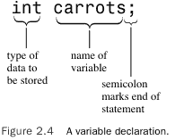

如果你熟悉 C 或 Pascal，那么你已经熟悉变量声明了。你可能还会遇到一个小小的惊喜。在 C 和 Pascal 中，所有变量声明通常都放在函数或过程的最开头。但 C++ 没有这种限制。实际上，通常的 C++ 风格是在变量首次使用之前才声明它。这样，你就不必在程序中往回翻找以查看类型是什么。你会在本章后面看到一个这样的例子。这种风格确实有一个缺点：它不会把所有变量名集中在一个地方；因此，你无法一眼看出一个函数使用了哪些变量。（顺便说一句，C99 现在使 C 的声明规则与 C++ 的规则非常相似。）

> **提示**
> 
> C++ 声明变量的风格是：尽可能在变量首次使用的位置附近声明它。

### 赋值语句

赋值语句将一个值赋给一个存储位置。例如，下面的语句将整数 25 赋给变量 carrots 所表示的位置：

```cpp
carrots = 25;
```

= 符号称为赋值运算符。C++（以及 C）的一个不寻常特性是，你可以连续使用赋值运算符。例如，下面的代码是有效的：

```cpp
int steinway;
int baldwin;
int yamaha;
yamaha = baldwin = steinway = 88;
```

赋值从右向左进行。首先，88 被赋给 steinway；然后，steinway 的值（现在是 88）被赋给 baldwin；接着，baldwin 的值 88 被赋给 yamaha。（C++ 继承了 C 喜欢允许外观古怪代码的倾向。）

清单 2.2 中的第二条赋值语句演示了你可以改变变量的值：

```cpp
carrots = carrots - 1;  // modify the variable
```


设计。此外，它是*可扩展的*。也就是说，你可以重新定义`<<`运算符，以便`cout`能够识别并显示你开发的新数据类型。如果你喜欢`printf()`提供的精细控制，你可以通过更高级地使用`cout`来实现相同的效果（参见第17章“输入、输出和文件”）。

## 更多 C++ 语句

让我们再看几个语句示例。程序清单2.3在前一个示例的基础上进行了扩展，允许你在程序运行时输入一个值。为此，它使用了`cin`（读作“see-in”），它是`cout`的输入对应物。此外，该程序还展示了使用多面手`cout`对象的另一种方式。

程序清单2.3 **getinfo.cpp**

```cpp
// getinfo.cpp -- input and output
#include <iostream>

int main()
{
    using namespace std;

    int carrots;

    cout << "How many carrots do you have?" << endl;
    cin >> carrots;                  // C++ input
    cout << "Here are two more. ";
    carrots = carrots + 2;
// the next line concatenates output
    cout << "Now you have " << carrots << " carrots." << endl;
    return 0;
}
```

### 程序调整

如果你发现在前面的程序清单中必须添加一条`cin.get()`语句，那么你需要在这个清单中添加两条`cin.get()`语句，以保持程序输出在屏幕上可见。第一条将读取你在输入数字后按Enter或Return键时生成换行符，第二条将使程序暂停，直到你再次按Return或Enter键。

下面是程序清单2.3的一个输出示例：

```text
How many carrots do you have?
12
Here are two more. Now you have 14 carrots.
```

该程序有两个新特性：使用`cin`读取键盘输入，以及将四条输出语句合并为一条。让我们来看一看。

与“Here are two more.”出现在同一行。这是因为，如前所述，一条`cout`语句的输出会紧接在前一条`cout`语句的输出之后。即使中间有其他语句，也是如此。

## cin和cout：一点类知识

你已经见过足够多的`cin`和`cout`，有理由了解一点对象知识。特别是，在本节中你将进一步了解类的概念。正如第1章简要概述的那样，类是C++中面向对象编程（OOP）的核心概念之一。

类是一种用户定义的数据类型。要定义类，你需要描述它可以表示何种信息，以及你可以对这些数据执行何种操作。类与对象的关系，就像类型与变量的关系一样。也就是说，类定义描述了一种数据形式以及如何使用它，而对象是根据该数据形式规范创建的实体。或者，用非计算机术语来说，如果类类似于“著名演员”这样的类别，那么对象就类似于该类别中的一个具体例子，比如青蛙柯密特。进一步类比，演员的类表示会包含与该类相关的可能动作的定义，例如“为角色朗读”、“表达悲伤”、“投射威胁”、“接受奖项”等等。如果你接触过不同的OOP术语，了解以下内容可能会有帮助：C++的类对应于某些语言所称的对象类型，而C++的对象对应于对象实例或实例变量。

现在让我们更具体一些。回顾以下变量声明：

```cpp
int carrots;
```

这创建了一个特定的变量（`carrots`），它具有`int`类型的属性。也就是说，`carrots`可以存储一个整数，并且可以以特定方式使用——例如用于加法和减法。现在考虑`cout`。它是一个创建出来具有`ostream`类属性的对象。`ostream`类定义（`iostream`文件中的另一个居民）描述了`ostream`对象所表示的数据种类，以及你可以对它执行的操作，例如将数字或字符串插入输出流。类似地，`cin`是一个具有`istream`类属性的对象，该类也定义在`iostream`中。

> **注意**
>
> 类描述了一种数据类型的全部属性，包括可以对其执行的操作，而对象是根据该描述创建的实体。

你已经了解到类是用户定义类型，但作为用户，你当然没有设计`ostream`和`istream`类。就像函数可以来自函数库一样，类也可以来自类库。`ostream`和`istream`类就是这种情况。从技术上讲，它们并非内建于C++语言；相反，它们是语言标准所规定的类的示例。类定义放在iostream文件中，而不是内建于编译器中。你甚至可以修改这些类定义，如果你愿意的话，尽管那不是一个好主意。（更准确地说，那是一个真正糟糕的主意。）iostream类家族以及相关的fstream（或文件I/O）家族，是所有早期C++实现附带的唯一类定义集合。然而，ANSI/ISO C++委员会在标准中增加了一些类库。此外，大多数实现还作为包的一部分提供了额外的类定义。事实上，C++当前吸引力很大一部分在于存在广泛而有用的类库，支持Unix、Macintosh和Windows编程。

类描述规定了可以对该类的对象执行的所有操作。要对特定对象执行这种允许的操作，你向该对象发送一条消息。例如，如果你想让`cout`对象显示一个字符串，你就向它发送一条消息，实际上是在说：“对象！显示这个！”C++提供了几种发送消息的方式。一种方式是使用类方法，本质上就像你很快会看到的函数调用。另一种方式——也就是用于`cin`和`cout`的方式——是重新定义一个运算符。因此，下面的语句使用重新定义的`<<`运算符向`cout`发送“显示消息”：

```cpp
cout << "I am not a crook."
```

在这个例子中，消息带有一个参数，即要显示的字符串。（类似示例见图2.5。）

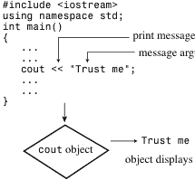

图2.5 向对象发送消息。

## 函数

因为函数是构建C++程序的模块，而且它们对C++的OOP定义至关重要，所以你应该彻底熟悉它们。函数的某些方面属于高级主题，因此函数的主要讨论放在后面，即第7章“函数：C++的编程模块”和第8章“函数探险”。不过，如果我们现在处理函数的一些基本特征，你以后使用函数时会更加从容、更加熟练。本章其余部分将向你介绍这些函数基础知识。

C++函数有两种：有返回值的函数和无返回值的函数。你可以在标准C++函数库中找到每种类型的示例，也可以创建自己的每种类型的函数。让我们先看一个有返回值的库函数，然后研究如何编写自己的简单函数。

### 使用有返回值的函数

有返回值的函数会产生一个值，你可以将其赋给变量或在其他表达式中使用。例如，标准C/C++库包含一个名为`sqrt()`的函数，它返回一个数的平方根。假设你想计算6.25的平方根并将其赋给变量x。你可以在程序中使用以下语句：

```cpp
x = sqrt(6.25); // returns the value 2.5 and assigns it to x
```

表达式`sqrt(6.25)`调用`sqrt()`函数。表达式`sqrt(6.25)`被称为*函数调用*，被调用的函数被称为*被调用函数*，而包含函数调用的函数被称为*调用函数*（见图2.6）。

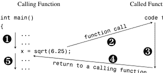

图2.6 调用函数。

括号中的值（本例中为6.25）是发送给函数的信息；据说它被传递给函数。以这种方式发送给函数的值称为*实参*或*形参*（见图2.7）。`sqrt()`函数计算出答案为2.5，并将该值发送回调用函数；发送回的值被称为函数的*返回值*。可以把返回值看作函数完成工作后，在语句中替换函数调用的内容。因此，这个例子将返回值赋给变量x。简而言之，实参是发送给函数的信息，而返回值是从函数发送回来的值。


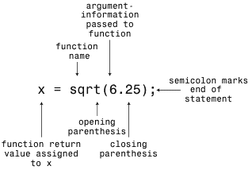

图 2.7　函数调用语法。

实际上，差不多就是这些，只不过在 C++ 编译器使用函数之前，它必须知道该函数使用什么类型的参数以及具有什么类型的返回值。也就是说，该函数返回整数吗？字符吗？带小数部分的数吗？有罪裁决吗？还是其他什么？如果缺少这些信息，编译器就不知道如何解释返回值。C++ 传达这种信息的方式是使用函数原型语句。

> **注意**
>
> C++ 程序应为程序中使用的每个函数提供原型。

函数原型对函数的作用，就像变量声明对变量的作用一样：它说明涉及哪些类型。例如，C++ 库将 `sqrt()` 函数定义为接受一个（可能）带小数部分的数（如 6.25）作为参数，并返回相同类型的数。有些语言将这类数称为*实数*，但 C++ 用于这种类型的名称是*双精度*。（你将在第 3 章看到更多关于*双精度*的内容。）`sqrt()` 的函数原型如下所示：

```cpp
double sqrt(double);  // function prototype
```

开头的 `double` 表示 `sqrt()` 返回一个 double 类型的值。括号中的 double 表示 `sqrt()` 需要一个 double 参数。因此，这个原型准确描述了下面代码中使用的 `sqrt()`：

```cpp
double x;       // declare x as a type double variable
x = sqrt(6.25);
```

原型末尾的分号表明它是一个语句，从而使其成为原型而不是函数头。如果省略分号，编译器会将这一行解释为函数头，并期望你在其后跟随一个定义该函数的函数体。

在程序中使用 `sqrt()` 时，你还必须提供原型。可以通过以下两种方式之一做到这一点：

- 你可以自己将函数原型键入源代码文件。
- 你可以包含 `cmath`（在较旧系统上为 `math.h`）头文件，其中包含该原型。

第二种方式更好，因为头文件比你更有可能把原型写对。C++ 库中的每个函数都在一个或多个头文件中有一个原型。只需查阅手册中的函数说明，或者如果有在线帮助就查阅在线帮助，说明会告诉你应使用哪个头文件。例如，`sqrt()` 函数的说明应告诉你使用 `cmath` 头文件。（同样，你可能必须使用较旧的 `math.h` 头文件，它适用于 C 和 C++ 程序。）

不要将函数原型与函数定义混淆。如你所见，原型只描述函数接口。也就是说，它描述发送给函数的信息和发送回来的信息。然而，定义包含函数工作方式的代码——例如，计算一个数的平方根的代码。对于库函数，C 和 C++ 将这两个特性——原型和定义——分开。库文件包含函数的已编译代码，而头文件包含原型。

你应该将函数原型放在首次使用该函数的位置之前。通常的做法是将原型放在 `main()` 函数定义之前。程序清单 2.4 演示了库函数 `sqrt()` 的使用；它通过包含 `cmath` 文件来提供原型。

## 程序清单 2.4　sqrt.cpp

```cpp
// sqrt.cpp — using the sqrt() function

#include <iostream>
#include <cmath>    // or math.h

int main()
{
    using namespace std;

    double area;
    cout << "Enter the floor area, in square feet, of your home: ";
    cin >> area;
    double side;
    side = sqrt(area);
    cout << "That’s the equivalent of a square " << side
         << " feet to the side." << endl;
    cout << "How fascinating!" << endl;
    return 0;
}
```

## 使用库函数

C++ 库函数存储在库文件中。编译器编译程序时，必须在你使用的函数所在的库文件中搜索这些函数。不同编译器自动搜索的库文件有所不同。如果你尝试运行程序清单 2.4，并收到一条消息说 `sqrt` 是未定义的外部符号（听起来像是要避免的状况！），那很可能是你的编译器没有自动搜索数学库。（编译器喜欢给函数名添加下划线前缀——这又是一个微妙的提醒：它们对你的程序有最终决定权。）如果收到这样的消息，请查阅编译器文档，了解如何让编译器搜索正确的库。例如，如果在 Unix 实现上收到这样的报错，它可能要求你在命令行末尾使用 `-lm` 选项（代表*库数学*）：

```text
cc sqrt.c -lm
```

Linux 下某些版本的 GNU 编译器行为类似：

```text
g++ sqrt.c -lm
```

仅仅包含 `cmath` 头文件会提供原型，但不一定会让编译器搜索正确的库文件。

下面是程序清单 2.4 中程序的一次示例运行：

```text
Enter the floor area, in square feet, of your home: 1536
That’s the equivalent of a square 39.1918 feet to the side.
How fascinating!
```

因为 `sqrt()` 处理 double 类型的值，所以示例将变量设为该类型。注意，声明 double 类型变量时，使用的形式或语法与声明 int 类型变量时相同：

```text
type-name variable-name;
```

double 类型允许变量 area 和 side 保存带小数部分的值，例如 1536.0 和 39.1918。像 1536 这样的表面整数，在存储到 double 类型变量中时，会作为带有 .0 小数部分的实数值存储。正如你将在第 3 章看到的，double 类型涵盖的值范围比 int 类型大得多。

C++ 允许你在程序中的任何位置声明新变量，因此 `sqrt.cpp` 直到即将使用 `side` 时才声明它。C++ 还允许你在创建变量时给它赋值，因此你也可以这样做：

```cpp
double side = sqrt(area);
```

你将在第 3 章进一步了解这个过程，它称为*初始化*。

注意，`cin` 知道如何将来自输入流的信息转换为 double 类型，而 `cout` 知道如何将 double 类型插入输出流。如前所述，这些对象很智能。

## 函数变体

有些函数需要不止一项信息。这些函数使用多个以逗号分隔的参数。例如，数学函数 `pow()` 接受两个参数，并返回一个值，该值等于第一个参数以第二个参数给出的幂次进行乘方。它具有以下原型：

```cpp
double pow(double, double);  // prototype of a function with two arguments
```

例如，如果你想求 5⁸（5 的八次方），你会这样使用该函数：

```cpp
answer = pow(5.0, 8.0);  // function call with a list of arguments
```

其他函数不接受参数。例如，C 库之一（与 `cstdlib` 或 `stdlib.h` 头文件关联的那个库）有一个 `rand()` 函数，它不接受参数，并返回一个随机整数。它的原型如下所示：

```cpp
int rand(void);       // prototype of a function that takes no arguments
```

关键字 `void` 明确表示该函数不接受参数。如果省略 `void` 并让括号为空，C++ 会将其解释为没有参数的隐式声明。你可以这样使用该函数：

```cpp
myGuess = rand();       // function call with no arguments
```

注意，与某些计算机语言不同，在 C++ 中，即使没有参数，也必须在函数调用中使用括号。

还有一些函数没有返回值。例如，假设你编写了一个以美元和美分格式显示数字的函数。你可以向它发送一个参数，比如 23.5，它会在屏幕上显示 $23.50。因为这个函数将值发送到屏幕而不是发送给调用程序，所以它不需要返回值。你在原型中通过为返回类型使用关键字 `void` 来表示这一点：

```cpp
void bucks(double);  // prototype for function with no return value
```

因为 `bucks()` 不返回值，所以你不能将此函数用作赋值语句或其他表达式的一部分。相反，你有一个纯函数调用语句：

```cpp
bucks(1234.56);      // function call, no return value
```

有些语言将术语*函数*保留给有返回值的函数，而将没有返回值的函数称为*过程*或*子例程*，但 C++ 和 C 一样，对这两种变体都使用术语*函数*。

## 用户自定义函数

标准 C 库提供了 140 多个预定义函数。如果其中一个符合你的需要，务必使用它。但通常你必须编写自己的函数，尤其是在设计类时。不管怎样，设计自己的函数很有趣，所以现在让我们考察这个过程。你已经使用过几个用户自定义函数，它们都命名为 `main()`。每个 C++ 程序都必须有一个 `main()` 函数，并且必须由用户定义。


假设你想添加第二个用户定义函数。就像使用库函数一样，你可以通过函数名调用用户定义函数。并且，就像使用库函数一样，你必须在使用该函数之前提供函数原型，通常的做法是将原型放在 `main()` 定义的上方。但现在，必须由你（而不是库供应商）提供新函数的源代码。最简单的方法是将代码放在同一文件中 `main()` 代码的后面。程序清单2.5说明了这些要素。

### 程序清单 2.5 `ourfunc.cpp`

```cpp
// ourfunc.cpp -- defining your own function
#include <iostream>
void simon(int);   // function prototype for simon()

int main()
{
    using namespace std;
    simon(3);       // call the simon() function
    cout << "Pick an integer: ";
    int count;
    cin >> count;
    simon(count);   // call it again
    cout << "Done!" << endl;
    return 0;
}

void simon(int n)  // define the simon() function
{
    using namespace std;
    cout << "Simon says touch your toes " << n << " times." << endl;
}                 // void functions don't need return statements
```

`main()` 函数调用 `simon()` 函数两次，一次以 3 为实参，一次以变量 count 为实参。在这两次调用之间，用户输入一个整数，用于设置 count 的值。该示例在 `cout` 提示消息中没有使用换行符。这使得用户输入与提示出现在同一行。下面是程序清单2.5中程序的一个示例运行：

```text
Simon says touch your toes 3 times.
Pick an integer: 512
Simon says touch your toes 512 times.
Done!
```

## 函数形式

程序清单2.5中 `simon()` 函数的定义遵循与 `main()` 定义相同的一般形式。首先是一个函数头。然后，用花括号括起来的是函数体。你可以将函数定义的形式概括如下：

```text
type functionname(argumentlist)
{
    statements
}
```

注意，定义 `simon()` 的源代码位于 `main()` 的右花括号之后。与 C 一样，也与 Pascal 不同，C++ 不允许将一个函数定义嵌入另一个函数定义中。每个函数定义都独立于所有其他函数定义；所有函数都是平等的（见图2.8）。

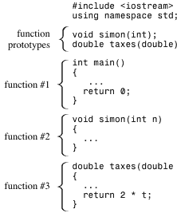

图2.8 函数定义在文件中按顺序出现。

## 函数头

程序清单2.5中的 `simon()` 函数具有如下函数头：

```cpp
void simon(int n)
```

开头的 `void` 表示 `simon()` 没有返回值。因此，调用 `simon()` 不会产生一个可以在 `main()` 中赋给变量的数。于是，第一次函数调用看起来像这样：

```cpp
simon(3);          // ok for void functions
```

由于可怜的 `simon()` 缺少返回值，你不能这样使用它：

```cpp
simple = simon(3);   // not allowed for void functions
```

括号中的 `int n` 表示你应当使用 `simon()` 时传入一个 `int` 类型的实参。`n` 是一个新变量，它被赋予函数调用期间传递的值。因此，下面的函数调用将值 3 赋给 `simon()` 函数头中定义的 n 变量：

```cpp
simon(3);
```

当函数体中的 `cout` 语句使用 n 时，它使用的是函数调用中传入的值。这就是为什么 `simon(3)` 在其输出中显示 3。示例运行中对 `simon(count)` 的调用使该函数显示 512，因为那是为 count 输入的值。简而言之，`simon()` 的函数头告诉你，该函数接受一个 int 类型的实参，并且没有返回值。

让我们回顾一下 `main()` 的函数头：

```cpp
int main()
```

开头的 int 表示 `main()` 返回一个整数值。空括号（其中可以选择包含 `void`）表示 `main()` 没有实参。有返回值的函数应使用关键字 return 提供返回值并终止函数。这就是为什么你一直使用下面的语句作为 `main()` 的结尾：

```cpp
return 0;
```

这在逻辑上是一致的：`main()` 应当返回一个 int 类型的值，而你让它返回整数 0。但是，你可能会想，你是在把值返回给什么？毕竟，在你的任何程序中，都没有看到任何东西调用 `main()`：

```cpp
squeeze = main();    // absent from our programs
```

答案是，你可以把计算机的操作系统（比如 Unix 或 Windows）看作在调用你的程序。因此，`main()` 的返回值不是返回给程序的其他部分，而是返回给操作系统。许多操作系统都可以使用程序的返回值。例如，Unix shell 脚本和 Windows 命令行界面批处理文件可以设计为运行程序并测试其返回值，这些返回值通常称为*退出值*。通常的约定是，退出值为零表示程序成功运行，而非零值表示出现了问题。因此，你可以设计一个 C++ 程序，在比如无法打开文件时返回非零值。然后，你可以设计一个 shell 脚本或批处理文件来运行该程序，并在程序发出失败信号时采取某些替代操作。

## 关键字

关键字是计算机语言的词汇。本章使用了四个 C++ 关键字：`int`、`void`、`return` 和 `double`。由于这些关键字对 C++ 来说很特殊，你不能将它们用于其他目的。也就是说，你不能把 `return` 用作变量名，也不能把 `double` 用作函数名。但你可以将它们用作名称的一部分，例如 `painter`（其中隐藏着 int）或 `return_aces`。附录B“C++保留字”提供了 C++ 关键字的完整列表。顺便提一下，`main` 不是关键字，因为它不是语言的一部分。相反，它是必需函数的名称。你可以将 `main` 用作变量名。（在过于深奥、这里无法描述的情况下，这可能会引发问题，而且无论如何都会令人困惑，所以你最好不要这样做。）同样，其他函数名和对象名也不是关键字。然而，在程序中将同一个名称（比如 `cout`）同时用于一个对象和一个变量会让编译器混淆。也就是说，你可以在一个不使用 `cout` 对象进行输出的函数中将 `cout` 用作变量名，但不能在同一个函数中以两种方式使用 `cout`。

## 使用有返回值的用户定义函数

让我们再进一步，编写一个使用 return 语句的函数。`main()` 函数已经展示了有返回值函数的方案：在函数头中给出返回类型，并在函数体末尾使用 `return`。你可以使用这种形式为前往英国的人解决一个重量级问题。在英国，许多浴室秤以*英石*为单位校准，而不是以美国磅或国际千克为单位。*英石*这个词在此语境中单复数同形。（英语确实缺乏比如 C++ 那样的内部一致性。）一英石是 14 磅，程序清单2.6使用一个函数进行这种转换。

### 程序清单 2.6 `convert.cpp`

```cpp
// convert.cpp -- converts stone to pounds
#include <iostream>
int stonetolb(int);      // function prototype
int main()
{
    using namespace std;
    int stone;
    cout << "Enter the weight in stone: ";
    cin >> stone;
    int pounds = stonetolb(stone);
    cout << stone << " stone = ";
    cout << pounds << " pounds." << endl;
    return 0;
}

int stonetolb(int sts)
{
    return 14 * sts;
}
```

下面是程序清单2.6中程序的一个示例运行：

```text
Enter the weight in stone: 15
15 stone = 210 pounds.
```

在 `main()` 中，程序使用 `cin` 为整数变量 `stone` 提供一个值。这个值作为实参传递给 `stonetolb()` 函数，并在该函数中赋给变量 `sts`。然后，`stonetolb()` 使用 `return` 关键字将 `14 * sts` 的值返回给 `main()`。这说明你并不局限于在 `return` 后面跟一个简单的数字。这里，通过使用更复杂的表达式，你避免了不得不


- 它返回一个值。
- 它需要一个原型。

将 `stonetolb()` 视为函数设计的标准形式。你将在第 7 章和第 8 章中进一步探索函数。在此期间，本章的材料应该让你对函数如何工作以及它们如何融入 C++ 有一个良好的感受。

## 在多功能程序中放置 using 指令

注意，清单 2.5 在两个函数中都放置了一条 `using` 指令：

```cpp
using namespace std;
```

这是因为每个函数都使用了 `cout`，因此需要访问 `std` 命名空间中的 `cout` 定义。

还有另一种方法可以让 `std` 命名空间对清单 2.5 中的两个函数都可用，那就是将指令放在两个函数的外部上方：

```cpp
// ourfunc1.cpp -- reposition the using directive
#include <iostream>
using namespace std; // affects all function definitions in this file
void simon(int);

int main()
{
    simon(3);
    cout << "Pick an integer: ";
    int count;
    cin >> count;
    simon(count);
    cout << "Done!" << endl;
    return 0;
}

void simon(int n)
{
    cout << "Simon says touch your toes " << n << " times." << endl;
}
```

当前流行的理念是，最好更具区分性，将 `std` 命名空间的访问权限仅限于那些需要访问的函数。例如，在清单 2.6 中，只有 `main()` 使用了 `cout`，因此没有必要让 `stonetolb()` 函数也能访问 `std` 命名空间。因此，`using` 指令被放置在 `main()` 函数内部，仅将 `std` 命名空间的访问权限限制在该函数中。

总而言之，你有几种选择可以让 `std` 命名空间的元素对程序可用。以下是一些示例：

- 你可以将以下内容放在文件中函数定义的上方，使 `std` 命名空间的所有内容对文件中的每个函数都可用：

  `using namespace std;`

- 你可以将以下内容放在特定函数定义中，使 `std` 命名空间的所有内容对该特定函数可用：

  `using namespace std;`

- 你可以不使用 `using namespace std;`，而是在特定函数定义中放置类似下面的 using 声明，使特定元素（如 `cout`）对该函数可用：

  `using std::cout;`

- 你可以完全省略 using 指令和声明，并在从 `std` 命名空间使用元素时使用 `std::` 前缀：

  `std::cout << "I'm using cout and endl from the std namespace" << std::endl;`

## 命名约定

C++ 程序员在命名函数、类和变量时拥有无数选择（这既是幸事也是诅咒）。程序员对风格有强烈且多样的看法，这些看法常常在公共论坛上引发圣战。从一个函数名称的基本想法出发，程序员可能会选择以下任何一种：

```
MyFunction( )
myfunction( )
myFunction( )
my_function( )
my_funct( )
```

选择将取决于开发团队、所用技术或库的特性，以及个别程序员的品味和偏好。请放心，任何符合第 3 章所述 C++ 规则的风格，就 C++ 语言而言都是正确的，并且你可以根据自己的判断来使用。

撇开语言上的争论不谈，值得注意的是，个人命名风格——通过一致性和精确性帮助你——是值得追求的。一个精确、可识别的个人命名约定是良好软件工程的标志，它将贯穿你的编程生涯并为你提供帮助。

## 总结

一个 C++ 程序由一个或多个称为函数的模块组成。程序从名为 `main()`（全部小写）的函数开始执行，因此你应该始终有一个这样名称的函数。函数依次由头和体组成。函数头告诉你函数产生什么类型的返回值（如果有的话），以及它期望参数传递什么类型的信息。函数体由一对大括号（{}）括起来的一系列 C++ 语句组成。

C++ 语句类型包括以下内容：

- **声明语句**——声明语句宣布函数中使用的变量的名称和类型。
- **赋值语句**——赋值语句使用赋值运算符（=）将值赋给变量。
- **消息语句**——消息语句向对象发送消息，启动某种操作。
- **函数调用**——函数调用激活一个函数。当被调用的函数终止时，程序返回到调用函数中紧跟函数调用之后的语句。
- **函数原型**——函数原型声明函数的返回类型，以及函数期望的参数数量和类型。
- **返回语句**——返回语句将值从被调用的函数发送回调用函数。

类是对数据类型的用户自定义规范。该规范详细说明了信息如何表示以及可以对数据执行哪些操作。对象是根据类规范创建的实体，就像简单变量是根据数据类型描述创建的实体一样。

C++ 提供了两个预定义对象（`cin` 和 `cout`）用于处理输入和输出。它们是 `istream` 和 `ostream` 类的示例，这两个类在 `iostream` 文件中定义。这些类将输入和输出视为字符流。为 `ostream` 类定义的插入运算符（`<<`）允许你将数据插入输出流，而为 `istream` 类定义的提取运算符（`>>`）允许你从输入流中提取信息。`cin` 和 `cout` 都是智能对象，能够根据程序上下文自动将信息从一种形式转换为另一种形式。

C++ 可以使用庞大的 C 库函数集。要使用库函数，你应该包含提供该函数原型的头文件。

现在你已经对简单的 C++ 程序有了整体了解，你可以在接下来的章节中继续填充细节并拓展视野。

## 章节复习

你可以在附录 J“章节复习答案”的每章末尾找到章节复习的答案。

1. C++ 程序的模块称为什么？
2. 以下预处理器指令做什么？

   ```cpp
   #include <iostream>
   ```

3. 以下语句做什么？

   ```cpp
   using namespace std;
   ```

4. 你会使用什么语句来打印短语“Hello, world”然后开始新的一行？
5. 你会使用什么语句来创建一个名为 cheeses 的整数变量？
6. 你会使用什么语句将值 32 赋给变量 cheeses？
7. 你会使用什么语句从键盘输入读取一个值到变量 cheeses 中？
8. 你会使用什么语句打印“We have X varieties of cheese”，其中 cheeses 变量的当前值替换 x？
9. 以下函数原型告诉你关于这些函数的什么信息？

   ```cpp
   int frop(double t);
   void rattle(int n);
   int prune(void);
   ```

10. 当你定义函数时，什么时候不必使用关键字 `return`？
11. 假设你的 `main()` 函数中有以下行：

    ```cpp
    cout << "Please enter your PIN: ";
    ```

    并且假设编译器抱怨 `cout` 是一个未知标识符。这种抱怨的可能原因是什么，修复该问题的方法有哪些三种？

## 编程练习

1. 编写一个 C++ 程序，显示你的姓名和地址（或者如果你重视隐私，可以使用虚构的姓名和地址）。
2. 编写一个 C++ 程序，询问以弗隆为单位的距离，并将其转换为码。（1 弗隆等于 220 码。）


- 3. 编写一个 C++ 程序，使用三个用户定义函数（将 `main()` 计为一个），并产生以下输出：

    ```
    Three blind mice
    Three blind mice
    See how they run
    See how they run
    ```

    其中一个函数被调用两次，应产生前两行；另一个函数也被调用两次，应产生其余输出。

- 4. 编写一个程序，要求用户输入他或她的年龄。然后程序应以月为单位显示年龄：

    ```
    Enter your age: 29
    ```

    你的年龄以月为单位是 384。

- 5. 编写一个程序，让 `main()` 调用一个用户定义函数，该函数接受摄氏温度值作为参数，然后返回等价的华氏温度值。程序应请求用户输入摄氏温度值并显示结果，如下面的代码所示：

    ```
    Please enter a Celsius value: 20
    20 degrees Celsius is 68 degrees Fahrenheit.
    ```

    供参考，以下是进行转换的公式：

    华氏度 = 1.8 × 摄氏度 + 32.0

- 6. 编写一个程序，让 `main()` 调用一个用户定义函数，该函数接受以光年表示的距离作为参数，然后返回以天文单位表示的距离。程序应请求用户输入光年值并显示结果，如下面的代码所示：

    ```
    Enter the number of light years: 4.2
    4.2 light years = 265608 astronomical units.
    ```

    天文单位是地球到太阳的平均距离（约 150,000,000 公里或 93,000,000 英里），而光年是光在一年中传播的距离（约 10 万亿公里或 6 万亿英里）。（太阳之后最近的恒星距离约 4.2 光年。）使用 double 类型（如程序清单 2.4 所示）以及以下转换因子：

    1 光年 = 63,240 天文单位

- 7. 编写一个程序，要求用户输入小时值和分钟值。然后 `main()` 函数应将这两个值传递给一个 `void` 类型函数，该函数按以下示例运行中所示的格式显示这两个值：

    ```
    Enter the number of hours: 9
    Enter the number of minutes: 28
    Time: 9:28
    ```

本页有意留白

## 3 处理数据

在本章中，你将学习以下内容：

- C++ 变量命名规则
- C++ 内置整数类型：unsigned long、long、unsigned int、int、unsigned short、short、char、unsigned char、signed char、bool
- C++11 新增的类型：unsigned long long 和 long long
- climits 文件，它表示各种整数类型的系统限制
- 各种整数类型的数值字面量（常量）
- 使用 const 限定符创建符号常量
- C++ 内置浮点类型：float、double 和 long double
- cfloat 文件，它表示各种浮点类型的系统限制
- 各种浮点类型的数值字面量
- C++ 的算术运算符
- 自动类型转换
- 强制类型转换（类型转换）

面向对象编程（OOP）的本质是设计和扩展你自己的数据类型。设计自己的数据类型，就是努力让类型与数据相匹配。如果你做得好，以后处理数据就会简单得多。但在创建自己的类型之前，你必须知道并理解 C++ 内置的类型，因为这些类型将是你的构建块。

C++ 内置类型分为两组：基本类型和复合类型。在本章中，你将接触基本类型，它们表示整数和浮点数。这听起来可能只是两种类型；然而，C++ 认识到没有哪一种整数类型和哪一种浮点类型能匹配所有编程需求，因此它在这两个数据主题上提供了若干变体。第 4 章“复合类型”接着介绍几种建立在基本类型之上的类型；这些附加的复合类型包括数组、字符串、指针和结构。

> 如同函数命名一样，大小写也是变量命名中的一个关键问题（参见第 2 章“开始学习 C++”中的侧边栏“命名约定”），但许多程序员可能会在变量名中插入额外一层信息——一个描述变量类型或内容的前缀。例如，整数 myWeight 可能被命名为 nMyWeight；这里，n 前缀用于表示整数值，当你阅读代码且手边没有变量定义时，这会很有用。或者，这个变量可能被命名为 intMyWeight，它更精确、更易读，尽管它确实多了几个字母（对许多程序员来说很讨厌）。其他前缀也常以类似方式使用：str 或 sz 可能用于表示以空字符结尾的字符串，b 可能表示布尔值，p 表示指针，c 表示单个字符。
>
> 随着你深入 C++ 的世界，你会发现许多前缀命名风格的例子（包括漂亮的 m_lpctstr 前缀——一个包含指向常量空终止字符串的长指针的类成员值），以及其他更怪异、可能反直觉的风格，你可能会也可能不会采用它们作为自己的风格。如同 C++ 中所有风格化、主观的部分一样，一致性和精确性最佳。你应该使用适合自己需求、偏好和个人风格的变量名。（或者，如果需要，选择适合你雇主需求、偏好和个人风格的名称。）

### 整数类型

整数是没有小数部分的数字，例如 2、98、–5286 和 0。整数有很多，假设你认为无限数量算很多，因此没有任何有限数量的计算机内存能表示所有可能的整数。因此，一种语言只能表示所有整数的一个子集。有些语言只提供一种整数类型（一种类型通吃！），但 C++ 提供了几种选择。这让你可以选择最符合程序特定需求的整数类型。这种让类型与数据相匹配的关注，预示着 OOP 所设计的数据类型。

各种 C++ 整数类型的不同之处在于它们用于保存整数的内存量。更大的内存块可以表示更大的整数取值范围。此外，有些类型（有符号类型）可以表示正值和负值，而其他类型（无符号类型）不能表示负值。描述用于整数的内存量通常用术语“宽度”。一个值使用的内存越多，它就越宽。C++ 的基本整数类型按宽度递增的顺序为 char、short、int、long，以及 C++11 中的 long long。每一种都有有符号和无符号版本。这给了你十种不同整数类型的选择！让我们更详细地看看这些整数类型。由于 char 类型有一些特殊属性（它最常用于表示字符而不是数字），本章先介绍其他类型。

### short、int、long 和 long long 整数类型

计算机内存由称为位的单元组成。（参见本章后面的“位与字节”侧边栏。）通过使用不同数量的位来存储值，C++ 类型 short、int、long 和 long long 最多可以表示四种不同的整数宽度。如果每种类型在所有系统上总是某个特定宽度，那会很方便——例如，如果 short 总是 16 位，int 总是 32 位，等等。但生活没那么简单。没有哪一种选择适合所有计算机设计。C++ 提供了一个灵活的标准，其中包含一些保证的最小大小，这些大小取自 C。你会得到以下保证：

- short 整数至少为 16 位宽。
- int 整数至少与 short 一样大。
- long 整数至少为 32 位宽，并且至少与 int 一样大。
- long long 整数至少为 64 位宽，并且至少与 long 一样大。

### 位与字节

计算机内存的基本单位是位。可以把位想象成一个电子开关，你可以将其设置为关或开。关表示值 0，开表示值 1。一个 8 位内存块可以设置为 256 种不同组合。数字 256 来自每个位有两种可能设置这一事实，使得 8 位的组合总数为 2 × 2 × 2 × 2 × 2 × 2 × 2 × 2，即 256。因此，一个 8 位单元可以表示例如 0 到 255 的值，或 −128 到 127 的值。每增加一位，组合数就翻倍。这意味着你可以将一个 16 位单元设置为 65,536 个不同值，将一个 32 位单元设置为 4,294,967,296 个不同值，将一个 64 位单元设置为 18,446,744,073,709,551,616 个不同值。作为对比，unsigned long 无法容纳地球当前人口或我们银河系中的恒星数量，但 long long 可以。

字节通常指 8 位内存单元。这个意义上的字节是描述计算机内存量的度量单位，其中 1 千字节等于 1,024 字节，1 兆字节等于 1,024 千字节。然而，C++ 对字节的定义不同。C++ 字节至少由足够多的相邻位组成，以容纳实现的基本字符集。也就是说，可能值的数量必须等于或超过不同字符的数量。在美国，基本字符集通常是 ASCII 和 EBCDIC 字符集，二者都可以用 8 位容纳，因此在使用这些字符集的系统上，C++ 字节通常是 8 位。然而，国际化编程可能需要大得多的字符集，例如 Unicode，因此某些实现可能使用 16 位字节甚至 32 位字节。有些人使用术语 octet 来表示 8 位字节。

目前许多系统使用最低保证，使 short 为 16 位、long 为 32 位。这仍然为 int 留下了几种选择。它可以是 16、24 或 32 位宽，并符合标准。它甚至可以是 64 位，只要 long 和 long long 至少有那么宽。通常，对于较旧的 IBM PC 实现，int 是 16 位（与 short 相同）；对于 Windows XP、Windows Vista、Windows 7、Macintosh OS X、VAX 以及许多其他小型机实现，int 是 32 位（与 long 相同）。有些实现允许你选择如何处理 int。（你的实现使用哪种？下一个示例展示了如何在不打开手册的情况下确定系统的限制。）当把 C++ 程序从一个环境移到另一个环境时（包括在同一系统上使用不同的编译器），实现之间类型宽度的差异可能会引发问题。但是，稍加注意（如本章后面所讨论的）可以最大程度地减少这些问题。


```cpp
short score;             // creates a type short integer variable
int temperature;         // creates a type integer variable
long position;           // creates a type long integer variable
```

你可以像使用 int 一样，使用这些类型名来声明变量：

实际上，short 是 short int 的简写，long 是 long int 的简写，但几乎没人使用较长的形式。

这四种类型——int、short、long 和 long long——都是有符号类型，这意味着每种类型都将其取值范围大致平均地分配给正值和负值。例如，一个 16 位的 int 可能从 −32,768 到 +32,767。

如果你想知道自己系统中的整数有多大，可以使用 C++ 工具编写程序来调查类型的大小。首先，sizeof 运算符返回某个类型或变量的大小（以字节为单位）。（运算符是一种内置的语言元素，它作用于一个或多个项以产生一个值。例如，由 + 表示的加法运算符将两个值相加。）回想一下，字节的含义取决于具体实现，因此一个 2 字节的 int 在一个系统上可能是 16 位，而在另一个系统上可能是 32 位。其次，climits 头文件（对于较旧的实现，是 limits.h 头文件）包含有关整数类型限制的信息。特别地，它定义了一些符号名来表示不同的限制。例如，它将 INT_MAX 定义为 int 可能的最大值，将 CHAR_BIT 定义为一个字节中的位数。程序清单 3.1 演示了如何使用这些设施。该程序还说明了初始化，即使用声明语句为变量赋值。

### 程序清单 3.1 limits.cpp

```cpp
// limits.cpp -- some integer limits
#include <iostream>
#include <climits>              // use limits.h for older systems
int main()
{
        using namespace std;
        int n_int = INT_MAX;      // initialize n_int to max int value
        short n_short = SHRT_MAX; // symbols defined in climits file
        long n_long = LONG_MAX;
        long long n_llong = LLONG_MAX;

        // sizeof operator yields size of type or of variable
        cout << "int is " << sizeof (int) << " bytes." << endl;
        cout << "short is " << sizeof n_short << " bytes." << endl;
        cout << "long is " << sizeof n_long << " bytes." << endl;
        cout << "long long is " << sizeof n_llong << " bytes." << endl;
        cout << endl;

        cout << "Maximum values:" << endl;
        cout << "int: " << n_int << endl;
        cout << "short: " << n_short << endl;
        cout << "long: " << n_long << endl;
        cout << "long long: " << n_llong << endl;

        cout << "Minimum int value = " << INT_MIN << endl;
        cout << "Bits per byte = " << CHAR_BIT << endl;
        return 0;
}
```

> **注意**
>
> 如果你的系统不支持 `long long` 类型，则应删除使用该类型的行。

以下是程序清单 3.1 中程序的示例输出：

```text
int is 4 bytes.
short is 2 bytes.
long is 4 bytes.
long long is 8 bytes.

Maximum values:
int: 2147483647
short: 32767
long: 2147483647
long long: 9223372036854775807

Minimum int value = -2147483648
Bits per byte = 8
```

这些特定值来自运行 64 位 Windows 7 的系统。

以下各节将介绍该程序的主要编程特性。

## sizeof 运算符与 limits 头文件

sizeof 运算符报告，在基本系统中 int 为 4 字节，该系统使用 8 位字节。你可以将 sizeof 运算符用于类型名或变量名。当你将 sizeof 运算符用于类型名（如 int）时，需要将该名称放在括号中。但当你将该运算符用于变量名（如 n_short）时，括号是可选的：

```cpp
cout << "int is " << sizeof (int) << " bytes.\n";
cout << "short is " << sizeof n_short << " bytes.\n";
```

limits 头文件定义了一些符号常量（参见本章后面的边栏“符号常量：预处理器的做法”）来表示类型限制。如前所述，INT_MAX 表示 int 类型能容纳的最大值；对于我们的 Windows 7 系统，结果是 2,147,483,647。编译器制造商提供一个 climits 文件，其中反映适合该编译器的值。例如，对于某些使用 16 位 int 的较旧系统，climits 文件将 INT_MAX 定义为表示 32,767。表 3.1 总结了 `climits` 文件中定义的符号常量；其中一些涉及你尚未学到的类型。

**表 3.1 来自 `climits` 的符号常量**

| 符号常量 | 表示 |
| --- | --- |
| `CHAR_BIT` | char 中的位数 |
| `CHAR_MAX` | char 的最大值 |
| `CHAR_MIN` | char 的最小值 |
| `SCHAR_MAX` | signed char 的最大值 |
| `SCHAR_MIN` | signed char 的最小值 |
| `UCHAR_MAX` | unsigned char 的最大值 |
| `SHRT_MAX` | short 的最大值 |
| `SHRT_MIN` | short 的最小值 |
| `USHRT_MAX` | unsigned short 的最大值 |
| `INT_MAX` | int 的最大值 |
| `INT_MIN` | int 的最小值 |
| `UINT_MAX` | unsigned int 的最大值 |
| `LONG_MAX` | long 的最大值 |
| `LONG_MIN` | long 的最小值 |
| `ULONG_MAX` | unsigned long 的最大值 |
| `LLONG_MAX` | long long 的最大值 |
| `LLONG_MIN` | long long 的最小值 |
| `ULLONG_MAX` | unsigned long long 的最大值 |

## 符号常量：预处理器的做法

`climits` 文件包含类似下面这样的行：

```cpp
#define INT_MAX 32767
```

回想一下，C++ 编译过程首先会让源代码通过预处理器。这里的 #define 和 #include 一样，是预处理器指令。这个特定指令告诉预处理器：在程序中查找 INT_MAX 的实例，并将每次出现替换为 32767。因此，#define 指令的作用类似于文本编辑器或字处理软件中的全局搜索替换命令。在这些替换发生之后，修改后的程序会被编译。预处理器查找独立的标记（单独的单词），并跳过嵌入的单词。也就是说，预处理器不会把 PINT_MAXIM 替换为 P32767IM。你也可以使用 #define 来定义自己的符号常量（参见程序清单 3.2）。然而，#define 指令是 C 的遗留物。C++ 有更好的创建符号常量的方法（使用 const 关键字，将在后面一节讨论），因此你不会经常使用 #define。但有些头文件，特别是那些设计为同时供 C 和 C++ 使用的头文件，确实会使用它。

### 初始化

*初始化*将赋值与声明结合在一起。例如，下面的语句声明 `n_int` 变量，并将其设置为 int 类型可能的最大值：

```cpp
int n_int = INT_MAX;
```

你也可以使用字面常量（如 255）来初始化值。你可以用一个变量初始化另一个变量，前提是另一个变量已经先定义。你甚至可以用表达式初始化变量，前提是当程序执行到该声明时，表达式中的所有值都是已知的：

```cpp
int uncles = 5;                 // initialize uncles to 5
int aunts = uncles;             // initialize aunts to 5
int chairs = aunts + uncles + 4;  // initialize chairs to 14
```

如果将 `uncles` 的声明移到这组语句的末尾，就会使另外两个初始化失效，因为那时程序在尝试初始化其他变量时将不知道 `uncles` 的值。

前面展示的初始化语法来自 C；C++ 有一种不与 C 共享的初始化语法：

```cpp
int owls = 101;   // traditional C initialization, sets owls to 101
int wrens(432);   // alternative C++ syntax, sets wrens to 432
```

**警告**

> 如果你没有初始化在函数内部定义的变量，该变量的值就是*不确定的*。这意味着该值是变量创建之前恰好位于该内存位置上的任何内容。

如果你知道变量的初始值应该是什么，就初始化它。诚然，将变量的声明与给它赋值分开会造成短暂的悬念：

```cpp
short year;     // what could it be?
year = 1492;    // oh
```

但是，在声明变量时初始化它可以防止你之后忘记赋值。


清单3.2演示了无符号类型的使用，也展示了当程序试图超出整数类型的范围时会发生什么。最后，它还让你最后一次看看预处理器`#define`语句。

### 清单3.2 exceed.cpp

```cpp
// exceed.cpp -- exceeding some integer limits
#include <iostream>
#define ZERO 0      // makes ZERO symbol for 0 value
#include <climits>  // defines INT_MAX as largest int value
int main()
{
    using namespace std;
    short sam = SHRT_MAX;      // initialize a variable to max value
    unsigned short sue = sam;  // okay if variable sam already defined

    cout << "Sam has " << sam << " dollars and Sue has " << sue;
    cout << " dollars deposited." << endl;
    cout << " Add $1 to each account." << endl << "Now ";

    sam = sam + 1;
    sue = sue + 1;
    cout << "Sam has " << sam << " dollars and Sue has " << sue;
    cout << " dollars deposited.\nPoor Sam!" << endl;
    sam = ZERO;
    sue = ZERO;
    cout << "Sam has " << sam << " dollars and Sue has " << sue;
    cout << " dollars deposited." << endl;
    cout << "Take $1 from each account." << endl << "Now ";
    sam = sam - 1;
    sue = sue - 1;
    cout << "Sam has " << sam << " dollars and Sue has " << sue;
    cout << " dollars deposited." << endl << "Lucky Sue!" << endl;
    return 0;
}
```

以下是清单3.2中程序的输出：

```text
Sam has 32767 dollars and Sue has 32767 dollars deposited.
Add $1 to each account.
Now Sam has -32768 dollars and Sue has 32768 dollars deposited.
Poor Sam!
Sam has 0 dollars and Sue has 0 dollars deposited.
Take $1 from each account.
Now Sam has -1 dollars and Sue has 65535 dollars deposited.
Lucky Sue!
```

程序将一个`short`变量（`sam`）和一个`unsigned short`变量（`sue`）设置为最大的`short`值，在我们的系统上是32,767。然后它将每个值加1。这对`sue`没有造成问题，因为新值仍然远小于无符号整数的最大值。但是`sam`从32,767变成了−32,768！类似地，从0减去1对`sam`来说没有问题，但会使无符号变量`sue`从0变成65,535。正如你所见，这些整数的行为很像里程表。如果超过了限制，数值就会从范围的另一端重新开始（见图3.1）。C++保证无符号类型以这种方式运作。然而，C++并不保证有符号整型在超出其范围（上溢和下溢）时不产生问题，但这是当前实现中最常见的行为。

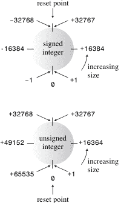

图3.1 整数的典型溢出行为。

## 选择整数类型

C++的整数类型如此丰富，你应该使用哪一种呢？一般来说，`int`被设置为目标计算机最“自然”的整数大小。*自然大小*指的是计算机处理效率最高的整数形式。如果没有令人信服的理由选择其他类型，你应该使用`int`。

现在来看看你可能使用其他类型的理由。如果某个变量表示的事物永远不会是负数，比如文档中的单词数，你可以使用无符号类型；这样变量就能表示更大的值。

如果你知道变量可能需要表示的整数值对于16位整数来说太大，你应该使用`long`。即使在你的系统上它是32位的，这一点也成立。这样，如果你将程序移植到使用16位`int`的系统上，你的程序不会因为突然无法正常工作而让你难堪（见图3.2）。如果区区20亿仍不足以满足你的需求，你可以升级到`long long`。

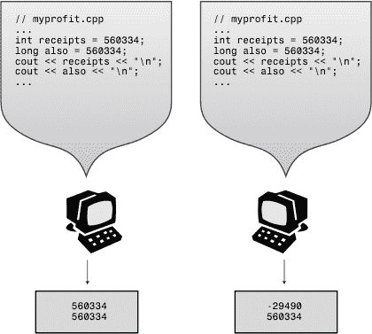

图3.2 为了可移植性，请对大整数使用`long`。

如果`short`比`int`小，使用`short`可以节省内存。通常情况下，这仅在你有一个大型整数数组时才重要。（*数组*是一种数据结构，在内存中按顺序存储多个相同类型的值。）如果节省空间很重要，你应该使用`short`而不是`int`，即使两者大小相同。例如，假设你将程序从16位系统移植到32位系统。这会使存储`int`数组所需的内存量翻倍，但不会影响`short`数组的需求。记住，一位就是一位。

如果只需要一个字节，你可以使用`char`。我们稍后会探讨这种可能性。

## 整型字面量

整型字面量，或称常量，是你显式写出的数字，例如212或1776。C++与C一样，允许你用三种不同的数制来书写整数：十进制（大众最爱）、八进制（老Unix的最爱）和十六进制（硬件黑客的最爱）。附录A“数制”描述了这些数制；这里我们来看C++的表示方法。C++使用第一个或前两个数字来标识数字常量的基数。如果第一个数字在1–9范围内，则该数字是十进制；因此93是十进制。如果第一个数字是0且第二个数字在1–7范围内，则该数字是八进制；因此042是八进制，等于十进制的34。如果前两个字符是0x或0X，则该数字是十六进制；因此0x42是十六进制，等于十进制的66。对于十六进制值，字符a–f和A–F表示对应于值10–15的十六进制数字。0xF是15，0xA5是165（10个十六即160加5个一）。清单3.3专门用来展示这三种数制。

### 清单3.3 hexoct1.cpp

```cpp
// hexoct1.cpp -- shows hex and octal literals
#include <iostream>
int main()
{
    using namespace std;
    int chest = 42;       // decimal integer literal
    int waist = 0x42;     // hexadecimal integer literal
    int inseam = 042;     // octal integer literal

    cout << "Monsieur cuts a striking figure!\n";
    cout << "chest = " << chest << " (42 in decimal)\n";
    cout << "waist = " << waist << " (0x42 in hex)\n";
    cout << "inseam = " << inseam << " (042 in octal)\n";
    return 0;
}
```

默认情况下，`cout`以十进制形式显示整数，无论它们在程序中是如何书写的，如下面的输出所示：

```text
Monsieur cuts a striking figure!
chest = 42 (42 in decimal)
waist = 66 (0x42 in hex)
inseam = 34 (042 in octal)
```

请记住，这些记号仅仅是表示上的便利。例如，如果你属于老式PC俱乐部，读到CGA视频内存段是十六进制的B000，你不必在程序中使用之前将该值转换为十进制的45,056。相反，你可以直接使用0xB000。但无论你将数值10写成10、012还是0xA，它在计算机中的存储方式都是一样的——二进制（基数为2）值。

顺便说一下，如果你想以十六进制或八进制形式显示值，可以使用`cout`的一些特殊功能。回想一下，`iostream`头文件提供了`endl`操纵符，用来给`cout`传递开始新行的消息。类似地，它提供了`dec`、`hex`和`oct`操纵符，分别给`cout`传递以十进制、十六进制和八进制格式显示整数的消息。清单3.4使用`hex`和`oct`以三种格式显示十进制值42。（十进制是默认格式，每种格式会一直生效，直到你更改它。）

### 清单3.4 hexoct2.cpp

```cpp
// hexoct2.cpp -- display values in hex and octal
#include <iostream>
using namespace std;
int main()
{
    using namespace std;
    int chest = 42;
    int waist = 42;
    int inseam = 42;

    cout << "Monsieur cuts a striking figure!" << endl;
    cout << "chest = " << chest << " (decimal for 42)" << endl;
    cout << hex;      // manipulator for changing number base
    cout << "waist = " << waist << " (hexadecimal for 42)" << endl;
    cout << oct;      // manipulator for changing number base
    cout << "inseam = " << inseam << " (octal for 42)" << endl;
    return 0;
}
```

以下是清单3.4的程序输出：

```text
Monsieur cuts a striking figure!
chest = 42 (decimal for 42)
waist = 2a (hexadecimal for 42)
inseam = 52 (octal for 42)
```

请注意，像下面这样的代码不会在屏幕上显示任何内容：

```cpp
cout << hex;
```

相反，它改变了`cout`显示整数的方式。因此，操纵符`hex`实际上是给`cout`的一条消息，告诉它如何表现。还要注意，因为标识符`hex`是`std`命名空间的一部分，并且程序使用了该命名空间，所以这个程序不能将`hex`用作变量名。然而，如果你省略了`using`指令，改为使用`std::cout`、`std::endl`、`std::hex`和`std::oct`，你仍然可以将普通的`hex`用作变量名。


## C++ 如何确定常量的类型

程序的声明告诉 C++ 编译器某个特定整型变量的类型。但常量呢？也就是说，假设你在程序中使用一个常量表示某个数字：

```cpp
cout << "Year = " << 1492 << "\n";
```

程序会把 1492 存储为 `int`、`long` 还是其他某种整数类型？答案是：除非有理由不这样做，否则 C++ 会把整数常量存储为 `int` 类型。两种这样的理由是：你使用特殊后缀来指明特定类型，或者某个值太大，无法作为 `int` 存储。

首先，看看后缀。这些是放在数字常量末尾、用来指明类型的字母。整数上的 `l` 或 `L` 后缀表示该类型是 `long` 常量，`u` 或 `U` 后缀表示 `unsigned int` 常量，而 `ul`（顺序及大小写可任意组合）表示 `unsigned long` 类型常量。（因为小写 `l` 看起来很像数字 1，所以后缀应使用大写 `L`。）例如，在使用 16 位 `int` 和 32 位 `long` 的系统上，数字 22022 以 16 位 `int` 存储，而数字 `22022L` 以 32 位 `long` 存储。类似地，`22022LU` 和 `22022UL` 是 `unsigned long`。C++11 为 `long long` 类型提供了 `ll` 和 `LL` 后缀，并为 `unsigned long long` 提供了 `ull`、`uLL`、`Ull` 和 `ULL` 后缀。

接下来，看看大小。C++ 对十进制整数的规则与对十六进制和八进制整数的规则略有不同。（这里的十进制指基数为 10，正如十六进制指基数为 16；decimal 一词不一定意味着小数点。）不带后缀的十进制整数，由下列能够容纳它的类型中最小的类型表示：`int`、`long` 或 `long long`。在使用 16 位 `int` 和 32 位 `long` 的计算机系统上，20000 表示为 `int` 类型，40000 表示为 `long`，而 3000000000 表示为 `long long`。不带后缀的十六进制或八进制整数，由下列能够容纳它的类型中最小的类型表示：`int`、`unsigned int`、`long`、`unsigned long`、`long long` 或 `unsigned long long`。同一个把 40000 表示为 `long` 的计算机系统，会把其十六进制等价值 `0x9C40` 表示为 `unsigned int`。这是因为十六进制常用于表示内存地址，而内存地址本质上无符号。因此，对于 16 位地址，`unsigned int` 比 `long` 更合适。

## char 类型：字符与小整数

现在该讨论最后一种整数类型了：`char`。你大概会从它的名称猜到，`char` 类型是为存储字符而设计的，例如字母和数字字符。如今，存储数字对计算机来说不算什么，但存储字母则是另一回事。编程语言采用省事的做法，用数字编码来表示字母。因此，`char` 类型是另一种整数类型。它保证足够大，能够表示目标计算机系统的全部基本符号范围——所有字母、数字字符、标点符号等。在实践中，许多系统支持的字符种类少于 128 种，因此单个字节就能表示整个范围。所以，尽管 `char` 最常用于处理字符，你也可以把它当作一种整数类型使用，它通常比 `short` 小。

美国最常见的符号集是 ASCII 字符集，附录 C“ASCII 字符集”对此作了描述。每个字符在该集合中都有一个数字编码（ASCII 码）来表示。例如，65 是字符 A 的编码，77 是字符 M 的编码。为方便起见，本书的示例假定使用 ASCII 码。然而，C++ 实现使用宿主系统原生的编码——例如，IBM 大型机上的 EBCDIC（读作“eb-see-dik”）。ASCII 和 EBCDIC 都不能很好地满足国际需求，而 C++ 支持一种宽字符类型，可以容纳更大范围的值，例如国际 Unicode 字符集所使用的值。你将在本章后面了解这种 `wchar_t` 类型。

请在程序清单 3.5 中尝试使用 `char` 类型。

### 程序清单 3.5 `chartype.cpp`

```cpp
// chartype.cpp -- the char type
#include <iostream>
int main( )
{
    using namespace std;
    char ch;             // declare a char variable

    cout << "Enter a character: " << endl;
    cin >> ch;
    cout << "Hola! ";
    cout << "Thank you for the " << ch << " character." << endl;
    return 0;
}
```

以下是程序清单 3.5 中程序的输出：

```text
Enter a character:
M
Hola! Thank you for the M character.
```

有趣的是，你输入的是 M，而不是对应的字符编码 77。程序输出的也是 M，而不是 77。然而，如果你查看内存，会发现 `char` 变量中存储的值是 77。所谓魔法（如果这算魔法的话）并不在 `char` 类型中，而在 `cin` 和 `cout` 中。这些好用的设施会替你完成转换。在输入时，`cin` 把按键输入 M 转换为值 77。在输出时，`cout` 把值 77 转换为显示字符 M；`cin` 和 `cout` 会依据变量类型进行相应处理。如果你把同一个值 77 放入 `int` 变量，`cout` 会把它显示为 77。（也就是说，`cout` 会显示两个字符 7。）程序清单 3.6 说明了这一点。它还展示了如何在 C++ 中书写字符字面量：把字符括在两个单引号中，如 `'M'`。（注意，该示例没有使用双引号。C++ 用单引号表示字符，用双引号表示字符串。`cout` 对象两者都能处理，但正如第 4 章所讨论的，二者彼此差异很大。）最后，该程序介绍了一个 `cout` 特性——`cout.put( )` 函数，它显示单个字符。

C++ 用整数表示字符，这确实带来了便利，使得操作字符值变得容易。你不必使用别扭的转换函数在字符与 ASCII 之间来回转换。

甚至通过键盘输入的数字也会作为字符读取。考虑下面的代码序列：

```cpp
char ch;
cin >> ch;
```

如果你输入 5 并按回车，这段代码会读取字符 5，并把字符 5 的字符编码（ASCII 中为 53）存入 `ch`。现在考虑这段代码：

```cpp
int n;
cin >> n;
```

同样的输入会使程序读取字符 5，并运行一个例程将该字符转换为对应的数值 5，然后存入 `n`。

最后，该程序使用 `cout.put()` 函数显示一个 `ch` 和一个字符常量。

## 成员函数：`cout.put()`

`cout.put()` 究竟是什么，为什么它的名称中有一个句点？`cout.put()` 函数是你遇到的第一个重要 C++ OOP 概念示例——*成员函数*。请记住，类定义了如何表示数据以及如何操作数据。成员函数属于某个类，描述操作类数据的方法。例如，`ostream` 类有一个 `put()` 成员函数，旨在输出字符。成员函数只能与该类的一个特定对象一起使用，在这里就是 `cout` 对象。要将类成员函数用于像 `cout` 这样的对象，需要用句点把对象名（`cout`）与函数名（`put()`）组合起来。这个句点称为*成员运算符*。记法 `cout.put()` 表示对类对象 `cout` 使用类成员函数 `put()`。当你学习第 10 章“对象与类”中的类时，会更详细地了解这一点。现在你接触到的类只有 `iostream` 类和 `ostream` 类，你可以试验它们的成员函数，以便更熟悉这个概念。

`cout.put()` 成员函数提供了使用 `<<` 运算符显示字符之外的另一种选择。此时你可能会想，为什么还需要 `cout.put()`。答案很大程度上是历史原因。在 C++ 2.0 版之前，`cout` 会把字符*变量*显示为字符，但会把字符*常量*（如 `'M'` 和 `'N'`）显示为数字。问题在于，早期版本的 C++ 和 C 一样，把字符常量存储为 `int` 类型。也就是说，`'M'` 的编码 77 会存储在 16 位或 32 位单元中。与此同时，`char` 变量通常占用 8 位。像下面这样的语句会把 8 位（重要的 8 位）从常量 `'M'` 复制到变量 `ch`：

```cpp
char ch = 'M';
```


不幸的是，这意味着对于 cout 来说，'M' 和 ch 看起来彼此相当不同，尽管两者持有相同的值。因此，像下面这样的语句会打印 $ 字符的 ASCII 码，而不是简单地显示 $：

```cpp
cout << '$';
```

但下面这条语句会按期望打印该字符：

```cpp
cout.put('$');
```

现在，在 Release 2.0 之后，C++ 将单字符常量存储为 char 类型，而不是 int 类型。因此，cout 现在能正确处理字符常量。

cin 对象有几种不同的从输入读取字符的方式。你可以通过使用一个利用循环读取多个字符的程序来探索这些方式，因此我们将在第 5 章“循环和关系表达式”中讨论循环时再回到这个主题。

## char 字面量

在 C++ 中，编写字符字面量有几种选择。对于普通字符（例如字母、标点和数字），最简单的选择是用单引号将该字符括起来。这种表示法代表该字符的数字编码。例如，ASCII 系统具有以下对应关系：

- `'A'` 是 65，即 A 的 ASCII 码。
- `'a'` 是 97，即 a 的 ASCII 码。
- `'5'` 是 53，即数字 5 的 ASCII 码。
- `' '` 是 32，即空格字符的 ASCII 码。
- `'!'` 是 33，即感叹号的 ASCII 码。

使用这种表示法比显式使用数字编码更好。它更清晰，而且不假定某种特定编码。如果系统使用 EBCDIC，那么 65 不是 A 的编码，但 'A' 仍然表示该字符。

有些字符无法直接从键盘输入到程序中。例如，你不能通过按 Enter 键让换行字符成为字符串的一部分；相反，程序编辑器会把该按键解释为在源代码文件中开始新一行的请求。其他字符也有困难，因为 C++ 语言赋予它们特殊含义。例如，双引号字符用于界定字符串字面量，所以你不能随便把一个双引号放在字符串字面量中间。C++ 为其中若干字符提供了称为转义序列的特殊表示法，如表 3.2 所示。例如，`\a` 表示警报字符，它会使终端扬声器发出蜂鸣声或响铃。转义序列 `\n` 表示换行。而 `\"` 表示作为普通字符的双引号，而不是字符串分隔符。你可以在字符串或字符常量中使用这些表示法，如下例所示：

### 表 3.2 C++ 转义序列编码

| 字符名称 | ASCII 符号 | C++ 代码 | ASCII 十进制码 | ASCII 十六进制码 |
|---|---|---|---|---|
| 换行 | NL (LF) | `\n` | 10 | 0xA |
| 水平制表符 | HT | `\t` | 9 | 0x9 |
| 垂直制表符 | VT | `\v` | 11 | 0xB |
| 退格 | BS | `\b` | 8 | 0x8 |
| 回车 | CR | `\r` | 13 | 0xD |
| 警报 | BEL | `\a` | 7 | 0x7 |
| 反斜杠 | `\` | `\\` | 92 | 0x5C |
| 问号 | ? | `\?` | 63 | 0x3F |
| 单引号 | `'` | `\'` | 39 | 0x27 |
| 双引号 | `"` | `\"` | 34 | 0x22 |

```cpp
char alarm = '\a';
cout << alarm << "Don't do that again!\a\n";
cout << "Ben \"Bugsie\" Hacker\nwas here!\n";
```

最后一行产生以下输出：

```
Ben "Bugsie" Hacker
was here!
```

注意，你会像对待普通字符（例如 Q）一样对待转义序列（例如 `\n`）。也就是说，要用单引号将它括起来以创建字符常量，而在将其作为字符串的一部分包含时不要使用单引号。

转义序列的概念可以追溯到人们使用电传打字机（一种机电打字打印设备）与计算机通信的时代，而现代系统并不总是支持完整的转义序列集。例如，有些系统对警报字符保持静默。

换行字符为在输出中插入新行提供了 endl 之外的一种选择。你可以用字符常量表示法（`'\n'`）或在字符串中作为字符（`"\n"`）使用换行字符。以下三种方式都会将屏幕光标移动到下一行的开头：

```cpp
cout << endl;    // using the endl manipulator
cout << '\n';    // using a character constant
cout << "\n";    // using a string
```

你可以将换行字符嵌入更长的字符串中；这通常比使用 endl 更方便。例如，下面两条 cout 语句产生相同的输出：

```cpp
cout << endl << "What next?" << endl << "Enter a number:" << endl;
cout << "\nWhat next?\nEnter a number:\n";
```

当你显示数字时，`endl` 比 `"\n"` 或 `'\n'` 更容易输入，但当你显示字符串时，用换行字符结束字符串所需的输入更少：

```cpp
cout << endl;    // easier than cout << "\n";
cout << "Dr. X" << endl;  // easier than cout << "Dr. X\n";
```

最后，你可以使用基于字符的八进制或十六进制编码的转义序列。例如，Ctrl+Z 的 ASCII 码是 26，即八进制的 032 和十六进制的 0x1a。你可以用以下任一转义序列表示该字符：`\032` 或 `\x1a`。你可以通过将它们括在单引号中（如 `'\032'`）来创建字符常量，也可以将它们用作字符串的一部分，如 `"hi\x1a there"`。

> **提示**
> 
> 当可以在数字转义序列和符号转义序列之间选择时（例如 `\x8` 与 `\b`），请使用符号编码。数字表示法与特定编码（例如 ASCII）绑定，而符号表示法适用于所有编码，并且更具可读性。

程序清单 3.7 演示了几个转义序列。它使用警报字符来引起你的注意，使用换行字符来推进光标（对光标来说是一小步，对光标类来说是一大步），并使用退格字符将光标向左退一格。（胡迪尼曾只用转义序列画过一幅哈德逊河的画；当然，他是一位伟大的逃脱艺术家。）

### 程序清单 3.7 `bondini.cpp`

```cpp
// bondini.cpp -- using escape sequences
#include <iostream>
int main()
{
    using namespace std;
    cout << "\aOperation \"HyperHype\" is now activated!\n";
    cout << "Enter your agent code: ______\b\b\b\b\b\b";
    long code;
    cin >> code;
    cout << "\aYou entered " << code << " ...\n";
    cout << "\aCode verified! Proceed with Plan Z3!\n";
    return 0;
}
```

> **注意**
> 
> 某些系统的行为可能有所不同，例如将 `\b` 显示为一个小矩形而不是执行退格，或者可能在退格时擦除字符，也可能忽略 `\a`。

当你启动程序清单 3.7 中的程序时，它会在屏幕上显示以下文本：

```
Operation "HyperHype" is now activated!
Enter your agent code:______
```

打印下划线字符后，程序使用退格字符将光标退回到第一个下划线处。然后你可以输入你的秘密代码并继续。下面是一次完整运行：

```
Operation "HyperHype" is now activated!
Enter your agent code:42007007
You entered 42007007...
Code verified! Proceed with Plan Z3!
```

## 通用字符名

C++ 实现支持基本源字符集——也就是可用于编写源代码的字符集。它由标准美国键盘上的字母（大写和小写）和数字、C 语言中使用的符号（如 { 和 =），以及零星的其他字符（如空格字符）组成。然后还有基本执行字符集，它包括可在程序执行期间处理的字符（例如从文件读取或显示在屏幕上的字符）。这又增加了一些字符，例如退格和警报。C++ 标准还允许实现提供扩展源字符集和扩展执行字符集。此外，那些可归类为字母的附加字符可以用作标识符名称的一部分。因此，德语实现可能允许你使用带变音符号的元音，而法语实现可能允许使用带重音符号的元音。C++ 有一种独立于任何特定键盘来表示此类国际字符的机制：使用*通用字符名*。

使用通用字符名类似于使用转义序列。通用字符名以 `\u` 或 `\U` 开头。`\u` 形式后面跟 8 个十六进制数字，`\U` 形式后面跟 16 个十六进制数字。这些数字表示该字符的 ISO 10646 码点。（ISO 10646 是一项正在制定中的国际标准，为广泛的字符提供数字编码。参见本章后面的“Unicode 与 ISO 10646”。）

如果你的实现支持扩展字符，你可以在标识符中、作为字符常量以及在字符串中使用通用字符名。例如，考虑以下代码：

```cpp
int k\u00F6rper;
cout << "Let them eat g\u00E2teau.\n";
```

ö 的 ISO 10646 码点是 00F6，â 的码点是 00E2。因此，这段 C++ 代码会将变量名设置为 *körper*，并显示以下输出：

```
Let them eat gâteau.
```


如果你的系统不支持 ISO 10646，它可能会为 â 显示其他某个字符，或者可能只显示单词 `\u00E2teau`。

实际上，从可读性的角度来看，将 `\u00F6` 用作变量名的一部分没有太大意义，但如果某个实现将 `ö` 字符作为扩展源字符集的一部分包含进来，那么它可能也允许你从键盘输入该字符。

注意，C++ 使用的术语是“通用编码名”（universal code name），而不是比如“通用编码”（universal code）。这是因为像 `\u00F6` 这样的构造应被视为一个标签，意思是“Unicode 码点为 U-00F6 的字符”。符合标准的 C++ 编译器会将其识别为表示 'ö' 字符，但并不要求内部编码就是 00F6。正如原则上字符 'T' 在一台计算机上可以由 ASCII 内部表示，而在另一台计算机上可以由不同的编码系统表示，`\u00F6` 字符在不同系统上也可以有不同的编码。你的源代码可以在所有系统上使用相同的通用编码名，然后编译器会用特定系统上使用的适当内部编码来表示它。

## Unicode 和 ISO 10646

Unicode 通过为大量字符和符号提供标准编号系统，并按类型分组，为各种字符集的表示提供了一种解决方案。例如，ASCII 码作为 Unicode 的一个子集被纳入，因此像 A 和 Z 这样的美国拉丁字符在两种系统下具有相同的表示。但 Unicode 还纳入了其他拉丁字符，例如欧洲语言中使用的字符；来自其他字母表的字符，包括希腊语、西里尔语、希伯来语、切罗基语、阿拉伯语、泰语和孟加拉语；以及表意文字，例如中文和日文使用的表意文字。到目前为止，Unicode 表示超过 109,000 个符号和 90 多种文字系统，并且仍在发展中。如果想了解更多，可以查看 Unicode Consortium 的网站 www.unicode.org。

Unicode 为其每个字符分配一个数字，称为 `code point`（码点）。Unicode 码点的典型表示法如下：U+222B。其中的 U 标识这是一个 Unicode 字符，而 222B 是该字符的十六进制数——在这个例子中，它是一个积分符号。

国际标准化组织（ISO）成立了一个工作组来制定 ISO 10646，这也是一项用于编码多语言文本的标准。ISO 10646 工作组和 Unicode 工作组自 1991 年以来一直合作，使各自的标准保持同步。

## signed char 和 unsigned char

与 int 不同，char 默认不是有符号的，默认也不是无符号的。这个选择留给 C++ 实现，以便让编译器开发者使该类型最好地适应硬件属性。如果 char 具有某种特定行为对你至关重要，你可以显式地使用 signed char 或 unsigned char 作为类型：

```cpp
char fodo;             // may be signed, may be unsigned
unsigned char bar;     // definitely unsigned
signed char snark;     // definitely signed
```

如果你将 `char` 用作数值类型，这些区别尤其重要。无符号 `char` 类型通常表示 0 到 255 的范围，而有符号 `char` 通常表示 −128 到 127 的范围。例如，假设你想用一个 `char` 变量保存最大到 200 的值。这在某些系统上可行，但在其他系统上会失败。不过，你可以在任何系统上成功使用无符号 `char` 来实现该目的。另一方面，如果你使用 `char` 变量保存标准 ASCII 字符，那么 `char` 是有符号还是无符号并不重要，因此你可以直接使用 `char`。

## 需要更多时：`wchar_t`

程序可能需要处理无法容纳在单个 8 位字节范围内的字符集（例如日文汉字系统）。C++ 以几种方式处理这一点。

首先，如果大量字符是某个实现的基本字符集，编译器厂商可以将 `char` 定义为 16 位字节或更大。其次，一个实现可以同时支持小型基本字符集和较大的扩展字符集。通常的 8 位 `char` 可以表示基本字符集，而另一种称为 `wchar_t` 的类型（代表 *宽字符类型*）可以表示扩展字符集。`wchar_t` 类型是一种整数类型，具有足够空间来表示系统上使用的最大扩展字符集。该类型与另一种整数类型具有相同的大小和符号属性，后者称为 *底层类型*。底层类型的选择取决于实现，因此在某个系统上它可能是 unsigned short，而在另一个系统上可能是 int。

`cin` 和 `cout` 家族将输入和输出视为由 char 流组成，因此它们不适合处理 `wchar_t` 类型。`iostream` 头文件以 `wcin` 和 `wcout` 的形式提供了并行设施，用于处理 `wchar_t` 流。此外，你可以通过在宽字符常量或字符串前面加上 L 来表示它。下面的代码将字母 P 的 `wchar_t` 版本存储到变量 bob 中，并显示单词 tall 的 `wchar_t` 版本：

```cpp
wchar_t bob = L'P';        // a wide-character constant
wcout << L"tall" << endl;  // outputting a wide-character string
```

在 `wchar_t` 为 2 字节的系统上，这段代码将每个字符存储在 2 字节的内存单元中。本书不使用宽字符类型，但你应该了解它，特别是当你参与国际编程或使用 Unicode 或 ISO 10646 时。

## C++11 新类型：`char16_t` 和 `char32_t`

随着编程界对 Unicode 获得更多经验，人们逐渐清楚 `wchar_t` 类型还不够。事实证明，在计算机系统上编码字符和字符串，比仅仅使用 Unicode 数值（称为码点）更复杂。特别是在编码字符串时，拥有一种大小和有符号性确定的类型很有用。但 `wchar_t` 的符号和大小可能因实现而异。因此 C++11 引入了 `char16_t` 类型（无符号且为 16 位）和 `char32_t` 类型（无符号且为 32 位）。C++11 对 `char16_t` 字符常量和字符串常量使用 u 前缀，例如 `u'C'` 和 `u"be good"`。同样，它对 `char32_t` 常量使用 U 前缀，例如 U'R' 和 U'\u00F6'。

`char16_t` 类型天然适合形式为 `\u00F6` 的通用字符名，而 `char32_t` 类型天然适合形式为 `\U0000222B` 的通用字符名。前缀 u 和 U 分别用于表示 char16_t 和 char32_t 类型的字符字面量：

```cpp
char16_t ch1 = u'q';            // basic character in 16-bit form
char32_t ch2 = U'\U0000222B';   // universal character name in 32-bit form
```

与 wchar_t 一样，char16_t 和 char32_t 各自都有一个底层类型，它是内置整数类型之一。但底层类型在一个系统上可能与在另一个系统上不同。

### bool 类型

ANSI/ISO C++ 标准添加了一种新类型（对 C++ 而言是新类型），称为 bool。它是以英国数学家乔治·布尔（George Boole）的名字命名的，他开发了逻辑定律的数学表示。在计算领域，布尔变量的值可以是 true 或 false。过去，C++ 和 C 一样没有布尔类型。相反，正如你将在第 5 章和第 6 章中更详细地看到的那样，C++ 将非零值解释为 true，将零值解释为 false。不过现在，你可以使用 bool 类型表示 true 和 false，预定义字面量 true 和 false 表示这些值。也就是说，你可以编写如下语句：

```cpp
bool is_ready = true;
```

字面量 true 和 false 可以通过提升转换为 int 类型，其中 true 转换为 1，false 转换为 0：

```cpp
int ans = true;        // ans assigned 1
int promise = false;   // promise assigned 0
```

此外，任何数值或指针值都可以隐式转换（即不进行显式类型转换）为 bool 值。任何非零值转换为 true，而零值转换为 false：

```cpp
bool start = -100;     // start assigned true
bool stop = 0;         // stop assigned false
```

在本书介绍 if 语句之后（第 6 章“分支语句和逻辑运算符”），bool 类型将成为示例中的常见特性。

## const 限定符

现在让我们回到常量的符号名这一主题。符号名可以暗示该常量代表什么。此外，如果程序在多个地方使用该常量，而你需要更改其值，你只需更改单个符号定义即可。这个

本章前面关于#define语句的说明（参见边栏“预处理器方式的符号常量”）承诺C++有更好的方式处理符号常量。那就是使用const关键字来修饰变量声明和初始化。例如，假设你想要一个表示一年中月份数的符号常量。只需在程序中输入这一行：

```cpp
const int Months = 12;  // Months is symbolic constant for 12
```

现在你可以在程序中使用Months而不是12。（程序中的裸12可能表示一英尺的英寸数或一打的甜甜圈数，但名称Months告诉你值12代表什么。）初始化像Months这样的常量后，其值就固定了。编译器随后不允许你更改Months的值。例如，如果你尝试使用`a++`，编译器会给出错误消息，表明程序对只读变量进行了赋值。关键字const被称为限定符，因为它限定声明的含义。

一种常见做法是将名称的首字母大写，以提醒自己Months是一个常量。这绝不是普遍约定，但它在阅读程序时有助于区分常量和变量。另一种约定是将所有字符大写；这是使用#define创建的常量常用的约定。还有一种约定是以字母k开头命名常量，如kMonths。还有其他约定。许多组织都有特定的编码约定，期望程序员遵守。

创建常量的通用形式如下：

```cpp
const type name = value;
```

注意，在声明中初始化const。下面的顺序是不行的：

```cpp
const int toes;     // value of toes undefined at this point
toes = 10;          // too late!
```

如果在声明常量时没有提供值，它最终会有一个无法修改的未指定值。

如果你的背景是C语言，你可能觉得前面讨论过的#define语句已经足够胜任这项工作。但const更好。首先，它允许你显式指定类型。其次，你可以使用C++的作用域规则将定义限制在特定的函数或文件中。（作用域规则描述了一个名称在不同模块中的可见程度；你将在第9章“内存模型和命名空间”中了解更多细节。）第三，你可以在更复杂的类型上使用const，例如数组和结构体，正如第4章所讨论的。

> **提示**
>
> 如果你从C语言转向C++，并且正准备使用#define来定义符号常量，请改用const。

ANSI C也使用const限定符，这是从C++借用的。如果你熟悉ANSI C版本，应该知道C++版本略有不同。一个差异涉及作用域规则，第9章会讨论这一点。另一个主要差异是，在C++中（而不是C中），你可以使用const值来声明数组的大小。你将在第4章看到示例。

## 浮点数

现在你已经了解了C++整数类型的完整系列，让我们来看看浮点类型，它们是C++基本类型的第二大类。这些数字让你可以表示带小数部分的数，比如M1坦克的油耗（0.56 MPG）。它们还提供了更大的数值范围。如果一个数太大，无法用long类型表示——例如，人体内细菌细胞的数量（估计大于100,000,000,000,000）——你可以使用浮点类型之一。

使用浮点类型，你可以表示诸如2.5、3.14159和122442.32这样的数字——也就是带小数部分的数字。计算机以两部分存储这些值。一部分表示一个值，另一部分将该值进行缩放。打个比方。考虑两个数字34.1245和34124.5。它们除了规模之外完全相同。你可以将第一个表示为0.341245（基值）和100（缩放因子）。你可以将第二个表示为0.341245（相同的基值）和100,000（更大的缩放因子）。缩放因子用于移动小数点，因此称为*浮点*。C++在内部使用类似的方法来表示浮点数，只不过它基于二进制数，所以缩放因子是2的幂而不是10的幂。幸运的是，你不必了解太多内部表示。要点是浮点数可以表示小数、非常大和非常小的值，而且其内部表示与整数有很大不同。

### 书写浮点数

C++有两种书写浮点数的方式。第一种是使用你生活中大部分时间都在使用的标准小数点记法：

```text
12.34           // floating-point
939001.32       // floating-point
0.00023         // floating-point
8.0             // still floating-point
```

即使小数部分为0，如8.0，小数点也确保该数字以浮点格式而非整数格式表示。（C++标准确实允许实现表示不同的区域设置——例如，提供一种机制，使用欧洲方法用逗号代替句点作为小数点。然而，这些选择决定数字在输入和输出中如何显示，而不是在代码中。）

表示浮点值的第二种方法称为E记数法，看起来像这样：3.45E6。这意味着值3.45乘以1,000,000；E6表示10的6次方，即1后面跟6个零。因此3.45E6表示3,450,000。6称为*指数*，3.45称为*尾数*。更多示例：

```text
2.52E+8        // can use E or e, + is optional
8.33E-4        // exponent can be negative
7E5            // same as 7.0E+05
-18.32e13      // can have + or - sign in front
1.69e12        // 2010 Brazilian public debt in reais
5.98E24        // mass of earth in kilograms
9.11e-31       // mass of an electron in kilograms
```

你可能已经注意到，E记数法对于非常大和非常小的数字最为有用。

E记数法保证数字以浮点格式存储，即使不使用小数点。注意，你可以使用E或e，指数可以有正号或负号（见图3.3）。但是，数字中不能有空格，例如，`7.2 E6` 是无效的。

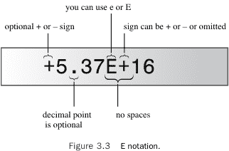

使用负指数意味着除以10的幂，而不是乘以10的幂。所以8.33E-4表示8.33 / 10⁴，即0.000833。类似地，电子质量9.11e-31 kg表示0.000000000000000000000000000000911 kg。你可以自行选择。（顺便提一下，注意911是美国常用的紧急电话号码，而电话信息由电子携带。巧合还是科学阴谋？你来判断。）注意，−8.33E4表示−83300。前面的符号适用于数值，指数中的符号适用于缩放。

> **注意**
>
> 形式 `d.dddE+n` 意味着将小数点向右移动 *n* 位，形式 `d.dddE-n` 意味着将小数点向左移动 *n* 位。这种可移动的小数点是术语“浮点”的起源。

### 浮点类型

与ANSI C一样，C++有三种浮点类型：`float`、`double`和`long double`。这些类型根据它们能表示的有效数字位数和指数的最小允许范围来描述。*有效数字*是一个数中有意义的数字。例如，将加利福尼亚州沙斯塔山的海拔写为14,179英尺，使用了五个有效数字，因为它精确到英尺。但将沙斯塔山的海拔写为约14,000英尺，则告诉我们两个有效数字，因为结果四舍五入到千英尺；在这种情况下，其余三个数字只是占位符。有效数字的位数不取决于小数点的位置。例如，你可以将海拔写为14.179千英尺。同样，这使用了五个有效数字，因为该值精确到第五位。

实际上，C和C++对有效数字的要求相当于`float`至少为32位，`double`至少为48位且肯定不小于`float`，`long double`至少与`double`一样大。三者可以大小相同。但通常情况下，`float`为32位，`double`为64位，`long double`为80、96或128位。此外，所有三种类型的指数范围至少为−37到+37。你可以在`cfloat`或`float.h`头文件中查找系统的限制。（`cfloat`是C语言`float.h`文件的C++版本。）例如，以下是Borland C++Builder的`float.h`文件中的一些带注释的条目：

```c
// the following are the minimum number of significant digits
#define DBL_DIG 15        // double
#define FLT_DIG 6         // float
#define LDBL_DIG 18       // long double

// the following are the number of bits used to represent the mantissa
#define DBL_MANT_DIG     53
#define FLT_MANT_DIG     24
#define LDBL_MANT_DIG    64

// the following are the maximum and minimum exponent values
#define DBL_MAX_10_EXP   +308
#define FLT_MAX_10_EXP   +38
#define LDBL_MAX_10_EXP  +4932

#define DBL_MIN_10_EXP   -307
#define FLT_MIN_10_EXP   -37
#define LDBL_MIN_10_EXP  -4931
```

程序清单3.8考察了`float`和`double`类型，以及它们在表示数字的精度上如何不同（也就是有效数字方面）。该程序预览了第17章“输入、输出和文件”中一个名为`setf()`的`ostream`方法。这个特定的调用强制输出保持定点记数法，以便你更好地看到精度。它防止程序对大数值切换到E记数法，并使程序显示小数点右侧的六位数字。这些参数

ios_base::fixed 和 ios_base::floatfield 是包含 iostream 后提供的常量。

### 清单 3.8 floatnum.cpp

```cpp
// floatnum.cpp -- floating-point types
#include <iostream>
int main()
{
    using namespace std;
    cout.setf(ios_base::fixed, ios_base::floatfield); // fixed-point
    float tub = 10.0 / 3.0;     // good to about 6 places
    double mint = 10.0 / 3.0;   // good to about 15 places
    const float million = 1.0e6;

    cout << "tub = " << tub;
    cout << ", a million tubs = " << million * tub;
    cout << ",\nand ten million tubs = ";
    cout << 10 * million * tub << endl;

    cout << "mint = " << mint << " and a million mints = ";
    cout << million * mint << endl;
    return 0;
}
```

以下是清单 3.8 中程序的输出：

```text
tub = 3.333333, a million tubs = 3333333.250000,
and ten million tubs = 33333332.000000
mint = 3.333333 and a million mints = 3333333.333333
```

## 程序说明

通常 cout 会丢弃尾随零。例如，它会把 3333333.250000 显示为 3333333.25。对 `cout.setf()` 的调用会覆盖该行为，至少在新实现中如此。清单 3.8 中要注意的主要一点是，float 的精度低于 double。tub 和 mint 都被初始化为 10.0 / 3.0。其结果应为 3.3333333333333333……（等等）。因为 cout 在小数点后打印六位数字，所以可以看出 tub 和 mint 都精确到这一位。但在程序将每个数乘以一百万后，你会看到 tub 在第七个 3 之后偏离了正确值。tub 精确到七位有效数字。（该系统保证 float 有六位有效数字，但这是最坏情况。）然而，double 类型变量显示出 13 个 3，因此它至少精确到 13 位有效数字。由于系统保证 15 位，这不应让你感到意外。还要注意，将一百万 tub 乘以 10 并不能完全得到正确答案；这再次指出了 float 精度的局限性。

cout 所属的 ostream 类具有类成员函数，可让你精确控制输出的格式化方式——字段宽度、小数点右侧的位数、小数形式或 E 形式，等等。第 17 章概述了这些选择。本书的示例保持简单，通常只使用 << 运算符。有时这种做法会显示比必要更多的数字，但这只会影响美观。如果你确实介意，可以浏览第 17 章，了解如何使用格式化方法。不过，不要指望在现阶段完全理解这些解释。

## 阅读包含文件

C++ 源文件顶部的 include 指令常常带有一种魔法咒语的气息；初学 C++ 的程序员通过阅读和实践了解到哪些头文件添加了特定功能，并且仅仅为了让程序工作而包含它们。不要只把 include 文件当作神秘而晦涩知识的来源；不妨打开它们读一读。它们是文本文件，因此你可以轻松阅读。你在程序中包含的所有文件都存在于你的计算机上，或存在于你的计算机可以使用的位置。找到你使用的 include 文件，看看它们包含什么。你很快会发现，你使用的源文件和头文件是知识和信息的极好来源——在某些情况下，是现有的最佳文档。以后，当你进一步使用更复杂的包含并开始在应用程序中使用其他非标准库时，这个习惯会对你大有裨益。

## 浮点常量

当你在程序中编写浮点常量时，程序会以哪种浮点类型存储它？默认情况下，诸如 8.24 和 2.4E8 之类的浮点常量是 double 类型。如果希望常量是 float 类型，使用 f 或 F 后缀。对于 long double 类型，使用 l 或 L 后缀。（因为小写 l 看起来很像数字 1，所以大写 L 是更好的选择。）以下是一些示例：

```cpp
1.234f        // a float constant
2.45E20F      // a float constant
2.345324E28   // a double constant
2.2L          // a long double constant
```

## 浮点数的优缺点

与整数相比，浮点数有两个优点。第一，它们可以表示整数之间的值。第二，由于比例因子，它们可以表示大得多的值范围。另一方面，浮点运算通常比整数运算稍慢，而且可能会丢失精度。清单 3.9 说明了最后一点。

### 清单 3.9 fltadd.cpp

```cpp
// fltadd.cpp -- precision problems with float
#include <iostream>
int main()
{
```

以下是 C++ 的五个基本算术运算符：

-   + 运算符将其操作数相加。例如，`4 + 20` 的求值结果为 24。
-   - 运算符从第一个操作数中减去第二个操作数。例如，`12 - 3` 的求值结果为 9。
-   * 运算符将其操作数相乘。例如，`28 * 4` 的求值结果为 112。
-   / 运算符将第一个操作数除以第二个操作数。例如，`1000 / 5` 的求值结果为 200。如果两个操作数都是整数，则结果是商的整数部分。例如，`17 / 3` 为 5，小数部分被丢弃。
-   % 运算符求其第一个操作数相对于第二个操作数的模。也就是说，它产生第一个操作数除以第二个操作数后的余数。例如，`19 % 6` 为 1，因为 6 除 19 三次，余数为 1。两个操作数都必须是整数类型；对浮点值使用 % 运算符会导致编译时错误。如果其中一个操作数为负数，则结果的符号满足以下规则：`(a/b)*b + a%b` 等于 a。

当然，操作数既可以使用常量，也可以使用变量。清单 3.10 正是这样做的。由于 % 运算符只适用于整数，我们将其留到后面的示例中。

### 清单 3.10 arith.cpp

```cpp
// arith.cpp -- some C++ arithmetic
#include <iostream>
int main()
{
    using namespace std;
    float hats, heads;

    cout.setf(ios_base::fixed, ios_base::floatfield); // fixed-point
    cout << "Enter a number: ";
    cin >> hats;
    cout << "Enter another number: ";
    cin >> heads;

    cout << "hats = " << hats << "; heads = " << heads << endl;
    cout << "hats + heads = " << hats + heads << endl;
    cout << "hats - heads = " << hats - heads << endl;
    cout << "hats * heads = " << hats * heads << endl;
    cout << "hats / heads = " << hats / heads << endl;
    return 0;
}
```

正如从清单 3.10 中程序的以下示例输出所见，你可以相信 C++ 能进行简单算术运算：

```text
Enter a number: 50.25
Enter another number: 11.17
hats = 50.250000; heads = 11.170000
hats + heads = 61.419998
hats - heads = 39.080002
hats * heads = 561.292480
hats / heads = 4.498657
```

嗯，也许你不能完全相信它。将 11.17 加到 50.25 应得到 61.42，但输出报告的是 61.419998。这不是算术问题；而是 float 类型表示有效数字的能力有限的问题。请记住，C++ 仅保证 float 有六位有效数字。如果将 61.419998 舍入到六位数字，得到 61.4200，这是在保证精度下的正确值。寓意是，如果需要更高精度，应使用 double 或 long double。

## 运算顺序：运算符优先级和结合性

你能相信 C++ 能进行复杂算术运算吗？可以，但你必须了解 C++ 使用的规则。例如，许多表达式涉及多个运算符。这会引发哪个运算符先应用的问题。例如，考虑以下语句：

```cpp
int flyingspigs = 3 + 4 * 5;  // 35 or 23?
```

4 似乎是 + 和 * 两个运算符的操作数。当多个运算符可应用于同一操作数时，C++ 使用优先级规则来决定先使用哪个运算符。算术运算符遵循通常的代数优先级，乘法、除法和取模在加法和减法之前进行。因此，3 + 4 * 5 表示 3 + (4 * 5)，而不是 (3 + 4) * 5。所以答案是 23，而不是 35。当然，你可以使用括号来强制自己的优先级。附录 D“运算符优先级”显示了所有 C++ 运算符的优先级。注意，*、/ 和 % 在附录 D 中都位于同一行。这意味着它们具有相同的优先级。类似地，加法和减法共享较低的优先级。

有时优先级列表还不够。考虑以下语句：

```cpp
float logs = 120 / 4 * 5;    // 150 or 6?
```

再一次，4 是两个运算符的操作数。但 / 和 * 运算符具有相同的优先级，因此仅凭优先级并不能告诉程序是先计算 120 除以 4，还是先计算 4 乘以 5。因为第一种选择得到 150，第二种选择得到 6，所以这个选择很重要。当两个运算符具有相同优先级时，C++ 会查看运算符具有从左到右的结合性还是从右到左的结合性。从左到右的结合性意味着，如果作用于同一操作数的两个运算符具有相同优先级，则先应用左侧运算符。对于从右到左的结合性，则先应用右侧运算符。结合性信息也在附录 D 中。附录 D 表明乘法和除法从左到右结合。这意味着你先将 4 与最左侧的运算符结合。也就是说，你先计算 120 除以 4，得到 30，然后将结果乘以 5，得到 150。


请注意，优先级和结合性规则只有在两个运算符共享同一个操作数时才会起作用。考虑以下表达式：

```cpp
int dues = 20 * 5 + 24 * 6;
```

运算符优先级告诉你两件事：程序必须先计算 `20 * 5` 再执行加法，并且程序必须先计算 `24 * 6` 再执行加法。但优先级和结合性都没有说明哪个乘法先进行。你可能会认为结合性表示最左边的乘法先进行，但在这种情况下，两个 `*` 运算符并不共享共同的操作数，因此这些规则不适用。事实上，C++ 把哪一种顺序在系统上效果最好留给实现来决定。对于这个例子，任一顺序都给出相同结果，但在某些情况下顺序可能会产生差异。你将在第5章讨论递增运算符时看到一个例子。

## 除法杂谈

你还没有看到关于除法运算符（`/`）的完整内容。该运算符的行为取决于操作数的类型。如果两个操作数都是整数，C++ 执行整数除法。这意味着答案中的任何小数部分都会被丢弃，使结果为整数。如果一个或两个操作数是浮点值，则保留小数部分，使结果为浮点值。程序清单3.11说明了 C++ 除法如何对不同类型的值起作用。与程序清单3.10一样，程序清单3.11调用 `setf()` 成员函数来修改结果的显示方式。

程序清单3.11  **divide.cpp**

```cpp
// divide.cpp -- integer and floating-point division
#include <iostream>
int main()
{
    using namespace std;
    cout.setf(ios_base::fixed, ios_base::floatfield);
    cout << "Integer division: 9/5 = " << 9 / 5  << endl;
    cout << "Floating-point division: 9.0/5.0 = ";
    cout << 9.0 / 5.0 << endl;
    cout << "Mixed division: 9.0/5 = " << 9.0 / 5  << endl;
    cout << "double constants: 1e7/9.0 =";
    cout << 1.e7 / 9.0 << endl;
    cout << "float constants: 1e7f/9.0f =";
    cout << 1.e7f / 9.0f << endl;
    return 0;
}
```

以下是程序清单3.11在一种实现下的输出：

```text
Integer division: 9/5 = 1
Floating-point division: 9.0/5.0 = 1.800000
Mixed division: 9.0/5 = 1.800000
double constants: 1e7/9.0 = 1111111.11111
float constants: 1e7f/9.0f = 1111111.125000
```

第一行输出表明，用整数9除以整数5得到整数1。4 / 5（即0.8）的小数部分被丢弃。（你会在本章后面学习模运算符时看到这类除法的一种实际用途。）接下来的两行表明，当至少一个操作数是浮点值时，你会得到浮点答案1.8。实际上，当你尝试组合混合类型时，C++ 会把所有相关类型转换为同一类型。你将在本章后面学习这些自动转换。最后两行的相对精度表明，如果两个操作数都是 `double`，则结果是 `double` 类型；如果两个操作数都是 `float`，则结果是 `float` 类型。记住，浮点常量默认是 `double` 类型。

> **运算符重载一瞥**
>
> 在程序清单3.11中，除法运算符表示三种不同的运算：`int` 除法、`float` 除法和 `double` 除法。C++ 使用上下文——在本例中是操作数的类型——来确定指的是哪个运算符。对多个运算使用同一个符号的过程称为*运算符重载*。C++ 语言中内置了几个重载的例子。C++ 还允许你把运算符重载扩展到用户定义的类，因此你在这里看到的是面向对象编程一个重要特性的前身（见图3.4）。

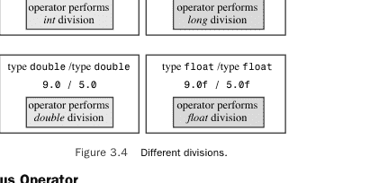

图3.4 不同的除法。

## 模运算符

大多数人对加、减、乘、除比对模运算符更熟悉，因此让我们花点时间看看模运算符的实际应用。模运算符返回整数除法的余数。与整数除法结合使用时，模运算在需要把数量划分为不同整数单位的问题中特别有用，例如把英寸转换为英尺和英寸，或者把美元转换为25美分、10美分、5美分和1美分硬币。在第2章中，

- C++ 在表达式中组合混合类型时会转换值。
- C++ 在向函数传递参数时会转换值。

如果你不理解这些自动转换中发生了什么，可能会觉得某些程序结果令人困惑，所以让我们更详细地看看这些规则。

## 初始化与赋值时的转换

C++ 相当宽松，允许你把一种类型的数值赋给另一种类型的变量。每当你这样做时，该值会被转换为接收变量的类型。例如，假设 `so_long` 是 `long` 类型，`thirty` 是 `short` 类型，并且程序中有以下语句：

```cpp
so_long = thirty;          // assigning a short to a long
```

程序在赋值时会取 `thirty` 的值（通常是16位值），并将其扩展为 `long` 值（通常是32位值）。注意，扩展会创建一个新值放入 `so_long`；`thirty` 的内容不变。把值赋给范围更大的类型通常没有问题。例如，把 `short` 值赋给 `long` 变量不会改变该值；只是给这个值多了几个字节可供“闲待着”。然而，把像2111222333这样大的 `long` 值赋给 `float` 变量会导致一些精度丢失。因为 `float` 只能有六位有效数字，所以该值可能被舍入为2.11122E9。因此，虽然有些转换是安全的，但有些可能带来困难。表3.3指出了一些可能的转换问题。

表3.3 可能的数值转换问题

| 转换类型 | 潜在问题 |
|---|---|
| 较大的浮点类型转换为较小的浮点类型，例如 double 转换为 float | 精度（有效数字）丢失；值可能超出目标类型的范围，此时结果未定义。 |
| 浮点类型转换为整数类型 | 小数部分丢失；原值可能超出目标类型的范围，此时结果未定义。 |
| 较大的整数类型转换为较小的整数类型，例如 long 转换为 short | 原值可能超出目标类型的范围；通常只复制低序字节。 |

赋给 `bool` 变量的零值会转换为 `false`，非零值会转换为 `true`。把浮点值赋给整数类型会带来几个问题。首先，把浮点转换为整数会截断数字（丢弃小数部分）。其次，`float` 值可能太大，无法放入狭小的 `int` 变量中。在这种情况下，C++ 没有定义结果应该是什么；这意味着不同的实现可以有不同的响应。

传统初始化与赋值行为相同。程序清单3.13展示了几种通过初始化进行的转换。

程序清单3.13  `init.cpp`

```cpp
// init.cpp -- type changes on initialization
#include <iostream>
int main()
{
    using namespace std;
    cout.setf(ios_base::fixed, ios_base::floatfield);
    float tree = 3;       // int converted to float
    int guess(3.9832);    // double converted to int
    int debt = 7.2E12;    // result not defined in C++
    cout << "tree = " << tree << endl;
    cout << "guess = " << guess << endl;
    cout << "debt = " << debt << endl;
    return 0;
}
```

以下是程序清单3.13在某个系统上的输出：

```text
tree = 3.000000
guess = 3
debt = 1634811904
```

在本例中，`tree` 被赋为浮点值3.0。把3.9832赋给 `int` 变量 `guess` 会使该值被截断为3；在把浮点类型转换为整数类型时，C++ 使用截断（丢弃小数部分），而不是舍入（寻找最接近的整数值）。最后，请注意 `int` 变量 `debt` 无法容纳值7.2E12。这造成了一种 C++ 未定义结果的情况。在这个系统上，`debt` 最终得到值1634811904，约为1.6E9。好吧，这倒是一种减少巨额债务的新奇方式！

有些编译器会针对那些用浮点值初始化整数变量的语句发出可能丢失数据的警告。此外，`debt` 显示的值因编译器而异。例如，在第二个系统上运行程序清单3.13中的同一程序产生了值2147483647。

## 使用 {} 时的初始化转换（C++11）

C++11 把使用花括号的初始化称为*列表初始化*。这是因为这种形式可以更普遍地用于为更复杂的数据类型提供值列表。它在类型转换方面比程序清单3.13中使用的形式更严格。特别地，列表初始化不允许*窄化*，即变量的类型可能无法表示所赋的值。例如，将浮点类型转换为整数

类型是不允许的。从整数类型转换为其他整数类型或浮点类型可能是允许的，前提是编译器能够判断目标变量能否正确保存该值。例如，用 int 值初始化 long 变量是可以的，因为 long 总是至少和 int 一样大。反方向的转换可能是允许的，前提是该值是一个可由该类型处理的常量：

```cpp
const int code = 66;
int x = 66;
char c1 {31325};  // narrowing, not allowed
char c2 = {66};   // allowed because char can hold 66
char c3 {code};   // ditto
char c4 = {x};    // not allowed, x is not constant
x = 31325;
char c5 = x;      // allowed by this form of initialization
```

对于 c4 的初始化，我们知道 x 的值为 66，但对编译器来说，x 是一个变量，可以想象它可能具有其他大得多的值。跟踪 x 从初始化到尝试初始化 c4 时使用之间可能发生了什么，并不是编译器的工作。

## 表达式中的转换

考虑在一个表达式中组合两种不同的算术类型时会发生什么。在这种情况下，C++ 会进行两种自动转换。第一，某些类型无论何时出现都会被自动转换。第二，某些类型在与表达式中的其他类型组合时会被转换。

首先，让我们考察这些自动转换。在求值表达式时，C++ 会把 bool、char、unsigned char、signed char 和 short 值转换为 int。特别地，true 被提升为 1，false 被提升为 0。这些转换称为整型提升。例如，考虑下面这些关于家禽的语句：

```cpp
short chickens = 20;             // line 1
short ducks = 35;                // line 2
short fowl = chickens + ducks;   // line 3
```

为了执行第 3 行的语句，C++ 程序会取得 chickens 和 ducks 的值，并把二者都转换为 int。然后，程序把结果转换回 short 类型，因为答案被赋给了一个 short 类型变量。你可能会觉得这有点绕，但它确实有道理。int 类型通常被选为计算机最自然的类型，这意味着计算机对该类型的计算可能最快。

还有更多整型提升：如果 short 比 int 小，则 unsigned short 类型会被转换为 int。如果这两种类型大小相同，则 unsigned short 会被转换为 unsigned int。这条规则确保在提升 unsigned short 时不会发生数据丢失。类似地，wchar_t 会被提升为下列类型中第一个宽度足以容纳其范围的类型：int、unsigned int、long 或 unsigned long。

然后，当你对不同类型进行算术组合时，会发生一些转换，例如把一个 `int` 加到 `float` 上。当一个运算涉及两种类型时，较小的类型会被转换为较大的类型。例如，程序清单 3.11 中的程序用 9.0 除以 5。因为 9.0 是 double 类型，所以程序在执行除法之前会把 5 转换为 double 类型。更一般地说，编译器会按照一份检查清单来确定在算术表达式中进行哪些转换。C++11 对该列表做了轻微修改。下面是该列表的 C++11 版本，编译器会按顺序逐项检查：

- 1. 如果任一操作数是 `long double` 类型，则另一个操作数会被转换为 `long double`。
- 2. 否则，如果任一操作数是 `double`，则另一个操作数会被转换为 `double`。
- 3. 否则，如果任一操作数是 `float`，则另一个操作数会被转换为 `float`。
- 4. 否则，操作数都是整数类型，并进行整型提升。
- 5. 在这种情况下，如果两个操作数都是有符号的，或者两个都是无符号的，并且其中一个的级别低于另一个，则它会被转换为较高级别的类型。
- 6. 否则，一个操作数是有符号的，另一个是无符号的。如果无符号操作数的级别高于有符号操作数，则后者会被转换为无符号操作数的类型。
- 7. 否则，如果有符号类型能够表示无符号类型的所有值，则无符号操作数会被转换为该有符号类型。
- 8. 否则，两个操作数都会被转换为该有符号类型的无符号版本。

ANSI C 遵循与 ISO 2003 C++ 相同的规则，这些规则与前面的规则略有不同，而经典的 K&R C 又有略有不同的规则。例如，经典 C 总是把 `float` 提升为 `double`，即使两个操作数都是 `float`。

这个列表引入了对整数类型进行分级的概念。简而言之，正如你可能预料的那样，有符号整数类型从高到低的基本级别是 `long long`、`long`、`int`、`short` 和 `signed char`。无符号类型与对应的有符号类型具有相同的级别。`char`、`signed char` 和 `unsigned char` 这三种类型都具有相同的级别。`bool` 类型的级别最低。`wchar_t`、`char16_t` 和 `char32_t` 的级别与其底层类型相同。

## 传递实参时的转换

通常，C++ 函数原型声明会控制传递实参时的类型转换，你将在第 7 章“函数：C++ 的编程模块”中学习这一点。然而，放弃实参传递的原型控制是可能的，尽管通常并不明智。在这种情况下，C++ 会对 `char` 和 `short` 类型（`signed and unsigned`）应用整型提升。此外，为了与经典 C 中的大量代码保持兼容，当把 float 实参传递给放弃原型声明的函数时，C++ 会把它们提升为 double。

## 强制类型转换

C++ 使你能够通过类型转换机制显式地强制进行类型转换。（C++ 认识到类型规则的必要性，也认识到偶尔需要覆盖这些规则。）类型转换有两种形式。例如，要把存储在名为 thorn 的变量中的 int 值转换为 long 类型，你可以使用以下任一表达式：

```cpp
(long) thorn    // returns a type long conversion of thorn
long (thorn)    // returns a type long conversion of thorn
```

类型转换不会改变 thorn 变量本身；相反，它会创建一个指定类型的新值，然后你可以在表达式中使用这个新值，如下所示：

```cpp
cout << int('Q');  // displays the integer code for 'Q'
```

更一般地说，你可以这样做：

```cpp
(typeName) value    // converts value to typeName type
typeName (value)    // converts value to typeName type
```

第一种形式是纯 C 风格。第二种形式是纯 C++ 风格。新形式背后的想法是让类型转换看起来像函数调用。这使得内置类型的类型转换看起来像你可以为用户定义类设计的类型转换。

C++ 还引入了四个类型转换运算符，它们在使用方式上限制更严格。第 15 章“友元、异常和其他”会介绍它们。在这四个运算符中，static_cast<> 运算符可用于把值从一种数值类型转换为另一种数值类型。例如，使用它把 thorn 转换为 long 类型的值，如下所示：

```cpp
static_cast<long> (thorn)    // returns a type long conversion of thorn
```

更一般地说，你可以这样做：

```cpp
static_cast<typeName> (value)    // converts value to typeName type
```

正如第 15 章将进一步讨论的那样，Stroustrup 认为传统的 C 风格类型转换在其可能性上危险地不受限制。static_cast<> 运算符比传统类型转换限制更严格。

程序清单 3.14 简要演示了基本类型转换（两种形式）和 static_cast<>。想象一下，该清单的第一部分是一个强大的生态建模程序的一部分，该程序进行浮点计算，并将计算结果转换为鸟和动物的整数数量。你得到的结果取决于你在什么时候进行转换。对海雀的计算先相加浮点值，然后在赋值时把和转换为 int。但对蝙蝠和骨顶鸡的计算先使用类型转换把浮点值转换为 int，然后再相加这些值。程序的最后一部分展示了如何使用类型转换来显示 char 类型值的 ASCII 码。


## 程序清单 3.14 typecast.cpp

```cpp
// typecast.cpp -- forcing type changes
#include <iostream>
int main()
{
    using namespace std;
    int auks, bats, coots;

    // the following statement adds the values as double,
    // then converts the result to int
    auks = 19.99 + 11.99;

    // these statements add values as int
    bats = (int) 19.99 + (int) 11.99;   // old C syntax
    coots = int (19.99) + int (11.99);  // new C++ syntax
    cout << "auks = " << auks << ", bats = " << bats;
    cout << ", coots = " << coots << endl;

    char ch = 'Z';
    cout << "The code for " << ch << " is ";   // print as char
    cout << int(ch) << endl;                  // print as int
    cout << "Yes, the code is ";
    cout << static_cast<int>(ch) << endl;     // using static_cast
    return 0;
}
```

下面是程序清单 3.14 中程序的运行结果：

```text
auks = 31, bats = 30, coots = 30
The code for Z is 90
Yes, the code is 90
```

首先，将 19.99 与 11.99 相加得到 31.98。当这个值赋给 int 变量 auks 时，它被截断为 31。但使用类型转换会在相加之前将同样的两个值截断为 19 和 11，因此 bats 和 coots 的结果都是 30。然后，两条 cout 语句在显示结果之前使用类型转换将 char 类型的值转换为 int。这些转换使 cout 以整数而不是字符的形式打印该值。

这个程序说明了使用类型转换的两个原因。首先，有些值以 double 类型存储，但需要用于计算 int 类型的值。例如，你可能正在将一个位置拟合到网格上，或者用浮点数来建模整数（如人口数量）。你可能希望计算时将这些值视为 int。类型转换使你能够直接做到这一点。请注意，对于这些值来说，先转换为 int 再相加，与先相加再转换为 int 得到的结果是不同的。

程序的第二部分展示了使用类型转换的最常见原因：强制一种形式的数据满足不同的期望。例如，在程序清单 3.14 中，char 变量 ch 保存了字母 Z 的编码。将 ch 与 cout 一起使用会显示字符 Z，因为 cout 会注意到 ch 是 char 类型。但通过将 ch 类型转换为 int，就可以让 cout 切换到 int 模式并打印存储在 ch 中的 ASCII 码。

## C++11 中的 auto 声明

C++11 引入了一种机制，允许编译器根据初始化值的类型来推导类型。为此，它重新定义了 auto 的含义——这个关键字可以追溯到 C 语言，但几乎从未被使用过。（第 9 章将讨论 auto 以前的含义。）只需在初始化声明中使用 auto 代替类型名，编译器就会为变量赋予与初始化器相同的类型：

```cpp
auto n = 100;      // n is int
auto x = 1.5;      // x is double
auto y = 1.3e12L;  // y is long double
```

然而，这种自动类型推导并非真正为这种简单情况而设计。实际上，你甚至可能出错。例如，假设 x、y 和 z 都应该是 double 类型。考虑下面的代码：

```cpp
auto x = 0.0;    // ok, x is double because 0.0 is double
double y = 0;    // ok, 0 automatically converted to 0.0
auto z = 0;      // oops, z is int because 0 is int
```

使用 0 而不是 0.0 对显式类型来说没有问题，但对自动类型转换来说则会出问题。

在处理复杂类型（如 STL（标准模板库）中的类型）时，自动类型推导会变得更有用。例如，C++98 代码可能有这样：

```cpp
std::vector<double> scores;
std::vector<double>::iterator pv = scores.begin();
```

C++11 允许你改为这样写：

```cpp
std::vector<double> scores;
auto pv = scores.begin();
```

我们将在之后涉及更相关主题时再次提到 auto 的这个新含义。

## 小结

C++ 的基本类型分为两组。一组是由以整数形式存储的值组成。第二组是由以浮点格式存储的值组成。整数类型之间的区别在于存储值所用的内存量以及它们是有符号还是无符号。从小到大，整数类型依次为 bool、char、signed char、unsigned char、short、unsigned short、int、unsigned int、long、unsigned long，以及 C++11 中的 long long、unsigned long long。还有一个 `wchar_t` 类型，它在这个大小序列中的位置取决于实现。C++11 新增了 `char16_t` 和 `char32_t` 类型，它们分别足够宽，可以容纳 16 位和 32 位的字符编码。C++ 保证 `char` 足够大，能容纳系统基本字符集中的任何成员，而 `char` 可以容纳系统扩展字符集中的任何成员；`short` 至少为 16 位；`int` 至少与 `short` 一样大；`long` 至少为 32 位且至少与 `int` 一样大。确切的大小取决于实现。

字符通过其数字编码来表示。I/O 系统决定一个编码被解释为字符还是数字。

浮点类型可以表示小数值以及比整数所能表示的更大范围的值。三种浮点类型是 `float`、`double` 和 `long double`。C++ 保证 `float` 不大于 `double`，且 `double` 不大于 `long double`。通常，`float` 使用 32 位内存，`double` 使用 64 位，`long double` 使用 80 到 128 位。

通过提供不同大小、有符号和无符号变体的多种类型，C++ 让你可以将类型与特定的数据需求匹配起来。

C++ 使用运算符为数值类型提供通常的算术支持：加法、减法、乘法、除法和取模。当两个运算符作用于同一个值时，C++ 的优先级和结合性规则决定哪个运算先执行。

当将值赋给变量、在算术中混合类型，以及使用类型转换强制类型转换时，C++ 会将值从一种类型转换为另一种类型。许多类型转换是“安全的”，意味着你可以在不丢失或改变数据的情况下进行转换。例如，你可以将 `int` 值转换为 `long` 值而没有任何问题。其他转换，例如从浮点类型转换为整数类型，则需要更加小心。

起初，你可能会觉得 C++ 的基本类型数量有点过多，尤其是考虑到各种转换规则时。但很可能最终你会发现，某些情况下某种类型正是你当时所需要的，你会感谢 C++ 提供了它。

## 复习题

1. 为什么 C++ 有不止一种整数类型？
2. 声明匹配以下描述的变量：
   - a. 值为 80 的 `short` 整数
   - b. 值为 42,110 的 `unsigned int` 整数
   - c. 值为 3,000,000,000 的整数
3. C++ 提供了哪些保护措施来防止你超出整数类型的范围？
4. 33L 和 33 有什么区别？
5. 考虑下面两条 C++ 语句：

   ```cpp
   char grade = 65;
   char grade = 'A';
   ```

   它们等价吗？
6. 你如何用 C++ 找出编码 88 代表哪个字符？至少提出两种方法。
7. 将 long 值赋给 float 可能会导致舍入错误。那么将 long 赋给 double 呢？将 long long 赋给 double 呢？
8. 按 C++ 的方式求下列表达式的值：
   - a. 8 * 9 + 2
   - b. 6 * 3 / 4
   - c. 3 / 4 * 6
   - d. 6.0 * 3 / 4
   - e. 15 % 4
9. 假设 x1 和 x2 是两个 double 类型变量，你想把它们作为整数相加并赋给一个整数变量。构造一个 C++ 语句来完成此操作。如果你想将它们作为 double 类型相加，然后再转换为 int，该怎么办？
10. 下列每个声明的变量类型是什么？
   - a. `auto cars = 15;`
   - b. `auto iou = 150.37f;`
   - c. `auto level = 'B';`
   - d. `auto crat = U'/U00002155';`
   - e. `auto fract = 8.25f/2.5;`

## 编程练习

1. 编写一个简短程序，要求以整数英寸为单位输入你的身高，然后将身高转换为英尺和英寸。让程序使用下划线字符来指示你该在哪里输入响应。同时使用 const 符号常量来表示转换因子。


- 2. 编写一个简短的程序，要求输入你的身高（英尺和英寸）以及体重（磅）。（使用三个变量来存储这些信息。）让程序报告你的身体质量指数（BMI）。要计算 BMI，首先将你的身高（英尺和英寸）转换为英寸（1 英尺 = 12 英寸）。然后将你的身高（英寸）乘以 0.0254，转换为米。再将你的体重（磅）除以 2.2，转换为千克。最后，用你的质量（千克）除以身高（米）的平方，计算你的 BMI。使用符号常量表示各种转换因子。

- 3. 编写一个程序，要求用户以度、分、秒的形式输入纬度，然后以十进制格式显示该纬度。1 分等于 60 秒，1 度等于 60 分；用符号常量表示这些值。应为每个输入值使用单独的变量。示例运行应如下所示：

  ```
  Enter a latitude in degrees, minutes, and seconds:
  First, enter the degrees: 37
  Next, enter the minutes of arc: 51
  Finally, enter the seconds of arc: 19
  37 degrees, 51 minutes, 19 seconds = 37.8553 degrees
  ```

- 4. 编写一个程序，要求用户以整数值输入秒数（使用 `long` 类型，或者如果可用，使用 `long long` 类型），然后以天、小时、分钟和秒显示等价的时长。使用符号常量表示一天中的小时数、一小时中的分钟数以及一分钟中的秒数。输出应如下所示：

  ```
  Enter the number of seconds: 31600000
  31600000 seconds = 365 days, 17 hours, 46 minutes, 40 seconds
  ```

- 5. 编写一个程序，要求用户输入当前世界人口和当前美国人口（或你选择的其他国家的人口）。将信息存储在 `long long` 类型的变量中。让程序显示美国（或其他国家）人口占世界人口的百分比。输出应大致如下所示：

  ```
  Enter the world's population: 6898758899
  Enter the population of the US: 310783781
  The population of the US is 4.50492% of the world population.
  ```

  你可以使用互联网获取更新的数据。

- 6. 编写一个程序，询问你行驶了多少英里以及使用了多少加仑汽油，然后报告你的汽车每加仑行驶的英里数。或者，如果你愿意，程序可以要求输入以千米为单位的距离和以升为单位的汽油量，然后以欧洲风格报告结果，即每 100 千米消耗的升数。

- 7. 编写一个程序，要求你以欧洲风格输入汽车汽油消耗量（升/100 千米），并转换为美国风格的每加仑英里数。注意，除了使用不同的测量单位外，美国的计算方式（距离 / 燃料）与欧洲的计算方式（燃料 / 距离）互为倒数。注意，100 千米等于 62.14 英里，1 加仑等于 3.875 升。因此，19 mpg 约为 12.4 l/100 km，27 mpg 约为 8.7 l/100 km。

本页有意留白

## 复合类型

在本章中，你将学习以下内容：

- 创建和使用数组
- 创建和使用 C 风格字符串
- 创建和使用 `string` 类字符串
- 使用 `getline()` 和 `get()` 方法读取字符串
- 混合字符串和数值输入
- 创建和使用结构
- 创建和使用联合
- 创建和使用枚举
- 创建和使用指针
- 使用 `new` 和 `delete` 管理动态内存
- 创建动态数组
- 创建动态结构
- 自动、静态和动态存储
- `vector` 和 `array` 类（介绍）

假设你开发了一款名为 User-Hostile 的电脑游戏，玩家在其中与一个神秘且粗暴的计算机界面斗智。现在你必须编写一个程序，记录五年期间每月的游戏销量。或者你想清点你积累的黑客英雄交易卡。你很快会得出结论：为满足这些数据需求，你需要的不只是 C++ 的简单基本类型，而 C++ 提供了更多东西——复合类型。这些类型是由基本整数类型和浮点类型构建而成的。影响最深远的复合类型是类，也就是我们正在迈向的 OOP 堡垒。但 C++ 还支持几种取自 C 的较简单的复合类型。例如，数组可以保存多个同一类型的值。特定类型的数组可以保存字符串，即一系列字符。结构可以保存多个不同类型的值。此外还有指针，指针是告诉计算机数据放在哪里的变量。你将在本章中考察所有这些复合形式（类除外），初步了解 `new` 和 `delete` 以及如何使用它们管理数据，并入门性地了解 C++ 的 `string` 类，它为你提供另一种处理字符串的方式。

### 介绍数组

数组是一种数据形式，可以保存多个值，且所有值都属于同一类型。例如，一个数组可以保存 60 个 `int` 类型的值，表示五年的游戏销售数据；12 个 `short` 值，表示每个月的天数；或者 365 个 `float` 值，表示一年中每天的食品开销。每个值存储在一个单独的数组元素中，计算机将数组的所有元素连续存储在内存中。

要创建数组，需使用声明语句。数组声明应说明三件事：

- 每个元素中要存储的值的类型
- 数组的名称
- 数组中的元素数量

在 C++ 中，通过修改简单变量的声明并添加包含元素数量的方括号来实现。例如，下面的声明创建一个名为 `months` 的数组，它有 12 个元素，每个元素都可以保存一个 `short` 类型的值：

```cpp
short months[12];    // creates array of 12 short
```

本质上，每个元素都是一个变量，你可以将其视为简单变量。

这是声明数组的一般形式：

```cpp
typeName arrayName[arraySize];
```

表达式 `arraySize` 即元素数量，必须是整数常量，例如 `10` 或 `const` 值，或常量表达式，例如 `8 * sizeof (int)`，其所有值在编译时均已知。特别是，`arraySize` 不能是值在程序运行时才设置的变量。不过，本章后面你将学习如何使用 `new` 运算符绕过该限制。

> **数组作为复合类型**
>
> 数组被称为复合类型，因为它是由其他类型构建而成的。（C 使用术语“派生类型”，但由于 C++ 将“派生”用于类关系，所以不得不提出一个新术语。）你不能简单地声明某个东西是数组；它始终必须是某种特定类型的数组。不存在通用的数组类型。相反，有许多特定的数组类型，例如 `char` 数组或 `long` 数组。例如，考虑以下声明：
>
> ```cpp
> float loans[20];
> ```
>
> `loans` 的类型不是“数组”，而是“float 数组”。这强调 `loans` 数组是由 `float` 类型构建的。

数组的许多实用性来自这样一个事实：你可以单独访问数组元素。做到这一点的方法是使用*下标*（或*索引*）为元素编号。C++ 数组编号从零开始。（这是不可协商的；必须从零开始。Pascal 和 BASIC 用户必须适应。）C++ 使用带索引的方括号表示法来指定数组元素。例如，`months[0]` 是 `months` 数组的第一个元素，`months[11]` 是最后一个元素。注意，最后一个元素的索引比数组大小小一（见图 4.1）。因此，数组声明使你能够通过一条声明创建大量变量，然后可以使用索引来标识和访问各个元素。

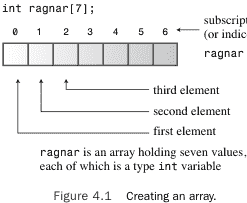

### 有效下标值的重要性

编译器不会检查你使用的下标是否有效。例如，如果你给不存在的元素 `months[101]` 赋值，编译器不会报错。但这种赋值可能在程序运行时引发问题，可能损坏数据或代码，甚至可能导致程序中止。因此，你有责任确保程序只使用有效的下标值。

程序清单 4.1 中的山药分析程序演示了数组的一些特性，包括声明数组、为数组元素赋值以及初始化数组。

### 程序清单 4.1 arrayone.cpp

```cpp
// arrayone.cpp -- small arrays of integers
#include <iostream>
int main()
{
    using namespace std;
    int yams[3];    // creates array with three elements
    yams[0] = 7;    // assign value to first element
```


```cpp
yams[1] = 8;
yams[2] = 6;

int yamcosts[3] = {20, 30, 5}; // create, initialize array
// NOTE: If your C++ compiler or translator can't initialize
// this array, use static int yamcosts[3] instead of
// int yamcosts[3]

cout << "Total yams = ";
cout << yams[0] + yams[1] + yams[2] << endl;
cout << "The package with " << yams[1] << " yams costs ";
cout << yamcosts[1] << " cents per yam.\n";
int total = yams[0] * yamcosts[0] + yams[1] * yamcosts[1];
total += yams[2] * yamcosts[2];
cout << "The total yam expense is " << total << " cents.\n";

cout << "\nSize of yams array = " << sizeof yams;
cout << " bytes.\n";
cout << "Size of one element = " << sizeof yams[0];
cout << " bytes.\n";
return 0;
}
```

下面是程序清单 4.1 中程序的输出：

```
Total yams = 21
The package with 8 yams costs 30 cents per yam.
The total yam expense is 410 cents.

Size of yams array = 12 bytes.
Size of one element = 4 bytes.
```

## 程序说明

首先，程序清单 4.1 中的程序创建了一个名为 yams 的三元素数组。因为 yams 有三个元素，所以这些元素的编号从 0 到 2，而 **arrayone.cpp** 使用 0 到 2 的索引值分别为这三个单独的元素赋值。每个单独的元素都是一个 int，拥有 int 类型的所有权利和特性，因此 **arrayone.cpp** 可以并且确实对元素赋值、相加、相乘和显示。

该程序使用繁琐的方式为 yams 赋值。C++ 也允许你在声明语句中初始化数组元素。程序清单 4.1 使用这种快捷方式为 yamcosts 数组赋值：

```cpp
int yamcosts[3] = {20, 30, 5};
```

它只是提供一个用逗号分隔的值列表（即*初始化列表*），并用花括号括起来。列表中的空格是可选的。如果你没有初始化在函数内部定义的数组，那么元素值将保持未定义。这意味着该元素会采用该内存位置先前存放的任何值。

接下来，程序在几次计算中使用了数组值。程序的这一部分因为所有的下标和方括号而显得杂乱。第 5 章“循环和关系表达式”中将要介绍的 *for* 循环提供了一种处理数组的强大方式，并消除了显式写出每个索引的需要。目前，我们仍将坚持使用小数组。

你应该记得，`sizeof` 运算符返回一种类型或数据对象的大小，以字节为单位。注意，如果你对数组名使用 `sizeof` 运算符，得到的是整个数组的字节数。但如果你对数组元素使用 `sizeof`，得到的是该元素的大小，以字节为单位。这说明 *yams* 是一个数组，但 *yams[1]* 只是一个 int。

## 数组的初始化规则

C++ 有几条关于初始化数组的规则。它们限制了你可以在什么时候初始化数组，并决定了当数组元素数量与初始化器中的值数量不匹配时会发生什么。让我们来检查这些规则。

你*仅*可以在定义数组时使用这种初始化形式。你不能以后再用它，也不能将一个数组整体赋给另一个数组：

```cpp
int cards[4] = {3, 6, 8, 10};        // okay
int hand[4];                          // okay
hand[4] = {5, 6, 7, 9};               // not allowed
hand = cards;                         // not allowed
```

然而，你可以使用下标，并分别给数组的元素赋值。

初始化数组时，你可以提供的值少于数组元素的数量。例如，下面的语句只初始化了 `hotelTips` 的前两个元素：

```cpp
float hotelTips[5] = {5.0, 2.5};
```

如果你部分初始化一个数组，编译器会把其余元素设置为零。因此，将数组的所有元素初始化为零很容易——只需显式地将第一个元素初始化为零，然后让编译器将其余元素初始化为零：

```cpp
long totals[500] = {0};
```

注意，如果你初始化为 `{1}` 而不是 `{0}`，那么只有第一个元素被设置为 1；其余元素仍然会被设置为 0。

如果你在初始化数组时让方括号（`[]`）保持为空，C++ 编译器会为你计算元素数量。例如，假设你做了如下声明：

```cpp
short things[] = {1, 5, 3, 8};
```

编译器会使 `things` 成为一个包含四个元素的数组。

## 让编译器完成计数

通常，让编译器计算元素数量是不好的做法，因为它的计数可能与你认为应该有的数量不同。例如，你可能不小心从列表中漏掉一个初始值。然而，正如你很快就会看到的那样，对于将字符数组初始化为字符串而言，这种方法可能是一种安全的做法。而且，如果你主要关心的是让程序（而不是你）知道数组有多大，你可以这样做：

```cpp
short things[] = {1, 5, 3, 8};
int num_elements = sizeof things / sizeof (short);
```

这是有用还是偷懒，取决于具体情况。

## C++11 数组初始化

正如第 3 章“处理数据”所提到的，C++11 使花括号形式的初始化（列表初始化）成为所有类型的通用形式。数组已经使用列表初始化，但 C++11 版本增加了一些新特性。

首先，初始化数组时可以省略 = 号：

```cpp
double earnings[4] {1.2e4, 1.6e4, 1.1e4, 1.7e4};  // okay with C++11
```

其次，你可以使用空花括号将所有元素设置为 0：

```cpp
unsigned int counts[10] = {};  // all elements set to 0
float balances[100] {};        // all elements set to 0
```

第三，正如第 3 章所讨论的，列表初始化可以防止窄化：

```cpp
long plifs[] = {25, 92, 3.0};           // not allowed
char slifs[4] {'h', 'i', 112011, '\0'}; // not allowed
char tlifs[4] {'h', 'i', 112, '\0'};    // allowed
```

第一个初始化失败，因为从浮点类型转换为整数类型属于窄化，即使浮点值小数点后只有零。第二个初始化失败，因为 112011 超出了 char 的范围（假设我们使用的是 8 位 char）。第三个初始化成功，因为尽管 112 是一个 int 值，但它仍在 char 的范围内。

C++ 标准模板库（STL）提供了一种称为 vector 模板类的数组替代方案，而 C++11 增加了一个 array 模板类。这些替代方案比内置的数组复合类型更复杂、更灵活。本章稍后会简要讨论它们，第 16 章“string 类和标准模板库”会更全面地讨论它们。

## 字符串

一个*字符串*是存储在内存连续字节中的一系列字符。C++ 有两种处理字符串的方式。第一种来自 C，通常称为*C 风格字符串*，是本章要检查的第一种方式。稍后，本章将讨论一种基于 *string* 类库的替代方法。

将一系列字符存储在连续字节中的想法意味着你可以把字符串存储在一个 char 数组中，每个字符保存在自己的数组元素中。字符串提供了一种方便的方式来存储文本信息，例如给用户的消息（“请告诉我你的瑞士银行秘密账户号码”）或来自用户的响应（“你一定是在开玩笑”）。C 风格字符串有一个特殊特征：每个字符串的最后一个字符是空字符。这个字符写作 `\0`，是 ASCII 码为 0 的字符，用于标记字符串的结尾。例如，考虑下面两个声明：

```cpp
char dog[8] = {'b', 'e', 'a', 'r', '\0', '?', '?', '?'};      // not a string!
char cat[8] = {'f', 'a', 't', 't', 'y', '\0', 'a', '\0'};    // a string!
```

这两个数组都是 char 数组，但只有第二个是字符串。空字符在 C 风格字符串中起着基本作用。例如，C++ 有许多处理字符串的函数，包括 `cout` 使用的那些函数。它们都通过逐字符处理字符串来工作，直到遇到空字符。如果你让 `cout` 显示前一个例子中像 `cat` 这样的好字符串，它会显示前七个字符，检测到空字符，然后停止。但如果你很不客气地让 `cout` 显示前一个例子中的 dog 数组（它不是一个字符串），`cout` 会打印数组中的八个字母，然后继续逐字节地在内存中前进，把每个字节解释为要打印的字符，直到遇到空字符。因为空字符（实际上就是设置为零的字节）在内存中往往很常见，所以损害通常会被很快控制住；尽管如此，你不应该把非字符串字符数组当作字符串来处理。

cat 数组的例子使将数组初始化为字符串看起来非常繁琐——所有那些单引号，然后还得记住空字符。别担心。有一种更好的方法可以将字符数组初始化为字符串。只需使用带引号的字符串，称为*字符串常量*或*字符串字面量*，如下所示：

```cpp
char bird[11] = "Mr. Cheeps";   // the \0 is understood
char fish[] = "Bubbles";        // let the compiler count
```

带引号的字符串总是隐式包含终止空字符，因此你不必把它写出来（见图 4.2）。此外，各种用于从键盘输入读取字符串到 char 数组的 C++ 输入设施都会自动为你添加终止空字符。（如果在运行程序清单 4.1 中的程序时，你发现必须使用 `keyword static` 来初始化数组，那么你也必须对这些 char 数组使用它。）

当然，你应该确保数组足够大，以容纳字符串的所有字符，包括空字符。用字符串常量初始化字符数组是让编译器为你计算元素数量可能更安全的一种情况。让数组大于字符串除了浪费空间外没有害处。这是因为处理字符串的函数是由空字符的位置引导的，而不是由数组的大小引导的。C++ 对字符串的长度没有限制。

> **注意**
>
> 在确定保存字符串所需的最小数组大小时，请记住在计数中包含终止空字符。


```cpp
char boss[8] = "Bozo";
```

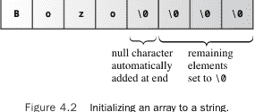

注意，字符串常量（用双引号）与字符常量（用单引号）不能互换。字符常量，例如 `'S'`，是字符编码的简写表示。在 ASCII 系统中，`'S'` 只是书写 83 的另一种方式。因此，下面的语句将值 83 赋给 `shirt_size`：

```cpp
char shirt_size = 'S';        // this is fine
```

但是 `"S"` 不是字符常量；它表示由两个字符组成的字符串，即 `S` 和 `\0` 字符。更糟的是，`"S"` 实际上表示存储该字符串的内存地址。因此，像下面这样的语句试图把一个内存地址赋给 `shirt_size`：

```cpp
char shirt_size = "S";        // illegal type mismatch
```

因为在 C++ 中地址是一种单独的类型，所以 C++ 编译器不会允许这种荒谬做法。（本章后面讨论指针之后，我们会回到这一点。）

## 拼接字符串字面量

有时字符串太长，不便放在一行代码中。C++ 允许你拼接字符串字面量——也就是说，把两个带引号的字符串合并成一个。实际上，任何两个仅由空白（空格、制表符和换行符）分隔的字符串常量都会自动连接成一个。因此，下面所有输出语句彼此等价：

```cpp
cout << "I'd give my right arm to be" " a great violinist.\n";
cout << "I'd give my right arm to be a great violinist.\n";
cout << "I'd give my right arm to be a great violinist.\n";
```

注意，连接不会向被连接的字符串添加任何空格。第二个字符串的第一个字符紧跟在第一个字符串的最后一个字符之后（不计 `\0`）。第一个字符串中的 `\0` 字符被第二个字符串的第一个字符替换。

## 在数组中使用字符串

将字符串放入数组的两种最常见方式是：将数组初始化为字符串常量，以及将键盘或文件输入读入数组。程序清单 4.2 演示了这些方法：将一个数组初始化为带引号的字符串，并使用 `cin` 将输入字符串放入第二个数组。该程序还使用标准 C 库函数 `strlen()` 获取字符串长度。标准 C++ 字符串头文件（对于较旧的实现则是 `cstring.h`）为该函数以及许多其他与字符串相关的函数提供了声明。

### 程序清单 4.2 `cstring.cpp`

```cpp
// strings.cpp -- storing strings in an array
#include <iostream>
#include <cstring>  // for the strlen() function
int main()
{
    using namespace std;
    const int Size = 15;
    char name1[Size];              // empty array
    char name2[Size] = "C++owboy";  // initialized array
    // NOTE: some implementations may require the static keyword
    // to initialize the array name2

    cout << "Howdy! I'm " << name2;
    cout << "! What's your name?\n";
    cin >> name1;
    cout << "Well, " << name1 << ", your name has ";
    cout << strlen(name1) << " letters and is stored\n";
    cout << "in an array of " << sizeof(name1) << " bytes.\n";
    cout << "Your initial is " << name1[0] << ".\n";
    name2[3] = '\0';                // set to null character
    cout << "Here are the first 3 characters of my name: ";
    cout << name2 << endl;
    return 0;
}
```

下面是程序清单 4.2 中程序的一次示例运行：

```text
Howdy! I'm C++owboy! What's your name?
Basicman
Well, Basicman, your name has 8 letters and is stored
in an array of 15 bytes.
Your initial is B.
Here are the first 3 characters of my name: C++
```

## 程序说明

从程序清单 4.2 中可以学到什么？首先，注意 `sizeof` 运算符给出整个数组的大小，即 15 字节，但 `strlen()` 函数返回的是存储在数组中的字符串的大小，而不是数组本身的大小。另外，`strlen()` 只统计可见字符，不统计空字符。因此，对于 Basicman 的长度，它返回值 8，而不是 9。如果 cosmic 是一个字符串，那么保存该字符串所需的最小数组大小为 `strlen(cosmic) + 1`。

因为 `name1` 和 `name2` 是数组，所以你可以使用索引访问数组中的各个字符。例如，程序使用 `name1[0]` 查找该数组中的第一个字符。此外，程序将 `name2[3]` 设置为空字符。这使得字符串在三个字符之后结束，即使数组中还剩下更多字符（见图 4.3）。

```cpp
const int ArSize = 15;
char name2[ArSize] = "C++owboy";
```

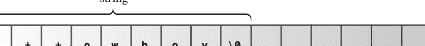

```cpp
name2[3] = '\0';
```

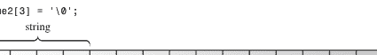

图 4.3 用 `\0` 缩短字符串。

注意，程序清单 4.2 中的程序使用符号常量表示数组大小。数组大小经常出现在程序中的多条语句里。使用符号常量表示数组大小可以简化修改程序以使用不同数组大小的工作；你只需在定义符号常量的地方改一次值。

## 字符串输入历险记

`strtype.cpp` 程序有一个瑕疵，它被一种常常有用的技巧——精心选择的示例输入——掩盖了。程序清单 4.3 揭开面纱，表明字符串输入可能很棘手。

### 程序清单 4.3 `instrt1.cpp`

```cpp
// instrt1.cpp -- reading more than one string
#include <iostream>
int main()
{
    using namespace std;
    const int ArSize = 20;
    char name[ArSize];
    char dessert[ArSize];

    cout << "Enter your name:\n";
    cin >> name;
    cout << "Enter your favorite dessert:\n";
    cin >> dessert;
    cout << "I have some delicious " << dessert;
    cout << " for you, " << name << ".\n";
    return 0;
}
```

程序清单 4.3 中程序的意图很简单：从键盘读取用户的名字和最喜欢的甜点，然后显示这些信息。下面是一次示例运行：

```text
Enter your name:
Alistair Dreeb
Enter your favorite dessert:
I have some delicious Dreeb for you, Alistair.
```

我们甚至没有机会回应甜点提示！程序显示该提示后，立即继续显示最后一行。

问题在于 `cin` 如何判断你何时输入完一个字符串。你无法从键盘输入空字符，所以 `cin` 需要某种其他方式来确定字符串的结尾。`cin` 的技术是使用空白——空格、制表符和换行符——来划分字符串。这意味着当 `cin` 为字符数组获取输入时，只读取一个单词。读取这个单词后，`cin` 在将字符串放入数组时会自动添加终止空字符。

在这个例子中的实际结果是，`cin` 把 Alistair 作为整个第一个字符串读取，并放入 `name` 数组。这使得可怜的 Dreeb 仍留在输入队列中。当 `cin` 在输入队列中搜索对最喜欢的甜点问题的回答时，它发现 Dreeb 还在那里。然后 `cin` 吞掉 Dreeb 并放入 `dessert` 数组（见图 4.4）。

另一个问题在示例运行中没有暴露出来，那就是输入字符串可能比目标数组更长。像这个例子那样使用 `cin` 并不能防止把 30 个字符的字符串放入 20 个字符的数组。

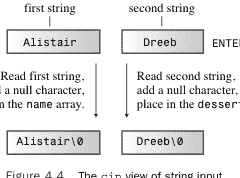

许多程序依赖字符串输入，因此进一步探讨这个主题是值得的。我们将要借助 `cin` 的一些更高级的特性，这些特性在第 17 章“输入、输出和文件”中描述。

## 一次读取一行字符串输入

一次读取一个单词的字符串输入通常不是最理想的选择。例如，假设程序要求用户输入城市，用户回答 *New York* 或 *Sao Paulo*。你会希望程序读取并存储完整名称，而不仅仅是 *New* 和 *Sao*。为了能够输入完整短语而不是单个单词作为字符串，你需要一种不同的字符串输入方法。具体来说，你需要一种面向行的方法，而不是面向单词的方法。你很幸运，因为 `istream` 类（`cin` 就是其一个实例）有一些面向行的类成员函数：`getline()` 和 `get()`。两者都读取整行输入——也就是说，直到换行字符为止。然而，`getline()` 随后会丢弃换行字符，而 `get()` 会把它留在输入队列中。让我们从 `getline()` 开始看细节。

### 使用 `getline()` 进行面向行的输入

`getline()` 函数读取整行，使用回车键发送的换行字符标记输入结束。你通过把 `cin.getline()` 用作函数调用来调用这个方法。该函数接受两个参数。第一个参数是目标名称（即用于保存该行输入的数组），第二个参数是要读取的字符数限制。如果这个限制是，比如 20，那么函数读取不超过 19 个字符，留出空间以便在末尾自动添加空字符。`getline()` 成员函数在达到这个数值限制或读取到换行字符时停止读取输入，以先发生者为准。

例如，假设你想使用 `getline()` 将一个名字读入包含 20 个元素的 `name` 数组。你会使用这个调用：

```cpp
cin.getline(name,20);
```


这会将整行读入 name 数组，前提是该行由 19 个或更少字符组成。（`getline()` 成员函数还有一个可选的第三个参数，第 17 章会讨论它。）

程序清单 4.4 修改了程序清单 4.3，使用 `cin.getline()` 代替简单的 `cin`。除此之外，程序没有变化。

### 程序清单 4.4 `instr2.cpp`

```cpp
// instr2.cpp -- reading more than one word with getline
#include <iostream>
int main()
{
    using namespace std;
    const int ArSize = 20;
    char name[ArSize];
    char dessert[ArSize];

    cout << "Enter your name:\n";
    cin.getline(name, ArSize);  // reads through newline
    cout << "Enter your favorite dessert:\n";
    cin.getline(dessert, ArSize);
    cout << "I have some delicious " << dessert;
    cout << " for you, " << name << ".\n";
    return 0;
}
```

下面是程序清单 4.4 的一些示例输出：

```text
Enter your name:
Dirk Hammernose
Enter your favorite dessert:
Radish Torte
I have some delicious Radish Torte for you, Dirk Hammernose.
```

现在程序可以读取完整姓名，并为用户端上他应得的甜点！`getline()` 函数方便地每次读取一行。它读取输入直到标记行尾的换行符，但并不保存该换行符。相反，在存储字符串时，它用空字符替换换行符（见图 4.5）。

## 使用 `get()` 的面向行输入

让我们尝试另一种方法。`istream` 类还有另一个成员函数 `get()`，它有几种变体。其中一种变体的工作方式与 `getline()` 非常相似。它接受相同的参数，以相同的方式解释这些参数，并读取到行尾。但是，`get()` 不会读取并丢弃换行符，而是将该字符留在输入队列中。假设连续调用两次 `get()`：

```cpp
cin.get(name, ArSize);
cin.get(dessert, ArSize);  // a problem
```

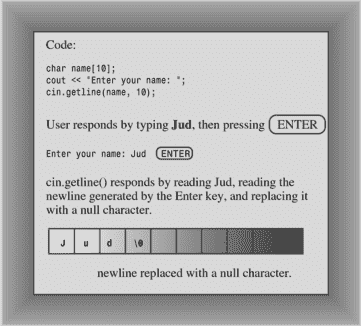

图 4.5 `getline()` 读取并替换换行符。

因为第一次调用将换行符留在输入队列中，所以该换行符就是第二次调用看到的第一个字符。因此，`get()` 会认为它已到达行尾，却没有找到任何可读取的内容。如果没有辅助手段，`get()` 就无法越过那个换行符。

幸运的是，`get()` 的一种变体可以提供帮助。调用 `cin.get()`（不带参数）会读取下一个单字符，即使它是换行符，因此你可以用它来处理掉换行符，并为下一行输入做好准备。也就是说，下面的调用序列可以正常工作：

```cpp
cin.get(name, ArSize);      // read first line
cin.get();                  // read newline
cin.get(dessert, ArSize);   // read second line
```

使用 `get()` 的另一种方式是将两个类成员函数连接（或串接）起来，如下所示：

```cpp
cin.get(name, ArSize).get(); // concatenate member functions
```

之所以可以这样做，是因为 `cin.get(name, ArSize)` 返回 cin 对象，随后该对象被用作调用 `get()` 函数的对象。类似地，下面的语句将连续两行输入读入数组 `name1` 和 `name2`；它等价于分别调用两次 `cin.getline()`：

`cin.getline(name1, ArSize).getline(name2, ArSize);`

程序清单 4.5 使用了连接调用。在第 11 章“使用类”中，你将学习如何将此特性融入类定义中。

### 程序清单 4.5 `instr3.cpp`

```cpp
// instr3.cpp -- reading more than one word with get() & get()
#include <iostream>
int main()
{
    using namespace std;
    const int ArSize = 20;
    char name[ArSize];
    char dessert[ArSize];

    cout << "Enter your name:\n";
    cin.get(name, ArSize).get();    // read string, newline
    cout << "Enter your favorite dessert:\n";
    cin.get(dessert, ArSize).get();
    cout << "I have some delicious " << dessert;
    cout << " for you, " << name << ".\n";
    return 0;
}
```

下面是程序清单 4.5 中程序的一次示例运行：

```text
Enter your name:
Mai Parfait
Enter your favorite dessert:
Chocolate Mousse
I have some delicious Chocolate Mousse for you, Mai Parfait.
```

需要注意的一点是，C++ 如何允许函数有多个版本，前提是它们具有不同的参数列表。例如，如果你使用 `cin.get(name, ArSize)`，编译器会注意到你使用的是将字符串放入数组的形式，并调用适当的成员函数。相反，如果你使用 `cin.get()`，编译器会意识到你想要的是读取一个字符的形式。第 8 章“函数探秘”将探讨这一特性，它称为*函数重载*。

究竟为什么要使用 `get()` 而不是 `getline()`？首先，较旧的实现可能没有 `getline()`。其次，`get()` 让你可以更谨慎一些。例如，假设你使用 `get()` 将一行读入数组。你如何判断它读取了整行，而不是因为数组已满而停止？查看下一个输入字符。如果它是换行符，那么整行已被读取。如果它不是换行符，那么该行还有更多输入。第 17 章将探讨这一技术。简而言之，`getline()` 使用起来稍简单一些，但 `get()` 使错误检查更简单。你可以用其中任何一个来读取一行输入；只需记住它们略有不同的行为。

## 空行及其他问题

`getline()` 或 `get()` 读取空行后会发生什么？最初的做法是，下一条输入语句从上一个 `getline()` 或 `get()` 停止的地方继续。然而，当前的做法是，在 `get()`（而不是 `getline()`）读取空行后，它会设置一个称为*失败位*（failbit）的东西。这样做的后果是后续输入被阻塞，但你可以用以下命令恢复输入：

```cpp
cin.clear();
```

另一个潜在问题是输入字符串可能长于分配的空间。如果输入行长于指定的字符数，`getline()` 和 `get()` 都会将剩余字符留在输入队列中。然而，`getline()` 还会设置 failbit 并关闭后续输入。

第 5、6 和 17 章将探讨这些特性以及如何围绕它们进行编程。

## 混合字符串和数字输入

将数字输入与面向行的字符串输入混合可能导致问题。考虑程序清单 4.6 中的简单程序。

### 程序清单 4.6 `numstr.cpp`

```cpp
// numstr.cpp -- following number input with line input
#include <iostream>
int main()
{
    using namespace std;
    cout << "What year was your house built?\n";
    int year;
    cin >> year;
    cout << "What is its street address?\n";
    char address[80];
    cin.getline(address, 80);
    cout << "Year built: " << year << endl;
    cout << "Address: " << address << endl;
    cout << "Done!\n";
    return 0;
}
```

运行程序清单 4.6 中的程序，结果大致如下：

```text
What year was your house built?
1966
What is its street address?
Year built: 1966
Address:
Done!
```

你根本没有机会输入地址。问题在于，当 cin 读取年份时，它会把按 Enter 键生成的换行符留在输入队列中。然后 cin.getline() 将该换行符作为空行读取，并把空字符串赋给 address 数组。修复方法是在读取地址之前读取并丢弃换行符。这可以通过几种方式完成，包括使用带 char 参数或不带参数的 get()，如前面的示例所述。你可以分别进行这些调用：

```cpp
cin >> year;
cin.get();    // or cin.get(ch);
```

或者可以连接这些调用，利用表达式

```cpp
cin >> year
```

返回 `cin` 对象这一事实：

```cpp
(cin >> year).get();  // or (cin >> year).get(ch);
```

如果对程序清单 4.6 做上述某一更改，它就能正常工作：

```text
What year was your house built?
1966
What is its street address?
43821 Unsigned Short Street
Year built: 1966
Address: 43821 Unsigned Short Street
Done!
```

C++ 程序经常使用指针而不是数组来处理字符串。在稍微讨论指针之后，我们将讨论字符串的这一方面。与此同时，让我们看看一种更新的处理字符串的方式：C++ string 类。

## 引入 `string` 类

ISO/ANSI C++98 标准通过添加 string 类扩展了 C++ 库。因此现在，你可以使用 string 类型变量（用 C++ 术语来说就是对象），而不是使用字符数组来保存字符串。正如你将看到的，string 类比数组更易于使用，并且还提供了一种将字符串作为类型的术语表示。

要使用 string 类，程序必须包含 string 头文件。string 类属于 std 命名空间，因此你必须提供 using 指令或声明，否则就要将该类称为 std::string。类定义隐藏了字符串的数组本质，让你可以像对待普通变量一样对待字符串。程序清单 4.7 说明了 string 对象与字符数组之间的一些相似之处和不同之处。


### 清单4.7 strtype1.cpp

```cpp
// strtype1.cpp -- using the C++ string class
#include <iostream>
#include <string>                 // make string class available
int main()
{
    using namespace std;
    char charr1[20];               // create an empty array
    char charr2[20] = "jaguar";   // create an initialized array
    string str1;                   // create an empty string object
    string str2 = "panther";      // create an initialized string

    cout << "Enter a kind of feline: ";
    cin >> charr1;
    cout << "Enter another kind of feline: ";
    cin >> str1;                   // use cin for input
    cout << "Here are some felines:\n";
    cout << charr1 << " " << charr2 << " "
         << str1 << " " << str2   // use cout for output
         << endl;
    cout << "The third letter in " << charr2 << " is "
         << charr2[2] << endl;
    cout << "The third letter in " << str2 << " is "
         << str2[2] << endl;       // use array notation

    return 0;
}
```

下面是清单4.7中程序的示例运行：

```text
Enter a kind of feline: ocelot
Enter another kind of feline: tiger
Here are some felines:
ocelot jaguar tiger panther
The third letter in jaguar is g
The third letter in panther is n
```

从这个例子中你应该学到，在很多方面，string对象的使用方式与字符数组相同：

- 可以将string对象初始化为C风格字符串。
- 可以使用`cin`将键盘输入存储到string对象中。
- 可以使用`cout`显示string对象。
- 可以使用数组表示法访问存储在string对象中的单个字符。

## 更多的`string`类操作

即使在string类被添加到C++之前，程序员也需要完成诸如赋值字符串之类的操作。对于C风格字符串，他们使用C库中的函数来完成这些任务。`cstring`头文件（以前是`string.h`）支持这些函数。例如，可以使用`strcpy()`函数将字符串复制到字符数组，可以使用`strcat()`函数将字符串追加到字符数组：

```cpp
strcpy(charr1, charr2);  // copy charr2 to charr1
strcat(charr1, charr2);  // append contents of charr2 to charr1
```

清单4.9比较了用于string对象的技术和用于字符数组的技术。

### 清单4.9 strtype3.cpp

```cpp
// strtype3.cpp -- more string class features
#include <iostream>
#include <string>              // make string class available
#include <cstring>             // C-style string library
int main()
{
    using namespace std;
    char charr1[20];
    char charr2[20] = "Jaguar";
    string str1;
    string str2 = "panther";

    // assignment for string objects and character arrays
    str1 = str2;                // copy str2 to str1
    strcpy(charr1, charr2);     // copy charr2 to charr1

    // appending for string objects and character arrays
    str1 += " paste";           // add paste to end of str1
    strcat(charr1, " juice");  // add juice to end of charr1

    // finding the length of a string object and a C-style string
    int len1 = str1.size();     // obtain length of str1
    int len2 = strlen(charr1); // obtain length of charr1

    cout << "The string " << str1 << " contains "
         << len1 << " characters.\n";
    cout << "The string " << charr1 << " contains "
         << len2 << " characters.\n";

    return 0;
}
```

下面是输出：

```text
The string panther paste contains 13 characters.
The string Jaguar juice contains 12 characters.
```

使用string对象的语法往往比使用C字符串函数更简单。对于更复杂的操作尤其如此。例如，C库中与下面代码等价的写法是：

```cpp
str3 = str1 + str2;
```

如下：

```cpp
strcpy(charr3, charr1);
strcat(charr3, charr2);
```

此外，对于数组，始终存在目标数组太小而无法容纳信息的危险，如下例所示：

```cpp
char site[10] = "house";
strcat(site, " of pancakes");  // memory problem
```

`strcat()`函数会尝试将所有12个字符复制到site数组中，从而越界覆盖相邻内存。这可能导致程序中止，或者程序可能继续运行但数据被损坏。string类能够根据需要自动调整大小，从而避免了这类问题。C库确实提供了`strcat()`和`strcpy()`的近亲函数，称为`strncat()`和`strncpy()`，它们通过接受第三个参数来指示目标数组的最大允许大小，从而更安全地工作，但使用它们会在编写程序时增加一层复杂性。

注意获取字符串中字符数所使用的不同语法：

```cpp
int len1 = str1.size();    // obtain length of str1
int len2 = strlen(charr1); // obtain length of charr1
```

`strlen()`函数是一个常规函数，它接受C风格字符串作为参数，并返回字符串中的字符数。`size()`函数基本上做同样的事情，但语法不同。`str1`不是作为函数参数出现，而是位于函数名之前，并用点号与之连接。正如你在第3章的`put()`方法中看到的，这种语法表明`str1`是一个对象，而`size()`是一个类方法。方法是一种只能由与该方法属于同一类的对象调用的函数。在这个特定例子中，`str1`是一个string对象，`size()`是一个string方法。简而言之，C函数使用函数参数来标识要使用的字符串，而C++ string类对象使用对象名和点运算符来指示要使用的字符串。

## 更多关于string类I/O的内容

如你所见，可以使用`cin`配合`>>`运算符读取string对象，并使用`cout`配合`<<`运算符显示string对象，使用的语法与C风格字符串相同。但一次读取一行而不是一次读取一个单词则使用不同的语法。清单4.10展示了这种差异。

### 清单4.10 strtype4.cpp

```cpp
// strtype4.cpp -- line input
#include <iostream>
#include <string>          // make string class available
#include <cstring>         // C-style string library
int main()
{
    using namespace std;
    char charr[20];
    string str;

    cout << "Length of string in charr before input: "
         << strlen(charr) << endl;
    cout << "Length of string in str before input: "
         << str.size() << endl;
    cout << "Enter a line of text:\n";
    cin.getline(charr, 20);     // indicate maximum length
    cout << "You entered: " << charr << endl;
    cout << "Enter another line of text:\n";
    getline(cin, str);          // cin now an argument; no length specifier
    cout << "You entered: " << str << endl;
    cout << "Length of string in charr after input: "
         << strlen(charr) << endl;
    cout << "Length of string in str after input: "
         << str.size() << endl;

    return 0;
}
```

下面是清单4.10中程序的示例运行：

```text
Length of string in charr before input: 27
Length of string in str before input: 0
Enter a line of text:
peanut butter
You entered: peanut butter
Enter another line of text:
blueberry jam
You entered: blueberry jam
Length of string in charr after input: 13
Length of string in str after input: 13
```

注意，程序显示输入前数组charr中字符串的长度为27，这比数组本身的大小还要大！这里有两件事在发生。第一，未初始化数组的内容是未定义的。第二，`strlen()`函数的工作原理是从数组的第一个元素开始，一直计数到遇到空字符为止。在这种情况下，第一个空字符直到数组末尾之后几个字节才出现。在未初始化数据中第一个空字符出现的位置基本上是随机的，因此你用这个程序很可能会得到不同的数值结果。

还要注意，输入前str中字符串的长度为0。这是因为未初始化的string对象会自动设置为零大小。

这是将一行读取到数组中的代码：

```cpp
cin.getline(charr, 20);
```

点表示法表明`getline()`函数是istream类的一个类方法。（回想一下，cin是一个istream对象。）如前所述，第一个参数指示目标数组，第二个参数是数组大小，`getline()`使用它来避免越界写入数组。

这是将一行读取到string对象中的代码：

```cpp
getline(cin, str);
```

这里没有点表示法，这表明这个`getline()`不是类方法。因此它接受cin作为参数，告诉它从哪里找到输入。而且没有字符串大小的参数，因为string对象会自动调整大小以适应字符串。

那么为什么一个`getline()`是istream类方法，而另一个`getline()`不是呢？istream类在string类被添加之前很久就已经是C++的一部分了。因此，istream设计认识double和int等基本C++类型，但不知道string类型。因此，istream有处理double、int和其他基本类型的类方法，但没有处理string对象的istream类方法。

因为没有处理string对象的istream类方法，你可能会想知道为什么这样的代码可以工作：

```cpp
cin >> str;  // read a word into the str string object
```

事实证明，下面这样的代码（以隐式表示法）确实使用了istream类的成员函数：

```cpp
cin >> x;  // read a value into a basic C++ type
```

但string类的等价形式使用string类的友元函数（也是隐式表示法）。你需要等到第11章才能了解什么是友元函数以及这种技术是如何工作的。与此同时，你可以放心地在string对象上使用cin和cout，而不必担心内部工作原理。


## 其他形式的字符串字面量

回想一下，C++除了 `char` 之外还有 `wchar_t` 类型。而 C++11 又增加了 `char16_t` 和 `char32_t` 类型。可以创建这些类型的数组和这些类型的字符串字面量。对于这些类型的字符串字面量，C++分别使用 `L`、`u` 和 `U` 前缀。下面是一个如何使用它们的示例：

```cpp
wchar_t title[] = L"Chief Astrogator";  // wchar_t string
char16_t name[] = u"Felonia Ripova";    // char16_t string
char32_t car[] = U"Humber Super Snipe"; // char32_t string
```

C++11 还支持一种用于 Unicode 字符的编码方案，称为 UTF-8。在这种方案中，一个给定字符可能占用一个 8 位单元（八位组）到四个 8 位单元不等，具体取决于其数值。C++使用 `u8` 前缀来表示该类型的字符串字面量。

C++11 的另一项新增功能是原始字符串。在原始字符串中，字符只代表它们自身。例如，序列 `\n` 不会被解释为表示换行符；相反，它是两个普通字符：反斜杠和 n，并且会在屏幕上显示为这两个字符。再举一个例子，你可以在字符串中使用简单的 `"`，而不是我们在程序清单 4.8 中使用的更别扭的 `\"`。当然，如果允许字符串字面量内部出现 `"`，你就不能再使用它来界定字符串的结束位置。因此，原始字符串使用 `"(` 和 `)"` 作为定界符，并使用 R 前缀将它们标识为原始字符串：

```cpp
cout << R"(Jim "King" Tutt uses "\n" instead of endl.)" << '\n';
```

这将显示如下内容：

```text
Jim "King" Tutt uses \n instead of endl.
```

与之等价的标准字符串字面量如下：

```cpp
cout << "Jim \"King\" Tutt uses \"\\n\" instead of endl." << '\n';
```

这里我们必须使用 `\\` 来显示一个反斜杠，因为 `\` 会被解释为转义序列的第一个字符。

如果在键入原始字符串时按下 Enter 或 Return 键，这不仅会将屏幕上的光标移到下一行，还会在原始字符串中放入一个回车字符。如果你想在原始字符串中显示组合 `)"` 该怎么办？（谁不想呢？）编译器难道不会把第一次出现的 `)"` 解释为字符串的结尾吗？是的，它会。但原始字符串语法允许你在开头的 `"` 和 `(` 之间放置额外的字符。这意味着在最后的 `)` 和 `"` 之间必须出现相同的额外字符。因此，以 `R"+*(` 开头的原始字符串必须以 `)+*"` 结尾。于是，下面的语句

```cpp
cout << R"+*("(Who wouldn't?)", she whispered.)+*" << endl;
```

将显示如下内容：

```text
"(Who wouldn't?)", she whispered.
```

简而言之，默认的定界符 `"(` 和 `)"` 已被替换为 `"+*(` 和 `)+*"`。除空格、左括号、右括号、反斜杠以及制表符或换行符之类的控制字符外，你可以使用基本字符集中任何成员形式作为定界符的一部分。

R 前缀可以与其他字符串前缀组合，以生成 `wchar_t` 等类型的原始字符串。它可以是复合前缀的第一部分或最后一部分：`Ru`、`uR` 等。

现在让我们继续介绍另一种复合类型——结构。

## 介绍结构

假设你想存储一名篮球运动员的信息。你可能想存储他或她的姓名、薪水、身高、体重、平均得分、罚球命中率、助攻等。你希望有一种数据形式能在一个单元中保存所有这些信息。数组做不到这一点。尽管一个数组可以保存多个项，但每个项都必须是同一类型。也就是说，一个数组可以保存 20 个 int，另一个数组可以保存 10 个 float，但单个数组不能在某些元素中存储 int，而在另一些元素中存储 float。

满足你这种愿望（即存储篮球运动员信息）的答案是 C++ 结构。结构是一种比数组更通用的数据形式，因为单个结构可以保存多种数据类型的数据项。这使你能够将所有相关的篮球信息存储在一个结构变量中，从而统一数据表示。如果你想跟踪整支球队，可以使用结构数组。结构类型也是通向 C++ 面向对象编程（OOP）的中流砥柱——类——的垫脚石。现在稍微学习一点结构知识，就能让你更接近 C++ 的面向对象核心。

结构是一种用户可定义的类型，结构声明用于定义该类型的数据属性。定义好类型之后，就可以创建该类型的变量。因此，创建一个结构分为两步。首先，定义结构描述，用来描述并标记可以存储在结构中的不同数据类型。然后，可以创建遵循该描述方案的结构变量，或者更一般地说，结构数据对象。

例如，假设 Bloataire, Inc. 想要创建一种类型来描述其设计师充气产品系列中的成员。具体来说，该类型应保存物品名称、以立方英尺为单位的体积以及销售价格。下面是一个满足这些需求的结构描述：

```cpp
struct inflatable    // structure declaration
{
    char name[20];
    float volume;
    double price;
};
```

关键字 struct 表明该代码定义了一个结构的布局。标识符 inflatable 是这种形式的名称（或标记）；这使 inflatable 成为新类型的名称。因此，现在你可以像创建 char 或 int 类型的变量一样创建 inflatable 类型的变量。接下来，花括号之间是要在结构中保存的数据类型列表。每个列表项都是一条声明语句。这里可以使用任何 C++ 类型，包括数组和其他结构。这个示例使用了一个 char 数组，适合存储字符串，还使用了 float 和 double。列表中的每个单独项称为成员，因此 inflatable 结构有三个成员（见图 4.6）。简而言之，结构定义定义了一种类型的特征——在本例中就是 inflatable 类型。

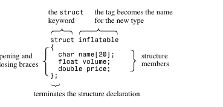

定义结构之后，就可以创建该类型的变量：

```cpp
inflatable hat;             // hat is a variable of type inflatable
inflatable woopie_cushion;  // type inflatable variable
inflatable mainframe;       // type inflatable variable
```

如果你熟悉 C 结构，你会注意到（很可能是愉快地注意到）C++ 允许在声明结构变量时省略关键字 struct：

```cpp
struct inflatable goose;    // keyword struct required in C
inflatable vincent;         // keyword struct not required in C++
```

在 C++ 中，结构标记的使用方式就像基本类型名一样。这一变化强调结构声明定义了一个新类型。它还使省略 struct 不再被列入令人抓狂的错误清单。

假定 hat 是 inflatable 类型，你可以使用成员运算符（.）来访问各个成员。例如，hat.volume 指结构的 volume 成员，hat.price 指 price 成员。类似地，vincent.price 是 vincent 变量的 price 成员。简而言之，成员名使你能够访问结构的成员，就像索引使你能够访问数组元素一样。由于 price 成员被声明为 double 类型，hat.price 和 vincent.price 都等价于 double 类型变量，可以以普通 double 类型变量可用的任何方式使用。简而言之，hat 是一个结构，但 hat.price 是一个 double。顺便说一句，用于访问类成员函数（如 cin.getline()）的方法，其起源可以追溯到用于访问结构成员变量（如 vincent.price）的方法。

## 在程序中使用结构

现在我们已经介绍了结构的一些主要特性，是时候在一个使用结构的程序中将所有这些想法整合起来了。程序清单 4.11 说明了关于结构的这些要点。它还展示了如何初始化一个结构。

程序清单 4.11    structur.cpp

```cpp
// structur.cpp -- a simple structure
#include <iostream>
struct inflatable   // structure declaration
{
    char name[20];
    float volume;
    double price;
};

int main()
{
    using namespace std;
    inflatable guest =
    {
        "Glorious Gloria",  // name value
        1.88,               // volume value
        29.99               // price value
    };  // guest is a structure variable of type inflatable
// It's initialized to the indicated values
    inflatable pal =
    {
        "Audacious Arthur",
        3.12,
        32.99
    };  // pal is a second variable of type inflatable
// NOTE: some implementations require using
// static inflatable guest =

    cout << "Expand your guest list with " << guest.name;
    cout << " and " << pal.name << "!\n";
// pal.name is the name member of the pal variable
    cout << "You can have both for $";
    cout << guest.price + pal.price << "!\n";
    return 0;
}
```


下面是程序清单4.11中程序的输出：

```text
Expand your guest list with Glorious Gloria and Audacious Arthur!\nYou can have both for $62.98!
```

## 程序说明

与程序清单4.11中的程序相关的一个重要问题是结构声明放在哪里。对于 `struct.cpp`，有两种选择。你可以将声明放在 `main()` 函数内部，就在左花括号之后。第二种选择（也是这里采用的选择）是将其放在外部并位于 `main()` 之前。当声明出现在任何函数之外时，称为外部声明。对于这个程序，两种选择没有实际差别。但对于由两个或更多函数组成的程序，这种差别可能至关重要。外部声明可供其后的所有函数使用，而内部声明只能由声明所在的函数使用。大多数情况下，你会希望使用外部结构声明，以便所有函数都能使用该类型的结构（见图4.7）。

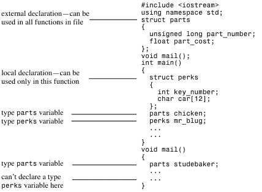

图4.7 局部和外部结构声明。

变量也可以在内部或外部定义，其中外部变量可在函数之间共享。（第9章“内存模型和命名空间”将进一步探讨该主题。）C++ 实践不鼓励使用外部变量，但鼓励使用外部结构声明。此外，通常将符号常量声明为外部也是合理的。

接下来，注意初始化过程：

```cpp
inflatable guest =
{
    "Glorious Gloria",  // name value
    1.88,                // volume value
    29.99                // price value
};
```

与数组一样，你使用一对花括号括起来的、以逗号分隔的值列表。该程序每行放置一个值，但你可以将它们全部放在同一行。只需记住用逗号分隔各项：

```cpp
inflatable duck = {"Daphne", 0.12, 9.98};
```

你可以将结构的每个成员初始化为相应类型的数据。例如，name 成员是字符数组，因此可以将其初始化为字符串。

每个结构成员都被视为该类型的变量。因此，`pal.price` 是一个 double 变量，而 `pal.name` 是一个 char 数组。当程序使用 `cout` 显示 `pal.name` 时，它会将该成员显示为字符串。顺便说一句，由于 `pal.name` 是字符数组，我们可以使用下标访问数组中的单个字符。例如，`pal.name[0]` 是字符 A。但 `pal[0]` 没有意义，因为 `pal` 是结构，而不是数组。

## C++11 结构初始化

与数组一样，C++11 扩展了列表初始化的特性。= 号是可选的：

```cpp
inflatable duck {"Daphne", 0.12, 9.98};  // can omit the = in C++11
```

接下来，空花括号会使各个成员被设置为 0。例如，下面的声明会使 `mayor.volume` 和 `mayor.price` 被设置为 0，并使 `mayor.name` 中的所有字节被设置为 0：

```cpp
inflatable mayor {};
```

最后，不允许窄化。

## 结构可以使用 `string` 类成员吗？

你能用 string 类对象代替字符数组作为 name 成员吗？也就是说，你能像下面这样声明结构吗：

```cpp
#include <string>
struct inflatable   // structure definition
{
    std::string name;
    float volume;
    double price;
};
```

下面是程序清单4.12中程序的输出：

```text
bouquet: sunflowers for $12.49
choice: sunflowers for $12.49
```

如你所见，逐成员赋值在起作用，因为 choice 结构的成员被赋予与 bouquet 结构中存储的相同的值。

你可以将结构形式的定义与结构变量的创建合并在一起。为此，在右花括号后跟上变量名（一个或多个）：

```cpp
struct perks
{
    int key_number;
    char car[12];
} mr_smith, ms_jones;   // two perks variables
```

你甚至可以初始化以这种方式创建的变量：

```cpp
struct perks
{
    int key_number;
    char car[12];
} mr_glitz =
{
    7,                 // value for mr_glitz.key_number member
    "Packard"          // value for mr_glitz.car member
};
```

然而，将结构定义与变量声明分开通常会使程序更易于阅读和理解。

对于结构，你还可以做另一件事：创建没有类型名的结构。为此，在定义结构形式和变量的同时省略标记名：

```cpp
struct       // no tag
{
    int x;    // 2 members
    int y;
} position;  // a structure variable
```

这会创建一个名为 position 的结构变量。你可以使用成员运算符访问其成员，如 position.x，但该类型没有通用名称。之后你不能再创建相同类型的其他变量。本书不使用这种受限的结构形式。

除了 C++ 程序可以将结构标记用作类型名这一点之外，C 结构具有到目前为止为 C++ 结构讨论的所有特性，只是不包括 C++11 的变更。但 C++ 结构更进一步。例如，与 C 结构不同，C++ 结构除了成员变量外还可以有成员函数。不过这些更高级的特性通常用于类而不是结构，因此我们将在从第10章“对象和类”开始介绍类时讨论它们。

```cpp
using namespace std;
inflatable guests[2] =          // initializing an array of structs
{
    {"Bambi", 0.5, 21.99},       // first structure in array
    {"Godzilla", 2000, 565.99}   // next structure in array
};

cout << "The guests " << guests[0].name << " and " << guests[1].name
     << "\nhave a combined volume of "
     << guests[0].volume + guests[1].volume << " cubic feet.\n";
return 0;
}
```

下面是程序清单4.13中程序的输出：

```text
The guests Bambi and Godzilla
have a combined volume of 2000.5 cubic feet.
```

## 结构中的位字段

C++ 与 C 一样，允许你指定占用特定比特数的结构成员。这对于创建例如与某个硬件设备上的寄存器相对应的数据结构很方便。字段类型应为整型或枚举类型（枚举将在本章后面讨论），冒号后跟一个数字表示要使用的实际比特数。你可以使用未命名字段来提供间距。每个成员称为*位字段*。下面是一个示例：

```cpp
struct toggle_register
{
    unsigned int SN : 4;    // 4 bits for SN value
    unsigned int : 4;       // 4 bits unused
    bool goodIn : 1;        // valid input (1 bit)
    bool goodToPgl : 1;     // successful toggling
};
```

你可以按通常方式初始化字段，并使用标准结构表示法访问位字段：

```cpp
toggle_register tr = { 14, true, false };
...
if (tr.goodIn)   // if statement covered in Chapter 6
...
```

位字段通常用于底层编程。通常，使用整型类型以及附录 E“其他运算符”中列出的按位运算符可提供另一种方法。

## 共用体

共用体是一种数据格式，可以保存不同的数据类型，但一次只能保存一种类型。也就是说，结构可以保存例如一个 int、一个 long 和一个 double，而共用体可以保存一个 int 或一个 long 或一个 double。其语法与结构类似，但含义不同。例如，考虑下面的声明：

```cpp
union one4all
{
    int int_val;
    long long_val;
    double double_val;
};
```

你可以使用 one4all 变量保存一个 int、一个 long 或一个 double，只要是在不同时间这样做即可：

```cpp
one4all pail;
pail.int_val = 15;        // store an int
cout << pail.int_val;
pail.double_val = 1.38;   // store a double, int value is lost
cout << pail.double_val;
```

因此，pail 可以在一种场合充当 int 变量，而在另一种场合充当 double 变量。成员名标识该变量当前以何种身份起作用。

由于共用体一次只保存一个值，因此它必须有足够的空间来容纳其最大成员。因此，共用体的大小是其最大成员的大小。

共用体的一种用途是，在数据项可以使用两种或更多格式但绝不会同时使用这些格式时节省空间。例如，假设你管理一个混合的 widget 库存，其中一些具有整数 ID，另一些具有字符串 ID。在这种情况下，你可以使用以下代码：

```cpp
struct widget
{
char brand[20];
int type;
union id              // format depends on widget type
{
    long id_num;       // type 1 widgets
    char id_char[20];  // other widgets
} id_val;
};
...
widget prize;
...
if (prize.type == 1)                 // if-else statement (Chapter 6)
    cin >> prize.id_val.id_num;      // use member name to indicate mode
else
    cin >> prize.id_val.id_char;
```


*匿名联合*没有名称；本质上，它的成员成为共享同一地址的变量。自然，同一时间只能有一个成员是当前有效的：

```cpp
struct widget
{
    char brand[20];
    int type;
    union            // anonymous union
    {
        long id_num;      // type 1 widgets
        char id_char[20]; // other widgets
    };
};
...
widget prize;
...
if (prize.type == 1)
    cin >> prize.id_num;
else
    cin >> prize.id_char;
```

由于该联合是匿名的，*id_num* 和 *id_char* 被视为 *prize* 的两个共享同一地址的成员。对中间标识符 *id_val* 的需求被消除了。程序员需要跟踪当前哪个选择处于活动状态。

联合经常（但并非只）用于节省内存空间。在拥有数 GB 内存和数 TB 存储的今天，这似乎不那么必要，但并非所有 C++ 程序都是为这样的系统编写的。C++ 也用于嵌入式系统，例如用于控制烤面包机、MP3 播放器或火星车的处理器。在这些应用中，空间可能非常宝贵。此外，在处理操作系统或硬件数据结构时，也经常使用联合。

## 枚举

C++ 的 *enum* 设施提供了创建符号常量的另一种选择，可替代 *const*。它还允许你定义新类型，但方式相当受限。*enum* 的语法类似于结构语法。例如，考虑下面的语句：

```cpp
enum spectrum { red, orange, yellow, green, blue, violet, indigo, ultraviolet };
```

这条语句做两件事：

- 它使 *spectrum* 成为新类型的名称；*spectrum* 被称为*枚举*，就像 *struct* 变量被称为结构一样。
- 它把 *red*、*orange*、*yellow* 等确定为整数值 0–7 的符号常量。这些常量称为*枚举量*。

默认情况下，枚举量被赋予整数值：第一个枚举量为 0，第二个枚举量为 1，依此类推。你可以通过显式赋予整数值来覆盖默认值。本章后面会看到如何这样做。

你可以使用枚举名称来声明该枚举类型的变量：

```text
spectrum band;    // band a variable of type spectrum
```

枚举变量有一些特殊属性，我们现在来考察。在不进行类型转换的情况下，可以赋给枚举变量的唯一有效值是定义该类型时使用的枚举量值。因此，我们有以下情况：

```text
band = blue;        // valid, blue is an enumerator
band = 2000;        // invalid, 2000 not an enumerator
```

因此，一个 spectrum 变量仅限于八个可能的值。如果你试图赋予无效值，有些编译器会发出编译错误，而另一些编译器会发出警告。为了获得最大可移植性，你应当把向 enum 变量赋予非枚举值视为错误。

```text
band = orange;        // valid
++band;               // not valid, ++ discussed in Chapter 5
band = orange + red;  // not valid, but a little tricky
...
```

然而，有些实现并不遵守这一限制。这可能导致违反类型限制。例如，如果 band 的值为 ultraviolet，即 7，那么 ++band（如果有效）会把 band 增加到 8，而这不是 spectrum 类型的有效值。再次强调，为了获得最大可移植性，你应当采用更严格的限制。

枚举量属于整数类型，可以提升为 int 类型，但 int 类型不会自动转换为枚举类型：

```text
int color = blue;    // valid, spectrum type promoted to int
band = 3;            // invalid, int not converted to spectrum
color = 3 + red;     // valid, red converted to int
...
```

注意，在这个例子中，即使 3 对应于枚举量 green，把 3 赋给 band 也是类型错误。但把 green 赋给 band 没有问题，因为二者都是 spectrum 类型。同样，有些实现并不强制执行这一限制。在表达式 3 + red 中，加法并不是为枚举量定义的。然而，red 会被转换为 int 类型，结果是 int 类型。由于这种情况下发生了从枚举到 int 的转换，你可以在算术表达式中使用枚举，将它们与普通整数结合，即使算术运算本身并不是为枚举定义的。

```text
band = orange + red;    // not valid, but a little tricky
```

这失败的原因有点复杂。确实，+ 运算符并没有为枚举量定义。但同样确实的是，枚举量在算术表达式中使用时会被转换为整数，因此表达式 `orange + red` 会转换为 `1 + 0`，这是一个有效表达式。但它的类型是 int，因此不能赋给 spectrum 类型的变量 band。

你可以把 int 值赋给枚举，前提是该值有效，并且你使用了显式类型转换：

```text
band = spectrum(3);        // typecast 3 to type spectrum
```

如果你试图转换一个不合适的值会怎样？结果是未定义的，这意味着该尝试不会被标记为错误，但你不能依赖结果的值：

```text
band = spectrum(40003);    // undefined
```

（关于哪些值合适、哪些不合适，请参见本章后面的“枚举的取值范围”一节。）

如你所见，管理枚举的规则相当受限。在实践中，枚举更常被用作定义相关符号常量的一种方式，而不是定义新类型的手段。例如，你可能会使用枚举为 switch 语句定义符号常量。（示例见第 6 章“分支语句和逻辑运算符”。）如果你只打算使用这些常量，而不创建枚举类型的变量，你可以省略枚举类型名称，如下例所示：

```cpp
enum {red, orange, yellow, green, blue, violet, indigo, ultraviolet};
```

## 设置枚举值

你可以使用赋值运算符显式设置枚举值：

```cpp
enum bits{one = 1, two = 2, four = 4, eight = 8};
```

所赋的值必须是整数。你也可以只显式定义部分枚举量：

```cpp
enum bigstep{first, second = 100, third};
```

在这种情况下，first 默认为 0。后续未初始化的枚举量比其前一个枚举量大 1。因此，third 的值为 101。

最后，你可以创建多个具有相同值的枚举量：

```cpp
enum {zero, null = 0, one, numero_uno = 1};
```

这里，zero 和 null 都是 0，one 和 numero_uno 都是 1。在较早版本的 C++ 中，你只能把 int 值（或可提升为 int 的值）赋给枚举量，但这一限制已被移除，因此你可以使用 long 类型甚至 long long 类型的值。

## 枚举的取值范围

最初，枚举的唯一有效值是在声明中命名的那些值。然而，C++ 通过使用类型转换扩展了可以赋给枚举变量的有效值列表。每个枚举都有一个范围，你可以通过将整数类型转换为枚举变量，赋给该范围内的任何整数值，即使它不是枚举量值。例如，假设 bits 和 myflag 是这样定义的：

```cpp
enum bits{one = 1, two = 2, four = 4, eight = 8};
bits myflag;
```

在这种情况下，下面是有效的：

```cpp
myflag = bits(6);      // valid, because 6 is in bits range
```

这里 6 不是枚举量之一，但它位于枚举所定义的范围之内。范围的定义如下。首先，要找到上限，取最大的枚举量值。然后找到大于这个最大值的 2 的最小幂，再减 1；结果就是范围的上端。（例如，前面定义的最大 bigstep 值是 101。大于它的 2 的最小幂是 128，所以范围的上端是 127。）接下来，要找到下限，取最小的枚举量值。如果它大于或等于 0，则范围的下限为 0。如果最小的枚举量为负，则采用与寻找上限相同的方法，但加上负号。（例如，如果最小枚举量是 -6，则下一个 2 的幂[乘以负号]是 -8，下限是 -7。）

其思想是，编译器可以选择用多少空间来保存一个枚举。对于范围较小的枚举，它可能使用 1 字节或更少；对于具有 long 类型值的枚举，则可能使用 4 字节。

C++11 用一种称为作用域枚举的形式扩展了枚举。第 10 章在“类作用域”一节中简要讨论了这种形式。

## 指针和自由存储区

第 3 章开头提到了计算机程序在存储数据时必须跟踪的三个基本属性。为了免得你翻回那一章把书翻坏，这里再次列出这些属性：

- 信息存储在哪里
- 那里保存着什么值
- 存储的是什么类型的信息

你已经使用了一种策略来实现这些目标：定义一个简单变量。声明语句提供了值的类型和一个符号名称。它还使程序为该值分配内存，并在内部跟踪该位置。


现在让我们看第二种策略，这种策略在开发 C++ 类时变得尤为重要。这种策略基于指针，指针是存储值的地址而不是值本身的变量。但在讨论指针之前，让我们先谈谈如何显式地找到普通变量的地址。你只需对变量应用地址运算符（用 `&` 表示）来获取其位置；例如，如果 `home` 是一个变量，那么 `&home` 就是它的地址。程序清单 4.14 演示了这个运算符。

## 程序清单 4.14 `address.cpp`

```cpp
// address.cpp -- using the & operator to find addresses
#include <iostream>
int main()
{
    using namespace std;
    int donuts = 6;
    double cups = 4.5;

    cout << "donuts value = " << donuts;
    cout << " and donuts address = " << &donuts << endl;
    // NOTE: you may need to use unsigned (&donuts)
    // and unsigned (&cups)
    cout << "cups value = " << cups;
    cout << " and cups address = " << &cups << endl;
    return 0;
}
```

以下是程序清单 4.14 中的程序在某个系统上的输出：

```text
donuts value = 6 and donuts address = 0x0065fd40
cups value = 4.5 and cups address = 0x0065fd44
```

这里展示的 `cout` 特定实现会在显示地址值时使用十六进制记法，因为这是指定内存地址时常用的记法。（有些实现则使用十进制记法。）我们的实现把 donuts 存储在比 cups 更低的内存位置。两个地址之差为 0x0065fd44 − 0x0065fd40，即 4。这是合理的，因为 donuts 是 `int` 类型，使用 4 个字节。当然，不同的系统会给出不同的地址值。有些系统也可能先存储 cups，再存储 donuts，由于 cups 是 `double`，二者相差 8 个字节。还有些系统甚至可能不使用相邻位置。

因此，使用普通变量时，值被当作具名量，而位置被当作派生量。现在让我们看看指针策略，这种策略对于 C++ 内存管理的编程哲学至关重要。（参见下面的侧栏“指针与 C++ 哲学”。）

## 指针与 C++ 哲学

面向对象编程与传统过程式编程的不同之处在于，OOP 强调在运行时而不是在编译时做出决策。*运行时*是指程序正在运行的时候，而*编译时*是指编译器把程序组合起来的时候。运行时决策就像在度假时根据天气和当时的心情选择要看什么景点，而编译时决策更像是遵循预设的日程，不管条件如何。

运行时决策提供了根据当前情况调整的灵活性。例如，考虑为数组分配内存。传统方式是声明一个数组。在 C++ 中声明数组时，你必须确定一个特定的数组大小。因此，数组大小在程序编译时就被设定；这是一个编译时决策。也许你认为 20 个元素的数组在 80% 的情况下足够用，但偶尔程序需要处理 200 个元素。为了保险起见，你使用一个包含 200 个元素的数组。这导致程序在大多数使用时间里浪费内存。OOP 试图通过将这类决策推迟到运行时来使程序更灵活。这样，在程序运行后，你可以告诉它某次只需要 20 个元素，而另一次需要 205 个元素。

简而言之，使用 OOP 时，你会希望把数组大小作为运行时决策。为了使这种方法可行，语言必须允许你在程序运行时创建数组——或等价物。你很快就会看到，C++ 的方法涉及使用关键字 `new` 请求正确数量的内存，并使用指针跟踪新分配的内存所在的位置。

做出运行时决策并非 OOP 独有。但 C++ 让编写代码比 C 稍微更直接一些。

处理存储数据的新策略把关系颠倒过来：把位置当作具名量，把值当作派生量。一种特殊类型的变量——*指针*——保存一个值的地址。因此，指针的名称表示位置。应用 `*` 运算符（称为*间接值*运算符或*解引用*运算符）会得到该位置处的值。（是的，这就是用于乘法的同一个 `*` 符号；C++ 会根据上下文判断你指的是乘法还是解引用。）例如，假设 `manly` 是一个指针。在这种情况下，`manly` 表示一个地址，而 `*manly` 表示该地址处的值。组合 `*manly` 等价于一个普通的 `int` 类型变量。程序清单 4.15 演示了这些概念。它还展示了如何声明指针。

## 程序清单 4.15 `pointer.cpp`

```cpp
// pointer.cpp -- our first pointer variable
#include <iostream>
int main()
{
    using namespace std;
    int updates = 6;          // declare a variable
    int * p_updates;          // declare pointer to an int
    p_updates = &updates;     // assign address of int to pointer

    // express values two ways
    cout << "Values: updates = " << updates;
    cout << ", *p_updates = " << *p_updates << endl;

    // express address two ways
    cout << "Addresses: &updates = " << &updates;
    cout << ", p_updates = " << p_updates << endl;

    // use pointer to change value
    *p_updates = *p_updates + 1;
    cout << "Now updates = " << updates << endl;
    return 0;
}
```

以下是程序清单 4.15 中的程序的输出：

```text
Values: updates = 6, *p_updates = 6
Addresses: &updates = 0x0065fd48, p_updates = 0x0065fd48
Now updates = 7
```

如你所见，int 变量 updates 和指针变量 p_updates 只是同一枚硬币的两面。updates 变量以值为主，并使用 & 运算符获取地址；而 p_updates 变量以地址为主，并使用 * 运算符获取值（见图 4.8）。因为 p_updates 指向 updates，所以 *p_updates 和 updates 完全等价。你可以像使用 int 类型变量一样使用 *p_updates。正如程序清单 4.15 中的程序所示，你甚至可以给 *p_updates 赋值。这样做会改变被指向的值，即 updates。

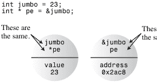

这强调了一个概念：`int*` 是一种类型，即指向 int 的指针。把空格放在哪里对编译器来说没有区别。你甚至可以这样做：

```
int*ptr;
```

但要注意，下面的声明创建了一个指针（`p1`）和一个普通的 `int`（`p2`）：

```
int* p1, p2;
```

每个指针变量名都需要一个 `*`。

> **注意**
> 
> 在 C++ 中，`int *` 这种组合是一种复合类型，即指向 int 的指针。

你可以使用相同的语法声明指向其他类型的指针：

```
double * tax_ptr; // tax_ptr points to type double
char * str;       // str points to type char
```

因为你把 `tax_ptr` 声明为指向 double 的指针，所以编译器知道 `*tax_ptr` 是一个 double 类型的值。也就是说，它知道 `*tax_ptr` 表示一个以浮点格式存储的数，在大多数系统上占用 8 个字节。指针变量从来不只是指针。它始终是指向特定类型的指针。`tax_ptr` 的类型是指向 double 的指针（或类型 double *），而 `str` 的类型是指向 char 的指针（或 char *）。虽然二者都是指针，但它们是两种不同类型的指针。与数组一样，指针也是基于其他类型的。

注意，虽然 `tax_ptr` 和 `str` 指向两种不同大小的数据类型，但 `tax_ptr` 和 `str` 这两个变量本身通常大小相同。也就是说，char 的地址与 double 的地址大小相同，就像 1016 可能是百货商店的街道地址，而 1024 可能是小别墅的街道地址一样。地址的大小或值并不能真正告诉你该地址处所找到的变量或建筑的大小或种类。通常，地址需要 2 或 4 个字节，具体取决于计算机系统。（有些系统的地址可能更大，而且一个系统可以针对不同类型使用不同的地址大小。）

你可以使用声明语句来初始化指针。在这种情况下，初始化的是指针，而不是被指向的值。也就是说，下面的语句把 `pt`（而不是 `*pt`）设置为值 `&higgins`：

```
int higgins = 5;
int * pt = &higgins;
```

程序清单 4.16 演示了如何将指针初始化为一个地址。

## 程序清单 4.16 `init_ptr.cpp`

```cpp
// init_ptr.cpp -- initialize a pointer
#include <iostream>
int main()
{
```


```cpp
using namespace std;
int higgens = 5;
int * pt = &higgens;

cout << "Value of higgens = " << higgens
     << ", Address of higgens = " << &higgens << endl;
cout << "Value of *pt = " << *pt
     << ", Value of pt = " << pt << endl;
return 0;
}
```

下面是程序清单4.16中程序的一些示例输出：

```text
Value of higgens = 5; Address of higgens = 0012FED4
Value of *pt = 5; Value of pt = 0012FED4
```

可以看到，程序将 `pt`（而不是 `*pt`）初始化为 `higgens` 的地址。（你的系统很可能会显示不同的地址值，并且可能以不同的格式显示它们。）

## 指针的危险

不谨慎使用指针的人会面临危险。一个极其重要的点是，当你在 C++ 中创建指针时，计算机会分配内存来保存一个地址，但不会分配内存来保存该地址所指向的数据。为数据创建空间涉及一个单独的步骤。省略该步骤，如下所示，就等于招致灾难：

```cpp
long * fellow;         // create a pointer-to-long
*fellow = 223323;      // place a value in never-never land
```

当然，`fellow` 是一个指针。但它指向哪里呢？代码没有为 `fellow` 分配地址。那么值 223323 被放在哪里？我们无法确定。因为 `fellow` 未被初始化，所以它可能具有任何值。无论该值是什么，程序都会将其解释为存储 223323 的地址。如果 `fellow` 恰好具有值 1200，那么计算机就会尝试将数据放在地址 1200 处，即使该地址恰好位于你的程序代码中间。很可能 `fellow` 指向的任何地方，都不是你想要存放数字 223323 的地方。这类错误可能产生一些最隐蔽且最难追踪的 bug。

> **注意**
>
> 指针黄金法则：在将解引用运算符（`*`）应用于指针之前，始终要将指针初始化为一个确定且合适的地址。

## 指针和数字

指针不是整数类型，尽管计算机通常将地址作为整数处理。从概念上讲，指针是与整数不同的类型。整数是你可以相加、相减、相除等的数字。但指针描述的是一个位置，例如，将两个位置相乘是没有意义的。就你可以对它们执行的操作而言，指针和整数彼此不同。因此，你不能简单地将整数赋给指针：

```cpp
int * pt;
pt = 0xB8000000;  // type mismatch
```

这里，左侧是一个指向 `int` 的指针，因此你可以给它赋一个地址，但右侧只是一个整数。你可能知道 `0xB8000000` 是你那台老旧计算机系统上显存的组合段-偏移地址，但语句中没有任何内容告诉程序这个数字是一个地址。C99 之前的 C 允许你进行这样的赋值。但 C++ 更严格地强制类型一致，编译器会给你一条错误消息，指出类型不匹配。如果你想将数值用作地址，应使用类型转换将该数字转换为合适的地址类型：

```cpp
int * pt;
pt = (int *) 0xB8000000; // types now match
```

现在赋值语句的两边都表示整数的地址，因此该赋值有效。请注意，仅仅因为它是类型 `int` 值的地址，并不意味着 `pt` 本身就是 `int` 类型。例如，可能有一个平台，其中 `int` 类型是 2 字节值，而地址是 4 字节值。

指针还有一些其他有趣的特性，我们将在它们变得相关时讨论。同时，让我们看看指针如何用于管理运行时的内存空间分配。

## 使用 `new` 分配内存

现在你已经对指针的工作方式有了感觉，让我们看看它们如何实现程序运行时分配内存这一重要技术。到目前为止，你已经将指针初始化为变量的地址；这些变量是编译时分配的有名内存，而每个指针只不过为你本来就可以按名称直接访问的内存提供了一个别名。指针的真正价值体现在你在运行时分配无名内存来保存值时。在这种情况下，指针成为访问该内存的唯一途径。在 C 中，你可以使用库函数 `malloc()` 分配内存。在 C++ 中你仍然可以这样做，但 C++ 还有一种更好的方式：`new` 运算符。

让我们通过为一个 `int` 类型的值创建无名内存存储，并用指针访问该值，来试用这项新技术。关键在于 C++ 的 `new` 运算符。你告诉 `new` 你想要哪种数据类型的内存；`new` 找到一块大小合适的内存块并返回该块的地址。你将这个地址赋给一个指针，然后就可以使用了。下面是该技术的一个示例：

```cpp
int * pn = new int;
```

`new int` 部分告诉程序你想要一些适合保存 `int` 的新存储空间。`new` 运算符使用该类型来计算出需要多少字节。然后它找到内存并返回地址。接下来，你将地址赋给 `pn`，它被声明为指向 int 的指针类型。现在 `pn` 是地址，而 `*pn` 是存储在那里的值。将此与将变量的地址赋给指针进行比较：

```cpp
int higgins;
int * pt = &higgins;
```

在两种情况（`pn` 和 `pt`）中，你都将一个 `int` 的地址赋给了一个指针。在第二种情况下，你还可以通过名称访问该 `int`：`higgins`。在第一种情况下，你唯一的访问方式是通过指针。这就引出了一个问题：由于 `pn` 指向的内存没有名称，你该怎么称呼它？我们说 `pn` 指向一个 *数据对象*。这里的“对象”不是“面向对象编程”意义上的“对象”；它只是“东西”意义上的“对象”。术语“数据对象”比术语“变量”更通用，因为它意味着为数据项分配的任何内存块。因此，变量也是一个数据对象，但 `pn` 指向的内存不是变量。处理数据对象的指针方法起初可能显得更笨拙，但它能让你更好地控制程序管理内存的方式。

为单个数据对象（它既可以是基本类型，也可以是结构）获取并分配内存的一般形式如下：

```cpp
typeName * pointer_name = new typeName;
```

你使用数据类型两次：一次指定所请求的内存种类，一次声明一个合适的指针。当然，如果你已经声明了正确类型的指针，你可以使用它，而不是声明一个新指针。程序清单4.17 演示了将 `new` 与两种不同类型一起使用。

## 程序清单4.17 `use_new.cpp`

```cpp
// use_new.cpp -- using the new operator
#include <iostream>
int main()
{
    using namespace std;
    int nights = 1001;
    int * pt = new int;       // allocate space for an int
    *pt = 1001;               // store a value there

    cout << "nights value = ";
    cout << nights << ": location " << &nights << endl;
    cout << "int ";
    cout << "value = " << *pt << ": location = " << pt << endl;
```

> **内存不足？**
>
> 计算机可能没有足够的内存来满足 `new` 请求。在这种情况下，`new` 通常会通过抛出异常来响应，这是一种在第15章《友元、异常及其他》中讨论的错误处理技术。在较旧的实现中，`new` 返回值 0。在 C++ 中，值为 0 的指针称为 *空指针*。C++ 保证空指针永远不会指向有效数据，因此它常用于指示那些本来会返回可用指针的运算符或函数发生了失败。第6章讨论的 `if` 语句可帮助你处理这种可能性。目前，重要的一点是 C++ 提供了检测并响应分配失败的工具。

## 使用 `delete` 释放内存

在需要时使用 `new` 请求内存，只是 C++ 内存管理方案中更光鲜的一半。另一半是 `delete` 运算符，它使你能够在用完内存后将其归还到内存池。这是最有效地利用内存的重要一步。你归还或 *释放* 的内存随后可以被程序的其他部分重新使用。使用 `delete` 的方法是，在其后跟一个指向最初由 `new` 分配的内存块的指针：

```cpp
int * ps = new int; // allocate memory with new
. . .              // use the memory
delete ps;         // free memory with delete when done
```

这会移除 `ps` 指向的内存；它不会移除指针 `ps` 本身。例如，你可以重新使用 `ps` 来指向另一个新的分配。你应始终让 `new` 的使用与 `delete` 的使用保持平衡；否则，你最终可能会遇到 *内存泄漏*——即已分配但无法再使用的内存。如果内存泄漏变得太大，它可能会使一个寻求更多内存的程序停止运行。

你不应试图释放之前已经释放过的内存块。C++ 标准规定，这种尝试的结果是未定义的，这意味着后果可能是任何情况。此外，你不能使用 `delete` 释放通过声明普通变量创建的内存：

```cpp
int * p = new int;   // ok
delete p;            // ok
delete ps;           // not ok now
int jugs = 5;        // ok
int * pi = &jugs;    // ok
delete pi;           // not allowed, memory not allocated by new
```

> **注意**
>
> 你只应使用 `delete` 释放由 `new` 分配的内存。但是，将 `delete` 应用于空指针是安全的。


注意使用 `delete` 的关键要求是：将它用于由 `new` 分配的内存。这并不意味着你必须使用与 `new` 一起使用的同一个指针；相反，你必须使用相同的地址：

```cpp
int * p = new int;    // allocate memory
int * pq = p;         // set second pointer to same block
delete pq;            // delete with second pointer
```

通常，你不会创建两个指向同一内存块的指针，因为这会增加你误将同一内存块删除两次的可能性。但正如你很快会看到的，当你使用返回指针的函数时，使用第二个指针确实是有意义的。

## 使用 `new` 创建动态数组

如果程序需要的只是一个值，那么你不如声明一个简单变量，因为与使用 `new` 和指针来管理单个小型数据对象相比，这样做更简单——虽然没那么令人印象深刻。更常见的情况是，你将 `new` 用于更大的数据块，例如数组、字符串和结构。这正是 `new` 的用武之地。例如，假设你正在编写一个程序，它可能需要也可能不需要数组，这取决于程序运行时提供给程序的信息。如果你通过声明来创建数组，那么空间会在程序编译时分配。无论程序最终是否使用该数组，数组都存在，并占用内存。在编译时分配数组称为 *静态绑定*，意味着数组在编译时就被构建到程序中。但使用 `new`，你可以在运行时根据需要创建数组，如果不需要则跳过创建。或者你可以在程序运行后选择数组大小。这称为 *动态绑定*，意味着数组在程序运行时创建。这样的数组称为 *动态数组*。使用静态绑定时，必须在编写程序时指定数组大小。使用动态绑定时，程序可以在运行时决定数组大小。

目前，我们将探讨关于动态数组的两个基本问题：如何使用 C++ 的 `new` 运算符创建数组，以及如何使用指针访问数组元素。

## 使用 `new` 创建动态数组

在 C++ 中创建动态数组很容易；你告诉 `new` 数组元素的类型以及你想要的元素数量。语法要求你在类型名后面跟上用方括号括起来的元素数量。例如，如果你需要一个包含 10 个 int 的数组，你可以这样写：

```cpp
int * psome = new int [10]; // get a block of 10 ints
```

`new` 运算符返回该块第一个元素的地址。在这个例子中，该值被赋给指针 `psome`。

一如既往，当程序使用完该内存块后，你应该用对 `delete` 的调用与对 `new` 的调用相平衡。然而，使用带方括号的 `new` 创建数组时，在释放数组需要使用 `delete` 的另一种形式：

```cpp
delete [] psome;               // free a dynamic array
```

把它想象成一根指向该元素的手指。假设一个 int 占 4 个字节。那么，将你的手指沿正确方向移动 4 个字节，就可以指向第二个元素。总共有 10 个元素，这就是你可以移动手指的范围。因此，new 语句为你提供了识别该块中每个元素所需的全部信息。

现在实际地考虑这个问题。如何访问这些元素中的一个？第一个元素没问题。因为 p3 指向数组的第一个元素，所以 *p3 是第一个元素的值。剩下还有九个元素需要访问。如果你没有用过 C，访问这些元素的最简单方法可能会让你惊讶：只需像使用数组名一样使用指针。也就是说，对于第一个元素，你可以使用 p3[0] 而不是 *p3；对于第二个元素，使用 p3[1]，依此类推。事实证明，使用指针访问动态数组非常简单，即使这种方法为什么有效可能不会立刻显而易见。你能这样做的原因是，C 和 C++ 在内部本来就用指针来处理数组。数组和指针的这种近乎等价性是 C 和 C++ 的优点之一。（有时它也会成为问题，但那是另一回事。）你稍后会进一步了解这种等价性。首先，清单 4.18 展示了如何使用 new 创建动态数组，然后使用数组表示法访问元素。它还指出了指针与真正的数组名之间的一个根本区别。

## 清单 4.18 arraynew.cpp

```cpp
// arraynew.cpp -- using the new operator for arrays
#include <iostream>
int main()
{
    using namespace std;
    double * p3 = new double [3]; // space for 3 doubles
    p3[0] = 0.2;                  // treat p3 like an array name
    p3[1] = 0.5;
    p3[2] = 0.8;
    cout << "p3[1] is " << p3[1] << ".\n";
    p3 = p3 + 1;                  // increment the pointer
    cout << "Now p3[0] is " << p3[0] << " and ";
    cout << "p3[1] is " << p3[1] << ".\n";
    p3 = p3 - 1;                  // point back to beginning
    delete [] p3;                 // free the memory
    return 0;
}
```

以下是清单 4.18 中程序的输出：

```text
p3[1] is 0.5.
Now p3[0] is 0.5 and p3[1] is 0.8.
```

如你所见，arraynew.cpp 将指针 p3 当作数组名来使用，其中 p3[0] 是第一个元素，依此类推。数组名与指针之间的根本区别体现在下面这一行：

```cpp
p3 = p3 + 1;  // okay for pointers, wrong for array names
```

你不能改变数组名的值。但指针是一个变量，因此你可以改变它的值。注意给 p3 加 1 的效果。表达式 p3[0] 现在引用数组的第二个元素。因此，给 p3 加 1 会使它指向第二个元素而不是第一个元素。减 1 会使指针回到其原始值，以便程序可以为 delete [] 提供正确的地址。

连续 int 的实际地址通常相差 2 或 4 个字节，因此给 p3 加 1 会得到下一个元素的地址这一事实表明，指针算术有某种特殊之处。确实如此。

## 指针、数组和指针算术

指针名和数组名近乎等价，这源于指针算术以及 C++ 在内部处理数组的方式。首先，让我们看看这种算术。给整数变量加 1 会使其值增加 1，但给指针变量加 1 会使其值增加它所指向类型的字节数。在 double 为 8 字节的系统上，给指向 double 的指针加 1 会使数值增加 8；而如果 short 为 2 字节，给指向 short 的指针加 1 会使指针值增加 2。清单 4.19 演示了这个奇妙之处。它还展示了第二个要点：C++ 将数组名解释为地址。

## 清单 4.19 addpntrs.cpp

```cpp
// addpntrs.cpp -- pointer addition
#include <iostream>
int main()
{
        using namespace std;
        double wages[3] = {1000.0, 20000.0, 30000.0};
        short stacks[3] = {3, 2, 1};

        // Here are two ways to get the address of an array
        double * pw = wages;      // name of an array = address
        short * ps = &stacks[0];  // or use address operator
        // with array element
        cout << "pw = " << pw << ", *pw = " << *pw << endl;
        pw = pw + 1;
        cout << "add 1 to the pw pointer:\n";
        cout << "pw = " << pw << ", *pw = " << *pw << "\n\n";

        cout << "*ps = " << ps << ", *ps = " << *ps << endl;
        ps = ps + 1;
        cout << "add 1 to the ps pointer:\n";
        cout << "*ps = " << ps << ", *ps = " << *ps << "\n\n";

        cout << "access two elements with array notation\n";
        cout << "stacks[0] = " << stacks[0]
             << ", stacks[1] = " << stacks[1] << endl;
        cout << "access two elements with pointer notation\n";
        cout << "*stacks = " << *stacks
             << ", *(stacks + 1) = " << *(stacks + 1) << endl;

        cout << sizeof(wages) << " = size of wages array\n";
        cout << sizeof(pw) << " = size of pw pointer\n";
        return 0;
}
```

以下是清单 4.19 中程序的输出：

```text
pw = 0x28ccf0, *pw = 1000
add 1 to the pw pointer:
pw = 0x28ccf8, *pw = 20000

ps = 0x28ccea, *ps = 3
add 1 to the ps pointer:
ps = 0x28ccec, *ps = 2

access two elements with array notation
stacks[0] = 3, stacks[1] = 2
access two elements with pointer notation
*stacks = 3, *(stacks + 1) = 2
24 = size of wages array
4 = size of pw pointer
```

## 程序说明

在大多数上下文中，C++ 将数组名解释为其第一个元素的地址。因此，下面的语句使 pw 成为指向 double 类型的指针，然后将 pw 初始化为 wages，即 wages 数组第一个元素的地址：

```cpp
double * pw = wages;
```

对于 wages，与任何数组一样，我们有以下等式：

```text
wages = wages[0] = address of first element of array
```

为了表明这并非玩笑，程序在表达式 &stacks[0] 中显式使用了地址运算符，将 ps 指针初始化为 stacks 数组的第一个元素。


接下来，程序检查 `pw` 和 `*pw` 的值。第一个是地址，第二个是该地址处的值。因为 `pw` 指向第一个元素，所以 `*pw` 显示的值就是第一个元素的值 10000。然后程序给 `pw` 加一。正如前面所说，这会给数值地址值加八，因为在该系统中 double 为 8 字节。这使得 `pw` 等于第二个元素的地址。因此，`*pw` 现在为 20000，即第二个元素的值（见图 4.10）。（图中的地址值经过调整，以使图更清晰。）

```cpp
double wages[3] = {10000.0, 20000.0, 30000.0};
short stacks[3] = {3, 2, 1};
double * pw = wages;
short * ps = &stacks[0];
```

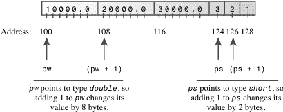

图 4.10 指针加法。

之后，程序对 `ps` 执行类似步骤。这一次，因为 `ps` 指向 `short` 类型，而 `short` 为 2 字节，所以给指针加 1 会使其值增加 2（十六进制中 0x28ccea + 2 = 0x28ccec）。同样，结果是让指针指向数组的下一个元素。

> **注意**
> 
> 将指针变量加 1 会使其值增加其所指向类型的字节数。

现在考虑数组表达式 `stacks[1]`。C++ 编译器处理这个表达式时，完全就像你写成 `*(stacks + 1)` 一样。第二个表达式的意思是计算数组第二个元素的地址，然后找出存储在那里的值。最终结果正是 `stacks[1]` 的含义。（运算符优先级要求使用括号。没有括号的话，1 会加到 `*stacks` 上，而不是加到 `stacks` 上。）

程序输出表明，`*(stacks + 1)` 和 `stacks[1]` 相同。类似地，`*(stacks + 2)` 与 `stacks[2]` 相同。一般来说，凡是你使用数组表示法的地方，C++ 都会进行以下转换：

```
arrayname[i] becomes *(arrayname + i)
```

如果你使用指针而不是数组名，C++ 也会进行相同的转换：

```
pointername[i] becomes *(pointername + i)
```

因此，在许多方面，你可以用相同的方式使用指针名和数组名。你可以对两者使用数组方括号表示法。你可以对两者应用解引用运算符（*）。在大多数表达式中，每个都表示一个地址。一个区别是，你可以改变指针的值，而数组名是常量：

```
pointername = pointername + 1;  // valid
arrayname = arrayname + 1;      // not allowed
```

第二个区别是，对数组名应用 sizeof 运算符会得到数组的大小，而对指针应用 sizeof 会得到指针的大小，即使该指针指向数组。例如，在清单 4.19 中，`pw` 和 `wages` 都引用同一个数组。但对它们应用 sizeof 运算符会产生以下结果：

```
24 = size of wages array <- displaying sizeof wages
4 = size of pw pointer <- displaying sizeof pw
```

这是 C++ 不把数组名解释为地址的一种情况。

## 数组的地址

取数组的地址是另一种数组名不被解释为其地址的情况。但等等，数组名难道不是被解释为数组的地址吗？不完全是这样——数组名被解释为数组第一个元素的地址，而应用地址运算符得到的是整个数组的地址：

```cpp
short tell[10];       // tell an array of 20 bytes
cout << tell << endl; // displays &tell[0]
cout << &tell << endl; // displays address of whole array
```

从数值上看，这两个地址相同，但从概念上讲，&tell[0]（也就是 tell）是一个 2 字节内存块的地址，而 &tell 是一个 20 字节内存块的地址。因此，表达式 tell + 1 会给地址值加 2，而 &tell + 1 会给地址值加 20。另一种说法是，tell 的类型是“指向 short 的指针”，即 short *，而 &tell 的类型是“指向 20 个 short 的数组的指针”，即 short (*)[20]。

现在你可能会想知道最后那个类型描述是怎么来的。首先，下面说明如何声明并初始化这种类型的指针：

```cpp
short (*pas)[20] = &tell;  // pas points to array of 20 shorts
```

如果省略括号，优先级规则会先把 [20] 与 pas 结合，使 pas 成为包含 20 个指向 short 的指针的数组，因此括号是必需的。接下来，如果你想描述一个变量的类型，可以把该变量的声明作为指南，并去掉变量名。因此，pas 的类型是 short (*)[20]。还要注意，因为 pas 被设置为 &tell，所以 *pas 等价于 tell，因此 (*pas)[0] 会是 tell 数组的第一个元素。

简而言之，使用 `new` 创建数组并使用指针访问不同元素是一件简单的事。你只需把指针当作数组名来对待。然而，理解它为什么可行是一个有趣的挑战。如果你真的想理解数组和指针，就应该仔细回顾它们之间的相互关系。

## 总结指针要点

最近你已经接触了不少指针知识，因此让我们总结一下迄今为止所揭示的指针和数组相关内容。

### 声明指针

要声明指向特定类型的指针，请使用以下形式：

```
typeName * pointerName;
```

以下是一些示例：

```cpp
double * pn;      // pn can point to a double value
char * pc;        // pc can point to a char value
```

这里 pn 和 pc 是指针，而 double * 和 char * 是 C++ 中表示“指向 double 的指针”和“指向 char 的指针”这两种类型的记法。

### 为指针赋值

应该给指针赋一个内存地址。你可以对变量名应用 `&` 运算符来获得具名内存的地址，而 `new` 运算符返回未命名内存的地址。

以下是一些示例：

```cpp
double * pn;          // pn can point to a double value
double * pa;          // so can pa
char * pc;            // pc can point to a char value
double bubble = 3.2;
pn = &bubble;         // assign address of bubble to pn
pc = new char;        // assign address of newly allocated char memory to pc
pa = new double[30];  // assign address of 1st element of array of 30 double to pa
```

### 解引用指针

解引用指针意味着引用所指向的值。对指针应用解引用运算符（或称间接运算符）（*）即可解引用它。因此，如果 pn 是指向 bubble 的指针，如前面的示例所示，那么 *pn 就是所指向的值，在本例中为 3.2。

以下是一些示例：

```cpp
cout << *pn; // print the value of bubble
*pc = 'S';   // place 'S' into the memory location whose address is pc
```

数组表示法是解引用指针的第二种方式；例如，pn[0] 与 *pn 相同。绝不应解引用一个尚未初始化为合适地址的指针。

### 区分指针和所指向的值

记住，如果 pt 是指向 int 的指针，那么 *pt 不是指向 int 的指针；相反，*pt 完全等价于一个 int 类型变量。pt 才是指针。

以下是一些示例：

```cpp
int * pt = new int;       // assigns an address to the pointer pt
*pt = 5;                  // stores the value 5 at that address
```

### 数组名

在大多数上下文中，C++ 把数组名视为等价于数组第一个元素的地址。

以下是一个示例：

```cpp
int tacos[10];             // now tacos is the same as &tacos[0]
```

一个例外是，将数组名与 sizeof 运算符一起使用。在这种情况下，sizeof 返回整个数组的大小，以字节为单位。

### 指针算术

C++ 允许你给指针加上一个整数。加 1 的结果等于原地址值加上一个等于所指向对象字节数的值。你也可以从指针中减去一个整数，以求得两个指针之间的差。最后一种运算会得到一个整数，只有当两个指针指向同一个数组（也允许指向末尾之后的一个位置）时才有意义；此时它给出两个元素之间的间隔。

以下是一些示例：

```cpp
int tacos[10] = {5,2,8,4,1,2,2,4,6,8};
int * pt = tacos;         // suppose pt and tacos are the address 3000
pt = pt + 1;              // now pt is 3004 if an int is 4 bytes
int *pe = &tacos[9];      // pe is 3036 if an int is 4 bytes
pe = pe - 1;              // now pe is 3032, the address of tacos[8]
int diff = pe - pt;       // diff is 7, the separation between
                          // tacos[8] and tacos[1]
```

### 数组的动态绑定和静态绑定

你可以使用数组声明来创建具有静态绑定的数组——也就是说，其大小在编译过程中就已设定的数组：

```cpp
int tacos[10]; // static binding, size fixed at compile time
```


你使用新的 `[]` 运算符创建具有动态绑定的数组（动态数组）——也就是说，一个在运行时分配并可设置其大小的数组。完成后用 `delete []` 释放内存：

```cpp
int size;
cin >> size;
int * pz = new int [size];  // dynamic binding, size set at run time
...
delete [] pz;               // free memory when finished
```

## 数组表示法和指针表示法

使用方括号数组表示法等价于解引用指针：

```cpp
tacos[0] means *tacos means the value at address tacos
tacos[3] means *(tacos + 3) means the value at address tacos + 3
```

这对数组名和指针变量都成立，因此你可以对指针和数组名使用指针表示法或数组表示法。

以下是一些示例：

```cpp
int * pt = new int [10];  // pt points to block of 10 ints
*pt = 5;                  // set element number 0 to 5
pt[0] = 6;                // reset element number 0 to 6
pt[9] = 44;               // set tenth element (element number 9) to 44
int coats[10];
*(coats + 4) = 12;         // set coats[4] to 12
```

## 指针和字符串

数组与指针之间的特殊关系延伸到了 C 风格字符串。考虑以下代码：

```cpp
char flower[10] = "rose";
cout << flower << " is a red\n";
```

数组名是其第一个元素的地址，因此 cout 语句中的 flower 是包含字符 r 的 char 元素的地址。cout 对象假定 char 的地址是字符串的地址，因此它会打印该地址处的字符，然后继续打印字符，直到遇到空字符（\0）。简而言之，如果你把字符的地址给 cout，它会打印从该字符到其后的第一个空字符之间的所有内容。

这里的关键因素不是 flower 是数组名，而是 flower 充当 char 的地址。这意味着你也可以将指向 char 的指针变量用作 cout 的参数，因为它也是 char 的地址。当然，该指针应指向字符串的开头。我们稍后会验证这一点。

但前面 cout 语句的最后一部分呢？如果 flower 实际上是字符串第一个字符的地址，那么表达式 " is a red\n" 是什么？为了与 cout 处理字符串输出的方式保持一致，这个带引号的字符串也应该是一个地址。确实如此，因为在 C++ 中，带引号的字符串和数组名一样，充当其第一个元素的地址。前面的代码实际上并没有向 cout 发送整个字符串；它只是发送字符串地址。这意味着数组中的字符串、带引号的字符串常量和由指针描述的字符串都以等价方式处理。每一个实际上都是作为地址传递的。这当然比传递字符串中的每一个字符工作量更少。

> **注意**
>
> 对于 cout 和大多数 C++ 表达式，数组名、指向 char 的指针和带引号的字符串常量都被解释为字符串第一个字符的地址。

程序清单 4.20 说明了不同字符串形式的使用。它使用了字符串库中的两个函数。strlen() 函数你之前用过，它返回字符串的长度。strcpy() 函数将一个字符串从一个位置复制到另一个位置。两者都在 cstring 头文件（或在较旧实现中的 string.h）中有函数原型。该程序还使用注释展示了一些应尽量避免的指针误用。

## 程序清单 4.20 ptrstr.cpp

```cpp
// ptrstr.cpp -- using pointers to strings
#include <iostream>
#include <cstring>              // declare strlen(), strcpy()
int main()
{
    using namespace std;
    char animal[20] = "bear";   // animal holds bear
    const char * bird = "wren"; // bird holds address of string
    char * ps;                  // uninitialized

    cout << animal << " and ";  // display bear
    cout << bird << "\n";       // display wren
    // cout << ps << "\n";      // may display garbage, may cause a crash

    cout << "Enter a kind of animal: ";
    cin >> animal;              // ok if input < 20 chars
    // cin >> ps; Too horrible a blunder to try; ps doesn't
    //             point to allocated space

    ps = animal;                // set ps to point to string
    cout << ps << "!\n";        // ok, same as using animal
    cout << "Before using strcpy():\n";
    cout << animal << " at " << (int *) animal << endl;
    cout << ps << " at " << (int *) ps << endl;

    ps = new char[strlen(animal) + 1];  // get new storage
    strcpy(ps, animal);         // copy string to new storage
    cout << "After using strcpy():\n";
    cout << animal << " at " << (int *) animal << endl;
    cout << ps << " at " << (int *) ps << endl;
    delete [] ps;
    return 0;
}
```

以下是程序清单 4.20 中的程序的一次示例运行：

```text
bear and wren
Enter a kind of animal: fox
fox!
Before using strcpy():
fox at 0x0065fd30
fox at 0x0065fd30
After using strcpy():
fox at 0x0065fd30
fox at 0x004301c8
```

## 程序说明

程序清单 4.20 中的程序创建了一个 char 数组（`animal`）和两个指向 char 的指针变量（`bird` 和 `ps`）。程序首先将 animal 数组初始化为 "bear" 字符串，就像你之前初始化数组一样。然后，程序做了一些新的事情。它将一个指向 char 的指针初始化为一个字符串：

```cpp
const char * bird = "wren"; // bird holds address of string
```

记住，"wren" 实际上表示字符串的地址，因此这条语句将 "wren" 的地址赋给 bird 指针。（通常，编译器会在内存中留出一块区域来保存程序源代码中使用的所有带引号字符串，并将每个存储的字符串与其地址关联起来。）这意味着你可以像使用字符串 "wren" 一样使用指针 bird，如下例所示：

```cpp
cout << "A concerned " << bird << " speaks\n";
```

字符串字面量是常量，这就是代码在声明中使用 const 关键字的原因。以这种方式使用 const 意味着你可以使用 bird 访问该字符串，但不能修改它。第 7 章将更详细地讨论 const 指针这一主题。最后，指针 ps 保持未初始化，因此它不指向任何字符串。（如你所知，这通常是个坏主意，这个例子也不例外。）

接下来，程序说明了你可以将数组名 `animal` 和指针 `bird` 等价地与 `cout` 一起使用。毕竟，两者都是字符串的地址，而 `cout` 显示存储在这些地址处的两个字符串（"bear" 和 "wren"）。如果你启用那段尝试显示 `ps` 的错误代码，可能会得到空行，可能会显示乱码，也可能导致程序崩溃。创建未初始化的指针有点像分发一张空白的签名支票：你无法控制它会被如何使用。

对于输入，情况略有不同。只要输入足够短以适合数组，使用数组 `animal` 进行输入就是安全的。然而，使用 `bird` 进行输入是不合适的：

- 有些编译器将字符串字面量视为只读常量，如果你试图在其上写入新数据，会导致运行时错误。字符串字面量是常量是 C++ 强制要求的行为，但并非所有编译器都已从旧行为做出这一改变。
- 有些编译器只使用字符串字面量的一个副本来表示程序中该字面量的所有出现。

让我们进一步说明第二点。C++ 不保证字符串字面量被唯一存储。也就是说，如果你在程序中多次使用字符串字面量 "wren"，编译器可能会存储该字符串的多个副本，也可能只存储一个副本。如果采用后者，那么将 `bird` 设置为指向一个 "wren" 会使它指向该字符串的唯一副本。将一个值读入一个字符串可能会影响你原以为在别处独立的字符串。无论如何，由于 bird 指针被声明为 `const`，编译器会阻止任何修改 `bird` 所指向位置内容的尝试。

更糟的是试图将信息读入 `ps` 所指向的位置。因为 `ps` 未初始化，你不知道信息最终会到哪里。它甚至可能覆盖内存中已有的信息。幸运的是，避免这些问题很容易：只需使用足够大的 char 数组来接收输入，不要使用字符串常量来接收输入，也不要使用未初始化的指针来接收输入。（或者，你可以避开所有这些问题，改用 `std::string` 对象而不是数组。）

## 警告

当你将字符串读入程序风格的字符串时，应始终使用先前已分配内存的地址。这个地址可以是数组名的形式，也可以是使用 `new` 初始化过的指针的形式。

接下来，请注意以下代码完成了什么：

```cpp
ps = animal;                 // set ps to point to string
...
cout << animal << " at " << (int *) animal << endl;
cout << ps << " at " << (int *) ps << endl;
```

它产生以下输出：

```text
fox at 0x0065fd30
fox at 0x0065fd30
```

通常，如果你给 `cout` 一个指针，它会打印一个地址。但如果指针的类型是 `char *`，`cout` 会显示所指向的字符串。如果你想看到字符串的地址，必须将指针类型转换为另一种指针类型，例如 `int *`，这段代码就是这样做的。


因此，`ps` 显示为字符串 "fox"，而 `(int *) ps` 显示为找到该字符串的地址。注意，将 `animal` 赋给 `ps` 并不会复制字符串；它复制的是地址。这会导致两个指针（`animal` 和 `ps`）指向同一内存位置和同一字符串。

要获得字符串的副本，你需要做更多工作。首先，需要分配内存来保存字符串。可以通过声明第二个数组或使用 `new` 来完成。第二种方法使你能够按字符串定制存储空间：

```
ps = new char[strlen(animal) + 1];  // get new storage
```

字符串 "fox" 并未完全填满 `animal` 数组，因此这种方法浪费空间。这段代码使用 `strlen()` 查找字符串长度；再加一得到包含空字符在内的长度。然后程序使用 `new` 分配刚好足够保存该字符串的空间。

接下来，你需要一种方法将字符串从 `animal` 数组复制到新分配的空间。将 `animal` 赋给 `ps` 行不通，因为这只会改变 `ps` 中存储的地址，从而丢失程序访问新分配内存的唯一途径。相反，需要使用 `strcpy()` 库函数：

```
strcpy(ps, animal);             // copy string to new storage
```

`strcpy()` 函数接受两个参数。第一个是目标地址，第二个是要复制的字符串的地址。你需要确保目标确实已分配，并且有足够空间容纳副本。这通过使用 `strlen()` 找到正确大小并使用 `new` 获取空闲内存来实现。

注意，通过使用 `strcpy()` 和 `new`，你会得到 "fox" 的两个独立副本：

```
fox at 0x0065fd30
fox at 0x004301c8
```

还要注意，`new` 将新存储定位在距离 `animal` 数组相当远的内存位置。

你经常会遇到需要将字符串放入数组的情况。初始化数组时使用 `=` 运算符；否则使用 `strcpy()` 或 `strncpy()`。你已经见过 `strcpy()` 函数；它的工作方式如下：

```
char food[20] = "carrots";  // initialization
strcpy(food, "flan");       // otherwise
```

注意，类似下面的代码可能会引发问题，因为 food 数组小于该字符串：

```
strcpy(food, "a picnic basket filled with many goodies");
```

在这种情况下，该函数会将字符串的其余部分复制到紧跟在数组之后的内存字节中，这可能会覆盖程序正在使用的其他内存。为避免该问题，应改用 `strncpy()`。它接受第三个参数：要复制的最大字符数。但请注意，如果该函数在到达字符串末尾之前用完空间，它不会添加空字符。因此，应这样使用该函数：

```
strncpy(food, "a picnic basket filled with many goodies", 19);
food[19] = '\0';
```

这会将最多 19 个字符复制到数组中，然后将最后一个元素设置为空字符。如果字符串短于 19 个字符，`strncpy()` 会提前添加一个空字符，以标记字符串的真正结尾。

**注意**

将字符串赋给数组时，应使用 `strcpy()` 或 `strncpy()`，而不是赋值运算符。

现在你已经了解了使用 C 风格字符串和 `cstring` 库的一些方面，就能体会到使用 C++ `string` 类型相对简单。你（通常）不必担心字符串溢出数组，并且可以使用赋值运算符而不是 `strcpy()` 或 `strncpy()`。

## 使用 new 创建动态结构

你已经看到，在运行时而不是编译时创建数组可能很有优势。结构也是如此。你只需为程序在特定运行期间所需的那么多结构分配空间。同样，new 运算符就是可用的工具。使用它，你可以创建动态结构。同样，*动态* 意味着内存在运行时分配，而不是在编译时分配。顺便说一句，因为类与结构非常相似，你也可以将本节学到的用于结构的技术用于类。

将 new 与结构一起使用分为两部分：创建结构和访问其成员。要创建结构，可将结构类型与 new 一起使用。例如，要创建一个 `inflatable` 类型的未命名结构并将其地址赋给合适的指针，可以使用以下代码：

```
inflatable * ps = new inflatable;
```

这会将一块足够大、可容纳 `inflatable` 类型结构的空闲内存的地址赋给 `ps`。注意，其语法与 C++ 内置类型完全相同。

棘手之处在于访问成员。创建动态结构时，不能对结构名使用点成员运算符，因为该结构没有名称。你拥有的只是它的地址。C++ 专门为这种情况提供了一个运算符：箭头成员运算符（`->`）。该运算符由连字符后跟大于号构成，对于指向结构的指针所起的作用，就像点运算符对结构名所起的作用一样。例如，如果 `ps` 指向一个 `inflatable` 类型的结构，那么 `ps->price` 就是所指向结构的 price 成员（见图 4.11）。

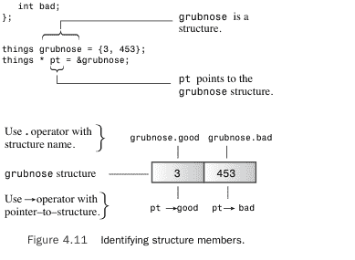

图 4.11 标识结构成员。

**提示**

有时 C++ 新手会混淆何时使用点运算符、何时使用箭头运算符来指定结构成员。规则很简单：如果结构标识符是结构名，使用点运算符。如果标识符是指向结构的指针，使用箭头运算符。

访问结构成员的第二种更丑陋的方法是认识到，如果 `ps` 是指向结构的指针，那么 `*ps` 表示所指向的值——即结构本身。然后，因为 `*ps` 是一个结构，`(*ps).price` 就是该结构的 price 成员。C++ 的运算符优先级规则要求在这种构造中使用括号。

### 清单 4.21 newstrct.cpp

```cpp
// newstrct.cpp -- using new with a structure
#include <iostream>
struct inflatable   // structure definition
{
    char name[20];
    float volume;
    double price;
};
int main()
{
    using namespace std;
    inflatable * ps = new inflatable; // allot memory for structure
    cout << "Enter name of inflatable item: ";
    cin.get(ps->name, 20);              // method 1 for member access
    cout << "Enter volume in cubic feet: ";
    cin >> (*ps).volume;                 // method 2 for member access
    cout << "Enter price: $";
    cin >> ps->price;
    cout << "Name: " << (*ps).name << endl;         // method 2
    cout << "Volume: " << ps->volume << " cubic feet\n"; // method 1
    cout << "Price: $" << ps->price << endl;         // method 1
    delete ps;                            // free memory used by structure
    return 0;
}
```

下面是清单 4.21 中程序的示例运行：

```text
Enter name of inflatable item: Fabulous Frodo
Enter volume in cubic feet: 1.4
Enter price: $27.99
Name: Fabulous Frodo
Volume: 1.4 cubic feet
Price: $27.99
```

## 使用 new 和 delete 的示例

我们来看一个使用 new 和 delete 管理存储从键盘输入的字符串的示例。清单 4.22 定义了一个函数 getname()，它返回指向输入字符串的指针。该函数将输入读入一个大的临时数组，然后使用带有适当大小的 `new []` 创建一块大小适合输入字符串的内存。然后该函数返回指向该内存块的指针。对于读取大量字符串的程序，这种方法可以节省大量内存。（在现实生活中，也就是我们许多人所在的世界里，使用 string 类会更容易，因为它在设计中内置了对 new 和 delete 的使用。）

假设你的程序必须读取 1,000 个字符串，最大的字符串可能有 79 个字符长，但大多数字符串要短得多。如果用 char 数组保存这些字符串，就需要 1,000 个各含 80 个字符的数组。那就是 80,000 字节，而这块内存中的很大一部分最终会未被使用。另一种方法是，你可以创建一个包含 1,000 个指向 char 的指针的数组，然后使用 new 只分配每个字符串所需的内存量。这可以节省数万字节。你不必为每个字符串都使用一个大数组，而是让内存适应输入。更好的是，你还可以使用 new 来只查找存储所需数量指针的空间。嗯，这目前有点过于雄心勃勃了。即使使用包含 1,000 个指针的数组，目前也有点过于雄心勃勃，但清单 4.22 展示了其中一些技巧。另外，为了说明 delete 如何工作，程序使用它来释放内存以便复用。


## 清单 4.22 delete.cpp

```cpp
// delete.cpp -- using the delete operator
#include <iostream>
#include <cstring>        // or string.h
using namespace std;
char * getname(void);     // function prototype
int main()
{
    char * name;          // create pointer but no storage

    name = getname();     // assign address of string to name
    cout << name << " at " << (int *) name << "\n";
    delete [] name;       // memory freed

    name = getname();     // reuse freed memory
    cout << name << " at " << (int *) name << "\n";
    delete [] name;       // memory freed again
    return 0;
}

char * getname()          // return pointer to new string
{
    char temp[40];        // temporary storage
    cout << "Enter last name: ";
    cin >> temp;
    char * pn = new char[strlen(temp) + 1];
    strcpy(pn, temp);     // copy string into smaller space

    return pn;            // temp lost when function ends
}
```

下面是清单 4.22 中程序的示例运行结果：

```text
Enter last name: Plopper
Plopper at 0x004326b8
Enter last name: Pook
Pook at 0x004301c8
```

## 程序说明

考虑清单 4.22 程序中 `getname()` 函数。它使用 `cin` 将输入单词放入 `temp` 数组。接着，它使用 `new` 分配新内存来保存该单词。包括空字符在内，程序需要 `strlen(temp) + 1` 个字符来存储该字符串，因此这就是传给 `new` 的值。空间可用后，`getname()` 使用标准库函数 `strcpy()` 将字符串从 `temp` 复制到新内存块。该函数不检查字符串是否放得下，但 `getname()` 通过用 `new` 请求正确字节数来覆盖这一点。最后，函数返回 `pn`，即字符串副本的地址。

在 `main()` 中，返回值（地址）被赋给指针 name。该指针定义在 `main()` 中，但它指向 `getname()` 函数中分配的内存块。程序随后打印该字符串以及该字符串的地址。

接下来，在释放 name 所指向的块之后，`main()` 第二次调用 `getname()`。C++ 并不保证新释放的内存会在下次使用 `new` 时被首先选中，而在本次示例运行中，事实并非如此。

注意在这个示例中，`getname()` 分配内存，而 `main()` 释放它。通常不把 new 和 delete 放在不同函数中是个好主意，因为那会更容易忘记使用 `delete`。但这个示例确实将 new 与 delete 分开，只是为了表明这是可能的。

要理解此程序的一些更微妙之处，你应当对 C++ 如何处理内存有更多了解。因此，让我们预览一些将在第 9 章更全面讨论的内容。

## 自动存储、静态存储和动态存储

C++ 有三种管理数据内存的方式，具体取决于分配内存的方法：自动存储、静态存储和动态存储，有时称为*自由存储区*或*堆*。以这三种方式分配的数据对象彼此之间的区别在于它们存在的时间长短。我们将快速查看每种类型。（C++11 增加了第四种形式，称为*线程存储*，我们将在第 9 章简要讨论。）

### 自动存储

在函数内部定义的普通变量使用*自动存储*，并称为*自动变量*。这些术语意味着，当包含它们的函数被调用时，变量自动产生；当函数终止时，它们失效。例如，清单 4.22 中的 `temp` 数组只在 `getname()` 函数活动期间存在。当程序控制返回 `main()` 时，用于 `temp` 的内存被自动释放。如果 `getname()` 返回 `temp` 的地址，那么 `main()` 中的 name 指针将指向一个很快会被复用的内存位置。这就是你必须在 `getname()` 中使用 `new` 的原因之一。实际上，自动值对于包含它们的块是局部的。一个*块*是括在大括号之间的一段代码。到目前为止，我们的所有块都是整个函数。但正如你将在下一章看到的，你可以在函数内拥有块。如果你在其中一个块内定义变量，它只在程序执行该块内语句时存在。

自动变量通常存储在*栈*上。这意味着当程序执行进入一个代码块时，其变量会连续地添加到内存中的栈上，然后在执行离开该块时按相反顺序释放。（这称为*后进先出*或*LIFO*过程。）因此，栈随着执行的进行而增长和收缩。

> **注意**
> 
> 指针是 C++ 最强大的工具之一。它们也是最危险的，因为它们允许对计算机不友好的操作，例如使用未初始化的指针访问内存，或试图释放同一内存块两次。此外，在你通过实践熟悉指针表示法和指针概念之前，指针可能会令人困惑。由于指针是 C++ 编程的重要部分，它们会穿插在本书未来的讨论中。本书还会多次讨论指针。希望每一次接触都能让你更自如地使用它们。

## 类型的组合

本章介绍了数组、结构和指针。它们可以以各种方式组合，因此让我们回顾一些可能性，从结构开始：

```cpp
struct antarctica_years_end
{
    int year;
    /* some really interesting data, etc. */
};
```

我们可以创建这种类型的变量：

```cpp
antarctica_years_end s01, s02, s03;  // s01, s02, s03 are structures
```

然后我们可以使用成员运算符访问成员：

```cpp
s01.year = 1998;
```

我们可以创建指向这种结构的指针：

```cpp
antarctica_years_end * pa = &s02;
```

只要该指针已被设置为有效地址，我们就可以使用间接成员运算符访问成员：

```cpp
pa->year = 1999;
```

我们可以创建结构数组：

```cpp
antarctica_years_end trio[3];  // array of 3 structures
```

然后我们可以使用成员运算符访问某个元素的成员：

```cpp
trio[0].year = 2003;  // trio[0] is a structure
```

这里 trio 是一个数组，但 trio[0] 是一个结构，而 trio[0].year 是该结构的一个成员。因为数组名是指针，所以我们也可以使用间接成员运算符：

```cpp
(trio+1)->year = 2004;  // same as trio[1].year = 2004;
```

我们可以创建指针数组：

```cpp
const antarctica_years_end * arp[3] = {&s01, &s02, &s03};
```

这开始看起来有点复杂。我们如何用这个数组访问数据？嗯，如果 arp 是指针数组，那么 arp[1] 必定是一个指针，我们可以对它使用间接成员运算符来访问成员：

```cpp
std::cout << arp[1]->year << std::endl;
```

我们可以创建指向这种数组的指针：

```cpp
const antarctica_years_end ** ppa = arp;
```

这里，arp 是一个数组名；因此，它是其第一个元素的地址。但它的第一个元素是一个指针，所以 ppa 必须是指向 const antarctica_years_end 的指针的指针，因此有 **。有几种方式可能把这个声明搞乱。例如，你可以省略 const，忘记一两个 *，交换字母，或以其他方式弄错结构类型。下面是一个 C++11 版 auto 很方便的实例。编译器完全知道 arp 是什么类型，因此它可以为你推断出正确的类型：

```cpp
auto ppb = arp; // C++11 automatic type deduction
```

过去，编译器利用其对正确类型的知识来抱怨你在声明中可能犯的错误；现在，它可以让其知识为你所用。如何使用 ppa 访问数据？因为 ppa 是指向结构指针的指针，所以 *ppa 是指向结构的指针，因此你可以对它使用间接成员运算符：

```cpp
std::cout << (*ppa)->year << std::endl;
std::cout << (*(ppb+1))->year << std::endl;
```

因为 ppa 指向 arp 的第一个成员，所以 *ppa 是第一个成员，即 &s01。因此 (*ppa)->year 是 s01 的 year 成员。在第二条语句中，ppb+1 指向下一个元素 arp[1]，即 &s02。需要括号来获得正确的关联。例如，*ppa->year 会试图将 * 运算符应用于 ppa->year，这会失败，因为 year 成员不是指针。

这一切真的成立吗？清单 4.23 将上述所有语句整合到一个简短程序中。

## 清单 4.23 mixtypes.cpp

```cpp
// mixtypes.cpp -- some type combinations
#include <iostream>

struct antarctica_years_end
{
    int year;
    /* some really interesting data, etc. */
};

int main()
```


```cpp
{
    antarctica_years_end s01, s02, s03;
    s01.year = 1998;
    antarctica_years_end * pa = &s02;
    pa->year = 1999;
    antarctica_years_end trio[3]; // array of 3 structures
    trio[0].year = 2003;
    std::cout << trio->year << std::endl;
    const antarctica_years_end * arp[3] = {&s01, &s02, &s03};
    std::cout << arp[1]->year << std::endl;
    const antarctica_years_end ** ppa = arp;
    auto ppb = arp; // C++11 automatic type deduction
// or else use const antarctica_years_end ** ppb = arp;
    std::cout << (*ppa)->year << std::endl;
    std::cout << (*(ppb+1))->year << std::endl;
    return 0;
}
```

以下是输出：

```
2003
1999
1998
1999
```

程序可以编译并按预期运行。

## 数组替代品

本章前面提到，vector 和 array 模板类可以作为内置数组的替代品。现在让我们简要了解一下它们的使用方法以及使用它们的一些好处。

### vector 模板类

vector 模板类与 string 类类似，也是一个动态数组。你可以在运行时设置 vector 对象的大小，也可以在末尾追加新数据，或在中间插入新数据。基本上，它是使用 new 创建动态数组的一种替代方案。实际上，vector 类确实使用 new 和 delete 来管理内存，但它是自动完成的。

目前我们不会深入探讨模板类的含义。相反，我们将看一些基本的实际问题。首先，要使用 vector 对象，你需要包含 vector 头文件。其次，vector 标识符是 std 命名空间的一部分，因此你可以使用 using 指令、using 声明或 std::vector。第三，模板使用不同的语法来指示存储的数据类型。第四，vector 类使用不同的语法来指示元素数量。下面是一些示例：

```cpp
#include <vector>
...
using namespace std;
vector<int> vi;       // create a zero-size array of int
int n;
cin >> n;
vector<double> vd(n); // create an array of n doubles
```

我们说 `vi` 是 `vector<int>` 类型的对象，`vd` 是 `vector<double>` 类型的对象。因为 vector 对象在插入或添加值时会自动调整大小，所以 `vi` 从 0 大小开始是可以的。但为了实现调整大小，你需要使用 vector 包中提供的各种方法。

通常，以下声明创建一个 vector 对象 `vt`，它可以容纳 `n_elem` 个 `typeName` 类型的元素：

```cpp
vector<typeName> vt(n_elem);
```

参数 `n_elem` 可以是整数常量或整数变量。

### array 模板类（C++11）

vector 类的功能比内置数组类型更强大，但代价是效率稍低。如果你只需要一个固定大小的数组，使用内置类型可能更有利。然而，这也有其不便和安全性降低的代价。C++11 针对这种情况添加了 array 模板类，它是 std 命名空间的一部分。与内置类型一样，array 对象具有固定大小，并使用栈（或静态内存分配）而不是自由存储区，因此它拥有与内置数组相同的效率。在此基础上，它还增加了便利性和额外的安全性。要创建 array 对象，你需要包含 array 头文件。其语法与 vector 略有不同：

```cpp
#include <array>
...
using namespace std;
array<int, 5> ai;   // create array object of 5 ints
array<double, 4> ad = {1.2, 2.1, 3.43, 4.3};
```

更一般地，以下声明创建一个 array 对象 `arr`，它包含 `n_elem` 个 `typeName` 类型的元素：

```cpp
array<typeName, n_elem> arr;
```

与 vector 的情况不同，`n_elem` 不能是变量。

使用 C++11，你可以对 vector 和 array 对象使用列表初始化。然而，在 C++98 中，vector 对象没有这个选项。

## 比较数组、vector 对象和 array 对象

理解数组、vector 对象和 array 对象之间异同的最简单方法，或许是一个简短的示例（程序清单 4.24），该示例使用了所有三种方法。

### 程序清单 4.24 choices.cpp

```cpp
// choices.cpp -- array variations
#include <iostream>
#include <vector>    // STL C++98
#include <array>     // C++11
int main()
{
    using namespace std;
// C, original C++
    double a1[4] = {1.2, 2.4, 3.6, 4.8};
// C++98 STL
    vector<double> a2(4);   // create vector with 4 elements
// no simple way to initialize in C++98
    a2[0] = 1.0/3.0;
    a2[1] = 1.0/5.0;
    a2[2] = 1.0/7.0;
    a2[3] = 1.0/9.0;
// C++11 -- create and initialize array object
    array<double, 4> a3 = {3.14, 2.72, 1.62, 1.41};
    array<double, 4> a4;
    a4 = a3;                  // valid for array objects of same size
// use array notation
    cout << "a1[2]: " << a1[2] << " at " << &a1[2] << endl;
    cout << "a2[2]: " << a2[2] << " at " << &a2[2] << endl;
    cout << "a3[2]: " << a3[2] << " at " << &a3[2] << endl;
    cout << "a4[2]: " << a4[2] << " at " << &a4[2] << endl;
// misdeed
    a1[-2] = 20.2;
    cout << "a1[-2]: " << a1[-2] << " at " << &a1[-2] << endl;
    cout << "a3[2]: " << a3[2] << " at " << &a3[2] << endl;
    cout << "a4[2]: " << a4[2] << " at " << &a4[2] << endl;
    return 0;
}
```

以下是部分示例输出：

```
a1[2]: 3.6 at 0x28cc8
a2[2]: 0.142857 at 0xca0328
a3[2]: 1.62 at 0x28ccc8
a4[2]: 1.62 at 0x28cca8
a1[-2]: 20.2 at 0x28ccc8
a3[2]: 20.2 at 0x28ccc8
a4[2]: 1.62 at 0x28cca8
```

## 程序说明

首先，注意无论我们使用内置数组、vector 对象还是 array 对象，都可以使用标准数组表示法来访问各个成员。其次，从地址可以看出，array 对象与内置数组使用相同的内存区域（本例中为栈），而 vector 对象存储在不同的区域（自由存储区或堆）。第三，注意你可以将一个 array 对象赋值给另一个 array 对象。对于内置数组，你必须逐元素地复制数据。

接下来，这一点需要特别关注，注意这一行：

```
    a1[-2] = 20.2;
```

索引 -2 是什么意思？回想一下，这可以转换为以下内容：

```
    *(a1-2) = 20.2;
```

用语言表达就是：查看 a1 指向的位置，向后移动两个 double 元素，并把 20.2 放在那里。也就是说，将信息存储在数组之外的位置。C++ 与 C 一样，不检查此类越界错误。在这个特定例子中，该位置恰好位于数组对象 a3 中。另一个编译器可能将越界的 20.2 放到 a4 中，而其他编译器还可能做出其他糟糕的选择。这是内置数组不安全行为的一个例子。

vector 和 array 对象能防止这种行为吗？如果你让它们保护，它们就可以。也就是说，你仍然可以编写不安全的代码，例如：

```
    a2[-2] = .5;    // still allowed
    a3[200] = 1.4;
```

但是，你有其他选择。一种是使用 `at()` 成员函数。就像你可以将 `getline()` 成员函数与 `cin` 对象一起使用一样，你也可以对 vector 或 array 类型的对象使用 `at()` 成员函数：

```
    a2.at(1) = 2.3;  // assign 2.3 to a2[1]
```

使用方括号表示法和 `at()` 成员函数之间的区别在于，如果你使用 `at()`，无效索引会在运行时被捕获，并且程序默认会中止。这种额外的检查确实会以增加运行时间为代价，这就是为什么 C++ 让你可以选择使用任一种表示法。更重要的是，这些类提供了使用对象的方法，可以减少意外范围错误的机会。例如，这些类具有 `begin()` 和 `end()` 成员函数，可以让你限定范围而不会意外超出边界。但我们将把这部分讨论留到第 16 章。

## 总结

数组、结构和指针是 C++ 的三种复合类型。数组可以在单个数据对象中保存多个值，所有这些值都具有相同的类型。通过使用索引或下标，你可以访问数组中的各个元素。

结构可以在单个数据对象中保存多个不同类型的值，你可以使用成员运算符（.）访问各个成员。使用结构的第一步是创建结构模板，定义结构包含哪些成员。这个模板的名称或标记随后成为一种新的类型标识符。然后你可以声明该类型的结构变量。

联合可以保存单个值，但它可以是多种类型之一，成员名称指示当前使用的是哪种模式。

指针是设计用于保存地址的变量。我们说指针指向它所保存的地址。指针声明始终说明指针指向什么类型的对象。对指针应用解引用运算符（*）会得到指针所指向位置的值。

字符串是以空字符结尾的一系列字符。字符串可以用带引号的字符串常量表示，在这种情况下空字符是隐含的。你可以将字符串存储在 char 数组中，也可以用指向 char 的指针表示字符串，该指针被初始化为指向该字符串。strlen() 函数返回字符串的长度，不包括空字符。strcpy() 函数将字符串从一个位置复制到另一个位置。使用这些函数时，你需要包含 cstring 或 string.h 头文件。

C++ 的 string 类由 string 头文件支持，提供了一种更友好、更方便的字符串处理方式。特别是，string 对象会自动调整大小以容纳所存储的字符串，并且你可以使用赋值运算符来复制字符串。

new 运算符允许你在程序运行时为数据对象请求内存。该运算符返回它获得的内存的地址，你可以将该地址赋给指针。访问该内存的唯一方法是使用指针。如果数据对象是简单变量，你可以使用解引用运算符（*）来指示值。如果数据对象是数组，你可以将指针当作数组名来访问元素。如果数据对象是结构，你可以使用指针解引用运算符（->）访问结构成员。

指针和数组紧密相关。如果 ar 是数组名，那么表达式 ar[i] 被解释为 *(ar + i)，其中数组名被解释为数组第一个元素的地址。因此，数组名起着与指针相同的作用。反过来，你可以使用带数组表示法的指针名来访问由 new 分配的数组中的元素。

new 和 delete 运算符使你可以显式控制数据对象何时分配以及何时返回到内存池。在函数内声明的自动变量，以及在函数外定义或使用关键字 static 定义的静态变量，灵活性较差。自动变量在进入作用域时产生，并在离开作用域时自动销毁。


当进入包含它的块（通常是函数定义）时，它开始存在；当离开该块时，它失效。静态变量在程序的整个运行期间持续存在。由 C++98 标准加入的标准模板库（STL）提供了一个 vector 模板类，为自行实现的动态数组提供了一种替代方案。C++11 提供了一个 array 模板类，为固定大小的内置数组提供了一种替代方案。

### 章末复习

- 1. 你会如何声明下列每一项？
  - a. actors 是一个包含 30 个 char 的数组。
  - b. betsie 是一个包含 100 个 short 的数组。
  - c. chuck 是一个包含 13 个 float 的数组。
  - d. dipsea 是一个包含 64 个 long double 的数组。
- 2. 章末复习第 1 题使用的是 array 模板类，而不是内置数组吗？
- 3. 声明一个包含五个 int 的数组，并将其初始化为前五个正奇整数。
- 4. 编写一条语句，将第 3 题中数组第一个元素与最后一个元素之和赋给变量 even。
- 5. 编写一条语句，显示 float 数组 ideas 中第二个元素的值。
- 6. 声明一个 char 数组，并将其初始化为字符串 "cheeseburger"。
- 7. 声明一个 string 对象，并将其初始化为字符串 "Waldorf Salad"。
- 8. 设计一个描述鱼的结构体声明。该结构体应包含种类、以整盎司表示的重量，以及以英寸小数表示的长度。
- 9. 声明一个第 8 题中定义类型的变量，并初始化它。
- 10. 使用 enum 定义一个名为 Response 的类型，其可能值为 Yes、No 和 Maybe。Yes 应为 1，No 应为 0，Maybe 应为 2。
- 11. 假设 ted 是一个 double 变量。声明一个指向 ted 的指针，并使用该指针显示 ted 的值。
- 12. 假设 treacle 是一个包含 10 个 float 的数组。声明一个指向 treacle 第一个元素的指针，并使用该指针显示数组的第一个和最后一个元素。
- 13. 编写一段代码，要求用户输入一个正整数，然后创建一个包含该数量 int 的动态数组。先用 new 完成，再用 vector 对象完成一次。
- 14. 以下代码有效吗？如果有效，它会打印什么？

```cpp
cout << (int *) "Home of the jolly bytes";
```

- 15. 编写一段代码，动态分配一个第 8 题所述类型的结构体，然后读取该结构体 kind 成员的值。
- 16. 程序清单 4.6 说明了在数值输入之后进行面向行的字符串输入所产生的问题。如果将下面这段：

```cpp
cin.getline(address, 80);
```

替换为：

```cpp
cin >> address;
```

会如何影响该程序的运行？

- 17. 声明一个包含 10 个 `string` 对象的 `vector` 对象，以及一个包含 10 个 `string` 对象的 array 对象。展示必要的头文件，并且不要使用 `using`。一定要用 `const` 表示字符串数量。

### 编程练习

- 1. 编写一个 C++ 程序，按以下输出示例请求并显示信息：

```text
What is your first name? Betty Sue
What is your last name? Yewe
What letter grade do you deserve? B
What is your age? 22
Name: Yewe, Betty Sue
Grade: C
Age: 22
```

注意，程序应能接受由多个单词组成的名字。还要注意，程序会将等级向下调整——也就是说，字母向后移一位。假设用户请求的是 A、B 或 C，这样你就不必担心 D 与 F 之间的间隔。

- 2. 重写程序清单 4.4，使用 C++ 的 `string` 类而不是 `char` 数组。
- 3. 编写一个程序，要求用户输入名字，然后输入姓氏，随后构造、存储并显示第三个字符串，该字符串由用户的姓氏、一个逗号、一个空格和名字组成。使用 `char` 数组和 `cstring` 头文件中的函数。示例运行可能如下所示：

```text
Enter your first name: Flip
Enter your last name: Fleming
Here’s the information in a single string: Fleming, Flip
```

- 4. 编写一个程序，要求用户输入名字，然后输入姓氏，随后构造、存储并显示第三个字符串，该字符串由用户的姓氏、一个逗号、一个空格和名字组成。使用 string 对象和 string 头文件中的方法。示例运行可能如下所示：

```text
Enter your first name: Flip
Enter your last name: Fleming
Here’s the information in a single string: Fleming, Flip
```

- 5. CandyBar 结构体包含三个成员。第一个成员保存糖果棒的品牌名。第二个成员保存糖果棒的重量（可能包含小数部分），第三个成员保存糖果棒的热量数（整数值）。编写一个程序，声明一个结构体并创建一个名为 snack 的 CandyBar 变量，分别将其成员初始化为 "Mocha Munch"、2.3 和 350。初始化应是 snack 声明的一部分。最后，程序应显示 snack 变量的内容。
- 6. CandyBar 结构体包含三个成员，如编程练习 5 所述。编写一个程序，创建一个包含三个 CandyBar 结构体的数组，将它们初始化为你选择的值，然后显示每个结构体的内容。
- 7. William Wingate 经营一家披萨分析服务公司。对于每个披萨，他需要记录以下信息：
  - 披萨公司的名称，可能由多个单词组成
  - 披萨的直径
  - 披萨的重量

设计一个可保存这些信息的结构体，并编写一个使用该类型结构体变量的程序。程序应要求用户输入上述每一项信息，然后显示这些信息。使用 *cin*（或其方法）和 *cout*。

- 8. 完成编程练习 7，但使用 new 分配一个结构体，而不是声明结构体变量。还要让程序在请求披萨公司名称之前先请求披萨直径。
- 9. 完成编程练习 6，但不要声明包含三个 CandyBar 结构体的数组，而是使用 new 动态分配该数组。
- 10. 编写一个程序，要求用户输入 40 码短跑（如果你愿意，也可以说 40 米）的三次成绩，然后显示这些成绩和平均值。使用一个 array 对象保存数据。（如果 array 不可用，则使用内置数组。）

本页有意留白

## 循环和关系表达式

在本章中，你将学习以下内容：

- for 循环
- 表达式和语句
- 递增和递减运算符：++ 和 --
- 复合赋值运算符
- 复合语句（块）
- 逗号运算符
- 关系运算符：>、>=、==、<=、< 和 !=
- while 循环
- typedef 机制
- do while 循环
- get() 字符输入方法
- 文件结束条件
- 嵌套循环和二维数组

计算机不仅仅存储数据。它们还会分析、整合、重新排列、提取、修改、外推、综合，以及以其他方式处理数据。有时它们甚至会扭曲和破坏数据，但我们会尽量避免这种行为。为了完成这些处理数据的奇迹，程序需要用于执行重复动作和做出决策的工具。当然，C++ 提供了这类工具。实际上，它使用与常规 C 相同的 for 循环、while 循环、do while 循环、if 语句和 switch 语句，所以如果你了解 C，就可以快速读完本章和第 6 章“分支语句和逻辑运算符”。（但不要读得太快——你不想错过 cin 如何处理字符输入！）这些各种程序控制结构通常使用关系表达式和逻辑表达式来控制其行为。本章讨论

循环与关系表达式，第6章接着讨论分支语句和逻辑表达式。

## 引入 for 循环

实际编程中经常需要执行重复性任务，比如逐一累加数组元素，或者将某种生产力赞歌打印20遍。C++ 的 for 循环让这类任务变得轻而易举。我们先来看清单5.1中的一个循环，了解它的功能，然后讨论其工作原理。

**清单5.1 forloop.cpp**

```cpp
// forloop.cpp -- introducing the for loop
#include <iostream>
int main()
{
    using namespace std;
    int i;    // create a counter
//   initialize; test ; update
    for (i = 0; i < 5; i++)
          cout << "C++ knows loops.\n";
    cout << "C++ knows when to stop.\n";
    return 0;
}
```

下面是清单5.1中程序的输出：

```text
C++ knows loops.
C++ knows loops.
C++ knows loops.
C++ knows loops.
C++ knows loops.
C++ knows when to stop.
```

这个循环首先将整数 *i* 设置为 0：

```text
i = 0
```

这是循环的*循环初始化*部分。接着在*循环测试*中，程序检查 *i* 是否小于 5：

```text
i < 5
```

如果是，程序就执行下面这条语句，它被称为*循环体*：

```cpp
cout << "C++ knows loops.\n";
```

然后程序使用循环的*循环更新*部分将 *i* 增加 1：

```text
i++
```

循环的*循环更新*部分使用 ++ 运算符，称为*递增运算符*。它将操作数的值加 1。（递增运算符并不限于 for 循环使用。例如，你可以在程序中使用 `i++;` 而不是 `i = i + 1;` 作为语句。）递增 i 完成了循环的第一个周期。

接下来，循环将新的 i 值与 5 比较，开始新的一轮循环。因为新值（1）也小于 5，循环又打印一行，然后通过再次递增 i 结束本轮。这为新一轮的测试、执行语句和更新 i 值做好了准备。这个过程一直持续到循环将 i 更新为 5。此时下一次测试失败，程序继续执行循环之后的下一条语句。

### for 循环的组成部分

for 循环为执行重复操作提供了逐步的配方。我们来更详细地看看它的结构。for 循环的常见部分处理以下步骤：

- 1. 设置初始值
- 2. 执行测试以判断循环是否应继续
- 3. 执行循环操作
- 4. 更新用于测试的值

C++ 的循环设计将这些元素摆放在一起，使你一眼就能看清。初始化、测试和更新操作构成了括号内的三部分控制部分。每个部分都是一个表达式，分号将各个表达式分隔开来。控制部分后面的语句称为循环的*主体*，只要测试表达式保持为真，它就会执行：

```cpp
for (initialization; test-expression; update-expression)
    body
```

C++ 语法将整个 for 语句视为一条语句，即使它可以在主体部分包含一条或多条语句。（如果要包含多条语句，则需要使用复合语句，即块，本章后面会讨论。）

循环只执行一次初始化。通常，程序用这个表达式将变量设置为起始值，然后用该变量来计数循环周期。

*test-expression*（测试表达式）决定循环体是否执行。通常，这个表达式是关系表达式——即比较两个值的表达式。我们的例子将 i 的值与 5 比较，检查 i 是否小于 5。如果比较为真，程序执行循环体。实际上，C++ 并不将 *test-expression* 限制为真/假比较。你可以使用任何表达式，C++ 会将其类型转换为 bool。因此，值为 0 的表达式被转换为 bool 值 false，循环终止。如果表达式的值非零，它会被类型转换为 bool 值 true，循环继续。清单5.2通过使用表达式 i 作为测试条件演示了这一点。（在更新部分，`i--` 与 `i++` 类似，区别在于每次使用会使 i 的值减 1。）

**清单5.2 num_test.cpp**

```cpp
// num_test.cpp -- use numeric test in for loop
#include <iostream>
int main()
{
    using namespace std;
    cout << "Enter the starting countdown value: ";
    int limit;
    cin >> limit;
    int i;
    for (i = limit; i; i--)     // quits when i is 0
        cout << "i = " << i << "\n";
    cout << "Done now that i = " << i << "\n";
    return 0;
}
```

下面是清单5.2中程序的输出：

```text
Enter the starting countdown value: 4
i = 4
i = 3
i = 2
i = 1
Done now that i = 0
```

注意，当 i 达到 0 时循环终止。

诸如 `i < 5` 这样的关系表达式，如何适应这种以 0 值终止循环的框架呢？在引入 bool 类型之前，关系表达式在值为真时求值为 1，为假时求值为 0。因此，表达式 `3 < 5` 的值是 1，而 `5 < 5` 的值是 0。不过，现在 C++ 已经添加了 bool 类型，关系表达式求值为 bool 字面量 true 和 false，而不是 1 和 0。然而，这一变化并不会导致不兼容，因为 C++ 程序在期望整数值的地方会将 true 和 false 转换为 1 和 0，在期望 bool 值的地方会将 0 转换为 false、非零值转换为 true。

for 循环是入口条件循环。这意味着测试表达式会在每个循环周期之前被求值。当测试表达式为 false 时，循环永远不会执行循环体。例如，假设你重新运行清单5.2中的程序，但将起始值设为 0。因为测试条件在第一次求值时就不成立，循环体永远不会执行：

```text
Enter the starting countdown value: 0
Done now that i = 0
```

这种“先看再循环”的态度有助于让程序远离麻烦。

*update-expression*（更新表达式）在循环体执行完之后、循环末尾求值。通常，它用于增加或减少记录循环周期数的变量的值。不过，它可以是任何有效的 C++ 表达式，其他控制表达式也是如此。这使得 for 循环的能力远不止像第一个循环示例那样简单地从 0 数到 5。稍后你会看到一些这样的例子。

for 循环体只包含一条语句，但你很快会学到如何扩展这条规则。图5.1总结了 for 循环的设计。

```text
statement1
for (int_expr; test_expr; update_expr)
    statement2
statement3
```

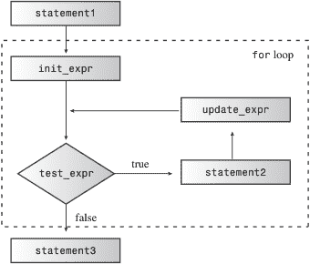

图5.1  for 循环的设计。

for 语句看起来有点像函数调用，因为它使用一个名称后跟一对圆括号。然而，`for` 是 C++ 关键字，这使编译器不会把 `for` 当作函数，也防止你将函数命名为 `for`。

### 提示

常见的 C++ 风格是在 `for` 和后面的圆括号之间加一个空格，而在函数名和后面的圆括号之间不加空格：

```cpp
for (i = 6; i < 10; i++)
    smart_function(i);
```

其他控制语句，如 `if` 和 `while`，也与 `for` 类似处理。这有助于在视觉上强化控制语句与函数调用之间的区别。另一个常见做法是缩进 `for` 语句的循环体，使其在视觉上更加突出。

### 表达式和语句

`for` 控制部分使用三个表达式。在语法允许的范围内，C++ 是一种非常有表现力的语言。任何值或任何值与运算符的有效组合都构成表达式。例如，10 是值为 10 的表达式（毫不意外），28 * 20 是值为 560 的表达式。在 C++ 中，每个表达式都有一个值。通常这个值是显而易见的。例如，下面这个表达式由两个值和加法运算符构成，其值为 49：

```cpp
22 + 27
```

有时值不那么明显。例如，下面是一个表达式，因为它由两个值和赋值运算符构成：

```cpp
x = 20
```

C++ 将赋值表达式的值定义为左侧成员的值，因此该表达式的值为 20。赋值表达式具有值这一事实允许了如下语句：

```cpp
maids = (cooks = 4) + 3;
```

表达式 `cooks = 4` 的值为 4，因此 `maids` 被赋值为 7。然而，C++ 允许这种行为并不意味着你应当提倡它。但正是使这条古怪语句成为可能的同样规则，也使下面这条有用的语句成为可能：

```cpp
x = y = z = 0;
```

这是将多个变量设置为相同值的快捷方式。优先级表（见附录D，“运算符优先级”）显示赋值运算符从右到左结合，因此首先将 0 赋给 z，接着将 `z = 0` 赋给 y，依此类推。

最后，如前所述，诸如 `x < y` 这样的关系表达式求值为 bool 值 true 或 false。清单5.3中的简短程序说明了关于表达式值的一些要点。`<<` 运算符的优先级高于表达式中使用的运算符，因此代码使用括号来强制正确的顺序。

**清单5.3 express.cpp**

```cpp
// express.cpp -- values of expressions
#include <iostream>
int main()
{
    using namespace std;
    int x;

    cout << "The expression x = 100 has the value ";
```


```cpp
cout << (x = 100) << endl;
cout << "Now x = " << x << endl;
cout << "The expression x < 3 has the value ";
cout << (x < 3) << endl;
cout << "The expression x > 3 has the value ";
cout << (x > 3) << endl;
cout.setf(ios::boolalpha);  // a newer C++ feature
cout << "The expression x < 3 has the value ";
cout << (x < 3) << endl;
cout << "The expression x > 3 has the value ";
cout << (x > 3) << endl;
return 0;
}
```

下面是程序清单 5.3 中程序的输出：

```
The expression x = 100 has the value 100
Now x = 100
The expression x < 3 has the value 0
The expression x > 3 has the value 1
The expression x < 3 has the value false
The expression x > 3 has the value true
```

通常，cout 在显示 bool 值之前会将其转换为 int，但 cout.setf(ios::boolalpha) 函数调用会设置一个标志，指示 cout 显示单词 true 和 false，而不是 1 和 0。

> **注意**
> 
> C++ 表达式是一个值，或值与运算符的组合，并且每个 C++ 表达式都有一个值。

为了求表达式 x = 100 的值，C++ 必须把值 100 赋给 x。当求表达式值的这一行为改变了内存中数据的值时，我们说该求值具有副作用。因此，求赋值表达式的值具有改变赋值对象值的副作用。你可能会把赋值视为预期的效果，但从 C++ 构造方式的角度看，求表达式的值才是主要效果。并非所有表达式都有副作用。例如，求 x + 15 的值会计算出一个新值，但不会改变 x 的值。但求 x++ + 15 的值确实有副作用，因为它涉及递增 x。

从表达式到语句只有一小步：只需添加一个分号。因此，下面是一个表达式：

```
age = 100
```

而下面是语句：

```
age = 100;
```

更具体地说，它是一个*表达式语句*。任何表达式只要添加分号都能成为语句，但结果可能没有编程意义。例如，如果 `rodents` 是一个变量，那么下面是一条有效的 C++ 语句：

```
rodents + 6;    // valid, but useless, statement
```

编译器允许这样做，但该语句不会完成任何有用的事。程序只是计算了和，没有对它做任何事，然后继续下一条语句。（聪明的编译器甚至可能跳过该语句。）

## 非表达式与语句

有些概念，例如了解 for 循环的结构，对理解 C++ 至关重要。但也有一些相对次要的语法细节，会在你认为自己已经理解这门语言时突然困扰你。现在我们就来看其中几个。

尽管给任何表达式加上分号确实都会使其成为语句，但反过来并不成立。也就是说，从语句中去掉分号并不一定把它转换成表达式。到目前为止我们用过的语句种类中，return 语句、声明语句和 for 语句都不符合 *语句 = 表达式 + 分号* 这一模式。例如，下面是一条语句：

```
int toad;
```

但片段 `int toad` 不是表达式，也没有值。这使得下面这样的代码无效：

```
eggs = int toad * 1000;    // invalid, not an expression
cin >> int toad;           // can’t combine declaration with cin
```

同样，你不能把 for 循环赋给变量。在下面的例子中，for 循环不是表达式，所以它没有值，你也不能赋值：

```
int fx = for (i = 0; i < 4; i++)
    cout << i;    // not possible
```

## 变通规则

C++ 为 C 循环添加了一项特性，这需要对 for 循环语法做一些巧妙的调整。最初的语法是：

```
for (expression; expression; expression)
    statement
```

具体来说，for 结构的控制部分由三个表达式组成（如本章前面所定义），用分号分隔。然而，C++ 循环允许你像下面这样做：

```
for (int i = 0; i < 5; i++)
```

也就是说，你可以在 for 循环的初始化区域声明变量。这很方便，但它不符合最初的语法，因为声明不是表达式。这种曾属违规的行为最初是通过定义一种新的表达式——*声明语句表达式*——来容纳的；这种表达式是去掉了分号的声明，并且只能出现在 `for` 语句中。不过，这种调整已被放弃。取而代之的是，`for` 语句的语法已被修改为下面这样：

```
for (for-init-statement condition; expression)
    statement
```

乍一看，这很奇怪，因为只有一个分号而不是两个。但这没关系，因为 `for-init-statement` 被认定是一条语句，而语句有自己的分号。至于 `for-init-statement`，它被认定为表达式语句或声明。这条语法规则用一个语句（它有自己的分号）取代了“表达式后跟分号”的形式。归根结底，C++ 程序员希望能够 `for` 循环初始化中声明并初始化变量，并且他们愿意对 C++ 语法和英语语言做任何必要的事来实现这一点。

在 `for-init-statement` 中声明变量有一个实际方面，你应该知道。这样的变量只存在于 `for` 语句内。也就是说，程序离开循环后，该变量就被消除：

```
for (int i = 0; i < 5; i++)
    cout << "C++ knows loops.\n";
cout << i << endl;  // oops! i no longer defined
```

你还应该知道另一件事：一些较旧的 C++ 实现遵循更早的规则，把前面的循环当作 `i` 是在循环*之前*声明的那样处理，从而使它在循环终止后仍可用。

## 回到 for 循环

让我们在循环方面稍微大胆一些。程序清单 5.4 使用一个循环来计算并存储前 16 个阶乘。阶乘便于计算赔率，其计算方式如下。零阶乘写作 0!，定义为 1。然后，1! 是 1 * 0!，即 1。接下来，2! 是 2 * 1!，即 2。然后，3! 是 3 * 2!，即 6，依此类推，每个整数的阶乘都是该整数与前一个阶乘的乘积。（已故钢琴家兼喜剧演员维克多·博格最著名的独白之一以语音标点为特色，其中感叹号的发音有点像 phfttt pptz，带有湿润的口音。不过，在这里，“!”读作“factorial”。）该程序使用一个循环计算连续阶乘的值，并将它们存储在一个数组中。然后它使用第二个循环显示结果。此外，该程序还介绍了对值使用外部声明。

程序清单 5.4  `formore.cpp`

```cpp
// formore.cpp -- more looping with for
#include <iostream>
const int ArSize = 16;      // example of external declaration
int main()
{
    long long factorials[ArSize];
    factorials[1] = factorials[0] = 1LL;
    for (int i = 2; i < ArSize; i++)
        factorials[i] = i * factorials[i-1];
    for (int i = 0; i < ArSize; i++)
        std::cout << i << "! = " << factorials[i] << std::endl;
    return 0;
}
```

下面是程序清单 5.4 中程序的输出：

```
0! = 1
1! = 1
2! = 2
3! = 6
4! = 24
5! = 120
6! = 720
7! = 5040
8! = 40320
9! = 362880
10! = 3628800
11! = 39916800
12! = 479001600
13! = 6227020800
14! = 87178291200
15! = 1307674368000
```

阶乘增长得很快！

> **注意**
> 
> 该清单使用 `long long` 类型。如果你的系统没有该类型可用，可以使用 `double`。不过，整数格式能更直观地表示数字如何变大。

## 程序说明

程序清单 5.4 中的程序创建一个数组来保存阶乘值。元素 0 是 0!，元素 1 是 1!，依此类推。由于前两个阶乘都等于 1，程序把 factorials 数组的前两个元素设为 1.0。（记住，数组的第一个元素的索引值为 0。）此后，程序使用一个循环把每个阶乘设为索引与前一个阶乘的乘积。该循环说明你可以在循环体中使用循环计数器作为变量。

程序清单 5.4 中的程序演示了 for 循环如何与数组协同工作，它提供了一种方便的方式来依次访问每个数组成员。此外，`formore.cpp` 使用 `const` 为数组大小创建符号表示（`ArSize`）。然后在涉及数组大小的任何地方使用 ArSize，例如在数组中


定义以及处理数组的循环中的限制。现在，如果你希望将程序扩展到比如 20 个阶乘，只需在程序中将 `ArSize` 设置为 20 并重新编译。通过使用符号常量，你可以避免逐一将每一处 16 都改为 20。

> **提示**
>
> 通常，定义一个 `const` 值来表示数组中元素的数量是个好主意。你可以在数组声明中以及所有其他引用数组大小的地方使用该 `const` 值，例如在 `for` 循环中。

限制表达式 `i < ArSize` 反映了这样一个事实：具有 `ArSize` 个元素的数组下标从 0 到 `ArSize - 1`，因此数组索引应在比 `ArSize` 小 1 处停止。你也可以改用测试 `i <= ArSize - 1`，但相比之下它看起来别扭。

注意，该程序在 `main()` 函数体之外声明了 `const int` 变量 `ArSize`。正如第 4 章“复合类型”末尾所提到的，这使 `ArSize` 成为外部数据。以这种方式声明 `ArSize` 的两个后果是：`ArSize` 在程序的整个持续期间都存在，并且程序文件中的所有函数都可以使用它。在这个特定例子中，程序只有一个函数，因此外部声明 `ArSize` 几乎没有实际影响。但多函数程序通常受益于共享外部常量，所以接下来我们将练习使用它们。

此外，这个示例提醒我们，可以使用 `std::` 而不是 `using` 指令来让选定的标准名称可用。

## 改变步长

到目前为止，本章中的 `for` 循环示例在每个循环周期中都将循环计数器增加或减少 1。你可以通过更改更新表达式来改变这一点。例如，清单 5.5 中的程序按用户选择的步长增加循环计数器。它没有使用 `i++` 作为更新表达式，而是使用表达式 `i = i + by`，其中 `by` 是用户选择的步长。

清单 5.5  **bigstep.cpp**

```cpp
// bigstep.cpp -- count as directed
#include <iostream>
int main()
{
    using std::cout;   // a using declaration
    using std::cin;
    using std::endl;
    cout << "Enter an integer: ";
    int by;
    cin >> by;
    cout << "Counting by " << by << "s:\n";
    for (int i = 0; i < 100; i = i + by)
        cout << i << endl;
    return 0;
}
```

以下是清单 5.5 中程序的示例运行：

```text
Enter an integer: 17
Counting by 17s:
0
17
34
51
68
85
```

当 `i` 达到值 102 时，循环退出。这里的要点是更新表达式可以是任何有效表达式。例如，如果你希望在每个循环周期中对 `i` 求平方再加 10，可以使用 `i = i * i + 10`。

另一点需要注意的是，测试不等通常比测试相等更好。例如，在这个例子中，测试 `i == 100` 会失败，因为 `i` 跳过了值 100。

最后，这个示例说明了使用 using 声明而不是 using 指令。

## 在字符串内部使用 `for` 循环

`for` 循环提供了一种直接方式，可以依次访问字符串中的每个字符。例如，清单 5.6 允许你输入一个字符串，然后按相反顺序逐字符显示该字符串。在这个示例中，你可以使用 `string` 类对象或 `char` 数组，因为二者都允许你使用数组表示法访问字符串中的各个字符。清单 5.6 使用 `string` 类对象。`string` 类的 `size()` 方法给出字符串中的字符数；循环在其初始化表达式中使用该值，将 `i` 设置为字符串中最后一个字符的索引（不计空字符）。为了倒序计数，程序使用递减运算符（`--`）在每个循环中将数组下标减 1。此外，清单 5.6 使用大于或等于关系运算符（`>=`）来测试循环是否已到达第一个元素。我们很快会总结所有关系运算符。

清单 5.6   `forstr1.cpp`

```cpp
// forstr1.cpp -- using for with a string
#include <iostream>
#include <string>
int main()
{
    using namespace std;
    cout << "Enter a word: ";
    string word;
    cin >> word;

    // display letters in reverse order
    for (int i = word.size() - 1; i >= 0; i--)
        cout << word[i];
    cout << "\nBye.\n";
    return 0;
}
```

以下是清单 5.6 中程序的示例运行：

```text
Enter a word: animal
lamina
Bye.
```

是的，程序成功地将 *animal* 倒序打印出来；选择 *animal* 作为测试单词，比选择诸如 *rotator*、*redder* 或 *stats* 这样的回文更能清楚地说明这个程序的效果。

## 递增（`++`）和递减（`--`）

C++ 提供了几种在循环中频繁使用的运算符；现在我们花一点时间来研究它们。你已经见过两个：递增运算符（`++`），它启发了 C++ 这个名字，以及递减运算符（`--`）。这些运算符执行两种极其常见的循环操作：将循环计数器增加 1 和减少 1。然而，它们的故事远不止你到目前为止所见。每个运算符都有两种形式。前缀版本位于操作数之前，如 `++x`。后缀版本位于操作数之后，如 `x++`。这两个版本对操作数具有相同效果，但它们发生的时间不同。这就像提前或事后获得修剪草坪的报酬；两种方式对你钱包的最终效果相同，但钱被加进去的时间不同。清单 5.7 演示了递增运算符的这种差异。

**清单 5.7** `plus_one.cpp`

```cpp
// plus_one.cpp -- the increment operator
#include <iostream>
int main()
{
    using std::cout;
    int a = 20;
    int b = 20;
}
```

什么是完整表达式？它不是一个更大表达式的子表达式的表达式。完整表达式的示例包括表达式语句中的表达式部分，以及用作 while 循环测试条件的表达式。

顺序点有助于说明后缀递增何时发生。例如，考虑以下代码：

```cpp
while (guests++ < 10)
    cout << guests << endl;
```

（本章后面会讨论的 while 循环，工作方式类似于只有测试表达式的 `for` 循环。）有时 C++ 新手会以为，“使用该值，然后递增它”在这个上下文中意味着在 `guests` 用于 `cout` 语句之后递增它。然而，`guests++ < 10` 表达式是一个完整表达式，因为它是 while 循环的测试条件，所以该表达式的末尾是一个顺序点。因此，C++ 保证副作用（递增 `guests`）在程序继续执行到 `cout` 之前发生。不过，使用后缀形式可以保证 `guests` 在完成与 10 的比较之后才递增。

现在考虑这条语句：

```cpp
y = (4 + x++) + (6 + x++);
```

表达式 `4 + x++` 不是完整表达式，因此 C++ 不保证在子表达式 `4 + x++` 求值后立即递增 `x`。在这里，完整表达式是整个赋值语句，分号标记顺序点，所以 C++ 只保证当程序继续执行到下一条语句时，`x` 已经被递增两次。C++ 没有规定 `x` 是在每个子表达式求值后递增，还是只在所有表达式求值后才递增，这就是为什么你应该避免这类语句。

C++11 文档已经弃用“顺序点”这一术语，因为在讨论多个执行线程时，这个概念不能很好地沿用。取而代之的是用排序（sequencing）来描述，其中一些事件被描述为排在另一些事件之前。这种描述方式并非旨在改变规则；其目标是提供能够更清楚地处理多线程编程的语言。

## 前缀与后缀

显然，如果递增或递减表达式的值被用于某种目的，例如作为函数实参或赋值给变量，那么使用前缀形式还是后缀形式会产生差异。但是，如果递增或递减表达式的值不被使用呢？例如，下面两者

```cpp
x++;
```

和

```cpp
++x;
```

彼此不同吗？还是

```cpp
for (n = lim; n > 0; --n)
```


```cpp
...;
```

和

```cpp
for (n = lim; n > 0; n--)
    ...;
```

彼此不同吗？

从逻辑上讲，在这两种情况下，使用前缀形式还是后缀形式都没有区别。表达式的值没有被使用，因此唯一的影响是副作用。这里使用这些运算符的表达式是完整表达式，所以递增 x 和递减 n 的副作用保证在程序继续执行下一步之前完成；前缀形式和后缀形式会导致相同的最终结果。

然而，尽管前缀形式和后缀形式之间的选择对程序行为没有影响，但这种选择可能会对执行速度产生微小影响。对于内置类型和现代编译器来说，这似乎不是问题。但 C++ 允许你为类定义这些运算符。在这种情况下，用户定义的前缀函数通过递增一个值然后返回它来工作。但后缀版本的工作方式是先暂存该值的一个副本，递增该值，然后返回暂存的副本。因此，对于类来说，前缀版本比后缀版本效率稍高一些。

简而言之，对于内置类型，使用哪种形式很可能没有区别。对于具有用户定义递增和递减运算符的用户定义类型，前缀形式更高效。

## 递增/递减运算符与指针

递增运算符不仅可以用于基本变量，也可以用于指针。回想一下，对指针使用递增运算符会使其值增加它所指向类型所占的字节数。递增和递减指针也遵循同样的规则：

```cpp
double arr[5] = {21.1, 32.8, 23.4, 45.2, 37.4};
double *pt = arr;  // pt points to arr[0], i.e. to 21.1
++pt;              // pt points to arr[1], i.e. to 32.8
```

你还可以将这些运算符与 * 运算符结合使用，来改变指针所指向的量。将 * 和 ++ 同时应用于指针会引出问题：什么被解引用，什么被递增。这些操作由运算符的位置和优先级决定。前缀递增、前缀递减和解引用运算符都具有相同的优先级，并从右到左结合。后缀递增和后缀递减运算符具有相同的优先级，且高于前缀优先级。这两个运算符从左到右结合。

前缀运算符的从右到左结合规则意味着 *++pt 表示先对 pt 应用 ++（因为 ++ 位于 * 的右侧），然后对 pt 的新值应用 *：

```cpp
double x = *++pt;  // increment pointer, take the value; i.e., arr[2], or 23.4
```

另一方面，`++*pt` 表示先取得 `pt` 所指向的值，然后递增该值：

```cpp
++*pt;      // increment the pointed to value; i.e., change 23.4 to 24.4
```

这里，`pt` 仍然指向 `arr[2]`。

接下来，考虑这种组合：

```cpp
(*pt)++;     // increment pointed-to value
```

括号表明首先解引用指针，得到 `24.4`。然后 `++` 运算符将该值递增为 `25.4`；`pt` 仍然指向 `arr[2]`。

最后，考虑这种组合：

```cpp
x = *pt++;     // dereference original location, then increment pointer
```

后缀 `++` 运算符具有更高的优先级，这意味着 `++` 运算符作用于 `pt`，而不是作用于 `*pt`，因此指针被递增。但使用后缀运算符这一事实意味着被解引用的地址是原来的地址 `&arr[2]`，而不是新地址。因此，`*pt++` 的值是 `arr[2]`，即 `25.4`，但语句完成后 `pt` 的值是 `arr[3]` 的地址。

> **注意**
> 
> 递增和递减指针遵循指针算术规则。因此，如果 `pt` 指向数组的第一个成员，`++pt` 会改变 `pt`，使其指向第二个成员。

## 组合赋值运算符

程序清单 5.5 使用以下表达式更新循环计数器：

```cpp
i = i + by;
```

C++ 有一个组合加法和赋值运算符，可以更简洁地完成相同结果：

```cpp
i += by;
```

`+=` 运算符将其两个操作数的值相加，并将结果赋给左侧的操作数。这意味着左操作数必须是可以赋值的东西，例如变量、数组元素、结构成员，或通过解引用指针所标识的数据：

```cpp
int k = 5;
k += 3;                 // ok, k set to 8
int *pa = new int[10];   // pa points to pa[0]
pa[4] = 12;
pa[4] += 6;              // ok, pa[4] set to 18
*(pa + 4) += 7;          // ok, pa[4] set to 25
pa += 2;                 // ok, pa points to the former pa[2]
34 += 10;                 // quite wrong
```

每个算术运算符都有一个对应的赋值运算符，如表 5.1 所总结。每个运算符的工作方式类似于 `+=`。因此，例如，以下语句将 k 的当前值替换为增大 10 倍的值：

```cpp
k *= 10;
```

**表 5.1. 组合赋值运算符**

| 运算符 | 效果（L=左操作数，R=右操作数） |
|---|---|
| `+=` | 将 L + R 赋给 L |
| `-=` | 将 L - R 赋给 L |
| `*=` | 将 L * R 赋给 L |
| `/=` | 将 L / R 赋给 L |
| `%=` | 将 L % R 赋给 L |

## 复合语句，或块

编写 C++ `for` 语句的格式或语法对你来说可能显得限制较多，因为循环体必须是单条语句。如果你希望循环体包含多条语句，这会很别扭。幸运的是，C++ 提供了一个语法漏洞，你可以借此把任意多条语句塞进循环体。技巧是使用成对的花括号构造复合语句，或称块。块由成对的花括号及其包含的语句组成，并且出于语法目的，它算作单条语句。例如，程序清单 5.8 使用花括号将三条独立语句组合成一个块。这使循环体能够提示用户、读取输入并执行计算。该程序计算你所输入数字的累计和，这为使用 `+=` 运算符提供了自然的场合。

程序清单 5.8  **block.cpp**

```cpp
// block.cpp -- use a block statement
#include <iostream>
int main()
{
    using namespace std;
    cout << "The Amazing Accounto will sum and average ";
    cout << "five numbers for you.\n";
    cout << "Please enter five values:\n";
    double number;
    double sum = 0.0;
    for (int i = 1; i <= 5; i++)
    {
        // block starts here
        cout << "Value " << i << " is: ";
        cin >> number;
        sum += number;
    }                                  // block ends here
    cout << "Five exquisite choices indeed! ";
    cout << "They sum to " << sum << endl;
    cout << "and average to " << sum / 5 << ".\n";
    cout << "The Amazing Accounto bids you adieu!\n";
    return 0;
}
```

以下是程序清单 5.8 中程序的一次示例运行：

```
The Amazing Accounto will sum and average five numbers for you.
Please enter five values:
Value 1: 1942
Value 2: 1948
Value 3: 1957
Value 4: 1974
Value 5: 1980
Five exquisite choices indeed! They sum to 9801
and average to 1960.2.
The Amazing Accounto bids you adieu!
```

假设你保留缩进但省略花括号：

```cpp
for (int i = 1; i <= 5; i++)
    cout << "Value " << i << ": ";       // loop ends here
    cin >> number;                       // after the loop
    sum += number;
cout << "Five exquisite choices indeed! ";
```

编译器忽略缩进，因此只有第一条语句会位于循环中。这样，循环将打印五个提示，然后不再做其他事情。循环完成后，程序转到接下来的行，只读取并求和一个数字。

复合语句还有另一个有趣的特性。如果在块内定义一个新变量，该变量只在程序执行块内语句期间存在。当执行离开该块时，变量会被释放。这意味着该变量只在块内已知：

```cpp
#include <iostream>
int main()
{
    using namespace std;
    int x = 20;
    {
        int y = 100;          // block starts
        cout << x << endl;    // ok
        cout << y << endl;    // ok
    }                         // block ends
    cout << x << endl;        // ok
    cout << y << endl;        // invalid, won't compile
    return 0;
}
```


注意，在外层块中定义的变量在内层块中仍然已定义。如果在块中声明一个与块外变量同名的变量，会发生什么？新变量从其出现点开始隐藏旧变量，直到块结束。然后旧变量重新可见，如下例所示：

```cpp
#include <iostream>
int main()
{
    using std::cout;
    using std::endl;
    int x = 20;               // original x
    {                         // block starts
        cout << x << endl;    // use original x
        int x = 100;          // new x
        cout << x << endl;    // use new x
    }                         // block ends
    cout << x << endl;        // use original x
    return 0;
}
```

## 更多语法技巧——逗号运算符

正如你所见，块使你能够将两条或多条语句塞入 C++ 语法只允许一条语句的位置。逗号运算符对表达式做同样的事，使你能够将两个表达式塞入 C++ 语法只允许一个表达式的位置。例如，假设有一个循环，其中一个变量每轮增加1，第二个变量每轮减少1。在 for 循环控制部分的更新部分同时完成这两件事会很方便，但循环语法在那里只允许一个表达式。解决方案是使用逗号运算符将两个表达式合并为一个：

```cpp
i++, j--   // two expressions count as one for syntax purposes
```

逗号并不总是逗号运算符。例如，下面声明中的逗号用于分隔变量列表中的相邻名称：

```cpp
int i, j;  // comma is a separator here, not an operator
```

程序清单5.9在一个反转 string 类对象内容的程序中两次使用了逗号运算符。（你也可以使用 char 数组编写该程序，但单词长度会受到数组大小选择的限制。）注意，程序清单5.6以逆序显示数组内容，而程序清单5.9实际上在数组中移动字符。程序清单5.9中的程序还使用块将多条语句组合为一条。

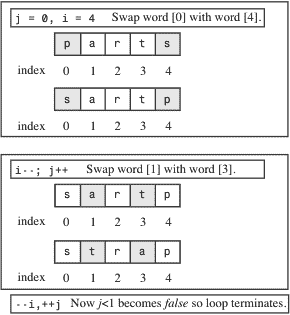

图5.2 反转字符串。

另一件需要注意的事是变量 temp、i 和 j 的声明位置。代码在循环之前声明 i 和 j，因为不能使用逗号运算符合并两个声明。这是因为声明已经将逗号用于另一个目的——分隔列表中的项。你可以使用单个声明语句表达式创建并初始化两个变量，但视觉上有点令人困惑：

```cpp
int i = 0, j = word.size() - 1;
```

在这种情况下，逗号只是列表分隔符，而不是逗号运算符，因此该表达式声明并初始化 i 和 j。然而，它看起来像是只声明了 i。

顺便说一句，你可以在 for 循环内声明 temp：

```cpp
int temp = word[i];
```

这可能导致 temp 在每个循环周期中分配和释放。这可能比在循环之前声明一次 temp 稍慢。另一方面，如果 temp 在循环内声明，循环结束后它会被丢弃。

### 逗号运算符小知识

迄今为止，逗号运算符最常见的用途是将两个或多个表达式放入单个 for 循环表达式中。但 C++ 确实为该运算符提供了两个额外特性。首先，它保证第一个表达式在第二个表达式之前求值。（换句话说，逗号运算符是一个顺序点。）如下表达式是安全的：

```cpp
i = 20, j = 2 * i       // i set to 20, then j set to 40
```

其次，C++规定逗号表达式的值是表达式第二部分的值。例如，前面表达式的值是40，因为那是 j = 2 * i 的值。

逗号运算符的优先级低于任何其他运算符。例如，下面这条语句：

```cpp
cats = 17,240;
```

会被解读为：

```cpp
(cats = 17), 240;
```

也就是说，cats 被设为17，而240不起作用。但由于括号具有高优先级，下面的代码会使 cats 被设为240，即逗号右侧表达式的值：

```cpp
cats = (17,240);
```

## 关系表达式

计算机不仅仅是无情的数字运算器。它们能够比较值，而这种能力是计算机决策的基础。在 C++ 中，关系运算符体现了这种能力。C++ 提供了六种关系运算符来比较数字。由于字符由其 ASCII 码表示，你也可以将这些运算符用于字符。它们不能用于 C 风格字符串，但可用于 string 类对象。每个关系表达式在比较为真时归结为 bool 值 true，在比较为假时归结为 bool 值 false，因此这些运算符非常适合用于循环测试表达式。（较旧的实现会将为真的关系表达式求值为1，将为假的关系表达式求值为0。）表5.2总结了这些运算符。

表5.2 关系运算符

| 运算符 | 含义 |
|---|---|
| `<` | 小于 |
| `<=` | 小于或等于 |
| `==` | 等于 |
| `>` | 大于 |
| `>=` | 大于或等于 |
| `!=` | 不等于 |

这六种关系运算符穷尽了 C++ 允许你对数字进行的比较。如果你想比较两个值，看哪个更漂亮或更幸运，那就得另寻他处。

以下是一些示例测试：

```cpp
for (x = 20; x > 5; x--)   // continue while x is greater than 5
for (x = 1; y != x; ++x)   // continue while y is not equal to x
for (cin >> x; x == 0; cin >> x)   // continue while x is 0
```

关系运算符的优先级低于算术运算符。这意味着下面这个表达式：

```cpp
x + 3 > y - 2        // Expression 1
```

对应于：

```cpp
(x + 3) > (y - 2)    // Expression 2
```

而不是下面这个：

```cpp
x + (3 > y) - 2      // Expression 3
```

因为 bool 值提升为 int 后，表达式 (3 > y) 要么是1要么是0，所以表达式2和表达式3都是有效的。但我们大多数人会希望表达式1表示表达式2，而 C++ 正是这样做的。

### 赋值、比较以及你可能犯的错误

不要把测试相等运算符（==）与赋值运算符（=）混淆。下面这个表达式提出一个音乐般的问题：“musicians 等于4吗？”：

```cpp
musicians == 4    // comparison
```

该表达式的值为 true 或 false。下面这个表达式将值4赋给 musicians：

```cpp
musicians = 4     // assignment
```

在这种情况下，整个表达式的值为4，因为那是左侧的值。for 循环的灵活设计为错误创造了一个有趣的机会。如果你不小心从 == 运算符中去掉一个等号（=），并在 for 循环的测试部分使用赋值表达式而不是关系表达式，你仍然会生成有效代码。这是因为 for 循环测试条件可以使用任何有效的 C++ 表达式。请记住，非零值测试为 true，零测试为 false。将4赋给 musicians 的表达式值为4，并被当作 true。如果你来自使用 = 测试相等性的语言（如 Pascal 或 BASIC），你可能特别容易犯这个错误。

程序清单5.10展示了一种可能犯这类错误的情形。该程序试图检查一个测验分数数组，并在到达第一个不是20的分数时停止。它展示了一个正确使用比较的循环，然后展示了一个在测试条件中错误使用赋值的循环。该程序还有另一个严重的设计错误，你之后会看到如何修复它。（你从错误中学习，程序清单5.10很乐意在这方面提供帮助。）

### 程序清单5.10 equal.cpp

```cpp
// equal.cpp -- equality vs assignment
#include <iostream>
int main()
{
    using namespace std;
    int quizscores[10] =
        { 20, 20, 20, 20, 20, 19, 20, 18, 20, 20};

    cout << "Doing it right:\n";
    int i;
    for (i = 0; quizscores[i] == 20; i++)
        cout << "quiz " << i << " is a 20\n";
// Warning: you may prefer reading about this program
// to actually running it.
    cout << "Doing it dangerously wrong:\n";
    for (i = 0; quizscores[i] = 20; i++)
        cout << "quiz " << i << " is a 20\n";

    return 0;
}
```

由于程序清单5.10中的程序有一个严重问题，你可能更愿意阅读有关它的说明，而不是实际运行它。以下是该程序的一些示例输出：

```text
Doing it right:
quiz 0 is a 20
quiz 1 is a 20
quiz 2 is a 20
quiz 3 is a 20
quiz 4 is a 20
Doing it dangerously wrong:
quiz 0 is a 20
quiz 1 is a 20
quiz 2 is a 20
quiz 3 is a 20
quiz 4 is a 20
quiz 5 is a 20
quiz 6 is a 20
quiz 7 is a 20
quiz 8 is a 20
quiz 9 is a 20
quiz 10 is a 20
```


```text
    quiz 11 is a 20
    quiz 12 is a 20
    quiz 13 is a 20
    ...
```

第一个循环在显示前五个测验分数后正确地停止。但第二个循环一开始就显示整个数组。更糟的是，它说每个值都是 20。更糟糕的是，它在数组末尾也不停止！而最糟的是，该程序可能（尽管不一定）冻结当时正在运行的其他应用程序，并需要重启计算机。

当然，问题出在下面的测试表达式上：

```cpp
    quizScores[i] = 20
```

首先，仅仅因为它给数组元素赋了一个非零值，该表达式就始终非零，因此始终为真。其次，因为该表达式给数组元素赋值，它实际上改变了数据。第三，因为测试表达式保持为真，程序会继续改变数组末尾之外的数据。它只是不断把越来越多的 20 放入内存！这可不妙。

这类错误的困难之处在于代码在语法上是正确的，所以编译器不会把它标记为错误。（然而，年复一年，C 和 C++ 程序员犯下这个错误，最终促使许多编译器发出警告，询问这是否真的是你想做的。）

> **注意**
>
> 不要用 `=` 来比较是否相等；请使用 `==`。

和 C 一样，C++ 赋予你的自由比大多数编程语言更多。其代价是要求你承担更大的责任。除了你自己良好的规划之外，没有什么能阻止程序越过标准 C++ 数组的边界。不过，借助 C++ 类，你可以设计一种受保护的数组类型，防止这种胡闹行为。第13章“类继承”提供了一个示例。目前，当你需要时，应该把这种保护构建到程序中。例如，程序清单 5.10 中的循环应包含一个测试，防止它越过最后一个成员。即使对于“好的”循环也是如此。如果所有分数都是 20，那么“好的”循环也会超出数组边界。简而言之，循环需要测试数组的值和数组索引。第6章展示了如何使用逻辑运算符将两个这样的测试组合成一个条件。

## 比较 C 风格字符串

假设你想查看字符数组中的字符串是否是单词 mate。如果 word 是数组名，下面的测试可能不会做你认为它该做的事：

```cpp
    word == "mate"
```

记住，数组名是其地址的同义词。同样，带引号的字符串常量是其地址的同义词。因此，前面的关系表达式

```cpp
    for (char ch = 'a'; strcmp(word, "mate"); ch++)
        {
            cout << word << endl;
            word[0] = ch;
        }
    cout << "After loop ends, word is " << word << endl;
    return 0;
    }
```

下面是程序清单 5.11 中程序的输出：

```text
    ?ate
    aate
    bate
    cate
    date
    eate
    fate
    gate
    hate
    iate
    jate
    kate
    late
    After loop ends, word is mate
```

## 程序说明

程序清单 5.11 中的程序有一些有趣之处。其中之一当然是测试。你希望只要 word 不是 mate，循环就继续。也就是说，你希望只要 strcmp() 表明两个字符串不相同，测试就继续。对此最明显的测试是：

```cpp
strcmp(word, "mate") != 0    // strings are not the same
```

如果字符串不相等，该语句的值为 1（真）；如果相等，值为 0（假）。但单独使用 `strcmp(word, "mate")` 会怎样呢？如果字符串不相等，它有一个非零值（真）；如果相等，值为 0（假）。本质上，如果字符串不同，该函数返回真；如果相同，返回假。你可以只使用该函数，而不是整个关系表达式。这会产生相同的行为，而且输入更少。此外，这也是 C 和 C++ 程序员传统上使用 strcmp() 的方式。

> **测试相等性或顺序**
>
> 你可以使用 strcmp() 来测试 C 风格字符串是否相等或顺序如何。如果 str1 和 str2 相同，下面的表达式为真：
>
> ```cpp
> strcmp(str1, str2) == 0
> ```

表达式

```cpp
strcmp(str1, str2) != 0
```

和

```cpp
strcmp(str1, str2)
```

如果 `str1` 和 `str2` 不相同，则为真。如果 `str1` 排在 `str2` 前面，下面的表达式为真：

```cpp
strcmp(str1, str2) < 0
```

而如果 `str1` 排在 `str2` 后面，下面的表达式为真：

```cpp
strcmp(str1, str2) > 0
```

因此，根据你设置测试条件的方式，`strcmp()` 函数可以扮演 `==`、`!=`、`<` 和 `>` 运算符的角色。

接下来，`compstr1.cpp` 使用递增运算符让变量 `ch` 沿字母表前进：

```cpp
ch++
```

你可以对字符变量使用递增和递减运算符，因为 `char` 类型实际上是一种整数类型，所以该操作实际上会改变存储在变量中的整数编码。还要注意，使用数组索引可以简单地更改字符串中的单个字符：

```cpp
word[0] = ch;
```

## 比较 string 类字符串

如果你使用 `string` 类字符串而不是 C 风格字符串，生活会简单一些，因为类设计允许你使用关系运算符进行比较。这是可能的，因为可以定义“重载”或重新定义运算符的类函数。第12章“类和动态内存分配”讨论了如何将此特性纳入类设计，但从实际角度看，你现在只需要知道可以对 `string` 类对象使用关系运算符。程序清单 5.12 修改了程序清单 5.11，使用 `string` 对象而不是 `char` 数组。

**程序清单 5.12**   compstr2.cpp

```cpp
// compstr2.cpp -- comparing strings using arrays
#include <iostream>
#include <string>      // string class
int main()
{
    using namespace std;
    string word = "?ate";
    for (char ch = 'a'; word != "mate"; ch++)
    {
        cout << word << endl;
        word[0] = ch;
    }
    cout << "After loop ends, word is " << word << endl;
    return 0;
}
```

程序清单 5.12 中程序的输出与程序清单 5.11 中程序的输出相同。

## 程序说明

在程序清单 5.12 中，下面的测试条件使用了一个关系运算符，左侧是 `string` 对象，右侧是 C 风格字符串。

```cpp
word != "mate"
```

`string` 类重载 `!=` 运算符的方式允许你只要至少一个操作数是 `string` 对象就可以使用它；其余操作数可以是 `string` 对象或 C 风格字符串。

`string` 类设计允许你将 `string` 对象作为单个实体使用，如在关系测试表达式中那样，或作为聚合对象使用，对其可以使用数组表示法提取单个字符。

如你所见，使用 C 风格字符串可以获得与使用 `string` 对象相同的结果，但用 `string` 对象编程更简单、更直观。

最后，与你到目前为止见过的大多数 `for` 循环不同，最后两个循环不是计数循环。也就是说，它们不会执行语句块指定次数。相反，这些循环各自监视一种特定情况（word 变成 "mate"），以发出该停止的信号。更典型的是，C++ 程序使用 `while` 循环进行这第二类测试，所以接下来让我们研究这种形式。

## while 循环

`while` 循环是去掉了初始化和更新部分的 `for` 循环；它只有一个测试条件和一个循环体：

```cpp
while (test-condition)
    body
```

首先，程序对括号中的 `test-condition` 表达式求值。如果该表达式的值为 `true`，程序就执行循环体中的语句。与 `for` 循环一样，循环体由单条语句或由成对花括号定义的块组成。执行完循环体后，程序返回测试条件并重新求值。如果条件非零，程序再次执行循环体。这种测试和执行的循环会一直持续，直到测试条件的值为 `false`（见图 5.3）。显然，如果


你希望循环最终能够终止，那么循环体内部就必须有某些操作来影响`test-condition`（测试条件）表达式。例如，循环可以递增测试条件中使用的变量，或者从键盘输入中读取新值。与`for`循环一样，`while`循环也是一种入口条件循环。因此，如果`test-condition`一开始就求值为`false`，程序就永远不会执行循环体。

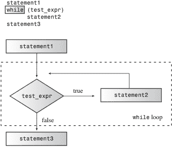

图5.3 while循环的结构。

程序清单5.13展示了`while`循环的实际应用。该循环遍历字符串中的每个字符，并显示该字符及其ASCII码。循环在遇到空字符时退出。这种逐个字符地遍历字符串直到遇到空字符的技术，是C++处理C风格字符串的标准方法。由于字符串本身包含终止标记，程序通常不需要知道字符串长度的显式信息。

## 程序清单5.13 while.cpp

```cpp
// while.cpp -- introducing the while loop
#include <iostream>
const int ArSize = 20;
int main()
{
    using namespace std;
    char name[ArSize];
    cout << "Your first name, please: ";
    cin >> name;
    cout << "Here is your name, verticalized and ASCIIized:\n";
    int i = 0;                 // start at beginning of string
    while (name[i] != '\0')   // process to end of string
    {
        cout << name[i] << " : " << int(name[i]) << endl;
        i++;                   // don't forget this step
    }
    return 0;
}
```

下面是程序清单5.13中程序的示例运行结果：

```text
Your first name, please: Muffy
Here is your name, verticalized and ASCIIized:
M: 77
u: 117
f: 102
f: 102
y: 121
```

（是的，verticalized和ASCIIized并不是真正的单词，甚至算不上像样的新造词。但它们确实为输出增添了一种可爱的技术行话语气。）

## 程序说明

程序清单5.13中的`while`条件如下所示：

```cpp
while (name[i] != '\0')
```

它测试数组中的某个特定字符是否为空字符。为了使这个测试最终能够成功，循环体需要改变`i`的值。它通过在循环体末尾递增`i`来实现这一点。如果省略这一步，循环将停留在同一个数组元素上，不断打印该字符及其代码，直到你设法终止程序。造成这种无限循环是循环编程中最常见的问题之一。通常，当你忘记更新循环体内的某个值时，就会导致这种情况。

你可以这样重写`while`这行：

```cpp
while (name[i])
```

经过这一修改，程序的工作方式和之前完全一样。这是因为当`name[i]`是普通字符时，它的值是字符编码，不为零，即为真。但当`name[i]`是空字符时，它的字符编码值为0，即为假。这种写法更简洁（也更常用），但不如程序清单5.13中使用的写法清晰。笨拙的编译器可能会为第二种版本生成更快的代码，但聪明的编译器会对两者生成相同的代码。

为了打印字符的ASCII码，程序使用类型转换将`name[i]`转换为整数类型。然后`cout`将值作为整数打印出来，而不是将其解释为字符编码。

与C风格字符串不同，`string`类对象不使用空字符来标识字符串的结尾，因此你不能仅仅将`char`数组替换为`string`对象就将程序清单5.13转换为`string`类版本。第16章将讨论如何配合`string`对象来识别最后一个字符的技术。

## for循环与while循环的比较

在C++中，`for`循环和`while`循环本质上是等价的。例如，`for`循环

```cpp
for (init-expression; test-expression; update-expression)
{
    statement(s)
}
```

可以重写为：

```cpp
init-expression;
while (test-expression)
{
    statement(s)
    update-expression;
}
```

类似地，`while`循环

```cpp
while (test-expression)
    body
```

可以重写为：

```cpp
for (; test-expression;)
    body
```

这种`for`循环需要三个表达式（或者更准确地说，是一个语句后跟两个表达式），但它们可以是空表达式（或空语句）。只有两个分号是必需的。顺便提一下，`for`循环中缺少测试表达式会被视为真，所以这个循环会永远运行：

```cpp
for (; ; )
    body
```

由于`for`循环和`while`循环几乎等价，使用哪一种在很大程度上属于风格问题。它们有三个区别。第一个区别，正如刚才提到的，`for`循环中省略测试条件会被解释为真。第二个区别是，你可以在`for`循环的初始化语句中声明一个循环局部变量；而`while`循环做不到这一点。最后一个区别是，如果循环体包含`continue`语句（将在第6章讨论），会有一点细微差别。通常，程序员使用`for`循环来编写计数循环，因为`for`循环的格式让你能够把所有相关信息——初始值、终止值以及更新计数器的方法——放在一个地方。而当程序员事先不知道循环会精确执行多少次时，最常使用`while`循环。

## 提示

在设计循环时，请记住以下准则：

-   确定终止循环执行的条件。
-   在第一次测试之前初始化该条件。
-   在每次循环周期中，在条件再次被测试之前更新该条件。

`for`循环的一个优点是它的结构为落实这三条准则提供了位置，从而帮助你记住要这样做。但这些准则同样适用于`while`循环。

## 错误标点

`for`循环和`while`循环的循环体都是括号内表达式后面的单个语句。正如你所看到的，这个单个语句可以是一个块，其中可以包含多条语句。请记住，定义块的是花括号，而不是缩进。例如，考虑下面的循环：

```cpp
i = 0;
while (name[i] != '\0')
    cout << name[i] << endl;
    i++;
cout << "Done\n";
```

缩进告诉你，程序作者打算让`i++;`语句成为循环体的一部分。但是，缺少花括号告诉编译器，循环体只包含第一个`cout`语句。因此，循环会无限地打印数组的第一个字符。程序永远不会执行到`i++;`语句，因为它在循环外部。

下面的例子展示了另一个潜在的陷阱：

```cpp
i = 0;
while (name[i] != '\0');    // problem semicolon
{
    cout << name[i] << endl;
    i++;
}
cout << "Done\n";
```

这次代码的花括号位置正确，但插入了一个多余的分号。记住，分号终止一条语句，所以这个分号终止了`while`循环。换句话说，循环体是一个空语句——即后面跟一个分号的空内容。花括号中的所有内容现在都在循环之后，永远不会被执行。相反，循环会一直空转，什么也不做，永远进行下去。要警惕这个游离的分号。

## 稍等片刻——构建一个时间延迟循环

有时在程序中构建时间延迟很有用。例如，你可能遇到过这样的程序：在屏幕上闪烁一条消息，然后在你能够读取之前就转向了其他事情。结果你担心错过了至关重要的、无法挽回的信息。如果程序在继续之前暂停5秒钟，那就好多了。`while`循环很适合产生这种效果。个人计算机早期的一种技术是让计算机计数一段时间来消耗时间：

```cpp
long wait = 0;
while (wait < 10000)
    wait++;              // counting silently
```

这种方法的问题在于，当你改变计算机处理器速度时，必须改变计数上限。例如，最初IBM PC编写的几款游戏，在更快的后续机型上运行时变得快得难以控制。而如今，计算机甚至可能推断出它可以直接将`wait`设为10000并跳过循环。更好的方法是让系统时钟来为你计时。

ANSI C和C++库中有一个函数可以帮助你做到这一点。这个函数叫做`clock()`，它返回程序开始执行以来经过的系统时间。不过有几个复杂之处。首先，`clock()`的返回值不一定是秒。其次，该函数的返回类型在某些系统上可能是`long`，在另一些系统上可能是`unsigned long`，在其他系统上还可能是一些其他类型。

但是`ctime`头文件（较旧实现中是`time.h`）为这些问题提供了解决方案。首先，它定义了一个符号常量`CLOCKS_PER_SEC`，等于每秒的系统时间单位数。因此，将系统时间除以该值即可得到秒数。或者，你也可以将秒乘以`CLOCKS_PER_SEC`来获得以系统单位计的时间。其次，`ctime`将`clock_t`建立为`clock()`返回类型的别名。（参见本章后面的“类型别名”边栏。）这意味着你可以将变量声明为`clock_t`类型，编译器会将其转换为`long`、`unsigned int`或你的系统适用的任何正确类型。

程序清单5.14展示了如何使用`clock()`和`ctime`头文件来创建时间延迟循环。

## 程序清单5.14 waiting.cpp

```cpp
// waiting.cpp -- using clock() in a time-delay loop
#include <iostream>
#include <ctime> // describes clock() function, clock_t type
int main()
{
    using namespace std;
    cout << "Enter the delay time, in seconds: ";
    float secs;
    cin >> secs;
    clock_t delay = secs * CLOCKS_PER_SEC;  // convert to clock ticks
```


```cpp
cout << "starting\n";
clock_t start = clock();
while (clock() - start < delay )        // wait until time elapses
    ;                                  // note the semicolon
cout << "done \a\n";
return 0;
}
```

通过以系统单位而不是秒来计算延迟时间，程序清单5.14中的程序避免了在每个循环周期中都必须把系统时间转换为秒。

## 类型别名

C++ 有两种方法可以为类型建立新名称作为别名。一种是使用预处理器：

```c
#define BYTE char // preprocessor replaces BYTE with char
```

在编译程序时，预处理器随后会把所有出现的 BYTE 替换为 char，从而使 BYTE 成为 char 的别名。

第二种方法是使用 C++（以及 C）关键字 `typedef` 来创建别名。例如，要让 `byte` 成为 `char` 的别名，可以这样写：

```cpp
typedef char byte;   // makes byte an alias for char
```

其一般形式如下：

```cpp
typedef typeName aliasName;
```

换句话说，如果想让 `aliasName` 成为某个特定类型的别名，可以像声明该类型的变量那样声明 `aliasName`，然后在声明前加上 `typedef` 关键字。例如，要让 `byte_pointer` 成为指向 char 的指针的别名，可以把 `byte_pointer` 声明为指向 char 的指针，然后在前面加上 `typedef`：

```cpp
typedef char * byte_pointer; // pointer to char type
```

也可以尝试用 `#define` 做类似的事情，但如果声明一组变量，那就不起作用了。例如，考虑下面的代码：

```c
#define FLOAT_POINTER float *
FLOAT_POINTER pa, pb;
```

预处理器替换会把该声明转换为：

```c
float * pa, pb;  // pa a pointer to float, pb just a float
```

`typedef` 方法没有这个问题。它能够处理更复杂的类型别名，这使得使用 `typedef` 比 `#define` 更合适——有时它还是唯一的选择。

注意，`typedef` 并不会创建新类型。它只是为已有类型创建一个新名称。如果让 `word` 成为 int 的别名，`cout` 会把 `word` 类型的值当作它实际上的 int 来处理。

## do while 循环

你已经见过 for 循环和 while 循环。C++ 的第三种循环是 do while。它与其他两种不同，因为它是一种 *出口条件* 循环。这意味着这个“不管不顾”的循环先执行循环体，然后才计算测试表达式，以判断是否应继续循环。如果条件求值为 false，循环终止；否则，开始新一轮执行和测试。这样的循环至少执行一次，因为其程序流程必须先经过循环体才能到达测试。下面是 do while 循环的语法：

```cpp
do
    body
while (test-expression);
```

*body* 部分可以是单条语句，也可以是由花括号界定的语句块。图5.4总结了 do while 循环的程序流程。

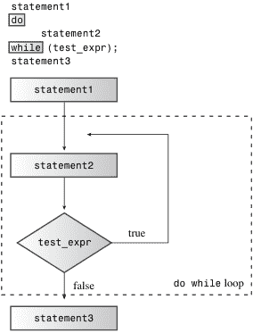

图5.4  do while 循环的结构。

通常，入口条件循环比出口条件循环更合适，因为入口条件循环在循环之前进行检查。例如，假设程序清单5.13使用 do while 而不是 while。在这种情况下，循环会先打印空字符及其代码，然后才发现它已经到达字符串末尾。但有时 do while 的测试确实有意义。例如，如果要请求用户输入，程序必须先获得输入，然后才能测试它。程序清单5.15展示了在这种情况下如何使用 do while。

**程序清单5.15 dowhile.cpp**

```cpp
// dowhile.cpp -- exit-condition loop
#include <iostream>
int main()
{
    using namespace std;
    int n;

    cout << "Enter numbers in the range 1-10 to find ";
    cout << "my favorite number\n";
    do
    {
        cin >> n;       // execute body
    } while (n != 7);   // then test
    cout << "Yes, 7 is my favorite.\n";
    return 0;
}
```

下面是程序清单5.15中程序的一次示例运行：

```text
Enter numbers in the range 1-10 to find my favorite number
9
4
7
Yes, 7 is my favorite.
```

## 奇怪的 for 循环

这种情况并不十分常见，但你偶尔可能会看到类似下面的代码：

```cpp
int i = 0;
for(;;)  // sometimes called a "forever loop"
{
    i++;
    // do something ...
    if (i >= 30) break;   // if statement and break (Chapter 6)
}
```

或者还有另一种变体：

```cpp
int i = 0;
for (;; i++)
{
    if (i >= 30) break;
    // do something ...
}
```

这些代码依赖于这样一个事实：`for` 循环中的空测试条件会被视为 true。这两个示例都不易读，也都不应被当作编写循环的一般范本。第一个示例的功能可以用 `do while` 循环更清晰地表达：

```cpp
int i = 0;
do
{
    i++;
    // do something
} while (30 > i);
```

同样，第二个示例可以更清晰地表达为 `while` 循环：

```cpp
while (i < 30)
{
    // do something
    i++;
}
```

总的来说，编写清晰、易于理解的代码，比展示利用语言生僻特性的能力更有价值。

## 基于范围的 for 循环（C++11）

C++11 增加了一种新形式的循环，称为 `range-based for` 循环。它简化了一项常见的循环任务——对数组的每个元素执行某种操作，或者更一般地说，对某个容器类（如 vector 或 array）的每个元素执行某种操作。下面是一个例子：

```cpp
double prices[5] = {4.99, 10.99, 6.87, 7.99, 8.49};
for (double x : prices)
    cout << x << std::endl;
```

这里，`x` 最初表示 `prices` 数组的第一个成员。显示第一个元素后，循环接着让 `x` 依次表示数组的其余元素，因此这段代码会打印全部五个成员，每行一个。简而言之，这个循环显示数组范围内包含的每一个值。

要修改数组值，循环变量需要使用不同的语法：

```cpp
for (double &x : prices)
    x = x * 0.80;          // 20% off sale
```

`&` 符号将 `x` 标识为引用变量，这是我们将在第8章“函数历险记”中讨论的主题。这里的重要意义在于，这种声明形式允许后续代码修改数组内容，而第一种形式则不能。

基于范围的 for 循环也可以与初始化列表一起使用：

```cpp
for (int x : {3, 5, 2, 8, 6})
    cout << x << " ";
cout << '\n';
```

不过，这种循环最常与第16章讨论的各种模板容器类一起使用。

## 循环与文本输入

既然你已经了解了循环如何工作，下面来看看分配给循环的一项最常见且重要的任务：从文件或键盘逐字符读取文本。例如，你可能想编写一个程序，统计输入中的字符数、行数和单词数。传统上，C++ 和 C 一样，使用 while 循环来完成这类任务。接下来我们将研究这是如何完成的。如果你已经了解 C，不要过快浏览以下各节。虽然 C++ 的 while 循环与 C 的相同，但 C++ 的 I/O 设施不同。这会使 C++ 循环看起来与 C 循环有些不同。事实上，cin 对象支持三种不同的单字符输入模式，每种模式都有不同的用户界面。下面来看看如何在 while 循环中使用这些选择。

### 使用未加修饰的 cin 进行输入

如果程序要使用循环从键盘读取文本输入，它必须有某种方式知道何时停止。它如何知道何时停止？一种方法是选择某个特殊字符作为停止标志，这种字符有时称为哨兵字符。例如，程序清单5.16在程序遇到 # 字符时停止读取输入。该程序统计它读取的字符数，然后回显这些字符。也就是说，它重新显示已经读取的字符。（按键盘键并不会自动在屏幕上放置字符；程序必须通过回显输入字符来完成这项繁琐工作。通常，操作系统会处理这项任务。在这种情况下，操作系统和测试程序都会回显输入。）完成后，程序报告处理的字符总数。程序清单5.16展示了该程序。

**程序清单5.16 textin1.cpp**

```cpp
// textin1.cpp -- reading chars with a while loop
#include <iostream>
int main()
{
    using namespace std;
    char ch;
    int count = 0;      // use basic input
    cout << "Enter characters; enter # to quit:\n";
    cin >> ch;          // get a character
    while (ch != '#')   // test the character
    {
        cout << ch;     // echo the character
        ++count;        // count the character
        cin >> ch;      // get the next character
    }
}
```


```cpp
cout << endl << count << " characters read\n";
return 0;
}
```

下面是程序清单5.16的示例运行：

```
Enter characters; enter # to quit:
see ken run#really fast
seekernun
9 characters read
```

显然，Ken跑得太快，以至于他抹去了空间本身——或者至少是输入中的空格字符。

## 程序说明

注意程序清单5.16中的程序结构。程序在到达循环之前读取第一个输入字符。这样，当程序到达循环语句时，可以测试第一个字符。这一点很重要，因为第一个字符可能是#。由于textin1.cpp使用入口条件循环，在这种情况下程序会继续检查整个循环。而且由于变量count先前被设置为0，count具有正确的值。

假设读取的第一个字符不是#。在这种情况下，程序进入循环，显示该字符，递增count，并读取下一个字符。这最后一步至关重要。没有它，循环将永远重复处理第一个输入字符。有了最后一步，程序才能前进到下一个字符。

注意，循环设计遵循前面提到的指导原则。终止循环的条件是最后读取的字符是#。该条件通过在循环开始前读取一个字符来初始化。该条件通过在循环末尾读取一个新字符来更新。

这一切听起来合情合理。那么为什么程序在输出时会省略空格呢？这要归咎于cin。在读取char类型值时，就像读取其他基本类型一样，cin会跳过空格和换行符。输入中的空格不会被回显，因此不会被计数。

更复杂的是，cin的输入是缓冲的。这意味着你输入的字符直到按下回车键才会发送到程序。这就是为什么你在运行程序清单5.16时可以在#后面输入字符。按下回车键后，整个字符序列被发送到程序，但程序在遇到#字符后就停止处理输入。

## 用 `cin.get(char)` 来救援

通常，逐字符读取输入的程序需要检查每个字符，包括空格、制表符和换行符。cin所属的istream类（在iostream中定义）包含满足这一需求的成员函数。特别是，成员函数`cin.get(ch)`从输入中读取下一个字符（即使是空格）并将其赋给变量ch。通过用这个函数调用替换`cin>>ch`，你可以修复清单5.16。清单5.17显示了结果。

**清单5.17  textin2.cpp**

```cpp
// textin2.cpp -- using cin.get(char)
#include <iostream>
int main()
{
    using namespace std;
    char ch;
    int count = 0;

    cout << "Enter characters; enter # to quit:\n";
    cin.get(ch);       // use the cin.get(ch) function
    while (ch != '#')
    {
        cout << ch;
        ++count;
        cin.get(ch);   // use it again
    }
    cout << endl << count << " characters read\n";
    return 0;
}
```

下面是程序清单5.17的示例运行：

```
Enter characters; enter # to quit:
Did you use a #2 pencil?
Did you use a
14 characters read
```

现在，程序会回显并计数每个字符，包括空格。输入仍然是缓冲的，所以仍然可能输入比最终到达程序的输入更多的内容。

如果你熟悉C语言，这个程序可能会让你觉得错得离谱。`cin.get(ch)`调用将一个值放入ch变量中，这意味着它改变了变量的值。在C语言中，如果你想改变一个变量的值，必须将变量的地址传递给函数。但是清单5.17中对`cin.get()`的调用传递的是ch，而不是&ch。在C语言中，这样的代码无法工作。在C++中，只要函数将参数声明为引用，它就可以工作。引用类型是C++在C语言基础上新增的功能。iostream头文件将`cin.get(ch)`的参数声明为引用类型，因此这个函数可以改变其参数的值。你将在第8章学习详细信息。同时，你们中的C语言行家可以放心；通常情况下，C++中的参数传递方式与C语言相同。然而，对于`cin.get(ch)`来说，情况并非如此。

### 你应该使用哪个 cin.get()？

第4章中的清单4.5使用以下代码：

```cpp
char name[ArSize];
...
cout << "Enter your name:\n";
cin.get(name, ArSize).get();
```

最后一行等同于两个连续的函数调用：

```cpp
cin.get(name, ArSize);
cin.get();
```

`cin.get()`的一个版本接受两个参数：数组名（即字符串的地址，技术上类型为`char*`）和ArSize（类型为`int`的整数）。（回想一下，数组名是数组第一个元素的地址，因此字符数组名的类型是`char*`。）然后程序使用不带参数的`cin.get()`。而最近，我们这样使用`cin.get()`：

```cpp
char ch;
cin.get(ch);
```

这次`cin.get()`有一个参数，类型为`char`。

又一次，你们这些熟悉C语言的人该兴奋或困惑了。在C语言中，如果一个函数接受一个指向char的指针和一个int作为参数，你就不能成功地用不同类型的单个参数调用同一个函数。但在C++中你可以这样做，因为该语言支持一种称为函数重载的OOP特性。函数重载允许你创建同名但参数列表不同的函数。例如，如果你在C++中使用`cin.get(name, ArSize)`，编译器会找到使用`char*`和`int`作为参数的`cin.get()`版本。但如果你使用`cin.get(ch)`，编译器会获取使用单个`char`类型参数的版本。如果代码中没有提供参数，编译器会使用不带参数的`cin.get()`版本。这就是函数重载。

函数重载使你能为以不同方式或针对不同类型执行相同基本任务的相关函数使用相同的名称。这是第8章中等待你的另一个主题。与此同时，你可以通过使用iostream类附带的`get()`示例来习惯函数重载。为了区分不同的函数版本，我们在引用它们时会包含参数列表。因此，`cin.get()`表示不带参数的版本，而`cin.get(char)`表示带一个参数的版本。

### 文件结束条件

如清单5.17所示，使用像#这样的符号来表示输入结束并不总是令人满意，因为这样的符号可能是合法输入的一部分。其他任意选择的符号（如@和$）也是如此。如果输入来自文件，你可以使用一种更强大的技术——检测文件结尾（EOF）。C++输入设施与操作系统协作，检测输入何时到达文件末尾，并将该信息报告给程序。

乍一看，从文件读取信息似乎与`cin`和键盘输入关系不大，但有两个联系。首先，许多操作系统（包括Unix、Linux和Windows命令提示符模式）支持`redirection`，它使你能够用文件替代键盘输入。例如，假设在Windows中你有一个名为`gofish.exe`的可执行程序和一个名为`fishtale`的文本文件。在这种情况下，你可以在命令提示符模式下输入以下命令行：

```
`gofish <fishtale`
```

这会使程序从`fishtale`文件而不是键盘获取输入。<符号是Unix和Windows命令提示符模式下的重定向运算符。

其次，许多操作系统允许你从键盘模拟EOF条件。在Unix中，你可以通过在行首按Ctrl+D来实现。在Windows命令提示符模式下，你可以按Ctrl+Z，然后在行中的任意位置按Enter。一些C++实现支持类似的行为，即使底层操作系统不支持。键盘输入的EOF概念实际上是命令行环境的遗留产物。然而，Symantec C++ for the Mac模仿Unix并识别Ctrl+D为模拟的EOF。Metrowerks CodeWarrior在Macintosh和Windows环境中识别Ctrl+Z。Microsoft Visual C++、Borland C++ 5.5和用于PC的GNU C++在行首字符为Ctrl+Z时识别它，但它们要求随后按Enter。简而言之，许多PC编程环境将Ctrl+Z识别为模拟的EOF，但具体细节（在行中任意位置还是行首，是否要求按Enter键）各不相同。

如果你的编程环境可以测试EOF，你可以使用类似于清单5.17的程序来处理重定向文件，也可以将其用于模拟EOF的键盘输入。这听起来很有用，那么让我们看看如何实现。

当`cin`检测到EOF时，它将两个位（`eofbit`和`failbit`）设置为1。你可以使用名为`eof()`的成员函数来查看`eofbit`是否已设置；如果检测到EOF，`cin.eof()`调用返回`bool`值`true`，否则返回`false`。类似地，如果`eofbit`或`failbit`中的任何一个被设置为1，`fail()`成员函数返回`true`，否则返回`false`。请注意，`eof()`和`fail()`方法报告的是最近一次读取尝试的结果；也就是说，它们报告的是过去的情况，而不是预判未来。因此，`cin.eof()`或`cin.fail()`测试应始终跟在一次读取尝试之后。清单5.18的设计反映了这一事实。它使用`fail()`而不是`eof()`，因为前一种方法似乎适用于更广泛的实现。

> **注意**
>
> 有些系统不支持从键盘模拟EOF。其他系统对它的支持也不完美。如果你一直在使用`cin.get()`来冻结屏幕以便阅读，那么在这里它不起作用，因为检测到EOF会关闭进一步的输入读取尝试。


不过，你可以使用像清单 5.14 中那样的定时循环，让屏幕停留一段时间。或者，你可以使用 `cin.clear()`（如第 6 章和第 17 章所述）来重置输入流。

### 清单 5.18 `textin3.cpp`

```cpp
// textin3.cpp -- reading chars to end of file
#include <iostream>
int main()
{
    using namespace std;
    char ch;
    int count = 0;
    cin.get(ch);        // attempt to read a char
    while (cin.fail() == false)  // test for EOF
    {
        cout << ch;     // echo character
        ++count;
        cin.get(ch);    // attempt to read another char
    }
    cout << endl << count << " characters read\n";
    return 0;
}
```

以下是清单 5.18 中程序的示例输出：

```
The green bird sings in the winter.<ENTER>
The green bird sings in the winter.
Yes, but the crow flies in the dawn.<ENTER>
Yes, but the crow flies in the dawn.
<CTRL>+<Z><ENTER>
73 characters read
```

因为我在 Windows 7 系统上运行该程序，所以我按下了 Ctrl+Z，然后按 Enter 来模拟 EOF 条件。Unix 和 Linux 用户则应按下 Ctrl+D。请注意，在 Unix 以及类似 Unix 的系统中（包括 Linux 和 Cygwin），Ctrl+Z 会挂起程序的执行；`fg` 命令可以让执行继续。

通过使用重定向，你可以用清单 5.18 中的程序来显示文本文件并报告它有多少个字符。这一次，我们有一个程序在 Unix 系统上读取、回显并统计一个两行文件的字符数（`$` 是 Unix 提示符）：

```
$ textin3 < stuff
I am a Unix file. I am proud
to be a Unix file.
48 characters read
$
```

## EOF 结束输入

请记住，当 cin 方法检测到 EOF 时，它会在 cin 对象中设置一个标志，指示 EOF 状态。当该标志被设置时，cin 不再读取任何输入，并且后续对 cin 的调用也不起作用。对于文件输入，这是有意义的，因为你不应该读取超过文件末尾的内容。然而，对于键盘输入，你可能会使用模拟的 EOF 来终止循环，但之后又想继续读取更多输入。`cin.clear()` 方法会清除 EOF 标志，并让输入继续。第 17 章“输入、输出和文件”将进一步讨论这一点。但请记住，在某些系统中，键入 Ctrl+Z 实际上会终止输入和输出，这超出了 `cin.clear()` 的恢复能力。

## 字符输入的常见用法

下面是一个循环的基本设计，该循环用于逐个字符地读取文本，直到 EOF：

```cpp
cin.get(ch);        // attempt to read a char
while (cin.fail() == false)  // test for EOF
{
    ...
    cin.get(ch);    // attempt to read another char
}
```

这段代码有一些简写方式。第 6 章介绍了 `!` 运算符，它将 true 变为 false，反之亦然。你可以用它把 while 测试重写为如下形式：

```cpp
while (!cin.fail())   // while input has not failed
```

`cin.get(char)` 方法的返回值是 cin，一个对象。然而，istream 类提供了一个函数，可以将诸如 cin 这样的 istream 对象转换为 bool 值；当 cin 出现在需要 bool 的位置（例如 while 循环的测试条件中）时，就会调用这个转换函数。此外，如果上次尝试的读取成功，转换得到的 bool 值为 true，否则为 false。这意味着你可以把 while 测试重写为如下形式：

```cpp
while (cin)          // while input is successful
```

这比使用 `!cin.fail()` 或 `!cin.eof()` 更通用一些，因为它能检测到其他可能的失败原因，例如磁盘故障。

最后，由于 `cin.get(char)` 的返回值是 cin，你可以将循环压缩为如下格式：

```cpp
while (cin.get(ch))  // while input is successful
{
    ...
    // do stuff
}
```

在这里，`cin.get(char)` 在测试条件中被调用一次，而不是两次——一次在循环之前，一次在循环末尾。为了计算循环测试，程序首先必须执行对 `cin.get(ch)` 的调用，如果调用成功，会将一个值放入 `ch` 中。然后程序从函数调用中获取返回值，即 `cin`。接着它对 `cin` 应用 bool 转换，如果输入有效则产生 true，否则产生 false。三条指导原则（识别终止条件、初始化条件和更新条件）都被压缩到了一个循环测试条件中。

## `cin.get()` 的另一个版本

怀念 C 语言的 C 用户可能会渴望使用 C 的字符 I/O 函数 `getchar()` 和 `putchar()`。如果你需要，它们在 C++ 中也是可用的。你只需像在 C 中那样使用 `stdio.h` 头文件（或使用更新颖的 `cstdio`）。或者，你可以使用 `istream` 和 `ostream` 类中工作方式非常相似的成员函数。接下来让我们看看这种方法。

不带参数的 `cin.get()` 成员函数返回输入中的下一个字符。也就是说，你可以这样使用它：

```
ch = cin.get();
```

（回想一下，`cin.get(ch)` 返回一个对象，而不是读取到的字符。）这个函数的工作方式与 C 的 `getchar()` 非常相似，返回类型为 `int` 值的字符代码。类似地，你可以使用 `cout.put()` 函数（参见第 3 章“处理数据”）来显示字符：

```
cout.put(ch);
```

它很像 C 的 `putchar()`，只是它的参数应该是 `char` 类型而不是 `int` 类型。

> **注意**
> 
> 最初，`put()` 成员只有一个原型 `put(char)`。你可以向它传递一个 `int` 参数，该参数会被强制转换为 `char`。标准也要求只有一个原型。然而，一些 C++ 实现提供了三个原型：`put(char)`、`put(signed char)` 和 `put(unsigned char)`。在这些实现中，对 `put()` 使用 `int` 参数会产生错误消息，因为对于 `int` 的转换有多个选择。显式类型转换，如 `cout.put(char(ch))`，对 `int` 类型有效。

要成功使用 `cin.get()`，你需要知道它如何处理 EOF 条件。当函数到达 EOF 时，没有更多字符可以返回。此时，`cin.get()` 返回一个特殊值，由符号常量 `EOF` 表示。该常量定义在 `iostream` 头文件中。EOF 的值必须与任何有效字符值不同，这样程序才不会将 EOF 与常规字符混淆。通常，EOF 被定义为值 `-1`，因为没有任何字符的 ASCII 码是 `-1`，但你不需要知道实际值。你可以在程序中使用 `EOF`。例如，清单 5.18 的核心如下所示：

```cpp
char ch;
cin.get(ch);
while (cin.fail() == false)  // test for EOF
{
    cout << ch;
    ++count;
    cin.get(ch);
}
```

你可以使用 `int ch`，用 `cin.get()` 替换 `cin.get(char)`，用 `cout.put()` 替换 `cout`，并用 EOF 测试替换 `cin.fail()` 测试：

```cpp
int ch;     // for compatibility with EOF value
ch = cin.get();
while (ch != EOF)
{
        cout.put(ch);   // cout.put(char(ch)) for some implementations
        ++count;
        ch = cin.get();
}
```

如果 ch 是一个字符，循环将显示它。如果 ch 是 EOF，循环终止。

> **提示**
> 
> 你应该认识到，EOF 并不代表输入中的一个字符。相反，它是一个信号，表示没有更多字符了。

关于使用 `cin.get()`，除了到目前为止所做的更改之外，还有一个微妙但重要的点。由于 EOF 表示有效字符代码之外的值，它可能与 char 类型不兼容。例如，在某些系统中，char 类型是无符号的，因此 char 变量永远不可能具有通常的 EOF 值 -1。因此，如果你使用 `cin.get()`（不带参数）并测试 EOF，你必须将返回值赋给 `int` 类型而不是 `char` 类型。此外，如果你将 ch 设为 `int` 类型而不是 `char` 类型，那么在显示 ch 时可能需要进行类型转换为 `char`。

### 清单 5.19 `textin4.cpp`

```cpp
// textin4.cpp -- reading chars with cin.get()
#include <iostream>
int main(void)
{
    using namespace std;
    int ch;                         // should be int, not char
    int count = 0;

    while ((ch = cin.get()) != EOF) // test for end-of-file
```


```cpp
{
    cout.put(char(ch));
    ++count;
}
cout << endl << count << " characters read\n";
return 0;
}
```

> **注意**
>
> 有些系统要么不支持从键盘模拟 EOF，要么支持得不完善，这可能会使程序清单5.19中的示例无法按描述运行。如果你一直使用 `cin.get()` 来冻结屏幕直到能够阅读，那在这里行不通，因为检测到 EOF 会关闭后续读取输入的尝试。不过，你可以使用类似程序清单5.14中的定时循环让屏幕保持可见一段时间。或者，你可以像第17章所述那样使用 `cin.clear()` 来重置输入流。

下面是程序清单5.19中程序的一次示例运行：

```text
The sullen mackerel sulks in the shadowy shallows.<ENTER>
The sullen mackerel sulks in the shadowy shallows.
Yes, but the blue bird of happiness harbors secrets.<ENTER>
Yes, but the blue bird of happiness harbors secrets.
<CTRL><Z><ENTER>
104 characters read
```

我们来分析一下循环条件：

```cpp
while ((ch = cin.get()) != EOF)
```

包围子表达式 `ch = cin.get()` 的圆括号使程序首先计算该表达式。为了完成计算，程序首先必须调用 `cin.get()` 函数。接着，它将函数的返回值赋给 `ch`。由于赋值语句的值是左操作数的值，整个子表达式就归结为 `ch` 的值。如果这个值是 `EOF`，循环终止；否则，循环继续。测试条件需要所有这些圆括号。假设你漏掉了一些圆括号：

```cpp
while (ch = cin.get() != EOF)
```

`!=` 运算符的优先级高于 `=`，因此程序首先将 `cin.get()` 的返回值与 `EOF` 进行比较。比较会产生 false 或 true 结果；该 bool 值被转换为 0 或 1，而这个值会被赋给 `ch`。另一方面，使用带输入参数的 `cin.get(ch)` 不会产生任何类型问题。请记住，`cin.get(char)` 函数在 EOF 时不会给 `ch` 赋特殊值。事实上，在这种情况下它不会给 `ch` 赋任何值，`ch` 从不会被要求保存非 char 值。表5.3总结了 `cin.get(char)` 与 `cin.get()` 之间的区别。

### 表5.3  `cin.get(ch)` 与 `cin.get()` 对比

| 属性 | `cin.get(ch)` | `ch=cin.get()` |
|---|---|---|
| 传递输入字符的方法 | 赋给参数 `ch` | 使用函数返回值赋给 `ch` |
| 字符输入时的函数返回值 | 一个 `istream` 类对象（转换为 `bool` 后为 true） | 字符编码，类型为 `int` 值 |
| 到达 EOF 时的函数返回值 | 一个 `istream` 类对象（转换为 `bool` 后为 false） | `EOF` |

那么，你应该使用 `cin.get()` 还是 `cin.get(char)` 呢？带字符参数的形式更充分地融入对象方法，因为它的返回值是一个 `istream` 对象。这意味着，例如，你可以链式使用它们。例如，下面的代码表示将下一个输入字符读入 `ch1`，并将再下一个输入字符读入 `ch2`：

```cpp
cin.get(ch1).get(ch2);
```

这之所以可行，是因为函数调用 `cin.get(ch1)` 返回 `cin` 对象，然后该对象又作为 `get(ch2)` 所附加的对象。

`get()` 形式的主要用途，大概是让你把 `stdio.h` 的 `getchar()` 和 `putchar()` 函数快速而粗糙地转换为 `iostream` 的 `cin.get()` 和 `cout.put()` 方法。你只需用一个头文件替换另一个头文件，并将 `getchar()` 和 `putchar()` 全局替换为行为相同的等价方法。（如果旧代码使用 `int` 类型变量进行输入，而你的实现有多个 `put()` 原型，那么你还必须做进一步调整。）

## 嵌套循环与二维数组

在本章前面，你已经看到 `for` 循环是处理数组的自然工具。现在让我们更进一步，看看 `for` 循环中的 `for` 循环（嵌套循环）如何用于处理二维数组。

首先，让我们考察什么是二维数组。本章到目前为止使用的数组被称为一维数组，因为你可以把每个数组想象成一行数据。你可以把二维数组想象成更像一张表，既有数据行又有数据列。例如，你可以用二维数组表示六个不同地区的季度销售数据，每个地区一行数据。或者，你可以用二维数组表示 RoboDork 在计算机化游戏板上的位置。

C++ 不提供专门的二维数组类型。相反，你创建一个数组，其中每个元素本身就是一个数组。例如，假设你想存储五个城市在四年期间的最高温度数据。在这种情况下，你可以如下声明一个数组：

```cpp
int maxtemps[4][5];
```

这个声明意味着 `maxtemps` 是一个包含四个元素的数组。其中每个元素都是一个包含五个整数的数组（见图5.5）。你可以把 `maxtemps` 数组看作表示四行、每行五个温度值。

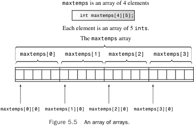

表达式 `maxtemps[0]` 是 `maxtemps` 数组的第一个元素；因此 `maxtemps[0]` 本身就是一个包含五个 int 的数组。`maxtemps[0]` 数组的第一个元素是 `maxtemps[0][0]`，而这个元素是一个单独的 int。因此，你需要使用两个下标来访问 int 元素。你可以把第一个下标看作表示行，第二个下标看作表示列（见图5.6）。

```cpp
int maxtemps[4][5];
```

将 `maxtemps` 数组视为一张表：

| | 0 | 1 | 2 | 3 | 4 |
|---|---|---|---|---|---|
| maxtemps[0] | maxtemps[0][0] | maxtemps[0][1] | maxtemps[0][2] | maxtemps[0][3] | maxtemps[0][4] |
| maxtemps[1] | maxtemps[1][0] | maxtemps[1][1] | maxtemps[1][2] | maxtemps[1][3] | maxtemps[1][4] |
| maxtemps[2] | maxtemps[2][0] | maxtemps[2][1] | maxtemps[2][2] | maxtemps[2][3] | maxtemps[2][4] |
| maxtemps[3] | maxtemps[3][0] | maxtemps[3][1] | maxtemps[3][2] | maxtemps[3][3] | maxtemps[3][4] |

*图5.6——使用下标访问数组元素。*

假设你想打印所有数组内容。在这种情况下，你可以使用一个 for 循环来改变行，并使用第二个嵌套的 for 循环来改变列：

```cpp
for (int row = 0; row < 4; row++)
{
    for (int col = 0; col < 5; ++col)
        cout << maxtemps[row][col] << "\t";
    cout << endl;
}
```

对于 `row` 的每个值，内层 for 循环都会遍历所有 `col` 值。这个示例在每个值后打印一个制表符（C++ 转义字符表示法中的 `\t`），并在每一整行后打印一个换行符。

### 初始化二维数组

创建二维数组时，你可以选择初始化每个元素。该技术基于初始化一维数组的方法。请记住，这样做需要提供一个用花括号括起来的、以逗号分隔的值列表：

```cpp
// initializing a one-dimensional array
int btus[5] = { 23, 26, 24, 31, 28};
```

对于二维数组，每个元素本身就是一个数组，因此你可以使用类似上一个代码示例中的形式来初始化每个元素。于是，初始化由一系列以逗号分隔的一维初始化组成，全部括在一组花括号中：

```cpp
int maxtemps[4][5] =   // 2-D array
{
    {96, 100, 87, 101, 105},   // values for maxtemps[0]
    {96, 98, 91, 107, 104},    // values for maxtemps[1]
    {97, 101, 93, 108, 107},   // values for maxtemps[2]
    {98, 103, 95, 109, 108}    // values for maxtemps[3]
};
```

你可以把 `maxtemps` 想象成四行，每行五个数字。`{94, 98, 87, 103, 101}` 这一项初始化第一行，由 `maxtemps[0]` 表示。从风格上讲，如果可能的话，将每一行数据放在单独一行上，会使数据更易读。

### 使用二维数组

程序清单5.20将一个已初始化的二维数组和一个嵌套循环整合到一个程序中。这一次，程序颠倒了循环的顺序，将列循环（城市索引）放在外层，将行循环（年份索引）放在内层。此外，它还使用了一个

以下是程序清单5.20的输出：

2008 - 2011 年的最高温度

| | 2008 | 2009 | 2010 | 2011 |
|---|---|---|---|---|
| 格里布尔城 | 96 | 96 | 97 | 98 |
| 格里布尔镇 | 100 | 98 | 101 | 103 |
| 新格里布尔 | 87 | 91 | 93 | 95 |
| 圣格里布尔 | 101 | 107 | 108 | 109 |
| 格里布尔远景 | 105 | 104 | 107 | 108 |

在输出中使用制表符比使用空格能更规整地排列数据。然而，不同的制表符设置可能导致输出在不同系统上的外观有所不同。第17章将介绍更精确但更复杂的格式化输出方法。

更笨拙的做法是，对于字符串数据，使用`char`数组的数组而不是指针数组。声明如下：

```cpp
char cities[Cities][25] =   // 5个数组的数组，每个数组有25个char
{
    "Gribble City",
    "Gribbletown",
    "New Gribble",
    "San Gribble",
    "Gribble Vista"
};
```

这种方法将五个字符串中的每一个限制为最多24个字符。指针数组存储五个字符串字面量的地址，而`char`数组的数组则将五个字符串字面量分别复制到对应的五个25个`char`的数组中。因此，指针数组在空间上要经济得多。但是，如果你打算修改任何字符串，那么二维数组会是更好的选择。奇怪的是，这两种选择使用相同的初始化列表和相同的`for`循环代码来显示字符串。

此外，你也可以使用`string`类对象的数组而不是指针数组来存储字符串数据。声明如下：

```cpp
const string cities[Cities] =   // 5个字符串的数组
{
    "Gribble City",
    "Gribbletown",
    "New Gribble",
    "San Gribble",
    "Gribble Vista"
};
```

如果你打算让字符串可修改，可以省略`const`限定符。这种形式使用与其他两种形式相同的初始化列表和相同的`for`循环显示代码。如果你想要可修改的字符串，`string`类的自动调整大小特性使得这种方法比二维数组方法更方便。

## 小结

`C++`提供了三种循环：`for`循环、`while`循环和`do while`循环。只要循环测试条件求值为`true`或非零，循环就会重复执行同一组指令；当测试条件求值为`false`或零时，循环终止执行。`for`循环和`while`循环是入口条件循环，意味着它们在执行循环体中的语句之前检查测试条件。`do while`循环是出口条件循环，意味着它在执行循环体中的语句之后检查测试条件。

每种循环的语法都要求循环体由单个语句组成。然而，该语句可以是一个复合语句，即块，由用花括号括起来的多条语句组成。

关系表达式比较两个值，通常用作循环测试条件。关系表达式通过使用六个关系运算符之一来构成：`<`、`<=`、`==`、`>=`、`>`或`!=`。关系表达式求值为`bool`类型值`true`和`false`。

许多程序逐字符读取文本输入或文本文件。`istream`类提供了几种方法来实现这一点。如果`ch`是一个`char`类型变量，以下语句将下一个输入字符读入`ch`：

```cpp
cin >> ch;
```

但是，它会跳过空格、换行符和制表符。以下成员函数调用读取下一个输入字符，无论其值如何，并将其放入`ch`：

```cpp
cin.get(ch);
```

成员函数调用`cin.get()`返回下一个输入字符，包括空格、换行符和制表符，因此可以这样使用：

```cpp
ch = cin.get();
```

`cin.get(char)`成员函数调用通过返回一个`bool`转换为`false`的值来报告遇到`EOF`条件，而`cin.get()`成员函数调用通过返回`EOF`值来报告`EOF`，该值在`iostream`文件中定义。

嵌套循环是循环中的循环。嵌套循环为处理二维数组提供了自然的方式。

## 章节复习

- 1. 入口条件循环和出口条件循环之间有什么区别？C++循环中哪些是哪种类型？

- 2. 如果以下代码片段是有效程序的一部分，它会打印什么？
  ```cpp
  int i;
  for (i = 0; i < 5; i++)
      cout << i;
      cout << endl;
  ```

- 3. 如果以下代码片段是有效程序的一部分，它会打印什么？
  ```cpp
  int j;
  for (j = 0; j < 11; j += 3)
      cout << j;
  cout << endl << j << endl;
  ```

- 4. 如果以下代码片段是有效程序的一部分，它会打印什么？
  ```cpp
  int j = 5;
  while (++j < 9)
      cout << j++ << endl;
  ```

- 5. 如果以下代码片段是有效程序的一部分，它会打印什么？
  ```cpp
  int k = 8;
  do
      cout << " k = " << k << endl;
  while (k++ < 5);
  ```

- 6. 编写一个for循环，打印数值1 2 4 8 16 32 64，每次循环将计数变量乘以2来增大。

- 7. 如何使循环体包含多个语句？

- 8. 以下语句有效吗？如果无效，为什么？如果有效，它做什么？
  ```cpp
  int x = {1,024};
  ```
  那么下面这个呢？
  ```cpp
  int y;
  y = 1,024;
  ```

- 9. `cin >> ch`与`cin.get(ch)`和`ch=cin.get()`在看待输入方面有何不同？

## 编程练习

- 1. 编写一个程序，要求用户输入两个整数。程序应计算并报告这两个整数之间及包含这两个整数的所有整数之和。此时，假设较小的整数先输入。例如，如果用户输入2和9，程序应报告从2到9所有整数之和为44。

- 2. 使用`array`类型对象而不是内置数组，并使用`long double`类型而不是`long`类型，重做清单5.4。求出100!的值。

- 3. 编写一个程序，要求用户输入数字。每次输入后，程序应报告迄今为止输入的累积和。当用户输入0时，程序应终止。

- 4. 达芙妮投资100美元，年利率为10%的单利。也就是说，每年，投资获得原始投资的10%，即每年10美元：
  
      interest = 0.10 × original balance
  
  与此同时，克利奥投资100美元，年利率为5%的复利。也就是说，利息是当前余额的5%，包括先前增加的利息：
  
      interest = 0.05 × current balance
  
  克利奥第一年获得100美元的5%，使她的资金变为105美元。第二年她获得105美元的5%，即5.25美元，依此类推。编写一个程序，计算克利奥的投资价值超过达芙妮的投资价值需要多少年，然后显示当时两项投资的价值。

- 5. 你销售《C++ For Fools》这本书。编写一个程序，让你输入一年的月销售额（按书籍数量，而不是金额）。程序应使用循环按月份提示你，使用一个`char *`数组（或`string`对象数组，如果你愿意）初始化为月份字符串，并将输入数据存储在一个`int`数组中。然后，程序应计算数组内容的总和，并报告全年总销售额。

- 6. 做编程练习5，但使用二维数组存储3年的月销售额输入。报告每一年和合并年份的总销售额。

- 7. 设计一个名为`car`的结构体，保存有关汽车的信息：其品牌，作为字符数组或`string`对象中的字符串，以及其制造年份，作为整数。编写一个程序，询问用户要编录多少辆汽车。然后程序应使用`new`创建一个包含那么多`car`结构的动态数组。接下来，程序应提示用户输入每个结构的品牌（可能包含多个单词）和年份信息。注意，这需要小心，因为它交替读取字符串和数值数据（参见


第 4 章）。最后，它应显示每个结构的内容。示例运行应类似于以下内容：

```
How many cars do you wish to catalog? 2
Car #1:
Please enter the make: Hudson Hornet
Please enter the year made: 1952
Car #2:
Please enter the make: Kaiser
Please enter the year made: 1951
Here is your collection:
1952 Hudson Hornet
1951 Kaiser
```

- 8. 编写一个程序，使用 char 数组和循环一次读取一个单词，直到输入单词 done 为止。然后程序应报告输入的单词数（不包括 done）。示例运行可能如下所示：

```
Enter words (to stop, type the word done):
anteater birthday category dumpster
envy finagle geometry done for sure
You entered a total of 7 words.
```

你应该包含 cstring 头文件，并使用 `strcmp()` 函数进行比较测试。

- 9. 编写一个程序，使其符合编程练习 8 中程序的描述，但使用 string 类对象而不是数组。包含 string 头文件，并使用关系运算符进行比较测试。

- 10. 编写一个使用嵌套循环的程序，要求用户输入要显示的行数。然后它应显示那么多行星号，第一行一个星号，第二行两个星号，依此类推。对于每一行，星号前面都要有若干句点，使所有行显示的字符总数等于行数。示例运行如下所示：

```
Enter number of rows: 5
....*
...**
..***
.****
*****
```

## 分支语句和逻辑运算符

在本章中，你将学习以下内容：

- if 语句
- if else 语句
- 逻辑运算符：&&、|| 和 !
- ctype 字符函数库
- 条件运算符：?:
- switch 语句
- continue 和 break 语句
- 读取数字的循环
- 基本文件输入/输出

设计智能程序的关键之一，是让程序具备做出决策的能力。第 5 章“循环和关系表达式”展示了一种决策方式——循环，即程序决定是否继续循环。本章将探讨 C++ 如何让你使用分支语句在多个可选操作中做出决定。程序应使用哪种吸血鬼防护方案（大蒜还是十字架）？用户选择了哪个菜单选项？用户输入的是零吗？C++ 提供了 if 和 switch 语句来实现决策，它们是本章的主要主题。本章还会介绍条件运算符，它提供了另一种做出选择的方式，以及逻辑运算符，它让你可以将两个测试组合成一个。最后，本章将首次介绍文件输入/输出。

读取字符，然后使用 if 语句识别并统计空格字符。程序清单 6.1 正是这样做的，它使用句点（.）来识别句子结束。

### 程序清单 6.1  `if.cpp`

```cpp
// if.cpp -- using the if statement
#include <iostream>
int main()
{
    using std::cin;     // using declarations
    using std::cout;
    char ch;
    int spaces = 0;
    int total = 0;
    cin.get(ch);
    while (ch != '.')    // quit at end of sentence
    {
        if (ch == ' ')   // check if ch is a space
            ++spaces;
        ++total;         // done every time
        cin.get(ch);
    }
    cout << spaces << " spaces, " << total;
    cout << " characters total in sentence\n";
    return 0;
}
```

以下是程序清单 6.1 中的程序的一些示例输出：

```text
The balloonist was an airhead
with lofty goals.
6 spaces, 46 characters total in sentence
```

正如程序清单 6.1 中的注释所示，`++spaces;` 语句仅在 `ch` 是空格时执行。由于它位于 `if` 语句之外，`++total;` 语句在每次循环周期中都会执行。注意，总计数包括按下 Enter 键生成的换行符。

### if else 语句

if 语句让程序决定是否执行某个特定语句或语句块，而 if else 语句则让程序决定执行两个语句或语句块中的哪一个。对于创建可选操作方案来说，它是一个非常宝贵的语句。C++ 的 if else 语句模仿简单的英语，例如“如果你有一张 Captain Cookie 卡，你就能得到 Cookie Plus Plus，否则你只能得到 Cookie d’Ordinaire。” if else 语句具有以下一般形式：

```cpp
if (test-condition)
    statement1
else
    statement2
```

如果 `test-condition` 为真，或非零，程序执行 `statement1` 并跳过 `statement2`。否则，当 `test-condition` 为假，或为零时，程序跳过 `statement1`，转而执行 `statement2`。因此，下面的代码片段在 answer 为 1492 时打印第一条消息，否则打印第二条消息：

```cpp
if (answer == 1492)
    cout << "That's right!\n";
else
    cout << "You'd better review Chapter 1 again.\n";
```

每个语句既可以是单个语句，也可以是由花括号分隔的语句块（见图 6.2）。整个 if-else 结构在语法上算作一个语句。

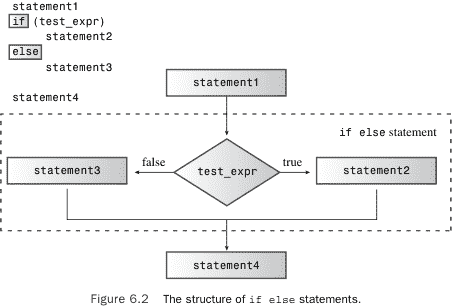

例如，假设你想通过打乱字母来修改输入文本，同时保持换行符不变。在这种情况下，每一行输入都会转换为长度相同的输出行。这意味着你希望程序对换行符采取一种操作，而对所有其他字符采取另一种操作。如程序清单 6.2 所示，if else 让这项任务变得容易。该操作还演示了 `std::` 限定符，它是 using 指令的替代方案之一。

### 程序清单 6.2  *ifelse.cpp*

```cpp
// ifelse.cpp -- using the if else statement
#include <iostream>
int main()
{
    char ch;

    std::cout << "Type, and I shall repeat.\n";
    std::cin.get(ch);
    while (ch != '.')
    {
        if (ch == '\n')
            std::cout << ch;    // done if newline
        else
            std::cout << ++ch;  // done otherwise
        std::cin.get(ch);
    }
    // try ch + 1 instead of ++ch for interesting effect
    std::cout << "\nPlease excuse the slight confusion.\n";
    //    std::cin.get();
    //    std::cin.get();
    return 0;
}
```

以下是程序清单 6.2 中的程序的一些示例输出：

```
Type, and I shall repeat.
An ineffable joy suffused me as I beheld
Bol:jofggbcmf!kpz!tvggvtfe!nf!bt!I!cfifme
the wonders of modern computing.
uif!xpoefst!pg!npefso!dpnqvujoh
Please excuse the slight confusion.
```

注意，程序清单 6.2 中的一条注释指出，将 `++ch` 改为 `ch+1` 会产生有趣的效果。你能推断出那会是什么吗？如果不能，就试一试，然后看看你能否解释正在发生什么。（提示：想一想 `cout` 如何处理不同类型。）

### 格式化 `if else` 语句

请记住，`if else` 语句中的两个备选分支必须是单个语句。如果你需要多个语句，就必须使用花括号将它们收集到一个块语句中。与 BASIC 和 FORTRAN 等一些语言不同，C++ 不会自动把 `if` 和 `else` 之间的所有内容都视为一个块，因此你必须使用花括号让这些语句成为一个块。例如，下面的代码会产生编译器错误：

```cpp
if (ch == 'Z')
    zorro++;                 // if ends here
    cout << "Another Zorro candidate\n";
else                        // wrong
    dull++;
    cout << "Not a Zorro candidate\n";
```

编译器会把它看作一个简单的 if 语句，该语句以 zorro++; 语句结束。然后有一个 cout 语句。到目前为止，一切正常。但接着出现了编译器认为未附加的 else，这会被标记为语法错误。你要添加花括号，将语句组合成一个语句块：

```cpp
if (ch == 'Z')
{                       // if true block
    zorro++;
    cout << "Another Zorro candidate\n";
}
else
{                       // if false block
    dull++;
    cout << "Not a Zorro candidate\n";
}
```

因为 C++ 是一种自由格式语言，你可以按自己的喜好安排花括号，只要它们把语句括起来即可。前面的代码展示了一种流行格式。下面是另一种：

```cpp
if (ch == 'Z') {
    zorro++;
    cout << "Another Zorro candidate\n";
    }
else {
    dull++;
    cout << "Not a Zorro candidate\n";
    }
```

第一种形式强调语句的块结构，而第二种形式更紧密地将块与关键字 if 和 else 联系在一起。两种风格都清晰一致，应该能很好地为你服务；不过，你可能会遇到对此有强烈而具体看法的老师或雇主。

### if else if else 结构

计算机程序就像生活一样，可能会给你提供多于两个选项的选择。你可以扩展 C++ 的 if else 语句来满足这种需求。如你所见，else 后面应该跟一个语句，而该语句可以是一个块。由于 if else 语句本身就是一个语句，所以它可以跟在 else 后面：

```cpp
if (ch == 'A')
    a_grade++;          // alternative #1
else
    if (ch == 'B')      // alternative #2
        b_grade++;      // subalternative #2a
    else
        soso++;         // subalternative #2b
```

如果 ch 不是 'A'，程序会转到 else。然后第二个 if else 将该分支细分为另外两个选择。C++ 的自由格式让您可以将这些元素排列成更易读的格式：

```cpp
if (ch == 'A')
    a_grade++;          // alternative #1
else if (ch == 'B')     // alternative #2
    b_grade++;
else
    soso++;             // alternative #3
```

这看起来像一种新的控制结构——if else if else 结构。但实际上，它是包含在另一个 if else 中的一个 if else。这种修改后的格式看起来整洁得多，并且让您可以快速浏览代码，挑出不同的分支。整个构造仍然算作一条语句。

程序清单 6.3 使用这种首选的格式构造了一个简单的测验程序。

### 程序清单 6.3 ifelseif.cpp

```cpp
// ifelseif.cpp -- using if else if else
#include <iostream>
const int Fave = 27;
int main()
{
    using namespace std;
    int n;

    cout << "Enter a number in the range 1-100 to find ";
    cout << "my favorite number: ";
    do
    {
        cin >> n;
        if (n < Fave)
            cout << "Too low -- guess again: ";
        else if (n > Fave)
            cout << "Too high -- guess again: ";
        else
            cout << Fave << " is right!\n";
    } while (n != Fave);
    return 0;
}
```

下面是程序清单 6.3 中的程序的一些示例输出：

```text
Enter a number in the range 1-100 to find my favorite number: 50
Too high -- guess again: 25
Too low -- guess again: 37
Too high -- guess again: 31
Too high -- guess again: 28
Too high -- guess again: 27
27 is right!
```

## 条件运算符与错误预防

许多程序员会把更直观的表达式 `variable == value` 反过来写成 `value == variable`，以便捕获把相等运算符误写成赋值运算符的错误。例如，按如下方式输入条件语句是有效的，并且能正常工作：

```cpp
if (3 == myNumber)
```

然而，如果您碰巧按如下方式误写，编译器将生成错误消息，因为它认为您试图给字面量赋值（3 始终等于 3，不能赋予另一个值）：

```cpp
if (3 = myNumber)
```

假设您使用前一种写法犯了类似的错误：

```cpp
if (myNumber = 3)
```

编译器会简单地把值 3 赋给 myNumber，然后 if 内部的代码块会运行——这是一个非常常见的错误，也是一个难以发现的错误。（不过，许多编译器会发出警告，明智的做法是留意它。）一般来说，编写能让编译器发现错误的代码，要比修复神秘错误结果的原因容易得多。

## 逻辑表达式

通常您必须测试多个条件。例如，一个字符要成为小写字母，其值必须大于或等于 'a' 且小于或等于 'z'。或者，如果您要求用户用 y 或 n 回答，您希望既接受大写（Y 和 N），也接受小写。为了满足这种需求，C++ 提供了三种逻辑运算符来组合或修改现有表达式。这些运算符是逻辑 OR，写作 `||`；逻辑 AND，写作 `&&`；以及逻辑 NOT，写作 `!`。现在让我们逐一考察它们。

### 逻辑 OR 运算符：`||`

在英语中，单词 or 可以表示两个条件中的一个或两个满足要求。例如，如果您或您的配偶在 MegaMicro, Inc. 工作，您就可以参加 MegaMicro 公司的野餐。C++ 中的对应物是逻辑 OR 运算符，写作 `||`。该运算符将两个表达式组合成一个。如果原始表达式中的一个或两个为真，或非零，则结果表达式的值为真。否则，表达式的值为假。下面是一些示例：

```cpp
5 == 5 || 5 == 9   // true because first expression is true
5 > 3 || 5 > 10   // true because first expression is true
5 > 8 || 5 < 10   // true because second expression is true
5 < 8 || 5 > 2   // true because both expressions are true
5 > 8 || 5 < 2   // false because both expressions are false
```

由于 `||` 的优先级低于关系运算符，因此在这些表达式中不需要使用括号。表 6.1 总结了 `||` 运算符的工作方式。

表 6.1 **`||` 运算符**

| `expr1` &#124;&#124; `expr2` 的值 | `expr1 == true` | `expr1 == false` |
|---|---:|---:|
| `expr2 == true` | 真 | 真 |
| `expr2 == false` | 真 | 假 |

C++ 规定 `||` 运算符是一个*顺序点*。也就是说，左侧指示的任何值变化都会在右侧求值之前发生。（或者用 C++11 更新的说法，运算符左侧的子表达式排在右侧子表达式之前。）例如，考虑以下表达式：

```cpp
i++ < 6 || i == j
```

假设 i 最初的值为 10。到与 j 进行比较时，i 的值已经变为 11。此外，如果左侧表达式为真，C++ 就不会再费心对右侧表达式求值，因为只要一个表达式为真，整个逻辑表达式就为真。（回想一下，分号和逗号运算符也是顺序点。）

程序清单 6.4 在 `if` 语句中使用 `||` 运算符来检查字符的大写和小写版本。它还使用了 C++ 的字符串拼接功能（见第 4 章“复合类型”），将单个字符串分散到三行中。

### 程序清单 6.4 or.cpp

```cpp
// or.cpp -- using the logical OR operator
#include <iostream>
int main()
{
    using namespace std;
    cout << "This program may reformat your hard disk\n"
         "and destroy all your data.\n"
         "Do you wish to continue? <y/n> ";
    char ch;
    cin >> ch;
    if (ch == 'y' || ch == 'Y')                 // y or Y
        cout << "You were warned!\a\n";
    else if (ch == 'n' || ch == 'N')            // n or N
        cout << "A wise choice ... bye\n";
    else
        cout << "That wasn't a y or n! Apparently you "
                "can't follow instructions, so "
                "I'll crash your disk anyway.\a\a\a\n";
    return 0;
}
```

（该程序并不会真正执行任何威胁。）下面是程序清单 6.4 中程序的一次示例运行：

```text
This program may reformat your hard disk
and destroy all your data.
Do you wish to continue? <y/n> N
A wise choice ... bye
```

该程序只读取一个字符，因此响应中只有第一个字符重要。这意味着用户本可以输入 NO 而不是 N。程序只会读取 N。但如果程序之后尝试读取更多输入，它会从 o 开始。

### 逻辑 AND 运算符：&&

逻辑 AND 运算符写作 &&，也将两个表达式组合成一个。只有当两个原始表达式都为真时，结果表达式的值才为真。下面是一些示例：

```cpp
5 == 5 && 4 == 4    // true because both expressions are true
5 == 3 && 4 == 4    // false because first expression is false
5 > 3 && 5 > 10     // false because second expression is false
5 > 8 && 5 < 10     // false because first expression is false
5 < 8 && 5 > 2      // true because both expressions are true
5 > 8 && 5 < 2      // false because both expressions are false
```

由于 && 的优先级低于关系运算符，因此在这些表达式中不需要使用括号。与 || 运算符一样，&& 运算符也充当顺序点，因此会先对左侧求值，并且任何副作用都会在右侧求值之前完成。如果左侧为假，整个逻辑表达式必定为假，因此在这种情况下 C++ 不会费心对右侧求值。表 6.2 总结了 && 运算符的工作方式。

表 6.2 **&& 运算符**

|  | `expr1 == true` | `expr1 == false` |
|---|---|---|
| `expr2 == true` | 真 | 假 |
| `expr2 == false` | 假 | 假 |

程序清单 6.5 展示了如何使用 `&&` 来处理一种常见情况：因两个不同原因而终止 while 循环。在该清单中，一个 while 循环将值读入数组。一个测试（`i < ArSize`）在数组已满时终止循环。第二个测试（`temp >= 0`）让用户可以选择通过输入负数提前退出。程序使用 `&&` 运算符将两个测试组合成一个条件。该程序还使用了两个 `if` 语句、一个 `if else` 语句和一个 `for` 循环，因此它演示了本章和第 5 章的若干主题。

### 程序清单 6.5 and.cpp

```cpp
// and.cpp -- using the logical AND operator
#include <iostream>
const int ArSize = 6;
int main()
{
    using namespace std;
    float naaq[ArSize];
    cout << "Enter the NAAQs (New Age Awareness Quotients) "
         << "of\nyour neighbors. Program terminates "
         << "when you make\n" << ArSize << " entries "
         << "or enter a negative value.\n";

    int i = 0;
    float temp;
    cout << "First value: ";
    cin >> temp;
    while (i < ArSize && temp >= 0) // 2 quitting criteria
    {
        naaq[i] = temp;
        ++i;
        if (i < ArSize)              // room left in the array
        {
            cout << "Next value: ";
            cin >> temp;             // so get next value
        }
    }
    if (i == 0)
        cout << "No data--bye\n";
```

```cpp
else
{
    cout << "Enter your NAAQ: ";
    float you;
    cin >> you;
    int count = 0;
    for (int j = 0; j < i; j++)
        if (naaq[j] > you)
            ++count;

    cout << count;
    cout << " of your neighbors have greater awareness of\n"
         << " the New Age than you do.\n";
}
return 0;
}
```

注意，程序清单 6.5 中的程序把输入放入临时变量 temp。只有在验证输入有效之后，程序才会把值赋给数组。下面是该程序的几个示例运行。其中一次在输入六项后终止：

```text
Enter the NAAQs (New Age Awareness Quotients) of
your neighbors. Program terminates when you make
6 entries or enter a negative value.
First value: 28
Next value: 72
Next value: 15
Next value: 6
Next value: 130
Next value: 145
Enter your NAAQ: 50
3 of your neighbors have greater awareness of
the New Age than you do.
```

第二次运行在输入负值后终止：

```text
Enter the NAAQs (New Age Awareness Quotients) of
your neighbors. Program terminates when you make
6 entries or enter a negative value.
First value: 123
Next value: 119
Next value: 4
Next value: 89
Next value: -1
Enter your NAAQ: 123.031
0 of your neighbors have greater awareness of
the New Age than you do.
```

## 程序说明

下面是程序清单 6.5 中输入部分的代码：

```cpp
    cin >> temp;
    while (i < ArSize && temp >= 0) // 2 quitting criteria
    {
        naaq[i] = temp;
        ++i;
        if (i < ArSize)            // room left in the array,
        {
            cout << "Next value: ";
            cin >> temp;           // so get next value
        }
    }
```

程序首先把第一个输入值读入一个名为 *temp* 的临时变量。然后，*while* 测试条件检查数组中是否仍有空间（*i* < *ArSize*），以及输入值是否为非负（*temp* >= 0）。如果满足条件，程序就把 *temp* 的值复制到数组中，并把数组索引加一。此时，由于数组编号从零开始，*i* 等于到目前为止的条目总数。也就是说，如果 *i* 一开始为 0，那么循环的第一轮会把一个值赋给 *naaq[0]*，然后把 *i* 设为 1。

当数组填满或用户输入负数时，循环终止。注意，只有当 *i* 小于 *ArSize*——也就是说，只有当数组中仍有空间时——循环才会把另一个值读入 *temp*。

获得数据后，程序使用 *if else* 语句，在未输入数据时（也就是说，如果第一个条目是负数）进行说明，并在有数据时处理这些数据。

## 用 && 设置范围

&& 运算符还允许你设置一系列 *if else if else* 语句，每个选择对应一个特定的值范围。程序清单 6.6 演示了这种方法。它还展示了一种处理一系列消息的有用技巧。正如一个指向 char 的指针变量可以通过指向字符串开头来标识单个字符串，一个指向 char 的指针数组可以标识一系列字符串。你只需把每个字符串的地址赋给不同的数组元素。程序清单 6.6 使用 *qualify* 数组保存四个字符串的地址。例如，*qualify[1]* 保存字符串 "mud tug-of-war.\n" 的地址。然后，程序就可以像使用任何其他字符串指针一样使用 *qualify[1]*——例如，配合 *cout*、*strlen()* 或 *strcmp()*。使用 *const* 限定符可以保护这些字符串免遭意外修改。

### 程序清单 6.6 more_and.cpp

```cpp
// more_and.cpp -- using the logical AND operator
#include <iostream>
const char * qualify[4] =       // an array of pointers
{                              // to strings
    "10,000-meter race.\n",
    "mud tug-of-war.\n",
    "masters canoe jousting.\n",
    "pie-throwing festival.\n"
};
int main()
{
    using namespace std;
    int age;
    cout << "Enter your age in years: ";
    cin >> age;
    int index;

    if (age > 17 && age < 35)
        index = 0;
    else if (age >= 35 && age < 50)
        index = 1;
    else if (age >= 50 && age < 65)
        index = 2;
    else
        index = 3;

    cout << "You qualify for the " << qualify[index];
    return 0;
}
```

下面是程序清单 6.6 中程序的一次示例运行：

```text
Enter your age in years: 87
You qualify for the pie-throwing festival.
```

输入的年龄不匹配任何测试范围，因此程序把 index 设为 3，然后打印对应的字符串。

## 程序说明

在程序清单 6.6 中，表达式 `age > 17 && age < 35` 测试两个值之间的年龄——也就是 18–34 岁这个范围。表达式 `age >= 35 && age < 50` 使用 `>=` 运算符把 35 包含在其范围内，该范围是 35–49。如果程序使用 `age > 35 && age < 50`，那么值 35 会被所有测试漏掉。使用范围测试时，应检查各范围之间没有空洞，也没有重叠。此外，还需要确保每个范围都设置正确；参见本节后面的侧栏“范围测试”。

if else 语句用于选择一个数组索引，而该索引反过来标识一个特定字符串。

## 范围测试

注意，范围测试的每一部分都应使用 AND 运算符连接两个完整的关系表达式：

```cpp
if (age > 17 && age < 35)    // OK
```

不要从数学中借用下面的写法：

```cpp
if (17 < age < 35)           // Don't do this!
```

如果犯了这个错误，编译器不会把它当作错误捕获，因为它仍然是有效的 C++ 语法。< 运算符从左到右结合，因此前面的表达式意味着：

```cpp
if ( (17 < age) < 35)
```

但 17 < age 要么为 true，也就是 1，要么为 false，也就是 0。无论哪种情况，表达式 17 < age 都小于 35，所以整个测试始终为 true！

## 逻辑 NOT 运算符：!

! 运算符会对其后面的表达式取反，即反转表达式的真值。也就是说，如果表达式为 true，那么 ! 表达式为 false——反之亦然。更准确地说，如果表达式为 true 或非零，那么 ! 表达式为 false，反之亦然。顺便说一句，很多人把感叹号叫作 bang，因此 !x 读作“bang-ex”，!!x 读作“bang-bang-ex”。

通常，不使用 ! 运算符可以更清楚地表达一种关系：

```cpp
if (!(x > 5))              // if (x <= 5) is clearer
```

但是，! 运算符对于返回 true/false 值或可被解释为这种值的函数很有用。例如，如果两个 C 风格字符串 s1 和 s2 彼此不同，strcmp(s1,s2) 返回非零（true）值；如果它们相同，则返回零值。这意味着，如果两个字符串相等，!strcmp(s1,s2) 为 true。

程序清单 6.7 使用把 ! 运算符应用于函数返回值的技术，来筛选适合赋给 int 类型的数值输入。用户自定义函数 is_int() 会在其参数处于可赋给 int 类型的值范围内时返回 true；稍后我们会进一步讨论它。然后，程序使用测试 while(!is_int(num)) 来拒绝不适合该范围的值。

### 程序清单 6.7 not.cpp

```cpp
// not.cpp -- using the not operator
#include <iostream>
#include <climits>
bool is_int(double);
int main()
{
    using namespace std;
    double num;

    cout << "Yo, dude! Enter an integer value: ";
    cin >> num;
    while (!is_int(num))    // continue while num is not int-able
    {
        cout << "Out of range -- please try again: ";
        cin >> num;
    }
    int val = int (num);    // type cast
    cout << "You've entered the integer " << val << "\nBye\n";
    return 0;
}

bool is_int(double x)
{
    if (x <= INT_MAX && x >= INT_MIN)    // use limits values
        return true;
    else
        return false;
}
```

下面是程序清单 6.7 在 32 位 int 系统上的一次示例运行：

```text
Yo, dude! Enter an integer value: 6234128679
Out of range -- please try again: -8000223333
Out of range -- please try again: 99999
You've entered the integer 99999
Bye
```

## 程序说明

如果向读取 int 类型的程序输入过大的值，许多 C++ 实现只是截断该值以使其适合，而不通知你数据已丢失。程序清单 6.7 通过先把可能的 int 值作为 double 读取来避免这种情况。double 类型有足够的精度来保存典型的 int 值，而且其范围大得多。保存输入值的另一种选择是 long long 类型，前提是它比 int 更宽。

布尔函数 `is_int()` 使用 `climits` 文件（第 3 章“处理数据”中讨论过）里定义的两个符号常量（`INT_MAX` 和 `INT_MIN`）来判断其参数是否在适当范围内。如果是，程序返回 `true`；否则返回 `false`。


`main()` 程序使用 `while` 循环拒绝无效输入，直到用户输入正确为止。当输入超出范围时，可以显示 `int` 的限制值，使程序更友好。输入通过验证后，程序会将其赋值给一个 `int` 变量。

### 逻辑运算符要点

正如本章前面所述，C++ 逻辑 OR 和逻辑 AND 运算符的优先级低于关系运算符。这意味着如下表达式

```
x > 5 && x < 10
```

会按以下方式解释：

```
(x > 5) && (x < 10)
```

另一方面，`!` 运算符的优先级高于任何关系运算符或算术运算符。因此，若要对一个表达式取反，应将该表达式括在圆括号中，如下所示：

```
! (x > 5)      // if it is false that x is greater than 5
!x > 5         // if !x is greater than 5
```

顺便提一下，这里的第二个表达式始终为假，因为 `!x` 只能取 `true` 或 `false` 值，而这些值会被转换为 `1` 或 `0`。

逻辑 AND 运算符的优先级高于逻辑 OR 运算符。因此下面这个表达式：

```
age > 30 && age < 45 || weight > 300
```

表示以下含义：

```
(age > 30 && age < 45) || weight > 300
```

也就是说，一个条件是 `age` 在 31–44 范围内，第二个条件是 `weight` 大于 300。如果这些条件中的一个或另一个或两者都为真，则整个表达式为 `true`。

当然，可以使用圆括号告诉程序你想要哪种解释。例如，假设你想用 `&&` 将“`age` 大于 50 或 `weight` 大于 300”这一条件与“`donation` 大于 1,000”这一条件组合起来。你必须将 OR 部分括在圆括号内：

```
(age > 50 || weight > 300) && donation > 1000
```

否则，编译器会将 `weight` 条件与 `donation` 条件组合，而不是与 `age` 条件组合。

尽管 C++ 运算符优先级规则通常使得可以在不使用圆括号的情况下编写复合比较，但最简单的做法是使用圆括号对测试进行分组，无论是否需要圆括号。这使代码更易于阅读，不会迫使其他人去查阅一些不常用的优先级规则，并且因为你不完全记得适用的确切规则而减少出错的机会。

C++ 保证当程序计算逻辑表达式时，会从左到右计算，并在知道答案后立即停止计算。例如，假设你有下面这个条件：

```
x != 0 && 1.0 / x > 100.0
```

如果第一个条件为假，那么整个表达式必定为假。这是因为要使该表达式为真，每个单独条件都必须为真。由于知道第一个条件为假，程序就不会费心计算第二个条件。在这个例子中这是幸运的，因为计算第二个条件会导致除以零，而这不是计算机能够执行的操作。

### 替代表示

并非所有键盘都提供逻辑运算符所用的全部符号，因此 C++ 标准提供了替代表示，如表 6.3 所示。标识符 and、or 和 not 是 C++ 保留字，这意味着不能将它们用作变量名等。它们不被视为关键字，因为它们是现有语言特性的替代表示。顺便说一下，这些在 C 中不是保留字，但 C 程序可以将它们用作运算符，前提是程序包含 iso646.h 头文件。C++ 不要求使用头文件。

表 6.3 — 逻辑运算符：替代表示

| 运算符 | 替代表示 |
|---|---|
| `&&` | and |
| \|\| | or |
| `!` | not |

### `cctype` 字符函数库

C++ 从 C 继承了一组方便的字符相关函数，这些函数在 cctype 头文件（旧式写法为 ctype.h）中声明原型，可简化诸如判断字符是大写字母、数字还是标点符号之类的任务。例如，如果 ch 是字母，则 isalpha(ch) 函数返回非零值，否则返回零值。类似地，仅当 ch 是标点字符（如逗号或句点）时，ispunct(ch) 函数才返回真值。（这些函数的返回类型是 int 而不是 bool，但通常的 bool 转换允许将它们视为 bool 类型。）

使用这些函数比使用 AND 和 OR 运算符更方便。例如，下面是你可能使用 AND 和 OR 来测试字符 ch 是否为字母字符的方式：

```
if ((ch >= 'a' && ch <= 'z') || (ch >= 'A' && ch <= 'Z'))
```

将其与使用 `isalpha()` 比较：

```cpp
if (isalpha(ch))
```

`isalpha()` 不仅更易于使用，而且更通用。AND/OR 形式假设 A 到 Z 的字符编码是连续的，并且该范围内没有其他字符的编码。这一假设对 ASCII 编码成立，但通常并不总是成立。

程序清单 6.8 演示了 cctype 系列中的一些函数。具体来说，它使用了 `isalpha()`，用于测试字母字符；`isdigit()`，用于测试数字字符，如 3；`isspace()`，用于测试空白字符，如换行符、空格和制表符；以及 `ispunct()`，用于测试标点字符。该程序还复习了 `if else if` 结构以及将 `while` 循环与 `cin.get(ch)` 配合使用。

### 程序清单 6.8 cctypes.cpp

```cpp
// cctypes.cpp -- using the ctype.h library
#include <iostream>
#include <cctype>              // prototypes for character functions
int main()
{
    using namespace std;
    cout << "Enter text for analysis, and type @"
         << " to terminate input.\n";
    char ch;
    int whitespace = 0;
    int digits = 0;
    int chars = 0;
    int punct = 0;
    int others = 0;

    cin.get(ch);                // get first character
    while (ch != '@')           // test for sentinel
    {
        if (isalpha(ch))        // is it an alphabetic character?
            chars++;
        else if (isspace(ch))   // is it a whitespace character?
            whitespace++;
        else if (isdigit(ch))   // is it a digit?
            digits++;
        else if (ispunct(ch))   // is it punctuation?
            punct++;
        else
            others++;
        cin.get(ch);            // get next character
    }
    cout << chars << " letters, "
         << whitespace << " whitespace, "
         << digits << " digits, "
         << punct << " punctuations, "
         << others << " others.\n";
    return 0;
}
```

下面是程序清单 6.8 中程序的一次示例运行（注意，空白计数包括换行符）：

```text
Enter text for analysis, and type @ to terminate input.
AdrenalVision International producer Adrienne Visonmonger
announced production of their new 3-D film, a remake of
"My Dinner with Andre," scheduled for 2013. "Wait until
you see the the new scene with an enraged Collosplode!@"
177 letters, 33 whitespace, 5 digits, 9 punctuations, 0 others.
```

表 6.4 总结了 cctype 包中可用的函数。某些系统可能缺少其中一些函数，或者提供额外的函数。

**表 6.4 — cctype 字符函数**

| 函数名 | 返回值 |
|---|---|
| `isalnum()` | 如果参数是字母数字（即字母或数字），则该函数返回 true。 |
| `isalpha()` | 如果参数是字母，则该函数返回 true。 |
| `isblank()` | 如果参数是空格或水平制表符，则该函数返回 true。 |
| `iscntrl()` | 如果参数是控制字符，则该函数返回 true。 |
| `isdigit()` | 如果参数是十进制数字（0–9），则该函数返回 true。 |
| `isgraph()` | 如果参数是除空格之外的任何可打印字符，则该函数返回 true。 |
| `islower()` | 如果参数是小写字母，则该函数返回 true。 |
| `isprint()` | 如果参数是任何可打印字符（包括空格），则该函数返回 true。 |
| `ispunct()` | 如果参数是标点字符，则该函数返回 true。 |
| `isspace()` | 如果参数是标准空白字符（即空格、换页符、换行符、回车符、水平制表符、垂直制表符），则该函数返回 true。 |
| `isupper()` | 如果参数是大写字母，则该函数返回 true。 |


**表6.4 cctype字符函数**

| 函数名 | 返回值 |
| --- | --- |
| `isxdigit()` | 如果参数是十六进制数字字符（即0–9、a–f或A–F），则该函数返回`true`。 |
| `tolower()` | 如果参数是大写字符，`tolower()`返回该字符的小写版本；否则，返回未更改的参数。 |
| `toupper()` | 如果参数是小写字符，`toupper()`返回该字符的大写版本；否则，返回未更改的参数。 |

## ?: 运算符

C++有一种运算符可以经常用来代替`if else`语句。这个运算符称为*条件运算符*，写作`?:`，而且，对冷知识爱好者来说，它是唯一需要三个操作数的C++运算符。一般形式如下：

`expression1 ? expression2 : expression3`

如果`expression1`为真，那么整个条件表达式的值就是`expression2`的值。否则，整个表达式的值就是`expression3`的值。下面两个例子展示了该运算符的工作方式：

`5 > 3 ? 10 : 12  // 5 > 3 is true, so expression value is 10`
`3 == 9 ? 25 : 18  // 3 == 9 is false, so expression value is 18`

我们可以这样转述第一个例子：如果5大于3，表达式的求值结果为10；否则，求值结果为12。当然，在实际编程情境中，表达式会涉及变量。

程序清单6.9 `condit.cpp`

```cpp
// condit.cpp -- using the conditional operator
#include <iostream>
int main()
{
    using namespace std;
    int a, b;
    cout << "Enter two integers: ";
    cin >> a >> b;
    cout << "The larger of " << a << " and " << b;
    int c = a > b ? a : b;  // c = a if a > b, else c = b
    cout << " is " << c << endl;
    return 0;
}
```

下面是程序清单6.9中程序的示例运行：

```text
Enter two integers: 25 28
The larger of 25 and 28 is 28
```

该程序的关键部分是下面这条语句：

```cpp
int c = a > b ? a : b;
```

它产生的结果与以下语句相同：

```cpp
int c;
if (a > b)
    c = a;
else
    c = b;
```

与if else序列相比，条件运算符更简洁，但乍看之下不那么直观。两种方法的一个区别是，条件运算符产生一个表达式，因而产生一个单一值，该值可以被赋值，也可以并入更大的表达式中，正如程序清单6.9中把条件表达式的值赋给变量c那样。条件运算符的简洁形式、不寻常的语法以及整体怪异的外观，使它成为欣赏这些特性的程序员的最爱。一个颇受欢迎的伎俩——其目的令人不齿，即隐藏代码用途——是把条件表达式相互嵌套，下面这个温和的例子展示了这一点：

```cpp
const char x[2][20] = {"Jason ", "at your service\n"};
const char * y = "Quillstone ";

for (int i = 0; i < 3; i++)
    cout << ((i < 2) ? i ? x[i] : y : x[1]);
```

这不过是一种晦涩（但绝不是最晦涩）的方式，用来按以下顺序打印三个字符串：

```text
Jason Quillstone at your service
```

就可读性而言，条件运算符最适合简单的关系和简单的表达式值：

```cpp
x = (x > y) ? x : y;
```

如果代码变得更复杂，那么用if else语句来表达可能更清晰。

## switch语句

假设你创建一个屏幕菜单，要求用户从五个选项中选择一个——例如，Cheap、Moderate、Expensive、Extravagant和Excessive。你可以扩展if else if else序列来处理五个备选项，但C++的switch语句能更轻松地从扩展列表中选择一个选项。下面是switch语句的一般形式：

```cpp
switch (integer-expression)
{
        case label1 : statement(s)
        case label2 : statement(s)
        ...
        default     : statement(s)
}
```

C++的switch语句就像一种路由设备，告诉计算机接下来执行哪一行代码。程序到达switch语句时，会跳转到标签值与`integer-expression`的值相对应的那一行。例如，如果`integer-expression`的值为4，程序就转到带有`case 4:`标签的那一行。顾名思义，`integer-expression`的值必须是一个归约为整数值的表达式。此外，每个标签都必须是整数常量表达式。最常见的情况是，标签是简单的int或char常量，例如1或'q'，或者是枚举量。如果`integer-expression`与任何标签都不匹配，程序就跳转到标有`default`的那一行。default标签是可选的。如果省略它且没有匹配项，程序就跳转到switch后面的下一条语句（见图6.3）。

switch语句与Pascal等语言中的类似语句有一个非常重要的不同之处。每个C++ case标签只起行标签的作用，而不是选项之间的边界。也就是说，程序跳转到switch中的某一行后，本质上会执行该switch中该行之后的所有语句，除非你明确指示它不这样做。执行不会在下一个case处自动停止。要让执行在特定语句组末尾停止，必须使用`break`语句。这会使执行跳转到switch后面的语句。

程序清单6.10展示了如何结合使用switch和break，为高管们实现一个简单的菜单。该程序使用`showmenu()`函数显示一组选项。然后，switch语句根据用户的响应选择一个操作。

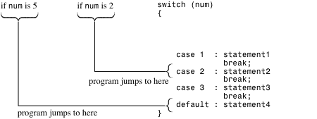

图6.3 switch语句的结构。

### 注意

某些硬件/操作系统组合会将`\a`转义序列（在程序清单6.10的case 1中使用）视为静音。

程序清单6.10 `switch.cpp`

```cpp
// switch.cpp -- using the switch statement
#include <iostream>
using namespace std;
void showmenu();  // function prototypes
void report();
void comfort();
int main()
{
    showmenu();
    int choice;
    cin >> choice;
    while (choice != 5)
    {
        switch(choice)
        {
            case 1  :  cout << "\a\n";
                       break;
            case 2  :  report();
                       break;
            case 3  :  cout << "The boss was in all day.\n";
                       break;
            case 4  :  comfort();
                       break;
            default :  cout << "That's not a choice.\n";
        }
        showmenu();
        cin >> choice;
    }
    cout << "Bye!\n";
    return 0;
}

void showmenu()
{
    cout << "Please enter 1, 2, 3, 4, or 5:\n"
         "1) alarm             2) report\n"
         "3) alibi              4) comfort\n"
         "5) quit\n";
}
void report()
{
    cout << "It's been an excellent week for business.\n"
         "Sales are up 120%. Expenses are down 35%.\n";
}
void comfort()
{
    cout << "Your employees think you are the finest CEO\n"
         "in the industry. The board of directors think\n"
         "you are the finest CEO in the industry.\n";
}
```

下面是程序清单6.10中高管菜单程序的示例运行：

```text
Please enter 1, 2, 3, 4, or 5:
1) alarm             2) report
3) alibi              4) comfort
5) quit
4
Your employees think you are the finest CEO
in the industry. The board of directors think
you are the finest CEO in the industry.
Please enter 1, 2, 3, 4, or 5:
1) alarm             2) report
3) alibi              4) comfort
5) quit
2
It's been an excellent week for business.
Sales are up 120%. Expenses are down 35%.
Please enter 1, 2, 3, 4, or 5:
1) alarm             2) report
3) alibi              4) comfort
5) quit
6
That's not a choice.
Please enter 1, 2, 3, 4, or 5:
1) alarm             2) report
3) alibi              4) comfort
5) quit
5
Bye!
```

当用户输入5时，while循环终止。输入1到4会激活switch列表中的相应选项，输入6会触发default语句。

请注意，输入必须是整数，该程序才能正确工作。例如，如果输入一个字母，输入语句就会失败，循环将无休止地运行，直到你终止程序。为了应对那些不遵守说明的人，最好使用字符输入。


如前所述，这个程序需要 break 语句来把执行限制在 switch 语句的特定部分。要验证这一点，你可以从程序清单6.10中删除 break 语句，然后看看之后会怎样运行。例如，你会发现输入2会导致程序执行与 case 标签2、3、4以及 default 相关联的所有语句。C++ 之所以这样工作，是因为这种行为可能很有用。一方面，它使使用多个标签变得简单。例如，假设你编写程序清单6.10时使用字符而不是整数作为菜单选项和 switch 标签。在这种情况下，你可以为同一组语句同时使用大写和小写标签：

```cpp
char choice;
cin >> choice;
while (choice != 'Q' && choice != 'q')
{
    switch(choice)
    {
        case 'a':
        case 'A': cout << "*\a\n";
                  break;

        case 'r':
        case 'R': report();
                  break;

        case 'l':
        case 'L': cout << "The boss was in all day.\n";
                  break;

        case 'c':
        case 'C': comfort();
                  break;
        default : cout << "That's not a choice.\n";
    }
    showmenu();
    cin >> choice;
}
```

因为 case 'a' 后面没有紧跟 break，程序执行会继续到下一行，也就是 case 'A' 后面的语句。

## 使用枚举量作为标签

程序清单6.11说明了如何使用 enum 定义一组相关常量，然后在 switch 语句中使用这些常量。一般来说，cin 不识别枚举类型（它无法知道你将会如何定义它们），所以该程序把选择读取为 int。当 switch 语句将 int 值与枚举量 case 标签进行比较时，它会把枚举量提升为 int。同样，在 while 循环的测试条件中，枚举量也会被提升为 int 类型。

### 程序清单 6.11 enum.cpp

```cpp
// enum.cpp -- using enum
#include <iostream>
// create named constants for 0 - 6
enum {red, orange, yellow, green, blue, violet, indigo};

int main()
{
    using namespace std;
    cout << "Enter color code (0-6): ";
    int code;
    cin >> code;
    while (code >= red && code <= indigo)
    {
        switch (code)
        {
            case red     : cout << "Her lips were red.\n"; break;
            case orange  : cout << "Her hair was orange.\n"; break;
            case yellow  : cout << "Her shoes were yellow.\n"; break;
            case green   : cout << "Her nails were green.\n"; break;
            case blue    : cout << "Her sweatsuit was blue.\n"; break;
            case violet  : cout << "Her eyes were violet.\n"; break;
            case indigo  : cout << "Her mood was indigo.\n"; break;
        }
        cout << "Enter color code (0-6): ";
        cin >> code;
    }
    cout << "Bye\n";
    return 0;
}
```

以下是程序清单6.11中程序的示例输出：

```
Enter color code (0-6): 3
Her nails were green.
Enter color code (0-6): 5
Her eyes were violet.
Enter color code (0-6): 2
Her shoes were yellow.
Enter color code (0-6): 8
Bye
```

## switch 与 if else

switch 语句和 if else 语句都让程序从一组备选项中进行选择。两者之中 if else 更通用。例如，它可以处理范围，如下所示：

```cpp
if (age > 17 && age < 35)
    index = 0;
else if (age >= 35 && age < 50)
    index = 1;
else if (age >= 50 && age < 65)
    index = 2;
else
    index = 3;
```

另一方面，switch 语句并非设计用来处理范围。每个 switch case 标签都必须是单个值。而且该值必须是整数（包括 char），所以 switch 语句不能处理浮点测试。并且 case 标签值必须是常量。如果你的备选项涉及范围、浮点测试或比较两个变量，就应该使用 if else。

然而，如果所有备选项都能用整数常量标识，你可以使用 switch 或 if else 语句。因为这正是 switch 语句设计用来处理的情况，所以除非只有两三个备选项可选，否则就代码大小和执行速度而言，switch 语句通常是更高效的选择。

> **提示**
>
> 如果你既可以使用 if else if 序列，也可以使用 switch 语句，那么通常的做法是：当有三个或更多备选项时使用 switch。

## break 和 continue 语句

break 和 continue 语句使程序能够跳过部分代码。你可以在 switch 语句以及任何循环中使用 break 语句。它使程序执行转到 switch 或循环之后的下一语句。continue 语句用于循环中，使程序跳过循环体的剩余部分，然后开始新的循环周期（见图6.4）。

程序清单6.12展示了这两个语句如何工作。该程序让你输入一行文本。循环回显每个字符，并在字符为句点时使用 break 终止循环。这展示了当某个条件变为真时，如何在循环内部使用 break 来终止循环。接下来，程序统计空格数，但不统计其他字符。当字符不是空格时，循环使用 continue 跳过循环中计数的部分。

### 程序清单 6.12 jump.cpp

```cpp
// jump.cpp -- using continue and break
#include <iostream>
const int ArSize = 80;
int main()
{
    using namespace std;
    char line[ArSize];
    int spaces = 0;

    cout << "Enter a line of text:\n";
    cin.get(line, ArSize);
    cout << "Complete line:\n" << line << endl;
    cout << "Line through first period:\n";
    for (int i = 0; line[i] != '\0'; i++)
    {
        cout << line[i];    // display character
        if (line[i] == '.') // quit if it's a period
            break;
        if (line[i] != ' ') // skip rest of loop
            continue;
        spaces++;
    }
    cout << "\n" << spaces << " spaces\n";
    cout << "Done.\n";
    return 0;
}
```

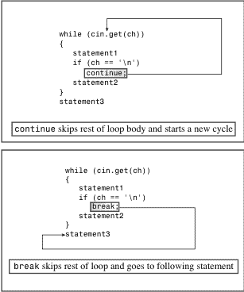

图6.4 `continue` 和 `break` 语句的结构。

以下是程序清单6.12中程序的示例运行：

```
Enter a line of text:
Let's do lunch today. You can pay!
Complete line:
Let's do lunch today. You can pay!
Line through first period:
Let's do lunch today.
3 spaces
Done.
```

## 程序说明

注意，虽然 continue 语句使程序清单6.12中的程序跳过循环体的剩余部分，但它不会跳过循环更新表达式。在 for 循环中，continue 语句使程序直接跳到更新表达式，然后跳到测试表达式。然而，对于 while 循环，continue 使程序直接转到测试表达式。因此，while 循环体中位于 continue 之后的任何更新表达式都会被跳过。在某些情况下，这可能会成为问题。

这个程序不必使用 continue。它可以改用以下代码：

```cpp
if (line[i] == ' ')
    spaces++;
```

然而，当 continue 后面跟着若干语句时，continue 语句可以使程序更易读。这样，你就不需要让所有这些语句成为 if 语句的一部分。

与 C 一样，C++ 也有 goto 语句。像下面这样的语句表示跳转到带有 `paris:` 标签的位置：

```cpp
goto paris;
```

也就是说，你可以有像这样的代码：

```cpp
char ch;
cin >> ch;
if (ch == 'P')
    goto paris;
cout << ...
...
paris: cout << "You've just arrived at Paris.\n";
```

在大多数情况下（有人会说在所有情况下），使用 goto 都是一种糟糕的权宜做法，你应该使用结构化控制结构，如 if else、switch、continue 等，来控制程序流程。

## 读取数字的循环

假设你正在准备一个程序，要把一系列数字读入数组。你想让用户可以选择在填满数组之前终止输入。实现这一点的一种方法是利用 `cin` 的行为。考虑以下代码：

```cpp
int n;
cin >> n;
```

如果用户输入的是一个单词而不是数字，会发生什么？在这种不匹配的情况下，会发生四件事：

- `n` 的值保持不变。
- 不匹配的输入留在输入队列中。
- `cin` 对象中设置了一个错误标志。
- 对 `cin` 方法的调用如果转换为 `bool` 类型，会返回 `false`。

该方法返回 `false` 这一事实意味着你可以使用非数字输入来终止读取数字的循环。非数字输入会设置错误标志，这意味着在程序能够读取更多输入之前，你必须重置该标志。`clear()` 方法也会重置文件结束（EOF）条件（见第5章），它会重置错误输入标志。（错误输入或 EOF 都可能导致 `cin` 返回 `false`。第17章“输入、输出和文件”讨论了如何区分这两种情况。）让我们看几个说明这些技术的示例。

假设你想编写一个程序，计算当天捕获的鱼的平均重量。有最多五条鱼的限制，所以一个五元素数组可以保存所有数据，但也可能你捕获的鱼更少。程序清单6.13使用一个循环，如果数组已满或者你输入了非数字输入，该循环就会终止。

### 程序清单 6.13 cinfish.cpp

```cpp
// cinfish.cpp -- non-numeric input terminates loop
#include <iostream>
const int Max = 5;
int main()
{
    using namespace std;
    // get data
    double fish[Max];
    cout << "Please enter the weights of your fish.\n";
    cout << "You may enter up to " << Max
         << " fish <q to terminate.>\n";
    cout << "fish #1: ";
    int i = 0;
    while (i < Max && cin >> fish[i]) {
        if (++i < Max)
            cout << "fish #" << i+1 << ": ";
```


```cpp
    }
// 计算平均值
    double total = 0.0;
    for (int j = 0; j < i; j++)
        total += fish[j];
// 报告结果
    if (i == 0)
        cout << "No fish\n";
    else
        cout << total / i << " = average weight of "
            << i << " fish\n";
    cout << "Done.\n";
    return 0;
}
```

> **注意**
>
> 如前所述，某些执行环境需要额外的代码来保持窗口打开，以便你能够看到输出。在本例中，由于输入字符 `q` 会关闭后续输入，因此处理方式更加复杂：
>
>     if (!cin)  // input terminated by non-numeric response
>     {
>         cin.clear();  // reset input
>         cin.get();    // read q
>     }
>     cin.get();        // read end of line after last input
>     cin.get();        // wait for user to press <Enter>
>
> 如果你希望程序在退出循环后继续接受更多输入，也可以在程序清单 6.13 中使用类似的代码。
>
> 程序清单 6.14 进一步演示了如何使用 `cin` 的返回值以及重置 `cin`。

程序清单 6.13 中的表达式 `cin >> fish[i]` 实际上是对 `cin` 方法函数的调用，而该函数返回 `cin`。如果 `cin` 出现在测试条件中，它会被转换为 `bool` 类型。如果输入成功，转换结果为 `true`；否则为 `false`。表达式的值为 `false` 时，循环终止。顺便来看一下该程序的一次运行示例：

```text
Please enter the weights of your fish.
You may enter up to 5 fish <q to terminate>.
fish #1: 30
fish #2: 35
fish #3: 25
fish #4: 40
fish #5: q
32.5 = average weight of 4 fish
Done.
```

```cpp
double total = 0.0;
for (i = 0; i < Max; i++)
    total += golf[i];
// 报告结果
cout << total / Max << " = average score "
     << Max << " rounds\n";
return 0;
}
```

下面是程序清单 6.14 的一次运行示例：

```text
Please enter your golf scores.
You must enter 5 rounds.
round #1: 88
round #2: 87
round #3: must i?
Please enter a number: 103
round #4: 94
round #5: 86
91.6 = average score 5 rounds
```

## 程序说明

程序清单 6.14 中错误处理代码的核心如下：

```cpp
while (!(cin >> golf[i])) {
    cin.clear();       // reset input
    while (cin.get() != '\n')
        continue;      // get rid of bad input
    cout << "Please enter a number: ";
}
```

如果用户输入 88，`cin` 表达式的值为 `true`，并且该值会被放入数组中。此外，由于 `cin` 的值为 `true`，表达式 `!(cin >> golf[i])` 的值为 `false`，因此这个内部循环终止。

但是，如果用户输入 `must i?`，`cin` 表达式的值为 `false`，不会有任何值被放入数组中，表达式 `!(cin >> golf[i])` 的值为 `true`，于是程序进入内部 `while` 循环。循环中的第一条语句使用 `clear()` 方法重置输入。如果省略这条语句，程序将拒绝读取任何后续输入。

接下来，程序在 `while` 循环中使用 `cin.get()` 读取该行剩余的输入，直到行尾。这样就可以清除错误输入，以及该行中的其他内容。另一种方法是读取到下一个空白字符，这样可以一次清除一个单词中的错误输入，而不是一次清除整行。最后，程序提示用户输入一个数字。

## 简单文件输入/输出

有时，键盘输入并不是最佳选择。例如，假设你编写了一个用于分析股票的程序，并下载了一个包含 1,000 个股票价格的文件。让程序直接读取文件会方便得多，而不必手动输入所有数值。同样，让程序将输出写入文件也很方便，这样你就能永久保存结果记录。

幸运的是，C++ 可以轻松地将你为键盘输入和显示输出所掌握的技能（统称为*控制台 I/O*）迁移到文件输入和输出（*文件 I/O*）。第 17 章将更加深入地探讨这些主题，但现在我们先来看看简单的文本文件 I/O。

### 文本 I/O 和文本文件

让我们重新审视一下文本 I/O 的概念。当你使用 `cin` 输入时，程序会将输入视为一系列字节，每个字节都被解释为字符代码。无论目标数据类型是什么，输入最初都是字符数据，也就是文本数据。然后，`cin` 对象负责将文本转换为其他类型。为了了解这一过程的工作方式，让我们看看不同的代码如何处理同一行输入。

假设你有下面这行示例输入：

```text
38.5 19.2
```

让我们看看当 `cin` 与不同数据类型一起使用时，如何处理这一行输入。首先，试试 `char` 类型：

```cpp
char ch;
cin >> ch;
```

输入行中的第一个字符会被赋给 `ch`。在本例中，第一个字符是数字 3，该数字对应的字符代码（二进制形式）会被存储在 `ch` 中。输入和目标都是字符，因此不需要进行转换。（注意，存储的不是数值 3，而是数字 3 对应的字符代码。）执行输入语句后，字符 8 成为输入队列中的下一个字符，并将由下一次输入操作检查。

接下来，使用同样的输入尝试 `int` 类型：

```cpp
int n;
cin >> n;
```

在本例中，`cin` 会读取到第一个非数字字符为止。也就是说，它读取数字 3 和数字 8，并将句点留作输入队列中的下一个字符。然后，`cin` 计算出这两个字符对应的数值为 38，并将 38 的二进制代码复制到 `n` 中。

接下来，试试 `double` 类型：

```cpp
double x;
cin >> x;
```

在本例中，`cin` 会读取到第一个不属于浮点数的字符为止。也就是说，它读取数字 3、数字 8、句点字符和数字 5，并将空格留作输入队列中的下一个字符。然后，`cin` 计算出这四个字符对应的数值为 38.5，并将 38.5 的二进制代码（浮点格式）复制到 `x` 中。

接下来，试试字符数组类型：

```cpp
char word[50];
cin >> word;
```

在本例中，`cin` 会读取到空白字符为止。也就是说，它读取数字 3、数字 8、句点字符和数字 5，并将空格留作输入队列中的下一个字符。然后，`cin` 将这四个字符的字符代码存储到数组 `word` 中，并添加一个终止空字符。不需要进行转换。

最后，试试字符数组类型的一种输入变体：

```cpp
char word[50];
cin.getline(word, 50);
```

在本例中，`cin` 会一直读取到换行符（示例输入行的字符数少于 50）。直到最后一个数字 2 为止的所有字符都会被存储到数组 `word` 中，并添加一个空字符。换行符会被丢弃，输入队列中的下一个字符将是下一行的第一个字符。不需要进行转换。

在输出时，会进行相反的转换。也就是说，整数会被转换为一系列数字字符，浮点数会被转换为一系列数字及其他字符（例如 284.53 或 -1.587E+06）。字符数据不需要转换。

这里的要点是，所有输入最初都是文本。因此，控制台输入对应的文件就是文本文件，也就是每个字节存储一个字符代码的文件。并非所有文件都是文本文件。例如，数据库和电子表格会以数值形式存储数值数据，也就是以二进制整数或二进制浮点数的形式存储。此外，文字处理文件可能包含文本信息，但也包含用于描述格式、字体、打印机等内容的非文本数据。

本章讨论的文件 I/O 与控制台 I/O 相似，因此应该用于文本文件。要创建用于输入的文本文件，可以使用文本编辑器，例如 Windows 中的 Notepad，或 Unix/Linux 中的 vi 或 emacs。也可以使用文字处理器，只要将文件保存为文本格式即可。IDE 中包含的代码编辑器同样会生成文本文件；事实上，源代码文件就是文本文件的例子。同样，也可以使用文本编辑器查看通过文本输出创建的文件。

### 写入文本文件

对于文件输出，C++ 使用与 `cout` 类似的对象。因此，在准备进行文件输出之前，让我们先复习一些使用 `cout` 进行控制台输出的基本事实。


- 你必须包含 iostream 头文件。
- iostream 头文件定义了用于处理输出的 ostream 类。
- iostream 头文件声明了一个名为 cout 的 ostream 变量（或对象）。
- 你必须处理 std 命名空间；例如，可以使用 using 指令，或在 cout、endl 等元素前加上 std:: 前缀。
- 可以使用 cout 和 `<<` 运算符输出各种数据类型。

文件输出与此非常相似：

- 你必须包含 fstream 头文件。
- fstream 头文件定义了用于处理输出的 ofstream 类。
- 你需要声明一个或多个 ofstream 变量（或对象），名称可以自行选择，但要遵循常见的命名规范。
- 你必须处理 std 命名空间；例如，可以使用 using 指令，或在 ofstream 等元素前加上 std:: 前缀。
- 你需要将特定的 ofstream 对象关联到特定文件；一种方法是使用 open() 方法。
- 使用完文件后，应使用 close() 方法关闭文件。
- 可以使用 ofstream 对象和 `<<` 运算符输出各种数据类型。

请注意，虽然 iostream 头文件提供了一个名为 cout 的预定义 ostream 对象，但你必须自行声明 ofstream 对象，为它选择名称并将其关联到某个文件。以下是此类对象的声明方式：

```cpp
ofstream outFile;        // outFile 是一个 ofstream 对象
ofstream fout;           // fout 是一个 ofstream 对象
```

以下是将这些对象关联到特定文件的方法：

```cpp
outFile.open("fish.txt");   // outFile 用于向 fish.txt 文件写入内容
char filename[50];
cin >> filename;              // 用户指定一个名称
fout.open(filename);          // fout 用于向指定文件写入内容
```

请注意，open() 方法要求参数为 C 风格字符串。它可以是字符串字面量，也可以是存储在数组中的字符串。

以下是这些对象的用法：

```cpp
double wt = 125.8;
outFile << wt;             // 向 fish.txt 写入一个数字
char line[81] = "Objects are closer than they appear.";
fout << line << endl;      // 写入一行文本
```

重要的是，声明 ofstream 对象并将其关联到文件后，就可以像使用 cout 一样使用它。cout 支持的所有操作和方法，例如 `<<`、`endl` 和 `setf()`，ofstream 对象（例如上述示例中的 outFile 和 fout）也都支持。

简而言之，使用文件输出的主要步骤如下：

- 1. 包含 fstream 头文件。
- 2. 创建一个 ofstream 对象。
- 3. 将 ofstream 对象关联到某个文件。
- 4. 像使用 cout 一样使用 ofstream 对象。

清单 6.15 中的程序演示了这种方法。它向用户收集信息，将输出发送到显示屏，然后将相同的输出发送到文件。你可以使用文本编辑器查看输出文件。

## 清单 6.15 outfile.cpp

```cpp
// outfile.cpp -- 写入文件
#include <iostream>
#include <fstream>              // 用于文件 I/O

int main()
{
    using namespace std;

    char automobile[50];
    int year;
    double a_price;
    double d_price;

    ofstream outFile;             // 创建输出对象
    outFile.open("carinfo.txt");  // 将对象关联到文件

    cout << "Enter the make and model of automobile: ";
    cin.getline(automobile, 50);
    cout << "Enter the model year: ";
    cin >> year;
    cout << "Enter the original asking price: ";
    cin >> a_price;
    d_price = 0.913 * a_price;

// 使用 cout 在屏幕上显示信息

    cout << fixed;
    cout.precision(2);
    cout.setf(ios_base::showpoint);
    cout << "Make and model: " << automobile << endl;
    cout << "Year: " << year << endl;
    cout << "Was asking $" << a_price << endl;
    cout << "Now asking $" << d_price << endl;

// 现在使用 outFile 代替 cout 执行完全相同的操作

    outFile << fixed;
    outFile.precision(2);
    outFile.setf(ios_base::showpoint);
    outFile << "Make and model: " << automobile << endl;
    outFile << "Year: " << year << endl;
    outFile << "Was asking $" << a_price << endl;
    outFile << "Now asking $" << d_price << endl;

    outFile.close();                  // 文件操作完成
    return 0;
}
```

请注意，清单 6.15 中程序的最后一部分重复了 cout 部分，只是将 cout 替换成了 outFile。以下是该程序的一次运行示例：

```text
Enter the make and model of automobile: Flitz Perky
Enter the model year: 2009
Enter the original asking price: 13500
Make and model: Flitz Perky
Year: 2009
Was asking $13500.00
Now asking $12325.50
```

屏幕上的输出是通过 cout 生成的。如果你检查可执行程序所在的目录或文件夹，应该会发现一个名为 carinfo.txt 的新文件。（也可能位于其他文件夹中，具体取决于编译器的配置。）该文件包含通过 outFile 生成的输出。如果用文本编辑器打开它，应该会看到以下内容：

```text
Make and model: Flitz Perky
Year: 2009
Was asking $13500.00
Now asking $12325.50
```

可以看到，outFile 向 carinfo.txt 文件写入的字符序列，与 cout 向显示屏发送的字符序列完全相同。

### 程序说明

清单 6.15 中的程序声明 ofstream 对象后，可以使用 open() 方法将该对象关联到特定文件：

```cpp
ofstream outFile;              // 创建输出对象
outFile.open("carinfo.txt");   // 将对象关联到文件
```

程序使用完文件后，应关闭连接：

```cpp
outFile.close();
```

请注意，`close()` 方法不需要文件名，因为 `outFile` 已经关联到特定文件。如果忘记关闭文件，程序在正常终止时会自动关闭它。

请注意，`outFile` 可以使用与 `cout` 相同的方法。它不仅可以使用 `<<` 运算符，还可以使用各种格式化方法，例如 `setf()` 和 `precision()`。这些方法只会影响调用它们的对象。例如，可以为不同对象设置不同的值：

```cpp
cout.precision(2);        // 显示时使用精度 2
outFile.precision(4);     // 文件输出时使用精度 4
```

需要记住的要点是，设置好 `outFile` 这样的 `ofstream` 对象后，使用它的方式与使用 `cout` 完全相同。

再来看看 `open()` 方法：

```cpp
outFile.open("carinfo.txt");
```

本例中，程序运行前并不存在 `carinfo.txt` 文件。在这种情况下，`open()` 方法会创建一个同名的新文件。如果 `carinfo.txt` 已经存在，再次运行程序会发生什么？默认情况下，`open()` 会先截断文件，也就是说，将 `carinfo.txt` 的长度缩减为零，丢弃其现有内容，然后用新的输出内容替换。第 17 章将介绍如何覆盖这一默认行为。

> **注意**
>
> 默认情况下，以输出模式打开现有文件时，文件会被截断为零字节，原有内容会丢失。

尝试打开文件以进行输出时，也可能会失败。例如，指定名称的文件可能已经存在且访问受限。因此，谨慎的程序员会检查打开操作是否成功。下一个示例将介绍这种方法。

## 从文本文件读取

接下来，我们来看看文本文件输入。它以控制台输入为基础，而控制台输入包含许多要素。因此，先总结一下这些要素：

- 必须包含 `iostream` 头文件。
- `iostream` 头文件定义了用于处理输入的 `istream` 类。
- `iostream` 头文件声明了一个名为 `cin` 的 `istream` 变量（或对象）。
- 必须处理 `std` 命名空间；例如，可以使用 using 指令，或在 `cin` 等元素前加上 `std::` 前缀。


- 你可以将 `cin` 与 `>>` 运算符一起使用，以读取各种数据类型。
- 你可以将 `cin` 与 `get()` 方法一起使用来读取单个字符，并与 `getline()` 方法一起使用来一次读取一行字符。
- 你可以将 `cin` 与 `eof()` 和 `fail()` 等方法一起使用，以监控输入尝试是否成功。
- 当对象 `cin` 本身用作测试条件时，如果上一次读取尝试成功，则转换为布尔值 `true`，否则转换为 `false`。

文件输入与此非常相似：

- 你必须包含 `fstream` 头文件。
- `fstream` 头文件定义了一个用于处理输入的 `ifstream` 类。
- 你需要声明一个或多个 `ifstream` 变量或对象，可以按你的喜好命名，只要遵守通常的命名约定即可。
- 你必须考虑 `std` 命名空间；例如，对于 `ifstream` 等元素，你可以使用 `using` 指令或 `std::` 前缀。
- 你需要将特定的 `ifstream` 对象与特定文件关联起来；一种方法是使用 `open()` 方法。
- 处理完文件后，应使用 `close()` 方法关闭文件。
- 你可以将 `ifstream` 对象与 `>>` 运算符一起使用，以读取各种数据类型。
- 你可以将 `ifstream` 对象与 `get()` 方法一起使用来读取单个字符，并与 `getline()` 方法一起使用来一次读取一行字符。
- 你可以将 `ifstream` 对象与 `eof()` 和 `fail()` 等方法一起使用，以监控输入尝试是否成功。
- 当 `ifstream` 对象本身用作测试条件时，如果上一次读取尝试成功，则转换为布尔值 `true`，否则转换为 `false`。

请注意，尽管 `iostream` 头文件提供了一个名为 `cin` 的预定义 `istream` 对象，但你必须声明自己的 `ifstream` 对象，为其选择名称并将其与文件关联。下面是你如何声明此类对象：

```cpp
ifstream inFile;             // inFile an ifstream object
ifstream fin;                // fin an ifstream object
```

下面是你如何将它们与特定文件关联：

```cpp
inFile.open("bowling.txt");  // inFile used to read bowling.txt file
char filename[50];
cin >> filename;              // user specifies a name
fin.open(filename);           // fin used to read specified file
```

请注意，`open()` 方法要求其参数为 C 风格字符串。这可以是字面量字符串，也可以是存储在数组中的字符串。

下面是你如何使用这些对象：

```cpp
double wt;
inFile >> wt;        // read a number from bowling.txt
char line[81];
fin.getline(line, 81); // read a line of text
```

重点在于，在声明 ifstream 对象并将其与文件关联后，你可以像使用 cin 一样使用它。cin 可用的所有操作和方法也都可用于 ifstream 对象，例如前面示例中的 inFile 和 fin。

如果尝试打开一个不存在的文件用于输入，会发生什么？此错误会导致后续使用该 ifstream 对象进行输入的尝试失败。检查文件是否成功打开的首选方法是使用 is_open() 方法。你可以使用如下代码：

```cpp
inFile.open("bowling.txt");
if (!inFile.is_open())
{
    exit(EXIT_FAILURE);
}
```

is_open() 方法在文件成功打开时返回 true，因此如果尝试失败，表达式 !inFile.is_open() 为 true。exit( ) 函数的原型在 cstdlib 头文件中，该头文件还定义了 EXIT_FAILURE，作为用于与操作系统通信的参数值。exit( ) 函数会终止程序。

is_open() 方法对 C++ 来说相对较新。如果你的编译器不支持它，可以改用较旧的 good() 方法。正如第 17 章所讨论的，good() 在检查可能的问题方面不如 is_open() 那么全面。

程序清单 6.16 中的程序打开用户指定的文件，从文件中读取数字，并报告值的数量、它们的总和及平均值。正确设计输入循环很重要，接下来的“程序说明”部分将更详细地讨论这一点。请注意，这个程序从使用 if 语句中受益匪浅。

### 程序清单 6.16 sumafile.cpp

```cpp
// sumafile.cpp -- functions with an array argument
#include <iostream>
#include <fstream>              // file I/O support
#include <cstdlib>              // support for exit()
const int SIZE = 60;
int main()
{
    using namespace std;
    char filename[SIZE];
    ifstream inFile;             // object for handling file input
    cout << "Enter name of data file: ";
    cin.getline(filename, SIZE);
    inFile.open(filename);  // associate inFile with a file
    if (!inFile.is_open())  // failed to open file
    {
        cout << "Could not open the file " << filename << endl;
        cout << "Program terminating.\n";
        exit(EXIT_FAILURE);
    }
    double value;
    double sum = 0.0;
    int count = 0;            // number of items read

    inFile >> value;          // get first value
    while (inFile.good())     // while input good and not at EOF
    {
        ++count;              // one more item read
        sum += value;         // calculate running total
        inFile >> value;      // get next value
    }
    if (inFile.eof())
        cout << "End of file reached.\n";
    else if (inFile.fail())
        cout << "Input terminated by data mismatch.\n";
    else
        cout << "Input terminated for unknown reason.\n";
    if (count == 0)
        cout << "No data processed.\n";
    else
    {
        cout << "Items read: " << count << endl;
        cout << "Sum: " << sum << endl;
        cout << "Average: " << sum / count << endl;
    }
    inFile.close();           // finished with the file
    return 0;
}
```

要使用程序清单 6.16 中的程序，首先必须创建一个包含数字的文本文件。你可以使用文本编辑器（例如用于编写源代码的文本编辑器）创建此文件。假设该文件名为 scores.txt，内容如下：

```
18 19 18.5 13.5 14
16 19.5 20 18 12 18.5
17.5
```

```cpp
while (inFile.good())   // while input good and not EOF
{
    ...
}
```

然后，如果你愿意，可以使用其他方法来确定循环终止的确切原因：

```cpp
if (inFile.eof())
    cout << "End of file reached.\n";
else if (inFile.fail())
    cout << "Input terminated by data mismatch.\n";
else
    cout << "Input terminated for unknown reason.\n";
```

这段代码紧跟在循环之后，以便调查循环终止的原因。由于 `eof()` 仅测试 EOF，而 `fail()` 同时测试 EOF 和类型不匹配，因此这段代码先测试 EOF。这样，如果执行到达 `else if` 测试，则已经排除了 EOF，因此 `fail()` 的值为 true 时就能明确地将类型不匹配识别为循环终止的原因。

特别重要的是，你要理解 `good()` 报告的是最近一次读取输入的尝试。这意味着在应用测试之前，应该有一次读取输入的尝试。标准做法是在循环之前、也就是循环测试首次执行之前，放置一个输入语句；并在循环末尾、也就是循环测试后续执行之前，放置第二个输入语句：

```cpp
// standard file-reading loop design
inFile >> value;        // get first value
while (inFile.good())   // while input good and not at EOF
{
    // loop body goes here
    inFile >> value;    // get next value
}
```

你可以利用以下事实稍作精简：下面的表达式求值为 `inFile`，而当 `inFile` 置于需要 bool 值的上下文中时，它会求值为 `inFile.good()`——即 true 或 false：

```cpp
inFile >> value
```

因此，你可以用单个用作循环测试的输入语句替换这两个输入语句。也就是说，你可以将前面的循环结构替换为：

```cpp
// abbreviated file-reading loop design
// omit pre-loop input
while (inFile >> value)   // read and test for success
{
    // loop body goes here
    // omit end-of-loop input
}
```


这种设计仍然遵循先尝试读取再测试的原则，因为要计算表达式 inFile >> value 的值，程序首先必须尝试把一个数字读入 value。

现在你已了解文件 I/O 的基础知识。

### 小结

当引入引导程序执行不同操作的语句时，程序和编程会变得更有趣。（这是否也让程序员更有趣，是一个你可能想研究的问题。）C++ 提供了 if 语句、if else 语句和 switch 语句作为管理选择的手段。C++ 的 if 语句让程序有条件地执行一条语句或语句块。也就是说，如果满足特定条件，程序就执行该语句或语句块。C++ 的 if else 语句让程序从两个选择中选择要执行哪条语句或语句块。你可以在这类语句后面追加更多 if else 语句，以呈现一系列选择。C++ 的 switch 语句将程序引导到选择列表中的某个特定 case。

C++ 还提供帮助决策的运算符。第 5 章讨论关系表达式，它们比较两个值。if 和 if else 语句通常使用关系表达式作为测试条件。通过使用 C++ 的逻辑运算符（&&、|| 和 !），你可以组合或修改关系表达式，以构造更复杂的测试。条件运算符（?:）提供了一种从两个值中选择的简洁方式。

cctype 字符函数库提供了一组方便而强大的工具，用于分析字符输入。

循环和选择语句是文件 I/O 的有用工具，文件 I/O 与控制台 I/O 非常相似。在声明 ifstream 和 ofstream 对象并将它们与文件关联后，你可以像使用 cin 和 cout 一样使用这些对象。

借助 C++ 的循环和决策语句，你拥有了编写有趣、智能且强大程序的工具。但我们才刚刚开始探究 C++ 的真正能力。接下来，我们将研究函数。

### 章节复习

- 1. 考虑以下两个用于统计空格和换行符的代码片段：

```cpp
// Version 1
while (cin.get(ch))      // quit on eof
{
    if (ch == ' ')
        spaces++;
    if (ch == '\n')
        newlines++;
}

// Version 2
```

  - f. `ch` 是小写字母或大写字母。（假设——ASCII 确实如此——小写字母按顺序编码，大写字母也按顺序编码，但大写和小写字母的编码之间存在间隔。）

- 5. 在英语中，“I will not not speak”这句话与“I will speak”意思相同。在 C++ 中，`!!x` 与 `x` 相同吗？

- 6. 构造一个等于变量绝对值的条件表达式。也就是说，如果变量 `x` 为正，表达式的值就是 `x`；但如果 `x` 为负，表达式的值就是 `-x`，即正值。

- 7. 使用 `switch` 重写以下片段：

```cpp
if (ch == 'A')
    a_grade++;
else if (ch == 'B')
    b_grade++;
else if (ch == 'C')
    c_grade++;
else if (ch == 'D')
    d_grade++;
else
    f_grade++;
```

- 8. 在程序清单 6.10 中，使用字符标签（如 `a` 和 `c`）而不是数字作为菜单选项和 switch case 有什么优势？（提示：想一想如果用户在两种情况下输入 `q` 会发生什么，如果用户输入 `5` 会发生什么。）

- 9. 考虑以下代码片段：

```cpp
int line = 0;
char ch;
while (cin.get(ch))
{
    if (ch == 'Q')
        break;

    if (ch != '\n')
        continue;

    line++;
}
```

  重写此代码，不使用 `break` 或 `continue`。

### 编程练习

- 1. 编写程序，读取键盘输入直到 @ 符号，并回显输入但数字除外，将每个大写字符转换为小写，反之亦然。（不要忘记 ctype 系列。）

- 2. 编写程序，读取最多 10 个捐款值到 double 数组。（或者，如果愿意，使用数组模板对象。）程序应在非数字输入时终止输入。应报告这些数字的平均值，并报告数组中有多少数字大于平均值。

- 3. 编写一个菜单驱动程序的雏形。程序应显示一个菜单，提供四个选项，每个选项用字母标记。如果用户输入的字母不是四个有效选项之一，程序应提示用户输入有效响应，直到用户照做。然后程序应使用 switch 根据用户的选择执行一个简单操作。程序运行可能类似这样：

```
Please enter one of the following choices:
c) carnivore          p) pianist
t) tree               g) game
f
Please enter a c, p, t, or g: q
Please enter a c, p, t, or g: t
A maple is a tree.
```

- 4. 当你加入 Benevolent Order of Programmers 时，在 BOP 会议上你可以用真实姓名、职位名称或秘密 BOP 名称被人所知。编写程序，可以按真实姓名、职位名称、秘密名称或成员偏好列出成员。基于以下结构：

```cpp
// Benevolent Order of Programmers name structure
struct bop {
    char fullname[strsize];  // real name
    char title[strsize];     // job title
    char bopname[strsize];   // secret BOP name
    int preference;          // 0 = fullname, 1 = title, 2 = bopname
};
```

  在程序中，创建这种结构的小数组并初始化为合适的值。让程序运行一个循环，允许用户从不同选项中选择：

  - a. 按姓名显示
  - b. 按职位显示
  - c. 按 bopname 显示
  - d. 按偏好显示
  - q. 退出

- 5. Neutonia 王国的货币单位是 tvarp，其所得税规定如下：

  - 前 5,000 tvarps：0% 税
  - 接下来的 10,000 tvarps：10% 税
  - 再接下来的 20,000 tvarps：15% 税
  - 超过 35,000 的 tvarps：20% 税

  例如，某人的收入为 38,000 tvarps，应缴 5,000 × 0.00 + 10,000 × 0.10 + 20,000 × 0.15 + 3,000 × 0.20，即 4,600 tvarps。编写程序，使用循环请求收入并报告应缴税款。当用户输入负数或非数字输入时，循环应终止。

- 6. 编写程序，跟踪向 Society for the Preservation of Rightful Influence 的货币捐款。应要求用户输入捐款人数，然后请求用户输入每个捐款人的姓名和捐款。信息应存储在动态分配的结构数组中。每个结构应有两个成员：一个字符数组（或 string 对象）存储姓名，一个 double 成员保存捐款金额。读取所有数据后，程序应显示所有捐款 $10,000 或以上的捐赠者的姓名和捐款金额。该列表应以 Grand Patrons 为标题。之后，程序应列出其余捐赠者。该列表应以 Patrons 为标题。如果某一类别没有捐赠者，程序应打印单词“none.”。除了显示两个类别外，程序无需进行排序。

- 7. 编写程序，一次读取一个单词，直到输入单独的 q。然后程序应报告以元音开头的单词数、以辅音开头的单词数以及两者都不属于的单词数。一种方法是使用 isalpha() 区分以字母开头的单词和不以字母开头的单词，然后使用 if 或 switch 语句进一步识别通过 isalpha() 测试且以元音开头的单词。示例运行可能如下：

```
Enter words (q to quit):
The 12 awesome oxen ambled
quietly across 15 meters of lawn. q
5 words beginning with vowels
4 words beginning with consonants
2 others
```

- 8. 编写程序，打开文本文件，逐字符读取直到文件末尾，并报告文件中的字符数。

- 9. 做编程练习 6，但修改为从文件获取信息。文件第一项应是捐款人数，文件其余部分应由成对的行组成，每对的第一行是捐款人姓名，第二行是捐款。也就是说，文件应如下所示：

```
4
Sam Stone
2000
Freida Flass
100500
Tammy Tubbs
5000
Rich Raptor
55000
```


本页有意留白

## 函数：C++ 的编程模块

本章你将学习以下内容：

-   函数基础
-   函数原型
-   按值传递函数参数
-   设计处理数组的函数
-   使用 const 指针参数
-   设计处理文本字符串的函数
-   设计处理结构的函数
-   设计处理 string 类对象的函数
-   调用自身的函数（递归）
-   函数指针

乐趣无处不在。仔细观察，你就能在函数中找到乐趣。C++ 自带一个包含大量有用函数的大型库（标准 ANSI C 库加上若干 C++ 类），但真正的编程乐趣来自编写自己的函数。（另一方面，真正的编程生产力可能来自进一步了解你能用 STL 和 BOOST C++ 库做什么。）本章和第 8 章“函数历险”将考察如何定义函数、如何向函数传递信息，以及如何从函数获取信息。在回顾函数如何工作之后，本章重点介绍如何将函数与数组、字符串和结构结合使用。最后，本章还会简要涉及递归和函数指针。如果你已经为 C 语言付出过努力，你会发现本章大部分内容都很熟悉。但不要被误导而产生虚假的精通感。C++ 对 C 函数能做的事情做了若干补充，第 8 章主要讨论这些补充。与此同时，让我们先关注基础知识。

### 函数回顾

让我们回顾一下你已经见过的关于函数的内容。要使用 C++ 函数，你必须做以下事情：

-   提供函数定义
-   提供函数原型
-   调用函数

如果你使用的是库函数，那么该函数已经为你定义并编译好了。此外，你可以而且应该使用标准库头文件来提供原型。剩下要做的只是正确地调用函数。本书到目前为止的示例已经多次这样做了。例如，标准 C 库包含用于查找字符串长度的 strlen() 函数。相关的标准头文件 cstring 包含 strlen() 以及其他几个字符串相关函数的函数原型。这项前期工作让你可以在程序中放心使用 strlen() 函数，而不必再担心其他问题。

但是，当你创建自己的函数时，你必须自己处理所有三个方面——定义、编写原型和调用。代码清单 7.1 用一个简短示例展示了这些步骤。

**代码清单 7.1** `calling.cpp`

```cpp
// calling.cpp -- defining, prototyping, and calling a function
#include <iostream>

void simple();    // function prototype

int main()
{
    using namespace std;
    cout << "main() will call the simple() function:\n";
    simple();     // function call
    cout << "main() is finished with the simple() function.\n";
    // cin.get();
    return 0;
}

// function definition
void simple()
{
    using namespace std;
    cout << "I'm but a simple function.\n";
}
```

下面是代码清单 7.1 中程序的输出：

```text
main() will call the simple() function:
I'm but a simple function.
main() is finished with the simple() function.
```

当控制权转移到 simple() 函数时，main() 中的程序执行会暂停。当 simple() 结束时，main() 中的程序执行会恢复。这个示例在每个函数定义内都放置了一条 using 指令，因为每个函数都使用了 cout。另一种做法是，程序可以在函数定义上方放置一条 using 指令，或者改用 std::cout。

现在让我们更详细地看看这些步骤。

### 定义函数

你可以把函数分为两类：没有返回值的函数和有返回值的函数。没有返回值的函数称为 void 类型函数，其一般形式如下：

```cpp
void functionName(parameterList)
{
    statement(s)
    return;          // optional
}
```

这里的 parameterList 指定传递给函数的参数（形参）的类型和数量。本章稍后会更全面地研究这个列表。可选的 return 语句标记函数的结束。否则，函数会在右花括号处终止。void 类型函数对应于 Pascal 过程、FORTRAN 子例程和现代 BASIC 子程序过程。通常，你使用 void 函数来执行某种操作。例如，一个按给定次数（n）打印 Cheers! 的函数可能如下所示：

```cpp
void cheers(int n)          // no return value
{
    for (int i = 0; i < n; i++)
        std::cout << "Cheers! ";
    std::cout << std::endl;
}
```

int n 参数列表意味着，当你调用 cheers() 时，它期望有一个 int 值作为实参传递给它。

有返回值的函数会产生一个值，并将其返回给调用它的函数。换句话说，如果函数返回 9.0 的平方根（sqrt(9.0)），那么函数调用的值就是 3.0。这样的函数被声明为与其返回值的类型相同。其一般形式如下：

```cpp
typeName functionName(parameterList)
{
    statements
    return value;    // value is type cast to type typeName
}
```

有返回值的函数要求你使用 return 语句，以便将值返回给调用函数。值本身可以是常量、变量或更一般的表达式。唯一的要求是，该表达式最终得到一个具有 `typeName` 类型或可转换为 `typeName` 类型的值。（如果声明的返回类型是，比如说，double，而函数返回一个 int 表达式，那么 int 值会被类型转换为 double 类型。）然后，函数将最终值返回给调用它的函数。C++ 确实对可以用作返回值的类型施加了一项限制：返回值不能是数组。其他一切都可以——整数、浮点数、指针，甚至结构和对象！（有趣的是，尽管 C++ 函数不能直接返回数组，但它可以返回作为结构或对象一部分的数组。）

作为程序员，你不需要知道函数如何返回值，但了解其方法可能会让你更清楚这个概念。（这也会给你提供一些与朋友和家人谈论的话题。）通常，函数通过将返回值复制到指定的 CPU 寄存器或内存位置来返回一个值。然后，调用程序检查该位置。返回函数和调用函数必须就该位置的数据类型达成一致。函数原型告诉调用程序应该期望什么，函数定义告诉被调用程序应该返回什么（见图 7.1）。在原型中提供与定义中相同的信息可能看起来像是额外工作，但这很有道理。当然，如果你想让快递员从你办公室的桌子上取走某样东西，那么如果你向快递员和办公室里的某个人都提供你想要的物品描述，就会提高任务正确完成的概率。

函数在执行 return 语句后终止。如果一个函数有多个 return 语句——例如，作为不同 `if else` 选择的替代分支——那么函数在执行到它遇到的第一个 return 语句后终止。例如，在下面的示例中，`else` 并不是必需的，但它确实有助于普通读者理解意图：

```cpp
int bigger(int a, int b)
{
    if (a > b )
        return a;    // if a > b, function terminates here
    else
        return b;    // otherwise, function terminates here
}
```

```c
double cube(double x);   // function prototype
int main()
{
    double q = cube(1.2);  // function call
    ...
}
double cube(double x)    // function definition
{
    return x * x * x;
}
```

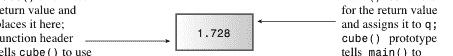

图 7.1 典型的返回值机制。

（通常，函数中有多个 return 语句被认为可能造成混淆，一些编译器可能会发出警告。不过，这里的代码足够简单，容易理解。）

有返回值的函数与 Pascal、FORTRAN 和 BASIC 中的函数非常相似。它们向调用程序返回一个值，调用程序随后可以将该值赋给变量、显示该值，或以其他方式使用它。下面是一个返回 double 类型值立方的简单示例：

```c
double cube(double x)   // x times x times x
{
    return x * x * x;   // a type double value
}
```

例如，函数调用 cube(1.2) 返回 1.728。注意，这个 return 语句使用了一个表达式。函数计算该表达式的值（本例中为 1.728），并返回该值。

### 函数原型与函数调用

到现在为止，你已经熟悉了进行函数调用，但你可能对函数原型还不太适应，因为它通常隐藏在包含文件中。代码清单 7.2 展示了在程序中使用 cheers() 和 cube() 函数的情况；注意其中的函数原型。


## 程序清单 7.2 **protos.cpp**

```cpp
#include <iostream>
void cheers(int);       // prototype: no return value
double cube(double x);  // prototype: returns a double
int main()
{
    using namespace std;
    cheers(5);           // function call
    cout << "Give me a number: ";
    double side;
    cin >> side;
    double volume = cube(side);   // function call
    cout << "A " << side << "-foot cube has a volume of ";
    cout << volume << " cubic feet.\n";
    cheers(cube(2));     // prototype protection at work
    return 0;
}

void cheers(int n)
{
    using namespace std;
    for (int i = 0; i < n; i++)
        cout << "Cheers! ";
    cout << endl;
}

double cube(double x)
{
    return x * x * x;
}
```

程序清单 7.2 中的程序只在那些使用 `std` 命名空间成员的函数中放置 `using` 指令。下面是一次示例运行：

```
Cheers! Cheers! Cheers! Cheers! Cheers!
Give me a number: 5
A 5-foot cube has a volume of 125 cubic feet.
Cheers! Cheers! Cheers! Cheers! Cheers! Cheers! Cheers!
```

注意，`main()` 通过使用函数名和参数后跟分号来调用 `void` 类型函数 `cheers()`：`cheers(5);`。这是一个函数调用语句的示例。但由于 `cube()` 有返回值，`main()` 可以将其用作赋值语句的一部分：

```
double volume = cube(side);
```

不过，函数原型并不要求你提供变量名；类型列表就足够了。程序清单 7.2 只使用参数类型来为 `cheers()` 提供原型：

```
void cheers(int);  // okay to drop variable names in prototype
```

一般来说，在原型参数列表中，你可以包含也可以省略变量名。原型中的变量名只起占位符的作用，因此即使你使用了名称，它们也不必与函数定义中的名称一致。

### C++ 与 ANSI C 的原型声明

> ANSI C 从 C++ 借用了原型声明，但这两种语言确实存在一些差异。最重要的是，为了保持与经典 C 的兼容性，ANSI C 将原型声明设为可选，而 C++ 则强制要求原型声明。例如，考虑以下函数声明：

```
void say_hi();
```

> 在 C++ 中，括号留空与在括号内使用关键字 `void` 相同。它表示该函数没有参数。在 ANSI C 中，括号留空意味着你拒绝说明参数是什么。也就是说，这意味着你放弃对参数列表进行原型声明。C++ 中不标识参数列表的等价做法是使用省略号：

```
void say_bye(...);  // C++ abdication of responsibility
```

> 通常，只有与参数数量可变的 C 函数（例如 `printf()`）对接时，才需要使用这种省略号用法。

### 原型能为你做什么

你已经看到原型可以帮助编译器。但它们能为你做什么呢？它们大大降低了程序出错的可能性。具体来说，原型确保以下事项：

- 编译器正确处理函数返回值。
- 编译器检查你使用的函数参数数量是否正确。
- 编译器检查你使用的参数类型是否正确。如果不正确，它会在可能的情况下将参数转换为正确的类型。

我们已经讨论过如何正确处理返回值。现在来看当你使用错误数量的参数时会发生什么。例如，假设你进行以下调用：

```
double z = cube();
```

不使用函数原型的编译器会放过这种情况。当调用该函数时，它会查找调用 `cube()` 时本应放置数值的位置，并使用恰好位于该处的任意值。在 ANSI C 从 C++ 借用原型声明之前，C 就是这样工作的。由于原型声明对 ANSI C 是可选的，一些 C 程序仍然这样工作。但在 C++ 中，原型声明不是可选的，因此你可以保证免受这类错误的影响。

接下来，假设你提供了一个参数，但类型错误。在 C 中，这可能会产生奇怪的错误。例如，如果一个函数期望一个 `int` 类型的值（假设为 16 位），而你传递了一个 `double`（假设为 64 位），该函数只会查看 64 位中的前 16 位，并试图将它们解释为一个 `int` 值。然而，只要两者都是算术类型，C++ 就会自动将你传递的值转换为原型中指定的类型。例如，程序清单 7.2 在一个语句中设法制造了两处类型不匹配：

```
cheers(cube(2));
```

首先，程序将 `int` 值 2 传递给 `cube()`，而该函数期望 `double` 类型。编译器注意到 `cube()` 原型指定了 `double` 类型参数，于是将 2 转换为 2.0，即一个 `double` 类型值。然后 `cube()` 返回一个 `double` 类型值（8.0），用作 `cheers()` 的参数。编译器再次检查原型，并注意到 `cheers()` 需要一个 `int`。它将返回值转换为整数 8。一般来说，原型声明会生成到预期类型的自动类型转换。（不过，第 8 章讨论的函数重载可能会产生歧义情况，从而阻止某些自动类型转换。）

自动类型转换并不能阻止所有可能的错误。例如，如果你将值 8.3E27 传递给一个期望 `int` 的函数，如此大的值无法正确转换为一个普通的 `int`。当从较大类型自动转换为较小类型时，一些编译器会警告你可能发生数据丢失。

此外，原型声明只有在合理时才会进行类型转换。例如，它不会将整数转换为结构体或联合体。

原型声明发生在编译时，被称为*静态类型检查*。正如你刚才所见，静态类型检查可以捕获许多在运行时更难捕获的错误。

### 函数参数与按值传递

现在该更仔细地看看函数参数了。C++ 通常*按值*传递参数。这意味着参数的数值被传递给函数，并在函数中赋给一个新变量。例如，程序清单 7.2 中有这个函数调用：

```
double volume = cube(side);
```

这里 `side` 是一个变量，在示例运行中的值为 5。回想一下，`cube()` 的函数头是：

```
double cube(double x)
```

当调用该函数时，它会创建一个名为 `x` 的新 `double` 类型变量，并用值 5 初始化它。这样就将 `main()` 中的数据与 `cube()` 中发生的操作隔离开来，因为 `cube()` 处理的是 `side` 的副本，而不是原始数据。

不过，提供变量名可以使原型更易于理解，特别是当两个参数类型相同时。这样名称可以提醒你哪个参数是哪个：

```
double melon_density(double weight, double volume);
```

程序清单 7.3 展示了一个带有两个参数的函数示例。它还说明了在函数中更改形参的值不会影响调用程序中的数据。

## 程序清单 7.3 **twoarg.cpp**

```cpp
// twoarg.cpp -- a function with 2 arguments
#include <iostream>
using namespace std;
void n_chars(char, int);
int main()
{
    int times;
    char ch;

    cout << "Enter a character: ";
    cin >> ch;
    while (ch != 'q')       // q to quit
    {
        cout << "Enter an integer: ";
        cin >> times;
        n_chars(ch, times); // function with two arguments
        cout << "\nEnter another character or press the"
             << " q-key to quit: ";
        cin >> ch;
    }
    cout << "The value of times is " << times << ".\n";
    cout << "Bye\n";
    return 0;
}

void n_chars(char c, int n) // displays c n times
{
    while (n-- > 0)       // continue until n reaches 0
        cout << c;
}
```

程序清单 7.3 中的程序说明了将 using 指令放在函数定义之上而不是函数内部的做法。下面是一次示例运行：

```
Enter a character: W
Enter an integer: 50
```


```
wwwwwwwwwwwwwwwwwwwwwwwwwwwwwwwwwwwwwwwwwwwwwwwwwwwwwwwwwwww
Enter another character or press the q-key to quit: a
Enter an integer: 20
aaaaaaaaaaaaaaaaaaaa
Enter another character or press the q-key to quit: q
The value of times is 20.
Bye
```

## 程序说明

程序清单 7.3 中的 `main()` 函数使用 while 循环来提供重复输入（同时让你保持对循环的熟练）。注意，它使用 `cin >> ch` 而不是 `cin.get(ch)` 或 `ch = cin.get()` 来读取字符。这是有充分理由的。回想一下，这两个 `cin.get()` 函数会读取所有输入字符，包括空格和换行符，而 `cin >>` 会跳过空格和换行符。当你响应程序提示时，必须在每行末尾按回车键，这样就会产生一个换行符。`cin >> ch` 方法可以方便地跳过这些换行符，但 `cin.get()` 系列函数会把每个输入数字后面的换行符读取为要显示的下一个字符。你可以通过编程绕过这个麻烦，但更简单的方法是像程序清单 7.3 那样使用 `cin`。

`n_chars()` 函数接受两个参数：一个字符 `c` 和一个整数 `n`。然后它使用一个循环来显示该字符，次数由整数指定：

```
while (n-- > 0)       // continue until n reaches 0
    cout << c;
```

注意，程序通过递减 `n` 变量来计数，其中 `n` 是参数列表中的形参。这个变量被赋值为 `main()` 中 `times` 变量的值。while 循环随后将 `n` 递减到 0，但正如示例运行所示，改变 `n` 的值不会影响 `times`。即使在 `main()` 中使用名称 `n` 而不是 `times`，`main()` 中的 `n` 的值也不会受到 `n_chars()` 中 `n` 值变化的影响。

## 另一个双参数函数

让我们创建一个更复杂的函数——一个执行非平凡计算的函数。此外，该函数还说明了如何使用函数形参以外的局部变量。

美国许多州现在都举办某种形式的乐透（Lotto）彩票游戏。乐透让你从一张卡片上选择一定数量的号码。例如，你可能会从一张有 51 个号码的卡片中挑选 6 个号码。然后乐透管理人员随机抽取 6 个号码。如果你的选择与他们的完全匹配，你就会赢几百万美元左右。我们的函数将计算你选中中奖号码的概率。（是的，一个能成功预测中奖号码本身的函数会更有用，但 C++ 虽然强大，尚未实现通灵能力。）

## 程序清单 7.4 lotto.cpp

```cpp
// lotto.cpp -- probability of winning
#include <iostream>
// Note: some implementations require double instead of long double
long double probability(unsigned numbers, unsigned picks);
int main()
{
    using namespace std;
    double total, choices;
    cout << "Enter the total number of choices on the game card and\n"
            "the number of picks allowed:\n";
    while ((cin >> total >> choices) && choices <= total)
    {
        cout << "You have one chance in ";
        cout << probability(total, choices);      // compute the odds
        cout << " of winning.\n";
        cout << "Next two numbers (q to quit): ";
    }
    cout << "bye\n";
    return 0;
}

// the following function calculates the probability of picking picks
// numbers correctly from numbers choices
long double probability(unsigned numbers, unsigned picks)
{
    long double result = 1.0;  // here come some local variables
    long double n;
    unsigned p;

    for (n = numbers, p = picks; p > 0; n--, p--)
        result = result * n / p;
    return result;
}
```

下面是程序清单 7.4 的示例运行：

```text
Enter the total number of choices on the game card and
the number of picks allowed:
49 6
You have one chance in 1.39838e+007 of winning.
Next two numbers (q to quit): 51 6
You have one chance in 1.80095e+007 of winning.
Next two numbers (q to quit): 38 6
You have one chance in 2.76068e+006 of winning.
Next two numbers (q to quit): q
bye
```

注意，增加游戏卡上的可选号码数量会大大增加获胜的难度。

## 程序说明

程序清单 7.4 中的 `probability()` 函数说明了函数中可以有的两种局部变量。首先是形参（`numbers` 和 `picks`），它们在函数头中、左花括号之前声明。然后是其他局部变量（`result`、`n` 和 `p`），它们在界定函数定义的花括号之间声明。形参与其他局部变量的主要区别在于，形参的值来自调用 `probability()` 的函数，而其他变量的值则来自函数内部。

## 函数与数组

到目前为止，本书中的示例函数都很简单，只使用基本类型作为参数和返回值。但函数是处理更复杂类型（如数组和结构）的关键。现在让我们来看看数组和函数如何相互配合。

假设你用一个数组来记录家庭野餐时每个人吃了多少块饼干。（每个数组索引对应一个人，元素的值对应那个人吃的饼干数量。）现在你想知道总数。这很容易，只需使用一个循环将所有数组元素相加即可。但将数组元素相加是一项非常常见的任务，因此设计一个函数来完成这项工作是有意义的。这样你就不必在每次需要对数组求和时都编写一个新的循环。

让我们考虑一下函数接口涉及什么。因为函数计算总和，所以它应该返回答案。如果你想保持饼干完好无损，可以使用返回 `int` 值的函数。为了让函数知道要对哪个数组求和，你需要将数组名作为参数传递。而为了使函数具有通用性，不受特定大小数组的限制，你需要传递数组的大小。这里唯一的新内容是，你必须声明其中一个形参是数组名。让我们看看相应的声明以及函数头的其余部分是什么样的：

```
int sum_arr(int arr[], int n) // arr = array name, n = size
```

这看起来似乎很有道理。方括号似乎表明 `arr` 是一个数组，而方括号为空的事实似乎表明你可以将函数用于任何大小的数组。但事情并不总是像它们看起来的那样：`arr` 实际上并不是数组；它是一个指针！好消息是，你可以像编写 `arr` 是数组一样编写函数的其余部分。首先，让我们用一个例子来验证这种方法是否可行，然后我们来探讨一下它为什么可行。

程序清单 7.5 演示了如何将指针用作数组名。程序将数组初始化为一些值，并使用 `sum_arr()` 函数计算总和。注意，`sum_arr()` 函数使用 `arr` 时就像它是一个数组名一样。

## 程序清单 7.5 arrfun1.cpp

```cpp
// arrfun1.cpp -- functions with an array argument
#include <iostream>
const int ArSize = 8;
int sum_arr(int arr[], int n);       // prototype
int main()
{
    using namespace std;
    int cookies[ArSize] = {1,2,4,8,16,32,64,128};
// some systems require preceding int with static to
// enable array initialization

    int sum = sum_arr(cookies, ArSize);
    cout << "Total cookies eaten: " << sum << "\n";
    return 0;
}

// return the sum of an integer array
int sum_arr(int arr[], int n)
{
    int total = 0;

    for (int i = 0; i < n; i++)
        total = total + arr[i];
    return total;
}
```

下面是程序清单 7.5 的运行输出：

```
Total cookies eaten: 255
```

如你所见，程序可以正常工作。现在我们来看看它为什么能工作。

## 指针如何实现数组处理函数

程序清单 7.5 的关键在于，C++ 与 C 一样，在大多数情况下将数组名视为指针。回想第 4 章“复合类型”，C++ 将数组名解释为其第一个元素的地址：

```
cookies == &cookies[0]   // array name is address of first element
```

（这条规则有几个例外。首先，数组声明使用数组名来标识存储空间。其次，对数组名应用 `sizeof` 会得到整个数组的大小（以字节为单位）。第三，正如第 4 章所述，对数组名应用地址运算符 `&` 会返回整个数组的地址；例如，如果 `int` 为 4 字节，则 `&cookies` 将是一个 32 字节内存块的地址。）


程序清单7.5 进行了如下函数调用：

```cpp
int sum = sum_arr(cookies, ArSize);
```

这里，`cookies` 是一个数组名，因此根据 C++ 的规则，`cookies` 是数组第一个元素的地址。函数传递的是一个地址。由于数组的元素类型为 `int`，所以 `cookies` 必须是 int 指针类型，即 `int *`。这意味着正确的函数头应该是这样：

```cpp
int sum_arr(int * arr, int n)  // arr = array name, n = size
```

这里 `int *arr` 取代了 `int arr[ ]`。事实证明，这两个函数头都是正确的，因为在 C++ 中，符号 `int *arr` 和 `int arr[ ]` 在函数头或函数原型中使用时（也仅在这种情况下）含义完全相同。两者都表示 `arr` 是一个指向 `int` 的指针。不过，数组表示法版本（`int arr[ ]`）在符号上提醒你：`arr` 不仅指向一个 `int`，而且指向 int 数组中的第一个 int。当指针指向数组的第一个元素时，本书使用数组表示法；当指针指向一个孤立的值时，则使用指针表示法。请记住，在任何其他上下文中，`int *arr` 和 `int arr[ ]` 都不是同义词。例如，不能在函数体内使用 `int[ ]` 表示法来声明指针。

既然变量 `arr` 实际上是一个指针，函数的其余部分也就顺理成章了。你可能还记得第4章讨论动态数组时的内容：无论使用数组名还是指针，都可以使用方括号数组表示法来访问数组元素。无论 `arr` 是指针还是数组名，表达式 arr[3] 都表示数组的第4个元素。此时提醒你注意以下两个恒等式，大概也无妨：

```cpp
arr[i] == *(arr + i)    // values in two notations
&arr[i] == arr + i      // addresses in two notations
```

记住，对指针（包括数组名）加 1，实际增加的数值等于该指针所指向类型的大小（以字节为单位）。指针加法和数组下标是从数组开头数元素的两种等价方式。

## 使用数组作为参数的含义

让我们来看看程序清单7.5的含义。函数调用 `sum_arr(cookies, ArSize)` 将 cookies 数组第一个元素的地址和数组的元素个数传递给 `sum_arr()` 函数。`sum_arr()` 函数将 cookies 地址初始化为指针变量 arr，并将 ArSize 初始化为 int 变量 n。这意味着程序清单7.5并未真正将数组内容传递给函数。相反，它告诉函数数组在哪里（地址）、元素是什么类型（类型）以及有多少个元素（n 变量）。（见图7.4。）有了这些信息，函数就可以使用原始数组。如果传递的是普通变量，函数使用的是副本；但如果传递的是数组，函数使用的是原始数据。实际上，这种差异并不违背 C++ 的按值传递方式。`sum_arr()` 函数仍然传递一个被赋给新变量的值。但这个值只是一个地址，而不是数组的内容。

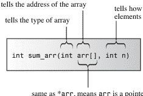

数组名和指针之间的这种对应关系是好事吗？确实如此。使用数组地址作为参数这一设计决策，节省了复制整个数组所需的时间和内存。如果处理的是大型数组，使用副本的开销可能会高得令人无法承受。使用副本时，程序不仅需要更多的计算机内存，还必须花时间复制大块数据。另一方面，使用原始数据会增加意外破坏数据的可能性。在经典 C 中，这是一个现实问题，但 ANSI C 和 C++ 的 `const` 限定符提供了一种补救措施。你很快就会看到示例。但首先，让我们修改程序清单7.5，以阐明数组函数是如何运作的。程序清单7.6 演示了 cookies 和 `arr` 具有相同的值。它还展示了指针概念如何使 `sum_arr` 函数比乍看起来更加通用。为了增加一点变化，并让你看到它的样子，程序使用了 `std::` 限定符而不是 using 指令来访问 `cout` 和 `endl`。

### 程序清单7.6 `arrfun2.cpp`

```cpp
// arrfun2.cpp -- functions with an array argument
#include <iostream>
const int ArSize = 8;
int sum_arr(int arr[], int n);
// use std:: instead of using directive
int main()
{
    int cookies[ArSize] = {1,2,4,8,16,32,64,128};
// some systems require #pragma once in with static to
// enable array initialization

    std::cout << cookies << " = array address, ";
    // some systems require a type cast: unsigned (cookies)

    std::cout << sizeof cookies << " = sizeof cookies\n";
    int sum = sum_arr(cookies, ArSize);
    std::cout << "Total cookies eaten: " << sum << std::endl;
    sum = sum_arr(cookies, 3);        // a lie
    std::cout << "First three eaters ate " << sum << " cookies.\n";
    sum = sum_arr(cookies + 4, 4);     // another lie
    std::cout << "Last four eaters ate " << sum << " cookies.\n";
    return 0;
}

// return the sum of an integer array
int sum_arr(int arr[], int n)
{
    int total = 0;
    std::cout << arr << " = arr ";
    // some systems require a type cast: unsigned (arr)

    std::cout << sizeof arr << " = sizeof arr\n";
    for (int i = 0; i < n; i++)
        total = total + arr[i];
    return total;
}
```

下面是程序清单7.6 的输出：

```text
003E9FC = array address, 32 = sizeof cookies
003E9FC = arr, 4 = sizeof arr
Total cookies eaten: 255
003E9FC = arr, 4 = sizeof arr
First three eaters ate 7 cookies.
003E9FA0 = arr, 4 = sizeof arr
Last four eaters ate 240 cookies.
```

注意，地址值以及数组和整数的大小会因系统而异。另外，有些实现会以十进制表示法而不是十六进制来显示地址。其他实现则会使用十六进制数字和 0x 十六进制前缀。

### 程序说明

程序清单7.6 阐明了有关数组函数的一些非常有趣的观点。首先，注意 cookies 和 arr 的求值结果都是同一个地址，与我们声称的完全一致。但是 sizeof cookies 是 32，而 sizeof arr 只有 4。这是因为 sizeof cookies 是整个数组的大小，而 sizeof arr 是指针变量的大小。（这次程序运行是在一个使用 4 字节地址的系统上进行的。）顺便说一下，这就是为什么你必须在 sum_arr() 中显式传递数组大小，而不是使用 sizeof arr 的原因；指针本身并不能揭示数组的大小。

由于 sum_arr() 知道数组中元素个数的唯一途径，是通过第二个参数告诉它的，所以你可以对函数撒谎。例如，程序第二次使用该函数时，进行了如下调用：

```cpp
sum = sum_arr(cookies, 3);
```

通过告诉函数 cookies 只有 3 个元素，你使得函数计算前 3 个元素的和。

何必要就此打住？你还可以在数组从哪里开始上撒谎：

```cpp
sum = sum_arr(cookies + 4, 4);
```

由于 cookies 充当第一个元素的地址，因此 cookies + 4 充当第五个元素的地址。这条语句对数组的第5、6、7、8个元素求和。注意输出中，对该函数的第三次调用给 arr 分配的地址与前两次调用不同。是的，你可以使用 &cookies[4] 而不是 cookies + 4 作为参数；两者的含义相同。

> **注意**
>
> 要向处理数组的函数指明数组的类型和元素个数，应将信息作为两个独立的参数传递：
>
>     void fillArray(int arr[], int size);    // prototype
>
> 不要试图使用方括号表示法传递数组大小：
>
>     void fillArray(int arr[size]);          // NO -- bad prototype

## 更多数组函数示例

当你选择使用数组来表示数据时，你正在做出一个设计决策。但设计决策不应仅限于数据存储方式，还应涉及数据的使用方式。你常常会发现，编写专门的函数来处理特定的数据操作是很有益处的。（这些益处包括提高程序的可靠性、便于修改和便于调试。）此外，当你开始在设计程序时将存储属性与操作结合起来时，你就向面向对象编程（OOP）的思维模式迈出了重要一步；这一点在未来也可能被证明是有益的。

让我们考察一个简单的案例。假设你想用一个数组来记录你的房地产的美元价值。（如果有必要，就假设你拥有房地产。）你必须决定使用什么类型。当然，double 在取值范围上比 int 或 long 限制更少，并且它提供了足够的有效数字来精确地表示这些值。接下来，你必须决定数组元素的个数。（对于用 new 创建的动态数组，你可以推迟这个决定，但这里我们还是简单一点。）假设你最多有五处房产，那么你就可以使用一个包含五个 double 的数组。

现在考虑一下你可能想对这个房地产数组执行哪些操作。两个最基本的操作是将值读入数组和显示数组

内容。让我们在列表中再添加一个操作：重新评估房产的价值。为简单起见，假设你所有房产的价值以相同速率上涨或下跌。（记住，这是一本关于 C++ 的书，而不是关于房地产管理的书。）接下来，为每个操作设计一个函数，然后相应地编写代码。接下来我们将逐步创建程序的这些部分。之后，我们会将它们整合到一个完整示例中。

## 填充数组

因为以数组名作为参数的函数访问的是原始数组，而不是副本，所以你可以使用函数调用为数组元素赋值。该函数的一个参数将是要填充的数组名。一般来说，程序可能管理不止一个人的投资，因此可能不止一个数组，所以你不希望把数组大小写死在函数里。相反，像前面的示例那样，把数组大小作为第二个参数传入。另外，你可能希望在填满数组之前就停止读取数据，所以你想把这一特性内置到函数中。因为你可能输入的元素数量少于最大数量，所以让函数返回实际输入的值数量是合理的。这些考虑引出了以下函数原型：

```cpp
int fill_array(double ar[], int limit);
```

该函数接收一个数组名参数和一个指定最多读取项数的参数，并返回实际读取的项数。例如，如果你对一个包含五个元素的数组使用该函数，就把 5 作为第二个参数传入。如果随后只输入三个值，函数返回 3。

你可以使用循环将连续的值读入数组，但如何提前终止循环呢？一种方法是使用一个特殊值来表示输入结束。由于任何房产都不应有负值，你可以用负数表示输入结束。此外，函数应当对错误输入做出处理，例如终止后续输入。基于这些考虑，可以按如下方式编写该函数：

```cpp
int fill_array(double ar[], int limit)
{
    using namespace std;
    double temp;
    int i;
    for (i = 0; i < limit; i++)
    {
        cout << "Enter value #" << (i + 1) << ": ";
        cin >> temp;
        if (!cin)    // bad input
        {
            cin.clear();
            while (cin.get() != '\n')
                continue;
            cout << "Bad input; input process terminated.\n";
            break;
        }
        else if (temp < 0) // signal to terminate
            break;
        ar[i] = temp;
    }
    return i;
}
```

注意，这段代码包含对用户的提示。如果用户输入非负值，该值会被赋给数组。否则，循环终止。如果用户只输入有效值，循环在读取 limit 个值后终止。循环做的最后一件事是递增 i，因此循环终止后，i 比最后一个数组索引大 1，也就等于已填充元素的数量。然后函数返回该值。

## 显示数组并用 `const` 保护它

构建一个显示数组内容的函数很简单。你把数组名和已填充元素的数量传给该函数，然后函数使用循环显示每个元素。但还有另一个考虑——确保显示函数不会改动原始数组。除非函数的目的是修改传给它的数据，否则你应当防止它这样做。对于普通参数，这种保护会自动获得，因为 C++ 按值传递它们，函数处理的是副本。但使用数组的函数处理的是原始数组。毕竟，这正是 `fill_array()` 函数能够完成工作的原因。为了防止函数意外修改数组参数的内容，你可以在声明形式参数时使用关键字 `const`（第 3 章“处理数据”中讨论过）：

```cpp
void show_array(const double ar[], int n);
```

该声明表明指针 ar 指向常量数据。这意味着你不能使用 ar 来更改数据。也就是说，你可以使用 ar[0] 这样的值，但不能更改该值。注意，这并不意味着原始数组必须是常量；它只是意味着你不能在 show_array() 函数中使用 ar 来更改数据。因此，show_array() 将数组视为只读数据。假设你在 show_array() 函数中做了类似下面的事情，意外违反了这一限制：

```cpp
ar[0] += 10;
```

在这种情况下，编译器会阻止你的错误做法。例如，Borland C++ 会给出类似这样的错误消息（略有编辑）：

```text
Cannot modify a const object in function
    show_array(const double *,int)
```

其他编译器可能会用不同的措辞表达不满。

该消息提醒你，C++ 将声明 const double ar[] 解释为 const double *ar。因此，该声明实际上表示 ar 指向一个常量值。我们会在完成当前示例后详细讨论这一点。与此同时，下面是 show_array() 函数的代码：

```cpp
void show_array(const double ar[], int n)
{
    using namespace std;
    for (int i = 0; i < n; i++)
    {
        cout << "Property #" << (i + 1) << ": $";
        cout << ar[i] << endl;
    }
}
```

## 修改数组

本例中数组的第三个操作是将每个元素乘以同一个重估系数。需要向函数传递三个参数：系数、数组和元素数量。不需要返回值，因此函数可以像这样：

```cpp
void revalue(double r, double ar[], int n)
{
    for (int i = 0; i < n; i++)
        ar[i] *= r;
}
```

因为这个函数应当修改数组值，所以声明 ar 时不使用 const。

## 整合各部分

既然你已经从数据如何存储（一个数组）以及如何使用（三个函数）的角度定义了一种数据类型，就可以整合出一个使用该设计的程序。因为已经构建了所有数组处理工具，你大大简化了 main() 的编程。该程序确实会检查用户是否用数字回应重估系数的提示。在这种情况下，如果用户没有按要求做，程序不会停止，而是使用循环要求用户做出正确回应。其余编程工作大部分就是让 main() 调用你刚刚开发的函数。程序清单 7.7 展示了结果。它只在那些使用 iostream 设施的函数中放置 using 指令。

### 程序清单 7.7 arrfun3.cpp

```cpp
// arrfun3.cpp -- array functions and const
#include <iostream>
const int Max = 5;

// function prototypes
int fill_array(double ar[], int limit);
void show_array(const double ar[], int n);  // don't change data
void revalue(double r, double ar[], int n);

int main()
{
    using namespace std;
    double properties[Max];

    int size = fill_array(properties, Max);
    show_array(properties, size);
    if (size > 0)
    {
        cout << "Enter revaluation factor: ";
        double factor;
        while (!(cin >> factor))    // bad input
        {
            cin.clear();
            while (cin.get() != '\n')
                continue;
            cout << "Bad input; Please enter a number: ";
        }
        revalue(factor, properties, size);
        show_array(properties, size);
    }
    cout << "Done.\n";
    cin.get();
    cin.get();
    return 0;
}

int fill_array(double ar[], int limit)
{
    using namespace std;
    double temp;
    int i;
    for (i = 0; i < limit; i++)
    {
        cout << "Enter value #" << (i + 1) << ": ";
        cin >> temp;
        if (!cin)    // bad input
        {
            cin.clear();
            while (cin.get() != '\n')
                continue;
            cout << "Bad input; input process terminated.\n";
```


```cpp
    break;
}
else if (temp < 0)       // signal to terminate
    break;
ar[i] = temp;
}
return i;
}

// the following function can use, but not alter,
// the array whose address is ar
void show_array(const double ar[], int n)
{
    using namespace std;
    for (int i = 0; i < n; i++)
    {
        cout << "Property #" << (i + 1) << ": $";
        cout << ar[i] << endl;
    }
}

// multiplies each element of ar[] by r
void revalue(double r, double ar[], int n)
{
    for (int i = 0; i < n; i++)
        ar[i] *= r;
}
```

以下是程序清单7.7中程序的两个示例运行：

```text
Enter value #1: 100000
Enter value #2: 80000
Enter value #3: 222000
Enter value #4: 240000
Enter value #5: 118000
Property #1: $100000
Property #2: $80000
Property #3: $222000
Property #4: $240000
Property #5: $118000
Enter revaluation factor: 0.8
Property #1: $80000
Property #2: $64000
Property #3: $177600
Property #4: $192000
Property #5: $94400
Done.
```

```text
Enter value #1: 200000
Enter value #2: 84000
Enter value #3: 160000
Enter value #4: -2
Property #1: $200000
Property #2: $84000
Property #3: $160000
Enter revaluation factor: 1.20
Property #1: $240000
Property #2: $100800
Property #3: $192000
Done.
```

回顾一下，`fill_array()`规定：当用户输入五处房产或输入负数时，以先发生者为准，输入应终止。第一个输出示例说明了达到五处房产上限的情况，第二个输出示例说明了输入负值会终止输入阶段。

### 程序说明

我们已经讨论了与房地产示例相关的重要编程细节，所以让我们反思一下这个过程。你首先考虑数据类型，并设计了适当的函数来处理数据。然后你把这些函数组装成一个程序。这有时被称为*自底向上编程*，因为设计过程是从组成部分走向整体。这种方法非常适合OOP，因为OOP首先关注数据表示和操作。另一方面，传统的过程式编程倾向于*自顶向下编程*，在这种方式中，你先开发一个模块化的总体设计，然后再关注细节。这两种方法都很有用，并且都会导向模块化程序。

### 常见的数组函数惯用法

假设你想要一个函数来处理数组，比如说，处理`double`类型的值。如果该函数打算修改数组，其原型可能如下所示：

```cpp
void f_modify(double ar[], int n);
```

如果该函数保持值不变，其原型可能如下所示：

```cpp
void f_no_change(const double ar[], int n);
```

当然，你可以省略原型中的变量名，并且返回类型也可能是`void`以外的其他类型。要点在于，`ar`实际上是指向所传递数组第一个元素的指针，并且由于元素数量是作为参数传递的，因此只要数组是`double`数组，这两个函数都可以用于任意大小的数组：

```cpp
double rewards[1000];
double faults[50];
. . .
f_modify(rewards, 1000);
f_modify(faults, 50);
```

这种惯用法（将数组名和大小作为参数传递）通过传递两个数字来工作——数组地址和元素数量。正如你所看到的，函数会丢失一些关于原始数组的信息；例如，它不能使用`sizeof`来获取大小，而是依赖你传递正确的元素数量。

### 使用数组范围的函数

正如你所看到的，处理数组的C++函数需要被告知数组中的数据类型、数组起始位置以及数组中的元素数量。处理数组的函数传统的C/C++做法是：将一个指向数组起始位置的指针作为第一个参数传递，并将数组大小作为第二个参数传递。（该指针告诉函数在哪里找到数组以及其中数据的类型。）这为函数提供了找到所有数据所需的信息。

还有另一种为函数提供所需信息的方法：指定一个元素范围。这可以通过传递两个指针来完成——一个标识数组的起始位置，另一个标识数组的结束位置。例如，C++标准模板库（STL；在第16章“string类和标准模板库”中介绍）将范围方法一般化。STL方法使用“尾后”的概念来表示范围。也就是说，对于数组而言，标识数组结束的参数将是指向最后一个元素之后位置的指针。例如，假设你有如下声明：

```cpp
double elboud[20];
```

那么两个指针`elboud`和`elboud + 20`就定义了该范围。首先，`elboud`作为数组名，指向第一个元素。表达式`elboud + 19`指向最后一个元素（即`elboud[19]`），因此`elboud + 20`指向数组末尾之后的位置。向函数传递一个范围会告诉它要处理哪些元素。程序清单7.8修改了程序清单7.6，使用两个指针来指定范围。

程序清单7.8  **arrfun4.cpp**

```cpp
// arrfun4.cpp -- functions with an array range
#include <iostream>
const int ArSize = 8;
int sum_arr(const int * begin, const int * end);
int main()
{
    using namespace std;
    int cookies[ArSize] = {1,2,4,8,16,32,64,128};
    // some systems require preceding int with static to
    // enable array initialization

    int sum = sum_arr(cookies, cookies + ArSize);
    cout << "Total cookies eaten: " << sum << endl;
    sum = sum_arr(cookies, cookies + 3);     // first 3 elements
    cout << "First three eaters ate " << sum << " cookies.\n";
    sum = sum_arr(cookies + 4, cookies + 8);    // last 4 elements
    cout << "Last four eaters ate " << sum << " cookies.\n";
    return 0;
}

// return the sum of an integer array
int sum_arr(const int * begin, const int * end)
{
    const int * pt;
    int total = 0;

    for (pt = begin; pt != end; pt++)
        total = total + *pt;
    return total;
}
```

以下是程序清单7.8中程序的输出：

```text
Total cookies eaten: 255
First three eaters ate 7 cookies.
Last four eaters ate 240 cookies.
```

### 程序说明

在程序清单7.8中，注意`sum_arr()`函数中的for循环：

```cpp
for (pt = begin; pt != end; pt++)
    total = total + *pt;
```

它把pt设置为指向要处理的第一个元素（即begin所指向的元素），并将*pt（该元素的值）加到total中。然后循环通过递增pt来更新它，使其指向下一个元素。只要pt != end，这个过程就会继续。当pt最终等于end时，它指向该范围最后一个元素之后的位置，因此循环停止。

其次，注意不同的函数调用如何指定数组中的不同范围：

```cpp
int sum = sum_arr(cookies, cookies + ArSize);
...
sum = sum_arr(cookies, cookies + 3);       // first 3 elements
...
sum = sum_arr(cookies + 4, cookies + 8);   // last 4 elements
```

指针值cookies + ArSize指向最后一个元素之后的位置。（数组有ArSize个元素，因此cookies[ArSize - 1]是最后一个元素，其地址是cookies + ArSize - 1。）所以范围cookies, cookies + ArSize指定整个数组。类似地，cookies, cookies + 3指定前三个元素，依此类推。

顺便注意，指针减法的规则意味着，在`sum_arr()`中，表达式`end - begin`是一个整数值，等于该范围中的元素数量。还要注意，按正确顺序传递指针很重要；代码假定`end`在`begin`之后。

### 指针与const

将const与指针一起使用有一些微妙的方面（指针似乎总是有微妙的方面），所以让我们更仔细地看看。你可以用两种不同的方式对指针使用const关键字。第一种方式是让指针指向一个常量对象，这阻止你使用该指针更改所指向的值。第二种方式是让指针本身成为常量，这阻止你更改指针指向的位置。现在来看细节。

首先，让我们声明一个指向常量的指针`pt`：

```cpp
int age = 39;
const int * pt = &age;
```

这个声明表明`pt`指向一个`const int`（在本例中是39）。因此，你不能使用`pt`更改该值。换句话说，值`*pt`是const，不能被修改：

```cpp
*pt += 1;       // INVALID because pt points to a const int
cin >> *pt;     // INVALID for the same reason
```

现在说一个微妙之处。这个`pt`声明并不一定意味着它指向的值实际上是常量；它只是意味着就`pt`而言，该值是常量。例如，`pt`指向`age`，而`age`不是const。你可以通过使用`age`变量直接更改`age`的值，但不能通过`pt`指针间接更改该值：

```cpp
*pt = 20;       // INVALID because pt points to a const int
age = 20;       // VALID because age is not declared to be const
```

前面的示例将普通变量的地址赋给普通指针。这个示例将普通变量的地址赋给指向const的指针。这样还剩下另外两种可能：将const变量的地址赋给指向const的指针，以及将const的地址赋给普通指针。这两种都可能吗？第一种可以，第二种不可以：

```cpp
const float g_earth = 9.80;
const float * pe = &g_earth;   // VALID
```

```cpp
const float g_moon = 1.63;
float * pm = &g_moon;          // INVALID
```

对于第一种情况，你既不能使用`g_earth`也不能使用`pe`来更改值9.80。C++不允许第二种情况，原因很简单：如果你可以把`g_moon`的地址赋给`pm`，那么你就可以作弊，使用`pm`来改变`g_moon`的值。那会使……成为笑柄


const 的状态，因此 C++ 禁止你将 const 的地址赋值给非 const 指针。（如果你实在想这么做，可以使用类型转换来绕过这一限制；关于 `const_cast` 运算符的讨论，请参见第 15 章“友元、异常及其他”。）

如果涉及指向指针的指针，情况会变得更为复杂。如前所述，将非 const 指针赋值给 const 指针是允许的，但前提是只涉及一层间接引用：

```cpp
int age = 39;        // age++ 是合法操作
int * pd = &age;     // *pd = 41 是合法操作
const int * pt = pd; // *pt = 42 是非法操作
```

但是，当涉及两层间接引用时，这种混合 const 与非 const 的指针赋值就不再安全。如果允许混合 const 与非 const，你就可以做出如下操作：

```cpp
const int **pp2;
int *p1;
const int n = 13;
pp2 = &p1; // 不允许，但假设允许
*pp2 = &n; // 合法，两者都是 const，但会将 p1 设置为指向 n
*p1 = 10;  // 合法，但修改了 const n
```

这里的代码将非 const 地址（`&p1`）赋值给 const 指针（`pp2`），从而允许 p1 被用来修改 const 数据。因此，“可以将非 const 地址或指针赋值给 const 指针”这一规则仅适用于只有一层间接引用的情况——例如，指针指向基本数据类型时。

> **注意**
> 
> 你可以将 const 数据或非 const 数据的地址赋值给指向 const 的指针，前提是数据类型本身不是指针；但只能将非 const 数据的地址赋值给非 const 指针。

假设你有一个 const 数据数组：

```cpp
const int months[12] = {31,28,31,30,31,30, 31, 31,30,31,30,31};
```

禁止将常量数组的地址赋值给非 const 指针，意味着你不能将数组名作为参数传递给使用非 const 形参的函数：

```cpp
int sum(int arr[], int n); // 应为 const int arr[]
...
int j = sum(months, 12);   // 不允许
```

这个函数调用试图将 const 指针（`months`）赋值给非 const 指针（`arr`），编译器会拒绝该函数调用。

### 尽可能使用 const

将指针参数声明为指向常量数据的指针有两个强有力的理由：

- 它可以防止编程错误导致无意中修改数据。
- 使用 const 允许函数同时处理 const 和非 const 的实际参数，而在原型中省略 const 的函数只能接受非 const 数据。

只要合适，你就应该将正式指针参数声明为指向 const 的指针。

再来看一个容易忽略的细节，考虑以下声明：

```cpp
int age = 39;
const int * pt = &age;
```

第二个声明中的 const 只阻止你修改 pt 所指向的值，即 39。它并不阻止你修改 pt 本身的值。也就是说，你可以给 pt 赋一个新地址：

```cpp
int sage = 80;
pt = &sage;  // 可以指向另一个位置
```

但你仍然不能使用 pt 来修改它所指向的值（现在是 80）。

第二种使用 const 的方式是使指针本身的值不能被修改：

```cpp
int sloth = 3;
const int * ps = &sloth;      // 指向 const int 的指针
int * const finger = &sloth;  // 指向 int 的 const 指针
```

注意，最后一个声明将关键字 const 重新定位了。这种声明形式将 finger 限制为只能指向 sloth。但是，它允许你使用 finger 来修改 sloth 的值。中间的声明不允许你使用 ps 来修改 sloth 的值，但允许 ps 指向另一个位置。简而言之，finger 和 *ps 都是 const，而 *finger 和 ps 不是 const（见图 7.5）。

如果你愿意，还可以声明一个指向 const 对象的 const 指针：

```cpp
double trouble = 2.0E30;
const double * const stick = &trouble;
```

这里 stick 只能指向 trouble，并且不能使用 stick 来修改 trouble 的值。简而言之，stick 和 *stick 都是 const。

通常，在将指针作为函数参数传递时，你会使用指向 const 的指针形式来保护数据。例如，回忆清单 7.5 中的 show_array() 原型：

```cpp
void show_array(const double ar[], int n);
```

在这个声明中使用 const，意味着 show_array() 不能修改传递给它的任何数组中的值。只要只有一层间接引用，这种技术就有效。例如，这里的数组元素是基本类型。但如果它们是指针或指向指针的指针，你就不应该使用 const。

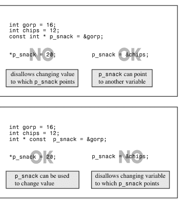

### 函数与二维数组

要编写一个以二维数组为参数的函数，你需要记住数组名被视为其地址，因此相应的形参是一个指针，就像一维数组一样。棘手之处在于正确声明指针。例如，假设你从以下代码开始：

```cpp
int data[3][4] = {{1,2,3,4}, {9,8,7,6}, {2,4,6,8}};
int total = sum(data, 3);
```

sum() 的原型应该是什么样子？为什么函数将行数（3）作为参数传递，而不也将列数（4）作为参数传递？

好吧，data 是一个包含三个元素的数组的名称。第一个元素本身是一个包含四个 int 值的数组。因此，data 的类型是指向包含四个 int 的数组的指针，所以合适的原型应该是：

```cpp
int sum(int (*ar2)[4], int size);
```

括号是必需的，因为下面的声明会声明一个包含四个指向 int 的指针的数组，而不是一个指向包含四个 int 的数组的指针，而函数参数不能是数组：

```cpp
int *ar2[4]
```

还有另一种格式与第一个原型意义完全相同，但或许更容易阅读：

```cpp
int sum(int ar2[][4], int size);
```

两个原型都表明 `ar2` 是一个指针，而不是数组。还要注意，指针类型明确指出它指向一个包含四个 int 的数组。因此，指针类型指定了列数，这就是为什么列数不单独作为函数参数传递的原因。

因为指针类型指定了列数，`sum()` 函数只能处理具有四列的数组。但行数由变量 size 指定，因此 `sum()` 可以处理不同行数的数组：

```cpp
int a[100][4];
int b[6][4];
...
int total1 = sum(a, 100);   // 对 a 的所有元素求和
int total2 = sum(b, 6);     // 对 b 的所有元素求和
int total3 = sum(a, 10);    // 对 a 的前 10 行求和
int total4 = sum(a+10, 20); // 对 a 的接下来 20 行求和
```

鉴于参数 `ar2` 是一个指向数组的指针，你如何在函数定义中使用它呢？最简单的方式是将 `ar2` 当作二维数组的名称来使用。下面是一个可能的函数定义：

```cpp
int sum(int ar2[][4], int size)
{
    int total = 0;
    for (int r = 0; r < size; r++)
        for (int c = 0; c < 4; c++)
            total += ar2[r][c];
    return total;
}
```

再次注意，行数是传递给 size 参数的任意值，但列数固定为四，无论是在 `ar2` 的参数声明中还是在内部的 `for` 循环中。

下面解释为什么可以使用数组表示法。由于 `ar2` 指向一个数组的首元素（元素 0），该数组的元素是包含四个 int 的数组，因此表达式 `ar2 + r` 指向第 r 个元素。所以 `ar2[r]` 是第 r 个元素。该元素本身是一个包含四个 int 的数组，因此 `ar2[r]` 是这个包含四个 int 的数组的名称。对数组名应用下标会得到数组元素，所以 `ar2[r][c]` 是包含四个 int 的数组中的一个元素，即一个 `int` 值。指针 `ar2` 必须被解引用两次才能得到


C 风格字符串与常规数组的一个重要区别是，字符串带有内置的终止字符。（回想一下，包含字符但没有空字符的 char 数组只是一个数组，而不是字符串。）这意味着你不必把字符串的大小作为实参传入。相反，函数可以使用循环依次检查字符串中的每个字符，直到循环到达终止空字符。程序清单 7.9 用一个函数说明了这种方法，该函数统计给定字符在字符串中出现的次数。由于程序不需要处理负值，因此使用 `unsigned int` 作为计数类型。

### 程序清单 7.9 `strgfun.cpp`

```cpp
// strgfun.cpp -- functions with a string argument
#include <iostream>
unsigned int c_in_str(const char * str, char ch);
int main()
{
    using namespace std;
    char mmm[15] = "minimum";    // string in an array
    // some systems require preceding char with static to
    // enable array initialization

    char *wail = "ululate";     // wail points to string

    unsigned int ms = c_in_str(mmm, 'm');
    unsigned int us = c_in_str(wail, 'u');
    cout << ms << " m characters in " << mmm << endl;
    cout << us << " u characters in " << wail << endl;
    return 0;
}

// this function counts the number of ch characters
// in the string str
unsigned int c_in_str(const char * str, char ch)
{
    unsigned int count = 0;

    while (*str)        // quit when *str is '\0'
    {
        if (*str == ch)
            count++;
        str++;           // move pointer to next char
    }
    return count;
}
```

下面是程序清单 7.9 中程序的输出：

```text
3 m characters in minimum
2 u characters in ululate
```

### 程序说明

由于程序清单 7.9 中的 `c_in_str()` 函数不应修改原始字符串，因此它在声明形参 `str` 时使用了 `const` 修饰符。这样，如果你误让函数修改字符串的某一部分，编译器就会捕获你的错误。当然，你也可以改用数组表示法在函数头中声明 `str`：

```cpp
unsigned int c_in_str(const char str[], char ch)  // also okay
```

不过，使用指针表示法可以提醒你：实参不必是数组名，也可以是其他形式的指针。

该函数本身演示了处理字符串中字符的标准方式：

```cpp
while (*str)
{
    statements
    str++;
}
```

最初，`str` 指向字符串中的第一个字符，因此 `*str` 表示第一个字符本身。例如，在第一次函数调用之后，`*str` 的值为 `m`，即 `minimum` 中的第一个字符。只要该字符不是空字符（`\0`），`*str` 就非零，因此循环继续。在每次循环结束时，表达式 `str++` 将指针增加 1 个字节，使其指向字符串中的下一个字符。最终，`str` 指向终止空字符，使 `*str` 等于 0，也就是空字符的数值编码。该条件会终止循环。（为什么字符串处理函数如此“无情”？因为它们不达目的不罢休。）

## 返回 C 风格字符串的函数

现在假设你想编写一个返回字符串的函数。嗯，函数不能直接这样做。但它可以返回字符串的地址，而且这样更高效。例如，程序清单 7.10 定义了一个名为 `buildstr()` 的函数，它返回一个指针。该函数接受两个实参：一个字符和一个数字。函数使用 `new` 创建一个长度等于该数字的字符串，然后将每个元素初始化为该字符。接着，它返回指向新字符串的指针。

### 程序清单 7.10 `strgback.cpp`

```cpp
// strgback.cpp -- a function that returns a pointer to char
#include <iostream>
char * buildstr(char c, int n);    // prototype
int main()
{
    using namespace std;
    int times;
    char ch;

    cout << "Enter a character: ";
    cin >> ch;
    cout << "Enter an integer: ";
    cin >> times;
    char * ps = buildstr(ch, times);
    cout << ps << endl;
    delete [] ps;                 // free memory
    ps = buildstr('+', 20);       // reuse pointer
    cout << ps << "-DONE-" << ps << endl;
    delete [] ps;                 // free memory
    return 0;
}

// builds string made of n c characters
char * buildstr(char c, int n)
{
    char * pstr = new char[n + 1];
    pstr[n] = '\0';           // terminate string
    while (n-- > 0)
        pstr[n] = c;          // fill rest of string
    return pstr;
}
```

下面是程序清单 7.10 中程序的一次示例运行：

```text
Enter a character: V
Enter an integer: 46
VVVVVVVVVVVVVVVVVVVVVVVVVVVVVVVVVVVVVVVVVVVVVV
++++++++++++++++++++-DONE-++++++++++++++++++++
```

### 程序说明

要创建一个包含 n 个可见字符的字符串，你需要存储 n + 1 个字符，以便为空字符留出空间。因此，程序清单 7.10 中的函数请求 n + 1 个字节来保存该字符串。接下来，它将最后一个字节设置为空字符。然后，它从后向前填充数组的其余部分。在程序清单 7.10 中，下面的循环在 n 递减到 0 的过程中循环 n 次，填充 n 个元素：

```cpp
while (n-- > 0)
    pstr[n] = c;
```

在最后一次循环开始时，n 的值为 1。由于 `n--` 表示先使用该值再将其递减，`while` 循环的测试条件会将 1 与 0 比较，发现测试为真，于是继续执行。但在完成测试后，函数会将 n 递减为 0，因此 `pstr[0]` 是最后一个被设置为 c 的元素。从后向前而不是从前向后填充字符串的原因，是为了避免使用额外的变量。如果采用另一种顺序，就会涉及类似下面的代码：

```cpp
int i = 0;
while (i < n)
    pstr[i++] = c;
```

注意，变量 `pstr` 是 `buildstr` 函数的局部变量，因此当该函数终止时，用于 `pstr` 的内存（但不是用于字符串的内存）会被释放。但由于函数返回 `pstr` 的值，程序能够通过 `main()` 中的 `ps` 指针访问新字符串。

程序清单 7.10 中的程序在字符串不再需要后，使用 `delete` 释放用于该字符串的内存。然后它复用 `ps`，使其指向为下一个字符串获得的新内存块，并释放该内存。这种设计（让函数返回指向由 `new` 分配的内存的指针）的缺点是，它让程序员有责任记住使用 `delete`。在第 12 章“类和动态内存分配”中，你将看到 C++ 类如何通过使用构造函数和析构函数来替你处理这些细节。

## 函数和结构

让我们从数组转向结构。为结构编写函数比为数组编写函数更容易。尽管结构变量与数组相似，二者都能保存多个数据项，但在函数方面，结构变量的行为就像基本的单值变量。也就是说，与数组不同，结构将其数据绑定到一个单一实体或数据对象中，并作为一个单元来处理。回想一下，你可以将一个结构赋给另一个结构。同样，你可以按值传递结构，就像传递普通变量一样。在这种情况下，函数处理的是原始结构的副本。此外，函数还可以返回结构。这里没有像数组名就是其首元素地址那样的古怪行为。结构的名称就是结构的名称；如果你想获得它的地址，就必须使用 `&` 地址运算符。（C++ 和 C 都使用 `&` 符号表示地址运算符。C++ 还使用该运算符来标识引用变量，这将在第 8 章讨论。）

使用结构编程最直接的方法，就是像对待基本类型那样对待它们——也就是说，将它们作为实参传递，并在必要时用作返回值。然而，按值传递结构有一个缺点。如果结构很大，制作结构副本所涉及的空间和工作量可能会增加内存需求并拖慢系统。出于这些原因（也因为 C 最初不允许按值传递结构），许多 C 程序员更愿意传递结构的地址，然后使用指针访问结构内容。C++ 提供了第三种选择，称为按引用传递，这将在第 8 章讨论。现在让我们考察另外两种选择，先从传递和返回整个结构开始。


## 传递与返回结构体

当结构体相对紧凑时，按值传递结构体最有意义，因此我们来看几个沿着这个思路的例子。第一个例子涉及旅行时间（不要与时间旅行混淆）。有些地图会告诉你，从 Thunder Falls 到 Bingo City 需要 3 小时 50 分钟，从 Bingo City 到 Grotesque 需要 1 小时 25 分钟。你可以用一个结构体表示这类时间，用一个成员表示小时值，用第二个成员表示分钟值。把两个时间相加有点棘手，因为你可能得把一部分分钟转移到小时部分。例如，前面两个时间相加得到 4 小时 75 分钟，应转换为 5 小时 15 分钟。我们来开发一个表示时间值的结构体，然后开发一个函数，它接受两个这样的结构体作为参数，并返回表示它们之和的结构体。

定义这个结构体很简单：

```cpp
struct travel_time
{
    int hours;
    int mins;
};
```

接下来，考虑一个 `sum()` 函数的原型，该函数返回两个这样的结构体之和。返回值类型应为 `travel_time`，两个参数也应是该类型。因此，原型应如下所示：

```cpp
travel_time sum(travel_time t1, travel_time t2);
```

要相加两个时间，首先把分钟成员相加。除以 60 的整数除法得到要进位的小时数，取模运算（%）得到剩余的分钟数。代码清单 7.11 将这种方法纳入 `sum()` 函数，并添加一个 `show_time()` 函数来显示 `travel_time` 结构体的内容。

### 代码清单 7.11 travel.cpp

```cpp
// travel.cpp -- using structures with functions
#include <iostream>
struct travel_time
{
    int hours;
    int mins;
};
const int Mins_per_hr = 60;

travel_time sum(travel_time t1, travel_time t2);
void show_time(travel_time t);

int main()
{
    using namespace std;
    travel_time day1 = {5, 45};    // 5 hrs, 45 min
    travel_time day2 = {4, 55};    // 4 hrs, 55 min

    travel_time trip = sum(day1, day2);
    cout << "Two-day total: ";
    show_time(trip);

    travel_time day3 = {4, 32};
    cout << "Three-day total: ";
    show_time(sum(trip, day3));

    return 0;
}

travel_time sum(travel_time t1, travel_time t2)
{
    travel_time total;

    total.mins = (t1.mins + t2.mins) % Mins_per_hr;
    total.hours = t1.hours + t2.hours +
                  (t1.mins + t2.mins) / Mins_per_hr;
    return total;
}

void show_time(travel_time t)
{
    using namespace std;
    cout << t.hours << " hours, "
         << t.mins << " minutes\n";
}
```

这里，`travel_time` 的作用就像标准类型名一样；你可以用它声明变量、函数返回类型和函数参数类型。因为 `total` 和 `t1` 等变量是 `travel_time` 结构体，所以可以对它们应用点成员运算符。注意，由于 `sum()` 函数返回一个 `travel_time` 结构体，你可以把它用作 `show_time()` 函数的参数。因为 C++ 函数默认按值传递参数，所以函数调用 `show_time(sum(trip, day3))` 会先求值 `sum(trip, day3)` 函数调用以得到其返回值。然后，`show_time()` 调用把 `sum()` 的返回值（而不是函数本身）传递给 `show_time()`。代码清单 7.11 中程序的输出如下：

```text
Two-day total: 10 hours, 40 minutes
Three-day total: 15 hours, 12 minutes
```

## 使用函数和结构体的另一个示例

你学到的关于函数和 C++ 结构体的许多内容也适用于 C++ 类，因此值得再看第二个示例。这一次我们处理空间而不是时间。具体来说，这个示例定义了两个结构体，表示描述位置的两种不同方式，然后开发函数把一种形式转换为另一种形式并显示结果。这个示例比上一个更偏数学，但你不必理解数学也能理解 C++。

假设你想描述屏幕上某个点的位置，或地图上某个相对于某个原点的位置。一种方式是说明该点相对于原点的水平偏移量和垂直偏移量。传统上，数学家使用符号 x 表示水平偏移量，使用 y 表示垂直偏移量（见图 7.6）。x 和 y 一起构成*直角坐标*。你可以定义一个由两个坐标组成的结构体来表示位置：

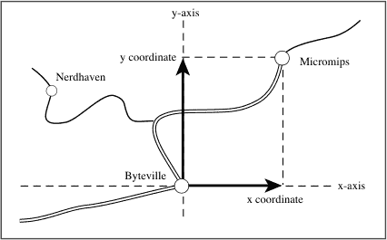

Micromips 相对于 Byteville 的直角坐标

图 7.6 直角坐标。

```cpp
struct rect
{
    double x;        // horizontal distance from origin
    double y;        // vertical distance from origin
};
```

描述点的位置的第二种方式是说明它离原点有多远，以及它处于什么方向（例如，东偏北 40 度）。传统上，数学家从正水平轴开始逆时针测量角度（见图 7.7）。距离和角度一起构成*极坐标*。你可以定义第二个结构体来表示这种位置视图：

```cpp
struct polar
{
    double distance;   // distance from origin
    double angle;      // direction from origin
};
```

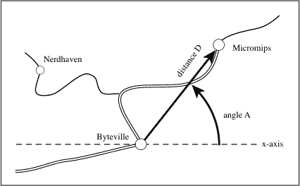

Micromips 相对于 Byteville 的极坐标

图 7.7 极坐标。

我们来构造一个函数，用于显示 `polar` 类型结构体的内容。C++ 库中的数学函数（借自 C）假定角度以弧度为单位，因此你需要以该单位测量角度。但为了显示，你可以把弧度值转换为度。这意味着乘以 180/π，约等于 57.29577951。该函数如下：

```cpp
// show polar coordinates, converting angle to degrees
void show_polar (polar dapos)
{
    using namespace std;
    const double Rad_to_deg = 57.29577951;

    cout << "distance = " << dapos.distance;
    cout << ", angle = " << dapos.angle * Rad_to_deg;
    cout << " degrees\n";
}
```

注意，形参变量是 `polar` 类型。当你把 `polar` 结构体传递给这个函数时，结构体内容会被复制到 `dapos` 结构体中，然后函数在其工作中使用该副本。因为 `dapos` 是结构体，所以函数使用成员（点）运算符（见第 4 章）来标识结构体成员。

接下来，我们尝试更有野心的事情：编写一个把直角坐标转换为极坐标的函数。我们将让该函数接受一个 `rect` 结构体作为参数，并向调用函数返回一个 `polar` 结构体。这涉及使用数学库中的函数，因此程序必须包含 `cmath` 头文件（在较旧系统上为 `math.h`）。此外，在某些系统上，你必须告诉编译器加载数学库（见第 1 章“C++ 入门”）。你可以使用勾股定理从水平和垂直分量得到距离：

`distance = sqrt( x * x + y * y )`

数学库中的 `atan2()` 函数根据 x 和 y 值计算角度：

`angle = atan2(y, x)`

（还有一个 `atan()` 函数，但它不能区分相差 180 度的角度。数学函数中的这种不确定性，并不比荒野向导身上的不确定性更可取。）

有了这些公式，你可以按如下方式编写函数：

```cpp
// convert rectangular to polar coordinates
polar rect_to_polar(rect xypos)   // type polar
{
    polar answer;

    answer.distance =
        sqrt( xypos.x * xypos.x + xypos.y * xypos.y);
    answer.angle = atan2(xypos.y, xypos.x);
    return answer;      // returns a polar structure
}
```

现在函数已经准备好了，编写程序的其余部分就很直接。代码清单 7.12 展示了结果。

### 代码清单 7.12 structfun.cpp

```cpp
// structfun.cpp -- functions with a structure argument
#include <iostream>
#include <cmath>

// structure declarations
struct polar
{
    double distance;    // distance from origin
    double angle;       // direction from origin
};
struct rect
```


```cpp
{
    double x;              // horizontal distance from origin
    double y;              // vertical distance from origin
};

// prototypes
polar rect_to_polar(rect xypos);
void show_polar(polar dapos);

int main()
{
    using namespace std;
    rect rplace;
    polar pplace;

    cout << "Enter the x and y values: ";
    while (cin >> rplace.x >> rplace.y) // slick use of cin
    {
        pplace = rect_to_polar(rplace);
        show_polar(pplace);
        cout << "Next two numbers (q to quit): ";
    }
    cout << "Done.\n";
    return 0;
}

// convert rectangular to polar coordinates
polar rect_to_polar(rect xypos)
{
    using namespace std;
    polar answer;

    answer.distance =
        sqrt(xypos.x * xypos.x + xypos.y * xypos.y);
    answer.angle = atan2(xypos.y, xypos.x);
    return answer;        // returns a polar structure
}

// show polar coordinates, converting angle to degrees
void show_polar (polar dapos)
{
    using namespace std;
    const double Rad_to_deg = 57.29577951;

    cout << "distance = " << dapos.distance;
    cout << ", angle = " << dapos.angle * Rad_to_deg;
    cout << " degrees\n";
}
```

## 注意

有些编译器需要显式指令来搜索数学库。例如，较旧版本的 g++ 使用以下命令行：

```
g++ structfun.C -lm
```

下面是程序清单 7.12 中程序的一次示例运行：

```
Enter the x and y values: 30 40
 distance = 50, angle = 53.1301 degrees
Next two numbers (q to quit): -100 100
 distance = 141.421, angle = 135 degrees
Next two numbers (q to quit): q
```

## 程序说明

我们已经讨论过程序清单 7.12 中的两个函数，所以让我们回顾一下该程序如何使用 cin 控制 while 循环：

```
while (cin >> rplace.x >> rplace.y)
```

回想一下，cin 是 istream 类的对象。提取运算符（>>）的设计方式是，`cin >> rplace.x` 也是该类型的对象。你将在第 11 章“使用类”中看到，类运算符是通过函数实现的。使用 `cin >> rplace.x` 时真正发生的是，程序调用一个返回 istream 类型值的函数。如果你对 `cin >> rplace.x` 对象应用提取运算符（如 `cin >> rplace.x >> rplace.y`），你又会得到一个 istream 类的对象。因此，整个 while 循环测试表达式最终求值为 cin，而你可能还记得，当 cin 用在测试表达式的上下文中时，会根据输入是否成功转换为 bool 值 true 或 false。例如，在程序清单 7.12 的循环中，cin 期望用户输入两个数字。相反，如果用户输入 q，如示例输出所示，`cin >>` 会识别出 q 不是数字。它把 q 留在输入队列中，并返回一个被转换为 false 的值，从而终止循环。

将这种读取数字的方法与下面这个更简单的方法进行比较：

```
for (int i = 0; i < limit; i++)
{
    cout << "Enter value #" << (i + 1) << ": ";
    cin >> temp;
    if (temp < 0)
        break;
    ar[i] = temp;
}
```

要提前终止这个循环，你可以输入一个负数。这会把输入限制为非负值。这种限制符合某些程序的需要，但更常见的是，你会希望有一种不会排除某些数值的循环终止方式。使用 `cin >>` 作为测试条件可以消除这种限制，因为它接受所有有效的数字输入。当你需要为数字编写输入循环时，应该记住这个技巧。此外，你还应该记住，非数字输入会设置错误条件，从而阻止读取更多输入。如果程序在输入循环之后还需要输入，你必须使用 `cin.clear()` 来重置输入，然后可能还需要通过读取来清除有问题的输入。程序清单 7.7 说明了这些技巧。

## 传递结构地址

假设你想通过传递结构的地址而不是传递整个结构来节省时间和空间。这需要重写函数，使它们使用指向结构的指针。首先，让我们看看如何重写 `show_polar()` 函数。你需要做三处修改：

- 调用函数时，向它传递结构的地址（`&place`），而不是结构本身（`place`）。
- 将形参声明为指向 polar 的指针，即类型 `polar *`。因为函数不应修改结构，所以使用 `const` 修饰符。
- 因为形参是指针而不是结构，所以使用间接成员运算符（`->`）而不是成员运算符（点）。

完成这些修改后，函数如下所示：

```cpp
// show polar coordinates, converting angle to degrees
void show_polar (const polar * pda)
{
    using namespace std;
    const double Rad_to_deg = 57.29577951;

    cout << "distance = " << pda->distance;
    cout << ", angle = " << pda->angle * Rad_to_deg;
    cout << " degrees\n";
}
```

接下来，让我们修改 `rect_to_polar`。这涉及的内容更多，因为原来的 `rect_to_polar` 函数返回一个结构。为了充分利用指针的效率，你应该使用指针而不是返回值。做到这一点的方法是向函数传递两个指针。第一个指针指向要转换的结构，第二个指针指向用于保存转换结果的结构。函数不返回新结构，而是修改调用函数中的现有结构。因此，虽然第一个参数是 `const` 指针，但第二个参数不是 `const`。除此之外，你应用用于将 `show_polar()` 转换为指针参数的相同原则。程序清单 7.13 展示了改写后的程序。

## 程序清单 7.13 strctptr.cpp

```cpp
// strctptr.cpp -- functions with pointer to structure arguments
#include <iostream>
#include <cmath>

// structure templates
struct polar
{
    double distance;       // distance from origin
    double angle;          // direction from origin
};
struct rect
{
    double x;              // horizontal distance from origin
    double y;              // vertical distance from origin
};

// prototypes
void rect_to_polar(const rect * pxy, polar * pda);
void show_polar(const polar * pda);

int main()
{
    using namespace std;
    rect rplace;
    polar pplace;

    cout << "Enter the x and y values: ";
    while (cin >> rplace.x >> rplace.y)
    {
        rect_to_polar(&rplace, &pplace);    // pass addresses
        show_polar(&pplace);                // pass address
        cout << "Next two numbers (q to quit): ";
    }
    cout << "Done.\n";
    return 0;
}

// show polar coordinates, converting angle to degrees
void show_polar (const polar * pda)
{
    using namespace std;
    const double Rad_to_deg = 57.29577951;

    cout << " distance = " << pda->distance;
    cout << ", angle = " << pda->angle * Rad_to_deg;
    cout << " degrees\n";
}

// convert rectangular to polar coordinates
void rect_to_polar(const rect * pxy, polar * pda)
{
    using namespace std;
    pda->distance =
        sqrt(pxy->x * pxy->x + pxy->y * pxy->y);
    pda->angle = atan2(pxy->y, pxy->x);
}
```

> **注意**
> 
> 有些编译器需要显式指令来搜索数学库。例如，较旧版本的 g++ 使用以下命令行：
> 
> ```bash
> g++ structfun.C -lm
> ```

从用户的角度来看，程序清单 7.13 中的程序行为与程序清单 7.12 中的程序相同。隐藏的区别在于，程序清单 7.12 处理的是结构的副本，而程序清单 7.13 使用指针，允许函数操作原始结构。

## 函数与 `string` 类对象

尽管 C 风格字符串和 `string` 类对象的作用大致相同，但 `string` 类对象与结构的关系比与数组的关系更密切。例如，你可以将一个结构赋给另一个结构，也可以将一个对象赋给另一个对象。你可以将结构作为完整实体传递给函数，也可以将对象作为完整实体传递。如果你需要多个字符串，可以声明一个 `string` 对象的一维数组，而不是 char 的二维数组。

程序清单 7.14 提供了一个简短示例，它声明一个 string 对象数组，并将该数组传递给一个显示其内容的函数。

### 程序清单 7.14 `topfive.cpp`

```cpp
// topfive.cpp -- handling an array of string objects
#include <iostream>
#include <string>
using namespace std;
const int SIZE = 5;
void display(const string sa[], int n);
int main()
{
    string list[SIZE];    // an array holding 5 string object
    cout << "Enter your " << SIZE << " favorite astronomical sights:\n";
```


```cpp
for (int i = 0; i < SIZE; i++)
{
    cout << i + 1 << ": ";
    getline(cin, list[i]);
}

cout << "Your list:\n";
display(list, SIZE);

return 0;
}

void display(const string sa[], int n)
{
    for (int i = 0; i < n; i++)
        cout << i + 1 << ": " << sa[i] << endl;
}
```

下面是程序清单 7.14 中程序的一次示例运行：

```text
Enter your 5 favorite astronomical sights:
1: Orion Nebula
2: M13
3: Saturn
4: Jupiter
5: Moon
Your list:
1: Orion Nebula
2: M13
3: Saturn
4: Jupiter
5: Moon
```

这个示例中需要注意的要点是，除了 `getline()` 函数之外，该程序对 `string` 的处理方式与对任何内置类型（例如 `int`）的处理方式完全相同。如果你想要一个 `string` 数组，只需使用通常的数组声明格式：

```cpp
string list[SIZE];    // an array holding 5 string objects
```

于是，`list` 数组的每个元素都是一个 `string` 对象，并且可以按 `string` 对象的方式使用：

```cpp
getline(cin, list[i]);
```

同样，形参 `sa` 是指向 `string` 对象的指针，因此 `sa[i]` 是一个 `string` 对象，可以相应地使用：

```cpp
cout << i + 1 << ": " << sa[i] << endl;
```

## 函数与 array 对象

C++ 中的类对象基于结构，因此一些适用于结构的编程考虑也适用于类。例如，你可以按值将对象传递给函数，此时函数作用于原始对象的副本。或者，你可以传递指向对象的指针，这样函数就能作用于原始对象。让我们看一个使用 C++11 `array` 模板类的示例。

假设我们有一个 `array` 对象，用于保存一年四个季节各自的支出数字：

```cpp
std::array<double, 4> expenses;
```

（回想一下，使用 `array` 类需要包含 array 头文件，并且名称 `array` 属于 `std` 命名空间。）如果我们希望函数显示 `expenses` 的内容，可以按值传递 `expenses`：

```cpp
show(expenses);
```

但如果我们希望函数修改 `expenses` 对象，就需要把该对象的地址传递给函数：

```cpp
fill(&expenses);
```

（下一章将讨论另一种方法，即使用引用。）这与程序清单 7.13 对结构采用的方法相同。

我们如何声明这两个函数呢？`expenses` 的类型是 `array<double, 4>`，因此函数原型中必须出现这种类型：

```cpp
void show(std::array<double, 4> da);   // da an object
void fill(std::array<double, 4> * pa); // pa a pointer to an object
```

这些考虑构成了示例程序的核心。该程序还增加了几个特性。首先，它用符号常量替换了 4：

```cpp
const int Seasons = 4;
```

其次，它增加了一个 `const` 数组对象，其中包含四个表示四季的 `string` 对象：

```cpp
const std::array<std::string, Seasons> Snames =
    {"Spring", "Summer", "Fall", "Winter"};
```

注意，`array` 模板并不限于保存基本数据类型；它也可以使用类类型。程序清单 7.15 完整给出了该程序。

**程序清单 7.15** `arrobj.cpp`

```cpp
//arrobj.cpp -- functions with array objects (C++11)
#include <iostream>
#include <array>
#include <string>
// constant data
const int Seasons = 4;
const std::array<std::string, Seasons> Snames =
    {"Spring", "Summer", "Fall", "Winter"};

// function to modify array object
void fill(std::array<double, Seasons> * pa);
// function that uses array object without modifying it
void show(std::array<double, Seasons> da);

int main()
{
    std::array<double, Seasons> expenses;
    fill(&expenses);
    show(expenses);
    return 0;
}

void fill(std::array<double, Seasons> * pa)
{
    using namespace std;
    for (int i = 0; i < Seasons; i++)
    {
        cout << "Enter " << Snames[i] << " expenses: ";
        cin >> (*pa)[i];
    }
}

void show(std::array<double, Seasons> da)
{
    using namespace std;
    double total = 0.0;
    cout << "\nEXPENSES\n";
    for (int i = 0; i < Seasons; i++)
    {
        cout << Snames[i] << ": $" << da[i] << endl;
        total += da[i];
    }
    cout << "Total Expenses: $" << total << endl;
}
```

下面是一次示例运行：

```text
Enter Spring expenses: 212
Enter Summer expenses: 256
Enter Fall expenses: 208
Enter Winter expenses: 244

EXPENSES
Spring: $212
Summer: $256
Fall: $208
Winter: $244
Total Expenses: $920
```

### 程序说明

因为 const 数组对象 `Snames` 声明在所有函数之前，所以它可以在后面的任何函数定义中使用。与 const 的 `Seasons` 一样，`Snames` 由整个源代码文件共享。该程序没有 using 指令，因此 `array` 和 `string` 必须与 `std::` 限定符一起使用。为了让程序保持简短并聚焦于函数如何使用对象，`fill()` 函数不检查输入是否有效。

`fill()` 和 `show()` 都有缺点。对于 `show()`，问题在于 `expenses` 保存四个 `double` 值，而创建同样大小的新对象并把 `expenses` 的值复制进去是低效的。如果我们修改程序，按月或按日处理支出并相应地扩展 `expenses`，这个问题会变得更严重。

`fill()` 函数通过使用指针避免了这种低效问题，使函数作用于原始对象。但这样做的代价是表示法让编程看起来更复杂。

```cpp
fill(&expenses);    // don't forget the &
...
cin >> (*pa)[i];
```

在最后一条语句中，`pa` 是指向 `array<double, 4>` 对象的指针，因此 `*pa` 是该对象，而 `(*pa)[i]` 是对象中的一个元素。由于运算符优先级，括号是必需的。逻辑很直接，但这增加了出错的机会。

使用引用（将在第 8 章讨论）有助于同时解决效率和表示法问题。

## 递归

现在来看一些完全不同的内容。C++ 函数有一个有趣的特点：它可以调用自身。（不过，与 C 不同，C++ 不允许 `main()` 调用自身！）这种能力称为递归。递归在某些类型的编程（例如人工智能）中是一种重要工具，但我们这里只对其工作原理做一次浅尝辄止的（人为的浅显）考察。

### 带单个递归调用的递归

如果一个递归函数调用自身，那么新被调用的函数又会调用自身，如此无限继续下去，除非代码中包含某种终止调用链的机制。通常的方法是把递归调用作为 `if` 语句的一部分。例如，一个名为 `recurs()` 的 void 递归函数可以具有如下形式：

```cpp
void recurs(argumentlist)
{
    statements1
    if (test)
        recurs(arguments)
    statements2
}
```

如果运气好或有先见之明，`test` 最终会变为 false，调用链就会中断。递归调用会产生一串引人入胜的事件。只要 `if` 语句保持为真，每次调用 `recurs()` 都会执行 `statements1`，然后调用一个新的 `recurs()` 实例，而不会到达 `statements2`。当 `if` 语句变为 false 时，当前调用才会继续执行 `statements2`。然后，当当前调用终止时，程序控制权返回到调用它的前一个 `recurs()` 版本。接着，那个版本的 `recurs()` 完成执行其 `statements2` 部分并终止，把控制权返回给更早的调用，依此类推。因此，如果 `recurs()` 经历五次递归调用，那么首先会按函数被调用的顺序执行 `statements1` 部分五次，然后按与函数被调用顺序相反的顺序执行 `statements2` 部分五次。进入五层递归后，程序必须再通过同样的五层退出。程序清单 7.16 演示了这一行为。

**程序清单 7.16   recur.cpp**

```cpp
// recur.cpp -- using recursion
#include <iostream>
void countdown(int n);

int main()
{
    countdown(4);             // call the recursive function
    return 0;
}

void countdown(int n)
{
    using namespace std;
    cout << "Counting down ... " << n << endl;
    if (n > 0)
```


```cpp
countdown(n-1);    // function calls itself
cout << n << ": Kaboom!\n";
}
```

下面是程序清单7.16中程序的带注释输出：

```text
Counting down ... 4    <level 1; adding levels of recursion>
Counting down ... 3    <level 2>
Counting down ... 2    <level 3>
Counting down ... 1    <level 4>
Counting down ... 0    <level 5; final recursive call>
0: Kaboom!             <level 5; beginning to back out>
1: Kaboom!             <level 4>
2: Kaboom!             <level 3>
3: Kaboom!             <level 2>
4: Kaboom!             <level 1>
```

注意，每次递归调用都会创建自己的一组变量，因此当程序执行到第五次调用时，它有五个名为n的独立变量，每个变量的值都不同。你可以通过修改程序清单7.16，使其显示n的地址和值来验证这一点：

```cpp
cout << "Counting down ... " << n << " (n at " << &n << ")" << endl;
...
cout << n << ": Kaboom!" << " (n at " << &n << ")" << endl;
```

这样做会产生类似如下的输出：

```text
Counting down ... 4 (n at 0012FE0C)
Counting down ... 3 (n at 0012FD34)
Counting down ... 2 (n at 0012FC5C)
Counting down ... 1 (n at 0012FB84)
Counting down ... 0 (n at 0012FAAC)
0: Kaboom!           (n at 0012FAAC)
1: Kaboom!           (n at 0012FB84)
2: Kaboom!           (n at 0012FC5C)
3: Kaboom!           (n at 0012FD34)
4: Kaboom!           (n at 0012FE0C)
```

注意，值为4的n存储在一个位置（本例中为内存地址0012FE0C），值为3的n存储在另一个位置（内存地址0012FD34），依此类推。还要注意，在“Counting down”阶段，特定层次的n的地址与“Kaboom!”阶段同一层次的n的地址相同。

## 具有多个递归调用的递归

递归对于需要反复将任务细分为两个更小的相似任务的情况特别有用。例如，考虑这种绘制尺子的方法。标记两端，找到中点，并标记它。然后对尺子的左半部分应用相同的过程，再对右半部分应用。如果想要更多细分，就对当前的每个细分应用相同的过程。这种递归方法有时被称为*分治策略*。程序清单7.17通过递归函数`subdivide()`说明了这种方法。它使用一个初始填充空格的字符串，但两端各有一个`|`字符。主程序使用循环调用`subdivide()`函数六次，每次增加递归级别数并打印结果字符串。因此，输出的每一行都代表一个额外的递归级别。为了提醒你这是一个可选方案，程序使用了`std::`限定符而不是using指令。

### 程序清单 7.17 ruler.cpp

```cpp
// ruler.cpp -- using recursion to subdivide a ruler
#include <iostream>
const int Len = 66;
const int Divs = 6;
void subdivide(char ar[], int low, int high, int level);
int main()
{
    char ruler[Len];
    int i;
    for (i = 1; i < Len - 2; i++)
        ruler[i] = ' ';
    ruler[Len - 1] = '\0';
    int max = Len - 2;
    int min = 0;
    ruler[min] = ruler[max] = '|';
    std::cout << ruler << std::endl;
    for (i = 1; i <= Divs; i++)
    {
        subdivide(ruler,min,max, i);
        std::cout << ruler << std::endl;
        for (int j = 1; j < Len - 2; j++)
            ruler[j] = ' ';  // reset to blank ruler
    }

    return 0;
}

void subdivide(char ar[], int low, int high, int level)
{
    if (level == 0)
        return;
    int mid = (high + low) / 2;
    ar[mid] = '|';
    subdivide(ar, low, mid, level - 1);
    subdivide(ar, mid, high, level - 1);
}
```

下面是程序清单7.17中程序的输出：

```text
|                                   |
|                       |           |
|           |           |           |
|     |     |     |     |     |     |
|  |  |  |  |  |  |  |  |  |  |  |  |
|||||||||||||||||||||||||||||||||||||
```

## 程序说明

程序清单7.17中的`subdivide()`函数使用变量`level`来控制递归级别。当函数调用自身时，它将level减1，级别为0的函数将终止。注意，`subdivide()`调用自身两次，一次用于左半部分，一次用于右半部分。原始中点成为一次调用的右端和另一次调用的左端。注意，调用次数呈几何级数增长。也就是说，一次调用产生两次，两次产生四次，四次产生八次，依此类推。这就是为什么第6层调用能够填充64个元素（2⁶ = 64）。如果还需要很多层递归，这种函数调用数量持续翻倍（因此存储的变量数量也持续翻倍）使得这种形式的递归不是好的选择。但如果所需的递归层数很少，它就是一个优雅而简单的选择。

## 函数指针

如果不提及函数指针，对C或C++函数的讨论就不完整。我们将简要探讨这一主题，并把更全面的阐述留给更高级的书籍。

函数与数据项一样，也有地址。函数地址是函数存储的机器语言代码开始的内存地址。通常，知道这个地址对你或用户来说既不重要也无用处，但它可能对程序很有用。例如，可以编写一个函数，将另一个函数的地址作为参数。这使第一个函数能够找到第二个函数并运行它。这种方法比直接让第一个函数调用第二个函数更笨拙，但它保留了在不同时间传递不同函数地址的可能性。这意味着第一个函数可以在不同时间使用不同的函数。

## 函数指针基础

让我们通过一个例子来阐明这一过程。假设你想设计一个`estimate()`函数，用于估算编写一定行数代码所需的时间，并且你希望不同的程序员使用该函数。`estimate()`的部分代码对所有用户都是相同的，但该函数将允许每个程序员提供自己的时间估算算法。其机制是将程序员想要使用的特定算法函数的地址传递给`estimate()`。要实现这个计划，你需要能够做到以下几点：

- 获取函数的地址。
- 声明指向函数的指针。
- 使用指向函数的指针来调用函数。

## 获取函数的地址

获取函数的地址很简单：只需使用不带尾随括号的函数名。也就是说，如果`think()`是一个函数，那么`think`就是该函数的地址。要将函数作为参数传递，只需传递函数名。一定要区分传递函数的*地址*和传递函数的*返回值*：

```cpp
process(think);   // passes address of think() to process()
thought(think()); // passes return value of think() to thought()
```

`process()`调用使`process()`函数能够在`process()`内部调用`think()`函数。`thought()`调用首先调用`think()`函数，然后将`think()`的返回值传递给`thought()`函数。

## 声明指向函数的指针

要声明指向数据类型的指针，声明必须确切指定该指针指向什么类型。类似地，指向函数的指针必须指定该指针指向什么类型的函数。这意味着声明应标识函数的返回类型和函数签名（其参数列表）。也就是说，声明应提供与函数原型相同的关于函数的信息。例如，假设Pam LeCoder编写了一个时间估算函数，其原型如下：

```cpp
double pam(int);   // prototype
```

下面是适当指针类型声明的样子：

```cpp
double (*pf)(int);   // pf points to a function that takes
                     // one int argument and that
                     // returns type double
```

> **提示**
> 
> 通常，要声明指向特定类型函数的指针，可以先为所需类型的常规函数编写一个原型，然后用形式为`(*pf)`的表达式替换函数名。在这种情况下，`pf`是指向该类型函数的指针。


该声明需要用括号将 `*pf` 括起来，以提供正确的运算符优先级。括号的优先级高于 `*` 运算符，因此 `*pf(int)` 表示 `pf()` 是一个返回指针的函数，而 `(*pf)(int)` 表示 `pf` 是一个指向函数的指针：

```c
double (*pf)(int); // pf points to a function that returns double
double *pf(int);   // pf() a function that returns a pointer-to-double
```

在你正确地声明 `pf` 之后，可以将匹配函数的地址赋给它：

```c
double pam(int);
double (*pf)(int);
pf = pam;          // pf now points to the pam() function
```

注意，`pam()` 在签名和返回类型两方面都必须与 `pf` 匹配。编译器会拒绝不匹配的赋值：

```c
double ned(double);
int ted(int);
double (*pf)(int);
pf = ned;          // invalid -- mismatched signature
pf = ted;          // invalid -- mismatched return types
```

让我们回到前面提到的 `estimate()` 函数。假设你想向它传递要编写的代码行数，以及某个估算算法的地址，例如 `pam()` 函数。它可以有如下原型：

```c
void estimate(int lines, double (*pf)(int));
```

这个声明表示第二个参数是一个指向函数的指针，该函数有一个 `int` 参数和一个 `double` 返回值。要让 `estimate()` 使用 `pam()` 函数，就把 `pam()` 的地址传给它：

```c
estimate(50, pam); // function call telling estimate() to use pam()
```

显然，使用函数指针的棘手之处在于编写原型，而传递地址则非常简单。

## 使用指针调用函数

现在我们进入该技巧的最后一部分，即使用指针调用所指向的函数。线索就在指针声明中。回想一下，在那里 `(*pf)` 扮演的角色与函数名相同。因此，你只需把 `(*pf)` 当作函数名来使用：

```c
double pam(int);
double (*pf)(int);
pf = pam;          // pf now points to the pam() function
double x = pam(4);  // call pam() using the function name
double y = (*pf)(5); // call pam() using the pointer pf
```

实际上，C++ 也允许你把 `pf` 当作函数名来使用：

```
double y = pf(5);  // also call pam() using the pointer pf
```

使用第一种形式更难看，但它能提供强烈的视觉提醒，表明代码正在使用函数指针。

> **历史与逻辑**
> 
> 天哪，这语法！`pf` 和 `(*pf)` 怎么会等价？一种观点认为，因为 `pf` 是指向函数的指针，所以 `*pf` 是函数；因此，应当使用 `(*pf)()` 作为函数调用。另一种观点认为，因为函数名是指向该函数的指针，所以指向该函数的指针应当像函数名一样行事；因此应当使用 `pf()` 作为函数调用。C++ 采取折中观点，认为两种形式都正确，或者至少都允许使用，尽管它们在逻辑上彼此不一致。在你过于苛刻地评判这种折中之前，请想一想，能够持有并非逻辑自洽的观点，正是人类心理过程的一个标志。

## 函数指针示例

程序清单 7.18 演示了在程序中使用函数指针。它两次调用 `estimate()` 函数，一次传入 `betsy()` 函数的地址，一次传入 `pam()` 函数的地址。在第一种情况下，`estimate()` 使用 `betsy()` 计算所需的小时数；在第二种情况下，`estimate()` 使用 `pam()` 进行计算。这种设计便于将来的程序开发。当 Ralph 开发自己的时间估算算法时，他不必重写 `estimate()`。相反，他只需提供自己的 `ralph()` 函数，并确保它具有正确的签名和返回类型。当然，重写 `estimate()` 并不是一项困难的任务，但同样的原则适用于更复杂的代码。此外，函数指针方法还允许 Ralph 修改 `estimate()` 的行为，即使他无权访问 `estimate()` 的源代码。

### 程序清单 7.18 fun_ptr.cpp

```cpp
// fun_ptr.cpp -- pointers to functions
#include <iostream>
double betsy(int);
double pam(int);

// second argument is pointer to a type double function that
// takes a type int argument
void estimate(int lines, double (*pf)(int));

int main()
{
    using namespace std;
    int code;
    cout << "How many lines of code do you need? ";
    cin >> code;
    cout << "Here's Betsy's estimate:\n";
    estimate(code, betsy);
    cout << "Here's Pam's estimate:\n";
    estimate(code, pam);
    return 0;
}

double betsy(int lns)
{
    return 0.05 * lns;
}

double pam(int lns)
{
    return 0.03 * lns + 0.0004 * lns * lns;
}

void estimate(int lines, double (*pf)(int))
{
    using namespace std;
    cout << lines << " lines will take ";
    cout << (*pf)(lines) << " hour(s)\n";
}
```

下面是程序清单 7.18 中程序的一次示例运行：

```
How many lines of code do you need? 30
Here's Betsy's estimate:
30 lines will take 1.5 hour(s)
Here's Pam's estimate:
30 lines will take 1.26 hour(s)
```

下面是该程序的第二次示例运行：

```
How many lines of code do you need? 100
Here's Betsy's estimate:
100 lines will take 5 hour(s)
Here's Pam's estimate:
100 lines will take 7 hour(s)
```

## 函数指针主题的变体

使用函数指针时，记法可能会变得令人生畏。让我们看一个示例，它说明了函数指针的一些挑战以及应对这些挑战的方法。首先，下面是一些共享相同签名和返回类型的函数原型：

```cpp
const double * f1(const double ar[], int n);
const double * f2(const double [] , int);
const double * f3(const double *, int);
```

这些签名看起来可能不同，但它们是相同的。首先，回想一下，在函数原型参数列表中，`const double ar[]` 和 `const double * ar` 的含义完全相同。其次，回想一下，在原型中可以省略标识符。因此，`const double ar[]` 可以简化为 `const double []`，而 `const double * ar` 可以简化为 `const double *`。所以前面显示的所有函数签名都具有相同的含义。另一方面，函数定义确实会提供标识符，因此在该上下文中，`const double ar[]` 或 `const double * ar` 都可以使用。

接下来，假设你希望声明一个能指向这三个函数之一的指针。回想一下，技巧是：如果 `pa` 是所需的指针，就取目标函数的原型，并用 `(*pa)` 替换函数名：

```cpp
const double * (*p1)(const double *, int);
```

这可以与初始化结合使用：

```cpp
const double * (*p1)(const double *, int) = f1;
```

借助 C++11 的自动类型推导特性，你可以稍微简化一下：

```cpp
auto p2 = f2;  // C++11 automatic type deduction
```

现在考虑下面的语句：

```cpp
cout << (*p1)(av,3) << ": " << *(*p1)(av,3) << endl;
cout << p2(av,3) << ": " << *p2(av,3) << endl;
```

回想一下，`(*p1)(av,3)` 和 `p2(av,3)` 都表示以 `av` 和 `3` 为参数调用所指向的函数（本例中是 `f1()` 和 `f2()`）。因此，应该打印的是这两个函数的返回值。返回值的类型是 `const double *`（即 double 值的地址）。所以每个 cout 表达式的第一部分应打印一个 double 值的地址。要查看存储在这些地址处的实际值，需要对这些地址应用 `*` 运算符，而表达式 `*(*p1)(av,3)` 和 `*p2(av,3)` 正是这样做的。

有了这三个函数可供使用，拥有一个函数指针数组可能会很方便。这样就可以使用 for 循环，依次通过每个函数的指针调用它。那会是什么样子呢？显然，它应该看起来类似于单个指针的声明，但某处应该有一个 `[3]` 来表示一个包含三个指针的数组。问题在于放在哪里。答案如下（包括初始化）：

```cpp
const double * (*pa[3])(const double *, int) = {f1,f2,f3};
```

为什么把 `[3]` 放在那里？嗯，`pa` 是一个包含三个元素的数组，而声明包含三个元素的数组的起点是：`pa[3]`。声明的其余部分说明要放入数组中的是哪种东西。运算符优先级中 `[]` 高于 `*`，所以 `*pa[3]` 表示 `pa` 是一个包含三个指针的数组。声明的其余部分说明每个指针指向什么：一个签名为 `const double *, int` 的函数，以及一个返回

`const double *` 的类型。因此，`pa` 是一个包含三个指针的数组，其中每个指针都指向一个函数，该函数接受 `const double *` 和 `int` 作为参数，并返回 `const double *`。

这里可以使用 auto 吗？不可以。自动类型推导适用于单个初始化器值，而不是初始化列表。但既然我们已经有了数组 `pa`，声明一个匹配类型的指针就很简单：

```cpp
auto pb = pa;
```

你可能还记得，数组名是指向其第一个元素的指针，因此 `pa` 和 `pb` 都是指向函数指针的指针。

我们如何使用它们来调用函数？`pa[i]` 和 `pb[i]` 都表示数组中的指针，因此你可以对它们中的任何一个使用任意一种函数调用表示法：

```cpp
const double * px = pa[0](av,3);
const double * py = (*pb[1])(av,3);
```

而且你可以应用 `*` 运算符来获取所指向的 `double` 值：

```cpp
double x = *pa[0](av,3);
double y = *(*pb[1])(av,3);
```

你还可以做另一件事（谁会不想呢？），就是创建一个指向整个数组的指针。因为数组名 `pa` 已经是一个指向函数指针的指针，所以指向该数组的指针将是一个指向指针的指针。这听起来很吓人，但由于结果可以用单个值初始化，你可以使用 `auto`：

```cpp
auto pc = &pa;  // C++11 automatic type deduction
```

如果你更愿意自己动手呢？显然，该声明应该类似于 `pa` 的声明，但由于多了一层间接寻址，我们需要在某处多放一个 `*`。具体来说，如果我们把新指针称为 `pd`，就需要表明它是一个指针，而不是数组名。这表明声明的核心应该是 `(*pd)[3]`。圆括号将 `pd` 标识符与 `*` 绑定：

```cpp
*pd[3]    // an array of 3 pointers
(*pd)[3]  // a pointer to an array of 3 elements
```

换句话说，`pd` 是一个指针，它指向一个包含三个元素的数组。这些元素是什么，由 `pa` 原始声明的其余部分描述。这种方法得到如下声明：

```cpp
const double * (*(*pd)[3])(const double *, int) = &pa;
```

要调用函数，请意识到如果 `pd` 指向一个数组，那么 `*pd` 就是该数组，而 `(*pd)[i]` 是数组元素，它是一个指向函数的指针。因此，函数调用的更简单表示法是 `(*pd)[i](av,3)`，而 `*(*pd)[i](av,3)` 将返回指针所指向的值。或者，你可以使用第二种语法来通过指针调用函数，并使用 `(*(*pd)[i])(av,3)` 进行调用，使用 `*(*(*pd)[i])(av,3)` 获取所指向的 double 值。

注意 `pa`（作为数组名是一个地址）和 `&pa` 之间的区别。正如你之前所见，在大多数上下文中，`pa` 是数组第一个元素的地址——即 `&pa[0]`。因此，它是一个单个指针的地址。但 `&pa` 是整个数组的地址（即一个包含三个指针的块的地址）。在数值上，`pa` 和 `&pa` 可能具有相同的值，但它们的类型不同。一个实际区别是：`pa+1` 是数组中下一个元素的地址，而 `&pa+1` 是 `pa` 数组之后下一个 12 字节块（假设地址为 4 字节）的地址。另一个区别是，你对 `pa` 解引用一次即可获得第一个元素的值，而对 `&pa` 解引用两次才能获得相同的值：

`**&pa == *pa == pa[0]`

### 程序清单 7.19 arfput.cpp

```cpp
// arfput.cpp -- an array of function pointers
#include <iostream>
// various notations, same signatures
const double * f1(const double ar[], int n);
const double * f2(const double [], int);
const double * f3(const double *, int);

int main()
{
    using namespace std;
    double av[3] = {1112.3, 1542.6, 2227.9};

    // pointer to a function
    const double *(*p1)(const double *, int) = f1;
    auto p2 = f2;  // C++11 automatic type deduction
    // pre-C++11 can use the following code instead
    // const double *(*p2)(const double *, int) = f2;
    cout << "Using pointers to functions:\n";
    cout << " Address  Value\n";
    cout << (*p1)(av, 3) << " : " << *(*p1)(av, 3) << endl;
    cout << p2(av, 3) << " : " << *p2(av, 3) << endl;

    // pa an array of pointers
    // auto doesn't work with list initialization
    const double *(*pa[3])(const double *, int) = {f1,f2,f3};
    // but it does work for initializing to a single value
    // pb a pointer to first element of pa
    auto pb = pa;
    // pre-C++11 can use the following code instead
    // const double * (**pb)(const double *, int) = pa;
    cout << "\nUsing an array of pointers to functions:\n";
    cout << " Address  Value\n";
    for (int i = 0; i < 3; i++)
        cout << pa[i](av,3) << ": " << *pa[i](av,3) << endl;
    cout << "\nUsing a pointer to a pointer to a function:\n";
    cout << " Address  Value\n";
    for (int i = 0; i < 3; i++)
        cout << pb[i](av,3) << ": " << *pb[i](av,3) << endl;

    // what about a pointer to an array of function pointers
    cout << "\nUsing pointers to an array of pointers:\n";
    cout << " Address  Value\n";
    // easy way to declare pc
    auto pc = &pa;
    // pre-C++11 can use the following code instead
    // const double *(*(*pc)[3])(const double *, int) = &pa;
    cout << (*pc)[0](av,3) << ": " << *(*pc)[0](av,3) << endl;
    // hard way to declare pd
    const double *(*(*pd)[3])(const double *, int) = &pa;
    // store return value in pdb
    const double * pdb = (*pd)[1](av,3);
    cout << pdb << ": " << *pdb << endl;
    // alternative notation
    cout << (*(*pd)[2])(av,3) << ": " << *(*(*pd)[2])(av,3) << endl;
    // cin.get();
    return 0;
}

// some rather dull functions

const double * f1(const double * ar, int n)
{
    return ar;
}
const double * f2(const double ar[], int n)
{
    return ar+1;
}
const double * f3(const double ar[], int n)
{
    return ar+2;
}
```

输出如下：

```text
Using pointers to functions:
 Address  Value
002AF9E0: 1112.3
002AF9E8: 1542.6

Using an array of pointers to functions:
 Address  Value
002AF9E0: 1112.3
002AF9E8: 1542.6
002AF9F0: 2227.9

Using a pointer to a pointer to a function:
 Address  Value
002AF9E0: 1112.3
002AF9E8: 1542.6
002AF9F0: 2227.9

Using pointers to an array of pointers:
 Address  Value
002AF9E0: 1112.3
002AF9E8: 1542.6
002AF9F0: 2227.9
```

显示的地址是 av 数组中 double 值的位置。

这个例子可能显得深奥，但指向函数指针数组的指针并非闻所未闻。事实上，虚类方法（参见第13章“类继承”）的通常实现就使用了这种技术。幸运的是，编译器会处理这些细节。

## 欣赏 auto

C++11 的目标之一是让 C++ 更易于使用，使程序员更多地关注设计，而更少关注细节。程序清单 7.19 无疑说明了这一点：

```cpp
auto pc = &pa;                                  // C++11 automatic type deduction
const double *(*(*pd)[3])(const double *, int) = &pa; // C++98, do it yourself
```

自动类型推导特性反映了编译器角色的一种哲学转变。在 C++98 中，编译器利用其知识告诉你哪里出错了。在 C++11 中，至少对于这个特性，它利用其知识帮助你得到正确的声明。

有一个潜在缺点。自动类型推导确保变量的类型与初始化器的类型匹配，但仍有可能你提供了错误类型的初始化器：

```cpp
auto pc = *pa;  // oops! used *pa instead of &pa
```

这个声明会使 pc 匹配 *pa 的类型，而当程序清单 7.19 稍后使用 pc 并假设其类型与 &pa 相同时，这将导致编译时错误。

## 使用 `typedef` 简化

C++ 确实提供了 `auto` 之外的工具来简化声明。你可能还记得第5章“循环和关系表达式”中提到，`typedef` 关键字允许你创建类型别名：

```cpp
typedef double real; // makes real another name for double
```

技巧在于像声明标识符一样声明别名，并在开头插入关键字 `typedef`。因此，你可以这样做，使 `p_fun` 成为程序清单 7.19 中使用的函数指针类型的别名：

```cpp
typedef const double *(*p_fun)(const double *, int); // p_fun now a type name
p_fun p1 = f1; // p1 points to the function
```

然后你可以使用这个类型来构建更复杂的声明：

```cpp
p_fun pa[3] = {f1,f2,f3}; // pa an array of 3 function pointers
p_fun (*pd)[3] = &pa; // pd points to an array of 3 function pointers
```

`typedef` 不仅能节省一些打字工作，还能降低编写代码时出错的可能性，并使程序更易于理解。

## 总结

函数是 C++ 编程模块。要使用函数，你需要提供定义和原型，并且必须使用函数调用。函数定义是实现函数功能的代码。函数原型描述函数接口：向函数传递多少个值以及什么类型的值，以及从函数获取什么类型的返回类型（如果有）。函数调用使程序将函数参数传递给函数，并将程序执行转移到函数代码。

默认情况下，C++ 函数按值传递参数。这意味着函数定义中的形式参数是新变量，它们被初始化为函数调用提供的值。因此，C++ 函数通过处理副本保护原始数据的完整性。

C++ 将数组名参数视为数组第一个元素的地址。从技术上讲，这仍然是按值传递，因为指针是原始地址的副本，但函数使用该指针访问原始数组的内容。当你为函数声明形式参数时（并且仅在那时），以下两个声明是等价的：

```cpp
typeName arr[];
typeName * arr;
```

这两个声明都意味着 `arr` 是指向 `typeName` 的指针。然而，当你编写函数代码时，可以像使用数组名一样使用 `arr` 来访问元素：`arr[i]`。即使传递指针，你也可以通过将形式参数声明为指向 `const` 类型的指针来保护原始数据的完整性。因为传递

数组的地址不传达有关数组大小的任何信息，通常将数组大小作为单独参数传递。或者，可以传递指向数组开头和末尾之后一个位置的指针来表示一个范围，就像 STL 中的算法所做的那样。

C++ 提供三种表示 C 风格字符串的方式：使用字符数组、字符串常量或指向字符串的指针。它们都是 `char*` 类型（指向 char 的指针），因此它们作为 `char*` 类型参数传递给函数。C++ 使用空字符（\0）终止字符串，字符串函数会测试空字符以确定它们正在处理的任何字符串的结尾。

C++ 还提供 `string` 类来表示字符串。函数可以接受 `string` 对象作为参数，并使用 `string` 对象作为返回值。`string` 类的 `size()` 方法可用于确定所存储字符串的长度。

C++ 将结构与基本类型同等对待，这意味着你可以按值传递它们，并将它们用作函数返回类型。然而，如果结构很大，传递指向该结构的指针并让函数处理原始数据可能更高效。这些同样的考虑也适用于类对象。

C++ 函数可以是递归的；也就是说，特定函数的代码可以包含对自身的调用。

C++ 函数的名称充当该函数的地址。通过使用指向函数的指针作为函数参数，可以将你希望第一个函数调用的第二个函数的名称传递给该函数。

## 章节复习

- 1. 使用函数有哪三个步骤？

- 2. 构造与以下描述匹配的函数原型：
  - a. `igor()` 不接受参数，也没有返回值。
  - b. `tofu()` 接受一个 `int` 参数并返回一个 `float`。
  - c. `mpg()` 接受两个 `double` 类型参数并返回一个 `double`。
  - d. `summation()` 接受一个 long 数组的名称和一个数组大小作为值，并返回一个 long 值。
  - e. `doctor()` 接受一个字符串参数（该字符串不应被修改）并返回一个 double 值。
  - f. `ofcourse()` 接受一个 boss 结构作为参数，且不返回任何内容。
  - g. `plot()` 接受一个指向 map 结构的指针作为参数，并返回一个字符串。

- 3. 编写一个函数，接受三个参数：一个 `int` 数组的名称、数组大小和一个 `int` 值。让该函数将数组的每个元素设置为该 `int` 值。

- 4. 编写一个函数，接受三个参数：指向数组中某个范围第一个元素的指针、指向该范围末尾之后元素的指针，以及一个 `int` 值。让该函数将数组的每个元素设置为该 `int` 值。

- 5. 编写一个函数，接受一个 double 数组和一个数组大小作为参数，并返回该数组中的最大值。注意，该函数不应改变数组的内容。

- 6. 为什么不对属于基本类型的函数参数使用 `const` 限定符？

- 7. C 风格字符串在 C++ 程序中可以采取哪三种形式？

- 8. 编写一个具有以下原型的函数：

```cpp
int replace(char * str, char c1, char c2);
```

让该函数将字符串 str 中每次出现的 c1 替换为 c2，并让该函数返回它所做的替换次数。

- 9. 表达式 `*"pizza"` 是什么意思？`"taco"[2]` 呢？

- 10. C++ 使你可以按值传递结构，也允许传递结构的地址。如果 `glitz` 是一个结构变量，你会如何按值传递它？你会如何传递它的地址？这两种方法各有什么取舍？

- 11. 函数 `judge()` 的返回类型为 `int`。它接受一个函数的地址作为参数。其地址被传递的函数又接受一个指向 `const char` 的指针作为参数，并返回一个 `int`。编写该函数原型。

- 12. 假设有如下结构声明：

```cpp
struct applicant {
    char name[30];
    int credit_ratings[3];
};
```

  - a. 编写一个函数，接受一个 applicant 结构作为参数并显示其内容。
  - b. 编写一个函数，接受一个 applicant 结构的地址作为参数，并显示所指向结构的内容。

- 13. 假设函数 `f1()` 和 `f2()` 具有以下原型：

```cpp
void f1(applicant * a);
const char * f2(const applicant * a1, const applicant * a2);
```

这里所述示例的中奖概率是：从 47 个中正确选出 5 个的概率乘以从 27 个中正确选出 1 个的概率。修改程序清单 7.4 以计算赢得这种彩票的概率。

- 5. 定义一个递归函数，接受一个整数参数并返回该参数的阶乘。回想一下，3 的阶乘写作 3!，等于 3 × 2!，依此类推，且 0! 定义为 1。一般来说，如果 n 大于零，则 n! = n * (n − 1)!。在一个程序中使用循环让用户输入各种值，程序报告这些值的阶乘，以此测试你的函数。

- 6. 编写一个使用以下函数的程序：

`Fill_array()` 接受一个 double 值数组的名称和一个数组大小作为参数。它提示用户输入要输入到数组中的 double 值。当数组已满或用户输入非数字输入时，它停止接收输入，并返回实际输入的条目数。

`Show_array()` 接受一个 double 值数组的名称和一个数组大小作为参数，并显示数组的内容。

`Reverse_array()` 接受一个 double 值数组的名称和一个数组大小作为参数，并反转数组中存储值的顺序。

该程序应使用这些函数填充一个数组，显示该数组，反转该数组，显示该数组，反转除数组第一个和最后一个元素之外的所有元素，然后显示该数组。

- 7. 重做程序清单 7.7，修改三个数组处理函数，使它们各自使用两个指针参数来表示一个范围。`Fill_array()` 函数不返回实际读取的项数，而应返回指向最后一个填充位置之后位置的指针；其他函数可以将该指针用作第二个参数来标识数据的结尾。

- 8. 在不使用 array 类的情况下重做程序清单 7.15。做两个版本：

  - a. 使用一个由 `const char *` 组成的普通数组来表示季节名称的字符串，并使用一个 double 的普通数组表示开支。
  - b. 使用一个由 `const char *` 组成的普通数组来表示季节名称的字符串，并使用一个其唯一成员为 double 普通数组的结构来表示开支。（这种设计类似于 array 类的基本设计。）

- 9. 本练习提供编写处理数组和结构的函数的练习。以下是一个程序骨架。通过提供所描述的函数来完成它：

```cpp
#include <iostream>
using namespace std;

const int SLEN = 30;
struct student {
    char fullname[SLEN];
    char hobby[SLEN];
    int ooplevel;
};
// getinfo() has two arguments: a pointer to the first element of
// an array of student structures and an int representing the
// number of elements of the array. The function solicits and
// stores data about students. It terminates input upon filling
// the array or upon encountering a blank line for the student
// name. The function returns the actual number of array elements
// filled.
int getinfo(student pa[], int n);

// display1() takes a student structure as an argument
// and displays its contents
void display1(student st);

// display2() takes the address of student structure as an
// argument and displays the structure’s contents
void display2(const student * ps);

// display3() takes the address of the first element of an array
// of student structures and the number of array elements as
// arguments and displays the contents of the structures
void display3(const student pa[], int n);

int main()
{
    cout << "Enter class size: ";
    int class_size;
    cin >> class_size;
    while (cin.get() != '\n')
        continue;

    student * ptr_stu = new student[class_size];
    int entered = getinfo(ptr_stu, class_size);
    for (int i = 0; i < entered; i++)
    {
        display1(ptr_stu[i]);
        display2(&ptr_stu[i]);
    }
    display3(ptr_stu, entered);
    delete [] ptr_stu;
    cout << "Done\n";
    return 0;
}
```


- 10. 设计一个函数 `calculate()`，它接受两个 `double` 值和一个指向函数的指针，该函数接受两个 `double` 参数并返回一个 `double`。`calculate()` 函数也应该是 `double` 类型，并且它应使用传给 `calculate()` 的 `double` 参数，返回被指向函数计算出的值。例如，假设你有 `add()` 函数的如下定义：

```cpp
double add(double x, double y)
{
    return x + y;
}
```

那么，下面这样的一次函数调用将使 `calculate()` 把值 2.5 和 10.4 传给 `add()` 函数，然后返回 `add()` 的返回值（12.9）：

```cpp
double q = calculate(2.5, 10.4, add);
```

在一个程序中使用这些函数以及至少一个与 `add()` 模式相同的附加函数。程序应该使用一个循环，让用户输入成对的数字。对于每一对数字，使用 `calculate()` 调用 `add()` 和至少一个其他函数。如果你喜欢冒险，可以尝试创建一个指向 `add()` 风格函数的指针数组，并使用循环通过这些指针依次对一系列函数调用 `calculate()`。提示：下面是这样包含三个指针的数组的声明方式：`double (*pf[3]) (double, double);`

你可以使用通常的数组初始化语法，并以函数名作为地址来初始化这样的数组。

此页有意留空

## 8 函数之旅

在本章中，你将学习以下内容：

- 内联函数
- 引用变量
- 如何按引用传递函数参数
- 默认参数
- 函数重载
- 函数模板
- 函数模板特化

掌握了第7章“函数：C++ 的编程模块”之后，你现在对 C++ 函数已经了解很多，但后面还有更多内容。C++ 提供了许多将 C++ 与其 C 传统区分开来的新函数特性。这些新特性包括内联函数、按引用传递变量、默认参数值、函数重载（多态）和模板函数。与迄今读过的其他章节相比，本章更多地探讨了 C++ 中而非 C 中的特性，因此这标志着你对 C++ 特有机制的首次重大探索。

### C++ 内联函数

*内联函数是 C++ 为加速程序而提供的一项增强特性。普通函数与内联函数的主要区别不在于你如何编码，而在于 C++ 编译器如何将它们融入程序。为了理解内联函数与普通函数之间的区别，你需要比迄今更深入地审视程序的内部机制。现在让我们开始吧。*

编译过程的最终产物是一个可执行程序，由一组机器语言指令组成。当你启动程序时，操作系统会将这些指令加载到计算机的内存中，使每条指令都有一个特定的内存地址。然后计算机逐步执行这些指令。有时，比如遇到循环或分支语句时，程序执行会跳过一些指令，向后或向前跳转到某个特定地址。普通函数调用同样涉及程序跳转到另一个地址（函数的地址），并在函数终止时再跳回来。让我们更详细地看看这一过程的典型实现。当程序到达函数调用指令时，程序会存储紧随函数调用之后的那条指令的内存地址，把函数参数复制到栈（一块为此预留的内存）上，跳转到标记函数起始位置的内存地址，执行函数代码（也许会把返回值放入寄存器），然后跳回到它保存地址的那条指令。¹ 来回跳转并跟踪要跳转到哪里，意味着使用函数会带来时间上的额外开销。

C++ 内联函数提供了一种替代方案。在内联函数中，编译后的代码与程序中的其他代码“排在同一行”。也就是说，编译器会用相应的函数代码替换函数调用。使用内联代码时，程序不必为了执行代码而跳到另一处，然后再跳回来。因此，内联函数比常规函数运行得稍快一些，但代价是占用更多内存。如果程序在十个不同位置调用同一个内联函数，那么程序最终会在代码中插入该函数的十份副本（见图 8.1）。

你应该有选择地使用内联函数。如果执行函数代码所需的时间与处理函数调用机制所需的时间相比很长，那么节省的时间在整个过程中只占相对较小的一部分。如果代码执行时间很短，那么内联调用可以节省非内联调用所花时间的一大部分。另一方面，你现在节省的是相对较快的处理过程的一大部分，因此绝对时间节省可能并不大，除非该函数被频繁调用。

要使用这一特性，你必须至少采取以下两项操作之一：

- 在函数声明前加上关键字 `inline`。
- 在函数定义前加上关键字 `inline`。

一种常见做法是省略原型，并将整个定义（即函数头和所有函数代码）放在通常应放置原型的位置。

编译器并不一定非要满足你的内联请求。它可能认为该函数太大，或者注意到它调用了自身（递归对于内联函数来说是不允许的，实际上也不可能），或者你的特定编译器可能未启用或未实现这一特性。

¹ 这有点像不得不暂时放下正在读的正文，去看看脚注里说了什么，然后在读完脚注后，再回到正文中刚才读到的地方。

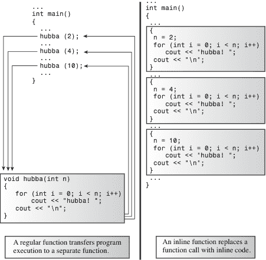

图 8.1 内联函数与常规函数的对比。

程序清单 8.1 用一个对参数求平方的内联 `square()` 函数来演示内联技术。注意，整个定义只占一行。这不是必须的，但如果定义无法在一两行内容纳（假设你的标识符不长），那么这个函数可能就不适合作为内联函数。

### 程序清单 8.1 `inline.cpp`

```cpp
// inline.cpp -- using an inline function
#include <iostream>

// an inline function definition
inline double square(double x) { return x * x; }

int main()
{
    using namespace std;
    double a, b;
    double c = 13.0;

    a = square(5.0);
    b = square(4.5 + 7.5);   // can pass expressions
    cout << "a = " << a << ", b = " << b << "\n";
    cout << "c = " << c;
    cout << ", c squared = " << square(c++) << "\n";
    cout << "Now c = " << c << "\n";
    return 0;
}
```

以下是程序清单 8.1 中程序的输出：

```text
a = 25, b = 144
c = 13, c squared = 169
Now c = 14
```

该输出说明，内联函数与常规函数一样按值传递参数。如果参数是一个表达式，如 4.5 + 7.5，则函数传递该表达式的值——本例中为 12。这使得 C++ 的内联机制远优于 C 的宏定义。请参阅“内联与宏”边栏。

即使程序没有单独提供原型，C++ 的原型特性仍然在起作用。这是因为整个定义位于函数首次使用之前，从而充当了原型。这意味着你可以将 `square()` 用于 `int` 参数或 `long` 参数，程序会在将值传递给函数之前自动将其类型转换为 `double`。

### 内联与宏

内联机制是 C++ 的一项新增功能。C 使用预处理器 `#define` 语句来提供宏，这是对内联代码的粗略实现。例如，下面是一个对数字求平方的宏：

```cpp
#define SQUARE(X) X*X
```

它不是通过传递参数来工作，而是通过文本替换来工作的，其中 `X` 充当“参数”的符号标签：

```cpp
a = SQUARE(5.0); is replaced by a = 5.0*5.0;
b = SQUARE(4.5 + 7.5); is replaced by b = 4.5 + 7.5 * 4.5 + 7.5;
d = SQUARE(c++); is replaced by d = c++*c++;
```

这里只有第一个示例能正确工作。你可以大量使用圆括号来改进：

```cpp
#define SQUARE(X) ((X)*(X))
```


> 尽管如此，问题依然存在：宏并不按值传递。即使使用这种新定义，`SQUARE(c++)` 也会将 c 递增两次，而程序清单 8.1 中的内联 `square()` 函数会先对 c 求值，将该值传递去平方，然后再将 c 递增一次。
>
> 这里的意图并不是要向你展示如何编写 C 宏。而是想表明，如果你一直在使用 C 宏来执行类似函数的功能，应该考虑将它们转换为 C++ 内联函数。

## 引用变量

C++ 向语言中添加了一种新的复合类型——引用变量。引用是一个名称，充当已定义变量的别名或另一个名字。例如，如果你将 twin 设为 clemens 变量的引用，就可以互换使用 twin 和 clemens 来表示该变量。这样的别名有什么用呢？是为了帮助那些对自己选择的变量名感到尴尬的人吗？也许吧，但引用变量的主要用途是作为函数的形参。如果使用引用作为参数，函数将处理原始数据，而不是副本。对于使用函数处理大型结构，引用提供了一种比指针更方便的替代方案，而且对于设计类来说，引用也是必不可少的。不过，在了解如何在函数中使用引用之前，先来考察定义和使用引用的基础知识。请记住，下面讨论的目的是说明引用是如何工作的，而不是它们通常如何使用。

### 创建引用变量

你可能还记得，C 和 C++ 使用 & 符号来表示变量的地址。C++ 为 & 符号赋予了额外的含义，并让它承担声明引用的工作。例如，要让 rodents 成为变量 rats 的另一个名字，可以这样做：

```cpp
int rats;
int & rodents = rats;    // makes rodents an alias for rats
```

在这种情况下，& 不是地址运算符，而是类型标识符的一部分。就像声明中的 `char *` 表示指向 char 的指针一样，`int &` 表示对 int 的引用。引用声明允许你互换使用 rats 和 rodents；两者都引用相同的值和相同的内存位置。程序清单 8.2 说明了这一说法的真实性。

**程序清单 8.2 firstref.cpp**

```cpp
// firstref.cpp -- defining and using a reference
#include <iostream>
int main()
{
    using namespace std;
    int rats = 101;
    int & rodents = rats;    // rodents is a reference

    cout << "rats = " << rats;
    cout << ", rodents = " << rodents << endl;
    rodents++;
    cout << "rats = " << rats;
    cout << ", rodents = " << rodents << endl;

    // some implementations require type casting the following
    // addresses to type unsigned
    cout << "rats address = " << &rats;
    cout << ", rodents address = " << &rodents << endl;
    return 0;
}
```

请注意，下面语句中的 & 运算符*不是*地址运算符，而是声明 rodents 是 `int &` 类型（即对 `int` 变量的引用）：

```cpp
int & rodents = rats;
```

但下一条语句中的 & 运算符*是*地址运算符，`&rodents` 表示 rodents 所引用的变量的地址：

```cpp
cout << ", rodents address = " << &rodents << endl;
```

下面是程序清单 8.2 中程序的输出：

```text
rats = 101, rodents = 101
rats = 102, rodents = 102
rats address = 0x0065fd48, rodents address = 0x0065fd48
```

如你所见，`rats` 和 `rodents` 具有相同的值和相同的地址。（地址值和显示格式因系统而异。）将 `rodents` 递增 1 会影响两个变量。更准确地说，`rodents++` 操作会将一个变量递增，而这个变量有两个名字。（再次提醒，尽管这个示例展示了引用是如何工作的，但并不代表引用的典型用途。引用的典型用途是作为函数参数，特别是结构参数和对象参数。我们很快会讨论这些用途。）

对于从 C 转到 C++ 的老手来说，引用起初往往会有点令人困惑，因为它们非常像指针，但又有所不同。例如，可以同时创建一个引用和一个指针来指向 `rats`：

```cpp
int rats = 101;
int & rodents = rats;    // rodents a reference
int * prats = &rats;     // prats a pointer
```

然后你可以将表达式 `rodents` 和 `*prats` 与 `rats` 互换使用，将 `&rodents` 和 `prats` 与 `&rats` 互换使用。从这个角度看，引用很像一种伪装记法的指针，其中 `*` 解引用运算符被隐式理解。事实上，引用或多或少就是这样。但除了记法之外，还有一些区别。其一，必须在声明引用时进行初始化；不能像声明指针那样先声明引用，以后再给它赋值：

```cpp
int rat;
int & rodent;
rodent = rat;   // No, you can't do this.
```

> **注意**
>
> 应在声明引用变量时对其进行初始化。

引用很像 const 指针；必须在创建时初始化，而且一旦引用向某个特定变量做出承诺，它就会信守承诺。也就是说，

```cpp
int & rodents = rats;
```

在本质上，这是以下内容的一种伪装记法：

```cpp
int * const pr = &rats;
```

在这里，引用 rodents 的作用与表达式 `*pr` 相同。程序清单 8.3 展示了当你试图让一个引用从 rats 变量改而引用 bunnies 变量时会发生什么。

**程序清单 8.3 secref.cpp**

```cpp
// secref.cpp -- defining and using a reference
#include <iostream>
int main()
{
    using namespace std;
    int rats = 101;
    int & rodents = rats;   // rodents is a reference

    cout << "rats = " << rats;
    cout << ", rodents = " << rodents << endl;

    cout << "rats address = " << &rats;
    cout << ", rodents address = " << &rodents << endl;

    int bunnies = 50;
    rodents = bunnies;      // can we change the reference?
    cout << "bunnies = " << bunnies;
    cout << ", rats = " << rats;
    cout << ", rodents = " << rodents << endl;

    cout << "bunnies address = " << &bunnies;
    cout << ", rodents address = " << &rodents << endl;
    return 0;
}
```

下面是程序清单 8.3 中程序的输出：

```text
rats = 101, rodents = 101
rats address = 0x0065fd44, rodents address = 0x0065fd44
bunnies = 50, rats = 50, rodents = 50
bunnies address = 0x0065fd48, rodents address = 0x0065fd48
```

最初，rodents 引用 rats，但随后程序显然试图让 rodents 成为 bunnies 的引用：

```cpp
rodents = bunnies;
```

乍一看，这个尝试似乎成功了，因为 rodents 的值从 101 变成了 50。但仔细检查会发现，rats 的值也变成了 50，且 rats 和 rodents 仍然共享相同的地址，而这个地址与 bunnies 的地址不同。由于 rodents 是 rats 的别名，这条赋值语句实际上等同于下面的语句：

```cpp
rats = bunnies;
```

也就是说，它的意思是“将 bunnies 变量的值赋给 rats 变量。”简而言之，你可以通过初始化声明来设置引用，而不能通过赋值来设置。

假设你尝试以下操作：

```cpp
int rats = 101;
int * pt = &rats;
int & rodents = *pt;
int bunnies = 50;
pt = &bunnies;
```

将 rodents 初始化为 `*pt` 会使 rodents 引用 rats。随后将 pt 改为指向 bunnies 并不会改变 rodents 引用 rats 这一事实。

### 引用作为函数参数

大多数情况下，引用被用作函数参数，使函数中的变量名成为调用程序中变量的别名。这种传递参数的方法称为*按引用传递*。按引用传递允许被调用的函数访问调用函数中的变量。C++ 增加这一特性是对 C 的一个突破，因为 C 只能按值传递。回想一下，按值传递会导致被调用的函数处理来自调用程序的值的副本（参见图 8.2）。当然，C 允许你通过使用指针来绕过按值传递的限制。

让我们在一个常见的计算机问题中比较使用引用和使用指针：交换两个变量的值。交换函数必须能够修改调用程序中变量的值。这意味着通常的按值传递变量方法是行不通的，因为函数最终交换的是原始变量副本的内容，而不是变量本身。然而，如果传递引用，函数就可以处理原始数据。或者，你也可以传递指针来访问原始数据。程序清单 8.4 展示了全部三种方法，包括行不通的那种，以便进行比较。


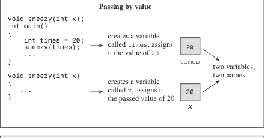

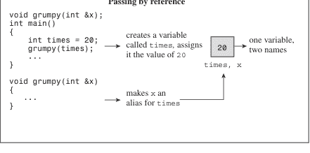

图8.2 按值传递和按引用传递。

## 程序清单8.4 swaps.cpp

```cpp
// swaps.cpp -- swapping with references and with pointers
#include <iostream>
void swapr(int & a, int & b);   // a, b are aliases for ints
void swapp(int * p, int * q);   // p, q are addresses of ints
void swapv(int a, int b);       // a, b are new variables
int main()
{
    using namespace std;
    int wallet1 = 300;
    int wallet2 = 350;

    cout << "wallet1 = $" << wallet1;
    cout << " wallet2 = $" << wallet2 << endl;

    cout << "Using references to swap contents:\n";
    swapr(wallet1, wallet2);   // pass variables
    cout << "wallet1 = $" << wallet1;
    cout << " wallet2 = $" << wallet2 << endl;

    cout << "Using pointers to swap contents again:\n";
    swapp(&wallet1, &wallet2); // pass addresses of variables
    cout << "wallet1 = $" << wallet1;
    cout << " wallet2 = $" << wallet2 << endl;

    cout << "Trying to use passing by value:\n";
    swapv(wallet1, wallet2);   // pass values of variables
    cout << "wallet1 = $" << wallet1;
    cout << " wallet2 = $" << wallet2 << endl;
    return 0;
}

void swapr(int & a, int & b)   // use references
{
    int temp;

    temp = a;       // use a, b for values of variables
    a = b;
    b = temp;
}

void swapp(int * p, int * q)   // use pointers
{
    int temp;

    temp = *p;      // use *p, *q for values of variables
    *p = *q;
    *q = temp;
}

void swapv(int a, int b)       // try using values
{
    int temp;

    temp = a;       // use a, b for values of variables
    a = b;
    b = temp;
}
```

程序清单8.4的输出如下：

```text
wallet1 = $300 wallet2 = $350        << original values
Using references to swap contents:
wallet1 = $350 wallet2 = $300        << values swapped
Using pointers to swap contents again:
wallet1 = $300 wallet2 = $350        << values swapped again
Trying to use passing by value:
wallet1 = $300 wallet2 = $350        << swap failed
```

正如你所料，引用方法和指针方法都成功交换了两个钱包的内容，而按值传递的方法则失败了。

## 程序说明

首先，注意程序清单8.4中每个函数是如何调用的：

```cpp
swapr(wallet1, wallet2);       // pass variables
swapp(&wallet1, &wallet2);     // pass addresses of variables
swapv(wallet1, wallet2);       // pass values of variables
```

按引用传递（`swapr(wallet1, wallet2)`）和按值传递（`swapv(wallet1, wallet2)`）看起来完全相同。判断`swapr()`是否按引用传递的唯一方法是查看函数原型或函数定义。然而，地址运算符（`&`）的存在使得按地址传递的函数一目了然（`swapp(&wallet1, &wallet2)`）。（回想一下，类型声明`int *p`表示`p`是一个指向`int`的指针，因此与`p`对应的实参应该是一个地址，例如`&wallet1`。）

接下来，比较`swapr()`（按引用传递）和`swapv()`（按值传递）这两个函数的代码。两者唯一的表面区别在于函数参数的声明方式：

```cpp
void swapr(int & a, int & b)
void swapv(int a, int b)
```

内部区别当然在于，在`swapr()`中，变量`a`和`b`充当`wallet1`和`wallet2`的别名，因此交换`a`和`b`就会交换`wallet1`和`wallet2`。但在`swapv()`中，变量`a`和`b`是复制了`wallet1`和`wallet2`值的新变量，因此交换`a`和`b`对`wallet1`和`wallet2`没有影响。

最后，比较函数`swapr()`（按引用传递）和`swapp()`（按指针传递）。第一个区别在于函数参数的声明方式：

```cpp
void swapr(int & a, int & b)
void swapp(int * p, int * q)
```

第二个区别是，指针版本在函数使用`p`和`q`时，全程需要使用`*`解引用运算符。

之前我说过，在定义引用变量时应该初始化它。函数调用会用调用中的实参值来初始化其参数。因此，引用函数参数被初始化为函数调用传递的实参。也就是说，下面的函数调用将形参`a`初始化为`wallet1`，将形参`b`初始化为`wallet2`：

```cpp
swapr(wallet1, wallet2);
```

## 引用属性和奇怪之处

使用引用参数有几个你需要了解的曲折之处。首先，考虑程序清单8.5。它使用两个函数来求一个参数的立方。一个接受`double`参数，另一个接受`double`的引用。求立方的实际代码故意写得有点奇怪，以说明一个问题。

### 程序清单8.5 cubes.cpp

```cpp
// cubes.cpp -- regular and reference arguments
#include <iostream>
double cube(double a);
double refcube(double &ra);
int main ()
{
    using namespace std;
    double x = 3.0;

    cout << cube(x);
    cout << " = cube of " << x << endl;
    cout << refcube(x);
    cout << " = cube of " << x << endl;
    return 0;
}

double cube(double a)
{
    a *= a * a;
    return a;
}

double refcube(double &ra)
{
    ra *= ra * ra;
    return ra;
}
```

程序清单8.5的输出如下：

```text
27 = cube of 3
27 = cube of 27
```

## 临时变量、引用参数和`const`

如果实参不匹配引用参数，C++可以生成一个临时变量。目前，C++仅当参数是const引用时才允许这样做，但情况并非总是如此。让我们看看C++在哪些情况下会生成临时变量，以及为什么将限制为const引用是有道理的。

首先，何时创建临时变量？假如引用参数是const，编译器会在两种情况下生成临时变量：

- 当实参类型正确但不是*左值*时
- 当实参类型错误，但可以转换为正确类型时

什么是左值？作为左值的实参是一个可以通过地址引用的数据对象。例如，变量、数组元素、结构成员、引用和解引用指针都是左值。非左值包括字面常量（带引号的字符串除外，它们由其地址表示）和含有多项的表达式。*左值*这个术语在C中最初是指可以出现在赋值语句左侧的实体，但那是在引入const关键字之前。现在，普通变量和const变量都被视为左值，因为它们都可以通过地址访问。但普通变量可以进一步描述为*可修改的左值*，而const变量则是*不可修改的左值*。

现在，回到我们的例子，假设你重新定义`refcube()`，使其拥有一个常量引用参数：

```cpp
double refcube(const double &ra)
{
    return ra * ra * ra;
}
```

接下来，考虑以下代码：

```cpp
double side = 3.0;
double * pd = &side;
double & rd = side;
long edge = 5L;
double lens[4] = { 2.0, 5.0, 10.0, 12.0 };
double c1 = refcube(side);       // ra is side
double c2 = refcube(lens[2]);    // ra is lens[2]
double c3 = refcube(rd);         // ra is rd is side
double c4 = refcube(*pd);        // ra is *pd is side
double c5 = refcube(edge);       // ra is temporary variable
double c6 = refcube(7.0);         // ra is temporary variable
double c7 = refcube(side + 10.0); // ra is temporary variable
```

实参`side`、`lens[2]`、`rd`和`*pd`是有名称的`double`类型数据对象，因此可以为它们传递引用，不需要临时变量。（回想一下，数组元素的行为类似于与该元素相同类型的变量。）但是，尽管`edge`是一个变量，它的类型却是错误的。对`double`的引用不能引用`long`。另一方面，实参`7.0`和`side + 10.0`类型正确，但它们不是有名称的数据对象。在每种情况下，编译器都会生成一个临时的匿名变量，并让它引用该变量。这些临时变量在函数调用期间持续存在，但之后编译器可以随意丢弃它们。

那么，为什么这种行为对于常量引用是可以的，而对其他情况则不行？回想程序清单8.4中的`swapr()`函数：

```cpp
void swapr(int & a, int & b)  // use references
{
    int temp;

    temp = a;        // use a, b for values of variables
    a = b;
    b = temp;
}
```

如果在早期C++更宽松的规则下执行以下操作，会发生什么？

```cpp
long a = 3, b = 5;
swapr(a, b);
```

这里存在类型不匹配，因此编译器会创建两个临时int变量，将它们初始化为3和5，然后交换临时变量的内容，而`a`和`b`保持不变。

简而言之，如果带引用参数的函数的意图是修改作为实参传递的变量，那么产生临时变量的情况就会妨碍这一目的。解决方案是禁止在这些情况下创建临时变量，这正是C++标准现在所做的。（然而，一些编译器默认情况下仍然发出警告而不是错误消息，所以如果你看到关于临时变量的警告，不要忽视它。）

现在想想`refcube()`函数。它的意图仅仅是使用传递的值，而不是修改它们，因此临时变量不会造成任何危害，反而使函数在可以处理的参数种类上更加通用。因此，如果声明表明引用是const，C++会在必要时生成临时变量。本质上，一个具有const引用形参和不相匹配实参的C++函数模拟了传统的按值传递行为，保证原始数据不被修改，并使用临时变量来保存值。

> **注意**
>
> 如果函数调用参数不是左值，或者与相应的const引用参数类型不匹配，C++会创建一个正确类型的匿名变量，将函数调用参数的值赋给该匿名变量，并让参数引用该变量。


程序清单8.6中的程序正是做了这些事情。它还通过让函数返回结构的引用，增加了一个有趣的变数。这与返回结构的工作方式略有不同。有一些注意事项需要留意，我们稍后会讨论。

## 程序清单 8.6 strc_ref.cpp

```cpp
//strc_ref.cpp -- using structure references
#include <iostream>
#include <string>
struct free_throws
{
    std::string name;
    int made;
    int attempts;
    float percent;
};

void display(const free_throws & ft);
void set_pc(free_throws & ft);
free_throws & accumulate(free_throws & target, const free_throws & source);

int main()
{
// partial initializations - remaining members set to 0
    free_throws one = {"Ifelsa Branch", 13, 14};
    free_throws two = {"Andor Knott", 10, 16};
    free_throws three = {"Minnie Max", 7, 9};
    free_throws four = {"Whily Looper", 5, 9};
    free_throws five = {"Long Long", 6, 14};
    free_throws team = {"Throwgoods", 0, 0};
// no initialization
    free_throws dup;

    set_pc(one);
    display(one);
    accumulate(team, one);
    display(team);
// use return value as argument
    display(accumulate(team, two));
    accumulate(accumulate(team, three), four);
    display(team);

// use return value in assignment
    dup = accumulate(team,five);
    std::cout << "Displaying team:\n";
    display(team);
    std::cout << "Displaying dup after assignment:\n";
    display(dup);
    set_pc(four);
    // ill-advised assignment
    accumulate(dup, five) = four;
    std::cout << "Displaying dup after ill-advised assignment:\n";
    display(dup);
    return 0;
}

void display(const free_throws & ft)
{
    using std::cout;
    cout << "Name: " << ft.name << '\n';
    cout << "  Made: " << ft.made << '\t';
    cout << "Attempts: " << ft.attempts << '\t';
    cout << "Percent: " << ft.percent << '\n';
}
void set_pc(free_throws & ft)
{
    if (ft.attempts != 0)
        ft.percent = 100.0f * float(ft.made)/float(ft.attempts);
    else
        ft.percent = 0;
}

free_throws & accumulate(free_throws & target, const free_throws & source)
{
    target.attempts += source.attempts;
    target.made += source.made;
    set_pc(target);
    return target;
}
```

以下是程序输出：

```text
Name: Ifelsa Branch
  Made: 13    Attempts: 14    Percent: 92.8571
Name: Throwgoods
  Made: 13    Attempts: 14    Percent: 92.8571
Name: Throwgoods
  Made: 23    Attempts: 30    Percent: 76.6667
Name: Throwgoods
  Made: 35    Attempts: 48    Percent: 72.9167
Displaying team:
Name: Throwgoods
  Made: 41    Attempts: 62    Percent: 66.129
Displaying dup after assignment:
Name: Throwgoods
```

那么返回值呢？我们刚才讨论的函数调用没有使用它；就这种用法而言，该函数本可以是`void`类型。但看看这个函数调用：

```cpp
display(accumulate(team, two));
```

这里发生了什么？让我们追踪结构对象`team`。首先，`team`作为第一个参数传递给`accumulate()`。这意味着`accumulate()`中的目标对象实际上就是`team`。`accumulate()`函数修改`team`，然后将其作为引用返回。请注意，实际的返回语句如下：

```cpp
return target;
```

这条语句中没有任何信息表明返回的是一个引用。这些信息来自函数头（也来自原型）：

```cpp
free_throws & accumulate(free_throws & target, const free_throws & source)
```

如果返回类型声明为`free_throws`而不是`free_throws &`，同样的返回语句将返回`target`的一个副本（因此也是`team`的副本）。但返回类型是引用，所以这意味着返回值是最初传递给`accumulate()`的原始`team`对象。

接下来会发生什么？`accumulate()`的返回值是`display()`的第一个参数，所以这意味着`team`是`display()`的第一个参数。由于`display()`的参数是引用，所以`display()`中的`ft`对象实际上就是`team`。因此，`team`的内容会被显示出来。最终效果

```cpp
display(accumulate(team, two));
```

与下面的代码效果相同：

```cpp
accumulate(team, two);
display(team);
```

同样的逻辑也适用于这条语句：

```cpp
accumulate(accumulate(team, three), four);
```

这与下面的代码效果相同：

```cpp
accumulate(team, three);
accumulate(team, four);
```

接下来，程序使用了一条赋值语句：

```cpp
dup = accumulate(team, five);
```

正如你所预料的，这会将`team`中的值复制到`dup`。

最后，程序以另一种并非本意的方式使用了`accumulate()`：

```cpp
accumulate(dup, five) = four;
```

这条语句——也就是将值赋给函数调用——之所以能工作，是因为返回值是一个引用。如果`accumulate()`按值返回，这段代码将无法编译。由于返回值是对`dup`的引用，这段代码的效果与下面的代码相同：

```cpp
accumulate(dup,five); // 把five的数据添加到dup
dup = four; // 用four的内容覆盖dup的内容
```

第二条语句抹除了第一条语句完成的工作，因此最初的赋值语句并不是对`accumulate()`的良好使用。

### 为什么要返回引用？

让我们进一步看看返回引用与传统返回机制有何不同。后者的工作原理与函数参数按值传递非常相似。`return`后面的表达式被求值，然后该值被传回调用函数。从概念上讲，这个值会被复制到一个临时位置，然后调用程序使用这个值。考虑以下代码：

```cpp
double m = sqrt(16.0);
cout << sqrt(25.0);
```

在第一条语句中，值4.0被复制到一个临时位置，然后该位置的值被复制到m。在第二条语句中，值5.0被复制到一个临时位置，然后该位置的内容被传递给cout。（这是概念性的描述。在实践中，优化编译器可能会合并其中的一些步骤。）

现在考虑这条语句：

```cpp
dup = accumulate(team,five);
```

如果`accumulate()`返回的是结构而不是结构的引用，这可能需要将整个结构复制到一个临时位置，然后将该副本复制到`dup`。但使用引用返回值时，`team`直接复制到`dup`，这是一种更高效的方式。

> **注意**
>
> 返回引用的函数实际上是所引用变量的别名。

### 注意返回引用所引用的对象

返回引用时要记住的最重要的一点是，避免返回对函数终止时就不再存在的内存位置的引用。你需要避免的是下面这类代码：

```cpp
const free_throws & clone2(free_throws & ft)
{
    free_throws newguy;    // 走向大错误的第一步
    newguy = ft;           // 复制信息
    return newguy;         // 返回对副本的引用
}
```

这会产生一个不幸的后果：返回对临时变量（newguy）的引用，而该变量在函数终止时立刻不复存在。（第9章“内存模型和命名空间”讨论了各种变量的持续性。）同样，你应该避免返回指向这类临时变量的指针。

避免这个问题的最简单方法是返回作为参数传递给函数的引用。引用参数将引用调用函数使用的数据；因此，返回的引用也将引用相同的数据。例如，这正是`accumulate()`在程序清单8.6中所做的。

第二种方法是使用`new`创建新的存储空间。你已经见过一些例子，其中`new`为字符串创建空间，函数返回指向该空间的指针。下面是如何用引用做类似的事情：

```cpp
free_throws & clone(free_throws & ft)
{
    free_throws * pt;        // 复制信息
    *pt = ft;                // 返回对副本的引用
    return *pt;
}
```

第一条语句创建了一个匿名的free_throws结构。指针`pt`指向该结构，所以`*pt`就是该结构。代码看起来像是返回结构，但函数声明表明该函数实际上返回的是对这个结构的引用。然后你可以这样使用该函数：

```cpp
free_throws & jolly = clone(three);
```

这使`jolly`成为新结构的引用。这种方法有一个问题：当内存不再需要时，应该使用`delete`释放由`new`分配的内存。调用`clone()`隐藏了对`new`的调用，使得之后更容易忘记使用`delete`。第16章“string类和标准模板库”中讨论的`auto_ptr`模板，或者更确切地说，C++11的`unique_ptr`，可以帮助自动完成删除过程。

### 为什么在返回引用时使用const？

你可能还记得，程序清单8.6中有这样一条语句：

```cpp
accumulate(dup,five) = four;
```

它的效果是先将来自five的数据添加到dup，然后用four的内容覆盖dup的内容。为什么这条语句可以编译？赋值要求左侧是一个可修改的左值。也就是说，赋值表达式左侧的子表达式应该标识一块可以被修改的内存。在这种情况下，函数返回了对dup的引用，而dup确实标识了这样一块内存。因此该语句是有效的。

另一方面，普通（非引用）返回类型是右值，是无法通过地址访问的值。这类表达式可以出现在赋值语句的右侧，但不能出现在左侧。右值的其他示例包括字面量（如`10.0`）和表达式（如`x + y`）。显然，试图取得像`10.0`这样的字面量的地址是没有意义的，但为什么普通的函数返回值是右值呢？这是因为，你回想一下，返回值位于一个临时的内存位置，这个位置甚至不一定能保留到下一条语句。


假设你想使用引用返回值，但不希望允许诸如给 accumulate() 赋值这样的行为。只需将返回类型设为 const 引用：

```cpp
const free_throws &
    accumulate(free_throws & target, const free_throws & source);
```

现在的返回类型是 const，因此是不可修改的左值。所以，不再允许赋值：

```cpp
accumulate(dup,five) = four;    // not allowed for const reference return
```

程序中的其他函数调用呢？使用 const 引用返回类型时，下面的语句仍然允许：

```cpp
display(accumulate(team, two));
```

这是因为 display() 的形参也是 const free_throws & 类型。但下面的语句将不被允许，因为 accumulate() 的第一个形参不是 const：

```cpp
accumulate(accumulate(team, three), four);
```

这是很大的损失吗？在这种情况下不是，因为你仍然可以这样做：

```cpp
accumulate(team, three);
accumulate(team, four);
```

当然，你仍然可以在赋值语句的右侧使用 accumulate()。

通过省略 const，你可以写出更短但看起来更晦涩的代码。

通常，最好避免在设计里加入晦涩的特性，因为晦涩的特性常常会扩大出现晦涩错误的机会。因此，把返回类型设为 const 引用可以保护你免受混淆的诱惑。不过，偶尔省略 const 确实有意义。第11章“使用类”中讨论的重载 << 运算符就是一个例子。

## 对类对象使用引用

在 C++ 中，将类对象传递给函数的通常做法是使用引用。例如，对于以 string、ostream、istream、ofstream 和 ifstream 类的对象作为参数的函数，你会使用引用参数。

让我们看一个使用 string 类的示例，它演示了一些不同的设计选择，其中一些是不好的。总体思路是创建一个函数，将给定的字符串添加到另一个字符串的两端。清单8.7提供了三个旨在实现这一目标的函数。然而，其中一个设计缺陷太大，可能会导致程序崩溃，甚至无法编译。

### 清单8.7 strquote.cpp

```cpp
// strquote.cpp -- different designs
#include <iostream>
#include <string>
using namespace std;
string version1(const string & s1, const string & s2);
const string & version2(string & s1, const string & s2);   // has side effect
const string & version3(string & s1, const string & s2);   // bad design

int main()
{
    string input;
    string copy;
    string result;

    cout << "Enter a string: ";
    getline(cin, input);
    copy = input;
    cout << "Your string as entered: " << input << endl;
    result = version1(input, "***");
    cout << "Your string enhanced: " << result << endl;
    cout << "Your original string: " << input << endl;

    result = version2(input, "###");
    cout << "Your string enhanced: " << result << endl;
    cout << "Your original string: " << input << endl;

    cout << "Resetting original string.\n";
    input = copy;
    result = version3(input, "@@@");
    cout << "Your string enhanced: " << result << endl;
    cout << "Your original string: " << input << endl;

    return 0;
}

string version1(const string & s1, const string & s2)
{
    string temp;

    temp = s2 + s1 + s2;
    return temp;
}

const string & version2(string & s1, const string & s2)   // has side effect
{
    s1 = s2 + s1 + s2;
    // safe to return reference passed to function
    return s1;
}

const string & version3(string & s1, const string & s2)    // bad design
{
    string temp;

    temp = s2 + s1 + s2;
    // unsafe to return reference to local variable
    return temp;
}
```

下面是清单8.7中程序的示例运行：

```text
Enter a string: It's not my fault.
Your string as entered: It's not my fault.
Your string enhanced: ***It's not my fault.***
Your original string: It's not my fault.
Your string enhanced: ###It's not my fault.###
Your original string: ###It's not my fault.###
Resetting original string.
```

此时程序崩溃了。

### 程序说明

清单8.7中函数的版本1是三个版本中最直接的：

```cpp
string version1(const string & s1, const string & s2)
{
    string temp;

    temp = s2 + s1 + s2;
    return temp;
}
```

它接受两个 string 参数，并使用 string 类的加法来创建一个具有所需属性的新字符串。注意，这两个函数参数是 const 引用。如果它只是传递 string 对象，函数也会产生相同的最终结果：

```cpp
string version4(string & s1, string s2)    // would work the same
```

在这种情况下，s1 和 s2 将是全新的 string 对象。因此，使用引用更高效，因为函数不必创建新对象并将数据从旧对象复制到新对象。使用 const 限定符表明这个函数将使用但不修改原始字符串。

temp 对象是一个新对象，局部于 version1() 函数，并在函数终止时不再存在。因此，将 temp 作为引用返回行不通，所以函数类型是 string。这意味着 temp 的内容将被复制到一个临时返回位置。然后，在 `main()` 中，返回位置的内容被复制到名为 result 的 string 对象：

```cpp
result = version1(input, "****");
```

### 将 C 风格字符串实参传递给 `string` 对象引用形参

你可能已经注意到 `version1()` 函数一个相当有趣的事实：两个形参（`s1` 和 `s2`）都是 `const string &` 类型，但实参（`input` 和 "****"）分别是 `string` 和 `const char *` 类型。因为 `input` 是 string 类型，所以让 `s1` 引用它没有问题。但是，程序为什么接受将指向 char 的指针实参传递给 string 引用呢？

这里涉及两件事。一是 string 类定义了从 char * 到 string 的转换，这使得可以用 C 风格字符串初始化 string 对象。二是本章前面讨论过的 `const` 引用形参的一个特性。假设实参类型与引用形参类型不匹配，但可以转换为引用类型。然后程序会创建一个正确类型的临时变量，用转换后的值初始化它，并传递对该临时变量的引用。例如，本章前面你看到过，`const double &` 形参可以用这种方式处理 `int` 实参。同样，`const string &` 形参可以用这种方式处理 char * 或 const char * 实参。

这样带来的方便结果是，如果形参是 `const string &` 类型，函数调用中使用的实参可以是 string 对象或 C 风格字符串，例如带引号的字符串字面量、以空字符结尾的 char 数组，或指向 char 的指针变量。因此，下面的代码可以正常工作：

```cpp
result = version1(input, "****");
```

`version2()` 函数不创建临时字符串。相反，它直接修改原始字符串：

```cpp
const string & version2(string & s1, const string & s2)    // has side effect
{
    s1 = s2 + s1 + s2;
    // safe to return reference passed to function
    return s1;
}
```

这个函数允许修改 `s1`，因为与 `s2` 不同，`s1` 没有使用 const 声明。因为 `s1` 是对 `main()` 中一个对象（input）的引用，所以将 `s1` 作为引用返回是安全的。因为 `s1` 是对 input 的引用，所以下面这行

```cpp
result = version2(input, "####");
```

本质上等同于以下代码：

```cpp
version2(input, "####");    // input altered directly by version2()
result = input;              // reference to s1 is reference to input
```

然而，由于 `s1` 是 `input` 的引用，调用该函数会产生副作用，也会修改 `input`：

```text
Your original string: It's not my fault.
Your string enhanced: ###It's not my fault.###
Your original string: ###It's not my fault.###
```

因此，如果你希望保持原始字符串不变，这就是错误的设计。

程序清单8.7中的第三个版本提醒了我们不该做什么：

```cpp
const string & version3(string & s1, const string & s2)   // bad design
{
    string temp;

    temp = s2 + s1 + s2;
// unsafe to return reference to local variable
    return temp;
}
```

它的致命缺陷是返回了对 `version3()` 内部局部声明变量的引用。该函数可以编译（但会有警告），但程序在尝试执行该函数时会崩溃。具体来说，下面的赋值语句导致了问题：

```cpp
result = version3(input, "###");
```

程序试图引用不再使用的内存。

## 另一个对象示例：对象、继承与引用

`ostream` 和 `ofstream` 类凸显了引用的一个有趣特性。你可能还记得第6章“分支语句与逻辑运算符”中的内容：`ofstream` 类型的对象可以使用 `ostream` 方法，从而使文件输入/输出能够采用与控制台输入/输出相同的形式。使一个类的特性能够传递给另一个类的语言特性称为继承，第13章“类继承”详细讨论了这一特性。简而言之，`ostream` 被称为基类（因为 `ofstream` 类基于它），而 `ofstream` 被称为派生类（因为它派生自 `ostream`）。派生类继承基类的方法，这意味着 `ofstream` 对象可以使用基类的特性，例如 `precision()` 和 `setf()` 格式化方法。

继承的另一个方面是，基类引用可以引用派生类对象，而无需进行类型转换。其实际意义在于，你可以定义一个带有基类引用参数的函数，并且该函数既可用于基类对象，也可用于派生对象。例如，一个参数类型为 `ostream &` 的函数可以接受 `ostream` 对象（如 `cout`），也可以同样接受你可能声明的 `ofstream` 对象。

程序清单8.8通过使用同一个函数将数据写入文件并在屏幕上显示数据来演示这一点；只是函数调用参数发生了改变。该程序请求用户输入望远镜物镜（其主镜或透镜）以及一些目镜的焦距。然后，它计算并显示每个目镜在该望远镜中会产生的放大倍数。放大倍数等于望远镜的焦距除以所用目镜的焦距，因此计算很简单。该程序还使用了一些格式化方法，正如之前所承诺的，这些方法对 `cout` 和 `ofstream` 对象（本例中为 `fout`）同样适用。

### 程序清单8.8 filefunc.cpp

```cpp
//filefunc.cpp -- function with ostream & parameter
#include <iostream>
#include <fstream>
#include <cstdlib>
using namespace std;

void file_it(ostream & os, double fo, const double fe[],int n);
const int LIMIT = 5;
int main()
{
    ofstream fout;
    const char * fn = "ep-data.txt";
    fout.open(fn);
    if (!fout.is_open())
    {
        cout << "Can't open " << fn << ". Bye.\n";
        exit(EXIT_FAILURE);
    }
    double objective;
    cout << "Enter the focal length of your "
         "telescope objective in mm: ";
    cin >> objective;
    double eps[LIMIT];
    cout << "Enter the focal lengths, in mm, of " << LIMIT
         << " eyepieces:\n";
    for (int i = 0; i < LIMIT; i++)
    {
        cout << "Eyepiece #" << i + 1 << ": ";
        cin >> eps[i];
    }
    file_it(fout, objective, eps, LIMIT);
    file_it(cout, objective, eps, LIMIT);
    cout << "Done\n";
    return 0;
}
```

```cpp
void file_it(ostream & os, double fo, const double fe[],int n)
{
    ios_base::fmtflags initial;
    initial = os.setf(ios_base::fixed); // save initial formatting state
    os.precision(0);
    os << "Focal length of objective: " << fo << " mm\n";
    os.setf(ios::showpoint);
    os.precision(1);
    os.width(12);
    os << "f.l. eyepiece";
    os.width(15);
    os << "magnification" << endl;
    for (int i = 0; i < n; i++)
    {
        os.width(12);
        os << fe[i];
        os.width(15);
        os << int (fo/fe[i] + 0.5) << endl;
    }
    os.setf(initial);   // restore initial formatting state
}
```

下面是程序清单8.8的一个运行示例：

输入望远镜物镜的焦距（单位：mm）：1800
输入5个目镜的焦距（单位：mm）：
目镜 #1：30
目镜 #2：19
目镜 #3：14
目镜 #4：8.8
目镜 #5：7.5
物镜焦距：1800 mm

| 目镜焦距 | 放大倍数 |
| ---: | ---: |
| 30.0 | 60 |
| 19.0 | 95 |
| 14.0 | 129 |
| 8.8 | 205 |
| 7.5 | 240 |

完成

下面一行将目镜数据写入文件 ep-data.txt：

```cpp
file_it(fout, objective, eps, LIMIT);
```

而下面一行以相同格式将相同信息写入屏幕：

```cpp
file_it(cout, objective, eps, LIMIT);
```

## 程序说明

程序清单8.8的要点是，类型为 `ostream &` 的 `os` 参数既可以引用 `ostream` 对象（如 `cout`），也可以引用 `ofstream` 对象（如 `fout`）。但该程序还说明了 `ostream` 格式化方法如何用于这两种类型。让我们回顾其中一些方法，或者在有些情况下首次考察它们。（第17章“输入、输出和文件”提供了更充分的讨论。）

`setf()` 方法允许你设置各种格式化状态。例如，方法调用 `setf(ios_base::fixed)` 使对象进入使用定点小数表示法的模式。调用 `setf(ios_base::showpoint)` 使对象进入显示末尾小数点的模式，即使后面的数字是零。`precision()` 方法指示要在小数点右侧显示的数字位数（前提是对象处于定点模式）。所有这些设置都会保持不变，除非被另一个方法调用重置。`width()` 调用设置下一次输出操作要使用的字段宽度。该设置只对显示一个值有效，随后会恢复为默认值。（默认字段宽度为零，随后会扩展为恰好适应当前显示的实际数量。）

`file_it()` 函数使用了一对有趣的方法调用：

```cpp
ios_base::fmtflags initial;
initial = os.setf(ios_base::fixed); // save initial formatting state
...
os.setf(initial); // restore initial formatting state
```

`setf()` 方法返回调用发生之前生效的所有格式化设置的副本。`ios_base::fmtflags` 是存储此信息所需类型的一个花哨名称。因此，对 `initial` 的赋值存储了调用 `file_it()` 函数之前已有的设置。然后，可以将 `initial` 变量作为 `setf()` 的参数，将所有格式化设置重置为原始值。因此，该函数将对象恢复为传递给 `file_it()` 之前的状态。

了解更多关于类的知识将帮助你更好地理解这些方法如何工作，以及为什么例如 `ios_base` 会不断出现。但你不必等到第17章才使用这些方法。

最后一点：每个对象都存储自己的格式化设置。因此，当程序将 `cout` 传递给 `file_it()` 时，`cout` 的设置会被修改，然后被恢复。当程序将 `fout` 传递给 `file_it()` 时，`fout` 的设置会被修改，然后被恢复。

## 何时使用引用参数

使用引用参数有两个主要原因：

- 允许你在调用函数中修改数据对象
- 通过传递引用而不是整个数据对象来加速程序

对于较大的数据对象（如结构和类对象），第二个原因最为重要。这两个原因与你可能使用指针参数的原因相同。这是合理的，因为引用参数实际上只是另一种接口，用于


```
cin.get(sample, ArSize);
char *ps = left(sample, 4);
cout << ps << endl;
delete [] ps;        // free old string
ps = left(sample);
cout << ps << endl;
delete [] ps;        // free new string
return 0;
}

// This function returns a pointer to a new string
// consisting of the first n characters in the str string.
char * left(const char * str, int n)
{
    if (n < 0)
        n = 0;
    char * p = new char[n+1];
    int i;
    for (i = 0; i < n && str[i]; i++)
        p[i] = str[i];  // copy characters
    while (i <= n)
        p[i++] = '\0';  // set rest of string to '\0'
    return p;
}
```

下面是程序清单8.9中程序的一次示例运行：

```
Enter a string:
forthcoming
fort
f
```

## 程序说明

程序清单8.9中的程序使用 new 创建一个新字符串来保存选中的字符。一种棘手的情况是，不配合的用户可能请求负数的字符数。在这种情况下，函数会把字符数设为0，并最终返回空字符串。另一种棘手的情况是，不负责任的用户可能请求比字符串所含字符更多的字符数。函数通过一个组合测试来防止这种情况：

```
i < n && str[i]
```

i < n 测试在复制了 n 个字符后停止循环。测试的第二部分，即表达式 str[i]，是即将被复制的字符的编码。如果循环遇到空字符，该编码为0，循环就会终止。最后的 while 循环用空字符终止字符串，然后把剩余已分配空间（如果有）设置为空字符。

另一种设置新字符串大小的办法是把 n 设为传入值和字符串长度中较小的那个：

```
int len = strlen(str);
n = (n < len) ? n : len;    // the lesser of n and len
char * p = new char[n+1];
```

这确保 new 分配的空间不会超过保存该字符串所需的空间。如果你进行诸如 `f("Hi!", 32767)` 这样的调用，这会很有用。第一种方法把 "Hi!" 复制到一个 32767 个字符的数组中，并把除前3个字符之外的所有字符都设为空字符。第二种方法把 "Hi!" 复制到一个4个字符的数组中。但是，由于增加了一次函数调用（`strlen()`），它会增大程序体积、减慢处理速度，并且要求你记得包含 `cstring`（或 `string.h`）头文件。

C 程序员倾向于选择运行更快、更紧凑的代码，并把正确使用函数的更大负担留给程序员。然而，C++ 传统更看重可靠性。毕竟，一个运行较慢但正确工作的程序，胜过一个运行很快但工作不正确的程序。

如果调用 `strlen()` 所花的时间成为问题，你可以让 `left()` 直接确定 n 和字符串长度中较小的那个。例如，下面的循环在 m 达到 n 或到达字符串末尾时退出，以先发生者为准：

```
int m = 0;
while (m <= n && str[m] != '\0')
    m++;

char * p = new char[m+1];
// use m instead of n in rest of code
```

记住，当 `str[m]` 不是空字符时，表达式 `str[m] != '\0'` 求值为 true；当它是空字符时，求值为 false。由于在 `&&` 表达式中非零值被转换为 true，零被转换为 false，所以 while 测试也可以写成这样：

```
while (m<=n && str[m])
```

## 函数重载

函数多态是 C++ 对 C 能力的一项巧妙补充。默认参数让你可以用不同数量的参数调用同一个函数，而*函数多态*（也称为*函数重载*）让你使用多个共享同一名称的函数。*多态*一词意为具有多种形式，因此*函数多态*让一个函数具有多种形式。类似地，*函数重载*这一说法意味着你可以把多个函数挂到同一个名称上，从而重载该名称。两种说法归根结底是一回事，但我们通常会使用*函数重载*这一说法——它听起来更费力些。你可以使用函数重载来设计一组本质上做同样事情但使用不同参数列表的函数。

重载函数类似于有多个含义的动词。例如，猪小姐可以在棒球场为主队加油（root），也可以在土壤中翻找松露（root）。语境（但愿如此）会告诉你每种情况下 root 指的是哪个含义。类似地，C++ 使用语境来决定意图使用重载函数的哪个版本。

函数重载的关键是函数的参数列表，也称为*函数签名*。如果两个函数以相同顺序使用相同数量和类型的参数，它们就具有相同的签名；变量名无关紧要。C++ 允许你定义两个同名函数，前提是这些函数具有不同的签名。签名可以在参数数量或参数类型上不同，或者两者都不同。例如，你可以用以下原型定义一组 `print()` 函数：

```
    void print(const char * str, int width);    // #1
    void print(double d, int width);            // #2
    void print(long l, int width);              // #3
    void print(int i, int width);               // #4
    void print(const char *str);                // #5
```

然后当你使用 `print()` 函数时，编译器会把你的调用匹配到具有相同签名的原型：

```
    print("Pancakes", 15);        // use #1
    print("Syrup");               // use #5
    print(1999.0, 10);            // use #2
    print(1999, 12);              // use #4
    print(1999L, 15);             // use #3
```

例如，`print("Pancakes", 15)` 使用一个字符串和一个整数作为参数，它匹配原型 #1。

使用重载函数时，你需要确保在函数调用中使用正确的参数类型。例如，考虑以下语句：

```
    unsigned int year = 3210;
    print(year, 6);              // ambiguous call
```

这里的 `print()` 调用匹配哪个原型？它一个都不匹配！缺少匹配的原型并不会自动排除使用其中一个函数，因为 C++ 会尝试使用标准类型转换来强制匹配。比方说，如果*唯一*的 `print()` 原型是 #2，那么函数调用 `print(year, 6)` 会把 year 的值转换为 double 类型。但在前面的代码中有三个原型把数字作为第一个参数，这为转换 year 提供了三种不同选择。面对这种有歧义的情况，C++ 会拒绝该函数调用并视为错误。

有些签名看起来彼此不同，但仍然不能共存。例如，考虑以下两个原型：

```
    double cube(double x);
    double cube(double & x);
```

你可能认为这里可以使用函数重载，因为这些函数签名看起来不同。但请从编译器的角度考虑。假设你有这样的代码：

```
cout << cube(x);
```

该参数同时匹配 double x 原型和 double &x 原型。编译器无法知道该使用哪个函数。因此，为了避免这种混淆，编译器在检查函数签名时，会把对某类型的引用和该类型本身视为相同的签名。

函数匹配过程确实会区分 const 和非 const 变量。考虑以下原型：

```
void dribble(char * bits);         // overloaded
void dribble(const char * bits);   // overloaded
void dabble(char * bits);          // not overloaded
void drivel(const char * bits);    // not overloaded
```

下面是各种函数调用会匹配到的结果：

```
const char p1[20] = "How's the weather?";
char p2[20] = "How's business?";
dribble(p1);     // dribble(const char *);
dribble(p2);     // dribble(char *);
dabble(p1);      // no match
dabble(p2);      // dabble(char *);
drivel(p1);      // drivel(const char *);
drivel(p2);      // drivel(const char *);
```

dribble() 函数有两个原型——一个用于 const 指针，一个用于普通指针——编译器会根据实际参数是否为 const 来选择其中之一。dabble() 函数只匹配带有非 const 参数的调用，而 drivel() 函数匹配带有 const 或非 const 参数的调用。drivel() 和 dabble() 行为差异的原因在于：把一个非 const 值赋给一个 const 变量是合法的，但反过来则不合法。

请记住，启用函数重载的是签名，而不是函数类型。例如，以下两个声明不兼容：

```
long gronk(int n, float m);    // same signatures,
double gronk(int n, float m);  // hence not allowed
```

因此，C++ 不允许你以这种方式重载 gronk()。你可以有不同的返回类型，但前提是签名也不同：

```
long gronk(int n, float m);    // different signatures,
double gronk(float n, float m); // hence allowed
```

等我们在本章后面讨论模板之后，将进一步讨论函数匹配。


## 重载引用参数

类设计和 STL 经常使用引用参数，了解重载如何处理不同的引用类型很有用。考虑以下三个原型：

```cpp
void sink(double & r1);        // matches modifiable value
void sink(const double & r2);   // matches modifiable or const lvalue, rvalue
void sink(double && r3);        // matches rvalue
```

左值引用参数 r1 匹配可修改的左值实参，例如 double 变量。const 左值引用参数 r2 匹配可修改左值实参、const 左值实参和右值实参，例如两个 double 值之和。最后，右值引用 r3 匹配右值。注意 r2 如何能匹配 r1 和 r3 所匹配的同类实参。这引出了一个问题：当你基于这三类参数重载函数时会发生什么。答案是会进行更精确的匹配：

```cpp
void staff(double & rs);        // matches modifiable lvalue
void staff(const double & rcs); // matches rvalue, const lvalue
void stove(double & r1);        // matches modifiable lvalue
void stove(const double & r2);  // matches const lvalue
void stove(double && r3);       // matches rvalue
```

这允许你根据实参的左值、const 或右值性质来自定义函数的行为：

```cpp
double x = 55.5;
const double y = 32.0;
stove(x);       // calls stove(double &)
stove(y);       // calls stove(const double &)
stove(x+y);     // calls stove(double &&)
```

如果省略 stove(double &&) 函数，那么 stove(x+y) 将改为调用 stove(const double &) 函数。

## 重载示例

在本章中，我们已经开发了一个 left() 函数，它返回指向字符串中前 n 个字符的指针。让我们添加第二个 left() 函数，它返回整数中的前 n 位数字。例如，你可以用它来检查以整数形式存储的美国邮政编码的前三位数字，如果你想按城市地区排序，这会很有用。

整数版本比字符串版本编程起来要难一些，因为每个数字并没有存储在各自的数组元素中这一便利。一种方法是先计算数字中的位数。将一个数除以 10 会去掉一位数字，因此你可以用除法来计数位数。更准确地说，你可以用一个循环来完成，如下所示：

```cpp
unsigned digits = 1;
while (n /= 10)
    digits++;
```

这个循环计算从 n 中移除数字的次数，直到没有数字剩下。回想一下，n /= 10 是 n = n / 10 的简写。例如，如果 n 是 8，那么测试条件会将 8 / 10，即 0（因为是整数除法）赋给 n。这会终止循环，digits 仍为 1。但如果 n 是 238，第一次循环测试将 n 设为 238 / 10，即 23。这是非零值，所以循环将 digits 增加到 2。下一轮将 n 设为 23 / 10，即 2。同样非零，所以 digits 增长到 3。下一轮将 n 设为 2 / 10，即 0，循环退出，digits 保持为正确的值 3。

现在假设你知道这个数有五位，并且你想返回前三位。你可以先将该数除以 10，然后再将结果除以 10 来得到这个值。每除以 10 一次，就会从右端去掉一位数字。要计算需要去掉的位数，只需用总位数减去要显示的位数。例如，要显示一个九位数中的四位，就要去掉最后五位。你可以将这种方法编码如下：

```cpp
ct = digits - ct;
while (ct--)
    num /= 10;
return num;
```

程序清单 8.10 将这段代码整合到一个新的 left() 函数中。该函数包含一些额外代码来处理特殊情况，例如请求零位数字或请求超过该数实际拥有的位数。由于新 left() 的签名与旧 left() 不同，你可以在同一程序中使用这两个函数。

### 程序清单 8.10 leftover.cpp

```cpp
// leftover.cpp -- overloading the left() function
#include <iostream>
unsigned long left(unsigned long num, unsigned ct);
char * left(const char * str, int n = 1);

int main()
{
    using namespace std;
    char * trip = "Hawaii!!";   // test value
    unsigned long n = 12345678; // test value
    int i;
    char * temp;

    for (i = 1; i < 10; i++)
    {
        cout << left(n, i) << endl;
        temp = left(trip,i);
        cout << temp << endl;
        delete [] temp; // point to temporary storage
    }
    return 0;
}

// This function returns the first ct digits of the number num.
unsigned long left(unsigned long num, unsigned ct)
{
    unsigned digits = 1;
    unsigned long n = num;

    if (ct == 0 || num == 0)
        return 0;           // return 0 if no digits
    while (n /= 10)
        digits++;
    if (digits > ct)
    {
        ct = digits - ct;
        while (ct--)
            num /= 10;
        return num;         // return left ct digits
    }
    else                    // if ct >= number of digits
        return num;         // return the whole number
}

// This function returns a pointer to a new string
// consisting of the first n characters in the str string.
char * left(const char * str, int n)
{
    if (n < 0)
        n = 0;
    char * p = new char[n+1];
    int i;
    for (i = 0; i < n && str[i]; i++)
        p[i] = str[i];      // copy characters
    while (i <= n)
        p[i++] = '\0';      // set rest of string to '\0'
    return p;
}
```

以下是程序清单 8.10 中程序的输出：

```text
1
H
12
Ha
123
Haw
1234
Hawa
12345
Hawai
123456
Hawaii
1234567
Hawaii!
12345678
Hawaii!!
12345678
Hawaii!!
```

## 何时使用函数重载

你可能会觉得函数重载很吸引人，但不应该过度使用它。你应该把函数重载保留给那些执行基本相同任务但使用不同数据形式的函数。你还可能想检查是否可以通过使用默认实参来达到相同目的。例如，你可以用两个重载函数替换单个面向字符串的 `left()` 函数：

```cpp
char * left(const char * str, unsigned n);  // two arguments
char * left(const char * str);              // one argument
```

但是使用带默认实参的单个函数更简单。只需编写一个函数而不是两个，程序也只需为一个函数而不是两个函数分配内存。如果你决定修改该函数，只需编辑一个函数。然而，如果你需要不同类型的实参，默认实参就无济于事了，因此在这种情况下，你应该使用函数重载。

> ### 什么是名称修饰？
>
> C++ 如何跟踪哪个重载函数是哪个？它为每个这样的函数分配一个秘密身份。当你使用 C++ 开发工具的编辑器编写和编译程序时，你的 C++ 编译器会替你执行一点魔法——称为*名称修饰*或*名称改编*——通过它，每个函数名都会根据函数原型中指定的形参类型进行加密。考虑以下未修饰的函数原型：
>
> ```cpp
> long MyFunctionFoo(int, float);
> ```
>
> 这种格式对我们人类来说没问题；我们知道该函数接受两个类型分别为 `int` 和 `float` 的实参，并返回 `long` 类型的值。为了自身使用，编译器通过将名称转换为内部表示来记录这个接口，其外观可能更加难看，或许像这样：
>
> ```text
> ?MyFunctionFoo@@YAXH
> ```
>
> 修饰原始名称（或者根据你的态度，称为改编名称）的那些看似乱码的字符编码了参数的数量和类型。不同的函数签名会导致添加不同的符号集，而不同的编译器在修饰时可能使用不同的约定。


## 函数模板

现代 C++ 编译器实现了 C++ 较新的新增特性之一：函数模板。*函数模板* 是一种泛型函数描述；也就是说，它用泛型类型来定义函数，而该泛型类型可以替换为具体类型，例如 `int` 或 `double`。通过将类型作为参数传递给模板，你使编译器为该特定类型生成一个函数。由于模板让你可以基于泛型类型而不是具体类型进行编程，这一过程有时被称为 *泛型编程*。由于类型由参数表示，模板特性有时被称为 *参数化类型*。我们来看看这一特性为什么有用，以及它如何工作。

前面的清单 8.4 定义了一个交换两个 `int` 值的函数。假设你想改为交换两个 `double` 值。一种方法是复制原始代码，但将每个 `int` 替换为 `double`。如果你需要交换两个 `char` 值，可以再次使用同样的技术。不过，进行这些琐碎的修改会浪费你宝贵的时间，而且总是存在出错的可能。如果手动修改，你可能会漏掉某个 `int`。如果进行全局搜索并替换，比如用 `double` 替换 `int`，你可能会做出类似将

```cpp
int x;
short interval;
```

转换为以下内容：

```cpp
double x;          // intended change of type
short doubleerval; // unintended change of variable name
```

C++ 的函数模板功能自动完成这一过程，节省你的时间并提供更高的可靠性。

函数模板使你能够根据某种任意类型定义函数。例如，可以像这样建立交换模板：

```cpp
template <typename AnyType>
void Swap(AnyType &a, AnyType &b)
{
    AnyType temp;
    temp = a;
    a = b;
    b = temp;
}
```

第一行指定你正在建立模板，并将任意类型命名为 `AnyType`。关键字 `template` 和 `typename` 是必需的，不过可以用关键字 `class` 代替 `typename`。此外，必须使用尖括号。类型名（本例中为 `AnyType`）由你选择，只要遵循通常的 C++ 命名规则即可；许多程序员使用 `T` 这样的简单名称，必须承认，这确实很简单。代码的其余部分描述了交换两个 `AnyType` 类型值的算法。模板并不创建任何函数。相反，它向编译器提供如何定义函数的指示。如果你想要一个交换 int 值的函数，编译器会按照模板模式创建一个函数，用 `int` 替换 AnyType。类似地，如果需要交换 double 值的函数，编译器会遵循模板，用 double 类型替换 AnyType。

在 C++98 标准将关键字 `typename` 加入语言之前，C++ 在这种特定上下文中使用关键字 `class`。也就是说，可以这样编写模板定义：

```cpp
template <class AnyType>
void Swap(AnyType &a, AnyType &b)
{
    AnyType temp;
    temp = a;
    a = b;
    b = temp;
}
```

关键字 `typename` 更清楚地表明参数 AnyType 表示一种类型；然而，大量代码库已经使用较旧的关键字 `class` 开发出来。C++ 标准在此上下文中将这两个关键字视为相同。本书使用两种形式，以便你在其他地方遇到它们时熟悉它们。

> **提示**
> 
> 如果需要将同一算法应用于多种类型的函数，就应使用模板。如果你不关心向后兼容性，并且能忍受多输入一个较长单词的麻烦，那么在声明类型参数时可以使用关键字 `typename` 而不是 `class`。

要让编译器知道你需要的某种特定形式的交换函数，只需在程序中使用名为 `Swap()` 的函数。编译器会检查你使用的实参类型，然后生成相应的函数。清单 8.11 展示了其工作方式。程序布局遵循普通函数的常见模式：模板函数原型位于文件顶部附近，模板函数定义位于 `main()` 之后。该示例遵循更常见的做法，使用 T 而不是 AnyType 作为类型参数。

**清单 8.11  `funtemp.cpp`**

```cpp
// funtemp.cpp -- using a function template
#include <iostream>
// function template prototype
template <typename T> // or class T
void Swap(T &a, T &b);

int main()
{
    using namespace std;
    int i = 10;
    int j = 20;
    cout << "i, j = " << i << ", " << j << ".\n";
    cout << "Using compiler-generated int swapper:\n";
    Swap(i,j);  // generates void Swap(int &, int &)
    cout << "Now i, j = " << i << ", " << j << ".\n";

    double x = 24.5;
    double y = 81.7;
    cout << "x, y = " << x << ", " << y << ".\n";
    cout << "Using compiler-generated double swapper:\n";
    Swap(x,y);  // generates void Swap(double &, double &)
    cout << "Now x, y = " << x << ", " << y << ".\n";
    // cin.get();
    return 0;
}

// function template definition
template <typename T>  // or class T
void Swap(T &a, T &b)
{
    T temp;   // temp a variable of type T
    temp = a;
    a = b;
    b = temp;
}
```

清单 8.11 中的第一个 `Swap()` 函数有两个 `int` 实参，因此编译器生成该函数的 `int` 版本。也就是说，它将每一处 `T` 替换为 `int`，生成如下定义：

```cpp
void Swap(int &a, int &b)
{
    int temp;
    temp = a;
    a = b;
    b = temp;
}
```

你看不到这段代码，但编译器会生成它，然后在程序中使用它。第二个 `Swap()` 函数有两个 `double` 实参，因此编译器生成 `double` 版本。也就是说，它将 `T` 替换为 `double`，生成以下代码：

```cpp
void Swap(double &a, double &b)
{
    double temp;
    temp = a;
    a = b;
    b = temp;
}
```

下面是清单 8.11 中程序的输出，表明该过程已生效：

```text
i, j = 10, 20.
Using compiler-generated int swapper:
Now i, j = 20, 10.
x, y = 24.5, 81.7.
Using compiler-generated double swapper:
Now x, y = 81.7, 24.5.
```

注意，函数模板并不会使可执行程序变得更短。在清单 8.11 中，你最终仍然会得到两个独立的函数定义，就像手动定义每个函数时一样。最终代码中不包含任何模板；它只包含为程序生成的实际函数。模板的好处在于，它使生成多个函数定义更简单、更可靠。

更常见的是，模板放在头文件中，然后被包含到使用它们的文件中。第 9 章讨论头文件。

### 重载模板

当需要将同一算法应用于多种类型的函数时，就要使用模板，如清单 8.11 所示。然而，可能并非所有类型都使用同一算法。为处理这种可能性，可以重载模板定义，就像重载普通函数定义一样。与普通重载一样，重载的模板需要不同的函数签名。例如，清单 8.12 添加了一个新的交换模板——用于交换两个数组的元素。原始模板的签名是 `(T &, T &)`，而新模板的签名是 `(T [], T [], int)`。注意，本例中的最后一个参数恰好是具体类型（`int`），而不是泛型类型。并非所有模板实参都必须是模板参数类型。

在 `twotemps.cpp` 中，编译器遇到第一次使用 `Swap()` 时，会注意到它有两个 `int` 实参，并将 `Swap()` 与原始模板匹配。然而，第二次使用有两个 `int` 数组和一个 `int` 值作为实参，这与新模板匹配。

**清单 8.12  `twotemps.cpp`**

```cpp
// twotemps.cpp -- using overloaded template functions
#include <iostream>
template <typename T>       // original template
void Swap(T &a, T &b);

template <typename T>       // new template
void Swap(T *a, T *b, int n);
```


```cpp
void Show(int a[]);
const int Lim = 8;
int main()
{
    using namespace std;
    int i = 10, j = 20;
    cout << "i, j = " << i << ", " << j << ".\n";
    cout << "Using compiler-generated int swapper:\n";
    Swap(i,j);             // matches original template
    cout << "Now i, j = " << i << ", " << j << ".\n";

    int d1[Lim] = {0,7,0,4,1,7,7,6};
    int d2[Lim] = {0,7,2,0,1,9,6,9};
    cout << "Original arrays:\n";
    Show(d1);
    Show(d2);
    Swap(d1,d2,Lim);       // matches new template
    cout << "Swapped arrays:\n";
    Show(d1);
    Show(d2);
    // cin.get();
    return 0;
}

template <typename T>
void Swap(T &a, T &b)
{
    T temp;
    temp = a;
    a = b;
    b = temp;
}

template <typename T>
void Swap(T a[], T b[], int n)
{
    T temp;
    for (int i = 0; i < n; i++)
    {
        temp = a[i];
        a[i] = b[i];
        b[i] = temp;
    }
}

void Show(int a[])
{
    using namespace std;
    cout << a[0] << a[1] << '/';
    cout << a[2] << a[3] << '/';
    for (int i = 4; i < Lim; i++)
        cout << a[i];
    cout << endl;
}
```

下面是程序清单8.12中程序的输出：

```text
i, j = 10, 20.
Using compiler-generated int swapper:
Now i, j = 20, 10.
Original arrays:
07/04/1976
07/20/1969
Swapped arrays:
07/20/1969
07/04/1976
```

## 模板限制

假设你有一个模板函数：

```cpp
template <class T>      // or template <typename T>
void f(T a, T b)
{...}
```

代码常常会假定该类型可以进行哪些操作。例如，下面的语句假定赋值已定义，但如果类型 T 是内置数组类型，这一假定就不成立：

```cpp
a = b;
```

同样，下面的语句假定 > 已定义，如果 T 是普通结构体，这并不成立：

```cpp
if (a > b)
```

另外，> 运算符对数组名有定义，但由于数组名是地址，它会比较数组的地址，这可能不是你想要的。下面的语句假定乘法运算符已为类型 T 定义，但如果 T 是数组、指针或结构体，情况并非如此：

```cpp
T c = a*b;
```

简而言之，很容易写出无法处理某些类型的模板函数。另一方面，有时泛化是有意义的，即使普通 C++ 语法不允许这样做。例如，对包含位置坐标的结构体进行相加可能是有意义的，即使 + 运算符并未为结构体定义。一种方法是，C++ 允许重载 + 运算符，使其可用于特定形式的结构体或类。第11章讨论这一机制。这样，要求使用 + 运算符的模板就可以处理重载了 + 运算符的结构体。另一种方法是为特定类型提供具体化的模板定义。接下来我们看看这种方法。

## 显式具体化

假设你定义如下结构体：

```cpp
struct job
{
    char name[40];
    double salary;
    int floor;
};
```

还假设你希望能够交换两个这样的结构体的内容。原始模板使用以下代码实现交换：

```cpp
temp = a;
a = b;
b = temp;
```

由于 C++ 允许将一个结构体赋值给另一个结构体，即使类型 T 是 job 结构体，这也能正常工作。但假设你只想交换 salary 和 floor 成员，而保持 name 成员不变。这需要不同的代码，但 swap() 的参数会与第一种情况相同（对两个 job 结构体的引用），因此你不能用模板重载来提供替代代码。

不过，你可以提供一个专用的函数定义，称为*显式具体化*，其中包含所需的代码。如果编译器找到与函数调用完全匹配的具体化定义，它就会使用该定义，而不再查找模板。

具体化机制随着 C++ 的演进而发生了变化。我们将看看 C++ 标准规定的当前形式。

### 第三代具体化（ISO/ANSI C++标准）

在对其他方法进行了一些早期尝试之后，C++98 标准最终确定了这种方法：

- 对于给定的函数名，你可以有一个非模板函数、一个模板函数和一个显式具体化模板函数，以及所有这些函数的重载版本。
- 显式具体化的原型和定义前面应加上 `template <>`，并且应按名称指出具体化类型。
- 具体化优先于常规模板，而非模板函数优先于两者。

下面展示交换 job 类型结构体的原型在这三种形式下会是什么样子：

```cpp
// non template function prototype
void Swap(job &, job &);

// template prototype
template <typename T>
void Swap(T &, T &);

// explicit specialization for the job type
template <> void Swap<job>(job &, job &);
```

如前所述，如果存在多个这样的原型，编译器会选择非模板版本，而不是显式具体化和模板版本；并且会选择显式具体化，而不是由模板生成的版本。例如，在下面的代码中，第一次调用 Swap() 使用通用模板，第二次调用使用基于 job 类型的显式具体化：

```cpp
...
template <class T>          // template
void Swap(T &, T &);

// explicit specialization for the job type
template <> void Swap<job>(job &, job &);
int main()
{
    double u, v;
    ...
    Swap(u,v);  // use template
    job a, b;
    ...
    Swap(a,b);  // use void Swap<job>(job &, job &)
}
```

`Swap<job>` 中的 `<job>` 是可选的，因为函数参数类型表明这是针对 job 的具体化。因此，该原型也可以写成这样：

```cpp
template <> void Swap(job &, job &);   // simpler form
```

如果你必须使用较旧的编译器，我们很快就会回到 C++ 标准之前的用法，但首先，让我们看看显式具体化应当如何工作。

### 显式具体化的示例

程序清单8.13说明了显式具体化如何工作。

#### 程序清单 8.13 twoswap.cpp

```cpp
// twoswap.cpp -- specialization overrides a template
#include <iostream>
template <typename T>
void Swap(T &a, T &b);

struct job
{
    char name[40];
    double salary;
    int floor;
};

// explicit specialization
template <> void Swap<job>(job &j1, job &j2);
void Show(job &j);

int main()
{
    using namespace std;
    cout.precision(2);
    cout.setf(ios::fixed, ios::floatfield);
    int i = 10, j = 20;
    cout << "i, j = " << i << ", " << j << ".\n";
    cout << "Using compiler-generated int swapper:\n";
    Swap(i,j);      // generates void Swap(int &, int &)
    cout << "Now i, j = " << i << ", " << j << ".\n";

    job sue = {"Susan Yaffee", 73000.60, 7};
    job sidney = {"Sidney Taffee", 78060.72, 9};
    cout << "Before job swapping:\n";
    Show(sue);
    Show(sidney);
    Swap(sue, sidney); // uses void Swap(job &, job &)
    cout << "After job swapping:\n";
    Show(sue);
    Show(sidney);
    // cin.get();
    return 0;
}

template <typename T>
void Swap(T &a, T &b)    // general version
{
    T temp;
    temp = a;
    a = b;
    b = temp;
}

// swaps just the salary and floor fields of a job structure

template <> void Swap<job>(job &j1, job &j2)  // specialization
{
    double t1;
    int t2;
    t1 = j1.salary;
    j1.salary = j2.salary;
    j2.salary = t1;
    t2 = j1.floor;
    j1.floor = j2.floor;
    j2.floor = t2;
}

void Show(job &j)
{
    using namespace std;
    cout << j.name << ": $" << j.salary
         << " on floor " << j.floor << endl;
}
```

下面是程序清单8.13中程序的输出：

```text
i, j = 10, 20.
Using compiler-generated int swapper:
Now i, j = 20, 10.
Before job swapping:
Susan Yaffee: $73000.60 on floor 7
Sidney Taffee: $78060.72 on floor 9
After job swapping:
Susan Yaffee: $78060.72 on floor 9
Sidney Taffee: $73000.60 on floor 7
```

## 实例化与具体化

为了扩展你对模板的理解，让我们研究*实例化*和*具体化*这两个术语。请记住，在代码中包含函数模板本身并不会生成函数定义。它只是生成函数定义的计划。当编译器使用模板为特定类型生成函数定义时，结果称为该模板的*实例化*。例如，在程序清单8.13中，函数调用 `Swap(i, j)` 会使编译器生成 `Swap()` 的一个实例化，使用 `int` 作为类型。模板*不是*函数定义，而是具体的实例化


如果你对Swap()做类似的操作呢？

```cpp
    int m = 5;
    double x = 14.3;
    Swap<double>(m, x);  // almost works
```

这会为double类型生成一个显式实例化。不幸的是，在这种情况下，代码不会工作，因为第一个形参是double &类型，不能引用int类型的变量m。

隐式实例化、显式实例化和显式特化统称为特化。它们的共同点是，它们都表示使用了特定类型的函数定义，而不是通用描述。

显式实例化的引入带来了声明中使用template和template <>前缀的新语法，以区分显式实例化和显式特化。正如许多其他情况一样，做更多事情的成本是更多的语法规则。以下片段总结了这些概念：

```cpp
    ...
    template <class T>
    void Swap (T &, T &);   // template prototype

    template <> void Swap<job>(job &, job &);   // explicit specialization for job
    int main(void)
    {
        template void Swap<char>(char &, char &); // explicit instantiation for char
        short a, b;
        ...
        Swap(a,b);   // implicit template instantiation for short
        job n, m;
        ...
        Swap(n, m);  // use explicit specialization for job
        char g, h;
        ...
        Swap(g, h);  // use explicit template instantiation for char
        ...
    }
```

当编译器到达char的显式实例化时，它使用模板定义生成Swap()的char版本。对于Swap()的其余使用，编译器将模板与函数调用中使用的实际参数匹配。例如，当编译器到达函数调用Swap(a,b)时，它生成一个Swap()的short版本，因为这两个参数是short类型。当编译器到达Swap(n,m)时，它使用为job类型提供的单独定义（显式特化）。当编译器到达Swap(g,h)时，它使用在处理显式实例化时已经生成的模板特化。

## 编译器会选择哪个函数版本？

由于函数重载、函数模板和函数模板重载的存在，C++需要并且确实有一个明确的策略来决定函数调用使用哪个函数定义，尤其是在有多个参数的情况下。这个过程称为*重载解析*。详细描述完整的策略需要一小章的篇幅，所以我们只大致看看这个过程是如何工作的：

-   **阶段1**——收集候选函数列表。这些是与被调用函数同名的函数和模板函数。
-   **阶段2**——从候选函数中收集可行函数列表。这些是参数数量正确的函数，并且存在隐式转换序列，包括每个实际参数类型与相应形式参数类型完全匹配的情况。例如，一个带有`float`类型参数的函数调用可以将该值转换为`double`以匹配`double`类型的形参，而模板可以为`float`生成实例化。
-   **阶段3**——确定是否存在最佳可行函数。如果存在，则使用该函数。否则，函数调用是一个错误。

考虑一个只有一个函数参数的情况——例如，下面的调用：

```cpp
may('B');    // actual argument is type char
```

首先，编译器会搜罗候选者，即名为`may()`的函数和函数模板。然后，它会找出那些可以用一个参数调用的函数。例如，下面这些就符合要求，因为它们有相同的名字，并且可以用一个参数调用：

```cpp
void may(int);                              // #1
float may(float, float = 3);                // #2
void may(char);                             // #3
char * may(const char *);                   // #4
char may(const char &);                     // #5
template<class T> void may(const T &);      // #6
template<class T> void may(T *);            // #7
```

注意，这里只考虑签名，而不考虑返回类型。然而，这些候选中（#4和#7）有两个不可行，因为整型不能隐式转换（即没有显式类型转换）为指针类型。剩下的模板是可行的，因为它可以用来生成一个特化，其中`T`被当作`char`类型。这样就剩下五个可行函数，每个函数如果单独声明的话都可以使用。

接下来，编译器必须确定哪个可行函数是最佳的。它会查看使函数调用参数与可行候选参数匹配所需的转换。一般来说，从最佳到最差的排名如下：

-   **1.** 完全匹配，普通函数优于模板
-   **2.** 提升转换（例如，char和short到int的自动转换，以及float到double的自动转换）
-   **3.** 标准转换（例如，将int转换为char或将long转换为double）
-   **4.** 用户定义的转换，例如类声明中定义的转换

例如，函数#1优于函数#2，因为char到int的转换是提升转换（参见第3章“处理数据”），而char到float是标准转换（参见第3章）。函数#3、#5和#6优于#1或#2，因为它们是完全匹配。函数#3和#5都优于#6，因为#6是模板。这一分析引发了几个问题。什么是完全匹配？如果出现两个完全匹配（如#3和#5）会发生什么？通常，如此例中的情况，两个完全匹配是一个错误；但有一些特殊情况是此规则的例外。显然，我们需要进一步调查此事！

## 完全匹配与最佳匹配

C++允许在进行完全匹配时进行一些“平凡转换”。表8.1列出了这些转换，其中Type代表某种任意类型。例如，int实际参数与int &形式参数是完全匹配。注意Type可以是类似于char &的类型，因此这些规则包括将char &转换为const char &。Type (argument-list)条目意味着，只要函数名作为实际参数与函数指针作为形式参数具有相同的返回类型和参数列表，它们就是匹配的。（回顾第7章中的函数指针。还要记住，你可以将函数名作为参数传递给期望函数指针的函数。）我们将在第9章后面讨论volatile关键字。

**表8.1 — 完全匹配允许的平凡转换**

| 实际参数 | 形式参数 |
|---|---|
| Type | Type & |
| Type & | Type |
| Type [] | Type * |
| Type (argument-list) | Type (*) (argument-list) |
| const Type | const Type |
| Type | volatile Type |
| Type * | const Type * |
| Type * | volatile Type * |

假设包含这些模板的程序还包含以下代码：

```cpp
struct blot {int a; char b[10];};
blot ink = {25, "spots"};
...
recycle(&ink);  // address of a structure
```

recycle(&ink)调用匹配模板#1，其中类型被解释为blot *。recycle(&ink)函数调用也匹配模板#2，这次Type为blot类型。这种组合将两个隐式实例化，recycle<blot *>(blot *)和recycle<blot>(blot *)，送入可行函数池。

在这两个模板函数中，recycle<blot *>(blot *)被认为更特化，因为它在生成时经历了更少的转换。也就是说，模板#2已经明确说明函数参数是指向Type的指针，因此Type可以直接与blot对应。然而，模板#1将Type作为函数参数，因此必须将Type解释为指向blot的指针。也就是说，在模板#2中，Type已经被特化为指针，因此它“更特化”。

用于查找最特化模板的规则称为函数模板的偏序规则。与显式实例化一样，它们是C++98对C++语言的补充。

## 一个偏序规则示例

让我们检查一个完整的程序，该程序使用偏序规则来确定使用哪个模板定义。程序清单8.14有两个用于显示数组内容的模板定义。第一个定义（模板A）假定作为参数传递的数组包含要显示的数据。第二个定义（模板B）假定数组元素是指向要显示的数据的指针。

**程序清单8.14** `tempover.cpp`

```cpp
// tempover.cpp -- template overloading
#include <iostream>

template <typename T>             // template A
void ShowArray(T arr[], int n);

template <typename T>             // template B
void ShowArray(T * arr[], int n);

struct debts
{
    char name[50];
    double amount;
};

int main()
```


```cpp
{
    using namespace std;
    int things[6] = {13, 31, 103, 301, 310, 130};
    struct debts mr_E[3] =
    {
        {"Ima Wolfe", 2400.0},
        {"Ura Foxe", 1300.0},
        {"Iby Stout", 1800.0}
    };
    double * pd[3];

    // set pointers to the amount members of the structures in mr_E
    for (int i = 0; i < 3; i++)
        pd[i] = &mr_E[i].amount;

    cout << "Listing Mr. E's counts of things:\n";
    // things is an array of ints
    ShowArray(things, 6);    // uses template A
    cout << "Listing Mr. E's debts:\n";
    // pd is an array of pointers to double
    ShowArray(pd, 3);        // uses template B (more specialized)
    return 0;
}

template <typename T>
void ShowArray(T arr[], int n)
{
    using namespace std;
    cout << "template A\n";
    for (int i = 0; i < n; i++)
        cout << arr[i] << ' ';
    cout << endl;
}

template <typename T>
void ShowArray(T * arr[], int n)
{
    using namespace std;
    cout << "template B\n";
    for (int i = 0; i < n; i++)
        cout << *arr[i] << ' ';
    cout << endl;
}
```

考虑以下函数调用：

```cpp
ShowArray(things, 6);
```

标识符 things 是一个 `int` 数组的名称，因此它与下面的模板匹配，其中 T 被视为 `int` 类型：

```cpp
template <typename T>              // template A
void ShowArray(T arr[], int n);
```

接下来，考虑以下函数调用：

```cpp
ShowArray(pd, 3);
```

这里，pd 是一个 `double *` 数组的名称。它可以由模板 A 匹配：

```cpp
template <typename T>              // template A
void ShowArray(T arr[], int n);
```

这里，T 将被视为 `double *` 类型。在这种情况下，模板函数将显示 pd 数组的内容：三个地址。该函数调用也可以由模板 B 匹配：

```cpp
template <typename T>              // template B
void ShowArray(T * arr[], int n);
```

在这种情况下，T 是 `double` 类型，函数显示解引用后的元素 *arr[i]——也就是数组内容所指向的 double 值。在两个模板中，模板 B 更特化，因为它作出了数组内容是指针这一具体假设，因此被使用的是该模板。

以下是清单 8.14 中程序的输出：

```text
Listing Mr. E's counts of things:
template A
13 31 103 301 310 130
Listing Mr. E's debts:
template B
2400 1300 1800
```

如果从程序中删除模板 B，编译器就会使用模板 A 来列出 pd 的内容，因此它会列出地址而不是值。试一试就知道了。

简而言之，重载解析过程寻找最佳匹配的函数。如果只有一个最佳匹配，就选择该函数。如果不止一个在其他方面并列，但只有一个是非模板函数，就选择该非模板函数。如果不止一个候选在其他方面并列且都是模板函数，但其中一个模板比其他模板更特化，就选择那一个。如果有两个或更多同样好的非模板函数，或者有两个或更多同样好的模板函数，且其中没有比其他更特化的，则函数调用有歧义并报错。当然，如果没有匹配的调用，也是错误。

## 做出自己的选择

在某些情况下，可以通过适当地编写函数调用来引导编译器做出你想要的选择。顺便说一句，清单 8.15 删除了模板原型，并将模板函数定义放在文件顶部。与普通函数一样，如果模板函数定义出现在函数使用之前，它可以充当自己的原型。

清单 8.15 **choices.cpp**

```cpp
// choices.cpp -- choosing a template
#include <iostream>

template<class T>  // or template <typename T>
T lesser(T a, T b)     // #1
{
    return a < b ? a : b;
}

int lesser (int a, int b)  // #2
{
    a = a < 0 ? -a : a;
    b = b < 0 ? -b : b;
    return a < b ? a : b;
}

int main()
{
    using namespace std;
    int m = 20;
    int n = -30;
    double x = 15.5;
    double y = 25.9;

    cout << lesser(m, n) << endl;       // use #2
    cout << lesser(x, y) << endl;       // use #1 with double
    cout << lesser<>(m, n) << endl;     // use #1 with int
    cout << lesser<int>(x, y) << endl;  // use #1 with int

    return 0;
}
```

（最后一个函数调用将 double 转换为 int，一些编译器会对此发出警告。）

以下是程序输出：

- 20
- 15.5
- -30
- 15

清单 8.15 提供了一个返回两个值中较小者的模板，以及一个返回两个值中较小绝对值的标准函数。如果函数定义出现在其首次使用之前，该定义就充当原型，因此本示例省略了原型。考虑以下语句：

```cpp
cout << lesser(m, n) << endl;      // use #2
```

函数调用实参同时匹配模板函数和非模板函数，因此选择非模板函数，它返回值 20。

接下来，语句中的函数调用匹配模板，其中类型 T 被视为 double：

```cpp
cout << lesser(x, y) << endl;      // use #1 with double
```

现在考虑以下语句：

```cpp
cout << lesser<>(m, n) << endl;    // use #1 with int
```

lesser<>(m, n) 中尖括号的存在表明编译器应选择模板函数而不是非模板函数，并且编译器注意到实际实参是 int 类型，便使用 int 作为 T 来实例化模板。

最后，考虑以下语句：

```cpp
cout << lesser<int>(x, y) << endl; // use #1 with int
```

这里我们请求使用 int 作为 T 进行显式实例化，使用的正是该函数。x 和 y 的值被类型转换为 int 类型，函数返回一个 int 值，这就是程序显示 15 而不是 15.5 的原因。

## 具有多个类型参数的函数

真正复杂的地方在于，带有多个实参的函数调用要匹配带有多个类型参数的原型。编译器必须查看所有实参的匹配情况。如果它能找到一个比所有其他可行函数都更好的函数，就选择该函数。一个函数要优于另一个函数，它必须对所有实参提供至少同样好的匹配，并且对至少一个实参提供更好的匹配。

本书不打算用复杂示例挑战这个匹配过程。这些规则的存在是为了对任何可能的函数原型和模板集合给出明确定义的结果。

## 模板函数的演进

在 C++ 早期，大多数人没有预见到模板函数和模板类会变得多么强大和有用。（大概他们甚至没有在这个主题上施展想象力。）但聪明而专注的程序员推动了模板技术的极限，拓展了可能性的边界。那些逐渐熟悉模板的人反馈促使了被纳入 C++98 标准的修改，以及标准模板库的新增。从那时起，模板程序员继续探索这一编程范式所提供的可能性，偶尔也会遇到限制。他们的反馈促成了 C++11 标准中的一些修改。我们现在来看几个相关问题及其解决方案。

### 那是什么类型？

一个问题是在编写模板函数时，在 C++98 中并不总能知道声明中该使用什么类型。考虑这个不完整的示例：

```cpp
template<class T1, class T2>
void ft(T1 x, T2 y)
{
    ...
    ?type? xpy = x + y;
    ...
}
```

xpy 的类型应该是什么？我们事先不知道 ft() 可能如何被使用。合适的类型可能是 T1 或 T2，或者完全是其他类型。例如，T1 可以是 double，T2 可以是 int，这种情况下和的类型是 double。或者 T1 可以是 short，T2 可以是 int，这种情况下和的类型是 int。又假设 T1 是 short，T2 是 char。那么加法会触发自动整数提升，结果类型是 int。此外，+ 运算符可以为结构和类重载，使选项进一步复杂化。因此，在 C++98 中，对于 xpy 的类型没有显而易见的选择。

### `decltype` 关键字（C++11）

C++11 的解决方案是一个新关键字：`decltype`。它可以这样使用：

```cpp
int x;
decltype(x) y;    // make y the same type as x
```

decltype 的实参可以是表达式，因此在 ft() 示例中，我们可以使用以下代码：

```cpp
decltype(x + y) xpy;  // make xpy the same type as x + y
xpy = x + y;
```

或者，我们可以将这两条语句合并为一条初始化语句：

```cpp
decltype(x + y) xpy = x + y;
```


因此，我们可以这样修复 `ft()` 模板：

```cpp
template<class T1, class T2>
void ft(T1 x, T2 y)
{
    ...
    decltype(x + y) xpy = x + y;
    ...
}
```

`decltype` 设施比这些示例中看起来的要复杂一些。编译器必须经过一系列检查来决定类型。假设我们有如下代码：

```cpp
decltype(expression) var;
```

下面是该清单的一个简化版本。

**阶段 1：** 如果 *表达式* 是未加括号的标识符（即没有额外的括号），那么 `var` 与标识符具有相同的类型，包括 `const` 等限定符：

```cpp
double x = 5.5;
double y = 7.9;
double &rx = x;
const double * pd;
decltype(x) w;       // w is type double
decltype(rx) u = y;  // u is type double &
decltype(pd) v;      // v is type const double *
```

**阶段 2：** 如果 *表达式* 是函数调用，那么 `var` 具有函数返回类型的类型：

```cpp
long indeed(int);
decltype(indeed(3)) m; // m is type int
```

### 注意

调用 *表达式* 不会被求值。在这种情况下，编译器检查原型以获取返回类型；无需实际调用该函数。

**阶段 3：** 如果 *表达式* 是左值，那么 `var` 是对表达式类型的引用。这似乎意味着，既然 `w` 是左值，那么像 `w` 这样的早期示例本应是引用类型。但是请记住，那种情况已在阶段 1 中处理。要应用本阶段，*表达式* 不能是未加括号的标识符。那么它可能是什么呢？一个明显的可能性是加括号的标识符：

```cpp
double xx = 4.4;
decltype((xx)) r2 = xx;  // r2 is double &
decltype(xx) w = xx;     // w is double (Stage 1 match)
```

顺便提一下，括号不会改变表达式的值或左值性。例如，下面两条语句具有相同的效果：

```cpp
xx = 98.6;
(xx) = 98.6;    // () don't affect use of xx
```

**阶段 4：** 如果前面的特殊情况都不适用，`var` 与 `expression` 具有相同的类型：

```cpp
int j = 3;
int &k = j;
int &&n = j;
decltype(j+6) i1;    // i1 type int
decltype(100L) i2;   // i2 type long
decltype(k+n) i3;    // i3 type int
```

注意，尽管 k 和 n 是引用，但表达式 k+n 不是引用；它只是两个 int 的和，因此是 int。

如果需要多个声明，可以将 typedef 与 decltype 一起使用：

```cpp
template<class T1, class T2>
void f(T1 x, T2 y)
{
    ...
    typedef decltype(x + y) xytype;
    xytype xpy = x + y;
    xytype arr[10];
    xytype & rxy = arr[2];    // rxy a reference
    ...
}
```

## 另一种函数语法（C++11 尾置返回类型）

decltype 机制本身还留下另一个相关问题未解决。考虑下面这个不完整的模板函数：

```cpp
template<class T1, class T2>
?type? gt(T1 x, T2 y)
{
    ...
    return x + y;
}
```

同样，我们无法预先知道 x 和 y 相加会产生什么类型。看起来我们可以在返回类型中使用 decltype(x + y)。遗憾的是，在代码中的那个位置，参数 x 和 y 尚未声明，因此它们不在作用域内（对编译器不可见也不可用）。decltype 说明符必须放在参数声明之后。为了实现这一点，C++11 允许一种用于声明和定义函数的新语法。下面以内置类型说明其工作方式。原型

```cpp
double h(int x, float y);
```

可以用这种替代语法写成：

```cpp
auto h(int x, float y) -> double;
```

这会将返回类型移到参数声明之后。组合 `-> double` 称为 *尾置返回类型*。这里，`auto` 在 C++11 的另一个新角色中，是尾置返回类型所提供的类型的占位符。同样的形式也可用于函数定义：

```cpp
auto h(int x, float y) -> double
{ /* function body */ };
```

将这种语法与 `decltype` 结合，就得到下面为 `gt()` 指定返回类型的解决方案：

```cpp
template<class T1, class T2>
auto gt(T1 x, T2 y) -> decltype(x + y)
{
    ...
    return x + y;
}
```

现在 `decltype` 位于参数声明之后，因此 `x` 和 `y` 在作用域内并且可以使用。

## 总结

C++ 扩展了 C 函数的能力。通过在函数定义中使用 inline 关键字，并将该定义放在对该函数的第一次调用之前，你向 C++ 编译器建议将该函数内联。也就是说，编译器不会让程序跳转到单独的代码段来执行该函数，而是用相应的代码内联替换函数调用。只有当函数很短时才应使用内联设施。

引用变量是一种伪装的指针，它允许你为变量创建别名（即第二个名称）。引用变量主要用作处理结构和类对象的函数的参数。通常，声明为对特定类型的引用的标识符只能引用该类型的数据。然而，当一个类派生自另一个类时，例如 ofstream 派生自 ostream，对基类型的引用也可以引用派生类型。

C++ 原型使你能够为参数定义默认值。如果函数调用省略了相应参数，程序将使用默认值。如果函数包含参数值，程序将使用该值而不是默认值。默认参数只能从参数列表的右向左提供。因此，如果你为某个特定参数提供默认值，那么也必须为该参数右侧的所有参数提供默认值。

- 6. 下面是一些期望的效果。指出每一项是否可以通过默认参数、函数重载、两者都可以，还是两者都不可以来实现。提供合适的原型。
  - a. mass(density, volume) 返回一个密度为 density、体积为 volume 的物体的质量，而 mass(density) 返回密度为 density、体积为 1.0 立方米的质量。所有量都是 double 类型。
  - b. repeat(10, "I'm OK") 将指定字符串显示 10 次，而 repeat("But you're kind of stupid") 将指定字符串显示 5 次。
  - c. average(3, 6) 返回两个 int 参数的 int 平均值，而 average(3.0, 6.0) 返回两个 double 值的 double 平均值。
  - d. mangle("I'm glad to meet you") 返回字符 I，或返回指向字符串 "I'm glad to meet you" 的指针，取决于你将返回值赋给 char 变量还是 char* 变量。

- 7. 编写一个函数模板，返回其两个参数中较大的那个。

- 8. 给定复习题 7 的模板和复习题 4 的 box 结构，提供一个模板特化，它接受两个 box 参数并返回体积较大的那个。

- 9. 在下面的代码中，v1、v2、v3、v4 和 v5 被赋予什么类型（假设该代码是一个完整程序的一部分）？

```cpp
int g(int x);
...
float m = 5.5f;
float &rm = m;
decltype(m) v1 = m;
decltype(rm) v2 = m;
decltype((m)) v3 = m;
decltype(g(100)) v4;
decltype(2.0 * m) v5;
```

## 编程练习

- 1. 编写一个函数，通常接受一个参数，即字符串的地址，并将该字符串打印一次。然而，如果提供了第二个 int 类型参数且该参数非零，函数应将字符串打印若干次，打印次数等于到那时为止该函数已被调用的次数。（注意，字符串被打印的次数不等于第二个参数的值；它等于该函数已被调用的次数。）是的，这是一个傻函数，但它让你使用本章讨论的一些技术。在一个简单程序中使用该函数，演示该函数如何工作。

- 2. CandyBar 结构包含三个成员。第一个成员保存糖果棒的品牌名。第二个成员保存糖果棒的重量（可能包含小数部分），第三个成员保存糖果棒中的卡路里数（整数值）。编写一个程序，使用一个函数，该函数接受对 CandyBar 的引用、指向 char 的指针、double 和 int 作为参数，并使用后三个值设置结构的相应成员。后三个参数应具有默认值 “Millennium Munch”、2.85 和 350。程序还应使用一个函数，该函数接受对 CandyBar 的引用作为参数并显示结构的内容。在适当的地方使用 const。

- 3. 编写一个函数，接受对 string 对象的引用作为参数，并将该 string 的内容转换为大写。使用第 6 章表 6.4 中描述的 toupper() 函数。编写一个程序，使用一个循环，允许你用不同的输入测试该函数。示例运行可能如下所示：

```cpp
Enter a string (q to quit): go away
GO AWAY
Next string (q to quit): good grief!
GOOD GRIEF!
Next string (q to quit): q
Bye.
```

- 4. 下面是一个程序骨架：

```cpp
#include <iostream>
using namespace std;
#include <cstring>      // for strlen(), strcpy()
struct stringy {
    char * str;          // points to a string
    int ct;              // length of string (not counting '\0')
};

// prototypes for set(), show(), and show() go here
int main()
{
    stringy beany;
    char testing[] = "Reality isn't what it used to be.";

    set(beany, testing);    // first argument is a reference,
                            // allocates space to hold copy of testing,
                            // sets str member of beany to point to the
                            // new block, copies testing to new block,
                            // and sets ct member of beany


```cpp
show(beany);      // prints member string once
show(beany, 2);   // prints member string twice
testing[0] = 'D';
testing[1] = 'u';
show(testing);    // prints testing string once
show(testing, 3); // prints testing string thrice
show("Done!");
return 0;
}
```

通过提供所描述的函数和原型来补全这个骨架程序。注意，应该有两个 `show()` 函数，每个都使用默认参数。在适当的时候使用 `const` 参数。注意，`set()` 应使用 `new` 分配足够的空间来保存指定的字符串。这里使用的技术与设计和实现类时使用的技术类似。（根据编译器的不同，你可能需要修改头文件名并删除 `using` 指令。）

- 5. 编写一个模板函数 `max5()`，它接受一个包含五个 T 类型项的数组作为参数，并返回数组中的最大项。（由于大小固定，可以将其硬编码到循环中，而不是作为参数传递。）在一个程序中使用该函数分别处理一个包含五个 `int` 值的数组和一个包含五个 `double` 值的数组，以测试它。
- 6. 编写一个模板函数 `maxn()`，它接受一个 T 类型项数组和一个表示数组中元素数量的整数作为参数，并返回数组中的最大项。在一个程序中使用该函数模板分别处理一个包含六个 `int` 值的数组和一个包含四个 `double` 值的数组，以测试它。该程序还应包含一个特化版本，它接受一个指向 char 的指针数组作为参数，并以指针数量作为第二个参数，返回最长字符串的地址。如果多个字符串并列最长，该函数应返回第一个并列最长字符串的地址。使用一个包含五个字符串指针的数组测试该特化版本。
- 7. 修改程序清单 8.14，使其使用两个名为 `SumArray()` 的模板函数返回数组内容的总和，而不是显示内容。现在该程序应报告物品总数以及所有债务的总和。

## 内存模型和命名空间

本章将学习以下内容：

- 程序的单独编译
- 存储持续性、作用域和链接性
- 定位 new
- 命名空间

C++ 为在内存中存储数据提供了许多选择。你可以选择数据在内存中保留多长时间（存储持续性），也可以选择程序的哪些部分可以访问数据（作用域和链接性）。你可以使用 new 动态分配内存，而定位 new 提供了该技术的一种变体。C++ 命名空间机制提供了对访问的额外控制。较大的程序通常由多个源代码文件组成，这些文件可能共享一些共同的数据。此类程序涉及程序文件的单独编译，本章从该主题开始。

### 单独编译

与 C 一样，C++ 允许甚至鼓励你将程序的组件函数放在单独的文件中。正如第 1 章“C++ 入门”所述，你可以分别编译这些文件，然后将它们链接成最终的可执行程序。（C++ 编译器通常会编译程序，并管理链接器程序。）如果你只修改了一个文件，你可以只重新编译该文件，然后将其与之前编译好的其他文件版本链接。这一机制使大型程序的管理更加容易。此外，大多数 C++ 环境还提供额外机制来帮助管理。例如，Unix 和 Linux 系统有 make 程序，它跟踪一个程序依赖于哪些文件以及这些文件最后修改的时间。如果你运行 make，并且它检测到你自上次编译以来修改了一个或多个源文件，make 会记住重新编译该程序所需的正确步骤。大多数集成开发环境（IDE），包括 Embarcadero C++ Builder、Microsoft Visual C++

- 模板声明
- 内联函数

将结构声明放在头文件中是可以的，因为它们不会创建变量；它们只是告诉编译器，当你在源代码文件中声明一个结构变量时如何创建它。同样，模板声明不是要编译的；它们是给编译器的指令，说明如何生成与源代码中发现的函数调用匹配的函数定义。声明为 const 的数据和内联函数具有特殊的链接属性（稍后描述），这些属性允许它们放在头文件中而不引起问题。

程序清单 9.1、9.2 和 9.3 展示了将程序清单 7.12 分成独立部分后的结果。注意，在包含头文件时，应使用 "coordin.h" 而不是 <coordin.h>。如果文件名括在尖括号中，C++ 编译器会查看宿主系统文件系统中存放标准头文件的部分。但如果文件名括在双引号中，编译器首先查看当前工作目录或源代码目录（或类似位置，具体取决于编译器）。如果在那里找不到头文件，它随后会查看标准位置。因此，在包含自己的头文件时，应使用引号而不是尖括号。

图 9.1 概述了在 Unix 系统上组合此程序的步骤。注意，你只需给出 cc 编译命令，其他步骤会自动执行。g++ 和 gpp 命令行编译器以及 Borland C++ 命令行编译器（bcc32.exe）也以这种方式工作。Apple Xcode、Embarcadero C++ Builder 和 Microsoft Visual C++ 经过的步骤基本相同，但正如第 1 章所述，你以不同方式启动该过程，使用菜单创建项目并将源代码文件与项目关联。注意，只将源代码文件（而不是头文件）添加到项目中。这是因为 #include 指令管理头文件。此外，你不应使用 #include 将源代码文件包含到其他源代码文件中，因为这可能导致重复声明。

> **注意**
>
> 在 IDE 中，不要把头文件添加到项目列表中，也不要使用 #include 将源代码文件包含到其他源代码文件中。

程序清单 9.1  **coordin.h**

```cpp
// coordin.h -- structure templates and function prototypes
// structure templates
#ifndef COORDIN_H_
#define COORDIN_H_

struct polar
{
    double distance;    // distance from origin
    double angle;       // direction from origin
};

struct rect
{
    double x;       // horizontal distance from origin
    double y;       // vertical distance from origin
};

// prototypes
polar rect_to_polar(rect xypos);
void show_polar(polar apos);

#endif
```

- 1. 给出用于两个源文件的 UNIX 编译命令：`CC file1.cpp file2.cpp`
- 2. 预处理器将包含的文件与源代码合并：

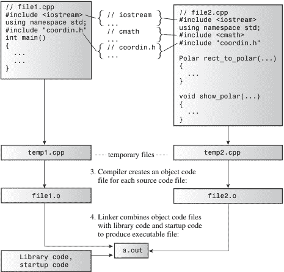

- 3. 编译器为每个源代码文件创建一个目标代码文件：
- 4. 链接器将目标代码文件与库代码和启动代码合并，生成可执行文件：

图 9.1  在 Unix 系统上编译多文件 C++ 程序。

### 头文件管理

你应该在一个文件中只包含一次头文件。这似乎是一件容易记住的事，但你可能在不知情的情况下多次包含同一个头文件。例如，你可能使用一个包含另一个头文件的头文件。有一种标准的 C/C++ 技术可以避免头文件被多次包含。它基于预处理器 `#ifndef`（表示 *如果未定义*）指令。如下代码段的意思是“仅当名称 `COORDIN_H_` 之前未被预处理器 `#define` 指令定义时，才处理 `#ifndef` 和 `#endif` 之间的语句”：

```c
#ifndef COORDIN_H_
...
#endif
```

通常，你使用 `#define` 语句创建符号常量，如下所示：

```c
#define MAXIMUM 4096
```

但仅将 `#define` 与一个名称一起使用就足以确立该名称已被定义，如下所示：

```c
#define COORDIN_H_
```

程序清单 9.1 使用的技术是将文件内容包裹在 `#ifndef` 中：

```c
#ifndef COORDIN_H_
#define COORDIN_H_
// place include file contents here
#endif
```

编译器第一次遇到该文件时，名称 `COORDIN_H_` 应该是未定义的。（我根据包含文件名选择了一个名称，并加入几个下划线字符，以创建一个不太可能在其他地方被定义的名字。）既然如此，编译器会查看 `#ifndef` 和 `#endif` 之间的内容，这正是你想要的。在查看这些内容的过程中，编译器会读取定义 `COORDIN_H_` 的那一行。如果随后在同一文件中第二次包含 `coordin.h`，编译器会注意到 `COORDIN_H_` 已定义，并跳到 `#endif` 后面的行。注意，这种方法并不能阻止编译器两次包含一个文件。相反，它使编译器忽略除第一次包含之外的所有包含内容。大多数标准 C 和 C++ 头文件都使用这种保护方案。否则，你可能在一个文件中两次定义同一个结构，这会产生编译错误。

**程序清单 9.2  `file1.cpp`**

```cpp
// file1.cpp -- example of a three-file program
#include <iostream>
#include "coordin.h" // structure templates, function prototypes
using namespace std;
int main()
```

```cpp
{
    rect rplace;
    polar pplace;

    cout << "Enter the x and y values: ";
    while (cin >> rplace.x >> rplace.y) // slick use of cin
    {
        pplace = rect_to_polar(rplace);
        show_polar(pplace);
        cout << "Next two numbers (q to quit): ";
    }
    cout << "Bye!\n";
    return 0;
}
```

## 程序清单 9.3 file2.cpp

```cpp
// file2.cpp -- contains functions called in file1.cpp
#include <iostream>
#include <cmath>
#include "coordin.h" // structure templates, function prototypes

// convert rectangular to polar coordinates
polar rect_to_polar(rect xypos)
{
    using namespace std;
    polar answer;

    answer.distance =
        sqrt( xypos.x * xypos.x + xypos.y * xypos.y);
    answer.angle = atan2(xypos.y, xypos.x);
    return answer;      // returns a polar structure
}

// show polar coordinates, converting angle to degrees
void show_polar (polar dapos)
{
    using namespace std;
    const double Rad_to_deg = 57.29577951;

    cout << "distance = " << dapos.distance;
    cout << ", angle = " << dapos.angle * Rad_to_deg;
    cout << " degrees\n";
}
```

并发地。使用`thread_local`关键字声明的变量，其存储一直持续到所在线程结束。本书不涉及并发编程。

- **动态存储持续性**——使用`new`运算符分配的内存将一直存在，直到用`delete`运算符释放或程序结束（以先到者为准）。这种内存具有动态存储持续性，有时被称为*堆*上的*自由存储区*。

现在你将了解这个故事的其余部分，包括不同变量何时处于作用域内或可见（即程序可使用）的迷人细节，以及链接性——它决定哪些信息可以在文件间共享。

## 作用域和链接性

作用域描述一个名字在文件（翻译单元）中的可见范围。例如，在函数中定义的变量只能在该函数中使用，而不能在另一个函数中使用；而在函数定义之前于文件中定义的变量可以在所有函数中使用。*链接性*描述一个名字如何在不同的单元之间共享。具有*外部链接性*的名字可以在文件间共享，具有*内部链接性*的名字可以在单个文件内的函数间共享。自动变量没有链接性，因为它们不被共享。

C++变量可以具有几种作用域之一。具有*局部作用域*（也称*块作用域*）的变量只在定义它的块内可见。回顾一下，块是由花括号括起来的一系列语句。例如，函数体就是一个块，但你也可以在函数体内嵌套其他块。具有*全局作用域*（也称*文件作用域*）的变量在定义点之后，在整个文件中都可见。自动变量具有局部作用域，而静态变量根据其定义方式，可以具有两者中的任一作用域。在*函数原型作用域*中使用的名字只在包含参数列表的括号内可见。（这就是为什么它们是什么或者是否存在实际上并不重要。）类中声明的成员具有*类作用域*（参见第10章“对象和类”）。在命名空间中声明的变量具有*命名空间作用域*。（自从命名空间被加入C++语言后，全局作用域已经变成命名空间作用域的一种特殊情况。）

C++函数可以具有类作用域或命名空间作用域，包括全局作用域，但不能具有局部作用域。（因为函数不能在块内定义，如果函数具有局部作用域，那么它只能被自身知道，因而不能被其他函数调用。这样的函数无法发挥作用。）

C++的各种存储选择由其存储持续性、作用域和链接性来表征。让我们从这些属性来看C++的存储类。我们首先考察在命名空间加入之前的状况，然后看看命名空间如何改变这个图景。

## 自动存储持续性

函数参数和在函数内声明的变量默认具有自动存储持续性。它们也具有局部作用域且没有链接性。也就是说，如果你在`main()`中声明了一个名为`texas`的变量，并且在名为`oil()`的函数中声明了另一个同名变量，你就创建了两个独立的变量，每个变量只在其被定义的函数内可见。你在`oil()`中对`texas`所做的任何操作都不会影响`main()`中的`texas`，反之亦然。此外，每个变量在程序执行进入包含其定义的最内层块时被分配，当执行离开该块时，每个变量随之消亡。（注意，变量在执行进入块时被分配，但作用域从声明点之后才开始。）

如果在块内定义一个变量，那么该变量的持久性和作用域都被限制在该块内。例如，假设你在`main()`的开头定义了一个名为`teledeli`的变量。再假设你在`main()`内开始一个新的块，并在块中定义一个新变量`websight`。那么，`teledeli`在外层块和内层块中都可见，而`websight`只存在于内层块中，并且仅从它的定义点到程序执行经过块末尾为止处于作用域内：

```cpp
int main()
{
    int teledeli = 5;
    {
        cout << "Hello\n";       // websight allocated
        int websight = -2;        // websight scope begins
        cout << websight << ' ' << teledeli << endl;
    }                             // websight expires
    cout << teledeli << endl;
    ...
}                                 // teledeli expires
```

但是，如果你将内层块中的变量命名为`teledeli`而不是`websight`，这样你就有了两个同名变量，一个在外层块中，一个在内层块中，会怎样呢？在这种情况下，当程序在块内执行语句时，程序会将`teledeli`这个名称解释为局部块变量。我们说新定义隐藏了先前的定义。新定义处于作用域内，而旧定义暂时超出作用域。当程序离开该块时，原始定义重新进入作用域（见图9.2）。

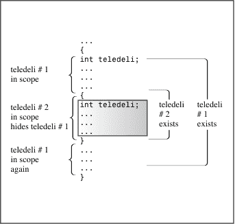

图9.2  块和作用域。

## 程序清单 9.4 `autosc.cpp`

```cpp
// autosc.cpp -- illustrating scope of automatic variables
#include <iostream>
void oil(int x);
int main()
{
    using namespace std;

    int texas = 31;
    int year = 2011;
    cout << "In main(), texas = " << texas << ", &texas = ";
    cout << &texas << endl;
    cout << "In main(), year = " << year << ", &year = ";
    cout << &year << endl;
    oil(texas);
    cout << "In main(), texas = " << texas << ", &texas = ";
    cout << &texas << endl;
    cout << "In main(), year = " << year << ", &year = ";
    cout << &year << endl;
    return 0;
}

void oil(int x)
{
    using namespace std;
    int texas = 5;

    cout << "In oil(), texas = " << texas << ", &texas = ";
    cout << &texas << endl;
    cout << "In oil(), x = " << x << ", &x = ";
    cout << &x << endl;
    {
        int texas = 113;
        cout << "In block, texas = " << texas;
        cout << ", &texas = " << &texas << endl;
        cout << "In block, x = " << x << ", &x = ";
        cout << &x << endl;
    }                         // end a block
    cout << "Post-block texas = " << texas;
    cout << ", &texas = " << &texas << endl;
}
```

下面是程序清单9.4中程序运行的输出：

```
In main(), texas = 31, &texas = 0012FED4
In main(), year = 2011, &year = 0012FEC8
In oil(), texas = 5, &texas = 0012FDE4
In oil(), x = 31, &x = 0012FDF4
In block, texas = 113, &texas = 0012FDD8
In block, x = 31, &x = 0012FDF4
Post-block texas = 5, &texas = 0012FDE4
In main(), texas = 31, &texas = 0012FED4
In main(), year = 2011, &year = 0012FEC8
```

注意，程序清单9.4中的三个`texas`变量都各有不同的地址，程序只使用当前处于作用域内的那个特定变量，因此，在`oil()`的内层块中给`texas`赋值113不会影响其他同名的变量。（和往常一样，实际的地址值和地址格式会因系统而异。）

让我们总结一下事件的顺序。当`main()`开始时，程序为`texas`和`year`分配空间，这些变量进入作用域。当程序调用oil()时，这些变量仍然留在内存中，但已超出作用域。两个新变量`x`和`texas`被分配并进入作用域。当程序执行到`oil()`中的内层块时，新`texas`被移出作用域（被隐藏），因为它被一个更新的定义取代了。然而，变量`x`仍在作用域内，因为该块没有定义新的`x`。当执行退出该块时，最新`texas`的内存被释放，`texas`#2重新进入作用域。当`oil()`函数终止时，那个`texas`和`x`失效，原来的`texas`和`year`重新进入作用域。


## C++11 中 `auto` 的变化

在 C++11 中，关键字 `auto` 用于自动类型推导，正如你在第 3、7 和 8 章中所见。但在 C 和早期版本的 C++ 中，`auto` 具有完全不同的含义。它用于显式标识一个变量具有自动存储：

```cpp
int froob(int n)
{
    auto float ford;  // ford has automatic storage
    ...
}
```

由于程序员只能将 `auto` 关键字用于默认情况下已经是自动变量的变量，因此他们很少费心使用它。它的主要作用是表明你确实想使用一个局部自动变量。

在 C++11 中，这种用法不再有效。制定标准的人不愿引入新关键字，因为这样做可能会使已经将该词用于其他目的的现有代码失效。在这种情况下，人们认为 `auto` 的旧用法足够罕见，因此最好重新利用这个关键字，而不是引入一个新关键字。

## 自动变量的初始化

你可以用任何在到达声明时其值已知的表达式来初始化自动变量。下面的示例展示了变量 `x`、`big`、`y` 和 `z` 的初始化：

```cpp
int w;                  // value of w is indeterminate
int x = 5;              // initialized with a numeric literal
int big = INT_MAX - 1;  // initialized with a constant expression
int y = 2 * x;          // use previously determined value of x
cin >> w;
int z = 3 * w;          // use new value of w
```

## 自动变量与栈

如果看看典型的 C++ 编译器如何实现自动变量，你可能会更好地理解它们。由于自动变量的数量会随着函数的开始和终止而增长和缩减，程序必须在运行时管理自动变量。通常的方法是留出一段内存，并将其视为一个栈，用于管理变量的增减。它被称为 *栈*，是因为新数据形象地堆叠在旧数据之上（也就是说，位于相邻位置，而不是同一位置），然后在程序用完它之后从栈中移除。栈的默认大小取决于具体实现，但编译器通常提供更改大小的选项。程序使用两个指针来跟踪栈。一个指向栈底，即为栈预留的内存开始处；另一个指向栈顶，即下一个空闲的内存位置。调用函数时，其自动变量被添加到栈中，栈顶指针指向这些变量之后的下一块可用空闲空间。函数终止时，栈顶指针被重置为函数调用之前的值，从而有效地释放原先用于这些新变量的内存。

栈是一种 LIFO（后进先出）设计，这意味着最后添加到栈中的变量最先离开。这种设计简化了参数传递。函数调用将其参数值放在栈顶，并重置栈顶指针。被调用的函数使用其形参描述来确定每个实参的地址。例如，图 9.3 展示了一个 `fib()` 函数，调用它时会传递一个 2 字节的 `int` 和一个 4 字节的 `long`。这些值进入栈中。当 `fib()` 开始执行时，它将名称 `real` 和 `tell` 与这两个值关联起来。当 `fib()` 终止时，栈顶指针被移回其先前的位置。新值并未被擦除，但它们不再有标签，它们占用的空间将被下一个向栈中放置值的处理过程使用。（图 9.3 有所简化，因为函数调用可能传递额外信息，例如返回地址。）

### 寄存器变量

C 最初引入 `register` 关键字，是为了建议编译器使用 CPU 寄存器来存储自动变量：

```cpp
register int count_fast;  // request for a register variable
```

其想法是，这样可以更快地访问该变量。

在 C++11 之前，C++ 以相同方式使用该关键字，只不过随着硬件和编译器的发展成熟，这个提示被泛化为表示该变量被大量使用，也许编译器可以提供某种特殊处理。在 C++11 中，连这个提示也被弃用了，使得 `register` 仅仅成为一种显式标识变量为自动变量的方式。鉴于 `register` 只能用于本来就会是自动变量的变量，使用这个关键字的一个原因是指示你确实想使用一个自动变量，也许是名称与外部变量相同的自动变量。这与最初使用 `auto` 的目的相同。然而，保留 `register` 的更重要的原因，是避免使使用该关键字的现有代码失效。

## 静态存储期变量

与 C 一样，C++ 提供具有静态存储期的变量，并具有三种链接性：外部链接性（可跨文件访问）、内部链接性（可供单个文件内的函数访问）和无链接性（仅供一个函数或函数内的一个块访问）。这三种变量都在程序的整个运行期间存在；它们不像自动变量那样短暂。由于静态变量的数量在程序运行期间不会改变，程序不需要栈之类的特殊机制来管理它们。相反，编译器分配一块固定内存来保存所有静态变量，并且只要程序执行，这些变量就始终存在。此外，如果你没有显式初始化静态变量，编译器会将其设置为 0。静态数组和结构的每个元素或成员的各位默认都设置为 0。

- 1. 函数调用前的栈（每个方框表示 2 字节）
- 2. 函数调用后的栈
- 3. 函数开始执行后的栈
- 4. 函数终止后的栈

使用栈传递参数的示意图。栈经过四个阶段增长。调用之前，栈中包含值 1890 和 2929。调用 `fib(18, 50L);` 会将实参压入栈：`long` 值 `50L` 占 4 字节，`int` 值 `18` 占 2 字节。当函数开始执行时，`tell` 和 `real` 将形参与栈上的值关联起来。当函数终止时，栈顶重置到其原始位置。栈的注释包括“栈顶（下一次添加将放在这里）”和“先前放入栈中的值”。

```cpp
void fib(int real, long tell)
{
  ...
}
```

图 9.3 使用栈传递参数。

### 注意

经典 K&R C 不允许初始化自动数组和结构，但允许初始化静态数组和结构。ANSI C 和 C++ 允许初始化这两种。但一些较旧的 C++ 转换器使用的 C 编译器并非完全符合 ANSI C。如果你使用的是这样的实现，你可能需要使用三种静态存储类之一来初始化数组和结构。

我们来看看如何创建三种不同的静态存储期变量；然后继续考察它们的属性。要创建具有外部链接性的静态存储期变量，应在任何块之外声明它。要创建具有内部链接性的静态存储期变量，应在任何块之外声明它，并使用 `static` 存储类修饰符。要创建无链接性的静态存储期变量，应在块内声明它，并使用 `static` 修饰符。下面的代码片段展示了这三种变体：

```c
...
int global = 1000;         // static duration, external linkage
static int one_file = 50;  // static duration, internal linkage
int main()
{
...
}
void funct1(int n)
{
    static int count = 0;  // static duration, no linkage
    int llama = 0;
...
}
void funct2(int q)
{
...
}
```

如前所述，所有静态存储期变量（本例中的 `global`、`one_file` 和 `count`）从程序开始执行时一直存在到程序终止。变量 `count` 声明在 `funct1()` 内部，具有局部作用域且无链接性，这意味着它只能像自动变量 `llama` 一样在 `funct1()` 函数内部使用。但与 `llama` 不同，即使 `funct1()` 函数没有执行，`count` 也仍然留在内存中。`global` 和 `one_file` 都具有文件作用域，这意味着它们可以从声明点使用到文件末尾。特别是，二者都可以在 `main()`、`funct1()` 和 `funct2()` 中使用。由于 `one_file` 具有内部链接性，它只能在使用这段代码的文件中使用。由于 `global` 具有外部链接性，它也可以在作为程序一部分的其他文件中使用。

所有静态存储期变量都具有以下初始化特性：未初始化的静态变量的所有位都被设置为 0。这样的变量被称为 *零初始化*。

表 9.1 总结了命名空间出现之前时代所使用的存储类特性。接下来，我们将更详细地考察静态存储期的各种类型。

请注意，关键字 `static` 在表 9.1 所示的两种用法中含义有所不同。当与局部声明一起使用以表示无链接性的静态变量时，`static` 表示存储期的种类。当与块外声明一起使用时，`static` 表示内部链接性；该变量已经具有静态存储期。人们可以将这种情况称为 *关键字重载*，其确切含义由上下文决定。


表9.1 五种变量存储方式

| 存储描述 | 持续时间 | 作用域 | 链接性 | 声明方式 |
|---|---|---|---|---|
| 自动 | 自动 | 块 | 无 | 在块中 |
| 寄存器 | 自动 | 块 | 无 | 在块中，带关键字 `register` |
| 无链接性的静态变量 | 静态 | 块 | 无 | 在块中，带关键字 `static` |
| 具有外部链接性的静态变量 | 静态 | 文件 | 外部 | 在所有函数外部 |
| 具有内部链接性的静态变量 | 静态 | 文件 | 内部 | 在所有函数外部，带关键字 `static` |

## 初始化静态变量

静态变量可以*零初始化*，可以经历*常量表达式初始化*，也可以经历*动态初始化*。你可能已经猜到，零初始化意味着将变量设置为零值。对于标量类型，零会被强制转换为适当的类型。例如，空指针在C++代码中用0表示，但其内部表示可能非零，因此指针变量将被初始化为该值。结构体成员会被零初始化，任何填充位也会被设置为零。

零初始化和常量表达式初始化统称为*静态初始化*。这意味着变量在编译器处理文件（或翻译单元）时被初始化。动态初始化则意味着变量稍后被初始化。

那么，是什么决定了采用哪种初始化形式呢？首先，所有静态变量都会被零初始化，无论是否指明了任何初始化。其次，如果变量使用的是编译器仅从文件内容（包括所包含的头文件）中即可求值的常量表达式来初始化，那么它可以执行常量表达式初始化。编译器在需要时会进行简单的计算。如果此时信息不足，变量将被动态初始化。考虑以下代码：

```cpp
#include <cmath>
int x;                          // zero-initialization
int y = 5;                      // constant-expression initialization
long z = 13 * 13;               // constant-expression initialization
const double pi = 4.0 * atan(1.0); // dynamic initialization
```

首先，x、y、z和pi被零初始化。然后编译器求值常量表达式，分别将y和z初始化为5和169。但初始化pi需要调用`atan()`函数，这必须等到函数被链接且程序执行时才能进行。

常量表达式并不限于使用字面常量的算术表达式。例如，它可以使用`sizeof`运算符：

```cpp
int enough = 2 * sizeof (long) + 1;  // constant expression initialization
```

C++11引入了一个新关键字`constexpr`，以扩展创建常量表达式的选项；这是本书不再深入探讨的C++11新特性之一。

## 静态存储期、外部链接性

具有外部链接性的变量通常简称为*外部变量*。它们必然具有静态存储期和文件作用域。外部变量定义在所有函数之外，因此是任何函数的外部。例如，它们可以声明在`main()`函数之上，或放在头文件中。你可以在文件中位于外部变量定义之后的任何函数中使用该外部变量。因此，外部变量也被称为*全局变量*，与自动变量（即局部变量）相对。

## 单一定义规则

一方面，外部变量必须在每个使用该变量的文件中声明。另一方面，C++有“单一定义规则”（也称为*odr*），规定一个变量只能有一个定义。为了满足这些要求，C++有两种变量声明。一种是*定义声明*，或简称为*定义*，它会为该变量分配存储空间。第二种是*引用声明*，或简称为*声明*。它不会分配存储空间，因为它引用的是一个已存在的变量。

引用声明使用关键字`extern`，并且不提供初始化。否则，声明就是定义，并会分配存储空间：

```cpp
double up;             // definition, up is 0
extern int blem;       // blem defined elsewhere
extern char gr = 'z';  // definition because initialized
```

如果你在多个文件中使用同一个外部变量，那么根据单一定义规则，只能有一个文件包含该变量的定义。但所有其他使用该变量的文件都需要使用关键字`extern`来声明该变量：

```cpp
// file01.cpp
extern int cats = 20;  // definition because of initialization
int dogs = 22;         // also a definition
int fleas;             // also a definition
...
// file02.cpp
// use cats and dogs from file01.cpp
extern int cats;       // not definitions because they use
extern int dogs;        // extern and have no initialization
...

// file98.cpp
// use cats, dogs, and fleas from file01.cpp
extern int cats;
extern int dogs;
extern int fleas;
...
```

在这种情况下，所有文件都使用在file01.cpp中定义的cats和dogs变量。然而，file02.cpp没有重新声明fleas变量，因此它无法访问它。file01.cpp中的extern其实并非必需，因为省略它效果也一样（另请参见图9.4）。

```cpp
// file1.cpp
#include <iostream>
using namespace std;

// function prototypes
#include "mystuff.h"

// defining an external variable
int process_status = 0;

void promise();
int main()
{
    ...
}

void promise()
{
    ...
}
```

```cpp
// file2.cpp
#include <iostream>
using namespace std;

// function prototypes
#include "mystuff.h"

// referencing an external variable
extern int process_status;

int manipulate(int n)
{
    ...
}

char * remark(char * str)
{
    ...
}
```

file1.cpp 定义了变量 process_status，这使编译器为其分配空间。

file2.cpp 使用 extern 来指示程序使用在另一个文件中定义的变量 process_status。

图9.4 定义声明与引用声明。

请注意，单一定义规则并不意味着只能有一个给定名称的变量。例如，共享相同名称但在不同函数中定义的自动变量是各自独立的变量，互不相关，并且每个变量都有自己的地址。此外，正如后面的示例所示，局部变量可以隐藏同名的全局变量。然而，尽管一个程序可以拥有同名的不同变量，但每个版本只能有一个定义。

```cpp
warming += dt;        // uses global warming
cout << "Updating global warming to " << warming;
cout << " degrees.\n";
}

void local()               // uses local variable
{
    double warming = 0.8;   // new variable hides external one

    cout << "Local warming = " << warming << " degrees.\n";
    // Access global variable with the
    // scope resolution operator
    cout << "But global warming = " << ::warming;
    cout << " degrees.\n";
}
```

以下是程序的输出：

```cpp
Global warming is 0.3 degrees.
Updating global warming to 0.4 degrees.
Global warming is 0.4 degrees.
Local warming = 0.8 degrees.
But global warming = 0.4 degrees.
Global warming is 0.4 degrees.
```

## 程序说明

清单9.5和9.6中程序的输出表明，`main()`和`update()`都可以访问外部变量`warming`。请注意，`update()`对`warming`所做的更改会在后续使用该变量时体现出来。

`warming`的定义在清单9.5中：

```cpp
double warming = 0.3;        // warming defined
```

清单9.6使用`extern`使warming变量对该文件中的函数可用：

```cpp
extern double warming;  // use warming from another file
```

正如注释所示，此声明表示：“使用在外部其他地方定义的warming变量。”

此外，`update()`函数通过使用关键字`extern`重新声明了`warming`变量。这个关键字的意思是：“使用此前在外部定义的、与此同名的变量。”因为即使你省略整个声明，`update()`本来也会这样做，所以这个声明是可选的。它用于说明该函数有意使用这个外部变量。

`local()`函数演示了当你定义一个与全局变量同名的局部变量时，局部版本会隐藏全局版本。`local()`

例如，函数在显示 warming 的值时使用的是 warming 的局部定义。

C++ 比 C 更进一步，提供了*作用域解析运算符*（`::`）。当它被放在变量名之前时，这个运算符表示使用该变量的全局版本。因此，local() 将 warming 显示为 0.8，但将 ::warming 显示为 0.4。你会在命名空间和类中再次遇到这个运算符。就清晰性和避免错误而言，在 update() 函数中使用 ::warming，而不是只使用 warming 并依赖作用域规则，本来会更好、更安全。

## 全局变量与局部变量

既然现在可以选择使用全局变量或局部变量，那么应该使用哪一种呢？起初，全局变量有一种诱人的吸引力——因为所有函数都能访问全局变量，所以你不必费心传递参数。但这种便利的访问代价高昂：程序不可靠。计算经验表明，程序越能做好数据隔离、避免不必要的访问，就越能保持数据的完整性。大多数情况下，你应该使用局部变量，并按需知悉原则把数据传递给函数，而不是通过使用全局变量不加区分地让数据可用。正如你将看到的，OOP 将这种数据隔离又向前推进了一步。

然而，全局变量确实有它们的用途。例如，你可能有一块数据要被多个函数使用，比如月份名称数组或元素的原子量。外部存储类特别适合表示常量数据，因为你可以使用关键字 const 来保护数据不被修改：

```cpp
const char * const months[12] =
{
    "January", "February", "March", "April", "May",
    "June", "July", "August", "September", "October",
    "November", "December"
};
```

在这个例子中，第一个 const 保护字符串不被修改，第二个 const 确保数组中的每个指针始终指向它最初指向的同一个字符串。

## 静态存储期，内部链接

将 static 修饰符应用于文件作用域变量，会使其具有内部链接。内部链接与外部链接之间的差异在多文件程序中才有意义。在这种上下文中，具有内部链接的变量对于包含它的文件来说是局部的。但普通外部变量具有外部链接，这意味着它可以在不同文件中使用，如前面的示例所示。

如果你想在不同文件中用同一个名称表示不同的变量，该怎么办？你能直接省略 extern 吗？

```cpp
// file1
int errors = 20;       // external declaration
...
----------------------------------------------
// file2
int errors = 5;        // ??known to file2 only??
void froobish()
{
        cout << errors;  // fails
        ...
```

不行，这种尝试会失败，因为它违反了单定义规则。`file2` 中的定义试图创建一个外部变量，因此程序最终会有两个 `errors` 定义，这是错误的。

但是，如果一个文件声明了一个静态外部变量，其名称与另一个文件中声明的普通外部变量相同，那么对该文件来说，作用域内的是静态版本：

```cpp
// file1
int errors = 20;       // external declaration
...
----------------------------------------------
// file2
static int errors = 5;  // known to file2 only
void froobish()
{
        cout << errors;  // uses errors defined in file2
        ...
}
```

这不违反单定义规则，因为关键字 `static` 确立了标识符 `errors` 具有内部链接，所以不会尝试引入外部定义。

> **注意**
> 
> 在多文件程序中，你只能在一个且仅一个文件中定义外部变量。所有使用该变量的其他文件都必须用 `extern` 关键字声明该变量。

你可以使用外部变量在多文件程序的不同部分之间共享数据。你可以使用具有内部链接的静态变量，在仅存在于一个文件中的函数之间共享数据。（命名空间为此提供了另一种方法。）另外，如果你把文件作用域变量设为 static，就不必担心它的名称与其他文件中的文件作用域变量冲突。

程序清单 9.7 和 9.8 展示了 C++ 如何处理具有外部链接和内部链接的变量。程序清单 9.7（`twofile1.cpp`）定义了外部变量 tom 和 dick，以及静态外部变量 harry。该文件中的 `main()` 函数显示这三个变量的地址，然后调用在第二个文件中定义的 `remote_access()` 函数。程序清单 9.8（`twofile2.cpp`）展示了那个文件。除了定义 `remote_access()` 之外，该文件还使用 `extern` 关键字与第一个文件共享 tom。接下来，该文件定义了一个名为 `dick` 的静态变量。static 修饰符使该变量成为该文件的局部变量，并覆盖全局定义。然后，该文件定义了一个名为 `harry` 的外部变量。它可以这样做而不会与第一个文件中的 `harry` 冲突，因为第一个 `harry` 只具有内部链接。然后，`remote_access()` 函数显示这三个变量的地址，以便你可以将它们与第一个文件中相应变量的地址进行比较。请记住，你需要编译这两个文件并将它们链接起来，才能得到完整的程序。

### 程序清单 9.7 `twofile1.cpp`

```cpp
// twofile1.cpp -- variables with external and internal linkage
#include <iostream>     // to be compiled with twofile2.cpp
int tom = 3;            // external variable definition
int dick = 30;          // external variable definition
static int harry = 300; // static, internal linkage

// function prototype
void remote_access();

int main()
{
    using namespace std;
    cout << "main() reports the following addresses:\n";
    cout << &tom << " = &tom, " << &dick << " = &dick, ";
    cout << &harry << " = &harry\n";
    remote_access();
    return 0;
}
```

### 程序清单 9.8 `twofile2.cpp`

```cpp
// twofile2.cpp -- variables with internal and external linkage
#include <iostream>
extern int tom;         // tom defined elsewhere
static int dick = 10;   // overrides external dick
int harry = 200;        // external variable definition,
                        // no conflict with twofile1 harry

void remote_access()
{
    using namespace std;
    cout << "remote_access() reports the following addresses:\n";
    cout << &tom << " = &tom, " << &dick << " = &dick, ";
    cout << &harry << " = &harry\n";
}
```

下面是同时编译程序清单 9.7 和 9.8 后生成的程序输出：

```text
main() reports the following addresses:
0x0041a020 = &tom, 0x0041a024 = &dick, 0x0041a028 = &harry
remote_access() reports the following addresses:
0x0041a020 = &tom, 0x0041a450 = &dick, 0x0041a454 = &harry
```

从这些地址可以看出，两个文件使用同一个 tom 变量，但使用不同的 dick 和 harry 变量。（具体的地址值和格式在你的系统上可能不同，但 tom 的地址会彼此匹配，而 dick 和 harry 的地址不会。）

## 静态存储期，无链接

到目前为止，我们考察了具有外部链接的文件作用域变量和具有内部链接的文件作用域变量。现在来看静态存储期家族的第三个成员：无链接的局部变量。你可以通过对块内定义的变量应用 static 修饰符来创建这样的变量。在块内使用 static 时，它会使局部变量具有静态存储期。这意味着，即使该变量只在那个块内可见，它在该块不活跃时也依然存在。这样的静态局部变量可以在函数调用之间保留其值。（静态变量对转世会很有用——你可以用它们把瑞士银行的秘密账号传递到你的下一次转世。）另外，如果你初始化一个静态局部变量，程序会在程序启动时对该变量初始化一次。后续调用该函数时，不会像对自动变量那样重新初始化该变量。程序清单 9.9 说明了这些要点。

### 程序清单 9.9 `static.cpp`

```cpp
// static.cpp -- using a static local variable
#include <iostream>
// constants
const int ArSize = 10;

// function prototype
void strcount(const char * str);

int main()
{
    using namespace std;
    char input[ArSize];
    char next;

    cout << "Enter a line:\n";
    cin.get(input, ArSize);
    while (cin)
    {
```


```cpp
    cin.get(next);
    while (next != '\n')      // string didn't fit!
        cin.get(next);        // dispose of remainder
    strcount(input);
    cout << "Enter next line (empty line to quit):\n";
    cin.get(input, ArSize);
}
cout << "Bye!\n";
return 0;
}

void strcount(const char * str)
{
    using namespace std;
    static int total = 0;        // static local variable
    int count = 0;               // automatic local variable

    cout << "\"" << str << "\" contains ";
    while (*str++)               // go to end of string
        count++;
    total += count;
    cout << count << " characters\n";
    cout << total << " characters total\n";
}
```

顺便说一句，程序清单9.9中的程序展示了一种处理可能超出目标数组大小的行输入的方法。回忆一下，cin.get(input, ArSize) 输入方法最多读取到行尾或最多读取 ArSize - 1 个字符，以先达到者为准。它会把换行字符留在输入队列中。该程序使用 cin.get(next) 读取行输入之后的字符。如果 next 是换行字符，那么之前对 cin.get(input, ArSize) 的调用一定读取了整行。如果 next 不是换行字符，则行上还有更多字符。然后该程序使用一个循环丢弃该行的剩余部分，但你可以修改代码，将剩余部分用于下一个输入周期。该程序还利用了这样一个事实：尝试用 get(char *, int) 读取空行会使 cin 测试为 false。

下面是程序清单9.9中程序的输出：

```
Enter a line:
nice pants
"nice pants" contains 9 characters
9 characters total
Enter next line (empty line to quit):
thanks
"thanks" contains 6 characters
15 characters total
Enter next line (empty line to quit):
parting is such sweet sorrow
"parting i" contains 9 characters
24 characters total
Enter next line (empty line to quit):
ok
"ok" contains 2 characters
26 characters total
Enter next line (empty line to quit):

Bye!
```

注意，由于数组大小为 10，程序每行读取不超过九个字符。还要注意，自动变量 count 在每次调用函数时都会重置为 0。然而，静态变量 total 在开始时被设置为 0 一次。此后，total 在函数调用之间保留其值，因此能够维护累计总数。

## 说明符与限定符

某些 C++ 关键字，称为存储类说明符和 cv 限定符，提供有关存储的附加信息。以下是存储类说明符列表：

- auto（C++11 中不再作为说明符）
- register
- static
- extern
- thread_local（C++11 新增）
- mutable

你已经见过其中大多数，并且在单个声明中最多只能使用其中一个，但 thread_local 可以与 static 或 extern 一起使用。回顾一下，在 C++11 之前，关键字 auto 可在声明中用来表明该变量是自动变量。（在 C++11 中，auto 用于自动类型推导。）关键字 register 用于声明中以指示寄存器存储类；在 C++11 中，这只是显式说明该变量是自动变量的一种方式。关键字 static 与文件作用域声明一起使用时，表示内部链接；与局部声明一起使用时，表示局部变量的静态存储期。关键字 extern 表示引用声明——也就是说，该声明引用的是在别处定义的变量。关键字 thread_local 表示变量的持续时间是包含它的线程的持续时间。thread_local 变量之于线程，正如常规静态变量之于整个程序。关键字 mutable 要结合 const 来解释，所以让我们先看看 cv 限定符，然后再回到 mutable。

### Cv 限定符

以下是 cv 限定符：

- const
- volatile

（你可能已经猜到，*cv* 代表 const 和 volatile。）最常用的 cv 限定符是 const，你已经见过它的用途：它表示内存在初始化之后不应被程序修改。我们稍后会回到 const。

关键字 volatile 表示内存位置中的值即使程序代码中没有修改其内容，也可能被改变。这听起来并不那么神秘。例如，你可能有一个指向硬件位置的指针，该位置包含时间信息或来自端口的信息。在这种情况下，是硬件而不是程序改变了内容。或者两个程序可能交互并共享数据。该关键字的意图是提高编译器的优化能力。例如，假设编译器注意到某个程序在几条语句内两次使用某个特定变量的值。编译器可能会将该值缓存到寄存器中，而不是让程序查找该值两次。这种优化假定变量的值在两次使用之间不会改变。如果你没有将变量声明为 volatile，编译器就可以随意进行这种优化。如果你确实将变量声明为 volatile，就是在告诉编译器不要进行那种优化。

### mutable

现在让我们回到 mutable。你可以用它来表示结构（或类）的某个特定成员即使在某个结构（或类）变量是 const 时也可以被修改。例如，考虑以下代码：

```cpp
struct data
{
    char name[30];
    mutable int accesses;
    ...
};
```

```cpp
const data veep = {"Claybourne Clodde", 0, ... };
strcpy(veep.name, "Joye Joux");    // not allowed
veep.accesses++;                  // allowed
```

veep 的 const 限定符阻止程序修改 veep 的成员，但 accesses 成员的 mutable 说明符使 accesses 免受该限制。本书不使用 volatile 或 mutable，但关于 const 还有更多内容要学习。

### 关于 const 的更多内容

在 C++ 中（但 C 中不是这样），const 修饰符会稍微改变默认存储类。全局变量默认具有外部链接，而 const 全局变量默认具有内部链接。也就是说，C++ 会把全局 const 定义（如下面的代码片段）视为使用了 static 说明符：

```cpp
const int fingers = 10;    // same as static const int fingers = 10;
int main(void)
{
    ...
```

C++ 修改了常量类型的规则，以便让你更轻松。例如，假设你有一组常量，想把它们放在一个头文件中，并且在同一程序的多个文件中使用这个头文件。预处理器将头文件内容包含到每个源文件后，每个源文件都会包含如下定义：

```cpp
const int fingers = 10;
const char * warning = "Wak!";
```

如果全局 const 声明像常规变量一样具有外部链接，那么由于单一定义规则，这将会出错。也就是说，只有一个文件可以包含前面的声明，其他文件必须使用 extern 关键字提供引用声明。此外，只有不带 extern 关键字的声明才能初始化值：

```cpp
// extern would be required if const had external linkage
extern const int fingers;        // can't be initialized
extern const char * warning;
```

因此，你需要为一个文件提供一组定义，并为其他文件提供另一组声明。相反，由于外部定义的 const 数据具有内部链接，你可以在所有文件中使用相同的声明。

内部链接还意味着每个文件获得自己的一组常量，而不是共享它们。每个定义都只对其所在的文件私有。这就是为什么把常量定义放在头文件中是个好主意。这样，只要你在两个源代码文件中包含同一个头文件，它们就会获得同一组常量。

如果由于某种原因你想让常量具有外部链接，可以使用 extern 关键字覆盖默认的内部链接：

```cpp
extern const int states = 50;    // definition with external linkage
```

然后，你必须在所有使用该常量的文件中使用 extern 关键字声明该常量。这与常规外部变量不同：对于常规外部变量，你在定义变量时不必使用关键字 extern，但在使用该变量的其他文件中要使用 extern。不过请记住，既然单个 const 要在文件之间共享，那么只有一个文件可以使用初始化。

当你在函数或块中声明 const 时，它具有块作用域，这意味着只有当程序执行该块内的代码时，该常量才可用。这意味着你可以在函数或块内创建常量，而不必担心名称与别处定义的常量冲突。

## 函数与链接

和变量一样，函数也具有链接属性，尽管其选择比变量更有限。C++ 与 C 一样，不允许在一个函数内定义另一个函数，因此所有函数自动具有静态存储期，这意味着只要程序在运行，它们就都存在。默认情况下，函数具有外部链接，这意味着它们可以跨文件共享。事实上，你可以在函数原型中使用关键字 extern

用于表明该函数定义在另一个文件中，但这是可选的。（为了让程序能在另一个文件中找到该函数，该文件必须是作为程序一部分参与编译的文件之一，或者是链接器搜索的库文件。）你也可以使用关键字 `static` 为函数赋予内部链接性，从而将其使用限制在单个文件中。你会把这个关键字同时应用于函数原型和函数定义：

```cpp
static int private(double x);
...
static int private(double x)
{
    ...
}
```

这意味着该函数只在该文件中可见。这也意味着你可以在另一个文件中为另一个函数使用相同的名称。与变量一样，静态函数会覆盖包含该静态声明的文件中的外部定义，因此，包含静态函数定义的文件将使用该版本的函数，即使存在同名函数的外部定义。

单一定义规则也适用于非内联函数。因此，每个程序对于每个非内联函数都应恰好包含一个定义。对于具有外部链接性的函数，这意味着多文件程序中只能有一个文件包含该函数定义。（这个文件可以是你提供的文件，也可以是库文件。）不过，每个使用该函数的文件都应包含该函数的原型。

内联函数不受此规则约束，以便你可以将内联函数定义放在头文件中。因此，每个包含该头文件的文件最终都会拥有该内联函数定义。然而，C++ 确实要求某个特定函数的所有内联定义必须完全相同。

> **C++ 在何处查找函数**
> 
> 假设你在程序中的某个特定文件里调用了一个函数。C++ 会在哪里查找该函数的定义？如果该文件中的函数原型表明该函数是静态的，编译器就只会在该文件中查找函数定义。否则，编译器（以及链接器）会在所有程序文件中查找。如果找到两个定义，编译器会向你发送错误消息，因为一个外部函数只能有一个定义。如果在这些文件中找不到任何定义，编译器随后会搜索库。这意味着，如果你定义了一个与库函数同名的函数，编译器会使用你的版本，而不是库版本。（不过，C++ 保留了标准库函数的名称，因此你不应重复使用这些名称。）有些编译器-链接器需要明确指令来确定要搜索哪些库。

## 语言链接

另一种链接形式称为*语言链接*，它会影响函数。首先介绍一点背景知识。链接器需要为每个不同的函数使用不同的符号名。在 C 中，这很容易实现，因为给定名称的 C 函数只能有一个。因此，出于内部目的，C 编译器可能会将诸如 `spiff` 这样的 C 函数名转换为 `_spiff`。C 的这种做法称为*C 语言链接*。

然而，C++ 可以有多个具有相同 C++ 名称的函数，而这些函数必须转换为不同的符号名。因此，C++ 编译器会进行名称修饰或名称装饰（如第 8 章所述），以便为重载函数生成不同的符号名。例如，它可以将 `spiff(int)` 转换为 `_spiff_i`，并将 `spiff(double, double)` 转换为 `_spiff_d_d`。C++ 的这种做法是*C++ 语言链接*。

当链接器查找与 C++ 函数调用匹配的函数时，它使用的查找方法与匹配 C 函数调用时不同。但假设你想在 C++ 程序中使用来自 C 库的预编译函数，该怎么办？例如，假设你有以下代码：

```cpp
spiff(22); // want spiff(int) from a C library
```

它在 C 库文件中的假设符号名是 `_spiff`，但对于我们假设的链接器来说，C++ 查找约定是查找符号名 `_spiff_i`。为了解决这个问题，你可以使用函数原型来指示使用哪种协议：

```cpp
extern "C" void spiff(int);    // use C protocol for name look-up
extern void spiff(int);        // use C++ protocol for name look-up
extern "C++" void spiff(int);  // use C++ protocol for name look-up
```

这里的第一个示例使用 C 语言链接。第二个和第三个示例使用 C++ 语言链接；第二个示例默认使用 C++ 语言链接，第三个示例则显式使用 C++ 语言链接。C 和 C++ 语言链接是 C++ 标准唯一要求的说明符。但各实现可以选择提供额外的语言链接说明符。

## 存储方案与动态分配

你已经了解了 C++ 用于为变量（包括数组和结构）分配内存的五种方案（不包括线程内存）。它们不适用于通过 C++ `new` 运算符（或使用较旧的 C `malloc()` 函数）分配的内存。我们将这种内存称为*动态内存*。正如你在第 4 章所见，动态内存由 `new` 和 `delete` 运算符控制，而不是由作用域和链接性规则控制。因此，动态内存可以在一个函数中分配，并在另一个函数中释放。与自动内存不同，动态内存不是后进先出（LIFO）的；分配和释放的顺序取决于 `new` 和 `delete` 的使用时间和方式。通常，编译器使用三个独立的内存块：一个用于静态变量（这个块可能被细分），一个用于自动变量，一个用于动态存储。

尽管存储方案概念不适用于动态内存，但它们确实适用于用于跟踪动态内存的自动和静态指针变量。例如，假设你在一个函数内有以下语句：

```cpp
float * p_fees = new float [20];
```

由 `new` 分配的 80 字节内存（假设 `float` 为 4 字节）会一直保留在内存中，直到 `delete` 运算符释放它。但是，当程序执行离开包含该声明的块时，`p_fees` 指针就不复存在。如果你希望另一个函数可以使用这 80 字节的已分配内存，就需要将其地址传递给该函数或从该函数返回。另一方面，如果你以外部链接性声明 `p_fees`，那么 `p_fees` 指针将在该文件中该声明之后的所有函数中可用。并且，在第二个文件中使用以下声明，就可以让同一个指针在第二个文件中可用：

```cpp
extern float * p_fees;
```

> **注意**
> 
> 由 `new` 分配的内存在程序终止时通常会被释放。然而，这并不总是成立。例如，在一些不太健壮的操作系统上，在某些情况下，请求一大块内存可能会得到一个在程序终止时不会自动删除的块。最佳实践是使用 `delete` 释放由 `new` 分配的内存。

### 使用 new 运算符进行初始化

如果你希望在动态内存分配的同时初始化变量，该怎么办？在 C++98 中，你可以在某些情况下这样做。C++11 扩展了可用的可能性。我们先来看看过去已经可以做到哪些。

如果你希望为 `int` 或 `double` 等标量内置类型之一创建并初始化存储空间，可以在所需类型后面跟一个括在圆括号中的初始化值：

```cpp
int *pi = new int (6);   // *pi set to 6
double *pd = new double (99.99);   // *pd set to 99.99
```

圆括号语法也可以用于具有合适构造函数的类，但我们还没有讲到那里。

然而，要初始化普通结构或数组，你需要 C++11 以及使用花括号的列表初始化。新标准允许以下写法：

```cpp
struct where {double x; double y; double z;};
where * one = new where {2.5, 5.3, 7.2};   // C++11
int * ar = new int [4] {2,4,6,7};          // C++11
```

在 C++11 中，你还可以对单值变量使用花括号初始化：

```cpp
int *pin = new int {6};   // *pin set to 6
double *pdo = new double {99.99};   // *pd set to 99.99
```

### 当 new 失败时

`new` 可能找不到所需数量的内存。在最初的十年里，C++ 通过让 `new` 返回空指针来处理这种可能情况。然而，目前 `new` 会抛出 `std::bad_alloc` 异常。第 15 章“友元、异常和其他”提供了一些简短示例，展示每种方法如何工作。


## new：运算符、函数和替换函数

`new` 和 `new[]` 运算符会调用两个函数：

```cpp
void * operator new(std::size_t);    // used by new
void * operator new[](std::size_t);  // used by new[]
```

它们被称为 *分配函数*，并且属于全局命名空间。类似地，`delete` 和 `delete []` 使用的释放函数如下：

```cpp
void operator delete(void *);
void operator delete[](void *);
```

它们使用第 11 章“使用类”中讨论的运算符重载语法。`std::size_t` 是某种合适整数类型的 typedef。诸如以下的基本语句：

```cpp
int * pi = new int;
```

会被转换为类似下面的形式：

```cpp
int * pi = new(sizeof(int));
```

而以下语句：

```cpp
int * pa = new int[40];
```

会被转换为类似下面的形式：

```cpp
int * pa = new(40 * sizeof(int));
```

如你所见，带有 new 运算符的语句还可以提供初始化值，因此，一般来说，使用 new 运算符可能不仅仅是调用 new() 函数。

类似地，

```cpp
delete pi;
```

会调用以下函数：

```cpp
delete(pi);
```

有趣的是，C++ 将这些函数称为 *可替换的*。这意味着，如果你有足够的专业知识和意愿，就可以为 new 和 delete 提供替换函数，并对它们进行调整以满足你的特定需求。例如，一种选择是定义具有类作用域的替换函数，以便调整它们以满足特定类的分配需求。你的代码会像往常一样使用 new 运算符，但 new 运算符会调用替换后的 new() 函数。

### 定位 new 运算符

通常，new 运算符负责在堆中找到一个足够大的内存块，以处理你请求的内存量。new 运算符有一个变体，称为 *定位 new*，它允许你指定要使用的位置。程序员可以使用此特性来建立自己的内存管理过程，或者处理通过特定地址访问的硬件，或者在特定内存位置构造对象。

要使用定位 new 特性，首先应包含 new 头文件，它为该版本的 new 提供原型。然后，使用 new 并提供一个给出目标地址的参数。除了这个参数之外，语法与常规 new 相同。特别是，你可以在不带方括号或带方括号的情况下使用定位 new。以下代码片段展示了使用这四种 new 形式的语法：

```cpp
#include <new>
struct chaff
{
    char dross[20];
    int slag;
};
char buffer1[50];
char buffer2[500];
int main()
{
    chaff *p1, *p2;
    int *p3, *p4;
// first, the regular forms of new
    p1 = new chaff;            // place structure in heap
    p3 = new int[20];          // place int array in heap
// now, the two forms of placement new
    p2 = new (buffer1) chaff;  // place structure in buffer1
    p4 = new (buffer2) int[20]; // place int array in buffer2
...
}
```

为简单起见，本示例使用两个静态数组为定位 new 提供内存空间。因此，这段代码在 buffer1 中为 chaff 结构分配空间，并在 buffer2 中为一个包含 20 个 int 的数组分配空间。

既然你已经初步了解了定位 new，下面来看一个示例程序。程序清单 9.10 同时使用 new 和定位 new 来创建动态分配的数组。该程序说明了 new 与定位 new 之间的一些重要差异，我们将在查看输出后讨论这些差异。

### 程序清单 9.10 newplace.cpp

```cpp
// newplace.cpp -- using placement new
#include <iostream>
#include <new>              // for placement new
const int BUF = 512;
const int N = 5;
char buffer[BUF];           // chunk of memory
int main()
{
    using namespace std;
    double *pd1, *pd2;
    int i;
    cout << "Calling new and placement new:\n";
    pd1 = new double[N];            // use heap
    pd2 = new (buffer) double[N];   // use buffer array
    for (i = 0; i < N; i++)
        pd2[i] = pd1[i] = 1000 + 20.0 * i;
    cout << "Memory addresses:\n" << " heap: " << pd1
         << " static: " << (void *) buffer << endl;
    cout << "Memory contents:\n";
    for (i = 0; i < N; i++)
    {
        cout << pd1[i] << " at " << &pd1[i] << "; ";
        cout << pd2[i] << " at " << &pd2[i] << endl;
    }

    cout << "\nCalling new and placement new a second time:\n";
    double *pd3, *pd4;
    pd3 = new double[N];            // find new address
    pd4 = new (buffer) double[N];   // overwrite old data
    for (i = 0; i < N; i++)
        pd4[i] = pd3[i] = 1000 + 40.0 * i;
    cout << "Memory contents:\n";
    for (i = 0; i < N; i++)
    {
        cout << pd3[i] << " at " << &pd3[i] << "; ";
        cout << pd4[i] << " at " << &pd4[i] << endl;
    }

    cout << "\nCalling new and placement new a third time:\n";
    delete [] pd1;
    pd1 = new double[N];
    pd2 = new (buffer + N * sizeof(double)) double[N];
    for (i = 0; i < N; i++)
        pd2[i] = pd1[i] = 1000 + 60.0 * i;
    cout << "Memory contents:\n";
    for (i = 0; i < N; i++)
    {
        cout << pd1[i] << " at " << &pd1[i] << "; ";
        cout << pd2[i] << " at " << &pd2[i] << endl;
    }
    delete [] pd1;
    delete [] pd3;
    return 0;
}
```

下面是程序清单 9.10 中的程序在某个系统上的输出：

```text
Calling new and placement new:
Memory addresses:
  heap: 006E4AB0  static: 00FD9138
Memory contents:
1000 at 006E4AB0; 1000 at 00FD9138
1020 at 006E4AB8; 1020 at 00FD9140
1040 at 006E4AC0; 1040 at 00FD9148
1060 at 006E4AC8; 1060 at 00FD9150
1080 at 006E4AD0; 1080 at 00FD9158

Calling new and placement new a second time:
Memory contents:
1000 at 006E4B68; 1000 at 00FD9138
1040 at 006E4B70; 1040 at 00FD9140
1080 at 006E4B78; 1080 at 00FD9148
1120 at 006E4B80; 1120 at 00FD9150
1160 at 006E4B88; 1160 at 00FD9158

Calling new and placement new a third time:
Memory contents:
1000 at 006E4AB0; 1000 at 00FD9160
1060 at 006E4AB8; 1060 at 00FD9168
1120 at 006E4AC0; 1120 at 00FD9170
1180 at 006E4AC8; 1180 at 00FD9178
1240 at 006E4AD0; 1240 at 00FD9180
```

### 程序说明

关于程序清单 9.10，首先要注意的是，定位 new 确实将 `pd2` 数组放在 `buffer` 数组中；`pd2` 和 `buffer` 的值都是 `00FD9138`。不过，它们的类型不同；`pd1` 是指向 double 的指针，而 `buffer` 是指向 char 的指针。（顺便说一句，这就是程序对 `buffer` 使用 `(void *)` 转换的原因；否则，`cout` 会试图显示一个字符串。）与此同时，常规 `new` 将 `pd1` 数组定位在内存中相当远的位置，即地址 `006E4AB0`，它是动态管理的堆的一部分。

第二点要注意的是，第二次调用常规 `new` 会使 `new` 找到一个新的内存块——起始地址为 `006E4B68` 的内存块。但第二次调用定位 `new` 会导致使用与之前相同的内存块——也就是起始于 `00FD9138` 的内存块。这里的重要事实是，定位 `new` 只是使用传给它的地址；它不会跟踪该位置是否已经被使用，也不会在块中搜索未使用的内存。这会将部分内存管理负担转移给程序员。例如，第三次调用定位 `new` 时，向 `buffer` 数组提供了一个偏移量，以便使用新的内存：

```cpp
pd2 = new (buffer + N * sizeof(double)) double[N]; // offset of 40 bytes
```

第三点与 `delete` 的使用和不使用有关。对于常规 `new`，以下语句释放起始于 `006E4AB0` 的内存块，因此，下一次调用 `new` 能够重用该块：

```cpp
delete [] pd1;
```

相反，程序清单 9.10 中的程序没有使用 `delete` 来释放定位 `new` 所使用的内存。事实上，在这种情况下，它不能这样做。`buffer` 指定的内存是静态内存，而 `delete` 只能用于指向由常规 `new` 分配的堆内存的指针。也就是说，`buffer` 数组不在 `delete` 的管辖范围内，以下语句将产生运行时错误：

```cpp
delete [] pd2;    // won't work
```

另一方面，如果你一开始就使用常规 `new` 创建缓冲区，那么你就使用常规 `delete` 释放整个块。

使用定位 `new` 的另一种方式是将其与 new 初始化结合起来，将信息放在特定的硬件地址处。

你可能想知道定位 `new` 函数究竟做什么。基本上，它除了返回传给它的地址之外什么也不做，并将该地址类型转换为 `void *`，以便可以赋给任何指针类型。但那是默认的定位 `new`。C++ 允许程序员重载定位 `new`。

当将定位 `new` 与类对象一起使用时，情况会变得更复杂。第 12 章“类和动态内存分配”将继续讲述这部分内容。

### 定位 new 的其他形式

正如常规 `new` 调用带一个参数的 new 函数一样，标准定位 `new` 调用带两个参数的 new 函数：

```cpp
int * p1 = new int;             // invokes new(sizeof(int))
int * p2 = new(buffer) int;     // invokes new(sizeof(int), buffer)
int * p3 = new(buffer) int[40]; // invokes new(40*sizeof(int), buffer)
```

定位 `new` 函数不可替换，但可以重载。它至少需要两个参数，其中第一个始终是一个 `std::size_t` 参数，用于指定请求的字节数。任何这样的重载函数都称为定位 `new`，即使附加参数并不指定位置。

## 命名空间

C++ 中的名称可以指代变量、函数、结构、枚举、类以及类和结构的成员。当编程项目变得庞大时，名称冲突的可能性会增加。当你使用来自多个来源的类库时，可能会遇到名称冲突。例如，两个库可能都定义了名为 `List`、`Tree` 和 `Node` 的类，但方式不兼容。你可能想要一个库中的 `List` 类和另一个库中的 `Tree`，而它们可能都期望自己版本的 `Node`。这类冲突被称为 *命名空间问题*。


C++ 标准提供了命名空间机制，以便更好地控制名称的作用域。编译器花了一段时间才将命名空间纳入支持范围，但如今，对命名空间的支持已经非常普遍。

## 传统 C++ 命名空间

在了解 C++ 中新的命名空间机制之前，我们先回顾一下 C++ 中已经存在的命名空间属性，并介绍一些术语。这有助于让命名空间的概念变得更加熟悉。

你需要了解的一个术语是*声明区域*（*declarative region*）。声明区域是可以进行声明的区域。例如，你可以在任何函数之外声明一个全局变量。对于该变量来说，它的声明区域就是声明它的文件。如果你在函数内部声明一个变量，那么它的声明区域就是声明它的最内层代码块。

第二个需要了解的术语是*潜在作用域*（*potential scope*）。变量的潜在作用域从其声明点开始，一直延伸到其声明区域的末尾。因此，潜在作用域比声明区域更受限制，因为你不能在变量首次定义的位置之前使用它。

不过，变量在其潜在作用域内不一定处处可见。例如，它可能会被嵌套声明区域中声明的另一个同名变量隐藏。比如，在函数中声明的局部变量（对于该变量来说，声明区域是函数）会隐藏同一文件中声明的全局变量（对于该变量来说，声明区域是文件）。程序中实际能够看到该变量的部分称为*作用域*（*scope*），这也是我们一直以来使用这个术语时所指的含义。图 9.5 和图 9.6 展示了*声明区域*、*潜在作用域*和*作用域*这些术语。

C++ 关于全局变量和局部变量的规则定义了一种命名空间层次结构。每个声明区域都可以声明名称，并且这些名称独立于其他声明区域中声明的名称。在一个函数中声明的局部变量不会与在另一个函数中声明的局部变量发生冲突。

## 新的命名空间特性

C++ 现在增加了创建具名命名空间的能力，方法是定义一种新的声明区域。这种声明区域的主要用途，是提供一个可以声明名称的区域。一个命名空间中的名称不会与其他命名空间中声明的同名名称发生冲突，并且程序还提供了让其他部分使用命名空间中所声明项目的机制。例如，下面的代码使用新的关键字 `namespace` 创建了两个命名空间：Jack 和 Jill：

```cpp
namespace Jack {
    double pail;                    // variable declaration
    void fetch();                   // function prototype
    int pal;                        // variable declaration
    struct Well { ... };            // structure declaration
}
namespace Jill {
    double bucket(double n) { ... }  // function definition
    double fetch;                    // variable declaration
    int pal;                         // variable declaration
    struct Hill { ... };             // structure declaration
}
```

命名空间可以位于全局层级，也可以位于其他命名空间内部，但不能放置在代码块中。因此，在命名空间中声明的名称默认具有外部链接属性（除非它指的是常量）。

除了用户定义的命名空间之外，还有一个命名空间，即*全局命名空间*。它对应于文件级别的声明区域，因此，以前称为“全局变量”的内容现在被描述为全局命名空间的一部分。

任何一个命名空间中的名称都不会与另一个命名空间中的名称发生冲突。因此，Jack 中的 `fetch` 可以与 Jill 中的 `fetch` 共存，而 Jill 中的 `Hill` 也可以与外部的 `Hill` 共存。命名空间中声明和定义所遵循的规则，与全局声明和定义所遵循的规则相同。

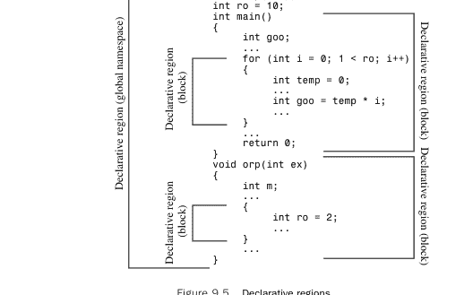

图 9.5 声明区域。

当然，你需要一种访问给定命名空间中名称的方式。最简单的方法是使用 `::`（作用域解析运算符），将名称限定为其所属的命名空间：

```cpp
Jack::pail = 12.34;  // use a variable
Jill::Hill mole;     // create a type Hill structure
Jack::fetch();       // use a function
```

没有修饰的名称（如 `pail`）称为*非限定名称*（*unqualified name*），而带有命名空间的名称（如 `Jack::pail`）称为*限定名称*（*qualified name*）。

## using 声明和 using 指令

每次使用名称时都必须对其进行限定，并不总是令人满意，因此 C++ 提供了两种机制——*using 声明*和 *using 指令*——来简化命名空间名称的使用。using 声明允许你使用特定的标识符，而 using 指令则使整个命名空间都可访问。

using 声明需要在限定名称前加上关键字 `using`：

```cpp
using Jill::fetch;    // a using declaration
```

using 声明会将特定名称添加到其所在的声明区域中。例如，在 `main()` 中对 `Jill::fetch` 的 using 声明，会将 `fetch` 添加到由 `main()` 定义的声明区域中。进行此声明后，你就可以使用名称 `fetch`，而不必使用 `Jill::fetch`。下面的代码片段展示了这些要点：

```cpp
namespace Jill {
    double bucket(double n) { ... }
    double fetch;
    struct Hill { ... };
}
char fetch;
int main()
{
    using Jill::fetch;   // put fetch into local namespace
    double fetch;        // Error! Already have a local fetch
    cin >> fetch;        // read a value into Jill::fetch
    cin >> ::fetch;      // read a value into global fetch
    ...
}
```

由于 using 声明会将名称添加到局部声明区域中，因此本例不允许再创建名为 `fetch` 的其他局部变量。此外，与其他局部变量一样，`fetch` 会覆盖同名的全局变量。

在外部层级放置 using 声明，会将该名称添加到全局命名空间中：

```cpp
void other();
namespace Jill {
    double bucket(double n) { ... }
    double fetch;
    struct Hill { ... };
}
using Jill::fetch;   // put fetch into global namespace
int main()
{
    cin >> fetch;   // read a value into Jill::fetch
    other();
    ...
}

void other()
{
    cout << fetch;  // display Jill::fetch
    ...
}
```

因此，using 声明会使单个名称可用。相比之下，using 指令会使*所有*名称都可用。using 指令需要在命名空间名称前加上关键字 `using namespace`，这样就可以不使用作用域解析运算符来访问命名空间中的所有名称：

```cpp
using namespace Jack;  // make all the names in Jack available
```

在全局层级放置 using 指令，会使命名空间中的名称在全局范围内可用。在本书中，你已经多次见过以下形式的使用方式：

```cpp
#include <iostream>   // places names in namespace std
using namespace std;  // makes names available globally
```

在特定函数中放置 using 指令，会使这些名称仅在该函数中可用。下面是一个例子：

```cpp
int main()
{
    using namespace Jack; // make names available in main()
    ...
}
```

在本书中，你经常会看到这种针对 `std` 命名空间的用法。

需要注意的是，using 指令和 using 声明会增加名称冲突的可能性。也就是说，如果命名空间 Jack 和命名空间 Jill 都可用，并且你使用作用域解析运算符，那么不会产生歧义：

```cpp
Jack::pal = 3;
Jill::pal = 10;
```

变量 `Jack::pal` 和 `Jill::pal` 是分别对应不同内存位置的不同标识符。但是，如果你使用 using 声明，情况就会发生变化：

```cpp
using Jack::pal;
using Jill::pal;
pal = 4;          // which one? now have a conflict
```


事实上，编译器不会允许你同时使用这两个 using 声明，因为这样会产生歧义。

## using 指令与 using 声明

使用 using 指令将命名空间中的所有名称整体导入，这与使用多个 using 声明并不相同。这更像是作用域解析运算符的大规模应用。当你使用 using 声明时，就好像该名称是在 using 声明的位置声明的。如果某个特定名称已经在函数中声明，则不能使用 using 声明导入相同的名称。然而，当你使用 using 指令时，名称解析会像你在同时包含 using 指令和命名空间本身的最小声明区域内声明了这些名称一样进行。对于下面的示例，该区域就是全局命名空间。如果你使用 using 指令导入一个已经在函数中声明的名称，局部名称将隐藏命名空间名称，就像它会隐藏同名的全局变量一样。但是，你仍然可以使用作用域解析运算符，如下例所示：

```cpp
namespace Jill {
    double bucket(double n) { ... }
    double fetch;
    struct Hill { ... };
}
char fetch;                 // global namespace
int main()
{
    using namespace Jill;       // import all namespace names
    Hill Thrill;                // create a type Jill::Hill structure
    double water = bucket(2);   // use Jill::bucket();
    double fetch;               // not an error; hides Jill::fetch
    cin >> fetch;               // read a value into the local fetch
    cin >> ::fetch;             // read a value into global fetch
    cin >> Jill::fetch;         // read a value into Jill::fetch
    ...
}

int foom()
{
    Hill top;                   // ERROR
    Jill::Hill crest;            // valid
}
```

在这里，main() 中，名称 Jill::fetch 被放置在局部命名空间中。它没有局部作用域，因此不会覆盖全局 fetch。但局部声明的 fetch 会同时隐藏 Jill::fetch 和全局 fetch。不过，如果你使用作用域解析运算符，后两个 fetch 变量仍然可用。你可能想将这个示例与前面使用 using 声明的示例进行比较。

相反，你应该这样使用：

```cpp
int x;
std::cin >> x;
std::cout << x << std::endl;
```

或者你可以这样使用：

```cpp
using std::cin;
using std::cout;
using std::endl;
int x;
cin >> x;
cout << x << endl;
```

你可以使用嵌套命名空间（如下一节所述）来创建一个命名空间，其中包含你常用的 using 声明。

## 更多命名空间特性

你可以嵌套命名空间声明，如下所示：

```cpp
namespace elements
{
    namespace fire
    {
        int flame;
        ...
    }
    float water;
}
```

在这种情况下，你可以通过 `elements::fire::flame` 来引用 `flame` 变量。类似地，你可以使用以下 using 指令使内部名称可用：

```cpp
using namespace elements::fire;
```

你也可以在命名空间内部使用 using 指令和 using 声明，如下所示：

```cpp
namespace myth
{
    using Jill::fetch;
    using namespace elements;
    using std::cout;
    using std::cin;
}
```

假设你想访问 `Jill::fetch`。由于 `Jill::fetch` 现在是 `myth` 命名空间的一部分，在该命名空间中它可以被称为 `fetch`，你可以这样访问它：

```cpp
std::cin >> myth::fetch;
```

当然，由于它同时也是 Jill 命名空间的一部分，你仍然可以这样调用它：

```cpp
Jill::fetch;
std::cout << Jill::fetch;  // display value read into myth::fetch
```

或者你可以这样做，前提是没有局部变量冲突：

```cpp
using namespace myth;
cin >> fetch;           // really std::cin and Jill::fetch
```

现在考虑将 using 指令应用于 myth 命名空间。using 指令是可传递的。我们说一个操作 op 是可传递的，如果 A op B 且 B op C 意味着 A op C。例如，> 运算符就是可传递的。（也就是说，A 大于 B 且 B 大于 C 意味着 A 大于 C。）在这种情况下，结果是以下语句将 myth 和 elements 命名空间都置于作用域内：

```cpp
using namespace myth;
```

这条单独的指令与以下两条指令具有相同的效果：

```cpp
using namespace myth;
using namespace elements;
```

你可以为命名空间创建别名。例如，假设你有一个命名空间定义如下：

```cpp
namespace my_very_favorite_things { ... };
```

你可以通过以下语句将 mvft 设为 my_very_favorite_things 的别名：

```cpp
namespace mvft = my_very_favorite_things;
```

你可以使用这种技术来简化对嵌套命名空间的使用：

```cpp
namespace MEF = myth::elements::fire;
using MEF::flame;
```

## 未命名命名空间

你可以通过省略命名空间名称来创建未命名命名空间：

```cpp
namespace           // unnamed namespace
{
    int ice;
    int bandycroot;
}
```

这段代码的行为就像是后面跟随了一个 using 指令；也就是说，在此命名空间中声明的名称在包含该未命名命名空间的声明区域结束之前都处于潜在作用域内。在这方面，未命名命名空间中的名称类似于全局变量。然而，如果命名空间没有名称，你就不能显式地使用 using 指令或 using 声明来使这些名称在其他地方可用。特别是，你不能在包含命名空间声明的文件之外使用未命名命名空间中的名称。这为使用具有内部链接的静态变量提供了一种替代方案。例如，假设你有以下代码：

```cpp
static int counts;   // static storage, internal linkage
int other();
int main()
{
...
}
```

```cpp
int other()
{
...
}
```

命名空间方法则是这样做：

```cpp
namespace
{
    int counts;   // static storage, internal linkage
}
int other();
int main()
{
...
}
```

```cpp
int other()
{
...
}
```

## 一个命名空间示例

让我们看一个多文件示例，它演示了命名空间的一些特性。此示例中的第一个文件（参见清单 9.11）是一个头文件，其中包含通常在头文件中出现的项目——常量、结构定义和函数原型。在本例中，这些项目被放置在两个命名空间中。第一个命名空间 pers 包含一个 Person 结构定义，以及一个用姓名填充结构的函数原型和一个显示结构内容的函数原型。第二个命名空间 debts 定义了一个结构，用于存储一个人的姓名以及欠该人的金额。该结构使用了 Person 结构，因此 debts 命名空间有一个 using 指令，使 pers 命名空间中的名称在 debts 命名空间中可用。debts 命名空间还包含一些原型。

### 清单 9.11：namesp.h

```cpp
// namesp.h
#include <string>
// create the pers and debts namespaces
namespace pers
{
    struct Person
    {
        std::string fname;
        std::string lname;
    };
    void getPerson(Person &);
    void showPerson(const Person &);

}

namespace debts
{
    using namespace pers;
    struct Debt
    {
        Person name;
        double amount;
    };
    void getDebt(Debt &);
    void showDebt(const Debt &);
    double sumDebts(const Debt ar[], int n);
}
```

### 清单 9.12：namesp.cpp

```cpp
// namesp.cpp -- namespaces
#include <iostream>
#include "namesp.h"

namespace pers
{
```


```cpp
using std::cout;
using std::cin;
void getPerson(Person & rp)
{
    cout << "Enter first name: ";
    cin >> rp.fname;
    cout << "Enter last name: ";
    cin >> rp.lname;
}
void showPerson(const Person & rp)
{
    std::cout << rp.lname << ", " << rp.fname;
}
}

namespace debts
{
    void getDebt(Debt & rd)
    {
        getPerson(rd.name);
        std::cout << "Enter debt: ";
        std::cin >> rd.amount;
    }

    void showDebt(const Debt & rd)
    {
        showPerson(rd.name);
        std::cout << ": $" << rd.amount << std::endl;
    }

    double sumDebts(const Debt ar[], int n)
    {
        double total = 0;
        for (int i = 0; i < n; i++)
            total += ar[i].amount;
        return total;
    }
}
```

最后，该程序的第三个文件（见程序清单9.13）是一个源代码文件，它使用了在命名空间中声明和定义的结构与函数。程序清单9.13展示了使命名空间标识符可用的几种方法。

## 程序清单9.13    usennsp.cpp

```cpp
// usennsp.cpp -- 使用命名空间
#include <iostream>
#include "namesp.h"

void other(void);
void another(void);
int main(void)
{
    using debts::Debt;

    using debts::showDebt;
    Debt golf = { {"Benny", "Goatsniff"}, 120.0 };
    showDebt(golf);
    other();
    another();
    return 0;
}

void other(void)
{
    using std::cout;
    using std::endl;
    using namespace debts;
    Person dg = {"Doodles", "Glister"};
    showPerson(dg);
    cout << endl;
    Debt zippy[3];
    int i;
    for (i = 0; i < 3; i++)
        getDebt(zippy[i]);

    for (i = 0; i < 3; i++)
        showDebt(zippy[i]);
    cout << "Total debt: $" << sumDebts(zippy, 3) << endl;
    return;
}

void another(void)
{
    using pers::Person;
    Person collector = { "Milo", "Rightshift" };
    pers::showPerson(collector);
    std::cout << std::endl;
}
```

在程序清单9.13中，main()函数首先使用了两个using声明：

```cpp
using debts::Debt;       // 使Debt结构定义可用
using debts::showDebt;   // 使showDebt函数可用
```

注意，using声明只使用名称；例如，这里的第二个示例并未描述`showDebt`的返回类型或函数签名，它只是给出了名称。（因此，如果某个函数被重载，一条using声明将导入所有版本。）另外，尽管`Debt`和`showDebt()`都使用了`Person`类型，但不必导入任何`Person`名称，因为`debts`命名空间已经有一条包含`pers`命名空间的using指令。

接下来，other()函数采用了不太可取的方式，即用一条using指令导入整个命名空间：

```cpp
using namespace debts;   // 使所有debts和pers名称对other()可用
```

由于`debts`中的using指令导入了`pers`命名空间，other()函数可以使用`Person`类型和`showPerson()`函数。

最后，another()函数使用一条using声明和作用域解析运算符来访问特定名称：

```cpp
using pers::Person;
pers::showPerson(collector);
```

下面是由程序清单9.11、9.12和9.13构建的程序的一次示例运行：

```
Goatsniff, Benny: $120
Glister, Doodles
Enter first name: **Arabella**
Enter last name: **Binx**
Enter debt: **100**
Enter first name: **Cleve**
Enter last name: **Delaproux**
Enter debt: **120**
Enter first name: **Eddie**
Enter last name: **Fiotox**
Enter debt: **200**
Binx, Arabella: $100
Delaproux, Cleve: $120
Fiotox, Eddie: $200
Total debt: $420
Rightshift, Milo
```

## 命名空间与未来

随着程序员对命名空间越来越熟悉，常见的编程惯例将会涌现。以下是一些当前的指导原则：

- 使用有名称的命名空间中的变量，而不是使用外部全局变量。
- 使用未命名命名空间中的变量，而不是使用静态全局变量。
- 如果开发了一个函数或类库，请将它们放在一个命名空间中。事实上，C++目前已经要求将标准库函数放在名为`std`的命名空间中。这也扩展到从C引入的函数。例如，与C兼容的`math.h`头文件不使用命名空间，但C++的`math`头文件应将各种数学库函数放在`std`命名空间中。
- 仅将using指令作为将旧代码转换到命名空间用法的临时手段。
- 不要在头文件中使用using指令；一方面，这样做会隐藏哪些名称被设为可用。此外，头文件的排列顺序可能影响行为。如果使用using指令，请将它放在所有预处理`#include`指令之后。
- 优先使用作用域解析运算符或using声明来导入名称。
- 对于using声明，优先使用局部作用域而不是全局作用域。

请记住，使用命名空间的主要动机是简化大型编程项目的管理。对于简单的单文件程序，使用using指令并不是什么大错。

如前所述，头文件名的变化反映了命名空间的变化。旧式头文件（如`iostream.h`）不使用命名空间，但新的`iostream`头文件应使用`std`命名空间。

## 总结

C++鼓励在开发程序时使用多个文件。一种有效的组织策略是使用头文件来定义用户类型，并为操作这些用户类型的函数提供函数原型。应该用单独的源代码文件来放置函数定义。头文件和源文件共同定义并实现了用户定义的类型及其使用方法。然后，`main()`和其他使用这些函数的函数可以放在第三个文件中。

C++的存储方案决定了变量在内存中保留多长时间（存储持续性），以及程序的哪些部分可以访问它们（作用域和链接性）。自动变量是在块（如函数体或函数体内的块）中定义的变量。它们只在程序执行包含该定义的块中的语句时存在并可见。自动变量可以使用存储类说明符`register`或根本不用说明符来声明，在这种情况下，变量自动成为自动变量。register说明符是向编译器提示该变量被频繁使用，但在C++11下，这种用法已被弃用。

静态变量在程序的整个运行期间存在。在任何函数外部定义的变量对该定义之后文件中的所有函数可见（文件作用域），并可被程序中的其他文件使用（外部链接性）。要让另一个文件使用这样的变量，该文件必须使用`extern`关键字声明它。跨文件共享的变量应在一个文件中有定义性声明（`extern`不是必需的，但可以与初始化结合使用），并在其他文件中有引用性声明（使用`extern`且不进行初始化）。在任何函数外部定义但用关键字`static`限定的变量具有文件作用域，但不对其他文件开放（内部链接性）。在块内定义但用关键字`static`限定的变量局部于该块（局部作用域，无链接性），但在程序的整个运行期间保持其值。

默认情况下，C++函数具有外部链接性，因此可以在文件间共享。但用关键字`static`限定的函数具有内部链接性，仅限于定义它的文件内使用。

动态内存分配和释放（使用`new`和`delete`）使用自由存储区（或堆）来存储数据。内存通过调用`new`被使用，并通过调用`delete`被释放。程序使用指针来跟踪这些内存位置。

命名空间允许定义可在其中声明标识符的命名区域。其目的是减少名称冲突，特别是在使用了来自多个供应商代码的大型程序中。可以通过以下方式使命名空间中的标识符可用：使用作用域解析运算符、使用`using`声明或使用`using`指令。

## 复习题

- 1. 对于以下情况，你会使用哪种存储方案？
  - a. `homer`是一个函数的形参（参数）。
  - b. `secret`变量由两个文件共享。
  - c. `topsecret`变量由同一文件中的多个函数共享，但对其他文件隐藏。
  - d. `beencalled`记录包含它的函数被调用了多少次。
- 2. 描述`using`声明和`using`指令之间的区别。
- 3. 重写以下代码，使其不使用`using`声明或`using`指令：

```cpp
#include <iostream>
using namespace std;
int main()
{
    double x;
    cout << "Enter value: ";
    while (!(cin >> x) )
    {
        cout << "Bad input. Please enter a number: ";
        cin.clear();
        while (cin.get() != '\n')
            continue;
```


```cpp
}
cout << "Value = " << x << endl;
return 0;
}
```

4. 重写下面的代码，使其使用 using 声明而不是 using 指令：

```cpp
#include <iostream>
using namespace std;
int main()
{
    double x;
    cout << "Enter value: ";
    while (! (cin >> x) )
    {
        cout << "Bad input. Please enter a number: ";
        cin.clear();
        while (cin.get() != '\n')
            continue;
    }
    cout << "Value = " << x << endl;
    return 0;
}
```

5. 假设你希望 `average()` 函数在一个文件中被调用时返回两个 `int` 参数的平均值（类型为 `int`），并且希望它在同一程序的第二个文件中被调用时返回两个 `int` 参数的平均值（类型为 `double`）。你会如何设置？

6. 下面的双文件程序将显示什么？

```cpp
// file1.cpp
#include <iostream>
using namespace std;
void other();
void another();
int x = 10;
int y;

int main()
{
    cout << x << endl;
    {
        int x = 4;
        cout << x << endl;
        cout << y << endl;
    }
    other();
    another();
    return 0;
}

void other()
{
    int y = 1;
    cout << "Other: " << x << ", " << y << endl;
}

// file 2.cpp
#include <iostream>
using namespace std;
extern int x;
namespace
{
    int y = -4;
}

void another()
{
    cout << "another(): " << x << ", " << y << endl;
}
```

7. 下面的程序将显示什么？

```cpp
#include <iostream>
using namespace std;
void other();
namespace n1
{
    int x = 1;
}

namespace n2
{
    int x = 2;
}

int main()
{
    using namespace n1;
    cout << x << endl;
    {
```

```cpp
// function resets handicap to new value
void handicap(golf & g, int h);

// function displays contents of golf structure
void showgolf(const golf & g);
```

注意 `setgolf()` 是重载的。使用 `setgolf()` 的第一个版本如下所示：

```cpp
golf ann;
setgolf(ann, "Ann Birdfree", 24);
```

该函数调用提供存储在 `ann` 结构中的信息。使用 `setgolf()` 的第二个版本如下所示：

```cpp
golf andy;
setgolf(andy);
```

该函数会提示用户输入姓名和差点，并将它们存储在 `andy` 结构中。该函数可以（但不必）在内部使用第一个版本。

基于此头文件组合一个多文件程序。一个名为 `golf.cpp` 的文件应提供合适的函数定义，以匹配头文件中的原型。第二个文件应包含 `main()`，并演示所有原型函数的功能。例如，循环应为 `golf` 结构数组请求输入，并在数组已满或用户为高尔夫球手姓名输入空字符串时终止。`main()` 函数应只使用原型函数来访问 `golf` 结构。

- 2. 重做程序清单 9.9，将字符数组替换为 `string` 对象。程序不再需要检查输入字符串是否放得下，并且可以将输入字符串与 `""` 比较以检查是否为空行。

- 3. 从下面的结构声明开始：

    ```cpp
    struct chaff
    {
        char dross[20];
        int slag;
    };
    ```

    编写一个程序，使用定位 `new` 将两个这种结构的数组放置在缓冲区中。然后为结构成员赋值（记住对字符数组使用 `strcpy()`），并使用循环显示内容。选项 1 是使用静态数组作为缓冲区，就像程序清单 9.10 中那样。选项 2 是使用常规 `new` 来分配缓冲区。

- 4. 基于下面的命名空间编写一个三文件程序：

    ```cpp
    namespace SALES
    {
        const int QUARTERS = 4;
        struct Sales
        {
            double sales[QUARTERS];
            double average;
            double max;
            double min;
        };
        // copies the lesser of 4 or n items from the array ar
        // to the sales member of s and computes and stores the
        // average, maximum, and minimum values of the entered items;
        // remaining elements of sales, if any, set to 0
        void setSales(Sales & s, const double ar[], int n);
        // gathers sales for 4 quarters interactively, stores them
        // in the sales member of s and computes and stores the
        // average, maximum, and minimum values
        void setSales(Sales & s);
        // display all information in structure s
        void showSales(const Sales & s);
    }
    ```

    第一个文件应为包含该命名空间的头文件。第二个文件应为源代码文件，它扩展该命名空间，为三个原型函数提供定义。第三个文件应声明两个 `Sales` 对象。它应使用 `setSales()` 的交互版本为一个结构提供值，并使用 `setSales()` 的非交互版本为第二个结构提供值。它应使用 `showSales()` 显示两个结构的内容。

本页有意留白

## 对象和类

在本章中，你将学习以下内容：

- 过程式编程和面向对象编程
- 类的概念
- 如何定义和实现一个类
- 类的公有和私有访问
- 类数据成员
- 类方法（也称为类函数成员）
- 创建和使用类对象
- 类构造函数和析构函数
- `const` 成员函数
- `this` 指针
- 创建对象数组
- 类作用域
- 抽象数据类型

面向对象编程（OOP）是一种设计程序的特定概念方法，而 C++ 通过一些特性增强了 C，这些特性使应用该方法变得更容易。以下是最重要的 OOP 特性：

- 抽象
- 封装和数据隐藏
- 多态
- 继承
- 代码可重用性

现在让我们看看，当你戴上 OOP 帽子（以一种有吸引力的多态设计）时，你的视角会如何改变。你从思考数据开始。此外，你不仅从如何表示数据的角度思考数据，还从数据将如何被使用的角度思考数据：

让我想想，我在跟踪什么？当然是一名球类运动员。所以我想要一个表示整个运动员的对象，而不仅仅是她的击球率或上场击球次数。是的，这将是我的基本数据单元，一个表示运动员姓名和统计数据的对象。我需要一些方法来处理这个对象。嗯，我想我需要一个方法将基本信息录入这个单元。计算机应该计算一些内容，比如击球率——我可以添加方法来进行计算。而且程序应该自动完成这些计算，而不需要用户记得要求完成它们。另外，我还需要用于更新和显示信息的方法。因此，用户可以通过三种方式与数据交互：初始化、更新和报告。这就是用户界面。

简而言之，采用 OOP 方法时，你专注于用户所感知的对象，思考描述该对象所需的数据，以及描述用户与数据交互的操作。在你完成对该接口的描述后，再决定如何实现该接口和数据存储。最后，你组合一个程序来使用你的新设计。

### 抽象和类

生活充满复杂性，而我们应对复杂性的一种方法就是构建简化的抽象。你是超过 10^27 个原子的集合。一些研究心智的学者会说，你的心智是若干个半自主代理的集合。但把自己看作一个单一实体要简单得多。在计算中，抽象是用与用户交互的接口来表示信息的关键步骤。也就是说，你抽象出一个问题的基本操作特征，并用这些术语表达解决方案。在垒球统计数据示例中，接口描述了用户如何初始化、更新和显示数据。从抽象到用户定义类型只有一小步，在 C++ 中，用户定义类型就是实现抽象接口的类设计。

### 什么是类型？

让我们再稍微思考一下什么构成一个类型。例如，什么是书呆子？如果你认同流行的刻板印象，你可能会从视觉角度想象一个书呆子——厚厚的黑框眼镜、装满笔的护袋等等。稍加思索后，你可能会得出结论：书呆子最好从操作角度来定义——例如，根据他或她如何回应尴尬的社交场合来定义。如果你不介意牵强的类比，对于像 C 这样的过程式语言，你也有类似的情况。起初，你倾向于从数据类型的表象——它如何存储在内存中——来思考数据类型。一个 char，对于

例如，char 占 1 字节内存，而 double 通常是 8 字节内存。但稍加思考就会得出结论：数据类型也由可对其执行的操作来定义。例如，int 类型可以使用所有算术运算。你可以对整数进行加、减、乘、除。还可以对它们使用取模运算符（%）。

另一方面，考虑指针。指针很可能需要与 int 相同的内存量。它在内部甚至可能表示为整数。但指针不允许执行整数所允许的相同操作。例如，你不能将两个指针相乘。这个概念没有意义，所以 C++ 不实现它。因此，当你将变量声明为 int 或指向 float 的指针时，你不仅是在分配内存——你还在确定该变量可以执行哪些操作。简而言之，指定基本类型会做三件事：

- 它决定一个数据对象需要多少内存。
- 它决定内存中的位如何被解释。（long 和 float 在内存中可能使用相同的位数，但它们被转换为数值的方式不同。）
- 它决定可以使用该数据对象执行哪些操作或方法。

对于内置类型，有关操作的信息内置于编译器中。但当你在 C++ 中定义用户自定义类型时，你必须自己提供同类信息。作为这项额外工作的交换，你获得了定制新数据类型以匹配现实世界需求的能力和灵活性。

## C++中的类

类是一种 C++ 工具，用于将抽象转换为用户自定义类型。它将数据表示和用于操作这些数据的方法组合成一个整洁的包。让我们看一个表示股票的类。

首先，你需要稍微思考如何表示股票。你可以将一股股票作为基本单位，并定义一个类来表示一股。然而，这意味着你需要 100 个对象来表示 100 股，这不切实际。相反，你可以将某人在特定股票中的当前持股作为一个基本单位。所拥有的股数将成为数据表示的一部分。现实的方法必须维护诸如初始购买价格和购买日期等记录，以便税务用途。它还必须管理股票拆分等事件。对于首次定义类来说，这似乎有点雄心勃勃，因此你可以改为采用理想化、简化的观点。特别是，你可以将可执行的操作限制为以下这些：

- 获取某公司的股票。
- 购买同一股票的更多股份。
- 出售股票。
- 更新股票的每股价值。
- 显示持股信息。

你可以使用这个列表来定义股票类的公共接口。（如果你有兴趣，以后还可以添加其他功能。）为了支持这个接口，你需要存储一些信息。同样，你可以采用简化的方法。例如，不必担心美国以八分之一美元的倍数来评估股票的做法。（显然，纽约证券交易所一定是在本书的上一版中看到了这种简化，因为它已决定改用这里使用的系统。）以下是需要存储的信息列表：

- 公司名称
- 所拥有的股票数量
- 每股价值
- 所有股份的总价值

接下来，你可以定义这个类。通常，一个类规范包含两部分：

- *类声明*，它通过数据成员描述数据组件，并通过称为*方法*的成员函数描述公共接口
- *类方法定义*，它描述某些类成员函数如何实现

粗略地说，类声明提供类的概览，而方法定义提供细节。

### 什么是接口？

*接口*是两个系统之间交互的共享框架——例如，计算机与打印机之间，或用户与计算机程序之间。例如，用户可能是你，程序可能是文字处理器。当你使用文字处理器时，你并不是把文字直接从大脑传送到计算机内存中。相反，你与程序提供的接口进行交互。你按下一个键，计算机在屏幕上显示一个字符。你移动鼠标，计算机在屏幕上移动光标。你不小心点击了鼠标，你正在输入的段落就发生了奇怪的事情。程序接口管理着将你的意图转换为存储在计算机中的特定信息的过程。

对于类，我们说的是公共接口。在这种情况下，公众是使用该类的程序，交互系统由类对象组成，接口由编写该类的人提供的方法组成。接口使你（程序员）能够编写与类对象交互的代码，从而使程序能够使用类对象。例如，要查找 `string` 对象中的字符数，你不必打开对象查看其内部；只需使用类创建者提供的 `size()` 方法。事实证明，类设计拒绝公共用户直接访问。但公众可以使用 `size()` 方法。因此，`size()` 方法是用户与 `string` 类对象之间公共接口的一部分。同样，`getline()` 方法是 `iostream` 类公共接口的一部分；使用 `cin` 的程序不会直接摆弄 `cin` 对象的内部来读取一行输入；相反，`getline()` 完成这项工作。

如果你想要更人性化的关系，可以不把使用类的程序视为公共用户，而把编写使用该类的程序的人视为公共用户。但无论如何，要使用一个类，你需要知道它的公共接口；要编写一个类，你需要创建它的公共接口。

开发一个类以及使用它的程序需要几个步骤。与其一次性完成所有步骤，不如将开发分解为更小的阶段。通常，C++ 程序员将接口以类定义的形式放在头文件中，并将实现以类方法代码的形式放在源代码文件中。那我们就按典型做法来。代码清单 10.1 展示了第一阶段，一个名为 Stock 的类的暂定类声明。该文件使用了 `#ifndef` 等，如第 9 章“内存模型和命名空间”所述，以防止多重文件包含。

为了帮助识别类，本书遵循一种常见但并非普遍的约定，即将类名首字母大写。你会注意到，代码清单 10.1 看起来像结构声明，但有一些额外的特点，例如成员函数以及 public 和 private 部分。我们很快就会改进这个声明（所以不要把它当作模板），但首先让我们看看这个定义如何工作。

### 代码清单 10.1 `stock00.h`

```cpp
// stock00.h -- Stock class interface
// version 00
#ifndef STOCK00_H_
#define STOCK00_H_

#include <string>

class Stock  // class declaration
{
private:
    std::string company;
    long shares;
    double share_val;
    double total_val;
    void set_tot() { total_val = shares * share_val; }
public:
    void acquire(const std::string & co, long n, double pr);
    void buy(long num, double price);
    void sell(long num, double price);
    void update(double price);
    void show();
};    // note semicolon at the end

#endif
```

稍后你会更仔细地了解类的细节，但首先让我们检查更一般的特征。首先，C++ 关键字 class 表明代码清单 10.1 中的代码定义了一个类的设计。（在此上下文中，关键字 class 和 typename 不是同义词——不像它们在模板参数中那样；这里不能使用 typename。）该语法将 Stock 标识为这个新类的类型名。这个声明使你能够声明 Stock 类型的变量，称为对象或实例。每个单独的对象表示一项持股。例如，以下声明创建两个名为 sally 和 solly 的 Stock 对象：

```
Stock sally;
Stock solly;
```

例如，sally 对象可以表示 Sally 在特定公司的股票持股。

接下来，请注意你决定存储的信息以类数据成员的形式出现，例如 company 和 shares。例如，sally 的 company 成员保存公司名称，share 成员保存 Sally 拥有的股数，share_val 成员保存每股价值，total_val 成员保存所有股份的总价值。同样，所需操作以类函数成员（或方法）的形式出现，例如 sell() 和 update()。成员函数可以就地定义——例如 set_tot()——也可以像这个类中的其他成员函数一样由原型表示。其他成员函数的完整定义稍后出现在实现文件中，但原型足以描述函数接口。将数据和方法绑定到单个单元中是类最显著的特征。由于这种设计，创建 Stock 对象会自动建立管理该对象使用方式的规则。

你已经看到 istream 和 ostream 类如何拥有成员函数，例如 get() 和 getline()。Stock 类声明中的函数原型演示了成员函数是如何建立的。例如，istream 头文件在 istream 类声明中有一个 getline() 原型。

### 访问控制

同样新出现的是关键字 private 和 public。这些标签描述类成员的访问控制。任何使用特定类的对象的程序都可以直接访问公共部分。程序只能通过公共成员函数（或者，如你将在第 11 章“使用类”中看到的，通过友元函数）访问对象的私有成员。例如，改变 Stock 类的 shares 成员的唯一方法是使用某个股票成员函数。因此，公共成员函数充当程序与对象私有成员之间的中间人；它们提供对象与程序之间的接口。这种使数据与程序的直接访问相隔绝的做法称为数据隐藏。（C++ 提供了第三个访问控制关键字 protected，我们将在第 13 章“类继承”中讨论类继承时讨论它。）（见图 10.1。）虽然数据隐藏在某些场合（例如股票基金招募说明书）可能是不道德的行为，但在计算中是一种好做法，因为它保持数据的完整性。


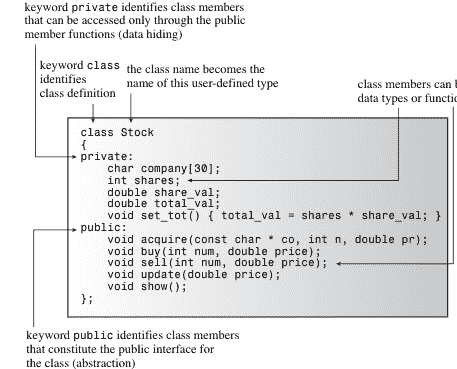

```cpp
class Stock
{
private:
    char company[30];
    int shares;
    double share_val;
    double total_val;
    void set_tot() { total_val = shares * share_val; }
public:
    void acquire(const char * co, int n, double pr);
    void buy(int num, double price);
    void sell(int num, double price);
    void update(double price);
    void show();
};
```

图 10.1　Stock 类。

类设计试图将公有接口与实现细节分开。公有接口代表设计中的抽象部分。将实现细节集中起来并与抽象分离称为*封装*。*数据隐藏*（将数据放入类的私有部分）是封装的一个实例；将实现的功能细节隐藏在私有部分也是封装的一个实例，正如 Stock 类对 `set_tot()` 所做的那样。封装的另一个例子是通常将类函数定义放在与类声明分开的文件中。

## OOP 与 C++

OOP 是一种编程风格，你在任何语言中都能在某种程度上使用它。当然，你可以把许多 OOP 思想融入普通的 C 程序中。例如，第 9 章提供了一个示例（见代码清单 9.1、9.2、9.3），其中头文件包含一个结构原型以及用于操作该结构的函数原型。`main()` 函数只是定义该结构类型的变量，并使用相关函数来处理这些变量；`main()` 不直接访问结构成员。本质上，该示例定义了一个抽象类型，将存储格式和函数原型放在头文件中，从而对 `main()` 隐藏实际的数据表示。

C++ 包含专门用于实现 OOP 方法的特性，因此它使你能够比使用 C 时把这一过程推进几步。首先，将数据表示和函数原型放入单个类声明中，而不是将它们分开，通过把所有内容放在一个类声明中统一了描述。其次，将数据表示设为私有，强制执行数据只能由授权函数访问这一约束。如果在 C 示例中 `main()` 直接访问结构成员，这违反 OOP 的精神，但并不违反任何 C 语言规则。然而，试图直接访问（比如说）一个 `Stock` 对象的 `shares` 成员，确实违反 C++ 语言规则，编译器会捕获它。

注意，数据隐藏不仅阻止你直接访问数据，而且（作为类的用户）还免除了你需要知道数据如何表示的要求。例如，`show()` 成员除了显示其他内容外，还显示持有资产的总值。该值可以存储为对象的一部分，如代码清单 10.1 中的代码所做的那样，也可以在需要时计算。从使用类的角度看，使用哪种方法没有区别。你确实需要知道的是不同成员函数完成什么；也就是说，你需要知道成员函数接受什么类型的参数以及具有什么类型的返回值。原则是将实现细节与接口设计分开。如果你后来找到更好的方式来实现数据表示或成员函数的细节，你可以在不改变程序接口的情况下更改这些细节，这使程序更容易维护。

## 成员访问控制：公有还是私有？

你可以将类成员（无论是数据项还是成员函数）声明在类的公有部分或私有部分。但由于 OOP 的主要准则之一是隐藏数据，数据项通常放入私有部分。构成类接口的成员函数放入公有部分；否则，你无法从程序中调用这些函数。正如 Stock 声明所示，你也可以将成员函数放入私有部分。你不能直接从程序中调用这样的函数，但公有方法可以使用它们。通常，你使用私有成员函数来处理不属于公有接口一部分的实现细节。

你不必在类声明中使用关键字 private，因为那是类对象的默认访问控制：

```cpp
class World
{

    float mass;          // private by default
    char name[20];       // private by default
public:
    void tellall(void);
    ...
};
```

然而，本书明确使用 private 标签，以强调数据隐藏的概念。

> **类与结构**
>
> 类描述看起来很像结构声明，只是增加了成员函数以及 `public` 和 `private` 可见性标签。事实上，C++ 将类具有的相同特性扩展到了结构。唯一的区别是结构的默认访问类型是 `public`，而类的默认类型是 `private`。C++ 程序员通常使用类来实现类描述，而将结构限制为表示纯数据对象（通常称为*纯旧式数据结构*，或 POD 结构）。

## 实现类成员函数

我们仍然必须创建类规范的第二个部分：为那些在类声明中由原型表示的成员函数提供代码。成员函数定义很像常规函数定义。每个都有函数头和函数体。成员函数定义可以有返回类型和参数。但它们还有两个特殊特征：

- 定义成员函数时，使用作用域解析运算符 `::` 来标识该函数所属的类。
- 类方法可以访问类的 `private` 组件。

现在让我们看看这些要点。

首先，成员函数的函数头使用作用域解析运算符 `::` 来指示该函数属于哪个类。例如，`update()` 成员函数的函数头如下所示：

```cpp
void Stock::update(double price)
```

这种表示法意味着你正在定义属于 `Stock` 类的 `update()` 函数。这不仅将 `update()` 标识为成员函数，还意味着你可以为不同类的成员函数使用相同名称。例如，`Buffoon` 类的 `update()` 函数将具有这样的函数头：

```cpp
void Buffoon::update()
```

因此，作用域解析运算符解析了方法定义所应用于的类的身份。我们说标识符 `update()` 具有类作用域。`Stock` 类的其他成员函数在必要时可以使用 `update()` 方法，而无需使用作用域解析运算符。这是因为它们属于同一个类，使 `update()` 在作用域内。然而，在类声明和方法定义之外使用 `update()` 需要特殊措施，我们很快就会讲到。

看待方法名称的一种方式是，类方法的完整名称包括类名。`Stock::update()` 被称为函数的*限定*名称。另一方面，简单的 `update()` 是全名的缩写（*非限定*名称）——一个只能在类作用域中使用的名称。

方法的第二个特殊特征是，方法可以访问类的 `private` 成员。例如，`show()` 方法可以使用如下代码：

```cpp
std::cout << "Company: " << company
         << " Shares: " << shares << endl
         << " Share Price: $" << share_val
         << " Total Worth: $" << total_val << endl;
```

这里的 company、shares 等是 Stock 类的私有数据成员。如果你试图使用成员函数访问这些数据成员，编译器会立刻阻止你。（不过，第 11 章讨论的友元函数提供了一个例外。）

考虑到这两点，我们可以如代码清单 10.2 所示实现类方法。我们将它们放在单独的实现文件中，因此该文件需要包含 stock00.h 头文件，以便编译器可以访问类定义。为了提供更多命名空间经验，代码在一些方法中使用 std:: 限定符，在另一些方法中使用 using 声明。

### 代码清单 10.2  **stock00.cpp**

```cpp
// stock00.cpp -- implementing the Stock class
// version 00
#include <iostream>
#include "stock00.h"

void Stock::acquire(const std::string & co, long n, double pr)
{
    company = co;
    if (n < 0)
    {
        std::cout << "Number of shares can’t be negative; "
                  << company << " shares set to 0.\n";
        shares = 0;
    }
    else
        shares = n;
    share_val = pr;
    set_tot();
}

void Stock::buy(long num, double price)
{
    if (num < 0)
    {
        std::cout << "Number of shares purchased can’t be negative. "
                  << "Transaction is aborted.\n";
    }
    else
    {
        shares += num;


```cpp
        share_val = price;
    }
}

void Stock::sell(long num, double price)
{
    using std::cout;
    if (num < 0)
    {
        cout << "Number of shares sold can't be negative. "
             << "Transaction is aborted.\n";
    }
    else if (num > shares)
    {
        cout << "You can't sell more than you have! "
             << "Transaction is aborted.\n";
    }
    else
    {
        shares -= num;
        share_val = price;
        set_tot();
    }
}

void Stock::update(double price)
{
    share_val = price;
    set_tot();
}

void Stock::show()
{
    std::cout << "Company: " << company
              << "  Shares: " << shares << '\n'
              << "  Share Price: $" << share_val
              << "  Total Worth: $" << total_val << '\n';
}
```

## 成员函数说明

acquire() 函数负责管理为给定公司首次购入股票，而 buy() 和 sell() 负责管理在现有持股基础上增加或减少股份。buy() 和 sell() 方法确保买入或卖出的股份数不是负数。此外，如果用户试图卖出超过其持有量的股份，sell() 函数会终止交易。将数据设为私有并限制只能通过公有函数访问，这种技术让你能够控制数据的使用方式；在本例中，它允许你加入这些针对错误交易的防护措施。

四个成员函数会设置或重置 total_val 成员值。类没有把这个计算写四遍，而是让每个函数调用 set_tot() 函数。由于该函数只是实现代码的一种手段，并不是公有接口的一部分，因此类将 set_tot() 设为私有成员函数。（也就是说，set_tot() 是编写该类的人使用的成员函数，而不是使用该类的代码编写者使用的成员函数。）如果计算很冗长，这可以节省一些输入和代码空间。不过在这里，主要价值在于：通过使用函数调用而不是每次都重新输入计算，你能确保完成完全相同的计算。另外，如果你必须修改该计算（在这个特定情况下不太可能），你只需要在一个地方修改。

## 内联方法

任何在类声明中给出定义的函数都会自动成为内联函数。因此，Stock::set_tot() 是内联函数。类声明常对短小的成员函数使用内联函数，而 set_tot() 正符合这一点。

如果你愿意，也可以在类声明之外定义成员函数，并仍然使其成为内联函数。为此，只需在类实现部分定义该函数时使用 inline 限定符：

```cpp
class Stock
{
private:
    ...
    void set_tot();  // definition kept separate
public:
    ...
};

inline void Stock::set_tot()  // use inline in definition
{
    total_val = shares * share_val;
}
```

内联函数的特殊规则要求：在使用它的每个文件中都必须定义它。要确保内联定义可用于多文件程序中的所有文件，最简单的方法是将内联定义包含在定义相应类的同一个头文件中。（某些开发系统可能具有智能链接器，允许将内联定义放入单独的实现文件。）

顺便提一下，根据重写规则，在类声明中定义方法等价于：用原型替换方法定义，然后在类声明之后立即将定义重写为内联函数。也就是说，程序清单10.1中 `set_tot()` 的原始内联定义与刚才展示的定义等价，只是定义位于类声明之后。

## 方法使用哪个对象？

现在我们来看使用对象时最重要的方面之一：如何将类方法应用于某个对象。像下面这样的代码会使用对象的 `shares` 成员：

```cpp
shares += num;
```

但究竟是哪个对象呢？这个问题问得好！要回答它，首先考虑如何创建对象。最简单的方法是声明类变量：

```cpp
Stock kate, joe;
```

这会创建两个 `Stock` 类的对象，一个名为 `kate`，另一个名为 `joe`。接下来，考虑如何将成员函数与其中一个对象一起使用。答案与结构体和结构体成员一样，是使用成员运算符：

```cpp
kate.show();   // the kate object calls the member function
joe.show();    // the joe object calls the member function
```

这里的第一次调用将 `show()` 作为 `kate` 对象的成员来调用。这意味着该方法将 `shares` 解释为 `kate.shares`，将 `share_val` 解释为 `kate.share_val`。类似地，调用 `joe.show()` 会让 `show()` 方法分别将 `shares` 和 `share_val` 解释为 `joe.shares` 和 `joe.share_val`。

> **注意**
>
> 当你调用成员函数时，它使用调用该成员函数的那个特定对象的数据成员。

类似地，函数调用 `kate.sell()` 会调用 `set_tot()` 函数，就像调用的是 `kate.set_tot()` 一样，从而使该函数从 `kate` 对象获取数据。

你创建的每个新对象都包含用于存放其自身内部变量（即类成员）的存储空间。但同一类的所有对象共享同一组类方法，每个方法只有一份副本。例如，假设 `kate` 和 `joe` 是 `Stock` 对象。在这种情况下，`kate.shares` 占用一块内存，而 `joe.shares` 占用另一块内存。但 `kate.show()` 和 `joe.show()` 都调用同一个方法——也就是说，二者执行同一段代码。它们只是把这段代码应用于不同的数据。调用成员函数就是某些面向对象语言所称的*发送消息*。因此，向两个不同对象发送同一条消息会调用同一个方法，但会将其应用于两个不同对象（见图10.2）。

## 使用类

在本章中，你已经了解了如何定义类及其类方法。下一步是编写一个创建并使用类对象的程序。C++ 的目标是让类的使用尽可能类似于基本内置类型（如 `int` 和 `char`）的使用。你可以通过声明类变量或使用 `new` 分配一个类类型对象来创建类对象。

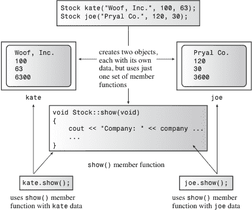

图10.2 对象、数据和成员函数。

你可以将对象作为参数传递，将其作为函数返回值返回，并将一个对象赋给另一个对象。C++ 提供了初始化对象、让 cin 和 cout 识别对象，甚至在相似类的对象之间提供自动类型转换的机制。要能做到所有这些事情还需要一段时间，但现在先从较简单的特性开始。实际上，你已经见过如何声明类对象并调用成员函数。程序清单10.3提供了一个使用接口文件和实现文件的程序。它创建一个名为 fluffy_the_cat 的 Stock 对象。这个程序很简单，但它测试了类中内置的特性。要编译完整程序，请使用第1章“C++ 入门”和第9章中介绍的多文件程序技术。特别是，将它和 stock00.cpp 一起编译，并确保 stock00.h 位于同一目录或文件夹中。

### 程序清单 10.3 usestock.cpp

```cpp
// usestock.cpp -- the client program
// compile with stock00.cpp
#include <iostream>
#include "stock00.h"

int main()
{
    Stock fluffy_the_cat;
    fluffy_the_cat.acquire("NanoSmart", 20, 12.50);
    fluffy_the_cat.show();
    fluffy_the_cat.buy(15, 18.125);
    fluffy_the_cat.show();
    fluffy_the_cat.sell(400, 20.00);
    fluffy_the_cat.show();
    fluffy_the_cat.buy(30000, 40.125);
    fluffy_the_cat.show();
    fluffy_the_cat.sell(30000, 0.125);
    fluffy_the_cat.show();
    return 0;
}
```

下面是程序清单10.3中程序的输出：

```text
Company: NanoSmart  Shares: 20
   Share Price: $12.5  Total Worth: $250
Company: NanoSmart  Shares: 35
   Share Price: $18.125  Total Worth: $634.375
You can't sell more than you have! Transaction is aborted.
Company: NanoSmart  Shares: 35
   Share Price: $18.125  Total Worth: $634.375
Company: NanoSmart  Shares: 30035
   Share Price: $40.125  Total Worth: $1.20389e+007
Company: NanoSmart  Shares: 35
   Share Price: $0.125  Total Worth: $4.375
```

注意，`main()` 只是用于测试 Stock 类设计的载体。当 Stock 类按你的期望工作时，你就可以在其他程序中将作为用户定义类型使用。使用这个新类型的关键点在于理解成员函数做什么；你不应该需要考虑实现细节。参见下面的边栏“客户/服务器模型”。

> **客户/服务器模型**
>
> 面向对象程序员经常从客户/服务器模型的角度讨论程序设计。在这种概念化中，客户是使用该类的程序。类声明（包括类方法）构成服务器，服务器是可供需要它的程序使用的资源。客户仅通过公开定义的接口使用服务器。这意味着客户唯一的职责，推而广之，也是客户程序员的唯一职责，就是了解该接口。服务器的职责，推而广之，也是服务器设计者的职责，是确保服务器按照该接口可靠且准确地执行。服务器设计者对类设计所做的任何更改都应针对实现细节，而不是接口。这样，程序员就可以彼此独立地改进客户和服务器，而服务器中的更改不会对客户的行为产生不可预见的影响。


## 修改实现

程序输出中可能有些地方让你感到困扰——除了猫咪 Fluffy 缺乏理财头脑之外，还有数字格式有点不一致。现在正好有机会在不改变接口的情况下改进实现。ostream 类包含控制格式的成员函数。无需深入细节，你可以像我们在清单 8.8 中那样，使用 setf() 方法避免使用科学计数法：

```cpp
std::cout.setf(std::ios_base::fixed, std::ios_base::floatfield);
```

这会在 cout 对象中设置一个标志，指示 cout 使用定点表示法。类似地，下面的语句会使 cout 在使用定点表示法时在小数点右侧显示三位：

```cpp
std::cout.precision(3);
```

你可以在第 17 章“输入、输出和文件”中找到更多细节。

这些工具可以在 show() 方法中用来控制格式，但还有另一点需要考虑。当你修改某个方法的实现时，这些修改不应影响客户程序的其他部分。刚才提到的格式更改会一直保留，直到再次被更改，因此它们可能会影响客户程序中后续的输出。因此，show() 的礼貌做法是把格式信息重置为调用 show() 之前的状态。如清单 8.8 所示，可以利用设置语句的返回值做到这一点：

```cpp
std::streamsize prec =
    std::cout.precision(3);    // save preceding value for precision
...
std::cout.precision(prec);        // reset to old value

// store original flags
std::ios_base::fmtflags orig = std::cout.setf(std::ios_base::fixed);
...
// reset to stored values
std::cout.setf(orig, std::ios_base::floatfield);
```

你可能还记得，fmtflags 是 ios_base 类中定义的一种类型，而 ios_base 类定义在 std 命名空间中，因此 orig 的类型名相当长。第二，orig 保存了所有标志，重置语句利用这些信息来重置 floatfield 部分的信息，该部分包含定点表示法和科学计数法的标志。第三，我们不必过于担心这里的细节。要点是，这些更改仅限于实现文件，并且不会影响使用该类的程序的其他方面。

把这些信息用起来，我们可以将实现文件中的 `show()` 定义替换为：

```cpp
void Stock::show()
{
    using std::cout;
    using std::ios_base;
    // set format to #.###
    ios_base::fmtflags orig =
        cout.setf(ios_base::fixed, ios_base::floatfield);
    std::streamsize prec = cout.precision(3);

    cout << "Company: " << company
         << "  Shares: " << shares << '\n';
    cout << "  Share Price: $" << share_val;
    // set format to #.##
    cout.precision(2);
    cout << "  Total Worth: $" << total_val << '\n';

    // restore original format
    cout.setf(orig, ios_base::floatfield);
    cout.precision(prec);
}
```

完成替换并保持头文件和客户文件不变后，你可以重新编译程序。现在输出将如下所示：

```text
Company: NanoSmart  Shares: 20
  Share Price: $12.500  Total Worth: $250.00
Company: NanoSmart  Shares: 35
  Share Price: $18.125  Total Worth: $634.38
You can't sell more than you have! Transaction is aborted.
Company: NanoSmart  Shares: 35
  Share Price: $18.125  Total Worth: $634.38
Company: NanoSmart  Shares: 300035
  Share Price: $40.125  Total Worth: $12038904.38
Company: NanoSmart  Shares: 35
  Share Price: $0.125  Total Worth: $4.38
```

## 回顾目前的故事

指定类设计的第一步是提供类声明。类声明模仿结构声明，可以包含数据成员和函数成员。声明有一个私有部分，在该部分中声明的成员只能通过成员函数访问。声明还有一个公共部分，在那里声明的成员可以被使用类对象的程序直接访问。

通常，数据成员放在私有部分，成员函数放在公共部分，因此典型的类声明具有以下形式：

```cpp
class className
{
private:
    data member declarations
public:
    member function prototypes
};
```

公共部分的内容构成了设计的抽象部分，即公共接口。将数据封装在私有部分可以保护数据的完整性，这称为数据隐藏。因此，使用类就是 C++ 中便于实现 OOP 特性（抽象、数据隐藏和封装）的方式。

指定类设计的第二步是实现类成员函数。你可以在类声明中使用完整的函数定义来代替函数原型，但通常的做法（除了非常简短的函数之外）是单独提供函数定义。在这种情况下，你需要使用作用域解析运算符来指明某个成员函数属于哪个类。例如，假设 Bozo 类有一个名为 Retort() 的成员函数，它返回一个指向 char 的指针。该函数的头部将如下所示：

```cpp
char * Bozo::Retort();
```

换句话说，Retort() 不仅仅是一个类型为 char * 的函数；它是属于 Bozo 类的类型为 char * 的函数。该函数的完整名称（或限定名称）是 Bozo::Retort()。另一方面，名称 Retort() 是限定名称的缩写，它只能在某些情况下使用，例如在类方法的代码中。

描述这种情况的另一种方式是：名称 Retort 具有类作用域，因此当它在类声明和类方法之外使用时，需要使用作用域解析运算符来限定该名称。

要创建对象（类的一个具体实例），你可以像使用类型名一样使用类名：

```cpp
Bozo bozetta;
```

这样做可行，因为类是一种用户定义类型。

你通过使用类对象来调用类成员函数（或方法）。具体做法是使用点成员运算符：

```cpp
cout << bozetta.Retort();
```

这会调用 Retort() 成员函数，并且每当该函数的代码引用某个特定数据成员时，函数就会使用该成员在 bozetta 对象中的值。

## 类构造函数和析构函数

此时，你需要对 Stock 类做更多工作。有一些标准函数，称为*构造函数*和*析构函数*，通常应该为类提供。我们来谈谈为什么需要它们以及如何编写它们。

C++ 的目标之一是让使用类对象类似于使用标准类型。然而，本章到目前为止提供的代码并不能让你像初始化普通 int 或 struct 那样初始化 Stock 对象。也就是说，通常的初始化语法并不适用于 Stock 类型。

```cpp
int year = 2001;                                  // valid initialization
struct thing
{
    char * pn;
    int m;
};
thing amabob = {"widget", -23};                  // valid initialization
Stock hot = {"Sukie's Autos, Inc.", 200, 50.25};  // NO! compile error
```

你不能以这种方式初始化 Stock 对象，原因是数据部分具有私有访问状态，这意味着程序不能直接访问数据成员。如你所见，程序访问数据成员的唯一方式是通过成员函数。因此，如果要成功初始化对象，就需要设计一个合适的成员函数。（如果把数据成员设为公有而不是私有，你就可以像刚才展示的那样初始化类对象，但把数据设为公有违背了使用类的主要理由之一：数据隐藏。）

一般来说，最好在创建所有对象时就初始化它们。例如，考虑以下代码：

```cpp
Stock gift;
gift.buy(10, 24.75);
```

在 Stock 类的当前实现中，gift 对象的 company 成员没有值。类设计假设用户在调用任何其他成员函数之前先调用 acquire()，但无法强制执行这一假设。解决这个困难的一种方法是让对象在创建时自动初始化。为此，C++ 提供了特殊的成员函数，称为*类构造函数*，专门用于构造新对象并为其数据成员赋值。更准确地说，C++ 为这些成员函数提供了名称和使用它们的语法，而你提供方法定义。名称与类名相同。例如，Stock 类的一个可能构造函数是名为 Stock() 的成员函数。构造函数原型和头部有一个有趣的性质：尽管构造函数没有返回值，但它并未声明为 void 类型。事实上，构造函数没有声明类型。


```cpp
...
}
```

这是错误的。构造函数参数并不代表类成员；它们代表要赋给类成员的值。因此，它们必须具有不同的名称，否则最终会得到像下面这样令人困惑的代码：

```cpp
shares = shares;
```

一种有助于避免此类混淆的常见编码做法是使用 m_ 前缀来标识数据成员名：

```cpp
class Stock
{
private:
    string m_company;
    long m_shares;
    ...
```

另一种常见做法是为成员名使用下划线后缀：

```cpp
class Stock
{
private:
    string company_;
    long shares_;
    ...
```

采用任一约定后，你就可以在公共接口中使用 `company` 和 `shares` 作为参数名。

## 使用构造函数

C++ 提供了两种使用构造函数初始化对象的方式。第一种是显式调用构造函数：

```cpp
Stock food = Stock("World Cabbage", 250, 1.25);
```

这会将 food 对象的 company 成员设置为字符串 `"World Cabbage"`，将 shares 成员设置为 250，依此类推。

第二种是隐式调用构造函数：

```cpp
Stock garment("Furry Mason", 50, 2.5);
```

这种更紧凑的形式等价于以下显式调用：

```cpp
Stock garment = Stock("Furry Mason", 50, 2.5);
```

每当你创建该类的对象时，C++ 都会使用类构造函数，即使使用 new 进行动态内存分配时也是如此。下面是如何将构造函数与 new 一起使用：

```cpp
Stock *pstock = new Stock("Electroshock Games", 18, 19.0);
```

第二种方法是使用函数重载定义第二个构造函数，一个没有参数的构造函数：

```cpp
Stock();
```

默认构造函数只能有一个，所以确保不要同时提供两种。实际上，通常应初始化对象，以确保所有成员都以已知、合理的值开始。因此，用户提供的默认构造函数通常为所有成员值提供隐式初始化。例如，下面是为 Stock 类定义默认构造函数的一种方式：

```cpp
Stock::Stock()          // default constructor
{
    company = "no name";
    shares = 0;
    share_val = 0.0;
    total_val = 0.0;
}
```

> **提示**
> 
> 设计类时，通常应提供一个默认构造函数，隐式初始化所有类成员。

使用任一方法（无参数或为所有参数提供默认值）创建默认构造函数后，就可以声明对象变量而无需显式初始化它们：

```cpp
Stock first;                 // calls default constructor implicitly
Stock first = Stock();        // calls it explicitly
Stock *pfirst = new Stock;    // calls it implicitly
```

不过，不要被非默认构造函数的隐式形式误导：

```cpp
Stock first("Concrete Conglomerate");     // calls constructor
Stock second();                            // declares a function
Stock third;                               // calls default constructor
```

这里的第一个声明调用非默认构造函数，即接受参数的那个构造函数。第二个声明表示 second() 是一个返回 Stock 对象的函数。隐式调用默认构造函数时，不要使用括号。

## 析构函数

当你使用构造函数创建对象时，程序承担跟踪该对象直到其过期的责任。届时，程序会自动调用一个特殊成员函数，其令人生畏的名称为析构函数。析构函数应清理任何残留物，因此它实际上有有用的作用。例如，如果你的构造函数使用 new 分配内存，析构函数应使用 delete 释放该内存。Stock 构造函数没有做像使用 new 这样的花哨事情，因此 Stock 类析构函数实际上没有任何任务要执行。在这种情况下，你可以直接让编译器生成一个隐式的、什么都不做的析构函数，这正是 Stock 类的第一个版本所做的。另一方面，研究如何声明和定义析构函数当然值得，所以让我们为 Stock 类提供一个析构函数。

与构造函数一样，析构函数有一个特殊名称：它由类名前面加一个波浪号（~）构成。因此，Stock 类的析构函数称为 ~Stock()。同样与构造函数一样，析构函数不能有返回值，也没有声明的类型。与构造函数不同，析构函数必须没有参数。因此，Stock 析构函数的原型必须如下：

```cpp
~Stock();
```

由于 Stock 析构函数没有重要职责，你可以将其编码为不做任何事的函数：

```cpp
Stock::~Stock()
{
}
```

不过，为了让你看到析构函数何时被调用，我们这样编写它：

```cpp
Stock::~Stock()   // class destructor
{
    cout << "Bye, " << company << "!\n";
}
```

析构函数应在何时被调用？编译器处理此决定；通常不应显式调用析构函数。（例外情况见第12章“类和动态内存分配”中的“再看‘定位 new’”一节。）如果创建静态存储类对象，其析构函数会在程序终止时自动调用。如果创建自动存储类对象，正如示例一直在做的那样，其析构函数会在程序退出定义该对象的代码块时自动调用。如果对象通过使用 new 创建，它位于堆内存或自由存储区中，其析构函数会在你使用 delete 释放内存时自动调用。最后，程序可以创建临时对象来执行某些操作；在这种情况下，程序在完成使用该对象后会自动调用其析构函数。

由于类对象过期时会自动调用析构函数，所以应该有一个析构函数。如果你不提供，编译器会隐式声明一个默认析构函数，并且如果检测到导致对象销毁的代码，它会提供该析构函数的定义。

## 改进 Stock 类

此时，我们需要将构造函数和析构函数并入类和方法定义中。鉴于添加构造函数的重要性，我们将文件名从 stock00.h 推进到 stock10.h。类方法放入名为 stock10.cpp 的文件中。最后，我们将使用这些资源的程序放入第三个文件 usestock2.cpp 中。

### 头文件

程序清单10.4展示了 stock 程序的头文件。它将构造函数和析构函数的原型添加到原始类声明中。它还去掉了 acquire() 函数，既然类现在已有构造函数，该函数不再必要。该文件还使用了第9章描述的 #ifndef 技术，以防止此文件被多次包含。

程序清单10.4  stock10.h

```cpp
// stock10.h -- Stock class declaration with constructors, destructor added
#ifndef STOCK10_H_
#define STOCK10_H_
#include <string>

class Stock
{
private:
    std::string company;
    long shares;
    double share_val_;
    double total_val_;
    void set_tot() { total_val_ = shares * share_val_; }
public:
    // two constructors
    Stock();        // default constructor
    Stock(const std::string & co, long n = 0, double pr = 0.0);
    ~Stock();       // noisy destructor
    void buy(long num, double price);
    void sell(long num, double price);
    void update(double price);
    void show();
};

#endif
```

### 实现文件

程序清单10.5提供了 stock 程序的方法定义。它包含 stock10.h 文件以提供类声明。（回想一下，将文件名括在双引号中而不是方括号中，会使编译器在源文件所在位置搜索它。）程序清单10.5还包含 iostream 头文件以提供 I/O 支持。该清单还提供了 using 声明和限定名（例如 std::string），以访问头文件中的各种声明。此文件将构造函数和析构函数方法定义添加到先前的方法中。为了帮助你看出这些方法何时被调用，它们各自显示一条消息。这


### 清单 10.5 stock10.cpp

```cpp
// stock10.cpp -- Stock class with constructors, destructor added
#include <iostream>
#include "stock10.h"

// constructors (verbose versions)
Stock::Stock()        // default constructor
{
    std::cout << "Default constructor called\n";
    company = "no name";
    shares = 0;
    share_val = 0.0;
    total_val = 0.0;
}

Stock::Stock(const std::string & co, long n, double pr)
{
    std::cout << "Constructor using " << co << " called\n";
    company = co;

    if (n < 0)
    {
        std::cout << "Number of shares can't be negative; "
                  << company << " shares set to 0.\n";
        shares = 0;
    }
    else
        shares = n;
    share_val = pr;
    set_tot();
}
// class destructor
Stock::~Stock()        // verbose class destructor
{
    std::cout << "Bye, " << company << "!\n";
}

// other methods
void Stock::buy(long num, double price)
{
    if (num < 0)
    {
        std::cout << "Number of shares purchased can't be negative. "
    }
else
{
    shares += num;
    share_val = price;
    set_tot();
}
}

void Stock::sell(long num, double price)
{
    using std::cout;
    if (num < 0)
    {
        cout << "Number of shares sold can't be negative. "
             << "Transaction is aborted.\n";
    }
    else if (num > shares)
    {
        cout << "You can't sell more than you have! "
             << "Transaction is aborted.\n";
    }
    else
    {
        shares -= num;
        share_val = price;
        set_tot();
    }
}

void Stock::update(double price)
{
    share_val = price;
    set_tot();
}

void Stock::show()
{
    using std::cout;
    using std::ios_base;
    // set format to #.###
    ios_base::fmtflags orig =
        cout.setf(ios_base::fixed, ios_base::floatfield);
    std::streamsize prec = cout.precision(3);

    cout << "Company: " << company
```

```cpp
stock1.show();
cout << "Done\n";
}
return 0;
}
```

编译由清单 10.4、10.5 和 10.6 表示的程序会生成一个可执行程序。下面是某个编译器运行该可执行程序后的输出：

```text
Using constructors to create new objects
Constructor using NanoSmart called
Company: NanoSmart  Shares: 12
  Share Price: $20.00  Total Worth: $240.00
Constructor using Boffo Objects called
Company: Boffo Objects  Shares: 2
  Share Price: $2.00  Total Worth: $4.00
Assigning stock1 to stock2:
Listing stock1 and stock2:
Company: NanoSmart  Shares: 12
  Share Price: $20.00  Total Worth: $240.00
Company: NanoSmart  Shares: 12
  Share Price: $20.00  Total Worth: $240.00
Using a constructor to reset an object
Constructor using Nifty Foods called
Bye, Nifty Foods!
Revised stock1:
Company: Nifty Foods  Shares: 10
  Share Price: $50.00  Total Worth: $500.00
Done
Bye, NanoSmart!
Bye, Nifty Foods!
```

有些编译器生成程序后，其初始输出可能如下，其中多了一行：

```text
Using constructors to create new objects
Constructor using NanoSmart called
Company: NanoSmart  Shares: 12
  Share Price: $20.00  Total Worth: $240.00
Constructor using Boffo Objects called
Bye, Boffo Objects!                         << additional line
Company: Boffo Objects  Shares: 2
  Share Price: $2.00  Total Worth: $4.00
...
```

下面的“程序说明”部分解释了该输出中的“Bye, Boffo Objects!”这一行。

> **注意**
>
> 你可能已经注意到，清单 10.6 在 `main()` 开头和接近结尾处多了一对大括号。像 `stock1` 和 `stock2` 这样的自动变量会在程序退出包含其定义的块时销毁。如果没有这对额外的大括号，该块就会是 `main()` 的函数体，因此析构函数直到 `main()` 执行完毕后才会被调用。在窗口环境中，这意味着窗口会在最后两次析构函数调用之前关闭，使你无法看到最后两条消息。但有了这对大括号，最后两次析构函数调用会在到达 `return` 语句之前发生，因此这些消息会显示出来。

## 程序说明

在清单 10.6 中，语句

```cpp
Stock stock1("NanoSmart", 12, 20.0);
```

创建一个名为 `stock1` 的 Stock 对象，并将其数据成员初始化为指定的值：

```text
Constructor using NanoSmart called
Company: NanoSmart Shares: 12
```

下面的语句使用另一种语法创建并初始化一个名为 `stock2` 的对象：

```cpp
Stock stock2 = Stock ("Boffo Objects", 2, 2.0);
```

C++ 标准为编译器提供了几种执行这第二种语法的方式。一种是让它表现得与第一种语法完全相同：

```text
Constructor using Boffo Objects called
Company: Boffo Objects Shares: 2
```

第二种方式是允许构造函数调用创建一个临时对象，然后将其复制到 `stock2`。随后丢弃该临时对象。如果编译器采用这种方式，就会为临时对象调用析构函数，从而改为产生如下输出：

```text
Constructor using Boffo Objects called
Bye, Boffo Objects!
Company: Boffo Objects Shares: 2
```

产生该输出的编译器立即处理掉了临时对象，但编译器也可能等待更长时间，在这种情况下，析构函数消息会稍后显示。

下面的语句说明，可以将一个对象赋给另一个同类型的对象：

```cpp
stock2 = stock1;      // object assignment
```

与结构体赋值一样，类对象赋值默认情况下会将一个对象的成员复制到另一个对象。在本例中，`stock2` 的原始内容会被覆盖。

> **注意**
> 当你将一个对象赋给同一类的另一个对象时，默认情况下，C++ 会将源对象的每个数据成员的内容复制到目标对象的对应数据成员中。

构造函数的用途不仅限于初始化新对象。例如，程序在 `main()` 中有如下语句：
`stock1 = Stock("Nifty Foods", 10, 50.0);`

`stock1` 对象已经存在。因此，这条语句不是初始化 `stock1`，而是为该对象赋新值。它通过让构造函数创建一个新的临时对象，然后将新对象的内容复制到 `stock1` 来实现这一点。随后，程序处理掉临时对象，并在此过程中调用析构函数，如下面的带注释输出所示：

```text
Using a constructor to reset an object
Constructor using Nifty Foods called >> temporary object created
Bye, Nifty Foods!                >> temporary object destroyed
Revised stock1:
Company: Nifty Foods  Shares: 10      >> data now copied to stock1
Share Price: $50.00  Total Worth: $500.00
```

有些编译器可能会稍后处理临时对象，从而延迟析构函数调用。最后，在程序结束时，会显示如下内容：

```text
Done
Bye, NanoSmart!
Bye, Nifty Foods!
```

当 `main()` 函数终止时，其局部变量（`stock1` 和 `stock2`）便从你的存在层面消失了。由于这类自动变量位于栈上，最后创建的对象最先被删除，最先创建的对象最后被删除。（回想一下，“NanoSmart”最初在 `stock1` 中，但后来被转移到 `stock2`，而 `stock1` 被重置为“Nifty Foods”。）

输出指出了下面两条语句之间存在根本区别：

```cpp
Stock stock2 = Stock ("Boffo Objects", 2, 2.0);
stock1 = Stock("Nifty Foods", 10, 50.0); // temporary object
```

这两条语句中的第一条调用初始化；它用指定的值创建一个对象，并且可能会也可能不会创建临时对象。第二条语句调用赋值。以这种方式在赋值语句中使用构造函数，总是会在赋值发生之前创建一个临时对象。

> **提示**
> 如果你既可以通过初始化也可以通过赋值来设置对象的值，请选择初始化。它通常更高效。


## C++11 列表初始化

在 C++11 中，你能对类使用列表初始化语法吗？可以，只要花括号中的内容与某个构造函数的参数列表匹配即可：

```cpp
Stock hot_tip = {"Derivatives Plus Plus", 100, 45.0};
Stock jock {"Sport Age Storage, Inc"};
Stock temp {};
```

前两个声明中的花括号列表与下面的构造函数匹配：

```cpp
Stock::Stock(const std::string & co, long n = 0, double pr = 0.0);
```

因此，将使用该构造函数创建这两个对象。对于 jock，第二个和第三个参数将使用默认值 0 和 0.0。第三个声明匹配默认构造函数，因此 temp 使用它来构造。

此外，C++11 还提供了一个名为 `std::initializer_list` 的类，它可以作为函数或方法参数的类型。这个类可以表示任意长度的列表，只要所有条目都具有相同类型，或者可以转换为相同类型。第16章“string 类与标准模板库”将再次讨论这个主题。

## const 成员函数

考虑下面的代码片段：

```cpp
const Stock land = Stock("Kludgehorn Properties");
land.show();
```

对于当前的 C++，编译器应该会反对第二行。为什么？因为 `show()` 的代码未能保证它不会修改调用对象，而该对象因为是 const 的，所以不应被改动。我们之前通过将函数参数声明为 const 引用或指向 const 的指针来解决过这类问题。但这里有一个语法问题：`show()` 方法没有任何参数可供 const 限定。相反，它使用的对象是由方法调用隐式提供的。这里需要的是一种新语法，用来说明某个函数承诺不修改调用对象。C++ 的解决方案是将 const 关键字放在函数括号之后。也就是说，`show()` 的声明应该像这样：

```cpp
void show() const;        // promises not to change invoking object
```

同样，函数定义的开头应该像这样：

```cpp
void Stock::show() const  // promises not to change invoking object
```

以这种方式声明和定义的类函数称为 const 成员函数。正如在合适的时候应使用 const 引用和指向 const 的指针作为函数形参一样，只要类方法不修改调用对象，就应将其设为 const。从现在起，我们将遵循这一规则。

## 构造函数与析构函数回顾

既然我们已经看过几个构造函数和析构函数的例子，你可能想停下来消化一下已经学过的内容。为了帮助你，这里对这些方法做一个总结。

构造函数是一种特殊的类成员函数，每当创建该类的对象时就会被调用。类的构造函数与类同名，但借助函数重载的奇妙之处，你可以有多个同名构造函数，只要每个都有自己的签名或参数列表即可。另外，构造函数没有声明类型。通常，构造函数用于初始化类对象的成员。你的初始化内容应与构造函数的参数列表匹配。例如，假设 Bozo 类有以下类构造函数原型：

```cpp
Bozo(const char * fname, const char * lname);    // constructor prototype
```

在这种情况下，你可以按如下方式用它初始化新对象：

```cpp
Bozo bozeta = Bozo("Bozetta", "Biggens");    // primary form
Bozo fufu("Fufu", "O'Dweeb");                 // short form
Bozo *pc = new Bozo("Popo", "Le Peu");        // dynamic object
```

如果 C++11 规则生效，你可以改用列表初始化：

```cpp
Bozo bozeta = {"Bozetta", "Biggens"};        // C++11
Bozo fufu{"Fufu", "O'Dweeb"};                // C++11
Bozo *pc = new Bozo{"Popo", "Le Peu"};       // C++11
```

如果构造函数只有一个参数，那么当你将一个与该构造函数参数类型相同的值用于初始化对象时，就会调用该构造函数。例如，假设你有下面这个构造函数原型：

```cpp
Bozo(int age);
```

然后你可以使用以下任意一种形式来初始化对象：

```cpp
Bozo dribble = Bozo(44);    // primary form
Bozo roon(66);              // secondary form
Bozo tubby = 32;            // special form for one-argument constructors
```

实际上，第三个例子是一个新知识点，而不是回顾内容，但现在似乎很适合告诉你。第11章提到了一种关闭此特性的方法，因为它可能导致令人不快的意外。

> **警告**
>
> 可以只接受一个参数的构造函数允许你使用赋值语法将对象初始化为一个值：
>
> `Classname object = value;`
>
> 此特性可能导致问题，但可以如第11章所述将其禁止。

默认构造函数没有参数，如果你创建对象时没有显式初始化它，就会使用默认构造函数。如果你没有提供任何构造函数，编译器会为你定义一个默认构造函数。否则，你必须提供自己的默认构造函数。它可以没有参数，否则必须为所有参数提供默认值：

```cpp
Bozo();                                  // default constructor prototype
Bistro(const char * s = "Chez Zero");    // default for Bistro class
```

程序对未初始化的对象使用默认构造函数：

```cpp
Bozo bubi;          // use default
Bozo *pb = new Bozo; // use default
```

正如程序在创建对象时调用构造函数一样，它会在对象被销毁时调用析构函数。每个类只能有一个析构函数。它没有返回类型（连 void 也没有），没有参数，其名称是类名前面加一个波浪号。例如，Bozo 类的析构函数有如下原型：

```cpp
~Bozo();  // class destructor
```

当类构造函数使用 new 时，使用 delete 的类析构函数就变得必要。

## 了解你的对象：`this` 指针

你还可以对 *Stock* 类做更多事情。到目前为止，每个类成员函数都只处理一个对象：调用它的那个对象。然而，有时一个方法可能需要处理两个对象，而这样做可能会涉及一个奇特的 C++ 指针，称为 `this`。让我们看看对 this 的需求是如何展开的。

尽管 *Stock* 类声明展示了数据，但它在分析能力上有所欠缺。例如，通过查看 `show()` 的输出，你可以看出你的哪项持股价值最高，但程序却无法判断，因为它不能直接访问 `total_val`。让程序了解所存储数据的最直接方式是提供返回值的方法。通常，你会为此使用内联代码，如下例所示：

```cpp
class Stock
{
private:
    ...
    double total_val;
    ...
public:
    double total() const { return total_val; }
    ...
};
```

实际上，就程序直接访问而言，这个定义使 `total_val` 成为只读内存。也就是说，你可以使用 `total()` 方法获取该值，但类并没有提供专门重置 `total_val` 值的方法。（其他方法，如 `buy()`、`sell()` 和 `update()`，会在重置 `shares` 和 `share_val` 成员的过程中顺带修改 `total_val`。）

通过将这个函数加入类声明，你可以让程序调查一系列股票，以找出价值最高的那只。不过，你还可以采用另一种方法，它有助于你了解 `this` 指针。这种方法就是定义一个成员函数，让它查看两个股票对象并返回两者中较大者的引用。尝试实现这种方法会引出一些有趣的问题，我们现在就来研究一下。

首先，如何为成员函数提供两个要比较的对象？例如，假设你决定将该方法命名为 `topval()`。那么函数调用 `stock1.topval()` 访问的是 `stock1` 对象的数据，而方法调用 `stock2.topval()` 访问的是 `stock2` 对象的数据。如果你想让该方法比较两个对象，就必须把第二个对象作为参数传入。为了提高效率，可以按引用传递参数。也就是说，你可以让 `topval()` 方法使用一个类型为 `const Stock &` 的参数。

其次，如何将方法的答案传回调用程序？最直接的方式是让该方法返回总价值较大的那个对象的引用。因此，比较方法应有如下原型：

```cpp
const Stock & topval(const Stock & s) const;
```

这个函数隐式访问一个对象，显式访问一个对象，并返回这两个对象之一的引用。括号中的 const 表明该函数不会修改显式访问的对象，而括号后面的 const 表明该函数不会修改隐式访问的对象。由于该函数返回两个 const 对象之一的引用，返回类型也必须是 const 引用。

那么，假设你想比较 Stock 对象 `stock1` 和 `stock2`，并将总价值较大的那个赋给对象 `top`。你可以使用以下任意一条语句来完成：

```cpp
top = stock1.topval(stock2);
top = stock2.topval(stock1);
```

第一种形式隐式访问 `stock1`、显式访问 `stock2`，而第二种形式显式访问 `stock1`、隐式访问 `stock2`（见图 10.3）。无论哪种方式，该方法都会比较两个对象，并返回总价值较高者的引用。

实际上，这种记法有点令人困惑。如果你能以某种方式使用关系运算符 `>` 来比较两个对象，就会更清楚。你可以通过运算符重载来做到这一点，第11章会讨论相关内容。

与此同时，还有 `topval()` 的实现需要处理。它引出了一个小问题。下面是突出该问题的部分实现：

```cpp
const Stock & Stock::topval(const Stock & s) const
{
    if (s.total_val > total_val)
```


```cpp
    return s;                 // argument object
else
    return *this;            // invoking object
}
```

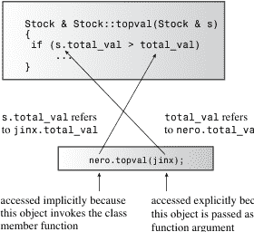

图10.3 使用成员函数访问两个对象。

这里 `s.total_val` 是作为实参传入的对象的总价值，而 `total_val` 是消息发送到的对象的总价值。如果 `s.total_val` 大于 `total_val`，函数返回 `s` 的引用。否则，它返回用于调用该方法的对象的引用。（用面向对象编程的话说，就是 `topval` 消息发送到的对象。）问题来了：那个对象该叫什么？如果你调用 `stock1.topval(stock2)`，那么 `s` 是 `stock2` 的引用（即 `stock2` 的别名），但 `stock1` 没有别名。

C++ 解决这个问题的方法是使用一个称为 `this` 的特殊指针。`this` 指针指向用于调用成员函数的对象。（基本上，它是作为隐藏参数传递给该方法的。）因此，函数调用 `stock1.topval(stock2)` 将 `this` 设置为 `stock1` 对象的地址，并使该指针可供 `topval()` 方法使用。类似地，函数调用 `stock2.topval(stock1)` 将 `this` 设置为 `stock2` 对象的地址。一般来说，所有类方法都有一个 `this` 指针，它被设置为调用该方法的对象的地址。实际上，`topval()` 中的 `total_val` 只是 `this->total_val` 的简写表示法。（回想第4章“复合类型”，你使用 `->` 运算符通过指针访问结构成员。类成员也是如此。）（见图10.4。）

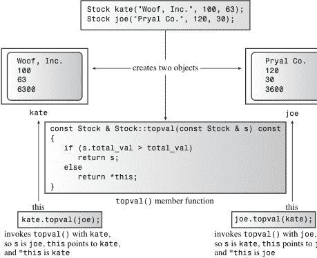

图10.4 this 指向调用对象。

> **注意**
>
> 每个成员函数（包括构造函数和析构函数）都有一个 `this` 指针。`this` 指针的特殊之处在于它指向调用对象。如果某个方法需要将调用对象作为一个整体来引用，它可以使用表达式 `*this`。在函数参数括号后使用 `const` 限定符会将 `this` 限定为指向 `const` 的指针；在这种情况下，你不能使用 `this` 来改变对象的值。

然而，你想要返回的并不是 `this`，因为 `this` 是对象的地址。你想返回对象本身，而对象本身用 `*this` 表示。（回想一下，对指针应用解引用运算符 `*` 会得到该指针所指向的值。）现在你可以使用 `*this` 作为调用对象的别名来完成方法定义。

```cpp
const Stock & Stock::topval(const Stock & s) const
{
    if (s.total_val > total_val)
        return s;             // argument object
    else
        return *this;         // invoking object
}
```

返回类型是引用这一事实意味着返回的对象是调用对象本身，而不是通过返回机制传递的副本。清单10.7给出了新的头文件。

## 清单10.7 stock20.h

```cpp
// stock20.h -- augmented version
#ifndef STOCK20_H_
#define STOCK20_H_
#include <string>

class Stock
{
private:
    std::string company;
    int shares;
    double share_val;
    double total_val;
    void set_tot() { total_val = shares * share_val; }
public:
    Stock();              // default constructor
    Stock(const std::string & co, long n = 0, double pr = 0.0);
    ~Stock();             // do-nothing destructor
    void buy(long num, double price);
    void sell(long num, double price);
    void update(double price);
    void show()const;
    const Stock & topval(const Stock & s) const;
};

#endif
```

清单10.8给出了修订后的类方法文件。它包含了新的 `topval()` 方法。另外，既然你已经了解了构造函数和析构函数如何工作，清单10.8用静默版本替换了它们。

## 清单10.8 stock20.cpp

```cpp
// stock20.cpp -- augmented version
#include <iostream>
#include "stock20.h"

// constructors
Stock::Stock()        // default constructor
{
    company = "no name";
    shares = 0;
    share_val = 0.0;
    total_val = 0.0;
}

Stock::Stock(const std::string & co, long n, double pr)
{
    company = co;

    if (n < 0)
    {
        std::cout << "Number of shares can't be negative; "
                  << company << " shares set to 0.\n";
        shares = 0;
    }
    else
        shares = n;
    share_val = pr;
    set_tot();
}

// class destructor
Stock::~Stock()        // quiet class destructor
{
}

// other methods
void Stock::buy(long num, double price)
{
    if (num < 0)
    {
        std::cout << "Number of shares purchased can't be negative. "
                  << "Transaction is aborted.\n";
    }
    else
    {
        shares += num;
        share_val = price;
        set_tot();
    }
}

void Stock::sell(long num, double price)
{
    using std::cout;
    if (num < 0)
    {
        cout << "Number of shares sold can't be negative. "
             << "Transaction is aborted.\n";
    }
    else if (num > shares)
    {
        cout << "You can't sell more than you have! "
             << "Transaction is aborted.\n";
    }
    else
    {
        shares -= num;
        share_val = price;
        set_tot();
    }
}

void Stock::update(double price)
{
    share_val = price;
    set_tot();
}

void Stock::show() const
{
    using std::cout;
    using std::ios_base;
    // set format to #.###
    ios_base::fmtflags orig =
        cout.setf(ios_base::fixed, ios_base::floatfield);
    std::streamsize prec = cout.precision(3);

    cout << "Company: " << company
         << " Shares: " << shares << '\n';
    cout << " Share Price: $" << share_val;
    // set format to #.##
    cout.precision(2);
    cout << " Total Worth: $" << total_val << '\n';

    // restore original format
    cout.setf(orig, ios_base::floatfield);
    cout.precision(prec);
}

const Stock & Stock::topval(const Stock & s) const
{
    if (s.total_val > total_val)
```

值。如果类有多个构造函数，你可以为不同的元素使用不同的构造函数：

```cpp
const int STKS = 10;
Stock stocks[STKS] = {
    Stock("NanoSmart", 12.5, 20),
    Stock(),
    Stock("Monolithic Obelisks", 130, 3.25),
};
```

这会使用 Stock(const string & co, long n, double pr) 构造函数初始化 stocks[0] 和 stocks[2]，并使用 Stock() 构造函数初始化 stocks[1]。由于此声明只部分初始化了数组，其余七个成员将使用默认构造函数初始化。

清单10.9将这些原则应用到一个简短程序中，该程序初始化四个数组元素，显示它们的内容，并测试这些元素以找出总价值最高的那个。由于 `topval()` 一次只检查两个对象，程序使用 `for` 循环检查整个数组。它还使用一个指向 Stock 的指针来跟踪哪个元素具有最高价值。此清单使用清单10.7的头文件和清单10.8的方法文件。

## 清单10.9 usestok2.cpp

```cpp
// usestok2.cpp -- using the Stock class
// compile with stock20.cpp
#include <iostream>
#include "stock20.h"

const int STKS = 4;
int main()
{
// create an array of initialized objects
    Stock stocks[STKS] = {
        Stock("NanoSmart", 12, 20.0),
        Stock("Boffo Objects", 200, 2.0),
        Stock("Monolithic Obelisks", 130, 3.25),
        Stock("Fleep Enterprises", 60, 6.5)
        };

    std::cout << "Stock holdings:\n";
    int st;
    for (st = 0; st < STKS; st++)
        stocks[st].show();

// set pointer to first element
    const Stock * top = &stocks[0];
    for (st = 1; st < STKS; st++)
        top = &top->topval(stocks[st]);

// now top points to the most valuable holding
    std::cout << "\nMost valuable holding:\n";
    top->show();
    return 0;
}
```

下面是清单10.9中程序的输出：

```
Stock holdings:
Company: NanoSmart  Shares: 12
    Share Price: $20.00  Total Worth: $240.00
Company: Boffo Objects  Shares: 200
    Share Price: $2.00  Total Worth: $400.00
Company: Monolithic Obelisks  Shares: 130
    Share Price: $3.250  Total Worth: $422.50
Company: Fleep Enterprises  Shares: 60
    Share Price: $6.500  Total Worth: $390.00

Most valuable holding:
Company: Monolithic Obelisks  Shares: 130
    Share Price: $3.250  Total Worth: $422.50
```

关于清单10.9需要注意的一点是，大部分工作都花在设计类上。完成之后，编写程序本身相当简单。

顺便说一句，了解 `this` 指针可以更容易地理解 C++ 在底层是如何工作的。例如，最初的 Unix 实现使用一个 C++ 前端将 C++ 程序转换为 C 程序。为了处理方法定义，它只需将这样的 C++ 方法定义

```cpp
void Stock::show() const
{
    cout << "Company: " << company
         << "  Shares: " << shares << '\n'
         << "  Share Price: $" << share_val
         << "  Total Worth: $" << total_val << '\n';
}
```

转换为以下 C 风格定义：

```cpp
void show(const Stock * this)
{
    cout << "Company: " << this->company
         << "  Shares: " << this->shares << '\n'
         << "  Share Price: $" << this->share_val
         << "  Total Worth: $" << this->total_val << '\n';
}
```


也就是说，它将 `Stock::` 限定符转换为一个指向 `Stock` 的函数参数，然后通过该指针访问类成员。

同样，前端也将像这样的函数调用

```cpp
top.show();
```

转换为：

```cpp
show(&top);
```

这样，`this` 指针就被赋值为调用对象的地址。（实际的细节可能更复杂。）

## 类作用域

第9章讨论了全局（或文件）作用域和局部（或块）作用域。回想一下，你可以在包含其定义的文件中的任何位置使用具有全局作用域的变量，而具有局部作用域的变量仅限于包含其定义的块。函数名也可以有全局作用域，但它们从不会有局部作用域。C++类引入了一种新的作用域：类作用域。

类作用域适用于在类中定义的名称，例如类数据成员和类成员函数的名称。具有类作用域的项目在类内是已知的，但在类外是不可知的。因此，你可以在不同的类中使用相同的类成员名称而不会发生冲突。例如，`Stock` 类的 `shares` 成员与 `JobRide` 类的 `shares` 成员是不同的。此外，类作用域意味着你不能从外部世界直接访问类的成员。即使对于公有函数成员也是如此。也就是说，要调用公有成员函数，你必须使用对象：

```cpp
Stock sleeper("Exclusive Ore", 100, 0.25);  // 创建对象
sleeper.show();      // 使用对象调用成员函数
show();             // 无效——不能直接调用方法
```

同样，在定义成员函数时，你必须使用作用域解析运算符：

```cpp
void Stock::update(double price)
{
    ...
}
```

简而言之，在类声明或成员函数定义中，你可以使用不加修饰的成员名称（未限定名称），就像 `sell()` 调用 `set_tot()` 成员函数那样。构造函数名称在调用时会被识别，因为它的名称与类名相同。否则，当你使用类成员名称时，必须根据上下文使用直接成员运算符（`.`）、间接成员运算符（`->`）或作用域解析运算符（`::`）。下面的代码片段说明了如何访问具有类作用域的标识符：

```cpp
class Ik
{
private:
    int fuss;        // fuss 具有类作用域
public:
    Ik(int f = 9) {fuss = f; }  // fuss 在作用域内
    void ViewIk() const;        // ViewIk 具有类作用域
};

void Ik::ViewIk() const    // Ik:: 将 ViewIk 置于 Ik 作用域内
{
    cout << fuss << endl;   // fuss 在类方法内处于作用域内
}
...
int main()
{
    Ik * pik = new Ik;
    Ik ee = Ik(8); // 构造函数在作用域内，因为具有类名
    ee.ViewIk();   // 类对象将 ViewIk 带入作用域
    pik->ViewIk(); // 指向 Ik 的指针将 ViewIk 带入作用域
...
}
```

## 类作用域常量

有时，拥有具有类作用域的符号常量会很方便。例如，类声明可能会使用字面量 30 来指定数组大小。因为常量对所有对象都是相同的，所以最好创建一个所有对象共享的单一常量。你可能认为下面这样会是一个解决方案：

```cpp
class Bakery
{
private:
    const int Months = 12;   // 声明常量？失败
    double costs[Months];
    ...
```

但这行不通，因为声明类只是描述了对象的外观，并不会创建对象。因此，在你创建对象之前，没有地方存储值。（实际上，C++11 提供了成员初始化，但无法使前面的数组声明正常工作；第12章会回到这个话题。）然而，有两种方法基本上可以达到相同的预期效果。

首先，可以在类中声明一个枚举。在类声明中给出的枚举具有类作用域，因此你可以使用枚举为整数常量提供类作用域的符号名称。也就是说，你可以这样开始 `Bakery` 声明：

```cpp
class Bakery
{
private:
    enum {Months = 12};
    double costs[Months];
    ...
```

注意，以这种方式声明枚举并不会创建类数据成员。也就是说，每个单独的对象并不会在其中携带一个枚举。相反，`Months` 只是一个符号名称，编译器在类作用域内遇到它时会将其替换为 12。

因为 `Bakery` 类使用枚举仅仅是为了创建符号常量，并无意创建枚举类型的变量，所以你不需要提供枚举标记。顺便提一下，对于许多实现来说，`ios_base` 类在其公有部分做了类似的事情；这就是诸如 `ios_base::fixed` 之类标识符的来源。这里的 `fixed` 通常是在 `ios_base` 类中定义的枚举器。

C++ 有第二种在类中定义常量的方法——使用关键字 `static`：

```cpp
class Bakery
{
private:
    static const int Months = 12;
    double costs[Months];
    ...
```

这会创建一个名为 `Months` 的单一常量，它与其他静态变量存储在一起，而不是存储在对象中。因此，只有一个由所有 `Bakery` 对象共享的 `Months` 常量。第12章将进一步讨论静态类成员。在 C++98 中，你只能使用这种技术来声明具有整数和枚举值的静态常量。因此，C++98 不允许你以这种方式存储 `double` 常量。C++11 消除了这一限制。

## 作用域枚举（C++11）

传统的枚举存在一些问题。其中之一是来自两个不同枚举定义的枚举器可能会发生冲突。假设你正在进行一个涉及鸡蛋和T恤的项目。你可能会尝试这样：

```cpp
enum egg {Small, Medium, Large, Jumbo};
enum t_shirt {Small, Medium, Large, XLarge};
```

这行不通，因为 `egg` 的 `Small` 和 `t_shirt` 的 `Small` 都会处于同一作用域中，名称会冲突。C++11 提供了一种新形式的枚举，通过使其枚举器具有类作用域来避免这个问题。这种形式的声明看起来像这样：

```cpp
enum class egg {Small, Medium, Large, Jumbo};
enum class t_shirt {Small, Medium, Large, XLarge};
```

或者，你可以使用关键字 `struct` 而不是 `class`。无论哪种情况，你现在需要使用枚举名来限定枚举器：

```cpp
egg choice = egg::Large;        // egg 枚举的 Large 枚举器
t_shirt Floyd = t_shirt::Large; // t_shirt 枚举的 Large 枚举器
```

既然枚举器具有类作用域，不同枚举定义中的枚举器不再有潜在的名称冲突，你的鸡蛋和T恤项目就可以继续了。C++11 还加强了作用域枚举的类型安全性。普通枚举在某些情况下会自动转换为整数类型，例如赋值给 `int` 变量或在比较表达式中使用时，但作用域枚举没有到整数类型的隐式转换：

```cpp
enum egg_old {Small, Medium, Large, Jumbo};     // 无作用域
enum class t_shirt {Small, Medium, Large, XLarge}; // 有作用域
egg_old one = Medium;                            // 无作用域
t_shirt roll = t_shirt::Large;                   // 有作用域
int king = one;       // 无作用域枚举的隐式类型转换
int ring = roll;      // 不允许，没有隐式类型转换
if (king == Jumbo)
    std::cout << "Jumbo 在比较前转换为 int。\n";
if (king < t_shirt::Medium)  // 不允许
    std::cout << "不允许：< 未为作用域枚举定义。\n";
```

但如果觉得有必要，你可以进行显式类型转换：

```cpp
int Frodo = int(t_shirt::Small); // Frodo 设置为 0
```

枚举由某种底层整数类型表示，在 C++98 中，这种选择取决于实现。因此，包含枚举的结构在不同系统上可能具有不同的大小。C++11 为作用域枚举消除了这种依赖性。默认情况下，C++11 作用域枚举的底层类型是 `int`。此外，还有一种语法可以指示不同的选择：

```cpp
// pizza 的底层类型是 short
enum class pizza : short {Small, Medium, Large, XLarge};
```

`: short` 指定底层类型为 short。底层类型必须是整数类型。在 C++11 中，你也可以使用这种语法来指示无作用域枚举的底层类型，但如果你不选择类型，编译器所做的选择取决于实现。

## 抽象数据类型

`Stock` 类相当具体。然而，程序员经常定义类来表示更一般的概念。例如，使用类是实现计算机科学家所称的*抽象数据类型*（ADT）的好方法。顾名思义，ADT 以一般方式描述数据类型，而不涉及语言或实现细节。例如，考虑栈。通过使用栈，你可以存储数据，以便


数据总是从栈顶添加或删除。例如，C++ 程序使用栈来管理自动变量。当新的自动变量生成时，它们会被添加到栈顶。当它们失效时，会从栈中移除。

让我们以一般、抽象的方式来看栈的属性。首先，栈保存若干项。（这一属性使它成为一个*容器*，这是一种更一般的抽象。）其次，栈的特征在于可以对其执行的操作：

- 你可以创建一个空栈。
- 你可以向栈顶添加一项（也就是说，你可以*压入*一项）。
- 你可以从栈顶移除一项（也就是说，你可以*弹出*一项）。
- 你可以检查栈是否已满。
- 你可以检查栈是否为空。

你可以将这一描述与一个类声明对应起来，其中公有成员函数提供表示栈操作的接口。私有数据成员负责存储栈数据。类概念与 ADT 方法非常契合。

私有部分必须确定如何保存数据。例如，你可以使用普通数组、动态分配的数组，或某种更高级的数据结构，如链表。然而，公有接口应隐藏确切的表示方式。相反，它应以一般术语表达，例如创建栈、压入一项等。程序清单 10.10 展示了一种方法。它假设 `bool` 类型已经实现。如果你的系统尚未实现该类型，可以使用 `int`、`0` 和 `1`，而不是 `bool`、`false` 和 `true`。

程序清单 10.10  **stack.h**

```cpp
// stack.h -- class definition for the stack ADT
#ifndef STACK_H_
#define STACK_H_

typedef unsigned long Item;

class Stack
{
private:
    enum {MAX = 10};    // constant specific to class
    Item items[MAX];    // holds stack items
    int top;            // index for top stack item
public:
    Stack();
    bool isempty() const;
    bool isfull() const;
    // push() returns false if stack already is full, true otherwise
    bool push(const Item & item);    // add item to stack
```

```cpp
while (cin.get() != '\n')
    continue;
if (!isalpha(ch))
{
    cout << '\a';
    continue;
}
switch(ch)
{
    case 'A':
    case 'a': cout << "Enter a PO number to add: ";
              cin >> po;
              if (st.isfull())
                  cout << "stack already full\n";
              else
                  st.push(po);
              break;
    case 'P':
    case 'p': if (st.isempty())
                  cout << "stack already empty\n";
              else {
                  st.pop(po);
                  cout << "PO #" << po << " popped\n";
              }
              break;
}
cout << "Please enter A to add a purchase order,\n"
     << "P to process a PO, or Q to quit.\n";
}
cout << "Bye\n";
return 0;
}
```

程序清单 10.12 中用于清除该行剩余内容的小 while 循环此时并非绝对必要，但在第 14 章对本程序进行修改时它会派上用场。下面是一次示例运行：

```text
Please enter A to add a purchase order,
P to process a PO, or Q to quit.
A
Enter a PO number to add: 17885
Please enter A to add a purchase order,
P to process a PO, or Q to quit.
P
PO #17885 popped
Please enter A to add a purchase order,
P to process a PO, or Q to quit.
A
Enter a PO number to add: 17965
Please enter A to add a purchase order,
P to process a PO, or Q to quit.
A
Enter a PO number to add: 18002
Please enter A to add a purchase order,
P to process a PO, or Q to quit.
P
PO #18002 popped
Please enter A to add a purchase order,
P to process a PO, or Q to quit.
P
PO #17965 popped
Please enter A to add a purchase order,
P to process a PO, or Q to quit.
P
stack already empty
Please enter A to add a purchase order,
P to process a PO, or Q to quit.
Q
Bye
```

## 总结

OOP 强调程序如何表示数据。使用 OOP 方法解决编程问题的第一步，是从数据与程序的接口角度描述数据，指明数据如何使用。接下来，你需要设计一个实现该接口的类。通常，私有数据成员存储信息，而公有成员函数（也称为方法）提供对数据的唯一访问途径。类将数据和方法组合为一个单元，而私有部分实现了数据隐藏。

通常，你将类声明分为两部分，并通常保存在不同文件中。类声明本身放入头文件，其中方法由函数原型表示。定义成员函数的源代码放入方法文件。这种方法将接口描述与实现细节分离。原则上，你只需了解类的公有接口即可使用该类。当然，你可以查看实现（除非只以编译形式提供给你），但你的程序不应依赖实现细节，例如知道某个特定值以 int 存储。只要程序和类仅通过定义接口的方法进行通信，你就可以自由地分别改进任一部分，而不必担心出现意外交互。

类是用户定义的类型，对象是类的实例。这意味着对象是该类型的变量，或相当于变量，例如根据类规范由 new 分配的内存。C++ 尽量使用户定义类型与标准类型尽可能相似，因此你可以声明对象、指向对象的指针和对象数组。你可以将对象作为参数传递、作为函数返回值返回，并将一个对象赋给同一类型的另一个对象。如果提供构造函数方法，就可以在创建对象时初始化它们。如果提供析构函数方法，程序会在对象失效时执行该方法。

每个对象都持有类声明中数据部分自己的副本，但它们共享类方法。如果 mr_object 是某个特定对象的名称，而 try_me() 是成员函数，则使用点成员运算符调用该成员函数：mr_object.try_me()。OOP 术语将这种函数调用描述为向 mr_object 对象发送一条 try_me 消息。这样，try_me() 方法中对类数据成员的任何引用都作用于 mr_object 对象的数据成员。类似地，函数调用 i_object.try_me() 访问 i_object 对象的数据成员。

如果希望一个成员函数作用于多个对象，可以将额外的对象作为参数传递给该方法。如果方法需要显式引用调用它的对象，可以使用 this 指针。this 指针被设置为调用对象的地址，因此 *this 是对象本身的别名。

类非常适合描述 ADT。公有成员函数接口提供 ADT 所描述的服务，而类的私有部分和类方法的代码提供对类客户端隐藏的实现。

## 章节复习

1. 什么是类？
2. 类如何实现抽象、封装和数据隐藏？
3. 对象与类之间是什么关系？
4. 除了作为函数之外，类的函数成员与类的数据成员还有何不同？
5. 定义一个表示银行账户的类。数据成员应包括存款人姓名、账号（使用字符串）和余额。成员函数应允许以下操作：
   - 创建对象并初始化它。
   - 显示存款人姓名、账号和余额
   - 存入由参数给定的一笔金额
   - 取出由参数给定的一笔金额

只需给出类声明，不要给出方法实现。（编程练习 1 为你提供了编写实现的机会。）


- 6. 类构造函数何时被调用？类析构函数何时被调用？
- 7. 为本章复习题第5题中的银行账户类提供构造函数的代码。
- 8. 什么是默认构造函数？拥有默认构造函数有什么优点？
- 9. 修改 `Stock` 类定义（`stock20.h` 中的版本），使其具有返回各个数据成员值的成员函数。注意：返回公司名称的成员不应提供修改数组的方法。也就是说，它不能简单地返回字符串引用。它可以返回 `const` 引用。
- 10. `this` 和 *this* 是什么？

## 编程练习

- 1. 为本章复习题第5题中描述的类提供方法定义，并编写一个演示所有特性的简短程序。

- 2. 下面是一个相当简单的类定义：

  ```cpp
  class Person {
  private:
      static const LIMIT = 25;
      string lname;       // Person's last name
      char fname[LIMIT];  // Person's first name
  public:
      Person() {lname = ""; fname[0] = '\0'; }  // #1
      Person(const string & ln, const char * fn = "Heyyou");  // #2
      // the following methods display name and fname
      void Show() const;          // firstname lastname format
      void FormalShow() const;    // lastname, firstname format
  };
  ```

  （它同时使用 `string` 对象和字符数组，以便你比较这两种形式的用法。）编写一个程序，通过为未定义的方法提供代码来完成实现。使用该类的程序还应使用三种可能的构造函数调用（无参数、一个参数和两个参数）以及两个显示方法。下面是一个使用构造函数和方法的示例：

  ```cpp
  Person one;                       // use default constructor
  Person two("Smythecraft");       // use #2 with one default argument
  Person three("Dimwiddy", "Sam"); // use #2, no defaults
  one.Show();
  cout << endl;
  one.FormalShow();
  // etc. for two and three
  ```

- 3. 完成第9章编程练习1，但将那里显示的代码替换为合适的 `golf` 类声明。将 `setgolf(golf &, const char*, int)` 替换为带有用于提供初始值的合适参数的构造函数。保留 `setgolf()` 的交互版本，但通过使用构造函数来实现它。（例如，对于 `setgolf()` 的代码，获取数据，将数据传递给构造函数以创建临时对象，并将临时对象赋值给调用对象，即 `*this`。）

- 4. 完成第9章编程练习4，但将 `Sales` 结构及其关联函数转换为类及其方法。将 `setSales(Sales &, double [], int)` 函数替换为构造函数。通过使用构造函数来实现交互式 `setSales(Sales &)` 方法。将类保留在命名空间 `SALES` 中。

- 5. 考虑以下结构声明：

  ```cpp
  struct customer {
      char fullname[35];
      double payment;
  };
  ```

  编写一个程序，从由 `Stack` 类声明表示的栈中添加和移除 customer 结构。每次移除一个 customer 时，应将其付款加到累计总额中，并且应报告该累计总额。注意：你应该能够不加修改地使用 `Stack` 类；只需更改 `typedef` 声明，使 `Item` 为 `customer` 类型而不是 `unsigned long`。

- 6. 下面是一个类声明：

  ```cpp
  class Move
  {
  private:
      double x;
      double y;
  public:
      Move(double a = 0, double b = 0);  // sets x, y to a, b
      void showmove() const;             // shows current x, y values
      Move add(const Move & m) const;
      // this function adds x of m to x of invoking object to get new x,
      // adds y of m to y of invoking object to get new y, creates a new
      // Move object initialized to new x, y values and returns it
      void reset(double a = 0, double b = 0);  // resets x,y to a, b
  };
  ```

  创建成员函数定义和一个练习该类的程序。

- 7. 一个 Betelgeusean plorg 具有以下属性：

  ### 数据

  一个 plorg 的名字不超过 19 个字母。

  一个 plorg 有一个满意度指数（CI），它是一个整数。

  ### 操作

  一个新的 plorg 初始时具有一个名字和值为 50 的 CI。

  plorg 的 CI 可以改变。

  plorg 可以报告其名称和 CI。

  默认 plorg 的名字为“Plorga”。

  编写一个表示 `plorg` 的 `Plorg` 类声明（包括数据成员和成员函数原型）。编写成员函数的函数定义。编写一个演示 `Plorg` 类所有特性的简短程序。

- 8. 你可以这样描述一个简单列表：

  - 简单列表可以保存某种特定类型的零个或多个项。
  - 你可以创建一个空列表。
  - 你可以向列表添加项。
  - 你可以判断列表是否为空。
  - 你可以判断列表是否已满。
  - 你可以访问列表中的每一项并对其执行某种操作。

  如你所见，这个列表确实很简单；例如，它不允许插入或删除。

  设计一个 `List` 类来表示这种抽象类型。你应该提供一个包含类声明的 `list.h` 头文件，以及一个包含类方法实现的 `list.cpp` 文件。你还应创建一个利用你的设计的简短程序。

  保持列表规范简单的主要原因是简化这个编程练习。你可以将列表实现为数组，或者，如果你熟悉该数据类型，也可以实现为链表。但公共接口不应依赖于你的选择。也就是说，公共接口不应包含数组索引、指向节点的指针等。它应该用创建列表、向列表添加项等一般概念来表达。处理访问每一项并执行操作的常用方法是使用一个接受函数指针作为参数的函数：

  ```cpp
  void visit(void (*pf) (Item &));
  ```

  这里 `pf` 指向一个函数（不是成员函数），该函数接受一个 `Item` 引用参数，其中 `Item` 是列表中项的类型。`visit()` 函数将此函数应用于列表中的每一项。你可以将 `Stack` 类作为大致参考。

## 使用类

在本章中，你将学习以下内容：

- 运算符重载
- 友元函数
- 为输出重载 `<<` 运算符
- 状态成员
- 使用 `rand()` 生成随机值
- 类的自动转换和类型转换
- 类转换函数

C++ 类功能丰富、复杂且强大。在第10章“对象与类”中，你通过学习定义和使用一个简单的类，开始了面向对象编程之旅。你看到了类如何通过定义用于表示对象的数据类型，并通过成员函数定义可对这些数据执行的操作，从而定义一种数据类型。你还了解了两个特殊的成员函数——构造函数和析构函数，它们负责管理按类规范创建的对象的创建和销毁。本章将进一步探索类属性，重点放在类设计技术而不是一般原则上。你可能会发现这里涵盖的某些特性很直接，而有些则更微妙。要最好地理解这些新特性，你应该尝试这些示例并进行实验：如果对此函数使用普通参数而不是引用参数，会发生什么？如果从析构函数中遗漏某些内容，会发生什么？不要害怕犯错；通常，从解开错误中你能学到的东西比按部就班做对更多。（但是，不要以为一连串错误必然会带来惊人的洞见。）最终，你将获得回报：更全面地理解 C++ 如何工作以及 C++ 能为你做什么。

本章从运算符重载开始，它允许你对类对象使用标准 C++ 运算符，例如 = 和 +。然后它考察友元，这是 C++ 中允许非成员函数访问私有数据的机制。最后，它探讨如何指示

C++ 使用类来执行自动类型转换。当你学习本章和第12章“类和动态内存分配”时，你会更加深刻地理解类构造函数和类析构函数所扮演的角色。你还会看到在开发和改进类设计时可能经历的某些阶段。

学习 C++ 的一个困难（至少在你学到这个程度时）是，需要记住的东西太多了。而期望自己在积累足够经验以便有所依托之前就把一切都记住，是不合理的。在这方面，学习 C++ 就像学习一个功能繁多的文字处理器或电子表格程序。没有哪个功能本身特别吓人，但在实践中，大多数人真正精通的只是那些他们经常使用的功能，比如搜索文本或设置斜体。你可能记得在某个地方读到过如何生成替代字符或创建目录，但这些技能可能不会成为你日常技能的一部分，直到你遇到需要频繁使用它们的情况。吸收本章丰富材料的最佳方法，或许是一开始只把其中一些新特性融入你自己的 C++ 编程中。随着经验加深对这些特性的理解和欣赏，你可以开始加入其他 C++ 特性。正如 C++ 的创建者 Bjarne Stroustrup 在一次面向专业程序员的 C++ 会议上所建议的那样：“让自己轻松进入这门语言。不要觉得必须使用所有特性，也不要试图在第一天就把它们全部用上。”

## 运算符重载

让我们来看一种让对象操作看起来更美观的技术。*运算符重载*是 C++ 多态性的一个例子。在第8章“函数历险”中，你看到了 C++ 如何允许你定义几个同名函数，只要它们具有不同的签名（参数列表）。这称为*函数重载*，或称*函数式多态*。其目的是让你对相同的基本操作使用相同的函数名，即使该操作应用于不同的数据类型。（想象一下，如果你必须针对每种不同类型的对象使用不同的动词形式，英语会有多么别扭——例如，`lift_left` 你的左脚，而 `lift_spoon` 你的勺子。）运算符重载将重载概念扩展到运算符，让你可以为 C++ 运算符赋予多种含义。实际上，许多 C++（和 C）运算符已经被重载了。例如，`*` 运算符应用于地址时，会得到存储在该地址的值；而将 `*` 应用于两个数字时，会得到这两个值的乘积。C++ 根据操作数的数量和类型来决定采取哪种操作。

C++ 允许你将运算符重载扩展到用户定义类型，例如使你可以使用 + 符号来将两个对象相加。同样，编译器会根据操作数的数量和类型来决定使用加法的哪个定义。重载的运算符常常能让代码看起来更自然。例如，一个常见的计算任务是两个数组相加。通常，这最终会写成下面这样的 for 循环：

```cpp
for (int i = 0; i < 20; i++)
    evening[i] = sam[i] + janet[i];  // add element by element
```

但在 C++ 中，你可以定义一个表示数组的类并重载 + 运算符，从而可以这样写：

```cpp
evening = sam + janet;                     // add two array objects
```

这种简单的加法表示法隐藏了实现机制，强调了本质，而这正是 OOP 的另一个目标。

要重载运算符，你需要使用一种称为*运算符函数*的特殊函数形式。运算符函数的形式如下，其中 *op* 是被重载运算符的符号：

```cpp
operatorop(argument-list)
```

例如，`operator+()` 重载 `+` 运算符，`operator*()` 重载 `*` 运算符。`op` 必须是有效的 C++ 运算符；你不能凭空创造一个新符号。例如，你不能有一个 `operator@()` 函数，因为 C++ 没有 `@` 运算符。但 `operator[]()` 函数可以重载 `[]` 运算符，因为 `[]` 是数组索引运算符。假设你有一个 `Salesperson` 类，并为其定义了一个 `operator+()` 成员函数来重载 `+` 运算符，以便将一个销售员对象的销售数字加到另一个销售员对象上。那么，如果 `district2`、`sid` 和 `sara` 都是 `Salesperson` 类的对象，你可以写出如下等式：

```cpp
district2 = sid + sara;
```

编译器识别出操作数属于 `Salesperson` 类后，会用相应的运算符函数替换该运算符：

```cpp
district2 = sid.operator+(sara);
```

该函数随后隐式地使用 `sid` 对象（因为它调用了该方法），并显式地使用 `sara` 对象（因为它作为参数传入）来计算总和，然后返回该总和。当然，好处在于你可以使用简洁的 `+` 运算符表示法，而不是笨拙的函数表示法。

C++ 对运算符重载施加了一些限制，但在你看到重载的工作原理之后，这些限制就最容易理解了。因此，让我们开发几个示例来阐明这个过程，然后讨论这些限制。

## 时间尽在掌握：开发一个运算符重载示例

如果你上午在 Priggs 账户上工作了 2 小时 35 分钟，下午工作了 2 小时 40 分钟，那么你总共在这个账户上工作了多长时间？这是一个加法概念很有意义的例子，但你要相加的单位（小时和分钟的混合）与内置类型不匹配。第7章“函数：C++ 的编程模块”通过定义一个 `travel_time` 结构和一个用于相加这种结构的 `sum()` 函数来处理类似的情况。现在让我们将其推广到一个 `Time` 类，用一个方法来处理加法。我们先从一个普通的方法 Sum() 开始，然后看看如何将它转换为一个重载的运算符。清单 11.1 展示了这个类的声明。

清单 11.1 `mytime0.h`

```cpp
// mytime0.h -- Time class before operator overloading
#ifndef MYTIME0_H_
#define MYTIME0_H_

class Time
{
private:
    int hours;
    int minutes;
public:
    Time();
    Time(int h, int m = 0);
    void AddMin(int m);
    void AddHr(int h);
    void Reset(int h = 0, int m = 0);
    Time Sum(const Time & t) const;
    void Show() const;
};
#endif
```

Time 类提供了调整和重置时间、显示时间值以及将两个时间相加的方法。清单 11.2 展示了这些方法的定义；注意 AddMin() 和 Sum() 方法如何使用整数除法和模运算符，在总分钟数超过 59 时调整分钟和小时值。另外，由于用到的 iostream 功能只有 cout，而且只使用一次，所以使用 std::cout 而不使用整个 std 命名空间似乎更经济。

清单 11.2 `mytime0.cpp`

```cpp
// mytime0.cpp -- implementing Time methods
#include <iostream>
#include "mytime0.h"

Time::Time()
{
    hours = minutes = 0;
}

Time::Time(int h, int m)
{
    hours = h;
    minutes = m;
}

void Time::AddMin(int m)
{
    minutes += m;
    hours += minutes / 60;
    minutes %= 60;
}

void Time::AddHr(int h)
{
    hours += h;
}

void Time::Reset(int h, int m)
{
    hours = h;
    minutes = m;
}

Time Time::Sum(const Time & t) const
{
    Time sum;
    sum.minutes = minutes + t.minutes;
    sum.hours = hours + t.hours + sum.minutes / 60;
    sum.minutes %= 60;
    return sum;
}

void Time::Show() const
{
    std::cout << hours << " hours, " << minutes << " minutes";
}
```

考虑 `Sum()` 函数的代码。注意，参数是引用，但返回类型不是引用。将参数设为引用的原因是效率。如果 Time 对象按值传递，代码也会产生相同的结果，但通常只传递引用更快、更节省内存。

然而，返回值不能是引用。原因在于，该函数创建了一个新的 Time 对象（sum），它表示另外两个 Time 对象的和。像这段代码这样返回对象，会创建调用函数可以使用的对象副本。但如果返回类型是 Time&，那么这个引用将指向 sum 对象。而 sum 对象是一个局部变量，函数结束时会被销毁，因此该引用将指向一个不存在的对象。使用 Time 作为返回类型。


然而，类型意味着程序在销毁 `sum` 之前构造它的一个副本，而调用函数得到的是该副本。

> **注意**
> 
> 不要返回对局部变量或其他临时对象的引用。当函数终止且局部变量或临时对象消失时，该引用就会变成对不存在数据的引用。

最后，程序清单11.3测试Time类的时间求和部分。

### 程序清单11.3 `usetime0.cpp`

```cpp
// usetime0.cpp -- using the first draft of the Time class
// compile usetime0.cpp and mytime0.cpp together
#include <iostream>
#include "mytime0.h"

int main()
{
    using std::cout;
    using std::endl;
    Time planning;
    Time coding(2, 40);
    Time fixing(5, 55);
    Time total;

    cout << "planning time = ";
    planning.Show();
    cout << endl;

    cout << "coding time = ";
    coding.Show();
    cout << endl;

    cout << "fixing time = ";
    fixing.Show();
    cout << endl;

    total = coding.Sum(fixing);
    cout << "coding.Sum(fixing) = ";
    total.Show();
    cout << endl;

    return 0;
}
```

以下是程序清单11.1、11.2和11.3中程序的输出：

```text
planning time = 0 hours, 0 minutes
coding time = 2 hours, 40 minutes
fixing time = 5 hours, 55 minutes
coding.Sum(fixing) = 8 hours, 35 minutes
```

## 添加加法运算符

将Time类改为使用重载加法运算符很简单。只需将Sum()的名称改为看起来奇怪的名称operator+()。没错：只需将运算符符号（本例中为+）追加到operator末尾，并将结果用作方法名。这是标识符名称中可以使用字母、数字或下划线以外字符的一个地方。程序清单11.4和11.5反映了这一小改动。

### 程序清单11.4 `mytime1.h`

```cpp
// mytime1.h -- Time class before operator overloading
#ifndef MYTIME1_H_
#define MYTIME1_H_

class Time
{
private:
    int hours;
    int minutes;
public:
    Time();
    Time(int h, int m = 0);
    void AddMin(int m);
    void AddHr(int h);
    void Reset(int h = 0, int m = 0);
    Time operator+(const Time & t) const;
    void Show() const;
};
#endif
```

### 程序清单11.5 `mytime1.cpp`

```cpp
// mytime1.cpp -- implementing Time methods
#include <iostream>
#include "mytime1.h"

Time::Time()
{
    hours = minutes = 0;
}

Time::Time(int h, int m)
{
    hours = h;
    minutes = m;
}

void Time::AddMin(int m)
{
    minutes += m;
    hours += minutes / 60;
    minutes %= 60;
}

void Time::AddHr(int h)
{
    hours += h;
}

void Time::Reset(int h, int m)
{
    hours = h;
    minutes = m;
}

Time Time::operator+(const Time & t) const
{
    Time sum;
    sum.minutes = minutes + t.minutes;
    sum.hours = hours + t.hours + sum.minutes / 60;
    sum.minutes %= 60;
    return sum;
}

void Time::Show() const
{
    std::cout << hours << " hours, " << minutes << " minutes";
}
```

与Sum()一样，operator+()由Time对象调用，接受第二个Time对象作为参数，并返回一个Time对象。因此，可以使用与Sum()相同的语法调用operator+()方法：

```cpp
total = coding.operator+(fixing);    // function notation
```

但是，将方法命名为`operator+()`还允许你使用运算符表示法：

```cpp
total = coding + fixing;        // operator notation
```

两种表示法都会调用`operator+()`方法。注意，使用运算符表示法时，运算符左侧的对象（本例中为coding）是调用对象，而右侧的对象（本例中为fixing）是作为参数传递的对象。程序清单11.6说明了这一点。

### 程序清单11.6 `usetime1.cpp`

```cpp
// usetime1.cpp -- using the second draft of the Time class
// compile usetime1.cpp and mytime1.cpp together
#include <iostream>
#include "mytime1.h"

int main()
{
    using std::cout;
    using std::endl;
    Time planning;
    Time coding(2, 40);
    Time fixing(5, 55);
    Time total;

    cout << "planning time = ";
    planning.Show();
    cout << endl;

    cout << "coding time = ";
    coding.Show();
    cout << endl;

    cout << "fixing time = ";
    fixing.Show();
    cout << endl;

    total = coding + fixing;
    // operator notation
    cout << "coding + fixing = ";
    total.Show();
    cout << endl;

    Time morefixing(3, 28);
    cout << "more fixing time = ";
    morefixing.Show();
    cout << endl;
    total = morefixing.operator+(total);
    // function notation
    cout << "morefixing.operator+(total) = ";
    total.Show();
    cout << endl;

    return 0;
}
```

以下是程序清单11.4、11.5和11.6中程序的输出：

```text
planning time = 0 hours, 0 minutes
coding time = 2 hours, 40 minutes
fixing time = 5 hours, 55 minutes
coding + fixing = 8 hours, 35 minutes
more fixing time = 3 hours, 28 minutes
morefixing.operator+(total) = 12 hours, 3 minutes
```

简而言之，`operator+()`函数的名称允许使用函数表示法或运算符表示法来调用它。编译器使用操作数类型来确定要做什么：

```cpp
int a, b, c;
Time A, B, C;
c = a + b;       // use int addition
C = A + B;       // use addition as defined for Time objects
```

能相加多于两个对象吗？例如，如果`t1`、`t2`、`t3`和`t4`都是Time对象，可以执行以下操作吗？

```cpp
t4 = t1 + t2 + t3;                    // valid?
```

回答这个问题的方法是考虑该语句如何转换为函数调用。因为加法是从左到右的运算符，所以该语句首先转换为：

```cpp
t4 = t1.operator+(t2 + t3);             // valid?
```

然后，函数参数本身又被转换为函数调用，如下所示：

```cpp
t4 = t1.operator+(t2.operator+(t3));   // valid? YES
```

这有效吗？是的，有效。函数调用`t2.operator+(t3)`返回一个Time对象，表示`t2`和`t3`的和。然后这个对象成为`t1.operator+()`函数调用的对象，该调用返回`t1`与表示`t2`和`t3`之和的Time对象之和。简而言之，最终返回值是`t1`、`t2`和`t3`的和，正如所愿。

## 重载限制

大多数C++运算符（见表11.1）可以按照上一节所述的方式进行重载。重载运算符（有一些例外）不一定必须是成员函数。但是，至少有一个操作数必须是用户定义的类型。让我们更仔细地看看C++对用户定义运算符重载施加的限制：

- 重载运算符必须至少有一个操作数是用户定义的类型。这可以防止你为标准类型重载运算符。因此，不能重新定义减号运算符（`-`），使其产生两个double值之和而不是它们的差。这一限制保持了程序的健全性，尽管它可能会妨碍创造性会计。
- 不能以违反原运算符语法规则的方式使用运算符。例如，不能重载求模运算符（`%`），使其可用于单个操作数：

```cpp
int x;
Time shiva;
% x;      // invalid for modulus operator
% shiva;  // invalid for overloaded operator
```

同样，不能改变运算符优先级。因此，如果重载加法运算符以便将两个类相加，新运算符具有与普通加法相同的优先级。

- 不能创建新的运算符符号。例如，不能定义`operator**()`函数来表示求幂。
- 不能重载以下运算符：

| 运算符 | 描述 |
|---|---|
| `sizeof` | sizeof运算符 |
| `.` | 成员运算符 |
| `.*` | 指向成员的指针运算符 |
| `::` | 作用域解析运算符 |
| `?:` | 条件运算符 |
| `typeid` | RTTI运算符 |
| `const_cast` | 类型转换运算符 |
| `dynamic_cast` | 类型转换运算符 |
| `reinterpret_cast` | 类型转换运算符 |
| `static_cast` | 类型转换运算符 |

这仍然使表11.1中的所有运算符可用于重载。


表 11.1 中的大多数运算符都可以通过成员函数或非成员函数进行重载。但是，下列运算符*只能*使用成员函数进行重载：

| 运算符 | 描述 |
|---|---|
| `=` | 赋值运算符 |
| `()` | 函数调用运算符 |
| `[]` | 下标运算符 |
| `->` | 通过指针访问类成员的运算符 |

> **注意**
>
> 本章并未涵盖限制列表或表 11.1 中提到的每一个运算符。不过，附录 E“其他运算符”总结了本书正文未涵盖的运算符。

**表 11.1 可重载的运算符**

|  |  |  |  |  |  |
|---|---|---|---|---|---|
| `+` | `-` | `*` | `/` | `%` | `^` |
| `&` | `\|` | `~` | `!` | `=` | `<` |
| `>` | `+=` | `-=` | `*=` | `/=` | `%=` |
| `^=` | `&=` | `\|=` | `<<` | `>>` | `>>=` |
| `<<=` | `==` | `!=` | `<=` | `>=` | `&&` |
| `\|\|` | `++` | `--` | `,` | `->*` | `->` |
| `()` | `[]` | `new` | `delete` | `new []` | `delete []` |

除了这些形式上的限制之外，在重载运算符时还应保持合理的克制。例如，你不应重载 `*` 运算符来实现交换两个 Time 对象的数据成员。这种表示法本身无法表明该运算符做了什么，因此最好定义一个具有说明性名称的类方法，例如 `swap()`。

## 更多重载运算符

还有一些其他操作对 Time 类也有意义。例如，你可能想从一个时间中减去另一个时间，或将一个时间乘以一个因子。这意味着需要重载减法和乘法运算符。其技术与加法运算符相同：创建 `operator-()` 和 `operator*()` 方法。也就是说，将下列原型添加到类声明中：

```cpp
Time operator-(const Time & t) const;
Time operator*(double n) const;
```

程序清单 11.7 展示了新的头文件。

### 程序清单 11.7 mytime2.h

```cpp
// mytime2.h -- Time class after operator overloading
#ifndef MYTIME2_H
#define MYTIME2_H

class Time
{
private:
    int hours;
    int minutes;
public:
    Time();
    Time(int h, int m = 0);
    void AddMin(int m);
    void AddHr(int h);
    void Reset(int h = 0, int m = 0);
    Time operator+(const Time & t) const;
    Time operator-(const Time & t) const;
    Time operator*(double n) const;
    void Show() const;
};
#endif
```

然后，将新方法的定义添加到实现文件中，如程序清单 11.8 所示。

### 程序清单 11.8 mytime2.cpp

```cpp
// mytime2.cpp -- implementing Time methods
#include <iostream>
#include "mytime2.h"

Time::Time()
{
    hours = minutes = 0;
}

Time::Time(int h, int m)
{
    hours = h;
    minutes = m;
}

void Time::AddMin(int m)
{
    minutes += m;
    hours += minutes / 60;
    minutes %= 60;
}

void Time::AddHr(int h)
{
    hours += h;
}

void Time::Reset(int h, int m)
{
    hours = h;
    minutes = m;
}

Time Time::operator+(const Time & t) const
{
    Time sum;
    sum.minutes = minutes + t.minutes;
    sum.hours = hours + t.hours + sum.minutes / 60;
    sum.minutes %= 60;
    return sum;
}

Time Time::operator-(const Time & t) const
{
    Time diff;
    int tot1, tot2;
    tot1 = t.minutes + 60 * t.hours;
    tot2 = minutes + 60 * hours;
    diff.minutes = (tot2 - tot1) % 60;
    diff.hours = (tot2 - tot1) / 60;
    return diff;
}

Time Time::operator*(double mult) const
{
    Time result;
    long totalminutes = hours * mult * 60 + minutes * mult;
    result.hours = totalminutes / 60;
    result.minutes = totalminutes % 60;
    return result;
}

void Time::Show() const
{
    std::cout << hours << " hours, " << minutes << " minutes";
}
```

完成这些修改后，可以使用程序清单 11.9 中所示的代码测试这些新定义。

### 程序清单 11.9 usetime2.cpp

```cpp
// usetime2.cpp -- using the third draft of the Time class
// compile usetime2.cpp and mytime2.cpp together
#include <iostream>
#include "mytime2.h"

int main()
{
    using std::cout;
    using std::endl;
    Time weeding(4, 35);
    Time waxing(2, 47);
    Time total;
    Time diff;
    Time adjusted;

    cout << "weeding time = ";
    weeding.Show();
    cout << endl;

    cout << "waxing time = ";
    waxing.Show();
    cout << endl;

    cout << "total work time = ";
    total = weeding + waxing;   // use operator+()
    total.Show();
    cout << endl;

    diff = weeding - waxing;    // use operator-()
    cout << "weeding time - waxing time = ";
    diff.Show();
    cout << endl;

    adjusted = total * 1.5;     // use operator*()
    cout << "adjusted work time = ";
    adjusted.Show();
    cout << endl;

    return 0;
}
```

程序清单 11.7、11.8 和 11.9 中程序的输出如下：

```text
weeding time = 4 hours, 35 minutes
waxing time = 2 hours, 47 minutes
total work time = 7 hours, 22 minutes
weeding time - waxing time = 1 hours, 48 minutes
adjusted work time = 11 hours, 3 minutes
```

## 引入友元

如你所见，C++ 控制对类对象私有部分的访问。通常，公有类方法是唯一的访问途径，但有时这种限制过于严格，不适合特定的编程问题。在这种情况下，C++ 提供了另一种访问形式：*友元*。友元有三种：

- 友元函数
- 友元类
- 友元成员函数

通过让一个函数成为某个类的友元，你允许该函数拥有与该类成员函数相同的访问权限。现在我们将研究友元函数，而将另外两种留到第 15 章“友元、异常及其他”中讨论。

在了解如何创建友元之前，我们先来看看为什么可能需要友元。通常，为类重载二元运算符（即带有两个参数的运算符）会产生对友元的需求。将一个 Time 对象乘以一个实数恰好提供了这样一种情形，因此我们来研究该案例。

在前面的 Time 类示例中，重载的乘法运算符与其他两个重载运算符不同，因为它组合了两种不同的类型。也就是说，加法和减法运算符各自组合两个 Time 值，而乘法运算符将一个 Time 值与一个 double 值组合。这限制了该运算符的使用方式。记住，左操作数是调用对象。也就是说，

```cpp
A = B * 2.75;
```

会转换为以下成员函数调用：

```cpp
A = B.operator*(2.75);
```

但下面这条语句呢？

```cpp
A = 2.75 * B;    // cannot correspond to a member function
```

从概念上讲，2.75 * B 应该与 B * 2.75 相同，但第一个表达式无法对应于成员函数，因为 2.75 不是 Time 类型的对象。记住，左操作数是调用对象，但 2.75 不是对象。因此编译器无法将该表达式替换为成员函数调用。

```cpp
result.minutes = totalminutes % 60;
return result;
}
```

有了这个声明和定义，语句

```cpp
A = 2.75 * B;
```

会转换为以下内容，并调用刚刚定义的非成员友元函数：

```cpp
A = operator*(2.75, B);
```

简而言之，类的友元函数是一个非成员函数，它具有与成员函数相同的访问权限。

### 友元是否违背 OOP？

乍一看，友元似乎违背了 OOP 的数据隐藏原则，因为友元机制允许非成员函数访问私有数据。然而，这是一种过于狭隘的观点。相反，你应该将友元函数视为类的扩展接口的一部分。例如，从概念上看，将一个 `double` 乘以一个 `Time` 值，与将一个 `Time` 值乘以一个 `double` 几乎相同。前者需要友元函数，而后者可以用成员函数完成，这是 C++ 语法的结果，而不是深刻的概念差异。通过同时使用友元函数和类方法，你可以用相同的用户界面表达任一操作。还要记住，只有类声明才能决定哪些函数是友元，因此类声明仍然控制着哪些函数可以访问私有数据。简而言之，类方法和友元只是表达类接口的两种不同机制。

实际上，你可以通过修改定义，使乘法中哪个值在前发生交换，从而将这个特定的友元函数写成非友元函数：

```cpp
Time operator*(double m, const Time & t)
{
    return t * m;    // use t.operator*(m)
}
```

原始版本显式访问了 `t.minutes` 和 `t.hours`，因此它必须是一个友元。这个版本只将 `Time` 对象 `t` 作为一个整体使用，让成员函数处理私有值，因此这个版本不必是友元。尽管如此，仍有理由将这个版本也设为友元。最重要的是，它将该函数作为正式类接口的一部分绑定进来。其次，如果你后来发现该函数需要直接访问私有数据，只需修改函数定义，而不必修改类原型。

### 提示

如果你想为类重载一个运算符，并且希望将该运算符与非类项作为第一个操作数一起使用，可以使用友元函数来反转操作数顺序。


## 一种常见的友元：重载 << 运算符

类的一个非常有用的特性是，你可以重载 << 运算符，以便将其与 cout 一起使用来显示对象的内容。在某些方面，这种重载比之前的示例要棘手一些，因此我们将分两步而不是一步来展开。

假设 trip 是一个 Time 对象。为了显示 Time 值，我们一直使用 show()。然而，如果你能做到以下事情，岂不很好？

```cpp
cout << trip; // make cout recognize Time class?
```

你可以这样做，因为 << 是可重载的 C++ 运算符之一。事实上，它已经被大量重载。在其最基本的形态中，<< 运算符是 C 和 C++ 的位操作运算符之一；它将值中的位左移（见附录 E）。但 ostream 类重载了该运算符，将其转换为输出工具。回想一下，cout 是一个 ostream 对象，而且它足够智能，能识别所有基本 C++ 类型。这是因为 ostream 类声明为每种基本类型都包含一个重载的 operator<<() 定义。也就是说，一个定义使用 int 参数，一个使用 double 参数，依此类推。因此，教 cout 识别 Time 对象的一种方法是向 ostream 类声明添加一个新的函数运算符定义。但修改 iostream 文件并摆弄标准接口是个危险的想法。相反，应使用 Time 类声明来教 Time 类如何使用 cout。

### 重载 << 的第一版

要教 Time 类使用 cout，可以使用友元函数。为什么？因为像下面这样的语句使用两个对象，而 ostream 类对象（cout）在第一个：

```cpp
cout << trip;
```

如果你使用 Time 成员函数来重载 <<，那么 Time 对象将排在前面，就像你用成员函数重载 * 运算符时那样。这意味着你将不得不这样使用 << 运算符：

```cpp
trip << cout;    // if operator<<() were a Time member function
```

这会令人困惑。但通过使用友元函数，你可以这样重载该运算符：

```cpp
void operator<<(ostream & os, const Time & t)
{
    os << t.hours << " hours, " << t.minutes << " minutes";
}
```

这让你可以使用

```cpp
cout << trip;
```

来按以下格式打印数据：

```text
4 hours, 23 minutes
```

### 友元还是不友元？

新的 Time 类声明将 `operator<<()` 函数设为 Time 类的友元函数。但这个函数虽然对 ostream 类无害，却不是该类的友元。`operator<<()` 函数接受一个 ostream 参数和一个 Time 参数，因此这个函数似乎必须同时是两个类的友元。然而，如果你查看该函数的代码，会注意到该函数访问 Time 对象的各个成员，但只把 ostream 对象作为一个整体使用。因为 `operator<<()` 直接访问 Time 对象的私有成员，所以它必须是 Time 类的友元。但因为它不直接访问 ostream 对象的私有成员，所以该函数不必是 ostream 类的友元。这很好，因为这意味着你不必修改 ostream 的定义。

注意，新的 `operator<<()` 定义使用 ostream 引用 os 作为其第一个参数。通常，os 指代 cout 对象，就像在表达式 `cout << trip` 中那样。但你也可以将该运算符用于其他 ostream 对象，在这种情况下，os 将指代那些对象。

### 什么？你不知道其他 ostream 对象？

另一个 ostream 对象是 cerr，它将输出发送到标准错误流，默认情况下就是显示器。但在 Unix、Linux 和 Windows 命令行环境中，你可以将标准错误流重定向到文件。还要回想一下，第 6 章“分支语句和逻辑运算符”介绍了 ofstream 对象，可用于将输出发送到文件。通过继承的魔力（见第 13 章“类继承”），ofstream 对象可以使用 ostream 方法。因此，你可以使用 `operator<<()` 定义将 Time 数据写入文件以及屏幕。你只需传入一个适当初始化的 ostream 对象而不是 cout 作为第一个参数。

调用 `cout << trip` 应使用 cout 对象本身，而不是副本，因此该函数以引用而不是按值传递该对象。因此，表达式 `cout << trip` 使 os 成为 cout 的别名，而表达式 `cerr << trip` 使 os 成为 cerr 的别名。Time 对象可以按值或按引用传递，因为两种形式都能让函数使用对象的值。同样，按引用传递比按值传递使用更少的内存和时间。

### 重载 << 的第二版

刚才给出的实现有一个问题。像这样的语句可以正常工作：

```cpp
cout << trip;
```

但该实现不允许你将重新定义的 << 运算符与 cout 通常使用的那些运算符组合起来：

```cpp
cout << "Trip time: " << trip << " (Tuesday)\n"; // can't do
```

要理解为什么这不起作用，以及必须做什么才能使其起作用，你首先需要多了解一点 cout 的工作方式。考虑以下语句：

```cpp
int x = 5;
int y = 8;
cout << x << y;
```

C++ 从左到右读取输出语句，这意味着它等价于以下内容：

```cpp
(cout << x) << y;
```

如 iostream 中所定义的那样，<< 运算符在其左侧接受一个 ostream 对象。显然，表达式 cout << x 满足该要求，因为 cout 是一个 ostream 对象。但输出语句还要求整个表达式 (cout << x) 是 ostream 类型对象，因为该表达式位于 << y 的左侧。因此，ostream 类实现 operator<<() 函数，使其返回对 ostream 对象的引用。具体来说，它返回对调用对象的引用——在本例中是 cout。因此，表达式 (cout << x) 本身就是 ostream 对象 cout，并且可以用在 << 运算符的左侧。

你可以对友元函数采取同样的方法。只需修改 operator<<() 函数，使其返回对 ostream 对象的引用：

```cpp
ostream & operator<<(ostream & os, const Time & t)
{
    os << t.hours << " hours, " << t.minutes << " minutes";
    return os;
}
```

注意，返回类型是 ostream &。回想一下，这意味着该函数返回对 ostream 对象的引用。因为程序一开始就向函数传递了对象引用，所以最终效果是该函数的返回值就是传给它的那个对象。也就是说，语句

```cpp
cout << trip;
```

变成以下函数调用：

```cpp
operator<<(cout, trip);
```

而该调用返回 cout 对象。所以现在以下语句可以正常工作：

```cpp
cout << "Trip time: " << trip << " (Tuesday)\n"; // can do
```

让我们把它分解成几个步骤，看看它是如何工作的。首先，以下内容调用 << 的特定 ostream 定义，该定义显示一个字符串并返回 cout 对象：

```cpp
cout << "Trip time: "
```

因此，表达式 cout << "Trip time: " 显示该字符串，然后被其返回值 cout 替换。这将原始语句简化为以下语句：

```cpp
cout << trip << " (Tuesday)\n";
```

接下来，程序使用 << 的 Time 声明来显示 trip 值，并再次返回 cout 对象。这将语句简化为以下内容：

```cpp
cout << " (Tuesday)\n";
```

程序现在通过使用 << 针对字符串的 ostream 定义来显示最终字符串，从而完成收尾。

有趣的是，这个版本的 operator<<() 也可用于文件输出：

```cpp
#include <fstream>
...
ofstream fout;
fout.open("savetime.txt");
Time trip(12, 40);
fout << trip;
```

最后一条语句变成这样：

```cpp
operator<<(fout, trip);
```

而且正如第 8 章所指出的，类继承的特性允许 ostream 引用指代 ostream 对象和 ofstream 对象。

> **提示**
>
> 一般来说，要重载 << 运算符以显示 c_name 类的对象，可使用如下形式的友元函数定义：
>
> ```cpp
> ostream & operator<<(ostream & os, const c_name & obj)
> {
>     os << ... ;   // display object contents
>     return os;
> }
> ```

程序清单 11.10 显示了修改后的类定义，其中包含两个友元函数 operator*() 和 operator<<()。它将第一个实现为内联函数，因为代码非常短。（当定义同时也是原型时，如本例所示，你要使用 friend 前缀。）

> **注意**
>
> 仅在类声明中的原型里使用 friend 关键字。不要在函数定义中使用它，除非该定义同时也是原型。

**程序清单 11.10 mytime3.h**

```cpp
// mytime3.h -- Time class with friends
#ifndef MYTIME3_H_
#define MYTIME3_H_
#include <iostream>

class Time
{
```

```cpp
private:
    int hours;
    int minutes;
public:
    Time();
    Time(int h, int m = 0);
    void AddMin(int m);
    void AddHr(int h);
    void Reset(int h = 0, int m = 0);
    Time operator+(const Time & t) const;
    Time operator-(const Time & t) const;
    Time operator*(double n) const;
    friend Time operator*(double m, const Time & t)
        { return t * m; }  // inline definition
    friend std::ostream & operator<<(std::ostream & os, const Time & t);
};

#endif
```

清单11.11展示了修订后的定义集。再次注意，方法使用了`Time::`限定符，而友元函数没有。另请注意，由于`mytime3.h`包含了`iostream`并提供了`using`声明`std::ostream`，在`mytime3.cpp`中包含`mytime3.h`可以为实现文件提供使用`ostream`的支持。

### 清单11.11 mytime3.cpp

```cpp
// mytime3.cpp -- implementing Time methods
#include "mytime3.h"

Time::Time()
{
    hours = minutes = 0;
}

Time::Time(int h, int m)
{
    hours = h;
    minutes = m;
}

void Time::AddMin(int m)
{
    minutes += m;
    hours += minutes / 60;
    minutes %= 60;
}

void Time::AddHr(int h)
{
    hours += h;
}

void Time::Reset(int h, int m)
{
    hours = h;
    minutes = m;
}

Time Time::operator+(const Time & t) const
{
    Time sum;
    sum.minutes = minutes + t.minutes;
    sum.hours = hours + t.hours + sum.minutes / 60;
    sum.minutes %= 60;
    return sum;
}

Time Time::operator-(const Time & t) const
{
    Time diff;
    int tot1, tot2;
    tot1 = t.minutes + 60 * t.hours;
    tot2 = minutes + 60 * hours;
    diff.minutes = (tot2 - tot1) % 60;
    diff.hours = (tot2 - tot1) / 60;
    return diff;
}

Time Time::operator*(double mult) const
{
    Time result;
    long totalminutes = hours * mult * 60 + minutes * mult;
    result.hours = totalminutes / 60;
    result.minutes = totalminutes % 60;
    return result;
}

std::ostream & operator<<(std::ostream & os, const Time & t)
{
    os << t.hours << " hours, " << t.minutes << " minutes";
    return os;
}
```

清单11.12显示了一个示例程序。从技术上讲，`usetime3.cpp`不必包含`iostream`，因为`mytime3.h`已经包含了该文件。然而，作为`Time`类的用户，你不一定知道类代码中包含哪些文件，因此你有责任声明自己这部分代码所需的头文件。

### 清单11.12 `usetime3.cpp`

```cpp
// usetime3.cpp -- using the fourth draft of the Time class
// compile usetime3.cpp and mytime3.cpp together
#include <iostream>
#include "mytime3.h"

int main()
{
    using std::cout;
    using std::endl;
    Time aida(3, 35);
    Time tosca(2, 48);
    Time temp;

    cout << "Aida and Tosca:\n";
    cout << aida << ": " << tosca << endl;
    temp = aida + tosca;     // operator+()
    cout << "Aida + Tosca: " << temp << endl;
    temp = aida * 1.17;      // member operator*()
    cout << "Aida * 1.17: " << temp << endl;
    cout << "10.0 * Tosca: " << 10.0 * tosca << endl;

    return 0;
}
```

以下是清单11.10、11.11和11.12中程序的输出：

```text
Aida and Tosca:
3 hours, 35 minutes: 2 hours, 48 minutes
Aida + Tosca: 6 hours, 23 minutes
Aida * 1.17: 4 hours, 11 minutes
10.0 * Tosca: 28 hours, 0 minutes
```

## 重载运算符：成员函数与非成员函数

对于许多运算符，你可以选择使用成员函数或非成员函数来实现运算符重载。通常，非成员版本是友元函数，以便它可以直接访问类的私有数据。例如，考虑`Time`类的加法运算符。在`Time`类声明中有如下原型：

```cpp
Time operator+(const Time & t) const;  // member version
```

相反，该类也可以使用以下原型：

```cpp
// nonmember version
friend Time operator+(const Time & t1, const Time & t2);
```

加法运算符需要两个操作数。对于成员函数版本，一个操作数通过`this`指针隐式传递，第二个操作数作为函数参数显式传递。对于友元版本，两者都作为参数传递。

> **注意**
> 重载运算符函数的非成员版本所需的形参数量与运算符的操作数数量相同。同一运算符的成员版本则少一个参数，因为其中一个操作数隐式地作为调用对象传递。

这两个原型中的任何一个都能匹配表达式`T2 + T3`，其中`T2`和`T3`是`Time`类型的对象。也就是说，编译器可以将语句

```cpp
T1 = T2 + T3;
```

转换为以下任一形式：

```cpp
T1 = T2.operator+(T3);    // member function
T1 = operator+(T2, T3);   // nonmember function
```

请记住，在定义某一特定运算符时，必须选择其中一种形式，而不能同时选择两种。因为这两种形式都匹配相同的表达式，同时定义两种形式会导致二义性错误，从而产生编译错误。

那么，最好使用哪种形式呢？如前所述，对于某些运算符，成员函数是唯一有效的选择。除此之外，通常没有太大区别。有时，根据类设计的不同，非成员版本可能更有优势，特别是当你为类定义了类型转换时。本章末尾附近的“转换与友元”一节将进一步讨论这种情况。

## 更多重载：Vector类

让我们来看另一个使用运算符重载和友元的类设计——一个表示向量的类。这个类还展示了类设计的其他方面，例如将描述同一事物的两种不同方式合并到一个对象中。即使你对向量不感兴趣，也可以在其他情境中使用这里展示的许多新技术。向量这个术语在工程和物理学中，指的是既有大小（量值）又有方向的量。例如，如果你推某物，效果取决于你推的力度（大小）和推的方向。一个方向的推力可以救下一个摇摇欲坠的花瓶，而另一个方向的推力则可能加速它的毁灭。要完整描述你汽车的运动，你应该同时给出速度（大小）和方向；如果你正朝着错误的方向行驶，那么向公路巡警辩称你是在限速以下行驶就没有多大意义了。（免疫学家和计算机科学家可能对*向量*一词有不同的用法；忽略他们，至少到第16章“string类和标准模板库”之前，那一章将介绍计算机科学版本的向量模板类。）下面的边栏会告诉你更多关于向量的信息，但即使不完全理解它们，也不妨碍你理解示例中的C++方面。

### 向量

假设你是一只工蜂，发现了一处绝妙的花蜜储藏。你冲回蜂巢，宣布你在120码外发现了花蜜。“信息不够，”其他蜜蜂嗡嗡地说。“你还得告诉我们方向！”你回答：“在太阳方向偏北30度。”知道了距离（大小）和方向后，其他蜜蜂便冲向那个甜蜜的地点。蜜蜂懂得向量。

许多量都同时涉及大小和方向。例如，推力的效果取决于其强度和方向。在计算机屏幕上移动对象涉及距离和方向。你可以用向量来描述这些事物。例如，你可以用向量来描述对象在屏幕上的移动（位移），可以将其想象为一条从起始位置指向最终位置的箭头。向量的长度是其大小，描述了点被移动了多远。箭头的方向描述了方向（见图11.1）。表示这种位置变化的向量称为*位移向量*。

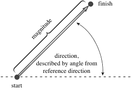

图11.1   用向量描述位移。

现在假设你是拉纳帕，伟大的猛犸象猎人。侦察兵报告说，在西北方向14.1公里处有一群猛犸象。但因为刮东南风，你不想从东南方向接近。于是你向西走10公里，再向北走10公里，从南边接近象群。你知道这两个位移向量会把你带到与那个指向西北的14.1公里向量相同的位置。伟大的猛犸象猎人拉纳帕也知道如何相加向量。


两个向量相加有一个简单的几何解释。首先，画出一个向量。然后，从第一个向量的箭头端点开始，画出第二个向量。最后，从第一个向量的起点画一个向量到第二个向量的终点。这第三个向量表示前两个向量的和（见图11.2）。注意，和的长度可能小于各个长度之和。


向量是运算符重载的自然选择。首先，不能用单个数字表示向量，因此创建一个类来表示向量是合理的。其次，向量与普通算术运算（如加法和减法）有相似之处。这种相似性建议重载相应的运算符，以便可以将它们用于向量。

为了保持简单，在本节中我们将实现一个二维向量，例如屏幕位移，而不是三维向量，例如可能表示直升机或体操运动员的运动。你只需要两个数字来描述一个二维向量，但你可以选择使用哪一组两个数字：

- 你可以用向量的大小（长度）和方向（角度）来描述一个向量。
- 你可以用向量的 x 和 y 分量来表示一个向量。

这些分量是一个水平向量（x 分量）和一个垂直向量（y 分量），它们相加得到最终的向量。例如，你可以将运动描述为将一个点向右移动30个单位并向上移动40个单位（见图11.3）。该运动将该点置于与从水平方向以53.1°角移动50个单位相同的位置。因此，大小为50、角度为53.1°的向量等效于水平分量为30、垂直分量为40的向量。对于位移向量，重要的是起点和终点，而不是到达那里所走的精确路线。这种表示方式的选择基本上与第7章中在直角坐标和极坐标之间转换的程序所涵盖的内容相同。


有时一种形式更方便，有时另一种更方便，因此你会将两种表示都纳入类描述中。（参见本章后面的侧栏“多重表示与类”。）此外，你设计这个类时应做到：如果你改变向量的某一种表示，对象会自动更新另一种表示。能够将这种智能构建到对象中，是 C++ 类的另一个优点。清单11.13给出了一个类声明。为了复习命名空间的知识，该清单将类声明放在 VECTOR 命名空间内。此外，程序使用 enum 创建两个常量（RECT 和 POL），用于标识这两种表示。（我们在第10章介绍了该技术，所以不妨也使用它！）

### 清单11.13 vect.h

```cpp
// vect.h -- Vector class with <<, mode state
#ifndef VECTOR_H_
#define VECTOR_H_
#include <iostream>
namespace VECTOR
{
    class Vector
    {
    public:
        enum Mode {RECT, POL};
    // RECT for rectangular, POL for Polar modes
    private:
        double x;          // horizontal value
        double y;          // vertical value
        double mag;        // length of vector
        double ang;        // direction of vector in degrees
        Mode mode;         // RECT or POL
// private methods for setting values
    void set_mag();
    void set_ang();
    void set_x();
    void set_y();
public:
    Vector();
    Vector(double n1, double n2, Mode form = RECT);
    void reset(double n1, double n2, Mode form = RECT);
    ~Vector();
    double xval() const {return x;}       // report x value
    double yval() const {return y;}       // report y value
    double magval() const {return mag;}   // report magnitude
    double angval() const {return ang;}   // report angle
    void polar_mode();                    // set mode to POL
    void rect_mode();                     // set mode to RECT
// operator overloading
    Vector operator+(const Vector & b) const;
    Vector operator-(const Vector & b) const;
    Vector operator-() const;
    Vector operator*(double n) const;
// friends
    friend Vector operator*(double n, const Vector & a);
    friend std::ostream &
           operator<<(std::ostream & os, const Vector & v);
};
}   // end namespace VECTOR
#endif
```

注意，清单11.13中报告分量值的四个函数定义在类声明中。这自动使它们成为内联函数。这些函数如此简短，使它们成为内联的极佳候选。它们都不应修改对象数据，因此使用 const 修饰符声明。你可能还记得第10章，这是声明不修改其隐式访问对象的函数的语法。清单11.14展示了清单11.13中声明的所有方法和友元函数。该清单利用命名空间的开放性，将方法定义添加到 vector 命名空间中。注意，构造函数和 reset() 函数都分别设置了向量的直角表示和极坐标表示。因此，如果你需要，任一组值都可以立即使用而无需进一步计算。此外，如第4章“复合类型”和第7章所述，C++ 内置数学函数使用弧度表示角度，因此这些函数将度与弧度之间的转换构建到方法中。Vector 类的实现向用户隐藏了诸如从极坐标转换为直角坐标或从弧度转换为度之类的事情。

用户需要知道的就是该类使用角度制，并且它以两种等效表示提供向量。

### 清单11.14 `vect.cpp`

```cpp
// vect.cpp -- methods for the Vector class
#include <cmath>
#include "vect.h"   // includes <iostream>
using std::sqrt;
using std::sin;
using std::cos;
using std::atan;
using std::atan2;
using std::cout;

namespace VECTOR
{
    // compute degrees in one radian
    const double Rad_to_deg = 45.0 / atan(1.0);
    // should be about 57.2957795130823

    // private methods
    // calculates magnitude from x and y
    void Vector::set_mag()
    {
        mag = sqrt(x * x + y * y);
    }

    void Vector::set_ang()
    {
        if (x == 0.0 && y == 0.0)
            ang = 0.0;
        else
            ang = atan2(y, x);
    }

    // set x from polar coordinate
    void Vector::set_x()
    {
        x = mag * cos(ang);
    }

    // set y from polar coordinate
    void Vector::set_y()
    {
        y = mag * sin(ang);
    }

// public methods
Vector::Vector()                 // default constructor
{
    x = y = mag = ang = 0.0;
    mode = RECT;
}

// construct vector from rectangular coordinates if form is r
// (the default) or else from polar coordinates if form is p
Vector::Vector(double n1, double n2, Mode form)
{
    mode = form;
    if (form == RECT)
    {
        x = n1;
        y = n2;
        set_mag();
        set_ang();
    }
    else if (form == POL)
    {
        mag = n1;
        ang = n2 / Rad_to_deg;
        set_x();
        set_y();
    }
    else
    {
        cout << "Incorrect 3rd argument to Vector() -- ";
        cout << "Vector set to 0\n";
        x = y = mag = ang = 0.0;
        mode = RECT;
    }
}

// reset vector from rectangular coordinates if form is
// RECT (the default) or else from polar coordinates if
// form is POL
void Vector::reset(double n1, double n2, Mode form)
{
    mode = form;
    if (form == RECT)
    {
        x = n1;
        y = n2;
        set_mag();
        set_ang();
    }
    else if (form == POL)
    {
        mag = n1;
        ang = n2 / Rad_to_deg;
        set_x();
        set_y();
    }
    else
    {
        cout << "Incorrect 3rd argument to Vector() -- ";
        cout << "vector set to 0\n";
        x = y = mag = ang = 0.0;
        mode = RECT;
    }
}

Vector::~Vector()    // destructor
{
}

void Vector::polar_mode()    // set to polar mode
{
    mode = POL;
}

void Vector::rect_mode()    // set to rectangular mode
{
    mode = RECT;
}

// operator overloading
// add two Vectors
Vector Vector::operator+(const Vector & b) const
{
    return Vector(x + b.x, y + b.y);
}

// subtract Vector b from a
Vector Vector::operator-(const Vector & b) const
{
    return Vector(x - b.x, y - b.y);
}

// reverse sign of Vector
```


```cpp
Vector Vector::operator-() const
{
    return Vector(-x, -y);
}

// multiply vector by n
Vector Vector::operator*(double n) const
{
    return Vector(n * x, n * y);
}

// friend methods
// multiply n by vector a
Vector operator*(double n, const Vector & a)
{
    return a * n;
}

// display rectangular coordinates if mode is RECT,
// else display polar coordinates if mode is POL
std::ostream & operator<<(std::ostream & os, const Vector & v)
{
    if (v.mode == Vector::RECT)
        os << "(x,y) = (" << v.x << ", " << v.y << ")";
    else if (v.mode == Vector::POL)
    {
        os << "(m,a) = (" << v.mag << ", "
           << v.ang * Rad_to_deg << ")";
    }
    else
        os << "Vector object mode is invalid";
    return os;
}
} // end namespace VECTOR
```

你可以用不同方式设计这个类。例如，对象可以只存储直角坐标而不存储极坐标。在这种情况下，极坐标的计算可以移到 `magval()` 和 `angval()` 方法中。对于很少使用转换的应用程序，这可能是一种更高效的设计。另外，`reset()` 方法实际上并不是必需的。假设 `shove` 是一个 Vector 对象，并且你有以下代码：

```cpp
shove.reset(100,300);
```

你可以改用构造函数来获得相同的结果：

```cpp
shove = Vector(100,300);    // create and assign a temporary object
```

然而，`reset()` 方法会直接修改 shove 的内容，而使用构造函数则会增加创建临时对象并将其赋值给 shove 的额外步骤。

这些设计决策遵循面向对象编程（OOP）的传统：让类接口专注于本质（抽象模型），同时隐藏细节。因此，当你使用 Vector 类时，可以思考向量的一般特性，例如它们可以表示位移，并且你可以将两个向量相加。至于你用分量表示法还是用大小、方向表示法来表达一个向量，就变得次要了，因为你可以设置向量的值，并以当时最方便的格式显示它们。

接下来，我们将更详细地了解 Vector 类的一些特性。

## 使用状态成员

Vector 类同时存储一个向量的直角坐标和极坐标。它使用一个名为 mode 的成员来控制构造函数、reset() 方法和重载的 operator<<() 函数使用哪种形式，其中枚举 RECT 表示直角模式（默认），POL 表示极模式。这样的成员被称为状态成员，因为它描述对象所处的状态。要理解这意味着什么，请看构造函数的代码：

```cpp
Vector::Vector(double n1, double n2, Mode form)
{
    mode = form;
    if (form == RECT)
    {
        x = n1;
        y = n2;
        set_mag();
        set_ang();
    }
    else if (form == POL)
    {
        mag = n1;
        ang = n2 / Rad_to_deg;
        set_x();
        set_y();
    }
    else
    {
        cout << "Incorrect 3rd argument to Vector() -- ";
        cout << "vector set to 0\n";
        x = y = mag = ang = 0.0;
        mode = RECT;
    }
}
```

如果第三个参数是 RECT，或者被省略（在这种情况下，原型会赋予默认值 RECT），则输入被解释为直角坐标；而值为 POL 时，输入被解释为极坐标：

```cpp
Vector folly(3.0, 4.0);        // set x = 3, y = 4
Vector foolery(20.0, 30.0, VECTOR::Vector::POL);   // set mag = 20, ang = 30
```

标识符 POL 具有类作用域，因此类定义可以直接使用非限定名。但完全限定名是 `VECTOR::Vector::POL`，因为 POL 定义在 Vector 类中，而 Vector 定义在 VECTOR 命名空间中。注意，如果你提供 x 和 y 值，构造函数会使用私有方法 set_mag() 和 set_ang() 设置大小和角度值；如果你提供大小和角度值，它会使用私有方法 set_x() 和 set_y() 设置 x 和 y 值。还要注意，如果指定了 RECT 或 POL 之外的值，构造函数会发出警告消息并将状态设置为 RECT。

现在，由于第三个参数的类型是 `VECTOR::Vector::Mode`，要把 RECT 或 POL 之外的东西偷偷传给构造函数似乎相当困难。像下面这样的调用无法编译，因为像 2 这样的整数不能隐式转换为枚举类型：

```cpp
Vector rector(20.0, 30.0, 2);   // type mismatch - 2 not an enum type
```

不过，足智多谋又好奇的用户可以尝试类似下面的做法，看看会发生什么：

```cpp
Vector rector(20.0, 30.0, VECTOR::Vector::Mode(2));   // type cast
```

在这种情况下，他会受到警告。

接下来，operator<<() 函数使用 mode 来决定如何显示值：

```cpp
// display rectangular coordinates if mode is RECT,
// else display polar coordinates if mode is POL
std::ostream & operator<<(std::ostream & os, const Vector & v)
{
    if (v.mode == Vector::RECT)
        os << "(x,y) = (" << v.x << ", " << v.y << ")";
    else if (v.mode == Vector::POL)
    {
        os << "(m,a) = (" << v.mag << ", "
            << v.ang * Rad_to_deg << ")";
    }
    else
        os << "Vector object mode is invalid";
    return os;
}
```

因为 `operator<<()` 是友元函数，不属于类作用域，所以它必须使用 `Vector::RECT` 而不是只用 `RECT`。但它位于 `VECTOR` 命名空间中，因此不需要使用完全限定名 `VECTOR::Vector::RECT`。

能够设置 mode 的各种方法都更加谨慎，只接受 RECT 和 POL 作为有效值，因此这个函数中的最后一个 else 应该永远不会被执行到。不过，进行检查通常是个好主意；这样的检查有助于捕获原本难以察觉的编程错误。

## 多种表示与类

具有不同但等价表示的量很常见。例如，你可以像美国那样用英里每加仑来度量汽油消耗量，也可以像欧洲那样用升每 100 公里来度量。你可以用字符串形式或数值形式表示一个数，也可以用智商（IQ）或千火鸡（kiloturkeys）来表示智力。

类非常适合将实体的不同方面和表示包含在单个对象中。首先，你可以在一个对象中存储多种表示。其次，你可以编写类函数，使得为一种表示赋值时自动为另一种（或多种）表示赋值。例如，Vector 类的 `set_polar()` 方法将 mag 和 ang 成员设置为函数参数，但它也会设置 x 和 y 成员。或者，你可以只存储一种表示，并使用方法来提供其他表示。通过在内部处理转换，类可以帮助你从量的本质而不是其表示的角度来思考一个量。

## 为 Vector 类重载算术运算符

使用 x,y 坐标时，将两个向量相加非常简单。你只需将两个 x 分量相加得到答案的 x 分量，并将两个 y 分量相加得到答案的 y 分量。根据这个描述，你可能会想使用以下代码：

```cpp
Vector Vector::operator+(const Vector & b) const
{
    Vector sum;
    sum.x = x + b.x;
    sum.y = y + b.y;
    return sum;        // incomplete version
}
```

如果对象只存储 x 和 y 分量，这样做就没问题。不幸的是，这个版本的代码没有设置极坐标值。你可以通过添加更多代码来修复这个问题：

```cpp
Vector Vector::operator+(const Vector & b) const
{
    Vector sum;
    sum.x = x + b.x;
    sum.y = y + b.y;
    sum.set_ang();
    sum.set_mag();
    return sum;                 // version duplicates needlessly
}
```

但让构造函数来完成这项工作要简单得多，也可靠得多：

```cpp
Vector Vector::operator+(const Vector & b) const
{
    return Vector(x + b.x, y + b.y);      // return the constructed Vector
}
```

在这里，代码将 x 和 y 分量的两个新值交给 Vector 构造函数。然后，构造函数使用这些值创建一个无名的新对象，函数返回该对象的一个副本。这样，你就可以保证新的 Vector 对象是按照你在构造函数中制定的标准规则创建的。

> **提示**
> 
> 如果一个方法需要计算一个新的类对象，你应该看看能否使用类构造函数来完成这项工作。这不仅能省去麻烦，还能确保新对象以正确的方式构造。

## 乘法

从直观上看，将一个向量乘以一个数会使该向量按该因子变长或变短。因此，将一个向量乘以 3 会产生一个长度变为三倍、但仍指向同一方向的向量。很容易将这个图像转换为 Vector 类表示向量的方式。用极坐标来说，你乘以大小，而角度保持不变。用直角坐标来说，将一个向量乘以一个数，就是将其 x 和 y 分量分别乘以该数。也就是说，如果一个向量的分量为 5 和 12，乘以 3 会使分量变为 15 和 36。重载的乘法运算符所做的正是这件事：

```cpp
Vector Vector::operator*(double n) const
{
    return Vector(n * x, n * y);
}
```

与重载加法一样，代码让构造函数根据新的 x 和 y 分量创建正确的 Vector 对象。这处理的是将一个 Vector 值乘以一个 double 值。就像 Time 示例中那样，你可以使用内联友元函数来处理 double 乘以 Vector：

```cpp
Vector operator*(double n, const Vector & a)  // friend function
{
    return a * n;   // convert double times Vector to Vector times double
}
```


## 进一步改进：重载一个已重载的运算符

在普通 C++ 中，- 运算符已经有两种含义。首先，当它与两个操作数一起使用时，它是减法运算符。减法运算符被称为*二元运算符*，因为它恰好有两个操作数。其次，当它与一个操作数一起使用，如 -x，它是负号运算符。这种形式被称为*一元运算符*，意思是它恰好有一个操作数。减法和取负这两种运算对向量来说也都说得通，因此 Vector 类同时具备这两种运算。

要从 Vector A 中减去 Vector B，只需减去各分量，因此重载减法的定义与加法的定义非常相似：

```cpp
Vector operator-(const Vector & b) const;          // prototype
Vector Vector::operator-(const Vector & b) const    // definition
{
    return Vector(x - b.x, y - b.y);  // return the constructed Vector
}
```

这里，获得正确的顺序很重要。考虑下面的语句：

```cpp
diff = v1 - v2;
```

它会被转换为成员函数调用：

```cpp
diff = v1.operator-(v2);
```

这意味着，作为显式参数传入的向量会从隐式向量参数中减去，因此应使用 x - b.x，而不是 b.x - x。

接下来，考虑一元负号运算符，它只接受一个操作数。将这一运算符应用于普通数字（如 -x）会改变该值的符号。因此，将其应用于向量会反转每个分量的符号。更准确地说，该函数应返回一个与原向量方向相反的新向量。（用极坐标来说，取负会使模长保持不变，但会反转方向。许多几乎没有或完全没有受过数学训练的政治家，却对这项操作有着直觉性的掌握。）下面是重载取负运算的原型和定义：

```cpp
Vector operator-() const;
Vector Vector::operator-() const
{
    return Vector(-x, -y);
}
```

注意，现在 operator-() 有两个独立的定义。这没问题，因为这两个定义具有不同的签名。你可以同时定义 - 运算符的二元版本和一元版本，因为 C++ 一开始就提供了该运算符的二元和一元版本。只有二元形式的运算符（例如除法 /）只能重载为二元运算符。

> **注意**
>
> 因为运算符重载是通过函数实现的，所以只要每个运算符函数具有不同的签名，并且每个运算符函数拥有的操作数数量与对应的 C++ 内置运算符相同，就可以多次重载同一个运算符。

## 实现说明

前几节描述的实现会在 Vector 对象中同时存储向量的直角坐标和极坐标。然而，公共接口并不依赖这一事实。接口要求这样做，以便两种表示都能显示，并且各个值都能返回。内部实现可能完全不同。如前所述，对象可以只存储 x 和 y 分量。那么，比如返回向量模长值的 magval() 方法，可以根据 x 和 y 值计算模长，而不是直接查找对象中存储的值。这种方法改变了实现，但保持用户接口不变。这种接口与实现的分离是面向对象编程（OOP）的目标之一。它让你可以微调实现，而无需修改使用该类的程序代码。

这两种实现各有优缺点。存储数据意味着对象占用更多内存，并且每次修改 Vector 对象时，代码都必须小心地同时更新直角坐标和极坐标表示。但数据查找更快。如果应用程序经常需要访问向量的两种表示，那么本示例使用的实现更可取；如果只是偶尔需要极坐标数据，那么另一种实现会更好。你可以选择在一个程序中使用一种实现，在另一个程序中使用第二种实现，同时为两者保留相同的用户接口。

## 让 Vector 类进行一次随机游走

程序清单 11.15 提供了一个使用修订后的 Vector 类的简短程序。它模拟著名的醉汉游走问题。实际上，既然醉酒者现在被认为是患有严重健康问题的人，而不是逗乐的对象，这个问题通常被称为随机游走问题。其想法是，把一个人放在路灯柱旁。这个人开始行走，但每一步的方向都会相对于前一步的方向随机变化。表述这个问题的一种方式是：随机行走者需要走多少步，才能行进到距离灯柱比如 50 英尺远的地方？用向量来说，这相当于不断累加一堆方向随机的向量，直到总和超过 50 英尺。

程序清单 11.15 允许你选择要行进的目标距离以及行走者的步长。它维护一个累计总量，表示每一步之后的位置（以向量表示），并报告达到目标距离所需的步数，以及行走者的位置（两种格式）。你会看到，行走者的前进效率相当低。一段 1,000 步、每步 2 英尺的行程，可能只把行走者带到离起点 50 英尺的地方。该程序将净行进距离（本例中为 50 英尺）除以步数，以提供一种衡量行走者低效程度的指标。所有随机方向变化都使这个平均值远小于单步长度。为了随机选择方向，程序使用了标准库函数 rand()、srand() 和 time()，这些函数将在下面的“程序说明”一节中描述。请务必将程序清单 11.14 与程序清单 11.15 一起编译。

## 程序清单 11.15 randwalk.cpp

```cpp
// randwalk.cpp -- using the Vector class
// compile with the vect.cpp file
#include <iostream>
#include <cstdlib>      // rand(), srand() prototypes
#include <ctime>        // time() prototype
#include "vect.h"
int main()
{
    using namespace std;
    using VECTOR::Vector;
    srand(time(0));     // seed random-number generator
    double direction;
    Vector step;
    Vector result(0.0, 0.0);
    unsigned long steps = 0;
    double target;
    double dstep;
    cout << "Enter target distance (q to quit): ";
    while (cin >> target)
    {
        cout << "Enter step length: ";
        if (!(cin >> dstep))
            break;

        while (result.magval() < target)
        {
            direction = rand() % 360;
            step.reset(dstep, direction, Vector::POL);
            result = result + step;
            steps++;
        }
        cout << "After " << steps << " steps, the subject "
            "has the following location:\n";
        cout << result << endl;
        result.polar_mode();
        cout << " or\n" << result << endl;
        cout << "Average outward distance per step = "
            << result.magval()/steps << endl;
        steps = 0;
        result.reset(0.0, 0.0);
        cout << "Enter target distance (q to quit): ";
    }
    cout << "Bye!\n";
    cin.clear();
    while (cin.get() != '\n')
        continue;
    return 0;
}
```

因为程序有一条将 Vector 引入作用域的 using 声明，所以程序可以使用 Vector::POL，而不是 VECTOR::Vector::POL。

下面是程序清单 11.13、11.14 和 11.15 中程序的一次示例运行：

```
Enter target distance (q to quit): 50
Enter step length: 2
After 253 steps, the subject has the following location:
(x,y) = (46.1512, 20.4902)
or
(m,a) = (50.495, 23.9402)
Average outward distance per step = 0.199587
Enter target distance (q to quit): 50
Enter step length: 2
After 951 steps, the subject has the following location:
(x,y) = (-21.9577, 45.3019)
or
(m,a) = (50.3429, 115.8593)
Average outward distance per step = 0.0529362
Enter target distance (q to quit): 50
Enter step length: 1
After 1716 steps, the subject has the following location:
(x,y) = (40.0164, 31.1244)
or
(m,a) = (50.6956, 37.8755)
Average outward distance per step = 0.0295429
Enter target distance (q to quit): q
Bye!
```

该过程的随机性会使每次试验产生相当大的变化，即使初始条件相同。不过，平均而言，将步长减半会使覆盖给定距离所需的步数变为四倍。概率论表明，平均而言，以长度为 s 的步长达到净距离 D 所需的步数 (N) 由以下公式给出：

N = (D/s)²

这只是一个平均值，但每次试验之间会有相当大的变化。例如，在 1,000 次尝试用 2 英尺步长行进 50 英尺的试验中，平均需要 636 步（接近理论值 625）才能行进那么远，但范围从

91 到 3,951。类似地，在 1,000 次以 1 英尺步幅行走 50 英尺的试验中，平均走了 2,557 步（接近理论值 2,500），范围从 345 到 10,882。所以，如果你发现自己正在随机行走，要有信心并迈开大步。你仍然无法控制最终前进的方向，但至少可以走得更远。

## 程序说明

首先，我们注意到在程序清单 11.15 中使用 `VECTOR` 命名空间是多么轻松。下面的 `using` 声明将 `Vector` 类的名称引入作用域：

```cpp
using VECTOR::Vector;
```

由于所有 Vector 类方法都具有类作用域，因此导入类名也会使 Vector 方法可用，而无需任何进一步的 `using` 声明。

接下来，我们来谈谈随机数。标准 ANSI C 库（随 C++ 一同提供）包含一个 `rand()` 函数，它返回一个从 0 到某个与实现相关的值之间的随机整数。随机行走程序使用模运算符获取一个 0 到 359 之间的角度值。`rand()` 函数通过对初始种子值应用一种算法来获得一个随机值。该值又作为下一次函数调用的种子，依此类推。这些数字实际上是*伪随机*的，因为连续 10 次调用通常会产生同一组 10 个随机数。（具体值取决于实现。）不过，`srand()` 函数允许你覆盖默认的种子值，并开始一个不同的随机数序列。这个程序使用 `time()` 的返回值来设置种子。`time()` 函数返回当前的日历时间，通常实现为自某个特定日期以来的秒数。（更一般地，`time()` 接受一个 `time_t` 类型变量的地址，将时间放入该变量中，同时也返回它。将地址参数设为 0，就无需创建一个原本不需要的 `time_t` 变量。）因此，下面的语句每次运行程序时都会设置一个不同的种子，使随机输出看起来更加随机：

```cpp
srand(time(0));
```

`cstdlib` 头文件（以前是 `stdlib.h`）包含 `srand()` 和 `rand()` 的原型，而 `ctime`（以前是 `time.h`）包含 `time()` 的原型。（C++11 通过 random 头文件支持的函数，提供了更广泛的随机数支持。）

程序使用 result 向量来跟踪行走者的进度。在内层循环的每一轮中，程序将 step 向量设置为一个新方向，并将其加到当前的 result 向量上。当 result 的长度超过目标距离时，循环终止。

通过设置向量模式，程序以直角坐标和极坐标的形式显示最终位置。

顺便提一下，下面的语句会使 `result` 处于 RECT 模式，无论 `result` 和 `step` 的初始模式是什么：

```cpp
result = result + step;
```

原因如下。首先，加法运算符函数创建并返回一个新向量，其中包含两个参数之和。该函数通过使用默认构造函数创建该向量，默认构造函数创建的向量都处于 `RECT` 模式。因此，被赋给 `result` 的向量处于 `RECT` 模式。默认情况下，赋值会逐个成员地赋给每个成员变量，所以 `RECT` 被赋给了 `result.mode`。如果你希望有其他行为，比如让 `result` 保持其原始模式，可以通过为类定义赋值运算符来覆盖默认赋值。第 12 章展示了这方面的示例。

顺便说一下，将连续的位置保存到文件中是一件简单的事。首先，包含 `<fstream>`，声明一个 ofstream 对象，并将该对象与文件关联：

```cpp
#include <fstream>
...
ofstream fout;
fout.open("thewalk.txt");
```

然后，在计算结果的循环中，插入类似下面的代码：

```cpp
fout << result << endl;
```

这会调用友元函数 `operator<<(fout, result)`，使 `os` 引用参数指向 `fout`，从而将输出发送到文件。你也可以使用 `fout` 将其他信息写入文件，比如当前由 `cout` 显示的摘要信息。

## 类的自动转换和类型强制转换

关于类的下一个主题是类型转换。我们将探讨 C++ 如何处理与用户自定义类型之间的转换。为了铺垫，我们先回顾一下 C++ 如何处理其内置类型的转换。当你编写一条将一个标准类型的值赋给另一个标准类型的变量的语句时，如果这两个类型兼容，C++ 会自动将该值转换为接收变量的类型。例如，下面的语句都会产生数值类型转换：

```cpp
long count = 8;      // int value 8 converted to type long
double time = 11;    // int value 11 converted to type double
int side = 3.33;     // double value 3.33 converted to type int
```

这些赋值之所以可行，是因为 C++ 认识到各种数值类型都表示同一个基本事物——数字——并且 C++ 内置了进行转换的规则。不过，回想一下第 3 章“处理数据”中的内容，在这些转换中你可能会损失一些精度。例如，将 `3.33` 赋给 `int` 变量 `side` 后，`side` 得到的值是 3，丢失了 `0.33` 这部分。

C++ 不会自动转换不兼容的类型。例如，下面的语句会失败，因为左边是指针类型，而右边是数字：

```cpp
int * p = 10;  // type clash
```

注意，Stonewt 类有三个构造函数。它们允许你将 Stonewt 对象初始化为一个以浮点数表示的磅数，或者初始化为英石和磅的组合。你也可以创建一个不进行初始化的 Stonewt 对象：

```cpp
Stonewt blossem(132.5);       // weight = 132.5 pounds
Stonewt buttercup(10, 2);     // weight = 10 stone, 2 pounds
Stonewt bubbles;              // weight = default value
```

这个类实际上并不需要声明析构函数，因为自动默认析构函数对于这种情况已经足够。另一方面，提供显式声明可以让你为将来做好准备，那时你将必须定义析构函数。

此外，Stonewt 类提供了两个显示函数。一个以磅为单位显示重量，另一个以英石和磅为单位显示重量。程序清单 11.17 展示了这些类方法的实现。注意，每个构造函数都会给所有三个私有成员赋值。因此，创建 Stonewt 对象会自动设置两种重量表示。

### 程序清单 11.17 stonewt.cpp

```cpp
// stonewt.cpp -- Stonewt methods
#include <iostream>
using std::cout;
#include "stonewt.h"

// construct Stonewt object from double value
Stonewt::Stonewt(double lbs)
{
    stone = int (lbs) / Lbs_per_stn;    // integer division
    pds_left = int (lbs) % Lbs_per_stn + lbs - int(lbs);
    pounds = lbs;
}

// construct Stonewt object from stone, double values
Stonewt::Stonewt(int stn, double lbs)
{
    stone = stn;
    pds_left = lbs;
    pounds = stn * Lbs_per_stn +lbs;
}

Stonewt::Stonewt()          // default constructor, wt = 0
{
    stone = pounds = pds_left = 0;
}

Stonewt::~Stonewt()         // destructor
{
}

// show weight in stones
void Stonewt::show_stn() const
{
    cout << stone << " stone, " << pds_left << " pounds\n";
}

// show weight in pounds
void Stonewt::show_lbs() const
{
    cout << pounds << " pounds\n";
}
```

因为 Stonewt 对象表示一个单独的重量，所以提供将整数或浮点值转换为 Stonewt 对象的方法是合理的。你已经做到了！在 C++ 中，任何只接受一个参数的构造函数都可以作为将该参数类型转换为类类型的蓝图。因此，下面的构造函数可以作为将 double 类型值转换为 Stonewt 类型值的指令：

```cpp
Stonewt(double lbs);  // template for double-to-Stonewt conversion
```

也就是说，你可以编写如下代码：

```cpp
Stonewt myCat;       // create a Stonewt object
myCat = 19.6;        // use Stonewt(double) to convert 19.6 to Stonewt
```

程序使用 Stonewt(double) 构造函数来构造一个临时 Stonewt 对象，并使用 19.6 作为初始化值。然后，逐成员赋值将临时对象的内容复制到 myCat 中。这个过程被称为*隐式转换*，因为它是自动发生的，不需要显式类型强制转换。

只有可以只用一个参数调用的构造函数才能作为转换函数。下面的构造函数有两个参数，因此它不能用于转换类型：

```cpp
Stonewt(int stn, double lbs);  // not a conversion function
```

但是，如果它为第二个参数提供默认值，就可以作为 int 转换的指南：

```cpp
Stonewt(int stn, double lbs = 0);  // int-to-Stonewt conversion
```

让构造函数作为自动类型转换函数似乎是一个很好的特性。然而，随着程序员在使用 C++ 的过程中积累了更多经验，他们发现自动转换这一特性并不总是理想的，因为它可能导致意外的转换。因此，C++ 增加了一个新关键字 `explicit` 来关闭这种自动转换。也就是说，你可以这样声明构造函数：

```cpp
explicit Stonewt(double lbs);  // no implicit conversions allowed
```

这会禁用类似前面示例中的隐式转换，但仍允许显式转换——即使用显式类型强制转换的转换：


```cpp
Stonewt myCat;          // create a Stonewt object
myCat = 19.6;           // not valid if Stonewt(double) is declared as explicit
myCat = Stonewt(19.6);  // ok, an explicit conversion
myCat = (Stonewt) 19.6; // ok, old form for explicit typecast
```

> **注意**
>
> 包含一个参数的 C++ 构造函数定义了一种从参数类型到类类型的类型转换。如果构造函数用关键字 `explicit` 限定，则该构造函数仅用于显式转换；否则，它也会用于隐式转换。

编译器什么时候使用 `Stonewt(double)` 函数？如果声明中使用了关键字 `explicit`，则 `Stonewt(double)` 仅用于显式类型转换；否则，它还会用于以下隐式转换：

- 当你用 `double` 类型的值初始化 `Stonewt` 对象时
- 当你将 `double` 类型的值赋给 `Stonewt` 对象时
- 当你将 `double` 类型的值传递给期望 `Stonewt` 参数的函数时
- 当声明返回 `Stonewt` 值的函数试图返回 `double` 值时
- 当前面任一情形使用可明确转换为 `double` 类型的内置类型时

让我们更详细地看看最后一点。函数原型提供的实参匹配过程让 `Stonewt(double)` 构造函数可以充当其他数值类型的转换。也就是说，下面两条语句都是先把 `int` 转换为 `double`，然后使用 `Stonewt(double)` 构造函数来工作的：

```cpp
Stonewt Jumbo(7000);  // uses Stonewt(double), converting int to double
Jumbo = 7300;         // uses Stonewt(double), converting int to double
```

然而，这种两步转换过程只有在选择明确无歧义时才有效。也就是说，如果该类还定义了 `Stonewt(long)` 构造函数，编译器会拒绝这些语句，并可能指出 `int` 既可转换为 `long` 也可转换为 `double`，因此该调用有歧义。

程序清单 11.18 使用类构造函数来初始化一些 `Stonewt` 对象并处理类型转换。请务必将程序清单 11.17 与程序清单 11.18 一起编译。

### 程序清单 11.18 `stone.cpp`

```cpp
// stone.cpp -- user-defined conversions
// compile with stonewt.cpp
#include <iostream>
using std::cout;
#include "stonewt.h"
void display(const Stonewt & st, int n);
int main()
{
    Stonewt incognito = 275;  // uses constructor to initialize
    Stonewt wolfe(285.7);      // same as Stonewt wolfe = 285.7;
    Stonewt taft(21, 8);

    cout << "The celebrity weighed ";
    incognito.show_stn();
    cout << "The detective weighed ";
    wolfe.show_stn();
    cout << "The President weighed ";
    taft.show_lbs();
    incognito = 276.8;         // uses constructor for conversion
    taft = 325;                // same as taft = Stonewt(325);
    cout << "After dinner, the celebrity weighed ";
    incognito.show_stn();
    cout << "After dinner, the President weighed ";
    taft.show_lbs();
    display(taft, 2);
    cout << "The wrestler weighed even more.\n";
    display(422, 2);
    cout << "No stone left unearned\n";
    return 0;
}

void display(const Stonewt & st, int n)
{
    for (int i = 0; i < n; i++)
    {
        cout << "Wow! ";
        st.show_stn();
    }
}
```

下面是程序清单 11.18 中程序的输出：

```text
The celebrity weighed 19 stone, 9 pounds
The detective weighed 20 stone, 5.7 pounds
The President weighed 302 pounds
After dinner, the celebrity weighed 19 stone, 10.8 pounds
After dinner, the President weighed 325 pounds
Wow! 23 stone, 3 pounds
Wow! 23 stone, 3 pounds
The wrestler weighed even more.
Wow! 30 stone, 2 pounds
Wow! 30 stone, 2 pounds
No stone left unearned
```

## 程序说明

注意，当构造函数只有一个参数时，初始化类对象可以使用以下形式：

```cpp
    // a syntax for initializing a class object when
    // using a constructor with one argument
    Stonewt incognito = 275;
```

这等价于前面展示的另外两种形式：

```cpp
    // standard syntax forms for initializing class objects
    Stonewt incognito(275);
    Stonewt incognito = Stonewt(275);
```

不过，后两种形式也可用于带多个参数的构造函数。

接下来，注意程序清单 11.18 中的以下两个赋值：

```cpp
    incognito = 276.8;
    taft = 325;
```

第一个赋值使用带 double 类型实参的构造函数将 276.8 转换为 Stonewt 类型的值。这将 incognito 的 pounds 成员设置为 276.8。由于它使用了构造函数，这个赋值还会设置该类的 stone 和 pds_left 成员。类似地，第二个赋值将 int 类型的值转换为 double 类型，然后在此过程中使用 Stonewt(double) 设置全部三个成员值。

最后，注意以下函数调用：

```cpp
    display(422, 2);      // convert 422 to double, then to Stonewt
```

display() 的原型表明，它的第一个实参应当是 Stonewt 对象。（Stonewt 或 Stonewt & 形参都能匹配 Stonewt 实参。）面对一个 int 实参时，编译器会寻找 Stonewt(int) 构造函数，以将 int 转换为所需的 Stonewt 类型。若找不到该构造函数，编译器会寻找接受某种其他内置类型的构造函数，而 int 可以转换为该类型。Stonewt(double) 构造函数正好符合要求。因此，编译器将 int 转换为 double，然后使用 Stonewt(double) 将结果转换为 Stonewt 对象。

## 转换函数

程序清单 11.18 将一个数字转换为 Stonewt 对象。你能做相反的操作吗？也就是说，你能将 Stonewt 对象转换为 double 值，如下所示吗？

```cpp
    Stonewt wolfe(285.7);
    double host = wolfe;    // ?? possible ??
```

答案是：可以这样做——但不能通过使用构造函数来实现。构造函数只提供从另一种类型到类类型的转换。要执行相反方向的转换，必须使用一种特殊形式的 C++ 运算符函数，称为转换函数。

转换函数是用户定义的类型转换，你可以像使用类型转换一样使用它们。例如，如果定义了一个从 Stonewt 到 double 的转换函数，就可以使用以下转换：

```cpp
Stonewt wolfe(285.7);        // syntax #1
double host = double (wolfe); // syntax #1
double thinker = (double) wolfe; // syntax #2
```

或者，你可以让编译器自行判断该做什么：

```cpp
Stonewt wells(20, 3);
double star = wells;   // implicit use of conversion function
```

编译器注意到右侧是 Stonewt 类型、左侧是 double 类型，就会检查你是否定义了符合此描述的转换函数。（如果找不到这样的定义，编译器会生成一条错误消息，大意是不能将 Stonewt 赋给 double。）

那么，如何创建转换函数呢？要转换为 typeName 类型，需使用以下形式的转换函数：

```cpp
operator typeName();
```

注意以下几点：

- 转换函数必须是类方法。
- 转换函数不得指定返回类型。
- 转换函数不得有参数。

例如，要转换为 double 类型的函数将具有以下原型：

```cpp
operator double();
```

typeName 部分（在本例中 typeName 是 double）告诉转换函数要转换成哪种类型，因此不需要返回类型。该函数是类方法这一事实意味着它必须由特定的类对象调用，而这就告诉函数要转换哪个值。因此，该函数不需要参数。

因此，要添加将 Stonewt 对象转换为 int 类型和 double 类型的函数，就需要将以下原型添加到类声明中：

```cpp
operator int();
operator double();
```

程序清单 11.19 展示了修改后的类声明。

### 程序清单 11.19 `stonewt1.h`

```cpp
// stonewt1.h -- revised definition for the Stonewt class
#ifndef STONEWT1_H_
#define STONEWT1_H_
class Stonewt
{
```


```cpp
private:
    enum {Lbs_per_stn = 14};      // pounds per stone
    int stone;                    // whole stones
    double pds_left;              // fractional pounds
    double pounds;                // entire weight in pounds
public:
    Stonewt(double lbs);          // construct from double pounds
    Stonewt(int stn, double lbs); // construct from stone, lbs
    Stonewt();                    // default constructor
    ~Stonewt();
    void show_lbs() const;        // show weight in pounds format
    void show_stn() const;        // show weight in stone format
    // conversion functions
    operator int() const;
    operator double() const;
};
#endif
```

清单11.20展示了清单11.18修改后的版本，其中包含这两个转换函数的定义。注意，每个函数都返回所需的值，即使没有声明返回类型。还要注意，int 转换定义会四舍五入到最接近的整数，而不是截断。例如，如果 pounds 为 114.4，那么 pounds + 0.5 为 114.9，而 int (114.9) 为 114。但如果 pounds 为 114.6，pounds + 0.5 为 115.1，而 int (115.1) 为 115。

### 清单 11.20 stonewt1.cpp

```cpp
// stonewt1.cpp -- Stonewt class methods + conversion functions
#include <iostream>
using std::cout;
#include "stonewt1.h"

// construct Stonewt object from double value
Stonewt::Stonewt(double lbs)
{
    stone = int (lbs) / Lbs_per_stn;    // integer division
    pds_left = int (lbs) % Lbs_per_stn + lbs - int(lbs);
    pounds = lbs;
}

// construct Stonewt object from stone, double values
Stonewt::Stonewt(int stn, double lbs)
{
    stone = stn;
    pds_left = lbs;
    pounds = stn * Lbs_per_stn + lbs;
}

Stonewt::Stonewt()          // default constructor, wt = 0
{
    stone = pounds = pds_left = 0;
}

Stonewt::~Stonewt()         // destructor
{
}

// show weight in stones
void Stonewt::show_stn() const
{
    cout << stone << " stone, " << pds_left << " pounds\n";
}

// show weight in pounds
void Stonewt::show_lbs() const
{
    cout << pounds << " pounds\n";
}

// conversion functions
Stonewt::operator int() const
{
    return int (pounds + 0.5);
}

Stonewt::operator double() const
{
    return pounds;
}
```

清单11.21测试了新的转换函数。程序中的赋值语句使用隐式转换，而最后的 `cout` 语句使用显式类型转换。请务必将清单11.20与清单11.21一起编译。

### 清单 11.21 stone1.cpp

```cpp
// stone1.cpp -- user-defined conversion functions
// compile with stonewt1.cpp
#include <iostream>
#include "stonewt1.h"

int main()
{
    using std::cout;
    Stonewt poppins(9,2.8);    // 9 stone, 2.8 pounds
    double p_wt = poppins;      // implicit conversion
    cout << "Convert to double => ";
    cout << "Poppins: " << p_wt << " pounds.\n";
    cout << "Convert to int => ";
    cout << "Poppins: " << int (poppins) << " pounds.\n";
    return 0;
}
```

以下是清单11.19、11.20和11.21中程序的输出，展示了将 Stonewt 类型对象转换为 double 类型和 int 类型的结果：

```text
Convert to double => Poppins: 128.8 pounds.
Convert to int => Poppins: 129 pounds.
```

## 自动应用类型转换

清单11.21在 cout 中使用了 int (poppins)。假设它省略了显式类型转换：

```cpp
cout << "Poppins: " << poppins << " pounds.\n";
```

程序会像下面这条语句一样使用隐式转换吗？

```cpp
double p_wt = poppins;
```

答案是否定的。在 p_wt 示例中，上下文表明 poppins 应转换为 double 类型。但在 cout 示例中，没有任何信息表明转换应转换为 int 还是 double。面对这种信息缺失，编译器会抱怨你使用了有歧义的转换。语句中没有任何内容表明应使用哪种类型。

有趣的是，如果该类只定义了 double 转换函数，编译器会接受该语句。这是因为只有一种可能的转换，不存在歧义。

在赋值时也可能遇到类似情况。按照当前的类声明，编译器会拒绝以下语句，因为它有歧义：

```cpp
long gone = poppins;    // ambiguous
```

在 C++ 中，既可以将 int 值也可以将 double 值赋给 long 变量，因此编译器合理地可以使用任一转换函数。编译器不想承担选择使用哪一个的责任。但如果删除两个转换函数中的一个，编译器就会接受该语句。例如，假设省略 double 定义。那么编译器将使用 int 转换把 poppins 转换为 int 类型值。然后在将其赋给 gone 时，再把 int 值转换为 long 类型。

当类定义了两个或更多转换时，你仍然可以使用显式类型转换来指出要使用哪个转换函数。可以使用以下两种类型转换记法之一：

```cpp
long gone = (double) poppins;  // use double conversion
long gone = int (poppins);     // use int conversion
```

这些语句中的第一条将 poppins 的重量转换为 double 值，然后赋值将 double 值转换为 long 类型。类似地，第二条语句先将 poppins 转换为 int 类型，然后再转换为 long。

与转换构造函数一样，转换函数可能是一把双刃剑。提供进行自动隐式转换的函数的问题在于，它们可能会在你意想不到的时候进行转换。例如，假设你在睡眠不足时碰巧写了以下代码：

```cpp
int ar[20];
...
Stonewt temp(14, 4);
...
int Temp = 1;
...
cout << ar[temp] << "!\n";  // used temp instead of Temp
```

通常，你会期望编译器抓住这种错误，比如使用对象而不是整数作为数组索引。但 Stonewt 类定义了 operator int()，因此 Stonewt 对象 temp 会被转换为 int 200，并被用作数组索引。寓意是，通常最好使用显式转换，并排除隐式转换的可能性。在 C++98 中，关键字 explicit 不能用于转换函数，但 C++11 消除了这一限制。因此，在 C++11 中，可以将转换运算符声明为 explicit：

```cpp
class Stonewt
{
...
// conversion functions
    explicit operator int() const;
    explicit operator double() const;
};
```

有了这些声明后，你将使用类型转换来调用这些运算符。另一种方法是用一个执行相同任务的非转换函数替换转换函数——但仅当显式调用时才执行。也就是说，你可以将

```cpp
Stonewt::operator int() { return int (pounds + 0.5); }
```

替换为

```cpp
int Stonewt::Stone_to_Int() { return int (pounds + 0.5); }
```

这会禁止以下写法：

```cpp
int plb = poppins;
```

但如果你确实需要转换，它允许以下写法：

```cpp
int plb = poppins.Stone_to_Int();
```

> **注意**
>
> 应谨慎使用隐式转换函数。通常，只能显式调用的函数才是最佳选择。

总之，C++ 为类提供了以下类型转换：

- 只有一个参数的类构造函数充当将参数类型的值转换为类类型的指令。例如，当你将 int 类型的值赋给 Stonewt 对象时，会自动调用带有 int 类型参数的 Stonewt 类构造函数。然而，在构造函数声明中使用 `explicit` 会消除隐式转换，只允许显式转换。
- 一种称为*转换函数*的特殊类成员运算符函数，充当将类对象转换为其他类型的指令。转换函数是类成员，没有声明返回类型，没有参数，其名称为 operator `typeName()`，其中 `typeName` 是对象要转换成的类型。当你将类对象赋给该类型的变量，或使用到该类型的类型转换运算符时，会自动调用此转换函数。

## 转换与友元

让我们为 Stonewt 类添加加法。正如在讨论 Time 类时提到的，可以使用成员函数或友元函数来重载加法。（为简化问题，假设没有定义 operator double() 形式的转换函数。）可以使用以下成员函数实现加法：

```cpp
Stonewt Stonewt::operator+(const Stonewt & st) const
{
    double pds = pounds + st.pounds;
    Stonewt sum(pds);
    return sum;
}
```

或者，你可以像这样将加法实现为友元函数：

```cpp
Stonewt operator+(const Stonewt & st1, const Stonewt & st2)
{
    double pds = st1.pounds + st2.pounds;
    Stonewt sum(pds);
    return sum;
}
```

记住，可以提供方法定义或友元定义，但不能同时提供两者。无论采用哪种形式，都可以执行以下操作：

```
Stonewt jennySt(9, 12);
Stonewt bennySt(12, 8);
Stonewt total;
total = jennySt + bennySt;
```

此外，给定 Stonewt (double) 构造函数，每种形式都允许你执行以下操作：

```
Stonewt jennySt(9, 12);
double bennyD = 176.0;
Stonewt total;
total = jennySt + bennyD;
```

但只有友元函数允许你这样做：

```
Stonewt jennySt(9, 12);
double bennyD = 146.0;
Stonewt total;
total = bennyD + jennySt;
```

要明白为什么，你可以将每个加法转换为对应的函数调用。首先，

```
total = jennySt + bennySt;
```

变为

```
total = jennySt.operator+(bennySt);   // member function
```

或者

```
total = operator+(jennySt, bennySt);  // friend function
```

无论哪种情况，实参类型都与形参匹配。此外，成员函数按要求由 Stonewt 对象调用。

接下来，

```
total = jennySt + bennyD;
```

变为

```
total = jennySt.operator+(bennyD);   // member function
```

或者

```
total = operator+(jennySt, bennyD);  // friend function
```

同样，成员函数按要求由 Stonewt 对象调用。这一次，在每种情况下，都有一个参数（bennyD）是 double 类型，这会调用 Stonewt (double) 构造函数将该参数转换为 Stonewt 对象。

顺便说一句，此时如果定义了 operator double() 成员函数，会造成混淆，因为那会为解释提供另一种选择。编译器可以将 jennySt 转换为 double 并执行 double 加法，而不是将 bennyD 转换为 double 并执行 Stonewt 加法。拥有过多的转换函数会产生歧义。

最后，

```
total = bennyD + jennySt;
```

变为

```
total = operator+(bennyD, jennySt);  // friend function
```

这里，两个参数都是 double 类型，这会调用 Stonewt (double) 构造函数将它们转换为 Stonewt 对象。

然而，成员函数版本无法将 jennySt 加到 bennyD 上。将加法语法转换为函数调用会看起来像这样：

```
total = bennyD.operator+(jennySt);  // not meaningful
```

但这是无意义的，因为只有类对象才能调用成员函数。C++ 不会尝试将 bennyD 转换为 Stonewt 对象。转换发生在成员函数参数上，而不是成员函数调用者上。

这里的教训是，将加法定义为友元可以使程序更容易适应自动类型转换。原因是两个操作数都成为函数参数，因此函数原型机制对两个操作数都起作用。

## 实现加法的选择

假设你想将 double 量加到 Stonewt 量上，你有几个选择。第一种，正如你刚才看到的，是将以下内容定义为友元函数，并让 Stonewt (double) 构造函数处理 double 类型参数到 Stonewt 类型参数的转换：

```
operator+(const Stonewt &, const Stonewt &)
```

第二种选择是用显式使用一个 double 类型参数的函数进一步重载加法运算符：

```
Stonewt operator+(double x);  // member function
friend Stonewt operator+(double x, Stonewt & s);
```

这样，以下语句与 operator+(double x) 成员函数完全匹配：

```
total = jennySt + bennyD; // Stonewt + double
```

而以下语句与 operator+(double x, Stonewt & s) 友元函数完全匹配：

```
total = bennyD + jennySt; // double + Stonewt
```

之前，我们对 Vector 乘法做了类似的事情。

每种选择都有优点。第一种选择（依赖隐式转换）会产生更短的程序，因为你定义的函数更少。这也意味着你的工作更少，出错的机会更少。缺点是每当需要转换时调用转换构造函数所需的时间和内存开销增加。然而，第二种选择（显式匹配类型的附加函数）则相反。它使程序更长，你的工作量更多，但运行速度稍快。

如果你的程序大量使用将 double 值加到 `Stonewt` 对象上，那么重载加法以直接处理这种情况可能是值得的。如果程序只是偶尔使用这种加法，那么依赖自动转换更简单，或者如果你想更谨慎，可以依赖显式转换。

## 总结

本章涵盖定义和使用类的许多重要方面。在你自己的经验丰富你的理解之前，本章中的一些材料可能对你来说显得模糊。

通常，访问私有类成员的唯一方法是使用类方法。C++ 通过友元函数缓解了这一限制。要使函数成为友元函数，你在类声明中声明该函数，并在声明前加上关键字 `friend`。

C++ 将重载扩展到运算符，允许你定义特殊的运算符函数，描述特定运算符如何与特定类相关联。运算符函数可以是类成员函数或友元函数。（少数运算符只能是类成员函数。）C++ 允许你通过调用函数或使用重载运算符的通常语法来调用运算符函数。运算符 `op` 的运算符函数具有以下形式：

```
operator<argument-list>
```

`argument-list` 表示运算符的操作数。如果运算符函数是类成员函数，那么第一个操作数是调用对象，不是 `argument-list` 的一部分。例如，本章通过为 `Vector` 类定义 `operator+()` 成员函数来重载加法。如果 up、right 和 result 是三个向量，你可以使用以下任一语句来调用向量加法：

```
result = up.operator+(right);
result = up + right;
```

对于第二个版本，操作数 `up` 和 `right` 是 `Vector` 类型这一事实告诉 C++ 使用 `Vector` 的加法定义。

当运算符函数是成员函数时，第一个操作数是调用该函数的对象。例如，在前面的语句中，`up` 对象是调用对象。如果你希望定义运算符函数使第一个操作数不是类对象，你必须使用友元函数。然后你可以按任意顺序将操作数传递给函数定义。

运算符重载最常见的任务之一是定义 `<<` 运算符，以便它可以与 `cout` 对象一起使用来显示对象的内容。为了让 `ostream` 对象成为第一个操作数，你将运算符函数定义为友元。为了让重新定义的运算符可以与自己连接，你将返回类型设为 `ostream &`。以下是满足这些要求的一般形式：

```
ostream & operator<<(ostream & os, const c_name & obj)
{
    os << ... ;  // display object contents
    return os;
}
```

然而，如果类具有返回你想显示的数据成员值的方法，你可以在 `operator<<( )` 中使用这些方法而不是直接访问。在这种情况下，函数不需要（也不应该）是友元。

C++ 允许你建立到类类型和从类类型的转换。首先，任何接受单个参数的类构造函数都充当转换函数，将参数类型的值转换为类类型。如果你将参数类型的值赋给对象，C++ 会自动调用该构造函数。例如，假设你有一个 `String` 类，其构造函数接受一个 `char *` 值作为唯一参数。那么，如果 `bean` 是一个 `String` 对象，你可以使用以下语句：

```
bean = "pinto";   // converts type char * to type String
```

然而，如果你在构造函数声明前加上关键字 `explicit`，则该构造函数只能用于显式转换：

```
bean = String("pinto");   // converts type char * to type String explicitly
```

要从类转换为另一种类型，你必须定义转换函数并提供如何执行转换的说明。转换函数必须是成员函数。如果它要转换为 `typeName` 类型，则应具有以下原型：

```
operator typeName();
```

注意，它不能有声明的返回类型，不能有参数，并且（尽管没有声明的返回类型）必须返回转换后的值。例如，将 `Vector` 类型转换为 `double` 类型的函数将具有以下函数形式：

```
Vector::operator double()
{
    ...
    return a_double_value;
}
```

经验表明，通常最好不要依赖这种隐式转换函数。

你可能已经注意到，类比简单的 C 风格结构体需要更多的关心和对细节的注意。作为回报，它们为你做的也更多。


### 章节复习

- 1. 使用成员函数为 Stonewt 类重载乘法运算符；让该运算符将数据成员乘以一个 double 类型的值。注意，这需要对 stone–pound 表示进行进位。也就是说，10 英石 8 磅的两倍是 21 英石 2 磅。

- 2. 友元函数和成员函数之间有什么区别？

- 3. 非成员函数必须成为友元才能访问类的成员吗？

- 4. 使用友元函数为 Stonewt 类重载乘法运算符；让该运算符将 double 值乘以 Stone 值。

- 5. 哪些运算符不能重载？

- 6. 重载以下运算符时有什么限制？=、()、[] 和 ->

- 7. 为 Vector 类定义一个转换函数，将 Vector 对象转换为表示该向量大小的 double 类型值。

### 编程练习

- 1. 修改 Listing 11.15，使其将随机行走者的连续位置写入文件。用步数标记每个位置。还要让程序将初始条件（目标距离和步长）以及汇总结果写入文件。文件内容可能如下所示：

```
Target Distance: 100, Step Size: 20
0: (x,y) = (0, 0)
1: (x,y) = (-11.4715, 16.383)
2: (x,y) = (-6.88807, -3.42232)
...
26: (x,y) = (42.2919, -78.2594)
27: (x,y) = (58.6749, -89.7309)
After 27 steps, the object has the following location:
(x,y) = (58.6749, -89.7309)
or
(m,a) = (107.212, -56.8194)
Average outward distance per step = 3.97081
```

- 2. 修改 Vector 类的头文件和实现文件（Listing 11.13 和 11.14），使大小和角度不再作为数据成员存储。相反，它们应在调用 magval() 和 angval() 方法时按需计算。应保持公共接口不变（相同的公共方法和相同的参数），但修改私有部分，包括一些私有方法和方法的实现。用 Listing 11.15 测试修改后的版本；由于 Vector 类的公共接口没有变化，Listing 11.15 应保持不变。

- 3. 修改 Listing 11.15，使其不再报告特定目标/步长组合的单次试验结果，而是报告 N 次试验中的最高、最低和平均步数，其中 N 是用户输入的整数。

- 4. 重写最后的 Time 类示例（Listing 11.10、11.11 和 11.12），使所有重载运算符都使用友元函数实现。

- 5. 重写 Stonewt 类（Listing 11.16 和 11.17），使其有一个状态成员，用于控制对象是按 stone 形式、整数磅形式还是浮点磅形式解释。重载 << 运算符以替代 show_stn() 和 show_lbs() 方法。重载加法、减法和乘法运算符，以便可以对 stonewt 值进行加、减和乘。用一个使用所有类方法和友元的简短程序测试你的类。

- 6. 重写 Stonewt 类（Listing 11.16 和 11.17），使其重载全部六个关系运算符。这些运算符应比较 pounds 成员并返回 bool 类型的值。编写一个程序，声明一个包含六个 Stonewt 对象的数组，并在数组声明中初始化前三个对象。然后应使用循环读入用于设置其余三个数组元素的值。接着应报告最小元素、最大元素，以及有多少个元素大于或等于 11 stone。（最简单的方法是创建一个初始化为 11 stone 的 Stonewt 对象，并将其他对象与该对象进行比较。）

- 7. 复数有两个部分：实部和虚部。表示虚数的一种方式是这样的：(3.0, 4.0)。这里 3.0 是实部，4.0 是虚部。假设 a = (A,Bi)，c = (C,Di)。以下是一些复数运算：

  - 加法：a + c = (A + C, (B + D)i)

  - 减法：a − c = (A − C, (B − D)i)

  - 乘法：a × c = (A × C − B×D, (A×D + B×C)i)

  - 乘法：（x 为实数）：x × c = (x×C, x×Di)

  - 共轭：~a = (A, − Bi)

定义一个 complex 类，使以下程序能够使用它并得到正确结果：

```cpp
#include <iostream>
using namespace std;
#include "complex0.h"  // to avoid confusion with complex.h
int main()
{
    complex a(3.0, 4.0);   // initialize to (3,4i)
    complex c;
    cout << "Enter a complex number (q to quit):\n";
    while (cin >> c)
    {
        cout << "c is " << c << '\n';
        cout << "complex conjugate is " << -c << '\n';
        cout << "a is " << a << '\n';
        cout << "a + c is " << a + c << '\n';
        cout << "a - c is " << a - c << '\n';
        cout << "a * c is " << a * c << '\n';
        cout << "2 * c is " << 2 * c << '\n';
        cout << "Enter a complex number (q to quit):\n";
    }
    cout << "Done!\n";
    return 0;
}
```

注意，你必须重载 << 和 >> 运算符。标准 C++ 已经在 complex 头文件中提供了复数支持——比这个示例中广泛得多——因此使用 complex0.h 以避免冲突。只要合理就使用 const。

下面是该程序的运行示例：

```
Enter a complex number (q to quit):
real: 10
imaginary: 12
c is (10,12i)
complex conjugate is (10,-12i)
a is (3,4i)
a + c is (13,16i)
a - c is (-7,-8i)
a * c is (-18,76i)
2 * c is (20,24i)
Enter a complex number (q to quit):
real: q
Done!
```

注意，通过重载，cin >> c 现在会提示输入实部和虚部。

本页有意留白

## 12 类和动态内存分配

在本章中，你将学习以下内容：

- 为类成员使用动态内存分配
- 隐式和显式复制构造函数
- 隐式和显式重载赋值运算符
- 如果在构造函数中使用 `new`，必须做什么
- 使用 `static` 类成员
- 对对象使用定位 `new`
- 使用指向对象的指针
- 实现队列抽象数据类型（ADT）

本章探讨如何对类使用 `new` 和 `delete`，以及如何处理使用动态内存可能引起的一些微妙问题。这听起来可能只是一小串主题，但这些主题会影响构造函数设计、析构函数设计和运算符重载。

让我们看一个具体示例，了解 C++ 如何增加你的内存负担。假设你想创建一个类，其中有一个成员表示某人的姓氏。最简单、最原始的方法是使用字符数组成员来保存姓名。但这有一些缺点。你可能使用一个 14 字符的数组，然后遇到 Bartholomew Smedsbury-Crawthingham 这样长的名字。或者为了更安全，你可能使用一个 40 字符的数组。但如果你随后创建 2,000 个这样的对象组成的数组，许多字符数组只填充了一部分，会浪费大量内存。（到那时，你就是在增加计算机的内存负担。）还有另一种选择。

通常，在程序运行时而不是编译时决定许多事项（例如使用多少存储空间）要好得多。C++ 中在对象中存储姓名的常用方法是，在类构造函数中使用 `new` 运算符，在程序运行时分配正确数量的内存。实现这一点的常用方法是使用 string 类，它会为你处理内存管理细节。但那样你不会学到更多内存管理知识，所以让我们直接解决这个问题。将 new 引入类构造函数会带来几个新问题，除非你记得采取一系列额外步骤，例如扩展类析构函数、使所有构造函数与新的析构函数协调一致，以及编写额外的类方法以支持正确的初始化和赋值。（当然，本章会解释所有这些步骤。）

### 动态内存和类

下个月的早餐、午餐和晚餐你想吃什么？第 3 天晚餐要喝多少盎司牛奶？第 15 天早餐的麦片里要放多少葡萄干？如果你和大多数人一样，你宁愿把其中一些决定推迟到实际用餐时再做。C++ 中的部分策略就是对内存分配采取同样的态度，让程序在运行时而不是在编译时决定内存。这样，内存使用可以取决于程序的需要，而不是一套僵化的存储单元规则。请记住，为了获得对内存的动态控制，C++ 利用 new 和 delete 运算符。不幸的是，对类使用这些运算符可能带来一些新的编程问题。如你将看到的，析构函数可能变得必不可少，而不再只是装饰。有时你必须重载赋值运算符，才能使程序行为正确。我们现在就来研究这些问题。

### 一个复习示例和静态类成员

我们已经有一段时间没用 new 和 delete 了，所以让我们用一个简短的程序复习它们。顺便也来看看一个新的存储类：静态类成员。载体将是一个 StringBad 类，稍后会被能力稍强的 String 类取代。（你已经见过标准 C++ string 类，并将在第16章“string 类和标准模板库”中学习更多相关内容。同时，本章中简陋的 StringBad 和 String 类可让你深入了解此类类的底层机制。为了提供如此友好的接口，需要运用大量编程技术。）

StringBad 和 String 类的对象将持有一个指向字符串的指针和一个表示字符串长度的值。我们将主要使用 StringBad 和 String 类来深入观察 new、delete 和静态类成员如何运作。因此，构造函数和析构函数在被调用时会显示消息，以便你跟踪操作过程。此外，为了简化类接口，我们将省略几个有用的成员函数和友元函数，例如重载的 ++ 和 >> 运算符以及一个转换函数。（但值得高兴的是！本章的复习题让你有机会添加这些有用的支持函数。）Listing 12.1 展示了类声明。


## 代码清单 12.1 strngbad.h

```cpp
// strngbad.h -- flawed string class definition
#include <iostream>
#ifndef STRNGBAD_H
#define STRNGBAD_H
class StringBad
{
private:
    char * str;             // pointer to string
    int len;                // length of string
    static int num_strings; // number of objects
public:
    StringBad(const char * s); // constructor
    StringBad();              // default constructor
    ~StringBad();             // destructor
// friend function
    friend std::ostream & operator<<(std::ostream & os,
                          const StringBad & st);
};
#endif
```

为什么要将这个类命名为 StringBad？这是为了提醒你：StringBad 是一个开发中的示例。它是使用动态内存分配开发类的第一阶段，并且它把显而易见的事情做对了；例如，它在构造函数和析构函数中正确地使用了 new 和 delete。它并没有真正做坏事，但该设计遗漏了一些必要且完全不明显的额外好做法。看到这个类存在的问题，应该有助于你理解并记住以后将它转换为功能更完整的 String 类时将要进行的不明显改动。

关于这个声明，你应注意两点。第一，它使用指向 char 的指针而不是 char 数组来表示名称。这意味着类声明不会为字符串本身分配存储空间。相反，它在构造函数中使用 new 为字符串分配空间。这种安排避免用预定义的字符串大小限制来束缚类声明。

第二，该定义将 num_strings 成员声明为属于静态存储类。静态类成员有一个特殊性质：无论创建多少个对象，程序都只创建静态类变量的一个副本。也就是说，静态成员在该类的所有对象之间共享，就像电话号码可能由家庭所有成员共享一样。例如，如果创建 10 个 StringBad 对象，就会有 10 个 str 成员和 10 个 len 成员，但只有一个共享的 num_strings 成员（见图 12.1）。对于应当对类私有、但对所有类对象都应具有相同值的数据来说，这很方便。例如，num_strings 成员旨在跟踪已创建对象的数量。

```cpp
// construct StringBad from C string
StringBad::StringBad(const char * s)
{
    len = std::strlen(s);              // set size
    str = new char[len + 1];           // allot storage
    std::strcpy(str, s);               // initialize pointer
    num_strings++;                     // set object count
    cout << num_strings << ": \"" << str
         << "\" object created\n";   // For Your Information
}

StringBad::StringBad()                 // default constructor
{
    len = 4;
    str = new char[4];
    std::strcpy(str, "C++");           // default string
    num_strings++;
    cout << num_strings << ": \"" << str
         << "\" object created\n";     // FYI
}

StringBad::~StringBad()                // necessary destructor
{
    cout << "\"" << str << "\" object deleted, "; // FYI
    --num_strings;                      // required
    cout << num_strings << " left\n";   // FYI
    delete [] str;                      // required
}

std::ostream & operator<<(std::ostream & os, const StringBad & st)
{
    os << st.str;
    return os;
}
```

首先，请注意代码清单 12.2 中的以下语句：

```cpp
int StringBad::num_strings = 0;
```

这条语句将静态成员 num_strings 初始化为 0。注意，不能在类声明内部初始化静态成员变量。这是因为类声明描述内存应如何分配，但并不分配内存。你通过使用该格式创建对象来分配并初始化内存。对于静态类成员，你要在类声明之外用一条单独的语句独立初始化该静态成员。这是因为静态类成员是单独存储的，而不是作为对象的一部分存储。注意，初始化语句给出了类型并使用作用域运算符，但没有使用 static 关键字。该初始化放在方法文件中，而不是类声明文件中。这是因为类声明位于头文件中，而一个程序可能在多个其他文件中包含同一个头文件。那样会导致初始化语句出现多个副本，而这是错误的。

类声明内不初始化静态数据成员这一规则的例外情况（见第 10 章“对象和类”）是：静态数据成员为整型或枚举类型的 const 时。

> **注意**
>
> 静态数据成员在类声明中声明，并在包含类方法的文件中初始化。初始化时使用作用域运算符来指明该静态成员属于哪个类。然而，如果静态成员是 const 整型或枚举类型，则可以在类声明本身中初始化。

接下来，注意每个构造函数都包含表达式 num_strings++。这确保每当程序创建新对象时，共享变量 num_strings 就增加 1，从而跟踪 String 对象的总数。此外，析构函数包含表达式 --num_strings。因此，String 类也会跟踪被删除的对象，使 num_strings 成员的值保持最新。

现在来看代码清单 12.2 中的第一个构造函数，它用常规 C 字符串初始化一个 String 对象：

```cpp
StringBad::StringBad(const char * s)
{
    len = std::strlen(s);          // set size
    str = new char[len + 1];       // allot storage
    std::strcpy(str, s);           // initialize pointer
    num_strings++;                 // set object count
    cout << num_strings << ": \"" << str
         << "\" object created\n"; // For Your Information
}
```

回想一下，类中的 str 成员只是一个指针，因此构造函数必须提供用于保存字符串的内存。初始化对象时，可以将字符串指针传递给构造函数：

```cpp
String boston("Boston");
```

然后，构造函数必须分配足够的内存来保存该字符串，并且必须将该字符串复制到那个位置。让我们一步一步地梳理这个过程。

首先，该函数初始化 len 成员，使用 strlen() 函数计算字符串的长度。接着，它使用 new 分配足够的空间来保存字符串，然后将新内存的地址赋给 str 成员。（回想一下，strlen() 返回字符串的长度，不计结尾空字符，因此构造函数给 len 加 1，以便为字符串（包括空字符）留出空间。）接下来，构造函数使用 `strcpy()` 将传入的字符串复制到新内存中。然后它更新对象计数。最后，为了帮助你监视正在发生的情况，构造函数显示当前对象数量以及对象中存储的字符串。这个特性在以后我们故意让 StringBad 类陷入麻烦时会派上用场。

要理解这种方法，你应认识到字符串并不存储在对象中。字符串单独存储在堆内存中，对象只存储告诉你在哪里找到该字符串的信息。

注意，不要使用下面这种写法：

```cpp
str = s;    // not the way to go
```

这只是存储地址，而没有复制字符串。

默认构造函数的行为类似，只是它提供默认字符串 "C++"。

析构函数包含了这个示例对类处理方式最重要的补充：

```cpp
StringBad::~StringBad()              // necessary destructor
{
    cout << "\"" << str << "\" object deleted, ";    // FYI
    --num_strings;                      // required
    cout << num_strings << " left\n";   // FYI
    delete [] str;                      // required
}
```

析构函数一开始会宣布析构函数何时被调用。这部分提供信息，但并非必需。然而，delete 语句至关重要。回想一下，str 成员指向用 new 分配的内存。当 StringBad 对象过期时，str 指针也会过期。但是，除非使用 delete 释放 str 所指向的内存，否则该内存仍保持已分配状态。删除对象会释放对象本身占用的内存，但不会自动释放曾作为对象成员的指针所指向的内存。为此，必须使用析构函数。通过将 delete 语句放在析构函数中，可以确保构造函数用 new 分配的内存在对象过期时被释放。

## 警告

每当在构造函数中使用 `new` 分配内存时，都应该在对应的析构函数中使用 `delete` 释放该内存。如果使用 `new []`（带方括号），则应使用 `delete []`（带方括号）。

代码清单 12.3 取自 *《每日蔬菜》* 正在开发的一个程序，它说明了 StringBad 构造函数和析构函数在何时以及如何工作。该程序将对象声明放在内层块中，因为当执行离开定义对象的块时，析构函数就会被调用。如果没有内层块，析构函数将在执行离开 `main()` 后被调用，这会在某些环境中导致你无法在执行窗口关闭前看到析构函数消息。请务必将代码清单 12.2 与代码清单 12.3 一起编译。


## 程序清单 12.3　vegnews.cpp

```cpp
// vegnews.cpp -- using new and delete with classes
// compile with strngbad.cpp
#include <iostream>
using std::cout;
#include "strngbad.h"

void callme1(StringBad &);  // pass by reference
void callme2(StringBad);    // pass by value

int main()
{
    using std::endl;
    {
        cout << "Starting an inner block.\n";
        StringBad headline1("Celery Stalks at Midnight");
        StringBad headline2("Lettuce Prey");
        StringBad sports("Spinach Leaves Bowl for Dollars");
        cout << "headline1: " << headline1 << endl;
        cout << "headline2: " << headline2 << endl;
        cout << "sports: " << sports << endl;
        callme1(headline1);
        cout << "headline1: " << headline1 << endl;
        callme2(headline2);
        cout << "headline2: " << headline2 << endl;
        cout << "Initialize one object to another:\n";
        StringBad sailor = sports;
        cout << "sailor: " << sailor << endl;
        cout << "Assign one object to another:\n";
        StringBad knot;
        knot = headline1;
        cout << "knot: " << knot << endl;
        cout << "Exiting the block.\n";
    }
    cout << "End of main()\n";

    return 0;
}

void callme1(StringBad & rsb)
{
    cout << "String passed by reference:\n";
    cout << "    \"" << rsb << "\"\n";
}

void callme2(StringBad sb)
{
    cout << "String passed by value:\n";
    cout << "    \"" << sb << "\"\n";
}
```

> **注意**
>
> 这份StringBad设计的初稿有一些刻意留下的缺陷，导致精确的输出未定义。例如，我使用的一些编译器生成的版本在完成之前就中止了。然而，尽管输出的细节可能不同，但基本的问题和解决方法（很快就会揭示）是相同的。

下面是使用Borland C++ 5.5命令行编译器编译程序清单12.3后产生的输出：

```text
Starting an inner block.
1: "Celery Stalks at Midnight" object created
2: "Lettuce Prey" object created
3: "Spinach Leaves Bowl for Dollars" object created
headline1: Celery Stalks at Midnight
headline2: Lettuce Prey
sports: Spinach Leaves Bowl for Dollars
String passed by reference:
    "Celery Stalks at Midnight"
headline1: Celery Stalks at Midnight
String passed by value:
    "Lettuce Prey"
"Lettuce Prey" object deleted, 2 left
headline2: Düo
Initialize one object to another:
sailor: Spinach Leaves Bowl for Dollars
Assign one object to another:
3: "C++" default object created
knot: Celery Stalks at Midnight
Exiting the block.
"Celery Stalks at Midnight" object deleted, 2 left
"Spinach Leaves Bowl for Dollars" object deleted, 1 left
"Spinach Leaves Bowl for Doll8" object deleted, 0 left
"@" object deleted, -1 left
"-" object deleted, -2 left
End of main()
```

输出中出现的各种非标准字符会因系统而异；它们是StringBad理应被称为bad的标志之一。另一个标志是负的对象计数。较新的编译器/操作系统组合通常会在显示“还剩-1个对象”这一行之前中止程序，其中一些会报告一般保护错误（GPF）。GPF表示程序试图访问被禁止访问的内存位置；这是另一个糟糕的迹象。

## 程序说明

程序清单12.3中的程序开始时运行正常，但随后步履蹒跚地走向一个奇怪且最终灾难性的结局。我们先来看看好的部分。构造函数声明它创建了三个StringBad对象，并为它们编号，程序使用重载的<<运算符将它们列出：

```text
1: "Celery Stalks at Midnight" object created
2: "Lettuce Prey" object created
3: "Spinach Leaves Bowl for Dollars" object created
headline1: Celery Stalks at Midnight
headline2: Lettuce Prey
sports: Spinach Leaves Bowl for Dollars
```

然后程序将headline1传递给callme1()函数，并在调用后重新显示headline1。代码如下：

```cpp
callme1(headline1);
cout << "headline1: " << headline1 << endl;
```

结果如下：

```text
String passed by reference:
    "Celery Stalks at Midnight"
headline1: Celery Stalks at Midnight
```

这段代码看起来也运行良好。

但接下来程序执行以下代码：

```cpp
callme2(headline2);
cout << "headline2: " << headline2 << endl;
```

这里，callme2()按值而不是按引用传递headline2，结果说明了严重的问题：

```text
String passed by value:
    "Lettuce Prey"
"Lettuce Prey" object deleted, 2 left
headline2: D¼°
```

首先，将headline2作为函数参数传递莫名其妙地导致析构函数被调用。其次，尽管按值传递本应保护原始参数不被修改，但该函数把原始字符串弄得面目全非，并显示了一些非标准字符。（显示的确切文本将取决于内存中恰巧存在的内容。）

更糟糕的是，请看当析构函数为早先创建的每个对象自动调用时，输出末尾发生的情况：

```text
Exiting the block.
"Celery Stalks at Midnight" object deleted, 2 left
"Spinach Leaves Bowl for Dollars" object deleted, 1 left
"Spinach Leaves Bowl for Dollars" object deleted, 0 left
```

```text
"@" object deleted, -1 left
"-" object deleted, -2 left
End of main()
```

由于自动存储对象的删除顺序与创建顺序相反，最先删除的三个对象是knot、sailor和sports。knot和sailor的删除看起来正常，但对于sports，Dollars变成了Doll8。程序对sports所做的唯一事情就是用它来初始化sailor，但这似乎已经改变了sports。最后两个被删除的对象headline2和headline1面目全非。在这些字符串被删除之前，有些东西把它们搞乱了。而且计数也很怪异。怎么会有−2个对象剩余呢？

实际上，这种奇特的计数是一个线索。每个对象被构造一次并被销毁一次，因此构造函数的调用次数应该等于析构函数的调用次数。由于对象计数（num_strings）被递减的次数比递增的次数多两次，因此必定有一个不递增num_strings的构造函数在创建两个对象。类定义声明并定义了两个构造函数（二者都会递增num_strings），但事实证明程序使用了三个构造函数！例如，考虑这一行：

```cpp
StringBad sailor = sports;
```

这里使用的是什么构造函数？不是默认构造函数，也不是带有const char *参数的构造函数。请记住，使用这种形式的初始化是下面这种形式的另一种语法：

```cpp
StringBad sailor = StringBad(sports); // constructor using sports
```

因为sports的类型是StringBad，匹配的构造函数可能具有如下原型：

```cpp
StringBad(const StringBad &);
```

事实证明，如果你用一个对象初始化另一个对象，编译器会自动生成这个构造函数（称为复制构造函数，因为它复制对象）。自动版本不知道更新num_strings静态变量，因此会弄乱计数方案。事实上，这个示例所展示的所有问题都源于编译器自动生成的成员函数，所以现在让我们来探讨这个主题。

## 特殊成员函数

StringBad类的问题源于特殊成员函数。这些成员函数是自动定义的。就StringBad而言，这些成员函数的行为并不适合这一特定的类设计。具体来说，C++会自动提供以下成员函数：

- 如果未定义构造函数，则会提供一个默认构造函数
- 如果未定义析构函数，则会提供一个默认析构函数
- 如果未定义复制构造函数，则会提供一个复制构造函数
- 如果未定义赋值运算符，则会提供一个赋值运算符
- 如果未定义地址运算符，则会提供一个地址运算符

更准确地说，如果程序以需要它们的方式使用对象，编译器会为最后三项生成定义。例如，如果你将一个对象赋值给另一个对象，程序会为赋值运算符提供一个定义。

事实证明，隐式复制构造函数和隐式赋值运算符会导致`StringBad`类出现问题。

隐式地址运算符返回调用对象的地址（即`this`指针的值）。这对我们的目的来说没问题，我们不再进一步讨论这个成员函数。默认析构函数什么也不做，我们也不讨论它，只是要指出该类已经提供了一个替代品。但其他几个成员函数确实值得进一步讨论。

C++11还提供了两个特殊的成员函数——*移动构造函数*和*移动赋值运算符*。第18章“新C++标准之旅”将进一步讨论这些内容。

## 默认构造函数

如果你根本没有提供任何构造函数，C++会为你提供一个默认构造函数。例如，假设你定义了一个`Klunk`类，并且省略了任何构造函数。在这种情况下，编译器会提供以下默认构造函数：

```cpp
Klunk::Klunk() { }  // implicit default constructor
```

也就是说，它提供了一个不带参数且什么都不做的构造函数（即*默认化的默认构造函数*）。这是必需的，因为创建对象总是会调用构造函数：

```cpp
Klunk klunk;  // invokes default constructor
```

默认构造函数使`klunk`类似于普通的自动变量；也就是说，它在初始化时的值是未知的。

在你定义了任何构造函数之后，C++就不会再定义默认构造函数。如果你想创建未显式初始化的对象，就必须显式地定义默认构造函数。它是一个不带参数的构造函数，但你可以用它来设置特定的值：

```cpp
Klunk::Klunk()  // explicit default constructor
{
    klunk_ct = 0;
    ...
}
```

带参数的构造函数如果其所有参数都有默认值，则仍然可以是默认构造函数。例如，`Klunk`类可以有如下内联构造函数：

```cpp
Klunk(int n = 0) { klunk_ct = n; }
```


不过，你只能有一个默认构造函数。也就是说，不能这样做：

```cpp
Klunk() { klunk_ct = 0; }      // constructor #1
Klunk(int n = 0) { klunk_ct = n; }   // ambiguous constructor #2
```

为什么这会产生歧义？请考虑下面两个声明：

```cpp
Klunk kar(10);      // clearly matches Klunk(int n)
Klunk bus;           // could match either constructor
```

第二个声明既匹配构造函数 #1（无参数），也匹配构造函数 #2（使用默认参数 0）。这会导致编译器发出错误消息。

## 复制构造函数

复制构造函数用于将一个对象复制到新创建的对象中。也就是说，它用于初始化过程，包括按值传递函数参数；而不会在普通赋值过程中使用。一个类的复制构造函数通常具有如下原型：

```cpp
Class_name(const Class_name &);
```

注意，它将一个类对象的常量引用作为参数。例如，String 类的复制构造函数可以具有如下原型：

```cpp
StringBad(const StringBad &);
```

关于复制构造函数，你必须了解两点：它在什么时候使用，以及它执行什么操作。

## 复制构造函数的使用时机

每当创建一个新对象，并使用同类的现有对象对其进行初始化时，就会调用复制构造函数。这种情况可能在多种场景下发生。最明显的情况是，显式地使用现有对象初始化新对象。例如，假设 `motto` 是一个 StringBad 对象，下面四个定义声明都会调用复制构造函数：

```cpp
StringBad ditto(motto);    // calls StringBad(const StringBad &)
StringBad metoo = motto;   // calls StringBad(const StringBad &)
StringBad also = StringBad(motto);
                          // calls StringBad(const StringBad &)
StringBad * ptrStringBad = new StringBad(motto);
                          // calls StringBad(const StringBad &)
```

具体取决于实现方式，中间的两个声明可能会直接使用复制构造函数来创建 `metoo` 和 `also`，也可能会使用复制构造函数生成临时对象，然后将这些临时对象的内容赋值给 `metoo` 和 `also`。最后一个示例使用 `motto` 初始化一个匿名对象，并将新对象的地址赋给 `ptrStringBad` 指针。

不太明显的是，每当程序生成对象的副本时，编译器也会使用复制构造函数。特别是，当函数按值传递对象时（如示例 12.3 中的 `callme2()`），或者当函数返回对象时，都会使用复制构造函数。请记住，按值传递意味着创建原始变量的副本。每当编译器生成临时对象时，也会使用复制构造函数。例如，在对三个 Vector 对象进行加法运算时，编译器可能会生成一个临时 Vector 对象来保存中间结果。编译器生成临时对象的时机各不相同，但在按值传递对象和返回对象时，都会调用复制构造函数。特别是，示例 12.3 中的以下函数调用会调用复制构造函数：

```cpp
callme2(headline2);
```

程序使用复制构造函数来初始化 `sb`，也就是 `callme2()` 函数的 StringBad 类型形式参数。

顺便说一下，按值传递对象需要调用复制构造函数，这也是应该改用按引用传递的一个重要理由。这样可以节省调用构造函数的时间，以及存储新对象所需的空间。

## 默认复制构造函数的作用

默认复制构造函数会对非静态成员执行逐成员复制（*成员逐一复制*，有时也称为*浅复制*）。每个成员都按值复制。在示例 12.3 中，语句

```cpp
StringBad sailor = sports;
```

等价于下面的语句（不过由于不允许访问私有成员，实际代码无法编译）：

```cpp
StringBad sailor;
sailor.str = sports.str;
sailor.len = sports.len;
```

如果某个成员本身是一个类对象，则会使用该类的复制构造函数，将一个成员对象复制到另一个成员对象中。静态成员（例如 `num_strings`）不会受到影响，因为它们属于整个类，而不是属于某个单独的对象。图 12.2 展示了隐式复制构造函数的工作方式。

## 回到 StringBad：复制构造函数出错的地方

现在，你已经可以理解示例 12.3 中的双重异常了。（假设输出就是示例代码后面所显示的内容。）第一个异常是，程序输出表明被销毁的对象比被构造的对象多两个。原因是，程序确实使用默认复制构造函数创建了两个额外的对象。调用 `callme2()` 函数时，复制构造函数用于初始化形式参数；同时，它还用于将 `sailor` 对象初始化为 `sports` 的副本。默认复制构造函数不会记录自己的操作，因此不会报告对象的创建，也不会递增 `num_strings` 计数器。不过，析构函数会更新计数，并且无论对象以何种方式构造，所有对象消亡时都会调用析构函数。这种异常会造成问题，因为它意味着程序无法准确地统计对象数量。解决方法是提供一个能够更新计数的显式复制构造函数：

```cpp
StringBad::StringBad(const StringBad & s)
{
    num_strings++;
    ...// important stuff to go here
}
```


图 12.2  成员逐一复制的内部示意。

### 提示

如果类中有一个静态数据成员，并且它的值会在创建新对象时发生变化，那么应该提供一个能够处理计数的显式复制构造函数。

第二个异常更加微妙，也更加危险。其中一个症状是字符串内容出现乱码：

```
headline2: Dû°
```

原因在于，隐式复制构造函数是按值复制的。以示例 12.3 为例。请回忆一下，其效果是：

```cpp
sailor.str = sports.str;
```

这并不会复制字符串，而是复制指向字符串的指针。也就是说，在使用 `sports` 初始化 `sailor` 后，最终会得到两个指向同一个字符串的指针。当 `operator<<()` 函数使用该指针显示字符串时，这并不会造成问题。但调用析构函数时，就会出现问题。请记住，StringBad 析构函数会释放 `str` 指针所指向的内存。销毁 `sailor` 的效果如下：

```cpp
delete [] sailor.str;   // delete the string that sports.str points to
```

由于 `sailor.str` 被赋予了 `sports.str` 的值，而 `sports.str` 指向字符串 `"Spinach Leaves Bowl for Dollars"`，因此 `sailor.str` 也指向 `"Spinach Leaves Bowl for Dollars"`。所以，`delete` 语句会释放存储该字符串所占用的内存。

接下来，销毁 `sports` 的效果如下：

```cpp
delete [] sports.str;   // effect is undefined
```

此时，`sports.str` 指向的内存位置已经被 `sailor` 的析构函数释放过了，这会导致未定义且可能有害的行为。在示例 12.3 中，程序会产生乱码字符串，这通常是内存管理不当的表现。

另一个令人担忧的症状是，尝试两次删除同一块内存可能导致程序异常终止。例如，Microsoft Visual C++ 2010（调试模式）会显示一个错误消息窗口，其中写着“调试断言失败！”，而 Linux 上的 g++ 4.4.1 会报告“重复释放或损坏”，然后终止程序。其他系统可能会显示不同的消息，甚至不显示任何消息，但相同的隐患仍然存在于这些程序中。

## 通过定义显式复制构造函数解决问题

解决这种类设计问题的方法是执行*深复制*。也就是说，复制构造函数不应只复制字符串的地址，而应该复制字符串本身，并将副本的地址赋给 `str` 成员。这样，每个对象都会拥有自己的字符串，而不是引用另一个对象的字符串。每次调用析构函数时，也会释放不同的字符串，而不是重复尝试释放同一个字符串。下面是 String 复制构造函数的一种编写方式：

```cpp
StringBad::StringBad(const StringBad & st)
{
    num_strings++;              // handle static member update
    len = st.len;               // same length
    str = new char [len + 1];   // allot space
    std::strcpy(str, st.str);   // copy string to new location


```cpp
cout << num_strings << ": \"" << str
     << "\" object created\n"; // For Your Information
}
```

定义复制构造函数之所以必要，是因为有些类成员是用 new 初始化的指向数据的指针，而不是数据本身。图12.3 展示了深度复制。


图12.3 深度复制内部剖析。

## 注意

如果一个类包含由 `new` 初始化的指针成员，就应该定义一个复制构造函数，复制所指向的数据，而不是复制指针本身。这称为*深度复制*。另一种复制形式（*成员逐个复制*，或称*浅复制*）只复制指针值。浅复制正是如此——为了复制而浅层“刮取”指针信息，而不是进行更深入的“挖掘”来复制指针所指向的结构。

## 更多 `StringBad` 问题：赋值运算符

清单12.3 中的问题并非都能归咎于默认复制构造函数；还必须看看默认赋值运算符。正如 ANSI C 允许结构赋值一样，C++ 允许类对象赋值。它通过为类自动重载一个赋值运算符来实现。该运算符具有以下原型：

```cpp
Class_name & Class_name::operator=(const Class_name &);
```

也就是说，它接受并返回对该类对象的引用。例如，下面是 `StringBad` 类的原型：

```cpp
StringBad & StringBad::operator=(const StringBad &);
```

### 何时使用赋值运算符及其作用

当你把一个对象赋值给另一个已存在的对象时，就会使用重载的赋值运算符：

```cpp
StringBad headline1("Celery Stalks at Midnight");
...
StringBad knot;
knot = headline1;   // assignment operator invoked
```

在初始化对象时，不一定会使用赋值运算符：

```cpp
StringBad metoo = knot; // use copy constructor, possibly assignment, too
```

这里的 metoo 是一个新创建的对象，并用 knot 的值进行初始化；因此使用的是复制构造函数。然而，如前所述，实现可以选择分两步处理这条语句：先用复制构造函数创建一个临时对象，然后用赋值把值复制到新对象。也就是说，初始化总是调用复制构造函数，而使用 `=` 运算符的形式也可能调用赋值运算符。

与复制构造函数类似，赋值运算符的隐式实现执行成员到成员的复制。如果某个成员本身是某个类的对象，程序会使用为该类定义的赋值运算符来复制这个特定成员。静态数据成员不受影响。

因此，`s1.operator=(s2)` 的返回值成为 `s0.operator=()` 函数的实参。由于返回值是对 String 对象的引用，所以它是正确的实参类型。

下面展示了可以如何为 StringBad 类编写赋值运算符：

```cpp
StringBad & StringBad::operator=(const StringBad & st)
{
    if (this == &st)            // object assigned to itself
        return *this;           // all done
    delete [] str;              // free old string
    len = st.len;
    str = new char [len + 1];   // get space for new string
    std::strcpy(str, st.str);   // copy the string
    return *this;               // return reference to invoking object
}
```

首先，代码检查自赋值。它通过查看赋值右侧（st）的地址是否与接收对象（this）的地址相同来完成检查。如果相同，程序返回 *this 并终止。你可能还记得第10章中的内容：赋值运算符是只能由类成员函数重载的运算符之一。

否则，函数继续释放 str 所指向的内存。这样做的原因是，此后不久 str 将被赋予一个新字符串的地址。如果没有先应用 delete 运算符，先前的字符串将留在内存中。由于程序不再有指向旧字符串的指针，那块内存就会被浪费。

接下来，程序像复制构造函数一样继续：为新字符串分配足够的空间，然后把字符串从右侧对象复制到新位置。

完成后，程序返回 *this 并终止。

赋值不会创建新对象，因此不必调整静态数据成员 num_strings 的值。

将前面描述的复制构造函数和赋值运算符添加到 StringBad 类后，所有问题都得到解决。例如，下面是进行这些修改后输出的最后几行：

```
End of main()
*Celery Stalks at Midnight* object deleted, 4 left
*Spinach Leaves Bowl for Dollars* object deleted, 3 left
*Spinach Leaves Bowl for Dollars* object deleted, 2 left
*Lettuce Prey* object deleted, 1 left
*Celery Stalks at Midnight* object deleted, 0 left
```

现在对象计数正确，而且没有任何字符串被破坏。

## 新的、改进的 `String` 类

现在我们稍微聪明了一些，可以修订 `StringBad` 类，并将其重命名为 `String`。首先，添加刚才讨论的复制构造函数和赋值运算符，使该类能够正确管理类对象使用的内存。其次，既然你已经看到对象何时构造和销毁，我们可以让类的构造函数和析构函数保持静默，使它们不再每次使用时都宣告。另外，既然你不再观察构造函数的工作过程，我们可以简化默认构造函数，让它构造一个空字符串而不是 "C++"。

接下来，我们可以为这个类添加一些能力。一个有用的 `String` 类会包含标准 `cstring` 字符串函数库的所有功能，但我们只添加足够观察效果的功能。（请记住，这个 `String` 类只是一个说明性示例，而 C++ 标准 `string` 类要广泛得多。）具体来说，我们将添加以下方法：

```cpp
int length () const { return len; }
friend bool operator<(const String &st, const String &st2);
friend bool operator>(const String &st1, const String &st2);
friend bool operator==(const String &st, const String &st2);
friend istream & operator>>(istream & is, String & st);
char & operator[](int i);
const char & operator[](int i) const;
static int HowMany();
```

第一个新方法返回所存储字符串的长度。接下来的三个友元函数允许你比较字符串。`operator>>()` 函数提供简单的输入能力。两个 `operator[]()` 函数提供对字符串中单个字符的数组表示法访问。静态类方法 `HowMany()` 与静态类数据成员 `num_strings` 相辅相成。让我们看看一些细节。

### 修订后的默认构造函数

新的默认构造函数值得注意。它看起来像这样：

```cpp
String::String()
{
    len = 0;
    str = new char[1];
    str[0] = '\0';             // default string
}
```

你可能想知道为什么代码使用

```cpp
str = new char[1];
```

而不是这样：

```cpp
str = new char;
```

两种形式分配的内存量相同。区别在于，第一种形式与类的析构函数兼容，而第二种不兼容。回想一下，析构函数包含以下代码：

```cpp
delete [] str;
```

使用 `delete []` 与通过 `new []` 初始化的指针以及空指针兼容。因此，另一种可能是将

```cpp
str = new char[1];
str[0] = '\0';             // default string
```

替换为：

```cpp
str = 0; // sets str to the null pointer
```

将 `delete []` 用于以任何其他方式初始化的指针，其效果是未定义的：

```cpp
char words[15] = "bad idea";
char * p1 = words;
char * p2 = new char;
char * p3;
delete [] p1; // undefined, so don't do it
delete [] p2; // undefined, so don't do it
delete [] p3; // undefined, so don't do it
```

> **C++11 空指针**
>
> 在 C++98 中，字面量 0 有两种含义——它可以是数值 0，也可以是空指针——因此读者和编译器很难区分两者。有时程序员使用 `(void *) 0` 来标识指针版本。（空指针本身可能具有非零的内部表示。）其他程序员使用 NULL，这是一个定义为表示空指针的 C 宏。然而，这被证明是不完整的解决方案。C++11 通过引入新关键字 `nullptr` 来表示空指针，提供了更好的解决方案。你仍然可以像以前一样使用 0——否则大量现有代码将失效——但从今以后建议改用 `nullptr`：
>
> ```
> str = nullptr;   // C++11 null pointer notation
> ```

### 比较成员

`String` 类中有三个方法执行比较。如果第一个字符串按字母顺序（更准确地说，按机器排序序列）位于第二个字符串之前，则 `operator<()` 函数返回 true。实现字符串比较函数的最简单方法是使用标准 `strcmp()` 函数；如果它的第一个实参按字母顺序位于第二个之前，则返回负值；如果字符串相同，则返回 0；如果第一个位于第二个之后，则返回正值。因此，可以像这样使用 `strcmp()`：

```cpp
bool operator<(const String &st1, const String &st2)
{
    if (std::strcmp(st1.str, st2.str) < 0)


```cpp
return true;
else
    return false;
}
```

因为内置的 < 运算符已经返回 bool 类型的值，所以你可以进一步将代码简化如下：

```cpp
bool operator<(const String &st1, const String &st2)
{
    return (std::strcmp(st1.str, st2.str) < 0);
}
```

同样，你可以像下面这样编写另外两个比较函数：

```cpp
bool operator>(const String &st1, const String &st2)
{
    return st2 < st1;
}
bool operator==(const String &st1, const String &st2)
{
    return (std::strcmp(st1.str, st2.str) == 0);
}
```

第一个定义用 < 运算符来表达 > 运算符，对于内联函数来说会是一个不错的选择。

将比较函数声明为友元，便于在 String 对象和常规 C 字符串之间进行比较。例如，假设 answer 是一个 String 对象，并且你有如下代码：

```cpp
if ("love" == answer)
```

这会被转换为如下代码：

```cpp
if (operator==("love", answer))
```

然后编译器会使用某个构造函数将代码实际转换为：

```cpp
if (operator==(String("love"), answer))
```

这样就能与原型匹配。

## 使用方括号表示法访问字符

对于标准的 C 风格字符串，你可以使用方括号来访问单个字符：

```cpp
char city[40] = "Amsterdam";
cout << city[0] << endl; // display the letter A
```

在 C++ 中，两个方括号符号构成单个运算符，即方括号运算符，你可以通过名为 operator[]() 的方法重载这个运算符。通常，二元 C++ 运算符（有两个操作数的运算符）会把运算符放在两个操作数之间，例如 2 + 5。但方括号运算符会把一个操作数放在第一个方括号之前，把另一个操作数放在两个方括号之间。因此，在表达式 `city[0]` 中，city 是第一个操作数，`[]` 是运算符，0 是第二个操作数。

假设 opera 是一个 string 对象：

```cpp
String opera("The Magic Flute");
```

如果你使用表达式 `opera[4]`，C++ 会查找具有以下名称和签名的方法：

```cpp
String::operator[](int i)
```

如果找到匹配的原型，编译器会把表达式 `opera[4]` 替换为以下函数调用：

```cpp
opera.operator[](4)
```

opera 对象调用该方法，数组下标 4 成为函数实参。

下面是一个简单的实现：

```cpp
char & String::operator[](int i)
{
    return str[i];
}
```

根据这个定义，语句

```cpp
cout << opera[4];
```

会变成：

```cpp
cout << opera.operator[](4);
```

返回值是 `opera.str[4]`，也就是字符 'M'。因此，这个公有方法提供了对私有数据的访问。

将返回类型声明为 `char &` 类型，允许你为特定元素赋值。例如，你可以使用以下代码：

```cpp
String means("might");
means[0] = 'r';
```

第二条语句会被转换为重载运算符函数调用：

```cpp
means.operator[](0) = 'r';
```

这会把 'r' 赋给该方法的返回值。但该函数返回的是对 `means.str[0]` 的引用，因此这段代码等价于

```cpp
means.str[0] = 'r';
```

最后这行代码违反了私有访问规则，但由于 `operator[]()` 是类方法，因此允许修改数组内容。这段代码的最终效果是 "might" 变成 "right"。

假设你有一个常量对象：

```cpp
const String answer("futile");
```

那么，如果 operator[]() 唯一可用的定义就是你刚才看到的那个，以下代码会被标记为错误：

```cpp
cout << answer[1];  // compile-time error
```

原因是 answer 是 const 的，而该方法没有承诺不修改数据。（事实上，有时方法的工作就是修改数据，因此它不能承诺不修改。）

然而，C++ 在重载时会区分 const 和非 const 函数签名，因此你可以提供第二个版本的 operator[]()，仅供 const String 对象使用：

```cpp
// for use with const String objects
const char & String::operator[](int i) const
{
    return str[i];
}
```

有了这些定义，你就可以对常规 String 对象进行读/写访问，对 const String 数据进行只读访问：

```cpp
String text("Once upon a time");
const String answer("futile");
cout << text[1];      // ok, uses non-const version of operator[]()
cout << answer[1];    // ok, uses const version of operator[]()
cin >> text[1];       // ok, uses non-const version of operator[]()
cin >> answer[1];     // compile-time error
```

## 静态类成员函数

可以将成员函数声明为静态的。（如果函数定义是分开的，关键字 static 应出现在函数声明中，而不是函数定义中。）这有两个重要结果。

首先，静态成员函数不必由对象来调用；事实上，它甚至没有 this 指针可供使用。如果静态成员函数声明在公有部分，则可以使用类名和作用域解析运算符来调用它。例如，你可以给 String 类一个名为 HowMany() 的静态成员函数，并在类声明中使用以下原型/定义：

```cpp
static int HowMany() { return num_strings; }
```

它可以像这样调用：

```cpp
int count = String::HowMany();   // invoking a static member function
```

第二个结果是，由于静态成员函数不与特定对象关联，因此它只能使用静态数据成员。例如，`HowMany()` 静态方法可以访问 `num_strings` 静态成员，但不能访问 `str` 或 `len`。

同样，静态成员函数可用于设置一个类级标志，用来控制类接口某方面的行为。例如，它可以控制某个显示类内容的方法所使用的格式。

## 进一步重载赋值运算符

在查看 String 类示例的新清单之前，让我们先考虑另一个问题。假设你想把一个普通字符串复制到一个 String 对象中。例如，假设你使用 `getline()` 读取一个字符串，并想把它放入一个 String 对象。类方法已经允许你这样做：

```cpp
String name;
char temp[40];
cin.getline(temp, 40);
name = temp;  // use constructor to convert type
```

然而，如果你必须经常这样做，这可能不是一个令人满意的解决方案。为了了解原因，让我们回顾一下最后一条语句是如何工作的：

- 1. 程序使用 `String(const char *)` 构造函数构造一个临时 String 对象，其中包含 `temp` 中所存字符串的副本。请记住，在第 11 章“使用类”中，带单个实参的构造函数充当转换函数。
- 2. 在本章后面的清单 12.6 中，程序使用 `String & String::operator=(const String &)` 函数将信息从临时对象复制到 name 对象。
- 3. 程序调用 `~String()` 析构函数来删除临时对象。

使这个过程更高效的最简单方法是重载赋值运算符，使其直接处理普通字符串。这样就去掉了创建和销毁临时对象的额外步骤。下面是一种可能的实现：

```cpp
String & String::operator=(const char * s)
{
    delete [] str;
    len = std::strlen(s);
    str = new char[len + 1];
    std::strcpy(str, s);
    return *this;
}
```

像往常一样，你必须释放原先由 `str` 管理的内存，并为新字符串分配足够的内存。

清单 12.4 展示了修订后的类声明。除了已经提到的更改之外，它还定义了常量 `CINLIM`，该常量用于实现 `operator>>()`。

### 清单 12.4 string1.h

```cpp
// string1.h -- fixed and augmented string class definition

#ifndef STRING1_H
#define STRING1_H
#include <iostream>
using std::ostream;
using std::istream;

class String
{
private:
    char * str;             // pointer to string
    int len;                // length of string
    static int num_strings; // number of objects
    static const int CINLIM = 80; // cin input limit
public:
// constructors and other methods
    String(const char * s);       // constructor
    String();                     // default constructor
    String(const String &);       // copy constructor
    ~String();                   // destructor
    int length() const { return len; }
// overloaded operator methods
    String & operator=(const String &);
    String & operator=(const char *);
    char & operator[](int i);
    const char & operator[](int i) const;
// overloaded operator friends
    friend bool operator<(const String &st, const String &st2);
    friend bool operator>(const String &st, const String &st2);
    friend bool operator==(const String &st, const String &st2);
    friend ostream & operator<<(ostream & os, const String & st);
    friend istream & operator>>(istream & is, String & st);
// static function
    static int HowMany();
};
#endif
```

清单 12.5 给出了修订后的方法定义。

### 清单 12.5 string1.cpp

```cpp
// string1.cpp -- String class methods
#include <cstring>              // string.h for some
#include "string1.h"            // includes <iostream>
```


```cpp
using std::cin;
using std::cout;

// initializing static class member

int String::num_strings = 0;

// static method
int String::HowMany()
{
    return num_strings;
}

// class methods
String::String(const char * s)        // construct String from C string
{
    len = std::strlen(s);             // set size
    str = new char[len + 1];          // allot storage
    std::strcpy(str, s);              // initialize pointer
    num_strings++;                    // set object count
}

String::String()                      // default constructor
{
    len = 4;
    str = new char[1];
    str[0] = '\0';                    // default string
    num_strings++;
}

String::String(const String & st)
{
    num_strings++;                    // handle static member update
    len = st.len;                     // same length
    str = new char[len + 1];          // allot space
    std::strcpy(str, st.str);         // copy string to new location
}

String::~String()                     // necessary destructor
{
    --num_strings;                    // required
    delete [] str;                    // required
}

// overloaded operator methods

    // assign a String to a String
String & String::operator=(const String & st)
{
    if (this == &st)
        return *this;
    delete [] str;
    len = st.len;
    str = new char[len + 1];
    std::strcpy(str, st.str);
    return *this;
}

// assign a C string to a String
String & String::operator=(const char * s)
{
    delete [] str;
    len = std::strlen(s);
    str = new char[len + 1];
    std::strcpy(str, s);
    return *this;
}

// read-write char access for non-const String
char & String::operator[](int i)
{
    return str[i];
}

// read-only char access for const String
const char & String::operator[](int i) const
{
    return str[i];
}

// overloaded operator friends

bool operator<(const String &st1, const String &st2)
{
    return (std::strcmp(st1.str, st2.str) < 0);
}

bool operator>(const String &st1, const String &st2)
{
    return st2 < st1;
}

bool operator==(const String &st1, const String &st2)
{
    return (std::strcmp(st1.str, st2.str) == 0);
}

    // simple String output
ostream & operator<<(ostream & os, const String & st)
{
    os << st.str;
    return os;
}

    // quick and dirty String input
istream & operator>>(istream & is, String & st)
{
    char temp[String::CINLIM];
    is.get(temp, String::CINLIM);
    if (is)
        st = temp;
    while (is && is.get() != '\n')
        continue;
    return is;
}
```

重载的 >> 运算符提供了一种将一行键盘输入读入 String 对象的简单方法。它假定输入行包含 String::CINLIM 个或更少的字符，并丢弃超过该限制的任何字符。请记住，如果输入因某种原因失败（例如遇到文件结束条件，或者在 get(char *, int) 的情况下读取空行），则 if 条件中的 istream 对象值会计算为 false。

程序清单12.6用一个简短的程序练习 String 类，该程序允许你输入几个字符串。程序让用户输入谚语，将这些字符串放入 String 对象，显示它们，并报告哪个字符串最短以及哪个按字母顺序排在最前。

## 程序清单 12.6 sayings1.cpp

```cpp
// sayings1.cpp -- using expanded String class
// compile with string1.cpp
#include <iostream>
#include "string1.h"
const int ArSize = 10;
const int MaxLen = 81;
int main()
{
    using std::cout;
    using std::cin;
    using std::endl;
    String name;
    cout << "Hi, what's your name?\n> ";
    cin >> name;

    cout << name << ", please enter up to " << ArSize
         << " short sayings <empty line to quit>:\n";
    String sayings[ArSize];      // array of objects
    char temp[MaxLen];            // temporary string storage
    int i;
    for (i = 0; i < ArSize; i++)
    {
        cout << i+1 << ": ";
        cin.get(temp, MaxLen);
        while (cin && cin.get() != '\n')
            continue;
        if (!cin || temp[0] == '\0')   // empty line?
            break;                     // i not incremented
        else
            sayings[i] = temp;  // overloaded assignment
    }
    int total = i;              // total # of lines read

    if (total > 0)
    {
        cout << "Here are your sayings:\n";
        for (i = 0; i < total; i++)
            cout << sayings[i][0] << ": " << sayings[i] << endl;

        int shortest = 0;
        int first = 0;
        for (i = 1; i < total; i++)
        {
            if (sayings[i].length() < sayings[shortest].length())
                shortest = i;
            if (sayings[i] < sayings[first])
                first = i;
        }
        cout << "Shortest saying:\n" << sayings[shortest] << endl;
        cout << "First alphabetically:\n" << sayings[first] << endl;
        cout << "This program used " << String::HowMany()
             << " String objects. Bye.\n";
    }
    else
        cout << "No input! Bye.\n";
    return 0;
}
```

## 注意

较旧版本的 `get(char *, int)` 在读取空行时不会计算为 false。不过，对于这些版本，如果输入了空行，字符串的第一个字符就是空字符。本示例使用以下代码：

```cpp
if (!cin || temp[0] == '\0')    // empty line?
    break;                       // i not incremented
```

如果实现遵循当前 C++ 标准，则 `if` 语句中的第一个测试会检测到空行，而第二个测试会为较旧的实现检测空行。

程序清单12.6中的程序要求用户最多输入10条谚语。每条谚语被读入一个临时字符数组，然后复制到 String 对象中。如果用户输入空行，`break` 语句会终止输入循环。回显输入后，程序使用 `length()` 和 `operator<()` 成员函数来定位最短的字符串和按字母顺序最早的字符串。程序还使用下标运算符（`[]`）在每条谚语前加上其首字符。下面是一次示例运行：

```
Hi, what's your name?
> Misty Gutz
Misty Gutz, please enter up to 10 short sayings <empty line to quit>:
1: a fool and his money are soon parted
2: penny wise, pound foolish
3: the love of money is the root of much evil
4: out of sight, out of mind
5: absence makes the heart grow fonder
6: absinthe makes the hart grow fonder
7:
Here are your sayings:
a: a fool and his money are soon parted
p: penny wise, pound foolish
t: the love of money is the root of much evil
o: out of sight, out of mind
a: absence makes the heart grow fonder
a: absinthe makes the hart grow fonder
Shortest saying:
penny wise, pound foolish
First alphabetically:
a fool and his money are soon parted
This program used 11 String objects. Bye.
```

## 在构造函数中使用 new 时的注意事项

到目前为止，你已经注意到，在使用 new 初始化对象的指针成员时必须特别小心。具体来说，你应该做到以下几点：

- 如果在构造函数中使用 new 初始化指针成员，则应在析构函数中使用 delete。

- new 和 delete 的使用应兼容。你应将 new 与 delete 配对，将 new [] 与 delete [] 配对。

- 如果有多个构造函数，所有构造函数都应以相同方式使用 new——要么全部带方括号，要么全部不带方括号。析构函数只有一个，因此所有构造函数都必须与该析构函数兼容。然而，允许在一个构造函数中用 new 初始化指针，而在另一个构造函数中用空指针（0，或者在 C++11 中为 nullptr）初始化指针，因为对空指针应用 delete 操作（带或不带方括号）是没问题的。

> **NULL、0 还是 nullptr？**
>
> 从历史上看，空指针可以用 0 或 NULL 表示，NULL 是在多个头文件中定义为 0 的符号常量。C 程序员常用 NULL 而不是 0，以此作为视觉提示，表明该值是指针值，就像他们用 '\0' 而不是 0 表示空字符，以此作为视觉提示，表明该值是字符一样。然而，C++ 传统更倾向于使用简单的 0，而不是等价的 NULL。而且，如前所述，C++11 提供了 nullptr 关键字作为更好的替代方案。

- 应定义一个复制构造函数，通过进行深复制来用一个对象初始化另一个对象。通常，该构造函数应仿照以下示例：

```cpp
String::String(const String & st)
{
        num_strings++;          // handle static member update if necessary
        len = st.len;            // same length as copied string
        str = new char [len + 1]; // allot space
        std::strcpy(str, st.str); // copy string to new location
}
```

特别是，复制构造函数应分配空间来保存被复制的数据，并且应复制数据，而不仅仅是数据的地址。它还应该更新其值会受到该过程影响的任何静态类成员。

- 应定义一个赋值运算符，通过进行深复制来将一个对象复制到另一个对象。通常，该类的成员函数应仿照以下示例：

```cpp
String & String::operator=(const String & st)
{
    if (this == &st)          // object assigned to itself
        return *this;          // all done
    delete [] str;             // free old string
    len = st.len;
    str = new char[len + 1];   // get space for new string
    std::strcpy(str, st.str);  // copy the string
    return *this;              // return reference to invoking object
}
```

特别地，该方法应检查自赋值；应释放成员指针此前指向的内存；应复制数据，而不仅仅是数据的地址；并且应返回对调用对象的引用。

## 不该做与该做

下面摘录包含两个不该做的示例和一个良好构造函数的示例：

```cpp
String::String()
{
    str = "default string";    // oops, no new []
    len = std::strlen(str);
}
```

```cpp
String::String(const char * s)
{
    len = std::strlen(s);
    str = new char;              // oops, no []
    std::strcpy(str, s);         // oops, no room
}
```

```cpp
String::String(const String & st)
{
    len = st.len;
    str = new char[len + 1];     // good, allocate space
    std::strcpy(str, st.str);     // good, copy value
}
```

第一个构造函数未能使用 new 初始化 str。析构函数在针对默认对象调用时，会对 str 应用 delete。对未用 new 初始化的指针应用 delete，其结果未定义，但很可能是糟糕的。以下任意一种写法都可以：

```cpp
String::String()
{
    len = 0;
    str = new char[1];  // uses new with []
    str[0] = '\0';
}
```

```cpp
String::String()
{
    len = 0;
    str = 0;    // or, with C++11, str = nullptr;
}
```

```cpp
String::String()
{
    static const char * s = "C++";   // initialized just once
    len = std::strlen(s);
    str = new char[len + 1];          // uses new with []
    std::strcpy(str, s);
}
```

接下来，原始摘录中的第二个构造函数应用了 new，但未能请求正确的内存量；因此，new 返回的块只包含一个字符的空间。试图将更长的字符串复制到该位置，无异于自找内存问题。此外，使用不带方括号的 new 与其他构造函数的正确形式不一致。

第三个构造函数没有问题。

最后，这里有一个无法与前几个构造函数正确配合的析构函数：

```cpp
String::~String()
{
    delete str;        // oops, should be delete [] str;
}
```

该析构函数错误地使用了 delete。由于构造函数请求的是字符数组，析构函数应删除数组。

## 含有类成员的类的按成员复制

假设你使用 String 类，或者同样地，使用标准 string 类，作为类成员的类型：

```cpp
class Magazine
{
private:
    String title;
    string publisher;
...
};
```

String 和 string 都使用动态内存分配。这是否意味着你需要为 Magazine 类编写复制构造函数和赋值运算符？不——至少其本身不需要。默认的按成员复制和赋值行为确实有一些智能之处。如果你将一个 Magazine 对象复制或赋值给另一个 Magazine 对象，按成员复制会使用为成员类型定义的复制构造函数和赋值运算符。也就是说，将使用 String 复制构造函数将一个 Magazine 对象的 title 成员复制到另一个 Magazine 对象，将使用 String 赋值运算符将一个 Magazine 对象的 title 成员赋值给另一个 Magazine 对象，依此类推。然而，如果 Magazine 类需要为某个其他类成员提供复制构造函数和赋值运算符，事情就会变得更复杂。在这种情况下，那些函数必须显式调用 String 和 string 的复制构造函数和赋值运算符。但那是第 13 章“类继承”的话题了。

## 关于返回对象的观察

当成员函数或独立函数返回对象时，你有多种选择。函数可以返回对象的引用、对象的常量引用、对象或常量对象。到现在为止，除了最后一种，你已经见过所有示例，因此现在是回顾这些选项的好时机。

### 返回 const 对象的引用

使用 const 引用的常见原因是效率，但何时可以使用这种选择存在限制。如果函数返回传递给它的对象——无论是通过对象调用还是作为方法参数传递——你可以让该函数返回引用，从而提高方法效率。例如，假设你想编写一个函数 Max()，返回两个 Vector 对象中较大的那个，其中 Vector 是第 11 章开发的类。该函数会这样使用：

```cpp
Vector force1(50,60);
Vector force2(10,70);
Vector max;
max = Max(force1, force2);
```

以下两种实现中的任意一种都可以工作：

```cpp
// version 1
Vector Max(const Vector & v1, const Vector & v2)
{
    if (v1.magval() > v2.magval())
        return v1;
    else
        return v2;
}
```

```cpp
// version 2
const Vector & Max(const Vector & v1, const Vector & v2)
{
    if (v1.magval() > v2.magval())
        return v1;
    else
        return v2;
}
```

这里有三个要点。第一，回想一下，返回对象会调用复制构造函数，而返回引用不会。因此版本 2 做的工作更少，效率更高。第二，引用应指向调用函数执行时存在的对象。在此示例中，引用指向 `force1` 或 `force2`，二者都是调用函数中定义的对象，因此满足该要求。第三，`v1` 和 `v2` 都声明为 const 引用，因此返回类型必须是 const 才能匹配。

### 返回非 const 对象的引用

返回非 const 对象的两个常见示例是重载赋值运算符，以及为与 `cout` 配合使用而重载 `<<` 运算符。前者出于效率原因，后者出于必要性原因。

`operator=()` 的返回值用于链式赋值：

```cpp
String s1("Good stuff");
String s2, s3;
s3 = s2 = s1;
```

在此代码中，`s2.operator=(s1)` 的返回值被赋给 `s3`。返回 `String` 对象或 `String` 对象的引用都可以工作，但正如 `Vector` 示例那样，使用引用可以让函数避免调用 `String` 复制构造函数来创建新的 `String` 对象。在这种情况下，返回类型不是 const，因为 `operator=()` 方法返回对 `s2` 的引用，而它确实会修改 `s2`。

`operator<<()` 的返回值用于链式输出：

```cpp
String s1("Good stuff");
cout << s1 << " is coming!";
```

这里，`operator<<(cout, s1)` 的返回值成为用于显示字符串 "is coming!" 的对象。此处，返回类型必须是 `ostream &`，而不能只是 `ostream`。使用 `ostream` 返回类型将需要调用 `ostream` 复制构造函数，而事实证明，`ostream` 类没有公开的复制构造函数。幸运的是，返回对 `cout` 的引用不会带来问题，因为它在调用函数中已经处于作用域内。

### 返回对象

如果要返回的对象是被调用函数的局部对象，那么不应按引用返回，因为函数终止时会调用该局部对象的析构函数。因此，当控制返回到调用函数时，没有对象可供引用指向。在这些情况下，应返回对象，而不是引用。通常，重载的算术运算符属于这一类。考虑下面这个再次使用 `Vector` 类的示例：

```cpp
Vector force1(50,60);
Vector force2(10,70);
Vector net;
net = force1 + force2;
```

返回的值不是 force1（该过程不应改变它），也不是 force2（它同样不应被改变）。因此，返回值不能是对调用函数中已有对象的引用。相反，和是在 Vector::operator+() 中计算出的新的临时对象，而函数也不应返回对临时对象的引用。相反，它应返回一个实际的 Vector 对象，而不是引用：

```cpp
Vector Vector::operator+(const Vector & b) const
{
    return Vector(x + b.x, y + b.y);
}
```

调用复制构造函数来创建返回对象会带来额外开销，但这是不可避免的。

还有一点观察：在 Vector::operator+() 示例中，构造函数调用 Vector(x + b.x, y + b.y) 创建的对象可供 operator+() 方法访问；然而，return 语句产生的对复制构造函数的隐式调用所创建的对象可供调用程序访问。

### 返回 const 对象

前面给出的 Vector::operator+() 定义有一个奇怪的性质。其预期用法如下：

```cpp
net = force1 + force2;                                      // 1: three Vector objects
```

然而，该定义还允许你使用以下写法：

```cpp
force1 + force2 = net;                                      // 2: dysleptic programming
cout << (force1 + force2 = net).magval() << endl;           // 3: demented programming
```

立刻会产生三个问题：为什么会有人写这样的语句？它们为什么是可能的？它们会做什么？

第一，编写这样的代码没有合理理由，但并非所有代码都是出于合理理由编写的。人，即使是程序员，也会犯错误。例如，如果为 Vector 类定义了比较运算符 operator==()，你可能会误输入

```cpp
if (force1 + force2 = net)
```

而不是：

```cpp
if (force1 + force2 == net)
```

此外，程序员往往很有创造力，而这可能导致很有创造力的冒险性错误。

第二，这段代码之所以可能，是因为复制构造函数构造了一个临时对象来表示返回值。因此在前面的代码中，表达式 force1 + force2 代表那个临时对象。在语句 1 中，临时对象被赋给 net。在语句 2 和 3 中，net 被赋给临时对象。


第三，临时对象被使用后就被丢弃。例如，在语句 2 中，程序计算 `force1` 与 `force2` 的和，将结果复制到临时返回对象中，再用 `net` 的内容覆盖该对象的内容，然后丢弃临时对象。原始向量都保持不变。在语句 3 中，在删除对象之前会显示临时对象的大小。

如果你担心这种行为可能造成误用和滥用，有一个简单的补救办法：将返回类型声明为 `const` 对象。例如，如果声明 `Vector::operator+()` 的返回类型为 `const Vector`，那么语句 1 仍然允许，但语句 2 和语句 3 会变得无效。

总之，如果一个方法或函数返回局部对象，它应返回对象，而不是引用。在这个例子中，程序使用复制构造函数生成返回的对象。如果一个方法或函数返回某个类的对象，而该类没有公有复制构造函数（例如 ostream 类），那么它必须返回对象的引用。最后，有些方法和函数（例如重载赋值运算符）既可以返回对象，也可以返回对象的引用。在这个例子中，出于效率原因，引用更可取。

## 使用指向对象的指针

C++ 程序经常使用指向对象的指针，因此我们来做一点练习。程序清单 12.6 使用数组索引来跟踪最短字符串和按字母顺序排在最前的字符串。另一种方法是使用指针指向这些类别中当前的领先者。程序清单 12.7 实现了这种方法，使用两个指向 String 的指针。最初，shortest 指针指向数组中的第一个对象。每当程序找到一个字符串更短的对象时，它就把 shortest 重置为指向该对象。同样，一个 first 指针跟踪按字母顺序最早的字符串。注意，这两个指针并不创建新对象；它们只是指向现有对象。因此，它们不需要使用 new 来分配额外内存。

为增加变化，程序清单 12.7 中的程序使用了一个确实会跟踪新对象的指针：

`String * favorite = new String(sayings[choice]);`

这里，指针 `favorite` 提供了对由 `new` 创建的无名对象的唯一访问。这种特定语法意味着使用对象 `sayings[choice]` 来初始化新的 String 对象。这会调用复制构造函数，因为复制构造函数的参数类型（`const String &`）与初始化值（`sayings[choice]`）匹配。程序使用 `srand()`、`rand()` 和 `time()` 为 choice 随机选择一个值。

程序清单 12.7   `sayings2.cpp`

```cpp
// sayings2.cpp -- using pointers to objects
// compile with string1.cpp
#include <iostream>
#include <cstdlib>        // (or stdlib.h) for rand(), srand()
#include <ctime>          // (or time.h) for time()
#include "string1.h"
const int ArSize = 10;
const int MaxLen = 81;
int main()
{
    using namespace std;
    String name;
    cout << "Hi, what's your name?\n>> ";
    cin >> name;

    cout << name << ", please enter up to " << ArSize
         << " short sayings <empty line to quit>:\n";
    String sayings[ArSize];
    char temp[MaxLen];                  // temporary string storage
    int i;
    for (i = 0; i < ArSize; i++)
    {
        cout << i+1 << ": ";
        cin.get(temp, MaxLen);
        while (cin && cin.get() != '\n')
            continue;
        if (!cin || temp[0] == '\0') // empty line?
            break;                  // i not incremented
        else
            sayings[i] = temp;       // overloaded assignment
    }
    int total = i;                    // total # of lines read

    if (total > 0)
    {
        cout << "Here are your sayings:\n";
        for (i = 0; i < total; i++)
            cout << sayings[i] << "\n";

        // use pointers to keep track of shortest, first strings
        String * shortest = &sayings[0]; // initialize to first object
        String * first = &sayings[0];
        for (i = 1; i < total; i++)
        {
            if (sayings[i].length() < shortest->length())
                shortest = &sayings[i];
            if (sayings[i] < *first)    // compare values
                first = &sayings[i];     // assign address
        }
        cout << "Shortest saying:\n" << *shortest << endl;
        cout << "First alphabetically:\n" << *first << endl;
        srand(time(0));
        int choice = rand() % total; // pick index at random
        // use new to create, initialize new String object
        String * favorite = new String(sayings[choice]);
        cout << "My favorite saying:\n" << *favorite << endl;
        delete favorite;
    }
    else
        cout << "Not much to say, eh?\n";
    cout << "Bye!\n";
    return 0;
}
```

## 使用 new 进行对象初始化

一般来说，如果 Class_name 是一个类，并且 value 的类型为 Type_name，那么语句

```cpp
Class_name * pclass = new Class_name(value);
```

会调用这个构造函数：

```cpp
Class_name(Type_name);
```

可能会有平凡转换，例如转换为：

```cpp
Class_name(const Type_name &);
```

此外，只要没有歧义，原型匹配所调用的常见转换（例如从 int 到 double）也会发生。以下形式的初始化会调用默认构造函数：

```cpp
Class_name * ptr = new Class_name;
```

下面是程序清单 12.7 中程序的一次示例运行：

```
Hi, what's your name?
>> Kirt Rood
Kirt Rood, please enter up to 10 short sayings <empty line to quit>:
1: a friend in need is a friend indeed
2: neither a borrower nor a lender be
3: a stitch in time saves nine
4: a niche in time saves stine
5: it takes a crook to catch a crook
6: cold hands, warm heart
7:

Here are your sayings:
a friend in need is a friend indeed
neither a borrower nor a lender be
a stitch in time saves nine
a niche in time saves stine
it takes a crook to catch a crook
cold hands, warm heart
Shortest saying:
cold hands, warm heart
First alphabetically:
a friend in need is a friend indeed
My favorite saying:
a stitch in time saves nine
Bye!
```

> 由于程序随机选择最喜欢的说法，即使输入相同，程序的不同运行也会显示不同的选择。

## 再次审视 `new` 和 `delete`

注意，由程序清单 12.4、12.5 和 12.7 生成的程序在两个层面上使用 `new` 和 `delete`。首先，它使用 `new` 为创建的每个对象的名称字符串分配存储空间。这发生在构造函数中，因此析构函数使用 `delete` 释放该内存。由于每个字符串都是字符数组，析构函数使用带方括号的 `delete`。因此，当对象被销毁时，用于存储字符串内容的内存会自动释放。其次，程序清单 12.7 中的代码使用 `new` 分配整个对象：

```cpp
String * favorite = new String(sayings[choice]);
```

这分配的空间不是用于存储字符串，而是用于对象——也就是用于保存字符串地址的 `str` 指针和 `len` 成员。（它不为 `num_strings` 成员分配空间，因为它是静态成员，与对象分开存储。）反过来，创建对象会调用构造函数，构造函数分配用于存储字符串的空间，并将字符串的地址赋给 `str`。然后，程序在不再需要该对象时使用 `delete` 删除它。该对象是单个对象，因此程序使用不带方括号的 `delete`。同样，这只会释放用于保存 `str` 指针和 `len` 成员的空间。它不会释放用于保存 `str` 所指向字符串的内存，但析构函数会完成最后这项任务（见图 12.4）。

再次说明，析构函数会在以下情况下被调用（参见图 12.4）：

- 如果对象是自动变量，那么当程序退出定义该对象的块时，会调用该对象的析构函数。因此，在程序清单 12.3 中，当程序退出 `main()` 时，会为 `headlines[0]` 和 `headlines[1]` 调用析构函数；当程序退出 `callme1()` 时，会为 `grub` 调用析构函数。
- 如果对象是静态变量（外部、静态、静态外部或来自命名空间），那么当程序终止时会调用其析构函数。程序清单 12.3 中的 `sports` 对象就是这种情况。
- 如果对象是由 `new` 创建的，那么只有当你显式对该对象使用 `delete` 时，才会调用其析构函数。


图12.4 调用析构函数。

## 指针与对象小结

使用指向对象的指针时，你应该注意以下几点（总结见图12.5）：

- 使用通常的记法声明指向对象的指针：

```cpp
String * glamour;
```

- 可以初始化指针，使其指向已有对象：

```cpp
String * first = &sayings[0];
```

- 可以使用 `new` 初始化指针。下面的语句创建一个新对象：

```cpp
String * favorite = new String(sayings[choice]);
```

关于使用 `new` 初始化指针的示例的更详细说明，另见图12.6。

- 对类使用 `new` 时，会调用相应的类构造函数来初始化新创建的对象：

```cpp
// invokes default constructor
String * gleep = new String;

// invokes the String(const char *) constructor
String * glop = new String("my my my");

// invokes the String(const String &) constructor
String * favorite = new String(sayings[choice]);
```

- 使用 `->` 运算符通过指针访问类方法：

```cpp
if (sayings[i].length() < shortest->length())
```

- 对指向对象的指针应用解引用运算符（`*`）以获得对象：

```cpp
if (sayings[i] < *first)  // compare object values
    first = &sayings[i];  // assign object address
```

| 描述 | 示例 |
|---|---|
| 声明指向类对象的指针： | `String * glamour;` |
| 初始化指针，使其指向已有对象： | `String * first = &sayings[0];` |
| 使用 `new` 和默认类构造函数初始化指针： | `String * gleep = new String;` |
| 使用 `new` 和 `String(const char*)` 类构造函数初始化指针： | `String * glop = new String("my my my");` |
| 使用 `new` 和 `String(const String &)` 类构造函数初始化指针： | `String * favorite = new String(sayings[choice]);` |
| 使用 `->` 运算符通过指针访问类方法： | `if (sayings[i].length() < shortest->length())`（标注：`object`；`pointer to object`） |
| 使用 `*` 解引用运算符从指针获得对象： | `if (sayings[i] < *first)`（标注：`object`；`pointer to object`） |

图12.5 指针与对象。


图12.6 使用 new 创建对象。

## 再次审视 placement new

回想一下，placement new 允许你指定用于分配内存的内存位置。第9章“内存模型和命名空间”在内置类型的上下文中讨论了 placement new。将 placement new 与对象一起使用会带来一些新的变化。清单12.8同时使用 placement new 和常规 new 为对象分配内存。它定义了一个带有醒目构造函数和析构函数的类，以便你可以跟踪对象的生命历程。

### 清单 12.8 `placenew1.cpp`

```cpp
// placenew1.cpp -- new, placement new, no delete
#include <iostream>
#include <string>
#include <new>
using namespace std;
const int BUF = 512;

class JustTesting
{
private:
    string words;
    int number;
public:
    JustTesting(const string & s = "Just Testing", int n = 0)
    {words = s; number = n; cout << words << " constructed\n"; }
    ~JustTesting() { cout << words << " destroyed\n"; }
    void Show() const { cout << words << ", " << number << endl; }
};
int main()
{
    char * buffer = new char[BUF];        // get a block of memory

    JustTesting *pc1, *pc2;

    pc1 = new (buffer) JustTesting;       // place object in buffer
    pc2 = new JustTesting("Heap1", 20);   // place object on heap

    cout << "Memory block addresses:\n" << "buffer: "
        << (void *) buffer << "    heap: " << pc2 <<endl;
    cout << "Memory contents:\n";
    cout << pc1 << ": ";
    pc1->Show();
    cout << pc2 << ": ";
    pc2->Show();

    JustTesting *pc3, *pc4;
    pc3 = new (buffer) JustTesting("Bad Idea", 6);
    pc4 = new JustTesting("Heap2", 10);

    cout << "Memory contents:\n";
    cout << pc3 << ": ";
    pc3->Show();
    cout << pc4 << ": ";
    pc4->Show();

    delete pc2;                           // free Heap1
    delete pc4;                           // free Heap2
    delete [] buffer;                     // free buffer
    cout << "Done!\n";
    return 0;
}
```

清单12.8中的程序使用 `new` 创建一个512字节的内存缓冲区。然后使用 `new` 在堆上创建两个 `JustTesting` 类型的对象，并尝试使用 placement `new` 在该内存缓冲区中创建两个 `JustTesting` 类型的对象。最后，它使用 `delete` 释放由 `new` 分配的内存。输出如下：

```text
Just Testing constructed
Heap1 constructed
Memory block addresses:
buffer: 00320AB0    heap: 00320CE0
Memory contents:
00320AB0: Just Testing, 0
00320CE0: Heap1, 20
Bad Idea constructed
Heap2 constructed
Memory contents:
00320AB0: Bad Idea, 6
00320CE8: Heap2, 10
Heap1 destroyed
Heap2 destroyed
Done!
```

和往常一样，内存地址的格式和确切值会因系统而异。

清单12.8中使用的 placement `new` 存在几个问题。首先，创建第二个对象时，placement `new` 只是用新对象覆盖用于第一个对象的同一位置。这不仅无礼，还意味着从未为第一个对象调用析构函数。当然，如果类为其成员使用动态内存分配，这会造成真正的问题。

其次，对 `pc2` 和 `pc4` 使用 `delete` 会自动调用 `pc2` 和 `pc4` 所指向的两个对象的析构函数。但是，对 `buffer` 使用 `delete []` 不会调用由 placement `new` 创建的对象的析构函数。

这里要吸取的一个教训与第9章学到的教训相同：管理 placement `new` 填充的缓冲区中的内存位置是你自己的责任。要使用两个不同的位置，你需要在缓冲区内提供两个不同的地址，并确保这些位置不重叠。例如，你可以使用：

```cpp
pc1 = new (buffer) JustTesting;
pc3 = new (buffer + sizeof (JustTesting)) JustTesting("Better Idea", 6);
```

这里，指针 `pc3` 相对于 `pc1` 偏移了一个 `JustTesting` 对象的大小。

这里要吸取的第二个教训是，如果你使用 placement `new` 存储对象，你需要安排调用它们的析构函数。但如何做到呢？对于在堆上创建的对象，你可以使用：

```cpp
delete pc2;    // delete object pointed to by pc2
```

但你不能使用：

```cpp
delete pc1;  // delete object pointed to by pc1? NO!
delete pc3;  // delete object pointed to by pc3? NO!
```

原因是 `delete` 与 `new` 配合工作，但不与 placement `new` 配合工作。例如，指针 `pc3` 并没有接收由 `new` 返回的地址，因此 `delete pc3` 会引发运行时错误。另一方面，指针 `pc1` 与 `buffer` 具有相同的数值，但 `buffer` 是使用 `new []` 初始化的，因此要用 `delete []` 而不是 `delete` 来释放。即使 `buffer` 是由 `new` 而不是 `new []` 初始化的，`delete pc1` 也会释放 `buffer`，而不是 `pc1`。这是因为 `new`/`delete` 系统知道所分配的512字节块，但它对 placement `new` 对该块做了什么一无所知。

注意，该程序确实释放了缓冲区：

```cpp
delete [] buffer;                    // free buffer
```

正如这条注释所暗示的，`delete [] buffer;` 删除由 `new` 分配的整个内存块。但它不会调用 placement `new` 在该块中构造的任何对象的析构函数。你可以看出确实如此，因为该程序使用了爱说话的析构函数，它们报告了“Heap1”和“Heap2”的消亡，但对“Just Testing”和“Bad Idea”保持沉默。

这个困境的解决办法是，你必须为 placement `new` 创建的任何对象显式调用析构函数。通常，析构函数会自动调用；这是需要显式调用的少数情况之一。显式调用析构函数需要标识要销毁的对象。由于有指向这些对象的指针，你可以使用这些指针：

```cpp
pc3->~JustTesting();  // destroy object pointed to by pc3
pc1->~JustTesting();  // destroy object pointed to by pc1
```

清单12.9通过管理 placement `new` 使用的内存位置，并添加适当的 `delete` 用法和显式析构函数调用，修正了清单12.8。一个重要的事实是删除的正确顺序。由 placement `new` 构造的对象应按与其构造顺序相反的顺序销毁。原因在于，原则上，后一个对象可能依赖于前一个对象。并且，用于存放对象的缓冲区应仅在所有包含的对象都被销毁之后才释放。

### 清单 12.9 `placenew2.cpp`

```cpp
// placenew2.cpp -- new, placement new, no delete
#include <iostream>
#include <string>
#include <new>
using namespace std;
const int BUF = 512;

class JustTesting
{
```


```cpp
private:
    string words;
    int number;
public:
    JustTesting(const string & s = "Just Testing", int n = 0)
    {words = s; number = n; cout << words << " constructed\n"; }
    ~JustTesting() { cout << words << " destroyed\n";}
    void Show() const { cout << words << ", " << number << endl;}
};
int main()
{
    char * buffer = new char[BUF];       // 获取一块内存

    JustTesting *pc1, *pc2;

    pc1 = new (buffer) JustTesting;      // 在缓冲区中放置对象
    pc2 = new JustTesting("Heap1", 20); // 在堆上放置对象

    cout << "Memory block addresses:\n" << "buffer: "
         << (void *) buffer << "    heap: " << pc2 << endl;
    cout << "Memory contents:\n";
    cout << pc1 << ": ";
    pc1->Show();
    cout << pc2 << ": ";
    pc2->Show();

    JustTesting *pc3, *pc4;
// 修正定位 new 的位置
    pc3 = new (buffer + sizeof (JustTesting))
              JustTesting("Better Idea", 6);
    pc4 = new JustTesting("Heap2", 10);

    cout << "Memory contents:\n";
    cout << pc3 << ": ";
    pc3->Show();
    cout << pc4 << ": ";
    pc4->Show();

    delete pc2;           // 释放 Heap1
    delete pc4;           // 释放 Heap2
// 显式销毁定位 new 创建的对象
    pc3->~JustTesting();  // 销毁 pc3 指向的对象
    pc1->~JustTesting();  // 销毁 pc1 指向的对象
    delete [] buffer;     // 释放缓冲区
    cout << "Done\n";
    return 0;
}
```

以下是清单 12.9 中程序的输出：

```text
Just Testing constructed
Heap1 constructed
Memory block addresses:
buffer: 00320AB0    heap: 00320CE0
Memory contents:
00320AB0: Just Testing, 0
00320CE0: Heap1, 20
Better Idea constructed
Heap2 constructed
Memory contents:
00320AD0: Better Idea, 6
00320EC8: Heap2, 10
Heap1 destroyed
Heap2 destroyed
Better Idea destroyed
Just Testing destroyed
Done
```

清单 12.9 中的程序将两个定位 new 对象放置在相邻位置，并调用了恰当的析构函数。

## 技巧回顾

到目前为止，你已经接触了多种用于处理各种类相关问题的编程技巧，可能会发现自己很难记住所有这些技巧。因此，以下各节将总结若干技巧及其适用场景。

### 重载 << 运算符

要重新定义 << 运算符，以便使用 `cout` 显示对象的内容，你需要定义一个友元运算符函数，其形式如下：

```cpp
ostream & operator<<(ostream & os, const c_name & obj)
{
    os << ... ;  // 显示对象内容
    return os;
}
```

这里 `c_name` 表示类名。如果类提供了返回所需内容的公有方法，就可以在运算符函数中使用这些方法，而不必将其声明为友元。

### 转换函数

要将单个值转换为类类型，可以创建一个类构造函数，其原型如下：

```cpp
c_name(type_name value);
```

这里 c_name 表示类名，type_name 表示要转换的类型名称。

要将类类型转换为其他类型，可以创建一个类成员函数，其原型如下：

```cpp
operator type_name();
```

虽然此函数没有声明返回类型，但它应返回所需类型的值。

请谨慎使用转换函数。声明构造函数时，可以使用关键字 `explicit`，以防止它被用于隐式转换。

### 使用 new 的类的构造函数

设计使用 new 运算符为类成员指向的内存分配空间的类时，需要采取若干预防措施（是的，我们不久前刚总结过这些注意事项，但务必牢记这些规则，尤其是编译器并不知道它们，因此不会替你发现错误）：

- 任何指向由 `new` 分配的内存的类成员，都应在类析构函数中对其应用 `delete` 运算符，以释放已分配的内存。
- 如果析构函数通过对类成员指针应用 `delete` 来释放内存，那么该类的每个构造函数都应初始化这个指针，可以使用 `new`，也可以将指针设为空指针。
- 构造函数应统一使用 `new []` 或 `new`，不能混用。如果构造函数使用 `new []`，析构函数就应使用 `delete []`；如果构造函数使用 `new`，析构函数就应使用 `delete`。
- 应定义一个复制构造函数，为对象分配新内存，而不是复制指向现有内存的指针。这样程序就能用一个类对象初始化另一个类对象。该构造函数通常具有以下原型：

  `className(const className &)`

- 应定义一个类成员函数来重载赋值运算符，其函数定义具有以下原型（其中 `c_pointer` 是 `c_name` 类的成员，类型为指向 type_name 的指针）。以下示例假设构造函数使用 `new []` 初始化变量 `c_pointer`：

    ```cpp
    c_name & c_name::operator=(const c_name & cn)
    {
        if (this == & cn)
            return *this;       // 自我赋值时直接返回
        delete [] c_pointer;
        // 设置要复制的 type_name 单元数量
        c_pointer = new type_name[size];
        // 然后将 cn.c_pointer 指向的数据复制到
        // c_pointer 指向的位置
        ...
        return *this;
    }
    ```

## 队列模拟

让我们运用对类的深入理解来解决一个编程问题。Heather 银行计划在 Food Heap 超市开设一台自动柜员机（ATM）。Food Heap 的管理层担心 ATM 前的排队会影响超市内的交通流动，因此可能会限制在 ATM 前排队的人数。Heather 银行方面则希望估算顾客需要排多久的队。你的任务是编写一个程序来模拟这种情况，让管理层了解 ATM 可能带来的影响。

用顾客队列来表示这个问题，是一种很自然的方式。队列是一种抽象数据类型（ADT），用于保存按顺序排列的一系列项目。新项目从队尾加入，项目则从队首移除。队列有点像栈，只不过栈从同一端添加和移除项目。因此，栈是一种后进先出（LIFO）结构，而队列是一种先进先出（FIFO）结构。从概念上说，队列就像收银台或 ATM 前的队伍，因此非常适合这个任务。项目的一部分就是定义一个 Queue 类。（第 16 章将介绍标准模板库中的 queue 类，不过，自己动手实现一个类，比单纯阅读相关内容能学到更多。）

队列中的项目是顾客。Heather 银行的一位代表告诉你，平均而言，三分之一的顾客需要一分钟处理，三分之一需要两分钟，另外三分之一需要三分钟。此外，顾客随机到达，但每小时顾客的平均数量相当稳定。项目的另外两部分是设计一个表示顾客的类，并编写一个程序来模拟顾客与队列之间的交互（见图 12.7）。


图 12.7 队列。

### Queue 类

首先要做的是设计一个 Queue 类。首先，需要列出所需队列的属性：

- 队列保存按顺序排列的一系列项目。
- 队列可以容纳的项目数量有限。
- 应能够创建一个空队列。
- 应能够检查队列是否为空。
- 应能够检查队列是否已满。
- 应能够向队尾添加项目。
- 应能够从队首移除项目。
- 应能够确定队列中的项目数量。

像往常一样，设计类时需要制定公有接口和私有实现。

### Queue 类接口

上一节列出的队列属性表明，队列类可以采用以下公有接口：


```cpp
class Queue
{
    enum {Q_SIZE = 10};
private:
    // private representation to be developed later
public:
    Queue(int qs = Q_SIZE); // create queue with a qs limit
    ~Queue();
    bool isempty() const;
    bool isfull() const;
    int queuecount() const;
    bool enqueue(const Item &item); // add item to end
    bool dequeue(Item &item);       // remove item from front
};
```

构造函数创建一个空队列。默认情况下，队列最多可容纳 10 个项，但可以通过显式初始化参数覆盖该限制：

```cpp
Queue line1;          // queue with 10-item limit
Queue line2(20);      // queue with 20-item limit
```

使用队列时，可以使用 `typedef` 定义 `Item`。（在第 14 章“在 C++ 中重用代码”中，你将学习如何使用类模板代替。）

## Queue 类的实现

确定接口后，就可以实现它。首先，必须决定如何表示队列数据。一种方法是使用 `new` 动态分配一个包含所需元素数量的数组。然而，数组并不能很好地匹配队列操作。例如，从数组前面移除一个项后，需要将每个剩余元素向前面移动一个单位。否则，你需要做一些更复杂的事情，比如将数组视为循环数组。而使用链表则比较符合队列的需求。链表由一系列节点组成。每个节点包含要存储在链表中的信息，以及一个指向链表中下一个节点的指针。对于这个示例中的队列，每个数据部分都是一个 `Item` 类型的值，你可以使用一个结构体来表示一个节点：

```cpp
struct Node
{
    Item item;          // data stored in the node
    struct Node * next; // pointer to next node
};
```

图 12.8 展示了一个链表。

图 12.8 中所示的示例称为单向链表，因为每个节点只有一个指向另一个节点的链接或指针。如果你有第一个节点的地址，就可以沿着指针访问链表中的每个后续节点。通常，链表中最后一个节点的指针被设置为 `NULL`（或等价地，设置为 0），以表示没有更多节点。在 C++11 中，你应该使用新的 `nullptr` 关键字。要跟踪一个链表，你必须知道第一个节点的地址。


图 12.8 一个链表。

你可以使用 `Queue` 类的一个数据成员来指向链表的起始位置。原则上，这就是你需要的信息，因为你可以沿着节点链向下追踪以找到任何其他节点。然而，由于队列总是将新项添加到队列的末尾，因此方便的做法是也让一个数据成员指向最后一个节点（见图 12.9）。此外，你可以使用数据成员来跟踪队列允许的最大项数和当前项数。因此，类声明的私有部分可以如下所示：

```cpp
class Queue
{
private:
    // class scope definitions
        // Node is a nested structure definition local to this class
        struct Node { Item item; struct Node * next;};
        enum {Q_SIZE = 10};
    // private class members
        Node * front;       // pointer to front of Queue
        Node * rear;        // pointer to rear of Queue
        int items;          // current number of items in Queue
        const int qsize;    // maximum number of items in Queue
        ...
public:
//...
};
```

该声明使用了 C++ 在类内部嵌套结构或类声明的能力。通过将 `Node` 声明放在 `Queue` 类内部，可以赋予它类作用域。也就是说，`Node` 是一种类型，你可以用它来声明类成员，并在类方法中作为类型名使用，但（原文此处截断，但根据上下文，它应该是“但外部不可见等”。不过原文就是如此，保留原意？）

或 `nullptr`）并将 `items` 设置为 0。还应该将最大队列大小 `qsize` 设置为构造函数参数 `qs`。下面是一个无法正常工作的实现：

```cpp
Queue::Queue(int qs)
{
    front = rear = NULL;
    items = 0;
    qsize = qs;    // not acceptable!
}
```

问题在于 `qsize` 是一个 `const`，所以它可以被初始化为一个值，但不能被赋值。从概念上讲，调用构造函数会在执行花括号内的代码之前创建对象。因此，调用 `Queue(int qs)` 构造函数会导致程序首先为四个成员变量分配空间。然后程序流程进入花括号，并使用普通赋值将值放入分配的空间。因此，如果你想初始化一个 `const` 数据成员，你必须在对象创建时、执行到达构造函数体之前进行初始化。C++ 提供了一种特殊的语法来实现这一点，称为成员初始化列表。成员初始化列表由冒号后跟逗号分隔的初始化器列表组成。它放在参数列表的右括号之后、函数体的左花括号之前。如果数据成员名为 `mdata`，并且要将其初始化为值 `val`，则初始化器形式为 `mdata(val)`。使用这种表示法，你可以这样编写 `Queue` 构造函数：

```cpp
Queue::Queue(int qs) : qsize(qs)    // initialize qsize to qs
{
    front = rear = NULL;
    items = 0;
}
```

一般来说，初始值可以包含常量以及构造函数参数列表中的参数。该技术不仅限于初始化常量；你也可以这样编写 `Queue` 构造函数：

```cpp
Queue::Queue(int qs) : qsize(qs), front(NULL), rear(NULL), items(0)
{
}
```

只有构造函数可以使用这种初始化列表语法。如你所见，对于 `const` 类成员，你必须使用此语法。对于声明为引用的类成员，你也必须使用它：

```cpp
class Agency {...};
class Agent
{
private:
    Agency & belong;    // must use initializer list to initialize
    ...
};
Agent::Agent(Agency & a) : belong(a) {...}
```

这是因为引用和 `const` 数据一样，只能在创建时初始化。对于简单的数据成员，如 `front` 和 `items`，在函数体中使用成员初始化列表还是使用赋值并没有太大区别。然而，正如你将在第 14 章看到的，对于本身是类对象的成员，使用成员初始化列表更高效。

## 成员初始化列表语法

如果 `Classy` 是一个类，并且 `mem1`、`mem2` 和 `mem3` 是类数据成员，则类构造函数可以使用以下语法来初始化数据成员：

```cpp
Classy::Classy(int n, int m) : mem1(n), mem2(0), mem3(n*m + 2)
{
    //...
}
```

这将把 `mem1` 初始化为 `n`，`mem2` 初始化为 `0`，`mem3` 初始化为 `n*m + 2`。从概念上讲，这些初始化发生在对象创建时、花括号内的任何代码执行之前。请注意以下几点：

- 此形式只能用于构造函数。
- 必须（至少在 C++11 之前）使用此形式来初始化非静态 `const` 数据成员。
- 必须使用此形式来初始化引用数据成员。

数据成员按照它们在类声明中出现的顺序初始化，而不是按照初始化器列出的顺序。

## 注意

除了构造函数，你不能将成员初始化列表语法用于其他类方法。

成员初始化列表中使用的带括号形式也可以用于普通初始化。也就是说，如果你愿意，可以将如下代码

```cpp
int games = 162;
double talk = 2.71828;
```

替换为

```cpp
int games(162);
double talk(2.71828);
```

这允许将内置类型的初始化看起来像类对象的初始化。

## C++11 成员类内初始化

C++11 允许你做看起来直观上显然应该做的事情：

```cpp
class Classy
{
    int mem1 = 10;       // in-class initialization
    const int mem2 = 20; // in-class initialization
```


```cpp
//...
};
```

这等价于在构造函数中使用成员初始化列表：

```cpp
Classy::Classy() : mem1(10), mem2(20) {...}
```

成员 mem1 和 mem2 分别被初始化为 10 和 20，除非调用了使用成员初始化列表的构造函数。此时，实际的列表会覆盖这些默认初始化：

```cpp
Classy::Classy(int n) : mem1(n) {...}
```

在这种情况下，构造函数将使用 n 的值来初始化 mem1，而 mem2 仍会被设置为 20。

isempty()、isfull() 和 dequeue() 的代码很简单。如果 items 为 0，则队列为空。如果 items 为 qsize，则队列已满。返回 items 的值即可回答队列中有多少项。你将在本章后面的清单 12.11 中看到这段代码。

向队列尾部添加一项（入队）要复杂一些。下面是一种实现方法：

```cpp
bool Queue::enqueue(const Item & item)
{
    if (isfull())
        return false;
    Node * add = new Node;  // create node
    // on failure, new throws std::bad_alloc exception
    add->item = item;       // set node pointers
    add->next = NULL;       // or nullptr;
    items++;
    if (front == NULL)      // if queue is empty,
        front = add;        // place item at front
    else
    {
        rear->next = add;   // else place at rear
        rear = add;         // have rear point to new node
    }
    return true;
}
```

简而言之，该方法经历以下阶段（见图 12.10）：

- 1. 如果队列已满，则终止。（对于此实现，最大长度由用户通过构造函数选择。）
- 2. 创建一个新节点。如果 new 无法做到这一点，它会抛出异常，这是第 15 章“友元、异常及其他”中讨论的主题。实际结果是，除非提供额外编程来处理该异常，否则程序会终止。
- 3. 将适当的值放入节点中。在此情况下，代码将一个 Item 值复制到节点的数据部分，并将节点的 next 指针设置为 `NULL`（或 0，或在 C++11 中为 `nullptr`）。这使该节点成为队列中的最后一项。
- 4. 将项计数（`items`）增加一。
- 5. 将该节点连接到队列尾部。这个过程分为两部分。第一部分是将该节点与链表中的其他节点链接起来。具体做法是让当前尾节点的 next 指针指向新的尾节点。第二部分是将 Queue 成员指针 `rear` 设置为指向新节点，以便队列可以直接访问最后一个节点。如果队列为空，还必须将 front 指针设置为指向新节点。（如果只有一个节点，那么它既是队头节点，也是队尾节点。）


图 12.10  将一项入队。

从队列头部移除一项（出队）也有若干步骤。下面是一种实现方法：

```cpp
bool Queue::dequeue(Item & item)
{
    if (front == NULL)
        return false;
    item = front->item;          // set item to first item in queue
    items--;
    Node * temp = front;         // save location of first item
    front = front->next;         // reset front to next item
    delete temp;                 // delete former first item
    if (items == 0)
        rear = NULL;
    return true;
}
```

简而言之，该方法经历以下阶段（见图 12.11）：

- 1. 如果队列已空，则终止。
- 2. 将队列中的第一项提供给调用函数。这是通过将当前队头节点的数据部分复制到传递给该方法的引用变量中来实现的。
- 3. 将项计数（items）减少一。
- 4. 保存队头节点的位置，以便稍后删除。
- 5. 将该节点从队列中取出。这是通过将 Queue 成员指针 front 设置为指向下一个节点来实现的，下一个节点的地址由 front->next 提供。
- 6. 为了节省内存，删除原来的第一个节点。
- 7. 如果链表现在为空，则将 rear 设置为 NULL。（在这种情况下，设置 front->next 后，front 指针已经为 NULL。）同样，你可以用 0 代替 NULL，或者在 C++11 中使用 nullptr。

第 4 步是必要的，因为第 5 步会清除队列对原第一个节点所在位置的记忆。


- 1. 确定 Queue 对象不为空。
- 2. 将项从队头节点复制到引用变量。
- 3. 和 5. 更新 items 计数，将节点连接到队列前端，并重置 front 指针。
- 4. 保存队头节点的地址。
- 6. 删除保存在已保存地址处的节点。

图 12.11  将一项出队。

## 其他类方法？

还需要其他方法吗？该类的构造函数没有使用 new，所以乍看之下，似乎不必担心那些在构造函数中使用 new 的类所具有的特殊要求。当然，这种第一印象具有误导性，因为向队列添加对象确实会调用 new 来创建新节点。dequeue() 方法确实会通过删除节点来进行清理，但不能保证队列在销毁时一定为空。因此，该类确实需要一个显式析构函数——一个删除所有剩余节点的析构函数。下面是一个从链表头部开始并依次删除每个节点的实现：

```cpp
Queue::~Queue()
{
    Node * temp;
    while (front != NULL)    // while queue is not yet empty
    {
        temp = front;        // save address of front item
        front = front->next; // reset pointer to next item
        delete temp;         // delete former front
    }
}
```

嗯。你已经看到，使用 new 的类通常需要显式的复制构造函数和执行深复制的赋值运算符。这里也是这种情况吗？首先要回答的问题是：“默认的逐成员复制会做正确的事吗？”答案是不会。对 Queue 对象进行逐成员复制会生成一个新对象，它指向与原对象相同的链表的前端和后端。因此，向复制出的 Queue 对象添加一项会改变共享的链表。这已经够糟了。更糟的是，只有副本的 rear 指针会被更新，从原对象的角度看，这实质上破坏了链表。显然，克隆或复制队列需要提供执行深复制的复制构造函数和赋值运算符。

当然，这会引出一个问题：为什么你会想要复制队列？也许你想在模拟的不同阶段保存队列的快照。或者你想向两种不同策略提供相同的输入。实际上，拥有拆分队列的操作可能很有用，就像超市有时开设额外收银台时那样。同样，你可能想将两个队列合并为一个，或者截断一个队列。

但假设你在此模拟中不想做任何这些事情。你难道不能直接忽略这些顾虑，使用已有的方法吗？当然可以。然而，将来某个时候，你可能再次需要使用队列，但这次需要复制。而你可能会忘记自己没有提供用于复制的正确代码。在这种情况下，程序会编译并运行，但会产生令人困惑的结果和崩溃。因此，即使现在不需要，最好还是提供复制构造函数和赋值运算符。

幸运的是，有一种取巧的方法可以避免做这些额外工作，同时仍能防止未来的程序崩溃。其思路是将所需的方法定义为占位的私有方法：

```cpp
class Queue
{
private:
    Queue(const Queue & q) : qsize(0) { }   // preemptive definition
    Queue & operator=(const Queue & q) { return *this; }
//...
};
```

这有两个效果。第一，它会覆盖原本会自动生成的默认方法定义。第二，由于这些方法是私有的，外界无法使用它们。也就是说，如果 `nip` 和 `tuck` 是 Queue 对象，编译器将不允许以下代码：

```cpp
Queue snick(nip);     // not allowed
tuck = nip;           // not allowed
```

因此，你将来不会面对神秘的运行时故障，而是会得到更容易追踪的编译器错误，指出这些方法不可访问。此外，当你定义一个其对象确实不应被复制的类时，这个技巧也很有用。C++11 提供了一种使用关键字 `delete` 禁用方法的替代方式；第 18 章会回到这个主题。

还有其他需要注意的影响吗？有。回想一下，当对象按值传递（或返回）时，会调用复制构造函数。但是，如果你遵循首选做法，将对象作为引用传递，这就没有问题。复制构造函数也用于创建其他临时对象。但 Queue 定义缺少会导致临时对象的操作，例如重载加法运算符。

## Customer 类

此时，我们需要设计一个客户类。一般来说，ATM 客户有许多属性，例如姓名、账号和账户余额。然而，模拟所需的唯一属性是客户加入队列的时间以及客户交易所需的时间。当模拟产生一个新客户时，程序应创建一个新的客户对象，并在其中存储客户的到达时间以及随机生成的交易时间值。当客户到达队列前端时，程序应记录时间，并减去加入队列的时间，以得到客户的等待时间。下面说明如何定义和实现 Customer 类：

```cpp
class Customer
{
private:
    long arrive;        // arrival time for customer
    int processtime;    // processing time for customer
```


```cpp
public:
    Customer() { arrive = processtime = 0; }
    void set(long when);
    long when() const { return arrive; }
    int ptime() const { return processtime; }
};
void Customer::set(long when)
{
    processtime = std::rand() % 3 + 1;
    arrive = when;
}
```

默认构造函数创建一个空顾客。set() 成员函数将到达时间设为其参数，并随机选取 1 到 3 之间的一个值作为处理时间。

程序清单 12.10 汇总了 Queue 和 Customer 类的声明，程序清单 12.11 提供了这些方法。

## 程序清单 12.10  `queue.h`

```cpp
// queue.h -- interface for a queue
#ifndef QUEUE_H_
#define QUEUE_H_
// This queue will contain Customer items
class Customer
{
private:
    long arrive;        // arrival time for customer
    int processtime;     // processing time for customer
public:
    Customer() { arrive = processtime = 0; }
    void set(long when);
    long when() const { return arrive; }
    int ptime() const { return processtime; }
};

typedef Customer Item;

class Queue
{
private:
    // class scope definitions
        // Node is a nested structure definition local to this class
        struct Node { Item item; struct Node * next;};
        enum {Q_SIZE = 10};
    // private class members
        Node * front;        // pointer to front of Queue
        Node * rear;            // pointer to rear of Queue
        int items;              // current number of items in Queue
        const int qsize;        // maximum number of items in Queue
        // preemptive definitions to prevent public copying
        Queue(const Queue & q) : qsize(0) { }
        Queue & operator=(const Queue & q) { return *this; }
public:
    Queue(int qs = Q_SIZE); // create queue with a qs limit
    ~Queue();
    bool isempty() const;
    bool isfull() const;
    int queuecount() const;
    bool enqueue(const Item &item); // add item to end
    bool dequeue(Item &item);       // remove item from front
};
#endif
```

## 程序清单 12.11 queue.cpp

```cpp
// queue.cpp -- Queue and Customer methods
#include "queue.h"
#include <cstdlib>          // (or stdlib.h) for rand()

// Queue methods
Queue::Queue(int qs) : qsize(qs)
{
    front = rear = NULL;    // or nullptr
    items = 0;
}

Queue::~Queue()
{
    Node * temp;
    while (front != NULL)   // while queue is not yet empty
    {
        temp = front;       // save address of front item
        front = front->next;// reset pointer to next item
        delete temp;        // delete former front
    }
}

bool Queue::isempty() const
{
    return items == 0;
}

bool Queue::isfull() const
{
    return items == qsize;
}

int Queue::queuecount() const
{
    return items;
}

// Add item to queue
bool Queue::enqueue(const Item & item)
{
    if (isfull())
        return false;
    Node * add = new Node;      // create node
// on failure, new throws std::bad_alloc exception
    add->item = item;           // set node pointers
    add->next = NULL;           // or nullptr;
    items++;
    if (front == NULL)          // if queue is empty,
        front = add;            // place item at front
    else
        rear->next = add;       // else place at rear
    rear = add;                 // have rear point to new node
    return true;
}

// Place front item into item variable and remove from queue
bool Queue::dequeue(Item & item)
{
    if (front == NULL)
        return false;
    item = front->item;         // set item to first item in queue
    items--;
    Node * temp = front;        // save location of first item
    front = front->next;        // reset front to next item
    delete temp;                // delete former first item
    if (items == 0)
        rear = NULL;
    return true;
}

// customer method

// when is the time at which the customer arrives
// the arrival time is set to when and the processing
// time set to a random value in the range 1 - 3
void Customer::set(long when)
{
    processtime = std::rand() % 3 + 1;
    arrive = when;
}
```

## ATM 模拟

现在你已经拥有进行 ATM 模拟所需的工具。程序应允许用户输入三个量：最大队列长度、程序将模拟的小时数，以及每小时的平均顾客数。程序应使用一个循环，其中每个周期代表一分钟。在每个分钟周期内，程序应执行以下操作：

- 1. 判断是否有新顾客到达。如果有，且队列有空位，则将该顾客加入队列；否则，拒绝该顾客。
- 2. 如果没有人正在被处理，则从队列中取第一人。确定此人已等待多久，并将 `wait_time` 计数器设置为新顾客所需的处理时间。
- 3. 如果正在处理一位顾客，则将 `wait_time` 计数器减一分钟。
- 4. 跟踪各种量，例如已服务的顾客数、被拒绝的顾客数、累计排队等待时间和累计队列长度。

模拟周期结束后，程序应报告各种统计结果。

一个有趣的问题是程序如何判断是否有新顾客到达。假设平均每小时有 10 位顾客到达。这相当于每 6 分钟一位顾客。程序计算并将该值存储在变量 `min_per_cust` 中。然而，让顾客恰好每 6 分钟出现一次是不现实的。你真正想要的（至少在大多数情况下）是一个更随机的过程，平均每 6 分钟出现一位顾客。程序使用以下函数来判断一个周期内是否有顾客出现：

```cpp
bool newcustomer(double x)
{
    return (std::rand() * x / RAND_MAX < 1);
}
```

它的工作方式如下。`RAND_MAX` 值定义在 `cstdlib` 文件（以前是 `stdlib.h`）中，表示 `rand()` 函数能返回的最大值（0 是最小值）。假设 x 是顾客之间的平均时间，其值为 6。那么 `rand() * x / RAND_MAX` 的值将介于 0 和 6 之间。具体来说，平均而言，该值小于 1 的时间不到六分之一。然而，这个函数有可能某次产生相隔 1 分钟的两位顾客，另一次产生相隔 20 分钟的两位顾客。这种行为导致聚集性，而聚集性常常将真实过程与恰好每 6 分钟一位顾客的钟表般规律性区分开来。如果到达之间的平均时间降到 1 分钟以下，这种特定方法就会失效，但该模拟并不打算处理这种情况。如果你确实需要处理这种情况，你会使用更精细的时间分辨率，也许让每个周期代表 10 秒。

程序清单 12.12 给出了模拟的细节。长时间运行模拟有助于了解长期平均值，而短时间运行则有助于了解短期变化。

## 程序清单 12.12 bank.cpp

```cpp
// bank.cpp -- using the Queue interface
// compile with queue.cpp
#include <iostream>
#include <cstdlib> // for rand() and srand()
#include <ctime>   // for time()
#include "queue.h"
const int MIN_PER_HR = 60;

bool newcustomer(double x); // is there a new customer?

int main()
{
    using std::cin;
    using std::cout;
    using std::endl;
    using std::ios_base;
// setting things up
    std::srand(std::time(0));    //  random initializing of rand()

    cout << "Case Study: Bank of Heather Automatic Teller\n";
    cout << "Enter maximum size of queue: ";
    int qs;
    cin >> qs;
    Queue line(qs);       // line queue holds up to qs people

    cout << "Enter the number of simulation hours: ";
    int hours;            //  hours of simulation
    cin >> hours;
// simulation will run 1 cycle per minute
    long cyclelimit = MIN_PER_HR * hours; // # of cycles

    cout << "Enter the average number of customers per hour: ";
    double perhour;       //  average # of arrival per hour
```


```cpp
cin >> perhour;
double min_per_cust;    // average time between arrivals
min_per_cust = MIN_PER_HR / perhour;

Item temp;              // new customer data
long turnaways = 0;     // turned away by full queue
long customers = 0;     // joined the queue
long served = 0;        // served during the simulation
long sum_line = 0;      // cumulative line length
int wait_time = 0;      // time until autoteller is free
long line_wait = 0;     // cumulative time in line

// running the simulation
for (int cycle = 0; cycle < cyclelimit; cycle++)
{
    if (newcustomer(min_per_cust))  // have newcomer
    {
        if (line.isfull())
            turnaways++;
        else
        {
            customers++;
            temp.set(cycle);    // cycle = time of arrival
            line.enqueue(temp); // add newcomer to line
        }
    }
    if (wait_time <= 0 && !line.isempty())
    {
        line.dequeue (temp);      // attend next customer
        wait_time = temp.ptime(); // for wait_time minutes
        line_wait += cycle - temp.when();
        served++;
    }
    if (wait_time > 0)
        wait_time--;
    sum_line += line.queuecount();
}

// reporting results
if (customers > 0)
{
    cout << "customers accepted: " << customers << endl;
    cout << " customers served: " << served << endl;
    cout << "         turnaways: " << turnaways << endl;
    cout << "average queue size: ";
    cout.precision(2);
    cout.setf(ios_base::fixed, ios_base::floatfield);
    cout << (double) sum_line / cyclelimit << endl;
    cout << " average wait time: "
         << (double) line_wait / served << " minutes\n";
}
else
    cout << "No customers!\n";
cout << "Done!\n";

return 0;
}

// x = average time, in minutes, between customers
// return value is true if customer shows up this minute
bool newcustomer(double x)
{
    return (std::rand() * x / RAND_MAX < 1);
}
```

> **注意**
>
> 你可能有一个尚未实现bool的编译器。在这种情况下，你可以用int代替bool，用0代替false，用1代替true。你可能还必须使用stdlib.h和time.h代替较新的cstdlib和ctime。你可能必须自己定义RAND_MAX。

下面是由清单12.10、12.11和12.12构建的程序的几次示例运行：

```text
Case Study: Bank of Heather Automatic Teller
Enter maximum size of queue: 10
Enter the number of simulation hours: 100
Enter the average number of customers per hour: 15
customers accepted: 1485
    customers served: 1485
        turnaways: 0
average queue size: 0.15
  average wait time: 0.63 minutes
Done!
```

```text
Case Study: Bank of Heather Automatic Teller
Enter maximum size of queue: 10
Enter the number of simulation hours: 100
Enter the average number of customers per hour: 30
customers accepted: 2896
    customers served: 2888
        turnaways: 101
average queue size: 4.64
  average wait time: 9.63 minutes
Done!
```

```text
Case Study: Bank of Heather Automatic Teller
Enter maximum size of queue: 20
Enter the number of simulation hours: 100
Enter the average number of customers per hour: 30
customers accepted: 2943
    customers served: 2943
        turnaways: 93
average queue size: 13.06
average wait time: 26.63 minutes
Done!
```

请注意，从每小时15名顾客增加到每小时30名顾客并不会使平均等待时间翻倍；它大约增加到15倍。允许更长的队列只会使情况更糟。然而，该模拟没有考虑这样一个事实：许多顾客因长时间等待而沮丧，会直接离开队列。

下面是清单12.12中程序的另外几次示例运行；它们展示了即使每小时平均顾客数保持不变，你可能看到的短期变化：

```text
Case Study: Bank of Heather Automatic Teller
Enter maximum size of queue: 10
Enter the number of simulation hours: 4
Enter the average number of customers per hour: 30
customers accepted: 114
    customers served: 110
        turnaways: 0
average queue size: 2.15
average wait time: 4.52 minutes
Done!
```

```text
Case Study: Bank of Heather Automatic Teller
Enter maximum size of queue: 10
Enter the number of simulation hours: 4
Enter the average number of customers per hour: 30
customers accepted: 121
    customers served: 116
        turnaways: 5
average queue size: 5.28
average wait time: 10.72 minutes
Done!
```

```text
Case Study: Bank of Heather Automatic Teller
Enter maximum size of queue: 10
Enter the number of simulation hours: 4
Enter the average number of customers per hour: 30
customers accepted: 112
    customers served: 109
        turnaways: 0
average queue size: 2.41
average wait time: 5.16 minutes
Done!
```

## 总结

本章涵盖定义和使用类的许多重要方面。其中几个方面是微妙——甚至困难——的概念。如果其中一些对你来说显得晦涩或异常复杂，不要感觉糟糕；大多数C++新手都会这样。通常，你真正领悟复制构造函数这类概念的方式，是通过忽视它们而陷入麻烦。因此，本章中的一些材料在你自己的经验丰富你的理解之前，可能对你来说显得模糊。

你可以在类构造函数中使用new为数据分配内存，然后将该内存的地址赋给类成员。例如，这使类能够处理各种大小的字符串，而不必预先将类设计固定为某个数组大小。在类构造函数中使用new也会在对象过期时引发潜在问题。如果对象有成员指针指向由new分配的内存，释放用于保存该对象的内存并不会自动释放该对象成员指针所指向的内存。因此，如果你在类构造函数中使用new分配内存，就应该在类析构函数中使用delete释放该内存。这样，对象的消亡会自动触发所指内存的删除。

成员指向由new分配的内存的對象，在用另一个对象初始化一个对象或将一个对象赋给另一个对象时也会有问题。默认情况下，C++使用逐成员初始化和赋值，这意味着被初始化或被赋值的对象最终会得到原对象成员的精确副本。如果原成员指向一个数据块，副本成员也指向同一个块。当程序最终删除这两个对象时，类析构函数会尝试删除同一块内存两次，这是一个错误。解决方案是定义一个特殊的复制构造函数来重新定义初始化，并重载赋值运算符。在每种情况下，新定义都应创建任何所指数据的副本，并让新对象指向这些副本。这样，旧对象和新对象都引用独立但相同的数据，没有重叠。同样的推理适用于定义赋值运算符。在每种情况下，目标都是进行深拷贝——也就是说，复制真实数据，而不仅仅是指向数据的指针。

当对象具有自动存储或外部存储时，该对象的析构函数会在对象不再存在时自动调用。如果你通过使用new为对象分配存储，并将其地址赋给指针，那么当你对指针应用delete时，该对象的析构函数会自动调用。然而，如果你使用定位new而不是常规new为类对象分配存储，你也要负责通过用指向该对象的指针调用析构函数方法，显式地为该对象调用析构函数。C++允许你将结构、类和枚举定义放在类内。这样的嵌套类型具有类作用域，这意味着它们是类的局部类型，不会与在其他地方定义的相同名称的结构、类和枚举冲突。

C++为类构造函数提供了一种特殊语法，可用于初始化数据成员。这种语法由一个冒号后跟逗号分隔的初始化列表组成。它放在构造函数参数的右括号之后和函数体的左花括号之前。每个初始化器由被初始化的成员名后跟包含初始化值的括号组成。从概念上讲，这些初始化在对象创建时、函数体中任何语句执行之前发生。语法如下所示：

```
queue(int qs) : qsize(qs), items(0), front(NULL), rear(NULL) { }
```

如果数据成员是非静态const成员或引用，则这种形式是必需的，不过C++11的类内初始化可用于非静态const成员。C++11允许类内初始化（即，在类定义中初始化）：

```
class Queue
{
private:
    ...
    Node * front = NULL;
    enum {Q_SIZE = 10};
    Node * rear = NULL;
    int items = 0;
    const int qsize = Q_SIZE;
    ...
};
```

这等价于使用成员初始化列表。然而，任何使用成员初始化列表的构造函数都会覆盖相应的类内初始化。

你可能已经注意到，类比简单的C风格结构需要更多的关心和对细节的注意。作为回报，它们为你做的也多得多。

## 章节复习

- 1. 假设一个String类有以下私有成员：

```
class String
{
private:
    char * str;      // points to string allocated by new
    int len;         // holds length of string
//...
};
```


- a. 这个默认构造函数有什么问题？

```cpp
String::String() {}
```

- b. 这个构造函数有什么问题？

```cpp
String::String(const char * s)
{
    str = s;
    len = strlen(s);
}
```

- c. 这个构造函数有什么问题？

```cpp
String::String(const char * s)
{
    strcpy(str, s);
    len = strlen(s);
}
```

- 2. 如果你定义一个类，其中指针成员使用 `new` 初始化，可能会出现哪三个问题？说明如何补救。

- 3. 如果你不显式提供，编译器会自动生成哪些类方法？描述这些隐式生成的函数的行为。

- 4. 指出并改正以下类声明中的错误：

```cpp
class nifty
{
// data
    char personality[];
    int talents;
// methods
    nifty();
    nifty(char * s);
    ostream & operator<<(ostream & os, nifty & n);
}
```

```cpp
nifty::nifty()
{
    personality = NULL;
    talents = 0;
}
```

```cpp
nifty::nifty(char * s)
{
    personality = new char [strlen(s)];
    personality = s;
    talents = 0;
}
```

```cpp
ostream & nifty::operator<<(ostream & os, nifty & n)
{
    os << n;
}
```

- 5. 考虑以下类声明：

```cpp
class Golfer
{
private:
    char * fullname;        // points to string containing golfer's name
    int games;              // holds number of golf games played
    int * scores;           // points to first element of array of golf scores
public:
    Golfer();
    Golfer(const char * name, int g = 0);
    // creates empty dynamic array of g elements if g > 0
    Golfer(const Golfer & g);
    ~Golfer();
};
```

    - a. 下列各语句将调用哪些类方法？

```cpp
Golfer nancy;                     // #1
Golfer lulu("Little Lulu");       // #2
Golfer roy("Boy Hobbs", 12);      // #3
Golfer * par = new Golfer;        // #4
Golfer next = lulu;               // #5
Golfer hazard = "Weed Thwacker";  // #6
*par = nancy;                     // #7
nancy = "Nancy Putter";           // #8
```

    - b. 显然，这个类还需要若干方法才能变得有用。为防止数据损坏，它还需要什么额外方法？

### 编程练习

- 1. 考虑以下类声明：

```cpp
class Cow {
    char name[20];
    char * hobby;
    double weight;
public:
    Cow();
    Cow(const char * nm, const char * ho, double wt);
    Cow(const Cow & c);
    ~Cow();
    Cow & operator=(const Cow & c);
    void ShowCow() const;  // display all cow data
};
```

提供这个类的实现，并编写一个使用所有成员函数的简短程序。

- 2. 通过完成以下工作来增强 `String` 类声明（也就是说，把 `string1.h` 升级为 `string2.h`）：
    - a. 重载 `+` 运算符，使你可以将两个字符串连接成一个。
    - b. 提供一个 `stringlow()` 成员函数，把字符串中的所有字母字符转换为小写。（不要忘记 `cctype` 系列字符函数。）
    - c. 提供一个 `stringup()` 成员函数，把字符串中的所有字母字符转换为大写。
    - d. 提供一个成员函数，它接受一个 `char` 参数，并返回该字符在字符串中出现的次数。

用以下程序测试你的工作：

```cpp
// pe12_2.cpp
#include <iostream>
using namespace std;
#include "string2.h"
int main()
{
    String s1(" and I am a C++ student.");
    String s2 = "Please enter your name: ";
    String s3;
    cout << s2;                    // overloaded << operator
    cin >> s3;                     // overloaded >> operator
    s2 = "My name is " + s3;       // overloaded =, + operators
    cout << s2 << ".\n";
    s2 = s2 + s1;
    s2.stringup();                 // converts string to uppercase
    cout << "The string\n" << s2 << "\ncontains " << s2.has('A')
         << " 'A' characters in it.\n";
    s1 = "red";                    // String(const char *),
                                   // then String & operator=(const String&)
    String rgb[3] = { String(s1), String("green"), String("blue")};
    cout << "Enter the name of a primary color for mixing light: ";
    String ans;
    bool success = false;
    while (cin >> ans)
    {
        ans.stringlow();        // converts string to lowercase
        for (int i = 0; i < 3; i++)
        {
            if (ans == rgb[i])  // overloaded == operator
            {
                cout << "That's right!\n";
                success = true;
                break;
            }
        }
        if (success)
            break;
        else
            cout << "Try again!\n";
    }
    cout << "Bye\n";
    return 0;
}
```

你的输出应类似于以下示例运行：

```text
Please enter your name: Fretta Farbo
My name is Fretta Farbo.
The string
MY NAME IS FRETTA FARBO AND I AM A C++ STUDENT.
contains 6 'A' characters in it.
Enter the name of a primary color for mixing light: yellow
Try again!
BLUE
That's right!
Bye
```

- 3. 重写第10章代码清单10.7和10.8中描述的 Stock 类，使其直接使用动态分配的内存，而不是使用 string 类对象来保存股票名称。另外，用一个重载的 operator<<() 定义替换 show() 成员函数。在代码清单10.9中测试这个新定义程序。

- 4. 考虑代码清单10.10中定义的 Stack 类的以下变体：

```cpp
// stack.h -- class declaration for the stack ADT
typedef unsigned long Item;

class Stack
{
private:
    enum {MAX = 10};        // constant specific to class
    Item * pitems;         // holds stack items
    int size;              // number of elements in stack
    int top;               // index for top stack item
public:
    Stack(int n = MAX);    // creates stack with n elements
    Stack(const Stack & st);
    ~Stack();
    bool isempty() const;
    bool isfull() const;
    // push() returns false if stack already is full, true otherwise
    bool push(const Item & item); // add item to stack
    // pop() returns false if stack already is empty, true otherwise
    bool pop(Item & item);         // pop top item
    Stack & operator=(const Stack & st);
};
```

正如私有成员所表明的，这个类使用动态分配的数组来保存栈项。重写这些方法以适合这种新表示，并编写一个程序来演示所有方法，包括复制构造函数和赋值运算符。

- 5. Heather 银行进行的一项研究表明，ATM 顾客排队等待不会超过一分钟。使用代码清单12.10中的模拟，找出一个每小时顾客数，使平均等待时间为一分钟。（至少使用100小时的试验期。）

- 6. Heather 银行想知道如果增加第二台 ATM 会发生什么。修改本章中的模拟，使其有两个队列。假设如果第一个队列的人数少于第二个队列，顾客就加入第一个队列；否则，顾客就加入第二个队列。同样，找出一个每小时顾客数，使平均等待时间为一分钟。（注意：这是一个非线性问题，因为将 ATM 数量加倍，并不会使在一分钟最大等待时间下每小时可处理的顾客数也加倍。）

本页有意留白

## 类继承

在本章中，你将学习以下内容：

- 继承作为一种 *is-a* 关系
- 如何从一个类公有地派生另一个类
- 受保护访问
- 构造函数成员初始化列表
- 向上转型和向下转型
- 虚成员函数
- 早期（静态）绑定和晚期（动态）绑定
- 抽象基类
- 纯虚函数
- 何时以及如何使用公有继承

面向对象编程的主要目标之一就是提供可重用的代码。当你开发一个新项目时，尤其是项目很大时，能够重用经过验证的代码而不是重新发明它，是非常好的。使用旧代码可以节省时间，而且由于这些代码已经使用并测试过，还有助于抑制程序中引入错误。此外，你越是不必关心细节，就越能专注于整体程序策略。

传统 C 函数库通过预定义、预编译的函数（例如 `strlen()` 和 `rand()`）提供可重用性，你可以在程序中使用这些函数。许多供应商提供专门的 C 库，其中包含标准 C 库之外的函数。例如，你可以购买数据库管理函数库和屏幕控制函数库。然而，函数库有一个局限：除非供应商提供其库函数的源代码（通常不会提供），否则你无法扩展或修改这些函数来满足你的特定需求。相反，你必须调整程序来适应库的工作方式。即使供应商确实提供了源代码，你在添加修改时也有无意中改变某个函数部分工作方式或改变库函数之间关系的风险。


C++ 类带来了更高层次的复用性。如今许多厂商提供类库，类库由类声明和实现组成。因为类将数据表示与类方法结合在一起，所以它提供的包比函数库更完整。例如，单个类就可以提供管理对话框所需的全部资源。类库通常以源代码形式提供，这意味着你可以修改它们以满足需要。但对于扩展和修改类，C++ 有一种比修改代码更好的方法。这种方法称为*类继承*，它允许你从旧类派生出新类，派生类继承旧类的属性（包括方法），旧类称为*基类*。正如继承一笔财产通常比白手起家挣得一笔财产更容易，通过继承派生一个类通常也比设计一个新类更容易。下面是通过继承可以完成的一些事情：

-   你可以为现有类添加功能。例如，给定一个基本数组类，你可以添加算术运算。
-   你可以增加类所表示的数据。例如，给定一个基本 string 类，你可以派生一个类，添加一个数据成员，表示显示该字符串时要使用的颜色。
-   你可以修改类方法的行为方式。例如，给定一个表示向航空乘客提供服务的 `Passenger` 类，你可以派生一个提供更高级别服务的 `FirstClassPassenger` 类。

当然，你也可以通过复制原始类代码并修改它来实现同样的目标，但继承机制允许你只需提供新功能即可进行。甚至不需要访问源代码就能派生一个类。因此，如果你购买了一个只提供头文件和类方法编译代码的类库，你仍然可以基于该库中的类派生新类。反过来，你可以将自己的类分发给其他人，对实现的部分内容保密，同时仍然让客户能够选择为你的类添加功能。

继承是一个极好的概念，其基本实现也相当简单。但要让继承在所有情况下都正确工作，管理继承需要一些调整。本章既讨论继承中简单的方面，也讨论其微妙的方面。

## 从一个简单的基类开始

当一个类继承另一个类时，原来的类称为*基类*，执行继承的类称为*派生类*。因此，为了说明继承，让我们从一个基类开始。Webtown 社交俱乐部决定记录其打乒乓球的会员。作为该俱乐部的首席程序员，你设计了程序清单13.1和13.2中定义的简单 `TableTennisPlayer` 类。

### 程序清单13.1 `tabtenn0.h`

```cpp
// tabtenn0.h -- a table-tennis base class
#ifndef TABTENN0_H_
#define TABTENN0_H_
#include <string>
```

然而，这种方法的效果是：先为 `firstname` 调用默认的 string 构造函数，然后调用 string 赋值运算符将 `firstname` 重置为 `fn`。但成员初始化列表语法省去了一步，只需使用 string 复制构造函数将 `firstname` 初始化为 `fn`。

程序清单13.3展示了这个简单类的实际使用。

### 程序清单13.3 `usett0.cpp`

```cpp
// usett0.cpp -- using a base class
#include <iostream>
#include "tabtenn0.h"

int main ( void )
{
    using std::cout;
    TableTennisPlayer player1("Chuck", "Blizzard", true);
    TableTennisPlayer player2("Tara", "Boomdea", false);
    player1.Name();
    if (player1.HasTable())
        cout << ": has a table.\n";
    else
        cout << ": hasn't a table.\n";
    player2.Name();
    if (player2.HasTable())
        cout << ": has a table.\n";
    else
        cout << ": hasn't a table.\n";

    return 0;
}
```

以下是程序清单13.1、13.2和13.3中程序的输出：

```text
Blizzard, Chuck: has a table.
Boomdea, Tara: hasn't a table.
```

注意，该程序使用了带 C 风格字符串实参的构造函数：

```cpp
TableTennisPlayer player1("Chuck", "Blizzard", true);
TableTennisPlayer player2("Tara", "Boomdea", false);
```

但构造函数的形参被声明为 `const string &` 类型。这是类型不匹配，但 string 类（很像第12章的 string 类）有一个带 `const char *` 参数的构造函数，并且会自动使用该构造函数创建一个由 C 风格字符串初始化的 string 对象。简而言之，你可以将 string 对象或 C 风格字符串用作 `TableTennisPlayer` 构造函数的实参。前者调用带 `const string &` 参数的 string 构造函数，后者调用带 `const char *` 参数的 string 构造函数。

## 派生一个类

Webtown 社交俱乐部的一些会员参加过当地乒乓球锦标赛，他们要求有一个类来包含他们在比赛中获得的积分等级。与其从头开始，你可以从 `TableTennisPlayer` 类派生一个类。第一步是让 `RatedPlayer` 类声明表明它派生自 `TableTennisPlayer` 类：

```cpp
// RatedPlayer derives from the TableTennisPlayer base class
class RatedPlayer : public TableTennisPlayer
{
...
};
```

冒号表示 `RatedPlayer` 类基于 `TableTennisPlayer` 类。这个特定的类头表明 `TableTennisPlayer` 是公有基类；这称为*公有派生*。派生类的对象包含一个基类对象。使用公有派生时，基类的公有成员成为派生类的公有成员。基类的私有部分成为派生类的一部分，但只能通过基类的公有方法和保护方法访问。（我们稍后会讨论保护成员。）

这实现了什么？如果声明一个 `RatedPlayer` 对象，它具有以下特殊属性：

-   派生类型的对象内部存储有基类型的数据成员。（派生类继承基类的实现。）
-   派生类型的对象可以使用基类型的方法。（派生类继承基类的接口。）

因此，`RatedPlayer` 对象可以存储每位玩家的名和姓，以及该玩家是否有球桌。此外，`RatedPlayer` 对象可以使用 `TableTennisPlayer` 类中的 `Name()`、`HasTable()` 和 `ResetTable()` 方法（另一个示例见图13.1）。

需要向这些继承来的特性中添加什么？

-   派生类需要自己的构造函数。
-   派生类可以根据需要添加额外的数据成员和成员函数。

在这个特定情况下，该类还需要一个数据成员来保存等级值。它还应该有一个获取等级的方法和一个重置等级的方法。因此，类声明可能如下所示：

```cpp
// simple derived class
class RatedPlayer : public TableTennisPlayer
{
private:
    unsigned int rating;     // add a data member
public:
    RatedPlayer (unsigned int r = 0, const string & fn = "none",
                 const string & ln = "none", bool ht = false);
    RatedPlayer(unsigned int r, const TableTennisPlayer & tp);
    unsigned int Rating() const { return rating; }  // add a method
    void ResetRating (unsigned int r) {rating = r;} // add a method
};
```


```cpp
class Overdraft : public BankAccount {...};
```

图13.1  基类对象和派生类对象。

构造函数必须为新成员（如果有）和继承来的成员提供数据。第一个 `RatedPlayer` 构造函数为每个成员使用单独的形参，第二个 `RatedPlayer` 构造函数使用一个 `TableTennisPlayer` 参数，该参数将三项（`firstname`、`lastname` 和 `hasTable`）捆绑为一个单元。


## 构造函数：访问注意事项

派生类不能直接访问基类的私有成员；它必须通过基类方法来进行访问。例如，`RatedPlayer` 构造函数不能直接设置继承来的成员（`firstname`、`lastname` 和 `hasTable`）。相反，它们必须使用基类的公有方法来访问基类的私有成员。特别是，派生类构造函数必须使用基类构造函数。

当程序构造派生类对象时，它首先构造基类对象。从概念上讲，这意味着基类对象应在程序进入派生类构造函数体之前构造完成。C++ 使用成员初始化列表语法来实现这一点。例如，下面是第一个 `RatedPlayer` 构造函数的代码：

```cpp
RatedPlayer::RatedPlayer(unsigned int r, const string & fn,
    const string & ln, bool ht) : TableTennisPlayer(fn, ln, ht)
{
    rating = r;
}
```

以下部分是成员初始化列表：

```cpp
: TableTennisPlayer(fn, ln, ht)
```

它是可执行代码，并调用 `TableTennisPlayer` 构造函数。例如，假设程序有如下声明：

```cpp
RatedPlayer player1(1140, "Mallory", "Duck", true);
```

`RatedPlayer` 构造函数将实际参数 "Mallory"、"Duck" 和 true 赋给形参 `fn`、`ln` 和 `ht`。然后它将这些形参作为实际参数传递给 `TableTennisPlayer` 构造函数。这个构造函数接着创建内嵌的 `TableTennisPlayer` 对象，并将数据 "Mallory"、"Duck" 和 true 存入其中。然后程序进入 `RatedPlayer` 构造函数体，完成 `RatedPlayer` 对象的构造，并将形参 `r` 的值（即 1140）赋给 rating 成员（另一个示例见图 13.2）。


图 13.2 将参数传递给基类构造函数。

### 如果省略成员初始化列表会怎样？

```cpp
RatedPlayer::RatedPlayer(unsigned int r, const string & fn,
    const string & ln, bool ht) // what if no initialization list?
{
    rating = r;
}
```

基类对象必须先创建，因此如果省略调用基类构造函数，程序将使用默认基类构造函数。因此，前面的代码与下面的代码相同：

```cpp
RatedPlayer::RatedPlayer(unsigned int r, const string & fn,
    const string & ln, bool ht) // : TableTennisPlayer()
{
    rating = r;
}
```

除非你想使用默认构造函数，否则应显式提供正确的基类构造函数调用。

现在来看第二个构造函数的代码：

```cpp
RatedPlayer::RatedPlayer(unsigned int r, const TableTennisPlayer & tp)
    : TableTennisPlayer(tp)
{
    rating = r;
}
```

同样，`TableTennisPlayer` 信息被传递给 `TableTennisPlayer` 构造函数：

```cpp
TableTennisPlayer(tp)
```

因为 `tp` 的类型是 `const TableTennisPlayer &`，所以这个调用会调用基类的拷贝构造函数。基类没有定义拷贝构造函数，但请回想第 12 章，如果需要拷贝构造函数且你尚未定义，编译器会自动生成一个。在这种情况下，隐式拷贝构造函数执行逐成员复制，这没有问题，因为该类没有直接使用动态内存分配。（`string` 成员确实使用动态内存分配，但请回想，逐成员复制将使用 `string` 类的拷贝构造函数来复制 `string` 成员。）

如果你愿意，也可以对派生类的成员使用成员初始化列表语法。在这种情况下，在列表中使用成员名而不是类名。因此，第二个构造函数也可以写成这种方式：

```cpp
// alternative version
RatedPlayer::RatedPlayer(unsigned int r, const TableTennisPlayer & tp)
    : TableTennisPlayer(tp), rating(r)
{
}
```

## 使用派生类

要使用派生类，程序需要能够访问基类声明。清单 13.4 将两个类声明放在同一个头文件中。你可以让每个类都有自己的头文件，但由于这两个类相关，将类声明放在一起在组织上更合理。

### 清单 13.4 `tabtenn1.h`

```cpp
// tabtenn1.h -- a table-tennis base class
#ifndef TABTENN1_H_
#define TABTENN1_H_
#include <string>
using std::string;
// simple base class
class TableTennisPlayer
{
private:
    string firstname;
    string lastname;
    bool hasTable;
public:
    TableTennisPlayer (const string & fn = "none",
                       const string & ln = "none", bool ht = false);
    void Name() const;
    bool HasTable() const { return hasTable; }
    void ResetTable(bool v) { hasTable = v; }
};

// simple derived class
class RatedPlayer : public TableTennisPlayer
{
private:
    unsigned int rating;
public:
    RatedPlayer (unsigned int r = 0, const string & fn = "none",
                 const string & ln = "none", bool ht = false);
    RatedPlayer(unsigned int r, const TableTennisPlayer & tp);
    unsigned int Rating() const { return rating; }
    void ResetRating (unsigned int r) { rating = r; }
};

#endif
```

清单 13.5 为两个类提供了方法定义。同样，你可以使用单独的文件，但将定义放在一起更简单。

### 清单 13.5 `tabtenn1.cpp`

```cpp
//tabtenn1.cpp -- simple base-class methods
#include "tabtenn1.h"
#include <iostream>

TableTennisPlayer::TableTennisPlayer (const string & fn,
    const string & ln, bool ht) : firstname(fn),
        lastname(ln), hasTable(ht) { }

void TableTennisPlayer::Name() const
{
    std::cout << lastname << ", " << firstname;
}

// RatedPlayer methods
RatedPlayer::RatedPlayer(unsigned int r, const string & fn,
    const string & ln, bool ht) : TableTennisPlayer(fn, ln, ht)
{
    rating = r;
}

RatedPlayer::RatedPlayer(unsigned int r, const TableTennisPlayer & tp)
    : TableTennisPlayer(tp), rating(r)
{
}
```

清单 13.6 创建了 `TableTennisPlayer` 类和 `RatedPlayer` 类的对象。注意，两个类的对象都可以使用 `TableTennisPlayer` 类的 `Name()` 和 `HasTable()` 方法。

### 清单 13.6 `usett1.cpp`

```cpp
// usett1.cpp -- using base class and derived class
#include <iostream>
#include "tabtenn1.h"

int main ( void )
{
    using std::cout;
    using std::endl;
    TableTennisPlayer player1("Tara", "Boomdea", false);
    RatedPlayer rplayer1(1140, "Mallory", "Duck", true);
    rplayer1.Name();        // derived object uses base method
    if (rplayer1.HasTable())
        cout << ": has a table.\n";
    else
        cout << ": hasn't a table.\n";
    player1.Name();       // base object uses base method
    if (player1.HasTable())
        cout << ": has a table";
    else
        cout << ": hasn't a table.\n";
    cout << "Name: ";
    rplayer1.Name();
    cout << "; Rating: " << rplayer1.Rating() << endl;
    // initialize RatedPlayer using TableTennisPlayer object
    RatedPlayer player2(1212, player1);
    cout << "Name: ";
    player2.Name();
    cout << "; Rating: " << player2.Rating() << endl;

    return 0;
}
```

下面是清单 13.4、13.5 和 13.6 中程序的输出：

```text
Duck, Mallory: has a table.
Boomdea, Tara: hasn't a table.
Name: Duck, Mallory; Rating: 1140
Name: Boomdea, Tara; Rating: 1212
```

## 派生类与基类之间的特殊关系

派生类与基类之间有一些特殊关系。其中之一你刚刚已经看到：派生类对象可以使用基类方法，前提是这些方法不是私有的：

```cpp
RatedPlayer player1(1140, "Mallory", "Duck", true);
player1.Name();  // derived object uses base method
```

另外两个重要关系是：基类指针可以指向派生类对象而无需显式类型转换，基类引用可以引用派生类对象而无需显式类型转换：

```cpp
RatedPlayer player1(1140, "Mallory", "Duck", true);
TableTennisPlayer & rt = player1;
TableTennisPlayer * pt = &player1;
rt.Name();   // invoke Name() with reference
pt->Name(); // invoke Name() with pointer
```

然而，基类指针或引用只能调用基类方法，因此你不能使用 `rt` 或 `pt` 来调用例如派生类的 `ResetRating()` 方法。


通常，C++要求引用和指针类型与被赋值的类型匹配，但继承放宽了这条规则。然而，规则放宽仅在一个方向。不能将基类对象和地址赋给派生类引用和指针：

```
TableTennisPlayer player("Betsy", "Bloop", true);
RatedPlayer & rr = player;     // NOT ALLOWED
RatedPlayer * pr = &player;    // NOT ALLOWED
```

这两套规则都合理。例如，考虑让基类引用指向派生对象会带来什么影响。在这种情况下，可以使用基类引用来为派生类对象调用基类方法。因为派生类继承基类方法和数据成员，所以不会出问题。现在考虑如果可以把基类对象赋给派生类引用会发生什么。派生类引用将能够为基对象调用派生类方法，这可能会出问题。例如，对 `TableTennisPlayer` 对象应用 `RatedPlayer::Rating()` 方法毫无意义，因为 `TableTennisPlayer` 对象没有 rating 成员。

基类引用和指针可以指向派生类对象这一事实有一些有趣的结果。其中之一是，用基类引用或指针参数定义的函数可用于基类或派生类对象。例如，考虑这个函数：

```
void Show(const TableTennisPlayer & rt)
{
    using std::cout;
    cout << "Name: ";
    rt.Name();
    cout << "\nTable: ";
    if (rt.HasTable())
        cout << "yes\n";
    else
        cout << "no\n";
}
```

形参 rt 是对基类的引用，因此它可以引用基类对象或派生类对象。因此，可以将 `Show()` 与 `TableTennisPlayer` 实参或 `RatedPlayer` 实参一起使用：

```
TableTennisPlayer player1("Tara", "Boomdea", false);
RatedPlayer rplayer1(1140, "Mallory", "Duck", true);
Show(player1);  // works with TableTennisPlayer argument
Show(rplayer1);  // works with RatedPlayer argument
```

对于带指向基类指针形参的函数，也存在类似关系；它可以将基类对象的地址或派生类对象的地址作为实参使用：

```
void Show(const TableTennisPlayer * pt);  // function with pointer parameter
...
TableTennisPlayer player1("Tara", "Boomdea", false);
RatedPlayer rplayer1(1140, "Mallory", "Duck", true);
Show(&player1);  // works with TableTennisPlayer * argument
Show(&rplayer1);  // works with RatedPlayer * argument
```

引用兼容性还允许用派生类对象初始化基类对象，尽管有些间接。假设有如下代码：

```
RatedPlayer olaf1(1840, "Olaf", "Loaf", true);
TableTennisPlayer olaf2(olaf1);
```

初始化 olaf2 的精确匹配应是一个具有如下原型的构造函数：

```
TableTennisPlayer(const RatedPlayer &);    // doesn't exist
```

类定义中没有包含这个构造函数，但有隐式复制构造函数：

```
// implicit copy constructor
TableTennisPlayer(const TableTennisPlayer &);
```

形参是对基类型的引用，因此它可以引用派生类型。于是，尝试用 olaf1 初始化 olaf2 会使用这个构造函数，它复制 firstname、lastname 和 hasTable 成员。换句话说，它将 olaf2 初始化为嵌入在 `RatedPlayer` 对象 olaf1 中的 `TableTennisPlayer` 对象。

类似地，可以将派生类对象赋给基类对象：

```
RatedPlayer olaf1(1840, "Olaf", "Loaf", true);
TableTennisPlayer winner;
winner = olaf1; // assign derived to base object
```

在这种情况下，程序使用隐式重载赋值运算符：

```
TableTennisPlayer & operator=(const TableTennisPlayer &);
```

同样，基类引用指向派生类对象，只有 olaf1 的基类部分被复制给 winner。

## 继承：一种 *是一个* 关系

派生类与基类之间的特殊关系基于C++继承的底层模型。实际上，C++有三种继承：公有、保护和私有。公有继承最常见，它模拟一种 *是一个* 关系。这是说派生类对象也应是基类对象的简写。你能对基类对象做的任何事情，都应该能对派生类对象做。例如，假设有一个 Fruit 类。它可以存储水果的重量和热量含量。因为香蕉是水果的一种特定类型，所以可以从 Fruit 类派生 Banana 类。新类将继承原类的所有数据成员，因此 Banana 对象将具有表示香蕉重量和热量含量的成员。新的 Banana 类还可能添加特别适用于香蕉而非一般水果的成员，例如 Banana Institute Peel Index。因为派生类可以添加特性，所以将这种关系描述为 *是一种* 关系可能更准确，但 *是一个* 是常用术语。

为澄清 *是一个* 关系，让我们看一些不符合该模型的例子。公有继承不模拟 *有一个* 关系。例如，一顿午餐可能包含一种水果。但午餐通常不是水果。因此，不应为了把水果放进午餐而从 Fruit 类派生 Lunch 类。处理把水果放入午餐的正确方式是将其视为 *有一个* 关系：午餐 *有一个* 水果。正如第14章所见，最容易的建模方式是将 Fruit 对象作为 Lunch 类的数据成员包含（见图13.3）。


图13.3 *是一个* 和 *有一个* 关系。

公有继承不模拟 *像是一个* 关系——也就是说，它不做比喻。人们常说律师像鲨鱼。但律师字面上并不是鲨鱼。例如，鲨鱼可以在水下生活。因此，不应从 Shark 类派生 Lawyer 类。继承可以给基类添加属性；它不会从基类移除属性。在某些情况下，可以通过设计一个包含这些共同特征的类，然后以 *是一个* 或 *有一个* 关系使用该类来定义相关类，从而处理共享特征。

公有继承不模拟 *实现为* 关系。例如，可以用数组实现栈。然而，从 Array 类派生 Stack 类并不恰当。栈不是数组。例如，数组索引不是栈的属性。而且，栈也可以用其他方式实现，例如使用链表。恰当的方法是通过给栈一个私有 Array 对象成员来隐藏数组实现。

公有继承不模拟 *使用* 关系。例如，计算机可以使用激光打印机，但从 Computer 类派生 Printer 类，或反过来，都没有意义。不过，可以设计友元函数或类来处理 Printer 对象与 Computer 对象之间的通信。

C++语言中没有任何东西阻止你用公有继承来模拟 *有一个*、*实现为* 或 *使用* 关系。然而，这样做通常会导致编程问题。所以让我们坚持 *是一个* 关系。

## 多态公有继承

RatedPlayer 的继承示例很简单。派生类对象不加修改地使用基类方法。但你可能遇到希望某个方法在派生类中的行为与基类不同的情况。也就是说，特定方法的行为可能取决于调用它的对象。这种更复杂的行为称为 *多态*（“有多种形式”），因为根据上下文，一个方法可以有多种行为。实现多态公有继承有两个关键机制：

- 在派生类中重新定义基类方法
- 使用虚方法

又该看一个例子了。你凭借在 Webtown 社交俱乐部的经验，成为 Pontoon National Bank 的首席程序员。银行首先要求你开发两个类。一个类表示其基本支票计划 Brass Account，第二个类表示 Brass Plus 支票账户，它增加了透支保护功能。也就是说，如果用户开出的支票金额大于（但不是大太多）其余额，银行将兑付该支票，向用户收取超额支付费用并加收附加费。你可以从要存储的数据和允许的操作来描述这两个账户。

首先，以下是 Brass Account 支票计划的信息：

- 客户姓名
- 账号
- 当前余额

以下是需要表示的操作：

- 创建账户
- 向账户存款


-   从账户取款
-   显示账户信息

对于 Brass Plus 账户支票计划，Pontoon 国民银行希望具备 Brass 账户的所有功能，以及以下附加信息项：

-   透支保护的上限
-   对透支贷款收取的利率
-   当前欠银行的透支金额

不需要额外的操作，但有两个操作需要以不同方式实现：

-   取款操作必须为 Brass Plus 账户纳入透支保护
-   显示操作必须显示 Brass Plus 账户所需的附加信息

假设你将一个类称为 Brass，第二个类称为 BrassPlus。你应该从 Brass 公开派生 BrassPlus 吗？要回答这个问题，先回答另一个问题：BrassPlus 类是否满足 *is-a* 测试？当然满足。对 Brass 对象成立的一切都适用于 BrassPlus 对象。两者都存储客户姓名、账号和余额。使用两者都可以存款、取款并显示账户信息。注意，*is-a* 关系通常不是对称的。一般来说，水果不是香蕉；同样，Brass 对象不会具备 BrassPlus 对象的全部能力。

### 开发 Brass 和 BrassPlus 类

Brass 账户类的信息相当直接，但银行还没有告诉你关于透支系统如何运作的足够细节。在你请求提供更多信息后，友好的 Pontoon 国民银行代表告诉你以下内容：

-   Brass Plus 账户限制银行借给你用于弥补透支的金额。默认值为 $500，但某些客户可能以不同的限额开始。
-   银行可以更改客户的透支限额。
-   Brass Plus 账户对贷款收取利息。默认值为 11.125%，但某些客户可能以不同的利率开始。
-   银行可以更改客户的利率。
-   该账户跟踪客户欠银行多少钱（透支贷款加利息）。用户不能通过普通存款或从另一个账户转账来还清这笔金额。相反，他或她必须向一位专门的银行职员支付现金；必要时，该职员会找到该客户。债务还清后，账户可以将欠款金额重置为 0。

最后一项特性对银行开展业务来说是一种不寻常的方式，但它有一个幸运的副作用：使编程问题保持更简单。

这个列表表明，新类需要提供账户信息的构造函数，并且这些构造函数应包含默认值为 $500 的债务限额和默认值为 10% 的利率。还应该有用于重置债务限额、利率和当前债务的方法。这些都是要添加到 Brass 类中的内容，它们将在 BrassPlus 类声明中声明。

关于这两个类的信息表明，类声明应类似于清单 13.7 中的声明。

**清单 13.7 brass.h**

```cpp
// brass.h -- bank account classes
#ifndef BRASS_H_
#define BRASS_H_
#include <string>
// Brass Account Class
class Brass
{
private:
    std::string fullName;
    long acctNum;
    double balance;
public:
    Brass(const std::string & s = "Nullbody", long an = -1,
                double bal = 0.0);
    void Deposit(double amt);
    virtual void Withdraw(double amt);
    double Balance() const;
    virtual void ViewAcct() const;
    virtual ~Brass() {}
};

//Brass Plus Account Class
class BrassPlus : public Brass
{
private:
    double maxLoan;
    double rate;
    double owesBank;
public:
    BrassPlus(const std::string & s = "Nullbody", long an = -1,
                double bal = 0.0, double ml = 500,
                double r = 0.11125);
    BrassPlus(const Brass & ba, double ml = 500,
              double r = 0.11125);
    virtual void ViewAcct() const;
    virtual void Withdraw(double amt);
    void ResetMax(double m) { maxLoan = m; }
    void ResetRate(double r) { rate = r; }
    void ResetOwes() { owesBank = 0; }
};

#endif
```

在清单 13.7 中有几点需要注意：

-   BrassPlus 类向 Brass 类添加了三个新的私有数据成员和三个新的公有成员函数。
-   Brass 类和 BrassPlus 类都声明了 `ViewAcct()` 和 `Withdraw()` 方法；对于 BrassPlus 对象，这些方法的行为将与 Brass 对象不同。
-   Brass 类在声明 `ViewAcct()` 和 `Withdraw()` 时使用了新关键字 `virtual`。这些方法现在被称为 *虚方法*。
-   Brass 类还声明了一个虚析构函数，尽管该析构函数什么也不做。

列表中的第一点并不新鲜。RatedPlayer 类在向 TableTennisPlayer 类添加一个新数据成员和两个新方法时也做了类似的事情。列表中的第二点在于，这些声明如何指定方法对派生类有不同行为。两个 `ViewAcct()` 原型表明将有两个单独的方法定义。基类版本的限定名是 `Brass::ViewAcct()`，派生类版本的限定名是 `BrassPlus::ViewAcct()`。程序将使用对象类型来确定使用哪个版本：

```cpp
Brass dom("Dominic Banker", 11224, 4183.45);
BrassPlus dot("Dorothy Banker", 12118, 2592.00);
dom.ViewAcct();       // use Brass::ViewAcct()
dot.ViewAcct();       // use BrassPlus::ViewAcct()
```

同样，将有两个版本的 `Withdraw()`：一个供 Brass 对象使用，一个供 BrassPlus 对象使用。对两个类行为相同的方法（如 `Deposit()` 和 `Balance()`）只在基类中声明。第三点（`virtual` 的使用）比前两点更复杂。它决定当方法通过引用或指针而不是通过对象调用时使用哪个方法。如果不使用关键字 `virtual`，程序将根据引用类型或指针类型选择方法。如果确实使用关键字 `virtual`，

## 类实现

下一步是准备类实现。其中一部分已由头文件中的内联函数定义完成。清单 13.8 提供了其余的方法定义。注意，关键字 `virtual` 只用在类声明的方法原型中，而不用于清单 13.8 中的方法定义。

**清单 13.8 brass.cpp**

```cpp
// brass.cpp - bank account class methods
#include <iostream>
#include "brass.h"
using std::cout;
using std::endl;
using std::string;

// formatting stuff
typedef std::ios_base::fmtflags format;
typedef std::streamsize precis;
format setFormat();
void restore(format f, precis p);

// Brass methods

Brass::Brass(const string & s, long an, double bal)
{
        fullName = s;
        acctNum = an;
        balance = bal;
}

void Brass::Deposit(double amt)
{
        if (amt < 0)
                cout << "Negative deposit not allowed; "
                     << "deposit is cancelled.\n";
        else
                balance += amt;
}

void Brass::Withdraw(double amt)
{
        // set up ###.## format
        format initialState = setFormat();
        precis prec = cout.precision(2);

        if (amt < 0)
                cout << "Withdrawal amount must be positive; "
                     << "Withdrawal canceled.\n";
        else if (amt <= balance)
                balance -= amt;
        else
                cout << "Withdrawal amount of $" << amt
                     << " exceeds your balance.\n"
                     << "Withdrawal canceled.\n";
        restore(initialState, prec);
}
double Brass::Balance() const
{
        return balance;
}

void Brass::ViewAcct() const
{
        // set up ###.## format
        format initialState = setFormat();
        precis prec = cout.precision(2);
        cout << "Client: " << fullName << endl;
        cout << "Account Number: " << acctNum << endl;
        cout << "Balance: $" << balance << endl;
        restore(initialState, prec); // restore original format
}

// BrassPlus Methods
BrassPlus::BrassPlus(const string & s, long an, double bal,
                     double ml, double r) : Brass(s, an, bal)
{
        maxLoan = ml;
        owesBank = 0.0;
        rate = r;
}

BrassPlus::BrassPlus(const Brass & ba, double ml, double r)
        : Brass(ba)    // uses implicit copy constructor
{
        maxLoan = ml;
        owesBank = 0.0;
        rate = r;
}

// redefine how ViewAcct() works
void BrassPlus::ViewAcct() const
{
        // set up ###.## format
        format initialState = setFormat();
```


```cpp
    precis prec = cout.precision(2);

    Brass::ViewAcct();    // display base portion
    cout << "Maximum loan: $" << maxLoan << endl;
    cout << "Owed to bank: $" << owesBank << endl;
    cout.precision(3);    // ###.### format
    cout << "Loan Rate: " << 100 * rate << "%\n";
    restore(initialState, prec);
}

// redefine how Withdraw() works
void BrassPlus::Withdraw(double amt)
{
    // set up ###.## format
    format initialState = setFormat();
    precis prec = cout.precision(2);

    double bal = Balance();
    if (amt <= bal)
        Brass::Withdraw(amt);
    else if (amt <= bal + maxLoan - owesBank)
    {
        double advance = amt - bal;
        owesBank += advance * (1.0 + rate);
        cout << "Bank advance: $" << advance << endl;
        cout << "Finance charge: $" << advance * rate << endl;
        Deposit(advance);
        Brass::Withdraw(amt);
    }
    else
        cout << "Credit limit exceeded. Transaction cancelled.\n";
    restore(initialState, prec);
}

format setFormat()
{
    // set up ###.## format
    return cout.setf(std::ios_base::fixed,
                     std::ios_base::floatfield);
}

void restore(format f, precis p)
{
    cout.setf(f, std::ios_base::floatfield);
    cout.precision(p);
}
```

在查看程序清单13.8的细节（例如某些方法中格式化的处理）之前，让我们先考察与继承直接相关的方面。请记住，派生类不能直接访问基类的私有数据；派生类必须使用基类的公有方法来访问这些数据。访问方式取决于方法。构造函数使用一种技术，其他成员函数使用另一种技术。

派生类构造函数用来初始化基类私有数据的技术是成员初始化列表语法。RatedPlayer 类的构造函数使用了该技术，BrassPlus 的构造函数也是如此：

```cpp
BrassPlus::BrassPlus(const string & s, long an, double bal,
                     double ml, double r) : Brass(s, an, bal)
{
    maxLoan = ml;
    owesBank = 0.0;
    rate = r;
}
```

```cpp
BrassPlus::BrassPlus(const Brass & ba, double ml, double r)
                 : Brass(ba)   // uses implicit copy constructor
{
    maxLoan = ml;
    owesBank = 0.0;
    rate = r;
}
```

这些构造函数都使用成员初始化列表语法将基类信息传递给基类构造函数，然后使用构造函数体初始化 BrassPlus 类新增的数据项。

非构造函数不能使用成员初始化列表语法。但派生类方法可以调用基类的公有方法。例如，忽略格式化方面，BrassPlus 版 `ViewAcct()` 的核心如下：

```cpp
// redefine how ViewAcct() works
void BrassPlus::ViewAcct() const
{
...
    Brass::ViewAcct();   // display base portion
    cout << "Maximum loan: $" << maxLoan << endl;
    cout << "Owed to bank: $" << owesBank << endl;
    cout << "Loan Rate: " << 100 * rate << "%\n";
...
}
```

换句话说，`BrassPlus::ViewAcct()` 显示新增的 BrassPlus 数据成员，并调用基类方法 `Brass::ViewAcct()` 来显示基类数据成员。在派生类方法中使用作用域解析运算符来调用基类方法是一种标准技术。

代码使用作用域解析运算符至关重要。假设你改为这样写代码：

```cpp
// redefine erroneously how ViewAcct() works
void BrassPlus::ViewAcct() const
{
...
    ViewAcct();   // oops! recursive call
...
}
```

如果代码不使用作用域解析运算符，编译器会假定 `ViewAcct()` 是 `BrassPlus::ViewAcct()`，这会创建一个没有终止条件的递归函数——这可不是好事。

接下来，考虑 `BrassPlus::Withdraw()` 方法。如果客户取款金额大于余额，该方法应安排一笔贷款。它可以使用 `Brass::Withdraw()` 来访问余额成员，但如果取款金额超过余额，`Brass::Withdraw()` 会发出错误消息。此实现通过使用 `Deposit()` 方法办理贷款，然后在资金充足时调用 `Brass::Withdraw()`，从而避免该消息：

```cpp
// redefine how Withdraw() works
void BrassPlus::Withdraw(double amt)
{
...
    double bal = Balance();
    if (amt <= bal)
        Brass::Withdraw(amt);
    else if ( amt <= bal + maxLoan - owesBank)
    {
        double advance = amt - bal;
        owesBank += advance * (1.0 + rate);
        cout << "Bank advance: $" << advance << endl;
        cout << "Finance charge: $" << advance * rate << endl;
        Deposit(advance);
        Brass::Withdraw(amt);
    }
    else
        cout << "Credit limit exceeded. Transaction cancelled.\n";
...
}
```

注意，该方法使用基类的 `Balance()` 函数来确定原始余额。代码不必对 `Balance()` 使用作用域解析运算符，因为该方法未在派生类中重新定义。

`ViewAcct()` 和 `Withdraw()` 方法使用 `setf()` 和 `precision()` 格式化方法，将浮点值的输出模式设置为定点，小数点右侧保留两位。设置这些模式后，输出会保持在该模式，因此这些方法礼貌的做法是将格式模式重置为调用方法之前的状态。程序清单8.8和10.5使用了类似方法。为避免一些代码重复，程序将格式化操作移到辅助函数中：

```cpp
// formatting stuff
typedef std::ios_base::fmtflags format;
typedef std::streamsize precis;
format setFormat();
void restore(format f, precis p);
```

`setFormat()` 函数设置定点表示法并返回先前的标志设置：

```cpp
format setFormat()
{
        // set up ###.## format
        return cout.setf(std::ios_base::fixed,
                         std::ios_base::floatfield);
}
```

而 `restore()` 函数重置格式和精度：

```cpp
void restore(format f, precis p)
{
        cout.setf(f, std::ios_base::floatfield);
        cout.precision(p);
}
```

你可以在第17章“输入、输出和文件”中找到有关格式化的更多细节。

## 使用 Brass 和 BrassPlus 类

### 程序清单 13.9 usebrass1.cpp

```cpp
// usebrass1.cpp -- testing bank account classes
// compile with brass.cpp
#include <iostream>
#include "brass.h"

int main()
{
        using std::cout;
        using std::endl;

        Brass Piggy("Porcelot Pigg", 381299, 4000.00);
        BrassPlus Hoggy("Horatio Hogg", 382288, 3000.00);
        Piggy.ViewAcct();
        cout << endl;
        Hoggy.ViewAcct();
        cout << endl;
        cout << "Depositing $1000 into the Hogg Account:\n";
        Hoggy.Deposit(1000.00);
        cout << "New balance: $" << Hoggy.Balance() << endl;
        cout << "Withdrawing $4200 from the Pigg Account:\n";
        Pigg.Withdraw(4200.00);
        cout << "Pigg account balance: $" << Pigg.Balance() << endl;
        cout << "Withdrawing $4200 from the Hogg Account:\n";
        Hoggy.Withdraw(4200.00);
        Hoggy.ViewAcct();

        return 0;
}
```

在程序清单13.9的以下程序输出中，请注意 Hogg 获得了透支保护，而 Pigg 没有：

```text
Client: Porcelot Pigg
Account Number: 381299
Balance: $4000.00

Client: Horatio Hogg
Account Number: 382288
Balance: $3000.00
Maximum loan: $500.00
Owed to bank: $0.00
Loan Rate: 11.125%

Depositing $1000 into the Hogg Account:
New balance: $4000
Withdrawing $4200 from the Pigg Account:
Withdrawal amount of $4200.00 exceeds your balance.
Withdrawal canceled.
Pigg account balance: $4000
Withdrawing $4200 from the Hogg Account:
Bank advance: $200.00
Finance charge: $22.25
Client: Horatio Hogg
Account Number: 382288
Balance: $0.00
Maximum loan: $500.00
Owed to bank: $222.25
Loan Rate: 11.125%
```


## 展示虚方法行为

在程序清单13.9中，方法是由对象调用的，而不是由指针或引用调用的，因此该程序没有使用虚方法特性。我们来看一个虚方法确实发挥作用的例子。假设你想混合使用`Brass`和`BrassPlus`账户。如果能用一个数组同时存放`Brass`和`BrassPlus`对象的混合体，那会很好，但这是不可能的。数组中的每个元素都必须是同一类型，而`Brass`和`BrassPlus`是两种不同的类型。不过，你可以创建一个指向`Brass`的指针数组。在这种情况下，每个元素都是同一类型，但由于公有继承模型，一个指向`Brass`的指针既可以指向`Brass`对象，也可以指向`BrassPlus`对象。因此，实际上你就有了一种用单个数组表示多种类型对象集合的方法。这就是多态，程序清单13.10展示了一个简单示例。

程序清单13.10　`usebrass2.cpp`

```cpp
// usebrass2.cpp -- polymorphic example
// compile with brass.cpp
#include <iostream>
#include <string>
#include "brass.h"
const int CLIENTS = 4;

int main()
{
    using std::cin;
    using std::cout;
    using std::endl;

    Brass * p_clients[CLIENTS];
    std::string temp;
    long tempnum;
    double tempbal;
    char kind;

    for (int i = 0; i < CLIENTS; i++)
    {
        cout << "Enter client's name: ";
        getline(cin,temp);
        cout << "Enter client's account number: ";
        cin >> tempnum;
        cout << "Enter opening balance: $";
        cin >> tempbal;
        cout << "Enter 1 for Brass Account or "
             << "2 for BrassPlus Account: ";
        while (cin >> kind && (kind != '1' && kind != '2'))
            cout << "Enter either 1 or 2: ";

        if (kind == '1')
            p_clients[i] = new Brass(temp, tempnum, tempbal);
        else
        {
            double tmax, trate;
            cout << "Enter the overdraft limit: $";
            cin >> tmax;
            cout << "Enter the interest rate "
                 << "as a decimal fraction: ";
            cin >> trate;
            p_clients[i] = new BrassPlus(temp, tempnum, tempbal,
                                         tmax, trate);
        }
        while (cin.get() != '\n')
            continue;
    }
    cout << endl;
    for (int i = 0; i < CLIENTS; i++)
    {
        p_clients[i]->ViewAcct();
        cout << endl;
    }

    for (int i = 0; i < CLIENTS; i++)
    {
        delete p_clients[i];  // free memory
    }
    cout << "Done.\n";
    return 0;
}
```

程序清单13.10中的程序让用户输入决定要添加的账户类型，然后使用`new`创建并初始化相应类型的对象。你可能记得，`getline(cin,temp)`从`cin`读取一行输入，并将其存储到字符串对象`temp`中。

下面是程序清单13.10的一个示例运行：

```text
Enter client's name: Harry Fishsong
Enter client's account number: 112233
Enter opening balance: $1500
Enter 1 for Brass Account or 2 for BrassPlus Account: 1
Enter client's name: Dinah Ottenroe
Enter client's account number: 121213
Enter opening balance: $1800
Enter 1 for Brass Account or 2 for BrassPlus Account: 2
Enter the overdraft limit: $350
Enter the interest rate as a decimal fraction: 0.12
Enter client's name: Brenda Birdherd
Enter client's account number: 212118
Enter opening balance: $5200
Enter 1 for Brass Account or 2 for BrassPlus Account: 2
Enter the overdraft limit: $800
Enter the interest rate as a decimal fraction: 0.10
Enter client's name: Tim Turtletop
Enter client's account number: 233255
Enter opening balance: $688
Enter 1 for Brass Account or 2 for BrassPlus Account: 1

Client: Harry Fishsong
Account Number: 112233
Balance: $1500.00

Client: Dinah Ottenroe
Account Number: 121213
Balance: $1800.00
Maximum loan: $350.00
Owed to bank: $0.00
Loan Rate: 12.00%

Client: Brenda Birdherd
Account Number: 212118
Balance: $5200.00
Maximum loan: $800.00
Owed to bank: $0.00
Loan Rate: 10.00%

Client: Tim Turtletop
Account Number: 233255
Balance: $688.00

Done.
```

多态特性由以下代码提供：

```cpp
for (int i = 0; i < CLIENTS; i++)
{
    p_clients[i]->ViewAcct();
    cout << endl;
}
```

如果数组元素指向一个`Brass`对象，就会调用`Brass::ViewAcct()`；如果数组元素指向一个`BrassPlus`对象，就会调用`BrassPlus::ViewAcct()`。如果`Brass::ViewAcct()`没有被声明为虚函数，那么在所有情况下都会调用`Brass::ViewAcct()`。

## 虚析构函数的必要性

程序清单13.10中使用`delete`释放由`new`分配对象的代码说明了为什么基类应当有虚析构函数，即使看起来并不需要析构函数。如果析构函数不是虚函数，那么只会调用与指针类型相对应的析构函数。在程序清单13.10中，这意味着即使指针指向一个`BrassPlus`对象，也只会调用`Brass`析构函数。如果析构函数是虚函数，就会调用与对象类型相对应的析构函数。因此，如果指针指向一个`BrassPlus`对象，就会调用`BrassPlus`析构函数。而当`BrassPlus`析构函数执行完毕时，它会自动调用基类的析构函数。因此，使用虚析构函数可确保调用正确的析构函数序列。在程序清单13.10中，这种正确行为并非必不可少，因为析构函数什么都不做。但是，假设`BrassPlus`有一个会执行某些操作的析构函数，那么即使`Brass`的析构函数什么都不做，让`Brass`拥有虚析构函数也至关重要。

## 静态绑定与动态绑定

当程序调用函数时，会使用哪一块可执行代码？编译器负责回答这个问题。将源代码中的函数调用解释为执行特定的函数代码块，称为将函数名*绑定*。对于C，任务很简单，因为每个函数名都对应一个不同的函数。对于C++，由于函数重载，任务更复杂。编译器必须查看函数参数以及函数名，才能确定要使用哪个函数。尽管如此，这种绑定是C或C++编译器可以在编译过程中完成的任务；在编译期间发生的绑定称为*静态绑定（或早期绑定）。* 然而，虚函数使这项工作更加困难。如程序清单13.10所示，使用哪个函数的决定无法在编译时做出，因为编译器不知道用户会选择创建哪种对象。因此，编译器必须生成这样的代码：允许在程序运行时选择正确的虚方法；这称为*动态绑定（或晚期绑定）。*

既然你已经看到了虚方法的工作方式，下面我们更深入地考察这个过程，首先从C++如何处理指针和引用类型兼容性开始。

## 指针和引用类型兼容性

C++中的动态绑定与通过指针和引用调用的方法相关，而这部分由继承过程决定。公有继承对*is-a*关系建模的一种方式，体现在它如何处理指向对象的指针和引用。通常，C++不允许把一种类型的地址赋给另一种类型的指针，也不允许一种类型的引用去引用另一种类型：

```cpp
double x = 2.5;
int * pi = &x;   // invalid assignment, mismatched pointer types
long & rl = x;   // invalid assignment, mismatched reference type
```

不过，正如你已经看到的，基类的引用或指针可以引用派生类对象，而无需使用显式类型转换。例如，以下初始化是允许的：

```cpp
BrassPlus dilly("Annie Dill", 493222, 2000);
Brass * pb = &dilly;    // ok
Brass & rb = dilly;     // ok
```

将派生类的引用或指针转换为基类的引用或指针称为向上转换（upcasting），对于公有继承，这总是允许的，不需要显式类型转换。这条规则是表达is-a关系的一部分。`BrassPlus`对象是一种`Brass`对象，因为它继承了`Brass`对象的所有数据成员和成员函数。因此，凡是可以对`Brass`对象做的事情，都可以对`BrassPlus`对象做。所以，一个设计用于处理`Brass`引用的函数，可以放心地对`BrassPlus`对象执行相同的操作，而不必担心产生问题。如果把指向对象的指针作为函数参数传递，同样的道理也适用。向上转换具有传递性。也就是说，如果从`BrassPlus`派生出`BrassPlusPlus`类，那么`Brass`指针或引用可以引用`Brass`对象、`BrassPlus`对象或`BrassPlusPlus`对象。

相反的过程，即把基类的指针或引用转换为派生类的指针或引用，称为向下转换（downcasting），如果没有显式类型转换，这是不允许的。这种限制的原因在于，is-a关系通常不是对称的。派生类可以添加新的数据成员，而使用这些数据成员的类成员函数不会适用于基类。例如，假设你从`Employee`类派生出一个`Singer`类，添加一个表示歌手音域的数据成员，以及一个名为`range()`的成员函数，用于报告音域值。把`range()`方法应用于`Employee`对象没有意义。但如果允许隐式向下转换，你就可能不小心把一个指向`Singer`的指针设置为`Employee`对象的地址，并使用该指针调用`range()`方法（见图13.4）。

当函数调用以基类引用或指针作为参数时，也会发生向上转换。考虑以下代码片段，并假设每次函数调用都调用虚方法`ViewAcct()`：

```cpp
void fr(Brass & rb); // uses rb.ViewAcct()
void fp(Brass * pb); // uses pb->ViewAcct()
void fv(Brass b);    // uses b.ViewAcct()
int main()
{
    Brass b("Billy Bee", 123432, 10000.0);
    BrassPlus bp("Betty Beep", 232313, 12345.0);
    fr(b);  // uses Brass::ViewAcct()
    fr(bp); // uses BrassPlus::ViewAcct()
    fp(b);  // uses Brass::ViewAcct()
    fp(bp); // uses BrassPlus::ViewAcct()
```


```cpp
fv(b);   // uses Brass::ViewAcct()
fv(bp);  // uses Brass::ViewAcct()
...
}
```

按值传递只会将 BrassPlus 对象中的 Brass 部分传递给 `fv()` 函数。但使用引用和指针时发生的隐式向上转换，会使 `fr()` 和 `fp()` 函数对 Brass 对象使用 `Brass::ViewAcct()`，对 BrassPlus 对象使用 `BrassPlus::ViewAcct()`。

隐式向上转换使基类指针或引用可以指向基类对象或派生类对象，这就产生了对动态绑定的需求。虚成员函数是 C++ 对这一需求的回答。

## 虚成员函数与动态绑定

让我们重新审视通过引用或指针调用方法的过程。考虑以下代码：

```cpp
BrassPlus ophelia;   // derived-class object
Brass * bp;          // base-class pointer
bp = &ophelia;       // Brass pointer to BrassPlus object
bp->ViewAcct();      // which version?
```

如前所述，如果 `ViewAcct()` 在基类中没有声明为虚函数，`bp->ViewAcct()` 会依据指针类型（`Brass *`）并调用 `Brass::ViewAcct()`。指针类型在编译时已知，因此编译器可以在编译时把 `ViewAcct()` 绑定到 `Brass::ViewAcct()`。简而言之，编译器对非虚方法使用静态绑定。

但如果 `ViewAcct()` 在基类中声明为虚函数，`bp->ViewAcct()` 会依据对象类型（`BrassPlus`）并调用 `BrassPlus::ViewAcct()`。在这个例子中，你可以看到对象类型是 BrassPlus，但一般来说（如程序清单 13.10 所示），对象类型可能只有在程序运行时才能确定。因此，编译器生成的代码会在程序执行期间根据对象类型，将 `ViewAcct()` 绑定到 `Brass::ViewAcct()` 或 `BrassPlus::ViewAcct()`。简而言之，编译器对虚方法使用动态绑定。

在大多数情况下，动态绑定是件好事，因为它允许程序选择为特定类型设计的方法。鉴于此，你可能会想了解以下问题：

- 为什么要有两种绑定？
- 如果动态绑定这么好，为什么它不是默认的？
- 它是如何工作的？

接下来我们将看看这些问题的答案。

## 为什么有两种绑定，以及为什么静态绑定是默认的

如果动态绑定允许你重新定义类方法，而静态绑定却使这一点形同虚设，那为什么还要有静态绑定呢？有两个原因：效率和概念模型。

首先，让我们考虑效率。程序要能够在运行时做出决定，就必须有某种方式跟踪基类指针或引用所指的是哪种对象，而这会带来一些额外的处理开销。（稍后你会看到一种动态绑定的实现方法。）例如，如果你设计一个不会被用作继承基类的类，就不需要动态绑定。同样，如果你有一个派生类，比如 `RatedPlayer` 示例，它没有重新定义任何方法，那么你也不需要动态绑定。在这些情况下，使用静态绑定并获得一点效率提升是合理的。静态绑定更高效这一事实，正是它成为 C++ 默认选择的原因。Stroustrup 说，C++ 的指导原则之一是：你不应该为自己不使用的特性付出代价（无论是内存使用还是处理时间）。因此，只有当程序设计需要时，你才应该使用虚函数。

接下来，让我们考虑概念模型。设计类时，你可能有一些不希望在派生类中重新定义的成员函数。例如，返回账户余额的 `Brass::Balance()` 函数，似乎就不应该被重新定义。通过把这个函数设为非虚函数，你实现了两件事。第一，你使它更高效。第二，你表明了自己不希望这个函数被重新定义的意图。这也意味着，应把 virtual 标签只保留给你预期会被重新定义的方法。

### 提示

如果基类中的某个方法会在派生类中被重新定义，就应该把它设为虚函数。如果该方法不应被重新定义，就应该把它设为非虚函数。

当然，设计类时，一个方法属于哪一类并不总是显而易见的。和现实生活中的许多方面一样，类设计并不是一个线性的过程。

## 虚函数如何工作

C++ 规定了虚函数应如何表现，但把实现方式留给编译器编写者决定。使用虚函数并不需要了解其实现方法，但看看它是如何实现的，可能有助于你更好地理解这些概念，所以让我们来看一看。

编译器处理虚函数的通常做法是给每个对象添加一个隐藏成员。这个隐藏成员保存一个指向函数地址数组的指针。这种数组通常称为*虚函数表（vtbl）*。vtbl 保存为该类对象声明的虚函数的地址。例如，基类对象包含一个指针，指向该类所有虚函数地址组成的表。派生类对象包含一个指针，指向另一个单独的函数地址表。如果派生类为某个虚函数提供了新定义，vtbl 就保存新函数的地址。

如果派生类没有重新定义该虚函数，vtbl 就保存该函数原始版本的地址。如果派生类定义了一个新函数并把它设为虚函数，它的地址会被添加到 vtbl 中（见图 13.5）。注意，无论你为一个类定义 1 个还是 10 个虚函数，都只给对象添加一个地址成员；变化的是表的大小。

```cpp
class Scientist
{
    ...
    char name[40];
public:
    virtual void show_name();
    virtual void show_all();
    ...
};

class Physicist : public Scientist
{
    ...
    char field[40];
public:
    void show_all(); // redefined
    virtual void show_field(); // new
    ...
};
```


```cpp
Physicist adam("Adam Crusher", "nuclear structure");
Scientist * psc = &adam;
psc->show_all();
```

1. 找到 `psc->vptr` 的值，即 2096。
2. 转到 2096 处的表。
3. 找到表中第二个函数的地址，即 6820。
4. 转到该地址（6820），并执行在那里找到的函数。

图 13.5 虚函数机制。

调用虚函数时，程序会查看对象中存储的 vtbl 地址，并转到相应的函数地址表。如果你使用类声明中定义的第一个虚函数，程序就使用数组中的第一个函数地址，并执行该地址处的函数。如果你使用类声明中的第三个虚函数，程序就使用地址位于数组第三个元素中的函数。

简而言之，使用虚函数会在内存和执行速度方面带来以下不大的开销：

- 每个对象的大小会增加，增加量为保存一个地址所需的空间。
- 对于每个类，编译器都会创建一个虚函数地址表（数组）。
- 每次函数调用都会多出一步：转到表中查找地址。

请记住，尽管非虚函数比虚函数略为高效，但它们不提供动态绑定。

## 关于虚方法需要了解的事项

我们已经讨论了关于虚方法的要点：

- 在基类中以关键字 `virtual` 开始类方法声明，会使该函数对基类以及从该基类派生的所有类（包括从派生类进一步派生的类，依此类推）都成为虚函数。
- 如果通过对象引用或对象指针调用虚方法，程序会使用为对象类型定义的方法，而不是为引用或指针类型定义的方法。这称为*动态绑定*或*后期绑定*。这种行为很重要，因为基类指针或引用始终可以合法地指向派生类型的对象。
- 如果你定义的类将用作继承的基类，就应该把可能需要在派生类中重新定义的类方法声明为虚函数。

关于虚方法，你可能还需要了解其他几件事，其中一些前面已经顺带提到过。接下来我们来看看它们。

### 构造函数

构造函数不能是虚函数。创建派生对象时调用的是派生类构造函数，而不是基类构造函数。随后，派生类构造函数会使用基类构造函数，但这一顺序与继承机制不同。因此，派生类不会继承基类构造函数，所以通常把构造函数设为虚函数并没有什么意义。

### 析构函数

析构函数应该是虚函数，除非某个类不打算用作基类。例如，假设 `Employee` 是基类，`Singer` 是派生类，它添加了一个 `char *` 成员


指向由 `new` 分配的内存。然后，当 `Singer` 对象过期时，调用 `~Singer()` 析构函数来释放该内存至关重要。

现在考虑下面的代码：

```cpp
Employee * pe = new Singer; // legal because Employee is base for Singer
...
delete pe;                  // ~Employee() or ~Singer()?
```

如果采用默认的静态绑定，`delete` 语句将调用 `~Employee()` 析构函数。这会释放 `Singer` 对象中 `Employee` 部分所指向的内存，但不会释放新类成员所指向的内存。然而，如果析构函数是虚函数，同样的代码将调用 `~Singer()` 析构函数，它释放 `Singer` 部分指向的内存，然后调用 `~Employee()` 析构函数来释放 `Employee` 部分指向的内存。

注意，这意味着即使基类不需要显式析构函数的服务，也不应依赖默认析构函数。相反，应提供一个虚析构函数，即使它什么也不做：

```cpp
virtual ~BaseClass() { }
```

顺便说一句，即使一个类不打算作为基类，拥有虚析构函数也不是错误；只是效率问题。

> **提示**
> 
> 通常，即使基类不需要析构函数，你也应该为基类提供虚析构函数。

## 友元

友元不能是虚函数，因为友元不是类成员，只有成员才能是虚函数。如果这对设计造成问题，你可以让友元函数在内部使用虚成员函数来绕过这一问题。

## 不重定义

如果派生类未能重定义一个函数（无论是否为虚函数），该类将使用该函数的基类版本。如果派生类处于很长的派生链中，它将使用该函数最近定义的版本。例外情况是基类版本被隐藏，如下所述。

## 重定义隐藏方法

假设你创建了类似下面的代码：

```cpp
class Dwelling
{
public:
    virtual void showperks(int a) const;
...
};
class Hovel : public Dwelling
{
public:
    virtual void showperks() const;
    ...
};
```

这会导致一个问题。你可能会得到类似如下的编译器警告：

```text
Warning: Hovel::showperks(void) hides Dwelling::showperks(int)
```

或者你根本不会收到警告。无论如何，这段代码具有以下含义：

```cpp
Hovel trump;
trump.showperks();    // valid
trump.showperks(5);   // invalid
```

新定义定义了一个不带参数的 `showperks()` 函数。这种重定义并不会产生该函数的两个重载版本，而是 *隐藏* 了接受 `int` 参数的基类版本。简而言之，重定义继承的方法不是重载的变体。如果你在派生类中重定义一个函数，它不仅仅是覆盖相同函数签名的基类声明。相反，它会隐藏基类中所有同名的方法，无论参数签名如何。

这个事实引出了一些经验法则。首先，如果你重定义一个继承的方法，需要确保与原始原型完全匹配。这个规则的一个相对较新的例外是，返回类型为指向基类的引用或指针时，可以被指向派生类的引用或指针替换。这个特性被称为 *返回类型协变*，因为返回类型允许与类类型平行变化：

```cpp
class Dwelling
{
public:
    // a base method
    virtual Dwelling & build(int n);
    ...
};
class Hovel : public Dwelling
{
public:
    // a derived method with a covariant return type
    virtual Hovel & build(int n);  // same function signature
    ...
};
```

注意，这个例外仅适用于返回值，不适用于参数。其次，如果基类声明是重载的，你需要在派生类中重新定义所有基类版本：

```cpp
class Dwelling
{
public:
// three overloaded showperks()
        virtual void showperks(int a) const;
        virtual void showperks(double x) const;
        virtual void showperks() const;
        ...
};
class Hovel : public Dwelling
{
public:
// three redefined showperks()
        virtual void showperks(int a) const;
        virtual void showperks(double x) const;
        virtual void showperks() const;
        ...
};
```

如果你只重定义一个版本，其他两个版本将被隐藏，派生类对象无法使用它们。注意，如果不需要更改，重定义可以简单地调用基类版本：

```cpp
void Hovel::showperks() const {Dwelling::showperks();}
```

## 访问控制：protected

到目前为止，本书中的类示例使用关键字 `public` 和 `private` 来控制对类成员的访问。还有另一种访问类别，用关键字 `protected` 表示。`protected` 关键字类似于 `private`，外部世界只能通过使用公有类成员来访问 `protected` 部分中的类成员。`private` 和 `protected` 之间的区别仅在从基类派生的类中体现。派生类的成员可以直接访问基类的 `protected` 成员，但不能直接访问基类的 `private` 成员。因此，`protected` 类别的成员对外部世界而言行为类似 `private` 成员，但对派生类而言行为类似 `public` 成员。

例如，假设 `Brass` 类将 `balance` 成员声明为 `protected`：

```cpp
class Brass
{
protected:
        double balance;
...
};
```

在这种情况下，`BrassPlus` 类可以不使用 `Brass` 方法而直接访问 `balance`。例如，`BrassPlus::Withdraw()` 的核心代码可以这样写：

```cpp
void BrassPlus::Withdraw(double amt)
{
    if (amt < 0)
        cout << "Withdrawal amount must be positive; "

             << "withdrawal canceled.\n";
    else if (amt <= balance)        // access balance directly
        balance -= amt;
    else if ( amt <= balance + maxLoan - owesBank)
    {
        double advance = amt - balance;
        owesBank += advance * (1.0 + rate);
        cout << "Bank advance: $" << advance << endl;
        cout << "Finance charge: $" << advance * rate << endl;
        Deposit(advance);
        balance -= amt;
    }
    else
        cout << "Credit limit exceeded. Transaction cancelled.\n";
}
```

使用 `protected` 数据成员可能会简化代码编写，但存在设计缺陷。例如，继续使用 `BrassPlus` 示例，如果 `balance` 是 `protected`，你可以编写如下代码：

```cpp
void BrassPlus::Reset(double amt)
{
    balance = amt;
}
```

`Brass` 类的设计初衷是让 `Deposit()` 和 `Withdraw()` 接口成为修改 `balance` 的唯一途径。但 `Reset()` 方法实际上使 `balance` 对 `BrassPlus` 对象而言变成了公有变量，例如忽略了 `Withdraw()` 中的保护措施。

> **警告**
> 
> 对于类数据成员，你应该优先使用 `private` 而不是 `protected` 访问控制，并且应该使用基类方法为派生类提供对基类数据的访问。

然而，`protected` 访问控制对于成员函数可能非常有用，它允许派生类访问不对外公开的内部函数。

## 抽象基类

到目前为止，你已经了解了简单的继承和更复杂的多态继承。下一步更复杂的层次是抽象基类（ABC）。让我们看一些为 ABC 提供背景的编程情况。

有时应用 *是一个* 规则并不像看起来那么简单。例如，假设你正在开发一个图形程序，该程序应当表示圆和椭圆等内容。圆是椭圆的一种特殊情况：它是长轴与短轴相同的椭圆。因此，所有圆都是椭圆，人们自然倾向于从 `Ellipse` 类派生 `Circle` 类。但当你深入细节时，可能会发现问题。

为了理解这一点，首先考虑 `Ellipse` 类可能包含哪些内容。数据成员可以包括椭圆中心的坐标、长半轴（长直径的一半）、短半轴（短直径的一半）以及一个方向角，该角度给出从水平坐标轴到长半轴的夹角。该类还可以包含移动椭圆、返回椭圆面积、旋转椭圆以及缩放长半轴和短半轴的方法：

```cpp
class Ellipse
{
private:
    double x;      // x-coordinate of the ellipse's center
    double y;      // y-coordinate of the ellipse's center
    double a;      // semimajor axis
    double b;      // semiminor axis
    double angle;  // orientation angle in degrees
    ...
public:
    ...
    void Move(int nx, int ny) { x = nx; y = ny; }
    virtual double Area() const { return 3.14159 * a * b; }
    virtual void Rotate(double nang) { angle += nang; }
    virtual void Scale(double sa, double sb) { a *= sa; b *= sb; }
    ...
};
```

现在假设你从 `Ellipse` 类派生一个 `Circle` 类：

```cpp
class Circle : public Ellipse
{
    ...
};
```

尽管圆是椭圆，但这种派生很别扭。例如，圆只需要一个值，即它的半径，来描述其大小和形状，而不是有长半轴（a）和短半轴（b）。`Circle` 构造函数可以通过将相同的值赋给 `a` 和 `b` 成员来处理这一点，但这样你就会对相同的信息有冗余的表示。`angle` 参数和 `Rotate()` 方法对于圆来说实际上没有意义，而 `Scale()` 方法就其现状而言，可以通过不同地缩放两个轴将圆变成非圆。你可以尝试用技巧来修复这些问题，例如在 `Circle` 类的 `private` 部分放置一个重定义的 `Rotate()` 方法，以便


Rotate() 无法在圆上正确使用，但总体而言，定义一个不使用继承的 Circle 类似乎更简单：

```cpp
class Circle        // no inheritance
{
private:
    double x;        // x-coordinate of the circle's center
    double y;        // y-coordinate of the circle's center
    double r;        // radius
    ...
public:
    ...
    void Move(int nx, int ny) { x = nx; y = ny; }
    double Area() const { return 3.14159 * r * r; }
    void Scale(double sr) { r *= sr; }
    ...
};
```

现在该类只包含它需要的成员。然而这种方案也显得薄弱。Circle 和 Ellipse 类有很多共同点，但分别定义它们忽略了这一事实。

还有另一种解决方案：你可以从 Ellipse 和 Circle 类中抽象出它们的共同点，并将这些特性放入一个 ABC 中。接着，从该 ABC 派生出 Circle 和 Ellipse 两个类。然后，例如，你可以使用基类指针数组来管理 Ellipse 和 Circle 对象的混合集合——也就是说，你可以采用多态方法。在这种情况下，这两个类的共同点是形状中心的坐标；对两者都相同的 Move() 方法；以及两个类中工作方式不同的 Area() 方法。实际上，Area() 方法甚至无法为 ABC 实现，因为它没有必要的数据成员。C++ 提供了一种通过使用*纯虚函数*来提供未实现函数的方法。纯虚函数在其声明末尾带有 = 0，如 Area() 方法所示：

```cpp
class BaseEllipse   // abstract base class
{
private:
    double x;   // x-coordinate of center
    double y;   // y-coordinate of center
    ...
public:
    BaseEllipse(double x0 = 0, double y0 = 0) : x(x0), y(y0) {}
    virtual ~BaseEllipse() { }
    void Move(int nx, int ny) { x = nx; y = ny; }
    virtual double Area() const = 0; // a pure virtual function
    ...
};
```

当一个类声明包含纯虚函数时，你不能创建该类的对象。其思想是，含有纯虚函数的类存在的唯一目的就是充当基类。一个类要成为真正的 ABC，必须至少有一个纯虚函数。正是原型中的 = 0 使虚函数成为纯虚函数。对于 Area() 方法，该函数没有定义，但 C++ 甚至允许纯虚函数拥有定义。例如，也许所有基类方法都像 Move() 一样，可以为基类定义，但你仍然需要让该类成为抽象类。然后你可以将原型设为虚函数：

```cpp
void Move(int nx, int ny) = 0;
```

这使基类成为抽象类。但之后你仍然可以在实现文件中提供定义：

```cpp
void BaseEllipse::Move(int nx, int ny)  { x = nx;  y = ny; }
```

简而言之，原型中的 = 0 表示该类是抽象基类，并且该类不一定必须定义该函数。

现在你可以从 BaseEllipse 类派生出 Ellipse 类和 Circle 类，并添加完成每个类所需的成员。需要注意的一点是，Circle 类始终表示圆，而 Ellipse 类表示也可以为圆的椭圆。然而，Ellipse 类表示的圆可以被重新缩放为非圆，而 Circle 类表示的圆必须始终保持为圆。

使用这些类的程序将能够创建 Ellipse 对象和 Circle 对象，但不能创建 BaseEllipse 对象。由于 Circle 和 Ellipse 对象具有相同的基类，因此可以用 BaseEllipse 指针数组来管理这些对象的集合。像 Circle 和 Ellipse 这样的类有时被称为具体类，以表示你可以创建这些类型的对象。

简而言之，ABC 描述了一个至少使用一个纯虚函数的接口，而从 ABC 派生的类使用常规虚函数，根据特定派生类的属性来实现该接口。

## 应用 ABC 概念

你可能想看到一个完整的 ABC 示例，因此让我们将该概念应用于表示 Brass 和 BrassPlus 账户，首先从一个名为 AcctABC 的 ABC 开始。这个类应包含 Brass 和 BrassPlus 两个类共有的所有方法和数据成员。对于 BrassPlus 类，其工作方式与 Brass 类不同的方法应声明为虚函数。至少应有一个虚函数是纯虚函数，以使 AcctABC 类成为抽象类。

清单 13.11 是一个头文件，它声明了 AcctABC 类（一个 ABC）以及 Brass 和 BrassPlus 类（两者都是具体类）。为了方便派生类访问基类数据，AcctABC 提供了一些受保护的方法。回想一下，受保护的方法是指派生类方法可以调用，但不属于派生类对象公共接口的方法。AcctABC 还提供了一个受保护的成员函数，用于处理以前由非成员函数处理的格式化。此外，AcctABC 类有两个纯虚函数，因此它确实是一个抽象类。

### 清单 13.11 acctabc.h

```cpp
// acctabc.h -- bank account classes
#ifndef ACCTABC_H_
#define ACCTABC_H_
#include <iostream>
#include <string>

// Abstract Base Class
class AcctABC
{
private:
    std::string fullName;
    long acctNum;
    double balance;
protected:
    struct Formatting
    {
        std::ios_base::fmtflags flag;
        std::streamsize pr;
    };
    const std::string & FullName() const {return fullName;}
    long AcctNum() const {return acctNum;}
    Formatting SetFormat() const;
    void Restore(Formatting & f) const;
public:
    AcctABC(const std::string & s = "Nullbody", long an = -1,
                double bal = 0.0);
    void Deposit(double amt);
    virtual void Withdraw(double amt) = 0; // pure virtual function
    double Balance() const {return balance;};
    virtual void ViewAcct() const = 0;     // pure virtual function
    virtual ~AcctABC() {}
};

// Brass Account Class
class Brass :public AcctABC
{
public:
    Brass(const std::string & s = "Nullbody", long an = -1,
            double bal = 0.0) : AcctABC(s, an, bal) { }
    virtual void Withdraw(double amt);
    virtual void ViewAcct() const;
    virtual ~Brass() {}
};

//Brass Plus Account Class
class BrassPlus : public AcctABC
{
private:
    double maxLoan;
    double rate;
    double owesBank;
public:
    BrassPlus(const std::string & s = "Nullbody", long an = -1,
        double bal = 0.0, double ml = 500,
        double r = 0.10);
    BrassPlus(const Brass & ba, double ml = 500, double r = 0.1);
    virtual void ViewAcct() const;
    virtual void Withdraw(double amt);
    void ResetMax(double ml) { maxLoan = ml; }
    void ResetRate(double r) { rate = r; }
    void ResetOwes() { owesBank = 0; }
};
#endif
```

下一步是实现那些还没有内联定义的方法。清单 13.12 完成了这一工作。

### 清单 13.12 acctabc.cpp

```cpp
// acctabc.cpp -- bank account class methods
#include <iostream>
#include "acctabc.h"
using std::cout;
using std::ios_base;
using std::endl;
using std::string;

// Abstract Base Class
AcctABC::AcctABC(const string & s, long an, double bal)
{
    fullName = s;
    acctNum = an;
    balance = bal;
}

void AcctABC::Deposit(double amt)
{
    if (amt < 0)
        cout << "Negative deposit not allowed; "
             << "deposit is cancelled.\n";
    else
        balance += amt;
}

void AcctABC::Withdraw(double amt)
{
    balance -= amt;
}

// protected methods for formatting
AcctABC::Formatting AcctABC::SetFormat() const
{
    // set up ###.## format
    Formatting f;
    f.flag =
        cout.setf(ios_base::fixed, ios_base::floatfield);
    f.pr = cout.precision(2);
    return f;
}

void AcctABC::Restore(Formatting & f) const
{
    cout.setf(f.flag, ios_base::floatfield);
    cout.precision(f.pr);
}

// Brass methods
void Brass::Withdraw(double amt)
{
    if (amt < 0)
        cout << "Withdrawal amount must be positive; "
            << "withdrawal canceled.\n";
    else if (amt <= Balance())
        AcctABC::Withdraw(amt);
    else
        cout << "Withdrawal amount of $" << amt
            << " exceeds your balance.\n"
            << "Withdrawal canceled.\n";
}

void Brass::ViewAcct() const
{
    Formatting f = SetFormat();
    cout << "Brass Client: " << FullName() << endl;
    cout << "Account Number: " << AcctNum() << endl;
}
```


```cpp
cout << "Balance: $" << Balance() << endl;
Restore(f);
}

// BrassPlus Methods
BrassPlus::BrassPlus(const string & s, long an, double bal,
                     double ml, double r) : AcctABC(s, an, bal)
{
    maxLoan = ml;
    owesBank = 0.0;
    rate = r;
}

BrassPlus::BrassPlus(const Brass & ba, double ml, double r)
             : AcctABC(ba)    // uses implicit copy constructor
{
    maxLoan = ml;
    owesBank = 0.0;
    rate = r;
}

void BrassPlus::ViewAcct() const
{
    Formatting f = SetFormat();

    cout << "BrassPlus Client: " << FullName() << endl;
    cout << "Account Number: " << AcctNum() << endl;
    cout << "Balance: $" << Balance() << endl;
    cout << "Maximum loan: $" << maxLoan << endl;
    cout << "Owed to bank: $" << owesBank << endl;
    cout.precision(3);
    cout << "Loan Rate: " << 100 * rate << "%\n";
    Restore(f);
}

void BrassPlus::Withdraw(double amt)
{
    Formatting f = SetFormat();

    double bal = Balance();
    if (amt <= bal)
        AcctABC::Withdraw(amt);
    else if (amt <= bal + maxLoan - owesBank)
    {
        double advance = amt - bal;
        owesBank += advance * (1.0 + rate);
        cout << "Bank advance: $" << advance << endl;
        cout << "Finance charge: $" << advance * rate << endl;
        Deposit(advance);
        AcctABC::Withdraw(amt);
    }
    else
        cout << "Credit limit exceeded. Transaction cancelled.\n";
    Restore(f);
}
```

FullName() 和 AcctNum() 这两个受保护方法提供对 fullName 和 acctNum 数据成员的只读访问，并使每个派生类能够稍微更个性化地定制 ViewAcct()。

这个版本在格式化的实现上做了几处改进。上一版本使用两次函数调用来设置格式，并用一次调用恢复格式：

```cpp
format initialState = setFormat();
precis prec = cout.precision(2);
...
restore(initialState, prec); // restore original format
```

新版本定义了一个结构来保存这两个格式化值，并使用该结构仅通过两次调用就完成格式的设置和恢复：

```cpp
struct Formatting
{
    std::ios_base::fmtflags flag;
    std::streamsize pr;
};
...
Formatting f = SetFormat();
...
Restore(f);
```

这样看起来更简洁。

旧版本的一个问题是，原来的 setFormat() 和 restore() 是独立函数，因此这些函数名会与客户端定义的同名函数冲突。有几种方法可以解决该问题。一种是将两个函数都声明为 static，使它们成为 brass.cpp 文件或其后续文件 acctabc.cpp 私有的。另一种是将两个函数以及 struct Formatting 定义都放入一个命名空间中。但这个示例的主题之一是受保护访问，因此本示例将结构定义和这些函数放在类定义的受保护部分。这使得基类和派生类都可以使用它们，同时对外部世界隐藏它们。

brass 和 BrassPlus 账户的新实现可以像旧实现一样使用，因为类方法具有和以前相同的名称与接口。例如，要将代码清单 13.10 转换为使用新实现，你只需采取以下步骤，将 `userbrass2.cpp` 转换为 `userbrass3.cpp` 文件：

-   将 `userbrass2.cpp` 与 `acctabc.cpp` 链接，而不是与 `brass.cpp` 链接。
-   包含 `acctabc.h`，而不是 `brass.h`。
-   将

  ```cpp
  Brass * p_clients[CLIENTS];
  ```

  替换为

  ```cpp
  AcctABC * p_clients[CLIENTS];
  ```

代码清单 13.13 显示了生成的文件，并将其重命名为 `userbrass3.cpp`。

**代码清单 13.13 userbrass3.cpp**

```cpp
// userbrass3.cpp -- polymorph example using an abstract base class
// compile with acctabc.cpp
#include <iostream>
#include <string>
#include "acctabc.h"
const int CLIENTS = 4;

int main()
{
    using std::cin;
    using std::cout;
    using std::endl;

    AcctABC * p_clients[CLIENTS];
    std::string temp;
    long tempnum;
    double tempbal;
    char kind;

    for (int i = 0; i < CLIENTS; i++)
    {
        cout << "Enter client's name: ";
        getline(cin, temp);
        cout << "Enter client's account number: ";
        cin >> tempnum;
        cout << "Enter opening balance: $";
        cin >> tempbal;
        cout << "Enter 1 for Brass Account or "
             << "2 for BrassPlus Account: ";
        while (cin >> kind && (kind != '1' && kind != '2'))
            cout << "Enter either 1 or 2: ";
        if (kind == '1')
            p_clients[i] = new Brass(temp, tempnum, tempbal);
        else
        {
            double tmax, trate;
            cout << "Enter the overdraft limit: $";
            cin >> tmax;
            cout << "Enter the interest rate "
                 << "as a decimal fraction: ";
            cin >> trate;
            p_clients[i] = new BrassPlus(temp, tempnum, tempbal,
                                         tmax, trate);
        }
        while (cin.get() != '\n')
            continue;
    }
    cout << endl;
    for (int i = 0; i < CLIENTS; i++)
    {
        p_clients[i]->ViewAcct();
        cout << endl;
    }

    for (int i = 0; i < CLIENTS; i++)
    {
        delete p_clients[i];  // free memory
    }
    cout << "Done.\n";

    return 0;
}
```

程序本身的行为与非抽象基类版本相同，因此给定与代码清单 13.10 相同的输入，输出也会相同。

## ABC 理念

ABC 方法论是一种比 RatedPlayer 示例中使用的更临时、即兴的方法更加系统、更有纪律的继承方法。在设计 ABC 之前，你首先必须建立一个模型，说明表示某个编程问题需要哪些类，以及它们之间如何相互关联。一种观点认为，如果你设计类的继承层次结构，那么唯一的具体类应当是从不充当基类的那些类。这种方法往往能产生更清晰、更少复杂性的设计。

思考 ABC 的一种方式是将其视为对接口的强制实施。ABC 要求其纯虚函数在任何具体派生类中被重写——迫使派生类遵守 ABC 设定的接口规则。这种模型在基于组件的编程范式中很常见，其中使用 ABC 使组件设计者能够创建一份“接口契约”，保证所有从 ABC 派生的组件至少维护 ABC 所指定的共同功能。

## 继承与动态内存分配

继承如何与动态内存分配（使用 new 和 delete）相互作用？例如，如果一个基类使用动态内存分配，并重新定义了赋值和复制构造函数，这会如何影响派生类的实现？答案取决于派生类的性质。如果派生类本身不使用动态内存分配，你无需采取任何特殊步骤。如果派生类确实使用动态内存分配，那么有几项新技巧需要学习。让我们看看这两种情况。

### 情况 1：派生类不使用 new

假设你从下面这个使用动态内存分配的基类开始：

```cpp
// Base Class Using DMA
class baseDMA
{
private:
    char * label;
    int rating;

public:
    baseDMA(const char * l = "null", int r = 0);
    baseDMA(const baseDMA & rs);
    virtual ~baseDMA();
    baseDMA & operator=(const baseDMA & rs);
...
};
```

该声明包含当构造函数使用 new 时所需的特殊方法：析构函数、复制构造函数和重载赋值运算符。

现在假设你从 baseDMA 派生出一个 lackDMA 类，并且 lackDMA 不使用 new，也没有其他需要特殊处理的特殊设计特征：

```cpp
// derived class without DMA
class lackDMA : public baseDMA
{
private:
    char color[40];
public:
...
};
```

那么你现在是否必须为 `lackDMA` 类定义显式析构函数、复制构造函数和赋值运算符？答案是否定的。
首先，考虑析构函数的必要性。如果你不定义析构函数，编译器会定义一个什么都不做的默认析构函数。实际上，派生类的默认析构函数总是会做点什么；它在执行自己的代码之后调用基类析构函数。由于我们假设 `lackDMA` 成员不需要任何特殊操作，默认析构函数就足够了。

接下来，考虑复制构造函数。正如你在第 12 章看到的，默认复制构造函数执行逐成员复制，这不适用于动态内存分配。然而，逐成员复制对于新的 `lackDMA` 成员是合适的。剩下的就是继承而来的 `baseDMA` 对象的问题。你需要知道的是，逐成员复制使用为所讨论数据类型定义的复制形式。因此，将 `long` 复制到 `long` 使用普通赋值完成。但复制类成员或继承的类组件时，则使用该类的复制构造函数完成。因此，`lackDMA` 类的默认复制构造函数使用显式的 `baseDMA` 复制构造函数来复制 `lackDMA` 对象中的 `baseDMA` 部分。所以，默认复制构造函数对于新的 `lackDMA` 成员是合适的，对于继承的 `baseDMA` 对象也是合适的。

赋值的情况本质上相同。类的默认赋值运算符会自动为基类组件使用基类赋值运算符。因此，它也没问题。

继承对象的这些性质对于本身是对象的类成员也同样成立。例如，第 10 章“对象与类”通过使用一个 `string` 对象表示公司名称来实现 `Stock` 类。标准 `string` 类，就像我们的 `String` 示例一样，使用动态内存分配。现在你明白为什么这不会产生问题了。默认的 `Stock` 复制构造函数会使用 `string` 复制构造函数来复制对象的公司成员，默认的 `Stock` 赋值运算符会使用 `string` 赋值运算符来赋值对象的公司成员，而 `Stock` 析构函数（默认或其他形式）会自动调用 `string` 析构函数。

### 情况 2：派生类使用 `new`

假设派生类使用 `new`：

```cpp
// derived class with DMA
class hasDMA : public baseDMA
{
private:
    char * style;  // use new in constructors
public:
...
};
```


当然，在这种情况下，你必须为派生类定义显式的析构函数、复制构造函数和赋值运算符。下面依次考虑这些方法。

派生类的析构函数会自动调用基类的析构函数，因此它自身的职责是清理派生类构造函数所做的事情。因此，hasDMA 析构函数必须释放由 style 指针管理的内存，并且可以依靠 baseDMA 析构函数来释放由 label 指针管理的内存：

```cpp
baseDMA::~baseDMA()  // takes care of baseDMA stuff
{
    delete [] label;
}
```

```cpp
hasDMA::~hasDMA()      // takes care of hasDMA stuff
{
    delete [] style;
}
```

接下来考虑复制构造函数。baseDMA 复制构造函数遵循处理 char 数组的常见模式。也就是说，它们使用 strlen() 找出保存该 C 风格字符串所需的长度，分配足够的内存（字符数加上用于空字符的一个字节），并使用 strcpy() 函数将原字符串复制到目标位置：

```cpp
baseDMA::baseDMA(const baseDMA & rs)
{
    label = new char[std::strlen(rs.label) + 1];
    std::strcpy(label, rs.label);
    rating = rs.rating;
}
```

hasDMA 复制构造函数只能访问 hasDMA 数据，因此它必须调用 baseDMA 复制构造函数来处理属于 baseDMA 的那部分数据：

```cpp
hasDMA::hasDMA(const hasDMA & hs)
        : baseDMA(hs)
{
    style = new char[std::strlen(hs.style) + 1];
    std::strcpy(style, hs.style);
}
```

需要注意的一点是，成员初始化列表将 hasDMA 引用传递给 baseDMA 构造函数。并不存在参数类型为 hasDMA 引用的 baseDMA 构造函数，但也不需要这样的构造函数。这是因为 baseDMA 复制构造函数有一个 baseDMA 引用参数，而基类引用可以指向派生类型。因此，baseDMA 复制构造函数使用 hasDMA 实参中的 baseDMA 部分来构造新对象的 baseDMA 部分。

接下来考虑赋值运算符。baseDMA 赋值运算符遵循常见模式：

```cpp
baseDMA & baseDMA::operator=(const baseDMA & rs)
{
    if (this == &rs)
        return *this;
    delete [] label;
    label = new char[std::strlen(rs.label) + 1];
    std::strcpy(label, rs.label);
    rating = rs.rating;
    return *this;
}
```

因为 hasDMA 也使用动态内存分配，所以它同样需要一个显式的赋值运算符。作为 hasDMA 的方法，它只能直接访问 hasDMA 数据。尽管如此，派生类的显式赋值运算符还必须负责处理继承而来的基类 baseDMA 对象的赋值。你可以通过显式调用基类赋值运算符来完成这一点，如下所示：

```cpp
hasDMA & hasDMA::operator=(const hasDMA & hs)
{
    if (this == &hs)
        return *this;
    baseDMA::operator=(hs);    // copy base portion
    delete [] style;           // prepare for new style
    style = new char[std::strlen(hs.style) + 1];
    std::strcpy(style, hs.style);
    return *this;
}
```

下面的语句可能看起来有点奇怪：

```cpp
baseDMA::operator=(hs);    // copy base portion
```

但使用函数表示法而不是运算符表示法，就可以使用作用域解析运算符。实际上，该语句的含义如下：

```cpp
*this = hs;    // use baseDMA::operator=()
```

但是，当然，编译器会忽略注释，因此如果你使用后一种代码，编译器将改为使用 hasDMA::operator=()，并造成递归调用。使用函数表示法可以调用正确的赋值运算符。

总之，当基类和派生类都使用动态内存分配时，派生类的析构函数、复制构造函数和赋值运算符都必须使用其基类对应版本来处理基类组件。这一共同要求通过三种不同方式实现。对于析构函数，这一过程是自动完成的。对于构造函数，通过在成员初始化列表中调用基类复制构造函数来完成，否则会自动调用默认构造函数。对于赋值运算符，通过在显式调用基类赋值运算符时使用作用域解析运算符来完成。

## 一个使用动态内存分配和友元的继承示例

为了说明继承和动态内存分配这些概念，让我们把刚刚讨论的 baseDMA、lacksDMA 和 hasDMA 类整合到一个示例中。清单 13.14 是这些类的头文件。它在我们已经讨论过的内容基础上增加了一个友元函数，用来演示派生类如何访问基类的友元。

### 清单 13.14 `dma.h`

```cpp
// dma.h -- inheritance and dynamic memory allocation
#ifndef DMA_H_
#define DMA_H_
#include <iostream>


// Base Class Using DMA
class baseDMA
{
private:
    char * label;
    int rating;

public:
    baseDMA(const char * l = "null", int r = 0);
    baseDMA(const baseDMA & rs);
    virtual ~baseDMA();
    baseDMA & operator=(const baseDMA & rs);
    friend std::ostream & operator<<(std::ostream & os,
                                     const baseDMA & rs);
};

// derived class without DMA
// no destructor needed
// uses implicit copy constructor
// uses implicit assignment operator
class lacksDMA : public baseDMA
{
private:
    enum { COL_LEN = 40};
    char color[COL_LEN];
public:
    lacksDMA(const char * c = "blank", const char * l = "null",
             int r = 0);
    lacksDMA(const char * c, const baseDMA & rs);
    friend std::ostream & operator<<(std::ostream & os,
                                    const lacksDMA & rs);
};

// derived class with DMA
class hasDMA : public baseDMA
{
private:
    char * style;
public:
    hasDMA(const char * s = "none", const char * l = "null",
           int r = 0);
    hasDMA(const char * s, const baseDMA & rs);
    hasDMA(const hasDMA & hs);
    ~hasDMA();
    hasDMA & operator=(const hasDMA & rs);
    friend std::ostream & operator<<(std::ostream & os,
                                     const hasDMA & rs);
};

#endif
```

清单 13.15 提供了 baseDMA、lacksDMA 和 hasDMA 类的方法定义。

### 清单 13.15 dma.cpp

```cpp
// dma.cpp --dma class methods

#include "dma.h"
#include <cstring>

// baseDMA methods
baseDMA::baseDMA(const char * l, int r)
{
    label = new char[std::strlen(l) + 1];
    std::strcpy(label, l);
    rating = r;
}

baseDMA::baseDMA(const baseDMA & rs)
{
    label = new char[std::strlen(rs.label) + 1];
    std::strcpy(label, rs.label);
    rating = rs.rating;
}

baseDMA::~baseDMA()
{
    delete [] label;
}

baseDMA & baseDMA::operator=(const baseDMA & rs)
{
    if (this == &rs)
        return *this;
    delete [] label;
    label = new char[std::strlen(rs.label) + 1];
    std::strcpy(label, rs.label);
    rating = rs.rating;
    return *this;
}

std::ostream & operator<<(std::ostream & os, const baseDMA & rs)
{
    os << "Label: " << rs.label << std::endl;
    os << "Rating: " << rs.rating << std::endl;
    return os;
}

// lacksDMA methods
lacksDMA::lacksDMA(const char * c, const char * l, int r)
    : baseDMA(l, r)
{
    std::strncpy(color, c, 39);
    color[39] = '\0';
}

lacksDMA::lacksDMA(const char * c, const baseDMA & rs)
    : baseDMA(rs)
{
    std::strncpy(color, c, COL_LEN - 1);
    color[COL_LEN - 1] = '\0';
}

std::ostream & operator<<(std::ostream & os, const lacksDMA & ls)
{
    os << (const baseDMA &) ls;
    os << "Color: " << ls.color << std::endl;
    return os;
}

// hasDMA methods
hasDMA::hasDMA(const char * s, const char * l, int r)
    : baseDMA(l, r)
{
    style = new char[std::strlen(s) + 1];
    std::strcpy(style, s);
}

hasDMA::hasDMA(const char * s, const baseDMA & rs)
    : baseDMA(rs)
{
    style = new char[std::strlen(s) + 1];
    std::strcpy(style, s);
}

hasDMA::hasDMA(const hasDMA & hs)
    : baseDMA(hs)  // invoke base class copy constructor
{
    style = new char[std::strlen(hs.style) + 1];
    std::strcpy(style, hs.style);
}

hasDMA::~hasDMA()
{
    delete [] style;
}

hasDMA & hasDMA::operator=(const hasDMA & hs)
{
    if (this == &hs)
        return *this;
    baseDMA::operator=(hs);  // copy base portion
    delete [] style;         // prepare for new style
    style = new char[std::strlen(hs.style) + 1];
    std::strcpy(style, hs.style);
    return *this;
}

std::ostream & operator<<(std::ostream & os, const hasDMA & hs)
{
    os << (const baseDMA &) hs;
    os << "Style: " << hs.style << std::endl;
    return os;
}
```

清单 13.14 和 13.15 中需要注意的新特性是派生类如何利用基类的友元。例如，考虑下面这个 hasDMA 类的友元：

```cpp
friend std::ostream & operator<<(std::ostream & os,
                                 const hasDMA & rs);
```

作为 hasDMA 类的友元，该函数可以访问 style 成员。但有一个问题：该函数不是 baseDMA 类的友元，那么它如何访问 label 和 rating 成员呢？解决方案是使用 operator<<() 函数，该函数

是 baseDMA 类的友元。下一个问题在于，友元不是成员函数，因此不能用作用域解析运算符来指明要使用哪个函数。这个问题的解决办法是使用类型转换，以便原型匹配能够选中正确的函数。因此，代码把类型为 `const hasDMA &` 的参数强制转换为类型为 `const baseDMA &` 的实参：

```cpp
std::ostream & operator<<(std::ostream & os, const hasDMA & hs)
{
// use type cast to match operator<<(ostream & , const baseDMA &)
os << (const baseDMA &) hs;
os << "Style: " << hs.style << endl;
return os;
}
```

程序清单 13.16 在一个简短程序中测试了 baseDMA、lacksDMA 和 hasDMA 类。

## 程序清单 13.16 `usedma.cpp`

```cpp
// usedma.cpp -- inheritance, friends, and DMA
// compile with dma.cpp
#include <iostream>
#include "dma.h"
int main()
{
    using std::cout;
    using std::endl;

    baseDMA shirt("Portabelly", 8);
    lacksDMA balloon("red", "Blimpo", 4);
    hasDMA map("Mercator", "Buffalo Keys", 5);
    cout << "Displaying baseDMA object:\n";
    cout << shirt << endl;
    cout << "Displaying lacksDMA object:\n";
    cout << balloon << endl;
    cout << "Displaying hasDMA object:\n";
    cout << map << endl;
    lacksDMA balloon2(balloon);
    cout << "Result of lacksDMA copy:\n";
    cout << balloon2 << endl;
    hasDMA map2;
    map2 = map;
    cout << "Result of hasDMA assignment:\n";
    cout << map2 << endl;
    return 0;
}
```

下面是程序清单 13.14、13.15 和 13.16 中程序的输出：

```
Displaying baseDMA object:
Label: Portabelly
Rating: 8

Displaying lacksDMA object:
Label: Blimpo
Rating: 4
Color: red

Displaying hasDMA object:
Label: Buffalo Keys
Rating: 5
Style: Mercator

Result of lacksDMA copy:
Label: Blimpo
Rating: 4
Color: red

Result of hasDMA assignment:
Label: Buffalo Keys
Rating: 5
Style: Mercator
```

## 类设计回顾

C++ 可以应用于各种各样的编程问题，而你不能把类设计简化成某种按数字填色式的固定套路。不过，有些指导原则经常适用，现在正是通过回顾并扩充前面讨论来温习这些原则的好时机。

## 编译器为你生成的成员函数

正如第 12 章首次讨论的那样，编译器会自动生成某些公有成员函数，称为*特殊成员函数*。编译器这样做这一事实表明，这些特殊成员函数特别重要。现在让我们再次看看其中一些函数。

## 默认构造函数

默认构造函数是没有参数的构造函数，或者是所有参数都有默认实参的构造函数。如果你不定义任何构造函数，编译器会为你定义一个默认构造函数。它的存在使你能够创建对象。例如，假设 *Star* 是一个类。要使用下面的代码，就需要一个默认构造函数：

```cpp
Star rigel;        // create an object without explicit initialization
Star pleiades[6];  // create an array of objects
```

自动默认构造函数还会做一件事：为任何基类以及任何本身是另一个类对象的成员调用默认构造函数。

另外，如果你编写派生类构造函数时没有在成员初始化列表中显式调用基类构造函数，编译器会使用基类默认构造函数来构造新对象的基类部分。如果没有基类默认构造函数，在这种情况下就会遇到编译时错误。

如果你定义了任何一种构造函数，编译器就不会为你定义默认构造函数。在这种情况下，如果需要默认构造函数，就由你提供。

注意，拥有构造函数的一个动机是确保对象始终得到正确初始化。另外，如果类有任何指针成员，它们当然应该被初始化。因此，最好提供一个显式默认构造函数，把所有类数据成员初始化为合理的值。

## 复制构造函数

类的复制构造函数是接受该类类型对象作为实参的构造函数。通常，声明的参数是对该类类型的常量引用。例如，Star 类的复制构造函数会有如下原型：

```cpp
Star(const Star &);
```

类复制构造函数用于以下情形：

- 当新对象被初始化为同一类的对象时
- 当对象按值传递给函数时
- 当函数按值返回对象时
- 当编译器生成临时对象时

如果程序不使用复制构造函数（无论显式还是隐式），编译器会提供一个原型，但不提供函数定义。否则，程序会定义一个执行逐成员初始化的复制构造函数。也就是说，新对象的每个成员都被初始化为原对象对应成员的值。如果某个成员本身是类对象，那么逐成员初始化会使用为该特定类定义的复制构造函数。

在某些情况下，逐成员初始化并不可取。例如，用 new 初始化的成员指针通常要求你实施深复制，就像 baseDMA 类示例那样。或者，类可能有一个需要修改的静态变量。在这些情况下，你需要定义自己的复制构造函数。

## 赋值运算符

默认赋值运算符处理将一个对象赋值给同一类的另一个对象。不要把赋值和初始化混淆。如果一条语句创建新对象，它使用的是初始化；如果一条语句改变现有对象的值，它就是赋值。

```cpp
Star sirius;
Star alpha = sirius;    // initialization (one notation)
Star dogstar;
dogstar = sirius;        // assignment
```

默认赋值使用逐成员赋值。如果某个成员本身是类对象，那么默认逐成员赋值会使用为该特定类定义的赋值运算符。如果你需要显式定义复制构造函数，那么出于同样的原因，你也需要显式定义赋值运算符。Star 类赋值运算符的原型如下：

```cpp
Star & Star::operator=(const Star &);
```

注意，赋值运算符函数返回对 Star 对象的引用。baseDMA 类展示了显式赋值运算符函数的典型示例。编译器不会生成用于将一种类型赋值给另一种类型的赋值运算符。假设你希望能够把一个字符串赋值给 Star 对象。一种方法是显式定义这样的运算符：

```cpp
Star & Star::operator=(const char *) {...}
```

第二种方法是依靠转换函数（见下一节的“转换注意事项”）把字符串转换为 Star 对象，并使用 Star 到 Star 的赋值函数。第一种方法运行得更快，但需要更多代码。转换函数方法可能导致让编译器困惑的情形。

第 18 章“拜访新的 C++ 标准”讨论了 C++11 新增的另外两个特殊方法：移动构造函数和移动赋值运算符。

## 其他类方法注意事项

定义类时还有几个其他要点需要记住。下面几节列出了其中一些。

## 构造函数注意事项

构造函数与其他类方法不同，因为它们创建新对象，而其他方法由现有对象调用。这是构造函数不被继承的一个原因。继承意味着派生对象可以使用基类方法，但就构造函数而言，对象在构造函数完成其工作之前并不存在。

## 析构函数注意事项

你需要记住定义一个显式析构函数，它删除类构造函数中用 new 分配的任何内存，并处理销毁类对象所需的任何其他特殊簿记工作。如果该类要作为基类使用，那么即使该类不需要析构函数，你也应该提供虚析构函数。


## 转换注意事项

任何能够恰好用一个参数调用的构造函数都定义了从参数类型到类类型的转换。例如，考虑下面 Star 类的构造函数原型：

```cpp
Star(const char *);               // converts char * to Star
Star(const Spectral &, int members = 1); // converts Spectral to Star
```

例如，当把可转换类型传递给定义为接受类参数的函数时，就会使用转换构造函数。例如，假设你有以下代码：

```cpp
Star north;
north = "polaris";
```

第二条语句将调用 Star::operator=(const Star &) 函数，使用 Star::Star(const char *) 生成一个 Star 对象，用作赋值运算符函数的参数。这里假设你没有定义 (char *) 到 Star 的赋值运算符。

在单参数构造函数的原型中使用 explicit 会禁用隐式转换，但仍允许显式转换：

```cpp
class Star
{
...
public:
    explicit Star(const char *);
...
};

Star north;
north = "polaris";          // not allowed
north = Star("polaris");    // allowed
```

要从类对象转换为其他类型，需要定义转换函数（参见第 11 章“使用类”）。转换函数是一个类成员函数，它没有参数，也没有声明的返回类型，其名称是要转换到的类型。尽管没有声明的返回类型，该函数应返回所需的转换值。以下是一些示例：

```cpp
Star::operator double() {...}        // converts Star to double
Star::operator const char *() {...} // converts Star to const char *
```

对此类函数应审慎使用，只有在它们确实合理时才使用。此外，在某些类设计中，拥有转换函数会增加编写有歧义代码的可能性。例如，假设你为第 11 章的 Vector 类型定义了 double 转换，并假设你有以下代码：

```cpp
Vector ius(6.0, 0.0);
Vector lux = ius + 20.2;        // ambiguous
```

编译器可以将 ius 转换为 double 并使用 double 加法，或者它可以将 20.2 转换为 Vector（使用其中一个构造函数）并使用向量加法。相反，它两者都不做，并告知你存在有歧义的构造。

C++11 提供了在转换函数中使用关键字 explicit 的选项。与构造函数一样，explicit 允许使用类型转换进行显式转换，但禁止隐式转换。

### 按值传递对象与按引用传递对象

一般来说，如果你编写一个使用对象参数的函数，应通过引用而不是按值传递对象。原因之一是效率。按值传递对象涉及生成临时副本，这意味着调用复制构造函数，然后稍后调用析构函数。调用这些函数需要时间，而复制一个大对象可能比传递引用慢得多。如果函数不修改对象，应将参数声明为 const 引用。

通过引用传递对象的另一个原因是，在使用虚函数的继承情况下，定义为接受基类引用参数的函数也可以成功地用于派生类，正如你在本章前面所见。（另请参见本章后面的“虚方法”一节。）

### 返回对象与返回引用

有些类方法返回对象。你可能已经注意到，有些成员直接返回对象，而另一些返回引用。有时方法必须返回对象，但如果没有必要，你应改用引用。让我们更仔细地看看。

首先，直接返回对象与返回引用之间唯一的编码差异在于函数原型和函数头：

```cpp
Star nova1(const Star &);      // returns a Star object
Star & nova2(const Star &);     // returns a reference to a Star
```

其次，应返回引用而不是对象的原因是，返回对象涉及生成所返回对象的临时副本。提供给调用程序的是这个副本。因此，返回对象涉及调用复制构造函数生成副本的时间开销，以及调用析构函数销毁副本的时间开销。返回引用节省时间和内存使用。直接返回对象类似于按值传递对象；两个过程都会生成临时副本。类似地，返回引用类似于按引用传递对象：调用函数和被调用函数都操作同一个对象。

然而，并非总是可以返回引用。函数不应返回对函数内创建的临时对象的引用，因为函数终止且对象消失后，该引用会变得无效。在这种情况下，代码应返回对象，以生成可供调用程序使用的副本。

根据经验法则，如果函数返回函数内创建的临时对象，就不应使用引用。例如，下面的方法使用构造函数创建一个新对象，然后返回该对象的副本。

```cpp
Vector Vector::operator+(const Vector & b) const
{
    return Vector(x + b.x, y + b.y);
}
```

如果函数返回通过引用或指针传递给它的对象，则应通过引用返回该对象。例如，下面的代码通过引用返回调用函数的对象或作为参数传入的对象：

```cpp
const Stock & Stock::topval(const Stock & s) const
{
    if (s.total_val > total_val)
        return s;               // argument object
    else
        return *this;           // invoking object
}
```

## 使用 const

你需要留意使用 const 的机会。你可以用它来保证方法不修改参数：

```cpp
Star::Star(const char * s) {...} // won't change the string to which s points
```

你可以使用 const 来保证方法不修改调用它的对象：

```cpp
void Star::show() const {...} // won't change invoking object
```

这里 const 表示 const Star *this，其中 this 指向调用对象。通常，返回引用的函数可以位于赋值语句的左侧，这实际上意味着你可以给所引用的对象赋值。但你可以使用 const 来确保引用或指针返回值不能用于修改对象中的数据：

```cpp
const Stock & Stock::topval(const Stock & s) const
{
    if (s.total_val > total_val)
        return s;               // argument object
    else
        return *this;           // invoking object
}
```

这里该方法返回对 this 或 s 的引用。因为 this 和 s 都声明为 const，所以不允许函数更改它们，这意味着返回的引用也必须声明为 const。

注意，如果函数将参数声明为指向 const 的引用或指针，那么它不能将该参数传递给另一个函数，除非该函数也保证不更改该参数。

## 公有继承注意事项

自然，向程序添加继承会带来许多注意事项。让我们看几个。

### “是一种”关系注意事项

你应当以 *是一种* 关系为指导。如果你提出的派生类不是基类的一种特定类型，就不应使用公有派生。例如，你不应从 Brain 类派生 Programmer 类。如果你想表达程序员拥有大脑这一观念，应将 Brain 类对象用作 Programmer 类的成员。

在某些情况下，最佳方法可能是创建一个带有纯虚函数的抽象基类，并从它派生其他类。

请记住，*是一种* 关系的一种体现是：基类指针可以指向派生类对象，基类引用可以引用派生类对象，而无需显式类型转换。还要记住，反过来不成立；因此，如果没有显式类型转换，就不能让派生类指针或引用引用基类对象。根据类声明，这种显式类型转换（向下转换）可能合理，也可能不合理。（你可能想复习图 13.4。）

### 哪些不被继承

构造函数不被继承。也就是说，创建派生对象需要调用派生类构造函数。然而，派生类构造函数通常使用成员初始化列表语法来调用基类构造函数，以构造派生对象的基类部分。如果派生类构造函数没有通过使用成员初始化列表语法显式调用基类构造函数，它就使用基类的默认构造函数。在继承链中，每个类都可以使用成员初始化列表将信息传回其直接基类。C++11 增加了一种机制，支持继承构造函数。然而，默认行为仍然是构造函数不被继承。

析构函数也不被继承。然而，当对象被销毁时，程序先调用派生类析构函数，然后调用基类析构函数。如果存在默认基类析构函数，编译器会生成默认派生类析构函数。一般来说，如果一个类用作基类，其析构函数应为虚函数。

赋值运算符不被继承。原因很简单。继承的方法在派生类中的函数签名与在基类中相同。然而，赋值运算符的函数签名会因类而异，因为它有一个形参是类类型。赋值运算符确实有一些有趣的特性，我们接下来会看。


```cpp
class Employee
{
private:
    char name[40];
    ...
public:
    void show_name();
    ...
};
class Singer : public Employee
{
    ...
public:
    void range();
    ...
};
...
Employee veep;
Singer trala;
...
Employee * pe = &trala;      // upcast—implicit type cast allowed
Singer * ps = (Singer *) &veep; // downcast—explicit type cast required
pe->show_name();              // Upcasting leads to a safe operation because
                              // a Singer is an Employee (every Singer
                              // inherits name).
ps->range();                  // Downcasting can lead to an unsafe operation
                              // because an Employee isn’t a Singer (an
                              // Employee need not have a range() method).
```


图13.4 向上转换与向下转换。

## 赋值运算符注意事项

如果编译器检测到程序将一个对象赋给同一类的另一个对象，它会自动为该类提供一个赋值运算符。该运算符的默认版本（即隐式版本）使用逐成员赋值，目标对象的每个成员都被赋予源对象对应成员的值。然而，如果对象属于派生类，编译器会使用基类的赋值运算符来处理派生类对象中基类部分的赋值。如果你已经为基类显式提供了赋值运算符，就使用该运算符。同样，如果一个类包含一个属于另一个类的对象成员，则该成员使用那个类的赋值运算符。

正如你已经多次看到的，如果类构造函数使用 `new` 来初始化指针，就需要提供显式的赋值运算符。由于 C++ 使用基类赋值运算符处理派生对象的基类部分，因此除非派生类添加了需要特殊处理的数据成员，否则不需要为派生类重新定义赋值运算符。例如，baseDMA 类显式定义了赋值，而派生类 lacksDMA 使用为该类生成的隐式赋值运算符。

不过，假设派生类确实使用了 `new`，并且你必须提供显式的赋值运算符。该运算符必须处理类的每个成员，而不仅仅是新增的成员。`hasDMA` 类说明了如何做到这一点：

```cpp
hasDMA & hasDMA::operator=(const hasDMA & hs)
{
    if (this == &hs)
        return *this;
    baseDMA::operator=(hs);  // copy base portion
    delete [] style;         // prepare for new style
    style = new char[std::strlen(hs.style) + 1];
    std::strcpy(style, hs.style);
    return *this;
}
```

那么，将派生类对象赋给基类对象会怎样呢？（注意，这与将基类引用初始化为派生类对象并不相同。）看看下面这个例子：

```cpp
Brass blips;                                      // base class
BrassPlus snips("Rafe Plosh", 91191, 3993.19, 600.0, 0.12); // derived class
blips = snips;                                    // assign derived object to base object
```

使用的是哪个赋值运算符？请记住，赋值语句会被转换为由左侧对象调用的方法：

```cpp
blips.operator=(snips);
```

这里的左侧对象是一个 `Brass` 对象，因此它调用 `Brass::operator=(const Brass &)` 函数。*is-a* 关系允许 `Brass` 引用指向派生类对象，例如 `snips`。赋值运算符只处理基类成员，因此在赋值中会忽略 `snips` 的 `maxLoan` 成员和其他 `BrassPlus` 成员。简而言之，你可以将派生对象赋给基类对象，并且只涉及基类成员。

反过来呢？可以将基类对象赋给派生对象吗？看看下面这个例子：

```cpp
Brass gp("Griff Hexbait", 21234, 1200);   // base class
BrassPlus temp;                          // derived class
temp = gp;   // possible?
```

这里的赋值语句会被转换为如下形式：

```cpp
temp.operator=(gp);
```

左侧对象是一个 `BrassPlus` 对象，因此它调用 `BrassPlus::operator=(const BrassPlus &)` 函数。然而，派生类引用不能自动指向基类对象，因此除非还有一个转换构造函数，否则这段代码*不会*运行：

```cpp
BrassPlus(const Brass &);
```

也可能像 BrassPlus 类那样，转换构造函数是一个带有基类实参以及额外实参的构造函数，前提是额外实参具有默认值：

```cpp
BrassPlus(const Brass & ba, double ml = 500, double r = 0.1);
```

如果有转换构造函数，程序会使用该构造函数从 gp 创建一个临时 BrassPlus 对象，然后将该对象用作赋值运算符的实参。

或者，你也可以定义一个赋值运算符，用于将基类赋给派生类：

```cpp
BrassPlus & BrassPlus::operator=(const Brass &) {...}
```

这里的类型与赋值语句完全匹配，不需要任何类型转换。

简而言之，对于“能否将基类对象赋给派生对象？”这个问题，答案是“也许可以”。如果派生类有一个定义如何将基类对象转换为派生类对象的构造函数，就可以；如果派生类定义了一个用于将基类对象赋给派生对象的赋值运算符，也可以。如果这两个条件都不成立，那么除非使用显式类型转换，否则不能进行这种赋值。

## 私有成员与受保护成员

请记住，就派生类而言，受保护成员的行为像公有成员；但对外界而言，它们的行为像私有成员。派生类可以直接访问基类的受保护成员，但只能通过基类的成员函数访问私有成员。因此，将基类成员设为私有提供了更高的安全性，而将它们设为受保护则简化了编码并加快了访问速度。Stroustrup 在其著作 *The Design and Evolution of C++* 中指出，使用私有数据成员比使用受保护数据成员更好，但受保护方法很有用。

## 虚方法注意事项

设计基类时，你必须决定是否将类方法设为虚方法。如果希望派生类能够重定义某个方法，就在基类中把该方法定义为虚方法。这会启用后期绑定（即动态绑定）。如果不希望该方法被重定义，就不要把它设为虚方法。这并不能阻止别人重定义该方法，但应将其理解为你不希望它被重定义。

注意，不恰当的代码会绕过动态绑定。例如，考虑下面两个函数：

```cpp
void show(const Brass & rba)
{
    rba.ViewAcct();
    cout << endl;
}
```

```cpp
void inadequate(Brass ba)
{
    ba.ViewAcct();
    cout << endl;
}
```

第一个函数按引用传递对象，第二个函数按值传递对象。现在假设用派生类实参分别调用它们：

```cpp
BrassPlus buzz("Buzz Parsec", 00001111, 4300);
show(buzz);
inadequate(buzz);
```

`show()` 函数调用会使 rba 实参成为对 BrassPlus 对象 buzz 的引用，因此 rba.ViewAcct() 会按 BrassPlus 版本解释，这是正确的。但在按值传递对象的 inadequate() 函数中，ba 是由 Brass(const Brass &) 构造函数构造的 Brass 对象。（自动向上转换允许构造函数实参引用 BrassPlus 对象。）因此，在 inadequate() 中，ba.ViewAcct() 是 Brass 版本，所以只显示 buzz 的 Brass 部分。

## 析构函数注意事项

如前所述，基类析构函数应为虚函数。这样，当你通过基类指针或引用删除派生对象时，程序会先调用派生类析构函数，再调用基类析构函数，而不是只调用基类析构函数。

## 友元注意事项

由于友元函数实际上不是类成员，所以它不会被继承。不过，你可能仍希望派生类的友元函数使用基类的友元。实现方法是将派生类引用或指针强制转换为基类等价类型，然后使用转换后的引用或指针调用基类友元：

```cpp
ostream & operator<<(ostream & os, const hasDMA & hs)
{
    // type cast to match operator<<(ostream & , const baseDMA &)
    os << (const baseDMA &) hs;
    os << "Style: " << hs.style << endl;
    return os;
}
```

也可以使用第15章“友元、异常及其他”中讨论的 dynamic_cast<> 运算符进行类型转换：

```cpp
os << dynamic_cast<const baseDMA &> (hs);
```

由于第15章讨论的原因，这将是首选的类型转换形式。


## 关于使用基类方法的观察

公有派生对象可以通过多种方式使用基类方法：

- 派生对象在派生类未重新定义该方法时，会自动使用继承的基类方法。
- 派生类析构函数会自动调用基类析构函数。
- 如果你没有在成员初始化列表中指定其他构造函数，派生类构造函数会自动调用基类默认构造函数。
- 派生类构造函数会显式调用成员初始化列表中指定的基类构造函数。
- 派生类方法可以使用作用域解析运算符调用公有和受保护的基类方法。
- 派生类的友元可以将派生类引用或指针类型转换为基类引用或指针，然后使用该引用或指针调用基类的友元。

## 类函数总结

C++ 类函数有多种变体。有些可以被继承，有些不能。有些运算符函数既可以是成员函数，也可以是友元，而另一些只能是成员函数。表13.1基于*《C++ 参考手册注释版》*中的类似表格，总结了这些性质。其中，记号 op= 表示 +=、*= 等形式的赋值运算符。请注意，op= 运算符的性质与“其他运算符”类别并无不同。单独列出 op= 的原因是为了指出这些运算符的行为不像 = 运算符。

**表13.1** 成员函数属性

| 函数 | 是否继承 | 成员或友元 | 默认生成 | 可为虚函数 | 可有返回类型 |
|---|---|---|---|---|---|
| 构造函数 | 否 | 成员 | 是 | 否 | 否 |
| 析构函数 | 否 | 成员 | 是 | 否 | 否 |
| = | 否 | 成员 | 是 | 是 | 是 |
| & | 是 | 二者皆可 | 是 | 是 | 是 |
| 转换 | 是 | 成员 | 否 | 是 | 否 |
| () | 是 | 成员 | 否 | 是 | 是 |
| [] | 是 | 成员 | 否 | 是 | 是 |
| -> | 是 | 成员 | 否 | 是 | 是 |
| op= | 是 | 二者皆可 | 否 | 是 | 是 |
| `new` | 是 | 静态成员 | 否 | 否 | `void *` |
| `delete` | 是 | 静态成员 | 否 | 否 | `void` |
| 其他运算符 | 是 | 二者皆可 | 否 | 是 | 是 |
| 其他成员 | 是 | 成员 | 否 | 是 | 是 |
| 友元 | 否 | 友元 | 否 | 否 | 是 |

## 总结

继承使你能够通过从现有类（基类）定义新类（派生类）来使编程代码适应你的特定需求。公有继承建模一种 *是一个*（is-a）关系，意味着派生类对象也应是基类对象的一种。作为 *是一个* 模型的一部分，派生类继承基类的数据成员和大多数方法。然而，派生类不继承基类的构造函数、析构函数和赋值运算符。派生类可以直接访问基类的公有和受保护成员，并通过基类的公有和受保护方法访问基类的私有成员。然后，你可以向该类添加新的数据成员和方法，并可以将派生类用作进一步开发的基类。每个派生类都需要自己的构造函数。当程序创建派生类对象时，它首先调用基类构造函数，然后调用派生类构造函数。当程序删除对象时，它首先调用派生类析构函数，然后调用基类析构函数。

如果一个类打算作为基类，你可以选择使用受保护成员而不是私有成员，以便派生类可以直接访问这些成员。然而，一般来说，使用私有成员可以减少编程错误的范围。如果你打算让派生类能够重新定义基类方法，就应通过使用关键字 `virtual` 声明它，使其成为虚函数。这使得通过指针或引用访问的对象能够根据对象类型而不是引用类型或指针类型来处理。特别地，基类的析构函数通常应为虚函数。

你可能想定义一个 ABC，它定义接口而不涉及实现细节。例如，你可以定义一个抽象 Shape 类，从中派生出特定形状类，如 Circle 和 Square。ABC 必须至少包含一个纯虚方法。通过在声明的结束分号前放置 `= 0` 来声明纯虚方法：

```cpp
virtual double area() const = 0;
```

你不必定义纯虚方法，也不能创建包含纯虚成员的类的对象。相反，纯虚方法用于定义供派生类使用的公共接口。

## 章节复习

- 1. 派生类从基类继承什么？
- 2. 派生类不从基类继承什么？
- 3. 假设 `baseDMA::operator=()` 函数的返回类型被定义为 `void` 而不是 `baseDMA &`。这会产生什么影响（如果有的话）？如果返回类型是 `baseDMA` 而不是 `baseDMA &`，又会怎样？
- 4. 创建和删除派生类对象时，类构造函数和类析构函数的调用顺序是什么？
- 5. 如果派生类没有向基类添加任何数据成员，派生类需要构造函数吗？
- 6. 假设基类和派生类都定义了同名方法，并且派生类对象调用该方法。调用的是哪个方法？
- 7. 派生类应在什么时候定义赋值运算符？
- 8. 可以将派生类对象的地址赋给基类指针吗？可以将基类对象的地址赋给派生类指针吗？
- 9. 可以将派生类对象赋给基类对象吗？可以将基类对象赋给派生类对象吗？
- 10. 假设你定义了一个函数，它接受基类对象的引用作为参数。为什么这个函数也可以使用派生类对象作为参数？
- 11. 假设你定义了一个函数，它接受基类对象作为参数（即该函数按值传递基类对象）。为什么这个函数也可以使用派生类对象作为参数？
- 12. 为什么通常按引用传递对象比按值传递更好？
- 13. 假设 `Corporation` 是基类，`PublicCorporation` 是派生类。还假设每个类都定义了 `head()` 成员函数，`ph` 是指向 `Corporation` 类型的指针，并且 `ph` 被赋值为 `PublicCorporation` 对象的地址。如果基类将 `head()` 定义为：
  - a. 常规非虚方法
  - b. 虚方法
那么 `ph->head()` 如何解释？
- 14. 下面的代码有什么问题（如果有的话）？

```cpp
class Kitchen
{
private:
    double kit_sq_ft;
public:
    Kitchen() {kit_sq_ft = 0.0; }
    virtual double area() const { return kit_sq_ft * kit_sq_ft; }
};
class House : public Kitchen
{
private:
    double all_sq_ft;
public:
    House() {all_sq_ft += kit_sq_ft;}
    double area(const char *s) const { cout << s; return all_sq_ft; }
};
```

## 编程练习

- 1. 从以下类声明开始：

```cpp
// base class
class Cd { // represents a CD disk
private:
    char performers[50];
    char label[20];
    int selections;  // number of selections
    double playtime; // playing time in minutes
public:
    Cd(char * s1, char * s2, int n, double x);
    Cd(const Cd & d);
    Cd();
    ~Cd();
    void Report() const; // reports all CD data
    Cd & operator=(const Cd & d);
};
```

派生一个 Classic 类，添加一个 char 数组成员，用于保存标识 CD 上主要作品的字符串。如果基类要求任何函数为虚函数，请修改基类声明使其如此。如果某个已声明的方法不需要，请从定义中删除它。用以下程序测试你的产品：

```cpp
#include <iostream>
using namespace std;
#include "classic.h"    // which will contain #include cd.h
```


```cpp
void Bravo(const Cd & disk);
int main()
{
    Cd c1("Beatles", "Capitol", 14, 35.5);
    Classic c2 = Classic("Piano Sonata in B flat, Fantasia in C",
                         "Alfred Brendel", "Philips", 2, 57.17);
    Cd *pcd = &c1;

    cout << "Using object directly:\n";
    c1.Report();     // use Cd method
    c2.Report();     // use Classic method

    cout << "Using type Cd * pointer to objects:\n";
    pcd->Report();   // use Cd method for cd object
    pcd = &c2;
    pcd->Report();   // use Classic method for classic object

    cout << "Calling a function with a Cd reference argument:\n";
    Bravo(c1);
    Bravo(c2);

    cout << "Testing assignment: ";
    Classic copy;
    copy = c2;
    copy.Report();

    return 0;
}

void Bravo(const Cd & disk)
{
    disk.Report();
}
```

- 2. 完成编程练习1，但使用动态内存分配而不是固定大小的数组来存储这两个类所跟踪的各种字符串。
- 3. 修改 baseDMA-lacksDMA-hasDMA 类层次结构，使这三个类都派生自一个 ABC。用一个类似于程序清单13.10中的程序测试结果。也就是说，它应具有一个指向 ABC 的指针数组，并允许用户在运行时决定创建什么类型的对象。在类定义中添加虚 `View()` 方法以处理数据显示。
- 4. 程序员慈善会维护着一批瓶装波特酒。为了描述它，BOP 波特酒总管设计了一个 `Port` 类，其声明如下：

```cpp
#include <iostream>
using namespace std;
class Port
{
private:
    char * brand;
    char style[20]; // i.e., tawny, ruby, vintage
    int bottles;
public:
    Port(const char * br = "none", const char * st = "none", int b = 0);
    Port(const Port & p);                 // copy constructor
    virtual ~Port() { delete [] brand; }
    Port & operator=(const Port & p);
    Port & operator+=(int b);             // adds b to bottles
    Port & operator-=(int b);             // subtracts b from bottles, if available
    int BottleCount() const { return bottles; }
    virtual void Show() const;
    friend ostream & operator<<(ostream & os, const Port & p);
};
```

Show() 方法按以下格式显示信息：

```
Brand: Gallo
Kind: tawny
Bottles: 20
```

operator<<() 函数按以下格式显示信息（末尾不带换行符）：

```
Gallo, tawny, 20
```

波特酒总管完成了 Port 类的方法定义，然后按如下方式派生了 VintagePort 类，之后他因不慎将一瓶’45 Cockburn 错发给一位正在准备实验性烧烤酱的人而被解职：

```cpp
class VintagePort : public Port // style necessarily = "vintage"
{
private:
    char * nickname;            // i.e., "The Noble" or "Old Velvet", etc.
    int year;                   // vintage year
public:
    VintagePort();
    VintagePort(const char * br, int b, const char * nn, int y);
    VintagePort(const VintagePort & vp);
    ~VintagePort() { delete [] nickname; }
    VintagePort & operator=(const VintagePort & vp);
    void Show() const;
    friend ostream & operator<<(ostream & os, const VintagePort & vp);
};
```

你得到了完成 VintagePort 工作的任务。

- a. 你的第一项任务是重新创建 Port 方法定义，因为前任波特酒总管在被解职时初始化了他的方法定义。
- b. 你的第二项任务是解释为什么某些方法被重新定义，而另一些没有。
- c. 你的第三项任务是解释为什么 `operator=()` 和 `operator<<()` 不是虚函数。
- d. 你的第四项任务是为 VintagePort 方法提供定义。

本页有意留白

## 包含对象成员的类

我们先从包含类对象作为成员的类开始。有些类，例如 `string` 类或第16章“`string` 类和标准模板库”中讨论的标准 C++ 类模板，提供了表示更复杂类组成部分的便捷方式。现在来看一个具体例子。

什么是学生？是在学校注册的人？是从事深入探究的人？是逃离现实世界严酷紧迫需求的人？还是有识别姓名和一组测验分数的人？显然，最后一种定义完全不足以刻画一个人，但它很适合简单的计算机表示。因此，让我们基于该定义开发一个 `Student` 类。

将学生简化为一个姓名和一组测验分数，这提示我们使用一个包含两个成员的类：一个表示姓名，一个表示分数。对于姓名，你可以使用字符数组，但那样会给姓名带来长度限制。或者你可以使用 `char` 指针和动态内存分配。然而，正如第12章“类和动态内存分配”所说明的，那需要大量支持代码。更好的做法是，你可以使用某个类的对象，而该类的全部工作已经有人完成了。例如，你可以使用 `string` 类的对象（见第12章）或标准 C++ `string` 类的对象。更简单的选择是 `string` 类，因为 C++ 库已经提供了全部实现代码以及更优越的实现。（要使用 `String` 类，你必须把 `string1.cpp` 实现文件作为项目的一部分。）

表示测验分数也有类似的选择。你可以使用固定大小的数组，但这会带来长度限制。你可以使用动态内存分配并提供大量支持代码。你可以使用自己设计的类，用动态内存分配来表示数组。你也可以寻找一个能够表示这些数据的标准 C++ 库类。

开发自己的类并非不可能。一个简单版本不会太难，因为 double 数组与 `char` 数组有许多相似之处，所以你可以基于 `String` 类的设计来设计一个 double 数组类。事实上，本书较早的版本就是这么做的。

不过，当然，如果库已经提供了一个合适的类，那就更容易了，而它确实提供了：`valarray` 类。

### valarray 类：快速一瞥

`valarray` 类由 `valarray` 头文件支持。顾名思义，这个类面向处理数值（或具有类似属性的类），因此它支持诸如对内容求和以及查找数组中最大值和最小值之类的操作。为了能够处理不同的数据类型，`valarray` 被定义为模板类。本章后面会介绍如何定义模板类，但现在你只需知道如何使用一个模板类即可。

模板这一方面意味着在声明对象时必须提供具体类型。为此，在声明对象时，在标识符 valarray 后跟包含所需类型的尖括号：

```cpp
valarray<int> q_values;      // an array of int
valarray<double> weights;    // an array of double
```

你在第4章“复合类型”中已经见过这种语法，当时用的是 vector 和 array 类，这相当简单。（那些模板类也可以保存数字，但它们并不提供 valarray 类所提供的全部算术支持。）

类这一方面意味着，要使用 valarray 对象，你需要了解一些类构造函数和其他方法的知识。下面是几个使用其中一些构造函数的例子：

```cpp
double gpa[5] = {3.1, 3.5, 3.8, 2.9, 3.3};
valarray<double> v1;             // an array of double, size 0
valarray<int> v2(8);             // an array of 8 int elements
valarray<int> v3(10,8);          // an array of 8 int elements,
                                 // each set to 10
valarray<double> v4(gpa, 4);     // an array of 4 elements
                                 // initialized to the first 4 elements of gpa
```

如你所见，你可以创建一个大小为零的空数组、一个给定大小的空数组、一个所有元素都初始化为相同值的数组，以及一个用普通数组中的值初始化的数组。在 C++11 中，你还可以使用初始化列表：

```cpp
valarray<int> v5 = {20, 32, 17, 9};  // C++11
```

接下来是其中一些方法：

- `operator[]()` 方法提供对单个元素的访问。
- `size()` 方法返回元素个数。
- `sum()` 方法返回元素之和。
- `max()` 方法返回最大元素。
- `min()` 方法返回最小元素。

还有更多方法，其中一些将在第16章介绍，但你已经看到了足够多的内容，可以继续这个例子。

### Student 类设计

此时，Student 类的设计方案是使用一个 string 对象表示姓名，并使用一个 valarray<double> 对象表示测验分数。应该怎样做呢？你可能会想从这两个类公开派生出一个 Student 类。那将是一个多重公有继承的例子，C++ 允许这样做，但在这里并不合适。原因是 Student 与这些类的关系不符合 is-a 模型。学生不是姓名。学生不是一组测验


分数。这里涉及的是一种 *has-a*（拥有）关系。学生拥有姓名，也拥有一个测验分数数组。在C++教学中，建模 *has-a*（拥有）关系的常用方式是组合或包含——也就是说，创建一个类，该类由另一个类的对象作为成员组成，或者说包含这些成员。例如，可以这样开始一个 Student 类的声明：

```cpp
class Student
{
private:
    string name;                 // use a string object for name
    valarray<double> scores;    // use a valarray<double> object for scores
    ...
};
```

照常，该类将数据成员设为私有。这意味着 Student 类的成员函数可以使用 string 和 valarray<double> 类的公共接口来访问和修改 name 和 scores 对象，但外部世界无法这样做。外部世界对 name 和 scores 的唯一访问途径是通过为 Student 类定义的公共接口（见图14.1）。一种常见的描述方式是说，Student 类获得了其成员对象的实现，但没有继承接口。例如，Student 对象使用 string 实现来保存姓名，而不是使用 char * name 或 char name[26] 实现。但 Student 对象并不天生具备使用 string 的 operator+=() 函数进行追加的能力。

## 接口与实现

> 使用公有继承时，类继承接口，或许还有实现。（基类中的纯虚函数可以提供接口但不提供实现。）获取接口是 *is-a*（是一种）关系的一部分。另一方面，使用组合时，类获取实现但不获取接口。不继承接口是 *has-a*（拥有）关系的一部分。

类对象不会自动获取被包含对象的接口，这对于 *has-a*（拥有）关系来说是一件好事。例如，string 重载了 + 运算符以允许拼接两个字符串，但概念上，拼接两个 Student 对象是没有意义的。这就是在这种情况下不使用公有继承的原因之一。另一方面，被包含类的接口中某些部分可能对新类有意义。例如，你可能希望使用 string 接口中的 operator<() 方法按姓名对 Student 对象排序。为此，可以定义一个 Student::operator<() 成员函数，在内部使用 string::operator<() 函数。下面来看一些细节。


图14.1 对象中的对象：包含。

## Student 类示例

此时你需要提供 `Student` 类声明。当然，它应该包含构造函数以及至少一些函数来为 `Student` 类提供接口。程序清单14.1就是这样做的，它以内联方式定义了所有构造函数，还提供了一些用于输入和输出的友元函数。

程序清单14.1 `studentc.h`

```cpp
// studentc.h -- defining a Student class using containment
#ifndef STUDENTC_H_
#define STUDENTC_H_

#include <iostream>
#include <string>
#include <valarray>
class Student
{
private:
    typedef std::valarray<double> ArrayDb;
    std::string name;       // contained object
    ArrayDb scores;         // contained object
    // private method for scores output
    std::ostream & arr_out(std::ostream & os) const;
public:
    Student() : name("Null Student"), scores() {}
    explicit Student(const std::string & s)
        : name(s), scores() {}
    explicit Student(int n) : name("Nully"), scores(n) {}
    Student(const std::string & s, int n)
        : name(s), scores(n) {}
    Student(const std::string & s, const ArrayDb & a)
        : name(s), scores(a) {}
    Student(const char * str, const double * pd, int n)
        : name(str), scores(pd, n) {}
    ~Student() {}
    double Average() const;
    const std::string & Name() const;
    double & operator[](int i);
    double operator[](int i) const;
// friends
    // input
    friend std::istream & operator>>(std::istream & is,
                                     Student & stu);  // 1 word
    friend std::istream & getline(std::istream & is,
                                  Student & stu);     // 1 line
    // output
    friend std::ostream & operator<<(std::ostream & os,
                                     const Student & stu);

};

#endif
```

为了简化表示法，Student 类包含如下 typedef：

```cpp
typedef std::valarray<double> ArrayDb;
```

这使其余代码可以使用更便捷的表示法 ArrayDb 而不是 std::valarray<double>。因此，方法和友元可以引用 ArrayDb 类型。将此 typedef 放在类定义的私有部分意味着它可以在 Student 实现内部使用，但不能被 Student 类的外部使用者使用。

注意关键字 explicit 的用法：

```cpp
explicit Student(const std::string & s)
    : name(s), scores() {}
explicit Student(int n) : name("Nully"), scores(n) {}
```

回想一下，可以用一个参数调用的构造函数充当从参数类型到类类型的隐式转换函数。这通常不是一个好主意。例如，在第二个构造函数中，第一个参数表示数组中的元素个数，而不是数组的值，因此让该构造函数充当 int 到 Student 的转换函数没有意义。使用 explicit 可以关闭隐式转换。如果省略该关键字，则可能出现如下代码：

```cpp
Student doh("Homer", 10); // store "Homer", create array of 10 elements
doh = 5; // reset name to "Nully", reset to empty array of 5 elements
```

这里，粗心的程序员输入了 doh 而不是 doh[0]。如果构造函数省略了 explicit，5 将被转换为一个临时 Student 对象，使用构造函数调用 Student(5)，并将值 "Nully" 用于设置 name 成员。然后赋值操作将用临时对象替换原来的 doh。由于使用了 explicit，编译器会将赋值运算符视为错误。

> **C++ 与约束**
>
> C++ 拥有大量功能，允许程序员将程序结构限制在特定范围内——explicit 用于移除单参数构造函数的隐式转换，const 用于限制使用方法来修改数据，等等。其根本动机很简单：编译期错误优于运行期错误。

## 初始化被包含对象

注意，构造函数都使用了现在已经很熟悉的成员初始化列表语法来初始化 name 和 scores 成员对象。在本书前面的一些例子中，例如下面的代码，构造函数用它来初始化内置类型的成员：

```cpp
Queue::Queue(int qs) : qsize(qs) { ... } // initialize qsize to qs
```

这段代码在成员初始化列表中使用了数据成员名（qsize）。前面例子中的构造函数，例如下面的代码，也使用成员初始化列表来初始化派生对象的基类部分：

```cpp
hasDMA::hasDMA(const hasDMA & hs) : baseDMA(hs) { ... }
```

对于继承的对象，构造函数在成员初始化列表中使用类名来调用特定的基类构造函数。对于成员对象，构造函数则使用成员名。例如，请看程序清单14.1中的最后一个构造函数：

```cpp
Student(const char * str, const double * pd, int n)
    : name(str), scores(pd, n) {}
```

由于它初始化的是成员对象而不是继承对象，所以此构造函数在初始化列表中使用成员名而不是类名。初始化列表中的每一项都会调用匹配的构造函数。即，`name(str)` 调用 `string(const char *)` 构造函数，`scores(pd, n)` 调用 `ArrayDb(const double *, int)` 构造函数，由于 typedef，这实际上是 `valarray<double>(const double *, int)` 构造函数。

如果不使用初始化列表语法会怎样？与继承的组件一样，C++ 要求在构造对象的其余部分之前，先构造所有成员对象。因此，如果省略初始化列表，C++ 将使用为成员对象类定义的默认构造函数。


## 初始化顺序

当成员初始化列表初始化多个项时，这些项按它们在类中声明的顺序初始化，而不是按它们在初始化列表中出现的顺序初始化。例如，假设你这样编写一个 Student 构造函数：

```cpp
Student(const char * str, const double * pd, int n)
    : scores(pd, n), name(str) {}
```

name 成员仍会首先被初始化，因为它在类定义中首先声明。确切的初始化顺序在这个例子中并不重要，但如果代码使用一个成员的值作为另一个成员初始化表达式的一部分，那就很重要了。

## 使用被包含对象的接口

被包含对象的接口不是公有的，但可以在类方法内部使用。例如，下面是如何定义一个返回学生成绩平均值的函数：

```cpp
double Student::Average() const
{
    if (scores.size() > 0)
        return scores.sum()/scores.size();
    else
        return 0;
}
```

这定义了一个可由 Student 对象调用的方法。在内部，它使用 valarray 的 size() 和 sum() 方法。这是因为 scores 是一个 valarray 对象，所以它可以调用 valarray 类的成员函数。简而言之，Student 对象调用一个 Student 方法，而该 Student 方法使用被包含的 valarray 对象来调用 valarray 方法。

类似地，你可以定义一个友元函数，它使用 string 版本的 << 运算符：

```cpp
// use string version of operator<<()
ostream & operator<<(ostream & os, const Student & stu)
{
    os << "Scores for " << stu.name << ":\n";
    ...
}
```

因为 stu.name 是一个 string 对象，所以它调用 operator<<(ostream &, const string &) 函数，该函数作为 string 类包的一部分提供。注意，operator<<(ostream & os, const Student & stu) 函数必须是 Student 类的友元，以便它能访问 name 成员。（或者，该函数可以使用公有的 Name() 方法，而不是私有的 name 数据成员。）

类似地，该函数可以使用 valarray 的 << 实现进行输出；不幸的是，并没有这样的实现。因此，该类定义了一个私有辅助方法来处理此任务：

```cpp
// private method
ostream & Student::arr_out(ostream & os) const
{
    int i;
    int lim = scores.size();
    if (lim > 0)
    {
        for (i = 0; i < lim; i++)
        {
            os << scores[i] << " ";
            if (i % 5 == 4)
                os << endl;
        }
        if (i % 5 != 0)
            os << endl;
    }
    else
        os << "empty array";
    return os;
}
```

使用这样的辅助函数可以将杂乱的细节集中在一处，并使友元函数的编码更整洁：

```cpp
// use string version of operator<<()
ostream & operator<<(ostream & os, const Student & stu)
{
    os << "Scores for " << stu.name << ": \n";
    stu.arr_out(os); // use private method for scores
    return os;
}
```

如果你选择提供其他用户级输出函数，该辅助函数也可以作为它们的构建块。

程序清单 14.2 展示了 Student 类的类方法文件。它包括允许你使用 [] 运算符访问 Student 对象中各个成绩的方法。

### 程序清单 14.2 studentc.cpp

```cpp
// studentc.cpp -- Student class using containment
#include "studentc.h"
using std::ostream;
using std::endl;
using std::istream;
using std::string;

//public methods
double Student::Average() const
{
    if (scores.size() > 0)
        return scores.sum()/scores.size();
    else
        return 0;
}

const string & Student::Name() const
{
    return name;
}

double & Student::operator[](int i)
{
    return scores[i];          // use valarray<double>::operator[]()
}

double Student::operator[](int i) const
{
    return scores[i];
}

// private method
ostream & Student::arr_out(ostream & os) const
{
    int i;
    int lim = scores.size();
    if (lim > 0)
    {
        for (i = 0; i < lim; i++)
        {
            os << scores[i] << " ";
            if (i % 5 == 4)
                os << endl;
        }
        if (i % 5 != 0)
            os << endl;
    }
    else
        os << " empty array ";
    return os;
}

// friends
// use string version of operator>>()
istream & operator>>(istream & is, Student & stu)
{
    is >> stu.name;
    return is;
}

// use string friend getline(istream &, const string &)
istream & getline(istream & is, Student & stu)
{
    getline(is, stu.name);
    return is;
}

// use string version of operator<<()
ostream & operator<<(ostream & os, const Student & stu)
{
    os << "Scores for " << stu.name << ":\n";
    stu.arr_out(os);  // use private method for scores
    return os;
}
```

除了私有辅助方法之外，程序清单 14.2 不需要太多新代码。使用包含可以让你利用自己或他人已经编写的代码。

## 使用新的 Student 类

让我们编写一个小程序来测试新的 Student 类。为简单起见，它应使用一个仅包含三个 Student 对象的数组，每个对象保存五个测验成绩。并且它应使用一个简单的输入循环，不验证输入，也不允许你提前结束输入过程。程序清单 14.3 给出了测试程序。请务必将其与 studentc.cpp 一起编译。

### 程序清单 14.3 use_stuc.cpp

```cpp
// use_stuc.cpp -- using a composite class
// compile with studentc.cpp
#include <iostream>
#include "studentc.h"
using std::cin;
using std::cout;
using std::endl;

void set(Student & sa, int n);

const int pupils = 3;
const int quizzes = 5;

int main()
{
    Student ada[pupils] =
        {Student(quizzes), Student(quizzes), Student(quizzes)};

    int i;
    for (i = 0; i < pupils; ++i)
        set (ada[i], quizzes);
    cout << "\nStudent List:\n";
    for (i = 0; i < pupils; ++i)
        cout << ada[i].Name() << endl;
    cout << "\nResults:";
    for (i = 0; i < pupils; ++i)
    {
        cout << endl << ada[i];
        cout << " average: " << ada[i].Average() << endl;
    }
    cout << "Done.\n";
    return 0;
}

void set(Student & sa, int n)
{
    cout << "Please enter the student's name: ";
    getline(cin, sa);
    cout << "Please enter " << n << " quiz scores:\n";
    for (int i = 0; i < n; i++)
        cin >> sa[i];
    while (cin.get() != '\n')
        continue;
}
```

下面是程序清单 14.1、14.2 和 14.3 中程序的示例运行：

```text
Please enter the student's name: Gil Bayts
Please enter 5 quiz scores:
92 94 96 93 95
Please enter the student's name: Pat Roone
Please enter 5 quiz scores:
83 89 72 78 95
Please enter the student's name: Fleur O'Day
Please enter 5 quiz scores:
92 89 96 74 64
Student List:
Gil Bayts
Pat Roone
Fleur O'Day

Results:
Scores for Gil Bayts:
92  94  96  93  95
average: 94

Scores for Pat Roone:
83  89  72  78  95
average: 83.4

Scores for Fleur O'Day:
92  89  96  74  64
average: 83
Done.
```

## 私有继承

C++ 有第二种实现 *有一个* 关系的方法：私有继承。使用 *私有继承* 时，基类的公有成员和保护成员成为派生类的私有成员。这意味着基类的方法不会成为派生对象公有接口的一部分。不过，它们可以在派生类的成员函数内部使用。

让我们更仔细地研究接口主题。使用公有继承时，基类的公有方法成为派生类的公有方法。简而言之，派生类继承基类的接口。这是 *是一个* 关系的一部分。使用私有继承时，基类的公有方法成为派生类的私有方法。简而言之，派生类不继承基类的接口。正如你在被包含对象中看到的那样，这种不继承是 *有一个* 关系的一部分。

使用私有继承时，类确实继承实现。例如，如果你以 string 类作为 Student 类的基类，Student 类最终会得到一个继承的 string 类组件，可用于存储字符串。此外，Student 方法可以在内部使用 string 方法访问该 string 组件。

包含将一个对象作为命名成员对象添加到类中，而私有继承将一个对象作为未命名的继承对象添加到类中。本书使用术语 *子对象* 来表示通过继承或包含添加的对象。

因此，私有继承提供了与包含相同的特性：获得实现，不获得接口。因此，它也可以用来实现 *有一个* 关系。事实上，你可以生成一个使用私有继承的 Student 类，并且其公有接口与包含版本相同。因此，两种方法之间的差异影响的是实现，而不是接口。让我们看看如何使用私有继承重新设计 Student 类。


## Student 类的新版本

要使用私有继承，在定义类时使用关键字 `private` 而不是 `public`。（实际上，`private` 是默认值，因此省略访问限定符也会导致私有继承。）`Student` 类应继承自两个类，因此声明应列出这两个类：

```cpp
class Student : private std::string, private std::valarray<double>
{
public:
    ...
};
```

拥有一个以上基类称为*多重继承*（MI）。一般来说，MI，尤其是公有 MI，可能导致一些问题，而这些问题必须借助额外的语法规则来解决。本章稍后会讨论这类问题。但在当前这个特定情形中，MI 不会造成问题。

注意，新类不需要私有数据。这是因为两个继承的基类已经提供了所有需要的数据成员。本例的包含（containment）版本提供两个显式命名的对象作为成员。然而，私有继承提供两个无名的子对象作为继承成员。这是两种方法主要差异中的第一点。

### 初始化基类组件

使用隐式继承的组件而不是成员对象，会影响本例的编码，因为你不能再使用 name 和 scores 来描述这些对象。相反，你必须回到用于公有继承的技术。例如，考虑构造函数。包含版本使用这个构造函数：

```cpp
Student(const char * str, const double * pd, int n)
    : name(str), scores(pd, n) {}    // use object names for containment
```

新版本应使用针对继承类的成员初始化列表语法，该语法使用类名而不是成员名来标识构造函数：

```cpp
Student(const char * str, const double * pd, int n)
    : std::string(str), ArrayDb(pd, n) {}    // use class names for inheritance
```

这里，与前一个示例一样，`ArrayDb` 是 `std::valarray<double>` 的 typedef。务必注意，成员初始化列表使用诸如 `std::string(str)` 这样的项，而不是 `name(str)`。这是两种方法的第二个主要差异。

清单 14.4 展示了新的类声明。唯一的改动是省略显式对象名，并在内联构造函数中使用类名而不是成员名。

### 清单 14.4 `studenti.h`

```cpp
// studenti.h -- defining a Student class using private inheritance
#ifndef STUDENTI_H_
#define STUDENTI_H_

#include <iostream>
#include <valarray>
#include <string>
class Student : private std::string, private std::valarray<double>
{
private:
    typedef std::valarray<double> ArrayDb;
    // private method for scores output
    std::ostream & arr_out(std::ostream & os) const;
public:
    Student() : std::string("Null Student"), ArrayDb() {}
    explicit Student(const std::string & s)
        : std::string(s), ArrayDb() {}
    explicit Student(int n) : std::string("Null"), ArrayDb(n) {}
    Student(const std::string & s, int n)
        : std::string(s), ArrayDb(n) {}
    Student(const std::string & s, const ArrayDb & a)
        : std::string(s), ArrayDb(a) {}
    Student(const char * str, const double * pd, int n)
        : std::string(str), ArrayDb(pd, n) {}
    ~Student() {}
    double Average() const;
    double & operator[](int i);
    double operator[](int i) const;
    const std::string & Name() const;
    // friends
    // input
    friend std::istream & operator>>(std::istream & is,
                                     Student & stu);   // 1 word
    friend std::istream & getline(std::istream & is,
                                  Student & stu);   // 1 line

    // output
    friend std::ostream & operator<<(std::ostream & os,
                                     const Student & stu);
};

#endif
```

### 访问基类方法

私有继承将基类方法的使用限制在派生类方法内部。不过，有时你可能希望将某个基类设施公开可用。例如，student 类声明暗示了使用 Average() 函数的能力。与包含版本一样，实现这一点的技术是在公有的 Student::Average() 函数内使用 valarray 的 size() 和 sum() 方法（见图 14.2）。包含版本通过一个对象调用这些方法：

```cpp
double Student::Average() const
{
    if (scores.size() > 0)
        return scores.sum()/scores.size();
    else
        return 0;
}
```


```cpp
class Student:private string,
private valarray<double>
{
    ...
};
```

图 14.2 对象中的对象：私有继承。

然而，在这里，继承让你可以使用类名和作用域解析运算符来调用基类方法：

```cpp
double Student::Average() const
{
    if (ArrayDb::size() > 0)
        return ArrayDb::sum()/ArrayDb::size();
}
```

考虑下面这行代码：

```cpp
os << "Scores for " << (const string &) stu << ":\n";
```

强制类型转换将 stu 显式转换为对 string 类型对象的引用；该类型进而调用 operator<<(ostream &, const string &) 函数。

引用 stu 不会自动转换为 string 引用。根本原因在于，使用私有继承时，如果没有显式类型转换，基类的引用或指针不能被赋值为派生类的引用或指针。

然而，即使该示例使用公有继承，也必须使用显式类型转换。一个原因是，如果没有类型转换，像下面这样的代码会匹配友元函数原型，从而导致递归调用：

```cpp
os << stu;
```

第二个原因是，由于该类使用 MI，如果两个基类恰好都提供 operator<<() 函数，编译器无法判断应转换为哪个基类。清单 14.5 展示了 Student 类的所有方法，除了在类声明中内联定义的方法。

### 清单 14.5 `studenti.cpp`

```cpp
// studenti.cpp -- Student class using private inheritance
#include "studenti.h"
using std::ostream;
using std::endl;
using std::istream;
using std::string;

// public methods
double Student::Average() const
{
    if (ArrayDb::size() > 0)
        return ArrayDb::sum()/ArrayDb::size();
    else
        return 0;
}

const string & Student::Name() const
{
    return (const string &) *this;
}

double & Student::operator[](int i)
{
    return ArrayDb::operator[](i);       // use ArrayDb::operator[]()
}

double Student::operator[](int i) const
{
    return ArrayDb::operator[](i);
}

// private method
ostream & Student::arr_out(ostream & os) const
{
    int i;
    int lim = ArrayDb::size();
    if (lim > 0)
    {
        for (i = 0; i < lim; i++)
        {
            os << ArrayDb::operator[](i) << " ";
            if (i % 5 == 4)
                os << endl;
        }
        if (i % 5 != 0)
            os << endl;
    }
    else
        os << " empty array ";
    return os;
}

// friends
// use string version of operator>>()
istream & operator>>(istream & is, Student & stu)
{
    is >> (string &)stu;
    return is;
}

// use string friend getline(istream &, const string &)
istream & getline(istream & is, Student & stu)
{
    getline(is, (string &)stu);
    return is;
}

// use string version of operator<<()
ostream & operator<<(ostream & os, const Student & stu)
{
    os << "Scores for " << (const string &) stu << ":\n";
    stu.arr_out(os);  // use private method for scores
    return os;
}
```

同样，由于该示例复用了 `string` 和 `valarray` 代码，除了私有辅助方法之外，所需的新代码相对较少。

### 使用修订后的 Student 类

又到了测试新类的时候。注意，student 类的两个版本具有完全相同的公有接口，因此你可以用完全相同的程序测试这两个版本。唯一的区别是，你必须包含 `studenti.h` 而不是 `studentc.h`，并且必须将程序与 `studenti.cpp` 链接，而不是与 `studentc.cpp` 链接。清单 14.6 展示了该程序。务必将其与 `studenti.cpp` 一起编译。

### 清单 14.6 `use_stui.cpp`

```cpp
// use_stui.cpp -- using a class with private inheritance
// compile with studenti.cpp
#include <iostream>
#include "studenti.h"
using std::cin;
using std::cout;
using std::endl;

void set(Student & sa, int n);

const int pupils = 3;
const int quizzes = 5;

int main()
{
    Student ada[pupils] =
        {Student(quizzes), Student(quizzes), Student(quizzes)};

    int i;
    for (i = 0; i < pupils; i++)
        set(ada[i], quizzes);
    cout << "\nStudent List:\n";
    for (i = 0; i < pupils; ++i)
        cout << ada[i].Name() << endl;
    cout << "\nResults:\n";
    for (i = 0; i < pupils; i++)
    {
        cout << endl << ada[i];
        cout << "average: " << ada[i].Average() << endl;
    }
    cout << "Done.\n";
    return 0;
}
```


```cpp
void set(Student & sa, int n)
{
    cout << "Please enter the student's name: ";
    getline(cin, sa);
    cout << "Please enter " << n << " quiz scores:\n";
    for (int i = 0; i < n; i++)
        cin >> sa[i];
    while (cin.get() != '\n')
        continue;
}
```

下面是程序清单14.6的运行示例：

```text
Please enter the student's name: Gil Bayts
Please enter 5 quiz scores:
92 94 96 93 95
Please enter the student's name: Pat Roone
Please enter 5 quiz scores:
83 89 72 78 95
Please enter the student's name: Fleur O’Day
Please enter 5 quiz scores:
92 89 96 74 64

Student List:
Gil Bayts
Pat Roone
Fleur O’Day

Results:
Scores for Gil Bayts:
92 94 96 93 95
average: 94

Scores for Pat Roone:
83 89 72 78 95
average: 83.4

Scores for Fleur O’Day:
92 89 96 74 64
average: 83
Done.
```

与之前相同的输入会得到与包含（containment）版本相同的输出。

## 包含还是私有继承？

既然既可以用包含也可以用私有继承来建模 *has-a（有一个）* 关系，那么应该使用哪一种？大多数 C++ 程序员更喜欢包含。首先，它更容易理解。查看类声明时，你会看到显式命名的对象表示被包含的类，而代码可以通过名称引用这些对象。使用继承会让这种关系显得更抽象。其次，继承可能引发问题，尤其是当一个类继承自多个基类时。你可能需要处理诸如不同基类拥有同名方法，或不同基类共享共同祖先之类的问题。总而言之，使用包含时遇到麻烦的可能性更小。包含还允许你包含同一个类的多个子对象。如果一个类需要三个 string 对象，你可以使用包含方式声明三个独立的 string 成员。但继承限制你只能使用单个对象。（当对象全都无名时，很难把它们区分开。）

然而，私有继承确实提供了包含所不具备的特性。例如，假设一个类有保护成员，这些成员既可以是数据成员，也可以是成员函数。这类成员可供派生类使用，但不能供外界使用。如果你使用组合把这样的类包含到另一个类中，新类属于外界，而不是派生类。因此它不能访问保护成员。但使用继承会使新类成为派生类，因此它可以访问保护成员。

另一种需要使用私有继承的情况是，你想重新定义虚函数。同样，这是派生类才享有的特权，包含类没有这种特权。使用私有继承时，重新定义的函数只能在该类内部使用，而不能公开使用。

> **提示**
>
> 一般来说，应该使用包含来建模 *has-a（有一个）* 关系。如果新类需要访问原类中的保护成员，或者需要重新定义虚函数，则应该使用私有继承。

## 保护继承

保护继承是私有继承的一种变体。它在列出基类时使用关键字 protected。

```cpp
    class Student : protected std::string,
                     protected std::valarray<double>
    {...};
```

使用保护继承时，基类的公有成员和保护成员会成为派生类的保护成员。与私有继承一样，基类的接口可供派生类使用，但不能供外部世界使用。私有继承和保护继承的主要区别出现在你从派生类再派生另一个类时。使用私有继承时，这个第三代类无法在内部使用基类接口。这是因为基类的公有方法在派生类中变成了私有方法，而私有成员和方法不能被下一层派生直接访问。使用保护继承时，基类的公有方法在第二代中变成保护方法，因此可供下一层派生在内部使用。

表14.1总结了公有继承、私有继承和保护继承。术语 *隐式向上转换* 是指你可以让基类指针或引用指向派生类对象，而无需使用显式类型转换。

**表14.1 继承的种类**

| 属性 | 公有继承 | 保护继承 | 私有继承 |
|---|---|---|---|
| 公有成员变成 | 派生类的公有成员 | 派生类的保护成员 | 派生类的私有成员 |
| 保护成员变成 | 派生类的保护成员 | 派生类的保护成员 | 派生类的私有成员 |
| 私有成员变成 | 只能通过基类接口访问 | 只能通过基类接口访问 | 只能通过基类接口访问 |
| 隐式向上转换 | 是 | 是（但仅在派生类内部） | 否 |

## 使用 using 重新定义访问权限

当你使用保护派生或私有派生时，基类的公有成员会变成保护成员或私有成员。假设你想让某个特定的基类方法在派生类中公开可用。一种选择是定义一个使用该基类方法的派生类方法。例如，假设你希望 Student 类能够使用 valarray 的 sum() 方法。你可以在类声明中声明一个 sum() 方法，然后这样定义该方法：

```cpp
double Student::sum() const      // public Student method
{
    return std::valarray<double>::sum(); // use privately-inherited method
}
```

然后，Student 对象可以调用 Student::sum()，而后者又会把 valarray<double>::sum() 方法应用于内嵌的 valarray 对象。（如果 ArrayDb typedef 在作用域内，你可以使用 ArrayDb 代替 std::valarray<double>。）

还有一种替代方法可以避免把一个函数调用包装在另一个函数调用中：使用 using 声明（例如用于命名空间的那种声明）来宣布派生类可以使用某个特定的基类成员，即使派生方式是私有的。例如，假设你希望能够对 Student 类使用 valarray 的 min() 和 max() 方法。在这种情况下，你可以在 `studenti.h` 中把 using 声明添加到公有部分：

```cpp
class Student : private std::string, private std::valarray<double>
{
...
public:
    using std::valarray<double>::min;
    using std::valarray<double>::max;
    ...
};
```

using 声明使 `valarray<double>::min()` 和 `valarray<double>::max()` 方法可用，就好像它们是 Student 的公有方法一样：

```cpp
cout << "high score: " << ada[i].max() << endl;
```

注意，using 声明只使用成员名——没有圆括号，没有函数签名，也没有返回类型。例如，要使 `valarray` 的 `operator[]()` 方法可供 Student 类使用，你应在 Student 类声明的公有部分放置以下 using 声明：

```cpp
using std::valarray<double>::operator[];
```

这会使两个版本（const 和非 const）都可用。然后你可以删除 `Student::operator[]()` 现有的原型和定义。using 声明方法只适用于继承，不适用于包含。

还有一种较旧的方法可以在私有派生类中重新声明基类方法：把方法名放在派生类的公有部分。下面是你这样做的方式：

```cpp
class Student : private std::string, private std::valarray<double>
{
public:
    std::valarray<double>::operator[];  // redeclare as public, just use name
    ...
};
```

这看起来像是没有 using 关键字的 using 声明。这种方法 *已弃用*，意味着计划将其逐步淘汰。因此，如果你的编译器支持 using 声明，你可以使用它使私有基类中的方法可供派生类使用。

## 多重继承

MI 描述的是一个具有多个直接基类的类。与单继承一样，公有 MI 应表达 *is-a（是一个）* 关系。例如，如果你有一个 `Waiter` 类和一个 `Singer` 类，你可以从这两个类派生出 `SingingWaiter` 类：


```
class SingingWaiter : public Waiter, public Singer {...};
```

注意必须用关键字 `public` 限定每个基类。这是因为除非另有指示，编译器会假定为私有派生：

```
class SingingWaiter : public Waiter, Singer {...}; // Singer is a private base
```

正如本章前面所讨论的，私有和受保护的 MI 可以表达 has-a 关系；Student 类的 `student.h` 实现就是一个例子。现在我们将集中讨论公有继承。

MI 可能会给程序员带来新问题。两个主要问题是：从两个不同的基类继承同名但不同的方法，以及通过两个或更多相关的直接基类继承同一个类的多个实例。解决这些问题需要引入一些新规则和语法变体。因此，使用 MI 可能比使用单继承更困难、更容易出问题。因此，C++ 社区中的许多人强烈反对 MI；有些人希望将它从语言中移除。另一些人喜欢 MI，并认为它对特定项目非常有用，甚至必不可少。还有一些人建议谨慎、适度地使用 MI。

让我们探讨一个具体例子，看看问题和解决方案是什么。你需要几个类来创建 MI 情形。对于本例，我们将定义一个抽象的 Worker 基类，并从中派生 Waiter 类和 Singer 类。然后我们可以使用 MI 从 Waiter 和 Singer 类派生 SingingWaiter 类（见图14.3）。这是一个基类（`Worker`）通过两条独立派生路径被继承的情况，而这种情况正是给 MI 带来最多困难的情形。我们先从 Worker、Waiter 和 Singer 类的声明开始，如程序清单14.7所示。


图14.3 共享祖先的多重继承。

### 程序清单14.7 `worker0.h`

```cpp
// worker0.h -- working classes
#ifndef WORKER0_H_
#define WORKER0_H_

#include <string>

class Worker   // an abstract base class
{
private:
    std::string fullname;
    long id;
public:
    Worker() : fullname("no one"), id(0L) {}
    Worker(const std::string & s, long n)
        : fullname(s), id(n) {}
    virtual ~Worker() = 0;   // pure virtual destructor
    virtual void Set();
    virtual void Show() const;
};

class Waiter : public Worker
{
private:
    int panache;
public:
    Waiter() : Worker(), panache(0) {}
    Waiter(const std::string & s, long n, int p = 0)
        : Worker(s, n), panache(p) {}
    Waiter(const Worker & wk, int p = 0)
        : Worker(wk), panache(p) {}
    void Set();
    void Show() const;
};

class Singer : public Worker
{
protected:
    enum {other, alto, contralto, soprano,
          bass, baritone, tenor};
    enum {Vtypes = 7};
private:
    static char *pv[Vtypes];   // string equivs of voice types
    int voice;
public:
    Singer() : Worker(), voice(other) {}
    Singer(const std::string & s, long n, int v = other)
        : Worker(s, n), voice(v) {}
    Singer(const Worker & wk, int v = other)
        : Worker(wk), voice(v) {}
    void Set();
    void Show() const;
};

#endif
```

程序清单14.7中的类声明包含一些表示声部类型的内部常量。枚举使 alto、contralto 等成为声部类型的符号常量，静态数组 pv 保存指向等价的 C 风格字符串的指针。如程序清单14.8所示的实现文件初始化该数组并提供方法定义。

### 程序清单14.8 worker0.cpp

```cpp
// worker0.cpp -- working class methods
#include "worker0.h"
#include <iostream>
using std::cout;
using std::cin;
using std::endl;
// Worker methods

// must implement virtual destructor, even if pure
Worker::~Worker() {}

void Worker::Set()
{
    cout << "Enter worker's name: ";
    getline(cin, fullname);
    cout << "Enter worker's ID: ";
    cin >> id;
    while (cin.get() != '\n')
        continue;
}

void Worker::Show() const
{
    cout << "Name: " << fullname << "\n";
    cout << "Employee ID: " << id << "\n";
}

// Waiter methods
void Waiter::Set()
{
    Worker::Set();
    cout << "Enter waiter's panache rating: ";
    cin >> panache;
    while (cin.get() != '\n')
        continue;
}

void Waiter::Show() const
{
    cout << "Category: waiter\n";
    Worker::Show();
    cout << "Panache rating: " << panache << "\n";
}

// Singer methods

char * Singer::pv[] = {"other", "alto", "contralto",
        "soprano", "bass", "baritone", "tenor"};

void Singer::Set()
{
    Worker::Set();
    cout << "Enter number for singer's vocal range:\n";
    int i;
    for (i = 0; i < Vtypes; i++)
    {
        cout << i << ": " << pv[i] << "   ";
        if ( i % 4 == 3)
            cout << endl;
    }
    if (i % 4 != 0)
        cout << endl;
    while (cin >> voice && (voice < 0 || voice >= Vtypes) )
        cout << "Please enter a value >= 0 and < " << Vtypes << endl;

    while (cin.get() != '\n')
        continue;
}

void Singer::Show() const
{
    cout << "Category: singer\n";
    Worker::Show();
    cout << "Vocal range: " << pv[voice] << endl;
}
```

程序清单14.9 使用多态指针数组对这些类做了一个简短测试。

### 程序清单14.9 worktest.cpp

```cpp
// worktest.cpp -- test worker class hierarchy
#include <iostream>
#include "worker0.h"
const int LIM = 4;
int main()
{
    Waiter bob("Bob Apple", 314L, 5);
    Singer bev("Beverly Hills", 522L, 3);
    Waiter w_temp;
    Singer s_temp;

    Worker * pw[LIM] = {&bob, &bev, &w_temp, &s_temp};

    int i;
    for (i = 2; i < LIM; i++)
        pw[i]->Set();
    for (i = 0; i < LIM; i++)
    {
        pw[i]->Show();
        std::cout << std::endl;
    }

    return 0;
}
```

以下是程序清单14.7、14.8和14.9中程序的输出：

```text
Enter waiter's name: Waldo Dropmaster
Enter worker's ID: 442
Enter waiter's panache rating: 3
Enter singer's name: Sylvie Sirenne
Enter worker's ID: 555
Enter number for singer's vocal range:
0: other  1: alto  2: contralto  3: soprano
4: bass   5: baritone  6: tenor
3
Category: waiter
Name: Bob Apple
Employee ID: 314
Panache rating: 5

Category: singer
Name: Beverly Hills
```

```
class Singer : public Worker { ...};
class Waiter : public Worker { ...};
class SingingWaiter : public Singer, public Waiter { ...};
```


图14.4 继承两个基类对象。

## 虚基类

虚基类使得一个由多个基类派生而来的对象只继承这些基类所共享的那个公共基类的一个对象。对于本例，你会通过在类声明中使用关键字 virtual，使 Worker 成为 Singer 和 Waiter 的虚基类（virtual 和 public 可以以任意顺序出现）：

```
class Singer : virtual public Worker { ...};
class Waiter : public virtual Worker { ...};
```

然后像之前一样定义 SingingWaiter：

```
class SingingWaiter: public Singer, public Waiter { ...};
```

现在，一个 SingingWaiter 对象将包含一份 Worker 对象的副本。本质上，继承来的 Singer 和 Waiter 对象共享一个公共的 Worker 对象，而不是各自带入自己的副本（见图14.5）。由于 SingingWaiter 现在只包含一个 Worker 子对象，你可以再次使用多态。

```
class Singer : virtual public Worker { ...};
class Waiter : virtual public Worker { ...};
class SingingWaiter : public Singer, public Waiter { ...};
```


图14.5 使用虚基类的继承。

来看看你可能会有的几个问题：

- 为什么用 *虚拟* 这个术语？
- 为什么不放弃将基类声明为 virtual，而让虚继承行为成为多重继承的常规做法呢？
- 有什么隐患吗？

首先，为什么用 virtual 这个术语？毕竟，虚函数和虚基类的概念之间似乎没有明显联系。C++ 社区强烈反对引入新关键字。例如，如果新关键字与某个大型程序中的重要函数或变量名相同，那会很别扭。所以 C++ 只是为新特性重复使用了关键字 virtual——这有点像是关键字重载。

接下来，为什么不放弃将基类声明为 virtual，而让虚继承行为成为多重继承的常规做法呢？首先，有些情况下你可能希望基类有多个副本。其次，将基类设为 virtual 要求程序做一些额外的记录工作，而如果你不需要这个特性，就不应该为此付出代价。第三，还有下一段将提到的缺点。

最后，有隐患吗？有。让虚基类正常工作需要对 C++ 规则进行调整，而且有些地方的编码方式必须不同。此外，使用虚基类可能涉及修改现有代码。例如，将 SingingWaiter 类添加到


Worker 继承体系要求你回过头来为 Singer 和 Waiter 类添加 `virtual` 关键字。

## 新的构造函数规则

拥有虚基类要求采用新的类构造函数方法。对于非虚基类，初始化列表中只能出现直接基类的构造函数。但这些构造函数又可以依次将信息传递给它们的基类。例如，你可以采用以下构造函数组织方式：

```cpp
class A
{
    int a;
public:
    A(int n = 0) : a(n) {}
    ...
};
class B: public A
{
    int b;
public:
    B(int m = 0, int n = 0) : A(n), b(m)  {}
    ...
};
class C : public B
{
    int c;
public:
    C(int q = 0, int m = 0, int n = 0) : B(m, n), c(q) {}
    ...
};
```

C 的构造函数只能调用 B 类的构造函数，而 B 的构造函数只能调用 A 类的构造函数。这里，C 的构造函数使用 q 值，并将 m 和 n 的值传回给 B 的构造函数。B 的构造函数使用 m 的值，并将 n 的值传回给 A 的构造函数。

如果 Worker 是虚基类，这种信息的自动传递就不起作用。例如，考虑下面这个 MI 示例中可能的构造函数：

```cpp
SingingWaiter(const Worker & wk, int p = 0, int v = Singer::other)
                : Waiter(wk,p), Singer(wk,v) {}  // flawed
```

问题在于，自动传递信息会通过两条独立路径（Waiter 和 Singer）将 wk 传递给 Worker 对象。为避免这种潜在冲突，如果基类是虚基类，C++ 会禁止通过中间类向基类自动传递信息。因此，前面的构造函数将初始化 panache 和 voice 成员，但 wk 参数中的信息不会到达 Waiter 子对象。不过，编译器必须在构造派生对象之前构造基类对象组件；在这种情况下，它将使用默认的 Worker 构造函数。

如果你想对虚基类使用默认构造函数以外的构造函数，就需要显式调用相应的基类构造函数。因此，该构造函数应如下所示：

```cpp
SingingWaiter(const Worker & wk, int p = 0, int v = Singer::other)
    : Worker(wk), Waiter(wk,p), Singer(wk,v) {}
```

这里代码显式调用了 `Worker(const Worker &)` 构造函数。注意，这种用法对虚基类是合法的，而且常常是必要的，但对非虚基类则是非法的。

> **注意**
> 
> 如果一个类有间接虚基类，那么该类的构造函数应显式调用该虚基类的构造函数，除非所需要的只是该虚基类的默认构造函数。

## 采用哪种方法？

除了引入类构造函数规则的变化之外，MI 还常常需要其他编码调整。考虑将 `Show()` 方法扩展到 `SingingWaiter` 类的问题。由于 `SingingWaiter` 对象没有新的数据成员，你可能会认为该类只需使用继承的方法即可。这就引出了第一个问题。假设你确实省略了 `Show()` 的新版本，并试图用 `SingingWaiter` 对象调用继承来的 `Show()` 方法：

```cpp
SingingWaiter newhire("Elise Hawks", 2005, 6, soprano);
newhire.Show();  // ambiguous
```

在单继承中，未能重新定义 `Show()` 会导致使用最近祖先的定义。在这种情况下，每个直接祖先都有一个 `Show()` 函数，这使得该调用产生歧义。

> **注意**
> 
> 多继承可能导致函数调用歧义。例如，`BadDude` 类可能从 `Gunslinger` 类和 `PokerPlayer` 类继承两个完全不同的 `Draw()` 方法。

你可以使用作用域解析运算符来明确你的意图：

```cpp
SingingWaiter newhire("Elise Hawks", 2005, 6, soprano);
newhire.Singer::Show();  // use Singer version
```

不过，更好的方法是为 `SingingWaiter` 重新定义 `Show()`，并让它指定使用哪个 `Show()`。例如，如果你希望 `SingingWaiter` 对象使用 Singer 版本，可以这样写：

```cpp
void SingingWaiter::Show()
{
    Singer::Show();
}
```

这种让派生方法调用基类方法的方式对于单继承来说足够好用。例如，假设 HeadWaiter 类派生自 Waiter 类。你可以使用如下一系列定义，让每个派生类在其基类显示的信息基础上增加信息：

```cpp
void Worker::Show() const
{
    cout << "Name: " << fullname << "\n";
    cout << "Employee ID: " << id << "\n";
}

void Waiter::Show() const
{
    Worker::Show();
    cout << "Panache rating: " << panache << "\n";
}

void HeadWaiter::Show() const
{
    Waiter::Show();
    cout << "Presence rating: " << presence << "\n";
}
```

然而，这种增量式方法在 SingingWaiter 的情况下会失败。下面的方法会失败，因为它忽略了 Waiter 组件：

```cpp
void SingingWaiter::Show()
{
    Singer::Show();
}
```

你可以通过同时调用 Waiter 版本来补救：

```cpp
void SingingWaiter::Show()
{
    Singer::Show();
    Waiter::Show();
}
```

然而，这会两次显示一个人的姓名和 ID，因为 Singer::Show() 和 Waiter::Show() 都会调用 Worker::Show()：

如何解决这个问题？一种方法是使用模块化方法而不是增量式方法。也就是说，你可以提供一个只显示 Worker 组件的方法、另一个只显示 Waiter 组件（而不是 Waiter 加 Worker 组件）的方法，以及另一个只显示 Singer 组件的方法。然后，SingingWaiter::Show() 方法可以将这些组件组合起来。例如，你可以使用以下代码：

```cpp
void Worker::Data() const
{
    cout << "Name: " << fullname << "\n";
    cout << "Employee ID: " << id << "\n";
}

void Waiter::Data() const
{
    cout << "Panache rating: " << panache << "\n";
}

void Singer::Data() const
{
    cout << "Vocal range: " << pv[voice] << "\n";
}

void SingingWaiter::Data() const
{
    Singer::Data();
    Waiter::Data();
}

void SingingWaiter::Show() const
{
    cout << "Category: singing waiter\n";
    Worker::Data();
    Data();
}
```

类似地，其他 Show() 方法将由相应的 Data() 组件构建。

采用这种方法时，对象仍会公开使用 Show() 方法。另一方面，Data() 方法应当是类内部的；它们应是用于辅助公共接口的辅助方法。然而，将 Data() 方法设为私有会阻止（例如）Waiter 代码使用 Worker::Data()。这正是 protected 访问类别有用的一类情形。如果 Data() 方法是 protected 的，它们就可以由继承体系中的所有类在内部使用，同时对外部世界保持隐藏。

另一种方法是将所有数据组件设为 protected 而不是 private，但使用 protected 方法而不是 protected 数据可以对数据的允许访问施加更严格的控制。

Set() 方法用于请求数据以设置对象值，也提出了类似的问题。例如，SingingWaiter::Set() 应该只请求一次 Worker 信息，而不是两次。用于 Show() 的相同解决方案有效。你可以提供 protected 的 Get() 方法，它们只请求单个类的信息，然后你可以组合使用这些 Get() 方法作为构建块的 Set() 方法。

简而言之，引入具有共享祖先的 MI 需要引入虚基类、更改构造函数初始化列表的规则，并且如果这些类是按 MI 编写的，可能还需要重新编码。代码清单 14.10 展示了实施这些更改后的修改后的类声明，代码清单 14.11 展示了实现。

## 代码清单 14.10 workermi.h

```cpp
// workermi.h -- working classes with MI
#ifndef WORKERMI_H_
#define WORKERMI_H_

#include <string>

class Worker   // an abstract base class
{
private:
    std::string fullname;
    long id;
protected:
    virtual void Data() const;
    virtual void Get();
public:
    Worker() : fullname("no one"), id(0L) {}
    Worker(const std::string & s, long n)
        : fullname(s), id(n) {}
    virtual ~Worker() = 0; // pure virtual function
    virtual void Set() = 0;
    virtual void Show() const = 0;
};

class Waiter : virtual public Worker
{
private:
    int panache;
protected:
    void Data() const;
    void Get();
public:
    Waiter() : Worker(), panache(0) {}
    Waiter(const std::string & s, long n, int p = 0)
        : Worker(s, n), panache(p) {}
    Waiter(const Worker & wk, int p = 0)
        : Worker(wk), panache(p) {}
```


```cpp
void Set();
void Show() const;
};

class Singer : virtual public Worker
{
protected:
    enum {other, alto, contralto, soprano, bass, baritone, tenor};
    enum {Vtypes = 7};
    void Data() const;
    void Get();
private:
    static char *pv[Vtypes];   // string equivs of voice types
    int voice;
public:
    Singer() : Worker(), voice(other) {}
    Singer(const std::string & s, long n, int v = other)
        : Worker(s, n), voice(v) {}
    Singer(const Worker & wk, int v = other)
        : Worker(wk), voice(v) {}
    void Set();
    void Show() const;
};

// multiple inheritance
class SingingWaiter : public Singer, public Waiter
{
protected:
    void Data() const;
    void Get();
public:
    SingingWaiter() {}
    SingingWaiter(const std::string & s, long n, int p = 0,
                  int v = other)
        : Worker(s, n), Waiter(s, n, p), Singer(s, n, v) {}
    SingingWaiter(const Worker & wk, int p = 0, int v = other)
        : Worker(wk), Waiter(wk, p), Singer(wk, v) {}
    SingingWaiter(const Waiter & wt, int v = other)
        : Worker(wt), Waiter(wt), Singer(wt, v) {}
    SingingWaiter(const Singer & wt, int p = 0)
        : Worker(wt), Waiter(wt, p), Singer(wt) {}
    void Set();
    void Show() const;
};

#endif
```

### 清单 14.11 workermi.cpp

```cpp
// workermi.cpp -- working class methods with MI
#include "workermi.h"
#include <iostream>
using std::cout;
using std::cin;
using std::endl;
// Worker methods
Worker::~Worker() { }

// protected methods
void Worker::Data() const
{
    cout << "Name: " << fullname << endl;
    cout << "Employee ID: " << id << endl;
}

void Worker::Get()
{
    getline(cin, fullname);
    cout << "Enter worker's ID: ";
    cin >> id;
    while (cin.get() != '\n')
        continue;
}

// Waiter methods
void Waiter::Set()
{
    cout << "Enter waiter's name: ";
    Worker::Get();
    Get();
}

void Waiter::Show() const
{
    cout << "Category: waiter\n";
    Worker::Data();
    Data();
}

// protected methods
void Waiter::Data() const
{
    cout << "Panache rating: " << panache << endl;
}

void Waiter::Get()
{
    cout << "Enter waiter's panache rating: ";
    cin >> panache;
    while (cin.get() != '\n')
        continue;
}

// Singer methods

char * Singer::pv[Singer::Vtypes] = {"other", "alto", "contralto",
                                     "soprano", "bass", "baritone", "tenor"};

void Singer::Set()
{
    cout << "Enter singer's name: ";
    Worker::Get();
    Get();
}

void Singer::Show() const
{
    cout << "Category: singer\n";
    Worker::Data();
    Data();
}

// protected methods
void Singer::Data() const
{
    cout << "Vocal range: " << pv[voice] << endl;
}

void Singer::Get()
{
    cout << "Enter number for singer's vocal range:\n";
    int i;
    for (i = 0; i < Vtypes; i++)
    {
        cout << i << ": " << pv[i] << "   ";
        if (i % 4 == 3)
            cout << endl;
    }
    if (i % 4 != 0)
        cout << '\n';
    cin >> voice;
    while (cin.get() != '\n')
        continue;
}

// SingingWaiter methods
void SingingWaiter::Data() const
{
    Singer::Data();
    Waiter::Data();
}

void SingingWaiter::Get()
{
    Waiter::Get();
    Singer::Get();
}

void SingingWaiter::Set()
{
    cout << "Enter singing waiter's name: ";
    Worker::Get();
    Get();
}

void SingingWaiter::Show() const
{
    cout << "Category: singing waiter\n";
    Worker::Data();
    Data();
}
```

当然，好奇心会驱使你测试这些类，而清单 14.12 提供了实现这一点的代码。注意，该程序通过将各种类的地址赋给基类指针来利用多态。此外，程序在以下测试中使用了 C 风格字符串库函数 `strchr()`：

```cpp
while (strchr("wstq", choice) == NULL)
```

该函数返回字符值 choice 在字符串 "wstq" 中首次出现位置的地址；如果未找到该字符，函数返回 NULL 指针。这个测试写起来比将 choice 逐个字母比较的 if 语句更简单。

请务必将清单 14.12 与 workermi.cpp 一起编译。

### 清单 14.12 workmi.cpp

```cpp
// workmi.cpp -- multiple inheritance
// compile with workermi.cpp
#include <iostream>
#include <cstring>
#include "workermi.h"
const int SIZE = 5;

int main()
{
    using std::cin;
    using std::cout;
    using std::endl;
    using std::strchr;

    Worker * lolas[SIZE];

    int ct;
    for (ct = 0; ct < SIZE; ct++)
    {
        char choice;
        cout << "Enter the employee category:\n"
             << "w: waiter  s: singer  "
             << "t: singing waiter  q: quit\n";
        cin >> choice;
        while (strchr("wstq", choice) == NULL)
        {
            cout << "Please enter a w, s, t, or q: ";
            cin >> choice;
        }
        if (choice == 'q')
            break;
        switch(choice)
        {
            case 'w':    lolas[ct] = new Waiter;
                         break;
            case 's':    lolas[ct] = new Singer;
                         break;
            case 't':    lolas[ct] = new SingingWaiter;
                         break;
        }
        cin.get();
        lolas[ct]->Set();
    }

    cout << "\nHere is your staff:\n";
    int i;
    for (i = 0; i < ct; i++)
    {
        cout << endl;
        lolas[i]->Show();
    }
    for (i = 0; i < ct; i++)
        delete lolas[i];
    cout << "Bye.\n";
    return 0;
}
```

下面是清单 14.10、14.11 和 14.12 中程序的示例运行：

```text
Enter the employee category:
w: waiter  s: singer  t: singing waiter  q: quit
w
Enter waiter's name: Wally Slipshod
Enter worker's ID: 1040
Enter waiter's panache rating: 4
Enter the employee category:
w: waiter  s: singer  t: singing waiter  q: quit
s
Enter singer's name: Sinclair Parma
Enter worker's ID: 1044
Enter number for singer's vocal range:
0: other  1: alto  2: contralto  3: soprano
4: bass  5: baritone  6: tenor
5
Enter the employee category:
w: waiter  s: singer  t: singing waiter  q: quit
t
Enter singing waiter's name: Natasha Gargalova
Enter worker's ID: 1021
Enter waiter's panache rating: 6
Enter number for singer's vocal range:
0: other  1: alto  2: contralto  3: soprano
4: bass  5: baritone  6: tenor
3
Enter the employee category:
w: waiter  s: singer  t: singing waiter  q: quit
q

Here is your staff:

Category: waiter
Name: Wally Slipshod
Employee ID: 1040
Panache rating: 4

Category: singer
Name: Sinclair Parma
Employee ID: 1044
Vocal range: baritone

Category: singing waiter
Name: Natasha Gargalova
Employee ID: 1021
Vocal range: soprano
Panache rating: 6
Bye.
```

我们再来看看与多重继承（MI）有关的几个问题。

## 混合虚基类与非虚基类

让我们再次考虑派生类通过不止一条路径继承基类的情况。如果基类是虚的，派生类包含基类的一个子对象。如果基类不是虚的，派生类包含多个子对象。如果是混合情况呢？例如，假设类 B 是类 C 和 D 的虚基类，同时是类 X 和 Y 的非虚基类。再假设类 M 派生自 C、D、X 和 Y。在这种情况下，类 M 为所有虚派生祖先（即类 C 和 D）包含一个类 B 子对象，并为每个非虚祖先（即类 X 和 Y）包含一个单独的类 B 子对象。因此，总共算起来，它会包含三个类 B 子对象。当一个类通过若干虚路径和若干非虚路径继承某个特定基类时，该类有一个基类子对象表示所有虚路径，并为每条非虚路径分别有一个基类子对象。

## 虚基类与支配关系

使用虚基类会改变 C++ 解决二义性的方式。对于非虚基类，规则很简单。如果一个类从不同类继承了同名的两个或多个成员（数据或方法），那么不限定类名地使用该名称就是二义的。然而，如果涉及虚基类，这种使用可能二义，也可能不二义。在这种情况下，如果一个名称支配所有其他名称，就可以不带限定符无二义地使用它。

那么，一个成员名称如何支配另一个名称呢？派生类中的名称支配任何祖先类（无论是直接还是间接）中的同名名称。例如，考虑以下定义：

```cpp
class B
{
public:
    short q();
    ...
```


```cpp
};

class C : virtual public B
{
public:
    long q();
    int omg()
    ...
};

class D : public C
{
    ...
};

class E : virtual public B
{
private:
    int omg();
    ...
};

class F: public D, public E
{
    ...
};
```

这里，类 C 中 `q()` 的定义支配类 B 中的定义，因为 C 派生自 B。因此，F 中的方法可以使用 `q()` 来表示 `C::q()`。另一方面，`omg()` 的两个定义彼此都不支配对方，因为 C 和 E 都不是对方的基类。因此，F 若尝试使用未限定的 `omg()`，将产生二义性。

虚二义性规则不关注访问规则。也就是说，即使 `E::omg()` 是私有的，因而不能由类 F 直接访问，使用 `omg()` 仍具有二义性。同样，即使 `C::q()` 是私有的，它也会支配 `D::q()`。在这种情况下，你可以在类 F 中调用 `B::q()`，但未限定的 `q()` 会指代不可访问的 `C::q()`。

## 多重继承概述

首先，让我们回顾不含虚基类的 MI。这种形式的 MI 不施加新规则。然而，如果一个类继承了两个名称相同但来自不同类的成员，则需要在派生类中使用类限定符来区分这两个成员。也就是说，派生自 `Gunslinger` 和 `PokerPlayer` 的 `BadDude` 类中的方法，会使用 `Gunslinger::draw()` 和 `PokerPlayer::draw()` 来区分从这两个类继承的 `draw()` 方法。否则，编译器应会报告使用有歧义。

如果一个类通过不止一条路径继承一个非虚基类，那么该类会为该基类的每个非虚实例继承一个基类对象。在某些情况下，这可能正是你想要的，但更常见的是，基类的多个实例会带来问题。

接下来，让我们看看带虚基类的 MI。当派生类在指明派生关系时使用关键字 `virtual`，一个类就成为虚基类：

```cpp
class marketing : public virtual reality { ... };
```

主要的变化，也是引入虚基类的原因，在于：从一个虚基类的一个或多个实例继承的类，只继承一个基类对象。实现这一特性还带来其他要求：

- 含有间接虚基类的派生类，其构造函数应直接调用间接基类的构造函数；对于间接非虚基类，这样做是非法的。
- 名称二义性通过支配规则解决。

如你所见，MI 会引入编程复杂性。然而，这些复杂性大多出现在派生类通过不止一条路径继承同一个基类时。如果避免这种情况，你需要注意的几乎就只有在必要时限定继承来的名称。

## 类模板

继承（公有、私有或保护）和包含在你想复用代码时并不总是解决方案。例如，考虑 `stack` 类（见第 10 章）和 `queue` 类（见第 12 章）。它们是*容器类*的例子，容器类是为保存其他对象或数据类型而设计的类。例如，第 10 章中的 `stack` 类存储无符号 `long` 值。你也可以同样轻松地定义一个用于存储 `double` 值或 `string` 对象的栈类。除了存储的对象类型外，代码将完全相同。然而，与其编写新的类声明，更好的做法是：以泛型（即与类型无关）的方式定义一个栈，然后提供一个具体类型作为该类的参数。这样你就可以使用同一份泛型代码生成存放不同种类值的栈。在第 10 章中，`stack` 示例使用 `typedef` 作为应对这一愿望的初步尝试。然而，这种方法有几个缺点。首先，每次更改类型时都必须编辑头文件。其次，你只能使用该技术在每个程序中生成一种栈。也就是说，你不能让一个 `typedef` 同时表示两种不同的类型，因此不能用该方法在同一个程序中定义一个 `int` 栈和一个 `string` 栈。

C++ 类模板提供了一种更好的方式来生成泛型类声明。（C++ 最初不支持模板，而且自模板引入以来，模板一直在演进，因此如果你的编译器较旧，可能不支持这里介绍的所有特性。）模板提供*参数化*类型——也就是说，它们能够将类型名作为参数传给用于构建类或函数的“配方”。例如，通过将类型名 int 传给 Queue 模板，你可以让编译器构造一个用于排队 int 的 Queue 类。

C++ 库提供了若干模板类。本章前面你使用了 valarray 模板类，第 4 章介绍了 vector 和 array 模板类。C++ 的标准模板库（STL）——第 16 章会部分讨论——为若干容器类提供了强大而灵活的模板实现。本章探讨更基础性质的设计。

### 定义类模板

让我们以第 10 章的 Stack 类作为构建模板的模型。下面是原来的类声明：

```cpp
    typedef unsigned long Item;

    class Stack
    {
    private:
        enum {MAX = 10};    // constant specific to class
        Item items[MAX];    // holds stack items
        int top;            // index for top stack item
    public:
        Stack();
        bool isempty() const;
        bool isfull() const;
        // push() returns false if stack already is full, true otherwise
        bool push(const Item & item);   // add item to stack
        // pop() returns false if stack already is empty, true otherwise
        bool pop(Item & item);          // pop top into item
    };
```

模板方法将用模板定义替换 Stack 定义，并用模板成员函数替换 Stack 成员函数。与模板函数一样，你要在模板类前加上具有以下形式的代码：

```cpp
    template <class Type>
```

关键字 template 告知编译器你即将定义一个模板。尖括号中的部分类似于函数的参数列表。你可以把关键字 class 看作一个变量（该变量接受类型作为值）的类型名，并把 Type 看作这个变量的名称。

在这里使用 class 并不意味着 Type 必须是类；它只是表示 Type 充当一个泛型类型说明符，当使用模板时，真正的类型将替换它。较新的 C++ 实现允许你在这种上下文中使用不那么令人困惑的关键字 typename 来代替 class：

```cpp
    template <typename Type>  // newer choice
```

你可以在 *Type* 位置选择自己的泛型类型名；命名规则与任何其他标识符相同。常见选择包括 `T` 和 `Type`；这里我们将使用后者。当模板被调用时，*Type* 将被替换为具体类型值，例如 `int` 或 `string`。在模板定义内，你可以使用泛型类型名来标识要存储在栈中的类型。对于 `Stack` 的情况，这意味着在旧声明原先使用 `typedef` 标识符 `Item` 的每个位置都使用 `Type`。例如，

```cpp
Item items[MAX];  // holds stack items
```

变为以下内容：

```cpp
Type items[MAX];  // holds stack items
```

同样，你可以用模板成员函数替换原类的类方法。每个函数头前都将加上相同的模板声明：

```cpp
template <class Type>
```

同样，你应该将 `typedef` 标识符 `Item` 替换为泛型类型名 `Type`。还有一个变化是，你需要将类限定符从 `Stack::` 改为 `Stack<Type>::`。例如，

```cpp
bool Stack::push(const Item & item)
{
...
}
```

变为以下内容：

```cpp
template <class Type>                 // or template <typename Type>
bool Stack<Type>::push(const Type & item)
{
...
}
```

如果你在类声明内定义方法（内联定义），则可以省略模板前缀和类限定符。

程序清单 14.13 展示了组合后的类和成员函数模板。重要的是要认识到，这些模板并不是类和成员函数的定义。相反，它们是告诉 C++ 编译器如何生成类和成员函数定义的指令。模板的某个特定实际化，例如用于处理 string 对象的栈类，称为*实例化*或*特化*。将模板成员函数放在单独的实现文件中是行不通的。（有一段时间，标准确实提供了关键字 `export` 来允许这种单独的实现文件。但实现它的厂商并不多。C++11 不再将 `export` 用于该用途，但保留 `export` 关键字以备将来可能使用。）因为模板不是函数，所以不能单独编译。模板必须与对模板特定实例化的请求结合使用。实现这一点的最简单方法是把所有模板

将信息放在头文件中，并在将要使用模板的文件中包含该头文件。

程序清单 14.13 **stacktp.h**

```cpp
// stacktp.h -- a stack template
#ifndef STACKTP_H
#define STACKTP_H
template <class Type>
class Stack
{
private:
    enum {MAX = 10};    // constant specific to class
    Type items[MAX];    // holds stack items
    int top;            // index for top stack item
public:
    Stack();
    bool isempty();
    bool isfull();
    bool push(const Type & item); // add item to stack
    bool pop(Type & item);        // pop top item
};

template <class Type>
Stack<Type>::Stack()
{
    top = 0;
}

template <class Type>
bool Stack<Type>::isempty()
{
    return top == 0;
}

template <class Type>
bool Stack<Type>::isfull()
{
    return top == MAX;
}

template <class Type>
bool Stack<Type>::push(const Type & item)
{
    if (top < MAX)
    {
        items[top++] = item;
        return true;
    }
    else
        return false;
}

template <class Type>
bool Stack<Type>::pop(Type & item)
{
    if (top > 0)
    {
        item = items[--top];
        return true;
    }
    else
        return false;
}

#endif
```

## 使用模板类

仅仅在程序中包含模板并不会生成模板类。你必须请求实例化。为此，你声明一个模板类类型的对象，用你想要的特定类型替换泛型类型名。例如，下面展示了如何创建两个栈，一个用于存放 int，一个用于存放 string 对象：

```cpp
Stack<int> kernels;      // create a stack of ints
Stack<string> colonels;  // create a stack of string objects
```

看到这两个声明后，编译器将遵循 Stack<Type> 模板生成两个独立的类声明和两套独立的类方法。Stack<int> 类声明将把所有 Type 替换为 int，而 Stack<string> 类声明将把所有 Type 替换为 string。当然，你使用的算法必须与这些类型一致。例如，栈类假设你可以将一个项赋给另一个项。这一假设对于基本类型、结构和类成立（除非你把赋值运算符设为私有），但对数组不成立。

示例中的 Type 这类泛型类型标识符称为类型参数，意思是它们的作用有点像变量，但你不是给类型参数赋一个数值，而是给它赋一个类型。因此在 kernels 声明中，类型参数 Type 的值为 int。

注意，你必须显式提供所需的类型。这与普通函数模板不同：对于普通函数模板，编译器可以利用函数的实参类型来判断要生成哪种函数：

```cpp
template <class T>
void simple(T t) { cout << t << '\n';}
...
simple(2);       // generate void simple(int)
simple("two");   // generate void simple(const char *)
```

程序清单 14.14 修改了原来的栈测试程序（程序清单 10.12），使用 string 类型的采购订单 ID，而不是 unsigned long 值。

程序清单 14.14 **stacktem.cpp**

```cpp
// stacktem.cpp -- testing the template stack class
#include <iostream>
#include <string>
#include <cctype>
#include "stacktp.h"
using std::cin;
using std::cout;

int main()
{
    Stack<std::string> st;   // create an empty stack
    char ch;
    std::string po;
    cout << "Please enter A to add a purchase order,\n"
         << "P to process a PO, or Q to quit.\n";
    while (cin >> ch && std::toupper(ch) != 'Q')
    {
        while (cin.get() != '\n')
            continue;
        if (!std::isalpha(ch))
        {
            cout << '\a';
            continue;
        }
        switch(ch)
        {
            case 'A':
            case 'a': cout << "Enter a PO number to add: ";
                      cin >> po;
                      if (st.isfull())
                          cout << "stack already full\n";
                      else
                          st.push(po);
                      break;
            case 'P':
            case 'p': if (st.isempty())
                          cout << "stack already empty\n";
                      else {
                          st.pop(po);
                          cout << "PO #" << po << " popped\n";
                          break;
                      }
        }
        cout << "Please enter A to add a purchase order,\n"
             << "P to process a PO, or Q to quit.\n";
    }
    cout << "Bye\n";
    return 0;
}
```

下面是程序清单 14.14 中程序的示例运行：

```
Please enter A to add a purchase order,
P to process a PO, or Q to quit.
A
Enter a PO number to add: red911porsche
Please enter A to add a purchase order,
P to process a PO, or Q to quit.
A
Enter a PO number to add: blueR8audi
Please enter A to add a purchase order,
P to process a PO, or Q to quit.
A
Enter a PO number to add: silver747boeing
Please enter A to add a purchase order,
P to process a PO, or Q to quit.
P
PO #silver747boeing popped
Please enter A to add a purchase order,
P to process a PO, or Q to quit.
P
PO #blueR8audi popped
Please enter A to add a purchase order,
P to process a PO, or Q to quit.
P
PO #red911porsche popped
Please enter A to add a purchase order,
P to process a PO, or Q to quit.
P
stack already empty
Please enter A to add a purchase order,
P to process a PO, or Q to quit.
Q
Bye
```

## 更仔细地考察模板类

你可以使用内置类型或类对象作为 `stack<Type>` 类模板的类型。指针呢？例如，在程序清单 14.14 中，你能使用指向 `char` 的指针而不是 `string` 对象吗？毕竟，这类指针是处理 C 风格字符串的内置方式。答案是：你可以创建一个指针栈，但如果不做大的程序修改，它不会很好地工作。编译器可以创建这个类，但确保它被合理使用是你的任务。让我们看看为什么这样的指针栈不能与程序清单 14.14 很好地配合，然后再看一个指针栈有用的示例。

### 错误地使用指针栈

让我们快速看一下三个简单但有缺陷的尝试，它们试图修改程序清单 14.14 以使用指针栈。这些尝试说明了一个教训：你应该牢记模板的设计，而不应盲目使用它。三个示例都以下面这个完全合法的 `Stack<Type>` 模板调用开始：

```cpp
Stack<char *> st;  // create a stack for pointers-to-char
```

然后版本 1 将程序清单 14.14 中的

```cpp
string po;
```

替换为

```cpp
char * po;
```

其思路是使用 `char` 指针而不是 `string` 对象来接收键盘输入。这种方法立即失败，因为仅仅创建一个指针并不会创建用于保存输入字符串的空间。（程序可以编译，但在 `cin` 试图将输入存储到某个不合适的位置后，很可能会崩溃。）

版本 2 将

```cpp
string po;
```

替换为

```cpp
char po[40];
```

这为输入字符串分配了空间。此外，`po` 的类型是 `char *`，因此它可以被放入栈中。但数组与 `pop()` 方法所做的假设根本不一致：

```cpp
template <class Type>
bool Stack<Type>::pop(Type & item)
{
    if (top > 0)
    {
        item = items[--top];
        return true;
    }
    else
        return false;
}
```

- 首先，引用变量 item 必须引用某种值，而不是数组名。
- 其次，代码假设你可以对它赋值。即使 item 可以引用数组，你也不能对数组名赋值。

所以这种方法也失败了。

版本 3 将

```cpp
string po;
```

替换为

```cpp
char * po = new char[40];
```

这为输入字符串分配了空间。此外，po 是一个变量，因此与 pop() 的代码兼容。然而，这里你遇到了最根本的问题：只有一个 po 变量，而且它始终指向同一内存位置。没错，每次读入新字符串时内存内容都会改变，但每次 push 操作都把完全相同的地址放入栈中。因此，当你弹出栈时，总是得到同一个地址，而且它总是指向最后读入内存的字符串。特别是，栈并没有在每次新字符串到来时分别存储它们，因此它没有实际用途。

### 正确地使用指针栈

使用指针栈的一种方式是让调用程序提供一个指针数组，其中每个指针指向不同的字符串。将这些指针放入栈中是有意义的，因为每个指针将引用不同的字符串。注意，创建这些独立指针是调用程序的责任，而不是栈的责任。栈的工作是管理指针，而不是创建指针。

例如，假设你必须模拟以下情形。有人把一车文件夹送到了普洛德森那里。如果普洛德森的收件篮是空的，他就从推车上取下最上面的文件夹并放入收件篮。如果他的收件篮满了，普洛德森就从篮中取出最上面的文件，处理它，并放入发件篮。如果收件篮既不为空也不满，普洛德森可以处理收件篮中最上面的文件，也可以从推车中取下一个文件放入收件篮。在他私下认为有点异想天开的自我表达中，他抛硬币来决定采取这些行动中的哪一种。你想研究他的方法对原始文件顺序的影响。

你可以用一个指向字符串的指针数组来建模，这些字符串表示推车上的文件。每个字符串将包含该文件所描述的人的名字。你可以用一个栈表示收件篮，用第二个指针数组表示发件篮。向收件篮添加文件表示为将输入数组中的一个指针压入栈，处理文件表示为从栈中弹出一个指针并将其加入发件篮。


鉴于考察此问题所有方面的重要性，能够尝试不同的栈大小将很有用。程序清单14.15对`Stack<Type>`类稍作修改，使Stack构造函数接受一个可选的大小参数。这需要在内部使用动态数组，因此该类现在需要析构函数、复制构造函数和赋值运算符。此外，该定义还通过将几个方法内联来缩短代码。

## 程序清单14.15  `stkctp1.h`

```cpp
// stkctp1.h -- modified Stack template
#ifndef STCKTP1_H
#define STCKTP1_H

template <class Type>
class Stack
{
private:
    enum {SIZE = 10};    // default size
    int stacksize;
    Type * items;        // holds stack items
    int top;             // index for top stack item
public:
    explicit Stack(int ss = SIZE);
    Stack(const Stack & st);
    ~Stack() { delete [] items; }
    bool isempty() { return top == 0; }
    bool isfull() { return top == stacksize; }
    bool push(const Type & item);   // add item to stack
    bool pop(Type & item);          // pop top into item
    Stack & operator=(const Stack & st);
};

template <class Type>
Stack<Type>::Stack(int ss) : stacksize(ss), top(0)
{
    items = new Type [stacksize];
}

template <class Type>
Stack<Type>::Stack(const Stack & st)
{
    stacksize = st.stacksize;
    top = st.top;
    items = new Type [stacksize];
    for (int i = 0; i < top; i++)
        items[i] = st.items[i];
}

template <class Type>
bool Stack<Type>::push(const Type & item)
{
    if (top < stacksize)
    {
        items[top++] = item;
        return true;
    }
    else
        return false;
}

template <class Type>
bool Stack<Type>::pop(Type & item)
{
    if (top > 0)
    {
        item = items[--top];
        return true;
    }
    else
        return false;
}

template <class Type>
Stack<Type> & Stack<Type>::operator=(const Stack<Type> & st)
{
    if (this == &st)
        return *this;
    delete [] items;
    stacksize = st.stacksize;
    top = st.top;
    items = new Type [stacksize];
    for (int i = 0; i < top; i++)
        items[i] = st.items[i];
    return *this;
}

#endif
```

注意，原型将赋值运算符函数的返回类型声明为Stack的引用，而实际的模板函数定义将该类型标识为Stack&lt;Type&gt;。前者是后者的缩写，但只能在类作用域内使用。也就是说，可以在模板声明和模板函数定义内部使用Stack，但在类外部，当标识返回类型和使用作用域解析运算符时，需要使用完整的`Stack<Type>`形式。

## 程序清单14.16 `stokptr1.cpp`

```cpp
// stokptr1.cpp -- testing stack of pointers
#include <iostream>
#include <cstdlib>     // for rand(), srand()
#include <ctime>       // for time()
#include "stcktp1.h"
const int Num = 10;
int main()
{
    std::srand(std::time(0)); // randomize rand()
    std::cout << "Please enter stack size: ";
    int stacksize;
    std::cin >> stacksize;
// create an empty stack with stacksize slots
    Stack<const char *> st(stacksize);

// in basket
    const char * in[Num] = {
            " 1: Hank Gilgamesh", " 2: Kiki Ishtar",
            " 3: Betty Rocker", " 4: Ian Flagranti",
            " 5: Wolfgang Kibble", " 6: Portia Koop",
            " 7: Joy Almondo", " 8: Xaverie Paprika",
            " 9: Juan Moore", "10: Misha Mache"
            };
// out basket
    const char * out[Num];

    int processed = 0;
    int nextin = 0;
    while (processed < Num)
    {
        if (st.isempty())
            st.push(in[nextin++]);
        else if (st.isfull())
            st.pop(out[processed++]);
        else if (std::rand() % 2 && nextin < Num)   // 50-50 chance
            st.push(in[nextin++]);
        else
            st.pop(out[processed++]);
    }
    for (int i = 0; i < Num; i++)
        std::cout << out[i] << std::endl;

    std::cout << "Bye\n";
    return 0;
}
```

下面是程序清单14.16中程序的两个示例运行结果（请注意，由于随机化特性，即使栈大小保持不变，最终的输出顺序在不同运行之间也可能有相当大的差异）：

```text
Please enter stack size: 5
2: Kiki Ishtar
1: Hank Gilgamesh
3: Betty Rocker
5: Wolfgang Kibble
4: Ian Flagranti
7: Joy Almondo
9: Juan Moore
8: Xaverie Paprika
6: Portia Koop
10: Misha Mache
Bye

Please enter stack size: 5
3: Betty Rocker
5: Wolfgang Kibble
6: Portia Koop
4: Ian Flagranti
8: Xaverie Paprika
9: Juan Moore
10: Misha Mache
7: Joy Almondo
2: Kiki Ishtar
1: Hank Gilgamesh
Bye
```

## 程序说明

程序清单14.16中的字符串从未移动。将字符串压入栈，实际上是创建一个指向现有字符串的新指针。也就是说，创建的指针的值是现有字符串的地址。从栈中弹出字符串时，会将这个地址值复制到out数组中。

程序使用const char *作为类型，因为指针数组被初始化为一组字符串常量。

栈的析构函数对字符串有什么影响？没有影响。类构造函数使用new创建一个数组来存放指针。类析构函数销毁该数组，而不是销毁数组元素所指向的字符串。

### 数组模板示例和非类型参数

模板经常用于容器类，因为类型参数的概念与将通用存储方案应用于各种类型的需求非常契合。实际上，渴望为容器类提供可重用代码是引入模板的主要动机，因此让我们看看另一个示例，并探索模板设计和使用的更多方面。特别地，我们来考察非类型参数（即表达式参数），以及如何使用数组来处理继承体系。

让我们从允许指定数组大小的简单数组模板开始。栈模板的上一个版本所采用的一种技术，是在类内部使用动态数组，并通过构造函数参数来提供元素个数。另一种方法是使用模板参数为常规数组提供大小。新的C++11 array模板就是这样做的。程序清单14.17给出了一个更简单的实现示例。

## 程序清单14.17 `arraytp.h`

```cpp
//arraytp.h -- Array Template
#ifndef ARRAYTP_H_
#define ARRAYTP_H_

#include <iostream>
#include <cstdlib>

template <class T, int n>
class ArrayTP
{
private:
    T ar[n];
public:
    ArrayTP() {};
    explicit ArrayTP(const T & v);
    virtual T &operator[](int i);
    virtual T operator[](int i) const;
};

template <class T, int n>
ArrayTP<T,n>::ArrayTP(const T & v)
{
    for (int i = 0; i < n; i++)
        ar[i] = v;
}

template <class T, int n>
T & ArrayTP<T,n>::operator[] (int i)
{
    if (i < 0 || i >= n)
    {
        std::cerr << "Error in array limits: " << i
                  << " is out of range\n";
        std::exit(EXIT_FAILURE);
    }
    return ar[i];
}

template <class T, int n>
T ArrayTP<T,n>::operator[] (int i) const
{
    if (i < 0 || i >= n)
    {
        std::cerr << "Error in array limits: " << i
                  << " is out of range\n";
        std::exit(EXIT_FAILURE);
    }
    return ar[i];
}

#endif
```

注意程序清单14.17中的模板头：

```cpp
template <class T, int n>
```

关键字class（或在此上下文中等价的typename）将T标识为类型参数，或类型实参。int将n标识为int类型。这第二种参数指定的是特定类型，而不是充当类型的通用名称，称为非类型参数，也称表达式参数。假设有如下声明：

```cpp
ArrayTP<double, 12> eggweights;
```

这将使编译器定义一个名为ArrayTP&lt;double,12&gt;的类，并创建该类的一个eggweights对象。在定义类时，编译器用double替换T，用12替换n。

表达式参数有一些限制。表达式参数可以是整数类型、枚举类型、引用或指针。因此，double m不被允许，但double & rm和double * pm是允许的。另外，模板代码不能修改参数的值，也不能获取其地址。因此，在ArrayTP模板中，诸如n++或&n之类的表达式是不允许的。此外，在实例化模板时，用于表达式参数的值应该是常量表达式。


这种确定数组大小的方式相较于 Stack 中使用的构造函数方式有一个优点。构造函数方式使用由 new 和 delete 管理的堆内存，而表达式参数方式使用为自动变量维护的内存栈。这提供了更快的执行时间，特别是当你有大量小数组时。

表达式参数方式的主要缺点是每个数组大小都会生成自己的模板。也就是说，下面的声明会生成两个独立的类声明：

```cpp
ArrayTP<double, 12> eggweights;
ArrayTP<double, 13> donuts;
```

但下面的声明只生成一个类声明，并且大小信息被传递给该类的构造函数：

```cpp
Stack<int> eggs(12);
Stack<int> dunkers(13);
```

另一个区别是构造函数方式更通用，因为数组大小作为类成员存储，而不是硬编码到定义中。例如，这使得可以定义从一个大小的数组到另一个大小的数组的赋值，或构建允许数组大小可变的类。

## 模板的多功能性

你可以像对常规类那样，将同样的技术应用于模板类。模板类可以作为基类，也可以作为组件类。它们本身还可以作为其他模板的类型实参。例如，你可以使用数组模板来实现栈模板。或者，你可以有一个数组模板，用来构造一个数组，其元素是基于栈模板的栈。也就是说，你可以有类似下面这样的代码：

```cpp
template <typename T>   // or <class T>
class Array
{
private:
    T entry;
    ...
};

template <typename Type>
class GrowArray : public Array<Type> {...};  // inheritance

template <typename Tp>
class Stack
{
    Array<Tp> ar;       // use an Array<> as a component
    ...
};
...
Array < Stack<int> > asi;  // an array of stacks of int
```

在最后一条语句中，C++98 要求在两个 > 符号之间至少用一个空白字符分隔，以避免与 >> 运算符混淆。C++11 取消了这一要求。

### 递归使用模板

模板多功能性的另一个例子是你可以递归地使用模板。例如，给定前面的数组模板定义，你可以按如下方式使用它：

```cpp
ArrayTP< ArrayTP<int,5>, 10> twodee;
```

这使得 twodee 成为一个包含 10 个元素的数组，其中每个元素都是一个包含五个 int 的数组。等价的普通数组会有这样的声明：

```cpp
int twodee[10][5];
```

注意，模板语法中维度的顺序与等价的普通二维数组相反。清单 14.18 中的程序尝试了这一想法。它还使用 ArrayTP 模板创建一维数组，用来保存 10 组五个数字中每一组的和与平均值。方法调用 cout.width(2) 使下一个要显示的项使用两个字符的字段宽度，除非需要更大的宽度来显示完整的数字。

清单 14.18    **twod.cpp**

```cpp
// twod.cpp -- making a 2-d array
#include <iostream>
#include "arraytp.h"
int main(void)
{
    using std::cout;
    using std::endl;
    ArrayTP<int, 10> sums;
    ArrayTP<double, 10> aves;
    ArrayTP< ArrayTP<int,5>, 10> twodee;


    int i, j;


    for (i = 0; i < 10; i++)
    {
        sums[i] = 0;
        for (j = 0; j < 5; j++)
        {
            twodee[i][j] = (i + 1) * (j + 1);
            sums[i] += twodee[i][j];
        }
        aves[i] = (double) sums[i] / 10;
    }

    for (i = 0; i < 10; i++)
    {
        for (j = 0; j < 5; j++)
        {
            cout.width(2);
            cout << twodee[i][j] << ' ';
        }
        cout << ": sum = ";
        cout.width(3);
        cout << sums[i] << ", average = " << aves[i] << endl;
    }

    cout << "Done.\n";

    return 0;
}
```

清单 14.18 中程序的输出对于 twodee 的 10 个元素各有一行，其中每个元素都是一个五元素数组。每一行显示 twodee 某个元素的值、和与平均值：

```text
 1  2  3  4  5 : sum =  15, average = 1.5
 2  4  6  8 10 : sum =  30, average = 3
 3  6  9 12 15 : sum =  45, average = 4.5
 4  8 12 16 20 : sum =  60, average = 6
 5 10 15 20 25 : sum =  75, average = 7.5
 6 12 18 24 30 : sum =  90, average = 9
 7 14 21 28 35 : sum = 105, average = 10.5
 8 16 24 32 40 : sum = 120, average = 12
 9 18 27 36 45 : sum = 135, average = 13.5
10 20 30 40 50 : sum = 150, average = 15
Done.
```

### 使用多个类型参数

你可以有带多个类型参数的模板。例如，假设你想要一个保存两种值的类。你可以创建并使用一个 Pair 模板类来保存两个不同的值。（顺便提一下，STL 提供了一个名为 pair 的类似模板。）清单 14.19 中的简短程序展示了一个示例。其中，first() const 和 second() const 方法返回存储的值，而 first() 和 second() 方法由于返回 Pair 数据成员的引用，允许你通过赋值重置存储的值。

清单 14.19  **pairs.cpp**

```cpp
// pairs.cpp -- defining and using a Pair template
#include <iostream>
#include <string>
template <class T1, class T2>
class Pair
{
private:
    T1 a;
    T2 b;
public:
    T1 & first();
    T2 & second();
    T1 first() const { return a; }
    T2 second() const { return b; }
    Pair(const T1 & aval, const T2 & bval) : a(aval), b(bval) { }
    Pair() { }
};

template<class T1, class T2>
T1 & Pair<T1,T2>::first()
{
    return a;
}
template<class T1, class T2>
T2 & Pair<T1,T2>::second()
{
    return b;
}

int main()
{
    using std::cout;
    using std::endl;
    using std::string;
    Pair<string, int> ratings[4] =
    {
        Pair<string, int>("The Purple Duck", 5),
        Pair<string, int>("Jacquie's Fresco Al Fresco", 4),
        Pair<string, int>("Cafe Souffle", 5),
        Pair<string, int>("Bertie's Eats", 3)
    };

    int joints = sizeof(ratings) / sizeof (Pair<string, int>);
    cout << "Rating:\t Eatery\n";
    for (int i = 0; i < joints; i++)
        cout << ratings[i].second() << ":\t"
             << ratings[i].first() << endl;
    cout << "Oops! Revised rating:\n";
    ratings[3].first() = "Bertie's Fab Bats";
    ratings[3].second() = 6;
    cout << ratings[3].second() << ":\t"
         << ratings[3].first() << endl;
    return 0;
}
```

关于清单 14.19 需要注意一点：在 `main()` 中，必须使用 `Pair<string,int>` 来调用构造函数，并将其作为 `sizeof` 的实参。这是因为类名是 `Pair<string,int>` 而不是 `Pair`。另外，`Pair<char *,double>` 会是一个完全不同的类的名称。

下面是清单 14.19 中程序的输出：

```text
Rating:  Eatery
5:      The Purple Duck
4:      Jacquie's Fresco Al Fresco
5:      Cafe Souffle
3:      Bertie's Eats
Oops! Revised rating:
6:      Bertie's Fab Bats
```

### 默认类型模板参数

类模板的另一个新特性是，你可以为类型参数提供默认值：

```cpp
template <class T1, class T2 = int> class Topo {...};
```

如果在省略 T2 的值时，这会使编译器为类型 T2 使用 `int`：

```cpp
Topo<double, double> m1; // T1 is double, T2 is double
Topo<double> m2;         // T1 is double, T2 is int
```

STL（第 16 章讨论）经常使用这一特性，默认类型为一个类。
尽管你可以为类模板类型参数提供默认值，但不能为函数模板参数提供默认值。不过，你可以为类模板和函数模板的非类型参数提供默认值。

## 模板特化

类模板与函数模板类似，可以有隐式实例化、显式实例化和显式特化，统称为*特化*。

也就是说，模板用一般类型来描述一个类，而特化是使用特定类型生成的类声明。

### 隐式实例化

本章到目前为止你看到的模板示例都使用*隐式实例化*。也就是说，它们声明一个或多个对象以指示所需的类型，然后编译器使用通用模板提供的“配方”生成一个特化的类定义：

```cpp
ArrayTP<int, 100> stuff; // implicit instantiation
```

编译器直到需要对象时才生成该类的隐式实例化：

```cpp
ArrayTP<double, 30> * pt;    // a pointer, no object needed yet
pt = new ArrayTP<double, 30>; // now an object is needed
```

第二条语句使编译器生成一个类定义，并生成一个根据该定义创建的对象。

### 显式实例化

当你使用关键字 `template` 声明一个类并指出所需的一种或多种类型时，编译器会生成类声明的*显式实例化*。该声明应与模板定义位于同一命名空间中。例如，下面的声明将 `ArrayTP<string, 100>` 声明为一个类：

```cpp
template class ArrayTP<string, 100>; // generate ArrayTP<string, 100> class
```

在这种情况下，即使尚未创建或提及该类的任何对象，编译器也会生成类定义，包括方法定义。与隐式实例化一样，通用模板被用作生成特化的指南。

### 显式特化

*显式特化*是为一个特定类型或多个特定类型提供的定义，用于替代通用模板。有时，你可能需要或想要修改模板，使其在针对特定类型实例化时具有不同行为；在这种情况下，你可以创建显式特化。例如，假设你为一个表示有序数组的类定义了模板，其中的项在添加到数组时进行排序：

```cpp
template <typename T>
class SortedArray
{
    ... // details omitted
};
```

还假设该模板使用 > 运算符比较值。这对数字很有效。如果 T 表示类类型，只要你已经定义了 `T::operator>()` 方法，它也能工作。但如果 T 是由类型 `const char *` 表示的字符串，它就不能工作。实际上，模板会工作，但字符串最终会按地址排序

而不是按字母顺序。需要的是一个使用 `strcmp()` 而不是 `>` 的类定义。在这种情况下，可以提供显式模板特化。其形式是为某一特定类型而不是通用类型定义的模板。当面临一个特化模板和一个通用模板都匹配某个实例化请求的选择时，编译器使用特化版本。

特化类模板定义具有以下形式：

```cpp
template <> class Classname<specialized-type-name> { ... };
```

较旧的编译器可能只识别较旧的形式，这种形式省去了 `template <>` 前缀：

```cpp
class Classname<specialized-type-name> { ... };
```

要提供一个针对 `const char *` 类型特化的 SortedArray 模板，使用当前记法，可以使用如下代码：

```cpp
template <> class SortedArray<const char *>
{
    ...// details omitted
};
```

这里的实现代码将使用 `strcmp()` 而不是 `>` 来比较数组值。现在，对 `const char *` 的 SortedArray 模板的请求将使用这个特化定义，而不是更通用的模板定义：

```cpp
SortedArray<int> scores;              // use general definition
SortedArray<const char *> dates;      // use specialized definition
```

### 偏特化

C++ 允许*偏特化*，它部分限制模板的通用性。例如，偏特化可以为其中一个类型参数提供特定类型：

```cpp
// general template
    template <class T1, class T2> class Pair {...};
// specialization with T2 set to int
    template <class T1> class Pair<T1, int> {...};
```

关键字 `template` 后面的 `<>` 声明仍未特化的类型参数。因此，第二个声明将 T2 特化为 int，但让 T1 保持开放。注意，指定所有类型会导致空的一对尖括号，并形成完整的显式特化：

```cpp
// specialization with T1 and T2 set to int
    template <> class Pair<int, int> {...};
```

如果有选择，编译器使用最特化的模板。给定前面三个模板，将发生以下情况：

```cpp
Pair<double, double> p1;  // use general Pair template
Pair<double, int> p2;     // use Pair<T1, int> partial specialization
Pair<int, int> p3;        // use Pair<int, int> explicit specialization
```

或者，可以通过为指针提供特殊版本来偏特化一个现有模板：

```cpp
template<class T>      // general version
class Feeb { ... };
template<class T>      // pointer partial specialization
class Feeb<T*> { ... };    // modified code
```

如果提供非指针类型，编译器使用通用版本；如果提供指针，编译器使用指针特化：

```cpp
Feeb<char> fb1;       // use general Feeb template, T is char
Feeb<char *> fb2;     // use Feeb T* specialization, T is char
```

如果没有偏特化，第二个声明将使用通用模板，将 T 解释为 char * 类型。使用偏特化后，它使用特化模板，将 T 解释为 char。

偏特化特性允许做出各种限制。例如，可以使用以下内容：

```cpp
// general template
    template <class T1, class T2, class T3> class Trio{...};
// specialization with T3 set to T1
    template <class T1, class T2> class Trio<T1, T2, T1*> {...};
// specialization with T2 and T3 set to T1*
    template <class T1> class Trio<T1, T1*, T1*> {...};
```

给定这些声明，编译器将做出以下选择：

```cpp
Trio<int, short, char *> t1; // use general template
Trio<int, short, int *> t2;  // use Trio<T1, T2, T1*>
Trio<char, char *, char *> t3; // use Trio<T1, T1*, T1*>
```

### 成员模板

模板可以是结构、类或模板类的成员。STL 需要此特性才能完整实现其设计。程序清单 14.20 提供了一个简短示例，说明一个模板类带有嵌套模板类和一个模板函数作为成员。

**程序清单 14.20   tempmemb.cpp**

```cpp
// tempmemb.cpp -- template members
#include <iostream>
using std::cout;
using std::endl;

template <typename T>
class beta
{
private:
    template <typename V>  // nested template class member
    class hold
    {
    private:
        V val;
    public:
        hold(V v = 0) : val(v) {}
        void show() const { cout << val << endl; }
        V value() const { return val; }
    };
    hold<T> q;              // template object
    hold<int> n;            // template object
public:
    beta(T t, int i) : q(t), n(i) {}
    template<typename U>    // template method
    U blab(U u, T t) { return (n.value() + q.value()) * u / t; }
    void Show() const { q.show(); n.show();}
};

int main()
{
    beta<double> guy(3.5, 3);
    cout << "T was set to double\n";
    guy.Show();
    cout << "V was set to T, which is double, then V was set to int\n";
    cout << guy.blab(10, 2.3) << endl;
    cout << "U was set to int\n";
    cout << guy.blab(10.0, 2.3) << endl;
    cout << "U was set to double\n";
    cout << "Done\n";
    return 0;
}
```

在程序清单 14.20 中，hold 模板声明在私有部分，因此只能在 beta 类作用域内访问。beta 类使用 hold 模板声明两个数据成员：

```cpp
hold<T> q;        // template object
hold<int> n;       // template object
```

n 是基于 int 类型的 hold 对象，而 q 成员是基于 T 类型（beta 模板参数）的 hold 对象。在 main() 中，以下声明使 T 表示 double，从而使 q 的类型为 hold<double>：

```cpp
beta<double> guy(3.5, 3);
```

blab() 方法有一个类型（U），它在调用方法时由实参值隐式确定；还有一个类型（T），它由对象的实例化类型确定。在此示例中，guy 的声明将 T 设为 double 类型，而下述方法调用中的第一个实参将 U 设为 int 类型，与值 10 匹配：

```cpp
cout << guy.blab(10, 2.3) << endl;
```

因此，尽管混合类型带来的自动类型转换使 blab() 中的计算以 double 类型进行，但返回值类型为 U，即 int。因此，它被截断为 28，如下程序输出所示：

```
T was set to double
3.5
3
V was set to T, which is double, then V was set to int
28
U was set to int
28.2609
U was set to double
Done
```

注意，在调用 guy.blab() 时将 10 替换为 10.0 会使 U 被设为 double，从而使返回类型为 double，这反映在显示 28.2609 上。

如前所述，第二个参数的类型由 guy 对象的声明设为 double。因此，与第一个参数不同，第二个参数的类型不是由函数调用设置的。例如，以下语句仍会将 blab() 实现为 blab(int, double)，并且 3 将按通常的函数原型规则转换为 double 类型：

```cpp
cout << guy.blab(10, 3) << endl;
```

可以在 beta 模板中声明 hold 类和 blab 方法，并在 beta 模板外定义它们。然而，足够旧的编译器根本不会接受模板成员，而其他如程序清单 14.20 所示接受它们的编译器不接受类外定义。但是，如果你的编译器愿意且能够这样做，那么在 beta 模板外定义模板方法将如下所示：

```cpp
template <typename T>
class beta
{
private:
    template <typename V>  // declaration
    class hold;
    hold<T> q;
    hold<int> n;
public:
    beta(T t, int i) : q(t), n(i) {}
    template<typename U>   // declaration
    U blab(U u, T t);
    void Show() const { q.show(); n.show();}
};
```

```cpp
// member definition
template <typename T>
    template<typename V>
        class beta<T>::hold
        {
        private:
            V val;
        public:
            hold(V v = 0) : val(v) {}
            void show() const { std::cout << val << std::endl; }
            V value() const { return val; }
        };
```

```cpp
// member definition
template <typename T>
    template <typename U>
        U beta<T>::blab(U u, T t)
        {
            return (n.value() + q.value()) * u / t;
        }
```

这些定义必须将 T、V 和 U 标识为模板参数。由于模板是嵌套的，必须使用

```cpp
template <typename T>
    template <typename V>
```

这种语法，而不是以下语法：

```cpp
template<typename T, typename V>
```

这些定义还必须表明 hold 和 blab 是 beta<T> 类的成员，并且它们使用作用域解析运算符来做到这一点。

### 模板作为参数

你已经看到，模板可以有类型参数，例如 typename T，以及非类型参数，例如 int n。模板也可以有一个本身是


模板。此类参数是用于实现 STL 的又一项模板特性新增功能。

程序清单 14.21 展示了一个示例，它以下面几行开始：

```cpp
template <template <typename T> class Thing>
class Crab
```

模板参数是 `template <typename T> class Thing`。这里的 `template <typename T> class` 是类型，而 `Thing` 是参数。这暗示了什么？假设你有这样的声明：

```cpp
Crab<King> legs;
```

要接受这一点，模板实参 `King` 必须是一个模板类，其声明与模板参数 `Thing` 的声明相匹配：

```cpp
template <typename T>
class King {…};
```

程序清单 14.21 中的 Crab 声明声明了两个对象：

```cpp
Thing<int> s1;
Thing<double> s2;
```

那么前面针对 `legs` 的声明将导致用 `King<int>` 替换 `Thing<int>`，并用 `King<double>` 替换 `Thing<double>`。然而，程序清单 14.21 中有这样的声明：

```cpp
Crab<Stack> nebula;
```

因此，在这种情况下，`Thing<int>` 被实例化为 `Stack<int>`，而 `Thing<double>` 被实例化为 `Stack<double>`。简而言之，模板参数 `Thing` 会被在声明 Crab 对象时用作模板实参的任何模板类型替换。

Crab 类声明对 `Thing` 所表示的模板类又作了三项假设。该类应具有 `push()` 方法，该类应具有 `pop()` 方法，并且这些方法应具有特定的接口。只要任何模板类具有所需的 `push()` 和 `pop()` 方法，从而与 `Thing` 类型声明匹配，Crab 类就可以使用它。本章恰好有这样一个类，即 `stacktp.h` 中定义的 Stack 模板，因此示例使用了该类。

### 程序清单 14.21 tempparm.cpp

```cpp
// tempparm.cpp - templates as parameters
#include <iostream>
#include "stacktp.h"

template <template <typename T> class Thing>
class Crab
{
private:
    Thing<int> s1;
    Thing<double> s2;
public:
    Crab() {};
    // assumes the thing class has push() and pop() members
    bool push(int a, double x) { return s1.push(a) && s2.push(x); }
    bool pop(int & a, double & x) { return s1.pop(a) && s2.pop(x); }
};

int main()
{
    using std::cout;
    using std::cin;
    using std::endl;
    Crab<Stack> nebula;
    // Stack must match template <typename T> class thing
    int ni;
    double nb;
    cout << "Enter int double pairs, such as 4 3.5 (0 0 to end):\n";
    while (cin >> ni >> nb && ni > 0 && nb > 0)
    {
        if (!nebula.push(ni, nb))
            break;
    }

    while (nebula.pop(ni, nb))
        cout << ni << ", " << nb << endl;
    cout << "Done.\n";

    return 0;
}
```

下面是程序清单 14.21 中程序的一次示例运行：

```
Enter int double pairs, such as 4 3.5 (0 0 to end):
50 22.48
25 33.87
60 19.12
0 0
60, 19.12
25, 33.87
50, 22.48
Done.
```

你可以将模板参数与常规参数混合使用。例如，Crab 类声明可以这样开始：

```cpp
template <template <typename T> class Thing, typename U, typename V>
class Crab
{
private:
    Thing<U> s1;
    Thing<V> s2;
    ...
```

现在，成员 `s1` 和 `s2` 中要存储的类型是泛型类型，而不是硬编码类型。这将要求程序中对 `nebula` 的声明改为：

```cpp
Crab<Stack, int, double> nebula; // T=Stack, U=int, V=double
```

模板参数 T 表示模板类型，而类型参数 U 和 V 表示非模板类型。

## 模板类与友元

模板类声明也可以有友元。你可以将模板的友元分为三类：

- 非模板友元
- 绑定的模板友元，意味着友元的类型由类实例化时的类类型决定
- 未绑定的模板友元，意味着友元的所有特化都是该类每个特化的友元

下面来看每一类的示例。

### 模板类的非模板友元函数

下面在模板类中将一个普通函数声明为友元：

```cpp
template <class T>
class HasFriend
{
public:
    friend void counts();    // friend to all HasFriend instantiations
    ...
};
```

这个声明使 `counts()` 函数成为该模板所有可能实例化的友元。例如，它将成为 `HasFriend<int>` 类和 `HasFriend<string>` 类的友元。

`counts()` 函数不是由对象调用的（它是友元，不是成员函数），并且它没有对象参数，那么它如何访问 `HasFriend` 对象呢？有几种可能。它可以访问全局对象；它可以通过全局指针访问非全局对象；它可以创建自己的对象；它还可以访问模板类的静态数据成员，这些静态数据成员独立于对象存在。

假设你想向友元函数提供一个模板类实参。例如，你能写出这样的友元声明吗？

```cpp
friend void reports(HasFriend &);    // possible?
```

答案是否定的。原因是不存在所谓的 `HasFriend` 对象。只有特定的特化，例如 `HasFriend<short>`。因此，要提供模板类实参，必须指明一个特化。例如，可以使用下面的写法：

```cpp
template <class T>
class HasFriend
{
    friend void reports(HasFriend<T> &);  // bound template friend
    ...
};
```

为了理解这样做的效果，设想声明一个特定类型的对象时所产生的特化：

```cpp
HasFriend<int> hf;
```

编译器会用 `int` 替换模板参数 T，从而得到如下形式的友元声明：

```cpp
class HasFriend<int>
{
    friend void reports(HasFriend<int> &);  // bound template friend
    ...
};
```

也就是说，带 `HasFriend<int>` 参数的 `reports()` 会成为 `HasFriend<int>` 类的友元。类似地，带 `HasFriend<double>` 参数的 `reports()` 将是 `reports()` 的一个重载版本，并且是 `HasFriend<double>` 类的友元。

注意，`reports()` 本身并不是模板函数；它只是有一个参数是模板。这意味着必须为计划使用的友元定义显式特化：

```cpp
void reports(HasFriend<short> &);  {...};  // explicit specialization for short
void reports(HasFriend<int> &) {...};      // explicit specialization for int
```

程序清单 14.22 说明了这些要点。`HasFriend` 模板有一个静态成员 `ct`。注意，这意味着该类的每个特定特化都有自己的静态成员。`counts()` 方法是所有 `HasFriend` 特化的友元，它报告两个特定特化 `HasFriend<int>` 和 `HasFriend<double>` 的 `ct` 值。该程序还提供了两个 `reports()` 函数，每个函数都是一个特定 `HasFriend` 特化的友元。

### 程序清单 14.22 frnd2tmp.cpp

```cpp
// frnd2tmp.cpp -- template class with non-template friends
#include <iostream>
using std::cout;
using std::endl;

template <typename T>
class HasFriend
{
private:
    T item;
    static int ct;
public:
    HasFriend(const T & i) : item(i) {ct++;}
    ~HasFriend() {ct--;}
    friend void counts();
    friend void reports(HasFriend<T> &); // template parameter
};

// each specialization has its own static data member
template <typename T>
int HasFriend<T>::ct = 0;

// non-template friend to all HasFriend<T> classes
void counts()
{
    cout << "int count: " << HasFriend<int>::ct << "; ";
    cout << "double count: " << HasFriend<double>::ct << endl;
}

// non-template friend to the HasFriend<int> class
void reports(HasFriend<int> & hf)
{
    cout << "HasFriend<int>: " << hf.item << endl;
}

// non-template friend to the HasFriend<double> class
void reports(HasFriend<double> & hf)
{
    cout << "HasFriend<double>: " << hf.item << endl;
}

int main()
{
    cout << "No objects declared: ";
    counts();
}
```


```cpp
HasFriend<int> hfi1(10);
cout << "After hfi1 declared: ";
counts();
HasFriend<int> hfi2(20);
cout << "After hfi2 declared: ";
counts();
HasFriend<double> hfdb(10.5);
cout << "After hfdb declared: ";
counts();
report(hfi1);
report(hfi2);
report(hfdb);

return 0;
}
```

有些编译器会对使用非模板友元发出警告。下面是程序清单 14.22 中程序的输出：

```text
No objects declared: int count: 0; double count: 0
After hfi1 declared: int count: 1; double count: 0
After hfi2 declared: int count: 2; double count: 0
After hfdb declared: int count: 2; double count: 1
HasFriend<int>: 10
HasFriend<int>: 20
HasFriend<double>: 10.5
```

## 模板类的绑定模板友元函数

你可以通过让友元函数本身成为模板来修改前面的示例。特别是，你可以为绑定模板友元做好设置，使类的每个特化都获得一个匹配的友元特化。该技术比非模板友元稍微复杂一些，涉及三个步骤。

第一步，在类定义之前声明每个模板函数：

```cpp
template <typename T> void counts();
template <typename T> void report(T &);
```

接下来，在类内部再次将这些模板声明为友元。这些语句基于类模板参数类型声明特化：

```cpp
template <typename TT>
class HasFriendT
{
...
    friend void counts<TT>();
    friend void report<>(HasFriendT<TT> &);
};
```

声明中的 `<>` 将这些标识为模板特化。对于 `report()`，`<>` 可以留空，因为后面的模板类型实参可以从函数实参推导出来：

```cpp
HasFriend<TT>
```

不过，你也可以改用以下写法：

```cpp
report<HasFriend<TT> >(HasFriend<TT> &)
```

但是，`counts()` 函数没有参数，因此必须使用模板实参语法（`<TT>`）来指明其特化。还要注意，`TT` 是 `HasFriend` 类的参数类型。

同样，理解这些声明的最好方法是想象当你声明某个特定特化的对象时它们会变成什么。例如，假设你声明这个对象：

```cpp
HasFriend<int> squack;
```

然后编译器用 `int` 替换 `TT`，并生成以下类定义：

```cpp
class HasFriend<int>
{
...
    friend void counts<int>();
    friend void report<HasFriend<int> >(HasFriend<int> &);
};
```

一个特化基于 `TT`，它变成 `int`；另一个基于 `HasFriend<TT>`，它变成 `HasFriend<int>`。因此，模板特化 `counts<int>()` 和 `report<HasFriend<int> >()` 被声明为 `HasFriend<int>` 类的友元。

程序必须满足的第三个要求是为友元提供模板定义。程序清单 14.23 说明了这三个方面。注意，程序清单 14.22 有一个 `counts()` 函数，它是所有 `HasFriend` 类的友元；而程序清单 14.23 有两个 `counts()` 函数，其中一个分别是每个已实例化类类型的友元。由于 `counts()` 函数调用没有可供编译器推导所需特化的函数参数，这些调用使用 `counts<int>()` 和 `counts<double>()` 形式来指明特化。不过，对于 `report()` 的调用，编译器可以使用实参类型来推导特化。你也可以使用 `<>` 形式达到同样的效果：

```cpp
report<HasFriend<int> >(&hf2i);  // same as report(&hf2i);
```

### 程序清单 14.23 `tmp2tmp.cpp`

```cpp
// tmp2tmp.cpp -- template friends to a template class
#include <iostream>
using std::cout;
using std::endl;

// template prototypes
template <typename T> void counts();
template <typename T> void report(T &);

// template class
template <typename TT>
class HasFriendT
{
private:
    TT item;
    static int ct;
public:
    HasFriendT(const TT & i) : item(i) {ct++;}
    ~HasFriendT() { --ct; }
    friend void counts<TT>();
    friend void report<>(HasFriendT<TT> &);
};

template <typename T>
int HasFriendT<T>::ct = 0;

// template friend functions definitions
template <typename T>
void counts()
{
    cout << "template size: " << sizeof(HasFriendT<T>) << "; ";
    cout << "template counts(): " << HasFriendT<T>::ct << endl;
}

template <typename T>
void report(HasFriendT<T> & hf)
{
    cout << hf.item << endl;
}

int main()
{
    counts<int>();
    HasFriendT<int> hfi(10);
    HasFriendT<int> hfi2(20);
    HasFriendT<double> hfdb(10.5);
    report(hfi);   // generate report(HasFriendT<int> &)
    report(hfi2);  // generate report(HasFriendT<int> &)
    report(hfdb);  // generate report(HasFriendT<double> &)
    cout << "counts<int>() output:\n";
    counts<int>();
    cout << "counts<double>() output:\n";
    counts<double>();

    return 0;
}
```

下面是程序清单 14.23 中程序的输出：

```text
template size: 4; template counts(): 0
10
20
10.5
counts<int>() output:
template size: 4; template counts(): 2
counts<double>() output:
template size: 8; template counts(): 1
```

如你所见，`counts<double>()` 报告的模板大小与 `counts<int>()` 不同，这表明现在每个 T 类型都有自己的 `counts()` 友元。

## 模板类的非绑定模板友元函数

上一节中的绑定模板友元函数是在类外部声明的模板的模板特化。int 类特化会获得 int 函数特化，依此类推。通过在类内部声明一个模板，你可以创建非绑定友元函数，其中每个函数特化都是每个类特化的友元。对于非绑定友元，友元模板类型参数与模板类类型参数不同：

```cpp
template <typename T>
class ManyFriend
{
...
    template <typename C, typename D> friend void show2(C &, D &);
};
```

程序清单 14.24 展示了一个使用非绑定友元的示例。其中，函数调用 `show2(hfi1, hfi2)` 会匹配到以下特化：

```cpp
void show2<ManyFriend<int> &, ManyFriend<int> &>
        (ManyFriend<int> & c, ManyFriend<int> & d);
```

由于它是 ManyFriend 所有特化的友元，所以该函数可以访问所有特化的 item 成员。但它只使用对 `ManyFriend<int>` 对象的访问权限。

类似地，`show2(hfdb, hfi2)` 会匹配到以下特化：

```cpp
void show2<ManyFriend<double> &, ManyFriend<int> &>
        (ManyFriend<double> & c, ManyFriend<int> & d);
```

它也是所有 ManyFriend 特化的友元，并且它使用对 `ManyFriend<int>` 对象的 item 成员以及对 `ManyFriend<double>` 对象的 item 成员的访问权限。

### 程序清单 14.24 `manyfrnd.cpp`

```cpp
// manyfrnd.cpp -- unbound template friend to a template class
#include <iostream>
using std::cout;
using std::endl;

template <typename T>
class ManyFriend
{
private:
    T item;
public:
    ManyFriend(const T & i) : item(i) {}
    template <typename C, typename D> friend void show2(C &, D &);
};

template <typename C, typename D> void show2(C & c, D & d)
{
    cout << c.item << ", " << d.item << endl;
}

int main()
{
    ManyFriend<int> hfi1(10);
    ManyFriend<int> hfi2(20);
    ManyFriend<double> hfdb(10.5);
    cout << "hfi1, hfi2: ";
    show2(hfi1, hfi2);
    cout << "hfdb, hfi2: ";
    show2(hfdb, hfi2);

    return 0;
}
```

下面是程序清单 14.24 中程序的输出：

```text
hfi1, hfi2: 10, 20
hfdb, hfi2: 10.5, 20
```

## 模板别名（C++11）

为类型创建别名可能很方便，尤其是在模板设计中。你可以使用 typedef 为模板特化创建别名：

```cpp
// define three typedef aliases
typedef std::array<double, 12> arrd;
typedef std::array<int, 12> arri;
typedef std::array<std::string, 12> arrst;
arrd gallons; // gallons is type std::array<double, 12>
arri days;    // days is type std::array<int, 12>
arrst months; // months is type std::array<std::string, 12>
```

但如果你发现自己一遍又一遍地编写类似前面 typedef 的代码，你可能会怀疑自己是否忘记了某种能简化该任务的语言特性，或者语言是否忘记提供这样的特性。在这种情况下，C++11 提供了一项以前缺失的特性——一种使用模板来提供一族别名的方法。这种方法如下所示：

```cpp
template<typename T>
    using arrtype = std::array<T,12>;   // template to create multiple aliases
```

这使得 `arrtype` 成为一个可以用作类型的模板别名，如下所示：

```cpp
arrtype<double> gallons;    // gallons is type std::array<double, 12>
arrtype<int> days;          // days is type std::array<int, 12>
arrtype<std::string> months; // months is type std::array<std::string, 12>
```

简而言之，`arrtype<T>` 表示类型 `std::array<T,12>`。

C++11 还将 `using =` 语法扩展到非模板。在这种情况下，它等同于普通的 typedef：

```cpp
typedef const char * pc1;       // typedef syntax
using pc2 = const char *;       // using = syntax
typedef const int *(*pa1)[10];  // typedef syntax
using pa2 = const int *(*)[10]; // using = syntax
```

随着你逐渐习惯它，你可能会发现新形式更易读，因为它更清楚地将类型名与类型信息分开。

C++11 对模板的另一项新增是*可变参数模板*，它允许你定义可以接受可变数量初始化器的模板类或函数。第 18 章“拜访新的 C++ 标准”探讨了这一主题。

## 总结

C++ 提供了几种复用代码的方法。第 13 章“类继承”中描述的公有继承使你能够对 *is-a* 关系建模，派生类能够复用基类的代码。私有继承和保护继承也让你可以复用基类代码，这次是对 *has-a* 关系建模。使用私有继承时，公有

基类的受保护成员成为派生类的私有成员。使用受保护继承时，基类的公有和受保护成员成为派生类的受保护成员。因此，无论哪种情况，基类的公有接口都成为派生类的内部接口。这有时被描述为继承实现但不继承接口，因为派生对象不能显式使用基类接口。因此，不能将派生对象视为一种基类对象。正因如此，基类指针或引用不允许在没有显式类型转换的情况下指向派生对象。

还可以通过开发一个其成员本身也是对象的类来重用类代码。这种方法称为*包含*、*分层*或*组合*，也建模了*有一个*关系。包含比私有或受保护继承更易于实现和使用，因此通常更受青睐。然而，私有和受保护继承的能力略有不同。例如，继承允许派生类访问基类的受保护成员。此外，它允许派生类重新定义从基类继承的虚函数。因为包含不是继承的一种形式，所以通过包含重用类代码时，这两种能力都不可选。另一方面，如果需要某个类的多个对象，包含更合适。例如，一个`State`类可以包含一个`County`对象数组。

多重继承（MI）允许在类设计中重用来自多个类的代码。私有或受保护MI建模*有一个*关系，公有MI建模*是一个*关系。MI可能带来名称繁多和多重继承基类的问题。可以使用类限定符来解决名称歧义，使用虚基类来避免多重继承基类。然而，使用虚基类会引入编写构造函数初始化列表和解决歧义的新规则。

类模板允许创建泛型类设计，其中类型（通常是成员类型）由类型参数表示。一个典型模板如下所示：

```cpp
template <class T>
class Ic
{
    T v;

public:
    Ic(const T & val) : v(val) { }
    ...
};
```

这里T是类型参数，它充当稍后要指定的实际类型的占位符。（该参数可以有任何有效的C++名称，但T和Type是常见选择。）在此上下文中也可以使用typename代替class：

```cpp
template <typename T>  // same as template <class T>
class Rev {...};
```

当声明类对象并指定特定类型时，会生成类定义（实例化）。例如，以下声明会使编译器生成一个类声明，其中模板中类型参数T的每次出现都被类声明中的实际类型short替换：

```cpp
class Ic<short> sic;  // implicit instantiation
```

在这种情况下，类名是Ic<short>，而不是Ic。Ic<short>被称为模板的特化。具体来说，它是隐式实例化。

当使用关键字`template`声明类的特定特化时，会发生显式实例化：

```cpp
template class Ic<int>;  // explicit instantiation
```

在这种情况下，编译器使用通用模板生成一个`int`特化`Ic<int>`，即使尚未请求该类的任何对象。

可以提供显式特化，即覆盖模板定义的特殊类声明。只需定义类，以`template<>`开头，然后使用模板类名，后跟包含所需特化类型的尖括号。例如，可以为字符指针提供特化的`Ic`类，如下所示：

```cpp
template <> class Ic<char *>
{
        char * str;
        ...
public:
        Ic(const char * s) : str(s) { }
        ...
};
```

然后，以下形式的声明将使用`char`的特化定义，而不是使用通用模板：

```cpp
class Ic<char *> chic;
```

类模板可以指定多个泛型类型，也可以有非类型参数：

```cpp
template <class T, class TT, int n>
class Pals {...};
```

以下声明将生成隐式实例化，其中T使用`double`，TT使用`string`，n使用6：

```cpp
Pals<double, string, 6> mix;
```

类模板还可以有模板参数：

```cpp
template < template <typename T> class CL, typename U, int z>
class Trophy {...};
```

这里z表示一个int值，U表示一个类型名，CL表示使用`template <typename T>`声明的类模板。

类模板可以部分特化：

```cpp
template <class T> Pals<T, T, 10> { ...};
template <class T, class TT> Pals<T, TT, 100> { ...};
template <class T, int n> Pals <T, T*, n> { ...};
```

这里的第一个示例创建一个特化，其中两个类型相同且n的值为10。类似地，第二个示例为n等于100创建特化，第三个示例为第二个类型是指向第一个类型的指针创建特化。

模板类可以是其他类、结构和模板的成员。

所有这些方法的目标是让程序员能够重用经过测试的代码，而无需手动复制。这简化了编程任务，并使程序更可靠。

## 本章复习

1. 对于以下每组类，指出公有派生还是私有派生更适合B列：

| A | B |
|---|---|
| class Bear | class PolarBear |
| class Kitchen | class Home |
| class Person | class Programmer |
| class Person | class HorseAndJockey |
| class Person, class Automobile | class Driver |

2. 假设有以下定义：

```cpp
class Pabjous {
private:
    char fab[20];
public:
    Pabjous(const char * s = "C++") : fab(s) { }
    virtual void tell() { cout << fab; }
};

class Gloam {
private:
    int glip;
    Pabjous fb;
public:
    Gloam(int g = 0, const char * s = "C++");
    Gloam(int g, const Pabjous & f);
    void tell();
};
```

假设Gloam版本的`tell()`应显示`glip`和`fb`的值，请为三个Gloam方法提供定义。

3. 假设有以下定义：

```cpp
class Frabjous {
private:
    char fab[20];
public:
    Frabjous(const char * s = "C++") : fab(s) { }
    virtual void tell() { cout << fab; }
};

class Gloam : private Frabjous {
private:
    int glip;
public:
    Gloam(int g = 0, const char * s = "C++");
    Gloam(int g, const Frabjous & f);
    void tell();
};
```

假设Gloam版本的`tell()`应显示`glip`和`fab`的值，请为三个Gloam方法提供定义。

4. 假设有以下定义，基于清单14.13的Stack模板和清单14.10的Worker类：

```cpp
Stack<Worker *> sw;
```

写出将生成的类声明。只写类声明，不要写非内联类方法。

5. 使用本章中的模板定义来定义以下内容：

- 一个string对象数组
- 一个double数组的栈
- 一个指向Worker对象的指针的栈的数组

清单14.18中产生了多少个模板类定义？

6. 描述虚基类和非虚基类之间的区别。

## 编程练习

1. Wine类有一个`string`类对象成员（见第4章），用于保存葡萄酒名称，以及一个Pair对象（如本章所述），该对象由`valarray<int>`对象（如本章所述）组成。每个Pair对象的第一个成员保存年份，第二个成员保存对应特定年份拥有的瓶数。例如，Pair对象的第一个valarray对象可能保存年份1988、1992和1996，第二个valarray对象可能保存瓶数24、48和144。Wine有一个存储年数的int成员可能很方便。此外，一些typedef可能有助于简化编码：

```cpp
typedef std::valarray<int> ArrayInt;
typedef Pair<ArrayInt, ArrayInt> PairArray;
```

因此，PairArray类型表示类型`Pair<std::valarray<int>, std::valarray<int> >`。使用包含实现Wine类。该类应有一个默认构造函数以及至少以下构造函数：

```cpp
// initialize label to l, number of years to y,
// vintage years to yr[], bottles to bot[]
Wine(const char * l, int y, const int yr[], const int bot[]);
// initialize label to l, number of years to y,
// create array objects of length y
Wine(const char * l, int y);
```

Wine类应有一个方法`GetBottles()`，给定具有y年的Wine对象，提示用户输入相应数量的年份和瓶数。方法`Label()`应返回对葡萄酒名称的引用。方法`sum()`应返回Pair对象中第二个`valarray<int>`对象中的总瓶数。

程序应提示用户输入葡萄酒名称、数组元素数量以及每个数组元素的年份和瓶数信息。程序应使用这些数据构造Wine对象，然后显示存储在对象中的信息。作为指导，以下是一个示例测试程序：

```cpp
// pe14-1.cpp -- using Wine class with containment
#include <iostream>
#include "wine.h"

int main ( void )
{
    using std::cin;
    using std::cout;
    using std::endl;

    cout << "Enter name of wine: ";
    char lab[50];


```cpp
cin.getline(lab, 50);
cout << "Enter number of years: ";
int yrs;
cin >> yrs;

Wine holding(lab, yrs); // store label, years, give arrays yrs elements
holding.GetBottles();   // solicit input for year, bottle count
holding.Show();         // display object contents

const int YRS = 3;
int y[YRS] = {1993, 1995, 1998};
int b[YRS] = {48, 60, 72};
// create new object, initializing using data in arrays y and b
Wine more("Gushing Grape Red", YRS, y, b);
more.Show();
cout << "Total bottles for " << more.Label() // use Label() method
     << ": " << more.sum() << endl;          // use sum() method
cout << "Bye\n";
return 0;
}
```

下面是一些示例输出：

```text
Enter name of wine: **Gully Wash**
Enter number of years: **4**
Enter Gully Wash data for 4 year(s):
Enter year: 1988
Enter bottles for that year: **42**
Enter year: 1994
Enter bottles for that year: **58**
Enter year: 1998
Enter bottles for that year: 122
Enter year: 2001
Enter bottles for that year: 144
```

葡萄酒：Gully Wash

| 年份 | 瓶数 |
| --- | --- |
| 1988 | 42 |
| 1994 | 58 |
| 1998 | 122 |
| 2001 | 144 |

葡萄酒：Gushing Grape Red

| 年份 | 瓶数 |
| --- | --- |
| 1993 | 48 |
| 1995 | 60 |
| 1998 | 72 |

```text
Total bottles for Gushing Grape Red: 180
Bye
```

- 2. 本练习与编程练习 1 相同，只是应使用私有继承而不是包含。同样，一些 typedef 可能会派上用场。你还可能想思考如下语句的含义：

```cpp
PairArray::operator=(PairArray(ArrayInt(), ArrayInt()));
cout << (const string &) *this;
```

该类应能使用与编程练习 1 所示相同的测试程序。

- 3. 定义 QueueTp 模板。通过创建一个指向 Worker 的指针队列（如程序清单 14.10 所定义），并在类似程序清单 14.12 的程序中使用该队列来测试它。

- 4. Person 类保存一个人的名和姓。除了构造函数外，它还有一个 Show() 方法，用于显示这两个名字。Gunslinger 类虚继承自 Person 类。它有一个 Draw() 成员，返回一个 double 类型的值，表示枪手的拔枪时间。该类还有一个 int 成员，表示枪手枪上的刻痕数。最后，它有一个 Show() 函数，用于显示所有这些信息。

  PokerPlayer 类虚继承自 Person 类。它有一个 Draw() 成员，返回 1 到 52 范围内的随机数，表示一张牌的点数。（可选地，你可以定义一个包含花色和面值成员的 Card 类，并将 Draw() 的返回值设为 Card。）PokerPlayer 类使用 Person 的 Show() 函数。BadDude 类公有继承自 Gunslinger 和 PokerPlayer 类。它有一个 Gdraw() 成员，返回坏蛋的拔枪时间，还有一个 Cdraw() 成员，返回下一张抽到的牌。它有一个合适的 Show() 函数。定义所有这些类和方法，以及任何其他必要的方法（例如设置对象值的方法），并在一个类似于程序清单 14.12 的简单程序中测试它们。

- 5. 下面是一些类声明：

```cpp
// emp.h -- header file for abstr_emp class and children

#include <iostream>
#include <string>

class abstr_emp
{
private:
    std::string fname;    // abstr_emp's first name
    std::string lname;    // abstr_emp's last name
    std::string job;
public:
    abstr_emp();
    abstr_emp(const std::string & fn, const std::string & ln,
              const std::string & j);
    virtual void ShowAll() const;    // labels and shows all data
    virtual void SetAll();           // prompts user for values
    friend std::ostream &
        operator<<(std::ostream & os, const abstr_emp & e);
    // just displays first and last name
    virtual ~abstr_emp() = 0;        // virtual base class
};

class employee : public abstr_emp
{
public:
    employee();
    employee(const std::string & fn, const std::string & ln,
             const std::string & j);
    virtual void ShowAll() const;
    virtual void SetAll();
};

class manager: virtual public abstr_emp
{
private:
    int inchargeof;          // number of abstr_emps managed
protected:
    int InChargeOf() const { return inchargeof; } // output
    int & InChargeOf() { return inchargeof; }     // input
public:
    manager();
    manager(const std::string & fn, const std::string & ln,
            const std::string & j, int ico = 0);
    manager(const abstr_emp & e, int ico);
    manager(const manager & m);
    virtual void ShowAll() const;
    virtual void SetAll();
};

class fink: virtual public abstr_emp
{
private:
    std::string reportsto;          // to whom fink reports
protected:
    const std::string ReportsTo() const { return reportsto; }
    std::string & ReportsTo() { return reportsto; }
public:
    fink();
    fink(const std::string & fn, const std::string & ln,
         const std::string & j, const std::string & rpo);
    fink(const abstr_emp & e, const std::string & rpo);
    fink(const fink & e);
    virtual void ShowAll() const;
    virtual void SetAll();
};

class highfink: public manager, public fink // management fink
{
public:
    highfink();
    highfink(const std::string & fn, const std::string & ln,
             const std::string & j, const std::string & rpo,
             int ico);
    highfink(const abstr_emp & e, const std::string & rpo, int ico);
    highfink(const fink & f, int ico);
    highfink(const manager & m, const std::string & rpo);
    highfink(const highfink & h);
    virtual void ShowAll() const;
    virtual void SetAll();
};
```

注意，该类层次结构使用多重继承（MI）并带有虚基类，因此要记住这种情况下构造函数初始化列表的特殊规则。还要注意其中存在一些受保护访问方法。这简化了 highfink 某些方法的代码。（例如，注意如果 highfink::ShowAll() 只是调用 fink::ShowAll() 和 manager::ShowAll()，它最终会调用 abstr_emp::ShowAll() 两次。）提供类方法的实现，并在一个程序中测试这些类。下面是一个最小测试程序：

```cpp
// pe14-5.cpp
// useemp1.cpp -- using the abstr_emp classes

#include <iostream>
using namespace std;
#include "emp.h"

int main(void)
{
    employee em("Trip", "Harris", "Thumper");
    cout << em << endl;
    em.ShowAll();
}
```

## 友元、异常及其他

本章你将学习以下内容：

- 友元类
- 友元类方法
- 嵌套类
- 抛出异常、try 块和 catch 块
- 异常类
- 运行时类型识别（RTTI）
- `dynamic_cast` 和 `typeid`
- `static_cast`、`const_cast` 和 `reinterpret_cast`

本章收束一些未了结的内容，并涉猎 C++ 语言后来新增的一些特性。这些未了结内容包括友元类、友元成员函数和嵌套类——嵌套类是在其他类内部声明的类。这里讨论的后来新增特性包括异常、运行时类型识别（RTTI）以及改进的类型转换控制。C++ 异常处理提供了一种机制，用于处理否则会使程序停止的异常情况。RTTI 是一种识别对象类型的机制。新的类型转换运算符提高了类型转换的安全性。最后三项设施对 C++ 来说相当新，较旧的编译器不支持它们。

### 友元

到目前为止，本书中的几个示例都使用友元函数作为类扩展接口的一部分。这类函数并不是一个类所能拥有的唯一友元类型。一个类也可以成为友元。在这种情况下，友元类的任何方法都可以访问原类的私有成员和受保护成员。你也可以更严格一些，只指定某个类的特定成员函数作为另一个类的友元。一个类定义哪些函数、成员函数或类是友元；友元关系不能从外部强加。因此，尽管友元确实授予了从外部访问一个类私有部分的权限，但它们


实际上并没有违背面向对象编程的精神。相反，它们为公共接口提供了更大的灵活性。

## 友元类

什么时候会希望让一个类成为另一个类的友元呢？来看一个例子。假设你必须编写一个简单的模拟程序，模拟电视和遥控器。你决定定义一个表示电视的 `Tv` 类和一个表示遥控器的 `Remote` 类。显然，这两个类之间应该存在某种关系，但究竟是哪种呢？遥控器不是电视，电视也不是遥控器，因此公有继承的“is-a”关系并不适用。它们之间也不是彼此的组成部分，因此包含关系或私有/保护继承的“has-a”关系也不适用。实际情况是，遥控器可以修改电视的状态，这提示我们可以将 `Remote` 类设为 `Tv` 类的友元。

下面来定义 `Tv` 类。你可以用一组状态成员（即描述电视各个方面的变量）来表示一台电视。以下是可能的一些状态：

- 开/关
- 频道设置
- 音量设置
- 有线或天线调谐模式
- 电视调谐器或 A/V 输入

调谐模式反映了这样一个事实：在美国，14 频道及以上的频道间隔，有线接收与 UHF 广播接收是不同的。输入选择在电视（可以是有线电视或广播电视）和 DVD 之间进行选择。有些电视可能提供更多选择，例如多个 DVD/蓝光输入，但就本例而言，这个列表已经足够了。

此外，电视还有一些不属于状态变量的参数。例如，不同电视能接收的频道数量可能不同，你可以添加一个成员来记录该值。

接下来，你必须为类提供用于更改设置的方法。如今许多电视都把控制按钮隐藏在面板后面，但大多数电视即使没有遥控器，也仍然可以更换频道等。不过，通常只能一次向上或向下切换一个频道，而不能随机选择频道。同样，通常有一个增大音量的按钮和一个减小音量的按钮。

遥控器应复刻电视内置的控制功能。它的许多方法可以通过使用 `Tv` 的方法来实现。此外，遥控器通常提供随机频道选择功能。也就是说，你可以直接从频道 2 跳到频道 20，而无需经过所有中间频道。许多遥控器还可以工作在两种或多种模式下，例如作为电视控制器和 DVD 控制器。

这些考虑因素提示了如程序清单 15.1 所示的定义。该定义中包含几个用枚举定义的常量。下面的语句使 `Remote` 成为友元类：

```cpp
friend class Remote;
```

友元声明可以出现在公有、私有或保护部分；位置没有区别。因为 `Remote` 类提到了 `Tv` 类，所以编译器在处理 `Remote` 类之前必须知道 `Tv` 类。最简单的方法是先定义 `Tv` 类。另一种方法是使用前置声明；我们很快会讨论这个选项。

### 程序清单 15.1 tv.h

```cpp
// tv.h -- Tv and Remote classes
#ifndef TV_H_
#define TV_H_

class Tv
{
public:
    friend class Remote;   // Remote can access Tv private parts
    enum {Off, On};
    enum {MinVal,MaxVal = 20};
    enum {Antenna, Cable};
    enum {TV, DVD};

    Tv(int s = Off, int mc = 125) : state(s), volume(5),
        maxchannel(mc), channel(2), mode(Cable), input(TV) {}
    void onoff() {state = (state == On)? Off : On;}
    bool ison() const {return state == On;}
    bool volup();
    bool voldown();
    void chanup();
    void chandown();
    void set_mode() {mode = (mode == Antenna)? Cable : Antenna;}
    void set_input() {input = (input == TV)? DVD : TV;}
    void settings() const; // display all settings
private:
    int state;             // on or off
    int volume;            // assumed to be digitized
    int maxchannel;        // maximum number of channels
    int channel;           // current channel setting
    int mode;              // broadcast or cable
    int input;             // TV or DVD
};

class Remote
{
private:
    int mode;             // controls TV or DVD
public:
    Remote(int m = Tv::TV) : mode(m) {}
    bool volup(Tv & t) { return t.volup(); }
    bool voldown(Tv & t) { return t.voldown(); }
    void onoff(Tv & t) { t.onoff(); }
    void chanup(Tv & t) { t.chanup(); }
    void chandown(Tv & t) { t.chandown(); }
    void set_chan(Tv & t, int c) { t.channel = c; }
    void set_mode(Tv & t) { t.set_mode(); }
    void set_input(Tv & t) { t.set_input(); }
};
#endif
```

程序清单 15.1 中的大多数类方法都是内联定义的。注意，除了构造函数之外，每个 `Remote` 方法都将一个 `Tv` 对象的引用作为参数。这反映了遥控器必须指向特定的电视。程序清单 15.2 显示了其余的定义。音量设置函数将 `volume` 成员改变一个单位，除非声音已经达到最小或最大设置。频道选择函数使用环绕方式，最低频道设置视为 1，紧跟在最高频道设置 `maxchannel` 之后。

许多方法使用条件运算符在两种设置之间切换状态：

```cpp
void onoff() {state = (state == On) ? Off : On;}
```

如果两个状态值为真和假，或者等价地，0 和 1，则可以更紧凑地使用按位异或和赋值组合运算符（^=）来完成，如附录 E“其他运算符”所讨论的：

```cpp
void onoff() { state ^= 1; }
```

实际上，你可以将多达 8 个二值状态设置存储在一个 `unsigned char` 变量中，并单独切换它们，但这是另一个话题了，一个由附录 E 中讨论的位运算符实现的话题。

### 程序清单 15.2 tv.cpp

```cpp
// tv.cpp -- methods for the Tv class (Remote methods are inline)
#include <iostream>
#include "tv.h"

bool Tv::volup()
{
    if (volume < MaxVal)
    {
        volume++;
        return true;
    }
    else
        return false;
}
bool Tv::voldown()
{
    if (volume > MinVal)
    {
        volume--;
        return true;
    }
    else
        return false;
}
void Tv::chanup()
{
    if (channel < maxchannel)
        channel++;
    else
        channel = 1;
}
void Tv::chandown()
{
    if (channel > 1)
        channel--;
    else
        channel = maxchannel;
}
void Tv::settings() const
{
    using std::cout;
    using std::endl;
    cout << "TV is " << (state == Off? "Off" : "On") << endl;
    if (state == On)
    {
        cout << "Volume setting = " << volume << endl;
        cout << "Channel setting = " << channel << endl;
        cout << "Mode = "
            << (mode == Antenna? "antenna" : "cable") << endl;
        cout << "Input = "
             << (input == TV? "TV" : "DVD") << endl;
    }
}
```

程序清单 15.3 是一个简短的程序，测试到目前为止程序的一些特性。同一个遥控器被用来控制两台不同的电视。

### 程序清单 15.3 use_tv.cpp

```cpp
//use_tv.cpp -- using the Tv and Remote classes
#include <iostream>
#include "tv.h"

int main()
{
    using std::cout;
    Tv s42;
    cout << "Initial settings for 42\" TV:\n";
    s42.settings();
    s42.onoff();
    s42.chanup();
    cout << "\nAdjusted settings for 42\" TV:\n";
    s42.settings();

    Remote grey;

    grey.set_chan(s42, 10);
    grey.volup(s42);
    grey.volup(s42);
    cout << "\n42\" settings after using remote:\n";
    s42.settings();

    Tv s58(Tv::On);
    s58.set_mode();
    grey.set_chan(s58, 28);
    cout << "\n58\" settings:\n";
    s58.settings();
    return 0;
}
```

以下是程序清单 15.1、15.2 和 15.3 的程序输出：

```text
Initial settings for 42" TV:
TV is Off
```


| 设置 | 已调整的 42" 电视 | 使用遥控器后的 42" 电视 | 58" 电视 |
|---|---|---|---|
| 电视 | 开 | 开 | 开 |
| 音量设置 | 5 | 7 | 5 |
| 频道设置 | 3 | 10 | 28 |
| 模式 | 有线 | 有线 | 天线 |
| 输入 | 电视 | 电视 | 电视 |

本练习的重点在于，友元关系是一种自然的表达方式，可以用来表示某些关系。如果没有某种形式的友元关系，你就只能将 TV 类的私有部分设为公有，或者构造一个笨重的大类，把电视和遥控器都包含在内。而这种做法无法体现这样一个事实：同一个遥控器可以用于多台电视。

## 友元成员函数

查看上一个示例的代码时，你可能会注意到，Remote 的大多数方法都是通过 TV 类的公有接口实现的。这意味着这些方法实际上不需要友元身份。事实上，唯一直接访问 TV 私有成员的 Remote 方法是 Remote::set_chan()，因此只有这个方法需要成为友元。你可以只将选定的类成员设为另一类的友元，而不是将整个类设为友元，但这样做会稍微麻烦一些。你需要仔细安排各种声明和定义的顺序。下面来看看原因。

要让 Remote::set_chan() 成为 TV 类的友元，需要在 TV 类声明中将其声明为友元：

```cpp
class Tv
{
    friend void Remote::set_chan(Tv & t, int c);
    ...
};
```

不过，要让编译器处理这条语句，它必须已经见过 `Remote` 的定义。否则，它就不知道 `Remote` 是一个类，也不知道 `set_chan()` 是该类的方法。这说明应该把 `Remote` 的定义放在 `Tv` 定义之前。但 Remote 的方法会提及 `Tv` 对象，因此 `Tv` 的定义又应该放在 `Remote` 定义之前。解决这种循环依赖的一种方法是使用*前向声明*。为此，需要在 `Remote` 定义之前插入以下语句：

```cpp
class Tv;            // 前向声明
```

这样就形成了以下排列顺序：

```cpp
class Tv;  // 前向声明
class Remote { ... };
class Tv { ... };
```

也可以采用以下排列顺序吗？

```cpp
class Remote;          // 前向声明
class Tv { ... };
class Remote { ... };
```

答案是否定的。原因如前所述：当编译器看到 `Tv` 类声明中将某个 `Remote` 方法声明为友元时，它必须已经看过 `Remote` 类的声明，以及 `set_chan()` 方法的声明。

还有一个问题。在清单 15.1 中，`Remote` 声明包含如下内联代码：

```cpp
void onoff(Tv & t) { t.onoff(); }
```

由于这里调用了 `Tv` 方法，编译器在此处需要已经看到 `Tv` 类声明，才能知道 `Tv` 有哪些方法。但正如你所见，该声明必然位于 `Remote` 声明之后。解决办法是让 `Remote` 只包含方法*声明*，并将实际的*定义*放在 `Tv` 类之后。这样排列顺序如下：

```cpp
class Tv;                 // 前向声明
class Remote { ... };     // 使用 Tv 的方法仅作原型声明
class Tv { ... };
// 在此处放置 Remote 方法定义
```

`Remote` 的原型如下：

```cpp
void onoff(Tv & t);
```

编译器检查这个原型时，只需要知道 `Tv` 是一个类，而前向声明就提供了这一信息。等编译器读到实际的方法定义时，它已经读过 `Tv` 类声明，并掌握了编译这些方法所需的额外信息。通过在方法定义中使用 `inline` 关键字，仍然可以让这些方法成为内联方法。清单 15.4 展示了修改后的头文件。

### 清单 15.4  `tvfm.h`

```cpp
// tvfm.h -- 使用友元成员的 Tv 和 Remote 类
#ifndef TVFM_H_
#define TVFM_H_

class Tv;                     // 前向声明

class Remote
{
public:
    enum State{Off, On};
    enum {MinVal,MaxVal = 20};
    enum {Antenna, Cable};
    enum {TV, DVD};
private:
    int mode;
public:
    Remote(int m = TV) : mode(m) {}
    bool volup(Tv & t);             // 仅作原型声明
    bool voldown(Tv & t);
    void onoff(Tv & t);
    void chanup(Tv & t);
    void chandown(Tv & t);
    void set_mode(Tv & t);
    void set_input(Tv & t);
    void set_chan(Tv & t, int c);
};

class Tv
{
public:
    friend void Remote::set_chan(Tv & t, int c);
    enum State{Off, On};
    enum {MinVal,MaxVal = 20};
    enum {Antenna, Cable};
    enum {TV, DVD};

    Tv(int s = Off, int mc = 125) : state(s), volume(5),
        maxchannel(mc), channel(2), mode(Cable), input(TV) {}
    void onoff() {state = (state == On)? Off : On;}
    bool ison() const {return state == On;}
    bool volup();
    bool voldown();
    void chanup();
    void chandown();
    void set_mode() {mode = (mode == Antenna)? Cable : Antenna;}
    void set_input() {input = (input == TV)? DVD : TV;}
    void settings() const;
private:
    int state;
    int volume;
    int maxchannel;
    int channel;
    int mode;
    int input;
};

// Remote 方法作为内联函数
inline bool Remote::volup(Tv & t) { return t.volup();}
inline bool Remote::voldown(Tv & t) { return t.voldown();}
inline void Remote::onoff(Tv & t) { t.onoff(); }
inline void Remote::chanup(Tv & t) {t.chanup();}
inline void Remote::chandown(Tv & t) {t.chandown();}
inline void Remote::set_mode(Tv & t) {t.set_mode();}
inline void Remote::set_input(Tv & t) {t.set_input();}
inline void Remote::set_chan(Tv & t, int c) {t.channel = c;}
#endif
```

如果在 tv.cpp 中包含 tvfm.h 而不是 tv.h，并使用 tv.cpp，生成的程序行为与原程序相同。区别在于，只有一个 Remote 方法（而非所有 Remote 方法）是 TV 类的友元。图 15.1 展示了这种区别。

请记住，内联函数具有内部链接，这意味着函数定义必须位于使用该函数的文件中。这里，内联定义位于头文件中，因此在使用这些定义的文件中包含该头文件，就能把定义放在正确的位置。也可以将定义放在实现文件中，但需要移除 `inline` 关键字，从而使函数具有外部链接。

顺便一提，将整个 Remote 类设为友元无需前向声明，因为友元语句本身就将 Remote 标识为一个类：

```cpp
friend class Remote;
```

## 其他友元关系

除了本章目前讨论的友元与类的组合之外，还存在其他可能的组合。下面简要了解其中一些。

```cpp
class Tv
{
    friend class Remote;
};
class Remote
{
    ...
};
```


```cpp
class Tv;
class Remote
{
    ...
};
class Tv
{
    friend void Remote::set_chan(Tv & t, int c);
    ...
};
// Remote 方法在此处定义
```

图 15.1  类友元与类成员友元的区别。

假设技术进步带来了交互式遥控器。例如，交互式遥控器可能允许你输入对电视节目中某个问题的回答；如果回答错误，电视则会触发遥控器中的蜂鸣器。暂且不考虑电视利用这类设施对观众进行节目的可能性，我们只讨论 C++ 编程方面。这种新配置可以通过相互友元关系获益：一些 Remote 方法可以像以前一样影响 Tv 对象，而一些 Tv 方法也可以影响 Remote 对象。通过让这两个类互为友元即可实现这一点。也就是说，除了 Remote 是 Tv 的友元之外，Tv 也将成为 Remote 的友元。需要注意的是，使用 Remote 对象的 Tv 方法可以在 Remote 类声明之前进行原型声明，但必须在该类声明之后定义，以便编译器掌握足够的信息来编译该方法。配置如下：

```cpp
class Tv
{
friend class Remote;
public:
    void buzz(Remote & r);
    ...
};
class Remote
{
friend class Tv;
public:
    void volup(Tv & t) { t.volup(); }
    ...
};
inline void Tv::buzz(Remote & r)
{
    ...
}
```

由于 Remote 声明位于 Tv 声明之后，Remote::volup() 可以直接在类声明中定义。而 Tv::buzz() 方法必须在 Tv 声明之外定义，以便其定义出现在 Remote 声明之后。如果不希望 buzz() 成为内联函数，就需要在单独的方法定义文件中定义它。

## 共享友元

友元的另一种用途是：当一个函数需要访问两个不同类中的私有数据时。逻辑上，这样的函数应该是两个类的成员函数，但这是不可能的。它可以是一个类的成员函数，同时作为另一个类的友元，但有时让该函数同时成为两个类的友元更为合理。例如，假设有一个 Probe 类，代表某种可编程测量设备；还有一个 Analyzer 类，代表某种可编程分析设备。两者各自都有一个内部时钟，你希望能够同步这两个时钟。可以采用如下方式：

```cpp
class Analyzer;  // 前向声明
class Probe
{
    friend void sync(Analyzer & a, const Probe & p);  // 将 a 同步到 p
    friend void sync(Probe & p, const Analyzer & a);  // 将 p 同步到 a
    ...
```


```cpp
};
class Analyzer
{
    friend void sync(Analyzer & a, const Probe & p);  // sync a to p
    friend void sync(Probe & p, const Analyzer & a);  // sync p to a
    ...
};

// define the friend functions
inline void sync(Analyzer & a, const Probe & p)
{
    ...
}
inline void sync(Probe & p, const Analyzer & a)
{
    ...
}
```

前向声明使编译器在遇到 `Probe` 类声明中的友元声明时，能够知道 `Analyzer` 是一个类型。

## 嵌套类

在 C++ 中，你可以将一个类声明放在另一个类中。在另一个类中声明的类称为*嵌套类*，它通过为新类型赋予类作用域来帮助避免名称杂乱。包含该声明的类的成员函数可以创建并使用嵌套类的对象。只有声明位于公有部分并且使用作用域解析运算符时，外部世界才能使用该嵌套类。（较早版本的 C++ 要么不允许嵌套类，要么对该概念实现得不完整。）

嵌套类不同于包含。回想一下，包含是指将一个类对象作为另一个类的成员。另一方面，嵌套一个类并不会创建类成员。相反，它定义了一种类型，该类型仅在包含嵌套类声明的类内部局部已知。

嵌套类的常见原因是协助另一个类的实现以及避免名称冲突。第 12 章“类和动态内存分配”中清单 12.10 的 Queue 类示例通过嵌套一个结构定义，提供了一个伪装的嵌套类案例：

```cpp
class Queue
{
private:
// class scope definitions
    // Node is a nested structure definition local to this class
    struct Node {Item item; struct Node * next;};
    ...
};
```

因为结构是一种成员默认公有的类，所以 Node 实际上是一个嵌套类。然而，这个定义没有利用类的能力。特别是，它缺少显式构造函数。现在让我们修正这一点。

首先，你需要找出 Queue 示例中创建 Node 对象的位置。检查类声明（见清单 12.10）和方法定义（见清单 12.11）可以发现，创建 Node 对象的唯一位置是在 enqueue() 方法中：

```cpp
bool Queue::enqueue(const Item & item)
{
    if (isfull())
        return false;
    Node * add = new Node;  // create node
    // on failure, new throws std::bad_alloc exception
    add->item = item;       // set node pointers
    add->next = NULL;
    ...
}
```

这段代码在创建 Node 后显式地为 Node 成员赋值。这类工作更适合由构造函数完成。

既然现在知道了应该在何处以及如何使用构造函数，你就可以提供一个合适的构造函数定义：

```cpp
class Queue
{
    // class scope definitions
        // Node is a nested class definition local to this class
        class Node
        {
        public:
            Item item;
            Node * next;
            Node(const Item & i) : item(i), next(0) { }
        };
        ...
};
```

这个构造函数将节点的 item 成员初始化为 i，并将 next 指针设置为 0，这是在 C++ 中书写空指针的一种方式。（使用 NULL 需要包含定义了 NULL 的头文件。符合 C++11 的编译器的用户可以使用 nullptr。）因为 Queue 类创建的所有节点的 next 最初都设置为空指针，所以这是该类唯一需要的构造函数。

接下来，你需要使用该构造函数重写 enqueue()

```cpp
bool Queue::enqueue(const Item & item)
{
    if (isfull())
        return false;
    Node * add = new Node(item);  // create, initialize node
    // on failure, new throws std::bad_alloc exception
    ...
}
```

这使 enqueue() 的代码更短一些，也更安全一些，因为它自动完成初始化，而不是要求程序员正确记住应该做什么。

这个示例在类声明中定义构造函数。假设你想改为在方法文件中定义它。在这种情况下，定义必须反映 Node 类是在 Queue 类中定义的。这通过两次使用作用域解析运算符来实现：

```cpp
Queue::Node::Node(const Item & i) : item(i), next(0) { }
```

## 嵌套类与访问

与嵌套类相关的访问有两种。首先，嵌套类声明的位置控制嵌套类的作用域；也就是说，它确定了程序中的哪些部分可以创建该类的对象。其次，与任何类一样，嵌套类的公有、保护和私有部分提供对类成员的访问控制。嵌套类可以在何处以及如何使用取决于作用域和访问控制两者。让我们进一步考察这些要点。

### 作用域

如果一个嵌套类在另一个类的私有部分中声明，那么它仅对该另一个类已知。例如，这适用于前一个示例中嵌套在 Queue 声明中的 Node 类。因此，Queue 成员函数可以使用 Node 对象和指向 Node 对象的指针，但程序的其他部分甚至不知道 Node 类的存在。如果你从 Queue 派生一个类，Node 对该类也是不可见的，因为派生类不能直接访问基类的私有部分。

如果嵌套类在另一个类的保护部分中声明，那么它对该类可见，但对外部世界不可见。然而，在这种情况下，派生类会知道该嵌套类，并且可以直接创建该类型的对象。

如果嵌套类在另一个类的公有部分中声明，那么它对该另一个类、从该另一个类派生的类都可用，并且由于它是公有的，对外部世界也可用。然而，由于嵌套类具有类作用域，在外部世界使用时必须带有类限定符。例如，假设你有如下声明：

```cpp
class Team
{
public:
    class Coach { ... };
    ...
};
```

现在假设你有一个失业的教练，他不属于任何团队。要在 Team 类外部创建 Coach 对象，你可以使用：

```cpp
Team::Coach forhire;  // create a Coach object outside the Team class
```

这些相同的作用域考虑也适用于嵌套结构和枚举。事实上，许多程序员使用公有枚举来提供可供客户端程序员使用的类常量。例如，为支持 iostream 设施而定义的类的许多实现都使用这种技术来提供各种格式化选项，正如你已经看到的那样（并将在第 17 章“输入、输出和文件”中更全面地探讨）。表 15.1 总结了嵌套类、结构和枚举的作用域属性。

表 15.1 **嵌套类、结构和枚举的作用域属性**

| 在嵌套类中的声明位置 | 对嵌套类可用 | 对从嵌套类派生的类可用 | 对外部世界可用 |
|---|---|---|---|
| 私有部分 | 是 | 否 | 否 |
| 保护部分 | 是 | 是 | 否 |
| 公有部分 | 是 | 是 | 是，需带类限定符 |

### 访问控制

类进入作用域后，访问控制就开始起作用。管理对常规类访问的相同规则也管理对嵌套类的访问。在 Queue 类声明中声明 Node 类，既不会赋予 Queue 类对 Node 类的任何特殊访问权限，也不会赋予 Node 类对 Queue 类的任何特殊访问权限。因此，Queue 类对象只能显式访问 Node 对象的公有成员。出于这个原因，Queue 示例将 Node 类的所有成员都设为公有。这违反了将数据成员设为私有的通常做法，但 Node 类是 Queue 类的内部实现特性，对外部世界不可见。这是因为 Node 类声明在 Queue 类的私有部分中。因此，尽管 Queue 方法可以直接访问 Node 成员，但使用 Queue 类的客户端不能这样做。

简而言之，类声明的位置决定了类的作用域或可见性。假定某个特定类在作用域内，通常的访问控制规则（公有、保护、私有、友元）决定程序对嵌套类成员的访问权限。

## 在模板中嵌套

你已经看到，模板是实现容器类（如 Queue 类）的良好选择。你可能想知道，拥有嵌套类是否会给将 Queue 类定义转换为模板带来任何问题。答案是否定的。清单 15.5


这展示了如何进行这种转换。与类模板的常见情况一样，头文件包含类模板以及方法函数模板。

**清单15.5 `queuept.h`**

```cpp
// queuept.h -- queue template with a nested class
#ifndef QUEUEPT_H
#define QUEUEPT_H

template <class Item>
class QueueTP
{
private:
    enum { Q_SIZE = 10};
    // Node is a nested class definition
    class Node
    {
    public:
        Item item;
        Node * next;
        Node(const Item & i): item(i), next(0) { }
    };
    Node * front;       // pointer to front of Queue
    Node * rear;        // pointer to rear of Queue
    int items;          // current number of items in Queue
    const int qsize;    // maximum number of items in Queue
    QueueTP(const QueueTP & q) : qsize(0) { }
public:
    QueueTP(int qs = Q_SIZE);
    ~QueueTP();
    bool isempty() const
    {
        return items == 0;
    }
    bool isfull() const
    {
        return items == qsize;
    }
    int queuecount() const
    {
        return items;
    }
    bool enqueue(const Item &item); // add item to end
    bool dequeue(Item &item);       // remove item from front
};

// QueueTP methods
template <class Item>
QueueTP<Item>::QueueTP(int qs) : qsize(qs)
{
    front = rear = 0;
    items = 0;
}

template <class Item>
QueueTP<Item>::~QueueTP()
{
    Node * temp;
    while (front != 0)       // while queue is not yet empty
    {
        temp = front;        // save address of front item
        front = front->next; // reset pointer to next item
        delete temp;         // delete former front
    }
}

// Add item to queue
template <class Item>
bool QueueTP<Item>::enqueue(const Item & item)
{
    if (isfull())
        return false;
    Node * add = new Node(item);    // create node
    // on failure, new throws std::bad_alloc exception
    items++;
    if (front == 0)            // if queue is empty,
        front = add;           // place item at front
    else
        rear->next = add;      // else place at rear
    rear = add;                // have rear point to new node
    return true;
}

// Place front item into item variable and remove from queue
template <class Item>
bool QueueTP<Item>::dequeue(Item & item)
{
    if (front == 0)
        return false;
    item = front->item;       // set item to first item in queue
    items--;
    Node * temp = front;      // save location of first item
    front = front->next;    // reset front to next item
    delete temp;            // delete former first item
    if (items == 0)
        rear = 0;
    return true;
}
#endif
```

清单15.5中的模板有一个有趣之处：Node是根据泛型类型Item定义的。因此，像下面这样的声明会导致Node被定义为保存double类型的值：

```cpp
QueueTP<double> dq;
```

而下面的声明则会导致Node被定义为保存char类型的值：

```cpp
QueueTP<char> cq;
```

这两个Node类分别定义在两个独立的QueueTP类中，因此二者之间没有名称冲突。也就是说，一个节点是`QueueTP<double>::Node`类型，另一个是`QueueTP<char>::Node`类型。

清单15.6提供了一个用于测试新类的简短程序。

**清单15.6 `nested.cpp`**

```cpp
// nested.cpp -- using a queue that has a nested class
#include <iostream>

#include <string>
#include "queuetp.h"

int main()
{
    using std::string;
    using std::cin;
    using std::cout;

    QueueTP<string> cs(5);
    string temp;

    while (!cs.isfull())
    {
        cout << "Please enter your name. You will be "
                "served in the order of arrival.\n"
                "name: ";
        getline(cin, temp);
        cs.enqueue(temp);
    }
    cout << "The queue is full. Processing begins!\n";

    while (!cs.isempty())
    {
        cs.dequeue(temp);
        cout << "Now processing " << temp << "...\n";
    }
    return 0;
}
```

下面是清单15.5和15.6中程序的示例运行：

```text
Please enter your name. You will be served in the order of arrival.
name: Kinsey Millhone
Please enter your name. You will be served in the order of arrival.
name: Adam Dalgliesh
Please enter your name. You will be served in the order of arrival.
name: Andrew Dalziel
Please enter your name. You will be served in the order of arrival.
name: Kay Scarpetta
Please enter your name. You will be served in the order of arrival.
name: Richard Jury
The queue is full. Processing begins!
Now processing Kinsey Millhone...
Now processing Adam Dalgliesh...
Now processing Andrew Dalziel...
Now processing Kay Scarpetta...
Now processing Richard Jury...
```

## 异常

程序有时会遇到运行时问题，导致无法正常继续。例如，程序可能试图打开一个不可用的文件，或者请求超出可用范围的内存，或者遇到无法接受的值。通常，程序员会尝试预见这类灾难。C++异常提供了一种强大而灵活的工具来处理这些情况。异常是C++较新加入的特性，因此一些较老的编译器尚未实现它们。另外，一些编译器默认关闭了该特性，因此你可能需要使用编译器选项将其打开。

在考察异常之前，先来看看程序员可用的几种更基本的选项。作为一个测试用例，我们来看一个计算两个数调和平均数的函数。两个数的*调和平均数*定义为两个数的倒数的平均值的倒数。它可以化简为以下表达式：

`2.0 × x × y / (x + y)`

注意，如果y是x的相反数，这个公式会导致除以零，这是一种相当不可取的操作。许多较新的编译器通过生成一个表示无穷大的特殊浮点值来处理除以零；`cout`会把这个值显示为`Inf`、`inf`、`INF`或类似形式。其他编译器生成的程序可能在发生除以零时崩溃。最好编写在所有系统上都能以同样受控方式运行的代码。

### 调用`abort()`

处理这个问题的一种方法是，如果一个参数是另一个参数的相反数，就让函数调用`abort()`函数。`abort()`函数的原型位于`cstdlib`（或`stdlib.h`）头文件中。一个典型的实现被调用时，会向标准错误流（与`cerr`使用的相同）发送一条诸如“异常程序终止”的消息，并终止程序。它还会返回一个依赖于实现的值，向操作系统（或者，如果程序是由另一个程序启动的，则向父进程）指示失败。`abort()`是否刷新文件缓冲区（即用于存储与文件进行传输的数据的内存区域）取决于实现。如果愿意，可以使用`exit()`，它会刷新文件缓冲区，但不会显示消息。清单15.7展示了一个使用`abort()`的简短程序。

**清单15.7 `error1.cpp`**

```cpp
//error1.cpp -- using the abort() function
#include <iostream>
#include <cstdlib>
double hmean(double a, double b);

int main()
{
    double x, y, z;

    std::cout << "Enter two numbers: ";
    while (std::cin >> x >> y)
    {
        z = hmean(x,y);
        std::cout << "Harmonic mean of " << x << " and " << y
                  << " is " << z << std::endl;
        std::cout << "Enter next set of numbers <q to quit>: ";
    }
    std::cout << "Bye!\n";
    return 0;
}

double hmean(double a, double b)
{
    if (a == -b)
    {
        std::cout << "untenable arguments to hmean()\n";
        std::abort();
    }
    return 2.0 * a * b / (a + b);
}
```

下面是清单15.7中程序的示例运行：

```text
Enter two numbers: 3 6
Harmonic mean of 3 and 6 is 4
Enter next set of numbers <q to quit>: 10 -10
untenable arguments to hmean()
abnormal program termination
```

注意，从`hmean()`中调用`abort()`函数会直接终止程序，而不会先返回到`main()`。通常，不同的编译器会发出不同的中止消息。下面是另一条这样的消息：

```text
This application has requested the Runtime to terminate it
in an unusual way. Please contact the application's support
team for more information.
```

（或许你会觉得，我们这个小程序居然是一个支持团队，这种构思很有趣。）程序可以通过在调用`hmean()`函数之前检查x和y的值来避免中止。然而，依赖程序员足够了解（或在意）并执行这样的检查并不安全。

### 返回错误码

比中止更灵活的方法是使用函数的返回值来指示问题。例如，`ostream`类的`get(void)`成员通常返回下一个输入字符的ASCII码，但如果遇到文件结尾，则返回特殊值`EOF`。这种方法对`hmean()`并不适用。任何数值都可能是有效的返回值，因此没有可用的特殊值来指示问题。在这种情况下，可以使用指针参数或引用参数将值返回给调用程序，并使用函数返回值来指示成功或失败。`istream`家族的重载`>>`运算符使用了这种技术的一种变体。通过告知调用程序成功或失败，可以让程序选择中止以外的操作。清单15.8展示了这种方法的一个示例。它将`hmean()`重新定义为一个bool函数，其返回值指示成功或失败。它还增加了第三个参数来获取结果。


## 清单 15.8 error2.cpp

```cpp
//error2.cpp -- returning an error code
#include <iostream>
#include <cfloat>  // (or float.h) for DBL_MAX

bool hmean(double a, double b, double * ans);

int main()
{
    double x, y, z;

    std::cout << "Enter two numbers: ";
    while (std::cin >> x >> y)
    {
        if (hmean(x,y,&z))
            std::cout << "Harmonic mean of " << x << " and " << y
                << " is " << z << std::endl;
        else
            std::cout << "One value should not be the negative "
                << "of the other - try again.\n";
        std::cout << "Enter next set of numbers <q to quit>: ";
    }
    std::cout << "Bye!\n";
    return 0;
}

bool hmean(double a, double b, double * ans)
{
    if (a == -b)
    {
        *ans = DBL_MAX;
        return false;
    }
    else
    {
        *ans = 2.0 * a * b / (a + b);
        return true;
    }
}
```

下面是清单 15.8 中程序的示例运行：

```text
Enter two numbers: 3 6
Harmonic mean of 3 and 6 is 4
Enter next set of numbers <q to quit>: 10 -10
One value should not be the negative of the other - try again.
Enter next set of numbers <q to quit>: 1 19
Harmonic mean of 1 and 19 is 1.9
Enter next set of numbers <q to quit>: q
Bye!
```

### 程序说明

在清单 15.8 中，程序设计允许用户继续运行，从而绕过错误输入的影响。当然，该设计确实依赖用户检查函数返回值，而程序员并不总会这样做。例如，为了让示例程序保持简短，本书中的清单并不检查`cin`是否成功处理了输入。

第三个参数既可以使用指针，也可以使用引用。许多程序员更倾向于对内置类型的参数使用指针，因为这样可以清楚地看出哪个参数用于存放答案。

把返回条件存储在某个位置这一想法的另一种变体是使用全局变量。可能出现问题的函数可以在出错时把全局变量设置为特定值，调用程序则可以检查该变量。传统 C 数学库就使用这种方法，它为此使用全局变量`errno`。当然，你必须确保其他函数不会试图将同名的全局变量用于其他目的。

## 异常机制

现在让我们看看如何使用异常机制来处理问题。C++异常是对程序运行过程中出现的异常情况（例如试图除以零）的响应。异常提供了一种将控制权从程序的一部分转移到另一部分的方法。处理异常包括三个组成部分：

- 抛出异常
- 用处理程序捕获异常
- 使用`try`块

当问题出现时，程序会抛出异常。例如，你可以修改清单 15.7 中的`mean()`，让它抛出异常，而不是调用`abort()`函数。一条`throw`语句本质上是一次跳转；也就是说，它告诉程序跳转到另一位置的语句。`throw`关键字表示抛出异常。它后面跟一个值，例如字符串或对象，用来表明异常的性质。

程序在希望处理问题的位置用异常处理程序捕获异常。`catch`关键字表示捕获异常。处理程序以关键字`catch`开始，后面跟一个类型声明（放在圆括号中），指明它响应的异常类型。接着是一个用花括号括起来的代码块，指明要采取的操作。`catch`关键字连同异常类型一起充当标签，标识出抛出异常时程序执行应跳转到程序中的哪个位置。异常处理程序也称为*catch 块*。

*try 块*标识出一段代码，特定异常会针对这段代码被激活。它后面跟一个或多个*catch 块*。*try*块本身由关键字*try*指示，后面跟一个用花括号括起来的代码块，表示将监视其中代码的异常。

了解这三个要素如何协同工作的最简单方法，是看一个简短示例，例如清单 15.9 中的示例。

## 清单 15.9 error3.cpp

```cpp
// error3.cpp -- using an exception
#include <iostream>
double hmean(double a, double b);

int main()
{
    double x, y, z;

    std::cout << "Enter two numbers: ";
    while (std::cin >> x >> y)
    {
        try {                   // start of try block
            z = hmean(x,y);
        }                       // end of try block
        catch (const char * s)  // start of exception handler
        {
            std::cout << s << std::endl;
            std::cout << "Enter a new pair of numbers: ";
            continue;
        }                       // end of handler
        std::cout << "Harmonic mean of " << x << " and " << y
            << " is " << z << std::endl;
        std::cout << "Enter next set of numbers <q to quit>: ";
    }
    std::cout << "Bye!\n";
    return 0;
}

double hmean(double a, double b)
{
    if (a == -b)
        throw "bad hmean() arguments: a = -b not allowed";
    return 2.0 * a * b / (a + b);
}
```

下面是清单 15.9 中程序的示例运行：

```text
Enter two numbers: 3 6
Harmonic mean of 3 and 6 is 4
Enter next set of numbers <q to quit>: 10 -10
bad hmean() arguments: a = -b not allowed
Enter a new pair of numbers: 1 19
Harmonic mean of 1 and 19 is 1.9
Enter next set of numbers <q to quit>: q
Bye!
```

### 程序说明

清单 15.9 中的try块如下所示：

```cpp
try {                 // start of try block
    z = hmean(x,y);
}                     // end of try block
```

如果这个块中的任何语句导致抛出异常，该块后面的catch块将处理该异常。如果程序在这个try块（以及任何其他try块）之外的某个地方调用hmean()，它就没有机会处理异常。

抛出异常如下所示：

```cpp
if (a == -b)
    throw "bad hmean() arguments: a = -b not allowed";
```

在这个例子中，抛出的异常是字符串"bad hmean() arguments: a = -b not allowed"。异常类型可以是字符串（如本例所示），也可以是其他C++类型。类类型是通常的选择，正如本章后面的示例所示。

执行throw有点像是在执行return语句，因为它会终止函数执行。然而，throw不是将控制权返回给调用程序，而是使程序沿着当前函数调用序列回退，直到找到包含try块的函数。在清单 15.9 中，该函数与调用函数相同。你很快就会看到一个涉及回退多个函数的示例。与此同时，在这个例子中，throw将程序控制权传回main()。在那里，程序查找（try块后面的）与所抛异常类型匹配的异常处理程序。

处理程序（即catch块）如下所示：

```cpp
catch (const char * s)  // start of exception handler
{
    std::cout << s << std::endl;
    std::cout << "Enter a new pair of numbers: ";
    continue;
}                  // end of handler
```

`catch`块看起来有点像函数定义，但并不是。关键字`catch`将其标识为处理程序，而`const char * s`表示此处理程序匹配一个字符串类型的抛出异常。这里对`s`的声明很像函数参数定义，因为匹配的抛出异常会被赋给`s`。此外，如果异常确实与该处理程序匹配，程序就会执行花括号内的代码。

如果程序执行完`try`块中的语句且没有抛出任何异常，它就会跳过`try`块后面的一个或多个`catch`块，转到处理程序之后的第一个语句。因此，当清单 15.9 中的示例运行处理值3和6时，程序执行会直接转到输出语句并报告结果。

让我们追踪示例运行中在将值10和-10传给`hmean()`函数之后发生的事件。`if`测试使`hmean()`抛出异常。这会终止`hmean()`的执行。程序向后查找，确定`hmean()`是从`main()`中的`try`块内调用的。然后它查找类型与异常类型匹配的`catch`块。当前唯一的`catch`块有一个`const char *`参数，因此它确实匹配。检测到匹配后，程序将字符串"bad hmean() arguments: a = -b not allowed"赋给变量`s`。接下来，程序执行处理程序中的代码。首先，它打印`s`，即捕获到的异常。然后它打印提示，指示用户输入新数据。最后，它执行一条`continue`语句，这使程序跳过`while`循环的其余部分，并再次跳转到循环开头。`continue`语句将程序带到循环开头这一事实说明，处理程序语句是循环的一部分，而`catch`行像一个指示程序流程的标签（见图15.2）。

你可能想知道，如果函数抛出异常，但没有`try`块，或者没有匹配的处理程序，会发生什么。默认情况下，程序最终会调用`abort()`函数，但你可以修改这种行为。我们将在本章后面回到这个话题。

### 使用对象作为异常

通常，抛出异常的函数会抛出对象。这样做的一个重要优点是，你可以使用不同的异常类型来区分产生异常的不同函数和情况。此外，对象可以携带信息，你可以使用这些信息帮助识别导致抛出异常的条件。原则上，`catch`块也可以使用这些信息来决定采取哪种行动方案。例如，下面是`hmean()`函数可能抛出的一种异常设计：

```cpp
class bad_hmean
{
private:
    double v1;
    double v2;
public:
    bad_hmean(int a = 0, int b = 0) : v1(a), v2(b) {}
```


```cpp
void mesg();
};

inline void bad_hmean::mesg()
{
    std::cout << "hmean(" << v1 << ", " << v2 << "): "
              << "invalid arguments: a = -b\n";
}
```


- 1. 程序在 try 块内调用 hmean()。
- 2. hmean() 抛出异常，将执行转移到 catch 块，并将异常字符串赋给 s。
- 3. catch 块将执行转移回 while 循环。

图15.2 异常处理的程序流程。

bad_hmean 对象可以用传递给 hmean() 的值进行初始化，并且可以使用 mesg() 方法来报告问题，包括这些值。hmean() 函数可以使用如下代码：

```cpp
if (a == -b)
    throw bad_hmean(a,b);
```

这会调用 `bad_hmean()` 构造函数，初始化该对象以保存实参值。

程序清单15.10和15.11添加了第二个异常类 `bad_gmean` 和第二个函数 `gmean()`，该函数会抛出 `bad_gmean` 异常。`gmean()` 函数计算两个数的几何平均值，也就是它们乘积的平方根。该函数在两个参数都非负时才有定义，因此如果检测到负参数，就会抛出异常。程序清单15.10是一个包含异常类定义的头文件，程序清单15.11是一个使用该头文件的示例程序。注意 `try` 块后面紧跟着两个连续的 `catch` 块：

```cpp
try {                  // start of try block
    ...
}// end of try block
catch (bad_hmean & bg)   // start of catch block
{
    ...
}
catch (bad_gmean & hg)
{
    ...
}  // end of catch block
```

例如，如果 `hmean()` 抛出 `bad_hmean` 异常，第一个 `catch` 块会捕获它。如果 `gmean()` 抛出 `bad_gmean` 异常，则该异常会穿过第一个 `catch` 块，被第二个捕获。

### 程序清单15.10 `exc_mean.h`

```cpp
// exc_mean.h -- exception classes for hmean(), gmean()
#include <iostream>

class bad_hmean
{
private:
    double v1;
    double v2;
public:
    bad_hmean(double a = 0, double b = 0) : v1(a), v2(b){}
    void mesg();
};

inline void bad_hmean::mesg()
{
    std::cout << "hmean(" << v1 << ", " << v2 << "): "
              << "invalid arguments: a = -b\n";
}

class bad_gmean
{
public:
    double v1;
    double v2;
    bad_gmean(double a = 0, double b = 0) : v1(a), v2(b){}
    const char * mesg();
};

inline const char * bad_gmean::mesg()
{
    return "gmean() arguments should be >= 0\n";
}
```

### 程序清单15.11 `error4.cpp`

```cpp
//error4.cpp - using exception classes
#include <iostream>
#include <cmath> // or math.h, unix users may need -lm flag
#include "exc_mean.h"
// function prototypes
double hmean(double a, double b);
double gmean(double a, double b);
int main()
{
    using std::cout;
    using std::cin;
    using std::endl;

    double x, y, z;

    cout << "Enter two numbers: ";
    while (cin >> x >> y)
    {
        try {                 // start of try block
            z = hmean(x,y);
            cout << "Harmonic mean of " << x << " and " << y
                 << " is " << z << endl;
            cout << "Geometric mean of " << x << " and " << y
                 << " is " << gmean(x,y) << endl;
            cout << "Enter next set of numbers <q to quit>: ";
        }// end of try block
        catch (bad_hmean & bg)    // start of catch block
        {
            bg.mesg();
            cout << "Try again.\n";
            continue;
        }
        catch (bad_gmean & hg)
        {
            cout << hg.mesg();
            cout << "Values used: " << hg.v1 << ", "
                 << hg.v2 << endl;
            cout << "Sorry, you don't get to play any more.\n";
            break;
        } // end of catch block
    }
    cout << "Bye!\n";
    return 0;
}

double hmean(double a, double b)
{
    if (a == -b)
        throw bad_hmean(a,b);
    return 2.0 * a * b / (a + b);
}

double gmean(double a, double b)
{
    if (a < 0 || b < 0)
        throw bad_gmean(a,b);
    return std::sqrt(a * b);
}
```

下面是该程序的一个示例运行，这个运行因 `gmean()` 函数收到错误输入而终止：

```text
Enter two numbers: 4 12
Harmonic mean of 4 and 12 is 6
Geometric mean of 4 and 12 is 6.9282
Enter next set of numbers <q to quit>: 5 -5
hmean(5, -5): invalid arguments: a = -b
Try again.
5 -2
Harmonic mean of 5 and -2 is -6.66667
gmean() arguments should be >= 0
Values used: 5, -2
Sorry, you don't get to play any more.
Bye!
```

需要注意的一点是，bad_hmean 处理器使用了 continue 语句，而 bad_gmean 处理器使用了 break 语句。因此，hmean() 的坏输入会导致程序跳过循环的剩余部分，并开始下一轮循环。但 gmean() 的坏输入会终止循环。这说明了程序如何确定抛出的是哪个异常（通过异常类型）并针对该异常定制响应。

需要注意的第二点是，bad_gmean 的设计展示了与 bad_hmean 不同的技术。特别地，bad_gmean 使用了公有数据以及返回 C 风格字符串的方法。

## 异常规范与 C++11

有时候，一个在原则上看似有前途的想法在实践中却效果不佳。异常规范就是这样一个例子，它是 C++98 添加的特性，后来被 C++11 弃用。这意味着该特性仍存在于标准中，但将来可能不再存在，因此建议你不要使用它。

然而，在你忽略异常规范之前，至少应该知道它们长什么样。它们如下所示：

```cpp
double harm(double a) throw(bad_thing); // may throw bad_thing exception
double harm(double) throw();           // doesn't throw an exception
```

`throw()` 部分，无论是否带有类型列表，都是异常规范，它同时出现在函数原型和函数定义中。

异常规范的一个理由是提醒用户可能需要 try 块。然而，这可以很容易地通过注释来实现。第二个理由是允许编译器添加代码来执行运行时检查，以查看异常规范是否被违反。这种情况很容易发生。例如，marm() 可能不会抛出异常，但它可能调用一个函数，而该函数又调用了一个抛出异常的函数。而且，当你编写代码时，那个函数可能不会抛出异常，但在库更新后，它现在会了。无论如何，编程社区逐渐达成的共识，尤其是那些最努力编写异常安全代码的人，认为这个特性最好忽略。现在，你也可以在 C++11 的许可下忽略异常规范了。

然而，C++11 确实允许一个特殊的规范——新关键字 noexcept 可用于指示不抛出异常的函数：

```cpp
double marm() noexcept;  // marm() doesn't throw an exception
```

关于此规范的必要性和实用性存在一些争论，有些人认为最好避免使用它（至少在大多数情况下）。但另一些人强烈认为有必要引入一个新关键字。人们认为，知道函数不应该抛出异常可以帮助编译器优化代码。这种用法应被视为该函数程序员做出的承诺。

还有一个 noexcept() 运算符（参见附录 E），它报告其操作数是否可能抛出异常。

## 栈展开

假设一个 try 块不包含对抛出异常的函数的直接调用，但它调用了一个函数，而该函数又调用了抛出异常的函数。执行仍然会从抛出异常的函数跳转到包含 try 块和处理器的函数。这样做涉及栈展开，我们现在就来讨论。

首先，我们看看 C++ 通常如何处理函数调用和返回。C++ 通常通过将信息放在栈上来处理函数调用（参见第 9 章“内存模型和命名空间”）。具体来说，程序将调用函数指令的地址（返回地址）放在栈上。当被调用函数完成时，程序使用该地址确定从哪里继续执行程序。函数调用还会将任何函数实参放在栈上，这些实参被视为自动变量。如果被调用函数创建了任何新的自动变量，它们也会被添加到栈中。如果一个被调用的函数又调用另一个函数，它的信息也会被添加到栈中，依此类推。当函数终止时，程序执行将传递到函数被调用时存储的地址，并释放栈顶。因此，函数通常会返回到调用它的函数，每个函数在终止时都会释放其自动变量。如果自动变量是类对象，那么会调用类析构函数（如果有的话）。

现在假设一个函数通过抛出异常而不是通过返回调用来终止。同样，程序会从栈中释放内存。但程序不会停在栈上的第一个返回地址，而是继续释放栈，直到到达位于 try 块中的返回地址（参见图 15.3）。然后控制权传递给块末尾的异常处理器，而不是传递给函数调用后的第一条语句。这个过程称为栈展开。抛出机制的一个非常重要的特性是，与函数返回一样，栈上的任何自动类对象都会调用类析构函数。然而，函数返回只处理由该函数放在栈上的对象，而抛出语句处理由 try 块和抛出之间整个函数调用序列放在栈上的对象。如果没有栈展开特性，抛出将导致中间函数调用放在栈上的自动类对象的析构函数不会被调用。

程序清单 15.12 提供了栈展开的示例。在其中，main() 调用 means()，而 means() 又调用 hmean() 和 gmean()。means() 函数由于没有更好的事情可做，计算算术平均值、调和平均值和几何平均值的平均值。main() 和 means() 都创建了 demo 类型的对象（一种饶舌的类，它会在构造函数和析构函数被使用时发出声明），以便你可以看到抛出异常时这些对象会发生什么。main() 中的 try 块同时捕获 bad_hmean 和 bad_gmean 异常，而 means() 中的 try 块只捕获 bad_hmean 异常。这个 catch 块有如下代码：

```cpp
catch (bad_hmean & bg) // start of catch block
{
    bg.mesg();
    std::cout << "Caught in means()\n";
    throw;              // rethrows the exception
}
```


图15.3 *抛出与返回。*

在代码通过显示消息作出响应后，它会重新抛出这个异常，在本例中这意味着将异常继续向上发送到 `main()`。（通常，重新抛出的异常会上升到下一个能够捕获该特定类型异常的 try-catch 组合。如果没有找到处理器，程序默认会中止。）清单15.12使用了与清单15.11相同的头文件（清单15.10中的 `exc_mean.h`）。

### 清单 15.12 error5.cpp

```cpp
//error5.cpp -- unwinding the stack
#include <iostream>
#include <cmath> // or math.h, unix users may need -lm flag
#include <string>
#include "exc_mean.h"

class demo
{
private:
    std::string word;
public:
    demo (const std::string & str)
    {
        word = str;
        std::cout << "demo " << word << " created\n";
    }
    ~demo()
    {
        std::cout << "demo " << word << " destroyed\n";
    }
    void show() const
    {
        std::cout << "demo " << word << " lives!\n";
    }
};

// function prototypes
double hmean(double a, double b);
double gmean(double a, double b);
double means(double a, double b);

int main()
{
    using std::cout;
    using std::cin;
    using std::endl;

    double x, y, z;
    {
        demo d1("found in block in main()");
        cout << "Enter two numbers: ";
        while (cin >> x >> y)
        {
            try {
                z = means(x,y);          // start of try block
                cout << "The mean of " << x << " and " << y
                     << " is " << z << endl;
                cout << "Enter next pair: ";
            } // end of try block
            catch (bad_hmean & bg)       // start of catch block
            {
                bg.msg();
                cout << "Try again.\n";
                continue;
            }
            catch (bad_gmean & hg)
            {
                cout << hg.msg();
                cout << "Values used: " << hg.v1 << ", "
                     << hg.v2 << endl;
                cout << "Sorry, you don't get to play any more.\n";
                break;
            } // end of catch block
        }
        d1.show();
    }
    cout << "Bye!\n";
    cin.get();
    cin.get();
    return 0;
}

double hmean(double a, double b)
{
    if (a == -b)
        throw bad_hmean(a,b);
    return 2.0 * a * b / (a + b);
}

double gmean(double a, double b)
{
    if (a < 0 || b < 0)
        throw bad_gmean(a,b);
    return std::sqrt(a * b);
}

double means(double a, double b)
{
    double am, hm, gm;
    demo d2("found in means()");
    am = (a + b) / 2.0;    // arithmetic mean
    try
    {
        hm = hmean(a,b);
        gm = gmean(a,b);
    }
    catch (bad_hmean & bg) // start of catch block
    {
        bg.msg();
        std::cout << "Caught in means()\n";
        throw;              // rethrows the exception
    }
    d2.show();
    return (am + hm + gm) / 3.0;
}
```

下面是该程序的示例运行：

```text
demo found in block in main() created
Enter two numbers: 6 12
demo found in means() created
demo found in means() lives!
demo found in means() destroyed
The mean of 6 and 12 is 8.49509
6 -6
demo found in means() created
hmean(6, -6): invalid arguments: a = -b
Caught in means()
demo found in means() destroyed
hmean(6, -6): invalid arguments: a = -b
Try again.
6 -8
demo found in means() created
demo found in means() destroyed
gmean() arguments should be >= 0
Values used: 6, -8
Sorry, you don't get to play any more.
demo found in block in main() lives!
demo found in block in main() destroyed
Bye!
```

## 程序说明

让我们跟踪一下上一节所示示例运行的整个过程。首先，正如 `demo` 构造函数所宣告的，在 `main()` 中的代码块内创建了一个对象。接下来，调用 `means()`，又创建了另一个 `demo` 对象。`means()` 函数将数值 6 和 12 传递给 `hmean()` 和 `gmean()`，这两个函数将值返回给 `means()`，`means()` 计算出结果并返回它。在返回结果之前，`means()` 调用 `d2.show()`。返回结果后，`means()` 终止，`d2` 的析构函数被自动调用：

```text
demo found in means() lives!
demo found in means() destroyed
```

下一个输入循环将数值 6 和 -6 发送给 `means()`，然后 `means()` 创建一个新的 `demo` 对象并将这些值传递给 `hmean()`。然后 `hmean()` 函数抛出一个 `bad_hmean` 异常，该异常被 `means()` 中的 `catch` 块捕获，如下面的输出所示：

```text
hmean(6, -6): invalid arguments: a = -b
Caught in means()
```

然后，这个块中的 throw 语句会终止 `means()` 并将异常向上发送到 `main()`。`d2.show()` 没有被调用这一事实表明 `means()` 的执行被终止了。但请注意，`d2` 的析构函数被调用了：

```text
demo found in means() destroyed
```

这说明了异常的一个极其重要的方面。当程序展开栈以到达捕获异常的位置时，它会释放栈上的自动存储类变量。如果某个变量恰好是一个类对象，那么该对象的析构函数就会被调用。

与此同时，重新抛出的异常到达 `main()`，在 `main()` 中适当的 catch 块会捕获并处理它：

```text
hmean(6, -6): invalid arguments: a = -b
Try again.
```

现在第三次输入循环开始，将 6 和 -8 发送给 `means()`。`means()` 再次创建一个新的 `demo` 对象。它将 6 和 -8 传递给 `hmean()`，`hmean()` 毫无问题地处理了它们。然后 `means()` 将 6 和 -8 传递给 `gmean()`，`gmean()` 抛出一个 `bad_gmean` 异常。由于 `means()` 不捕获 `bad_gmean` 异常，异常被向上传递给 `main()`，并且 `means()` 中不再执行任何后续代码。然而，在展开栈的过程中，程序再次释放了局部自动变量，因此 `d2` 的析构函数被调用：

```text
demo found in means() destroyed
```

最后，`main()` 中的 `bad_gmean` 处理器捕获该异常并终止循环：

```text
gmean() arguments should be >= 0
Values used: 6, -8
Sorry, you don't get to play any more.
```

然后程序正常终止，显示一些消息并自动调用 `d1` 的析构函数。如果 catch 块使用 `exit(EXIT_FAILURE)` 而不是 `break`，程序会立即终止，因此你将看不到这些消息：

```text
demo found in block in main() lives!
Bye!
```

但是，你仍然会看到这条消息：

```text
demo found in block in main() destroyed
```

同样，异常机制会负责释放栈上的自动变量。

## 更多异常特性

尽管 throw-catch 机制与函数参数和函数返回机制类似，但还是有一些差异。其中之一（你已经遇到过）是，函数 `fun()` 中的 return 语句将执行转移到调用 `fun()` 的函数，而 throw 将执行一直向上转移到第一个具有能够捕获该异常的 try-catch 组合的函数。例如，在清单15.12中，当 `hmean()` 抛出异常时，控制权向上传递给 `means()`，但当 `gmean()` 抛出异常时，控制权向上传递给 `main()`。

另一个差异是，编译器在抛出异常时总是创建一个临时副本，即使异常规范和 catch 块指定的是引用。例如，考虑以下代码：

```cpp
class problem {...};
...
void super() throw (problem)
{
        ...
        if (oh_no)
        {
                problem oops;    // construct object
                throw oops;      // throw it
        }
        ...
}
...
try {
        super();
}
catch(problem & p)
{
// statements
}
```

这里，`p` 将引用 `oops` 的一个副本，而不是 `oops` 本身。这是一件好事，因为 `super()` 终止后 `oops` 就不再存在了。顺便说一下，将构造与 throw 结合起来会更简单：

```cpp
throw problem();    // construct and throw default problem object
```

此时你可能会想，如果 throw 生成的是副本，为什么代码还要使用引用呢？毕竟，使用引用返回值通常是为了省去制作副本的效率。答案是，引用还有另一个重要属性：基类引用也可以引用派生类对象。假设你有一组通过继承关联的异常类型。在这种情况下，异常规范只需列出基类型的引用，这样也能匹配任何抛出的派生类对象。

假设你有一个异常类的层次结构，并且希望分别处理不同的类型。基类引用可以捕获整个家族的所有对象，但派生类引用只能捕获该对象以及从该类派生出的类的对象。抛出的对象由第一个与之匹配的 catch 块捕获。这建议按照派生顺序的逆序来安排 catch 块：

```cpp
class bad_1 {...};
class bad_2 : public bad_1 {...};
class bad_3 : public bad_2 {...};
...
void duper()
{
    ...
    if (oh_no)
        throw bad_1();
    if (rats)
        throw bad_2();
    if (drat)
        throw bad_3();
}
...
try {
    duper();
}
catch(bad_3 &be)
{ // statements }
catch(bad_2 &be)
{ // statements }
catch(bad_1 &be)
{ // statements }
```

如果 bad_1 & 处理程序放在最前面，它将捕获 bad_1、bad_2 和 bad_3 异常。采用相反的顺序，bad_3 异常将由 bad_3 & 处理程序捕获。

> **提示**
>
> 如果你有一个异常类的继承层次结构，你应该安排 catch 块的顺序，以便最派生类（即类层次结构序列中最靠下的类）的异常最先被捕获，而基类异常最后被捕获。

按正确顺序排列 catch 块，可以让你有选择地处理每种类型的异常。但有时你可能不知道会遇到什么类型的异常。例如，假设你编写一个函数，它调用另一个函数，而你不知道那个函数是否会抛出异常。即使不知道异常类型，你仍然可以捕获异常。捕获任何异常的诀窍是使用省略号作为异常类型：

```cpp
catch (...) { // statements }  // catches any type exception
```

如果你确实知道会抛出某些异常，你可以将这个捕获所有异常的形式放在 catch 块序列的末尾，有点像 switch 的默认情况：

```cpp
try {
    duper();
}
catch(bad_3 &be)
{ // statements }
catch(bad_2 &be)
{ // statements }
catch(bad_1 &be)
{ // statements }
catch(bad_hmean & h)
{ // statements }
catch (...)        // catch whatever is left
{ // statements }
```

你可以使用处理程序捕获对象而不是引用。基类对象将捕获派生类对象，但派生类特有的部分会被剥离。因此，将使用虚方法的基类版本。

## exception 类

C++ 异常的主要目的是为设计容错程序提供语言级支持。也就是说，异常使你可以更容易地将错误处理纳入程序设计，而不必事后添加某种更僵化的错误处理形式。异常的灵活性和相对便利性应该鼓励程序员在适当的时候将故障处理集成到程序设计过程中。简而言之，异常是那种像类一样可以改变你编程方法的特性。

较新的 C++ 编译器正在将异常融入语言。例如，exception 头文件（以前是 exception.h 或 except.h）定义了一个 exception 类，C++ 将其用作其他用于支持该语言的异常类的基类。你的代码也可以抛出异常对象，或者使用 exception 类作为基类。一个虚成员函数名为 what()，它返回一个字符串，该字符串的性质取决于实现。然而，因为这个方法是虚的，你可以在从 exception 派生的类中重新定义它：

```cpp
#include <exception>
class bad_hmean : public std::exception
{
public:
    const char * what() { return "bad arguments to hmean()"; }
...
};
class bad_gmean : public std::exception
{
public:
    const char * what() { return "bad arguments to gmean()"; }
...
};
```

如果你不想以不同方式处理这些派生异常，你可以用同一个基类处理程序捕获它们：

```cpp
try {
...
}
catch(std::exception & e)
{
    cout << e.what() << endl;
...
}
```

或者你可以分别捕获不同的类型。

C++ 库基于 `exception` 定义了许多异常类型。

## stdexcept 异常类

stdexcept 头文件定义了几个更多的异常类。首先，该文件定义了 logic_error 和 runtime_error 类，两者都公有派生自 exception：

```cpp
class logic_error : public exception {
public:
    explicit logic_error(const string& what_arg);
...
};
```

```cpp
class domain_error : public logic_error {
public:
    explicit domain_error(const string& what_arg);
...
};
```

注意，构造函数接受一个 string 对象作为参数；该参数提供由 `what()` 方法以 C 风格字符串返回的字符数据。

这两个新类又分别作为两个派生类家族的基类。正如你可能预期的那样，logic_error 家族描述典型的逻辑错误。原则上，健全的编程可以避免这类错误，但在实践中，这类错误可能出现。每个类的名称表明它旨在报告的错误类型：

- domain_error
- invalid_argument
- length_error
- out_of_bounds

每个类都有一个类似 logic_error 的构造函数，允许你提供由 what() 方法返回的字符串。

也许稍作解释会有所帮助。数学函数有定义域和值域。定义域由函数有定义的值组成，值域由函数返回的值组成。例如，正弦函数的定义域是从负无穷到正无穷，因为正弦对所有实数都有定义。但正弦函数的值域是从 -1 到 +1，因为这些是角的正弦可能取到的极值。另一方面，反正弦函数的定义域是 -1 到 +1，而它的值域是 [-pi/2] 到 [+pi/2]。如果你编写一个函数，将参数传递给 std::sin() 函数，那么如果参数超出 -1 到 +1 的定义域，你可以让函数抛出一个 domain_error 对象。

invalid_argument 异常提醒你，一个意外的值被传递给了函数。例如，如果一个函数期望接收一个字符串，其中每个字符要么是 '0' 要么是 '1'，那么如果字符串中出现了其他字符，它就可以抛出 invalid_argument 异常。

length_error 异常用于指示没有足够的空间来执行所需的操作。例如，string 类有一个 append() 方法，如果结果字符串大于可能的最大字符串长度，它就会抛出 length_error 异常。

out_of_bounds 异常通常用于指示索引错误。例如，你可以定义一个类似数组的类，如果使用的索引对该数组无效，其 operator[] 就会抛出 out_of_bounds 异常。

接下来，runtime_error 家族描述可能在运行时出现但不容易预测和防止的错误。每个类的名称表明它旨在报告的错误类型：

- range_error
- overflow_error
- underflow_error

每个类都有一个类似 runtime_error 的构造函数，允许你提供由 what() 方法返回的字符串。

下溢错误可能发生在浮点计算中。一般来说，浮点类型可以表示一个最小的非零量级。如果计算产生更小的值，就会导致下溢错误。溢出错误可能发生在整数或浮点类型中，当计算结果的数量级超过该类型可表示的最大值时。计算结果可能落在函数的有效范围之外，但既不是下溢也不是溢出，对于这种情况你可以使用 range_error 异常。

一般来说，logic_error 家族的异常表示可以通过编程修复的问题，而 runtime_error 家族的异常只是一点不可避免的麻烦。所有这些错误类具有相同的一般特征。主要区别在于不同的类名允许你单独处理每种类型的异常。另一方面，如果你愿意，继承关系允许你将它们归在一起。例如，以下代码单独捕获 `out_of_bounds` 异常，将剩余的 `logic_error` 家族异常作为一个组处理，并将 exception 对象、`runtime_error` 家族对象以及从 `exception` 派生的任何剩余异常类型集中处理：

```cpp
try {
...
}
catch(out_of_bounds & oe)   // catch out_of_bounds error
{...}
catch(logic_error & oe)     // catch remaining logic_error family
{...}
catch(exception & oe)       // catch runtime_error, exception objects
{...}
```

如果这些库类之一不满足你的需求，那么从 `logic_error` 或 `runtime_error` 派生一个异常类是合理的，这样你就可以将你的异常纳入同一个总体层次结构。

## bad_alloc 异常与 new

当前 C++ 处理 new 的内存分配问题的方式是让 new 抛出 `bad_alloc` 异常。new 头文件包含 `bad_alloc` 类的声明，该类公有派生自 exception 类。然而，在往昔，当 new 无法分配所请求的内存量时，它返回空指针。

程序清单 15.13 演示了当前的方法。如果捕获到异常，程序将显示由继承的 `what()` 方法返回的依赖于实现的消息，并提前终止。

## 程序清单 15.13 newexcp.cpp

```cpp
// newexcp.cpp -- the bad_alloc exception
#include <iostream>
#include <new>
#include <cstdlib>  // for exit(), EXIT_FAILURE
using namespace std;

struct Big
{
    double stuff[20000];
};

int main()
{
    Big * pb;
    try {
```


```cpp
cout << "Trying to get a big block of memory:\n";
pb = new Big[10000]; // 1,600,000,000 bytes
cout << "Got past the new request:\n";
}
catch (bad_alloc & ba)
{
    cout << "Caught the exception!\n";
    cout << ba.what() << endl;
    exit(EXIT_FAILURE);
}
cout << "Memory successfully allocated\n";
pb[0].stuff[0] = 4;
cout << pb[0].stuff[0] << endl;
delete [] pb;
return 0;
}
```

下面是某个系统的输出：

```text
Trying to get a big block of memory:
Caught the exception!
std::bad_alloc
```

在这种情况下，what() 方法返回字符串 "std::bad_alloc"。
如果程序在你的系统上运行而没有分配问题，你可以尝试增加请求的内存量。

## 空指针与 new

大量代码是在 new（旧版 new）失败时返回空指针的年代编写的。有些编译器通过让用户设置标志或切换选项来选择所需行为，从而处理向新版 new 的过渡。目前，标准提供了一种仍返回空指针的替代 new 形式。其用法如下：

```cpp
int * pi = new (std::nothrow) int;
int * pa = new (std::nothrow) int[500];
```

使用这种形式，可以按如下方式重写清单 15.13 的核心部分：

```cpp
Big * pb;

pb = new (std::nothrow) Big[10000]; // 1,600,000,000 bytes
if (pb == 0)
{
    cout << "Could not allocate memory. Bye.\n";
    exit(EXIT_FAILURE);
}
```

## 异常、类与继承

异常、类和继承会以几种方式相互作用。首先，可以从一个异常类派生出另一个异常类，正如标准 C++ 库所做的那样。其次，可以通过将异常类声明嵌套在类定义中，把异常纳入类中。第三，这种嵌套声明可以被继承，并且本身也可以作为基类。

清单 15.14 开始探索其中一些可能性。这个头文件声明了一个基本的 Sales 类，它持有一个年份值和包含 12 个月度销售数据的数组。LabeledSales 类派生自 Sales，并增加一个成员来保存数据的标签。

### 清单 15.14 `sales.h`

```cpp
// sales.h -- exceptions and inheritance
#include <stdexcept>
#include <string>

class Sales
{
public:
    enum { MONTHS = 12 };    // could be a static const
    class bad_index : public std::logic_error
    {
    private:
        int bi;  // bad index value
    public:
        explicit bad_index(int ix,
            const std::string & s = "Index error in Sales object\n")
            : std::logic_error(s), bi(ix) { }
        int bi_val() const { return bi; }
        virtual ~bad_index() throw() { }
    };
    explicit Sales(int yy = 0);
    Sales(int yy, const double * gr, int n);
    virtual ~Sales() { }
    int Year() const { return year; }
    virtual double operator[](int i) const;
    virtual double & operator[](int i);
private:
    double gross[MONTHS];
    int year;
};

class LabeledSales : public Sales
{
public:
    class nbad_index : public Sales::bad_index
    {
    private:
        std::string lbl;
    public:
        nbad_index(const std::string & lb, int ix,
            const std::string & s = "Index error in LabeledSales object\n");
        const std::string & label_val() const {return lbl;}
        virtual ~nbad_index() throw() {}
    };
    explicit LabeledSales(const std::string & lb = "none", int yy = 0);
    LabeledSales(const std::string & lb, int yy, const double * gr, int n);
    virtual ~LabeledSales() { }
    const std::string & label() const {return label;}
    virtual double operator[](int i) const;
    virtual double & operator[](int i);
private:
    std::string label;
};
```

让我们检查清单 15.14 的几个细节。首先，符号常量 MONTHS 位于 Sales 的 protected 部分；这使该值可供派生类（如 LabeledSales）使用。

接下来，bad_index 类嵌套在 Sales 的 public 部分；这使该类可作为类型供客户端 catch 块使用。注意，外界需要将该类型标识为 Sales::bad_index。该类派生自标准 logic_error 类。bad_index 类能够存储并报告数组索引的越界值。

nbad_index 类嵌套在 LabeledSales 的 public 部分，使其可作为 LabeledSales::nbad_index 供客户端代码使用。它派生自 bad_index，并增加了存储和报告 LabeledSales 对象标签的能力。由于 bad_index 派生自 logic_error，nbad_index 最终也派生自 logic_error。

两个类都重载了 operator[]() 方法，这些方法旨在访问对象中存储的各个数组元素，并在索引越界时抛出异常。

bad_index 和 nbad_index 类都使用 throw() 异常规范。原因是二者最终都继承自异常基类，而该基类的虚析构函数使用 throw() 异常规范。这是 C++98 的特性；在 C++11 下，异常析构函数没有异常规范。

清单 15.15 展示了清单 15.14 中尚未内联定义的方法的实现。注意，嵌套类需要多次使用作用域解析运算符。还要注意，如果数组索引越界，operator[]() 函数会抛出异常。

### 清单 15.15 `sales.cpp`

```cpp
// sales.cpp -- Sales implementation
#include "sales.h"
using std::string;

Sales::bad_index::bad_index(int ix, const string & s)
        : std::logic_error(s), bi(ix)
{
}

Sales::Sales(int yy)
{
        year = yy;
        for (int i = 0; i < MONTHS; ++i)
                gross[i] = 0;
}

Sales::Sales(int yy, const double * gr, int n)
{
        year = yy;
        int lim = (n < MONTHS) ? n : MONTHS;
        int i;
        for (i = 0; i < lim; ++i)
                gross[i] = gr[i];
        // for i > n and i < MONTHS
        for ( ; i < MONTHS; ++i)
                gross[i] = 0;
}

double Sales::operator[](int i) const
{
        if(i < 0 || i >= MONTHS)
                throw bad_index(i);
        return gross[i];
}

double & Sales::operator[](int i)
{
        if(i < 0 || i >= MONTHS)
                throw bad_index(i);
        return gross[i];
}

LabeledSales::nbad_index::nbad_index(const string & lb, int ix,
                const string & s) : Sales::bad_index(ix, s)
{
    lbl = lb;
}

LabeledSales::LabeledSales(const string & lb, int yy)
        : Sales(yy)
{
    label = lb;
}

LabeledSales::LabeledSales(const string & lb, int yy,
                           const double * gr, int n)
        : Sales(yy, gr, n)
{
    label = lb;
}

double LabeledSales::operator[](int i) const
{
    if (i < 0 || i >= MONTHS)
        throw nbad_index(label(), i);
    return Sales::operator[](i);
}

double & LabeledSales::operator[](int i)
{
    if (i < 0 || i >= MONTHS)
        throw nbad_index(label(), i);
    return Sales::operator[](i);
}
```

清单 15.16 在一个程序中使用这些类，该程序首先尝试越过 `LabeledSales` 对象 `sales2` 的数组末尾，然后越过 `Sales` 对象 `sales1` 的数组末尾。这些尝试在两个独立的 try 块中进行，分别测试每种异常。

### 清单 15.16 `use_sales.cpp`

```cpp
// use_sales.cpp -- nested exceptions
#include <iostream>
#include "sales.h"

int main()
{
    using std::cout;
    using std::cin;
    using std::endl;

double vals1[12] =
{
    1220, 1100, 1122, 2212, 1232, 2334,
    2884, 2393, 3302, 2922, 3002, 3544
};

double vals2[12] =
{
    12, 11, 22, 21, 32, 34,
    28, 29, 33, 29, 32, 35
};

Sales sales1(2011, vals1, 12);
LabeledSales sales2("Blogstar",2012, vals2, 12 );

cout << "First try block:\n";
try
{
    int i;
    cout << "Year = " << sales1.Year() << endl;
    for (i = 0; i < 12; ++i)
    {
        cout << sales1[i] << ' ';
        if (i % 6 == 5)
            cout << endl;
    }
    cout << "Year = " << sales2.Year() << endl;
    cout << "Label = " << sales2.label() << endl;
    for (i = 0; i <= 12; ++i)
    {
        cout << sales2[i] << ' ';
        if (i % 6 == 5)
            cout << endl;
    }
    cout << "End of try block 1.\n";
}
catch(LabeledSales::nbad_index & bad)
{
    cout << bad.what();
    cout << "Company: " << bad.label_val() << endl;
    cout << "bad index: " << bad.bi_val() << endl;
}
catch(Sales::bad_index & bad)
{
    cout << bad.what();
```


```cpp
    cout << "bad index: " << bad.bi_val() << endl;
}
cout << "\nNext try block:\n";
try
{
    sales2[2] = 37.5;
    sales1[20] = 23345;
    cout << "End of try block 2.\n";
}
catch(LabeledSales::nbad_index & bad)
{
    cout << bad.what();
    cout << "Company: " << bad.label_val() << endl;
    cout << "bad index: " << bad.bi_val() << endl;
}
catch(Sales::bad_index & bad)
{
    cout << bad.what();
    cout << "bad index: " << bad.bi_val() << endl;
}
cout << "done\n";

return 0;
}
```

以下是程序清单15.14、15.15和15.16中程序的输出：

```text
First try block:
Year = 2011
1220 1100 1122 2212 1232 2334
2884 2393 3302 2922 3002 3544
Year = 2012
Label = Blogstar
12 11 22 21 32 34
28 29 33 29 32 35
Index error in LabeledSales object
Company: Blogstar
bad index: 12

Next try block:
Index error in Sales object
bad index: 20
done
```

## 当异常误入歧途

异常被抛出后，有两次机会引发问题。首先，如果它是在带有异常规范的函数中抛出的，那么它必须与规范列表中的某个类型匹配。（请记住，在继承层次结构中，类类型既匹配该类型的对象，也匹配由它派生出的类型的对象。）如果异常与规范不匹配，这个不匹配的异常就被标记为*意外异常*，并且默认情况下会导致程序中止。（尽管 C++11 弃用了异常规范，但它们仍保留在语言中，也存在于一些现有代码中。）如果异常通过了第一道关卡（或者因为函数没有异常规范而避开了它），那么它就必须被捕获。如果它没有被捕获——在没有包含它的 try 块或没有匹配的 catch 块时就可能发生——该异常就被标记为*未捕获异常*，并且默认情况下会导致程序中止。不过，你可以改变程序对意外异常和未捕获异常的响应方式。下面从未捕获异常开始，看看如何改变。

未捕获异常不会立即引发中止。相反，程序会先调用一个名为 `terminate()` 的函数。默认情况下，`terminate()` 会调用 `abort()` 函数。你可以通过*注册*一个让 `terminate()` 代替 `abort()` 调用的函数，来修改 `terminate()` 的行为。为此，你要调用 `set_terminate()` 函数。`set_terminate()` 和 `terminate()` 都在异常头文件中声明：

```cpp
typedef void (*terminate_handler)();
terminate_handler set_terminate(terminate_handler f) throw();  // C++98
terminate_handler set_terminate(terminate_handler f) noexcept; // C++11
void terminate();                 // C++98
void terminate() noexcept;        // C++11
```

这里的 typedef 使 `terminate_handler` 成为指向无参数且无返回值函数的指针的类型名。`set_terminate()` 函数接受一个无参数且返回类型为 void 的函数名（也就是它的地址）作为参数。它返回先前注册的函数的地址。如果你多次调用 `set_terminate()` 函数，`terminate()` 会调用最近一次调用 `set_terminate()` 所设置的函数。

来看一个例子。假设你希望未捕获异常导致程序打印一条说明该情况的消息，然后调用 `exit()` 函数，并提供一个退出状态值 5。首先，你要包含异常头文件。你可以用 using 指令或适当的 using 声明使其声明可用，也可以使用 `std::` 限定符：

```cpp
#include <exception>
using namespace std;
```

接下来，你设计一个执行这两个必需操作并具有正确原型的函数：

```cpp
void myQuit()
{
    cout << "Terminating due to uncaught exception\n";
    exit();
}
```

最后，在程序开始时，将这个函数指定为你选定的终止操作：

```cpp
set_terminate(myQuit);
```

现在，如果异常被抛出且未被捕获，程序会调用 `terminate()`，而 `terminate()` 会调用 `myQuit()`。

接下来，我们来看意外异常。通过为函数使用异常规范，你为用户提供了了解该捕获哪些异常的手段。也就是说，假设你有以下原型：

```cpp
double Argh(double, double) throw(out_of_bounds);
```

那么你可能会这样使用该函数：

```cpp
try {
    x = Argh(a, b);
}
catch(out_of_bounds & ex)
{
    ...
}
```

知道该捕获哪些异常是件好事；回想一下，未捕获异常默认会中止程序。

然而，事情还不止这些。原则上，异常规范应当包含被讨论的函数所调用的函数可能抛出的异常。例如，如果 `Argh()` 调用了一个可能抛出 `retort` 对象异常的 `Duh()` 函数，那么 `retort` 应当同时出现在 `Argh()` 的异常规范和 `Duh()` 的异常规范中。除非所有函数都由你自己编写并且你很小心，否则无法保证这会正确完成。例如，你可能使用一个较旧的商业库，其函数没有异常规范。这表明你应当更仔细地研究：如果函数抛出的异常不在其异常规范中，会发生什么。（这也表明整个异常规范机制可能难以驾驭，这正是 C++11 弃用它的部分原因。）

其行为与未捕获异常非常相似。如果出现意外异常，程序会调用 `unexpected()` 函数。（你没预料到 `unexpected()` 函数？没人会预料到 `unexpected()` 函数！）这个函数反过来会调用 `terminate()`，而 `terminate()` 默认调用 `abort()`。正如有一个修改 `terminate()` 行为的 `set_terminate()` 函数一样，也有一个修改 `unexpected()` 行为的 `set_unexpected()` 函数。这些新函数同样在异常头文件中声明：

```cpp
typedef void (*unexpected_handler)();
unexpected_handler set_unexpected(unexpected_handler f) throw();   // C++98
unexpected_handler set_unexpected(unexpected_handler f) noexcept; // C++11
void unexpected();        // C++98
void unexpected() noexcept; // C++0x
```

不过，你为 `set_unexpected()` 提供的函数，其行为比用于 `set_terminate()` 的函数受到更多约束。具体来说，`unexpected_handler` 函数有以下选择：

- 它可以通过调用 `terminate()`（默认行为）、`abort()` 或 `exit()` 来结束程序。
- 它可以抛出一个异常。

抛出异常的结果（这里的第二个选择）取决于替换后的 `unexpected_handler` 函数所抛出的异常，以及那个抛出意外类型的函数原来的异常规范：

- 如果新抛出的异常与原来的异常规范匹配，那么程序会从那里正常继续；也就是说，它会寻找一个与新抛出异常匹配的 catch 块。基本上，这种做法接近于把意外类型的异常替换为预期类型的异常。
- 如果新抛出的异常与原来的异常规范不匹配，并且该异常规范*不*包含 `std::bad_exception` 类型，程序会调用 `terminate()`。`bad_exception` 类型派生自 exception 类型，并在异常头文件中声明。
- 如果新抛出的异常与原来的异常规范不匹配，并且原来的异常规范*确实*包含 `std::bad_exception` 类型，那么这个不匹配的异常会被替换为 `std::bad_exception` 类型的异常。

简而言之，如果你想捕获所有异常，无论它们是预期的还是其他情况，都可以像下面这样做。首先，确保异常头文件的声明可用：

```cpp
#include <exception>
using namespace std;
```

接下来，你设计一个替换函数，把意外异常转换为 `bad_exception` 类型，并且具有正确的原型：

```cpp
void myUnexpected()
{
    throw std::bad_exception();  //or just throw;
}
```

仅使用不带异常的 `throw` 会导致重新抛出原来的异常。不过，如果异常规范包含该类型，那么这个异常将被替换为一个 `bad_exception` 对象。


接下来，在程序开始时，你将此函数指定为你选定的意外异常处理动作：

```
set_unexpected(myUnexpected);
```

最后，你将 `bad_exception` 类型包含在异常规范和 catch 块序列中：

```
double Argh(double, double) throw(out_of_bounds, bad_exception);
...
try {
    x = Argh(a, b);
}
catch(out_of_bounds & ex)
{
    ...
}
catch(bad_exception & ex)
{
    ...
}
```

## 异常注意事项

根据前面关于使用异常的讨论，你可能会推断出（而且推断得没错）：异常处理应当被设计进程序中，而不是事后附加。不过，这样做有一些缺点。例如，使用异常会增加程序的大小，并降低程序的速度。异常规范与模板配合得不好，因为模板函数可能根据所使用的特定特化抛出不同种类的异常。异常与动态内存分配并不总能很好地协同工作。

让我们进一步看看动态内存分配和异常。首先，考虑以下函数：

```
void test1(int n)
{
    string mesg("I'm trapped in an endless loop");
    ...
    if (oh_no)
        throw exception();

    ...
    return;
}
```

string 类使用动态内存分配。正常情况下，当函数执行到 return 并结束时，mesg 的 string 析构函数会被调用。由于栈展开，throw 语句尽管会提前终止函数，仍然允许析构函数被调用。因此在这种情况下，内存得到了正确的管理。

现在考虑这个函数：

```cpp
void test2(int n)
{
    double * ar = new double[n];
    ...
    if (oh_no)
        throw exception();
    ...
    delete [] ar;
    return;
}
```

这里有一个问题。栈展开会将变量 ar 从栈中移除。但函数提前终止意味着函数末尾的 delete [] 语句被跳过。指针消失了，但它指向的内存块仍然完好且无法访问。简而言之，存在内存泄漏。

这种泄漏可以避免。例如，你可以在抛出异常的同一個函数中捕获该异常，将一些清理代码放入 catch 块，然后重新抛出异常：

```cpp
void test3(int n)
{
    double * ar = new double[n];
    ...
    try {
        if (oh_no)
            throw exception();
    }
    catch(exception & ex)
    {
        delete [] ar;
        throw;
    }
    ...
    delete [] ar;
    return;
}
```

然而，这显然增加了疏忽和其他错误的机会。另一种解决方案是使用第16章“string 类和标准模板库”中讨论的智能指针模板之一。

简而言之，尽管异常处理对某些项目极其重要，但它确实会在编程工作量、程序大小和程序速度方面带来成本。另一方面，不进行错误检查的代价可能糟糕得多。

> **异常处理**
>
> 在现代库中，异常处理可能看起来达到了新的复杂程度——其中很大一部分原因在于未记录或记录不佳的异常处理例程。任何熟悉现代操作系统使用的人肯定都见过未处理的异常所造成的错误和问题。这些错误背后的程序员常常面临一场艰苦的战斗：学习库内部的复杂性，包括会抛出哪些异常、为什么以及何时发生，以及如何处理它们。
>
> 新手程序员很快会发现，理解异常处理的研究之战与学习语言本身的斗争一样艰难；现代库可能包含与任何 C++ 语法细节一样陌生和困难的例程与范式。对于优秀的软件而言，接触并理解库和类的复杂细节，与花时间学习 C++ 本身同样必要。你从库文档和源代码中解读出的异常与错误处理细节，将始终对你和你的软件大有裨益。

## 运行时类型识别

*运行时类型识别（RTTI）*是 C++ 较新的增补特性之一，许多较旧的实现并不支持它。其他实现可能有用于开启和关闭 RTTI 的编译器设置。RTTI 的意图是为程序在运行时确定对象类型提供一种标准方式。许多类库已经为自己的类对象提供了这样做的方法，但在 C++ 缺乏内置支持的情况下，每个供应商的机制通常与其他供应商的机制不兼容。为 RTTI 创建语言标准应当能让未来的库彼此兼容。

### RTTI 有什么用途？

假设你有一个从共同基类派生出来的类层次结构。你可以设置一个基类指针，使其指向该层次结构中任意类的对象。接下来，你调用一个函数；该函数在处理一些信息后，选择这些类中的一个，创建该类型的对象，并返回其地址，该地址会被赋给一个基类指针。你如何判断它指向的是哪种对象？

在回答这个问题之前，你需要想一想为什么你会想知道类型。也许你想调用某个类方法的正确版本。如果是这种情况，只要该函数是类层次结构中所有成员都拥有的虚函数，你其实并不需要知道对象类型。但也可能某个派生对象有一个未被继承的方法。在这种情况下，只有部分对象能使用该方法。或者，也许为了调试目的，你想跟踪生成了哪些种类的对象。对于后两种情况，RTTI 提供了答案。

### RTTI 如何工作？

C++ 有三个支持 RTTI 的组成部分：

- `dynamic_cast` 运算符在可能时从指向基类型的指针生成指向派生类型的指针。否则，该运算符返回 0，即空指针。
- `typeid` 运算符返回一个标识对象确切类型的值。
- `type_info` 结构保存关于特定类型的信息。

你只能对具有虚函数的类层次结构使用 RTTI。原因在于，只有这些类层次结构才应当将派生对象的地址赋给基类指针。

> **注意**
>
> RTTI 仅适用于具有虚函数的类。

让我们考察 RTTI 的三个组成部分。

### dynamic_cast 运算符

`dynamic_cast` 运算符意在成为最常使用的 RTTI 组件。它并不回答指针指向什么类型的对象这一问题。相反，它回答的是能否安全地将对象的地址赋给特定类型的指针这一问题。让我们看看这意味着什么。假设你有以下层次结构：

```cpp
class Grand { // has virtual methods};
class Superb : public Grand { ... };
class Magnificent : public Superb { ... };
```

接下来，假设你有以下指针：

```cpp
Grand * pg = new Grand;
Grand * ps = new Superb;
Grand * pm = new Magnificent;
```

最后，考虑以下类型转换：

```cpp
Magnificent * p1 = (Magnificent *) pm;      // #1
Magnificent * p2 = (Magnificent *) pg;      // #2
Superb * p3 = (Magnificent *) pm;           // #3
```

这些类型转换中哪些是安全的？取决于类声明，它们全都可能是安全的，但唯一能保证安全的是指针与对象类型相同，或者指针是对象的直接或间接基类型的情况。例如，类型转换 #1 是安全的，因为它将类型为 Magnificent 的指针设置为指向类型为 Magnificent 的对象。类型转换 #2 不安全，因为它将基类对象（Grand）的地址赋给派生类（Magnificent）指针。因此，程序会期望该基类对象具有派生类的属性，而这通常是不成立的。例如，一个 Magnificent 对象可能拥有 Grand 对象会拥有的数据成员

那是安全的。不过，强制转换 #3 之所以安全，是因为它将派生类对象的地址赋给基类指针。也就是说，公有派生保证一个 `Magnificent` 对象也是一个 `Superb` 对象（直接基类）和一个 `Grand` 对象（间接基类）。因此，将其地址赋给所有这三种类型的指针是安全的。虚函数确保使用这三种类型中任一类型的指针指向一个 `Magnificent` 对象时，将调用 `Magnificent` 的方法。

请注意，类型转换是否安全这个问题，比指向的是哪种对象这个问题更一般，也更有用。通常想知道类型的原因，是为了知道调用某个特定方法是否安全。你不一定需要精确的类型匹配才能调用方法。该类型可以是一个基类型，只要为该类型定义了该方法的虚版本。下一个例子说明了这一点。

不过，首先让我们看看 `dynamic_cast` 语法。该运算符的用法如下，其中 `pg` 指向一个对象：

```cpp
Superb * pm = dynamic_cast<Superb *>(pg);
```

这段代码询问指针 `pg` 能否（如前所述）安全地类型转换为 `Superb *` 类型。如果可以，该运算符返回对象的地址。否则，它返回 0，即空指针。

> **注意**
>
> 一般来说，如果被指向的对象 `(*pt)` 的类型为 `Type`，或者直接或间接派生自 `Type` 类型，则下面的表达式会将指针 `pt` 转换为 `Type *` 类型的指针：
>
> `dynamic_cast<Type *>(pt)`
>
> 否则，该表达式的值为 0，即空指针。

程序清单 15.17 说明了这一过程。首先，它定义了三个类，恰好命名为 `Grand`、`Superb` 和 `Magnificent`。`Grand` 类定义了一个虚函数 `Speak()`，其他每个类都重新定义了它。`Superb` 类定义了一个虚函数 `Say()`，`Magnificent` 重新定义了它（见图 15.4）。该程序定义了一个 `GetOne()` 函数，它随机创建并初始化这三种类型之一的对象，然后以 `Grand *` 类型指针返回该地址。（`GetOne()` 函数模拟交互式用户做出决策。）一个循环将该指针赋给名为 `pg` 的 `Grand *` 类型变量，然后使用 `pg` 调用 `Speak()` 函数。由于该函数是虚函数，代码会正确调用适合被指向对象的 `Speak()` 版本：

```cpp
for (int i = 0; i < 5; i++)
{
    pg = GetOne();
    pg->Speak();
    ...
}
```


图15.4   Grand 类族。

你不能使用这种完全相同的方法（使用指向 Grand 的指针）来调用 `Say()` 函数；它并未为 `Grand` 类定义。不过，你可以使用 `dynamic_cast` 运算符来查看 `pg` 能否类型转换为指向 `Superb` 的指针。如果对象是 `Superb` 类型或 `Magnificent` 类型，结果将为真。无论哪种情况，你都可以安全地调用 `Say()` 函数：

```cpp
if (ps = dynamic_cast<Superb *>(pg))
    ps->Say();
```

回想一下，赋值表达式的值是其左侧的值。因此，if 条件的值是 ps。如果类型转换成功，ps 为非零值，即为真。如果类型转换失败（当 pg 指向 Grand 对象时就会失败），ps 为零，即为假。程序清单 15.17 展示了完整代码。（顺便说一句，一些编译器注意到程序员通常会在 if 语句条件中使用 `==` 运算符，因此可能会对非预期的赋值发出警告。）

**程序清单 15.17   rtti1.cpp**

```cpp
// rtti1.cpp -- using the RTTI dynamic_cast operator
#include <iostream>
#include <cstdlib>
#include <ctime>

using std::cout;

class Grand
{
private:
    int hold;
public:
    Grand(int h = 0) : hold(h) {}
    virtual void Speak() const { cout << "I am a grand class!\n"; }
    virtual int Value() const { return hold; }
};

class Superb : public Grand
{
public:
    Superb(int h = 0) : Grand(h) {}
    void Speak() const { cout << "I am a superb class!!\n"; }
    virtual void Say() const
        { cout << "I hold the superb value of " << Value() << "!\n"; }
};

class Magnificent : public Superb
{
private:
    char ch;
public:
    Magnificent(int h = 0, char c = 'A') : Superb(h), ch(c) {}
    void Speak() const { cout << "I am a magnificent class!!!\n"; }
    void Say() const { cout << "I hold the character " << ch <<
        " and the integer " << Value() << "!\n"; }
};

Grand * GetOne();

int main()
{
    std::srand(std::time(0));
    Grand * pg;
    Superb * ps;
    for (int i = 0; i < 5; i++)
    {
        pg = GetOne();
        pg->Speak();
        if( ps = dynamic_cast<Superb *>(pg) )
            ps->Say();
    }
    return 0;
}

Grand * GetOne()    // generate one of three kinds of objects randomly
{
    Grand * p;
    switch ( std::rand() % 3)
    {
        case 0: p = new Grand(std::rand() % 100);
                break;
        case 1: p = new Superb(std::rand() % 100);
                break;
        case 2: p = new Magnificent(std::rand() % 100,
                                    'A' + std::rand() % 26);
                break;
    }
    return p;
}
```

> **注意**
>
> 即使你的编译器支持 RTTI，它也可能默认关闭该特性。如果该特性未启用，程序可能仍会编译，但会产生运行时错误。如果你发现是这种情况，应查阅文档或浏览菜单选项。

程序清单 15.17 中的程序说明了一个重要观点。应尽可能使用虚函数，仅在必要时使用 RTTI。以下是一些示例输出：

```text
I am a superb class!!
I hold the superb value of 68!
I am a magnificent class!!!
I hold the character R and the integer 68!
I am a magnificent class!!!
I hold the character D and the integer 12!
I am a magnificent class!!!
I hold the character V and the integer 59!
I am a grand class!
```

如你所见，`Say()` 方法仅针对 `Superb` 和 `Magnificent` 类被调用。（每次运行的输出会有所不同，因为程序使用 `rand()` 选择对象类型。）

你也可以将 `dynamic_cast` 与引用一起使用。用法略有不同：没有与空指针类型相对应的引用值，因此没有可用于表示失败的特殊引用值。相反，当被不恰当的请求触发时，`dynamic_cast` 会抛出 `bad_cast` 异常，该异常派生自 exception 类，并在 typeinfo 头文件中定义。因此，该运算符可以如下使用，其中 rg 是对 Grand 对象的引用：

```cpp
#include <typeinfo> // for bad_cast
...
try {
    Superb & rs = dynamic_cast<Superb &>(rg);
    ...
}
catch(bad_cast &) {
    ...
};
```

## `typeid` 运算符与 `type_info` 类

`typeid` 运算符让你能够判断两个对象是否为同一类型。它有点类似 `sizeof`，接受两种参数：

- 类的名称
- 求值结果为对象的表达式

`typeid` 运算符返回对 `type_info` 对象的引用，其中 `type_info` 是在 `typeinfo` 头文件（原为 `typeinfo.h`）中定义的类。`type_info` 类重载了 `==` 和 `!=` 运算符，因此你可以使用这些运算符比较类型。例如，如果 `pg` 指向一个 Magnificent 对象，则下面的表达式求值为 bool 值 true，否则为 false：

```cpp
typeid(Magnificent) == typeid(*pg)
```

如果 `pg` 恰好是空指针，程序会抛出 `bad_typeid` 异常。该异常类型派生自 `exception` 类，并在 `typeinfo` 头文件中声明。

`type_info` 类的实现因供应商而异，但它包含一个 `name()` 成员，该成员返回依赖于实现的字符串，通常（但不一定）是类的名称。例如，下面的语句显示为指针 `pg` 所指向对象的类定义的字符串：

```cpp
cout << "Now processing type " << typeid(*pg).name() << ".\n";
```

程序清单 15.18 修改了程序清单 15.17，使其使用 `typeid` 运算符和 `name()` 成员函数。请注意，它们用于 `dynamic_cast` 和虚函数不处理的情况。`typeid` 测试用于选择一个甚至不是类方法的操作，因此它不能通过类指针调用。`name()` 方法语句展示了如何在调试中使用该方法。请注意，该程序包含了 `typeinfo` 头文件。

**程序清单 15.18   rtti2.cpp**

```cpp
// rtti2.cpp -- using dynamic_cast, typeid, and type_info
#include <iostream>
#include <cstdlib>
#include <ctime>
#include <typeinfo>
using namespace std;
```


```cpp
class Grand
{
private:
    int hold;
public:
    Grand(int h = 0) : hold(h) {}
    virtual void Speak() const { cout << "I am a grand class!\n"; }
    virtual int Value() const { return hold; }
};

class Superb : public Grand
{
public:
    Superb(int h = 0) : Grand(h) {}
    void Speak() const { cout << "I am a superb class!!\n"; }
    virtual void Say() const
        { cout << "I hold the superb value of " << Value() << "!\n"; }
};

class Magnificent : public Superb
{
private:
    char ch;
public:
    Magnificent(int h = 0, char cv = 'A') : Superb(h), ch(cv) {}
    void Speak() const { cout << "I am a magnificent class!!!\n"; }
    void Say() const { cout << "I hold the character " << ch <<
                " and the integer " << Value() << "!\n"; }
};

Grand * GetOne();
int main()
{
    srand(time(0));
    Grand * pg;
    Superb * ps;
    for (int i = 0; i < 5; i++)
    {
        pg = GetOne();
        cout << "Now processing type " << typeid(*pg).name() << ".\n";
        pg->Speak();
        if (ps = dynamic_cast<Superb *>(pg))
            ps->Say();
        if (typeid(Magnificent) == typeid(*pg))
            cout << "Yes, you're really magnificent.\n";
    }
    return 0;
}

Grand * GetOne()
{
    Grand * p;

    switch( rand() % 3)
    {
        case 0: p = new Grand(rand() % 100);
                break;
        case 1: p = new Superb(rand() % 100);
                break;
        case 2: p = new Magnificent(rand() % 100, 'A' + rand() % 26);
                break;
    }
    return p;
}
```

以下是程序清单 15.18 中程序的一次示例运行：

```text
Now processing type Magnificent.
I am a magnificent class!!!
I hold the character P and the integer 52!
Yes, you're really magnificent.
Now processing type Superb.
I am a superb class!!
I hold the superb value of 37!
Now processing type Grand.
I am a grand class!
Now processing type Superb.
I am a superb class!!
I hold the superb value of 18!
Now processing type Grand.
I am a grand class!
```

与前一个示例一样，确切的输出会因每次运行而异，因为程序使用 `rand()` 来选择类型。此外，某些编译器在调用 `name()` 时可能提供不同的输出，例如输出 `Grand` 而不是 `Grand`。

## 误用 RTTI

RTTI 在 C++ 社区中有许多直言不讳的批评者。他们认为 RTTI 是不必要的，是程序低效的潜在来源，也可能是不良编程实践的促成因素。我们不深入探讨关于 RTTI 的争论，而是看看你应该避免的那类编程方式。

请看程序清单 15.17 的核心部分：

```cpp
Grand * pg;
Superb * ps;
for (int i = 0; i < 5; i++)
{
    pg = GetOne();
    pg->Speak();
    if (ps = dynamic_cast<Superb *>(pg))
        ps->Say();
}
```

通过使用 typeid 并忽略 dynamic_cast 和虚函数，你可以将这段代码改写如下：

```cpp
Grand * pg;
Superb * ps;
Magnificent * pm;
for (int i = 0; i < 5; i++)
{
    pg = GetOne();
    if (typeid(Magnificent) == typeid(*pg))
    {
        pm = (Magnificent *) pg;
        pm->Speak();
        pm->Say();
    }
    else if (typeid(Superb) == typeid(*pg))
    {
        ps = (Superb *) pg;
        ps->Speak();
        ps->Say();
    }
    else
        pg->Speak();
}
```

这不仅比原版本更丑陋、更长，而且还有一个严重缺陷：显式命名每个类。例如，假设你发现有必要从 Magnificent 类派生出一个 Insufferable 类。并假设新类重新定义了 Speak() 和 Say()。对于使用 typeid 显式测试每种类型的版本，你将不得不修改 for 循环代码，添加一个新的 else if 分支。然而，原版本完全不需要修改。下面的语句适用于所有从 Grand 派生的类：

```cpp
pg->Speak();
```

而这条语句适用于所有从 Superb 派生的类：

```cpp
if (ps = dynamic_cast<Superb *>(pg))
    ps->Say();
```

**提示**

如果你发现自己在一长串 `if else` 语句中使用 `typeid`，你应该检查是否应改用虚函数和 `dynamic_cast`。

## 类型转换运算符

在 Bjarne Stroustrup 看来，C 风格的类型转换运算符过于宽松。例如，考虑以下代码：

```cpp
struct Data
{
    double data[200];
};

struct Junk
{
    int junk[100];
};
Data d = {2.5e33, 3.5e-19, 20.2e32};
char * pch = (char *) (&d);   // type cast #1 - convert to string
char ch = (char) (&d);        // type cast #2 - convert address to a char
Junk * pj = (Junk *) (&d);    // type cast #3 - convert to Junk pointer
```

首先，这三种类型转换中哪一种有意义？除非你诉诸难以置信的做法，否则它们都没有太大意义。其次，这三种类型转换中哪些是允许的？在 C 中，全部都是允许的。Stroustrup 对这种宽松性的回应是收紧通用类型转换的允许范围，并添加四个类型转换运算符，为转换过程提供更多约束：

```cpp
dynamic_cast
const_cast
static_cast
reinterpret_cast
```

你可以选择一个适合特定目的的运算符，而不是使用通用类型转换。这样可以记录类型转换的预期原因，并让编译器有机会检查你是否做了自己认为做过的事。

你已经见过 `dynamic_cast` 运算符。总结一下，假设 High 和 Low 是两个类，`ph` 的类型是 `High *`，`pl` 的类型是 `Low *`。那么，仅当 Low 是 High 的可访问基类（直接或间接）时，下面的语句才会将一个 `Low *` 指针赋给 `pl`：

```cpp
pl = dynamic_cast<Low *>(ph);
```

否则，该语句将空指针赋给 `pl`。一般来说，该运算符具有以下语法：

```cpp
dynamic_cast < type-name > (expression)
```

该运算符的目的是允许在类层次结构内进行向上转换（由于 is-a 关系，这种类型转换是安全的），并禁止其他转换。

const_cast 运算符用于进行类型转换，其唯一目的是改变某个值是否为 const 或 volatile。它的语法与 dynamic_cast 运算符相同：

```cpp
const_cast < type-name > (expression)
```

如果类型的任何其他方面被改变，则进行这种类型转换的结果就是错误。也就是说，type_name 和 expression 必须具有相同类型，只是它们在是否带有 const 或 volatile 方面可以不同。再次假设 High 和 Low 是两个类：

```cpp
High bar;
const High * pbar = &bar;
...
High * pb = const_cast<High *> (pbar);    // valid
const Low * pl = const_cast<const Low *> (pbar);    // invalid
```

第一个类型转换使 *pb 成为一个可用于修改 bar 对象值的指针；它移除了 const 标签。第二个类型转换无效，因为它试图将类型从 const High * 改为 const Low *。

这个运算符存在的原因是，有时你可能需要一个大多数时间保持不变但偶尔可以更改的值。在这种情况下，你可以将该值声明为 const，并在需要修改该值时使用 const_cast。这可以使用通用类型转换来完成，但通用类型转换也可能同时改变类型：

```cpp
High bar;
const High * pbar = &bar;
...
High * pb = (High *) (pbar);       // valid
Low * pl = (Low *) (pbar);         // also valid
```

由于同时改变类型和 const 属性可能是无意的编程失误，因此使用 const_cast 运算符更安全。

const_cast 并非无所不能。它可以改变对某个量的指针访问权限，但试图修改一个声明为 const 的量的效果是未定义的。让我们用程序清单 15.19 中所示的简短示例来阐明这一点。

### 程序清单 15.19  constcast.cpp

```cpp
// constcast.cpp -- using const_cast<>
#include <iostream>
using std::cout;
using std::endl;

void change(const int * pt, int n);

int main()
{
    int pop1 = 38383;
    const int pop2 = 2000;

    cout << "pop1, pop2: " << pop1 << ", " << pop2 << endl;
    change(&pop1, -103);
    change(&pop2, -103);
    cout << "pop1, pop2: " << pop1 << ", " << pop2 << endl;
    return 0;
}

void change(const int * pt, int n)
{
    int * pc;

    pc = const_cast<int *>(pt);
    *pc += n;
}
```

`const_cast` 运算符可以从 `const int * pt` 中移除 const，从而允许编译器接受 `change()` 中的以下语句：

```cpp
*pc += n;
```

然而，由于 `pop2` 被声明为 const，编译器可能会保护它免受任何更改，如下面的示例输出所示：

```text
pop1, pop2: 38383, 2000
pop1, pop2: 38280, 2000
```

如你所见，对 `change()` 的调用改变了 `pop1`，但没有改变 `pop2`。`change()` 中的指针被声明为 `const int *`，因此不能用它来改变所指向的 int 的值。指针 `pc` 已通过转换移除 const，因此可以用它来改变所指向的值，但前提是该值本身不是 const。因此，`pc` 可用于修改 `pop1`，但不能修改 `pop2`。

`static_cast` 运算符与其他运算符具有相同的语法：

```cpp
static_cast < type-name > (expression)
```

仅当 `type_name` 可以隐式转换为 `expression` 所具有的类型，或反之，它才有效。否则，该类型转换就是错误。假设 High 是 Low 的基类，而 Pond 是一个无关的类。那么从 High 到 Low 以及从 Low 到 High 的转换是有效的，但从 Low 到 Pond 的转换是不允许的：

```cpp
High bar;
Low blow;
...
```


```cpp
High * pb = static_cast<High *> (&blow);      // valid upcast
Low * pl = static_cast<Low *> (&bar);         // valid downcast
Pond * pmer = static_cast<Pond *> (&blow);    // invalid, Pond unrelated
```

这里的第一个转换是有效的，因为向上转换可以显式完成。第二个转换是从基类指针到派生类指针，如果不进行显式类型转换就无法完成。但由于相反方向的类型转换无需类型转换即可完成，因此使用 static_cast 进行向下转换是有效的。

同样，因为枚举值无需类型转换就可以转换为整型，所以整型也可以借助 static_cast 转换为枚举值。此外，你还可以使用 static_cast 将 double 转换为 int、将 float 转换为 long，以及执行各种其他数值转换。

reinterpret_cast 运算符用于本质上具有风险的类型转换。它不允许你去掉 const 限定，但确实允许其他不良操作。有时程序员不得不做依赖于实现的、不体面的事情，而使用 reinterpret_cast 运算符可以更容易地跟踪这类操作。它与其他三个运算符具有相同的语法：

```cpp
reinterpret_cast < type-name > (expression)
```

下面是一个使用示例：

```cpp
struct dat {short a; short b;};
long value = 0x22A4B118;
dat * pd = reinterpret_cast<dat *> (&value);
cout << hex << pd->a;   // display first 2 bytes of value
```

通常，此类类型转换用于低层、依赖于实现的编程，并且不可移植。例如，一个系统可能以与另一个系统不同的顺序存储多字节值中的字节。

然而，reinterpret_cast 运算符并非允许任何操作。例如，你可以将指针类型转换为足以容纳指针表示的整数类型，但不能将指针转换为更小的整数类型或浮点类型。另一项限制是不能将函数指针转换为数据指针，反之亦然。

C++ 中的普通类型转换也受到限制。基本上，它可以完成其他类型转换能做的任何事情，再加上一些组合，例如先 static_cast 或 reinterpret_cast，再 const_cast，但它不能做其他事情。因此，下面的类型转换在 C 中是允许的，但通常在 C++ 中不允许，因为对于大多数 C++ 实现，char 类型太小，无法容纳指针表示：

```cpp
char ch = char (&d);        // type cast #2 - convert address to a char
```

这些限制是合理的，但如果你觉得这种强制的良好判断令人压抑，你仍然可以使用 C。

## 总结

友元允许你为类开发更灵活的接口。一个类可以将其他函数、其他类以及其他类的成员函数作为友元。在某些情况下，你可能需要使用前向声明，并注意类声明和方法的顺序，以便友元能正确配合。

嵌套类是在其他类内部声明的类。嵌套类有助于设计辅助类，这些辅助类实现其他类，但不必成为公共接口的一部分。

C++ 异常机制提供了一种灵活的方式来处理棘手的编程事件，例如不恰当的值、失败的 I/O 尝试等。抛出异常会终止当前正在执行的函数，并将控制权转移到匹配的 `catch` 块。`catch` 块紧跟在 `try` 块之后；要捕获异常，直接或间接导致该异常的函数调用必须位于 `try` 块中。然后程序执行 `catch` 块中的代码。这段代码可以尝试修复问题，也可以终止程序。可以设计一个类，其中包含嵌套异常类，当检测到该类特有的问题时抛出这些异常。函数可以包含异常规范，以标识该函数中可能抛出的异常，尽管 C++11 已弃用该特性。未捕获的异常（没有匹配 `catch` 块的异常）默认会终止程序。意外异常（不匹配异常规范的异常）也是如此。

RTTI 功能允许程序检测对象的类型。`dynamic_cast` 运算符用于将派生类指针转换为基类指针；其主要目的是确保可以安全地调用虚函数。`typeid` 运算符返回一个 `type_info` 对象。可以比较两个 `typeid` 返回值，以确定对象是否为特定类型，并且返回的 `type_info` 对象可用于获取对象的信息。

`dynamic_cast`、`static_cast`、`const_cast` 和 `reinterpret_cast` 运算符提供了比通用类型转换机制更安全、文档更完善的类型转换。

## 章节复习

- 1. 以下建立友元的尝试有什么问题？

  - a.

  ```cpp
  class snap {
      friend clasp;
      ...
  };
  class clasp { ... };
  ```

  - b.

  ```cpp
  class cuff {
  public:
      void snip(muff &) { ... }
      ...
  };
  class muff {
      friend void cuff::snip(muff &);
      ...
  };
  ```

  - c.

  ```cpp
  class muff {
      friend void cuff::snip(muff &);
      ...
  };
  class cuff {
  public:
      void snip(muff &) { ... }
      ...
  };
  ```

- 2. 你已经了解了如何创建互为友元的类。你能否创建一种更受限的友元形式，其中只有类 B 的某些成员是类 A 的友元，而类 A 的某些成员是类 B 的友元？请解释。

- 3. 以下嵌套类声明可能有什么问题？

  ```cpp
  class Ribs
  {
  private:
      class Sauce
      {
          int soy;
          int sugar;

      public:
          Sauce(int s1, int s2) : soy(s1), sugar(s2) { }
          ...
      };
      ...
  };
  ```

- 4. throw 与 return 有何不同？

- 5. 假设你有一个由基异常类派生的异常类层次结构。你应该按什么顺序放置 catch 块？

- 6. 考虑本章定义的 Grand、Superb 和 Magnificent 类。假设 pg 是一个 Grand * 类型的指针，被赋值为这三个类之一的对象地址，而 ps 是一个 Superb * 类型的指针。以下两个代码示例的行为有何不同？

  ```cpp
  if (ps = dynamic_cast<Superb *>(pg))
      ps->say();  // sample #1
  ```

  ```cpp
  if (typeid(*pg) == typeid(Superb))
      ((Superb *) pg)->say();  // sample #2
  ```

- 7. static_cast 运算符与 dynamic_cast 运算符有何不同？

## 编程练习

- 1. 按如下方式修改 Tv 和 Remote 类：

  - a. 使它们互为友元。
  - b. 向 Remote 类添加一个状态变量成员，用于描述遥控器处于正常模式还是交互模式。
  - c. 添加一个 Remote 方法，用于显示该模式。
  - d. 为 Tv 类提供一个方法，用于切换新的 Remote 成员。该方法应仅在电视处于开机状态时有效。

  编写一个简短程序来测试这些新特性。

- 2. 修改程序清单 15.11，使两种异常类型成为由 `<stdexcept>` 头文件提供的 `logic_error` 类派生的类。让每个 `what()` 方法报告函数名和问题性质。异常对象无需保存错误值；它们只需支持 `what()` 方法。

- 3. 本练习与编程练习 2 相同，不同之处在于异常应派生自一个基类（该基类本身派生自 `logic_error`），该基类存储两个参数值；异常应具有一个方法，用于报告这些值以及函数名；并且应使用一个捕获基类异常的 catch 块来处理两种异常，任一异常都会导致循环终止。

- 4. 程序清单 15.16 在每个 try 块之后使用两个 `catch` 块，以便 `nbad_index` 异常会导致调用 `label_val()` 方法。修改程序，使其在每个 try 块之后使用单个 `catch` 块，并使用 RTTI 仅在适当的时候调用 `label_val()`。


此页有意留白。

## 16 `string` 类与标准模板库

在本章中，你将学习以下内容：

- 标准 C++ 的 `string` 类
- `auto_ptr`、`unique_ptr` 和 `shared_ptr` 模板
- 标准模板库（STL）
- 容器类
- 迭代器
- 函数对象（functor）
- STL 算法
- `initializer_list` 模板

到目前为止，你已经熟悉了 C++ 追求代码可复用的目标。其中一个重要回报是你可以复用他人编写的代码。这正是类库的用武之地。市面上有许多商用的 C++ 类库，也有一些类库随 C++ 软件包一起提供。例如，你一直在使用 `ostream` 头文件支持的输入/输出类。本章将介绍另一些可复用代码，供你在编程时使用。

你已经接触过 `string` 类，本章会更深入地探讨它。接着，本章将介绍“智能指针”模板类，它们能让动态内存管理变得更容易一些。接下来，本章将介绍标准模板库（STL），这是一组用于处理各种容器对象的有用模板。STL 是称为*泛型编程*的编程范式的典范。最后，本章将介绍 `initializer_list` 模板类，这是 C++11 新增的特性，使得 STL 对象可以使用初始化列表语法。

### `string` 类

许多编程应用都需要处理字符串。C 语言通过 `string.h`（在 C++ 中是 `cstring`）字符串函数系列提供了一些支持，许多早期 C++ 实现也提供了自行开发的类来处理字符串。第4章“复合类型”介绍了 ANSI/ISO C++ 的 `string` 类。第12章“类与动态内存分配”通过其简朴的 String 类，说明了设计用于表示字符串的类的若干方面。

回想一下，`string` 类由 `string` 头文件支持。（请注意，`string.h` 和 `cstring` 头文件支持的是面向 C 风格字符串的 C 库字符串函数，而不是 `string` 类。）使用一个类的关键是了解其公共接口，而 `string` 类有大量方法，包括多个构造函数、用于赋值字符串、拼接字符串、比较字符串和访问单个元素的重载运算符，以及用于在字符串中查找字符和子串等实用工具。总之，`string` 类内容丰富，功能强大。

### 构造字符串

让我们来看 `string` 构造函数。毕竟，关于一个类最重要的事情之一，就是创建该类的对象时有哪些选择。程序清单16.1使用了七个 `string` 构造函数（标记为 ctor，这是 C++ 对*构造函数*的传统缩写）。表16.1简要描述了这些构造函数。该表首先按顺序列出了程序清单16.1中使用的七个构造函数，还列出了几个 C++11 新增的构造函数。这些构造函数表示形式经过了简化，隐藏了 `string` 实际上是模板具体化 `basic_string<char>` 的 `typedef` 这一事实，也省略了与内存管理有关的可选参数。（这一点将在本章稍后和附录 F“`string` 模板类”中讨论。）`size_type` 类型是 `string` 头文件中定义的一种依赖实现的整型。该类将 `string::npos` 定义为字符串的最大可能长度。通常，这等于 `unsigned int` 的最大值。另外，该表使用常见缩写 NBTS 表示以空字节结尾的字符串，即传统的 C 字符串，以空字符结尾。

**表16.1** *string* 类构造函数

| 构造函数 | 描述 |
| --- | --- |
| `string(const char * s)` | 将 `string` 对象初始化为 `s` 指向的 NBTS。 |
| `string(size_type n, char c)` | 创建一个包含 `n` 个元素的 `string` 对象，每个元素都初始化为字符 `c`。 |
| `string(const string & str)` | 将 `string` 对象初始化为 `string` 对象 `str`（复制构造函数）。 |
| `string()` | 创建一个大小为 0 的默认字符串对象（默认构造函数）。 |
| `string(const char * s, size_type n)` | 将 string 对象初始化为 `s` 指向的 NBTS，并继续读取 `n` 个字符，即使超过 NBTS 的长度。 |
| `template<class Iter> string(Iter begin, Iter end)` | 将 string 对象初始化为区间 `[begin, end)` 中的值，其中 `begin` 和 `end` 的作用类似于指针，用于指定位置；该区间包含 `begin`，但不包含 `end`。 |
| `string(const string & str, size_type pos, size_type n = npos)` | 将 string 对象初始化为对象 `str`，从 `str` 中的位置 `pos` 开始，到 `str` 末尾或使用 `n` 个字符，以先到者为准。 |
| `string(string && str) noexcept (C++11)` | 将 string 对象初始化为 string 对象 `str`；`str` 可能会被修改（移动构造函数）。 |
| `string(initializer_list<char> il) (C++11)` | 将 string 对象初始化为初始化列表 `il` 中的字符。 |

**程序清单16.1 str1.cpp**

```cpp
// str1.cpp -- introducing the string class
#include <iostream>
#include <string>
// using string constructors

int main()
{
    using namespace std;
    string one("Lottery Winner!");      // ctor #1
    cout << one << endl;                // overloaded <<
    string two(20, '$');                // ctor #2
    cout << two << endl;
    string three(one);                  // ctor #3
    cout << three << endl;
    one += " Oops!";                    // overloaded +=
    cout << one << endl;
    two = "Sorry! That was ";
    three[0] = 'P';
    string four;                        // ctor #4
    four = two + three;                // overloaded +, =
    cout << four << endl;
    char alls[] = "All's well that ends well";
    string five(alls,20);               // ctor #5
    cout << five << '\n';
    string six(alls+6, alls + 10);       // ctor #6
    cout << six << ' '; 
    string seven(&five[6], &five[10]);   // ctor #6 again
    cout << seven << "...\n";
    string eight(four, 7, 16);           // ctor #7
    cout << eight << " in motion!" << endl;
    return 0;
}
```

程序清单16.1中的程序还使用了重载的 `+=` 运算符（将一个字符串追加到另一个字符串）、重载的 `=` 运算符（将一个字符串赋给另一个字符串）、重载的 `<<` 运算符（用于显示 string 对象），以及重载的 `[]` 运算符（用于访问字符串中的单个字符）。

程序清单16.1的输出如下：

```
Lottery Winner!
$$$$$$$$$$$$$$$$$$
Lottery Winner!
Lottery Winner! Oops!
Sorry! That was Pottery Winner!
All's well that ends!
well, well...
That was Pottery in motion!
```

### 程序说明

程序清单16.1的开头说明，可以将 string 对象初始化为常规的 C 风格字符串，并使用重载的 `<<` 运算符显示它：

```
string one("Lottery Winner!");    // ctor #1
cout << one << endl;                // overloaded <<
```

下一个构造函数将 string 对象 two 初始化为由20个 `$` 字符组成的字符串：

```
string two(20, '$');               // ctor #2
```

复制构造函数将 string 对象 three 初始化为 string 对象 one：

```
string three(one);                 // ctor #3
```

重载的 `+=` 运算符将字符串 `"Oops!"` 追加到 string 对象 one：

```
one += " Oops!";                  // overloaded +=
```

这个特定示例将一个 C 风格字符串追加到 string 对象。不过，`+=` 运算符是多重载的，因此你也可以追加 string 对象和单个字符：

```
one += two;   // append a string object (not in program)
one += '!';    // append a type char value (not in program)
```

类似地，`=` 运算符也是重载的，因此你可以将 string 对象赋给 string 对象、将 C 风格字符串赋给 string 对象，或将简单的 char 值赋给 string 对象：

```
two = "Sorry! That was "; // assign a C-style string
two = one;                 // assign a string object (not in program)
two = '3';                 // assign a char value (not in program)
```

与第12章中的 String 示例一样，重载 `[]` 运算符后，便可以使用数组表示法访问 string 对象中的单个字符：

```
three[0] = 'P';
```

默认构造函数创建一个空字符串，稍后可以给它赋值：

```
string four;                  // ctor #4
four = two + three;           // overloaded +, =
```

这里的第二行使用重载的 `+` 运算符创建一个临时 string 对象，然后通过重载的 `=` 运算符将该临时对象赋给对象 four。正如你所料，`+` 运算符将它的两个操作数拼接成一个字符串对象。该运算符是多重载的，因此第二个操作数可以是 string 对象、C 风格字符串或 char 值。

第五个构造函数接受一个 C 风格字符串和一个整数作为参数，这个整数表示要复制多少个字符：

```
char alls[] = "All's well that ends well";
string five(alls,20);             // ctor #5
```

正如输出所示，这里只用前20个字符（`All's well that ends`）来初始化对象 five。如表16.1所示，如果字符数超过 C 风格字符串的长度，仍然会复制所请求的字符数。因此，在上面的示例中用40替换20，会在 five 末尾多复制15个垃圾字符。（也就是说，构造函数会把字符串 `All's well that ends well` 之后内存中的内容解释为字符编码。）

第六个构造函数有一个模板参数：

```
template<class Iter> string(Iter begin, Iter end);
```

其意图是让 `begin` 和 `end` 像指针一样，指向内存中的两个位置。（通常，`begin` 和 `end` 可以是迭代器，即 STL 中广泛使用的指针泛化。）然后构造函数使用 `begin` 和 `end` 所指向位置之间的值，来初始化它所构造的 string 对象。记号 `[begin, end)` 借自数学领域，表示该区间包含 `begin`，但不包含 `end`。


也就是说，*end* 指向最后一个要使用的值之后的位置。考虑下面的语句：

```cpp
string six(alls + 6, alls + 10);    // ctor #6
```

因为数组名是指针，所以 `alls + 6` 和 `alls + 10` 都是 `char *` 类型，因此使用该模板时其 `iter` 被替换为 `char *` 类型。第一个参数指向 `alls` 数组中的第一个 `w`，第二个参数指向第一个 `well` 后面的空格。因此，`six` 被初始化为字符串 `"well"`。图16.1 展示了该构造函数如何工作。

```cpp
char alls[] = "All's well that ends well";
string six(alls + 6, alls + 10);
range = [alls + 6, alls + 10);
```


图16.1 使用范围的 string 构造函数。

现在假设你想用这个构造函数将一个对象初始化为另一个 string 对象的一部分——比如对象 `five`。下面的做法行不通：

```cpp
string seven(five + 6, five + 10);
```

原因在于，对象名与数组名不同，不会被当作对象的地址；因此 `five` 不是指针，`five + 6` 没有意义。不过，`five[6]` 是一个 `char` 值，所以 `&five[6]` 是一个地址，可以作为构造函数的参数：

```cpp
string seven(&five[6], &five[10]); // ctor #6 again
```

第七个构造函数将一个 string 对象的一部分复制到所构造的对象中：

```cpp
string eight(four, 7, 16);       // ctor #7
```

这条语句从 `four` 中位置 7（第 8 个字符）开始，将 16 个字符复制到 `eight`。

## C++11 构造函数

`string(string && str) noexcept` 构造函数与复制构造函数相似，因为新 string 是 `str` 的副本。然而，与复制构造函数不同，它不保证 `str` 会被当作 `const` 处理。这种形式的构造函数称为*移动构造函数*。编译器可以在某些情况下用它代替复制构造函数来优化性能。第18章“使用新的C++标准”在“移动语义与右值引用”一节中讨论了这一主题。

`string(initializer_list<char> il)` 构造函数为 `string` 类启用了列表初始化。也就是说，它使下面这样的声明成为可能：

```cpp
string piano_man = {'L', 'i', 's', 'z', 't'};
string comp_lang {'L', 'i', 's', 'p'};
```

这对 string 类可能没有那么有用，因为使用 C 风格字符串更容易，但它确实满足了使列表初始化语法通用的意图。本章稍后将进一步讨论 `initializer_list` 模板。

## string 类的输入

关于一个类，另一件需要了解的有用事情是它有哪些可用的输入选项。回想一下，对于 C 风格字符串，有三种选择：

```cpp
char info[100];
cin >> info;             // read a word
cin.getline(info, 100);  // read a line, discard \n
cin.get(info, 100);      // read a line, leave \n in queue
```

回想一下，对于 string 对象，有两种选择：

```cpp
string stuff;
cin >> stuff;             // read a word
getline(cin, stuff);      // read a line, discard \n
```

两个版本的 `getline()` 都允许一个可选参数，用于指定使用哪个字符来分隔输入：

```cpp
cin.getline(info, 100, ':');   // read up to :, discard :
getline(cin, stuff, ':');      // read up to :, discard :
```

主要的操作差异在于，string 版本会自动调整目标 string 对象的大小以容纳输入字符：

```cpp
char fname[10];
string lname;
cin >> fname;             // could be a problem if input size > 9 characters
cin >> lname;             // can read a very, very long word
cin.getline(fname, 10);   // may truncate input
getline(cin, lname);      // no truncation
```

自动调整大小的特性使 string 版本的 `getline()` 无需使用限制读取输入字符数的数值参数。

一个设计上的差异是，C 风格字符串输入设施是 `istream` 类的方法，而 string 版本是独立函数。这就是为什么对于 C 风格字符串输入，`cin` 是调用对象，而对于 string 对象输入，`cin` 是函数参数。这也适用于 `>>` 形式，如果把代码写成函数形式就很明显：

```cpp
cin.operator>>(fname);    // istream class method
operator>>(cin, lname);   // regular function
```

让我们更仔细地检查 string 输入函数。如前所述，两者都会调整目标 string 的大小以适合输入。但存在限制。第一个限制因素是 string 允许的最大大小，由常量 `string::npos` 表示。这通常是 unsigned int 的最大值，因此对普通的交互式输入并不构成实际限制。不过，如果你试图将整个文件的内容读入单个 string 对象，它可能成为一个因素。第二个限制因素是程序可用的内存量。

string 类的 `getline()` 函数从输入中读取字符并将它们存储到 string 对象中，直到发生以下三种情况之一：

- 遇到文件结尾，此时输入流的 `eofbit` 被设置，这意味着 `fail()` 和 `eof()` 方法都将返回 true。
- 遇到分隔字符（默认是 `\n`），此时该字符会从输入流中移除，但不会被存储。
- 读取到最大可能字符数（`string::npos` 与可用于分配的内存字节数中的较小者），此时输入流的 `failbit` 被设置，这意味着 `fail()` 方法将返回 true。

（输入流对象有一个记录系统来跟踪流的错误状态。在该系统中，设置 `eofbit` 表示检测到文件结尾；设置 `failbit` 表示检测到输入错误；设置 `badbit` 表示发生了某种无法识别的失败，例如硬件故障；设置 `goodbit` 表示一切正常。第17章“输入、输出和文件”将进一步讨论这一点。）

string 类的 `operator>>()` 函数行为类似，区别在于它不是读取到分隔字符并将其丢弃，而是读取到空白字符为止，并将该字符留在输入队列中。空白字符是空格、换行符或制表符，或者更一般地说，是任何使 `isspace()` 返回 true 的字符。

到目前为止，在本书中你已经见过几个控制台字符串输入的例子。由于 string 对象的输入函数可与流一起工作并能识别文件结尾，你也可以将它们用于文件输入。程序清单16.2 展示了一个从文件中读取字符串的简短示例。它假设文件包含用冒号字符分隔的字符串，并使用 `getline()` 方法指定分隔符。然后它对字符串编号并显示它们，每个字符串输出到一行。

## 程序清单 16.2 `strfile.cpp`

```cpp
// strfile.cpp -- read strings from a file
#include <iostream>
#include <fstream>
#include <string>
#include <cstdlib>

int main()
{
    using namespace std;
    ifstream fin;
    fin.open("tobuy.txt");
    if (fin.is_open() == false)
    {
        cerr << "Can't open file. Bye.\n";
        exit(EXIT_FAILURE);
    }
    string item;
    int count = 0;
    getline(fin, item, ',');
    while (fin)  // while input is good
    {
        ++count;
        cout << count << ": " << item << endl;
        getline(fin, item, ',');
    }
    cout << "Done\n";
    fin.close();
    return 0;
}
```

下面是一个示例 `tobuy.txt` 文件：

```text
sardines:chocolate ice cream:pop corn:leeks:
cottage cheese:olive oil:butter:tofu:
```

通常，为了让程序找到该文本文件，文本文件应位于可执行程序所在的目录中，有时也应位于项目文件所在的目录中。或者你可以提供完整路径名。在 Windows 系统上，请记住，在 C 风格字符串中，转义序列 `\\` 表示单个反斜杠：

```cpp
fin.open("C:\\CPP\\Progs\\tobuy.txt"); // file = C:\CPP\Progs\tobuy.txt
```

下面是程序清单16.2 中程序的输出：

```text
1: sardines
2: chocolate ice cream
3: pop corn
4: leeks
5: cottage cheese
6: olive oil
7: butter
8: tofu
9: Done
```


## 表16.2 重载的 `find()` 方法

| 方法原型 | 描述 |
|---|---|
| `size_type find(const string & str, size_type pos = 0) const` | 从调用字符串中的位置 `pos` 开始搜索，查找子串 `str` 的第一次出现。如果找到，返回该子串第一个字符的索引；否则返回 `string::npos`。 |
| `size_type find(const char * s, size_type pos = 0) const` | 从调用字符串中的位置 `pos` 开始搜索，查找子串 `s` 的第一次出现。如果找到，返回该子串第一个字符的索引；否则返回 `string::npos`。 |
| `size_type find(const char * s, size_type pos = 0, size_type n)` | 从调用字符串中的位置 `pos` 开始搜索，查找由 `s` 中前 `n` 个字符组成的子串的第一次出现。如果找到，返回该子串第一个字符的索引；否则返回 `string::npos`。 |
| `size_type find(char ch, size_type pos = 0) const` | 从调用字符串中的位置 `pos` 开始搜索，查找字符 `ch` 的第一次出现。如果找到，返回该字符的索引；否则返回 `string::npos`。 |

string 库还提供了相关方法 `rfind()`、`find_first_of()`、`find_last_of()`、`find_first_not_of()` 和 `find_last_not_of()`，每个方法都具有与 `find()` 方法相同的一组重载函数签名。`rfind()` 方法查找子串或字符最后一次出现的位置。`find_first_of()` 方法在调用字符串中查找参数中任意字符的第一次出现。例如，下面的语句将返回 “cobra” 中 r 的位置（即索引 3），因为这是 “hark” 中任意字母在 “cobra” 中第一次出现的位置：

```
int where = snake1.find_first_of("hark");
```

`find_last_of()` 方法作用相同，只是它查找最后一次出现。因此，下面的语句将返回 “cobra” 中 a 的位置：

```
int where = snake1.find_last_of("hark");
```

`find_first_not_of()` 方法在调用字符串中查找第一个不属于参数字符的字符。因此，下面的语句将返回 cobra 中 c 的位置，因为 c 在 hark 中找不到：

```
int where = snake1.find_first_not_of("hark");
```

（你将在本章末尾的练习中学习 `find_last_not_of()`。）

还有更多方法，但这些方法足以组成一个示例程序，它是一个图形功能受损版的单词游戏 Hangman。该游戏将单词列表存储在 string 对象数组中，随机选择一个单词，并让你猜测单词中的字母。猜错六次，你就输了。程序使用 `find()` 函数检查你的猜测，并使用 `+=` 运算符构建一个 string 对象来记录你猜错的字母。为了记录你猜对的字母，程序创建一个与神秘单词长度相同的单词，但由连字符组成。然后这些连字符会被正确的猜测替换。程序清单16.3 展示了该程序。

### 程序清单16.3 `hangman.cpp`

```cpp
// hangman.cpp -- some string methods
#include <iostream>
#include <string>
#include <cstdlib>
#include <ctime>
#include <cctype>
using std::string;
const int NUM = 26;
const string wordlist[NUM] = {"apiary", "beetle", "cereal",
    "danger", "ensign", "florid", "garage", "health", "insult",
    "jackal", "keeper", "loaner", "manage", "nonce", "onset",
    "plaid", "quilt", "remote", "stolid", "train", "useful",
    "valid", "whence", "xenon", "yearn", "zippy"};

int main()
{
    using std::cout;
    using std::cin;
    using std::tolower;
    using std::time;
    std::srand(std::time(0));
    char play;
    cout << "Will you play a word game? <y/n> ";
    cin >> play;
    play = tolower(play);
    while (play == 'y')
    {
        string target = wordlist[std::rand() % NUM];
        int length = target.length();
        string attempt(length, '-');
        string badchars;
        int guesses = 6;
        cout << "Guess my secret word. It has " << length
             << " letters, and you guess\n"
             << "one letter at a time. You get " << guesses
             << " wrong guesses.\n";
        cout << "Your word: " << attempt << endl;
        while (guesses > 0 && attempt != target)
        {
            char letter;
            cout << "Guess a letter: ";
            cin >> letter;
            if (badchars.find(letter) != string::npos
                || attempt.find(letter) != string::npos)
            {
                cout << "You already guessed that. Try again.\n";
                continue;
            }
            int loc = target.find(letter);
            if (loc == string::npos)
            {
                cout << "Oh, bad guess!\n";
                --guesses;
                badchars += letter; // add to string
            }
            else
            {
                cout << "Good guess!\n";
                attempt[loc]=letter;
                // check if letter appears again
                loc = target.find(letter, loc + 1);
                while (loc != string::npos)
                {
                    attempt[loc]=letter;
                    loc = target.find(letter, loc + 1);
                }
            }
            cout << "Your word: " << attempt << endl;
            if (attempt != target)
            {
                if (badchars.length() > 0)
                    cout << "Bad choices: " << badchars << endl;
                cout << guesses << " bad guesses left\n";
            }
        }
        if (guesses > 0)
            cout << "That's right!\n";
        else
            cout << "Sorry, the word is " << target << ".\n";

        cout << "Will you play another? <y/n> ";
        cin >> play;
        play = tolower(play);
    }

    cout << "Bye\n";

    return 0;
}
```

下面是程序清单16.3 的一次示例运行：

```text
Will you play a word game? <y/n> y
Guess my secret word. It has 6 letters, and you guess
one letter at a time. You get 6 wrong guesses.
Your word: ------
Guess a letter: e
Oh, bad guess!
Your word: ------
Bad choices: e
5 bad guesses left
Guess a letter: a
Good guess!
Your word: a-----
Bad choices: e
5 bad guesses left
Guess a letter: t
Oh, bad guess!
Your word: a-----
Bad choices: et
4 bad guesses left
Guess a letter: r
Good guess!
Your word: a--r--
Bad choices: et
4 bad guesses left
Guess a letter: y
Good guess!
Your word: a--ary
Bad choices: et
4 bad guesses left
Guess a letter: i
Good guess!
Your word: a-iary
Bad choices: et
4 bad guesses left
Guess a letter: p
Good guess!
Your word: apiary
That's right!
Will you play another? <y/n> n
Bye
```

## 程序说明

在程序清单16.3 中，关系运算符被重载这一事实让你可以像处理数值变量一样处理 string：

```
while (guesses > 0 && attempt != target)
```

这比使用 `strcmp()` 处理 C 风格字符串等方式更容易理解。

程序使用 `find()` 检查某个字符之前是否已被选过；如果已经选过，它会在 `badchars` string（错误猜测）或 `attempt` string（正确猜测）中被找到：

```
if (badchars.find(letter) != string::npos
    || attempt.find(letter) != string::npos)
```

`npos` 变量是 `string` 类的静态成员。回顾一下，它的值是 string 对象允许的最大字符数。因此，由于索引从零开始，它比最大可能索引大一，可用于表示未能找到字符或字符串。

程序利用了 `+=` 运算符的一个重载版本允许将单个字符追加到 string 这一事实：

```
badchars += letter;   // append a char to a string object
```

程序的核心首先检查所选字母是否在神秘单词中：

```
int loc = target.find(letter);
```

如果 `loc` 是有效值，该字母就可以放到答案字符串中对应的位置：

```
attempt[loc]=letter;
```

然而，给定字母可能在神秘单词中出现不止一次，因此程序必须继续检查。程序使用 `find()` 的可选第二个参数，它指定字符串中开始搜索的起始位置。由于该字母是在位置 `loc` 找到的，下一次搜索应从 `loc + 1` 开始。`while` 循环会持续搜索，直到不再找到该字符的出现。注意，如果 `loc` 位于字符串末尾之后，`find()` 会表示失败：

```
// check if letter appears again
loc = target.find(letter, loc + 1);
while (loc != string::npos)
{
```


```cpp
attempt[loc] = letter;
loc = target.find(letter, loc + 1);
}
```

## string 类还提供了哪些其他功能？

string 库提供了许多其他功能。其中有用于删除字符串的一部分或全部、用另一个字符串的一部分或全部替换一个字符串的一部分或全部、向字符串中插入内容或从字符串中移除内容、将一个字符串的一部分或全部与另一个字符串的一部分或全部进行比较，以及从字符串中提取子字符串的函数。有一个函数用于将一个字符串的一部分复制到另一个字符串，还有一个函数用于交换两个字符串的内容。这些函数大多数都是重载的，因此它们既能处理 C 风格字符串，也能处理 string 对象。附录 F 简要描述了 string 库函数，但这里我们再讨论几个特性。

首先，考虑自动调整大小的特性。在程序清单 16.3 中，每次程序向字符串追加一个字母时会发生什么？它不一定能直接在原地扩展字符串，因为可能会遇到已经被使用的相邻内存。因此，它可能必须分配一个新的块，然后将旧内容复制到新位置。频繁这样做效率很低，所以许多 C++ 实现会分配一块比实际字符串更大的内存，给字符串留出增长空间。然后，如果字符串最终超过该大小，程序会分配一个两倍大小的新块，以提供更多增长空间，而无需持续调整大小。`capacity()` 方法返回当前块的大小，`reserve()` 方法允许你请求块的最小大小。程序清单 16.4 展示了一个使用这些方法的示例。

程序清单 16.4 **str2.cpp**

```cpp
// str2.cpp — capacity() and reserve()
#include <iostream>
#include <string>
int main()
{
    using namespace std;
    string empty;
    string small = "bit";
    string larger = "Elephants are a girl's best friend";
    cout << "Sizes:\n";
    cout << "\tempty: " << empty.size() << endl;
    cout << "\tsmall: " << small.size() << endl;
    cout << "\tlarger: " << larger.size() << endl;
    cout << "Capacities:\n";
    cout << "\tempty: " << empty.capacity() << endl;
    cout << "\tsmall: " << small.capacity() << endl;
    cout << "\tlarger: " << larger.capacity() << endl;
    empty.reserve(50);
    cout << "Capacity after empty.reserve(50): "
         << empty.capacity() << endl;
    return 0;
}
```

下面是程序清单 16.4 中的程序在某个 C++ 实现中的输出：

```text
Sizes:
    empty: 0
    small: 3
    larger: 34
Capacities:
    empty: 15
    small: 15
    larger: 47
Capacity after empty.reserve(50): 63
```

注意，这个实现使用 15 个字符的最小容量，并且似乎使用比 16 的倍数少 1 的值作为容量的标准选择。其他实现可能会做出不同的选择。

如果你有一个 string 对象但需要一个 C 风格字符串，该怎么办？例如，你可能想打开一个文件名存储在 string 对象中的文件：

```cpp
string filename;
cout << "Enter file name: ";
cin >> filename;
ofstream fout;
```

坏消息是 `open()` 方法需要一个 C 风格字符串参数。好消息是 `c_str()` 方法返回一个指向 C 风格字符串的指针，该字符串的内容与调用它的 string 对象相同。因此，你可以这样使用：

```cpp
fout.open(filename.c_str());
```

## string 的变体

本节将 string 类视为基于 `char` 类型。事实上，如前所述，string 库实际上基于一个模板类：

```cpp
template<class charT, class traits = char_traits<charT>,
         class Allocator = allocator<charT> >
basic_string {...};
```

`basic_string` 模板带有四个特化版本，每个都有一个 typedef 名称：

```cpp
typedef basic_string<char> string;
typedef basic_string<wchar_t> wstring;
typedef basic_string<char16_t> u16string;  // C++11
typedef basic_string<char32_t> u32string;  // C++11
```

这使你能够使用基于 `wchar_t`、`char16_t` 和 `char32_t` 类型以及 `char` 类型的字符串。你甚至可以开发某种类似字符的类，并将 `basic_string` 类模板与它一起使用，前提是你的类满足某些要求。traits 类描述关于所选字符类型的特定事实，例如如何比较值。对于 `char`、`wchar_t`、`char16_t` 和 `char32_t` 类型，`char_traits` 模板有预定义的特化，这些是 traits 的默认值。Allocator 类表示一个管理内存分配的类。对于各种字符类型，allocator 模板有预定义的特化，这些是默认值。它们使用 `new` 和 `delete`。

## 智能指针模板类

智能指针是一个类对象，其行为像指针，但增加了额外功能。这里我们将查看三个智能指针模板，它们有助于管理动态内存分配的使用。让我们先看看可能需要什么以及如何实现。考虑以下函数：

```cpp
void remodel(std::string & str)
{
    std::string * ps = new std::string(str);
    ...
    str = *ps;
    return;
}
```

你可能看出了它的缺陷。每次调用该函数时，它都会从堆中分配内存，但从不释放该内存，从而造成内存泄漏。你也知道解决方案——只需记住在 return 语句之前添加以下语句来释放已分配的内存：

```cpp
delete ps;
```

然而，涉及“只需记住”这种说法的解决方案很少是最好的解决方案。有时你会忘记。或者你会记得，但意外删除或注释掉了代码。而且即使你记得，仍然可能有问题。考虑以下变体：

```cpp
void remodel(std::string & str)
{
    std::string * ps = new std::string(str);
    ...
    if (weird_thing())
        throw exception();
    str = *ps;
    delete ps;
    return;
}
```

如果抛出异常，就不会执行到 `delete` 语句，于是再次发生内存泄漏。

你可以修复这个疏忽，如第 14 章“在 C++ 中复用代码”所示，但如果有更简洁的解决方案就更好了。让我们思考需要什么。当像 `remodel()` 这样的函数终止时，无论是正常终止还是抛出异常，局部变量都会从栈内存中移除——因此指针 `ps` 占用的内存被释放。如果除此之外，`ps` 所指向的内存也被释放，那就好了。如果 `ps` 有一个析构函数，那么当 `ps` 到期时，该析构函数可以释放所指向的内存。因此，`ps` 的问题在于它只是一个普通指针，而不是一个具有析构函数的类对象。如果它是一个对象，你可以让它的析构函数在对象到期时删除所指向的内存。这就是 `auto_ptr`、`unique_ptr` 和 `shared_ptr` 背后的思想。`auto_ptr` 模板是 C++98 的解决方案。C++11 弃用 `auto_ptr`，并提供另外两个作为替代方案。然而，尽管已被弃用，`auto_ptr` 已经使用多年，如果你的编译器不支持另外两个，它可能是你唯一的选择。

## 使用智能指针

这三个智能指针模板（`auto_ptr`、`unique_ptr` 和 `shared_ptr`）各自定义了一个类似指针的对象，用于被赋予由 `new` 获得（直接或间接）的地址。当智能指针到期时，其析构函数使用 `delete` 释放内存。因此，如果你将由 `new` 返回的地址赋给这些对象之一，你就不必记得以后释放内存；当智能指针对象到期时，内存会自动释放。图 16.2 说明了 `auto_ptr` 与常规指针的行为差异。在这种情况下，`shared_ptr` 和 `unique_ptr` 具有相同的行为。

要创建这些智能指针对象之一，需要包含 memory 头文件，其中包含模板定义。然后使用通常的模板语法来实例化你需要的指针类型。例如，`auto_ptr` 模板包含以下构造函数：

```cpp
template<class X> class auto_ptr {
public:
    explicit auto_ptr(X* p = 0) throw();
...};
```

（回想一下，`throw()` 表示法意味着此构造函数不抛出异常。像 `auto_ptr` 一样，它已被弃用。）因此，请求一个类型为 X 的 `auto_ptr` 对象会给你一个指向类型 X 的 `auto_ptr` 对象：

```cpp
auto_ptr<double> pd(new double);  // pd an auto_ptr to double
                                  // (use in place of double * pd)
auto_ptr<string> ps(new string);  // ps an auto_ptr to string
                                  // (use in place of string * ps)
```


```cpp
void demo1()
{
    double * pd = new double;  // #1
    *pd = 25.5;                // #2
    return;                    // #3
}
```


图16.2 常规指针与 `auto_ptr` 的对比。

这里，`new double` 是 `new` 返回的、指向新分配的一块内存的指针。它是 `auto_ptr<double>` 构造函数的实参；也就是说，它是与原型中形参 `p` 相对应的实参。同样，`new string` 也是某个构造函数的实参。另外两个智能指针使用相同的语法：

```cpp
unique_ptr<double> pdu(new double);  // pdu an unique_ptr to double
shared_ptr<string> pss(new string); // pss a shared_ptr to string
```

因此，要转换 `remodel()` 函数，应遵循以下三个步骤：

- 1. 包含 memory 头文件。
- 2. 将指向 string 的指针替换为指向 string 的智能指针对象。
- 3. 删除 delete 语句。

下面是使用 `auto_ptr` 完成这些修改后的函数：

```cpp
#include <memory>
void remodel(std::string & str)
{
    std::auto_ptr<std::string> ps (new std::string(str));
    ...
    if (weird_thing())
        throw exception();
    str = *ps;
    // delete ps; NO LONGER NEEDED
    return;
}
```

注意，智能指针属于 `std` 命名空间。程序清单16.5给出了一个使用这三种智能指针的简单程序。（你的编译器需要支持 C++11 的 `shared_ptr` 和 `unique_ptr` 类。）每次使用都放在一个块中，以便执行离开该块时指针过期。Report 类使用啰嗦的方法来报告对象何时创建或销毁。

## 程序清单16.5 `smrtptrs.cpp`

```cpp
// smrtptrs.cpp -- using three kinds of smart pointers
// requires support of C++11 shared_ptr and unique_ptr
#include <iostream>
#include <string>
#include <memory>

class Report
{
private:
    std::string str;
public:
    Report(const std::string s) : str(s)
        { std::cout << "Object created!\n"; }
    ~Report() { std::cout << "Object deleted!\n"; }
    void comment() const { std::cout << str << "\n"; }
};

int main()
{
    {
        std::auto_ptr<Report> ps (new Report("using auto_ptr"));
        ps->comment();   // use -> to invoke a member function
    }
    {
        std::shared_ptr<Report> ps (new Report("using shared_ptr"));
        ps->comment();
    }
    {
        std::unique_ptr<Report> ps (new Report("using unique_ptr"));
        ps->comment();
    }
    return 0;
}
```

输出如下：

```text
Object created!
using auto_ptr
Object deleted!
Object created!
using shared_ptr
Object deleted!
Object created!
using unique_ptr
Object deleted!
```

这些类都有一个显式构造函数，它接受指针作为实参。因此，不存在从指针到智能指针对象的自动类型转换：

```cpp
shared_ptr<double> pd;
double *p_reg = new double;
pd = p_reg;                               // not allowed (implicit conversion)
pd = shared_ptr<double>(p_reg);           // allowed (explicit conversion)
shared_ptr<double> pshared = p_reg;       // not allowed (implicit conversion)
shared_ptr<double> pshared(p_reg);        // allowed (explicit conversion)
```

智能指针模板类的定义使得智能指针对象在大多数方面像常规指针一样工作。例如，假设 ps 是智能指针对象，你可以解引用它（*ps），用它访问结构成员（ps->puffIndex），并将它赋给指向相同类型的常规指针。你也可以将一个智能指针对象赋给另一个同类型的智能指针对象，但这会引出下一节要面对的问题。

但首先，以下是使用这三种智能指针时都应避免的情况：

```cpp
string vacation("I wandered lonely as a cloud.");
shared_ptr<string> pvac(&vacation);   // NO!
```

当 pvac 过期时，程序会对非堆内存应用 delete 运算符，这是错误的。

如果程序清单16.5代表了你编程抱负的顶峰，那么这三种智能指针中的任何一种都能满足你的目的。但事情还不止如此。

## 智能指针注意事项

为什么要有三种智能指针？（实际上有四种，但我们不讨论 weak_ptr。）为什么 auto_ptr 正被弃用？

首先考虑赋值：

```cpp
    auto_ptr<string> ps (new string("I reigned lonely as a cloud."));
    auto_ptr<string> vocation;
    vocation = ps;
```

赋值语句应该完成什么？如果 ps 和 vocation 是普通指针，结果会是两个指针指向同一个 string 对象。这在这里不可接受，因为程序最终会试图删除同一个对象两次——一次在 ps 过期时，一次在 vocation 过期时。有几种方法可以避免这个问题：

- 定义赋值运算符，使其进行深拷贝。这会导致两个指针指向两个不同的对象，其中一个对象是另一个的副本。
- 引入所有权概念，只允许一个智能指针拥有特定对象。只有智能指针拥有该对象时，其析构函数才会删除该对象。然后让赋值转移所有权。这是 auto_ptr 和 unique_ptr 采用的策略，尽管 unique_ptr 的限制稍多一些。
- 创建更智能的指针，跟踪有多少个智能指针指向特定对象。这称为引用计数。例如，赋值会将计数加一，指针过期会将计数减一。只有当最后一个指针过期时，才会调用 delete。这是 shared_ptr 的策略。

当然，我们讨论的用于赋值的这些策略也适用于复制构造函数。

每种方法都有其用途。程序清单16.6展示了一个 auto_ptr 不太适合的例子。

## 程序清单16.6 fowl.cpp

```cpp
// fowl.cpp -- auto_ptr a poor choice
#include <iostream>
#include <string>
#include <memory>

int main()
{
    using namespace std;
    auto_ptr<string> films[5] =
    {
        auto_ptr<string>(new string("Fowl Balls")),
        auto_ptr<string>(new string("Duck Walks")),
        auto_ptr<string>(new string("Chicken Runs")),
        auto_ptr<string>(new string("Turkey Errors")),
        auto_ptr<string>(new string("Goose Eggs"))
    };
    auto_ptr<string> pwin;
    pwin = films[2];   // films[2] loses ownership

    cout << "The nominees for best avian baseball film are\n";
    for (int i = 0; i < 5; i++)
        cout << *films[i] << endl;
    cout << "The winner is " << *pwin << "!\n";
    cin.get();
    return 0;
}
```

以下是一些示例输出：

```text
The nominees for best avian baseball film are
Fowl Balls
Duck Walks
Segmentation fault (core dumped)
```

“core dumped”消息应该有助于你牢记：误用 `auto_ptr` 可能会造成问题。（这类代码的行为是未定义的，因此根据你的系统，你可能会遇到不同的行为。）这里的问题在于，下面的语句将所有权从 `films[2]` 转移给 `pwin`：

```cpp
pwin = films[2];   // films[2] loses ownership
```

这导致 `films[2]` 不再引用该 string。`auto_ptr` 放弃对某个对象的所有权后，就不再提供对该对象的访问。当程序去打印 `films[2]` 所指向的 string 时，它发现的是空指针，这显然是一个令人不快的意外。

假设你回到程序清单16.6，但使用 `shared_ptr` 而不是 `auto_ptr`。（你需要一个支持 C++11 `shared_ptr` 类的编译器。）那么程序可以正常运行，并给出如下输出：

```text
The nominees for best avian baseball film are
Fowl Balls
Duck Walks
Chicken Runs
Turkey Errors
Goose Eggs
The winner is Chicken Runs!
```

区别出现在程序的这一部分：

```cpp
shared_ptr<string> pwin;
pwin = films[2];
```

这一次，pwin 和 films[2] 都指向同一个对象，引用计数从 1 增加到 2。在程序结束时，最后声明的 pwin 是第一个调用析构函数的对象。析构函数将引用计数减到 1。然后 shared_ptr 数组的成员被释放。films[2] 的析构函数将计数减到 0，并释放先前分配的空间。

因此，使用 shared_ptr 时，程序清单16.6运行正常。使用 auto_ptr 时，它经历了运行时崩溃。如果使用 unique_ptr 会怎样？与 auto_ptr 一样，unique_ptr 也包含所有权模型。然而，unique_ptr 版本不会崩溃，而是产生一个编译时错误，反对下面这一行：

```cpp
pwin = films[2];
```

显然，现在该进一步研究最后两种类型之间的差异了。

## 为什么 unique_ptr 优于 auto_ptr

考虑以下语句：

```cpp
auto_ptr<string> p1(new string("auto"));  //#1
auto_ptr<string> p2;                     //#2
p2 = p1;                                 //#3
```

当在第 #3 条语句中，p2 接管 string 对象的所有权时，p1 被剥夺所有权。回想一下，这是好的，因为它防止 p1 和 p2 的析构函数都试图删除同一个对象。但如果程序随后试图使用 p1，那就不妙了，因为 p1 不再指向有效数据。

现在考虑 unique_ptr 的等价情况：

```cpp
unique_ptr<string> p3(new string("auto"));  //#4
unique_ptr<string> p4;                     //#5
p4 = p3;                                   //#6
```

在这种情况下，编译器不允许第 #6 条语句，因此我们避免了 p3 不指向有效数据的问题。因此，unique_ptr 比 auto_ptr 更安全（编译时错误对比潜在的程序崩溃）。

但有时将一个智能指针赋给另一个智能指针并不会留下危险的孤立指针。假设我们有如下函数定义：

```cpp
unique_ptr<string> demo(const char * s)
{
    unique_ptr<string> temp(new string(s));
    return temp;
}
```

假设我们随后有如下代码：

```
unique_ptr<string> ps;
ps = demo("Uniquely special");
```

这里，`demo()` 返回一个临时的 `unique_ptr`，然后 `ps` 接管原本由返回的 `unique_ptr` 所拥有的对象的所有权。随后，返回的 `unique_ptr` 被销毁。这没有问题，因为 `ps` 现在拥有该 string 对象的所有权。但还有一件好事发生了。由于 `demo()` 返回的临时 `unique_ptr` 很快被销毁，因此不可能被误用来访问无效数据。换言之，在这种情况下没有理由禁止赋值。而且，足够神奇的是，编译器确实允许这样做！

简而言之，如果编译器试图将一个 `unique_ptr` 赋给另一个，当源对象是临时右值时编译器允许，而当源对象具有一定生存期时则不允许：

```
using namespace std;
unique_ptr<string> pu1(new string("Hi ho!"));
unique_ptr<string> pu2;
pu2 = pu1;                              // #1 not allowed
unique_ptr<string> pu3;
pu3 = unique_ptr<string>(new string("Yo!")); // #2 allowed
```

赋值 #1 会留下一个悬空的 `unique_ptr`（即 `pu1`），这可能成为隐患。赋值 #2 不会留下 `unique_ptr`，因为它调用 `unique_ptr` 构造函数，构造一个临时对象，该临时对象在所有权转移给 `pu3` 时被销毁。这种有选择的行为表明 `unique_ptr` 优于 `auto_ptr`，后者会允许两种赋值形式。这也是 `auto_ptr` 对象被禁止（通过建议而非编译器）用于容器对象，而 `unique_ptr` 对象被允许的原因。如果容器算法试图对 `unique_ptr` 对象容器的内容执行类似赋值 #1 的操作，就会得到编译期错误。如果算法试图执行类似赋值 #2 的操作，则没问题，程序会继续执行。对于 `auto_ptr` 对象，像赋值 #1 这样的情况可能导致未定义行为和神秘崩溃。

当然，你可能确实想执行类似语句 #1 的操作。只有当你以不明智的方式使用被弃置的智能指针（例如解引用它）时，赋值才不安全。但你可以通过给它赋新值来安全地复用该指针。C++ 有一个名为 `std::move()` 的标准库函数，可以让你将一个 `unique_ptr` 赋给另一个。下面是一个使用先前定义的 `demo()` 函数（它返回一个 `unique_ptr<string>` 对象）的示例：

```
using namespace std;
unique_ptr<string> ps1, ps2;
ps1 = demo("Uniquely special");
ps2 = move(ps1);                       // enable assignment
ps1 = demo("and more");
cout << *ps2 << *ps1 << endl;
```

你可能想知道，`unique_ptr` 与 `auto_ptr` 不同，如何能够区分安全用法和可能不安全的用法。答案是它使用了 C++11 新增的移动构造函数和右值引用，如第 18 章所述。

此外，`unique_ptr` 还有另一个优于 `auto_ptr` 的优点。它有一个可用于数组的变体。记住，必须将 `delete` 与 `new` 配对，将 `delete []` 与 `new []` 配对。`auto_ptr` 模板使用 `delete`，而不是 `delete []`，因此它只能用于 `new`，不能用于 `new []`。但 `unique_ptr` 有一个 `new[]`、`delete[]` 版本：

```
std::unique_ptr<double[]> pda(new double[5]);  // will use delete []
```

> **注意**
>
> 对于由 `new` 分配的内存，你只应使用 `auto_ptr` 或 `shared_ptr` 对象，而不应用于由 `new []` 分配的内存。对于不是通过 `new` 分配的内存，或者对于 `unique_ptr` 而言不是通过 `new` 或 `new[]` 分配的内存，你不应使用 `auto_ptr`、`shared_ptr` 或 `unique_ptr`。

## 选择智能指针

应该使用哪种指针类型？如果程序使用多个指针指向一个对象，`shared_ptr` 是您的选择。例如，你可能有一个指针数组，并使用一些辅助指针来标识特定元素，例如最大和最小元素。或者你可能有两种对象，它们包含指向同一个第三对象的指针。或者你可能有一个指针的 STL 容器。许多 STL 算法包含复制或赋值操作，这些操作适用于 `shared_ptr`，但不适用于 `unique_ptr`（会得到编译器警告）或 `auto_ptr`（会得到未定义行为）。如果你的编译器不提供 `shared_ptr`，你可以从 Boost 库获取一个版本。

如果程序不需要多个指针指向同一对象，`unique_ptr` 就可以工作。对于返回由 `new` 分配内存的指针的函数，它是返回类型的好选择。这样，所有权被转移给接收返回值的 `unique_ptr`，而该智能指针承担调用 `delete` 的责任。你可以将 `unique_ptr` 对象存储在 STL 容器中，前提是不调用会复制或将一个 `unique_ptr` 赋给另一个的方法或算法，例如 `sort()`。例如，假设有适当的包含和 using 语句，如下代码片段可用于程序中：

```
unique_ptr<int> make_int(int n)
{
    return unique_ptr<int>(new int(n));
}
void show(unique_ptr<int> & pi)                // pass by reference
{
    cout << *pi << ' ';
}
int main()
{
...
vector<unique_ptr<int> > vp(size);
for (int i = 0; i < vp.size(); i++)
    vp[i] = make_int(rand() % 1000);    // copy temporary unique_ptr
vp.push_back(make_int(rand() % 1000));  // ok because arg is temporary
for_each(vp.begin(), vp.end(), show);    // use for_each()
...
}
```

对 `push_back()` 的调用可以工作，因为它传递一个临时 `unique_ptr`，以赋值给 `vp` 中的一个 `unique_ptr`。另请注意，如果 `show()` 按值而不是按引用传递对象，`for_each()` 语句会失败，因为那样就需要用 `vp` 中的一个非临时 `unique_ptr` 初始化 `pi`，这是不允许的。如前所述，编译器会捕获不恰当使用 `unique_ptr` 的尝试。

你可以在与将一个 `unique_ptr` 赋给另一个相同的条件下，将一个 `unique_ptr` 赋给 `shared_ptr`——源必须是右值。和前面一样，在下面的代码中，`make_int()` 是一个返回类型为 `unique_ptr<int>` 的函数：

```
unique_ptr<int> pup(make_int(rand() % 1000));  // ok
shared_ptr<int> spp(pup);                       // not allowed, pup is an lvalue
shared_ptr<int> spr(make_int(rand() % 1000));  // ok
```

`shared_ptr` 模板包含一个显式构造函数，用于将右值 `unique_ptr` 转换为 `shared_ptr`。`shared_ptr` 接管原先由该 `unique_ptr` 拥有的对象的所有权。

你会在与 `unique_ptr` 相同的情形中使用 `auto_ptr`，但后者更受青睐。如果你的编译器不提供 `unique_ptr`，你可以考虑 Boost 库中的 `scoped_ptr`，它类似。

## 标准模板库

STL 提供了一组表示容器、迭代器、函数对象和算法的模板。容器是一个单元，像数组一样，可以保存多个值。STL 容器是同质的；也就是说，它们保存的值全都属于同一类型。算法是完成特定任务的配方，例如对数组排序或在列表中查找特定值。迭代器是让你遍历容器的对象，就像指针让你遍历数组一样；它们是泛化的指针。函数对象是像函数一样行动的对象；它们可以是类对象或函数指针（包括函数名，因为函数名充当指针）。STL 让你构造各种容器，包括数组、队列和列表，并让你执行各种操作，包括搜索、排序和随机化。

Alex Stepanov 和 Meng Lee 在惠普实验室开发了 STL，并于 1994 年发布了实现。ISO/ANSI C++ 委员会投票将其纳入 C++ 标准的一部分。STL 并不是面向对象编程的示例。相反，它代表了一种不同的编程范式，称为泛型编程。这使得 STL 无论是就其功能还是就其方法而言都很有趣。


关于 STL 的信息太多，无法在单独一章中全部介绍，因此我们将查看一些有代表性的示例，并考察泛型编程方法的精髓。我们先看几个具体示例。然后，在你对容器、迭代器和算法有了实际体会之后，我们将探讨其底层设计哲学，再对整个 STL 做一个概述。附录 G“STL 方法与函数”总结了各种 STL 方法和函数。

## vector 模板类

第 4 章简要提到了 vector 类。现在我们更仔细地看看它。在计算机科学中，术语 *vector* 对应的是数组，而不是第 11 章“使用类”中讨论的数学向量。（在数学上，一个 N 维数学向量可以用 N 个分量组成的集合来表示，因此从这一方面看，数学向量就像 N 维数组。然而，数学向量还具有内积和外积等额外性质，而计算机中的 vector 不一定具备这些性质。）计算机意义上的 vector 保存一组同类型的值，这些值可以随机访问。也就是说，你可以用一个索引直接访问 vector 的第 10 个元素，而不必先访问前面的 9 个元素。因此，一个 vector 类会提供与第 14 章介绍的 `valarray` 和 `ArrayTP` 类以及第 4 章介绍的 `array` 类相似的操作。也就是说，你可以创建一个 `vector` 对象，将一个 `vector` 对象赋给另一个，并使用 `[]` 运算符访问 `vector` 元素。为了使类具有泛型性，要把它做成模板类。STL 就是这样做的，在 `<vector>`（原为 `vector.h`）头文件中定义 `vector` 模板。

要创建 `vector` 模板对象，使用通常的 `<type>` 表示法来指明要使用的类型。此外，`vector` 模板使用动态内存分配，你可以使用一个初始化参数来指明想要多少个 vector 元素：

```cpp
#include <vector>
using namespace std;
vector<int> ratings(5);       // a vector of 5 ints
int n;
cin >> n;
vector<double> scores(n);     // a vector of n doubles
```

创建 `vector` 对象后，`[]` 的运算符重载使得可以用通常的数组表示法访问各个元素：

```cpp
ratings[0] = 9;
for (int i = 0; i < n; i++)
    cout << scores[i] << endl;
```

### 再谈分配器

与 `string` 类一样，各种 STL 容器模板都接受一个可选的模板实参，用于指定使用什么分配器对象来管理内存。例如，`vector` 模板开头如下：

```cpp
template <class T, class Allocator = allocator<T> >
    class vector {
```

如果省略这个模板实参的值，容器模板默认使用 `allocator<T>` 类。这个类使用 `new` 和 `delete`。

程序清单16.7在一个要求不高的应用程序中使用了这个类。这个特定的程序创建两个 `vector` 对象，一个为 `int` 特化，一个为 `string` 特化；每个对象有五个元素。

### 程序清单 16.7 vect1.cpp

```cpp
// vect1.cpp -- introducing the vector template
#include <iostream>
#include <string>
#include <vector>

const int NUM = 5;
int main()
{
    using std::vector;
    using std::string;
    using std::cin;
    using std::cout;
    using std::endl;

    vector<int> ratings(NUM);
    vector<string> titles(NUM);
    cout << "You will do exactly as told. You will enter\n"
         << NUM << " book titles and your ratings (0-10).\n";
    int i;
    for (i = 0; i < NUM; i++)
    {
        cout << "Enter title #" << i + 1 << ": ";
        getline(cin, titles[i]);
        cout << "Enter your rating (0-10): ";
        cin >> ratings[i];
        cin.get();
    }
    cout << "Thank you. You entered the following:\n"
         << "Rating\tBook\n";
    for (i = 0; i < NUM; i++)
    {
        cout << ratings[i] << "\t" << titles[i] << endl;
    }

    return 0;
}
```

下面是程序清单16.7的一次示例运行：

```
You will do exactly as told. You will enter
5 book titles and your ratings (0-10).
Enter title #1: The Cat Who Knew C++
Enter your rating (0-10): 6
Enter title #2: Felonious Felines
Enter your rating (0-10): 4
Enter title #3: Warlords of Wonk
Enter your rating (0-10): 3
Enter title #4: Don't Touch That Metaphor
Enter your rating (0-10): 5
Enter title #5: Panic Oriented Programming
Enter your rating (0-10): 8
Thank you. You entered the following:
```

| 评分 | 书名 |
| --- | --- |
| 6 | 懂 C++ 的猫 |
| 4 | 邪恶的猫科动物 |
| 3 | 怪人的军阀 |
| 5 | 别碰那个隐喻 |
| 8 | 面向恐慌编程 |

这个程序所做的只是把 `vector` 模板用作创建动态分配数组的一种便捷方式。下一节将展示一个使用更多类方法的示例。

### 可以对 vector 执行的操作

除了分配存储空间外，`vector` 模板还能为你做什么？所有 STL 容器都提供某些基本方法，包括 `size()`，返回容器中元素个数；`swap()`，交换两个容器的内容；`begin()`，返回指向容器中第一个元素的迭代器；以及 `end()`，返回表示容器尾后位置的迭代器。

什么是迭代器？它是指针的一般化。事实上，它可能就是一个指针。或者它也可以是一个对象，针对该对象定义了类似指针的操作，例如解引用（如 `operator*()`）和递增（如 `operator++`）。稍后你会看到，把指针一般化为迭代器，使 STL 能为多种容器类提供统一接口，包括那些简单指针无法胜任的容器类。每个容器类都定义合适的迭代器。这个迭代器的类型名是一个名为 `iterator` 的类作用域 typedef。例如，要为 `vector` 的 `double` 特化声明一个迭代器，可以这样写：

```cpp
vector<double>::iterator pd;  // pd an iterator
```

假设 `scores` 是一个 `vector<double>` 对象：

```cpp
vector<double> scores;
```

然后可以在如下代码中使用迭代器 `pd`：

```cpp
pd = scores.begin();  // have pd point to the first element
*pd = 22.3;            // dereference pd and assign value to first element
++pd;                 // make pd point to the next element
```

如你所见，迭代器的行为像指针。顺便说一句，这是 C++11 自动类型推导可以派上用场的另一个地方。例如，不必写 `vector<double>::iterator pd = scores.begin();`，你可以使用：

```cpp
auto pd = scores.begin();  // C++11 automatic type deduction
```

回到示例，什么是 *尾后位置*？它是一个迭代器，指向容器中最后一个元素之后的一个元素。这个概念类似于 C 风格字符串中空字符位于最后一个实际字符之后一个元素的位置，区别在于空字符是元素中的值，而尾后位置是指向该元素的指针（或迭代器）。`end()` 成员函数标识尾后位置。如果让迭代器指向容器中的第一个元素并不断递增它，最终它会到达尾后位置，这样你就遍历了容器的全部内容。因此，如果 `scores` 和 `pd` 如前例那样定义，可以用以下代码显示内容：

```cpp
for (pd = scores.begin(); pd != scores.end(); pd++)
    cout << *pd << endl;
```

所有容器都有刚才讨论的方法。`vector` 模板类还有一些只有部分 STL 容器才有的方法。一个方便的方法是 `push_back()`，它向 `vector` 末尾添加一个元素。在此过程中，它会处理内存管理，使 `vector` 的大小增加以容纳新增成员。这意味着可以编写如下代码：

```cpp
vector<double> scores;  // create an empty vector
double temp;
while (cin >> temp && temp >= 0)
    scores.push_back(temp);
cout << "You entered " << scores.size() << " scores.\n";
```

每次循环都给 `scores` 对象增加一个元素。无论是在编写程序时还是在运行程序时，你都不必选定元素个数。只要程序能访问足够的内存，它就会按需要扩展 `scores` 的大小。

`erase()` 方法删除 `vector` 的一个给定范围。它接受两个迭代器实参，用于定义要删除的范围。理解 STL 如何使用两个迭代器定义范围很重要。第一个迭代器指向范围的开头，第二个迭代器是范围末尾之后的一个位置。例如，

下面的代码删除第一个和第二个元素——也就是 `begin()` 和 `begin() + 1` 所指向的元素：

```
scores.erase(scores.begin(), scores.begin() + 2);
```

（由于 vector 提供随机访问，因此像 `begin() + 2` 这样的操作是为 vector 类迭代器定义的。）如果 it1 和 it2 是两个迭代器，STL 文献使用记号 [p1, p2) 来表示一个从 p1 开始、一直到但不包括 p2 的范围。因此，范围 [begin(), end()) 包含集合的全部内容（见图 16.3）。另外，范围 [p1, p1) 为空。（`[)` 记号不是 C++ 的一部分，所以它不会出现在代码中；它只出现在文档中。）


图 16.3　STL 范围概念。

> **注意**
> 范围 [it1, it2) 由两个迭代器 it1 和 it2 指定，它从 it1 开始，一直到但不包括 it2。

`insert()` 方法与 `erase()` 方法互补。它接受三个迭代器参数。第一个参数给出一个位置，新元素将插入到该位置之前。第二个和第三个迭代器参数定义要插入的范围。这个范围通常是另一个容器对象的一部分。例如，下面的代码把 new_v 向量中除第一个元素之外的所有元素插入到 old_v 向量的第一个元素之前：

```
vector<int> old_v;
vector<int> new_v;
...
old_v.insert(old_v.begin(), new_v.begin() + 1, new_v.end());
```

顺便说一句，这种情况下有一个尾后元素会很方便，因为它使向 vector 末尾追加内容变得简单。在这段代码中，新内容被插入到 old_v.end() 之前，这意味着它被放在该向量的最后一个元素之后：

```
old_v.insert(old_v.end(), new_v.begin() + 1, new_v.end());
```

程序清单 16.8 演示了 size()、begin()、end()、push_back()、erase() 和 insert() 的用法。为了简化数据处理，程序清单 16.7 中的评分和书名部分被合并到一个 Review 结构中，而 FillReview() 和 ShowReview() 函数为 Review 对象提供输入和输出功能。

### 程序清单 16.8 vect2.cpp

```cpp
// vect2.cpp -- methods and iterators
#include <iostream>
#include <string>
#include <vector>

struct Review {
    std::string title;
    int rating;
};
bool FillReview(Review & rr);
void ShowReview(const Review & rr);

int main()
{
    using std::cout;
    using std::vector;
    vector<Review> books;
    Review temp;
    while (FillReview(temp))
        books.push_back(temp);
    int num = books.size();
    if (num > 0)
    {
        cout << "Thank you. You entered the following:\n"
             << "Rating\tBook\n";
        for (int i = 0; i < num; i++)
            ShowReview(books[i]);
        cout << "Reprising:\n"
             << "Rating\tBook\n";
        vector<Review>::iterator pr;
        for (pr = books.begin(); pr != books.end(); pr++)
            ShowReview(*pr);
        vector<Review> oldlist(books);     // copy constructor used
        if (num > 3)
        {
            // remove 2 items
            books.erase(books.begin() + 1, books.begin() + 3);
            cout << "After erase:\n";
            for (pr = books.begin(); pr != books.end(); pr++)
                ShowReview(*pr);

            // insert 1 item
            books.insert(books.begin(), oldlist.begin() + 1,
                         oldlist.begin() + 2);

            cout << "After insertion:\n";
            for (pr = books.begin(); pr != books.end(); pr++)
                ShowReview(*pr);
        }
        books.swap(oldlist);
        cout << "Swapping oldlist with books:\n";
        for (pr = books.begin(); pr != books.end(); pr++)
            ShowReview(*pr);
    }
    else
        cout << "Nothing entered, nothing gained.\n";
    return 0;
}

bool FillReview(Review & rr)
{
    std::cout << "Enter book title (quit to quit): ";
    std::getline(std::cin, rr.title);
    if (rr.title == "quit")
        return false;
    std::cout << "Enter book rating: ";
    std::cin >> rr.rating;
    if (!std::cin)
        return false;
    // get rid of rest of input line
    while (std::cin.get() != '\n')
        continue;
    return true;
}

void ShowReview(const Review & rr)
{
    std::cout << rr.rating << "\t" << rr.title << std::endl;
}
```

下面是程序清单 16.8 中程序的一次示例运行：

```text
Enter book title (quit to quit): The Cat Who Knew Vectors
Enter book rating: 5
Enter book title (quit to quit): Candid Canines
Enter book rating: 7
Enter book title (quit to quit): Warriors of Wonk
Enter book rating: 4
Enter book title (quit to quit): Quantum Manners
Enter book rating: 8
Enter book title (quit to quit): quit
Thank you. You entered the following:
Rating  Book
5        The Cat Who Knew Vectors
7        Candid Canines
4        Warriors of Wonk
8        Quantum Manners
Reprising:
Rating  Book
5        The Cat Who Knew Vectors
7        Candid Canines
4        Warriors of Wonk
8        Quantum Manners
After erasure:
5        The Cat Who Knew Vectors
8        Quantum Manners
After insertion:
7        Candid Canines
5        The Cat Who Knew Vectors
8        Quantum Manners
Swapping oldlist with books:
5        The Cat Who Knew Vectors
7        Candid Canines
4        Warriors of Wonk
8        Quantum Manners
```

## vector 的更多操作

程序员经常对数组做许多事情，例如搜索、排序、随机打乱顺序等等。vector 模板类有用于这些常见操作的方法吗？没有！STL 采取了更宽泛的视角，为这些操作定义了*非成员*函数。因此，它没有为每个容器类分别定义一个 `find()` 成员函数，而是定义一个可用于所有容器类的 `find()` 非成员函数。这种设计哲学节省了大量重复工作。例如，假设你有 8 个容器类和 10 个要支持的操作。如果每个类都有自己的成员函数，你就需要 8×10，也就是 80 个独立的成员函数定义。但采用 STL 的方式，你只需要 10 个独立的非成员函数定义。而且，如果你定义了一个新的容器类，只要遵循适当的准则，它也可以使用现有的 10 个非成员函数来查找、排序等等。

另一方面，STL 有时会定义一个成员函数，即使它也为同一任务定义了一个非成员函数。原因在于，对于某些操作，存在一种特定于类的算法，它比更通用的算法更高效。因此，vector 的 `swap()` 会比非成员的 `swap()` 更高效。另一方面，非成员版本允许你在两种不同类型的容器之间交换内容。

让我们考察三个有代表性的 STL 函数：`for_each()`、`random_shuffle()` 和 `sort()`。`for_each()` 函数可用于任何容器类。它接受三个参数。前两个参数是定义容器中一个范围的迭代器，最后一个参数是指向函数的指针。（更一般地说，最后一个参数是函数对象；你很快就会学习函数对象。）然后，`for_each()` 函数将所指向的函数应用于该范围内的每个容器元素。所指向的函数不得改变容器元素的值。你可以使用 `for_each()` 函数来代替 `for` 循环。例如，你可以把下面的代码

```
vector<Review>::iterator pr;
for (pr = books.begin(); pr != books.end(); pr++)
    ShowReview(*pr);
```

替换为以下代码：

```
for_each(books.begin(), books.end(), ShowReview);
```

这样你就不必显式使用迭代器变量，避免把手（和代码）弄脏。

`random_shuffle()` 函数接受两个指定范围的迭代器，并以随机顺序重新排列该范围内的元素。例如，下面的语句随机重新排列 books 向量中所有元素的顺序：

```
random_shuffle(books.begin(), books.end());
```

与可用于任何容器类的 `for_each` 不同，这个函数要求容器类允许随机访问，而 vector 类允许随机访问。

`sort()` 函数同样要求容器支持随机访问。它有两个版本。第一个版本接受两个定义范围的迭代器，并使用为容器中存储的元素类型定义的 `<` 运算符对该范围进行排序。例如，下面的代码使用内置的 `<` 运算符比较值，将 `coolstuff` 的内容按升序排序：

```
vector<int> coolstuff;
...
sort(coolstuff.begin(), coolstuff.end());
```

如果容器元素是用户定义的对象，那么为了使用 `sort()`，必须定义一个能用于该类型对象的 `operator<()` 函数。例如，如果你为 `operator<()` 提供了 `Review` 成员函数或非成员函数，就可以对包含 `Review` 对象的 vector 进行排序。由于 Review 是一个结构，其成员是公有的，因此像下面这样的非成员函数就可以满足要求：

```cpp
bool operator<(const Review & r1, const Review & r2)
{
    if (r1.title < r2.title)
        return true;
```


```cpp
else if (r1.title == r2.title && r1.rating < r2.rating)
    return true;
else
    return false;
}
```

有了这样的函数之后，你就可以对 `Review` 对象（例如书籍）的 vector 进行排序：

```cpp
sort(books.begin(), books.end());
```

这个版本的 `operator<()` 函数按 title 成员的字典序排序。如果两个对象具有相同的 title 成员，则再按 rating 顺序排序。但假设你想按降序排序，或者想按 rating 而不是 title 排序。在这种情况下，你可以使用 `sort()` 的第二种形式。它接受三个参数。前两个参数仍然是指示范围的迭代器。最后一个参数是一个指向函数的指针（更一般地说，是一个函数对象），用于代替 `operator<()` 进行比较。其返回值应可转换为 `bool`，其中 `false` 表示两个参数的顺序错误。下面是一个这样的函数示例：

```cpp
bool WorseThan(const Review & r1, const Review & r2)
{
    if (r1.rating < r2.rating)
        return true;
    else
        return false;
}
```

有了这个函数之后，你就可以使用以下语句，按 rating 值递增的顺序对 `Review` 对象的 `books` vector 进行排序：

```cpp
sort(books.begin(), books.end(), WorseThan);
```

请注意，`WorseThan()` 函数在对 `Review` 对象排序方面不如 `operator<()` 完整。如果两个对象具有相同的 title 成员，`operator<()` 函数会使用 rating 成员进行排序。但如果两个对象具有相同的 rating 成员，`WorseThan()` 会将它们视为等价。第一种排序称为全序，第二种排序称为严格弱序。对于全序，如果 a < b 和 b < a 都为假，那么 a 和 b 必须完全相同。对于严格弱序，情况并非如此。它们可能完全相同，也可能只是有一个方面相同，例如 `WorseThan()` 示例中的 rating 成员。因此，对于严格弱序，最好的说法不是两个对象完全相同，而是它们等价。

程序清单16.9演示了这些 STL 函数的用法。

### 程序清单 16.9 vect3.cpp

```cpp
// vect3.cpp -- using STL functions
#include <iostream>
#include <string>
#include <vector>
#include <algorithm>

struct Review {
    std::string title;
    int rating;
};

bool operator<(const Review & r1, const Review & r2);
bool worseThan(const Review & r1, const Review & r2);
bool FillReview(Review & rr);
void ShowReview(const Review & rr);
int main()
{
    using namespace std;

    vector<Review> books;
    Review temp;
    while (FillReview(temp))
        books.push_back(temp);
    if (books.size() > 0)
    {
        cout << "Thank you. You entered the following "
             << books.size() << " ratings:\n"
             << "Rating\tBook\n";
        for_each(books.begin(), books.end(), ShowReview);

        sort(books.begin(), books.end());
        cout << "Sorted by title:\nRating\tBook\n";
        for_each(books.begin(), books.end(), ShowReview);

        sort(books.begin(), books.end(), worseThan);
        cout << "Sorted by rating:\nRating\tBook\n";
        for_each(books.begin(), books.end(), ShowReview);

        random_shuffle(books.begin(), books.end());
        cout << "After shuffling:\nRating\tBook\n";
        for_each(books.begin(), books.end(), ShowReview);
    }
    else
        cout << "No entries. ";
    cout << "Bye.\n";
    return 0;
}

bool operator<(const Review & r1, const Review & r2)
{
    if (r1.title < r2.title)
        return true;
    else if (r1.title == r2.title && r1.rating < r2.rating)
        return true;
    else
        return false;
}

bool worseThan(const Review & r1, const Review & r2)
{
    if (r1.rating < r2.rating)
        return true;
    else
        return false;
}

bool FillReview(Review & rr)
{
    std::cout << "Enter book title (quit to quit): ";
    std::getline(std::cin, rr.title);
    if (rr.title == "quit")
        return false;
    std::cout << "Enter book rating: ";
    std::cin >> rr.rating;
    if (!std::cin)
        return false;
    // get rid of rest of input line
    while (std::cin.get() != '\n')
        continue;
    return true;
}

void ShowReview(const Review & rr)
{
    std::cout << rr.rating << "\t" << rr.title << std::endl;
}
```

下面是程序清单16.9的一次示例运行：

```text
Enter book title (quit to quit): The Cat Who Can Teach You Weight Loss
Enter book rating: 8
Enter book title (quit to quit): The Dogs of Dharma
Enter book rating: 6
Enter book title (quit to quit): The Wimps of Wonk
Enter book rating: 3
Enter book title (quit to quit): Farewell and Delete
Enter book rating: 7
Enter book title (quit to quit): quit
```

谢谢。您输入了以下 4 个评分：

| 评分 | 书籍 |
| --- | --- |
| 8 | The Cat Who Can Teach You Weight Loss |
| 6 | The Dogs of Dharma |
| 3 | The Wimps of Wonk |
| 7 | Farewell and Delete |

按书名排序：

| 评分 | 书籍 |
| --- | --- |
| 7 | Farewell and Delete |
| 8 | The Cat Who Can Teach You Weight Loss |
| 6 | The Dogs of Dharma |
| 3 | The Wimps of Wonk |

按评分排序：

| 评分 | 书籍 |
| --- | --- |
| 3 | The Wimps of Wonk |
| 6 | The Dogs of Dharma |
| 7 | Farewell and Delete |
| 8 | The Cat Who Can Teach You Weight Loss |

洗牌后：

| 评分 | 书籍 |
| --- | --- |
| 7 | Farewell and Delete |
| 3 | The Wimps of Wonk |
| 6 | The Dogs of Dharma |
| 8 | The Cat Who Can Teach You Weight Loss |

```text
Bye.
```

### 基于范围的 for 循环（C++11）

基于范围的 for 循环在第 5 章“循环和关系表达式”中提到，旨在与 STL 协同工作。为了回顾，下面是第 5 章的第一个示例：

```cpp
double prices[5] = {4.99, 10.99, 6.87, 7.99, 8.49};
for (double x : prices)
    cout << x << std::endl;
```

for 循环的圆括号内容声明一个变量（其类型为容器中存储的类型），随后声明容器名。接下来，循环体使用该命名变量依次访问每个容器元素。例如，考虑程序清单16.9中的这条语句：

```cpp
for_each(books.begin(), books.end(), ShowReview);
```

它可以替换为以下基于范围的 for 循环：

```cpp
for (auto x : books) ShowReview(x);
```

编译器将使用 books 的类型（即 vector<Review>）推断出 x 的类型为 Review，并且循环会依次将 books 中的每个 Review 对象传递给 ShowReview()。

与 for_each() 不同，基于范围的 for 可以修改容器的内容。技巧是指定一个引用参数。例如，假设我们有这个函数：

```cpp
void InflateReview(Review & r) {r.rating++;}
```

你可以用以下循环将此函数应用于 books 中的每个元素：

```cpp
for (auto & x : books) InflateReview(x);
```

## 泛型编程

既然你已经对使用 STL 有一些经验，让我们看看其底层哲学。STL 是*泛型编程*的一个例子。面向对象编程关注编程的数据方面，而泛型编程关注算法。这两种方法的主要共同点是抽象和创建可重用代码，但它们的哲学相当不同。

泛型编程的一个目标是编写独立于数据类型的代码。模板是用于创建泛型程序的 C++ 工具。当然，模板让你可以基于泛型类型定义函数或类。STL 更进一步，提供了算法的泛型表示。模板使这成为可能，但也离不开仔细而有意识的设计这一附加要素。为了了解模板与设计的这种结合如何工作，让我们看看为什么需要迭代器。

## 为什么需要迭代器？

理解迭代器也许是理解 STL 的关键。正如模板使算法独立于所存储数据的类型，迭代器使算法独立于所使用的容器类型。因此，它们是 STL 泛型方法的重要组成部分。

为了了解为什么需要迭代器，让我们看看如何为两种不同的数据表示实现一个 find 函数，然后看看如何将该方法泛化。首先，考虑一个在普通 double 数组中搜索特定值的函数。你可以这样编写该函数：

```cpp
double * find_ar(double * ar, int n, const double & val)
{
    for (int i = 0; i < n; i++)
        if (ar[i] == val)
            return &ar[i];
    return 0;  // or, in C++11, return nullptr;
}
```

如果函数在数组中找到该值，就返回该值在数组中的地址；否则返回空指针。它使用下标表示法遍历数组。你可以使用模板将其泛化到任何具有 == 运算符的类型数组。尽管如此，该算法仍然与一种特定的数据结构——数组——紧密绑定。


那么，让我们来看看如何搜索另一种数据结构——链表。（第12章使用链表实现了一个队列类。）该链表由相互链接的 Node 结构组成：

```cpp
struct Node
{
    double item;
    Node * p_next;
};
```

假设你有一个指向链表中第一个节点的指针。每个节点中的 p_next 指针都指向下一个节点，而链表中最后一个节点的 p_next 指针被设置为 0。你可以这样编写 `find_ll()` 函数：

```cpp
Node* find_ll(Node * head, const double & val)
{
    Node * start;
    for (start = head; start != 0; start = start->p_next)
        if (start->item == val)
            return start;
    return 0;
}
```

同样，你可以使用模板将其推广到任何支持 == 运算符的数据类型的链表。尽管如此，该算法仍然绑定于一种特定的数据结构——链表。

如果考虑实现细节，这两个 find 函数使用了不同的算法：一个使用数组索引来遍历一组项，另一个则将 start 重置为 start->p_next。但宽泛地说，这两个算法是相同的：将目标值依次与容器中的每个值进行比较，直到找到匹配项。

在这种情况下，泛型编程的目标是拥有一个可用于数组、链表或任何其他容器类型的单一 find 函数。也就是说，该函数不仅应当独立于容器中存储的数据类型，还应当独立于容器本身的数据结构。模板为容器中存储的数据类型提供了一种通用表示。所需要的是一种在容器中移动遍历各值的通用表示。迭代器就是这种通用表示。

为了实现 find 函数，迭代器应该具备哪些属性？下面是一个简短的列表：

- 你应该能够解引用一个迭代器，以访问它所引用的值。也就是说，如果 p 是一个迭代器，那么 `*p` 应当有定义。
- 你应该能够将一个迭代器赋值给另一个迭代器。也就是说，如果 p 和 q 是迭代器，那么表达式 p = q 应当有定义。
- 你应该能够比较两个迭代器是否相等。也就是说，如果 p 和 q 是迭代器，那么表达式 p == q 和 p != q 应当有定义。
- 你应该能够使迭代器遍历容器中的所有元素。对于迭代器 p，可以通过定义 `++p` 和 `p++` 来满足这一点。

迭代器还能做更多事情，但它不必再做更多事情——至少，对于 `find` 函数的用途而言不必。实际上，STL 定义了几个能力递增的迭代器级别，我们稍后会回到这个问题。顺便注意，普通指针满足迭代器的要求。因此，你可以像这样重写 `find_ar()` 函数：

```cpp
typedef double * iterator;
iterator find_ar(iterator ar, int n, const double & val)
{
    for (int i = 0; i < n; i++, ar++)
        if (*ar == val)
            return ar;
    return 0;
}
```

然后你可以修改函数参数列表，使其接受一个指向数组开头的指针和一个指向数组尾后一个位置的指针作为参数，以表示一个范围。（第7章“函数：C++编程模块”中的程序清单7.8做了类似的事情。）并且该函数可以返回结束指针，作为未找到该值的标志。下面这个版本的 `find_ar()` 做了这些修改：

```cpp
typedef double * iterator;
iterator find_ar(iterator begin, iterator end, const double & val)
{
    iterator ar;
    for (ar = begin; ar != end; ar++)
        if (*ar == val)
            return ar;
    return end;   // indicates val not found
}
```

对于 `find_ll()` 函数，你可以定义一个迭代器类，在其中定义 `*` 和 `++` 运算符：

```cpp
struct Node
{
    double item;
    Node * p_next;
};
```

```cpp
class iterator
{
    Node * pt;
public:
    iterator() : pt(0) {}
    iterator (Node * pn) : pt(pn) {}
    double operator*() { return pt->item;}
    iterator& operator++()    // for ++it
    {
        pt = pt->p_next;
        return *this;
    }
    iterator operator++(int)  // for it++
    {
        iterator tmp = *this;
        pt = pt->p_next;
        return tmp;
    }
    // ... operator==(), operator!=(), etc.
};
```

（为了区分 ++ 运算符的前缀版本和后缀版本，C++ 采用的约定是让 `operator++()` 作为前缀版本，让 `operator++(int)` 作为后缀版本；该参数从不使用，因此无需给它命名。）

这里的重点不在于详细说明如何定义迭代器类，而在于有了这样一个类之后，第二个 find 函数可以这样编写：

```cpp
iterator find_ll(iterator head, const double & val)
{
    iterator start;
    for (start = head; start != 0; ++start)
        if (*start == val)
            return start;
    return 0;
}
```

这与 `find_ar()` 几乎相同。不同之处在于这两个函数如何判断是否已经到达被搜索值的末尾。`find_ar()` 函数使用一个指向尾后位置的迭代器，而 `find_ll()` 使用存储在最后一个节点中的空值。去掉这个差异，你就可以使这两个函数完全相同。例如，你可以要求链表在最后一个正式元素之后额外有一个元素。也就是说，你可以让数组和链表都有一个尾后元素，并且可以在迭代器到达尾后位置时结束搜索。这样，`find_ar()` 和 `find_ll()` 就会以相同方式检测数据末尾，并成为相同的算法。注意，要求存在尾后元素，就把对迭代器的要求转移为对容器类的要求。

STL 遵循刚才概述的方法。首先，每个容器类（vector、list、deque 等）都定义一个适合该类的迭代器类型。对于某个类，迭代器可能是一个指针；对于另一个类，迭代器可能是一个对象。无论实现如何，迭代器都会提供所需操作，例如 `*` 和 `++`。（有些类可能比其他类需要更多操作。）接下来，每个容器类都会有一个尾后标记，也就是当迭代器递增到越过容器中最后一个值之后所赋予的值。每个容器类都会有 `begin()` 和 `end()` 方法，分别返回指向容器中第一个元素和尾后位置的迭代器。并且每个容器类都会让 `++` 操作将迭代器从第一个元素移动到尾后位置，沿途访问每一个容器元素。

要使用一个容器类，你不需要知道它的迭代器是如何实现的，也不需要知道尾后位置是如何实现的。只需知道它确实有迭代器，`begin()` 返回指向第一个元素的迭代器，`end()` 返回指向尾后位置的迭代器，这就足够了。例如，假设你想打印一个 `vector<double>` 对象中的值。在这种情况下，你可以使用：

```cpp
vector<double>::iterator pr;
for (pr = scores.begin(); pr != scores.end(); pr++)
    cout << *pr << endl;
```

这里，下面这一行将 `pr` 标识为 `vector<double>` 类所定义的迭代器类型：

```cpp
vector<double>::iterator pr;
```

如果你改用 `list<double>` 类模板来存储 scores，你可以使用这段代码：

```cpp
list<double>::iterator pr;
for (pr = scores.begin(); pr != scores.end(); pr++)
    cout << *pr << endl;
```

唯一的改变在于为 `pr` 声明的类型。因此，通过让每个类定义适当的迭代器，并以统一的方式设计这些类，STL 让你能够为内部表示差异很大的容器编写相同的代码。

借助 C++ 的自动类型推导，你可以进一步简化，并对 vector 或 list 都使用以下代码：

```cpp
for (auto pr = scores.begin(); pr != scores.end(); pr++)
    cout << *pr << endl;
```

实际上，从风格上说，最好避免直接使用迭代器；相反，如果可能的话，你应该使用一个能为你处理细节的 STL 函数，例如 `for_each()`。或者，使用 C++11 的基于范围的 for 循环：

```cpp
for (auto x : scores) cout << x << endl;
```

因此，总结一下 STL 的方法：你从用于处理容器的算法开始。你尽可能以通用的方式表达它，使其独立于数据类型和容器类型。为了使通用算法能用于具体情况，你定义满足算法需求的迭代器，并对容器设计提出要求。也就是说，基本的迭代器属性和容器属性源于对算法提出的要求。


## 迭代器的种类

不同的算法对迭代器有不同的要求。例如，查找算法需要定义 `++` 运算符，以便迭代器能够遍历整个容器。它需要读取数据的权限，但不需要写入权限。（它只是查看数据，并不修改数据。）而通常的排序算法则需要随机访问能力，以便交换两个不相邻的元素。如果 `iter` 是一个迭代器，你可以通过定义 `+` 运算符来实现随机访问，从而使用类似 `iter + 10` 的表达式。此外，排序算法还需要能够同时读写数据。

STL 定义了五种迭代器，并根据算法所需的迭代器种类来描述其算法。这五种迭代器分别是：输入迭代器、输出迭代器、前向迭代器、双向迭代器和随机访问迭代器。例如，`find()` 的原型如下：

```
template<class InputIterator, class T>
InputIterator find(InputIterator first, InputIterator last, const T& value);
```

这表示该算法需要输入迭代器。类似地，下面的原型表示 `sort` 算法需要随机访问迭代器：

```
template<class RandomAccessIterator>
void sort(RandomAccessIterator first, RandomAccessIterator last);
```

所有五种迭代器都可以被解引用（即为它们定义了 `*` 运算符），并且可以比较相等（使用 `==` 运算符，可能被重载）和不相等（使用 `!=` 运算符，可能被重载）。如果两个迭代器测试为相等，那么解引用其中一个应该产生与解引用另一个相同的值。也就是说，如果

```
iter1 == iter2
```

为真，则以下表达式也为真：

```
*iter1 == *iter2
```

当然，这些性质对内置运算符和指针同样成立，因此这些要求是在为迭代器类重载这些运算符时必须遵循的指南。现在，让我们看看迭代器的其他性质。

### 输入迭代器

*输入*（input）这个术语是从程序的角度来说的。也就是说，从容器到程序的信息被视为输入，就像从键盘到程序的信息被视为输入一样。因此，*输入迭代器*是程序可以用来从容器读取值的迭代器。具体来说，解引用输入迭代器必须允许程序从容器中读取一个值，但不需要允许程序修改该值。因此，需要输入迭代器的算法是不会修改容器中值的算法。

输入迭代器必须允许你访问容器中的所有值。它通过支持 `++` 运算符（前缀和后缀形式）来做到这一点。如果你将输入迭代器设置为容器的第一个元素，并递增它直到它到达末尾之后的位置，它将在途中依次指向每个容器元素。顺便提一下，使用输入迭代器第二次遍历容器时，并不保证会以相同的顺序移动经过这些值。此外，输入迭代器被递增后，也不保证其先前的值仍然可以被解引用。因此，任何基于输入迭代器的算法都应该是单趟（single-pass）算法，不依赖于上一次遍历的迭代器值，也不依赖于同一次遍历中较早的迭代器值。

注意，输入迭代器是单向迭代器；它可以递增，但不能后退。

### 输出迭代器

在 STL 的用法中，*输出*（output）表示迭代器用于将信息从程序传输到容器。（因此对程序来说是输出，对容器来说就是输入。）输出迭代器与输入迭代器类似，区别在于解引用时保证允许程序修改容器中的值，但不允许读取。如果只写不读看起来很奇怪，请记住这一性质同样适用于发送到显示器的输出；你可以修改发送到显示器的字符流，但不能读取屏幕上的内容。STL 足够通用，其容器可以表示输出设备，因此你可能会在容器中遇到同样的情况。此外，如果算法修改了容器的内容（例如，生成新值并存储）而不读取内容，那么就没有理由要求它使用可以读取内容的迭代器。

简而言之，你可以使用输入迭代器进行单趟、只读的算法，使用输出迭代器进行单趟、只写的算法。

### 前向迭代器

与输入和输出迭代器一样，前向迭代器仅使用 `++` 运算符在容器中导航。因此前向迭代器只能一次一个元素地向前遍历容器。然而，与输入和输出迭代器不同的是，每次使用它时，它必然以相同的顺序遍历一系列值。此外，递增前向迭代器后，如果你保存了先前的迭代器值，你仍然可以解引用它并得到相同的值。这些性质使得多趟算法成为可能。

前向迭代器可以允许你同时读取和修改数据，也可以只允许你读取数据：

```
int * pirw;      // 读写迭代器
const int * piri; // 只读迭代器
```

### 双向迭代器

假设你有一个算法需要能够在容器中双向遍历。例如，一个反转函数可以交换第一个和最后一个元素，递增指向第一个元素的指针，递减指向第二个元素的指针，然后重复这个过程。双向迭代器具有前向迭代器的所有特性，并增加了对两个递减运算符（前缀和后缀）的支持。

### 随机访问迭代器

某些算法，如标准排序和二分查找，需要能够直接跳转到容器的任意元素。这被称为*随机访问*（random access），它需要随机访问迭代器。这种类型的迭代器具有双向迭代器的所有特性，并增加了支持随机访问的操作（如指针加法）以及用于对元素排序的关系运算符。表 16.3 列出了随机访问迭代器在双向迭代器基础上额外支持的操作。在此表中，`x` 表示随机访问迭代器类型，`T` 表示所指向的类型，`a` 和 `b` 是迭代器值，`n` 是整数，`r` 是随机访问迭代器变量或引用。

表 16.3  随机访问迭代器的操作

| 表达式 | 描述 |
| --- | --- |
| a + n | 指向 `a` 所指向元素之后的第 `n` 个元素 |
| n + a | 与 `a + n` 相同 |
| a - n | 指向 `a` 所指向元素之前的第 `n` 个元素 |
| r += n | 等价于 `r = r + n` |
| r -= n | 等价于 `r = r - n` |
| a[n] | 等价于 `*(a + n)` |
| b - a | 使得 `b == a + n` 成立的 `n` 的值 |
| a < b | 如果 `b - a > 0` 则为真 |
| a > b | 如果 `b < a` 则为真 |
| a >= b | 如果 `!(a < b)` 则为真 |
| a <= b | 如果 `!(a > b)` 则为真 |

像 `a + n` 这样的表达式只有在 `a` 和 `a + n` 都位于容器范围内（包括末尾之后的位置）时才有效。

### 迭代器层次结构

你可能已经注意到，迭代器的种类形成了一个层次结构。前向迭代器具有输入迭代器和输出迭代器的所有能力，再加上自身的能力。双向迭代器具有前向迭代器的所有能力，再加上自身的能力。随机访问迭代器具有双向迭代器的所有能力，再加上自身的能力。表 16.4 总结了主要的迭代器能力。表中，`i` 是迭代器，`n` 是整数。

表 16.4  迭代器能力

| 迭代器能力 | 输入 | 输出 | 前向 | 双向 | 随机访问 |
| --- | --- | --- | --- | --- | --- |
| 解引用读取 | 是 | 否 | 是 | 是 | 是 |
| 解引用写入 | 否 | 是 | 是 | 是 | 是 |
| 固定且可重复的顺序 | 否 | 否 | 是 | 是 | 是 |
| `++i` `i++` | 是 | 是 | 是 | 是 | 是 |
| `--i` `i--` | 否 | 否 | 否 | 是 | 是 |
| `i[n]` | 否 | 否 | 否 | 否 | 是 |
| `i + n` | 否 | 否 | 否 | 否 | 是 |
| `i - n` | 否 | 否 | 否 | 否 | 是 |
| `i += n` | 否 | 否 | 否 | 否 | 是 |
| `i -= n` | 否 | 否 | 否 | 否 | 是 |

以特定种类迭代器编写的算法，可以使用该种迭代器，也可以使用任何具有所需能力的其他迭代器。因此，例如拥有随机访问迭代器的容器，可以使用为输入迭代器编写的算法。

为什么需要所有这些不同种类的迭代器呢？其思想是，尽量使用需求最少的迭代器来编写算法，从而使其能够用于最广泛的容器。因此，`find()` 函数通过使用级别较低的输入迭代器，可以用于任何包含可读值的容器。而 `sort()` 函数由于要求随机访问迭代器，只能用于支持这种迭代器的容器。

请注意，各种迭代器种类并不是已定义的类型；它们只是概念性的描述。如前所述，每个容器类都定义了一个名为 `iterator` 的类作用域 typedef。因此，`vector<int>` 类的迭代器类型为 `vector<int>::iterator`。但该类的文档会告诉你，vector 迭代器是随机访问迭代器。这反过来又允许你使用基于任何迭代器类型的算法，因为随机访问迭代器拥有所有迭代器的能力。类似地，`list<int>` 类的迭代器类型为 `list<int>::iterator`。STL 实现的是双向链表，因此它使用双向迭代器。所以，它不能使用基于随机访问迭代器的算法，但可以使用基于要求较低迭代器的算法。

### 概念、细化与模型

STL 有几个特性，例如迭代器的种类，是无法用 C++ 语言直接表达的。也就是说，虽然你可以设计一个具有前向迭代器属性的类，但不能让编译器将算法限制为只使用该类。原因在于前向迭代器是一组要求，而不是一个类型。这些要求可以由你设计的迭代器类满足，也可以由普通的指针满足。STL 算法可以用于任何满足其要求的迭代器实现。STL 文献使用*概念*（concept）一词来描述一组要求。因此，有输入迭代器概念、前向迭代器概念等等。顺便提一下，如果你确实需要为正在设计的容器类提供迭代器，可以参考 STL，其中包含了标准类型的迭代器模板。


概念之间可以具有类似继承的关系。例如，双向迭代器继承了前向迭代器的能力。但是，你不能把 C++ 的继承机制应用于迭代器。例如，你可能将前向迭代器实现为一个类，而将双向迭代器实现为一个常规指针。因此，就 C++ 语言而言，这个特定的双向迭代器作为内置类型，不能从类派生。然而，从概念上讲，它确实继承了。一些 STL 文献使用术语 *细化* 来表示这种概念上的继承。因此，双向迭代器是前向迭代器概念的一种细化。

概念的一种特定实现称为 *模型*。因此，普通的指向 int 的指针是随机访问迭代器概念的一个模型。它也是前向迭代器的一个模型，因为它满足该概念的所有要求。

## 指针作为迭代器

迭代器是指针的泛化，而指针满足所有迭代器要求。迭代器构成 STL 算法的接口，而指针就是迭代器，所以 STL 算法可以使用指针来操作基于指针的非 STL 容器。例如，你可以将 STL 算法用于数组。假设 `Receipts` 是一个 double 值数组，并且你希望按升序排序：

```cpp
const int SIZE = 100;
double Receipts[SIZE];
```

回想一下，STL 的 `sort()` 函数接受一个指向容器中第一个元素的迭代器和一个指向尾后的迭代器作为参数。那么，`&Receipts[0]`（或直接 `Receipts`）是第一个元素的地址，而 `&Receipts[SIZE]`（或直接 `Receipts + SIZE`）是数组中最后一个元素之后那个元素的地址。因此，下面的函数调用会对数组进行排序：

```cpp
sort(Receipts, Receipts + SIZE);
```

C++ 保证，只要结果位于数组内或尾后一位置，表达式 `Receipts + n` 就是有定义的。因此，C++ 为指向数组的指针支持“尾后一”概念，这使得将 STL 算法应用于普通数组成为可能。因此，指针是迭代器以及算法基于迭代器这一事实，使得将 STL 算法应用于普通数组成为可能。类似地，你可以将 STL 算法应用于自己设计的数据形式，只要你提供合适的迭代器（可以是指针或对象）和尾后指示符。

## `copy()`、`ostream_iterator` 和 `istream_iterator`

STL 提供了一些预定义迭代器。为了理解原因，我们先建立一些背景。有一个名为 `copy()` 的算法，用于将数据从一个容器复制到另一个容器。该算法以迭代器的形式表达，因此它可以从一种容器复制到另一种容器，甚至从数组复制或复制到数组，因为你可以将指向数组的指针用作迭代器。例如，下面的代码将一个数组复制到一个 vector 中：

```cpp
int casts[10] = {6, 7, 2, 9, 4, 11, 8, 7, 10, 5};
vector<int> dice(10);
copy(casts, casts + 10, dice.begin());  // copy array to vector
```

copy() 的前两个迭代器参数表示要复制的范围，最后一个迭代器参数表示第一个条目被复制到的位置。前两个参数必须是输入迭代器（或更强），最后一个参数必须是输出迭代器（或更强）。copy() 函数会覆盖目标容器中的现有数据，而目标容器必须足够大以容纳被复制的元素。因此，你不能用 copy() 将数据放入空 vector——至少在不借助本章后文将揭示的一个技巧的情况下是如此。

现在假设你想将信息复制到显示器。如果有一个表示输出流的迭代器，你就可以使用 copy()。STL 通过 ostream_iterator 模板提供了这样的迭代器。用 STL 术语来说，这个模板是输出迭代器概念的一个模型。它也是适配器的一个例子——适配器是一种类或函数，将某种其他接口转换为 STL 使用的接口。你可以通过包含 iterator（以前的 iterator.h）头文件并作出声明来创建这种迭代器：

```cpp
#include <iterator>
...
ostream_iterator<int, char> out_iter(cout, " ");
```

out_iter 迭代器现在成为一个接口，允许你使用 cout 显示信息。第一个模板参数（本例中为 int）指示发送到输出流的数据类型。第二个模板参数（本例中为 char）指示输出流使用的字符类型。（另一个可能的值是 wchar_t。）第一个构造函数参数（本例中为 cout）标识所使用的输出流。它也可以是一个用于文件输出的流。最后的字符串参数是一个分隔符，会在发送到输出流的每个条目之后显示。

你可以像这样使用该迭代器：

```cpp
*out_iter++ = 15;  // works like cout << 15 << " ";
```

对于常规指针，这意味着将值 15 赋给所指向的位置，然后递增指针。然而，对于这个 ostream_iterator，该语句意味着将 15 以及一个由空格组成的字符串发送到由 cout 管理的输出流。然后它应准备好进行下一次输出操作。你可以如下将迭代器与 copy() 一起使用：

```cpp
copy(dice.begin(), dice.end(), out_iter);  // copy vector to output stream
```

这将意味着将 dice 容器的整个范围复制到输出流——也就是显示容器的内容。

或者你可以跳过创建命名迭代器，改为构造一个匿名迭代器。也就是说，你可以像这样使用适配器：

```cpp
copy(dice.begin(), dice.end(), ostream_iterator<int, char>(cout, " "));
```

类似地，iterator 头文件定义了一个 `istream_iterator` 模板，用于将 `istream` 输入适配到迭代器接口。它是输入迭代器概念的一个模型。你可以使用两个 `istream_iterator` 对象为 `copy()` 定义一个输入范围：

```cpp
copy(istream_iterator<int, char>(cin),
     istream_iterator<int, char>(), dice.begin());
```

与 `ostream_iterator` 一样，`istream_iterator` 使用两个模板参数。第一个指示要读取的数据类型，第二个指示输入流使用的字符类型。使用 `cin` 作为构造函数参数意味着使用由 `cin` 管理的输入流。省略构造函数参数表示输入失败，因此前面的代码意味着从输入流读取，直到文件结束、类型不匹配或某种其他输入失败。

## 其他有用的迭代器

iterator 头文件除了 `ostream_iterator` 和 `istream_iterator` 之外，还提供了一些其他特殊用途的预定义迭代器类型。它们是 `reverse_iterator`、`back_insert_iterator`、`front_insert_iterator` 和 `insert_iterator`。

我们先来看看反向迭代器的作用。本质上，递增一个反向迭代器会使其递减。为什么不直接递减一个常规迭代器呢？主要原因是为了简化现有函数的使用。假设你想显示 dice 容器的内容。正如你刚才看到的，你可以使用 `copy()` 和 `ostream_iterator` 将内容复制到输出流：

```cpp
ostream_iterator<int, char> out_iter(cout, " ");
copy(dice.begin(), dice.end(), out_iter);  // display in forward order
```

现在假设你想按相反顺序打印内容。（也许你正在做时间反演研究。）有几种方法行不通，但与其沉溺于其中，不如采用一种可行的方法。vector 类有一个名为 `rbegin()` 的成员函数，它返回一个指向尾后的反向迭代器；还有一个成员 `rend()`，它返回一个指向第一个元素的反向迭代器。因为递增反向迭代器会使其递减，所以你可以使用下面的语句反向显示内容：

```cpp
copy(dice.rbegin(), dice.rend(), out_iter); // display in reverse order
```

你甚至不必声明一个反向迭代器。

> **注意**
> 
> `rbegin()` 和 `end()` 都返回相同的值（尾后），但类型不同（`reverse_iterator` 与 `iterator`）。类似地，`rend()` 和 `begin()` 都返回相同的值（指向第一个元素的迭代器），但类型不同。

反向指针必须做出特殊补偿。假设 `rp` 是一个初始化为 `dice.rbegin()` 的反向指针。`*rp` 应该是什么？因为 `rbegin()` 返回尾后，你不应试图解引用该地址。类似地，如果 `rend()` 真的是第一个元素的位置，那么 `copy()` 会提前一个位置停止，因为范围的末尾并不是

在一个范围内。反向迭代器通过先递减、再解引用，同时解决了这两个问题。也就是说，`*rp` 引用的是紧邻当前 `*rp` 值之前的迭代器值。如果 `rp` 指向位置六，那么 `*rp` 就是位置五的值，以此类推。清单 16.10 演示了如何使用 `copy()`、输出流迭代器和反向迭代器。

### 清单 16.10 `copyit.cpp`

```cpp
// copyit.cpp -- copy() and iterators
#include <iostream>
#include <iterator>
#include <vector>

int main()
{
    using namespace std;

    int casts[10] = {6, 7, 2, 9, 4, 11, 8, 7, 10, 5};
    vector<int> dice(10);
    // copy from array to vector
    copy(casts, casts + 10, dice.begin());
    cout << "Let the dice be cast!\n";
    // create an ostream iterator
    ostream_iterator<int, char> out_iter(cout, " ");
    // copy from vector to output
    copy(dice.begin(), dice.end(), out_iter);
    cout << endl;
    cout << "Implicit use of reverse iterator.\n";
    copy(dice.rbegin(), dice.rend(), out_iter);
    cout << endl;
    cout << "Explicit use of reverse iterator.\n";
    vector<int>::reverse_iterator ri;
    for (ri = dice.rbegin(); ri != dice.rend(); ++ri)
        cout << *ri << ' ';
    cout << endl;

    return 0;
}
```

下面是清单 16.10 中程序的输出：

```text
Let the dice be cast!
6 7 2 9 4 11 8 7 10 5
Implicit use of reverse iterator.
5 10 7 8 11 4 9 2 7 6
Explicit use of reverse iterator.
5 10 7 8 11 4 9 2 7 6
```

如果你可以选择显式声明迭代器，或者使用 STL 函数在内部处理相关事务（例如，将 `rbegin()` 的返回值传递给某个函数），那么应该选择后者。这样既少做一件事，也少一次犯人为失误付出代价的机会。

另外三个迭代器（`back_insert_iterator`、`front_insert_iterator` 和 `insert_iterator`）也提高了 STL 算法的通用性。许多 STL 函数都类似于 `copy()`，会将结果发送到由输出迭代器指示的位置。回想一下，下面的代码会将值复制到从 `dice.begin()` 开始的位置：

```cpp
copy(casts, casts + 10, dice.begin());
```

这些值会覆盖 `dice` 中原有的内容，并且该函数假设 `dice` 有足够的空间容纳这些值。也就是说，`copy()` 不会自动调整目标容器的大小，以适应发送给它的信息。清单 16.10 通过将 `dice` 声明为包含 10 个元素来处理这种情况，但假设你事先不知道 `dice` 应该有多大。或者，假设你希望向 `dice` 中添加元素，而不是覆盖已有元素。

这三个插入迭代器通过将复制过程转换为插入过程，解决了这些问题。插入会添加新元素而不会覆盖已有数据，并且会使用自动内存分配来确保新信息能够容纳其中。`back_insert_iterator` 将项目插入容器末尾，`front_insert_iterator` 将项目插入容器开头。最后，`insert_iterator` 会将项目插入到作为 `insert_iterator` 构造函数参数指定的位置之前。这三个迭代器都是输出容器概念的模型。

不过，它们也存在限制。`back_insert_iterator` 只能用于支持在末尾快速插入的容器类型。（快速是指常量时间算法；本章后面的“容器概念”一节会进一步讨论常量时间这一概念。）`vector` 类符合要求。`front_insert_iterator` 只能用于支持在开头进行常量时间插入的容器类型。`vector` 类不符合要求，但 `deque` 类符合。`insert_iterator` 没有这些限制。因此，你可以使用它将内容插入 `vector` 的开头。不过，对于支持 `front_insert_iterator` 的容器类型，后者执行得更快。

> **提示**
> 
> 你可以使用 `insert_iterator` 将复制数据的算法转换为插入数据的算法。

这些迭代器将容器类型作为模板参数，并将实际容器标识符作为构造函数参数。也就是说，要为一个名为 `dice` 的 `vector<int>` 容器创建 `back_insert_iterator`，可以这样写：

```cpp
back_insert_iterator<vector<int> > back_iter(dice);
```

之所以必须声明容器类型，是因为迭代器需要使用相应的容器方法。`back_insert_iterator` 构造函数的代码会假设传入类型存在 `push_back()` 方法。作为独立函数的 `copy()` 没有调整容器大小的访问权限。但前面展示的声明允许 `back_iter` 使用 `vector<int>::push_back()` 方法，而该方法确实拥有相应的访问权限。

声明 `front_insert_iterator` 的形式相同。`insert_iterator` 的声明还需要一个额外的构造函数参数，用于标识插入位置：

```cpp
insert_iterator<vector<int> > insert_iter(dice, dice.begin());
```

清单 16.11 演示了如何使用其中两个迭代器。此外，它还使用 `for_each()` 而不是 `ostream` 迭代器来输出。

### 清单 16.11 `inserts.cpp`

```cpp
// inserts.cpp -- copy() and insert iterators
#include <iostream>
#include <string>
#include <iterator>
#include <vector>
#include <algorithm>

void output(const std::string & s) {std::cout << s << " ";}

int main()
{
    using namespace std;
    string s1[4] = {"fine", "fish", "fashion", "fate"};
    string s2[2] = {"busy", "bats"};
    string s3[2] = {"silly", "singers"};
    vector<string> words(4);
    copy(s1, s1 + 4, words.begin());
    for_each(words.begin(), words.end(), output);
    cout << endl;
    // construct anonymous back_insert_iterator object
    copy(s2, s2 + 2, back_insert_iterator<vector<string> >(words));
    for_each(words.begin(), words.end(), output);
    cout << endl;

    // construct anonymous insert_iterator object
    copy(s3, s3 + 2, insert_iterator<vector<string> >(words,
                                      words.begin()));
    for_each(words.begin(), words.end(), output);
    cout << endl;
    return 0;
}
```

下面是清单 16.11 中程序的输出：

```text
fine fish fashion fate
fine fish fashion fate busy bats
silly singers fine fish fashion fate busy bats
```

第一个 `copy()` 将 `s1` 中的四个字符串复制到 `words` 中。这在一定程度上是因为 `words` 被声明为容纳四个字符串，而这正好等于要复制的字符串数量。然后，`back_insert_iterator` 将 `s2` 中的字符串插入到 `words` 数组末尾之前，使 `words` 的大小扩展为六个元素。最后，`insert_iterator` 将 `s3` 中的两个字符串插入到 `words` 第一个元素之前，使 `words` 的大小扩展为八个元素。如果程序尝试使用 `words.end()` 和 `words.begin()` 作为迭代器，将 `s2` 和 `s3` 复制到 `words` 中，那么 `words` 就没有空间容纳新数据，程序很可能会因为内存违规而中止。

如果你觉得各种迭代器让人应接不暇，请记住，使用它们会让你逐渐熟悉它们。还要记住，这些预定义迭代器扩展了 STL 算法的通用性。因此，`copy()` 不仅可以将信息从一个容器复制到另一个容器，还可以将信息从容器复制到输出流，以及从输入流复制到容器中。你还可以使用 `copy()` 将内容插入另一个容器。这样一来，一个函数就可以完成许多函数的工作。而且，由于 `copy()` 只是众多使用输出迭代器的 STL 函数之一，这些预定义迭代器也会扩展这些函数的功能。

## 容器的种类

STL 同时包含容器概念和容器类型。容器概念是一些通用类别，例如容器、序列容器和关联容器。容器类型则是可以用来创建特定容器对象的模板。最初的 11 种容器类型是 `deque`、`list`、`queue`、`priority_queue`、`stack`、`vector`、`map`、`multimap`、`set`、`multiset` 和 `bitset`。（本章不讨论 `bitset`，它是一种用于处理位级数据的容器。）C++11 增加了 `forward_list`、`unordered_map`、`unordered_multimap`、`unordered_set` 和 `unordered_multiset`，并将 `bitset` 从容器类别移到了独立的类别中。由于概念可以对类型进行分类，下面先从容器概念开始。

### 容器概念

没有任何类型对应于基本容器概念，但这一概念描述了所有容器类共有的元素。它有点像概念上的抽象基类——之所以说是“概念上的”，是因为容器类实际上并没有使用继承机制。换一种说法，容器概念规定了一组要求，所有 STL 容器类都必须满足这些要求。

容器是一个存储其他对象的对象，并且这些对象都属于同一种类型。被存储的对象可以是面向对象编程意义上的对象，也可以是内置类型的值。存储在容器中的数据归容器所有。这意味着，当一个容器

过期，容器中存储的数据也会过期。（然而，如果数据是指针，所指向的数据不一定过期。）

你不能把任意类型的对象都存储到容器中。具体来说，该类型必须是*可复制构造*的，并且*可赋值*。基本类型满足这些要求，类类型也满足——除非类定义将复制构造函数和赋值运算符中的一个或两者设为私有或受保护。（C++11 细化了这些概念，增加了诸如 *CopyInsertable* 和 *MoveInsertable* 之类的术语，但我们将采用一种更简化、尽管不那么精确的概述。）

基本容器不保证其元素以任何特定顺序存储，也不保证该顺序不会改变，但该概念的细化版本可能会增加此类保证。所有容器都提供某些特性和操作。表16.5 总结了其中一些常见特性。在表中，*x* 表示容器类型（例如 vector），*T* 表示容器中存储的对象类型，*a* 和 *b* 表示类型 X 的值，*r* 是类型 X& 的值，*u* 表示类型 X 的标识符（也就是说，如果 x 表示 `vector<int>`，那么 u 就是一个 `vector<int>` 对象）。

表16.5 **一些基本容器属性**

| 表达式 | 返回类型 | 描述 | 复杂度 |
|---|---|---|---|
| `X::iterator` | 指向 T 的迭代器类型 | 满足前向迭代器要求的任意迭代器类别 | 编译时 |
| `X::value_type` | `T` | T 的类型 | 编译时 |
| `X u;` |  | 创建一个名为 u 的空容器 | 常数 |
| `X();` |  | 创建一个空匿名容器 | 常数 |
| `X u(a);` |  | 复制构造函数后置条件：`u == a` | 线性 |
| `X u = a;` |  | 与 `X u(a);` 效果相同 | 线性 |
| `r = a;` | `X&` | 复制赋值后置条件：`r == a` | 线性 |
| `(&a)->~X();` | `void` | 对容器中的每个元素应用析构函数 | 线性 |
| `a.begin()` | 迭代器 | 返回一个指向容器第一个元素的迭代器 | 常数 |
| `a.end()` | 迭代器 | 返回一个表示尾后值的迭代器 | 常数 |
| `a.size()` | 无符号整型 | 返回元素数量，等于 `a.end() - a.begin()` | 常数 |
| `a.swap(b)` | `void` | 交换 a 和 b 的内容 | 常数 |
| `a == b` | 可转换为 `bool` | 如果 a 和 b 大小相同，且 a 中的每个元素都等价于（`==` 为真）b 中对应的元素，则返回 true | 线性 |
| `a != b` | 可转换为 `bool` | 返回 ! (`a == b`) | 线性 |

表16.5 中的复杂度列描述执行一个操作所需的时间。该表列出了三种可能性，从最快到最慢如下：

- 编译时
- 常数时间
- 线性时间

如果复杂度为编译时，则该动作在编译期间执行，不占用执行时间。常数复杂度意味着该操作在运行时发生，但不依赖于对象中的元素数量。线性复杂度意味着时间与元素数量成正比。因此，如果 a 和 b 是容器，则 a == b 具有线性复杂度，因为 == 运算可能必须应用于容器中的每个元素。实际上，那是最坏情况。如果两个容器大小不同，则无需进行逐个比较。

> **常数时间与线性时间复杂度**
>
> 想象一个长而窄的箱子，里面装满了排成一行的大包裹，并假设箱子仅在一端开口。假设你的任务是卸下开口端的包裹。这是一个常数时间任务。末端那个包裹后面有 10 个还是 1,000 个包裹，都没有区别。
>
> 现在假设你的任务是取出箱子封闭端的包裹。这是一个线性时间任务。如果总共有 10 个包裹，你必须卸下 10 个包裹才能拿到封闭端的那个。如果总共有 100 个包裹，你最终必须卸下 100 个包裹。假设你是一个不知疲倦的工人，一次只能搬动 1 个包裹，那么这项任务所需时间将是第一项任务的 10 倍。
>
> 现在假设你的任务是取出任意一个包裹。你所要取的包裹可能恰好是手边的第一个。然而，平均而言，你不得不搬动的包裹数量仍与容器中的包裹数量成正比，因此该任务仍具有线性时间复杂度。
>
> 用一个两侧开口的类似箱子替换这个长而窄的箱子，会把该任务变为常数时间复杂度，因为这样你就可以直接移动到想要的包裹处并将其取出，而无需移动其他包裹。

时间复杂度的概念描述了容器大小对执行时间的影响，但忽略了其他因素。如果一位超级英雄从一端开口的箱子中卸下包裹的速度比你快 1,000 倍，那么由她执行的任务仍然具有线性时间复杂度。在这种情况下，只要箱子里的包裹不太多，超级英雄在封闭箱子（开口端）上的线性时间性能，就会比你在开口箱子上的常数时间性能更快。

复杂度要求是 STL 的特征。尽管实现的细节可能被隐藏，但性能规范应当是公开的，以便你知道执行特定操作的计算成本。

## C++11 对容器要求的补充

表16.6 显示了 C++11 对通用容器要求所做的一些补充。该表使用记号 rv 表示类型 X 的非常量右值（例如函数的返回值）。此外，表16.6 中要求 X::iterator 满足前向迭代器的要求，这是对先前仅要求它不是输出迭代器的改变。

| 表达式 | 返回类型 | 描述 | 复杂度 |
|---|---|---|---|
| `X u(rv);` |  | 移动构造函数后置条件：`u` 具有 `rv` 在构造之前所具有的值。 | 线性 |
| `X u = rv;` |  | 与 `X u(rv);` 效果相同。 |  |
| `a = rv;` | `X&&` | 移动赋值后置条件：`a` 具有 `rv` 在赋值之前所具有的值。 | 线性 |
| `a.cbegin()` | `const_iterator` | 返回一个指向容器第一个元素的 const 迭代器。 | 常数 |
| `a.cend()` | `const_iterator` | 返回一个表示尾后值的 const 迭代器。 | 常数 |

复制构造和复制赋值与移动构造和移动赋值之间的区别在于：复制操作使原对象保持不变，而移动操作可以改变原对象，或许在不进行任何复制的情况下转移所有权。当源对象是临时对象时，移动操作能比常规复制提供更高效的代码。第18章将进一步讨论移动语义。

## 序列

可以通过添加要求来细化基本容器概念。序列是一个重要的细化，因为若干 STL 容器类型——deque、forward_list（C++11）、list、queue、priority_queue、stack 和 vector——都是序列。（回想一下，queue 允许在尾端添加元素、从前端移除元素。双端队列由 deque 表示，允许在两端添加和移除元素。）要求迭代器至少是前向迭代器，这保证元素按确定顺序排列，并且该顺序在迭代的一次循环到下一次循环之间不会改变。array 类也被归类为序列容器，尽管它并不满足所有要求。

序列还要求其元素按严格的线性顺序排列。也就是说，存在第一个元素，存在最后一个元素，并且除第一个和最后一个之外的每个元素，都恰好有一个紧邻其前的元素和一个紧邻其后的元素。数组和链表是序列的例子，而分支结构（其中每个节点指向两个子节点）则不是。

由于序列中的元素具有确定顺序，诸如在特定位置插入值和删除特定范围之类的操作就成为可能。表16.7 列出了这些操作以及序列要求的其他操作。该表使用与表16.5 相同的记号，并增加了：t 表示类型 T 的值——即容器中存储的值的类型；n 表示一个整数；p、q、i 和 j 表示迭代器。

**表16.7 序列要求**

| 表达式 | 返回类型 | 描述 |
|---|---|---|
| `X a(n,t);` |  | 声明一个由 n 个值为 t 的副本组成的序列 a |
| `X(n, t)` |  | 创建一个由 n 个值为 t 的副本组成的匿名序列 |
| `X a(i, j)` |  | 声明一个初始化为范围 [i, j) 内容的序列 a |
| `X(i, j)` |  | 创建一个初始化为范围 [i, j) 内容的匿名序列 |
| `a.insert(p,t)` | 迭代器 | 在 p 之前插入 t 的一个副本 |
| `a.insert(p,n,t)` | void | 在 p 之前插入 n 个 t 的副本 |
| `a.insert(p,i,j)` | void | 在 p 之前插入范围 [i, j) 中元素的副本 |
| `a.erase(p)` | 迭代器 | 删除 p 所指向的元素 |
| `a.erase(p,q)` | 迭代器 | 删除范围 [p, q) 中的元素 |
| `a.clear()` | void | 与 erase(begin(), end()) 相同 |

因为 deque、list、queue、priority_queue、stack 和 vector 模板类都是序列概念的模型，所以它们都支持表16.7 中的运算符。在

此外，还有一些操作仅适用于这六种模型中的某些模型。在允许使用时，它们具有常数时间复杂度。表16.8列出了这些附加操作。

**表16.8 可选的序列要求**

| 表达式 | 返回类型 | 含义 | 容器 |
|---|---|---|---|
| `a.front()` | `T&` | `*a.begin()` | vector, list, deque |
| `a.back()` | `T&` | `*--a.end()` | vector, list, deque |
| `a.push_front(t)` | `void` | `a.insert(a.begin(), t)` | list, deque |
| `a.push_back(t)` | `void` | `a.insert(a.end(), t)` | vector, list, deque |
| `a.pop_front()` | `void` | `a.erase(a.begin())` | list, deque |
| `a.pop_back()` | `void` | `a.erase(--a.end())` | vector, list, deque |
| `a[n]` | `T&` | `*(a.begin() + n)` | vector, deque |
| `a.at(n)` | `T&` | `*(a.begin() + n)` | vector, deque |

表16.8值得略作说明。首先，注意 a[n] 和 a.at(n) 都返回容器中第 n 个元素（从0开始编号）的引用。两者的区别在于，a.at(n) 会进行边界检查，如果 n 超出容器的有效范围，就抛出 out_of_range 异常。接下来，你可能会问，为什么 push_front() 只为 list 和 deque 定义，而不为 vector 定义。假设你想在包含100个元素的 vector 前端插入一个新值。为了腾出空间，必须把元素99移到位置100，然后把元素98移到位置99，依此类推。这是一个线性时间复杂度的操作，因为移动100个元素所需的时间是移动单个元素的100倍。但是，表16.8中的操作只有在能够以常数时间复杂度执行时才应实现。然而，list 和双端队列的设计允许在不移动其他元素到新位置的情况下向前端添加元素，因此它们能以常数时间复杂度实现 push_front()。图16.4说明了 push_front() 和 push_back()。

让我们更仔细地看看这六种序列容器类型。

## vector

你已经见过几个使用 vector 模板的示例，该模板在 vector 头文件中声明。简而言之，vector 是数组的类表示。该类提供自动内存管理，使 vector 对象的大小可以动态变化，随着元素的添加或删除而增长和收缩。它提供对元素的随机访问。可以在常数时间内从末尾添加或删除元素，但从开头和中间插入和删除是线性时间操作。

除了是序列之外，vector 容器还是 *可逆容器* 概念的模型。这又增加了两个类方法：rbegin() 返回指向反向序列第一个元素的迭代器，rend() 返回反向序列的尾后迭代器。因此，如果 `dice` 是一个 `vector<int>` 容器，而 `Show(int)` 是一个显示整数的函数，那么以下代码先按正向顺序显示 `dice` 的内容，再按反向顺序显示：

```
for_each(dice.begin(), dice.end(), Show);   // display in order
cout << endl;
for_each(dice.rbegin(), dice.rend(), Show);  // display in reversed order
cout << endl;
```

```
char word[4] = "cow";
deque<char> dqword(word, word+3);

dqword: [c][o][w]

dqword.push_front('s');
        ↓
dqword: [s][c][o][w]

dqword.push_back('l');
        ↓
dqword: [s][c][o][w][l]
```

图16.4 `push_front()` 和 `push_back()`。

这两个方法返回的迭代器属于类作用域类型 `reverse_iterator`。回想一下，递增这样的迭代器会使其按反向顺序遍历可逆容器。

vector 模板类是最简单的序列类型，除非其他类型的特定优点能更好地满足程序要求，否则它被认为是默认应使用的类型。

## deque

deque 模板类（在 deque 头文件中声明）表示双端队列，这种类型通常简称为 *deque*（发音为“deck”）。在 STL 中的实现里，它很像 vector 容器，支持随机访问。主要区别在于，从 deque 对象开头插入和删除项是常数时间操作，而不是像 vector 那样是线性时间操作。因此，如果大多数操作发生在序列的开头和末尾，你应考虑使用 deque 数据结构。

在 deque 两端实现常数时间插入和删除的目标，使得 deque 对象的设计比 vector 对象更复杂。因此，尽管两者都提供对元素的随机访问以及从序列中间进行线性时间插入和删除，但 vector 容器应能更快地执行这些操作。

## list

list 模板类（在 list 头文件中声明）表示双向链表。除第一个和最后一个元素外，每个元素都链接到它前面的项和后面的项，这意味着 list 可以双向遍历。list 与 vector 的关键区别在于，list 提供在链表任意位置以常数时间插入和删除元素的能力。（回想一下，vector 模板除在末尾提供常数时间插入和删除外，其他位置提供线性时间插入和删除。）因此，vector 强调通过随机访问实现快速访问，而 list 强调快速插入和删除元素。

与 vector 一样，list 也是可逆容器。与 vector 不同，list 不支持数组表示法和随机访问。与 vector 迭代器不同，即使向容器中插入或从容器中删除项之后，list 迭代器仍指向同一个元素。例如，假设你有一个指向 vector 容器第五个元素的迭代器。然后假设你在容器开头插入一个元素。所有其他元素都必须移动以腾出空间，因此在插入之后，第五个元素现在包含原先第四个元素中的值。因此，迭代器指向同一位置，但指向不同的数据。然而，向 list 中插入新元素不会移动现有元素；它只改变链接信息。指向某个项的迭代器仍然指向同一个项，但它可能链接到与之前不同的项。

list 模板类除了具有序列和可逆容器附带的成员函数外，还有一些面向 list 的成员函数。表16.9列出了其中许多。（有关 STL 方法和函数的完整列表，请参阅附录 G。）Alloc 模板参数通常不必担心，因为它有默认值。

表16.9 **部分 list 成员函数**

| 函数 | 描述 |
|---|---|
| `void merge(list<T, Alloc>& x)` | 将 list x 与调用该函数的 list 合并。两个 list 都必须已排序。合并后的有序 list 位于调用该函数的 list 中，x 被置空。该函数具有线性时间复杂度。 |
| `void remove(const T & val)` | 从 list 中删除 val 的所有实例。该函数具有线性时间复杂度。 |
| `void sort()` | 使用 < 运算符对 list 排序；对于 N 个元素，复杂度为 N log N。 |
| `void splice(iterator pos, list<T, Alloc> x)` | 将 list x 的内容插入到位置 pos 之前，x 被置空。该函数具有常数时间复杂度。 |
| `void unique()` | 将每一组连续相等的元素合并为一个元素。该函数具有线性时间复杂度。 |

程序清单16.12说明了这些方法，以及所有符合序列概念的 STL 类都提供的 `insert()` 方法。

### 程序清单16.12 `list.cpp`

```cpp
// list.cpp -- using a list
#include <iostream>
#include <list>
#include <iterator>
#include <algorithm>

void outint(int n) {std::cout << n << " ";}

int main()
{
    using namespace std;
    list<int> one(5, 2); // list of 5 2s
    int stuff[5] = {1,2,4,8, 6};
    list<int> two;
    two.insert(two.begin(), stuff, stuff + 5);
    int more[6] = {6, 4, 2, 4, 6, 5};
    list<int> three(two);
    three.insert(three.end(), more, more + 6);

    cout << "List one: ";
    for_each(one.begin(), one.end(), outint);
    cout << endl << "List two: ";
    for_each(two.begin(), two.end(), outint);
    cout << endl << "List three: ";
    for_each(three.begin(), three.end(), outint);
    three.remove(2);
    cout << endl << "List three minus 2s: ";
    for_each(three.begin(), three.end(), outint);
    three.splice(three.begin(), one);
    cout << endl << "List three after splice: ";
    for_each(three.begin(), three.end(), outint);
    cout << endl << "List one: ";
    for_each(one.begin(), one.end(), outint);
    three.unique();
    cout << endl << "List three after unique: ";
    for_each(three.begin(), three.end(), outint);
    three.sort();
    three.unique();
    cout << endl << "List three after sort & unique: ";
    for_each(three.begin(), three.end(), outint);
    two.sort();
    three.merge(two);
}
```


```cpp
    cout << endl << "Sorted two merged into three: ";
    for_each(three.begin(), three.end(), outint);
    cout << endl;

    return 0;
}
```

下面是程序清单16.12中程序的输出：

```
List one: 2 2 2 2 2
List two: 1 2 4 8 6
List three: 1 2 4 8 6 6 4 2 4 6 5
List three minus 2s: 1 4 8 6 6 4 4 6 5
List three after splice: 2 2 2 2 2 1 4 8 6 6 4 4 6 5
List one:
List three after unique: 2 1 4 8 6 4 6 5
List three after sort & unique: 1 2 4 5 6 8
Sorted two merged into three: 1 1 2 2 4 4 5 6 6 8 8
```

## 程序说明

程序清单16.12中的程序使用 `for_each()` 算法和 `outint()` 函数来显示链表。在 C++11 中，你可以改用基于范围的 for 循环：

```cpp
for (auto x : three) cout << x << " ";
```

`insert()` 和 `splice()` 的主要区别在于，`insert()` 将原始范围的副本插入目标，而 `splice()` 将原始范围移动到目标。因此，在链表 one 的内容被 splice 到链表 three 之后，链表 one 会变为空。（`splice()` 方法还有用于移动单个元素和元素范围的其他原型。）`splice()` 方法会使迭代器保持有效。也就是说，如果你将某个特定迭代器设置为指向链表 one 中的某个元素，那么在 `splice()` 将其重新定位到链表 three 中之后，该迭代器仍然指向同一个元素。

注意，`unique()` 只会将相邻的相等值缩减为一个值。程序执行 `three.unique()` 之后，链表 three 仍然包含两个不相邻的 4 和两个不相邻的 6。但是，先应用 `sort()` 再应用 `unique()` 确实可以将每个值限制为只出现一次。

有一个非成员 `sort()` 函数（程序清单16.9），但它需要随机访问迭代器。由于快速插入的代价是放弃随机访问，因此不能对 list 使用非成员 `sort()` 函数。所以，该类包含一个在类的限制范围内工作的成员版本。

## list 工具箱

list 方法构成了一个方便的工具箱。例如，假设你有两个邮件列表要整理。你可以对每个列表排序，合并它们，然后使用 `unique()` 删除重复条目。

`sort()`、`merge()` 和 `unique()` 方法也各有一个版本，接受一个额外参数来指定用于比较元素的替代函数。类似地，`remove()` 方法有一个版本带有额外参数，用于指定判断是否移除元素的函数。这些参数是谓词函数的例子，我们稍后会回到这个话题。

### forward_list（C++11）

C++11 新增了 `forward_list` 作为容器类。这个类实现单向链表。在这种链表中，每个项只链接到下一项，而不链接到前一项。因此，该类需要前向迭代器，而不是双向迭代器。所以，与 vector 和 list 不同，`forward_list` 不是可逆容器。与 `list` 相比，`forward_list` 更简单、更紧凑，但功能更少。

### queue

`queue` 模板类（声明在 `queue`——原为 `queue.h`——头文件中）是一个适配器类。回想一下，`ostream_iterator` 模板是一个适配器，允许输出流使用迭代器接口。类似地，`queue` 模板允许底层类（默认是 deque）呈现典型的队列接口。

`queue` 模板比 `deque` 受到更多限制。它不仅不允许随机访问队列中的元素，`queue` 类甚至不允许遍历 `queue`。相反，它把你限制在定义队列的基本操作中。你可以向队列后端添加元素，从队列前端移除元素，查看前端和后端元素的值，检查元素数量，以及测试队列是否为空。表16.10列出了这些操作。

注意，`pop()` 是数据移除方法，不是数据检索方法。如果你想使用队列中的值，首先使用 `front()` 检索该值，然后使用 `pop()` 将其从队列中移除。

**表16.10 queue 操作**

| 方法 | 描述 |
| --- | --- |
| `bool empty() const` | 如果队列为空则返回 true，否则返回 `false`。 |
| `size_type size() const` | 返回队列中元素的数量。 |
| `T& front()` | 返回对队列前端元素的引用。 |
| `T& back()` | 返回对队列后端元素的引用。 |
| `void push(const T& x)` | 将 x 插入到队列后端。 |
| `void pop()` | 移除队列前端的元素。 |

### priority_queue

`priority_queue` 模板类（声明在 `queue` 头文件中）是另一个适配器类。它支持与 `queue` 相同的操作。两者的主要区别在于，使用 `priority_queue` 时，最大的项会被移到队列前端。（生活并不总是公平的，队列也一样。）一个内部区别是，默认底层类是 vector。你可以通过提供一个可选的构造函数参数来改变用于确定哪个元素到达队列头部的比较方式：

```cpp
priority_queue<int> pq1;       // default version
priority_queue<int> pq2(greater<int>);  // use greater<int> to order
```

`greater<>()` 函数是一个预定义的函数对象，本章后面会讨论它。

### stack

与 queue 一样，stack（声明在 stack——原为 stack.h——头文件中）是一个适配器类。它让底层类（默认是 vector）呈现典型的栈接口。

stack 模板比 vector 受到更多限制。它不仅不允许随机访问栈中的元素，stack 类甚至不允许遍历 stack。相反，它把你限制在定义栈的基本操作中。你可以将值压入栈顶，从栈顶弹出元素，查看栈顶的值，检查元素数量，以及测试栈是否为空。表16.11列出了这些操作。

**表16.11 stack 操作**

| 方法 | 描述 |
| --- | --- |
| `bool empty() const` | 如果栈为空则返回 `true`，否则返回 `false`。 |
| `size_type size() const` | 返回栈中元素的数量。 |
| `T& top()` | 返回对栈顶元素的引用。 |
| `void push(const T& x)` | 将 `x` 插入到栈顶。 |
| `void pop()` | 移除栈顶的元素。 |

与 queue 很相似，如果你想使用栈中的值，首先使用 `top()` 检索该值，然后使用 `pop()` 将其从栈中移除。

### array（C++11）

array 模板类在第4章中介绍，定义在 array 头文件中，它不是 STL 容器，因为它具有固定大小。因此，会改变容器大小的操作（如 `push_back()` 和 `insert()`）没有为 array 定义。但是，那些确实有意义的成员函数（如 `operator[]()` 和 `at()`）是提供的。而且，你可以对 array 对象使用许多标准 STL 算法，如 `copy()` 和 `for_each()`。

## 关联容器

关联容器是容器概念的另一种细化。关联容器将一个值与一个键关联起来，并使用键来查找值。例如，值可以是表示员工信息的结构，如姓名、地址、办公室编号、家庭和工作电话、健康计划等，而键可以是唯一的员工编号。要获取员工信息，程序会使用键来定位员工结构。回想一下，对于容器 X，一般来说，表达式 X::value_type 表示存储在容器中的值的类型。对于关联容器，表达式 X::key_type 表示用于键的类型。

关联容器的优势在于它提供对其元素的快速访问。与序列一样，关联容器允许插入新元素；但是，你不能为插入的元素指定特定位置。原因是关联容器通常有一种特定的算法来确定数据放置位置，以便能够快速检索信息。

关联容器通常使用某种形式的树来实现。树是一种数据结构，其中根节点链接到一个或两个其他节点，每个其他节点又链接到一个或两个节点，从而形成分支结构。节点这一方面使得添加或移除新数据项相对简单，很像链表。但与 list 相比，树提供快得多的搜索时间。

STL 提供四种关联容器：set、multiset、map 和 multimap。前两种类型定义在 set 头文件中（以前分别定义在 set.h 和 multiset.h 中），后两种类型定义在 map 头文件中（以前分别定义在 map.h 和 multimap.h 中）。

其中最简单的是 set；值类型与键类型相同，且键是唯一的，这意味着 set 中一个键的实例不超过一个。实际上，对于 set，值就是键。multiset 类型与 set 类型相似，只是它可以有多个具有相同键的值。例如，如果键和值类型是 int，一个 multiset 对象可以保存诸如 1、2、2、2、3、5、7 和 7 这样的值。

对于 map 类型，值类型不同于键类型，且键是唯一的，每个键只有一个值。multimap 类型与 map 相似，只是一个键可以关联多个值。

关于这些类型的信息太多，无法在本章全部涵盖（但附录 G 确实列出了这些方法），所以我们只看一个使用 set 的简单示例和一个使用 multimap 的简单示例。

### 一个 set 示例

STL 的 set 模型了若干概念。它是一个关联集合，它是可逆的，它是有序的，并且键是唯一的，因此对于任何给定值，它最多只能保存一个。与 vector 和 list 一样，set 使用一个模板参数来提供所存储的类型：

```cpp
set<string> A; // a set of string objects
```

可选的第二个模板参数可用于指示用于对键排序的比较函数或对象。默认情况下，使用 less<> 模板（稍后讨论）。较旧的 C++ 实现可能不提供默认值，因此需要显式模板参数：

```cpp
set<string, less<string> > A; // older implementation
```


考虑以下代码：

```cpp
const int N = 6;
string s1[N] = {"buffoon", "thinkers", "for", "heavy", "can", "for"};
set<string> A(s1, s1 + N); // initialize set A using a range from array
ostream_iterator<string, char> out(cout, " ");
copy(A.begin(), A.end(), out);
```

与其他容器一样，set 有一个构造函数（参见表16.6），它接受一个迭代器范围作为参数。这提供了一种将 set 初始化为数组内容的简单方法。记住，范围的最后一个元素是尾后位置，而 s1 + N 指向数组 s1 的尾后位置。这个代码片段的输出表明键是唯一的（字符串 "for" 在数组中出现了两次，但在 set 中只出现一次），并且 set 是有序的：

```text
buffoon can for heavy thinkers
```

数学为集合定义了一些标准运算。例如，两个集合的并集是合并这两个集合内容的集合。如果某个特定值同时属于这两个集合，由于唯一键特性，它在并集中只出现一次。两个集合的交集是由同时属于这两个集合的元素组成的集合。两个集合的差集是第一个集合减去两个集合共有的元素。

STL 提供了支持这些运算的算法。它们是通用函数，而不是方法，因此不限于 set 对象。不过，所有 set 对象都自动满足使用这些算法的前提条件——即容器已排序。`set_union()` 函数接受五个迭代器作为参数。前两个定义一个 set 中的范围，接下来两个定义第二个 set 中的范围，最后一个迭代器是输出迭代器，用于标识将结果集合复制到的位置。例如，要显示集合 A 和 B 的并集，可以使用：

```cpp
set_union(A.begin(), A.end(), B.begin(), B.end(),
          ostream_iterator<string, char> out(cout, " "));
```

假设你想把结果放入集合 C，而不是显示它。在这种情况下，你会希望最后一个参数是指向 C 的迭代器。显而易见的选择是 `C.begin()`，但这行不通，原因有两个。第一个原因是关联 set 将键视为常量值，因此 `C.begin()` 返回的迭代器是常量迭代器，不能用作输出迭代器。不直接使用 `C.begin()` 的第二个原因是，`set_union()` 与 `copy()` 一样，会覆盖容器中的现有数据，并要求容器有足够空间容纳新信息。C 是空的，不满足该要求。但前面讨论过的 `insert_iterator` 模板解决了这两个问题。前面你已经看到，它把复制转换为插入。它还符合输出迭代器的概念，因此可以用它写入容器。所以你可以构造一个匿名 `insert_iterator`，将信息复制到 C。回想一下，构造函数接受容器名称和迭代器作为参数：

```cpp
set_union(A.begin(), A.end(), B.begin(), B.end(),
          insert_iterator<set<string> >(C, C.begin()));
```

`set_intersection()` 和 `set_difference()` 函数分别求两个集合的交集和差集，并且它们与 `set_union()` 具有相同的接口。

两个有用的 set 方法是 `lower_bound()` 和 `upper_bound()`。`lower_bound()` 方法接受一个键类型的值作为参数，并返回一个迭代器，指向 set 中第一个不小于该键参数的成员。类似地，`upper_bound()` 方法接受一个键作为参数，并返回一个迭代器，指向 set 中第一个大于该键参数的成员。例如，如果你有一个字符串 set，可以使用这些方法确定一个范围，涵盖 set 中从 "b" 到 "f" 的所有字符串。

由于排序决定了新增元素在 set 中的位置，该类具有插入方法，只需指定要插入的内容，而无需指定位置。例如，如果 A 和 B 是字符串 set，可以使用：

```cpp
string s("tennis");
A.insert(s);                 // insert a value
B.insert(A.begin(), A.end()); // insert a range
```

程序清单16.13演示了 set 的这些用法。

### 程序清单 16.13 `setops.cpp`

```cpp
// setops.cpp -- some set operations
#include <iostream>
#include <string>
#include <set>
#include <algorithm>
#include <iterator>

int main()
{
    using namespace std;
    const int N = 6;
    string s1[N] = {"buffoon", "thinkers", "for", "heavy", "can", "for"};
    string s2[N] = {"metal", "any", "food", "elegant", "deliver", "for"};

    set<string> A(s1, s1 + N);
    set<string> B(s2, s2 + N);

    ostream_iterator<string, char> out(cout, " ");
    cout << "Set A: ";
    copy(A.begin(), A.end(), out);
    cout << endl;
    cout << "Set B: ";
    copy(B.begin(), B.end(), out);
    cout << endl;

    cout << "Union of A and B:\n";
    set_union(A.begin(), A.end(), B.begin(), B.end(), out);
    cout << endl;

    cout << "Intersection of A and B:\n";
    set_intersection(A.begin(), A.end(), B.begin(), B.end(), out);
    cout << endl;

    cout << "Difference of A and B:\n";
    set_difference(A.begin(), A.end(), B.begin(), B.end(), out);
    cout << endl;

    set<string> C;
    cout << "Set C:\n";
    set_union(A.begin(), A.end(), B.begin(), B.end(),
              insert_iterator<set<string> >(C, C.begin()));
    copy(C.begin(), C.end(), out);
    cout << endl;

    string s3 ("grungry");
    C.insert(s3);
    cout << "Set C after insertion:\n";
    copy(C.begin(), C.end(), out);
    cout << endl;

    cout << "Showing a range:\n";
    copy(C.lower_bound("ghost"), C.upper_bound("spook"), out);
    cout << endl;

    return 0;
}
```

下面是程序清单16.13中程序的输出：

```text
Set A: buffoon can for heavy thinkers
Set B: any deliver elegant food for metal
Union of A and B:
any buffoon can deliver elegant food for heavy metal thinkers
Intersection of A and B:
for
Difference of A and B:
buffoon can heavy thinkers
Set C:
any buffoon can deliver elegant food for heavy metal thinkers
Set C after insertion:
any buffoon can deliver elegant food for grungry heavy metal thinkers
Showing a range:
grungry heavy metal
```

与本 chapter 中的大多数示例一样，程序清单16.13中的代码在处理 `std` 命名空间时采取了省事的做法：

```cpp
using namespace std;
```

这样做是为了简化表述。这些示例使用了太多 `std` 命名空间中的元素，以至于使用 using 指令或作用域解析运算符往往会让代码看起来有些繁琐：

```cpp
std::set<std::string> B(s2, s2 + N);
std::ostream_iterator<std::string, char> out(std::cout, " ");
std::cout << "Set A: ";
std::copy(A.begin(), A.end(), out);
```

## 一个 multimap 示例

与 `set` 一样，`multimap` 也是可逆的、有序的关联容器。不过，对于 `multimap`，键类型不同于值类型，并且一个 `multimap` 对象可以将多个值与某个特定键相关联。

基本的 `multimap` 声明指定键类型和值类型，并将它们作为模板实参。例如，下面的声明创建一个 `multimap` 对象，它使用 `int` 作为键类型，使用 `string` 作为所存储值的类型：

```cpp
multimap<int, string> codes;
```

可选的第三个模板实参可用于指定比较函数或用于对键排序的对象。默认情况下，使用 `less<>` 模板（稍后讨论），并以键类型作为其参数。较旧的 C++ 实现可能需要显式提供此模板参数。

为了将信息保持在一起，实际的值类型将键类型和数据类型组合成单个 pair。为此，STL 使用 `pair<class T, class U>` 模板类在单个对象中存储两种值。如果 `keytype` 是键类型，`datatype` 是所存储数据的类型，则值类型是 `pair<const keytype, datatype>`。例如，前面声明的 `codes` 对象的值类型是 `pair<const int, string>`。

假设你想存储城市名称，并使用区号作为键。这恰好适合 `codes` 声明，它使用 `int` 作为键，使用 `string` 作为数据类型。一种方法是创建一个 `pair`，然后将其插入 `multimap` 对象：

```cpp
pair<const int, string> item(213, "Los Angeles");
codes.insert(item);
```

或者，你也可以创建一个匿名 `pair` 对象，并在一条语句中插入它：

```cpp
codes.insert(pair<const int, string> (213, "Los Angeles"));
```

由于元素按键排序，因此无需指定插入位置。


给定一个 pair 对象，你可以使用 `first` 和 `second` 成员访问这两个组成部分：

```cpp
pair<const int, string> item(213, "Los Angeles");
cout << item.first << ' ' << item.second << endl;
```

那么获取 multimap 对象的信息呢？`count()` 成员函数以键为参数，并返回具有该键的项数。`lower_bound()` 和 `upper_bound()` 成员函数接受一个键，其工作方式与 set 中的相同。`equal_range()` 成员函数也接受一个键作为参数，并返回表示与该键匹配范围的迭代器。为了返回两个值，该方法将它们打包到一个 pair 对象中，这次两个模板实参都是迭代器类型。例如，下面的代码会打印 codes 对象中区号为 718 的城市列表：

```cpp
pair<multimap<KeyType, string>::iterator,
     multimap<KeyType, string>::iterator> range
                         = cities.equal_range(718);
```

```cpp
cout << "Cities with area code 718:\n";
std::multimap<KeyType, std::string>::iterator it;
for (it = range.first; it != range.second; ++it)
    cout << (*it).second << endl;
```

刚刚列出的这类声明促成了 C++11 自动类型推导特性，它允许你按如下方式简化代码：

```cpp
auto range = cities.equal_range(718);
cout << "Cities with area code 718:\n";
for (auto it = range.first; it != range.second; ++it)
    cout << (*it).second    << endl;
```

清单 16.14 演示了其中的大部分技术。它还使用 typedef 简化了一些代码编写。

### 清单 16.14 `multmap.cpp`

```cpp
// multmap.cpp -- use a multimap
#include <iostream>
#include <string>
#include <map>
#include <algorithm>

typedef int KeyType;
typedef std::pair<const KeyType, std::string> Pair;
typedef std::multimap<KeyType, std::string> MapCode;

int main()
{
using namespace std;
MapCode codes;

codes.insert(Pair(415, "San Francisco"));
codes.insert(Pair(510, "Oakland"));
codes.insert(Pair(718, "Brooklyn"));
codes.insert(Pair(718, "Staten Island"));
codes.insert(Pair(415, "San Rafael"));
codes.insert(Pair(510, "Berkeley"));

cout << "Number of cities with area code 415: "
     << codes.count(415) << endl;
cout << "Number of cities with area code 718: "
     << codes.count(718) << endl;
cout << "Number of cities with area code 510: "
     << codes.count(510) << endl;
cout << "Area Code   City\n";
MapCode::iterator it;
for (it = codes.begin(); it != codes.end(); ++it)
    cout << "    " << (*it).first << "    "
         << (*it).second    << endl;

pair<MapCode::iterator, MapCode::iterator> range
    = codes.equal_range(718);
cout << "Cities with area code 718:\n";
for (it = range.first; it != range.second; ++it)
    cout << (*it).second    << endl;

return 0;
}
```

下面是清单 16.14 中程序的输出：

```
Number of cities with area code 415: 2
Number of cities with area code 718: 2
Number of cities with area code 510: 2
Area Code   City
    415     San Francisco
    415     San Rafael
    510     Oakland
    510     Berkeley
    718     Brooklyn
    718     Staten Island
Cities with area code 718:
Brooklyn
Staten Island
```

## 无序关联容器（C++11）

无序关联容器是对容器概念的又一种细化。与关联容器一样，无序关联容器将值与键关联起来，并使用键来查找值。根本区别在于，关联容器基于树结构，而无序关联容器基于另一种称为哈希表的数据结构。其目的是提供这样的容器：添加和删除元素相对较快，并且具有高效的查找算法。四种无序关联容器分别称为 unordered_set、unordered_multiset、unordered_map 和 unordered_multimap。附录 G 对这些新增内容作了进一步介绍。

## 函数对象（又称仿函数）

许多 STL 算法使用函数对象，也称为仿函数。仿函数是任何可以像函数一样与 () 一起使用的对象。这包括普通函数名、函数指针，以及重载了 () 运算符的类对象——也就是说，定义了看起来奇怪的函数调用运算符 operator()() 的类。例如，你可以像这样定义一个类：

```cpp
class Linear
{
private:
    double slope;
    double y0;
public:
    Linear(double s1_ = 1, double y_ = 0)
        : slope(s1_), y0(y_) {}
    double operator()(double x) {return y0 + slope * x; }
};
```

然后，重载的 () 运算符允许你像使用函数一样使用 Linear 对象：

```cpp
Linear f1;
Linear f2(2.5, 10.0);
double y1 = f1(12.5);   // right-hand side is f1.operator()(12.5)
double y2 = f2(0.4);
```

这里，y1 使用表达式 0 + 1 * 12.5 计算，y2 使用表达式 10.0 + 2.5 * 0.4 计算。在表达式 y0 + slope * x 中，y0 和 slope 的值来自对象的构造函数，而 x 的值来自 operator()() 的实参。

还记得 for_each 函数吗？它将指定的函数应用于范围中的每个成员：

```cpp
for_each(books.begin(), books.end(), ShowReview);
```

一般来说，第三个实参可以是仿函数，而不仅仅是普通函数。实际上，这引出了一个问题：如何声明第三个实参？不能将其声明为函数指针，因为函数指针指定了实参类型。由于容器几乎可以包含任何类型，你无法预先知道应该使用哪种特定的实参类型。STL 通过使用模板解决了这个问题。`for_each` 的原型如下：

```cpp
template<class InputIterator, class Function>
Function for_each(InputIterator first, InputIterator last, Function f);
```

`ShowReview()` 的原型如下：

```cpp
void ShowReview(const Review &);
```

这使得标识符 `ShowReview` 具有类型 `void (*)(const Review &)`，因此这就是赋给模板实参 `Function` 的类型。在不同的函数调用中，`Function` 实参可以表示一个重载了 `()` 运算符的类类型。最终，`for_each()` 代码中会有一个使用 `f()` 的表达式。在 `ShowReview()` 示例中，`f` 是一个函数指针，`f()` 调用该函数。如果 `for_each()` 的最后一个实参是对象，那么 `f()` 就变成调用其重载 `()` 运算符的对象。

### 仿函数概念

正如 STL 为容器和迭代器定义概念一样，它也定义了仿函数概念：

- *生成器* 是一个可以不带实参调用的仿函数。
- *一元函数* 是一个可以带一个实参调用的仿函数。
- *二元函数* 是一个可以带两个实参调用的仿函数。

例如，提供给 `for_each()` 的仿函数应该是一元函数，因为它一次应用于一个容器元素。

当然，这些概念还有细化版本：

- 返回 `bool` 值的一元函数是*谓词*。
- 返回 `bool` 值的二元函数是*二元谓词*。

有几个 STL 函数需要谓词或二元谓词实参。例如，清单 16.9 使用了一个 `sort()` 版本，它接受二元谓词作为第三个实参：

```cpp
bool WorseThan(const Review & r1, const Review & r2);
...
sort(books.begin(), books.end(), WorseThan);
```

`list` 模板有一个 `remove_if()` 成员，它接受谓词作为实参。它将谓词应用于指定范围中的每个成员，移除那些谓词返回 `true` 的元素。例如，下面的代码会从列表 `scores` 中移除所有大于 100 的元素：

```cpp
bool tooBig(int n){ return n > 100; }
list<int> scores;
...
scores.remove_if(tooBig);
```

顺便提一下，上一个例子展示了类仿函数可能有用的地方。假设你想从第二个列表中移除每个大于 200 的值。如果能把截止值作为第二个实参传给 `tooBig()`，从而让该函数可用于不同的值，那会很好，但谓词只能有一个实参。不过，如果你设计一个 `TooBig` 类，就可以使用类成员而不是函数实参来传递附加信息：

```cpp
template<class T>
class TooBig
{
private:
    T cutoff;
public:
    TooBig(const T & t) : cutoff(t) {}
    bool operator()(const T & v) { return v > cutoff; }
};
```

这里，一个值（`v`）作为函数实参传递，第二个实参（`cutoff`）由类构造函数设置。根据这个定义，你可以将不同的 `TooBig` 对象初始化为不同的截止值，以便在调用 `remove_if()` 时使用。清单 16.15 说明了这种技术。

### 清单 16.15 `functor.cpp`

```cpp
// functor.cpp -- using a functor
#include <iostream>
#include <list>
#include <iterator>
#include <algorithm>

template<class T>  // functor class defines operator()()
class TooBig
{
private:
    T cutoff;
public:
    TooBig(const T & t) : cutoff(t) {}
    bool operator()(const T & v) { return v > cutoff; }
};

void outint(int n)  {std::cout << n << " "; }
```


```cpp
int main()
{
    using std::list;
    using std::cout;
    using std::endl;

    TooBig<int> f100(100); // limit = 100
    int vals[10] = {50, 100, 90, 180, 60, 210, 415, 88, 188, 201};
    list<int> yadayada(vals, vals + 10); // range constructor
    list<int> etcetera(vals, vals + 10);

    // C++11 can use the following instead
    // list<int> yadayada = {50, 100, 90, 180, 60, 210, 415, 88, 188, 201};
    // list<int> etcetera = {50, 100, 90, 180, 60, 210, 415, 88, 188, 201};

    cout << "Original lists:\n";
    for_each(yadayada.begin(), yadayada.end(), outint);
    cout << endl;
    for_each(etcetera.begin(), etcetera.end(), outint);
    cout << endl;

    yadayada.remove_if(f100);                    // use a named function object
    etcetera.remove_if(TooBig<int>(200));        // construct a function object

    cout << "Trimmed lists:\n";
    for_each(yadayada.begin(), yadayada.end(), outint);
    cout << endl;
    for_each(etcetera.begin(), etcetera.end(), outint);
    cout << endl;

    return 0;
}
```

一个仿函数（`f100`）是已声明的对象，第二个（`TooBig<int>(200)`）是通过构造函数调用创建的匿名对象。下面是程序清单16.15中程序的输出：

```text
Original lists:
50 100 90 180 60 210 415 88 188 201
50 100 90 180 60 210 415 88 188 201
Trimmed lists:
50 100 90 60 88
50 100 90 180 60 88 188
```

假设你已经有一个接受两个参数的模板函数：

```cpp
template <class T>
bool tooBig(const T& val, const T& lim)
{
    return val > lim;
}
```

可以用一个类将其转换为接受一个参数的函数对象：

```cpp
template<class T>
class TooBig2
{
private:
    T cutoff;

public:
    TooBig2(const T& t) : cutoff(t) {}

    bool operator()(const T& v)
    {
        return tooBig<T>(v, cutoff);
    }
};
```

也就是说，可以使用以下代码：

```cpp
TooBig2<int> tB100(100);
int x;
cin >> x;

if (tB100(x))       // same as if (tooBig(x, 100))
    ...
```

因此，调用 `tB100(x)` 与 `tooBig(x, 100)` 相同，但这个二元函数被转换为接受一个参数的函数对象，其中第二个参数用于构造该函数对象。简而言之，类仿函数 `TooBig2` 是一个函数适配器，它调整函数以满足不同的接口。

如清单中所述，C++11 的初始化列表特性简化了初始化。可以将

```cpp
int vals[10] = {50, 100, 90, 180, 60, 210, 415, 88, 188, 201};
list<int> yadayada(vals, vals + 10); // range constructor
list<int> etcetera(vals, vals + 10);
```

替换为：

```cpp
list<int> yadayada = {50, 100, 90, 180, 60, 210, 415, 88, 188, 201};
list<int> etcetera{50, 100, 90, 180, 60, 210, 415, 88, 188, 201};
```

## 预定义仿函数

STL 定义了几个基本仿函数。它们执行诸如将两个值相加、比较两个值是否相等等操作。提供它们是为了帮助支持那些以函数为参数的 STL 函数。例如，考虑 `transform()` 函数。它有两个版本。第一个版本接受四个参数。前两个参数是指定容器中范围的迭代器。（到目前，你一定已经熟悉这种方法。）第三个是指定将结果复制到何处的迭代器。最后一个参数是一个仿函数，它被应用于范围中的每个元素，以生成结果中的每个新元素。例如，考虑以下代码：

```cpp
const int LIM = 5;
double arr1[LIM] = {36, 39, 42, 45, 48};
```

```cpp
vector<double> gr8(arr1, arr1 + LIM);
ostream_iterator<double> out(cout, " ");
transform(gr8.begin(), gr8.end(), out, sqrt);
```

该代码计算每个元素的平方根，并将结果值发送到输出流。目标迭代器可以位于原范围内。例如，将本例中的 `out` 替换为 `gr8.begin()` 会用新值覆盖旧值。显然，所使用的仿函数必须能处理单个参数。

第二个版本使用接受两个参数的函数，将该函数应用于两个范围中各取一个元素。它多接受一个参数，该参数按顺序排在第三个，用于标识第二个范围的起始位置。例如，如果 `m8` 是第二个 `vector<double>` 对象，并且 `mean(double, double)` 返回两个值的均值，那么以下代码会输出 `gr8` 和 `m8` 中每对值的平均值：

```cpp
transform(gr8.begin(), gr8.end(), m8.begin(), out, mean);
```

现在假设你想将两个数组相加。不能将 `+` 用作参数，因为对于 `double` 类型，`+` 是内置运算符，而不是函数。你可以定义一个函数来相加两个数并使用它：

```cpp
double add(double x, double y) { return x + y; }
...
transform(gr8.begin(), gr8.end(), m8.begin(), out, add);
```

但那样就必须为每种类型分别定义一个函数。更好的做法是定义一个模板，不过你不必这样做，因为 STL 已经提供了。`functional`（原 `function.h`）头文件定义了几个模板类函数对象，其中包括一个名为 `plus<>` 的。

使用 `plus<>` 类进行普通加法是可行的，尽管有点别扭：

```cpp
#include <functional>
...
plus<double> add;    // create a plus<double> object
double y = add(2.2, 3.4); // using plus<double>::operator()
```

但它使提供函数对象作为参数变得容易：

```cpp
transform(gr8.begin(), gr8.end(), m8.begin(), out, plus<double>());
```

这里，代码没有创建具名对象，而是使用 `plus<double>` 构造函数构造一个仿函数来完成加法。（括号表示默认构造函数；传递给 `transform()` 的是构造出的函数对象。）

STL 为所有内置算术、关系和逻辑运算符提供了函数等价物。表16.12 列出了这些仿函数等价物的名称。它们可用于 C++ 内置类型，或任何重载了相应运算符的用户定义类型。

## 表16.12 运算符与仿函数等价物

| 运算符 | 仿函数等价物 |
|---|---|
| `+` | `plus` |
| `-` | `minus` |
| `*` | `multiplies` |
| `/` | `divides` |
| `%` | `modulus` |
| `-` | `negate` |
| `==` | `equal_to` |
| `!=` | `not_equal_to` |
| `>` | `greater` |
| `<` | `less` |
| `>=` | `greater_equal` |
| `<=` | `less_equal` |
| `&&` | `logical_and` |
| `\|\|` | `logical_or` |
| `!` | `logical_not` |

## 注意

较旧的 C++ 实现使用仿函数名 `times` 而不是 `multiplies`。

### 可适配仿函数与函数适配器

表16.12 中的预定义仿函数都是*可适配的*。实际上，STL 有五个相关概念：可适配生成器、可适配一元函数、可适配二元函数、可适配谓词和可适配二元谓词。

仿函数之所以可适配，是因为它带有标识其参数类型和返回类型的 `typedef` 成员。这些成员分别称为 `result_type`、`first_argument_type` 和 `second_argument_type`，其含义与名称相符。例如，`plus<int>` 对象的返回类型标识为 `plus<int>::result_type`，而它会是 `int` 的 `typedef`。

仿函数可适配的意义在于，它随后可以被函数适配器对象使用，而这些对象假定这些 `typedef` 成员存在。例如，一个函数的参数若是可适配仿函数，该函数可以使用 `result_type` 成员声明一个与其返回类型匹配的变量。

事实上，STL 提供了使用这些机制的函数适配器类。例如，假设你想将向量 `gr8` 的每个元素乘以 2.5。这需要使用带一元函数参数的 `transform()` 版本，就像前面示例所示：

```cpp
transform(gr8.begin(), gr8.end(), out, sqrt);
```

`multiplies()` 仿函数可以完成乘法，但它是二元函数。因此需要一个函数适配器，把接受两个参数的仿函数转换为接受一个参数的仿函数。前面的 `TooBig2` 示例展示了一种方式，但 STL 通过 `binder1st` 和 `binder2nd` 类自动化了这一过程，它们将可适配二元函数转换为可适配一元函数。

来看 `binder1st`。假设你有一个可适配二元函数对象 `f2()`。可以创建一个 `binder1st` 对象，将名为 `val` 的特定值绑定为 `f2()` 的第一个参数：

```cpp
binder1st(f2, val) f1;
```

然后，用其单个参数调用 `f1(x)` 返回的值，与以 `val` 为第一个参数、以 `f1()` 的参数为第二个参数调用 `f2()` 返回的值相同。也就是说，`f1(x)` 等价于 `f2(val, x)`，只不过它是一元函数而不是二元函数。`f2()` 函数已被适配。同样，只有当 `f2()` 是可适配函数时，这才可能。

这可能看起来有点别扭。不过，STL 提供了 `bind1st()` 函数来简化 `binder1st` 类的使用。你向它提供函数名和用于构造 `binder1st` 对象的值，它返回该类型的对象。例如，可以将二元函数 `multiplies()` 转换为将其参数乘以 2.5 的一元函数。只需这样做：

```cpp
bind1st(multiplies<double>(), 2.5)
```

因此，将 `gr8` 中每个元素乘以 2.5 并显示结果的解决方案如下：

```cpp
transform(gr8.begin(), gr8.end(), out,
     bind1st(multiplies<double>(), 2.5));
```

`binder2nd` 类类似，只是它将常量赋给第二个参数而不是第一个参数。它有一个名为 `bind2nd` 的辅助函数，其工作方式与 `bind1st` 类似。


清单16.16将最近的一些示例整合到一个简短程序中。

### 清单16.16 funadap.cpp

```
    // funadap.cpp -- using function adapters
    #include <iostream>
    #include <vector>
    #include <iterator>
    #include <algorithm>
    #include <functional>

    void Show(double);
    const int LIM = 6;
    int main()
    {
        using namespace std;
        double arr1[LIM] = {28, 29, 30, 35, 38, 59};
        double arr2[LIM] = {63, 65, 69, 75, 80, 99};
        vector<double> gr8(arr1, arr1 + LIM);
        vector<double> m8(arr2, arr2 + LIM);
        cout.setf(ios_base::fixed);
        cout.precision(1);
        cout << "gr8:\t";
        for_each(gr8.begin(), gr8.end(), Show);
        cout << endl;
        cout << "m8: \t";
        for_each(m8.begin(), m8.end(), Show);
        cout << endl;

        vector<double> sum(LIM);
        transform(gr8.begin(), gr8.end(), m8.begin(), sum.begin(),
                  plus<double>());
        cout << "sum:\t";
        for_each(sum.begin(), sum.end(), Show);
        cout << endl;

        vector<double> prod(LIM);
        transform(gr8.begin(), gr8.end(), prod.begin(),
                  bind1st(multiplies<double>(), 2.5));
        cout << "prod:\t";
        for_each(prod.begin(), prod.end(), Show);
        cout << endl;

        return 0;
    }

    void Show(double v)
    {
        std::cout.width(6);
        std::cout << v << ' ';
    }
```

下面是清单16.16中程序的输出：

```
    gr8:    28.0   29.0   30.0   35.0   38.0   59.0
    m8:     63.0   65.0   69.0   75.0   80.0   99.0
    sum:    91.0   94.0   99.0  110.0  118.0  158.0
    prod:   70.0   72.5   75.0   87.5   95.0  147.5
```

C++11提供了函数指针和函数对象的替代方案。它被称为*lambda表达式*，这是第18章讨论的另一个主题。

## 算法

STL包含许多用于处理容器的非成员函数。你已经见过其中一些：`sort()`、`copy()`、`find()`、`for_each()`、`random_shuffle()`、`set_union()`、`set_intersection()`、`set_difference()` 和 `transform()`。你可能已经注意到，它们具有相同的总体设计，使用迭代器来标识要处理的数据范围，并标识结果要存放的位置。有些还接受一个函数对象参数，作为数据处理的一部分使用。

算法函数设计有两个主要的通用组件。第一，它们使用模板来提供泛型类型。第二，它们使用迭代器来提供访问容器中数据的通用表示。因此，`copy()` 函数可以用于在数组中保存 double 类型值的容器，可以用于在链表中保存 string 值的容器，也可以用于在树结构中存储用户定义对象的容器，例如 `set` 所使用的容器。由于指针是迭代器的特殊情况，因此诸如 `copy()` 之类的 STL 函数可以与普通数组一起使用。

统一的容器设计允许不同种类的容器之间建立有意义的关联。例如，你可以使用 `copy()` 将值从普通数组复制到 vector 对象，从 vector 对象复制到 list 对象，以及从 list 对象复制到 `set` 对象。你可以使用 `==` 来比较不同种类的容器——例如 `deque` 和 `vector`。这是可行的，因为容器重载的 `==` 运算符使用迭代器来比较内容，所以如果 `deque` 对象和 `vector` 对象以相同顺序具有相同内容，则它们测试为相等。

### 算法分组

STL将算法库分为四组：

- 非修改序列操作
- 修改序列操作
- 排序及相关操作
- 广义数值操作

前三组在 algorithm（原为 algo.h）头文件中描述，第四组专门面向数值数据，因此有自己单独的头文件，称为 numeric。（以前，它们也位于 algo.h 中。）

非修改序列操作对范围中的每个元素进行操作。这些操作使容器保持不变。例如，find() 和 for_each() 属于这一类。

修改序列操作也对范围中的每个元素进行操作。然而，顾名思义，它们可以修改或改变容器的内容。更改可以是值的变化，也可以是值存储顺序的变化。transform()、random_shuffle() 和 copy() 函数属于这一类。

排序及相关操作包括若干排序函数（包括 sort()）以及各种其他函数，包括集合操作。

数值操作包括对范围内容求和、计算两个容器的内积、计算部分和以及计算相邻差值的函数。通常，这些是数组特有的操作，因此 vector 是最可能与之一起使用的容器。

附录G提供了这些函数的完整摘要。

### 算法的一般属性

正如你在本章中一再看到的那样，STL函数使用迭代器和迭代器范围。函数原型表明了对迭代器所做的假设。例如，copy() 函数具有以下原型：

```
template<class InputIterator, class OutputIterator>
OutputIterator copy(InputIterator first, InputIterator last,
                    OutputIterator result);
```

因为标识符 InputIterator 和 OutputIterator 是模板参数，所以它们完全可以叫 T 和 U。然而，STL文档使用模板参数名称来表示该参数所建模的概念。因此，这个声明告诉你，范围参数必须是输入迭代器或更好的迭代器，而指示结果去向的迭代器必须是输出迭代器或更好的迭代器。

对算法分类的一种方式是依据算法结果放置的位置。有些算法就地完成工作，另一些则创建副本。例如，当 sort() 函数完成时，结果占据与原始数据相同的位置。所以 sort() 是原地算法。然而，copy() 函数将其工作结果发送到另一个位置，所以它是复制算法。transform() 函数可以两者兼有。与 copy() 一样，它使用输出迭代器来指示结果去向。与 copy() 不同，transform() 允许输出迭代器指向输入范围内的某个位置，因此它可以将转换后的值复制到原始值之上。

有些算法有两个版本：原地版本和复制版本。STL的约定是在复制版本的名称后追加 _copy。后一版本接受一个额外的输出迭代器参数，用于指定将结果复制到的位置。例如，有一个 replace() 函数具有以下原型：

```
template<class ForwardIterator, class T>
void replace(ForwardIterator first, ForwardIterator last,
             const T& old_value, const T& new_value);
```

它将每个 old_value 实例替换为 new_value。这一过程就地发生。因为这个算法既读取容器元素又写入容器元素，所以迭代器类型必须是 ForwardIterator 或更好的迭代器。复制版本具有以下原型：

```
template<class InputIterator, class OutputIterator, class T>
OutputIterator replace_copy(InputIterator first, InputIterator last,
                            OutputIterator result,
                            const T& old_value, const T& new_value);
```

这一次，结果数据被复制到由 result 给出的新位置，因此只读输入迭代器就足以指定范围。

注意，replace_copy() 具有 OutputIterator 返回类型。复制算法的约定是，它们返回一个迭代器，指向最后复制的值之后的位置。

另一种常见变化是，有些函数具有根据将函数应用于容器元素的结果来有条件地执行操作的版本。这些版本通常会在函数名后追加 _if。例如，replace_if() 在将函数应用于旧值并返回 true 时，将旧值替换为新值。其原型如下：

```
template<class ForwardIterator, class Predicate, class T>
void replace_if(ForwardIterator first, ForwardIterator last,
                Predicate pred, const T& new_value);
```

（回想一下，谓词是返回 bool 值的一元函数。）还有一个名为 replace_copy_if() 的版本。你大概能推断出它的作用及其原型的样式。

与 InputIterator 一样，Predicate 是模板参数名称，也完全可以叫 T 或 U。然而，STL选择使用 Predicate 来提醒用户，实际参数应当是 Predicate 概念的模型。类似地，STL使用 Generator 和 BinaryPredicate 等术语来标识应当建模其他函数对象概念的参数。请记住，尽管文档可以提醒你迭代器或函数对象的要求是什么，但这些名称并不是编译器能够检查的东西。如果使用了错误类型的迭代器，那么当编译器尝试实例化模板时，你可以预期会看到一长串错误消息。


## STL 与 `string` 类

`string` 类虽然不是 STL 的一部分，但设计时考虑了 STL。例如，它有 `begin()`、`end()`、`rbegin()` 和 `rend()` 成员。因此，它可以使用 STL 接口。清单 16.17 使用 STL 显示由一个单词中的字母可以构成的所有排列。排列是容器中元素的重排。`next_permutation()` 算法将某个范围的内容变换为下一个排列；对于字符串，排列按字母升序排列。如果成功，该算法返回 `true`；如果该范围已经处于最后一个序列，则返回 `false`。要获得某个范围的所有排列，应从元素尽可能早的顺序开始，程序为此使用了 STL 的 `sort()` 算法。

**清单 16.17 `strgstl.cpp`**

```cpp
// strgstl.cpp -- applying the STL to a string
#include <iostream>
#include <string>
#include <algorithm>

int main()
{
    using namespace std;
    string letters;
    cout << "Enter the letter grouping (quit to quit): ";
    while (cin >> letters && letters != "quit")
    {
        cout << "Permutations of " << letters << endl;
        sort(letters.begin(), letters.end());
        cout << letters << endl;
        while (next_permutation(letters.begin(), letters.end()))
            cout << letters << endl;
        cout << "Enter next sequence (quit to quit): ";
    }
    cout << "Done.\n";
    return 0;
}
```

下面是清单 16.17 中程序的示例运行：

```text
Enter the letter grouping (quit to quit): awl
Permutations of awl
alw
awl
law
lwa
wal
wla
Enter next sequence (quit to quit): all
Permutations of all
all
lal
lla
Enter next sequence (quit to quit): quit
Done.
```

注意，`next_permutation()` 算法自动只提供唯一的排列，这就是为什么输出中单词 `aal` 的排列比单词 `all` 的排列多，因为后者有重复字母。

### 函数与容器方法

有时你可以在使用 STL 方法和 STL 函数之间做出选择。通常，方法是更好的选择。首先，它应该针对特定容器进行了更好的优化。其次，作为成员函数，它可以使用模板类的内存管理设施，并在需要时调整容器大小。

例如，假设你有一个数字列表，你想从列表中删除某个值（比如 4）的所有实例。如果 `la` 是一个 `list<int>` 对象，你可以使用 list 的 `remove()` 方法：

```cpp
la.remove(4);   // remove all 4s from the list
```

调用此方法后，所有值为 4 的元素都会从列表中删除，并且列表会自动调整大小。

还有一个名为 `remove()` 的 STL 算法（见附录 G）。它不是由对象调用，而是接受范围参数。因此，如果 `lb` 是一个 `list<int>` 对象，对该函数的调用可能如下所示：

```cpp
remove(lb.begin(), lb.end(), 4);
```

然而，由于这个 `remove()` 不是成员，它无法调整列表的大小。相反，它确保所有未删除的项都位于列表开头，并返回一个指向新的末尾后值的迭代器。然后你可以使用这个迭代器来修正列表大小。例如，你可以使用 list 的 `erase()` 方法删除一个范围，该范围描述列表中不再需要的部分。清单 16.18 展示了这个过程如何工作。

**清单 16.18 `listrmv.cpp`**

```cpp
// listrmv.cpp -- applying the STL to a string
#include <iostream>
#include <list>
#include <algorithm>

void Show(int);
const int LIM = 10;
int main()
{
    using namespace std;
    int ar[LIM] = {4, 5, 4, 2, 2, 3, 4, 8, 1, 4};
    list<int> la(ar, ar + LIM);
    list<int> lb(la);
    cout << "Original list contents:\n\t";
    for_each(la.begin(), la.end(), Show);
    cout << endl;
    la.remove(4);
    cout << "After using the remove() method:\n";
    cout << "la:\t";
    for_each(la.begin(), la.end(), Show);
    cout << endl;
    list<int>::iterator last;
    last = remove(lb.begin(), lb.end(), 4);
    cout << "After using the remove() function:\n";
    cout << "lb:\t";
    for_each(lb.begin(), lb.end(), Show);
    cout << endl;
    lb.erase(last, lb.end());
    cout << "After using the erase() method:\n";
    cout << "lb:\t";
    for_each(lb.begin(), lb.end(), Show);
    cout << endl;
    return 0;
}

void Show(int v)
{
    std::cout << v << ' ';
}
```

下面是清单 16.18 中程序的输出：

```text
Original list contents:
  4 5 4 2 2 3 4 8 1 4
After using the remove() method:
la: 5 2 2 3 8 1
After using the remove() function:
lb: 5 2 2 3 8 1 4 8 1 4
After using the erase() method:
lb: 5 2 2 3 8 1
```

如你所见，`remove()` 方法将列表 `la` 从 10 个元素减少到 6 个元素。然而，在对列表 `lb` 应用 `remove()` 函数后，它仍然包含 10 个元素。最后 4 个元素是可丢弃的，因为每个元素要么是值 4，要么是某个被移动到列表更靠前位置的值的重复项。

尽管方法通常更合适，但非成员函数更通用。如你所见，你可以将它们用于数组和 `string` 对象以及 STL 容器，还可以将它们用于混合容器类型——例如，将数据从 `vector` 容器保存到 `list` 或 `set` 中。

### 使用 STL

STL 是一个库，其各部分被设计为可以协同工作。STL 组件是工具，但它们也是用于创建其他工具的构建块。让我们用一个例子来说明这一点。假设你想编写一个程序，让用户输入单词。最后，你希望得到按输入顺序记录的单词、所用单词的字母顺序列表（忽略大小写差异），以及每个单词被输入了多少次的记录。为简单起见，我们假设输入不包含数字或标点符号。

输入并保存单词列表很简单。参照清单 16.8 和 16.9 的示例，你可以创建一个 `vector<string>` 对象，并使用 `push_back()` 将输入的单词添加到该 vector 中：

```cpp
vector<string> words;
string input;
while (cin >> input && input != "quit")
    words.push_back(input);
```

那么如何获得按字母顺序排列的单词列表呢？你可以使用 `sort()` 后接 `unique()`，但这种方法会覆盖原始数据，因为 `sort()` 是就地算法。有一种更简单的方法可以避免这个问题。你可以创建一个 `set<string>` 对象，并使用插入迭代器将单词从 vector 复制到 set 中。set 会自动对其内容排序，这意味着你不必调用 `sort()`；并且 set 只允许一个键的副本，因此这代替了调用 `unique()`。等等！需求说明要求忽略大小写差异。处理这个问题的一种方法是使用 `transform()` 而不是 `copy()` 将数据从 vector 复制到 set。对于变换函数，你可以使用一个将字符串转换为小写的函数：

```cpp
set<string> wordset;
transform(words.begin(), words.end(),
    insert_iterator<set<string> > (wordset, wordset.begin()), ToLower);
```

`ToLower()` 函数很容易编写。你只需使用 `transform()` 将 `tolower()` 函数应用于字符串中的每个元素，并将该字符串同时用作源和目标。记住，`string` 对象也可以使用 STL 函数。以引用方式传递和返回字符串意味着算法在原始字符串上工作，而不必进行复制。下面是 `ToLower()` 的代码：

```cpp
string & ToLower(string & st)
{
    transform(st.begin(), st.end(), st.begin(), tolower);
    return st;
}
```

一个可能的问题是，`tolower()` 函数被定义为 `int tolower(int)`，而一些编译器希望该函数匹配元素类型，即 `char`。一种解决方案是用 `ToLower` 替换 `tolower`，并提供以下定义：

```cpp
char ToLower(char ch) { return tolower(ch); }
```

要获得每个单词在输入中出现的次数，你可以使用 `count()` 函数。它接受一个范围和一个值作为参数，并返回该值在范围内出现的次数。你可以使用 `vector` 对象提供范围，使用 `set` 对象提供要计数的单词列表。也就是说，对于 set 中的每个单词，你可以统计它在 vector 中出现了多少次。为了使得到的计数与正确的单词相关联，你可以将单词和计数作为一个 `pair<const string, int>` 对象存储到 `map` 对象中。单词将作为键（只保留一份副本），计数将作为值。这可以在一个循环中完成：

```cpp
map<string, int> wordmap;
set<string>::iterator si;
for (si = wordset.begin(); si != wordset.end(); si++)
    wordmap.insert(pair<string, int>(*si, count(words.begin(),
        words.end(), *si)));
```

`map` 类有一个有趣的特性：你可以使用作为索引的键进行数组表示法来访问存储的值。例如，`wordmap["the"]` 将表示与键 `"the"` 关联的值，在本例中就是字符串 `"the"` 出现的次数。因为 `wordset` 容器保存了 `wordmap` 使用的所有键，所以你可以使用以下代码作为存储结果的另一种更有吸引力的方式：

```cpp
for (si = wordset.begin(); si != wordset.end(); si++)
    wordmap[*si] = count(words.begin(), words.end(), *si);
```

因为 `si` 指向 `wordset` 容器中的一个字符串，所以 `*si` 是一个字符串，可以作为 `wordmap` 的键。这段代码将键和值都放入 `wordmap` 映射中。

同样，你可以使用数组表示法来报告结果：

```cpp
for (si = wordset.begin(); si != wordset.end(); si++)
    cout << *si << ": " << wordmap[*si] << endl;
```

如果键无效，则对应的值为 0。

清单 16.19 将这些想法组合在一起，并包含显示三个容器内容的代码（包含输入的 vector、包含单词列表的 set，以及包含单词计数的 map）。


### 程序清单 16.19 usealgo.cpp

```cpp
//usealgo.cpp -- using several STL elements
#include <iostream>
#include <string>
#include <vector>
#include <set>
#include <map>
#include <iterator>
#include <algorithm>
#include <cctype>
using namespace std;

char toLower(char ch) { return tolower(ch); }
string & ToLower(string & st);
void display(const string & s);

int main()
{
    vector<string> words;
    cout << "Enter words (enter quit to quit):\n";
    string input;
    while (cin >> input && input != "quit")
        words.push_back(input);

    cout << "You entered the following words:\n";
    for_each(words.begin(), words.end(), display);
    cout << endl;

    // place words in set, converting to lowercase
    set<string> wordset;
    transform(words.begin(), words.end(),
        insert_iterator<set<string> > (wordset, wordset.begin()),
        ToLower);
    cout << "\nAlphabetic list of words:\n";
    for_each(wordset.begin(), wordset.end(), display);
    cout << endl;

    // place word and frequency in map
    map<string, int> wordmap;
    set<string>::iterator si;
    for (si = wordset.begin(); si != wordset.end(); si++)
        wordmap[*si] = count(words.begin(), words.end(), *si);

    // display map contents
    cout << "\nWord frequency:\n";
    for (si = wordset.begin(); si != wordset.end(); si++)
        cout << *si << ": " << wordmap[*si] << endl;

    return 0;
}

string & ToLower(string & st)
{
    transform(st.begin(), st.end(), st.begin(), toLower);
    return st;
}

void display(const string & s)
{
    cout << s << " ";
}
```

下面是程序清单 16.19 中程序的一次示例运行：

```text
Enter words (enter quit to quit):
The dog saw the cat and thought the cat fat
The cat thought the cat perfect
quit
You entered the following words:
The dog saw the cat and thought the cat fat The cat thought the cat perfect

Alphabetic list of words:
and cat dog fat perfect saw the thought

Word frequency:
and: 1
cat: 4
dog: 1
fat: 1
perfect: 1
saw: 1
the: 5
thought: 2
```

这里的寓意是，使用 STL 时，你的态度应当尽可能避免编写过多的代码。STL 的通用而灵活的设计应当为你节省大量工作。此外，STL 的设计者是算法专家，非常关注效率。因此这些算法经过精心选择，并且是内联的。

## 其他库

C++ 还提供了一些其他类库，它们比本章到目前为止所介绍的示例更加专门化。例如，complex 头文件提供了一个用于复数的 complex 类模板，并针对 float、double 和 long double 进行了特化。该类提供了标准的复数运算，以及可用于复数的标准函数。C++11 的 random 头文件扩展了随机数功能。

第 14 章介绍了另一个示例，即由 valarray 头文件支持的 valarray 模板类。该模板类旨在表示数值数组，并支持多种数值数组运算，例如将一个数组的内容加到另一个数组、对数组的每个元素应用数学函数，以及对数组应用线性代数运算。

### vector、valarray 和 array

也许你想知道为什么 C++ 有三种数组模板：vector、valarray 和 array。这些类由不同小组为不同目的开发。vector 模板类属于容器类和算法系统的一部分。vector 类支持面向容器的操作，例如排序、插入、重排、查找、将数据传输到其他容器以及其他操作。另一方面，valarray 类模板面向数值计算，不属于 STL。例如，它没有 push_back() 和 insert() 方法，但它确实为许多数学运算提供了简单、直观的接口。最后，array 被设计为内置数组类型的替代品，将内置数组类型的紧凑性和效率与更好、更安全的接口结合起来。由于大小固定，array 不支持 push_back() 和 insert()，但它确实提供了其他几个 STL 方法。这些方法包括 begin()、end()、rbegin() 和 rend()，使得将 STL 算法应用于 array 对象变得容易。

例如，假设你有以下声明：

```cpp
vector<double> ved1(10), ved2(10), ved3(10);
array<double, 10> vod1, vod2, vod3;
valarray<double> vad1(10), vad2(10), vad3(10);
```

此外，假设 ved1、ved2、vod1、vod2、vad1 和 vad2 都获得了合适的值。假设你想把两个数组首元素的和赋给第三个数组的首元素，以此类推。使用 vector 类，你会这样做：

```cpp
transform(ved1.begin(), ved1.end(), ved2.begin(), ved3.begin(),
        plus<double>());
```

使用 array 类也可以这样做：

```cpp
transform(vod1.begin(), vod1.end(), vod2.begin(), vod3.begin(),
        plus<double>());
```

不过，`valarray` 类重载了所有算术运算符，使它们能作用于 `valarray` 对象，所以你会这样写：

```cpp
vad3 = vad1 + vad2;    // + overloaded
```

类似地，下面代码会使 `vad3` 的每个元素成为 `vad1` 和 `vad2` 中对应元素的乘积：

```cpp
vad3 = vad1 * vad2;    // * overloaded
```

假设你想把数组中的每个值替换为该值乘以 2.5。STL 方法是这样的：

```cpp
transform(ved3.begin(), ved3.end(), ved3.begin(),
         bind1st(multiplies<double>(), 2.5));
```

`valarray` 类重载了将 `valarray` 对象乘以单个值的运算，也重载了各种复合赋值运算符，因此你可以使用以下任一种写法：

```cpp
vad3 = 2.5 * vad3;     // * overloaded
vad3 *= 2.5;           // *= overloaded
```

假设你想对一个数组的每个元素取自然对数，并将结果存储到第二个数组的对应元素中。STL 方法是这样的：

```cpp
transform(ved1.begin(), ved1.end(), ved3.begin(),
         log);
```

`valarray` 类重载了常用的数学函数，使它们接受 `valarray` 参数并返回 `valarray` 对象，因此你可以这样写：

```cpp
vad3 = log(vad1);     // log() overloaded
```

或者你可以使用 `apply()` 方法，它也适用于未被重载的函数：

```cpp
vad3 = vad1.apply(log);
```

`apply()` 方法不会修改调用对象；相反，它返回一个包含结果值的新对象。

当你进行多步计算时，`valarray` 接口的简洁性更加明显：

```cpp
vad3 = 10.0 * ((vad1 + vad2) / 2.0 + vad1 * cos(vad2));
```

vector-STL 版本留给有积极性的读者作为练习。
`valarray` 类还提供了 `sum()` 方法，用于对 `valarray` 对象的内容求和；`size()` 方法，返回元素个数；`max()` 方法，返回对象中的最大值；以及 `min()` 方法，返回最小值。

如你所见，在数学运算方面，`valarray` 相比 `vector` 有明显的表示法优势，但它的通用性也差得多。`valarray` 类确实有 `resize()` 方法，但没有使用 vector 的 `push_back()` 方法时得到的那种自动调整大小功能。它没有用于插入值、搜索、排序等操作的方法。简而言之，valarray 类比 vector 类受到更多限制，但其较窄的专注点允许更简单的接口。

valarray 提供的更简单接口是否能带来更好的性能？大多数情况下不能。更简单的表示法通常是用与普通数组相同的循环方式实现的。然而，一些硬件设计允许向量运算，即数组中的值被同时加载到寄存器数组中，然后同时处理。原则上，valarray 运算可以实现为利用这类设计。

你能将 STL 与 valarray 对象一起使用吗？回答这个问题可以快速回顾一些 STL 原则。假设你有一个包含 10 个元素的 `valarray<double>` 对象：

```cpp
valarray<double> vad(10);
```

在数组填入数字之后，比方说，你能对它使用 STL 的 sort 函数吗？valarray 类没有 begin() 和 end() 方法，因此不能把它们用作范围参数：

```cpp
sort(vad.begin(), vad.end());  // NO, no begin(), end()
```

此外，vad 是一个对象，不是指针，因此你不能模仿普通数组的用法提供 vad 和 vad + 10，如下面代码所尝试的那样：

```cpp
sort(vad, vad + 10);  // NO, vad is an object, not an address
```

你可以使用取地址运算符：

```cpp
sort(&vad[0], &vad[10]);  // maybe?
```

但是，对 valarray 使用越过末尾一位的下标，其行为是未定义的。这并不一定意味着使用 &vad[10] 不会工作。（事实上，对于测试这段代码所用的全部六个编译器，它确实可以工作。）但这确实意味着它可能不工作。要让代码失败，你可能需要一个非常不可能的情况，例如数组紧靠着为堆预留的内存块末尾。但是，如果一项耗资 3.85 亿美元的任务依赖于你的代码，你可能不想冒那种失败的风险。

C++11 通过提供以 valarray 对象为参数的 begin() 和 end() 模板函数来弥补这种情况。因此你会使用 begin(vad) 而不是 vad.begin()。这些函数返回与 STL 范围要求兼容的值：

```cpp
sort(begin(vad), end(vad));  // C++11 fix!
```

程序清单 16.20 展示了 vector 和 valarray 类的一些相对优势。它使用 push_back() 和 vector 的自动调整大小特性来收集数据。然后，在对数字排序之后，程序将它们从 vector 对象复制到同样大小的 valarray 对象，并执行一些数学运算。


## 程序清单 16.20 valvect.cpp

```cpp
// valvect.cpp -- comparing vector and valarray
#include <iostream>
#include <valarray>
#include <vector>
#include <algorithm>
int main()
{
    using namespace std;
    vector<double> data;
    double temp;

    cout << "Enter numbers (<=0 to quit):\n";
    while (cin >> temp && temp > 0)
        data.push_back(temp);
    sort(data.begin(), data.end());
    int size = data.size();
    valarray<double> numbers(size);
    int i;
    for (i = 0; i < size; i++)
        numbers[i] = data[i];
    valarray<double> sqr_rs(size);
    sqr_rs = sqrt(numbers);
    valarray<double> results(size);
    results = numbers + 2.0 * sqr_rs;
    cout.setf(ios_base::fixed);
    cout.precision(4);
    for (i = 0; i < size; i++)
    {
        cout.width(8);
        cout << numbers[i] << ": ";
        cout.width(8);
        cout << results[i] << endl;
    }
    cout << "done\n";
    return 0;
}
```

下面是程序清单 16.20 的示例运行：

```
Enter numbers (<=0 to quit):
3.3 1.8 5.2 10 14.4 21.6 26.9 0
  1.8000:   4.4833
  3.3000:   6.9332
  5.2000:   9.7607
 10.0000:  16.3246
14.4000:  21.9895
21.6000:  30.8952
26.9000:  37.2730
done
```

`valarray` 类除了目前讨论的功能外，还有许多其他特性。例如，如果 `numbers` 是一个 `valarray<double>` 对象，下面的语句将创建一个 bool 值数组，其中 `vbool[i]` 设置为 `numbers[i] > 9` 的值——即 true 或 false：

```cpp
valarray<bool> vbool = numbers > 9;
```

下标操作还有扩展版本。我们来看其中一个——`slice` 类。`slice` 类对象可以用作数组下标，在这种情况下，它通常表示的不仅是一个值，而是一个值的子集。`slice` 对象用三个整数值初始化：起始索引（start）、数量（number）和步长（stride）。start 表示要选择的第一个元素的下标，number 表示要选择的元素个数，stride 表示元素之间的间隔。例如，由 `slice(1,4,3)` 构造的对象表示选择下标为 1、4、7 和 10 的四个元素。也就是说，从起始元素开始，加上步长得到下一个元素，依此类推，直到选出四个元素。例如，如果 `varint` 是一个 `valarray<int>` 对象，那么下面的语句会将元素 1、4、7 和 10 设置为值 10：

```cpp
varint[slice(1,4,3)] = 10;    // set selected elements to 10
```

这种特殊的下标功能允许你使用一维的 `valarray` 对象来表示二维数据。例如，假设你想表示一个 4 行 3 列的数组。你可以将信息存储在一个包含 12 个元素的 `valarray` 对象中。那么，用作下标的 `slice(0,3,1)` 对象将表示元素 0、1 和 2——即第一行。类似地，`slice(0,4,3)` 下标将表示元素 0、3、6 和 9——即第一列。程序清单 16.21 演示了 `slice` 的一些特性。

## 程序清单 16.21  valice.cpp

```cpp
// valice.cpp -- using valarray slices
#include <iostream>
#include <valarray>
#include <cstdlib>

const int SIZE = 12;
typedef std::valarray<int> vint;    // simplify declarations
void show(const vint & v, int cols);
int main()
{
    using std::slice;                  // from <valarray>
    using std::cout;
    vint valint(SIZE);                 // think of as 4 rows of 3

    int i;
    for (i = 0; i < SIZE; ++i)
        valint[i] = std::rand() % 10;
    cout << "Original array:\n";
    show(valint, 3);                      // show in 3 columns
    vint vcol(valint[slice(1,4,3)]);      // extract 2nd column
    cout << "Second column:\n";
    show(vcol, 1);                        // show in 1 column
    vint vrow(valint[slice(3,3,1)]);      // extract 2nd row
    cout << "Second row:\n";
    show(vrow, 3);
    valint[slice(2,4,3)] = 10;            // assign to 2nd column
    cout << "Set last column to 10:\n";
    show(valint, 3);
    cout << "Set first column to sum of next two:\n";
    // + not defined for slices, so convert to valarray<int>
    valint[slice(0,4,3)] = vint(valint[slice(1,4,3)])
                         + vint(valint[slice(2,4,3)]);
    show(valint, 3);
    return 0;
}

void show(const vint & v, int cols)
{
    using std::cout;
    using std::endl;

    int lim = v.size();
    for (int i = 0; i < lim; ++i)
    {
        cout.width(3);
        cout << v[i];
        if (i % cols == cols - 1)
            cout << endl;
        else
            cout << ' ';
    }
    if (lim % cols != 0)
        cout << endl;
}
```

对于 `valarray` 对象（如 `valint`），`+` 运算符是有定义的；对于单个 `int` 元素（如 `valint[1]`），它也是有定义的。但正如程序清单 16.21 中的代码指出的那样，对于使用切片下标的 `valarray` 单元（如 `valint[slice(1,4,3)]`），`+` 运算符没有定义。因此，程序从切片构造完整的对象以进行加法运算：

```cpp
vint(valint[slice(1,4,3)])       // calls a slice-based constructor
```

`valarray` 类正是为此提供了构造函数。

下面是程序清单 16.21 的示例运行：

```
Original array:
   0   3   3
   2   9   0
   8   2   6
   6   9   1
Second column:
   3
   9
   2
   9
Second row:
   2   9   0
Set last column to 10:
   0   3  10
   2   9  10
   8   2  10
   6   9  10
Set first column to sum of next two:
  13   3  10
  19   9  10
  12   2  10
  19   9  10
```

因为值是使用 `rand()` 设置的，所以不同的 `rand()` 实现会产生不同的值。

还有更多内容，包括用于表示多维切片的 `gslice` 类，但这些已经足以让你对 `valarray` 有所了解。

## initializer_list 模板（C++11）

`initializer_list` 模板是 C++11 对 C++ 库的另一项新增内容。你可以使用初始化列表语法将 STL 容器初始化为一个值列表：

```cpp
std::vector<double> payments {45.99, 39.23, 19.95, 89.01};
```

这将创建一个包含四个元素的容器，并将元素初始化为列表中的四个值。使得这成为可能的原因是，容器类现在有了接受 `initializer_list<T>` 参数的构造函数。例如，`vector<double>` 对象有一个接受 `initializer_list<double>` 参数的构造函数，前面的声明与下面的写法相同：

```cpp
std::vector<double> payments({45.99, 39.23, 19.95, 89.01});
```

在这里，列表被显式地写成构造函数参数。

通常，作为 C++11 通用初始化语法的一部分，你可以使用 `{}` 代替 `()` 来调用类构造函数：

```cpp
shared_ptr<double> pd {new double}; // ok to use {} instead of ()
```

但如果同时存在 `initializer_list` 构造函数，这就会引发问题：

```cpp
std::vector<int> vi{10};   // ??
```

这会调用哪个构造函数呢？

```cpp
std::vector<int> vi(10);  // case A: 10 uninitialized elements
std::vector<int> vi{10};  // case B: 1 element set to 10
```

答案是：如果类确实有接受 `initializer_list` 参数的构造函数，那么使用 `{}` 语法会调用这个特定的构造函数。所以在这个例子中，适用的是情况 B。

`initializer_list` 的元素应该都属于同一类型。不过，编译器会进行转换以匹配类型：

```cpp
std::vector<double> payments {45.99, 39.23, 19, 89};
// same as std::vector<double> payments {45.99, 39.23, 19.0, 89.0};
```

这里，因为向量元素类型是 double，所以列表的类型是 `initializer_list<double>`，并且 19 和 89 被转换为 double。

通常的列表禁止窄化（narrowing）的限制同样适用：

```cpp
std::vector<int> vals = {10, 8, 5.5}; // narrowing, compile-time error
```

这里，元素类型是 int，不允许将 5.5 隐式转换为 int。

除非类打算处理大小可变的列表，否则提供 `initializer_list` 构造函数是没有意义的。例如，对于一个接受固定数量值的类，你不会希望它有 `initializer_list` 构造函数。例如，下面的声明就没有为三个数据成员提供 `initializer_list` 构造函数：

```cpp
class Position
{
private:
    int x;
    int y;
    int z;
public:
    Position(int xx = 0, int yy = 0, int zz = 0)
        : x(xx), y(yy), z(zz) {
        // no initializer_list constructor
    ...
};
```


这允许你对 `Position(int,int,int)` 构造函数使用 `{}` 语法：

```cpp
Position A = {20, -3};  // uses Position(20, -3, 0)
```

### 使用 `initializer_list`

通过包含 `initializer_list` 头文件，你可以在代码中使用 `initializer_list` 对象。该模板类具有 `begin()` 和 `end()` 成员，你可以用它们访问列表元素。它还有一个返回元素数量的 `size()` 成员。程序清单 16.22 展示了一个使用 `initializer_list` 的简单示例。它需要支持此 C++11 特性的编译器。

程序清单 16.22  **list.cpp**

```cpp
// list.cpp -- use initializer_list (C++11 feature)
#include <iostream>
#include <initializer_list>

double sum(std::initializer_list<double> il);
double average(const std::initializer_list<double> & ril);

int main()
{
    using std::cout;

    cout << "List 1: sum = " << sum({2,3,4})
         << ", ave = " << average({2,3,4}) << '\n';
    std::initializer_list<double> dl = {1.2, 2.2, 3.3, 4.4, 5.5};
    cout << "List 2: sum = " << sum(dl)
         << ", ave = " << average(dl) << '\n';
    dl = {16.0, 25.0, 36.0, 40.0, 64.0};
    cout << "List 3: sum = " << sum(dl)
         << ", ave = " << average(dl) << '\n';
    return 0;
}

double sum(std::initializer_list<double> il)
{
    double tot = 0;
    for (auto p = il.begin(); p != il.end(); p++)
        tot += *p;
    return tot;
}

double average(const std::initializer_list<double> & ril)
{
    double tot = 0;
    int n = ril.size();
    double ave = 0.0;
    if (n > 0)
    {
        for (auto p = ril.begin(); p != ril.end(); p++)
            tot += *p;
        ave = tot / n;
    }
    return ave;
}
```

下面是一次示例运行：

```
List 1: sum = 9, ave = 3
List 2: sum = 16.5, ave = 3.3
List 3: sum = 181, ave = 36.2
```

## 程序说明

你可以按值或按引用传递 `initializer_list` 对象，如 `sum()` 和 `average()` 所示。对象本身很小，通常为两个指针（一个指向起始位置，一个指向末尾之后），或者一个指向起始位置的指针和一个表示大小的整数，因此这种选择并不是主要的性能问题。（STL 按值传递它们。）

函数实参可以是列表字面量，如 `{2, 3, 4}`，也可以是列表变量，如 `dl`。

`initializer_list` 的迭代器类型是 const，因此不能更改列表中的值：

```cpp
*dl.begin() = 2011.6;       // not allowed
```

但是，正如程序清单 16.22 所示，你可以将一个列表变量关联到另一个列表：

```cpp
dl = {16.0, 25.0, 36.0, 40.0, 64.0}; // allowed
```

不过，`initializer_list` 类的预期用途是将一组值传递给构造函数或其他某个函数。

## 总结

C++ 包含一组强大的库，它们为许多常见编程问题提供解决方案，并提供简化更多问题的工具。`string` 类提供了一种便捷方式，将字符串作为对象处理，同时提供自动内存管理以及大量用于处理字符串的方法和函数。例如，这些方法和函数允许你拼接字符串、将一个字符串插入另一个字符串、反转字符串、在字符串中搜索字符或子串，以及执行输入和输出操作。

智能指针模板（如 auto_ptr 以及 C++11 的 shared_ptr 和 unique_ptr）使管理由 new 分配的内存更加容易。如果你使用这些智能指针之一而不是常规指针来保存 new 返回的地址，就不必记得稍后使用 delete 运算符。当智能指针对象过期时，其析构函数会自动调用 delete 运算符。

STL 是一组容器类模板、迭代器类模板、函数对象模板和算法函数模板的集合，其特点是以泛型编程原理为基础的统一设计。算法使用模板使其在存储对象类型方面具有泛型性，并使用迭代器接口使其在容器类型方面具有泛型性。迭代器是指针的泛化。

STL 使用术语*概念*来表示一组要求。例如，前向迭代器的概念包括以下要求：前向迭代器对象可以被解引用以进行读取和写入，并且可以被递增。该概念的实际实现被称为*建模*该*概念*。例如，前向迭代器概念可以由普通指针建模，也可以由设计用于遍历链表的对象建模。基于其他概念的概念被称为*细化*。例如，双向迭代器是前向迭代器概念的一种细化。

容器类（如 vector 和 set）是容器概念（如容器、序列和关联容器）的模型。STL 定义了几个容器类模板：vector、deque、list、set、multiset、map、multimap 和 bitset。它还定义了适配器类模板 queue、priority_queue 和 stack；这些类适配底层容器类，以赋予其适配器类模板名称所暗示的特征接口。因此，stack 虽然默认基于 vector，但只允许在栈顶插入和删除。C++11 增加了 forward_list、unordered_set、unordered_multiset、unordered_map 和 unordered_multimap。

有些算法表示为容器类方法，但大部分表示为通用的非成员函数。这是通过使用迭代器作为容器和算法之间的接口实现的。这种方法的一个优点是只需一个 for_each() 或 copy() 等函数，而不必为每个容器分别提供一个版本。第二个优点是，STL 算法可用于非 STL 容器，例如普通数组、string 对象、array 对象，以及你设计的任何符合 STL 迭代器和容器习惯用法的类。

容器和算法都以它们提供或需要的迭代器类型为特征。你应检查容器是否具有支持算法需求的迭代器概念。例如，for_each() 算法使用输入迭代器，所有 STL 容器类类型都满足其最低要求。但 sort() 需要随机访问迭代器，并非所有容器类都支持。如果容器类不满足某个特定算法的要求，它可以提供一个专用方法作为选项。例如，list 类有一个基于双向迭代器的 sort() 方法，因此它可以使用该方法而不是通用函数。

STL 还提供函数对象（或仿函数），这些类重载了 () 运算符——也就是说，定义了 operator() 方法。这种类的对象可以使用函数表示法调用，但可以携带附加信息。例如，可适配仿函数具有 typedef 语句，用于标识该仿函数的实参类型和返回值类型。其他组件（如函数适配器）可以使用此信息。

通过表示常见容器类型，并提供各种用高效算法实现的常见操作，且全部以泛型方式完成，STL 提供了极佳的可重用代码来源。你也许能直接使用 STL 工具解决编程问题，或者可以将它们作为构建块来构造所需的解决方案。

complex 和 valarray 模板类支持复数和数组的数值运算。

## 章节复习

- 1. 考虑以下类声明：

```cpp
class RQ1
{
private:
    char * st;        // points to C-style string
public:
    RQ1() { st = new char [1]; strcpy(st,""); }
    RQ1(const char * s)
    { st = new char [strlen(s) + 1]; strcpy(st, s); }
    RQ1(const RQ1 & rq)
    { st = new char [strlen(rq.st) + 1]; strcpy(st, rq.st); }
    ~RQ1() { delete [] st; }
    RQ1 & operator=(const RQ1 & rq);
    // more stuff
};
```

- 2. 列举 string 对象在易用性方面相较于 C 风格字符串的至少两个优点。

- 3. 编写一个函数，它接受一个 string 对象的引用作为实参，并将该 string 对象转换为全大写。

- 4. 下列哪些不是 auto_ptr 的正确用法（概念上或语法上）示例？（假设已包含所需的头文件。）

```cpp
auto_ptr<int> pia(new int[20]);
auto_ptr<string> pis(new string);
int * p = 7;
auto_ptr<int> pr(&p);
auto_ptr dbl (new double);
```


- 5. 如果你能做出一个机械等效的栈，用来存放高尔夫球杆而不是数字，为什么它（从概念上）会是一个糟糕的高尔夫球袋？
- 6. 为什么 `set` 容器不适合用来存储你逐洞的高尔夫得分记录？
- 7. 既然指针是一种迭代器，为什么STL设计者不直接使用指针代替迭代器？
- 8. 为什么STL设计者不直接定义一个基迭代器类，使用继承为其他迭代器类型派生类，并用这些迭代器类来表达算法？
- 9. 至少举出三个例子，说明 `vector` 对象相对于普通数组的便利优势。
- 10. 如果程序清单16.9使用 `list` 而不是 `vector` 实现，程序的哪些部分会失效？失效的部分能容易修复吗？如果能，如何修复？
- 11. 考虑程序清单16.15中的 `TooBig` 函数对象。以下代码做什么，以及会给 `bo` 赋什么值？

    ```cpp
    bool bo = TooBig<int>{10}(15);
    ```

## 编程练习

- 1. 回文是指正读和反读都相同的字符串。例如，“tot”和“otto”是相当短的回文。编写一个程序，让用户输入一个字符串，并将该字符串的引用传递给一个 `bool` 函数。如果字符串是回文，该函数应返回 `true`，否则返回 `false`。此时不必担心大小写、空格和标点等复杂情况。也就是说，这个简单版本应拒绝“Otto”和“Madam, I'm Adam.”。可以随意查阅附录F中的 string 方法列表，以寻找简化任务的方法。
- 2. 完成与编程练习1相同的问题，但要考虑大小写、空格和标点等复杂情况。也就是说，“Madam, I'm Adam”应测试为回文。例如，测试函数可以将字符串简化为“madamimadam”，然后测试其反转是否相同。不要忘记 `cctype` 库。你可能会发现一两个STL函数有用，尽管并非必需。
- 3. 重做程序清单16.3，使其从文件获取单词。一种方法是使用 `vector<string>` 对象而不是 string 数组。然后可以使用 `push_back()` 将数据文件中任意数量的单词复制到该 `vector<string>` 对象中，并使用 `size()` 成员确定单词列表的长度。由于程序应从文件中一次读取一个单词，因此应使用 `>>` 运算符而不是 `getline()`。文件本身应包含以空格、制表符或换行分隔的单词。
- 4. 编写一个具有旧式接口的函数，其原型如下：

    ```cpp
    int reduce(long arg[], int n);
    ```

    实参应为数组名和数组中的元素个数。该函数应对数组排序、删除重复值，并返回一个等于缩减后数组中元素个数的值。使用STL函数编写该函数。（如果你决定使用通用的 `unique()` 函数，请注意它返回结果范围的末尾。）在一个简短程序中测试该函数。
- 5. 完成与编程练习4所述相同的问题，但将其改为模板函数：

    ```cpp
    template <class T>
    int reduce(T ar[], int n);
    ```

    在一个简短程序中测试该函数，分别使用 long 实例化和 string 实例化。
- 6. 重做程序清单12.12中所示的示例，使用STL queue模板类代替第12章描述的Queue类。
- 7. 一种常见游戏是彩票卡。卡片上有编号的位置，其中一定数量的位置会被随机选中。编写一个接受两个参数的 `Lotto()` 函数。第一个参数应是彩票卡上的位置数，第二个参数应是随机选中的位置数。该函数应返回一个 `vector<int>` 对象，其中按排序顺序包含随机选中的数字。例如，可以如下使用该函数：

    ```cpp
    vector<int> winners;
    winners = Lotto(51,6);
    ```

    这会将一个包含从1到51范围内随机选出的六个数字的 vector 赋给 winners。注意，仅使用 `rand()` 并不能完全胜任，因为它可能产生重复值。建议：让函数创建一个包含所有可能值的 vector，使用 `random_shuffle()`，然后使用打乱后的 vector 的开头来获取这些值。另外编写一个简短程序来测试该函数。
- 8. Mat 和 Pat 想邀请朋友参加聚会。他们请你编写一个程序，完成以下操作：

    - 允许 Mat 输入他的朋友姓名列表。这些姓名存储在一个容器中，然后按排序顺序显示。
    - 允许 Pat 输入她的朋友姓名列表。这些姓名存储在第二个容器中，然后按排序顺序显示。
    - 创建第三个容器，合并这两个列表、消除重复项，并显示该容器的内容。
- 9. 与数组相比，链表的特点是添加和删除元素更容易，但排序较慢。这提出了一种可能：将链表复制到数组、对数组排序，再把排序结果复制回链表，可能比直接使用链表算法排序更快。（但它也可能使用更多内存。）用以下方法测试该速度假设：

    - a. 创建一个大型 `vector<int>` 对象 `vi0`，使用 `rand()` 提供初始值。
    - b. 创建第二个 `vector<int>` 对象 `vi` 和一个与原对象大小相同的 `list<int>` 对象 `li`，并将它们初始化为原 vector 中的值。
    - c. 计时程序使用 STL `sort()` 算法对 `vi` 排序需要多长时间，然后计时使用 `list sort()` 方法对 `li` 排序需要多长时间。
    - d. 将 `li` 重置为 `vi0` 的未排序内容。计时以下组合操作：将 `li` 复制到 `vi`、对 `vi` 排序，并将结果复制回 `li`。

    要对这些操作计时，可以使用 `ctime` 库中的 `clock()`。如同程序清单5.14，可以使用以下语句开始第一次计时：

    ```cpp
    clock_t start = clock();
    ```

    然后在操作结束时使用以下代码获取经过的时间：

    ```cpp
    clock_t end = clock();
    cout << (double) (end - start) /CLOCKS_PER_SEC;
    ```

    这绝不是决定性测试，因为结果将取决于多种因素，包括可用内存、是否正在进行多处理，以及数组或链表的大小。（人们会预期，数组相对于链表的相对效率优势会随着被排序元素数量的增加而增大。）另外，如果你可以在默认构建和发布构建之间选择，请使用发布构建进行测量。在当今高速计算机上，你可能需要使用尽可能大的数组才能获得有意义的读数。例如，可以尝试100,000个元素、1,000,000个元素和10,000,000个元素。
- 10. 修改程序清单16.9（`vect3.cpp`）如下：

    - a. 向 `Review` 结构添加一个 `price` 成员。
    - b. 不要使用 `Review` 对象的 vector 来保存输入，而应使用 `shared_ptr<Review>` 对象的 vector。记住，`shared_ptr` 必须用 `new` 返回的指针初始化。
    - c. 在输入阶段之后，用一个循环允许用户选择以下显示书籍的选项：按原始顺序、按字母顺序、按评分递增顺序、按评分递减顺序、按价格递增顺序、按价格递减顺序，以及退出。

    这里有一种可能的方法。在获得初始输入后，创建另一个 shared_ptr 的 vector，并将其初始化为原始数组。定义一个比较所指向结构的 `operator<()` 函数，并使用它对第二个 vector 排序，使这些 shared_ptr 按照所指向对象中存储的书名顺序排列。重复该过程，得到按评分和按价格排序的 shared_ptr 的 vector。注意，`rbegin()` 和 `rend()` 可以省去你另外创建逆序 vector 的麻烦。


## 17 输入、输出和文件

本章你将学习以下内容：

- C++ 对输入和输出的看法
- iostream 类族
- 重定向
- ostream 类方法
- 格式化输出
- istream 类方法
- 流状态
- 文件 I/O
- 使用 ifstream 类从文件输入
- 使用 ofstream 类向文件输出
- 使用 fstream 类进行文件输入和输出
- 命令行处理
- 二进制文件
- 随机文件访问
- 内存内格式化

讨论 C++ 输入和输出（I/O）会带来一个问题。一方面，几乎每个程序都使用输入和输出，而学会使用它们是学习计算机语言的人首先要面对的任务之一。另一方面，C++ 使用许多更高级的语言特性来实现输入和输出，包括类、派生类、函数重载、虚函数、模板和多继承。因此，要真正理解 C++ I/O，你必须了解大量 C++ 知识。为了让你入门，本书前面的章节概述了使用 istream 类对象 cin 和 ostream 类对象 cout 进行输入和输出的基本方法，并在较小程度上介绍了使用 ifstream 和 ofstream 对象进行文件输入和输出。本章将更深入地考察 C++ 的输入和输出类，展示它们如何设计，并解释如何控制输出格式。（如果你为了学习高级格式化而跳过了几章，可以阅读格式化相关各节，注意其中的技巧，忽略解释。）

C++ 的文件输入和输出设施基于与 cin 和 cout 相同的基本定义，因此本章以控制台 I/O（键盘和屏幕）的讨论为跳板来研究文件 I/O。

ANSI/ISO C++ 标准委员会一直致力于使 C++ I/O 与现有 C I/O 更兼容，这带来了一些不同于传统 C++ 实践的变化。

### C++ 输入和输出概述

大多数计算机语言将输入和输出内建到语言本身中。例如，如果你浏览 BASIC 和 Pascal 等语言的关键字列表，会看到 PRINT 语句、writeln 语句之类的东西是语言词汇的一部分。但 C 和 C++ 都没有把输入和输出内建到语言中。如果你浏览这些语言的关键字，会找到 for 和 if，却找不到与 I/O 相关的内容。C 最初把 I/O 留给编译器实现者。原因之一是要给实现者自由，以便设计最符合目标计算机硬件需求的 I/O 函数。在实践中，大多数实现者将 I/O 建立在一组最初为 Unix 环境开发的库函数之上。ANSI C 正式承认了这个 I/O 包，称之为标准输入/输出包，并使其成为标准 C 库的强制组件。C++ 也承认这个包，所以如果你熟悉 stdio.h 文件中声明的那一族 C 函数，就可以在 C++ 程序中使用它们。（较新的实现使用 cstdio 头文件来支持这些函数。）

然而，C++ 对 I/O 依赖的是 C++ 解决方案而非 C 解决方案，这个解决方案就是定义在 iostream（原 iostream.h）和 fstream（原 fstream.h）头文件中的一组类。这个类库并不是正式语言定义的一部分（cin 和 istream 不是关键字）；毕竟，计算机语言定义的是如何做事的规则，比如创建类，而不是定义你应该按照这些规则创建什么。但正如 C 实现附带标准函数库一样，C++ 也附带标准类库。起初，这个标准类库只是一个非正式标准，仅由 iostream 和 fstream 头文件中定义的类组成。ANSI/ISO C++ 委员会决定将这个库正式确立为标准类库，并增加一些标准类，比如第16章“string 类和标准模板库”中讨论的那些类。本章讨论标准 C++ I/O。但首先，让我们考察 C++ I/O 的概念框架。

### 流和缓冲区

C++ 程序把输入或输出视为字节流。在输入时，程序从输入流中提取字节；在输出时，程序将字节插入输出流。对于面向文本的程序，每个字节可以表示一个字符。更一般地说，这些字节可以构成字符或数值数据的二进制表示。输入流中的字节可以来自键盘，但也可以来自存储设备（如硬盘）或另一个程序。类似地，输出流中的字节可以流向显示器、打印机、存储设备或另一个程序。流充当程序与流的源或目的地之间的中介。这种方法使 C++ 程序能够以处理文件输入的相同方式处理来自键盘的输入；C++ 程序只需检查字节流，而不需要知道字节来自哪里。同样，通过使用流，C++ 程序可以以独立于字节去向的方式处理输出。因此，管理输入涉及两个阶段：

- 将流与程序的输入关联起来
- 将流连接到文件

换句话说，输入流需要两个连接，两端各一个。文件端连接为流提供源，程序端连接将流出的内容送入程序。（文件端连接可以是文件，但也可以是设备，比如键盘。）类似地，管理输出涉及将输出流连接到程序，并将某个输出目的地与该流关联起来。这就像用字节而不是水来做管道工程（参见图17.1）。


通常，使用缓冲区可以更高效地处理输入和输出。缓冲区是一块内存，用作在设备与程序之间或程序与设备之间传输信息时的中间临时存储设施。通常，磁盘驱动器之类的设备以 512 字节或更大的块传输信息，而程序往往一次处理 1 字节的信息。缓冲区有助于匹配这两种不同的信息传输速率。例如，假设一个程序要统计硬盘文件中美元符号的数量。程序可以从文件中读取一个字符、处理它，再从文件中读取下一个字符，依此类推。从磁盘一次一个字符地读取文件需要大量硬件活动，而且速度很慢。带缓冲的方法是先从磁盘读取一大块数据，将这块数据存入缓冲区，然后一次一个字符地从缓冲区读取。由于从内存读取单个字节数据比从硬盘读取快得多，这种方法不仅快得多，对硬件也更轻松。当然，当程序到达缓冲区末尾后，就应该再从磁盘读取另一块数据。这个原理类似于水库：水库在大暴风雨期间收集数百万加仑的径流水，然后以更可控的流速向你家供水（参见图17.2）。类似地，在输出时，程序可以先填满缓冲区，然后将整个数据块传输到硬盘，并清空缓冲区以便下一批输出。这称为刷新缓冲区。也许你可以为这个过程想出你自己的基于管道的类比。

键盘输入一次提供一个字符，因此在那种情况下，程序不需要用缓冲区来帮助匹配不同的数据传输速率。不过，带缓冲的键盘输入允许用户在将输入发送给程序之前回退并修正输入。C++ 程序通常在你按 Enter 时刷新输入缓冲区。这就是为什么本书中的示例在你按 Enter 之前不会开始处理输入。对于向显示器的输出，C++ 程序通常在你发送换行符时刷新输出缓冲区。根据实现的不同，程序也可能在其他场合刷新输入，比如在即将输入时。也就是说，当程序到达输入语句时，它会刷新输出缓冲区中当前的所有输出。与 ANSI C 一致的 C++ 实现应该以这种方式行事。

### 流、缓冲区和 iostream 文件

管理流和缓冲区的工作可能有点复杂，但包含 iostream（原 iostream.h）文件会引入若干类，这些类旨在为你实现和管理流与缓冲区。C++98 版 C++ I/O 定义了类模板，以同时支持 char 和 wchar_t 数据。C++11 增加了 char16_t 和 char32_t 特化。通过使用 typedef 机制，C++ 使这些类型的 char 特化模仿传统的非模板 I/O 实现。下面列出其中一些类（参见图17.3）：


用数据块填充流缓冲区

流的输出逐字节地供给程序

用下一块数据重新填充流缓冲区

图17.2 带缓冲区的流。

- `streambuf` 类为缓冲区提供内存，并提供用于填充缓冲区、访问缓冲区内容、刷新缓冲区和管理缓冲区内存的类方法。
- `ios_base` 类表示流的一般属性，例如它是否打开以供读取，以及它是二进制流还是文本流。
- `ios` 类基于 `ios_base`，并且包含一个指向 `streambuf` 对象的指针成员。
- `ostream` 类派生自 `ios` 类，并提供输出方法。
- `istream` 类派生自 `ios` 类，并提供输入方法。
- `iostream` 类基于 `istream` 和 `ostream` 类，因此同时继承输入和输出方法。

要使用这些设施，你需要使用相应类的对象。例如，你可以使用诸如 `cout` 这样的 `ostream` 对象来处理输出。创建这样的对象会打开一个流，自动创建一个缓冲区，并将其与该流关联起来。它还会让你可以使用该类的成员函数。


图17.3 一些I/O类。

## 重新定义 I/O

ISO/ANSI C++98 标准从几个方面修订了 I/O。首先，从 iostream.h 改为 iostream，其中 iostream 将这些类置于 std 命名空间中。其次，I/O 类已被重写。要成为一门国际语言，C++ 必须能够处理需要 16 位或更宽字符类型的国际字符集。因此，该语言在传统的 8 位 char（或“窄”）类型之外，增加了 wchar_t（或“宽”）字符类型。C++11 增加了 char16_t 和 char32_t 类型。每种类型都需要自己的 I/O 设施。标准委员会没有开发两套（现在则是四套）独立的类，而是开发了一套模板化的 I/O 类，包括 `basic_istream<charT, traits<charT> >` 和 `basic_ostream<charT, traits<charT> >`。反过来，`traits<charT>` 模板是一个模板类，它为字符类型定义特定特征，例如如何比较是否相等及其 EOF 值。C++11 标准提供了 I/O 类的 char 和 wchar_t 特化。例如，istream 和 ostream 是 char 特化的 typedef。类似地，wistream 和 wostream 是 wchar_t 特化。例如，有一个用于输出宽字符流的 wcout 对象。iostream 头文件包含这些定义。

过去保存在 ios 基类中的某些与类型无关的信息，已被移到新的 ios_base 类中。这包括各种格式化常量，例如 ios::fixed，现在为 ios_base::fixed。此外，ios_base 还包含一些旧 ios 中不可用的选项。

C++ iostream 类库为你处理许多细节。例如，在程序中包含 iostream 文件会自动创建八个流对象（四个用于窄字符流，四个用于宽字符流）：

- cin 对象对应于标准输入流。默认情况下，该流与标准输入设备关联，通常是键盘。wcin 对象类似，但使用 wchar_t 类型。
- cout 对象对应于标准输出流。默认情况下，该流与标准输出设备关联，通常是显示器。wcout 对象类似，但使用 wchar_t 类型。
- cerr 对象对应于标准错误流，你可以用它来显示错误消息。默认情况下，该流与标准输出设备关联，通常是显示器，并且该流是无缓冲的。这意味着信息会直接发送到屏幕，而不必等待缓冲区填满或等待换行符。wcerr 对象类似，但使用 wchar_t 类型。
- clog 对象也对应于标准错误流。默认情况下，该流与标准输出设备关联，通常是显示器，并且该流是有缓冲的。wclog 对象类似，但使用 wchar_t 类型。

说一个对象表示一个流是什么意思？例如，当 iostream 文件为程序声明一个 cout 对象时，该对象拥有保存与输出有关信息的数据成员，例如显示数据时要使用的字段宽度、小数点后要使用的位数、显示整数时要使用的数制，以及描述用于处理输出流的缓冲区的 streambuf 对象的地址。像下面这样的语句会将字符串 "Bjarne free" 中的字符放入由 cout 通过所指向的 streambuf 对象管理的缓冲区中：

```
cout << "Bjarne free";
```

ostream 类定义了此语句中使用的 operator<<() 函数，ostream 类还通过各种其他类方法支持 cout 的数据成员，例如本章后面讨论的方法。此外，C++ 会确保缓冲区中的输出被导向标准输出，通常是由操作系统提供的显示器。简而言之，流的一端连接到程序，另一端连接到标准输出，而 cout 对象在 streambuf 类型对象的帮助下，管理通过流传输的字节流。

## 重定向

标准输入流和标准输出流通常连接到键盘和屏幕。但是许多操作系统，包括 Unix、Linux 和 Windows，都支持重定向，这是一种让你可以更改标准输入和标准输出关联的设施。例如，假设你有一个名为 counter.exe 的可执行 Windows 命令提示符 C++ 程序，它统计其输入中的字符数并报告结果。（在大多数 Windows 版本中，你可以选择“开始”、“程序”，然后单击“命令提示符”图标来打开命令提示符窗口。）一次示例运行可能如下所示：

```
C>counter
Hello
and goodbye!
Control-Z          << simulated end-of-file
Input contained 19 characters.
C>
```

在这种情况下，输入来自键盘，输出发送到屏幕。使用输入重定向（<）和输出重定向（>），你可以用同一个程序统计 oklahoma 文件中的字符数，并将结果放入 cow_cnt 文件：

```
C>counter <oklahoma >cow_cnt
C>
```

命令行中的 <oklahoma 部分将标准输入与 oklahoma 文件关联，使 cin 从该文件而不是键盘读取输入。换句话说，操作系统更改了输入流的流入端连接，而流出端仍连接到程序。命令行中的 >cow_cnt 部分将标准输出与 cow_cnt 文件关联，使 cout 将输出发送到该文件而不是屏幕。也就是说，操作系统更改了输出流的流出端和连接，而其流入端仍连接到程序。DOS、Windows 命令提示符模式、Linux 和 Unix 会自动识别这种重定向语法。（除早期形式的 DOS 外，所有这些系统都允许在重定向运算符和文件名之间使用可选空格字符。）

由 cout 表示的标准输出流是程序输出的正常通道。标准错误流（由 cerr 和 clog 表示）用于程序的错误消息。默认情况下，这三个对象通常都会发送到显示器。但是重定向标准输出不会影响 cerr 或 clog；因此，如果你使用其中一个对象打印错误消息，即使常规 cout 输出被重定向到其他地方，程序也会在屏幕上显示该错误消息。例如，考虑下面这段代码片段：

```
if (success)
    std::cout << "Here come the goodies!\n";
else
{
    std::cerr << "Something horrible has happened.\n";
    exit(1);
}
```

如果未启用重定向，则无论选择哪条消息，都会在屏幕上显示。然而，如果程序输出已被重定向到文件，那么如果选择第一条消息，它会写入该文件；但如果选择第二条消息，它会显示在屏幕上。顺便提一下，一些操作系统也允许重定向标准错误。例如，在 Unix 和 Linux 中，2> 运算符会重定向标准错误。


## 用 cout 输出

如前所述，C++ 将输出视为字节流。（取决于实现和平台，这些字节可能是 8 位、16 位或 32 位字节，但它们仍然是字节。）但程序中的许多数据被组织成比单个字节更大的单元。例如，int 类型可能由 16 位或 32 位二进制值表示。而 double 值可能由 64 位二进制数据表示。但是，当你向屏幕发送字节流时，你希望每个字节表示一个字符值。也就是说，要在屏幕上显示数字 -2.34，你应当向屏幕发送五个字符 -、2、.、3 和 4，而不是该值的内部 64 位浮点表示。因此，ostream 类面临的最重要任务之一，就是将 int 或 float 等数值类型转换为以文本形式表示这些值的字符流。也就是说，ostream 类将数据的内部二进制位模式表示转换为字符字节输出流。（也许有一天我们会有仿生植入物，使我们能够直接解释二进制数据。我把这项发展留给读者作为另一项练习。）为了执行这些转换任务，ostream 类提供了若干类方法。我们现在来看看它们，总结本书中一直使用的方法，并描述一些可以对输出外观进行更精细控制的其他方法。

### 重载的 << 运算符

通常，本书将 cout 与 << 运算符一起使用，该运算符也称为插入运算符：

```cpp
int clients = 22;
cout << clients;
```

在 C++ 中，与 C 一样，默认情况下 << 运算符用作按位左移运算符（见附录 E“其他运算符”）。诸如 x<<3 这样的表达式表示取 x 的二进制表示，并将所有位向左移动三个单位。显然，这与输出没有太大关系。但 ostream 类通过重载为 ostream 类重新定义了 << 运算符，使其用于输出。在这种用法下，<< 运算符被称为插入运算符，而不是左移运算符。（左移运算符因其视觉形象而获得了这个新角色，它暗示信息向左流动。）插入运算符经过重载，可以识别所有基本 C++ 类型：

- unsigned char
- signed char
- char
- short
- unsigned short
- int
- unsigned int
- long
- unsigned long
- long long (C++11)
- unsigned long long (C++11)
- float
- double
- long double

ostream 类为这些数据类型中的每一种都提供了 operator<<() 函数的定义。（名称中包含 operator 的函数用于重载运算符，如第 11 章“使用类”所述。）因此，如果你使用以下形式的语句，并且 value 是前面类型之一，C++ 程序可以将其与具有相应签名的运算符函数匹配：

```cpp
cout << value;
```

例如，表达式 cout << 88 匹配以下方法原型：

```cpp
ostream & operator<<(int);
```

回想一下，这个原型表明 operator<<() 函数接受一个 int 类型参数。这就是与前一条语句中的 88 匹配的部分。该原型还表明，该函数返回对 ostream 对象的引用。这一特性使得拼接输出成为可能，如下面这首老摇滚歌曲所示：

```cpp
cout << "*I'm feeling sedimentary over *" << boundary << "\n";
```

如果你是 C 程序员，曾饱受 C 众多类型说明符之苦，以及类型说明符与值不匹配时出现的问题之苦，那么使用 cout 几乎轻松得离谱。（当然，C++ 的输入也轻松得离谱。）

### 输出与指针

ostream 类为以下指针类型定义了插入运算符函数：

- const signed char *
- const unsigned char *
- const char *
- void *

别忘了，C++ 通过指向字符串位置的指针来表示字符串。该指针可以采用 char 数组名、显式的指向 char 的指针或带引号字符串的形式。因此，以下所有 cout 语句都会显示字符串：

```cpp
char name[20] = "Dudly Diddlemore";
char * pn = "Violet D'Amour";
cout << "Hello!";
cout << name;
cout << pn;
```

这些方法使用字符串中的终止空字符来确定何时停止显示字符。

C++ 将任何其他类型的指针与 void * 类型匹配，并打印地址的数值表示。如果你想要字符串的地址，必须将其类型转换为另一种类型，如下面的代码片段所示：

```cpp
int eggs = 12;
char * amount = "dozen";
cout << &eggs;             // prints address of eggs variable
cout << amount;            // prints the string "dozen"
cout << (void *) amount;   // prints the address of the "dozen" string
```

### 输出拼接

插入运算符的所有形式都定义为返回 ostream & 类型。也就是说，原型具有以下形式：

```cpp
ostream & operator<<(type);
```

（这里的 type 是要显示的类型。）ostream & 返回类型意味着使用该运算符会返回对 ostream 对象的引用。哪个对象？函数定义指出，该引用指向用于调用该运算符的对象。换句话说，运算符函数的返回值就是调用该运算符的同一个对象。例如，cout << "potluck" 返回 cout 对象。正是这一特性让你可以使用插入运算符拼接输出。例如，考虑以下语句：

```cpp
cout << "We have " << count << " unhatched chickens.\n";
```

表达式 cout << "We have " 显示该字符串并返回 cout 对象，从而将该语句简化为以下形式：

```cpp
cout << count << " unhatched chickens.\n";
```

然后，表达式 cout << count 显示 count 变量的值并返回 cout，随后 cout 可以处理语句中的最后一个参数（见图 17.4）。这种设计技巧确实是一个很好的特性，这就是为什么前几章中重载 << 运算符的示例都毫不掩饰地模仿它。

### 其他 ostream 方法

除了各种 operator<<() 函数之外，ostream 类还提供了用于显示字符的 put() 方法和用于显示字符串的 write() 方法。

```cpp
char * name = "Bingo";
cout << "What ho! " << name << "!\n";
```

将 What ho! 发送到输出缓冲区并返回 cout


```cpp
cout << name << "!\n";
```

将 Bingo 发送到输出缓冲区并返回 cout


```cpp
cout << "!\n";
```

将 !\n 发送到输出缓冲区并返回 cout（返回值未被使用）


图17.4 输出拼接。

最初，`put()` 方法具有以下原型：

```cpp
ostream & put(char);
```

当前标准与之等价，只是它被模板化以允许 `wchar_t`。你可以使用通常的类方法表示法来调用它：

```cpp
cout.put('W');    // display the W character
```

这里 `cout` 是调用对象，`put()` 是类成员函数。与 `<<` 运算符函数一样，该函数返回对调用对象的引用，因此你可以用它拼接输出：

```cpp
cout.put('I').put('t'); // displaying It with two put() calls
```

函数调用 `cout.put('I')` 返回 `cout`，然后 `cout` 作为 `put('t')` 调用的调用对象。

给定正确的原型，你可以将 `put()` 与 `char` 以外的数值类型参数一起使用，例如 `int`，并让函数原型机制自动将参数转换为正确的 char 类型值。例如，你可以使用以下代码：

```cpp
cout.put(65);      // display the A character
cout.put(66.3);    // display the B character
```


第一条语句将 int 值 65 转换为 char 值，然后显示以 65 作为其 ASCII 码的字符。类似地，第二条语句将 double 类型的值 66.3 转换为 char 类型的值 66，并显示相应的字符。

这种行为在 C++ 2.0 版之前的版本中很方便；在这些版本中，语言用 int 类型值表示字符常量。因此，像下面这样的语句会将 'W' 解释为 int 值，从而将其显示为整数 87，即该字符的 ASCII 值：

```cpp
cout << 'W';
```

但下面的语句可以正常工作：

```cpp
cout.put('W');
```

由于当前的 C++ 将 char 常量表示为 char 类型，所以现在两种方法都可以使用。

有些编译器错误地为三种参数类型重载 put()：char、unsigned char 和 signed char。这会使以 int 参数使用 put() 产生歧义，因为 int 可以转换为这三种类型中的任意一种。

write() 方法写入整个字符串，并具有以下模板原型：

```cpp
basic_ostream<charT,traits>& write(const char_type* s, streamsize n);
```

write() 的第一个参数提供要显示的字符串的地址，第二个参数指明要显示多少个字符。使用 cout 调用 write() 会调用 char 特化，因此返回类型为 ostream &。程序清单 17.1 展示了 write() 方法如何工作。

### 程序清单 17.1 write.cpp

```cpp
// write.cpp -- using cout.write()
#include <iostream>
#include <cstring> // or else string.h

int main()
{
    using std::cout;
    using std::endl;
    const char * state1 = "Florida";
    const char * state2 = "Kansas";
    const char * state3 = "Euphoria";
    int len = std::strlen(state2);
    cout << "Increasing loop index:\n";
    int i;
    for (i = 1; i <= len; i++)
    {
        cout.write(state2,i);
        cout << endl;
    }

    // concatenate output
    cout << "Decreasing loop index:\n";
    for (i = len; i > 0; i--)
        cout.write(state2,i) << endl;

    // exceed string length
    cout << "Exceeding string length:\n";
    cout.write(state2, len + 5) << endl;

    return 0;
}
```

有些编译器可能会注意到，该程序定义了数组 `state1` 和 `state3`，但没有使用它们。这没关系，因为这两个数组只是为了在 `state2` 数组前后提供数据，以便你看到程序错误计算对 `state2` 的访问时会发生什么。下面是程序清单 17.1 中程序的输出：

```text
Increasing loop index:
K
Ka
Kan
Kans
Kansa
Kansas
Decreasing loop index:
Kansas
Kansa
Kans
Kan
Ka
K
Exceeding string length:
Kansas Euph
```

注意，`cout.write()` 调用返回 `cout` 对象。这是因为 `write()` 方法返回调用它的对象的引用，而在本例中，是 `cout` 对象调用它。这使得连接输出成为可能，因为 `cout.write()` 被其返回值 `cout` 替换：

```cpp
cout.write(state2,i) << endl;
```

另外，注意 `write()` 方法在到达空字符时不会自动停止打印字符。它只是打印你告诉它要打印的字符数，即使这超出了某个特定字符串的边界！在本例中，程序用两个其他字符串把字符串 "Kansas" 夹在中间，以便相邻内存位置会包含数据。编译器在内存中存储数据的顺序以及对齐内存的方式上有所不同。例如，"Kansas" 占用 6 字节，但这个特定编译器似乎通过使用 4 字节的倍数来对齐字符串，因此 "Kansas" 被填充到 8 字节。有些编译器将 "Florida" 存储在 "Kansas" 之后。因此，由于编译器的差异，输出的最后一行可能会得到不同的结果。

write() 方法也可以用于数值数据。你会向它传递一个数字的地址，并类型转换为 char *：

```cpp
long val = 560031841;
cout.write( (char *) &val, sizeof (long));
```

这不会把数字转换为正确的字符；相反，它传输的是内存中存储的位表示。例如，像 560031841 这样的 4 字节 long 值会作为 4 个独立字节传输。然后，像显示器这样的输出设备会尝试把每个字节解释为 ASCII（或其他）码。因此，560031841 会在屏幕上显示为某种 4 字符组合，很可能是乱码。（但也许不是；试一试看看。）然而，write() 确实提供了一种紧凑、准确的方式将数值数据存储到文件中。本章后面我们会回到这种可能性。

## 刷新输出缓冲区

考虑一下程序使用 cout 将字节发送到标准输出时会发生什么。由于 ostream 类对由 cout 对象处理的输出进行缓冲，输出不会立即发送到其目的地。相反，它会累积在缓冲区中，直到缓冲区满。然后程序刷新缓冲区，将内容发送出去，并清空缓冲区以接收新数据。通常，缓冲区是 512 字节或其整数倍。当标准输出连接到硬盘上的文件时，缓冲是一种很好的省时手段。毕竟，你不会希望程序为了发送 512 字节而访问硬盘 512 次。在缓冲区中收集 512 字节，并在一次磁盘操作中把它们写入硬盘，要高效得多。

然而，对于屏幕输出，先填满缓冲区就没那么重要。实际上，如果你必须改写消息“按任意键继续”，使其消耗所需的 512 字节来填满缓冲区，那会很不方便。幸运的是，在屏幕输出的情况下，程序不一定非要等到缓冲区满。例如，向缓冲区发送换行符通常会刷新缓冲区。此外，如前所述，大多数 C++ 实现会在有输入等待时刷新缓冲区。也就是说，假设你有以下代码：

```cpp
cout << "Enter a number: ";
float num;
cin >> num;
```

程序等待输入这一事实会促使它立即显示 cout 消息（也就是刷新“请输入一个数字：”消息），即使输出字符串缺少换行符。如果没有此特性，程序会等待输入，而不会用 cout 消息提示用户。

如果你的实现没有在你希望的时候刷新输出，你可以使用两种操纵符之一来强制刷新。flush 操纵符刷新缓冲区，endl 操纵符刷新缓冲区并插入一个换行符。你可以像使用变量名一样使用这些操纵符：

```cpp
cout << "Hello, good-looking! " << flush;
cout << "Wait just a moment, please." << endl;
```

事实上，操纵符是函数。例如，你可以直接调用 `flush()` 函数来刷新 cout 缓冲区：

```cpp
flush(cout);
```

然而，ostream 类以这样一种方式重载了 `<<` 插入运算符：下面的表达式会被替换为 `flush(cout)` 函数调用：

```cpp
cout << flush
```

因此，你可以使用更方便的插入表示法成功刷新。

## 使用 cout 格式化

ostream 插入运算符将值转换为文本形式。默认情况下，它们按如下方式格式化值：

- char 类型的值如果表示可打印字符，就在一个字符宽的字段中显示为该字符。
- 数值整数类型显示为十进制整数，字段宽度刚好足以容纳该数字以及可能存在的负号。
- 字符串显示在宽度等于字符串长度的字段中。

浮点类型的默认行为已经改变。以下是早期和当前 C++ 实现之间的差异：

- **新式**——浮点类型总共显示六位数字，但不显示末尾零。（注意，显示的数字位数与数字存储的精度无关。）数字按定点记数法或 E 记数法（见第 3 章“处理数据”）显示，具体取决于数字的值。特别地，如果指数为 6 或更大，或为 −5 或更小，则使用 E 记数法。同样，字段宽度刚好足以容纳该数字以及可能存在的负号。默认行为对应于使用标准 C 库函数 `printf()` 并带有 `%g` 说明符。
- **旧式**——浮点类型在小数点右边显示六位，但不显示末尾零。（注意，显示的数字位数与数字存储的精度无关。）数字按定点记数法或 E 记数法（见第 3 章）显示，具体取决于数字的值。同样，字段宽度刚好足以容纳该数字以及可能存在的负号。

因为每个值都显示在与其大小相等的字段中，所以必须显式地在值之间提供空格；否则，连续的值会连在一起。


程序清单17.2演示了输出默认格式。它在每个值后显示一个冒号（:），以便你看到每种情况下所用字段的宽度。程序使用表达式1.0 / 9.0生成一个无限小数，以便你看到打印多少位。

> **注意**
> 
> 并非所有编译器都会按照当前C++标准生成格式化输出。此外，当前标准确实允许地区差异。例如，欧洲的实现可以遵循欧洲大陆的习惯，在显示小数时使用逗号而不是句点。也就是说，它可能写成2,54而不是2.54。本地化库（头文件`<locale>`）提供一种机制，可为输入或输出流赋予特定风格，因此单个编译器可以提供多个区域设置选项。本章使用美国区域设置。

### 程序清单 17.2  defaults.cpp

```cpp
// defaults.cpp -- cout default formats
#include <iostream>

int main()
{
        using std::cout;
        cout << "12345678901234567890\n";
        char ch = 'K';
        int t = 273;
        cout << ch << ":\n";
        cout << t << ":\n";
        cout << ch << t << ":\n";

        double f1 = 1.200;
        cout << f1 << ":\n";
        cout << (f1 + 1.0 / 9.0) << ":\n";

        double f2 = 1.67E2;
        cout << f2 << ":\n";
        f2 += 1.0 / 9.0;
        cout << f2 << ":\n";
        cout << (f2 * 1.0e4) << ":\n";

        double f3 = 2.3e-4;
        cout << f3 << ":\n";
        cout << f3 / 10 << ":\n";

        return 0;
}
```

`ostream`类重载`<<`运算符，使这种用法等价于函数调用`hex(cout)`。这些操纵符位于`std`命名空间中。程序清单17.3演示如何使用这些操纵符。它分别用三种不同进制显示一个整数及其平方。注意，你可以单独使用操纵符，也可以将其作为一系列插入操作的一部分。

### 程序清单 17.3 manip.cpp

```cpp
// manip.cpp -- using format manipulators
#include <iostream>
int main()
{
    using namespace std;
    cout << "Enter an integer: ";
    int n;
    cin >> n;

    cout << "n        n*n\n";
    cout << n << "        " << n * n << " (decimal)\n";
// set to hex mode
    cout << hex;
    cout << n << "        ";
    cout << n * n << " (hexadecimal)\n";

// set to octal mode
    cout << oct << n << "        " << n * n << " (octal)\n";

// alternative way to call a manipulator
    dec(cout);
    cout << n << "        " << n * n << " (decimal)\n";

    return 0;
}
```

下面是程序清单17.3的一些示例输出：

```text
Enter an integer: 13
n       n*n
13      169 (decimal)
d        a9 (hexadecimal)
15       251 (octal)
13      169 (decimal)
```

## 调整字段宽度

你可能已经注意到，程序清单17.3输出中的列没有对齐；这是因为数字的字段宽度不同。你可以使用`width`成员函数将大小不同的数字放入宽度相等的字段中。该方法有以下原型：

```cpp
    int width();
    int width(int i);
```

第一种形式返回字段宽度的当前设置。第二种形式将字段宽度设置为*i*个空格，并返回先前的字段宽度值。这样你可以保存先前的值，以便以后想把宽度恢复为该值时使用。

`width()`方法只影响下一个要显示的项，之后字段宽度会恢复为默认值。例如，考虑以下语句：

```cpp
    cout << '#';
    cout.width(12);
    cout << 12 << "#" << 24 << "#\n";
```

因为`width()`是成员函数，所以必须使用一个对象（这里是`cout`）来调用它。该输出语句产生以下显示：

```cpp
    #           12#24#
```

12被放在一个宽12个字符的字段中，位于该字段的右端。这称为右对齐。之后，字段宽度恢复为默认值，两个#字符和24会按各自大小相等的字段打印。

> **警告**
> 
> `width()`方法只影响下一个要显示的项，之后字段宽度会恢复为默认值。

C++从不截断数据，因此如果你试图在一个宽度为2的字段中打印一个七位数值，C++会扩展该字段以容纳数据。（有些语言在数据放不下时只会用星号填充字段。）C/C++的理念是显示所有数据比保持列整齐更重要；C++把实质放在形式之前。程序清单17.4展示了`width()`成员函数如何工作。

### 程序清单 17.4   `width.cpp`

```cpp
    // width.cpp -- using the width method
    #include <iostream>

    int main()
    {
        using std::cout;
        int w = cout.width(30);
        cout << "default field width = " << w << ":\n";

cout.width(5);
cout << " N" << '\t';
cout.width(8);
cout << " N * N" << "\n";

for (long i = 1; i <= 100; i *= 10)
{
    cout.width(5);
    cout << i << '\t';
    cout.width(8);
    cout << i * i << "\n";
}

return 0;
}
```

下面是程序清单17.4的输出：

```text
    default field width = 0:
N:    N * N:
1:       1:
10:      100:
100:     10000:
```

输出在字段中右对齐显示各值。输出用空格填充。也就是说，cout通过添加空格来达到完整的字段宽度。使用右对齐时，空格被插入到值的左侧。用于填充的字符称为*填充字符*。右对齐是默认方式。

注意，程序清单17.4将字段宽度30应用于第一个cout语句显示的字符串，而不是应用于w的值。这是因为width()方法只影响下一个要显示的单个项。还要注意，w的值为0。这是因为cout.width(30)返回的是先前的字段宽度，而不是刚刚设置成的宽度。w为0这一事实意味着零是默认字段宽度。因为C++总是扩展字段以容纳数据，所以这一种大小适合所有情况。最后，该程序使用width()对齐列标题和数据，第一列使用五个字符的宽度，第二列使用八个字符的宽度。

## 填充字符

默认情况下，cout用空格填充字段中未使用的部分。你可以使用fill()成员函数改变这一点。例如，以下调用将填充字符改为星号：

```cpp
cout.fill('*');
```

例如，在打印支票时这会很方便，这样收款人就不容易添加一两位数字。程序清单17.5演示了如何使用这个成员函数。

### 程序清单 17.5　`fill.cpp`

```cpp
// fill.cpp -- changing fill character for fields
#include <iostream>

int main()
{
    using std::cout;
    cout.fill('*');
    const char * staff[2] = {"Waldo Whipsnade", "Wilmarie Wooper"};
    long bonus[2] = {900, 1350};

    for (int i = 0; i < 2; i++)
    {
        cout << staff[i] << ": $";
        cout.width(7);
        cout << bonus[i] << "\n";
    }

    return 0;
}
```

下面是程序清单17.5的输出：

```text
Waldo Whipsnade: $****900
Wilmarie Wooper: $***1350
```

注意，与字段宽度不同，新的填充字符会一直生效，直到你改变它。

## 设置浮点显示精度

浮点精度的含义取决于输出模式。在默认模式下，它表示显示的总位数。在固定模式和科学模式（稍后讨论）中，精度表示小数点右侧显示的位数。如你所见，C++的默认精度是6。（但请回想，末尾的零会被丢弃。）`precision()`成员函数允许你选择其他值。例如，以下语句使cout将精度设置为2：

`cout.precision(2);`

与`width()`的情况不同，但与`fill()`的情况一样，新的精度设置会一直生效，直到被重置。程序清单17.6正好演示了这一点。

### 程序清单 17.6　`precise.cpp`

```cpp
// precise.cpp -- setting the precision
#include <iostream>

int main()
```


```cpp
{
    using std::cout;
    float price1 = 20.40;
    float price2 = 1.9 + 8.0 / 9.0;

    cout << "\"Furry Friends\" is $" << price1 << "!\n";
    cout << "\"Fiery Fiends\" is $" << price2 << "!\n";

    cout.precision(2);
    cout << "\"Furry Friends\" is $" << price1 << "!\n";
    cout << "\"Fiery Fiends\" is $" << price2 << "!\n";

    return 0;
}
```

以下是程序清单 17.6 的输出：

```text
"Furry Friends" is $20.4!
"Fiery Fiends" is $2.78889!
"Furry Friends" is $20!
"Fiery Fiends" is $2.8!
```

注意，输出的第三行不包含末尾的小数点。此外，第四行总共显示了两位数字。

## 打印末尾的零和小数点

某些形式的输出（例如价格或按列排列的数字）如果保留末尾的零，看起来会更好。例如，程序清单 17.6 的输出显示为 $20.40 会比显示为 $20.4 更美观。`iostream` 类族没有提供专门用于实现这一目的的函数。不过，`ios_base` 类提供了一个 `setf()`（设置标志）函数，可以控制多种格式特性。该类还定义了多个可以作为此函数参数的常量。例如，下面的函数调用会使 `cout` 显示末尾的小数点：

```cpp
cout.setf(ios_base::showpoint);
```

在默认的浮点格式下，它还会使末尾的零显示出来。也就是说，如果使用默认精度 6，`cout` 不会将 2.00 显示为 2，而是将其显示为 2.00000。程序清单 17.7 在程序清单 17.6 中添加了这条语句。

如果你对 `ios_base::showpoint` 这种表示法感到疑惑，那么需要知道，`showpoint` 是一个类作用域静态常量，它定义在 `ios_base` 类的声明中。类作用域意味着，如果在成员函数定义之外使用该常量，就必须将作用域解析运算符（`::`）与常量名一起使用。因此，`ios_base::showpoint` 表示定义在 `ios_base` 类中的一个常量。

### 程序清单 17.7 showpt.cpp

```cpp
// showpt.cpp -- setting the precision, showing trailing point
#include <iostream>

int main()
{
    using std::cout;
    using std::ios_base;

    float price1 = 20.40;
    float price2 = 1.9 + 8.0 / 9.0;

    cout.setf(ios_base::showpoint);
    cout << "\"Furry Friends\" is $" << price1 << "!\n";
    cout << "\"Fiery Fiends\" is $" << price2 << "!\n";

    cout.precision(2);
    cout << "\"Furry Friends\" is $" << price1 << "!\n";
    cout << "\"Fiery Fiends\" is $" << price2 << "!\n";

    return 0;
}
```

以下是使用当前 C++ 格式设置时，程序清单 17.7 的输出：

```text
"Furry Friends" is $20.4000!
"Fiery Fiends" is $2.78889!
"Furry Friends" is $20.!
"Fiery Fiends" is $2.8!
```

该输出显示了第一行末尾的零。第三行显示了小数点，但没有显示末尾的零，这是因为精度已设置为 2，并且已经显示了两位数字。

## 关于 `setf()` 的更多内容

除了控制何时显示小数点之外，`setf()` 方法还可以控制其他几种格式选项，因此我们来进一步了解一下它。`ios_base` 类有一个受保护的数据成员，其中的各个位（在此上下文中称为*标志*）分别控制不同的格式方面，例如数字基数以及是否显示末尾的零。打开一个标志称为*设置标志*（或位），也就是将该位设置为 1。（位标志相当于通过设置 DIP 开关来配置计算机硬件的编程方式。）例如，`hex`、`dec` 和 `oct` 操纵器会调整控制数字基数的三个标志位。`setf()` 函数提供了另一种调整标志位的方式。

`setf()` 函数有两个原型。第一个如下：

```cpp
fmtflags setf(fmtflags);
```

这里的 `fmtflags` 是一种用于保存格式标志的*位掩码*类型的 `typedef` 名称（参见下面的“注意”）。该名称定义在 `ios_base` 类中。这个版本的 `setf()` 用于设置由单个位控制的格式信息。参数是一个 `fmtflags` 值，用于指示要设置的位。返回值是一个 `fmtflags` 类型的数字，表示所有标志之前的设置。之后，如果想恢复原来的设置，就可以保存这个值。应该向 `setf()` 传递什么值呢？如果想将第 11 位设置为 1，就需要传递一个第 11 位为 1 的数字。返回值中的第 11 位则会被设置为该位之前的值。跟踪各个位听起来（实际上也确实）很繁琐。不过，你不必亲自完成这项工作；`ios_base` 类定义了一些表示位值的常量。表 17.1 展示了其中一些定义。

表 17.1 格式常量

| 常量 | 含义 |
|---|---|
| `ios_base::boolalpha` | 将 `bool` 值以 `true` 和 `false` 的形式输入和输出。 |
| `ios_base::showbase` | 在输出中使用 C++ 基数前缀（0、0x）。 |
| `ios_base::showpoint` | 显示末尾的小数点。 |
| `ios_base::uppercase` | 对十六进制输出和 E 表示法使用大写字母。 |
| `ios_base::showpos` | 在正数前使用 +。 |

> **注意**
>
> *位掩码类型*是一种用于存储单个位值的类型。它可以是整数类型、枚举类型，也可以是 STL 的 `bitset` 容器。其主要思想是，每个位都可以单独访问，并且具有自己的含义。`iostream` 程序包使用位掩码类型来存储状态信息。

由于这些格式常量定义在 `ios_base` 类中，因此使用它们时必须使用作用域解析运算符。也就是说，必须使用 `ios_base::uppercase`，而不能只使用 `uppercase`。如果没有使用 `using` 指令或 `using` 声明，可以使用作用域解析运算符来表明这些名称位于 `std` 命名空间中。也就是说，可以使用 `std::ios_base::showpos` 等形式。这些名称会一直生效，直到被覆盖。程序清单 17.8 演示了如何使用其中的一些常量。

### 程序清单 17.8 `setf.cpp`

```cpp
// setf.cpp -- using setf() to control formatting
#include <iostream>

int main()
{
    using std::cout;
    using std::endl;
    using std::ios_base;

    int temperature = 63;

    cout << "Today's water temperature: ";
    cout.setf(ios_base::showpos);  // show plus sign
    cout << temperature << endl;

    cout << "For our programming friends, that's\n";
    cout << std::hex << temperature << endl;  // use hex
    cout.setf(ios_base::uppercase);  // use uppercase in hex
    cout.setf(ios_base::showbase);   // use 0X prefix for hex
    cout << "Or\n";
    cout << temperature << endl;
    cout << "How " << true << "!  oops -- How ";
    cout.setf(ios_base::boolalpha);
    cout << true << "!\n";

    return 0;
}
```

以下是程序清单 17.8 的输出：

```text
Today's water temperature: +63
For our programming friends, that's
3f
Or
0X3F
How 0X1!  oops -- How true!
```

注意，加号只用于十进制版本。C++ 将十六进制值和八进制值视为无符号值，因此不需要符号。（不过，某些 C++ 实现仍可能显示加号。）

第二个 `setf()` 原型接受两个参数，并返回之前的设置：

```cpp
fmtflags setf(fmtflags, fmtflags);
```

这个函数的重载形式用于控制由多个位控制的格式选项。第一个参数与之前一样，是一个包含所需设置的 `fmtflags` 值。第二个参数是一个值，用于首先清除相应的位。例如，假设将第 3 位设置为 1 表示基数 10，将第 4 位设置为 1 表示基数 8，将第 5 位设置为 1 表示基数 16。假设当前输出使用基数 10，而你想将其改为基数 16。那么不仅要将第 5 位设置为 1，还必须将第 3 位设置为 0；这称为清除该位。巧妙的 `hex` 操纵器会自动完成这两项任务。使用 `setf()` 函数则需要多做一些工作：使用第二个参数指示要清除哪些位，然后使用第一个参数指示要设置哪一位。事情并没有听起来那么复杂，因为 `ios_base` 类为此定义了一些常量（如表 17.2 所示）。特别是，如果要更改基数，应使用常量 `ios_base::basefield` 作为第二个参数，并使用 `ios_base::hex` 作为第一个参数。也就是说，下面的函数调用与使用 `hex` 操纵器具有相同的效果：

```cpp
cout.setf(ios_base::hex, ios_base::basefield);
```


**表 17.2 `setf(long, long)` 的参数**

| 第二参数 | 第一参数 | 含义 |
|---|---|---|
| `ios_base::basefield` | `ios_base::dec` | 使用10进制。 |
| `ios_base::basefield` | `ios_base::oct` | 使用8进制。 |
| `ios_base::basefield` | `ios_base::hex` | 使用16进制。 |
| `ios_base::floatfield` | `ios_base::fixed` | 使用定点表示法。 |
| `ios_base::floatfield` | `ios_base::scientific` | 使用科学计数法。 |
| `ios_base::adjustfield` | `ios_base::left` | 使用左对齐。 |
| `ios_base::adjustfield` | `ios_base::right` | 使用右对齐。 |
| `ios_base::adjustfield` | `ios_base::internal` | 符号或进制前缀左对齐，数值右对齐。 |

`ios_base` 类定义了可以用这种方式处理的三个格式标志集。每个集合由一个用作第二参数的常量以及两到三个用作第一参数的常量组成。第二参数清除一批相关的位；然后第一参数将这些位中的一个设为 1。表 17.2 显示了用于第二个 `setf()` 参数的常量名称、用于第一个参数的关联常量选择及其含义。例如，要选择左对齐，将 `ios_base::adjustfield` 用作第二参数，将 `ios_base::left` 用作第一参数。左对齐意味着将值从字段的左端开始，右对齐意味着将值在字段的右端结束。内部对齐意味着将符号或进制前缀放在字段的左侧，将数字的其余部分放在字段的右侧。（遗憾的是，C++ 没有提供自我对齐模式。）

定点表示法意味着对浮点值使用 123.4 样式，无论数字大小；科学计数法意味着使用 1.23e04 样式，无论数字大小。如果你熟悉 C 的 `printf()` 转换说明符，那么了解默认的 C++ 模式对应于 `%g` 转换说明符、定点模式对应于 `%f` 转换说明符、科学计数法模式对应于 `%e` 转换说明符可能会有所帮助。

根据 C++ 标准，定点表示法和科学计数法都具有以下两个属性：

- *精度* 指小数点右侧的位数，而不是总位数。
- 显示尾随零。

`setf()` 函数是 `ios_base` 类的成员函数。由于它是 `ostream` 类的基类，你可以通过 `cout` 对象调用该函数。例如，要请求左对齐，可以使用以下调用：

```cpp
ios_base::fmtflags old = cout.setf(ios_base::left, ios_base::adjustfield);
```

要恢复之前的设置，可以使用以下代码：

```cpp
cout.setf(old, ios_base::adjustfield);
```

程序清单 17.9 演示了将 `setf()` 与两个参数一起使用的更多示例。

**注意**

程序清单 17.9 中的程序使用了一个数学函数，而某些 C++ 系统不会自动搜索数学库。例如，某些 Unix 系统要求你使用以下命令：

```sh
$ CC setf2.cpp -lm
```

`-lm` 选项指示链接器搜索数学库。类似地，某些使用 g++ 的 Linux 系统也需要相同的标志。

**程序清单 17.9　`setf2.cpp`**

```cpp
// setf2.cpp -- using setf() with 2 arguments to control formatting
#include <iostream>
#include <cmath>

int main()
{
    using namespace std;
    // use left justification, show the plus sign, show trailing
    // zeros, with a precision of 3
    cout.setf(ios_base::left, ios_base::adjustfield);
    cout.setf(ios_base::showpos);
    cout.setf(ios_base::showpoint);
    cout.precision(3);
    // use e-notation and save old format setting
    ios_base::fmtflags old = cout.setf(ios_base::scientific,
        ios_base::floatfield);
    cout << "Left Justification:\n";
    long n;
    for (n = 1; n <= 41; n += 10)
    {
        cout.width(4);
        cout << n << "*";
        cout.width(12);
        cout << sqrt(double(n)) << "|\n";
    }

    // change to internal justification
    cout.setf(ios_base::internal, ios_base::adjustfield);
    // restore default floating-point display style
    cout.setf(old, ios_base::floatfield);

    cout << "Internal Justification:\n";
    for (n = 1; n <= 41; n += 10)
    {
        cout.width(4);
        cout << n << "|";
        cout.width(12);
        cout << sqrt(double(n)) << "|\n";
    }

    // use right justification, fixed notation
    cout.setf(ios_base::right, ios_base::adjustfield);
    cout.setf(ios_base::fixed, ios_base::floatfield);
    cout << "Right Justification:\n";
    for (n = 1; n <= 41; n += 10)
    {
        cout.width(4);
        cout << n << "|";
        cout.width(12);
        cout << sqrt(double(n)) << "|\n";
    }

    return 0;
}
```

以下是程序清单 17.9 中程序的输出：

```text
Left Justification:
+1 |+1.000e+00 |
+11|+3.317e+00 |
+21|+4.583e+00 |
+31|+5.568e+00 |
+41|+6.403e+00 |
Internal Justification:
+  1|+      1.00|
+ 11|+      3.32|
+ 21|+      4.58|
+ 31|+      5.57|
+ 41|+      6.40|
Right Justification:
  +1|       +1.000|
 +11|       +3.317|
 +21|       +4.583|
 +31|       +5.568|
 +41|       +6.403|
```

注意，精度 3 使得用于内部对齐（在本程序中）的默认浮点显示显示总共三位数字，而定点模式和科学计数法模式在小数点右侧显示三位数字。（e 表示法的指数中显示的数字位数取决于实现。）

调用 `setf()` 的效果可以通过 `unsetf()` 撤销，其原型如下：

```cpp
void unsetf(fmtflags mask);
```

这个掩码是一个位模式。掩码中所有设为 1 的位都会导致相应的位被清除。也就是说，`setf()` 将位设为 1，而 `unsetf()` 将位设回 0。下面是一个示例：

```cpp
cout.setf(ios_base::showpoint);        // show trailing decimal point
cout.unsetf(ios_base::showpoint);      // don't show trailing decimal point
cout.setf(ios_base::boolalpha);        // display true, false
cout.unsetf(ios_base::boolalpha);      // display 1, 0
```

你可能已经注意到，没有特殊的标志来指示显示浮点数的默认模式。系统的工作方式如下。如果设置了 fixed 位，且仅设置了 fixed 位，则使用定点表示法。如果设置了 scientific 位，且仅设置了 scientific 位，则使用科学计数法。任何其他组合，例如未设置任何位或同时设置两个位，都会导致使用默认模式。因此，调用默认模式的一种方式如下：

```cpp
cout.setf(0, ios_base::floatfield);   // go to default mode
```

第二参数关闭两个位，第一参数不设置任何位。达到相同目的的更简洁方式是使用带有 `ios_base::floatfield` 的 `unsetf()`：

```cpp
cout.unsetf(ios_base::floatfield);    // go to default mode
```

如果你确定 `cout` 处于定点状态，可以将 `ios_base::fixed` 作为 `unsetf()` 的参数，但无论 `cout` 的当前状态如何，使用 `ios_base::floatfield` 都会有效，因此这是一个更好的选择。

## 标准操纵器

使用 `setf()` 并不是最用户友好的格式化方法，因此 C++ 提供了几种操纵器来为你调用 `setf()`，自动提供正确的参数。你已经见识过 `dec`、`hex` 和 `oct`。这些操纵器的工作方式与 `hex` 类似，其中大多数在较旧的 C++ 实现中不可用。例如，以下语句打开左对齐和定点小数点选项：

```cpp
cout << left << fixed;
```

表 17.3 列出了这些操纵器以及其他几种操纵器。

**表 17.3 一些标准操纵器**

| 操纵器 | 调用 |
|---|---|
| `boolalpha` | `setf(ios_base::boolalpha)` |
| `noboolalpha` | `unsetf(ios_base::boolalpha)` |
| `showbase` | `setf(ios_base::showbase)` |
| `noshowbase` | `unsetf(ios_base::showbase)` |
| `showpoint` | `setf(ios_base::showpoint)` |
| `noshowpoint` | `unsetf(ios_base::showpoint)` |
| `showpos` | `setf(ios_base::showpos)` |
| `noshowpos` | `unsetf(ios_base::showpos)` |
| `uppercase` | `setf(ios_base::uppercase)` |
| `nouppercase` | `unsetf(ios_base::uppercase)` |
| `internal` | `setf(ios_base::internal, ios_base::adjustfield)` |
| `left` | `setf(ios_base::left, ios_base::adjustfield)` |
| `right` | `setf(ios_base::right, ios_base::adjustfield)` |
| `dec` | `setf(ios_base::dec, ios_base::basefield)` |
| `hex` | `setf(ios_base::hex, ios_base::basefield)` |
| `oct` | `setf(ios_base::oct, ios_base::basefield)` |
| `fixed` | `setf(ios_base::fixed, ios_base::floatfield)` |
| `scientific` | `setf(ios_base::scientific, ios_base::floatfield)` |

> **提示**
>
> 如果你的系统支持这些操纵器，请善加利用；如果不支持，你仍然可以选择使用 `setf()`。

### `iomanip` 头文件

使用 `iostream` 工具设置某些格式值（例如字段宽度）可能很笨拙。为了让生活更轻松，C++ 在 `iomanip` 头文件中提供了额外的操纵器。它们提供了前面已经讨论过的相同服务，但在表示法上更方便。最常用的三个是用于设置精度的 `setprecision()`、用于设置填充字符的 `setfill()` 和用于设置字段宽度的 `setw()`。与前面讨论的操纵器不同，这些操纵器接受参数。`setprecision()` 操纵器接受一个指定精度的整数参数，`setfill()` 操纵器接受一个指示填充字符的 char 参数，`setw()` 操纵器接受一个指定字段宽度的整数参数。由于它们是操纵器，


它们可以在 `cout` 语句中连接起来。当你要显示多列数值时，这使得 `setw()` 操纵器特别方便。程序清单 17.10 通过为同一输出行多次更改字段宽度和填充字符来说明这一点。它还使用了一些较新的标准操纵器。

> **注意**
>
> 有些 C++ 系统不会自动搜索数学库。如前所述，有些 Unix 系统要求你使用以下命令来访问数学库：
>
> ```sh
> $ cc iomanip.cpp -lm
> ```

**程序清单 17.10 `iomanip.cpp`**

```cpp
// iomanip.cpp -- using manipulators from iomanip
// some systems require explicitly linking the math library
#include <iostream>
#include <iomanip>
#include <cmath>

int main()
{
    using namespace std;
    // use new standard manipulators
    cout << fixed << right;

    // use iomanip manipulators
    cout << setw(6) << "N" << setw(14) << "square root"
         << setw(15) << "fourth root\n";

    double root;
    for (int n = 10; n <= 100; n += 10)
    {
        root = sqrt(double(n));
        cout << setw(6) << setfill('.') << n << setfill(' ')
             << setw(12) << setprecision(3) << root
             << setw(14) << setprecision(4) << sqrt(root)
             << endl;
    }

    return 0;
}
```

下面是程序清单 17.10 中程序的输出：

```text
     N    square root    fourth root
....10       3.162         1.7783
....20       4.472         2.1147
....30       5.477       2.3403
....40       6.325       2.5149
....50       7.071       2.6591
....60       7.746       2.7832
....70       8.367       2.8925
....80       8.944       2.9907
....90       9.487       3.0801 ...
...100      10.000       3.1623
```

现在你可以生成整齐对齐的列。使用 fixed 操纵器会使末尾零被显示出来。

## 使用 `cin` 输入

现在该转向输入，把数据送入程序了。`cin` 对象把标准输入表示为字节流。通常，你在键盘上生成这个字符流。如果你输入字符序列 2011，`cin` 对象就会从输入流中提取这些字符。你可能希望该输入是字符串的一部分、是一个 `int` 值、是一个 `float` 值，或者是某种其他类型。因此，提取还涉及类型转换。`cin` 对象在指定用于接收该值的变量类型的引导下，必须使用其方法把该字符序列转换为预期类型的值。

通常，你按如下方式使用 `cin`：

```cpp
cin >> value_holder;
```

这里 `value_holder` 标识用于存储输入的内存位置。它可以是变量名、引用、解引用后的指针，或者结构或类的成员。`cin` 如何解释输入取决于 `value_holder` 的数据类型。在 iostream 头文件中定义的 `istream` 类重载了 `>>` 提取运算符，以识别以下基本类型：

- `signed char &`
- `unsigned char &`
- `char &`
- `short &`
- `unsigned short &`
- `int &`
- `unsigned int &`
- `long &`
- `unsigned long &`
- `long long &` (C++11)
- `unsigned long long &` (C++11)
- `float &`
- `double &`
- `long double &`

这些被称为*格式化输入函数*，因为它们把输入数据转换为目标所指示的格式。

典型的运算符函数具有如下原型：

```cpp
istream & operator>>(int &);
```

参数和返回值都是引用。使用引用参数（参见第 8 章“函数历险记”）时，如下语句会使 `operator>>()` 函数直接作用于变量 `staff_size` 本身，而不是像普通参数那样作用于副本：

```cpp
cin >> staff_size;
```

由于参数类型是引用，`cin` 能够直接修改用作参数的变量的值。例如，前面的语句直接修改 `staff_size` 变量的值。我们稍后会说明引用返回值的重要性。首先，让我们考察提取运算符的类型转换方面。对于前面类型列表中的每种类型的参数，提取运算符都会把字符输入转换为所指示类型的值。例如，假设 `staff_size` 是 `int` 类型。在这种情况下，编译器会把

```cpp
cin >> staff_size;
```

匹配到以下原型：

```cpp
istream & operator>>(int &);
```

然后，与该原型对应的函数读取发送给程序的字符流——比如字符 2、3、1、8 和 4。对于使用 2 字节 `int` 的系统，该函数随后把这些字符转换为整数 23184 的 2 字节二进制表示。另一方面，如果 `staff_size` 是 `double` 类型，`cin` 就会使用 `operator>>(double &)` 把同样的输入转换为值 23184.0 的 8 字节浮点表示。

顺便说一句，你可以把 `hex`、`oct` 和 `dec` 操纵器与 `cin` 一起使用，以指定整数输入应按十六进制、八进制或十进制格式解释。例如，下面的语句会使输入 12 或 0x12 被读取为十六进制 12，即十进制 18，并使 ff 或 FF 被读取为十进制 255：

```cpp
cin >> hex;
```

`istream` 类还为字符指针类型重载了 `>>` 提取运算符：

- `signed char *`
- `char *`
- `unsigned char *`

对于这种类型的参数，提取运算符从输入中读取下一个单词，并将其放到所指示的地址处，同时添加一个空字符以构成字符串。例如，假设你有以下代码：

```cpp
cout << "Enter your first name:\n";
char name[20];
cin >> name;
```

如果你通过输入 `Liz` 来响应该请求，提取运算符就会把字符 `Liz\0` 放入 `name` 数组。（像往常一样，`\0` 表示终止空字符。）`name` 标识符作为 `char` 数组的名称，充当数组第一个元素的地址，使 `name` 的类型为 `char *`（指向 char 的指针）。

每个提取运算符都返回对调用对象的引用，这一事实让你可以连接输入，就像可以连接输出一样：

```cpp
char name[20];
float fee;
int group;
cin >> name >> fee >> group;
```

例如，这里由 `cin >> name` 返回的 `cin` 对象就成为处理 `fee` 的对象。

### `cin >>` 如何看待输入

提取运算符的各个版本都以共同的方式看待输入流。它们跳过空白（空格、换行符和制表符），直到遇到非空白字符。即使对于单字符模式（即参数类型为 `char`、`unsigned char` 或 `signed char` 的模式）也是如此，而 C 的字符输入函数并非如此（见图 17.5）。在单字符模式中，`>>` 运算符读取该字符并将其赋给所指示的位置。在其他模式中，运算符读取一个所指示类型的单元。也就是说，它从初始非空白字符开始读取，直到第一个与目标类型不匹配的字符为止。

例如，考虑以下代码：

```cpp
int elevation;
cin >> elevation;
```

假设你输入以下字符：

```text
-123Z
```

该运算符将读取 `-`、`1`、`2` 和 `3` 字符，因为它们都是整数的有效组成部分。但 `Z` 字符无效，所以最后被接受用于输入的字符是 `3`。`Z` 留在输入流中，下一条 `cin` 语句将从那里开始读取。同时，该运算符把字符序列 `-123` 转换为整数值，并将其赋给 `elevation`。

```cpp
char philosophy[20];
int distance;
char initial;

cin >> philosophy >> distance >> initial;
```


图 17.5 `cin >>` 跳过空白。

输入可能无法满足程序的期望。例如，假设你输入 `Zcar` 而不是 `-123Z`。在这种情况下，提取运算符会使 `elevation` 的值保持不变，并返回值 0。（更严格地说，如果 `istream` 对象设置了错误状态，`if` 或 `while` 语句会将其求值为 false；本章后面会更深入地讨论这一点。）false 返回值允许程序检查输入是否满足程序要求，如程序清单 17.11 所示。

**程序清单 17.11 `check_it.cpp`**

```cpp
// check_it.cpp -- checking for valid input
#include <iostream>

int main()
{
    using namespace std;
    cout << "Enter numbers: ";

    int sum = 0;
    int input;
    while (cin >> input)
    {
        sum += input;
    }

    cout << "Last value entered = " << input << endl;
    cout << "Sum = " << sum << endl;
    return 0;
}
```


下面是在一些不合适的输入（-123z）混入输入流时，程序清单17.11的输出：

```cpp
Enter numbers: 200
10 -50 -123z 60
Last value entered = -123
Sum = 37
```

由于输入是缓冲的，第二行键盘输入的值直到你按下行尾的Enter键才被发送给程序。但循环在z字符处停止处理输入，因为它不匹配任何浮点格式。输入未能匹配预期格式，又导致表达式`cin >> input`求值为false，从而终止了while循环。

### 流状态

让我们更仔细地看看不合适输入时会发生什么。`cin`或`cout`对象包含一个描述流状态的数据成员（继承自`ios_base`类）。流状态（定义为`iostate`类型，而`iostate`又是一种位掩码类型，如前所述）由三个`ios_base`元素组成：`eofbit`、`badbit`和`failbit`。每个元素是一个位，可以是1（置位）或0（清除）。当`cin`操作到达文件结尾时，它会设置`eofbit`。当`cin`操作未能读取到预期的字符时，如前例所示，它会设置`failbit`。I/O失败，例如试图读取一个无法访问的文件或试图写入写保护的磁盘，也会将`failbit`置为1。当某些未被诊断出的故障可能破坏了流时，`badbit`元素会被置位。（对于哪些事件设置`failbit`、哪些设置`badbit`，不同实现未必一致。）当这三个状态位都设置为0时，一切正常。程序可以检查流状态，并利用该信息决定下一步做什么。表17.4列出了这些位，以及一些报告或改变流状态的`ios_base`方法。

**表17.4 流状态**

| 成员 | 描述 |
|---|---|
| `eofbit` | 如果到达文件结尾，则置为1。 |
| `badbit` | 如果流可能被破坏，则置为1；例如，可能出现了文件读取错误。 |
| `failbit` | 如果输入操作未能读取预期字符，或输出操作未能写入预期字符，则置为1。 |
| `goodbit` | 只是表示0的另一种方式。 |
| `good()` | 如果流可以使用（所有位都被清除），则返回true。 |
| `eof()` | 如果`eofbit`被置位，则返回true。 |
| `bad()` | 如果`badbit`被置位，则返回true。 |
| `fail()` | 如果`badbit`或`failbit`被置位，则返回true。 |
| `rdstate()` | 返回流状态。 |
| `exceptions()` | 返回一个位掩码，标识哪些标志会导致抛出异常。 |
| `exceptions(iostate ex)` | 设置哪些状态会导致`clear()`抛出异常；例如，如果`ex`是`eofbit`，那么当`eofbit`被置位时，`clear()`将抛出异常。 |
| `clear(iostate s)` | 将流状态设置为`s`；`s`的默认值为`goodbit`；如果`rdstate() & exceptions()` != 0，则抛出`basic_ios::failure`异常。 |
| `setstate(iostate s)` | 调用`clear(rdstate() \| s)`。这会设置与`s`中被置位对应的流状态位；其他流状态位保持不变。 |

### 设置状态

表17.4中的两个方法`clear()`和`setstate()`类似。两者都重置状态，但方式不同。`clear()`方法将状态设置为其参数。因此，下面的调用使用了默认参数0，这会清除所有三个状态位（`eofbit`、`badbit`和`failbit`）：

```cpp
clear();
```

类似地，下面的调用使状态等于`eofbit`；也就是说，`eofbit`被置位，而另外两个状态位被清除：

```cpp
clear(eofbit);
```

然而，`setstate()`方法只影响其参数中被置位的那些位。因此，下面的调用设置`eofbit`而不影响其他位：

```cpp
setstate(eofbit);
```

因此，如果`failbit`已经被置位，它将保持置位。

为什么要重置流状态？对于程序员来说，最常见的原因是在遇到不匹配的输入或文件结尾后，使用不带参数的`clear()`来重新打开输入；这样做是否有意义取决于程序想要完成什么。你很快就会看到一些示例。`setstate()`的主要用途是为输入和输出函数提供一种改变状态的手段。例如，如果`num`是一个`int`，下面的调用可能导致`operator>>()`使用`setstate()`来设置`failbit`或`eofbit`：

```cpp
cin >> num; // read an int
```

### I/O 与异常

假设一个输入函数设置了`eofbit`。这会导致抛出异常吗？默认情况下，答案是否定的。然而，你可以使用`exceptions()`方法来控制如何处理异常。

首先，这里有一些背景。`exceptions()`方法返回一个位字段，有三个位分别对应`eofbit`、`failbit`和`badbit`。改变流状态涉及`clear()`或`setstate()`，而`setstate()`会使用`clear()`。改变流状态后，`clear()`方法将当前流状态与`exceptions()`返回的值进行比较。如果在返回值中某个位被置位，并且当前状态中对应的位也被置位，`clear()`将抛出`ios_base::failure`异常。例如，如果两个值都设置了`badbit`，就会发生这种情况。因此，如果`exceptions()`返回`goodbit`，则不会抛出异常。`ios_base::failure`异常类派生自`std::exception`类，因此有`what()`方法。

`exceptions()`的默认设置是`goodbit`——也就是说，不抛出异常。然而，重载的`exceptions(iostate)`函数让你可以控制该行为：

```cpp
cin.exceptions(badbit);   // setting badbit causes exception to be thrown
```

按位或运算符（`|`），如附录E所讨论的，允许你指定多个位。例如，如果后续设置了`badbit`或`eofbit`，下面的语句将导致抛出异常：

```cpp
cin.exceptions(badbit | eofbit);
```

程序清单17.12修改了程序清单17.11，使得当`failbit`被置位时，程序抛出并捕获异常。

程序清单17.12 cinexcp.cpp

```cpp
// cinexcp.cpp -- having cin throw an exception
#include <iostream>
#include <exception>

int main()
{
    using namespace std;
    // have failbit cause an exception to be thrown
    cin.exceptions(ios_base::failbit);
    cout << "Enter numbers: ";
    int sum = 0;
    int input;
    try {
        while (cin >> input)
        {
            sum += input;
        }
    } catch(ios_base::failure & bf)
    {
        cout << bf.what() << endl;
        cout << "O! the horror!\n";
    }

    cout << "Last value entered = " << input << endl;
    cout << "Sum = " << sum << endl;
    return 0;
}
```

下面是程序清单17.12的一个示例运行；`what()`消息取决于实现：

```cpp
Enter numbers: 20 30 40 p 6
ios_base failure in clear
O! the horror!
Last value entered = 40
Sum = 90
```

这就是你如何将异常用于输入。但是你应该使用它们吗？这取决于上下文。对于这个例子，答案是否定的。异常应该捕获不寻常、意外的事件，但这个特定程序使用类型不匹配作为退出循环的预期方式。然而，对这个程序来说，为`badbit`抛出异常可能是有意义的，因为那种情况将是意外的。或者，如果程序被设计为从数据文件读取数字直到文件结尾，那么为`failbit`抛出异常可能是有意义的，因为那将意味着数据文件存在问题。

### 流状态的影响

诸如以下的`if`或`while`测试只在流状态良好（所有位被清除）时才为true：

```cpp
while (cin >> input)
```

如果测试失败，你可以使用表17.4中的成员函数来区分可能的原因。例如，你可以将程序清单17.11的中心部分修改为如下：

```cpp
while (cin >> input)
{
    sum += input;
}
if (cin.eof())
    cout << "Loop terminated because EOF encountered\n";
```

设置流状态位有一个非常重要的后果：流将关闭进一步的输入或输出，直到该位被清除。例如，下面的代码将无法工作：

```cpp
while (cin >> input)
{
```


```cpp
    sum += input;
}
cout << "Last value entered = " << input << endl;
cout << "Sum = " << sum << endl;
cout << "Now enter a new number: ";
cin >> input;    // won't work
```

如果你希望程序在流状态位被设置后继续读取后续输入，就必须把流状态重置为良好状态。这可以通过调用 `clear()` 方法完成：

```cpp
while (cin >> input)
{
    sum += input;
}
cout << "Last value entered = " << input << endl;
cout << "Sum = " << sum << endl;
cout << "Now enter a new number: ";
cin.clear();          // reset stream state
while (!isspace(cin.get()))
    continue;         // get rid of bad input
cin >> input;         // will work now
```

注意，仅重置流状态还不够。导致输入循环终止的不匹配输入仍然留在输入队列中，程序必须越过它。一种方法是不断读取字符，直到遇到空白字符。`isspace()` 函数（见第 6 章“分支语句和逻辑运算符”）是一个 ctype 函数，如果其参数是空白字符，则返回 true。或者，你可以丢弃该行剩余内容，而不只是下一个单词：

```cpp
while (cin.get() != '\n')
    continue;         // get rid of rest of line
```

这个示例假设循环因不适当的输入而终止。相反，假设循环因文件结束或硬件故障而终止，那么处理坏输入的新代码就毫无意义。你可以使用 `fail()` 方法测试该假设是否正确，从而解决问题。由于历史原因，只要设置了 `failbit` 或 `eofbit`，`fail()` 就会返回 true，因此代码必须排除后一种情况。以下代码展示了这种排除的示例：

```cpp
if (cin.fail() && !cin.eof() )  // failed because of mismatched input
{
    cin.clear();      // reset stream state
    while (!isspace(cin.get()))
        continue;  // get rid of bad input
}
else // bail out
{
    cout << "I cannot go on!\n";
    exit(1);
}
cout << "Now enter a new number: ";
cin >> input;  // will work now
```

## 其他 iostream 类方法

第 3 章到第 5 章讨论了 `get()` 和 `getline()` 方法。你可能还记得，它们提供以下额外的输入能力：

- `get(char &)` 和 `get(void)` 方法提供不跳过空白字符的单字符输入。
- `get(char *, int, char)` 和 `getline(char *, int, char)` 函数默认读取整行，而不是单个单词。

这些函数被称为*无格式输入函数*，因为它们只是按原样读取字符输入，不跳过空白字符，也不执行数据转换。

下面我们来看这两组 iostream 类成员函数。

### 单字符输入

当带一个 char 参数或不带参数使用时，`get()` 方法会获取下一个输入字符，即使它是空格、制表符或换行字符。`get(char & ch)` 版本将输入字符赋给其参数，而 `get(void)` 版本将输入字符转换为整数类型（通常是 int）后作为返回值。

### get(char &) 成员函数

我们先试试 `get(char &)`。假设程序中有以下循环：

```cpp
int ct = 0;
char ch;
cin.get(ch);
while (ch != '\n')
{
    cout << ch;
    ct++;
    cin.get(ch);
}
cout << ct << endl;
```

接下来，假设你键入以下乐观输入：

```text
    1 C++ clearly.<Enter>
```

按下 Enter 键会把这行输入发送给程序。该程序片段读取字符 1，用 cout 显示它，并将 ct 递增到 1。接下来，它读取 1 后面的空格字符，显示它，并将 ct 递增到 2。如此继续，直到程序将 Enter 键处理为换行字符并终止循环。这里的要点是，通过使用 `get(ch)`，代码会读取、显示并统计空格以及可打印字符。

相反，假设程序尝试使用 `>>`：

```cpp
int ct = 0;
char ch;
cin >> ch;
while (ch != '\n')    // FAILS
{
    cout << ch;
    ct++;
    cin >> ch;
}
cout << ct << endl;
```

首先，代码会跳过空格，因此不会统计它们，并把相应输出压缩成下面这样：

```text
1C++clearly.
```

更糟的是，循环将永远不会终止！因为提取运算符会跳过换行符，代码永远不会把换行字符赋给 ch，所以 while 循环测试永远不会终止循环。

`get(char &)` 成员函数返回一个对调用它的 istream 对象的引用。这意味着你可以在 `get(char &)` 后面连接其他提取操作：

```cpp
char c1, c2, c3;
cin.get(c1).get(c2) >> c3;
```

首先，`cin.get(c1)` 将第一个输入字符赋给 c1，并返回调用对象，即 cin。这使代码化简为 `cin.get(c2) >> c3`，它把第二个输入字符赋给 c2。该函数调用返回 cin，使代码化简为 `cin >> c3`。这反过来会把下一个非空白字符赋给 c3。注意，c1 和 c2 最终可能被赋为空白字符，但 c3 不会。

如果 `cin.get(char &)` 遇到文件结尾（无论是真实的文件结尾，还是从键盘模拟的文件结尾：DOS 和 Windows 命令提示符模式下按 Ctrl+Z，Unix 下行首按 Ctrl+D），它不会给其参数赋值。这很正确，因为如果程序已到达文件末尾，就没有值可赋值。此外，该方法会调用 `setstate(failbit)`，这会使 cin 的测试结果为假：

```cpp
char ch;
while (cin.get(ch))
{
    // process input
}
```

只要有有效输入，`cin.get(ch)` 的返回值就是 `cin`，其求值为真，因此循环继续。到达文件结尾时，返回值求值为假，从而终止循环。

### get(void) 成员函数

`get(void)` 成员函数也会读取空白字符，但它使用返回值将输入传达给程序。因此你会这样使用它：

```cpp
int ct = 0;
char ch;
ch = cin.get();       // use return value
while (ch != '\n')
{
    cout << ch;
    ct++;
    ch = cin.get();
}
cout << ct << endl;
```

`get(void)` 成员函数返回 int 类型（或某种更大的整数类型，具体取决于字符集和区域设置）。这使得下面这样写无效：

```cpp
char c1, c2, c3;
cin.get().get() >> c3;  // not valid
```

这里 `cin.get()` 返回一个 int 类型的值。由于该返回值不是类对象，你不能对其应用成员运算符。因此会出现语法错误。不过，你可以在提取序列末尾使用 `get()`：

```cpp
char c1;
cin.get(c1).get();  // valid
```

`get(void)` 返回 int 类型这一事实意味着你不能在它后面接提取运算符。但由于 `cin.get(c1)` 返回 cin，这使它适合作为 `get()` 的前缀。这段特定代码会读取第一个输入字符，将其赋给 c1，然后读取第二个输入字符并将其丢弃。

到达文件结尾时（无论是真实还是模拟的），`cin.get(void)` 返回 `EOF` 值，这是 `iostream` 头文件提供的一个符号常量。这一设计特性允许使用以下结构来读取输入：

```cpp
int ch;
while ((ch = cin.get()) != EOF)
{
    // process input
}
```

这里你应该为 ch 使用 `int` 类型，而不是 `char` 类型，因为 `EOF` 值可能无法用 `char` 类型表示。

第 5 章“循环和关系表达式”更详细地描述了这些函数，表 17.5 总结了单字符输入函数的特性。

**表 17.5**  `cin.get(ch)` 与 `cin.get()` 对比

| 属性 | `cin.get(ch)` | `ch = cin.get()` |
| --- | --- | --- |
| 传递输入字符的方法 | 赋给参数 `ch` | 使用函数返回值赋给 `ch` |
| 字符输入时的函数返回值 | 对类 `istream` 对象的引用 | 字符编码，作为 `int` 类型的值 |
| 文件结束时的函数返回值 | 转换为 `false` | 文件结束时返回 `EOF` |

### 应使用哪种形式的单字符输入？

在 `>>`、`get(char &)` 和 `get(void)` 之间选择时，应该使用哪一种？首先，你需要决定是否希望输入跳过空白字符。如果跳过空白字符比较方便，就应该使用提取运算符 `>>`。例如，在提供菜单选项时，跳过空白字符很方便：

```cpp
cout << "a. annoy client        b. bill client\n"
     << "c. calm client        d. deceive client\n"
     << "q.\n";
cout << "Enter a, b, c, d, or q: ";
char ch;
cin >> ch;
while (ch != 'q')
{
    switch(ch)
    {
        ...
    }
    cout << "Enter a, b, c, d, or q: ";
    cin >> ch;
}
```

例如，要输入 `b` 响应，你键入 `b` 并按 Enter，生成两个字符的响应 `b\n`。如果使用任意一种形式的 `get()`，你就必须添加代码，在每个循环周期处理那个 `\n` 字符，而提取运算符会方便地跳过它。（如果你用 C 编过程，可能遇到过换行符在程序看来像无效响应的情况。这个问题容易修复，但很烦人。）


如果你想检查每一个字符，应使用某个`get()`方法。例如，单词计数程序可以使用空白字符判断一个单词何时结束。两个`get()`方法中，`get(char &)`方法具有类接口。`get(void)`方法的主要优点是它非常类似于标准C的`getchar()`函数，这意味着你可以通过包含`iostream`而不是`stdio.h`、全局将`getchar()`替换为`cin.get()`，并将C的`putchar(ch)`全局替换为`cout.put(ch)`，从而把C程序转换为C++程序。

## 字符串输入：`getline()`、`get()`和`ignore()`

接下来，让我们回顾第4章“复合类型”中介绍的字符串输入成员函数。`getline()`成员函数和读取字符串的`get()`版本都读取字符串，并且具有相同的函数签名（这里从更通用的模板声明简化而来）：

```cpp
istream & get(char *, int, char);
istream & get(char *, int);
istream & getline(char *, int, char);
istream & getline(char *, int);
```

回想一下，第一个参数是放置输入字符串的位置的地址。第二个参数比要读取的最大字符数大1。（多出的字符为将输入存储为字符串时使用的终止空字符留出空间。）第三个参数指定一个字符作为输入的分隔符。只有两个参数的版本使用换行符作为分隔符。每个函数最多读取最大字符数，或直到遇到分隔符字符，以先发生者为准。

例如，下面的代码将字符输入读入字符数组`line`：

```cpp
char line[50];
cin.get(line, 50);
```

`cin.get()`函数在遇到49个字符之后，或者默认情况下在遇到换行符之后停止将输入读入数组，以先发生者为准。`get()`和`getline()`的主要区别在于，`get()`将换行符留在输入流中，使其成为下一次输入操作看到的第一个字符，而`getline()`从输入流中提取并丢弃换行符。

第4章演示了这两个成员函数的双参数形式。现在让我们看看三参数版本。第三个参数是分隔符字符。遇到分隔符字符会使输入停止，即使尚未达到最大字符数。因此，默认情况下，如果两种方法在读取指定数量的字符之前到达行尾，它们都会停止读取输入。与默认情况一样，`get()`将分隔符字符留在输入队列中，而`getline()`不会。

程序清单17.13演示了`getline()`和`get()`如何工作。它还介绍了`ignore()`成员函数。`ignore()`接受两个参数：一个指定要读取的最大字符数的数字，以及一个作为输入分隔符字符的字符。例如，下面的函数调用读取并丢弃接下来的255个字符，或直到第一个换行符（含）为止，以先发生者为准：

```cpp
cin.ignore(255, '\n');
```

该原型为两个参数提供默认值1和EOF，函数返回类型为istream &：

```cpp
istream & ignore(int = 1, int = EOF);
```

（EOF默认值使`ignore()`最多读取指定数量的字符，或直到文件结束，以先发生者为准。）

该函数返回调用对象。这让你可以串联函数调用，如下所示：

```cpp
cin.ignore(255, '\n').ignore(255, '\n');
```

这里第一个`ignore()`方法读取并丢弃一行，第二次调用读取并丢弃第二行。这两个函数一起读完了两行。现在查看程序清单17.13。

### 程序清单17.13 get_fun.cpp

```cpp
// get_fun.cpp -- using get() and getline()
#include <iostream>
const int Limit = 255;

int main()
{
    using std::cout;
    using std::cin;
    using std::endl;

    char input[Limit];

    cout << "Enter a string for getline() processing:\n";
    cin.getline(input, Limit, '#');
    cout << "Here is your input:\n";
    cout << input << "\nDone with phase 1\n";

    char ch;
    cin.get(ch);
    cout << "The next input character is " << ch << endl;

    if (ch != '\n')
        cin.ignore(Limit, '\n');    // discard rest of line

    cout << "Enter a string for get() processing:\n";
    cin.get(input, Limit, '#');
    cout << "Here is your input:\n";
    cout << input << "\nDone with phase 2\n";

    cin.get(ch);
    cout << "The next input character is " << ch << endl;

    return 0;
}
```

下面是程序清单17.13中程序的一次示例运行：

为getline()处理输入一个字符串：  
**请递**  
**给我一个#3甜瓜！**  
这是你的输入：  
请递  
给我一个  
阶段1完成  
下一个输入字符是3  
为get()处理输入一个字符串：  
**我仍然**  
**想要我的#3甜瓜！**  
这是你的输入：  
我仍然  
想要我的  
阶段2完成  
下一个输入字符是#

注意，`getline()`函数会丢弃输入中的#终止字符，而`get()`函数不会。

### 意外的字符串输入

`get(char *, int)`和`getline()`的某些输入形式会影响流状态。与其他输入函数一样，遇到文件结束会设置`eofbit`，而任何破坏流的情况（例如设备故障）会设置`badbit`。另外两个特殊情况是没有输入，以及输入达到或超过函数调用指定的最大字符数。现在让我们看看这些情况。

如果任一方法未能提取任何字符，该方法会将空字符放入输入字符串，并使用`setstate()`设置`failbit`。方法什么时候会未能提取任何字符？一种可能是输入方法立即遇到文件结束。对于`get(char *, int)`，另一种可能是你输入了一个空行：

```cpp
char temp[80];
while (cin.get(temp,80))  // terminates on empty line
    ...
```

有趣的是，空行不会导致`getline()`设置`failbit`。这是因为`getline()`仍然会提取换行符，即使它不存储它。如果你希望`getline()`循环在空行时终止，可以这样写：

```cpp
    char temp[80];
    while (cin.getline(temp,80) && temp[0] != '\0') // terminates on empty line
```

现在假设输入队列中的字符数达到或超过输入方法指定的最大值。首先，考虑`getline()`和下面的代码：

```cpp
    char temp[30];
    while (cin.getline(temp,30))
```

`getline()`方法将从输入队列中读取连续字符，将它们放入`temp`数组的连续元素中，直到（按测试顺序）遇到文件结束、直到下一个要读取的字符是换行符，或直到已存储29个字符。如果遇到文件结束，则设置`eofbit`。如果下一个要读取的字符是换行符，则读取并丢弃该字符。如果读取了29个字符，则设置`failbit`，除非下一个字符是换行符。因此，输入行达到30个或更多字符将终止输入。

现在考虑`get(char *, int)`方法。它首先测试字符数，其次测试文件结束，第三测试下一个字符是否为换行符。如果它读取了最大字符数，则不会设置`failbit`标志。尽管如此，你可以判断是否因为输入字符过多导致该方法停止读取。你可以使用`peek()`（见下一节）检查下一个输入字符。如果它是换行符，那么`get()`一定读取了整行。如果它不是换行符，那么`get()`一定在到达行尾之前停止了。这种技术不一定适用于`getline()`，因为`getline()`会读取并丢弃换行符，所以查看下一个字符并不能告诉你任何信息。但是如果你使用`get()`，当读取的内容少于整行时，你可以选择做些什么。下一节包含这种方法的示例。同时，表17.6总结了这些行为。

**表17.6 输入行为**

| 方法 | 行为 |
| --- | --- |
| `getline(char *, int)` | 如果没有读取任何字符，则设置`failbit`（但换行符计为一个已读取字符）。<br>如果读取了最大字符数且该行中仍有更多字符，则设置`failbit`。 |
| `get(char *, int)` | 如果没有读取任何字符，则设置`failbit`。 |

### 其他istream方法

除目前讨论的方法外，其他`istream`方法还包括`read()`、`peek()`、`gcount()`和`putback()`。`read()`函数读取给定数量的字节并将它们存储在指定位置。例如，下面的语句从标准输入读取144个字符并将它们放入gross数组：


```cpp
char gross[144];
cin.read(gross, 144);
```

与`getline()`和`get()`不同，`read()`不会在输入末尾追加空字符，因此它不会将输入转换为字符串形式。`read()`方法并不适用于键盘输入。相反，它通常与`ostream`的`write()`函数结合使用，以进行文件输入和输出。该方法的返回类型是`istream &`，因此可以按如下方式串接调用：

```cpp
char gross[144];
char score[20];
cin.read(gross, 144).read(score, 20);
```

`peek()`函数返回输入中的下一个字符，但不会将其从输入流中提取出来。也就是说，它允许你查看下一个字符。假设你想读取输入，直到遇到第一个换行符或句点（以先出现者为准）。你可以使用`peek()`查看输入流中的下一个字符，从而判断是否继续读取：

```cpp
char great_input[80];
char ch;
int i = 0;
while ((ch = cin.peek()) != '.' && ch != '\n')
    cin.get(great_input[i++]);
great_input[i] = '\0';
```

调用`cin.peek()`会查看下一个输入字符，并将其值赋给`ch`。随后，`while`循环的测试条件会检查`ch`是否既不是句点，也不是换行符。如果条件成立，循环就会将该字符读入数组，并更新数组下标。当循环终止时，句点或换行符仍保留在输入流中，并且会成为下一次输入操作读取的第一个字符。然后，代码会向数组追加一个空字符，使其成为字符串。

`gcount()`方法返回上一次无格式提取方法读取的字符数。这里的字符是指由`get()`、`getline()`、`ignore()`或`read()`方法读取的字符，而不是由提取运算符（`>>`）读取的字符；提取运算符会对输入进行格式化，以适应特定的数据类型。例如，假设你刚刚使用`cin.get(myarray, 80)`将一行读入`myarray`数组，并且想知道读取了多少个字符。你可以使用`strlen()`函数统计数组中的字符数，但使用`cin.gcount()`报告刚刚从输入流中读取的字符数会更快捷。

`putback()`函数将一个字符插回输入流。插入的字符随后会成为下一条输入语句读取的第一个字符。`putback()`方法接收一个`char`参数，即要插入的字符；它返回类型为`istream &`的对象，因此可以与其他`istream`方法串接调用。使用`peek()`就像先使用`get()`读取一个字符，再使用`putback()`将该字符放回输入流。不过，`putback()`允许你放回一个与刚刚读取的字符不同的字符。

程序清单 17.14 使用两种方法读取并回显输入，直到遇到`#`字符，但不包括该字符。第一种方法读取到`#`字符，然后使用`putback()`将该字符重新插入输入流。第二种方法使用`peek()`在读取输入前进行预览。

### 程序清单 17.14 `peeker.cpp`

```cpp
// peeker.cpp -- some istream methods
#include <iostream>

int main()
{
    using std::cout;
    using std::cin;
    using std::endl;

// read and echo input up to a # character
    char ch;

    while(cin.get(ch))        // terminates on EOF
    {
        if (ch != '#')
            cout << ch;
        else
        {
            cin.putback(ch);    // reinsert character
            break;
        }
    }

    if (!cin.eof())
    {
        cin.get(ch);
        cout << endl << ch << " is next input character.\n";
    }
    else
    {
        cout << "End of file reached.\n";
        std::exit(0);
    }

    while(cin.peek() != '#')    // look ahead
    {
        cin.get(ch);
        cout << ch;
    }
    if (!cin.eof())
    {
        cin.get(ch);
        cout << endl << ch << " is next input character.\n";
    }
    else
        cout << "End of file reached.\n";

    return 0;
}
```

下面是程序清单 17.14 的一次示例运行：

```text
I used a #3 pencil when I should have used a #2.
I used a
# 
3 pencil when I should have used a
# 
```

### 程序说明

让我们更仔细地看看程序清单 17.14 中的一些代码。第一种方法使用`while`循环读取输入：

```cpp
while(cin.get(ch))          // terminates on EOF
{
    if (ch != '#')
        cout << ch;
    else
    {
        cin.putback(ch);  // reinsert character
        break;
    }
}
```

表达式`cin.get(ch)`在到达文件尾条件时返回`false`，因此，通过从键盘模拟文件尾就可以终止循环。如果`#`字符首先出现，程序会将该字符放回输入流，并使用`break`语句终止循环。

第二种方法在形式上更加简单：

```cpp
while(cin.peek() != '#')    // look ahead
{
    cin.get(ch);
    cout << ch;
}
```

程序查看下一个字符。如果它不是`#`字符，程序就读取下一个字符，将其回显，然后继续查看下一个字符。这个过程会一直持续，直到出现终止字符。

现在，如前所述，让我们来看一个示例——程序清单 17.15。该示例使用`get()`判断是否已读取整行。如果输入数组只能容纳一行中的部分内容，程序就会丢弃该行的剩余部分。

### 程序清单 17.15 `truncate.cpp`

```cpp
// truncate.cpp -- using get() to truncate input line, if necessary
#include <iostream>
const int SLEN = 10;
inline void eatline() { while (std::cin.get() != '\n') continue; }
int main()
{
    using std::cin;
    using std::cout;
    using std::endl;

    char name[SLEN];
    char title[SLEN];
    cout << "Enter your name: ";
    cin.get(name,SLEN);
    if (cin.peek() != '\n')
        cout << "Sorry, we only have enough room for "
             << name << endl;

    eatline();
    cout << "Dear " << name << ", enter your title: \n";
    cin.get(title,SLEN);
    if (cin.peek() != '\n')
        cout << "We were forced to truncate your title.\n";
    eatline();
    cout << "Name: " << name
         << "\nTitle: " << title << endl;

    return 0;
}
```

下面是程序清单 17.15 的一次示例运行：

```text
Enter your name: Ella Fishsniffer
Sorry, we only have enough room for Ella Fish
Dear Ella Fish, enter your title:
Executive Adjunct
We were forced to truncate your title.
Name: Ella Fish
Title: Executive
```

请注意，无论第一条输入语句是否读取了整行，下面的代码都是合理的：

```cpp
while (cin.get() != '\n') continue;
```

如果`get()`读取了整行，它仍会将换行符留在输入流中，而这段代码会读取并丢弃该换行符。如果`get()`只读取了该行的一部分，这段代码就会读取并丢弃该行的剩余部分。如果不处理该行的剩余内容，下一条输入语句就会从第一行剩余输入的开头开始读取。在这个示例中，这会导致程序将字符串`sniffer`读入`title`数组。

## 文件输入和输出

大多数计算机程序都会处理文件。文字处理器会创建文档文件。数据库程序会创建并搜索信息文件。编译器会读取源代码文件并生成可执行文件。文件本身是一组存储在某种设备上的字节，这种设备可能是磁带、光盘、软盘或硬盘。通常，操作系统负责管理文件，记录文件的位置、大小、创建时间等信息。除非你是在操作系统级别进行编程，否则通常不必担心这些细节。你需要的是一种将程序连接到文件的方法，一种让程序读取文件内容的方法，以及一种让程序创建文件并向文件写入内容的方法。重定向（本章前面已经讨论过）可以提供某些文件支持，但它不如在程序内部显式执行文件 I/O 灵活。此外，重定向来自操作系统，而不是 C++，因此并非所有系统都支持它。本书前面已经介绍过文件 I/O，本章将对这一主题进行更深入的探讨。

C++ I/O 类库处理文件输入和输出的方式，与处理标准输入和输出的方式大致相同。要写入文件，需要创建一个`ofstream`对象，并使用`ostream`的方法，例如插入运算符`<<`或`write()`。要读取文件，需要创建一个`ifstream`对象，并使用`istream`的方法，例如提取运算符`>>`或`get()`。不过，与标准输入和输出相比，文件需要更多的管理操作。例如，你必须将新打开的文件与一个流关联起来。你可以以只读、只写或读写模式打开文件。如果向文件写入内容，你可能想要创建新文件、替换旧文件，或者向旧文件追加内容。你也可能希望在文件中前后移动。为了帮助处理这些任务，C++在`fstream`（以前称为`fstream.h`）头文件中定义了几个新类，其中包括用于文件输入的`ifstream`类和用于文件输出的`ofstream`类。C++还定义了`fstream`类，用于同时执行文件输入和输出。这些类派生自`iostream`头文件中的类，因此这些新类的对象能够使用你已经学过的方法。


## 简单的文件 I/O

假设你希望程序写入文件。必须完成以下步骤：

- 1. 创建一个 `ofstream` 对象来管理输出流。
- 2. 将该对象与特定文件关联。
- 3. 像使用 `cout` 那样使用该对象；唯一区别是输出发送到文件而不是屏幕。

为此，首先包含 `fstream` 头文件。对于大多数（但并非所有）实现，包含该文件会自动包含 `iostream` 文件，因此你可能不必显式包含 `iostream`。然后声明一个 `ofstream` 对象：

```
ofstream fout;        // create an ofstream object named fout
```

该对象的名称可以是任何有效的 C++ 名称，例如 `fout`、`outFile`、`cgate` 或 `didi`。接下来，必须将该对象与特定文件关联。可以使用 `open()` 方法完成关联。例如，假设你想打开 `jar.txt` 文件用于输出，可以这样做：

```
fout.open("jar.txt");   // associate fout with jar.txt
```

可以使用不同的构造函数将这两个步骤（创建对象和关联文件）合并为一条语句：

```
ofstream fout("jar.txt");  // create fout object, associate it with jar.txt
```

做到这一步后，就可以像使用 `cout` 那样使用 `fout`（或你选择的任何名称）。例如，如果想把 Dull Data 这几个词写入文件，可以这样做：

```
fout << "Dull Data";
```

确实，由于 `ostream` 是 `ofstream` 类的基类，你可以使用所有 `ostream` 方法，包括各种插入运算符定义以及格式化方法和操纵器。`ofstream` 类使用缓冲输出，因此程序在创建诸如 `fout` 之类的 `ofstream` 对象时会为输出缓冲区分配空间。如果创建两个 `ofstream` 对象，程序会创建两个缓冲区，每个对象一个。诸如 `fout` 之类的 `ofstream` 对象会从程序逐字节收集输出；然后，当缓冲区填满时，它会将缓冲区内容整体传输到目标文件。由于磁盘驱动器设计为以更大的块传输数据，而不是逐字节传输，因此缓冲方法大大加快了数据从程序到文件的传输速率。

以这种方式打开文件用于输出时，如果不存在该名称的文件，则会创建一个新文件。如果在打开文件用于输出之前已存在同名文件，则打开操作会截断该文件，使输出从干净的文件开始。本章后面你将看到如何打开现有文件并保留其内容。

> **注意**
>
> 以默认模式打开文件用于输出会自动将文件截断为零大小，实际上会丢弃先前的内容。

读取文件的要求与写入文件非常相似：

- 1. 创建一个 `ifstream` 对象来管理输入流。
- 2. 将该对象与特定文件关联。
- 3. 像使用 `cin` 那样使用该对象。

读取文件的步骤与写入文件相似。当然，首先包含 `fstream` 头文件。然后声明一个 `ifstream` 对象并将其与文件名关联。可以用两条语句或一条语句完成：

```
// two statements
ifstream fin;                // create ifstream object called fin
fin.open("jellyjar.txt");    // open jellyjar.txt for reading
// one statement
ifstream fis("jamjar.txt");  // create fis and associate with jamjar.txt
```

然后就可以像使用 `cin` 那样使用 `fin` 或 `fis`。例如，可以使用以下代码：

```
char ch;
fin >> ch;                  // read a character from the jellyjar.txt file
char buf[80];
fin >> buf;                 // read a word from the file
fin.getline(buf, 80);       // read a line from the file
string line;
getline(fin, line);         // read from a file to a string object
```

输入与输出一样是缓冲的，因此创建诸如 `fin` 之类的 `ifstream` 对象会创建一个输入缓冲区，由 `fin` 对象管理。与输出一样，缓冲传输数据比逐字节传输快得多。

当输入和输出流对象失效时（例如程序终止时），与文件的连接会自动关闭。也可以使用 `close()` 方法显式关闭与文件的连接：

```
fout.close();       // close output connection to file
fin.close();        // close input connection to file
```

关闭这样的连接并不会消除流；它只是将流与文件断开。不过，流管理机制仍然保留。例如，`fin` 对象仍然存在，连同它管理的输入缓冲区。稍后你会看到，可以将该流重新连接到同一文件或另一个文件。

让我们看一个简短的示例。代码清单 17.16 中的程序请求输入一个文件名。它创建一个具有该名称的文件，向其中写入一些信息，然后关闭该文件。关闭文件会刷新缓冲区，确保文件已更新。然后程序打开同一个文件进行读取并显示其内容。注意，程序使用 `fin` 和 `fout` 的方式与你使用 `cin` 和 `cout` 的方式相同。此外，程序将文件名读入一个 `string` 对象，然后使用 `c_str()` 方法为 `ofstream` 和 `ifstream` 构造函数提供 C 风格字符串参数。

### 代码清单 17.16 fileio.cpp

```cpp
// fileio.cpp -- saving to a file
#include <iostream> // not needed for many systems
#include <fstream>
#include <string>

int main()
{
    using namespace std;
    string filename;

    cout << "Enter name for new file: ";
    cin >> filename;

// create output stream object for new file and call it fout
    ofstream fout(filename.c_str());

    fout << "For your eyes only!\n";        // write to file
    cout << "Enter your secret number: ";   // write to screen
    float secret;
    cin >> secret;
    fout << "Your secret number is " << secret << endl;
    fout.close();       // close file

// create input stream object for new file and call it fin
    ifstream fin(filename.c_str());
    cout << "Here are the contents of " << filename << ":\n";
    char ch;
    while (fin.get(ch))     // read character from file and
        cout << ch;         // write it to screen
    cout << "Done\n";
    fin.close();

    return 0;
}
```

下面是代码清单 17.16 中程序的一次示例运行：

```
Enter name for new file: pythag
Enter your secret number: 3.14159
Here are the contents of pythag:
For your eyes only!
Your secret number is 3.14159
Done
```

如果检查包含该程序的目录，你应该会找到一个名为 pythag 的文件，任何文本编辑器都应显示与程序输出相同的内容。（保密到此为止。）

### 流检查与 is_open()

C++ 文件流类从 `ios_base` 类继承一个流状态成员。如前所述，该成员存储反映流状态的信息：一切正常、已到达文件末尾、I/O 操作失败等。如果一切正常，流状态为零（没消息就是好消息）。其他各种状态通过将特定位设置为 1 来记录。文件流类还继承 `ios_base` 中报告流状态的方法，这些方法汇总在表 17.4 中。可以检查流状态来判断最近的流操作是成功还是失败。对于文件流，这包括检查尝试打开文件是否成功。例如，尝试打开不存在的文件用于输入会设置 `failbit`。因此可以这样检查：

```
fin.open(argv[1]);
if (fin.fail())  // open attempt failed
{
    ...
}
```

或者，由于 `ifstream` 对象和 `istream` 对象一样，在需要 `bool` 类型的地方会转换为 `bool` 类型，你可以使用以下写法：

```
fin.open(argv[1]);
if (!fin)  // open attempt failed
{
    ...
}
```

不过，较新的 C++ 实现提供了一种更好的方法来检查文件是否已打开——`is_open()` 方法：

```
if (!fin.is_open())  // open attempt failed
{
    ...
}
```

这种方法更好的原因是，它会检测其他形式遗漏的一些微妙问题，如下面的“注意”所述。


**注意**

过去，判断文件是否成功打开的常用测试方法如下：

```cpp
if(fin.fail()) ... // 打开失败
if(!fin.good()) ... // 打开失败
if (!fin) ... // 打开失败
```

当 `fin` 对象用于测试条件时，如果 `fin.good()` 为 `false`，则被转换为 `false`，否则转换为 `true`，因此这两种形式是等价的。然而，这些测试无法检测一种情况，即尝试使用不适当的文件模式打开文件（参见本章后面的“文件模式”一节）。`is_open()` 方法能够捕获这种形式的错误，以及 `good()` 方法捕获的那些错误。不过，较旧的 C++ 实现没有 `is_open()`。

## 打开多个文件

你可能需要程序打开多个文件。打开多个文件的策略取决于它们的使用方式。如果你需要同时打开两个文件，则必须为每个文件创建单独的流。例如，一个将两个已排序文件合并到第三个文件的程序，会为两个输入文件创建两个 `ifstream` 对象，并为输出文件创建一个 `ofstream` 对象。你可以同时打开的文件数量取决于操作系统。

然而，你可能计划按顺序处理一组文件。例如，你可能想统计一个名字在一组 10 个文件中出现的次数。在这种情况下，你可以打开单个流并依次将其与每个文件关联。这比每个文件打开单独的流更有效地节省计算机资源。要使用这种方法，你可以声明一个未初始化的 `ifstream` 对象，然后使用 `open()` 方法将流与文件关联。例如，以下是你如何处理连续读取两个文件的方式：

```cpp
ifstream fin;                 // 使用默认构造函数创建流
fin.open("fat.txt");          // 将流与 fat.txt 文件关联
...
fin.close();                  // 终止与 fat.txt 的关联
fin.clear();                  // 重置 fin（可能不需要）
fin.open("rat.txt");          // 将流与 rat.txt 文件关联
...
fin.close();
```

我们很快会看一个示例，但首先，让我们研究一种将文件列表馈送给程序的技术，使程序能够使用循环来处理它们。

## 命令行处理

文件处理程序通常使用命令行参数来标识文件。*命令行参数* 是在命令行中键入命令时出现在命令行上的参数。例如，要在 Unix 或 Linux 系统上统计某些文件中的单词数，你需要在命令行提示符下键入以下命令：

```text
wc report1 report2 report3
```

这里 `wc` 是程序名，`report1`、`report2` 和 `report3` 是作为命令行参数传递给程序的文件名。

C++ 有一种机制，允许在命令行环境中运行的程序访问命令行参数。你可以将以下替代函数头用于 `main()`：

```cpp
int main(int argc, char *argv[])
```

`argc` 参数表示命令行上的参数数量。该计数包括命令名本身。`argv` 变量是一个指向 `char` 指针的指针。这听起来有点抽象，但你可以将 `argv` 视为指向命令行参数的指针数组，其中 `argv[0]` 是指向字符串第一个字符的指针，该字符串包含命令名，`argv[1]` 是指向字符串第一个字符的指针，该字符串包含第一个命令行参数，以此类推。也就是说，`argv[0]` 是命令行的第一个字符串，依此类推。例如，假设你有以下命令行：

```text
wc report1 report2 report3
```

在这种情况下，`argc` 将为 4，`argv[0]` 将是 `wc`，`argv[1]` 将是 `report1`，依此类推。以下循环将在单独一行上打印每个命令行参数：

```cpp
for (int i = 1; i < argc; i++)
    cout << argv[i] << endl;
```

从 `i = 1` 开始只打印命令行参数；从 `i = 0` 开始也会打印命令名。

当然，命令行参数与命令行操作系统（如 Windows 命令提示符模式、Unix 和 Linux）密不可分。其他设置可能仍允许你使用命令行参数：

- 许多 Windows IDE（集成开发环境）都有提供命令行参数的选项。通常，你需要通过一系列菜单选择，进入一个可以键入命令行参数的框。具体步骤因供应商和升级版本而异，因此请查阅你的文档。
- 许多 Windows IDE 可以生成可在 Windows 命令提示符模式下运行的可执行文件。

清单 17.17 将命令行技术与文件流技术相结合，用于统计命令行中列出的文件中的字符数。

### 清单 17.17 count.cpp

```cpp
// count.cpp -- counting characters in a list of files
#include <iostream>
#include <fstream>
#include <cstdlib>        // for exit()
int main(int argc, char * argv[])
{
    using namespace std;
    if (argc == 1)        // quit if no arguments
    {
        cerr << "Usage: " << argv[0] << " filename[s]\n";
        exit(EXIT_FAILURE);
    }

    ifstream fin;         // open stream
    long count;
    long total = 0;
    char ch;

    for (int file = 1; file < argc; file++)
    {
        fin.open(argv[file]);  // connect stream to argv[file]
        if (!fin.is_open())
        {
            cerr << "Could not open " << argv[file] << endl;
            fin.clear();
            continue;
        }
        count = 0;
        while (fin.get(ch))
            count++;
        cout << count << " characters in " << argv[file] << endl;
        total += count;
        fin.clear();          // needed for some implementations
        fin.close();          // disconnect file
    }
    cout << total << " characters in all files\n";

    return 0;
}
```

> **注意**
>
> 某些 C++ 实现要求在程序末尾使用 `fin.clear()`，而其他实现则不需要。这取决于将新文件与 `ifstream` 对象关联时是否自动重置流状态。即使不需要，使用 `fin.clear()` 也无害。

例如，在 Linux 系统上，你可以将清单 17.17 编译为名为 `a.out` 的可执行文件。然后示例运行可能如下所示：

```text
$ a.out
Usage: a.out filename[s]
$ a.out paris rome
3580 characters in paris
4886 characters in rome
8466 characters in all files
$
```

请注意，程序使用 `cerr` 输出错误消息。一个小细节是，消息使用 `argv[0]` 而不是 `a.out`：

```cpp
cerr << "Usage: " << argv[0] << " filename[s]\n";
```

这样，如果你更改可执行文件的名称，程序将自动使用新名称。

程序使用 `is_open()` 方法来验证是否能够打开请求的文件。让我们进一步探讨这个问题。

## 文件模式

文件模式描述了文件的使用方式：读取、写入、追加等。当你将流与文件关联时，无论是通过文件名初始化文件流对象，还是使用 `open()` 方法，你都可以提供指定文件模式的第二个参数：

```cpp
ifstream fin("banjo", mode1);   // 带模式参数的构造函数
ofstream fout;
fout.open("harp", mode2);        // 带模式参数的 open()
```

`ios_base` 类定义了一个 `openmode` 类型来表示模式；与 `fmtflags` 和 `iostate` 类型一样，它是一种位掩码类型。（在早期，它是 `int` 类型。）你可以从 `ios_base` 类中定义的几个常量中选择来指定模式。表 17.7 列出了这些常量及其含义。C++ 文件 I/O 经历了几次更改，以使其与 ANSI C 文件 I/O 兼容。

**表 17.7 — 文件模式常量**

| 常量 | 含义 |
|---|---|
| `ios_base::in` | 以读取方式打开文件。 |
| `ios_base::out` | 以写入方式打开文件。 |
| `ios_base::ate` | 打开文件后定位到文件末尾。 |
| `ios_base::app` | 追加到文件末尾。 |
| `ios_base::trunc` | 如果文件存在则截断文件。 |
| `ios_base::binary` | 二进制文件。 |


如果`ifstream`和`ofstream`构造函数以及`open()`方法都接受两个参数，那么在前面的示例中我们为什么只使用一个参数呢？你大概已经猜到，这些类成员函数的原型为第二个参数（文件模式参数）提供了默认值。例如，`ifstream open()`方法和构造函数使用`ios_base::in`（打开以读取）作为模式参数的默认值，而`ofstream open()`方法和构造函数使用`ios_base::out | ios_base::trunc`（打开以写入并截断文件）作为默认值。按位或运算符（`|`）用于将两个位值组合成一个值，用来同时设置两个位。`fstream`类没有提供默认模式，因此在创建该类的对象时必须显式提供模式。

注意，`ios_base::trunc`标志意味着当打开现有文件以接收程序输出时，文件会被截断；也就是说，其先前的内容会被丢弃。虽然这种行为值得称赞地降低了磁盘空间耗尽的风险，但你可能可以想象到一些不希望打开文件时清空文件的情况。当然，C++提供了其他选择。例如，如果你想保留文件内容并将新内容追加到文件末尾，可以使用`ios_base::app`模式：

```
ofstream fout("bagels", ios_base::out | ios_base::app);
```

同样，代码使用`|`运算符来组合模式。因此，`ios_base::out | ios_base::app`表示同时调用out模式和app模式（见图17.6）。你会发现在较旧的C++实现中存在一些差异。例如，有些实现允许你在前面的示例中省略`ios_base::out`，而有些则不允许。如果你不使用默认模式，最安全的做法是显式地提供所有模式元素。有些编译器不支持表17.6中的所有选项，有些则可能提供表中之外的选项。这些差异的一个后果是，你可能需要对后面的示例进行一些修改才能在系统上使用它们。好消息是，C++标准的发展正带来更大的一致性。

标准C++将文件I/O的一部分定义为ANSI C标准I/O的等价形式。像这样的C++语句：

```
ifstream fin(filename, c++mode);
```

其实现类似于使用C的fopen()函数：

```
fopen(filename, cmode);
```

这里`c++mode`是一个类型为openmode的值，比如`ios_base::in`，而`cmode`是对应的C模式字符串，比如"r"。表17.8展示了C++模式与C模式之间的对应关系。注意，`ios_base::out`本身会导致截断，但当与`ios_base::in`结合时不会导致截断。未列出的组合，如`ios_base::in | ios_base::trunc`，会阻止文件被打开。`is_open()`方法可以检测这种失败。


图17.6 一些文件打开模式。

### 表17.8 C++和C文件打开模式

| C++模式 | C模式 | 含义 |
| --- | --- | --- |
| `ios_base::in` | `"r"` | 打开以读取。 |
| `ios_base::out` | `"w"` | （与`ios_base::out \| ios_base::trunc`相同。） |
| `ios_base::out \| ios_base::trunc` | `"w"` | 打开以写入，如果文件已存在则截断文件。 |
| `ios_base::app` | `"a"` | 打开以写入，仅追加。 |
| `ios_base::in \| ios_base::out` | `"r+"` | 打开以读取和写入，允许在文件中的任何位置写入。 |
| `ios_base::in \| ios_base::out \| ios_base::trunc` | `"w+"` | 打开以读取和写入，首先截断文件（如果已存在）。 |
| `c++mode \| ios_base::binary` | `"cmodeb"` | 以`c++mode`或相应的`cmode`模式打开，并以二进制模式打开；例如，`ios_base::in \| ios_base::binary`变为`"rb"`。 |
| `c++mode \| ios_base::ate` | `"cmode"` | 以指定模式打开并转到文件末尾。C使用单独的函数调用而不是模式代码。例如，`ios_base::in \| ios_base::ate`转换为`"r"`模式和C函数调用`fseek(file, 0, SEEK_END)`。 |

注意，`ios_base::ate`和`ios_base::app`都会将你（更准确地说，是文件指针）放置在刚打开的文件末尾。两者的区别在于，`ios_base::app`模式只允许你将数据添加到文件末尾，而`ios_base::ate`模式仅将指针定位到文件末尾。

显然，模式组合有很多可能。我们将看几个有代表性的组合。

## 追加到文件

让我们看一个将数据追加到文件末尾的程序。该程序维护一个包含宾客名单的文件。程序开始时，它会显示文件的当前内容（如果文件存在）。它可以在尝试打开文件后使用`is_open()`方法来检查文件是否存在。接下来，程序使用`ios_base::app`模式打开文件以进行输出。然后它从键盘接收输入以添加到文件中。最后，程序显示修订后的文件内容。清单17.18说明了如何实现这些目标。注意程序如何使用`is_open()`方法来测试文件是否成功打开。

> **注意**
>
> 文件I/O也许是C++早期标准化程度最低的方面，许多较早的编译器并不完全符合当前标准。例如，有些使用了诸如`nocreate`之类的模式，这些模式不属于当前标准。此外，只有少数编译器要求在同一文件第二次打开进行读取之前调用`fin.clear()`。

### 清单17.18 `append.cpp`

```cpp
// append.cpp -- appending information to a file
#include <iostream>
#include <fstream>
#include <string>
#include <cstdlib>       // (for exit())

const char * file = "guests.txt";
int main()
{
    using namespace std;
    char ch;

// show initial contents
    ifstream fin;
    fin.open(file);

    if (fin.is_open())
    {
        cout << "Here are the current contents of the "
            << file << " file:\n";
        while (fin.get(ch))
            cout << ch;
        fin.close();
    }

// add new names
    ofstream fout(file, ios::out | ios::app);
    if (!fout.is_open())
    {
        cerr << "Can't open " << file << " file for output.\n";
        exit(EXIT_FAILURE);
    }

    cout << "Enter guest names (enter a blank line to quit):\n";
    string name;
    while (getline(cin,name) && name.size() > 0)
    {
        fout << name << endl;
    }
    fout.close();

// show revised file
    fin.clear();    // not necessary for some compilers
    fin.open(file);
    if (fin.is_open())
    {
        cout << "Here are the new contents of the "
            << file << " file:\n";
        while (fin.get(ch))
            cout << ch;
        fin.close();
    }
    cout << "Done.\n";
    return 0;
}
```

下面是清单17.18中程序的第一次示例运行：

```text
Enter guest names (enter a blank line to quit):
Genghis Kant
Hank Attila
Charles Bigg

Here are the new contents of the guests.txt file:
Genghis Kant
Hank Attila
Charles Bigg
Done.
```

此时，guests.txt文件尚未创建，因此程序不会预览该文件。

然而，下次运行程序时，guests.txt文件确实存在，因此程序会预览该文件。还要注意，新数据被追加到旧文件内容之后，而不是替换它们：

```text
Here are the current contents of the guests.txt file:
Genghis Kant
Hank Attila
Charles Bigg
Enter guest names (enter a blank line to quit):
Greta Greppo
LaDonna Mobile
Fannie Mae

Here are the new contents of the guests.txt file:
Genghis Kant
Hank Attila
Charles Bigg
Greta Greppo
LaDonna Mobile
Fannie Mae
Done.
```

你应该能够使用任何文本编辑器（包括你编写源代码所用的编辑器）读取guests.txt的内容。

## 二进制文件

将数据存储到文件中时，你可以采用文本形式或二进制格式存储数据。文本形式意味着将所有内容（甚至数字）都存储为文本。例如，以文本形式存储值-2.324216e+07意味着存储书写该数字所用的13个字符。这需要将计算机内部表示的浮点数转换为字符形式，这正是`<<`插入运算符所做的事情。另一方面，二进制格式意味着存储计算机内部表示的值。


也就是说，计算机存储的不是字符，而是该值（通常是 64 位的 double）的二进制表示。对于字符，其二进制表示与文本表示相同——即字符的 ASCII 码（或等价物）的二进制表示。然而，对于数字来说，二进制表示与文本表示差别很大（见图 17.7）。


每种格式都有其优点。文本格式易于阅读。借助它，你可以使用普通的编辑器或文字处理器来读取和编辑文本文件。你可以轻松地将文本文件从一种计算机系统传输到另一种。二进制格式对于数字来说更精确，因为它存储了值的精确内部表示。没有转换错误或舍入错误。以二进制格式保存数据可能更快，因为没有转换，而且可能可以将数据以更大的块保存。二进制格式通常占用更少的空间，具体取决于数据的性质。然而，如果新系统对值使用不同的内部表示，传输到另一个系统可能会成为问题。即使是同一系统上的不同编译器，也可能对结构布局使用不同的内部表示。在这种情况下，你（或其他人）可能必须编写程序将一种数据格式转换为另一种。

让我们看一个更具体的例子。考虑下面的结构定义和声明：

```cpp
const int LIM = 20;
struct planet
{
    char name[LIM];       // name of planet
    double population;    // its population
    double g;             // its acceleration of gravity
};
planet pl;
```

要以文本形式保存结构 `pl` 的内容，可以使用以下代码：

```cpp
ofstream fout("planets.dat", ios_base::out | ios_base::app);
fout << pl.name << " " << pl.population << " " << pl.g << "\n";
```

注意，你必须使用成员运算符显式提供每个结构成员，而且必须分隔相邻数据以便阅读。如果结构包含（比如）30 个成员，这可能会变得很繁琐。

要以二进制格式保存相同的信息，可以使用以下代码：

```cpp
ofstream fout("planets.dat",
             ios_base::out | ios_base::app | ios_base::binary);
fout.write((char *)&pl, sizeof pl);
```

这段代码使用计算机的内部数据表示将整个结构保存为一个单元。你将无法将文件作为文本来读取，但信息将比文本格式存储得更紧凑、更精确。而且，键入这些代码当然也更简单。这种方法带来了两个变化：

- 它使用了二进制文件模式。
- 它使用了 `write()` 成员函数。

让我们更仔细地研究这些变化。

有些系统（如 Windows）支持两种文件格式：文本和二进制。如果要以二进制形式保存数据，应使用二进制文件格式。在 C++ 中，通过在文件模式中使用 `ios_base::binary` 常量来实现。如果想知道为什么在 Windows 系统上应该这样做，请查看以下侧边栏“二进制文件和文本文件”中的讨论。

> ### 二进制文件和文本文件
>
> 使用二进制文件模式会使程序将数据从内存传输到文件，或反之，而不发生任何隐藏的转换。默认的文本模式则未必如此。例如，考虑 Windows 文本文件。它们用两个字符的组合来表示换行：回车符和换行符。Macintosh 文本文件用回车符表示换行。Unix 和 Linux 文件用换行符表示换行。C++ 在 Unix 上成长起来，也用换行符表示换行。为了可移植性，Windows C++ 程序在写入文本模式文件时，会自动将 C++ 换行符转换为回车符和换行符；而 Macintosh C++ 程序在写入文件时会将换行符转换为回车符。在读取文本文件时，这些程序会将本地换行符转换回 C++ 形式。文本格式可能会给二进制数据带来问题，因为 double 值中间的一个字节可能与换行符的 ASCII 码具有相同的位模式。此外，在检测文件结尾的方式上也存在差异。因此，在以二进制格式保存数据时，应使用二进制文件模式。（Unix 系统只有一种文件模式，因此在 Unix 上二进制模式与文本模式相同。）

要以二进制形式而不是文本形式保存数据，可以使用 `write()` 成员函数。回忆一下，此方法将指定数量的字节从内存复制到文件。本章前面使用它复制文本，但它可以逐字节复制任何类型的数据而无需转换。例如，如果将一个 `long` 变量的地址传递给它，并告诉它复制 4 个字节，它就会逐字地将构成该 `long` 值的 4 个字节复制到文件中，而不会将其转换为文本。唯一不方便的是，你必须将地址类型转换为指向 char 的指针类型。你可以使用相同的方法复制整个 planet 结构。要获取字节数，可以使用 `sizeof` 运算符：

```cpp
fout.write( (char *) &pl, sizeof pl);
```

该语句使程序转到 `pl` 结构的地址，并从该地址开始将 36 个字节（`sizeof pl` 表达式的值）复制到与 `fout` 连接的文件。

要从文件中恢复信息，可以使用对应的 `read()` 方法和 `ifstream` 对象：

```cpp
ifstream fin("planets.dat", ios_base::in | ios_base::binary);
fin.read((char *) &pl, sizeof pl);
```

这会将 `sizeof pl` 字节从文件复制到 `pl` 结构。同样的方法可用于不使用虚函数的类。在这种情况下，只保存数据成员，而不保存方法。如果类确实有虚方法，那么指向虚函数指针表的隐藏指针也会被复制。因为下次运行程序时，虚函数表可能位于不同的位置，从文件复制旧指针信息到对象中可能会造成破坏。（另请参阅编程练习 6 中的注释。）

> **提示**
>
> `read()` 和 `write()` 成员函数互为补充。你可以使用 `read()` 来恢复已通过 `write()` 写入文件的数据。

程序清单 17.19 使用这些方法创建和读取二进制文件。在形式上，该程序与程序清单 17.18 类似，但它使用 `write()` 和 `read()` 而不是插入运算符和 `get()` 方法。它还使用操纵符来格式化屏幕输出。

> **注意**
>
> 虽然二进制文件的概念是 ANSI C 的一部分，但一些 C 和 C++ 实现并不提供对二进制文件模式的支持。这种疏忽的原因是，一些系统首先只有一种文件类型，因此你可以在标准文件格式上使用 `read()` 和 `write()` 等二进制操作。因此，如果你的实现将 `ios_base::binary` 视为无效常量，你可以直接从程序中省略它。如果你的实现不支持 `fixed` 和 `right` 操纵符，可以使用 `cout.setf(ios_base::fixed, ios_base::floatfield)` 和 `cout.setf(ios_base::right, ios_base::adjustfield)`。此外，你可能需要用 `ios` 替换 `ios_base`。其他编译器，尤其是较旧的编译器，可能还有其他特性。

## 程序清单 17.19 binary.cpp

```cpp
// binary.cpp -- binary file I/O
#include <iostream> // not required by most systems
#include <fstream>
#include <iomanip>
#include <cstdlib> // for exit()

inline void eatline() { while (std::cin.get() != '\n') continue; }
struct planet
{
    char name[20];       // name of planet
    double population;   // its population
    double g;            // its acceleration of gravity
};

const char * file = "planets.dat";

int main()
{
    using namespace std;
    planet pl;
    cout << fixed << right;

// show initial contents
    ifstream fin;
    fin.open(file, ios_base::in | ios_base::binary);  // binary file
    //NOTE: some systems don't accept the ios_base::binary mode
    if (fin.is_open())
    {
        cout << "Here are the current contents of the "
             << file << " file:\n";
        while (fin.read((char *) &pl, sizeof pl))
        {
            cout << setw(20) << pl.name << ": "
                 << setprecision(0) << setw(12) << pl.population
                 << setprecision(2) << setw(6) << pl.g << endl;
        }
        fin.close();
    }

// add new data
    ofstream fout(file,
                  ios_base::out | ios_base::app | ios_base::binary);
    //NOTE: some systems don't accept the ios::binary mode
    if (!fout.is_open())
    {
```


```cpp
cerr << "Can't open " << file << " file for output:\n";
exit(EXIT_FAILURE);
}

cout << "Enter planet name (enter a blank line to quit):\n";
cin.get(pl.name, 20);
while (pl.name[0] != '\0')
{
    eatline();
    cout << "Enter planetary population: ";
    cin >> pl.population;
    cout << "Enter planet's acceleration of gravity: ";
    cin >> pl.g;
    eatline();
    fout.write((char *) &pl, sizeof pl);
    cout << "Enter planet name (enter a blank line "
         "to quit):\n";
    cin.get(pl.name, 20);
}
fout.close();

// show revised file
fin.clear();    // not required for some implementations, but won't hurt
fin.open(file, ios_base::in | ios_base::binary);
if (fin.is_open())
{
    cout << "Here are the new contents of the "
         << file << " file:\n";
    while (fin.read((char *) &pl, sizeof pl))
    {
        cout << setw(20) << pl.name << ": "
             << setprecision(0) << setw(12) << pl.population
             << setprecision(2) << setw(6) << pl.g << endl;
    }
    fin.close();
}
cout << "Done.\n";
return 0;
}
```

下面是程序清单 17.19 中程序的一次示例初始运行：

```
Enter planet name (enter a blank line to quit):
Earth
Enter planetary population: 6928198253
Enter planet's acceleration of gravity: 9.81
Enter planet name (enter a blank line to quit):

Here are the new contents of the planets.dat file:
		Earth:   6928198253   9.81
Done.
```

下面是一次示例后续运行：

```
Here are the current contents of the planets.dat file:
		Earth:   6928198253   9.81
Enter planet name (enter a blank line to quit):
Jenny's World
Enter planetary population: 32155648
Enter planet's acceleration of gravity: 8.93
Enter planet name (enter a blank line to quit):

Here are the new contents of the planets.dat file:
		Earth:   6928198253   9.81
		Jenny's World:   32155648   8.93

Done.
```

你已经看到了该程序的主要特性，但让我们重新审视一个旧问题。该程序在读取行星的值之后使用了下面这段代码（以内联 `eatline()` 函数的形式）：

```
while (std::cin.get() != '\n') continue;
```

这会读取并丢弃直到换行符（含换行符）的输入。考虑循环中的下一条输入语句：

```
cin.get(pl.name, 20);
```

如果换行符被留在原处，这条语句就会把换行符读作空行，从而终止循环。

你可能想知道，这个程序能否用 string 对象而不是字符数组来作为 planet 结构的 name 成员。答案是否定的——至少在不做重大设计改动的情况下不行。问题在于，string 对象实际上并不在其自身内部包含字符串；相反，它包含一个指向存储该字符串的内存位置的指针。因此，如果你把该结构复制到文件中，你复制的并不是字符串数据，而只是复制了字符串存储位置的地址。当你再次运行程序时，那个地址就毫无意义了。

## 随机访问

对于最后一个文件示例，让我们来看看随机访问。*随机访问*是指直接移动到文件中的任意位置，而不是按顺序遍历文件。随机访问方法常用于数据库文件。程序会维护一个单独的索引文件，给出数据在主数据文件中的位置。然后，它可以直接跳转到该位置，读取那里的数据，或许还会修改它。如果文件由一组大小相等的记录组成，那么这种方法实现起来最为简单。每条记录表示一组相关的数据。例如，在程序清单 17.19 的示例中，每条文件记录都会表示关于某个特定行星的所有数据。文件记录相当自然地对应于程序中的结构或类。

本示例基于程序清单 17.19 中的二进制文件程序，以利用 `planet` 结构为文件记录提供模式这一事实。为了给编程增添一些创造性张力，该示例以读写模式打开文件，以便既能读取又能修改记录。你可以通过创建 `fstream` 对象来做到这一点。`fstream` 类派生自 `iostream` 类，而 `iostream` 类又基于 `istream` 类和 `ostream` 类，因此它继承了这两者的方法。它还继承了两个缓冲区，一个用于输入，一个用于输出，并同步处理这两个缓冲区。也就是说，当程序读取文件或向文件写入时，它会同步移动输入缓冲区中的输入指针和输出缓冲区中的输出指针。

该示例执行以下操作：

- 1. 显示 `planets.dat` 文件的当前内容。
- 2. 询问你想修改哪条记录。
- 3. 修改该记录。
- 4. 显示修改后的文件。

一个更宏大的程序会使用菜单和循环，让你可以无限制地从操作列表中进行选择，但这个版本只执行每个操作一次。这种简化方法让你可以考察读写文件的几个方面，而不会陷入程序设计的细节之中。

> **注意**
>
> 本程序假定 `planets.dat` 文件已经存在，并且是由程序清单 17.19 中的 `binary.cpp` 程序创建的。

首先要回答的问题是使用什么文件模式。为了读取文件，你需要 `ios_base::in` 模式。对于二进制 I/O，你需要 `ios_base::binary` 模式。（同样，在某些非标准系统上，你可以省略——事实上，可能必须省略——这个模式。）为了向文件写入，你需要 `ios_base::out` 或 `ios_base::app` 模式。然而，追加模式只允许程序将数据添加到文件末尾。文件其余部分是只读的；也就是说，你可以读取原始数据，但不能修改它——因此，为了能够修改数据，你必须使用 `ios_base::out`。如表 17.8 所示，同时使用 `in` 和 `out` 模式可提供读写模式，所以你只需再加上二进制元素。如前所述，你使用 `|` 运算符来组合模式。因此，你需要下面这条语句来开始工作：

```cpp
finout.open(file, ios_base::in | ios_base::out | ios_base::binary);
```

接下来，你需要一种在文件中移动的方法。`fstream` 类为此继承了两个方法：`seekg()` 将输入指针移动到给定的文件位置，`seekp()` 将输出指针移动到给定的文件位置。（实际上，由于 `fstream` 类使用缓冲区来中间存储数据，这些指针指向的是缓冲区中的位置，而不是实际文件中的位置。）你也可以对 `ifstream` 对象使用 `seekg()`，对 `ofstream` 对象使用 `seekp()`。下面是 `seekg()` 的原型：

```cpp
basic_istream<charT,traits>& seekg(off_type, ios_base::seekdir);
basic_istream<charT,traits>& seekg(pos_type);
```

如你所见，它们是模板。本章使用针对 char 类型的模板特化。对于 char 特化，这两个原型等价于下面这样：

```cpp
istream & seekg(streamoff, ios_base::seekdir);
istream & seekg(streampos);
```

第一个原型表示定位一个文件位置，该位置以字节为单位，作为相对于第二个参数所指定文件位置的偏移量来度量。第二个原型表示定位一个文件位置，该位置以字节为单位，从文件开头开始度量。

## 类型升级

在 C++ 还年轻时，`seekg()` 方法的日子要简单一些。`streamoff` 和 `streampos` 类型曾是某种标准整数类型（例如 `long`）的 `typedef`。然而，在创建可移植标准的过程中，人们不得不面对这样一种认识：整数参数对于某些文件系统来说可能无法提供足够的信息，因此 `streamoff` 和 `streampos` 被允许成为结构体类型或类类型，只要它们允许一些基本操作，例如使用整数值作为初始化值。接下来，旧的 `istream` 类被 `basic_istream` 模板取代，`streampos` 和 `streamoff` 也被基于模板的类型 `pos_type` 和 `off_type` 取代。不过，`streampos` 和 `streamoff` 继续作为 `pos_type` 和 `off_type` 的 char 特化而存在。同样，如果你对 `wistream` 对象使用 `seekg()`，则可以使用 `wstreampos` 和 `wstreamoff` 类型。

让我们看看 `seekg()` 第一个原型的参数。`streamoff` 类型的值用于度量从文件中某个特定位置开始的偏移量，单位为字节。`streamoff` 参数表示文件位置，以字节为单位，作为相对于三个位置之一的偏移量来度量。（该类型可以定义为整数类型，也可以定义为类。）`seekdir` 参数是另一种整数类型，它和三个可能的值一起定义在 `ios_base` 类中。常量 `ios_base::beg` 表示从文件开头度量偏移量。常量 `ios_base::cur` 表示从当前位置度量偏移量。常量 `ios_base::end` 表示从文件末尾度量偏移量。下面是一些示例调用，假设 `fin` 是一个 `ifstream` 对象：

```cpp
fin.seekg(30, ios_base::beg);    // 30 bytes beyond the beginning
fin.seekg(-1, ios_base::cur);    // back up one byte
fin.seekg(0, ios_base::end);     // go to the end of the file
```

现在让我们看看第二个原型。`streampos` 类型的值用于定位文件中的一个位置。它可以是类，但如果是类，则该类包含一个带有 `streamoff` 参数的构造函数和一个带有整数参数的构造函数，从而提供了一条将这两种类型转换为 `streampos` 值的途径。一个 `streampos` 值表示文件中的一个绝对位置，以……计量

从文件开头算起。你可以把 `streampos` 位置看作是以字节为单位、从文件开头开始度量文件位置，其中第一个字节是字节 0。因此，下面的语句把文件指针定位到字节 112，也就是文件中的第 113 个字节：

```cpp
fin.seekg(112);
```

如果你想检查文件指针的当前位置，可以对输入流使用 `tellg()` 方法，对输出流使用 `tellp()` 方法。每个方法都返回一个 `streampos` 值，表示从文件开头开始度量的当前位置（以字节为单位）。当你创建一个 `fstream` 对象时，输入和输出指针会同步移动，因此 `tellg()` 和 `tellp()` 返回相同的值。但如果你使用一个 `istream` 对象管理输入流，并使用一个 `ostream` 对象管理指向同一文件的输出流，那么输入和输出指针会彼此独立移动，`tellg()` 和 `tellp()` 可能返回不同的值。

然后你可以使用 `seekg()` 转到文件开头。下面是一段代码，它打开一个文件，转到开头，并显示文件内容：

```cpp
fstream finout;      // read and write streams
finout.open(file, ios::in | ios::out | ios::binary);
//NOTE: Some UNIX systems require omitting | ios::binary
int ct = 0;
if (finout.is_open())
{
    finout.seekg(0);    // go to beginning
    cout << "Here are the current contents of the "
         << file << " file:\n";
    while (finout.read((char *) &pl, sizeof pl))
    {
        cout << ct++ << ": " << setw(LIM) << pl.name << ": "
             << setprecision(0) << setw(12) << pl.population
             << setprecision(2) << setw(6) << pl.g << endl;
    }
    if (finout.eof())
        finout.clear(); // clear eof flag
    else
    {
        cerr << "Error in reading " << file << ".\n";
        exit(EXIT_FAILURE);
    }
}
else
{
    cerr << file << " could not be opened -- bye.\n";
    exit(EXIT_FAILURE);
}
```

这类似于清单 17.19 的开头，但有一些改动和补充。首先，正如刚才所述，程序使用一个以读/写模式打开的 `fstream` 对象，并使用 `seekg()` 将文件指针定位到文件开头。（对于这个示例来说这并非真正需要，但它展示了 `seekg()` 的用法。）接下来，程序做了一处小改动：在显示记录时对它们进行编号。然后它做了下面这项重要补充：

```cpp
if (finout.eof())
    finout.clear();  // clear eof flag
else
{
    cerr << "Error in reading " << file << ".\n";
    exit(EXIT_FAILURE);
}
```

这段代码解决的问题是：当程序完成读取并显示整个文件后，它会设置 `eofbit` 元素。这会让程序认为自己已经处理完该文件，并禁止对该文件进行任何进一步的读取或写入。使用 `clear()` 方法会重置流状态，关闭 `eofbit`。现在程序可以再次访问该文件。`else` 部分处理程序因到达文件末尾之外的其他原因（例如硬件故障）而停止读取文件的可能性。

下一步是确定要更改的记录，然后更改它。为此，程序要求用户输入记录号。将该编号乘以一条记录中的字节数，就得到该记录起始处的字节编号。如果 `rec` 是记录号，则所需的字节编号是 `rec * sizeof pl`：

```cpp
cout << "Enter the record number you wish to change: ";
long rec;
cin >> rec;
eatline();                 // get rid of newline
if (rec < 0 || rec >= ct)
{
    cerr << "Invalid record number -- bye\n";
    exit(EXIT_FAILURE);
}
streampos place = rec * sizeof pl;  // convert to streampos type
finout.seekg(place);        // random access
```

变量 `ct` 表示记录数；如果试图超出文件范围，程序将退出。

接下来，程序显示当前记录：

```cpp
finout.read((char *) &pl, sizeof pl);
cout << "Your selection:\n";
cout << rec << ": " << setw(LIM) << pl.name << " "
     << setprecision(0) << setw(12) << pl.population
     << setprecision(2) << setw(6) << pl.g << endl;
if (finout.eof())
    finout.clear();            // clear eof flag
```

显示记录后，程序允许你更改该记录：

```cpp
cout << "Enter planet name: ";
cin.get(pl.name, LIM);
eatline();
cout << "Enter planetary population: ";
cin >> pl.population;
cout << "Enter planet's acceleration of gravity: ";
cin >> pl.g;

finout.seekp(place);    // go back
finout.write((char *)&pl, sizeof pl) << flush;

if (finout.fail())
{
    cerr << "Error on attempted write\n";
    exit(EXIT_FAILURE);
}
```

程序刷新输出，以保证在进入下一阶段之前文件已更新。

最后，为了显示修订后的文件，程序使用 `seekg()` 将文件指针重置到开头。清单 17.20 展示了完整程序。不要忘记，它假定存在一个使用 `binary.cpp` 程序创建的 `planets.dat` 文件。

> **注意**
>
> 实现越旧，越可能触犯 C++ 标准。有些系统不识别二进制标志、`fixed` 和 `right` 操纵符以及 `ios_base`。

### 清单 17.20 random.cpp

```cpp
// random.cpp -- random access to a binary file
#include <iostream>    // not required by most systems
#include <fstream>
#include <iomanip>
#include <cstdlib>      // for exit()
const int LIM = 20;
struct planet
{
    char name[LIM];     // name of planet
    double population;  // its population
    double g;           // its acceleration of gravity
};

const char * file = "planets.dat";  // ASSUMED TO EXIST (binary.cpp example)
inline void eatline() { while (std::cin.get() != '\n') continue; }

int main()
{
    using namespace std;
    planet pl;
    cout << fixed;

    // show initial contents
    fstream finout;        // read and write streams
    finout.open(file,
        ios_base::in | ios_base::out | ios_base::binary);
    //NOTE: Some UNIX systems require omitting | ios::binary
    int ct = 0;
    if (finout.is_open())
    {
        finout.seekg(0);    // go to beginning
        cout << "Here are the current contents of the "
             << file << " file:\n";
        while (finout.read((char *) &pl, sizeof pl))
        {
            cout << ct++ << ": " << setw(LIM) << pl.name << ": "
                 << setprecision(0) << setw(12) << pl.population
                 << setprecision(2) << setw(6) << pl.g << endl;
        }
        if (finout.eof())
            finout.clear(); // clear eof flag
        else
        {
            cerr << "Error in reading " << file << ".\n";
            exit(EXIT_FAILURE);
        }
    }
    else
    {
        cerr << file << " could not be opened -- bye.\n";
        exit(EXIT_FAILURE);
    }

    // change a record
    cout << "Enter the record number you wish to change: ";
    long rec;
    cin >> rec;
    eatline();              // get rid of newline
    if (rec < 0 || rec >= ct)
    {
        cerr << "Invalid record number -- bye\n";
        exit(EXIT_FAILURE);
    }
    streampos place = rec * sizeof pl;  // convert to streampos type
    finout.seekg(place);    // random access

    if (finout.fail())
    {
        cerr << "Error on attempted seek\n";
        exit(EXIT_FAILURE);
    }

    finout.read((char *) &pl, sizeof pl);
    cout << "Your selection:\n";
    cout << rec << ": " << setw(LIM) << pl.name << " "
         << setprecision(0) << setw(12) << pl.population
         << setprecision(2) << setw(6) << pl.g << endl;
    if (finout.eof())
        finout.clear();     // clear eof flag

    cout << "Enter planet name: ";
    cin.get(pl.name, LIM);
    eatline();
    cout << "Enter planetary population: ";
    cin >> pl.population;
    cout << "Enter planet's acceleration of gravity: ";
    cin >> pl.g;
    finout.seekp(place);     // go back
    finout.write((char *) &pl, sizeof pl) << flush;
    if (finout.fail())
    {
        cerr << "Error on attempted write\n";
        exit(EXIT_FAILURE);
    }

    // show revised file
    ct = 0;
    finout.seekg(0);             // go to beginning of file
    cout << "Here are the new contents of the " << file
         << " file:\n";
    while (finout.read((char *) &pl, sizeof pl))
    {
        cout << ct++ << ": " << setw(LIM) << pl.name << " "
             << setprecision(0) << setw(12) << pl.population
             << setprecision(2) << setw(6) << pl.g << endl;
    }
    finout.close();
    cout << "Done.\n";
    return 0;
}
```


下面是程序清单 17.20 中程序的一次示例运行，它基于一个 planets.dat 文件，该文件自你上次看到以来又添加了几个条目：

```text
Here are the current contents of the planets.dat file:
0:          Earth: 6928198253 9.81
1:          Jenny's World: 32155648 8.93
2:          Tranter: 8900000000 15.03
3:          Trellan: 5214000 9.62
4:          Preestone: 3945851000 8.68
5:          Taanagoot: 361000004 10.23
6:          Marin: 252409 9.79
Enter the record number you wish to change: 2
Your selection:
        Tranter: 8900000000 15.03
Enter planet name: Tranter
Enter planetary population: 89521844777
Enter planet's acceleration of gravity: 10.53
Here are the new contents of the planets.dat file:
0:          Earth: 6928198253 9.81
1:          Jenny's World: 32155648 8.93
2:          Tranter: 89521844777 10.53
3:          Trellan: 5214000 9.62
4:          Preestone: 3945851000 8.68
5:          Taanagoot: 361000004 10.23
6:          Marin: 252409 9.79
Done.
```

通过使用本程序中的技术，你可以扩展它，使其允许添加新资料和删除记录。如果要扩展该程序，最好使用类和函数重新组织它。例如，你可以将 planet 结构体转换为类定义；然后可以重载 << 插入运算符，使 cout << pl 按示例中的格式显示类的数据成员。此外，该示例没有费心验证输入，因此你可以添加代码，在适当的地方检查数值输入。

## 使用临时文件

开发应用程序时经常需要使用临时文件，这些文件的生命周期短暂，必须由程序控制。你是否想过在 C++ 中如何做到这一点？创建临时文件、复制另一个文件的内容并删除该文件其实非常简单。首先，你需要为临时文件想出一个命名方案。但是等等……如何确保每个文件都被分配唯一的名称？在 cstdio 中声明的 tmpnam() 标准函数（你已经学过了）：

```cpp
char* tmpnam( char* pszName );
```

tmpnam() 函数创建一个临时名称，并将其放入 pszName 所指向的 C 风格字符串中。常量 L_tmpnam 和 TMP_MAX（二者都定义在 cstdio 中）限制文件名的字符数，以及 tmpnam() 在不于当前目录中生成重复文件名的情况下可被调用的最大次数。下面的示例生成 10 个临时名称：

```cpp
#include <cstdio>
#include <iostream>

int main()
{
    using namespace std;
    cout << "This system can generate up to " << TMP_MAX
         << " temporary names of up to " << L_tmpnam
         << " characters.\n";
    char pszName[ L_tmpnam ] = {'\0'};
    cout << "Here are ten names:\n";
    for( int i=0; 10 > i; i++ )
    {
        tmpnam( pszName );
        cout << pszName << endl;
    }
    return 0;
}
```

更一般地说，通过使用 `tmpnam()`，你现在可以生成 TMP_MAX 个唯一文件名，每个名称最多包含 `L_tmpnam` 个字符。名称本身取决于编译器。你可以运行这个程序，看看你的编译器会生成什么名称。

## 内存内格式化

iostream 家族支持程序与终端之间的 I/O。fstream 家族使用相同的接口提供程序与文件之间的 I/O。C++ 库还提供了 sstream 家族，它使用相同的接口提供程序与 string 对象之间的 I/O。也就是说，你可以使用与 cout 搭配使用过的相同 ostream 方法，将格式化信息写入 string 对象，也可以使用诸如 getline() 之类的 istream 方法从 string 对象读取信息。从 string 对象读取格式化信息或将格式化信息写入 string 对象的过程称为内存内格式化。让我们简要看看这些设施。（sstream 字符串支持家族取代了 strstream.h 字符数组支持家族。）

sstream 头文件定义了一个 ostringstream 类，它派生自 ostream 类。（还有一个基于 wostream 的 wostringstream 类，用于宽字符集。）如果创建一个 ostringstream 对象，就可以向其中写入信息，它会存储这些信息。你可以对 ostringstream 对象使用与 cout 相同的方法。也就是说，你可以像下面这样做：

```cpp
ostringstream outstr;
double price = 380.0;
char * ps = " for a copy of the ISO/IEC C++ standard!";
outstr.precision(2);
outstr << fixed;
outstr << "Pay only CHF " << price << ps << endl;
```

格式化后的文本进入缓冲区，该对象使用动态内存分配按需扩大缓冲区大小。ostringstream 类有一个名为 str() 的成员函数，它返回一个初始化为缓冲区内容的 string 对象：

```cpp
string msg = outstr.str();    // returns string with formatted information
```

使用 str() 方法会“冻结”该对象，你不能再向它写入内容。程序清单 17.21 提供了一个内存内格式化的简短示例。

### 程序清单 17.21 strout.cpp

```cpp
// strout.cpp -- incore formatting (output)
#include <iostream>
#include <sstream>
#include <string>
int main()
{
    using namespace std;
    ostringstream outstr;      // manages a string stream

    string hdisk;
    cout << "What's the name of your hard disk? ";
    getline(cin, hdisk);
    int cap;
    cout << "What's its capacity in GB? ";
    cin >> cap;
    // write formatted information to string stream
    outstr << "The hard disk " << hdisk << " has a capacity of "
           << cap << " gigabytes.\n";
    string result = outstr.str();   // save result
    cout << result;                 // show contents

    return 0;
}
```

下面是程序清单 17.21 中程序的一次示例运行：

```text
What's the name of your hard disk? Datarapture
What's its capacity in GB? 2000
The hard disk Datarapture has a capacity of 2000 gigabytes.
```

istringstream 类允许你使用 istream 家族的方法，从 istringstream 对象读取数据，而该对象可以由 string 对象初始化。

假设 `facts` 是一个 string 对象。要创建一个与此字符串关联的 `istringstream` 对象，可以使用以下代码：

```cpp
istringstream instr(facts);    // use facts to initialize stream
```

然后使用 istream 方法从 `instr` 读取数据。例如，如果 `instr` 包含一组字符格式的整数，可以按如下方式读取它们：

```cpp
int n;
int sum = 0;
while (instr >> n)
    sum += n;
```

程序清单 17.22 使用重载的 `>>` 运算符，一次一个单词地读取 string 的内容。

### 程序清单 17.22 strin.cpp

```cpp
// strin.cpp -- formatted reading from a char array
#include <iostream>
#include <sstream>
#include <string>
int main()
{
    using namespace std;
    string lit = "It was a dark and stormy day, and"
                 " the full moon glowed brilliantly. ";
    istringstream instr(lit);   // use lit for input
    string word;
    while (instr >> word)       // read a word at a time
        cout << word << endl;
    return 0;
}
```

下面是程序清单 17.22 中程序的输出：

```text
It
was
a
dark
and
stormy
day,
and
the
full
moon
glowed
brilliantly.
```

*简而言之，iostream 和 ostringstream 类使你能够利用 istream 和 ostream 类方法的能力，来管理存储在字符串中的字符数据。*

## 总结

流是字节流入或流出程序的流动。缓冲区是内存中的临时存放区，充当程序与文件或其他 I/O 设备之间的中介。信息可以在缓冲区与文件之间传输，使用诸如磁盘驱动器之类的设备能够最有效处理的大块数据。信息也可以以逐字节的流动在缓冲区与程序之间传输，这种流动通常对程序中的处理更方便。C++ 通过将有缓冲的流连接到程序及其输入源来处理输入。类似地，C++ 通过将有缓冲的流连接到程序及其输出目标来处理输出。iostream 和 fstream 类构成了一个 I/O 类库，它定义了一组丰富的类来管理流。包含 iostream 文件的 C++ 程序会自动打开八个流，并用八个对象管理它们。cin 对象管理标准输入流，默认情况下它连接到标准输入设备，通常是键盘。cout 对象管理标准输出流，默认情况下它连接到标准输出设备，通常是显示器。cerr 和 clog 对象管理连接到标准错误设备的无缓冲流和有缓冲流，标准错误设备通常是显示器。这四个对象有四个宽字符对应对象，名为 wcin、wcout、wcerr 和 wclog。

I/O 类库提供了各种有用的方法。stream 类定义了提取运算符（>>）的多个版本，它们能识别所有基本 C++ 类型，并将字符输入转换为这些类型。get() 方法家族和 getline() 方法为单字符输入和字符串输入提供进一步支持。类似地，ostream 类定义了插入运算符（<<）的多个版本，它们能识别所有基本 C++ 类型，并将其转换为合适的字符输出。put() 方法为单字符输出提供进一步支持。wistream 和 wostream 类为宽字符提供类似支持。

你可以通过使用 ios_base 类方法，以及使用定义在 iostream 和 iomanip 文件中的操纵符（可与插入运算符连接使用的函数），来控制程序格式化输出的方式。这些方法和操纵符让你能够控制数制、字段宽度、显示的小数位数、用于显示浮点值的系统以及其他元素。

fstream 文件提供了类定义，将 iostream 方法扩展到文件 I/O。ifstream 类派生自 istream 类。通过将 ifstream 对象与文件关联，你可以使用所有 istream 方法来读取该文件。类似地，将 ofstream 对象与文件关联，让你可以使用 ostream 方法写入文件。而将 fstream 对象与文件关联，让你可以对该文件同时使用输入和输出方法。

要将文件与流关联，你可以在初始化文件流对象时提供文件名，也可以先创建文件流对象，然后使用 open() 方法将该流与文件关联。close() 方法终止连接。

在流和文件之间。类构造函数和 open() 方法接受一个可选的第二个参数，用于提供文件模式。文件模式决定以下事项：文件是要被读取和/或写入，为写入而打开文件时是否截断它，尝试打开不存在的文件是否为错误，以及使用二进制模式还是文本模式。

文本文件以字符形式存储所有信息。例如，数值被转换为字符表示形式。通常的插入和提取运算符，以及 get() 和 getline()，支持这种模式。二进制文件使用计算机内部所用的相同二进制表示来存储所有信息。二进制文件比文本文件更准确、更紧凑地存储数据，尤其是浮点值，但它们的可移植性较差。read() 和 write() 方法支持二进制输入和输出。

seekg() 和 seekp() 函数为文件提供 C++ 随机访问。这些类方法让你相对于文件开头、相对于文件末尾或相对于当前位置来定位文件指针。tellg() 和 tellp() 方法报告当前文件位置。

sstream 头文件定义了 istringstream 和 ostringstream 类，它们让你可以使用 istream 和 ostream 方法从字符串中提取信息，并格式化放入字符串中的信息。

## 章节回顾

- 1. iostream 文件在 C++ I/O 中起什么作用？
- 2. 为什么输入诸如 121 这样的数字需要程序进行转换？
- 3. 标准输出和标准错误之间有什么区别？
- 4. 为什么 cout 能够显示各种 C++ 类型，而无需为每种类型提供明确指令？
- 5. 输出方法定义的什么特性允许你拼接输出？
- 6. 编写一个程序，请求一个整数，然后以十进制、八进制和十六进制形式显示它。在同一行上显示每种形式，字段宽度为 15 个字符，并使用 C++ 数字基数前缀。
- 7. 编写一个程序，请求以下信息，并按所示格式进行格式化：

```text
Enter your name: Billy Gruff
Enter your hourly wages: 12
Enter number of hours worked: 7.5
First format:

                         Billy Gruff: $    12.00: 7.5

Second format:
Billy Gruff                 : $12.00     :7.5
```

- 8. 考虑以下程序：

```cpp
//rq17-8.cpp
#include <iostream>

int main()
{
    using namespace std;
    char ch;
    int ct1 = 0;

    cin >> ch;
    while (ch != 'q')
    {
        ct1++;
        cin >> ch;
    }

    int ct2 = 0;
    cin.get(ch);
    while (ch != 'q')
    {
        ct2++;
        cin.get(ch);
    }
    cout << "ct1 = " << ct1 << "; ct2 = " << ct2 << "\n";

    return 0;
}
```

给定以下输入，它会打印什么：

```text
I see a q<Enter>
I see a q<Enter>
```

这里 <Enter> 表示按下 Enter 键。

- 9. 以下两条语句都会读取并丢弃字符，直到并包括行尾。其中一条的行为与另一条在哪些方面不同？

```cpp
while (cin.get() != '\n')
    continue;
cin.ignore(80, '\n');
```

## 编程练习

- 1. 编写一个程序，统计输入中直到第一个 $ 为止的字符数，并将该 $ 留在输入流中。
- 2. 编写一个程序，将你的键盘输入（直到模拟的文件结尾）复制到命令行中指定的文件。
- 3. 编写一个程序，将一个文件复制到另一个文件。让程序从命令行获取文件名。如果程序无法打开文件，则报告。
- 4. 编写一个程序，打开两个文本文件用于输入，一个用于输出。程序应拼接输入文件的对应行，使用空格作为分隔符，并将结果写入输出文件。如果一个文件比另一个短，较长文件中剩余的行也应复制到输出文件。例如，假设第一个输入文件包含以下内容：

```text
eggs kites donuts
balloons hammers
stones
```

并假设第二个输入文件包含以下内容：

```text
zero lassitude
finance drama
```

结果文件将包含以下内容：

```text
eggs kites donuts zero lassitude
balloons hammers finance drama
stones
```

- 5. Mat 和 Pat 想邀请他们的朋友参加聚会，就像他们在第 16 章的编程练习 8 中所做的那样，只是现在他们想要一个使用文件的程序。他们请你编写一个程序，完成以下工作：

  - 从名为 `mat.dat` 的文本文件中读取 Mat 的朋友姓名列表，该文件每行列出一位朋友。姓名存储在一个容器中，然后按排序顺序显示。
  - 从名为 `pat.dat` 的文本文件中读取 Pat 的朋友姓名列表，该文件每行列出一位朋友。姓名存储在一个容器中，然后按排序顺序显示。
  - 合并这两个列表，消除重复项，并将结果存储到文件 `matpat.dat` 中，每行一位朋友。

- 6. 考虑第 14 章“在 C++ 中复用代码”的编程练习 5 中的类定义。如果你还没有做那个练习，现在就做。然后完成以下工作：

编写一个程序，结合标准 C++ I/O 和文件 I/O 使用 employee、manager、fink 和 highfink 类型的数据，这些类型如第 14 章编程练习 5 中所定义。该程序应大致遵循程序清单 17.17 的思路，即应让你向文件添加新数据。第一次运行时，程序应向用户索取数据，显示所有条目，并将信息保存到文件中。在后续使用中，程序应首先读取并显示文件数据，让用户添加数据，并显示所有数据。一个区别是，数据应由一个指向 employee 类型的指针数组来处理。这样，指针可以指向一个 employee 对象，或指向三种派生类型中任意一种的对象。保持数组较小以便检查程序；例如，你可以将数组限制为 10 个元素：

```cpp
const int MAX = 10;          // no more than 10 objects
...
employee * pc[MAX];
```

对于键盘输入，程序应使用菜单向用户提供选择要创建哪种类型对象的功能。菜单应使用 switch，利用 new 创建所需类型的对象，并将该对象的地址赋给 pc 数组中的指针。然后该对象可以使用虚函数 `setall()` 从用户那里获取相应数据：

```cpp
pc[i]->setall();  // invokes function corresponding to type of object
```

要将数据保存到文件，为此设计一个虚函数 `writeall()`：

```cpp
for (i = 0; i < index; i++)
    pc[i]->writeall(fout);  // fout ofstream connected to output file
```

> **注意**
>
> 对于编程练习 6，请使用文本 I/O，而不是二进制 I/O。（不幸的是，虚对象包含指向虚函数指针表的指针，而 `write()` 会将这些信息复制到文件中。通过使用 `read()` 从文件填充的对象会得到奇怪的函数指针值，这确实会扰乱虚函数的行为。）使用换行符将每个数据字段与下一个字段分隔开；这使在输入时更容易识别字段。或者你仍然可以使用二进制 I/O，但不要将对象作为一个整体写入。相反，你可以提供类方法，将 `write()` 和 `read()` 函数分别应用于每个类成员，而不是应用于整个对象。这样，程序就可以只将预期的数据保存到文件中。

棘手的部分是从文件中恢复数据。问题在于，程序如何知道下一个要恢复的项是 employee 对象、manager 对象、Fink 类型还是 Highfink 类型？一种方法是，在将某个对象的数据写入文件时，在数据前面加上一个整数，指示后面要跟随的对象类型。然后，在文件输入时，程序可以读取该整数，然后使用 switch 创建合适的对象来接收数据：

```cpp
enum classkind {Employee, Manager, Fink, Highfink};  // in class header
...
int classtype;
while ((fin >> classtype).get(ch)) // newline separates int from data
    switch (classtype)
    {
        case Employee: pc[i] = new employee;
                       break;
    }
```

然后你可以使用该指针调用虚函数 getall() 来读取信息：

```cpp
pc[i++]->getall();
```

- 7. 下面是一个程序的一部分，它读取键盘输入到一个 string 对象的 vector 中，将字符串内容（而不是对象）存储到文件中，然后将文件内容复制回一个 string 对象的 vector 中：

```cpp
int main()
{
    using namespace std;
    vector<string> vostr;
    string temp;

    // acquire strings
    cout << "Enter strings (empty line to quit):\n";
    while (getline(cin, temp) && temp.size() > 0)
        vostr.push_back(temp);
    cout << "Here is your input:\n";
    for_each(vostr.begin(), vostr.end(), ShowStr);

    // store in a file
    ofstream fout("strings.dat", ios_base::out | ios_base::binary);
    for_each(vostr.begin(), vostr.end(), Store(fout));
    fout.close();

    // recover file contents
    vector<string> vistr;
    ifstream fin("strings.dat", ios_base::in | ios_base::binary);
    if (!fin.is_open())
    {
        cerr << "Could not open file for input.\n";
```


```cpp
        exit(EXIT_FAILURE);
    }
    getStrs(fin, vistr);
    cout << "Here are the strings read from the file:\n";
    for_each(vistr.begin(), vistr.end(), ShowStr);

    return 0;
}
```

请注意，文件是以二进制格式打开的，并且意图是通过 `read()` 和 `write()` 来完成 I/O。还有相当多的工作要做：

- 编写一个 `void ShowStr(const string &)` 函数，用于显示一个字符串对象，并在其后换行。
- 编写一个 `Store` 仿函数，将字符串信息写入文件。`Store` 构造函数应指定一个 `ofstream` 对象，而重载的 `operator()(const string &)` 应指出要写入的字符串。一个可行的方案是先将字符串的长度写入文件，然后再写入字符串内容。例如，如果 `len` 保存字符串大小，可以使用：

    ```cpp
    os.write((char *)&len, sizeof(std::size_t));  // store length
    os.write(s.data(), len);                      // store characters
    ```

    `data()` 成员返回一个指向数组的指针，该数组包含字符串中的字符。它与 `c_str()` 成员类似，区别在于后者会附加一个空字符。
- 编写一个 `getStrs()` 函数，从文件中恢复信息。它可以使用 `read()` 获取字符串的大小，然后使用循环从文件中读取那么多字符，并将它们追加到一个初始为空的临时字符串中。因为字符串的数据是私有的，所以你必须使用类方法将数据放入字符串，而不是直接读入其中。

此页有意留空

## 18 了解新的 C++ 标准

在本章中，你将复习之前介绍过的 C++11 特性，然后了解以下内容：

- 移动语义和右值引用
- Lambda 表达式
- 函数包装器模板
- 可变参数模板

本章重点介绍 C++11 对 C++ 语言的新变化。本书已经介绍了若干 C++11 特性，我们将从复习这些特性开始。然后我们会比较详细地研究一些其他特性。接下来，我们将会指出一些超出本书范围的 C++11 新增内容。（鉴于 C++11 草案比 C++98 长 80% 以上，我们不会面面俱到。）最后，我们将简要探讨 BOOST 库。

### 回顾 C++11 特性

到如今，你可能已经记不清我们已经遇到过的许多 C++11 变化。本节将简要回顾它们。

### 新类型

C++11 新增了 long long 和 unsigned long long 类型以支持 64 位（或更宽）整数，并分别新增了 char16_t 和 char32_t 类型以支持 16 位和 32 位字符表示。它还增加了“原始”字符串。第 3 章“处理数据”讨论了这些新增内容。

### 统一初始化

C++11 扩展了花括号括起来的列表（列表初始化）的适用范围，使其可以与所有内置类型和用户定义类型（即类对象）一起使用。该列表可以带或不带 = 号使用：

```cpp
int x = {5};
double y {2.75};
short quar[5] {4,5,2,76,1};
```

此外，列表初始化语法也可以用于 new 表达式：

```cpp
int * ar = new int [4] {2,4,6,7};        // C++11
```

对于类对象，可以用花括号列表代替括号列表来调用构造函数：

```cpp
class Stump
{
private:
    int roots;
    double weight;
public:
    Stump(int r, double w) : roots(r), weight(w) {}
};
Stump s1(3,15.6);        // old style
Stump s2{5, 43.4};       // C++11
Stump s3 = {4, 32.1};    // C++11
```

然而，如果类具有参数为 std::initializer_list 模板的构造函数，那么只有该构造函数可以使用列表初始化形式。列表初始化的各个方面已在第 3、4、9、10 和 16 章中讨论过。

### 窄化

初始化列表语法提供了防止窄化的保护——即防止将数值赋给无法容纳该数值的数值类型。普通初始化允许你进行一些可能合理也可能不合理的操作：

```cpp
char c1 = 1.57e27;    // double-to-char, undefined behavior
char c2 = 459585821;  // int-to-char, undefined behavior
```

然而，如果使用初始化列表语法，编译器将禁止尝试将值存储到比该值“更窄”的类型中的类型转换：

```cpp
char c1 {1.57e27};    // double-to-char, compile-time error
char c2 = {459585821}; // int-to-char, out of range, compile-time error
```

但是，转换为更宽的类型是允许的。此外，如果值在类型允许的范围内，转换为更窄的类型也是允许的：

```cpp
char c1 {66};    // int-to-char, in range, allowed
double c2 = {66}; // int-to-double, allowed
```

### std::initializer_list

C++11 提供了一个 initializer_list 模板类（在第 16 章“string 类和标准模板库”中讨论），它可以用作构造函数参数。如果类具有这样的构造函数，则花括号语法只能用于该构造函数。列表中的项都应该具有相同的类型，或者可以转换为相同的类型。STL 容器提供了带有 initializer_list 参数的构造函数：

```cpp
vector<int> a1(10);    // uninitialized vector with 10 elements
vector<int> a2{10};    // initializer-list, a2 has 1 element set to 10
vector<int> a3{4,6,1}; // 3 elements set to 4,6,1
```

initializer_list 头文件为该模板类提供支持。该类具有指定列表范围的 begin() 和 end() 成员函数。你可以将 initializer_list 参数用于普通函数和构造函数：

```cpp
#include <initializer_list>
double sum(std::initializer_list<double> il);
int main()
{
    double total = sum({2.5,3.1,4});  // 4 converted to 4.0
    ...
}
double sum(std::initializer_list<double> il)
{
    double tot = 0;
    for (auto p = il.begin(); p != il.end(); p++)
        tot += *p;
    return tot;
}
```

### 声明

C++11 实现了几个简化声明的特性，特别是在使用模板时出现的情况下。

### auto

C++11 将关键字 auto 从其作为存储类说明符的旧含义（第 9 章“内存模型和命名空间”）中剥离出来，并加以利用（第 3 章）来实现自动类型推导，前提是给出了显式初始化器。编译器将变量的类型设置为初始化值的类型：

```cpp
auto maton = 112; // maton is type int
auto pt = &maton; // pt is type int *
double fm(double, int);
auto pf = fm;     // pf is type double (*)(double,int)
```

auto 关键字也可以简化模板声明。例如，如果 i1 是类型为 `std::initializer_list<double>` 的对象，你可以将

```cpp
for (std::initializer_list<double>::iterator p = i1.begin();
    p != i1.end(); p++)
```

替换为：

```cpp
for (auto p = i1.begin(); p != i1.end(); p++)
```

### decltype

decltype 关键字创建一个由表达式指示类型的变量。下面的语句表示“使 y 与 x 具有相同的类型”，其中 x 是一个表达式：

```cpp
decltype(x) y;
```

这里有几个例子：

```cpp
double x;
int n;
decltype(x*n) q; // q same type as x*n, i.e., double
decltype(&x) pd; // pd same as &x, i.e., double *
```

这在模板定义中特别有用，因为类型可能要到特定实例化时才能确定：

```cpp
template<typename T, typename U>
void ef(T t, U u)
{
    decltype(T*U) tu;
    ...
}
```

这里，tu 的类型是 T*U 运算结果得到的类型（假设该运算是已定义的）。例如，如果 T 是 char，U 是 short，那么 tu 将是 int 类型，因为整数算术中会发生自动整型提升。

decltype 的工作原理比 auto 更复杂，结果类型可以是引用，并且可以具有 const 限定，具体取决于所使用的表达式。这里还有一些示例：

```cpp
int j = 3;
int &k = j;
const int &n = j;
decltype(n) i1;      // i1 type const int &
decltype(j) i2;      // i2 type int
decltype((j)) i3;    // i3 type int &
decltype(k + 1) i4;  // i4 type int
```

参见第 8 章“函数探险”以了解这些结果的规则。


### 尾置返回类型

C++11 引入了一种声明函数的新语法，其中返回类型位于函数名和参数列表之后，而不是之前：

```cpp
double f1(double, int);       // traditional syntax
auto f2(double, int) -> double;  // new syntax, return type is double
```

对于通常的函数声明来说，新语法在可读性上可能看起来像是一种退步，但它确实使得可以使用 decltype 来指定模板函数的返回类型：

```cpp
template<typename T, typename U>
auto eff(T t, U u) -> decltype(t*u)
{
    ...
}
```

这里解决的问题是：在编译器读取 eff 的参数列表之前，T 和 U 不在作用域内，因此任何对 decltype 的使用都必须放在参数列表之后。新语法使这一点成为可能。

### 模板别名：using =

能够为冗长或复杂的类型标识符创建别名很方便。C++ 已经为此提供了 typedef：

```cpp
typedef std::vector<std::string>::iterator itType;
```

C++11 提供了第二种创建别名的语法（在第14章“在 C++ 中重用代码”中讨论）：

```cpp
using itType = std::vector<std::string>::iterator;
```

区别在于，新语法还可以用于部分模板特化，而 typedef 不能：

```cpp
template<typename T>
using arr12 = std::array<T,12>;  // template for multiple aliases
```

这条语句通过将 int 参数设置为 12 来特化 array<T,int> 模板。例如，考虑以下声明：

```cpp
std::array<double, 12> a1;
std::array<std::string, 12> a2;
```

它们可以替换为以下内容：

```cpp
arr12<double> a1;
arr12<std::string> a2;
```

### nullptr

空指针是一个保证不指向有效数据的指针。传统上，C++ 在源代码中用 0 表示这种指针，尽管内部表示可能不同。这会带来一些问题，因为它使 0 既是指针常量又是整数常量。正如第12章“类和动态内存分配”所讨论的，C++11 引入了关键字 nullptr 来表示空指针；它是一种指针类型，不能转换为整数类型。为了向后兼容，C++ 仍然允许使用 0，并且表达式 nullptr == 0 求值为 true，但使用 nullptr 代替 0 可以提供更好的类型安全性。例如，值 0 可以传递给接受 int 参数的函数，但编译器会将尝试将 nullptr 传递给这样的函数识别为错误。因此，为了清晰和额外的安全性，如果你的编译器接受 nullptr，就使用它。

### 智能指针

使用 new 从堆（或自由存储区）分配内存的程序，在不再需要该内存时应使用 delete 释放它。此前，C++ 引入了 auto_ptr 智能指针来帮助自动化这一过程。随后的编程经验，尤其是使用 STL 的经验表明，需要更复杂的东西。在程序员经验和 BOOST 库提供的解决方案的指导下，C++11 弃用 auto_ptr，并引入三种新的智能指针类型：unique_ptr、shared_ptr 和 weak_ptr。第16章讨论前两种。

所有新的智能指针都设计为可与 STL 容器和移动语义一起工作。

### 异常规范变更

C++ 提供了一种语法，用于指定函数可能抛出哪些异常（如果有的话）（参见第15章“友元、异常和其他”）：

```cpp
void f501(int) throw(bad_dog);    // can throw type bad_dog exception
void f733(long long) throw();     // doesn't throw an exception
```

与 auto_ptr 一样，C++ 编程社区的集体经验是，在实践中，异常规范并没有像预期那样很好地工作。因此，C++11 标准弃用异常规范。然而，标准委员会认为，记录一个函数不抛出异常是有一定价值的，并为此添加了关键字 noexcept：

```cpp
void f875(short, short) noexcept; // doesn't throw an exception
```

### 作用域枚举

传统 C++ 枚举提供了一种创建命名常量的方法。然而，它们带来的类型检查水平相当低。此外，枚举名称的作用域是包含枚举定义的作用域，这意味着在同一作用域中定义的两个枚举不能具有同名的枚举成员。最后，枚举可能不完全可移植，因为不同的实现可能选择使用不同的底层类型。C++11 引入了枚举的一种变体来解决这些问题。新形式通过在定义中使用 `class` 或 `struct` 来表示：

```cpp
enum Old {yes, no, maybe};                  // traditional form
enum class New1 {never, sometimes, often, always}; // new form
enum struct New2 {never, sometimes, always};           // new form
```

新形式通过要求显式作用域来避免名称冲突。因此，你将使用 `New1::never` 和 `New2::never` 来标识那些特定的枚举。第10章“对象和类”提供了更多细节。

## 类变更

C++11 对简化并扩展类设计做了若干更改。这些包括允许构造函数相互调用以及被继承的方法、更好地控制方法访问的方法，以及更多的构造函数和赋值运算符，所有这些都将在本章中介绍。同时，让我们回顾一下之前已经讨论过的更改。

### 显式转换运算符

C++ 早期令人兴奋的方面之一是，为类建立自动转换非常容易。随着编程经验的积累，人们认识到自动类型转换可能导致意外转换的问题。C++ 随后通过引入关键字 `explicit` 来抑制单参数构造函数引发的自动转换，从而解决了该问题的一个方面：

```cpp
class Plebe
{
    Plebe(int);    // automatic int-to-Plebe conversion
    explicit Plebe(double);  // requires explicit use
    ...
};
...
Plebe a, b;
a = 5;            // implicit conversion, call Plebe(5)
b = 0.5;          // not allowed
b = Plebe(0.5);   // explicit conversion
```

C++11 扩展了 `explicit` 的用法（在第11章“使用类”中讨论），以便转换函数可以得到类似处理。

```cpp
class Plebe
{
...
// conversion functions
operator int() const;
explicit operator double() const;
...
};
...
Plebe a, b;
int n = a;       // Plebe-to-int automatic conversion
double x = b;    // not allowed
x = double(b);   // explicit conversion, allowed
```

### 成员类内初始化

许多初次使用 C++ 的用户想知道，为什么不能简单地在类定义中提供值来初始化成员。现在他们（以及你）可以了。语法如下：

```cpp
class Session
{
    int mem1 = 10;          // in-class initialization
    double mem2 {1966.54};  // in-class initialization
    short mem3;
public:
    Session(){}                                              // #1
    Session(short s) : mem3(s) {}                             // #2
    Session(int n, double d, short s) : mem1(n), mem2(d), mem3(s) {} // #3
...
};
```

你可以使用等号或花括号形式的初始化，但不能使用带括号的形式。其结果与为前两个构造函数提供 mem1 和 mem2 的成员初始化列表项相同：

```cpp
Session() : mem1(10), mem2(1966.54) {}
Session(short s) : mem1(10), mem2(1966.54), mem3(s) {}
```

注意，使用类内初始化如何避免在构造函数中重复代码，从而减少程序员的工作量以及出错和厌倦的机会。

这些默认值会被在成员初始化列表中提供值的构造函数覆盖，因此第三个构造函数会覆盖类内成员初始化。

## 模板和 STL 变更

C++11 做了若干更改，总体上扩展了模板的可用性，特别是标准模板库的可用性。有些更改在库本身中；另一些则与易用性有关。在本章中，我们已经提到了模板别名和对 STL 友好的智能指针。


## 基于范围的 for 循环

基于范围的 for 循环（在第5章“循环和关系表达式”以及第16章中讨论）简化了为内置数组以及具有标识范围的 begin() 和 end() 方法的类（例如 std::string 和 STL 容器）编写循环的过程。该循环对数组或容器中的每个元素应用指定的操作：

```cpp
double prices[5] = {4.99, 10.99, 6.87, 7.99, 8.49};
for (double x : prices)
    std::cout << x << std::endl;
```

这里，x 依次取 prices 中每个元素的值。x 的类型应与数组元素的类型匹配。一种更简单、更安全的方法是使用 auto 声明 x；编译器将从 prices 声明中的信息推导出类型：

```cpp
double prices[5] = {4.99, 10.99, 6.87, 7.99, 8.49};
for (auto x : prices)
    std::cout << x << std::endl;
```

如果你的意图是让循环修改数组或容器中的元素，请使用引用类型：

```cpp
std::vector<int> vi(6);
for (auto & x : vi)          // use a reference if loop alters contents
    x = std::rand();
```

## 新的 STL 容器

C++11 将 forward_list、unordered_map、unordered_multimap、unordered_set 和 unordered_multiset 添加到其 STL 容器集合中（见第16章）。forward_list 容器是一个只能单向遍历的单向链表；它比双向链表容器更简单，也更节省空间。另外四个容器支持实现哈希表。

C++11 还添加了 array 模板（在第4章“复合类型”和第16章中讨论），使用它需要指定元素类型和固定的元素数量：

```cpp
std::array<int, 360> ar;    // array of 360 ints
```

这个模板类并不满足所有常见的模板要求。例如，由于大小是固定的，你不能使用任何会改变容器大小的方法，例如 push_back()。但 array 确实具有 begin() 和 end() 方法，这使你可以对 array 对象使用许多基于范围的 STL 算法。

## 新的 STL 方法

C++11 将 cbegin() 和 cend() 添加到 STL 方法列表中。与 begin() 和 end() 一样，这些新方法返回指向容器第一个元素和最后一个元素之后位置的迭代器，从而指定一个包含所有元素的范围。此外，这些新方法将元素视为 `const`。类似地，`crbegin()` 和 `crend()` 是 `rbegin()` 和 `rend()` 的 `const` 版本。

更重要的是，除了传统的复制构造函数和常规赋值运算符之外，STL 容器现在还拥有移动构造函数和移动赋值运算符。本章稍后将描述移动语义。

### valarray 升级

`valarray` 模板是独立于 STL 开发的，其原始设计阻止了将基于范围的 STL 算法用于 `valarray` 对象。C++11 添加了两个函数 `begin()` 和 `end()`，它们各自接受一个 `valarray` 参数。它们返回指向 `valarray` 对象第一个元素和最后一个元素之后位置的迭代器，从而允许使用基于范围的 STL 算法（见第16章）。

### export 退出历史舞台

C++98 引入了 `export` 关键字，希望创造一种将模板定义分离到接口文件和实现文件中的方法，接口文件包含原型和模板声明，实现文件包含模板函数和方法定义。事实证明这并不切实际，C++11 结束了 `export` 的这一角色。然而，标准仍保留 `export` 作为关键字，以备将来可能使用。

### 尖括号

为了避免与 `>>` 运算符混淆，C++ 曾要求在嵌套模板声明的括号之间加一个空格：

```cpp
std::vector<std::list<int> > vl; // > not ok
```

C++11 移除了该要求：

```cpp
std::vector<std::list<int>> vl; // >> ok in C++11
```

### *右值*引用

传统的 C++ 引用现在称为*左值引用*，它将标识符绑定到左值。左值是一种表达式，例如变量名或解引用的指针，它表示程序可以获取其地址的数据。最初，左值是可以出现在赋值语句左侧的表达式，但 `const` 修饰符的出现允许了不能赋值但仍可寻址的构造：

```cpp
int n;
int * pt = new int;
const int b = 101; // can't assign to b, but &b is valid
int & rn = n;       // n identifies datum at address &n
int & rt = *pt;     // *pt identifies datum at address pt
const int & rb = b; // b identifies const datum at address &b
```

C++11 添加了右值引用（在第8章中讨论），使用 `&&` 表示，它可以绑定到右值——也就是可以出现在赋值表达式右侧、但不能对其应用地址运算符的值。示例包括字面常量（C 风格字符串除外，它们会求值为地址）、诸如 x+y 的表达式，以及函数返回值（前提是该函数不返回引用）：

```cpp
int x = 10;
int y = 23;
int && r1 = 13;
int && r2 = x + y;
double && r3 = std::sqrt(2.0);
```

注意，r2 真正绑定的是 x + y 在当时求值得到的值。也就是说，r2 绑定到值 23，并且 r2 不受之后 x 或 y 变化的影响。

有趣的是，将右值绑定到右值引用会使该值存储在一个可以取地址的位置。也就是说，虽然你不能对 13 应用 & 运算符，但可以对 r1 应用它。正是这种将数据绑定到特定地址的机制，使得通过右值引用访问数据成为可能。

程序清单18.1提供了一个简短示例，说明关于右值引用的这些要点中的一部分。

### 程序清单18.1 rvref.cpp

```cpp
// rvref.cpp -- simple uses of rvalue references
#include <iostream>

inline double f(double tf) {return 5.0*(tf-32.0)/9.0;};
int main()
{
    using namespace std;
    double tc = 21.5;
    double && rd1 = 7.07;
    double && rd2 = 1.8 * tc + 32.0;
    double && rd3 = f(rd2);
    cout << " tc value and address: " << tc <<", " << &tc << endl;
    cout << "rd1 value and address: " << rd1 <<", " << &rd1 << endl;
    cout << "rd2 value and address: " << rd2 <<", " << &rd2 << endl;
    cout << "rd3 value and address: " << rd3 <<", " << &rd3 << endl;
    cin.get();
    return 0;
}
```

以下是一个示例输出：

```
tc value and address: 21.5, 002FF744
rd1 value and address: 7.07, 002FF728
rd2 value and address: 70.7, 002FF70C
rd3 value and address: 21.5, 002FF6F0
```

引入右值引用的主要原因之一是实现移动语义，这是本章的下一个主题。

## 移动语义与右值引用

现在让我们继续讨论尚未讨论的主题。C++11 启用了一种称为*移动语义*的技术。这会引出一些问题，例如什么是移动语义、C++11 如何启用它们，以及为什么我们需要它们？我们将从最后一个问题开始。

### 移动语义的必要性

让我们考察一下 C++11 之前的复制过程是如何工作的。假设我们从类似下面的代码开始：

```cpp
vector<string> vstr;
// build up a vector of 20,000 strings, each of 1000 characters
...
vector<string> vstr_copy1(vstr);  // make vstr_copy1 a copy of vstr
```

vector 类和 string 类都使用动态内存分配，因此它们会定义使用某种形式的 new 的复制构造函数。为了初始化 vstr_copy1 对象，vector<string> 复制构造函数将使用 new 为 20,000 个 string 对象分配内存，而每个 string 对象又会调用 string 复制构造函数，后者将使用 new 为 1000 个字符分配内存。然后，全部 20,000,000 个字符将从 vstr 控制的内存复制到 vstr_copy1 控制的内存。这是大量的工作，但如果必须完成，那就必须完成。

但它“必须完成”吗？有时答案是否定的。例如，假设我们有一个返回 vector<string> 对象的函数：

```cpp
vector<string> allcaps(const vector<string> & vs)
{
    vector<string> temp;
    // code that stores an all-uppercase version of vs in temp
    return temp;
}
```

接下来，假设我们这样使用它：

```cpp
vector<string> vstr;
// build up a vector of 20,000 strings, each of 1000 characters
vector<string> vstr_copy1(vstr);          // #1
vector<string> vstr_copy2(allcaps(vstr));  // #2
```

从表面上看，语句 #1 和 #2 相似；它们都使用一个现有对象来初始化一个新的 vector<string> 对象。如果我们按字面理解这段代码，allcaps() 会创建一个管理 20,000,000 个字符的 temp 对象，vector 和 string 复制构造函数会费力地创建一个包含 20,000,000 个字符的副本，然后程序

删除了 allcaps() 返回的临时对象。（一个实在缺乏灵感的编译器甚至可能把 temp 复制到一个临时返回对象，删除 temp，然后再删除该返回对象。）关键在于，这里浪费了大量工作。由于临时对象被删除，如果编译器能把数据的所有权直接转移给 vstr_copy2，岂不是更好？也就是说，与其把 20,000,000 个字符复制到新位置再删除旧位置，不如让这些字符留在原处，并给它们附上 vstr_copy2 标签。这类似于把一个文件从一个目录移动到另一个目录时发生的情况：实际文件仍留在硬盘上的原处，只是更改了簿记信息。这种方法称为移动语义。有点矛盾的是，移动语义实际上避免了移动主要数据；它只是调整簿记信息。

要实现移动语义，我们需要一种方法让编译器知道何时需要执行真正的复制、何时不需要。右值引用就在这里发挥作用。我们可以定义两个构造函数。一个是常规复制构造函数，可以使用通常的 const 左值引用作为参数。这个引用将绑定到左值实参，例如语句 #1 中的 vstr。另一个称为移动构造函数，可以使用右值引用，并且可以绑定到右值实参，例如语句 #2 中 allcaps(vstr) 的返回值。复制构造函数可以执行通常的深复制，而移动构造函数只需调整簿记信息。移动构造函数在将所有权转移给新对象的过程中可能会修改其参数，这意味着右值引用参数不应为 const。

## 移动示例

让我们看一个示例，了解移动语义和右值引用如何工作。程序清单 18.2 定义并使用了 Useless 类，该类包含动态内存分配、常规复制构造函数，以及使用移动语义和右值引用的移动构造函数。为了说明所涉及的过程，构造函数和析构函数异常冗长，并且该类使用一个静态变量来跟踪对象数量。此外，一些重要方法（如赋值运算符）被省略了。（尽管有这些省略，也不应把 Useless 类与环保的 Use_Less 类混淆。）

程序清单 18.2  useless.cpp

```cpp
// useless.cpp -- an otherwise useless class with move semantics
#include <iostream>
using namespace std;

// interface
class Useless
{
private:
    int n;          // number of elements
    char * pc;      // pointer to data
    static int ct;  // number of objects
    void ShowObject() const;
public:
    Useless();
    explicit Useless(int k);
    Useless(int k, char ch);
    Useless(const Useless & f);     // regular copy constructor
    Useless(Useless && f);          // move constructor
    ~Useless();
    Useless operator+(const Useless & f)const;
    // need operator= in copy and move versions
    void ShowData() const;
};


// implementation
int Useless::ct = 0;

Useless::Useless()
{
    ++ct;
    n = 0;
    pc = nullptr;
    cout << "default constructor called; number of objects: " << ct << endl;
    ShowObject();
}

Useless::Useless(int k) : n(k)
{
    ++ct;
    cout << "int constructor called; number of objects: " << ct << endl;
    pc = new char[n];
    ShowObject();
}

Useless::Useless(int k, char ch) : n(k)
{
    ++ct;
    cout << "int, char constructor called; number of objects: " << ct
         << endl;
    pc = new char[n];
    for (int i = 0; i < n; i++)
        pc[i] = ch;
    ShowObject();
}

Useless::Useless(const Useless & f) : n(f.n)
{
    ++ct;
    cout << "copy const called; number of objects: " << ct << endl;
    pc = new char[n];
    for (int i = 0; i < n; i++)
        pc[i] = f.pc[i];
    ShowObject();
}

Useless::Useless(Useless && f): n(f.n)
{
    ++ct;
    cout << "move constructor called; number of objects: " << ct << endl;
    pc = f.pc;       // steal address
    f.pc = nullptr;  // give old object nothing in return
    f.n = 0;
    ShowObject();
}

Useless::~Useless()
{
    cout << "destructor called; objects left: " << --ct << endl;
    cout << "deleted object:\n";
    ShowObject();
    delete [] pc;
}

Useless Useless::operator+(const Useless & f)const
{
    cout << "Entering operator+()\n";
    Useless temp = Useless(n + f.n);
    for (int i = 0; i < n; i++)
        temp.pc[i] = pc[i];
    for (int i = n; i < temp.n; i++)
        temp.pc[i] = f.pc[i - n];
    cout << "temp object:\n";
    cout << "Leaving operator+()\n";
    return temp;
}

void Useless::ShowObject() const
{
    cout << "Number of elements: " << n;
    cout << " Data address: " << (void *) pc << endl;
}

void Useless::ShowData() const
{
    if (n == 0)
        cout << "(object empty)";
    else
        for (int i = 0; i < n; i++)
            cout << pc[i];

    cout << endl;
}

// application
int main()
{
    {
        Useless one(10, 'x');
        Useless two = one;          // calls copy constructor
        Useless three(20, 'o');
        Useless four (one + three);  // calls operator+(), move constructor
        cout << "object one: ";
        one.ShowData();
        cout << "object two: ";
        two.ShowData();
        cout << "object three: ";
        three.ShowData();
        cout << "object four: ";
        four.ShowData();
    }
}
```

关键定义是两个复制/移动构造函数的定义。首先，去掉输出语句后，复制构造函数如下：

```cpp
Useless::Useless(const Useless & f): n(f.n)
{
    ++ct;
    pc = new char[n];
    for (int i = 0; i < n; i++)
        pc[i] = f.pc[i];
}
```

它执行通常的深复制，并且是下面语句所使用的构造函数：

```cpp
Useless two = one;          // calls copy constructor
```

引用 f 指向左值对象 one。

接下来，同样去掉输出语句后，移动构造函数如下：

```cpp
Useless::Useless(Useless && f): n(f.n)
{
    ++ct;
    pc = f.pc;       // steal address
    f.pc = nullptr;  // give old object nothing in return
    f.n = 0;
}
```

它通过让 pc 指向该数据来取得现有数据的所有权。此时，pc 和 f.pc 都指向同一数据。当调用析构函数时，这会很麻烦，因为程序不应针对同一地址调用两次 delete []。为避免这个问题，构造函数随后把原指针设为空指针，因为对空指针应用 delete [] 并不是错误。这种取得所有权的做法通常称为“窃取”。代码还把原对象中的元素计数设为 0。这不是必需的，但它使我们示例的输出看起来更自洽。注意，对 f 对象的修改要求在参数声明中不使用 const。

下面的语句使用的正是这个构造函数：

```cpp
Useless four (one + three);   // calls move constructor
```

表达式 one + three 调用 Useless::operator+()，而右值引用 f 绑定到该方法返回的右值临时对象。

下面是使用 Microsoft Visual C++ 2010 编译该程序时的输出：

```
int, char constructor called; number of objects: 1
Number of elements: 10 Data address: 006F4B68
copy const called; number of objects: 2
Number of elements: 10 Data address: 006F4BB0
int, char constructor called; number of objects: 3
Number of elements: 20 Data address: 006F4B98
Entering operator+()
int constructor called; number of objects: 4
Number of elements: 30 Data address: 006F4C48
temp object:
Leaving operator+()
move constructor called; number of objects: 5
Number of elements: 30 Data address: 006F4C48
destructor called; objects left: 4
deleted object:
Number of elements: 0 Data address: 00000000
object one: xxxxxxxxxx
object two: xxxxxxxxxx
object three: oooooooooooooooooooooooo
object four: xxxxxxxxxxxxxxxxxxxxxxxxxxxxx
destructor called; objects left: 3
```


```text
deleted object:
Number of elements: 30 Data address: 006F4C48
destructor called; objects left: 2
deleted object:
Number of elements: 20 Data address: 006F4BF8
destructor called; objects left: 1
deleted object:
Number of elements: 10 Data address: 006F4BB0
destructor called; objects left: 0
deleted object:
Number of elements: 10 Data address: 006F4B68
```

注意，对象二是对象一的独立副本：两者显示相同的数据输出，但数据地址（006F4B68 和 006F4BB0）不同。另一方面，在 `Useless::operator+()` 方法中创建的对象的地址（006F4C48）与存储在 `four` 对象中的数据地址相同，而 `four` 对象是由移动构造函数构造的。还要注意，在 `four` 对象构造完成后，临时对象的析构函数是如何被调用的。你可以看出被删除的是临时对象，因为大小和数据地址都显示为 0。

使用 g++ 4.5.0 并加上 -std=c++11 标志编译同一个程序（但将 `nullptr` 替换为 0），会得到有趣的不同输出：

```text
int, char constructor called; number of objects: 1
Number of elements: 10 Data address: 0xa50338
copy const called; number of objects: 2
Number of elements: 10 Data address: 0xa50348
int, char constructor called; number of objects: 3
Number of elements: 20 Data address: 0xa50358
Entering operator+()
int constructor called; number of objects: 4
Number of elements: 30 Data address: 0xa50370
temp object:
Leaving operator+()
object one: xxxxxxxxxx
object two: xxxxxxxxxx
object three: oooooooooooooooooooo
object four: xxxxxxxxxxoooooooooooooooooooo
destructor called; objects left: 3
deleted object:
Number of elements: 30 Data address: 0xa50370
destructor called; objects left: 2
deleted object:
Number of elements: 20 Data address: 0xa50358
destructor called; objects left: 1
deleted object:
Number of elements: 10 Data address: 0xa50348
destructor called; objects left: 0
deleted object:
Number of elements: 10 Data address: 0xa50338
```

注意，移动构造函数没有被调用，并且只创建了四个对象。编译器没有调用我们的任何构造函数来构造 `four` 对象；相反，它推断出 `four` 对象应当受益于 `operator+()` 所完成的工作，并将名称 `four` 转交给在 `operator+()` 中创建的对象。一般来说，如果结果与逐步执行所有步骤所得到的结果相同，编译器有权进行自己的优化。即使你从代码中省略移动构造函数并使用 g++ 编译，也会得到相同的行为。

## 移动构造函数观察

尽管使用右值引用可以启用移动语义，但它并不会魔法般地自动实现。启用移动语义有两个步骤。第一步是右值引用允许编译器识别何时可以使用移动语义：

```cpp
Useless two = one;                // matches Useless::Useless(const Useless &)
Useless four (one + three);       // matches Useless::Useless(Useless &&)
```

对象 `one` 是左值，因此匹配左值引用；表达式 `one + three` 是右值，因此匹配右值引用。于是，右值引用将对象 `four` 的初始化引导到移动构造函数。启用移动语义的第二步是编写移动构造函数，使其提供我们想要的行为。

简而言之，存在一个带左值引用的构造函数和一个带右值引用的构造函数，会将可能的初始化分为两组。用左值对象初始化的对象使用复制构造函数，而用右值对象初始化的对象使用移动构造函数。然后代码编写者可以赋予这些构造函数不同的行为。

这就引出了一个问题：在右值引用成为语言的一部分之前，会发生什么？如果没有移动构造函数，并且编译器没有优化掉对复制构造函数的需求，那么应该发生什么？在 C++98 下，下面的语句会调用复制构造函数：

```cpp
Useless four (one + three);
```

但左值引用不能绑定到右值。那么会发生什么？你可能还记得第 8 章中的内容：如果实际参数是右值，const 引用参数将绑定到临时变量或对象：

```cpp
int twice(const int & rx) {return 2 * rx;}
...
int main()
{
    int m = 6;
    // below, rx refers to m
    int n = twice(m);
    // below, rx refers to a temporary variable initialized to 21
    int k = twice(21);
...
```

因此在 `Useless` 的情况下，形参 `f` 将被初始化为一个临时对象，而该临时对象由 `operator+()` 的返回值初始化。下面是使用较旧编译器编译清单 18.2 并省略移动构造函数时结果的一部分：

```text
...
Entering operator+()
int constructor called; number of objects: 4
Number of elements: 30 Data address: 01C337C4
temp object:
Leaving operator+()
copy const called; number of objects: 5
Number of elements: 30 Data address: 01C337B8
destructor called; objects left: 4
deleted object:
Number of elements: 30 Data address: 01C337C4
copy const called; number of objects: 5
Number of elements: 30 Data address: 01C337C4
destructor called; objects left: 4
deleted object:
Number of elements: 30 Data address: 01C337B8
...
```

首先，在 `Useless::operator+()` 方法内部，一个构造函数创建了 `temp`，在位置 01C337C4 处为 30 个元素分配存储空间。然后复制构造函数创建一个临时副本，`f` 将引用该副本，并将信息复制到位置 01C337B8。接下来，使用位置 01C337C4 的 `temp` 被删除。然后构造一个新对象 `four`，复用最近释放的位于 01C337C4 的内存。接着，使用位置 01C337B8 的临时实参对象被删除。因此，一共构造了三个完整对象，其中两个被销毁。这就是移动语义旨在消除的那类额外工作。

正如 g++ 示例所示，优化编译器可能会自行消除额外的复制，但使用右值引用可以让程序员在适当的时候指定某些语义。

## 赋值

使移动语义适用于构造函数的那些考虑，同样使其适用于赋值。例如，下面就是为 `Useless` 类编写复制赋值运算符和移动赋值运算符的方式：

```cpp
Useless & Useless::operator=(const Useless & f)  // copy assignment
{
    if (this == &f)
        return *this;
    delete [] pc;
    n = f.n;
    pc = new char[n];
    for (int i = 0; i < n; i++)
        pc[i] = f.pc[i];
    return *this;
}
```

```cpp
Useless & Useless::operator=(Useless && f)      // move assignment
{
    if (this == &f)
        return *this;
    delete [] pc;
    n = f.n;
    pc = f.pc;
    f.n = 0;
    f.pc = nullptr;
    return *this;
}
```

复制赋值运算符遵循第 12 章给出的常见模式。移动赋值运算符删除目标中的原始数据，并窃取源对象。重要的是只有一个指针指向数据，因此该方法将源对象中的指针重置为空指针。

与移动构造函数一样，移动赋值运算符的参数不是 const 引用，因为该方法会修改源对象。

## 强制移动

移动构造函数和移动赋值运算符适用于右值。如果你想将它们用于左值，该怎么办？例如，程序可以分析某种候选对象组成的数组，选择一个对象供进一步使用，并丢弃该数组。如果你能使用移动构造函数或移动赋值运算符来保留选中的对象，那会很方便。然而，假设你尝试以下代码：

```cpp
Useless choices[10];
Useless best;
int pick;
... // select one object, set pick to index
best = choices[pick];
```

`choices[pick]` 对象是左值，因此赋值语句将使用复制赋值运算符，而不是移动赋值运算符。但如果你能让 `choices[pick]` 看起来像右值，那么就会使用移动赋值运算符。这可以通过使用 `static_cast<>` 运算符将对象转换为 `Useless &&` 类型来实现。C++11 提供了一种更简单的方法——使用 `std::move()` 函数，


## 程序清单 18.3 stdmove.cpp

```cpp
// stdmove.cpp -- using std::move()
#include <iostream>
#include <utility>

// interface
class Useless
{
private:
    int n;              // number of elements
    char * pc;          // pointer to data
    static int ct;      // number of objects
    void ShowObject() const;
public:
    Useless();
    explicit Useless(int k);
    Useless(int k, char ch);
    Useless(const Useless & f); // regular copy constructor
    Useless(Useless && f);      // move constructor
    ~Useless();
    Useless operator+(const Useless & f)const;
    Useless & operator=(const Useless & f); // copy assignment
    Useless & operator=(Useless && f);      // move assignment
    void ShowData() const;
};

// implementation
int Useless::ct = 0;

Useless::Useless()
{
    ++ct;
    n = 0;
    pc = nullptr;
}

Useless::Useless(int k) : n(k)
{
    ++ct;
    pc = new char[n];
}

Useless::Useless(int k, char ch) : n(k)
{
    ++ct;
    pc = new char[n];
    for (int i = 0; i < n; i++)
        pc[i] = ch;
}

Useless::Useless(const Useless & f): n(f.n)
{
    ++ct;
    pc = new char[n];
    for (int i = 0; i < n; i++)
        pc[i] = f.pc[i];
}

Useless::Useless(Useless && f): n(f.n)
{
    ++ct;
    pc = f.pc;       // steal address
    f.pc = nullptr;  // give old object nothing in return
    f.n = 0;
}

Useless::~Useless()
{
    delete [] pc;
}

Useless & Useless::operator=(const Useless & f)  // copy assignment
{
    std::cout << "copy assignment operator called:\n";
    if (this == &f)
        return *this;
    delete [] pc;
    n = f.n;
    pc = new char[n];
    for (int i = 0; i < n; i++)
        pc[i] = f.pc[i];
    return *this;
}

Useless & Useless::operator=(Useless && f)      // move assignment
{
    std::cout << "move assignment operator called:\n";
    if (this == &f)
        return *this;
    delete [] pc;
    n = f.n;
    pc = f.pc;
    f.n = 0;
    f.pc = nullptr;
    return *this;
}

Useless Useless::operator+(const Useless & f)const
{
    Useless temp = Useless(n + f.n);
    for (int i = 0; i < n; i++)
        temp.pc[i] = pc[i];
    for (int i = n; i < temp.n; i++)
        temp.pc[i] = f.pc[i - n];
    return temp;
}

void Useless::ShowObject() const
{
    std::cout << "Number of elements: " << n;
    std::cout << "  Data address: " << (void *) pc << std::endl;
}

void Useless::ShowData() const
{
    if (n == 0)
        std::cout << "(object empty)";
    else
        for (int i = 0; i < n; i++)
            std::cout << pc[i];
    std::cout << std::endl;
}

// application
int main()
{
    using std::cout;
    {
        Useless one(10, 'x');
        Useless two = one + one;    // calls move constructor
        cout << "object one: ";
        one.ShowData();
        cout << "object two: ";
        two.ShowData();
        Useless three, four;
        cout << "three = one\n";
        three = one;          // automatic copy assignment
        cout << "now object three = ";
        three.ShowData();
        cout << "and object one = ";
        one.ShowData();
        cout << "four = one + two\n";
        four = one + two;     // automatic move assignment
        cout << "now object four = ";
        four.ShowData();
        cout << "four = std::move(one)\n";
        four = std::move(one);   // forced move assignment
        cout << "now object four = ";
        four.ShowData();
        cout << "and object one = ";
        one.ShowData();
    }
}
```

下面是一次示例运行：

```cpp
object one: xxxxxxxxxx
object two: xxxxxxxxxxxxxxxxxxxx
three = one
copy assignment operator called:
now object three = xxxxxxxxxx
and object one = xxxxxxxxxx
four = one + two
move assignment operator called:
now object four = xxxxxxxxxxxxxxxxxxxxxxxxx
four = std::move(one)
move assignment operator called:
now object four = xxxxxxxxxxxxxxxxxxxxxxxxx
and object one = (object empty)
```

如你所见，将 one 赋给 three 会调用复制赋值，而将 std::move(one) 赋给 four 会调用移动赋值。

你应该意识到，std::move() 函数并不一定产生移动操作。例如，假设 Chunk 是一个带有私有数据的类，并且我们有以下代码：

```cpp
Chunk one;
...
Chunk two;
two = std::move(one);   // move semantics?
```

表达式 std::move(one) 是一个右值，因此只要已经定义了移动赋值运算符，该赋值语句就会调用 Chunk 的移动赋值运算符。但如果 Chunk 类没有定义移动赋值运算符，编译器将使用复制赋值运算符。而如果复制赋值运算符也没有定义，则根本不允许赋值。

右值引用带给大多数程序员的主要好处，并不是有机会使用它们来编写代码。相反，是有机会使用利用右值引用来实现移动语义的库代码。例如，STL 类现在具有复制构造函数、移动构造函数、复制赋值运算符和移动赋值运算符。

## 新的类特性

除了本章已经提到的特性——即显式转换运算符和类内成员初始化——之外，C++11 还为类增加了若干特性。

### 特殊成员函数

C++11 在原有的四个特殊成员函数（默认构造函数、复制构造函数、复制赋值运算符和析构函数）之外，又增加了两个特殊成员函数（移动构造函数和移动赋值运算符）。这些成员函数由编译器在满足各种条件时自动提供。

回顾一下，默认构造函数是可以在不提供参数的情况下调用的构造函数。如果你没有为该类定义任何构造函数，编译器就会提供一个。这种默认版本的默认构造函数称为默认化的默认构造函数。默认化的默认构造函数会使内置类型的成员保持未初始化，并对作为类对象的成员调用其默认构造函数。

此外，如果你没有提供复制构造函数，并且你的代码需要使用它，编译器就会提供一个默认化的复制构造函数；而现在，如果你没有提供移动构造函数，并且你的代码需要使用它，编译器也会提供一个默认化的移动构造函数。如果类名为 Someclass，这两个默认化构造函数具有以下原型：

```cpp
Someclass::Someclass(const Someclass &); // defaulted copy constructor
Someclass::Someclass(Someclass &&);      // defaulted move constructor
```

在类似情况下，编译器会提供具有以下原型的默认化复制赋值运算符和默认化移动赋值运算符：

```cpp
Someclass & Someclass::operator=(const Someclass &); // defaulted copy assignment
Someclass & Someclass::operator=(Someclass &&);      // defaulted move assignment
```

最后，如果你没有提供析构函数，编译器会提供一个。

上述描述有各种例外情况。如果你确实提供了析构函数、复制构造函数或复制赋值运算符，编译器就不会自动提供移动构造函数或移动赋值运算符。如果你确实提供了移动构造函数或移动赋值运算符，编译器就不会自动提供复制构造函数或复制赋值运算符。

此外，默认化的移动构造函数和默认化的移动赋值运算符的工作方式与它们的复制对应版本类似：对于内置类型，执行逐成员初始化和复制。对于作为类对象的成员，会使用那些类的构造函数和赋值运算符，就像参数是右值一样。这反过来会调用移动构造函数和移动赋值运算符（如果已定义）；否则，如果已定义，则调用复制构造函数和复制赋值运算符。

### 默认化与删除的方法

C++11 对使用哪些方法提供了更多控制。假设你希望使用某个默认化函数，但由于具体情况，它没有被自动创建。例如，如果你提供了移动构造函数，那么默认构造函数、复制构造函数和复制赋值运算符就不会被提供。在这种情况下，你可以使用关键字 `default` 显式声明这些方法的默认化版本：

```cpp
class Someclass
{
public:
    Someclass(Someclass &&);
    Someclass() = default;        // use compiler-generated default constructor
    Someclass(const Someclass &) = default;
    Someclass & operator=(const Someclass &) = default;
...
};
```

编译器提供的构造函数，与你在未提供移动构造函数时它会自动提供的构造函数相同。

另一方面，`delete` 关键字可用于阻止编译器使用某个特定方法。例如，为了阻止对象被复制，你可以禁用复制构造函数和复制赋值运算符：

```cpp
class Someclass
{
public:
    Someclass() = default;        // use compiler-generated default constructor
// disable copy constructor and copy assignment operator:
    Someclass(const Someclass &) = delete;
    Someclass & operator=(const Someclass &) = delete;
// use compiler-generated move constructor and move assignment operator:
    Someclass(Someclass &&) = default;
    Someclass & operator=(Someclass &&) = default;
    Someclass & operator+(const Someclass &) const;
...
};
```

你可能还记得（第 12 章）可以通过将复制构造函数和赋值运算符放在类的私有部分来禁用复制。但使用 `delete` 是一种不那么迂回且更易于理解的方式来实现这一目的。

在启用移动方法的同时禁用复制方法，会产生什么效果？回想一下，右值引用，例如移动操作所使用的，只会绑定到右值表达式。这意味着：

```cpp
Someclass one;
Someclass two;
Someclass three(one);        // not allowed, one an lvalue
Someclass four(one + two);   // allowed, expression is an rvalue
```

只有六个特殊成员函数可以被默认化，但你可以在任何成员函数上使用 `delete`。一个可能的用途是禁用某些类型转换。例如，假设 `Someclass` 类有一个类型为 `double` 参数的方法：

```cpp
class Someclass
{
public:
...
    void redo(double);
...
};
```

然后假设我们有如下代码：

```cpp
Someclass sc;
sc.redo(5);
```

`int` 值 5 将被提升为 5.0，然后 `redo()` 方法将会执行。

现在假设 `Someclass` 的定义被修改为：

```cpp
class Someclass
{
public:
...
    void redo(double);
    void redo(int) = delete;
...
};
```

在这种情况下，方法调用 `sc.redo(5)` 会匹配 `redo(int)` 原型。编译器将检测到这一事实，同时检测到 `redo(int)` 已被删除，然后会将此调用标记为编译时错误。这说明了关于已删除函数的一个重要事实：就函数查找而言，它们确实存在，但使用它们则是一个错误。

## 委托构造函数

如果你为一个类提供多个构造函数，可能会发现自己一再编写相同的代码。也就是说，某些构造函数可能需要你重复其他构造函数中已有的代码。为了使编码更简单、更可靠，C++11 允许你在另一个构造函数的定义中使用一个构造函数。这一过程称为*委托*，因为一个构造函数暂时将责任委托给另一个构造函数来处理它正在构造的对象。委托使用成员初始化列表语法的一种变体：

```cpp
class Notes {
    int k;
    double x;
    std::string st;
public:
    Notes();
    Notes(int);
    Notes(int, double);
    Notes(int, double, std::string);
};
Notes::Notes(int kk, double xx, std::string stt) : k(kk),
        x(xx), st(stt) {/*do stuff*/}
Notes::Notes() : Notes(0, 0.01, "Oh") {/* do other stuff*/}
Notes::Notes(int kk) : Notes(kk, 0.01, "Ah") {/* do yet other stuff*/ }
Notes::Notes( int kk, double xx ) : Notes(kk, xx, "Uh") {/* ditto*/ }
```

例如，默认构造函数使用列表中的第一个构造函数来初始化数据成员，并执行该构造函数体所需执行的操作。然后，它再完成自己函数体所要求的操作。

## 继承构造函数

为了进一步简化编码，C++11 提供了一种机制，让派生类可以继承基类的构造函数。C++98 已经有了一种语法，用于使命名空间中的函数可用：

```cpp
namespace Box
{
    int fn(int) { ... }
    int fn(double) { ... }
    int fn(const char *) { ... }
}
using Box::fn;
```

这使所有重载的 `fn` 函数都可用。同样的技术也适用于将基类的非特殊成员函数提供给派生类。例如，考虑以下代码：

```cpp
class C1
{
...
public:
...
    int fn(int j) { ... }
    double fn(double w) { ... }
    void fn(const char * s) { ... }
};
class C2 : public C1
{
...
public:
...
    using C1::fn;
    double fn(double) { ... };
};
...
C2 c2;
int k = c2.fn(3);          // uses C1::fn(int)
double z = c2.fn(2.4);     // uses C2::fn(double)
```

`C2` 中的 using 声明使 `C1` 中的三个 `fn()` 方法对 `C2` 对象可用。但是，优先选用 `C2` 中定义的 `fn(double)` 方法，而不是 `C1` 中的那个。C++11 将同样的技术应用于构造函数。除了默认构造函数、复制构造函数和移动构造函数之外，基类的所有构造函数都被作为派生类的可能构造函数引入，但与派生类构造函数具有相同函数签名的那些不会被使用：

```cpp
class BS
{
    int q;
    double w;
public:
    BS() : q(0), w(0) {}
    BS(int k) : q(k), w(100) {}
    BS(double x) : q(-1), w(x) {}
    BS(int k, double x) : q(k), w(x) {}
    void Show() const {std::cout << q <<", " << w << '\n';}
};
class DR : public BS
{
    short j;
public:
    using BS::BS;
    DR() : j(-100) {}        // DR needs its own default constructor
    DR(double x) : BS(2*x), j(int(x)) {}
    DR(int i) : j(-2), BS(i, 0.5* i) {}
    void Show() const {std::cout << j << ", "; BS::Show();}
};
int main()
{
    DR o1;          // use DR()
    DR o2(18.81);   // use DR(double) instead of BS(double)
    DR o3(10.1, 8); // use BS(int, double)
    ...
}
```

因为没有 `DR(int, double)` 构造函数，所以对于 o3 使用了继承的 `BS(int, double)`。请注意，继承的基类构造函数只初始化基类成员。如果你还需要初始化派生类成员，可以使用继承中所用的成员列表初始化语法：

```cpp
DR(int i, int k, double x) : j(i), BS(k, x) {}
```

## 管理虚方法：override 和 final

虚方法是实现多态类层次结构的重要组成部分，在这种结构中，基类引用或指针可以调用与所引用对象类型相适应的特定方法。虚方法确实会带来一些编程陷阱。例如，假设基类声明了一个特定的虚方法，而你决定为派生类提供一个不同的版本。这称为*覆盖*旧版本。但是，正如第 13 章“类继承”所讨论的，如果函数签名不匹配，你就是在隐藏旧版本，而不是覆盖它：

```cpp
class Action
{
    int a;
public:
    Action(int i = 0) : a(i) {}
    int val() const { return a;}
    virtual void f(char ch) const { std::cout << val() << ch << "\n";}
};
class Bingo : public Action
{
public:
    Bingo(int i = 0) : Action(i) {}
    virtual void f(char * ch) const { std::cout << val() << ch << "!\n"; }
};
```

因为类 `Bingo` 使用了 `f(char * ch)` 而不是 `f(char ch)`，所以对于 `Bingo` 对象，`f(char ch)` 是隐藏的。这会阻止程序使用如下代码：

```cpp
Bingo b(10);
b.f('g');  // works for Action object, fails for Bingo object
```

借助 C++11，你可以使用虚说明符 `override` 来表示你打算覆盖一个虚函数。将它放在参数列表之后。如果你的声明与基类方法不匹配，编译器会报错。因此，下面的 `Bingo::f()` 版本会生成编译时错误消息：

```cpp
virtual void f(char * ch) const override { std::cout << val()
                     << ch << "\n"; }
```

例如，Microsoft Visual C++ 2010 会这样说：

```
method with override specifier 'override' did not override any
base class methods
```

说明符 `final` 解决的是另一个问题。你可能会发现，希望禁止派生类覆盖某个特定的虚方法。要做到这一点，请将 `final` 放在参数列表之后。例如，下面的代码将防止基于 `Action` 的类重新定义 `f()` 函数：

```cpp
virtual void f(char ch) const final { std::cout << val() << ch << "\n";}
```

说明符 `override` 和 `final` 并不完全具有关键字的状态。相反，它们被称为“具有特殊含义的标识符”。这意味着编译器根据它们出现的上下文来决定它们是否具有特殊含义。在其他上下文中，它们可以像普通标识符一样使用（例如，作为变量名或枚举）。

## Lambda 函数

当你看到术语*lambda 函数*（又称*lambda 表达式*，或简称为*lambda*）时，你可能会怀疑这并不是 C++11 中为了帮助新手程序员而加入的特性。当你看到 lambda 函数的实际样子时，你的怀疑似乎得到了证实——下面是一个例子：

```cpp
[&count] {int x} {count += (x % 13 == 0);}
```

但它们并不像看起来那么晦涩难懂，而且它们确实提供了有用的服务，尤其是在使用函数谓词的 STL 算法中。

### 函数指针、仿函数和 Lambda 的使用方法

让我们看一个使用三种方法向 STL 算法传递信息的示例：函数指针、仿函数和 lambda。（为方便起见，我们将这三种形式统称为*函数对象*，这样就不必反复重复“函数指针或仿函数或 lambda”了。）假设你想生成一个随机整数列表，并确定其中有多少能被 3 整除、有多少能被 13 整除。如有必要，可以想象这是一个让你觉得十分着迷的任务。

生成列表相当简单。一种选择是使用 `vector<int>` 数组来保存数字，并使用 STL 的 `generate()` 算法用随机数来填充该数组：

```cpp
#include <vector>
#include <algorithm>
#include <cmath>
...
std::vector<int> numbers(1000);
std::generate(numbers.begin(), numbers.end(), std::rand);
```


`generate()` 函数接受一个由前两个参数指定的范围，并将每个元素设置为第三个参数返回的值；第三个参数是一个不接受任何参数的函数对象。在本例中，该函数对象是指向标准 `rand()` 函数的指针。

借助 `count_if()` 算法，很容易统计能被 3 整除的元素个数。前两个参数应指定范围，就像 `generate()` 一样。第三个参数应是一个返回 true 或 false 的函数对象。然后，`count_if()` 函数会统计函数对象返回 true 的所有元素。要查找能被 3 整除的元素，可以使用以下函数定义：

```cpp
bool f3(int x) {return x % 3 == 0;}
```

同样，可以使用以下函数定义来查找能被 13 整除的元素：

```cpp
bool f13(int x) {return x % 13 == 0;}
```

有了这些定义，可以按如下方式统计元素：

```cpp
int count1 = std::count_if(numbers.begin(), numbers.end(), f3);
cout << "Count of numbers divisible by 3: " << count1 << '\n';
int count13 = std::count_if(numbers.begin(), numbers.end(), f13);
cout << "Count of numbers divisible by 13: " << count13 << "\n\n";
```

接下来，让我们回顾如何使用仿函数完成同样的任务。回想第 16 章所述，仿函数是一种类对象，由于该类将 `operator()` 定义为类方法，因此可以像函数名一样使用。在我们的示例中，仿函数的一个优点是，你可以将同一个仿函数用于两个统计任务。下面是一种可能的定义：

```cpp
class f_mod
{
private:
    int dv;
public:
    f_mod(int d = 1) : dv(d) {}
    bool operator()(int x) {return x % dv == 0;}
};
```

回想一下它是如何工作的：可以使用构造函数创建一个存储特定整数值的 `f_mod` 对象：

```cpp
f_mod obj(3);    // f_mod.dv set to 3
```

这个对象可以使用 `operator()` 方法返回一个 bool 值：

```cpp
bool is_div_by_3 = obj(7); // same as obj.operator()(7)
```

构造函数本身可以作为参数传给 `count_if()` 等函数：

```cpp
count3 = std::count_if(numbers.begin(), numbers.end(), f_mod(3));
```

参数 `f_mod(3)` 创建一个存储值 3 的对象，`count_if()` 使用创建的对象调用 `operator()` 方法，将参数 `x` 设为 `numbers` 的一个元素。若要统计能被 13 而不是 3 整除的数的个数，请使用 `f_mod(13)` 作为第三个参数。

最后，让我们考察 lambda 方法。这个名字来自 lambda 演算，这是一种用于定义和应用函数的数学系统。该系统使人们能够使用匿名函数——也就是说，它允许人们省去函数名。在 C++11 语境中，你可以将匿名函数定义（lambda）作为参数传给期望函数指针或仿函数的函数。与 `f3()` 函数对应的 lambda 是：

```cpp
[] (int x) {return x % 3 == 0;}
```

它看起来很像 `f3()` 的定义：

```cpp
bool f3(int x) {return x % 3 == 0;}
```

两处区别是：函数名被替换为 `[]`（多么匿名！），并且没有声明的返回类型。相反，返回类型是 `decltype` 会从返回值推导出的类型，在本例中为 `bool`。如果 lambda 没有 return 语句，则类型推导为 `void`。在我们的示例中，可以按如下方式使用这个 lambda：

```cpp
count3 = std::count_if(numbers.begin(), numbers.end(),
                       [] (int x){return x % 3 == 0;});
```

也就是说，你可以像使用指针或仿函数构造函数那样使用整个 lambda 表达式。

lambda 的自动类型推导仅在函数体由单个 return 语句组成时有效。否则，需要使用新的尾置返回类型语法：

```cpp
[] (double x)->double{int y = x; return x - y;} // return type is double
```

程序清单 18.4 说明了刚刚讨论的要点。

### 程序清单 18.4 lambda0.cpp

```cpp
// lambda0.cpp -- using lambda expressions
#include <iostream>
#include <vector>
#include <algorithm>
#include <cmath>
#include <ctime>
const long Size1 = 39L;
const long Size2 = 100*Size1;
const long Size3 = 100*Size2;

bool f3(int x) {return x % 3 == 0;}
bool f13(int x) {return x % 13 == 0;}

int main()
{
    using std::cout;
    std::vector<int> numbers(Size1);

    std::srand(std::time(0));
    std::generate(numbers.begin(), numbers.end(), std::rand);

// using function pointers
    cout << "Sample size = " << Size1 << '\n';

    int count3 = std::count_if(numbers.begin(), numbers.end(), f3);
    cout << "Count of numbers divisible by 3: " << count3 << '\n';
    int count13 = std::count_if(numbers.begin(), numbers.end(), f13);
    cout << "Count of numbers divisible by 13: " << count13 << "\n\n";

// increase number of numbers
    numbers.resize(Size2);
    std::generate(numbers.begin(), numbers.end(), std::rand);
    cout << "Sample size = " << Size2 << '\n';
// using a functor
    class f_mod
    {
    private:
        int dv;
    public:
        f_mod(int d = 1) : dv(d) {}
        bool operator()(int x) {return x % dv == 0;}
    };

    count3 = std::count_if(numbers.begin(), numbers.end(), f_mod(3));
    cout << "Count of numbers divisible by 3: " << count3 << '\n';
    count13 = std::count_if(numbers.begin(), numbers.end(), f_mod(13));
    cout << "Count of numbers divisible by 13: " << count13 << "\n\n";

// increase number of numbers again
    numbers.resize(Size3);
    std::generate(numbers.begin(), numbers.end(), std::rand);
    cout << "Sample size = " << Size3 << '\n';
// using lambdas
    count3 = std::count_if(numbers.begin(), numbers.end(),
                           [](int x){return x % 3 == 0;});
    cout << "Count of numbers divisible by 3: " << count3 << '\n';
    count13 = std::count_if(numbers.begin(), numbers.end(),
        [](int x){return x % 13 == 0;});
    cout << "Count of numbers divisible by 13: " << count13 << '\n';

    return 0;
}
```

下面是一个示例输出：

```text
Sample size = 39
Count of numbers divisible by 3: 15
Count of numbers divisible by 13: 6

Sample size = 3900
Count of numbers divisible by 3: 1305
Count of numbers divisible by 13: 302

Sample size = 390000
Count of numbers divisible by 3: 130241
Count of numbers divisible by 13: 29860
```

输出表明，不应依赖基于小样本的统计结果。

## lambda 的缘由

你可能想知道，除了极客表现主义的兴盛之外，lambda 还有什么用处。让我们从四个特性来考察这个问题：就近性、简洁性、效率和能力。

许多程序员觉得，将定义放在靠近使用位置的地方很有用。这样，你就不必翻阅数页源代码来查找，比如，`count_if()` 函数调用的第三个参数完成了什么。另外，如果需要修改代码，所有组成部分都近在手边。如果你把代码剪切粘贴到别处使用，同样所有组成部分都近在手边。从这个角度看，lambda 非常理想，因为定义就在使用点。函数最差，因为函数不能定义在其他函数内部，所以定义可能位于离使用点相当远的地方。仿函数可以相当好，因为包括仿函数类在内的类可以定义在函数内部，所以定义可以位于靠近使用点的位置。

就简洁性而言，仿函数代码比等价的函数或 lambda 代码更冗长。函数和 lambda 的简洁程度大致相同。一个明显的例外是，如果你不得不两次使用同一个 lambda：

```cpp
count1 = std::count_if(n1.begin(), n1.end(),
    [](int x){return x % 3 == 0;});
count2 = std::count_if(n2.begin(), n2.end(),
    [](int x){return x % 3 == 0;});
```

但实际上，你并不需要将 lambda 写两次。本质上，你可以为这个匿名 lambda 创建一个名字，然后使用这个名字两次：

```cpp
auto mod3 = [] (int x) {return x % 3 == 0;} // mod3 is a name for the lambda
count1 = std::count_if(n1.begin(), n1.end(), mod3);
count2 = std::count_if(n2.begin(), n2.end(), mod3);
```

你甚至可以将这个不再匿名的 lambda 当作普通函数使用：

```cpp
bool result = mod3(z); // result is true if z % 3 == 0
```

然而，与普通函数不同，具名 lambda 可以在函数内部定义。mod3 的实际类型将是某种依赖于实现的类型，编译器用它来跟踪 lambda。

这三种方法的相对效率归结为编译器选择内联什么。在这里，函数指针方法受到一个事实的制约：传统上，编译器不会内联一个其地址被获取的函数，因为函数地址的概念意味着非内联函数。而对于函数对象（functors）和 lambda，与内联没有明显的矛盾。

最后，lambda 还有一些额外的能力。特别是，lambda 可以按名称访问作用域内的任何自动变量。要使用的变量通过将其名称列在方括号中来捕获。如果只使用名称，如 `[z]`，则按值访问变量。如果名称前有 &，如 `[&count]`，则按引用访问变量。使用 `[&]` 提供对所有自动变量的引用访问，而 `[=]` 提供对所有自动变量的值访问。你还可以混合搭配。例如，`[ted, &ed]` 提供对 ted 的值访问和对 ed 的引用访问，`[&, ted]` 提供对 ted 的值访问和对所有其他自动变量的引用访问，而 `[=, &ed]` 提供对 ed 的引用访问和对其余自动变量的值访问。在程序清单 18.4 中，你可以将其替换为：

```cpp
int count13;
...
count13 = std::count_if(numbers.begin(), numbers.end(),
                        [] (int x){return x % 13 == 0;});
```

用以下代码替换：

```cpp
int count13 = 0;
std::for_each(numbers.begin(), numbers.end(),
              [&count13](int x){count13 += x % 13 == 0;});
```

`[&count13]` 允许 lambda 在其代码中使用 count13。由于 count13 是按引用捕获的，lambda 中对 count13 的任何更改都是对原始 count13 的更改。表达式 `x % 13 == 0` 在 x 可被 13 整除时求值为 true，而 true 在加到 count13 时转换为 1。类似地，false 转换为 0。因此，在 `for_each()` 将 lambda 表达式应用于 numbers 的每个元素之后，count13 统计可被 13 整除的元素个数。

你可以使用这种技术，用单个 lambda 表达式统计可被 3 整除和可被 13 整除的元素：

```cpp
int count3 = 0;
int count13 = 0;
std::for_each(numbers.begin(), numbers.end(),
    [&] (int x) {count3 += x % 3 == 0; count13 += x % 13 == 0;});
```

这一次，[&] 使所有自动变量（包括 count3 和 count13）对 lambda 表达式可用。

程序清单 18.5 使用了这些技术。

**程序清单 18.5 `lambda1.cpp`**

```cpp
// lambda1.cpp -- use captured variables
#include <iostream>
#include <vector>
#include <algorithm>
#include <cmath>
#include <ctime>
const long Size = 390000L;

int main()
{
    using std::cout;
    std::vector<int> numbers(Size);

    std::srand(std::time(0));
    std::generate(numbers.begin(), numbers.end(), std::rand);
    cout << "Sample size = " << Size << '\n';
// using lambdas
    int count3 = std::count_if(numbers.begin(), numbers.end(),
        [] (int x){return x % 3 == 0;});
    cout << "Count of numbers divisible by 3: " << count3 << '\n';
    int count13 = 0;
    std::for_each(numbers.begin(), numbers.end(),
        [&count13](int x){count13 += x % 13 == 0;});
    cout << "Count of numbers divisible by 13: " << count13 << '\n';
// using a single lambda
    count3 = count13 = 0;
    std::for_each(numbers.begin(), numbers.end(),
        [&] (int x){count3 += x % 3 == 0; count13 += x % 13 == 0;});
    cout << "Count of numbers divisible by 3: " << count3 << '\n';
    cout << "Count of numbers divisible by 13: " << count13 << '\n';
    return 0;
}
```

以下是一个示例输出：

```
Sample size = 390000
Count of numbers divisible by 3: 130274
Count of numbers divisible by 13: 30009
Count of numbers divisible by 3: 130274
Count of numbers divisible by 13: 30009
```

令人欣慰的是，该程序中的两种方法（两个单独的 lambda 和单个 lambda）得出了相同的答案。

将 lambda 添加到 C++ 的主要动机是允许将类似于函数的表达式用作函数的参数，而该函数期望函数指针或函数对象作为参数。因此，典型的 lambda 是一个测试表达式或比较表达式，可以写成单个返回语句。这使 lambda 保持简短易懂，并能够自动推导返回值。然而，C++ 编程社区中一部分富有创造力的人可能会开发出其他用途。

## 包装器

C++ 提供了几种*包装器或适配器*。这些对象用于为其他编程元素提供更统一或更合适的接口。例如，第 16 章描述了 `bind1st` 和 `bind2nd`，它们调整具有两个参数的函数，以匹配期望提供一个参数函数的 STL 算法。C++11 提供了额外的包装器。它们包括 `bind` 模板，它提供了比 `bind1st` 和 `bind2nd` 更灵活的替代方案；`mem_fn` 模板，它允许成员函数作为常规函数传递；`reference_wrapper` 模板允许你创建一个行为类似引用但可复制的对象；以及 `function` 包装器，它提供了一种统一处理多种函数式形式的方法。

让我们更仔细地看一个包装器的例子——*function* 包装器，以及它所解决的问题。

### *function* 包装器与模板低效

考虑下面这行代码：

`answer = ef(q);`

*ef* 是什么？它可以是函数名。可以是函数指针。可以是函数对象。可以是为 lambda 表达式指定的名字。这些都是*可调用类型*的例子。可调用类型的丰富性可能导致模板效率低下。为了理解这一点，让我们看一个简单的情况。

首先，让我们在头文件中定义一些模板，如程序清单 18.6 所示。

**程序清单 18.6 `somedefs.h`**

```cpp
// somedefs.h
#include <iostream>

template <typename T, typename F>
T use_f(T v, F f)
{
    static int count = 0;
    count++;
    std::cout << " use_f count = " << count
              << ", &count = " << &count << std::endl;

    return f(v);
}

class Fp
{
private:
    double z_;
public:
    Fp(double z = 1.0) : z_(z) {}
    double operator()(double p) { return z_ * p; }
};

class Fq
{
private:
    double z_;
public:
    Fq(double z = 1.0) : z_(z) {}
    double operator()(double q) { return z_ + q; }
};
```

`use_f()` 模板使用参数 `f` 来表示可调用类型：

```cpp
return f(v);
```

接下来，程序清单 18.7 中的程序调用了 `use_f()` 模板函数六次。

**程序清单 18.7 `callable.cpp`**

```cpp
// callable.cpp -- callable types and templates
#include "somedefs.h"
#include <iostream>

double dub(double x) { return 2.0*x; }
double square(double x) { return x*x; }

int main()
{
    using std::cout;
    using std::endl;

    double y = 1.21;
    cout << "Function pointer dub:\n";
    cout << "  " << use_f(y, dub) << endl;
    cout << "Function pointer square:\n";
    cout << "  " << use_f(y, square) << endl;
    cout << "Function object Fp:\n";
    cout << "  " << use_f(y, Fp(5.0)) << endl;
    cout << "Function object Fq:\n";
    cout << "  " << use_f(y, Fq(5.0)) << endl;
    cout << "Lambda expression 1:\n";
    cout << "  " << use_f(y, [](double u) {return u*u;}) << endl;
    cout << "Lambda expression 2:\n";
    cout << "  " << use_f(y, [](double u) {return u+u/2.0;}) << endl;
    return 0;
}
```

对于每次调用，模板参数 T 都被设置为 double 类型。那模板参数 F 呢？每次实际参数都是接受一个 double 类型参数并返回 double 类型值的东西，因此似乎 F 对于所有六次 use_f() 调用都是相同的类型，并且模板只会实例化一次。但正如以下示例输出所示，这种想法是天真的：

```
Function pointer dub:
  use_f count = 1, &count = 0x402028
  2.42
Function pointer square:
  use_f count = 2, &count = 0x402028
  1.4641
Function object Fp:
  use_f count = 1, &count = 0x402020
  6.05
Function object Fq:
  use_f count = 1, &count = 0x402024
  6.21
Lambda expression 1:
  use_f count = 1, &count = 0x405020
  1.4641
Lambda expression 2:
  use_f count = 1, &count = 0x40501c
  1.815
```

模板函数 `use_f()` 有一个静态成员 `count`，我们可以使用它的地址来查看创建了多少个实例化。有五个不同的地址，因此 `use_f()` 模板一定有五个不同的实例化。

要了解发生了什么，请考虑编译器如何确定 `F` 模板参数的类型。首先，看下面这个调用：

```cpp
use_f(y, dub);
```

这里 `dub` 是一个函数的名称，该函数接受一个 `double` 参数并返回一个 `double` 值。函数名是一个指针，因此参数 `F` 的类型变成 `double (*) (double)`，即指向一个接受 `double` 参数并返回 `double` 值的函数的指针。

下一个调用是：

```cpp
use_f(y, square);
```

同样，第二个参数的类型是 `double (*) (double)`，因此这个调用与第一个调用使用相同的 `use_f()` 实例化。

接下来两个对 `use_f()` 的调用以对象作为第二个参数，因此 `F` 分别变成类型 `Fp` 和 `Fq`，所以对于这些 `F` 值，我们得到两个新的实例化。最后，最后两个调用将 `F` 设置为编译器用于 lambda 表达式的任意类型。

### 解决问题

函数包装器让你可以重写程序，使其只使用 `use_f()` 的一个实例化，而不是五个。请注意，程序清单 18.7 中的函数指针、函数对象和 lambda 表达式共享一种共同行为——每个都接受一个 `double` 类型的参数，并且每个都返回一个 `double` 类型的值。我们可以说它们具有相同的调用签名，调用签名由返回类型以及一对括号内以逗号分隔的参数类型列表描述。因此，这六个示例的调用签名都是 `double(double)`。

在 `functional` 头文件中声明的函数模板根据调用签名指定一个对象，并且可用于包装具有相同调用签名的函数指针、函数对象或 lambda 表达式。例如，下面的声明创建一个函数对象 `fdci`，它接受一个 `char` 和一个 `int` 参数并返回 `double` 类型：

```cpp
std::function<double(char, int)> fdci;
```

然后，你可以将任何接受 `char` 和 `int` 类型参数并返回 `double` 类型的函数指针、函数对象或 lambda 表达式赋给 `fdci`。

程序清单 18.7 中的各种可调用参数都具有相同的调用签名——`double(double)`。因此，为了修正程序清单 18.7 并减少实例化数量，我们可以使用 `function<double(double)>` 为六个函数、函数对象和 lambda 创建六个包装器。然后，所有六个对 `use_f()` 的调用都可以用相同的类型（`function<double(double)>`）作为 `F`，从而只产生一个实例化。程序清单 18.8 展示了结果。

### 程序清单 18.8 wrapped.cpp

```cpp
//wrapped.cpp -- using a function wrapper as an argument
#include "somedefs.h"
#include <iostream>
#include <functional>

double dub(double x) {return 2.0*x;}
double square(double x) {return x*x;}

int main()
{
    using std::cout;
    using std::endl;
    using std::function;

    double y = 1.21;
    function<double(double)> ef1 = dub;
    function<double(double)> ef2 = square;
    function<double(double)> ef3 = Fq(10.0);
    function<double(double)> ef4 = Fp(10.0);
    function<double(double)> ef5 = [] (double u) {return u*u;};
    function<double(double)> ef6 = [] (double u) {return u+u/2.0;};
    cout << "Function pointer dub:\n";
    cout << "  " << use_f(y, ef1) << endl;
    cout << "Function pointer square:\n";
    cout << "  " << use_f(y, ef2) << endl;
    cout << "Function object Fp:\n";
    cout << "  " << use_f(y, ef3) << endl;
    cout << "Function object Fq:\n";
    cout << "  " << use_f(y, ef4) << endl;
    cout << "Lambda expression 1:\n";
    cout << "  " << use_f(y, ef5) << endl;
    cout << "Lambda expression 2:\n";
    cout << "  " << use_f(y, ef6) << endl;
    return 0;
}
```

下面是一个示例输出：

```text
Function pointer dub:
  use_f count = 1, &count = 0x404020
  2.42
Function pointer square:
  use_f count = 2, &count = 0x404020
  1.4641
Function object Fp:
  use_f count = 3, &count = 0x404020
  11.21
Function object Fq:
  use_f count = 4, &count = 0x404020
  12.1
Lambda expression 1:
  use_f count = 5, &count = 0x404020
  1.4641
Lambda expression 2:
  use_f count = 6, &count = 0x404020
  1.815
```

从输出中可以看到，`count` 只有一个地址，而 `count` 的值表明 `use_f()` 已被调用六次。因此，我们现在只有一个实例化被调用六次，从而减小了可执行代码的大小。

### 更多选项

让我们看看使用 `function` 还能做的另外几件事。首先，我们实际上不必在程序清单 18.8 中声明六个 `function<double (double)>` 对象。相反，我们可以使用临时的 `function<double (double)>` 对象作为 `use_f()` 函数的参数：

```cpp
typedef function<double (double)> fdd;   // simplify the type declaration
cout << use_f(y, fdd(dub)) << endl;     // create and initialize object to dub
cout << use_f(y, fdd(square)) << endl;
...
```

其次，程序清单 18.8 让 `use_f()` 中的第二个参数去匹配形参 `f`。另一种方法是调整形参 `f` 的类型，使其匹配原始实参。这可以通过将函数包装器对象用作 `use_f()` 模板定义的第二个参数来实现。我们可以这样定义 `use_f()`：

```cpp
#include <functional>
template <typename T>
T use_f(T v, std::function<T(T)> f)   // f call signature is T(T)
{
    static int count = 0;
    count++;
    std::cout << "  use_f count = " << count
              << ", &count = " << &count << std::endl;
    return f(v);
}
```

然后函数调用可以像这样：

```cpp
cout << " " << use_f<double>(y, dub) << endl;
...
cout << " " << use_f<double>(y, Fp(5.0)) << endl;
...
cout << " " << use_f<double>(y, [](double u) {return u*u;}) << endl;
```

参数 `y`、`Fp(5.0)` 等本身并不是 `function<double(double)>` 类型，因此这些调用在 `use_f` 后使用 `<double>` 来指示所需的特化。于是 `T` 被设为 `double`，而 `std::function<T(T)>` 变成 `std::function<double(double)>`。

### 可变参数模板

可变参数模板提供了一种创建接受可变数量参数的模板函数和模板类的方法。这里我们将研究可变参数模板函数。例如，假设我们想要一个函数，它接受任意数量的任意类型的参数（前提是该类型可以用 `cout` 显示），并将这些参数显示为以逗号分隔的列表。例如，考虑下面这段代码：

```cpp
int n = 14;
double x = 2.71828;
std::string mr = "Mr. String objects!";
show_list(n, x);
show_list(x*x, '!', 7, mr);
```

目标是能够以这样的方式定义 `show_list()`：使这段代码可以编译并产生以下输出：

```text
14, 2.71828
7.38905, !, 7, Mr. String objects!
```

要创建可变参数模板，有几个关键点需要理解：

- 模板参数包
- 函数参数包
- 展开参数包
- 递归

### 模板参数包和函数参数包

作为了解参数包工作方式的起点，让我们考虑一个简单的模板函数，它显示仅包含一项的列表：

```cpp
template<typename T>
void show_list0(T value)
{
    std::cout << value << ", ";
}
```

这个定义有两个参数列表。模板参数列表只有 `T`。函数参数列表只有 `value`。像下面这样的函数调用会将模板参数列表中的 `T` 设为 `double`，并将函数参数列表中的 `value` 设为 `2.15`：

```cpp
show_list(2.15);
```

C++11 提供了一个省略号元运算符，使你能够为模板参数包声明一个标识符，模板参数包本质上是一个类型列表。类似地，它还允许你为函数参数包声明一个标识符，函数参数包本质上是一个值列表。语法如下：

```cpp
template<typename... Args>   // Args is a template parameter pack
void show_list(Args... args) // args is a function parameter pack
{
    ...
}
```

`Args` 是模板参数包，`args` 是函数参数包。（与其他参数名一样，任何满足 C++ 标识符规则的名称都可用于这些包。）`Args` 与 `T` 的区别在于：`T` 匹配单个类型，而 `Args` 匹配任意数量的类型，包括零个。考虑下面的函数调用：

```cpp
show_list('S', 80, "sweet", 4.5);
```

在这种情况下，参数包 `Args` 包含与函数调用中的参数匹配的类型：`char`、`int`、`const char *` 和 `double`。

接下来，就像

```cpp
void show_list(T value)
```

声明 `value` 的类型是 `T` 一样，下面这行

```cpp
void show_list(Args... args)   // args is a function parameter pack
```

声明 `args` 的类型是 `Args`。更准确地说，这意味着函数参数包 `args` 包含一个值列表，该列表在类型和数量上都与模板参数包 `Args` 中的类型列表匹配。在这种情况下，`args` 包含值 `'S'`、`80`、`"sweet"` 和 `4.5`。

通过这种方式，`show_list()` 可变参数模板可以匹配以下任意函数调用：

```cpp
show_list();
show_list(99);
show_list(188.55, "cat");
show_list(1,2,4,6,8, "who do we", std::string("appreciate"));
```

在最后一种情况下，`Args` 模板参数包将包含类型 `int`、`int`、`int`、`int`、`int`、`const char *` 和 `std::string`，而 `args` 函数参数包将包含匹配的值 `1`、`2`、`4`、`6`、`8`、`"who do we"` 和 `std::string("appreciate")`。

### 展开参数包

但是，函数如何访问这些包的内容呢？没有索引功能。也就是说，你不能使用类似 `Args[2]` 的方式来访问包中的第三个类型。


相反，你可以通过将省略号放在函数参数包名称的右侧来展开包。例如，考虑以下有缺陷的代码：

```cpp
template<typename... Args>  // Args is a template parameter pack
void show_list1(Args... args) // args is a function parameter pack
{
    show_list1(args...); // passes unpacked args to show_list1()
}
```

这是什么意思，为什么它有缺陷？假设我们有这样的函数调用：

```cpp
show_list1(5,'L',0.5);
```

该调用将值 5、'L' 和 0.5 打包到 args 中。在函数内部，调用

```cpp
show_list1(args...);
```

展开为以下内容：

```cpp
show_list1(5,'L',0.5);
```

也就是说，单个实体 args 被替换为包中存储的三个值。因此，记法 args... 展开为一个离散函数实参列表。不幸的是，新调用与原始函数调用相同，因此它会用相同的实参再次调用自身，从而引发无限且无谓的递归。（这就是缺陷所在。）

### 在可变参数模板函数中使用递归

尽管递归使 show_list1() 成为有用函数的愿望落空，但正确使用的递归为访问包中的项提供了一种解决方案。核心思想是展开函数参数包，处理列表中的第一项，然后将列表其余部分传递给递归调用，依此类推，直到列表为空。与通常的递归一样，重要的是确保有一个终止递归的调用。部分技巧在于将模板头改为：

```cpp
template<typename T, typename... Args>
void show_list3( T value, Args... args)
```

使用这个定义，show_list3() 的第一个实参被作为类型 T 接收并赋给 value。其余实参由 Args 和 args 接收。这允许函数对 value 执行某些操作，例如显示它。然后，其余实参以 args... 的形式可以传递给 show_list3() 的递归调用。每次递归调用都会打印一个值，并传递一个缩短后的列表，直到列表耗尽。

清单 18.9 给出一个实现，虽然并不完美，但说明了这种技术。

### 清单 18.9 variadic1.cpp

```cpp
//variadic1.cpp -- using recursion to unpack a parameter pack
#include <iostream>
#include <string>

// definition for 0 parameters -- terminating call
void show_list3() {}

// definition for 1 or more parameters
template<typename T, typename... Args>
void show_list3( T value, Args... args)
{
    std::cout << value << ", ";
    show_list3(args...);
}

int main()
{
    int n = 14;
    double x = 2.71828;
    std::string mr = "Mr. String objects!";
    show_list3(n, x);
    show_list3(x*x, '!', 7, mr);
    return 0;
}
```

### 程序说明

考虑这个函数调用：

```cpp
show_list3(x*x, '!', 7, mr);
```

第一个实参将 T 匹配为 double，将 value 匹配为 x*x。其余三种类型（char、int 和 std::string）被放入 Args 包，其余三个值（'!'、7 和 mr）被放入 args 包。

接下来，show_list3() 函数使用 cout 显示 value（约为 7.38905）和字符串 ", "。这样就完成了列表中第一项的显示。

接下来是以下调用：

```cpp
show_list3(args...);
```

鉴于 args... 的展开，这与以下内容相同：

```cpp
show_list3('!', 7, mr);
```

正如所承诺的，列表缩短了一项。这一次，T 和 value 变成 char 和 '!'，其余两种类型和值分别打包到 Args 和 args 中。下一次递归调用处理这些缩减后的包。最后，当 args 为空时，会调用不带实参的 show_list3() 版本，过程终止。

以下是清单 18.9 中两个函数调用的输出：

```text
14, 2.71828, 7.38905, !, 7, Mr. String objects!
```

### 改进

我们可以通过几处修改来改进 `show_list3()`。目前，该函数在列表中的每一项之后显示一个逗号，但最好省略最后一项之后的逗号。这可以通过为单个项添加一个模板并使其行为与通用模板略有不同来实现：

```cpp
// definition for 1 parameter
template<typename T>
void show_list3(T value)
{
    std::cout << value << '\n';
}
```

因此，当 args 包缩减为一项时，会调用这个版本，它打印换行符而不是逗号。由于它没有对 `show_list3()` 的递归调用，因此它也终止了递归。

第二个需要改进的地方是当前版本按值传递所有内容。对于我们使用的简单类型来说这没问题，但对于可能由 `cout` 打印的大型类来说效率低下。最好使用*常量引用*。对于可变参数模板，你可以对展开施加一个*模式*。不要使用

`show_list3(Args... args);`

而可以使用：

`show_list3(const Args&... args);`

这将使每个函数参数都应用 `const&` *模式*。因此，最后的参数配对变成 `const std::string& mr`，而不是 `std::string mr`。

清单 18.10 纳入了这两处修改。

### 清单 18.10 variadic2.cpp

```cpp
// variadic2.cpp
#include <iostream>
#include <string>

// definition for 0 parameters
void show_list() {}

// definition for 1 parameter
template<typename T>
void show_list(const T& value)
{
    std::cout << value << '\n';
}

// definition for 2 or more parameters
template<typename T, typename... Args>
void show_list(const T& value, const Args&... args)
{
    std::cout << value << ", ";
    show_list(args...);
}

int main()
{
    int n = 14;
    double x = 2.71828;
    std::string mr = "Mr. String objects!";
    show_list(n, x);
    show_list(x*x, '!', 7, mr);
    return 0;
}
```

以下是输出：

```text
14, 2.71828
7.38905, !, 7, Mr. String objects!
```

## 更多 C++11 特性

C++11 增加了许多本书无法涵盖的特性，更不用说其中许多在本书写作时尚未广泛实现。不过，仍值得快速了解其中一些特性的性质。

### 并发编程

如今，通过增加处理器来提升计算机性能比提高处理器速度更容易。因此，配备双核或四核处理器，甚至配备多个多核处理器的计算机已成为常态。这使计算机能够同时运行多个执行线程。一个处理器可能处理视频下载，而另一个处理器处理你的电子表格。

有些活动可以从多线程中受益，而另一些则不能。考虑在单向链表中查找某个内容。程序必须从开头开始，按顺序沿着链接到达链表末尾；第二个线程帮不上什么忙。现在考虑一个未排序的数组。利用数组的随机访问特性，你可以让一个线程从数组开头开始，另一个线程从中间开始，从而将搜索时间减半。

多线程确实会引发许多问题。如果一个线程挂起，或者两个线程试图同时访问同一数据，会发生什么？C++11 通过定义支持线程执行的内存模型、添加关键字 `thread_local` 以及提供库支持来处理并发。关键字 `thread_local` 用于声明相对于特定线程具有静态存储期的变量；也就是说，它们在其所定义的线程结束时过期。

库支持包括原子操作库（指定 `atomic` 头文件）和线程支持库（指定 `thread`、`mutex`、`condition_variable` 和 `future` 头文件）。

### 库新增内容

C++11 增加了几个专用库。由 random 头文件支持的可扩展随机数库提供了比 `rand()` 更广泛、更复杂的随机数设施。例如，它提供随机数生成器的选择以及分布的选择，包括均匀分布（类似 `rand()`）、二项分布、正态分布以及其他几种分布。

`chrono` 头文件支持处理时间间隔的方式。

`tuple` 头文件支持 tuple 模板。tuple 对象是 pair 对象的推广。pair 对象可以保存两个类型不必相同的值，而 tuple 可以保存任意数量的不同类型项。

由 `ratio` 头文件支持的编译时有理数算术库允许精确表示任何有理数，只要其分子和分母可以由最宽的整数类型表示。它还提供针对这些数字的算术运算。

最有趣的增补之一是正则表达式库，由 regex 头文件支持。正则表达式指定一种可用于匹配文本字符串内容的模式。例如，方括号表达式匹配方括号中的任意单个字符。因此，`[cCkK]` 匹配单个 c、C、k 或 K，而 `[cCkK]at` 匹配单词 cat、Cat、kat 和 Kat。其他模式包括表示数字的 `\d`、表示单词的 `\w`、表示制表符的 `\t`，以及许许多多其他模式。反斜杠在 C++ 中作为转义序列的第一个字符具有特殊含义，这一事实要求像 `\d\t\w\d`（即数字-制表符-单词-数字）这样的模式写成字符串字面量 `"\\d\\t\\w\\d"`，用 `\\` 表示 `\`。这是引入原始字符串的原因之一（见第 4 章）；它使你能够将同一模式写成 `R"(\d\t\w)"`。

`ed`、`grep` 和 `awk` 等 Unix 实用工具使用了正则表达式，而解释型语言 Perl 扩展了它们的能力。C++ 正则表达式库允许你从几种正则表达式风格中进行选择。

### 低级编程

低级编程中的“低级”指的是抽象层次，而不是编程质量。低级意味着更接近计算机硬件的位和字节以及机器语言。低级编程对于嵌入式编程以及提高某些操作的效率很重要。C++11 为从事低级编程的人提供了一些辅助手段。


一项变化是放宽了“普通旧数据”（Plain Old Data，POD）的认定约束。在 C++98 中，POD 是一种标量类型（单值类型，如 int 或 double），或者是一种没有构造函数、基类、私有数据、虚函数等的老式结构。其理念是，POD 是那种可以安全地进行逐字节复制的东西。这仍然是其理念，但 C++11 认识到，可以移除 C++98 的一些限制而仍然拥有可用的 POD。这有助于底层编程，因为一些底层操作，例如使用 C 函数进行逐字节复制或二进制 I/O，需要 POD。

另一项变化是让联合（union）更加灵活，允许其成员拥有构造函数和析构函数，但对其他属性有一些限制，例如不允许虚函数。联合通常在需要尽量减少所用内存量时使用，而新规则允许程序员为这些情形带来更多灵活性和能力。

C++11 处理内存对齐问题。计算机系统可以限制数据在内存中的存储方式。例如，一个系统可能要求将 `double` 值存储在偶数内存位置，而另一个系统可能要求存储从 8 的倍数位置开始。`alignof()` 运算符（见附录 E“其他运算符”）提供关于类型或对象对齐要求的信息。`alignas` 说明符提供对所用对齐的一些控制。

`constexpr` 机制扩展了编译器在编译期求值那些求值为常量的表达式的能力。其底层方面是允许将 `const` 变量存储在只读内存中，这在嵌入式编程中可能特别有用。（在运行时初始化的变量，无论是否为 `const`，都存储在随机存取存储器中。）

## 杂项

C++11 效仿 C99，允许依赖于实现的扩展整数类型。例如，此类类型可用于具有 128 位整数的系统。扩展类型在 C 头文件 `stdint.h` 以及 C++ 版本 `cstdint` 中得到支持。

C++11 提供了一种机制，即字面量运算符，用于创建用户定义字面量。例如，使用这种机制可以定义二进制字面量，如 1001001b，相应的字面量运算符会将其转换为整数值。

C++ 有一个名为 `assert` 的调试工具。它是一个宏，在运行时检查断言是否为真，如果断言为假则显示消息并调用 `abort()`。断言通常涉及程序员认为在程序该处应该为真的内容。C++11 添加了关键字 `static_assert`，可用于在编译期测试断言。其主要动机是让调试那些在编译期而非运行时进行实例化的模板更加容易。

C++11 为元编程提供了更多支持，元编程是指创建能够创建或修改其他程序甚至自身的程序。在 C++ 中，这可以在编译期使用模板完成。

## 语言变化

计算机语言如何成长和演化？在 C++ 的使用变得足够广泛之后，对国际标准的需求变得明确，而该语言的控制权实质上转交给了标准委员会——先是 ANSI 委员会，然后是 ISO/ANSI 联合委员会，目前是 ISO/IEC JTC1/SC22/WG21（C++ 标准委员会）。ISO 是国际标准化组织，IEC 是国际电工委员会，JTC1 是上述两个组织的联合技术委员会 1，SC22 是 JTC1 的编程语言分委员会，WG21 是 SC22 的 C++ 工作组。

委员会审议缺陷报告以及关于语言变更和扩展的提案，并试图达成共识。这既不是一个快速的过程，也不是一个简单的过程。*《C++的设计与演化》*（Stroustrup，Addison-Wesley，1994）对此主题提供了一些洞见。无论如何，一个寻求共识的委员会可能具有争议且沉重的动态，并不是鼓励众多创新繁荣的最佳方式。那也不是标准委员会的恰当角色。

但对于 C++，还有第二条变化途径：由富有创造力的 C++ 编程社区直接行动。程序员不能独立地改变语言，但他们可以创建有用的库。设计良好的库可以扩展语言的实用性和多样性，提高可靠性，并使编程更容易、更愉快。库建立在语言的现有特性之上，因此不需要任何额外的编译器支持。而且，如果它们通过模板实现，就可以以头文件的形式作为文本文件分发。

这类变化的一个例子是 STL，它主要由 Alexander Stepanov 创建，并由惠普（Hewlett-Packard）免费提供。它在编程社区中的成功使其成为第一个 ANSI/ISO 标准的候选。事实上，它的设计影响了新兴标准的其他方面。

### Boost 项目

最近，Boost 库已成为 C++ 编程的重要组成部分，并对 C++11 产生了显著影响。Boost 项目始于 1998 年，当时 C++ 库工作组时任主席 Beman Dawes 召集了该工作组的其他几位成员，并制定了一项在标准委员会范围之外生成新库的计划。基本想法是提供一个网站，作为人们发布免费 C++ 库的开放论坛。该项目提供许可和编程实践指南，并要求对提议的库进行同行评审。其结果是一组备受赞誉且广泛使用的库。该项目提供了一个环境，使编程社区可以测试和评估编程思想并提供反馈。

在撰写本文时，Boost 拥有 100 多个库，可以从 www.boost.org 作为一个集合下载，文档也可以如此下载。大多数库可以通过包含适当的头文件来使用。

### TR1

技术报告 1（Technical Report 1，TR1）是 C++ 标准委员会一个子集的项目。TR1 是一批库扩展的汇集，这些扩展与 C++98 标准兼容，但并非标准所要求。它们是下一轮标准的候选。TR1 库使 C++ 社区能够测试这些库组件的价值。因此，当标准委员会将 TR1 的大部分并入 C++11 时，它处理的是已知且经过验证的库。

Boost 库为 TR1 贡献了很多。例子包括 tuple 模板类、array 模板类、bind 和 function 模板、智能指针（在名称和实现上有些变化）、static_assert、regex 库和 random 库。此外，Boost 社区和 TR1 用户的经验促成了实际的语言变化，例如弃用异常规范，以及增加可变参数模板，从而可以更好地实现 tuple 模板类和 function 模板。

### 使用 Boost

尽管你现在可以访问许多作为 C++11 标准一部分的 Boost 开发的库，但还有许多额外的 Boost 库可供探索。例如，Conversion 库中的 lexical_cast 提供数值类型和字符串类型之间的简单转换。其语法模仿 dynamic_cast，其中你将目标类型作为模板参数提供。代码清单 18.11 展示了一个简单示例。

代码清单 18.11 lexcast.cpp

```cpp
// lexcast.cpp -- simple cast from float to string
#include <iostream>
#include <string>
#include "boost/lexical_cast.hpp"
int main()
{
    using namespace std;
    cout << "Enter your weight: ";
    float weight;
    cin >> weight;
    string gain = "A 10% increase raises ";
    string wt = boost::lexical_cast<string>(weight);
    gain = gain + wt + " to ";  // string operator+()
    weight = 1.1 * weight;
    gain = gain + boost::lexical_cast<string>(weight) + ".";
    cout << gain << endl;
    return 0;
}
```


下面是几个示例运行：

```text
Enter your weight: 150
A 10% increase raises 150 to 165.

Enter your weight: 156
A 10% increase raises 156 to 171.6000006.
```

第二个示例运行展示了 lexical_cast 的局限性之一；它无法对浮点格式化进行精细控制。要获得这种控制，需要使用第 17 章“输入、输出和文件”中讨论的更精细的 iostream 格式化功能。

你也可以使用 lexical_cast 将字符串转换为数值。

显然，Boost 的内容远不止这些。例如，Any 库允许你在 STL 容器中存储（并取回）由不同类型值和对象组成的异构集合，并使用 Any 模板作为各种值的包装器。Boost Math 库扩展了数学函数列表，使其超出标准数学库的范围。Boost Filesystem 库有助于编写可在使用不同文件系统的平台之间移植的代码。你可以参考 Boost 网站（www.boost.org），获取有关该库内容以及如何将其添加到各种平台的更多信息。此外，某些 C++ 发行版（例如 Cygwin 的发行版）会附带 Boost 库。

## 现在做什么？

如果你已经学完了这本书，应该已经很好地掌握了 C++ 的规则。然而，这只是学习这门语言的开始。第二阶段是学习如何有效地使用这门语言，那将是一段更长的旅程。最好的情况是身处一个能让你接触到优秀 C++ 代码和程序员的工作或学习环境。另外，既然你已经了解了 C++，就可以阅读那些专注于更高级主题和面向对象编程的书籍。附录 H“精选阅读与互联网资源”列出了其中一些资源。

OOP 的一个承诺是促进大型项目的开发并提高其可靠性。OOP 方法的一项基本活动是设计出表示你正在建模的情况（称为*问题域*）的类。由于现实问题往往很复杂，找到一组合适的类可能颇具挑战性。从零开始创建复杂系统通常行不通；相反，最好采用迭代、演化的方法。为此，该领域的从业者已经开发出多种技术和策略。特别是，重要的是尽可能在分析和设计阶段完成迭代和演化，而不是编写和重写实际代码。

两种常用技术是*用例分析*和*CRC 卡*。在用例分析中，开发团队列出他们预期最终系统会被使用的常见方式（即场景），并识别出可暗示可能类和类特性的元素、动作和职责。使用 CRC（Class/Responsibilities/Collaborators 的缩写）卡是分析此类场景的一种简单方法。开发团队为每个类创建一张索引卡。卡片上包括类名；类职责，例如所表示的数据和所执行的动作；以及类协作者，例如该类必须与之交互的类。然后，团队可以使用 CRC 卡提供的接口来走查一个场景。这可以引出关于新类、职责集合等的建议。

在更大规模上，有用于处理整个项目的系统化方法。其中最新的是统一建模语言（UML）。UML 不是一种编程语言；相反，它是一种用于表示编程项目分析与设计的语言。它由 Grady Booch、Jim Rumbaugh 和 Ivar Jacobson 开发，这三人分别是三种更早建模语言的主要开发者：Booch 方法、OMT（对象建模技术）和 OOSE（面向对象软件工程）。UML 是这三种语言的演化后继者，ISO/IEC 于 2005 年发布了它的标准。

除了加深对 C++ 整体的理解之外，你可能还想了解特定的类库。例如，Microsoft 和 Embarcadero 提供了大量类库，以方便 Windows 环境下的编程；Apple Xcode 也为 Apple 产品（包括 iPhone）提供类似功能。

## 小结

新的 C++ 标准为这门语言增加了许多特性。其中一些旨在让这门语言更容易学习和使用。示例包括统一的花括号列表初始化、使用 auto 的自动类型推导、类内成员初始化和基于范围的 for 循环。其他更改扩展并澄清了类设计。这些更改包括默认化和删除的方法、委托构造函数、继承构造函数，以及用于澄清虚函数设计的 override 和 final 说明符。

若干新增内容旨在让程序和编程活动更高效。Lambda 表达式相比函数指针和函数对象具有优势。函数模板可用于减少模板实例化的数量。右值引用支持移动语义，并允许移动构造函数和移动赋值运算符。

其他更改提供了更好的做事方式。有作用域枚举为枚举的作用域和底层类型提供了更好的控制。unique_ptr 和 shared_ptr 模板提供了处理用 new 分配的内存的更好方式。

模板设计通过增加 decltype、尾置返回类型、模板别名和可变参数模板而得到增强。

针对联合体、POD、alignof() 运算符、alignas 说明符和 constexpr 机制的修改规则支持底层编程。

若干库新增内容，包括新的 STL 类、tuple 模板和 regex 库，为许多常见编程需求提供了解决方案。

新标准通过 thread_local 关键字和 atomic 库来处理并发编程。

总而言之，新标准提高了 C++ 的可用性和可靠性，无论对新手还是专家都是如此。

## 本章复习

- 1. 使用花括号初始化列表语法重写以下代码；重写后的代码应不再使用数组 ar：

```cpp
class Z200
{
private:
    int j;
    char ch;
    double z;
public:
    Z200(int jv, char chv, double zv) : j(jv), ch(chv), z(zv) {}
...
};
double x = 8.8;
std::string s = "What a bracing effect!";
int k(99);
Z200 zip(200,'Z',0.675);
std::vector<int> ai(5);
int ar[5] = {3, 9, 4, 7, 1};
for (auto pt = ai.begin(), int i = 0; pt != ai.end(); ++pt, ++i)
    *pt = ar[i];
```

- 2. 对于以下简短程序，哪些函数调用是错误的？为什么？对于有效的调用，引用参数引用的是什么？

```cpp
#include <iostream>
using namespace std;

double up(double x) { return 2.0* x;}
void r1(const double &rx) {cout << rx << endl;}
void r2(double &rx) {cout << rx << endl;}
void r3(double &&rx) {cout << rx << endl;}

int main()
{
    double w = 10.0;
    r1(w);
    r1(w+1);
    r1(up(w));
    r2(w);
    r2(w+1);
    r2(up(w));
    r3(w);
    r3(w+1);
    r3(up(w));
    return 0;
}
```

- 3. a. 以下简短程序显示什么？为什么？

```cpp
#include <iostream>
using namespace std;

double up(double x) { return 2.0* x;}
void r1(const double &rx) {cout << "double & rx\n";}
void r1(double &rx) {cout << "double & rx\n";}

int main()
{
    double w = 10.0;
    r1(w);
    r1(w+1);
    r1(up(w));
    return 0;
}
```

  b. 以下简短程序显示什么？为什么？

```cpp
#include <iostream>
using namespace std;

double up(double x) { return 2.0* x;}
void r1(const double &rx) {cout << "double & rx\n";}
void r1(double &&rx) {cout << "double && rx\n";}

int main()
{
    double w = 10.0;
    r1(w);
    r1(w+1);
    r1(up(w));
    return 0;
}
```

  c. 以下简短程序显示什么？为什么？

```cpp
#include <iostream>
using namespace std;
```


```cpp
double up(double x) { return 2.0 * x; }
void r1(const double &rx) { cout << "const double & rx\n"; }
void r1(double &rx) { cout << "double & rx\n"; }

int main()
{
    double w = 10.0;
    r1(w);
    r1(w + 1);
    r1(up(w));
    return 0;
}
```

-   4. 哪些成员函数是特殊成员函数，它们为什么特殊？

-   5. 假设 Fizzle 类只有所示的数据成员：

```cpp
class Fizzle
{
private:
    double bubbles[4000];
    ...
};
```

为什么这个类不适合作为用户定义移动构造函数的候选？在存储 4000 个 double 值的方法上做什么改变，才能使这个类适合作为移动函数的候选？

-   6. 修改下面的简短程序，使其使用 lambda 表达式而不是 f1()。不要改动 show2()。

```cpp
#include <iostream>
template<typename T>
void show2(double x, T& fp) { std::cout << x << " -> " << fp(x) << '\n'; }
double f1(double x) { return 1.8 * x + 32; }
int main()
{
    show2(18.0, f1);
    return 0;
}
```

-   7. 修改下面这个简短而丑陋的程序，使其使用 lambda 表达式而不是 Adder 函数对象。不要改动 sum()。

```cpp
#include <iostream>
#include <array>
const int Size = 5;
template<typename T>
void sum(std::array<double, Size> a, T& fp);
class Adder
{
    double tot;
public:
    Adder(double q = 0) : tot(q) {}
    void operator()(double w) { tot += w; }
    double tot_v() const { return tot; }
};
int main()
{
    double total = 0.0;
    Adder ad(total);
    std::array<double, Size> temp_c = {32.1, 34.3, 37.8, 35.2, 34.7};
    sum(temp_c, ad);
    total = ad.tot_v();
    std::cout << "total: " << ad.tot_v() << '\n';
    return 0;
}
template<typename T>
void sum(std::array<double, Size> a, T& fp)
{
    for (auto pt = a.begin(); pt != a.end(); ++pt)
    {
        fp(*pt);
    }
}
```

## 编程练习

-   1. 下面是一个简短程序的一部分：

```cpp
int main()
{
    using namespace std;
    // list of double deduced from list contents
    auto q = average_list({15.4, 10.7, 9.0});
    cout << q << endl;
    // list of int deduced from list contents
    cout << average_list({20, 30, 19, 17, 45, 38}) << endl;
    // forced list of double
    auto ad = average_list<double>({'A', 70, 65.33});
    cout << ad << endl;
    return 0;
}
```

通过提供 `average_list()` 函数来完成程序。它应该是一个模板函数，类型参数用于指定要用作函数参数的 `initializer_list` 模板的种类，同时也用于给出函数的返回类型。

-   2. 下面是 Cpmv 类的声明：

```cpp
class Cpmv
{
public:
    struct Info
    {
        std::string qcode;
        std::string zcode;
    };
private:
    Info *pi;
public:
    Cpmv();
    Cpmv(std::string q, std::string z);
    Cpmv(const Cpmv & cp);
    Cpmv(Cpmv && mv);
    ~Cpmv();
    Cpmv & operator=(const Cpmv & cp);
    Cpmv & operator=(Cpmv && mv);
    Cpmv operator+(const Cpmv & obj) const;
    void Display() const;
};
```

`operator+()` 函数应创建一个对象，其 qcode 和 zcode 成员分别拼接操作数对应的成员。提供实现移动构造函数和移动赋值运算符的移动语义的代码。编写一个使用所有方法的程序。为了测试目的，让各个方法输出详细信息，以便你能看到它们何时被使用。

-   3. 编写并测试一个可变参数模板函数 `sum_values()`，它接受任意长的数值参数列表（这些参数可以是不同类型的混合），并以 `long double` 值返回总和。

-   4. 使用 lambda 重做程序清单 16.5。具体来说，用一个具名 lambda 替换 `outint()` 函数，并用两个匿名 lambda 表达式替换函数对象的两次使用。

本页有意留空

## 附录 A 数字进制

文明使用过许多系统来表示数字。有些系统，例如罗马数字，不适合进行算术运算。另一方面，印度数字系统经过修改并作为阿拉伯数字系统传入欧洲，为数学家、科学家和商人进行计算提供了便利。现代计算机数字系统基于位值概念和零的使用，这些最早出现在印度数字系统中。然而，它们将这些原理推广到其他数字基数。因此，尽管我们的日常记数法如下一节所述以数字 10 为基础，但计算世界经常使用以 8（八进制）、16（十六进制）和 2（二进制）为基础的数字。

### 十进制数（基 10）

我们用于书写数字的方法基于 10 的幂。例如，考虑数字 2,468。其中 2 表示 2 个千，4 表示 4 个百，6 表示 6 个十，8 表示 8 个一：

2,468 = 2×1,000 + 4×100 + 6×10 + 8×1

一千是 10×10×10，可以写作 10³，即 10 的 3 次方。使用这种记法，你可以把前面的关系写成这样：

2,468 = 2×10³ + 4×10² + 6×10¹ + 8×10⁰

因为这种数字记法基于 10 的幂，所以我们称它为基 10 记法，或十进制记法。你也可以使用另一个数字作为基数。例如，C++ 允许你使用基 8（八进制）和基 16（十六进制或 hex）记法来书写整数。（注意，10⁰ 是 1，任何非零数的零次幂也都是 1。）

### 八进制整数（基 8）

八进制数基于 8 的幂，因此基 8 记法在书写数字时使用数字 0–7。C++ 使用 0 前缀来表示八进制记法。因此，0177 是一个八进制值。你可以使用 8 的幂来求等价的基 10 值：

| 八进制 | 十进制 |
|---|---|
| 0177 | = 1×8² + 7×8¹ + 7×8⁰ |
|  | = 1×64 + 7×8 + 7×1 |
|  | = 127 |

由于 Unix 操作系统经常使用值的八进制表示，C++ 和 C 提供了八进制记法。

### 十六进制数（基 16）

十六进制数基于 16 的幂。这意味着十六进制中的 10 表示值 16 + 0，即 16。要表示 9 到十六进制 16 之间的值，你需要更多几个数字。标准十六进制记法为此使用字母 a–f。C++ 接受这些字符的小写或大写形式，如表 A.1 所示。

**表 A.1  十六进制数字**

| 十六进制数字 | 十进制值 |
|---|---|
| a 或 A | 10 |
| b 或 B | 11 |
| c 或 C | 12 |
| d 或 D | 13 |
| e 或 E | 14 |
| f 或 F | 15 |

C++ 使用 0x 或 0X 记法来表示十六进制记法。因此，0x2B3 是一个十六进制值。要找到 0x2B3 的十进制等价值，你可以计算 16 的幂：

| 十六进制 | 十进制 |
|---|---|
| 0x2B3 | = 2×16² + 11×16¹ + 3×16⁰ |
|  | = 2×256 + 11×16 + 3×1 |
|  | = 691 |

硬件文档经常使用十六进制记法来表示内存位置和端口号等值。

### 二进制数（基 2）

无论你使用十进制、八进制还是十六进制记法来书写一个整数，计算机都把它存储为二进制值，即以 2 为基的值。二进制记法只使用两个数字：0 和 1。例如，10011011 是一个二进制数。然而请注意，C++ 并不提供用二进制记法书写数字的方式。二进制数基于 2 的幂：

| 二进制 | 十进制 |
|---|---|
| 10011011 | = 1×2⁷ + 0×2⁶ + 0×2⁵ + 1×2⁴<br>+ 1×2³ + 0×2² + 1×2¹ + 1×2⁰<br>= 128 + 0 + 0 + 16 + 8 + 0 + 2 + 1<br>= 155 |

二进制记法与计算机内存非常契合：在内存中，每个单独的单元称为 *位*，可以设置为关或开。你只需用 0 表示关状态，用 1 表示开状态。内存通常按称为 *字节* 或 *八位组* 的单元组织，每个字节为 8 位。（如第 2 章“开始学习 C++”所述，C++ 字节不一定就是 8 位，但本附录将遵循常见做法，用字节表示八位组。）一个字节中的位按照对应的 2 的幂编号。因此，最右边的位是第 0 位，下一位是第 1 位，依此类推。例如，图 A.1 表示一个 2 字节整数。


图 A.1  一个 2 字节整数值。

### 二进制与十六进制

十六进制记法常用于提供二进制数据（例如内存地址或保存位标志设置的整数）更方便的视图。原因在于每个十六进制数字对应一个 4 位单元。表 A.2 显示了这种对应关系。


**表 A.2 十六进制数字与二进制等价表示**

| 十六进制数字 | 二进制等价表示 |
|---|---|
| 0 | 0000 |
| 1 | 0001 |
| 2 | 0010 |
| 3 | 0011 |
| 4 | 0100 |
| 5 | 0101 |
| 6 | 0110 |
| 7 | 0111 |
| 8 | 1000 |
| 9 | 1001 |
| A | 1010 |
| B | 1011 |
| C | 1100 |
| D | 1101 |
| E | 1110 |
| F | 1111 |

要将十六进制值转换为二进制，只需将每个十六进制数字替换为对应的二进制等价表示。例如，十六进制数 0xA4 对应二进制 1010 0100。同样，可以通过将每个 4 位单元转换为对应的十六进制数字，轻松地将二进制值转换为十六进制表示法。例如，二进制值 1001 0101 变为 0x95。

### 大端序和小端序

奇怪的是，两个都使用整数二进制表示的计算平台可能不会以完全相同的方式表示同一个数字。例如，Intel 机器使用小端序架构存储字节，而 Motorola 处理器、IBM 大型计算机、SPARC 处理器和 ARM 处理器采用大端序方案。（不过，最后两个系统可以配置为使用任一种方案。）

*大端序和小端序*这两个术语可以理解为“大端在内”和“小端在内”的意思——指的是内存中一个字（通常是 2 字节单元）内字节的顺序。在 Intel 计算机（小端序）上，低阶字节先存储。这意味着像 0xABCD 这样的十六进制值在内存中将存储为 0xCD 0xAB。Motorola（大端序）机器会以相反顺序存储相同的值，因此 0xABCD 在内存中将存储为 0xAB 0xCD。

乔纳森·斯威夫特的书*格列佛游记*是这些术语的最终来源。斯威夫特在利立浦特创造了两个相互争执的政治派别，以讽刺许多政治争端的非理性：大端派主张打鸡蛋时应该打大的一端，而小端派则拥护打鸡蛋的小的一端。

作为一名软件工程师，你应该了解你所针对平台的字节序。除其他事项外，它会影响对通过网络传输的数据的解释，以及数据在二进制文件中的存储方式。在前面的示例中，2 字节内存模式 0xABCD 在小端序机器上表示十进制值 52,651，在大端序机器上表示十进制值 43,981。

本页有意留空

## C++ 保留字

C++ 保留了一些单词供自身使用以及供 C++ 库使用。你不应在声明中将保留字用作标识符。保留字分为三类：关键字、替代标记和 C++ 库保留名称。

### C++ 关键字

*关键字*是构成编程语言词汇表的标识符。它们不得用于其他目的，例如用作变量名。表 B.1 显示了 C++ 的关键字。以粗体显示的关键字也是 ANSI C99 中的关键字。以斜体显示的关键字是 C++11 新增内容。

表 B.1 — **C++ 关键字**

|  |  |  |  |  |
|---|---|---|---|---|
| *alignas* | *alignof* | asm | **auto** | bool |
| **break** | **case** | catch | **char** | *char16_t* |
| *char32_t* | class | **const** | const_cast | *constexpr* |
| **continue** | *decltype* | **default** | delete | **do** |
| **double** | dynamic_cast | **else** | **enum** | explicit |
| export | **extern** | false | **float** | **for** |
| friend | **goto** | **if** | **inline** | **int** |
| **long** | mutable | namespace | new | *noexcept* |
| *nullptr* | operator | private | protected | public |
| **register** | reinterpret_cast | **return** | **short** | **signed** |
| **sizeof** | **static** | *static_assert* | static_cast | **struct** |
| **switch** | template | this | *thread_local* | throw |
| true | **try** | **typedef** | typeid | typename |
| **union** | **unsigned** | using | **virtual** | **void** |
| **volatile** | wchar_t | **while** |  |  |

### 替代标记

除了关键字之外，C++ 还有一些运算符的字母替代表示形式，称为*替代标记*。这些也是保留的。表 B.2 列出了字母替代标记及其表示的运算符。

**表 B.2** C++ 保留替代标记及其含义

| 标记 | 含义 |
|---|---|
| and | && |
| and_eq | &= |
| bitand | & |
| bitor | \| |
| compl | ~ |
| not | ! |
| not_eq | != |
| or | \|\| |
| or_eq | \|= |
| xor | ^ |
| xor_eq | ^= |

### C++ 库保留名称

编译器不会允许你将关键字和替代标记用作名称。还有另一类被禁止的名称，其保护并不是绝对的——*保留名称*，即为供 C++ 库使用而保留的名称。如果将其中的一个用作标识符，则效果是未定义的。也就是说，它可能产生编译器错误，可能产生警告，可能导致程序运行不正确，或者可能完全不造成任何问题。

C++ 语言保留库头文件中使用的宏名称。如果程序包含某个特定的头文件，那么你不应将该头文件中（或由该头文件包含的头文件中，依此类推）定义的宏名称用于其他目的。例如，如果你直接或间接包含头文件 `<climits>`，就不应将 `CHAR_BIT` 用作标识符，因为该名称已在该头文件中用作宏。

C++ 语言保留以两个下划线开头的名称，或以单个下划线后跟大写字母开头的名称，供任何使用；并保留以单个下划线开头的名称，供用作全局变量。因此，不要在任何情况下创建诸如 `__gink` 或 `__Lynx` 这样的名称，也不要在全局命名空间中创建诸如 `_lynx` 这样的名称。

C++ 语言保留在库头文件中以外部链接声明的名称。对于函数，这包括函数签名（名称和参数列表）。例如，假设你有以下代码：

```
#include <cmath>
using namespace std;
```

在这种情况下，函数签名 tan(double) 是保留的。这意味着你的程序不应声明具有以下原型的函数：

```
int tan(double);    // don't do it
```

这与库中的 tan() 原型不匹配，该原型返回 double 类型，但它确实匹配签名部分。然而，具有以下原型是可以的：

```
char * tan(char *);  // ok
```

这是因为尽管它匹配 tan() 标识符，但它不匹配签名。

### 具有特殊含义的标识符

C++ 社区不愿添加新关键字，因为它们可能与现有代码冲突。这就是标准委员会例如重新利用 auto 关键字，并为 virtual 和 delete 等其他关键字提供不止一种用途的原因。C++11 实现了另一种避免添加关键字的方法，那就是使用具有特殊含义的标识符。这些标识符 override 和 final 不是关键字，但它们用于实现语言特性。编译器利用上下文来判断它们是被用作普通标识符还是语言特性：

```
class F
{
    int final;                    // #1
public:
    ...
    virtual void unfold() final {...}  // #2
};
```

这里的第 #1 行的 final 用作普通标识符，而第 #2 行的 final 用于调用语言特性。这两种用法彼此不冲突。

此外，C++ 还有许多经常出现在程序中但并未保留的标识符。这些包括头文件名、库函数名，以及 main——执行开始时所必需函数的名称。只要避免命名空间冲突，你就可以将这些标识符用于其他目的，尽管没有理由这样做。也就是说，除了缺乏常识之外，没有什么能阻止以下代码：

```cpp
// allowable but silly
#include <iostream>
int iostream(int a);

int main ()
{
    std::
    cout << iostream(5) << '\n';

    return 0;
}

int iostream(int a)
{
    int main = a + 1;
    int cout = a -1;
    return main*cout;
}
```


## ASCII 字符集

计算机使用数字代码存储字符。ASCII（美国信息交换标准代码）码是美国最常用的编码。它也是 Unicode 的一个子集（一个非常小的子集）。C++ 允许你通过将大多数字符直接放在单引号中来表示它们，例如用 'A' 表示 A 字符。你也可以使用前面带反斜杠的八进制或十六进制代码来表示单个字符；例如，'\012' 和 '\x0a' 都表示换行（LF）字符。这样的转义序列也可以作为字符串的一部分，如 "Hello, \012my dear"。

表 C.1 **ASCII 字符集表示**

| 十进制 | 八进制 | 十六进制 | 二进制 | 字符 | ASCII 名称 |
| --- | --- | --- | --- | --- | --- |
| 0 | 0 | 0 | 00000000 | ^@ | NUL |
| 1 | 01 | 0x1 | 00000001 | ^A | SOH |
| 2 | 02 | 0x2 | 00000010 | ^B | STX |
| 3 | 03 | 0x3 | 00000011 | ^C | ETX |
| 4 | 04 | 0x4 | 00000100 | ^D | EOT |
| 5 | 05 | 0x5 | 00000101 | ^E | ENQ |
| 6 | 06 | 0x6 | 00000110 | ^F | ACK |
| 7 | 07 | 0x7 | 00000111 | ^G | BEL |
| 8 | 010 | 0x8 | 00001000 | ^H | BS |
| 9 | 011 | 0x9 | 00001001 | ^I, Tab | HT |
| 10 | 012 | 0xa | 00001010 | ^J | LF |
| 11 | 013 | 0xb | 00001011 | ^K | VT |
| 12 | 014 | 0xc | 00001100 | ^L | FF |
| 13 | 015 | 0xd | 00001101 | ^M | CR |
| 14 | 016 | 0xe | 00001110 | ^N | SO |
| 15 | 017 | 0xf | 00001111 | ^O | SI |
| 16 | 020 | 0x10 | 00010000 | ^P | DLE |
| 17 | 021 | 0x11 | 00010001 | ^Q | DC1 |
| 18 | 022 | 0x12 | 00010010 | ^R | DC2 |
| 19 | 023 | 0x13 | 00010011 | ^S | DC3 |
| 20 | 024 | 0x14 | 00010100 | ^T | DC4 |
| 21 | 025 | 0x15 | 00010101 | ^U | NAK |
| 22 | 026 | 0x16 | 00010110 | ^V | SYN |
| 23 | 027 | 0x17 | 00010111 | ^W | ETB |
| 24 | 030 | 0x18 | 00011000 | ^X | CAN |
| 25 | 031 | 0x19 | 00011001 | ^Y | EM |
| 26 | 032 | 0x1a | 00011010 | ^Z | SUB |
| 27 | 033 | 0x1b | 00011011 | ^[, Esc | ESC |
| 28 | 034 | 0x1c | 00011100 | ^\\ | FS |
| 29 | 035 | 0x1d | 00011101 | ^] | GS |
| 30 | 036 | 0x1e | 00011110 | ^^ | RS |
| 31 | 037 | 0x1f | 00011111 | ^_ | US |
| 32 | 040 | 0x20 | 00100000 | Spacebar | SP |
| 33 | 041 | 0x21 | 00100001 | ! |  |
| 34 | 042 | 0x22 | 00100010 | " |  |
| 35 | 043 | 0x23 | 00100011 | # |  |
| 36 | 044 | 0x24 | 00100100 | $ |  |
| 37 | 045 | 0x25 | 00100101 | % |  |
| 38 | 046 | 0x26 | 00100110 | & |  |
| 39 | 047 | 0x27 | 00100111 | ' |  |
| 40 | 050 | 0x28 | 00101000 | ( |  |
| 41 | 051 | 0x29 | 00101001 | ) |  |
| 42 | 052 | 0x2a | 00101010 | * |  |
| 43 | 053 | 0x2b | 00101011 | + |  |
| 44 | 054 | 0x2c | 00101100 | , |  |
| 45 | 055 | 0x2d | 00101101 | - |  |
| 46 | 056 | 0x2e | 00101110 | . |  |
| 47 | 057 | 0x2f | 00101111 | / |  |
| 48 | 060 | 0x30 | 00110000 | 0 |  |
| 49 | 061 | 0x31 | 00110001 | 1 |  |
| 50 | 062 | 0x32 | 00110010 | 2 |  |
| 51 | 063 | 0x33 | 00110011 | 3 |  |
| 52 | 064 | 0x34 | 00110100 | 4 |  |
| 53 | 065 | 0x35 | 00110101 | 5 |  |
| 54 | 066 | 0x36 | 00110110 | 6 |  |
| 55 | 067 | 0x37 | 00110111 | 7 |  |
| 56 | 070 | 0x38 | 00111000 | 8 |  |
| 57 | 071 | 0x39 | 00111001 | 9 |  |
| 58 | 072 | 0x3a | 00111010 | : |  |
| 59 | 073 | 0x3b | 00111011 | ; |  |
| 60 | 074 | 0x3c | 00111100 | < |  |
| 61 | 075 | 0x3d | 00111101 | = |  |
| 62 | 076 | 0x3e | 00111110 | > |  |
| 63 | 077 | 0x3f | 00111111 | ? |  |
| 64 | 0100 | 0x40 | 01000000 | @ |  |
| 65 | 0101 | 0x41 | 01000001 | A |  |
| 66 | 0102 | 0x42 | 01000010 | B |  |
| 67 | 0103 | 0x43 | 01000011 | C |  |
| 68 | 0104 | 0x44 | 01000100 | D |  |
| 69 | 0105 | 0x45 | 01000101 | E |  |
| 70 | 0106 | 0x46 | 01000110 | F |  |
| 71 | 0107 | 0x47 | 01000111 | G |  |
| 72 | 0110 | 0x48 | 01001000 | H |  |
| 73 | 0111 | 0x49 | 01001001 | I |  |
| 74 | 0112 | 0x4a | 01001010 | J |  |
| 75 | 0113 | 0x4b | 01001011 | K |  |
| 76 | 0114 | 0x4c | 01001100 | L |  |
| 77 | 0115 | 0x4d | 01001101 | M |  |
| 78 | 0116 | 0x4e | 01001110 | N |  |
| 79 | 0117 | 0x4f | 01001111 | O |  |
| 80 | 0120 | 0x50 | 01010000 | P |  |
| 81 | 0121 | 0x51 | 01010001 | Q |  |
| 82 | 0122 | 0x52 | 01010010 | R |  |
| 83 | 0123 | 0x53 | 01010011 | S |  |
| 84 | 0124 | 0x54 | 01010100 | T |  |
| 85 | 0125 | 0x55 | 01010101 | U |  |
| 86 | 0126 | 0x56 | 01010110 | V |  |
| 87 | 0127 | 0x57 | 01010111 | W |  |
| 88 | 0130 | 0x58 | 01011000 | X |  |
| 89 | 0131 | 0x59 | 01011001 | Y |  |
| 90 | 0132 | 0x5a | 01011010 | Z |  |
| 91 | 0133 | 0x5b | 01011011 | [ |  |
| 92 | 0134 | 0x5c | 01011100 | \\ |  |
| 93 | 0135 | 0x5d | 01011101 | ] |  |
| 94 | 0136 | 0x5e | 01011110 | ^ |  |
| 95 | 0137 | 0x5f | 01011111 | _ |  |
| 96 | 0140 | 0x60 | 01100000 | \` |  |
| 97 | 0141 | 0x61 | 01100001 | a |  |
| 98 | 0142 | 0x62 | 01100010 | b |  |
| 99 | 0143 | 0x63 | 01100011 | c |  |
| 100 | 0144 | 0x64 | 01100100 | d |  |
| 101 | 0145 | 0x65 | 01100101 | e |  |
| 102 | 0146 | 0x66 | 01100110 | f |  |
| 103 | 0147 | 0x67 | 01100111 | g |  |
| 104 | 0150 | 0x68 | 01101000 | h |  |
| 105 | 0151 | 0x69 | 01101001 | i |  |
| 106 | 0152 | 0x6a | 01101010 | j |  |
| 107 | 0153 | 0x6b | 01101011 | k |  |
| 108 | 0154 | 0x6c | 01101100 | l |  |
| 109 | 0155 | 0x6d | 01101101 | m |  |
| 110 | 0156 | 0x6e | 01101110 | n |  |
| 111 | 0157 | 0x6f | 01101111 | o |  |
| 112 | 0160 | 0x70 | 01110000 | p |  |
| 113 | 0161 | 0x71 | 01110001 | q |  |
| 114 | 0162 | 0x72 | 01110010 | r |  |
| 115 | 0163 | 0x73 | 01110011 | s |  |
| 116 | 0164 | 0x74 | 01110100 | t |  |
| 117 | 0165 | 0x75 | 01110101 | u |  |
| 118 | 0166 | 0x76 | 01110110 | v |  |
| 119 | 0167 | 0x77 | 01110111 | w |  |
| 120 | 0170 | 0x78 | 01111000 | x |  |
| 121 | 0171 | 0x79 | 01111001 | y |  |
| 122 | 0172 | 0x7a | 01111010 | z |  |
| 123 | 0173 | 0x7b | 01111011 | { |  |
| 124 | 0174 | 0x7c | 01111100 | \| |  |
| 125 | 0175 | 0x7d | 01111101 | } |  |
| 126 | 0176 | 0x7e | 01111110 | ~ |  |
| 127 | 0177 | 0x7f | 01111111 | Del |  |

此页有意留白

## D
### 运算符优先级

运算符优先级决定运算符作用于值的顺序。C++ 运算符分为 18 个优先级组，如表 D.1 所示。第 1 组中的运算符优先级最高，第 2 组中的运算符优先级次高，依此类推。如果两个运算符作用于同一个操作数（即运算符所操作的对象），则优先级较高的运算符先作用。如果两个运算符具有相同优先级，C++ 使用结合性规则来确定哪个运算符绑定得更紧密。同一组中的所有运算符具有相同的优先级和相同的结合性，结合性为从左到右（表中 L-R）或从右到左（表中 R-L）。从左到右结合性意味着先应用最左边的运算符，从右到左结合性意味着先应用最右边的运算符。

**表 D.1 C++ 运算符优先级和结合性**

| 运算符 | 结合性 | 含义 |
| --- | --- | --- |
| *优先级组 1* | | |
| `::` | | 作用域解析运算符 |
| *优先级组 2* | | |
| `(expression)` | | 分组 |
| `()` | L-R | 函数调用 |
| `{}` | | 值构造——即 type(expr) |
| `[]` | | 数组下标 |
| `.` | | 直接成员运算符 |
| `->` | | 间接成员运算符 |
| `++` | | 递增运算符，后缀 |
| `--` | | 递减运算符，后缀 |
| `const_cast` | | 专用类型转换 |
| `dynamic_cast` | | 专用类型转换 |
| `reinterpret_cast` | | 专用类型转换 |
| `static_cast` | | 专用类型转换 |
| `typeid` | | 类型识别 |


## 表 D.1 C++ 运算符优先级和结合性

| 运算符 | 结合性 | 含义 |
| --- | --- | --- |
| *优先级组 3（全部一元运算符）* | | |
| `!` | R-L | 逻辑非 |
| `~` | R-L | 按位取反 |
| `+` | R-L | 一元加（正号） |
| `-` | R-L | 一元减（负号） |
| `++` | R-L | 递增运算符，前缀 |
| `--` | R-L | 递减运算符，前缀 |
| `&` | R-L | 取地址 |
| `*` | R-L | 解引用（间接值） |
| `()` | R-L | 类型转换——即 (type) expr |
| `sizeof` | R-L | 字节大小 |
| `alignof` | R-L | 对齐要求 |
| `new` | R-L | 动态分配存储 |
| `new []` | R-L | 动态分配数组 |
| `delete` | R-L | 动态释放存储 |
| `delete []` | R-L | 动态释放数组 |
| `noexcept` | R-L | 若操作数可能抛出异常则为 false |
| *优先级组 4* | | |
| `.*` | L-R | 成员解引用 |
| `->*` | L-R | 间接成员解引用 |
| *优先级组 5（全部二元运算符）* | | |
| `*` | L-R | 乘法 |
| `/` | L-R | 除法 |
| `%` | L-R | 取模（求余） |
| *优先级组 6（全部二元运算符）* | | |
| `+` | L-R | 加法 |
| `-` | L-R | 减法 |
| *优先级组 7* | | |
| `<<` | L-R | 左移 |
| `>>` | L-R | 右移 |
| *优先级组 8* | | |
| `<` | L-R | 小于 |
| `<=` | L-R | 小于等于 |
| `>=` | L-R | 大于等于 |
| `>` | L-R | 大于 |
| *优先级组 9* | | |
| `==` | L-R | 等于 |
| `!=` | L-R | 不等于 |
| *优先级组 10（二元）* | | |
| `&` | L-R | 按位与 |
| *优先级组 11* | | |
| `^` | L-R | 按位异或（排他或） |
| *优先级组 12* | | |
| `\|` | L-R | 按位或 |
| *优先级组 13* | | |
| `&&` | L-R | 逻辑与 |
| *优先级组 14* | | |
| `\|\|` | L-R | 逻辑或 |
| *优先级组 15* | | |
| `?:` | R-L | 条件运算符 |
| *优先级组 16* | | |
| `=` | R-L | 简单赋值 |
| `*=` | R-L | 乘并赋值 |
| `/=` | R-L | 除并赋值 |
| `%=` | R-L | 取余并赋值 |
| `+=` | R-L | 加并赋值 |
| `-=` | R-L | 减并赋值 |
| `&=` | R-L | 按位与并赋值 |
| `^=` | R-L | 按位异或并赋值 |
| `\|=` | L-R | 按位或并赋值 |
| `<<=` | L-R | 左移并赋值 |
| `>>=` | L-R | 右移并赋值 |
| *优先级组 17* | | |
| `throw` | L-R | 抛出异常 |
| *优先级组 18* | | |
| `,` | L-R | 将两个表达式合并为一个 |

有些符号（例如 `*` 和 `&`）会用于多个运算符。在这种情况下，一种形式是一元（一个操作数），另一种形式是二元（两个操作数），编译器会根据上下文判断所指为哪一种。对于同一符号有两种用法的情况，表 D.1 在运算符分组中标注一元或二元。

以下是一些优先级和结合性的示例。

下面是一个示例，编译器必须决定是将 5 加到 3 上，还是将 5 乘以 6：

```cpp
3 + 5 * 6
```

`*` 运算符的优先级高于 `+` 运算符，因此先作用于 5，使表达式变为 3 + 30，即 33。

下面是一个示例，编译器必须决定是用 6 除 120，还是将 6 乘以 5：

```cpp
120 / 6 * 5
```

`/` 和 `*` 的优先级相同，但这些运算符从左到右结合。这意味着共享操作数 (6) 左侧的运算符先应用，因此表达式变为 20 * 5，即 100。

下面是一个示例，编译器必须决定是先递增 str，还是先解引用 str：

```cpp
char * str = "Whoa";
char ch = *str++;
```

后缀 `++` 运算符的优先级高于一元 `*` 运算符。这意味着递增运算符作用于 str，而不是 `*str`。也就是说，该操作递增指针，使其指向下一个字符，而不是改变所指向的字符。然而，由于 `++` 是后缀形式，指针是在将 `*str` 的原始值赋给 ch 之后才递增。因此，该表达式将字符 W 赋给 ch，然后将 str 移动到指向字符 h。

下面是一个类似的示例：

```cpp
char * str = "Whoa";
char ch = *++str;
```

前缀 `++` 运算符和一元 `*` 运算符具有相同的优先级，但它们从右到左结合。因此，同样递增的是 str，而不是 `*str`。由于 `++` 运算符是前缀形式，先递增 str，然后对结果指针解引用。因此，str 移动到指向字符 h，并将字符 h 赋给 ch。

注意，表 D.1 在“优先级”列中使用一元或二元来区分使用同一符号的两个运算符，例如一元取地址运算符和二元按位与运算符。

附录 B“C++ 保留字”列出了某些运算符的替代表示。

## 其他运算符

为了避免正文篇幅臃肿，本书正文没有涵盖三组运算符。第一组是按位运算符，它们让你可以操作值中的各个位；这些运算符继承自 C。第二组是两个成员解引用运算符；它们是 C++ 新增的。第三组包括 C++11 新增的运算符：`alignof` 和 `noexcept`。本附录简要总结这些运算符。

### 按位运算符

按位运算符作用于整数值的位。例如，左移运算符将位向左移动，按位取反运算符将每个 1 变为 0，每个 0 变为 1。C++ 总共有六个这样的运算符：`<<`、`>>`、`~`、`&`、`|` 和 `^`。

#### 移位运算符

左移运算符具有以下语法：

```cpp
value << shift
```

这里 `value` 是要移位的整数值，`shift` 是要移位的位数。例如，下面将值 13 中的所有位向左移动三位：

```cpp
13 << 3
```

空出的位置用零填充，移出末端的位被丢弃（见图 E.1）。

因为每个位位置表示的值是其右侧位所表示值的两倍（见附录 A“数基”），所以移动一个位位置相当于将该值乘以 2。类似地，移动两个位位置相当于乘以 2²，移动 n 个位置相当于乘以 2ⁿ。因此，`13 << 3` 的值为 13×2³，即 104。


左移运算符提供了一种常见于汇编语言中的能力。然而，汇编语言的左移运算符直接改变寄存器内容，而 C++ 左移运算符产生新值而不改变现有值。例如，考虑以下代码：

```cpp
int x = 20;
int y = x << 3;
```

这段代码不会改变 `x` 的值。表达式 `x << 3` 使用 `x` 的值产生一个新值，就像 `x + 3` 产生一个新值而不改变 `x` 一样。

如果你想使用左移运算符改变变量的值，还必须使用赋值。你可以使用常规赋值或 `<<=` 运算符，它将移位与赋值结合起来：

```cpp
x = x << 4;           // regular assignment
y <<= 2;              // shift and assign
```

右移运算符（`>>`）正如你可能预料的那样，将位向右移动。它具有以下语法：

```cpp
value >> shift
```

这里 `value` 是要移位的整数值，`shift` 是要移位的位数。例如，下面将值 17 中的所有位向右移动两位：

```cpp
17 >> 2
```

对于无符号整数，空出的位置用零填充，移出末端的位被丢弃。对于有符号整数，空出的位置可以用零填充，也可以用原始最左侧位的值填充。选择取决于 C++ 实现。（图 E.2 展示了一个用零填充的示例。）

右移运算符。向右移动一位相当于整数除以 2。一般来说，向右移动 n 位相当于整数除以 2^n。


图 E.2 右移运算符。

C++ 还定义了右移并赋值运算符，你可以用它把变量的值替换为移位后的值：

```cpp
    int q = 43;
    q >>= 2;            // replace 43 by 43 >> 2, or 10
```

在某些系统上，使用左移和右移运算符进行整数乘以或除以 2 可能比使用除法运算符更快，但随着编译器在优化代码方面变得越来越好，这种差异正在逐渐消失。

## 逻辑按位运算符

逻辑按位运算符类似于常规逻辑运算符，不同之处在于它们逐位作用于一个值，而不是作用于整个值。例如，考虑常规取反运算符（!）和按位取反（或求补）运算符（~）。! 运算符将真（或非零）值转换为假，将假值转换为真。~ 运算符将每个单独的位转换为其相反值（1 变为 0，0 变为 1）。例如，考虑 unsigned char 值 3：

```cpp
    unsigned char x = 3;
```

表达式 !x 的值为 0。要查看 ~x 的值，可将其写成二进制形式：00000011。然后将每个 0 转换为 1，每个 1 转换为 0。这样得到值 11111100，其十进制值为 252。（图 E.3 展示了一个 16 位示例。）新值称为原值的补码。

按位 OR 运算符（|）组合两个整数值以产生一个新的整数值。如果原始值中对应的位有一个或两个被设置为 1，则新值中的每一位都被设置为 1。如果两个对应位都是 0，则最终位被设置为 0（见图 E.4）。


图 E.3 按位取反运算符。


图 E.4 按位 OR 运算符。

表 E.1 总结了 | 运算符如何组合位。

**表 E.1** b1 \| b2 的值

| 位值 | b1 = 0 | b1 = 1 |
|---|---|---|
| b2 = 0 | 0 | 1 |
| b2 = 1 | 1 | 1 |

|= 运算符将按位 OR 运算符与赋值组合在一起：

```cpp
a |= b;  // set a to a | b
```

按位 XOR 运算符（^）组合两个整数值以产生一个新的整数值。如果原始值中对应的位有一个为 1 但并非两个都为 1，则新值中的每一位都被设置为 1。如果两个对应位都是 0 或都是 1，则最终位被设置为 0（见图 E.5）。

表 E.2 总结了 ^ 运算符如何组合位。


**表 E.2 b1 ^ b2 的值**

| 位值 | b1 = 0 | b1 = 1 |
|---|---|---|
| b2 = 0 | 0 | 1 |
| b2 = 1 | 1 | 0 |

^= 运算符将按位 XOR 运算符与赋值组合在一起：

```cpp
    a ^= b; // set a to a ^ b
```

按位 AND 运算符（&）组合两个整数值以产生一个新的整数值。仅当原始值中两个对应位都被设置为 1 时，新值中的每一位才被设置为 1。如果任一对应位或两个对应位为 0，则最终位被设置为 0（见图 E.6）。


表 E.3 总结了 & 运算符如何组合位。

**表 E.3 b1 & b2 的值**

| 位值 | b1 = 0 | b1 = 1 |
|---|---|---|
| b2 = 0 | 0 | 0 |
| b2 = 1 | 0 | 1 |

&= 运算符将按位 AND 运算符与赋值组合在一起：

```cpp
    a &= b;  // set a to a & b
```

## 按位运算符的替代表示

C++ 为若干按位运算符提供了替代表示，如表 E.4 所示。这些表示是为那些字符集中不包含传统按位运算符的区域设置提供的。

**表 E.4 按位运算符表示**

| 标准表示 | 替代表示 |
|---|---|
| & | bitand |
| &= | and_eq |
| \| | bitor |
| \|= | or_eq |
| ~ | compl |
| ^ | xor |
| ^= | xor_eq |

这些替代形式让你可以编写如下语句：

```cpp
    b = compl a bitand b; // same as b = ~a & b;
    c = a xor b;          // same as c = a ^ b;
```

## 几种常见的按位运算符技巧

控制硬件通常涉及打开或关闭特定位，或检查它们的状态。按位运算符提供了执行此类操作的手段。我们将快速介绍这些方法。

在以下示例中，`lottabits` 表示一个普通值，而 `bit` 表示与特定位对应的值。位从右到左编号，从第 0 位开始，因此第 n 位对应的值是 2^n。例如，仅第 3 位设置为 1 的整数值为 2³ 或 8。一般来说，每个单独的位都对应 2 的幂，如附录 A 中对二进制数的描述。因此，我们将使用术语 `bit` 来表示 2 的幂；这对应于某一个特定位被设置为 1，而所有其他位被设置为 0。

### 打开一位

以下两个操作都会打开 `lottabits` 中与 `bit` 所表示的位对应的位：

```cpp
lottabits = lottabits | bit;
lottabits |= bit;
```

每个操作都将对应位设置为 1，无论该位之前的值是什么。这是因为将 1 与 0 或 1 进行 OR 运算都会产生 1。`lottabits` 中的所有其他位保持不变。这是因为将 0 与 0 进行 OR 运算产生 0，将 0 与 1 进行 OR 运算产生 1。

### 切换一位

以下两个操作都会切换 `lottabits` 中与 `bit` 所表示的位对应的位。也就是说，如果该位是关闭的，就将其打开；如果该位是打开的，就将其关闭：

```cpp
lottabits = lottabits ^ bit;
lottabits ^= bit;
```

将 1 与 0 进行 XOR 运算产生 1，从而将关闭的位打开；将 1 与 1 进行 XOR 运算产生 0，从而将打开的位关闭。`lottabits` 中的所有其他位保持不变。这是因为将 0 与 0 进行 XOR 运算产生 0，将 0 与 1 进行 XOR 运算产生 1。

### 关闭一位

以下操作关闭 `lottabits` 中与 `bit` 所表示的位对应的位：

```cpp
lottabits = lottabits & ~bit;
```

这些语句将该位关闭，无论其先前状态如何。首先，运算符 `~bit` 产生一个整数，其中除最初设置为 1 的位之外，所有位都设置为 1；该位变为 0。将 0 与任何位进行 AND 运算结果为 0，从而关闭该位。`lottabits` 中的所有其他位保持不变。这是因为将 1 与任何位进行 AND 运算都会产生该位之前的值。

下面是执行相同操作的更简短方式：

```cpp
lottabits &= ~bit;
```

### 测试位值

假设你想确定 `lottabits` 中与 `bit` 对应的位是否设置为 1。以下测试不一定有效：

```cpp
if (lottabits == bit)        // no good
```

这是因为即使 `lottabits` 中的对应位设置为 1，其他位也可能设置为 1。上面的相等性仅在对应位为 1 时才为真。修正方法是先将 `lottabits` 与 `bit` 进行 AND 运算。这会生成一个在所有其他位位置均为 0 的值，因为 0 AND 任何值都是 0。只有与位值对应的位保持不变，因为 1 AND 任何值都是该值。因此，正确的测试如下：

```cpp
if ((lottabits & bit) == bit)        // testing a bit
```

现实世界中的程序员通常将此测试简化为以下形式：

```cpp
if (lottabits & bit)        // testing a bit
```

因为 `bit` 由一个设置为 1 的位和其余设置为 0 的位组成，所以 `lottabits & bit` 的值要么是 0（测试为假），要么是 `bit`，而 `bit` 由于非零，测试为真。

## 成员解引用运算符

C++ 允许你定义指向类成员的指针。这些指针涉及特殊的表示法来声明和解引用它们。为了了解其中涉及的内容，让我们从一个示例类开始：

```cpp
class Example
{
private:
    int feet;
    int inches;
public:
    Example();
    Example(int ft);
    ~Example();
    void show_in() const;
    void show_ft() const;
    void use_ptr() const;
};
```

考虑 inches 成员。没有特定对象时，inches 只是一个标签。也就是说，类将 inches 定义为成员标识符，但你需要一个对象之后才实际分配内存：

```cpp
Example ob;    // now ob.inches exists
```

因此，你通过将标识符 inches 与特定对象结合使用来指定实际的内存位置。（在成员函数中，可以省略对象名，但此时该对象被理解为指针所指向的对象。）C++ 允许你像这样定义指向标识符 inches 的成员指针：

```cpp
int Example::*pt = &Example::inches;
```

这个指针与常规指针略有不同。常规指针指向特定的内存位置。但 `pt` 指针并不指向特定的内存位置

因为该声明并不标识某个特定对象。相反，指针 pt 标识的是任意 Example 对象中 inches 成员的位置。与标识符 inches 一样，pt 旨在与对象标识符配合使用。本质上，表达式 *pt 承担了标识符 inches 的角色。因此，你可以用对象标识符指定要访问哪个对象，并用 pt 指针指定该对象的 inches 成员。例如，某个类方法可以使用以下代码：

```cpp
int Example::*pt = &Example::inches;
Example ob1;
Example ob2;
Example *pq = new Example;
cout << ob1.*pt << endl;  // display inches member of ob1
cout << ob2.*pt << endl;  // display inches member of ob2
cout << pq->*pt << endl;  // display inches member of *pq
```

这里的 `.*` 和 `->*` 是成员解引用运算符。当你有一个特定对象（例如 ob1）时，ob1.*pt 标识 ob1 对象的 inches 成员。类似地，pq->*pt 标识 pq 所指向对象的 inches 成员。

在前面的示例中更改对象，就会改变所使用的 inches 成员。但你也可以更改 pt 指针本身。由于 feet 与 inches 类型相同，你可以重新设置 pt，使其指向 feet 成员而不是 inches 成员；这样 ob1.*pt 将引用 ob1 的 feet 成员：

```cpp
pt = &Example::feet;        // reset pt
cout << ob1.*pt << endl;    // display feet member of ob1
```

本质上，组合 *pt 代替了成员名，并可用于标识不同的（相同类型的）成员名。

你也可以使用成员指针来标识成员函数。其语法相对复杂。回想一下，声明一个指向无参数、返回类型为 void 的普通函数的指针如下所示：

```cpp
void (*pf)();  // pf points to a function
```

声明指向成员函数的指针必须指明该函数属于某个特定类。例如，下面演示如何声明指向 Example 类方法的指针：

```cpp
void (Example::*pf)() const;  // pf points to an Example member function
```

这表明 pf 可以用在 Example 方法可以使用的相同位置。注意，Example::*pf 这一项必须放在括号中。你可以将某个特定成员函数的地址赋给该指针：

```cpp
pf = &Example::show_inches;
```

注意，与普通函数指针赋值不同，这里你可以而且必须使用地址运算符。完成该赋值后，你就可以使用对象来调用该成员函数：

```cpp
Example ob3(20);
(ob3.*pf)();     // invoke show_inches() using the ob3 object
```

你需要将整个 `ob3.*pf` 结构括在括号中，以便清楚地表明该表达式表示一个函数名。

因为 `show_feet()` 与 `show_inches()` 具有相同的原型形式，你也可以使用 `pf` 访问 `show_feet()` 方法：

```cpp
pf = &Example::show_feet;
(ob3.*pf)();    // apply show_feet() to the ob3 object
```

清单 E.1 中给出的类定义有一个 `use_ptr()` 方法，它使用成员指针访问 Example 类的数据成员和函数成员。

### 清单 E.1 `memb_pt.cpp`

```cpp
// memb_pt.cpp -- dereferencing pointers to class members
#include <iostream>
using namespace std;

class Example
{
private:
    int feet;
    int inches;
public:
    Example();
    Example(int ft);
    ~Example();
    void show_in() const;
    void show_ft() const;
    void use_ptr() const;
};

Example::Example()
{
    feet = 0;
    inches = 0;
}

Example::Example(int ft)
{
    feet = ft;
    inches = 12 * feet;
}

Example::~Example()
{
}

void Example::show_in() const
{
    cout << inches << " inches\n";
}

void Example::show_ft() const
{
    cout << feet << " feet\n";
}

void Example::use_ptr() const
{
    Example yard(3);
    int Example::*pt;
    pt = &Example::inches;
    cout << "Set pt to &Example::inches:\n";
    cout << "this->pt: " << this->*pt << endl;
    cout << "yard.*pt: " << yard.*pt << endl;
    pt = &Example::feet;
    cout << "Set pt to &Example::feet:\n";
    cout << "this->pt: " << this->*pt << endl;
    cout << "yard.*pt: " << yard.*pt << endl;
    void (Example::*pf)() const;
    pf = &Example::show_in;
    cout << "Set pf to &Example::show_in:\n";
    cout << "Using (this->*pf)(): ";
    (this->*pf)();
    cout << "Using (yard.*pf)(): ";
    (yard.*pf)();
}

int main()
{
    Example car(15);
    Example van(20);
    Example garage;

    cout << "car.use_ptr() output:\n";
    car.use_ptr();
    cout << "\nvan.use_ptr() output:\n";
    van.use_ptr();

    return 0;
}
```

下面是清单 E.1 中程序的一次示例运行：

```text
car.use_ptr() output:
Set pt to &Example::inches:
this->pt: 180
yard.*pt: 36
Set pt to &Example::feet:
this->pt: 15
yard.*pt: 3
Set pf to &Example::show_in:
Using (this->*pf)(): 180 inches
Using (yard.*pf)(): 36 inches

van.use_ptr() output:
Set pt to &Example::inches:
this->pt: 240
yard.*pt: 36
Set pt to &Example::feet:
this->pt: 20
yard.*pt: 3
Set pf to &Example::show_in:
Using (this->*pf)(): 240 inches
Using (yard.*pf)(): 36 inches
```

这个示例在编译时分配了指针值。在更复杂的类中，你可以将成员指针用于数据成员和方法，而与该指针关联的具体成员是在运行时确定的。

## alignof（C++11）

计算机系统可能对数据在内存中的存储方式有限制。例如，某个系统可能要求 double 值存储在偶数内存位置，而另一个系统可能要求存储从 8 的倍数位置开始。alignof 运算符接受一个类型作为参数，并返回一个整数，指示所需的对齐类型。例如，对齐要求可以决定信息在结构内的排列方式，如清单 E.2 所示。

### 清单 E.2 `alignof.cpp`

```cpp
// align.cpp -- checking alignment
#include <iostream>
using namespace std;
struct things1
{
    char ch;
    int a;
    double x;
};
struct things2
{

    int a;
    double x;
    char ch;
};

int main()
{
    things1 th1;
    things2 th2;
    cout << "char alignment: " << alignof(char) << endl;
    cout << "int alignment: " << alignof(int) << endl;
    cout << "double alignment: " << alignof(double) << endl;
    cout << "things1 alignment: " << alignof(things1) << endl;
    cout << "things2 alignment: " << alignof(things2) << endl;
    cout << "things1 size: " << sizeof(things1) << endl;
    cout << "things2 size: " << sizeof(things2) << endl;
    return 0;
}
```

下面是在某个系统上的输出：

```text
char alignment: 1
int alignment: 4
double alignment: 8
things1 alignment: 8
things2 alignment: 8
things1 size: 16
things2 size: 24
```

两个结构体的对齐要求都是 8。一个含义是，结构体大小应为 8 的倍数，以便可以创建结构体数组，使每个元素紧邻下一个元素，并且也从一个 8 的倍数的对齐边界开始。清单 E.2 中每个结构体的各个成员总共只使用 13 字节，但使用 8 字节倍数的要求意味着每个结构体内部都需要一些填充。接下来，在每个结构体内，double 成员需要按 8 的倍数对齐。things1 和 things2 中成员的不同排列导致 things2 需要更多内部填充，才能使边界正确对齐。

## noexcept（C++11）

noexcept 关键字用于指示函数不抛出异常。它也可以用作运算符，判断其操作数（一个表达式）是否可能抛出异常。如果操作数可能抛出异常，则返回 false，否则返回 true。例如，考虑以下声明：

```cpp
int halt(int);
int halt(int) noexcept;
```

表达式 noexcept(halt) 会求值为 false，因为 halt() 的声明并不保证不会抛出异常。但 noexcept(halt) 会求值为 true。


## `string` 模板类

本附录的大部分内容有些技术性。不过，如果你只想知道 string 模板类的能力，可以集中阅读各种 string 方法的描述。

string 类基于一个模板定义：

```cpp
template<class charT, class traits = char_traits<charT>,
         class Allocator = allocator<charT> >
class basic_string {...};
```

这里，`charT` 表示字符串中存储的类型。`traits` 参数表示一个类，它定义了一个类型要表示为字符串所必须具备的必要属性。例如，它应有一个 `length()` 方法，返回以 `charT` 类型数组表示的字符串长度。这种数组的末尾由值 `charT()` 表示，它是对空字符的泛化。（表达式 `charT(0)` 是将 0 转换为 `charT` 类型的类型转换。它可能只是 0，就像对 char 类型那样；或者更一般地说，它可能是由 `charT` 构造函数创建的对象。）该类还包括用于比较值等的方法。`Allocator` 参数表示一个类，用于处理字符串的内存分配。默认的 `allocator<charT>` 模板以标准方式使用 new 和 delete。

有四个预定义特化：

```cpp
typedef basic_string<char> string;
typedef basic_string<char16_t> u16string;
typedef basic_string<char32_t> u32string;
typedef basic_string<wchar_t> wstring;
```

这些特化又使用以下特化：

```cpp
char_traits<char>
allocator<char>
char_traits<char16_t>
allocator<char16_t>
char_traits<char32_t>
allocator<char32_t>
char_traits<wchar_t>
allocator<wchar_t>
```

通过定义 traits 类并使用 basic_string 模板，可以为 char 或 wchar_t 以外的某种类型创建 string 类。

### 十三种类型和一个常量

basic_string 模板定义了若干类型，这些类型稍后用于定义方法：

```cpp
typedef traits                                      traits_type;
typedef typename traits::char_type                 value_type;
typedef Allocator                                  allocator_type;
typedef typename Allocator::size_type              size_type;
typedef typename Allocator::difference_type       difference_type;
typedef typename Allocator::reference             reference;
typedef typename Allocator::const_reference       const_reference;
typedef typename Allocator::pointer                pointer;
typedef typename Allocator::const_pointer         const_pointer;
```

注意，traits 是一个模板参数，对应某个具体类型，例如 `char_traits<char>`；`traits_type` 成为该具体类型的 typedef。以下写法表示 `char_type` 是在 `traits` 所表示的类中定义的类型名：

```cpp
typedef typename traits::char_type              value_type;
```

关键字 `typename` 用于告诉编译器，表达式 `traits::char_type` 是一个类型。例如，对于 string 特化，`value_type` 是 `char`。

`size_type` 的用法类似 `size_t`，不同之处在于它按所存储的类型返回字符串的大小。对于 string 特化，这将按 `char` 计，在这种情况下 `size_type` 与 `size_t` 相同。它是一种无符号类型。

`difference_type` 用于度量字符串中两个元素之间的距离，同样以对应单个元素大小的单位计。通常，它会是 `size_type` 底层类型的有符号版本。

对于 char 特化，`pointer` 是 `char *` 类型，`reference` 是 `char &` 类型。不过，如果你为自己设计的类型创建特化，这些类型（pointer 和 reference）可以指代具有与更基本的指针和引用相同属性的类。

为了让标准模板库（STL）算法可用于字符串，该模板定义了一些迭代器类型：

```cpp
typedef (models random access iterator)        iterator;
typedef (models random access iterator)        const_iterator;
typedef std::reverse_iterator<iterator>        reverse_iterator;
typedef std::reverse_iterator<const_iterator> const_reverse_iterator;
```

该模板定义了一个静态常量：

```cpp
static const size_type npos = -1;
```

因为 `size_type` 是无符号的，所以赋值 -1 实际上相当于将可能的最大无符号值赋给 `npos`。该值等于可能的最大数组索引加一。

### 数据信息、构造函数和零碎内容

构造函数可以按其产生的效果来描述。由于类的私有部分可能依赖于实现，因此这些效果应根据公共接口中可用的信息来描述。表 F.1 列出了若干方法，其返回值可用于描述构造函数及其他方法的效果。注意，其中许多术语来自 STL。

**表 F.1** 一些 string 数据方法

| 方法 | 返回 |
|---|---|
| `begin()` | 指向字符串中第一个字符的迭代器。 |
| `cbegin()` | 指向字符串中第一个字符的 `const_iterator`（C++11）。 |
| `end()` | 一个尾后值迭代器。 |
| `cend()` | 一个尾后值的 `const_iterator`（C++11）。 |
| `rbegin()` | 一个尾后的反向迭代器。 |
| `crbegin()` | 一个尾后的反向 `const_iterator`（C++11）。 |
| `rend()` | 指向第一个字符的反向迭代器。 |
| `crend()` | 指向第一个字符的反向 `const_iterator`（C++11）。 |
| `size()` | 字符串中元素的数量，等于从 `begin()` 到 `end()` 的距离。 |
| `length()` | 与 `size()` 相同。 |
| `capacity()` | 字符串中已分配的元素数量。这可能大于实际字符数。`capacity() - size()` 的值表示在需要分配更多内存之前可追加到字符串的字符数。 |
| `max_size()` | 字符串允许的最大大小。 |
| `data()` | 类型为 `const charT*` 的指针，指向一个数组的第一个元素，该数组的前 `size()` 个元素等于由 `*this` 控制的字符串中的对应元素。在字符串对象本身被修改后，不应假定该指针仍然有效。 |
| `c_str()` | 类型为 `const charT*` 的指针，指向一个数组的第一个元素，该数组的前 `size()` 个元素等于由 `*this` 控制的字符串中的对应元素，并且其下一个元素是 `charT` 类型的 `charT()` 字符（字符串结束标记）。在字符串对象本身被修改后，不应假定该指针仍然有效。 |
| `get_allocator()` | 用于为 string 对象分配内存的分配器对象的副本。 |

注意 `begin()`、`rend()`、`data()` 和 `c_str()` 之间的差异。它们都与字符串中的第一个字符有关，但方式不同。`begin()` 和 `rend()` 方法返回迭代器，迭代器是指针的泛化，如第 16 章“string 类和标准模板库”所述。特别地，`begin()` 返回前向迭代器的模型，而 `rend()` 返回反向迭代器的副本。两者都指向由 string 对象管理的实际字符串。（因为 string 类使用动态内存分配，实际字符串内容不必位于对象内部，所以我们使用术语 *管理* 来描述对象与字符串之间的关系。）你可以将返回迭代器的方法与 STL 中基于迭代器的算法一起使用。例如，你可以使用 STL 的 `reverse()` 函数反转字符串的内容：

```cpp
string word;
cin >> word;
reverse(word.begin(), word.end());
```

另一方面，`data()` 和 `c_str()` 方法确实返回普通指针。此外，返回的指针指向保存字符串字符的 *数组* 的第一个元素。该数组可以但不一定是 string 对象所管理的原始字符串的副本。（string 对象使用的内部表示可以是数组，但不一定是。）由于返回的指针可能指向原始数据，因此它们是 const 的，所以不能用于修改数据。此外，在字符串被修改后，这些指针不保证仍然有效；这反映出它们可能指向原始数据。`data()` 与 `c_str()` 的区别在于，`c_str()` 所指向的数组以空字符（或等效字符）终止，而 `data()` 只保证实际字符串字符存在。因此，例如，`c_str()` 方法可用作期望接收 C 风格字符串的函数的实参：

```cpp
string file("tofu.man");
ofstream outFile(file.c_str());
```

类似地，`data()` 和 `size()` 可与期望接收指向数组元素的指针以及表示要处理的元素数量的值的函数一起使用：

```cpp
string vampire("Do not stake me, oh my darling!!");
int vlad = byte_check(vampire.data(), vampire.size());
```

C++ 实现可以选择将 string 对象所包含的字符串表示为一个动态分配的 C 风格字符串，并将前向迭代器实现为 char * 指针。在这种情况下，实现可以选择让 begin()、data() 和 c_str() 都返回同一个指针。但同样合理（即使不那么容易）的做法是让它们返回三个不同数据对象的引用。

C++11 为 basic_string 模板类提供了 11 个构造函数（C++98 只有 6 个）和 1 个析构函数：

```cpp
explicit basic_string(const Allocator& a = Allocator());
basic_string(const charT* s, const Allocator& a = Allocator());
basic_string(const charT* s, size_type n, const Allocator& a = Allocator());
basic_string(const basic_string& str);
basic_string(const basic_string& str, const Allocator&);
basic_string(const basic_string& str, size_type pos,
    size_type n = npos, const Allocator& a = Allocator());
basic_string(basic_string&& str) noexcept;
basic_string(basic_string&& str, const Allocator&);
basic_string(size_type n, charT c, const Allocator& a = Allocator());
template<class InputIterator>
basic_string(InputIterator begin, InputIterator end,
    const Allocator& a = Allocator());
basic_string(initializer_list<charT>, const Allocator& = Allocator());
~basic_string();
```

构造函数数量的增加，部分源于对参数的不同处理方式。例如，C++98 有以下复制构造函数：

```cpp
basic_string(const basic_string& str, size_type pos = 0,
    size_type n = npos, const Allocator& a = Allocator());
```

C++11 用三个构造函数取代了它——即前面列表中的第二、第三和第四项。这样可以使 C++98 版本最常见的用法得到更高效的编码。真正新增的是移动构造函数（即带有右值引用的那些构造函数，参见第 18 章“访问新 C++ 标准”）和带 initializer_list 参数的构造函数。

注意，大多数构造函数都有以下形式的参数：

```cpp
const Allocator& a = Allocator()
```

回想一下，Allocator 是用于管理内存的分配器类的模板参数名。而 Allocator() 是该类的默认构造函数。因此，构造函数默认使用分配器对象的默认版本，但也允许你使用分配器对象的其他版本。接下来的各节将逐一讨论这些构造函数。

## 默认构造函数

这是默认构造函数的原型：

```cpp
explicit basic_string(const Allocator& a = Allocator());
```

通常，你会接受分配器类的默认参数，并使用该构造函数创建空字符串：

```cpp
string bean;
wstring theory;
```

调用默认构造函数后，满足以下关系：

- `data()` 方法返回一个非空指针，可以对其加上 `0`。
- `size()` 方法返回 `0`。
- `capacity()` 的返回值未指定。

假设你把 `data()` 返回的值赋给指针 `str`。在这种情况下，第一个条件意味着 `str + 0` 是有效的。

## 使用 C 风格字符串的构造函数

使用 C 风格字符串的构造函数允许你用 C 风格字符串初始化 string 对象；更一般地说，它们允许你用 char 值数组初始化 char 特化：

```cpp
basic_string(const charT* s, const Allocator& a = Allocator());
```

为了确定要复制多少个字符，构造函数对 `s` 指向的数组应用 `traits::length()` 方法。（指针 `s` 不应是空指针。）例如，下面的语句使用指定的字符串初始化 `toast` 对象：

```cpp
string toast("Here's looking at you, kid.");
```

对于 `char` 类型，`traits::length()` 方法使用空字符来确定要复制的字符数。

调用该构造函数后，满足以下关系：

- `data()` 方法返回指向数组 `s` 的副本的第一个元素的指针。
- `size()` 方法返回与 `traits::length()` 相等的值。
- `capacity()` 方法返回至少与 `size()` 一样大的值。

## 使用 C 风格字符串部分的构造函数

使用 C 风格字符串部分的构造函数允许你用 C 风格字符串的一部分初始化 string 对象；更一般地说，它们允许你用 char 值数组的一部分初始化 char 特化：

```cpp
basic_string(const charT* s, size_type n, const Allocator& a = Allocator());
```

该构造函数从 s 指向的数组中复制总共 n 个字符到构造的对象中。注意，如果 s 的字符数少于 n，它不会停止复制。如果 n 超过 s 的长度，构造函数会将字符串之后的内存内容解释为好像它们保存着 charT 类型的数据。

该构造函数要求 s 不是空指针，且 n < npos。（回想一下，npos 是一个静态常量，等于字符串中元素的最大可能数量。）如果 n 等于 npos，构造函数会抛出 out_of_range 异常。（因为 n 的类型是 size_type，而 npos 是 size_type 的最大值，所以 n 不可能大于 npos。）否则，调用该构造函数后，以下成员函数成立：

- `data()` 方法返回指向数组 `s` 的副本的第一个元素的指针。
- `size()` 方法返回 `n`。
- `capacity()` 方法返回至少与 `size()` 一样大的值。

## 使用左值引用的构造函数

复制构造函数如下：

```cpp
basic_string(const basic_string& str);
```

它使用字符串参数初始化一个新的 string 对象：

```cpp
string mel("I'm ok!");
string lida(mel);
```

这里，lida 将获得 mel 所管理的字符串的副本。

下一个构造函数还要求你指定一个分配器：

```cpp
basic_string(const basic_string& str, const Allocator&);
```

调用这两个构造函数中的任何一个之后，满足以下关系：

- `data()` 方法返回指向一个已分配数组副本的指针，该数组的第一个元素由 `str.data()` 指向。
- `size()` 方法返回 `str.size()` 的值。
- `capacity()` 方法返回至少与 `size()` 一样大的值。

继续往下，下一个构造函数允许你设置几个参数：

```cpp
basic_string(const basic_string& str, size_type pos, size_type n = npos,
    const Allocator& a = Allocator());
```

第二个参数 pos 指定源字符串中开始复制的位置：

```cpp
string att("Telephone home.");
string et(att, 4);
```

位置编号从 0 开始，因此位置 4 是字符 p。因此，et 被初始化为 "phone home."。可选的第三个参数 n 指定要复制的最大字符数。因此，这会将 pt 初始化为字符串 "phone"：

```cpp
string att("Telephone home.");
string pt(att, 4, 5);
```

但是，该构造函数不会越过源字符串的末尾；例如，下面的代码在复制句点后停止：

```cpp
string pt(att, 4, 200)
```

因此，构造函数实际复制的字符数等于 n 和 str.size() - pos 中的较小者。

该构造函数要求 pos <= str.size()——也就是说，开始复制的位置必须在源字符串内部；如果不满足此条件，构造函数会抛出 out_of_range 异常。否则，如果 copy_len 表示 n 和 str.size() - pos 中的较小者，则调用该构造函数后，满足以下关系：

- data() 方法返回一个指针，指向 copy_len 个元素的副本，这些元素从字符串 str 的位置 pos 开始复制。
- size() 方法返回 copy_len。
- capacity() 方法返回至少与 size() 一样大的值。

## 使用右值引用的构造函数（C++11）

C++11 为 string 类添加了移动语义。如第 18 章所述，这涉及添加一个使用右值引用而不是左值引用的移动构造函数：

```cpp
basic_string(basic_string&& str) noexcept;
```

当实际参数是临时对象时，会调用此构造函数：

```cpp
string one("din"); // C-style string constructor
string two(one); // copy constructor - one is an lvalue
string three(one+two); // move constructor, sum is an rvalue
```

如第 18 章所述，其意图是让 string three 取得 operator+() 构造的对象的所有权，而不是复制该对象然后让原对象被销毁。

第二个右值构造函数还允许你指定分配器：

```cpp
basic_string(basic_string&& str, const Allocator&);
```

调用这两个构造函数中的任何一个之后，满足以下关系：

- `data()` 方法返回指向一个已分配数组副本的指针，该数组的第一个元素由 `str.data()` 指向。
- `size()` 方法返回 `str.size()` 的值。
- `capacity()` 方法返回至少与 `size()` 一样大的值。


## 使用 n 个字符副本的构造函数

使用 n 个字符副本的构造函数会创建一个字符串对象，该对象由 n 个连续字符组成，且每个字符的值都为 c：

```cpp
basic_string(size_type n, charT c, const Allocator& a = Allocator());
```

此构造函数要求 n < npos。如果 n 等于 npos，构造函数会抛出 `out_of_range` 异常。否则，在调用构造函数后，以下关系成立：

- `data()` 方法返回一个指针，指向由 n 个元素组成的字符串的第一个元素，且每个元素都被设置为 c。
- `size()` 方法返回 n。
- `capacity()` 方法返回一个至少与 `size()` 一样大的值。

## 使用范围的构造函数

使用范围的构造函数采用 STL 风格的、由迭代器定义的范围：

```cpp
template<class InputIterator>
basic_string(InputIterator begin, InputIterator end,
            const Allocator& a = Allocator());
```

begin 迭代器指向源中开始复制的元素，end 指向要复制范围最后一个位置的下一个位置。

你可以将此形式用于数组、字符串或 STL 容器：

```cpp
char cole[40] = "Old King Cole was a merry old soul.";
string title(cole + 4, cole + 8);
vector<char> input;
char ch;
while (cin.get(ch) && ch != '\n')
    input.push_back(ch);
string str_input(input.begin(), input.end());
```

在第一次使用中，InputIterator 被推导为 `const char *` 类型。在第二次使用中，InputIterator 被推导为 `vector<char>::iterator` 类型。

调用构造函数后，以下关系成立：

- `data()` 方法返回一个指针，指向通过复制 `[begin, end)` 范围内的元素所形成的字符串的第一个元素。
- `size()` 方法返回 begin 与 end 之间的距离。（距离的单位等于对迭代器解引用后所得数据类型的大小。）
- `capacity()` 方法返回一个至少与 `size()` 一样大的值。

## 使用初始化列表的构造函数（C++11）

此构造函数接受一个 `initializer_list<char>` 参数：

```cpp
basic_string(initializer_list<char> il, const Allocator& a = Allocator());
```

你可以将它与字符的花括号列表配合使用：

```cpp
string snail({'s', 'n', 'a', 'i', 'l'});
```

这不是初始化字符串最方便的方式，但它使字符串接口与 STL 容器类的接口保持相似。

`initializer_list` 类具有 `begin()` 和 `end()` 成员，使用此构造函数的效果与使用范围构造函数相同：

```cpp
basic_string(il.begin(), il.end(), a);
```

## 内存杂项

有几个方法用于处理内存，例如清除内存内容、调整字符串大小，或调整字符串容量。表 F.2 列出了一些与内存相关的方法。

表 F.2　一些与内存相关的方法

| 方法 | 作用 |
|---|---|
| `void resize(size_type n)` | 如果 `n > npos`，则抛出 `out_of_range` 异常。否则，将字符串大小更改为 `n`：当 `n < size()` 时截断字符串末尾；当 `n > size()` 时，使用 `charT()` 字符填充字符串。 |
| `void resize(size_type n, charT c)` | 如果 `n > npos`，则抛出 `out_of_range` 异常。否则，将字符串大小更改为 `n`：当 `n < size()` 时截断字符串末尾；当 `n > size()` 时，使用字符 `c` 填充字符串。 |
| `void reserve(size_type res_arg = 0)` | 将 `capacity()` 设置为大于或等于 `res_arg` 的值。由于此操作会重新分配字符串，因此之前指向该字符串的引用、迭代器和指针都会失效。 |
| `void shrink_to_fit()` | 请求将 `capacity()` 减小到 `size()`；此请求不具有强制性（C++11）。 |
| `void clear() noexcept` | 移除字符串中的所有字符。 |
| `bool empty() const noexcept` | 如果 `size() == 0`，则返回 `true`。 |

## 字符串访问

有四种访问单个字符的方法，其中两种使用 `[]` 运算符，另外两种使用 `at()` 方法：

```cpp
reference operator[](size_type pos);
const_reference operator[](size_type pos) const;
reference at(size_type n);
const_reference at(size_type n) const;
```

第一个 `operator[]()` 方法允许你使用数组表示法访问字符串中的单个元素；它既可以用于获取值，也可以用于修改值。第二个 `operator[]()` 方法可用于 const 对象，但只能用于获取值：

```cpp
string word("tack");
cout << word[0];    // 显示 t
word[3] = 't';    // 将 k 覆盖为 t
const string word("garlic");
cout << word[2];   // 显示 r
```

`at()` 方法提供类似的访问功能，不同之处在于索引以函数参数的形式提供：

```cpp
string word("tack");
cout << word.at(0);    // 显示 t
```

区别（语法上的区别）在于，`at()` 方法会进行边界检查，并且当 `pos >= size()` 时抛出 `out_of_range` 异常。注意，`pos` 的类型为 `size_type`，该类型是无符号的；因此，`pos` 不可能为负值。`operator[]()` 方法不进行边界检查，因此当 `pos >= size()` 时，行为是未定义的；但有一个例外：当 `pos == size()` 时，const 版本会返回与空字符等价的值。

因此，你可以在安全性（使用 `at()` 并检测异常）和执行速度（使用数组表示法）之间进行选择。

此外，还有一个函数会返回一个新的字符串，该字符串是原字符串的子字符串：

```cpp
basic_string substr(size_type pos = 0, size_type n = npos) const;
```

它返回一个字符串，该字符串是从位置 pos 开始、包含 n 个字符或一直到字符串末尾（以先到者为准）的原字符串副本。例如，下面的代码将 pet 初始化为 `"donkey"`：

```cpp
string message("Maybe the donkey will learn to sing.");
string pet(message.substr(10, 6));
```

C++11 增加了以下四种访问方法：

```cpp
const char& front() const;
char& front();
const char& back() const;
char& back();
```

`front()` 方法访问字符串的第一个元素，其行为类似于 `operator[]()`。`back()` 方法访问字符串的最后一个元素，其行为类似于 `operator[](size() - 1)`。

### 基本赋值

C++11 有五个重载的赋值方法，比 C++98 多两个：

```cpp
basic_string& operator=(const basic_string& str);
basic_string& operator=(const char* s);
basic_string& operator=(char c);
basic_string& operator=(basic_string&& str) noexcept;   // C++11
basic_string& operator=(initializer_list<char>);        // C++11
```

第一个方法将一个字符串对象赋值给另一个字符串对象；第二个方法将 C 风格字符串赋值给字符串对象；第三个方法将单个字符赋值给字符串对象；第四个方法使用移动语义，将右值字符串对象赋值给字符串对象；第五个方法允许使用初始化列表进行赋值。因此，下面所有操作都是可行的：

```cpp
string name("George Wash");
string pres, veep, source, join, awkward;
pres = name;
veep = "Road Runner";
source = 'X';
join = name + source;   // 现在使用移动语义！
awkward = {'C','l','o','u','d','s','a','u','r'};
```

### 字符串搜索

字符串类提供六个搜索函数，每个函数都有四种原型。下面各节将对它们进行简要介绍。

#### find() 系列

以下是 C++11 提供的 `find()` 原型：

```cpp
size_type find(const basic_string& str, size_type pos = 0) const noexcept;
size_type find(const char* s, size_type pos = 0) const;
size_type find(const char* s, size_type pos, size_type n) const;
size_type find(charT c, size_type pos = 0) const noexcept;
```

第一个成员函数返回 str 子字符串在调用对象中第一次出现的起始位置，搜索从位置 pos 开始。如果找不到该子字符串，此方法返回 npos。

下面的代码用于查找子字符串 `"hat"` 在较长字符串中的位置：

```cpp
string longer("That is a funny hat.");
string shorter("hat");
```


```cpp
size_type loc1 = longer.find(shorter);           // sets loc1 to 1
size_type loc2 = longer.find(shorter, loc1 + 1);  // sets loc2 to 16
```

因为第二次搜索从位置 2（That 中的 a）开始，所以它找到的第一次出现的 hat 位于字符串接近末尾处。要测试失败，可使用 string::npos 值：

```cpp
if (loc1 == string::npos)
    cout << "Not found\n";
```

第二种方法与上面相同，只不过它使用字符数组而不是 string 对象作为子字符串：

```cpp
size_type loc3 = longer.find("is");             // sets loc3 to 5
```

第三种方法与第二种相同，只不过它只使用字符串 s 的前 n 个字符。其效果等同于使用 basic_string(const charT* s, size_type n) 构造函数，并将所得对象作为第一种形式的 find() 的 string 参数。例如，下面的代码搜索子字符串 "fun"：

```cpp
size_type loc4 = longer.find("funds", 3);       // sets loc4 to 10
```

第四种方法与第一种相同，只不过它使用单个字符而不是 string 对象作为子字符串：

```cpp
size_type loc5 = longer.find('a');               // sets loc5 to 2
```

### `rfind()` 家族

rfind() 方法具有以下原型：

```cpp
size_type rfind(const basic_string& str,
                size_type pos = npos) const noexcept;
size_type rfind(const charT* s, size_type pos = npos) const;
size_type rfind(const charT* s, size_type pos, size_type n) const;
size_type rfind(charT c, size_type pos = npos) const noexcept;
```

这些方法的工作方式与类似的 find() 方法相同，只不过它们查找的是从位置 pos 处或之前开始的字符串或字符的最后一次出现。如果未找到子字符串，则该方法返回 npos。

下面的代码用于在较长字符串中查找子字符串 "hat" 的位置，从较长字符串的末尾开始：

```cpp
string longer("That is a funny hat.");
string shorter("hat");
size_type loc1 = longer.rfind(shorter);          // sets loc1 to 16
size_type loc2 = longer.rfind(shorter, loc1 - 1); // sets loc2 to 1
```

### find_first_of() 家族

find_first_of() 方法具有以下原型：

```cpp
size_type find_first_of(const basic_string& str,
                        size_type pos = 0) const noexcept;
size_type find_first_of(const charT* s, size_type pos, size_type n) const;
size_type find_first_of(const charT* s, size_type pos = 0) const;
size_type find_first_of(const charT* s, size_type pos = 0) const noexcept;
size_type find_first_of(charT c, size_type pos = 0) const noexcept;
```

这些方法的工作方式与对应的 find() 方法相同，只不过它们不是查找整个子字符串的匹配项，而是查找子字符串中任意单个字符的第一个匹配项：

```cpp
string longer("That is a funny hat.");
string shorter("fluke");
size_type loc1 = longer.find_first_of(shorter);   // sets loc1 to 10
size_type loc2 = longer.find_first_of("fat");     // sets loc2 to 2
```

在 longer 中，fluke 的五个字符中任意一个第一次出现的是 funny 中的 f。在 longer 中，fat 的三个字符中任意一个第一次出现的是 That 中的 a。

### find_last_of() 家族

find_last_of() 方法具有以下原型：

```cpp
size_type find_last_of(const basic_string& str,
                       size_type pos = npos) const noexcept;
size_type find_last_of(const charT* s, size_type pos, size_type n) const;
size_type find_last_of(const charT* s, size_type pos = npos) const;
size_type find_last_of(const charT* s, size_type pos = npos) const noexcept;
size_type find_last_of(charT c, size_type pos = npos) const noexcept;
```

这些方法的工作方式与对应的 rfind() 方法相同，只不过它们不是查找整个子字符串的匹配项，而是查找子字符串中任意单个字符的最后一个匹配项。

下面的代码用于在较长字符串中查找 "fluke" 中任意字母的最后一次和倒数第二次出现的位置：

```cpp
string longer("That is a funny hat.");
string shorter("hat");
size_type loc1 = longer.find_last_of(shorter);   // sets loc1 to 18
size_type loc2 = longer.find_last_of("any");     // sets loc2 to 17
```

在 longer 中，hat 的三个字母中任意一个的最后一次出现是 hat 中的 t。在 longer 中，any 的三个字符中任意一个的最后一次出现是 hat 中的 a。

### find_first_not_of() 家族

find_first_not_of() 方法具有以下原型：

```cpp
size_type find_first_not_of(const basic_string& str,
                            size_type pos = 0) const noexcept;
size_type find_first_not_of(const charT* s, size_type pos,
                            size_type n) const;
size_type find_first_not_of(const charT* s, size_type pos = 0) const;
size_type find_first_not_of(charT c, size_type pos = 0) const noexcept;
```

这些方法的工作方式与对应的 `find_first_of()` 方法相同，只不过它们搜索的是子字符串中不包含的任意字符的第一次出现。

下面的代码用于在较长字符串中查找不在 "This" 中的任意字母的前两次出现的位置：

```cpp
string longer("That is a funny hat.");
string shorter("This");
size_type loc1 = longer.find_first_not_of(shorter);  // sets loc1 to 2
size_type loc2 = longer.find_first_not_of("Thatch"); // sets loc2 to 4
```

That 中的 a 是 longer 中第一个未出现在 This 中的字符。较长字符串中的第一个空格是第一个未出现在 Thatch 中的字符。

### `find_last_not_of()` 家族

`find_last_not_of()` 方法具有以下原型：

```cpp
size_type find_last_not_of(const basic_string& str,
                           size_type pos = npos) const noexcept;
size_type find_last_not_of(const charT* s, size_type pos,
                           size_type n) const;
size_type find_last_not_of(const charT* s,
                           size_type pos = npos) const;
size_type find_last_not_of(charT c, size_type pos = npos) const noexcept;
```

这些方法的工作方式与对应的 `find_last_of()` 方法相同，只不过它们搜索的是子字符串中不包含的任意字符的最后一次出现。

下面的代码用于在较长字符串中查找不在 "This" 中的任意字母的最后两次出现的位置：

```cpp
string longer("That is a funny hat.");
string shorter("That.");
size_type loc1 = longer.find_last_not_of(shorter);       // sets loc1 to 15
size_type loc2 = longer.find_last_not_of(shorter, 10); // sets loc2 to 10
```

longer 中的最后一个空格是 longer 中最后一个未出现在 shorter 中的字符。较长字符串中的 f 是截至位置 10 所找到的、未出现在 shorter 中的最后一个字符。

## 比较方法和函数

string 类提供了用于比较两个字符串的方法和函数。首先，以下是这些方法的原型：

非成员比较函数是重载的关系运算符：

```cpp
operator==()
operator<()
operator<=()
operator>()
operator>=()
operator!=()
```

每个运算符都经过重载，因此可用于比较 string 对象与 string 对象、string 对象与 C 风格字符串，以及 C 风格字符串与 string 对象。这些运算符是依据 compare() 方法定义的，因此它们提供了一种在写法上更方便的比较方式。

## 字符串修饰符

string 类提供了若干用于修改字符串的方法。大多数方法都有大量重载版本，以便可用于 string 对象、字符串数组、单个字符和迭代器范围。

### 追加和添加的方法

可以使用重载的 += 运算符或 append() 方法将一个字符串追加到另一个字符串。如果结果长度超过最大字符串大小，所有这些操作都会抛出 length_error 异常。+= 运算符允许将 string 对象、字符串数组或单个字符追加到另一个字符串：

```cpp
basic_string& operator+=(const basic_string& str);
basic_string& operator+=(const charT* s);
basic_string& operator+=(charT c);
```

append() 方法也允许将 string 对象、字符串数组或单个字符追加到另一个字符串。此外，它们还允许通过指定起始位置和要追加的字符数，或者通过指定范围，来追加 string 对象的一部分。可以通过指定要使用字符串的多少个字符来追加字符串的一部分。用于追加字符的版本允许指定要复制该字符的多少个实例。以下是各种 append() 方法的原型：

```cpp
basic_string& append(const basic_string& str);
basic_string& append(const basic_string& str, size_type pos,
                     size_type n);
template<class InputIterator>
    basic_string& append(InputIterator first, InputIterator last);
basic_string& append(const charT* s);
basic_string& append(const charT* s, size_type n);
basic_string& append(size_type n, charT c);   // append n copies of c
void push_back(charT c);                       // appends 1 copy of c
```


下面有几个示例：

```cpp
string test("The");
test.append("ory");  // test is "Theory"
test.append(3, '!'); // test is "Theory!!!"
```

`operator+()` 函数被重载以支持字符串拼接。这些重载函数不会修改某个字符串；相反，它们会创建一个新字符串，该字符串由一个字符串追加到另一个字符串后构成。这些加法函数不是成员函数，它们允许你将一个 string 对象加到另一个 string 对象上、将一个字符串数组加到一个 string 对象上、将一个 string 对象加到一个字符串数组上、将一个字符加到一个 string 对象上，以及将一个 string 对象加到一个字符上。下面是一些示例：

```cpp
string s1("red");
string s2("rain");
string s3 = s1 + "uce";  // s3 is "reduce"
string s4 = 't' + s2;    // s4 is "train"
string s5 = s1 + s2;     // s5 is "redrain"
```

## 更多赋值方法

除了基本的赋值运算符之外，string 类还提供 `assign()` 方法，这些方法允许你将一个完整字符串、字符串的一部分或一串相同字符赋给一个 string 对象。下面是各种 `assign()` 方法的原型：

```cpp
basic_string& assign(const basic_string& str);
basic_string& assign(basic_string& str) noexcept;  // C++11
basic_string& assign(const basic_string& str, size_type pos,
                     size_type n);
basic_string& assign(const charT* s, size_type n);
basic_string& assign(const charT* s);
basic_string& assign(size_type n, charT c); // assign n copies of c
template<class InputIterator>
    basic_string& assign(InputIterator first, InputIterator last);
basic_string& assign(initializer_list<charT>);  // C++11
```

下面有几个示例：

```cpp
string test;
string stuff("set tubs clones ducks");
test.assign(stuff, 1, 5);   // test is "et tu"
test.assign(6, '#');        // test is "######"
```

带右值引用的 `assign()` 方法（由 C++11 添加）支持移动语义，而第二个新增的 `assign()` 方法允许将一个 `initializer_list` 赋给一个 string 对象。

## 插入方法

`insert()` 方法允许你将一个 string 对象、一个字符串数组、一个字符或若干字符插入到一个 string 对象中。这些方法类似于 `append()` 方法，不同之处在于它们多接受一个参数，用于指明在何处插入新内容。该参数可以是一个位置或一个迭代器。内容会插入到插入点之前。其中几个方法返回对结果字符串的引用。如果 `pos1` 超出目标字符串末尾，或者 `pos2` 超出要插入的字符串末尾，则该方法抛出 `out_of_range` 异常。如果结果字符串将大于最大大小，则该方法抛出 `length_error` 异常。下面是各种 `insert()` 方法的原型：

```cpp
basic_string& insert(size_type pos1, const basic_string& str);  
basic_string& insert(size_type pos1, const basic_string& str,  
                     size_type pos2, size_type n);  
basic_string& insert(size_type pos, const char* s, size_type n);  
basic_string& insert(size_type pos, const char* s);  
basic_string& insert(size_type pos, size_type n, char c);  
iterator insert(const_iterator p, charT c);  
iterator insert(const_iterator p, size_type n, charT c);  
template<class InputIterator>  
  void insert(iterator p, InputIterator first, InputIterator last);  
iterator insert(const_iterator p, initializer_list<charT> il); // C++11
```

例如，下面的代码将字符串 `"former "` 插入到 `"The banker."` 中的 `b` 之前：

```cpp
string st3("The banker.");  
st3.insert(4, "former ");
```

然后，下面的代码将字符串 `" waltzed"`（不包括 `\0`，它将是第九个字符）插入到 `"The former banker."` 末尾的句点之前：

```cpp
st3.insert(st3.size() - 1, " waltzed!", 8);
```

## 删除方法

`erase()` 方法从字符串中删除字符。下面是它们的原型：

```cpp
basic_string& erase(size_type pos = 0, size_type n = npos);  
iterator erase(const_iterator position);  
iterator erase(const_iterator first, iterator last);  
void pop_back();
```

第一种形式从位置 `pos` 开始删除字符，直到其后 `n` 个字符处或字符串末尾（以先到者为准）。第二种形式删除迭代器 `position` 所引用的单个字符，并返回指向下一个元素的迭代器；如果没有更多元素，则返回 `end()`。第三种形式删除范围 `[first, last)` 中的字符；也就是说，包括 `first`，直到但不包括 `last`。该方法返回指向最后一个被删除元素之后的元素的迭代器。最后，`pop_back()` 方法删除字符串中的最后一个字符。

### 替换方法

各种 `replace()` 方法会确定要替换的字符串部分，并确定替换内容。要替换的部分可以通过起始位置和字符数来确定，也可以通过迭代器范围来确定。替换内容可以是一个 string 对象、一个字符串数组，或重复若干次的特定字符。替换用的 string 对象和数组还可以进一步限定，具体做法是指明一个特定部分：使用位置和计数、仅使用计数，或使用迭代器范围。下面是各种 `replace()` 方法的原型：

```cpp
basic_string& replace(size_type pos1, size_type n1, const basic_string& str);
basic_string& replace(size_type pos1, size_type n1, const basic_string& str,
                      size_type pos2, size_type n2);
basic_string& replace(size_type pos, size_type n1, const charT* s,
                      size_type n2);
basic_string& replace(size_type pos, size_type n1, const charT* s);
basic_string& replace(size_type pos, size_type n1, size_type n2, charT c);
basic_string& replace(const_iterator i1, const_iterator i2,
                      const basic_string& str);
basic_string& replace(const_iterator i1, const_iterator i2,
                      const charT* s, size_type n);
basic_string& replace(const_iterator i1, const_iterator i2,
                      const charT* s);
basic_string& replace(const_iterator i1, const_iterator i2,
                      size_type n, charT c);
template<class InputIterator>
  basic_string& replace(const_iterator i1, const_iterator i2,
                        InputIterator j1, InputIterator j2);
basic_string& replace(const_iterator i1, const_iterator i2,
                      initializer_list<charT> il);
```

下面是一个示例：

```cpp
string test("Take a right turn at Main Street.");
test.replace(7, 5, "left"); // replace right with left
```

注意，你可以使用 `find()` 来查找 `replace` 中使用的位置：

```cpp
string s1 = "old";
string s2 = "mature";
string s3 = "The old man and the sea";
string::size_type pos = s3.find(s1);
if (pos != string::npos)
    s3.replace(pos, s1.size(), s2);
```

这个示例会将 `old` 替换为 `mature`。

## 其他修改方法：`copy()` 和 `swap()`

`copy()` 方法将一个 string 对象或其一部分复制到指定的字符数组中：

```cpp
size_type copy(char* s, size_type n, size_type pos = 0) const;
```

在这种情况下，`s` 指向目标数组，`n` 表示要复制的字符数，`pos` 表示从 string 对象中开始复制的位置。复制会进行 `n` 个字符，或直到 string 对象中的最后一个字符（以先到者为准）。该函数返回已复制的字符数。该方法不会追加空字符，并且需要程序员确保数组足够大以容纳副本。

> **注意**
>
> `copy()` 方法不会追加空字符，也不会检查目标数组是否足够大。

`swap()` 方法使用常数时间算法交换两个 string 对象的内容：

```cpp
void swap(basic_string& str);
```

## 输出与输入

string 类重载了 `<<` 运算符以显示 string 对象。它返回对 `iostream` 对象的引用，以便输出可以串联：

```cpp
string claim("The string class has many features.");
cout << claim << endl;
```

string 类重载了 `>>` 运算符，以便你可以将输入读入 string：

```cpp
string who;
cin >> who;
```

输入会在以下情况下终止：到达文件尾、读取到字符串中允许的最大字符数，或遇到空白字符。（空白字符的定义取决于字符集以及 `char` 所表示的类型。）


有两个 getline() 函数。第一个具有以下原型：

```cpp
template<class charT, class traits, class Allocator>
  basic_istream<charT,traits>& getline(basic_istream<charT,traits>& is,
                                        basic_string<charT,traits,Allocator>& str, charT delim);
```

它从输入流 is 中读取字符到字符串 str，直到遇到 delim 分隔字符、达到字符串的最大大小或遇到文件结束。delim 字符会被读取（即从输入流中移除）但不会被存储。第二个版本缺少第三个参数，并使用换行符（或其泛化形式）代替 delim：

```cpp
string str1, str2;
getline(cin, str1);       // read to end-of-line
getline(cin, str2, '.');  // read to period
```

## 标准模板库方法与函数

标准模板库（STL）旨在为常见算法提供高效实现。它将这些算法表达为通用函数——可用于任何满足特定算法要求的容器——以及可用于特定容器类实例化的方法。本附录假定您对 STL 有一定熟悉程度，例如通过阅读第16章“string类与标准模板库”所获得的了解。例如，本附录假定您了解迭代器和构造函数。

### STL 与 C++11

正如 C++11 对 C++ 语言带来的变化过于广泛，无法在本书中完整涵盖一样，STL 的变化也过于广泛，无法在本附录中完整涵盖。不过，我们可以总结许多新增内容。

C++11 为 STL 带来了若干新元素。首先，它增加了几个新容器。其次，它为旧容器增加了少量新特性。第三，它为其算法家族增加了几个新模板函数。所有这些变化都纳入本附录，但您可能会发现前两类的概述很有帮助。

### 新容器

C++11 增加了以下容器：`array`、`forward_list`、`unordered_set`，以及无序关联容器 `unordered_multiset`、`unordered_map` 和 `unordered_multimap`。

`array` 容器一旦声明，其大小就固定，并使用静态或栈内存，而不是动态分配的内存。它旨在作为内置数组类型的替代品；它比 `vector` 更受限，但更高效。

`list` 容器是双向链表，除两端外的每个项都链接到它前面的项和后面的项。`forward_list` 是单向链表，除最后一项外的每个项都链接到下一项。它为 `list` 提供了一种更紧凑但更受限的替代方案。

与 `set` 和其他关联容器一样，无序关联容器允许通过使用键进行快速数据检索。区别在于，关联容器使用树作为底层数据结构，而无序关联容器使用哈希表。

### 对 C++98 容器的更改

C++11 对容器类方法带来了三项主要更改。

第一，右值引用的加入使得为容器提供移动语义（第18章“与新 C++ 标准同行”）成为可能。相应地，STL 现在为容器提供移动构造函数和移动赋值运算符。这些方法接受右值引用参数。

第二，`initializer_list` 模板类（第18章）的加入带来了接受 `initializer_list` 参数的构造函数和赋值运算符。这使得如下代码成为可能：

```cpp
vector<int> vi{100, 99, 97, 98};
vi = {96, 99, 94, 95, 102};
```

第三，可变参数模板和函数参数包（第18章）的加入使原位构造方法成为可能。这是什么意思？与移动语义一样，原位构造是一种提高效率的手段。考虑以下代码片段：

```cpp
class Items
{
    double x;
    double y;
    int m;
public:
    Items();                            // #1
    Items(double xx, double yy, int mm); // #2
    ...
};
...
vector<Items> vt(10);
...
vt.push_back(Items(8.2, 2.8, 3));       //
```

对 `push_back()` 的调用会导致内存分配函数在 `vt` 末尾创建一个默认的 `Items` 对象。接着，`Items()` 构造函数创建一个临时 `Items` 对象；该对象被复制到向量 `vt` 末尾的位置，然后临时对象被删除。使用 C++11，您可以改为这样做：

```cpp
vt.emplace_back(8.2, 2.8, 3);
```

`emplace_back()` 方法是一个可变参数模板，其参数为函数参数包：

```cpp
template <class... Args> void emplace_back(Args&&... args);
```

三个参数 8.2、2.8 和 3 被打包到 args 参数中。这些参数被传递给分配函数，然后该函数可以解包这些参数，并使用带三个参数的 Items 构造函数（#2）而不是默认构造函数（#1）。也就是说，它可以使用 Items(args...)，在本例中展开为 Items(8.2, 2.8, 3)。因此，所需对象直接在向量中原位构造，而不是在临时位置构造后再复制到向量中。

STL 在若干原位构造方法中使用了这种技术。

### 所有或大多数容器共有的成员

所有容器都定义了表 G.1 中的类型。在此表中，X 是容器类型，例如 `vector<int>`，T 是存储在容器中的类型，例如 int。表后的示例阐明了其含义。

表 G.1 为所有容器定义的类型

| 类型 | 值 |
|------|-------|
| X::value_type | T，元素类型。 |
| X::reference | T &。 |
| X::const_reference | const T &。 |
| X::iterator | 指向 T 的迭代器类型，行为类似于类型 T *。 |
| X::const_iterator | 指向 const T 的迭代器类型；行为类似于类型 const T *。 |
| X::difference_type | 有符号整数类型，用于表示一个迭代器到另一个迭代器的距离（例如，两个指针之间的差值）。 |
| X::size_type | 无符号整数类型；size_type 可以表示数据对象的大小、元素数量和下标。 |

类定义使用 typedef 来定义这些成员。您可以使用这些类型来声明合适的变量。例如，以下代码用一种迂回的方式将 string 对象向量中第一次出现的“bemus”替换为“bogus”，以展示如何使用成员类型来声明变量：

```cpp
using namespace std;
vector<string> input;
string temp;
while (cin >> temp && temp != "quit")
    input.push_back(temp);
vector<string>::iterator want =
    find(input.begin(), input.end(), string("bemus"));
if (want != input.end())
{
    vector<string>::reference r = *want;
    r = "bogus";
}
```

这段代码使 `r` 成为 `input` 中 `want` 所指向元素的引用。类似地，继续前面的示例，您可以编写如下代码：

```cpp
vector<string>::value_type s1 = input[0];  // s1 is type string
vector<string>::reference s2 = input[1];   // s2 is type string &
```

这导致 `s1` 成为一个新的 `string` 对象，它是 `input[0]` 的副本，而 `s2` 成为 `input[1]` 的引用。在此示例中，既然您已经知道该模板基于 `string` 类型，那么编写以下代码会更简单，其效果等价：

```cpp
string s1 = input[0];      // s1 is type string
string & s2 = input[1];    // s2 is type string &
```

然而，表 G.1 中更复杂的类型也可用于更通用的代码中，其中容器和元素的类型是泛型的。例如，假设您想要一个 `min()` 函数，它接受对容器的引用作为参数，并返回容器中的最小项。这假定 `<` 运算符已为用于实例化模板的值类型定义，并且您不想使用 STL 的 `min_element()` 算法，因为该算法使用迭代器接口。由于参数可能是 `vector<int>`、`list<string>` 或 `deque<double>`，您可以使用带模板参数的模板（例如 `Bag`）来表示容器。（也就是说，`Bag` 是一个模板类型，可能实例化为 `vector<int>`、`list<string>` 或其他容器类型。）因此，函数的参数类型是 `const Bag & b`。返回类型呢？它应该是容器的值类型——即 `Bag::value_type`。然而，此时 `Bag` 只是一个模板参数，编译器无法知道 `value_type` 成员实际上是一个类型。但您可以使用 `typename` 关键字来澄清类成员是一个 typedef：

```cpp
vector<string>::value_type st;   // vector<string> is a defined class
typename Bag::value_type m;      // Bag is an as yet undefined type
```

对于这里的第一个定义，编译器可以访问 `vector` 模板定义，其中说明 `value_type` 是一个 typedef。对于第二个定义，`typename` 关键字承诺：无论 `Bag` 最终是什么，组合 `Bag::value_type` 都是一个类型的名称。这些考虑导致以下定义：

```cpp
template<typename Bag>
typename Bag::value_type min(const Bag & b)
{
    typename Bag::const_iterator it;
    typename Bag::value_type m = *b.begin();
```


```cpp
for (it = b.begin(); it != b.end(); ++it)
    if (*it < m)
        m = *it;
return m;
}
```

然后，你可以按如下方式使用这个模板函数：

```cpp
vector<int> temperatures;
// input temperature values into the vector
int coldest = min(temperatures);
```

temperatures 参数会导致 Bag 被求值为 `vector<int>`，并使 `typename Bag::value_type` 被求值为 `vector<int>::value_type`，而后者又是 `int`。

所有容器还包含表 G.2 中列出的成员函数或操作。同样，X 是容器类型，例如 `vector<int>`，T 是容器中存储的类型，例如 `int`。此外，a 和 b 是类型 X 的值，u 是标识符，r 是类型 X 的非 const 值，rv 是类型 X 的非 const 右值。移动操作是 C++11 新增的。

## 表 G.2 所有容器定义的操作

| 操作 | 描述 |
| --- | --- |
| `X u;` | 构造一个空对象 u。 |
| `X()` | 构造一个空对象。 |
| `X(a)` | 构造对象 a 的副本。 |
| `X u(a)` | u 是 a 的副本（复制构造函数）。 |
| `X u = a;` | u 是 a 的副本（复制构造函数）。 |
| `r = a` | r 等于 a 的值（复制赋值）。 |
| `X u(rv)` | u 等于 rv 在构造前所具有的值（移动构造函数）。 |
| `X u = rv;` | u 等于 rv 在构造前所具有的值（移动构造函数）。 |
| `a = rv` | a 等于 rv 在构造前所具有的值（移动赋值）。 |
| `(&a)->~X()` | 对 a 的每个元素应用析构函数。 |
| `begin()` | 返回指向第一个元素的迭代器。 |
| `end()` | 返回指向末尾之后位置的迭代器。 |
| `cbegin()` | 返回指向第一个元素的 const 迭代器。 |
| `cend()` | 返回指向末尾之后位置的 const 迭代器。 |
| `size()` | 返回元素个数。 |
| `max_size()` | 返回可能的最大容器大小。 |
| `empty()` | 如果容器为空则返回 true。 |
| `swap()` | 交换两个容器的内容。 |
| `==` | 如果两个容器大小相同且以相同顺序包含相同元素，则返回 true。 |
| `!=` | `a != b` 返回 `!(a == b)`。 |

使用双向或随机迭代器的容器（vector、list、deque、queue、array、set 和 map）是可逆的，并提供表 G.3 中的方法。

## 表 G.3 可逆容器定义的类型和操作

| 操作 | 描述 |
| --- | --- |
| `X::reverse_iterator` | 指向类型 T 的反向迭代器。 |
| `X::const_reverse_iterator` | 指向类型 T 的 const 反向迭代器。 |
| `a.rbegin()` | 返回指向 a 末尾之后位置的反向迭代器。 |
| `a.rend()` | 返回指向 a 开头的反向迭代器。 |
| `a.crbegin()` | 返回指向 a 末尾之后位置的 const 反向迭代器。 |
| `a.crend()` | 返回指向 a 开头的 const 反向迭代器。 |

无序 set 和无序 map 容器不要求支持表 G.4 中的可选容器操作，但其余容器确实支持这些操作。

## 表 G.4 可选容器操作

| 操作 | 描述 |
| --- | --- |
| `<` | 如果 a 按字典序位于 b 之前，则 `a < b` 返回 true。 |
| `>` | `a > b` 返回 `b < a`。 |
| `<=` | `a <= b` 返回 `!(a > b)`。 |
| `>=` | `a >= b` 返回 `!(a < b)`。 |

容器的 `>` 运算符假定值类型已定义 `>` 运算符。字典序比较是字母排序的推广。它逐元素比较两个容器，直到遇到一个容器中的某个元素与另一个容器中的对应元素不相等。在这种情况下，两个容器的顺序被视为与这对不相等的元素顺序相同。例如，如果两个容器前 10 个元素完全相同，但第一个容器的第 11 个元素小于第二个容器的第 11 个元素，则第一个容器位于第二个容器之前。如果两个容器比较结果相等，直到其中一个元素用完，则较短的容器位于较长的容器之前。

## 序列容器的其他成员

vector、forward_list、list、deque 和 array 模板类都是序列容器，它们都具有前面列出的方法，但 forward_list 不可逆，也不支持表 G.3 中的方法。序列容器毫不意外地按线性顺序保存一组同质项。如果序列具有固定数量的元素，通常选择 array。否则，vector 结合了 array 的随机访问能力与添加和删除项的能力，应作为首选。但是，如果频繁在序列中间添加元素，请考虑使用 list 或 forward_list。如果添加和删除主要发生在序列两端，请考虑 deque。

array 对象的固定大小使 array 无法使用许多序列方法。表 G.5 列出了除 array 之外的序列容器可用的其他方法。（forward_list 对 `resize()` 的定义略有不同。）同样，X 是容器类型，例如 `vector<int>`，T 是容器中存储的类型，例如 `int`。a 是类型 X 的值。t 是类型 `X::value_type` 的值或 const 右值。rv 是同一类型的非 const 右值。i 和 j 是输入迭代器。[i, j) 是有效范围。il 是类型 `initializer_list<value_type>` 的对象。p 是指向 a 的有效 const 迭代器。q 是指向 a 的有效可解引用 const 迭代器。[q1, q2) 是 const 迭代器的有效范围。n 是 `X::size_type` 类型的整数。Args 是模板参数包，args 是模式为 `Args&&` 的函数参数包。

## 表 G.5 序列容器定义的其他操作

| 操作 | 描述 |
| --- | --- |
| `X(n, t)` | 构造一个包含 n 个 t 副本的序列容器。 |
| `X a(n, t)` | 构造一个包含 n 个 t 副本的序列容器 a。 |
| `X(i, j)` | 构造一个等于范围 [i, j) 的序列容器。 |
| `X a(i, j)` | 构造一个等于范围 [i, j) 的序列容器 a。 |
| `X(il);` | 构造一个序列容器，并用 il 的内容初始化。 |
| `a = il;` | 将 il 中的值复制到 a。 |
| `a.emplace(p, args);` | 使用 T 构造函数在 p 之前插入一个类型 T 的对象，构造函数的参数打包在 args 中。 |
| `a.insert(p,t)` | 在 p 之前插入 t 的副本；返回指向所插入 t 副本的迭代器。t 的默认值为 `T()`——即，在缺少显式初始化时用于类型 T 的值。 |
| `a.insert(p,rv)` | 在 p 之前插入 rv 的副本；返回指向所插入 rv 副本的迭代器；可能使用移动语义。 |
| `a.insert(p,n,t)` | 在 p 之前插入 n 个 t 的副本。 |
| `a.insert(p,i,j)` | 在 p 之前插入范围 [i, j) 中元素的副本。 |
| `a.insert(p, il);` | 与 `a.insert(p, il.begin(), il.end())` 相同。 |
| `a.resize(n)` | 如果 n > a.size()，则在 a.end() 之前插入 n - a.size() 个元素；新元素使用的值是在缺少显式初始化时用于类型 T 的值。如果 n < a.size()，则删除第 n 个元素之后的元素。 |
| `a.resize(n,t)` | 如果 n > a.size()，则在 a.end() 之前插入 n - a.size() 个 t 的副本。如果 n < a.size()，则删除第 n 个元素之后的元素。 |
| `a.assign(i,j)` | 用范围 [i, j) 中元素的副本替换 a 的当前内容。 |
| `a.assign(n,t)` | 用 n 个 t 的副本替换 a 的当前内容。t 的默认值为 `T()`，即在缺少显式初始化时用于类型 T 的值。 |
| `a.assign(il)` | 与 `a.assign(il.begin(), il.end())` 相同。 |
| `a.erase(q)` | 删除 q 指向的元素；返回指向原先跟在 q 之后的元素的迭代器。 |
| `a.erase(q1,q2)` | 删除范围 [q1, q2) 中的元素；返回指向 q2 原先所指元素的迭代器。 |
| `a.clear()` | 与 `erase(a.begin(), a.end())` 执行相同操作。 |
| `a.front()` | 返回 `*a.begin()`（第一个元素）。 |

表 G.6 列出了某些序列类（vector、forward_list、list 和 deque）共有的方法。

## 表 G.6 某些序列定义的操作

| 操作 | 描述 | 容器 |
| --- | --- | --- |
| `a.back()` | 返回 `*--a.end()`（最后一个元素）。 | vector、list、deque |
| `a.push_back(t)` | 在 a.end() 之前插入 t。 | vector、list、deque |
| `a.push_back(rv)` | 在 a.end() 之前插入 t。可能使用移动语义。 | vector、list、deque |
| `a.pop_back()` | 删除最后一个元素。 | vector、list、deque |


### 表 G.6 为某些序列定义的操作

| 操作 | 描述 | 容器 |
| --- | --- | --- |
| `a.emplace_back(args)` | 使用将参数打包到 args 中的 T 构造函数，追加一个类型为 T 的对象。 | vector, list, deque |
| `a.push_front(t)` | 在第一个元素之前插入 t 的副本。 | forward_list, list, deque |
| `a.push_front(rv)` | 在第一个元素之前插入 rv 的副本。可能使用移动语义。 | forward_list, list, deque |
| `a.emplace_front(args)` | 使用将参数打包到 args 中的 T 构造函数，在前端插入一个类型为 T 的对象。 | forward_list, list, deque |
| `a.pop_front()` | 删除第一个元素。 | forward_list, list, deque |
| `a[n]` | 返回 `*(a.begin() + n)`。 | vector, deque, array |
| `a.at(n)` | 返回 `*(a.begin() + n)`；如果 `n >= a.size()`，则抛出 `out_of_range` 异常。 | vector, deque, array |

vector 模板还拥有表 G.7 中的方法。这里，a 是 vector 容器，n 是 X::size_type 类型的整数。

### 表 G.7 vector 的额外操作

| 操作 | 描述 |
| --- | --- |
| `a.capacity()` | 返回 vector 在不需要重新分配的情况下可容纳的元素总数。 |
| `a.reserve(n)` | 通知该对象至少需要容纳 n 个元素的内存。调用该方法后，容量将至少为 n 个元素。如果 n 大于当前容量，则会发生重新分配。如果 n 大于 a.max_size()，该方法会抛出 length_error 异常。 |

list 模板还拥有表 G.8 中的方法。这里，a 和 b 是 list 容器，T 是存储在 list 中的类型，例如 int，t 是类型 T 的值，i 和 j 是输入迭代器，q2 和 p 是迭代器，q 和 q1 是可解引用迭代器，n 是 X::size_type 类型的整数。该表使用标准 STL 记法 [i, j)，表示从 i 开始直到但不包括 j 的范围。

### 表 G.8 list 的额外操作

| 操作 | 描述 |
| --- | --- |
| `a.splice(p,b)` | 将 list b 的内容移动到 list a 中，并将它们插入到 p 之前。 |
| `a.splice(p,b,i)` | 将 list b 中由 i 指向的元素移动到 list a 中位置 p 之前。 |
| `a.splice(p,b,i,j)` | 将 list b 中范围 [i, j) 内的元素移动到 list a 中位置 p 之前。 |
| `a.remove(const T& t)` | 删除 list a 中所有值为 t 的元素。 |
| `a.remove_if(Predicate pred)` | 给定 i 是 list a 中的迭代器，删除所有 pred(*i) 为 true 的值。（Predicate 是布尔函数或函数对象，如第 15 章“友元、异常及其他”所述。） |
| `a.unique()` | 对于每组连续相等的元素，删除除第一个元素之外的所有元素。 |
| `a.unique(BinaryPredicate bin_pred)` | 对于每组连续元素，如果 bin_pred(*i, *(i - 1)) 为 true，则删除该组中除第一个元素之外的所有元素。（BinaryPredicate 是布尔函数或函数对象，如第 15 章所述。） |
| `a.merge(b)` | 使用为值类型定义的 < 运算符，将 list b 的内容与 list a 合并。如果 a 中的元素与 b 中的元素等价，则来自 a 的元素放在前面。合并后 list b 为空。 |
| `a.merge(b, Compare comp)` | 使用 comp 函数或函数对象，将 list b 的内容与 list a 合并。如果 a 中的元素与 b 中的元素等价，则来自 a 的元素放在前面。合并后 list b 为空。 |
| `a.sort()` | 使用 < 运算符对 list a 进行排序。 |
| `a.sort(Compare comp)` | 使用 comp 函数或函数对象对 list a 进行排序。 |
| `a.reverse()` | 反转 list a 中元素的顺序。 |

forward_list 的操作类似。然而，由于 forward_list 模板类迭代器不能向后移动，有些方法必须调整。因此，insert()、erase() 和 splice() 方法被替换为 insert_after()、erase_after() 和 splice_after() 方法，这些方法都作用于迭代器位置之后的位置，而不是之前的位置。

## 集合和映射的额外操作

关联容器（set 和 map 是其中的模型）有一个 `Key` 模板参数和一个 `Compare` 模板参数，它们分别表示用于对内容排序的键的类型，以及用于比较键值的函数对象（称为*比较对象*）。对于 `set` 和 `multiset` 容器，存储的键就是存储的值，因此键类型与值类型相同。对于 `map` 和 `multimap` 容器，某一类型（模板参数 `T`）的存储值与键类型（模板参数 `Key`）相关联，值类型为 `pair<const Key, T>`。关联容器具有描述这些特性的额外成员，如表 G.9 所列。

### 表 G.9 为关联容器定义的类型

| 类型 | 值 |
| --- | --- |
| `X::key_type` | `Key`，键类型 |
| `X::key_compare` | `Compare`，其默认值为 `less<key_type>` |
| `X::value_compare` | 一种二元谓词类型，对于 `set` 和 `multiset` 与 `key_compare` 相同，并为 `map` 或 `multimap` 容器中的 `pair<const Key, T>` 值提供排序 |
| `X::mapped_type` | `T`，关联数据的类型（仅 `map` 和 `multimap`） |

关联容器提供表 G.10 中列出的方法。一般来说，比较对象不必要求具有相同键的值相同；术语*等价键*意味着两个值（它们可能相等，也可能不相等）具有相同的键。在表中，`X` 是容器类，`a` 是类型为 `X` 的对象。如果 `X` 使用唯一键（即 `set` 或 `map`），则 `a_uniq` 是类型为 `X` 的对象。如果 `X` 使用多个键（即 `multiset` 或 `multimap`），则 `a_eq` 是类型为 `X` 的对象。和前面一样，`i` 和 `j` 是指向 `value_type` 元素的输入迭代器，`[i, j)` 是有效范围，`p` 和 `q2` 是指向 `a` 的迭代器，`q` 和 `q1` 是指向 `a` 的可解引用迭代器，`[q1, q2)` 是有效范围，`t` 是 `X::value_type` 的值（可能是一个 pair），`k` 是 `X::key_type` 的值。此外，`il` 是一个 `initializer_list<value_type>` 对象。

### 表 G.10 为 set、multiset、map 和 multimap 定义的操作

| 操作 | 描述 |
| --- | --- |
| `X(i,j,c)` | 构造一个空容器，插入范围 `[i,j)` 中的元素，并使用 `c` 作为比较对象。 |
| `X a(i,j,c)` | 构造一个空容器（`a`），插入范围 `[i,j)` 中的元素，并使用 `c` 作为比较对象。 |
| `X(i,j)` | 构造一个空容器，插入范围 `[i,j)` 中的元素，并使用 `Compare()` 作为比较对象。 |
| `X a(i,j)` | 构造一个空容器（`a`），插入范围 `[i,j)` 中的元素，并使用 `Compare()` 作为比较对象。 |
| `X(il)` | 与 `X(il.begin(), il.end())` 相同。 |
| `a = il` | 将范围 `il.begin(), il.end()` 赋给 `a`。 |
| `a.key_comp()` | 返回构造 `a` 时使用的比较对象。 |
| `a.value_comp()` | 返回一个 `value_compare` 类型的对象。 |
| `a_uniq.insert(t)` | 当且仅当 `a` 尚未包含具有等价键的值时，将值 `t` 插入容器 `a`。该方法返回一个 `pair<iterator,bool>` 类型的值。如果发生插入，`bool` 分量为 `true`，否则为 `false`。迭代器分量指向键与 `t` 的键等价的元素。 |
| `a_eq.insert(t)` | 插入 `t` 并返回一个指向其位置的迭代器。 |
| `a.insert(p,t)` | 插入 `t`，使用 `p` 作为 `insert()` 应开始搜索位置的提示。如果 `a` 是具有唯一键的容器，则当且仅当 `a` 不包含具有等价键的元素时才会发生插入；否则，插入会发生。无论是否发生插入，该方法都返回一个指向具有等价键的位置的迭代器。 |
| `a.insert(i,j)` | 将范围 `[i,j)` 中的元素插入 `a`。 |
| `a.insert(il)` | 将 `initializer_list` `il` 中的元素插入 `a`。 |
| `a_uniq.emplace(args)` | 类似 `a_uniq.insert(t)`，但使用参数列表与 `args` 参数包内容匹配的 `T` 构造函数。 |
| `a_eq.emplace(args)` | 类似 `a_eq.insert(t)`，但使用参数列表与 `args` 参数包内容匹配的 `T` 构造函数。 |
| `a.emplace_hint(p,args)` | 类似 `a.insert(p,t)`，但使用参数列表与 `args` 参数包内容匹配的 `T` 构造函数。 |
| `a.erase(k)` | 删除 `a` 中所有键与 `k` 等价的元素，并返回删除的元素数量。 |


**表 G.10** 集合、多重集合、映射和多重映射定义的操作

| 操作 | 描述 |
|---|---|
| `a.erase(q)` | 删除 q 指向的元素。 |
| `a.erase(q1,q2)` | 删除范围 [q1, q2) 内的元素。 |
| `a.clear()` | 执行与 `erase(a.begin(), a.end())` 相同的操作。 |
| `a.find(k)` | 返回一个迭代器，该迭代器指向键等价于 k 的元素；如果找不到这样的元素，则返回 `a.end()`。 |
| `a.count(k)` | 返回键等价于 k 的元素数量。 |
| `a.lower_bound(k)` | 返回一个迭代器，指向第一个键不小于 k 的元素。 |
| `a.upper_bound(k)` | 返回一个迭代器，指向第一个键大于 k 的元素。 |
| `a.equal_range(k)` | 返回一个 pair，其第一个成员是 `a.lower_bound(k)`，第二个成员是 `a.upper_bound(k)`。 |
| `a.operator[](k)` | 返回与键 k 关联的值的引用（仅适用于 map 容器）。 |

## 无序关联容器（C++11）

如前所述，无序关联容器（`unordered_set`、`unordered_multiset`、`unordered_map` 和 `unordered_multimap`）使用键和哈希表来快速访问数据。下面简单了解一下这些概念。*哈希函数*将一个键转换为索引值。例如，如果键是一个字符串，哈希函数可以将字符串中各字符的数值代码相加，再将总和对 13 取模，从而得到 0–12 范围内的一个索引。无序容器将使用 13 个*桶*来存储字符串。任何索引为 4 的字符串都会被放入桶 4 中。如果希望在容器中搜索某个键，只需对该键应用哈希函数，然后搜索具有相应索引的桶即可。理想情况下，桶的数量应足够多，使得每个桶只包含少量字符串。

C++11 库提供了一个 `hash<Key>` 模板，无序关联容器默认使用该模板。该模板针对各种整数类型和浮点类型、指针，以及某些模板类（例如 `string`）定义了特化版本。

表 G.11 列出了这些容器使用的类型。

无序关联容器的接口与关联容器的接口类似。具体来说，表 G.10 同样适用于无序关联容器，但有以下例外：不要求提供 `lower_bound()` 和 `upper_bound()` 方法，也不要求提供 `X(i,j,c)` 构造函数。常规关联容器是有序的，因此可以使用表达“小于”概念的比较谓词。这种比较不适用于无序关联容器，因此无序关联容器使用的是基于“等价于”概念的比较谓词。

**表 G.11** 无序关联容器定义的类型

| 类型 | 值 |
|---|---|
| `X::key_type` | Key，即键类型 |
| `X::key_equal` | `Pred`，一种二元谓词，用于测试两个 `Key` 类型的参数是否等价 |
| `X::hasher` | `Hash`，一种一元函数对象类型；如果 `hf` 的类型为 `Hash`，且 `k` 的类型为 `Key`，则 `hf(k)` 的类型为 `std::size_t` |
| `X::local_iterator` | 与 `X::iterator` 类型相同的迭代器，但只能在单个桶内使用 |
| `X::const_local_iterator` | 与 `X::const_iterator` 类型相同的迭代器，但只能在单个桶内使用 |
| `X::mapped_type` | `T`，关联数据的类型（仅适用于 map 和 multimap） |

除了表 G.10 中的方法外，无序关联容器还要求提供若干其他方法，如表 G.12 所列。在此表中，`X` 是一个无序关联容器类，`a` 是 `X` 类型的对象，`b` 是一个可能为常量的 `X` 类型对象，`a_uniq` 是 `unordered_set` 或 `unordered_map` 类型的对象，`a_eq` 是 `unordered_multiset` 或 `unordered_multimap` 类型的对象，`hf` 是 `hasher` 类型的值，`eq` 是 `key_equal` 类型的值，`n` 是 `size_type` 类型的值，`z` 是 `float` 类型的值。与前面一样，`i` 和 `j` 是指向 `value_type` 元素的输入迭代器，`[i, j)` 是一个有效范围，`p` 和 `q2` 是指向 `a` 的迭代器，`q` 和 `q1` 是指向 `a` 且可解引用的迭代器，`[q1, q2)` 是一个有效范围，`r` 是 `X::value_type` 类型的值（可能是一个 pair），`k` 是 `X::key_type` 类型的值。此外，`il` 是一个 `initializer_list<value_type>` 对象。

**表 G.12** 无序集合、多重集合、映射和多重映射定义的附加操作

| 操作 | 描述 |
|---|---|
| `X(n,hf,eq)` | 构造一个空容器，该容器至少包含 n 个桶，使用 `hf` 作为哈希函数，使用 `eq` 作为键相等谓词。如果省略 `eq`，则使用 `key_equal()` 作为键相等谓词。如果同时省略 `hf`，则使用 `hasher()` 作为哈希函数。 |
| `X a(n,hf,eq)` | 构造一个名为 `a` 的空容器，该容器至少包含 n 个桶，使用 `hf` 作为哈希函数，使用 `eq` 作为键相等谓词。如果省略 `eq`，则使用 `key_equal()` 作为键相等谓词。如果同时省略 `hf`，则使用 `hasher()` 作为哈希函数。 |
| `X(i,j,n,hf,eq)` | 构造一个空容器，该容器至少包含 `n` 个桶，使用 `hf` 作为哈希函数，使用 `eq` 作为键相等谓词，并插入 `[i,j)` 中的元素。如果省略 `eq`，则使用 `key_equal()` 作为键相等谓词。如果同时省略 `hf`，则使用 `hasher()` 作为哈希函数。如果同时省略 `n`，则使用数量未指定的桶。 |
| `X a(i,j,n,hf,eq)` | 构造一个名为 `a` 的空容器，该容器至少包含 `n` 个桶，使用 `hf` 作为哈希函数，使用 `eq` 作为键相等谓词，并插入 `[i,j)` 中的元素。如果省略 `eq`，则使用 `key_equal()` 作为键相等谓词。如果同时省略 `hf`，则使用 `hasher()` 作为哈希函数。如果同时省略 `n`，则使用数量未指定的桶。 |
| `b.hash_function()` | 返回 `b` 使用的哈希函数。 |
| `b.key_eq()` | 返回构造 `b` 时使用的键相等谓词。 |
| `b.bucket_count()` | 返回 `b` 中的桶数量。 |
| `b.max_bucket_count()` | 返回 `b` 可能包含的桶数量上限。 |
| `b.bucket(k)` | 返回将包含键等价于 `k` 的项的桶的索引。 |
| `b.bucket_size(n)` | 返回索引为 `n` 的桶中的元素数量。 |
| `b.begin(n)` | 返回一个迭代器，指向索引为 `n` 的桶中的第一个元素。 |
| `b.end(n)` | 返回一个迭代器，指向索引为 `n` 的桶的尾后元素。 |
| `b.cbegin(n)` | 返回一个常量迭代器，指向索引为 `n` 的桶中的第一个元素。 |
| `b.cend(n)` | 返回一个常量迭代器，指向索引为 `n` 的桶的尾后元素。 |
| `b.load_factor()` | 返回每个桶中的平均元素数量。 |
| `b.max_load_factor()` | 返回用作负载因子上限的值；如果负载因子超过此值，容器会增加桶的数量。 |
| `b.max_load_factor(z)` | 可以使用 `z` 作为提示来更改最大负载因子。 |
| `a.rehash(n)` | 将桶数量重置为 >= n，并要求 `a.bucket_count() > a.size() / a.max_load_factor()`。 |
| `a.reserve(n)` | 等同于 `a.rehash(ceil(n / a.max_load_factor()))`，其中 `ceil(x)` 是大于等于 x 的最小整数。 |

## STL 函数

STL 算法库由 *algorithm* 和 *numeric* 头文件支持，提供了大量基于迭代器的非成员模板函数。如第 16 章所述，模板参数名称的选择旨在表明特定参数应满足的概念。例如，*ForwardIterator* 用于表示某个参数至少应满足前向迭代器的要求，而 *Predicate* 用于表示某个参数应当是一个具有一个参数且返回值为 bool 的函数对象。C++ 标准将算法分为四组：非修改序列操作、修改序列操作、排序及相关操作，以及数值操作。（C++11 将数值操作从 STL 移至 numeric 库，但这不影响它们的使用方式。）术语*序列操作*表示函数接受一对迭代器作为参数，用于定义要进行操作的范围或序列。术语*修改*表示函数可以改变容器。

### 非修改序列操作

表 G.13 总结了非修改序列操作。表中不显示参数，重载函数也只列出一次。表格之后将给出包括原型在内的更完整说明。因此，你可以先浏览表格，了解函数的作用，然后在对某个函数感兴趣时查阅详细信息。


现在让我们更详细地了解这些非修改性序列操作。对于每个函数，讨论将展示其原型（可能不止一个），随后进行简要说明。成对的迭代器表示范围，所选的模板参数名表示迭代器的类型。通常，`[first,last)` 形式表示的范围从 `first` 开始，一直到 `last`（但不包括 `last`）。有些函数接受两个范围，这两个范围不必位于同一种容器中。例如，你可以使用 `equal()` 来比较 list 和 vector。作为参数传递的函数是函数对象，可以是指针（函数名就是此类指针的一个例子），也可以是定义了 `()` 操作的对象。与第 16 章一样，谓词是带一个参数的布尔函数，二元谓词是带两个参数的布尔函数。（这些函数不必是 `bool` 类型，只要它们对 false 返回 0，对 true 返回非零值即可。）

**表 G.13 — 非修改性序列操作**

| 函数 | 描述 |
|---|---|
| `all_of()` | 如果谓词测试对所有元素都为 true，则返回 true。(C++11) |
| `any_of()` | 如果谓词测试对任一元素为 true，则返回 true。(C++11) |
| `none_of()` | 如果谓词测试对所有元素都为 false，则返回 true。(C++11) |
| `for_each()` | 将非修改性函数对象应用于范围中的每个元素。 |
| `find()` | 在范围中查找值的第一次出现。 |
| `find_if()` | 在范围中查找满足谓词测试标准的第一个值。 |
| `find_if_not()` | 在范围中查找不满足谓词测试标准的第一个值。(C++11) |
| `find_end()` | 查找值与第二个序列的值匹配的子序列的最后一次出现。匹配可以通过相等性判断，也可以通过应用二元谓词实现。 |
| `find_first_of()` | 查找第二个序列中与第一个序列中的值匹配的任一元素的第一次出现。匹配可以通过相等性判断，也可以通过二元谓词求值。 |
| `adjacent_find()` | 查找与紧随其后的元素匹配的第一个元素。匹配可以通过相等性判断，也可以通过二元谓词求值。 |
| `count()` | 返回给定值在范围中出现的次数。 |
| `count_if()` | 返回给定值与范围中的值匹配的次数，匹配由一元谓词确定。 |
| `mismatch()` | 在第一个范围中查找与第二个范围中对应元素不匹配的第一个元素，并返回指向两者的迭代器。匹配可以通过相等性判断，也可以通过二元谓词求值。 |
| `equal()` | 如果第一个范围中的每个元素都与第二个范围中的对应元素匹配，则返回 `true`。匹配可以通过相等性判断，也可以通过二元谓词求值。 |
| `is_permutation()` | 如果第一个范围中的每个元素都与第二个范围的某个排列中的对应元素匹配，则返回 `true`。匹配可以通过相等性判断，也可以通过二元谓词求值。(C++11) |
| `search()` | 查找值与第二个序列的值匹配的子序列的第一次出现。匹配可以通过相等性判断，也可以通过应用二元谓词实现。 |
| `search_n()` | 查找由 `n` 个元素组成且每个元素都与给定值匹配的第一个子序列。匹配可以通过相等性判断，也可以通过应用二元谓词实现。 |

### all_of() (C++11)

```cpp
template<class InputIterator, class Predicate>
bool all_of(InputIterator first, InputIterator last,
            Predicate pred);
```

`all_of()` 函数对范围 `[first,last)` 中的每个迭代器，如果 `pred(*i)` 都为 `true`，或者该范围为空，则返回 `true`。否则函数返回 `false`。

### any_of() (C++11)

```cpp
template<class InputIterator, class Predicate>
bool any_of(InputIterator first, InputIterator last,
            Predicate pred);
```

`any_of()` 函数对范围 `[first,last)` 中的每个迭代器，如果 `pred(*i)` 都为 `false`，或者该范围为空，则返回 `false`。否则函数返回 `true`。

### none_of() (C++11)

```cpp
template<class InputIterator, class Predicate>
bool none_of(InputIterator first, InputIterator last,
             Predicate pred);
```

`none_of()` 函数对范围 `[first,last)` 中的每个迭代器，如果 `pred(*i)` 都为 `false`，或者该范围为空，则返回 `true`。否则函数返回 `false`。

### for_each()

```cpp
template<class InputIterator, class Function>
Function for_each(InputIterator first, InputIterator last,
                  Function f);
```

`for_each()` 函数将函数对象 f 应用于范围 [first,last) 中的每个元素。它还会返回 f。

### find()

```cpp
template<class InputIterator, class T>
InputIterator find(InputIterator first, InputIterator last,
                   const T& value);
```

`find()` 函数返回一个迭代器，指向范围 [first,last) 中第一个值为 value 的元素；如果未找到该项，则返回 last。

### find_if()

```cpp
template<class InputIterator, class Predicate>
InputIterator find_if(InputIterator first, InputIterator last,
                      Predicate pred);
```

`find_if()` 函数返回一个迭代器，指向范围 [first,last) 中第一个使函数对象调用 pred(*i) 为 true 的元素；如果未找到该项，则返回 last。

### find_if_not()

```cpp
template<class InputIterator, class Predicate>
InputIterator find_if_not(InputIterator first, InputIterator last,
                          Predicate pred);
```

`find_if_not()` 函数返回一个迭代器，指向范围 [first,last) 中第一个使函数对象调用 pred(*i) 为 false 的元素；如果未找到该项，则返回 last。

### find_end()

```cpp
template<class ForwardIterator1, class ForwardIterator2>
ForwardIterator1 find_end(
    ForwardIterator1 first1, ForwardIterator1 last1,
    ForwardIterator2 first2, ForwardIterator2 last2);

template<class ForwardIterator1, class ForwardIterator2,
    class BinaryPredicate>
ForwardIterator1 find_end(
    ForwardIterator1 first1, ForwardIterator1 last1,
    ForwardIterator2 first2, ForwardIterator2 last2,
    BinaryPredicate pred);
```

`find_end()` 函数返回一个迭代器，指向范围 [first1, last1) 中标记某个子序列起始位置的最后一个元素，该子序列与范围 [first2, last2) 的内容匹配。第一个版本使用值类型的 == 运算符来比较元素。第二个版本使用二元谓词函数对象 pred 来比较元素。也就是说，如果 `pred(*it1, *it2)` 为 true，则 it1 和 it2 指向的元素匹配。如果未找到该项，两者都返回 last1。

### find_first_of()

```cpp
template<class ForwardIterator1, class ForwardIterator2>
ForwardIterator1 find_first_of(
        ForwardIterator1 first1, ForwardIterator1 last1,
        ForwardIterator2 first2, ForwardIterator2 last2);

template<class ForwardIterator1, class ForwardIterator2,
        class BinaryPredicate>
ForwardIterator1 find_first_of(
        ForwardIterator1 first1, ForwardIterator1 last1,
        ForwardIterator2 first2, ForwardIterator2 last2,
        BinaryPredicate pred);
```

`find_first_of()` 函数返回一个迭代器，指向范围 [first1, last1) 中与范围 [first2, last2) 中任何元素匹配的第一个元素。第一个版本使用值类型的 == 运算符来比较元素。第二个版本使用二元谓词函数对象 pred 来比较元素。也就是说，如果 `pred(*it1, *it2)` 为 true，则 it1 和 it2 指向的元素匹配。如果未找到该项，两者都返回 last1。

### adjacent_find()

```cpp
template<class ForwardIterator>
ForwardIterator adjacent_find(ForwardIterator first,
                              ForwardIterator last);

template<class ForwardIterator, class BinaryPredicate>
ForwardIterator adjacent_find(ForwardIterator first,
                              ForwardIterator last, BinaryPredicate pred);
```

`adjacent_find()` 函数返回一个迭代器，指向范围 [first,last) 中与下一个元素匹配的第一个元素。如果找不到这样的元素对，函数返回 last。第一个版本使用值类型的 == 运算符来比较元素。第二个版本使用二元谓词函数对象 pred 来比较元素。也就是说，如果 `pred(*it1, *it2)` 为 true，则 it1 和 it2 指向的元素匹配。


### count()

```cpp
template<class InputIterator, class T>
typename iterator_traits<InputIterator>::difference_type
    count(InputIterator first, InputIterator last, const T& value);
```

count() 函数返回范围 [first,last) 中与值 value 匹配的元素数量。使用值类型的 == 运算符来比较值。返回类型是一种整数类型，其范围足以容纳容器可保存的最大元素数量。

### count_if()

```cpp
template<class InputIterator, class Predicate>
typename iterator_traits<InputIterator>::difference_type
    count_if(InputIterator first, InputIterator last, Predicate pred);
```

count_if() 函数返回范围 [first,last) 中满足以下条件的元素数量：当把元素作为参数传递给函数对象 pred 时，它返回 true 值。

### mismatch()

```cpp
template<class InputIterator1, class InputIterator2>
pair<InputIterator1, InputIterator2>
    mismatch(InputIterator1 first1,
             InputIterator1 last1, InputIterator2 first2);

template<class InputIterator1, class InputIterator2,
         class BinaryPredicate>
pair<InputIterator1, InputIterator2>
    mismatch(InputIterator1 first1,
             InputIterator1 last1, InputIterator2 first2,
             BinaryPredicate pred);
```

每个 mismatch() 函数都会在范围 [first1,last1) 中查找第一个与从 first2 开始的范围内对应元素不匹配的元素，并返回一个 pair，其中包含指向这两个不匹配元素的迭代器。如果未找到不匹配项，则返回值为 pair<last1, first2 + (last1 - first1)>。第一个版本使用 == 运算符测试是否匹配。第二个版本使用二元谓词函数对象 pred 比较元素。也就是说，如果 pred(*it1, *it2) 为 false，则由 it1 和 it2 指向的元素不匹配。

### equal()

```cpp
template<class InputIterator1, class InputIterator2>
bool equal(InputIterator1 first1, InputIterator1 last1,
           InputIterator2 first2);

template<class InputIterator1, class InputIterator2,
         class BinaryPredicate>
bool equal(InputIterator1 first1, InputIterator1 last1,
           InputIterator2 first2, BinaryPredicate pred);
```

如果范围 [first1,last1) 中的每个元素都与从 first2 开始的序列中的对应元素匹配，则 equal() 函数返回 true；否则返回 false。第一个版本使用值类型的 == 运算符来比较元素。第二个版本使用二元谓词函数对象 pred 比较元素。也就是说，如果 pred(*it1, *it2) 为 true，则由 it1 和 it2 指向的元素匹配。

### is_permutation() (C++11)

```cpp
template<class InputIterator1, class InputIterator2>
bool is_permutation(InputIterator1 first1, InputIterator1 last1,
                    InputIterator2 first2);

template<class InputIterator1, class InputIterator2,
         class BinaryPredicate>
bool is_permutation(InputIterator1 first1, InputIterator1 last1,
                    InputIterator2 first2, BinaryPredicate pred);
```

如果范围 [first1, last1) 中的每个元素都与从 first2 开始的等长序列的某种排列中的对应元素匹配，则 is_permutation() 函数返回 true；否则返回 false。第一个版本使用值类型的 == 运算符来比较元素。第二个版本使用二元谓词函数对象 pred 比较元素。也就是说，如果 pred(*it1, *it2) 为 true，则由 it1 和 it2 指向的元素匹配。

### search()

```cpp
template<class ForwardIterator1, class ForwardIterator2>
ForwardIterator1 search(
    ForwardIterator1 first1, ForwardIterator1 last1,
    ForwardIterator2 first2, ForwardIterator2 last2);

template<class ForwardIterator1, class ForwardIterator2,
         class BinaryPredicate>
ForwardIterator1 search(
    ForwardIterator1 first1, ForwardIterator1 last1,
    ForwardIterator2 first2, ForwardIterator2 last2,
    BinaryPredicate pred);
```

search() 函数在范围 [first1, last1) 中查找第一个与范围 [first2, last2) 中对应序列匹配的出现位置。如果未找到这样的序列，则返回 last1。第一个版本使用值类型的 == 运算符来比较元素。第二个版本使用二元谓词函数对象 pred 比较元素。也就是说，如果 pred(*it1, *it2) 为 true，则由 it1 和 it2 指向的元素匹配。

### search_n()

```cpp
template<class ForwardIterator, class Size, class T>
ForwardIterator search_n(ForwardIterator first, ForwardIterator last,
                         Size count, const T& value);

template<class ForwardIterator, class Size, class T, class BinaryPredicate>
ForwardIterator search_n(ForwardIterator first, ForwardIterator last,
                         Size count, const T& value, BinaryPredicate pred);
```

search_n() 函数在范围 [first,last) 中查找第一个与由 count 个连续出现的 value 组成的序列匹配的出现位置。如果未找到这样的序列，则返回 last。第一个版本使用值类型的 == 运算符来比较元素。第二个版本使用二元谓词函数对象 pred 比较元素。也就是说，如果 pred(*it1, *it2) 为 true，则由 it1 和 it2 指向的元素匹配。

## 可变序列操作

表 G.14 总结了可变序列操作。表中未显示参数，重载函数仅列出一次。表后会给出更完整的描述，包括原型。因此，你可以浏览表格以了解函数的作用，如果觉得某个函数有用，再查阅详细信息。

现在让我们更详细地了解这些可变序列操作。对于每个函数，讨论中会给出原型，然后给出简要说明。如你之前所见，迭代器对表示范围，所选的模板参数名表示迭代器的类型。通常，形式为 [first,last) 的范围从 first 一直到 last，但不包括 last。作为参数传递的函数是函数对象，它们可以是指向函数的指针，也可以是定义了 `()` 操作的对象。如同第 16 章所述，谓词是带一个参数的布尔函数，二元谓词是带两个参数的布尔函数。（这些函数不必是 `bool` 类型，只要它们对 false 返回 0、对 true 返回非零值即可。）同样如同第 16 章所述，一元函数对象是接受单个参数的函数对象，二元函数对象是接受两个参数的函数对象。

### copy()

```cpp
template<class InputIterator, class OutputIterator>
OutputIterator copy(InputIterator first, InputIterator last,
                    OutputIterator result);
```

`copy()` 函数将范围 [first,last) 中的元素复制到范围 [result,result + (last - first)) 中。它返回 result + (last - first)——即指向最后一个被复制到的位置之后一个位置的迭代器。该函数要求 result 不在范围 [first,last) 中——也就是说，目标不能与源重叠。

### 表 G.14 可变序列操作

| 函数 | 描述 |
| --- | --- |
| `copy()` | 将元素从一个范围复制到由迭代器标识的位置。 |
| `copy_n()` | 将 n 个元素从一个由迭代器标识的位置复制到第二个由迭代器标识的位置。（C++11） |
| `copy_if()` | 将满足谓词测试的元素从一个范围复制到由迭代器标识的位置。（C++11） |
| `copy_backward()` | 将元素从一个范围复制到由迭代器标识的位置。复制从范围末尾开始，并向后进行。 |
| `move()` | 将元素从一个范围移动到由迭代器标识的位置。（C++11） |
| `move_backward()` | 将元素从一个范围移动到由迭代器标识的位置。移动从范围末尾开始，并向后进行。（C++11） |
| `swap()` | 交换存储在由引用指定的位置上的两个值。 |
| `swap_ranges()` | 交换两个范围中的对应值。 |
| `iter_swap()` | 交换存储在由迭代器指定的位置上的两个值。 |
| `transform()` | 将函数对象应用于一个范围中的每个元素（或一对范围中的每对元素），并将返回值复制到另一个范围的对应位置。 |
| `replace()` | 将范围中每次出现的某个值替换为另一个值。 |
| `replace_if()` | 如果应用于原始值的谓词函数对象返回 `true`，则将范围中每次出现的某个值替换为另一个值。 |
| `replace_copy()` | 将一个范围复制到另一个范围，并将每次出现的指定值替换为另一个值。 |
| `replace_copy_if()` | 将一个范围复制到另一个范围，并将谓词函数对象为 `true` 的每个值替换为指定值。 |
| `fill()` | 将范围中的每个值设置为指定值。 |
| `fill_n()` | 将 n 个连续元素设置为某个值。 |
| `generate()` | 将范围中的每个值设置为生成器的返回值，生成器是一个不接受参数的函数对象。 |
| `generate_n()` | 将范围中前 n 个值设置为生成器的返回值，生成器是一个不接受参数的函数对象。 |


## 表 G.14 可变序列操作

| 函数 | 描述 |
| --- | --- |
| remove() | 从范围中删除指定值的所有出现，并返回结果范围的尾后迭代器。 |
| remove_if() | 从范围中删除谓词对象对其返回 true 的所有值出现，并返回结果范围的尾后迭代器。 |
| remove_copy() | 将一个范围中的元素复制到另一个范围，省略等于指定值的元素。 |
| remove_copy_if() | 将一个范围中的元素复制到另一个范围，省略谓词函数对象对其返回 true 的元素。 |
| unique() | 将范围中每个由两个或更多等价元素组成的序列缩减为单个元素。 |
| unique_copy() | 将一个范围中的元素复制到另一个范围，并将每个由两个或更多等价元素组成的序列缩减为一个。 |
| reverse() | 反转范围中的元素。 |
| reverse_copy() | 按相反顺序将一个范围复制到第二个范围。 |
| rotate() | 将范围视为循环顺序，并将元素向左旋转。 |
| rotate_copy() | 按旋转后的顺序将一个范围复制到另一个范围。 |
| random_shuffle() | 随机重新排列范围中的元素。 |
| shuffle() | 使用满足 C++11 均匀随机生成器要求的函数对象类型随机重新排列范围中的元素。（C++11） |
| is_partitioned() | 如果范围被给定谓词划分，则返回 true。 |
| partition() | 将所有满足谓词函数对象的元素放在所有不满足的元素之前。 |
| stable_partition() | 将所有满足谓词函数对象的元素放在所有不满足的元素之前。保留每组内元素的相对顺序。 |
| partition_copy() | 将所有满足谓词函数对象的元素复制到一个输出范围，并将其余元素复制到第二个输出范围。（C++11） |
| partition_point() | 对于由给定谓词划分的范围，返回指向第一个不满足谓词的元素的迭代器。 |

### copy_n() (C++11)

```cpp
template<class InputIterator, class Size, class OutputIterator>
OutputIterator copy_n(InputIterator first, Size n,
        OutputIterator result);
```

copy_n() 函数从位置 first 开始复制 n 个元素到范围 [result, result + n) 中。它返回 result + n——即指向最后一个复制目标位置之后位置的迭代器。该函数不要求目标范围不能与源范围重叠。

### copy_if() (C++11)

```cpp
template<class InputIterator, class OutputIterator,
         class Predicate>
OutputIterator copy_if(InputIterator first, InputIterator last,
                       OutputIterator result, Predicate pred);
```

copy_if() 函数将范围 [first, last) 中迭代器 i 所指向且满足 pred(*i) 为 true 的元素复制到范围 [result, result + (last - first)) 中。它返回 result + (last - first)——即指向最后一个复制目标位置之后位置的迭代器。该函数要求 result 不在范围 [first, last) 内——也就是说，目标范围不能与源范围重叠。

### copy_backward()

```cpp
template<class BidirectionalIterator1,
         class BidirectionalIterator2>
BidirectionalIterator2 copy_backward(BidirectionalIterator1 first,
        BidirectionalIterator1 last, BidirectionalIterator2 result);
```

copy_backward() 函数将范围 [first, last) 中的元素复制到范围 [result - (last - first), result) 中。复制从将 last - 1 处的元素复制到位置 result - 1 开始，然后从那里反向进行到 first。它返回 result - (last - first)——即指向最后一个复制目标位置之后位置的迭代器。该函数要求 result 不在范围 [first, last) 内。但是，由于复制是向后进行的，目标范围和源范围可以重叠。

### move() (C++11)

```cpp
template<class InputIterator, class OutputIterator>
OutputIterator move(InputIterator first, InputIterator last,
                    OutputIterator result);
```

move() 函数使用 std::move() 将范围 [first, last) 中的元素移动到范围 [result, result + (last - first)) 中。它返回 result + (last - first)——即指向最后一个复制目标位置之后位置的迭代器。该函数要求 result 不在范围 [first, last) 内——也就是说，目标范围不能与源范围重叠。

### move_backward() (C++11)

```cpp
template<class BidirectionalIterator1,
        class BidirectionalIterator2>
BidirectionalIterator2 move_backward(BidirectionalIterator1 first,
        BidirectionalIterator1 last, BidirectionalIterator2 result);
```

move_backward() 函数使用 std::move() 将范围 [first, last) 中的元素移动到范围 [result - (last - first), result) 中。复制从将 last - 1 处的元素复制到位置 result - 1 开始，然后从那里反向进行到 first。它返回 result - (last - first)——即指向最后一个复制目标位置之后位置的迭代器。该函数要求 result 不在范围 [first, last) 内。但是，由于复制是向后进行的，目标范围和源范围可以重叠。

### swap()

```cpp
template<class T> void swap(T& a, T& b);
```

swap() 函数交换由引用指定的两个位置存储的值。（C++ 将该函数移至 utility 头文件。）

### swap_ranges()

```cpp
template<class ForwardIterator1, class ForwardIterator2>
ForwardIterator2 swap_ranges(
        ForwardIterator1 first1, ForwardIterator1 last1,
        ForwardIterator2 first2);
```

swap_ranges() 函数将范围 [first1, last1) 中的值与从 first2 开始的范围内对应值交换。两个范围不应重叠。

### iter_swap()

```cpp
template<class ForwardIterator1, class ForwardIterator2>
void iter_swap(ForwardIterator1 a, ForwardIterator2 b);
```

iter_swap() 函数交换由迭代器指定的两个位置存储的值。

### transform()

```cpp
template<class InputIterator, class OutputIterator, class UnaryOperation>
OutputIterator transform(InputIterator first, InputIterator last,
        OutputIterator result, UnaryOperation op);

template<class InputIterator1, class InputIterator2, class OutputIterator,
         class BinaryOperation>
OutputIterator transform(InputIterator1 first1, InputIterator1 last1,
                         InputIterator2 first2, OutputIterator result,
                         BinaryOperation binary_op);
```

transform() 的第一个版本对范围 [first, last) 中的每个元素应用一元函数对象 op，并将返回值赋给从 result 开始的范围内对应元素。因此 *result 被设置为 op(*first)，依此类推。它返回 result + (last - first)——即目标范围的尾后值。

transform() 的第二个版本对范围 [first1, last1) 中的每个元素以及范围 [first2, last2) 中的每个元素应用二元函数对象 op，并将返回值赋给从 result 开始的范围内对应元素。因此 *result 被设置为 op(*first1, *first2)，依此类推。它返回 result + (last - first)，目标范围的尾后值。

### replace()

```cpp
template<class ForwardIterator, class T>
void replace(ForwardIterator first, ForwardIterator last,
             const T& old_value, const T& new_value);
```

replace() 函数将范围 [first, last) 中每次出现的 old_value 值替换为 new_value 值。

### replace_if()

```cpp
template<class ForwardIterator, class Predicate, class T>
void replace_if(ForwardIterator first, ForwardIterator last,
                Predicate pred, const T& new_value);
```

replace_if() 函数将范围 [first, last) 中满足 pred(old) 为 true 的每个值 old 替换为 new_value 值。

### replace_copy()

```cpp
template<class InputIterator, class OutputIterator, class T>
OutputIterator replace_copy(InputIterator first, InputIterator last,
                            OutputIterator result, const T& old_value, const T& new_value);
```

replace_copy() 函数将范围 [first, last) 中的元素复制到从 result 开始的范围内，但用 new_value 替换每次出现的 old_value。它返回 result + (last - first)，目标范围的尾后值。

### replace_copy_if()

```cpp
template<class Iterator, class OutputIterator, class Predicate, class T>
OutputIterator replace_copy_if(Iterator first, Iterator last,
                               OutputIterator result, Predicate pred, const T& new_value);
```


`replace_copy_if()`函数将范围`[first, last)`中的元素复制到以`result`开始的范围，但对于每个使`pred(old)`为真的值，会用一个新值替换。它返回`result + (last - first)`，即目标范围的尾后值。

### fill()

```cpp
template<class ForwardIterator, class T>
void fill(ForwardIterator first, ForwardIterator last, const T& value);
```

`fill()`函数将范围`[first, last)`中的每个元素设置为`value`。

### fill_n()

```cpp
template<class OutputIterator, class Size, class T>
void fill_n(OutputIterator first, Size n, const T& value);
```

`fill_n()`函数将从位置`first`开始的前`n`个元素中的每一个设置为`value`。

### generate()

```cpp
template<class ForwardIterator, class Generator>
void generate(ForwardIterator first, ForwardIterator last, Generator gen);
```

`generate()`函数将范围`[first, last)`中的每个元素设置为`gen()`，其中`gen`是生成器函数对象——即不接受参数的函数对象。例如，`gen`可以是指向`rand()`的指针。

### generate_n()

```cpp
template<class OutputIterator, class Size, class Generator>
void generate_n(OutputIterator first, Size n, Generator gen);
```

`generate_n()`函数将从`first`开始的范围中的前`n`个元素中的每一个设置为`gen()`，其中`gen`是生成器函数对象——即不接受参数的函数对象。例如，`gen`可以是指向`rand()`的指针。

### remove()

```cpp
template<class ForwardIterator, class T>
ForwardIterator remove(ForwardIterator first, ForwardIterator last,
                       const T& value);
```

`remove()`函数从范围`[first, last)`中删除所有出现的`value`，并返回结果范围的尾后迭代器。该函数是稳定的，意味着未移除元素的顺序保持不变。

> **注意**
>
> 由于各种`remove()`和`unique()`函数不是成员函数，而且它们也不限于STL容器，因此它们不能重置容器的大小。相反，它们返回一个迭代器，指示新的尾后位置。通常，被移除的项只是被移到容器末尾。然而，对于STL容器，可以使用返回的迭代器和`erase()`方法之一来重置`end()`。

### remove_if()

```cpp
template<class ForwardIterator, class Predicate>
ForwardIterator remove_if(ForwardIterator first, ForwardIterator last,
                           Predicate pred);
```

`remove_if()`函数从范围`[first, last)`中删除所有使`pred(val)`为真的值`val`，并返回结果范围的尾后迭代器。该函数是稳定的，意味着未移除元素的顺序保持不变。

### remove_copy()

```cpp
template<class InputIterator, class OutputIterator, class T>
OutputIterator remove_copy(InputIterator first, InputIterator last,
                           OutputIterator result, const T& value);
```

`remove_copy()`函数将值从范围`[first, last)`复制到以`result`开始的范围，复制时跳过`value`的实例。它返回结果范围的尾后迭代器。该函数是稳定的，意味着未移除元素的顺序保持不变。

### remove_copy_if()

```cpp
template<class InputIterator, class OutputIterator, class Predicate>
OutputIterator remove_copy_if(InputIterator first, InputIterator last,
                              OutputIterator result, Predicate pred);
```

`remove_copy_if()`函数将值从范围`[first, last)`复制到以`result`开始的范围，复制时跳过使`pred(val)`为真的`val`实例。它返回结果范围的尾后迭代器。该函数是稳定的，意味着未移除元素的顺序保持不变。

### unique()

```cpp
template<class ForwardIterator>
ForwardIterator unique(ForwardIterator first, ForwardIterator last);

template<class ForwardIterator, class BinaryPredicate>
ForwardIterator unique(ForwardIterator first, ForwardIterator last,
                       BinaryPredicate pred);
```

`unique()`函数将范围`[first, last)`中每个由两个或更多等价元素组成的序列缩减为单个元素，并返回新范围的尾后迭代器。第一个版本使用值类型的`==`运算符来比较元素。第二个版本使用二元谓词函数对象`pred`来比较元素。也就是说，如果`pred(*it1, *it2)`为真，则`it1`和`it2`指向的元素匹配。

### unique_copy()

```cpp
template<class InputIterator, class OutputIterator>
OutputIterator unique_copy(InputIterator first, InputIterator last,
                           OutputIterator result);

template<class InputIterator, class OutputIterator, class BinaryPredicate>
OutputIterator unique_copy(InputIterator first, InputIterator last,
                           OutputIterator result, BinaryPredicate pred);
```

`unique_copy()`函数将元素从范围`[first, last)`复制到以`result`开始的范围，将每个由两个或更多相同元素组成的序列缩减为单个元素。它返回新范围的尾后迭代器。第一个版本使用值类型的`==`运算符来比较元素。第二个版本使用二元谓词函数对象`pred`来比较元素。也就是说，如果`pred(*it1, *it2)`为真，则`it1`和`it2`指向的元素匹配。

### reverse()

```cpp
template<class BidirectionalIterator>
void reverse(BidirectionalIterator first, BidirectionalIterator last);
```

`reverse()`函数通过调用`swap(first, last - 1)`等来反转范围`[first, last)`中的元素。

### reverse_copy()

```cpp
template<class BidirectionalIterator, class OutputIterator>
OutputIterator reverse_copy(BidirectionalIterator first,
                            BidirectionalIterator last,
                            OutputIterator result);
```

`reverse_copy()`函数按相反顺序将范围`[first, last)`中的元素复制到以`result`开始的范围。这两个范围不应重叠。

### rotate()

```cpp
template<class ForwardIterator>
void rotate(ForwardIterator first, ForwardIterator middle,
            ForwardIterator last);
```

`rotate()`函数对范围`[first, last)`中的元素执行左旋转。位于`middle`的元素移动到`first`，位于`middle + 1`的元素移动到`first + 1`，依此类推。位于`middle`之前的元素环绕到容器末尾，使得`first`处的元素跟在原先位于`last - 1`的元素之后。

### rotate_copy()

```cpp
template<class ForwardIterator, class OutputIterator>
OutputIterator rotate_copy(ForwardIterator first, ForwardIterator middle,
                           ForwardIterator last, OutputIterator result);
```

`rotate_copy()`函数使用为`rotate()`描述的旋转后序列，将范围`[first, last)`中的元素复制到以`result`开始的范围。

### random_shuffle()

```cpp
template<class RandomAccessIterator>
void random_shuffle(RandomAccessIterator first, RandomAccessIterator last);
```

这个版本的`random_shuffle()`函数对范围`[first, last)`中的元素进行洗牌。分布是均匀的；也就是说，原始顺序的每种可能排列都具有相同的可能性。

### random_shuffle()

```cpp
template<class RandomAccessIterator, class RandomNumberGenerator>
void random_shuffle(RandomAccessIterator first, RandomAccessIterator last,
                    RandomNumberGenerator& random);
```

这个版本的`random_shuffle()`函数对范围`[first, last)`中的元素进行洗牌。函数对象`random`决定分布。给定`n`个元素，表达式`random(n)`应返回范围`[0, n)`中的值。在C++98中，`random`参数是左值引用；在C++11中，它是右值引用。

### shuffle()

```cpp
template<class RandomAccessIterator, class UniformRandomNumberGenerator>
void shuffle(RandomAccessIterator first, RandomAccessIterator last,
             UniformRandomNumberGenerator&& rgen);
```

这个版本的`random_shuffle()`函数对范围`[first, last)`中的元素进行洗牌。函数对象`rgen`的类型应满足C++11标准中定义的均匀随机数生成器的要求。它（`rgen`）决定分布。给定`n`个元素，表达式`rgen(n)`应返回范围`[0, n)`中的值。

### is_partitioned() (C++11)

```cpp
template<class InputIterator, class Predicate>
bool is_partitioned(InputIterator first,
                    InputIterator last, Predicate pred);
```


`is_partitioned()` 函数在范围为空或该范围由 `pred` 分区时返回 `true`——也就是说，所有满足 `pred` 的元素都排列在不满足 `pred` 的元素之前。否则，该函数返回 `false`。

### partition()

```
    template<class BidirectionalIterator, class Predicate>
    BidirectionalIterator partition(BidirectionalIterator first,
                                    BidirectionalIterator last,
                                    Predicate pred);
```

`partition()` 函数将每个值 `val` 满足 `pred(val)` 为 `true` 的元素放在所有不满足该测试的元素之前。它返回一个迭代器，指向最后一个满足谓词对象函数的值的后面位置。

### stable_partition()

```
    template<class BidirectionalIterator, class Predicate>
    BidirectionalIterator stable_partition(BidirectionalIterator first,
                                           BidirectionalIterator last,
                                           Predicate pred);
```

`stable_partition()` 函数将每个值 `val` 满足 `pred(val)` 为 `true` 的元素放在所有不满足该测试的元素之前。该函数保留两组元素内部的相对顺序。它返回一个迭代器，指向最后一个满足谓词对象函数的值的后面位置。

### partition_copy() (C++11)

```
    template<class InputIterator, class OutputIterator1,
             class OutputIterator2, class Predicate>
    pair<OutputIterator1, OutputIterator2> partition_copy(
        InputIterator first, InputIterator last,
        OutputIterator1 out_true, OutputIterator2 out_false,
        Predicate pred);
```

`partition_copy()` 函数将每个值 `val` 满足 `pred(val)` 为 `true` 的元素复制到以 `out_true` 开头的范围，并将其余元素复制到以 `out_false` 开头的范围。它返回一个 `pair` 对象，包含一个指向以 `out_true` 开头的范围末尾的迭代器，以及一个指向以 `out_false` 开头的范围末尾的迭代器。

### partition_point() (C++11)

```
    template<class ForwardIterator, class Predicate>
    ForwardIterator partition_point(ForwardIterator first,
                                    ForwardIterator last,
                                    Predicate pred);
```

`partition_point()` 函数要求范围已按 `pred` 分区。它返回一个迭代器，指向最后一个满足谓词对象函数的值的后面位置。

## 排序及相关操作

表 G.15 总结了排序及相关操作。参数未显示，重载函数只列一次。每个函数都有一个使用 `<` 对元素排序的版本，以及一个使用比较函数对象对元素排序的版本。更完整的描述（包括原型）位于表后。因此，你可以先浏览表格了解函数的功能，如果感兴趣再查阅详细信息。

**表 G.15 排序及相关操作**

| 函数 | 描述 |
| --- | --- |
| `sort()` | 对范围进行排序。 |
| `stable_sort()` | 对范围进行排序，保留等价元素的相对顺序。 |
| `partial_sort()` | 对范围进行部分排序，提供完整排序中的前 `n` 个元素。 |
| `partial_sort_copy()` | 将部分排序后的范围复制到另一个范围。 |
| `is_sorted()` | 如果范围已排序，则返回 `true`。(C++11) |
| `is_sorted_until()` | 返回范围已排序的最后一个迭代器。(C++11) |
| `nth_element()` | 给定一个指向范围内的迭代器，找出如果范围已排序时该位置应有的元素，并将该元素放置在该位置。 |
| `lower_bound()` | 给定一个值，在已排序范围中找到可以插入该值同时保持顺序的第一个位置。 |
| `upper_bound()` | 给定一个值，在已排序范围中找到可以插入该值同时保持顺序的最后一个位置。 |
| `equal_range()` | 给定一个值，找到已排序范围中最大的子范围，使得该值可以插入到该子范围内任何元素之前而不违反顺序。 |
| `binary_search()` | 如果已排序范围包含与给定值等价的元素，则返回 `true`；否则返回 `false`。 |
| `merge()` | 将两个已排序范围合并到第三个范围。 |
| `inplace_merge()` | 将两个连续已排序范围就地合并。 |
| `includes()` | 如果一个集合中的每个元素也出现在另一个集合中，则返回 `true`。 |
| `set_union()` | 构造两个集合的并集——即包含两个集合中所有元素的集合。 |
| `set_intersection()` | 构造两个集合的交集——即仅包含两个集合中都存在的元素的集合。 |
| `set_difference()` | 构造两个集合的差集——即仅包含在第一个集合中但不在第二个集合中的元素的集合。 |
| `set_symmetric_difference()` | 构造一个集合，包含出现在两个集合之一中的元素，但不包含同时出现在两个集合中的元素。 |
| `make_heap()` | 将范围转换为堆。 |
| `push_heap()` | 向堆中添加一个元素。 |
| `pop_heap()` | 从堆中移除最大元素。 |
| `sort_heap()` | 对堆进行排序。 |
| `is_heap()` | 如果范围是堆，则返回 `true`。(C++11) |
| `is_heap_until()` | 返回范围是堆的最后一个迭代器。(C++11) |
| `min()` | 返回两个值中较小的一个，或 `initializer_list` 对象中最小的项。(C++11) |
| `max()` | 返回两个值中较大的一个，或 `initializer_list` 参数中最大的项。(C++11) |
| `minmax()` | 返回一个 `pair` 对象，包含按大小递增顺序排列的两个参数值，或 `initializer_list` 参数中的最小和最大项。(C++11) |
| `min_element()` | 查找范围中最小值首次出现的位置。 |
| `max_element()` | 查找范围中最大值首次出现的位置。 |
| `minmax_element()` | 返回一个 `pair` 对象，包含指向范围中最小值首次出现位置的迭代器，以及指向范围中最大值最后一次出现位置的迭代器。(C++11) |
| `lexicographical_compare()` | 按字典序比较两个序列，如果第一个序列字典序小于第二个序列则返回 `true`，否则返回 `false`。 |
| `next_permutation()` | 生成序列中的下一个排列。 |
| `prev_permutation()` | 生成序列中的前一个排列。 |

本节中的函数通过使用元素定义的 `<` 运算符或使用模板类型 `Compare` 指定的比较对象来确定两个元素的顺序。如果 `comp` 是 `Compare` 类型的对象，那么 `comp(a,b)` 是 `a < b` 的一种推广，如果 `a` 在排序方案中先于 `b`，则返回 `true`。如果 `a < b` 为假且 `b < a` 也为假，则 `a` 和 `b` 等价。比较对象必须至少提供严格弱排序。这意味着以下内容：

- 表达式 `comp(a,b)` 必须为假，这是一个值不能小于自身的推广。（这是严格部分。）
- 如果 `comp(a,b)` 为真且 `comp(b,c)` 为真，则 `comp(a,c)` 为真（即比较是传递关系）。
- 如果 `a` 等价于 `b` 且 `b` 等价于 `c`，则 `a` 等价于 `c`（即等价是传递关系）。

如果你考虑对整数应用 `<`，那么等价意味着相等，但在更一般的情况下不一定成立。例如，你可以定义一个包含多个描述邮寄地址成员的结构体，并定义一个 `comp` 比较对象，该对象按邮政编码对结构体排序。那么任何两个具有相同邮政编码的地址将是等价的，但不相等。

现在让我们更详细地看看这些排序及相关操作。对于每个函数，讨论显示了原型，随后是简要说明。本节分为几个小节。如前所述，一对迭代器表示范围，选定的模板参数名称表示迭代器的类型。像往常一样，`[first, last)` 形式的范围从 `first` 开始，一直到 `last`，但不包括 `last`。作为参数传递的函数是函数对象，可以是指针，也可以是定义了 `()` 操作的对象。如第 16 章所学，谓词是带一个参数的布尔函数，二元谓词是带两个参数的布尔函数。（这些函数不必是 `bool` 类型，只要它们对假返回 0、对真返回非零值即可。）同样如第 16 章所述，一元函数对象是接受单个参数的函数对象，二元函数对象是接受两个参数的函数对象。


## 排序

首先，让我们来考察排序算法。

### sort()

```cpp
template<class RandomAccessIterator>
void sort(RandomAccessIterator first, RandomAccessIterator last);

template<class RandomAccessIterator, class Compare>
void sort(RandomAccessIterator first, RandomAccessIterator last,
          Compare comp);
```

`sort()` 函数使用值类型的 `<` 运算符进行比较，将范围 `[first,last)` 按升序排序。第一个版本使用 `<`，第二个版本使用比较对象 `comp` 来确定顺序。

### stable_sort()

```cpp
template<class RandomAccessIterator>
void stable_sort(RandomAccessIterator first, RandomAccessIterator last);

template<class RandomAccessIterator, class Compare>
void stable_sort(RandomAccessIterator first, RandomAccessIterator last,
                 Compare comp);
```

`stable_sort()` 函数对范围 `[first,last)` 进行排序，并保持等价元素的相对顺序。第一个版本使用 `<`，第二个版本使用比较对象 `comp` 来确定顺序。

### partial_sort()

```cpp
template<class RandomAccessIterator>
void partial_sort(RandomAccessIterator first, RandomAccessIterator middle,
                  RandomAccessIterator last);

template<class RandomAccessIterator, class Compare>
void partial_sort(RandomAccessIterator first, RandomAccessIterator middle,
                  RandomAccessIterator last, Compare comp);
```

`partial_sort()` 函数对范围 `[first,last)` 进行部分排序。排序后范围的前 `middle - first` 个元素被放置在范围 `[first,middle)` 中，其余元素未排序。第一个版本使用 `<`，第二个版本使用比较对象 `comp` 来确定顺序。

### partial_sort_copy()

```cpp
template<class InputIterator, class RandomAccessIterator>
RandomAccessIterator partial_sort_copy(InputIterator first,
                                       InputIterator last,
                                       RandomAccessIterator result_first,
                                       RandomAccessIterator result_last);

template<class InputIterator, class RandomAccessIterator, class Compare>
RandomAccessIterator
partial_sort_copy(InputIterator first, InputIterator last,
                  RandomAccessIterator result_first,
                  RandomAccessIterator result_last,
                  Compare comp);
```

`partial_sort_copy()` 函数将排序范围 `[first,last)` 的前 n 个元素复制到范围 `[result_first,result_first + n)`。n 的值为 `last - first` 和 `result_last - result_first` 中较小的一个。该函数返回 `result_first + n`。第一个版本使用 `<`，第二个版本使用比较对象 `comp` 来确定顺序。

### is_sorted() (C++11)

```cpp
template<class ForwardIterator>
bool is_sorted(ForwardIterator first, ForwardIterator last);

template<class ForwardIterator, class Compare>
bool is_sorted(ForwardIterator first, ForwardIterator last,
               Compare comp);
```

`is_sorted()` 函数在范围 `[first,last)` 已排序时返回 `true`，否则返回 `false`。第一个版本使用 `<`，第二个版本使用比较对象 `comp` 来确定顺序。

### is_sorted_until() (C++11)

```cpp
template<class ForwardIterator>
ForwardIterator is_sorted_until(ForwardIterator first, ForwardIterator last);

template<class ForwardIterator, class Compare>
ForwardIterator is_sorted_until(ForwardIterator first, ForwardIterator last,
                                Compare comp);
```

如果范围 `[first,last)` 中的元素少于两个，`is_sorted_until()` 函数返回 `last`。否则，它返回最后一个迭代器 `it`，使得范围 `[first,it)` 有序。第一个版本使用 `<`，第二个版本使用比较对象 `comp` 来确定顺序。

### nth_element()

```cpp
template<class RandomAccessIterator>
void nth_element(RandomAccessIterator first, RandomAccessIterator nth,
                 RandomAccessIterator last);

template<class RandomAccessIterator, class Compare>
void nth_element(RandomAccessIterator first, RandomAccessIterator nth,
                 RandomAccessIterator last, Compare comp);
```

`nth_element()` 函数在范围 `[first,last)` 中查找若该范围已排序会位于 `nth` 位置的元素，并将该元素放置到 `nth` 位置。第一个版本使用 `<`，第二个版本使用比较对象 `comp` 来确定顺序。

## 二分查找

二分查找组中的算法假定范围已排序。它们只需要前向迭代器，但对于随机访问迭代器最有效。

### `lower_bound()`

```cpp
template<class ForwardIterator, class T>
ForwardIterator lower_bound(ForwardIterator first, ForwardIterator last,
                            const T& value);

template<class ForwardIterator, class T, class Compare>
ForwardIterator lower_bound(ForwardIterator first, ForwardIterator last,
                            const T& value, Compare comp);
```

`lower_bound()` 函数在有序范围 `[first,last)` 中查找第一个位置，`value` 可以被插入到该位置之前而不会破坏顺序。它返回指向此位置的迭代器。第一个版本使用 `<`，第二个版本使用比较对象 `comp` 来确定顺序。

### `upper_bound()`

```cpp
template<class ForwardIterator, class T>
ForwardIterator upper_bound(ForwardIterator first, ForwardIterator last,
                            const T& value);

template<class ForwardIterator, class T, class Compare>
ForwardIterator upper_bound(ForwardIterator first, ForwardIterator last,
                            const T& value, Compare comp);
```

`upper_bound()` 函数在有序范围 `[first,last)` 中查找最后一个位置，`value` 可以被插入到该位置之前而不会破坏顺序。它返回指向此位置的迭代器。第一个版本使用 `<`，第二个版本使用比较对象 `comp` 来确定顺序。

### `equal_range()`

```cpp
template<class ForwardIterator, class T>
pair<ForwardIterator, ForwardIterator> equal_range(
    ForwardIterator first, ForwardIterator last, const T& value);

template<class ForwardIterator, class T, class Compare>
pair<ForwardIterator, ForwardIterator> equal_range(
    ForwardIterator first, ForwardIterator last, const T& value,
    Compare comp);
```

`equal_range()` 函数在有序范围 `[first, last)` 中查找最大的子范围 `[it1, it2)`，使得 `value` 可以插入该子范围中任何迭代器之前而不会破坏顺序。该函数返回由 `it1` 和 `it2` 组成的 pair。第一个版本使用 `<`，第二个版本使用比较对象 `comp` 来确定顺序。

### binary_search()

```cpp
template<class ForwardIterator, class T>
bool binary_search(ForwardIterator first, ForwardIterator last,
                   const T& value);

template<class ForwardIterator, class T, class Compare>
bool binary_search(ForwardIterator first, ForwardIterator last,
                   const T& value, Compare comp);
```

`binary_search()` 函数如果在有序范围 `[first, last)` 中找到与 `value` 等价的值，则返回 `true`；否则返回 `false`。第一个版本使用 `<`，第二个版本使用比较对象 `comp` 来确定顺序。

> **注意**
>
> 回顾一下，如果使用 `<` 进行排序，当 `a < b` 和 `b < a` 都为假时，值 `a` 与 `b` 等价。对于普通数字，等价意味着相等，但对于仅基于某个成员进行排序的结构体，情况并非如此。因此，可能存在多个位置可以在不破坏数据顺序的情况下插入新值。类似地，如果使用比较对象 `comp` 进行排序，等价意味着 `comp(a,b)` 和 `comp(b,a)` 都为假。（这是对“如果 `a` 不小于 `b` 且 `b` 不小于 `a`，则 `a` 与 `b` 等价”这一说法的推广。）

## 合并

合并函数假定范围已排序。

### merge()

```cpp
template<class InputIterator1, class InputIterator2,
         class OutputIterator>
OutputIterator merge(InputIterator1 first1, InputIterator1 last1,
                     InputIterator2 first2, InputIterator2 last2,
                     OutputIterator result);

template<class InputIterator1, class InputIterator2,
         class OutputIterator,
```


```cpp
class Compare>
OutIterator merge(InIterator1 first1, InIterator1 last1,
                  InIterator2 first2, InIterator2 last2,
                  OutIterator result, Compare comp);
```

merge() 函数将已排序范围 [first1, last1) 和已排序范围 [first2, last2) 中的元素合并，并将结果放入从 result 开始的范围中。目标范围不应与任一被合并的范围重叠。当在两个范围中发现等价元素时，来自第一个范围的元素排在来自第二个范围的元素之前。返回值是合并结果的尾后迭代器。第一个版本使用 <，第二个版本使用比较对象 comp 来确定顺序。

### inplace_merge()

```cpp
template<class BidirectionalIterator>
void inplace_merge(BidirectionalIterator first,
                   BidirectionalIterator middle, BidirectionalIterator last);

template<class BidirectionalIterator, class Compare>
void inplace_merge(BidirectionalIterator first,
                   BidirectionalIterator middle, BidirectionalIterator last,
                   Compare comp);
```

inplace_merge() 函数将两个连续已排序范围——[first, middle) 和 [middle, last)——合并为存储在范围 [first, last) 中的单个有序序列。来自第一个范围的元素排在来自第二个范围的等价元素之前。第一个版本使用 <，第二个版本使用比较对象 comp 来确定顺序。

## 处理集合

集合操作适用于所有已排序序列，包括 set 和 multiset。对于可保存同一个值多个实例的容器（如 multiset），相关定义被推广。两个多重集合的并集包含每个元素出现次数中的较大者，交集包含每个元素出现次数中的较小者。例如，假设 Multiset A 包含字符串 "apple" 七次，Multiset B 包含同一字符串四次。那么 A 与 B 的并集将包含七个 "apple" 实例，交集将包含四个实例。

### includes()

```cpp
template<class InIterator1, class InIterator2>
bool includes(InIterator1 first1, InIterator1 last1,
              InIterator2 first2, InIterator2 last2);

template<class InIterator1, class InIterator2, class Compare>
bool includes(InIterator1 first1, InIterator1 last1,
              InIterator2 first2, InIterator2 last2, Compare comp);
```

includes() 函数若范围 [first2, last2) 中的每个元素也都能在范围 [first1, last1) 中找到，则返回 true；否则返回 false。第一个版本使用 <，第二个版本使用比较对象 comp 来确定顺序。

### set_union()

```cpp
template<class InputIterator1, class InputIterator2,
         class OutputIterator>
OutputIterator set_union(InputIterator1 first1, InputIterator1 last1,
                         InputIterator2 first2, InputIterator2 last2,
                         OutputIterator result);

template<class InputIterator1, class InputIterator2,
         class OutputIterator, class Compare>
OutputIterator set_union(InputIterator1 first1, InputIterator1 last1,
                         InputIterator2 first2, InputIterator2 last2,
                         OutputIterator result, Compare comp);
```

set_union() 函数构造范围 [first1, last1) 与 [first2, last2) 的并集，并将结果复制到 result 指向的位置。结果范围不应与任一原始范围重叠。该函数返回所构造范围的尾后迭代器。并集是包含在任一集合或两个集合中找到的所有元素的集合。第一个版本使用 <，第二个版本使用比较对象 comp 来确定顺序。

### set_intersection()

```cpp
template<class InputIterator1, class InputIterator2,
         class OutputIterator>
OutputIterator set_intersection(InputIterator1 first1,
                                InputIterator1 last1, InputIterator2 first2,
                                InputIterator2 last2, OutputIterator result);

template<class InputIterator1, class InputIterator2,
         class OutputIterator, class Compare>
OutputIterator set_intersection(InputIterator1 first1,
                                InputIterator1 last1, InputIterator2 first2,
                                InputIterator2 last2, OutputIterator result,
                                Compare comp);
```

set_intersection() 函数构造范围 [first1, last1) 与 [first2, last2) 的交集，并将结果复制到 result 指向的位置。结果范围不应与任一原始范围重叠。该函数返回所构造范围的尾后迭代器。交集是包含两个集合共有元素的集合。第一个版本使用 <，第二个版本使用比较对象 comp 来确定顺序。

### set_difference()

```cpp
template<class InputIterator1, class InputIterator2,
         class OutputIterator>
OutputIterator set_difference(InputIterator1 first1,
                              InputIterator1 last1, InputIterator2 first2,
                              InputIterator2 last2, OutputIterator result);

template<class InputIterator1, class InputIterator2,
         class OutputIterator, class Compare>
OutputIterator set_difference(InputIterator1 first1,
                              InputIterator1 last1, InputIterator2 first2,
                              InputIterator2 last2, OutputIterator result,
                              Compare comp);
```

set_difference() 函数构造范围 [first1, last1) 与 [first2, last2) 的差集，并将结果复制到 result 指向的位置。结果范围不应与任一原始范围重叠。该函数返回所构造范围的尾后迭代器。差集是包含在第一个集合中找到但不在第二个集合中的元素的集合。第一个版本使用 <，第二个版本使用比较对象 comp 来确定顺序。

### set_symmetric_difference()

```cpp
template<class InputIterator1, class InputIterator2,
         class OutputIterator>
OutputIterator set_symmetric_difference(
    InputIterator1 first1, InputIterator1 last1,
    InputIterator2 first2, InputIterator2 last2,
    OutputIterator result);

template<class InputIterator1, class InputIterator2,
         class OutputIterator, class Compare>
OutputIterator set_symmetric_difference(
    InputIterator1 first1, InputIterator1 last1,
    InputIterator2 first2, InputIterator2 last2,
    OutputIterator result, Compare comp);
```

set_symmetric_difference() 函数构造范围 [first1, last1) 与 [first2, last2) 的对称差集，并将结果复制到 result 指向的位置。结果范围不应与任一原始范围重叠。该函数返回所构造范围的尾后迭代器。对称差集是包含在第一个集合中找到但不在第二个集合中的元素，以及在第二个集合中找到但不在第一个集合中的元素的集合。它等同于并集与交集之间的差集。第一个版本使用 <，第二个版本使用比较对象 comp 来确定顺序。

## 处理堆

堆是一种常见数据形式，其性质是堆中的第一个元素最大。每当移除第一个元素或添加任何元素时，堆可能必须重新排列以维持该性质。堆的设计使得这两种操作能够高效完成。

### make_heap()

```cpp
template<class RandomAccessIterator>
void make_heap(RandomAccessIterator first, RandomAccessIterator last);

template<class RandomAccessIterator, class Compare>
void make_heap(RandomAccessIterator first, RandomAccessIterator last,
               Compare comp);
```

make_heap() 函数将范围 [first, last) 构造为堆。第一个版本使用 < 确定顺序，第二个版本使用 comp 比较对象。

### push_heap()

```cpp
template<class RandomAccessIterator>
void push_heap(RandomAccessIterator first, RandomAccessIterator last);

template<class RandomAccessIterator, class Compare>
void push_heap(RandomAccessIterator first, RandomAccessIterator last,
               Compare comp);
```

push_heap() 函数假定范围 [first, last - 1) 是有效堆，并将位于 last - 1 处的值（即假定有效堆的尾后位置）加入堆中，使 [first, last) 成为有效堆。第一个版本使用 < 确定顺序，第二个版本使用 comp 比较对象。

### pop_heap()

```cpp
template<class RandomAccessIterator>
void pop_heap(RandomAccessIterator first, RandomAccessIterator last);

template<class RandomAccessIterator, class Compare>
void pop_heap(RandomAccessIterator first, RandomAccessIterator last,
              Compare comp);
```

pop_heap() 函数假定范围 [first, last) 是有效堆。它将位于 last - 1 处的值与位于 first 处的值交换，并使范围 [first, last - 1) 成为有效堆。第一个版本使用 < 确定顺序，第二个版本使用 comp 比较对象。


### sort_heap()

```cpp
template<class RandomAccessIterator>
void sort_heap(RandomAccessIterator first, RandomAccessIterator last);

template<class RandomAccessIterator, class Compare>
void sort_heap(RandomAccessIterator first, RandomAccessIterator last,
               Compare comp);
```

sort_heap() 函数假定范围 [first,last) 是一个堆，并对其进行排序。第一个版本使用 < 确定顺序，第二个版本使用 comp 比较对象。

### is_heap() (C++11)

```cpp
template<class RandomAccessIterator>
bool is_heap(RandomAccessIterator first, RandomAccessIterator last);

template<class RandomAccessIterator, class Compare>
bool is_heap(RandomAccessIterator first, RandomAccessIterator last,
             Compare comp);
```

如果范围 [first,last) 是一个堆，则 is_heap() 函数返回 true，否则返回 false。第一个版本使用 <，第二个版本使用比较对象 comp 来确定顺序。

### is_heap_until() (C++11)

```cpp
template<class RandomAccessIterator>
RandomAccessIterator is_heap_until(RandomAccessIterator first,
                                   RandomAccessIterator last);

template<class RandomAccessIterator, class Compare>
RandomAccessIterator is_heap_until(
                       RandomAccessIterator first, RandomAccessIterator last,
                       Compare comp);
```

如果范围 [first,last) 中的元素少于两个，则 is_heap_until() 函数返回 last。否则，它返回最后一个迭代器 it，使得范围 [first,it) 是一个堆。第一个版本使用 <，第二个版本使用比较对象 comp 来确定顺序。

## 查找最小值和最大值

minimum 和 maximum 函数返回值对以及值序列中的最小值和最大值。

### min()

```cpp
template<class T> const T& min(const T& a, const T& b);

template<class T, class Compare>
const T& min(const T& a, const T& b, Compare comp);
```

这些版本的 min() 函数返回两个值中较小的值。如果两个值等价，则返回第一个值。第一个版本使用 < 确定顺序，第二个版本使用 comp 比较对象。

```cpp
template<class T> T min(initializer_list<T> t);

template<class T, class Compare>
T min(initializer_list<T> t, Compare comp);
```

这些版本的 min() 函数（C++11）返回初始化列表 t 中的最小值。如果两个或多个值等价，则返回具有该值的第一个出现项的副本。第一个版本使用 < 确定顺序，第二个版本使用 comp 比较对象。

### max()

```cpp
template<class T> const T& max(const T& a, const T& b);

template<class T, class Compare>
const T& max(const T& a, const T& b, Compare comp);
```

这些版本的 max() 函数返回两个值中较大的值。如果两个值等价，则返回第一个值。第一个版本使用 < 确定顺序，第二个版本使用 comp 比较对象。

```cpp
template<class T> T max(initializer_list<T> t);

template<class T, class Compare>
T max(initializer_list<T> t, Compare comp);
```

这些版本的 max() 函数（C++11）返回初始化列表 t 中的最大值。如果两个或多个值等价，则返回具有该值的第一个出现项的副本。第一个版本使用 < 确定顺序，第二个版本使用 comp 比较对象。

### minmax() (C++11)

```cpp
template<class T>
    pair<const T&,const T&> minmax(const T& a, const T& b);

template<class T, class Compare>
    pair<const T&,const T&> minmax(const T& a, const T& b,
                                   Compare comp);
```

这些版本的 minmax() 函数在 b 小于 a 时返回 pair (b,a)，否则返回 pair (a,b)。第一个版本使用 < 确定顺序，第二个版本使用 comp 比较对象。

```cpp
template<class T> pair<T,T> minmax(initializer_list<T> t);

template<class T, class Compare>
pair<T,T> minmax(initializer_list<T> t, Compare comp);
```

这些版本的 minmax() 函数返回初始化列表 t 中最小元素和最大元素的副本。如果多个元素与最小值等价，则返回第一个出现的元素。如果多个元素与最大值等价，则返回最后一个出现的元素。第一个版本使用 < 确定顺序，第二个版本使用 comp 比较对象。

### min_element()

```cpp
template<class ForwardIterator>
ForwardIterator min_element(ForwardIterator first, ForwardIterator last);

template<class ForwardIterator, class Compare>
ForwardIterator min_element(ForwardIterator first, ForwardIterator last,
Compare comp);
```

min_element() 函数返回范围 [first, last) 中的第一个迭代器 it，使得该范围中没有元素小于 *it。第一个版本使用 < 确定顺序，第二个版本使用 comp 比较对象。

### max_element()

```cpp
template<class ForwardIterator>
ForwardIterator max_element(ForwardIterator first, ForwardIterator last);

template<class ForwardIterator, class Compare>
ForwardIterator max_element(ForwardIterator first, ForwardIterator last,
Compare comp);
```

max_element() 函数返回范围 [first,last) 中的第一个迭代器 it，使得不存在 *it 小于的元素。第一个版本使用 < 确定顺序，第二个版本使用 comp 比较对象。

### minmax_element() (C++11)

```cpp
template<class ForwardIterator>
  pair<ForwardIterator,ForwardIterator>
    minmax_element(ForwardIterator first, ForwardIterator last);

template<class ForwardIterator, class Compare>
  pair<ForwardIterator,ForwardIterator>
    minmax_element(ForwardIterator first, ForwardIterator last,
                   Compare comp);
```

`minmax_element()` 函数返回一个 pair 对象，其中包含范围 `[first, last)` 中的第一个迭代器 `it1`，使得不存在 `*it1` 小于的元素，以及范围 `[first, last)` 中的最后一个迭代器 `it2`，使得不存在 `*it2` 小于的元素。第一个版本使用 `<` 确定顺序，第二个版本使用 `comp` 比较对象。

### lexicographical_compare()

```cpp
template<class InputIterator1, class InputIterator2>
bool lexicographical_compare(
    InputIterator1 first1, InputIterator1 last1,
    InputIterator2 first2, InputIterator2 last2);

template<class InputIterator1, class InputIterator2, class Compare>
bool lexicographical_compare(
    InputIterator1 first1, InputIterator1 last1,
    InputIterator2 first2, InputIterator2 last2,
    Compare comp);
```

如果范围 `[first1, last1)` 中的元素序列按字典序小于范围 `[first2, last2)` 中的元素序列，则 `lexicographical_compare()` 函数返回 `true`；否则返回 `false`。字典序比较将一个序列的第一个元素与第二个序列的第一个元素进行比较——即比较 `*first1` 和 `*first2`。如果 `*first1` 小于 `*first2`，函数返回 `true`。如果 `*first2` 小于 `*first1`，函数返回 `false`。如果两者等价，则继续比较每个序列中的下一个元素。此过程持续到两个对应元素不等价或到达某个序列的末尾。如果两个序列在到达其中一个末尾之前都等价，则较短的序列较小。如果两个序列等价且长度相同，则两者都不小于对方，因此函数返回 `false`。该函数的第一个版本使用 `<` 比较元素，第二个版本使用 `comp` 比较对象。字典序比较是字母顺序比较的推广。

## 处理排列

序列的一个*排列*是元素的重排。例如，由三个元素组成的序列有六种可能的顺序，因为第一个元素有三种选择。为第一个位置选择特定元素后，第二个位置有两种选择，第三个位置有一种选择。例如，数字 1、2、3 的六种排列如下：

123 132 213 231 312 321

一般而言，由 *n* 个元素组成的序列有 *n* × (*n*−1) × ... × 1，即 *n*! 种可能的排列。排列函数假定所有可能排列的集合可以按字典序排列，如前面的六种排列示例所示。也就是说

通常意味着，存在一个特定的排列，它排在每个排列之前并紧接其后。例如，213 紧接在 232 之前，而 312 紧接在其后。不过，第一个排列（示例中的 123）没有前驱，最后一个排列（示例中的 321）没有后继。

### next_permutation()

```cpp
template<class BidirectionalIterator>
bool next_permutation(BidirectionalIterator first,
                      BidirectionalIterator last);

template<class BidirectionalIterator, class Compare>
bool next_permutation(BidirectionalIterator first,
                      BidirectionalIterator last, Compare comp);
```

next_permutation() 函数将范围 [first,last) 中的序列变换为按字典序的下一个排列。如果下一个排列存在，该函数返回 true。如果不存在（即该范围包含字典序中的最后一个排列），该函数返回 false，并将该范围变换为字典序中的第一个排列。第一个版本使用 < 来确定顺序，第二个版本使用 comp 比较对象。

### prev_permutation()

```cpp
template<class BidirectionalIterator>
bool prev_permutation(BidirectionalIterator first,
                      BidirectionalIterator last);

template<class BidirectionalIterator, class Compare>
bool prev_permutation(BidirectionalIterator first,
                      BidirectionalIterator last, Compare comp);
```

previous_permutation() 函数将范围 [first, last) 中的序列变换为按字典序的前一个排列。如果前一个排列存在，该函数返回 true。如果不存在（即该范围包含字典序中的第一个排列），该函数返回 false，并将该范围变换为字典序中的最后一个排列。第一个版本使用 < 来确定顺序，第二个版本使用 comp 比较对象。

## 数值运算

表 G.16 总结了数值运算，这些运算由 numeric 头文件描述。未显示参数，重载函数只列出一次。每个函数都有一个使用 < 对元素排序的版本，以及一个使用比较函数对象对元素排序的版本。表后给出了更完整的描述，包括原型。因此，你可以先浏览表来了解函数的作用，如果觉得某个函数有用，再查阅详细信息。

### 表 G.16 排序及相关操作

| 函数 | 描述 |
|---|---|
| accumulate() | 计算一个范围内值的累计总和。 |
| inner_product() | 计算两个范围的内积。 |
| partial_sum() | 将一个范围计算出的部分和复制到第二个范围。 |
| adjacent_difference() | 将一个范围中元素计算出的相邻差值复制到第二个范围。 |
| iota() | 将 ++ 运算符产生的连续值赋给一个范围中的元素。（C++11） |

现在让我们更详细地了解这些数值运算。对于每个函数，讨论都会展示其原型，随后给出简要说明。

### accumulate()

```cpp
template <class InputIterator, class T>
T accumulate(InputIterator first, InputIterator last, T init);

template <class InputIterator, class T, class BinaryOperation>
T accumulate(InputIterator first, InputIterator last, T init,
             BinaryOperation binary_op);
```

accumulate() 函数将值 acc 初始化为 init；然后按顺序对范围 [first,last) 中的每个迭代器 i 执行操作 acc = acc + *i（第一个版本）或 acc = binary_op(acc, *i)（第二个版本）。随后返回 acc 的最终值。

### inner_product()

```cpp
template <class InputIterator1, class InputIterator2, class T>
T inner_product(InputIterator1 first1, InputIterator1 last1,
                InputIterator2 first2, T init);

template <class InputIterator1, class InputIterator2, class T,
          class BinaryOperation1, class BinaryOperation2>
T inner_product(InputIterator1 first1, InputIterator1 last1,
                InputIterator2 first2, T init,
                BinaryOperation1 binary_op1, BinaryOperation2 binary_op2);
```

inner_product() 函数将值 acc 初始化为 init；然后按顺序对范围 [first1, last1) 中的每个迭代器 i，以及范围 [first2,first2 + (last1 - first1)) 中对应的迭代器 j，执行操作 acc = *i * *j（第一个版本）或 acc = binary_op(*i, *j)（第二个版本）。也就是说，它先根据每个序列的第一个元素计算一个值，再根据每个序列的第二个元素计算，依此类推，直到到达第一个序列的末尾。（因此，第二个序列至少应与第一个序列一样长。）随后该函数返回 acc 的最终值。

### partial_sum()

```cpp
template <class InputIterator, class OutputIterator>
OutputIterator partial_sum(InputIterator first, InputIterator last,
                           OutputIterator result);

template <class InputIterator, class OutputIterator, class BinaryOperation>
OutputIterator partial_sum(InputIterator first, InputIterator last,
                           OutputIterator result,
                           BinaryOperation binary_op);
```

partial_sum() 函数将 *first 赋给 *result，或将 *first + *(first + 1) 赋给 *(result + 1)（第一个版本），或者将 binary_op(*first, *(first + 1)) 赋给 *(result + 1)（第二个版本），依此类推。也就是说，从 result 开始的序列的第 n 个元素包含从 first 开始的序列前 n 个元素的和（或 binary_op 的等价结果）。该函数返回 result 的尾后迭代器。该算法允许 result 等于 first——也就是说，如果需要，它允许将结果复制覆盖原序列。

### adjacent_difference()

```cpp
template <class InputIterator, class OutputIterator>
OutputIterator adjacent_difference(InputIterator first, InputIterator last,
                                   OutputIterator result);

template <class InputIterator, class OutputIterator, class BinaryOperation>
OutputIterator adjacent_difference(InputIterator first, InputIterator last,
                                   OutputIterator result,
                                   BinaryOperation binary_op);
```

adjacent_difference() 函数将 *first 赋给位置 result（*result = *first）。目标范围中的后续位置被赋值为源范围中相邻位置的差值（或 binary_op 的等价结果）。也就是说，目标范围中的下一个位置（result + 1）被赋值为 *(first + 1) - *first（第一个版本）或 binary_op(*(first + 1), *first)（第二个版本），依此类推。该函数返回 result 的尾后迭代器。该算法允许 result 等于 first——也就是说，如果需要，它允许将结果复制覆盖原序列。

### iota() (C++11)

```cpp
template <class ForwardIterator, class T>
void iota(ForwardIterator first, ForwardIterator last, T value);
```

iota() 函数将 value 赋给 *first，像通过 ++value 那样增加 value，将新值赋给该范围中的下一个元素，依此类推，直到最后一个元素。

## 精选阅读与互联网资源

关于 C++ 和编程，有许多好书和互联网资源。以下列表旨在具有代表性，而非全面。因此，这里没有列出许多优秀的书籍和网站。不过，该列表确实涵盖了广泛的呈现方式。

### 精选阅读

- Becker, Pete. *C++ 标准库扩展*。Upper Saddle River, NJ: Addison-Wesley, 2007.

  本书讨论了第一份 C++ 库技术报告，即 TR1 库。这是 C++98 的可选库，但其大部分元素已被纳入 C++11。主题包括无序集合模板、智能指针、正则表达式库、随机数库和元组。

- Booch, Grady, Robert A. Maksimchuk, Michael W. Engel, and Bobbi J. Young. *面向对象分析与设计，第三版*。Upper Saddle River, NJ: Addison-Wesley, 2007.

  本书介绍了面向对象编程（OOP）背后的概念，讨论了 OOP 方法，并给出了示例应用。示例使用 C++。

- Cline, Marshall, Greg Lomow, and Mike Girou. *C++ 常见问题解答，第二版*。Reading, MA: Addison-Wesley, 1998.

  本书解答了大量关于 C++ 语言的常见问题。

- Josuttis, Nicolai M. *C++ 标准库：教程与参考*。Reading, MA: Addison-Wesley, 1999.

  本书描述了标准模板库（STL）以及其他 C++ 库特性，例如复数支持、本地化和输入/输出流。


- Karlson, Björn. *超越C++标准库：Boost入门*. Upper Saddle River, NJ: Addison-Wesley, 2006.

  正如书名所示，本书探讨了若干Boost库。

- Meyers, Scott. *Effective C++：改善程序与设计的55个具体做法（第三版）*. Upper Saddle River, NJ: Addison-Wesley, 2005.

  本书面向已了解C++的程序员，提供了55条规则与指南。其中一些是技术性的，例如解释何时应定义复制构造函数和赋值运算符；另一些则更通用，例如讨论is-a和has-a关系。

- Meyers, Scott. *Effective STL：改进标准模板库使用的50个具体做法*. Reading, MA: Addison-Wesley, 2001.

  本书在选择容器和算法以及使用STL的其他方面提供了指导。

- Meyers, Scott. *More Effective C++：改善程序与设计的35个新方法*. Reading, MA: Addison-Wesley, 1996.

  本书延续了*Effective C++*的传统，阐明了该语言一些较为隐晦的方面，并展示了如何实现各种目标，例如设计智能指针。它反映了C++程序员在过去几年中积累的额外经验。

- Musser, David R., Gillmer J. Derge, and Atul Saini. *STL教程与参考指南：使用标准模板库的C++编程（第二版）*. Reading, MA: Addison-Wesley, 2001.

  STL值得用一本完整的书来描述和说明其特性，而本书正是这样一本书。

- Stroustrup, Bjarne. *C++程序设计语言（第三版）*. Reading, MA: Addison-Wesley, 1997.

  斯特劳斯特鲁普创造了C++，因此这是权威著作。不过，如果你已经对C++有一定了解，它才更容易消化。它不仅描述了该语言，还提供了许多如何使用它的示例，以及关于面向对象编程（OOP）方法的讨论。本书的后续版本随着语言的发展不断扩充，本版还讨论了一些标准库元素，如STL和字符串。

- Stroustrup, Bjarne. *C++的设计与演化*. Reading, MA: Addison-Wesley, 1994.

  如果你有兴趣了解C++是如何演变以及它为什么会是现在这个样子，请阅读本书。

- Vandevoorde, David and Nicolai M. Josuttis. *C++模板：完全指南*. Reading, MA: Addison-Wesley, 2003.

  关于模板可以说的有很多，这部详尽的参考资料便证明了这一点。

## Internet Resources

- 2011年ISO/ANSI C++标准（ISO/IEC 14882:2011）可从美国国家标准学会（ANSI）和国际标准化组织（ISO）获取。

  ANSI提供可下载的PDF版本，售价381美元。可通过以下网站订购：
  http://webstore.ansi.org

  ISO提供该文档的可下载PDF文件，价格为352瑞士法郎（CHF），或CD-ROM版本，同样为352瑞士法郎（CHF），可通过以下网站获取：
  www.iso.org

  价格可能会有变动。

- C++ FAQ Lite网站提供常见问题解答（有英文、中文、法文、俄文和葡萄牙文版本），是Cline等人所著书籍的精简版。当前网址如下：

  http://www.parashift.com/c++-faq-lite/

- 你可以在以下新闻组中找到关于C++问题的有主持讨论：comp.lang.C++.moderated。

- 你可以通过Google、Bing和其他搜索引擎查找有关特定C++主题的信息。

## 转换为ISO标准C++

你可能有使用C或旧版C++开发的程序（或编程习惯），并希望将其转换为标准C++。本附录提供一些指导。其中一些涉及从C迁移到C++，另一些涉及从旧版C++迁移到标准C++。

### 使用某些预处理器指令的替代方案

C/C++预处理器提供了一系列指令。总的来说，C++实践是使用那些旨在管理编译过程的指令，并避免将指令用作代码的替代品。例如，`#include`指令是管理程序文件的重要组件。其他指令，如`#ifndef`和`#endif`，让你控制特定代码块是否被编译。`#pragma`指令让你控制特定于编译器的编译选项。这些都是有用且有时是必要的工具。然而，对于`#define`指令，你应该谨慎使用。

### 使用 `const` 而不是 `#define` 定义常量

符号常量使代码更具可读性和可维护性。常量的名称表明了其含义，如果需要更改该值，只需在定义中更改一次，然后重新编译。C语言使用预处理器为常量创建符号名称：

```c
#define MAX_LENGTH 100
```

然后，预处理器在源代码中进行文本替换，在编译前将MAX_LENGTH的出现替换为100。

C++的做法是将const修饰符应用于变量声明：

```c
const int MAX_LENGTH = 100;
```

这将`MAX_LENGTH`视为只读的`int`。

使用`const`方法有几个优点。首先，声明显式指定了类型。对于`#define`，你必须在数字上使用各种后缀来表示`char`、`int`或`double`以外的类型；例如，使用`100L`表示`long`类型，`3.14F`表示`float`类型。更重要的是，`const`方法可以同样轻松地用于复合类型，如下例所示：

```cpp
const int base_vals[5] = {1000, 2000, 3500, 6000, 10000};
const string ans[3] = {"yes", "no", "maybe"};
```

最后，`const`标识符与变量遵循相同的作用域规则。因此，你可以创建具有全局作用域、具名命名空间作用域和块作用域的常量。例如，如果你在某个特定函数中定义了一个常量，就不必担心该定义与程序中其他地方使用的全局常量冲突。例如，考虑以下代码：

```cpp
#define n 5
const int dz = 12;
...
void fizzle()
{
    int n;
    int dz;
    ...
}
```

预处理器会将

```cpp
int n;
```

替换为

```cpp
int 5;
```

并引发编译错误。然而，在`fizzle()`中定义的`dz`将是局部变量。另外，如有必要，`fizzle()`可以使用作用域解析运算符（`::`）以`::dz`访问该常量。

C++从C借用了`const`关键字，但C++版本更有用。例如，C++版本对外部`const`值具有内部链接，而不是使用变量和C的`const`所使用的默认外部链接。这意味着程序中使用某个`const`的每个文件都需要在该特定文件中定义该`const`。这听起来像是额外的工作，但实际上它让生活更轻松。通过内部链接，你可以将`const`定义放在项目中被多个文件使用的头文件中。对于外部链接，这会导致编译错误，但对于内部链接则不会。另外，由于`const`必须在使用它的文件中定义（被该文件使用的头文件满足此要求），你可以将`const`值用作数组大小参数：

```cpp
const int MAX_LENGTH = 100;
...
double loads[MAX_LENGTH];
```

```c
for (int i = 0; i < MAX_LENGTH; i++)
    loads[i] = 50;
```

这在C中行不通，因为MAX_LENGTH的定义声明可能在单独的文件中，在编译该特定文件时不可用。实际上，还需要补充一点，在C中，你可以使用static修饰符创建具有内部链接的常量。只是C++通过将static设为默认，让你少记一件事。

顺便提一下，修订后的C标准（C99）允许你将const用作数组大小规范，但该数组会被视为一种新形式的数组，称为变长数组，它不是C++标准的一部分。

`#define`指令的一个作用仍然相当有用——控制头文件何时被编译的标准惯用法：

```c
// bloop.h
#ifndef BLOOPER_H_
#define BLOOPER_H_
// code goes here
#endif
```

然而，对于典型的符号常量，你应该养成使用const而不是#define的习惯。另一个好的替代方案，尤其当你有一组相关的整数常量时，是使用enum：

```c
enum {LEVEL1 = 1, LEVEL2 = 2, LEVEL3 = 4, LEVEL4 = 8};
```

### 使用 `inline` 而不是 `#define` 定义短函数

传统的C语言创建与内联函数近似等价的方法是使用#define宏定义：

```c
#define Cube(x) x*x*x
```

这会让预处理器进行文本替换，将x替换为Cube()的相应参数：

```c
y = Cube(x);      // replaced with y = x*x*x;
y = Cube(x + z++); // replaced with x + z++*x + z++*x + z++;
```

由于预处理器使用文本替换而非真正的参数传递，使用这类宏可能导致意外和错误的结果。通过在宏中使用大量括号来确保正确的运算顺序，可以减少这类错误：

```c
#define Cube(x) ((x)*(x)*(x))
```

然而，即使这样，也无法处理诸如使用z++这类值的情况。


使用关键字 `inline` 来标识内联函数的 C++ 方法要可靠得多，因为它使用真正的参数传递。此外，C++ 内联函数可以是常规函数，也可以是类方法。

```cpp
class dormant
{
private:
    int period;
    ...
public:
    int Period() const { return period; }  // automatically inline
    ...
};
```

`#define` 宏的一个优点是它没有类型，因此可用于任何该操作有意义的类型。在 C++ 中，你可以创建内联模板来实现与类型无关的函数，同时保留参数传递。

简而言之，你应使用 C++ 的 `inline`，而不是 C 的 `#define` 宏。

## 使用函数原型

实际上，你别无选择：虽然原型声明在 C 中是可选的，但在 C++ 中是强制性的。请注意，在首次使用之前定义的函数（例如内联函数）会充当自己的原型。

在适当的时候，你应在函数原型和头文件中使用 `const`。特别地，你应将 `const` 用于表示不应被修改的数据的指针参数和引用参数。这不仅能让编译器捕获修改数据的错误，还能使函数更具通用性。也就是说，带有 `const` 指针或引用的函数可以处理 const 和非 const 数据，而未对指针或引用使用 `const` 的函数只能处理非 const 数据。

## 使用类型转换

Stroustrup 对 C 的一大不满是它不受约束的类型转换运算符。诚然，类型转换常常是必要的，但标准类型转换过于宽松。例如，考虑以下代码：

```cpp
struct Doof
{
    double feeb;
    double steeb;
    char sgif[10];
};
Doof leam;
short * ps = (short *) & leam;  // old syntax
int * pi = int * (&leam);       // new syntax
```

C 语言中没有任何机制阻止你将一种类型的指针转换为指向完全无关类型的指针。

在某种程度上，这种情况与 `goto` 语句类似。`goto` 语句的问题在于它过于灵活，导致代码扭曲。解决方案是提供更受限、结构化的 `goto` 版本，以处理最常需要 `goto` 的任务。这就是 `for` 和 `while` 循环以及 `if else` 语句等语言元素的起源。标准 C++ 为不受约束的类型转换问题提供了类似的解决方案——即受限类型转换，以处理最常需要类型转换的情况。以下是第 15 章“友元、异常和其他”中讨论的类型转换运算符：

- `dynamic_cast`
- `static_cast`
- `const_cast`
- `reinterpret_cast`

因此，如果你要进行涉及指针的类型转换，应尽可能使用这些运算符之一。这样做既记录了类型转换的意图，也提供了检查，确保类型转换按预期使用。

## 熟悉 C++ 特性

如果你一直使用 `malloc()` 和 `free()`，应改用 `new` 和 `delete`。如果你一直使用 `setjmp()` 和 `longjmp()` 进行错误处理，应改用 `try`、`throw` 和 `catch`。你应尝试使用 `bool` 类型表示真和假的值。

## 使用新的头文件组织方式

C++ 标准为头文件规定了新名称，如第 2 章“开始学习 C++”所述。如果你一直使用旧式头文件，应改用新式名称。这不仅仅是表面上的变化，因为新版本有时会添加新特性。例如，`ostream` 头文件提供对宽字符输入和输出的支持。它还提供新的操纵器，如 `boolalpha` 和 `fixed`（如第 17 章“输入、输出和文件”所述）。与使用 `setf()` 或 `iomanip` 函数设置许多格式选项相比，这些提供了更简单的接口。如果你确实使用 `setf()`，在指定常量时应使用 `ios_base` 而不是 `ios`；也就是说，应使用 `ios_base::fixed` 而不是 `ios::fixed`。此外，新头文件还纳入了命名空间。

## 使用命名空间

命名空间有助于组织程序中使用的标识符，以避免名称冲突。由于标准库在采用新头文件组织方式实现时会将名称放入 `std` 命名空间，因此使用这些头文件就要求你处理命名空间。

为简单起见，本书中的示例最常使用 `using` 指令，使 `std` 命名空间中的所有名称都可用：

```cpp
#include <iostream>
#include <string>
#include <vector>
using namespace std;                 // a using-directive
```

然而，无论是否需要，将命名空间中的所有名称全盘导出，都与命名空间的目标背道而驰。

稍好一些的做法是将 `using` 指令放在函数内部；这样只在该函数内部使这些名称可用。

更好的做法（也是推荐做法）是使用 `using` 声明或作用域解析运算符（`::`），只让程序需要那些名称可用。例如，以下代码使 `cin`、`cout` 和 `endl` 在该文件的其余部分可用：

```cpp
#include <iostream>
using std::cin;                       // a using-declaration
using std::cout;
using std::endl;
```

然而，使用作用域解析运算符时，名称仅在使用了该运算符的表达式中可用：

```cpp
cout << std::fixed << x << endl;   // using the scope resolution operator
```

这可能会变得烦琐，但你可以将常用的 `using` 声明收集到一个头文件中：

```cpp
// mynames — a header file
using std::cin;                       // a using-declaration
using std::cout;
using std::endl;
```

更进一步，你可以将 `using` 声明收集到命名空间中：

```cpp
// mynames — a header file
#include <iostream>

namespace io
{
    using std::cin;
    using std::cout;
    using std::endl;
}

namespace formats
{
    using std::fixed;
    using std::scientific;
    using std::boolalpha;
}
```

然后程序可以包含此文件并使用它需要的命名空间：

```cpp
#include "mynames"
using namespace io;
```

## 使用智能指针

每次使用 `new` 都应搭配一次使用 `delete`。如果使用 `new` 的函数因抛出异常而提前终止，这可能导致问题。如第 15 章所述，使用 `auto_ptr` 对象跟踪由 `new` 创建的对象，可自动激活 `delete`。C++11 新增的 `unique_ptr` 和 `shared_ptr` 提供了更好的替代方案。

## 使用 *string* 类

传统的 C 风格字符串的缺陷在于它不是真正的类型。你可以将字符串存储在字符数组中，也可以用字符串初始化字符数组。但是，你不能使用赋值运算符将字符串赋给字符数组；相反，你必须记得使用 `strcpy()` 或 `strncpy()`。你不能使用关系运算符比较 C 风格字符串；相反，你必须记得使用 `strcmp()`。（如果你忘记这一点而使用了例如 `>` 运算符，你不会得到语法错误；相反，程序比较的是字符串地址而不是字符串内容。）

另一方面，*string* 类（见第 16 章“*string* 类和标准模板库”以及附录 F“*string* 模板类”）让你使用对象表示字符串。赋值运算符、关系运算符和加法运算符（用于连接）都已定义。此外，*string* 类提供自动内存管理，因此通常不必担心有人输入的字符串会溢出数组或在存储之前被截断。

*string* 类提供了许多便利方法。例如，你可以将一个 *string* 对象追加到另一个 *string* 对象，也可以将 C 风格字符串甚至 `char` 值追加到 *string* 对象。对于需要 C 风格字符串参数的函数，你可以使用 `c_str()` 方法返回合适的指向 char 的指针。

*string* 类不仅提供了一套设计良好的方法来处理与字符串相关的任务（例如查找子串），而且其设计还与标准模板库（STL）兼容，因此你可以将 STL 算法用于 *string* 对象。


## 使用 STL

STL（见第16章和附录G“STL 方法和函数”）为许多编程需求提供了现成的解决方案，因此你应该使用它。例如，不必声明 `double` 或 `string` 对象的数组，你可以创建 `vector<double>` 对象或 `vector<string>` 对象。其优点类似于使用 `string` 对象代替 C 风格字符串。赋值操作已被定义，因此你可以使用赋值运算符将一个 vector 对象赋给另一个 vector 对象。你可以按引用传递 vector 对象，接收此类对象的函数可以使用 `size()` 方法确定 vector 对象中的元素数量。内置的内存管理允许你在使用 `push_back()` 方法向 vector 对象添加元素时自动调整大小。当然，还有若干有用的类方法和通用算法可供使用。或者，在 C++11 中，如果固定大小的数组更合适，可以使用 `array<double, N>` 或 `array<string, N>`。

如果你需要列表、双端队列（或 deque）、栈、常规队列、集合或映射，你应该使用 STL，它提供了有用的容器模板。算法库的设计使你能够轻松地将 vector 的内容复制到 list，或将 set 的内容与 vector 进行比较。这种设计使 STL 成为一个工具箱，提供可按需组装的基本单元。

广泛的算法库在设计时将效率作为主要设计目标之一，因此你可以用相对较少的编程工作获得一流的结果。而用于实现算法的迭代器概念意味着这些算法并不局限于与 STL 容器一起使用。特别是，它们也可以应用于传统数组。

## 各章复习题答案

### 第2章复习题答案

- 1. 它们被称为函数。
- 2. 它使 `iostream` 文件的内容在最终编译前替换该指令。
- 3. 它使 `std` 命名空间中做出的定义可供程序使用。
- 4. `cout << "Hello, world\n";`

  或

  `cout << "Hello, world" << endl;`
- 5. `int cheeses;`
- 6. `cheeses = 32;`
- 7. `cin >> cheeses;`
- 8. `cout << "We have " << cheeses << " varieties of cheese\n";`
- 9. 函数 `floop()` 期望被调用时接收一个参数，该参数类型为 `double`，并且该函数将返回一个 `int` 类型的值。例如，可以按如下方式使用：

  `int gval = floop(3.14159);`

  函数 `rattle()` 没有返回值，并期望接收一个 `int` 参数。例如，可以按如下方式使用：

  `rattle(37);`

  函数 `prune()` 返回 `int`，并期望在不带参数的情况下使用。例如，可以按如下方式使用：

  ```cpp
  int residue = prune();
  ```

- 10. 当函数返回类型为 `void` 时，你不必在函数中使用 `return`。不过，如果不提供返回值，也可以使用它：

  ```cpp
  return;
  ```

### 第3章复习题答案

- 1. 拥有多种整数类型使你能够选择最适合特定需求的类型。例如，可以使用 `short` 节省空间，或使用 `long` 保证存储容量，或发现某种特定类型能加快特定计算。

- 2. 

  ```cpp
  short rbis = 80;        // or short int rbis = 80;
  unsigned int q = 42110; // or unsigned q = 42110;
  unsigned long ants = 3000000000;
  // or long long ants = 3000000000;
  ```

  注意：不要指望 `int` 足够大以容纳 3,000,000,000。另外，如果你的系统支持通用列表初始化，也可以使用它：

  ```cpp
  short rbis = {80};       // = is optional
  unsigned int q {42110};  // could use = {42110}
  long long ants {3000000000};
  ```

- 3. C++ 不提供自动保护来防止你超出整数限制；可以使用 `climits` 头文件来确定这些限制是什么。

- 4. 常量 `33L` 是 `long` 类型，而常量 `33` 是 `int` 类型。

- 5. 这两条语句并不真正等价，尽管它们在某些系统上效果相同。最重要的是，第一条语句仅在使用 ASCII 码的系统上将字母 A 赋给 `grade`，而第二条语句也适用于其他编码。其次，`65` 是 `int` 类型常量，而 `'A'` 是 `char` 类型常量。

- 6. 以下是四种方式：

  ```cpp
  char c = 88;
  cout << c << endl;        // char type prints as character

  cout.put(char(88));       // put() prints char as character

  cout << char(88) << endl; // new-style type cast value to char

  cout << (char)88 << endl; // old-style type cast value to char
  ```

- 7. 答案取决于这两种类型的大小。如果 `long` 是 4 字节，则没有损失。这是因为最大的 `long` 值约为 20 亿，即 10 位数字。由于 `double` 至少提供 13 位有效数字，因此不需要舍入。另一方面，`long long` 类型可以达到 19 位数字，超过了 `double` 所保证的 13 位有效数字。

- 8. 
  - a. `8 * 9 + 2` 是 `72 + 2`，即 `74`
  - b. `6 * 3 / 4` 是 `18 / 4`，即 `4`
  - c. `3 / 4 * 6` 是 `0 * 6`，即 `0`
  - d. `6.0 * 3 / 4` 是 `18.0 / 4`，即 `4.5`
  - e. `15 % 4` 是 `3`

- 9. 以下任一方式都可用于第一个任务：

  ```cpp
  int pos = (int) x1 + (int) x2;
  int pos = int(x1) + int(x2);
  ```

  要将它们按 `double` 类型相加然后再转换，可以执行以下任一操作：

  ```cpp
  int pos = (int) (x1 + x2);
  int pos = int(x1 + x2);
  ```

- 10. 
  - a. `int`
  - b. `float`
  - c. `char`
  - d. `char32_t`
  - e. `double`

### 第4章复习题答案

- 1. 
  - a. `char actors[30];`
  - b. `short betsie[100];`
  - c. `float chuck[13];`
  - d. `long double dipsea[64];`

- 2. 
  - a. `array<char, 30> actors;`
  - b. `array<short, 100> betsie;`
  - c. `array<float, 13> chuck;`
  - d. `array<long double, 64> dipsea;`

- 3. `int oddly[5] = {1, 3, 5, 7, 9};`

- 4. `int even = oddly[0] + oddly[4];`

- 5. `cout << ideas[1] << "\n"; // or << endl`

- 6. `char lunch[13] = "cheeseburger"; // number of characters + 1`

  或

  `char lunch[] = "cheeseburger"; // let the compiler count elements`

- 7. `string lunch = "Waldorf Salad";`

  或者，如果没有 using 指令，

  `std::string lunch = "Waldorf Salad";`

- 8. 

  ```cpp
  struct fish {
      char kind[20];
      int weight;
      float length;
  };
  ```

- 9. 

  ```cpp
  fish petes =
  {
      "trout",
      12,
      26.25
  };
  ```

- 10. `enum Response {No, Yes, Maybe};`

- 11. 

  ```cpp
  double * pd = &ted;
  cout << *pd << "\n";
  ```

- 12. 

  ```cpp
  float * pf = treacle;  // or = &treacle[0]
  cout << pf[0] << " " << pf[9] << "\n";
          // or use *pf and *(pf + 9)
  ```

- 13. 这假设已经包含了 `iostream` 和 `vector` 头文件，并且存在 using 指令：

  ```cpp
  unsigned int size;
  cout << "Enter a positive integer: ";
  cin >> size;
  int * dyn = new int [size];
  vector<int> dv(size);
  ```

- 14. 是的，它是有效的。表达式 `"Home of the jolly bytes"` 是字符串常量；因此它求值得到字符串起始地址。`cout` 对象将 `char` 的地址解释为打印字符串的邀请，但类型转换 `(int *)` 将该地址转换为指向 `int` 的指针类型，然后将其作为地址打印。简而言之，该语句打印字符串的地址，假设 `int` 类型足够宽以容纳一个地址。

- 15. 

  ```cpp
  struct fish
  {
      char kind[20];
      int weight;
      float length;
  };

  fish *pole = new fish;
  cout << "Enter kind of fish: ";
  cin >> pole->kind;
  ```

- 16. 使用 `cin >> address` 会使程序跳过空白字符，直到找到非空白字符。然后它读取字符，直到再次遇到空白字符。因此，它会跳过数字输入后的换行符，从而避免该问题。另一方面，它只会读取一个单词，而不是整行。

- 17. 

  ```cpp
  #include <string>
  #include <vector>
  #include <array>
  const int Str_num {10};  // or = 10
  ...
  std::vector<std::string> vstr(Str_num);
  std::array<std::string, Str_num> astr;
  ```

### 第5章复习题答案

- 1. 入口条件循环在进入循环体之前求值测试表达式。如果条件最初为假，循环永远不会执行其循环体。出口条件循环在处理循环体之后求值测试表达式。因此，即使测试表达式最初为假，循环体也会执行一次。`for` 和 `while` 循环是入口条件循环，而 `do while` 循环是出口条件循环。

- 2. 它将打印以下内容：

  ```
  01234
  ```

  注意，`cout << endl;` 不是循环体的一部分（因为没有花括号）。


- 3. 它将打印以下内容：

```
0369
12
```

- 4. 它将打印以下内容：

```
6
8
```

- 5. 它将打印以下内容：

```
k = 8
```

- 6. 最简单的方法是使用 *= 运算符：

```cpp
for (int num = 1; num <= 64; num *= 2)
    cout << num << " ";
```

- 7. 将语句括在一对花括号内，以形成单个复合语句或块。

- 8. 是的，第一条语句有效。表达式 1,024 由两个表达式——1 和 024——组成，它们由逗号运算符连接。其值是右侧表达式的值。这里是 024，它是八进制的 20，因此该声明将值 20 赋给 x。第二条语句也有效。然而，运算符优先级导致它按如下方式求值：

```
{y = 1}, 024;
```

也就是说，左侧表达式将 y 设为 1，而整个表达式的值（未被使用）是 024，即 20。

- 9. cin >> ch 形式在遇到空格、换行符和制表符时会跳过它们。另外两种形式则读取这些字符。

## 第 6 章复习题答案

- 1. 两个版本给出相同的答案，但 if else 版本效率更高。例如，考虑当 ch 是空格时会发生什么。版本 1 在递增空格计数后，测试该字符是否为换行符。这浪费时间，因为程序已经确定 ch 是空格，因此不可能是换行符。版本 2 在相同情况下跳过换行符测试。

- 2. ++ch 和 ch + 1 具有相同的数值。但 ++ch 是 char 类型，并作为字符打印；而 ch + 1 由于将 char 与 int 相加，是 int 类型，并作为数字打印。

- 3. 因为程序使用 ch = '$' 而不是 ch == '$'，所以合并的输入和输出如下所示：

```
    Hi!
    Hi$i$!
    $send $10 or $20 now!
    $8$e$n$d$ $ct1 = 9, ct2 = 9
```

每个字符在第二次打印之前都被转换为 $ 字符。此外，表达式 ch = $ 的值是 $ 字符的代码，因此非零，即为真；所以 ct2 每次都会递增。

- 4.
  - a. weight >= 115 && weight < 125
  - b. ch == 'q' || ch == 'Q'
  - c. x % 2 == 0 && x != 26
  - d. x % 2 == 0 && !(x % 26 == 0)
  - e. donation >= 1000 && donation <= 2000 || guest == 1
  - f. (ch >= 'a' && ch <= 'z') || (ch >= 'A' && ch <= 'Z')

- 5. 不一定。例如，如果 x 是 10，则 !x 为 0，!!x 为 1。然而，如果 x 是 bool 变量，则 !!x 就是 x。

- 6. `(x < 0) ? -x : x`

或

`(x >= 0) ? x : -x;`

- 7.

```cpp
    switch (ch)
    {
        case 'A': a_grade++;
                  break;
        case 'B': b_grade++;
                  break;
        case 'C': c_grade++;
                  break;
        case 'D': d_grade++;
                  break;
        default:  f_grade++;
                  break;
    }
```

- 8. 如果使用整数标签，而用户输入非整数（如 q），程序会挂起，因为整数输入无法处理字符。但如果使用字符标签，而用户输入整数（如 5），字符输入会将 5 作为字符处理。然后 switch 的 default 部分可以建议输入另一个字符。

- 9. 下面是一个版本：

```cpp
int line = 0;
char ch;
while (cin.get(ch) && ch != 'Q')
{
    if (ch == '\n')
        line++;
}
```

## 第 7 章复习题答案

- 1. 三个步骤是定义函数、提供原型以及调用函数。

- 2.
  - a. void ignor(void); // 或 void ignor();
  - b. float tofu(int n); // 或 float tofu(int);
  - c. double mpg(double miles, double gallons);
  - d. long summation(long array[], int size);
  - e. double doctor(const char * str);
  - f. void ofcourse(boss dude);
  - g. char * plot(map *pmap);

- 3.

```cpp
void set_array(int arr[], int size, int value)
{
    for (int i = 0; i < size; i++)
        arr[i] = value;
}
```

- 4.

```cpp
void set_array(int * begin, int * end, int value)
{
    for (int * pt = begin; pt != end; pt++)
        *pt = value;
}
```

- 5.

```cpp
double biggest (const double foot[], int size)
{
    double max;
    if (size < 1)
    {
        cout << "Invalid array size of " << size << endl;
        cout << "Returning a value of 0\n";
        return 0;
    }
    else    // not necessary because return terminates program
    {
        max = foot[0];
        for (int i = 1; i < size; i++)
            if (foot[i] > max)
                max = foot[i];
        return max;
    }
}
```

- 6. 使用 const 限定符与指针一起，以保护所指向的原始数据不被修改。当程序传递基本类型（如 int 或 double）时，它按值传递，因此函数处理的是副本。因此，原始数据已经受到保护。

- 7. 字符串可以存储在 char 数组中，可以用双引号中的字符串常量表示，也可以用指向字符串第一个字符的指针表示。

- 8.

```cpp
int replace(char * str, char c1, char c2)
{
    int count = 0;

    while (*str)    // while not at end of string
    {
        if (*str == c1)
        {
            *str = c2;
            count++;
        }
        str++;      // advance to next character
    }
    return count;
}
```

- 9. 因为 C++ 将 "pizza" 解释为其第一个元素的地址，所以应用 * 运算符会得到该第一个元素的值，即字符 p。因为 C++ 将 "taco" 解释为其第一个元素的地址，所以它将 "taco"[2] 解释为向下两个位置的元素的值——即字符 c。换句话说，字符串常量与数组名的作用相同。

- 10. 要按值传递，只需将结构名作为参数传递。要传递其地址，使用地址运算符 &glitz。按值传递会自动保护原始数据，但会消耗时间和内存。按地址传递节省时间和内存，但不会保护原始数据，除非对函数参数使用 const 修饰符。此外，按值传递意味着可以使用普通的结构成员表示法，而传递指针意味着必须记住使用间接成员运算符。

- 11. `int judge (int (*pf)(const char *));`

- 12.
  - a. 注意，如果 ap 是 applicant 结构，则 ap.credit_ratings 是数组名，ap.credit_ratings[i] 是数组元素。

```cpp
void display(applicant ap)
{
    cout << ap.name << endl;
    for (int i = 0; i < 3; i++)
        cout << ap.credit_ratings[i] << endl;
}
```

  - b. 注意，如果 pa 是指向 applicant 结构的指针，则 pa->credit_ratings 是数组名，pa->credit_ratings[i] 是数组元素。

```cpp
void show(const applicant * pa)
{
    cout << pa->name << endl;
    for (int i = 0; i < 3; i++)
        cout << pa->credit_ratings[i] << endl;
}
```

- 13. `typedef void (*p_f1)(applicant *);`

```cpp
p_f1 p1 = f1;
typedef const char * (*p_f2)(const applicant *, const applicant *);
p_f2 p2 = f2;
p_f1 ap[5];
p_f2 (*pa)[10];
```

## 第 8 章复习题答案

- 1. 短小、非递归且能放在一行代码中的函数是内联的良好候选。

- 2.
  - a. `void song(const char * name, int times = 1);`
  - b. 没有。只有原型包含默认值信息。
  - c. 是的，前提是保留 times 的默认值：
    `void song(char * name = "O, My Papa", int times = 1);`

- 3. 可以使用字符串 "\"" 或字符 '"' 来打印引号。
以下函数展示了这两种方法：

```cpp
#include <iostream.h>
void iquote(int n)
{
    cout << "*\n" << n << "*";
}

void iquote(double x)
{
    cout << '"' << x << '"';
}

void iquote(const char * str)
{
    cout << '"' << str << '"';
}
```

- 4.
  - a. 此函数不应修改结构成员，因此使用 const 限定符：

```cpp
void show_box(const box & container)
{
    cout << "Made by " << container.maker << endl;
    cout << "Height = " << container.height << endl;
    cout << "Width = " << container.width << endl;
    cout << "Length = " << container.length << endl;
    cout << "Volume = " << container.volume << endl;
}
```

  - b.

```cpp
void set_volume(box & crate)
{
    crate.volume = crate.height * crate.width * crate.length;
}
```

- 5. 首先，将原型改为以下内容：

```cpp
// function to modify array object
void fill(std::array<double, Seasons> & pa);
// function that uses array object without modifying it
void show(const std::array<double, Seasons> & da);
```

注意 show() 应使用 const 来保护对象不被修改。
接下来，在 main() 中，将 fill() 调用改为：

```cpp
fill(expenses);
```

show() 调用没有变化。


接下来，新的 `fill()` 应如下所示：

```cpp
void fill(std::array<double, Seasons>& pa)   // changed
{
    using namespace std;
    for (int i = 0; i < Seasons; i++)
    {
        cout << "Enter " << Snames[i] << " expenses: ";
        cin >> pa[i];   // changed
    }
}
```

注意，`(*pa)[i]` 改成了更简单的 `pa[i]`。

最后，对 `show()` 的唯一改动是函数头：

```cpp
void show(std::array<double, Seasons>& da)
```

### 6.
a. 可以通过为第二个参数使用默认值来实现：

```cpp
double mass(double d, double v = 1.0);
```

也可以通过使用函数重载来实现：

```cpp
double mass(double d, double v);
double mass(double d);
```

b. 不能为重复值使用默认值，因为必须从右到左提供默认值。可以使用重载：

```cpp
void repeat(int times, const char* str);
void repeat(const char* str);
```

c. 可以使用函数重载：

```cpp
int average(int a, int b);
double average(double x, double y);
```

d. 不能这样做，因为两个版本会有相同的签名。

### 7.

```cpp
template<class T>
T max(T t1, T t2)   // or T max(const T& t1, const T& t2)
{
    return t1 > t2 ? t1 : t2;
}
```

### 8.

```cpp
template<> box max(box b1, box b2)
{
    return b1.volume > b2.volume ? b1 : b2;
}
```

### 9.

`v1` 的类型是 `float`，`v2` 的类型是 `float&`，`v3` 的类型是 `float&`，`v4` 的类型是 `int`，`v5` 的类型是 `double`。字面量 `2.0` 的类型是 `double`，所以乘积 `2.0 * m` 的类型是 `double`。

## 第9章复习题答案

### 1.
a. `homer` 自动成为自动变量。

b. `secret` 应在一个文件中定义为外部变量，并在第二个文件中使用 `extern` 声明。

c. `topsecret` 可以通过在外部定义前加上关键字 `static`，定义为具有内部链接的静态变量。或者可以将其定义在未命名命名空间中。

d. `beencalled` 应通过在函数中的声明前加上关键字 `static`，定义为局部静态变量。

### 2.

using 声明使命名空间中的单个名称可用，其作用域对应于该 using 声明所在的声明区域。using 指令使命名空间中的所有名称可用。使用 using 指令时，就好像在同时包含该 using 声明和命名空间本身的最小声明区域中声明了这些名称。

### 3.

```cpp
#include <iostream>
int main()
{
    double x;
    std::cout << "Enter value: ";
    while (!(std::cin >> x))
    {
        std::cout << "Bad input. Please enter a number: ";
        std::cin.clear();
        while (std::cin.get() != '\n')
            continue;
    }
    std::cout << "Value = " << x << std::endl;
    return 0;
}
```

### 4.

以下是修改后的代码：

```cpp
#include <iostream>
int main()
{
    using std::cin;
    using std::cout;
    using std::endl;

    double x;
    cout << "Enter value: ";
    while (!(cin >> x))
    {
        cout << "Bad input. Please enter a number: ";
        cin.clear();
        while (cin.get() != '\n')
            continue;
    }
    cout << "Value = " << x << endl;
    return 0;
}
```

### 5.

可以在每个文件中分别定义静态函数。或者每个文件都可以在未命名命名空间中定义相应的 `average()` 函数。

### 6.

```text
10
4
0
Other: 10, 1
another(): 10, -4
```

### 7.

```text
1
4, 1, 2
2
2
4, 1, 2
2
```

## 第10章复习题答案

### 1.

类是对用户定义类型的定义。类声明指定数据如何存储，并指定可用于访问和操作该数据的方法（类成员函数）。

### 2.

类通过类方法的公共接口表示可以对类对象执行的操作；这就是抽象。类可以对数据成员使用私有可见性（默认），这意味着只能通过成员函数访问数据；这就是数据隐藏。实现细节（如数据表示和方法代码）被隐藏；这就是封装。

### 3.

类定义一种类型，包括如何使用它。对象是变量或其他数据对象，例如由 `new` 生成的对象，它根据类定义创建和使用。类与对象之间的关系，同标准类型与该类型的变量之间的关系相同。

### 4.

如果创建给定类的多个对象，每个对象都有用于自己数据集的存储空间。但所有对象共用同一组成员函数。（通常，方法是公有的，数据成员是私有的，但这是策略问题，而不是类的要求。）

### 5.

此示例使用 char 数组保存字符数据，但也可以改用 `string` 类对象。

```cpp
// #include <cstring>

// class definition
class BankAccount
{
private:
    char name[40];      // or std::string name;
    char acctnum[25];   // or std::string acctnum;
    double balance;
public:
    BankAccount(const char* client, const char* num, double bal = 0.0);
// or BankAccount(const std::string& client,
//                const std::string& num, double bal = 0.0);

    void show(void) const;
    void deposit(double cash);
    void withdraw(double cash);
};
```

### 6.

创建该类的对象时，或显式调用构造函数时，会调用类构造函数。对象过期时，会调用类析构函数。

### 7.

以下是两种可能的解决方案（注意，必须包含 `cstring` 或 `string.h` 才能使用 `strncpy()`，否则必须包含 `string` 才能使用 string 类）：

```cpp
BankAccount::BankAccount(const char* client, const char* num, double bal)
{
    strncpy(name, client, 39);
    name[39] = '\0';
    strncpy(acctnum, num, 24);
    acctnum[24] = '\0';
    balance = bal;
}
```

或者

```cpp
BankAccount::BankAccount(const std::string& client,
                         const std::string& num, double bal)
{
    name = client;
    acctnum = num;
    balance = bal;
}
```

请记住，默认参数放在原型中，而不是函数定义中。

### 8.

默认构造函数要么没有参数，要么为所有参数提供默认值。拥有默认构造函数使你能够声明对象而不初始化它们，即使已经定义了初始化构造函数。它还允许声明数组。

### 9.

```cpp
// stock3.0.h
#ifndef STOCK3_0_H_
#define STOCK3_0_H_

class Stock
{
    private:
        std::string company;
        long shares;
        double share_val;
        double total_val;
        void set_tot() { total_val = shares * share_val; }
    public:
        Stock();             // default constructor
        Stock(const std::string& co, long n, double pr);
        ~Stock() { }         // do-nothing destructor
        void buy(long num, double price);
        void sell(long num, double price);
        void update(double price);
        void show() const;
        const Stock& topval(const Stock& s) const;
        int numshares() const { return shares; }
        double shareval() const { return share_val; }
        double totalval() const { return total_val; }
        const string& co_name() const { return company; }
};
```

### 10.

`this` 指针可供类方法使用。它指向用于调用该方法的对象。因此，`this` 是对象的地址，而 `*this` 表示对象本身。

## 第11章复习题答案

### 1.

以下是类定义文件的原型和方法文件的函数定义：

```cpp
// prototype
Stonewt operator*(double mult);

// definition - let constructor do the work
Stonewt Stonewt::operator*(double mult)
{
    return Stonewt(mult * pounds);
}
```

### 2.

成员函数是类定义的一部分，由特定对象调用。成员函数可以隐式访问调用对象的成员，而不使用成员运算符。友元函数不是类的一部分，因此它作为普通函数调用来调用。它不能隐式访问类成员，因此必须对作为参数传递的对象使用成员运算符。例如，将复习题 1 的答案与复习题 4 的答案进行比较。

### 3.

要访问私有成员，它必须是友元；但要访问公有成员，它不必是友元。

### 4.

以下是类定义文件的原型和方法文件的函数定义：

```cpp
// prototype
friend Stonewt operator*(double mult, const Stonewt& s);

// definition - let constructor do the work
Stonewt operator*(double mult, const Stonewt& s)
{
    return Stonewt(mult * s.pounds);
}
```

### 5.

以下五个运算符不能重载：

```text
sizeof
.
.*
::
?:
```

### 6.

这些运算符必须通过使用成员函数来定义。


## 第 12 章复习题答案

7. 下面是一个可能的原型和定义：

```cpp
// prototype and inline definition
operator double() { return mag; }
```

不过请注意，使用 `magval()` 方法比定义这个转换函数更合理。

1. 
   a. 语法没有问题，但这个构造函数使 `str` 指针未初始化。构造函数应将指针设为 `NULL`，或使用 `new []` 来初始化该指针。

   b. 这个构造函数没有创建新字符串；它只是复制了旧字符串的地址。它应使用 `new []` 和 `strcpy()`。

   c. 它复制了字符串，却没有分配用于存储它的空间。它应使用 `new char[len + 1]` 分配适当数量的内存。

2. 首先，当该类型的对象过期时，对象成员指针所指向的数据仍留在内存中，占用空间且因指针已丢失而无法访问。可以通过让类析构函数删除构造函数中用 `new` 分配的内存来解决。其次，析构函数删除这类内存后，如果程序用一个这样的对象初始化另一个对象，最终可能会尝试删除同一内存两次。这是因为将一个对象默认初始化为另一个对象时，复制的是指针值而不是所指向的数据，从而产生两个指向同一数据的指针。解决办法是定义类复制构造函数，使初始化时复制所指向的数据。第三，将一个对象赋给另一个对象也可能产生两个指针指向同一数据的同样情况。解决办法是重载赋值运算符，使其复制数据而不是指针。

3. C++ 会自动提供以下成员函数：

- 如果你没有定义构造函数，则提供默认构造函数
- 如果你没有定义复制构造函数，则提供复制构造函数
- 如果你没有定义赋值运算符，则提供赋值运算符
- 如果你没有定义析构函数，则提供默认析构函数
- 如果你没有定义地址运算符，则提供地址运算符

默认构造函数什么也不做，但它允许你声明数组和未初始化的对象。默认复制构造函数和默认赋值运算符使用逐成员赋值。默认析构函数什么也不做。隐式地址运算符返回调用对象的地址（即 `this` 指针的值）。

4. `personality` 成员应声明为字符数组或指向 char 的指针。也可以将其设为 string 对象。该声明没有将方法设为公有。此外还有几个小错误。下面是一个可能的解决方案，其中改动（删除除外）以粗体显示：

```cpp
#include <iostream>
#include <cstring>
using namespace std;
class nifty
{
private: // optional
    char personality[40];    // provide array size
    int talents;
public: // needed
// methods
    nifty();
    nifty(const char * s);
    friend ostream & operator<<(ostream & os, const nifty & n);
};   // note closing semicolon

nifty::nifty()
{
    personality[0] = '\0';
    talents = 0;
}

nifty::nifty(const char * s)
{
    strcpy(personality, s);
    talents = 0;
}

ostream & operator<<(ostream & os, const nifty & n)
{
    os << n.personality << '\n';
    os << n.talent << '\n';
    return os;
}
```

下面是另一个可能的解决方案：

```cpp
#include <iostream>
#include <cstring>
using namespace std;
class nifty
{
private: // optional
    char * personality;    // create a pointer
    int talents;
public: // needed
// methods
    nifty();
    nifty(const char * s);
    ~nifty() { delete [] personality; }
    nifty & operator=(const nifty & n) const;
    friend ostream & operator<<(ostream & os, const nifty & n);
};     // note closing semicolon

nifty::nifty()
{
    personality = NULL;
    talents = 0;
}

nifty::nifty(const char * s)
{
    personality = new char [strlen(s) + 1];
    strcpy(personality, s);
    talents = 0;
}

ostream & operator<<(ostream & os, const nifty & n)
{
    os << n.personality << '\n';
    os << n.talents << '\n';
    return os;
}
```

5. 
   a. `Golfer nancy;` // 默认构造函数  
      `Golfer lulu("Little Lulu");` // Golfer(const char * name, int g)  
      `Golfer roy("Roy Hobbs", 12);` // Golfer(const char * name, int g)  
      `Golfer * par = new Golfer;` // 默认构造函数  
      `Golfer next = lulu;` // Golfer(const Golfer &g)  
      `Golfer hazard = "Weed Thwacker";` // Golfer(const char * name, int g)  
      `*par = nancy;` // 默认赋值运算符  
      `nancy = "Nancy Putter";` // Golfer(const char * name, int g)，然后  
      // 默认赋值运算符

   b. 该类应定义一个复制数据而不是地址的赋值运算符。

## 第 13 章复习题答案

1. 基类的公有成员成为派生类的公有成员。基类的保护成员成为派生类的保护成员。基类的私有成员会被继承，但不能直接访问。复习题 2 的答案给出了这些一般规则的例外情况。

2. 构造函数方法不会被继承，析构函数不会被继承，赋值运算符不会被继承，友元也不会被继承。

3. 如果返回类型为 void，你仍然可以使用单次赋值，但不能使用链式赋值：

```cpp
baseDMA magazine("Pandering to Glitz", 1);
baseDMA gift1, gift2, gift3;
gift1 = magazine;       // ok
gift2 = gift3 = gift1;  // no longer valid
```

如果该方法返回对象而不是引用，方法执行会稍慢一些，因为 return 语句会涉及复制对象。

4. 构造函数按派生顺序调用，最基类的构造函数最先调用。析构函数按相反顺序调用。

5. 是的，每个类都需要自己的构造函数。如果派生类没有添加新成员，构造函数可以有空函数体，但它必须存在。

6. 只会调用派生类的方法。它取代基类的定义。只有在派生类没有重新定义该方法，或你使用作用域解析运算符时，才会调用基类方法。不过，对于任何将被重新定义的函数，你确实应将其声明为 virtual。

7. 如果派生类的构造函数使用 `new` 或 `new []` 运算符初始化该类的成员指针，则派生类应定义赋值运算符。更一般地说，如果默认赋值对派生类成员不正确，派生类就应定义赋值运算符。

8. 可以，你可以将派生类对象的地址赋给基类指针。只有通过显式类型转换，你才能将基类对象的地址赋给派生类指针（向下转换），而且使用这样的指针不一定安全。

9. 可以，你可以将派生类对象赋给基类对象。但是，派生类型新增的任何数据成员都不会传递给基类型。程序使用基类的赋值运算符。反方向赋值（从基类到派生类）只有在派生类定义了转换运算符（即一个以基类型引用作为唯一参数的构造函数），或者定义了带基类参数的赋值运算符时才有可能。

10. 它可以这样做，因为 C++ 允许基类型的引用指向从该基类派生的任何类型。

11. 按值传递对象会调用复制构造函数。由于形参是基类对象，因此会调用基类的复制构造函数。复制构造函数的参数是基类的引用，而该引用可以指向作为实参传入的派生对象。最终结果是产生一个新的基类对象，其成员对应于派生对象中的基类部分。

12. 按引用而不是按值传递对象，使函数能够利用虚函数。此外，按引用而不是按值传递对象可能占用更少内存和时间，尤其是对于大型对象。按值传递的主要优点是保护原始数据，但你可以通过将引用作为 const 类型传递来达到同样的目的。

13. 如果 `head()` 是普通方法，那么 `ph->head()` 调用 `Corporation::head()`。如果 `head()` 是虚函数，那么 `ph->head()` 调用 `PublicCorporation::head()`。

14. 首先，这种情况不符合 `is-a` 模型，因此公有继承不合适。其次，`House` 中 `area()` 的定义隐藏了 `Kitchen` 版本的 `area()`，因为这两个方法的签名不同。

## 第 14 章复习题答案

| 类 | 派生类 | 关系 |
|---|---|---|
| class Bear | class PolarBear | 公有；北极熊是一种熊 |
| class Kitchen | class Home | 私有；住宅有一个厨房 |
| class Person | class Programmer | 公有；程序员是一种人 |
| class Person | class HorseAndJockey | 私有；马与骑师组合包含一个人 |
| class Person, class Automobile | class Driver | Person 为公有，因为司机是一个人；Automobile 为私有，因为司机有一辆汽车 |


- 2.

  ```cpp
  Gloam::Gloam(int g, const char * s) : glip(g), fb(s) { }
  Gloam::Gloam(int g, const Pabjous & fr) : glip(g), fb(fr) { }
  // note: the above uses the default Pabjous copy constructor
  void Gloam::tell()
  {
      fb.tell();
      cout << glip << endl;
  }
  ```

- 3.

  ```cpp
  Gloam::Gloam(int g, const char * s)
      : glip(g), Pabjous(s) { }
  Gloam::Gloam(int g, const Pabjous & fr)
      : glip(g), Pabjous(fr) { }
  // note: the above uses the default Pabjous copy constructor
  void Gloam::tell()
  {
      Pabjous::tell();
      cout << glip << endl;
  }
  ```

- 4.

  ```cpp
  class Stack<Worker *>
  {
  private:
      enum {MAX = 10};       // constant specific to class
      Worker * items[MAX];   // holds stack items
      int top;               // index for top stack item
  public:
      Stack();
      Boolean isempty();
      Boolean isfull();
      Boolean push(const Worker * & item); // add item to stack
      Boolean pop(Worker * & item);        // pop top into item
  };
  ```

- 5.

  ```cpp
  ArrayTP<string> sa;
  StackTP< ArrayTP<double> > stck_arr_db;
  ArrayTP< StackTP<Worker *> > arr_stk_wpr;
  ```

  清单 14.18 生成了四个模板：`ArrayTP<int, 10>`、`ArrayTP<double, 10>`、`ArrayTP<int, 5>` 和 `ArrayTP<ArrayTP<int, 5>, 10>`。

- 6. 如果一个类的两条继承线共享一个共同祖先，那么这个类最终会拥有该祖先成员的两份副本。将祖先类设为其直接后代的虚基类可以解决这个问题。

## 第15章复习题答案

- 1.
  - a. 友元声明应如下所示：

    ```cpp
    friend class clasp;
    ```

  - b. 这需要前向声明，以便编译器能够解释 `void snip(muff &)`：

    ```cpp
    class muff;    // forward declaration
    class cuff {
    public:
        void snip(muff &) { ... }
        ...
    };
    class muff {
        friend void cuff::snip(muff &);
        ...
    };
    ```

  - c. 首先，cuff 类的声明应位于 muff 类之前，以便编译器能够理解 `cuff::snip()` 这一项。其次，编译器需要 muff 的前向声明，以便它能够理解 `snip(muff &)`：

    ```cpp
    class muff;    // forward declaration
    class cuff {
    public:
        void snip(muff &) { ... }
        ...
    };
    class muff {
        friend void cuff::snip(muff &);
        ...
    };
    ```

- 2. 不行。要让类 A 拥有一个作为类 B 成员函数的友元，B 的声明必须位于 A 的声明之前。仅靠前向声明是不够的，因为它会告诉 A：B 是一个类，但不会揭示该类成员的名称。同样，如果 B 有一个作为 A 成员函数的友元，那么完整的 A 声明必须位于 B 的声明之前。这两个要求是互斥的。

- 3. 对类的唯一访问途径是通过其公共接口，这意味着对于 Sauce 对象，你唯一能做的事情就是调用构造函数来创建一个对象。其他成员（soy 和 sugar）默认是私有的。

- 4. 假设函数 `f1()` 调用函数 `f2()`。`f2()` 中的 return 语句会使程序执行恢复到函数 `f1()` 中 `f2()` 函数调用之后的下一条语句。throw 语句会使程序沿着当前函数调用序列回溯，直到找到一个直接或间接包含对 `f2()` 调用的 try 块。这个 try 块可能在 `f1()` 中，也可能在调用 `f1()` 的函数中，依此类推。一旦到达那里，执行会转到下一个匹配的 catch 块，而不是函数调用后的第一条语句。

- 5. 应按从最派生类到最不派生类的顺序排列 catch 块。

- 6. 对于示例 #1，如果 `pg` 指向一个 Superb 对象或任何派生自 Superb 的类的对象，则 if 条件为真。特别是，如果 `pg` 指向一个 Magnificent 对象，该条件也为真。在示例 #2 中，if 条件仅对 Superb 对象为真，对派生自 Superb 的对象不为真。

- 7. `dynamic_cast` 运算符只允许在类层次中进行向上转换，而 `static_cast` 运算符既允许向上转换，也允许向下转换。`static_cast` 运算符还允许从枚举类型转换为整数类型，以及反向转换，并允许在各种数值类型之间转换。

## 第16章复习题答案

- 1.

  ```cpp
  #include <string>
  using namespace std;
  class RQ1
  {
  private:
      string st;       // a string object
  public:
      RQ1() : st("") {}
      RQ1(const char * s) : st(s) {}
      ~RQ1() {};
  // more stuff
  };
  ```

  不再需要显式的复制构造函数、析构函数和赋值运算符，因为 string 对象提供了自己的内存管理。

- 2. 可以将一个 string 对象赋给另一个 string 对象。string 对象提供自己的内存管理，因此通常不必担心字符串超出其容纳对象的容量。

- 3.

  ```cpp
  #include <string>
  #include <cctype>
  using namespace std;
  void ToUpper(string & str)
  {
      for (int i = 0; i < str.size(); i++)
          str[i] = toupper(str[i]);
  }
  ```

- 4.

  ```cpp
  auto_ptr<int> pia = new int[20];   // wrong, use with new, not new[]
  auto_ptr<string>(new string);      // wrong, no name for pointer
  int rigue = 7;
  auto_ptr<int>(rigue);              // wrong, memory not allocated by new
  auto_ptr dbl (new double);         // wrong, omits <double>
  ```

- 5. 栈的后进先出（LIFO）特性意味着，在拿到所需的那根球杆之前，你可能得先取出许多球杆。

- 6. set 只会存储每个值的一份副本，因此，比方说，五个值为 5 的分数会被存储为单个 5。

- 7. 使用迭代器可以让你使用具有类似指针接口的对象，来遍历以数组以外某种方式组织的数据（例如，双向链表中的数据）。

- 8. STL 方法允许 STL 函数既可用于指向普通数组的普通指针，也可用于 STL 容器类的迭代器，从而提高了通用性。

- 9. 可以将一个 vector 对象赋给另一个 vector 对象。vector 管理自己的内存，因此可以向 vector 中插入项，并让它自动调整大小。通过使用 `at()` 方法，可以获得自动边界检查。

- 10. 两个 `sort()` 函数和 `random_shuffle()` 函数要求随机访问迭代器，而 list 对象只有双向迭代器。你可以使用 list 模板类的 `sort()` 成员函数（参见附录 G“STL 方法和函数”）代替通用函数来进行排序，但没有与 `random_shuffle()` 等价的成员函数。不过，你可以将 list 复制到 vector，打乱 vector，然后将结果复制回 list。

## 第17章复习题答案

- 1. iostream 文件定义了用于管理输入和输出的类、常量和操纵符。这些对象管理用于处理 I/O 的流和缓冲区。该文件还创建标准对象（`cin`、`cout`、`cerr` 和 `clog` 及其宽字符版本），用于处理连接到每个程序的标准输入和输出流。

- 2. 键盘输入会生成一系列字符。键入 **121** 会生成三个字符，每个字符由一个 1 字节的二进制代码表示。如果要将该值存储为 `int` 类型，则必须将这三个字符转换为值 121 的单个二进制表示。

- 3. 默认情况下，标准输出和标准错误都将输出发送到标准输出设备，通常是一台显示器。然而，如果让操作系统将输出重定向到文件，标准输出会连接到该文件而不是屏幕，但标准错误仍继续连接到屏幕。

- 4. `ostream` 类为每种基本 C++ 类型定义了 `operator<<()` 函数的一个版本。编译器会将类似

  ```cpp
  cout << spot
  ```

  的表达式解释为以下内容：

  ```cpp
  cout.operator<<(spot)
  ```

  然后，它可以将此方法调用与具有相同参数类型的函数原型匹配。

- 5. 可以串联返回类型为 `ostream &` 的输出方法。这会使以对象调用方法后返回该对象。然后，返回的对象可以调用序列中的下一个方法。

- 6.

  ```cpp
  //rq17-6.cpp
  #include <iostream>
  #include <iomanip>

  int main()
  {
      using namespace std;
      cout << "Enter an integer: ";
      int n;
      cin >> n;
      cout << setw(15) << "base ten" << setw(15)
           << "base sixteen" << setw(15) << "base eight" << "\n";
      cout.setf(ios::showbase);    // or cout << showbase;
      cout << setw(15) << n << hex << setw(15) << n
           << oct << setw(15) << n << "\n";

      return 0;
  }
  ```


7.
```cpp
// rq17-7.cpp
#include <iostream>
#include <iomanip>

int main()
{
    using namespace std;
    char name[20];
    float hourly;
    float hours;

    cout << "Enter your name: ";
    cin.get(name, 20).get();
    cout << "Enter your hourly wages: ";
    cin >> hourly;
    cout << "Enter number of hours worked: ";
    cin >> hours;

    cout.setf(ios::showpoint);
    cout.setf(ios::fixed, ios::floatfield);
    cout.setf(ios::right, ios::adjustfield);
    // or cout << showpoint << fixed << right;
    cout << "First format:\n";
    cout << setw(30) << name << ": $" << setprecision(2)
         << setw(10) << hourly << ":" << setprecision(1)
         << setw(5) << hours << "\n";
    cout << "Second format:\n";
    cout.setf(ios::left, ios::adjustfield);
    cout << setw(30) << name << ": $" << setprecision(2)
         << setw(10) << hourly << ":" << setprecision(1)
         << setw(5) << hours << "\n";

    return 0;
}
```

8. 以下是输出：
```cpp
ct1 = 5; ct2 = 9
```

程序的第一部分忽略空格和换行符；第二部分不忽略。注意，程序的第二部分从第一个 `q` 后面的换行符开始读取，并将该换行符计入总数。

9. 如果输入行超过 80 个字符，`ignore()` 形式就会失效。在这种情况下，它只跳过前 80 个字符。

## 第18章复习题答案

1.
```cpp
class Z200
{
private:
    int j;
    char ch;
    double z;
public:
    Z200(int jv, char chv, double zv) : j(jv), ch(chv), z(zv) {}
...
};

double x {8.8}; // or = {8.8}
std::string s {"What a bracing effect!"};
int k{99};
Z200 zip{200,'Z',0.67};
std::vector<int> ai {3, 9, 4, 7, 1};
```

2. r1(w) 是有效的，实参 rx 引用 w。

   r1(w+1) 是有效的，实参 rx 引用一个临时变量，该临时变量被初始化为 w+1 的值。

   r1(up(w)) 是有效的，实参 rx 引用一个临时变量，该临时变量被初始化为 up(w) 的返回值。

   一般来说，如果将左值传递给 const 左值引用参数，则参数被初始化为该左值。如果将右值传递给函数，const 左值引用参数将引用该值的临时副本。

   r2(w) 是有效的，实参 rx 引用 w。

   r2(w+1) 是错误的，因为 w+1 是右值。

   r2(up(w)) 是错误的，因为 up(w) 的返回值是右值。

   一般来说，如果将左值传递给非 const 左值引用参数，则参数被初始化为该左值。但非 const 左值引用参数不能接受右值函数实参。

   r3(w) 是错误的，因为右值引用不能引用左值，例如 w。

   r3(w+1) 是有效的，rx 引用表达式 w+1 的临时值。

   r3(up(w)) 是有效的，rx 引用 up(w) 的临时返回值。

3.
a.
```cpp
double & rx
const double & rx
const double & rx
```
非 const 左值引用匹配左值实参 `w`。另外两个实参是右值，const 左值引用可以引用它们的副本。

b.
```cpp
double & rx
double && rx
double && rx
```
左值引用匹配左值实参 `w`，右值引用匹配两个右值实参。

c.
```cpp
const double & rx
double && rx
double && rx
```
const 左值引用匹配左值实参 `w`，右值引用匹配两个右值。

简而言之，非 const 左值参数匹配左值实参，非 const 右值参数匹配右值实参，而 const 左值参数既可以匹配左值实参也可以匹配右值实参，但编译器会优先选择前两种（如果可用）。

4. 它们是默认构造函数、复制构造函数、移动构造函数、析构函数、复制赋值运算符和移动赋值运算符。它们很特殊，因为编译器可以根据上下文自动提供这些函数的默认版本。

5. 当转移数据所有权比复制数据更有意义时，可以使用移动构造函数，但标准数组没有转移所有权的机制。如果 `Fizzle` 类使用指针和动态内存分配，则可以通过将数据的地址重新赋给新指针来转移所有权。

6.
```cpp
#include <iostream>
#include <algorithm>
template<typename T>
    void show2(double x, T fp) {std::cout << x << " -> " << fp(x) << '\n';}
int main()
{
    show2(18.0, [](double x){return 1.8*x + 32;});
    return 0;
}
```

7.
```cpp
#include <iostream>
#include <array>
#include <algorithm>
const int Size = 5;
template<typename T>
    void sum(std::array<double,Size> a, T& fp);
int main()
{
    double total = 0.0;
    std::array<double, Size> temp_c = {32.1, 34.3, 37.8, 35.2, 34.7};
    sum(temp_c, [&total](double w){total += w;});
    std::cout << "total: " << total << '\n';
    std::cin.get();
    return 0;
}
template<typename T>
    void sum(std::array<double,Size> a, T& fp)
{
    for(auto pt = a.begin(); pt != a.end(); ++pt)
    {
        fp(*pt);
    }
}
```

此页有意留白

## 索引

## 符号

- `<=`, 217
- `+`（加法运算符），重载，569-572
- `+=`（赋值运算符），212
- `*=`（赋值运算符），212
- `-=`（赋值运算符），211
- `%=`（赋值运算符），212
- `/=`（赋值运算符），212
- `=`（赋值运算符），43-44, 644, 767-768, 772-775
  - 与相等运算符比较，218-220
  - 自定义定义，645-646
  - 设置枚举值，152
  - 重载，652-658
    - savings1.cpp，656
    - string1.cpp，653-656
    - string1.h，652-653
  - 潜在问题，645
  - 字符串，133-134
  - 结构，145-146
  - 使用时机，644
- `&`（按位与运算符），1239-1240
- `~`（按位取反运算符），1237
- `|`（按位或运算符），1237-1238
- `^`（按位异或运算符），1238
- `{}`（花括号），258
- `[]`（方括号），649-651
- `,`（逗号运算符），214-217
  - 示例，214-216
  - 优先级，217
- `/*...*/`（注释记号），33
- `//`（注释记号），27, 32
- `+`（连接运算符），字符串，133-134
- `?:`（条件运算符），273-274
- `--`（递减运算符），207-208
  - 指针，210-211
  - 后缀形式，209-210
  - 前缀形式，209-210
- `*`（解引用运算符），155-159
  - 指针，171-172
- `/`（除法运算符），100-101
- `==`（相等运算符），217
  - 与赋值运算符比较，218-220
- `++`（递增运算符），197, 207-208
  - 指针，210-211
  - 后缀形式，209-210
  - 前缀形式，209-210
- `!=`（不等运算符），217
- `&&`（逻辑与运算符），262
  - 替代表示，270
  - 示例，263-265
  - 优先级，269-270
  - 范围，265-267
- `!`（逻辑非运算符），267-269
  - 替代表示，270
  - 优先级，269
- `||`（逻辑或运算符），260-262
  - 替代表示，270
  - 示例，261-262
- `->*`（成员解引用运算符），1243-1246
- `.`（成员解引用运算符），1243-1246
- `%`（取模运算符），101-102
- `*`（乘法运算符），重载，574-578
- `\n` 换行符，38-39
- `<` 运算符，217
- `.`（句点），255
- `#`（井号），234
- `"`（引号），36
- `&`（引用运算符），383-386
- `>>=`（右移并赋值运算符），1237
- `>>`（右移运算符），1236
- `::`（作用域解析运算符），467, 514, 1332
- `;`（分号），29-30


- \-（减法运算符），重载，574-578
- ~（波浪号），529
- _（下划线），1222

## A

- ABCs（抽象基类），746-749
  - ABC 理念，756
  - AccABC 示例，749-751，754-755
  - 用其强制执行接口规则，757
- abort() 函数，897-898，928-930
- 抽象数据类型（ADTs），552
- 抽象，507。另请参见类
- 访问控制，892
- 访问控制（类），511-513
  - 访问
    - 模板和参数包的内容，1198-1199
    - 字符串，1259
- AccABC 类，749-751，754-755
- acctabc.cpp，751
- acctabc.h，750
- accumulate() 函数，1320
- acquire() 函数，516
- 实参，314
- 可适配二元函数，1035
- 可适配二元谓词，1035
- 可适配函子，1032
- 可适配生成器，1035
- 可适配谓词，1035
- 可适配一元函数，1035
- 适配器，1002
- 向量相加，590
- 加法运算符（+），重载，569-572
- addpntrs.cpp，167
- address.cpp，154
- 地址
  - 获取函数地址，362
  - 数组的地址，170
  - 传递结构地址，351-353
- adjacent_difference() 函数，1321-1322
- adjacent_find() 函数，1287，1290
- ADTs（抽象数据类型），552-557
- 算法，1035
  - 复制，1036
  - 组，1035-1036
  - 原位，1036
  - 属性，1036-1037
- 别名
  - 创建，230
  - 声明，1157
  - 命名空间，491
- align.cpp，1246
- alignof() 运算符，1204
- 分配内存，968
  - bad_alloc 异常，921
  - 动态内存分配，757
    - 派生类使用 new，758-760
    - 派生类不使用 new，757-758
    - 示例，761-766
    - new 运算符，160-162
- 分配器，979
- 替代记号表，1222
- 美国国家标准学会（ANSI），C++ 标准，16
- 美国信息交换标准代码。另请参见 ASCII 字符集
- & 符号（&），1239-1240
  - 逻辑 AND 运算符（&），262
    - 替代表示，270
    - 示例，263-265
    - 优先级，269-270
    - 范围，265-267
  - 引用运算符（&），383-386
- AND 运算符
  - 按位 AND（&），1239-1240
  - 逻辑 AND（&），262
    - 替代表示，270
    - 示例，263-265
    - 优先级，269-270
    - 范围，265-267
- and.cpp，263-264
- 尖括号，1162
- 匿名联合，150
- ANSI（美国国家标准学会），C++ 标准，16
- ANSI C 标准输入/输出，1062
- append() 方法，1265
- append.cpp，1125
- 追加
  - 将数据追加到文件，1125-1127
  - 字符串，133-134，1265-1266
- 应用程序。另请参见编译器
  - 创建，18-19
  - 可移植性，15，17-18
    - ANSI/ISO 标准，16
    - 局限性，16
  - 源代码，19
  - 文件扩展名，20
- apply() 方法，1046
- Area() 方法，748
- args，1198
- 参数列表，30
- 实参，31
  - 数组，322-325
  - C 风格字符串，339-341
  - 命令行，1119-1120
  - 默认实参，409-412
  - 形参/实参，314
  - 多个实参，314-320
    - n_chars() 示例，314-317
    - probability() 示例，318-320
  - 形参，314
  - 按引用传递，386，389-390
  - 按值传递，313-314
  - 引用实参，392-394，408-409
  - 二维数组，337-339
  - 类型转换，106
- 实参（函数），49，53
- arith.cpp，98
- 指针算术，167-172
- 算术运算符，97-99
  - 结合性，99-100
  - 除法（/），100-101
  - 函子等价物，1031-1032
  - 取模（%），101-102
  - 优先级顺序，99-100
  - 重载
    - 加法运算符（+），569-572
    - 乘法运算符（\*），574-578，600
    - 减法运算符（-），574-578
    - vector 类，599-600
- 数组表示法，173
- 数组对象，355
  - fill 函数，357
  - 与数组相比，188-189
  - 与 vector 对象相比，188-189
- array 模板类，187
- ArrayDb 类，791
- arraynew.cpp，166
- arrayone.cpp，117
- 数组
  - 地址，170
  - 数组表示法，173
  - 对象数组，546-549
    - 声明，546
    - 示例，547-549
    - 初始化，546
  - 作为函数实参，322-325
  - const 关键字，327-328
  - 声明，116-119
  - 定义，77，116
  - 设计决策，325-326
  - 显示内容，327-328
  - 动态数组，172-173
    - 创建，164-165
    - 示例程序，165-167
  - 示例，328-331
  - 填充，326-327
  - 函数惯用法，331
  - 函数与，320-321
  - 索引，117
  - 初始化，117-120
    - 在 C++11 中，120
  - 修改，328
  - 命名，172
  - 一维数组，244
  - 指针算术，167-172
  - 指针，321-322
  - 范围，332-334
  - 静态绑定，172
  - 字符串，123-124
    - 初始化，121
  - 结构，147-148
  - 下标，117
  - 模板，非类型实参，843-845
  - 二维数组，244-249，337-339
    - 声明，244-246
    - 初始化，246-249
  - 可变数组，1329
  - 与 vector 对象相比，188-189
- arrayt.h，843-844
- arrfun1.cpp，321
- arrfun2.cpp，323
- arrfun3.cpp，328
- arrfun4.cpp，332
- arrstruc.cpp，147-148
- ASCII 字符集表，1225-1229
- 断言，1204
- assgn_st.cpp，145
- assign() 方法，1266，1278
- 可赋值对象，1008
- 赋值
  - 字符串，1266
  - 将值赋给指针，171
  - 将值赋给变量，43
  - 变量值，43
- 赋值
  - string 类，133-134
  - 类型转换，103-104
- 赋值方法，1260
- 赋值运算符（=），43-44，644，767-768，772-775
  - 与相等运算符比较，218-220
  - 自定义定义，645-646
  - 设置枚举量值，152
  - 枚举量，值范围，153
  - 重载，652-658
    - saying1.cpp，656
    - string1.cpp，653-656
    - string1.h，652-653
  - 潜在问题，645
  - 字符串，133-134
  - 结构，145-146
  - 何时使用，644
- 赋值运算符，组合赋值运算符，211-212
- 赋值语句，43-44
- 赋值，1172-1173
- 关联容器，1018，1026
  - 方法，1281-1284
  - multimap，1023-1025
  - set，1019-1022
- 结合性，算术运算符，99-100
- 运算符结合性，1231
  - 示例，1234
  - 表，1232-1234
- 星号（\*），解引用运算符（\*），155，159
  - 指针，171-172
- at() 方法，1259
- atan() 函数，348
- atan2() 函数，348
- ATM 队列模拟
  - bank.cpp 模拟，695
  - Customer 类，694
  - Queue 类
    - 类声明，691
    - 公共接口，679
- ATM 队列模拟，678
  - bank.cpp 模拟，694-698
  - Customer 类，690-691
  - Queue 类
    - 类声明，694
    - 设计，679
    - 实现，680-682
    - 方法，682-690
    - 公共接口，680
- auto，370
  - 声明，1155
- auto 声明，109
- auto 关键字，472
- auto_ptr，1158
- auto.cpp，456-457
- 自动内存存储，182
- 自动调整大小（字符串），966-967
- 自动取款机模拟。另请参见 ATM 队列模拟
- 自动类型转换。另请参见类型转换
- 自动变量，182，314，453-457
  - 示例，455-457
  - 初始化，458
  - 栈，458-459
- auto_ptr 模板，1333
- auto_ptr 类，969，973-975
  - 与 unique_ptr 相比，975-977
- average() 函数，800

## B

- 后插入迭代器，1005-1007
- bad() 方法，296
- bad() 流状态方法，1098-1102
- badbit 流状态，1097-1102
- bad_alloc 异常，921
- Balance() 函数，731
- bank.cpp，695-697
- bank.cpp 模拟，694-698
- 十进制记法，1215


- **十六进制表示法**，1216
  - 二进制等价形式，1217–1218
- **二进制表示法**，1217
  - 十六进制等价形式，1217–1218
- **八进制表示法**，1215–1216
- **基类**
  - ABC（抽象基类），746–749
    - ABC 哲学，756
    - AcctABC 示例，749–751，754–755
  - 使用基类强制执行接口规则，757
  - 组件初始化，798–799
  - 访问友元，801–804
  - 访问方法，800–801
  - 访问对象，801
  - 与派生类的关系，718–720
  - TableTennisPlayer 示例，708–710
  - using 声明，807–808
  - 虚方法，826
  - 虚基类，815–817
    - 与非虚基类结合，828
    - 构造函数，817–818
    - 支配，828–829
    - 方法，818–828
- **基类函数**，777
- **begin() 方法**，981–984，1251–1252，1275
- **最佳匹配**，432–434
- **双向迭代器**，998
- **大端序**，1218
- **bigstep.cpp**，205
- **二进制文件**，1127–1133
- **二元函数**，1027–1030
- **二进制数**，1217
  - 十六进制等价形式，1217–1218
- **二元运算符**，601，1234
- **二元谓词**，1027，1030
- **二分查找操作**
  - binary_search() 函数，1304，1310
  - equal_range() 函数，1304，1309
  - lower_bound() 函数，1304，1309
  - upper_bound() 函数，1304，1309
- **二分查找**
  - binary_search() 函数，1304，1310
  - equal_range() 函数，1304，1309
  - lower_bound() 函数，1304，1309
  - upper_bound() 函数，1304，1309
- **binary.cpp**，1131
- **binary_search() 函数**，1304，1310
- **绑定**
  - 动态绑定，173，737，739–740
  - 静态绑定，172，737，740
- **位域**，148
- **由常量表示的位值**，1085
- **位掩码数据类型**，1085
- **位**，68–69
  - 清除，1086
  - 测试，1241–1242
  - 切换，1241
  - 关闭，1241
  - 打开，1241
- **按位 AND 运算符 (&)**，1239–1240
- **按位求反运算符 (~)**，1237
- **按位运算符**，1235
  - 替代表示形式，1240
  - 逻辑按位运算符，1237–1240
  - 移位运算符，1235–1237
  - 重载，581–587
  - 测试位值，1241–1242
  - 切换，1241
  - 关闭位，1241
  - 打开位，1241
- **按位 OR 运算符 (|)**，1237–1238
- **按位 XOR 运算符 (^)**，1238
- **块作用域**，454
- **block.cpp**，212
- **块**，212–214
- **函数体**，29
  - for 循环，196–197
- **bondini.cpp**，86
- **书籍**，1323–1324
- **bool 数据类型**，90
- **boolalpha 操纵器**，1090
- **Boost 项目**，1205–1207
- **自底向上编程**，13，331
- **绑定的模板友元函数**，861–864
- **花括号 {}**，258
- **方括号表示法**，649–651
- **方括号、尖括号**，1162
- **分支语句**
  - if，254
    - 防止错误，260
    - 示例，255
    - 语法，254
  - if else
    - 示例，256–257
    - 格式，257–258
      - if else if else 结构，258–260
    - 语法，255
  - switch，274
    - 使用枚举器作为标签，278–280
    - 示例，275–278
- **Brass 类**
  - 类声明，723–727，730–733
  - 虚析构函数，737
  - 虚方法行为，734–736
- **brass.cpp**，727
- **brass.h**，724
- **BrassPlus 类**
  - 类声明，723–726
  - 类实现，727，730–731
  - 类对象，732–733
  - 虚析构函数，737
  - 虚方法行为，734–736
- **break 语句**，280–282
- **bucks() 函数**，53
- **缓冲区**，1063–1064，1067
  - 刷新，1063
- **Build All 选项（编译器）**，24
- **buildstr() 函数**，341
- **buy() 函数**，516
- **字节**，69

## C

- **C 语言**
  - ANSI C，17
  - 经典 C，17
    - 发展历史，11
  - 编程思想，11–13
- **C++、Macintosh**，25
- *C++ FAQ 精要*，1325
- *C++ 常见问题解答（第二版）*，1323
- *C++ 编程语言（第三版）*，1324
- *C++ 标准库：教程与参考*，1323–1324
- *C++ 模板：完整指南*，1324
- **C++11**
  - 数组初始化，120
  - auto 声明，109
  - 基本赋值，1260
  - 构造函数
    - 初始化列表，1258
  - 右值引用，1256
  - 容器要求，1010
  - 无序关联容器，1283
  - 异常规范，908
  - `initializer_list` 模板，1051–1053
  - 库，1203
  - 列表初始化，537
  - `noexcept`，1248
  - 基于范围的循环，233–234
  - 有作用域的枚举，551–552
  - STL，1271
    - 容器，1271–1273
  - 结构初始化，144
  - 模板别名，866
- **C 风格字符串**，120–122
  - 在数组中，123–124
  - 与数值输入结合，130–131
  - 连接，122
  - 空行，130
  - 失败，130
  - 空字符，121
  - 作为参数传递，339–341
  - 指针，173–178
  - 从函数返回，341–343
  - 输入字符串，输入，124–126
  - 使用 `get()` 读取字符串输入，127–130
  - 使用 `getline()` 读取字符串输入，126–127
- **C 风格字符串的比较**，220–223
- **调用签名**，1194
- **调用**
  - 类成员函数，523
  - 构造函数，526–527
  - 函数，309–311
  - 指针，363–364
- **调用函数**，30，49
- **calling.cpp**，306
- **calme() 函数**，636
- **calme2() 函数**，636
- **capacity() 方法**，966，1251，1279
- **插入符号 (^ )**，1238
- **carrots.cpp**，41
- **大小写敏感性**，27，32
- **类型转换**，1330–1331
  - 向下转型，738
  - 向上转型，738
    - 隐式向上转型，807
- **数据类型转换**，606–610，612
- **转换类型**，107–109
- **catch 关键字**，900
- **捕获异常**，900，916–917
- **CC 编译器（UNIX）**，21–22
- **cctype 库**，270–273
- **cctypes.cpp**，271–272
- **cerr 对象**，1067
- **cfront 转换器**，21
- **char 数据类型**，80–87，1064
  - 转义序列，84–87
  - 有符号 char，88–89
  - 通用字符名称，87–88
  - 无符号 char，88–89
  - wchar_t，89
- **字符字符串**，36
- **字符**
  - ASCII 字符集表，1225–1229
  - 填充字符，1081–1082
- **chartype.cpp**，81
- **CHAR_BIT 常量**，72
- **CHAR_MAX 常量**，72
- **char_type 类型**，1250
- **check_it.cpp**，1096
- **cheers() 函数**，307–309
- **choices.cpp**，188
- **选择整数类型**，76–77
- **cin、cin.get() 函数**，235–237，241–244
- **cin 对象**，1067，1093–1095
  - get() 函数，128–130
  - getline() 函数，126–127
  - 循环，234–235
  - 运算符重载，1095–1097
  - 流状态，1097–1098
    - 影响，1100–1102
    - 异常，1099–1100
    - 设置，1098
- **cin 语句**，46
- **cin.get() 函数**，235–237，241–244，317
- **cin.get() 成员函数**，1103–1105
- **cin.get(ch) 函数**，317
- **cinexcp.cpp**，1099
- **cinfish.cpp**，283–284
- **cingolf.cpp**，285–286
- **类声明**，511–513
- **类继承、私有继承**，797
  - 初始化基类组件，798–799
  - 访问基类友元，801–804
  - 访问基类方法，800–801
  - 访问基类对象，801
  - 与包含进行比较，806
  - Student 类示例，798，804–805
- **class 关键字**，831
- **类成员函数、运算符重载**，587–588
- **类作用域**，454，514，549–551
- **类模板**，830–837
  - 数组、非类型参数，843–845
  - 复数，1045
  - 显式实例化，850
  - 显式特化，850–851
  - 友元类，858
    - 绑定的模板友元函数，861–864
    - 非模板友元函数，858–861
    - 未绑定的模板友元函数，864–865
  - 隐式实例化，850
  - 成员模板，854–855
  - 参数，855–858
  - 部分特化，851–852
  - 指针、指针栈，837–843
  - 多功能性，845–846
    - 默认类型参数，849
    - 多个类型参数，847
    - 递归使用，846–847
- **类**，47–48，508，520，1159
  - ABC（抽象基类），746–749
  - ABC 哲学，756
  - AcctABC 示例，749–751，754–755
  - 使用类强制执行接口规则，757
  - 抽象，507
  - 访问控制，511–513
  - AcctABC，749–751，754–755
  - ADT（抽象数据类型），552–557
  - 数组模板类，187
  - ArrayDb，791
  - auto_ptr，969，973–975


- bad_alloc，921
- 基类
  - 组件，初始化，798–799
  - 友元，访问，801–804
  - 方法，访问，800–801
  - 对象，访问，801
  - using 声明，807–808
  - 虚基类，815–829
- Brass
  - 类声明，723–726
  - 类实现，727, 730–731
  - 类对象，732–733
  - 虚析构函数，737
  - 虚方法行为，734–736
- BrassPlus
  - 类声明，723–726
  - 类实现，727, 730–731
  - 类对象，732–733
  - 虚析构函数，737
  - 虚方法行为，734–736
- 类作用域，549–551
- 客户端文件，533–536
- 与结构的比较，514
- 构造函数，524, 538–539, 768
  - 调用，526–527
  - 转换，769–770
  - 复制构造函数，639–644, 767
  - 声明，525–526
  - 默认构造函数，527–528, 638–639, 766–767
  - 定义，525–526
  - 委托，1180–1181
  - 继承，1181–1183
  - new 运算符，659–661, 677–678
- 转换类类型，677
- Customer，690–691, 694
- 数据隐藏，511–513, 523
- 数据类型，507–508
- 声明，509–511, 522
- 默认化与已删除的方法，1179–1180
- 已定义，36, 47, 508
- 定义（主动），47
- 定义（名词），13
- 派生类，405
- 析构函数，524, 528–529, 538–539, 768
- 封装，512, 523
- 异常，917
- 显式转换运算符，1159–1160
- 友元类，578–580, 877, 880–883, 886–888
  - 与类成员函数的比较，886
  - 模板，858–865
- Tv 类示例，878–883
- 头文件，530
- ifstream，1116–1119
- 实现文件，530
- 继承
  - 赋值运算符，772–775
  - 基类，708–710, 718–720
  - 构造函数，713–715
  - 派生类，711–712, 716–720
  - 异常，922–927
  - has-a 关系，721
  - is-a 关系，720–722, 772
  - 多重继承，814, 826
  - 不被继承的内容，772
- ios，1065
- iostream，1065
- ios_base，1065
  - 表示位值的常量，1085
- istream，47, 1065
  - 识别的数据类型，1093–1095
  - 输入方法，1109–1114
  - 单字符输入，1102–1106
  - 字符串输入，1106–1108
- 成员函数
  - const 成员函数，537
  - const 对象，662–665
  - 构造函数，524–528, 538–539, 638–639, 659–661, 677–678
  - 复制构造函数，639–644
  - 定义，509, 514–516, 523
  - 析构函数，528–529, 538–539
  - 友元成员函数，883–886, 888–889
  - 隐式成员函数，637–638
  - 内联函数，517–518
  - 调用，523
  - 非 const 对象，663
  - 对象成员，518
  - 返回对象，662–665
  - 私有成员，513
  - 保护成员，777–778
  - 公有成员，513
  - 限定名，514
    - this 指针，539–546
    - 非限定名，514
- 类内成员初始化，1160
- 嵌套类，682, 889–891
  - 访问控制，892
  - 作用域，891–892
  - 模板，892–896
- 对象，786–788
  - 包含的对象，791–795
  - 子对象，797
- ofstream，1115–1119
- ostream，47, 1065
- ostringstream，1142, 1144–1145
- 指针，成员解引用运算符，1242–1246
- 私有继承
  - 基类组件，初始化，798–799
  - 基类友元，访问，801–802, 804
  - 基类方法，访问，800–801
  - 基类对象，访问，801
  - Student 类示例，798
- protected 类，745–746, 775
- Queue
  - 类声明，691–694
  - 设计，679
  - 实现，680–682
  - 方法，682–690
  - 公有接口，679–680
- Sales
  - sales.cpp，924
  - sales.h，922
  - use_sales.cpp，925–927
- 示例程序，518–520
- 特殊成员函数，1178–1179
- Stack，831–836
  - 指针，837–843
  - 静态类成员，628–637
- stdexcept 异常类，918–920
- Stock，511
- streambuf，1065
- string，131–133, 353–354, 647, 952, 960, 965–966, 1333
  - 追加，133–134
  - 赋值，133–134
  - 赋值运算符，重载，652–658
  - 自动调整大小，966–967
  - 方括号表示法，649–651
  - 比较，960
  - 比较成员，648–649
  - 复杂操作，135–136
  - 连接，133–134
  - 构造函数，952–956
    - 默认构造函数，647–648
  - 查找大小，960
  - Hangman 示例程序，962–965
    - 输入，957–960
    - 逐行读取，136–140
  - 搜索，960–961
    - 静态类成员函数，651–652
  - STL 接口，1038–1039
  - 字符串比较，223–224
- 结构，144–145
- StringBad，628
  - 构造函数，632–633
  - 析构函数，633
  - stringbad.cpp，630–631
  - stringbad.h，628–629
  - vegnews.cpp 示例程序，633–637
- Student
  - 包含的对象的接口，792–795
  - 包含的对象，初始化，791
  - 设计，787–788
  - 方法，793–795
  - 私有继承，798–805
  - 示例程序，795–797
  - studentc.h，789–790
- TableTennisPlayer，708
  - tabtenn0.cpp，709
  - tabtenn0.h，708
  - usett0.cpp，710
- this 指针，539–546
- Tv，878–879, 883
  - tv.cpp，880–882
  - tv.h，879–880
  - tvfm.h，885–886
  - use_tv.cpp，882
- 强制类型转换，606–612
- 类型转换，606–612
  - 自动应用，616–618
  - 转换函数，612–616
  - 友元，618–621
  - 隐式转换，609
- 类型信息，939–944
- valarray，786–787, 1045–1046, 1049–1051
- vector，120, 588–590, 600, 979–991, 1045–1046, 1049–1051
  - 添加元素，982–983
  - 向量相加，590
  - 声明，591–592
  - 位移向量，589
  - 实现注释，602
  - 成员函数，592, 597
  - 多种表示，599
  - 重载的算术运算符，599–600
  - 重载已重载的运算符，601
  - 尾后迭代器，981–982
  - Random Walk 示例程序，602, 605–606
  - 删除范围，982
  - 打乱元素，987
  - 排序，987
  - 状态成员，597–599
  - vec1.cpp 示例，980–981
  - vec2.cpp 示例程序，984–986
  - vec3.cpp 示例程序，988–991
  - vector 模板类，186–187
- 虚方法
  - final，1183–1184
  - override，1183–1184
- Worker，810–814
- **经典 C，17**
- **数据类型分类，97**
- **clear() 方法，1258, 1278, 1283**
- **clear() 流状态方法，1098–1102**
- **清除位，1086**
- **客户端文件，创建，533–536**
- **客户端/服务器模型，520**
- **climits 头文件，71–73**
- **clock() 函数，229**
- **clog 对象，1067**
- **close() 方法，292**
- **代码格式，39**
  - 源代码风格，40
  - 标记，39
  - 空白，39
- **代码清单**
  - acctabc.cpp，751
  - acctabc.h，750
  - addpntrs.cpp，167
  - address.cpp，154
  - align.cpp，1246
  - and.cpp，263–264
  - append.cpp，1125
  - arith.cpp，98
  - arraynew.cpp，166
  - arrayone.cpp，117
  - arraytp.cpp，843–844
  - arrfun1.cpp，321
  - arrfun2.cpp，323
  - arrfun3.cpp，328, 332
  - arrstruc.cpp，147–148
  - assign_st.cpp，145
  - auto.cpp，456–457
  - bank.cpp，695–697
  - bigstep.cpp，205
  - binary.cpp，1131
  - block.cpp，212
  - bondini.cpp，86
  - brass.cpp，727
  - brass.h，724
  - callable.cpp，1192
  - calling.cpp，306
  - carrots.cpp，41
  - cctypes.cpp，271–272
  - chartype.cpp，81
  - check_it.cpp，1096
  - choices.cpp，188
  - cinexcp.cpp，1099
  - cinfish.cpp，283–284
  - cingolf.cpp，285–286
  - compstr1.cpp，221
  - compstr2.cpp，223
  - condit.cpp，273
  - constcast.cpp，944
  - conversion functions, stone1.cpp，616
  - convert.cpp，57
  - coordin.h，449–450
  - copyit.cpp，1004
  - count.cpp，1121


- cubes.cpp, 390
- defaults.cpp, 1077
- delete.cpp, 181, 185
- divide.cpp, 100
- dna.cpp, 762-764
- dna.h, 761-762
- dowhile.cpp, 232
- enum.cpp, 279
- equal.cpp, 219
- error1.cpp, 897-898
- error2.cpp, 899
- error3.cpp, 901
- error4.cpp, 906-907
- error5.cpp, 910, 913
- exceed.cpp, 75
- 异常, newexcep.cpp, 920
- exe_mean.cpp, 905-906
- express.cpp, 200
- external.cpp, 465
- file1.cpp, 451
- file2.cpp, 452
- filefunc.cpp, 406-407
- fileio.cpp, 1117
- fill.cpp, 1082
- firstref.cpp, 383
- floatnum.cpp, 95
- fltadd.cpp, 96
- forloop.cpp, 196
- formore.cpp, 203-204
- forstr1.cpp, 206
- forstr2.cpp, 215
- fowl.cpp, 973
- friend2tmp.cpp, 860-861
- fun_ptr.cpp, 364, 368
- funadap.cpp, 1034-1035
- 函数重载, leftover.cpp, 418
- 函数, tempover.cpp, 434-437
- 函数, 参数, twoarg.cpp, 316
- 函数, 递归, recur.cpp, 359
- functor.cpp, 1028
- funtemp.cpp, 420
- getinfo.cpp, 45
- get_fun.cpp, 1107
- hangman.cpp, 962-965
- hexoct2.cpp, 79
- if.cpp, 255
- ifelse.cpp, 257
- ifelseif.cpp, 259
- ilist.cpp, 1053

- init_ptr.cpp, 158
- inline functions.cpp, 381
- inserts.cpp, 1006
- instr1.cpp, 125
- instr2.cpp, 127
- instr3.cpp, 129
- iomanip.cpp, 1092
- jump.cpp, 280-281
- lambda0.cpp, 1186
- lambda1.cpp, 1190
- left.cpp, 410-411
- leftover.cpp, 416-417
- lexcast.cpp, 1206
- limits.cpp, 70
- list.cpp, 1015
- listrmv.cpp, 1039-1040
- lotto.cpp, 319
- manip.cpp, 1079
- manyfrnd.cpp, 865
- memb_pt.cpp, 1244-1245
- modulus.cpp, 102
- morechar.cpp, 82
- more_and.cpp, 266
- multmap.cpp, 1024-1025
- mytime0.cpp, 566
- mytime1.cpp, 569-570
- mytime1.h, 569
- mytime2.cpp, 575
- mytime2.h, 575
- names.cpp, 493-494
- names.h, 493
- 命名空间, static.cpp, 479
- nested.cpp, 247, 895-896
- newstrct.cpp, 179-180
- not.cpp, 267-268
- numstr.cpp, 130
- num_test.cpp, 198
- 运算符重载
  - mytime0.cpp, 566
  - mytime3.cpp, 585
  - mytime3.h, 584
  - usetime0.cpp, 568
  - usetime3.cpp, 587
- or.cpp, 261
- outfile.cpp, 54
- outfile.cpp, 290-291
- pairs.cpp, 848
- peeker.cpp, 1111

- placenew1.cpp, 671–673
- placenew2.cpp, 674–675
- plus_one.cpp, 207
- pointer.cpp, 155
- precise.cpp, 1082
- protos.cpp, 310
- ptrstr.cpp, 174–175
- queue.cpp, 692–694
- queue.h, 691–692
- queuetp.h, 893–895
- random.cpp, 1138–1139
- randwalk.cpp, 603
- recur.cpp, 355, 358
- 引用变量作为函数参数, swaps.cpp, 389
- rtti1.cpp, 936–938
- rtti2.cpp, 939–941
- ruler.cpp, 360
- rvref.cpp, 1163
- sales.cpp, 924
- sales.h, 922
- sayings1.cpp, 656
- sayings2.cpp, 665
- secref.cpp, 385
- setf.cpp, 1085
- setf2.cpp, 1088
- setops.cpp, 1021–1022
- showpt.cpp, 1084
- somedefs.h, 1192
- sqrt.cpp, 51
- stack.cpp, 554–555
- stack.h, 553–554
- stacker.cpp, 555–557
- stacktem.cpp, 835–836
- stacktp.h, 833–834
- static.cpp, 470–471
- stcktp1.cpp, 841–842
- stcktp1.h, 839–840
- stdmove.cpp, 1174
- stock00.h, 510
- stock1.cpp, 531
- stock1.h, 530
- stock2.cpp, 543
- stock2.h, 543
- stocks.cpp, 类成员函数, 515
- stone1.cpp, 615
- stone.cpp, 610
- stonewt.cpp, 608

- stonewt.h, 607
- stonewt1.cpp, 614–615
- stonewt1.h, 613
- str1.cpp, 953
- str2.cpp, 966–967, 971
- strctfun.cpp, 348
- strctptr.cpp, 352–353
- strfile.cpp, 958–959
- strgfun.cpp, 340
- strgtsl.cpp, 1038–1039
- strin.cpp, 1144
- string1.cpp, 653–656
- string1.h, 653
- 字符串, 数值输入, numstr.cpp, 135
- 字符串, 返回, strgback.cpp, 341
- strings.cpp, 123
- stringbad.cpp, 630–631
- strngbad.h, 629
- strout.cpp, 1143
- strquote.cpp, 402–403
- strref.cpp, 395
- strtype1.cpp, 132
- strtype2.cpp, 134
- strtype4.cpp, 137
- structur.cpp, 142
- studentc.cpp, 793
- studentc.h, 789–790
- studenti.cpp, 802–803
- studenti.h, 799
- sumafile.cpp, 294–295
- swaps.cpp, 387–388
- switch.cpp, 276–277
- tabtenn0.cpp, 709
- tabtenn0.h, 708
- tabtenn1.cpp, 717
- tabtenn1.h, 716
- tempnemb.cpp, 852
- tempparm.cpp, 856–857
- textin1.cpp, 234
- textin2.cpp, 236
- textin3.cpp, 239
- textin4.cpp, 242
- tmp2tmp.cpp, 862–864
- topfive.cpp, 353
- travel.cpp, 344–345
- truncate.cpp, 1113
- tv.cpp, 880–882

- tv.h, 879-880
- tvfm.h, 885-886
- twoarg.cpp, 316
- twod.cpp, 846-847
- twofile1.cpp, 469
- twofile2.cpp, 469
- twoswap.cpp, 427-428
- twotemps.cpp, 422
- typecast.cpp, 108
- use_new.cpp, 161
- uselogo.cpp, 1043-1044
- usebrass1.cpp, 732-733
- usebrass2.cpp, 734
- usedma.cpp, 765
- useless.cpp, 1165
- usenmsp.cpp, 494-495
- usestok2.cpp, 547
- usestok1.cpp, 533
- usetime1.cpp, 571-572
- usetime2.cpp, 577
- use0.cpp, 710
- use11.cpp, 717-718
- use_sales.cpp, 925-927
- use_stuc.cpp, 795-797
- use_stui.cpp, 804-805
- use_tv.cpp, 882
- usestok0.cpp, 519
- valvect.cpp, 1048
- variadic1.cpp, 1199
- vect.cpp, 593
- vect.h, 591
- vect1.cpp, 980
- vect2.cpp, 984-985
- vect3.cpp, 988
- vegnnews.cpp, 634
- vslice.cpp, 1049-1050
- waiting.cpp, 229
- while.cpp, 225
- width.cpp, 1080
- Worker0.cpp, 811-812
- Worker0.h, 810-811
- workermi.cpp, 823-825
- workermi.h, 821-822
- workmi.cpp, 826-827
- worktest.cpp, 813
- write.cpp, 1073-1074

- 代码风格, 40
- 冒号 (:) 作用域解析运算符 (::), 514
- 组合赋值运算符, 211-212

- 逗号运算符, 214-217
  - 示例, 214-216
  - 优先级, 217
- 命令行处理, 1119-1120
  - 注释, 27, 33
    - /* 表示法, 33
    - // 表示法, 32
- compare() 方法, 1264-1265
- 比较
  - 数组、vector 对象和 array 对象, 188-189
  - 字符串, 960, 1263-1265
    - C 风格字符串, 比较, 220-223
    - string 类字符串, 比较, 223-224
- 比较成员（String 类）, 648-649
- 编译期, 155
- 编译期复杂度, 1009-1010
- 编译器, 21
  - C/C++ (UNIX), 21-22
  - 定义, 11
  - g++ (Linux), 22
  - gpp, 22
  - 故障排除, 24
  - Windows, 23-24
- 分别编译文件, 447-449, 453
- complex 类模板, 1045
- 组合, 785
- 复合语句（块）, 212-214
- 复合类型, 115-116
  - 枚举, 150-152
    - 枚举项, 150-151
    - 值范围, 153
    - 值, 设置, 152
  - 指针, 153
    - 为其赋值, 171
    - C++ 哲学, 155
    - 注意事项, 159
    - 与被指向的值比较, 172
    - 声明, 155-159, 171
    - 解引用, 171-172
    - delete 运算符, 163-164
    - 示例, 154
    - 初始化, 157-159
    - 整数, 160
    - new 运算符, 160-162
    - 指针算术, 167-172
    - 指针表示法, 173
- 指向对象的指针, 665-670
  - 数组, 173-178
  - 结构, 140-142
    - 数组, 147-148
      - 赋值, 145-146
      - 位字段, 148
  - 动态结构, 178-180
    - 示例, 142-144
    - 成员, 141
  - string 类成员, 144-145
  - 联合, 149
    - 匿名联合, 150
    - 声明, 149
- comps1r1.cpp, 221
- comps2.cpp, 223
- 连接字符串, 122, 128, 1266
- 连接输出, 46-47
- 连接
  - 输出, 1071-1072
  - string 类, 133-134
- 连接运算符 (+), 字符串, 133-134
- 概念
  - 容器, 1007
    - 容器方法与函数比较, 1039-1041
    - 属性, 1008-1010
    - 序列要求, 1011-1012
    - 函数对象, 1027-1030
    - 迭代器, 模型, 1000-1001
- 并发编程, 1202-1203
- condit.cpp, 273
- 条件运算符 (?:), 273-274
- const, 引用返回, 400
- const 关键字, 90-92, 473-474, 771-772
  - 数组, 327-328
  - 指针, 334-336
  - 引用变量, 401
  - 临时变量, 392-394
- const 成员函数, 537
- const 修饰符作为 #define 的替代, 1327-1329
- const 对象, 返回对其的引用, 662-665
- 常数时间, 1009
- 常数时间复杂度, 1009-1010
- 常量, 78-80。另见字符串
  - char 常量。参见 char 数据类型
  - const 关键字, 90-92

- 文件模式, 1122-1123
- 浮点常量, 96
  - 表示位值, 1085
- size_type, 1251
- 符号常量, 72
- 符号名, 90-92
- constcast.cpp, 944
- 构造函数, 524, 742, 768
  - 调用, 526-527
  - 类, 524
  - 转换, 769-770
  - 复制构造函数, 639, 767
    - 深拷贝, 642-644
      - 限制, 640-642
    - 浅拷贝, 640
    - 何时使用, 639-640
  - 声明, 525-526
  - 默认构造函数, 527-528, 638-639, 766-767
  - 定义, 525-526
  - 委托, 1180-1181
  - 继承, 713-715
  - 初始化列表, C++11, 1258
  - new 运算符, 659-661, 677-678
  - 右值引用, C++11, 1256
  - string 类, 1253
    - 使用数组的构造函数, 1254
    - 使用字符的 n 个副本的构造函数, 1257
    - 使用数组部分的构造函数, 1254-1255
    - 使用范围的构造函数, 1257
    - 复制构造函数, 1255-1256
    - 默认构造函数, 1254
    - String(), 647-648, 952-956
  - 虚基类, 817-818
- const_cast 运算符, 944
- const_iterator 类型, 1273
- const_reference 类型, 1273
- 包含的对象
  - 与私有继承比较, 806
  - 初始化, 791
  - 接口, 792-795
- 容器类, 830
- 容器概念, 1007
  - 容器方法与函数比较, 1039-1041
  - 属性, 1008-1010
  - 序列要求, 1011-1012


- **容器方法与函数的比较，1039-1041**
- **容器要求，C++11，1010**
- **容器类型**
  - deque，1013
  - list，1014-1017
    - 成员函数，1014-1016
  - priority_queue，1017-1018
  - queue，1017
  - stack，1018
  - vector，1012-1013
- **容器，553**
  - 关联容器，1018，1026
    - multimap，1023-1025
    - set，1019-1022
  - C++11，无序关联容器，1283
  - deque，方法，1278-1280
  - list，方法，1278-1280
  - map，方法，1281-1284
  - 方法，1275-1277
  - set，方法，1281-1284
  - stack，557
  - STL（标准模板库），1161
    - C++11，1271-1273
  - vector，方法，1278-1280
- **包含，785**
- **continue 语句，280-282**
- **转换构造函数，769-770**
- **转换运算符，显式，1159-1160**
- **convert.cpp，57**
- **转换**
  - 类类型，677
  - 直角坐标到极坐标，348-351
  - 转换为标准 C++，1327
    - auto_ptr 模板，1333
    - C++ 特性，1331
    - 用 const 代替 #define，1327-1329
    - 函数原型，1330
    - 头文件，1331
    - 用 inline 代替 #define，1329-1330
    - 命名空间，1331-1333
    - STL（标准模板库），1334
    - string 类，1333
    - 类型强制转换，1330-1331
- **转换数据类型，102，606-612**
  - 自动应用，616-618
  - 转换函数，612-616
  - 参数中的转换，106
  - 表达式中的转换，105-106
  - 赋值时的转换，103-104
  - 友元，618-621
  - 隐式转换，609
  - 类型强制转换，107-109，606-612
- **coord.h，449-450**
- **坐标**
  - 转换，348-351
  - 极坐标，347
  - 直角坐标，346
- **可复制构造对象，1008**
- **复制构造函数，639，767**
  - 深复制，642-644
  - 局限性，640-642
  - 浅复制，640
  - 何时使用，639-640
- **copy() 函数，1293-1296**
  - 迭代器，1001-1002
- **copy() 方法，1269**
- **复制**
  - 深复制，642-644
  - 浅复制，640
  - 字符串，135，1269
- **复制算法，1036**
- **copyit.cpp，1004**
- **copy_backward() 函数，1294-1297**
- **count() 函数，862，1042，1287，1291**
- **count() 方法，1283**
- **count.cpp，1121**
- **count_if() 函数，1287，1291**
- **counts() 函数，862**
- **cout 对象，1067-1069**
  - 缓冲区，刷新，1075-1076
  - 拼接，1071-1072
  - 字段宽度显示，1080-1081
  - 填充字符，1081-1082
  - 浮点显示精度，1082-1083
  - 格式化数据类型，1076-1078
  - 方法，1071-1075
  - 数字基数显示，1078-1079
  - 打印尾随零/小数点，1083-1090
- **cout 语句，36**
  - 拼接输出，46-47
- cout.put() 函数，83
- endl 操纵器，37-38
- 整数值，显示，44-45
- \n 换行字符，38-39
- cout.put() 函数，83-84
- 返回类型的协变，744
- cpp 文件扩展名，28
- CRC 卡，1207
- cctype 头文件，123-124
- ctime 头文件，229
- cube() 函数，309，312-313，391
- cubes.cpp，390
- 累计总计，计算，1320
- Customer 类，690-691，694
- cv 限定符，472-473
  - const，473-474
  - volatile，473
- c_str() 函数，340-341
- c_str() 方法，1252

## D

- 数据隐藏，511-513，523
- 数据方法，1251-1253
- 数据对象，指针，161
- 数据类型，507-508
  - ADTs（抽象数据类型），552-557
  - 别名，创建，230
  - bool，90
  - 分类，97
  - 复合类型，116
  - double，50
  - 浮点数，92
    - 优点/缺点，96-97
    - 常量，96
    - 小数点记法，92
    - double，94-96
    - E 记法，92-93
    - float，94-96
    - long double，94-96
  - 整数，68
    - char，80-89
    - 选择整数类型，76-77
    - climits 头文件，71-73
    - 常量，78-80，90-92
    - 初始化，73
    - int，68-70
    - long，68-70
- 声明语句，41-43
- 声明语句表达式，202
- 声明，463
  - 别名，1157
  - auto，109，1155
  - decltype，1156
  - 外部，143
  - 返回类型，1157
- 声明区域，483
- short，68-70
- sizeof 运算符，71-73
- unsigned，74-76
- 宽度，68
- 由……识别，1093-1095
- 类型强制转换，606-612
- 类型转换，606-612
  - 自动应用，616-618
  - 转换函数，612-616
  - 友元，618-621
  - 隐式转换，609
- 类型转换，102
  - 参数中的转换，106
  - 表达式中的转换，105-106
  - 赋值时的转换，103-104
- 类型强制转换，107-109
- 数据类型，140。另见复合类型
- Data() 函数，820
- data() 方法，1251-1252
- Dawes, Beman，1205
- dec 操纵器，1090-1091
- dec 操纵器，1078-1079
- 十进制数，1215
- 小数点，尾随，1083-1087，1090
- 决策，253
- 声明语句，41-43
- 声明语句表达式，202
- 声明，463
  - 别名，1157
  - auto，109，1155
  - decltype，1156
  - 外部，143
  - 返回类型，1157
- 声明区域，483
- **声明**
  - 数组，116-119
  - 对象数组，546
  - 类，509-513，522
  - 构造函数，525-526
  - 函数指针，362-363
    - 示例，364
    - 通过其调用函数，363-364
  - 指针，155-159，171
  - 二维数组，244-246
  - 联合体，149
  - 变量，41-43
    - 静态，183
  - vector 类，591-592
- decltype，439
  - 声明，1156
- 名称修饰，418
- 递减运算符（--），207-208
  - 指针，210-211
  - 后缀，209-210
  - 前缀，209-210
- 深复制，642-644
- 默认参数，409-412
- 默认类构造函数，527-528
- 默认构造函数，638-639，766-767
- 默认类型模板参数，849
- 默认化方法，类，1179-1180
- defaults.cpp，1077
- 解引用运算符（*），指针，171-172
- #define 指令，转换为标准 C++
  - 用 const 代替 #define，1327-1329
  - 用 inline 代替 #define，1329-1330
- **定义**
  - 类成员函数，514-516
  - 类，47
  - 构造函数，525-526
  - 函数，306-309
- 定义性声明，463
- 定义，463
- 委托构造函数，1180-1181
- delete 运算符，163-164，180-183，400，454，476-477，668
- delete.cpp，181
- 删除的方法，类，1179-1180
- deque 类模板，1013
- deque 容器，1013
- deque，方法，1278-1280
- deque() 方法，689
- 解引用（*）运算符，155-159
- 解引用运算符，1242-1246
- 派生类，405
  - 构造函数，713-715
  - 创建，711-712
  - 头文件，716
  - 方法定义，716
  - 对象，创建，717-718
  - 与基类的关系，718-720
- 派生类型，116
- 设计
  - 自底向上，13
  - 自顶向下，12
- *C++ 的设计与演化，775，1324*
- 析构函数，524，528-529，538-539，768
  - 类，524
  - 虚析构函数，737，742-743，776
- difference_type，类型，1250，1273
- 指令
  - #define，转换为标准 C++，1327-1330
  - #ifdef，451
  - #include，33
  - using，35-36，59-60，487-490
- 位移向量，589
- 分治策略，360-361
- divide.cpp，100
- 除法运算符（/），100-101
- dma.cpp，762-764
- dma.h，761-762
- do while 循环，231-233
- 支配，虚基类，828-829
- double 数据类型，50，94-96
- 双端队列，1013
- dowhile.cpp，232
- 向下转换，738
- Draw() 函数，818
- dribble() 函数，414
- 动态存储期，454
- 动态数组，172-173
  - 创建，164-165
  - new 运算符，164
  - 示例程序，165-167
- 动态绑定，164，172-173，737-740
- dynamic cast 运算符，934，941-943
- dynamic cast 运算符，934-939
- 动态内存，476-479，482
- 动态内存分配，757
  - auto_ptr 类，969，973-975
  - 派生类使用 new，758-760
  - 派生类不使用 new，757-758
  - 示例，761-766
    - dma.cpp，762-764
    - dma.h，761-762
    - usedma.cpp，765
- 动态结构，创建，178-180
- dynamic_cast 运算符，943
- 动态变量，454


## E
- 早期绑定，737
- *《Effective C++：改善程序与设计的50个具体做法（第二版）》*，1324
- *《Effective STL：改善标准模板库使用的50个具体做法》*，1324
- 字符串中的空行，130
- empty() 方法，1258，1275
- 封装，512，523
- end() 方法，981-984，1251，1275
- 文件结束条件，237-241
- endl 操纵符，37-38
- enqueue() 函数，890
- 入口条件循环，198
- enum 语句，278-280
- enum 变量，150-152
  - 枚举量，150-151
  - 取值范围，153
  - 值，设置，152
- enum.cpp，279
- 枚举，150-152
  - 枚举量，150-151
  - 限定作用域的，1158
  - C++11，551-552
  - 取值范围，153
  - 值，设置，152
- 枚举量，150-151
  - 作为标签，278-280
- EOF（文件结束）条件，237-241
- eof() 函数，238
- eof() 方法，296
- eof() 流状态方法，1097-1102
- eofbit 流状态，1097-1102
- 等号（=）
  - 赋值运算符（=），644，767-768，772-775
  - 自定义定义，645-646
  - 枚举量值，设置，152
  - 重载，652-658
  - 潜在问题，645
  - 字符串，133-134
  - 结构，145-146
  - 何时使用，644
- 相等运算符（==），与赋值运算符比较，218-220
- equal() 函数，1288-1292
- equal.cpp，219
- 相等运算符（==），217
  - 与赋值运算符比较，218-220
- equal_range() 函数，1024，1304，1309
- equal_range() 方法，1283，1285-1286
- erase() 方法，982-984，1267，1278，1282
- 删除字符串，1267-1268
- 错误码，返回，898-900
- 错误处理。参见处理异常
- error1.cpp，897-898
- error2.cpp，899
- error3.cpp，901
- error4.cpp，906-907
- error5.cpp，910，913
- 转义序列，84-85
- estimate() 函数，362-364
- 无限循环，232
- 精确匹配，432-434
- exceed.cpp，75
- exception 类，917
- 异常处理程序，900，933
- 异常处理，896-897，900，933
  - abort() 函数，897-898
  - bad_alloc 异常，921
  - 捕获异常，900，916-917
  - 注意事项，931-932
  - 错误码，返回，898-900
  - exception 类，917
  - 异常处理程序，900
  - 继承，922-927
    - sales.cpp，924
    - sales.h，922
    - use_sales.cpp，925-927
  - invalid_argument 异常，919
  - length_error 异常，919
  - logic_error 异常，918
  - 对象作为异常，903-908
  - out_of_bounds 异常，919
  - range_error 异常，919
  - 实际应用说明，933
  - runtime_error 异常，919
  - stdexcept 异常类，918-920
  - 抛出异常，900，915-916
  - try 块，901-903
  - 未捕获异常，928-931
  - 意外异常，928-931
  - 栈展开，909-910，913-914
- 异常规范，C++11，908
- 异常，1158
- exception(s) 流状态方法，1098-1102
- 感叹号（!），逻辑非运算符，267-269
  - 替代表示，270
  - 优先级，269
- exc_mean.cpp，905-906
- 可执行代码，18
- exit() 函数，930
- explicit，1159-1160
- 显式实例化，428-430，850
- explicit 关键字，610
- 显式特化，425，850-851
  - 示例，426-428
  - 第三代特化，425-426
- 导出模板，1162
- express.cpp，200
- 表达式参数，844
- 表达式，97，200-202
  - 与逗号运算符组合，214
  - 与语句比较，201
  - 条件运算符（?:），273-274
  - 声明语句表达式，202
  - 逻辑与（&&），262
    - 替代表示，270
    - 示例，263-265
    - 优先级，269-270
    - 范围，265-267
  - 逻辑非（!），267-269
    - 替代表示，270
    - 优先级，269
  - 逻辑或（||），260-262
    - 替代表示，270
    - 示例，261-262
    - 优先级，269
  - 关系运算符，217-218，220
    - C 风格字符串，比较，220-223
    - 相等运算符（==），218-220
    - string 类字符串，比较，223-224
    - 表格，217
  - 序列点，208-209
  - 副作用，201，208-209
  - 类型转换，105-106
- extern 关键字，467-472
  - 函数，474
- 外部声明，143
- 外部链接，454
- 外部变量，463，466-467
- extern.cpp，465
- next_permutation() 算法，1038

## F
- 阶乘，计算，203-205
- fail() 方法，296，1101
- fail() 流状态方法，1098-1102
- failbit 流状态，1097-1102
- failbits，130
- 字段
  - 位字段，148
  - 宽度，1080-1081
- 文件扩展名，20
- 文件 I/O，1114
  - 检查流状态，1118-1119
  - 命令行处理，1119-1120
  - 文件模式，1122
    - 向文件追加数据，1125-1127
    - 二进制，1127-1133
    - 常量，1122-1123
    - 打开文件，1124-1125
    - 文本，1129
  - 文件，随机访问，1133-1142
  - 打开多个文件，1119
  - 读取，1116-1118
  - 写入，1115-1118
- 文件作用域，454
- file1.cpp，451
- file2.cpp，452
- filefunc.cpp，406-407
- fileio.cpp，1117
- 文件，1129
  - 将对象与之关联，289
  - 客户端文件，创建，533-536
  - climits，71-73
  - 分别编译，447-449，453
  - cpp 文件扩展名，28
  - ctime，229
  - EOF（文件结束）条件，237-240
  - 头文件名，34
  - 头文件，448-449
    - 转换为标准 C++，1331
    - 创建，530
    - cstring，123-124
    - 管理，451
  - 实现文件，创建，530
  - include 文件，96
  - iostream，33–34，289，1064，1067
  - 文本文件，287–288
    - 读取，292–298
    - 写入，288–292
- file_it() 函数，408
- 填充字符，1081–1082
- fill() 函数，1081，1294，1299
  - 数组对象，357
- fill.cpp，1082
- 填充数组，326–327
- fill_array() 函数，325–327，331
- fill_n() 函数，1294，1299
- fin.clear() 函数，1121
- final，1183–1184
- find() 函数，1287–1289
- find() 方法，960–961，965，1260–1261，1283
- 查找，1260
- find_arr() 函数，994
- find_end() 函数，1287–1290
- find_first_not_of() 方法，961，1262–1263
- find_first_of() 函数，1287，1290
- find_first_of() 方法，961，1262
- find_if() 函数，1287–1289
- find_last_not_of() 方法，1263
- find_last_of() 方法，961，1262
- firstref.cpp，383
- fixed 操纵符，1091
- 标志，1084
- 标志，设置，1083
- float 数据类型，94–96
- 浮点数，显示精度，1082–1087，1090
- 浮点数据类型，默认行为，1076
- 浮点数，92
  - 优点/缺点，96–97
  - 常量，96
  - 小数点记法，92
  - double 数据类型，94–96
  - E 记法，92–93
  - float 数据类型，94–96
  - long double 数据类型，94–96
- floatnum.cpp，95
- fltadd.cpp，96
- flush() 函数，1076
- 刷新缓冲区，1063
- for 循环
  - 块，212–214
  - 主体，196–197
  - 复合赋值运算符，211–212
  - 逗号运算符，214–217
  - 示例，214–216
  - 优先级，217
  - 与 while 循环比较，227–228
  - 递减运算符（--），207–208
  - 指针，210–211
  - 后缀形式，209–210
  - 前缀形式，209–210
  - 示例，196–197
  - 表达式，200–202
    - 与语句比较，201
    - 声明语句表达式，202
  - 阶乘，计算，203–205
  - 递增运算符（++），207–208
    - 指针，210–211
    - 后缀形式，209–210
    - 前缀形式，209–210
  - 初始化，196–197
  - 循环测试，196–197
  - 循环更新，196–198，205–206
  - 嵌套循环，244–249
  - 非表达式，202
  - 基于范围的，1161
  - 序列点，208–209
  - 副作用，201，208–209
  - 步长，205–206
  - 字符串，206–207
  - 语法，197–199
- for 语句，声明语句表达式，203
- for 初始化语句，203
- 强制移动，1173–1174，1177–1178
- 永久循环，232
- forloop.cpp，196
- 形式参数，314
- 格式化输入函数，1094
- 格式化
  - if else 语句，257–258
  - 内存中，1142–1145


- 源代码，39
  - 源代码风格，40
  - 记号，39
  - 空白，39
- 使用 cout，1076-1077
  - 字段宽度显示，1080-1081
  - 填充字符，1081-1082
  - 浮点显示精度，1082-1083
  - 操纵器，1090-1091
  - 数基显示，1078-1079
  - 尾随零/小数点，1083-1090
  - 使用 iomanip 头文件操纵器，1091
- formore.cpp，203-204
- forstr1.cpp，206
- forstr2.cpp，215
- 前向声明，884
- 前向迭代器，998
- for_each() 函数，987-988、1287-1289
- for_each() STL 函数，991
- fowl.cpp，973
- 空闲内存存储，182
- 自由存储区，454
- 自由存储区（内存），182-183
- 释放内存，delete 运算符，163-164
- 友元类，578-580、877-888
  - 基类友元，访问，801-804
  - 与类成员函数比较，886
  - 模板，858
    - 绑定模板友元函数，861-864
    - 非模板友元函数，858-861
    - 非绑定模板友元函数，864-865
  - Tv 类示例，878-879、883
  - tv.cpp，880-882
  - tv.h，879-880
  - tvfm.h，885-886
  - use_tv.cpp，882
- 友元函数，578-580
  - 创建，579-580
  - 类型转换，618-621
- 友元关键字，579-580
- 友元成员函数，578-580、883
  - 与友元类比较，886
  - 示例，885-886
  - 前向声明，884
  - 共享友元，888-889
- frnd2tmp.cpp，860-861
- 前插入迭代器，1005-1007
- front() 方法，1278
- funadap.cpp，1034-1035
- 函数惯用法，数组，331
- 函数对象，1026
- 函数参数包，1197-1198
  - 解包，1198-1199
- 函数参数，引用变量，386-390
- 函数指针，1184-1188
  - 变体，365-370
- 函数多态，412
- 函数原型作用域，454
- 函数原型，309-311、1330
  - 优点，312-313
  - C++ 与 ANSI C 比较，312
  - 语法，311-312
- 函数包装器
  - 修复问题，1194-1196
  - 选项，1196-1197
  - 模板低效性，1191-1194
- 函数式多态，564
- 函数，18、29、48-49。另见具体函数名称
  - 可适配二元函数，1035
  - 可适配一元函数，1035
  - 算法，1035
    - 组，1035-1036
    - 属性，1036-1037
  - 参数，31、49、53
    - 数组，322-325
    - 多个，314-320
    - 按值传递，313-314
    - 二维数组，337-339
  - 数组，320-321
    - 作为参数，322-325
    - const 关键字，327-328
    - 设计决策，325-326
    - 显示内容，327-328
    - 示例，328-331
    - 填充，326-327
    - 修改，328
  - 指针，321-322
    - 范围，332-334
      - 二维数组，337-339
  - 二元，1027、1030
  - 函数体，29
  - C 风格字符串
    - 作为参数传递，339-341
    - 返回，341-343
  - 调用，30、49、309、311
  - 区分大小写，27、32
  - cin.get()，317
  - cin.get(ch)，317
  - 类成员函数
    - const 成员函数，537
    - 构造函数，524-528、538-539、638-639、659-661、677-678
    - 复制构造函数，639-644
    - 定义，509、514-516、523
    - 析构函数，528-529、538-539
    - 友元成员函数，883-889
    - 隐式成员函数，637-638
    - 内联函数，517-518
    - 调用，523
    - 对象成员关系，518
    - 私有，513
    - 属性，777-778
    - 公有，513
    - 限定名，514
    - this 指针，539-546
    - 非限定名，514
  - 与容器方法比较，1039-1041
  - 转换函数，677
    - 定义，306-309
    - 定义，29
  - 格式化输入，1094
  - 友元函数，578-580
    - 创建，579-580
    - 类型转换，618-621
  - 函数原型，1330
  - 头文件，29-31
  - 内联函数，379-382
    - 与宏比较，382
    - square()，381-382
  - 输入，非格式化，1102
  - lambda 函数，1184
  - 语言链接，475-476
  - 库函数，52
  - 链接属性，474-475
    - 非成员，986-988、991
  - 对象，返回，662-664
    - const 对象，662-665
    - 非 const 对象，663
  - 运算符重载，587-588
  - 重载，237、412-414、564
    - 示例，415-418
    - 函数签名，413
    - 名称修饰，418
    - 重载解析，431-438
    - 何时使用，418
  - pf()，364
  - 指针，361-362
    - 函数地址，获取，362
    - const 关键字，334-336
    - 声明，362-363
    - 示例，364
    - 使用函数指针调用函数，363-364
    - 指向指针的指针，335
  - 原型，50-52
  - 限定名，514
  - 递归，357
    - 多次递归调用，359-361
    - 单次递归调用，358-359
  - 返回地址，909
  - 返回类型，30
  - 返回值，49
  - set_union()，1020
  - 签名，413
  - string 类对象，353-354
  - 结构，343-346
    - 传递/返回，344-351
      - 极坐标，347
      - 直角坐标，346
    - 结构地址，传递，351-353
  - 模板，419、422
    - 显式实例化，428-430
    - 显式特化，425-428
    - 隐式实例化，428-430
    - 重载解析，431-438
    - 重载，422-424
  - transform()，1031
  - 一元，1027、1030
  - 非限定名，514
  - 用户定义函数
    - 示例，53-54
    - 函数形式，54-55
    - 函数头，55-56
    - 返回值，57-59
    - using 指令，59-60
    - 虚函数，纯虚函数，748
    - void，307
- functor.cpp，1028
- 仿函数，1026-1027、1184-1188
  - 可适配，1032
  - 概念，1027-1030
  - 预定义，1030-1032
    - 运算符等价物，1032
- funtemp.cpp，420
- fun_ptr.cpp，364、368

## G

- g++ 编译器，22
- gcount() 成员函数，1109-1114
- generate() 函数，1294、1299
- generate_n() 函数，1294、1299
- 生成器，1027
- 泛型编程，14、419、951、978、992
  - 关联容器，1018-1026
    - multimap，1023-1025
    - set，1019-1022
  - 容器概念，1007
  - 容器方法与函数比较，1039-1041
  - 属性，1008-1010
  - 序列要求，1011-1012
  - 容器类型
    - deque，1013
    - list，1014-1017
    - priority_queue，1017-1018
    - queue，1017
    - stack，1018
    - vector，1012-1013
  - 迭代器，992-997
    - 后插入，1005-1007
    - 双向，998
    - 概念，1000-1001
    - copy() 函数，1001-1002
    - 前向，998
    - 前插入，1005-1007
    - 层次结构，999-1000
      - 重要性，992-996
      - 输入，997-998
      - 插入，1005-1007
      - istream 迭代器模板，1003
      - ostream 迭代器模板，1002-1003
      - 输出，998
      - 指针，1001
      - 随机访问，999
      - 反向，1003-1005
      - 类型，997
- get() 函数，127-130
- get() 函数（cin），235-237、241-244
- get() 成员函数，1102-1108
- Get() 方法，821
- getinfo.cpp，45
- getline() 函数，126-127、957-960
- getline() 成员函数，1106-1108
- getline() 方法，509、1270
- getname() 函数，180-182
- get_allocator() 方法，1252
- get_fun.cpp，1107
- 全局命名空间，484
- 全局作用域，454
- 全局变量，与局部变量比较，467
- good() 方法，294
- good() 流状态方法，1097-1102
- goodbit 流状态，1097-1102
- g++ 编译器，22
- 大于（>）运算符，217
- 大于等于（>=）运算符，217

## H

- 处理异常，896
- hangman.cpp，962-965
- 硬件，程序可移植性，16
- 调和平均数，896
- harpo() 函数，410
- has-a 关系，721、788
- 头文件，448-449
  - climits，71-73
  - 转换为标准 C++，1331
  - 创建，530
  - cstring，123-124
  - ctime，229
  - iomanip，操纵器，1091
  - iostream，289
  - 管理，451


- 头文件，文件名，34
- 函数头，29-31，55-56
- 堆操作
  - make_heap() 函数，1305，1314
  - pop_heap() 函数，1305，1314
  - push_heap() 函数，1305，1314
  - sort_heap() 函数，1305，1315
- 堆化
  - 弹出值，1314
  - 压入值，1314
- 堆
  - 创建，1314
  - 定义，1314
  - 堆操作
    - make_heap() 函数，1305，1314
    - pop_heap() 函数，1305，1314
    - push_heap() 函数，1305，1314
    - sort_heap() 函数，1305，1315
  - 排序，1315
- 堆（内存），182
- hex 操纵器，1090-1091
- hex 操纵器，1078-1079
- 十六进制数，1216
  - 二进制等价形式，1217-1218
- hexoct2.cpp，79
- 层次结构，迭代器，999-1000
- 高级语言，11
- C++ 的历史，10-15
  - C 语言
    - 发展历史，11
    - 编程哲学，11-13
  - 泛型编程，14
  - OOP，13-14
- hmean() 函数，898-905
- I/O（输入/输出），1062，1270
  - 缓冲区，1063-1067
  - 重定向，1067-1068
  - 流，1063-1067
  - 文本文件，287-288
    - 读取，292-298
    - 写入，288-292
- 标识符，特殊含义，1223
- IDE（集成开发环境），19
- if else 语句，255
  - 示例，256-257
  - 格式化，257-258
  - if else if else 结构，258-260
  - 语法，255
- if 语句，254
  - 错误预防，260
  - 示例，255
  - 语法，254
- if.cpp，255
- ifelse.cpp，257
- ifelseif.cpp，259
- #ifdef 指令，451
- ifstream 对象，1116-1119
- ignore() 成员函数，1106-1108
- illist.cpp，1053
- 注入，带样式的 I/O，1077
- 实现，更改，521-522
- 实现文件，创建，530
- 隐式转换，609
- 隐式实例化，428-430
- 隐式实例化，850
- implicit 关键字，610
- 隐式成员函数，637-638
- 隐式向上转换，807
- 类内初始化，1160
- 原地算法，1036
- include（#include）指令，33
- 包含文件，96
- includes() 函数，1305，1311
- 内存中格式化，1142-1145
- 递增运算符（++），197，207-208
  - 指针，210-211
  - 后缀形式，209-210
  - 前缀形式，209-210
- 不确定值，73
- 索引，117
- 间接值，155
- 不等运算符（!=），217
- 继承
  - 动态内存分配，757
  - 派生类使用 new，758-760
  - 派生类不使用 new，757-758
  - 示例，761-766
  - 异常，922-927
  - sales.cpp，924
  - sales.h，922
  - use_sales.cpp，925-927
  - 引用，405-408
- **继承（类），708**
  - ABC（抽象基类），746-749
    - ABC 理念，756
    - AcctABC 示例，749-755
    - 用其强制执行接口规则，757
  - 赋值运算符，772-775
  - 基类
    - 与派生类的关系，718-720
    - TableTennisPlayer 示例，708-710
  - 构造函数，713-715
  - 派生类
    - 创建，711-712
    - 头文件，716
    - 方法定义，716
    - 对象，创建，717-718
    - 与基类的关系，718-720
  - has-a 关系，721
  - is-a 关系，720-722，772
  - 多重继承，798，808-830
    - 虚基类，815-829
    - Worker 类示例，810-814
  - 多态公有继承，722-723
    - 基类函数，777
    - Brass 类声明，723-726
    - Brass 类实现，727-731
    - Brass 类对象，732-733
    - BrassPlus 类声明，723-726
    - BrassPlus 类实现，727-731
    - BrassPlus 类对象，732-733
    - 构造函数，742
    - 动态绑定，737-740
    - 指针兼容性，737-739
    - 引用类型兼容性，737-739
    - 静态绑定，737-740
    - 虚析构函数，737，742-743，776
    - 虚函数，734-736，739-745，775-776
- 私有继承，797
  - 基类组件，初始化，798-799
  - 基类友元，访问，801-804
  - 基类方法，访问，800-801
  - 基类对象，访问，801
  - 与包含相比，806
  - Student 类示例，798-805
  - 受保护类，745-746，775
  - 受保护继承，806-807
  - 公有，806
    - 多重，826
  - 未被继承的内容，772
- **继承**
  - 构造函数，1181-1183
  - 委托，1181-1183
- **初始化，70**
  - 数组，117-120
  - 对象数组，546
  - 自动变量，458
  - 基类组件，798-799
  - 包含的对象，791
  - for 循环，196-197
  - 指针，157-159
  - 引用变量，385
  - 字符串，121
  - 二维数组，246-249
- **初始化列表，119**
  - 构造函数，C++11，1258
- **initializer_list，1053-1054**
  - 统一初始化，1155
- **initializer_list 模板，C++11，1051-1053**
- **初始化**
  - 数组，C++11，120
  - 变量，52，73
- int_ptrcpp，158
- **内联函数，379，517-518**
  - 与宏相比，382
  - square()，381-382
- **作为 #define 替代方案的 inline 修饰符，1329-1330**
- inline 限定符，517
- inline.cpp，381
- inner_product() 函数，1320-1321
- inplace_merge() 函数，1305，1311
- 输入，46
  - cin 对象，1093-1095
    - 运算符重载，1095-1097
    - 流状态，1097-1102
  - cin 语句，46
  - 类，string，957-960
  - istream 类，方法，1109-1114
  - 单字符，1102-1106
  - 字符串，1106-1108
- 输入函数
  - 格式化，1094
  - 未格式化，1102
- 输入迭代器，997-998
- 输入/输出，字符串，287，1269-1270
- 插入迭代器，1005-1007
- insert() 方法，983-984，1015-1016，1267，1277，1282
- 插入字符串，1267
- inserter.cpp，1006
- 实例，511
- 实例化，832-836
  - 显式，428-430，850
  - 隐式，428-430，850
- instr1.cpp，125
- instr2.cpp，127
- instr3.cpp，129
- int 数据类型，68-70
- int main() 函数头，30-31
- 整数值，用 cout 显示，44-45
- 整数，68
  - bool，90
  - char，80-87
    - 转义序列，84-87
    - signed char，88-89
    - 通用字符名，87-88
    - unsigned char，88-89
    - wchar_t，89
  - 选择整数类型，76-77
  - climits 头文件，71-73
  - 常量，78-80
    - const 关键字，90-92
    - 符号名，90-92
  - 初始化，73
    - int，68-70
    - long，68-70
    - 指针，160
    - short，68-70
- sizeof 运算符，71-73
  - unsigned，74-76
  - 宽度，68
- 集成开发环境，19
- 接口
  - 包含的对象，792-795
  - 定义，509-510
  - 公有接口，509
- 内部链接，454
- internal 操纵器，1091
- 内部变量，467-470
- 国际标准化组织（ISO），C++ 标准，16
- Internet 资源，1325
- INT_MAX 常量，72
- INT_MIN 常量，72
- invalid_argument 异常，919
- 调用，526
- iomanip.cpp，1092
- ios 类，1065
- iostream 类，1065
- iostream 文件，33-34，1064，1067
- iostream 头文件，289
- ios_base 类，1065
  - 表示位值的常量，1085
- is-a 关系，720-722，772，808
- isalnum() 函数，272
- isalpha() 函数，272
- isblank() 函数，272
- iscntrl() 函数，272
- isdigit() 函数，272
- isempty() 函数，685
- isfull() 函数，685
- isgraph() 函数，272
- islower() 函数，272
- ISO（国际标准化组织），C++ 标准，16
- ISO 10646，88
- isprint() 函数，272
- ispunct() 函数，272
- isspace() 函数，272，1101
- istream 类，47，1065
  - 可识别的数据类型，1093-1095
  - 输入
    - 方法，1109-1114
      - 单字符，1102-1106
      - 字符串，1106-1108
- istream 迭代器模板，1003
- isupper() 函数，272


- isxdigit() 函数，273
- is_open() 方法，294，1118-1119，1125-1127
- 迭代器类型，1273
- 迭代器，981-982，992，997
  - 后向插入，1005-1007
  - 双向，998
  - 概念、模型，1000-1001
  - copy() 函数，1001-1002
  - 前向，998
  - 前向插入，1005-1007
  - 层次结构，999-1000
  - 的重要性，992-996
  - 输入，997-998
  - 插入，1005-1007
  - istream 迭代器模板，1003
  - ostream 迭代器模板，1002-1003
  - 输出，998
  - 指针，1001
  - 随机访问，999
  - 反向，1003-1005
  - 类型，997
- iter_swap() 函数，1294

## J—K

- jump.cpp，280-281
- K&R（Kernighan 和 Ritchie）C 标准，17
- 关键字，56。另见语句
  - auto，472
  - catch，900
  - class，831
  - const，90-92，473-474，771-772，1327-1329
    - 数组，327-328
    - 指针，334-336
    - 引用变量，401
    - 临时变量，392-394
  - decltype，439
  - explicit，610
  - extern，467-472
    - 函数，474
  - friend，579-580
  - 隐式，610
  - 内联，517，1329-1330
  - 可变，472-473
  - 命名空间，483-486
  - 私有，511-513，798
  - 受保护，745-746，775，806
  - 公有，511-513
  - 寄存器，472
  - 静态，183，472
    - 函数，475
  - 结构体，140
    - 表，1221
  - 模板，831
  - throw，900
  - try，901
  - typedef，230
  - typename，831
  - using，486-490，807-808，1332
  - virtual，742
  - volatile，473
- key_comp() 方法，1282-1285
- key_compare 类型，1281-1284
- key_type 类型，1281-1284

## L

- 标签，枚举量用作标签，278-280
- lambda 函数，1184-1188
  - 原因，1188-1191
- 语言分歧，16
- 语言链接，475-476
- 语言，演化，1205
  - Boost，1205-1207
  - 技术报告，1206
- 后进先出（LIFO）栈，459
- 晚绑定，737
- 分层，785
- 泄漏（内存），183
- Lee, Meng，978
- 左操纵符，1091
- 左移运算符（<<），1235
  - 重载，581-587，676
- left() 函数，409-410，415-418
- left.cpp，410-411
- leftover.cpp，416-417
- length() 函数，960
- length() 方法，1249-1251
- length_error 异常，919
- <<（左移运算符），重载，581-587，676
- <<（左移运算符），1236
- <<=（左移并赋值）运算符，1236
- lexicographical_compare() 函数，1306，1318
- 库，18，378
  - C++，11，1203
  - ctype，270-273
  - 多库链接，453
  - STL（标准模板库），1334
- 库函数，52
- LIFO（后进先出）栈，459
- limits.cpp，70
- 线性时间，1009
- 线性时间复杂度，1009-1010
- 链接性
  - 外部，454
  - 函数，474-475
  - 内部，454
  - 语言链接，475-476
  - 静态变量
    - 外部链接性，463-467
    - 内部链接性，467-470
    - 无链接性，470-472
- 链表，680
- 链接多个库，453
- Linux，g++ 编译器，22
- list 类模板，1014-1017
  - 成员函数，1014-1016
- list 容器，1014-1017
  - 成员函数，1014-1016
- list 初始化，C++11，537
- list.cpp，1015-1016
- listrm.cpp，1039-1040
- 列表
  - 链表，680
  - 方法，1278-1280
- 字面量运算符，1204
- 小端序，1218
- 局部作用域，454
  - 变量，455-457
- 局部变量，314-315
  - 与全局变量比较，467
- 逻辑与运算符（&&），262
  - 替代表示，270
  - 示例，263-265
  - 优先级，269-270
  - 范围，265-267
- 逻辑按位运算符，1237-1240
- 逻辑非运算符（!），267-269
  - 替代表示，270
  - 优先级，269
- 逻辑运算符，260
  - 替代表示，270
  - 与（&&），262
    - 示例，263-265
    - 优先级，269-270
    - 范围，265-267
  - 等价函数，1031-1032
  - 非（!），267-269
  - 或（||），260-262
    - 示例，261-262
- 逻辑或运算符（||），260-262
  - 替代表示，270
  - 示例，261-262
  - 优先级，269
- logic_error 异常，918
- long 数据类型，68-70
- long double 数据类型，94-96
- long long 类型，1153
- LONG_MAX 常量，72
- LONG_MIN 常量，72
- 循环，195
  - break 语句，280-282
  - continue 语句，280-282
  - do while，231-233
  - 入口条件循环，198
  - for 循环
    - 块，212-214
    - 循环体，196-197
    - 组合赋值运算符，211-212
    - 逗号运算符，214-217
    - 与 while 循环比较，227-228
    - 递减运算符（--），207-211
    - 示例，196-197
    - 表达式，200-202
    - 阶乘，计算，203-205
    - 递增运算符（++），207-211
    - 初始化，196-197
    - 循环测试，196-197
    - 循环更新，196-198，205-206
    - 非表达式，202
    - 序列点，208-209
    - 副作用，201，208-209
    - 步长，205-206
    - 字符串，206–207
    - 语法，197–199
  - 永久循环，232
  - 嵌套循环，244–249
  - 读取数字的循环，283–286
  - 基于范围的，C++11，233–234
  - 文本输入，cin 对象，234–235
    - cin.get() 函数，235–237，241–244
    - 文件结束条件，237–241
    - 哨兵字符，234
  - while 循环，224–227
    - 与 for 循环比较，227–228
    - 示例，225–226
    - 语法，224
    - 延时循环，229–230
- 彩票概率，计算，317–320
- lotto.cpp，319
- 低级语言，11
- 低级编程，1203–1204
- lower_bound() 函数，1024，1304，1309
- lower_bound() 方法，1021，1283
- 左值引用，1162

## M

- 机器语言，定义，18
- Macintosh，C++，25
- 宏，与内联函数比较，382
- magval() 方法，602
- main() 函数，29–30
  - 调用，30
  - 的重要性，32
  - int main() 标头，30–31
- make_heap() 函数，1305，1314
- malloc() 函数，160
- 名称修饰，418
- manip.cpp，1079
- 操纵符，38，1090–1091
  - endl，37–38
  - iomanip 头文件，1091
  - 数字基数显示，1078–1079
- 尾数，93
- manyfind.cpp，865
- mapped_type 类型，1281，1284
- map，方法，1281–1284
- 数学运算符，97。另见算术运算符
- max() 函数，1305，1316
- max() 方法，787，1046
- maxsize() 方法，1275
- max_element() 函数，1305，1317
- max_size() 方法，1251
- 平均值，调和平均值，896
- means() 函数，909–914
- 成员解引用运算符，1242–1246
- 成员函数。另见构造函数
  - const 成员函数，537
  - 构造函数，524，538–539
    - 调用，526–527
    - 声明，525–526
    - 默认构造函数，527–528，638–639
    - 定义，525–526
    - new 运算符，659–661，677–678
  - 复制构造函数，639
    - 深复制，642–644
    - 限制，640–642
    - 浅复制，640
    - 何时使用，639–640
  - 定义，509，514，516，523
  - 析构函数，528–529，538–539
  - 友元成员函数，578–580，883
    - 与友元类比较，886
    - 示例，885–886
    - 前向声明，884
    - 共享友元，888–889
  - 隐式成员函数，637–638
  - 内联函数，517–518
  - 调用，523
  - 对象成员关系，518
  - 对象，返回，662–664
    - const 对象，662–665
    - 非 const 对象，663
  - 私有，513
  - 属性，777–778
  - 公有，513
  - 限定名，514
  - 模板类，list，1014–1016
  - this 指针，539–546
  - 非限定名，514
- 成员类内初始化，1160
- 成员初始化列表，683，715
- 成员模板，854–855
- 成员，结构，141
- 逐成员赋值，145


- 逐成员复制，640
- memb_pt.cpp，1244-1245
- 内存。*另见*缓冲区
  - 分配
    - bad_alloc 异常，921
    - new 运算符，160-162
  - 自动存储，182
  - cv 限定符，472-474
  - 动态，476-482
  - 动态内存分配，757
    - 派生类确实使用 new，758-760
    - 派生类不使用 new，757-758
    - 示例，761-766
  - 自由存储区，182-183
  - 释放 delete 运算符，163-164
  - 函数链接性，474-475
  - 语言链接性，475-476
  - 泄漏，183
  - 与内存相关的方法，1258
  - 多文件程序，分别编译，447-453
  - 具名，160
  - 栈，458-459
    - 展开，909-914
  - 静态存储，183
  - 存储类说明符，472-473
  - 存储期，453-454
    - 自动变量，455-459
    - 作用域和链接性，454
    - 静态变量，459-463，466-472
  - 存储方法，182
- 内存分配，动态（auto_ptr 类），969，973-975
- 内存泄漏，163
- merge() 函数，1305，1310-1311
- merge() 方法，1016-1017，1280
- 合并
  - inplace_merge() 函数，1305，1311
  - merge() 函数，1305，1310-1311
- 方法。*另见*特定方法
  - 基类方法，访问，800-801
  - 默认和删除的方法，类，1179-1180
  - end()，984
  - 继承，多重，826
  - insert()，1015-1016
  - STL，1161
  - 虚基类，818-828
- MI（多重继承），798
- min() 函数，1305，1316
- min() 方法，787，1046
- 最小值
  - 查找，1316-1317
- 减号 (-)，递减运算符 (--)，207-208
  - 指针，210-211
  - 后缀，209-210
  - 前缀，209-210
- min_element() 函数，1305，1317
- mismatch() 函数，1288，1291
- mixtypes.cpp，185
- 模型，迭代器的概念，1000-1001
- 修饰符
  - const，作为 #define 的替代，1327-1329
  - inline，作为 #define 的替代，1329-1330
- 取模运算符 (%)，101-102
- modulus.cpp，102
- morechar.cpp，82
- more_and.cpp，266
- 移动赋值运算符，1173
- 移动构造函数，1165
- 移动语义，1164-1171
  - 观察，1171-1172
- Move() 方法，748
- 移动，强制，1173-1178
- MS-DOS，C++ 编译器，22
- 多文件程序，分别编译，447-453
- multimap 关联容器，1023-1025
- 多个参数，314-320
  - n_chars() 示例，314-317
  - probability() 示例，318-320
- 多个类表示，599
- 多重继承，798，808-809，829-830
  - 虚基类，815-817
  - 与非虚基类组合，828
  - 构造函数，817-818
  - 支配，828-829
  - 方法，818-828
  - Worker 类示例，810-814
- 多库链接，453
- 多公有继承，方法，826
- 多个类型参数，847
- 乘法运算符 (*)，重载，574-578
- 多重集合，集合操作
  - includes() 函数，1311
  - set_difference() 函数，1313
  - set_intersection() 函数，1312
  - set_union() 函数，1312
- multimap.cpp，1024-1025
- mutable 关键字，472-473
- 修改序列操作
  - copy() 函数，1293-1296
  - copy_backward() 函数，1294-1297
  - fill() 函数，1294，1299
  - fill_n() 函数，1294，1299
  - generate() 函数，1294，1299
  - generate_n() 函数，1294，1299
  - iter_swap() 函数，1294
  - partition() 函数，1295，1302-1303
  - random_shuffle() 函数，1295，1302
  - remove() 函数，1295，1299
  - remove_copy() 函数，1295，1300
  - remove_copy_if() 函数，1295，1300
  - remove_if() 函数，1295，1300
  - replace() 函数，1294，1298，1302
  - replace_copy() 函数，1294，1298
  - replace_copy_if() 函数，1294，1298
  - replace_if() 函数，1294，1298
  - reverse() 函数，1295
  - reverse_copy() 函数，1295，1301
  - rotate() 函数，1295，1301
  - rotate_copy() 函数，1295，1302
  - stable_partition() 函数，1295，1303
  - swap() 函数，1294，1297
  - swap_ranges() 函数，1294，1297
  - transform() 函数，1294，1299
  - unique() 函数，1295，1300
  - unique_copy() 函数，1295，1301
- myfirst.cpp 程序，27-29
  - 注释，32-33
  - 头文件名，34
  - iostream 文件，33-34
  - main() 函数，29-30
    - 调用，30
    - 重要性，32
  - int main() 头，30-31
  - 命名空间，35-36
  - 输出，用 cout 显示，36
    - endl 操纵符，37-38
    - \n 换行符，38-39
  - 源代码格式，39
  - 源代码风格，40
  - 标记，39
  - 空白，39
- mytime0.h，566
- mytime1.cpp，569-570
- mytime1.h，569
- mytime2.cpp，575
- mytime2.h，575

## N

- 名称修饰，418
- 名称改编，418
- 具名内存，160
- 名称
  - 别名，创建，230
  - 数组名，172
  - 函数限定名，514
  - 函数非限定名，514
  - 名称修饰，418
  - 命名空间别名，491
  - 保留名称，1222-1223
- names.cpp，493-494
- namesp.h，493
- namespace 关键字，483-486
- 命名空间作用域，454
- 命名空间，35-36，482-483，1331-1333
  - 别名，491
  - 创建，483-486
  - 声明区域，483
  - 示例，492-496
    - namesp.cpp，493-494
    - namesp.h，493
    - usenamesp.cpp，494-495
  - 全局，484
  - 指南，496-497
  - 嵌套，490-491
  - 开放，485
  - 潜在作用域，483
  - std，59
  - 未命名，491-492
  - using 声明，486-490
  - using 指令，487-490
  - using 声明，491
  - using 指令，491
- 命名约定，60
  - 头文件，34
  - 源文件，20
  - 符号名，90-92
  - 通用字符名，87-88
  - 变量，66-68
- 窄化统一初始化，1154
- 文件导航，1133-1141
  - 临时文件，1141-1142
- 嵌套类，682，889-891
  - 访问控制，892
  - 作用域，891-892
  - 模板，892-896
- 嵌套循环，244-249
- 嵌套结构，682
- nested.cpp，247，895-896
- 嵌套命名空间，490-491
- new，921
- new 运算符，180-182，454，476-479，482，668
  - bad_alloc 异常，921
  - 构造函数，659-661，677-678
  - 动态数组，164-167
  - 动态结构，178-180
  - 自由存储区，183
  - 内存分配，160-162
  - placement new，671-676
  - 引用变量，400
- 换行符 (\n)，38-39
- newstr.cpp，179-180
- next_permutation() 算法，1039
- next_permutation() 函数，1306，1319
- noboolalpha 操纵符，1090
- noexcept，C++11，1248
- 非 const 对象，返回对其的引用，663
- 非成员函数，986-991
- 非类型参数（数组），843-845
- 非表达式，for 循环，202
- 非修改序列操作，1286
  - adjacent_find() 函数，1287，1290
  - count() 函数，1287，1291
  - count_if() 函数，1287，1291
  - equal() 函数，1288，1291-1292
  - find() 函数，1287-1289
  - find_end() 函数，1287-1290
  - find_first_of() 函数，1287，1290
  - find_if() 函数，1287-1289
  - for_each() 函数，1287-1289
  - mismatch() 函数，1288，1291
  - search() 函数，1288，1292-1293
  - search_n() 函数，1288，1293
- noshowbase 操纵符，1090
- noshowpoint 操纵符，1091
- noshowpos 操纵符，1091
- NOT 运算符，逻辑 NOT (!)，267-269
  - 替代表示，270
  - 优先级，269
- not.cpp，267-268
- nouppercase 操纵符，1091
- nth_element() 函数，1304，1308，1315
- 空字符，121
- 空指针，163
- nullptr，1158
- 数字基数显示，1078-1079
- 读取数字的循环，283-286
- 数字，1215
  - ASCII 字符集，表，1225-1229
  - Big Endian/Little Endian，1218
  - 二进制数，1217
    - 十六进制对应值，1217-1218
  - 十进制数，1215
  - 阶乘，计算，203-205
  - 浮点数，92
    - 优点/缺点，96-97
    - 常量，96
    - 小数点表示法，92
    - double 数据类型，94-96
    - E 表示法，92-93
    - float 数据类型，94-96
    - long double 数据类型，94-96
    - 调和平均数，896
  - 十六进制数，1216
    - 二进制对应值，1217-1218
  - 整数，68
    - bool，90
    - char，80-89
    - 选择整数类型，76-77
    - climits 头文件，71-73
    - 常量，78-80，90-92
    - 初始化，73
    - int，68-70
    - long，68-70
    - short，68-70
    - sizeof 运算符，71-73
    - unsigned，74-76
    - 宽度，68


- 数字读取循环，283-286
- 八进制数，1215-1216
- 指针，160
- 伪随机数，605
- 数值操作，1319-1320
  - accumulate() 函数，1320
  - adjacent_difference() 函数，1321-1322
  - inner_product() 函数，1320-1321
  - partial_sum() 函数，1321
- numstr.cpp，130

## O

- 目标代码，定义，18
- 对象类型，47
- 《面向对象分析与设计（第二版）》，1323
- 面向对象编程。参见 OOP（面向对象编程）
- 对象，511，786
  - 数组，355，546-549
    - 声明，546
    - 示例，547-549
    - fill 函数，357
    - 初始化，546
  - 作为异常，903-908
    - 可赋值，1008
    - 与文件关联，289
  - 基类对象，访问，801
  - cerr，1067
  - cin，1067，1093-1095
    - cin.get() 函数，235-237，241-244
    - get() 函数，128-130
    - getline() 函数，126-127
    - 循环，234-235
    - 运算符重载，1095-1097
    - 流状态，1097-1102
  - 类，788
  - clog，1067
  - 包含对象
    - 与私有继承比较，806
    - 初始化，791
  - 接口，792-795
  - 可复制构造，1008
  - cout，1067-1069
    - 拼接，1071-1072
    - 字段宽度显示，1080-1081
    - 填充字符，1081-1082
    - 浮点显示精度，1082-1083
    - 刷新缓冲区，1075-1076
    - 格式化数据类型，1076-1078
    - 方法，1071-1075
    - 数基显示，1078-1079
    - 打印尾随零/小数点，1083-1090
  - 创建，523
  - 定义，13，36
  - 函数。参见函数对象
  - ifstream，1116-1119
  - ofstream，1115-1119
  - ostringstream，1142-1145
  - 按引用传递，770
  - 按值传递，770
  - 指针，665-670
  - 引用变量，401-405
  - 返回，662-664，770-771
    - const 对象，662-665
    - 非 const 对象，663
  - 流，1067
  - string，965
  - 子对象，797
  - this 指针，539-546
  - valarray，1045-1051
  - vector，979-991，1045-1051
    - 向其中添加元素，982-983
    - 尾后迭代器，981-982
    - 删除范围，982
    - 打乱其中元素，987
    - 排序，987
  - vect1.cpp 示例，980-981
  - vect2.cpp 示例程序，984-986
  - vect3.cpp 示例程序，988-991
- oct 操纵符，1078-1079，1090-1091
- 八进制数，1215-1216
- ofstream 对象，290，1115-1119
- 单一定义规则，475
- 一维数组，244
- **OOP（面向对象编程），13，506-507，512，1207**
  - 类，47-48
  - 客户端/服务器模型，520
  - 概述，13-14
- **开放命名空间，485**
- **open() 方法，291-293，967，1119，1122-1125**
- **打开文件，1124-1125**
  - 多个，1119
- **操作数，97**
- **运算符函数，565**
- **运算符重载，37，564-566**
  - 加法运算符（+），569-572
  - cin 对象输入，1095-1097
  - 示例，565-569
    - mytime0.cpp，566
    - mytime0.h，566
    - usetime0.cpp，568-569
  - 左移运算符（<<），581-587
  - 成员函数与非成员函数，587-588
  - 乘法运算符（*），574-578
  - 运算符函数，565
    - operator*()，574-578
    - operator+()，569-572
    - operator-()，574-578
    - operator<<()，581-585，587
  - 限制，573-574
  - 减法运算符（-），574-578
  - vector 类，588-590，600
    - 向量相加，590
    - 声明，591-592
    - 位移向量，589
    - 实现注释，602
    - 成员函数，592，597
    - 多种表示，599
    - 重载算术运算符，599-600
    - 重载已重载的运算符，601
    - 随机游走示例程序，602，605-606
    - 状态成员，597-599
    - 与类、string 一起使用，965
- **operator\*() 函数，574-578**
- **operator+() 函数，569-572**
- **operator+() 方法，1266**
- **operator-() 函数，574-578**
- **运算符，1235**
  - 加法运算符（+），重载，569-572
  - 替代标记，1222
  - 算术运算符，97-99
    - 结合性，99-100
    - 除法（/），100-101
    - 取模（%），101-102
    - 优先级顺序，99-100
  - 赋值（=），43-44，644，767-768，772-775
    - 自定义定义，645-646
    - 枚举值范围，153
    - 枚举值，设置，152
    - 重载，652-658
      - 潜在问题，645
    - 字符串，133-134
    - 结构，145-146
    - 何时使用，644
  - 结合性，1231
    - 示例，1234
    - 表，1232-1234
  - 二元运算符，601，1234
  - 按位运算符，1235
    - 替代表示，1240
    - 逻辑按位运算符，1237-1240
    - 移位运算符，1235-1237
    - 测试位值，1241-1242
      - 切换，1241
        - 关闭位，1241
        - 打开位，1241
  - 组合赋值运算符，211-212
  - 逗号，214-217
    - 示例，214-216
    - 优先级，217
  - 拼接（+），字符串，133-134
  - 条件运算符（?:），273-274
  - const_cast，944
  - 递减（--），207-208
    - 指针，210-211
    - 后缀形式，209-210
    - 前缀形式，209-210
  - 解引用（*），指针，171-172
    - 定义，70
  - delete，163-164，180-183，400，454，476-477，668
  - 解引用（*），155-159
  - 动态转换，934-943
  - 算术、逻辑和关系运算符的函子等价物，1031-1032
  - 递增（++），197，207-208
    - 指针，210-211
    - 后缀形式，209-210
    - 前缀形式，209-210
  - 左移运算符（<<）
    - 重载，581-587，676
  - 字面量运算符，1204
  - 成员解引用运算符，1242-1246
  - 乘法运算符（*），重载，574-578
  - new，180-182，454，476-482，668
    - bad_alloc 异常，921
    - 构造函数，659-661，677-678
    - 动态数组，164-167
    - 动态结构，178-180
    - 自由存储区，183
    - 内存分配，160-162
    - placement new，671-676
    - 引用变量，400
  - 运算符函数，565
    - operator*()，574-578
    - operator+()，569-572
    - operator-()，574-578
    - operator<<()，581-587
  - 重载，101，564-565
    - 加法运算符（+），569-572
    - 赋值运算符，652-658
    - 示例，565-569
    - 左移运算符（<<），581-587，676
    - 成员函数与非成员函数，587-588
    - 乘法运算符（*），574-578
    - 运算符函数，565
    - 重载已重载的运算符，601
    - 限制，573-574
    - 减法运算符（-），574-578
  - 优先级，1231
    - 示例，1234
    - 表，1232-1234
  - 引用运算符（&），383-386
  - reinterpret_cast，946
  - 关系运算符，217-220
    - C 风格字符串，比较，220-223
    - 相等运算符（==），218-220
    - string 类字符串，比较，223-224
    - 表，217
  - 作用域解析（::），467
  - 作用域解析（::），514
  - 作用域解析运算符，1332
  - sizeof，71-73
  - static_cast，945-946
  - 减法运算符（-），重载，574-578
  - 类型转换，943-944
  - 类型信息结构，934
  - typeid，934，939-944
  - 一元减号，601
  - 一元运算符，601，1234
- operator[] 方法，787，1259，1283-1286
- OR 运算符
  - 按位 OR（|），1237-1238
  - 逻辑 OR（||），260-262
    - 替代表示，270
    - 示例，261-262
    - 优先级，269
- or.cpp，261
- 排序
  - 严格弱序，988
- ostream 类，47，1065
- ostream 迭代器模板，1002-1003
- ostream 方法，1071-1075
- ostringstream 类，1142-1145
- ourfunc.cpp，54
- outfile.cpp，290-291
- 输出
  - 缓冲区，刷新，1075-1076
  - 类，ostream，1070-1075
  - 拼接，46-47，1071-1072
  - cout
    - 字段宽度显示，1080-1081
    - 填充字符，1081-1082
    - 浮点显示精度，1082-1083
    - 格式化数据类型，1076-1078
    - 数基显示，1078-1079
    - 打印尾随零/小数点，1083-1090


- cout 对象，1069
  - 使用 cout 显示，36
  - 拼接输出，46–47
  - endl 操纵符，37–38
  - 整数值，44–45
  - '\n' 换行符，38–39
- 输出迭代器，998
- out_of_bounds 异常，919
- 重载解析，431-432
  - 最佳匹配，432-434
  - 精确匹配，432-434
  - 多个参数，438
  - 偏序规则，434-436
- 重载
  - 函数，237, 412-414, 564
    - 示例，415-418
    - 函数签名，413
    - 名称修饰，418
    - 重载解析，431-438
    - 何时使用，418
  - 运算符，101, 564-565
    - 加法运算符（+），569-572
    - 赋值运算符，652-658
    - 示例，565-569
    - 左移运算符（<<），581-587, 676
    - 成员函数与非成员函数，587-588
    - 乘法运算符（*），574-578
    - 运算符函数，565
    - 限制，573-574
    - 减法运算符（-），574-578
    - vector 类，588-590
  - 引用参数，415
  - 模板，422-424
    - 重载解析，431-438
- override，1183-1184
- 所有权，973

## P

- pairs.cpp，848
- 回文，1057
- pam() 函数，362-363
- 参数列表，30
- 参数化类型，419
- 参数，314
  - 模板，855-858
  - 类型，834
- 偏序规则，434-436
- 部分特化，851-852
- partial_sort() 函数，1304, 1307
- partial_sort_copy() 函数，1304, 1307-1308
- partial_sum() 函数，1321
- partition() 函数，1295, 1302-1303
- 传递
  - 结构地址，351-353
  - 结构，344-351
- 按引用传递，386, 389-390
- 传递对象
  - 按引用，770
  - 按值，770
- 尾后迭代器，981-982
- peek() 成员函数，1109-1114
- peeker.cpp，1111
- 句点（.），255
- 排列，1038
  - 定义，1318
  - 函数
    - next_permutation()，1306, 1319
    - prev_permutation()，1319
- pf() 函数，364
- 竖线字符（|），1237-1238
  - 逻辑 OR 运算符（||），260-262
    - 替代表示，270
    - 示例，261-262
    - 优先级，269
- placement new 运算符，478-482, 671-676
- placenew1.cpp，671-673
- placenew2.cpp，674-675
- 加号（+）
  - 加法运算符（+）的重载，569-572
  - 字符串的连接运算符（+），133-134
  - 递增运算符（++），207-208
    - 指针，210-211
    - 后置，209-210
    - 前置，209-210
- plus_one.cpp，207
- 被指向的值，172
- 指针算术，167-172

- **pointer.cpp，155**
- **指针，153, 321-322, 837**
  - 向其中赋值，171
  - auto_ptr，969, 973-975
  - C++ 理念，155
  - 注意事项，159
  - 与被指向的值比较，172
  - const 关键字，334-336
  - 声明，155-159, 171
  - 解引用，171-172
  - delete 运算符，163-164
  - 示例，154
  - 函数指针，361-362
    - 获取函数地址，362
    - 声明，362-363
  - 递增/递减运算符，210-211
  - 继承，737-739
  - 初始化，157-159
  - 整数，160
  - 迭代器，1001
  - 成员解引用运算符，1242-1246
  - new 运算符，160-162
  - 传递变量，386-390
  - 指针算术，167-172
  - 指针表示法，173
  - 对象指针，665-670
  - 指向指针的指针，335
  - 指针栈，837-843
  - 字符串，173-178
  - this，539-546
- **极坐标，347**
  - 将直角坐标转换为极坐标，348-351
- **多态公有继承，722-723**
  - 基类函数，777
  - Brass 类声明，723-726
  - Brass 类实现，727-731
  - Brass 类对象，732-733
  - BrassPlus 类声明，723-726
  - BrassPlus 类实现，727-731
  - BrassPlus 类对象，732-733
  - 构造函数，742
  - 动态绑定，737-740
  - 指针兼容性，737-739
  - 引用类型兼容性，737-739
  - 静态绑定，737, 740
  - 虚析构函数，737, 742-743, 776
  - 虚函数，739-742, 775-776
    - 行为，734-736
    - 友元，743, 776
    - 内存与执行速度，742
    - 重定义，743-745
    - 虚函数表，740
- **pop() 方法，837**
- **从堆中弹出值，1314**
- **pop_heap() 函数，1305**
- **C++ 的可移植性，15-18**
  - ANSI/ISO 标准，16
  - 局限性，16
- **后置，209-210**
- **潜在作用域，483**
- **井号（#），234**
- **pow() 函数，53**
- **优先级**
  - 逗号运算符，217
  - 逻辑运算符，269-270
- **运算符优先级，1231**
  - 示例，1234
  - 表，1232-1234
- **precise.cpp，1082**
- **precision() 函数，1082-1083**
- **precision() 方法，408**
- **预定义函数对象，1030-1032**
  - 运算符的等价物，1032
- **谓词**
  - 可适配的，1035
  - 二元，1027-1030
    - 可适配的，1035
  - 一元，1027, 1030
- **前置，209-210**
- **预处理器，33-34**
- **prev_permutation() 函数，1319**
- **print() 函数，413**
- **printf() 函数，29, 44**
- **priority_queue 类模板，1017-1018**
- **priority_queue 容器，1017-1018**
- **私有继承，797**
  - 基类组件初始化，798-799
  - 访问基类友元，801-804
  - 访问基类方法，800-801
  - 访问基类对象，801
    - 与包含比较，806
      - Student 类示例，798, 804–805
- **private 关键字，511–513, 798**
- **私有成员函数，513**
- **probability() 函数，318–320**
- **问题域，1207**
- **过程式语言，11–12**
- **过程式编程，506–507**
- **过程。参见函数**
- **编程**
  - 并发编程，1202–1203
  - 低级编程，1203–1204
- **泛型编程，992**
  - 关联容器，1018–1026
    - multimap，1023–1025
    - set，1019–1022
  - 容器概念，1007–1012
    - 容器方法与函数比较，1039–1041
    - 属性，1008–1009
  - 序列要求，1011–1012
  - 容器类型，1013, 1017–1018
    - deque，1013
    - list，1014–1017
    - priority_queue，1017–1018
    - queue，1017
    - stack，1018
    - vector，1012–1013
  - 迭代器，992, 997–1005
    - 后插入迭代器，1005–1007
    - 双向迭代器，998
    - 概念，1000
    - copy() 函数，1001–1002
    - 前向迭代器，998
    - 前插入迭代器，1005–1007
    - 层次结构，999–1000
    - 重要性，992–996
    - 输入迭代器，997–998
    - 插入迭代器，1005–1007
    - istream 迭代器模板，1003
    - 模型，1001
    - ostream 迭代器模板，1002
    - 输出迭代器，998
    - 指针，1001
    - 随机访问迭代器，999
    - 反向迭代器，1003–1005
    - 类型，997
- **编程练习**
  - 第 2 章，62–63
  - 第 3 章，111–113
  - 第 4 章，192–193
  - 第 5 章，251–252
  - 第 6 章，301–303
  - 第 7 章，374–377
  - 第 8 章，444–446
  - 第 9 章，501–503
  - 第 10 章，559–562
  - 第 11 章，623–624
  - 第 12 章，702–705
  - 第 13 章，780–783
  - 第 14 章，871–876
  - 第 15 章，949
  - 第 16 章，1057–1058
  - 第 17 章，1148–1151
  - 第 18 章，1212–1213
- **程序**
  - 注释，33
  - /\*...\*/ 表示法，33
  - // 表示法，32
  - 创建 main() 函数，31
  - 头文件名，34
  - iostream 文件，33–34
  - main() 函数，29–30
    - 调用，30
    - 重要性，32
  - int main() 头，30–31
  - myfirst.cpp 示例，27–29
    - 注释，32–33
    - 头文件名，34
    - iostream 文件，33–34
    - main() 函数，29–32
    - 命名空间，35–36
    - 使用 cout 显示输出，36–39
    - 源代码格式，39–40
  - 命名空间，35–36
  - 使用 cout 显示输出，36
    - 拼接输出，46–47
    - endl 表示法，37–38
    - 整数值，44–45
    - \n 换行符，38–39
  - 源代码格式，39
    - 标记，39–40
    - 空白，39
- **属性**
  - 算法，1036–1037
  - 类成员函数，777–778


- 容器，1008–1010
- 引用变量，390–391
- 受保护类，745–746, 775
- 受保护继承，806–807
- protected 关键字，745–746, 775, 806
- protos.cpp，310
- 原型（函数），50–52, 309–311
  - 优点，312–313
  - C++ 与 ANSI C 的比较，312
  - 函数原型，1330
  - 语法，311–312
- 伪随机数，605
- ptrst.cpp，174–175
- 公有派生，711
- 公有继承，806, 808, 829。另见
  - MI（多重继承）
    - 多重继承，方法，826
- 公有继承（多态），722–723
  - 基类函数，777
  - Brass 类声明，723–726
  - Brass 类实现，727, 730–731
  - Brass 类对象，732–733
  - BrassPlus 类声明，723–726
  - BrassPlus 类实现，727, 730–731
  - BrassPlus 类对象，732–733
  - 构造函数，742
  - 动态绑定，737–740
  - 指针兼容性，737–739
  - 引用类型兼容性，737–739
  - 静态绑定，737, 740
  - 虚析构函数，737, 742–743, 776
  - 虚函数，739–742, 775–776
    - 行为，734–736
    - 友元，743, 776
    - 内存和执行速度，742
    - 重定义，743–745
    - 虚函数表，740
- 公共接口，509
- public 关键字，511–513
- 公有成员函数，513
- 纯虚函数，748
- push_back() 函数，1041
- push_back() 方法，982–984
- push_heap() 函数，1305
- 将值压入堆，1314
- put() 方法，1071–1075
- putback() 成员函数，1109–1114

## Q

- 限定，内联，517
- 限定名，486
- 限定名（函数），514
- 限定符
  - cv 限定符，472–473
    - const，473–474
    - volatile，473
  - 关键字，473
- Queue 类
  - 类声明，691, 694
  - 设计，679
  - 实现，680–682
  - 方法，682–690
  - 公共接口，679–680
- queue 类模板，1017
- queue 容器，1017
- Queue() 函数，683
- 队列模拟，678
  - bank.cpp 模拟，694–698
  - Customer 类，690–691, 694
  - Queue 类
    - 类声明，691, 694
    - 设计，679
    - 实现，680–682
    - 方法，682–690
    - 公共接口，679–680
- queue.cpp，692–694
- queue.h，691–692
- queuecount() 函数，685
- queuehp.h，893–895
- 引号（'），36

## R

- rand() 函数，53, 605
- 随机访问，文件，1133–1141
  - 临时文件，1141–1142
- 随机访问迭代器，999
- Random Walk 示例程序，603
  - random.cpp，1138–1139
  - random_shuffle() 函数，987–988, 1295, 1302
  - random_shuffle() STL 函数，991
  - randomwalk.cpp，603
- 基于范围的 for 循环
  - C++11，233–234
  - 模板，1161
- range_error 异常，919
- 范围，逻辑与运算符 (&&)，265–267
- 范围（数组），332–334
- RatedPlayer 类，711–712
  - 头文件，716
  - 方法定义，716
  - RatedPlayer 对象，717–718
- Rating() 方法，719
- rbegin() 方法，1251, 1275
- rdstate() 流状态方法，1098–1102
- read() 成员函数，1109–1114, 1130–1133
- 读取
  - C 风格字符串
    - get()，127–130
    - getline()，126–127
  - 从文件，1116–1118
  - string 类字符串，136–140
  - 文本文件，292–298
  - 使用循环读取文本，234
    - cin.get() 函数，235–237, 241–244
    - cin 对象，234–235
    - 文件结束条件，237–241
    - 哨兵字符，234
- 实数，50
- 推荐阅读，1323–1324
- rect_to_polar() 函数，348–349
- 直角坐标，346
  - 转换为极坐标，348–351
- recurs()，355, 358
- recurs() 函数，357–359
  - 递归，357
    - 多次递归调用，359–361
    - 单次递归调用，358–359
    - 可变参数模板函数，1199–1202
- 模板的递归使用，846–847
- 重定义虚函数，743–745
- 重定向 I/O，1067–1068
- 归约，238
- refcube() 函数，391–393
- 按引用传递，343, 386, 389–390, 770
- 引用参数，392–394, 408–409
- 引用计数，973
- 引用运算符 (&)，383–386
- 引用参数，重载，415
- 引用返回，const，400
- 引用类型，1273
- 引用变量，383
  - 参数，408–409
  - 类对象，401–405
    - 创建，383–386
  - 函数参数，386, 389–390
    - 继承，405–408
    - 初始化，385
  - 属性，390–391
  - 结构，394, 397–399
    - const 关键字，401
  - 返回引用，399–400
- 引用
  - 继承，737–739
  - 返回，399, 770–771
- 引用声明，463
- 细化，1001
- register 关键字，472
- reinterpret_cast 运算符，946
- 关系运算符，217–220
  - C 风格字符串，比较，220–223
  - 相等运算符 (==)，218–220
  - 函数对象等价形式，1031–1032
  - string 类字符串，比较，223–224
    - 表，217
- 关系
  - has-a，721, 788
  - is-a，720–722, 772, 808
- remove() 函数，971
- remote_access() 函数，468
- remove_copy() 函数，1295, 1300
- remove_copy_if() 函数，1295, 1300
- remove() 函数，1295, 1299
- remove_if() 函数，1295, 1300
- remove_if() 方法，1280
- remove() 方法，1280
- rend() 方法，1251–1252, 1275
- replace_copy() 函数，1294, 1298
- replace_copy_if() 函数，1294, 1298
- replace() 函数，1294, 1298, 1302
- replace_if() 函数，1294, 1298
- replace() 方法，1268–1269
- 替换字符串，1268–1269
- report() 函数，859
- reserve() 方法，966, 1258, 1279
- 保留名称，1222–1223
- 保留字，1221
  - 替代标记，表，1222
  - 关键字，表，1221
  - 保留名称，1222–1223
- ResetRanking() 方法，718
- resize() 方法，1047, 1258, 1278
- 返回地址，909
- 返回语句，30
- 返回类型，声明，1157
- 返回类型（函数），30
- 返回值，31
- 返回值（函数），49, 57–59
- 返回
  - C 风格字符串，341–343
  - 引用，399
  - 结构，344–345, 348–351
- 返回对象，662–664
  - const 对象，662–665
  - 非 const 对象，663
- reverse_copy() 函数，1295, 1301
- reverse() 函数，1295
- 反向迭代器，1003–1005
- reverse() 方法，1252, 1280
- 可逆容器
  - 关联容器，multimap，1023–1025
  - list，1014, 1017
  - 成员函数，1014–1016
  - vector，1012–1013
- 复习题
  - 第 2 章，62
  - 第 3 章，110–111
  - 第 4 章，191–192
  - 第 5 章，250
  - 第 6 章，298–300
  - 第 7 章，372–373
  - 第 8 章，443–444
  - 第 9 章，498–501
  - 第 10 章，558–559
  - 第 11 章，623
  - 第 12 章，700–702
  - 第 13 章，779–780
  - 第 14 章，869–870
  - 第 15 章，947–949
  - 第 16 章，1056–1057
  - 第 17 章，1146–1147
  - 第 18 章，1209–1212
- 重写规则，517
- rfind() 方法，961, 1261
- right 操纵符，1091
- 右移赋值运算符 (>>=)，1237
- 右移运算符 (>>)，1236
- 里奇，丹尼斯，11
- rotate_copy() 函数，1295, 1302
- rotate() 函数，1295, 1301
- RTTI（运行时类型信息），933–934
  - 错误用法，941–943
  - 运算符
    - dynamic_cast，934–939
    - typeid，934, 939, 941, 944
    - type info 类，939–941, 944
    - type info 结构，934
- rtti1.cpp，936–938
- rtti2.cpp，939–941
- ruler.cpp，360
- 运行时，155
- runtime_error 异常，919
- 运行时类型信息，933
- 右值引用，1162–1164
  - 构造函数，C++11，1256
- 右值，400

## S

- Sales 类
  - sales.cpp，924
  - sales.h，922
  - use_sales.cpp，925–927
- sales.cpp，924
- sales.h，922
- sayings1.cpp，656
- sayings2.cpp，665
- SCHAR_MAX 常量，72
- SCHAR_MIN 常量，72
- scientific 操纵符，1091
- 作用域，454, 483
  - 类，454, 514
  - 类作用域，549–551
  - 函数原型，454
  - 全局，454
  - 局部，454–457
  - 命名空间，454
  - 嵌套类，891–892
  - 潜在，483
- 作用域解析运算符 (::)，467, 514, 1332
- 作用域枚举，1158
  - C++11，551–552
- search() 函数，1288, 1292–1293


- search_n() 函数，1288，1293
- 搜索字符串，960-961，1260
  - find_first_not_of() 方法，1262-1263
  - find_first_of() 方法，1262
  - find_last_not_of() 方法，1263
  - find_last_of() 方法，1262
  - find() 方法，1260-1261
  - rfind() 方法，1261
- secret.cpp，385
- seekg() 方法，1134-1136
- seekp() 方法，1134-1136
- 选择智能指针，977-978
- self() 函数，516
- 语义，移动语义，1164-1165，1168-1171
  - 观察，1171-1172
- 分号（;），29-30
- 发送消息，OOP，518
- 哨兵字符，234
- 分离编译，447-449，453
- 序列点，208-209
- 序列要求，容器概念，1011-1012
- 序列
  - 可变序列操作
    - copy_backward() 函数，1294-1297
    - copy() 函数，1293-1296
    - fill() 函数，1294，1299
    - fill_n() 函数，1294，1299
    - generate() 函数，1294，1299
    - generate_n() 函数，1294，1299
    - iter_swap() 函数，1294
    - partition() 函数，1295，1302-1303
    - random_shuffle() 函数，1295，1302
    - remove_copy() 函数，1295，1300
    - remove_copy_if() 函数，1295，1300
    - remove_if() 函数，1295，1300
    - remove() 函数，1295，1299
    - replace_copy() 函数，1294，1298
    - replace_copy_if() 函数，1294，1298
    - replace() 函数，1294，1298，1302
    - replace_if() 函数，1294，1298
    - reverse_copy() 函数，1295，1301
    - reverse() 函数，1295
    - rotate_copy() 函数，1295，1302
    - rotate() 函数，1295，1301
    - stable_partition() 函数，1295，1303
    - swap() 函数，1294，1297
    - swap_ranges() 函数，1294，1297
    - transform() 函数，1294，1297
    - unique_copy() 函数，1295，1301
    - unique() 函数，1295，1300
  - 非修改序列操作
    - adjacent_find() 函数，1287，1290
    - count() 函数，1287，1291
    - count_if() 函数，1287，1291
    - equal() 函数，1288，1291-1292
    - find_end() 函数，1287-1290
    - find_first_of() 函数，1287，1290
    - find() 函数，1287-1289
    - find_if() 函数，1287-1289
    - for_each() 函数，1287-1289
    - mismatch() 函数，1288，1291
    - search() 函数，1288，1292-1293
    - search_n() 函数，1288，1293
- set 关联容器，1019-1022
- set 标志。参见 setf() 函数
- set_difference() 函数，1021，1305，1313
- set_intersection() 函数，1021，1305，1312
- set() 方法，596，820
- 集合操作
  - includes() 函数，1305，1311
  - set_difference() 函数，1305，1313
  - set_intersection() 函数，1305，1312
  - set_symmetric_difference() 函数，1305，1313
  - set_union() 函数，1305，1312
- set_symmetric_difference() 函数，1305，1313
- set_terminate() 函数，928
- set_tot() 函数，517-518
- set_unexpected() 函数，929
- set_union() 函数，1020-1021，1305，1312
- setf.cpp，1085
- setf2.cpp，1088
- setf() 函数，1083-1087，1090
  - 参数，1087-1089
  - 操纵符，1090-1091
- setf() 方法，408
- setfill() 函数，1091
- setpos.cpp，1021-1022
- setprecision() 函数，1091
- 集合
  - 方法，1281-1284
  - 集合操作
    - includes() 函数，1305，1311
    - set_difference() 函数，1305，1313
    - set_intersection() 函数，1305，1312
    - set_symmetric_difference() 函数，1305，1313
    - set_union() 函数，1305，1312
- setstate() 流状态方法，1098-1102
- setw() 函数，1091
- 浅拷贝，640
- 共享友元，888-889
- 移位运算符，1235-1237
  - 重载，581-587
- short 数据类型，68-70
- show()，数组对象，357
- show_array() 函数，327-328
- show() 函数，818-820
- show() 方法，514，537
- show_polar() 函数，347，351
- show_time() 函数，344-345
- showbase 操纵符，1090
- showpoint() 函数，744
- showpoint 操纵符，1091
- showpos 操纵符，1091
- showpt.cpp，1084
- SHRT_MAX 常量，72
- SHRT_MIN 常量，72
- 表达式的副作用，201，208-209
- 签名（函数），413
- signed char 数据类型，88-89
- 单向链表，680
- 大小，字符串大小
  - 查找，960
  - 自动调整大小特性，966-967
- size() 函数，136，960
- size() 方法，509，787，981，984，1251-1252，1275
- size_type 常量，1251
- size_type 类型，1250，1273
- sizeof 运算符，71-73
- 智能指针，1158
  - 选择，977-978
- sort() 函数，987，988，1041，1304，1307
- sort_heap() 函数，1305
- sort() 方法，1016-1017，1280
- sort() STL 函数，991
- 排序
  - 堆，1315
  - nth_element() 函数，1304，1308，1315
  - partial_sort_copy() 函数，1304，1307-1308
  - partial_sort() 函数，1304，1307
  - sort() 函数，1304，1307
  - stable_sort() 函数，1304，1307
  - 向量，987
- 源代码，19
  - 定义，18
  - 文件扩展名，20
- 特殊含义，标识符，1223
- 特殊成员函数，1178-1179
- 特化
  - 显式，425，850-851
    - 示例，426-428
    - 第三代特化，425-426
  - 显式实例化，850
  - 隐式实例化，850
  - 部分特化，851-852
- 说明符
  - 存储类，472-473
- splice() 方法，1016，1280
- sqrt.cpp，51
- sqrt() 函数，50-52
- square() 函数，381-382
- stable_partition() 函数，1295，1303
- stable_sort() 函数，1304，1307
- 栈展开，909-910，913-914
- 栈类，831-836
  - 指针，837-843
  - 模板，1018
- 栈容器，1018
- stack.cpp，554-555
- stack.h，553-554
- stacker.cpp，556-557
- 栈，553-557
  - 自动变量，458-459
- stacktem.cpp，835-836
- **stackpt.h**，834
- 标准 C++，转换为，1327
  - auto_ptr 模板，1333
  - C++ 特性，1331
  - 用 const 代替 #define，1327-1329
  - 函数原型，1330
  - 头文件，1331
  - 用 inline 代替 #define，1329-1330
  - 命名空间，1331-1333
  - STL（标准模板库），1334
  - string 类，1333
  - 类型转换，1330-1331
- **标准输入/输出，ANSI C**，1062
- **标准模板库。参见 STL**
- 状态成员，597-599
- **语句**，41
  - 赋值语句，43-44
  - 块，212-214
  - break，280-282
  - cin，46
    - 循环，234-235
  - 与表达式比较，201
  - continue，280-282
  - cout，36
    - 连接输出，46-47
    - cout.put() 函数，83-84
    - endl 操纵符，37-38
    - 整数值，显示，44-45
    - `\n` 换行符，38-39
  - 声明语句，41-43
  - 定义，29-30
  - 枚举，278-280
  - 示例，41，45
  - for，声明语句表达式，203
  - if，254
    - 错误预防，260
    - 示例，255
    - 语法，254
  - if else，255
    - 示例，256-257
    - 格式，257-258
    - if else if else 结构，258-260
    - 语法，255
  - return 语句，30
  - switch，274-278
    - 枚举量作为标签，278-280
    - 示例，275-278
    - 语法，275
- 终止符，30
- void，53
- **static_assert**，1204
- **静态绑定**，164，172-173，737，740
- **static_cast 运算符**，945-946
- **静态类成员**，628-637
- **static 关键字**，183，472
  - 函数，475
- **静态内存存储**，182-183
- **静态存储期**，453
- **静态类型检查**，313
- **静态变量**，453，459-462，466
  - 外部，466
  - 外部链接，463，466-467
  - 内部链接，467-470
  - 无链接，470-472
- **static.cpp**，470-471
- **stackpt.h**，839-840
- **std 命名空间**，59
- **stdexcept 异常类**，918-920
- **Stepanov, Alexander**，978，1205
- **stktoptr1.cpp**，841-842
- **STL（标准模板库）**，978，1041，1044，1271，1334
  - 算法，1035
    - 组，1035-1036
    - 属性，1036-1037
  - 关联容器，1018，1026
    - 多重映射，1023-1025
    - 集合，1019-1022
  - 二分查找操作
    - binary_search() 函数，1304，1310
    - equal_range() 函数，1304，1309
    - lower_bound() 函数，1304，1309
    - upper_bound() 函数，1304，1309
  - C++11，1271
    - 容器，1271-1273
  - 容器概念，1007
    - 容器方法与函数的比较，1039-1041
    - 属性，1008-1010
  - 序列要求，1011-1012
  - 容器方法，1275-1277
  - 容器类型
    - deque，1013
    - list，1014-1017
    - priority_queue，1017-1018
    - queue，1017


- stack, 1018
- vector, 1012–1013
- 容器, 1161
- deque 方法, 1278–1280
- 函数, 1286
  - adjacent_find(), 1287, 1290
  - copy(), 1293–1296
  - copy_backward(), 1294–1297
  - count(), 1287, 1291
  - count_if(), 1287, 1291
  - equal(), 1288, 1291–1292
  - fill(), 1294, 1299
  - fill_n(), 1294, 1299
  - find(), 1287–1289
  - find_end(), 1287–1290
  - find_first_of(), 1287, 1290
  - find_if(), 1287–1289
  - for_each(), 1287–1289
  - generate(), 1294, 1299
  - generate_n(), 1294, 1299
  - iter_swap(), 1294
  - mismatch(), 1288, 1291
  - partition(), 1295, 1302–1303
  - random_shuffle(), 1295, 1302
  - remove(), 1295, 1299
  - remove_copy(), 1295, 1300
  - remove_copy_if(), 1295, 1300
  - remove_if(), 1295, 1300
  - replace(), 1294, 1298, 1302
  - replace_copy(), 1294, 1298
  - replace_copy_if(), 1294, 1298
  - replace_if(), 1294, 1298
  - reverse(), 1294
  - reverse_copy(), 1295, 1301
  - rotate(), 1295, 1301
  - rotate_copy(), 1295, 1302
  - search(), 1288, 1292–1293
  - search_n(), 1288, 1293
  - stable_partition(), 1295, 1303
  - swap(), 1294, 1297
  - swap_ranges(), 1294, 1297
  - transform(), 1294, 1297
  - unique(), 1295, 1300
  - unique_copy(), 1295, 1301
- 函数对象, 1026–1027
  - 可适配的, 1032
  - 概念, 1027–1028, 1030
  - 预定义的, 1030–1032
- 泛型编程, 992
- 堆操作
  - make_heap() 函数, 1305, 1314
  - pop_heap() 函数, 1305, 1314
  - push_heap() 函数, 1305, 1314
  - sort_heap() 函数, 1305, 1315
- 迭代器, 997
  - 概念, 1001
  - 指针, 1001
- list 方法, 1278–1280
- map 方法, 1281–1284
- 合并操作
  - inplace_merge() 函数, 1305, 1311
  - merge() 函数, 1305, 1310–1311
- 方法, 1161
- 最小/最大值操作
  - lexicographical_compare() 函数, 1306, 1318
  - max_element() 函数, 1305, 1317
  - max() 函数, 1305, 1316
  - min_element() 函数, 1305, 1317
  - min() 函数, 1305, 1316
- 数值操作, 1319–1320
  - accumulate() 函数, 1320
  - adjacent_difference() 函数, 1321–1322
  - inner_product() 函数, 1320–1321
  - partial_sum() 函数, 1321
- 排列操作
  - next_permutation() 函数, 1306, 1319
  - prev_permutation() 函数, 1319
- set 方法, 1281–1284
- 集合操作
  - includes() 函数, 1305, 1311
  - set_difference() 函数, 1305, 1313
  - set_intersection() 函数, 1305, 1312
  - set_symmetric_difference() 函数, 1305, 1313
  - set_union() 函数, 1305, 1312
- 排序操作
  - nth_element() 函数, 1304, 1308, 1315
  - partial_sort() 函数, 1304, 1307
  - partial_sort_copy() 函数, 1304, 1307–1308
  - sort() 函数, 1304, 1307
  - stable_sort() 函数, 1304, 1307

- string 类, 1038–1039
  - 类型, 1273–1274
  - usealgo.cpp 示例程序, 1042–1044
    - using, 1041
  - vector 方法, 1278–1280
- Stock 类, 511
  - stock00.h, 510
  - stock1.cpp, 531
  - stock1.h, 530
  - stocks.cpp, 类成员函数, 515
  - stone.cpp, 610
  - stone1.cpp, 615
  - stoneolb() 函数, 58
  - stonewt.cpp, 608
  - stonewt.h, 607
  - stonewt1.cpp, 614–615
  - stonewt1.h, 613
- 存储类限定符, 473
- 存储类说明符, 472–473
- 存储持续性, 453–454
  - 自动变量, 455–457
    - 示例, 455–457
    - 初始化, 458
  - 栈, 458–459
  - 作用域和链接性, 454
  - 静态变量, 459–462
    - 外部链接性, 463, 466–467
    - 内部链接性, 467–470
    - 无链接性, 470–472
- str1.cpp, 953
- str2.cpp, 966–967, 971
- strcat() 函数, 136
- strcmp() 函数, 221–222, 648
- strcpy() 函数, 177–178, 633
- strctfun.cpp, 348
- strctptr.cpp, 352–353
- 流对象, 1067
- 流状态, 1097–1098
  - 影响, 1100–1102
  - 异常, 1099–1100
  - 文件 I/O, 1118–1119
    - get() 和 getline() 的输入效果, 1108
    - 设置, 1098
- streambuf 类, 1065
- 流, 1063–1064, 1067
  - istream 类, 47
  - ostream 类, 47
- strfile.cpp, 958–959
- strfun.cpp, 340
- strgstl.cpp, 1038–1039
- 严格弱排序, 988
- strln.cpp, 1144
- string 类, 131–133, 353–354, 647, 952, 960, 966–967, 1249–1250, 1333
  - 追加方法, 1265–1266
  - 赋值, 133–134
  - 赋值方法, 1260, 1266
  - 赋值运算符重载, 652–658
    - saying1.cpp, 656
    - string1.cpp, 653–656
    - string1.h, 652–653
  - 自动调整大小, 966–967
  - 方括号表示法, 649–651
  - 比较, 960
  - 比较成员, 648–649
  - 比较方法, 1263–1265
  - 复杂操作, 135–136
  - 拼接, 133–134
  - 拼接方法, 1266
  - 常量, 1251
  - 构造函数, 952–956, 1253
    - 复制构造函数, 1255–1256
    - 默认构造函数, 1254
    - 使用数组的, 1254
    - 使用字符的 n 个副本的, 1257
    - 使用数组部分的, 1254–1255
    - 使用范围的, 1257
  - 复制方法, 1269
  - 数据方法, 1251–1253
  - 默认构造函数, 647–648
  - 删除方法, 1267–1268
  - 获取大小, 960
  - Hangman 示例程序, 962–965
  - 输入, 957–960
  - 输入/输出, 1269–1270
  - 插入方法, 1267
  - 内存相关方法, 1258
  - 逐行读取, 136–140
  - 替换方法, 1268–1269
  - 搜索方法, 1260
    - find(), 1260–1261
    - find_first_not_of(), 1262–1263
    - find_first_of(), 1262
    - find_last_not_of(), 1263
    - find_last_of(), 1262
    - rfind(), 1261
  - 搜索, 960–961
  - 静态类成员函数, 651–652
  - STL 接口, 1038–1039
  - string 访问方法, 1259
  - string 比较, 223–224
  - 结构, 144–145
  - 模板定义, 1249
  - 类型, 1250–1251
- string() 构造函数, 952–956, 1253
  - 复制构造函数, 1255–1256
  - 默认构造函数, 1254
  - 使用数组的, 1254
  - 使用字符的 n 个副本的, 1257
  - 使用数组部分的, 1254–1255
  - 使用范围的, 1257
- string1.cpp, 653–656
- string1.h, 653
- StringBad 类, 628
  - 构造函数, 632–633
  - 析构函数, 633
- stringbad.cpp, 630–631
- stringbad.h, 628–629
- vegnews.cpp 示例程序, 633–637
- 字符串
  - 访问, 1259
  - 使用 for 循环访问, 206–207
  - 追加, 1265–1266
  - 赋值, 1266
  - C 风格, 120–122
    - 与数字输入结合, 130–131
    - 拼接, 122
    - 空行, 130
    - 缺点, 130
    - 在数组中, 123–124
    - 空字符, 121
    - 作为参数传递, 339–341
    - 指针, 173–178
    - 从函数返回, 341–343
    - 字符串输入, 输入, 124–126
    - 字符串输入, 使用 get() 读取, 127–130
    - 字符串输入, 使用 getline() 读取, 126–127
  - 比较, 1263–1265
    - C 风格字符串, 220–223
    - string 类字符串, 223–224
  - 拼接, 128, 1266
  - 复制, 1269
  - 删除, 1267–1268
  - 初始化, 121
  - 输入, 1106–1108
  - 输入/输出, 1269–1270
  - 插入, 1267
  - 回文, 1057
  - 替换, 1268–1269
  - 搜索, 1260
    - find_first_not_of() 方法, 1262–1263
    - find_first_of() 方法, 1262
    - find_last_not_of() 方法, 1263
    - find_last_of() 方法, 1262
    - find() 方法, 1260–1261
    - rfind() 方法, 1261
- string 访问方法, 1259
- string 类, 131–133, 647, 960, 966, 1249–1250, 1333
  - 追加方法, 1265–1266
  - 追加, 133–134
  - 赋值, 133–134
  - 赋值方法, 1260, 1266
  - 赋值运算符重载, 652–658
  - 自动调整大小, 966–967
  - 方括号表示法, 649–651
  - 比较, 960
  - 比较成员, 648–649
  - 比较方法, 1263–1265
  - 复杂操作, 135–136
  - 拼接, 133–134
  - 拼接方法, 1266
  - 常量, 1251
  - 构造函数, 952–956, 1253–1257
  - 复制方法, 1269
  - 数据方法, 1251–1253
  - 默认构造函数, 647–648
  - 删除方法, 1267–1268
  - 获取大小, 960
  - Hangman 示例程序, 962–965
  - 输入, 957–960
  - 输入/输出, 1269–1270
  - 插入方法, 1267
  - 内存相关方法, 1258
  - 逐行读取, 136–140
  - 替换方法, 1268–1269
  - 搜索方法, 1260–1263


- 搜索，960-961
- 静态类成员函数，651-652
- STL 接口，1038-1039
- string 访问方法，1259
- 结构体，144-145
- 模板定义，1249
- 类型，1250-1251
- string 类对象，353-354
- StringBad 类，628
  - 构造函数，632-633
  - 析构函数，633
  - stringbad.cpp，630-631
  - stringbad.h，628-629
  - vegnews.cpp 示例程序，633-637
  - 交换，1269
- strings.cpp，123
- strlen() 函数，123-124，136，177，306，632
- stringbad.cpp，630-631
- stringbad.h，629
- Stroustrup, Bjarne，14-15
- strout.cpp，1143
- strquote.cpp，402-403
- strtref.cpp，395
- strtype1.cpp，132
- strtype2.cpp，134
- strtype4.cpp，137
- struct 关键字，140
- struct.cpp，142
- 结构体初始化，C++11，144
- 结构体成员，141
- 结构化编程，12
- 结构体，140-142，343，346
  - 地址传递，351-353
  - 数组，147-148
  - 赋值，145-146
  - 位字段，148
  - 与类比较，514
  - 动态结构体，new 运算符，178-180
  - 示例，142-144
  - 嵌套结构体，682
  - 传递/返回结构体，344-345，348-351
  - 极坐标，347
  - 直角坐标，346
- 引用变量，394，397-399
  - const 关键字，401
  - 返回引用，399-400
- string 类成员，144-145

## Student 类

- 包含对象接口，792-795
- 包含对象，初始化，791
- 设计，787-788
- 方法，793-795
- 私有继承，798，804-805
  - 基类组件，初始化，798-799
  - 基类友元，访问，801-804
  - 基类方法，访问，800-801
  - 基类对象，访问，801
- 示例程序，795-797
  - studentc.h，789-790
- studentc.cpp，793
- studenti.h，789-790
- studenti.cpp，802-803
- studenti.h，799
- subdivide() 函数，360-361
- substr() 函数，311
- 子对象，797
- 子例程。参见函数
- 下标，117
- 子字符串，查找，1260
  - find_first_not_of() 方法，1262-1263
  - find_first_of() 方法，1262
  - find_last_not_of() 方法，1263
  - find_last_of() 方法，1262
  - find() 方法，1260-1261
  - rfind() 方法，1261
- 减法运算符 (-)，重载，574-578
- sum_arr() 函数，320-322，325
- sum() 函数，344-345，565-567
- sum() 方法，787，807，1046
- sumafile.cpp，294-295
- Swap() 函数，420-421，1294，1297
- swap() 方法，981，1269，1276
- swap_ranges() 函数，1294，1297
- swapp() 函数，389
- 交换字符串，1269
- swapr() 函数，389
- swaps.cpp，387-388
- swapv() 函数，389
- switch.cpp，276-277
- switch 语句，274-278
  - 与 if else 语句比较，279-280
  - 枚举量作为标签，278-279
  - 示例，275-278
  - 语法，275
- 符号常量，72
- 符号名，90-92

## T

- TableTennisPlayer 类，708-710
  - tabtenn0.cpp，709
  - tabtenn0.h，708
  - usett0.cpp，710
- tabtenn0.cpp，709
- tabtenn0.h，708
- tabtenn1.cpp，717
- tabtenn1.h，716
- 标签，140
- 技术报告 1 (TR1)，1206
- 模板别名，C++11，866
- 模板类，830-837
  - 数组，非类型实参，843-845
  - auto_ptr，969，973-975
  - complex，1045
  - deque，1013
  - 显式实例化，850
  - 显式特化，850-851
  - 隐式实例化，850
  - list，1014-1017
    - 成员函数，1014-1016
    - 成员，854-855
  - 部分特化，851-852
  - 指针，指针栈，837-843
  - priority_queue，1017-1018
  - queue，1017
  - stack，1018
  - valarray，1045-1046，1049-1051
  - vector，979-991，1012-1013，1045-1046，1049-1051
    - 向其中添加元素，982-983
    - 尾后迭代器，981-982
    - 删除范围，982
    - 打乱其中元素，987
    - 排序，987
  - vect1.cpp 示例，980-981
  - vect2.cpp 示例程序，984-986
  - vect3.cpp 示例程序，988-991
  - 通用性，845-846
    - 默认类型参数，849
    - 多个类型参数，847
    - 递归使用，846-847
- 模板函数，438
  - 替代函数语法，441
  - decltype，439
  - 类型，439
- template 关键字，831
- 模板参数包，1197-1198
  - 展开，1198-1199
- 模板。另见 STL（标准模板库）
  - 尖括号，1162
  - auto_ptr，1333
  - export，1162
  - 友元类，858
    - 绑定的模板友元函数，861-864
    - 非模板友元函数，858-861
    - 未绑定的模板友元函数，864-865
  - 函数模板，419，422
    - 显式实例化，428-430
    - 显式特化，425-428
    - 隐式实例化，428-430
    - 重载解析，431-438
    - 重载，422-424
  - 低效，函数包装器，1191-1194
  - initializer_list，C++11，1051-1053
  - istream 迭代器，1003
  - 嵌套类，892-896
  - ostream 迭代器，1002-1003
  - 参数，855-858
  - 基于范围的 for 循环，1161
  - STL（标准模板库），1334
  - string 模板类，1249-1250
    - append 方法，1265-1266
    - 赋值方法，1260，1266
    - 比较方法，1263-1265
    - 拼接方法，1266
    - 常量，1251
    - 构造函数，1253-1257
    - 复制方法，1269
    - 数据方法，1251-1253
    - erase 方法，1267-1268
    - 输入/输出，1269-1270
    - 插入方法，1267
    - 内存相关方法，1258
    - 替换方法，1268-1269
    - 搜索方法，1260-1263
    - string 访问方法，1259
    - 模板定义，1249
    - 类型，1250-1251
  - valarray，1162
  - 可变参数模板，866，1197
    - 递归，1199-1202
    - 模板参数包和函数参数包，1197-1198
    - 展开参数包，1198-1199
- tempmember.cpp，852
- 临时文件，随机访问，1141-1142
- 临时变量，392-394
- tempower.cpp，434-437
- tempparm.cpp，856-857
- terminate() 函数，928-930
- 终止符，30
- 测试位值，1241-1242
- 测试，循环测试，196-197
- 文本，用循环读取，234
  - cin.get() 函数，235-237，241-244
  - cin 对象，234-235
  - 文件结束条件，237-241
  - 哨兵字符，234
- 文本文件，287-288，1129
  - 读取，292-298
  - 写入，288-292
- textin1.cpp，234
- textin2.cpp，236
- textin3.cpp，239
- textin4.cpp，242
- 第三代特化，425-426
- this 指针，539
- throw 关键字，900
- 抛出异常，900，915-916
- 瓦片，529，1237
- 时间，1009
- 延时循环，229-230
- tmp2tmp.cpp，862-864
- 翻转位，1241
- 标记，39
  - 替代标记，表，1222
- tolower() 函数，273，1041
- 自顶向下设计，12
- 自顶向下编程，331
- topfive.cpp，353
- topval() 方法，543
- 全序，988
- 总计，计算累计总计，1320
- toupper() 函数，273
- 尾随零/小数点，打印，1083-1087，1090
- traits 类型，1250
- transform() 函数，1030-1031，1041，1294，1297
- 翻译单元，分别编译，447-449，453
- 翻译器（前端），21
- travel.cpp，344-345
- 精确匹配的平凡转换，432
- 编译器疑难解答，24
- truncate.cpp，1113
- try 块，901-903
- try 关键字，901
- 清除位，1241
- 置位，1241
- Ty 类，878-879，883
  - tv.cpp，880-882
  - tv.h，879-880
  - tvin.h，885-886
  - use_tv.cpp，882
- tv.cpp，880-882
- tv.h，879-880
- tvin.h，885-886
- 二维数组，244-249
  - 声明，244-246
  - 初始化，246-249
- twoarg.cpp，316
- twod.cpp，846-847
- twofile2.cpp，469
- twoswap.cpp，427-428
- twotemps.cpp，422
- 类型转换运算符，943-944
- 类型转换，606-612，1330-1331
- 类型转换，606-612
  - 自动应用，616-618
  - 转换函数，612-616
    - 友元，618-621
  - 隐式转换，609
- type_info 类，939-941，944
- type_info 结构，934
- 类型参数，834
- 模板函数的类型，439
- typecast.cpp，108


- typedef, 371
- typedef 关键字, 230
- typedef 运算符, 934, 939-944
- typename 关键字, 831
- 类型
  - char_type, 1250
  - const_iterator, 1273
  - const_reference, 1273
  - difference_type, 1250, 1273
  - 迭代器, 997, 1273
  - key_compare, 1281, 1284
  - key_type, 1281, 1284
  - mapped_type, 1281, 1284
  - 引用, 1273
  - size_type, 1250, 1273
  - traits, 1250
  - 强制类型转换, 1330-1331
  - value_compare, 1281, 1284
  - value_type, 1273

## U

- UCHAR_MAX 常量, 72
- UINT_MAX 常量, 72
- ULONG_MAX 常量, 72
- UML（统一建模语言）, 1208
- 一元函数, 1027, 1030
- 一元减运算符, 601
- 一元运算符, 601, 1234
- 未绑定模板友元函数, 864-865
- 未捕获异常, 928-931
- 下划线（_）, 1222
- 意外异常, 928-931
- unexpected() 函数, 929
- 未格式化输入函数, 1102
- Unicode, 88
- 统一建模语言（UML）, 1208
- *统一建模语言用户指南*, 1323
- 统一初始化, 1154
  - initializer_list, 1155
  - 窄化, 1154
- 联合体, 149
  - 匿名联合体, 150
  - 声明, 149
- unique_copy() 函数, 1295, 1301
- unique() 函数, 1041, 1295, 1300
- unique() 方法, 1016-1017, 1280
- unique_ptr 与 auto_ptr, 975-977
- 通用字符名, 87-88
- UNIX, CC 编译器, 21-22
- 未命名命名空间, 491-492
- 无序关联容器,
  - C++11, 1283
- 非限定名称（函数）, 486, 514
- unsetf() 函数, 1090
- unsigned char 数据类型, 88-89
- 无符号整数, 74-76
- unsigned long long 类型, 1153
- 栈展开, 909-910, 913-914
- 向上转型, 738, 944
  - 隐式向上转型, 807
- update() 函数, 466, 514
- 更新，循环更新, 196-198, 205-206
- uppercase 操纵符, 1091
- upper_bound() 函数, 1024, 1304, 1309
- upper_bound() 方法, 1021, 1283
- 用例分析, 1207
- use() 函数, 394, 397-399
- usealgo.cpp, 1043-1044
- usebrass1.cpp, 732-733
- usebrass2.cpp, 734
- usedma.cpp, 765
- usenmsp.cpp, 494-495
- 用户自定义函数
  - 示例, 53-54
  - 函数形式, 54-55
  - 函数头, 55-56
  - 返回值, 57-59
  - using 指令, 59-60
- usestok0.cpp, 519
- usestok1.cpp, 533
- usestok2.cpp, 547
- usetime1.cpp, 571-572
- usetime2.cpp, 577
- usett0.cpp, 710
- usett1.cpp, 717-718
- use_new.cpp, 161
- use_ptr() 方法, 1244
- use_sales.cpp, 925-927
- use_stuc.cpp, 795-797
- use_stui.cpp, 804-805
- use_tv.cpp, 882
- USHRT_MAX 常量, 72
- using 声明, 491
- using 指令, 35-36, 59-60
- using 关键字, 486-490, 807-808, 1332

## V

- valarray 类, 786-787, 1045-1046, 1049-1051
  - 模板, 1162
- 按值传递, 313-314, 770
- value_comp() 方法, 1282
- value_compare 类型, 1281, 1284
- value_type 类型, 1273
- 值
  - 将值赋给指针, 171
  - 间接值, 155
- valvect.cpp, 1048
- 可变数组, 1329
- 变量, 66
  - 向变量赋值, 43
  - 自动变量, 182, 453-457
    - 示例, 455-457
    - 初始化, 458
    - 栈, 458-459
  - 自动变量, 314
  - 声明, 41-43
  - 动态变量, 454
  - 动态内存, 476-479, 482
  - 枚举, 150-152
    - 枚举项, 150-151
    - 取值范围, 153
    - 设置值, 152
  - 浮点数, 92
    - 优点/缺点, 96-97
    - 常量, 96
    - 小数点记法, 92
    - double 数据类型, 94-96
    - E 记数法, 92-93
    - float 数据类型, 94-96
    - long double 数据类型, 94-96
  - 全局变量，与局部变量比较, 467
  - 不确定值, 73
  - 初始化, 52, 73
  - 整数, 68
    - bool, 90
    - char, 80-89
    - 选择整数类型, 76-77
    - climits 头文件, 71-73
    - 常量, 78-80, 90-92
    - 初始化, 73
    - int, 68-70
    - long, 68-70
    - short, 68-70
    - sizeof 运算符, 71-73
    - 无符号, 74-76
    - 宽度, 68
  - static 关键字, 183
  - 局部变量, 314-315
    - 与全局变量比较, 467
  - 命名约定, 66-68
  - 指针, 153
    - 将值赋给指针, 171
    - C++ 理念, 155
    - 注意事项, 159
    - 与所指值比较, 172
    - 声明, 155-159, 171
    - 解引用, 171-172
    - delete 运算符, 163-164
    - 示例, 154
    - 初始化, 157-159
    - 整数, 160
    - new 运算符, 160-162
    - 指针运算, 167-172
    - 指针记法, 173
    - 字符串, 173-178
  - 引用变量, 383
    - 实参, 408-409
    - 类对象, 401-405
    - 创建, 383-386
    - 函数形参, 386, 389-390
    - 继承, 405-408
    - 属性, 390-391
    - 结构体, 394, 397-401
  - 作用域, 454
    - 全局, 454
    - 局部, 454-457
    - 命名空间, 454
  - 静态变量, 453, 459-462
    - 外部, 466
    - 外部链接性, 463, 466-467
    - 内部链接性, 467-470
    - 无链接性, 470-472
  - 临时变量, 392-394
  - 类型转换, 102
    - 在实参中, 106
    - 在表达式中, 105-106
    - 在赋值时, 103-104
    - 强制类型转换, 107-109
- 可变参数模板, 866, 1197
  - 递归, 1199-1202
  - 模板和函数参数包, 1197-1198
  - 解包参数包, 1198-1199
- variadic2.cpp, 1201
- 函数指针的变体, 365-370
- vec.cpp, 593
- vec.h, 591
- vect1.cpp, 980
- vect2.cpp, 984-985
- vect3.cpp, 988
- vector 类, 588-590, 600, 979-988, 991, 1045-1046, 1049-1051
  - 向其中添加元素, 982-983
  - 向量加法, 590
  - 声明, 591-592
  - 位移向量, 589
  - 实现注释, 602
  - 成员函数, 592, 597
  - 多种表示, 599
  - 重载的算术运算符, 599-600
  - 重载运算符的重载, 601
  - 尾后迭代器, 981-982
  - 随机漫步示例程序, 602, 605-606
  - 移除范围, 982
  - 打乱元素顺序, 987
  - 排序, 987
  - 状态成员, 597-599
- vec1.cpp 示例, 980-981
- vec2.cpp 示例程序, 984-986
- vec3.cpp 示例程序, 988-991
- vector 类模板, 1012-1013
- vector 容器, 1012-1013
- vector 对象与数组, 188-189
- vector 模板类, 120, 186-187
- vector 的方法, 1278-1280
- vegnews.cpp, 634
- 模板的多功能性, 845-846
- version1() 函数, 403
- version2() 函数, 404
- version3() 函数, 405
- ViewAct() 函数, 725-726, 730
- 虚基类, 815-817
  - 与非虚基类结合, 828
  - 构造函数, 817-818
  - 支配性, 828-829
  - 方法, 818-828
- 虚析构函数, 737, 742-743, 776
- 虚函数表（vtbl）, 740
- 虚函数, 739-742, 775-776
  - 行为, 734-736
  - 友元, 743, 776
  - 内存和执行速度, 742
  - 纯虚函数, 748
  - 重新定义, 743-745
  - 虚函数表, 740
- virtual 关键字, 742
- 虚方法, 1183-1184
- void 函数, 307
- void 语句, 53
- volatile 关键字, 473
- vslice.cpp, 1049-1050
- vtbl（虚函数表）, 740

## W

- waiting.cpp, 229
- wchar_t 数据类型, 89, 1064
  - 整数的宽度, 68
- Web 资源, 1325
- what() 函数, 917
- while 循环, 224-227
  - 与 for 循环比较, 227-228
  - 示例, 225-226
  - 语法, 224
  - 延时循环, 229-230
- while.cpp, 225
- 空白, 39
- width() 方法, 1080-1081
- width.cpp, 1080
- Windows 编译器, 23-24
- Withdraw() 方法, 731, 745
- Worker 类, 810-814
- Worker0.cpp, 811-812
- Worker0.h, 810-811
- workermi.cpp, 823-825
- workermi.h, 821-822
- workmi.cpp, 826-827
- worktest.cpp, 813
- WorseThan() 函数, 988
- wow() 函数, 409
- wrapped.cpp, 1195


- **包装器，1191**
  - 函数包装器
  - 修复问题，1194–1196
  - 相关选项，1196–1197
  - 模板低效问题，1191–1194
- **write.cpp，1073–1074**
- **write() 成员函数，1130–1133**
- **write() 方法，1071–1075**
- **写入**
  - 写入文件，1115–1118
  - 写入文本文件，288–292

## X–Z

- **XOR 运算符、按位异或（^），1238**
- **尾随零，1083–1087、1090**

## 迈向精通 C++ 的下一步


978-0-321-54372-1


978-0-201-72148-5


978-0-201-73484-3


978-0-321-70212-8


978-0-201-70073-2


978-0-13-704483-2


978-0-13-700130-9


978-0-201-37926-6


978-0-321-41299-7


978-0-321-13354-0


978-0-321-33487-9


978-0-201-63371-9


978-0-201-74962-5


978-0-321-32192-3


978-0-321-11358-0


978-0-201-76042-2


978-0-201-61562-3


978-0-201-70434-1


978-0-201-70431-0


978-0-201-70353-5

## Developer's Library 系列


访问 **developers-library.com** 获取可用产品的完整列表

Addison-Wesley 的 Developer’s Library 系列为从业程序员提供独特、高质量的参考书和教程，内容涵盖他们日常工作中使用的最新编程语言和技术。Developer’s Library 中的所有书籍均由技术实践专家撰写，这些专家非常擅长以对其他程序员有用的方式组织和呈现信息。

Developer’s Library 的书籍涵盖广泛主题，从开源编程语言和数据库、Linux 编程、Microsoft 和 Java，到 Web 开发、社交网络平台、Mac/iPhone 编程和 Android 编程。

