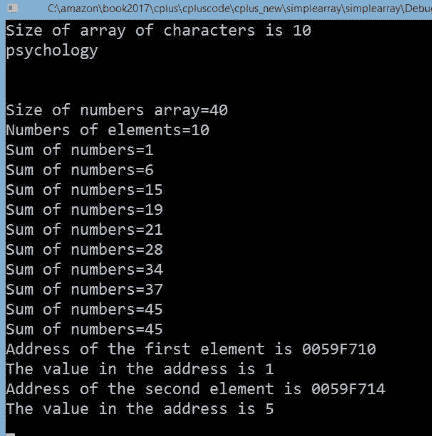
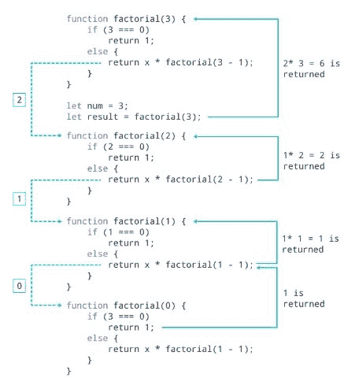

# C++ 编程：多范式编程语言基础与数据管理入门初学者指南 (2022 速成课程)


## 引言
有很多不同的编程语言，而 `C++` 通常不会出现在我们在学习过程中可能遇到的“简单”编程语言名单上。我们可能会发现使用这种语言有许多优势，但它通常被认为比其他可用语言更难掌握。

随着本本指南的不断进行，你将发现这是一门非常出色的语言。它将为我们提供一些所需的最佳技巧和技术，并演示如何在该语言中编写我们所需的一些不同代码。如果你正在寻找一种可以帮助开发 Web 应用程序、游戏等许多领域的强大编程语言，并且想立即学习如何使用它，那么本手册就是为你准备的。

在本书中，我们将学习使用 `C++` 语言编程所需的所有知识。我们将从使用该语言的一些基础知识开始，例如：这种语言的本质是什么、它与其他语言相比的某些优势，以及回顾一些与该语言相关的历史。

一旦我们掌握了 `C++` 编程语言的基础，我们就可以转向一些更高级的话题。我们将详细地介绍该语言的语法和基础。它与许多其他编程语言略有不同，因此在开始编写脚本之前，我们必须首先学会如何实现这一切。我们还将查看一些流行的且与 `C++` 语言良好配合的库，这些库可以用于扩展在该语言中看到的某些功能。

现在我们已经了解了 `C++` 编程的一些基础，并对整门语言有了更好的理解。现在是时候深入研究如何编写我们所需要的代码细节了。我们可以关注许多不同类型的代码，并且在该语言内部可以处理的许多不同事情，我们将查看其中的一些特性。

## 什么是 C++？
许多初学者将 `C++` 归类为复杂的语言。无论原因是什么，`C++` 并不是一种缺乏优秀功能的复杂语言。这是因为 `C++` 是一门在过去不断演变的编程语言。

## C++ 的历史
在早期，`C++` 仅被用作 `C` 的一个分支，并在编译前被转换回 `C`。一个名为 `Cfront` 的编译器因执行这项工作而闻名。然而，几年后，使用 `C++` 的人们发现，在没有实际编译器的语言中创建代码太困难了。因此，某些开发者开始开发编译器，最终由 Bjarne Stroustrup 完成了任务，并实现了一个可行的 `C++` 编译器。

在几年内实现了严格的语法结构后，`C++` 在 1998 年被 `ISO` 认可。第一个更新版本在同年发布，人们对 `C++` 开始提供的新增额外功能感到惊讶。它开始使用高级技术来缩短编译时间，并在第一个版本中引入了模板（templates）。所有这些强大的新功能都帮助 `C++` 开发了复杂的软件。在几年内，`C++` 有了巨大的进步，并包含了许多可以创建通用应用程序的高级功能。

非常感谢微软促使了 `C++` 作为一种编程语言的迅速崛起。微软开始使用 `C++` 开发其开发软件 `Visual C++`。许多为微软系统开发应用程序的程序员开始发现使用 `C++` 工作是多么的可靠和舒适。到 2009 年，`C++` 标准库更新了各种复杂的系统、数学函数和时间函数。

## 为什么 C++ 会成功？
`C++` 的成功主要归功于它的面向对象特性。在 20 世纪 80 年代，面向对象的编程范式席卷了技术世界。人们对它提供的适应性和简单性留深刻印象。当时许多内置的 `C` 库可以很容易地转换为 `C++` 功能库。`C++` 是 `C` 的一个主要实例，增加了继承和多态等面向对象的原则。

## 为不同的操作系统设置 C++ 环境


所有用于创建 C++ 软件的软件都由代码编辑器和一个用于显示可能错误的内置调试器组成。如果你是一个老派的人，你可以简单地使用文本编辑器并在命令行环境中运行程序。它仍然运行得非常完美。然而，在本节中，我们将讨论用于创建 C++ 程序的高级集成开发环境（IDE）软件。

## IDE 是如何工作的？

IDE 使用编辑程序、编译器链机制和调试的结合来创建高效的程序。

注意：

记住，如果你尝试在命令行中执行程序，C++ 并不提供解释器。

C++ 以其先进的功能和易于的语法在程序员中闻名。即使受到 Java 和 Python 等高级编程语言的影响，C++ 也没有失去它的魅力。这一章作为对 C++ 编程语言及其历史的全面介绍，将帮助你详细理解这一流行编程语言之一的重要性和起源。在书中，我们用通俗易懂的语言解释了各种复杂的编程主题。为了理解和欣赏许多信息，理解 C++ 作为一种编程语言的重要性至关重要。让我们现在详细学习 C++ 吧。

## 新版 C++ 有什么特别之处？

开发新版本的 C++ 是为了支持那些正尝试实现复杂现实世界项目的开发者。这里是 C++ 提供的一些显著的高级特性。

### a) 高级数据结构实现

树和链表等简单的数据结构可以通过基础 C++ 版本轻松地实现。然而，使用旧版本实现图和二叉树等高级数据结构是不可能的。另一方面，较新版本的 C++ 提供了标准库，帮助我们实现 `map` 和 `hash` 值，这些值可以进一步用于实现高级数据结构。

### b) 加密功能

新版本的 C++ 提供了专门的库，可用于 Web 和移动应用程序中实现复杂的加密功能。这些库还可以用于创建处理密码和隐写法的软件。

### c) Lambda 实现

Lambda 实现对于运行数据科学和机器学习应用程序至关重要。例如，现代深伪软件使用使用 lambda 表达式构建的 C++ 渲染库。

### d) 高级面向对象特性

我们都知道 C++ 是一种面向对象的语言。基础版本只支持单继承，而新版本可以为你的项目提供多重继承。通过新版本，我们能够使用多个运算符重载和复杂的多态功能。

# 第 1 章：

# 如何编写你的第一个程序

# 

一旦你下载了选择使用的 C++ 环境，我们将直接开始编写你的第一个代码。为了使之运行，你需要的代码如下：

```cpp
#include <iostream>
using namespace std;
int main ()
{
    cout << “Use This One!”;
    return 0;
}
```

在编写这些内容时，你有几个选项。你可以选择在你的编译器中编写它（它在你的环境中是可用的），或者你可以选择将其编写并保存到计算机中。第二种方案有时很好，因为这样你就保存了代码，可以在代码中需要的任何时候进行复制和粘贴。

无论哪种方式，你都应该仔细考虑你想要使用的文本编辑器类型。大多数编辑器都是针对特定设备的，因此你需要寻找与你的特定电脑匹配的一个。你可以选择的选项包括 Windows 记事本、`vlm`、`vl`、Brief 和 EMACS。如果你想拥有一个兼容多个平台的编辑器，那么 `vlm` 和 `vl` 选项是最佳选择。

当你编写自己的代码时，你应该先在文本编辑器中编写，以获得程序的草稿，稍后你可以将它们移动到编译器中。这让你更容易检查自己的工作，并避免在当前正在编写的代码中出现错误。

## C++ 编译器

就像文本编辑器一样，有很多编译器供你使用。问题是，虽然你有很多选择，但其中许多编译器都非常贵。这是因为你遇到的大多数编译器都是为精英黑客设计的，他们已经精通了其他低级编译器中的内容，现在他们想确保自己能将其提升到下一个水平。

好消息是，有一些编译器可以免费获得。你只需要小心留心，确保你获得的是良好的且包含你寻找的所有功能的编译器。`GNU` 是一个与 C++ 配合良好且适合初学者使用的编译器。它在 Linux 系统上使用效果最好，你可能已经在系统中有了它。要检查你的系统中是否有 `GNU` 编译器可用，请使用以下代码：

```bash
g++ -v
```

## 基础语法

C++ 语言可以定义为一种使用对象来帮助保持组织有序的程序，并允许代码通过各种方法进行通信并完成其他功能。C++ 语言带有四个重要部分，包括：

- **类 (Classes)**：这些是你语言的组织工具。它们可以被看作存放或存储对象的盒子，并对相似的对象进行分类。你可以给你的类命名任何你喜欢的名称，但将相似特征的对象归类是良好的编码习惯。
- **对象 (Object)**：对象是代码中具有状态和行为的东西。这些可以是颜色、纹理等。你通常会将这些对象分类。因此，如果你有一个关于狗的类，你可以将不同的狗放在同一个类中。
- **方法 (Method)**：这是编码中用于行为的术语。你可以有任意数量的方法可以使用。这是你操作数据的方式，操作将根据你所使用的方法执行。如果不使用正确的方法，你的程序将不知道它应该做什么。
- **实例变量 (Instant variable)**：这些指的是你正在处理的单个对象。每个对象都通过一组唯一的变量来标识。你可以在创建对象时使用某些值为它分配正确的变量。

这就是编写 C++ 代码的基础。你应该花时间在你的编译器中编写上面的代码，以获得一些练习并理解你在这里应该做什么。我们稍后将查看这些代码可以做的一些事情，但这是一个很好的起点。

## C++ 数据类型

就像你可能想要学习的一些其他编程语言一样，在 C++ 代码中也会出现许多数据点。你经常会使用变量，例如，变量只是在你的计算机内存中预留的空间，以确保代码的不同部分能够保持安全。在处理 C++ 语言时，我们有很多数据点可以关注，这些点包括：

1. 布尔型 (Boolean)
2. 双精度浮点型 (Double floating point)
3. 单精度浮点型 (Floating point)
4. 整数型 (Integer)
5. 字符型 (Character)
6. 无值 (Valueless)
7. 宽字符型 (Wide character)

## C++ 函数


我们还需要查看一下在处理 C++ 语言时会遇到的一些函数。函数非常简单，它是一组为了执行特定任务而设计的语句。你用 C++ 编写的每个程序都至少包含一个函数，这被称为 `main()` 函数，但你可能需要添加更多的函数，以便让代码按照我们想要的方式运行。

你可以通过多种不同的方式来实现这一点。首先，我们可以选择根据我们希望代码运行的方式将代码拆分为几个函数。你如何决定拆分代码以及使用多少个函数取决于你个人，以及你试图在代码中编写的内容。但大多数程序员会以这种方式拆分代码：使每个函数独立负责其自己的任务。

函数声明会告诉编译器函数名称、随函数一起的参数以及我们将看到的返回类型。但请记住，我们看到的函数定义位于该函数的实际体中。

我们在 C++ 库中看到的标准库能够为我们提供许多内置在程序中的函数，我们可以在任何需要的时候调用它们。例如，如果我们使用 `strcat()` 函数，它它可以帮助我们连接两个字符串。然后我们可以使用 `memcpy()` 来帮助我们将内存中的一个位置的内容复制到另一个位置。这些只是你可以使用的不同类型的函数，你会发现它们的工作方式都是相似的。

考虑到这一点，我们需要更进一步，实际查看我们如何在 C++ 中应用函数。你用于定义函数的代码包含：

```
Return type function name (parameter list) {

Body of the function
}
```

这些函数定义由函数头和函数体组成。函数的各个部分包括以下内容：

*   **返回类型**：你正在处理的函数可能会返回一个值，你将使用返回类型的值在这里返回内容。某些函数可以执行你想要的操作而无需向你返回值。使用我们上面使用的语法，你最终得到的答案将是 `void`。
*   **函数名**：这是你给函数起的名称。当你加上函数名和参数时，你就得到了所谓的函数签名（function signature）。
*   **参数**：参数是一个占位符。当你调用函数时，你将一个值传递给参数。这个值被称为实际参数或参数（argument）。参数列表将引用函数的参数数量、顺序和类型。也可以编写一个完全没有参数的函数。
*   **函数体**：最后，函数体将包含一组语句，用于定义函数的功能。

在很多时候，我们将使用函数来帮助完成代码的某些部分，并确保一切都准备就绪以进行处理。务必练习这些函数，看看它们如何满足我们的需求。

## 修饰符的类型

每当你处理 C++ 中想要执行的某些代码时，你会发现可以使用 `char`、`double` 和 `int`，以便出现在它们之前的修饰符能够存在。我们在这里讨论的修饰符将用于帮助我们更改该基础类型的含义，使其能够适应我们试图创建的任何程序或情况。有不同类型的数据修饰符可以可以使用。这些包括 `signed`、`unsigned`、`long` 和 `short`。

这四种修饰符适用于我们拥任何整数基础类型。例如，你可以取 `signed` 和 `unsigned` 来处理 `char`，然后 `long` 可以用于 `double` 等。C++ 还会让我们更容易地使用简写表示法来处理这些整数。这意味着可以直接使用这些单词，而不需要添加 `int` 部分，因为这在编码中始终是隐含的。

此外还有不同类型的限定符（qualifiers）来让你的 C++ 代码正常工作。你可以使用的用于为前前的变量提供额外信息的以下限定符类型包括：

*   **Const**：具有 `const` 的对象在程序执行期间将无法被程序更改。
*   **Volatile**：易变性修饰符会告诉编译器你可以更改值，但这些更改可能不会由程序显式指定。
*   **Restrict**：被 `restrict` 限定的指针最初是访问其所指向的对象的唯一手段。

# 第 2 章：基础设施

## 数组

数组是一种保存了相同类型元素顺序集合的数据结构。


例如，在以下代码中：

```cpp
#include <iostream>

int main(int argc, char* argv[]) {
    int char_array[10] = {1, 5, 9, 4, 2, 7, 6, 3, 8, 0};
    int sum = 0;
    int length = sizeof(char_array) / sizeof(char_array[0]);

    std::cout << "Size of array: " << length << std::endl;

    for (int i = 0; i < length; i++) {
        sum = sum + char_array[i];
    }
    std::cout << "Sum of numbers: " << sum << std::endl;

    int *p = char_array;
    std::cout << "Address of the first element: " << p << std::endl;
    std::cout << "The value in the address: " << *p << std::endl;

    p++; //移动指针到下一个元素
    std::cout << "Address of the second element: " << p << std::endl;
    std::cout << "The value in the address: " << *p << std::endl;

    return 0;
}
```

`sizeof` 函数返回数组分配的字节数。由于 `char` 数据类型占用一个字节，`sizeof` 返回的字节数等于 `char` 数组的元素数量。

整数数据类型在内存中占用 4 字节，10 个整数数组存储在 40 字节中。

要计算数组中存储了多少元素，我们可以将整个数组分配的字节数除以数组中一个元素分配的字节数：`length = sizeof(numbers) / sizeof(numbers[0])`。


要访问数组的所有元素，我们必须使用 `for` 循环。

```cpp
for(i=0; i<length; i++) cout<<char_array[i];
```

如果我们声明一个指针并将数组赋值给该指针，该指针将持有数组第一个元素的地址：`int *p =numbers; cout<<"Address of the first element is "<<p<<endl;`

该行代码的输出是：

`Address of the first element is 0059F710`

要使用指针访问数组第一个元素地址处存储的值，请运行以下行代码：`cout<<"The value in the address is "<<*p<<endl;` 该代码的输出是：

The value in the address is 1.

要移动到数组的下一个元素，你必须增加 `p`。`p++;`

现在它将指向数组的第二个元素：`cout<<"Address of the second element is " <<p<<endl; cout<<"The value in the address is"<<*p<<endl;` 输出结果为：

在我电脑上，numbers 数组的第二个元素的地址是 0059F714

第二个元素的地址处的值是 5。



图 数组程序的输出。

## 字符串

## 字符串函数

我将向你展示如何使用一些字符串函数。`strcpy_s()` 将字符串的内容复制到另一个字符串。

`strcat_s()` - 将源字符串的副本接到目标字符串。`strlen()` - 返回字符串的长度。

我们的应用程序将从用户输入读取字符串，将其复制到另一个字符串，然后将原始字符串字符倒序复制到临时字符串，并将副本和倒序后的副本合并为一个字符串。

例如，如果用户输入字符串‘Concatenation’，则应用程序将输出

‘ConcatenationnoitanetacnoC’

`main.cpp` 文件中必须包含以下头文件：

```cpp
#include "stdafx.h"
#include <stdio.h>
#include <cctype>
#include <iostream>
#include <cstring>
```

`<cstring>` 头文件用于字符串函数：`strcpy_s()`、`strcat_s()` 和 `strlen()`。`cctype` 头文件用于 `toupper()` 函数。

我想解释一下我是如何按倒序将字符从原始字符串复制到临时字符串的。

首先，我使用 `strlen()` 函数获取原始字符串的长度。`length=strlen(aWord);`

然后在循环中，我将原始字符串的最后一个字符复制到临时字符串的开头，依此类推。

让我们检查循环中的代码。

```cpp
for(i=0; i <length; i++) temp[i]=aWord[length-(i+1)];
```

如果用户输入单词‘Concatenation’，则单词长度为 13。字符串中第一个字符的索引为 0，那么字符串最后一个字符的索引将是 12。这意味着最后一个字符的索引是 `length -1`。

我放在循环中的行代码是 `temp[i]=aWord[length-(i+1)];`。

当 `i =0` 时，`temp[i]` 将引用 `temp` 字符串的第一个字符。

同时（当 `i =0` 时），`aWord [length-(i+1)]` 将引用 `aWord[13 – (0 + 1)]` 字符，它将是 `aWord[12]`，即‘Concatenation’字符串的最后一个字符。

当 `i=1` 时，`temp [1]` 将引用 `temp` 字符串的第二个字符，而 `aWord [13-(1+1)]` 将引用‘Concatenation’字符串中倒数第二个字符。

通过这样，我们就可以倒序复制所有字符。

当我们把所有字符从原始字符串复制到 `temp` 字符串后，我们需要在 `temp` 字符串末尾添加空字符，因为 C++ 中的字符串必须以空字符终止。

`temp[length]='\0';` 这一行代码将完成这项工作。

整个代码包含在 [visual_studio_2017.zip.](http://learn-coding.today/cplusbook/visual_studio_2017.zip.)。

```cpp
#include "stdafx.h"
#include <stdio.h>
#include <cctype>
#include <cstring>
#include <iostream>
int main()
{
    char more = 'Y';
    char prompt1[] = "\nEnter a word not more than 20 characters and press enter.\n";
    char prompt3[] = "\nDo you want to continue? Y/N\n";
    char aWord[20];
    char aCopy[40];
    int length = 0;
    char temp[20];
    int i;

    while (toupper(more) == 'Y')
    {
        std::cout << prompt1;
        std::cin >> aWord;
        std::cout << "aWord=" << aWord << std::endl;
        strcpy_s(aCopy, aWord);
        std::cout << "aCopy=" << aCopy << std::endl;
        length = strlen(aWord);
        std::cout << "length=" << length << std::endl;

        //fill temp[] array with the word characters in opposite order.
        for (i = 0; i <length; i++) temp[i] = aWord[length - (i + 1)];
        temp[length] = '\0';
        std::cout << "Temp=" << temp <<std::endl;
        strcat_s(aCopy, temp);
        std::cout << "aCopy=" << aCopy << std::endl;
        std::cout << prompt3;
        std::cin >> more;
    }
    return 0;
}
```


二叉树是目前所有基础数据结构中最迷人且实用的结构。它们是如何利用递归和指针来完成某些极其重要任务的典型示例。

链表是构建项目列表的最伟大策略之一，但在列表中查找元素可能花费一些时间。如果你有大量的非结构化数据，数组对你也没有什么大帮助。你可以尝试对数组进行排序，但插入元素仍然很困难。在一个你想保持排序的数组中插入新元素将需要大量的移动！而且，在尽可能快速在列表中发现项，在中是至关重要的，尤其是在以下这些场景中：

- 你正在开发一款 MMORPG（大型多人在线角色扮演）游戏，玩家需要能够快速登录——这涉及到快速查找玩家。
- 你正在构建一个处理信用卡的软件，每小时需要处理数百万笔交易——需要非常快地找到信用卡余额。
- 你正在使用低功耗设备（如平板电脑或智能手机）并向用户显示通讯录。你不希望用户因为你的数据结构太慢而一直卡顿。

本节将讨论克服这些问题及更多所需的工具。

解决方案的思路是能够在像链表这样的结构中存储元素，利用指针来帮助构建内存，但方法比链表更简单。这要求内存具有比简单列表更多的结构。

那么，数据结构化意味着什么？当我们开始这段旅程时，我们只有数组，但这些从未真正赋予我们使用顺序列表以外的数据结构的能力。链表使用指针增量地增长顺序列表，但没有利用指针的灵活性来构建更复杂的结构。

内存中这些更复杂的结构是什么？在任何给定时刻持有比单个“下一个节点”更多节点的结构就是一个很好的例子。但你为什么想要它呢？很简单。如果你有两个“下一个节点”，其中一个可以用来表示比当前元素更多的元素。这被称为二叉树。

它们之所以这样命名，是因为每个节点都始终有一个或两个分支。每个下一个节点都是子节点，而连接到子节点的节点就是父节点。

二叉树看起来可能像：

```
10
6 14
5 8 11 18
```

在树中，每个元素的左孩子都小于该元素，而右孩子大于它。`10` 是整棵树的父节点，而 `6` 和 `14` 的子节点都是它们各自小树（称为子树）的父节点。

二叉树有一个非常重要的属性：每个孩子都是一整棵树。将左孩子小于、右孩子大于的规则结合起来，你就有了一种定义在树中定位特定节点的算法简单方法。

首先，查看当前节点的值。如果它等于搜索目标，就完成了。如果它大于搜索目标，向左走；否则向右走。这之所以有效，是因为树左侧的每个节点都小于当前节点值，右侧的每个节点都更大。

在理想的世界中，你的二叉树是平衡的，两侧节点数量完全相同。在这种情况下，每个子树大约占整棵树的 50%，当你在树中搜索一个值时，搜索每到达一个子节点，就可以排除 50% 的结果。所以，如果你有一棵拥有 1000 个元素的树，500 个会立即被排除。再次搜索这棵树（现在它只有 50 个元素了），你可以再次削减大约 50%。这样，找到你想要的值就不需要长时间。

那么，树必须被细分多少次才能到达一个元素？答案是 `log2n`（`n` 是树拥有的元素数量）。即使你的树很大，这也是一个小值——如果你的树有，比如 320 亿个元素，该值为 32；这比搜索一个拥有 40 亿元素的链表快了近 1 亿倍，而在链表中，每一个元素都必须经过评估。

如果树不是平衡的，你就无法排除大约一半的元素；最坏的情况下，每个节点只有一个孩子，这使得这棵树无非带有几个额外指针的链表，因此需要你搜索所有元素。

所以，当树大致平衡时，搜索节点比在链表上进行相同的搜索快得多且容易得多。这是因为你可以按照你的方式来构建内存。

### 实现二叉树

要实现二叉树，从声明节点结构开始：

```c
Struct node {
    int key_value;
    node *p_left;
    node *p_right;
};
```

节点可以存储简单的整数 `key_value` 作为值，并有两个子树——`p_left` 和 `p_right`。

你可能在二叉树上需要一些常用函数：插入、搜索、删除和销毁：

```c
node* insert (node* p_tree, int key);
node *search (node* p_tree, int key);
void destroyTree (node* p_tree);
node *remove (node* p_tree, int key);
```

### 插入

我们将使用递归算法将其插入树中。递归对于树来说是极佳的，因为每个树都有两个小树；这使得整棵树在本质上是递归的。该函数接收一个键和一个已经存在的树（即使是空的），并返回一个新树。

```c
node* insert (node *p_tree, int key) {
    if (p_tree == NULL) {
        node* new_tree = new node;
        new_tree->key_value = key;
        new_tree->p_left = NULL;
        new_tree->p_right = NULL;
        return new_tree;
    }
    if (key < p_tree->key_value) {
        p_tree->p_left = insert(p_tree->p_left, key);
    } else {
        p_tree->p_right = insert(p_tree->p_right, key);
    }
    return p_tree;
}
```

这里的基本逻辑是：如果你有一个空树，就创建一个新的。如果不是，如果值小于当前节点，则进入左子树；否则，进入右子树。

关于它的运行效果，将一个空树构建成带有节点的树。如果值 `10` 插入空树中，我们将立即命中基础情况，结果将是一棵：

```
10
```

并且两个孩子树将指向 `NULL`。然后向树插入 `5` 并产生以下调用：`insert(p_tree, 5)`。因为 `5` 小于 `10`，对左树的调用是递归的：`insert(NULL, 5)`。`insert(NULL, 5)` 创建并返回一个新树：

```
5
```

当接收返回的树时，`insert(5)` 连接树。在这个例子中，`10` 的左孩子之前是 `NULL`。因此，`10` 的左孩子建立了一棵新树：

```
10
5
```

如果我们现在添加 `7`，我们得到：`insert(NULL, 7)`, `insert(p_tree, 7)`, `insert(p_tree, 7)`。所以，首先，`insert(NULL, 7)` 将返回一个新树：

```
7
```

然后 `insert(p_tree, 7)` 以这种方式连接到 `7` 的子树：

```
5
7
```

最后，树返回到：`insert(p_tree, 7)`。这将将其连回：

```
10
5
7
```

由于已经存在一个从 `10` 指向 `5` 节点的指针，我们并不真正需要重新连接 `10` 的左孩子到以 `5` 为父节点的树，但这确实消除了一个检查子树是否为空的条件判断。


### 销毁

这应该也是递归函数。在删除当前节点之前，算法会销毁当前节点下的两个子树。

```cpp
void destroy_tree (node *p_tree)
{
  if ( p_tree != NULL )
  {
    destroy_tree( p_tree->p_left ); destroy_tree( p_tree->p_right ); delete p_tree;
  }
}
```

为了更好地理解这一点，让我们假设在删除节点之前打印了该节点的值：

```cpp
void destroy_tree (node *p_tree)
{
  if ( p_tree != NULL )
  {
    destroy_tree( p_tree->p_left ); destroy_tree( p_tree->p_right ); cout << "Deleting node: " << p_tree->key_value; delete p_tree;
  }
}
```

如你所见，树是从底向上删除的。节点 5 和 8 首先被删除，然后是 6，最后移动到另一侧删除 11 和 18，接着是 14。最后，10 将被删除。树的值并不重要；重要的是节点所在的位置。在下面的二叉树中，我们使用的不是节点值，而是删除顺序：

7
3 6
1 2 4 5

手动在几棵树上运行一遍代码可能会有所帮助，这样你就能看得更清楚了。

从树中删除元素是递归算法的一个极佳例子，这种算法很难用迭代实现。首先，你需要一个可以同时处理树的两个边的循环。你必须能够在删除一个子树的同时跟踪下一个子树，而且这在每一层都需要执行。使用栈，你可以更容易地记录位置。可视化这种点的最好方法是说，每个栈帧将存储已经删除或销毁的树分支：

`destroy_tree( )` `destroy_tree( )`––确定子树是左侧还是右侧。每个栈帧都知道树的哪些部分必须销毁，因为它们知道函数执行到哪一点应该继续。当进行第一次调用销毁树时，程序通过栈帧通知在第二次调用 `destroy_tree` 时继续执行。当进行第二次调用时，程序被告知继续执行 `delete tree`。由于每个函数都有自己的栈帧，它可以跟踪当前整个树销毁的状态，一次一个树层。

要用非递归的方式实现这一点，需要一个保留相同数量和类型信息的数据结构。例如，你可以编写一个函数，使用链表来模拟列表。该链表将包含正在销毁的子树和等待删除的树。然后可以编写一个基于循环的算法，将子树添加到列表中并在它们完全销毁后将其移除。基本上，递归允许你使用内置的栈数据结构，而不需要自己编写。

# 第 4 章：继承


示例：`#include <iostream>` `using namespace std;`

```cpp
// 定义一个具有 2 个成员的简单学生类
class Student
{ 
public:
  int studentID; string studentName;
  // 显示类成员的函数 
  void Display()
  {
    cout<<"Student ID "<<studentID<<endl; cout<<"Student Name "<<studentName;
  }
};

int main () {
  Student stud1;
  // 给类的属性赋值
  stud1.studentID=1;
  stud1.studentName="John";
  stud1.Display();
  return 0;
}
```

通过上述程序：
* 我们有一个名为 `Student` 的类，它有 2 个成员，一个是 `studentID`，另一个是 `studentName`。
* 然后我们定义了一个名为 `Display()` 的成员函数，它将 `studentID` 和 `studentName` 输出到控制台。
* 然后我们可以在主程序中的对象中调用该成员函数。

通过此程序，输出如下：
Student ID 1
Student Name John

### 那么什么是继承？

继承是一个概念，我们可以定义一个类来继承另一个类的属性和方法。这有助于避免再次定义该类或再次定义其属性和方法。

假设我们有一个名为 `Person` 的类，它有一个 `Name` 属性和一个 `Display` 方法。那么通过继承，我们可以定义一个名为 `Student` 的类，它可以继承自 `Person` 类。

`Student` 类将自动获得 ID 成员和 `Display` 函数。如果需要，`Student` 类可以再定义自己的额外的成员。

要定义一个被继承的类，我们使用以下语法：
`派生类:基类`

这里 `派生类` 是继承另一个类属性的类，而另一个类被称为 `基类`。

所以，如果我们有一个如下所示的带有属性和函数的基类。

```cpp
Base class
{
  Public or protected:
  Property1;
}
```

那么当我们从基类定义派生类时，派生类将访问该属性。注意，属性和函数需要访问修饰符为 `public` 或 `protected`。

我们将稍后详细讨论访问修饰符。

`派生类:基类`

```cpp
派生类:基类
{
  // 无需定义 property1，它会自动继承这些。
}
```

现在让我们看一个简单的示例。
示例 2：下面的程序展示了如何使用继承类。

```cpp
#include <iostream>
using namespace std; // 定义一个具有 Name 属性的简单 Person 类

class Person
{
public:
  string Name;
};

// Student 类简单派生自 Person 基类
class Student:public Person
{
};

int main () {
  // 由于派生类可以访问基类的属性和函数，这些属性可以通过 Student 对象访问
  Student stud1;
  stud1.Name="John";
  return 0;
}
```

现在我们看到了如何使用派生类和基类，这被称为继承。

### 1.2 派生类中的函数

```cpp
Base class
{
  Public or protected:
  Property1;
  Fucntion1;
}
```

当我们从基类定义派生类时，派生类将访问该属性和函数。注意，属性和函数需要访问修饰符为 `public` 或 `protected`。

现在让我们看一个可以在派生类中使用函数的示例。
示例 3：下面的程序展示了如何使用带有函数的继承类。

```cpp
#include <iostream>
using namespace std; // 定义一个具有 Name、ID 属性以及一个名为 Display 的函数的简单 Person 类。

class Person
{
public:
  string Name;
  int ID;
  void Display()
  {
    cout<<"ID "<<ID<<endl; cout<<"Name "<<Name;
  }
};

// Student 类简单派生自 Person 基类
class Student:public Person
{
};

int main () {
  // 由于派生类可以访问基类的属性和函数，这些属性可以通过 Student 对象访问
  Student stud1;
  stud1.ID=1;
  stud1.Name="John";
  stud1.Display();
  return 0;
}
```

通过此程序，输出如下：
ID 1
Name John


我们也可以重新定义 `Student` 类中的 `Display` 函数。但如果你查看上面的示例，你会发现 `Person` 类中的 `Display` 函数的显示文本为 `ID` 和 `Name`。但假设我们想在 `student` 类中将显示名称为 `Student ID` 和 `Student name`，我们可以重新定义 `Display` 函数。让我们来看一个相关的例子。

### 示例 4：以下程序展示了如何使用带有重定义函数的继承类。

```cpp
#include <iostream>
using namespace std;
class Person
{
public:
    string Name;
    int ID;
    void Display()
    {
        cout<<"ID "<<ID<<endl;
        cout<<"Name "<<Name;
    }
};

class Student:public Person {
public:
    // 这里我们正在重定义 Display 函数
    void Display()
    {
        cout<<"Student ID "<<ID<<endl;
        cout<<"Student Name "<<Name;
    }
};

int main () {
    Student stud1;
    stud1.ID=1;
    stud1.Name="John";
    stud1.Display();
    return 0;
}
```

通过这个程序，输出如下：

```
Student ID 1
Student Name John
```

### 1.3 多重继承

我们还可以让派生类继承自多个基类。这有助于一次性从多个类中获得更多功能。

`派生类: 基类 1, 基类 2… 基类 N`

在这里，你只需要用逗号将基类分隔开即可。

所以，如果我们有一个如下所示的带有属性和函数的基类。

```cpp
Base class1
{
Public or protected:
    Property1;
    Fuction1;
}
```

以及另一个如下的基类。

```cpp
Base class2
{
Public or protected:
    Property2;
    Fucntion2;
}
```

那么，当我们从这两个基类定义派生类时，该派生类将可以访问这两个类的属性和函数。

```cpp
Derived class: Base Class1, Base Class2
{
    // 不需要定义 property1, property2 和 Function1, Fucntion2，它们会自动继承这些。
}
```

再次注意，属性和函数的访问修饰符需要为 `public` 或 `protected`。让我们来看一个多个派生类的示例。

### 示例 5：以下程序用于展示如何使用多个派生类。

```cpp
#include <iostream>
using namespace std;

// 定义 Person 类的第一个基类
class Person
{
public:
    string Name;
    int ID;
    void Display()
    {
        cout<<"ID"<<ID<<endl;
        cout<<"Name"<<Name;
    }
};

// 定义 Marks 类的第二个基类
class Marks
{
public:
    int marks1,marks2;
    void Sum()
    {
        cout<<marks1+marks2;
    }
};

// 派生类同时继承 Person 和 Marks 两个基类。
class Student:public Person,public Marks {
public:
    void Display()
    {
        cout<<"Student ID "<<ID<<endl;
        cout<<"Student Name "<<Name<<endl;
    }
};

int main () {
    Student stud1;
    stud1.ID=1;
    stud1.Name="John";
    stud1.Display();
    stud1.marks1=5;
    stud1.marks2=10;
    stud1.Sum();
    return 0;
}
```

通过上面的程序：

 我们定义了 2 个基类，一个称为‘Person’，另一个称为‘Marks’。(image.014.png) 派生类‘Student’继承了这两个类，并可以使用这两个类的成员。

通过这个程序，输出如下：

```
Student ID 1
Student Name John
```5
1.4 访问控制

类修饰符用于定义类中属性和方法的可见性。以下是各种修饰符：

- `Private` – 使用 `private`，属性和方法对类本身可见。
- `Protected` – 使用 `protected`，属性和方法仅对类本身及其子类可见。
- `Public` – 使用 `public`，属性和方法对所有类可见。

假设我们有一个如下的类结构：

```cpp
Class classname
{
Private:
    Property1;
    Fucntion1;
}
```

`property1` 和 `function1` 在定义它们的类之外的任何地方都是不可访问的。如果你在 main 程序中尝试访问这些属性或函数，将得到编译错误。

现在让我们定义下面的类，这次我们将使用 `protected` 访问修饰符。

```cpp
Class classname1
{
Protected:
    Property1;
    Fucntion1;
}
```

现在 `property1` 和 `function1` 在上述类以及任何继承自它的类中可见。但注意，我们不能在其他非派生类中使用这些属性。

```cpp
Class derivedclassname: classname1
}
```

让我们来看另一个访问修饰符的示例。

### 示例 6：以下程序用于展示如何使用访问修饰符。

```cpp
#include <iostream>
using namespace std;
class Person
{
public:
    int ID;
protected:
    // 注意我们将 Name 属性定义为 protected
    string Name;
    void Display()
    {
        cout<<"ID "<<ID<<endl; 
        cout<<"Name "<<Name;
    }
    // 注意我们将 city 属性定义为 private
    private:
    string city;
};

class Student:public Person { 
public: 
    void Display()
    {
        cout<<"Student ID "<<ID<<endl; 
        cout<<"Student Name "<<Name<<endl;
    }
};

int main () {
    Student stud1;
    stud1.ID=1;
    stud1.Name="John";
    stud1.Display();
    return 0;
}
```

为什么我们会得到这个错误？`person` 类具有 `protected` 访问修饰符，这意味着它只能在派生类中访问。但我们尝试在 main 类中访问它，这是错误的。

### 示例 7：以下程序展示了正确的方法。

```cpp
#include <iostream>
using namespace std;
class Person
{
public:
    int ID;
protected:
    string Name;
    void Display()
    {
        cout<<"ID "<<ID<<endl; 
        cout<<"Name "<<Name;
    }
private:
    string city;
};

class Student:public Person { 
public: 
    // 我们现在定义了一个可以设置 protected 属性值的函数
    void InputName(string pName)
    {
        Name=pName;
    }
    void Display()
    {
        cout<<"Student ID "<<ID<<endl; 
        cout<<"Student Name "<<Name<<endl;
    }
};

int main () {
    Student stud1;
    stud1.ID=1;
    stud1.InputName("John");
    stud1.Display();
    return 0;
}
```

在上面的程序中，我们现在 `Student` 类中正确定义了方法 `InputName`，它可以访问受保护成员 `Name`。通过这个程序，输出如下：

```
Student ID 1
Student Name John
```

### 示例 8：以下程序展示了错误使用访问修饰符的第二个示例。

```cpp
#include <iostream>
using namespace std;
class Person
{
public:
    int ID;
protected:
    string Name;
    void Display()
    {
        cout<<"ID "<<ID<<endl; 
        cout<<"Name "<<Name;
    }
private:
    string city;
};

class Student:public Person { 
public: 
    void InputName(string pName)
    {
        Name=pName;
    }
    void Display()
    {
        cout<<"Student ID "<<ID<<endl; 
        // 注意我们正在派生类中使用私有属性 city
        cout<<"Student city "<<city<<endl; 
        cout<<"Student Name "<<Name<<endl;
    }
};

int main () {
    Student stud1;
    stud1.ID=1;
    stud1.InputName("John");
    stud1.Display();
    return 0;
}
```

通过这个程序，输出如下：

```
error: 'std::__xx11::string Person::city' is private
```

由于 `City` 属性是私有的，即使在派生类中也无法使用。我们只能在 `Person` 类中操作此属性。


```c
{ int var; printf("The address is: %x\n", &var); return 0; }
```

Output:
> The address is: 10ffa2c

Note：这在每次运行运行时几乎都会不同。

请注意高亮显示的语句，`&`（引用操作符）用于返回变量的内存地址，并允许某些语句访问该位置中的数据。使用 `%x` 是因为内存地址是以十六进制表示的。

要创建一个指针，我们使用解引用运算符 `*`，这这将创建一个用于存储内存地址的指针变量。下面是一个程序，它创建了一个指针并使用引用操作符 `&` 将另一个普通变量的地址存储在新创建的指针中。解引用运算符 `*` 也用于访问或更改该内存位置中的实际数据。

*   解引用运算符 `*` 用于创建指针，在更改实际值时也会使用。
*   引用操作符 `&` 在获取指针的内存地址时使用。

```c
//普通变量 int var = 10; //指针 int* pointer;
//将 var 的内存地址存储在指针 pointer = &var;
//指针现在实际上是 'var'，所以
//可以发生此类操作
*pointer = 20;
printf("Var's value is now: %d", var);
```

Output:
>Var 的值现在是: 20

## NULL 指针

当你创建一个指针时，它最初没有被赋予任何要指向的内容，这是危险的，因为指针在创建时会引用随机内存，更改该内存位置中的数据可能会导致程序崩溃。为了防止这种情况，当我们创建一个指针时，我们像这样将其赋值为 `NULL`：


```c
int* pointer = NULL;
```
这意味着 NULL 指针没有指向任何内容。

## 使用指针

创建一个指针时，指针是可以检查的地址。如果指针不是 `NULL`，它就是有效的。

指针可以作为参数传递。如果指针不是 `NULL`，意味着指针是有效的。示例如下所示：

```c
void ChangeValue(int* ptr)
{
    //更改内存位置的值
    *ptr = 20;
}

int main()
{
    int var = 10;
    int* ptr = &var;
    //传递指针
    printf("Var 的值现在是: %d\n", var);
    ChangeValue(ptr);
    printf("Var 的值现在是: %d\n", var);
    return 0;
}
```

Output:
>Var 的值现在是: 10
>Var 的值现在是: 20

## 指针算术

指针在某些情况下，移动指针到另一个内存位置是有用的；这就是指针算术的应用。指向数组第一个元素的指针的示例如下：

```c
int arrayInt[] = { 10, 20, 30 };
size_t arrayInt_Size = 3;
int* ptr = arrayInt;
for (int i = 0; i < arrayInt_Size; i++)
{
    //获取内存位置中的值
    printf("arrayInt[%d] = %d\n", i, *ptr);
    ptr++;
}
```

Output:
>arrayInt[0] = 10
>arrayInt[1] = 20
>arrayInt[2] = 30

这显示指向数组地址的指针可以递增（记住数组的每个值存储在相邻的内存位置）。你可以执行相反的操作并递减指针，即让指针的值减小。

还可以使用关系运算符如 `==`、`<` 和 `>` 来比较指针。常用的用途是检查两个指针是否指向同一个位置：

```c
int value;
//为 ptr1 和 ptr2 赋值相同的值
int* ptr1 = &value;
int* ptr2 = &value;
//ptr3 被赋值为另一个值
int* ptr3 = NULL;
if (ptr1 == ptr2)
{
    printf("ptr1 和 ptr2 相等!\n");
}
if (ptr1 != ptr3)
{
    printf("ptr1 与 ptr3 不相等\n");
}
```

这检查了各种指针是否相等。使用 `>` 和 `<` 也可以这样做。

## 函数指针

就像你可以对变量这样做的那样，你也可以对函数执行这样做；下面的代码片段展示了如何定义函数指针。关键部分将高亮显示：

```c
void printAddition(int value1, int value2)
{
    int result = value1 + value2;
    printf("结果是: %d", result);
}

int main()
{
    //函数指针定义
    //<返回类型>(*<名称)(<参数>)
    void(*functionPtr)(int, int);
    functionPtr = &printAddition;
    //调用指针函数 (*functionPtr)(100, 200);
    functionPtr(100, 200);
    return 0;
}
```


我们之前提到过这一点，全局变量是一个未定义在作用域内的变量，因此可以在任何地方使用。外部变量是指定义在另一个位置（如另一个文件）的变量，而 `extern` 关键字用于表示该变量在另一个文件中。你可以通过在文件顶部放置以下内容来引用另一个文件：

```cpp
#include "FileName.c"
```

这是为了告诉程序也引用此文件。注意，文件需要位于同一个位置。

### 程序 1 [File_2.c]

```cpp
#include <stdio.h> #include "C_TUT.c" int main() { extern int globalValue; printf("The global variable is: %d", globalValue); }
```

### 程序 2 [C_TUT.c]
```cpp
#include <stdio.h> int globalValue = 1032;
```

运行 File_2.c 的输出：

> global variable is: 1032

这显示 `globalValue` 是从 `C_TUT.c` 中引用的，并通过 `extern` 关键字在另一个文件中使用的。

我们在教程的基础部分提到过递归，再次强调，递归是指函数任务对自身的定义。正如我所承诺的，下面还有几个关于递归的示例：

```cpp
int factorial(int x) {
    int r;
    // 停止条件如果 (x == 1) {
        // 有结论，所以循环停止 return 1;
    }
    else {
        // 递归定义 return r = x * factorial(x - 1);
    }
}
int main() {
    puts("Please enter a number: ");
    // 读取用户输入 int a, b; scanf("%d", &a); // 开始执行 b = factorial(a); printf("The factorial is: %d", b);
}
```

这是一个世界著名的递归示例，用于计算数字的阶乘（3 的阶乘是 3x2x1）。它通过上面的递归返回语句工作；它通过一个不包含递归定义的返回语句来停止，即当 `x = 1` 时，函数直接返回 1；这意味着栈可以回溯并找到答案。下面是一个流程图：



## 递归

递归是一个困难的概念，在这里将简单提及，其在实际的应用和功能将在高级章节中解释。

递归是涉及自身引用的函数命令定义，是的，这非常困惑，我明白，但我将用一些例子来解释。

```cpp
const int maxLoops = 5;
void Sequence(int previous, int now, size_t loopCount) {
    // 计算下一个值 int next = previous + now;
    // 打印新值 printf("New value: %d\n", next);
    // 计数 loopCount++;
    // 停止条件以确保不会发生无限循环如果 (loopCount < maxLoops) {
        // 递归调用
        Sequence(now, next, loopCount);
    }
}
int main() {
    Sequence(1, 1, 0);
}
```

输出：

> New value: 2
> New value: 3
> New value: 5
> New value: 8
> New value: 13

有几点需要注意，缺乏迭代循环，递归在本质上导致了循环。第二个需要注意的是被标记为“停止条件”的 if 语句，如果递归设置没有停止循环的条件，它们将无限循环，因此这是有效使用递归的关键元素。

# 第 6 章：STL 容器和迭代器


### 容器

容器是 STL 的主要贡献，用于存放和访问对象序列。STL 提供了不同类型的容器，例如 `vector`、`list`、`map` 和哈希表。然而，根据数据排列的特征，STL 容器分为三个部分：

1. 序列容器，如 `vector`、`固定大小数组`、`list`、`forward_list` 和 `deque`；
2. 关联容器：
    a) 有序（排序）关联容器，如 `set`、`multiset`、`map` 和 `multimap`；
    b) 无序（未排序）关联容器，如 `unordered_set`、`unordered_multiset`、`unordered_map` 和 `unordered_map`；
3. 容器适配器，如 `stack`、`queue` 和 `priority_queue`。

除了这些，C++ 还提供了三种特殊容器：`string`、`内置` 和 `valarray`。

每个容器都有默认构造函数、带参数的构造函数、拷贝构造函数、赋值运算符和析构函数。除此之外，大多数容器都定义了自己的迭代器。

### 容器迭代器

在这些部分中，每个容器都提供自己的迭代器。在迭代器的五类分类中，每个容器定义了以下任意一种：

**前向迭代器 (Forward iterators)：**
* 可以读；
* 可以写；
* 可以在单个位置重复；
* 可以向前移动 (`++`)，但不能向后移动，因此名为前向迭代器；以及
* 用于：无序关联容器和 `forward_list`。

**双向迭代器 (Bidirectional iterator)：**
* 与前向迭代器相同，但它也可以向后移动（`++` 还有 `--`），因此名为双向；以及
* 用于容器：`list`、`set`、`map`、`multiset` 和 `multimap`。

**随机访问迭代器 (Random access iterator)：**
* 与双向迭代器相同，但它可以跳转（`+=N` 或 `-=N`），而不是（`+=1` 或 `-1`，其中 `+=1` 是 `++`，`-1` 是 `--`），因此名为随机访问迭代器（跳转迭代器）；以及
* 用于容器：`vector`、`string`、`deque` 和 `array<T,N>`。

除了帮助容器中的 STL 算法外，迭代器有助于执行容器的内部操作（成员函数）。某些内部操作适用于所有的序列关联容器，它们是：

**O(1)：**
`begin()`、`end()`、`cbegin()`、`cend()`、`rbegin()`、`rend()`、`crbegin()`、`crend()`、`empty()`、`swap()`、`size()`、`max_size()`、`shrink_to_fit()`、`emplace()` 和 `emplace_back()`。

**O(n)：**
赋值运算符 `=`，关系运算符：`!=`、`==`、`<`、`<=`、`>`、`>= 以及 `clear()`。

**O(variable)：**
* 插入、删除导入（在节点容器中很快，在连续内存容器中较慢）；
* 构造函数（通常，类的组合具有常数复杂度，但所有其他构造函数和析构函数可能具有线性复杂度）。

**注意：**
a) `forward_list` 和无序关联容器使用前向迭代器，因此它们没有反向迭代器操作：`emplace_back()`、`rbegin()`、`rend()`、`crbegin()` 和 `crend()`。
b) 关联容器支持反向迭代器，但它们不支持 `emplace_back()`。这是因为关联容器按排序顺序保持元素，所以它们不接受 `emplace_back()` 命令，该命令坚持将新元素放在容器末尾。

†前向列表：
1. 不支持 `size()` 运算符；


### 2. 相比于 `insert()`、`erase()` 和 `emplace()`，它提供了 `insert_after()`、`erase_after()` 和 `emplace_after()`。

### 3. 在 `begin()`、`cbefore_begin()` 之前有特殊的迭代器，例如：

* 在正向列表中的操作：`my_fwd_list.insert_after` 
* `(my_fwd_list.before_begin(), inv_data.gold);` 等同于列表中的以下操作：`my_list.insert`
* `(my_list.begin(), inv_data.gold);`
* **注意**：没有任何容器可以越界 `end()` 之后写入或读取，即：
* `my_fwd_list.insert_after(my_fwd_list.end(), inv_data.gold);` 是一个错误！

‡ `shrink_to_fit()` 请求移除未使用的内存容量，它仅适用于 `vector`、`deque` 和 `string`。

†† 无序容器不支持关系运算符：`<`、`<=`、`>` 和 `>=`。


在上述运算符列表中，`O` 代表复杂度。简而言，虽然复杂度意味着函数的时间和/或空间复杂度，但在容器中它是时间复杂度；

* `O(1)` 代表常数时间复杂度；
* `O(log n)` 代表对数时间复杂度；
* `O(n)` 代表线性时间复杂度；

相比之下，`O(n) > O(log n) > O(1)`，这意味着 `O(1)` 是最快的操作；注意：这些是预期或平均复杂度，而标准库文档对某些运算符引用了最坏情况复杂度。

有少数容器不支持迭代器，它们是：容器适配器、`bitset` 和 `valarray`。**注意**：C++11 为 `valarray` 定义了迭代器 `begin()` 和 `end()`。

### STL 迭代器

迭代器、容器和算法是惠普罗派克公司的 Alexander Stepanov 等人在 20 世纪 90 年代初的标准模板库的组件，随后在标准库中进行了合并和改进。

迭代器是特殊指针的抽象，用于对给定容器（如 `vector`、`map` 和用户自定义容器类）的元素进行解引用。

每个容器类都包含用于生成迭代器的成员函数，例如，成员 `begin()` 和 `end()` 分别返回指向第一个元素和最后一个元素之后元素的迭代器。

下图描绘了迭代器 `*it` 与其容器 `vector<int>data {1111, 1134, 1134, 1124, 1124, 1134, 1111, 1176, 1124, 1134, 1176}` 之间的关系。

然后，迭代器可以在算法操作（如 `sort`、`accumulate` 和自定义算法函数）中包含容器的元素。换句话说，迭代器将容器与算法关联起来。

最常用的迭代器来自 `begin()` 和 `end()`。如下所示：

如图所示，`data[0]` 和 `data.begin()` 代表同一个元素，即 `elem 1`，但 `data[N]` 和 `data.end()` 代表一个“无人区”，访问它会导致运行时错误。然而，成员函数 `end()` 在迭代语句中构造条件时非常有用。

以下代码说明了迭代器的这一基本属性：

```cpp
// iterators.cpp

#include "..\..\my_essentials.hpp" 
void illustrate_iterators()
{
int arr[] = {1111, 1134, 1134, 1124, 1124, 1134, 1111, 1176, 1124, 1134, 1176}; 
vector<int>data(arr, arr+ sizeof(arr)/sizeof(arr[0]) );

// vector<int>data2{1111, 1134, 1134, 1124, 1124, 1134, 1111, 1176, 1124, 1134, 1176}; 
// fine with gcc4.7.0 
cout << "\n Illustration of iterators: \n" << "\n Given vector: data =\n\t( ";

for(auto element: data) // 'the range-based for' do not work with VC10.
 cout << element << "; "; cout << ")\n\n Let us define an iterator, say *it for this vector.\n";
vector<int>::iterator it = data.begin();

/*
Note:
在 STL 容器中，每个容器模板类定义了自己的迭代器成员类， 
所以 vector<int>::iterator 与 list<int>::iterator 是不同的。
*/ 
cout << " Thus,\t\t*it = " << *it << " that is data[0]\n Iterators can be incremented, i.e, ++it;\n";

++it; cout << " After ++\t*it = " << *it << " that is data[1]\n";
```

上述程序演示了迭代器结合容器数据的用处。

正如我们看到的，迭代器可以用于打印容器的内容，因此我们在头文件 `my_essentials.hpp` 中编写与容器无关的代码。这对于单类型容器 `vector<T>`、`list<T>`、`set<T>`、`multiset<T>`、`deque<T>` 以及固定大小的 `array<T,N>` 适用，但对于双类型容器 `map<T1,T2>` 和 `unordered_multimap<T1,T2>` 则不适用。

```cpp
//-------------------------------
// 容器无关的打印代码
// 单类型 template<typename container> void cout_container(const std::string& message, const container& data)

{ cout << message << "{"; if(data.empty()){cout << "NULL}"<<endl; return; }

 auto start = data.begin(); auto end = data.end(); while(true)

 { cout << *start;

 ++start; if(start != end) cout << ", "; else{cout << '}' << endl; break; }

 }
```


让我们将此模板添加到 `my_essentials.hpp` 中，并使用以下代码测试该模板。

然后，让我们测试这个模板：

```cpp
// cout_containers.cpp

#include "..\..\my_essentials.hpp"
#include <array>
#include <vector>
#include <unordered_set>
#include <forward_list> 
#include <set> 
int main()
{
 // 让我们定义， // 一个固定大小的数组 array<int,6> arr = {1,3,5,1,2,4}; cout_container("my array\t = ", arr);
 // 一个 vector vector<int> vec(arr.begin(), arr.end()); cout_container("my vector\t = ", vec);
 // 一个 forward_list forward_list<int> f_lis(arr.begin(), arr.end()); cout_container("my forward_list\t = ",f_lis);
 // 一个 unordered_set unordered_set<int> u_set(arr.begin(), arr.end()); cout_container("my unordered_set = ", u_set); // 一个 set 容器 set<int>se(arr.begin(), arr.end()); cout_container("my set\t\t = ", se); just_pause();
}
```

输出结果：
`my array = {1, 3, 5, 1, 2, 4}`
`my vector = {1, 3, 5, 1, 2, 4}`
`my forward_list = {1, 3, 5, 1, 2, 4}`
`my unordered_set = {1, 3, 5, 2, 4}`
`my set = {1, 2, 3, 4, 5}`

在我们实验了迭代器的一些应用后，现在我们在下表中总结了它们的操作。

迭代器没有统一的定义，因此并不是所有的迭代器都能支持上述所有的操作。迭代器分为五类，即：

因此，通过这一主要讨论，我们发现指针及其对不同对象的解引用属性对迭代器和 STL 操作起着至关重要的作用。

# 第 7 章：STL 算法

STL 算法位于 `<algorithms>` 头文件中，因此我们需要在程序中包含它。算法可以分类为：

- 非修改性算法：例如 `for each`、`count`、`search` 等。
- 修改性算法：例如 `copy`、`transform` 等。
- 删除算法：`remove`、`remove if` 等。
- 变动算法：`reverse`、`rotate` 等。
- 排序算法：`sort`、`partial sort` 等。
- 有序范围算法：`binary search`、`merge` 等。
- 数值算法：`accumulate`、`partial sum`、`inner product` 等。

示例展示了 `sort()` 函数如何在数组上工作。

## 程序 13.11：使用 sort 算法对数组排序

```cpp
#include <iostream> 
#include <algorithm> 
using namespace std; 
int main()
{ 
    int a[ ] = {3,5,7,2,9}; 
    sort(a, a + 5); 
    cout << "Sorted Array:" << endl; 
    for (int i = 0; i <5; i++) cout << a[i] << " ";
    return 0;
}
```

输出：
```
Sorted Array:
2 3 5 7 9
```

在上面的示例中，当我们把数组名 `a` 作为参数传递时，我们是在告诉函数从数组的开头开始排序。如果我们希望从数组的第三个元素开始排序，可以使用 `sort(a+3, a+5);`。

我们使用 `a+5` 作为第二个参数，这指定我们想要排序到数组的最后一个元素。

现在，类似的 `sort()` 函数可以在 `vector` 容器上工作，如下面的程序所示。这说明 STL 算法是通用的。

## 程序 13.12：使用 sort 算法对 vector 排序

```cpp
#include <iostream>
#include <algorithm> 
#include <vector> 
using namespace std; 
int main()
{ 
    int a[ ] = {5,3,7,6,2,9}; 
    vector<int> v(a, a+6) ; 
    sort(v.begin(), v.end()); 
    for (int i = 0; i != v.size(); i++) cout << v[i] << " "; 
    cout << endl; 
    return 0;
}
```

输出：
```
2 3 5 6 7 9
```

你可以看到，排序函数的工作方式与对数组几乎相同。`sort()` 中的第一个参数接受一个指向第一个元素的迭代器（使用 `begin()`），因为它返回一个指向第一个元素的迭代器。因此，它将从 vector 的第一个元素开始排序。同样，`end()` 返回一个指向容器中最后一个元素之后位置的迭代器。注意，`sort` 函数排序到第二个参数所指定的位置，但不包含该位置。

### find() 和 count() 算法

`find()` 算法有助于从容器中查找特定值。`count()` 用于统计特定值在容器中出现的次数。

## 程序 13.13：使用 find 算法从 vector 中查找值

```cpp
#include <iostream>
#include <algorithm> 
#include <vector> 
using namespace std; 
int main()
{
    vector<int> v; 
    for(int i = 0; i < 10; i++) v.push_back(i); 
    int a = 5; 
    vector<int>::iterator it; 
    it = find(v.begin(),v.end(),a); 
    if(it != v.end()) {
        cout << "found " << a<< endl;
    } else {
        int c = count(v.begin(),v.end(),a);
        cout<<"could not find " << a;
    } 
    return 0;
}
```


`iostream` 文件可能是所有 C++ 库文件中最常见且通用的文件。

大多数 C++ 程序都会包含这个头文件。

`iostream` 文件提供了大量的输入/输出函数以及其他的 I/O 流信息。

例如，`cin` 和 `cout` 的数据和函数原型就在这里定义。

## Note

C++ 的 I/O 是在字节流中进行的，其中流简单来说就是字节的序列。

程序员可以使用许多变种的 C++ 库。而且，这些库源于多个来源。

例如，某些库是随 C++ 应用程序开发软件一起提供的。

C++ 函数库也可能由如设备驱动程序制造商、C++ 编程网站和公告板等来源提供。

你最好的参考来源通常是你的 C++ 应用程序开发软件附带的手手册和帮助文件。

还有许多参考书籍供选择，其中一些涵盖了特定的编译器。

## 库函数的使用

为了演示标准库函数的使用，让我们考虑一个执行以下操作的程序：

- 获取数字 -55 的绝对值：

```cpp
#include <iostream> using namespace std; #include <cmath> void main(void)
{
 cout <<"The absolute value of -55 is "<<abs(-55)<< "\n";
}
```

- 计算 100 的平方根：

```cpp
cout <<"The square root of 100 is "<<sqrt(100.0)<< "\n";
```

- 计算 10 的 5 次方：

```cpp
cout<<"10 to the power of 5 is"<<pow(10, 5)<< "\n";
```

每个计算结果都会输出到屏幕上。

## Note

此程序没有使用任何自定义函数。

标准数学库包含了执行这三个计算所需的每个函数。

这些是：

- `abs()`
- `sqrt()`
- `pow()`

```cpp
#include <iostream> using namespace std; #include <cmath> void main(void)
{
 cout <<"The absolute value of -55 is "<<abs(-55)<< "\n"; cout <<"The square root of 100 is "<<sqrt(100.0)<< "\n"; cout <<"10 to the power of 5 is "<<pow(10,5)<< "\n";
}
```

编写此程序时首先要决定的是包含哪些头文件。

为了调用 `abs()`、`sqrt()` 和 `pow()`，你需要在预处理器指令中包含头文件 `cmath`。

你还需要包含头文件 `iostream`，以便可以使用 `cin` 和 `cout` 语句。

```cpp
#include <iostream> using namespace std; #include <cmath> void main(void)
{
 cout <<"The absolute value of -55 is "<<abs(-55)<< "\n"; cout <<"The square root of 100 is "<<sqrt(100.0)<< "\n"; cout <<"10 to the power of 5 is "<<pow(10,5)<< "\n";
}
```

## Note

函数 `abs()` 也包含在 `stdlib.h` 头文件中。

一旦你完成了预处理器指令，就可以开始编写 `main()` 代码了。

```cpp
#include <iostream> using namespace std; #include <cmath> void main(void)
{
 cout <<"The absolute value of -55 is "<<abs(-55)<< "\n"; cout <<"The square root of 100 is "<<sqrt(100.0)<< "\n"; cout <<"10 to the power of 5 is "<<pow(10,5)<< "\n";
}
```

这三个函数中的每一个返回值通过三个独立的 `cout` 语句直接显示在屏幕上。

你可以在 `cout` 语句中显示常量、数据类型和表达式值的组合，只要每个唯一项目都通过插入运算符（`<<`）隔开。

```cpp
#include <iostream> using namespace std; #include <cmath> void main(void)
{
 cout <<"The absolute value of -55 is "<<abs(-55)<< "\n"; cout <<"The square root of 100 is "<<sqrt(100.0)<< "\n"; cout <<"10 to the power of 5 is "<<pow(10,5)<< "\n";
}
```

在第一个 `cout` 语句中，显示的第一个值是一个常量字符串。

然后，通过调用函数显示数学库函数 `abs()` 的返回值。

```cpp
#include <iostream> using namespace std; #include <cmath> void main(void)
{
 cout <<"The absolute value of -55 is "<<abs(-55)<< "\n"; cout <<"The square root of 100 is "<<sqrt(100.0)<< "\n"; cout <<"10 to the power of 5 is "<<pow(10,5)<< "\n";
}
```

`abs()` 函数计算作为其函数参数传递的整数的绝对值。该函数返回一个 `int` 类型的值。

在例例中，参数是一个常量，而不是 `int` 类型的变量。

```cpp
#include <iostream> using namespace std; #include <cmath> void main(void)
{
 cout <<"The absolute value of -55 is "<<abs(-55)<< "\n"; cout <<"The square root of 100 is "<<sqrt(100.0)<< "\n"; cout <<"10 to the power of 5 is "<<pow(10,5)<< "\n";
}
```

当 `cout` 语句执行时，通过函数调用显示 `55`。

```cpp
#include <iostream> using namespace std; #include <cmath> void main(void)
{
 cout <<"The absolute value of -55 is "<<abs(-55)<< "\n"; cout <<"The square root of 100 is "<<sqrt(100.0)<< "\n"; cout <<"10 to the power of 5 is "<<pow(10,5)<< "\n";
}
```

## Note

`abs()` 函数也包含在 `stdlib.h` 头文件中。

一旦你完成了预处理器指令，就可以开始编写 `main()` 代码。

```cpp
#include <iostream> using namespace std; #include <cmath> void main(void)
{
 cout <<"The absolute value of -55 is "<<abs(-55)<< "\n"; cout <<"The square root of 100 is "<<sqrt(100.0)<< "\n"; cout <<"10 to the power of 5 is "<<pow(10,5)<< "\n";
}
```

## Note

`abs()` 函数在参数为负数时。

当 `cout` 语句执行时，显示了 `55`。

```cpp
#include <iostream> using namespace std; #include <cmath> void main(void)
{
 cout <<"The absolute value of -55 is "<<abs(-55)<< "\n"; cout <<"The square root of 100 is "<<sqrt(100.0)<< "\n"; cout <<"10 to the power of 5 is "<<pow(10,5)<< "\n";
}
```

## Note

`abs()` 函数在参数为负数时。

当 `cout` 语句执行时，显示了 `55`。

```cpp
#include <iostream> using namespace std; #include <cmath> void main(void)
{
 cout <<"The absolute value of -55 is "<<abs(-55)<< "\n"; cout <<"The square root of 100 is "<<sqrt(100.0)<< "\n"; cout <<"10 to the power of 5 is "<<pow(10,5)<< "\n";
}
```


1. `H`: `short int` 或 `short unsigned`。示例：`%hd` 或 `%hu`。
2. `I`: `long int` 或 `long unsigned`，或 `double`（用于 `%f` 转换）。示例：`%ld`, `%lu`, 或 `%lf`。
3. `L`: 要解析的值对于整数类型为 `long`，浮点类型为 `long double`。示例：`%Ld`, `%Lu`, 或 `%Lf`。
4. `*`: 告诉 `scanf()` 执行转换但不存储在任何地方。如果你想让 `scanf()` 跳掉某些数据但不想存储在任何地方，就使用这个；你不需要为 `scanf()` 提供该转换的参数。示例：`%*d`。

`scanf("%c" &c)` 将读取任何字符，包括空白字符。如果你想让 `scanf` 跳过任何空白字符，可以在 `%c` 前加一个空格。

```cpp
while(true){
    scanf("%c",&c);
    //scanf(" % c",&c);
    printf("you ␣  input: ␣  %d" c);
}
```

**输出：**
当你输入 `a(enter)` 时，输出将类似于 `you input: 97(a value)` `you input: 10(enter value)`

`cin>>c` 不读取空白字符（制表符、空格、换行）。如果你想从输入缓冲区读取它们，应该使用 `getchar()` 或 `cin.get()`；如果你想让用户输入他们的名字。

```cpp
while(true){
    cin>>c;
    cout<<"you ␣  input:"<<c<<endl;
}
```
**输出：**
当你输入 `" a(enter)"` 时，输出类似于：you input: a。然后光标在此等待。

使用 `cin>>` 或 `scanf` 会在读取第一个空格后终止字符串。处理这种情况的最好方法是使用函数读取一行；

### 读取单词和行：

1. `scanf(%s,char_array)` //`c`
2. `cin>>char_array` 或 `;` //`c++`
3. `cin>> str;`
4. //`line`
5. `Gets(char_array)` //`c`
6. `Fgets(char_array, n , FILE *)`
7. `Cin.getline(char * ,int n)`
8. `Cin.get(char * ,int n)`
9. `Std::getline(istream& is, string& str)`

行 1：读取单词直到遇到空白字符。
行 7：推荐使用此方法以安全性。
行 9：C++ 读取并丢弃换行符
行 1：不读取换行符

`Cin.read` 函数与 `cin.get` 具有相同的接口，但它不会向输入中追加空字符，它不是为键盘输入设计的，而是用于文件的二进制格式。

对于 C++，三个 `get`，两个 `getline`，其他使用 `>>`；

### `cin.get(char)` 和 `int = cin.get()` 区别：

```cpp
while(cin.get(c)) {
    // 在读取循环中使用 cin.get(char)
    cin.get() != ’\n’
    // 使用 cin.get() 返回字符进行测试
    cin.get()!= EOF
}
```
行 7：当用于 `EOF` 时，你必须使用 `int`，因为 `EOF` 可能无法用 `char` 类型表示。

**混淆函数：** `cin.get` 和 `cin.getline` 几乎是同一的。

`Cin.get ( char* s, streamsize n, char delim );`
`Cin.getline (char* s, streamsize n, char delim );`
`Istream& getline (istream& is, string& str);`

1. 对于每一行，如果你不知道最大长度，直接使用 `getline(cin, string)`。你不需要输入任何长度（如果你想避免内存分配，可以预留 `string` 的长度）。
2. `cin.get()` 不从输入流中丢弃 `delim`。然而，`cin.getline()` 会读取并丢弃换行符。（很容易记住，因为行是由换行符定义的）
3. 在 `cin.getline(char* s, int n)` 中，如果函数没有提取任何字符（换行符是一个字符），或者在已写入 `s` (n-1) 个字符后未找到 `delim` 字符，则设置 `failbit` 标志。注意，如果输入序列中紧随这些 (n-1) 个字符之后的字符正好是 `delim` 字符，它会被提取且不会设置 `failbit` 标志。
4. 在 `.cin.get(char* s , int n)` 中，只有当函数没有提取任何字符时才会设置 `failbit` 标志。
5. `cin.get(char* s, n)` 比 `cin.getline` 更灵活。因为当读取到数组满时，它不会设置 `failbit`。此时你可以使用 `gcount()` 或 `peek()` 查看下一个字符是否为新行。它比 `cin.getline();` 更具定制性。

### 输入模式

在外部测试流，然后在条件/循环语句体内部对其进行读/写是一个坏主意。这是因为读取操作可能会导致流变为错误状态（bad）。通常将读取作为测试的一部分更好。

```cpp
while(!cin.fail()){ // 这种写法不好
    cin>>i; // 这里可能导致流失效
    ..... // 然后 i 是有效的
```
如果你只是想输入，不想知道 `eof` 或处理 `failbit`，可以使用：

`while(!cin.fail())` ... `scanf("%d",&i) != EOF` ... `getline(cin, string)` ... `cin.get()` ... `cin.getline()` ... `cin.get()` ... `cin.getline()` ... `cin.get()` ... `cin.getline()` ... `cin.get()` ... `cin.getline()` ... `cin.get()` ... `cin.getline()` ... `cin.get()` ... `cin.getline()` ... `cin.get()` ... `cin.getline()` ... `cin.get()` ... `cin.getline()` ... `cin.get()` ... `cin.getline()` ... `cin.get()` ... `cin.getline()` ... `cin.get()` ... `cin.getline()` ... `cin.get()` ... `cin.getline()` ... `cin.get()` ... `cin.getline()` ... `cin.get()` ... `cin.getline()` ... `cin.get()` ... `cin.getline()` ... `cin.get()` ... `cin.getline()` ... `cin.get()` ... `cin.getline()` ... `cin.get()` ... `cin.getline()` ... `cin.get()` ... `cin.getline()` ... `cin.get()` ... `cin.getline()` ... `cin.get()` ... `cin.getline()` ... `cin.get()` ... `cin.getline()` ... `cin.get()` ... `cin.getline()` ... `cin.get()` ... `cin.getline()` ... `cin.get()` ... `cin.getline()` ... `cin.get()` ... `cin.getline()` ... `cin.get()` ... `cin.getline()` ... `cin.get()` ... `cin.getline()` ... `cin.get()` ... `cin.getline()` ... `cin.get()` ... `cin.getline()` ... `cin.get()` ... `cin.getline()` ... `cin.get()` ... `cin.getline()` ... `cin.get()` ... `cin.getline()` ... `cin.get()` ... `cin.getline()` ... `cin.get()` ... `cin.getline()` ... `cin.get()` ... `cin.getline()` ... `cin.get()` ... `cin.getline()` ... `cin.get()` ... `cin.getline()` ... `cin.get()` ... `cin.getline()` ... `cin.get()` ... `cin.getline()` ... `cin.get()` ... `cin.getline()` ... `cin.get()` ... `cin.getline()` ... `cin.get()` ... `cin.getline()` ... `cin.get()` ... `cin.getline()` ... `cin.get()` ... `cin.getline()` ... `cin.get()` ... `cin.getline()` ... `cin.get()` ... `cin.getline()` ... `cin.get()` ... `cin.getline()` ... `cin.get()` ... `cin.getline()` ... `cin.get()` ... `cin.getline()` ... `cin.get()` ... `cin.getline()` ... `cin.get()` ... `cin.getline()` ... `cin.get()` ... `cin.getline()` ... `cin.get()` ... `cin.getline()` ... `cin.get()` ... `cin.getline()` ... `cin.get()` ... `cin.getline()` ... `cin.get()` ... `cin.getline()` ... `cin.get`getline `getline.getline`getline `getline.getline` ... `getline.getline`getline `cin.getline`getline `getline.getline`. `cin.getline`getline `getline.getline`
 `cin.get`getline `cin.getline` ... `getline.getline`getline `cin.getline`

1. `A`
2. `Private:`
3. `x,y`
4. `Friend istream& operator>>(istream& in);`
5. `Friend ostream& operator<<(ostream& s, const A&);`
6. `}`
7. `istream& operator>>(istream& in, A&){`
8. `in>>a.x>>a.y;`
9. `return in;`
10. `}`
11. `Ostream& operator<<(ostream& out, const A&){`
12. `out<<a.x<< " ␣ " <<a.y;`
13. `Return out;`
14. `}`
15. `Vector<A> v;`
16. `Copy(istream_iterator<A>(cin), istream_iterator<A>(),`
17. `Back_inserter(v));`
18. `Copy(v.begin(), v.end(),ostream_iterator<A>(cout, "\n"));`

总而言之，通过判断来结束循环更好。如果你需要特定的操作来处理 `EOF` 或错误，使用 `while(true)`，然后使用 `of()` 或 `fail()` 或 `clear()`。

对于 `cout`，它可以自动识别类型，并且是扩展的，你可以重定义 `<<` 运算符让 `cout` 识别你的类型。

1. `Class Foo`
2. `Private:`
3. `x,y`
4. `Friend istream& operator>>(istream& in);`
5. `Friend ostream& operator<<(ostream& s, const A&);`
6. `}`

*   格式是输出的关键点。你需要了解常用的操作符来控制输出格式。
*   数字进制操作符：`hex`, `oct` 和 `dec`；字段宽度：`Width`, `fill`, `precision` `Setf()`
*   你不需要了解细节，只需要知道名称。
*   当你想要使用它们时，去参考网站查看。详细的格式操作符可以在 C++ primer P1090 查看。你需要包含 `<iomanip>`。
*   `<<` 是 C 语言中的位左移运算符，但在 C++ 中，我们在 `ostream` 类中对其进行了重载，`cout` 是 `ostream` 的对象，
*   你可以使用 `cout<<flush` 强制刷新输出缓冲区 `cout.write` 可输出特定长度的字符串，即使到达字符串末尾。


当你很好掌握了 `cin` 和 `cout` 之后，你会发现文件操作是如此简单。只需将 `cin` 或 `cout` 替换为你的 `ifstream`、`ofstream` 或 `fstream` 对象即可。

```cpp
std::fstream ifs; ifs.open ("test.txt", ios_base::in| ios_base::binary); if(!ifs.is_open()) exit(1); char c = ifs.get();
// 使用之前的输入方法 ifs.close();
```

*   `ifstream` 只读；`ofstream` 只写；`fstream` 可读可写。
*   对于 `ios_base::binary` 模式，使用 `write()` 和 `read()` 函数。
*   对于写操作，注意 `ios_base::trunc` 和 `ios_base::app` 之间的区别。
*   随机访问主要用于二进制文件。因为位置可以精确确定位。输入使用 `seekg()`，输出使用 `seekp()`（`p` 代表 put，`g` 代表 get）。它们用于移动指针。`tellp()` 和 `tellg()` 函数用于告知指针的位置。

## 缓冲区与字符串缓冲区

*   `stringstream` 是一种方便的方法，可以像独立的 I/O 设备一样操作字符串。有时使用 `stringstream` 在字符串与其他数值类型之间进行转换非常方便。`stringstream` 的用法与 `iostream` 非常相似，因此学习起来没有负担。
*   你需要从字符串构建一个 `stringstream`，或者将 `stringstream` 转换回字符串。

1. `stringstream outstr;`
2. `outstr<<"salary ␣  value"<<123333.00<<endl;`
3. `string str = outstr.str()` // 转换为 string
4. `istringstream Instr(str);`
5. `while(instr>>number)`
6. `cout<<number<<endl`
7. `char sentence []="Yan ␣  is ␣  41 ␣  years ␣  old";`
8. `char str [20];`
9. `int i;`
10. `sscanf (sentence,"%s ␣  %*s ␣  %d", str, &i);`
11. `sprintf(...);`

第 1 到 3 行：将数字转换为文本。
第 5 到 7 行：将文本转换为数字。
第 9 行到结束：C 语言方法。在第 12 行，你可以看到 `"*s"`，这意味着输入将被忽略。因此 `str = Yan`，`i = 41`。

### 操作流

1. `Peek` 返回输入流中的下一个字符，但不从输入流中提取它。例如，你想读取输入直到遇到第一个换行符或句号为止。

```cpp
char input[80]; int i = 0; while( (ch=cin.peek()) != ’.' && ch != ’\n’) cin.get(input[i++];) input[i] = ’\0’;
```

2. `Gcount()` 方法返回上一次非格式提取方法读取的字符数。这意味着通过 `get()`、`getline()`、`ignore()` 或 `read()` 读取的字符，但不包括通过提取运算符读取的字符。
3. `Putback()` 函数将一个字符放回输入缓冲区。

# 第 10 章：内存与资源


## 内存管理

在管理执行程序使用的内存时，C++ 编程语言为用户提供了多种选项。在本章中，我们将介绍一些常用的选项。我们还将引入一些先进策略，以解决过去困扰 C++ 项目的内存管理问题。

### C++ 程序可用的内存

现代操作系统通常会为留留出一部分内存用于执行程序，这允许操作系统同时管理多个程序的运行。不同的操作系统以不同的方式布局执行程序的内存。然而，布局通常会包含以下四个部分：

*   **代码段 (Code)**：程序编译的可执行指令存储在代码段内存中。程序执行期间，代码段的内容永远不会改变。同样，在程序执行期间，代码段也不会改变。
*   **数据段 (Data)**：持久变量和全局变量存储在内存的数据段中（如静态局部变量）。在执行程序的寿命范围内，数据段的变量都存在。然而，除非数据是常量，否则执行程序可以自由更改它们的值。虽然数据段中变量的值在程序执行过程中可能会改变，但在程序执行时数据段的大小不会改变。这是因为程序的源代码精确定义了全局和静态局部变量的数量。编译器也可以计算出数据段的确切大小。
*   **堆 (Heap)**：执行程序获取动态内存的区域称为堆。使用 `new` 运算符从堆中获取内存，使用 `delete` 运算符将之前分配的内存返回堆。随着程序使用 `delete` 和 `new` 分配和释放动态内存，堆的大小在程序执行过程中收缩和扩张。
*   **栈 (Stack)**：函数参数和局部变量始终存储在栈中。函数参数和局部变量在函数返回时消失，在函数调用时出现。随着各种函数的执行，栈的大小在程序执行过程中也会收缩和增长。

通常，操作系统限制栈的大小。深度递归会消耗大量的栈空间。例如，考虑一个编写不当的递归函数，它省略了基准情况，从而导致“无限”递归，消耗栈上所有的可用空间。这种情况被称为栈溢出（stack overflow）。现代操作系统会终止任何消耗大量栈进程。但在某些嵌入式系统中，这种栈溢出可能无法检测到。通常堆空间是充足的，操作系统可以使用虚拟内存为执行程序提供比物理内存更多的空间。

## 手动内存管理

使用 `delete` 和 `new` 时频繁的内存管理问题是逻辑错误中最难发现和修复的。程序员必须严格遵守以下准则：对于你调用 `new` 的地方，只要分配的内存不再需要，就应该始终有一个对应的 `delete` 调用。这听起来很简单，但并不总是清楚何时该使用 `delete`，下面的函数展示了内存泄漏：

```cpp
void calc(int n) {
// ...
// 执行一些事情
int *x = new int[n];
// ...
// 对 x 执行一些事情
// ...
// 退出函数未删除 x 的内存
}
```

如果程序多次调用 `calc` 函数，最终将耗尽内存。在 `calc` 函数中，`x` 是局部变量。从这个角度来看，`x` 位于栈上。因此，当某个特定的 `calc` 调用完成时，函数的清理代码会自动释放变量 `x` 占据的空间。因为所有函数都会自动管理局部和参数变量的内存。`x` 的问题是通过 `new` 分配的，指向堆内存而非栈。

那么，绝不能使用 `delete` 来释放没有通过之前的 `new` 调用分配的内存。下面的代码片段说明了这样一个例子：

```cpp
int list[10], *x = list; // x 指向 list
// ...
// 执行一些事情
// ... delete [ ] x; // 逻辑错误，尝试释放 x 的内存
```

指针 `x` 所引的空间不是由 `new` 分配的，因此不应使用 `delete` 来尝试释放内存。当你尝试删除未用 `new` 分配的内存时，会导致未定义行为，证明这是一个逻辑错误。

不能多次使用 `delete` 释放同一块内存。这种情况在两个指针指向同一块内存时很常见。这种指针被称为别名（aliases）。下面的代码片段更好地说明了这种情况：

```cpp
int *p = new int[10], *y = x; // y 是 x 的别名
```


```cpp
// ...

// 对 x 和/或 y 进行一些操作

// ...

delete [] x; // 释放 x 的内存

// ...

// 执行其他操作

// ... delete [] y; // 逻辑错误，y 的内存已经释放！
```

由于指针 `x` 和指针 `y` 指向同一块内存，因此 `x` 和 `y` 是互为的别名。如果你释放了其中一个所引用的内存，那么另一块内存也会被释放，因为它们是同一块内存。

当使用 `delete` 释放之前的内存后，不应再次访问它们。当你尝试访问已删除的内存时，会导致未定义行为，这代表了一个逻辑错误。

```cpp
int *list = new int[10]; // ... // 使用 list，然后

// ... delete [] list;

// 释放 list 的内存

// ... // 一段时间之后

// ... int x = list[2]; // 逻辑错误，但有时有效！
```

上面的代码段说明了这种情况是如何产生的。出于效率考虑，`delete` 运算符会将堆空间标记为可用，而不会修改内存中的内容。

## 资源管理

程序员在完成链表对象的操作后，调用 `clear` 是至关重要的。请看以下定义：

```cpp
void x() {
    IntList1 my_list; // 在此处调用构造函数 // 向列表添加一些数字
    my_list.insert(12);
    my_list.insert(7);
    my_list.insert(-14); // 打印列表
    my_list.print();
} // 哎！忘记调用 my list.clear!！
```

在上面的代码中，变量 `my_list` 是函数 `x` 的局部变量。当函数 `x` 执行结束时，变量 `my_list` 将离开作用域。在此阶段，栈上为名为 `my_list` 的局部 `IntList1` 变量分配的空间会被回收。虽然在堆分配的元素空间仍然存在，但程序访问内存的唯一方式是通过 `my_list.head`，而 `my_list` 已经不存在了。这是一个经典的内存泄漏示例。注意，在我们目前为止设计的类中，除了 `IntList1` 之外没有类存在这个问题。然而，C++ 为类设计者提供了一种方法，可以指定对象生命周期结束时必须执行的操作。在对象存在初期执行代码的函数被称为析构函数。析构函数是一种在对象消失之前立即执行的特殊方法。析构函数的名字可以与其类相同，并带有波浪号 `~` 前缀。此外，析构函数不接受参数。代码 9.2 显示如何在代码中添加析构函数，以及之前建议的长度和 `clear` 方法优化。

```cpp
// 代码 9.2
class Code9.2 {
    // 之前的嵌套私有 Node 类
    struct Node {
        int data; // 列表的数据元素
        Node *next; // 列表中紧随其后的节点
        Node(int d); // 构造函数
    };

    Node *head; // 指向列表的第一项
    Node *tail; // 指向列表的项
    int len; // 列表中元素的数量
public:
    // 构造函数创建一个初始为空列表
    IntList2();

    // 回收列表内存的析构函数
    ~Code9.2(); // 将 n 插入列表末尾。
    void insert(int n);

    // 打印整数链表的内容。
    void print() const;

    // 返回链表的长度。
    int length() const;

    // 移除链表中的所有元素。
    void clear();
};
```

## 结论

在引导你学习了十个最重要的 C++ 主题后，现在该由你来精进技能了。和任何语言一样，无论是英语、法语还是计算机语言，熟能生巧。我们在书中传授给你的知识仅相当于学习字母表和几个基础英语单词。因此，我们建议你多加练习。将你的思考集中在我们为什么要使用某些句子；以及我们希望实现的结果上。

去网上下载所有你认为易用的实用应用程序，如果必须为它们付钱，就付钱吧。一旦你准备好了一切，就找一个项目并开始学习。你可以创建一个自己的小项目，也可以尝试模仿一个已经创建的项目。如果你遇到瓶颈，可以随时回去查看程序员是如何创建并继续该项目的。但在检查之前，始终务要尝试将自己推向极限，并进行真正的思考。

阅读其他优秀的书籍对你也将大有益益，这让你对 C++ 的某些部分获得多样化的视角，从而提高对它的理解。尽管我们可以告诉你，这本书的质量将带你走上 C++ 成功的正确道路，但我们敦促你也阅读关于该编程语言的其他书籍。

除了 C++ 之外，你也可以考虑学习一种其他语言。学习新语言是深入理解 C++ 的有效技术。学习新语言会让你对通用编程语言有更全面的理解。它还能拓宽你的解决问题思维，挖掘出 C++ 语言的细微差别。即使你不使用这种新语言来编写 C++ 代码，它也会让你接触到可以应用于 C++ 的成熟概念。Haskell 是一种我们建议你与 C++ 一起学习的编程语言。你也可以学习 Java，因为它比 C++ 更接近日常英语，对你来说更容易理解。你也可以看看我们的 Java 书。

