# C++ 编程：初学者掌握 C++ 并构建健壮程序的完整指南

© copyright 2024 版权所有。

未经作者或出版者的直接书面许可，不得复制、复制或传输本书中所包含的内容。

在任何情况下，对于因书中包含的信息而直接或间接导致的任何损害、赔偿或货币损失，出版者或作者均不承担任何责任或法律责任。

## 法律声明

本书受版权保护。仅供个人使用。未经作者或出版者的同意，您不得修改、分发、销售、使用、引用或转述本书的任何部分或内容。

## 免责声明

请注意，本文档中包含的信息仅供教育和娱乐目的。我们已尽全力提供准确、最新、可靠、完整的信息。不声明或暗示任何形式的保证。读者承认作者并未提供法律、财务、医疗或专业建议。书中的内容源自多种来源。在尝试书中概述的任何技术之前，请咨询执业的专业人士。

通过阅读本文，读者同意在任何情况下，对于因使用本文中所包含的信息而导致的任何直接或间接损失（包括但不限于错误、遗漏或不准确），作者均不承担责任。

## 目录

- 引言
- 第一章：开始 C++ 编程
- 第二章：面向对象编程的基本概念
- 第三章：类与对象的操作
- 第四章：通过继承扩展类
- 第五章：多态性
- 第六章：构造函数与析构函数
- 第七章：模板
- 第八章：C++ 输入/输出流
- 第九章：异常处理
- 结语
- 参考文献

## 引言

这门使用 C++ 语言的面向对象编程课程为学习者提供了有效设计、开发和实现健壮程序模型所需的概念和技术。作为一名学习者，你将掌握如何应用面向对象分析和设计的的基础概念，并在日常活动中解决各种问题的实用知识。

你将学习在创建对象时应用数据抽象、封装、继承和多态的概念。你将能够创建定义对象及其行为的类，根据类定义创建对象，并能够建立对象之间的通信。你还将学习如何在执行各种任务时应用面向对象的概念以及这样做的好处。

本书将帮助你理解函数的定义和声明、如何向函数传递参数，以及如何调用内联函数和成员函数。类和对象是 C++ 编程中的重要特性，了解如何创建类定义以及将对象声明为类的实例将使你的程序开发过程更加简单。

我们将教你理解继承和多态的概念。你将理解代码重用的重要性以及如何让你的工作更高效。在相关章节中，你将学习实现继承的各种方法以及如何在类中声明私有、公共和保护成员。通过继承特性，你将能够实现多态概念。

本书将帮助你理解函数的定义和声明、如何向函数传递参数，以及如何调用内联函数和成员函数。类和对象是 C++ 编程中的重要特性，了解如何创建类定义以及将对象声明为类的实例将使你的程序开发过程更加简单。

## 第一章：开始 C++ 编程

C++ 是最具竞争力的通用语言之一。它支持命令式编程并可以在任何地方运行。

### 面向对象基础

面向对象编程使用对象来表示数据。随着程序的执行，对象之间通过传递消息进行通信。

C++ 利用对象来执行程序。其关键特性包括：

- 对象
- 类
- 数据抽象和封装
- 继承
- 多态性

真正的面向对象语言使用对象来表示数据。虽然 C++ 支持所有的面向对象特性，但由于以下三个原因，它被认为是一种部分面向对象的语言：

#### 使用了全局变量

C++ 支持全局变量的概念。你可以在类之外声明全局变量，以便其他实体访问这些变量。尽管声明全局变量违反了封装，但 C++ 可以通过类的使用支持封装。

#### 可选创建类或对象

`main` 函数是任何 C++ 程序中必须的特性，且它应该在类之外创建。因此，只要有 `main()`，就没有必要创建类。

省略类或对象违反了面向对象的概念，因为数据是以对象的形式表示的。

#### 支持友函数

C++ 允许你创建一个友类或友函数，使其能够访问特定类的保护成员或私有成员。这违反了面向对象语言的特性。

## 编程范式

编程范式是一种使用不同概念来塑造程序员如何设计、组织和编写程序的编程模型。编程范式旨在通过各种编程语言解决特定问题。

存在不同类型的范式，每种范式根据编程语言实现特定的功能。这些范式分为两种：声明式编程范式和命令式编程范式。

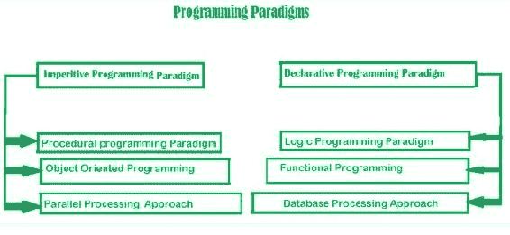

### 声明式编程范式

声明式编程范式分为三个部分：逻辑；函数；以及数据库或数据驱动。声明式编程表达程序逻辑，而不关注程序的控制流。开发的程序侧重于“做什么”，而不是“怎么做”。这些范式强调需要执行的动作，并声明要实现的结果。例如，计算的表达包括：

#### 逻辑编程范式

这种编程范式专注于解决逻辑计算问题，例如用于解决谜题或系列数据的程序。逻辑编程范式依赖于已知的知识库，并将其传递给机器学习工具以产生结果。逻辑范式依赖人工智能和机器学习来解决问题。

#### 函数式编程范式

这是一种与语言无关的程序，源于数学函数。该范式的主要原理是执行数学函数。数据被封装在函数中，从而隐藏了实现细节。函数可以用值替换，这不会改变程序的含义。

#### 数据库或数据驱动编程范式

这种编程范式专注于数据的使用和移动。所有的程序语句都使用数据定义。它是事件驱动的，并提供了数据操作机制，如创建文件、写入文件、更新文件和数据库、生成查询和报告。针对数据库应用开发了多种程序，如结构化查询语言（`sql`）等。

### 命令式编程范式

命令式编程范式使用逐步步进的过程来实现特定目标。它强调如何完成某项特定任务，例如如何执行几条语句并存储结果。该范式通过赋值语句改变程序状态来工作。

#### 优点

- 易于实现
- 使用循环、变量、函数和结构来执行程序语句

#### 缺点

- 复杂程序增加了该范式的复杂性
- 该范式中无法进行并行编程
- 效率和生产力较低

命令式范式分为三类：过程式；并行处理；面向对象（`oop`）。

#### 过程式范式

正如其名，该范式专注于执行特定功能的逐步步进的过程。它允许代码重用，并且非常容易实现。它用于解决简单问题。

#### 并行处理范式

在这种类型的范式中，程序指令使用多个处理器进行处理。并行处理范式拥有多个处理器，旨在以最短的时间运行程序。某些 `c++` 库函数支持这种技术。

#### 面向对象编程（`oop`）

它使用类和对象的集合来编写程序。对象是所有计算发生的最最小实体。该范式侧重于使用数据而不是过程来解决现实世界问题。面向对象将问题分解为若干由对象表示的实体，然后根据这些对象构建数据和函数。它可以解决关于现实生活场景的复杂问题。`c++` 是面向对象编程的一个良好示例，试图消除传统编程语言的一些缺点。

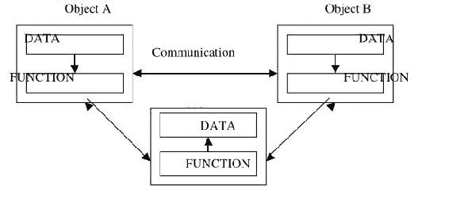

每个对象都独立工作，它们被封装在模块中。对象通过“消息传递技术”相互通信。这些对象被组织成若干类，在类中它们可以继承：

- 安全性
- 封装
- 代码重用
- 继承

## 面向对象设计

面向对象的范式严重依赖于设计。面向对象的范式侧重于使用数据而不是过程来解决现实世界问题。面向对象的范式关注数据和对象。

### 面向对象分析

面向对象分析（`oa`）涉及用于确定软件需求的技术。面向对象编程（`oop`）使用 `c++` 等语言实现软件。

### 面向对象设计

面向对象设计为我们提供了组织对象的强大机制。设计应该说明：

- 对象实例
- 对象之间的通信
- 层次结构
- 客户端-服务器架构
- 分类

面向对象设计在开发中至关重要。面向对象分析将软件分解为各个部分。然后它建立一个评估系统的逻辑模型。

#### 面向对象分析的步骤

1. 识别项目问题。
2. 创建用户和软件共同的需求。
3. 识别项目对象及其属性。
4. 识别每个对象应执行的服务。
5. 建立对象之间的通信。对象应该能够相互连接并交换消息。

## 面对象设计

设计过程涉及映射对象并创建系统的概念模型。这使用自下而上的方法来构建系统结构，或者通过设计提供系统服务的类成员函数使用自上而下的方法。

在设计对象时，建立类层次结构、识别任何抽象类以及对象之间简单的消息传递过程是非常重要的。

在映射内容时，如果你有之前的设计，要考虑类的可重用性以及将对象分类到子系统中。

### 面对象设计的步骤

1. **评估分析阶段创建的对象。**

   评估在问题空间中识别出的对象使你能够根据它们的属性和操作来完善对象。它还让你识别出其他可以帮助你获得更多解决方案的对象。

2. **指定类依赖。**

   分析类之间的关系非常重要，因为它能让你确定表示对象的合适类，并建立对象之间的关系。设计阶段阶段所需的关系关系包括：

   - **继承关系**：这允许一个类继承另一个类的属性和行为。在这种情况下，对象可以从另一个类继承某些成员。
   - **包含关系**：在这种类关系中，类 a 的对象被用作类 b 的成员。
   - **使用关系**：这种关系提供了有关特定类所使用的各种类以及它如何使用这些类的信息。例如，类 a 可以通过以下方式使用类 b 和类 c：
     - `class a` 读取 `class b` 的成员。
     - `class a` 调用 `class c` 中的成员。
     - `class a` 使用 `new` 算符创建 `class b`。

   如果你计划覆盖某些属性或函数，强烈建议使用继承关系。

3. **将类组织成层次结构。**

   在对象之间建立继承关系后，你必须重新检查关系并创建类层次结构。这允许你重用已经建立的数据和函数。在组相关类中识别类似的属性和函数有助于将类组织成层次结构。可以从相关类形成一个新的类，它被称为超类。其他类是子类。如果一个对象是通过组合所有类属性创建的，它被称为抽象类。

4. **设计类。**

   这一步定义了用于所创建类上的方法，使其更有用。类中使用的某些函数包括：

   - **管理函数**：如何创建对象以及如何销对象。
   - **实现函数**：在类数据类型上执行的操作。
   - **访问函数**：这是一个访问类内部变量的函数。
   - **工具函数**：这涉及处理错误和访问控制。

5. **设计成员函数。**

   成员函数定义了在对象上执行的一些任务。这些函数的工作方式与其他类似。使用自上而下的方法设计成员函数。

6. **确定驱动程序。**

   `main()` 是标准的 C++ 驱动程序。所有的调用都在 `main()` 中进行。驱动程序负责：

   - 接收用户的输入。
   - 从定义创建对象。
   - 根据用户的显示输出。
   - 调用成员函数。

### 程序实现

这一过程涉及对开发的程序进行编码和测试。代码使用成员函数和驱动程序编写。一旦完成程序编码，你就对其进行错误测试并确定其是否符合预期。程序测试是软件开发过程中本质特性。你应该制定详细的测试计划，说明测试什么以及如何进行测试。测试所有类依赖和接口是否有错误。测试的最终目标是确保程序按预期执行功能。

## C++ 编程构建模块

### C++ 内置数据类型

在声明变量时，你必须为每个变量定义数据类型。数据类型指示变量存储的是什么类型的数据。在 C++ 编程中，编译器根据数据类型为每个创建的变量分配内存。不同的数据类型需要不同的内存大小。

数据类型

三种 C++ 数据类型：

1. 原生数据类型
2. 派生数据类型
3. 抽象或用户定义类型

#### 原生数据类型/内置数据类型

原生数据类型是预定义的或内置的类型，直接用于声明变量。最常见的内置数据类型包括：

| 数据类型 | 关键字 | 范围 |
| :--- | :--- | :--- |
| 字符 | `char` | -127 到 127 以及 0 到 255 |
| 整数 | `int` | -2147483648 到 2147483647 |
| 浮点 | `float` | +-3.4e38 |
| 布尔表达式 | `bool` | 存储值为为真或假 |
| 双精度浮点 | `double` | +/-1.7e308 (15 位) |
| 空 | `void` | 表示无类型 |
| 宽字符 | `wchar_t` | 一个宽字符 |

字符和整数数据类型可以使用以下 C++ 修饰符进一步修改：

- `signed`
- `unsigned`
- `short`
- `long`

这些修饰符指示存储这些变量需要多少内存空间。为所有创建的变量指定数据类型告诉编译器为每个变量分配多少空间。任何变量定义都指定数据类型和变量列表。

语法：

```cpp
类型 变量列表;
```

示例：

```cpp
int a, b, c;
char y, n;
float salary;
```

#### 派生数据类型

正如名称所示，这种数据类型派自内置数据类型。它们包括：

- 数组
- 指针
- 函数
- 引用

#### 抽象数据类型

这是由用户定义的数据，因此称为用户定义类型。这些数据类型包括：

- 枚举
- 结构体
- 联合
- 类

**枚举类型**

枚举数据类型使用 `enum` 变量来声明可选的数据类型和一组显示数据类型值的标识符。

```cpp
enum enum_name {list of names}
```

其中，`enum_name` 是枚举数据类型的名称。你可以拥有一个或多个由逗号分隔的名称列表。

例如，我们可以为类 `rectangle` 定义一个枚举并将其命名为 `rectangle`，并将变量 `l` 赋值给 `length`。

```cpp
Enum rectangle {length, width} l=length;
```

## 变量作用域

变量声明在函数内部（局部变量）或函数外部（全局变量）。

### 局部变量

定义在块内部或函数内部变量称为局部变量。一旦声明，只有函数内部的语句可以执行或访问这些变量。

示例：

```cpp
#include <iostream>

Using namespace std;

Int main () 
{
    // declaring local variables:
    int x, y;
    int z;
    // initialization of variables
    x = 20;
    y = 15;
    z = x - y;
    cout << z;
    return 0;
}
```

### 全局变量

全局变量声明在函数外部，可以被任何函数调用或访问。变量通常声明在程序开头、命名空间库之后，从而使其在整个程序中可访问。

示例：

```cpp
#include <iostream>

Using namespace std;

// declaring global variables
Int m;

Int main () 
{
    // declaring local variables:
    int x, y;
    // initialization of variables
    x = 5;
    y = 10;
    m= x + y;
    cout << m;
    return 0;
}
```

## C++ 数组

如果你有多个变量要存储值，可以创建一个数组，允许你声明单个变量，而不是为每个值声明单独变量。数组是一种存储相同数据类型变量集合的数据结构。

通过索引访问数组。每个数组元素都是连续内存分配，最低内存地址分配给数组的第一个元素，最高内存地址分配给最后一个元素。

在声明数组时，你必须指定数据类型、数组变量名以及在该数组变量中存储的元素数量。

### 语法

`Type arrayname [arraysize]`

这种数组是单维数组。`type` 是数组元素的数据类型，`arraysize` 必须是一个大于 0 的整数。例如，要声明一个具有 3 个元素的数组，你可以如下所示写：

```cpp
String cars [3];
```

### 初始化数组

你可以通过为数组元素分配值来初始化创建的数组。这些值添加在大括号 `{ }` 内部，它们不应大于方括号 `[ ]` 之间声明的元素数量。

语法：

`Type arrayname [size] = {values}`

示例：

```cpp
String cars [3] = {"bmw", "rav4", "volvo"};
```

如果你想创建一个整数数组，可以这样写：

```cpp
int num[5] = {5, 10, 25, 20, 35};
```

声明数组大小告诉编译器创建一个内存分配来持有 5 个元素。如果你不指定数组大小，将创建一个巨大的内存块来持有初始化的变量。

数组使用索引表示变量，索引 0 表示第一个元素。你可以如下表示上述数组：

| Index | 0 | 1 | 2 | 3 | 4 |
| --- | --- | --- | --- | --- | --- |
| Num | 5 | 10 | 25 | 20 | 35 |

### 访问数组

可以通过索引数组名来访问数组元素。这可以通过在数组名后的方括号内放置想要访问的元素的索引号来实现。

示例：

```cpp
Int num[5] = {5, 10, 25, 20, 35};
cout<< num[1]; // output 10
```

### 在数组中使用循环

你可以使用 `for` 循环来执行数组元素。

示例：


```cpp
#include <iostream>
#include <string>

Using namespace std;

Int main()
{
    string cars[3] = {"bmw", "rav4", "volvo"};
    for(int a = 0; a < 4; a++)
    {
        cout << cars[a] << "\n";
    }
    return 0;
}
// output
// Bmw
// Rav4
// Volvo,
```

## 多维数组

多维数组是数组的数组，以具有行和列的表格形式（行*列）存储数据，称为矩阵。矩阵可以是二维数组或三维数组。

### 语法

`Type arrayname [size1] [size2] … [sizen]`

示例：

```cpp
Int m [5] [12];
Int n [2] [2] [3];
```

要获取多维数组中存储的元素数量，请乘以所有数组维度的大小。在数组`int m [5] [12]`中，你可以存储`(5*12) = 60`个元素。

### 二维数组

二维数组是最简单的数组格式。这种数组格式使用‘r’个行和‘s’个列来组成一个数组。

`Type arrayname [r][s]`

其中`r`是行数，`s`是列数。

（注：原文中关于二维数组的描述存在大量重复，已根据逻辑进行了精简。）

自由存储内存的分配是通过`new`运算符实现的，并使用`delete`运算符进行释放。`new`和`delete`运算符是可供程序员操作的系统变量（关键字）。

在使用列表和树等数据结构时，自由存储内存的动态分配是至关重要的。`new`运算符用于请求自由存储内存的动态分配。

#### 语法

```
Pointer = new data-type;
```

或

```
Pointer = new data-type [number-of-elements]
```

其中，

`Pointer-variable`指定类型为`data type`的指针，`datatype`是任何内置的C++数据类型。

`Number-of-elements`是一个整数值，当需要多个元素的序列或元素数组时使用。否则，如果你只需要为单个元素分配内存，请使用`pointer = new type_expression`。

使用`new`运算符创建的自由存储对象在作用域内是独立的，直到被`delete`运算符销毁为止。类会动态分配自由存储内存，并通过指针和引用进行访问。

### 示例：

```cpp
// 初始化为空值的指针
float *ptr = new float;

// 使用 new 运算符初始化内存
int *ptr = new int(15);

// 分配包含 5 个整数数组的块内存
int *ptr = new int[5];

// 使用 delete 运算符处理单个表达式
delete ptr;

// 用于元素数组的 delete 运算符
delete [] ptr;
```

## C++ 函数

函数或方法是执行特定任务的语句组。C++ 函数分为两类：

1. 库函数

2. 用户定义函数

### 库函数

这些是预定义的或内置的C++函数，用于执行许多任务。例如，`main()`。你可以通过直接调用库函数来使用它们并执行指令。

示例：

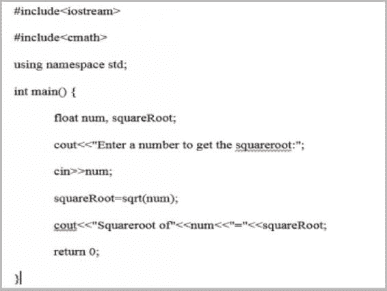

```cpp
// 输出
输入一个数字以获取平方根: 60
60 的平方根 = 7.74597
```

`sqrt()`是用于计算数字平方根的库函数。而`#include <cmath>`是对应的头文件。

每个C++程序都有`main()`函数。任何程序要开始执行，都必须向`main()`进行系统调用。也就是说，执行是从`main()`函数开始的。

### 用户定义函数

C++程序允许用户定义自己的函数。用户可以指定一个函数并编写一段语句，在函数被调用时执行。

#### 函数定义与参数传递

在定义函数时，函数声明非常重要。它告诉编译器关于函数名以及如何调用该函数的信息。

**语法**

```
Type function_name (arguments)
{
    函数体/语句;
}
```

其中，

`Type`是函数返回的数据类型。如果函数执行后没有要返回的值，请使用`void`作为函数的返回类型。

`function_name`是被执行的函数的实际名称。

`Arguments`或`parameter`是传递给函数的值。参数是可选的，因为函数可以带有一列表参数列表，也可以不带。

函数的`Statements`或`body`是解释该函数作用的语句块。

**示例：**

```cpp
// 函数调用
float sum (float a, float b)
{
    float sum;
    sum = a + b;
    return sum;
}
```

在上面的示例中，调用函数时传递了两个参数（`float a`和`float b`）。

#### 调用函数

在声明函数时，你必须说明该函数在语句块上将做什么。要使用声明的函数，你必须对函数进行调用。当程序调用函数时，程序的完全控制权将转移到该函数。结果是，函数将执行其体内部定义的任务，直到函数结束并将控制权交回程序。在调用函数时，你可以传递函数执行所需的参数。

示例：

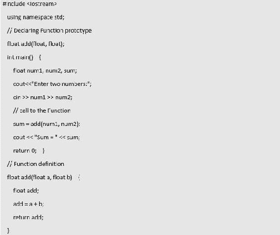

```cpp
// 输出
输入两个数字: 10 6
和 = 16
```

#### 函数原型

如果你想定义自己的函数（用户定义函数），你必须在`main()`之外进行定义，否则编译器会生成错误。编译器不识别用户定义函数以及通过`main()`函数传递的参数。为了解决这个问题，你可以在`main()`之外声明一个函数原型。原型在声明时不带函数体，以便编译器了解该用户定义函数。在上面的示例中，原型声明为：

```cpp
float add (float, float);
```

因此，如果程序中存在用户定义函数，定义函数原型是非常重要的，并且它们应该在`main()`函数之前定义。

#### 按值传递与引用传递

你可以使用按值传递或引用传递将数据传递给函数。在按值传递中，函数参数的原始值不会被修改，而在引用传递中，它的原始值会被修改。

**按值传递**

在按值传递中，传递的值本地存储在栈内存中。如果你更改了参数，更改仅作用于当前函数。当调用函数时，`main()`函数内部变量的值不会改变。按值传递是调用函数常用的方法，对函数参数的任何更改对调用都不会产生影响。在按值传递中，传递的是值的副本。

**引用传递**

当你通过引用传递参数时，变量的原始值会被修改。引用传递会修改变量的原始地址。在函数中更改参数的值，会改变`main()`函数内部和外部变量的值。

```cpp
cout << "the area of rectangle is: " << area(3, 5) << "\n";

return 0;

}
```

内联函数可以在类内部使用。一旦你在类内部定义了一个函数，它会自动变成内联函数，内联函数的所有限制也适用于类内部的函数。

在类中定义内联函数时，你必须先在类内部声明该函数，然后使用`inline`关键字在类外部进行定义。

```cpp
Class rectangle
{
Public:
    Int area (int l, int w)
};

Inline int rectangle:: area(int l, int w)
{
    return l*w;
}
```

## 数据结构

数据结构是单个单元内元素和变量的集合。所有不同类型的数据元素都需要在一个名称下进行处理和存储。例如，一个学生信息文件应该包含姓名、学号、联系方式、课程、班级、成绩和评分信息的详细信息。

结构体的工作方式与数组相同，唯一的区别在于结构体在一个名称下表示不同数据类型变量的集合，而数组表示相同数据类型变量的集合。

要声明结构体，使用关键字`struct`后跟结构体名称（也称为“标签”）。然后在大括号（`{}`）内部定义数据成员或变量。在闭括号之后，输入对象名称（结构体变量），尽管这是可选的。

### 语法

```cpp
Struct structurename
{
    type membername1;
    Type membername2;
    Type membername3;
    .
    .
} objectname;
```

`struct`关键字告诉编译器正在定义一个结构体。`object_name`允许用户直接声明结构体类型的对象，即可以在单个对象中实例化不同的对象。

### 示例 1:

```cpp
Struct person
{
    Char fname[15], lname[15];
    Int age, code;
    Float salary;
} samuel, anthony, paul;
```

上面的示例定义了一个名为`person`的结构体标签，并将不同数据类型的变量与传递给结构体的对象存储在一起。

### 示例 2：创建一个包含10个对象数组的结构体

```cpp
Struct products
{
    Char prodname [20];
    Int weight;
    Float price;
} items [10];
```

### 如何访问结构体内存

一旦你定义并声明了结构体变量，就可以直接对它们的成员进行操作。要访问结构体成员，使用点（`.`）运算符，也称为访问运算符。

访问运算符插入在`object_name`和`member_name`之间。

`Mango.price;`

### 初始化结构体元素

你可以通过给结构体元素赋值来初始化它们。你可以使用单独的赋值语句或数组表示法来初始化元素。

例如，如果你想给芒果的价格赋值50，可以这样做：

```cpp
Mango.price = 50;
```

使用数组表示法时，你可以如下所示初始化元素：

```cpp
Type student = {10, 15.6, 50.0, ‘b’};
```

只有当结构体变量已经定义时，数组类型初始化才有效。上述语句中的类型是结构体`student`的类型标识符，它是同时声明和初始化的。赋值给结构体成员的所有值应该包含在大括号内。

### 示例:

```cpp
#include<io,stream.h>
#include<conio,.h>
#include<stdio.h>

Struct student
{
    int studno;
    char studname[30], course [20], class [2];
    float marks[4];
    char grade;
}student_var;

Void main()
{
    float sum = 0;
    float average;
    cout<<"enter student's number: ";
    cin>>student_var.studno;
    cout<<"enter student's name: ";
    cin>>student_var.studname;
    cout<<"enter student’s course: ";
    cin>>student_var.course;
    cout<<"enter student's class: ";
    cin>>student_var.class;
    cout<<"enter student’s marks on:\n";
    for(int m=0; m<4; m++)
    {
        cout<<m+1<<": ";
        cin>>student_var.marks[m];
        sum = sum + student_var.marks[m];
    }
    average = sum / 4;
    if(average<50)
    {
        student_var.grade = 'fail';
    }
    else if(average<65)
    {
        student_var.grade = 'pass';
    }
    else if(average<80)
    {
        student_var.grade = 'credit';
    }
    else
    {
        student_var.grade = 'dist';
    }
    cout<<"\nresult:\n";
    cout<<student_var.studno<<"\t\tname: "<<student_var.studname;
    cout<<"\t\tcourse: "<<student_var.course<<"\t\tclass: "<<student_var.class;
    cout<<"\t\ttotal: "<<average<<"\t\tgrade: "<<student_var.grade;
    return 0;
}
```

**输出:**

```
enter student's number: 
enter student's name: 
enter student’s course: 
enter student's class: 
enter student’s marks on:
1: 50
2: 60
3: 70
4: 80
result:
1		name: John course: C class: A total: 65 grade: pass
```

## C++ 中的引用

C++引用是现有变量的另一种别名。一旦你用引用初始化一个变量，就可以使用该引用名称。C++支持三种类型，包括：

- `值引用`：这些是值
- `常量引用`：这些不会被修改
- `指针引用`：这些有助于避免拷贝

要声明引用，使用取地址符（`&`），它也是地址运算符。

### 示例 1:

```cpp
int prd=5;
int &x = prd;
```

### 示例 2:

```cpp
#include<iostream>
Using namespace std;

Int main()
{
    double price = 100;
    double &ref = price;
    // 修改价格
    ref = 120;
    cout << "price = " << price << endl;
    // 修改 ref
    price = 150;
    cout << "ref = " << ref << endl;
    return 0;
}
```

**输出:**

```
price = 120
ref = 150
```

### 引用的应用

1. **修改函数的参数**：如果你想在函数调用期间更改传递给函数的参数，可以引用变量。在上面的示例中，引用变量将价格从100修改为120。

2. **避免拷贝大型结构体**：如果你有一个执行大量对象的函数，在不引用的情况下传递参数会创建对象的副本。为了避免这种重复，可以使用引用。

### 示例:

```cpp
Struct employee
{
    string empnames, address;
    int empno;
}

Void print (const employee &em)
{
    cout << em.empnames << " " << em.address << " " << em.empno;
}
```

如果我们移除引用运算符，它将创建一个`employee`对象的新副本。`const`关键字防止了对程序的意外更新。

借助编程范式的帮助，程序员可以轻松地设计、组织和构建解决各种问题的程序。编程范式有两种类型：声明式编程范式和命令式编程范式。`C++`语言是一种命令式编程语言，因为它依赖OOP概念来执行函数。

本章的关键元素包括：

- 学习各种内置数据类型以及如何在编写程序中使用它们。
- 如何使用用户定义类型来执行复杂程序。
- 如何在`C++`中声明变量并为变量分配内存位置。
- 如何声明数组来存储数据元素、初始化数组、访问数组元素，以及了解如何处理二维数组和多维数组。
- 使用指针指向特定的存储位置并允许你确定变量的引用地址。
- 学习如何使用动态空闲运算符为程序分配内存空间。
- 如何使用`C++`函数构建程序并实现代码复用性特性，使复杂程序更高效。
- 学习函数定义、如何声明函数、如何调用函数以及如何使用函数原型和内联函数。
- 学习在处理大型对象时使用引用，以减少函数调用中的开销时间。引用将帮助你最小化CPU执行时间并节省内存空间，因为它可以防止在每次函数调用时发生对象的复制。
- 如何使用结构体和引用访问对象。数据结构允许你在单个单元下处理不同数据类型的变量。
- 在同一个名称下创建不同返回类型和数据元素的变量以避免代码重复。
- 调用结构函数并传递不同数据类型的参数。

在下一章中，你将学习面向对象编程的基本概念，包括类、对象的使用、数据抽象与封装、多态和继承特性。

## 第二章：面向对象编程的基本概念

有必要理解面向对象编程中使用的基本概念。见下图。

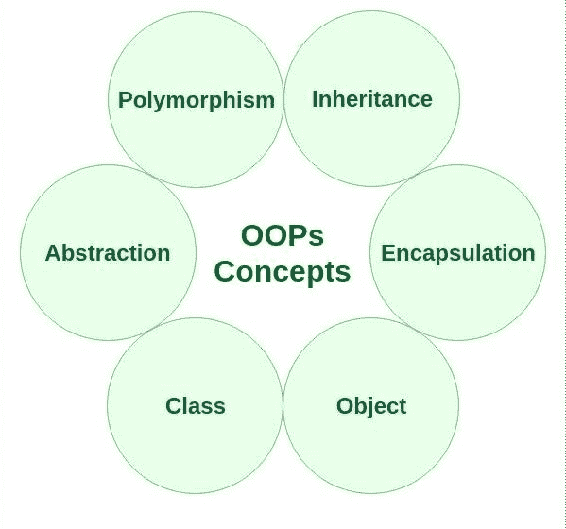

### 类 (Class)

类是数据结构的扩展概念，是`C++`编程语言的构建块。它由用于组织结构中数据函数的逻辑方法组成。`class`关键字表示带有成员函数的数据结构。

一个类由两部分组成：类头和类体。类头定义了类名和基类，而类体定义了每个类支持的类成员。类使用用户定义的数据类型来持有自己的数据成员和成员函数。通过创建类的实例来访问类成员和函数。

- **类成员**：它们代表该类中的数据变量，并指定类对象的表示方式。
- **成员函数**：描述了用于操作这些数据变量的函数原型。它指定了类操作，这也称为类的实例。

成员函数和数据成员定义了类中对象的属性和行为。


类成员分为三种访问权限：公共（`public`）、私有（`private`）和保护（`protected`）。

- **公共成员**：此类中的数据成员可以被每个类成员访问，只要类可见，即可从任何地方访问。
- **私有成员**：在此类中，数据成员只能由类成员或同一类的其他成员访问。
- **保护成员**：这些成员只能在类内部以及来自派生类的其他成员中访问。

### 语法 (Syntax)

```
Class classname
{
Access specifier:
    Member(s);

Access specifier 2:
    Members(s);

Access specifier n:
    Member(s);
};
```

其中，

- `Class` 表示类的关键字。
- `classname` 是一个名称。
- `Access specifier` 是授予类的访问权限：公共（`public`）或保护（`protected`）。
- `Members` 定义了类成员和函数。

### 示例 (Example)

```
Class cars
{
char carname[30];
char brand[30];
float speedlimit;

public:
    void getdata();
    void display();
};
```

在这个示例中，数据成员将是 `carname`、`brand` 和 `speedlimit`。函数 `getdata()` 用于汽车对象。从上面我们可以推断出类是具有相似属性的对象的蓝图。在 `c++` 中，对象是一个拥有某些特征的实体，它在运行时创建。

类的实例是一个对象。当你定义一个类时，没有分配内存，但当你创建一个实例时，会为该对象类型分配内存。

### 语法 (Syntax)

```
Identifier.message([arg1, arg2])
```

其中，

- `identifier` 是对象名。
- `.` 代表成员访问。
- `message` 是发送的消息类型。
- `arg` 是用于返回消息的可选参数列表。

标识符和消息之间的点是访问运算符，用于识别数据成员和函数。

### 示例 (Example)

```
Class person
{
char fname[25], lname[25];
int age;

public:
    void getdetails();
    void display();
};

void person::getdetails()
{
    cout << "enter your first name and last name:";
    cin >> fname >> lname;
    cout << "enter your age:";
    cin >> age;
}

void person::display()
{
    cout << "your name is:" << fname << lname << " aged" << age;
}

int main()
{
    person p; //p 是一个对象
    p.getdetails(); //调用输入姓名和年龄的函数
    p.display(); //调用显示姓名和年龄的函数
    return 0;
}
```

`p` 是 `person` 类的实例。在上面的示例中，`getdetails()` 和 `display()` 是 `person` 类的成员函数。要调用这些函数，我们使用点运算符 `.` 后接对象名 `p`。

`person` 类有两个私有成员属性（姓名和年龄）以及两个公共成员函数（`getdetails()` 和 `display()`）。这些函数在类内部以原型的形式声明。

函数名后面跟着一个双冒号（`::`），这会将 `getdetails()` 和 `display()` 标识为 `person` 类的成员函数。

如果创建一个类，类名就定义了一个名为对象 `p` 的新数据类型。

从上面的示例可以看出，`person p` 是由类 `person` 创建的对象，其中 `p` 向函数 `p.getdetails();` 发起了调用。

当你调用此函数时，编译器会提示你输入 `person` 的名、姓和年龄，并将它们存储在类的私有成员中。

`p.display()` 是一个检索存储的 `person` 姓名和年龄数据的调用。

## 数据抽象 (Data Abstraction)

数据抽象是 C++ 编程另一个重要特性。数据抽象提供了所需的信息，而不展示所有的细节。它只显示需要的信息，同时隐藏后台的数据细节。

类有助于在 C++ 中实现抽象。通过使用访问修饰符，你可以根据成员函数和数据成员对类进行分组。这使得很容易知道哪些数据成员对用户可见，以及哪些数据保持隐藏状态。

抽象也可以应用于头文件。例如，当使用 `pow()` 计算某个数的数的幂时，你只需要从 `math.h` 头文件中调用 `pow()` 函数并向其传递参数。你不需要知道这些函数在后台是如何工作的，你只感兴趣该函数的功能以及计算结果。

## 数据封装 (Data Encapsulation)

数据封装是将数据和函数封装在一个名为“类”的单一单元中的过程。也就是说，将数据与其操作方法或函数封装在一起。

在封装中，你无法直接访问数据。你只能通过类内部的函数访问它。

在处理数据时，封装确保数据不会被直接访问，只能通过类内部的函数原型进行访问。这使得数据隐藏的概念成为可能。

例如，如果你是一名会计并想要获取某一周的销售数据，你无法访问销售部门的所有数据。你可以联系负责销售部门的销售经理，要求他检索特定某周的销售情况。销售数据和销售经理被封装在一个名为“销售部门”的类中。

封装使得创建数据隐藏或数据抽象的概念变得简单。例如，隐藏销售类中不需要的数据。

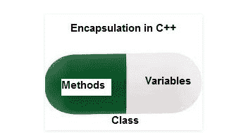

## 多态 (Polymorphism)

多态是数据以多种形式的表示。它允许不同类型的函数和变量在不同的时间使用。也就是说，一个变量或函数可以在不同的实例表现出不同的行为。

在执行操作时，简单的函数调用可以根据变量的数据类型产生不同的结果。多态允许运算符表现出不同的行为。

多态有两种类型：

- 运算符重载 (operator overloading)
- 函数重载 (function overloading)

运算符重载：这是指运算符在不同实例显示不同的结果。

函数重载：这是指同一个函数名执行不同类型的任务。

示例：你可以写一个函数来计算不同参数的数字之和。创建函数 1 和 2，向第一个函数传递两个整数类型的参数，并为第二个函数提供三个整数类型的参数。当你调用这些函数时，它们将产生不同的实例。因此，多态允许你使用相同的方法并向其传递不同的参数。


## 继承 (Inheritance)

这是一个从现有类或基类开发新类的概念。派生出的新类将具有基类的特性。基类将充当父类或超类，而派生类将充当子类或子类。

子类继承父类（父类）的所有属性和特性。

继承支持代码复用的概念。这非常重要，因为它有助于减少执行某特定任务时编写的整体代码量，使其成为对象编程中的一项极佳的特性。如果你想创建一个使用另一个类中某些代码的新类，可以从现有类派生出一个新类。这允许你重用现有类中的变量和方法。

## 其他特性 (Other Features)

### 动态绑定 (Dynamic binding)

当你进行函数调用时，函数的代码在运行时执行。这个过程被称为动态绑定。C++ 使用虚函数来支持动态绑定。

### 消息传递 (Message passing)

消息传递是对象之间相互通信的技术。一个对象向另一个对象发送消息，请求执行某个特定的过程。这会触发接收对象中的一个函数并返回所需的结果。当一个对象与另一个对象通信时，它必须指定其函数名和要发送的消息。

C++ 语言支持静态消息传递，即当你调用对象的方法时，目标对象也应该具有被调用的方法。否则编译器将生成错误信息。消息传递是通过虚函数表（`vtables`）实现的。要在对象上使用动态消息传递，你应该：

- 声明一个全局函数，作为对象之间传递消息的签名。
- 从 `d::object` 继承对象属性。
- 创建一个类构造函数，并使用 `add_message` 方法向对象添加一个或多个消息。
- 使用 `invoke(signature, ...parameters)` 向对象发送消息。

### 消息传递是如何工作的

每个 C++ 对象都有一个指向特定映射（`map`）的 `shared_ptr`。也就是说，映射的键（`key`）作为消息签名的指针。它的值指向一个内部的消息结构，该结构持有要调用的消息方法的指针。

一旦对象方法被调用，它从映射中检索适当的消息结构。结果，它使用该结构作为目标调用对象方法。

对象之间共享消息映射以提高它们之间的效率。如果映射不是唯一的，它在修改消息映射后将进行复制。

### 章节总结 (Chapter summary)

在本章中，你学习了面向对象编程的基本概念，包括：

- 学习如何处理 C++ 对象并初始化它们。
- 如何创建类以及类定义。
- 应用数据抽象和封装的概念来扩展编程语言的功能。
- 学习程序员如何创建用户定义数据类型，以及封装和抽象如何工作以向用户提供所需信息而无需展示程序细节。
- 学习通过封装使数据隐藏的概念可能。
- 如何使用多态特性创建具有多种数据类型或形式的对象。
- 学习在多态中使用函数重载和重载运算符。
- 学习 C++ 如何通过允许在构建另一个类（派生类）在使用类的属性和特性来支持继承特性。
- 动态绑定特性以及消息传递的工作原理。

在下一章中，你将学习如何构建基类和派生类，以及如何处理数据成员和成员函数。

## 第三章：类与对象的操作

在上一章中，你学习了类作为一种用户定义的数据类型，它是创建对象的蓝图。类扩展了数据结构的概念，就像数据结构一样，它们拥有数据成员和额外的成员函数。

### 使用类

在处理复杂的类函数时，在类内部定义成员函数会使类的管理变得困难。

### 类头文件与类体

C++ 编程语言允许通过将类定义放在头文件中来实现代码复用。这促进了多个文件或项目之间的代码复用。就像在头文件中声明函数以便在多个项目中使用该函数一样，类定义被放在与类名同名的头文件中。

此类类的成员函数定义在类之外，并存储与类名同名的 `.cpp` 文件中。

类头文件包含类定义、其数据成员以及成员函数的原型声明。

注意：将所有成员函数都放在头文件中可能会导致类定义变得杂乱。在类内部定义的所有函数都是隐式内联的（`inline`），如果你处理的是一个频繁调用的复杂函数，它将减慢函数代码的执行速度。

如果你更改了头文件中的某些函数代码，你需要在包含该头文件的每个文件中进行相同的更改。否则，这将影响项目的重新编译过程。

但如果你更改了 `.cpp` 文件中的某些函数代码，只需要重新编译该 `.cpp` 文件。

### 类的定义与声明

在 C++ 中，类由相关的函数和数据组成。类中的数据和函数组合形成一种数据类型，用于创建该类型的对象。创建的类代表了具有各种数据类型属性和行为（即它们关联的操作）的现实世界实体。

#### 语法

```
Class 类名 {

  访问修饰符 1:
    成员 1;

  访问修饰符 2:
    成员 2;

  …
} 对象名;
```

其中，

- `class` 关键字指示符表示新的数据类型，后面跟着类名，类名是标识该类的特定名称。
- 类由私有（`private`）和公共（`public`）访问修饰符组成。

#### 私有 (Private)

`private` 访问修饰符有助于实现数据隐藏概念。这通过在声明成员值时使用 `private` 关键字来实现。在 `private` 关键字下声明的数据成员和函数只能从类内部进行访问。

数据隐藏概念是一种安全技术，可以防止未经授权的用户执行任何数据操作，如读/写操作或修改数据。因此，私有数据声明可以向未经授权的用户隐藏数据并防止意外操作。

#### 公共 (Public)

在 `public` 访问修饰符中，数据和函数都可以在类外部访问。类中声明的成员函数通常是公共的，因此，你可以从类外部访问它们。

下面显示了私有和公共成员的类定义。

```
Class 类名
{
  Private: 变量声明（数据成员）；
    函数声明（成员函数）；

  Public: 变量声明;
    函数声明;

  Protected: 变量声明;
    函数声明;
};
```

#### 语法

```
Class mytest
{
  private:
    int x;
    double y;
    string *name;
    void getx () {x=25;}
    …;

  public:
    int count;
    void gety () {y=15;}
    …;
};
```

其中，

- 在这个示例中，`x`、`y` 和 `names` 定义在类内部，因此它们是私有成员，可以在该类内部访问。
- `count` 是一个公共数据成员，可以在外部访问。

### 数据成员与函数

数据成员是在类中使用标准类型（如 `char`、`int`、`float` 等）或派生类型（如指针和结构体）声明的任何变量。

类内部的函数由名称组成并对所有成员具有访问权限。函数定义有两种：

#### 类定义

这描述了数据成员和函数。

#### 方法定义

类的函数的描述代码有两种编写方式：

- 在类内部
- 在类外部

当你使用内联函数（`inline functions`）时，编译器会将函数代码插入到调用该函数的地方。这确保了函数的快速执行。

示例：

```
Class rectangle
{
  public:
    float length;
    float width;

    float getarea() {
        return length * width;
    }
};
```

要调用类的函数，必须使用点操作符（`.`）。

**语法：**

```
Class rectangle
{
  public:
    float length;
    float width;

    float getarea();
};

float rectangle::getarea() {
    return length * width;
}
```

要在类外部定义函数，必须使用作用域解析运算符（`::`），如上一章所示。

**语法：**

```
Type 类名::函数(参数)
{
    函数体
}
```

`::` 运算符允许你在类外部定义函数，即使该函数的名称与局部变量名称相同。

**示例：**

```cpp
Class rectangle
{
  public:
    float length;
    float width;

    float getarea();
};

float rectangle::getarea() {
    return length * width;
}
```

### 调用类成员函数

要调用对象的函数，你需要使用点操作符（`.`），如上一章所示。

**语法：**

```
Rectangle rect; // 创建一个矩形对象
Rect.getarea(); // 调用对象的函数
```

**示例：**

```cpp
#include<iostream>
#include<string>

using namespace std;

class product
{
    string prd_name;
    float weight, price;

public:
    void mgetdata();
    void mfdisplay();
};

void product::mgetdata() {
    cout << "enter the product name";
    cin >> prd_name;
    cout << "enter the product weight and price";
    cin >> weight >> price;
}

void product::mfdisplay() {
    cout << "product name is" << prd_name << "weight is" << weight << "and the price" << price << endl;
}

//调用类成员函数
int main() {
    product item;
    item.mgetdata();
    item.mfdisplay();
    return 0;
}
```

在受保护的数据成员函数中，数据成员和成员函数由其声明的当前类或派生类使用。

你可以在当前类的子类中使用点运算符（`.`）来访问受保护的数据成员。就像公共（`public`）类一样，你可以从类、友元函数或派生类访问受保护成员。

如果类成员被声明为受保护（`protected`），那么：

- 只有声明该成员的原始类的成员函数可以访问这些变量。
- 只有原始声明这些成员为受保护的类的友元可以访问这些类成员。
- 对受保护成员具有私有访问权限的私有派生类可以直接访问它们。
- 只有从原始声明数据成员的类以公共（`public`）或受保护（`protected`）权限派生的类才能使用它们。

在使用基类时，`protected` 关键字表示基类的公共和受保护成员都是派生类的受保护数据成员。

受保护的数据成员没有私有（`private`）数据成员那么私有，但比从任何函数都可以访问的公共数据成员更公开。

你可以将受保护的数据成员声明为静态（`static`），这意味着它们可以被派生类的友元函数或成员函数访问。如果成员不是静态的，则可以通过指针或引用在友元函数和派生成员函数中访问。

### 类成员函数的类型

在 C++ 中，有几种成员函数可以用于操作数据成员和函数。这些特殊的成员函数包括：

1. 简单函数。
2. 静态函数。
3. 常量函数（`Const functions`）。
4. 内联函数（`Inline functions`）。


## 5. 友元函数

### 简单成员函数

这些是 C++ 中定义的成员函数。它们没有使用像 `static` 这样的特殊前缀。基本或简单成员函数的通用格式如下。

#### 语法

```cpp
Type function_name (arguments)
{
    function body;
}
```

### 静态成员函数

这些成员函数使用 `static` 关键字，它与数据成员和成员函数相关。`static` 意味着保持相同的位置。

要使函数成为静态的，请使用 `static` 关键字后跟函数名。静态函数适用于整个类，而不是类的某个特定对象。

使用对象和直接成员访问运算符（`.`）调用静态函数。你也可以使用类名、作用域解析运算符或直接本身调用静态成员函数。

#### 语法

```cpp
Class s
{
public:
    static void fxn ()
    {
        …
    }
};

int main() {
    // 使用类名直接调用成员函数。
    s::fxn ()
}
```

上述函数只能访问静态数据成员和静态成员函数。普通数据成员或函数无法被访问。

### 常量成员函数

`const` 关键字用于声明常量变量。一旦变量定义为常量，其值就无法更改。当 `const` 与成员函数一起使用时，这些函数不能修改数据对象或数据成员。

#### 语法

```cpp
Void x () const
{
    // function body
}
```

#### 1. 内联函数

当你在特定类内部定义成员函数时，该函数会自动成为内联函数。

#### 2. 友元函数

友元函数为非类函数提供了私有访问。这些函数不是类的成员函数。`friend` 函数允许你将全局函数声明为友元，或将另一个类的成员函数声明为友元。

#### 语法

```cpp
Class friendclass
{
    int x;
public:
    friend void fn() //设置全局函数为友元
    
    void fn()
    {
        friendclass fc;
        // 访问私有数据成员
        fc.x=10;
        cout<<fc.x;
    }
};

int main() {
    fn ()
}
```

友元函数能够访问私有数据成员。

示例：

```cpp
Class anotherclass
{
    void fn();
};

Class friendclass
{
    int x;
public:
    friend void anotherclass::fn();
};

void anotherclass::fn()
{
    friendclass fc;
    fc.x=10;
    cout<<fc.x;
}
```

### 构建类

当你在特定类内部定义成员函数时，该函数会自动成为内联函数。

### 基类与派生类

在使用基类时，`protected` 关键字表示基类的公共和受保护成员都是派生类的受保护数据成员。

受保护的数据成员没有私有数据成员那么私有，但比从任何函数都可以访问的公共数据成员更公开。

你可以将受保护的数据成员声明为静态，这意味着它们可以被派生类的友元函数或成员函数访问。如果成员不是静态的，则可以通过指针或引用在友元函数和派生成员函数中访问。

### 重写方法

在受保护的数据成员函数中，数据成员和成员函数由其声明的当前类或派生类使用。

你可以在当前类的子类中使用点运算符（`.`）来访问受保护的数据成员。就像公共（`public`）类一样，你可以从类、友元函数或派生类访问受保护成员。

### 访问修饰符

如果类成员被声明为受保护（`protected`），那么：

- 只有声明该成员的原始类的成员函数可以访问这些变量。
- 只有原始声明这些成员为受保护的类的友元可以访问这些类成员。
- 对受保护成员具有私有访问权限的私有派生类可以直接访问它们。
- 只有从原始声明数据成员的类以公共（`public`）或受保护（`protected`）权限派生的类才能使用它们。

### 章节总结

在本章中，你学习了如何使用类来解决各种问题，包括：

- 在定义对象时使用类头和类体，以及定义和声明类。
- 如何区分数据成员和成员函数。
- 如何声明数据成员和成员函数，并确定它们应该被声明为私有、公共还是受保护成员。
- 如何访问类的私有、公共和受保护成员，以及如何调用成员函数。
- 在调用特定函数时处理不同的类成员函数。
- 如何使用基类和派生类构建类。从基类或父类，可以派生出一个继承基类行为和属性的类。

在下一章中，你将学习类继承，包括派生类如何继承属性。

继承是一种面向对象的编程特性，它允许类借用其他类的成员，而无需重复其成员。它允许一个类（派生类或子类）获取另一个类（基类或超类）的属性和方法。被继承属性的类被称为基类、父类或超类，而继承这些属性的类被称为派生类、子类或子类。

当一个类继承另一个类的属性时，基类的变量和函数对新类可用，从而促进了代码的可重用性。派生类继承所有成员，私有成员除外。

### 继承的重要性

1. 支持代码重用。
2. 支持方法重写。
3. 使用 `virtual` 关键字。

### 基类和派生类

在继承另一个类的成员时，超类的公共成员将保持为公共，受保护成员将保持为受保护。在私有继承中，超类的公共和受保护成员在子类中将保持为私有。

#### 语法

```cpp
Class subclass: access_mode superclass
```

应该先声明超类，即在定义子类之前定义。访问模式（`private`、`public` 或 `protected`）指定了子类将继承超类的哪些属性。

例如，假设你有一个 `employee` 类和一个 `manager` 类，其中 `manager` 也是一个具有额外职责的 `employee`。你可以应用继承的概念，避免在 `manager` 类中重复 `employee` 类的数据成员和成员函数。

`manager` 类可以如下所示：

```cpp
Class manager: public employee
{
Public:
// 额外的 manager 成员组件
…
};
```

继承帮助你声明 `manager` 类，而无需重复 `employee` 类内部的成员组件。`employee` 是基类，而 `manager` 是派生类。

```cpp
Class student
{
    …
};

class hod : protected student
{
    …
};
```

---

### 继承的类型

#### 单继承

单继承是最简单的继承类型之一，一个类派生自一个类。派生类仅从这一个类继承成员组件。例如，类 `b` 继承了类 `a` 的属性和行为。类 `b` 继承了类 `a` 的所有公共和受保护成员。

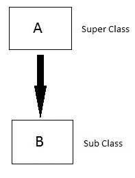

#### 语法

```cpp
Class b: public a {/*…*/};
```

或者：

```cpp
Class b: protected a {/*…*/};
```

#### 多重继承

在多继承中，一个类可以从两个或多个直接基类继承成员。例如，你可以从类 `a` 和 `b` 基类创建派生类 `c`。

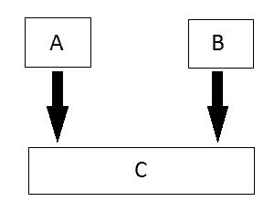

#### 语法

```cpp
Class c: public a, public b {/*…*/};
```

#### 示例

```cpp
#include<iostream.h>

Class polygon
{
Protected:
    Int width, height;
Public:
    void setvalues (int w, int h)
    {
        width=w, height=h;
    }
};

Class output
{
Public:
    void output (int);
};

void output::output (int i)
{
    cout<<i<<endl;
}

Class rectangle:public polygon, public output
{
Public:
    Int area()
    {
        return width*height;
    }
};

Class triangle: public polygon, public output
{
    Int area()
    {
        return (width*height/2);
    }
};

Int main()
{
    Rectangle rect;
    Triangle tri;
    Rect.setvalues (6,4);
    Tri.setvalues (6,4);
    cout<< "area of rectangle is:"<<rect.output(rect.area);
    cout<< "area of triangle is:"<<tri.output (tri.area);
    Return 0;
}
```

#### 多级继承

这是派生类继承自一个继承了另一个基类属性的类。例如，如果 `a` 是 `b` 的基类，而类 `b` 是 `c` 的基类，那么 `c` 就是 `b` 的派生类，而 `b` 是 `a` 的派生类。

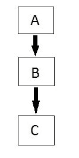

#### 混合继承/虚继承

混合是几种继承类型的组合。例如，类 `b` 和 `c` 是基类 `a` 的派生类。从派生类 `b` 和 `c`，你可以创建一个新的派生类 `d`。这形成了混合继承，因为它结合了多种继承类型形成了一个新类。

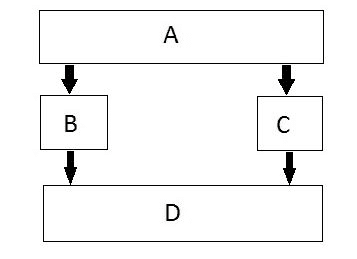

#### 层次结构继承

层级继承有多个子类，它们继承同一个基类的属性。类 `b`、`c` 和 `d` 继承单个类 `a` 的属性。

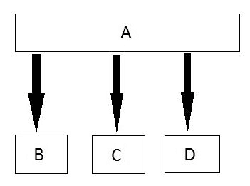

## 继承与析构函数

析构对象的继承在构造函数的执行期间按反序执行。当对象超出作用范围时，会执行析构函数。见下文关于多重继承构造函数和析构函数的示例。

#### 语法

```cpp
#include<iostream.h>
#include<iostream.h>

Class base1
{
public:
    base()// 零参数构造函数
    {
        cout << "zero arguments constructor \n";
    }
    ~base()
    {
        cout << "destructor of base1 class\n";
    }
};

Class base2
{
public:
    base2()
    {
        cout << "zero argument constructor for base2 class\n";
    }
    ~base3()
    {
        cout << "destructor of base2 class\n";
    }
};

Class base3: public base1, public base2
{
public:
    base3()
    {
        cout << "zero argument constructor for a derived class \n";
    }
    ~base3()
    {
        cout << "destructor of the derived class \n";
    }
};

Int main ()
{
    clrscr ();
    base3 obj; // 声明对象
    return 0;
}

// output
Zero arguments constructor
Destructor of base1 class
Zero argument constructor for base2 class
Destructor of base2 class
Zero argument constructor for a derived class
Destructor of the derived class
```

在上述程序中，`base1` 和 `base2` 是基类，而 `base3` 是派生类。基类的构造函数在执行派生类之前执行。派生类的析构函数在执行基类之前执行。

你可以在派生类构造函数调用基类构造函数。当你从现有基类创建派生类对象时，基类默认成为构造函数并首先执行，然后执行派生类。

当带有参数的派生类构造函数内部调用带有参数的基类构造函数时，你需要在声明派生类构造函数的参数时显式地提到它。

基类是存在于所有类型类中的默认构造函数。见下面的示例。

#### 语法

```cpp
Class construct
{
    Int x;
public:
    construct()
    {
        cout << "building default constructor\n";
    }
};

Class child : public construct
{
    Int y;
public:
    Child()
    {
        cout << "default derived constructor\n";
    }
    // 带参数的构造函数
    child(int z)
    {
        cout << "parameterized derived constructor\n";
    }
};

Int main()
{
    construct c;
    Child c1;
    Child c2(10);
}

// output
Building default constructor
Default derived constructor
Building default constructor
Parameterized derived constructor
```

在上面的示例中，基类是默认构造函数类，它与派生/子类对象一起被调用。下面的示例显示了带参数的基类构造函数。

#### 语法

```cpp
Class construct
{
    Float x;
public:
    construct(float i)
    {
        x=i;
        cout << "parameterized constructor\n";
    }
};

Class child : public construct
{
    Float y;
public:
    child(float j): construct(j)
    {
        y=j;
        cout << "parameterized derived constructor\n";
    }
};

Int main()
{
    child (10);
}

// output
Parameterized constructor
Parameterized derived constructor
```

对带参数的基构造类的显式调用允许调用带参数的派生类构造函数。基类构造函数在派生类内部调用。这允许构造函数初始化类中的对象。

派生类构造函数只能访问自己的类成员，而派生类对象继承基类的特征和属性。基构造函数初始化基类的成员。

## C++ 中的上转型

使用基类引用或指针指向子类对象被称为**上转型**（upcasting）。即：将子类地址或指针转换为其基类引用。


#### 语法

```cpp
Class baseclass
{
    Int i;
public:
    void base()
    {
        cout << "this is superclass";
    }
};

Class derived:public baseclass
{
    Int j;
};

Int main()
{
    Baseclass* ptr; // 指向基类的指针
    Derived obj;
    ptr = &obj; // 基类的引用
    Baseclass &ref=obj;
}
```

在下转型（downcasting）中，基类的引用或指针被转换为派生类的引用或指针。注意：构造函数和析构函数是不继承的。赋值运算符（`=`）可以重载，但不能被子类继承。

## 继承与静态函数

（注：源文件中关于“继承与静态函数”的提供文本不完整/缺少细节，但我根据可用片段维护了其结构。）

1. 静态函数可以继承到派生类中。
2. 如果在派生类中重定义了静态函数，则基类中的其他重载函数会被隐藏。
3. 所有静态成员函数都不能是虚函数。

## 混合继承与虚类

当一个派生类继承多个一个基类的属性时，就会导致多重继承。见示例。

#### 语法

```cpp
Class basea
{
    void print();
};

Class baseb:public basea
{
    // derived definition
};

Class basec:public basea
{
    // derived definition
};

Class derived:public baseb, public basec
{
    // class definition
};

Int main()
{
    derived obj;
    obj.print();
}
```

`baseb` 和 `basec` 都继承了 `basea` 的 `print()` 函数。在 `main()` 函数中调用 `obj.print()` 会导致，编译器不知道调用哪个 `print()` 函数。为了避免这种情况，使用了虚函数。在类被继承时插入 `virtual` 关键字。


```cpp
Class basea
{
    virtual void print();
};

Class baseb: virtual basea
{
    // derived definition
};

Class basec: virtual basea
{
    // derived definition
};

Class derived:public baseb, public basec
{
    // class definition
};
```

`virtual` 关键字告诉编译器调用两个函数中的一个。

## 管理动态数据

C++ 允许你为程序动态分配内存。最初，程序员可以在程序执行之前通过定义变量确定内存空间。某些情况下，内存只能在运行时确定或基于用户输入。在这种情况下，内存动态分配给程序。动态内存决定了数据的如何处理和存储。

指针也用于内存分配并持有变量的内存地址。当你声明变量时，它包含两个部分：

- 变量的地址

- 存储在变量中的值。例如：`int y=200;`

上述示例告诉编译器：

1. 创建存储值的空间。

2. 将变量 `y` 与预留内存位置关联。

3. 在预留内存位置存储值 `200`。

指针是 C++ 语言中非常有用的特性之一，一旦在程序中使用，它可以：

1. 直接访问和操作内存位置。

2. 为变量分配动态内存。

3. 提高某些程序的效率。

## 使用 new 和 delete 运算符分配和释放内存

C++ 程序整合 `new` 和 `delete` 运算符来动态分配内存。`new` 运算符后跟类型指示符动态分配程序的内存。

如果用户输入是一个多个元素的序列，则需要 `new[]` 运算符来分配内存块。

#### 语法

```cpp
Pointer = new return-type

or

Pointer = new return-type [size]
```

```cpp
int *mem;
```

```cpp
mem = new int [4];
```

当你运行程序时，系统会动态分配一个包含 `4` 个整数类型元素的内存空间，并返回一个分配给指针 `mem` 的元素数组。因此，`mem` 直接指向一个包含四个整数（`int`）类型元素的内存块。

你可以通过调用 `mem[0]` 访问数组的第一个元素，而通过 `mem[1]` 访问第二个元素。

你也可以使用 `new` 运算符初始化内存，如下所示。

#### 语法

`pointer-variable = new return-type (value);`

### 示例：

```cpp
int *ptr = new int (30);
float *r = new float (15)
```

普通数组与使用 `new` 运算符动态分配的内存块之间存在差异。在普通数组，数组大小是在变量声明期间（程序运行前）确定的常量表达式；而动态内存分配是使用 `new` 运算符在运行时为程序分配内存空间的。它可以使用任何变量值作为元素块的大小。

系统从内存堆（`heap`）为程序动态分配内存。非静态变量和局部变量在栈（`stack`）上分配内存。

对于任何动态分配的内存（`int *mem = new int[4]`），程序员必须在程序执行后释放内存。否则，如果内存空间没有释放，将导致内存泄漏。内存应该在程序执行结束后释放。

### delete 运算符

在 C++ 中，`delete` 运算符释放程序已分配的内存空间。这使得内存可以供下一次动态分配空间的请求。

#### 语法

`delete pointer-variable;`

或

`delete [] pointer-variable;`

如果你使用 `new` 运算符为单个元素动态分配了空间，则使用 `delete pointer-variable` 来释放内存。要释放分配给元素块的内存，你使用 `delete []`。传递给 `delete` 运算符的参数应该是指向元素块的指针或空指针（`null pointer`）。传递空指针对 `delete` 运算符没有影响。

例如，`delete [] ptr;` 或 `delete ptr;`

```cpp
#include <iostream>
#include <new>

Using namespace std;

int main ()
{
    int l,m;
    int * ptr;
    cout << "enter the numbers you want to print:";
    cin >> l;
    ptr= new (nowrow) int[l];
    if (ptr == nullptr)
    {
        cout << "error: unsuccessful memory allocation";
    }
    else
    {
        for (m=0; m<l; m++)
        {
            cout << "enter number: ";
            cin >> ptr[m];
        }
        cout << "the numbers entered are: ";
        for (m=0; m<l; m++)
        cout << ptr[m] << ", ";
        delete[] ptr;
    }
    return 0;
}
// // output
Enter the numbers you want to print: 3
Enter number: 25
Enter number: 50
Enter number: 72
The numbers entered are: 25, 50, 72
```

如果系统无法分配请求的内存空间（例如请求大内存内存分配），系统将返回错误信息：`error: unsuccessful memory allocation`。新的请求将抛出一个标准的 `bad_alloc` 异常，除非你在使用 `new` 运算符时使用了 `nowrow`。这种异常类型通过检查指针值或捕获异常来处理错误。

### 使用 try 和 catch 处理错误

计算机内存是有限的资源，有时无法保证使用 `new` 运算符向程序动态分配内存的请求会成功。内存有时会耗尽。

C++ 使用两种标准机制来确定内存分配是否成功。如果内存分配失败，则会抛出一个异常。使用了 `nowrow` 异常。使用 `throw` 异常通过检查指针值或捕获异常来处理错误。

#### 语法

`ptr = new (nowrow) int[l];`

为了避免程序员在创建内存时发生内存泄漏，他们应该在不再需要时使用 `delete` 释放它。这是使用 `delete` 避免内存泄漏的重要点。

```cpp
#include <iostream>
using namespace std;

void func()
{
    int *p = new int(4);
    delete p;
}

int main()
{
    int *p = new int(4);
    delete p;
    return 0;
}
```

### 章节总结

继承是面向对象编程的重要特性之一。它允许你重用代码而不是重写相同的代码。在本章中，你学习了：

- 如何从现有类派生类。

- 如何同时使用基类和派生类。

- 如何指定子类继承哪些属性。这要求你在定义子类之前定义基类。

- 关于不同类型的继承。

- 如何在派生对象中使用构造函数和析构函数。

- 如何使用基类和派生类构造函数。当你创建一个派生对象时，基类构造函数默认首先执行，然后是派生类。

- 如何在派生类构造函数内部调用带有参数的基类构造函数。

- 如何使用 C++ 中的上转型（`upcasting`）特性来允许你引用基类。

- 如何使用指针直接指向子类。

- 如何在运行时为你的程序动态分配内存空间。

- 如何使用 `new` 和 `delete` 运算符在不需要时分配和释放内存。

- 如何使用 `delete` 或 `delete []` 运算符帮助你避免程序中的内存泄漏。

- 如何使用 `try catch` 异常测试内存分配是否成功或失败。

在下一章中，你将学习多态。在章节结束时，你将了解什么是多态，以及如何在编译和运行时应用不同类型的多态。

## 多态

多态（`Polymorphism`）是一种允许对象具有多种形式的特性。如果你有多个通过继承相互相关的类，那么这些类就使用了多态的概念。在使用继承时，多态是通过重写函数（`overriding function`）来实现的。也就是说，父类和子类具有相同的声明的成员函数，但函数定义不同。

在上一个章节中，继承功能允许我们创建一个新的派生类，并继承另一个类的属性和性质。多态使用类似的方法来执行不同的任务。它允许你使用不同的形式执行单项任务。例如，女性可以根据情况具有不同的特征，如妻子、母亲和员工。

多态分为两类：

-   运行时多态

-   编译时多态

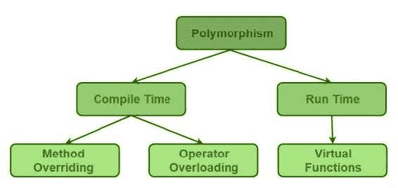

## 编译时多态

编译时多态也被称为静态多态，它表示一个实体存在于多个物理形式。在静态多态中，函数是根据其签名（数据类型和存在的参数数量）进行绑定的。函数调用代表早期绑定，因为它们是基于数据类型和传递的参数顺序生成的。

编译时多态是通过重写函数和运算符重载实现的。

### 函数重载

函数重载是指你有多个同名但参数不同的函数的情况。这些函数的参数具有不同的数据类型或传递的参数数量发生了变化。

#### 语法

```
Int area (int x);
Int area (int x, int y);
```

见下例。

```cpp
#include <iostream.h>

using namespace std;

class addition {
public:
    float sum(float x, float y){
        return x+y;
    }

    float sum(float x, float y, float z){
        return x+y+z;
    }
};

int main() {
    addition obj;
    // 调用带有两个参数的 sum 函数
    cout << "total sum: " << obj.sum(8.80, 15.20) << endl;
    // 调用带有三个参数的第二个函数
    cout << "total sum: " << obj.sum(18.5, 26.4, 30.0);
    return 0;
}
// output
// Total sum: 24.0
// Total sum: 74.9
```

重载函数如上所示，提高了代码的可读性和可重用性。你可以对具有不同参数列表的函数执行相同的任务。

### 运算符重载

运算符重载允许你重载运算符。例如，你可以使用运算符（`+`）连接两个字符串。如果你在两个整数之间使用加法，它会将它们相加；但当运算符放在字符串之间，它会将它们拼接或连接。

要重载运算符，你必须声明一个类成员函数，其名称为 `operator`，然后跟上你想使用的运算符符号。

类型 operator-符号 (参数)

例如：`xyz operator + (xyz)` / 使用运算符重载

#### 语法

```cpp
#include<iostream.h>

using namespace std;

class xyz {
private:
    int a,b;
public:
    Xyz() {}
    void getvalues() {
        cout<<"enter value of a and b";
        cin>>a>>b;
    }
    void setvalues(float x, float y) {
        x=a;
        y=b;
    }
    void setvalues(double num1, double num2) {
        num1=a;
        num2=b;
    }
    void display() {
        cout<<"the value for a is:"<<a<<"the value for b is:"<<b<<endl;
    }
    double operator +(xyz);
};

double xyz::operator +(xyz) {
    return (a+b);
}

int main() {
    xyz x1,x2,x3;
    x1.getvalues(10,15);
    x2.setvalues(6,8);
    x3.setvalues(12,8);
    x1.display();
    x2.display();
    x3.display();
    return 0;
}
```

## 运行时多态

运行时多态也称为动态多态。在这一类多态中，函数根据情况改变其形式。如果一个函数以不同的形式存在并响应运行时期间不同的函数调用，那么它就是动态多态。运行时多态支持动态绑定，并使程序在执行时更加灵活。在动态绑定中，函数调用是在运行时进行的，它取决于运行时的函数内容。如果你更改了函数的内容，你将得到具有相同名称但不同实体的函数。

动态多态根据情况改变实体。如果一个函数以不同的形式存在，则函数调用是在执行期间进行的。动态绑定也被称为晚期绑定，它提高了正在执行程序的灵活性。在某些情况下，静态绑定比动态绑定更高效。如果你有一个静态函数，你不需要运行时搜索，而动态函数则需要运行时搜索。动态绑定中的大多数函数调用是在执行时解析的。多态是通过重写函数和虚函数（`virtual functions`）实现的。

### 重写函数

函数重写允许你在父类和子类中具有相同的函数名。子类继承父类的数据成员和函数。你可以通过创建具有相同参数列表的函数在子类中创建重写函数。函数重写只在派生类中进行，并在运行期间完成。重写函数是在派生类中重新定义具有相同返回类型参数的基类函数。

```cpp
class super {
public:
    void print() {
        cout << "this is a base class";
    }
};

class subclass : public super {
public:
    void print() {
        cout << "this is a derived class";
    }
};
// 基类的 print () 在派生类中被重写。
```

### 如何调用重写函数

你可以在 `main()` 函数中调用重写函数。函数调用和函数体通过绑定过程连接。如果连接发生在运行之前，则被称为早期绑定、静态绑定或编译时绑定。

```cpp
class super {

public:

    void print() {

        cout << "this is a base class";

    }

};

class subclass : public super {

public:

    void print() {

        cout << "this is a derived class";

    }

};

int main () {

    super b; // 创建基类对象

    subclass d; // 创建派生类对象

    b.print(); // 静态绑定

    d.print();

    return 0;

}

// output

// This is a base class

// This is a derived class
```

见下文使用指针调用上述基函数的示例。

```cpp
int main () {

    super *b; // 创建基类对象指针

    subclass d; // 创建派生类对象

    b = &d;

    b -> print (); // 静态绑定

}
```

在上面的示例中，我们使用基对象和派生对象调用了重写函数。

### 虚函数

虚函数是基类成员函数，在派生类中被重写。函数调用会导致晚期绑定。也就是说，它指示编译器对重写函数执行晚期绑定。

要使基类的成员函数变为虚函数，在声明函数时使用 `virtual` 关键字。

```cpp
virtual void function-name()
```

```cpp
{//function body}
```

示例：

```cpp
#include <iostream.h>

class car

{

public:

    virtual void make()

    {

        cout << "member function of the car base class is accessed";

    }

};

class 4wheel: public car

{

public:

    void make()

    {

        cout << "accessing virtual member function of the 4wheel derived class";

    }

};

void main()

{

    car *a, *b;

    a = new car();

    a -> make(); // 一个对象指针，等价于 *a.make();

    b = new car();

    b -> make();

}
```


如果类的成员在派生类中被重定义，它被称为虚拟成员。在上面的示例中，函数`make()`是基类中的一个虚拟函数。`4wheel`是基类`car`的派生类。

如果成员函数没有被声明为`virtual`，它将导致静态绑定，即函数调用在编译时绑定。但如果函数被声明为`virtual`，则函数地址将在运行时绑定，从而成为动态绑定。

为了实现动态绑定概念，编译器会在每次声明虚拟函数时创建一个虚函数表（v-table）。虚函数表包含了来自派生类中每个对象的函数指针以及其他类函数信息。每当调用虚拟函数时，这些信息都是可用的。

## 如何使用虚关键字在派生类中访问私有成员函数

使用`virtual`关键字，你可以通过指向基类的指针轻松地调用派生类中的私有成员函数。在这种情况下，编译器会在编译时检查访问修饰符模式。

在程序运行后期绑定（late binding）期间，编译器不会检查被调用函数的访问修饰符。

### 语法

```cpp
Class super
{
Public:
    virtual void print()
    {
        cout << "this is a base class";
    }
};

Class subclass: public super
{
Public:
    Virtual void print()
    {
        cout << "this is a derived class";
    }
};

Int main ()
{
    super *b;
    subclass d;
    b = &d;
    b -> print ();
}
```

// 输出
`This is a derived class`

#### 注意：
1. 只有基类函数被声明了`virtual`关键字。
2. 如果你在基类中将一个函数声明为`virtual`，那么该函数在所有派生类中将自动变为虚拟。

## 抽象类

抽象类是一种至少包含一个纯虚拟函数的类。抽象类为派生类提供了一个接口。如果一个类继承了抽象类的属性，那么你必须定义纯虚拟函数，否则该派生类将成为抽象类。

抽象类的特征：
1. 尽管你可以在抽象类中创建指针和引用，但它不能被实例化。
2. 抽象类同时具有变量、函数和纯虚拟函数。
3. 抽象类适用于执行向上转型（upcasting），以便允许子类使用其接口。
4. 所有继承抽象类属性的类必须实现纯虚拟函数，以避免变成抽象类。

## 纯虚拟函数

没有定义的虚拟函数被称为纯虚拟函数。纯虚拟函数没有函数体，它在开头使用`virtual`关键字，并以符号`=0`结尾，因为它没有体。

`Virtual void function-name () =0;`

虚拟函数和纯函数的工作方式相同，只是纯虚拟函数没有函数定义。

下面的示例展示了一个抽象类。

```cpp
Class bpolygon
{
Protected:
    Float width, height;
Public:
    Void setvalues(float x, float y)
    {
        width=x; height=y;
    }
    Virtual float area()=0;
};

Class brectangle:public bpolygon
{
Public:
    Float area()
    {
        return (width*height);
    }
};

Class btriangle:public bpolygon
{
Public:
    Float area()
    {
        return ((width*height)/2);
    }
};

Int main()
{
    Brectangle rect;
    Btriangle tri;
    Bpolygon *p1=&rect;
    Bpolygon *p2=&tri;
    p1 -> setvalues(8,6);
    p2.setvalues(8,6);
    cout<<p1 ->area()<<endl;
    cout<<p2 ->area()<<endl;
    Return 0;
}
```

## 章节总结
在本章中，你学习了什么是多态以及多态的不同类型。你现在能够：
- 通过示例区分编译时多态和运行时多态。
- 使用静态绑定或早期绑定来执行系统调用，以及如何使用动态绑定在执行期间进行函数调用。
- 使用函数重载和运算符重载来增强程序功能。
- 使用覆盖函数和虚函数进行函数调用，并在派生类内部重写函数。
- 在你的程序中声明虚函数并了解如何使用抽象类。
- 使用虚关键字访问私有成员函数并区分它们之间的区别。

在下一章中，你将学习构造函数和析构函数。在本章结束时，你将能够声明构造函数和析构函数，并了解如何使用不同类型的构造函数。

# 第六章：构造函数和析构函数

## 概述
构造函数是一种初始化类类型对象的成员函数，且其名称与类名相同。构造函数可以接受参数也可以不接受参数，它为对象分配内存空间。构造函数通过初始化为对象构建值。每当创建类的实例时，构造函数就会自动调用。你可以手动定义类的参数，也可以留空任何参数。构造函数的名称始终与类名相同，且构造函数没有返回类型。

`Class constructorname{// class body};`

另一方面，析构函数是构造函数的互补成员函数。析构函数在对象销毁或使用`delete`操作符释放内存空间时调用。析构函数为对象释放内存空间。析构函数没有任何参数，因此不能被重载。它通常以与构造相反的顺序调用。如果一个类（派生类）继承了另一个类（基类）的属性且两个类都有析构函数，则会先调用派生类的析构函数。

析构函数与类名相同，前面带有波浪号（`~`）。

`~` class name{// class body};

## 构造函数的定义和声明
构造函数的定义与类中的其他成员函数一样。它可以在类内定义，也可以使用类名后跟作用域解析符`::`在类外定义。

### 语法

```cpp
class base
{
    double a, b;
protected:
    base (double, double); //构造函数
    void print ()
};
```

```cpp
double length, height;
Public:
  length = 15.2;
  height = 20.5;
  double area()
  {
    return (length * height / 2);
  }
};

int main()
{
  clrscr();
  triangle tri;
  cout << "the area of triangle is:" << tri.area() << "sq.units\n";
  getch();
}
```

// 输出 
`The area of triangle is: 155.8 sq.units`

## 构造函数的特点

1. 它们应该始终声明在公共（public）访问修饰符下。
2. 构造函数没有返回类型，甚至没有空（`void`）返回。
3. 创建新对象会导致自动调用构造函数。
4. 派生类不能继承构造函数，但它可以调用基类构造函数。
5. 构造函数可以像其他函数一样具有默认参数。
6. 构造函数永远不能作为虚函数（virtual functions）。
7. 你不能引用构造函数的地址。

# 构造函数的类型

C++ 语言有多种类型的构造函数来扩展其功能。这些构造函数包括：默认、参数化、重载和拷贝。

## 默认构造函数

默认构造函数没有这些参数或参数。见下例。

```cpp
class cube
{
public:
  int x;
  cube()
  {
    x = 5;
  }
};

Int main ()
{
  cube c;
  cout << c.x;
}
```

一旦对象被创建，就会立即调用构造函数，从而初始化数据成员。默认构造函数初始化对象成员。如果你没有定义构造函数，编译器会隐式地为类分配一个默认构造函数。

如果编译器返回默认构造函数，它将用默认值初始化对象数据成员，该值初始为 0 或任何随机整数值。

## 参数化构造函数

这是一种带有参数的构造函数。你可以为不同对象的数据成员提供不同的参数或值。

构造函数的初始值在声明构造函数时作为参数传递。这是通过：
* 显式调用构造函数。
* 隐式调用构造函数实现的。

见下例。

```cpp
class cube
{
public:
  int val;
  cube( int x)
  {
    val = x;
  }
};

Int main ()
{
  cube c (5);
  cube c1 (10);
  cube c2 (15);
  cout << c.val;
  cout << c1.val;
  cout << c2.val;
}
```

## 重载构造函数

构造函数不仅初始化数据成员，它们与其他成员函数没有区别。它们也像多态中一样执行函数重载。默认构造函数和参数化构造函数可以充当重载构造函数，其中其中一个没有参数，而另一个有参数。

重载构造函数允许你在类中有多个构造函数，每个构造都有不同的参数列表。

见下例。

```cpp
#include <iostream>
Using namespace std;

class overload
{
public:
  double area;
  overload()
  {
    area = 0;
  }
  overload(float num1, float num2)
  {
    area = num1 * num2;
  }
  void display()
  {
    cout << area << endl;
  }
};

Int main()
{
  // 使用相同类名不同参数的构造函数重载
  overload c1;
  overload c2(8.6, 6.2);
  c1.display();
  c2.display();
}
```

// 输出
`0`
`53.32`

## 拷贝构造函数

C++ 提供了一种特殊的构造函数，它将对象作为参数传递给函数，并将数据成员从一个对象拷贝到另一个。拷贝构造函数创建与现有对象特征相同的新对象，因此拷贝构造函数充当重载构造函数，因为它从其他对象声明并初始化对象。

拷贝构造函数有两种：
* 默认拷贝：如果程序员没有定义拷贝，编译器会自动定义这种类型的拷贝。
* 用户定义拷贝：程序员定义的拷贝。

语法：`class_name (class_name &object_name);`

示例 1：
```cpp
class copy
{
  copy (copy &y) // 拷贝构造函数
{
}
};
```

要调用上述示例中的拷贝构造函数，你必须初始化对象。可以通过以下任何方式完成：
* `copy c2 (c1)`
* `copy c2=c1`

示例 2：
```cpp
#include <iostream>
Using namespace std;

class copy
{
Public:
  float i;
  copy(float x) // 参数化构造函数。
  {
    i=x;
  }
  copy(copy &y) // 拷贝构造函数定义
  {
    i = y.i;
  }
};

Int main()
{
  copy c1(35); // 调用参数化构造函数。
  copy c2(c1); // 调用拷贝构造函数。
  cout<<c2.i;
  Return 0;
}
```

// 输出
`35`

当调用构造函数时，会产生两个拷贝：
* 浅拷贝
* 深拷贝

### 浅拷贝

编译器创建的默认构造函数只能产生浅拷贝。由于是通过拷贝对象的变量来创建对象的，因此它是浅拷贝。

见下例：

```cpp
class example
{
  Int num1;
  Int num2;
  Int *ptr;
Public:
  Example()
  {
    ptr=new int;
  }
  void setdata(int a,int b,int c)
  {
    num1=a;
    num2=b;
    *ptr=c;
  }
  void printdata()
  {
    cout << "num1 value is : " << num1 << endl;
    cout << "num2 value is : " << num2 << endl;
    cout << "*ptr value is : " << *ptr << endl;
  }
};

Int main()
{
  example e1;
  e1.setdata (8, 9, 12);
  example e2 = e1;
  e2.printdata();
  Return 0;
}
```

// 输出
`Num1 value is: 8`
`Num2 value is: 9`
`*ptr value is: 12`

在上述示例中，没有定义构造函数，因此编译器通过调用默认拷贝构造分配`example e2= e1`。在这种情况下，编译器创建现有对象的拷贝。指针`ptr`指向两个对象的内存位置。

如果一个对象的内存被释放，另一个内存也会被释放，因为两个字段指向同一块内存。为了避免这个问题，你可以定义一个使用深拷贝技术的拷贝构造函数（用户定义的构造函数）。

### 深拷贝

深拷贝是一种为拷贝动态分配内存然后拷贝实际值的技术。源和拷贝具有不同的内存。

在深拷贝中，程序员必须编写用户定义的构造函数。

语法：
```cpp
class example
{
Public:
  Int num1;
  Int num2;
  Int *ptr;
  Example()
  {
    ptr=new int;
  }
  Example (example &y)
  {
    num1=y.num1;
    num2=y.num2;
    Ptr=new int;
    *ptr=*(y.ptr);
  }
  void setdata(int a,int b,int c)
  {
    num1=a;
    num2=b;
    *ptr=c;
  }
  void printdata()
  {
    cout << "num1 value is : " << num1 << endl;
    cout << "num2 value is : " << num2 << endl;
    cout << "*ptr value is : " << *ptr << endl;
  }
};

Int main()
{
  example e1;
  e1.setdata (5, 7, 9);
  example e2 = e1;
  e2.printdata();
  Return 0;
}
```

## 析构函数

析构函数是一种特殊的成员函数，当在该类对象上调用`delete`操作或当类中的对象离开作用域时执行。

析构函数的名称与类名相同，但前面有一个波浪号运算符`~`。它没有返回值，且你不能向它传递任何参数。析构函数是 C++ 的一个重要特性，它在内存不再需要时释放内存空间。

示例：下面的示例解释了如何在程序中使用构造函数和析构函数。

### 语法

```cpp
// 构造函数 & 析构函数
Class Crectangle
{
    Int *len, *wid;
Public:
    Crectangle (int, int) // 构造函数
    ~Crectangle () // 析构函数
    Int area()
    {
        return (len*wid);
    }
};

Crectangle::Crectangle (int c, int d)
{
    *len=c;
    *wid=d;
};

// 用于释放内存的析构函数
Crectangle ::Crectangle ()
{
    Delete len;
    Delete wid;
};

int main()
{
    Crectangle rect a (c,d);
    Crectangle rect b (c,d);
    cout << "area of a rectangle is: " << rect a.area();
    cout << "area of a rectangle is: " << rect b.area();
    cout << endl;
}
```


### 析构函数的特殊性质

1. 当对象被销毁时，会自动调用析构函数。
2. 与其他成员函数一样，析构函数遵循相同的访问规则。
3. 析构函数在对象超出作用范围之前对其进行去初始化。
4. 析构函数没有返回类型，甚至不支持 `void`。
5. 析构函数永远不能被继承。
6. 析构函数不允许使用静态析构函数。
7. 析构函数可以调用其所属类的成员函数。
8. 如果类中的对象具有析构函数，那么该对象不能是联合体（`union`）的成员。

### 总结

在本章中，你学习了构造函数、析构函数和函数重载。构造函数在 C++ 语言中非常重要，因为它们帮助通过自动初始化在对象中构建值。具体来说，你学习了：

- 如何声明和初始化构造函数。
- 构造函数如何初始化类类型的对象。
- 析构函数在执行后如何对对象进行去初始化。析构函数通过在对象销毁后去初始化来帮助释放内存空间。
- 关于带参数的构造函数。你能够为不同对象数据成员传递不同的参数和值。你还学习了如何调用构造函数。
- 如何使用重载构造函数和拷贝构造函数。
- 理解两种拷贝构造函数：浅拷贝和深拷贝。
- 如何创建一个包含两种拷贝构造函数的项目，以及如何调用创建的对象。

在下一章中，你将学习如何使用模板。在章节结束时，你将能够创建类模板、函数模板以及如何创建带有多个参数的模板。

## 第七章：模板

### 模板简介

模板是 C++ 编程语言中的一项重要特性，因为它允许函数和类使用泛型。它们通过允许定义不同的数据类型而无需相互重写，在函数和类的工作方式上起着至关重要的作用。

使用模板，你可以编写出适用于任何数据类型的通用代码。你只需要将数据类型作为参数传递。模板促进了代码重用性并提高了程序的灵活性。你可以创建一个简单的类或函数，并将数据类型作为参数传递，并实现可供任何数据类型使用的代码。每当你想要使用该函数时，只需调用该函数并指定返回类型。

例如，如果你使用 `sort()` 函数对数据进行排序，可以将不同的数据类型作为参数传递给函数。根据传递给算法的数据类型，你不需要针对特定的数据类型编写和维护多份代码。因此，模板用于代码需要在多个数据类型之间可重用的情况。在处理多重继承和重载时，模板具有巨大的意义。

### 模板的类型

模板通过两种方式实现：

- 使用函数模板
- 使用类模板

模板可以定义为宏，当你定义一个特定类型的对象时，模板定义会将其替换为适当的数据类型。模板通常被称为参数化类，因为在执行期间，指定的数据类型将替换定义的参数。

#### 类模板

语法：

```cpp
Template <class identifier>

Class class-name

{

    // 类成员定义

};
```

示例：`images/0231.jpeg`

类模板的定义与普通类定义相似，不同之处在模板中你添加了前缀 `<class m>`，其中 `m` 是类型。模板前缀告诉编译器声明了一个类模板，该模板在声明中使用 `m` 作为类型名。在这种情况下，该类是一个使用 `m` 作为参数的参数化类。类型 `m` 可以通过用户定义的数据类型替换为任何数据类型。

如果类派生自类模板，则被称为模板类。模板类的对象定义如下：`ClassName<type> objectname(arglist);`。从类模板派生派类时，你需要在转换为类之前对模板进行调试。编译器在实例化后检查模板类中的错误。

示例：类模板

```cpp
Template <class tt>

Class rectangle

{

    tt width;

    tt height;

Public:

    void setvalues(tt num1, tt num2)

    tt area()

    {

        tt a;

        a=width*height;

        return a;

    }

};

void rectangle <tt> ::setvalues (tt num1, tt num2)

{

    width=num1;

    height=num2;

}

int main()

{

    rectangle rect a;

    rectangle <int> rect a (5,6);

    rectangle rect b;

    rectangle <float> rect b (5.6,4);

    cout << rect a.setvalues()

    cout << rect b.setvalues()

    return 0;

}

// output

rect a=30

rect b=22.4
```

上面的程序创建了一个类型 `tt` 的类。`void rectangle <tt> ::setvalues (tt num1, tt num2)` 中的 `<tt>` 指定函数参数也是类模板参数，并在调用类时始终包含。

#### 带有多个参数的类模板

你也可以在类拥有多个泛型数据类型。你可以在模板规范中使用逗号分隔的列表声明泛型类型类。

语法：

```cpp
Template <class xy, class xyz, …>

Class class-name

{

    // 函数体

};
```

示例：带有两个泛型类型的类

```cpp
Template<class f1,class f2>

Class numbers

{

    f1 j; f2 k;

Public:

    numbers (f1 x, f2 y)

    {

        j=x; k=y;

    }

    void print()

    {

        cout<<j<<"and"<<k<<"\n";

    }

};

int main()

{

    Numbers <float, int> numbers1 (2.53, 253);

    Numbers <int, char> numbers2 (50,'z');

    Numbers1.print();

    Numbers2.print();

    Return 0;

};

// output

2.53 and 253

50 and z
```

### 函数模板

函数模板的工作原理与普通函数相似，不同在于普通函数只处理单一数据类型，而模板可以适应多种数据类型。通过模板，你可以重载普通函数以便处理不同的数据类型。

这使得函数模板变得更有用，因为你只需要编写一个可以作用于所有数据类型的单一程序。

模板始终在编译时进行展开。

就像类模板一样，你可以创建一个具有不同参数类型的函数模板。

#### 语法

```cpp
Template <class type>

Return-type function-name (arguments)

{

    Function body;

};
```

在定义函数模板时，必要时你必须在函数体和参数列表中都包含模板类型。

### 示例 1：交换交换值的函数

```cpp
Template <class t1>

Void swap (t1&num1, t1&num2)

{

    t1 val= num1; num1=num2; num2=val;

};
```

调用模板函数的方法与普通函数调用相同。

### 示例 2：函数模板的实现

```cpp
Template <class test>

Test max (test x, test y);

{

    test results;

    results=x>y? x:y;

    return results;

};

Int main()

{

    int a=5, b=6, c;

    double l=4, m=6, n;

    c= max <int> (a,b);

    n=max <double> (l,m);

    cout<< c<<endl;

    cout<<n<<endl;

    return 0;

}
```

在这个示例中，`test` 是模板参数。函数 `max` 被调用两次使用了不同的参数类型（`int` 和 `double`）。当编译器实例化时，它会根据每次的类型调用函数。

产生的输出对象（使用特定类型实例化模板后）的类型与参数 `x` 和 `y` 的类型相同。

上述程序将根据值的大小对值进行排序。如果使用数字数组，将应用排序算法对数字从小到大进行排序。

### 带有多个参数的函数模板

就像类模板一样，你可以有多个用逗号分隔的泛型数据类型。

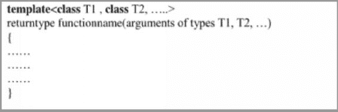

### 示例：带有多个参数的模板类

```cpp
Template<class temp1,class temp2>

Void display( temp1 j, temp2 k)

{

    cout<<j<<” “<<k<<”\n";

}

Int main()

{

    J=display1(2019, “edge”);

    K=display2(18.54, “1854);

    return 0;

}

// output

2019edge

18.541854
```

### 重载模板函数

你可以使用其模板函数或使用其名称的普通函数来重载模板函数。重载可以通过以下方式实现：

1. 调用与模板函数的普通函数。
2. 调用使用精确函数构建的模板函数。
3. 在普通函数上使用普通重载函数，并对匹配模板函数的函数进行函数调用。

如果没有找到匹配项，系统将生成错误消息。

### 示例：使用显式函数重载的模板

```cpp
Template <class m>

void display(m n)

{

    cout<<”display template function:” << n<< “\n";

}

Void display ( int n)

{

    cout<<”explicit template display: “<< n<<”\n";

}

Int main()

{

    display (80); display (15.20);

    return 0;

}

//output

Explicit template display: 80 display template function: 15.20
```

函数调用 `display (80)` 调用的是 `display()` 函数的普通版本而不是它的模板版本。

### 成员函数模板

在创建类模板时，所有的成员函数都可以定义在类外部，因为模板类中的成员函数是通过类型参数参数化的。因此，函数模板应该定义这些成员函数。

在类模板内部声明的成员函数（无论是内联还是非内联）隐式为函数模板。如果声明了一个模板类，它继承类模板中定义的所有模板函数。

成员函数模板有三种定义方式：

1. 为用于实例化模板类的所使用的每个返回类型在文件作用域内进行显式定义。
2. 在模板参数的文件作用域内定义。
3. 在类内内联。成员函数模板可以实例化未显式生成的函数。如果一个类同时具有成员函数和显式函数，则显式定义的优先级更高。

#### 语法

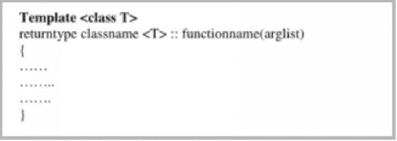

#### 示例：带有成员函数的类

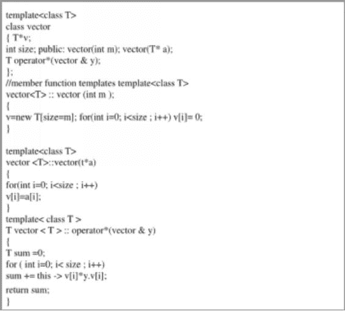

### 非类型模板参数

模板可以有单个类型或多个类型参数。除了类型之外，你还可以使用非类型参数。你可以使用字符串、常量、内置类型和函数名创建模板参数。

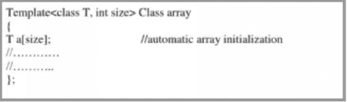

上述模板将数组的大小作为参数传递。编译器只在执行期间才知道数组的大小。参数是在创建模板时确定的。

### 章节总结

C++ 编程语言支持使用模板以支持泛型编程。在本章中，我们能够学习模板如何允许我们创建一个可以处理不同数据类型的类或函数族。你学习了：

- 使用模板通过只需调用模板参数返回类型来避免代码重复。
- 模板允许我们创建一个可以处理不同数据类型的类或函数族。
- 重载模板函数：你可以通过使用其模板函数或使用其名称的普通函数来重载模板函数。
- 成员函数模板：在创建类模板时，所有的成员函数都可以定义在类外部，因为模板类中的成员函数是通过类型参数参数化的。因此，函数模板应该定义这些成员函数。
- 非类型模板参数：模板可以有单个或多个类型参数。除了类型之外，你还可以使用非类型参数。

由于流的行为方式相同，它们的 i/o 函数可以在任何设备上运行。例如，你可以使用同一个函数向文件、打印机、扫描仪和显示单元写入内容。

流既是源点也是终点。源流向程序提供数据，通常被称为输入流。另一方面，目的流接收信息作为输出，被称为输出流。

- **输入流**：这涉及字节从键盘等输入设备流向主内存进行处理的字节流。
- **输出流**：这是字节或处理后的数据从主内存流向输出设备（如显示器）的字节流。

C++ 在其标准库中同时拥有 `cin` 和 `cout` 作为预定义流。这些流在程序开始执行时会自动被触发。`cin` 流是一个输入流，它连接到标准输入设备，允许用户将新数据输入到系统内存，而 `cout` 代表输出流，它连接到输出设备以显示信息。

## C++ 流类

C++ 中的 i/o 系统由一组类的层次结构组成，这些类定义了用于处理系统控制台单元和磁盘文件的流。流类层次结构在控制台单元内执行输入和输出操作。i/o 流类声明在 `ioostream` 头文件中。每个与控制台通信的程序都应该包含该头文件。

`ios` 作为输入流（`istream`）的基类，`ostream`（输出流）作为 `iostream`（输入输出流）的基类。`ios` 类被声明为虚基类，因此 `iostream`（输入输出流）只会继承其数据成员的一个拷贝。

`ios` 类为格式化和非格式化流的 i/o 操作提供基本支持。它支持对输入和输出流的处理。`istream` 类负责格式化和非格式化的输入，而 `ostream` 类通过继承概念负责格式化输出。

## 使用流类进行控制台操作

| 类名 | 属性 |
| :--- | :--- |
| `ios`（基础输入输出流） | 具有可以被其他输入输出类使用的基本属性。<br>拥有缓冲对象的指针。<br>声明了执行格式化输入输出操作必需的函数和常量。 |
| `istream`（输入流） | 它继承了 `ios` 属性。<br>用于声明 `get()`、`getline()` 和 `read()` 输入函数。<br>由重载的提取运算符 `>>` 组成。 |
| `ostream`（输出流） | 它继承了 `ios` 属性。<br>允许你声明如 `put()` 和 `write()` 等输出函数。<br>使用重载的插入运算符 `<<`。 |
| `iostream`（输入输出流） | 通过多重继承继承了 `ios` 流和 `ostream` 的所有特性。<br>它同时拥有这两个类的输入和输出函数。 |
| `streambuf` | 通过缓冲区提供到所有物理设备的接口。<br>它作为 `ios` 文件中 `filebuf` 的基类工作。 |

## 非格式化输入/输出操作

### 重载运算符 `>>` 和 `<<`

C++ `cin` 和 `cout` 用于输入和输出的标准库函数分别使用了重载的运算符 `>>` 和 `<<`。`>>` 运算符在 `istream` 类中被重载，而 `<<` 运算符在 `ostream` 类中被重载。

若要从键盘读取输入数据，你使用 `>>` 运算符。

```cpp
cin >> variable1 >> variable n;
```

输入变量 `variable1` 直 `variable n` 是已经在类内部声明的变量名。`cin` 标准告诉计算机从键盘等输入设备搜索输入数据。

数据是逐字符读取的，并通过 `>>` 运算符赋值给指定的位置。输入之间由空白符分隔，如果编译器在读取变量时遇到空白符或与目标数据类型不匹配，则会终止。假设你有一个类，其中声明了一个整数类型的变量，你可以使用输入设备输入数据。

```cpp
int num;

cin >> num;
```

跟随 `>>` 运算符的 `cin` 语句将提示你在键盘上输入任何整数类型的值，如 50。当你输入输入数据时，该运算符读取值 50 并将其赋值给变量 `num`。若要在屏幕上显示数据，你使用 `cout` 语句。

```cpp
cout << data << n;
```

数据一直到 `n` 的所有数据可以是任何数据类型的变量或常量。

## `Put()` 和 `get()` 函数

`istream` 和 `ostream` 类定义了两种成员函数 `get()` 和 `put()`，用于处理单个字符的输入输出操作。`get()` 函数获取输入数据中的新字符、空格，甚至是制表符。`get(char*)` 类型将输入字符分配给函数，而 `get()` 返回输入字符。这些函数应该使用适当的对象进行调用。

示例：

```cpp
char i;

cin.get(i); // 这允许你从键盘获取一个字符并赋值给变量 i

cout << i; // 在屏幕上显示该变量
```

上述代码读取并显示一行文本。`cout` 语句中的 `>>` 运算符逐字符读取并跳过任何空白符或换行符。`cin >> i` 可以代替 `cin.get(i)`。

```cpp
i = cin.get();
```

在此处，成员函数 `get()` 的值被赋值给变量。`put()` 是 `ostream` 类的成员函数，它输出单行文本的逐字符输出。例如：

```cpp
put(i);
```

`put()` 显示了变量 `ch` 的值。你可以将任何数字变量作为参数传递给 `put()` 函数。

示例：

```cpp
char x;

cin.get(x); while(x != '\n') {

    cout.put(x);

    cin.get(x);

}
```

## `Getline()` 和 `write()` 函数

`getline()` 和 `write()` 函数负责以有效的方式读取或显示一行文本。`getline()` 读取包含换行符 `\n` 的整行文本。当编译器遇到换行符时，程序执行。通过以下方式调用函数：

```cpp


```cpp
cin.getline(line, size);
```

函数调用触发`getline()`函数，它通过键盘读取用户输入的字符。一旦遇到`size - 1`或`\n`字符，读取就会终止。

### 示例

```cpp
char empname[30];

cin.getline(empname, 30);
```

### 使用 `get()` 和 `put()` 表示 I/O 数据的程序示例

```cpp
#include <iostream>

using namespace std;

int main() {
    int m = 0;
    char n;

    cout << "enter text";

    cin.get(n);

    while (n != '\n') {
        cout.put(n);
        m++;
        cin.get(n);
    }

    cout << "\n number of characters=" << m << "\n";

    return 0;
}
```

输入：

```text
C++ programming language.
```

输出：

```text
C++ programming language.
Number of characters=22
```

行参数指示显示的字符串名称，而`size`参数显示字符数。如果变量`size`大于程序的行宽，则会显示超出行边界的内容。

## 格式化控制台输入输出操作

C++ 支持多种功能来帮助进行格式化输出。这些功能包括：

- `ios` 类函数和标志。
- 用户定义的输出函数。
- 操纵符（manipulators）。

### `ios` 格式函数

`ios` 类有大量函数，可以以多种方式对输出进行格式。这些成员函数包括：

| 成员函数 | 操纵符 | 作用 |
| :--- | :--- | :--- |
| `Width()` | `Setw()` | 此函数表示显示输出值所需的字段宽度。 |
| `Fill()` | `Setfill()` | 它指定了填充字段未用部分的必需字符。 |
| `Precisio()` | `Setprecision()` | 指明浮点数值小数点后要显示的位数。 |
| `Setf()` | `Setioflags()` | 它指定了用于控制输出形式的格式标志。 |
| `Unsetf()` | `Resetiosflags()` | 它清除任何指定的标志。 |

当包含在输入输出语句中时，这些操纵符会更改流的参数格式。要在程序中访问操纵符函数，你必须包含`io.manip`文件。

#### 定义字段宽度

`width()`函数决定了对象输出所需的宽度字段。你可以通过以下方式调用该函数：

```cpp
cout.width(w);
```

其中，`w`是宽度字段，它被打印在一个宽`w`个字符的字段中。该函数指定了单个对象的字段宽度。在打印完单个对象的输出细节后，它会恢复到默认设置。

例如：

```cpp
cout << 6543 << 12 << "\n"; // 按 6, 5, 4, 3 和 1, 2 的格式打印
```

这将产生以下输出：

```text
6
5
4
3
1
2
```

#### 设置精度（`precision()`）

在处理浮点数时，它们会在小数点后打印六位数字。为了避免打印所有这六位数字，你可以指定小数点后打印的位数。这可以通过使用`precision()`成员函数轻松实现。

```cpp
cout.precision(d);
```

其中，`d`是小数点后要打印的位数。与`width()`不同，该函数会保留其设置直到被重置。

示例：

```cpp
cout.precision(3);
```

#### 填充

宽度未用部分总是用空格填充。`fill()`函数用于用任何所需的字符填充这些未用的空格。

```cpp
cout.fill(ch);
```

其中，`ch`是用于填充未用空格的字符。

例如：

```cpp
cout.fill('*');
```

在这种情况下，空格将用`*`运算符填充。例如，某些机构（如银行）使用这种形式的填充空白，特别是在打印支票时。

#### 格式标志、位域和 `setf()`

`setf()`是`ios`类用于对齐答案的成员函数。

```cpp
cout.setf(arg1, arg2);
```

其中，`arg1`是`ios`类中已有的格式标志。该标志指示了输出的格式要求。`arg2`是一个`ios`常量，指定了格式标志所属的格式组。

示例：

```cpp
cout.setf(ios::left, ios::adjustfield);
cout.setf(ios::scientific, ios::floatfield);
```

上述示例中的第一个语句应该与第二个语句具有组成员。

示例：

```cpp
cout.fill('*');

cout.setf(ios::left, ios::adjustfield);

cout.width(8);

cout << "flag" << "\n";

// 输出
F
L
A
G
*
*
*
```

## 使用操纵符管理输出

`io_manip`头文件包含了一组操纵符函数，用于操纵输出格式。这些操纵符的工作方式与`ios`成员函数和标志相同。你可以在单条语句中使用多个操纵符。

示例：

```cpp
cout << a << b << c;
cout << a << item1 << b << item2;
```

当你想以列的形式显示数据时，上述的拼接将非常有用。你可以使用不同类型的操纵符来更改字段。这些操纵符包括：

- 执行系列操作的操纵符集。
- `Setw(int)`：设置字段为`w`的函数。
- `Width()`。
- `Setprecision(int)`：用于将浮点数设置为`d`位的关键函数。
- `Precision()`。
- `Setfill(int)`：用于将填充元素设为`c`。
- `Fill()`。
- `Setioflags(long f)`：用于设置格式标志。
- `Setf()`。
- `Resetiosflags(long f)`：用于清除由`f`指定的任何格式。
- `endl()`：帮助你插入新行或刷新流。

示例：

```cpp
cout << setw(8) << 1234;
```

上述语句将在 8 个字符宽的右对齐字段中打印值 1234。该语句的输出可以更改为左对齐：

```cpp
cout.setf(ios::left, ios::adjustfield);

cout << setw(8) << 1234;

// 输出
1234
```

#### 输出操作

输入输出系统提供了用于处理输出的流类。输出操作以以下方式进行：

```cpp
cout.setf(ios::left, ios::adjustfield);
cout << setw(8) << 1234;
```

输入输出系统提供了用于处理输出的流类。输出操作以输入流的方式到文件。在这种情况下，输出操作是：

```cpp
cout << 1234;
```

要打开任何文件，你必须先创建一个文件流，然后将其链接到文件名。文件流使用`ifstream`、`fstream`和`ofstream`类来声明，这些类包含在`fstream`头文件中。

创建的文件类取决于创建的目的。也就是说，是向文件中读取数据还是向文件中写入数据。

创建文件后，你可以通过以下方式打开它：

1. 类中的构造函数。
2. 类中的成员函数`open()`。

使用构造函数打开文件仅适用于流中只使用一个文件的情况，而`open()`方法则用于使用单个流打开多个文件的情况。

### 使用构造函数打开文件

如果使用构造函数打开文件，文件名将初始化文件流对象。这可以通过以下方式实现：

1. 创建文件流对象以使用适当的类管理流。在这种情况下，你可以使用`fstream`类创建输出流，而使用`ifstream`类创建输入流。
2. 使用所需的文件名来初始化文件对象。例如，以下代码被用于打开一个名为`performance`的文件作为输出：

```cpp
ofstream outfile("performance"); // 用于输出。
```

`outfile`被创建为一个`fstream`对象，其主要目的是管理输出流。

你也可以创建一个作为`ifstream`对象的`infile`，并与文件数据关联以读取文件输入。

```cpp
ifstream infile("data"); // 一个输入文件
```

你可以使用相同的文件向文件读取或写入数据。

当对象终止时，它会自动关闭与该文件的连接。在上述`performance`文件的示例中，当程序终止时，`performance`文件将与`outfile`流断开连接。这也会发生在`infile`流上。

文件名由一组字符组成，使其成为一个有效的文件名。文件名分为两个部分：主名和扩展名。例如，`file.doc`、`test.txt`和`input.cpp`等扩展名。

### 示例：一个从文件中写入和读取数据的程序

```cpp
#include <iostream.h>
#include <fstream.h>

int main() {
    char prodname[20];
    float price;

    ofstream outfile("product");

    cout << "enter product's name:";
    cin >> prodname;
    outfile << prodname << "\n";

    cout << "enter the product's price:";
    cin >> price;
    outfile << price << "\n";

    outfile.close();

    ifstream infile("product");

    infile >> prodname;
    infile >> price;

    cout << "\n";
    cout << "product name is : " << prodname << "\n";
    cout << "product price: " << price << "\n";

    infile.close();

    return 0;
}
```

输出：

```text
Product name is: mango,
Product price: 25
```

此程序通过输入设备（如键盘）获取数据并将其写入文件。写入过程完成后，文件被关闭。然后打开文件以读取已经写入文件的信息，稍后显示在屏幕上供用户查看。

### 示例 2：写入文件

```cpp
#include <iostream>
#include <fstream>

using namespace std;

int main() {
    ofstream samplefile;

    samplefile.open("sample.doc");
    samplefile << "writing data to the sample.doc.\n";
    samplefile.close();

    return 0;
}
```

### 使用 `open()` 函数打开文件

`open()`函数打开使用相同对象的多个文件。如果需要处理一组文件，则会创建一个单一对象流以启用打开每个文件。

#### 语法

```cpp
void open(const char* filename, ios mode);

or open(filename, mode);
```

第一个参数表示文件名连同地址，而参数的第二个部分表示文件的访问模式。打开文件有不同的访问模式，包括：

- `ios::in`：它是`ifstream`文件的默认模式，用于打开文件以读取。
- `ios::out`：该模式负责向文件写入数据。它是`fstream`的默认模式。
- `ios::binary`：用于以二进制形式打开文件。
- `ios::app`：`app`模式适用于打开文件并在末尾追加输出。
- `ios::ate`：该模式负责打开文件并将控制转移到文件末尾。
- `ios::trunc`：用于删除现有文件中的数据。
- `ios::no_replace`：它测试文件是否存在，如果存在则打开它。如果文件不存在，`no_replace`将打开一个新文件。

#### 示例

要访问`fstream`类的成员函数，你必须创建该类。`example_file`是`fstream`类型的对象。调用`open()`函数允许你打开文件并向其中写入数据。文件的默认打开模式为：

- `ifstream::in`
- `ofstream::out`
- `fstream::in | ios::out`

符号`|`用于组合不同的模式。例如：

```cpp
example_file.open("example.txt", ios::out | ios::ate);
```

输入模式和控制模式组合，以确保文件是为了写入而打开，并将控制转移到文件末尾。

当程序终止时，分配的内存被释放，所有打开的文件都被关闭。使用`close()`函数确保在执行完成后关闭文件。通过流插入运算符`<<`，你可以向文件中写入信息并使用流提取运算符`>>`从文件中读取信息。

#### 示例：使用 `open` 打开文件并写入文件

```cpp
#include <iostream>
#include <fstream>

using namespace std;

int main() {
    fstream example_file;

    example_file.open("example.doc", ios::out);

    if (!example_file) {
        cout << " file creation has failed";
    } else {
        cout << "the new file was successfully created";
        example_file << "this is a new file created"; // 写入文件
        example_file.close(); // 关闭文件释放内存
    }

    return 0;
}
```

输出：

```text
C:\users\faith\documents>notepad++ example.cpp –o, example.exe
C:\users\faith\documents\example.doc
新文件创建成功
```

在上述程序中，我们创建了一个用于`fstream`类的对象`example_file`。然后我们使用`open()`函数打开对象并创建一个名为`example`的新文件写入数据。文件被分配给`ios::out`模式，允许写入文件。`if`语句测试文件是否存在，如果文件不可用则显示“文件创建失败”语句，否则屏幕上将显示“新文件创建成功”的消息。

### 示例 2：从文件中读取信息

```cpp
#include <iostream>
#include <fstream>

using namespace std;

int main() {
    fstream example_file;

    example_file.open("example.doc", ios::in);

    if (!example_file) {
        cout << " the file doesn’t exist";
    } else {
        char ch;

        while (!example_file.eof()) {
            example_file >> ch;
            cout << ch;
        }
    }

    example_file.close(); // 关闭文件，以释放内存

    return 0;
}
```

上程序读取了我们在上一个示例中已经创建的`example.doc`文件。要读取文件，使用了“输入”模式（`ios::in`）。使用提取运算符`>>`来打印文件的内容。

### 寻找文件末尾

在读取文件时，确定文件的末尾是非常重要的，否则如果没有检测到文件结束，程序将陷入无限循环。程序员应该为程序提供适当的指令，以便检测到文件结束。

一旦确定了文件结束，在读取所有数据后就可以轻松终止数据读取过程。如果确定了文件结束，当文件操作发生错误时，`fin ifstream`对象将返回零值。

当`fin`在到达文件结束后返回 0 时，`while`循环将终止。你也可以使用`eof()`函数检测文件结束。

```cpp
if (example.eof() != 0) {
    exit file;
}
```


如果检测到文件结束，则返回非零值；否则，如果没有检测到文件结束，则返回 0 值。程序在到达文件结束后会自动终止。

## 文件指针和操纵符

每个 C++ 文件有两个指针：输入指针和输出指针。输入指针读取特定文件位置的内容，而输出指针将数据写入给定的文件位置。每当发生输入或输出文件操作时，适当的指针就会自动更新。

### 默认文件操作

当你以只读模式`open`一个文件时，输入指针被设置为文件的开头，以便从该文件的开头开始读取。如果以只写模式打开文件，则所有文件内容将被删除，并且输出指针被放置在文件开头。这确保了你从起始点写入文件。

要向现有文件添加更多数据，应以“追加”模式打开文件。这会自动将指针移动到文件的末尾。

### 文件指针的函数和操作

所有使用指针的动作和文件操作默认都会发生。为了控制文件指针的移动操作，可以使用各种文件流类。其中一些这些文件流类的成员函数包括：

- `seekg()`：此函数将（输入）get 指针移动到特定位置。
- `seekp()`：此函数将（输出）put 指针移动到特定位置。
- `tellg()`：此函数指示 get 指针当前的位置。
- `tellp()`：它指示 put 指针当前的位置。

**示例：**

```
infile.seekg(5);
```

此函数将指针移动到标记为 5 的字节数处，因为文件字节是从 0 开始编号的。指针随后指向第 6 个字节，即为文件的当前位置。

**示例 2：**

```
fstream myfile;
myfile.open("welcome", ios::app);
int ppt=myfile.tellp();
```

当执行上述语句时，输出指针将移动到文件“welcome”的末尾，`ppt` 值表示文件中的字节数。

### 指定偏移量函数

seek 系列函数（`seekg()` 和 `seekp()`）接受两个参数：

- `seekg (offset, refposition)`
- `seekp (offset, refposition)`

`offset` 参数表示从`refposition`参数指定的位置开始移动文件指针的字节数。

`refposition` 采用以下形式：

- `ios::beg`：这表示文件的开头。
- `ios::cur`：表示指针当前的位置。
- `ios::end`：表示文件的末尾。

`seekg()` 函数移动所有与 get 指针相关的文件。`seekp()` 使用 put 指针移动文件及其相关文件。

### 顺序输入和输出操作

文件流支持许多用于执行输入和输出操作的成员函数。成员函数 `put()` 和 `get()` 每次处理单个字符操作。`write()` 和 `read()` 函数则写入和读取一个块二进制数据。

#### put() 和 get() 函数

你可以使用 `put()` 函数向关联的流写入单个字符。`get()` 函数从关联的流中读取单个字符。让我们写一个程序来阐明这些函数在程序中是如何工作的。

上程序请求一个字符串，一旦接收到字符串，它就会使用 `put()` 函数循环逐个字符地将其写入文件。当字符串长度结束时，循环终止。执行后，程序将使用 `get()` 函数显示在屏幕上。`get()` 函数从文件中逐个字符地获取数据，直到达到文件结束条件。从文件中读取的数据将通过 `<<` 显示在屏幕上供用户查看。

#### write() 和 read() 函数

`write()` 和 `read()` 函数可以处理二进制形式的数据。数据值存储在磁盘文件中的格式与它们存储在内部内存时使用的格式相同。例如，`char` 无论大小，都可以将其 2 个字节的数据存储为二进制形式，而 4 位整数值可以在字符中存储 4 个字节。

二进制输入和输出的形式为：

该函数接收两个参数：变量 `var` 的地址以及以字节形式表示的变量长度。地址用 `char*`（指向字符类型的指针）表示。

**示例：**

### 文件操作期间错误处理

在执行各种文件操作时，会遇到各种错误。这些这些问题包括：

- 尝试访问的文件不存在。
- 用于创建新文件的文件已存在。
- 尝试无效的文件操作，如读取文件之外的数据。
- 磁盘没有足够的内存存储更多数据。
- 处理无效的文件名。

这些是在处理和操作文件时可能会遇到的常见文件操作问题。C++ 语言中的文件操作流继承了 `ios` 类的“stream-state”成员。stream-state 成员记录了当前打开文件的状态。`ios` 类支持许多用于读取流上记录的文件状态的成员函数。

#### 错误处理函数

| 函数 | 含义及其返回值 |
| :--- | :--- |
| `eof()` | 如果读取文件时成功检测到文件结束，`eof()` 返回真值或非零值；否则，它将返回零值。 |
| `Fail()` | 在输入和输出操作失败后，此函数返回真。 |
| `Bad()` | 如果遇到无效操作或不可恢复的错误，它返回真。如果错误可以恢复且文件操作继续，则返回假值。 |
| `Good()` | 如果没有遇到错误，它将返回真。如果 `file.good()` 函数返回真，则你可以继续其他 i/o 操作。如果它返回假，则不再执行进一步的操作。 |

输入/输出流是 C++ 编程语言中的一个重要特性。流有助于类的定义，并提供了一系列用于执行特定功能的库函数。在本章中，你学习了 C++ 流的概念，以及如何使用输入和输出流来执行程序。你还学习了在处理各种流输入和输出时可以使用各种设备。C++ 流类将使你能够：

- 定义一个类层次结构，用于定义控制台单元和磁盘文件的流的使用。
- 学习如何在头文件中声明 i/o 流类，并学习使用流类进行各种控制台操作。
- 学习不同类型的类名及其属性和功能。
- 学习 `ios` 类如何为非格式化 I/O 操作和格式化 I/O 操作提供基本支持。
- 使用用于数据输入和输出的重载运算符（`>>` 和 `<<`）。`cin` 标准库函数使用重载运算符 `>>` 从输入设备读取数据；而 `cout` 标准库函数运算符 `<<` 用于在屏幕或输出设备上显示数据。
- 使用如 `put()` 和 `get()` 函数等非格式化 I/O 操作。`put()` 函数是 `ostream` 类的成员，用于逐字符输出数据，而 `get()` 函数作为输入流工作。
- 学习如何使用 `getline()` 和 `write()` 函数。
- 学习 C++ 语言支持的各种格式化控制台 I/O 操作以格式化输出。
- 使用 `ios` 类函数和标志来格式化数据输入。
- 如何使用用户定义的输出函数，或使用输出操作符以及 `ios` 类函数的其他格式化功能来格式化输出。
- 学习如何使用用户定义的函数格式化输出。
- 学习如何使用操作符管理输出。
- 执行各种文件操作并了解如何处理流类。
- 了解如何使用构造函数和 `open()` 函数打开文件，创建新文件以及如何向文件中写入内容。
- 使用 C++ 编写打开文件、向现有文件写入或创建新文件的代码，以及编写从文件中读取信息的代码。
- 使用添加到每个文件代码中的 `close()` 成员函数来关闭文件。
- 学习如何通过类来控制输入输出流。`istream` 和 `ostream` 均控制输入和输出函数。
- 通过工作示例，从 `istream` 和 `ostream` 类派生出 `iostream` 类。i/o 流中派生的其他类包括：`istream_withassign`、`ostream_withassign` 和 `iostream_withassign`。这些类分别派生自 `istream`、`ostream` 和 `iostream` 属性。
- 使用 `eof()` 函数测试是否到达文件结束，如果检测到则返回值 1。你可以编写代码来确定文件结束、学习如何使用 `close()` 函数终止程序，以及使用指针操作文件。
- 使用 `seekg()` 函数链接到关联的文件指针（包括输入和输出文件指针）。
- 使用 `put()` 和 `get()` 函数编写代码，它们在文件中读取和写入单个字符，而 `write()` 和 `read()` 则用于写入和读取块二进制数据。
- 了解如何处理文件操作期间的错误。

在下一章中，你将学习异常处理。在本章结束，你将理解异常处理的概念和原理，以及 `throw` 和 `catch` 机制的使用。

# 第九章：异常处理

## 引言

异常处理为你提供了一种创建和处理程序开发过程中发生的错误（如运行时错误）的方法。这是通过将程序的控制权转移到一个称为处理器（handlers）的特殊函数来实现的。在程序开发过程中，程序员可能不确定某段代码是否会由于运行时错误（如资源分配或越界错误）成功运行。为了解决这个问题，你必须将这段代码置于异常之下。这是通过将代码封装在 `try` 块中实现的。当该代码块出现异常情况时，会抛出一个异常并将控制权转移到异常处理程序。如果没有检测到或抛出异常，程序代码将继续正常执行，创建的处理器将被忽略。当程序代码遇到异常情况时，识别异常并有效处理它至关重要。异常是当程序该部分遇到错误时发生的对象的某个。

### 异常处理原理

异常处理是一种检测和报告程序中异常情况的机制，以确保实施适当的措施。异常处理机制涉及：

1. 检测异常（问题）。
2. 抛出异常（确认错误已发生）。
3. 捕获异常（接收错误信息）。
4. 处理异常（采取纠正措施解决问题）。

异常处理机制应包含两个部分：一个部分用于检测错误并抛出异常，另一个部分将捕获异常并采取适当措施处理错误。异常有两种类型：同步异常和异步异常。同步异常是在程序运行期间由于程序异常遇到的，包括越界错误和溢出错误。超出程序控制的事件重复发生会导致异步异常。异步异常的示例是键盘中断。

### 异常处理机制

异常处理基于三个关键字运算符：

1. `try`
2. `throw`
3. `catch`

`try` 关键字置于语句块之前，以便生成异常。该语句块被称为 `try` 块。一旦检测到异常，就会在 `try` 块内部使用 `throw` 关键字抛出。异常处理程序通过使用 `catch` 关键字定义，用于捕获 `try` 块中 `throw` 语句抛出的异常。`catch` 块必须紧跟在 `try` 块之后。

#### 语法

```
try
{
    //要尝试的语句块
    throw exception
}
catch (type arguments)
{
    异常时执行的代码
}
```

当 `try` 块中抛出异常时，程序控制权从 `try` 块转移到 `catch` 语句。如果抛出的对象类型与 `catch` 块中的参数类型匹配，则执行处理异常的 catch 语句。

如果对象参数不匹配，程序将使用 `abort()` 函数终止。如果没有检测到或抛出异常，控制权将立即返回 `catch` 块。

#### 示例

```
#include <iostream.h>
Using namespace std;
Int main()
{
    try
    {
        throw 15;
    }
    catch(int a)
    {
        cout << "an exception has occurred"; << endl;
    }
    return 0;
}
```


当检测到异常时，将使用以下命令抛出异常：


抛出的异常对象可以是任何形式，甚至是常量。其他并非用于错误处理的对象也可以被抛出。如果抛出了异常，`catch` 语句将能够捕获它。程序控制权将从 `try` 块转移到 `catch` 块。

### 捕获机制

异常处理程序在 `catch` 块中有一段代码。`catch` 块本身就是一个函数，用于管理异常。

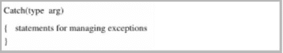

类型用于指示 `catch` 块所处理的异常类型。参数是可选的。`catch` 语句捕获与 `catch` 参数类型匹配的异常。捕获异常后，将执行 `catch` 块内部的代码。当处理程序执行时，控制权会立即传递。如果 `catch` 语句没有捕获到异常，则将跳过 `catch` 块语句。

### 章节总结

异常是程序在运行期间可能遇到的各种错误。C++ 编程语言内置了语言函数，用于捕获所有程序错误并控制异常。最新的 C++ 编译器支持这一特性，使用户能够轻松调试程序。

- 异常充当一个对象，从发生错误的程序部分发送到处理该错误的程序部分。
- 异常处理通过三个关键字实现：`try`、`throw` 和 `catch`。`try` 关键字用于检测文件中的异常，被称为 `try` 块的异常语句被包含在大括号内。
- `catch` 块接收由 `try` 块内部的 `throwing`（抛出）块发送的异常。
- 你可以在程序中创建多个 `catch` 块，甚至可以将异常传递给另一个异常处理程序。
- 指定异常非常适合将函数绑定到仅在特定异常发生时才执行 `throw` 的条件。

### 结语

C++ 编程语言是一种具有竞争力的通用目的程序，它借用了命令式编程范式的一些特性，并可以在任何平台上运行。它被称为命令式编程语言，因为它通过逐步执行的过程来实现其目标。该程序使用面向对象编程的概念来设计和实现复杂程序。

程序围绕使用对象创建的数据展开。这些对象通过传递消息进行相互通信。对象不需要了解另一个对象的详细信息即可在它们之间交换数据。它们只需要建立建立连接并交换信息。

C++ 编程语言利用 OOP 范式的特性来开发和执行程序。其中一些特性包括：对象的使用、类、数据抽象和封装、继承和多态。

该程序侧重于使用数据而非过程来解决现实世界的问题。程序试图通过提高程序的数据安全性、促进代码重用性以及利用继承特性创建有效程序，来消除其他传统编程语言的缺点。

与许多其他 OOP 语言一样，C++ 支持各种构建基块。在本份教程中，你已经学习了在处理从简单到复杂的程序时如何使用各种内置数据类型。数据类型分为基本数据类型、派生数据类型和抽象数据类型。你不仅学习了如何……（根据原始源逻辑，文本已截断）

## 构造函数与析构函数

在程序执行期间，编译器会自动调用 `constructor` 和 `destructor` 变量。构造函数和析构函数既可以在基类中使用，也可以在派生类中使用。当在派生类中使用构造函数时，参数将传递给基类。

向上转换（Upcasting）是另一个特性，它直接使用基类引用或指针指向子类。在本章中，你将学习如何使用向上转换和向下转换特性来创建基类。

## 动态内存分配

C++ 允许为程序动态分配内存空间。你可以在程序执行之前通过初始定义程序变量来为程序分配内存空间。在这种情况下，内存是在运行时或根据用户输入确定的。动态分配通过使用 `new` 和 `delete` 运算符来实现。

`new` 运算符后跟数据类型说明符会自动为文件分配内存空间。它允许你使用 `new[]` 运算符为元素数组分配内存。`delete` 运算符用于释放内存，从而使内存对其他程序可用；在处理多个元素时，使用 `delete []` 运算符来释放内存空间。如果你创建了内存但忘记删除，就会导致内存泄漏。因此，堆上创建的任何内在使用不再使用时都应该释放，以避免产生内存泄漏。

## 多态

多态是一种允许对象拥有多种形式的特性。在类中创建多重继承会产生多态。多态分为两类：运行时多态和编译时多态。运行时多态通过使用函数重载和虚函数实现，而编译时多态则通过函数重写（overriding）和运算符重载实现。你现在掌握了关于创建虚函数、重载函数和重写函数的实用知识。你还学习了如何使用 `virtual` 关键字在派生类中访问私有成员函数，以及如何创建抽象类和纯虚函数。

## 复习

在第六章中，我们讨论了构造函数和析构函数的工作原理、构造函数的特性、如何定义和声明构造函数类，以及处理不同类型的构造函数。我们还在课堂上讨论了析构函数以及如何声明类析构函数。

## 模板

模板允许函数和类使用泛型类型。通过允许用户定义不同的数据类型而无需重写代码，这在函数和类的工作方面起着重要作用。模板允许你创建一个支持任何数据类型的泛型类。模板主要类型：函数模板和类模板。

类模板的工作原理类似于普通类，但有一个前缀 `template`，后跟类标识符。类模板接受任何类型参数的成员。这些模板主要用于实现容器。

你还可以通过实例化（instantiation）过程从类模板创建派生类。该派生类被称为模板类。你还可以向类模板传递多个参数。多参数类模板支持多个泛型数据类型。泛型类型类之间用逗号分隔。

与仅能适应单一数据类型的普通函数相比，函数模板可以适应多种数据类型。模板允许你使用不同的数据类型重载普通函数。这使得它们更有用，因为你只需要编写一个可以处理所有数据类型的单一程序。在本教程中，你学习了如何创建带有多个参数的模板、如何使用重载模板函数以及如何创建成员函数模板。

## 输入/输出

这种编程语言支持许多用于执行输入输出函数的库。输入/输出操作通过一系列被称为流（streams）的字节来执行。本章讨论了用于有效运行程序的输入/输出流。流作为字节序列，构成了输入/输出数据的源和目的。源流通过输入设备向程序提供数据，而目的流则用于接收程序的输出。

输入/输出操作通过使用流的概念和流类来实现。这些流类声明在 `iostream` 的头文件中。C++ 流类作为接收数据的逻辑设备。输入/输出操作通过使用流的概念和流类来实现。这些流类声明在 `iostream` 的头文件中。

输入/输出由流类的层次结构组成。存在如 `istream` 和 `ostream` 等流类的层次结构。输入/输出操作通过 `>>` 和 `<<` 执行。`>>` 用于输入而 `<<` 用于输出。`>>` 用于访问数据而 `<<` 用于显示。

输入/输出操作通过使用流的概念和流类来实现。这些流类声明在 `iostream` 的头文件中。C++ 流类是一种逻辑设备。

## 文件处理

每个创建的文件都有类型的指针：输入指针和输出指针。输入指针读取文件内容，而输出指针用于写入文件。每当发生 I/O 操作时，特定的文件指针就会自动激活。你还可以使用各种函数来操作文件指针，例如 `seekg()` 函数。其他用于操作文件的函数包括 `write()` 和 `read()`，它们分别写入和读取块二进制数据，而 `put()` 和 `get()` 用于读取和写入单个字符。

最后，你学习了在文件操作期间如何处理错误，以及如何在程序中处理异常。异常处理机制涉及三个关键字的使用：`try`、`throw` 和 `catch` 异常允许检测异常、抛出异常并采取适当措施来处理异常。

## 参考文献

- [动态内存教程](http://www.cplusplus.com/doc/tutorial/dynamic/)
- [C++ 数据结构](https://codescracker.com/cpp/cpp-data-structures.htm)
- [C++ 动态内存分配](https://www.edureka.co/blog/dynamic-memory-allocation-cpp/)
- [C++ 内联函数](https://www.edureka.co/blog/inline-function-in-cpp/)
- [C 语言类与对象](https://www.geeksforgeeks.org/c-classes-and-objects/)
- [C++ 面向对象编程](https://www.geeksforgeeks.org/object-oriented-programming-in-cpp/)
- [C++ 函数基础](https://www.programiz.com/cpp-programming/function)
- [C++ 数据结构](https://www.softwaretestinghelp.com/data-structures-in-cpp/)
- [C++ 函数重写](https://www.studytonight.com/cpp/function-overriding.php)
- [C++ 构造函数调用顺序](https://www.studytonight.com/cpp/order-of-constructor-call.php)
- [C++ 成员函数类型](https://www.studytonight.com/cpp/types-of-member-function.php)
- [C++ 数组](https://www.tutorialspoint.com/cplusplus/cpp_arrays.htm)
- [C++ 构造函数与析构函数](https://www.w3schools.in/cplusplus-tutorial/constructors-destructors/)

图片来源：geeksforgeeks.com  
图片来源：studytonight.com

