# C 编程：精通 C 语言完整指南

https://archive.org/details/cprogrammingcomp0000hans

Hansen, August.

Augie Hansen.

# 妈妈，你好！

母亲与孩子之间的纽带是最深远、最持久的关系之一。这是一种建立在无条件的爱、牺牲和支持上的关系。母亲是第一任老师、最好的朋友，也是永恒的力量源泉。从第一呼吸开始，母亲提供的安全感和舒适感让孩子能够成长并探索世界。随着孩子逐渐长大，这种关系不断演变，但核心保持不变。在成功和挑战中，母亲总是在那里，在需要时提供智慧和鼓励。她们的影响以无数种方式塑造着孩子的生活，影响着他们的性格和未来。

# 致谢

首先，我非常特意地感谢我的家人的包容、理解和爱。每当我传达关于另一本书合同的喜快消息时，他们都会礼貌地微笑，并交换一个眼神说：“噢，又来了！”但他们从不放弃在各个方面支持我。感谢 Lindsey、Reid、Corri，特别是你，Doris。

在技术方面，感谢 Alan Southerton 的及时评审和有用的建议。此外，我想感谢 Marc Rochkind 为我阐明了一些早期 UNIX 和 C 语言的历史。

Benchmark Productions 的同事们合作起来非常愉快。Chris Williams 尽管年龄增长，并且要对那些将“准时交付”理解为“有时今年某个时候”的作者，但仍然保持着奇特的幽默感。

一本书的成功往往取决于一个细心且干练的编辑的努力，正如作者的技巧和能力。Amy Pedersen 无疑为这本书的成功做出了贡献。感谢你，Amy。感谢 Allison Cox 在将磁盘上的位模式转换为打印页的许多环节中提供的帮助。

如果我不提到我在贝尔实验室（Bell Laboratories）和 AT&T/信息系统的多年是我为他人工作的最美好的时光，那将是我的失职。那既是一份很棒的工作，也是一次极佳的教育经历。

最后，但同样重要的是，我向位于罗德岛大学电气工程系的 Robert Haas 教授表示感谢。他是任何人可以希望拥有的老师，也是一位体贴的导师。

总结 24

- 维护 251

## 附录 C

## 附录 D

C 预处理器 341

# 附录 E

答案 343

# 索引 349

xiv C语言编程

努力做到这一点是责任。我要求的只是你付诸努力。可以吗？

## 机器语言

当计算机自言自语时，它在说什么呢？也许是“00110011 10100011 11110001 10010010”。计算机的字母表非常有限（0 和 1），相应的词汇量也很小（通常只有几百个“单词”）。对于人类来说，学习计算机语言（在有良好记忆力和一些练习的情况下）并不困难。但用它自己的语言与计算机交流是一件极其无聊的事，也是你真的不想做太久的事情。

多年来，硬件设计人员和程序员产生了大量的工具，这使得向计算机传递指令的任务变得比以前在前面板上拨动开关代表顶尖技术的时代要容易得多。

## 汇编语言

汇编语言与原生机器语言密切相关。与 1 和 0 的世界相比，主要的改变是使用助记名来表示指令。

汇编对于程序员来说是一种便利，而将汇编代码自动翻译成机器指令是一项相对简单的任务。这项任务由汇编程序完成。

原始机器语言和汇编语言的一个共同问题是指令与主机处理器紧密绑定，因此将程序移动到不同的处理器通常涉及对程序进行完全的手动编码。如果你需要在各种操作系统环境中支持一个程序，将在培训、程序编码和持续维护方面带来巨大的负担。此外，汇编语言虽然是助记的，但很难阅读，而且任何意义意义程序都需要许多指令。

## 高级语言

高级语言为你提供了一种非常有吸引力的替代方案，因为它们更容易被人类阅读，而且用某些高级语言精心编写的程序可以相对容易地在不同的操作系统之间迁移。

如果让你选择，你有大量的高级编程语言可以选择。FORTRAN、COBOL、BASIC 以及其他老语言已经使用了多年。人类编写的所有程序大部分都是用这些语言之一完成的。即使在今天，估计目前运行的所有程序有一半是用 COBOL 编写的，但这种情况正在迅速变化。

诸如 Pascal、Modula 2 以及 Algol 的其他衍生语言等新语言建立了强大的粉丝群体。在这些较新的语言中，C 语言对现代编程的影响可能是最大的。

## C语言语言

C 是贝尔实验室研究员 Dennis Ritchie 个人努力的成果。它不是由委员会设计的（有人记得 Ada 吗？）。C 语言这种随性的精神对它的成功做出了重大贡献。

C 最初设计为一种系统编程语言，用于使 UNIX 成为第一个“可移植”操作系统，在实验室经历了很长的孕育期。自从进入实验室之外以来，它既受益于它的崇拜地位，也受到了这种崇拜的影响。现在，几乎所有人都在加入这一潮流。

这种语言在 Brian Kernighan 和 Dennis Ritchie 编写的经典著作《C程序语言》（*C Programming Language*，Prentice-Hall, 1978）中引入。这本书通常被称为“K&R”。它在附录 A 参考手册中包含了 C 语言原始正式定义。该书现在是第二版，反映了过去十年中发生的 C 语言变化。

美国国家标准协会（ANSI）的 X3J111 技术小组委员会制定了一个更新并广泛修订的 C 语言定义。该草拟的标准在本书印刷时应该已经被正式采用。因此，《C语言编程》强调 ANSI C。为了与当前的 C 实现兼容，书中还包含了在 ANSI 和预 ANSI 环境中运行程序的指南。

## 本书结构

《C语言编程》由四个大部分组成。第一部分向你介绍 C 语言。第二部分描述了你在真实世界编程中将使用的许多技术。第三部分介绍了几个编程项目，带你走过从概念到完成程序的过程。最后一部分是重要的 C 相关信息的汇编，以方便的参考形式给出。

# 第一部分：C语言导论

这一部分向你介绍 C 语言，它是大多数微型计算机和小型计算机软件开发者的通用语言。内容包括编程的基本概念、数据、表达式和语句、执行控制流（分支和循环）、函数、数组和指针。

你将获得 C 语言的实用知识，这将帮助你入门。这部分强调基础知识。在继续之前，请好好学好它们。

# 第二部分：编程实践与技巧

设计程序和对其进行编码是两个不同的任务。它们是相关的任务，发生在你大脑中不同的抽象层级。程序设计需要理解要解决的问题、了解解决问题的技术，以及用人类可以理解的术语表达解决方案的能力。**编码**（在特定语言中编写源代码的过程）是一个翻译任务，将独立于语言的解决方案转换为可运行的程序。

当程序员说他或她在编写程序时遇到困难时，你可以很有把握地认为实际问题在于设计合适的解决方案。一旦程序员理解了语言，编写代码通常不是一个大问题。因此，我设计了《C语言编程》的这部分来帮助你分析问题并制定可行的解决方案。

# 第三部分：C语言编程项目

在熟悉语言并获得或增强了解决问题的能力后，你可以逐步完成一系列具有代表性的编程项目。这部分中的项目将带你完成某些对你具有通用价值程序的整个设计和开发过程。

# 第四部分：附录

最后一部分在方便的、组织良好的附录中包含了表格和其他参考信息。

## 可移植性问题

你将在目前流行的操作系统之间遇到一些人的相似之处和重要的差异。在适当的情况下，章节包含了对影响程序可移植性的系统和实现差异的讨论。

此外，我们将研究对性能产生影响并促进资源高效利用的设计和编码实践。解决给定的问题通常有很多方法，有效的解决方案就是好的解决方案。我们将探索开发有效高效解决方案的方法。

## 排版考量

以下是《C语言编程》使用的排版总结：

- 变量和函数名使用 Courier 字 [`count`, `ShowLine()`]。

- 伪代码列表使用斜体。

- C 源代码列表使用等宽字体。

这里是示例设计的一小段伪代码：

```
...对于每个命名文件
打开文件
如果打开文件出错
    显示错误消息
    继续处理下一个文件（如果有）
读取文件到内部缓冲区
...\关闭文件
```

伪代码描述无法编译和链接成可运行的程序，但它展示了解决方案的建议结构和内容。行的缩进表示所属关系，我们将在后面的章节中详细介绍。

从伪代码设计派生的 C 程序源代码所示：

```c
/* 将文件读入缓冲区 */
while ((name = GetName()) != NULL) {
    fp = fopen(name, "r");
    if (fp == NULL) {
        fprintf(stderr,
            "Cannot open %s\n", name);
        continue;
    }
}
```

```c
while (fgets(linebuf, MAXLINE, fp)) != NULL
    AddLine(editbuf++, linebuf);
    ...
    fclose(fp);
}
...
```

在完成准备工作，让我们进入正题，广泛地观察 C 语言以及它常用的几种环境。

# 第一部分：C 语言简介

# 第一章

## C 语言与编程环境

本章概述了 C 语言，并描述了两种 C 语言占据重要地位的最流行的编程环境。其目的是让你了解 C 语言的样貌，并帮助你能够在现有环境中快速上手 C 语言。

尽管特定的 C 编程系统的实现细节在不同的操作系统环境中异，但 C 语言在任何地方看起来都是相同的。C 正在迅速成为计算机的通用语言，就像英语成为无线电通信的通用语言一样。

## C 语言概述

只有在适当的距离，你才能充分欣赏印象派绘画的形式和美感。同样，只有当你后退观察整门语言时，才能对 C 有一个整体的认识。在掌握了大局之后，你可以通过靠近画布来关注细节，正如我们在书中接下来的章节中所做的那样。

## 特性总结

让我们后退一步，通过首先观察它的主要特性来广泛观察 C 语言：

- C 是一门小型语言，这使得完全掌握成为可能（不像 Ada 和其他大型语言，大多数程序员只能希望学习它们的子集）。

- C 具有良好的移植性，适用于从单机微处理器到最快的超级计算机等各种环境。

- 尽管最初用于系统编程，但 C 适用于广泛的编程任务，包括应用程序编程。

- C 拥有一套简洁的控制语句，鼓励并促进了结构化编程。

- C 拥有丰富的运算符，体现了它的表达能力和灵活性。

- C 是递归的，允许你为许多问题创建优雅的解决方案，而不是迭代解决方案。

- C 拥有一套数据类型，反映了大多数计算机系统的底层架构，同时不受限于任何特定的计算机架构。

- C 最显著的特征之一是它的指针机制以及与数组之间的紧密关系。

- 标准且多功能的运行时库提供了一个常见的、定义的编程接口。

- C 具有机器级操作特性，允许程序员将 C 作为高级汇编语言使用。

接下来，让我们通过更详细地检查 C 语言的一些基本属性来更深入地观察它。以下内容描述了 C 程序的元素、控制程序执行流的语句、子程序（函数和宏）的使用（将程序划分为可管理的单元），以及该语言的其他属性。

## C 程序的元素

C 是一门相对较小的语言。它保留了 32 个单词（关键字”）或标准标识符。此外，标准库函数和宏的名字现在也被保留。ANSI 标准允许只要不与标准标识符冲突，编译器就可以保留额外的单词。

从总的来说，一套全面的运算符和标准标识符赋予了 C 强大的功能和灵活性。附录 A 总结了关键字和标准标识符。C 拥有一系列预期运算符，用于算术运算、关系和逻辑评估以及各种方式的数据管理。此外，它还有低级运算符，允许在位级上操作数据。

你使用 C 的关键字、运算符和标准例程，结合自己的数据和例程来组成程序。每个程序由一个或多个函数、可选的数据以及可能的元素组成。这些元素存在于源文件中。C 程序必须转换为可执行的机器指令。过程通常被称为翻译（在程序运行时翻译每条 C 语句）或编译（在程序运行之前将 C 语句转换为机器指令）。

在本章后面的部分，你将看到一些主要的编程环境是如何组织的，并将将学习如何使用它们。

## 控制语句

程序的默认行为是顺序执行一系列语句。有些程序只包含顺序执行的语句。然而，大多数问题比这复杂，因此大多数问题涉及到语句执行流的改变。

## C 编程

除了函数调用（见子程序部分），改变一组语句执行流的机制是一套控制语句。

在许多计算机语言中，基本的判断语句（`if` 或测试）和绝对跳转语句（`jump` 或 `goto`）形成了控制机制。所需的其他内容都可以从这些基本语句构建出来。然而存在一个问题。

绝对跳转语句允许（不幸地鼓励了）非结构化的编程技术，产生难以阅读、理解且难以调试（发现和修复错误）的程序。控制机制有限的语言通常依赖使用标记语句（名称或行号）作为跳转语句的目标。

问题是，你可以写出在看似随机的顺序到处跳转的程序。如果你将这些跳转想象成面条，你最终产生的看起来就像一碗意大利面（spaghetti code）。这在计算机中可不美观！

C 提供了复杂的控制结构，促进并鼓励了结构化的编程方法。即使有这些结构可用，也不能保证你会写出优秀的程序，但至少你有了机会。C 中的主要控制语句可以分类为分支（判断）语句和循环（迭代）语句。此外，C 提供了三种跳转语句。

分支语句是 `if` 语句（可以有一个可选的 `else` 子句）和 `switch` 语句。该语句提供了基本的双分支能力——基本的判断能力。`switch` 语句结合其 `case` 和 `default` 标签提供了灵活的多路分支能力。

C 语言的循环语句包括 `while`、`for` 和 `do...while` 语句。这些语句提供了一种在控制表达式为真时重复执行程序语句或块的方法。循环在许多程序中占据位置。

尽管程序员回避绝对跳转，倾向于结构化控制语句的规范，但 C 提供了 `break`、`continue` 和 `goto` 语句，这些是跳转语句的限制形式。它们在 C 程序中通常很少使用，但每个都有其用武，正如我们将在后面的章节中看到的那样。

## 子程序

结构化编程的一个主要原则是，程序应该被拆分为子程序的集合，每个子程序执行单一的、仔细定义的任务。在 C 中，子程序有两种形式：函数和宏。

函数是种涉及由现代栈型计算机系统支持的调用/返回机制的子程序。栈是一种抽象数据类型，表示用于程序部分之间通信的内存区域。函数使用栈接收输入并向调用者返回值。函数的指令在可执行程序中出现一次，可以被调用任意次数。

宏是一个名称（最好越短越好），代表一个通常比名称本身更大更复杂的内容。你通过定义宏并让 C 编译器的预处理器扩展它们来创建宏。程序中宏的每次出现都会被宏的完整定义替换。这产生的指令是内联执行的，而不是通过函数的调用/返回机制。

## C的其他属性

某些任务，例如读写磁盘文件数据、复制文本和计算字符串长度，在程序中经常出现。许多函数和宏在过去的二十多年里被编写和完善，并收集成了所谓的标准 C 库。

# 6 C 语言编程

库由可链接的对象模块组成。每个对象模块可以包含单个函数或一组相关的函数。当你编译一个程序时，编译器会将你的源文件转换为对象文件，然后调用链接器（linker），将你的对象文件与标准例程程序库中选定的对象模块钩织在一起，从而生成一个可执行的程序文件。只有那些解析了程序中所使用的外部名称或提供了所需运行时支持的模块才会被链接。这通过不拖入不需要的指令，最大限度地减小了最终程序的大小。

除了编译器和链接器之外，C 编程系统还提供了其他辅助程序，帮助程序员准备和测试程序。语法检查器和调试器是这些工具的代表。某些 C 编程系统还提供其他工具，如语法引导型编辑器和在线帮助功能。任何有助于简化程序员工作且不产生产生干扰的工具都值得赞誉。

# 编程环境

如引言所述，C 支持极其广泛的计算环境。我无法在本书中涵盖所有环境。尽管特定实现的细节在不同环境之间有所差异，但 C 编程系统的核心在本质上是不变的，因此这本书应该能够满足广泛读者的需求。

本书专门讨论了使用 C 的两种流行操作环境：

- UNIX

- MS-DOS

UNIX 和其他 UNIX 类系统代表了典型微型计算机和大型机环境中的开放系统，并且在日益增长的程度上也出现在某些微型计算机环境中。MS-DOS（以及 IBM 个人电脑 DOS）是 IBM 个人电脑及类似微型计算机系统的代表，这些系统很大程度上被认为是非专利的。我刻意避免了对明显的专利和封闭计算机编程环境的介绍。

书中的程序是在 Santa Cruz Operation 的 XENIX/386 System V 下开发和测试的，该系统运行在 Everex STEP 386/20 以及基于 IBM PC/AT 运行 MS-DOS 4.01 上。程序按照 ANSI C 标准编写，以获得最大程度的可移植性。使用条件编译允许程序由不完全符合 ANSI 标准实现的 C 编译器进行编译。

OS/2 是一种用于基于 Intel 的微型计算机的多任务操作系统，它具有源自 MS-DOS 和 UNIX 的特性，外还有一些自己独特的特性。在你熟悉 C 语言基础之后，你可能希望参考 Augie Hanson 和 Vaughn Vernon 编写的《OS/2 高级 C 编程》（Addison-Wesley, 1989），获取关于用 C 编写 OS/2 内核接口的信息。

# C 编译器和解释器

接受人类可读源语句并产生机器可读指令的程序被称为翻译器。C 翻译器主要有两种形式：解释器和编译器。在任何操作系统环境中，C 都可以可以被解释，也可以被编译。传统上，C 是一种编译型语言，但 C 解释器在近年来已成为教授 C 语言和加速开发过程的一种流行方法。

C 解释器为语言赋予了类似于 BASIC 的交互式感受，帮助程序员学习 C 并创建程序原型，但它们通常通过限制程序大小和对程序员施加其他限制来实现。编译器生成运行程序的时间往往更更长，但它们通常可以处理大型多模块程序，提供程序大小和速度的优化，并提供其他益处。

为了学习 C，你会发现解释器和编译器在某些方面有所不同，但任何 C 翻译器对你来说都有价值（当然比没有要好）。我们将专注于学习这种语言以及在应用层面使用它，避免会减少或阻止程序可移植性的系统级问题。

# UNIX 环境下的 C 编程

C 最初被开发是为了将 UNIX 从一种特定硬件的操作系统转换为可移植的操作系统（第一个）。这种语言允许贝尔实验室的研究人员编写出可以轻松移动到其他硬件环境的系统软件。如果 UNIX 仍然保持其针对 DEC PDP-77 硬件的原始汇编语言形式，那么就有必要为其他处理器完全重写它——这不是一个吸引人的前景。


尽管 C 具有允许程序员直接访问底层硬件的特性，但它并没有绑定到特定的处理器。因此，来自 Interdata 微型计算机、DEC VAR 系列以及各种其他计算机系统的 UNIX 版本都是通过较少的编程工作编写的。尝试对为特定硬件家族编写的系统这样做吧。例如，DOS 是一个 Intel 微处理器的操作系统，用汇编语言编写的。将 DOS 移动到 Motorola 68000 微处理器上需要完全重写，或者在 68000 上对 Intel 环境进行非常复杂的仿真。大多数供应商都选择了简单（但昂贵）的解决办法，即安装一个 Intel 协处理器板来运行 DOS。

## 概述

在 UNIX 下编译和链接 C 程序的流程如图 1-1 所示。一个典型的 C 程序至少涉及一个 C 源文件并可能包含一些头文件。平均复杂度的程序涉及一组 C 源文件。

图中显示了一个由两个源文件`pgm.c`和`support.c`以及单个头文件`stdio.h`创建的程序。你使用文本编辑器（`ed`、`vi`、`emacs`等）创建 C 源文件和头文件。C 源文件需要`.c`后名。头文件的`.h`后名是我们使用的一种约定，但并非强制。例如，你可以使用`.inc`，只要你在包含该头文件的源文件中一致地使用该名称即可。

头部之所以被称为头部，是因为它们通常在源文件的开头或头部（被预处理器指令“包含”）。许多

## C 语言与编程环境

许多头文件已经为你准备好，并存在于你计算机系统中的一个特殊目录中。在 UNIX 系统上，该目录是`/usr/include`。此外，用于 UNIX 系统级编程的一些头文件放置在`/usr/include/sys`。

图 1-1 中的阴影框表示将源文件编译为对象形式并将对象文件库模块链接成可执行程序的程序。编译器框代表组成编译器的一个或多个程序（称为阶段）。

## 图 1-1: UNIX 下编译 C 程序


第一阶段通常是预处理器，在编译器看到源文件之前执行文本替换，将符号名称和宏名称转换为定义。编译器本身可能是一个处理词法分析、解析、语义分析和代码生成的程序。更常见的方法是在翻译过程每个阶段使用一组独立的程序。

在 UNIX 环境中，预处理器是`cpp`。编译器位于名为`ecom`(VAX)、`c0`、`c1`(PDP-11) 以及可选优化阶段`c2`中。

你还可以创建汇编语言源文件并调用汇编器产生额外的可链接对象文件。汇编器是机器特定的程序。

链接器（通常是`ld`）负责将对象文件和库模块组合成可执行程序。链接器不受源语言限制。它接受任何兼容翻译器的对象文件，解析所有外部链接（函数名、全局变量等），并准备包含重定位表的可执行程序。

## 程序员笔记本

在 UNIX 环境中，字母大小写是敏感的，文件名传统使用小写字母。使用全大写或混合大小会导致问题。例如，如果你在源文件中对头文件使用大写字母（`STDIO.H`而不是`stdio.h`），编译器将找不到该头文件并报错。

`ld`程序的输出默认保存在名为`a.out`的文件中。你可以使用命令行选项控制链接器输出文件的命名，例如图 1-1 所示的`pgm`。当程序运行时，该文件被用于初始化变为运行中的 UNIX 进程的代码和数据段。

## cc 程序

尽管编译和链接程序的组件涉及多个步骤，但该过程是高度自动化的，并由`cc`控制，它被称为编译器驱动程序（compiler-driver program）。你通常不需要单独调用预处理器、编译器阶段、汇编器或链接编辑器。相反，你直接使用`cc`，它会透明地为你调用所需的程序。从程序员的角度来看，`cc`就是 UNIX C 编译器。

C 编译器驱动程序控制编译器、汇编器和链接器步骤，以生成可执行程序。你只需要确定程序的组成部分及其名称，剩下的工作由`cc`完成。

## 在 MS-DOS 环境下编程

几个优秀的 C 编译器在 MS-DOS 市场中占据重要地位。在准备和测试本书中的程序时，我使用了 Borland 的 Turbo C 2.0、Microsoft C 5.0 优化编译器以及 Microsoft QuickC 2.0。

你应该能够在对源代码进行很少或不修改的情况下，使用几十个基于 DOS 的 C 编译器之一，因为几乎所有 DOS 计算机的 C 编译器供应商都在快速向 ANSI C 标准靠拢，我在示例程序中尽量避免了非可移植的 C 特性。如果你的 C 编译器无法编译本书中的程序，请鼓励你的供应商跟上行业步伐，或者切换到一个实时的编译器。

## 概述

如图 1-2 所示，在 MS-DOS 下编译 C 程序的过程与你在 UNIX 环境下执行的方式几乎相同。

主要区别在于源代码和目标文件名，以及编译器/链接器的程序名称。在 MS-DOS 下，文件名在内部被处理为全大写。如果你愿意，可以输入小写这些名称——它们在输入时会被转换。此外，编译器供应商会选择自己的程序名称，因此你需要使用适用于你编译器的名称。

该图显示了适用于 Borland Turbo C 命令行编译器（`TCC`）或在需要时自动调用链接器的集成编译器（`TC`）的名称。相应的等程序名称分别为`QCL`和`QC`。C 5.0 命令行编译器被称为`CL`。让我们仔细查看一下这些 C 编译器。

### 图 1-2：在 MS-DOS 下编译 C 程序

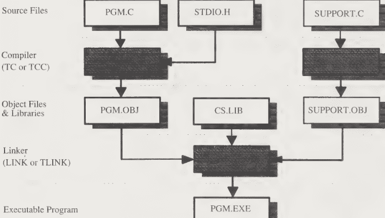

## 集成 C 环境

Turbo C 是首个针对 MS-DOS 计算机的集成 C 环境，它将全屏编辑器、编译器和帮助系统整合到一个程序中。随后，微软推出了一款类似的产品 QuickC。QuickC 具有类似的功能，并在集成环境中增加了一个符号级源码级调试器。Turbo C 的最新版本现在也配备了符号级源码级调试器。

对于我们的目的来说，这些产品几乎是完全相同的，因为它们都遵循 ANSI 标准，提供大致相同的功能集，并且在默认设置相同且源代码相同的情况下，产生速度和大小上等效的目标代码。编译器有不同的默认设置，你可能更倾向于其中一个而不是另一个，但对差异的反应通常是个人的，且往往是微不足道的。

## Microsoft C 5.0 优化编译器

Microsoft 5.0 优化编译器是一个功能齐全编译器，适用于大型程序开发项目。它具有一个命令行编译器、多个编程支持工具以及 QuickC 编译器的版本。

支持工具之一是 CodeView 符号级源码级调试器。CodeView 为你提供了方便的测试和调试程序的方法。Turbo C 也提供了类似的符号级调试器，并包含在 Professional Turbo C 程序开发系统中。

使用优化编译器（我此后将其称为 C5）的主要原因是能够针对程序的速度、大小或二者进行优化。当你学习 C 语言编程时，这并不重要，但对于那些编写商业软件的人来说，它非常有价值。缩短程序的运行时间或大小对其在竞争激烈的微型计算机市场中的接收产生重要影响。

我发现，初始程序设计和原型制作、实验以及仅仅是玩玩，使用集成环境是最容易的。内置帮助系统在早期阶段是极好的资产。如果一个程序可能投入商业运行，我会用全优化编译器对其进行重新编译。

# 第 2 章

## 编写 C 程序

我们将通过分析一些运行程序的示例开始学习 C 编程。虽然你可能无法立即欣赏或理解 C 程序的所有元素，但通过查看真实的程序来建立参考框架是有帮助的。

通过剖析本章所示程序，你将遇到几乎所有 C 程序中出现的许多主要元素。

## 一个简单的 C 程序

让我们从一个简单的开始。`greet`程序打印一条消息并退出。其实没什么复杂的。C 源代码包含在`greet.c`文件中，你可以用文本编辑器（独立程序，如`vi`，或集成 C 环境环境的编辑器部分）创建它。如果你使用文字处理器，请确保将文件保存为普通文本（无特殊格式）。

```c
main()
{
    puts("Greetings. Welcome to C.");
}
```

## C 编程

程序由一个`main()`函数和一个对标准库输出函数`puts()`的调用组成。

标准库是许多高度精炼程序集合。我们将在程序大量使用标准库。

## 创建程序文件

在运行`greet`之前，你必须编译并链接它。在 C 编程环境中，过程是相同的，但细节有所不同。

### UNIX

`cc`命令运行预处理器、编译器阶段和链接器以创建可执行文件。对于对 UNIX 的讨论，我将假设使用 Bourne shell，但如果你愿意，可以使用 Berkeley shell 或 AT&T Korn shell。你的命令行提示符可能不是标准的 UNIX 美元符号`$`。

```bash
$ cc greet.c
$ a.out
```

Greetings. Welcome to C.

这一命令序列显示了你通过`cc`命令进行编译和链接。如果源代码语法正确，它会生成一个名为`a.out`的文件并赋予其执行权限。你可以通过输入名称`a.out`来运行程序。如果你愿意，可以将`a.out`文件重命名（例如为`greet1`），并通过新名称运行程序。

你可以使用如下形式的编译器命令来跳过重命名步骤：

```bash
$ cc -o greet1 greet.c
```

如果你的程序源有缺陷，编译器将显示一些错误信息（可能有用，但不要寄于此）并创建一个不可执行的输出文件。如果发生这种情况，请检查源文件中的拼写错误。仔细检查大括号（它们必须成对），并确保包含`puts()`函数的行以分号正确结束。如有必要，编辑你的源文件并再次尝试编译步骤。

### DOS

如果你使用命令行程序，如`TCC`、`QCL`或`CL`(C5)，在 DOS 下编译和链接的过程与为 UNIX 描述的过程几乎相同。改变的是编译器驱动程序的名称。

如果你使用集成 C 编程环境之一，输入`TC`、`QC`或你的环境要求的任何程序，并使用命令菜单控制编辑、编译和程序执行步骤。

图 2-1 显示了在 Turbo C 环境中即将运行的`greet1`程序。QuickC 有不同的菜单组织，但运行方式类似。这两种集成 C 环境都将输出显示在独立编译器屏幕的用户屏幕上。用户屏幕保存在内存中，你可以通过键盘命令切换到它（Turbo C 为 Alt+F5，QuickC 为 F4）。

## 图 2-1：Turbo 编译菜单

| 文件 | 编辑 | 运行 | 编译 | 项目 | 选项 | 调试 | 断点/监视 |
|---|---|---|---|---|---|---|---|
| 第 1 行 | 列 | 编译为 OBJ | C:GREET1.OBJ | | C:GREET1.C | |
| main() { | puts("Greetin | 生成 EXE 文件 | C:GREET1.EXE | | | | |
| | 链接 EXE 文件 | 编译全部 | | | | | |
| | 主 C 文件: 获取信息 | | | | | | |
| 消息 | | | | | | | |
| F1-帮助 F5-缩放 F6-切换 F7-追踪 F8-单步 F9-制作 F10-菜单 | | | | | | | |

## main() 函数

每个 C 程序都有一个`main()`函数，它是程序的起点。C 系统在将控制权交给你的程序代码之前，会进行一些初始化工作，例如处理命令行参数。

由于`main()`函数是指定的起点，因此程序中只能有一个这样的函数。然而，你可以在程序中根据需要任意其他函数。`greet1.c`程序源文件包含`main()`和对另一个函数`puts()`的调用，`puts()`负责打印消息。更复杂的程序可能涉及许多其他函数；通常是库调用和程序员定义函数的混合体。

在随后的章节中，我们将探索命令行参数处理以及典型 C 系统运行时启动的其他特性。

## 程序布局

C语言是自由格式的。它没有固定的行结构。例如，缩进没有特殊意义。空白字符（空格、制表符或换行符）并不足够重要，但在少数多字符运算符中是不允许允许的。

`alarmist`程序（`alarmist.c`）是一个让人们难以舒适阅读的程序示例，但它可以正常地编译和运行：

```c
main() {puts("The sky is falling!");}
```

通过将所有源代码压缩在一行中，程序员以牺牲程序可读性为代价节省了空间。这永远不是一个好主意。使用空白字符（包括缩进）来区分程序的元素。源代码将更易阅读也更易维护。

## 获取用户输入

这是我们问候程序的第一次修订。源代码包含几个新元素：

- 注释（块注释和内联注释）
- `#include`和`define`指令
- 用于缓冲的字符数组
- 额外的库函数

在查看源代码后，我们将讨论这些元素的每一个项：

```c
/*
* greet2.c
* 获取用户的姓名并打印个性化的问候。
*/

#include <stdio.h>
#define NBYTES 15

main()
{
    char name[NBYTES];    /* 输入缓冲区 */

    /* 提示用户输入姓名 */
    printf("What is your name?");

    /* 读取用户的输入 */
    gets(name);

    /* 打印个人问候 */
    printf("\nGreetings, %s, and welcome to C.\n", name);
}
```

## 注释

注释对最终程序程序没有贡献。它们在编译过程中会被剥离。然而，编写得良好的注释对程序的可读性有巨大的贡献。由于 C 语言语法的简洁，注释在 C 源文件中起的作用可能比在某些更啰嗦的高级语言中更大。

`/*`字符引入注释，`*/`字符终止注释。这两个注释分隔符之间的任何内容都是注释体。

短注释通常包含在一行内，通常如下所示：

```c
/* 注释文本 */
```

如果你需要输入很长的注释，可以将注释分隔符放在不同的行上，创建一个块注释。为了帮助在视觉上保持块注释的完整性，程序员经常使用垂直排列的星号数组或其他字符，如例例所示：

```c
/*
* 注释文本
* 更多注释文本
* 还有更多注释文本
*/
```

有些程序员用破折线和垂直线或其他符号画出的框完全包围块注释，以使它们真正脱颖而出。你可以以任何喜欢的方式混合注释样式，但要尝试以有意义的方式使用注释样式。我建议在每个文件或函数定义的开头使用块注释，并使用内联注释来描述可能具有显而易见的含义或目的的程序语句。

## 字符数组

缓冲区是内存中的一个地方，你可以在接收数据时将其存储以备后以后使用。语句：

```c
char name [NBYTES];
```

这是一个长度为`NBYTES`的字符数组的声明。该语句引入了几个新术语和概念。

关键字`char`表示变量（在此例中为`name`）的数据类型。由方括号`[]`表示的数组是相同类型的两个或多个对象的集合。符号名称`NBYTES`是一个定义常量（详细信息请见下一节），在程序程序中它的值为 15。

因此，该语句声明了一个包含 15 个字符的数组。该数组被用于存放用户输入的姓名。

## 预处理器指令

`greet2.c`程序包含一个`#include`指令。`#include`指令会将命名文件或内存区域的内容引入到包含文件中，有效地替换源文件中的指令行。

一组实用的输入输出例的定义包含在`stdio.h`头文件中。

（注：此处原文中存在大量重复段段落）

`#include`指令会将命名文件或内存区域的内容引入到包含文件中，有效地替换源文件中的指令行。

（注：此处原文中存在大量重复段落，译文已按要求逐行翻译并保持格式）

## 标准库函数

`greet2.c`程序包含了来自标准库的一些新函数：`printf()`和`gets()`。`gets()`从标准输入读取字符。

## 返回值

返回值的目的是向调用函数返回一个数据项。例如在`greet3.c`中，`main()`返回一个整数值来表示成功或失败。

让我们看看源代码：

```c
/*
* greet3.c
* 获取用户的姓名并打印个性化的问候
*（修订版本）。
*/

#include <stdio.h>
#include <stdlib.h>

#define NBYTES 15

int
main()
{
    char name[NBYTES];    /* 输入缓冲区 */

    /* 提示用户输入姓名 */
    printf("What is your name?");

    /* 读取用户的输入 */
    gets(name);

    /* 打印个人问候 */
    printf("\nGreetings, %s, and welcome to C.\n", name);

    return EXIT_SUCCESS;
}
```

## 命令行参数

命令行参数是用户在调用程序时在命令行上输入的值。使用它们的一个理由是允许同一个程序在每次启动时处理不同的数据。一个是：

```
vi myfile.c
```

## 程序连接

程序可以与其环境通信。两种主要的手段是命令行参数和返回值。

## 问题与练习题

- 1. 下面程序有什么错误？

```
test()
{
    puts("This is a test.");
}
```

- 2. 什么是标准库函数？为什么它们在编写程序时很有用？

- 3. 在程序运行之前，用户必须对程序做什么？

- 4. 在 C 语言中，可能将整个程序写在一行内吗？如果是的话，为什么这不是一种良好的做法？

- 5. 使用注释：
    - a. 有助于组织程序。
    - b. 为程序增加不必要的空间和杂乱。
    - c. 使程序更容易被修改。
    - d. a 和 c 都对。

- 6. 描述两种常用的注释类型，并为每种给出两个例子。

- 7. 下述语句的作用是什么？

```
char name[20];
```

- 8. `#define`预处理器指令起到什么作用？

- 9. 哪个预处理器指令允许源文件包含指定文件或头文件的内容？请展示该预处理器功能的示例。

- 10. 列出你目前学过的标准库函数，并描述每个函数的功能。

- 11. 什么是命令行参数？它们是用来做什么？

- 12. 解释返回值的目的以及它们如何在程序中用法。


## 附加练习题

- A. 重写`greet3.c`程序，以允许全名（约 30 个字符）并打印不同的消息。
- B. 编写一个程序，要求输入两个字符字符串，并在输出消息中使用它们。

# 第 3 章 数据与内存

计算机存储各种类型数据的方式与 C 语言表示数据的方式非常紧密。本章将探讨数据，从单个比特位到表示数字、字符和字符串的高位位组合。

当你完成本章后，你将了解如何识别和使用 C 数据类型和类型修饰符，如何在程序中将数据表示为常量和变量，以及如何打印（或显示）数据。

## 计算机内存

计算机内存是计算机系统中重要且本质的部分。计算机系统的内存由两种类型组成：主存和辅存。

内存通常是随机访问存储器（RAM），可由计算机中央处理器（CPU）直接寻址。主内存通常是快速且易失的。当电源关闭时，其内容将会丢失——除非提供了某种形式的电池备份电源或使用了特殊的非易失性存储设备。在程序执行期间，所有的程序文本（指令）和数据都存在于活动的主内存某处。

辅存存储在磁盘、磁带或其他介质上。此类内存不在计算机的寻址空间内。它的优点是在没有电源的情况下可以进行（相对）永久存储。辅存的速度通常比主内存慢一个或多个数量级，但长期保留信息的能力是一项重要的优势。

另一种称为只读存储器（ROM）的内存兼具主存和辅存的属性。它也可以被放置在处理器的寻址空间内。正如名称所示，ROM 可读但不可写，这使得存储在 ROM 中的程序指令和数据可用，而没有被意外或故意修改的危险。ROM 的内容是永久的。

## 比特（二进制位）

计算机内存（无论是主存还是辅存）的核心是二进制位，更通称为比特（bit）。单个比特位有两种可能的状态：开启或关闭。这些状态通常分别称为 1 和 0。因此，单个比特位的取值范围是两个。见图 3-1。

图 3-1：比特是存储的基本单位。

| 比特值 | 指示器 |
| --- | --- |
| 0 | (关闭) (开启) |
| 1 | (开启) (关闭) |

在计算机内存内部，状态由电压电平或电流的方向表示。我们只对比特当前状态所指示的值感兴趣。图 3-1 还显示了比特值如何被视为一个开启或关闭的光源，或者一个开启或关闭的电子电路。

## 比特的组合

通过将比特位组合成组，我们可以指定更大范围的值。如果我们使用两个比特位来表示一个值，我们可以指定从 0 到 3 的四个唯一值之一，如表 3-1 所示。

| 表 3-1：比特值 | |
| --- | --- |
| 二进制模式 | 十进制值 |
| 00 | 0 |
| 01 | 1 |
| 10 | 2 |
| 11 | 3 |

在上面的表中，二进制模式是通过使用两个相邻的比特位形成的，其中右侧比特位的“权重”为 1，左侧比特位的权重为 2。要计算由这对比特位表示的值，将每个比特位的权重乘以其对应的值（0 或 1），并将各个比特位的值相加。遵循十进制数字的惯例，右侧的比特位权重较低，左侧的比特位权重较高。

因此，`01`代表`0(2) + 1(1)`，值为`0 + 1`，即 1。在此语境下，括号表示乘法，在加法之前进行。同样，二进制模式`11`的等效十进制值为`1(2) + 1(1)`，得到值 3。注意，比特模式表示的值从 0 开始而不是 1。

## 进制数

通过将比特位组合成组，我们可以指定更大范围的值。如果我们仅使用两个比特位，取值范围就限制在四个（0 到 3）。正如你所见，通过增加一个比特位可以将范围扩展到 8 个值。

| 表 3-2：十进制值 | |
| --- | --- |
| 二进制模式 | 十进制 |
| 000 | 0 |
| 001 | 1 |
| 010 | 2 |
| 011 | 3 |
| 100 | 4 |
| 101 | 5 |
| 110 | 6 |
| 111 | 7 |

## 六进制

当我们增加第四个比特位时，可以将范围扩大到 16（0 到 15）。表 3-3 显示了这些十进制值。

| 表 3-3：十六进制与二进制 | | |
| --- | --- | --- |
| 二进制 | 十进制 | 十六进制 |
| 0000 | 0 | |
| 0001 | 1 | |
| 0010 | 2 | |
| 0011 | 3 | |
| 0100 | 4 | |
| 0101 | 5 | |
| 0110 | 6 | |
| 0111 | 7 | |
| 1000 | 8 | |
| 1001 | 9 | |
| 1010 | 10 | A |
| 1011 | 11 | B |
| 1100 | 12 | C |
| 1101 | 13 | D |
| 1110 | 14 | E |
| 1111 | 15 | F |

表中显示了另一种名为十六进制的表示方法。通过使用 A 到 F（或 a 到 f）字母，我们可以表示这些值。这为我们提供了一种更紧凑、方便的方式。为了区分十六进制数和十进制数，我们在 C 中使用`0x`。因此，5 可以显示为`0xC`。

## 字节

计算机通过地址跟踪内存对象。寻址内存中的每一个比特位负担太重，因此计算机维护字节的地址。

字节是比特的集合，足以容纳 C 程序执行环境中的任何基本字符的值。字节的大小取决于实现，在微机设置中，8 位是一个常见的尺寸。比特在内存中必须连续排列。

图 3-2 显示了一对 8 位字节。让我们查看编号为 0 到 7 的低字节。

图 3-2：比特被组织成字节和字。

| 32768 | 16384 | 8192 | 4096 | 2048 | 1024 | 512 | 256 | 权重 |
| --- | --- | --- | --- | --- | --- | --- | --- | --- |
| 15 | 14 | 13 | 12 | 11 | 10 | 9 | 8 | 位 |
| 0 | 0 | 0 | 1 | 0 | 1 | 1 | 0 | 高字节 |
| 128 | 64 | 32 | 16 | 8 | 4 | 2 | 1 | 权重 |
| 7 | 6 | 5 | 4 | 3 | 2 | 1 | 0 | 位 |
| 0 | 0 | 0 | 1 | 0 | 1 | 1 | 0 | 低字节 |

由于其对字节总值的贡献最大，最左侧的位被称为最高位（MSB）或高阶位。相反，最右侧的位对总值的贡献最小，被称为最低位（LSB）或低阶位。

在该字节中，只有位 1、2 和 4 对该字节的值有贡献，因此该字节的值是这些位权之和：$16 + 4 + 2$，等于 $22$。一个 8 位字节可以表示的唯一值数量为 256 个。当然，其他尺寸的字节可以表示更大或更小范围的值。

## 对象与地址

如图 3-2 所示，我们可以使用字节的集合来形成称为“对象”（objects）的实体。对象（位域除外）是由一组连续的字节（一个或多个）组成的内存区域，可以表示值。位域对象（bit-field object）是连续位点的集合，无法直接寻址。我们将在介绍结构体之后，在第 8 章详细介绍位域。

在图中，一对 8 位字节组成了一个 16 位的位（bit）。字节的重要性取决于它在对象中的位置。正如我们所看到的，在这个例子中，低字节对整个字值贡献了 $22$ 的值。高字节（为了讨论起，其位模式与低字节相同）对字值贡献了 $5,632$ 的值。

注意，16 位数据字中高字节的位编号从 8 到 15，其位权相应地高于低字节。该字节值为 $4,096 + 1,024 + 512$——或 $5,632$。对于 8 位字节的情况，我们可以通过取位模式的普通字节值（$22$）乘以 $256$ 来得到相同的值。

除位域外，所有对象都有地址。对象的地址是其在内存中第一个字节的地址。第一个字节是对象的低阶字节还是高阶字节取决于实现，这也是某些为了可移植性问题而设计的严谨内存布局的基础。

图 3-3 显示了一个 16 位计算机的示例，以原始 IBM 个人电脑（PC）为典型。我将这种内存布局称为英特尔架构（Intel architecture），因为 PC 的核心是 8088 微处理器。在右侧，我们将内存视为逻辑上连续的字节，地址逐渐增大并位于页面靠下方。这是正常的页面呈现方式。某些文档将高地址放在页面顶部，但任何一种呈现方式都是可以的。

## 图 3-3：代表性的内存组织

典型的微型计算机内存组织

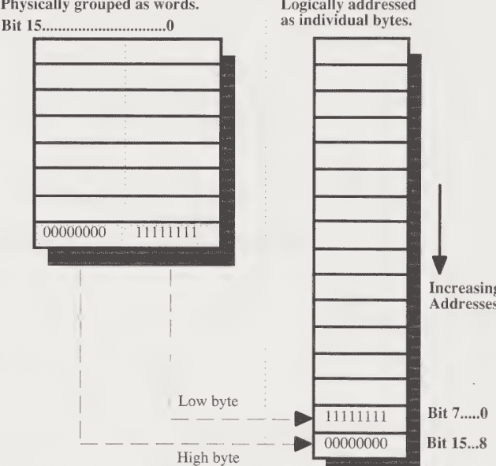

* 图显示的是 16 位内存，但许多微型计算机使用不同的原生字长。

对于英特尔架构，内存物理上组织为 16 位字（words）——如图左所示。注意，字的最高字节位于较高的地址。因为对象通过其在内存中的第一个字节进行寻址，因此字的字节在内存中实际上反转了。这种字顺序被称为“小端”（little-endian）存储，因为被寻址的字节对字值的贡献最小。

其他架构（例如摩托罗 68000 系列处理器）被称为“大端”（big-endian），字节是对象的第一个字节。我们的 C 程序必须编写得能够消除对字节顺序的考虑。问题通常发生在我们尝试将数据移动到具有不同架构的机器时。本书的可移植性章节描述了字节序等问题，并就如何在你的程序中避免可移植性问题提供了建议。

## 关键字

以下标记（tokens）被保留为 C 语言关键字。它们不能用于标准规定之外的任何用途。关键字必须完全以小写字母输入。

你将在书其余部分成组或单独遇到这些关键字。每个关键字都在适当的语文中和示例程序得到了解释。

```
auto            double      int             struct
break           else        long            switch
case            enum        register        typedef
char            extern      return      union
const           float       short           unsigned
continue        for         signed      void
default         goto        sizeof          volatile
do              if          static      while
```

## 标识符

标识符（identifier）是字符序列（一个标记），用于表示 C 程序的对象、函数或各种其他元素。标识符由字母（a 到 z 和 A 到 Z）、数字（0 到 9）和下划线（`_`）组成。它必须以字母或下划线开头，以区别于数字。

虽然标准没有明确限制标识符的长度，但每个实现都被允许对内部和外部名称设置限制。内部名称没有外部链接（external linkage）的名称；外部名称具有外部链接。外部链接是指使不同程序模块中的名称引用同一个对象或函数的手段。

每个内部名称在不少于 31 个字符内必须是唯一的，且区分大小写。外部名称的唯一性可能仅限于 6 个字符，且实现可能会忽略大小写。C 标准可能会在未来进行修订，以消除对外部名称的这种限制以及在某些环境中残留的其它陈旧做法。

以下是一些可用作名称的有效标识符：

| 数字 | 宽度 | `error_count` |
| :--- | :--- | :--- |
| `col` | `ValidResponse` | `BufferModified` |
| `NumberOfAttempts` | `attr__` | `row` |

以下是满足函数名要求的有效标识符：

```
clrscr      push
home        page      npages
```

在执行六个字符限制且不区分大小写的系统中，以下函数名将被视为相同，因为它们在重要位置上的起始字符相同：

```
GetWinHeight()      GetWinWidth()      getwinbuffer()
```

以数字开头或包含指定以外字符的名称可能会产生错误或意外结果。表 3-4 列出了无效标识符的示例。

| 表 3-4：无效标识符 | 问题 |
| :--- | :--- |
| `amount$` | 包含非法字符 (`$`) |
| `31flavors` | 以数字开头 |
| `max-min` | 不是标识符——从`max`减`min` |
| `float` | C 关键字 |

你可以将`Float`作为程序中的内部名称，因为初始的大写字母 F 将与关键字`float`区分开来。然而，这种做法是不建议的。

## 变量

变量是具有名称且存储空间取决于数据类型的对象。名称可以是任何有效标识符。只要不产生冲突，不同对象可以使用相同的名称。冲突通过我们稍后讨论的作用域规则来解决。

每个变量在使用之前必须声明。声明告诉编译器将使用该变量及其数据类型是什么。你可以在声明时给变量赋初值。变量的值在程序运行期间通常 way，除非被`const`关键字修饰。

仔细选择每个变量的名称。名称应该反映变量在程序中的用途，以帮助你和其他阅读你程序的人。长名称对象的空间占用上与短名称对象没有区别。对象所占内存由其类型决定。

## 基础类型

C 拥有一组较小但完善的基础类型，这些类型与主流机器架构紧密相关。表达式的类型决定-

挖掘存储在对象中或由函数返回的值的含义。类型主要分为三大类：

- 对象类型——描述对象的类型
- 函数类型——描述函数的类型
- 不完整类型——描述对象但未提供对象大小信息的类型

我们将在后面的章节中详细介绍函数类型和不完整类型。在对象类型中，大部分被称为基本类型，这些是本章的重点。请注意，C 语言的类型机制非常通用，它不仅指的是数据对象，还包括函数和表达式。

表 3-5 总结了基本类型。其他类型都是这些类型派生出来的。

| 类型标识符 | 描述 |
| --- | --- |
| `char` | 纯字符 |
| `signed char` | 有符号字符 |
| `unsigned char` | 非负符号字符 |
| `short int` | 短整数 |
| `int` | 纯整数（通常为机器寄存器大小） |
| `long int` | 长整数 |
| `unsigned short int` | 无符号短整数 |
| `unsigned int` | 无符号整数 |
| `unsigned long int` | 无符号长整数 |
| `float` | 单精度浮点数 |
| `double` | 双精度浮点数 |
| `long double` | 扩展精度浮点数 |

现在让我们详细检查每种基本类型，并看看它们在 C 程序中是如何使用的。

## 字符

`char`类型指定一个“纯”字符。纯字符是有符号的还是无符号的（更准确地说是非负的）取决于实现。从历史上看，大多数实现将纯字符视为有符号实体变量，而另一些实现则将其视为无符号的。

字符可以保存原生字符集中任何成员的值。在这种情况下，该值保证是正数。你通过以下记法声明一个字符对象：

```
char c; /* 声明一个纯字符变量 */
```

`keyword char`确定了对象的类型，而标识符`c`为对象提供了一个方便的名字。你可以使用任何有效的标识符作为变量名。分号是语句的终止符，它是声明语句以及大多数其他 C 语言语句的必要组成部分。内联注释描述了语句的作用。当然，注释是可选的，但如果能写得仔细并在程序更改更改时保持更新，它们就是程序的重要部分。

一旦你声明了合适的变量，就可以给它赋值。这项任务通常通过使用赋值语句完成。单等号`=`是 C 运算符，它将右侧表达式的值赋给左侧的对象。

下面的赋值语句将字符`'A'`的值放入`c`中。

```
c = 'A'; /* 将字符 A 赋值给 c */
```

下一个语句将变量`c`中存储的值作为字符“打印”到标准输出，标准输出通常是用户的终端或控制台屏幕。“打印”（print）一词被泛指使用，意味着在纸质拷贝设备上*打印*或在视频输出设备上*显示*。

## 字符常量

表达式`'A'`被称为字符常量。它产生表示字符集中字母 A 的内部代码（一个数字）。

对你来说，知道这一点并不重要，目的是为了让你免于编写不可移植程序的诱惑。你只需要知道，例如 ASCII 字符集中`'A'`的代码与 EBCDIC 字符集中`'A'`的代码不同，并避免编写依赖于`'A'`为特定值的代码。EBCDIC 是扩展二进制编码交换码，是一种主要用于 IBM 大型机系统的八位代码。

不要被数值值和字符值之间的差异所困扰。例如，数值 0 代表空字符 (`N`)。字符常量`'0'`的 ASCII 值为十进制 48——与数值 0 差得很远。

## 字符串字面量

字符串字面量（或字符串常量）是用双引号括的字符序列。双引号界定了字符串，但不是它的一部分。字符序列可以是空的。

这里是一些示例：

```
"This string is not empty."
"" /* 这个就是空的！ */
```

字符串字面量被存储为字符数组。再次，数组是相同类型对象的连续集合。数组包含

```
putchar(c); /* 打印 c 的值 */
```

如果你在给字符赋值之前尝试打印它，输出将是错误的，将留下一个从变量声明之前占用该内存的任何内容的未定义值。变量声明不会自动更改内存内容，除非在我们在后续章节中讨论的情况。

字符串字面量中的每个字符，加上一个标记结束的终止空字符。

你可以通过简单地将两个或多个字符串字面量并在一起来连接（连接）它们。因此，相邻的字符串字面量：

```
"Wanna buy " "a used watch?"
```

在标准 C 编译器看来，它们等同于：

```
"Wanna buy a used watch?"
```

小心。字符串字面量和字符常量是不同的，例如，使用双引号形成包含单个字符（如`'Z'`）的字符串字面量会产生一个包含两个字符的数组（Z 和一个空字符）。这与字符常量`'Z'`（单引号）完全不同，后者是一个代表机器字符集中字母 Z 的整数值。

## 转义序列

字母、数字和标点符号各有一个图形（可见）的表示形式，并可以直接用于字符常量和字符串字面量。一些重要的字符具有格式效果或目的，但没有可见外观，且某些无法直接输入。我们使用转义序列来赋予此类字符效果。

例如，你可以使用`\t`表示制表符。下表列出了所有序列。

| 表 3-6 转义序列 | |
| --- | --- |
| `\n` | 换行 |
| `\b` | 退格 |
| `\r` | 回车 |


| `\f` | 换页 |
| `\v` | 垂直制表符 |
| `\a` | 警铃 |
| `\'` | 单引号 |
| `\"` | 双引号 |
| `\?` | 问号 |
| `\\` | 反斜杠 |
| `\octal digits` | 八进制数字 |
| `\hex digits` | 十进制数字 |

最常用的转义序列是`\n`，即换行。打印一行你可以使用：

```
putchar('\n');
```

而打印一行文本可以使用：

```
printf("This is a line.\n");
```

如前所述，可以使用`\0`表示空字符。字符集的任何其他代码也可以通过反斜杠加上一三个八进制数字来表示。你也可以使用十六进制序列表示任何字符。例如，`\xEF`代表删除（DEL）字符。一种可移植的响铃方法是使用警铃序列`\a`，它不取决于特定的字符集。

## 整数

整数是计数类型，分为有符号和无符号两类。纯整数类型通常是机器寄存器或字的大小。除了有符号`char`外，默认认为是有符号的，但也可以显式指定。因此`signed short int`和`short int`是同义词。

`short int`（简称`short`）的取值范围是`int`类型提供的范围的子集。`int`类型反过来其范围也是`long int`（简称`long`）范围的子集。无符号类型也遵循相同的层次结构。

在特定的机器上，`int`的大小可能与`short`或`long`相同。例如，在 IBM PC 或兼容机（16 位架构）上，`int`和`short`大相同。

每个有符号整数类型都有对应的无符号整数类型，具有相同的大小和范围，但极值不同。无符号类型只持有非负值。

## 打印整数数据

程序`int`（文件`int.c`中的源码）展示了如何声明整数变量、为其赋值并打印这些变量的值。变量被声明为纯整数（类型`int`）。

```
/*
* ints.c
*
* 使用 printf() 打印包含变量的字符串。
*/
```

```c
#include <stdio.h>
#include <stdlib.h>

main()
{
    /* data declarations */
    int num1, num2;

    /* assign values to variables */
    num1 = 5;
    num2 = 11;

    /* print a description of the numbers */
    printf("Values: num1 = %d and num2 = %d\n", num1, num2);

    return EXIT_SUCCESS;
}
```

`num1`和`num2`的数据声明为变量预留了两个普通整数大小的内存块。赋值语句为变量提供了值。

`printf()`函数打印一条包含固定部分和可变部分的消息。`printf()`函数至少接受一个参数，即一个格式字符串，该字符串可以包含字面文本和可选的转换说明符。任何字面文本都将原样打印。每个转换说明符决定了随后的每个参数如何进行转换。

## 整数转换说明符

此示例使用的`%d`字符对是一个转换说明符。`%`符号是引导符。后面跟着一个转换字符`d`，它要求将其伴随参数以十进制（基 10）数字打印。

在示例程序中，有两个转换说明符。每个说明符都需要为`printf()`提供一个额外的参数以提供要转换的值。因此，此函数调用总共有三个参数：格式字符串和两个整数值。

下表 3-7 总结了基本的整数转换说明符及其用途。

| 转换字符 | 说明 |
| :--- | :--- |
| `c` | 将整数转换为无符号字符。 |
| `d`, `i` | 将整数转换为有符号十进制。 |
| `u` | 将无符号整数转换为无符号十进制表示法。 |
| `o` | 将无符号整数转换为八进制表示法。 |
| `x`, `X` | 将无符号整数转换为十六进制表示法。 |

表中显示的转换字符可以通过前缀字符限定。应用于除`c`之外任何整数字符的可选前缀`h`指定该转换说明符适用于`short int`（短整数）或`unsigned short int`（无符号短整数）参数。同样，可选的前缀`l`指定该转换说明符适用于`long int`（长整数）或`unsigned long int`（无符号长整数）参数。

由于`%`被用作引导符，我们需要一种在格式字符串中放置字面百分号的方法。使用`%%`来打印符号百分号。该对产生一个百分号，作为格式字符串的一部分。此时不会发生转换，因此不需要伴随参数。

## 整数常量

整数常量既没有小数部分（因此没有小数点）也没有指数。它以数字开头。可选的前缀和后缀指定了整数常量的基数（默认为 10）和类型（默认为`int`）。`ints`程序中包含了一些整数常量的示例。它们被用于为`num1`和`num2`变量赋值的赋值语句。赋值语句中的值 5：

```c
num1 = 5;
```

你可以通过使用`0`（零）前缀将整值表示为八进制，或通过使用`0x`前缀表示为十六进制。因此，你可以用`05`或`0x5`代替十进制的 5。要指定长常量，请对值应用`l`（或`L`）后缀。例如，`100L`被表示为长整数。要指定无符号常量，请对值应用`u`（或`U`）后缀（例如：`345u`）。长和无符号后缀可以结合使用以指定无符号整数常量（例如：`4096U`）。

## 字符串

`printf()`函数接受格式字符串接受转换说明符`%s`。`%s`转换说明符请求一个指向字符数组的指针。指针是对象的地址（关于指针的详细介绍请参见第 7 章）。`strings`程序（在源文件`strings.c`中）展示了如何声明、初始化和打印字符串。

```c
/*
* strings.c
* 打印字符串。
* 显示如何处理字面字符串和包含替换内容的字符串。
*/
```

```c
#include <stdio.h>
#include <stdlib.h>

int main(void)
{
    static char flower[] = "rose";
    static char color[] = "yellow";

    printf("1. What is?\n");
    printf("2. I would like a single %s,\n", flower);
    printf("3. I would like a dozen %s.\n", flower);
    printf("4. This flower is a %s.\n", color);
    printf("5. A %s by any other name is still a %s.\n", color, flower);

    return EXIT_SUCCESS;
}
```

在字符串程序中，使用了两个字符数组（`flower`和`color`）来存储字符串。此时不必担心变量的声明和初始化。第一个声明：

```c
static char flower[] = "rose";
```

创建了一个包含五个字符的数组：'r'、'o'、's'、'e' 和 '\0'。同样，第二个声明创建了一个七字符数组。这两个“字符串”被用于程序中所有的打印语句。第一个`printf()`包含一个字符串字面量（格式字符串）且没有其他参数。该语句在没有替换的情况下呈现了字面文本，因为没有替换内容。第一个`printf()`包含一个字符串字面量且没有其他参数。语句呈现字面文本而不进行替换，因为没有转换说明符。第二个`printf()`语句通过字面文本插入了值。你可以以你喜欢的方式混合使用。第一个`printf()`包含一个字符串字面量且没有其他参数。语句呈现字面文本而不进行替换，因为没有转换说明符。第二个`printf()`语句通过字面文本插入了值。你可以以你喜欢的方式混合使用。

## 浮点类型

到为止我们处理的都是整数类型。浮点类型包括`float`、`double`和`long double`。这些类型之间不同的是表示特定数值的精度。浮点数的精确内部表示并不由标准规定。IEEE（电气与电子工程师协会）是一个国际组织，其职责之一是创建和发布标准。

浮点类型的分级结构与整数相似。`float`（单精度）值是`double`（双精度）值的子集，而`double`又是`long double`（扩展精度）值的子集。在特定的实现中，所有浮点类型具有相同的精度，但`double`的精度不能低于`float`也不高于`long double`。

**程序员笔记**

> 现有的 C 程序可能包含`long float`类型作为`double`的同义词。此类程序必须重写以使用`double`。

## 打印浮点数据

要打印浮点值，你可以使用带有指示如何格式化转换说明符的`printf()`。你对打印或显示的呈现具有完全的控制权。对于每个要打印的数据项，提供一个转换说明符和一个伴随的值参数。`float`程序（源自`float.c`）展示了如何声明浮点变量、为它们赋值并以各种方式打印。观察打印语句中的转换说明符，然后阅读源列表后的细节。

```c
/*
* float.c
* 打印浮点（实数）值。
*/

#include <stdio.h>
#include <stdlib.h>

int main()
{
    /* data declarations */
    float f_var;
    double d_var;

    /* 给变量赋值 */
    f_var = 106.11;
    d_var = -0.00000654;

    /* 以各种方式打印值 */
    printf("Variable f_var = %.2f\n", f_var);
    printf("Variable d_var = %.10f\n", d_var);
    printf("Variable f_var = %e\n", f_var);
    printf("Variable d_var = %G\n", d_var);

    return EXIT_SUCCESS;
}
```

此程序使用一个单精度变量`f_var`和一个双精度变量`d_var`。用于其中的转换说明符是

# 50 C 语言编程

`printf()`语句看起来比我们之前看到的要复杂一些。让我们看看额外的项目是什么，以及为什么要使用它们。

## 浮点数转换格式符

转换格式符的一般形式包含两个必需元素和若干可选元素。目前，我们只关注浮点数转换格式符的元素。

转换格式符具有如下形式：

```
%[flags][width][.precision]type
```

引导符和类型是转换格式符的必需元素。方括号中显示的元素是可选的。括号表示所包含元素的可选性，但在编写格式符时，你不需要输入括号。

类型元素由表 3-8 中的至少一个单字母组成，该字母表示所请求的表示形式。这些转换字母适用于`float`和`double`类型。

| 表 3-8：类型转换字母 |
| 转换字符 | 描述 |
| --- | --- |
| `f` | 生成一个不带指数的带符号的小数值表示。格式：[-]d.dddd |
| `e` (or `E`) | 生成一个带有指数的带符号的小数表示。格式：[-]d.ddde |
| `g` (or `G`) | 生成一个带指数或不带指数的带符号的小数表示。`g`转换字符根据给定的数量和精度生成更紧凑的格式（`f`或`e`）。 |

如果值参数是`long`类型，请使用`l`（或`L`）限定符作为转换字符的前缀。例如，`%Lf`指定一个带有指数的`long double`表示。转换格式符的可选元素允许你对数据项的外观进行额外控制。`flags`元素由零或多个字符组成。它的字符列在表 3-9 中。

## 表 3-9：标记字符

| 标记字符 | 描述 |
| --- | --- |
| `-` (减号) | 将转换结果左对齐。 |
| `+` (加号) | 为正数的带符号值前加一个加号。 |
| (空格) | 为不带正号或负号的带符号值前加一个空格。 |
| `#` | 在转换前加 0（八进制）、0x（十六进制），或者在在没有小数部分的转换中强制插入小数点。 |
| `0` (数字零) | 如果没有其他标记，则在任何符号后为转换填充前导零。 |
| `*` | 如果使用星号，它指定了生成转换所需的最小字符数，并在左侧用空格填充。你还可以提供可选的精度（小数点后跟一个数字）。如果你没有提供数字或星号，则精度被视为零。如果你提供了数字，它指定了表 3-10 中列出的转换字符之一。 |

## 表 3-10：转换字符取值

| 转换字符 | 精度含义 |
| --- | --- |
| `d`, `i`, 等. | 生成的最小位数。 |
| `f`, `e`, 或 `E` | 生成的小数位数量。 |
| `g` 或 `G` | 生成的最大有效数字数。 |
| `s` | 为字符串生成的最大字符数。 |

## 存储要求和取值范围

`<limits.h>`和`<float.h>`头文件文档了符合标准实现的所有尺寸和限制。整数类型的值在`<limits.h>`中指定，浮点类型的值在`<float.h>`中指定。这些头文件包含了各种符号常量，指定了如字节中的位数、每个类型的最小值和最大值等项目。你可能会发现查看系统中这些头文件的内容大有益。表 3-11 是各基本类型字节尺寸和范围的示例。该表很好地反映了大多数计算机实现中的情况。

## 表 3-11：基本类型尺寸

| 类型 | 字节 | 范围 |
| --- | --- | --- |
| `char` | 1 | -128 到 127 或 0 到 255（注 1） |
| `signed char` | 1 | -128 到 127 |
| `int` | (注 2) | |
| `short int` | 2 | -32,768 到 32,767 |
| `long int` | 4 | -2,147,483,648 到 2,147,483,647 |
| `unsigned char` | 1 | 0 到 255 |
| `unsigned int` | (注 2) | |
| `unsigned short` | 2 | 0 到 65,535 |
| `unsigned long` | 4 | 0 到 4,294,967,295 |
| `float` | 4 (IEEE) | +/- 3.4E-38 到 3.4E+38（约 7 位精度） |
| `double` | 8 (IEEE) | +/- 1.7E-308 到 1.7E+308（约 15 位精度） |
| `long double` | (注 3) | |

注 1：`char`类型的范围由实现定义，可以是有符号的，也可以是无符号的。当存储来自源字符集的字符时，可以保证该值是正数。

注 2：整数类型`int`和`unsigned int`取决于实现。在典型的 16 位环境中，它们等同于`short`和`unsigned short`类型。在 32 位环境中，它们等同于`long`和`unsigned long`类型。在任何情况下，`int`的尺寸都不会小于`short`也不大于`long`。

注 3：具有扩展精度的`long double`是一种由实现定义的新类型。大多数当前的实现使用`double`的语义，但在语法上`long double`是一个不同的类型。

## 数据输入

大多数程序（非交互式程序外）都需要从用户获取输入。本节介绍的输入例是之前介绍的`printf()`、`puts()`等其他输出例的类比。首先，让我们看看读取字符串的方法。我们将看到如何读取数字。

## 读取字符串

在第 2 章中，`greet2`和`greet3`程序从键盘读取你的名字并个性化了消息。它们使用`gets()`将你的输入读入缓冲区（字符数组）中，然后由`printf()`等程序读取这些数据。

`gets()`宏从标准输入（stdin）读取一行文本，除非使用了重定向，否则就是键盘。在 UNIX 和 DOS 下，你可以使用`<`符号重定向输入。

一行是由零或多个字符和一个换行符（`\n`）组成的。在读取行时，`gets()`将换行符替换为空字符（`\0`），方便地创建一个字符串。如果你预计程序将接收最多 20 个字符的字符串，你必须分配一个至少 21 个字符的字符数组缓冲区，以保证有足够的空间容纳字符串字符和终止空字符。

## 数值字符串字符串

你可能没有立即意识到，当你在键盘上输入数字时，你实际上输入的是字符字符串。例如，数字 32 实际上是字符 '3' 和 '2'，后面跟着空字符。

你不能将表示数字的字符串赋值给整数变量。必须先将字符串转换为整数。`atoi()`函数接收单个参数，即指向字符串的指针，并返回一个整数值。字符数组的名字作为所需的字符串指针（数组第一个元素的地址）——这是 C 语言一个可能引起困惑的特性，我们将在后面的章节中讨论。

`rread`程序是从键盘读取数字的一个简单示例。使用了两个变量。第一个

# 数据与内存 55

变量`buffer`是一个包含六个字符的数组（五个字符用于最大的有效数字，外加一个空字符）。第二个变量是`number`，它是用于接收来自`atoi()`转换后的值的整数。

以下是`readnum.c`源文件的内容：

观察该程序中读取单个值时使用的两步过程：1) 读取用户输入的字符串并将其保存在`buffer`中；2) 将保存的字符串转换为整数，并将结果存储在整数变量中。

## 数值数据与 scanf()

你可以通过使用`scanf()`函数将存储和转换动作合并为一个动作，该函数是`printf()`输出函数的输入端对应物。

使用`scanf()`收集用户输入有一点危险，因为该函数的设计初衷是读取机器格式的数据。用户可能会故意或无意地提供不恰的输入，导致你的程序出现不可预知的行为。如果安全性是一个考虑因素，你可能需要使用更好的、但显然也更复杂的输入机制，这些机制会检查输入并向用户提供有用的反馈。


下面的程序`get_real`展示了如何使用`scanf()`从标准输入读取浮点数。按照目前的写法，该程序在遇到错误输入时会狼脸地失败。

```c
/*
* get_real.c
* 提示用户输入一个实数，并以
* 科学计数法保留三位小数显示。
*/
```

```c
#include <stdio.h>
#include <stdlib.h>

main()
{
    float number;

    printf("Real-number input: ");
    scanf("%f", &number);
    printf("\n number = %.3f\n", number);

    return EXIT_SUCCESS;
}
```

`scanf()`函数像`printf()`一样需要一个格式字符串。它也使用转换说明符来识别额外的参数并指定请求的转换。然而，它们之间存在显著差异。每个可选参数都必须指向一个接收转换结果的对象的指针。在`float`程序中，接收数值输入的对象是`number`，指向该对象的指针通过对对象名称应用`&`运算符获得（`&number`）。现在先按原值接受这一点即可。我们将在后的章节中详细讨论指针和间接性，并说明为什么`scanf()`需要指针。

## 程序员笔记本

如果用作缓冲区的对象是一个数组，那么数组名已经是指向数组开头的指针，因此你不需要使用`&`运算符。

## 总结

C 语言中的类型适用于对象和表达式，包括函数返回值。一组基本类型反映了大多数现代计算机系统的体系。额外的类型可以从基本类型派生。

标准库提供了丰富的输入输出例程（包括函数和宏）。你已经接触了一小组标准的输入输出例程，它们将帮助你入门。多功能的转换说明符在数据输入输出方面为你提供了极大的灵活性。

这一章涵盖了大量内容，但关于 C 类型以及数据输入输出还有很多可以说的。在随后的章节中，你将学习存储类说明符和类型限定符，我们将更多关注错误检测和纠正话题，并开发更好的收集用户输入的方法。

## 问题与练习

1. 识别三种主要的内存类型以及各自的优缺点。

2. 单个位的值范围是多少？这些值是什么？

3. 两个位的值范围是多少？用十进制形式表示这些值。

4. 将以下八进制值转换为对应的十进制值：

```
\0
01
06
10
12
```

5. 在 C 表达式中，八进制数如何与十进制数区分？

6. 将以下十六进制值转换为对应的十进制值：

```
0x0
0x1
0x6
0x8
0xA
0Xa
0xC
0xF
```

7. 在 C 语言中，十六进制数如何与十进制数区分？

8. 这个 16 位字的等十十值是多少（最高位在左侧）？

```
00100101010100100
```

9. C 关键字有哪些限制？如何输入它们？

10. 这些标识符中哪些可以作为内部名称：

  - `junk` `yin-yang` `sizeof`

  - `number` `ExtendLine` `%seed`

  - `4win` `Nextpage` `CA$`

11. 写六个可以作为外部名称的标识符。

12. 解释以下 C 代码在程序中的作用：

```c
char c;
c = 'D'
putchar(c)
```

13. 如果程序依赖字符常量为某个数字，可移植性会受到什么影响？

14. 字符串字面量和字符常量有什么区别？你如何区分它们？

15. 转义序列允许你做什么？

16. 列出本章描述的整数类型以及它们是什么。

17. 为什么要使用转换说明符？

18. `printf()`控制字符串中使用哪种转换说明符来指示参数被打印为字符串？它是如何访问字符串的？

19. 三种浮点类型是什么？它们之间有何不同？

20. 解释`<limits.h>`和`<float.h>`头文件的目的。

21. 什么是存储类说明符和类型限定符？

22. `atoi()`起什么作用？

23. 使用什么转换说明符可以将存储和转换动作合并为一个？

## 额外练习

- A. 使用数组重写`strings.c`。

- B. 使用浮点数重写`strings.c`。

- C. 使用标识符重写`strings.c`。

- D. 为什么使用`scanf()`是危险的？

- E. 表达式求值顺序是什么？

- F. 什么是语句终止符？

- G. 准备解释程序如何工作。

# 第 4 章

## 表达式与语句

在学习了变量、常量、词法元素后，你现在将学习如何组合变量和常量创建表达式。

## 引言

让我们对运算符、表达式和语句进行介绍。

## 运算符

C 提供了大量的运算符，用于赋值、连接和比较、间接访问以及许多其他工作。我们将操作的对象称为操作数。赋值运算符是我们已经多次使用的一种。它由等号（`=`）表示。赋值运算符接收两个操作数。正如很快看到的，C 还有一些运算符只接收一个操作数，以及一个接收三个。

## 表达式

运算符和操作数的组合创建表达式。表达式执行计算并产生结果，或引起某些动作（称为副作用）发生。事实上，你可以使用表达式来指定这些任务，在更高级的应用中，你可以使用表达式来指定对象或函数。

通常，表达式的求值顺序是不指定的，除非下文另有说明。因此，副作用发生的顺序也是未指定的。这种语言设计允许编译器编写者利用特定执行的特性。它意味着你在编写代码时应避免依赖于，以便于地移植到各种环境中。

如果表达式的求值产生了数学上未定义或超出范围的结果，则 C 程序的行为是未定义的。表达式求值未能产生定义的、范围内的结果被称为异常。

## 语句

语句指定动作。语句按照它们在程序中出现的顺序执行。然而，执行顺序可以通过转移控制的语句来改变，这些语句可以转移到程序的其他部分或外部。

C 语句有多种形式。基本的 C 语句是表达式后跟分号，被分类为表达式语句。

- 标标记语句

- 复合语句

- 表达式语句

- 选择语句

- 循环语句

- 跳转语句

表达式语句的语法是本章的重点。选择、循环、跳转和标标记语句将在第 5 章中详细介绍。

复合语句也称为块（block），是一种将一组语句组合成单个语法单元的机制。块可以嵌套，且每个块除了包含执行语句外，还可以包含自己的数据声明和初始化。

## C 运算符

如前所述，某些运算符只接受一个操作数。我们称这些运算符为一元运算符。大多数 C 运算符接受两个操作数，因此被称为二元运算符。其中一种 C 运算符——条件运算符，接受三个操作数，被称为三元运算符。

我们进一步根据它们所执行的操作类型对运算符进行分类。在本章的后续章节中，我将运算符分为以下几类：

- 赋值

- 算术

- `sizeof`

- 关系

- 逻辑

- 位运算

- 增递

- 移位

- 地址与间接性

下文将通过程序片段和完整的示例程序来演示这些类别运算符的描述。

## 运算符优先级

当一个表达式涉及多个运算符时，该表达式在求值结果上可能存在歧义。你可以通过括号对子表达式分组来要求特定的求值顺序。表达式：

```
x + y * z
```

该表达式是有歧义的，因为如果编译器先执行加法`(x + y)`再执行乘法`(y * z)`，结果与相反将不同。

C 拥有一种内置的优先级机制，它在大多数情况下都是合理的，除非你想要默认行为之外的结果，否则就不需要括号。表 4-1 是 C 运算符优先级表。你可能想将此表复制在纸上并放在你的操作位置以便随时查阅。

| 表 4-1：运算符优先级和结合性 | | |
|---|---|---|
| 运算符 | 描述 | 结合性 |
| `()` | 函数调用 | 从左到右 |
| `[]` | 数组索引 | |
| `->` | 结构体指针 | |
| `.` | 结构体成员 | |

## 表 4-1：运算符优先级和结合性

| 运算符 | 描述 | 结合性 |
| --- | --- | --- |
| `-` | 一元负号 | 从右到左 |
| `+` | 一元加号 | |
| `++` | 增增 | |
| `--` | 递减 | |
| `!` | 逻辑非 | |
| `~` | 位取反 | |
| `*` | 层次化 | |
| `&` | 地址 | |
| `sizeof` | 对象大小 | |
| `(type)` | 类型强制转换（显式版本） | |
| `*` | 乘法 | 从左到右 |
| `/` | 除法 | |
| `%` | 取模 | |
| `+` | 加法 | 从左到右 |
| `-` | 减法 | |
| `<<` | 左移 | 从左到右 |
| `>>` | 右移 | |
| `<` | 小于 | 从左到右 |
| `<=` | 小于等于 | |
| `>` | 大于 | |
| `>=` | 大于等于 | |
| `==` | 等于 | 从左到右 |
| `!=` | 不等于 | |
| `&` | 位与 | 从左到右 |
| `^` | 位异或 | 从左到右 |
| `\|` | 位或 | 从左到右 |
| `&&` | 逻辑与 | 从左到右 |
| `\|\|` | 逻辑或 | 从左到右 |

## 表 4-1：运算符优先级和结合性

| 运算符 | 描述 | 结合性 |
| --- | --- | --- |
| `?:` | 条件 | 从右到左 |
| `=` | 赋值 | 从右到左 |
| `+=` | | |
| `-+` | | |
| `*=` | | |
| `/=` | | |
| `%=` | | |
| `&&=` | | |
| `\|=` | | |
| `^=` | | |
| `<=` | | |
| `>>=` | | |
| `(逗号)` | 序列 | 从左到右 |

出现在优先级表顶部的运算符比靠近底部的运算符优先级更高，被认为它们与其操作数结合得更紧密。优先级最高的类别包括函数调用、数组索引、结构体成员选择和结构体指针运算符。

图表中同一层级的所有运算符（由框选区域指示）具有相同的优先级。序列运算符（也称为逗号运算符`(,)`）以及大多数赋值运算符位于优先级层次的低端，因此它们的优先级最低且结合得紧密。

如果你想强制编译器以某种方式评估表达式，请使用括号按照你想要的方式对操作数分组。在没有括号的表达式中（如第 69 页所示），C 的优先级机制会强制先执行乘法后执行加法，因此如果你输入以下内容，将达到相同的效果：

```
a + (b * c) /* 先执行乘法 */
```

## 表达式与语句 67

这是一个公认的人为示例，因为默认求值是先乘后加。但准确地显示你想要的内容并无害，而且括号不会减慢程序的运行速度或以任何其他方式影响它。

如果你想先执行加法，必须通过对加法加括号来强制编译器这样做：

```
(a + b) * c / /* 先执行加法 */
```

大量使用括号来显示

## 赋值运算符

主要的赋值运算符是等号（`=`）。要给`num`赋值，你首先声明一个变量，然后：

```
int num;
num = 50;
```

赋值运算符在优先级层次中位置较低，因此在使用它时要注意。赋值运算符用于将值存入内存。

## 算术运算符

算术运算符对任何上过数学课的人都是熟悉的。表 4-2 总结了算术运算符。

| 运算符 | 描述 |
| --- | --- |
| `+` | 加法 |
| `-` | 减法 |
| `/` | 除法 |
| `*` | 乘法 |
| `-` | 一元负号 |
| `+` | 一元加号 |
| `%` | 取模（余数） |

简单的加法会将值。在本示例中，语句：

```
total = val1 + val2;
```

图中显示了值的乘法。模运算符（`%`）通常被称为余数运算符，产生整数除法运算后的剩余。在图 4-1 中，语句：

```
remain = x % y;
```

描述了。表达式`8 % 5`的结果为 3，因为 5 可以整除 8，产生余数 3。注意，模运算仅适用于整数操作数。

你可以使用模运算符将数字保持在指定的数值范围内。给定一个无符号整数`i`，表达式：

```
i % 256
```

将表达式的值保持在 0 到 255 的范围内，对于无符号`char`变量来说这是一个安全范围。如果你给除数一个值，模运算符会测试该数以判断其奇偶。任何被 2 整除的数都是偶数，这通过余数为零表示。

## 程序员笔记

一元加号在语法上受支持，但在许多 C 编译器中语义上不支持。避免编写依赖一元支持的代码，移植性是一个需要考虑的问题。

## 图 4-1：内存操作


# 表达式与语句 71

## 数据转换

C 翻译器在进行计算之前必须将操作数转换为公共类型。以下算术转换列表描述了在实际执行二元操作之前获取所需的步骤（顺序非常重要）：

1. `float`类型的操作数转换为`double`类型。

2. 如果一个操作数是`long double`类型，另一个操作数被转换为`long double`类型。

3. 如果一个操作数是`double`类型，另一个操作数被转换为`double`类型。

4. 任何`char`或`short`类型的操作数转换为`int`类型。

5. 任何`unsigned char`或`unsigned short`类型的操作数转换为`unsigned int`类型。

6. 如果一个操作数是`unsigned long`类型，另一个操作数被转换为`unsigned long`类型。

7. 如果一个操作数是`long`类型，另一个操作数被转换为`long`类型。

8. 如果一个操作数是`unsigned int`类型，另一个操作数被转换为`unsigned int`类型。

`DATACONV`程序展示了隐式和显式数据转换的效果。

`DATACONV`程序展示了隐式和显式数据转换的效果。一组声明为一个字符、两个整数和两个浮点变量预留了存储。程序由一系列赋值和打印语句组成。源代码如下：

```c
/*
* dataconv.c
*
* 此程序演示了混合类型表达式中的隐式和显式数据
*转换。
*/
```

```c
#include <stdio.h>
#include <stdlib.h>

int
main(void)
{
    /* 数据声明 */
    char c;
    int i1, i2;
    float f1, f2;

    /* 丢失精度 */
    i1 = 875;
    c = (char) i1;
    printf("Integer assigned to character: %d -> %d (%c)\n",
           i1, c, c);

    /* 整数算术 */
    f1 = i1 / 10;
    printf("Integer arithmetic: %d / 10 = %f\n",
           i1, f1);

    /* 浮点算术 */
    f1 = i1 / 10.0;
    printf("Floating-point arithmetic: %d / 10.0 = %f\n\n",
           i1, f1);

    /* 类型提升 */
    f1 = 1.40066e+3;
    f2 = f1 + i1;
    printf("%f = %f + %d\n", f1, f2, i1);

    return EXIT_SUCCESS;
}
```

以此源代码列表为基础，以下观察可以提供数据转换是如何实现的洞察。

## 精度丢失

语句：

```
c = i1;
```

将整数`i1`的值赋值给字符变量`c`。精度丢失了，因为`i1`至少由两个字节表示，通常更多。变量`c`并没有那么宽——它只由一个字节表示。当赋值发生时，所有的低位实际上被丢弃，将存储的值限制在 256 个值的范围内。程序以十进制数字（字符集中表示该字符的代码）和打印或显示的字符图形两种形式打印结果的字符值。

尽管`c`是一个`char`，但在`printf()`语句中使用时，它会被隐式扩展为`int`，因为控制字符串中的`%d`格式说明符期望一个整数。编译器为你完成了这种转换，所以你不需要使用类型强制转换。

## 整数算术

当算术计算中仅涉及整数时（如表达式`f1 = i1 / 10`所示），结果的任何分数都会被截断。即使结果被赋值给浮点变量，截断也会发生，因为整数计算是在赋值之前执行的。

为了保留计算的小数部分，你必须强制将计算的操作数之一转换为`float`类型。你可以通过将其强制转换为`float`类型或提供一个实数操作数来完成这项工作。在示例中，值`10.0`是一个实数，因为它包含小数点。如果表达式由变量组成，至少其中一个必须是`float`类型。你也可以使用类型强制转换，例如`(float)i1`。

## 提升

`DATACONV`最后一个示例演示了变量在表达式中使用如何被提升为另一种类型。C 翻译器在执行计算之前必须将计算中的值转换为公共类型，因此在表达式：

```
f2 = f2 + i1
```

中的整数`i1`在加到`f2`之前会被编译器提升为`float`类型。类似的转换也发生在涉及其他相关类型的表达式中。

## `sizeof`运算符

`sizeof`运算符是唯一一个用名称表示的 C 运算符。它既不是函数也不是宏。`sizeof`运算符产生一个值，指示指定对象的字节大小。

`sizeof`表达式的通用形式为：

```
sizeof expression
```

其中`expression`是一个标识符或数据类型的强制转换。

`sizeof`的目的是提供一种与机器无关的方法来确定各种对象的大小。在本书后续涵盖数组和结构的章节，我们将使用`sizeof`来确定对象有多大以及数组包含多少个元素。有了这种能力，只要不使用任何其他非可移植的结构，你就可以编写可移植的程序。

如果你想知道使用了多少字节来

# 7 C语言编程

`&&`运算符的优先级高于`||`运算符。在包含这两个运算符的表达式中，你可能需要使用括号来强制执行所需的求值顺序。

下面展示了带括号和不带括号的表达式，以演示其效果：

```
带括号：m > n || x > y && m < x  /* 假 * /
不带括号：m > n || x > y && m < x  /* 真 * /
```

## 短路求


在包含逻辑连接符的复合表达式中，如果在评估整个表达式之前就能确定整个表达式的结果，则表达式的剩余部分将不再被评估。使用之前示例中变量相同的赋值值，在表达式：

```
m > n || x < y      /* 真 * /
```

没有必要评估`x < y`，因为`m > n`是真的。OR（或）表达式只要任一操作数为真，结果就为真，因此如果第一个操作数为真，C 会通过不评估第二个表达式（OR 表达式的右侧操作数）来节省时间。表达式的结果表明第二个操作数不会改变逻辑表达式的结果。

注意：如果逻辑表达式中未评估的部分包含侧效应（例如函数调用或赋值），短路求值可能会给你带来意想不到的惊喜。例如，如果表达式为

```
m > n || x < ++y
```

变量`y`将不会增加，因为表达式

```
i < ++y
```

（对于给定的值）没有被评估。如果`m`的值小于或等于`n`，则会发生加操作。程序中依赖于`y`值增加的部分可能会受到极难调试问题的困扰。你可以通过不尝试耍小聪明来轻松地避免此类问题。除了运行正确外，不依赖于微妙技巧且编写清晰的代码更易于阅读和维护。

## 位运算符

C 语言因其具有低级语言的感觉而备受诟病又备受赞誉。除了指针之外，位运算符可能比语言的任何其他特征对 C 语言的这一特性的贡献更大。

位运算符允许你在位位上访问机器寄存器和内存字。它们与整数数据类型的变量一起工作。位运算符如表 4-6 所示。

| 表 4-6：位运算符 | |
| :--- | :--- |
| 运算符 | 说明 |
| `&` | 位与 |
| `\|` | 位或 |
| `^` | 位异或 |
| `~` | 位取反 |

表达式值的结果取决于值是在进行与、或、异或运算还是取反运算。操作数的值在单个位位上进行比较。表 4-7 显示了位异或中位与位之间的关系。其他位运算遵循逻辑运算符所示的真值表模式，不同之处在于我们现在处理的是单个位，而不是整个字或字节。

| 表 4-7：位异或 (XOR) | |
| :--- | :--- |
| 位异或 | 第二位操作数 |
| (1) | 0 1 |
| 第一个位操作数 | 0 1 |
| | 1 0 |

操作数的类型可以不同。如果有必要，会进行自动转换，结果类型是转换后操作数的类型。因此，对字符和整数进行位与运算会产生整数结果，这样较宽对象的任何位都不会丢失。

在下面的示例中，两个值进行了位与和位或运算。注释显示了十六进制值的二进制等效值：

```
char result;

char b1 = 0x3C;   /* 00111100 */
char b2 = 0xF0;   /* 11110000 */
```

```
result = b1 & b2;   /* 00110000 */
result = b1 | b2;   /* 11111100 */
```

由于位运算符的优先级低于关系运算符，你需要在这样的表达式中使用括号：

```
(b1 & b2) != b2
```

位与运算首先发生，产生`0x30`的值，该值不等于`0xF0`，因此表达式产生真值。

如果没有括号，默认的操作数分组看起来如下：

```
b1 & (b2) != b2
```

关系测试的结果为假，在数值上为 0。将 0 与任何值进行位与运算都会产生 0，你可以将其视为数字 0 或逻辑上的假条件。

`~`运算符是一个单元运算符，它反转其操作数中每个位的含义。给定一个二进制值为`01010101` (0x55) 的字符变量`b`，`~b`的值为`10101010` (0xAA)。

位移运算符同样在位位上操作。位移运算符接受两个操作数：左侧操作数是要移动的项，右侧操作数是要移动的位数。两个操作数必须是整数类型。表 4-8 显示了位移运算符。

| 表 4-8：位移运算符 | |
| :--- | :--- |
| 运算符 | 说明 |
| `<<` | 左移 |
| `>>` | 右移 |

左移运算符将位向左移动。空位用零填充。

右移运算符将位向右移动。空位根据符号类型填充符号位，无符号类型填充零。

## 赋值运算符

我们已经在构造表达式时使用了简单的赋值 (`=`)。赋值表达式具有以下通用形式：

```
expr1 = expr2
```

第二种形式的优点是节省了输入和页面空间。表 4-9 显示了赋值运算符的完整总结。

| 运算符 | 说明 |
| :--- | :--- |
| `=` | 赋值 |
| `+=` | 加法赋值 |
| `-=` | 减法赋值 |
| `*=` | 乘法赋值 |
| `/=` | 除法赋值 |
| `%=` | 取模赋值 |
| `<<=` | 左移赋值 |
| `>>=` | 右移赋值 |
| `&=` | 位与赋值 |
| `\|=` | 位或赋值 |
| `^=` | 位异或赋值 |

## 增减运算符

变量的递增递减在程序中是一个常见事件。大多数机器具有快速执行这些操作的内置指令。C 通过提供特殊的增减运算符来利用此类指令，如表 4-10 所示。

| 表 4-10：增减运算符 | |
| :--- | :--- |
| 运算符 | 说明 |
| `+` | 递增 |
| `--` | 递减 |

`++`运算符的作用是对其操作数加 1。你之前已经见过另外两种实现相同的方法。这里有三条执行相同工作的语句：

```
count = count + 1;
count += 1;
++count;
```

它们都会使`count`的值在语句执行后增加1。如上所示，在孤立语句中使用，运算符可以放在操作数之前或之后以产生相同的效果，如下句所示：

```
count++;
```

然而，在某些情况下，`++`或`--`运算符的位置会有区别。

## 前置和后置表示法

当递增（或递减）表达式涉及较大的表达式上下文时，其行为取决于运算符的位置。如果运算符作为前缀使用，其操作数的值在包含它的表达式之前会先递增（或递减）。如果运算符位于后置位置，则操作数的值将原样用于包含它的表达式，然后对操作数进行递增（或递减）。

不要不加地使用递增和递减运算符。记住，在逻辑表达式中，短路求值可能会跳过某些表达式的评估。如果跳过的表达式涉及递增或递减表达式，你可能会遇到变量有时“差1”而有时不是的情况，这取决于逻辑评估的结果。请避免此类晦涩的编程实践。

## 地址和间接运算符

C 语言以其优雅的指针机制而闻名。指针是一个变量，其包含另一个变量或函数的地址，允许对程序数据和代码进行间接访问。在后面的章节中，我们将详细研究间接主题和指针的使用。此处提供这些信息是为了运算符讨论的完整性。`&`和`*`运算符如表 4-11。

| 表 4-11：地址和间接运算符 | |
| --- | --- |
| 运算符 | 说明 |
| `&` | 的地址 |
| `*` | 间接 |

`&`运算符产生操作数的内存地址，生成指向操作数所代表对象的指针。`*`运算符称为间接运算符或**解引用运算符**，它通过之前定义的指针提供对对象的间接访问。如果你想成为一名 C 程序员，就必须掌握指针的使用。

## 序列运算符

序列运算符（(`,`)）通常被称为逗号运算符。序列运算符使用相同的符号，但与分隔函数参数列表条目、声明中的系列变量或初始化列表中的值的逗号不同。我们将在后面的章节中看到这些示例。

序列运算符是一个强制者。它设定了表达式的评估顺序，并用于关键情况以确保操作按特定顺序执行。序列运算符是所有 C 运算符中优先级最低的。序列运算符的示例将在循环和必须按指定顺序执行的`if`语句集的程序给出。

## 问题与练习

- 1. C 运算符的目的是什么？
- 2. 什么是表达式？如果`m`和`n`声明为整数，`m - n`是有效表达式吗？
- 3. 给出一个 C 表达式语句的示例。
- 4. 列出至少其他类型的 C 语句。
- 5. 为什么有必要为 C 运算符制作优先级？
- 6. 写一个运算符优先级模糊的表达式。通过在子表达式周围使用括号显示默认评估方式。
- 7. 如果表达式中的两个或多个运算符优先级相同，什么决定了表达式的评估顺序？
- 8. 在以下代码段中，翻译器执行了哪些数据转换？

```
int offset;
unsigned long base, total;

total = base + offset;
```

- 9. 如果以下表达式中的所有变量都是整数，那么`c`和`d`存储了什么值？

```
a = 12;
b = 5;
c = a / b;
d = a % b;
```

- 10. 正确或错误：`sizeof`是 C 语言标准库函数。
- 11. 给定整数变量`a`等于 9 `b`等于 3，指示以下关系表达式是真（非零）还是假（零）？

```
a b
a = b
a == b
a != b
```

- 12. 给定给出的变量声明，涉及逻辑连接符的表达式结果是什么？

```
int a = 10, b = 3;
int c = 7, d = 20;
int result;

result = (a >= b) && (c < d);
result = (a < b) || (c <= d);
```

- 13. 逻辑表达式的短路求值是什么？写一个 C 语句显示短路求值是如何运作的。
- 14. 对值`bits = 0xF0`执行以下位运算产生哪些二进制位模式？

```
bits > 4
bits & 0x2F
~bits
bits | 0x04
```

- 15. 重写以下赋值语句以消除变量名的不重复：

```
count = count + delta;
```

- 16. 在以下每个递增语句中，执行后`n`和`x`的值分别？

```
short n, x;
/* 前置 */
n = 5;
x = ++n;
/* 后置 */
n = 11;
x = n++;
```

## 额外练习

- A. 为以下表达式加括号，强制所有加法和减法在任何乘法之前完成：

```
int i = 3, j = 10, x;
x = i + j * i;
```

`x`的值是多少？

- B. 给定一组语句，`i`的值是多少？

```
int a = 0, b = 7, i = 0;
while (a < b) {
    a += 2;
    i++;
}
```

C. 写一个程序，提示用户输入一个整数，然后判断该整数是偶数还是奇数。

其他的 C 跳转语句还包括`break`、`continue`和`return`。

这些语句在程序中具有必要但受限用途。

## 使用语句做出决策

我们从`if`语句开始对控制语句进行详细讨论。大多数程序都需要决策，而大多数决策是通过`if`语句完成的。

C 中的主要选择语句是简单的`if`语句。`if`语句的通用形式为：

```
if (expression)
    statement
```

测试表达式必须包含在括号内。括号不是可选的。这种设计消除了对许多其他计算机语言所要求的多余`then`关键字的需求。第二行的缩进是使用使用的一种约定，用于显示该语句是从属关系。典型的缩进可以通过按下`tab`键（在大多数硬件上等同于八个空格）或使用几个空格（四个空格是常用数量）来实现。不强制缩进，也不需要单独成行，但这些约定有助于使源代码易于阅读。

简单`if`语句的流程图如图 5-1 所示。包含“enter”（进入）和“exit”（退出）字样的“气泡”标记了执行进入和退出选择结构点。这些气泡并不代表 C 语句，也不是 C 语言的单词。

程序执行的流受表达式值的影响，该表达式必须是一个标量表达式。当表达式求值时，它可以产生零或某个非零值。

回想，只有标量（算术或指针）产生可以与零比较的结果。零值作为控制表达式在逻辑上为假，任何非零值在逻辑上为真。

简单`if`语句在控制表达式为真时会导致关联语句执行。如果测试表达式为假，则跳过该语句，程序执行控制传递到下一个语句（如果有）。

图 5-1: 简单的 if 语句

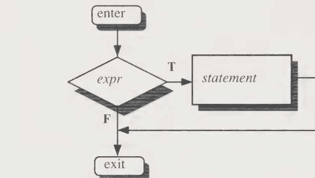

下面的代码片段说明了简单`if`语句的使用。任务是：如果灯开着的，就关掉；如果灯已经是关着的，就置不管。在人类语言中，我们会说类似“如果灯开着，把它关掉。”的话。在 C 中，给定一个变量状态来表示灯的状态，可以这样表示：

```
#define OFF 0
#define ON 1
...
int state;
/* 确定灯状态的代码 */
...
/* 有条件地改变灯状态的代码 */
```

## 程序流与控制 93

```
if (state == ON)
   state = OFF;
```

`#define`指令创建了符号名称来表示“灯关”和“灯开”条件。你需要提供其他代码来实际判断灯是关的还是开的（例如，你可以要求用户告诉你）。

如果灯确实是开着的，测试表达式产生一个真的逻辑结果，并执行赋值语句。如果`state`的值为`OFF`，则表达式在逻辑上为假，赋值语句被跳过。

简单`if`语句有条件地执行单个程序语句。尽管这种行为在许多决策情况下可能足够，但你通常需要在两种备选方案之间做出选择。

## 添加 else 子句

通过向简单`if`语句添加`else`子句，我们产生了一种更通用的形式，如图 5-2 所示。这种形式在两个显式的备选语句之间提供了选择。如果测试表达式求值为真结果，则执行`statement1`。如果它求值为假，则执行`statement2`。这种行为有时被称为交替。

这是通用的`if`语句语法：

```
if (expression)
   statement1
else
   statement2
```

为了说明，这里是我们刚刚检查的程序片段的稍作修改版本。任务被修改为：使灯的状态发生“翻转”，意味着如果它是关着的，就打开它；如果它是开着的，就关掉。

```
#define OFF 0
#define ON 1
...
int state;
```

```
/* 确定灯状态的代码 */
...
/* 改变灯状态的代码 */
if (state == ON)
    state = OFF;
else
    state = ON;
```

测试表达式测试灯是否开着。如果你愿意，可以测试它是否是关着的，但如果你这样做，你需要反转赋值语句的顺序以获得相同的程序行为。

图 5-2: if 可以有一个 else 子句。

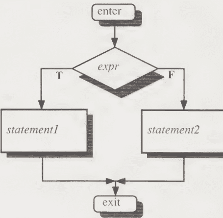

## 条件表达式

显式的双向分支在程序中频繁发生。C 提供了一个条件运算符，允许你紧凑地表达此类分支语句。条件运算符是 C 唯一的三元运算符——一个接受三个操作数的运算符。条件表达式的形式为：

```
expr1 ? expr2 : expr3
```

条件表达式的值是求值`expr2`或`expr3`的结果，但程序如何知道使用哪一个呢？

求值`expr1`（必须是标量类型）的结果决定了计算另外两个表达式中的哪。如果求值`expr1`产生非零结果，则求值`expr2`。否则，求值`expr3`。

回到我们的“翻转”示例，我们可以使用条件表达式来实现与`if`语句相同的效果如下：

```
state == ON ? OFF : ON
```

如果`state`的值为`ON`，则产生`OFF`的结果；如果它的值为`OFF`，则产生`ON`的结果。我们可以将表达式的求值结果赋值给`state`，从而改变变量的值。

```
/* 改变状态的值 */
state = state == ON ? OFF : ON;
```

在这个示例中，真分支和假分支由符号常量组成，但它们可以是任何有效表达式。我们在后面的章节中将看到条件表达式在创建宏时起着重要作用。

## 嵌套 if 语句

当一个语句出现在另一个内部时被称为嵌套。对于`if`语句，你可以在真分支、假分支或两者中进行嵌套。真分支看起来如下：

# 96 C 编程

```
if (expr1)
    if (expr2)
        statement
```

真分支中的嵌套`if`语句通常可以更紧凑地显示为包含逻辑运算符的复合表达式。

```
if (expr1 && expr2)
    statement
```

这两种形式在`expr1`和`expr2`都为真时执行`statement`。第二种更容易阅读并清晰地显示问题的逻辑。

假分支（else）嵌套在 C 程序中非常常见。它的通用形式如下：

```
if (expression1)
    statement1
else
    if (expression2)
        statement2
    else
        if (expression3)
            statement3
    else
            statement4
```

这种多分支语句可以通过将`else`和`if`放在同一行来更紧凑、清晰地表达：

```
if (expression1)
    statement1
else if (expression2)
    statement2
else if (expression3)
    statement3
else
    statement4
```

## 程序流与控制 97

`else if`短语只是`else`和`if`关键字的重新对齐。翻译器看待这两种形式相同。

第二种形式有两个重要的属性。第一，它使结构的多分支性质在视觉上显而易见。第二，它防止深度嵌套语句从屏幕右侧消失。它与第一种形式完全相同。

可选的`else`子句是在所有测试表达式都不为真时采取的默认分支。如果没有需要执行的操作，就不需要`else`子句。

如图 5-3 所示，控制流通过表达式序列级联。如果其中一个表达式为真，则执行其关联语句并传递到`if`语句后面的语句。

`compare`程序（在源文件`compare.c`中）使用多路分支来确定用户提供的两个整数之间的关系。


```c
/*
* compare.c
 *
比较两个整数并用单词报告它们
* 关系（a < b, a == b; a > b）。
*/
#include <stdio.h>
#include <stdlib.h>

#define INBUFSIZE 5

int main(void)
{
    int a, b;
    char inbuf1[INBUFSIZE + 1], inbuf2[INBUFSIZE + 1];

    /* 从用户处获取数字和运算符 */
    printf("Number a: ");
    gets(inbuf1);
    a = atoi(inbuf1);
```

` 之后似乎不完整（在 `double num1` 处截断了），但根据您提供的上下文和 Markdown 格式要求，我为您翻译了您给出的所有文本部分。

以下是翻译后的内容：

```c
printf("Number b: ");
gets(inbuf2);
b = atoi(inbuf2);

/* 进行比较并打印结果 */
if (a < b)
    puts("Number a is less than number b.");
else if (a == b)
    puts("The numbers are equal.");
else
    puts("Number a is greater than number b.");

    return EXIT_SUCCESS;

}
```

图 5-3：`else` 子句中的嵌套 `if` 

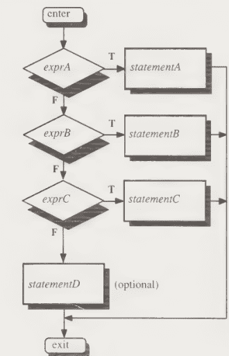

# 程序流程与控制 99

`compare` 程序将用户输入的字符串读取到两个字符数组（缓冲区），并通过调用 `atoi()` 将保存的字符串转换为整数（变量 `a` 和 `b`）。缓冲区接受多达五位的数字，每个缓冲区都有一个额外的位置用于存储终止空字节。在 16 位机器上，注意不要输入过大的数字（最大值 = 32767）。在整数类型更大的机器上，你可能希望修改程序以允许输入值具有更多数字。

第一个测试检查 `a` 的值是否小于 `b` 的值。如果是，程序将打印相应的消息。控制权传递到 `return` 语句，该语句向调用者（通常是操作系统）返回一个成功指示。如果 `a` 不小于 `b`，程序将检查它们的值是否相等，如果相等，则打印相应的适当的消息。

如果两个测试条件都不真，则会打印默认消息，因为 `a` 的值必须大于 `b` 的值。注意，这里没有发生表达式求值。不需要表达式。

## 使用 `switch` 进行多路分支

C 提供了另一种执行多路分支的方法：`switch` 语句。`switch` 语句使用单个整数表达式来计算跳转位置，并使用若干个 `case` 标签作为跳转目标。每个 `case` 标签都必须是一个唯一的整数常量表达式。

如果没有任何 `case` 标签与控制表达式匹配，控制权将传递到可选的 `default` 标签（如果提供了），或者传递到 `switch` 语句之后的语句。以下是 `switch` 语句的一般形式：

```
switch (expression) {
  case label1:
    statement1
  case label2:
    statement2
    ...
  default:
    statementN
}
```

大括号界定了包含 `case` 标签及其相关程序语句的块。

下一个程序称为 `four`，用于描述其四功能运算计算器的基础（参见源文件 `four.c`）。该程序从用户处收集三个输入值作为字符串：两个实数和一个运算符，运算符告诉程序对这两个数字执行什么种操作（加法、减法、乘法或除法）。

```c
/*
* four.c
*
* 该程序实现了一个非常简单的四运算
* 计算器。它使用了逆波兰数表示法 (RPN)。
*/

#include <stdio.h>
#include <stdlib.h>

#define INBUFSIZE 15

int main(void)
{
    double num1
```

```c
switch (op) {
  case '+':
    printf("%lf\n", num1 + num2);
    break;
  case '-':
    printf("%lf\n", num1 - num2);
    break;
  case '*':
    printf("%lf\n", num1 * num2);
    break;
  case '/':
    if (num2 != (float) 0)
      printf("%lf\n", num1 / num2);
    else
      printf(stderr, "Cannot divide by zero\n");
      exit(EXIT_FAILURE);
    break;
  default:
    printf(stderr, "Unknown operator: %c\n", op);
    exit(EXIT_FAILURE);
}
```

## 逆波兰数 (RPN)

计算器要求你先输入值，然后发布命令（运算符），告诉计算器带有所有有效数字的内容。

`INBUFSIZE` 大小设置为 15 个字符。这个数字应该足够大，以便接收一个带有所有有效数字的浮点数。`atof()` 函数将字符串转换为其浮点数值。

`switch` 语句由变量 `op` 的值控制，它指示用户请求的算术运算。如果用户按了 `+`、`-`、`*` 以外的任何键，则使用 `default` 情况来标记未知的运算符。

102 C 语言编程

## `break` 语句

`four` 程序中 `case` 标签之后的大多数语句块以 `break` 语句结束。`break` 语句导致控制权传递到闭包该 `switch` 或循环（`while`, `for`, 或 `do`）语句之后的语句。

`break` 语句只中断一层。因此，当它在嵌套循环或 `switch` 语句内部使用时，`break` 语句会将控制权转移到下一个外层。这种机制提供了结构化语言所典型的这种受控控制。

除非你的意图是将一个 `case` 块的控制权传递到下一个 `case` 块（参见处理穿透的章节），否则请确保使用 `break`、`return` 或 `continue` 语句或 `exit()` 函数调用来终止与 `case` 标签相关的语句块。

## `default` 情况

`default` 标签等于多路 `if` 语句中的 `else`。它实际上是一个捕获子句，当 `switch` 语句的控制表达式没有被任何其他标签匹配时使用。

你可以在 `switch` 语句的任何地方放置 `default` 标签。它不必放在最后，尽管将其放在最后是最常见的做法。

## 穿透与多个标签

你可以布局 `switch` 语句，使得两个或多个 `case` 标签导致相同的代码被执行。这是通过将 `case` 标签堆叠在语句之前实现的。实际上这是穿透，第一个 `case` 关联的语句是空的。

```
switch (expression) {
...
case label_x:
    statement_y /* 穿透到 label_y */
case label_y:
    statement_y;
    break;
}
```

例如，如果你想允许使用 `'a'` 作为 `'+'` 的同义词，通过修改 `four` 源，在 `'+'` 标签之前或之后添加 `'a'` 命令的 `case` 标签，但在其关联语句之前。当程序运行时，`'+'` 命令和 `'a'` 命令具有相同的效果。

```c
switch (op) {
...
    case '+':
    case 'a':
        /* 加法代码写在这里 */
        ...
        break;
}
```

你也可以将 `case` 标签水平排列在同一行以节省空间，但如果像所示垂直堆叠，代码将更易读。

在目前为止的流程控制语句中，控制权的传递总是向前的（即传递到程序后面出现的语句）。也可以将控制权向后传递到较早的语句。通过这样做，我们创建了迭代语句，即循环。

主要的迭代语句之一是 `while` 循环。`while` 语句的目的是只要测试表达式的值为真就执行其语句体。`while` 语句具有以下形式：

```
while (expression)
    statement
```

`while` 语句在循环“顶部”测试（参见图 5-4）。这意味着如果评估表达式并产生零结果，语句体永远不会执行。如果表达式求值产生非零结果，则执行语句。对于大多数循环语句，这是期望的行为。

```c
/*
* while.c
*
* 显示使用 while 循环从键盘读取一行文本
* 并逐个字符打印。
*/
```

```c
#include <stdio.h>
#include <stdlib.h>

int main(void) {
    int c;

    puts("Type a message (one line) plus RETURN");
    while ((c = getchar()) != '\n')
        putchar(c);    /* print it */

    return EXIT_SUCCESS;
}
```

当你运行这个程序时，它会打印简单的指令并等待你的输入。当你输入字符时，它们会回显到屏幕并收集在输入缓冲区中。当你按下 Return 键结束输入时，程序会打印该行的文本，但不会打印末尾的换行符。因此，如果你只按了 Return 键，程序将没有任何输出。

图 5-4：`while` 语句是一种主要的 C 语言循环。

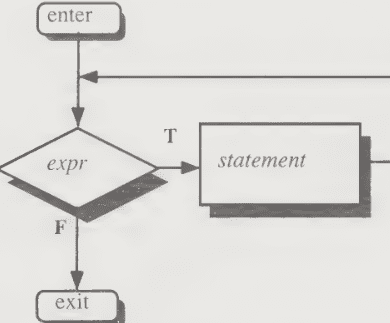

下一个代码片段中的 `while` 循环打印（显示）一系列换行符，以便在输出流中留出一些垂直空白。

注意这里使用整数变量 `n` 来控制循环。

```c
int n;
...
n = 5;      /* 需要清除的行数 */
while (n > 0) {
    putchar('\n');
    --n;
}
```

我们从要打印的换行符数量开始（在本例中为五个）。每次循环，测试变量的值都会与 0 进行比较。只要 `n` 大于 0，循环就会继续执行。每打印一个换行符，`n` 就会递减（减少 1）。最终 `n` 减到 0，测试表达式变为假（0），循环终止。

## 空语句 (Null Statement)

空语句是一个单独的分号。虽然这看起来可能不是一个特别有用的结构，它在迭代和选择语句中偶尔会被用到。这里有一个简单的例子：

```c
char c;
...
printf("Press the Return key to continue: ");
while ((c = getchar()) != '\n')
    /* 什么都不做 * */
...
```

打印语句提示用户按下 Return 键以继续程序。`while` 循环读取标准输入（除非发生了重定向，否则是键盘），寻找由换行符表示的 Return 键。

## 程序员笔记本 (Programmer's Notebook)

当你在典型的终端或控制台键盘上按下 Return 键时，会发出两个代码：一个用于返回当前行开头的回车键（CR），以及一个用于移动到下一行的换行符（LF）。在使用 UNIX 风格行处理方式的 C 语言中，CR/LF 对被转换为单个换行符（NL）。在 ASCII 字符集中，NL 和 LF 具有相同的代码。某些字符集（包括最小的 C 字符集）没有换行符，但换行代码就足够了。

带有空语句主体的字符读取循环的作用是读取并丢弃字符，直到读取到换行符。当读取到换行符时，控制权立即传递到 `while` 循环之后的任何内容。通常情况下，读取的字符会回显到用户的屏幕上，但它们不会被保存，程序也不会在使用它们之外与换行符代码进行比较以判断何时停止循环。

## `continue` 语句 (The continue Statement)

循环内部的 `continue` 语句会导致循环开始下一次迭代。`continue` 之后的任何语句都会被跳过。

以下代码片段从输入流读取一行字符。每个字符（键）都会与换行符代码（字符常量 `'\n'`）进行比较，以确定何时停止处理。

封装的 `if` 语句使用 `isdigit()`（一个标准库宏或函数）来进一步测试键码。如果代码代表任何非数字字符，则控制表达式为真（注意用于逻辑取反的 `!`），并执行 `continue` 语句，从而跳过循环体中的任何其他语句。如果代码代表数字，则测试表达式为假，因此执行数字处理代码。循环一直运行到读取到换行代码为止。

```c
int key;
...
while ((key = getchar()) != '\n') {
```

## C 编程 (C Programming)

```c
if (!isdigit(key))
    continue;
/* 数字处理代码 */
...
}
```

`continue` 语句只影响包含它的 `while`、`for` 或 `do` 语句。

## `for` 循环 (The for Loop)

如果 `while` 循环的主体很大，循环的控制信息可能很难建立联系和理解。读者可能只能立即看到循环控制表达式。控制变量的初始化发生在 `while` 语句之前的某个地方，而对这些变量的修改通常发生在循环体内的某个地方。`for` 语句通过将所有循环控制信息放在循环语句顶部的一个位置，解决了这个问题。

```c
for (expr1; expr2; expr3)
    statement
```

图 5-5 显示了一个带有其三个循环控制表达式的 `for` 语句。测试表达式是 `expr2`。这等同于 `while` 循环的表达式。另外两个表达式仅为了它们的副作用而求值，例如为循环控制变量赋值或增加该变量的值。

进入 `for` 循环时，首先求值 `expr1`，然后控制权传递给循环测试（`expr2`）。如果 `expr2` 为假，则完成。如果它为真，则执行 `statement`，然后在控制权返回循环测试之前求值 `expr3`。

图 5-5 显示了一个带有三个循环控制表达式的 `for` 语句。


## 编写等效的 `while` 和 `for` 循环 (Writing Equivalent while and for)

如果只需要循环测试，`while` 语句是良好的选择。如果涉及到初始化和修改控制变量，`for` 语句通常是最佳选择。以下是 `for` 语句的 `while` 语句通用形式：

```c
expr1;
...
while (expr2) {
    statement;
    ...
    expr3;
}
```

## 无限循环 (Infinite Loops)

大多数循环在指定的迭代次数或某些条件存在时停止。有时我们需要无限持续的循环。

一个获取输入并解释输入的循环是很好的无限循环示例。这种循环是文本编辑器和其他交互式程序的核心。

通过编写一个始终为真的循环表达式来创建无限循环。在 `while` 语句中任何非零值都可以。

```c
int key;
...
while (1) {
    key = GetKey(); /* 读取下一个键 */
    switch (key) {
        case K_ESC:
            /* 退出命令 */
            return;
        ...
        default:
            /* 文本将其添加到缓冲区 */
            ...
            break;
    }
}
```

`GetKey()` 函数是某个未定义的函数，它在键被按下时读取键，而不是等待你按下 Return 键。我们将在后面的章节中如何在 UNIX 和 DOS 环境下实现。

你也可以通过使用测试表达式的 `for` 循环获取无限循环。通常，三个表达式都为空，但你必须输入两个分号。

```c
for ( ; ; )
    statement
```

虽然这种形式的无限循环语句没有显式的测试表达式，但所有编译器将其视为永久循环。

## `do` 循环 (The do Loop)

与执行零或多次语句体的 `while` 和 `for` 循环不同，`do` 循环至少执行一次。测试表达式实际上位于位于“底部”，如图 5-6 所示。

这种行为有时需要确保即使测试表达式为假也能立即执行语句体。当执行控制进入 `do` 语句时，执行循环体中的语句，然后评估测试表达式。

```c
do
    statement
while (expression);
```

-   程序员笔记本 (Programmer's Notebook)

确保在括号测试表达式之后放置分号，以将语句与后续任何内容隔开。这可能会令人困惑，因为在 `while` 循环的括号测试表达式之后不能使用分号。

这种类型的循环频率较低，但当你需要时，确实需要。这里是 `do` 语句的一个运行示例。它是你之前看到的 `while.c` 程序源码的修订版。

图 5-6：底部的 `do` 循环测试。

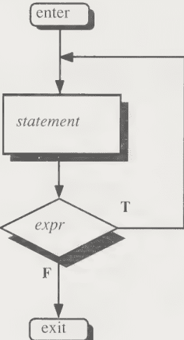

```c
/*
* do_while.c
* 显示使用 do...while 循环，以确保
* 从键盘读取的字符串中包含
* 换行字符。
*/
#include <stdio.h>
#include <stdlib.h>

int main(void)
{
```

# 程序流程与控制 113

```c
int c;

puts("Type a message (one line) plus RETURN");
do {
    c = getchar(); /* 读取一个字符 */
    putchar(c); /* 打印它 **/
} while (c != '\n');

    return EXIT_SUCCESS;
}
```


当你运行此程序时，它会打印简单的指令并等待输入。当你输入字符时，它们会回显到屏幕上并收集在输入缓冲区中。当你按下回车键结束输入时，程序会打印出文本，包括末尾的换行字符。因此，如果你只输入一个回车键，程序将打印出一个空行，这是符合逻辑的。将其与`while.c`程序的输出进行对比。这是一个细微的，但值得注意。

## 额外的跳转语句

除了`break`和`continue`，C 语言还提供了`goto`语句。与 BASIC 中可以字面上跳转到任何地方的自由`GOTO`不同，C 的`goto`被限制在单个函数内的跳转。`goto`语句指定一个目标，即标签（label），控制将转移到该标签。这里是`goto`语句的通用形式：

```c
goto label;
...
label: statement
```

在大多数情况下，你会发现有可以使用`goto`语句的替代方案。循环、`break`和`continue`语句以及良好的程序设计通常会消除对`goto`语句的任何需求。在编写 C 程序的十多年里，我从未需要使用过它（除了在书里描述`goto`关键字时！）。

## 顺序、选择与迭代的结合

在对你周围世界的逻辑进行建模时，必须应用一组有限的结构：顺序、选择和迭代。

在现实世界的问题中，经常发现嵌套循环、决策层次结构（嵌套的`if`和`switch`语句）、一系列顺序步骤以及这些结构的无数组合。

接下来的程序`calc`（在`calc.c`文件中）是之前所示的四个程序的修订版本。它的主要增强是增加了一个外循环，该循环会反复运行数据收集/计算/输出序列。之前的四个程序只运行一次就退出。

由于循环会无限运行，我们需要提供一种退出程序的方法（`'Q'`命令）。如果不这样做，用户将不得不使用键盘中断命令（UNIX 下的`BREAK`或`DEL`；DOS 下的`Ctrl+Break`）来退出程序。使用键盘中断退出并不是一种结束程序的优雅方式——就像使用消防逃生通道而不是正门来离开建筑一样。将该方法留给真正的紧急情况。

```c
/*
* calc.c
* 此程序实现了一个非常简单的计算器，
* 使用逆波兰表示法 (RPN)。它演示了
* 应用中的顺序、迭代和选择。
*/
```

```c
#include <stdio.h>
#include <stdlib.h>
#include <math.h>

#define INBUFSIZE 15

int main(void)
{
    double num1, num2; /* 数字 */
    int op;             /* 操作符 */ /
```

```c
int ndp = 2;          /* 输出的小数位位数 */
/* 输入缓冲区 */
char inbuf1[INBUFSIZE + 1], inbuf2[INBUFSIZE + 1];
while (1) {
    /* 从用户处获取数字和运算符 */
    printf("First number: %s");
    gets(inbuf1);
    num1 = atof(inbuf1);

    printf("Second number: %s");
    gets(inbuf2);
    num2 = atof(inbuf2);

    printf("Operator (q=quit): ");
    op = getchar(); /* 获取运算符字符 */
    getchar(); /* 丢弃换行符 */

/* 执行计算并打印结果 */
    switch (op) {
        case 'q':
        case 'Q':
            exit(EXIT_SUCCESS);
        case '+':
            printf("%.*f\n", ndp, num1 + num2);
            break;
        case '-':
            printf("%.*f\n", ndp, num1 - num2);
            break;
        case '*':
            printf("%.*f\n", ndp, num1 * num2);
            break;
        case '/':
            if (num2 != (float) 0)
                printf("%.*f\n", ndp, num1 / num2);
            else
                fprintf(stderr, "Cannot divide by zero\n");
    }
}
```

# 116 C语言编程

```c
exit(EXIT_FAILURE);
}
defbreak;
default:
    fprintf(stderr,
           "Unknown operator: %c\n", op);
    break;
} /* switch结束 */

putchar('\n');    	 /* 在运行之间留出空间 */

} /* while结束 */

return EXIT_SUCCESS;

```

当你运行此程序时，它会打印简单的指令并等待你的输入。当你输入字符时，它们会回显到屏幕上并收集在输入缓冲区中。当你按下回车键结束输入时，程序会打印出文本，包括末尾的换行字符。因此，如果你只输入一个回车键，程序将打印出一个空行，这是符合逻辑的。将其与`while.c`程序的输出进行对比。这是一个细微的，但值得注意。

## 额外的跳转语句

除了`break`和`continue`，C 语言还提供了`goto`语句。与 BASIC 中可以字面上跳转到任何地方的自由`GOTO`不同，C 的`goto`被限制在单个函数内的跳转。`goto`语句指定一个目标，即标签，控制将转移到该标签。这里是`goto`语句的通用形式：

```c
goto label;
...
label: statement
```

在大多数情况下，你会发现有可以使用`goto`语句的替代方案。循环、`break`和`continue`语句以及良好的程序设计通常会消除对`goto`语句的任何需求。在编写 C 程序的十多年里，我从未需要使用过它（除了在书里描述`goto`关键字时！）。

## 顺序、选择与迭代结合

在对你周围世界的逻辑进行建模时，必须应用一组有限的结构：顺序、选择和迭代。

在现实世界的问题中，经常发现嵌套循环、决策层次结构（嵌套的`if`和`switch`语句）、一系列顺序步骤以及这些结构的无数组合。

接下来的程序`calc`（在`calc.c`文件中）是之前所示的四个程序的修订版本。它的主要增强是增加了一个外循环，该循环会反复运行数据收集/计算/输出序列。之前的四个程序只运行一次就退出。

由于循环会无限运行，我们需要提供一种退出程序的方法（`'Q'`命令）。如果不这样做，用户将不得不使用键盘中断命令（UNIX 下的`BREAK`或`DEL`；DOS 下的`Ctrl+Break`）来退出程序。使用键盘中断退出并不是一种结束程序的优雅方式——就像使用逃生通道而不是正门来离开建筑一样。将该方法留给真正的紧急情况。

```c
/*
* calc.c
* 此程序实现了一个非常简单的计算器，
* 使用逆波兰表示法 (RPN)。它演示了
* 应用中的顺序、迭代和选择。
*/
```

```c
#include <stdio.h>
#include <stdlib.h>
#include <math.h>

#define INBUFSIZE 15

int main(void)
{
    double num1, num2; /* 数字 */
    int op;             /* 操作符 */ /
```

```c
int ndp = 2;          /* 输出的小数位位数 */
/* 输入缓冲区 */
char inbuf1[INBUFSIZE + 1], inbuf2[INBUFSIZE + 1];
while (1) {
    /* 从用户处获取数字和运算符 */
    printf("First number: %s");
    gets(inbuf1);
    num1 = atof(inbuf1);

    printf("Second number: %s");
    gets(inbuf2);
    num2 = atof(inbuf2);

    printf("Operator (q=quit): ");
    op = getchar(); /* 获取运算符字符 */
    getchar(); /* 丢弃换行符 */

/* 执行计算并打印结果 */
    switch (op) {
        case 'q':
        case 'Q':
            exit(EXIT_SUCCESS);
        case '+':
            printf("%.*f\n", ndp, num1 + num2);
            break;
        case '-':
            printf("%.*f\n", ndp, num1 - num2);
            break;
        case '*':
            printf("%.*f\n", ndp, num1 * num2);
            break;
        case '/':
            if (num2 != (float) 0)
                printf("%.*f\n", ndp, num1 / num2);
            else
                fprintf(stderr, "Cannot divide by zero\n");
    }
}
```

（注：此处文本似乎存在重复或错误字符`defbreak;`等，已根据要求保留原始逻辑并翻译对应内容）

（注：原文中`defbreak`似乎为`break`的笔误）

当你运行此程序时，它会打印简单的指令并等待你的输入。当你输入字符时，它们会回显到屏幕上并收集在输入缓冲区中。当你按下回车键结束输入时，程序会打印出文本，包括末尾的换行字符。因此，如果你只输入一个回车键，程序将打印出一个空行，这是符合逻辑的。将其与`while.c`程序的输出进行对比。这是一个细微的，但值得注意。

## 总结

虽然程序的正常流程是顺序的，但你可以使用各种选择（`if`, `switch`）和迭代（`while`, `for`, `do`）语句来改变它。正如你将在后面的章节中看到的，函数和宏（统称为例）的使用允许你编写。

# 习与练习

- 1. 简单的`if`语句实现了什么？
- 2. 如何修改简单的`if`语句以提供带有独立块的双向分支？
- 3. 下面的代码段做了什么？

```
#define CLOSED 0
#define OPEN 1
...
int door = CLOSED;
door = OPEN ? CLOSED : OPEN;
```

- 4. 在`compare.c`程序中，为什么没有测试`a`是否大于`b`？
- 5. 描述`switch`语句中的“贯穿”行为并解释如何获得它。
- 6. 列出本章介绍的三种迭代语句，并描述它们的行为。
- 7. 为什么在程序中使用迭代？给出一个示例并用代码片段说明迭代。
- 8. 空语句在程序中有何用？
- 9. 除了`break`和`continue`，C 还提供了什么其他跳转语句？它的使用是否有任何限制？

# 第 6 章

## 函数与程序组织

### 函数的作用

所有的 C 程序都至少包含一个用户定义的函数，即`main()`，正如你在前面的章节中多次看到的那样。而且，几乎所有的`main()`函数都会调用其他函数来执行工作。这些函数可能选自编译器提供的标准库，也可能来自专门的第三方库，或者可能是你自己编写的函数。

随着你作为 C 程序员开发水平的提高，你将学会如何有效地使用标准库，并可能会开发和维护你自己的函数库，以支持你所从事的工作。

函数是程序基础的构建模块。程序员使用函数的方式类似于工程师使用机械组件和电子电路的方式。其概念是将一个编程任务或问题划分为一组易于管理的子问题，并逐一解决它们。

你会发现（正如许多其他程序员已经发现的那样），某些编程任务非常频繁。以下是一些示例：

- 确定字符字符串的长度
- 将字符字符串转换为等效数字
- 响应键盘中断 (`BREAK`)
- 计算角度的正弦值
- 计算数字的幂

这些以及许多其他任务都是封装成函数的候选对象。如果一个解决方案足够通用，它就可以应用于广泛的程序中。编写一个健壮、通用的函数，并在每次需要该解决方案时调用它。事实上，成百上千的常见任务已经被“解决”，实现这些解决方案的函数被收集在所谓的标准库中。

也许你可能需要一个库函数未处理的特殊问题的解决方案。如果是这样，你可以编写自己的函数。事实上，你可以使用几乎所有 C 语言系统均可用的工具创建自己的函数库。在 C 中，函数可以执行一个操作、返回一个值，或者。函数可以可选地具有输入。使用工程类比，函数从外部看可以被视为一个“黑箱”，它具有已知的输入/输出特性以及某些实现传输特性的内部机制。这意味着输出以某种可预测的方式取决于输入的值。

在可以在没有输入的情况下产生输出（函数根据内部数据生成输出，例如伪随机数生成器可能会这样做）。函数也可以接受输入并执行操作而不产生任何输出值（例如，将光标或鼠标指针移动到屏幕位置）。


某些计算机语言（Pascal、Modula 2 等）区分返回值的子程序（“function”）和不返回值的子程序（“procedure”）。C 将所有子程序视为函数，无论它们是否返回值。

## 程序组织与控制流

当你编写程序时，尝试为每个任务使用一个函数来组织你的工作，并从你可以使用的可用模块中受益。“一个任务一个函数”的准则是一个很好的规则，它强制你追求代码的通用性和可用性。

图 6-1 显示了名为`boxtext`的程序是如何组织的。图中描述的组织方式是一种工作方法，但绝不是唯一的方法。每个框中的项目都是函数的名称，其中`main()`是程序执行的起点。

阴影框包含标准库函数（或宏，我们稍后会讨论）的名称。其余框包含用户定义的名称。图中显示了函数调用层次结构。例如，`main()`调用了`strlen()`、`hborder()`和`puttext()`。后两个函数又调用了`string()`和`putchar()`函数（`putchar()`为了速度通常实现为宏）。此外，`puttext()`调用了标准库函数`printf()`。

在第 5 章中，你学习了程序的执行流以及控制程序流的一些方法。除了循环和分支语句外，程序流还通过函数调用/返回机制控制。这允许程序保存其当前位置和状态的信息，并跳转到另一段代码。返回地址、机器寄存器的状态和其他数据的状态保存在程序栈上，程序栈是一个作为电子草稿的内存区域。

除了导致程序终止的函数（如`exit()`或`abort()`）外，函数调用语句最终会将控制权返回给序列中的下一个语句。在图 6-1 中，你可以看到`main()`将控制权交给`hborder()`，`hborder()`再调用`string()`。`string()`函数使用`putchar()`打印一系列字符，然后返回控制权给`hborder()`，`hborder()`完成一些额外工作后将控制权返回给`main()`。

我们将在本章稍后重新回到`boxtext`程序。

### 图 6-1：程序的函数调用层次结构

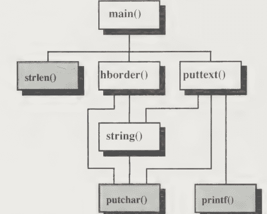

注意：阴影框包含标准库函数和宏的名称。

## 信息隐藏

函数的两个属性是：它们可以用于以控制的方式维护数据，并且可以隐藏任务执行的细节。这两者都是良好程序的重要属性。

与旧的 BASICS 不同（它将所有数据视为全局的，程序的任何部分都可以读写它），C 允许将数据管理为局部或全局。局部数据仅在函数或其他限制范围内可见，因此是可变的。

通过在函数中使用局部变量存储重要数据，你可以对数据提供仔细控制的访问，防止程序其他部分的意外访问。这对于大型程序以及由小组而非单个人协作的程序来说，这是一个特别重要的设计考虑。

隐藏任务的实现细节与屏蔽数据视图同样重要。程序的一个部分调用另一部分执行某项工作，并可能返回结果。调用者不需要担心被调用函数是如何完成工作的。

假设你有一个程序收集信号输入的数据并计算其平均功率。你可以将数据收集任务封装在一个或多个函数中，并将平均计算封装在另一个函数中。如果你以后发现了更好的平均计算方法（提高了速度或准确性），你可以以后修改平均函数，而无需更改调用它的任何其他函数。

## 函数声明

现在你已经熟悉了函数以及如何使用它们，让我们看看如何声明和定义它们。与变量一样，C 翻译器要求你在程序中使用函数之前提供函数的声明。然而，如果你没有提供，则适用某些默认值。

## 外部名称与链接

正如你所知，C 翻译器负责将源语句转换为机器指令和数据。它对单个编译单元执行此操作。在 C 编译器的典型情况下，编译器翻译源文件及其通过预处理指令包含的所有头文件。

回顾第 1 章中的讨论，它展示了如何从一组源文件创建 C 程序。单个源文件被翻译成对象模块，然后通过链接生成可执行程序文件。这种方法通常被称为单独编译，因为每个源文件相对于任何其他源文件都是异步编译的。

问题就在这里。如果函数在一个源文件中定义并在另一个源文件中调用，翻译器如何知道做什么？答案是

这是一个名为“外部名称和链接”（external names and linkages）的设计概念。尽管链接器不需要了解 C 语言的细节，但它需要一个具有外部链接的名称列表。


外部名称是指在前六个字符内必须是唯一的标识符。请记住，内部名称必须在前 31 个字符内是唯一的。此外，链接器可以忽略字母的大小写。某个特定的实现可以允许更长的名称并区分字母大小写，但如果你的源代码的可移植性是一个考虑因素，请不要依赖这些增强功能。

## 定义（Defining Declaration）

对于程序中使用的每个函数，必须有一个定义声明。如果你正在使用标准库函数，这些定义已经为你准备好了。当你编写自己的函数时，由你创建它们的定义。一个完整的函数定义包含四个元素：

- 返回值类型
- 函数名
- 参数列表
- 语句体

前三个元素组成了函数头（function header）。这些元素包含了正确调用和使用函数所需的所有信息，但它们并没有描述函数是如何执行工作的。那是语句体的工作。

函数定义的通用形式为：

```
return_type name (parameter_list)
{
    declaration(s) ...
    statement(s)
    ...
    return_statement
}
```

## 函数与程序组织 125（Functions and Program Organization）

让我们先看看函数头并学习它的用途。

## 函数头（Function Header）

函数头表示要返回的数据类型（如果有）。例如，如果函数计算一个单精度浮点值，那么返回值类型和语句体使用的值必须是`float`类型。

返回值可以是任何 C 类型或派生类型。`int`、`char`、`float`等 C 数据类型显然是合适的返回值类型。`void`实际上意味着函数返回控制权，但不返回数据。此外，你还可以通过数组、结构体和联合体类型、指向类型对象的指针，甚至是返回特定类型数据的函数来创建自己的数据类型。只需确保返回类型一致或经过了适当的转换即可。

函数名同样重要。你可以使用任何不与 C 关键字和标准函数名冲突的名称。你应该避免使用以单个下划线开头名称，因为它们可能与 C 翻译器使用的内部名称重复。

函数头的最后一个组件是参数列表，它是括号内一个可能为空的参数类型和名称列表。该列表显示了函数接受的参数数量和类型。你将在函数参数和参数部分看到更多关于此主题的内容。

## 语句体（Statement Body）

语句体是执行操作的地方。大括号标记了语句体的开始和结束。当控制权传递到调用的函数时，它会传递到函数体中的第一个可执行语句。控制权通过`return`、`abort`、`exit`等控制语句或直接运行结束（遇到右大括号）离开语句。

括号将包含的语句收集成一个块或一个复合语句，正如你在上一章中看到的那样。在函数块内部，你可以有内部块。在每个块的顶部，你可以放置声明语句。此类声明在闭闭块内是可见的（作用范围内）。

## 函数参数与参数（Function Parameters and Arguments）

你通过传递参数或参数为函数提供输入。参数（parameter）和参数（argument）是同一个事物的两个名称——从不同角度的视角。

从函数定义的角度来看，函数名后括号列表中的项被称为“形式参数”（formal parameters）。从调用函数的角度来看，传递给被调用函数的值被称为“实参”（actual arguments）。

形式参数和实参之间的区别经常被那些随意混用这两个术语或偏爱其中某一个作者所模糊化。事实上，ANSI 标准将“形式参数”和“形式形式”视为同义词。它同样将“实参”和“实际参数”视为同义词。我倾向于保持原始的区分，以澄清函数定义和函数调用之间的区别。

## 形式参数（Formal Parameters）

参数是一个在函数被调用时在程序栈上创建的变量。该变量充当占位符，其名称作为所传递数据的方便句柄。

在下面的函数定义中，变量`n`和`ch`是形式参数。该函数使用一个简单的倒计时循环打印由`ch`表示的指定符号的`n`次。

```
/* 打印指定次数的字符 */
void string(int n, char ch)
{
    while (n-- > 0)
        putchar(ch);
}
```

形式参数为翻译器提供了每个参数的数据类型信息。如果函数不接受任何输入，使用关键字`void`告诉翻译器该列表实际上是空的。这可以将真正的空列表与你可能漏掉的列表区分开来，为翻译器提供了通过检查参数与函数定义参数列表来帮助你的机会。

## 函数与程序组织 127（Functions and Program Organization）

## 实参（Actual Arguments）

切换到调用函数的视角，对`string()`函数的调用可能如下：

```
string(count, '*');
```

变量`count`是一个整数，指定重复次数，字符常量`'*'`代表打印符号的代码。`count`和`'*'`都被称为实参，因为它们是正在传递的实际值（或评估为这些值的值）。

通过将所有这些信息应用到完整的程序中，你可以看到参数传递是如何工作的。程序`hbars`由两个函数组成：我们刚刚编写的`string()`函数和强制性的`main()`函数。以下是`hbars`的源代码：

```c
/*
* hbars.c
* 输出一组长度不一的水平线。
*/
#include <stdio.h>
#include <stdlib.h>

#define NLINES 10

/* 打印指定次数的字符 */
void string(int n, char ch)
{
    while (n-- > 0)
        putchar(ch);
}

int main(void)
{
    int n;
    for (n = 1; n <= NLINES; ++n) {
        string(n, '*');
        putchar('\n');
    }
    return EXIT_SUCCESS;
}
```

注意`main()`出现在`string()`之前，并且包含一个函数原型，告诉翻译器在源文件后面定义`string()`时应该期待什么。接下来的程序`tree`与`hbars`程序类似。不同之处在于`main()`出现在`string()`之前，并且包含一个函数原型，告诉翻译器在稍后定义`string()`时应该期待什么。

```c
/*
* tree.c
* 输出一组堆叠形成树状显示的
* 水平线。此程序使用 string() 函数
* 打印连续的空格和树分段符号。
*/
#include <stdio.h>
#include <stdlib.h>

#define NLINES 10

/* 打印指定次数的字符 */
void string(int n, char ch)
{
    while (n-- > 0)
        putchar(ch);
}

int main(void)
{
    int n;
    for (n = 1; n <= NLINES; ++n) {
        string(n, ' ');
        string(n, '*');
        putchar('\n');
    }
    return EXIT_SUCCESS;
}
```

## 函数原型（Function Prototypes）

函数头除了在函数定义中使用外还有另一个重要用途。单独使用（不关联语句）时，函数头充当原型，即对一个尚未定义的函数的正向引用。

函数原型告诉翻译器在程序稍后调用函数时应该期待什么。它指定了返回值类型、函数名以及每个参数的类型。除非函数接受可变数量的参数，否则原型指定了参数的数量。所有这些信息都能帮助翻译器检查你的源代码以确保准确一致地使用函数。

你通过在函数头后面添加分号来创建函数原型。在参数列表中，你只需要参数的数据类型。然而，你可以为了文档目的而放入参数名称。翻译器不会对可选的名称做任何处理。

`string()`的函数原型如下：

```
void string(int, char);
```

如果你放入参数名称，它看起来像这样：

```
void string(int n, char ch);
```

```c
#include <stdio.h>
#include <stdlib.h>

#define NLINES 10

/* function prototype */
void string(int, char);

int
 main(void)
{
  int n;

  for (n = 1; n <= NLINES; ++n) {
    /* print the indentation */
    string(NLINES - n, ' ');

    /* print the tree segment */
    string(2 * n - 1, '^');

    /* start a new line */
    putchar('\n');
  }

  return EXIT_SUCCESS;
}
```

```c
/* print a specified number of repetitions of a character */
void string(int n, char ch)
{
  while (n-- > 0)
    putchar(ch);
}
```

为了方便你自己以及任何可能使用你函数的他人，你可以将函数原型收集到相应的头文件中。在任何使用这些函数中某一个程序文件中，只需包含声明该函数的头文件即可。

如果你创建了函数库，这种方法将非常节省时间。事实上，翻译器会创建一个符号表，列出所有外部名称，并将这些信息提供给链接器，以便它解析外部引用。例如，链接器可能需要从标准库中获取`print()`的指令来完成程序。

当然，你并不需要自己创建`print()`对象模块，但你的程序作为一个名称引用了它，而链接器必须知道从哪里获取其指令的副本。你可能需要显式标识标准 C 库文件，例如 DOS 下`LINK`命令中的`SLIBC.LIB`。在 UNIX 下，`cc`命令会调用`ld`链接器，并带有指令搜索`/usr/lib/libc`和其他库文件以解析外部引用，但如果你的程序使用了屏幕管理函数，你可以自由命名其他库，例如`/usr/lib/libcourses`。

如果你通过将一些你自己的函数放在一个文件中，将其他函数放在其他源文件中来准备程序，链接器将使用符号表信息来解析文件之间的外部引用。同样的方法适用于存储在外部变量中的全局数据。

## 值传递参数传递 (Call-by-Value Parameter Passing)

与 BASIC 和其他某些编程语言不同，C 使用名为“值传递”的技术作为其默认的参数传递方法。这意味着当你调用接受参数的函数时，你提供的实际参数是所传递数据的副本（copies）。

例如，调用`string()`函数会将`count`的一个拷贝传递给函数。它没有传递`count`的位置，因此被调用函数无法影响存储在`count`中的内容。

另一种被某些语言作为默认方法的技术是“引用传递”（call-by-reference），它将调用函数（或过程）中变量的位置作为参数传递给被调用函数。那么，被调用函数不仅可以读取变量中的值，还可以更改它们。C 允许这两种类型的参数传递，但你必须使用地址来安排引用传递，这需要对指针和间接访问有了解。你将在下一章中学习指针和间接访问。

`boxtext`程序将你学到的内容结合在一起，并强调将程序组织成函数。该程序在用标准字符绘制的框内打印消息。注意函数原型的使用、值传递参数传递、某些数据项的符号名称，以及包含头文件以获取函数库函数并获取额外的符号常量。

这个程序就是之前我们在图 6-1 中描述的那个程序，当时我们简要地检查了程序是如何工作的：

```c
/*
* boxtext.c
*
* 显示如何使用函数将程序组织成
* 相互作用以执行任务的任务（在框内
* 打印文本）。
*/

#include <stdio.h>
#include <stdlib.h>
#include <string.h>

/* symbolic constants */
#define BDRWIDTH 3
#define HBAR     '-'
#define VBAR      '|'
#define CORNER   '+'
#define SPACE    ' '

/* function prototypes */
void string(int, char);
void hborder(int);
void puttext(char mesg[]);

int
main(void)
{
    int width;
    static char text[] = {
        "This is a suitably trivial test message"
    };

    /* calculate长度和位置 */
    width = strlen(text) + 2 * BDRWIDTH;

    /* 打印上边界 */
    hborder(width);

    /* 打印正文文本 */
    puttext(text);

    /* 打印下边界 */
    hborder(width);

    return EXIT_SUCCESS;
}
```

```c
/* 打印指定次数重复的字符 */
void string(int n, char ch)
{
    while (n-- > 0)
        putchar(ch);
}

/* 打印水平边界 */
void hborder(int w)
{
    putchar(CORNER);      /* 打印角部 */
    string(w - 2, HBAR);   /* 打印水平线 */
    putchar(CORNER);      /* 打印角部 */
    putchar('\n');       /* 打印换行 */
}
```

```c
/*
 * 在左右边界之间
 * 居中打印消息文本
 */
void
puttext(char mesg[])
{
    /* 打印左边界区域 */
    putchar(VBAR);
    string(BDRWIDTH, SPACE);

    /* 打印文本 */
    while (*mesg)
        putchar(*mesg++);

    /* 打印右边界区域 */
    string(BDRWIDTH, SPACE);
    putchar(VBAR);
    putchar('\n');
}
```

# 134 C 编程

## 函数与组织

### 递归

C 支持递归，即函数直接或间接地调用自身的能力。以下程序`refact`是阶乘的递归实现。

```c
/*
* refact.c
*
* 使用递归计算数字的阶乘
*/
```

```c
#include <stdio.h>
#include <stdlib.h>

#define DIGITS 10

long factorial(short);

int
main(void)
{
    char input[DIGITS + 1];
    short number;
    long result;
    /* 输入缓冲区 */
    /* 起数字 */
    /* 阶乘结果 */

    /* 提示用户输入 */
    printf("Type a non-negative integer: ");
    gets(input);
    number = (short) atoi(input);

    /* 递归计算阶乘并打印 */
    result = factorial(number);
    printf("The factorial of %d is %ld\n",
    number, result);

    return EXIT_SUCCESS;
}
```

```c
long
factorial(short n) /* 递归版本 */
{
    if (n <= 1L)
        return 1L;
    else
    return (n * factorial(n - 1));
}
```

# 136 C 编程

`main()`函数留了一个字符数组作为输入缓冲区。它提示用户输入，并将回复存储在缓冲区中。由于用户提供的输入是字符形式，程序在计算中使用该值之前必须转换为短整数形式。标准库函数`atoi()`将字符串转换为整数，将其转换为短整数并保存到变量`number`中。然后，将`number`作为参数传递给`factorial()`函数。

`factorial()`的逻辑非常简单。如果作为参数的值大于或等于 1，`factorial()`返回`1L`。后缀`L`是必要的，因为函数返回的是长整数，我们必须保证在任何架构（字长）上所有位都正确设置。

如果参数值大于 1，`factorial()`以其接收到的参数值减 1 的参数调用自身。`factorial()`函数继续递归调用直到传递的参数被减少到 1。在此发生之前，没有一个函数实例会返回值。然而，一旦参数值达到 1，就会发生一系列函数返回，最终由第一个调用的`factorial()`实例将计算结果返回给`main()`，如图 6-2 所示。

## 图 6-2：涉及递归的 rfact 程序

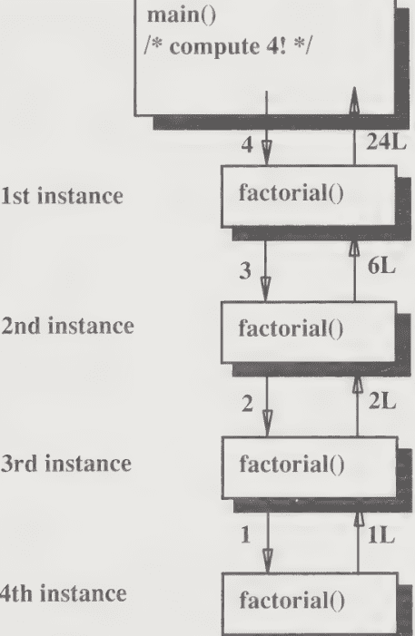

虽然递归可以产生易懂的解决方案，但它并非没有问题。递归密集使用程序栈，因此你可能需要留出更大的栈空间分配。它在递归的每一层都会产生函数调用开销，如果递归深度很大，可能会降低程序性能。

此外，还要注意提供终止条件。如果不提供某种安全网（例如`rfact`程序中的`test <= 1`），就可能会发生无限递归。在处理文件系统中的目录层次结构时，可能需要设置任意深度或路径长度以防止无限递归。操作系统环境通常会为你设定限制，但它不会防止错误的发生。


递归解决方案通常可以写成迭代解决方案，尽管在许多情况下这需要额外的代码空间。迭代解决方案的优势是消除了除了首次调用计算函数之外的函数调用开销。缺点是解决方案看起来可能没有那么整洁或直观。

`rfact`程序（列出`rfact.c`）是阶乘计算问题的迭代解决方案。除了在解决方案中使用迭代外，该程序还仔细地检查了用户提供的值，而递归版本没有这样做。它拒绝任何负输入和任何大于15的输入，通过打印错误消息并带有错误指示（`EXIT_FAILURE`）退出，以告知操作系统或其他调用程序发生了错误。

选择值15是因为输入16或以上会导致程序产生越界输出。随着起始数字的增加，阶乘的值增长非常快。如果你想看看发生什么，请在你的系统上运行`rfact`程序，并给出一个大于15的值作为输入。

```c
/*
 * ifact.c
 *
 * 使用迭代解决方案
 * 计算数字的阶乘。
 */
#include <stdio.h>
#include <stdlib.h>

#define NDIGITS 10
#define MAXINPUT 15

long factorial(short);

int
 main(void)
{
    char input[NDIGITS + 1]; /* 输入缓冲区 */
    short number; /* 起始数字 */

    /* 提示用户输入并读取 */
    printf("Type a non-negative integer + RETURN: ");
    gets(input);
    number = (short) atoi(input);

    /* 检查用户输入是否存在明显错误 */
    if (number < 0 || number > MAXINPUT) {
        fprintf(stderr,
                "Input must be a small, nonnegative integer");
        exit(EXIT_FAILURE);
    }

    /* 迭代计算阶乘并打印 */
    printf("The factorial of %hd is %ld\n",
           number, factorial(number));

    return EXIT_SUCCESS;
}

long factorial(short n) /* 迭代版本 */
{
    result = 1L;
    while(n > 1)
        result *= n--;

    return result;
}
```

`factorial()`函数最初将`result`设置为1，然后通过循环`n`的不断减少的值来计算最终结果，直到`n`减少到1。注意，在这个版本的程序中，`factorial()`只被调用一次，减少了函数调用开销。

## C 预处理器和宏

C 预处理器支持一种通用的文本替换机制。你已经使用它来为常量值创建符号名称。例如，该指令：

```c
#define NDIGITS 10
```

为常量10的特定用途创建了符号名称`NDIGITS`。在后续指令之后的翻译单元中，出现`NDIGITS`名称的任何地方，预处理器都会将其替换为定义的文本。在这种情况下，10是以数字字符串的形式表示的。经过预处理后，源文件看起来就像你输入了数字10而不是`NDIGITS`一样。

`#define`指令非常通用，不仅限于符号常量。宏是具有关联文本定义的名称。宏以两种形式之一存在：对象类宏或函数类宏。让我们来看每一种：

## 对象类宏

对象类宏是一个由其定义替换的名称，如`NDIGITS`示例所示。你不局限于简单的符号常量。替换文本几乎可以是任何字符字符串。以下是对象类宏的通用形式：

```c
#define name replacement_text
```

名称`name`不应与 C 的任何保留字重复。当然，你应该选择能够指示宏用途的名称。替换文本以结束该行的换行符终止。例如，下面的宏提供了一条你可以在打印语句中使用的消息文本：

```c
#define ERMSG_RANGE "Error: Input out of range"
```

若要在打印语句中使用此宏，只需输入其名称即可：

```c
if (!inrange(value)) {
    printf("%s\n", ERMSG_RANGE);
```

在这里，`inrange()`是你可能编写的一个的一个函数，用于测试从键盘或文件获得的数据值。在程序中使用这些数据之前，你会调用该函数，以防止诚实的失误或敌意用户的破坏尝试。

预处理器会在翻译器的后续阶段分析源代码并为目标处理器生成可执行代码之前，对源代码执行文本替换操作。在预处理器运行后，预处理过的源行将变成：

```c
if (!inrange(value)) {
    printf("%s\n", "Error: Input out of range");
```

使用宏的益处在你的源文件中多次出现消息文本时表现得最为明显。如果你的程序源代码中有（例如）10处出现该消息，而你决定将消息改为"INPUT RANGE ERROR"，你只需要在源文件中的一处进行更改，而不是10处。

如果整个宏定义无法舒适地放入单行中，请将其拆分为一系列较短的行，并使用反斜杠对除最后一个换行符在以外的所有换行符进行“转义”。预处理器和翻译器的其他阶段会将文本视为单行，但程序的读者的处理是更短、易于管理的行。`PROMPT`宏就是这样一个例子：

```c
#define PROMPT "To print the report, \
be sure your printer is ready, \nthen press the Return key: ""
```

尽管提示消息占据三行的大部分（为了页面进行了简化），但在下面的打印语句中使用时，它会在屏幕上以单行显示：

```c
printf("\n%s", PROMPT);
```

`\n`在提示消息之前将光标（或硬拷贝设备上的打印头）置于行。

## 函数类宏

到为止，我们只处理了扩展为固定字符串的宏。更复杂的文本替换操作是涉及参数的宏。这种宏具有函数的外观，因此被称为“函数类”宏。

以下是 C 中函数类宏的通用形式：

```c
#define name(identifier_list) replacement_text
```

新特性是`identifier_list`组件，它看起来和作用起来就像函数的参数列表。当你定义函数类宏时，你提供了一个形式参数列表。当你在源代码中调用宏时，你向它传递实际参数，就像函数一样。

左括号不能与名称之间有空格。预处理器在宏名称后寻找空白字符，以确定替换文本的开始。如果预处理器在名称字符串中看到没有间隔的`(`，它就认为有一个参数列表，并接受到右括号`)`之前的所有内容作为列表的一部分。你可以在列表中嵌入空白字符以提高清晰度。

为了看看它是如何工作的，让我们写一个宏来判断数值参数是偶还是奇。该宏依赖于偶数可以被2整除的事实。使用条件表达式，宏`EVEN()`在其参数为偶数时产生真值(1)，如果否则返回 FALSE (0)。以下是真值常量和宏的定义：

```c
#define FALSE 0
#define TRUE 1
#define EVEN(num) num % 2 ? FALSE : TRUE
```

在定义中，你应该给参数`num`加上括号，以防止产生意外的副作用。程序事件（在`eventst.c`文件中）展示了如何在实践中使用中使用此宏。

```c
/*
* eventst.c
*
* 使用宏测试整数以判断它们是
* 偶数还是奇数。
*/
#include <stdio.h>
#include <stdlib.h>

#define FALSE 0
#define TRUE 1

/* 测试数字的宏 */
#define EVEN(num) num % 2 ? FALSE : TRUE

int main()
{
    /* 测试用的硬编码值 */
    int n1 = 33, n2 = 44;

    /* 使用 if-else 检查 n1 */
    if (EVEN(n1))
        printf("%d is even\n", n1);
    else
        printf("%d is odd\n", n1);

    /* 使用条件表达式检查 n2 */
    printf("%d is %s\n", EVEN(n2), EVEN(n2) ? "even" : "odd");

    return EXIT_SUCCESS;
}
```

定义中的参数`num`指定了在程序调用该宏时期望接收单个值。注意，该参数是无类型的。你可以将`char`、`short`、`int`或`long`值传递给此宏，而不必担心数据类型。然而，取模运算符仅适用于整数类型，你不应该将浮点数据类型作为参数传递给此宏。

`EVEN()`宏在传统的`if-else`决策语境和条件表达式中均被调用。虽然测试`n2`的条件表达式比测试`n1`的`if-else`更紧凑，但在翻译后它的运行速度并没有更快。大多数 C 程序员起初觉得条件表达式更难理解，但当完全熟悉这种写法后，往往会更频繁地使用条件表达式。

此程序的输出是固定的，因为测试值是硬编码的。

```
33 is odd
44 is even
```

你可以在宏的替换文本中使用标准库函数和用户自定义的函数。例如，`ERR()`宏使用`printf()`来打印错误信息。以下是其定义：

```c
#define ERR (mesg)    printf("ERROR: %s\n", mesg);
```

该宏打印一行文本，由一个固定部分（"ERROR: "）和一个由参数提供的变量部分组成。在下面的代码段中，如果值大于允许范围，则调用`ERR()`打印消息：

```c
if (value > MAXVAL)
    ERR("value too large");
```

在程序的其他部分，可以使用不同的参数调用同一个宏，以打印不同文本的错误信息。

## 宏与副作用

在定义宏时要小心，以避免意外的副作用。副作用是执行语句后产生的动作。我们编写语句通常是为了它们的副作用（清除屏幕、存储值等）。但有时，语句执行的副作用并不是想要的，并且可能会产生灾难性的结果。

我们的`EVEN()`宏是有缺陷的，因为它在某些情况下无法产生正确的结果。如果我们向它传递一个如`a + b`的表达式而不是硬编码数字作为`num`参数，条件测试将变为：

```c
a + b % 2
```

而不是我们预期的表达式：

```c
(a + b) % 2
```

如果`a`等于2且`b`等于4，我们得到`2 + 4 % 2`（即`2 + 0 = 2`），而不是我们意图的`(2 + 4) % 2`（即`6 % 2 = 0`）。*注：此处原文逻辑为*：如果`a`等于2且`b`等于4，`2 + 4 % 2`结果为`2 + 0 = 2`（真）。

解决此问题的方法是在定义时加上括号。以下是修改后的定义：

```c
#define EVEN(num) (num) % 2 ? FALSE : TRUE
```

在定义中参数`num`指定了在程序中调用宏时期望接收单个值。注意该参数是无类型的。你可以将`char`、`short`、`int`或`long`值传递给此宏，而不必担心数据类型。然而，取模运算符仅适用于整数类型，你不应该将浮点数据类型作为参数传递给此宏。

`EVEN()`宏在传统的`if-else`决策语境和条件表达式中均被调用。虽然测试`n2`的条件表达式比测试`n1`的`if-else`更紧凑，但在翻译后它的运行速度并没有更快。大多数 C 程序员起初觉得条件表达式更难理解，但当完全熟悉这种写法后，往往会更频繁地使用条件表达式。

此程序的输出是固定的，因为测试值是硬编码的。

```
33 is odd
44 is even
```

你可以在宏的替换文本中使用标准库函数和用户自定义的函数。例如，`ERR()`宏使用`printf()`来打印错误信息。以下是其定义：

```c
#define ERR (mesg)    printf("ERROR: %s\n", mesg);
```

该宏打印一行文本，由一个固定部分（"ERROR: "）和一个由参数提供的变量部分组成。在下面的代码段中，如果值大于允许范围，则调用`ERR()`打印消息：

```c
if (value > MAXVAL)
    ERR("value too large");
```

在程序的其他部分，可以使用不同的参数调用同一个宏，以打印不同文本的错误信息。

## 宏与副作用

在定义宏时要小心，以避免意外的副作用。副作用是执行语句后产生的动作。我们编写语句通常是为了它们的副作用（清除屏幕、存储值等）。但有时，语句执行的副作用并不是想要的，并且可能会产生灾难性的结果。

我们的`EVEN()`宏是有缺陷的，因为它在某些情况下无法产生正确的结果。如果我们向它传递一个如`a + b`的表达式而不是硬编码数字作为`num`参数，条件测试将变为：

```c
a + b % 2
```

而不是我们预期的表达式：

```c
(a + b) % 2
```

如果`a`等于2且`b`等于4，我们得到`2 + 4 % 2`。解决此问题的方法是在定义时加上括号。以下是修改后的定义：

```c
#define EVEN(num) (num) % 2 ? FALSE : TRUE
```

## 函数与宏的权衡

在函数和宏都可以接受参数的情况下，你应该使用哪一个？这取决于你想做什么以及对性能的限制。首先，让我们从内存的角度来看函数。调用函数时会将数据推入栈中，这是有开销的。而宏在每次遇到时都会展开，这可以节省空间，但这种节省是以性能为代价的。

函数的优势是，它们可以在程序中被多次调用而不会增加体积。这种空间节省的代价是性能损耗。

如果你在优化程序空间，使用宏是一个重要的工具。现在让我们从速度的角度来看函数和宏。调用函数会产生开销，这是昂的的。而宏在每次遇到时都会展开替换文本，这会导致程序体积增大。这种性能优势的代价是空间占用。

你可以在程序中混合使用函数和宏，以在速度和空间之间取得良好的平衡。我建议你最初使用函数来编写程序。然后，针对程序中那些运行缓慢的部分，将它们重写为宏。

## 可移植性

ANSI C 标准的提出解决了一个由 C 设计设计引起的严重问题，但也引入了可移植性问题。函数原型不被非 ANSI 编译器理解，特别是运行在 UNIX 环境下的编译器。这种情况将持续多年。

如果你正在编写一个必须在不同环境中移植的程序，请将所有函数原型放在头文件中。在文件中，使用预处理指令根据符号名称是否定义来包含或排除原型。

以下是该技术的示例。头文件展示了你在`boxtext`程序中可以这样做：

```c
/* boxtext.h */
#define MSDOS

#if defined (MSDOS)
/* DOS 函数原型 */
void string(int, char);
void hborder(int);
void puttext(char []);
#endif
#elif defined (UNIX)
/* UNIX 函数声明 */
void string();
void hborder();
void puttext();
#endif
```

要使用这种技术，从`boxtext.c`文件中移除原型以及以下指令：

```c
#include <boxtext.h>
```

空参数列表也会带来问题，因为许多现有翻译器不理解这种对`void`关键字的用法。这在`main()`函数的定义中可能会引起麻烦，因为它可以接受参数。通常，参数在程序中是被忽略的。使用`void`来告诉翻译器发生的情况是一个好习惯，如果翻译器理解这种写法。一些旧的翻译器甚至不知道`void`在数据上下文中意味着什么。

解决此问题的方法为不同的操作系统环境定义`VOID`名称，并在程序中使用定义的名称，如下：

头文件：

```c
#if defined MSDOS
#define VOID void
#elif defined UNIX
#define VOID
#endif
```

源：

```c
int main(VOID)
{
    ...
}
```

## 总结

你已经达到了 C 编程之路上的第一个高原。函数是程序设计的关键方面，因为它们帮助你将程序分解为一组易于处理的子程序。

每个子程序都可以被设计成良好地完成一项特定工作，并向整个程序隐藏实现细节。你可以选择性地修改单个函数以提高性能，而不会对程序的其余部分产生负面影响。

此外，你还可以创建通用的函数集，这些函数可以用于许多程序的设计和实现。这种技术是标准C库的精髓。可重用模块有助于提高程序生产力、减少编程错误并优化程序性能。

某些问题适合递归解决方案。你应该在你的编程武器库中掌握递归技巧，但请记住，在许多情况下，迭代解决方案可能提供更好的性能。

编写子程序的另一种方法是使用宏。宏具有提高程序速度的优点，但代价是增加了程序体积。一个`#define`指令会告诉 C 预处理器执行文本替换操作，这是宏创建和应用的精髓。

## 问题与练习题

- 1. 请用自己的语言描述 C 程序中函数的用途。

- 2. 一个程序可以完全写在一个函数中吗？如果是，这是一种良好的编程实践吗？

- 3. 在 C 程序中如何调用函数？

- 4. 什么是外部链接？为什么需要外部链接？

- 5. C 函数原型的用途是什么？

- 6. 对于一个名为`Add()`的函数，它接受两个整数参数并返回一个整数和，请写两个声明：a) 定义声明，以及 b) 函数原型。

- 7. 完整函数定义的四个组成部分是什么？

- 8. 解释形式参数和实际参数之间的区别。

- 9. 判断对错：C 函数使用按引用传递作为默认的参数传递机制。


- 10. 在 C 程序中，什么情况下不需要提供函数原型？
    - a) 永远不需要
    - b) 当参数和返回类型为整数时
    - c) 当函数定义在函数调用之前出现时
    - d) 当函数没有返回值时
- 11. 什么是递归？它为什么有用？
- 12. 比递归更高效的替代方案是什么？
- 13. 编写一个 C 程序片段，显示如何调用问题 6 题中描述的 `Add()` 函数。
- 14. 关于宏的这些陈述哪些是正确的？
    - a) 宏会导致程序代码更少，节省空间。
    - b) 宏通常比等效函数快。
    - c) 宏是由预处理器 `#define` 指令创建的。
    - d) 在多文件程序的某个文件中定义的任何宏在程序的任何其他文件中都是可见的。
- 15. 为一个宏编写一个 `define` 指令，用于计算数值参数的绝对值。

## 附加练习题

A. 将 `string()` 函数写为一个宏，并在 `hbar` 程序中测试它的使用。

B. 编写一个程序，从键盘读取一系列四个数字，并打印一份关于平均值、最小值和最大值的报告。将数据收集、分析和报告的任务划分到不同的函数中。

C. 本章中的 `tree` 程序生成的是一棵没有树干的树。添加一个函数，在树的底部居中打印一个两行的树干。树干的字符数取决于树的宽度，可以是奇数也可以偶数。

D. 编写一个程序，打印一个框套一个框再套一个框再套一个框。每个框都用不同的字符绘制。编写该程序，使得只需更改一个值就能决定绘制多少层框。

# 第 7 章

## 数组与指针

在前面的章节中，我们使用字符数组作为输入缓冲区，但你必须盲目地接受数组的概念。指针也是如此，我们在涉及 `gets()`、`atoi()` 以及其他函数的语句中使用了指针，尽管你当时并不需要知道其中涉及指针。现在你需要学习指针了，因为 C 语言的许多力量和灵活性归功于其优雅的指针机制。

在 C 中，数组和指针之间存在紧密的关系。本章将向你介绍这些主题，展示如何创建数组类型和指针类型的变量，如何在程序中访问这些变量，以及如何利用数组和指针之间的关系。

## 数组类型

到为止，我们强调的是标量数据类型，如整数、字符和浮点数。然而，许多现实世界的数据被更有效地管理为具有共同名称的数据项集合——即一个 `aggregate`（聚合体）。

数组是具有相同数据类型的对象的连续排列。数组中的每个对象被称为数组的 `element`（元素），数组的类型派生自其元素的类型。因此，每个元素类型为 `char` 的数组被称为“char 类型数组”。

在 C 中，数组的基地址是下标为 0 的元素。如果你在 Pascal 或其他使用 1 为基的语言中编程，你可能需要一段时间才能适应 C 的方法。

注意数组的大小与其最后一个元素的偏移量之间的区别。一个包含 20 个整数的数组大小为 20。第一个元素的下标（或索引）是 0，最后一个元素的下标是 19。如果你尝试访问下标 20，你实际上访问的是数组上方内存中的任何内容，而不是数组内部的内容。

## 声明数组变量

与 C 程序中的所有变量一样，在使用数组进行任何用途之前，必须对其进行声明。（注：原文此处存在大量重复性错误，翻译时已根据逻辑去重）

自动存储期（Automatic storage duration）是默认的。声明变量时如果没有使用 `static` 存储类限定符且没有链接（linkages），则被认为是自动变量。这种变量的一个示例是位于函数内部声明的循环计数器（称之为 `n`）。每当进入闭包函数时，都会保证该变量实例的存储空间，当控制权离开函数时，空间会被释放。

另一方面，具有链接（无论是外部链接还是内部链接）声明的对象，或者使用 `static` 存储类声明的对象，则具有静态存储期（static storage duration）。具有静态存储期的变量实际上在内存中某处有一个永久的“家”。它在程序开始运行之前初始化一次，并在程序终止之前一直保留存储在其中的最后一个值。我们之前的工作中永久性变量的例子是存储在静态数组中的文本字符串。

作用域（Scope）。标识符的作用域决定了它在程序中的可见性，分为四类：

- 函数（Function）
- 文件（File）
- 块（Block）
- 函数原型（Function Prototype）

作为标签（label）使用的标识符具有函数作用域。标签被用作 `goto` 语句的目标。因此，标签名称在函数内部必须是唯一的。不同函数中的相同标识符处于不同的作用域，因此不存在命名冲突。

声明语句或类型限定符的位置决定了所有其他标识符的作用域。在任何块（包括构成函数体的块）之外声明的标识符具有文件作用域。因此，此类标识符可以在文件中的任何地方（从声明处到翻译单元的结束）进行读写访问。

大多数标识符具有块作用域，这意味着它们仅在闭包块内（包括任何内部块）可见。在函数头部的参数列表中声明的标识符，在函数体内部也具有作用域。

在内部块中声明的与外部块同名的标识符会有效地隐藏外部声明，而外部块中的标识符在内部块中逻辑上仍是可见的。在这一段示例代码中，两个名为 `c` 的变量是不同的变量，而不是同一个变量的独立实例：

```c
/* 外部块 */
char c = 'X';
...
    /* 内部块 */
    char c = 'Y';
    ...
    putchar(c); /* 打印 'Y' */
}
putchar(c); /* 打印 'X' */
```

注意内部块中的变量 `c` 以及对其进行的操作不会影响外部块中 `c` 的值。

**存储类限定符（Storage Class Specifiers）。** 变量的存储类由声明语句中的存储类限定符标明。主要的存储类限定符有 `extern`、`static`、`auto` 和 `register`。此外，为了方便起见，关键字 `typedef` 与存储类标识符归为一组，但正如我们在后续章节中看到的，它并不是真正的存储类限定符。

具有外部链接（external linkage）的标识符指的是其他作用域中完全相同的标识符。该标识符只能在一个作用域中定义，但只要应用 `extern` 关键字，就可以从其他地方引用它。其工作原理如下：

定义声明（在一个翻译单元中）：

```c
int n;
```

引用声明（在另一个翻译单元中）：

```c
extern int n;
```

这里重要的区别在于，定义声明为变量 `n` 留了存储空间，而引用声明没有。它只是告诉翻译器，引用声明中的标识符指向第一个翻译单元中定义声明的标识符完全相同的对象。链接器在链接时解析外部引用。

我们也可以利用标识符的内部链接（internal linkage）将其限制在单个文件中。具有文件作用域且声明中包含 `static` 存储类限定符的对象和函数具有内部链接。在一个翻译单元内，所有具有内部链接的标识符实例都指向同一个对象或函数。然而，在翻译单元外没有指向该对象的链接。没有链接的标识符表示一个唯一的实体，例如函数或其他块内部的局部变量。

`auto` 关键字指定自动存储，其本质上是瞬态的。如果在块内声明标识符时没有使用 `static` 存储类限定符，则它默认是 `auto`。

Pre-ANSI C 翻译器不允许你初始化自动数组变量。如果你想提供一组初始化列表，则必须对数组变量应用 `static` 存储类限定符。ANSI 标准允许你初始化任何自动存储期的对象。在书中，初始化的数组被声明为 `static`，因为 C 翻译器仍然需要它。

如果你为静态数组提供了不完整的初始化列表，自动数组中未定义的元素将不会被设置，因此它们包含无意义的值（那些内存位置过去活动的遗留值）。

## 访问数组元素

你使用下标（subscripts）访问数组元素。例如，要打印存储在桶（bucket）元素 2 中的的数字，可以使用如下语句：

```c
printf("bucket[n] = %d\n", n, bucket[n]);
```

在使用下标时要小心位于0 到数组大小减 1 的范围内。正如我们所看到的，不存在下标等于数组大小的元素，尝试打印 `bucket[10]` 的内容会产生错误值。

让我们数据收集桶派上用场吧。`tally` 程序自动化了调查一组人的任务。如果你向一个参加音乐会的观众询问他们在 0 到 9 的量表上对乐队如何打分（9 为最高），`tally` 可以帮助你收集原始数据并呈现结果摘要。我们最感兴趣的是量表中每个层级的响应数量。如果 7 到 9 范围内的桶中……

```c
/*
* tally.c
* 收集原始数据
* 提示观众
* 分析数据
* 报告结果
*/

#include <stdio.h>
#include <stdlib.h>
#include <ctype.h>

#define RANGE 10
#define NCHARS 20

int main(void)
{
    int bucket[RANGE] = { 0 };
    int count = 0;
    char inbuf[NCHARS];
    int score;

    printf("\nTALLY PROGRAM\n");
    printf("Enter scores in 0-9\n");
    while (1) {
        printf("Score: ");
        if (gets(inbuf) == NULL) {
            printf(stderr, "ERROR: bad read\n");
            continue;
        }

        /* 检查退出（任何非数字） */
        if (!isdigit(inbuf[0])) {
            putchar('\n');
            break;
        }

        /* 将输入字符串转换为整数 */
        score = atoi(inbuf);

        /* 范围检查；如果是则保存 */
        if (score >= 0 && score < RANGE) {
            ++bucket[score];
            ++count;
        }
        else {
            printf(stderr, "\nERROR: data out of range\n");
            continue;
        }
    }

    /* 报告结果 */
    printf("\nRESULTS:\n\tCount\n");
    for (int n = 0; n < RANGE; ++n) {
        printf("%d\t%d\n", n, bucket[n]);
    }
    printf("\n%d scores reported\n", count);

    return EXIT_SUCCESS;
}
```

## 多维数组

任何编程语言的一个重要属性是其对其环境建模的能力。能够让程序与当前问题匹配的灵活数据类型会让你的程序员生活变得愉快，或者至少是可以忍受的。常见的数据类型是矩形数组。将一些棋游戏和某些信息摘要作为矩形数组的示例。计算机电子表格或数据库都是基于此模型构建的。

## 添加数组维度

图 7-2 显示了C语言中二维数组的样子。如你所见，它实际上是一个数组的数组。这个数组可以被视为一个包含两个元素的数组（行），其中每个元素都是一个包含五个元素的数组（列）。

多维数组的所有元素都具有相同的类型，线性数组也是如此。数组仍然有一个名称。但现在我们有两个或多个下标，而不是一个。

图 7-2 中的数组有两个维度，为了使用一个熟悉的类比，我们可以将其其称为“行”和“列”。从图中可以看出，当我们遍历数组时，列下标（最右侧）的变化速度比行下标快。如果我们需要第三个维度，只需添加另一个下标即可。

图 7-2：二维数组

| 二维数组 | 存储形式 |
| :--- | :--- |
| `int a[2][4] = { { 0, 1, 2, 3, 4 }, { 10, 11, 12, 13, 14 } }; printf("%i", a[1][4]);` | 0 | 0 |
| | 1 | 1 |
| | 2 | 2 |
| | 3 | 3 |
| | 4 | 4 |
| 0 | 10 |
| 1 | 11 |
| 2 | 12 |
| | 3 | 13 |
| | 14 |
| 当我们可视化时： | | | | | | |
| 0 | 1 | 2 | 3 | 4 | | |
| 0 | 0 | 1 | 2 | 3 | 4 | 4 | | | 1 | | 111 | 1 | |

## 初始化和访问多维数组

如图 7-2 所示，你可以通过提供大括号初始化列表来初始化多维数组。同样，初始化器适用于数组开始的元素。在静态数组中，未初始化的元素会自动置零，而在自动数组中则是未定义的。这对于外部和静态标量变量的处理方式也是一样的。

`array2` 程序（见 array2.c）建立了一个二维数组 `a` 并对其进行了初始化。它打印出了一个元素的值。

```c
/*
* array2.c

* 使用初始化器声明一个二维数组
* 然后打印出它所有的元素值。
*/

#include <stdio.h>
#include <stdlib.h>

#define ROWS 2
#define COLS 5

int
main(void) {
    int row, col;

    static int a[ROWS][COLS] = {
        { 0, 1, 2, 3, 4},
        { 10, 11, 12, 13, 14 }
    };

    /* 打印数组元素的值 */
    row = 1, col = 4;
    printf("a[%i][%i] = %i\n", row, col, a[row][col]);

    return EXIT_SUCCESS;
}
```

## 数组与指针

为了更好地理解下标是如何工作的，，尝试修改 `array2` 程序，使其打印出一个行和列的表格，显示数组每个元素的值。使用现有的 `row` 和 `col` 变量来控制两个嵌套的循环。由于列下标的变化比行下标快，它应该是最内层的循环。

## 指针类型

指针是一个包含对象或函数地址的变量。指针是C语言派生类型之一。尽管许多编程语言以某种方式实现了指针，但C语言的指针实现是最优雅的之一，它赋予了C很多力量。

正如你在第4章中学到的，地址运算符 `&` 会产生其操作数的地址。因此，我们有一种方法可以找到对象在内存中的位置。但我们如何保存并使用这些信息呢？我们需要一个存储地址信息的地方。我们通过声明指针变量来实现。

## 声明指针变量

指针声明包含一个新元素——间接运算符 `*`。其通用形式如下：

```c
type *ptr_name;
```

`type` 部分指定了指向的数据类型，而 `ptr_name` 是命名指针变量的标识符。

最简单的阅读声明方法是反向读取：“`ptr_name` 是一个指向 `type` 类型对象的指针”。对 `*` 运算符的这种解释初看起来可能并不直观，但指针变量的声明语法与其用法是一致的。

让我们用一个整数示例来更仔细地检查指针声明。图 7-3 显示了如何声明指针并给它赋值，以及它在内存中的样子。在以下语句中声明的普通整数占据一段内存区域（通常为两个或四个字节），并且其初始值是未定义的。

```c
int number;      /* 普通整数 */
```

你可以使用以下语句声明一个指向整数的指针：

```c
int *p;               /* 指向整数的指针 */
```

此声明表示 `p` 是指向 `int` 类型对象的指针，但 `p` 也包含一个未定义的值，因为还没有给它分配任何值。指针的大小由实现决定，通常为两个或四个字节。

图 7-3：C拥有优雅的指针 (img/7-3.png)

## C语言中的数组和指针

数组和指针配合得很好。在C语言程序中，你可能会看到指向数组的指针，也会看到指针数组。这些结构是

易于创建和使用。此外，你会发现数组和指针与字符串密切相关。

## C 字符串

与大多数计算机语言不同，C 没有内置的字符串数据类型。相反，它将由空字节 NUL 终止的字符序列视为字符串。

你可以通过声明一个字符数组并为数组元素赋值来创建一个字符串，如图 7-4 所示。你负责提供终止的空字节，它被显示为值为 `'\0'` 的字符常量。如果你忘记提供终止终止符，那么你拥有的将只是一个简单的字符数组，而不是字符串，你的程序将以一种并不有趣的、可观察的方式发生崩溃。

图 7-4：字符字符串和指针

```
ARRAY & POINTER DECLARATIONS
static char text[] = {
"Testing!"
}
char *cp;
```

| cp | text |
|---|---|
| | 'T' 'e' 's' 't' 'i' 'n' 'g' '!' '\0' |

## 指针赋值

```
cp = text;
```

`str` 程序向你展示了如何创建一个字符串以及如何访问字符串中的字符。程序通过两种方式打印字符串。第一种使用数组下标来检索存储在连续数组元素中的值。第二种使用指针进行元素访问。


```
/*
* str.c
 *
* 通过使用直接和间接
* 访问方法打印文本字符串。
 */

#include <stdio.h>
#include <stdlib.h>
#include <string.h>

int
main(void)
{
    int i;
    char *cp;      /* 通用字符指针 */

    static char str[] = {
        "The quick fox knows something about chickens!\n"
    };

    /* 使用下标打印字符串 */
    printf("Direct via putchar(): ");
    for (i = 0; str[i] != '\0'; ++i)
        putchar(str[i]);

    /* 使用字符指针打印字符串 */
    printf("Indirect via a character pointer: ");
    for (cp = str; *cp != '\0'; ++cp)
        putchar(*cp);

    return EXIT_SUCCESS;
}
```

在第 3 章中我们讨论了字面量字符串。记住，带引号的字符序列，例如 `"The quick fox knows something about chickens!\n"` 是字面量字符串。我们可以使用字面量字符串来初始化数组。

在接下来的数组初始化中，字面量字符串完成了数组声明的不完整类型。没有提供大小值（空括号），因此翻译器决定由多少个字符组成数组。

```
static char str[] = {
    "The quick fox knows something about chickens!\n"
};
```

该数组中有 47 个元素。`\n` 序列被视为单个字符（换行符），并且字面量字符串后面会自动追加一个空字节，标记字符串的结束。

`for` 循环的控制变量 `i` 被设为初始值 0，这选择了数组基部的元素。只要表达式 `str[i] != '\0'` 为真，循环就会继续运行。该测试表达式将第 `i` 个数组元素中存储的值与 0（用字符常量表示）进行比较。因此，一旦下标 `i` 选中了包含空字节的数组元素，测试表达式就会终止循环。

打印数组内容的指针方法也使用了 `for` 循环，但指针扫描的是数组而不是数组下标。指针 `cp` 的初始值通过将数组地址赋值给指针获得。

在 C 中，数组名是指向数组基部的常量指针，即第一个元素的地址。这意味着我们可以使用数组名作为更复杂的地址表达式的别名。例如，名称 `str` 等同于表达式 `&str[0]`。因此，`str` 作为一个常量指针，可以直接赋值给 `cp`。

循环终止测试变为 `*cp != '\0'`，这会将 `cp` 指针指向的位置中存储的值与空字节的编码进行比较。只要指针访问的是非空字符，循环就会继续运行。

注意，在循环控制表达式中，与 0 的比较是自动的，因此你可以使用表达式 `str[i]` 作为循环控制表达式。不需要与空字节进行显式比较。在指针版本中，由于相同的原因，你可以使用 `*cp` 作为控制表达式。

## 下标数组与指针偏移

正如你所看到的，你可以使用许多计算机语言通用的数组下标方法来获取字符串或其他数组的元素。但在 C 中，你可以通过基指针和相对于基的整数偏移来获取相同的元素，如图 7-5 所示。

图 7-5：使用指针访问数组元素

```
ARRAY & POINTER DECLARATIONS
static char text[] = {
  "Testing!"
};
char *cp;
```

| `cp` | `text` | | | | | | | |
|---|---|---|---|---|---|---|---|---|
| | 'T' | 'e' | 's' | 't' | 'i' | 'n' | 'g' | '!' | '\0' |

## 指针赋值

```
cp = text;
```

以下代码片段有助于澄清发生了什么。首先，我们声明并初始化了一个包含 `"Testing!"` 的数组，并建立了一个指向数组基部的指针 `cp`，所示：

```
/* message */
static char text[] = "Testing!"
char *cp;
```

接下来我们打印字符：

```
/* subscripted array */
putchar(str[i]);
```

下标数组示例应该是显而易见的：

```
/* point to */
putchar(*cp + i));
```

指针 7 会改变值。对于交叉数组方法，每行有一个指针开销，但如果预期的最大行长度超过平均行长度一点（通常情况下如此），则交叉数组比等效的矩数组更节省空间。仔细看数组声明：

```
static char *dayname[] = {
  "Sunday", "Monday", "Tuesday",
"Wednesday", "Thursday", "Friday",
  "Saturday"
};
```

| | | | | | | | | |
|---|---|---|---|---|---|---|---|---|
| 'S' | 'u' | 'n' | 'd' | 'a' | 'y' | '\0' | | |
| 'M' | 'o' | 'n' | 'd' | 'a' | 'y' | '\0' | | |
| 'T' | 'u' | 'e' | 's' | 'd' | 'a' | 'y' | '\0' | |
| 'W' | 'e' | 'd' | 'n' | 'e' | 's' | 'd' | 'a' | 'y' |
| 'T' | 'h' | 'u' | 'r' | 's' | 'd' | 'a' | 'y' | |
| 'F' | 'r' | 'i' | 'd' | 'a' | 'y' | '\0' | | |
| 'S' | 'a' | 't' | 'u' | 'r' | 'd' | 'a' | 'y' | '\0' |

## 指针数组

数组名是 `daytime`。数组后面的空括号表示它是一个数组，但没有指定数组大小。翻译器知道如何计数，因此如果你提供了完整的初始化 set，它将为你计算值。

数组的每个元素都是指向字符的指针。初始化列表中的字面量导致字符串存储在内存某处并将地址存储在 `daytime` 数组中。元素 0 接收字面量 `"Sunday"` 的地址，元素 1 接收 `"Monday"` 的地址，依此类推。

将上述描述的交叉数组与矩数组进行对比，后者根据最长字符串的长度定义。对于示例，数组声明可能如下：

```c
#define ROWS 7
#define COLS 10

static char daytime[ROWS][COLS] = {
    "Sunday", "Monday", "Tuesday",
    "Wednesday", "Thursday", "Friday",
    "Saturday"
};
```

矩数组不仅占据了所需的字符数（67），而且占据了完整的 70 个字符位置。对于交叉数组方法每行有一个指针开销需要考虑，但如果预期的最大行长度超过平均行长度一点（通常情况下如此），交叉数组比等效的矩数组更节省空间。

使用指针和数组还有其他原因。特别是，指针数组是访问支持该功能的计算环境（如 UNIX 和 DOS）中用户命令行输入的参数的方便方法。我们将在随后的章节中看到命令行参数处理的示例。

## 指针与函数

另一种非常有用的组合是指针和函数。将指针与函数有三种方式：

- 指针作为函数参数
- 返回指针的函数
- 指向函数的指针

前两种用法在 C 程序中相当常见。第三种较少遇到，但在某些编程情况下它提供了重要的功能和效率提升。

## 指针作为函数参数

在第 6 章中，你学习了默认的参数传递方法是“值传递”（call-by-value），而“引用传递”（call-by-reference）是一种依赖于指针使用的替代方案。通过使用指针变量作为函数参数，可以让你能够向调用函数“返回”多个值，而在这种情况下，函数的 `return` 语句只允许返回单个值。它还允许被调用函数影响调用函数中变量的值，这在使用“值传递”方法时是不可能的。

这是一个使用指针作为形式参数的函数定义示例：

```c
int
StringLength(char *str)
{
    char *cp;

    /* 指向字符串起始 */
    cp = str;

    /* 寻找终止的空字节 */
    while (*cp != '\0')
        ++cp;

    /* 计算字符串长度 */
    return cp - str;
}
```

该函数顾如其名，计算字符串的长度。在被调用的例程中，它接收要测量字符串的地址，将一个临时字符指针 (`cp`) 设置为字符串的开头，扫描字符串寻找空字节，然后返回空字节位置与字符串开头之间的差值。返回值是地址运算的结果，即字符串的长度。

标准库提供了丰富的常用例程。其中包含许多字符串处理函数，包括一个名为 `strlen()` 的函数，它的作用与我们的 `StringLength()` 相同。开发此类函数以观察它们的工作原理是有用的，但在程序中，你应该使用现有的库函数以获得在其他支持 C 的环境中的最大移植性，并尽可能减少自己的编程工作。将精力放在你程序特有的事情上，并尽可能在他人工作的基础上构建。

## 返回指针的函数

在书中目前介绍的程序中，函数没有返回任何内容（`void`），就是返回了数值，例如用 0 表示成功或用其他数字表示失败。在 `StringLength()` 的情况下，返回值是一个整数。

返回指针的函数在执行字符串操作、管理数据库、搜索和排序文本以及许多其他常见任务时特别有用。这里示例是一个返回指向字符指针的函数。该函数名为 `StringCopy`，因为它的工作是将一个字符串 `str2` 拷贝到另一个 `str1`。你必须确保 `str1` 足够大以接收包括空字节在内的 `str2`。如果目标字符串不够大，将覆盖内存的其他区域。

```c
char *
StringCopy(char *str1, char *str2)
{
    char *p, *q;

    /* 设置临时指针 */
    p = strlen(str1);
    q = str2;

    /* 将 str2 拷贝到 str1 */
    while (*q != '\0') {
        *p = *q;
        ++p;
        ++q;
    }

    /* 终止目标字符串 */
    *p = '\0';

    /* 指向目标字符串起始 */
    return str1;
}
```

该函数通过建立两个指向两个输入指针的临时指针 `p` 和 `q` 来完成工作。只要源指针 `q` 指向一个有效字符（非空），循环就会运行，将字符从源字符串拷贝到目标字符串。当循环结束时，目标字符串由空字节终止。然后返回指向目标字符串起始处的指针。注意 `Stringcopy()` 的返回类型是 `char *`，一个指向字符的指针。

虽然没有必要返回目标字符串起始处的指针，但这样做极大增加了函数的实用性。通过函数调用的结果获取指针，可以让你使用嵌入字符串赋值，并为表达常用操作提供了自然的手段，例如打印字符串拷贝的结果。

接下来的 `main()` 函数用于测试前面的字符串函数。它将 `StringLength()` 和 `StringCopy()` 嵌入在 `printf()` 语句的参数列表中。这种方法避免了使用临时变量来持有返回值（例如长度）的需要。

以下程序由函数原型和一个 `main()` 函数组成，该主函数测试了我们刚刚创建的字符串函数。

```c
/*
 * strtest.c
 *
 * 测试各种字符串函数。
 */

#include <stdio.h>
#include <stdlib.h>

/* 函数原型 */
int StringLength(char *);
char *StringCopy(char *, char *);

int
main()
{
    /* 消息和缓冲区 */
    static char mesq[] = { "This is a test!" };
    static char buffer[] = {
        "BUFFER BUFFER BUFFER"
    };

    puts("StringLength() test:");
    printf("String contents = %s\n", mesq);
    printf("Number of characters = %d\n",
        StringLength(mesq));

    puts("StringCopy() test:");
    printf("Buffer before copying = %s\n", buffer);
    printf("Buffer after copying = %s\n",
        StringCopy(buffer, mesq));

    return EXIT_SUCCESS;
}
```

## 数组与指针

`strtest` 的输出如下：

```
StringLength() test:
String contents = This is a test!
Number of characters = 15

StringCopy() test:
Buffer before copying = BUFFER BUFFER BUFFER
Buffer after copying = This is a test!
```

注意缓冲区是如何初始化的。带有重复文本（`"BUFFER"`）的字符串实际上预留了内存。例如，如果你忘记在 `StringCopy()` 函数中通过留下这一行来终止目标字符串：

```c
*str1 = '\0';
```

那么输出将显示初始字符串的残留，因为 `printf()` 直到找到空字节之前都不会停止。

## 指向函数的指针

指向函数的指针与返回指针的函数截然不同，它们的声明也必然不同。虽然 C 语言中的函数不是变量，但获取函数的地址并以各种方式使用该地址，就像使用任何其他指针一样。

指向函数的指针的声明乍一看可能看起来很奇怪。学习它直到你觉得它正常为止。这种声明的通用形式如下：

`type (*fptr)();`

这种声明的关键属性是使用括号来强制进行正确的绑定。表达式 `*fptr` 周围的括号是必要的，因为默认绑定会将函数名 `func` 与其随后的匹配括号关联起来。如果没有额外的括号，声明将变成

`type (*fptr)(); /* 函数返回指针 */`

这声明了一个返回指定类型对象指针的函数——这不是我们需要的。在所有括号就位的情况下，将声明读为“`func` `fptr` 是一个返回 `type` 的函数的指针”。

以下声明用于一个变量 `f`，它是一个指针（由 `f*` 表示），指向一个函数（由括号表示），该函数返回一个整数（`int`）：

`int (*f)();`

`qsortdemo` 程序展示了标准库 `qsort()` 以及指向返回整数的函数指针。该函数是 `compare()`，它接受两个整数指针参数并返回一个整数值。

# 数组与指针 183

```c
int iccompare(int *, int *);
```

```c
int
main(void)
{
    int n, *ptr;      /* 循环计数和指针 */
    int size;         /* 数组元素个数 */

    /* 未排序的整数数组 */
    static int num[] = {
        400, 230, -16, 81, 120, 33, -54, 60
    };

    /* 计算数组大小 */
    size = sizeof num / sizeof(int);

    /* 显示未排序数组的内容 */
    puts("\nUnsorted Array:");
    for (n = size, ptr = num; n-- > 0; ++ptr)
        printf("%5d ", ptr);
    putchar('\n');

    /* 使用 qsort() 对数组进行排序 */
    qsort((void *) num, (size_t) size,
          sizeof(int), iccompare);

    /* 显示排序后的数组 */
    puts("\nSorted Array:");
    for (n = size, ptr = num; n-- > 0; ++ptr)
        printf("%5d ", ptr);
    putchar('\n');

    return EXIT_SUCCESS;
}
```

```c
int
iccompare(int *n1, int *n2)
{
    if (*n1 > *n2)
        return 1;
    else if (*n1 < *n2)
        return -1;
    else
        return 0;
}
```

`qsortdemo` 使用了一个内置的数字数组。它通过调用 `qsort()` 对数组进行排序。`qsort()` 的最后一个参数是一个指向数据比较函数的指针，该函数返回一个整数。比较函数的返回值表示作为参数传递的两个值是否相等（0）或不相等。返回值 -1 或 +1 表示第一个参数的值小于第二个参数的值（-1）或大于第二个参数的值（+1）。

`qsort()` 的函数原型 get `<stdlib.h>` 头文件。在大多数当前的 C 实现中，它的形式如下：

```c
void qsort(void *base, size_t nmemb, size_t size,
int (*compar)(const void *, const void *));
```

该函数没有返回值，因此被声明为 `void`。我们调用 `qsort()` 仅是为了它的副作用，即快速对元素数组进行排序。


`base`参数是一个指向排序数组起始位置的指针。`void *`限定符是新的。在非 ANSI 时代的 C 翻译器中，“通用”指针类型是`char *`。现在`void *`是通用指针类型。它具有与`char *`相同的对齐要求。

`nmemb`参数指定排序范围内的元素个数，`size`参数指定每个元素的统一大小。`nmemb`和`size`都是`size_t`类型，这是`sizeof`运算符结果的无符号整数类型。该类型在`<stddef.h>`和包括`<stdio.h>`在其他头文件中定义。

`compare`参数是指比较函数的指针。声明`compar`是一个返回并接收整数的函数指针。`compar`的声明还表示比较函数有两个指针参数，每个的类型均为`const void *`。参数列表中使用的`const`类型限定符表示参数的值不会因函数调用而发生改变。在`qsortsdemo`程序中，对`qsort()`的调用使用函数名`iccompare`作为参数，因为函数的裸名指向该函数代码的指针，就像数组的裸名指向其第一个元素一样。

## 数组与指针

## 可移植性

大多数与数组和指针的可移植性问题与计算机体系之间的差异有关，这些差异影响大小和范围。

数组的最大取决于计算机的寻址范围以及特定实现处理该问题的方式。例如，Intel 8086（以及 80286）处理器的分段架构将任何对象的大小限制在 64KB 分段内。大多数在 PC 环境下运行的 C 翻译器提供了`huge`关键字来绕过此限制，但对其他环境的可移植性随之降低。

在分段环境中，指针的大小随所使用的内存模型而变化。你至少必须处理 small、medium 和 large 模型。此外，某些翻译器还提供 tiny 和 compact 模型，以及`near`和`far`两个扩展关键字，这允许“混合模型”编程。如果你必须在某个环境中使用扩展特性，请尝试将所有特定于环境的代码和数据放在单个文件或少量文件中。这些文件可以针对其他环境进行修改，但你程序的大部分不需要更改。

## 总结

本章介绍了 C 语言中的数组和指针主题。两者都是派生类型，通过对基本类型应用`[]`和`*`运算符创建。

数组可以是内部的（在函数内部声明）也可以是外部的。应用于内部数组的`static`关键字使其变为永久性，从而使其值在跨函数调用时保持不变。你可以初始化自动数组和静态数组，尽管非 ANSI 编译器只允许对后期类型进行初始化。

在外部数组声明上应用`*`运算符，该数组从声明处到其所在文件末尾范围内都是私有的。否则，该数组是全局可见的。

你可以通过声明一个数组，其中每个元素本身是另一个数组，来创建多维数组的效果。每个维度都需要额外的括号内大小指定符。通过应用括号下标来访问元素。

# 数组与指针 187

## 习题与练习

1. C 语言数组具有以下哪种属性？
   - a) 所有元素具有共同类型
   - b) 数组基下标为 1
   - c) 元素连续排列
   - d) 以上所有

2. 对或否：自动数组可以在声明语句中初始化。

3. 解释`static`关键字在内部数组声明中的作用，例如：

```c
static char mesg[] = "ERROR: input out of range";
```

4. 描述 C 在没有真正的多维数组类型的情况下是如何实现该效果。

5. 给以下数组声明，写一个语句遍历数组，对每个包含奇值的元素加 1。

```c
int a[20];
```

6. 什么是指针？

7. 声明一个普通整数`i`和指向整数的指针`*ip`。再写一个语句使指针指向`i`。

8. 研究以下语句，并简要描述每个语句的作用。填充缺失的语句（下划线处），使得通过指针变量的赋值合理。

```c
char ch, *cp;
__________
*cp = 'Q';
putchar(ch);
```

9. 指针允许哪些算术运算（涉及两个指向同一对象的指针时）？
   - a) 从一个指针减去另一个指针
   - b) 将两个指针相加
   - c) 指针与整数相加或相减
   - d) 以上所有
   - e) 以上都不是

10. 写一个循环语句，将以下数组中的每个大写字母转换为对应的小写字母。提示：使用 C 翻译器标准库提供的`tolower()`宏进行转换。

```c
static char text[] = "MACROS.C";
```

## 附加练习

A. 编写一个程序，提示用户输入一行文本（最多 65 个字符），读取该文本并报告以下内容：

- a) 字母的数量（使用`isalpha()`）
- b) 数字的数量（使用`isdigit()`）
- c) 所有其他字符的数量
- d) 输入行中的字符总数

B. 编写一个程序，创建所示的十进制和等效十六进制表。使用静态值数组作为十进制到十六进制的转换表。

| 十进制 | 十六进制 |
| :--- | :--- |
| 0 | 0 |
| 1 | 1 |
| 2 | 2 |
| 3 | 3 |
| 4 | 4 |
| ... | A |
| 10 | A |
| 11 | B |
| 12 | C |
| 13 | D |
| 14 | E |
| 15 | F |

C. 编写一个程序收集学生测试成绩并生成测试结果摘要。报告平均分以及处于以下范围的学生人数：

- 90 及以上 (A)
- 80 到 89 (B)
- 70 到 79 (C)
- 60 到 69 (D)
- 60 以下 (F)

D. 修改`qsrtdemo`程序，使其对双精度浮数组进行排序。（你需要在`main()`中进行更改并提供一个不同的比较函数。）

# 第 8 章

## 结构 (STRUCTURES)

C 提供了一套完整的基本数据类型以及从基本类型派生更高级数据类型的几种方法。本章描述了结构以及称为联合（unions）和位域（bit fields）的类结构特征。

此外，本章还引入了枚举（enumerations）以及一种创建新数据类型名称的方法。

## 结构简介

结构提供了一种处理相同或不同类型变量集合的方便方法。你可以将某些方面相关的的数据项分组到一个公共名称下，并通过该名称和一种称为成员选择（member selection）的技术来访问这些项。C 结构是一种聚合体，类似于 Pascal 的记录（record）。一些最近的 BASIC 实现提供了类似记录的功能。

数据库中从简单的卡片文件到复杂的人事和薪资系统，记录都是结构的示例。在这些数据库中，一个记录或结构通常包含账号、名称、地址、电话号码以及关于每个联系人或员工的其他信息。

## 结构声明

C 中的结构声明具有以下通用形式：

```
struct tag {
  type varname;
  ...
};
```

关键字`struct`标识这是一个结构声明。可选的标签（tag）为特定的结构提供一个唯一名称。变量声明列表指定了结构的成员。此类声明的结果是创建了一个结构模板，你可以将其用作类型规格说明符。

以下是一个结构声明，它创建了一个用于维护全年月份信息的结构模板：

```c
struct month_st {
  char name[10];
  char abbrev[4];
  short days;
};
```

由该声明创建的结构模板规定了任何声明为`month_st`类型的变量的形式。后缀`_st`是我使用的一种约定，用于表示带有后缀的名称是一个结构标签。在标准库中，你会发现许多出于相同目的而带有`_t`后缀的派生类型。`size_t`类型就是这种做法的示例。

图 8-1 显示了类型为`month_st`的变量`month`的声明。两个字符数组占据内存中的空间，是因为该结构的设计是为了存储月份名称，并在`name`成员中存储一个终止空字节，在`abbrev`成员中存储一个三字母的缩写及其空字节。`days`成员是一个短整型，占用两个字节。

由于`name`和`abbrev`成员是数组，无论其中存储了什么数据，成员占据的空间都是相同的。

## 图 8-1：声明结构模板和变量

## 结构模板

```c
struct month_st {
  char name[10];
  char abbr[4];
  short days;
};
```

## 变量声明

```c
struct month_st month;
```

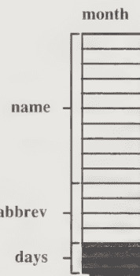

## 使用结构

一旦声明了结构，你可以对它做什么？首先，你可以给它的成员赋值。点运算符（dot operator）选择结构的一个成员。要给`days`成员赋值，使用以下代码：

```c
month.days = 31;
```

点运算符用于访问成员。要访问成员，请使用点：

```c
printf("%s", month.name);
```

点运算符的优先级很高。要访问结构的成员，请使用点：

```c
strcpy(month.name, "January");
```

如果你有两个或多个相同类型的结构，ANSI 标准允许你将其中一个赋值给另一个。在此之前，只有少数预 ANSI 翻译器支持结构赋值，但大多数翻译器仍然不支持。

```c
s1 = s2;
```

## 包含指针的结构

使用数组成员声明的月份在内存使用上是低效的。对于单个变量，几个未使用的字节（例如，当你存储 5 月的数据时）并不是大问题。考虑一个这种类型的数组，或者更糟，一个用于存储文本的大型结构数组。

存储数据的更有效的方法是使用指针作为结构成员，并指向字符串（不再浪费字符位置）。我们可以轻松地修改之前的月份结构声明以使用指针。这里是结构模板的新声明：

```c
struct month_st {
  char *name;
  char *abbrev;
  short days;
};
```

两个字符数组被字符指针替换，每个指针占据所需的空间。`days`成员保持不变。这种类型的变量数组（每年每月一个）构成了一个非常棒的查找表。现在我们必须为表中填入值。

数组中的第一个变量下标为 0。如果我们希望将月份编号为 1 到 12，我们需要对元素 0 进行一些特殊处理。图中所示的初始化列表安排了元素 0 中的两个字符指针指向特殊字符串 "BAD"。

## 图 8-2：结构数组的初始化

## 声明与初始化

```c
struct month_st {
  char *name;
  char *abbrev;
  short days;
} month[] = {
  "BAD", "BAD", 0,
  "January", "Jan", 31,
  ...
};
```

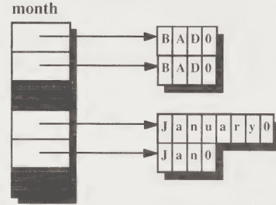

要为结构变量提供初始值，可以在声明语句中添加一个初始化列表。图 8-2 显示了如何操作。该声明定义了结构模板，为该类型的变量数组分配了存储空间，并初始化了数组中所有元素的成员。

```c
/* structure template */
struct date_st {
    int day;
    int month;
    int year;
};
```

```c
/* global structure variable declaration */
struct month_st {
    char *name;
    char *abbrev;
    int days[] = {
        "BAD", 0,
        "January", "Jan", 31,
        "February", "Feb", 28,
        "March", "Mar", 31,
        "April", "Apr", 30,
        "May", "May", 31,
        "June", "Jun", 30,
        "July", "Jul", 30,
        "August", "Aug", 31,
        "September", "Sep", 30,
        "October", "Oct", 31,
        "November", "Nov", 30,
        "December", "Dec", 31
};
```

该头文件包含两个结构体声明。第一个定义了一个维护日期的结构模板。头文件中没有声明任何该类型的变量。然而，在程序源文件中使用了`struct date_st`类型。

第二个声明创建了我们之前讨论的`struct month_st`数据类型，但这次使用了它的完整文本。此外，它声明了一个名为`month`的数组变量，并用每年每个月的名称、缩写和天数对其初始化。该数组形成了一个值表，在日期程序中起着作用。

由于`month`数组是在任何函数之外声明的，它是全局的。因此，程序的任何部分都可以对其进行读取或写入。日期程序由一些声明和指令、一个`main()`函数和三个辅助函数组成。以下是声明、指令以及`main()`的代码：

```c
/*
* date.c
*
* 此程序练习了一些日期函数。
*/

#include <stdio.h>
#include <stdlib.h>
#include "date.h"

#define NCHARS 5

/* function prototypes */
int days(struct date_st);
int leapyear(struct date_st);
char *monthname(struct date_st);

int
main(void)
{
    struct date_st date;
    char input[NCHARS];

    /* get date values from the user */
    printf("Enter the month (1=January
```

在函数原型声明中，每个辅助函数的形式参数类型都是`struct date_st`。每个函数都接收一个该类型变量的副本。

`days()`和`monthname()`都需要访问`month`数组，但它并没有作为参数传递，因为它是全局声明的。此程序使用全局数据来展示如何实现，但其目的并不是鼓励广泛使用全局数据。事实上，我的建议是尽可能少地使用全局数据，以减少因无意访问数据而导致的潜在错误。

此程序操作的数据变量是从用户处获取的。数据存储在`date`变量中，其类型为`struct date_st`。因此，它包含了`day`、`month`和`year`成员。

字符数组`input`充当输入缓冲区。当程序用户使用输入时，输入会通过`gets()`以字符形式捕获并保存到缓冲区中。然后，`atoi()`将缓冲区中的字符串转换为等效数值，并将其赋值给`date`变量的相应元素。此程序只使用了年份和月份元素。

两个打印语句产生了程序的输出。其中第一个说明用户给出的年份是否为闰年。作为参数传递的`date`变量副本仅检查其`year`成员的值。

对该值应用标准公式来判断该年份是闰年还是平年。任何能被 4 整除但不能被 100 整除，或者能被 400 整除的年份都是闰年。在这种情况下，`leapyear()`返回值1。否则返回 0。

以下是`leapyear()`的代码：

```c
int
leapyear(struct date_st date)
{
    if ((date.year % 4 == 0) &&
        date.year % 100 != 0) ||
        date.year % 400 == 0)
        return 1;
}
```

# 结构 199

第二个输出打印语句中对`monthname()`的调用同样将`date`变量作为参数，并将`date`结构中`month`成员的值作为`month`数组的下标。`monthname()`的返回值指向指定月份名称字符串位置的指针。

```c
char *
monthname(struct date_st date)
{
    return month[date.month].name;
}
```

日期程序中的最后一个辅助函数是`days()`，它返回指定月份的天数。这是一个简单的查找任务，但由于二月通常有 28 天，而在闰年有 29 天而变得复杂。因此，如果月份是二月，`days()`会调用`leapyear()`。大多数情况下，它不需要调用，因为第一个测试失败了，消除了测试年份的需要。

以下是`days()`的代码：

```c
int
days(struct date_st date)
{
    if (date.month == 2 && leapyear(date))
        return 29;
}
```

## 返回结构

你也可以编写返回结构体的函数。例如，一个名为`date_date()`的函数可能会接收一个日期并返回一个结构体。这是它的原型：

```c
struct date_st
date_date(struct date_st);
```

## 指针与结构

在本章前面，你看到了作为结构体的指针。指针和结构以其他方式密切工作。要建立指向结构体的指针，请声明一个指向对象的指针。指针指向结构的元素。`resistor`程序演示了这种指向结构体的用法。

# 结构 201


# 结构 199

在函数原型声明中，每个辅助函数的形式参数类型都是`struct date_st`。每个函数都接收一个该类型变量的副本。

`days()`和`monthname()`都需要访问`month`数组，但它并没有作为参数传递，因为它是全局声明的。此程序使用全局数据来展示如何实现，但其目的并不是鼓励广泛使用全局数据。事实上，我的建议是尽可能少地使用全局数据，以减少因无意访问数据而导致的潜在错误。

此程序操作的数据变量是从用户处获取的。数据存储在`date`变量中，其类型为`struct date_st`。因此，它包含了`day`、`month`和`year`成员。

字符数组`input`充当输入缓冲区。当程序用户使用输入时，输入会通过`gets()`以字符形式捕获并保存到缓冲区中。然后，`atoi()`将缓冲区中的字符串转换为等效数值，并将其赋值给`date`变量的相应元素。此程序只使用了年份和月份元素。

两个打印语句产生了程序的输出。其中第一个说明用户给出的年份是否为闰年。作为参数传递的`date`变量副本仅检查其`year`成员的值。

对该值应用标准公式来判断该年份是闰年还是平年。任何能被 4 整除但不能被 100 整除，或者能被 400 整除的年份都是闰年。在这种情况下，`leapyear()`返回值 1。否则返回 0。

以下是`leapyear()`的代码：

```c
int
leapyear(struct date_st date)
{
    if ((date.year % 4 == 0) &&
        date.year % 100 != 0) ||
        date.year % 400 == 0)
        return 1;
}
```

第二个输出打印语句中对`monthname()`的调用同样将`date`变量作为参数，并将`date`结构中`month`成员的值作为`month`数组的下标。`monthname()`的返回值指向指定月份名称字符串位置的指针。

```c
char *
monthname(struct date_st date)
{
    return month[date.month].name;
}
```

日期程序中的最后一个辅助函数是`days()`，它返回指定月份的天数。这是一个简单的查找任务，但由于二月通常有 28 天，而在闰年有 29 天而变得复杂。因此，如果月份是二月，`days()`会调用`leapyear()`。大多数情况下，它不需要调用，因为第一个测试失败了，消除了测试年份的需要。

以下是`days()`的代码：

```c
int
days(struct date_st date)
{
    if (date.month == 2 && leapyear(date))
        return 29;
}
```

# 结构 201

```c
#define NCHARS 7

/* lookup table */
struct resistor_st {
    char *color;
    int digit;
    double mult;
} resistor[] = {
    "black", 0, 1.0,
    "brown", 1, 10.0,
    "red", 2, 100.0,
    "orange", 3, 1000.0,
    "yellow", 4, 10000.0,
    "green", 5, 100000.0,
    "blue", 6, 1000000.0,
    "violet", 7, 10000000.0,
    "grey", 8, 0.01,
    "white", 9, 0.1,
    NULL, -1, -1.0
};

/* function prototypes */
int color_to_digit(char *);
double color_to_mult(char *);
void error(char *);

int
main(void) {
    double ohms;
    int digit1, digit2;
    double mult;
    char band1[MAXNAME], band2[MAXNAME], band3[MAXNAME];

/* get the color code */
puts("Type colors (Ex: brown red) + Return:");
    scanf("%s %s %s", band1, band2, band3);
```

```c
/* convert the code to a value */
if ((digit1 = color_to_digit(band1)) == -1)
    error(band1);
if ((digit2 = color_to_digit(band2)) == -1)
    error(band2);
if ((mult = color_to_mult(band3)) == -1.0)
    error(band3);
ohms = (10 * digit1 + digit2) * mult;
printf("Value: %.2f Ohms\n", ohms);
```

`return SUCCESS;`

# 结构 202

```c
/*
 * date.c
 *
 * 此程序练习了一些日期函数。
 */
#include <stdio.h>
#include <stdlib.h>
#include "date.h"

#define NCHARS 5

/* function prototypes */
int days(struct date_st);
int leapyear(struct date_st);
char *monthname(struct date_st);

int
main(void)
```

# 结构 202 C Programming

## Programmer's Notebook

`scanf()`不是获取用户输入的最佳方式，因为非常容易犯错或犯下故意的错误而混淆该函数。它的设计用于从文件中读取格式严格的输入，对输入错误不毫不容忍。

电阻值的计算非常直接。将第一个有效数字乘以 10，再加上第二个有效位数字。该和乘以倍率值，产生以欧姆为单位的电阻值。每个转换后的颜色值都会经过错误检查，以防止那些认为粉色是标准颜色之一的用户（它并不是——请查看表格）。

三个辅助函数处理转换和错误任务。`color_to_digit()`函数将以字符串参数形式提供的颜色值转换为有效数字（0 到 9）。该函数被调用两次，每次对应一个对电阻值贡献有效数字。

注意变量`p`，它被声明为指向`type resistor_st`类型对象的指针。分配给`p`的初始地址是`resistor`数组的基地址（元素 0）。对数组元素成员的所有访问都通过指针处理。

先看代码。然后我们将检查用于数组指针的成员选择方法。

```c
int
color_to_digit(char *color)
{
    struct resistor_st *p;

    /* 在电阻表中查找代码 */
    p = resistor;
    while (p->color != NULL) {
        if (strcmp(p->color, color) == 0)
            break;
        ++p;
    }

    return p->digit;
}
```

假设颜色参数为`"orange"`，`color_to_digit()`遍历数组，将指定的颜色与全局数组中的每个颜色条目进行比较。从电阻表的定义可以看出，颜色的序列是`"black"`(0)、`"brown"`(1)、`"red"`(2)、`"orange"`(3) 等。括号括起来的数字是前两个色环的对应值。

```c
struct tag {
  type m;
  ...
}
struct tag s, *p; /* 结构体和指针 */
p = &s;      /* p 现在指向 s */
```

在不用指针的情况下，通过点运算符`.`访问成员`m`：

`s.m`

在使用之前建立的指针`p`时，表达式`*p`是结构体（与直接使用`s`相同）。表达式：

`(*p).m`

产生成员`m`。这里需要括号，是因为点运算符的结合优先级高于解引用运算符`(*)`。

在 C 程序中，通过指针选择结构体成员非常常见。由于这一点以及`(*p).m`这样的表达式有些晦涩，因此提供了一个方便的简写：`p->m`。

该运算符是一个减号后跟一个大于号，中间没有空格。它的应用会很快变成本能，因为它在视觉上象征着指向操作。

表达式`p->color != NULL`控制`color_to_digit()`中的处理循环，循环体中的语句`++p`移动指针。如果不在表中未找到用户指定的指针，最后一个数组元素包含哨兵值，标记表格的结束。如果匹配到`NULL`指针，则返回一个负值表示未匹配颜色名称。如果颜色匹配表中的条目，则向调用者返回对应的值。

名为`color_to_mult()`的辅助函数将色环颜色转换为双精度浮点值。该函数的工作方式与`color_to_digit()`相同，只是从电阻变量的`mult`成员获取值并返回一个`double`。

```c
double
color_to_mult(char *color)
{
    struct resistor_st *p;

    /* 在电阻表中查找代码 */
    p = resistor;
    while (p->color != NULL) {
        if (strcmp(p->color, color) == 0)
            break;
        ++p;
    }

    return p->mult;
}
```

电阻中的最后一个函数是`error()`，它打印错误信息并带有错误指示退出。文本参数是用户指定的未能匹配的颜色。

```c
void
error(char *text)
{
    fprintf(stderr, "Bad color spec: %s\n", text);
    exit(EXIT_FAILURE);
}
```

`EXIT_FAILURE`是在`<stdlib.h>`头文件中定义的符号常量。它告诉操作系统或其他调用程序程序没有运行成功。DOS 会忽略此信息，但 UNIX 会保存它并让用户决定在程序失败时做什么。

## 自定义类型和 typedef

你已经看到如何通过结构、数组和指针的各种组合来构建自己设计的聚合数据类型。你没有创建新的基本类型，但从 C 语言提供的基本类型（`char`、`int`、`float`等）和派生类型（数组和指针）构建了高级类型。

派生数据类型通常有很长的类型名称，导致源文件中有大量的输入工作，并通常降低程序的可读性。例如，以下声明生成了类型名`struct_st`：

```c
struct cell_st {
    unsigned char ch;
    unsigned char attrib;
};
```

要声明这种类型的变量，你会输入类似下面的代码行：

```c
struct cell_st screen[SCRNSIZE];
struct cell_st *loc;
```

第一个声明为字符和属性单元数组预留了存储，第二个为指向该类型对象的指针预留了存储。虽然输入几次并不困难，但你可能会在程序中频繁输入此类类型说明符（或更复杂的）感到疲劳。

（注：原文后续存在大量重复内容，译文已按要求去重并保持逻辑完整）

## 联合体 (Unions)

联合体是一种 C 类型，为几种不同对象类型中的一种提供共同的存储区域。C 联合体类似于 Pascal 的变体记录类型（variant record）。

## 声明联合体

联合体声明的形式与结构体（structure）声明相似，但两者之间存在差异。结构体是一种聚合类型，将可能不同类型的对象组合到一个共同名称下。而联合体只有一个元素，且在任何时刻只能是指定类型中的一种。

图 8-4 显示了如何声明和使用联合体。变量`input`的声明是典型的联合体声明。该联合体模板指定该类型的变量和函数可以是`char`、`short`或`long`类型。

插图显示为变量`input`预留了四字节内存，足够容纳指定类型中最大的类型。联合体允许的任何类型的存储都从最低地址开始，位于插图的顶部，因为我们使用了地址随页面向下移动而增加的惯例。

当用于存储字符时，`input`仅使用第一个字节。存储短整型（`short`）时，使用两个字节。所有四个字节都被长整型（`long`）占据。

## 使用联合体变量

图中展示了访问`input`变量两个示例。第一个示例显示了如何存储和打印一个字符。只有联合体的成员`c`参与了这项活动。示例的第二部分显示了如何存储和打印一个长整型。由成员`l`（字母 "ell"）指定的整个联合体参与了这项活动。

使用联合体时要小心。你负责在任何时刻知道联合体中存储的是什么类型的数据。尝试用一种类型存储数据并用另一种类型读取它将产生不可预测的结果。

## 图 8-4：使用联合体变量处理混合类型

### 声明

```
union mixed {
    char c;
    short s;
    long l;
} input;
```

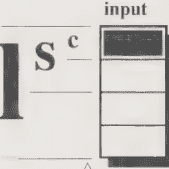

### 成员访问

```
input.c = 'A';
putchar(input.c);
```

```
input.l = 1000L;
printf("%ld\n", input.l);
```

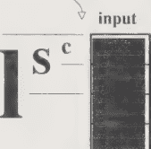

## 位域 (Bit Fields)

位域，或称为字段，是 C 中提供紧凑存储的一种手段。这个话题既让许多以前的汇编语言程序员喜爱 C，又让大多数以前的 BASIC 程序员感到头疼。

字段的概念非常简单：一个内存区域被分成一组较小的子区域，这些子区域具有有限范围的整数值范围。例如，如果你需要从 0 计数到 15，你只需要四位。为什么要浪费 16 位字中的 12 位（或 32 位字中的 28 位）来数到 15 呢？另一个例子是维护一组需要值为 0 或 1 的标志位。你可以将这 16 个标志封装在一个单个 16 位字中，与为每个标志使用完整字相比，节省了大量的空间。

## 声明和使用字段

结构体被用字段的基础。图 8-5 显示了如何声明和访问位域变量。`struct point_st`由以下代码定义：

```
struct point_st {
    unsigned int row : 5;
    unsigned int col : 7;
    unsigned int visible : 1;
    unsigned int colortab : 3;
};
```

此定义创建了一个模板，你可以用它来声明该类型的变量。声明字段时仅使用显式的符号或无符号整数类型。

尽管`unsigned int`类型说明符在位域定义中出现了四次，但`struct point_st`类型的变量并没有占据内存中的四个整数位置。只有指定的位数以及可能用于填充的某些位实际上为每个变量或数组元素所预留。


每个字段的宽度由与字段名冒号隔的数字指定。例如，`row` 字段宽度为五位。声明创建的模板还包含一个七位的 `col` 成员字段、一个名为 `visible` 的单位标志，以及一个指向颜色表的三位索引（`colortab`）。虽然插图显示字段是从左到右存储的，但在某些机器上，它们可能也是从左到右存储的。

要声明位域变量，你——你声明变量时总是这么做的——提供一个类型说明符和一个名称：

```
struct point_st point;
```

在声明变量 `point` 后，你可以使用访问结构体成员相同的表示法来访问字段。点运算符 `.` 选择一个字段，因此语句：

```
point.row = 12;
```

将值 12 赋值给 `row` 字段。

如图所示，你可以将位域变量作为函数参数传递。你还可以声明指向位域变量的指针，并使用 `->` 符号选择成员。但注意，单个字段没有地址。

## 图 8-5：位域提供紧凑存储

```
struct point_st {
  unsigned int row : 5;
  unsigned int col : 7;
  unsigned int visible : 1;
  unsigned int colortab : 3;
} point;
```

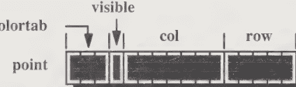

### 成员访问

```
point.row = 12;
point.col = 40;
point.visible = 1;
point.colortab = STANDARD;
move(point);
```

## 可移植性 (Portability)

关于结构体的主要移植性问题是对象大小和成员对齐。结构体成员的大小在环境中可能有所不同。`int` 类型成员在某些机器上可能等于 `short`，在另一些机器上等于 `long`，导致环境中产生不同的范围。

C 的位域功能高度取决于实现。使用字段的代码不可移植的。

## 总结

C 语言结构体提供了在共同名称下管理一组不同变量的方法。结构体可以赋值、作为函数参数传递并从函数返回。结构体成员可以通过点运算符直接选择或通过结构体指针间接访问。

联合体基于结构体的语法，是一个在任何时刻都可以具有指定数据类型的存储区域。你负责知道存储的是什么类型的数据并正确地访问它。

位域变量同样基于结构体语法，提供了实际上是小整数的数据。字段通常用于数据紧凑和底层系统访问。

你可以使用 `typedef` 关键字创建新的数据类型名称。其目的是创建比原始等价物更有意义且更易使用的名称，原始等价物通常涉及 `struct`、`union` 和 `enum` 关键字以及标签名。

## 问题与练习题

1. C 语言中的聚合数据类型包括以下哪些？

- a) 数组
- b) 无符号长整数
- c) 结构体
- d) 联合体

2. 描述什么是结构体，并给出一个源自你经验的应用实例。

3. 对或错：结构体声明除了 `struct` 关键字外，必须包含一个标签。

4. 给于此结构体声明，预留了多少存储？

```
struct time_st {
    int hour;
    int minute;
    int second;
};
```

5. 声明一个类型为问题 4 创建的变量 `now`，并将时间 14:18:00 赋值给该变量。

6. 使用字符指针而不是字符数组作为结构体成员的优势是什么？

7. 描述以下代码中的错误，并修改代码以修正问题。

```c
struct person_st {
    char first_name[10];
    char last_name[15];
    /* lots of other data here */
} person[100];
person[22].first_name = "Fran";
```

8. 以下语句声明了一个指向第 7 题中创建类型对象的指针，并将指针指向 `person` 数组的基地址：

```c
struct person_st *p;
p = person;
```

使用指针表示法，编写一条语句将名称 "Jones" 赋值给数组元素 0 元素的 `last_name` 成员。

9. 执行与上练习相同的操作，但不要改变指针的位置，将名称 "Williams" 赋值给数组元素 3 元素的 `last_name` 成员。

10. 给定结构体数组 `dates` 和一个指向数组基地址的指针 `dp`，以下哪一个与表达式 `dp->year` 等价：

- a) `*dp->year`
- b) `dates[0].year`
- c) `(*dp).year`
- d) `*(dp).year`

11. 正确或错误：`typedef` 语句创建了一个新的数据类型。

12. 给定以下 `typedef` 语句，如何声明一个包含十个该类型对象的数组以及指向该数组的指针？将数组命名 `cards`，指针命名 `cardptr`。

```c
typedef struct cdfile_st {
    char *first_name;
    char *last_name;
    /* ... */
} CARD;
```

13. 为一种只能取 READING、WRITING、PROCESSING 和 IDLE 值的类型编写一个枚举声明（enumeration）。声明一个名为 `state` 的变量具有该类型，并给它赋值为 "idle" 条件。

14. 关于联合体（unions）的以下述哪些是正确的？

- a) 联合体是一个可以同时包含不同类型变量的聚合。
- b) 联合体基于 C 结构体（struct）的语法。
- c) 可以点 (`.`)运算符访问联合体的成员。
- d) 联合体的成员必须始终是整数类型。

15. 声明一个联合体变量，其成员类型分别为 `char`、`long` 和 `float`，然后将值 326.19 赋值给该变量的 `float` 成员。

16. 在以下位域（bit-field）变量声明中，每个字段的数值范围是多少？

```c
struct bit_st {
    unsigned int a : 3;
    unsigned int b : 5;
    unsigned int c : 2;
    unsigned int d : 6;
} bits;
```

17. 在上一个问题的位域声明中，语句：

```c
bits.d = 57;
```

将一个值赋值给 `d` 字段。写一条语句，将 `d` 字段值的一半赋值给 `b` 字段。然后写一条语句打印 `b` 字段的值。将打印出什么值？

# 附加练习 # Additional Exercises

A. 编写一个程序，提示用户输入三个数字（月、日、年）作为日期，并按照传统的美国长格式打印日期（例如：January 8, 1990）。

B. 用户并不总是提供良好的数据。在 A 编写的程序中添加代码，以确保日期对于该月份和年份是有效的，并报告任何输入错误。

C. 在**返回结构体**（Returning a Structure）部分，提到了一个函数 `future_date()`，它具有以下属性：

- 它接受两个参数：一个填充了有效日期的结构体和一个整数类型的天数。
- 它返回一个填充了“未来”日期的结构体。

编写该函数并在上一节的日期程序中对其进行测试。务必考虑到可能的月份和年份变化、闰年补偿等。

D. 在电阻程序中添加代码，以接受第四个色环来指定电阻容差。容差以电阻值的百分比形式指定。它表示允许数值的波动范围。仅关注以下容差值：

| 颜色 | 容差 |
| :--- | :--- |
| (无色环) | 20% |
| 银色 | 10% |
| 金色 | 5% |

注意：你需要将空字符串 (`""`) 解释为 20% 值的“无”，并发明一种方法，将前三个色环中的任何银色或金色标记为无效输入。

# 第 9 章 # CHAPTER 9

## 输入、输出与文件 # INPUT, OUTPUT, AND FILES

程序通常需要从外部设备读取数据并将数据写入其他外部设备。到本书为止，我们已经编写了从键盘读取输入、向用户显示屏幕输出、或两者兼之的程序。这种输入输出本质上是瞬时的，消失的速度几乎与出现的速度一样快。

通过使用磁介质或其他长期保留数据的存储形式，可以获得某种程度的数据持久性。典型的个人电脑配备软磁盘驱动器和硬盘。较大的计算机系统通常除了各种类型的磁盘外，还带有高速磁带驱动器。存储在这些设备上的数据被组织成文件。

本章研究 C 程序的输入输出方面，包括文件的使用。重点介绍几乎所有 C 翻译器提供的标准子程序库中的基本输入/输出函数。

## 输入与输出 # Input and Output

正如前面的章节所述，C 标准没有将输入和输出操作定义为语言的一部分。不同的操作系统在提供输入输出的方式上存在许多差异。C 采用的解决方案是流模型（stream model），它提供统一的输入输出视图，而不考虑涉及的介质。标准输入输出函数分为两个层次：

- 流（高层）输入/输出
- 系统（低层）输入/输出

在这些中，流 I/O 跨操作系统环境，隐藏了物理设备的细节。另一方面，系统 I/O 与特定实现密切，处理所有的缓冲和数据转换。

## 标准流 # Standard Streams

数据输入输出设备有很多形式。常见的物理设备包括键盘、显示器、磁盘驱动器和磁带驱动器。某些设备按字节序列顺序存储和检索数据，而其他设备将数据组织成块。对数据的访问取决于设备。

标准输入输出函数基于流模型，该模型提供了统一的 I/O 视图。流模型源于 UNIX 操作系统。为了适应区分文本流和二进制流的现有操作系统，C 标准认可这两种类型。我们将在本章后续讨论这个问题及其影响。

图 9-1 显示了 UNIX 标准流模型。三个标准流被称为标准输入 (`stdin`)、标准输出 (`stdout`) 和标准错误 (`stderr`)。图中显示了为这些标准流建立的默认连接，并了它们与运行程序（进程）的关系。

进程的 `stdin` 流默认连接到用户的键盘。该流是行缓冲，这意味着在用户按下回车键之前，进程接收不到任何输入。

运行程序的输出流向标准输出流 `stdout`，它默认连接到用户的屏幕。出于性能考虑，该流也是缓冲的，因此输出会被收集成行。

模型中的第三个标准流是标准错误流 `stderr`，它也默认连接到用户的终端或控制台屏幕。然而，它是无缓冲，以防止错误消息留在用户视图的缓冲区中。因此，错误消息和错误警告（铃声）会延迟发送到错误输出设备。DOS 标准流模型如图 9-2 所示。在大多数方面，它与 UNIX 模型相同。主要区别在于 DOS 支持两个额外的标准流。`stdin` 流是

# 222 C语言编程

指向默认打印机端口，而 `stdaux` 流指向默认串口通信端口。

当程序开始运行（成为一个进程）时，环境支持的所有标准文件都会自动打开。因此，在 UNIX 和 DOS 环境中，用户的键盘和屏幕都是立即可。此外，如果安装并运行了相应的设备，DOS 进程还可以访问默认打印机和串口通信线。

图 9-2：MS-DOS 标准流模型

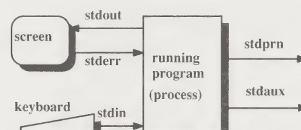

## 文件

文件是具具命名的字节序列。文件通常存储在某些物理设备上，例如磁盘或磁带驱动器。文件提供了数据的长期存储以及便于对数据进行访问。

你很可能会处理到磁盘文件，特别是硬盘，它们提供了快速访问大量数据的能力。由于硬盘成本在近几年大幅下降，加上当今程序对大存储容量的需求，此种设备在几乎所有的操作系统环境中都是可用的。

存储在 UNIX 和 DOS 环境中的文本文件在两个方面有所不同。文本文件是指仅包含“打印”字符和有限数量控制代码（水平制表符和行终止符）的文件。

在 UNIX 环境中，行终止符被称为换行（NL）。在 DOS 环境中，每行文本都由回车（CR）和换行符（LF）结束。ASCII 规则允许 CR/LF 约定或 NL 约定。ASCII 是 UNIX 和 C 最初所基于的字符集。当 C 程序读取磁盘文件时，CR/LF 对会被转换为单个 NL 代码。在输出时，NL 代码则会被转换为 CR/LF。

这种所谓的“行尾”（EOL）处理如图 9-3 所示。如你所示，与使用 CR/LF 约定的 DOS 及其他系统相比，UNIX 每行节省了一个字符。

顺便提一下，IBM 及兼容个人电脑回车键上的符号象征着按下该键后产生的 CR 和 LF 行为（只是按键符号上的动作顺序是反的）。

图 9-3：UNIX 和 DOS 行尾处理的差异

## 行尾处理：

| DOS 模型 | UNIX 模型 |
| --- | --- |
| CR | NL |

注意：IBM PC 或兼容微型计算机上的回车键使用以下键帽符号。它指示操作顺序是反的。


# 224 C语言编程

UNIX 和 DOS 文本文件的另一个区别是文件结束（EOF）处理。早期 DOS 版本使用文件中的 Ctrl-Z 代码来指示文本的结束位置。从 3.0 版本开始 DOS 使用 UNIX 方法，即在文件的目录条目中维护准确的文件大小，并在尝试读取或写入文件末尾之外时指示 EOF 条件。文件中没有此类代码。

运行在 DOS 环境中的 C 翻译器理解这些约定，并进行必要的翻译，以确保文件的内部表示是正确的。你可以通过查看文件大小来看到看似相同的 DOS 和 UNIX 文本文件之间的差异。DOS 文件每行多一个字符，并且可能因为 Ctrl-Z 字符而多出一个字符。在某些其他环境（如 CP/M）中，你可能还会发现最后一行包含一串空字节，用于将文件填充到下一个 128 字节边界。

## 重定向

流的统一性使得在不考虑源和目标设备类型的情况下对数据数据成为可能。程序可以与终端设备、磁盘文件中的数据、通信端口和其他设备交互，而无需特殊的转换或访问方法。

在近二十年的时间里开发了一套全面且一致的流 I/O 子程序集。这些程序已在 ANSI 标准的库部分被记录，为各种操作系统环境中可移植的输入输出操作提供了基础。

许多但并非所有操作系统环境都支持输入输出重定向。输入重定向意味着进程的标准输入从键盘以外的源获取数据。它通常由小于号（`<`）表示。在 UNIX 和 DOS（2.0 或更高版本）下输入重定向的一个示例是命令：

```
more filename
```

## 输入、输出与文件 225

该命令从 `filename` 读取数据并以屏幕大小的分块进行显示，在每个屏幕“页”结束时暂停，直到用户按下按键继续分页过程。

用户输入该命令意味着进程的标准输出从屏幕重定向到不同的输出设备。输出重定向通常由大于号（`>`）表示。UNIX 下输出重定向的一个示例是命令：

```
cat filename
```

该命令导致 `cat` 程序的输出保存到 `filename` 中。该命令导致输入作为文本输入，并通过在单独的一行上输入文件结束代码来终止输入。在 UNIX 下，文件结束条件通过按下 Ctrl+D 获取。

DOS 没有 `cat` 命令的直接等价物，但在不使用重定向的情况下，可以使用以下命令获得相同的效果：

```
COPY CON FILENAME
```

该命令将输入（来自键盘）复制到 `FILENAME`。通过移动到新行来结束输入。

- 注意：
- 内部的程序
- 一个额外的程序作为
- 汇通常是用户的
- 屏幕或设备

## 227 文件输入输出

文件 I/O 是大多数功能性程序的一个重要方面。数据库管理系统、电子表格和财务分析程序、文字处理器以及许多其他类程序都消耗并生成维护在外部文件中大量数据。

为了在 C 程序中使用外部文件，你需要将流与文件关联。这项任务涉及声明一个变量并对其赋值。该值是从调用一个尝试打开指定文件的函数中获取的。从用户的角度来看，文件有名称并可能包含内容。从程序的角度来看，除少数例外外，文件是通过文件指针访问的字节流。

所有访问文件内容或对文件执行某些操作都通过文件指针控制。少数对文件的操作使用文件名而不需要文件指针。

### 文件指针

正如其名，文件指针是一个指针。有效的文件指针指向一个类型为 `FILE` 的数据结构，该类型是在 `<stdio.h>` 头文件中通过 `typedef` 语句创建的。类型为 `FILE` 的变量（我们的文件指针就是此类变量的一个示例）包含了控制流所需的所有相关成员。

文件指针变量声明如下：

```
FILE *fp;
```

该声明遵循你熟悉的其他模式。反读声明，标识符 `fp` 是变量名，它是指向 `FILE` 类型对象的指针。

如果你对这个神秘的 `FILE` 类型感到不安，这里是至少一种（未命名的）实现中的定义声明：

```c
typedef struct _iobuf (
    int _cnt;
    unsigned char *_ptr;
    unsigned char *_base;
    char _flag;
    char _file;
} FILE;
```

在声明中，成员 `_base` 指向流的缓冲区（如果有的话）。`_ptr` 成员指向缓冲区中的下一次访问操作发生的位置，且 `_flag` 是一个用于维护文件结束（EOF）和错误指示标志位的字节。一个特定的实现可以声明额外的结构体成员，用于与流管理相关的其他目的。

## 文件访问

在声明了文件指针变量 `fp` 后，我们离获得一个可以操作的流仅有一半。下一步是打开一个文件进行访问。`fopen()` 函数尝试打开一个具名文件，并将其与指针变量指定的流关联起来。该函数在 `<stdio.h>` 中声明，具有以下通用形式：

```
FILE *fopen(const char *filename, const char *mode);
```

回在此上下文中，`const` 类型限定符意味着该函数不会尝试更改传递给它的参数值。

`filename` 参数是一个字符串，包含要打开的文件名。你可以在字面量字符串中硬编码一个名称，但更可能的情况是文件名通过指向一个缓冲区提供的，该缓冲区包含了从操作系统 shell、命令行参数或直接用户输入中获取的名称。

`mode` 参数是一个字符串，以表 9-1 所示的字符序列开头，该表列出了模式参数代码并简要描述了这些代码的含义。在模式参数字符串中，初始序列之后允许出现额外的字符。

| 表 9-1: 模式参数代码 |
| :--- |


| MODE STRING | DESCRIPTION |
| --- | --- |
| `r` | 打开文本文件用于读取 |
| `w` | 截断为零长度或创建文本文件用于写入 |
| `a` | 追加；在末尾打开或创建文本文件用于写入 |
| `rb` | 打开二进制文件用于读取 |
| `wb` | 截断为零长度或创建二进制文件用于写入 |
| `ab` | 追加；在末尾打开或创建文本文件用于写入 |
| `r+` | 打开文本文件用于更新（读和写） |
| `w+` | 截断为零长度或创建文本文件用于更新 |
| `a+` | 追加；在末尾打开或创建文本文件用于更新，在末尾写入 |
| `r+b` (or `rb+`) | 打开二进制文件用于更新 |
| `w+b` (or `wb+`) | 截断为零长度或创建二进制文件用于写入 |
| `a+b` (or `ab+`) | 追加；在末尾打开或创建二进制文件用于写入 |

包含字母`b`的模式字符串指定了二进制文件处理。在二进制访问模式下，每个字节的所有位都是显著的，并且在输入和输出时不对文件内容进行任何转换。

在第二个或第三个位置包含`a+`的模式被称为“更新”模式。更新模式意味着只要有文件定位函数的调用介入，文件就可以被读取和写入。文件定位函数是`fseek()`、`fsetpos()`和`rewind()`。此外，如果操作之间调用了`flush()`，则输入可以跟随输出。

调用`fopen()`的正常返回是一个有效的文件指针，可以赋值给指针变量。如果指定的文件无法打开，`fopen()`会产生`NULL`错误返回以标记错误。不要忽略错误返回，因为它们是可能出现的重要指示。例如，尝试从无法打开的文件读取字符是错误的。同样，向无法打开的文件写入也是错误的。

考虑到这些点，这里有一个打开文件读取并显示其内容的程序。`listfile`程序是 UNIX `cat`程序的高度简化版本。

```c
/*
* listfile.c
* 将文件内容列到标准输出
*/

#include <stdio.h>
#include <stdlib.h>

#if defined (MSDOS)
#define MAXPATH 64
#else
#define MAXPATH 128
#endif

int main(void)
{
    int ch;
    char name[MAXPATH];
    FILE *fp;

    /* 从用户获取文件名 */
    printf("File to list: ");
    gets(name);

    /* 检查名称并尝试打开文件 */
    if (name[0] == '\0') {
        fprintf(stderr, "No filename typed\n");
        exit(EXIT_SUCCESS);
    }
    fp = fopen(name, "r");
    if (fp == NULL) {
        fprintf(stderr, "Cannot open %s\n", name);
        exit(EXIT_FAILURE);
    }

    /* 列出文件内容 */
    while ((ch = getc(fp)) != EOF) {
        putchar(ch);
    }

    return EXIT_SUCCESS;
}
```

`listfile`程序相当简单。它声明了一个文件指针，提示用户文件名，并尝试打开该文件。如果成功，它会从指定文件读取字符并打印到标准输出流。如果无法打开文件，它会打印错误消息并带有错误指示（非零的退出码）退出。

程序通过查看文件名的第一个字符来测试文件名。如果是空字节，则说明用户在没有输入名称的情况下按了回车键，因此`listfile`打印消息并退出。退出码并不表示错误状态，因为没有发生错误。

尝试以读取模式（`"r"`）打开文件是直观的。`filename`参数由存储在`name`数组中的字符串提供。调用`fopen()`的返回值保存在`fp`中，并在随后的`if`语句中进行检查。如果是`NULL`，则打开失败。（注：OCR 文本在此处有一些伪迹，但逻辑很清晰）。

# 234 C语言编程

```c
char mybuf[BUFSIZ];
nsetvbuf(fp, mybuf, _IOBF, sizeof mybuf);
```

`setvbuf()`函数是`setvbuf()`的一个版本，它只接受流和缓冲区参数。如果缓冲区参数为`NULL`，则关闭缓冲。否则，将使用指定的缓冲区启用全缓冲。虽然比`setvbuf()`灵活性低，但在许多常见情况下，`setvbuf()`更容易使用。

以下语句用于关闭指定流的缓冲：

```c
setvbuf(fp, NULL);
```

# 格式化输入与输出

书中的许多程序使用`printf()`进行格式化输出，少数程序使用`scanf()`进行格式化输入。请参阅第3章中关于`printf()`和`scanf()`的描述，获取有关控制字符串、格式说明符以及这些函数的用法细节。

`printf()`函数族在基本函数的基础上包含了几个实用的变体。正如你所看到的，`fprintf()`函数将内容打印到指定的输出流，而不是由其第一个参数指定的标准输出流。

`sprintf()`函数对数据进行格式化并将其“打印”到字符串而不是流。该函数的输入对应是`scanf()`，它从字符串而不是流中收集输入。

# 面向字符的输入与输出

有几个函数和宏处理面向字符的读写操作。

读取单个字符时，你可以使用`getc()`宏、`fgetc()`函数或`getchar()`函数（某些 C 翻译库将`getchar()`实现为宏）。本章稍前的`listfile`程序使用`fgetc()`从文件读取输入。该函数接受一个参数，指定从哪个流中读取。

`getc()`宏的作用与`fgetc()`相同，但以在程序中增加更多内联代码为代价，效率更高。使用宏的一个负面因素是，如果在一个具有副作用的表达式中使用宏，则必须重新扫描流。要么避免这种情况，要么使用`fgetc()`并忍受函数调用的开销。

你可以使用`putc()`宏、`fputc()`函数和`putchar()`输出字符，后者也可以实现为宏。书中的几个程序都使用过`putchar()`写入标准输出流。事实上，`putchar()`等同于`putc(stdin)`。如果你需要写入特定的流，请使用`putc()`或`fputc()`。`writfile`程序使用`getchar()`从标准输入读取输入并使用`putc()`宏将输出写入文件，有效地将文件内容复制到输出设备。该程序与`listfile`程序几乎相同，不同之处在于过程的方向相反：

```c
/*
 * writfile.c
 *
 * 将标准输入中的文本保存到命名文件中。
 */
```

```c
#include <stdio.h>
#include <stdlib.h>

#if defined (MSDOS)
    #define MAXPATH 64
#else
    #define MAXPATH 128
#endif
```

```c
int main(void)
{
    int ch;
    char name [MAXPATH];
    FILE *fp;

    /* 从用户处获取文件名 */
    printf("Save file: ");
    gets(name);

    /* 检查名称并尝试打开文件 */
    if (name[0] == '\0') {
        fprintf(stderr, "No filename typed\n");
        exit(EXIT_SUCCESS);
    }
    fp = fopen(name, "w");
    if (fp == NULL) {
        fprintf(stderr, "Cannot open %s\n", name);
        exit(EXIT_FAILURE);
    }

    /* 将输入写入文件 */
    while ((ch = getchar()) != EOF) {
        putc(ch, fp);
    }

    /* 关闭“保存”的文件 */
    fclose(fp);

    return EXIT_SUCCESS;
}
```

`writfile`程序还展示了使用`fclose()`显式关闭文件，而不是依赖进程终止时的默认行为。养成显式关闭文件的良好习惯，这样在关键时刻就不会忘记。操作系统对每个用户同时打开的文件数量以及系统上打开文件的总数设有限制。这是因为每个文件都需要缓冲区资源和表项。这些资源每一个都是有限的，并从你的系统内存中分配。

作为行而不是单个字符来读写文本可能更为方便。`gets()`和`fgets()`函数读取行。`puts()`和`fputs()`函数写入行。它们的函数原型在`<stdio.h>`头文件中，所有其他标准 I/O 函数和宏也是如此。

输入、输出与文件 237

```c
char *gets(char *string);
char *fgets(char *string, int n, FILE *stream);
int puts(const char *string);
fputs(const char *string, FILE *stream);
```

这两个字符串输入函数都会读取字符直到`EOF`或读取到换行符。它们都会将读取的内容复制到字符串参数指向指定的缓冲区中。

`gets()`和`fgets()`之间一个显而易见的区别是`fgets()`接受一个大小参数`n`和一个指定输入源的流参数。`gets()`函数类似于`fgets()`，但`gets()`不追加换行符。同样，`puts()`和`fputs()`之间也存在差异，`puts()`会追加换行符，而`fputs()`不会。

使用`gets()`被认为是危险，因为它不检查缓冲区的大小，可能会导致溢出错误。最好使用`fgets()`。

## 错误处理

如果函数失败，它应该返回一个指示错误的值。许多 C 库函数在成功时返回 0，失败时返回非零值。其他函数可能使用全局变量`errno`来提供更具体的错误信息。

`errno`变量定义在`<errno.h>`头文件中。当函数失败时，它会将`errno`设置为特定的错误码。你可以使用`perror()`和`strerror()`函数来获取错误的可读读描述。

```c
#include <errno.h>
#include <stdio.h>
#include <string.h>

void example(void) {
    FILE *fp = fopen("nonexistent.txt", "r");
    if (fp == NULL) {
        perror("Error opening file");
        return;
    }
    // ...
}
```

```c
while ((ch = fgetc(fp)) != EOF) {
    ++c_count;
    if (ch == ' ' || ch == '\t' || ch == '\n')
        inword = FALSE;
    } else if (inword == FALSE) {
        ++w_count;
        inword = TRUE;
    }
    if (ch == '\n')
        ++l_count;
}
}
if (ferror(fp) != 0) {
    fprintf(stderr, "READ ERROR: %s\n", name);
    exit(EXIT_FAILURE);
}
```

```c
/* 报告分析结果 */
printf("%s: %ld %ld %ld\n",
name, l_count, w_count, c_count);

return EXIT_SUCCESS;
```

## 文件操作

这里有几个以文件为单位而非以内容为单位的操作函数。我们不会对它们进行详细介绍，但你可能想要研究`remove()`和`rename()`函数。其中第一个是从文件条目目录中删除一个文件。第二个是更改文件名，而不改变文件的任何其他信息。由于旧新名称具有不同的前导路径，文件实际上是在目录之间进行了移动。在某些环境中（包括 DOS 在内），有必要将文件复制到目标目录，然后删除原始文件。

`tmpnam()`和`tmpfile()`函数用于创建临时名称和二进制文件。这些函数为运行期间需要临时文件的程序提供了支持。至关的一点是，临时文件不能覆盖或删除现有文件中的有效数据，因此`tmpname()`创建的名称不会与已使用的名称重复。

## 总结

本章向你介绍了标准库中可用的一些主要的输入输出函数。当你对这些函数感到相当熟悉后，可以尝试查看系统或 C 翻译器提供的标准库文档，学习其他用于 I/O 操作和其他目的的宏和函数。

如果你在结束这段讨论后，认为错误处理是程序设计和编码中的重要考虑因素，那么你已经领先于许多同龄了。太多的程序员仅仅是因为太懒或不在乎而没有完成这项工作。错误处理是一个经常被留到“以后”的领域，而这通常意味着“从不”，或者在客户抱怨神秘错误时变成“陷入恐慌”。不要掉进这个陷阱。

## 问题与练习

1. 什么是流（streams）？它们为什么重要？
2. 为什么大多数 I/O 流都使用缓冲？
3. 为什么标准错误流是不缓冲的？
4. 写一个命令行，显示你如何将一个名为`random`的程序（通常写入到屏幕）的输出重定向到一个名为`numbers`的文件中。
5. 什么是管道命令（pipeline command）？给出一个例子。
6. 为什么在某些操作系统环境中读写操作期间需要文本文件转换？
7. 下面的命令旨在将命名文件的文本“分页”到用户的屏幕上。该命令有什么问题？实际上会发生什么？

```
more > myfile.txt
```

8. 简述`FILE`类型及其目的。
9. 编写声明文件指针`f_in`的语句，并展示如何打开文件进行读取。
10. 当在函数参数列表中使用`const`关键字时是什么意思？
11. 描述`fopen()`语句中模式`"rb"`所请求的行为。
12. 在模式说明符的第二或第三位置使用加号（`+`）意味着什么？
13. 调用`fopen()`返回`NULL`什么？什么条件可能导致这种情况发生？
14. 正确或错误：所有打开的文件在进程终止时都会自动关闭，因此没有必要显式关闭文件。
15. 给定文件指针`fp`和一个名为`buf`的数组，以下语句实现了什么？

```
setbuf(fp, buf, _IOLBF, sizeof buf);
```

16. 如果函数`getc()`读取一个字符，为什么我们还需要`fgetc()`？
17. 编写一个代码片段，通过调用`fgets()`从标准输入流读取一个字符串到名为`line`的数组中。生成的字符串中会包含换行符？
18. `feof()`宏的目的是什么？在一个代码片段中展示其用法，并注意确保测试逻辑是正确的。

## 额外练习

A. 编写一个程序，提示源文件名和目标文件名（允许完整路径），然后将源文件复制到目标，而不考虑目标文件是否存在。

B. 在练习 A 的程序中添加代码，以防止意外覆盖已的目标文件。代码应要求用户输入`Y`或`N`然后按回车键来接受或拒绝覆盖。

如果目标文件不存在，没有理由询问用户任何问题。判断目标文件是否存在的方法是尝试读取模式打开它并检查`fopen()`的返回值。如果打开成功，别忘记关闭文件。

C. 编写一个程序，读取用户命名的文本文件并将所有大写字母转换为小写字母，将其输出发送到标准输出流。使用`tolower()`宏进行转换（原型在`<ctype.h>`头文件中）。确保检测并报告所有错误情况。

D. 编写一个程序，读取文本文件并报告最长和最短单词的长度，以及最长和最短行的长度。

E. 编写一个程序读取文本文件并在`stdout`上产生每行一个单词的输出。

# 第十章

# 程序开发过程

本章在不考虑你所使用的语言的情况下处理程序开发过程。其目标是建议一种可行的策略。为此，这里涵盖的主题有：

- 问题分析
- 程序设计
- 编码
- 测试
- 维护

一种适用于某个程序员的程序开发方法可能并不适合你。按照信息的本本，将其视为一个可以根据你的需要塑造的模型。

# 问题分析

你将遇到的很多问题（但并非所有）都有已知的解决方案，只需要用某种语言表示出来或使用他人的封装解决方案。

如果你采取这种方法，请尝试理解解决方案是如何工作的，并确定它的局限性。在 C 程序中使用`strlen()`查找字符数组的长度可能会导致问题，因为数组可能没有空字节。字符串函数应该只应用于空终止的字符串，如果你不知道这一点，可能会遇到大麻烦。

其他问题，那些无结构化且未解决的问题，为系统分析师和程序员等职业带来了有趣且富有回报的挑战。让一个充满了硅芯片和许多电子机械部件的盒子为你所所需的成就感是难以言喻的，但感觉确实棒。

那么你如何分析问题？

简单的答案是你对问题进行大量的思考。相反的答案是，思考实际上是理解问题本质并并在纸上或键入计算机中获得良好描述的关键。

尝试将问题分解为一组更小、更容易管理的子问题。例如，假设你需要安装电视天线来获得更好的图像，而放弃看电视（虽然是个好主意）对你来说不是可以接受的选项。这里是你可能会问自己的问题：

- 它必须在室外还是可以放在阁楼？
- 天线有多大？
- 我需要旋转它吗？
- 天线与发射天线之间是否有清晰视野？
- 是否有禁止室外天线的条例？

## 程序开发流程 247

- 我可以使用什么样的支架系统？
- 拟定的天线位置距离接收器有多远？
- 现场附近是否有电源线或干扰结构？
- 我安装时需要哪些工具？
- 这将花费多少钱？


你可能还会想出更多相关的问题。也许可能也有几个不那么相关的问题。其中某些问题的答案可能会影响你对其他问题的回答。这样一次会议的结果应该是对当前任务有更完善、更详细的描述。通过问询过程获得的数据可以影响“去或留（go/no go）”的决策，并能帮助你为问题及其解决方案设定合理的边界。

适用于电视天线安装的方法在编程项目中也同样有效。例如，想想`lwc`程序（见第 9 章）是如何统计字符、单词和行的。

统计字符非常简单。只需让计数器从零开始，每读取到一个字符就计数器加 1。统计行数同样简单。只需计算读取的换行符数量即可。

## 程序员笔记本

某些编辑器程序允许文件的最后一行在没有换行符的情况下结束，而是否允许取决于具体的实现。`lwc`程序并没有考虑到这一点。

统计单词要稍微复杂一些。你必须决定什么是单词。在`lwc`程序中，单词的简单概念是一序列可打印字符，它们通过空格、制表符或换行符与其他序列隔开。

## 程序设计

程序设计通常是一个直接的、机械的过程。在其他时候，特别是在处理硬件和人类接口时，它绝非一成不变。

程序设计涉及设计合适的数据结构来表示程序的数据项，并选择合适的算法。获取正确的数据结构可能是程序设计中最重要的方面。成功的程序员在进行其他其他工作之前，会在每个编程项目的数据设计部分投入大量精力。这通常是值得的。

在设计程序时，与一组设计师一起使用脑风暴技术非常有帮助。这种设计技术的一个重要方面是在想法出现时就捕捉它们并使其易于获取。尽量不要批评在活动中提出的想法，因为这只会打击参与积极性并阻碍想法的自由流动。你有很多机会以后分析每条建议。

设计师和程序员已经尝试了许多技术，以易于理解和获取的方式捕捉设计想法。目标是用独立于计算机语言的方式描述解决问题的编程方案，最好使用英语或你的母语。然后该方案可以由你编码，或者像通常那样，由他人用任何合适的计算机语言进行编码。

流程图、虚线图、数据流图和许多技术试图通过视觉化呈现来捕捉程序设计。每种方法在特定情况下都有优缺点。

我偏好的设计之一是使用伪代码，伪代码是一种描述，在我的情况下，它包含了英语以及 C 或 Pascal 的元素。伪代码显示了程序的结构，易于阅读，并且容易转换为真实的计算机语言。它的主要优势是，伪代码可以使用大纲程序（如`Ready!`、`Think Tank`或`Microsoft Word`内置的）来创建和维护。此类程序允许你展开和折叠大纲，在层次结构中上下移动整个部分，并轻松地重新组织大纲章节。

## 程序开发流程 249

回到单词计数问题，我们可以为计数逻辑编写一段伪代码描述。我们必须想办法来确定处理输入的代码何时处于单词中，何时不是。就像电视天线安装可能需要使用一些临时设施（如梯子和绳子）一样，程序通常需要临时元素，例如用于跟踪单词内部或外部状态（`inword`）的变量。

以下是我用 C 语言编写之前，为`lwc`的字符处理循环编写伪代码描述：

```
set all counters to zero
clear the inward flag
while characters remain read the next character
    increment the character counter
    if the character is a space, tab, or newline
        set the inward flag
    else if the inward flag is cleared
        increment the word counter
        set the inward flag
    if the character is a newline
        increment the line counter
```

这种独立于计算机语言的程序主循环描述显示了为了分析输入的字符流需要做什么，而没有具体说明写什么代码。

## 编码

本书的第一部分介绍了 C 语言，这是庞大且不断发展的计算机编程语言领域之一。大多数程序员在职业生涯中会学习几种语言，而汇编程序员可能每当引入新的微处理器时就必须学习一种新语言，并忍受将现有程序转换为新编程环境的痛苦。

选择用什么语言来编写程序通常取决于先前的经验。有时，选择是由买单的人替你做出的。有时，你可能会选择使用某种语言来强迫自己学习它。

如果你或其他人写了一份良好的设计文档，那么如果你已经熟悉了目标语言，编码应该应该是件相对简单的事。将伪代码转换为源代码可能需要一些解释，但在编码开始之前，程序的逻辑安排和逻辑都应该是有良好定义的。

在编码期间，对符号常量、变量和函数要使用描述性名称。不要吝啬注释。如果写得好，它们对你以及未来任何需要处理你代码的人来说都是非常重要的。在这个阶段，你或和你合作的人应该准备文档。如果你等到以后再做，通常太晚了。

## 测试

测试是程序开发中关键但经常被忽视的方面。现在的程序通常极其复杂。假设它们是正确的是危险的。不要假设任何事情。最好的程序员也会出错，必须有人来发现并修复它们。

以下是程序的一些指南：

- 使用测试计划。计划通常可以在分析和设计阶段编写。
- 测试对预期输入的正确响应，以确保程序按预期工作。
- 同时测试程序是否做了不该做的。这意味着你应该向数据中插入错误，检查程序检测或报告错误的能力。你也应该检查对意外命令的响应。
- 观察边界行为。编写测试用例，强制程序处理低于、等于和高于自然边界的数据，例如打印分页和视频显示尺寸。
- 根据准确性、速度、对用户响应等等对程序性能进行测试。
- 检查与用户的交互是否自然且无歧。用户界面是影响用户对程序印象的任何部分。

当你满意程序运行正常且性能良好时，询问其他用户的意见。他们往往会有与你不同的预期和体验，并指出你永远不会发现的问题。

## 维护

程序很少是静态实体。如果一个程序对任何人都没有用，它就会萎缩并消失。然而，一个实用的程序通常会持续很久，并随着时间的推移由于各种原因发生变化：

- 修复 Bug。所有程序都有 Bug（有时是非记录的功能）需要发现和清除。
- 功能修订。用户给开发者带来了巨大的压力，要求增加“一个功能”。软件公司增加功能通常是为了营销原因而非技术或运营原因。
- 多个版本。软件公司发现，在多个平台（主要是 UNIX、DOS、OS/2 和 Macintosh）上运行的程序比针对单一操作环境的程序更好卖。

# 252 C语言编程

所有这些变更的原因都有共同点：它们需要一种方法来跟踪程序的版本。许多用户在一段时间内会抵制升级，除非是为了修复错误漏洞，因此开发者必须维护程序的多个版本以及相应的文档。

在 UNIX 下，如`SCCS`或`RCS`这样的发布控制软件对于维护程序和文档源码、目标文件至关重要，对于维护开发者的理智也至关重要。DOS 和其他微机操作系统也有类似的程序。

## 习与练习

- 描述你从醒来到上班、去商场、参加锻炼课程或在典型一天中做的任何事情期间所执行的任务。
- 用自然语言或伪代码为一个函数编写描述，该函数的作用是将字符串中的小写字母转换为大写字母，并返回转换后字符串开头的指针。
- 为一个程序编写伪代码描述，该程序检查用户输入的字符串，以判断其是否为回文（正读和反读都都相同的单词或数字，如`LIL`、`OTTO`和`1881`）。忽略字母的大小写差异。
- 为一个过滤流的程序编写伪代码描述。

## 额外练习

- 编写一个名为`dummy`的程序，它无限循环地警告用户（“不要按回车键”）并等待用户输入内容。该程序忽略除回车以外的所有输入。它打印“我告诉过你不要那样做的！”并继续循环的下一次迭代。
- 因为第 9 章中的`lwc`程序没有考虑最后一行的换行符，它的行数计数可能会偏差。设计一种方法来考虑源文件末行的换行符，并相应修改代码。

## 第 11 章

## 栈与队列

具备 C 语言的基础知识和一些程序开发技术后，你现在应该能够应对重大的编程挑战了。不要尝试从零开始一切。学习在他人为许多常见编程问题提供的解决方案的基础上进行构建。

本章将研究你在阅读程序时经常遇到的一些重要数据结构和相关的处理算法。很快你你将在自己的程序中使用它们。

## 栈

栈是一种广泛的数据缓冲机制。栈在管理优先级、执行算术运算以及许多其他任务中有着广泛的应用。

## 栈数据类型

栈是一种线性数据类型，作为后进先出（LIFO）的存储机制运行。在工作世界中，栈最常用的类比是大多数食堂里的堆盘子。最后放在栈顶部的盘子是第一个从栈上取下的盘子。

几乎所有现代计算机都是栈定向型机器。栈被用于许多目的，例如在中断服务例程响应高优先级任务时保存机器状态、向函数传递参数、在显示系统软件中跟踪重叠窗口等。

栈具有数据类型的属性。可以通过多种方式实现。栈的最简单实现是使用数组以及支持指针或下标来显示数据写入或读取的位置。你也可以通过链式数据结构来实现栈（见第 12 章）。

由于数组名是指向数组起始位置的常量指针，一个方便的“基”指针总是可用的。将指针指向数组元素的对象，并初始将其赋值为数组基值，可以提供一种方便的方法来显示数组“顶部”的位置。顶部是下一次操作发生的位置。

图 11-1 形象地描述了一个五位置的栈（一个包含五个元素的数组）。该数组初始为空，因此`top`等于`base`。`top`和`base`组件是指针还是数组下标并不真正重要，除了管理栈内容的代码之外。

在简单的情况下，管理栈的代码涉及两个函数：`push()`将数据写入栈中，以及`pop()`从栈中读取数据。向未满的栈推入一个项的操作副作用是增加`top`指针或下标，当然，从非空的栈中弹出一个项会减小指针或下标。

在图中，栈最初是空的。向栈中推入一个数字会将元素 0 填充为推入的值，并增加`top`索引。推入第二个值将填充由`top`指定的栈元素并再次增加`top`。

如果控制栈的程序有一个乘法指令，它会从栈中弹出两个元素，将它们相乘，然后将结果推回栈中，产生图中右列所示的情况。每次`pop()`操作都会获取由`top`索引指定的值并减少`top`。

## 图 11-1: 栈的数组实现

# 栈（后进先出）

a) 空栈

b) 执行`push(10.0)`后

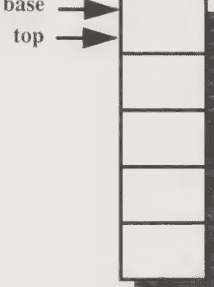

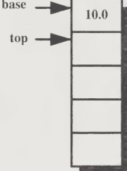

c) 执行`push(2.5)`后

d) 执行`push(pop()) * pop()`后


## 栈程序

栈程序通过使用`switch`语句演示了栈的使用。`main()`中的代码包含一个“无限”循环，其中`switch`语句处理命令。字符数组`line`用于读取带有换行符的命令。

```c
#include <stdio.h>
#include <stdlib.h>
#include <string.h>

#define NBYTES 80

/* 函数原型 */
intpop(void);

/*
* push()
* 将项（消息文本）推入栈中，除非
* 栈已满。如果栈已满则报告错误。
*/
intnpush(char *mesg)
```

相同的`line`数组作为输入缓冲区，用于读取用户响应写入命令的消息。消息作为参数传递给`push()`，它尝试将其推入栈。如果栈中有空间，推送操作成功，`push()`栈索引并返回 0。如果栈满，`push()`只返回一个非零代码，以标记诊断信息。

读取命令调用`pop()`尝试从栈中弹出消息。如果栈为空，`pop()`返回诊断信息“栈空”以通知用户该状况；否则，它获取栈顶的消息并减少栈索引。

`push()`和`pop()`函数的代码也是`stack.c`源文件的一部分。注意栈变量`stack`和`index`都声明为`static`。它们对与栈交互的`push()`和`pop()`函数可见，但对程序的其他部分不可见。

```c
intmain(void) {
    char line[NBYTES + 1];
    while (1) {
        printf("Command (w, r, or q): ");
        gets(line);
        switch (line[0]) {
            case 'w':
            case 'W':
                printf("Message: ");
                gets(line);
                if (npush(line) != 0)
                    printf("Stack full\n");
                break;
            case 'r':
            case 'R':
                printf("%s\n", pop());
                break;
            case 'q':
            case 'Q':
                exit(EXIT_SUCCESS);
        }
    }
    return EXIT_SUCCESS;
}

#define STACKSIZE 10
/* 消息栈 */
static char stack[STACKSIZE][NBYTES + 1];
static int index = 0;
```

```c
  int rc = 0;
  if (index < STACKSIZE)
    strcpy(stack[index++], mesg);
  else
    ++rc;
  return rc;
}
```

```c
/*
* pop()
* 从栈顶弹出一个项目并返回
* 指向它的指针。如果栈为空，则返回
* 错误消息。
*/
```

```c
char *
pop(void) {
  if (index > 0)
    return stack[--index];
  else
    return "Stack empty";
}
```

在这些函数中，在进行任何写入或读取之前，都会对相关的栈边界进行检查。在`push()`函数的情况下，在向满栈栈写入消息之前，必须对`index`与`STACKSIZE`常量进行边界检查。同样，`pop()`必须确保`index`大于 0，以验证有消息可以弹出。

这里是一个示例会话的显示，其中*斜体*表示用户的输入，**粗体**表示栈程序的程序的输出：

```
$ stack
Command (w, r, or q): w
line 1
Command (w, r, or q): w
line 2
Command (w, r, or q): r
line 2
Command (w, r, or q): w
another line
Command (w, r, or q): r
another line
Command (w, r, or q): r
line 1
Command (w, r, or q): r
Stack empty
Command (w, r, or q): q
$_
```

此演示程序中显示的消息栈可以在更大的程序中使用，用于管理交互式显示的消息行。假设你在屏幕底部保留了一个行空间专门用于消息。如果一个进程在运行之前生成了多条消息，每条消息都会覆盖之前的消息，可能在用户读取到早期的消息之前就被覆盖了。通过设置一个足够深的栈并给用户某些命令按需要从栈中弹出消息，你可以防止重要信息的丢失。

## 队列

在栈程序的设计中，消息是按照输入的逆序读取的，这可能会让用户感到困惑。如果我们使用队列而不是栈，就可以按照接收的顺序读取消息，这似乎是呈现这些消息更自然的方式。允许传输速率差异巨大的设备（如 CPU 和磁盘驱动器）通信的缓冲区通常实现为队列。

本节描述了队列，并展示了如何在程序中使用它们。

# 队列数据类型

队列是一种先进先出（FIFO）数据存储类型机制。第一个入队列的项是第一个获取的项。我们可以像实现栈一样，使用数组来实现队列。

图 11-2 展示了一个仅包含五个元素的线性队列。它被实现为一个字符数组。初始状态下，头部和尾索引相等，指向队列的第 0 个元素。头部索引指示下一次写入操作的位置，尾索引指示下一次读取操作发生的位置。

我们使用`enqueue()`函数向队列写入项目，使用`dequeue()`函数从队列读取项目。当你尝试向队列写入一个项目时，首先会检查头部索引。如果它尚未超出队列的末尾，则将项目写入头部索引指定的位置，然后头部索引加1。如果头部已经超出队列末尾，则无法写入任何内容。

从队列中读取的项目由尾索引指定。如果尾等于头，则队列为空，没有剩余内容可以读取。否则，执行读取操作且尾索引加1。

图 11-2：队列的数组实现

| 空空队列 | 执行`enqueue('a')`后 | 执行`dequeue()`后 |
| --- | --- | --- |
| tail | tail 'a' | tail 'a' |
| head | head | head |

# 循环队列 Queue

线性队列受队列长度的限制。因此，它们通常不被使用。然而，被称为循环队列的线性队列变体被频繁使用，特别是在数据传输缓冲中。循环队列也是一段内存位置，当到达队列末尾时，访问方法会有效地返回开头。

循环队列的一个很好的例子是典型个人电脑的键盘缓冲区。键盘缓冲区以你打字的速度接收字符，并根据需要将其交付给进程。如果进程正忙于其他事情，例如重新格式文本（文字处理）或翻译语句（语言编译器），缓冲区允许你继续打字而不会丢失任何输入。

IBM PC 中的键盘缓冲区只有 16 个位置，因此如果你打字足够快，有时会填满缓冲区。当这种情况发生时，机器会发出蜂声，告诉你它无法接受更多输入。解决这个问题的方法之一是创建一个独立的、更大的缓冲区并使用它来喂给程序。128 字节的队列是一个流行的大小。

使用循环队列带来了一个问题。如果尾索引和头索引相等，队列是满还是空？你无法判断。我们必须设计一种方法来区分这两种情况。这个问题通过牺牲队列中的一个位置解决了。尾索引从头部索引后面启动，并且不允许追上它。让我们看看这种技术是如何工作的。


# 队列演示程序

队列程序的设计与栈程序相似。区别在于使用了 FIFO 顺序，而不是 LIFO（后进先出）。

在该程序中起作用的函数是`enqueue()`（它向队列写入项目）和`dequeue()`（它从队列读取项目）。

队列的`main()`函数看起来与栈程序一样，只是索引名称不同。

```c
#include <stdio.h>
#include <stdlib.h>
#include <string.h>

#define QSIZE 10
#define NBYTES 80

/* message queue */
static char queue[QSIZE][NBYTES + 1];
static int write = 0;
static int read = QSIZE - 1;

/* function prototypes */
int enqueue(char *);
char *dequeue(void);

int main(void) {
    int ch;
    char line[NBYTES + 1];

    while (1) {
        printf("Command (w, r, or q): ");
        gets(line);
        switch (line[0]) {
        case 'w':
            /* write (enqueue) a new message */
            printf("Message: %s", line);
            if (enqueue(line) != 0)
                printf("Queue full\n");
            break;
        case 'r':
            /* read (dequeue) a message */
            printf("%s\n", dequeue());
            break;
        case 'q':
            /* quit */
            exit(EXIT_SUCCESS);
        }
    }
    return 0;
}
```

使用此表达式来控制`if`语句可以避免编写更复杂的检查，该检查通过两种方式比较索引：一种用于普通情况（读取少于写入），另一种用于写入索引已回绕到队列开头而读取索引尚未返回的情况。如果队列不为空，则增加读取索引（考虑回绕情况），并将消息返回给调用者。

将下述的队列程序示例运行的输出与栈程序的输出进行比较。再次，用户输入用斜体显示，队列程序的输出用粗体显示。

```
$ queue
Command (w, r, or q): w
line 1
Command (w, r, or q): w
line 2
Command (w, r, or q): r
line 1
Command (w, r, or q): w
another line
Command (w, r, or q): r
line 2
Command (w, r, or q): r
another line
Command (w, r, or q): r
Queue empty
Command (w, r, or q): q
$ _
```

尝试你自己运行该程序，并尝试输入比队列能容纳更多的消息。你认为它在满时能容纳多少条消息？

## 总结

栈和队列是重要的数据类型。它们对于控制优先级和缓冲数据传输非常有用，特别是在运行速度不同的设备之间。

堆栈是一个后进先出（LIFO）内存对象。相反，队列是一个先进先出（FIFO）内存对象。循环队列对于数据缓冲应用特别有用，因为几乎不需要担心队列的大小——只要队列创建得足够大避免溢出，就不会像线性队列那样担心。

## 问题与练习

1. 栈的主要属性是什么？

2. 根据你自己的非编程经验描述一个栈。

3. 数组类型栈的索引的什么种条件表示栈为空？

4. 图 11-1 显示了如何执行乘法。请写出实现四功能后置逆表达式（RPN）类型计算器其余操作所需的`push`和`pop`操作序列。这种类型的计算器先取数值，然后取说明要如何对这些数字进行操作的操作符。

5. 队列的作用是什么？

6. 给定循环队列的写入索引和读取索引，什么种条件表示队列已满？

7. 给定循环队列的写入索引和读取索引，什么种条件表示队列为空？

8. 线性队列的什么局限性使其不适合用数据缓冲机制？

9. 对于一个数组大小为 20 个元素的循环队列，在满时它可以容纳多少个队列项？

## 额外练习

1. 编写一个函数，允许你查看栈顶的值而不实际将其弹出（pop）。将该函数命名为`peek()`并让它返回一个指向指定消息的字符指针。

2. 有时需要在不改变栈的情况下知道栈是否为空。编写一个名为`empty()`的函数，向调用者返回一个布尔（TRUE 或 FALSE）值。

3. 编写一个函数，允许你检查队列头部的值而不实际将其移除。将该函数命名为`qhead()`并让它返回一个指向队列头部消息的字符指针。

4. 编写一个函数检查队列并报告其是否为空，而不实际尝试读取或写入任何内容。将该函数命名为`qempty()`并让它向调用者返回一个布尔（TRUE 或 FALSE）值。

# 第 12 章

## 链式数据结构

上一章描述了栈和队列的连续内存分配。这些结构非常有用，但它们也有局限性。

首先，无论程序实际使用多少内存，它们都需要分配固定数量的内存。你可能会预留一个例如两千字节的栈，以确保有足够的空间应对最坏情况，但只用了了其中几百字节。其次，栈或队列的元素是相邻排列的。允许项以看似任意的方式排列并将它们交织连接在一起，通常比强制执行线性排列更方便。

在较早的章节中，你接触了结构。指针允许项以任意的方式排列并将它们连接在一起，而不是强制执行线性排列。一个结构包含指向自身类型的指针被称为自引用结构。本章介绍了链表的应用。

## 单链表

单链表是由单方向连接的节点集合。每个节点包含一个前继指针。列表可以包含任意数量的节点。如果列表没有第一个节点，则为空，但只有一个值为`NULL`的指针如`head`，因此排列指针是一个更复杂的任务，必须考虑特殊情况。在有第一个节点的列表中，插入操作的代码更容易编写，因为不需要适应特殊情况，如当向空列表插入节点时发生的情况。

对列表可以执行的主要操作包括：

- 向列表中插入节点
- 从列表中删除节点
- 访问节点进行写入或读取

你需要访问节点来给数据成员赋值或读取它们。还需要遍历列表以找到特定的节点。

图 12-2 描绘了向单链表插入节点的过程。该过程涉及按所示顺序执行的一系列步骤。每个步骤的代码在图中。

1. 分配新节点（显示的是运行时动态分配，但可以使用编译时的静态分配）。

2. 使新节点的`next`成员指向其后的后续节点（插入前当前节点所指向的节点）。

3. 使当前节点的`next`成员指向新节点。

没有第一个节点的列表在没有任何节点时为空，但只有一个值为`NULL`的指针如`head`，因此排列指针是一个更复杂的任务等等。

将这些部分组合在一起，这里是向单链表插入节点的代码：

```c
SNODE *
insert_node(SNODE *listp)
{
    SNODE *new;

    new = (SNODE *) malloc(sizeof(SNODE));
    if (new != NULL) {
        new->next = listp->next;
        listp->next = new;
    }
    return new;
}
```

从单链表中删除节点涉及与插入节点相反的过程，但有一个不同之处。由于单链表中的每个节点只指向列表中的下一个节点，因此要找到哪个节点指向当前节点是既不方便又低效的。`delete_node()`函数的代码删除的是作为函数参数传递的节点之后的节点。

```c
void
delete_node(SNODE *listp)
{
  SNODE *tmp;

  tmp = listp->next;
  listp->next = listp->next->next;
  free(tmp);
}
```

表达式`listp->next`指向要删除的节点（“被注定删除”的节点），而表达式`listp->next->next`指向它的后续节点（NULL 标记列表的结束）。

## 循环单链表

线性单链表末尾节点的`next`指针值为 NULL，因为它没有指向另一个节点。循环列表是指每个节点都指向列表中的另一个节点的列表。最后一个节点指向列表头，从而形成一个圈。

最初让第一个节点指向它自己构成了循环列表的基础。随着节点的插入，列表保持了其循环特性。循环列表简化了诸许多操作，例如从内部节点搜索到列表的任何其他部分，它可以在列表末端进行自动回绕。

## 图 12-2：向链表插入节点

a) `new = (SNODE *) malloc(sizeof(SNODE));`

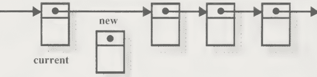

b) `new->next = current->next;`

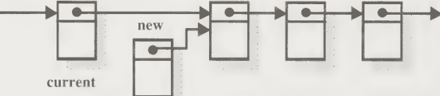

c) `current->next = new;`

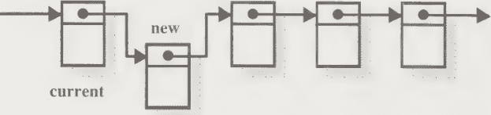

通过头指针指向的列表头节点通过以下语句指向它自己：

```c
head->next = head;
```

表达式`head->next`选择了节点的正向指针成员。这是一个可修改的左值（lvalue），因此可以将相同类型的指针值（在本例中为 head）赋值给它，形成一个空循环列表。

列表管理中的两个关键操作是节点的分配和释放。由于这些操作可以基于静态或动态方法。在静态情况下（即在程序编译和链接时分配节点），通常会声明节点数组并将它们连接成一个空列表。当需要节点时，它们从空列表的头部被移除。当它们被释放时，它们会被放回空列表。

静态分配的一个问题是，你需要预先知道需要多少节点。此外，你还会面临由于分配了可能使用的空间而导致的低效问题。在运行时发生的动态内存分配提供了解决此问题的方法见下一个主题。

## 内存管理

内存管理涉及进程对额外内存资源的请求。此类请求能否获得批准取决于堆（heap）区域内存的可用性，堆是一个未分配的内存区域，可根据需要提供给进程。

几个内存管理函数对列表管理函数有特殊帮助。我们将使用`malloc()`分配内存块，并使用`free()`在内存不再需要时释放（取消）内存。这里是`malloc()`和`free()`的函数原型：

```c
void *malloc(size_t size);
void free(void *ptr);
```

`malloc()`函数不会改变其分配内存的内容另外两个内存分配函数是`calloc()`，它初始化（清除）分配的内存，以及`realloc()`，它尝试在不改变内容的情况下更改先前分配的内存块的大小。

`malloc()`返回一个看起来奇怪的`void*`指针。这意味着什么？指针类型`void *`是一个通用指针。它适用于作为指向任何类型对象的指针。任何类型对象的指针都可以转换为通用指针类型，然后转换回来而不改变。指向 void 的指针的对齐要求与指向`char`的指针相同。

非 ANSI 版本的`malloc()`实现返回一个`char *`指针，将其分配的内存视为字节序列。使用`malloc()`分配内存时，有必要将返回值强制转换为所分配对象类型的指针。这已不再是通用指针返回类型的要求，但我展示了非 ANSI 以前的形式，因为大多数 C 编译器仍然需要这种类型转换。一个例子是经常从键盘或文件字符串的精确副本中收集输入行。如果你设置了一个足够大以包含最大预期输入行的数组，会有大量空间被浪费，因为大多数行会比静态分配的数组短。更好的做法是只分配存储每行所需的内存。

许多面向 DOS 的 C 编译器提供的标准库提供了一个`strdup()`函数，它动态分配一个内存区域并将字符串复制其中。该函数在 ANSI 库描述中未涵盖，因此如果你的编译器没有提供它，这里有一个你可以使用的`strdup()`版本。

```c
/*
* strdup()
* 创建一个适当大小的缓冲区并* 将字符串复制到其中。
*/
char *strup(const char *str) {
    char *buf;
    buf = (char *) malloc(strlen(str) + 1);
    if (buf != NULL) {
        strcpy(buf, str);
    }
    return buf;
}
```

## 示例程序：cardfile

`cardfile`程序演示了链表的特性以及管理它的函数。程序是联系人和电话号码文件的简单电子版本。支持的命令有：

- 向文件中添加新卡片
- 根据名称搜索查找卡片
- 列出文件内容
- 退出（保存更改）
- 退出（放弃更改）

```c
while (1) {
    /* get user's command (a, f, l, q, or x): */
    printf("Command (a, f, l, q, or x): ");
    gets(reply);

    /* process command */
    switch (reply[0]) {
        case 'a':
        case 'A':
            add_card();
            break;
        case 'f':
        case 'F':
            find_card();
            break;
        case 'l':
        case 'L':
            list_cards();
            break;
        case 'q':
        case 'Q':
            /* save changes and exit */
            write_file(data_file);
            return EXIT_SUCCESS;
        case 'x':
        case 'X':
            /* exit without saving changes */
            return EXIT_SUCCESS;
        default:
            /* ignore */
            break;
    } /* end switch */
} /* end while */

return EXIT_SUCCESS;
}
```

程序中的节点数据结构被称为 CARD。该类型的初始变量是列表头结构（第一个节点），以及头指针（head）和当前指针（current）。

在`main()`函数体中，程序会检查命令行以确定用户是否输入了数据文件的替代名称。如果没有指定，则使用默认名称`cardfile.dat`。

程序会打印一个简短的说明框架，其中包含允许命令的描述。`switch`提示用户输入命令并调用实现这些命令的函数。

命令之一是“添加新卡片”。该命令的代码位于`add_card()`函数中：

```c
/* add an entry to the list */
add_card(void)
{
    int rc = 0;
    CARD *tmp;

    tmp = insert_node(current);
    if (tmp == NULL) {
        fprintf(stderr, "Out of memory");
        ++rc;
    }
    else {
        current = tmp;

        /* input person's name & address */
        printf("Name: ");
        gets(reply);
        strcpy(current->name, reply);
        printf("Phone: ");
        gets(reply);
        strcpy(current->phone, reply);
    }

    return 0;
}
```

如果有足够的内存创建新的列表节点，则会创建（动态分配）并将其链接到列表中。然后，会提示用户输入姓名和电话信息以存储在卡片中。如果没有足够的内存来分配新卡片，则通过返回`NULL`向调用函数报告此情况，并通过消息通知用户这个坏消息。

`find_card()`函数检查列表是否为空。然后它要求输入一个字面量作为搜索键，并扫描列表查找名称字段包含该字符串的卡片。搜索从列表头节点之后的节点开始。这是包含数据的节点。


```c
/* find and print an entry */
static int
find_card(void)
{
    int rc = 0;
    int hits = 0;
    int len;
    char *cp;
    CARD *tmp;

    tmp = head;
    if (tmp->next == head) {
        puts("List empty");
        return ++rc;
    }

    printf("Name to find: ");
    gets(reply);
    len = strlen(reply);
    while (tmp->next != head) {
        tmp = tmp->next;
        cp = tmp->name;
        while (*cp != '\0') {
            if (strncmp(cp, reply, len) == 0) {
                prt_record(tmp->name, tmp->phone);
                ++hits;
            }
            ++cp;
        }
    }
    if (hits == 0)
        puts("Card not found");

    return rc;
```

注意`strncmp()`的使用，它只比较指定数量的字符（第三个参数）。如果匹配，函数返回零。由字符指针`cp`控制的循环沿着卡片的`name`成员移动。因此，你可以在名称字段中搜索子字符串，而不需要完全输入整个名称字段。如果找到了卡片，将列出其内容并将当前指针更新为找到的卡片。如果没有匹配，`find_card()`将打印消息并返回一个非零值。

`list_cards()`函数简单地从头遍历到最后一张卡片，并打印文件中每张卡片的内容。同样，会进行测试以防止尝试列出空文件。

```c
/* list the entire data file */
static int
list_cards(void)
{
  int rc;
  CARD *tmp;

  tmp = head;
  if (tmp->next == head) {
    puts("List empty");
    ++rc;
  }
  else
    while (tmp->next != head) {
      tmp = tmp->next;
      prt_record(tmp->name, tmp->phone);
    }
  return rc;
}
```

# 284 C 语言编程

接两个函数`read_file()`和`write_file()`提供了用户文件系统的接口。当程序启动时，`read_file()`尝试打开指定的文件或默认数据文件`cardfile.dat`并立即读取其内容。以下是`read_file()`的代码：

```c
static int
read_file(char *fname)
{
    FILE *fp;
    int rc = 0;
    char line[NBYTES + 1];
    CARD *tmp;

    /* open the file */
    fp = fopen(fname, "r");
    if (fp == NULL) {
        fprintf(stderr, "Cannot open %s", fname);
        return rc;
    }

    /* read data into buffer */
    while (fgets(line, NBYTES + 1, fp)) {
        /* remove newline */
        line[strcspn(line, "\n")] = 0;
        /* allocate a new node */
        tmp = insert_node(current);
        if (tmp == NULL) {
            fprintf(stderr, "out of memory");
            break;
        }
        /* copy data to current structure */
        strcpy(current->name, line);
        // (phone reading would follow here similarly)
        current = tmp;
    }
    fclose(fp);
    return rc;
}
```

`write_file()`函数比`read_file()`更简单。它打开数据文件写入并保存任何更改。数据文件的格式是每个记录一行，使用制表符分隔。

```c
/* write data file */
static int
write_file(char *fname)
{
    FILE *fp;

    fp = fopen(fname, "w");
    if (fp == NULL) {
        fprintf(stderr, "Cannot open %s", fname);
        return 1;
    }

    tmp = head;
    while (tmp->next != head) {
        fprintf(fp, "%s\t%s\n", tmp->name, tmp->phone);
        tmp = tmp->next;
    }

    fclose(fp);
    return 0;
}
```

# 双向链表

单向链表并不是许多问题的理想解决方案，因为反向遍历列表既困难又低效。这就是为什么双向链表被用于文本编辑器、窗口管理系统以及许多需要快速向前和向后定位的应用。

图 12-3 展示了一个双向链表。这种列表的特征是一对节点指针成员，这允许节点进行双向链接。`DNODE`类型的声明为`struct dnode_st`类型创建了一个新的类型类型名。前向（`next`）和后向（`prev`）指针分别指向`DNODE`类型的对象。

图 12-3：数据结构的双向链表

```c
typedef struct dnode_st {
    struct dnode_st *next, *prev;
    /* ... */
} DNODE;

DNODE listhead, *head, *current;
```

双向链表的通用形式

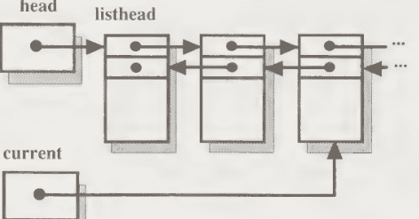

你仍然可以使用辅助指针来指定列表头和当前位置，但这些指针也必须声明为双向链表类型。由于双向链接，你还需要用于插入和删除节点的新函数。

```c
DNODE *
insert_dnode (DNODE *listp)
{
  DNODE *new;
  new = (DNODE *) malloc(sizeof(DNODE));
  if (new != NULL) {
    new->prev = listp;
    new->next = listp->next;
    listp->next->prev = new;
    listp->next = new;
  }
  return new;
}
```

如果你不能立即理解指针赋值发生了什么，可以自己画一张插入过程的图，使其与单向链表的过程并行，并逐条处理函数语句，手动跟踪链接。

删除节点的代码也因为每个节点多出的一个链接而变得复杂。双向链表删除函数的优势在于它删除的是当前节点，而不是列表中的下一个节点。

```c
void
delete_dnode (DNODE *listp)
{
  listp->prev->next = listp->next;
  listp->next->prev = listp->prev;
  free(listp);
}
```

# 循环双向链表

循环双向链表遵循循环单向链表的模式，但双向情况要求每个节点使用两个指针。循环列表为文本编辑器程序中的缓冲区编辑提供了良好的控制机制，以及其他需要根据需要在缓冲区边界进行方便回绕的情况。

图 12-4 展示了一个循环双向链表。节点结构的`next`指针成员提供了循环的前向链接链，而头节点（prefirst node）的`prev`成员提供了循环的后向链接链。

头节点与循环列表实现的结合提供了一种方便且高效的动态存储机制。操作循环列表的函数不需要处理特殊情况。遍历循环列表的函数只需要处理在从列表尾绕到列表头（或反之）时跳过头节点的特殊情况即可。

图 12-4：循环双向链表

# 循环列表

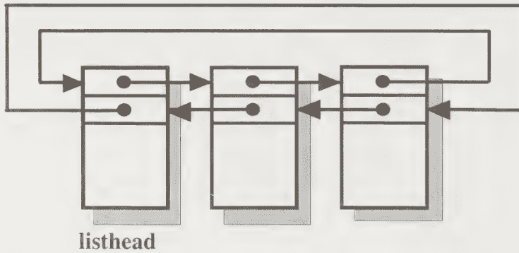

## 总结

数据结构和算法是计算机程序的核心。尝试获取一些涉及这些研究领域的书籍，并投入相当的时间来学习和使用它们。对数据结构及其相关处理算法良好的实践知识，以及对何时应用它们的直觉，对你的编程未来至关重要。

本章向你介绍了链式数据结构，包括单向链表和双向链表。它还描述了动态内存管理技术，用于程序运行时分配和释放内存，而不是依赖于可能低效的静态内存分配。当你对这些链式数据结构熟悉后，可以研究二叉树和其他树形结构、优先级队列以及其他高级数据结构。

## 问题与练习

- 1. 什么是列表节点？它是如何声明的？
- 2. 单向链表的特征是什么？
- 3. 描述向列表中插入新节点的过程。
- 4. 从单向链表中删除节点的棘手之处何？
- 5. 正确或错误：栈和队列可以用链表实现。
- 6. 为什么在链表中使用头节点（prefirst node）？
- 7. 检查列表是否为空的代码出现在卡片代码的许多地方。编写一个函数`list_empty()`，如果传递给它的列表指针指向空列表，则返回非零值。
- 8. 循环列表相比其线性对应版本有哪些优点？
- 9. 编写一个列表节点的声明，其中包含前向和后向指针、一个指向键位图例字符串的指针、一个指向帮助消息字符串的指针，以及可以存储 -1 到 32,535 范围内唯一代码的整数。
- 10. 按照现有写法，`find_card()`会搜索整个列表，打印出匹配搜索字符串的所有卡片内容。重写该函数，使其在找到第一个匹配卡片时停止，并更新当前指针指向该卡片。

## 额外练习

- A. 在卡片程序中添加`delete_node()`函数，并修改`main()`以允许用户通过命令删除卡片。确保删除的是当前卡片而不是下一个。
- B. 设计一个程序，将文件中的行读入缓冲区并按反顺序打印。双向链表非常适合这个问题。
- C. 编写一个简单的文件查看器，可以按页（通常为 24 或 25 行）显示文件，并能够方便地向前或向后滚动。
- D. 重新设计卡片程序使用的`CARD`结构，包含姓名、公司或所属以及电话号码。将电话号码拆分为区号和主号。例如，运行带有 "303" 区号的命令将打印出科罗拉多州的所有卡片。

# 第13 章

# 与操作系统通信

到目前为止，我们的程序通过返回成功或失败的代码与操作系统进行单向通信。操作系统也可以通过几种方式将数据传递给运行程序。

本章探索命令行参数和环境变量作为操作系统环境向运行程序传递的数据。

## 命令行参数

即使受到窗口界面和菜单驱动系统的日益增大，命令行仍然是现代操作系统的重要特性。UNIX 和 DOS 的原始形式都提供一个简陋的提示符，邀请用户输入命令。

如果命令只需要一个名称（越短越好）以及可能的两个文件名，将会非常方便。事实上，这正是原始 UNIX 设计的目标之一，它强调使用许多单一用途的命令，这些命令可以通过管道组合来解决广泛的计算和文本处理问题。

多年来，许多简单程序都积累了新功能，其中大多数功能是通过命令行激活的。`pr`程序就是一个例子，它最初从一个简单的蛋开始，现在看起来更像一个发芽的土豆。

这是一个使用标准 UNIX 语法的简单命令行：

```
$ look -c src/calc.c
```

该命令调用名为`look`的程序来列出文件内容。如果没有`-c`选项，`look`只列出命名文件的行。使用`-c`选项时，程序会对任何控制字符的十代码进行特殊高亮。

图 13-1 显示了如何访问 UNIX 命令行。图描述了一种将命令行文本存储在字符数组中的方法。每个空格或制表符都被替换为空字节，从而有效地创建了一组独立的字符串。指针变量被分配给由此创建的子字符串的地址。

图 13-1：命令行参数计数和向量表

## 与操作系统通信 295

## 程序员笔记本：

如图 13-1 所示，DOS 对命令行符号使用了不同的约定。为了与 DOS 的前身 CP/M 兼容，它使用斜杠（`/`）作为“切换字符”或选项标志。由于这一选择，路径名分隔符是反斜杠（`\`）。这种命令语法的差异对于我们这些经常同时操作 DOS 和 UNIX 的人来说是一个长期的痛苦。

## look 程序

这就是图 13-1 中提到的程序。`look`程序的行为由命令行选项`-c`规定，并在内部由变量`showControl`控制。外部规格说明符与内部变量之间的连接通过参数`main()`、`argc`和`argv`建立，这是你在这本书中第一次看到这些参数。如果`main()`的定义具有形式参数、代码、命令行参数，那么必须有某种东西使用实际参数调用`main()`。但我们还没有编写任何调用`main()`（我们程序的入口点）的代码。那么，是什么调用了它呢？

答案是 C 运行时启动系统。当一个 C 程序被翻译时，会生成代码，这些代码除了其他任务外，还会在调用`main()`时传递命令行参数。这些参数为`argc`（参数计数）和`argv`（一个指向字符字符串指针的数组）提供了值。

整数`argc`包含了程序名以及用户输入的任何可选和强制参数。字符指针数组`argv[]`包含每个每个参数的指针，这些参数源于命令行以及对文件名规范中通配符的可能存在的展开。

以下是`look`程序的源代码：

```c
/*
* look.c
*
* 通过一个简单的程序演示操作系统
* 如何将数据从用户命令行传递给
* 程序。
*/
#include <ctype.h>
#include <stdio.h>
#include <stdlib.h>
#include <string.h>

typedef enum { FALSE, TRUE } BOOL;

int
main(int argc, char *argv[]) {
    int ch; /* 输入/输出字符 */
    BOOL showControl; /* 当为 TRUE 时显示控制代码 */
    char *fname; /* 文件名指针 */
    FILE *fp; /* 文件指针 **/

    /* 处理命令行 */
    showControl = FALSE;
    if (argc < 2 || argc > 3) {
        fputs("Usage: look [-c] file\n", stderr);
        exit(EXIT_FAILURE);
    }
    switch (argc) {
        case 2:
            fname = argv[1];
            break;
        case 3:
            showControl = TRUE;
            fname = argv[2];
            break;
    }

    /* 打开文件读取 */
    if ((fp = fopen(fname, "r")) == NULL) {
        fprintf(stderr, "Cannot open %s\n", fname);
        exit(EXIT_FAILURE);
    }
```

```c
/* 将文件拷贝到标准输出 */
    while ((ch = fgetc(fp)) != EOF)
        if (showControl == TRUE && iscntrl(ch))
            printf("%i", ch);
        else
            putchar(ch);
    if (ferror(fp)) {
        fprintf(stderr, "Error reading %s\n", fname);
        clearerr(fp);
    }

    /* 关闭文件并退出 */
    fclose(fp);
    if (ferror(fp)) {
        fprintf(stderr, "Error closing %s\n", fname);
        return EXIT_SUCCESS;
    }
}
```

`main()`的第二个参数显示为：

```c
char *argv[]
```

可以写成：

```c
char **argv
```

其效果完全相同。第一种形式读作“`argv`是一个指向`char`类型对象的指针的数组”。第二种形式读作“`argv`是一个指向指向`char`类型对象的指针的指针”。

按照约定，命令行的第一部分是程序名（3.0 之前的 DOS 版本除外）。在由于某种原因无法提供程序名的操作系统环境中，会提供一个空字符串（`""`）或某些虚拟名称字符串。

如果你使用`look`列出一个内容如下的文件，它的正常输出看起来完全一样：

- Line 1

Line 2

Line 3

如果你发出`-c`选项，输出将变为字节序列，其中所有的控制字符都以其十进制代码表示，并关闭了通常的格式。以下是备选输出的样子：

Line 1<10>Line 2<10>Line 3<10>

## 歧义文件名


DOS 和 UNIX 对文件名参数的处理方式不同。如果文件名参数包含通配符字符（如 `*` 和 `?`），它们将由 UNIX shell 展开。DOS 下的文件名参数中的通配符并不会被 `COMMAND.COM` 处理器展开，因此在为用于 DOS 的 C 程序创建程序时，必须链接一个通常称为 `argv()` 的独立库模块。

除了 DOS 和 UNIX 都能理解的 `*` 和 `?` 通配符外，UNIX 还接受字符类，通过方括号括起来的列表和字符范围来指示。因此，文件名参数：

```
file?.c [A-Z]*
```

会匹配如 `file1`、`filex`、`Alpha`、`Delta` 等名称的文件，但不会匹配 `file01`、`alpha` 等。

## 环境变量

UNIX、DOS、OS/2 以及其他操作系统将环境变量数据以变量/值对（variable/value pairs）列表的形式进行维护。这些变量由系统管理员或用户定义，可以是交互式的，也可以通过启动文件定义（UNIX 下为 `.profile`，DOS 下为 `AUTOEXEC.BAT`）。当程序开始执行（变成一个进程）时，它继承一份环境变量副本。对该副本的更改没有持久影响，除非环境支持名为 `putenv()` 的函数，该函数允许你修改环境。

第一种但最可靠的方法是 `main()` 参数 `envp`。`envp` 的声明可以写为：

```c
char *envp[]
```

或

```c
char **envp
```

与 `argv` 的声明类似。在这种情况下，每个指针提供了环境空间名称/值对的地址。

> 程序员笔记本：当程序开始执行（变成一个进程）时，它继承一份环境变量副本。

### `getenv()` 函数

读取环境变量值的另一种更可靠的方法是调用 `getenv()` 函数。该函数以名称字符串作为唯一参数。它返回一个指向数组的指针，该数组包含指定变量字符串。图 13-2 显示了如何使用 `getenv()` 获取环境变量的值。给定给出的列表，调用 `getenv()` 并传入字符串 `"WIDTH"` 参数将获取关联的值 `"80"`，这是数字的字符字符串表示。访问变量的代码测试函数的返回值，如果为 `NULL` 则表示未找到变量。如果找到了变量，则必须将其转换为所需的格式。在本例中，字符串通过调用 `atoi()` 转换为整数，`atoi()` 是标准库中数据转换函数之一。

图 13-2: `getenv()` 函数

环境变量列表

| Sample UNIX 环境列表 | ep | `getenv()` 维护的缓冲区（注意） |
| --- | --- | --- |
| `EDITOR=bin.vi` | | `"80"` |
| `HOME=user` | | |
| `TERM=vt100` | | |
| `TZ=MST7MDT` | | |
| `WIDTH=80` | | 注意：缓冲区不能由调用者修改，但每次调用 `getenv()` 都会被覆盖。 |

## 访问变量

```c
char *ep:
int width:

if ((ep = getenv("WIDTH")) != NULL)
    width = atoi(ep);
```

## 与操作系统通信 301

`envdemo` 程序演示了访问环境的两种方法。以下是源代码：

```c
/*
 * envdemo.c
 * 列出用户环境中定义的变量
 * 及其对应的值。
 */

#include <stdio.h>
#include <stdlib.h>

#define MAXNAME 25

int
main(int argc, char **argv, char **envp) {
    char *env;         /* 字符串指针 */
    char *ep;          /* 环境指针 */
#if defined(MSDOS)
    char *cp;
#endif

    /* 输入缓冲区 */
    char varname[MAXNAME + 1];

    /* 打印环境列表 */
    ep = envp;
    while (*ep++)
        puts(*ep);

    /* 演示 getenv() 的用法 */
    printf("Variable name: ");
    gets(varname);

#if defined(MSDOS)
    /* 如果 OS=DOS，将变量名转换为大写 */
    for (cp = varname; *cp != '\0'; ++cp)
        *cp = (char) toupper((int) *cp);
#endif

if ((env = getenv(varname)) != NULL) {
    printf("%s=%s\n", varname, env);
} else {
    fprintf(stderr,
        "Variable %s not found\n", varname);
    exit(EXIT_FAILURE);
}

return EXIT_SUCCESS;
}
```

该程序包含一些条件处理指令。当翻译为 DOS 时，程序包含额外的代码，用于将用户输入的名称转换为大写字母。符号名称 `MSDOS` 通常由针对 DOS 系统的 C 编译器定义。如果没有定义，你可以通过添加以下指令来自己定义它：

```c
#define MSDOS
```

到源文件中，或者通过使用产生相同效果的编译器命令行参数来实现。

以下是 `envdemo` 在我的某台 DOS 机器上运行时的输出示例：

```
CONFIG=c:\init
CTINIT=c:\ctrm\ctrm.ini
NOSNOWCONTROL=true
UPDATEMODE=direct
TZ=MST7MDT
FWPLIB=c:\pwlib
PROMPT=$s$g
PATH=c:\QC2\BIN;C:\DOS4;C:\BIN;C:\BATCH;C:\WORD;C:\CTRM;C:\WINDOS
INCLUDE=c:\qc2\include
LIB=c:\qc2\lib
TMP=c:\tmp
```

## 与操作系统通信 303

以下是 `envdemo` 在我的 XENIX/386 系统上运行时的输出示例：

```
EDITOR=/bin/vi
HOME=/u/arh
HZ=50
MAIL=/usr/spool/mail/arh
PATH=/bin:/usr/bin:/usr/sbin:/u/arh/bin
SHELL=/bin/sh
TERM=vt100
TZ=MST7MDT
```

## 可移植性

根据 ANSI 标准，最后一个参数向量 `argv[argc]` 应该赋值为 `NULL`。许多 ANSI 之前的 C 编译器都支持这一约定，但有些并不支持。`argc` 参数的初始值是为了确定参数列表的结束位置，而不是依赖于寻找 `NULL` 向量。

为了在用户输入命令行参数和程序分析参数的方式上获得合理的统一性，如果你的 C 编译器库中提供了 `getopt()` 库函数，请使用它。如果没有提供（许多 DOS C 编译器的情况如此），你可以使用我的另一本书《*Proficient C*》（Microsoft Press, 1987）中包含的公有领域版本 `getopt()`。书中几乎所有接受命令行参数的程序都使用 `getopt()` 以一致的方式处理参数。

环境变量名和值的集合是由实现定义的。与环境的交互在不同的支持 C 的实现之间也可能不同。

`main()` 函数使用第三个参数并不是通用支持的。即使你可以使用 `envp`，它的值只在程序启动时有效。虽然某些环境支持使用 `putenv()` 库函数，但大多数并不。

如果你编写与用户环境交互的代码，请将其放在单独的编译单元，以减轻在不同操作系统之间迁移代码的负担。

## 总结

命令行参数和环境变量各自提供了将外部数据引入程序的方法。ANSI C 支持为 `main()` 函数提供两个参数，允许直接访问命令行参数。这些参数通常称为 `argc` 和 `argv`，由主机型 C 编译器支持。由于这些参数是 `main()` 函数的局部变量，如果你愿意，可以使用其他名称代替它们。在大多数支持该用法的实现中，第三个参数被称为 `env`，它最初指向环境块（一组变量/值对）的开头。通过 `getenv()` 可以更可靠地访问，该函数返回作为参数指定的变量的值，如果该变量在环境中未定义，则返回 `NULL`。

## 问题与练习

1. `main` 函数的 `argc` 参数的作用是什么？

2. 如果一个程序除了名称参数外还有五个参数，`argv` 数组的下标范围是什么？

3. 在提供程序名的环境中，哪一个参数向量包含程序名？

4. DOS 不会将歧义的文件名参数扩展为列表。UNIX 会。你如何让 DOS 程序具有相同的行为？

5. 给定以下命令行：

   ```
   myprog file1 file3
   ```

6. 在提供程序名的环境中，哪一个参数向量包含程序名？

7. 给定以下代码，变量的值是什么？

   ```
   env[1]
   ```

8. 为什么 `main()` 函数使用第三个参数并不是通用支持的？

9. 给定以下代码，输出是什么？

   ```
   getenv("PATH")
   ```

10. `getenv()` 函数的作用是什么？

如果命令行参数个数不是 2

    打印用法诊断并退出

以文本模式打开指定的源文件

如果打开失败

    打印诊断消息并退出

当输入流中仍留有字符时

    读取它

    如果是格式代码

        将其加倍

    否则如果是换行符

        将其转换为垂直制表符

    否则

        原样打印它

    如果在输入流上发生 I/O 错误

        打印诊断消息并退出

关闭文件

如果发生关闭错误

    打印诊断消息并退出

返回给调用者

伪代码描述了程序的操作逻辑，而没有确定具体的代码实现。在此时，我们可以使用 BASIC、Pascal 或其他语言，但我们将坚持计划，尝试用 C 语言来编写。但在此之前……

# 手册页

`src2vp` 的操作通过手册页描述最为合适。我在编写程序代码之前就编写了手册页，以便其作为设计文档。上一节所示的伪代码是根据手册页开发的。

在编写完程序后，我发现一个执行相反任务的程序（将文档中的文件转换回普通文本格式）也非常有用。此外，我最初并不知道 `@` 符号是个问题，直到我写了一个使用该符号的测试用例。因此，对手册页进行了修改，以记录一些并非原始设计包含的内容。以下是类 UNIX 参考手册格式的最终手册页：

## 名称

`src2vp`

`vp2src`

## 语法

```
src2vp srcfile [> vpfile]
```

```
vp2src upfile [> srcfile]
```

## 描述

`src2vp` 工具程序将普通的程序源文件（文本）转换为适用于 Microsoft Word 和 Ventura Publisher 文件的格式。程序将其输出发送到标准输出流，你可以可选地重定向到文件或其他目标。

## Word 转换

你必须处理原始源文件，以便将其合并到使用 Microsoft Word 准备的文档中。Word 将所有换行符结束的行视为单独段。`src2vp` 程序将换行代码转换为 Word 期的垂直制表符。

## Ventura Publisher 转换

Ventura Publisher 使用 `@`、`<` 和 `>` 符号作为格式命令，如果要在 VP 文档中显示这些符号，你必须对它们进行保护。建议的保护方法是将字符加倍（例如，将 `@` 更改为 `@@`），以防止它被视为 VP 命令。`src2vp` 程序执行这些翻译。

`vp2src` 程序提供相反的翻译。使用它从文档文件中提取的材料创建正确的源文件。假设该文件是通过使用 Word 的“未格式化”（unformatted）保存选项从 Ventura 格式的文件提取的。

## 示例

```
src2vp sample.c > sample.cvp
```

文件转换工具

转换 C 源文件并将其保存到单独的文件，该文件可以读入 Word（传输-合并）随后读入 Ventura Publisher。

## 注意事项

Word 或 Ventura 可能支持其他此程序未考虑在内的特殊代码，且这些程序的发布者未来可能会添加新功能，从而影响转换过程。程序描述就到此。让我们开始编码。

## 编写程序

C 源代码可以很容易从伪代码描述中转化出来。我经常使用的一种技术是将伪代码作为注释写在将成为源的文件中。在文件中程序的框架可以很容易地将语句放在它们的位置，并避免遗漏程序的某部分。以下是 `src2vp` 的源码：

```c
/*
* src2vp.c
*
* 将程序源文件转换为
* 适用于 Ventura Publisher 的格式。
* 程序处理这些条目：
* - 通过加倍来保护 @@、< 和 > 符号
* - 将行终止符 (CR/LF) 转换为
* - 垂直制表符 (VP = 十进制 11，十六进制 0B)。
 */

#include <stdio.h>
#include <stdlib.h>

#define E_CMD 1
#define E_SRC 2
#define E_READ 3
#define E_CLOSE 4
#define VT 11
/* 函数原型 *(char*, int);
extern void fatal(char*, int);
```

```c
int

main(int argc, char *argv[])

{

    int ch;

    FILE *fp;

    /* 检查命令行语法 */

    if (argc != 2)

        fatal("Usage: src2vp src_file", E_CMD);

    /* 以文本模式打开文件进行读取 */

    fp = fopen(argv[1], "rt");

    if (fp == NULL)

        fatal("Error opening the source file", E_SRC);

    /* 将源文件拷贝到标准输出 */

    while ((ch = fgetc(fp)) != EOF) {

        /* 应用所需的翻译 */

        switch (ch) {

            case '<':

            case '>':

                /* 这些代码需要加倍 */

                putchar(ch);

                break;

            case '\n':

                /*

                 * 将硬行终止符

                 * 转换为垂直制表符

                 */

                putchar(VT);

                continue;

        }

        putchar(ch);

    }

    /* 错误检查 */

    if (ferror(fp))

        fatal("Error reading the source file", E_READ);

    /* 关闭文件 */

    if (fclose(fp) != 0)

        fatal("Error closing the source file", E_CLOSE);

    return EXIT_SUCCESS;

}
```

```c
main(int argc, char *argv[])

{

    int ch, savedChar;

    FILE *fp;

    STATE cpState = COPYING;

    /* 检查命令行语法 */

    if (argc != 2)

        fatal("Usage: vp2 filename", E_CMD);

    /* 以文本模式打开文件读取 */

    fp = fopen(argv[1], "rt");

    if (fp == NULL)

        fatal("Error opening the source file", E_SRC);

    /* 将源文件拷贝到标准输出 */

    while ((ch = fgetc(fp)) != EOF) {

        /* 应用必要的翻译 */

        switch (ch) {

            case '@':

                switch (cpState) {

                    case COPYING:

                        putchar(ch);

                        savedChar = ch;

                        cpState = CHECKING;

                        break;

                    case CHECKING:

                        if (savedChar != '@')

                            putchar(ch);

                        cpState = COPYING;

                        break;

                }

                break;

            case '<':

                switch (cpState) {

                    case COPYING:

                        putchar(ch);

                        savedChar = ch;
```


```
cpState = CHECKING;

break;

case CHECKING:

    if (savedChar != '<')

        putchar(ch);

    cpState = COPYING;

    break;

}

case '>':

    switch (cpState) {

        case COPYING:

            putchar(ch);

            savedChar = ch;

            cpState = CHECKING;

            break;

        case CHECKING:

            if (savedChar != '>')

                putchar(ch);

            cpState = COPYING;

            break;

    }

    break;

case VT:

    /* 行结束符 */

    putchar('\n');

    break;

default:

    putchar(ch);

    break;

}

}

/* 错误检查 */

if (ferror(fp))

    fatal("Error reading the source file", E_READ);

/* 关闭文件 */

if (fclose(fp) == EOF)

    fatal("Error closing the source file", E_CLOSE);

return EXIT_SUCCESS;

}
```


该程序的核心是一个有限状态机（FSM）的模拟。机器状态由变量`cpState`控制，其类型为`STATE`。本质上，程序要么常规地将其拷贝到输出（`cpState`为`COPYING`），要么查看下一个字符判断其是否为一对相同字符——受保护的代码（`cpState`为`CHECKING`）。

当看到特殊代码时，它会被发送到输出流，并保存在`savedChar`变量中，同时程序从输入获取下一个字符。如果上一个字符与当前字符匹配，则将其丢弃；否则将其发送到输出流。

## 编程练习

- 1. 程序要求输入源文件名以及另一个文件名。重写至少一个程序，使用源文件的基础作为目标文件名的基础。让程序自动将其输出写入该文件。在打开文件写入之前，确保该文件不存在。
- 2. 用户友好的另一个步骤是让程序接受文件列表并转换每个命名文件，而不是一次处理一个。修改命令行参数处理以接受列表，并调整内部工作以适应这种模式。文件缺失不应导致程序退出。只需报告缺失的文件名并继续处理其他文件。
- 3. 包含换行符和制表符以外控制代码的文本文件会导致在Unix系统上的终端出现问题。编写一个过滤程序，以某种方式显示任何控制代码（NL 和 TAB 除外）。例如，你可以将控制-K 显示为`^K`。尝试添加一个可选的命令行参数`-s`，允许用户去除这些不需要的代码。

# 第4部分：附录

## 附录 A

### 关键字和保留标识符

C标准规定了表 A-1 列出的32个关键字。关键字是C语言本身定义的一部分。

| 表 A-1：标准关键字 | | | |
|---|---|---|---|
| `auto` | `double` | `int` | `struct` |
| `break` | `else` | `long` | `switch` |
| `case` | `enum` | `register` | `typedef` |
| `char` | `extern` | `return` | `union` |
| `const` | `float` | `short` | `unsigned` |
| `continue` | `for` | `signed` | `void` |
| `default` | `goto` | `sizeof` | `volatile` |
| `do` | `if` | `static` | `while` |

你不能在 C 程序中将这些名称用于任何其他用途。

### 保留标识符

开发了大量的“标准”程序来处理许多常见任务。下表总结了标准 C 库。函数和宏根据用途分组。每个部分显示了出现相关函数原型或实际宏定义的头文件名称。保留标识符是标准库中例的名称。此外，以下头文件包含了一些其他需要的值：

- `<errno.h>`——包含用于错误报告的宏。
- `<float.h>`——包含指定限制的宏。
- `<stddef.h>`——常见的`typedef`语句。
- `<assert.h>`——放置诊断信息。
- `<limits.h>`——包含限制。
- `<locale.h>`——设置本地转换的组件。
- `<math.h>`——常用的数学函数。
- `<ctype.h>`——字符分类函数。

| 表 A-2：诊断 | |
|---|---|
| `assert` | |

| 表 A-3：字符处理 | |
|---|---|
| `isalpha` | |

| 表 A-4：本地化 | |
|---|---|
| `localeconv` | |

| 表 A-5a：三角函数 | |
|---|---|
| `acos` | |

| 表 A-5b：双曲函数 | |
|---|---|
| `cosh` | |

| 表 A-5c：指数和对数 | |
|---|---|
| `exp` | |

| 表 A-5d：幂 | |
|---|---|
| `pow` | |

| 表 A-5e：最邻整数 | |
|---|---|
| `ceil` | |

| 表 A-6：非局部跳转 | |
|---|---|
| `setjmp` | |

| 表 A-7：信号处理 | |
|---|---|
| `raise` | |

| 表 A-8：可变参数 | |
|---|---|
| `va_arg` | |

| 表 A-9a：文件操作 | |
|---|---|
| `remove` | |

| 表 A-9b：文件访问 | |
|---|---|
| `fclose` | |

### 表 A-9b: 文件访问

| 常程 | 描述 |
| --- | --- |
| `setbuf` | 控制流的缓冲类型 |
| `setvbuf` | 控制流的缓冲类型和缓冲区大小 |

### 表 A-9c: 格式化 I/O

| 常程 | 描述 |
| --- | --- |
| `fprintf` | 向流格式化并打印一系列字符和值 |
| `fscanf` | 从流中读取数据到缓冲区中 |
| `printf` | 向标准输出格式化并打印一系列字符和值 |
| `scanf` | 从标准输入读取数据并将项格式化到缓冲区中 |
| `sprintf` | 将一系列字符和值格式化并存储到缓冲区中 |
| `sscanf` | 从缓冲区读取数据 |
| `vprintf` | 向流格式化并打印一系列字符和值 |
| `vprintf` | 向标准输出格式化并打印一系列字符和值 |
| `vsprintf` | 将一系列字符和值格式化并存储到缓冲区 |

### 表 A-9d: 字符 I/O

| 常程 | 描述 |
| --- | --- |
| `fgetc` | 从流中读取单个字符 |
| `fgets` | 从流中读取字符串 |
| `fputc` | 向流写入单个字符 |
| `fputs` | 向流写入字符串 |
| `getc` | 从流中读取单个字符 |
| `getchar` | 从标准输入读取一个字符 |
| `gets` | 从流中读取字符串 |
| `putc` | 向流写入单个字符 |
| `putchar` | 向标准输出写入一个字符 |
| `puts` | 向标准输出写入字符串 |
| `ungetc` | 将从流读取的上最后一个字符推回 |

## 附录 A 325

| 表 A-9e: 直接 I/O | |
| 常程 | 描述 |
| --- | --- |
| `fread` | 从流中读取一个字节块 |
| `fwrite` | 向流写入一个字节块 |

| 表 A-9f: 文件定位 | |
| 常程 | 描述 |
| --- | --- |
| `fgetpos` | 获取流的位置值 |
| `fseek` | 移动流的文件指针 |
| `fsetpos` | 设置流的位置指示器 |
| `ftell` | 获取流文件指针的当前位置 |
| `rewind` | 将流的文件指针移动到偏移量 0 |

| 表 A-9g: 错误处理 | |
| 常程 | 描述 |
| --- | --- |
| `clearerr` | 重置流的错误和 EOF 指示 |
| `feof` | 检查流的文件结束状态 |
| `ferror` | 检查流的 I/O 状态 |
| `perror` | 将错误号映射到错误消息 |

### 通用工具

`<stdlib.h>`

| 表 A-10a: 字符串转换 | |
| 常程 | 描述 |
| --- | --- |
| `atof` | 将字符串转换为双 |
| `atoi` | 将字符串转换为整数 |
| `atol` | 将字符串转换为长 |
| `itoa` | 将整数转换为字符串 |
| `strtod` | 将字符串转换为双 |
| `strtol` | 将字符串转换为长 |

| 表 A-10a: 字符串转换 | |
| 常程 | 描述 |
| --- | --- |
| `strtol` | 将字符串转换为无符号长 |

| 表 A-10b: 伪随机序列生成 | |
| 常程 | 描述 |
| --- | --- |
| `rand` | 随机数生成器 |
| `srand` | 设置随机数生成器的种子 |

| 表 A-10c: 内存管理 | |
| 常程 | 描述 |
| --- | --- |
| `calloc` | 分配并初始化一块内存 |
| `free` | 释放一块内存 |
| `malloc` | 分配一块内存 |
| `realloc` | 更改先前分配的内存大小 |
| `sbrk` | 重置内存“边界”值 |

| 表 A-10d: 与环境交互 | |
| 常程 | 描述 |
| --- | --- |
| `abort` | 带有错误消息并终止 |
| `atexit` | 将函数添加到退出列表 |
| `exit` | 关闭文件后终止 |
| `getenv` | 获取环境变量的值 |
| `system` | 将字符串传递给命令解释器 |

| 表 A-10e: 搜索与排序 | |
| 常程 | 描述 |
| --- | --- |
| `bsearch` | 在排序数组上运行二分查找 |
| `qsort` | 使用快速排序算法对项数组排序 |

| 表 A-10f: 整数算术 | |
| 常程 | 描述 |
| --- | --- |
| `abs` | 整数的绝对值 |
| `div` | 整数除法得到商和余数 |
| `labs` | 长绝对值 |
| `ldiv` | 长除法得到商和余数 |

### 字符串处理

`<string.h>`

| 表 A-11a: 拷贝 | |
| 常程 | 描述 |
| --- | --- |
| `memcmp` | 从一个缓冲区拷贝字节到另一个 |
| `memmove` | 与`memcpy`相同，但确保重叠区域被正确拷贝 |
| `strcpy` | 拷贝字符串 |
| `strncpy` | 拷贝字符串的初始部分 |

| 表 A-11b: 拼接 | |
| 常程 | 描述 |
| --- | --- |
| `strcat` | 拼接字符串 |
| `strncat` | 在另一个字符串后追加指定数量的字符 |

| 表 A-11c: 比较 | |
| 常程 | 描述 |
| --- | --- |
| `memcmp` | 比较字节 |
| `strcmp` | 比较字符串 |
| `strncmp` | 比较字符串部分 |
| `strxf` | 转换字符串 |

## 编程

| 表 A-11d: 搜索 | |
| 常程 | 描述 |
| --- | --- |
| `memchr` | 在缓冲区中查找字符 |
| `strchr` | 查找字符 |
| `strcspn` | 在集合中查找字符 |
| `strstr` | 查找子串 |

| 表 A-11e: 杂项 | |
| 常程 | 描述 |
| --- | --- |
| `memset` | 设置缓冲区字节 |
| `strerror` | 映射错误号 |
| `strlen` | 获取字符串长度 |

### 日期与时间

`<time.h>`

| 表 A-12: 时间 | |
| 常程 | 描述 |
| --- | --- |
| `asctime` | 将时间结构转换为字符串 |
| `clock` | 告知使用了多少时间 |
| `difftime` | 计算时间差 |
| `gmtime` | 将时间转换为 GMT 结构 |
| `localtime` | 将时间转换为本地结构 |
| `mktime` | 将日历值转换为时间结构 |

## 附录 B

### C 语言运算符

以下表格总结了 C 运算符、优先级和结合性。

### C 运算符

| 表 B-1: 补码与一元运算符 | |
| 运算符 | 描述 |
| --- | --- |
| `-` | 一元减 |
| `~` | 取反 |
| `!` | 逻辑非 |
| `+` | 一元加 |

| 表 B-2: 间接与地址运算符 | |
| 运算符 | 描述 |
| --- | --- |
| `*` | 间接 |
| `&` | 取地址 |

### sizeof 运算符

`sizeof`运算符（它不是宏或函数）产生标识符或数据类型的存储需求，单位为字节。

| 表 B-3: 乘法运算符 | |
| 运算符 | 描述 |
| --- | --- |
| `*` | 乘 |
| `/` | 除法 |
| `%` | 取模 |

| 表 B-4: 移位运算符 | |
| 运算符 | 描述 |
| --- | --- |
| `<<` | 左移 |
| `>>` | 右移 |

| 表 B-5: 关系运算符 | |
| 运算符 | 描述 |
| --- | --- |
| `<` | 小于 |
| `>` | 大于 |
| `<=` | 小于或等于 |
| `>=` | 大于或等于 |
| `==` | 等于 |
| `!=` | 不等于 |

| 表 B-6: 位运算运算符 | |
| 运算符 | 描述 |
| --- | --- |
| `&` | 按位与 |

# 表 B-6: 位运算运算符

| 运算符 | 描述 |
| --- | --- |
| `\|` | 按位或 |
| `^` | 按位异或 |

| 表 B-7: 逻辑运算符 | |
| 运算符 | 描述 |
| --- | --- |
| `&&` | 逻辑与 |
| `\|\|` | 逻辑或 |

### 顺序求值运算符

逗号运算符强制对操作数`[op1,op2]`进行从左到右求值。

### 条件运算符

条件运算符（`op1?op2:op3`）是 C 唯一的三元运算符。它评估`op1`，如果为真（非零）则返回`op2`的值，如果为假则返回`op3`的值。

| 表 B-8: 一元增减运算符 | |
| 运算符 | 描述 |
| --- | --- |
| `+` | 一元增 |
| | 一元减 |

| 表 B-9: 赋值运算符 | |
| 运算符 | 描述 |
| --- | --- |
| `=` | 赋值 |
| `*=` | 乘法赋值 |

332 C 语言编程

| 表 B-9: 赋值运算符 | |
| 运算符 | 描述 |
| --- | --- |
| `/=` | 除法赋值 |
| `%=` | 取模赋值 |
| `+=` | 加法赋值 |
| `-=` | 减法赋值 |
| `<<=` | 左移赋值 |
| `>>=` | 右移赋值 |
| `&=` | 位位与赋值 |
| `\|=` | 位位包含或赋值 |
| `^=` | 位位异或赋值 |

### 运算符的优先级和结合性

在下表中，越靠近表格顶部的条目优先级越高。大多数运算符从左到右结合，但在涉及两个或多个具有相同优先级的运算符的表达式中，有少数运算符是从右到左结合。

| 表 B-10: 运算符优先级和结合性 | | |
| 运算符 | 描述 | 结合性 |
| --- | --- | --- |
| `()` | 函数调用 | 从左到右 |
| `[]` | 数组索引 | |
| `->` | 结构体指针 | |
| `.` | 结构体成员 | |

### 表 B-10: 运算符优先级和结合性

| 运算符 | 描述 | 结合性 |
| --- | --- | --- |
| `-` | 一元负号 | 从右到左 |
| `+` | 一元加 | |
| `++` | 递增 | |
| `--` | 递减 | |
| `!` | 逻辑否定 | |
| `~` | 位取反 | |
| `*` | 间接 | |
| `&` | 引用 | |
| `sizeof` | 对象大小 | |
| `(type)` | 类型转换（显式转换） | |
| `*` | 乘法 | 从左到右 |
| `/` | 除法 | |
| `%` | 取模 | |
| `+` | 加法 | 从左到右 |
| `-` | 减法 | |
| `<<` | 左移 | 从左到右 |
| `>>` | 右移 | |
| `<` | 小于 | 从左到右 |
| `<=` | 小于或等于 | |
| `>` | 大于 | |
| `>=` | 大于或等于 | |
| `==` | 等于 | 从左到右 |
| `!=` | 不等于 | |
| `&` | 位位与 | 从左到右 |
| `^` | 位位异或 | 从左到右 |
| `\|` | 位位或 | 从左到右 |
| `&&` | 逻辑与 | 从左到右 |
| `\|\|` | 逻辑或 | 从左到右 |
| `?` | 条件 | 从右到左 |

| 表 B-10: 运算符优先级和结合性 | | |
| 运算符 | 描述 | 结合性 |
| :--- | :--- | :--- |
| `=` | 赋值 | 从右到左 |
| `+=` | | |
| `-=` | | |
| `*=` | | |
| `/=` | | |
| `%=` | | |
| `&=` | | |
| `\|=` | | |
| `^=` | | |
| `<<=` | | |
| `>>=` | | |
| `,` (逗号) | 序列 | 从左到右 |

## 附录 C

### ASCII 字符集

### 控制代码

表 C-1 中列出的字符被称为控制字符。它们提供了换行和格式化、数据终端与数据通信设备之间的通信，以及其他其他服务。某些计算机系统（如 IBM 个人电脑）在显示字符时提供“图形”符号，但大多数终端设备并不提供。

| 表 C-1: ASCII 控制字符 | | | |
| 十进制代码 | 十六进制代码 | 名称 | 类型 |
|---|---|---|---|
| 0 | 00 | NUL | 空字符 (CC 或 FE) |
| 1 | 01 | SOH | 标题开始 (CC) |
| 2 | 02 | STX | 文本开始 (CC) |
| 3 | 03 | ETX | 文本结束 (CC) |
| 4 | 04 | EOT | 传输结束 (CC) |
| 5 | 05 | ENQ | 请求 (CC) |
| 6 | 06 | ACK | 确认 (CC) |
| 7 | 07 | BEL | 铃声 |

| 表 C-1: ASCII 控制字符 | | | |
| 十进制代码 | 十六进制代码 | 名称 | 类型 |
|---|---|---|---|
| 8 | 08 | BS | 退格格 |
| 9 | 09 | HT | 水平制表 (FE) |
| 10 | 0A | LF | 行 (FE) |
| 11 | 0B | VT | 垂直制表 (FE) |
| 12 | 0C | FF | 换页 (FE) |
| 13 | 0D | CR | 回车 (FE) |
| 14 | 0E | SO | 移出 |
| 15 | 0F | SI | 移入 |
| 16 | 10 | DLE | 数据链路逸 (CC) |
| 17 | 11 | DC1 | 设备控制 #1 |
| 18 | 12 | DC2 | 设备控制 #2 |
| 19 | 13 | DC3 | 设备控制 #3 |
| 20 | 14 | DC4 | 设备控制 #4 |
| 21 | 15 | NAK | 否定确认 (CC) |
| 22 | 16 | SYN | 同步空闲 (CC) |
| 23 | 17 | ETB | 块结束 (CC) |
| 24 | 18 | CAN | 取消 |
| 25 | 19 | EM | 介质结束 |
| 26 | 1A | SUB | 替换 |
| 27 | 1B | ESC | 脱逸 |
| 28 | 1C | FS | 字段分隔 (IS) |
| 29 | 1D | GS | 分组分隔 (IS) |
| 30 | 1E | RS | 记录分隔 (IS) |
| 31 | 1F | US | 单元分隔 (IS) |
| 127 | 7F | DEL | 删除 (CC) |

### 7 位字符

表 C-2 列出了打印字符集。

| 表 C-2: 打印字符 | | |
| 十进制代码 | 十六进制代码 | 符号 |
|---|---|---|
| 32 | 20 | 空 |
| 33 | 21 | `!` |
| 34 | 22 | `"` |
| 35 | 23 | `#` |
| 36 | 24 | `$` |
| 37 | 25 | `%` |
| 38 | 26 | `&` |
| 39 | 27 | `'` |
| 40 | 28 | `(` |
| 41 | 29 | `)` |
| 42 | 2A | `*` |
| 43 | 2B | `+` |
| 44 | 2C | `,` |
| 45 | 2D | `-` |
| 46 | 2E | `.` |
| 47 | 2F | `/` |
| 48 | 30 | 0 |
| 49 | 31 | 1 |
| 50 | 32 | 2 |
| 51 | 33 | 3 |
| 52 | 34 | 4 |
| 53 | 35 | 5 |
| 54 | 36 | 6 |
| 55 | 37 | 7 |
| 56 | 38 | 8 |
| 57 | 39 | 9 |
| 58 | 3A | `:` |
| 59 | 3B | `;` |
| 60 | 3C | `<` |
| 61 | 3D | `=` |
| 62 | 3E | `>` |
| 63 | 3F | `?` |
| 64 | 40 | `@` |
| 65 | 41 | A |
| 66 | 42 | B |
| 67 | 43 | C |
| 68 | 44 | D |
| 69 | 45 | E |
| 70 | 46 | F |
| 71 | 47 | G |
| 72 | 48 | H |
| 73 | 49 | I |
| 74 | 4A | J |
| 75 | 4B | K |
| 76 | 4C | L |
| 77 | 4D | M |
| 78 | 4E | N |
| 79 | 4F | O |
| 80 | 50 | P |
| 81 | 51 | Q |
| 82 | 52 | R |
| 83 | 53 | S |
| 84 | 54 | T |
| 85 | 55 | U |
| 86 | 56 | V |
| 87 | 57 | W |
| 88 | 58 | X |
| 89 | 59 | Y |
| 90 | 5A | Z |
| 91 | 5B | `[` |
| 92 | 5C | `\` |
| 93 | 5D | `]` |
| 94 | 5E | `^` |
| 95 | 5F | `_` |
| 96 | 60 | `` ` `` |
| 97 | 61 | a |
| 98 | 62 | b |
| 99 | 63 | c |
| 100 | 64 | d |
| 101 | 65 | e |
| 102 | 66 | f |
| 103 | 67 | g |
| 104 | 68 | h |
| 105 | 69 | i |
| 106 | 6A | j |
| 107 | 6B | k |
| 108 | 6C | l |
| 109 | 6D | m |
| 110 | 6E | n |
| 111 | 6F | o |
| 112 | 70 | p |
| 113 | 71 | q |
| 114 | 72 | r |
| 115 | 73 | s |
| 116 | 74 | t |
| 117 | 75 | u |
| 118 | 76 | v |
| 119 | 77 | w |
| 120 | 78 | x |
| 121 | 79 | y |
| 122 | 7A | z |
| 123 | 7B | `{` |
| 124 | 7C | `\|` |
| 125 | 7D | `}` |
| 126 | 7E | `~` |

## 附录 D

### 预处理器

预处理器在概念上是翻译系统的第一遍处理。预处理器指令是给预处理器的指令，它识别表 D-1 中列出的指令。

| 表 D-1: 预处理器指令 | |
| 标识符 | 描述 |
| --- | --- |
| `#define` | 将标识符与定义文本关联 |
| `#undef` | 取消标识符定义 |
| `#if` | 开始条件分支 |
| `#else` | 条件分支 |
| `#endif` | 结束条件分支 |
| `#elif` | 其他条件分支 |
| `#ifdef` | 测试标识符是否定义 |
| `#ifndef` | 测试标识符是否定义 |
| `#include` | 包含文件 |
| `#error` | 生成诊断消息 |
| `#pragma` | 特定的行为 |

### 预处理器运算符

表 D-2 中列出的运算符用于预处理器。

| 表 D-2: 预处理器运算符 | |
| 运算符 | 描述 |
| --- | --- |
| `##` | 标记连接 |
| `#` | 一元运算符 |

### 预处理器宏

表 D-3 中列出的宏可用。

| 表 D-3: 预处理器宏 | |
| 宏名称 | 描述 |
| --- | --- |
| `__LINE__` | 当前行号（十进制常量） |
| `__FILE__` | 当前文件名（字符串字量） |
| `__DATE__` | 编译日期（可用） |
| `__TIME__` | 编译时间（可用） |
| `__STDC__` | 标准 C 标志（可用） |

# C语言编程

16. `int`-有符号整数；`unsigned int`-非负整数；`long`-长整数；`unsigned long`-非负整数；`short`-短整数；`unsigned short`-非负短整数（符号位与`int`、`long`和`short`相同）。

17. 它们用于以所需的形式呈现数据。

18. `printf`函数接受转换说明符`%s`。

19. `float`、`double`和`long`。它们之间的区别在于精细度。

20. `<limits.h>`规定了整数的大小，而`<float.h>`定义了浮点数的相同规定。

21. 答案是 b。

22. 它通过单行参数转换一个整数值。

23. 你可以使用`scanf()`函数来实现此。

# 第 4 章

- 1. C 语言中的运算符，与其他编程语言一样，指定了要在一个或多个操作数上执行的操作。
- 2. 表达式表达式是运算符和操作数的组合，用于执行计算或产生副作用。表达式`expression = n`就是其中一种。
- 3. `a=b;`
- 4. 其他 C 语句类型：标记的、复合、选择、迭代和跳转。
- 5. 优先级图显示了运算符的优先级和结合性，以及涉及多个运算符的表达式是如何求值的。
- 6. 表达式`a=b+c*d`是歧义的。默认求值是`a=(b*c)+d`，因为乘法的优先级高于加法。
- 7. 结合性。
- 8. 可用变量在执行加法之前被提升为`unsigned long`。
- 9. `c = 12 / 2`（整数除法）= `d = 15 / 2`（取模）。
- 10. 直接得到的结果是整数。
- 11. 对于`a=9`且`b=3`：`a<b`为假；`a>=b`为真；`a!=b`为真；`a==b`为假。
- 12. 对于`a=10, b=3, c=7`和`d=20`：`(a&&b) && (c&&d)`结果为真（两个子表达式均为真）；`(a<b) || (c<d)`结果为真。
- 13. 短路求值意味着逻辑表达式的求值从左到右进行，一旦得到结果立即停止。示例使用：`(a<b) || (c<d)`。
- 14. 设置`Ox`的值。位模式：`11111100-bits ~ 00000011-bits & 0x2F ~ 00000000-delta-`
- 15. `count += delta;`
- 16. 语句后的`n`和`x`的值所示（显示）：`n=5; x=5; \n n+=x; \n n=6; x*=11; \n n=11; x+=n; \n n=12; x*=12`

# 第 5 章

- 1. `if`语句提供了条件分支。如果测试表达式为真（算术非零），则执行语句体。如果表达式为假（算术零），则跳过语句体。
- 2. 可以为`if`语句添加`else`子句，以便为真和假两种情况提供语句体。
- 3. 这代码将测试变量`door`的值。如果`door`是`OPEN`，其值将改为`CLOSED`。如果`door`是`CLOSED`，则将其赋值为`OPEN`。这种行为称为“切换”（toggle）。
- 4. 如果前面的语句中没有测试条件为真，则`a`必须大于`b`，因此没有必要测试此条件。
- 5. 穿透（Fall-through）是从与一个`case`关联的语句执行到下一个`case`语句的过程。如果没有使用`break`语句来终止`case`之后的语句块，这种行为就会自动发生。

> 测试循环顶部的表达式。

`for`循环和`while`循环，每个都有三个表达式：中间表达式控制循环。其他表达式用于初始化。

先执行语句体，然后测试表达式。

- 7. 迭代语句用于将程序的控制权转移到早之前的语句，导致一组闭合的语句被重复执行。
- 8. 空语句（null statement）意味着“什么都不做”。所有循环都必须有一个语句体。
- 9. `goto`语句提供了到同一函数内标签的绝对跳转。

# 第 6 章

- 1. 函数在一组相关的子程序中定义了程序的工作，每个子程序都很好地完成一项工作。此外，函数通过仔细控制对变量的访问提供了隐藏信息的方法。
- 2. 是。如果程序很小且不复杂，它是糟糕的。
- 3. 通过名称。
- 4. 外部链接提供了一种将一个模块中声明的名称与其他模块中的名称定义连接的方法。
- 5. 函数原型是一个前向声明，告诉翻译器在函数被完全定义之前被调用时应该预期什么。


# 第 6 章

## 6. Definition

```c
int Add (int a, int b)
```

## Prototype

```c
int Add (int, int);
```

```c
{
  return a + b;
}
```

- 7. 函数原型指定了函数的返回类型、其输入参数、名称以及形式参数的数量和类型（如果没有的话）。
- 8. 形式参数用于函数内部，以指定函数输入的类型和局部名称。实际参数是传递给函数调用的值。
- 9. 假。按值传递（Call-by-value）是 C 默认的参数传递机制。
- 10. 答案为 b 和 c。
- 11. 递归是函数直接或间接地通过另一个函数调用自身的能力。
- 12. b 和 c 为真。

```c
13. int x = 6, y = 11;
Add(x, y);
```

- 14. b 和 c 为真。
- 15. 为了防止意外副作用，定义指令需要额外的括号：

```c
#define abs (x) ((x) < 0 ? -(x) : (x))
```

# 第 7 章

- 1. a 和 c 正。
- 2. 对于 ANSI 翻译器是。非 ANSI 翻译器要求在函数内部声明数组时设为静态。
- 3. 此处的 `static` 关键字将消息数组放在程序内存的一个部分。
- 4. 多维数组是数组的数组。
- 5. ???
- 6. 指针是一个存储值的地址。
- 7. 结构体是通过公共名称引用的变量集合。

# 第 8 章

- 1. 流是命名的字节序列。流提供了统一且易于操作的输入输出。
- 2. 缓冲通过避免无缓冲 I/O 昂贵的逐字符行为来提高系统性能。
- 3. 该流是不缓冲的，以便错误消息显示在用户的终端或控制台上，而不是保留在缓冲区中。
- 4. 管道是连接在一起的一系列命令。UNIX 示例：`$cat filename | sort` DOS 示例：`$dir | more`
- 6. 文本翻译适应行尾处理或 CR/LF 换行段差异。
- 7. `more` 命令替换文件内容并等待键盘输入，输入被重定向到文件。应使用小于号进行输入重定向。
- 8. `FILE` 数据结构包含有关文件的信息。通过调用 `open()` 获取的该类型结构指针用于访问文件。
- 9. `FILE *f_in; /* FILE 指针 *`

```c
fopen(filename, "r");
```

- 10. 函数参数列表中的 `const` 限定符表示实际参数不会受到函数调用的影响。
- 11. `'rb'` 打开类型为二进制读取。不会发生文本翻译。

# 附录 E 347

12. 加号表示“更新”模式，它请求交替的读/写访问。

13. `fopen()` 返回 `NULL` 标志着错误，该错误可能由文件名命名错误、软盘缺失等引起。

14. 错误。你的程序可能需要关闭文件以释放指针，以便访问其他文件。

15. 行缓冲。

16. `getc()` 函数从标准输入读取内容，直到 `fgetc()` 能够读取任何已打开的输入流。

17. 读取一行输入：`fgets(line, stdin);` 如果读取到了换行符，则该行包含一个换行符。

18. 使用 `getc()` 检查是否从 `getc()`、`getchar()` 等 I/O 函数返回了模糊 EOF 代码。

# 第 10 章

- 1. （各位，这部分你们要自力了。）

- 2. `StringUp()` 的伪代码：

```c
使用临时指针指向起始，只要当前字符不是空字节
  如果字符是小写字母，将其转换为大写 (toupper())
  增加指针值
  返回字符串的地址
```

- 3. `pal` 程序的伪代码：

```c
使用指针 p 和 q 指向字符串开头
  用 q 找到字符串末尾 (注意)
当 p 小于 q 时
  如果字符的小写等效值不匹配，则退出循环
    增加 p
    减少 q
```

- 4. `tab` 程序的伪代码：

```c
当下一个字符不在文件末尾时
  如果字符是制表符
    打印特殊符号 ("-" 或其他)
  else
    保持原样打印字符
  如果发生 I/O 错误
    打印错误信息
    带错误指示退出
返回成功
```

# 第 11 章

- 1. 栈是一种后进先出的数据类型。元素被推入（push）并从栈中弹出（pop）。栈顶部的元素可以直接访问。

- 2. 在会议中处理电话会导致会在通话进行期间暂停（推入你的活动栈）。当通话结束时，会议恢复进行（从你的活动栈中弹出）。

- 3. 当栈顶索引与数组基地址相同时，栈为空。

- 4. 额外的 RPN 计算器操作：

加 a 和 b：

```c
push(a)
push(b)
```

将 a 除以 b：

```c
push(b)
push(a)
```

从 a 中减去 b：

```c
push(b)
push(b)
pop(), pop())
tmp = pop(), tmp = pop()
push(pop()/pop())
push(pop() - pop())
```

- 5. 队列是一种先入先出的序列数据类型。队列对象用于数据缓冲，特别是在处理速度不同的设备之间。

# 348 C 语言编程

6. 在空环形队列中，读取索引落后于写入索引。

7. -写差（考虑回绕后）为 2 时，队列已满。

8. 最终，队列中没有空间存放更多数据。

9. 浪费了一个数组元素来区分满状态和空状态。

# 第 12 章

- 1. 节点是一个结构化类型的对象，包含一个或多个指向相同类型对象的指针。

- 2. 单链表包含一个用于建立前向链接的指针。此类链表的节点以单方向形成链链。

- 3. 插入节点：a) 创建新节点并建立指向它的临时指针；b) 将当前节点指针的值赋给新节点指针；c) 将临时指针的值赋给当前指针。

- 4. 你无法轻松找到前一个节点，因此删除当前节点之后的节点。

- 5. 正确；

- 6. 预取节点简化了列表管理任务，防止空列表成为需要额外代码处理该条件的特殊情况。

- 7. `list_empty()` 函数：

```c
list_empty(SNODE *list)
{
    if (list->next == list)
        return 1;
    else
        return 0;
}
```

- 8. 环形列表简化了跨越列表边界所需的代码，例如简化了在文本编辑器缓冲区中搜索文本的代码。

- 9. 列表节点声明：

```c
struct node_st {
    struct node_st *next, *prev;
    char *legend, *help;
    short keycode;
};
```

- 10. 使用上述代码并进行以下更改：a) 移除 `hits` 变量。它不需要；b) 在语句的最内层循环中，添加以下语句：`current = tmp; break;`

# 第 13 章

- 1. `argc` 参数接收命令行参数的数量，在启动时传递给 `main()`。

- 2. `argv` 的范围是 0 到 4。下标 5 处的额外值应包含 `NULL` 指针，许多 C 翻译器尚未遵循这一约定。

- 3. `argv[0]`

- 4. 将程序与模块 `environ` 链接或定义通配符扩展的变化，即每个 shell 的描述。

- 5. 在程序名之前打印参数：

```c
int i;
for (i = 0; i < argc; i++ )
    printf(argv[i]);
```

- 6. `envp` （双索引）仅在进入时有效，不会反映运行时发生的任何环境变化。

- 7. 检查 `EDITOR` 变量：

```c
char editor[MAXSTR];
if (strcmp(editor, getenv("EDITOR")) == NULL)
    strcpy(editor, "/bin");
```


# 索引

- `&`, 76, 77
- `%`, 70
- `-`, 63, 69, 83-84
- `+`, 63, 69-70
- `++`, 83-84
- `-*`, 213
- `*`, 85, 84
- Ampersand (`&`), 作为逻辑与, 36, 77 位运算符, 79, 80 真值表用于, 77
- ANSI C 标准, 7, 126, 147, 159, 207
- 声明, 154-155 存储类限定符, 158-159
- 数组元素, 153-154 元素和大小, 154
- 实现栈, 254, 255
- 实现队列, 261
- 用字面量字符串初始化, 172 初始化元素, 156, 164
- 整数数组示例, 154-155 内存节省, 175-176
- 二维数组, 162-165 访问数组, 164-165 增加维度, 163
- 二维示例, 163-165 作为缓冲区对象, 57 指针和, 170-176
- 指针数组, 174-176
- `=`, 75
- `=`, 67-82
- `-`, 80
- `>`, 225
- `<`, 224
- `()`, 66-67, 74, 91, 111, 142, 143, 145, 62, 111
- `A.out`, 192
- `Arg`, 295, 303
- Arguments; 命令行参数
- `Argv`, 295, 299, 303
- 算术运算符, 67-73
- 数据转换, 70-72
- 整数算术, 73
- 内存操作, 68, 69
- 取模运算符 (`%`), 70
- 在指针上, 169
- 精度, 低, 72
- 提升, 73
- 一元减 (`--`)运算符, 69
- 一元加 (`+`)运算符, 69-70

## A

- 绝对跳转语句, 4
- 实际参数, 126, 127-128
- 实际参数, 126
- 赋值, 82
- 地址, 32-35
- 地址运算符, 84
- 高级 C 编程 OS/2 (Hansen and Vernon), 7
- 聚合, 153
- 更改, 93
- 数组, 46
- 访问元素, 159-162
- 自动数组, 156, 157, 159, 164 自动存储期, 156, 157
- 移位运算符, 80
- 位模式, 29-30
- 字节, 32-33 字节序, 35
- 大端存储, 35
- 二进制数字. 算术运算符, 63 字节字段
- 跳转语句, 4, 91, 102
- 缓冲区, 21, 234 在数组中, 57 全缓冲, 233 输入/输出, 232-234 行缓冲, 233 `setbuf()` 函数, 234
- 无缓冲流, 223 栈。由, 322-333
- 写入程序示例, 335-336 字符集, ASCII, EBCDIC, 40 行尾符, 107 字符类型, 39-43 字符常量, 40 字符串字面量, 41 输入/输出, 234 声明对象, 39
- 层级, 语句中, 102, 104 字符语言, UNIX 和, 0 程序, 229 命令, 131 程序, 111 处理单元 (CPU), 27 字符类型, 39-43 字符常量, 40 声明对象, 39

## 索引 351

- 转义字符序列, 41-43
- 普通字符, 39
- 打印, 39-40
- 字符串字量, 40-41
- 变量中的值, 39-40
- 环形双向链表, 290
- 环形队列, 262
- 环形单链表, 273-275

## C 语言

- 编译器, 6, 7
- 元素, 3
- 特性, 2
- 控制语句, 4-5
- 作为自由语言, 19
- 解释器, 7
- 编程环境, 6-7
- 编程工具, 6
- 大小, 3
- 子程序, 5
- 子程序库, 6-5
- 翻译器, 7
- 关闭文件, 232, 238
- `CL`, 12, 17
- 编码, 249-250
- 逗号 (`,`), 顺序, 66, 85
- `COMMAND.COM`, 298
- 命令行参数访问 UNIX 命令行, 294, 295, 303
- `argv`, 295, 309
- `nname`, 参数
- `look` 程序示例, 294-298
- 在程序创建中, 23

## 注释

- 长注释, 21
- 在程序创建中, 20-21
- 程序的可读性, 20
- 短注释, 20
- 样式, 21
- `Compare.c`, 97
- `Compare` 程序, 多路分支, 79-97
- 编译器, 3, 6
- Microsoft C. 50 优化编译器, 11, 13
- MS-DOS, 11-13
- QuickC, 11, 12
- 独立编译, 123-124
- 编译单元, 123
- Turbo C, 11, 12-13
- UNIX, 11
- 复合语句, 63
- 计算机内存地址, 32, 33-35
- 位, 28-32
- Intel 架构, 34-35
- Motorola 68000 对象, 33
- 条件表达式, 分支语句和, 95
- 连接运算符, 77-78, 95
- `continue` 语句, 4, 102
- `while` 语句和, 107-108
- 控制传递, 指向函数, 125

## 转换规范

- 转换字符, 45
- 标志整数, 50-52
- 浮点类型, 整数类型, 44-45
- 精度值, 51, 52
- 计数, 字符/行, 207, 249

## C 创建

- 字符数组, 21
- 命令行参数, 22
- 注释, 20-21
- 在 DOS 中, 17
- 问候程序示例, 15-24
- 程序布局, 19
- `()` 函数, 16-18, 19
- 预处理器指令, 22
- 返回值, 23-24
- 标准库例程, 22
- 在 UNIX 中, 16
- 另见程序开发。
- `Cptr`, 168-169
- `Ctrl+Break`, 114
- `Ctrl-Z` 代码, 224
- `Ctype.h`, 162

## D

- 数据转换, 计算与, 70-72
- `DATACON` 程序, 71, 73
- 数据输入, 53-57
- `readum` 程序, 54-55
- `scaf()`, 56-57
- 作为字符串, 54-55
- 文本字符串, 64
- 低数据图, 248
- 日期程序, 195-199
- 调试器, 6
- 进制值, 位, 30, 31

## 声明

- 数组, 158-159
- 位域, 212
- 文件指针, 227
- 函数, 123-125
- 指针, 165-167
- 结构, 190-191
- 联合体, 210
- 默认行为, 3
- 默认标签, 4, 90
- `switch` 语句中的, 101, 102
- 默认参数传递
- 引用传递, 132, 177
- 值传递, 131-132, 177
- `#define` 指令, 140
- `# define` 指令, 147
- `DEL`, 114
- `Deque()`, 261, 265
- 解引用指针, 167, 169
- 解引用运算符 (`*`), 85, 204
- 大小, 206
- `typedef` 语句和, 206-207
- 目标区域的大小, 192
- 目录, 在 UNIX 中, 9
- 磁盘文件, 222
- 赋值赋值, 82
- `NODE` 类型, 288
- `Do` 循环, 111-113
- 基础形式, 111
- 示例, 111-13
- 输入/输出和, 112-117
- `Do` 语句, 90
- 点运算符, 选择成员时, 204
- 双向链表, 188-189, 环形, 290
- `Do...` 语句, 4
- 动态内存管理, 275

## E

- EBCDIC 字符集, 40
- Emacs, 8
- 行尾 (EOL) 处理, 223-224
- 强制器, 85
- 枚举
- `enum` 关键字, 208-209
- `typedef` 组合名, 209
- `Envdemo` 程序, 301-303
- 环境变量, 298-303
- `envdemo` 程序, 301-303
- `getenv()`, 函数, 299-303
- `putenv()`, 函数, 299-304
- 读取环境, 299-303
- 等于 (`=`), 75
- 等于 (`=`), 67, 81-82
- 类似运算符, 80
- `ERR()`, 宏, 144-145
- 错误函数, 286
- 错误处理, 238
- `feof()`, 宏, 238
- `ferror()`, 宏, 238
- 输入/输出, 234-270
- `lwc` 程序, 248-340
- 转义字符序列, 字符, 41-43
- 括号和, 64, 66-67
- 标量赋值, 91
- 表达式语句, 62-63
- 外部链接, 标识符, 158
- 外部名称和, 36
- 外部链接, 124

## F

- `阶()`, 函数, 136-137, 140
- 穿透, `switch` 语句中的, 102-103
- `False()`, 函数, 232, 236
- `Feof()`, 宏, 238
- `ferror()`, 宏, 238
- `Flush()`, 函数, 229, 233
- `Fgetc()`, 函数, 231, 234-235
- `gets()`, 函数, 237
- 字段. 见位域
- FIFO 存储, 队列, 261, 262
- 文件输入输出, 226-234
- 文件指针, 227-228
- 打开文件, 228-234
- 文件名参数, 228
- 在 MS/DOS 中, 298
- 在 UNIX 中, 298
- 通配符在, 298
- 形式参数, 函数, 126-127
- `For` 语句, 4, 90
- `For` 循环, 108-111-loop
- 格式化输入输出, 234
- 元素, 124
- 形式, 124
- 函数头文件, 124, 125, 128-129
- 函数/宏权衡, 146
- 文件操作
- `remove()`, 函数, 240
- `rename()`, 函数, 240
- `tmpfile()`, 函数, 240
- `tmpnam()`, 函数, 240-
- `Four.c`, 100, 103
- `Fprint()`, 函数, 234
- `Fdate()`, 函数, 235
- `futs()`, 函数, 236, 237
- 小数截断, 231
- `Free()`, 函数, 275
- `Freopen()`, 函数, 232
- `Fsetpos()`, 函数, 229
- Full, 223
- 函数调用, 4
- 类函数宏, 124
- 函数原型, 128-131
- 函数原型, 可移植性, 147
- 信息隐藏和, 122-123
- `main()` 函数, 119
- 命名, 125
- 编程中每个任务一个, 121
- 指针和, 177-185
- 返回指针的函数, 178-181
- 指针作为形式函数, 177-178
- 目的, 119-120
- 语句体, 125
- 结构, 195-200
- 日期程序, 195-199
- 返回的函数, 199-
- 磁盘文件, 222
- 文本文件, 222-224
- 文件作用域, 标识符, 157
- 标志标识符, 51
- `Float.h`, 52
- `Float.c`, 49
- 浮点类型, 48-52
- `float` 程序, 49-50
- 过时的 `float` 类型, 48
- 留存函数, 73
- 流程图, 248
- 控制语句, 4-5
- 分支语句, 4
- 基础形式, 108
- 事件程序, 143
- 标识符列表组件, 类函数宏, 124
- 实际参数, 126-127
- 值传递, 131-132
- 声明, 123-125
- 外部名称和, 124
- 函数作用域, 121
- `Getchar()`, 函数, 234
- `Getc()`, 宏, 235
- `Getkey()`, 函数, 237
- `Gets()`, 函数, 16, 54
- 函数作用域, 157
- `Go` 语句, 4, 90
- 基础形式, 113
- 前缀/后缀表示, 84
- 间接运算符, 85
- 大于 (`>`), 输出重定向, 225
- 问候程序, 创建的, 15-24
- 无限循环, 110-111
- 初始化, 数组元素, 156, 164
- 输入/输出 (I/O) 缓冲, 232-234
- 字符型输入, 234-237
- 和 C 语言, 219-220
- 错误处理, 237-240
- 解释, 3
- 解释器, 7
- 整数, 43, 45
- `Isdigit()` 宏, 162
- 迭代语句, 63, 89, 90
- 迭代解决方案, 和, 138
- `Hbars`, 127-128, 129
- 头文件, 8-9, 22, 24, 52
- 函数声明, 124, 125-128
- 十进制值, 位 31
- 隐藏信息, 函数, 122-123
- 高字节, 33
- 跳转语句, 63, 89, 90-91
- `go` 语句, 113
- 键盘缓冲区, 作为环形队列, 262
- 关键字, 在 C 语言中, 35
- 标识符列表组件, 类函数宏, 124
- 标识符, 35-37
- 外部链接, 158
- 内部/外部名称和 36
- 内部链接, 159
- 无效标识符, 36-37
- 结构, 35-36
- IEEE 格式, 浮点类型, 48
- `If` 语句, 4, 90, 91-99, 231
- 基础形式, 91
- 和控制表达式, 92-92
- 带有 `else` 子句, 93-94
- 用法示例, 92-93
- 流程图用于, 122
- 嵌套, 95-98
- `INBUFSIZE`, 101
- 增量运算符, 83

## 索引 355

- 单链表, 270-271
- 链接器, 6
- 对象类宏, 140-142
- 副作用, 143, 145
- 参见 泛类宏；对象类宏
- 最高有效位 (MSB), 33
- 摩托罗拉 68000 架构, 内存, 35
- MS/DS, 6, 7, 11-14
- 命令行语法, 295
- 指令源, 131
- `Listfile` 程序, 229-234, 234, 235, 237
- 编译器, 11-13
- 编译 C 程序, 11-12
- 列表
- 线性列表, 273
- 列表节点, 272
- 列表操作, 272
- 列表管理中的操作, 275
- 文件名参数, 298
- 管道和, 225
- 标准流, 222
- 参见 链表。
- 字面量字符串，初始化
- 数组, 172
- 小端序故事, 35
- 逻辑运算符, 77-
- 连接运算符, 77-78
- 取反逻辑表达式, 76-78, 84
- 真值表, 76-77
- 文本文件, 223-224
- 多维数组, 162-165
- 访问数组, 164-165
- 增加维度, 163
- 初始化数组, 164
- 乘法赋值, 82
- `Main()`, 127, 128, 136, 148
- 在程序创建中, 16, 18-19, 23
- 程序的维护, 251-252
- `Malloc()`, 276
- 内存
- 主存, 27
- 随机存器 (RAM),
- 只读内存 (ROM), 256
- 辅助内存, 28
- 参见 计算机内存。
- 内存管理
- `calloc()`, 函数, 276, 277
- 卡片文件程序示例, 277-228
- `free()`, 函数, 275,
- `malloc()`, 函数, 275, 276, 277
- `realloc()`, 函数, 277
- `strdup()`, 函数, 277
- Microsoft C 5.0 优化编译器, 13
- 使用的优势, 13
- 多路分支
- 比较程序, 97-99
- `else if`, 96-97
- `switch` 语句, 99-101

## N

- `BYTES`, 21, 22
- 逻辑表达式的取反, 76
- 真值表, 76
- 嵌套 `if`, 95-98
- 与程序比较, 97-99
- `else if`, 96-97
- 在假分支中, 96
- 在真分支中, 95-96
- 换行符, 42, 54, 106, 107, 223, 237
- `N mem` 参数, 184
- 节点

## M

- 宏, 5
- 函数类宏, 142-145
- 函数/宏的权衡, 146
- `gets()`, 宏, 22
- 减 (`-`), 递减运算符, 83-84
- 模式参数代码, 228-229
- 取模运算符 (`%`), 70

## C 语言编程

- 分配与释放, 175
- 单链表删除, 273
- 单链表中的插入, 272, 274
- 列表管理和, 275
- 空字节，字符串，以及 170
- 空字符, 40, 42, 54
- 空字符字符读取模式和, 107
- 使用示例, 106
- 与 `while` 语句和, 106-107

## O

- 对象类宏, 140
- 基本形式, 140-141
- 跨多行定义, 141
- `PROMPT` 宏示例, 142
- 对象, 33
- 地址, 32, 33-35
- 位域对象, 33
- 数组中的元素, 153-154
- 八进制值, 位, 30
- 打开文件, 228-234
- 文件名参数, 228
- 文件位置函数, 229
- `fopen()` 函数, 228, 229
- `listfile` 程序示例, 229-234
- 模式参数代码, 228-229
- 更新模式, 229
- 操作系统
- 命令行参数, 294-298
- 环境变量, 297-303
- 参见 MS/DOS 和 UNIX。
- 运算符, 33
- 地址运算符, 84
- 算术运算符, 67-73
- 赋值运算符, 61, 67
- 赋值运算符, 81-83
- 二元运算符, 63
- 位运算符, 78-81
- 递减运算符, 83
- 方向运算符, 85
- 逻辑运算符, 75-78
- 优先级和结合性, 64-67
- 关系运算符, 74-75
- 序列运算符, 66, 85
- `sizeof` 运算符, 74
- 三元运算符, 63
- 一元运算符, 63
- 按位运算符, 79, 80
- 真值表, 77

## P

- 参数列表, 函数中, 128, 127
- 参数传递
- 引用传递, 132-177
- 按值传递, 131-132, 177
- 声明函数指针, 182
- 在宏中, 142, 143, 145
- 表达式末尾的分号, 111
- 与 `sizeof` 运算符, 74
- 传递, 9
- 阶段, 9
- 连接程序的管道, 225-226
- MS/DOS, 225
- UNIX, 225
- 普通整数, 43
- 加 (`+`), 增运算符, 83-84
- 指针, 46, 57, 84
- 访问数据, 167-169
- 算术运算符, 169
- 指针数组, 174-176
- C 字符串, 170-173
- 指针元素, 173-174
- 下标数组, 165
- 基本形式, 167
- 程序示例, 168-199
- 与整数冲突, 165-167
- 解引用指针, 167, 169
- 文件指针, 227-228
- 函数和, 177-185
- 指针返回, 178-181
- 作为形式指针, 181-185
- 移植性和, 185
- 结构和, 200-205
- 选择结构成员, 204
- `Pop()` 函数, 254, 258
- 环境变量, 73
- 函数原型和, 73
- 结构和, 214
- 优先级和结合性, 64-67
- 精度损失, 72-73
- 精度值, 格式符, 51, 52
- 预处理指令在程序创建中, 22
- 文本替换, 140, 141, 10
- 主存, 27
- `Printf()` 函数, 22, 42, 44, 46, 56
- 打印字符类型, 39-40
- 浮点类型, 48-50
- 整数类型, 43-44
- 处理指令, 22, 302
- 分析, 298
- 程序开发, 249-250
- 维护, 251-252
- 问题分析, 245-247
- 程序设计, 248
- 图形方法, 248
- 伪代码, 248-249
- 测试指南, 250-251
- 编程环境 MS-DOS, 6, 7, 11
- UNIX, 6, 7, 73
- 编程工具, 6
- 计算
- 指针 宏, 141-142
- 函数类型, 128-131, 147
- `pragma` 指令, 294
- 伪代码程序设计, 248-249
- `Push()` 函数, 254, 258
- `Patch()` 函数, 42, 235
- `Putenv()` 函数, 299
- `Puts()` 函数, 236, 237
- 数据类型, 261
- `出()`, 261, 265
- `入()`, 261, 265
- FIFO 存储, 261, 262
- 队列程序示例, 262-266
- QuickC, 11, 12, 13

## R

- 锯齿数组方法, 174-176
- 随机内存 (RAM), 27
- 读取程序, 54-55
- 只读内存 (ROM), 28
- `realloc()` 函数, 276, 277
- 矩形数组, 162-165
- 递归程序, 130-140
- 迭代使用, 135, 138
- 静态属性, 135, 138
- 终止条件和, 224, 225
- 输入重定向, 224-225
- 输出重定向, 225-226
- 关系运算符, 74-75
- 余数赋值, 82
- `Remove()` 函数, 240
- `Rename()` 函数, 240
- 电阻程序, 200-205
- 返回键, 107
- 返回语句, 91, 99
- 在程序创建中的返回值, 23-24
- `QC`, 12
- `Qsort()` 函数, 184, 185
- `Qsort` 演示程序, 182-184
- 数组实现, 261
- 循环队列, 262

## 索引 357

- 逆波兰表示法 (RPN), 101
- 右移赋值, 82
- `sizeof` 运算符, 74, 237
- `SLIB LIB`, 131
- `NODE` 类型, 270-271, 254
- 源代码，编译, 199
- 源文件, 8, 9
- `Stdio.h`, 8, 22, 131, 227, 228, 236
- `Stdlib.h`, 24
- 声明语句, 158-159
- 输入错误和, 56-55
- 作用域
- 块作用域, 157
- 文件作用域, 157
- 函数作用域, 157
- 标识符的, 157-158
- 辅助内存, 28
- 选择语句, 63, 89, 90
- 数组实现, 254, 255
- 数据类型, 253
- LIFO 存储, 253
- `pop()` 函数, 254
- `push()` 函数, 254, 258
- 自动存储期, 156, 157
- 静态存储期, 156, 157
- 存储需求, 52-53
- `Strcpy()` 函数, 192
- `strup()` 函数, 276-277
- 流
- I/O, 220
- `else` 子句, 93-94
- `if` 语句, 99-103
- 自引用结构, 269
- 分号 (`;`) 空语句, 106
- 括号表达式和, 111
- 分离编译, 123-124
- 开始，程序示例, 256-260
- 完整性, 253, 260
- 标准库程序, 22, 178, 238
- 标准流
- MS-DOS, 222
- 标准错误, 221
- 标准输入, 221
- 标准输出, 221
- `std` 流, 221-222
- UNIX, 220
- 重定向
- 字符串拷贝 `()` 函数, 178-181
- `string()` 函数, 127
- `strnpy()` 函数, 283
- 字符串字面量
- 序列运算符, 66, 85
- `Setarg()`, 函数, 298
- `Setbuf()` 函数, 233
- `Setvbuf()` 函数, 233
- 短路求值, 78, 84
- 短整数, 43, 45
- 副作用，宏, 143, 145
- 单链表, 270-271
- 循环, 273-275
- 在节点中删除, 273
- 在节点中插入, 272, 274
- 语句
- 复合语句, 63
- 表达式语句, 62-63
- 语句体，函数, 125
- 40-41
- 作为字符数组
- 与字符常量比较, 41
- 连接的，
- 字符串, 46, 48
- 数值数据作为, 54-55
- 指针和, 170-173
- `printf()` 语句, 47
- 字符串程序, 46-47
- `str` 程序示例, 171
- 文本字符串，读取, 54
- `strstest` 程序, 181
- 执行顺序, 620
- 分号的语法, 63

## 索引 359

- `Strok()` 函数, 285
- 结构体成员运算符 (`*`), 191
- 结构体 (Structures)
- 下标、数组, 159, 163, 165
- 减法赋值, 82
- `Support.c`, 8
- 命令行编译器 (TCC), 12
- 二维数组, 163-165
- 基本形式, 190
- 位域, 211-214
- 声明, 191
- 枚举, 207-209
- 与函数, 195-200
- 日期程序示例, 195-
- 返回结构体的函数, 200
- `switch` 语句, 4, 90-103
- 基本形式, 99
- 中的 `case` 标签, 102, 103-104
- 与枚举结合的 `typedef` 语句, 209
- 与结构体结合, 206-207
- 将结构体作为函数参数传递, 195-199
- 与指针结合, 200-205
- 电阻程序示例, 200-205
- 使用指针选择成员, 193-
- 移植性, 214
- 自引用数据结构, 269
- 与 `strcpy()` 函数结合, 192
- 结构体成员运算符 (`*`), 191
- 结构模板的模板, 190-191
- 与 `typedef` 语句结合, 206-207
- 联合体 (unions), 210
- 用处, 189, 191-193
- 变量名 (`varname`), 190, 192
- 中的默认 `case`, 101, 102
- 中的穿透 (fall-through), 102-103
- 多路分支, 99
- 语法检查器, 6

## 类型 (Types)

- 字符类型, 39-43
- 浮点类型, 48-52
- 函数类型, 38
- 不完全类型, 38
- 整数类型, 47
- 大小, 52-53

## T

- 计数器程序, 160-162
- `TCC`,
- 模板-结构板, 190-1
- 临时文件名, -241
- 三元运算符, 63
- 测试程序指南, 250-251
- 文本编辑器, 8, 15
- 文本文件, 222-244
- DOS, 223-224
- UNIX, 223-224
- `Tmpfile()` 函数, 240
- `Tnpam()` 函数, 240-241
- 切换 (Toggling), 93, 95
- 翻译 (Translation), 3
- 编译单元, 123
- 翻译器, 7
- 131

## U

- 一元负号运算符 (`-`), 63, 69
- 一元加号运算符 (`+`), 63, 69-70
- 无缓冲流, 233
- 联合体 (Unions)
- 相关章节, 210
- 声明, 210
- 联合体变量的使用, 210-211
- UNIX, 6, 7-8
- 中的字母 case, 10
- `cc` 程序, 11
- 命令行参数, 294
- 命令行语法, 295
- 命令的风格, 293-294
- 编译器, 111
- 编译 C 程序, 8-10
- 中的目录, 9
- 文件名参数, 298
- 头文件, 8-9

## 子程序 (Subprograms)

- 作为函数, 120
- 函数, 5
- 宏, 5
- 子例程库, 6
- 函数原型, 128-131
- 树结构程序, 129-130

## 真值表 (Truth tables)

- 用于 AND, 77
- 逻辑运算符, 76-77
- 用于否定, 76
- 用于 OR, 77
- Turbo C, 11, 12-13

## 360 C 语言编程

- 链接器, 10
- 管道与, 225
- 预处理, 10
- 源文件, 8, 9
- 标准流, 220-221
- 文本文件, 223-224
- 无符号整数, 45
- 更新模式, 229
- `/usr/`, 9
- `/usr/include/sys`, 9
- `/usr/lib/libc`, 131
- 空语句与, 106-107
- 类函数宏中的空白字符, 142
- 作为数字或星号的宽度, 51
- 宽度说明符, 287
- 通配符, 298
- `Wrtfile` 程序, 235-236, 238

## V

- 字节字节, 33
- 值范围, 52-53
- 变量 (Variables)
- 声明变量, 37
- 命名, 37
- 作用域, 157-158
- 存储周期, 156-157
- 结构体中的变量名, 190, 192
- Varnier-Orr 图, 248
- 竖线 (`|`), 225
- Vi, 8, 15
- `VOID`, 148

## X

- XENIX, 7

## W

- `Wc` 程序, 238
- `while` 语句, 4, 90, 104-107, 231
- 基本形式, 104
- 与 `continue` 语句结合, 107-108
- 期望行为示例, 104-105
- 等效循环, 109-110
- 输入/输出与, 105-106

# 随附 C 编程的磁盘

书中列出的 C 源文件可从作者处获取。

请填写以下信息并将 20 美元支票寄至

Omniware
PO Box 37048
Denver, CO 80237

姓名：________________________________________________

邮寄地址：________________________________________________________________________________________________

5/4 或 3/2 DOS 格式磁盘（圈选一）

# C 语言编程

## Augie Hansen

> “C 是一个棘手的话题，但 Augie 让它在纸面上变得易懂，为这种极需改进的语言带来了清晰度和优雅。” —— Jeff Dutemann，PC Techniques 编辑

这本书是已出版的最完整、最易懂的 C 语言指南之一。畅销 C 编程书籍 Augie Hansen 带读者介绍了每个命令，提供了详细的用法和语法说明，并提供了编程示例。

适用于需要清晰权威介绍的学者，也适用于需要组织良好的参考的丰富 C 程序员，Augie Hansen 的《C 编程》将成为标准。Hansen 系统涵盖了程序设计、顺序、选择、函数、递归、文件输入输出、位操作、内存以及搜索和排序。对于每个主题，他都讨论了效率、测试和调试以及移植性。

Hansen 的方法是全方位的——他教授 C 语言，然后展示如何使用该语言解决现实问题。每章都有自测，答案在书末。

随着 DOS、OS/2 和 UNIX 等操作系统的普及，编写可移植 C 程序的能力成为一个日益重要的问题。《C 编程》强调了编写可移植 C 代码的技术，使应用程序可以在不同系统之间迁移。

《C 编程》是任何初学者或资深 C 程序员不可或缺的参考书。

Augie Hansen 是位于丹佛的 Omniware 培训咨询公司的总裁，是 C 语言的首席讲师。他是多本畅销计算机书籍的作者，包括《C Now》和《Proficient C》。
