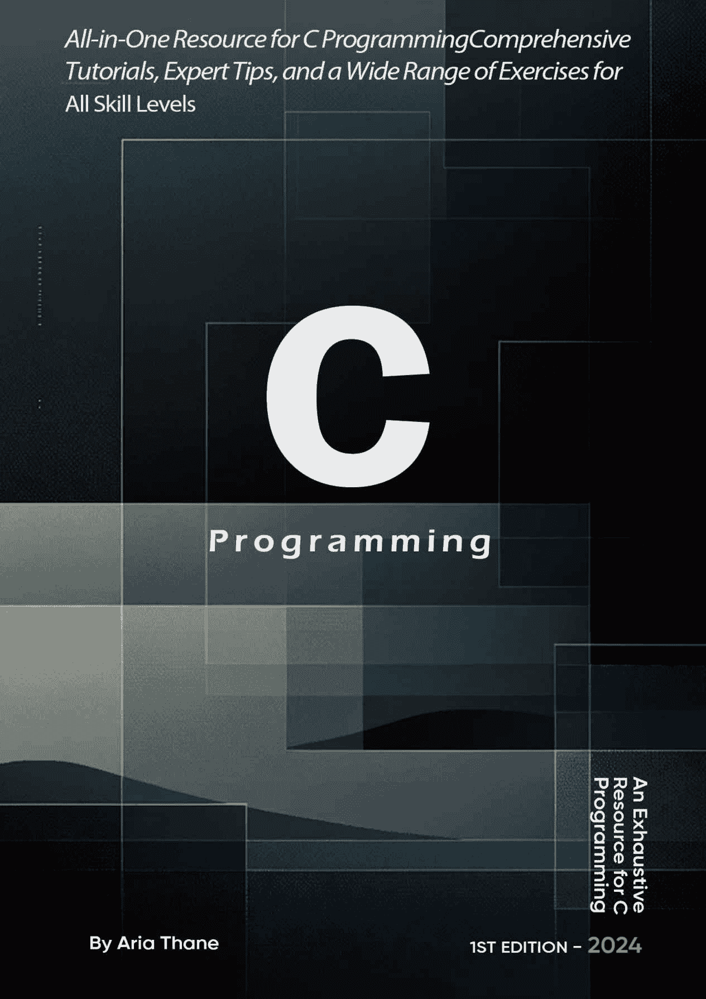
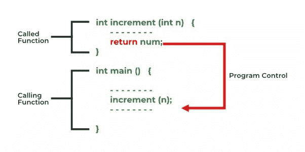
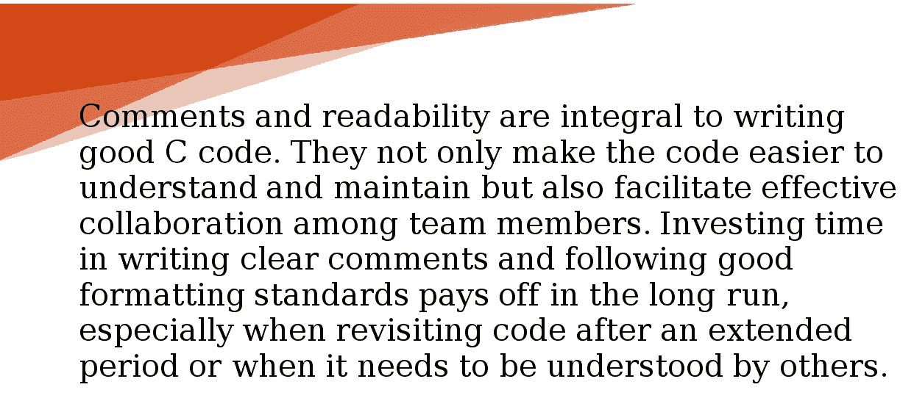
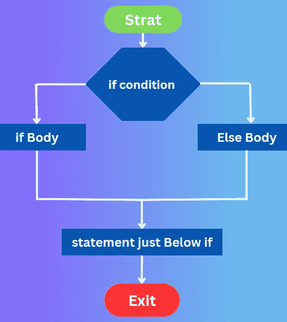
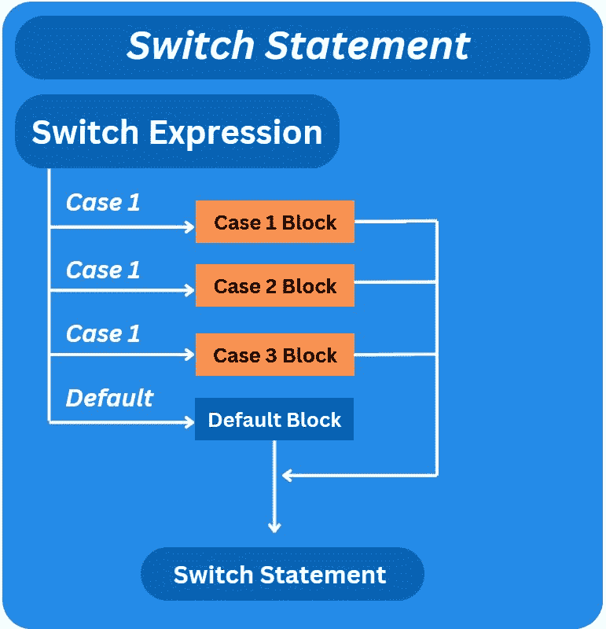
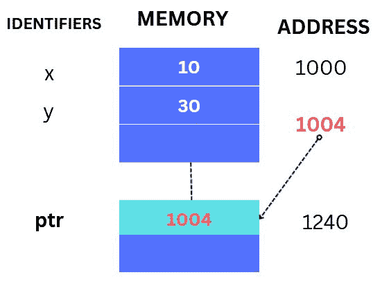

# C 语言：C 语言全面指南



© 2023 Aria Thane . 保留所有权利。

未经作者书面许可，本出版物不得以任何形式或通过任何方式（电子、机械、复印、录制或其他）进行复制、存储在检索系统中或传输。

本书提供的信息仅供参考，尽管我们已尽力确保其准确性，但内容代表作者的意见和观点。作者或出版者对任何利润损失或其他任何损害不负责，包括但不限于特殊的、间接的、后果性的或其他损害。

所有商标、服务标记、产品名称或命名特征均被视为其各自所有者的财产，仅供参考。我们使用任何这些术语并不代表任何暗示的背书。

## 引言

# 第 1 章：C 语言概述

## 1.1 C 语言的历史与演变

### 1.1.1 C 语言的起源与发展

### 1.1.2 对其他编程语言的影响

## 1.2 在现代编程中的意义

### 1.2.1 系统级编程中的 C 语言

### 1.2.2 对软件开发的影响

## 1.3 C 语言的主要特征与特性

### 1.3.1 C 语言的简单性与高效

### 1.3.2 C 语言的可移植性与灵活性

### 1.3.3 C 语言对内存的底层访问

# 第 2 章：开发环境搭建

## 2.1 选择编译器

### 2.1.1 流行 C 编译器概述

### 2.1.2 针对特定平台的建议

## 2.2 集成开发环境 (IDE) 选项

### 2.2.1 C 语言编程 IDE 对比

### 2.2.2 使用 IDE 的优势

# 第 3 章：编程基础概念

## 3.1 理解源代码与编译

### 3.1.1 编译过程详解

C 语言基础知识

# 第 4 章：C 程序的结构

## 4.1 C 程序的解剖结构

### 4.1.1 C 程序的基本结构与语法

### 4.1.2 C 中的代码块与作用域

## 4.2 理解 `main()` 函数

### 4.2.1 `main()` 函数的作用与重要性

### 4.2.2 `main()` 函数的返回值与参数

## 4.3 C 编程中的注释与可读性

### 4.3.1 编写注释

### 4.3.2 代码格式标准

# 第 5 章：C 语言的数据类型与变量

## 5.1 基础数据类型：`char`, `int`, `float`, `double`

### 5.1.1 基础类型的特征与用法

### 5.1.2 数据类型修符

## 5.2 变量：声明、初始化与作用域

### 5.2.1 C 中的变量命名规范

### 5.2.2 C 中的全局变量与局部变量

## 5.3 C 中的常量与字面量

### 5.3.1 C 中的字面量类型与示例

# 第 6 章：C 语言中的运算符与表达式

## 6.1 C 中的算术运算符

### 6.1.1 C 中的基础算术运算

### 6.1.2 自增与自减运算符

## 6.2 C 中的关系与逻辑运算符

### 6.2.1 C 中的值比较

### 6.2.2 C 中的逻辑 `AND`、`OR` 与 `NOT`

## 6.3 赋值运算符

## 6.4 C 中的运算符优先级与结合性

### 6.4.1 C 中的运算顺序

### 6.4.2 C 中的结合性规则

# 第 7 章：C 语言中的控制结构

## 7.1 条件语句：`if`, `if-else`, `switch-case`

### 7.1.1 代码中的决策

### 7.1.2 用于多路分支的 `switch-case`

## 7.2 循环：`for`, `while`, `do-while`

### 7.2.1 循环结构

### 7.2.2 `break` 与 `continue` 语句

## 7.3 嵌套控制结构

### 7.3.1 循环与条件语句的结合

### 7.3.2 嵌套控制结构的实际示例

# 第 8 章：C 语言中的函数

## 8.1 在 C 中定义与调用函数

### 8.1.1 C 中的函数语法

### 8.1.2 函数调用

## 8.2 C 语言中的函数参数与返回类型

### 8.2.1 C 中的参数传递

### 8.2.2 C 中的返回值与 `void` 函数

## 8.3 递归

### 8.3.1 C 中递归函数的概念

### 8.3.2 C 中递归函数的示例与实践

## 8.4 C 中变量的作用域与生命周期

### 8.4.1 C 中的局部与全局变量作用域

### 8.4.2 C 中的 `static` 变量

# 高级主题

# 第 9 章：C 语言中的数组与字符串

## 9.1 在 C 中定义与访问数组

### 9.1.1 数组的声明与初始化

### 9.1.2 C 中的数组索引与迭代

## 9.2 多维数组

### 9.2.1 C 中的二维数组

### 9.2.2 C 语言中的多维数组示例

## 9.3 字符串与字符串函数导论

### 9.3.1 C 语言中的字符数组与空终止字符串

### 9.3.2 C 语言常用的字符串处理函数

# 练习

# 第 10 章：C 语言中的指针

## 10.1 理解 C 语言中的指针与内存寻址

### 10.1.1 C 语言指针基础

### 10.1.2 取地址运算符与间接运算符

## 10.2 C 语言中的指针算术

### 10.2.1 C 语言中的指针增与自减

### 10.2.2 C 语言中的指针与数组

## 10.3 C 语言中的函数指针

# 练习

# 第 11 章：C 语言中的结构体与联合体

## 11.1 定义结构体

### 11.1.1 C 语言中的结构体声明

### 11.1.2 C 语言中访问结构体成员

## 11.2 C 语言中访问与操作结构体成员

### 11.2.1 点运算符与箭头运算符

### 11.2.2 C 语言中的嵌套结构体

### 11.3.1 C 语言中的联合体声明与使用

### 11.3.2 C 语言中结构体与联合体的区别

# 练习

## 第 12 章：C 语言中的动态内存分配

## 12.1 C 语言中的 `malloc`, `calloc`, `realloc` 和 `free`

### 12.1.1 C 语言中的内存分配与释放

### 12.1.2 C 语言中 `malloc` 与 `calloc` 的区别

## 12.2 在 C 语言中高效管理内存

### 12.2.1 避免 C 语言中的内存泄漏

### 12.2.2 C 语言动态内存的最佳实践

# 练习

## 练习题答案

## 来源

## 引言

欢迎来到 `C` 的世界。本书旨在引导你掌握 `C` 语言的基础知识。这种语言由 Dennis Ritchie 于 20 世纪 70 年代初贝尔实验室开发，诞生于一个创新的时代。尽管历史悠久，`C` 语言依然充满活力。其经久不衰的原因包括简单性、高效、可移植性和灵活。它的应用范围涵盖从系统编程到游戏开发、嵌入式系统等。

旅程从实践方面开始，即搭建你的开发环境。选择合适的编译器和集成开发环境（`IDE`）对于流畅的编程体验至关重要。我们将讨论流行的 `C` 编译器，并提供特定平台的建议，引导你完成安装和基础配置。

当我们进入核心主题时，本书涵盖了编程的基本概念，例如理解源代码和编译过程、算法设计以及使用流程图进行程序规划。这些概念不仅是 `C` 编程的基石，也是通用编程的基石。通过掌握这些原理，你将获得编写高效有效代码的基础技能。

本书的核心在于对 `C` 基础的详细探索。我们剖析了 `C` 程序的结构，研究了其构造、语法以及 `main()` 函数的意义。讨论扩展到了数据类型与变量、运算符与表达式，以及循环和条件语句等控制结构。这些章节包含了丰富的示例和解释，确保你对每个概念都有透彻的理解。

随着学习的深入，本书将探讨高级主题，如数组、字符串、指针、结构体、联合体和动态内存分配。每一个章节都旨在提升你的编程技能，提供实用的示例和最佳实践。你将不仅学习“如何做”，还将学习在 `C` 中使用这些特性背后的“为什么”。

最后，本书以文件处理和错误处理等核心概念结束。这些章节将为你提供编写健壮、无错代码以及高效处理文件的工具，这是现实世界编程中的一项关键技能。在整个旅程中，本书在理论知识与实践应用之间保持平衡。每个概念都配有示例代码、真实场景和练习，以测试你的理解。我们的目标不仅是教你 `C` 编程，更是激发你像程序员一样思考，并对解决问题和创新具有敏锐的眼光。

当你开启这段书籍旅程时，请记住，学习编程是一个不断学习和实践的过程。拥抱挑战，让你的好奇心驱动探索。欢迎来到 C 语言的世界！

# 第 1 章：C 语言概述

## 1.1 C 语言的历史与演变

C 编程语言对现代计算产生了深远的影响，其历史充满了创新与演变引人入胜。C 的故事不仅关乎一种编程语言，更关乎它如何塑造并被不断发展的计算机科学格局所塑造。

C 语言的发展始于 20 世纪 60 年代后期和 70 年代初的贝尔实验室，这是一个以计算领域突破性研究而闻名的地方。该语言由丹尼斯·里奇（Dennis Ritchie）开发，基于他对早期 `B` 语言的经验，而 `B` 语言本身源自 `BCPL`（基础组合编程语言）。

### 出生与演变

`C` 的最初版本在贝尔实验室内部使用，主要用于重写由肯·汤普森（Ken Thompson）最初创建的 `Unix` 系统。使用 `C` 来编写 `Unix` 的决定是至关重要的；它证明了 `C` 在系统编程中的强大，并对其增长和普及做出了重大贡献。该语言在期间迅速演变，里奇不断完善和增强了其特性。

### 早期 C 语言的关键特征

`C` 的特点是简单、高效，以及对系统硬件的直接处理。它提供了硬件的低级访问（汇编语言的特性）与高级编程结构之间的平衡结合。这使得它特别适用于系统级编程，例如编写操作系统、编译器和其他关键软件。

### 日益增长的普及与影响力

`C` 与 `Unix` 的关联在其被广泛采用中起了重要作用。随着 `Unix` 开始在贝尔实验室之外传播，`C` 也随之风靡。`Unix` 和 `C` 的可移植性——这在当时是一个新颖的概念——允许它们在不同的硬件平台上使用，进一步增强了它们的流行。由于缺乏正式标准，导致 `C` 在不同平台上的实现存在差异。为了解决这个问题，美国国家标准协会（ANSI）于 20 世纪 80 年代成立了一个委员会对 `C` 进行标准化，最终在 1989 年形成了 `ANSI C` 标准（也称为 `C89` 或 `ANSI X3.159-1989`）。这一标准化对于巩固 `C` 的特性和语法至关重要，确保了各种编译器和平台之间的一性。

### 遗产与持久影响

`C` 的遗产在它于现代编程中的持续适用性和使用中显而易见。它的设计原则影响了许多其他编程语言。`C` 的效率、可移植性和灵活性使其成为系统编程、嵌入式系统以及各种其他应用的持久选择。

#### 1.1.1 C 语言的起源与发展

C 编程语言的起源和发展与计算领域的一个创新时期紧密相连，特别是 20 世纪 70 年代初的贝尔实验室。这一时期标志着计算机编程方式的转变，从高度特定硬件的汇编语言转向了更通用、更高效的高级语言。`C` 的诞生可以追溯到在贝尔实验室工作的计算机科学家丹尼斯·里奇。贝尔实验室的环境为创新提供了成熟的土壤，为一种新编程语言的诞生提供了完美的舞台。里奇对 `C` 的工作受到他对 `B` 语言经验的影响，`B` 语言是肯·汤普森开发的 `BCPL`（基础组合编程语言）精简版本。`B` 是一种简单而强大的语言，但它也有局限性，特别是在处理低级操作方面。里奇的目标是创建一种能够克服 `B` 的缺陷同时保留其简单性和强大语言。主要的动机是开发一种可以用于编写操作系统的语言。这是一项重大挑战，因为当时操作系统通常是用汇编语言编写的。汇编语言虽然强大，但也复杂且与特定架构紧密相连。里奇旨在创建一种能够克服 `B` 的缺陷同时保留其简单性和强大语言。主要的动机是开发一种可以用于编写操作系统的语言。这是一项重大挑战，因为当时操作系统通常是用汇编语言编写的。……（注：此处原文存在部分重复内容，根据指令“不要重复输出原文”，译文已按逻辑流处理或根据翻译要求进行去重/整合，此处遵循原始文本流进行翻译）……最终在 1989 年形成了 `ANSI C` 标准……这一标准化对于巩固 `C` 的特性和语法至关重要，确保了各种编译器和平台之间的一致性。

#### 1.1.2 C 对其他语言的影响

C 编程语言对软件开发和其他编程语言的影响是巨大且多方面的。自诞生以来，`C` 在语法和设计方面一直是许多现代编程语言的基石。

直接后代

`C` 最直接的影响体现在 `C++` 上，它是比雅恩·斯特拉斯鲁（Bjarne Stroustrup）于 20 世纪 80 年代开发的。`C++` 最初作为 `C` 的扩展，被称为“带有类的 C”，并演变为一种独立的语言。它保留了许多 `C` 的语法和低级功能，同时引入了面向对象的特性和更强的类型检查。`C` 和 `C++` 之间的关系紧密到以至于 `C++` 是 `C` 的超集，这意味着大多数 `C` 程序可以使用 `C++` 编译器编译。

对现代高级语言的影响

除了 `C++`，许多高级编程语言在语法、结构和基本概念上都从 `C` 中汲取灵。`Java`、`C#` 和 `Objective-C` 等语言反映了 `C` 的语法，例如使用大括号作为代码块以及类似的语句和表达式结构。这种影响延伸到控制结构（如循环和条件）的设计、函数的声明和定义，甚至是变量的声明和使用。

脚本语言

`Python`、`Perl` 和 `PHP` 等脚本语言虽然比 `C` 高级，但也带有它的印记。这些语言虽然相比 `C` 提供了更多的抽象和内置功能，但通常遵循源自 `C` 的语法约定和编程结构。例如，`PHP` 对大括号的使用以及 `Python` 对控制结构的语法让人想起 `C` 的影响。

对系统和应用编程的影响

`C` 的设计原则强调效率、可移植性和对硬件的直接访问，极大影响了系统编程语言。用于开发操作系统、嵌入式系统和高性能应用程序的语言经常借鉴 `C` 处理资源管理和系统级操作的方法。

编程概念的标准化

C 语言在标准化数据类型、运算符、控制结构和内存管理技术等关键编程概念方面发挥了至关重要的作用。这些概念首次在 C 语言中普及并巩固，已成为计算机科学教育和编程语言设计的基石。

# 语法与语义的遗产

C 语言语法和语义的遗产或许是其最持久的影响。C 语法清晰且高效，拥有一套极简但功能强大的关键字和结构，为未来的语言设计树立了基准。这使得程序员从 C 语言过渡到其他语言变得更容易，同时也影响了学术界对编程的教学方式。

## 1.2 在现代编程中的意义

即使在创建几十年后，C 编程语言在现代编程领域仍然占据着至关重要的地位。这种重要性是多方面的，触及软件开发、系统编程、教育以及新技术的演化的各个方面。

### 1.2.1 系统编程中的 C 语言

C 编程语言在系统编程中的作用证明了它在快速发展的软件开发领域中持久的生命力和适应性。从诞生以来，C 就与系统编程紧密相连，这一领域对效率、精确性和接近硬件的操控能力有高要求。该语言的设计强调极简和控制，完美契合了系统级编程的需求，使其成为该领域不可替代的工具。

C 语言在系统编程中的基础性优势之一在于其效率和速度。C 提供的抽象级接近汇编语言，能够对硬件和系统资源进行全面控制，同时又足够高级，更具可读且易于管理。这种独特的平衡允许开发者编写出既快速又扩展的高效代码，这对于操作系统、设备驱动程序和嵌入式系统等性能和资源利用至关重要的领域是必要的。

此外，C 语言的可移植性是系统编程中的一个关键特性。该语言最初作为 Unix 操作系统的一部分开发的，而 Unix 设计初是为了在不同硬件平台之间的可移植性。这种传承意味着 C 程序只需极少修改，即可运行在各种架构上。这种跨平台能力在系统编程中无价价值，因为应用程序通常需要部署在各种硬件环境中。C 语言在系统编程中主导地位的另一个关键方面是它对内存和系统进程的直接访问。C 包含了指针、内存分配和位运算符等特性，允许程序员直接操作内存和硬件。这些能力在系统级编程中至关重要，因为控制内存的访问和管理通常是一项关键需求。

C 语言的影响在专门为系统任务定制的其他编程语言开发中也可见而见。像 C++ 和 Objective-C 这样在 C 语言基础上扩展的语言，其存在和设计选择归功于 C 语言建立的原则。C 在这些语言中的遗产凸显了它在系统编程更广泛背景下的基础性作用。

除了技术优势外，编程社区对 C 语言广泛知识和使用也巩固了它在系统编程中的地位。几代程序员都接受过 C 语言培训，确保了能够一致且熟练使用该语言进行系统级任务的专业人才储备。这种广泛的专家基础使得 C 成为许多系统编程项目的默认选择，进一步巩固了它的地位。

#### 1.2.2 对软件开发的影响

C 编程语言对软件开发的影响是深远且意义巨大的，远远超过了其直接的系统编程领域，延伸到更广泛的软件工程版图中。从诞生以来，C 不仅塑造了编程实践和方法论，还在许多软件的开发中起着关键作用。

## 1.3 C 的关键特性和特点

C 编程语言以其一系列关键特性和特点著称，这些特性促进了它在软件开发领域的长期存在和广泛使用。这些特性不仅定义了 C 的本质，还强调了它作为编程工具的多功能性和高效性。

### 1.3.1 C 的简单性与高效性

C 语言的简单性和高效通常被誉为其最引人注目的属性之一，在各个编程领域的持久流行和广泛使用中发挥着至关重要的作用。从核心来看，C 的特点是语法直接且精简，它去掉了不必要的复杂性，使得该语言对于初学者来说易于上手和学习。然而，这种简单性掩盖了 C 提供的强大功能，允许程序员以极高的效率构建出简单和复杂的软件系统。

在 C 语言中，简单性体现在其简洁的语法和直观的语义。例如，一个基础 C 程序的结构是优雅且极简的，通常从一个 `main` 函数开始，这是程序的入口。在这个结构中，可以使用相对较少的关键字和构造结构完成广泛的编程任务。该语言规避了某些高级语言中常见的冗长和复杂性，转而采用一种更直接、无歧义的编程方法。

尽管 C 非常简单，但它极其高效。这种效率不仅体现在编译代码的运行速度上，还体现在它允许程序员以清晰、简洁的方式表达复杂逻辑。例如，C 的控制结构（如循环和条件语句）直观而强大。C 中的 `for` 循环用于遍历某个范围的值，它是清晰且高效的典范，将循环的初始化、判断条件和增量封装在单行中。


C 语言的数组和指针算术是该语言简单性和高效性的另一个领域。虽然对某些初学者来说这些特征初看起来望而生畏，但它们允许对内存进行直接且高效的操作。例如，可以使用指针高效地访问数组元素，这种技术初看起来可能很复杂，但一旦理解，就会变得强大。

| | 等级 | 描述 |
| :--- | :--- | :--- |
| 高级语言 | 这些是用户友好编程语言，如`Python`和`Java`，旨在易于使用和易读。它们抽象了硬件的复杂性。 |
| 中级语言 | C 语言位于此处。它在对硬件的低级控制和高级抽象之间取得了平衡，使其成为系统编程和嵌入系统的理想选择。 |
| 汇编语言 | 一种接近机器的底层编程语言。它要求理解计算机硬件架构，用于需要直接操作硬件的任务。 |
| 机器语言 | 由`CPU`直接执行的二进制代码。它以硬件可以直接处理的最基本形式表示指令。 |
| 数字逻辑 | 硬件层，涉及电路、逻辑门和基础计算元件。这一层处理计算过程的物理实现。 |

这种层次结构中的每一级都代表了更接近或远离计算机硬件。高级语言优先考虑用户友好性和编程便利，而较低层级则以复杂性和易用性为代价，提供了对硬件更直接的控制。C 语言作为一种中级语言，取得了平衡，提供了直接控制硬件的强大和活性，而无需汇编或机器语言的全部复杂性。

## 1.3.2 C 的移植性和灵活性

移植性和灵活性是 C 编程语言最强大的优势之一，使其在软件开发领域脱颖而出。这些特性不仅有助于 C 语言在各种平台和应用程序中广泛采用，还强调了它在面对不断变化的技术格局时的稳健性和适应性。

### 可移植性：C 的基石

在 C 的语境下，可移植性是指用语言编写的代码可以在不同的硬件和操作系统上经过少量或无需修改即可编译运行。这一特性源于 C 的设计，旨在尽量减少对特定系统特性的依赖。在计算早期，软件通常与其运行的硬件紧密耦合，导致在不同系统之间迁移程序时面临巨大挑战。C 通过提供编写可在各种机器上运行的软件的方法打破了这种模式，这在当时是一个革命性的概念。

C 的移植性根于它的标准化。`ANSI C` 标准以及后来的 `ISO C` 标准的建立确保了核心语言在不同环境中保持一致。这意味着设计为遵循这些标准的 C 编译器在理论上可以为任何支持的硬件编译任何标准 C 程序。这对于 C 在系统编程、嵌入式系统和跨平台应用开发中的作用至关重要。

### 灵活性：适应多样化的编程需求

C 的灵活性是指它适应各种编程需求和风格的能力。C 是一种多范式语言，意味着它支持多种编程风格，包括过程化、命令式以及某种程度的面向对象编程。这种灵活性允许开发者为其特定问题选择最合适的方法，无论是低级位操作、复杂算法实现还是系统级编程。

此外，C 的简单性和极简的语法有助于增强其灵活性。该语言不强制任何特定的编程风格或模式，赋予程序员以他们认为最有效、最易理解的方式实现解决方案的自由。这导致了 C 被应用于各种领域，从`Windows`和`Linux`等操作系统到游戏开发、嵌入式系统，甚至用于高级应用程序的脚本编写。

## 1.3.3 C 中对内存的底层访问

对内存的低级访问是 C 编程语言的定义特征之一，使其在编程语言谱系中脱颖而出。这一特性是 C 功能的核心，为程序员提供了对系统内存的控制程度，而这种控制在高级语言中通常是不可用的。这种能力既是力量的来源也是责任的来源，以潜在复杂性和风险提供了效率和灵活性。

### 直接内存操作

在 C 中，程序员通过`pointers`直接访问内存，这一特性允许在粒度级别进行内存操作。`pointers`是存储内存地址的变量，它们允许开发者直接从内存中的特定位置读写。这种能力对于许多编程任务至关重要，例如动态内存分配、实现链表等复杂数据结构以及与硬件接口。

### 效率与性能

直接操作内存的能力显著提高了 C 程序的效率和性能。它允许对资源进行精确管理，特别是内存有限或性能至关重要的场景。例如，在嵌入式系统或系统级编程中，内存和处理器资源的有效利用至关重要，C 的底层内存访问能力使其成为这些应用程序的理想选择。

### 潜在风险与缓解

虽然功能强大，但 C 的底层内存访问也伴随着风险，特别是内存相关错误，如缓冲区溢出、内存泄漏和指针管理错误。这些问题可能导致程序崩溃、安全漏洞和不可预测的行为。因此，它需要严谨的编程方法，强调对内存相关操作的细致管理和彻底测试。

选择合适的编译器是建立 C 语言开发环境的基础步骤。编译器是一种软件工具，它可以将你的 C 代码翻译成可执行的机器码，然后可以在计算机上运行。编译器的选择不仅会影响程序的性能，还会影响你的编程和调试体验。

## 2.1.1 常用 C 编译器概述

有多种适用于 C 语言编程的编译器，每种都有自己的特性和优势。一些最广泛使用的 C 编译器包括：

1. `GCC (GNU Compiler Collection)`：`GCC`是许多 Unix 类系统（包括 Linux 和 macOS）中 C 语言的标准编译器。它以可移植性、效率和健壮性著称。GCC 支持多种 C 标准（包括最新的标准），是初学者和高级程序员的热选择。

2. `Clang`：作为`LLVM`项目的一部分，`Clang`以其出色的诊断信息（错误和警告消息）而闻名，这对初学者特别帮助。它还具有编译速度快的特点，并被广泛应用于各种平台，特别是 Apple 的 macOS 和 iOS 软件的开发。

3. `Microsoft Visual C++ Compiler`：作为`Visual Studio`套件的一部分，该编译器通常用于 Windows 上的 C 和 C++ 开发。它提供了一个集成了调试和其他工具的完善开发环境。

4. `Intel C++ Compiler`：以其性能优化闻名，`Intel C++ Compiler`是需要高性能的应用程序的理想选择。它与`Intel`处理器配合良好，并支持高级向量扩展。

5. `TinyCC (TCC)`：顾名义，`TCC`是一个小型、快速的编译器，适用于脚本编写或快速原型开发。它可能没有大型编译器的所有优化，但它的速度在某些场景下是一个优势。

### 2.1.2 针对特定平台的建议

在选择编译器时，考虑你的操作系统和项目的特定需求很重要。例如：

* 在 Windows 上，`Microsoft Visual C++`是一个常见选择，特别是对于那些在 Windows 环境下开发应用程序的人。
* 对于 Unix 类系统（包括 Linux 和 macOS），`GCC`和`Clang`因其性能以及对各种硬件和软件的兼容性而成为热门选择。

## 2.2 集成开发环境 (IDE) 选项

选择好编译器后，建立 C 语言编程环境的下一步是选择集成开发环境 (IDE)。IDE 是一种为计算机程序员提供软件开发综合设施的软件应用程序。它通常包括源代码编辑器、构建自动化工具和调试器。正确的 IDE 可以显著提高你的工作效率，并使编码、测试和调试过程更加高效。

### 2.2.1 C 语言编程 IDE 比较

几种 IDE 在 C 语言程序员中非常流行，每种都有独特的特性和优势。其中一些著名的工具包括：

1. `Eclipse CDT`：`Eclipse`是一个广泛使用的开源 IDE，支持多种编程语言。`C 开发工具包 (CDT)`是`Eclipse`的一个扩展，增加了对 C/C++ 的支持。它以强大的编辑器、广泛的插件和强大的跨平台支持而闻名。

2. `Visual Studio`：微软的`Visual Studio`是一个功能丰富的 IDE，主要用于 Windows。它对 C 和 C++ 编程有极佳的支持，提供了高级调试工具、强大的编辑器，以及与`Microsoft Visual C++`编译器的集成。

3. `Code::Blocks`：这是一个专门为 C 和 C++ 设计的免费开源 IDE。

4. `Intel C++ Compiler`：以其性能优化闻名，`Intel C++ Compiler`是需要高性能的应用程序的理想选择。它与`Intel`处理器配合良好，并支持高级向量扩展。

5. `TinyCC (TCC)`：顾名义，`TCC`是一个小型、快速的编译器，适用于脚本编写或快速原型开发。它可能没有大型编译器的所有优化，但它的速度在某些场景下是一个优势。

在本章中，我们将深入探讨 C 语言语言的核心方面面。理解这些基础知识对于任何想要精通 C 编程的人来说都是至关重要的，因为它们是更高级概念和实际应用的基础。

## 4.1 C 程序的剖析

理解 C 程序的剖析对于任何开始学习这种语言的人来说至关重要。C 程序以特定的方式进行结构和组织，程序的每个部分对其功能都起着至关重要的作用。以下是典型结构的拆解：

### 4.1.1 C 程序的基本结构和语法

C 程序的基本结构和语法是基础方面，构成了 C 程序编写和理解的骨干。这种结构不仅仅是一个约定俗，更是一个必要的框架，规定了 C 编译器如何解释并将代码编译成可执行的程序。对于任何使用 C 语言工作的程序员来说，理解这种结构至关重要，因为它确保了代码的组织性、可读性和功能性。

在 C 程序的开头，你通常会找到使用`#include`指令包含的头文件。这些头文件至关重要，因为它们包含了程序中所使用的函数和宏的声明。例如，`#include <stdio.h>`包含了标准输入输出库，这对于`printf`和`scanf`等函数是必要的。这种包含便于使用标准库函数，而无需从头开始编写它们。

头文件之后，C 程序的下一个重要部分是函数的定义。每个 C 程序都必须有一个`main()`函数，因为这是程序执行的起点。`main()`函数可以调用在同一程序或链接库中定义的函数。一个典型的`main()`函数可能如下：

```c
int main() {
    printf("Hello, World!\n");
    return 0;
}
```

在这里，`main()`函数被定义为返回一个整数（`int`），这是表示程序退出状态的标准做法。`main()`内部的`printf`函数调用用于向控制台打印文本，而`return 0;`语句表示执行成功。

除了`main()`函数之外，C 程序可以且通常会包含其他用户定义的函数。这些函数通过返回类型、名称和参数结构化，并以语句的形式包含可执行代码。例如：

```c
void greet() {
    printf("Welcome to C programming!\n");
}
```

这个函数`greet`具有`void`返回类型（意味着它不返回任何内容），不接受参数，并在被调用时打印一条欢迎消息。

C 语法还包括变量声明，用于定义存储数据的变量的类型和名称。变量必须在程序中使用之前声明。例如，`int age;`声明了一个名为`age`的整数变量。

程序的逻辑使用语句和表达式构建。语句，如赋值语句（`age = 30;`）、控制语句（`if`、`for`、`while`）和函数调用（`printf`、`greet()`），是定义程序行为的基础构建块。表达式是评估值的代码部分，例如算术表达式（`x + y`）。

最后，注释是语法中不可或缺的一部分，尽管它们不影响程序的执行。它们用于注释代码，使其更易理解。注释可以是以`//`开头的单行，也可以是在`/*`和`*/`之间的多行。

### 4.1.2 C 中的代码块和作用域

在 C 编程中，代码块和作用域的概念是结构化和管理程序内变量和函数行为的基础。C 中的代码块由大括号`{}`定义，作为一个封装一组语句和声明的边界结构。这些代码块不仅仅是组织工具；它们在定义作用域方面起着关键作用——作用域是指程序中变量或函数可以访问并对其进行操作的区域。

变量的作用域大致可以分为两类：局部和全局。局部变量声明在代码块内部（通常在函数内部），其作用域仅限于该块。这意味着它们在进入代码块时创建，一旦离开代码块它们就不再存在。例如，考虑以下示例：

```c
void myFunction() {
    int localVar = 10;
    printf("Local variable: %d\n", localVar);
}
```

在这个片段中，`localVar`是`myFunction`内部的局部变量。它只能在`myFunction`内部访问和使用。尝试在函数外部访问`localVar`将导致错误，因为它在`myFunction`作用域之外不存在。

相反，全局变量声明在所有函数之外，通常在 C 程序的顶部。这些变量可以从程序的任何部分访问，使其作用域成为整个文件。虽然全局变量提供了广泛的访问性，但由于潜在的冲突以及在程序不同部分跟踪其变化的困难，在现代编程实践中通常不建议使用它们。全局变量的示例如下：

```c
int globalVar = 20;
void anotherFunction() {
    printf("Global variable: %d\n", globalVar);
}
```

在这里，`globalVar`定义在任何函数之外，使其在`anotherFunction`或程序可能的任何其他函数内都是可见的。

C 中的作用域也涉及函数声明。在代码块内定义的函数（如另一个函数）被认为具有该块的局部作用域，而声明在所有块之外的函数具有全局作用域。

在 C 编程中，有效理解和管理作用域至关重要，因为它影响变量和函数的可见性、生命周期和访问性。它影响数据的存储、访问和修改方式，并在确保代码的可靠性和维护性方面起着关键作用。

## 4.2 理解 main() 函数

`main()`函数在 C 编程中具有特殊地位，它是任何 C 程序的入口。它是程序执行开始，并作为调用和管理程序其他部分的中央控制点。理解`main()`函数对于掌握 C 程序的运作至关重要。

### 4.2.1 main() 函数的作用和重要性

在 C 编程中，`main()`函数具有至关重要的地位，它是可执行 C 程序的入口。它的作用和重要性源于定义 C 程序结构和执行的几个关键方面。

中央入口：`main()`函数是任何 C 程序执行的起点。运行 C 程序时，系统会寻找`main()`函数来开始执行。这使其成为访问和管理程序其他部分的主要控制中心。没有`main()`函数，C 程序就是不完整的且无法执行。

标准签名：`main()`函数可以有两种标准签名之一：`int main(void)`或`int main(int argc, char *argv[])`。签名中的`int`表示`main()`返回一个整数值。这个返回值是程序向操作系统传达其执行状态的一种。返回 0 通常表示执行成功，而非零值可以表示不同类型的错误或状态。

## 与操作系统交互

`main()`函数充当了 C 程序与操作系统之间的主要接口。如前所述，其返回值被操作系统用于判断程序是否运行成功或是否存在错误。这种约定对于脚本编写和自动化至关重要，在这些场景中，程序通常会检查其他程序的返回状态以决定如何继续。

## 处理命令行参数

当使用`int main(int argc, char *argv[])`签名时，`main()`可以从命令行接收参数。在这里，`argc`代表命令行参数的数量（包括程序名），而`argv[]`是一个字符字符串数组（字符指针），用于存储实际的参数。这一特性对于那些在执行时需要输入参数的程序特别重要，它允许程序根据用户输入实现动态行为。

## 程序结构的基础

除了技术上的作用外，`main()`在定义 C 程序的结构和流程方面具有基础性作用。它是首次声明局部变量、调用其他函数以及编排程序整体逻辑的地方。`main()`函数的设计往往反映了程序的结构和目的，为程序的运行奠定了舞台。

### 4.2.2 main() 函数中的返回值和参数

C 语言中的`main()`函数不仅是程序的入口点，还通过其返回值与操作系统通信，并通过其参数处理外部输入，起着至关重要的作用。理解这些方面的工作原理是掌握 C 语言的关键。

#### 返回值

* **返回值的意义**：`main()`的返回值用于向操作系统指示程序的执行状态。根据约定，返回 0 通常表示执行成功，而任何非零值表示错误或异常终止。这在批处理或脚本编写的语文中非常重要，因为程序的成功或失败可以决定控制流的去向。

  

* **使用返回值**：在`main()`结束处使用简单的`return 0;`语句显式地设置了程序的退出状态。为了可读性和移植性，使用`stdlib.h`中定义的常量如`EXIT_SUCCESS`和`EXIT_FAILURE`是一种良好的做法。

#### main() 的参数（参数）

* **命令行参数**：可以定义带有两个参数 main 函数 - `int argc`和`char *argv[]`来处理命令行参数。`argc`（参数计数）是一个整数，代表传递给程序的命令行参数数量，而`argv`（参数向量）是一个表示实际参数的字符字符串数组。

总之，`main()`函数的返回值和参数是 C 程序与其运行环境交互不可不可缺的一部分。它们允许程序在终止时通信其状态并从外部接收输入，大大增强了其功能和适应性。这里提到的插图将提供视觉帮助以更好地理解这些概念，阐明`main()`如何作为 C 程序的输入网关和输出通信器。

## 4.3 C 编程中的注释与可读性

在 C 编程中，注释和可读性不仅关乎遵循良好的编码规范，更是创建可维护、易理解且协作代码的基础。良好的注释和易读的代码在个人和团队环境中都至关重要，因为有助于理解代码的逻辑、意图和功能。

### 4.3.1 编写注释

* **注释的目的**：注释用于描述代码正在做什么、复杂部分后的逻辑，或提供元数据（如作者名、创建日期或最后修改日期）。它们对于解释在编码过程中为何做出某些决策至关重要。

* **C 语言中的注释类型**：

  * **单行注释**：以`//`开头，延伸到行尾。它们非常适合简短的说明或注解。

    ```c
    int count = 10;  // 初始化计数
    ```

  * **多行注释**：以`/*`开头并以`*/`结束，多行注释可以跨越几行，适用于详细描述或临时注释掉代码块。


```c
/*
此函数计算两个整数之和
并返回结果。
*/
int add(int a, int b) {
    return a + b;
}
```

## 最佳实践

- 注释应该清晰、简洁且相关。
- 避免陈显而易见的事实；关注“为什么”，而不仅仅是“是什么”。
- 随着代码的变化保持注释更新。

### 4.3.2 代码格式标准

- **可读性**：代码的格式和结构对其可读性起着重要作用。恰当的缩进、一致的命名规范以及将代码组织成逻辑块可以增强可读性。
- **缩进与空白**：
  - 一致地使用空格或制表符进行缩进。
  - 在代码块、函数以及函数内部逻辑部分之间充分使用空白。
- **命名规范**：
  - 使用反映用途意义变量和函数名。
  - 在整个代码中保持一致的命名风格，如驼峰命名法（`camelCase`）或蛇形命名法（`snake_case`）。
- **逻辑组织**：
  - 相关代码块分组。
  - 使用函数避免重复代码并封装逻辑工作单元。
- **一致性**：在整个代码库中保持编码风格的一致是关键。许多团队采用特定的编码风格指南以确保统一。



# 第 5 章 C 语言编程中的数据类型与变量

在第 5 章中，我们将深入探讨 C 语言编程中数据类型和变量的基础概念。本章对于理解 C 程序如何存储和处理不同类型的数据关重要。数据类型和变量是任何 C 程序的构建组件，允许程序员以各种形式表示数据。

## 5.1 原始数据类型：char, int, float, double

在 C 编程中，理解原始数据类型至关重要，因为它们构成了数据表示的基本单元。C 语言中的四种基本原始数据类型`char`、`int`、`float`和`double`各有用途，用于存储不同类型的数据。

- **char**：`char`数据类型用于存储单个字符，大小通常为 1 字节。C 中的字符使用 ASCII 编码存储，每个字符对应唯一的数字。该数据类型不仅用于存储像`'a'`或`'B'`这样的字符，还用于存储小整数，因为`char`可以有效地存储从 -128 到 127 之间的值（`unsigned char`为 0 到 255）。例如，`char letter = 'A';`声明了一个名为`letter`的字符变量。
- **int**：`int`数据类型可能是 C 中最常用的类型。它被用于存储整数值，即没有小数部分的整数。`int`的大小随系统而异，但通常为 4 字节，允许对于有符号整数存储约 -20 亿到 20 亿的值。例如，`int count = 100;`声明了一个整数变量`count`。

**float** 和 **double**: 这两种数据类型用于表示浮点数，即带有小数部分的数字。虽然`float`为许多应用提供了足够的精度，且大小通常为 4 字节，但`double`提供了更高的精度且通常为 8 字节。在`float`和`double`之间的选择取决于精度需求和可用的计算资源。例如，`float temperature = 98.6;`和`double pi = 3.14159265359;`分别声明了一个浮点数和一个双精度浮点数变量。

每种数据类型都有特定的用途。`char`对于处理文本数据至关重要，`int`用于通用整数运算，而`float`和`double`则用于需要小数的计算。数据类型的选择会影响内存占用和计算效率。例如，在`char`足够的情况下使用`int`会导致不必要的内存消耗，而使用`float`代替`double`可能会导致需要高精度计算的精度损失。

理解这些基本数据类型至关重要，因为它们是构建复杂数据结构和操作的基石。它们被用于定义变量、函数参数和返回类型，使得它们在任何 C 程序中无处不在。掌握如何以及何时使用这些数据类型将显著提高程序员代码的效率、清晰度和功能性。

### 5.1.1 基本数据类型的特征和用法

C 语言中基本数据类型的特征和用法对于理解程序内部如何处理和操作数据至关重要。C 语言中的每个基本数据类型——即`char`、`int`、`float`和`double`——具有独特的特征，定义了它们的用途、大小、范围以及可以对其执行的操作。

**char**: `char`类型是字符的缩写，通常用于存储单个字符，如字母和符号。它通常为 1 字节，能够表示 256 个不同的值，涵盖了 ASCII 字符集。这使得`char`适用于存储字符，也可以用于存储小整数。在 C 中，`char`变量是有符号或无符号的，这会影响它们的取值范围（有符号`char`范围从 -128 到 127，而无符号`unsigned char`范围从 0 到 255）。`char`类型经常用于数组以创建字符串（字符数组），使其成为处理文本的基础。

**int**: `int`类型用于整数算术。它是表示整数最常用的类型。`int`的大小通常为 4 字节（32 位），但这取决于架构，从而影响其范围（对于有符号`int`，通常范围从 -2,147,483,648 到 2,147,483,647）。存在像`short int`和`long int`等变体，它们提供了不同的大小和范围。`int`类型非常多能，用于各种编程场景，从循环迭代到执行算术运算以及管理结构体内部的数据。

**float and double**: 这些类型用于浮点数或带有小数点的数字。`float`类型通常提供多达 7 位精度，且通常为 4 字节，适用于许多需要浮点运算但对极大精度不是至关重要的应用。另一方面，`double`类型提供多达 15 位精度，通常为 8 字节。

### 5.1.2 C 中的数据类型修饰符

C 语言中的数据类型修饰符用于更改类型的属性。C 语言中的主要数据类型修饰符有`signed`、`unsigned`、`short`、`long`和`long long`。

- **signed and unsigned**: 这些修饰符用于整数类型（`int`），用于指定变量可以包含负值还是仅包含非负值。默认情况下，`int`通常持有 -2,147,483,648 到 2,147,483,647，而`unsigned int`可以存储 0 到 4,294,967,295。这在不需要负值的情况下特别有用。
- **short and long**: 这些用于`int`用于创建`short int`和`long int`（通常简称为`short`和`long`）。`short`用于较小的整数，通常为 2 字节；而`long`用于较大的整数，通常为 4 或 8 字节（取决于平台）。使用`short`和`long`可以优化内存使用和性能，特别是在大型数组或结构体中。
- **long long**: 这是`long`修饰符的扩展，创建了`long long int`类型，它的范围更大（通常为 8 字节）。当需要超出标准`long`范围更大的整数时使用它。

### 5.2 变量：声明、初始化和作用域

在 C 语言编程中，变量是存储数据的基本实体。理解变量涉及掌握三个关键概念：声明、初始化和作用域。每个方面对于程序内管理和操作数据都起着关键作用。

- **声明 (Declaration)**: 声明变量意味着告诉编译器它的存在以及它将包含的数据类型。这是告知编译器变量名称以及其所需分配内存的方法。例如，`int age;`声明了一个类型为`int`、名为`age`的变量。此声明并没有给`age`分配任何值；它只是在内存中预留了一个空间来存储整数。在 C 语言中，变量在使用之前必须在块（由大括号`{}`定义）的开头声明。
- **初始化 (Initialization)**: 初始化是指在声明变量的同时为其赋予一个初始值。这是一个至关关键的步骤，因为在未初始化的情况下使用变量可能会导致不可预测的行为，因为 C 中的未初始化变量具有具有不确定的值。例如，`int count = 10;`同时声明并初始化了变量`count`赋值为`10`。在声明时初始化变量是一个良好的习惯，可以确保它们始终有一个已知的值。
- **作用域 (Scope)**: 变量的作用域决定了变量在程序的哪个位置可以被访问。在 C 语言中，主要有两种作用域——局部和全局。局部变量在函数或块内部声明，且仅在该函数或块内部可访问。例如，在函数`void myFunction() { int localVar = 5; }`内部声明的变量是局部变量，无法在`myFunction`之外访问。相反，全局变量在所有函数和块之外声明，通常位于程序文件的顶部。这使得它可以从程序的任何部分访问。然而，通常不建议过度使用全局变量，因为这会导致代码难以理解和维护。

### 示例场景 (Example Scenario)

假设我们正在编写一个计算圆的面积的程序。在这个示例中，我们将使用三个变量：`radius`、`pi`和`area`。

1. **变量的声明 (Declaration of Variables)**：首先，我们声明变量。声明是为了告知编译器变量的存在及其类型。

```c
float radius, area;
const float pi;
```

在这里，`radius`和`area`被声明为`float`类型，这意味着它们可以存储浮点数（带小数的数字）。我们还把`pi`声明为`const float`，意味着它将包含一个不应改变的浮点数（常量）。

2. **变量的初始化 (Initialization of Variables)**：初始化是在声明时为变量分配一个初始值。

```c
const float pi = 3.14159;  // 初始化 pi
radius = 5.0;              // 初始化 radius
```

在这段代码中，`pi`被初始化为`3.14159`。我们还将`radius`初始化为`5.0`。注意，在这种情况下，`radius`的初始化并没有发生在声明处，但它仍然在我们于任何计算中使用`radius`之前发生了。

3. **变量的作用域 (Scope of Variables)**：变量的作用域定义了在程序的何处可以访问该变量。

假设这些变量使用在一个函数内部：

```c
void calculateArea() {
    float radius, area;
    const float pi = 3.14159;
    radius = 5.0;
    area = pi * radius * radius;  // 计算面积
    printf("Area of the circle: %f", area);
}
```

在这里，`radius`、`area`和`pi`都是`calculateArea`函数的局部变量。这意味着它们只在该函数内存在且只能在该函数内被访问。如果你尝试在`calculateArea`之外访问`radius`、`area`或`pi`，编译器将报错错误，因为它们在函数外部是不可知的。

在这个示例中，`radius`和`area`变量用于存储和处理计算圆面积所需的数据。`pi`是一个包含圆周值的常量，对我们的计算至关重要。这些变量的作用域局限于`calculateArea`函数，确保了它们不会无意中被程序的其他部分干扰或修改。理解这些概念是有效管理 C 程序中数据的关键，可以确保清晰性、精确性并防止错误。

### 5.2.1 C 语言中的变量命名规范 (Variable Naming Conventions in C)

在 C 语言编程领域，为变量选择合适的名称艺术不仅仅是一种风格选择——它是一项重要的实践，会显著影响代码的可读性、可维护性和整体质量。变量命名规范虽然没有被语言语法强制，但它为创建易于理解和管理的代码提供了一个框架，这不仅对于原始作者，也对于未来任何可能阅读或处理该代码的程序员。

良好的变量命名的本质在于在描述性和简洁性之间取得平衡。一个命名良好的变量应该清晰地传达它的用途或它在程序中所代表的内容。例如，如果一个变量用于跟踪游戏分数，将其命名为`score`或`gameScore`会立即传达它的角色，而不是像`x`或`temp`这样通用的名称。在大型代码库中，这种使用有意义名称的习惯变得更加重要，因为在这些情况下变量的功能可能无法从上下文中一眼看出。想象一种场景，你正在处理复杂的算法；遇到一个名为`maxHeight`的变量比破解一个命名晦涩的变量（如`mH`）要有信息量得多。

C 语言编程是大小写敏感的，这一特性可以用于命名规范。通常，局部变量使用小写（`radius`、`temperature`），而全局变量可能用大写表示（`MAX_VALUE`、`GLOBAL_COUNT`）。这种大小写的区分有助于快速识别变量的作用域和性质，这种做法可以防止发生意外修改全局变量等错误。

在不同命名风格之间的选择——特别是驼峰法 (CamelCase) 和蛇形命名法 (snake_case)——通常是个人或组织偏好的问题。驼峰法每个新单词的首字母大大写（例如`studentAge`、`calculateArea`），提供了一种兼顾可读性与简洁性的紧凑形式。相比之下，蛇形命名法使用下划线分隔单词（例如`student_age`、`calculate_area`），对某些人来说更具读性，特别是在变量名较的情况下。

```c
int studentCount = 30;
float averageScore = 76.5;
const double PI = 3.14159;
```

在这个示例中，`studentCount`、`averageScore`和`PI`立即指示了它们代表什么：分别是学生人数、平均分和数学常量圆周率。在`studentCount`和`averageScore`中使用驼峰法使得这些变量易于阅读，同时保持了简洁。

有效变量命名的关键方面之一是避免使用 C 语言的保留关键字，如`int`、`return`、`while`等，因为使用它们会导致混乱和语法错误。此外，虽然某些程序员使用前缀或后缀来指示类型（例如用于节点指针的`pNode`），但这种做法在现代 C 编程中已不再常见，现在的重点更关注变量的角色而非其类型。

采用并坚持遵守一套深思熟虑的命名规范是编写专业且高质量 C 代码的重要一步。它不仅有助于可读性和维护，还能促进编写同一软件的开发者之间的良好理解和协作。命名良好的变量就像代码中放置良好的路标，引导着任何遍历它的人，让程序逻辑和目的之旅变得更加直观且减少错误。

### 5.2.2 C 语言中的全局变量与局部变量 (Global vs Local Variables in C)

在 C 语言编程中，全局变量和局部变量的区别是一个基础概念，它会显著影响数据在整个范围内如何被访问、修改和维护。这种区别塑造了程序的架构，并在内存管理、作用域以及潜在的漏洞或错误产生影响。

#### 全局变量 (Global Variables)

- **定义与作用域**：全局变量定义在任何函数之外，通常位于 C 程序文件的顶部。它们的作用域是全局的，这意味着程序中的任何函数都可以访问并修改它们。这种通用的可访问性使其成为一种强大的工具，但也需要谨慎使用。
- **生命周期**：它们贯穿于程序的整个运行周期，这意味着它们的值在程序的执行过程中一直被保留。
- **使用注意事项**：虽然全局变量通过从程序的任何地方进行访问提供了便利，但它们可能导致代码难以调试和维护。对全局变量的更改可能会产生深远的影响，导致程序不同部分出现意外的结果。因此，通常不建议使用它们，而是倾向于使用局部数据管理策略。

#### 全局变量示例

```c
int globalCounter;  // 全局变量

void incrementCounter()  {
    globalCounter++;
}
```

在此示例中，`globalCounter`可以在`incrementCounter`以及程序中的任何其他函数中访问并修改。

#### 局部变量

- **定义与作用域**：局部变量在函数或块内部声明，仅在该函数或块内可访问。它们提供了一种在函数内部存储和操作数据的方法，而不会暴露给程序的其他部分。
- **生命周期**：局部变量的生命周期限于其声明所在的函数执行。一旦函数退出，分配给局部变量的内存就会被回收，其值也会丢失。
- **使用注意事项**：使用局部变量可以增强代码的模块化和可读性。它们将变量隔离在需要的特定程序部分，减少了意外副作用的可能性，并使代码更容易理解和调试。

#### 局部变量示例

```c
void computeArea(float radius)  {
    float area = 3.14 * radius * radius;  // 局部变量
    printf("Area: %f", area);
}
```

在这里，`area`是仅存在于`computeArea`函数内的局部变量。

理解全局变量和局部变量之间的差异在 C 编程中至关重要。由于其封装性和对程序其他部分影响小，通常优先选择局部变量。相比之下，全局变量虽然有时是必要的，但应该谨慎使用，并在理解其对程序更广泛影响的情况下使用。这些知识是编写高效、可维护且不易出错的 C 代码的基础。

#### 全局变量 vs 局部变量

| 特性 | 全局变量 | 局部变量 |
| :--- | :--- | :--- |
| 声明位置 | 所有函数之外，通常位于文件顶部。 | 函数或块内部。 |
| 作用域 | 程序内任何函数均可访问。 | 仅在声明所在的函数或块内可访问。 |
| 生命周期 | 在程序执行期间存在。 | 仅在函数执行期间存在；进入函数时创建，退出时销毁。 |
| 默认初始值 | 自动初始化为零（基本数据类型）。 | 如果未显式初始化，则包含垃圾值。 |
| 对代码的影响 | 由于其通用的可访问性和意外修改的可能性，可能导致代码难以调试和维护。 | 通过将变量隔离在需要的特定部分，增强代码的模块化和可读性。 |


| 使用场景 | 当多个函数需要访问和修改数据时有用。应谨慎使用。 | 适用于仅与特定函数或块相关的数据。 |
| 内存分配 | 分配在全局/静态内存段中。 | 分配在栈段中（对于自动变量）。 |
| 示例 | `int globalCount; // 全局变量` | `void function() { int localCount; // 局部变量 }` |

## 5.3 C 中的常量和字面量

在 C 编程中，常量和字面量是基本概念，代表程序执行过程中不变的固定值。理解这些概念至关重要，因为它们在增强代码的可读性、效率安全性方面起着关键作用。

### 常量

C 中的常量是在声明时设置值且在程序执行期间不能更改的变量。对于应该保持不变的值，使用常量是一种良好的做法，因为可以防止导致 bug 的意外修改。C 中定义常量有两种主要方法：使用`#define`预处理器指令或`const`关键字。

- **使用`#define`**：`#define`指令用于定义符号常量。编译器在预处理阶段（编译之前）将这些常量的所有实例替换为它们的值。

示例：

```c
#define PI 3.14159
```

在这里，`PI`是一个符号常量。每当代码中出现`PI`时，预处理器都会将其替换为`3.14159`。

- **使用`const`**：`const`关键字用于定义具有特定数据类型的常量。与`#define`不同，`const`确保了类型安全并具有作用域，使其成为现代 C 编程中的优选。

示例：

```c
const float pi = 3.14159;
```

这一行声明了一个`float`类型的常量`pi`。在程序任何尝试修改`pi`都将导致编译错误。

### 字面量

字面量是直接插入代码的原始值。它们代表各种数据类型的固定值，并按照其使用方式精确进行类型定义。C 支持多种类型的字面量，包括整数字面量（`int`）、浮点字面量（`float`和`double`）、字符字面量（`char`）和字符串字面量。

- **整数字面量**：它们可以用十进制、八进制（以`0`开头）或十六进制（以`0x`或`0X`开头）编写。

示例：

```c
int decimal = 10;
int octal = 012;   // 八进制的 12
int hex = 0xA;     // 十六进制的 10
```

- **浮点字面量**：它们代表小数，并可以包含指数。

示例：

```c
float num = 3.14;
double exponent = 2.5e3; // 等于 2.5 x 10³
```

- **字符和字符串字面量**：字符字面量用单引号包含，而字符串字面量用双引号包含。字符串字面量是以空字符`\0`终止的字符数组。

示例：

```c
char letter = 'A'; // 字符字面量
const char* greeting = "Hello, World!"; // 字符串字面量
```

总结，常量字面量是创建可靠 C 程序的一部分。常量为应保持不变的值提供了安全的方法，保护代码的关键部分免受意外更改。字面量允许在代码中直接包含固定值，提高了清晰度并减少了对额外变量声明的需求。这两个概念对于编写整洁、高效且易于维护的 C 代码具有重要贡献。

## 5.3.1 C 中的字面量类型和示例

在 C 编程中，字面量是直接插入代码的固定值。它们是在源代码中精确清晰地指定值的方法。理解不同类型的字面量及其正确用法对于编写准确且可读的 C 程序至关重要。

### C 中的字面量类型

- **整数字面量**：整数字面量用于表示整数。它们可以用不同的进制表示——十进制（10 进制）、八进制（8 进制）和十六进制（16 进制）。

  - **十进制**：无任何前缀数字，如`100`、`0`、`-25`。

  - **八进制**：以`0`开头，例如`014`，它是十进制的`12`。

  - **十六进制**：以`0x`或`0X`开头，如`0xFF`，它是十六进制的`255`。

示例：

```c
int decimalNum = 50;
```

```c
// 十进制整数字面
int octalNum = 062;

// 进制整数字面（十进制为 50）

int hexNum = 0x32;

// 十进制整数字面（十进制为 50）
```

- **浮点字面量**：用于带有小数部分的数字。它们也可以包含指数部分。

  - 示例：

```c
float normalFloat = 3.14;

// 普通浮点字面
double scientificDouble = 2.5e3;

// 科学计数法 (2.5 x 10³)
```

- **字符字面量**：用单引号括，字符字面使用字符编码（如 ASCII）表示单个字符。

示例：

```c
char a = 'A'; // 普通字符字面
char newline = '\n'; // 换行的特殊字符字面
```

- **字符串字面量**：用双引号括，字符串字面是以空字符（`\0`）结尾的字符数组。

示例：

```c
char* helloString = "Hello, World!";
```

- **转义序列**：执行控制操作的特殊字符，如换行（`\n`）、制表符（`\t`）、退格符（`\b`）等。它们用于字符和字符串字面内部。

示例：

```c
char* newLineString = "Hello,\nWorld!";
```

C 语言中的字面量提供了一种简单高效的方法表示代码中的常量。每类型满足特定的数据表示需求，从简单的整数和字符到更复杂的浮点数和字符串。通过正确使用字面量，程序员可以编写更清晰、简洁的代码，减少错误概率并使程序逻辑更加明确。理解这些字面量类型及其用法是精通 C 语言的基础。

# 第 6 章：C 中的运算符和表达式

在第 6 章中，我们将探索 C 编程中的运算符和表达式。章对于理解如何在 C 程序中操作数据并创建有意义的逻辑至关重要。运算符是特殊的符号或关键字，告诉编译器执行特定的数学、关系或逻辑操作，形成表达式。表达式是变量、字面量和运算符的组合，通过求值产生新值。

## 6.1 C 中的算术运算符

在 C 编程中，算术运算符是允许我们执行基本数学运算的根本工具。这些运算符对于处理数值至关重要，是 C 程序中大多数计算逻辑的核心。理解算术运算符不仅对于执行计算很重要，对于理解计算机算术的基础原理也同样重要。

C 中的算术运算符包括加法（`+`）、减法（`-`）、乘法（`*`）、除法（`/`）和取模（`%`）。每个运算符都有独特的用途：

- **加法 (`+`)**：加两个操作数。例如，`a + b`。

- **减法 (`-`)**：从第一个操作数减去第二个。例如，`a - b`。

- **乘法 (`*`)**：乘两个操作数。例如，`a * b`。

- **除法 (`/`)**：第一个操作数除以第二个。记住，两个整数之间的除法将丢弃任何小数部分。例如，`7 / 2`结果为`3`。

- **取模 (`%`)**：提供两个操作数相除的余数。例如，`7 % 2`结果为`1`。这些运算符的重要性超越了简单的算术。它们涉及广泛的编程任务，从基础数据处理到复杂算法。一个值得注意的方面是这些运算符的优先级和结合性，它们决定了表达式中执行操作的顺序。例如，乘法和除法的优先级高于加法和减法。

我记得其中一个学生的一段经历，这突显了理解算术运算符的重要性，特别是在运算符优先级的背景下。该学生正在编写一个计算三个数平均值的程序。他们写了下面这行代码：

```c
float average = num1 + num2 + num3 / 3;
```

然而，程序并没有产生正确的结果。学生感到很困惑，因为逻辑看起来很直观。这提供了一个关于运算符优先级的绝佳教学机会。在 C 中，除法的优先级高于加法，所以先计算`num3 / 3`，然后将结果加到`num1`和`num2`之上。这并不是预期的操作。正确的方法是确保加法在除法之前发生，这可以通过括号来实现：

```c
float average = (num1 + num2 + num3) / 3;
```

这个例子说明了对算术运算符及其优先级的误解会导致程序中出现微妙的错误。它还强调了在表达式中仔细考虑操作顺序的重要性，特别是当涉及多个运算符时。

### 6.1.1 C 中的基础算术运算

基础算术运算是包括 C 在内任何任何编程语言的基石。这些操作允许执行简单的数学计算，并对广泛的编程任务至关重要。C 中的基础算术运算符包括加法（`+`）、减法（`-`）、乘法（`*`）和除法（`/`）。每个运算符都有特定的用途并遵循标准的算术规则。

- **加法 (`+`)**：该运算符用于两个两个数字。它的使用非常直观并遵循传统的算术加法。

示例：

```c
int sum = 5 + 3; // sum 为 8
```

在示例中，`+`运算符用于相加`5`和`3`，结果为`8`。

- **减法 (`-`)**：减法运算符从左侧的操作数减去右侧的操作数。它用于计算两个数之间的差。

示例：

```c
int difference = 5 - 3; // difference 为 2
```

在这里，从`5`中减去`3`。

- **乘法 (`*`)**：C 中的乘法使用星号符号执行。它乘以两个数字并产生它们的乘积。

示例：

```c
int product = 5 * 3; // product 为 15
```

这段代码将`5`乘以`3`，结果为`15`。

- **除法 (`/`)**：除法运算符将左操作数除以右操作数。C 中除法的一个关键方面是，如果两个操作数都是整数，操作执行整数除，这意味着结果的小数部分将被丢弃。

示例：

```c
int quotient = 10 / 4; // quotient 为 2，而不是 2.5
```

在这里，`10`除以`4`是`2.5`，但由于处理的是整数除，结果为`2`。

- **取模 (`%`)**：虽然不是传统的算术运算符，但取模经常与它们分在一起。它返回整数除法的余数。注意，取模运算符只能用于整数。

示例：

```c
int remainder = 10 % 4; // remainder 为 2
```

在示例中，`10`除以`4`的模是`2`，这是除法的余数。

理解这些基础算术运算是 C 语言编程的基础。它们不仅用于简单的数学计算，还作为更复杂逻辑的构建模块，例如在循环、条件语句和算法实现中。精通这些操作允许程序员有效地处理和处理数据。

### 6.1.2 C 中的增减运算符

在 C 编程中，增（`++`）和减（`--`）运算符是特殊的一的一元运算符，分别用于增加或减少变量的值一。这些运算符在编程中简化执行重复或顺序操作的代码非常有用。理解这些运算符的细节至关重要，因为它们经常出现在循环结构和数组处理中。

- **增运算符 (`++`)**：

  - **用法**：增运算符将变量当前的值加一。它可以以两种形式使用：前置（`++var`）和后置（`var++`）。

  - 前置自增：当作为前缀使用（例如`++var`）时，变量先加 1，然后在表达式中使用或返回其新值。

  - 后置自增：当作为后置使用（例如`var++`）时，先在表达式中使用或返回变量的当前值，然后对其加 1。

示例：

```c
int counter = 5;
int a = ++counter;  // 前置：counter 现在是 6，a 是 6
int b = counter++;  // 后置：counter 现在是 7，b 是 6
```

在这个示例中，`a`被赋值为值`6`，因为`counter`在赋值之前已经加了。相比之下，`b`被赋值为`6`，这是`counter`在加到`7`之前的值。

- **递减运算符 (`--`)**：

  - 用法：递减运算符从变量的当前值中减 1。与自增运算符类似，它也有前置（`--var`）和后置（`var--`）形式。

  - 前置递减：在前置形式下（例如`--var`），变量先减 1，然后使用或返回其新值。

  - 后置递减：在后置形式下（例如`var--`），先使用或返回变量的当前值，然后对其减 1。

示例：

```c
int number = 5;
int x = --number;  // 前置：number 现在是 4，x 是 4
int y = number--;  // 后置：number 现在是 3，y 是 4
```

在这里，`x`被赋值为值`4`，因为`number`在赋值之前已经减了 1。相反地，`y`被赋值为`4`，这是`number`在减到`3`之前的值。

### 在循环和数组中的重要性

自增和递减运算符广泛用于`for`和`while`等循环结构，特别是在遍历数组或执行重复任务时。它们简洁的语法使得代码更整洁且通常更具读性，特别是在循环头中。

### 循环中的示例：

```c
for (int i = 0; i < 10; i++) {
    printf("%d ", i);
}
```

在句`for`循环中，`i++`简洁地表达了每次迭代中增加`i`直到达到`10`的逻辑。

自增和递减运算符是 C 编程中强大的工具，能够对数值进行简洁且高效的操作。它们在涉及迭代和顺序操作的场景中特别有用。正确使用它们，特别是理解其前置和后置形式之间的区别，对于编写清晰且有效的 C 代码至关重要。

## 6.2 C 中的关系运算符和逻辑运算符

在 C 编程中，关系运算符和逻辑运算符在决策和控制程序流方面起着至关重要的作用。这些运算符允许程序执行比较和逻辑操作，形成`if`、`while`和`for`等条件语句的基础。

### 关系运算符

关系运算符用于比较值，返回布尔结果（1 表示真，0 表示假）。它们在涉及决策判断的表达式中是基础性的。

- 大于 (`>`)：检查左操作数是否大于右操作数。

- 小于 (`<`)：检查左操作数是否小于右操作数。

- 大于或等于 (`>=`)：检查左操作数是否大于或等于右操作数。

- 小于或等于 (`<=`)：检查左操作数是否小于或等于右操作数。

- 等于 (`==`)：检查两个操作数是否相等。

- 不等于 (`!=`)：检查两个操作数是否不相等。

示例：

```c
int a = 5, b = 10;
int result1 = (a < b);  // result1 为 1 (真)
int result2 = (a == b);  // result2 为 0 (假)
```

在这个示例中，`result1`得到值`1`，因为`5`确实小于`10`。`result2`得到`0`，因为`5`不等于`10`。

### 逻辑运算符

逻辑运算符用于组合或修改布尔条件。它们作用于布尔值并返回布尔结果。

- 逻辑与 (`&&`)：如果两个操作数都为真，则返回真。

- 逻辑或 (`||`)：如果至少有一个操作数为真，则返回真。

- 逻辑非 (`!`)：反转操作数的真值。

示例：

```c
int x = 5, y = 10;
int condition1 = (x < y) && (y > 0);  // condition1 为 1 (真)
int condition2 = (x > y) || (y == 10);  // condition2 为 1 (真)
int condition3 = !(x == y);  // condition3 为 1 (真)
```

在这里，`condition1`求值为真，因为`(x < y)`和`(y > 0)`都为真。`condition2`为真，因为其中一个操作数`(y == 10)`是真的。`condition3`为真是因为`(x == y)`为假，而`!`运算符将其反转了。

### 在控制流中的重要性

关系运算符和逻辑运算符是构建控制流条件的关键。它们允许程序根据不同的输入或状态做出决策、重复操作并改变其行为。

### 条件语句中的示例：

```c
if ((a < b) && (b > 0)) {
    printf("Both conditions are true.\n");
}
```

在句`if`语句中，如果`(a < b)`和`(b > 0)`为真，则打印该消息。

- 功能：逻辑`AND`（与）运算符在两个操作数都为真 (1) 时结果为真，否则为假 (0)。它通常用于必须满足一系列条件全部为真时执行某项操作。

示例：

```c
int age = 25;
int hasLicense = 1;  // 假设 1 为真，0 为假

if (age >= 18 && hasLicense) {
    printf("Eligible to drive.\n");
}
```

在这个示例中，只有当两个条件（`age`等于 18 或或以上，且`hasLicense`为真）都满足时，`printf`语句才会执行。

### 逻辑 OR (`||`)

- 功能：逻辑`OR`（或）运算符在其操作数中至少有一个为真时结果为真。它用于当满足多个条件中的任一一个时执行某项操作。

示例：

```c
int isWeekend = 0;
int isHoliday = 1;

if (isWeekend || isHoliday) {
    printf("Time to relax!\n");
}
```

在这里，如果今天是周末（`isWeekend`为真）或假期（`isHoliday`为真），就会打印消息。由于`isHoliday`为真，消息会被打印出来。

### 逻辑 NOT (`!`)

- 功能：逻辑`NOT`（非）运算符反转其操作数的布尔值。如果操作数为真，结果则为假，反之亦然。它经常用于反转逻辑逻辑。

示例：


```c
int isRaining = 0;

if (!isRaining) {
    printf("It's a clear day!\n");
}
```

在这种情况下，`!isRaining` 将 `0`（假）变为 `1`（真），因此消息被打印出来。它有效地检查了是否没有下雨。

## 在控制结构中的重要性

逻辑运算符在 `if`、`while` 和 `for` 语句等控制结构中特别强大。它们允许程序员实现取决于多个变量或状态的复杂逻辑条件。

### 复杂条件示例

```c
if ((age >= 18 && hasLicense) || (isWeekend && !isRaining)) {
    printf("Go for a drive!\n");
}
```

在这个更复杂的条件中，如果该人符合驾驶条件（年满 18 岁或以上且有执照），或者如果是晴朗的周末（周末且没下雨），就会打印消息。

# 6.3 C 语言中的赋值运算符和位运算符

在 C 语言中，赋值运算符和位运算符在处理和操作程序的高级（变量赋值）和低级（位操作）方面起着不同但至关重要的作用。

## 赋值运算符

赋值运算符用于给变量赋值。最基础的赋值运算符是`=`，但 C 还提供了一组复合赋值运算符，它们将算术操作与赋值结合。

### 基础赋值（`=`）

将右侧的值赋给左侧的变量。

示例：

```c
int a = 5;  // 将 5 赋值给 a
```

### 复合赋值运算符

包括`+=`、`-=`、`*=`、`/=`和`%=`。这些运算符中的每一个会对变量执行算术操作，然后将结果赋值回该变量。

示例：

```c
int b = 10;
b += 5;  // 等同于 b = b + 5; b 现在是 15
b -= 2;  // 等同于 b = b - 2; b 现在是 13
```

复合赋值运算符使代码更简洁且更具可读性，特别是在涉及迭代计算或累加的场景中。

## 位运算符

另一方面，位运算符在位级别操作，这是计算机数据中最细粒度的级别。这些运算符用于在位级别操作数据，在低级编程中有用，例如设备驱动程序、系统软件和某些优化算法。

### 位与（`&`）

对其两个操作数的每对对应位执行逻辑与操作。只有当两个位都为`1`时，结果才为`1`。

### 位或（`|`）

对其每对对应位执行逻辑或操作。如果其中任一位为`1`，结果即为`1`。

### 位异或（`^`）

对其每对位执行逻辑异或操作。如果位不同则结果为`1`，如果相同则结果为`0`。

### 位非（`~`）

反转操作数的所有位。

### 移位运算符（`<<`和`>>`）

这些运算符将操作数的位向左或右移动指定的位数。

示例：

```c
unsigned int x = 12;  // 二进制：1100
unsigned int y = x >> 2;  // 二进制右移 2 位：y 现在是 0011，即十进制的 3
```

在这个示例中，将`x`（二进制为`1100`）的位右移 2 位得到`0011`，这在十进制中是`3`。

## 在编程中的重要性

赋值运算符是 C 编程几乎所有方面的基石。它们用于设置和更新变量的值，这是任何程序的各种操作。位运算符对于需要直接操作位的任务至关重要，这在系统编程、加密算法以及对性能至关重要的情况下非常常见。

理解赋值运算符和位运算符对于 C 程序员来说至关重要。虽然赋值运算符是 C 语言的一部分，但理解这两者对于 C 程序员来说都是至关重要的。

# 6.4 C 语言中的运算符优先级和结合性

运算符优先级和结合性是 C 语言中的基本概念，决定了表达式如何求值。这些概念会影响代码的结果。

## 运算符优先级

- 运算符优先级是指规定不同运算符计算顺序的规则。在 C 中，不同运算符具有不同的优先级。
- 例如，乘法（`*`）和除法（`/`）优先级高于加法（`+`）和减法（`-`）。这意味着在`a + b * c`中，先执行乘法。

示例：

```c
int result = 2 + 3 * 4; // 结果是 14，而不是 20
```

在这个示例中，由于优先级较高，先计算`3 * 4`，然后加上`2`。

## 结合性

结合性决定了具有相同优先级的运算符的执行顺序。在 C 中，大多数运算符是左结合的，这意味着具有相同优先级的运算符从左到右求值。

- 例外是赋值运算符（`=`）及其复合形式（`+=`、`-=`等），它们是右结合的。

示例：

```c
int a = 5, b = 10, c = 15;
int result = a + b - c; // 计算顺序为 (a + b) - c
int assigned = a = b = c; // 右结合，计算顺序为 a = (b = c)
```

在第一个示例中，由于左结合性，先计算`a + b`，然后是`- c`。在第二个示例中，由于右结合性，先计算`b = c`。

## 理解优先级和结合性的重要性

- 误解运算符优先级和结合性是 C 编程中的常见错误来源。它会导致意料之外的结果，特别是在复杂的表达式中。
- 了解这些规则有助于阅读和编写更准确、可靠的代码。使用括号来显式指定的的操作顺序通常是一种良好的做法，这可以提高可读性并减少错误概率。

括号示例：

```c
int result = (2 + 3) * 4; // 使用括号改变顺序
```

在这里，由于括号的存在，先执行加法，然后将结果乘以`4`。

- C 语言中的运算符优先级是一组规则，定义了表达式中不同类型操作的执行顺序。高优先级的运算符会在低优先级的运算符之前求值。
- 例如，在算术运算中，乘法（`*`）、除法（`/`）和取模（`%`）运算符的优先级高于加法（`+`）和减法（`-`）。因此，它们会被优先计算。

### 优先级示例

```c
int result = 3 + 4 * 5;  // result is 23, not 35
```

在这里，先计算`4 * 5`得到`20`，然后加上`3`，结果为`23`。

## 结合结合性

- 结合性决定了优先级运算符运算符计算顺序。在 C 中，大多数二元运算符是左结合的，这意味着它们从左到右进行计算。
- 例外包括赋值运算符（`=`）及其复合形式（`+=`、`-=`等），它们是右结合的（从右到左计算）。

### 结合性示例

```c
int value = 100 / 10 / 2;  // value is 5, not 20
```

在这个表达式中，先计算`100 / 10`得到`10`，然后计算`10 / 2`，结果为`5`。

## 括号的作用

- 括号`()`可用于覆盖默认的优先级和结合性规则。括号内的表达式优先计算，并且可以嵌套以进一步控制操作顺序。
- 使用括号不仅是确保正确计算顺序的方法，还能增强代码的可读性和可维护性。

### 括号示例

```c
int result =  (3 + 4) * 5;  // result is 35
```

在这里，由于括号的存在，表达式`3 + 4`先被计算得到`7`，然后乘以`5`得到`35`。

## 6.4.2 C 中的结合性规则

C 语言中的结合性规则决定了相同优先级运算符的计算顺序。虽然运算符优先级决定了哪些操作先执行，但结合性定义了在没有括号的情况下操作如何分组，特别是当一个表达式中出现两个或多个相同优先级的运算符时。

### 结合性的类型

- **左结合性**：C 中的大多数运算符，包括算术（`+`、`-`、`*`、`/`）、关系（`<`、`<=`、`>`、`>=`）和相等（`==`、`!=`）运算符。这意味着当表达式中存在两个相同优先级的运算符时，先计算左侧的运算符。

#### 示例

```c
int result = 100 / 10 * 5;  // Equivalent to (100 / 10) * 5
```

在这种情况下，先计算`100 / 10`得到`10`，然后计算`10 * 5`，得到最终结果`50`。

- **右结合性**：某些运算符，如赋值（`=`、`+=`、`-=`等）和一元运算符（`++`、`--`、`!`等），遵循右结合性。这意味着计算从最右侧的运算符向左进行。

#### 示例

```c
int a, b, c;
a = b = c = 5;
```

### 结合性规则的重要性

C 语言中的结合性规则决定了相同优先级运算符的计算顺序。虽然运算符优先级决定了哪些操作先执行，但结合性定义了在没有括号的情况下操作如何分组，特别是当一个表达式中出现两个或多个相同优先级的运算符时。

### 实际影响

C 语言中的结合性规则决定了相同优先级运算符的计算顺序。虽然运算符优先级决定了哪些操作先执行，但结合性定义了在没有括号的情况下操作如何分组，特别是当一个表达式中出现两个或多个相同优先级的运算符时。

### 练习题

1. **算术运算符**：编写一个程序使用`*`计算矩形的面积。
2. **赋值运算符**：创建一个交换两个数字的程序。
3. **基础算术**：使用程序找到三个数的平均值。
4. **递增和递减运算符**：编写一个让变量递减的程序。
5. **关系和逻辑运算符**：编写一个程序检查一个数字是否。
6. **比较值**：开发一个比较两个整数的程序。
7. **逻辑与、或、非**：编写一个程序判断一个年份是否为闰年。
8. **位运算符**：创建一个设置特定位的程序。
9. **运算符优先级和结合性**：编写一个演示运算符优先级和结合性规则使用的程序。

# 语法与最佳实践

使用`break`语句防止`case`之间的贯穿（fall-through），并设置`default`分支作为兜底处理，被认为是良好的做法。

我记得我的一个学生有次经历，他当时正在开发一个涉及菜单驱动程序的项目。该学生最初使用了多个嵌套的`if-else`语句来处理菜单选项。虽然这种方法可行，但导致代码块变得复杂且难以维护。经过讨论后，我们使用`switch-case`语句重构了代码。这不仅让代码变得条理清晰、易于阅读，还显著简化了未来添加新菜单选项的操作。

条件语句在 C 语言编程中不可不可缺的，它允许代码具有动态性和响应性。无论是用于简单决策的`if`语句、用于二元选择的`if-else`，还是用于多个不同选项的`switch-case`，这些结构构成了 C 程序逻辑的骨干。理解何时以及如何有效地使用这些构造是编写整洁、高效且可维护代码的关键。

# 7.1.1 在代码中进行决策

在代码中进行决策是编程的一个基础方面，允许你的程序在不同条件下做出不同的响应。C 语言中的这种决策过程主要通过`if`、`if-else`和`switch-case`等条件语句处理。理解如何有效使用这些构造对于创建动态且响应良好的程序至关重要。

## if 语句

- `if`语句是 C 语言中最简单的决策形式。它评估一个条件，如果条件为真，则执行该代码块。

示例：

```c
if (temperature > 100) {
    printf("Water is boiling.\n");
}
```

## if-else 语句

- `if-else`语句扩展了`if`语句，在条件为假时提供另一种执行路径。



示例：

```c
if (score >= 50) {
    printf("You passed.\n");
}
else {
    printf("You failed.\n");
}
```

## switch-case 语句

- `switch-case`语句用于根据变量的值进行决策。当对同一个变量与多种值进行测试时，它是多个`if-else`块更清晰的替代方案。



示例：

```c
switch (day) {
case 1: printf("Monday\n"); break;
case 2: printf("Tuesday\n"); break;
 // 更多情况
default: printf("Invalid day\n");
}
```

## 决策中的最佳实践

- 使用清晰简洁的条件。复杂的条件可以拆分为多个更简单的`if`语句，以提高清晰度。
- 在`if`和`else`语句中，始终为代码块使用大括号`{}`，即使只有一个语句要执行。这增强了可读性，并减少了代码修改期间的错误。
- 在`switch-case`中，始终包含一个`default`分支以处理意外的值。

代码中的决策关乎为你的逻辑选择正确的结构。无论是用于单条件检查的简单`if`、用于二元决策的`if-else`，还是用于多个不同选择的`switch-case`，这些构造都允许你有效地控制程序的流程。掌握编程决策的关键在于理解场景并选择能够提供清晰度、效率和可维护性的结构。

# 7.1.2 用于多路分支的 Switch-case

C 编程中的`switch-case`语句是一种强大的控制结构，用于多路分支。它允许对变量与一组值进行等值测试（每个值在`case`语句中定义），在处理大量条件时，它是多个`if-else`语句更高效、更易读的替代方案。

## 理解 Switch-case

- **结构**：`switch`语句评估表达式并将其值与各种`case`标签进行比较。如果找到匹配，程序将执行与该`case`对应的代码块。
- **Break 语句**：通常，每个`case`块后面跟着一个`break`语句，以防止执行进入后续的`case`语句。如果没有`break`，程序将继续执行后续的`case`块，直到遇到`break`或`switch`结束。
- **Default 情况**：如果没有任何`case`标签与表达式的值匹配，则执行`switch`语句中的`default`分支。它是可选的，但建议用于处理意外或默认情况。

## Switch-case 示例

```c
switch (dayOfWeek) {
case 1:
    printf("Monday");
    break;
case 2:
    printf("Tuesday");
    break;
 // 其他天的额外情况
default:
    printf("Invalid day");
}
```

## Switch-case 的优势

- **清晰性**：它提供了清晰且有组织的代码，特别是当有多个条件需要针对单个变量检查时。
- **效率**：在许多情况下，`switch-case`可能比多个`if-else`语句更高效，因为编译器可以将`switch`优化为跳转表，减少所需的比较次数。
- **可读性**：它增强了可读性和维护性，特别是在变量需要与几个常量进行比较的场景下。

## 最佳实践

- 除非需要故意贯穿，否则始终在每个`case`中包含一个`break`语句。
- 使用`default`情况来处理意外的值，或作为兜底情况。
- 保持每个`case`语句简单且集中。如果某个`case`的代码变得过于复杂，考虑调用函数。

`switch-case`语句是 C 编程中实现多路分支的关键工具。它简化了根据单个变量的值执行不同操作的决策过程。

# 7.2 循环：for, while, do-while

在 C 编程中，循环是基础构造，允许你在特定条件下重复执行代码块。这种重复对于需要迭代的任务至关重要，例如遍历数组、多次计算或处理重复输入。C 中的三种循环类型是`for`、`while`和`do-while`。

## 7.2.1 循环构造

循环构造对于在指定条件下重复执行代码块至关重要。它们是创建高效、简洁且易于维护程序的构建块。C 提供了几种循环构造，每种都有特定场景：`for`循环、`while`循环和`do-while`循环。

### for 循环

- **用途**：适用于迭代次数已知的情况。它由初始化语句、循环条件和递增/递减表达式组成。
- **结构**：`for (initial; condition; increment) { code }`
- **特点**：所有控制方面（初始化、条件检查、递增）都紧凑地写在一行中，使得`for`循环简洁且易于阅读。

示例：

```c
for (int i = 0; i < 5; i++) {
    printf("%d ", i);
}
```

此循环打印从 0 到 4。

### while 循环

- **用途**：适用于迭代次数预知的情况。只要条件为真，循环就会继续执行。
- **结构**：`while (condition) { code }`
- **特点**：在执行循环体之前评估条件，这使得如果初始条件为假，循环体可能完全不执行。

示例：

```c
int i = 0;
while (i < 5) {
    printf("%d ", i);
    i++;
}
```

此循环与`for`循环示例一样，打印从 0 到 4。

### do-while 循环

- **用途**：当无论条件如何都至少需要执行一次循环体时。在执行循环体后检查条件。
- **结构**：`do { // code } while (condition);`
- **特性**：确保循环体至少执行一次，因为条件是在循环体之后求值的。

示例：

```c
int i = 0;
do {
    printf("%d ", i);
    i++;
} while (i < 5);
```

此循环也会打印从 0 到 4 的数字，但保证循环体至少执行一次。

结论：这些循环结构中的每一种都有特定的使用场景，可以根据当前问题的需求进行选择。`for`循环通常用于已知迭代次数的情况，`while`用于用于迭代次数不确定的情况，而`do-while`则适用于循环体必须执行一次的场景。理解这些不同的循环结构可以编写出更高效、清晰的代码，使得在 C 语言中更容易实现重复任务和复杂算法。

# 7.2.2 break 和 continue 语句


在 C 语言编程中，`break` 和 `continue` 语句用于循环结构内部，以改变循环（`for`、`while` 和 `do-while`）的正常流程。这些语句对循环的执行提供了额外的控制，使其更加灵活和强大。

### `break` 语句

- **用法：** `break` 语句会立即终止它所在的循环。一旦执行了 `break` 语句，控制将转移到循环之后的紧条语句。
- **常见场景：** 通常用于在满足特定条件时退出循环，或者在 `switch-case` 语句中终止某个 `case`。
- **示例：**

```c
for (int i = 0; i < 10; i++) {
    if (i == 5) {
        break;  // 当 i 等于 5 时退出循环
    }
    printf("%d ", i);
}
```

在此示例中，当 `i` 变为 `5` 时循环将终止，因此它只打印 0 到 4 的数字。

### `continue` 语句

- **用法：** `continue` 语句跳过循环当前迭代中的剩余代码，并进入下一次迭代。
- **常见场景：** 适用于根据特定条件跳过循环中的某些迭代。
- **示例：**

```c
for (int i = 0; i < 10; i++) {
    if (i % 2 == 0) {
        continue;  // 如果 i 是偶数，跳过当前迭代
    }
    printf("%d ", i);
}
```

在此示例中，`continue` 导致循环跳过对偶数的打印。因此，它只打印从 `1` 到 `9` 的奇数。

### `break` 和 `continue` 的重要性

这些语句增加了你对循环执行的控制。它们可以用于避免循环内深层嵌套条件结构，并以更优雅的方式处理异常或特殊情况。

然而，应该谨慎使用它们。过度使用 `break` 和 `continue` 有时会使程序的逻辑变得难以理解，导致代码的可读性和可维护性降低。

`break` 和 `continue` 是 C 语言程序员工具箱中宝贵的工具，为循环的执行提供了增强的控制。虽然它们可以简化某些任务并让你的代码更高效，但应该在理解它们对代码可读性和结构的影响的情况下使用。审慎地使用这些语句可以使 C 语言编程产生更清晰、更高效且逻辑严密的代码。

## 7.3 嵌套控制结构

C 语言编程中的嵌套控制结构涉及将一个控制结构（如循环或条件语句）放在另一个结构内部。这种技术对于解决复杂问题至关重要，在这些问题中，必须按层次结构执行一系列决策或重复操作。

### 理解嵌套控制结构

- **定义：** 当 `if`、`if-else`、`switch`、`for`、`while` 或 `do-while` 等结构在另一个控制结构内部时，就发生了嵌套。
- **使用场景：** 常见场景包括处理多维数据结构（如数组或矩阵）、实现需要多层决策的复杂逻辑，或者遍历元素集合，其中每个元素都需要自己的迭代。

### 嵌套控制结构的示例

#### 1. 嵌套 `if` 语句

用于创建多层条件判断。

**示例：**

```c
if (condition1) {
    // 代码块 1
    if (condition2) {
        // 代码块 2
    }
}
```

在这里，只有当 `condition1` 为真时，才会评估 `condition2`。

#### 2. 嵌套循环

处理多维数组时的核心工具。

**示例：**

```c
for (int i = 0; i < rows; i++) {
    for (int j = 0; j < columns; j++) {
        printf("%d ", matrix[i][j]);
    }
    printf("\n");
}
```

这个嵌套的 `for` 循环遍历了一个二维数组或矩阵。

#### 3. 条件语句内部的循环

根据某些条件执行循环。

**示例：**

```c
if (isValid) {
    for (int i = 0; i < limit; i++) {
        // 循环体
    }
}
```

#### 4. 循环内部的条件语句

用于在循环的每次迭代中做出决策。

**示例：**

```c
for (int i = 0; i < n; i++) {
    if (array[i] % 2 == 0) {
        printf("%d is even\n", array[i]);
    }
}
```

### 最佳实践

- **避免过度嵌套：** 深层嵌套结构会使代码难以阅读。
- **代码清晰度：** 使用缩进和注释使嵌套易于管理。
- **重构：** 考虑将深层嵌套结构重构为独立的函数。

嵌套结构在 C 程序中非常强大。然而，必须在复杂性与清晰度之间取得平衡。

### 7.3.1 循环与条件语句的结合

结合循环和条件语句是 C 中一种常见且强大的做法。这允许高效地处理任务。

#### 循环内部条件语句

- **目的：** 在循环的每次迭代中进行决策。根据某些条件，循环可以执行操作。
- **示例：**

```c
for (int i = 0; i < 10; i++) {
    if (i % 2 == 0) {
        printf("%d is even\n", i);
    } else {
        printf("%d is odd\n", i);
    }
}
```

在此示例中，`for` 循环从 0 到 9，内部的 `if-else` 语句检查每个数字是奇是偶。

#### 条件语句内部的循环

- **目的：** 根据预设条件执行循环。只有在满足条件时才会执行循环。
- **示例：**

```c
int isDataValid = 1; // 假设这是根据某些逻辑设置的
if (isDataValid) {
    for (int i = 0; i < 5; i++) {
        // 处理数据
    }
}
```

在这里，只有当 `isDataValid` 为真时，`for` 循环才会处理数据。

#### 带条件检查的嵌套循环

- **目的：** 适用于处理多维数据结构或复杂算法，其中每次迭代的行为可能取决于多个条件。
- **示例：**

```c
for (int i = 0; i < 3; i++) {
    for (int j = 0; j < 3; j++) {
        if (i == j) {
            printf("(%d, %d) is on the diagonal\n", i, j);
        }
    }
}
```

这个嵌套循环检查当前索引是否在矩阵的对角线上。

- **注释与文档：** 对复杂循环和条件的用途进行恰当注释，特别是在涉及复杂逻辑的场景下。

将循环与条件语句结合是一项技术，它极大地增强了 C 程序处理数据、应对各种场景以及实现复杂算法的能力。这种组合构成了许多常见编程任务的核心，从简单的数据验证到复杂的数值计算和数据结构操作应是。有效使用这种组合的关键在于保持代码的清晰和简洁，确保逻辑易于理解且易于维护。

### 7.3.2 嵌套控制结构的实际示例

嵌套控制结构是 C 语言中复杂编程任务的基石。它们允许将循环和条件语句相结合，以处理复杂的逻辑和数据处理。以下是一些实际示例，说明了如何在 C 语言编程中有效使用嵌套控制结构：

#### 1. 矩阵对角线和

**场景：** 计算方矩阵对角线元素的和。

**代码结构：** 使用嵌套的 `for` 循环遍历矩阵，并使用 `if` 语句检查元素是否在对角线上（当行索引等于列索引时）。

**示例：**

```c
int matrix[3][3]  =  {  {1, 2, 3},  {4, 5, 6},  {7, 8, 9}  };
int sum = 0;

for  (int i = 0; i < 3; i++)  {
  for  (int j = 0; j < 3; j++)  {
    if  (i == j)  {
sum += matrix[i][j];
     }
  }
}

printf("Sum of diagonal elements: %d\n", sum);
```

#### 2. 寻找范围内的质数

**场景：** 打印 2 到给定数字之间的所有质数。

**代码结构：** 使用 `for` 循环遍历数字，并使用嵌套的 `for` 循环配合 `if` 语句检查质性。

**示例：**

```c
int n = 30;  // Upper limit
for  (int num = 2; num <= n; num++)  {
  int isPrime = 1;
  for  (int i = 2; i <= num / 2; i++)  {
    if  (num % i == 0)  {
      isPrime = 0;
      break;
    }
  }
  if  (isPrime)  {
      printf("%d ", num);
  }
}
```

#### 3. 菜单驱动程序

**场景：** 一个带有选项菜单的简单计算器。

**代码结构：** 使用 `do-while` 循环处理菜单，使用 `switch-case` 处理计算器操作。

**示例：**

```c
int  choice;
do  {
  printf("1\. Add\n2. Subtract\n3\. Exit\nEnter choice: ");
  scanf("%d",  &choice);
  switch  (choice)  {
    case 1:
      // Addition logic
      break;
    case 2:
      // Subtraction logic
      break;
    case 3:
      printf("Exiting...\n");
      break;
    default:
      printf("Invalid choice\n");
  }
}  while  (choice != 3);
```

#### 4. 用于打印模式的嵌套循环

**场景：** 打印星号模式。

**代码结构：** 使用嵌套的 `for` 循环打印正方形模式。

**示例：**

```c
int  rows  = 5;
for  (int i = 1; i <= rows; i++)  {
  for  (int j = 1; j <= rows; j++)  {
      printf("* ");
  }
  printf("\n");
}
```

这些实际示例演示了 C 语言中嵌套控制结构的多功能和强大。它们展示了将循环与条件语句相结合如何解决各种现实世界的编程问题，从简单的模式打印到复杂的数学计算。有效利用这些结构的关键在于理解当前任务的具体要求，并采用合适的循环和条件逻辑组合来开发出清晰、高效且易于维护的代码。

## 在 C 语言中使用控制结构时的常见错误及解决方法

### 1. 使用 `if` 和 `if-else` 语句

- **最佳实践：** 使用清晰且简单的条件。复杂条件可以拆分为多个 `if` 语句或函数以提高可读性。
- **常见错误：** 当块包含多个语句时忘记使用大括号 `{}`。
- **示例：**

```c
int  a  = 5;
if  (a > 0)
printf("Positive\n");
printf("Number is %d\n", a);  // 错误在 if 块之外
```

- **解决方法：** 即使是单条语句也始终使用大括号 `{}`。

```c
if  (a > 0) {
    printf("Positive\n");
    printf("Number is %d\n", a);
}
```

### 2. 使用 `switch-case` 语句

- **最佳实践：** 包含 `default` 分支以处理意外情况。
- **常见错误：** 忘记添加 `break` 语句，导致穿透（fall-through）行为。
- **示例：**

```c
int day = 3;
switch  (day)  {
  case 1: printf("Monday\n");
  case 2: printf("Tuesday\n");  // 这也会执行
  default: printf("Other Day\n");
}
```

- **解决方法：** 始终在每个 `case` 结束时添加 `break`。

```c
switch  (day)  {
  case 1: printf("Monday\n");
  case 2: printf("Tuesday\n");
  default: printf("Other Day\n");
}
```

### 3. 使用 `for` 循环

- **最佳实践：** 初始化循环变量并明确定义范围。
- **常见错误：** 循环条件中的逻辑错误。
- **示例：**

```c
int i;
for (int i = 0; i < 10; i++)  {
  // 循环体
}
```

- **解决方法：** 仔细检查循环的边界和条件。

### 4. 使用 `while` 和 `do-while` 循环

- **最佳实践：** 在 `while` 循环中更新循环变量。
- **常见错误：** 未更新变量导致死循环。
- **示例：**

```c
int i = 0;
while (i < 5)  {
    // 循环体
}
```

- **解决方法：** 确保循环变量正确递增。

### 5. 嵌套控制结构

- **最佳实践：** 将嵌套深度保持在合理范围内。
- **常见错误：** 嵌套过深导致代码难以阅读。
- **示例：**

```c
for (int i = 0; i < 3; i++)  {
  for (int j = 0; j < 3; j++)  {
    // 嵌套逻辑
  }
}
```

- **解决方法：** 将深度嵌套重构为函数。

## 练习题

1. 编写一个 C 程序，使用 `if-else` 检查数字是正数、负数还是零。
2. 创建一个程序，使用 `if-else` 语句根据年龄进行分类（儿童、青少年、成年人）。
3. 开发一个 C 程序，使用 `switch-case` 模拟简单的计算器（加、减、乘、除）。
4. 编写一个程序，使用 `switch-case`，根据输入的星期数字（1-7）打印星期几。
5. 开发一个程序，判断输入的字符是大写字母、小写字母、数字还是特殊字符。
6. 编写一个 C 程序，使用多个 `if-else` 语句找到三个数的最大值。
7. 创建一个 C 程序，使用 `switch-case` 根据月份数字打印月份名称。
8. 开发一个程序，使用 `switch-case` 将给定的数字 1-5 转换为文字。
9. 编写一个 C 程序，使用 `for` 循环打印前 10 个自然数。
10. 在 C 中创建一个 `while` 循环，累加 1 到 100 的数字。
11. 编写一个 C 程序，使用嵌套 `for` 循环打印 5x5 星号模式。
12. 开发一个程序使用 `for` 循环计算数字的阶乘。
13. 创建一个使用 `for` 循环的程序，打印 1 到 10，但使用 `continue` 跳过数字 5。
14. 编写一个 `while` 循环，正常从 1 数到 10，但在满足特定条件时使用 `break` 语句提前停止。
15. 开发一个 C 程序，使用嵌套循环计算 3x3 矩阵所有元素的和。

这些练习涵盖了 C 语言中控制结构的广泛场景和应用，为你提供了对其用法和实现的全面理解。

# 第 8 章：C 语言中的函数

在 C 语言编程中，函数是一个关键概念，是模块化和复用代码的构建块。它们允许你封装一个执行特定任务的代码块，然后从程序的其他部分甚至其他程序调用该代码块。本章将介绍在 C 语言中使用函数的核心知识。

## 8.1 在 C 中定义和调用函数

C 语言中的函数在结构化和组织代码方面起着关重要的作用。它们允许你将特定任务封装成可重用的代码块。理解如何定义和调用函数对于创建模块化且高效的 C 程序至关重要。

### 8.1.1 C 中的函数语法

在 C 中定义函数的语法是一个基础概念，因为它设定了函数创建和利用的结构。理解这一语法对于编写清晰且有效的函数至关重要。

函数语法的组成部分：

1. **返回类型（Return Type）：** 指定函数返回给调用者的值的类型。如果函数不返回值，则返回类型为 `void`。
2. **函数名（Function Name）：** 函数的标识符。它应该是描述性的，并遵循 C 语言的命名规范（通常使用 `camelCase` 或 `snake_case`）。
3. **参数（Parameters，可选）：** 传递给函数的变量列表。这些是函数执行任务时使用的输入。如果函数不接受参数，则用一对空括号表示。
4. **函数体（Function Body）：** 封装在花括号 `{}` 中，包含了定义函数具体行为的代码。这是实现函数逻辑的地方。

函数定义示例：

```c
int add(int a, int b) {
    return a + b;
}
```

在此示例中：

- `int` 是返回类型，表示函数返回一个整数。
- `add` 是函数名。
- `int a` 和 `int b` 是函数接收的参数，两者都是整数。
- 函数体为 `{ return a + b; }`，它包含了在调用函数时执行的代码。

函数原型（Function Prototype）：

- 在 C 中，在使用函数之前声明其函数原型也是一种常见的做法。这是在程序开头或头文件中对函数进行的声明，告知编译器函数的名称、返回类型和参数。

函数原型示例：

```c
int add(int a, int b); // 原型

int main() {
    int result = add(5, 3);
    // ...
}

int add(int a, int b) {
    return a + b;
}
```

在此示例中，原型 `int add(int a, int b);` 在 `main()` 之前声明。它帮助编译器在遇到实际定义之前理解函数的接口。

### 8.1.2 调用函数


调用函数是 C 语言编程的一个基础方面。它涉及调用一个已定义的函数，并可选地向其传递参数。理解如何正确调用函数对于利用函数提供的模块化和复用性至关重要。

## 如何调用函数

1. **使用函数名**：要调用函数，使用其名称并在后跟括号。在括号内，你可以传递函数期望的参数（如果有的话）。

2. **传递参数**：参数是你传递给函数参数的值。这些值在数量和类型上必须与函数定义预期的匹配。

3. **捕获返回值（如果适用）**：如果函数返回一个值，你可以将返回值捕获到一个变量中。

## 函数调用示例

### 1. 不带参数调用函数

如果函数不需要任何参数，则使用空括号调用。

示例：

```c
void printMessage() {
    printf("Hello, World!\n");
}

int main() {
    printMessage(); // 函数调用
    return 0;
}
```

### 2. 带参数调用函数

当调用带参数的函数时，按照函数定义的顺序提供参数。

示例：

```c
int add(int a, int b) {
    return a + b;
}

int main() {
    int result = add(5, 3); // 带参数的函数调用
    printf("Result: %d\n", result);
    return 0;
}
```

### 3. 使用返回值

如果函数返回一个值，可以将其存储在变量中或直接在表达式中使用。

示例：

```c
int square(int num) {
    return num * num;
}

int main() {
    int value = 4;
    int squared = square(value); // 捕获返回值
    printf("Squared value: %d\n", squared);
    return 0;
}
```

## 最佳实践

- 确保在调用函数之前，该函数已经定义或声明（通过原型）。
- 参数的类型和数量要与函数中的定义匹配。
- 检查函数的返回类型并在调用代码中恰善使用。

## 8.2 C 中的函数参数和返回类型

在 C 语言编程中，理解函数参数和返回类型对于创建灵活且可复用的函数至关重要。这些组件决定了数据如何传入和输出函数，影响了函数的可用性以及在大型程序中的集成。

### 8.2.1 在 C 中传递参数

在 C 语言编程中，向函数传递参数是一个基础概念，允许代码具有灵活性和复用性。当调用函数时，你可以向其传递数据，这被称为参数。这些参数对于函数对不同数据进行操作至关重要。

**按值传递参数 (Passing Arguments by Value)**：C 中传递参数最常见的方式是按值。当你按值传递参数时，函数接收的是参数的副本，而不是原始变量。函数内部对该参数的任何修改都不会影响原始变量。这种方法简单安全，因为它确保了原始数据不会被更改。

#### 按值传递示例

```c
void modifyValue(int num) {
    num = num * 2; // 此修改不会影响原始变量
    printf("Modified Value: %d\n", num);
}

int main() {
    int x = 5;
    modifyValue(x); // 传递 x 的副本
    printf("Original Value: %d\n", x); // x 保持不变
    return 0;
}
```

在此示例中，`modifyValue` 函数接收 `x` 的副本。`modifyValue` 内部的修改不会影响 `main` 函数中的 `x`。

**按引用传递参数 (Passing Arguments by Reference)**：有时，函数需要修改原始数据。这通过按引用传递参数来实现。当你按引用传递参数时，函数接收变量的地址，允许其访问并修改实际数据。这种方法非常强大，但必须谨慎使用以防止副作用。

#### 按引用传递示例

```c
void modifyValueRef(int* numPtr) {
    *numPtr = *numPtr * 2; // 修改原始变量
}

int main() {
    int x = 5;
    modifyValueRef(&x); // 传递 x 的地址给函数
    printf("Modified Value: %d\n", x); // x 被修改了
    return 0;
}
```

在这种情况下，`modifyValueRef` 接收 `x` 的指针，允许函数修改 `x` 的实际值。

#### 选择传递参数的方法

- 当你只需要函数使用数据而不对其进行修改时，请按值传递参数。
- 当函数必须修改原始数据，或者在传递可能会副本会降低效率的大数据结构时，请按引用传递参数。

理解如何向函数传递参数在 C 编程中至关重要。它允许函数对不同的数据集进行操作，增强代码的可重用性，并能够更高效地使用内存。无论是通过值传递还是引用传递，每种方法都有不同的用途，并有自己的考虑因素。选择正确的方法取决于函数的具体要求以及你想要实现的目标。

## 8.2.2 C 中的返回值和 `void` 函数

在 C 语言编程中，函数可以将返回值返回给调用它们的程序的程序部分，这在程序内部的数据和信息流中起着至关重要的作用。同时，`void` 函数也被广泛使用，用于那些不需要返回值的场景。理解返回值和 `void` 函数之间的区别以及如何有效地使用它们，对于编写结构良好且高效的 C 代码至关重要。

### 函数的返回值

- 函数可以向调用者返回一个值，该值可以是 C 支持的任何数据类型，例如 `int`、`float`、`char`，甚至是指针和结构体等复杂类型。
- 函数的返回值由函数声明和定义中的返回类型指定。当函数完成任务时，可以使用 `return` 语句将值传回调用它的程序部分。
- 这种能力对于执行计算、处理数据或需要向调用代码指示状态（成功/失败）的函数特别有用。

#### 带有返回值的函数示例

```c
int add(int a, int b) {
  return a + b; // 返回 a 和 b 的和
}

int main() {
  int result = add(5, 3); // 调用 add 函数并存储返回值
  printf("Result: %d\n", result);
  return 0;
}
```

在此示例中，`add` 函数计算两个整数之和并返回结果。调用函数 `main` 捕获了这个值。

### `void` 函数

- `void` 函数不返回值。它们使用 `void` 关键字声明。
- 当只需要执行某个操作而不需要向调用者返回反馈时，就会使用这些函数。

#### `void` 函数示例

```c
void displayMessage() {
  printf("Hello, World!\n");
}

int main() {
  displayMessage(); // 调用 displayMessage 函数
  return 0;
}
```

在这里，`displayMessage` 是一个 `void` 函数，它只打印消息而不返回任何值。

返回值的函数和 `void` 函数在 C 编程中承担着不同的用途。带有返回值的函数对于需要传结果的计算和数据处理至关重要。相比之下，`void` 函数适用于不需要返回信息的任务。使用带返回值的函数还是 `void` 函数取决于你的程序需求。

## 8.3 递归

递归是 C 语言中一种强大的编程概念，函数通过调用自身来解决问题。这种技术对于解决可以分解的问题特别有用。理解递归涉及掌握递归调用的工作原理、基准情况（base case）防止无限递归的重要性，以及递归作为合适解决方案的场景。

### 8.3.1 C 中递归函数的概念

递归函数是 C 编程中的一个基本概念，函数通过调用自身来解决问题。这种自引用的方法在问题可以被分为相同类型的更小、易于管理的子问题时特别有用。

#### 递归函数的关键元素

1. **基准情况 (Base Case)**：每个递归函数必须有一个基准情况，这是一个停止递归的条件。没有基准情况，递归函数将无限调用自身，导致栈溢出。
2. **递归情况 (Recursive Case)**：这是函数使用修改后的参数调用自身的地方，逐渐接近基准情况。

#### 递归函数如何工作

- 当递归函数被调用时，它会执行任务，直到遇到对自身的递归调用。
- 此时，函数的当前状态（包括其参数和局部变量）被推到系统的调用栈上，函数从开始启动一个新的执行上下文。
- 这个过程重复直到满足基准情况。当达到基准情况时，函数停止调用自身，栈开始回溯，完成每个挂起的的函数调用。

#### 递归函数示例

递归的一个经典例子是计算阶乘，其中数字 `n` 的阶乘（记作 `n!`）是所有小于或等于 `n` 的正整数的积。

```c
#include <stdio.h>

int factorial(int n) {
  if (n == 0) { // 基准情况
    return 1;
  } else { // 递归情况
    return n * factorial(n - 1);
  }
}

int main() {
  int num = 5;
  printf("Factorial of %d is %d\n", num, factorial(num));
  return 0;
}
```

在此示例中，`factorial` 函数使用 `n - 1` 调用自身，直到达到基准情况 `(n == 0)`。在每次递归调用中，函数将 `n` 乘以 `n - 1` 的阶乘，最终计算出原始数字的阶乘。

#### 优缺点

- **优点**：递归函数可以使代码更易读、更简洁，特别是对于固有递归的问题，如树遍历、分治算法等。
- **缺点**：由于开销（如内存使用增加（为了调用栈）以及潜在的栈溢出风险），递归函数的效率可能较低。对于某些问题，迭代解决方案可能更高效。

在 C 中理解并有效使用递归函数需要仔细注意基准情况和递归情况的定义。虽然递归可以简化固有递归问题的代码，但至关重要的是考虑它对性能的影响。

### 8.3.2 C 中递归函数的示例与实践

递归作为 C 编程中的一种强大概念，可以优雅地解决用迭代方法可能会复杂的问题。以下是一些示例和实践，有助于更好地理解和有效使用递归。

#### 1. 波那契数列

- **问题**：生成到第 `n` 项的波那契数列。在波那契数列中，每个数字都是两个前数字之和，从 0 和 1 开始。
- **递归函数**：

```c
int fibonacci(int n) {
  if (n <= 1) return n;
  return fibonacci(n - 1) + fibonacci(n - 2);
}
```

- **实践**：注意由于重复计算相同的子问题，这种递归方法对于较大的 `n` 值无效。可以使用动态规划或记忆化来对其优化。

#### 2. 计算数的幂

- **问题**：计算 `x` 的 `n` 次方（即 `x^n`）。
- **递归函数**：

```c
double power(double x, int n) {
  if (n == 0) return 1;
  if (n < 0) return 1 / power(x, -n);
  return x * power(x, n - 1);
}
```

- **实践**：这个示例对于直观理解递归如何将问题分解为更小的部分（乘以 `n` 次 `x`）非常有帮助。

#### 3. 汉诺塔

- **问题**：解决汉诺塔游戏，涉及按照某些规则将一盘盘从一个柱子移动到另一个柱子。
- **递归函数**：

```c
void towerOfHanoi(int n, char from_rod, char to_rod, char aux_rod) {
}
```

```c
if (n == 1) {
    printf("Move disk 1 from rod %c to rod %c\n", from_rod, to_rod);
    return;
}
towerOfHanoi(n - 1, from_rod, aux_rod, to_rod);
printf("Move disk %d from rod %c to rod %c\n", n, from_rod, to_rod);
towerOfHanoi(n - 1, aux_rod, to_rod, from_rod);
```

这个经典问题展示了递归将复杂问题拆解为可管理的子问题的威力。

#### 4. 二分查找

- **问题**：在排序后的数组上实现二分查找。
- **递归函数**：

```c
int binarySearch(int arr[], int left, int right, int x) {
    if (right >= left) {
        int mid = left + (right - left) / 2;
        if (arr[mid] == x) return mid;
        if (arr[mid] > x) return binarySearch(arr, left, mid - 1, x);
        return binarySearch(arr, mid + 1, right, x);
    }
    return -1;
}
```

二分查找是递归简化分治算法实现的一个经典示例。

#### 使用递归函数的最佳实践

- 始终定义清晰的基准情况（base case）以防止无限递归。
- 警惕深度递归中的栈溢出问题。
- 了解问题领域以判断递归是否为最佳方法；有时，迭代方案更高效。
- 在递归解决方案涉及对相同子问题的重复计算时，考虑使用备忘录（memoization）或自向上（bottom-up）的方法。

这些示例说明了 C 语言中递归解决方案的多活性和优雅。虽然递归可以为某些问题提供更直观的方法，但意识到其局限性和替代方案至关重要。有效使用递归需要对问题良好的理解、对基准情况和递归情况的仔细规划，以及注意对性能和内存使用的潜在影响。

## 8.4 C 语言中变量的作用域和生命周期

理解变量的作用域和生命周期在 C 编程中至关重要。它决定了变量在程序中何时可以被访问（作用域）以及变量在程序执行期间在内存中存在多久（生命周期）。

### 8.4.1 C 中局部和全局变量的作用域

在 C 编程中，理解变量的作用域——特别是局部作用域和全局作用域的区别——对于管理变量在整个程序中的访问和修改至关重要。

**局部变量作用域**：局部变量声明在函数或块（如循环或条件语句内部）中，其作用域局限于该函数或块。这意味着它们只能在声明它们的特定代码区域内被访问和使用。一旦执行离开该函数或块，这些局部变量就会消失，其内存会被回收。局部作用域对于维持函数的独立性以及确保变量在程序不同部分之间互不干扰显得尤为重要。

#### 局部作用域示例

```c
void myFunction() {
    int localVar = 10; // 局部变量
    printf("Local variable inside myFunction: %d\n", localVar);
}

int main() {
    myFunction();
    // printf("%d", localVar); // 错误：此处无法访问 localVar
    return 0;
}
```

在此示例中，`localVar` 是 `myFunction` 的局部变量。尝试在其作用域外访问它（例如在 `main` 中）会导致编译错误。

**全局变量作用域**：另一方面，全局变量声明在所有函数之外，通常位于程序文件的顶部。这些变量可以从文件内的任何函数进行访问。全局变量的作用域贯穿整个文件，它们在程序的执行期间一直存在。全局变量对于存储需要被多个函数访问或修改的信息非常有用，但应该谨慎使用。过度使用或不当使用全局变量会导致代码变得难以理解和维护。

#### 全局作用域示例

```c
int globalVar = 20; // 全局变量

void myFunction() {
    printf("Global variable inside myFunction: %d\n", globalVar);
}

int main() {
    printf("Global variable in main: %d\n", globalVar);
    myFunction();
    return 0;
}
```

在这里，`globalVar` 在 `main` 函数和 `myFunction` 中都是可访问的。它的值以及它的修改在整个程序中都是一致的。

理解变量的作用域在 C 编程中至关重要。局部变量提供了封装性，防止了程序不同部分之间意外的交互，使得函数更模块化、更可预测。全局变量虽然对共享数据有用，但需要仔细管理，以避免与其广泛访问范围长生命周期相关的问题。选择何时以及如何使用局部和全局变量是编写清晰、高效且可靠的 C 代码的关键。

### 8.4.2 C 中静态变量

在 C 编程中，`static` 关键字引入了另一层变量作用域和生命周期管理，即静态变量。这些变量具有不同于局部和全局变量的特性。

**静态变量的特性**：

- **生命周期**：与离开作用域（通常是函数或块）后销毁毁局部变量不同，静态变量在函数调用之间会保留其值。它们只初始化一次，并贯穿整个程序生命周期。
- **作用域**：静态变量可以是局部的也可以全局的。在函数内部声明的静态变量保留局部变量的作用域规则，意味着只能在该内部访问。如果在任何函数之外声明，它具有全局生命周期，但局限于文件作用域。

#### 局部静态变量

这些声明在函数内部，但与典型的局部变量不同，它们在函数退出时不会丢失值，且在函数被调用时不会重新初始化。

示例：


```c
void increment() {
    static int count = 0; // 静态变量
    count++;
    printf("Count: %d\n", count);
}

int main() {
    for (int i = 0; i < 3; i++) {
        increment(); // 每次调用都会增加 count
    }
    return 0;
}
```

在此示例中，每次调用`increment`，`count`都将加一。与普通局部变量不同，`count`在调用之间保留其值，因此它充当了计数器。

## 全局静态变量

- 这些声明在所有函数之外，具有文件作用域。可以从同一文件的任何函数访问，但不能从其他文件访问。

示例：

```c
static int globalCount = 0; // 静态全局变量

void updateCount() {
    globalCount += 5;
}

int main() {
    updateCount();
    printf("GlobalCount: %d\n", globalCount);
    return 0;
}
```

在这里，`globalCount`在同一文件内可访问，但在文件外部无法访问。

## 最佳实践与用例

- 当需要在函数调用之间保留状态，而不将变量暴露给整个程序时，使用局部静态变量。
- 全局静态变量可以将全局变量的作用域限制在声明它们的文件中，提供封装性并减少大型程序中潜在的命名冲突。
- **解决方案**：在代码开头或在头文件中定义函数原型。

示例：

```c
int add(int, int); // 函数原型

int main() {
    int result = add(5, 3);

    // ...
}

int add(int a, int b) { // 函数定义
    return a + b;
}
```

## 2. 参数类型不匹配

- **实践**：确保函数调用时的实参与函数形参数在类型和数量上相匹配。
- **常见错误**：传递与函数预期的不同类型或数量的参数。
- **解决方案**：检查函数声明，确保调用中的参数类型和数量与声明一致。
- **示例**：

```c
void printChar(char c) {
    printf("%c\n", c);
}

int main() {
    printChar('A'); // 正确
    printChar(65); // int 到 char 的隐式转换
    // printChar(); // 错误：缺少参数

    return 0;
}
```

## 3. 返回语句使用不当

- **实践**：使函数的返回类型与返回值的类型匹配。
- **常见错误**：从`void`函数中返回数值，或在非`void`函数中没有返回数值。
- **解决方案**：确保返回语句与函数定义的返回类型一致。

示例：

```c
int square(int num) {
    return num * num; // 正确
}

void display() {
    printf("Hello\n");
    // return 5; // 错误：不能从 void 函数返回数值
}
```

## 4. 递归函数错误

- **实践**：在递归函数中明确定义基准情况（base case），以避免无限递归。
- **常见错误**：递归函数缺失或错误的基准情况，导致栈溢出。
- **解决方案**：确保每一个递归路径都有一个定义良好的基准情况来停止递归。

示例：

```c
int factorial(int n) {
    if (n <= 1) return 1; // 基准情况
    return n * factorial(n - 1); // 递归情况
}
```

## 5. 忽略作用域和生命周期

- **实践**：注意变量的作用域和生命周期，特别是在处理局部、全局和静态变量时。
- **常见错误**：尝试在作用域外访问局部变量，或假设全局变量是局部的。
- **解决方案**：在预期的作用域内清晰地定义和使用变量。使用局部变量处理特定函数的数据，使用全局/静态变量处理共享数据。

示例：

```c
int globalVar = 10; // 全局变量

void function() {
    int localVar = 5; // 局部变量
    static int staticVar = 3; // 静态变量
    // ...
}

int main() {
    // 可以访问 globalVar，但此处无法访问 localVar 或 staticVar
    return 0;
}
```

在 C 语言中使用函数时的常见错误通常源于对作用域、参数类型、返回值和递归的误解。通过遵循最佳实践并留意这些潜在的陷阱，学生可以编写出有效、高效且不易出错的函数。理解并精通函数是 C 编程进阶的关键，因为它们是结构化和模块化代码的基础。

# 练习

这里有 10 道专注于 C 语言函数各个方面的练习题，包括定义和调用函数、函数参数和返回类型、递归以及变量作用域：

1. 写一个名为`multiply`的函数，接收两个整数作为参数并返回它们的乘积。然后在`main`中调用该函数。
2. 定义一个函数`isEven`，接收一个整数，如果是偶数则返回`1`，奇数则返回`0`。
3. 创建一个函数`convertToMinutes`，将小时转换为分钟。在`main`中用不同的值调用该函数。
4. 定义一个函数`findMax`，接收三个整数并返回其中的最大值。
5. 写一个函数`swap`，通过交换交换两个的值。
6. 创建一个函数`printArray`，打印数组中的所有元素。
7. 写一个函数`sumArray`，计算数组中元素的和。
8. 定义一个函数`average`，计算数组中元素的平均值。
9. 定义一个函数`reverseArray`，反转数组中的元素。
10. 创建一个函数`factorialRecursive`，使用递归方法计算阶乘。

- 注意未指定的元素会自动初始化为零。
- 使用字符数组表示字符串时，务必考虑空终止符。

数组的声明和初始化是 C 语言中不可或缺的一部分，允许对数据序列进行高效存储和操作。无论是处理整数、浮点数、字符或其他数据类型，数组都提供了一种结构化的方法来处理单个名称下的多个数据项。正确声明和初始化数组可以确保分配的内存被有效利用，并按照预期方式存储和访问数据。

## 9.1.2 C 中的数组索引和迭代

数组索引和迭代是 C 编程中的基础概念，能够高效地访问和操作数组元素。理解这些概念对于有效使用数组至关重要。

### 数组索引

- **概念**：在 C 中，数组中的每个元素都关联着一个数值索引，用于访问该元素。数组索引从 0 开始，这意味着数组的第一个元素通过索引 0 访问，第二个元素通过索引 1 访问，依此类推。
- **语法**：访问数组元素的语法为`arrayName[index];`。
- **示例**：如果你有一个数组`int numbers[5] = {10, 20, 30, 40, 50};`，`numbers[0]`指第一个元素`10`，`numbers[1]`指`20`，依此类推。

### 数组迭代

- **概念**：数组迭代是指按顺序访问数组的每个元素，通常使用循环实现。
- **使用循环进行迭代**：遍历整个数组的最常用方法是使用循环，例如`for`循环。循环从索引`0`运行到数组的最后一个索引，该索引为`length - 1`。

要打印`numbers`数组的每个元素，你可以使用`for`循环：

```c
for (int i = 0; i < 5; i++) {
    printf("%d ", numbers[i]);
}
```

### 最佳实践

- 对数组边界要保持小心。尝试访问数组范围之外的索引（例如 5 元素数组中的`numbers[5]`）可能会导致未定义行为。
- 记住 C 中的数组索引始终从`0`开始，到`length - 1`结束。

**结论**：数组索引和迭代是 C 语言处理数组的关键技术。索引提供了访问单个元素的方法，而迭代允许逐个操作每个元素。它们共同构成了许多算法和数据处理任务的基础，从简单的数据检索到复杂的操作。理解并正确应用这些概念对于在 C 编程中进行高效且无错误的数组操作至关重要。

## 9.2 多维数组

C 语言中的多维数组是数组的数组，提供了表示矩阵或表格等复杂数据结构的方法。在数据自然组织为一个及以上维度的情况下，它们特别有用。

### 9.2.1 C 中的二维数组

C 语言中的二维数组类似于矩阵或表格，提供了一种以网格结构存储数据的方法。它们对于涉及矩阵、表格或任何需要网格布局的应用程序特别有用。

### 二维数组的基础

- **结构**：二维数组可以被视为数组的数组。主数组的每个元素本身都是一个数组。
- **声明**：声明二维数组的语法为`type arrayName[rows][columns];`。在这里，`type`是数组元素的数据类型，`rows`和`columns`指定两个维度的大小。
- **示例**：`int matrix[3][4];`——这声明了一个名为`matrix`的具有 3 行 4 列的二维数组。

### 访问元素

- **索引**：二维数组中的元素通过两个索引访问：第一个用于行，第二个用于列。
- **语法**：`arrayName[rowIndex][columnIndex];`
- **示例**：`matrix[0][1]`指向`matrix`中第一行第二列的元素。

### 初始化

- **在声明期间初始化**：二维数组可以在声明时初始化。
- **语法**：`type arrayName[rows][columns] = {{row1}, {row2}, ...};`
- **示例**：

```c
int matrix[2][3] = {
    {1, 2, 3},
    {4, 5, 6}
};
```

这初始化了`matrix`，为每行列设置了特定值。

### 遍历二维数组

- **嵌套循环**：通常使用嵌套循环来遍历二维数组，外层循环遍历行，内层循环遍历列。
- **示例**：

```c
for (int i = 0; i < 2; i++) {
    for (int j = 0; j < 3; j++) {
        printf("%d ", matrix[i][j]);
    }
    printf("\n");
}
```

这会打印`matrix`的所有元素。

### 应用

二维数组广泛应用于各种场景中，如数学计算中的矩阵表示、表格格式的数据存储，以及任何需要网格或矩阵类结构的各种算法。

### 最佳实践

- 确保数组索引不超过其边界。访问数组大小之外的元素可能会导致未定义行为。
- 为了可读性，将二维数组的初始化格式化为在视觉上类似于其所表示的矩阵或表格的布局通常很有帮助。

二维数组是实用的功能，用于表示网格布局的数据。它们扩展了一维数组的概念，增加了维度。理解如何声明、初始化、访问和遍历二维数组。

## 9.2.2 C 中的多维数组示例

C 语言中的多维数组是存储和操作矩阵等数据的强大结构。以下是多维数组在各种场景下的示例：

### 1. 矩阵运算

- **描述**：在数学计算中创建并操作矩阵，例如相加或相乘。
- **示例**：

```c
int matrixA[2][2] = {{1, 2}, {3, 4}};
int matrixB[2][2] = {{5, 6}, {7, 8}};
int matrixSum[2][2];

// 相加矩阵
for (int i = 0; i < 2; i++) {
    for (int j = 0; j < 2; j++) {
        matrixSum[i][j] = matrixA[i][j] + matrixB[i][j];
    }
}
```

这段代码增加了两个矩阵并将结果存储在第三个矩阵中。

### 2. 表示棋盘

使用二维数组表示棋盘的状态。

**示例**：

```c
char chessboard[8][8] = {
    {'R', 'N', 'B', 'Q', 'K', 'B', 'N', 'R'},
    {'P', 'P', 'P', 'P', 'P', 'P', 'P', 'P'},
    {' ', ' ', ' ', ' ', ' ', ' ', ' ', ' '},
    // ... 其他行
};
```

在这里，每个元素代表棋盘上的棋子，“R”代表车，“N”代表代表马，依此类推。

### 3. 三维数组

表示三维空间或体积，例如用于计算机图形或科学数据。

**示例**：

```c
int space[3][3][3]; // 表示一个 3x3x3 的 3D 空间

// 初始化或操作 3D 空间
for (int i = 0; i < 3; i++) {
    for (int j = 0; j < 3; j++) {
        for (int k = 0; k < 3; k++) {
            space[i][j][k] = i + j + k; // 示例初始化
        }
    }
}
```

此示例为三维空间中的每个单元初始化了一个依赖于坐标的值。

### 4. 作为数据表格的多维数组

存储和处理表格数据，例如在数据库或电子表格中。

**示例**：

```c
float salesData[4][3]; // 代表不同地区四个季度的销售数据
```

在此示例中，`salesData`可能代表三个地区在四个季度的销售数字。

### 5. 图像处理

- **描述**：在图像处理中表示和操作像素数据。
- **示例**：

```c
unsigned char image[HEIGHT][WIDTH][3]; // 3 代表 RGB 通道
```

该数组可以存储图像中每个像素的 RGB 值，在图形编程中非常有用。

多维数组对于表示复杂的数据结构至关重要，并广泛应用于从游戏开发、图形处理到科学计算和数据分析的各个领域。理解如何定义、访问和操作这些数组，对于解决需要结构化数据组织的复杂问题至关重要。

# 9.3 字符串与字符串函数简介

在 C 编程中，字符串是处理和操作文本的基础概念。C 语言字符串本质上是一个字符数组，以空字符`'\0'`结尾。本章将介绍字符串、它们在 C 中的表示方式，以及标准库中常用的字符串函数。

## 9.3.1 C 语言中的字符数组和空终止字符串

在 C 语言编程领域，字符串占据着特殊地位，它们被表示为以空字符结尾的字符数组。这种表示既简单又强大，构成了 C 语言文本操作的核心。

**作为字符串的字符数组**：C 中的字符串本质上是一个字符数组。数组中的每个字符占用一个数组元素，字符串由一个特殊字符——空字符（`'\0'`）终止，该字符的 ASCII 值为零。这个空字符至关重要，因为它向任何处理它的函数指示了字符串的结束。

在定义字符串时，你通常会声明一个字符数组并用字符串字面量对其初始化。例如：

```c
char greeting[6] = "Hello";
```

在这种情况下，`greeting`是一个具有六个元素的字符数组。字符`'H'`、`'e'`、`'l'`、`'l'`、`'o'`占用前五个元素，第六个元素被隐式地设置为空字符`'\0'`。确保数组足够大以包含空字符至关重要；否则在使用字符串时可能会导致未定义行为。

**初始化字符串**：字符串也可以在不指定数组大小的情况下初始化。编译器会自动为字符串字面量分配足够的空间，包括空字符。例如：

```c
char message[] = "Good morning";
```

在这里，`message`是一个拥有 13 个元素的数组（12 个字符加上一个空终止符）。编译器计算字面量中的字符数量并在末尾添加空字符。

**访问字符串元素**：可以像访问任何数组元素一样访问字符串的每个字符。例如，`greeting[0]`将给你`'H'`，而`greeting[4]`将给你`'o'`。记住，C 语言中的数组是从零开始索引的。

**空终止字符串**：空终止的概念是字符数组与字符串的区别。虽然字符数组只是字符的序列，但字符串是以`'\0'`终止的字符数组。这种空终止对于标准库中的字符串处理函数至关重要，因为它告诉这些函数字符串何时结束。

**在字符串处理中的重要性**：大多数处理字符串的标准库函数都期望它们是空终止的。像`strlen()`、`strcpy()`、`strcat()`以及许多其他函数都依赖空字符来确定字符串的末尾。未能对预期用于字符串的字符数组进行空终止，可能会导致错误和未定义行为，例如读取超出分配的内存。

## 9.3.2 C 语言中常用的字符串操作函数

在 C 编程中，处理字符串通常涉及使用一组为字符串操作设计的标准库函数。这些函数为执行常见操作（如复制、拼接、长度测量、比较等）提供了必要的工具。以下是 C 语言中一些最常用字符串函数的概述：

### 1. `strcpy()`——字符串复制

- **目的**：将一个字符串复制到另一个字符串。
- **用法**：`strcpy(destination, source);`
- **示例**：

```c
char source[] = "Hello";
char destination[20];
strcpy(destination, source);
```

此函数将`source`的内容复制到`destination`。

### 2. `strcat()`——字符串拼接

- **目的**：将一个字符串附加另一个字符串的末尾。
- **用法**：`strcat(destination, source);`
- **示例**：


```c
char str1[20] = "Hello, ";
char str2[] = "World!";
strcat(str1, str2);
```

这会将 `str2` 拼接到 `str1` 的末尾。

### 3. `strlen()`：字符串长度

- **目的**：计算字符串的长度。
- **用法**：`strlen(str);`
- **示例**：

```c
char str[] = "Hello";
int len = strlen(str);
```

这返回 `str` 的长度，不包括空终止符。

### 4. `strcmp()`：字符串比较

- **目的**：比较两个字符串。
- **用法**：`strcmp(str1, str2);`
- **示例**：

```c
char str1[] = "Hello";
char str2[] = "World";
int result = strcmp(str1, str2);
```

这比较 `str1` 和 `str2`，并根据结果返回一个整数。

### 5. `strncpy()`：带限制字符串复制

- **目的**：类似于 `strcpy()`，但它还可以指定要复制的字符数量。
- **用法**：`strncpy(destination, source, num);`
- **示例**：

```c
char source[] = "Hello";
char destination[20];
strncpy(destination, source, 3);
```

这会将 `source` 的前三个字符复制到 `destination`。

### 6. `strncat()`：带限制字符串拼接

- **目的**：从一个字符串将指定数量的字符附加到另一个字符串。
- **用法**：`strncat(destination, source, num);`
- **示例**：

```c
char str1[20] = "Hello, ";
char str2[] = "World!";
strncat(str1, str2, 3);
```

这会将 `str2` 的前三个字符拼接到 `str1` 的末尾。

### 最佳实践

在使用缓冲区大小时要小心。确保 `strcpy` 和 `strcat` 等函数的目标数组有足够的空间容纳字符串（包括空终止符），以防止溢出。

考虑使用更安全的变体 `strncpy` 和 `strncat` 来限制复制或附加的字符数量。

# 练习

1. 创建一个大小为 10 的整数数组，并从 2 开始用偶数初始化。
2. 声明一个大小为 5 的浮点数数组并用小数初始化。
3. 编写程序使用索引计算整数数组所有元素的和。
4. 定义一个 3x3 的整数矩阵并用一组数字初始化。
5. 创建一个 5x5 的二维字符数组，并初始化以表示一个简单的交叉（`'X'`）图案。
6. 初始化一个 4x4 多维数组并编写循环进行矩阵转置。
7. 编写程序使用 `strlen` 函数查找字符串长度，但不直接使用 `strlen()` 库函数。
8. 创建一个字符数组并将其初始化为空终止字符串。然后替换其中的一个字符并打印修改后的字符串。
9. 编写程序使用 `strcat()` 拼接两个给定的字符串并显示结果。
10. 创建一个使用 `strcmp()` 比较两个字符串，并打印它们是否相同。

- **基本概念**：指针是一个存储另一个变量内存地址的变量。指针本身不存储数据值，而是存储该值所在的位置。这种对内存地址的直接访问允许高效的数据操作，并且是 C 语言许多强大编程能力的关键。
- **声明与使用**：指针通过指定其将存储的变量的数据类型，后跟一个星号（`*`）来声明。例如，`int *ptr;` 声明了一个指向整数的指针。可以使用地址运算符（`&`）将变量的实际地址赋值给指针。

## 10.1 理解 C 语言中的指针和内存寻址

### 10.1.1 C 指针基础

在 C 语言编程中，指针是一个基础概念，它允许程序员直接与内存地址进行工作，提供了一种强大且复杂的控制水平和效率。理解指针的基础对于有效利用这种力量至关重要。

#### 指针到底是什么？

C 中的指针本质上是一个变量，但它存储的不是整数或字符等普通数据值，而是一个内存地址。这个地址指向内存中存储数据的位置。可以将指针看作内存中某个地点的“地址标记”或“引用”。

#### 声明指针

当你声明一个指针时，你不仅指定它是一个指针（使用 `*` 符号），还指定了它指向的数据类型。这至关重要，因为它决定了指针如何解释其所指向内存地址处的数据。例如：

```c
int* ptr;  // 指整数的指针
char* cptr;  // 指字符的指针
```

在这些声明中，`ptr` 是指向整数的指针，`cptr` 是指向字符的指针。

```c
#include <stdio.h>

int main()
{
    int x = 10, y = 30;
    int* ptr;
    ptr*& y;
    return 0;
}
```



#### 初始化和使用指针

在使用指针之前，必须将其初始化为指向一个有效的内存地址。这通常通过将变量的地址（使用 `&` 运算符）赋值给指针来实现。例如：

```c
int num = 10;
int* ptr = &num;  // ptr 现在指向 num 的内存位置
```

在这里，`ptr` 被赋值为 `num` 的地址，因此它“指向”了 `num`。

#### 解引用指针

解引用是指访问或修改指针所指向内存地址处的值的操作。这是通过解引用运算符 `*` 完成的（不要与声明中使用的 `*` 混淆）。例如：

```c
int value = *ptr;
// 解引用 ptr 以获取 num 的值
*ptr = 20;
// 通过指针更改 num 的值
```

第一行通过 `ptr` 获取 `num` 的值，第二行通过 `ptr` 将 `num` 的值改为 20。

#### 为什么使用指针？

在 C 语言中使用指针有几个几个原因。它们允许对数组和字符串进行高效操作，对于动态内存分配至关重要，并能够创建如链表和树等复杂的数据结构。此外，指针提供了一种实现按引用传递功能的方法，允许函数修改传递给它们的实际数据。

#### 最佳实践与注意事项

指针非常强大，但可能很复杂。未初始化或使用不当的指针会导致段错误等错误。始终确保指针被初始化为有效地址，并注意它们指向的变量的作用域是非常重要的。此外，在处理数组、字符串或动态内存时，指针是不可或的，但需要仔细处理以避免内存泄漏和缓冲区溢出。

### 10.1.2 地址运算符和间接运算符

在 C 语言编程中，理解地址运算符和间接（解引用）运算符是有效使用指针的基础。这些运算符是重要的工具，允许程序员在底层操作内存和变量，提供了一种既强大又细致的控制程度。

#### 地址运算符（`&`）

- **目的**：地址运算符用于获取变量的内存地址。
- **用法**：它通过放在变量名前的取地址符号（`&`）表示。
- **功能**：当对变量应用地址运算符时，它返回该变量存储的内存位置。

示例：

```c
int num = 10;
int* ptr = &num;
```

在这个示例中，`&num` 给出变量 `num` 的地址，`ptr` 现在持有该地址。

#### 间接（解引用）运算符（`*`）

- **目的**：间接或解引用运算符用于访问存储在内存地址处的值，本质上是地址运算符的反操作。
- **用法**：它通过放在指针变量前的星号（`*`）表示。
- **功能**：解引用指针，访问指针所指向的内存地址处的数据。

示例：

```c
int value = *ptr;
```

在这里，`*ptr` 解引用指针 `ptr`，访问存储在 `ptr` 内存处的值，在这种情况下是 `num` 的值。

#### 地址运算符和间接运算符的相互作用

- 这两个运算符的结合允许对内存中的变量进行动态灵活的操作。通过使用地址运算符，你可以让指针指向变量的位置；通过解引用运算符，你可以访问该位置。
- 需要注意的是，间接运算符用于指针，而地址运算符用于普通变量。

#### 实际应用

这些运算符广泛应用于各种场景，例如动态内存分配、按引用传递变量、处理数组和字符串以及构建链表等复杂数据结构。

#### 最佳实践

- 解引用指针时要小心。确保指针指向有效地址以避免未定义行为或程序崩溃。
- 地址运算符仅适用于占用内存的变量，不能应用于表达式或常量。

# 10.2 C 语言中的指针算术

在 C 语言中，指针算术是一个独特特性，允许以有意义的方式操作指针。这种能力在处理数组和动态内存时特别强大。理解指针算术对于高效的 C 编程至关重要，特别是对于遍历或操作内存块的操作。

## 10.2.1 C 中的指针加减

C 中的指针加和递减操作是微妙但强大的工具，允许以控制且高效的方式遍历内存。指针算术的方面在处理数组等连续内存结构时尤为关键。

### 理解指针加（`++`）

当你在 C 中增加指针时，你本质上是将指针移动到对应类型的下一个内存位置。这种移动不是一个字节（除非指针是字符指针），而是根据指针所引用类型的字节数来移动。

例如，考虑一个整数数组和一个指向其中一个元素的指针：

```c
int array[] = { 10, 20, 30, 40, 50 };
int* ptr = array; // ptr 指向数组的第一个元素
```

在这种情况下，`ptr` 指向 `array[0]`。如果你使用 `ptr++` 增加 `ptr`，它现在指向 `array[1]`。这种增加在大多数系统中通常是 4 字节，因为一个整数是 4 字节。指针移动到了数组中的下一个整数。

### 探索指针减（`--`）

相反，递减指针会将其移动到其基类型的上一个元素。这就像是在数组中后退一个元素。

接上一个例子，假设 `ptr` 现在指向 `array[3]`。如果你应用递减操作（`ptr--`），指针将移动到 `array[2]`。在这里，指针在内存中向后移动了一个整数的大小（在许多系统上为 4 字节）。

```c
ptr = &array[3]; // 指向第四个元素
ptr--; // 现在指向第三个元素
```

### 实际意义

这种递增和递减指针的能力在遍历数组等场景中特别有用。例如，你可以使用循环来遍历数组，而无需使用数组索引：

```c
for (int i = 0; i < 5; i++) {
    printf("%d ", *ptr);
    ptr++;
}
```

在这个循环中，`ptr` 从 `array` 的开始位置开始并遍历每个元素，通过解引用（`*ptr`）访问其值，直到到达数组的末尾。

## 10.2.2 C 语言中的指针和数组

在 C 语言编程中，指针和数组之间的关系是一个基本概念，揭示了该语言在处理数据序列时的效率和灵活性。这种相互作用对于理解数组在底层是如何被访问和操作至关重要。

### 指针与数组之间的基本联系

从本质上说，C 语言中的数组是一块连续的内存。数组名在不带索引使用时，它充当指向数组第一个元素的指针。这意味着数组名本身可以被视为常量指针。

例如，如果你声明一个数组 `int arr[5];`，`arr` 可以被用作指向数组第一个元素 `arr[0]` 的指针。

### 数组的指针算术

由于数组和指针之间的联系非常紧密，你可以对数组进行指针算术。递增数组名（作为指针）会移动到下一个元素，递减则移动到上一个元素。

考虑以下代码：

```c
int arr[5] = { 10, 20, 30, 40, 50 };
int* ptr = arr; // 等于 int *ptr = &arr[0];
```

在这种情况下，`ptr` 指向 `arr[0]`。使用 `ptr++` 则将会指向 `arr[1]`，依此类推。

### 使用指针访问数组元素

你可以使用指针访问数组元素，既可以通过指针算术，也可以通过指针结合数组索引。这是可能的，因为数组元素存储在连续的内存位置上。

例如：

```c
printf("%d\n", *(arr + 2)); // 访问第三个元素，等于 arr[2]
printf("%d\n", ptr[2]); // 同样访问第三个元素
```

### 使用指针遍历数组

指针算术允许在不使用传统数组索引的情况下遍历数组。这可以导致更紧凑、更高效的代码，特别是在操作数组的函数中。

使用指针遍历数组的示例：

```c
for (int i = 0; i < 5; i++) {
    printf("%d ", *(ptr + i)); // 访问数组元素
}
```

### 将数组传递给函数

当你将数组传递给函数时，你本质上是传递了一个指向数组第一个元素的指针。在函数内部，该指针可以用来访问数组元素。

一个接收数组的函数示例：

```c
void printArray(int* array, int size) {
    for (int i = 0; i < size; i++) {
        printf("%d ", array[i]); // 在指针上使用数组索引
    }
}
```

理解 C 语言中指针和数组的关系是编写高效且强大代码的关键。这种关系允许对数组进行灵活操作，在函数之间高效地传递数组，并对 C 如何处理数据序列有更深层次的理解。精通指针和数组可以释放 C 语言编程中更大的潜力，从简单的数据处理到复杂的内存操作。

# 10.3 C 语言中的函数指针

在 C 语言编程中，函数指针是一项复杂的特性，极大地增强了语言的灵活性和威力。它们允许函数像变量一样被到处传递和使用，为更动态、更多功能的程序设计开启了可能性。

### 函数指针的概念

如名所示，函数指针是一个指向函数的指针。与指向数据的普通指针不同，函数指针持有的是可执行代码块的地址。这种动态引用和调用函数的能力，在需要根据某些条件或输入在运行时选择并执行函数的场景中至关重要。

### 声明函数指针

函数指针的声明最初看起来复杂，但它遵循逻辑结构。声明包含了函数的返回类型，随后是星号 `*`、指针名称以及函数的参数列表。注意的是，函数指针的参数列表和返回类型必须与它想要指向的函数匹配。

例如，考虑一个接受两个整数并返回它们的和的函数 `add`：

```c
int add(int a, int b) {
    return a + b;
}
```

指向 `add` 的函数指针可以声明为：

```c
int (*funcPtr)(int, int);
funcPtr = add; // 将 'add' 的地址赋值给 funcPtr
```

在这里，`funcPtr` 是指向任何接受两个整数作为参数并返回整数的函数的指针。

### 使用函数指针

一旦你有了函数指针，就可以用它来调用它指向的函数。这是通过像调用普通函数一样使用函数指针实现的，但使用的是指针名而不是函数名。

在上面的示例中，你可以使用 `funcPtr` 调用 `add`：

```c
int result = funcPtr(3, 4);
```

这种特性对于回调函数特别有用，即函数指针被传递给另一个函数并在其内部被调用。它在 C 语言中实现了一种多态，使得代码更加动态和灵活。

### 使用函数指针的优势

函数指针是创建自适应和模块化代码的工具。它们可以用于：

- 实现回调函数，通过允许传递函数来极大地增强代码的灵活性。
- 创建函数指针数组或表，从而避免复杂的 `switch` 或 `if-else` 链。
- 促进事件驱动编程，其中不同的函数可以与事件动态关联。

### 练习题

1. 编写一个程序，声明一个整数和一个指向整数的指针。将整数的地址分配给指针，并使用指针修改整数的值。
2. 创建一个使用指针以及地址和间引用运算符交换两个整数值的函数。
3. 编写一个程序，声明一个整数数组和一个指向其第一个元素的指针。使用指针算术遍历数组并打印其元素。
4. 创建一个字符数组和一个指向其第一个元素的指针。使用指针递增递减操作遍历数组。
5. 定义一个接受整数数组及其大小作为参数的函数，并使用指针反向打印数组。
6. 编写一个程序，包含加、减、乘、除两个数字的函数。创建一个函数指针并轮将其赋值给这些函数，演示函数指针的概念。
7. 声明一个指向双精度浮点数的指针，并使用 `malloc` 为其动态分配内存。为其分配一个值，然后释放分配的内存。
8. 实现一个通过指针参数返回数字平方的函数。
9. 创建一个字符串（字符数组）和一个指向它的指针。使用指针算术计算字符串中的字符数（不包括空终止符）。
10. 定义一个函数指针数组，每个函数都接受两个整数作为参数并返回一个整数。用练习 6 中创建的函数填充该数组，并演示通过数组调用这些函数。

这些练习旨在加强对指针、指针运算和函数指针的理解，这些是 C 语言编程的关键方面，特别是对于内存操作和函数式编程范式。

# 第 11 章：C 语言中的结构体和联合体

在 C 语言编程中，结构体（structures）和联合体（unions）是处理和组织数据的强大工具。本章将深入探讨这两个关键构造，探索它们的用法、功能以及最有效的应用场景。

### 理解结构体

- C 语言中的结构体用于将不同类型的变量组合在一个单一名称下。它们对于创建复杂的数据类型特别有用，这些类型比标准 C 类型更准确地表示现实实体。
- 结构体使用 `struct` 关键字定义，后面跟着在大括号内的变量声明。结构体中的每个变量被称为成员（member）或字段（field）。
- 结构体允许对各种数据类型进行建模，从像二维空间中的点这样的简单实体，到包含姓名、ID 和成绩的学生记录等复杂实体。

### 探索联合体

- 联合体与结构体一样，是在相同内存空间内存储不同类型数据的方法。它们使用 `union` 关键字定义。
- 结构体和联合体的主要区别在于：结构体的每个成员都有自己的存储空间，而在联合体中，所有成员共享同一个存储位置。联合体的大小由其最大成员的大小决定。
- 联合体在变量在不同时间持有不同类型的数据（但绝不会同时持有）的情况下特别有用。它们通常用于如硬件寄存器访问、协议处理和数据类型转换等场景中。

### 应用与用法

- 结构体广泛应用于各种应用程序中以组织相关数据。它们是 C 语言中面向对象构造的基础，对于构建复杂的数据模型至关重要。
- 联合体应用于内存高效的存储和处理，在其中存储的数据类型可能会随时间发生变化。


## 11.1 定义结构体

### 11.1.1 C 语言中的结构体声明

在 C 语言编程中，结构体是组织和管理复杂数据的基石。理解结构体声明是有效使用结构体的基础。让我们深入探讨这个主题。

什么是结构体？C 语言中的结构体是一种用户定义的数据类型，允许你组合不同种类的数据项。结构体用于表示记录。假设你想跟踪图书馆中的书籍；你可能想跟踪每本书的标题、作者、体裁和出版年份。结构体允许你将这些不同类型组合成一个单元。

### 声明结构体

* 语法：结构体的声明以 `struct` 关键字开始，随后是结构体名称和在大括号 `{}` 内的成员定义块。
* 示例：

```c
struct Book {
  char title[50];
  char author[50];
  char genre[20];
  int year;
};
```

在这里，`struct Book` 是一个结构体类型，包含了四个成员：`title`、`author`、`genre` 和 `year`。

### 结构体成员

结构内部的每个项目被称为成员或字段。成员可以是任何数据类型，包括 `int`、`float`、`char` 等基本类型，以及数组、指针甚至是其他结构体。在 `Book` 示例中，`title`、`author` 和 `genre` 是字符数组（字符串），`year` 是整数。

### 初始化结构体

在声明结构体后，你可以创建该类型的变量并对其进行初始化。示例：

```c
struct Book book1 = { "1984", "George Orwell", "Dystopian", 1949 };
struct Book book2;
strcpy(book2.title, "The Great Gatsby");
strcpy(book2.author, "F. Scott Fitzgerald");
strcpy(book2.genre, "Fiction");
book2.year = 1925;
```

`book1` 在声明时进行了值初始化，而 `book2` 是通过逐字段初始化的。

### 结构体声明的关键点

* 数据封装：结构体提供了一种将特定实体的相关数据封装在一起的方法，增强了数据封装的概念。
* 灵活性：你可以拥有结构体数组、指向结构体的指针，以及包含其他结构体或指针的结构体。
* 内存布局：在内存中，结构体的成员按照它们声明的顺序存储。然而，由于对齐限制，成员之间可能会存在填充（padding）。

### 在函数中的用法

* 结构体可以通过值传递或引用（使用指针）传递给函数。然而，通过引用传递通常更节省内存。

### 结构体配合 typedef

`typedef` 关键字可以与结构体配合使用以简化声明。例如：

```c
typedef struct Book Book;
```

这允许你在声明该类型的变量时使用 `Book` 代替 `struct Book`。

### 11.1.2 在 C 语言中访问结构体成员

访问结构体成员是 C 语言编程中处理结构体的基础性方面。结构体将相关变量分组在一个单一名称下，高效地访问这些成员是操作和利用这些复杂数据类型的关键。

### 使用点运算符访问成员

访问结构体成员的主要方法是使用点运算符（`.`）。当你有一个结构体变量时，可以通过指定变量名后紧跟一个点和成员名来访问其成员。示例：

```c
struct Book {
  char title[50];
  int year;
};
struct Book myBook;
strcpy(myBook.title, "The Great Gatsby");
myBook.year = 1925;
```

在这个示例中，`myBook` 是 `struct Book` 类型的结构体变量，其成员 `title` 和 `year` 使用点运算符进行访问和赋值。

### 通过指针访问成员

* 当你有一个指向结构体的指针时，使用箭头运算符（`->`）访问成员。
* 箭头运算符是解引用结构体指针后访问成员的简写。

示例：

```c
struct Book* ptr = &myBook;
strcpy(ptr->title, "1984");
ptr->year = 1949;
```

在这里，`ptr` 是指向 `struct Book` 的指针。`ptr` 指向的结构成员使用箭头运算符访问。

### 嵌套结构体

* 结构体可以包含本身也是结构体的成员。访问嵌套结构的成员涉及链式调用点或箭头运算符。

示例：

```c
struct Author {
  char name[50];
  int birthYear;
};
struct Book {
  struct Author author;
  char title[50];
};
struct Book myBook;
strcpy(myBook.author.name, "F. Scott Fitzgerald");
myBook.author.birthYear = 1896;
```

在嵌套结构中，`myBook.author.name` 和 `myBook.author.birthYear` 访问了 `Author` 结构的成员。

### 最佳实践

* 在访问结构体成员之前对其进行初始化，以避免未定义行为。
* 处理结构体数组时，数组的每个元素都是结构体，你使用点运算符访问其成员。
* 在访问带有 `const` 修饰符的结构体的成员时，注意 `const` 限定符。

在 C 语言编程中，结构体（structures）是组织和存储不同类型数据的关键方式。理解如何访问和操作结构体成员对于充分利用结构体的潜力至关重要。该主题涵盖了处理结构成员的各种技术，包括访问成员、修改其值以及使用指针进行高效操作。

## 11.2.1 点运算符和箭头运算符

在 C 语言编程中，点运算符（`.`）和箭头运算符（`->`）分别用于访问结构体及其指针的成员。了解如何使用这些运算符对于在 C 中有效地处理结构化数据至关重要。

### 点运算符

- **用法**：点运算符用于访问结构体变量的成员。它直接访问结构体的指定成员。
- **语法**：如果你有一个结构体变量 `structVar` 并想要访问其成员 `member`，则使用 `structVar.member`。
- **示例**：

```c
struct Point {
 int x, y;
};

struct Point p1;
p1.x = 10;
p1.y = 20;
```

在此示例中，`p1` 是 `struct Point` 类型的变量，使用点运算符访问并为其成员 `x` 和 `y` 赋值。

### 箭头运算符

- **用法**：箭头运算符用于结构体指针。它对结构体指针进行解引用，然后访问指定的成员。
- **语法**：对于一个指向具有成员 `member` 的结构体的指针 `structPtr`，你使用 `structPtr->member`。
- **示例**：

```c
struct Point* p2 = &p1;
p2->x = 30; // 等于 (*p2).x = 30;
p2->y = 40; // 等于 (*p2).y = 40;
```

在这里，`p2` 是一个指向 `struct Point` 的指针。使用箭头运算符来访问和修改 `p2` 所指向的结构体的成员。

### 理解它们的用法

点运算符非常直观，当你拥有一个结构体的实际实例（而不是指针）时使用它。

箭头运算符简化了处理结构体指针时的语法。它将指针的解引用和成员的访问合并为一个单一操作。如果没有箭头运算符，你首先需要使用 `*` 运算符对指针进行解引用，然后使用点运算符访问成员，如 `(*structPtr).member`。

### 嵌套结构

当结构体嵌套时，这些运算符可以组合或链用来访问嵌套结构体的成员。

**示例**：

```c
struct Rectangle {
 struct Point topLeft;
 struct Point bottomRight;
};

struct Rectangle rect;
rect.topLeft.x = 0;
struct Point* p3 = &rect.topLeft;
p3->y = 50; // 使用指针访问 topLeft 的 y
```

点运算符和箭头运算符是 C 语言访问和操作结构体成员的基础。它们为处理结构体和指向结构体的指针提供了一种清晰且高效的方法。无论是处理简单结构还是复杂的嵌套结构，这些运算符都是 C 语言程序员工具箱中不可或缺的工具。正确使用它们是在 C 程序中有效结构化和管理数据的关键。

## 11.2.2 C 中的嵌套结构

C 语言编程中的嵌套结构是一项强大的功能，允许你通过在一个结构体内嵌入另一个结构体来创建复杂的数据类型。这种方法对于表示更复杂的数据关系和层次结构至关重要，紧密地反映了现实世界的数据模型。

### 理解嵌套结构

- **概念**：嵌套结构是一种包含一个或多个其他结构作为其成员的结构。这种嵌套可以根据需要任意深度，允许创建高度详细且具有层次化的数据模型。

**示例**：

```c
struct Date {
 int day, month, year;
};

struct Employee {
 char name[50];
 struct Date dob;  // 嵌套结构
 float salary;
};
```

在此示例中，`struct Date` 嵌套在 `struct Employee` 内部，允许每个员工都有一个出生日期（`dob`），其类型为 `Date` 结构体。

### 访问嵌套结构的成员

- 嵌套结构的成员通过点运算符（`.`）和箭头运算符（`->`）的组合访问，取决于你处理的是结构体变量还是指针。
- **示例**：

```c
struct Employee emp;
emp.dob.day = 15;
emp.dob.month = 6;
emp.dob.year = 1980;
```

在这里，`dob` 是 `emp` 内部的嵌套结构，使用点运算符访问其成员。

### 指针与嵌套结构

- 如果你有一个指向包含嵌套结构的结构指针，则对外部结构使用箭头运算符，对内部结构使用点运算符。

**示例**：

```c
struct Employee* empPtr = &emp;
empPtr->dob.day = 16;  // 通过指针访问嵌套结构成员
```

`empPtr` 是指向 `struct Employee` 的指针，使用箭头运算符访问其 `dob` 成员，该成员是一个嵌套结构。

### 嵌套结构的优势

- **清晰性与组织性**：嵌套结构有助于以清晰的、层次化的方式组织复杂数据。
- **模块化**：它们促进了模块化和可重用。例如，`Date` 结构体可以在需要日期的多个其他结构中使用。
- **现实世界建模**：嵌套结构允许数据模型紧密地类似于现实世界的实体及其关系。

### 注意事项

- **初始化**：嵌套结构可以在声明时进行初始化。初始化语法反映了结构的嵌套性质。
- **函数**：处理嵌套结构的函数需要仔细处理，特别是当这些结构作为参数传递时。

## 11.3.1 C 中联合体的声明与使用

在 C 语言编程中，联合体（unions）是一种独特且高效的内存管理方式。理解如何声明和使用联合体对于优化内存使用至关重要。

### 理解联合体

- C 中的联合体允许在同一位置存储不同类型。它与结构体相似，因为它可以有多个成员，但任何时候只能有一个成员包含值。
- 联合体的大小由其最大成员的大小决定，因为编译器分配了足够容纳最大成员的内存。

### 声明联合体

- **语法**：使用 `union` 关键字声明联合体，后跟联合体名称和位于括号 `{}` 内的成员定义。
- **示例**：

```c
union Data {
 int i;
 float f;
 char str[20];
};
```

在此示例中，`union Data` 可以存储整数、浮点数或字符串，但一次只能存储一种。

### 使用联合体

- 要使用联合体，你需要声明联合体类型的变量，然后使用点运算符访问其成员，类似于结构体。然而，请记住，给一个成员赋值后立即访问另一个成员的值会导致未定义行为。

**示例**：

```c
union Data data;
data.i = 10;
printf("Data i: %d\n", data.i);

data.f = 220.5;
printf("Data f: %f\n", data.f);
```

在这里，`data` 是 `union Data` 变量。首先设置并访问其 `i` 成员，然后是 `f` 成员。

### 联合体的应用

联合体在变量以多种格式使用的情况下特别有用，例如在硬件编程中寄存器可能代表多种数据类型。它们还用于在 C 中实现多态结构以及高效的内存管理。

### 关键注意事项

- 在连续访问联合体的不同成员时要小心，因为由于共享内存空间可能会导致意外结果。
- 联合体可以包含结构体、数组和其他联合体作为成员，但不能包含具有动态内存分配的成员，例如指向其他联合体或结构体的指针。

# 结构：基础

C 语言中的结构（structure）是一种用户定义的数据类型，允许你将不同类型的变量组合在一个名称下。结构非常多能，可以用于建模各种数据。结构中的每个成员都有其自己的存储位置，结构的大小是所有成员大小的总和，可能还会为了对齐而包含一些填充（padding）。

例如：

```c
struct Person {
  char name[50];
  int age;
  float height;
};
```

在这里，`struct Person` 包含三个成员：`name`、`age` 和 `height`。每个成员在内存中都占据自己的空间，`struct Person` 的总大小是 `char` 数组、`int` 和 `float` 大小之和。

## 联合体：共享内存

联合体（union）与结构类似，也是用户定义的数据类型，可以包含不同类型的成员。然而，在联合体中，所有成员共享同一个内存位置。联合体的大小由其最大成员的大小决定。一次只能使用一个成员，由于内存共享，改变其中一个成员的值会影响其他成员的值。

例如：

```c
union Data {
  int i;
  float f;
  char str[20];
};
```

在 `union Data` 中，`i`、`f` 和 `str` 共享相同的内存空间。如果给 `i` 赋值然后给 `f` 赋值，`i` 的值会被覆盖，因为它们占据同一个位置。

## 主要区别

- **内存分配**：在结构中，每个成员都有自己的内存空间，而在联合体中，所有成员共享相同的内存空间。
- **大小**：结构的大小是所有成员的总大小，而联合体的大小是其最大成员的大小。
- **用法**：当你想要一起存储多条数据但需要独立访问它们时，使用结构。当你想要在同一个内存空间中存储不同类型的数据，但每次只需要使用一个时，使用联合体。

## 实际意义

- 结构更常用于数据分组，例如表示学生记录或图形应用程序中的点。
- 联合体用于诸如以多种方式解释相同字节的情况，例如在硬件编程中，寄存器可能需要被当作整数、浮点数或字符数组来访问。

在 C 编程中，选择使用结构还是联合体取决于具体场景的需求。结构在分组各种数据方面既灵活又直观，而联合体提供了一种内存高效的方法来处理不同的数据解释。理解这些差异是为给定的编程场景选择合适数据类型的关键，确保高效且符合逻辑的数据管理。

# 练习

1. 定义一个结构 `Car`，成员为 `make`、`model`、`year` 和 `color`。
2. 声明一个结构 `Student`，成员为 `name`、`age`、`grade` 和 `id`。
3. 创建一个 `Student` 结构的实例并设置其成员的值。
4. 编写一个程序修改 `Car` 结构的 `year` 成员并打印其新值。
5. 创建一个指向 `Car` 结构的指针并使用箭头运算符更改其 `color` 成员。
6. 定义一个嵌套结构 `Department`，包含一个 `Student` 结构和一个额外的成员 `departmentName`。
7. 创建一个联合体 `Data`，可以存储一个 `int`、一个 `float` 和一个 `char` 数组。
8. 声明一个联合体 `Metrics`，包含一个 `int`、一个 `double` 和一个 `char`。
9. 定义一个结构 `Rectangle`，以 `topLeft` 和 `bottomRight` 为成员（每个点都是一个 x 和 y 坐标结构）。设置并打印这些点的坐标。
10. 创建一个 `Department` 结构实例并设置 `Student` 详情和 `departmentName`。然后访问并打印 `Student` 的姓名和部门名称。

这些练习旨在让你通过在 C 语言中使用结构和联合体的各个方面获得实操经验，从基础定义和成员访问到涉及嵌套结构和联合体的更复杂场景。

# 第 12 章：C 语言中的动态内存分配

动态内存分配是 C 编程中的一项强大功能，它允许在运行时分配内存，而不是在编译时或函数执行开始时发生的静态或自动内存分配。本章将探索 C 提供的用于动态内存管理的机制和函数，这些对于创建灵活、高效且可扩展的程序至关重要。

## 理解动态内存分配

- **概念**：与静态内存分配（数组等数据结构的大小在编译时固定）不同，动态内存分配允许程序员在程序执行期间根据实际需求请求内存。
- **重要性**：该功能对于处理无法预先大小的数据至关重要，例如从文件中读取的数据、用户输入或大小变化的大型数据集。

## 12.1 C 中的 malloc, calloc, realloc 和 free

C 语言中的动态内存分配是一个基础概念，使程序能够高效且灵活地利用内存。`malloc()`、`calloc()`、`realloc()` 和 `free()` 函数是 C 动态内存管理的支柱，它们在内存使用的生命周期中各自有一个特定用途。

### malloc() - 内存分配

**目的**：`malloc()` 是 memory allocation 的缩写，用于在运行时分配特定字节数的内存。该函数返回一个指向分配内存的指针。


**用法**：`void* malloc(size_t size);`

**特点**：由`malloc()`分配的内存是未初始化的，这意味着它包含任意数据。

**示例**：

```c
int* ptr = (int*)malloc(10 * sizeof(int));
if (ptr != NULL) {
  // 内存分配成功，现在可以使用 ptr。
}
```

这里`malloc()`为 10 个整数分配了内存。返回的指针`ptr`被检查是否为`NULL`以确保分配成功。

### calloc() - 连续分配

**目的**：`calloc()`或连续分配与`malloc()`类似，但有两个区别：它接受两个参数并将分配的内存初始化为零。

**用法**：`void* calloc(size_t num, size_t size);`

**特点**：函数将分配的内存初始化为零，这对于避免未初始化内存引起很有用。

**示例**：

```c
int* arr = (int*)calloc(10, sizeof(int));
if (arr != NULL) {
  // 内存分配和初始化成功。
}
```

### realloc() - 调整内存大小

**目的**：`realloc()`或重新分配用于调整之前分配的内存块的大小。

**用法**：`void* realloc(void* ptr, size_t newSize);`

**功能**：它将`ptr`指向的内存块的大小更改为`newSize`。如果`ptr`为`NULL`则类似于`malloc()`。

**示例**：

```c
int* data = (int*)malloc(10 * sizeof(int));
data = (int*)realloc(data, 20 * sizeof(int));
if (data != NULL) {
  // 内存重新分配成功。
}
```

### free() - 释放内存

**目的**：`free()`用于释放由`malloc()`、`calloc()`或`realloc()`分配的内存。

**用法**：`void free(void* ptr);`

**重要性**：正确使用`free()`对于防止内存泄漏至关重要，内存泄漏会导致分配的内存无法返回系统供以后分配使用。

**示例**：

```c
free(ptr);
ptr = NULL; // 释放后将指针设置为 NULL 是好习惯。
```

## 最佳实践与注意事项

- 始终检查这些函数的返回值，以确保内存分配成功。
- 通过确保每个分配的块最终都会被释放，来避免内存泄漏。
- 使用`realloc()`时要小心，因为它可能会将内存块移动到不同的位置，这需要仔细处理指针。
- 在释放内存后将指针设置为`NULL`有助于防止悬空指针错误。

在 C 语言编程中，动态内存管理是一项关键技能，它允许开发者高效地处理数据，特别是在数据大小预先未知的情况下。这涉及到在需要时分配内存，并在不再使用时释放内存。

## 分配内存

C 语言中的内存分配过程是在运行时进行的，主要通过`malloc()`和`calloc()`函数实现。这些函数分配一块内存并返回指向该区块起始位置的指针。

### 使用 malloc()

`malloc()`函数是 "memory allocation"内存分配）的缩写。它接受一个参数，即需要分配的内存大小（单位为字节）。`malloc()`分配的内存未初始化，这意味着它包含垃圾值。当你需要一块内存但不需要将其初始化为零时，这个函数非常有用。

例如：

```c
int* array = (int*)malloc(5 * sizeof(int));

if (array == NULL) {
    // 处理错误；malloc 分配失败。
}
```

在这里，使用`malloc()`为一个包含 5 个整数的数组分配内存。检查`malloc()`是否返回`NULL`是关重要的，因为这表示内存分配失败。

### 使用 calloc()

`calloc()`函数是 "contiguous allocation"连续分配的缩写，它也用于动态分配内存。与`malloc()`不同，它接受两个参数：元素的数量和每个元素的大小。此外，`calloc()`会将分配的内存初始化为零。

例如：

```c
int* array = (int*)calloc(5, sizeof(int));

if (array == NULL) {
    // 处理错误；calloc 分配失败。
}
```

这分配并初始化了一个包含 5 个整数的数组。每个整数都被初始化为 0。

## 释放内存

一旦动态分配的内存不再需要，释放它就至关重要。这就是`free()`函数大显用场。`free()`会释放内存，使其供未来的分配使用。在不再需要时未释放内存会导致内存泄漏，从而导致程序耗尽内存。

### 使用 free()

`free()`函数接受指针作为参数，并释放该指针所指向的内存块。释放内存后，将指针设置为`NULL`是一种良好的习惯，可以避免悬挂指针。

示例：

```c
free(array);
array = NULL;  // 防止悬挂指针
```

在这个示例中，分配给`array`的内存被释放了，然后`array`被设置为`NULL`。

## 12.1.2 C 中 malloc 和 calloc 的区别

在 C 语言编程中，`malloc()`和`calloc()`是两个用于动态内存分配的标准库函数，但它们在行为和用法上有所不同。理解这些差异对于在特定情况下选择合适的函数至关重要。

### malloc() - 内存分配

- **功能**：`malloc()`意为 "memory allocation"，用于在堆上分配指定大小的单个内存块。大小以字节为单位作为参数给出。
- **初始化**：`malloc()`分配的内存块未初始化。这意味着分配的内存包含该堆部分之前持有的任何数据，通常称为垃圾值。
- **用法示例**：

```c
int* array = (int*)malloc(10 * sizeof(int));  // 为 10 个整数分配内存

if (array == NULL) {
    // 分配失败
}
```

在这里，`malloc()`为一个包含 10 个整数的数组分配内存，但没有对内存进行初始化。

### calloc() - 连续分配

- **功能**：`calloc()`意为 "contiguous allocation"，用于分配指定数量的块，每个块的大小也是指定的。它有效地为元素数组分配内存，并将它们初始化为零。
- **初始化**：它们之间一个关键区别是`calloc()`将分配的内存初始化为零。当你想要确保内存块被初始化为已知状态时，这非常有用。
- **用法示例**：

```c
int* array = (int*)calloc(10, sizeof(int));  // 为 10 个整数分配并初始化内存

if (array == NULL) {
    // 分配失败
}
```

在这个示例中，`calloc()`为 10 个整数分配内存并将它们中的全部初始化为 0。

### 关键区别总结

1. **初始化**：`malloc()`分配未初始化的内存，意味着内存块包含垃圾值。`calloc()`分配初始化为零的内存。
2. **参数**：`malloc()`接受一个指定总字节大小的参数，而`calloc()`接受两个参数：元素的数量和每个元素的大小。
3. **使用场景**：当你需要不需要初始化的内存块时，选择`malloc()`，例如当你准备立即覆盖该块内存时。当你需要零初始化的内存时，选择`calloc()`，例如创建一个数组来存储稍后将要计算的值。

`malloc()`和`calloc()`的目的都是动态分配内存，但它们在初始化和参数规范方面的差异使得它们适用于不同的场景。理解这些差异允许在 C 语言编程中进行更高效、无错误的内存管理，特别是在内存状态会显著影响程序行为的复杂应用程序中。

## 12.2 在 C 中有效管理内存

有效的内存管理是 C 语言编程的一个关键方面，特别是由于该语言具有直接操作内存的能力。适当的管理可以确保内存的高效利用，增强性能，并防止内存泄漏和损坏等问题，这些是 C 语言编程中常见的陷阱。

### 有效内存管理的原则

1. **仅分配所需的内存**：动态分配内存，并尽可能靠近使用点。这种做法减少了内存占用并有助于有效管理内存。
2. **初始化分配的内存**：分配后始终初始化内存以防止未定义行为。未初始化的内存可能包含垃圾值。
3. **检查分配失败**：始终检查内存分配函数（`malloc`, `calloc`, `realloc`）的返回值。如果分配失败，它们会返回`NULL`，程序应该处理这种情况。
4. **避免内存泄漏**：当分配的内在使用后未释放时就会发生内存泄漏。为了避免这种情况，请确保每次`malloc`或`calloc`调用都有相应的`free`调用。
5. **防止悬挂指针**：释放内存后，将指针设置为`NULL`。这种做法有助于防止悬挂指针（即指针指向已释放的内存位置）。
6. **谨慎使用 realloc**：在调整内存大小时，`realloc`是非常有用的。但要小心，如果没有足够的连续空间，`realloc`可能会将内存移动到新位置。始终将`realloc`的结果赋值给临时指针，然后再赋值原始指针，以防在`realloc`失败时丢失引用。

### 内存管理技术

**RAII（资源获取初始化）**：虽然这是 C++ 的概念，但在 C 中可以模拟。它涉及在初始化时获取资源（如内存），并在不再需要时释放它们（通常在函数或块结束时）。

**内存池的使用**：对于频繁分配和释放小块内存的应用程序，使用内存池可以显著提高性能。内存池预先分配一大块内存，并在该块内部管理分配和释放。

**内存使用调试**：如 Valgrind 或地址消毒器（address sanitizers）等工具有助于识别内存泄漏和无效内存使用，这些在复杂的 C 程序中很常见。

在 C 语言中，有效的内存管理是自律、最佳实践以及对 C 语言背景下内存工作原理理解的结合。它涉及到对何时以及如何分配内存做出明智的选择，并对其生命周期保持严谨态度。通过遵循这些原则和技术，你可以编写出高效、可靠且无 bug 的 C 程序，并充分利用可用的内存资源。

## 12.2.1 避免 C 语言中的内存泄漏

C 编程中的内存泄漏是一个常见问题，即分配的内存没有被正确释放，导致可用内存逐渐流失。这可能导致程序内存耗尽并崩溃，尤其是在长时间运行的应用中。理解如何避免内存泄漏对于编写健壮且高效的 C 程序至关重要。

### 什么是内存泄漏？

- 当动态分配的内在不再需要后没有释放回系统时，就会发生内存泄漏。这通常发生在指向分配内存的指针被覆盖，或没有恰当调用`free()`时。

### 内存泄漏的常见原因：

1. **忘记释放内存**：最常见的原因只是忘记了对通过`malloc()`、`calloc()`或`realloc()`分配的内存调用`free()`。
2. **丢失对分配内存的引用**：当持有内存地址的指针被重新赋值或超出范围，而未先释放已分配的内存时就会发生。
3. **不当的错误处理**：当内存分配之后、释放之前发生错误，程序退出或跳转到错误处理程序而没有释放内存。

### 避免内存泄漏的策略：

- **跟踪分配情况**：对所有内存分配维护清晰的所有权关系。确切知道程序的哪个部分负责释放每个分配块。
- **按分配的反逆顺序释放内存**：特别是在具有多次内存分配的函数中，按分配的反逆顺序释放内存以保持清晰的结构。
- **使用工具进行检测**：利用如`Valgrind`或地址消毒器（address sanitizers）等工具，帮助在开发和测试阶段检测内存泄漏。
- **释放后将指针设置为 NULL**：调用`free()`后，将指针设置为`NULL`以避免悬空指针和无意使用已释放的内存。
- **错误处理**：确保良好的错误处理，包括清理程序以便在发生错误时释放分配的内存。

### 避免内存泄漏的示例：

```
int* data = (int*)malloc(100 * sizeof(int));

if (data == NULL) {
    // 处理分配错误
}

// 使用分配的内存
// ...

// 完成后释放内存
free(data);
data = NULL;
```

在此示例中，分配了内存并对其进行了检查以确保分配成功。在使用分配的内存后，调用了`free()`来释放它，并将指针设置为`NULL`以防止其变成悬空指针。

避免 C 语言中的内存泄漏需要对内存分配和释放进行细致管理。通过遵循最佳实践，如系统化释放内存、使用工具检测泄漏以及结合健壮的错误处理，程序员可以显著减少应用程序中内存泄漏的风险。适当的内存管理不仅能防止资源浪费，还有助于提高软件的整体可靠性和效率。

## 12.2.2 C 语言中动态内存的最佳实践

动态内存管理是 C 编程的一个重要方面，特别是考虑到该语言对硬件资源的低级控制。在动态内存管理中采用最佳实践对于创建高效、稳定且无错误的程序至关重要。

**理解动态内存**：在 C 中，动态内存分配是通过`malloc()`、`calloc()`、`realloc()`和`free()`等函数执行的，这些函数是 C 标准库的一部分。这些函数允许程序在运行时请求和释放内存，提供了静态内存分配（如数组或静态变量）不提供的灵活性。然而，这种灵活性也伴随着细致管理的责任。

**负责任地分配内存**：在使用`malloc()`或`calloc()`时，只分配所需的内存是很重要的。过度分配会导致资源利用率低下，而分配不足可能导致缓冲区溢出和数据损坏。例如：

```
int numberOfElements = 100;
int* array = (int*)malloc(numberOfElements * sizeof(int));

if (!array) {
    // 处理内存分配失败
}
```

在这一段代码中，根据所需的元素数量为整数数组分配了内存。分配之后进行了检查以确保其成功，这是避免解引用`NULL`指针的关键步骤。

**处理内存重分配**：使用`realloc()`调整动态分配内存块的大小时，必须小心处理以避免内存泄漏。如果`realloc()`失败并返回`NULL`，原始内存块仍保持分配状态。可以通过将`realloc()`的结果赋值给临时指针来处理这种情况。

```
int* temp = (int*)realloc(array, newNumberOfElements * sizeof(int));

if (!temp) {
    // 处理内存重分配失败
} else {
    array = temp;
}
```

这种方法确保了即使`realloc()`失败，`array`指向的原始内存块也不会丢失，从而防止内存泄漏。

**释放分配的内存**：动态内存管理的关键方面是确保所有分配的内一旦不再需要就能被释放。忽略使用`free()`释放内存会导致内存泄漏，这会随着时间的推移耗尽系统内存，特别是在长时间运行的程序中。

```
free(array);
array = NULL; // 将指针设置为 NULL 以避免悬空引用
```

释放内存后将指针设置为`NULL`有助于防止悬空指针错误（即指针指向之前的内存位置）。

**避免常见陷阱**：

- **悬空指针**：当内存地址被释放但指针仍引用它时就会发生。在释放内存后，始终将指针设置为`NULL`。
- **内存泄漏**：当分配的内存没有被正确释放时发生，通常会导致性能随时间推移下降。
- **使用工具进行内存管理**：利用`Valgrind`或内置调试器可以帮助识别内存泄漏和动态分配内存的误用。这些工具在检查程序中内存使用的正确性方面极具价值。

### 练习题

1. **malloc 使用**：编写一个使用`malloc`动态分配整数数组的程序。用值初始化数组然后打印它们。
2. **calloc 和初始化**：创建一个使用`calloc`分配浮点数数组的程序，并证明数组会自动初始化为零。
3. **realloc 调整大小**：编写一个程序，初始使用`malloc`分配 10 个整数的数组，然后使用`realloc`将其调整为容纳 20 个整数。为数组的扩展部分填充新值并打印整个数组。
4. **结合 malloc, realloc 和 free**：开发一个程序，使用`malloc`分配字符数组，使用`realloc`增加其大小，最后使用`free`释放内存。确保每一步都检查内存分配是否成功。
5. **比较 malloc 和 calloc**：编写一个程序，分别用`malloc`和`calloc`分配两个整数数组，然后打印它们的值以显示初始化的差异。
6. **避免内存泄漏**：创建一个程序，为结构体动态分配内存，使用它，然后正确释放内存以避免内存泄漏。
7. **内存管理最佳实践**：设计一个程序，为多种数据类型动态分配内存，并演示内存分配、错误检查和释放的最佳实践。

## 所有练习题答案

第 6 章：运算符与表达式

## 1. 计算矩形面积

```c
#include <stdio.h>

int main() {
    int length = 5;
    int width = 3;
    int area = length * width;
    printf("Area of the rectangle: %d\n", area);
    return 0;
}
```

使用公式`area = length * width`计算面积。

## 2. 不使用临时变量交换两个数字


```c
#include <stdio.h>

int main() {
    int a = 10, b = 5;
    a = a + b;
    b = a - b;
    a = a - b;
    printf("After swapping: a = %d, b = %d\n", a, b);
    return 0;
}
```

这使用算术运算交换 `a` 和 `b` 的值。

## 3. 寻找三个数的平均值

```c
#include <stdio.h>

int main() {
    int num1 = 4, num2 = 5, num3 = 6;
    float average = (float)(num1 + num2 + num3) / 3;
    printf("Average: %f\n", average);
    return 0;
}
```

在计算平均值的同时确保操作顺序正确。

## 4. 计算复利

```c
#include <stdio.h>
#include <math.h>

int main() {
    double P = 1000, r = 0.05;
    int n = 12, t = 5;
    double A = P * pow((1 + r / n), (n * t));
    printf("Compound Interest: %f\n", A);
    return 0;
}
```

使用 `math.h` 中的 `pow` 函数计算复利。

## 5. 使用自增运算符打印 1 到 10 的数字

```c
#include <stdio.h>

int main() {
    for (int i = 1; i <= 10; ++i) {
        printf("%d ", i);
    }
    return 0;
}
```

使用带有自增运算符的循环打印数字。

## 6. 在 `while` 循环中递减变量

```c
#include <stdio.h>

int main() {
    int counter = 10;
    while (counter > 0) {
        printf("%d ", counter);
        --counter;
    }
    return 0;
}
```

使用 `while` 循环和自减运算符。

## 7. 检查数字是否为两位数

```c
#include <stdio.h>

int main() {
    int num = 34;
    if (num >= 10 && num <= 99) {
        printf("Two-digit number\n");
    } else {
        printf("Not a two-digit number\n");
    }
    return 0;
}
```

使用关系运算符检查数字是否为两位数。

## 8. 检查数字是否同时能被 2 和 3 整除

```c
#include <stdio.h>

int main() {
    int num = 12;
    if (num % 2 == 0 && num % 3 == 0) {
        printf("Divisible by both 2 and 3\n");
    } else {
        printf("Not divisible by both 2 and 3\n");
    }
    return 0;
}
```

使用逻辑与运算符来检查整除性。

## 9. 比较浮点数

```c
#include <stdio.h>

int main() {
    float num1 = 12.345, num2 = 12.346;
    if ((int)(num1 * 100) == (int)(num2 * 100)) {
        printf("Equal up to two decimal places\n");
    } else {
        printf("Not equal\n");
    }
    return 0;
}
```

比较两个浮点数，保留两位小数。

## 10. 比较两个整数

```c
#include <stdio.h>

int main() {
    int int1 = 20, int2 = 25;
    if (int1 > int2) {
        printf("int1 is larger\n");
    } else if (int1 < int2) {
        printf("int2 is larger\n");
    } else {
        printf("Both are equal\n");
    }
    return 0;
}
```

使用关系运算符比较两个整数。

## 11. 检查闰年

```c
#include <stdio.h>

int main() {
    int year = 2000;
    if ((year % 4 == 0 && year % 100 != 0) || (year % 400 == 0)) {
        printf("Leap year\n");
    } else {
        printf("Not a leap year\n");
    }
    return 0;
}
```

使用逻辑运算符检查一个年份是否为闰年。

## 12. 判断字符是否为元音

```c
#include <stdio.h>

int main() {
    char ch = 'a';
    if (ch == 'a' || ch == 'e' || ch == 'i' || ch == 'o' || ch == 'u') {
        printf("Vowel\n");
    } else {
        printf("Not a vowel\n");
    }
    return 0;
}
```

使用逻辑或检查字符是否为元音。

## 13. 设置数字中的特定位

```c
#include <stdio.h>

int main() {
    unsigned int num = 10; // 0b1010
    int bitPos = 2;
    num |= 1 << bitPos;
    printf("Number after setting bit: %u\n", num);
    return 0;
}
```

使用位或设置数字中的特定位。

## 14. 反转数字的第 3 位

```c
#include <stdio.h>

int main() {
    unsigned int num = 10; // 0b1010
    num ^= 1 << 2;
    printf("Number after toggling bit: %u\n", num);
    return 0;
}
```

使用位异或反转数字的第 3 位。

## 15. 演示优先级和结合性

```c
#include <stdio.h>

int main() {
    int result = 4 + 5 * 3 - 2 / 1;
    printf("Result of the expression: %d\n", result);
    return 0;
}
```

此练习演示了表达式中的优先级和结合性。

# 第 7 章：控制结构

## 1. 检查数字是正、负还是零

```c
#include <stdio.h>

int main() {
    int number;
    printf("Enter a number: ");
    scanf("%d", &number);
    if (number > 0) {
        printf("Positive\n");
    } else if (number < 0) {
        printf("Negative\n");
    } else {
        printf("Zero\n");
    }
    return 0;
}
```

使用 `if-else` 语句根据数值将数字分类正、负或零。

## 2. 年龄分类

```c
#include <stdio.h>

int main() {
    int age;
    printf("Enter age: ");
    scanf("%d", &age);
    if (age < 13) {
        printf("Child\n");
    } else if (age < 20) {
        printf("Teenager\n");
    } else if (age < 60) {
        printf("Adult\n");
    } else {
        printf("Senior\n");
    }
    return 0;
}
```

该程序将人的年龄分类为儿童、青少年、成年或老年。

## 3. 使用 `switch-case` 的简单计算器

```c
#include <stdio.h>

int main() {
    char op;
    float num1, num2;
    printf("Enter an operator (+, -, *, /): ");
    scanf(" %c", &op);
    printf("Enter two operands: ");
    scanf("%f %f", &num1, &num2);
    switch (op) {
        case '+':
            printf("%.1f\n", num1 + num2);
            break;
        case '-':
            printf("%.1f\n", num1 - num2);
            break;
        case '*':
            printf("%.1f\n", num1 * num2);
            break;
        case '/':
            printf("%.1f\n", num1 / num2);
            break;
        default:
            printf("Invalid operator\n");
            break;
    }
    return 0;
}
```

该程序使用 `switch-case` 根据用户输入执行算术运算。

## 4. 根据数字确定星期几

```c
#include <stdio.h>

int main() {
    int day;
    printf("Enter weekday number (1-7): ");
    scanf("%d", &day);
    switch (day) {
        case 1: printf("Monday\n"); break;
        case 2: printf("Tuesday\n"); break;
        case 3: printf("Wednesday\n"); break;
        case 4: printf("Thursday\n"); break;
        case 5: printf("Friday\n"); break;
        case 6: printf("Saturday\n"); break;
        case 7: printf("Sunday\n"); break;
        default: printf("Invalid day\n"); break;
    }
    return 0;
}
```

## 5. 判断输入的字符类型

```c
#include <stdio.h>
#include <ctype.h>

int main() {
    char ch;
    printf("Enter character: ");
    scanf(" %c", &ch);
    if (isupper(ch)) {
        printf("Uppercase letter\n");
    } else if (islower(ch)) {
        printf("Lowercase letter\n");
    } else if (isdigit(ch)) {
        printf("Digit\n");
    } else {
        printf("Special character\n");
    }
    return 0;
}
```

该程序检查输入的字符是否是大写字母、小写字母、数字或特殊字符。

## 6. 寻找三个数中的最大值

```c
#include <stdio.h>

int main() {
    int a, b, c;
    printf("Enter three numbers: ");
    scanf("%d %d %d", &a, &b, &c);
    if (a >= b && a >= c) {
        printf("Largest number: %d\n", a);
    } else if (b >= a && b >= c) {
        printf("Largest number: %d\n", b);
    } else {
        printf("Largest number: %d\n", c);
    }
    return 0;
}
```

该程序使用 `if-else` 语句找到三个数中的最大值。

## 7. 给数字打印月份名称

```c
#include <stdio.h>

int main() {
    int month;
    printf("Enter month number (1-12): ");
    scanf("%d", &month);
    switch (month) {
        case 1: printf("January\n"); break;
        case 2: printf("February\n"); break;
        case 3: printf("March\n"); break;
        case 4: printf("April\n"); break;
        case 5: printf("May\n"); break;
        case 6: printf("June\n"); break;
        case 7: printf("July\n"); break;
        case 8: printf("August\n"); break;
        case 9: printf("September\n"); break;
        case 10: printf("October\n"); break;
        case 11: printf("November\n"); break;
        case 12: printf("December\n"); break;
        default: printf("Invalid month\n"); break;
    }
    return 0;
}
```

```c
default: printf("Invalid month\n"); break;
}

return 0;
}
```

程序根据给定的月份数字打印对应的月份。

## 8. 将数字转换为单词形式

```c
#include <stdio.h>

int main() {
    int num;

    printf("Enter a number (1-5): ");
    scanf("%d", &num);
    switch (num) {
        case 1: printf("One\n"); break;
        case 2: printf("Two\n"); break;
        // ... 其他 3, 4, 5 的情况
        default: printf("Invalid number\n"); break;
    }
    return 0;
}
```

此程序将 1 到 5 之间的数字转换为单词形式。

## 9. 打印前 10 个自然数

```c
#include <stdio.h>

int main() {
    for (int i = 1; i <= 10; i++) {
        printf("%d ", i);
    }
    return 0;
}
```

该程序使用 `for` 循环打印前 10 个自然数。

## 10. 计算 1 到 100 的数字之和

```c
#include <stdio.h>

int main() {
    int sum = 0, i = 1;
    while (i <= 100) {
        sum += i;
        i++;
    }
    printf("Sum: %d\n", sum);
    return 0;
}
```

此程序使用 `while` 循环计算 1 到 100 的数字之和。

## 11. 打印 5x5 星形图案

```c
#include <stdio.h>

int main() {
    for (int i = 0; i < 5; i++) {
        for (int j = 0; j < 5; j++) {
            printf("* ");
        }
        printf("\n");
    }
    return 0;
}
```

该程序使用嵌套的 `for` 循环打印 5x5 的星形图案。

## 12. 使用循环计算阶乘


以下是用 C 语言编写的程序示例，涵盖循环、函数、数组、指针和结构体等核心概念。

程序使用 `for` 循环计算数字的阶乘。

### 13. 循环中跳过数字 5

```c
#include <stdio.h>

int main() {
  for (int i = 1; i <= 10; i++) {
    if (i == 5) continue;
    printf("%d ", i);
 }
 return 0;
}
```

该程序打印 1 到 10 的数字，但使用 `continue` 语句跳过了数字 5。

### 14. 根据条件停止循环

```c
#include <stdio.h>

int main() {
  int i = 1;
  while (i <= 10) {
    if (i == 6) break;
    printf("%d ", i);
    i++;
 }
 return 0;
}
```

此 `while` 循环从 1 计数到 10，但由于 `break` 语句，当 `i` 等于 6 时停止。

### 15. 3x3 矩阵的元素之和

```c
#include <stdio.h>

int main() {
  int matrix[3][3] = { {1, 2, 3}, {4, 5, 6}, {7, 8, 9} };
  int sum = 0;
  for (int i = 0; i < 3; i++) {
    for (int j = 0; j < 3; j++) {
sum += matrix[i][j];
 }
 }
  printf("Sum of all elements: %d\n", sum);
 return 0;
}
```

此程序使用嵌套循环计算 3x3 矩阵中所有元素的和。

---

# 第 8 章：函数

### 练习 1：两个整数相乘

```c
int multiply(int a, int b) {
  return a * b;
}

int main() {
  int result = multiply(4, 5);
  printf("The product is %d\n", result);
 return 0;
}
```

解释：此函数将两个整数相乘并返回它们的乘积。在 `main` 函数中，通过传入参数 `4` 和 `5` 调用了 `multiply` 函数。

### 练习 2：检查数字是否为偶数

```c
int isEven(int num) {
  return num % 2 == 0;
}

int main() {
  int num = 4;
  printf("Is %d even? %d\n", num, isEven(num));
 return 0;
}
```

解释：`isEven` 函数在数字为偶数时返回 `1`，为奇数时返回 `0`，通过除以 2 的余数判断。

### 练习 3：将小时转换为分钟

```c
int convertToMinutes(int hours) {
  return hours * 60;
}

int main() {
  printf("3 hours is %d\n", convertToMinutes(3));
  printf("5 hours is %d\n", convertToMinutes(5));
 return 0;
}
```

解释：`convertToMinutes` 函数将小时转换为分钟，并在 `main` 中演示了不同的值。

### 练习 4：寻找浮点数的最大值

```c
float findMax(float a, float b, float c) {
  float max = a;
  if (b > max) max = b;
  if (c > max) max = c;
  return max;
}

int main() {
  float maxVal = findMax(3, 5, 4);
  printf("The maximum value is %f\n", maxVal);
 return 0;
}
```

解释：`findMax` 接收浮点数并返回最大值。在 `main` 中进行了测试。

### 练习 5：使用指针交换两个整数

```c
void swap(int* a, int* b) {
  int temp = *a;
  *a = *b;
  *b = temp;
}

int main() {
  int x = 10, y = 20;
  swap(&x, &y);
  printf("After swap: x = %d, y = %d\n", x, y);
 return 0;
}
```

解释：`swap` 函数使用指针交换两个整数的值。

### 练习 6：打印数组

```c
void printArray(int arr[], int size) {
  for (int i = 0; i < size; i++) {
    printf("%d ", arr[i]);
  }
  printf("\n");
}

int main() {
  int arr[] = { 1, 2, 3, 4, 5 };
  int size = sizeof(arr) / sizeof(arr[0]);
  printArray(arr, size);
 return 0;
}
```

解释：`printArray` 是一个 `void` 函数，用于打印整数数组的元素。

### 练习 7：递归计算第 n 个斐波契数

```c
int fibonacci(int n) {
  if (n <= 1) return n;
  return fibonacci(n - 1) + fibonacci(n - 2);
}

int main() {
  int n = 5;
  printf("Fibonacci number at position %d is %d\n", n, fibonacci(n));
 return 0;
}
```

解释：使用递归函数计算第 `nth` 个斐波契数。

### 练习 8：递归计算各位之和

```c
int sumOfDigits(int num) {
  if (num == 0) return 0;
  return num % 10 + sumOfDigits(num / 10);
}

int main() {
  int num = 12345;
  printf("Sum of digits in %d is %d\n", num, sumOfDigits(num));
 return 0;
}
```

解释：此递归函数计算一个数字的各位之和。

### 练习 9：递归计算数组元素之和

```c
int sumArray(int arr[], int n) {
  if (n <= 0) return 0;
  return arr[n - 1] + sumArray(arr, n - 1);
}

int main() {
  int arr[] = { 1, 2, 3, 4, 5 };
  int n = sizeof(arr) / sizeof(arr[0]);
  printf("Sum of array elements is %d\n", sumArray(arr, n));
 return 0;
}
```

解释：此函数递归计算整数数组中所有元素的和。

### 练习 10：递增全局变量和静态变量

```c
int globalVar = 0;

void incrementGlobal() {
  globalVar++;
}

void incrementStatic() {
  static int staticVar = 0;
  staticVar++;
  printf("Static Var: %d\n", staticVar);
}

int main() {
  incrementGlobal();
  incrementGlobal();
  printf("Global Var after two increments: %d\n", globalVar);
  incrementStatic();
  incrementStatic();
 return 0;
}
```

解释：演示了递增全局变量和静态局部变量行为上的区别。`globalVar` 可以从任何函数访问并修改，而 `staticVar` 在函数调用之间保留其值，但只能在其函数内部访问。

---

# 第 9 章：数组与字符串

### 练习 1 解决方案

```c
int arr[10];
for (int i = 0; i < 10; i++) {
  arr[i] = 2 * (i + 1);
}
```

该解决方案初始化了一个大小为 10 的整数数组，包含从 2 开始的偶数。循环遍历数组，将每个元素赋值为索引的两倍加二。

### 练习 2 解决方案

```c
float arr[5] = { 1.1, 2.2, 3.3, 4.4, 5.5 };
```

这里声明了一个大小为 5 的 `float` 数组并用小数值初始化。每个元素都被分配了一个特定的浮点值。

### 练习 3 解决方案

```c
int arr[] = { 1, 2, 3, 4, 5 };
int sum = 0;
for (int i = 0; i < sizeof(arr) / sizeof(arr[0]); i++) {
  sum += arr[i];
}
printf("Sum: %d\n", sum);
```

此程序计算整数数组中所有元素的和。数组的大小通过 `sizeof(arr)/sizeof(arr[0])` 确定，并使用循环遍历数组以累加元素。

### 练习 4 解决方案

```c
int matrix[3][3] = {
{1, 2, 3},
 {4, 5, 6},
 {7, 8, 9}
};
```

定义并初始化了一个带有特定数字的 3x3 整数矩阵。矩阵的每一行初始化了三个整数。

### 练习 5 解决方案

```c
char cross[5][5];
for (int i = 0; i < 5; i++) {
  for (int j = 0; j < 5; j++) {
    if (i == j || i + j == 4) {
      cross[i][j] = 'X';
    } else {
      cross[i][j] = ' ';
    }
  }
}
```

创建了一个二维字符数组 (5x5) 来表示一个简单的交叉 (`X`) 模式。嵌套循环初始化了数组：如果索引 `i` 和 `j` 相等或和为 4，则在该位置放置一个 `X`，从而创建一个交叉模式。

### 练习 6 答案

```c
int matrix[4][4]  =  {1, 2, 3, 4}, {5, 6, 7, 8}, {9, 10, 11, 12}, {13, 14, 15, 16} };

int transpose[4][4];

for (int i = 0; i < 4; i++) {
  for (int j = 0; j < 4; j++) {
    transpose[j][i] = matrix[i][j];
  }
}
```

这段代码初始化了一个 4x4 多维数组并对其进行转置。嵌套循环交换行和列以创建转置矩阵。

### 练习 7 答案

```c
char str[]  =  "Hello";

int length  = 0;

while (str[length]  !=  '\0') {
  length++;
}

printf("Length: %d\n", length);
```

在不使用 `strlen()` 函数的情况下确定字符串的长度。通过循环遍历字符串直到遇到空终止符，计数字符。

### 练习 8 答案

```c
char str[]  =  "Hello";

str[1]  =  'a';  // 将 'e' 修改为 'a'

printf("%s\n", str);
```

声明并初始化了一个字符数组（字符串）作为以空字符结尾的字符串。然后修改了字符串中的一个字符，并打印修改后的字符串。

### 练习 9 答案

```c
char str1[20]  =  "Hello, ";

char str2[]  =  "World!";

strcat(str1, str2);

printf("%s\n", str1);
```

使用 `strcat()` 函数拼接两个字符串。第一个字符串 (`str1`) 的空间足够容纳拼接后的结果。

### 练习 10 答案

```c
char str1[]  =  "Hello";

char str2[]  =  "World";

if (strcmp(str1, str2)  ==  0) {
  printf("Strings are identical.\n");
}
else {
  printf("Strings are not identical.\n");
}
```

此程序使用 `strcmp()` 函数比较两个字符串，并打印指示它们是否相同的消息。

# 第 10 章：指针

### 练习 1 答案

```c
int num = 10;

int* ptr =  &num;

*ptr = 20;
```

此程序演示了指针的基本用法。它创建了一个整数 `num` 和一个指向 `num` 的指针 `ptr`。然后通过指针修改了 `num` 的值。

### 练习 2 答案

```c
void swap(int* a, int* b) {
  int temp  = *a;
  *a  = *b;
  *b  =  temp;
}
```

`swap` 函数使用指针交换两个整数的值。它演示了如何使用间接运算符来访问和修改指针所指向变量的值。

### 练习 3 答案

```c
int arr[]  =  { 1, 2, 3, 4, 5 };

int* ptr  =  arr;

for (int i = 0; i < 5; i++) {
  printf("%d ", *(ptr + i));
}
```

此程序使用指针遍历整数数组。它展示了如何使用指针算术（增加指针）来访问数组的每个元素。

### 练习 4 答案

```c
char arr[]  =  "hello";

char* ptr = arr;

// 递增
while (*ptr !=  '\0') {
  printf("%c ", *ptr);
  ptr++;
}

// 递减
while (ptr > arr) {
  ptr--;
  printf("%c ", *ptr);
}
```

在这里，使用指针遍历了字符数组（字符串）。指针先递增以遍历字符串，然后递减以回到开头。

### 练习 5 答案

```c
void printReverse(int* arr, int size) {
  for (int i = size - 1; i >= 0; i--) {
    printf("%d ", *(arr + i));
  }
}
```

此函数接收一个整数数组及其大小，然后使用指针按反顺序打印数组。它演示了使用指针算术进行反向遍历。

### 练习 6 答案

```c
int add(int a, int b) { return a + b; }

int subtract(int a, int b) { return a - b; }

int multiply(int a, int b) { return a * b; }

int divide(int a, int b) { return b != 0 ? a / b : 0; }

int (*funcPtr)(int, int);

funcPtr = add;
```

该程序包含了基础算术运算函数和一个函数指针。指针被赋值给每个函数，说明了函数指针如何指向相同签名的不同函数。

### 练习 7 答案

```c
double* ptr =  (double*)malloc(sizeof(double));

*ptr = 10.5;

free(ptr);
```

使用 `malloc` 分配了一个 `double` 类型空间。

### 练习 8 答案

```c
void square(int num, int* result) {
  *result = num * num;
}
```

`square` 函数接收一个整数和一个指针，计算平方并存储结果。

### 练习 9 答案

```c
char str[]  =  "Hello";

int len = strlen(str);

printf("Length: %d\n", len);
```

使用 `strlen()` 函数获取字符串长度。

### 练习 10 答案

```c
int arr[] = {10, 20, 30};
int sum = 0;

for (int i = 0; i < 3; i++) {
  sum += arr[i];
}

printf("Sum: %d\n", sum);
```

此程序遍历数组并计算元素的和。

# 第 11 章：结构体与联合体

### 练习 1 答案

```c
struct Student {
  char name[50];
  int age;
  float grade;
};
```

定义了一个 `Student` 结构体，包含姓名、年龄和成绩。

### 练习 2 答案

```c
struct Student s1;
strcpy(s1.name, "Alice");
s1.age = 20;
s1.grade = 3.5;
```

声明并初始化了一个 `Student` 结构体实例。


### 练习 3 答案

```c
union Data {
  int i;
  float f;
  char str[20];
};
```

定义了一个`Data`联合体。

### 练习 4 答案

```c
union Data d;
d.i = 10;
```

声明联合体变量并对其整数成员赋值。

### 练习 5 答案

```c
struct Point {
  int x;
  int y;
};
```

定义了一个包含坐标的`Point`结构体。

### 练习 6 答案

```c
struct Rectangle {
  struct Point topLeft;
  struct Point bottomRight;
};
```

定义了一个`Rectangle`结构体，其中嵌套了`Point`结构体。

### 练习 7 答案

```c
struct Rectangle rect;
rect.topLeft.x = 0;
rect.topLeft.y = 10;
```

初始化结构体及其嵌套结构体成员。

### 练习 8 答案

```c
struct Rectangle* ptr;
ptr = &rect;
ptr->topLeft.x = 5;
```

使用指针和箭头运算符访问结构体成员。

### 练习 9 答案

```c
struct Book {
  char title[100];
  char author[50];
  float price;
};
```

定义了一个`Book`结构体。

### 练习 10 答案

```c
struct Book b1;
strcpy(b1.title, "C Programming Language");
strcpy(b1.author, "Kernighan & Ritchie");
b1.price = 45.99;
```

初始化`Book`结构体成员。

```c
printf("Department: %s\n", dept.departmentName);
```

创建了一个`Department`结构体并用学生详情和部门名称进行初始化。然后访问并打印这些详情。

# 第 12 章：动态内存分配

## 练习 1 答案

```c
int* array = (int*)malloc(5 * sizeof(int));

if (array == NULL) {
    // 处理分配失败
}

for (int i = 0; i < 5; i++) {
    array[i] = i;
    printf("%d ", array[i]);
}

free(array);
```

此程序演示了如何使用`malloc`为整数数组分配内存。它初始化并打印了数组，然后释放了内存以避免内存泄漏。

## 练习 2 答案

```c
float* array = (float*)calloc(5, sizeof(float));

if (array == NULL) {
    // 处理分配失败
}

for (int i = 0; i < 5; i++) {
    printf("%f ", array[i]);  // 每个元素应打印 0.0
}

free(array);
```

此示例使用`calloc`分配并自动将浮点数数组初始化为零。它演示了`calloc`如何初始化内存。

## 练习 3 答案

```c
int* array = (int*)malloc(10 * sizeof(int));

if (array == NULL) {
    // 处理分配失败
}

array = (int*)realloc(array, 20 * sizeof(int));

if (array == NULL) {
    // 处理重新分配失败
}

for (int i = 10; i < 20; i++) {
    array[i] = i;
}

for (int i = 0; i < 20; i++) {
    printf("%d ", array[i]);
}

free(array);
```

此程序最初为 10 个整数分配了一个数组，然后使用`realloc`将其大小扩展以容纳 20 个整数。它填充并打印了整个数组。

## 练习 4 答案

```c
char* array = (char*)malloc(10 * sizeof(char));

if (array == NULL) {
    // 处理分配失败
}

array = (char*)realloc(array, 20 * sizeof(char));

if (array == NULL) {
    // 处理重新分配失败
}

free(array);
```

在这里，使用`malloc`来分配一个字符数组。

此处，`malloc`用于分配一个字符数组，然后通过`realloc`调整大小。最后释放内存。

## 练习 5 答案

```c
int* array = (int*)malloc(5 * sizeof(int));
int* callArray = (int*)calloc(5, sizeof(int));

if (array == NULL) {
    // 处理分配失败
}

if (callArray == NULL) {
    // 处理分配失败
}

for (int i = 0; i < 5; i++) {
    array[i] = i;
    printf("%d ", array[i]);
}

for (int i = 0; i < 5; i++) {
    printf("%f ", callArray[i]);  // 每个元素应打印 0.0
}

free(array);
free(callArray);
```

此程序演示了`malloc`和`calloc`的区别：`malloc`不初始化内存，而`calloc`会初始化。

## 练习 6 答案

```c
struct MyStruct {
    int a;
    float b;
};

struct MyStruct* myStruct = (struct MyStruct*)malloc(sizeof(struct MyStruct));

if (myStruct == NULL) {
    // 处理分配失败
}

myStruct->a = 10;
myStruct->b = 20.5;

free(myStruct);
```

为结构体分配了内存块，使用后释放。

## 练习 7 答案

```c
int* intArray = (int*)malloc(10 * sizeof(int));
char* charArray = (char*)calloc(10, sizeof(char));

if (intArray == NULL) {
    // 处理分配失败
}

if (charArray == NULL) {
    // 处理分配失败
}

for (int i = 0; i < 10; i++) {
    intArray[i] = i;
    printf("%d ", intArray[i]);
}

for (int i = 0; i < 10; i++) {
    printf("%c ", charArray[i]);  // 每个元素应打印 \0
}

free(intArray);
free(charArray);
```

此示例展示了动态内存管理的最佳实践，包括错误检查、正确用法和释放。

当你继续掌握 C 语言的之旅时，记住学习之路既充满挑战又充满回报。C 语言以其深度和复杂性，提供了从底层理解计算机编程基础的独特机会。至关重要的是保持你的好奇心和对学习的热情。深入研究内存管理、数据结构、算法和系统级编程等高级课题以拓宽你的知识面。不要害怕尝试新项目、参与开源并与编程社区交流。技术领域不断演变，关注最新趋势和进展是关键。记住，学习是一个持续的过程，你克服的每一个挑战都将通向卓越。
