# C 语言：学习 C 语言基础的权威方法


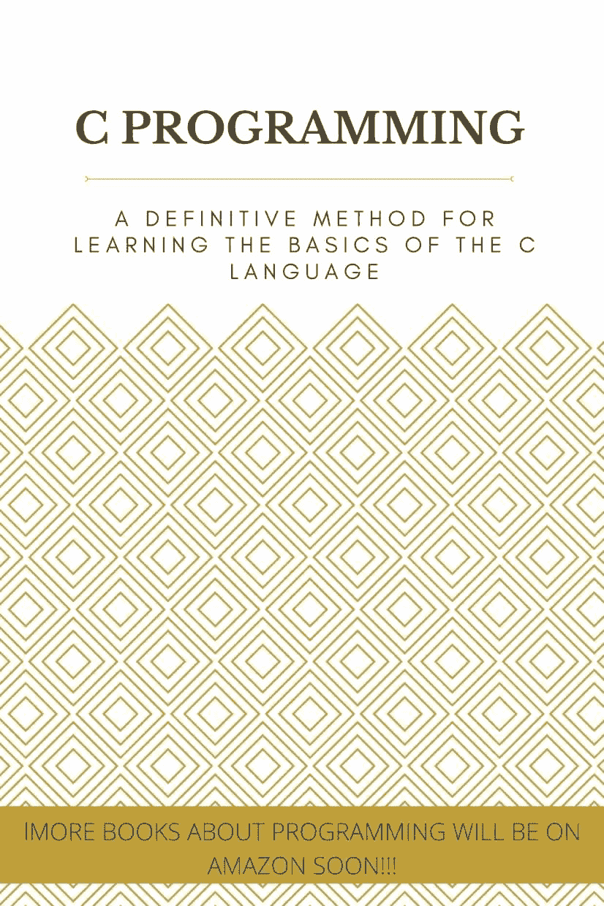


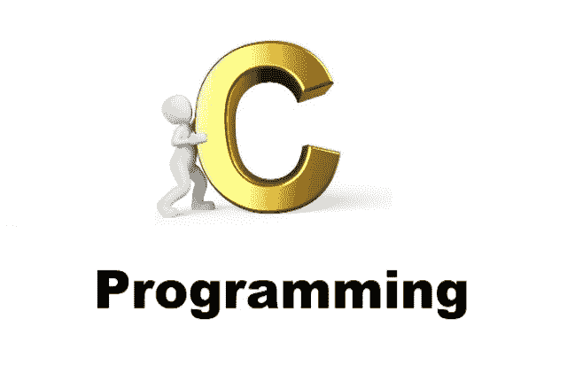

### 注意：

我们已经付出一切可能的努力来确保书中包含的数据是准确的，我建议你不仅要阅读此书，还要去探索更多你想要学习的内容，正如智者所说，我们来到这个世界上都是为了学习的。

我说的得对吗？

好的，如果我是对的（我假设我是对的），那么我们不直接进入正题吧。

# ∞ 内部主题概览 ∞

| 序号 | 章节 | 页码 |
| :--- | :--- | :--- |
| 1. | 前言 – 第 6 页，|| C 语言简介。 | 07 |
| 2. | C 语言语言元素。 | 33 |
| 3. | 控制语句（条件）。 | 62 |
| 4. | 控制语句（循环）。 | 75 |
| 5. | 一维数组。 | 107 |
| 6. | 多维数组。 | 125 |
| 7. | 字符串（字符数组）。 | 131 |
| 8. | 函数的大脑运作。 | 141 |
| 9. | 指针的大脑运作。 | 173 |
| 10. | 结构体、联合体、枚举、位域、类型定义。 | 197 |
| 11. | 控制台输入与输出。 | 219 |
| 12. | C 语言文件处理。 | 227 |
| 13. | 杂题。 | 237 |
| 14. | 存储类型。 | 247 |
| 15. | 算法。 | 253 |
| 16. | 未解决的实际问题。 | 257 |
| 17. | 第二部分-120+ 章节实用代码。 | 271 |
| 18. | 在库中创建并插入自定义函数。 | 341 |
| 19. | C 语言图形编程。 | 345 |
| 20. | 操作系统开发——简介。 | 349 |
| 21. | C 编程指南。 | 356 |
| 22. |  C 编程错误。 | 367 |
| 23. | 使用 C 进行实时软件开发。 | 383-395 |

## 前言：

∞ 核心 C 编程技能——轻松易学！ ∞

从零到英雄，在短时间内学习 C 编程的所有基础和高级特性。这本书从基础开始；我承诺这本书将使你成为 C 编程领域的 100% 专业级冠军。

任何人都可以通过这本书达到专业水平的 C 编程。工程类学生和初级开发者也可以使用。在软件开发章节中，我逐步地解释了一切。我们学习“编程世界中的易用技术-解释，以有趣的风格学习！”使用这本书不需要任何先前的编程经验。

这本书包含的是非常严谨的 C 编程内容：对 C 语言的完整介绍。你将学习从基础到高级主题的所有内容。如果你读过这本书，你就知道会有什么样的体验：一种为了你大脑运作方式而设计的视觉丰富的格式。如果你没读过，那你将大获了。

学习另一种方言并不简单。你可能会认为问题出在你的大脑上。它似乎有它自己的想法，一种并不总是想去接收你被迫学习的那些枯燥、专业的心理。

事实是，你的大脑渴望好奇心。它不断地寻找、检查，等待着奇怪的事情发生。考虑到这一切，生活就是为了帮助你生存而运作的。它将所有日常、平凡、无聊的内容引导到基础中，这样就不会干扰你大脑的真正工作——记录重要的事情。你的大脑如何至少知道一些什么是重要的呢？

# 章节 ∞ 1 ∞
# (C 语言简介)

## 引言-

### 关于语言层级你需要了解的知识 –

编程方言有不同的级别，取决于它们在多程度上类似于人类语言。使用熟悉单词且对大多数人来说易于阅读和学习的编程方言被称为高级语言。与之相反的是低级方言，它们难以阅读或学习。

高级语言包含了著名的 BASIC 编程语言，以及其他已经不再那么著名的方言。BASIC 读起来几乎像英语，它的每一个指令和规则都是英语单词——或者可能是缺失了几个元音或严重违反拼写规则的英语单词。

低级编程语言中的最低是机器语言。那种语言是微处理器本身最原始的咕噜和呻吟。机器语言由微处理器理解并执行的数字和代码组成。

因此，没有人真的用机器语言编写程序；相反，他们使用汇编语言，汇编比低级机器语言高一级，因为那些“咕噜和呻吟”是拼写出来的，而不是以原始数字的形式输入的。

在存在高级语言的情况下，为什么有人使用低级语言呢？速度！用低级语言编写的程序运行速度达到了计算机运行的最快速度，通常比其对应的高级语言快得多。此外，程序体积更小。

用高级语言编写的程序运行速度达到了计算机运行的最快速度，通常比其对应的高级语言快得多。此外，程序体积更小。

用低级语言编写的程序运行速度达到了计算机运行的最快速度，通常比其对应的高级语言快得多。此外，程序体积更小。

用低级语言编写的程序运行速度达到了计算机运行的最快速度，通常比其对应的高级语言快得多。此外，程序体积更小。

##  C 的历史

C 编程语言可能是最流行的编程语言。`C` 由 `Dennis Ritchie` 在 `1972` 年在 `Bell Labs` 创建，作为 `UNIX` 操作系统的一部分。`C` 也被用于开发该操作系统的某些部分。在 `1960 年代`，一种被称为 `基础组合编程语言 (BCPL)` 的 `B` 语言在剑桥大学开发。

它并不是一个令人满意的语言。`B` 语言经过 Dennis Ritchie 的修改，于 1970 年在贝尔实验室实施。

从那时起，`C` 编程语言一直是需要快速程序或软件需要以某种方式与硬件交互时的标准编程语言。

大多数操作系统如 `Linux`、`Windows™` 和 `Mac™` 要是用 `C` 语言开发的，或者在操作系统的大部分及其附带工具中使用这种语言。


这门课程是关于 C 语言的快速上手。在第一节中，我们将首先编写第一个 C 程序。然后，我们将学习向屏幕输出内容、变量和函数。我们假设你至少熟悉一种一种流行的操作系统。

对于本课程，你可以使用以下编译器或编程环境。--

 UNIX 和 Linux 操作系统中的 `Gcc` 和 `cc`。

 DOS 操作系统或 Windows 命令行环境下的 `Borland C` 或 `Turbo C`。

 “Bloodshed Dev-Cpp”集成开发环境 (IDE)为你提供了一个完整且紧凑的编程环境。

 它自带“MinGW”和“GCC”C 编译器，本课程你不需要任何其他东西。

## C 开发周期

以下是如何在所谓的“开发周期”中通过七个步骤创建一个 C 程序：

1. 想出一个程序的构思。
2. 使用编辑器编写源代码。
3. 使用 C 编译器编译源代码并链接程序。
4. 为错误痛苦地哭泣（可选）。
5. 运行程序并测试。
6. 为 Bug 抓狂（可选）。
7. 重新开始（强制）。

不需要背诵这个列表。它就像洗发水瓶上的说明，尽管你编程时并不需要光着身且身体湿漉。最终，就像洗头一样，你会开始不假思索地遵循这些步骤。不需要记忆任何东西。C 开发周期不是健身器材。事实上，编程比任何事情都更能让你的屁股更舒服地贴在椅子上。

第一步是最难的。剩下的会水到渠成。

第 3 步包含两个步骤：编译和链接。然而，对于本书的大部分内容，它们是在一步中同时完成的。只有当你之后仍然感兴趣时，我才会介绍编译器和链接器之间的具体区别。

### 从文本文件到程序

当你创建一个程序时，你就成了一个程序员。你的朋友或亲戚可能会称你为“计算机魔法师”或“大师”，但相信我，“程序员”是一个好得多的称号。

作为一个程序员，你的工作不是“编程”（programming）。不，编写程序的行为被称为“编码”（coding）。所以当你坐下来写那个程序时，你是在对程序进行编码。习惯这个术语！它非常流行。

程序员的工作是写一些代码！写什么代码？使用什么种类型的代码？密码？摩斯电码？邮政编码？

计算机程序的目的是让计算机做某些事情。

编程的对象是“实现它”。C 语言只是与 PC 通信的工具。

（注：如果你觉得我的用词太大而难以理解，请抱歉，我只是尝试使用最适合我解释的词。）

作为程序员，你必须将 PC 客户的目标转化为 PC 能理解的内容，然后给客户他们需要的东西。此外，万一你不能给他们需要的东西，基本上也要把它做得足够好，以免他们持续抱怨，或者——更令人遗憾的是——要求退款。

你选择的实现这一目标的工具是 C 编程语言。这就是你用来与 PC 通信的代码。接下来的章节将描述该过程是如何运作的。毕竟，你也可以拿起鼠标说：“你好，计算机！”

 编程是电视高管做的事。计算机程序员负责编码（Code）。

 你使用编程语言与计算机通信，准确地告诉它该做什么。

## 源代码 - (文本文件)

因为计算机无法理解语言，而且，嗯，打电脑——无论这对你在情感上有多大帮助——对 PC 几乎毫无意义，你最好的沟通方式是在磁盘上给计算机写字条（文件）。

要写 PC 信件，你使用一个名为文本编辑器的程序。这个程序是文字处理器的原始版本，去所有花哨的格式和打印控制。文本编辑器让你输入文本——仅此而已。

使用你的文本编辑器，你创建了所谓的源代码文件。这个文件唯一的特殊之处在于它包含了告诉计算机该做什么的指令。

虽然能写诸如“发出奇怪的声音”这样的指令很好，但事实是，你必须用计算机能理解的语言编写指令。在这种情况下，指令是用 C 语言编写的。

 源代码文件是磁盘上的文本文件。该文件包含了用 C 编程语言编写的计算机指令。

 你使用文本编辑器创建源代码文件。关于文本编辑器的更多信息请参见附录 A。

### 创建 Goodbye failure 源代码文件

使用你的文本编辑器创建以下源代码。仔细按照字样输入每一行；你在下方看到的所有内容都是重要且必要的。不要遗漏任何内容——

```c
#include <stdio.h>

int main()
{
printf("Goodbye, failures world!\n"); return(0);
}
```

当你检查你输入的内容时，注意其中有多少对你来说是很。你识别了一些单词（`include`、`main`、“Goodbye, failures world!”和 `return`），有些单词对你来说很陌生（`stdio.h`）。

当你完成指令后，将它们保存到磁盘上。将文件命名为 `GOODBYEfailures`。

## 你需要记住

 在记事本（Notepad）中，你必须确保文件后缀是 `.C` 而不是 `.TXT`。

 注意文本大部分是小写的。必须如此；编程语言不仅仅是大小写敏感。

 还要注意是如何使用各种括号的：角括号 `<` 和 `>`，大括号 `{` 和 `}`，以及圆括号 `(` 和 `)`。


正如我之前引用的，`C` 语言是由框架开发人员 `Dennis Ritchie`（丹尼斯·里特奇）在 1970-72 年间于美国新泽西州的美国电报公司（AT&T）贝尔实验室创建的。它最初是为了在 UNIX 工作框架下编程而设计的。

`C` 基于 `BCPL`（基础组合编程语言-B）创建，后者经过改进并重命名为 `B`。`B` 诞生于 20 世纪 年的剑桥学院。

`C` 实际上是一种符号指令代码，是一组在计算机上执行操作的命令。`C` 语言通常被称为中间级语言，因为我们可以通过 `C` 编写高层和低层程序。

`C` 之前的语言有 `FORTRAN`（公式翻译语言）、`COBOL`（常用面向业务的语言）、`BASIC`（初学者通用符号指令代码）和 `Pascal`。`C` 之后的语言有 `C++`、`Java`、`C#` 等。`C` 允许与计算机内部原理进行非常紧密的交互。

# 什么是 C？

`C` 是一种用于编写程序的编程语言。程序是程序员用高层语言给计算机的一组指令集。`C` 在执行任何指令之前，使用编译器将高层程序翻译成机器码。编译器本身是一个计算机程序。其他的翻译器还有 `Interpreter`（解释器）和 `Assembler`（汇编器）。

原始的高层程序称为源代码（`.C`），生成的机器语言程序称为目标程序（`.obj`）。“之所以命名为‘C’是因为它的特性源自一种早期的语言‘B’，根据 `Ken Thompson`（肯·汤普森）的说法，它是 `BCPL` 编程语言的精简版本。”

# 汇编器 vs 编译器

通常情况下，编译器是一个读取用一种语言编写的程序（称为源代码）并将其翻译另一种语言（称为目标语言）的计算机程序。传统的源代码是 `C++` 等高层语言，目标语言是 `Assembly`（汇编语言）等低层语言。

然而，某些编译器可以将用 `Assembly` 语言编写的源代码转换为机器码或目标代码。`Assemblers` 就是这类工具。因此，汇编器和编译器最终都会产生可以在机器上直接执行的代码。

## 什么是编译器？

编译器是一个读取用一种语言编写的程序（称为源代码）并将其翻译另一种语言（称为目标语言）的计算机程序。大多数情况下，源代码是高层语言，目标语言是低层语言。因此，通常编译器被视为从一种语言翻译到另一种语言的翻译器。此外，编译器会对代码进行某些优化。

典型的编译器由几个主要组件组成。第一个组件是 `scanner`（扫描器，也称为词法分析器）。`Scanner` 读取程序并将其转换为标记字符串。

第二个组件是 `parser`（解析器）。它将标记字符串转换为解析树（或抽象语法树），捕获了程序的语法结构。下一个组件是 `semantic routines`（语义例程），用于解释语法结构的语义。代码优化和最终代码生成紧随其后。

## 什么是汇编器？

`Assembler` 是将 `Assembly` 语言翻译成机器码的软件或工具。因此，汇编器是一种编译器，源代码是用 `Assembly` 语言编写的。

`Assembly` 是一种人类可读的语言，但它通常与对应的机器码是一一对应的关系。因此，汇编器被认为执行的是同构（一一映射）翻译。高级汇编器提供了支持程序开发和调试过程的额外功能。例如，称为 `macro assemblers`（宏汇编器）的汇编器提供了宏功能。

# 汇编器和编译器有什么区别？

编译器是一个 PC 程序，读取用一种语言编写的程序，并将其解释为另一种方言；而汇编器可以被视为一种特殊的编译器，它仅将 `Assembly` 语言解释为机器码。编译器通常直接从通用语言产生机器可执行代码。

然而，汇编器产生的是目标代码，可能需要通过 `linker`（链接器）程序连接才能在机器上运行。由于 `Assembly` 语言与机器码具有平衡的规划，汇编器可能用于创建在对执行至关重要的事件中高效运行的代码（例如：电机设计、带有受限设备资产的嵌入式，相对于 PC 的微波炉、洗衣机等）。

## 区别在于：

| | 汇编器 (Assembler) | 编译器 (Compiler) |
| :--- | :--- | :--- |
| 1. | 它将如 `PRN`、`ADD` 和 `SUB` 等助记符翻译成机器语言代码。 | 它将高层语言翻译成汇编语言。 |
| 2. | 使用汇编器执行的程序运行更快，因为它直接将源代码转换为机器语言。 | 执行一个程序需要时间，因为它首先将源代码翻译成另一种编译器的语言，然后然后使用汇编器将其转换为机器语言。 |

## 编译器 (Compiler) 和解释器 (Interpreter) 的区别

`interpreter` 类似于逐句翻译，而编译器类似于翻译整篇文章。

| | 编译器 (Compiler) | 解释器 (Interpreter) |
| :--- | :--- | :--- |
| 1. | 编译器在执行程序之前，一次性将整个高层语言程序翻译成机器语言程序。这优化了翻译程序中机器语言指令的使用。因此，通常编译后的程序运行比解释型程序快。原始的高层语言程序称为源代码。编译器翻译后生成的机器语言程序即目标程序。 | `Interpreter` 在执行程序时逐条指令将高层语言翻译成机器语言。也就是说，它读取程序的第一条指令并将其转换为相应的机器指令。然后 CPU 观察这些机器指令。之后，`Interpreter` 读取并翻译下一条指令，以此此类推。 |
| 2. | 编译器接收整个程序作为输入。 | 解释器接收单个指令作为输入。 |
| 3. | 目标代码永久保存供以后使用。 | 不保存目标代码供以后使用。 |
| 4. | 非耗时的翻译方法。 | 耗时的翻译方法。 |
| 5. | 它在计算机中占用较大。 | 解释器编写简单，不需要内存空间。 |
| 6. | 编译速度非常快。 | 速度非常慢。 |
| 7. | 编译后源代码的任何更改都需要重新编译整个代码。 | 翻译期间源代码的任何更改不需要重新翻译整个代码。 |
| 8. | 生成中间目标代码。 | 不生成中间目标代码。 |
| 9. | 条件控制语句执行更快。 | 条件控制语句执行较慢。 |
| 10. | 内存需求：更多（因为生成了目标代码）。 | 内存需求较少。 |
| 11. | 程序不需要每次都编译。 | 每次都要将高层程序转换为低层程序。 |
| 12. | 错误在检查整个程序后显示。 | 在解释每条指令时（如果有错误）显示错误。 |
| 13. | 示例：C 编译器。 | 示例：BASIC。 |

## 解释：编译器 VS 解释器

只需理解编译器和解释器的概念 -

1. 我们将整个程序作为输入给编译器。我们的程序是人类可读的格式。


2. 人类可读格式会经过许多[编译器的阶段和过程](http://www.c4learn.com/c-programming/what-is-compiler/)，最终转换为机器可读的格式。

3. 然而，解释器一次只接受一行代码作为输入并执行该行。一旦发现错误，它就会停止代码的执行。

4. 在[解释器的情况下](http://www.c4learn.com/c-programming/what-is-interpreter/)，内存需求较少，因为在解释器的情况下不会创建目标代码。

练习笔记 —— 大多数学生真的不知道编译器与解释器之间的区别。学习一门新语言并非易事。你可能会认为问题在大脑上……这就是为什么我试图通过多种形式来解释这些差异。

编译器和解释器都具有相同的目的——将高阶语言（如 C、Java）指令转换为计算机硬件可以理解的二进制形式。它们是用于执行高阶程序和代码以完成各种任务的软件。特定的编译器/解释器是为不同的高阶语言设计的。

然而，尽管编译器和解释器的目标相同，但它们完成任务的方式（即将高阶语言转换为机器语言）有所不同。请仔细查看下文——

### 编译器

[编译器](http://www.engineersgarage.com/articles/what-is-compiler-tutorial)是将高阶语言翻译成机器语言的代码。当用户用 Java 等高阶语言编写代码并想要执行时，在执行之前会使用专为 Java 设计的编译器。编译器首先扫描整个程序，然后将其翻译成机器码，由计算机处理器执行，并完成相应的任务。

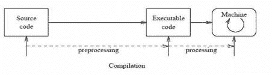

图中显示的是编译过程的基本概述，这里用高阶语言编写的程序被称为源程序，转换后的程序被称为目标程序。

### 解释器

解释器与编译器没有太大区别。它们也将高阶语言转换为机器可读的二进制等价物。每当解释器获取要执行的高阶语言代码时，它会在转换为机器码之前将其转换为中间代码。代码的每个部分都会被解释并按顺序分别执行，如果在代码的某部分发现错误，它将停止对代码的解释，而不再翻译下一组代码。

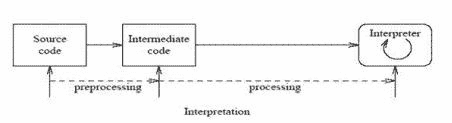

### C 语言编程的优点

1. C 是一种通用编程语言。你可以生成游戏、商业软件、实用程序、数学模型、文字处理器、电子表格和其他软件。
2. C 是一种结构化编程语言。它使用结构化语句（如 `while`、`for` 循环）来代替会导致程序漏洞（错误）的 `goto` 语句。
3. 系统独立性——C 不需要操作系统的任何服务，它可以独立运行。C 可以运行在任何操作系统上。
4. 高效性——C 编译器通常能够将源代码翻译成高效的机器指令。C 语言的数据和控制机制与大多数小型计算机和微型计算机非常匹配。
5. 系统编程——C 用于系统编程，即编写操作系统。UNIX 操作系统也是用 C 语言重写的。

### 语法与语义的区别

| 语义 (Semantics) | 语法 (Syntax) |
| :--- | :--- |
| 程序的逻辑或规划。语义可以用以下任何方式编写：1. 流程图。2. 算法。3. 伪代码。 | 它是使用特定编程语言中编写程序的方法。语法随语言而变化。 |

### 流程图

它是程序逻辑的符号表示。逻辑中使用了一些预定义的符号。流程图显示了程序逻辑的实际流程。流程图无非解决问题涉及的各种步骤的图示表示。流程图指示了过程流的方向、相关的操作和计算、决策点以及解决方案部分的其他信息。一旦开发并经过适当检查，流程图为编写程序提供了极佳的指南。

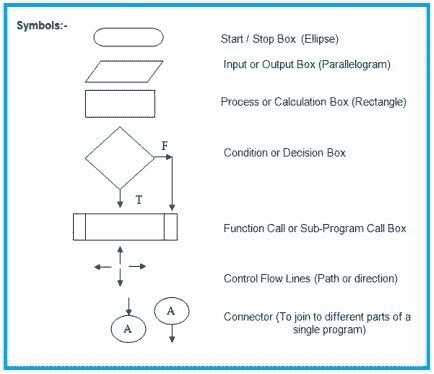

### 算法

一旦问题被正确定义，就必须开发一个解决该问题的详细、有限的、逐步执行的程序。这种程序被称为算法。算法可以用普通语言编写，也可以使用介于普通语言和编程语言之间的正式过程编写。

#### 两个数相加的算法——

1. 读取 `A`, `B`。
2. 设置 `SUM := A+B`。
3. 输出 `SUM`。
4. 退出。

### 伪代码

有时，将算法翻译成流程图和源代码之间的中间形式是有意义的。伪代码是源代码的英语近似，它遵循语言的规则、风格和格式，但忽略了大多数标点符号。

```
main()
{
    integer a,b,sum;
    read in a and b;
    add a & b and set it to sum;
    write sum;
}
```

#### C 程序的结构（源代码）

让我们通过一个例子（数字之和）来讨论 C 程序的结构：

```c
#include<stdio.h>
#include<io.h>
main()
{
    int a,b,sum; /* 声明 */
    clr(); /* 清屏 */
    printf("enter two numbers"); /* 请求输入 */
    scanf("%d %d",&a,&b); /* 从用户输入 */
    sum=a+b; /* 两个数相加 */
    printf("sum=%d",sum); /* 输出和 */
    getch(); /* 保持屏幕 */
} /* main 函数结束 */
```

### C 程序的解释

### 头文件的故事

头文件包含了函数和变量的定义，可以通过预处理器 `#include` 语句引入任何 C 程序中。标准头文件由每个编译器提供，涵盖了字符串处理、数学、数据转换、变量的打印和读取。要使用任何标准函数，都应包含相应的头文件。这是在文件的开头完成的。例如，要在程序中使用 `printf()` 函数，应在文件开头写上

 `#include <stdio.h>`

因为 `printf()` 的定义位于 `stdio.h` 文件中。所有头文件都有 `.h` 扩展，通常位于 `/include` 子目录下。

```c
#include <stdio.h>
#include "mydecls.h"
```

使用角括号 `<>` 通知编译器在编译包含目录下搜索指定的文件。文件名周围使用双引号 `""` 通知编译器在当前目录下搜索指定的文件。

### 键盘输入

C 语言中有一个函数允许程序员人员从键盘接受输入。以下程序演示了该函数的用法：

```c
#include <stdio.h>
main()
{ /* 介绍键盘输入的程序 */ }
```


```c
{
  int number;
  printf("Type in a number \n");
  scanf("%d", &number);
  printf("The number you typed was %d\n", number);
}
```

定义了一个名为 `number` 的整数。然后使用语句

`printf("Type in a number \n:");`

打印提示信息以输入数字。

`scanf` 例程用于接收响应，它有两个参数。第一个参数（`"%d"`）指定了预期的数据类型（例如 `char`、`int` 或 `float`）。

第二个参数（`&number`）指定了将输入的响应放置的变量。在这种情况下，响应将被放在与变量 `number` 关联的内存位置。这解释了 `&` 字符的特殊意义（意思是“的地址”）。

# # include

`#include` 指令指示 C 预处理器找到文本文件`“stdio.h”`。名称本身的意思是“标准输入和输出”，`.h` 表示它是一个头文件而不是 C 源文件（源文件以 `.c` 结尾）。它是一个文本文件，可以使用任何文本编辑器查看。

# # 注释

注释放置在 `/*` 和 `*/` 字符序列之间，可以跨越任意行。

# # main

`main` 函数是最重要的。它定义了程序开始执行的点。如果你不写 `main` 函数，你的程序将无法运行（它将没有起点）。事实上，它甚至无法通过编译。

# # 大括号

C 使用大括号字符 `{` 表示“开始”，使用 `}` 表示“结束”。它们输入起来要容易得多，而且过了一段时间后读起来也容易得多。

# # printf()

`printf` 函数是产生输出的标准方法。该函数定义在标准库中，因此将始终存在并始终以相同的方式工作。这个示例显示了 `printf` 和 `scanf` 共享相同的格式指定符。

当遇到 `“%i"` 时，它们都处理整数。`scanf` 因为是一个读取函数，所以从键盘读取整数。`printf` 因为是一个写入函数，所以将整数写入屏幕。表达式注意，C 语言很乐意计算 `“a-b"` 并将其作为整数值打印出来。可以创建另一个变量 `“c”` 并赋值，但没有必要。

`printf` 函数将输出写入屏幕。当它遇到格式指定符 `%i` 时，会输出一个整数。

# # scanf()

`scanf` 的工作是 `printf` 的“反向”。虽然 `printf` 在屏幕上产生输出，但 `scanf` 从控制台读取。连续的 `"%i"` 教会 `scanf` 从控制台读取一个数字。由于使用了 `"%i %i"`，将读取两个完整的数字。第一个复合整数放在变量 `“a”` 中，第二个放在变量 `“b”` 中。`scanf` 工作从控制台读取输入。当它遇到格式指定符 `%i` 时，程序认为用户将输入一个整数。

`"%i %i"` 中两个 `"%i"` 之间的空格是有意义的：它告诉 `scanf` 在控制台输入的两个数字可能被空格隔开。如果使用了 `“%i,%i"` 而不是这样，用户将不得不在两个数字之间强制输入一个逗号。

# # \n

两个字符 `“\` 后跟 `n` 的序列是 C 语言处理换行的方式。当打印时，它会导致光标移动到下一行的开头。

# # Return

`Return` 导致值（此处为 `0`）传回给操作系统。操作系统如何处理此信息取决于它。例如，MS-DOS 将其存储在 `ERRORLEVEL` 变量中。UNIX 的 Bourne 和 Korn Shell 将其存储在临时变量 `$?$ 中，该变量可以在 shell 脚本中使用。“传统”认为 `0` 表示成功。

值 `1`、`2`、`3` 等表示失败。所有操作系统都支持高达 `255` 的值。某些支持高达 `65535` 的值，尽管如果你对可移植性有要求，应该只使用 `0` 到 `255` 之间的值。

## # &

`“&"` 对于 `scanf` 非常重要。它允许更改相关的变量，这称为取地址（Ampersand）。因此在——

`scanf("%i", &j)`

`“&"` 允许变量 `“j"` 被改变。没有这个神秘的字符，C 会阻止 `scanf` 修改 `“j"`，它将保留之前拥有的随机值（除非你记得初始化了它）。由于 `printf` 不需要更改它打印的任何变量的值，因此不需要任何 `“&"` 符号。因此，如果 `“j"` 包含 `15`，在执行语句后：

`printf("%i", j);`

我们有心地预期变量中是 `15`，因为 `printf` 无法修改它。

# # C 的格式

 语句以分号结束。

 缩进是……

## # 分号

分号在 C 中非常重要。它们告诉编译器一个语句何时结束，另一个语句何时开始。

## # 自由格式

C 是一种自由格式语言。将一个语句跨越多行没有问题。

## # 大写敏感

C 是一种大小写敏感的语言。虽然 `int` 可以编译，但 `“Int”`、`“INT”` 或任何其他变体。

## # 随机行为

已经说明 main 要向操作系统返回一个整数，如果忘记这样做（无论是通过只写 return 或完全省略 return），会导致向操作系统返回一个随机整数。


## 程序结构

4. 程序的第二和第三行被称为头文件（`stdio.h` 和 `conio.h`），它们包含了编译前必须包含在程序中的信息。`#` 是预处理器或编译器指令。该语句引导编译器在编译程序之前包含头文件。我们也可以将 `<stdio.h>` 写为 `"stdio.h"`。

5. 每一个 C 程序由一个或多个称为函数的模块组成。这些函数中其中一个被称为 `main()`。每个程序的执行都从 `main` 函数开始，该函数可能会调用其他函数。整个程序写在花括号括起来的这个 `main` 函数中。使用多个 `main()` 是非法的。

6. 变量的声明紧接在程序左大括号之后完成。我们不能在程序的中间声明变量。

7. 注意，`main` 函数中的每个语句都以分号（`;`）结束。

8. 接下来是 `printf()` 语句：`printf("Enter two numbers");` `printf` 是一个输出命令，请求用户输入一个数字。这条消息被称为“提示消息”，并在输出屏幕上打印为 Enter two numbers。

9. 计算机通过下一个语句 `scanf()` 获取输入的值。

```
scanf("%d %d",&a,&b);
```
`scanf` 是一个输入命令，根据给定的格式说明符从用户处获取某些值并将其存储在指定的变量中。`&` 被称为地址操作符。

10. 接下来是赋值语句：`sum= a+b;` 它将变量 `a` 和 `b` 中的值相加并赋值给变量 `sum`；

11. 最后一个 `printf()` 用于在屏幕上显示 `sum` 的计算值。

12. 最后，`getch()` 函数用于显示输出屏幕。

13. `main()` 内部的所有语句都比 `main()` 稍微靠前。这被称为缩进。这表示所有语句都在 `main()` 函数内部。

## 单选题

1. C 是一种：
   a. 高级语言。
   b. 低级语言。
   c. 中级语言。
   d. 汇编级语言。

2. 程序的逻辑被称为：
   a. 语法。
   b. 语义。
   c. 流程图。
   d. 调试。

3. C 语言是由开发的
   a. Ken Thompson。
   b. Dennis Ritchie。
   c. Patrick Naughton。

4. 流程图用于决定：
   a. 寻找解决方案涉及的步骤顺序。
   b. 制作算法的辅助。
   c. 准备决策表。
   d. 调试程序。

5. C 程序在……的帮助下转换为机器语言：
   a. 编辑器。
   b. 编译器。
   c. 操作系统。
   d. 以上均非。

6. C 可以用于：
   a. 仅 MS-DOS 操作系统。
   b. 仅 Linux 操作系统。
   c. 仅 Windows 操作系统。
   d. 以上所有。

**答案：** 1(c), 2(b), 3(b), 4(a), 5(b), 6(d)。

## 理论题

1. 解释 C 的历史发展。
   1. C 是什么时候开发的？
   2. 谁开发的 C？
   3. C 在哪里开发的？
   4. C 是高级、中级还是低级语言？
   5. 它可以在什么操作系统上运行？
2. C 程序的组成组件有哪些？`main` 这个名称具有什么意义？
3. 什么是注释？注释可以放在哪里？
4. C 程序需要写成小写吗？C 程序中的大写字母可以用于任何地方吗？请解释。
5. 使用什么符号结束 C 语句？所有语句都以这种方式结束吗？
6. 为什么 C 程序中的语句要进行缩进？
7. 什么是流程图？画出流程图中使用的各种符号。

### 实验练习

1. 编写程序从键盘输入两个数字并打印它们的和。
2. 编写程序从键盘输入两个数字并打印它们的平均值。
3. 编写程序计算圆的面积。
4. 编写程序打印给定时间（小时、分钟、秒）的总秒数。
5. 编写程序将温度从华氏度转换为摄氏度。`C=(F-32) * 5/9`
6. 编写程序交换（交换）两个数字。
7. 编写程序在不使用第三个变量的情况下交换两个数字。
8. 编写程序交换三个数字。
9. 编写程序使用第四个变量交换三个数字。
10. 编写程序使用 `%` 运算符计算两个数字的余数。

## 填空题

1. ___ 是 C 的创建者。它是在 ___ 开发的。
2. ___ 操作系统是用 C 开发的。
3. ___ 可以是 C 的祖先。
4. C 语言使用 ______ 翻译成机器码。
5. C 可以用于 _______ 和 _______ 系统。

# 章节：C 元素

### 标记 (Tokens)
标记是最小的单元。C 识别六种类型的标记。C 程序是用这些标记编写的。以下是 C 标记：
- 关键字 (Keywords)
- 标识符 (Identifiers)
- 字面量 (Literals)
- 运算符 (Operators)
- 分隔符 (Separators)

### 关键字 (Keywords)
关键字是保留字，其含义已经向编译器解释过。这些词是在语言本身定义的。C 中有 32 个关键字：
- `auto`, `break`, `case`, `char`, `const`, `continue`, `do`, `double`, `else`, `enum`, `extern`, `float`, `for`, `goto`, `if`, `int`, `long`, `register`, `return`, `short`, `signed`, `struct`, `static`, `switch`, `typedef`, `union`, `unsigned`, `void`, `volatile`, `while`, `sizeof`

### 标识符 (Identifiers)
标识符是赋予变量的名字。通过此标识符访问变量。程序中的其他名称（如数组名或函数名）也称为标识符。

### 变量 (Variables)
在执行过程中可能变化的实体被称为变量。或者说，变量是内存中基本用于存储执行过程中变化的特定类型数据的地方。变量名是分配给位置的名字。程序中使用的所有变量都应该在顶部按照其相应的数据类型进行声明。变量声明告诉了两个点信息：
1. 它告诉编译器变量名称。
2. 它还告诉变量将持有的值类型。

示例：
```
int a;
float b;
char c;
```
这里 `a` 是整数变量，`b` 是浮点数变量，`c` 是字符变量。`;` 被称为终止符号或语句结束。

### 基础类型声明 (Primary type declaration)
变量可以用于存储任何数据类型的值。也就是说变量名与变量名本身无关。
示例：
```
int a,b,c;
```
其中 `a`, `b`, `c` 是赋予变量的名字。相同数据类型的变量用逗号分隔。声明语句必须以分号结束。

假设我们要声明三个变量，那么……我们写道：
```
int a, b, c;
```
在声明这三个整数变量的同时，计算机主内存中创建三个内存位置，用于存储每个类型整数变量的操作数据。这些每个分配字段被称为一个位置 (location)。


# 变量命名

即使这会导致变量名变得很长，最好为你的变量使用有意义的名称。同时请记住 `C` 是区分大小写的。

名为 `COUNTER` 的变量与名为 `counter` 的变量是不同的。在 `C` 编程语言中，函数和命令都是区分大小写的。

你可以使用字母、数字和下划线 `_` 字符创建变量名。在 `ANSI C` 语言中，变量名最多可以有 31 个字符。

## 有效名称

只有字母、数字和下划线字符可以有效位用于变量名。变量的第一个字符可以是字母或下划线，尽管标准建议避免使用下划线作为第一个字母。

因此，变量名 `temp_in_celsius`、`index32` 和 `sine_value`都是有效的，而 `32index`、`temp-in-celsius` 和 `sine$value` 则不是有效的。使用像 `_sine` 这样的变量名是不受欢迎的，尽管它在语法上并不是无效的。

变量名可以很，编译器会处理前 31 个字符。名称可以比这更长，但在前 31 个字符内必须存在差异。

## 3. 字面量/常量

`C` 中的常量是指程序执行过程中不改变的固定值。在 `C` 中有 2 类常量：

### 数值常量

#### A) 整数常量

它们是一序列数字。整数有三种：十进制、八进制、十六进制。

十进制包含一组 0 到 9 的数字，可以是正的（`+`）或负的（`-`）。
例如：`6`、`46`、`398`、`658736`、`-89`、`+598` 都是整数。

不允许出现空格、逗号或特殊符号。
例如：`12 897`、`364,897`、`$56`、`78@56` 都是无效或错误的数字。

八进制由 0 到 7 的数字任意组合组成，并以 `0` 开头。例如：`037`、`0435`、`0551`。

十六进制有 16 个数字 0 到 9 和字母 A 到 F（10-15），数字序列由 `0x` 或 `0X` 前缀。例如：`0X2`、`0x9f`、`0xbcd`。

#### B) 浮点或实数常量

整数常量不足以表示所有数量例如价格、距离、温度等。这些数字带有小数点（`.`），即小数部分，如 `65.987`、`0.000569`、`89.36`。

浮点数也可以用指数或科学计数法表示，例如 `0.0000123` 可以写成 `1.23*10-5` 或 `1.23e-05`。因此，通用形式是：尾数 e 指数。

所以，`1.23` 被称为尾数，`-05` 被称为指数。

#### C) 字符常量

i) 单字符常量：
单引号（`‘ ’`）括起来单个大写字母（`‘A’` 到 `‘Z’`）、小写字母（`‘a’` 到 `‘z’`）、数字（0 到 9）或特殊符号（`@`、`#`、`$`、`%`、`*`、`&`、`+`、`-`、`.`、`:`、`/` 等）。
例如：`‘a’` 或 `'7` 或 `‘+` 都是字符常量。
注意：所有的转义序列也被视为字符。

ii) 字符串常量：
字符串常量是用双引号（`“ ”`）括起来的单个字符或一组字符。
如：`“hello”`、`“4598”`、`“hello235”`、`“5+3”`。

注意 字符常量 `‘7’` 与数字 `7` 不同。每个字符常量都有等值的整数。
`‘A’` 到 `‘Z’` 的 ASCII 为 65 到 90。即 `‘A’` 的 ASCII 为 65，`‘B’` 的 ASCII 为 66，依此类推。
`‘a’` 到 `‘z’` 的 ASCII 为 97 到 122
`‘0’` 到 `‘9’` 的 ASCII 为 48 到 57
`‘ '`（空格）的 ASCII 为 32。
`☺`（微笑空格）的 ASCII 为 1。

## 数据类型

`C` 语言拥有丰富的数据类型。有 4 类数据类型：
1. 基本数据类型（`int`, `float`, `char`）
2. 用户定义数据类型（`enumerator`, `typedef`）
3. 派生数据类型（`array`, `function`, `pointers`, `structure`, `union`）
4. 空数据集。（`void`）

### 基本数据类型

| 整数 | 实数 | 字符 |
| :--- | :--- | :--- |
| `int` 或 `short` 或 `short int` 占用 2 字节范围：-32768 到 +32767 | `long int` 或 `long` 占用 4 字节范围：-2,147,483,648 到+2,147,483,647 | `float` 占用 4 字节范围：3 |
| | `double` 占用 8 字节 | `char` 占用 1 字节范围： |
| | `long double` 占用 12 字节 | |


#运算符表

| 优先级 | 运算符 | 描述 | 结合性 |
| :--- | :--- | :--- | :--- |
| 1 | `()` | 函数调用 | 从左到右 |
| 1 | `[]` | 数组元素引用 | 从左到右 |
| 1 | `->` | 结构体运算符（用于指针与成员之间） | 从左到右 |
| 1 | `.` | 结构体运算符（用于对象与成员之间） | 从左到右 |
| 2 | `-` | 一元负 | 从右到左 |
| 2 | `+` | 一元加 | 从右到左 |
| 2 | `++` | 递增 | 从右到左 |
| 2 | `--` | 递减 | 从右到左 |
| 2 | `!` | 逻辑非 | 从右到左 |
| 2 | `~` | 取反 | 从右到左 |
| 2 | `*` | 取值（用于指针） | 从右到左 |
| 2 | `&` | 取地址 | 从右到左 |
| 2 | `sizeof` | （类型）的大小 | 从右到左 |
| 3 | `*` | 乘法 | 从左到右 |
| 3 | `/` | 除法 | 从左到右 |
| 3 | `%` | 取模 | 从左到右 |
| 4 | `+` | 加法 | 从左到右 |
| 4 | `-` | 减法 | 从左到右 |
| 5 | `<<` | 左移 | 从左到右 |
| 5 | `>>` | 右移 | 从左到右 |
| 6 | `<` | 小于 | 从左到右 |
| 6 | `<=` | 小于等于 | 从左到右 |
| 6 | `>` | 大于 | 从左到右 |
| 6 | `>=` | 大于等于 | 从左到右 |
| 7 | `==` | 等（条件） | 从左到右 |
| 7 | `!=` | 不等于 | 从左到右 |
| 8 | `&` | 按位与 | 从左到右 |
| 9 | `^` | 按位异异 | 从左到右 |
| 0 | `|` | 按位或 | 从左到右 |
| 1 | `&&` | 逻辑与 | 从左到右 |
| 12 | `||` | 逻辑或 | 从左到右 |
| 13 | `?:` | 条件运算符 | 从右到左 |
| 14 | `=`, `*=`, `-=`, `/=`, `%=` | 赋值运算符 | 从右到左 |
| 15 | `,` | 逗号运算符 | 从左到右 |

## 1. 算术运算符

这些运算符包括 `+`、`-`、`*`、`/`、`%`。这里的 `+` 和 `-` 运算符分别用于加两个操作数。`*` 用于乘法，而 `/` 用于除法。

```c
int i=2,j=3,k,l; float a,b; k=i/j; l=j/i; a=i/j; b=j/i; printf("%d,%d,%f,%f",a,b);
```
Output: 0, 2, 0.000000, 2.000000

`%` 被称为模运算符，该运算符用于计算余数。

```c
int a=5,b=3,c; c=a%b; printf("%d", c);
```
Output: 2

注意：取模运算符不支持浮点数。

## 2. 一元运算符

`+`、`-`、`++`、`--`、`sizeof`（强制）。一元运算符中的 `+` 和 `-` 用于表示数字的符号。`++` 运算符用于给变量加 1。

```c
int a=5,b=4; a++; b--; printf("%d,%d",a,b);
```
Output: 6, 3

如果我们使用 `a++` 或 `++a`，两者都会将 `a` 的值加 1。`a++` 称为后置，而 `++a` 称为前置。

```c
int a=5,b; b=a++; printf("%d,%d",a,b); // Output: 6, 5
int a=5,b; b=++a; printf("%d,%d",a,b); // Output: 6, 6
int i=3; i=i++; printf("%d",i); // Output: 4
int i=2; printf("%d %d",++i, ++i); // Output: 3 4 (输出可能随编译器而异)

## 3. 关系运算符

`<`、`>`、`<=`、`>=` 这些是布尔运算符（返回 1 或 0 的运算符；这里 1 被视为真，0 被视为假）。

;
```
Output: 1,0

## 6. 逻辑运算符

`&&`、`||`、`!` 这里的运算符是布尔运算符。`&&` 和 `||` 用于两个操作数。这类运算符与等运算符相关。

现在让我们尝试理解这个输出，在 `&&` 和 `||` 表达式中的短路逻辑：如果第一个操作数为假，则第二个操作数不会被求值。如果第一个操作数为真，则第二个操作数会被求值。

```c
int a=5,b=3,c;
int i=2, j=3, k=0;
```

## 7. 条件运算符

`?:` 这是 C 语言中唯一的三元运算符。它作用于三个操作数。这类运算符是由两个运算符 `?` 和 `:` 共同工作的集合。


输出:- 这将产生错误‘Lvalue required’（需要左值）。可以通过将语句放在 `:` 部分的括号内来克服此错误。`a>b? g = a: (g = b);` 在没有括号的情况下，编译器认为 `b` 正被赋值给第二个 `=` 左侧表达式的结果。因此，它报告了错误。

条件运算符的局限性是 `?` 或 `:` 之后只允许跟一个语句。

注意：条件运算符不一定只与算术语句一起。

3. 这两个语句相同吗：
`a<=20?b=30:c=30;` `a<=20?b:c=30;`
输出:- 不相同

8. 位运算符 –

4. `int a=10,b;` `a>=5?b=100:b=200;` `printf(“%d”,b);`
输出- 发生左值错误。

第二次赋值应该写在括号中，如下：`a>=5?b=100:(b=200);`

5. 使用条件运算符重写以下一组语句：
`int a=1,b; if(a>10) b=20;`
输出:- `int a=1,b,dummy; a>10?b=20:(dummy=1);`

注意以下内容将不起作用：
`a>10?b=20:;;`

6. 你能提供其他方法来写以下表达式，使得 30 只使用一次吗？`a<=20?b=30:c=30;`
输出:- `((a<=20)?&b:&c)=30);`

某些程序需要对位（0 和 1）进行操作，例如与计算机硬件部分交互的程序。因此，C 包含了几个特殊运算符，允许对位进行操作。

位运算符通常分为三类：
1. 取反运算符(`~`）
2. 逻辑位运算符(`&`, `|`, `^`）
3. 移位运算符(`<<`, `>>`） 总共有 6 个位运算符。

### 取反运算符：
也称为按反码运算符。它是一个一元运算符，用于反转操作数的位，即所有的 0 变成 1，所有的 1 变成 0。运算符的操作数必须始终是一个整数值(`int`, `short int`, `long int`, `unsigned`, `char`）。

```c
unsigned int a= 5, b;
b = ~a; printf(“%u”,b);
```
输出:- 将是 65530。

让我们现在评估输出：数字 5 的二进制等效值将是 `0000 0000 0000 0101`。正如提到的，取反会将所有的 1 转换为 0，将所有的 0 转换为 1，所以反码将是 `1111 1111 1111 1010`，将该数转换为十进制将得到
`1*215+1*214+1*213+1*212+1*211+1*210+1*29+1*28+1*27+1*26+1*25+1*24+1*23+32768+16384+8192+4096+2048+1024+512+256+128+64+32+16+8+0+2+0` 最终答案将是 65530。

### 9. 逻辑位运算符：
有三个逻辑位运算符：位与(`&`)、位或(`|`)、位异异(`^`)。这些运算符中的每一个一个都需要两个整数值才能工作。每个操作数都将单独转换为各自的二进制数。二进制数最左边的位称为最高位或 MSB。而最右侧的位称为最低位。

| 操作数 1 | 操作数 2 | & | | | ^ |
| :--- | :--- | :--- | :--- | :--- |
| 0 | 0 | 0 | 0 | 0 |
| 0 | 1 | 0 | 1 | 1 |
| 1 | 0 | 0 | 1 | 1 |
| 1 | 1 | 1 | 1 | 0 |

上表解释了所有逻辑位运算符的工作原理。

### 移位运算符：
两个位移运算符是左移(`<<`) 和右移(`>>`)。这些运算符中的每一个也需要两个操作数。第一个整数操作数表示要移动的位模式。第二个操作数表示要移动的位数。

```c
int a,b;
a=20<<2; b=20>>2;
printf(“%d %d”,a,b);
```
输出:- 80, 5

程序将 20 转换为其二进制等效值，即 `0000 0000 0001 0100`，向左移动 2 位将导致位变为 `0000 0000 0101 0000`（80），右移 2 位将是 `0000 0000 0000 0001`（5）。向右移动 2 位将使数字减半。

### 10. 逗号运算符：
逗号运算符从左到右执行，但返回右侧的值。逗号运算符通常用于循环。在逗号运算符中，右侧的表达式被求值。例如 `i = 2, 3, 4`，表达式 `2, 3, 4` 会被求值，并将 `4` 赋值给 `i`。(Images/image00992.jpeg)

1. 通过键盘输入四位数，编写程序获取第一个和最后一位。
```c
int n,a,b,sum;
printf("Enter four digit: ");
scanf("%d",&n);
a=n/1000;
b=n%10;
sum = a + b;
printf("Sum is %d", sum);
```
2. 打印数字的范围。例如 79 在 70 和 100 之间。
```c
int n,lower_r,upper_r;
printf("Enter a: ");
scanf("%d",&n);
lower_r = n-10;
upper_r = n+20;
printf("Range is %d - %d", lower_r,upper_r);
```
3. 打印各种面额。例如如果人的口袋里有 79 元，程序应该打印 500, 100, 50, 20, 10, 5。
```c
int Rs,a,b,c,d,e,f,g,h;
clrscr();
printf("Enter the amount: ");
scanf("%d",&Rs);
a= Rs/500;
Rs = Rs%500;
b= Rs/100;
Rs=Rs%100;
c= Rs/50;
Rs=Rs%50;
d= Rs/20;
Rs=Rs%20;
e= Rs/10;
Rs=Rs%10;
f= Rs/5;
Rs=Rs%5;
g= Rs/2;
Rs=Rs%2;
printf("The denominations are\n500 x %d\n100 x %d\n50 x %d\n20 x %d\n10 x %d\n5 x %d\n2 x %d\n1 x %d", a,b,c,d,e,f,g,h);
```

### 选择题：
1. 带有小数点的整数被称为：a. 浮点数 b. 字符 c. 整数 d. 无
2. `unsigned` 表示：a. 字符 b. 整数 c. d. 无
3. 语句不能以什么结尾：a. `)` b. 分号 c. 无
4. 指出有效的名称：a. 空格 b. 连字符 c. 赋值 d. 以上
5. 如果 a 是整数，`5/2` 返回：a. 2.5 b. 3 c. 2 d. 无
6. 表达式 `7/2*(3.14+2)` 的结果为：a. 8.28 b. 6.28 c. 3.14 d. 0
7. 表达式 `3000+2768` 的结果为：a. 32768 b. -32768 c. 13040 d. 0
8. `^` 操作于：a. 数字 b. 最快 c. 无
9. 优先级决定哪个运算符被：a. 先使用 b. 最快 c. 无
10. 在 C 中，变量不能包含：a. 空格 b. 连字符 c. 无
11. 算术指令：a. 变量 b. 常数 c. 等号右侧 d. 等号左侧
12. 下列中不同的是：a. + b. - c. / d. **
13. 操作 `d=2/7.0` 后 `d` 的值是多少：a. 0 b. 0.2857 c. 可以确定 d. 以上

### 理论题：
1. 解释什么是数据类型？列出 C 语言中所有的数据类型及其字节大小（在 dos 操作系统中）。列出所有的格式化符。并写出计算给定数据类型范围的公式。
2. 通过此计算 `int` 的范围。


## 3. C 语言中有多少关键字？列出所有关键字名称。

## 4. 解释 C 语言变量的所有命名规则。

## 5. 程序的特征。

## 6. 写出所有的转义序列。

## 7. 什么是运算符优先级？列出 C 语言中所有 8 运算符并按优先级从高到低排序。

## 9. 什么是类型转换？解释隐式类型转换和显式类型转换。

给出以下代码的输出：

### 1
```c
int i =4, z =12;
if( i = 5|| z>50) printf(“\nwelcome in matrix”);
else printf(“\n you may go now”);
```
**输出：** `welcome in matrix`


首先 `i` 被赋值为 `5`，这是一个非零值，现在假设它被视为真，且该值涉及 (`||`) OR 运算符。在 OR 运算符的情况下，如果第一个条件为真，它不会去检查下一个条件，而是直接带真值跳出，这被称为“短路”。

### 2
```c
int i=4,z=12; 
if(i = 5&& z>5) printf(“hello”);
else printf(“bye”);
```

### 13. 我们应该如何将常量 3.14 视为 long double 类型？
**输出：** 使用 `3.14l`

### 14. 下述语句的输出是什么：
```c
printf(“% %d %d”,sizeof(3.14f), sizeof(3.14), sizeof(3.14l));
```
a. `4 4 4`
b. `4 垃圾值垃圾值`
c. `4 8 10`
d. 错误
**输出：** `c`

### 15. 浮点数是如何以二进制形式存储的？

**输出：** 点数
**输出：** hello

首先 `i` 被赋值为 `5`，这是一个非零且假设为真，现在检查第二个条件 `(z>5)`，它是真的，所以两个条件都为真，最后生成真值，因此执行 if 语句下的语句并打印消息“hello”。

### 3
```c
int i =4,j = -1,k =0,w,x,y,z;
w = i||j||k;
x = i&&j&&k; y = i|| j&&k;
z = i&&j||k;
printf(“\nw=%d x=%d y=%d       z=%d”,w,x,y,z);
```
**输出：** `w =1 x =0 y =1 z =1`
`i =4` 是一个非零值，意味着真条件。
`j =-1` 同样是一个非零值，意味着真条件。`k =0` 意味着假条件。

### 4
```c
int i =4,j =-1,k =0,y,z;
y =j+5&&j+1||k+2;
z = i+5 || j+1 && k+2;
printf(“\n y =%d z =%d”,y,z);
```
**输出：** `1 1`
在第一个语句中，`j+5 =4(T)`，`j+1 =0(F)` 且 `k+2 =2(T)`。现在第一个 `(j+5 && j+1)` `(4 && 0)` 得到 `0 (F)`，第二个比较将是 `(0 || k+2)` `(0||2)` `1(T)`，所以 `y =1`。


在第二个语句中，`i+5 =9`，在表达式 `(i+5 || j+1 && k+2)` `(9|| j+1&& k+2)` 中，我们知道是用 IEEE 格式表示的。浮点存储的 IEEE 格式使用符号位、尾数和指数来表示 2 的幂次。符号位表示数字的符号：0 表示正值，1 表示负值。尾数在转换为归一化形式后用二进制表示。归一化形式产生的尾数其最高位始终为 1。IEEE 格式通过不存储这个位来利用优势。指数是在加上正整数偏移后以无符号二进制格式存储的整数。这确保了存储的指数始终为正数。浮点数的偏移值为 127，双精度数值为 1023。

### 16
```c
int p = 8, q = 20;
if(p = = 5 && q<5) printf(“Hello Matrix”);
else printf(“Bye Matrix”);
```
**输出：** `Bye Matrix`
编译器首先执行 if 中的表达式，第一个比较 `p = = 5` 得到 `false(0)`，此处表达式中涉及 `&&`，所以控制跳出而不检查下一个条件，并给 if 返回假值。现在 if 中存在假条件，跳转到 else 块并打印“Bye”。

### 17. int i = -1, j = 1,k,l

`||` 运算符的情况下，if 条件为真，控制不进入下一个条件直接跳出，真意味着 `z =1`。

### 5.
```c
int i = -3, j = 3;
if (!i+j*1) printf(“Hello”);
else printf(“Bye”);
```
**输出：** `Bye`
这里我们知道运算符的优先级：`!`（非）最高，`*`（乘），然后是 `+`（加）。`i = -3( T )` 则 `!i` 得到 `F(0)`，同样 `0*1` 得到 `0`，`(0+0)` 得到 `0`，所以条件为假，控制跳到 else 块并执行“Bye”。

### 6
```c
int a= 40;
if(a>40 && a<45) printf(“a is between 40 and 45”);
else printf("%d”,a);
```
**输出：** `40`
这里 `a>40` 比较得到假，表达式包含 `&&`。在 `&&` 运算符的情况下，第一个条件为假，控制跳到 else 块并打印 `a` 的值，即 40。
```c
int x = 20, y = 40, z = 45;
if(x>y && x>z) printf(“x is max”);
else if(y>x && y>z) printf(“y is max”);
else printf(“z is max”);
```

### 7. 
```c
int a = 65;
printf("\n a>=65 ? %d: %c”,a);
```
**输出：** `65`

### 8.
```c
float a= 0.7;
if(a<0.7) printf(“Hello”);
else printf(“Bye”);
```
**输出：** `Hello`

### 9. 我们想要将浮点数 `x` 取整为整数值。正确的方法是：
a. `y=(int) (x+0.5)`
b. `y=int (x+0.5)`
c. `y=(int) x+0.5`
d. `y=(int) 0.5`

### 10. C 语言中有哪三种实数类型？它们使用的格式符是什么？
**输出：** `float`, `double`, `long double`
格式符：`%f`, `%lf`, `%Lf`
大小：`4 byte`, `8 byte`, `10 byte`

### 12. 我们应该如何将常量 3.14 视为 float 类型？

**输出：** `double`
默认情况下，任何实数都被视为 `double`。

### 21.
```c
int i = 4,j,num;
j = (num<0?0:num);
printf(“%d”,j);
```
**输出：** `垃圾`
因为 `num` 没有初始化，当检查条件时它变为假，编译器执行 `num*num` 并赋值给 `j`，所以 `j` 也包含垃圾值。

### 22.
```c
int a,n=30;
a =( n>5 ? ( n<=10 ? 100 :200):500);
printf(“%d”,n);
```
**输出：** `30`
这里我们看到 `n` 用于检查条件，但 `a` 可以随条件改变，但在上述程序中 `n` 没有改变，我们打印出 `n` 的值，即 30。

### 23.
```c
int k = 4;
( !k != 1?printf("\nHello”):printf(“Bye”));
```
| 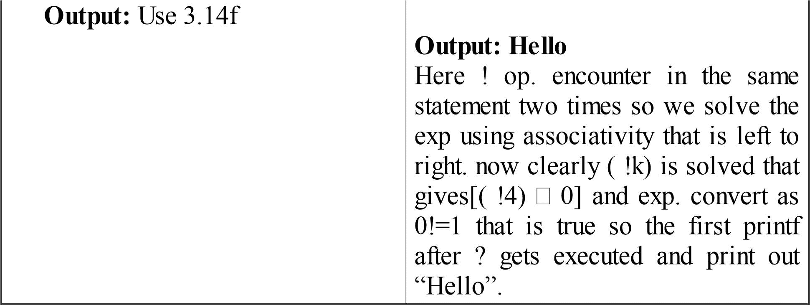指出任何错误（如有）。 |

1.
```c
int x =2,y =3;
( x = = y ? printf(“%d”,a));
```
**输出：** `错误`
在上述程序中，三元运算符 (? :) 必须成对使用，此处缺少 `:`。

2.
```c
int a = 3;
( a = =3 ? printf(“Hello Matrix”);:printf(“Bye Matrix”););
```
**输出：** `无错误`


# 第 ∞ 3 章
## (控制语句-条件语句)

## 引言
如果程序能够对需要执行的任务做出决策，那么程序将变得有用得多。在 C 语言中做出决策通常涉及对一个或多个变量的值进行测试，例如：“如果 X 大于 Y，则执行任务 1，否则执行任务 2”。

C 程序可以使用各种测试来满足许多不同的情况。上例示例使用了 `if-else` 结构，这仅仅是 C 程序可以执行的最简单的测试。

然而，不难想象的是，在做出此决策后，任务 1 或任务 2 也可能是一种 `ifelse` 类型的测试，导致执行其他更专门的任务（可能也包括更多测试）。这在 C 语言中可以通过使用根据所需的任意数量的嵌套 `if-else` 结构来实现。

`switch` 结构与嵌套的 `if-else` 类似，但当需要根据变量的值选择不同的任务（切换到）时，它更为合适。

1. 条件、选择、或决策控制语句
2. Switch case 控制语句。

### 1. 选择语句（决策控制结构）
选择语句允许程序根据表达式的结果或变量的状态，从不同的执行路径集中选择任意一条路径。

1. `if`
2. `if else`
3. `nested if else` 
4. `if-else-if`

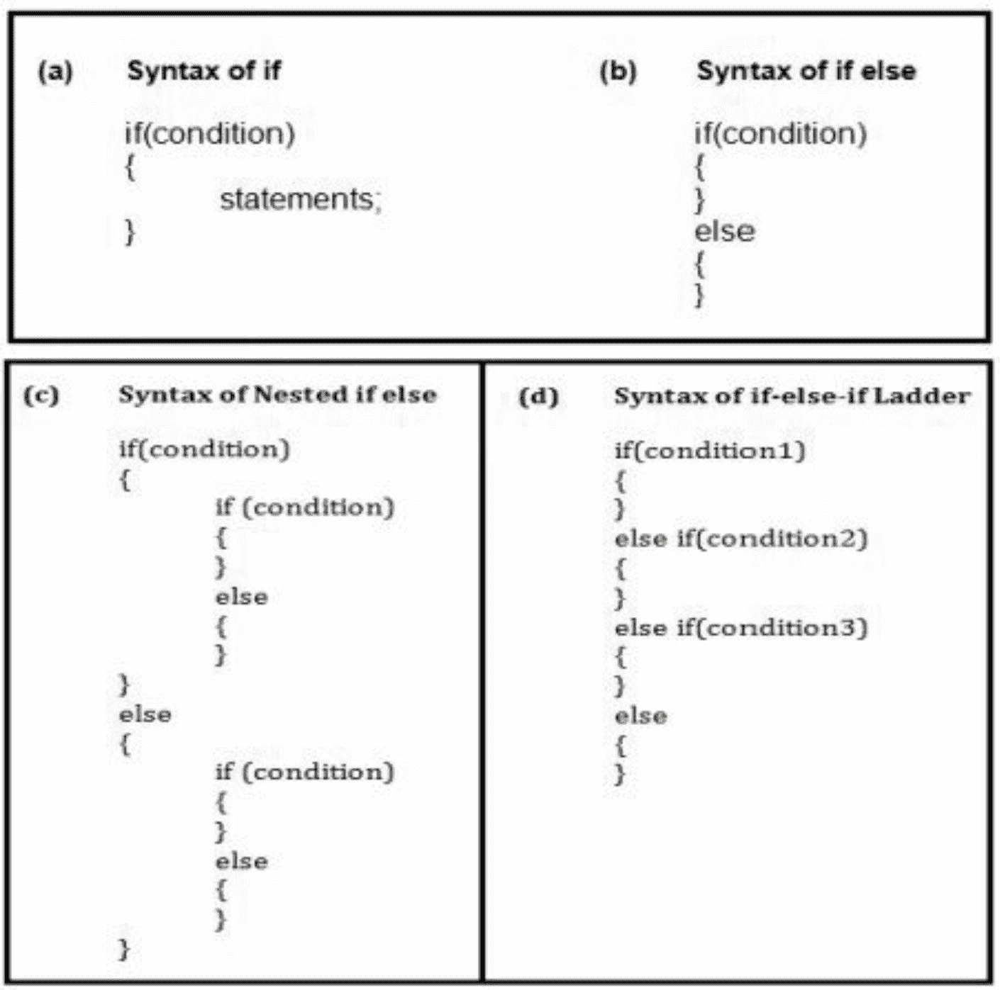

### 2. Switch Case
```c
switch(expression)
{
    case 1:
        statement 1 sequence;
        break;
    case 2:
        statement 2 sequence;
        break;
    case 3:
        statement 3 sequence;
        break;
    case n:
        break;
    default :
        default statement sequence;
}
```
决策和 Switch Case 语句允许计算机决定下一个执行哪个语句。

#### 常见编程错误
1. `if` 语句不包含 `then` 单词。因此，写 `if(condition) then` 是错误的。
2. 在 `if` 语句中，条件必须包含在括号内。因此，写 `if condition;` 是错误的。
3. 在 `if` 语句中，`else` 单词后面没有分号。因此这是一个逻辑错误。现在 `false statement` 将始终执行。
4. 使用单等号 `=` 代替双等号 `==` 被视为逻辑错误。
5. 在 `switch` 中，跟在 `switch` 后的整数表达式必须包含在括号内。

### 实验练习
1. 编写程序（WAP）计算三位数的各位数字之和，例如 `125` 为 `8`。
2. 编写程序合并三个数字。例如 `a= 1`，`b= 2`，`c = 8` 得到 `128`。
3. 编写程序打印三位数的倒序。
4. 计算 HARISH 先生的总薪。输入他的基本工资。他的 `DA` 是基本工资的 `40%`，`HRA` 是基本工资的 `20%`。

### 部分已解题

#### 1. 计算二次方程的实根
```c
#include<math.h> /* 使用函数 sqrt*/
float a,b,c,d,r1,r2;
printf("enter three numbers: ");
scanf("%f %f %f",&a,&b,&c);
d=b*b-(4*a*c); 
if(d<0)
    printf("roots are imaginary"); 
else
{
    r1=(-b+sqrt(d))/(2*a); /* 计算平方根 */
    r2=(-b-sqrt(d))/(2*a);
    printf("The roots are %f %f",r1,r2);
}
```

#### 2. 如果通过键盘输入物品进价和售价，编写程序判断卖家是盈利还是亏损。同时确定他盈利了多少或亏损了多少。
```c
float cp,sp; 
printf("Enter the cost price and the seling price of the item: "); 
scanf("%f %f",&cp,&sp);
if(sp>cp)
    printf("profit is Rs. %.2f",sp); /*%.2f 用于打印两位小数*/
else if(cp > sp)
    printf("loss is Rs %.2f",cp-sp); 
else  
    printf("No Profit No Loss");
```

#### 3. 编写程序创建一个计算器，它可以进行加法、减法、乘法、除法和取模（余数）。
```c
int a,b,ch;
printf("Enter two nos. "); 
scanf("%d%d",&a,&b);
printf("1:\tAdd\n2:\tSubtract\n3:\tMultiply\n4:\tDivide\n5:\tModulus\nEnter your choice: "); 
scanf("%d",&ch); 
switch(ch)
{
    case 1:
        printf("%d\n",a+b);
        break;
    case 2:
        printf("%d\n",a-b);
        break;
    case 3:
        printf("%d\n",a*b);
        break;
    case 4:
        printf("%f\n",(float)a/b);
        break;
    case 5:
        printf("%d\n",a%b);
        break;
    default:
        printf("Invalid Input");
}
```

### 示例分析

这里第一个条件为假，执行冒号后的 `printf()` 并输出“你可以走”。

4. `int a = 65 ,b; b = ( a =65 : printf(“you are correct”):printf(“you are wrong”));`
错误。这里在第二个 `printf()` 后面缺少冒号。

3. `int a = 5 ,b = 10; a = =10 && b!=10 ? print(“come in”):printf(“you can go”);`
错误。这里三元运算符缺少了 `?`。

5. `int a = 10,b; a >=5?( b =10):15; printf(%d %d”,a,b);`
正确。在上面的程序中，首先检查条件，执行冒号后的语句，给 `b` 赋值 `15`，然后打印 `a` 和 `b` 的值，分别为 `10` 和 `15`。[该语句可以写成 `b=(a>=5? 10 :15);`]

### 练习说明
我想利用这个机会在课程结束时给出一个警告。由于任何编程语言都有许多命令和编程技巧，你无法记住所有的内容。

记住这些内容的唯一方法就是练习。你需要开始编写自己的小程序。从练习题开始，继续挑战复杂的题目。如果你不这样做，所有的努力很快就会化为乌有。

#### 空
1. 如果表达式 `c=e1&&e2&&e3`，如果 `e1` 为假，则 `e2` 和 `e3` ________ 被求值。
2. 逻辑运算符 `==` 检查两个值的 ________。
3. 所有字符在内部都表示为 ________。
4. 语句 `if (ch>= ‘a’ && ch<= ‘z’) returns (‘A’ + ch- ‘a’)` 对于在 ‘a’ 到 ‘z’ 之间的字符将返回 ________。
5. 在 `printf` 语句中，在 `%` 和转换字符之间可能会有一个 `h`，如果要打印的整数是 ________。
6. `double` 数据类型实际上是双精度 ________。
7. 运算符 `*`、`/`、`%` 具有 ________ 的优先级。


8. 运算符 `&`, `^`, `=`, `=` 具有 _________ 优先级。

9. 一个 __________ 将汇编语言程序转换为机器码。

10. 大括号 `{` 和 `}` 用于将声明和语句组合成一个 ______ 语句。

11. 运算符 `size of` 返回数据类型在 ________ 中所占的字节数。

12. 假设 `a` 是一个值为 `0 X 6db7` 的无符号整数变量，表达式 `b=a<<6;` 将给 `b` 赋值为值 _________。

13. 表达式 `11%3` 的求值结果为 ________。

14. `? :` 是一个 ______ 运算符。

15. 在包含 `float` 和 `double` 类型变量的混合数据类型 C 表达式中，结果的类型为 _______。

16. 一元运算符 `~` 用于对变量执行 ________ 操作。

17. 述述 C 表达式 `1+2*3-5` 的求值结果为 ______。

## 以下程序的输出结果是什么 -

1.
```c
int i =4; switch (i)
{
    default:
        printf(“Matrix”);
    case 1:
        printf(“Computer”);
        break;
    case 2:
        printf(“Education”);
        break;
    case 3:
        printf(“Hello”);
}
```
输出:- `MatrixComputer`

2.
```c
int i =4, j=2; switch (i)
{
    case 1:
``` （等待，此处文本此处片段化，根据逻辑判断）
3.
```c
int a=300,b,c; if(a>=400)
    b=300;
    c=200;
printf(“\n%d %d”,b,c);
```

等待，查看提供的文本：`int a=300,b,c; if(a>=400) b=300; c=200; printf(“\n%d %d”,b,c);` 是其逻辑。
输出:- `b` 包含垃圾值且 `c=200`。因为 `a` 初始化为 `300`，当检查条件时结果为假，`b` 无法赋值为 `300`，因此 `b` 仍然包含垃圾值；由于 `if` 不包含大括号，所以 `if` 的作用范围仅限于下一语句，因此 `c` 出了 `if` 的作用范围并会被赋值为 `200`。

4.
```c
int a=500,b,c; if(a>=400)
    b=300; c=200;
printf(“\n%d %d”,b,c);
```
像 `1*2+4` 这样的表达式是可以接受的。
5.
```c
int i =4;switch (i){ }
printf(“Hello World”);
```
输出:- `A switch can occur that` （等待，文本与表格交织在一起）。

让我们根据提供的混乱文本重新对齐：

4.
```c
int a=500,b,c; if(a>=400)
    b=300; c=200;
printf(“\n%d %d”,b,c);
```
输出:- `-300 200`。因为 `a` 初始化为 `500`，当检查条件时结果为真，`b` 被赋值为 `300`（等待，文本说是 `-300 200` 但逻辑上应该是 `300 200`）。
实际上，文本写为：`Output: -300 200. Because a is initialize with 500 and when condition is checked then it becomes true and b is assign with 300` （文本非常损坏，我将保留核心含义）。

5.
```c
int i =1; switch (i)
{
    case 1:
        printf(“Hello”);
        break;
    case 1 + 4:
        printf(“Bye”);
        break;
}
```
输出:- `No error. Constant does not have any statement.`
6.
```c
int i =1; switch (i)
{
    printf(“Matrix”);/*两种情况共有*/
    case 1:
        printf(“Hello”);
        break;
}
```
输出:- `condition is checked then it becomes true and b is assign with 300 if doesn’t contain any braces so the scope of if is only on next statement so c is out of the if scope and it will be assign with 200.`

7.
```c
int x =10,y =20; if(x == y);
printf(“\n%d %d”,x,y);
```
输出:- `10 20`。因为 `if` 包含了 `;`，所以它被理解为 `if(x ==y) { ; }`。
`printf(“\n%d %d”,x,y);` 现在很清楚了 `if` 包含空语句，执行 `if` 后控制到达 `printf()`，它打印出 `x` 和 `y` 的值，分别为 10 和 20。

8.
```c
int a = 3;float b = 3.0; if(a == b)
    printf(“\n a and b are equal”);
else
    printf(“\n a and b are not equal”);
```
输出:- `a and b are not equal`。因为 `a` 和 `b` 都赋值为 3，当检查条件时结果为真，执行 `if` 的后续语句并打印“a and b are equal”（注：此处此处存在矛盾）。

9.
```c
int x=3,y=5;
case 2:
    printf(“Bye”);
    break;
```
等待，文本是：`int x=3,y=5; case 2: ... break`
输出:- `Hello`。虽然没有错误但第一个 `printf` 永远无法执行。换句话说，switch 中的所有语句必须属于某个分支。

10.
```c
int prize = 3;
switch(prize)
{
    case ‘3’:
        printf(“\nSilver:”);
    case 3:
        printf(“\nGold”)
        break;
    default:
        printf(“Joker”);
}
```
输出:- `Joker`。

11.
```c
int x = 3,y,z; y = x =10; z = x<10;
printf(“\n x =%d y =%d z = %d”);
```
输出:- `x = 10 y =10 z=0`。执行 `printf()` 语句时，首先进行表达式和比较，表达式从右到左求解，所以首先检查条件 `(k>40)`，因为 `k = 35` 所以结果为假并返回 `0`。现在继续从右到左顺序执行 `k = 50`，并将 50 赋值给 `k`，现在 `k` 与 35 比较结果为假，因为 `k` 是 50 不等于 35，返回 `0`。打印将从左到右进行。

12.
```c
int a=97;char b =’a’; if(a == b)
    printf(“hello matrix”); else
    printf(“bye matrix”);
```
输出:- `hello matrix` （文本暗示了此逻辑）。


输出:-hello 矩阵这里 a 和 b 被进行相等性比较，但 `b` 包含 ‘a’，其 ASCII 值为 97。因此 `a` 和 `b` 都相等，条件变为真，并执行 `if` 语句后面的语句。

```c
int x = 15;
printf("%d %d %d ",x!=15,x=20,x<30);
```
输出:-1 20 1

[](Images/image01021.jpeg)

```c
default:
    printf("\nBronze");
}
```
输出:- 它将始终打印“Gold”。在这里编译器将 `case` 变量的值与 `case` 常量匹配，比较将发生在 3 和 ‘3’ 之间，这是一个不匹配，因为其中一个是整数而另一个是字符，当字符转换为 ASCII 值时，它将是 51，这不等于 3。然后控制流跳转到下一个 `case`，这将是完美匹配，因此它将打印“Gold”并由于 `break` 语句跳出 `switch` 块。

```c
int c =3;
switch(c)
{
    case 0:
        printf("Windows and Dos:");
    case 1+0:
        printf("Networking and security:");
    case 4/2:
        printf("Programming:");
    case 8%5:
        printf("Unix and Linux:");
}
```
输出:- Unix and Linux: 在此程序，编译器首先求解 `case` 常量的表达式，然后将 `case` 变量与 `case` 匹配。在 `printf()` 语句中，表达式或比较按从右到左的顺序执行：检查 `x<30` 因为 `x` 是 15 所以它是真的并返回 1；现在 `x` 被赋值为 20，然后执行 `x!=15` 并返回 1，这是一个真条件，因为 `x` 被赋值为 20。现在结果按从左到右的顺序打印。

```c
int ch = ‘a’+b’ ;
switch(ch)
{
    case ‘a’:
        printf("you have secured a");
    case ‘b’:
        printf("you are confused:");
    case ‘A’:
        printf(":");
    case ‘b’ + ‘a’:
        printf("you have secured both a and b:");
}
```
输出:- you have secured a and b. 在上面的程序中，首先求解表达式 `ch = ‘a’ + ‘b’`。因为字符常量将转换为它们的 ASCII 值，`ch = 97 + 98 = 195`，然后 `switch` 变量将与 `case` 常量匹配，因为上述表达式存在相同的常量（‘b’+’a’ 195），所以条件变为真，语句“you have secured both a and b:”将执行

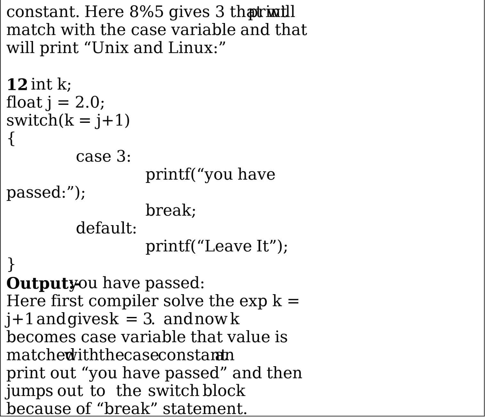指出以下程序中的错误（如果有的话）：

1. ```c
float a =12.25, b=5.2;
if(a = b)
printf("\n a and b becomes equal”);
```
输出:- 无错误。
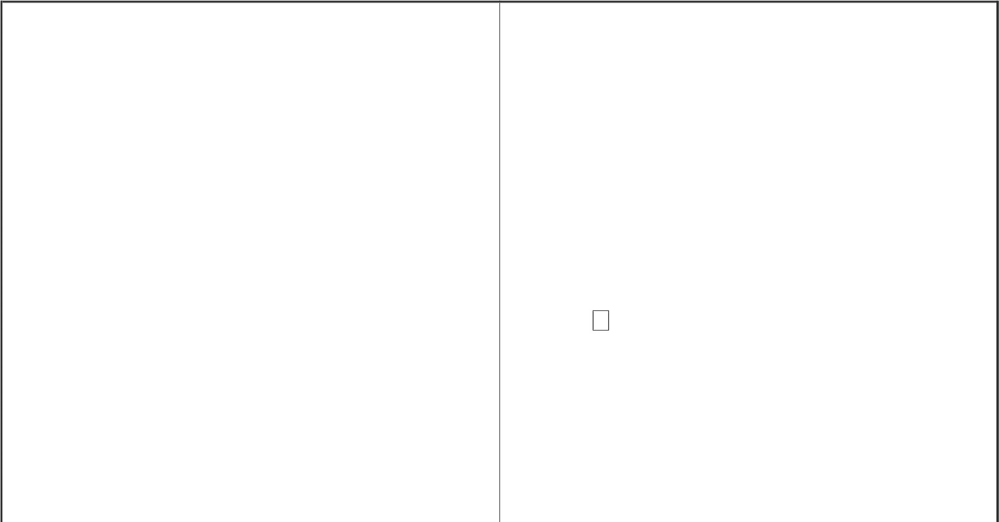在这里 `if` 语句中，`a` 没有与 `b` 比较，`a` 被赋值为 `b`，其是非零值(5.2)，现在 `if` 中的非零值被视为真，并执行下方的 `printf` 语句。

2. ```c
int a=10,b=15;
if(a ==b)
    printf("equal”);
elseif
    printf("a is max”);
```
输出:错误，在 c 中 `elseif` 不是一个单一关键字。两者必须分开，所以需要空格。
[](Images/image01026.jpeg)

2. ```c
if(‘A’<’a’)
    printf("\n A is smaller than a”);
```
输出:- 无错误。在这里 `if` 语句中 `A`(大写) 与 `a`(小写) 进行比较，字符被其 ASCII 值替换，因为 `A` 的 ASCII 值是 65 而 `a` 是 97，所以条件为真的执行。

3. ```c
int x =10;if(x>=2) then
    printf("Good”);
```
输出:- 错误，"then"不能在 c 中使用。

4. ```c
int j =10, k =12;
if(k>=j)
{
    {
        k=j;
    }
    j=k;
```
输出:- 错误，可以使用括号。

5. ```c
int a =10, b = 15;
if(a%2 = b%5)
printf("wonderful”);
```
8. ```c
int ch=1;
switch(ch)
{
    case 0;
        printf("\nClub”);
    case 1;
        printf("\nDiamond”);
}
```
输出:- 错误。`case` 应该是冒号而不是分号。

9. ```c
int temp;
scanf("%d”,temp);
switch(temp)
{
    case (temp<=20)
        printf("Oh! Damn”);
    case (temp>20 && temp<=30)
        printf("Rainy season”);
    case (temp>30 && temp<=40)
        printf("wish me I am Everest:");
    default :
        printf("\n Let’s Go for Picnic:");
}
```
输出:- 错误。关系运算符不能在 cases 中使用。

10. ```c
float a = 3.5;
switch( a)
```
输出:- 错误。需要值。首先求解 `if` 中的表达式`%` 运算符优先级更高，所以 `b%5` 得到 5 `a%2` 也得到 5（从右到左），表达式变为 `5=5`。现在进行赋值，我们知道不能给常量赋值。

6. ```c
int a,b;
printf("Enter two num:");
scanf("%d %d”,a,b);
if(a>b)
    printf("a is max”);
else
    printf("b is max”);
```
输出:- 错误，`scanf()` 需要 `&`(取地址)。在这里编译器不会报告错误，但我们无法获得预期结果，因为运行时输入的两个数字没有存储在 `a` 和 `b` 中，我们必须自动提供地址。

```c
{
    case 0.5:
        printf("Hello C:”);
    case1.5:
        printf("Working in C:”);
    case 2.5:
        printf("Test your C:”);
    case 3.5:
        printf("SimplyC:”);
}
```
输出:- 错误。不允许使用浮点常量。

1. ```c
int a = 3,b= 4,c = b-a;
switch(c)
{
    case a-2;2:
        printf("Hello:”);
        break;
    case a-2;b:
        printf("\nBye”);
        break;
}
```
输出:- 错误。A 需要常量或常量表达式。逻辑运算符不能在 cases 中使用。


## 实验（编写程序）

1. 编写程序检查键盘输入的数字是偶数还是奇数。
2. 编写程序打印两个数中的最大值。
3. 编写程序打印三个数中的最大值。
4. 编写程序打印四个数中的最大值。（短逻辑）。
5. 编写程序打印三个数中的第二大值。
6. 编写程序检查年份是否为闰年。
7. 编写程序在输入学生成绩后计算等级：
   - 百分比 >= 90 为 ‘A’
   - 百分比 >= 70 为 ‘B’
   - 百分比 >= 50 为 ‘C’
   - 百分比 < 50 为 ‘F’
9. 编写程序计算客户的电话费。月租 100 卢比。费率如下：
   - 1 到 100 次通话费率 = 0
   - 101 到 200 次通话费率 = 0.80
   - 201 到 500 次通话费率 = 1.0
   - 501 次以上费率 = 1.20
10. 编写程序计算员工养老金：
    - 如果是男性：
      - 年龄 >= 90，养老金 4000
      - 年龄 >= 60，养老金 6000
      - 年龄 < 60，养老金 0
    - 如果是女性：
      - 年龄 >= 90，养老金 3000


- `Age >= 60`: `pension` 为 5000
- `Age < 60`: `pension` 为 0

11. 编写一个程序检查一个三位数字是否为魔数（回文）。如果一个数字倒转后与原数字相同，则该数字为魔数。

12. 通过键盘输入任意年份，编写一个程序判断该年份是否为闰年。使用逻辑运算符 `&&` 和 `||`。

13. 通过键盘输入任意字符，编写一个程序判断输入的字符是大写字母、小写字母、数字还是特殊符号。

14. 编写一个程序使用条件运算符判断通过键盘输入的年份是否为闰年。

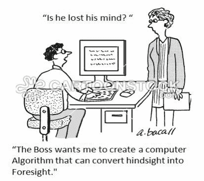

# 章节
## ∞ 4 ∞
## (控制语句（循环）)

## 引言
有时我们希望代码的某部分执行多次。我们可以在程序中重复编写代码，也可以使用循环。显而易见，如果我们需要执行某些代码执行百次或更多次，那么重复代码是不现实的。或者，我们可以在循环内部使用重复代码。

```
while(not a hundred times)
{ code 
}
```

循环会重复程序的某些部分，直到达到指定的次数或满足某个特定条件。换句话说，你可以认为：循环是重复单条语句或一组语句的过程，直到满足循环终止的某些条件。

C 语言中有了几种循环命令。我们将在接下来的章节中介绍这些命令。

循环包含四个部分：
1. 初始化。
2. 条件。
3. 语句。
4. 递增或递。

不要忘记，循环是重复单条语句或一组语句的过程，直到满足循环终止的某些条件。

### 循环类型
- **入口控制循环**：在执行语句之前检查条件的循环。因此，如果初始条件为假，循环甚至一次都不会运行。例如：`for` 循环、`while` 循环。
- **出口控制循环**：在执行语句之后才检查条件的循环。因此，如果初始条件为假，循环至少会运行一次。例如：`do while` 循环。

### while 循环
C 有三种循环，`while` 是其中最简单的一种。它接收一个条件（在括号内，与 `if` 语句一样）并对其进行求值。如果条件为真（非零，如之前所示），则执行循环体。条件会再次求值，如果仍为真，则再次执行循环体。此过程一直持续，直到条件最终为假。然后执行将跳转到循环后的第一条语句。

`while` 循环由一个条件和一个必须在循环中运行的单条命令或命令块组成。正如我们之前提到的，命令块是一系列包含在两个左右大括号内部的命令。

在 `while` 循环中，条件会被求值，如果为真，则执行循环语句。在执行语句和递增或递减之后，再次测试循环条件。这种重复执行语句、递增或递减以及测试条件的过程会持续进行，直到条件最终变为假，循环的控制权转移到下一条语句。

再次，如果循环体需要多条语句，则必须使用开始和结束括号。它是所有循环中最简单的。该循环的使用方法如下：

```
initialize; while(condition)
{
    statement;
    increment or decrement;
}
```

`while` 循环是一种入口控制循环。条件会被求值，如果为真，则执行循环语句。在执行语句和递增或递减之后，再次测试循环条件。这种重复执行语句、递增或递减以及测试条件的过程会持续进行，直到条件最终变为假，循环的控制权转移到下一条语句。


```c
printf("Enter the value of N "); scanf("%d",&n); i=1; while(i<=n)
{
    printf("%d,",i); i++;
}
printf("\b "); /*to remove the comma (,) printed at the last */
```

## do while 循环

C 语言中的 `do while` 循环是 `while` 循环的“倒置”版本。`while` 是先有条件后循环体，而 `do while` 是先有循环体后条件。

这意味着在达到条件之前必须执行循环体。因此，保证循环体至少执行一次。如果条件为假，则循环体将不再执行。

它是一种退出控制循环。循环的使用方法如下：初始化；

```c
do
{
    statement;
    increment or decrement;
}
while(condition);
```

在这里，`condition` 在执行语句和递增或递减之后进行测试。因此，在这种类型的循环中，程序首先评估循环体，然后才测试条件。因此，即使 `condition` 在开始为假，语句也会至少执行一次。它是一种退出控制循环。

```c
int j = 5; printf("start\n");
do
printf("j = %i\n", j--); while(j > 0); printf("stop\n");
```

**输出** – `start j = 5 j = 4 j = 3 j = 2 j = 1 stop` 示例

## 打印序列 1, 2, 3, 4, 5, …………..N 的程序

```c
int i,n;
printf("Enter the value of N "); scanf("%d",&n); i=1; do {
    printf("%d,",i); i++;
} while(i<=n);
printf("\b "); /*to remove the comma (,) printed at the last */
```

**练习笔记-** 最重要的一点是，`do while` 保证至少执行一次。

## for 循环

正如我之前提到的，C 编程语言中有许多种循环。我们将在本节中学习 `for` 循环。

“`for 循环`”与 `while` 循环类似，但它更复杂。“`for 循环`”由一个决定循环运行次数的控制语句和一个命令部分组成。命令部分可以是单个命令，也可以是一个命令块。

**练习笔记-** 记住 `for` 循环将循环的要素元素封装在一个语句中。欲需更多示例，请参阅本书的最后一章。

`for` 循环也是一种入口控制循环，提供了一种更简洁的循环控制结构。循环的使用如下：

```c
for (initialize; condition; increment or decrement)
{
    statement;
}
```

初始化部分仅在“`for 循环`”开始时执行一次。我们可以在这里初始化一个循环变量。

测试 `condition` 是循环最重要的部分。如果该 `condition` 有效（真），循环将继续运行。如果 `condition` 失效（假），则循环将终止。

每次“命令”部分在每个循环周期中都会执行一次。我们使用这部分来达到终止循环的最终条件。

例如，我们可以增加或减少循环变量的值，使得在指定次数的循环后循环条件失效，从而“`for 循环`”可以终止。

在这一步，我们用 `for` 循环重写了示例 3-1。只需注意，我们不再需要通过 `I=I+1` 来增加循环变量。它现在包含在“`for 循环`”条件句中（`i++`）。

### 示例 –

```c
#include<stdio.h> 
#include<conio.h>

main()
{
    int i=0; for(i=0;i<100;i++ ) printf("\ni=%d",i); system("pause");
}
```

**练习笔记-** `stdio.h` – 标准输入输出。
**练习笔记-** `conio.h` – 控制台输入输出。
**练习笔记-** 本质上，你只需要记住必须分隔该结构三个部分的两个分号字符。

**示例 –**
编写一个程序，获取工作日的温度并计算该周的平均温度。

```c
#include<stdio.h>
#include<conio.h>
main() {
    int count=0;
    float num=0,sum=0,avg=0; for(count=0;count<7;count ++)
    {
        printf("Enter temperature : ");
        scanf("%f",&num); sum=sum+num;
    } 
    avg=sum/7;
    printf("\nAverage=%f\n",avg); system("pause");
}
```

**示例 -**
下例示例将使用循环打印从 1 到 10 的乘法表。

```c
#include<stdio.h>
main()
{
    int i,j;
    for(i=1;i<=10;i++)
        for(j=1;j<=10;j++)
            printf("%d*%d=%d\t",i,j,i*j);
}
```

## 与 while 比较

C 语言中的 `do while` 循环是 `while` 循环的“倒置”版本。`while` 是先有条件后循环体，而 `do while` 是先有循环体后条件。

这意味着在达到条件之前必须执行循环体。因此，保证循环体至少执行一次。如果条件为假，则循环体将不再执行。

它是一种退出控制循环。循环的使用方法如下：初始化；

```c
do
{
    statement;
    increment or decrement;
}
while(condition);
```

在这里，`condition` 在执行语句和递增或递减之后进行测试。因此，在这种类型的循环中，程序首先评估循环体，然后才测试条件。因此，即使 `condition` 在开始为假，语句也会至少执行一次。它是一种退出控制循环。

```c
int j = 5; printf("start\n");
do
printf("j = %i\n", j--); while(j > 0); printf("stop\n");
```

**输出 –** `start j = 5 j = 4 j = 3 j = 2 j = 1 stop` 示例 

## 打印序列 1, 2, 3, 4, 5, …………..N 的程序

```c
int i,n;
printf("Enter the value of N "); scanf("%d",&n); i=1; do {
    printf("%d,",i); i++;
} while(i<=n);
printf("\b "); /*to remove the comma (,) printed at the last */
```

**练习笔记-** 最重要的一点是，`do while` 保证至少执行一次。

## for 循环

正如我之前提到的，C 编程语言中有许多种循环。我们将在本节中学习 `for` 循环。

“`for 循环`”与 `while` 循环类似，但它更复杂。“`for 循环`”由一个决定循环运行次数的控制语句和一个命令部分组成。命令部分可以是单个命令，也可以是一个命令块。

**练习笔记-** 记住 `for` 循环将循环的要素元素封装在一个语句中。欲需更多示例，请参阅本书的最后一章。

`for` 循环也是一种入口控制循环，提供了一种更简洁的循环控制结构。循环的使用如下：

```c
for (initialize; condition; increment or decrement)
{
    statement;
}
```

初始化部分仅在“`for 循环`”开始时执行一次。我们可以在这里初始化一个循环变量。

测试 `condition` 是循环最重要的部分。如果该 `condition` 有效（真），循环将继续运行。如果 `condition` 失效（假），则循环将终止。

每次“命令”部分在每个循环周期中都会执行一次。我们使用这部分来达到终止循环的最终条件。

例如，我们可以增加或减少循环变量的值，使得在指定次数的循环后循环条件失效，从而“`for 循环`”可以终止。

在这一步，我们用 `for` 循环重写了示例 3-1。只需注意，我们不再需要通过 `I=I+1` 来增加循环变量。它现在包含在“`for 循环`”条件句中（`i++`）。

### 示例 –

```c
#include<stdio.h> 
#include<conio.h>

main()
{
    int i=0; for(i=0;i<100;i++ ) printf("\ni=%d",i); system("pause");
}
```

**练习笔记-** `stdio.h` – 标准输入输出。
**练习笔记-** `conio.h` – 控制台输入输出。
**练习笔记-** 本质上，你只需要记住必须分隔该结构三个部分的两个分号字符。

**示例 –**
编写一个程序，获取工作日的温度并计算该周的平均温度。

```c
#include<stdio.h>
#include<conio.h>
main() {
    int count=0;
    float num=0,sum=0,avg=0; for(count=0;count<7;count ++)
    {
        printf("Enter temperature : ");
        scanf("%f",&num); sum=sum+num;
    } 
    avg=sum/7;
    printf("\nAverage=%f\n",avg); system("pause");
}
```

**示例 -**
下例示例将使用循环打印从 1 到 10 的乘法表。

```c
#include<stdio.h>
main()
{
    int i,j;
    for(i=1;i<=10;i++)
        for(j=1;j<=10;j++)
            printf("%d*%d=%d\t",i,j,i*j);
}
```

## 与 while 比较

C 语言中的 `do while` 循环是 `while` 循环的“倒置”版本。`while` 是先有条件后循环体，而 `do while` 是先有循环体后条件。

这意味着在达到条件之前必须执行循环体。因此，保证循环体至少执行一次。如果条件为假，则循环体将不再执行。

它是一种退出控制循环。循环的使用方法如下：初始化；

```c
do
{
    statement;
    increment or decrement;
}
while(condition);
```

在这里，`condition` 在执行语句和递增或递减之后进行测试。因此，在这种类型的循环中，程序首先评估循环体，然后才测试条件。因此，即使 `condition` 在开始为假，语句也会至少执行一次。它是一种退出控制循环。

```c
int j = 5; printf("start\n");
do
printf("j = %i\n", j--); while(j > 0); printf("stop\n");
```

**输出 –** `start j = 5 j = 4 j = 3 j = 2 j = 1 stop` 示例 

## 打印序列 1, 2, 3, 4, 5, …………..N 的程序

```c
int i,n;
printf("Enter the value of N "); scanf("%d",&n); i=1; do {
    printf("%d,",i); i++;
} while(i<=n);
printf("\b "); /*to remove the comma (,) printed at the last */
```

**练习笔记-** 最重要的一点是，`do while` 保证至少执行一次。

## for 循环

正如我之前提到的，C 编程语言中有许多种循环。我们将在本节中学习 `for` 循环。

“`for 循环`”与 `while` 循环类似，但它更复杂。“`for 循环`”由一个决定循环运行次数的控制语句和一个命令部分组成。命令部分可以是单个命令，也可以是一个命令块。

**练习笔记-** 记住 `for` 循环将循环的要素元素封装在一个语句中。欲需更多示例，请参阅本书的最后一章。

`for` 循环也是一种入口控制循环，提供了一种更简洁的循环控制结构。循环的使用如下：

```c
for (initialize; condition; increment or decrement)
{
    statement;
}
```

初始化部分仅在“`for 循环`”开始时执行一次。我们可以在这里初始化一个循环变量。

测试 `condition` 是循环最重要的部分。如果该 `condition` 有效（真），循环将继续运行。如果 `condition` 失效（假），则循环将终止。

每次“命令”部分在每个循环周期中都会执行一次。我们使用这部分来达到终止循环的最终条件。

例如，我们可以增加或减少循环变量的值，使得在指定次数的循环后循环条件失效，从而“`for 循环`”可以终止。

在这一步，我们用 `for` 循环重写了示例 3-1。只需注意，我们不再需要通过 `I=I+1` 来增加循环变量。它现在包含在“`for 循环`”条件句中（`i++`）。

### 示例 –

```c
#include<stdio.h> 
#include<conio.h>

main()
{
    int i=0; for(i=0;i<100;i++ ) printf("\ni=%d",i); system("pause");
}
```

**练习笔记-** `stdio.h` – 标准输入输出。
**练习笔记-** `conio.h` – 控制台输入输出。
**练习笔记-** 本质上，你只需要记住必须分隔该结构三个部分的两个分号字符。

**示例 –**
编写一个程序，获取工作日的温度并计算该周的平均温度。

```c
#include<stdio.h>
#include<conio.h>
main() {
    int count=0;
    float num=0,sum=0,avg=0; for(count=0;count<7;count ++)
    {
        printf("Enter temperature : ");
        scanf("%f",&num); sum=sum+num;
    } 
    avg=sum/7;
    printf("\nAverage=%f\n",avg); system("pause");
}
```

**示例 -**
下例示例将使用循环打印从 1 到 10 的乘法表。

```c
#include<stdio.h>
main()
{
    int i,j;
    for(i=1;i<=10;i++)
        for(j=1;j<=10;j++)
            printf("%d*%d=%d\t",i,j,i*j);
}
```

## 跳跃语句

循环执行一组语句，直到条件变为假。循环重复的次数是预先决定的。但有时在特定条件为真时跳过部分部分或终止循环，C 支持四种跳转语句：

i. `break`。
ii. `continue`。
iii. `goto`。
iv. `return`。

### break

用于在循环内部，直接跳出循环。我们已经在 `switch` 语句在使用 `break`。它用于跳过循环的后续执行，并将程序控制转移到循环后的语句。

### continue

有时在特定条件为真时跳过语句的执行。`continue` 不终止循环，而是跳转到下一次迭代。在 `for` 循环中 `continue` 将控制带到下一个递增或递减，但在 `while` 或 `do while` 循环中 `continue` 导致循环控制直接跳转到条件。

### goto

它还用于从程序的某部分跳转到另一部分或退出深度嵌套循环。但使用 `goto` 不是好做法，因为它会让逻辑复杂化并使长程序变得不可读。

### return

用于函数返回某些值，并从调用的函数定义跳转到调用函数定义。

### exit()

它不是跳转语句。它用于终止程序或直接退出程序，而不执行中间语句。它是包含在 `stdlib.h` 和 `process.h` 中的库函数。`exit` 使用如下：`exit( )`


任何循环，无论条件如何，都可以使用 C 语言的关键字 `break` 跳出。我们之前看到过下面的循环：

```c
printf("enter an integer: "); while(scanf("%i", &j) != 1) { 
    while((ch = getchar()) != '\n') ;
    printf("enter an integer: ");
    break; 
}
```

### break 实际上是 Goto！

它并不一定能很好地解决问题，因为你现在使用了等同于 `goto` 的语句！`goto` 是现代编程的祸害，由于其紧密的关系，某些公司禁止使用 `break`。如果非要使用，也应该节制使用，过度使用可能会产生“意大利面条代码”（spaghetti code）。

### break, switch 与循环

这与 `switch` 语句中使用的 `break` 关键字完全相同。如果在循环内部的 `switch` 语句放置了 `break`，则 `break` 将强制退出 `switch` 而不是循环。没有办法改变这一点。

### continue

"continue" 语句

练习笔记 – `continue` 语句可以在循环中使用。与 `break` 命令一样，“continue”改变了程序的执行流。然而，它并没有终止循环。它只是跳过循环当前迭代的剩余部分，并返回循环的起点。

```c
#include<stdio.h> 
main() {
    while((ch=getchar())!='\n') {
        if(ch=='.') continue;
        putchar(ch); 
    }
    system("pause");
}
```

在上面的示例中，程序接受所有输入，但删除了其中的 `.` 字符。文本会在你输入时回显，但主输出会在你按下回车键（等同于插入一个 `"\n"` 字符）后打印。正如我们之前提到的，这是因为 `getchar()` 函数是一个缓冲输入函数。

当 `break` 强制立即退出最近的嵌套循环时，`continue` 关键字则导致循环进入下一次迭代。在 `while` 和 `do--while` 循环中，它会直接跳转到条件处并重新评估它。在 `for` 循环中，它会跳转到循环的更新部分，执行该部分，然后重新评估条件。

### continue 实际上是 Goto-

适用于 `break` 使用的语句同样适用于 `continue`。它只是 `goto` 的另一种形式，应该谨慎使用。过度使用 `continue` 可能会导致产生意大利面条代码而不是代码。事实上，上面的循环可以很容易地写成：

```c
for(j = 1; j <= 10; j++) if(j % 3 != 0) printf("j = %i\n", j);
```

### continue, switch 与循环

`break` 对 `switch` 语句有影响，而 `continue` 没有这种影响。因此，放在循环内 `switch` 语句中的 `continue` 将影响循环。

练习笔记 – `if (then) else` - 注意分号；`switch` 可以测试整数值；`while`、`do while`、`for` - 再次注意分号。

## 回答以下问题

1. `for` 循环的三个部分是：
   a. `i` __________ 表达式
   b. `c`__________ 表达式
   c. `i` __________ 表达式
2. `break` 语句用于退出：
   a. 一个 `if` 语句
   b. 一个 `for` 循环
   c. 一个程序
   d. `main()` 函数
3. 当我们希望循环内的语句必须执行时，`do-while` 循环很有用：
   a. 仅一次
   b. 至少一次
   c. 多次
   d. 以上都不是
4. 在 `dowhile` 循环中，初始化、条件、执行的顺序是：
   a. 初始化、测试、执行。
   b. 初始化、执行、测试
   c. 测试、执行、初始化
5. 下列哪个语句用于将控制权带回开头——
   a. `exit`
   b. `break`
   c. `continue`
   d. 以上都不是
6. `int i=1; for( ; i++ ) printf(“%d”, i);`
7. `int a=5; do { printf(“%d\n”,a); a = -1; }while(a >0);`
8. 执行以下程序后 `sum` 的值将是多少：
```c
int sum, index; sum=1; index=9; do {
    index=index-1;
    sum=sum*2; 
}while(index>9);
```

**答案：**
1. 初始化, 条件, 增量
2. b
3. b
4. b
5. C
6. 1,2,3..32767, -32768,…无限循环
7. 5
8. 2

## 一些已解程序

1. **从 N 到 1 倒序打印数字**
```c
int i,n; 
printf("Enter the value of N ");
scanf("%d",&n); 
for(i=n;i>=1;i--) 
    printf("%d,",i); /* 删除最后的逗号 (,) */
```

2. **打印斐波那契数列 1, 2, 3, 5, 8, 13…………N**
（注：此处示例代码不完整，但按要求保留格式）

3. **打印 N 的阶乘**
（注：此处示例代码不完整，但按要求保留格式）

4. **编写程序计算 N 的阶乘**
（注：此处示例代码不完整，但按要求保留格式）

5. **编写程序检查给定序列是否为升序**
（注：此处示例代码不完整，但按要求保留格式）

6. **打印 9+99+999............... n 项之和**
（注：此处示例代码不完整，但按要求保留格式）

7. **杨斯卡三角形 (1, 11, 121, 1331, 14641)**
（注：此处代码不完整，但按要求保留格式）

8. **十进制 转换为二进制**
（注：此处示例代码不完整，但按要求保留格式）

9. **编写程序计算给定数的自然对数**
（注：此处示例代码不完整，但按要求保留格式）


```c
if(i==1)
    result=result+pow((x-1.0)/x,i);
else
    result=result+(1.0/2)*pow((x-1.0)/x,i);

printf("Log(%d) = %f",x,result);
}
```

# 一些求解程序

## 1. 检查数字是否为质数
```c
enum bool{false,true};
int i,n;
enum bool FLAG=true;
clrscr();
printf("Enter a number: "); scanf("%d",&n);
for(i=2;i<=n/2;i++)
{
    if(n%i ==0)
    {
        FLAG=false;
        break;
    }
}
if(FLAG ==true)
    printf("Prime number");
else
    printf("Not Number");
```

## 2. 生成 n 个数的程序
```c
#include<stdlib.h>
int a,i,n;
randomize(); /* 使用随机数初始化数字生成器*/
printf("enter the no. to be printed: "); scanf("%d",&n);
i=1;
while(i<=n)
{
    a=random(100)+1; /* 生成一个 0 到 99 之间的数字*/
    printf("%d\n",a);
    i++;
}
```

## 3. 输出以下输出的程序：
```
a b c d e f f d c b a b c e
f d c b a b c e
e d c b a b c d
d c b a b c
c b a b
b a
a
```
```c
int n,i,j,k,l;
printf("Enter the number of Rows: ");
scanf("%d",&n);
for(i=n;i>=1;i--)
{
    for(j=1;j<=i;j++)
        printf("%c",j+97-1);
    for(k=1;k<=2*(n-i)-1;k++)
        printf(" "); 
    for(l=i;l>=1;l--)
    {
        if(l==n) continue; /* 将循环控制直接传递给递减语句*/
        printf("%c",l+97-1);
    }
    printf("\n");
}
```
**练习笔记：** 在注释中，你可以写任何你想写的内容，无论大写、小写还是特殊字符，你可以自由编写。

## 4. 打印用户输入的字符总数。输入由回车键结束。
```c
char ch; int i=0;
printf("Enter a sentence: "); while((ch=getche())!='\r') /* getche() 是一个输入函数 */
{
    i++;
}
printf("\n%d",i);
```

## 5. 反转数字并找到其八进制等值的程序
```c
#include<math.h>
main()
{
    int n, rev, a, cnt;
    printf("\nEnter a number"); scanf("%d",&n);
    /*反转数字*/
    rev=0;
    while(n>0)
    {
        a=n%10;
        n=n/10;
        rev=rev*10+a;
    }
    n=rev;
    cnt=oct=0;
    /*转换为八进制*/
    while(n>0)
    {
        a=n%8;
        n=n/8;
        oct=oct+a*pow(10,cnt);
        cnt++;
    }
    printf("The octal equivalent of %d is %d",rev,oct); }
```
**练习笔记：** 再次告诉你，为了根据章节主题查看更多编程示例，请阅读本书的最后一章，我在那里提到了 200 多个 C 程序供你练习。

## 异常循环 (image01032.jpeg)
1. `for(i=1;i<=5;i--)` 输出：`1,0,-1,-2……`
2. `for(i=1;i<=5;++i)` 输出：`1,2,3,4,5`
3. `for(i=1;++i<=5;)` 输出：`2,3,4,5`
4. `for(i=1;i<=5;i++);` 输出：`2,3,4,5,6` （因为递增后有分号，所以循环没有任何语句）
5. `for(i=1;i<=5;printf("%d",i++));` 输出：`1,2,3,4,5`
6. `for(i=1;i<=5;printf("%d",++i));` 输出：`2,3,4,5,6`
7. `for(i=1;i=5;i++)` 输出：`5,5,5,5…….`
8. `for(i=1;i=0;i++)` 输出：（空屏，在赋值为 0 的地方条件被认为为假。）
9. `for(;;)` 输出：（未生成任何输出）
10. `for(i=1;i<=5;i++)` 输出：`1,2,3,4,5` （条件正在检查 `i` 的值）
11. `for(i=1;i<=5;i++)` 输出：`1,2,3,4,5` （检查检查 `i` 的值）
12. `for(i=1;i<=5;i++)` 输出：`1,2,3,4,5`
13. `for(i=1;i<=5;i++)` 输出：`1,2,3,4,5`
14. `for(i=1;i<=5;i++);` 输出：`6`
15. `int i=1; for(i<=5;i++) printf("%d",i);` 输出：`1,2,3,4,5`
16. `int i=1; while( )` 输出：空屏

### 常见错误
1. `while` 语句不包含 `do`。
2. `break` 和 `continue` 语句仅影响内层循环。例如：
```c
for(.) /* 循环 1*/
{
    for(...) /* 循环 2*/
    {
        .....
        break;
        .....
    }
}
```
`break` 会导致退出循环 2 而不是循环 1 (image0133.jpeg)。

## 以下程序的输出是什么？

1.
```c
int i =1; while( i<= 10);
{
    printf(" \n%d",i);
    i++;
}
```
输出：无限循环。在上面的程序中 `while` 后面出现了 `;`，理解为 `while(10)`，体内没有递增，所以条件保持为真。

```c
int a =4, b, c; while(a>=0)
{
    a--;
    b++;
    if( a ==b)
        continue;
    else
        printf( \n %d %d",a,b);
}
```
输出：
3 1
0 4
1 5 (image0134.jpeg, image0135.jpeg, image0136.jpeg) 在上面的程序中首先 `a = 4,b = 0`，当检查条件时变为真并执行循环体，`a` 减少 1 `b` 增加 1，所以 `a = 3 b = 1`，现在再次检查条件导致无限循环，且由于空语句没有输出。

```c
char ch;
while(ch =0; ch<=255;ch++)
    printf("\n %d-%c",ch,ch);
```
输出：错误。在上面的程序中 `while` 循环被用于 `for` 的位置，由于语法不同导致错误。

```c
int a =4;while( a ==1)
{
    a = a-1;
    printf("%d",a);
    --a;
}
```
输出：无输出，因为第一次条件就为假，控制立即离开循环体，不执行任何操作。

```c
int a =4,b,c;b = --a; c = a--; printf("\n%d %d %d",a,b,c);
```
输出：2 3 3 (image0137.jpeg) 在上面的程序中 `a = 4`，现在我们理解了前增和后增后减。


`a == b` 为假，控制流跳转到 `else` 块并打印 `a` 和 `b` 的值分别为 3 和 1。现在当控制流再次到达循环末尾时，它跳转到条件判断，此时条件仍然为真，再次执行循环体，结果为 `a = 2` 和 `b = 2`。当检查条件 `a == b` 时，它变为真，使用 `continue` 语句继续循环，控制流跳转到循环条件，该条件为真是因为 `a = 2` 大于 0。再次执行循环体，执行 `a = 1`、`b = 3` 并打印，因为 `if` 中的条件为假，控制流从循环末尾跳转到为真的条件，此时 `a = 0` 和 `b = 4`，两者不相等，因此被打印。重复检查条件时，它为真并执行 `a = -1` 和 `b = 5`，两者不相等并通过 `else` 块打印，此时再次检查条件时变为假，因为 `a = -1` 不大于或等于 0，并跳出循环。

### 11
```c
int a = 4, b = 0,c; while( a>=0) {
    if(a == b)
        break;
    else
        printf("\n%d %d",a,b);
    a--;
    b++;
}
```


`b = --a` (1) `a = a-1` `[( a =3);]` (2) `b=a` `[(b =3)]`; 即在前缀自减中先递减后赋值。

`c=a--` (1) `c = a` `[c = 3];` (2) `a = a1`[ a = 2];` 即在后置自减中先赋值后递减。因此最终 `a = 2`、`b = 3`、`c = 3` 并通过 `printf()` 打印。

### 5
```c
int a =4,b =3,c; c = a-- -b; printf("\n%d%d%d",a,b,c);
```
输出:- `3 3 1`

这里最初 `a = 4`；在表达式 `c = a-- -b;` 中，`a` 使用了后置自减操作，意味着 `a` 先在表达式中使用，然后递减，即 (1) `c = a-b;`[c = 4-3] `[c = 1]` (2) `a = a-1;`[a = 41] `[3]`  `b` 保持不变，因此最终 `a = 3`、`b = 3`、`c = 1` 并通过 `printf()` 打印。

### 6
```c
while('a'<'b')printf("\n malyalam is a palindrome");
```
输出:- 无限打印“malyalam is a palindrome”。

因为条件 `'a'<''b'` 永远不会为假，每次都会执行循环体，打印上述消息“malyalam is a palindrome”。

### 7

```c
int i;
```
输出:-
`4 0`
`3 1`

这里 `a = 4` 且 `b = 0`，当检查循环条件时它变为真，控制流跳转到 `else` 块因为 `a!=b`，并打印 `a` 和 `b` 的值分别为 4 和 0。然后 `a` 减 1，`b` 增 1，所以 `a = 3` 且 `b = 1`。再次重复检查循环条件时，它变为真，控制流执行循环体，并从 `else` 块打印 `a` 和 `b` 的值为 3 和 1，因为条件变为假，而现在 `a = 2` 且 `b = 2`，循环条件将再次为真，当比较 `a == b` 结果为真时，执行 `if` 块并由于“break”语句跳出循环。

### 12
```c
int i;for(i = 1;i<=5;printf("\n%d",i));
    i++;
```
输出:- `1` 将无限次打印。这里 `;` 用在循环后面意味着循环包含空语句，`i++` 不在循环体中。首先 `i` 初始化为 1，当检查条件时它为真，从而无限打印 1，每次检查条件时都为真。

### 13
```c
int i = 1,j = 1;
while(i =15) {
    printf("\n%d",i);
    i++;
}
```
输出:- 无限打印 15。因为在 `while(i =15)` 语句中，`i` 被赋值为 15（非零值），每次检查条件时都为真，执行循环体打印 `i` 的值为 15，然后 `i` 增 1 变为 16，再次检查条件时仍为真（这与之前相同）。

### 8
```c
float a =1.1; while( a =1.1) {
    printf("\n%d",x);
    x=0.1;
}```
输出:- 无输出。因为在条件中 `a` 变量与双精度值进行比较，控制跳出循环。

### Note
当使用浮点常量时：
```c
for(i =1; ;) {
    if(i>5)
        break;
    else
        j+=i;
}```
输出:- `2`。因为在这个程序中首先 `i = 1`，由于循环没有条件（始终为真），执行循环体，当 `i>5` 成立时跳出循环。

### Lab Exercise - Print the n terms of
1. 1, 3, 5, 7, 9, .........
2. 2, 4, 6, 8, 10, ........
3. 1, 4, 9, 16, 25, .......
4. 1, 8, 27, 64, 125, .....
5. 1, 1, 2, 4, 7, 13, 24, ... (Lucas 波纳契数列)
6. 1 + x2/2! + x3/3! + x4/4! + x5/5! ..........
7. x - x3/3! + x5/5! - x7/7! + x9/9! .......... (sinx)
8. x - x3/3! + x5/5! + x7/7! + x9/9! .......... (sinh)
9. 1 - x2/2! + x4/4! - x6/6! + x8/8! .......... (cosx)
10. x - x2/2 + x3/3 - x4/4 + x5/5 .............. (log(1+x))
11. 编写程序打印 n 的倍数表。
12. 编写程序计算 n 的阶乘。
13. 编写程序计算数字 n 的 p 次幂

32. 编写程序计算输入数值的平均值。输入数值序列以 -1 结束。

33. 编写程序从 n 个数字中找到最大值、第二大值、最大值的位置和第二大值的位置。


34. 编写程序，使用 `while` 循环打印所有的 ASCII 值及其对应的字符。ASCII 值范围从 0 到 255。

35. 编写程序，打印 1 到 500 之间所有的阿姆斯特数。如果一个数字的每个位数字的立方之和等于该数字本身，则该数字被称为阿姆斯特数。例如，`153=(1*1*1)+(5*5*5)+(3*3*3)`。如果数字是两位，则对数字进行平方。

36. 编写程序，打印 1 到 300 之间所有的质数。

37. 编写程序，用笑脸填满整个屏幕。笑脸的 ASCII 值为 1。

38. 编写程序，使用 `for` 循环计算以下级数的前七项：`1/1!+2/2!+3/3!+......`

39. 编写一个程序，使用 `for` 循环生成 1、2 和 3 的所有组合。

40. 根据某项研究，人的近似智力可以使用可以使用公式计算：
`i=2+(y+0.5 x)`
编写程序生成一个 `i`、`y` 和 `x` 的数值表，其中 `y` 从 1 变到 6，对于每个 `y` 值，`x` 从 5.5 变到 12.5，步长为 0.5。

41. 编写程序，打印两个给定数字之间的所有的质数。

42. 编写程序，统计给定数字的位数。

43. 编写程序，打印给定数字所有位数字的和。

44. 编写程序，检查给定数字是否为回文数。

45. 编写程序，从用户输入的、以回车键结束的文本中统计所有的元音、辅音、数字、空格和特殊符号。

46. 编写程序，计算前 n 个质数的和。

47. 编写程序，在给定的数值序列中判断指定值是否为质数。从输入读取的序列以 0 结束。

48. 打印以下级数的和。
`1 x 2 + 2 x 3 + 3 x 4 + 4 x 5 + ....... + (n-1) x n.`

49. 打印以下级数的和。

50. `e-x 1 - x + x2/2! - x3/3! + x4/4! .....`

51. 编写程序，读取 n 个数字并统计偶数和奇数的个数。
`1+1/2+1/3+1/4......+1/n`

52. 编写程序，计算任意半径 `r` 的球的体积 `(4/3pir³)` 和表面积 `(4pir²)`。

53. 编写程序，计算边长 `a`、`b` 和 `c` 的三角形的周长 `p` 和面积 `a`，其中：
`p = a+b+c`
`a = sqrt(s(s-a)(s-b)(s-c))`
且 `2s = a + b+ c`

54. 编写程序，读取一个正整数并确定打印其二进制等值。

55. 编写程序，打印 n 个数字的和、前几个偶数的平方和以及前几个奇数的和。

56. 编写程序，计算 n 个员工的净薪。净薪为 `basic + hra - pf`（`da` 是小于或等于 8000 的基本工资的 39%，`hra` 是超过 8000 的基本工资的 30%，`pf` 是固定扣除额 600）。

57. 编写一个程序计算员工的加班费。工作超过 40 小时的按每小时 12.0 的费率支付。假设员工不工作部分的小时。

58. 在购买某些物品时，如果购买数量超过 100，则提供 10% 的折扣。如果通过键盘输入单价，编写一个程序计算总费用。

59. 编写程序，检查给定的数值序列是否按升序排列。序列的哨兵值为 -1。

60. 编写程序，找到给定的 n 个值序列中以 3 为倍数出现的数值之和和平均值。

61. 编写程序，输入 n 名学生的成绩，并统计获得 a、b、c、d 和 f 级的学生人数。等级根据以下标准授予：
成绩 等级
>= 80: A
>= 70: B
>= 60: C
>= 50: D
< 50: F


# 一维数组

## 介绍
数组（ARRAY）是相似数据项或元素的集合。或者说数组是在单个名称下连续存储的同类数据元素的集合。

### 数组的需要
当相同类型和性质的变量较多时，很难处理它们。因此我们需要数组。让我们通过示例来理解数组的使用：
```c
int i,a;
for(i=1;i<=5;i++)
{
    printf("Enter the no.");
    scanf("%d",&a);
}
```
在上面的程序中，一旦给 `a` 分配新值，旧值就会丢失。因此，我们目前为止使用的所有变量都是如此。因此，如果我们想保存所有值，我们需要数组。例如，如果我们想存储 5 个数字，我们可以定义数组 `int a[5]`。数组是在同相同名称下连续存储的元素的集合。

### 数组声明
`int a[6];`
`a` 是数组名，`int` 是类型，`6` 是大小。

### 数组初始化
| 声明 | 描述 |
| :--- | :--- |
| `int a[5];` | /*该数组包含随机值*/ |
| `int a[5]={10,20,30,40,50};` | /*该数组包含 10,20,30,40,50 值*/ |
| `int a[5] = {0,0,0,0,0};` | /*该数组包含 0,0,0,0,0 值*/ |
| `int a[5] = {0};` | /*该数组包含 0,0,0,0,0 值*/ |
| `int a[5] = {1};` | /*该数组包含 1,0,0,0,0 值*/ |
| `int a[5] ={10, , 30};` | /*该数组包含 10,0,30,0,0 值*/ |
| `int a[ ] = {10,20,30};` | /*该数组的大小将被假设为 3*/ |
| `int a[3] = {10,20,30,40};` | /*初始化过多错误*/ |
| `static int a[5];` | /*该数组包含 0,0,0,0,0 值*/ |


如果初始化次数超过数组的大小，则会报“初始化过多”的错误。

## 数组的局限性

1. 形成的数组是同质的。也就是说，整数数组中只能存储整数值，而浮点数组中只能存储浮点值，且字符数组只能存储字符。因此，没有数组可以包含两种数据类型的值。
2. 在声明数组时，传递数组的大小是强制性的，且该大小必须是一个常量。这会导致内存短缺或浪费。
3. 在数组中插入或删除元素需要移动元素。
4. 数组不检查其边界：在 `C` 中，没有检查来判断输入数组的值是否超过了数组的大小。使用超出数组范围下标输入的数据将简单地放在数组之外，可能会位于其他数据或程序本身之上。

这至少会导致不可预知的结果，而且不会有错误消息警告程序员越界了数组大小。在某些情况下，程序可能会挂起。因此，以下程序可能会产生非预期的结果：

```c
int a[10],i;
for(i=0;i<=20;i++)
    a[i]=i;
```

# 一些求解程序

### 1. 写一个程序打印 n 个数数的平均值。

```c
int a[50],n,i,sum=0;
float avg;
printf("Enter the number of elements in the array: ");
scanf("%d",&n);
/*输入并计算数组和*/
for(i=0;i<n;i++)
    /*数组中的第一个元素编号为 0，所以最后一个元素比数组的大小少 1*/
    {
        printf("Enter number %d",i+1);
        scanf("%d",&a[i]);
        sum += a[i];
    }
avg=(float)sum/n; /*将 sum 从整数转换为浮点数*/
printf("average = %f",avg);
```

### 2. 写一个程序，在一维数组（无序）的指定位置插入一个元素。

```c
#define SIZE 20
main()
{
    int n,i,a[SIZE],item,pos;
    printf("enter no. of elements in the array: ");
    scanf("%d",&n);
    /*输入数组*/
    for(i=0;i<n;i++)
    {
        printf("Enter element %d: ",i+1);
        scanf("%d",&a[i]);
    }
    printf("Enter the item and its position: ");
    scanf("%d %d",&item,&pos);
    pos--; /*数组从 0 开始*/
    for(i=n-1;i>=pos;i--)
        a[i+1]=a[i]; /*插入*/
    a[pos]=item; /*输出*/
    for(i=0;i<n+1;i++)
        printf("\n%d",a[i]);
}
```

### 3. 写一个程序读取一个整数数组。程序应该显示出现在偶数下标和奇数下标位置的元素。

```c
int even,odd,i,n,a[50];
printf("Enter the number of terms: ");
scanf("%d",&n);
/*输入*/
for(i=0;i<n;i++)
{
    printf("Enter number %d: ",i+1);
    scanf("%d",&a[i]);
}
printf("\nOdd\tEven");
for(i=0;i<n;i++)
{
    if(i%2==0) /*数组从 0 开始*/
        printf("\n%d\t",a[i]);
    else
        printf("%d\t",a[i]);
}
```

### 4. 写一个程序读取一个浮点数组并反转该数组。

```c
float a[0];
int n,i;
printf("Enter the number of terms: ");
scanf("%d",&n);
/*输入*/
for(i=0;i<n;i++)
{
    printf("Enter the number %d",i);
    scanf("%f",&a[i]);
}
for(i=n-1;i>=0;i--)
    printf("%.2f, ",a[i]);
```

### 5. 给了一些重复的数字，写一个程序按递增顺序打印它们及其它们的频率。

```c
#define SIZE 100
main()
{
    int a[SIZE],b[SIZE],freq[SIZE],i,j,k,n,found,t;
    printf("Enter how many numbers");
    scanf("%d",&n); /*输入数组*/
    for(i=0;i<n;i++)
    {
        printf("enter element %d ",i+1);
        scanf("%d",&a[i]);
    }
    for(i=0,k=0;i<n;i++)
    {
        found = 0;
        for(j=0;j<k;j++)
        {
            if(a[i] == b[j])
            {
                freq[j]++;
                found = 1;
                break;
            }
        }
        if(found == 0)
        {
            b[k] = a[i];
            freq[k++] = 1;
        }
    }
    for(i=0;i<k-1;i++)
        for(j=i+1;j<k;j++)
            if(freq[i] < freq[j])
            {
                t = b[i];
                b[i] = b[j];
                b[j] = t;
                t = freq[i];
                freq[i] = freq[j];
                freq[j] = t;
            }
    for(i=0;i<k;i++)
        printf("%d\t%d\n",b[i],freq[i]);
}
```

### 6. 写一个程序将数组 a 和 b 合并到第三个数组 c 中。

```c
#define SIZE 20
main()
{
    int n1,n2,i,j,k,a[SIZE],b[SIZE],c[SIZE];
    /*在第一个数组输入*/
    printf("Enter no. of elements in the first array: ");
    scanf("%d",&n1);
    for(i=0;i<n1;i++)
    {
        printf("Enter the element %d: ",i+1);
        scanf("%d",&a[i]);
    }
    /*在第二个数组输入*/
    printf("\nEnter no. of elements in the second array: ");
    scanf("%d",&n2);
    for(i=0;i<n2;i++)
    {
        printf("Enter the element %d: ",i+1);
        scanf("%d",&b[i]);
    }
    /*合并*/
    for(i=0,j=0,k=0;i<n1&&j<n2;k++)
    {
        if(a[i] < b[j])
            c[k]=a[i++];
        else
            c[k]=b[j++];
    }
    /*第一个列表剩余部分*/
    while(i<n1)
        c[k++]=a[i++];
    /*第二个列表剩余部分*/
    while(j<n2)
        c[k++]=b[j++];
    /*输出*/
    for(i=0;i<(n1+n2);i++)
        printf("%d\n",c[i]);
}
```

### 7. 写一个程序从给定的数字列表中找到第 k 小的数：

```c
int a[20], i, j, n,t,k;
printf("Enter the number of elements in the list: ");
scanf("%d",&n);
```


```c
/*输入数组数据*/
for (i=0;i<n;i++) {
    printf("Enter the number %d: ", i+1);
    scanf("%d",&a[i]);
}
/* 循环排序数组*/
for(i=0;i<n-1;i++) {
    for(j=i+1;j<n;j++) {
        if(a[i]>a[j]) {
            t=a[i];
            a[i] = a[j];
            a[j]=t;
        }
    }
}
printf("Enter the position of element:");
scanf("%d",&k);
printf("the %d smallest element of the list is %d",k, a[k-1]);
```

以下程序的输出是什么？

### 1
```c
int num[26],temp;
num[0] = 100;
int i, *k;
num[25] = 200;
k = b;
temp = num[25];
for (i = 0; i<= 4; i++) {
    num[25] = num[0];
}
num[0] = temp;
printf("%d ",*k);
printf("\n%d %d",num[0],num[25]);
k++;
```
```c
int b[ ] = {10,20,30,40,50};
```

**输出：** `200 100`（注：根据文本描述）
在声明后的前两个语句中，第一个和最后一个元素分别被赋值为 `100` 和 `200`，在接下来的三条语句中交换了它们。因此 `num[0] = 200` 且 `num[25] = 100`。

### 2
```c
int array[26],i;
for (i = 0; i<=25;i++) {
    array[i] = 'A' + i;
    printf("\n%d %c",array[i], array[i]);
}
```
**输出：**
```
65 A
66 B
-----
90 Z
```
在上述程序中，第一次数组 `i` 的值为 `65`，因为 `i = 0` 且 `'A'` 得到 `65`，所以通过 `printf()` 输出 `array[0] = 65`。每次 `i` 增加 `1`，数组将包含 `66, 67` 等连续的位置并通过 `printf()` 输出。

### 3
```c
int sub[5],i;
for( i = 0; i <= 4; i++);
{
    sub[i] = i;
    printf("\n%d",sub[i]);
}
```
(Images/image01050.jpeg)
**输出：** `49`
由于 `;`（空语句），循环将执行到 `4` 而不执行任何语句，当 `i` 等于 `5` 时。
**输出：** `10 20 30 40 50`（注：根据文本描述）
在上述程序中，`b` 的基地址通过 `k = b` 语句赋值给 `k`。因为我们使用了数组名，它告诉我们数组的基地址。上述程序中的循环运行了 `5` 次，每次 `k` 引用相应的元素并打印它。我们知道当指针增加时，它会移动所需的字节数（在上述程序中由于指向 `int` 数组，所以移动了 `2` 字节）并指向下一个元素。第一次 `k` 包含第 `0` 个元素并通过引用打印它，通过增后它指向下一个元素，因为循环运行了 5 次，所以指针增加了多次并指向来自基地址的值，因此它打印了所有数组元素。

### 4
```c
int b[ ] = {10,20,30,40,50};
int i; for (i = 0; i<=4; i++)
    printf("%d ",*(b+i))
```
**输出：** `10 20 30 40 50`
编译器将 `*(b + i)` 理解为 `b[i]`。
在上述程序中，`i` 从 `0` 变化到 `4`，通过 `printf()` 每次打印 `b[i]` 的值，将连续输出 `10 20 30 40 50`。

### 5
```c
int a[ ] = {2,6,4,10};
int i;
change( a, 5);
for(i = 0;i<= 4;i++)
    printf("%d ",a[i]);

change(int *b, int n) {
    int i;
    for(i = 0; i <n;i++)
        *(b+i) = *(b+i)+5;
}
```
**输出：** `7 11 9 13 15`
在这里，指针 `b` 接收了 `a` 的基地址，`5` 被传递给 `n`。在 `change()` 中，每次当 `b[i]` 的值为 `4` 时条件变为假，控制流跳出循环并执行下一语句，即 `sub[i] = i`，此时 `sub[i]` 为 `49`。`sub[i]` 的值通过 `printf()` 输出，即 `49`。

### 6
```c
static int a[5];
int i;
for( i = 0; i<=4; i++)
    printf("%d ",a[i]);
```
**输出：** `0 0 0 0 0`
在这里，数组的存储类为 `static`，在 `static` 数组中，当我们打印 5 次时，所有元素都被赋值为 `0`。循环从 `0` 到 `5`，首先 `b[0] = b[0] + 5`，类似地后续元素也被改变，在 `main()` 中打印了 `7 1 9 13 15`。

### 7
```c
int a[ ] = {5,1,15,20,25};
int i,j,k = 1;
i = ++a[1];
j = a[1]++;
m = a[i++];
printf("\n%d %d",i,j,m);
```

**输出：** `3 2 15`
在这里由于索引从 `0` 开始，所以 `a[1] = 1`。现在在上述语句中使用 `++a[1]`，所以 `a[1]` 的值增加变为 `2`，然后赋值给 `i` 为 `2`。在下一语句 `j = a[1]++` 中使用了后置增操作，首先将 `a[1]` 的值赋值给 `j`（为 `2`），然后增加 `a[1]` 为 `3`。现在在下一语句 `m = a[i++]` 中，首先 `a[i]` 被赋值给 `m`，因为 `i = 2`（`a[2] = 15`），然后 `i` 增加变为 `3`。最终 `j = 2` 且 `m = 15`。
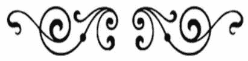

指出以下段中的错误（如有）：

1.
```c
char mixed[10],i;
for( i = 0; i< 10; i++) {
    scanf("%d",&mixed[i]);
}
```
**输出：** 错误。因为 `mixed` 类型不能使用。

2.
```c
int SIZE;
scanf("%d",&SIZE);
int a[SIZE];
for( i = 1; i<=SIZE ;i++) {
    scanf("%d",a[i]);
    printf("%d",a[i]);
}
```
**输出：** 错误。因为数组的大小必须是常量，但这里 `SIZE` 是用作数组大小的变量。

3.
```c
main() {
    int i, a = 2, b = 3;
    int a[2+3];
    for( i = 0; i< a+b; i++) {
        scanf("%d",&a[i]);
    }
}
```
6.
```c
main() {
    int a[6] = {10,20,30,4,0};
    int i;
    for(i = 0; i<=25; i++)
        printf("\n%d",a[i]);
}
```

**输出：** 无错误。因为如果我们越数组边界，将显示存储在位置位置的垃圾。但会显示警告“数组越界”。

7.
```c
main() {
    int s[50];
    for( i = 1; i<=50; i++) {
        s[i] = i; printf("\n%d",s[i]);
    }
}
```
**输出：** 无错误。这里数组大小为 `50`，由于数组索引从 `0` 开始，最后一个

| 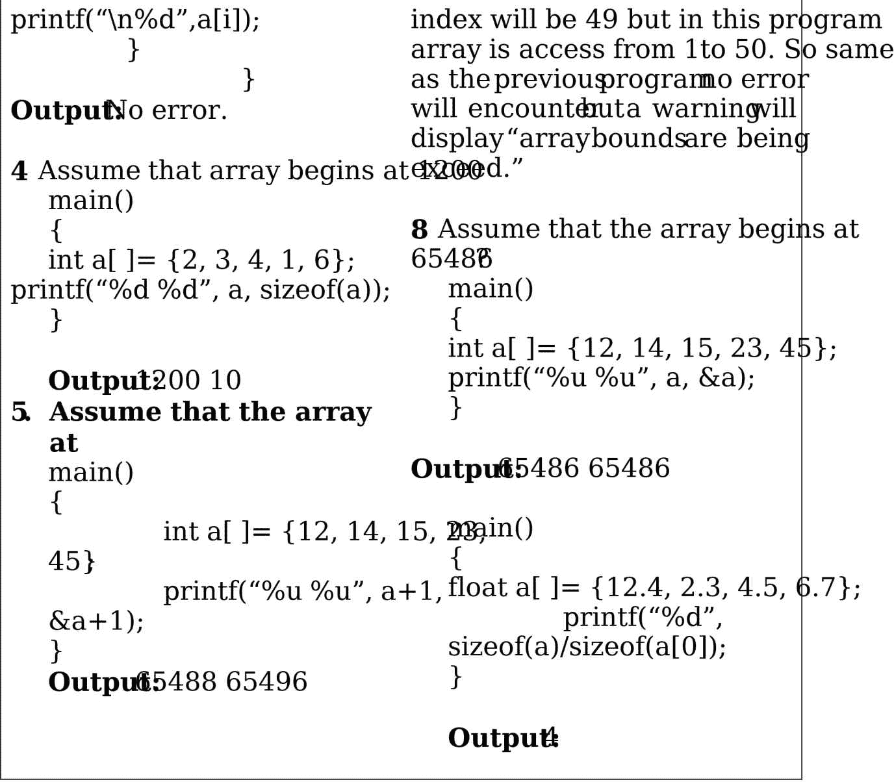选题 |
| :--- | :--- |
| 1. 数组是—— | a) 散布在内存中的不同数据类型。<br>b) 散布在内存中的相同数据类型。<br>c) 在内存中相邻放置的相同数据类型。<br>d) 不同数据类型 |
| 7. 如果给一个下标超过数组大小的元素赋值，会发生什么？ | a) 元素将被设置为 0<br>b) 没关系，经常这样做。<br>c) 其他数据可能被覆盖<br>d) 来自的 |
| (Images/image01057.jpeg) | |


a) 第一是特定元素，第二个是类型。
b) 第一是数组大小，第二个是特定元素。
c) 第一是特定元素，第二个是数组大小。
d) 两者都指定数组大小。

输出： b) 第一是数组大小，第二个是特定元素。

### 4. 下面的数组声明是否正确？

a) `int a(25);`
b) `int size = 10, b[size];`
c) `int c = {0,1,2};`

输出：全部都是错误的。


输出： c) 其他数据可能会被覆盖

### 8. 当你将数组作为参数传递给函数时，实际传递的是什么？

a) 数组的地址。
b) 数组元素的值。
c) 数组第一个元素的地址。
d) 数组元素的数量。

输出： a) 数组的地址。

### 9. 以下中哪些是使用指针的原因？

a) 操作数组的某部分
b) 引用如 `for` 和 `if` 等关键字
c) 从函数返回多个值
d) 更方便地引用特定的程序

输出： a) c)

### 10. 如果你不初始化静态数组，元素会被设置为什么？

a) 0

在 `(a)` 中，数组维度中不允许使用这些括号 `( )`。在 `(b)` 中，数组大小是变量。在 `(c)` 中，一个简单的整数变量被赋值三个值，这只在数组变量中是可能的。

### 5. 如果你在初始化数组时试图放入这么多值，超过了数组的大小，会发生什么？

a) 什么都不会发生
b) 可能发生系统故障
c) 编译器报错
d) 其他数据可能会被覆盖

输出： b) 可能发生系统故障

### 6. 如果你在初始化数组时放入的元素太少，会发生什么？

a) 什么都不会发生
b) 可能发生系统故障
c) 编译器报错
d) 未使用的元素将被用 0 或垃圾值填充

输出： d) 未使用的元素将被用 0 或垃圾值填充

解释：当数组被部分初始化时，剩余的数组元素将初始化为 0。

### 11. main()

```c
main(){
    int a[5]={2,3};
    printf("%d%d%d",a[2],a[3],a[4]);
}
```
1. 垃圾值
2. 2
3. 3
4. 0 0

输出： 0 0 0

### 判断以下陈述的对错：

1. 数组 `num[26]` 有二十六个元素。
2. 表达式 `num[1]` 指定数组中的第一个元素。
3. 在声明时必须初始化数组。
4. 表达式 `num[7]` 指定数组中的第八个元素。
5. 浮点变量的地址始终是一个整数。

答案：
1. 错误
2. 错误
3. 错误
4. 正确
5. 正确

### 1. 如果 `a[i]=i++` 是未定义行为，那么根据相同的原因 `i=i+1` 也应该是未定义行为。但它不是。为什么？

答案：如果一个对象要在表达式内部被修改，那么同一个表达式内对它的所有访问必须是为了计算要存储的值。表达式 `a[i]=i++` 是不允许的，因为对 `i` 的访问之一（`a[i]` 中的那个）与最终存储在 `i` 中的值无关。在这种情况下，编译器不知道访问应该发生在存储增加后的值之前还是之后。表达式 `i=i+1` 是允许的，因为访问 `i` 是为了确定 `i` 的最终值。

### 2. 在所有范围内提到数组名都会给出基地址吗？

答案：不是，可以说数组名包含了它的基地址。但数组在两种情况下不会给出其基地址：
1. 当数组名与 `sizeof` 操作符一起使用时。
2. 当数组名是 `&` 操作符的操作数时。

### 3. 对于一个 10 个整数数组，表达式 `a` 和 `&a` 是否？

答案：不是，尽管这两个表达式在上面的问题中给出相同的结果，但它们的含义完全不同。`a` 给出第一个 int 的地址，而 `&a` 给出 int 数组的地址。由于它们恰好相同，所以表达式的结果是相同的。

### 实验练习 – 编写程序 (WAP)

1. 编写程序使用冒泡排序法对一维数组进行排序。
2. 编写程序使用选择排序或线性排序法对一维数组进行排序。
3. 编写程序使用插入排序法对一维数组进行排序。
4. 编写程序使用线性查找法在一维数组中搜索一个元素。
5. 编写程序使用二分查找法在一维数组中搜索一个元素。
6. 编写程序在已排序的一维数组中插入一个元素。
7. 编写程序根据给定的位置从一维数组（未排序）中删除一个元素。
8. 编写程序从已排序的一维数组中删除一个元素。
9. 编写一个程序，读取一个整数数组，并分别打印偶数元素和奇数元素。
10. 编写程序找到位于偶数下标和奇数下标的元素之和。
11. 编写程序找到整数数组中最大值和最小值及其在数组中的位置。
12. 编写程序读取 6 个数字并判断它们是否为严格递增顺序。例如 5,6,7,9,11 是严格递增的，而 5,5,6,7,9 不是。显示相应的信息。
13. 编写程序读取一组高度并计算每个高度与平均值的离差。离差值定义为 `d=m(i)-a`，其中 `a` 代表高度，`m(i)` 代表平均值。
14. 编写程序读取 10 个整数并显示数组中的最大值。如果最大值出现多次，显示其最后一个位置。
15. 编写程序找到最大值和最小值及其各自的位置。如果最大值出现多次，显示其第一个位置。
16. 编写程序读取两个数组，分别为学生和成绩。
17. 编写程序读取两个数组，倒序求和并存储在第三个数组中。
18. 编写程序读取两个数组，在第三个数组中存储对应元素的和。
19. 编写程序读取数组，读取后后检查数组中是否存在重复值。程序显示相应的信息。
20. 编写程序对数组进行排序。
21. 编写程序在数组末尾插入一个整数。
22. 编写程序在数组开头插入一个整数。
23. 编写程序将一个数组插入到另一个数组的末尾。
24. 编写程序将一个数组插入到另一个数组的开头。
25. 编写程序判断数组是否为回文。
26. 编写程序将数组中的所有负元素移动到末尾而不改变原始顺序。例如，如果数组包含 5 -3 2 6 8 -4 7 -6 9 -1，则结果数组应为 5 2 6 8 7 9 -3 -4 -6 -1。可以使用两个数组。
27. 编写程序删除数组开头的元素。
28. 编写程序将数组左一位。
29. 编写程序将数组右移。
30. 编写程序将数组左移`n` 位，其中`n`由用户提供。
31. 编写程序将数组右移`n` 位，其中`n`由用户提供。
32. 编写程序读取数组，将任何元素的重复出现替换为 0，然后显示结果数组。例如，如果输入是 1 1 2 2 3 4 2 1 5 4，输出为 1 0 2 0 3 4 0 0 5 0。
34. 编写程序按照以下方式移动元素的重复出现。例如，如果输入是 1 1 2 2 3 4 2 1 5 4，输出为 1 2 3 4 5 0 0 0 0 0。


35. 编写程序删除数组中重复的元素。
36. 编写程序将数组中的任意第 `nth` 个元素替换到第一个位置，将第 `(n+1)` 个元素替换到第二个位置，依此类推。
37. 编写程序重新排列数组中的 `k` 个元素，将奇数索引的元素替换为偶数索引的元素，例如，`1 2 3 4 5 6 7 8` 应变更为：`1 3 5 7 2 4 6 8`。
38. 编写程序按降序对数组排序。
39. 编写程序在数组中存储任意十个数，并打印所有数字的最小公倍数（LCM）和最大公约数（HCF）。
40. 编写程序在数组中存储任意十个数，并打印`smallest`、`largest`和`average`。
41. 编写程序在数组中存储 100 个数字。将前 50 个数字按升序排列，后 50 个数字按降序排列，并打印排序后的数组。
42. 编写程序从键盘接受十进制整数，将其转换为二进制等效值，并输出该整数及其二进制等效值。
43. 编写程序创建一个矩阵 `mat[20]`来存储任意 20 个年龄，并分别打印所有偶数年龄和奇数年龄的和。
44. 从键盘输入 `25` 个数字到数组中。编写程序找出其中有多少个是正数，多少个是负数，多少个是奇数。

# 二维数组（矩阵）

## 引言
二维数组通常被称为表格或矩阵，可以很容易地可视化为具有行和列的结构。矩阵也可以被视为数组的数组。要创建二维数组，需要在方括号中同时指定两个维度，即行和列。例如，以下声明创建了一个 4 行 5 列的矩阵：

```
#define MAXROW 4
#define MAXCOL 5
int mat[MAXROW][MAXCOL];
```

| 0 | 1 | 2 | 3 | 4 |
|---|---|---|---|---|
| 0 | 1 | 2 | 3 | 4 |
| 0 | 1 | 2 | 3 | 4 |
| 0 | 1 | 2 | 3 | 4 |
| 0 | 1 | 2 | 3 | 4 |

数组按行顺序存储，因此表达式 `mat[0]` 表示包含 5 个值的第一行，`mat[1]` 表示第二行，`mat[2]` 表示第三行，依此类推。同样，表达式 `mat[0][0]` 指向矩阵中左上角的值，`mat[2][3]` 代表第三行的第四个值。

### 矩阵初始化
1. `int mat[4][3];`
2. `int mat[4][3]={{10,20,30,40},{50,60,70,80},{90,100,120}};`
3. `int mat[4][3]={10,20,30,40,50,60,70,80,90,110,120};`
4. `static int mat[4][3];`

- **注意**：`int mat[][ ]` 是无效的，因为没有指定维度。
- **注意**：`int mat[][ ]={1,2,3,4,5,6}` 是无效的，因为无法确定矩阵的行和列。
- **注意**：`int mat[][3]={1,2,3,4,5,6}` 是合法的（Images/image01059.jpeg）。
- **注意**：`int mat[2][ ]={1,2,3,4,5,6}` 是无效的，因为在矩阵声明中列是强制性的。

## 多维数组的内存映射
让我们看看二维数组中元素的排列方式：

| 0 | 1 | 2 | 3 |
|---|---|---|---|
| 10 | 5 | 6 | 7 |
| 36 | 94 | 56 | 29 |
| 83 | 67 | 12 | 69 |
| 39 | 55 | 13 | 29 |

上面的数组排列仅在概念上是真实的。这是因为内存并不包含行和列。在内存中，无论是一维数组还是多维数组，数组元素都存储在一个连续的链中。给定的二维数组元素在内存中的排列所示：

```
[0][0][0][0][1][1][1][1][2][2][2][2][3][3]
[0][1][2][3][0][1][2][3][0][1][2][3][0]
```

## 已解决的程序

二维数组转置 

### 1. 编写程序通过键盘输入对二维数组进行转置。
```c
#define maxrow 10
#define maxcol 10
main()
{
    int m[maxrow][maxcol],i, j,row,col;
    clrscr();
    printf("Enter number of rows and columns: ");
    scanf("%d%d",row,&col);
    /*输入矩阵 */
    for(i=0; i<row; i++)
    {
        for(j=0; j<col; j++)
        {
            printf("Enter element %d,%d: ",i+1,j+1);
            scanf("%d",&m[i][j]);
        }
    }
    /*转置矩阵 */
    printf("Transposed matrix:\n");
    for(i=0; i<col; i++)
    {
        for(j=0; j<row; j++)
            printf("%d\t",m[j][i]);
        printf("\n");
    }
    getch();
}
```

### 2. 输入 3 * 3 矩阵，编写程序通过相加行列将其转换为 4 * 4 矩阵。
```c
int mat1[3][3],mat2[4][4]={0},i,j;
/* 输入 */
for(i=0;i<3;i++) for(j=0;j<3;j++)
{
    printf("Enter element [%d,%d] ",i+1,j+1); 
    scanf("%d",&mat1[i][j]);
}
/* 将 3 * 3 矩阵转换为 4 * 4 矩阵 */
for(i=0;i<3;i++) for(j=0;j<3;j++)
{
    mat2[i][j] = mat1[i][j]; 
    mat2[i][3] += mat1[i][j];
    mat2[3][j] += mat1[i][j];
    mat2[3][3] += mat1[i][j];
}
/* 输出 */ 
for(i=0;i<4;i++)
{
    for(j=0;j<4;j++)
        printf("%d\t",mat2[i][j]);
    printf("\n");
}
```

### 3. 编写一个程序判断矩阵是否为对称矩阵。
```c
int m[10][10], i, j, r,c;
printf("Enter number of rows & columns of the Matrix:"); scanf("%d%d",r,&c);
if(r!=c)
{
    printf("对称矩阵必须是方阵");
    getch();
    exit(1);
}
/*矩阵输入*/
for(i=0; i<r; i++)
{
    for(j=0; j<c; j++)
    {
        printf("Enter element %d,%d",i+1,j+1);
        scanf("%d",&m[i][j]);
    }
}
/* 检查对称性*/
for(i=0; i<r; i++)
{
    for(j=0; j<c; j++)
    {
        if(m[ i ][ j ] != m[ j ][ i ])
        {
            printf("该矩阵不是对称矩阵");
            getch();
            exit(0);
        }
    }
}
```

### 实验练习
1. 编写程序计算矩阵的行和和列和。
2. 编写程序从二维数组 `m[nxn]` 准备一维数组 `a[n2]`，该数组将包含 `m` 按行主序存储时的所有元素，以及另一个一维数组 `b[n2]` 按列主序存储的所有元素。


# 11. 编写一个获取矩阵行列式的程序。

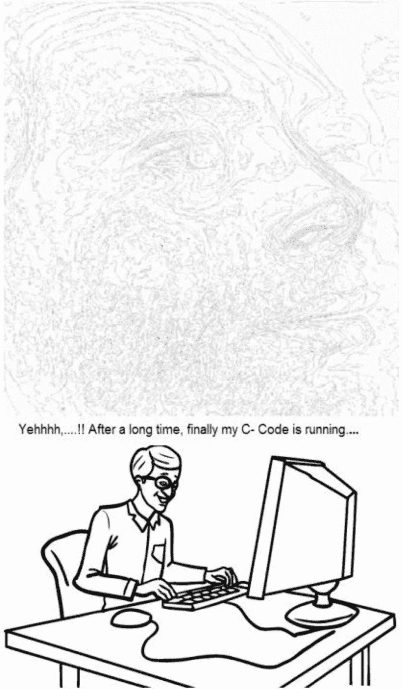


# (字符串 (字符数组))

## 介绍

字符串是字符数组。任何包含双引号之间的字符组（双引号本身）被称为字符串常量。

字符串是以空字符 (`\0`) 终止的一维字符数组。
例如：`char s[10] = {‘s’,’h’,’i’,’v’,’a’,’m’,’\0’};`

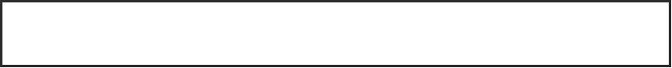 S H I V A M \0 p o H

数组中的每个字符占用一个字节的内存，最后一个字符总是 `\0`。这个 `\0` 被称为空字符。它定义了字符串的结束。因为这个字符的存在，处理字符串的各种函数能够知道字符串的结束。

因此可以说，给字符串的输入在空字符 `\0` 处终止。剩余的数组包含垃圾值。

**练习笔记：** 空字符 `\0` 看起来像输入了两个字符，但编译器将其视为单个字符。它是一个转义序列。

还要记住 ‘0’ 与 `\0` 是不同的。“0” 的 ASCII 值为 48，而 `\0` 的 ASCII 值为 0。

### 字符数组初始化

1. `char s[10];`
2. `char s[7] = {‘s’,’h’,’i’,’v’,’a’,’m’,’\0’};`
3. `char s[7] = {‘s’,’h’,’i’,’v’,’a’,’m’};`
4. `char s[7] = “shivam”;`
5. `char s[ ] = {‘s’,’h’,’i’,’v’,’a’,’m’,’\0’};`

让我们观察字符串的几个重要方面——

1. 在最后一个声明中缺少了空字符，即编译器会在字符串末尾自动添加一个 `\0`。
2. 字符串的大小应该等于字符串中最大字符数加一。
3. 允许在不指定大小的情况下初始化字符串，就像整数数组一样。在这种情况下，数组的大小将根据初始化的元素数量自动确定。

### 字符串输入

常用的输入函数是 `scanf`。该函数也可以用格式指定符 `%s` 来输入字符串。
例如：
`scanf(“%s”,name);`

在输入字符串时，不需要 `&`（地址操作符）。

`scanf` 函数的一个问题是它会在遇到第一个空白字符时结束输入（空白字符包括空格、制表符、回车、分页符、换行符）。
因此，如果输入以下行作为输入——
Shivam Kumar
那么只有字符串 “Shivam”会被输入到变量 `name` 中，因为单词 “Shivam” 之后的空格会结束字符串。

很多时候需要读取整行文本，使用 `scanf` 是无法实现的。这可以通过使用 `getchar` 函数来实现。该函数一次读取一个字符并存储在数组中。因此，我们必须使用循环重复使用此函数，直到用户输入空字符或换行字符。

另一个可以输入字符串的函数叫做 `gets()`。它的用法如下：
```c
char name[10];
gets(name);
```
该函数也可以读取空格，从而一次性将整行作为输入。

### 字符串输出

常用的输出函数 `printf()` 也可以用格式指定符 `%s` 用于字符串，将字符串显示在屏幕上。
```c
printf(“%s”,name);
```
**练习笔记** - 也可以使用函数 `puts()`。
```c
puts(name);
```

字符串的精度也可以指定，`%10.3` 表示前三个字符打印在宽度为 10 列的字段中。在字符串之前会打印 7 个空格。但如果指定为 (`%-10.4)`，则字符串将左对齐打印，所有的 7 个空格将打印在右侧。

1. 记住，如果字段宽度小于字符串长度，则打印等于字符串长度的字符串。`printf(“%3.4s”,name);` 将打印 4 个字符而不是 3 个。
2. 小数右侧输入的整数值指定要打印的字符数。
3. 如果指定的打印字符数为 0，则什么都不打印。

```c
char name[10]=”Shivam Kumar”; 
printf(“%s”,name); 
printf(“%6s”,name); 
printf(“%12.6s”,name); 
printf(“%-12.6s”,name);
printf(“%.2s”,name);
```

# 一些求解程序

1. **编写程序按升序排序给定列表中的名称。**
```c
#include<string.h>
main()
{
    char names[10][20], t[20];
    int i=0,j=0,n;
    printf("Enter many names");
    scanf("%d",&n);
    /*Input*/
    for(i=0;i<n;i++)
    {
        printf("Enter %d ",i+1);
        gets(names[i]);
    }
    /*Sorting*/
    for(i=0;i<n-1;i++)
    {
        for(j=i+1;j<n;j++)
        {
            if(strcmp(names[i],names[j]) > 0)
            {
                strcpy(t,names[i]);
                strcpy(names[i],names[j]);
                strcpy(names[j],t);
            }
        }
    }
    /*Output*/
    for(i=0;i<n;i++)
    {
        printf("%s\n",names[i]);
    }
    getch();
}
```

2. **通过键盘输入字符串，编写一个程序反序打印字符串，例如：How Are You = You Are How.**
```c
main()
{
    char s1[50],t1[50],t2[50]="";
    int i=0,j=0;
    printf("Enter a string");
    gets(s1);
    while(s1[i]!='0')
    {
        if(s1[i] == ' ')
        {
            t1[j++] = ' ';
            t1[j] = '\0';
            strcat(t1,t2);
            strcpy(t2,t1);
            j = 0;
        }
        else
            t1[j++] = s1[i];
        i++;
    }
    puts(t1);
    getch();
}
```

3. **编写程序输入文本，并将文本中出现的字符串替换为相同数量的 "*"。**
```c
char ch;
printf("Enter text: ");
while((ch=getch())!='\r')
printf("*");
```

4. **编写一个程序将类似“124”的字符串转换为整数 124。**
```c
char str[6];
int num= 0, i;
printf(“Enter a string containing a number:");
scanf(“%s”,str);
for(i=0; str[i]!=’\0’; i++)
{
    if(str[i]>=48 && str[i]<=57)
        num = num*10+(str[i]-48);
    else
    {
        printf(“Not valid string”);
        getch();
        return;
    }
}
printf(“\nThe numer is: %d\n”,num);
```

**练习笔记：** 函数 `atoi` 也可以将字符串转换为整数。

以下程序的输出是什么？
1. `char c[2]=  “A”; printf(“%c”,c[0]); printf(“%s”,c);`

输出: A A


通过第一个 `printf()` 打印了 ‘A’，因为数组大小为 2，所以 ‘A’存储在第 0 个位置，而 ‘\0’(`NULL`）被存储在第一个位置。通过第二个 `printf()`，输出将是 ‘A’。

7. 
```c
char str1[] = {‘H’,’e’,’l',’l’,’o’,0};
char str2[] = “Hello”;
printf("\n%s",str1); printf("\n%s",str2); 
```
Output:
```
Hello
Hello
```
因为在第一个字符串中，最后一个字符是 0，这是!的 ASCII 值因为整个字符串都会被打印，即“A”。

2. 
```c
char s[] = “Get organized! learn c!!”;
printf("\n%s",&s[2]); printf("\n%s",s); printf("\n%s",&s); printf("\n%c",s[2]); 
```
Output:
```
t organized! learn c!!
Get organized! learn c!!
Get organized! learn c!!
t
```
通过第一个 `printf()` 打印了 “t organized! learn c!!”，因为我们使用 `&s[2]` 来打印字符串，所以打印从字符串的第 3 个字符开始，因为当我们只使用字符串名称时，它包含基础地址，字符串打印将从基础字符开始。通过第二个 `printf()`，将打印整个字符串，因为那里使用了字符串名称。

通过第三个 `printf()`，将打印整个字符串，因为传递的是字符串的地址（没有使用下标或索引的基础地址），这与第二个 `printf()` 相同。通过最后一个 `printf()` 只打印了第三个字符，因为这里使用了 `%c` 格式说明符，并且在打印列表中使用的 `s[2]` 指的是第三个字符。

3. 
`printf(“%c”,”Alicode”[4]);` `NULL`(`\0`）字符，并且当 `srr1` 被打印时，它将打印整个字符串“Hello”，同样地 `str2` 也被打印。

8. 
```c
printf(5+”Good Morning”); 
```
Output: Morning.
在这里编译器将理解上述 `printf`，字符串应该从字符串的第 5 个字符开始打印。

9. 
```c
printf("\n%d %d %d”,sizeof(‘3’),sizeof(“3”),sizeof(3));
```
Output: 2 2 2
因为第一个 `sizeof` 包含字符，但在 C 中字符将转换为其 ASCII 值，编译器将其理解为 `int`，因此占用 2 字节。第二个 `sizeof` 是一个包含单个字符的字符串，但 C 编译器会在每个字符串末尾自动加上空字符，上述字符串包含 2 个字符，占用 2 字节。第三个 `sizeof` 包含 `3`，它是一个整数值，占用 2 字节。

10. 
```c
char a[8] =”Rhombus”;
int i;
for( i = 0; i<=7; i++) printf("\n%d",*a); a++;
```
Output: Error. 因为数组 ‘a’ 不能递增。

1. 
Output: y.
当我们打印 `s[4]` 时，它打印字符串的第 5 个字符，我们在 s 的位置使用了字符串 “matrix”，同样地，s 会打印第 5 个字符，即 r。

4.
```c
char a[] = {‘M’,’T’,’R’,’X’};
int i;
for( i = 0; i<=5;i++) printf("\n%c”,a[i]);
```
Output: No Error. 只要条件为真，数组的 `ith` 就会执行，因为计数器从 0 开始，所以打印从第 0 个元素开始到第 5，所以“MATRIX”的每个字符都被打印并换行分隔。

5. 
```c
char s[7]= “Strings”;
printf("%s”,s);
```
Output: Unpredictable. 在这里 `s[]` 被声明为 7 字符数组，并在其中存储了 8 字符的字符串。这会导致数组第七个字节之外的字节被覆盖并带有一个“\0”。始终存在一种可能性：

```
char string[]= “Author Alicode”;
int a=5;
printf(“a>10?”%20s”: “%s”,string);
```
Output: Author Alicode

12.
```c
printf(5+ “Computers”);
```
Output: ters

13. 
```c
char s1= “Matrix”;
char s2= “Computers”;
if(s1 == s2) printf(“Equal”);
else printf(“Unequal”);
```
Output: Unequal

14. 
```c
printf("%c”, “Matrix”[4]);
```
Output: i

15. 哪一个读取多单词字符串更合适？
`gets()` `printf()` `scanf()` `puts()`
| 重要的内容将被覆盖，这将是不安全的。

6. 如何在屏幕上输出 `\n`？Output: `\n`
| `gets()`

| 填空：
| --- | --- |
| 1. “A” 是字符串而 ‘A’ 是 |
| 2. 字符串由 | 终止 |
| 3. 数组 `[10]` 最多可以包含 |
| 4. 数组元素始终存储在 |

答案：
1. 
2. 空字符
3. 9
4. 内存位置

## 实验 -
1. 编写连接两个字符串的程序
2. 编写比较两个字符串的程序
3. 编写从键盘读取一行文本并显示以下：
1. 单词数
2. 字符数
4. 编写计算字符串长度的程序
5. 编写将两个字符串连接到第三个字符串中
6. 编写将一个字符串反序复制到另一个字符串
7. 编写检查用户输入的字符串是否为回文
8. 编写将字符串转换为小写
9. 编写删除字符串中所有前导空格的程序
10. 编写打印字符串所有旋转的程序，例如单词 " space " 的旋转是：paces acesp esp
11. 编写输入任何字符串并反序打印程序
12. 编写输入一个字符串和一个在其中搜索的字符。打印该字符在字符串中的频率。
13. 编写输入任何字符串并打印字符串中出现次数最多的字符。如果有多个字符频率相同，应只显示一次，并带有频率值。
14. 编写计算元元的程序
15. 一家城市酒店有 10 层（从 1 到 10），每层有 60 个房间。使用单维数组存储客姓名，使用二维数组 place(a, b)，其中 a 和 b 分别代表楼层和房间号。编写在输入客姓名和房间号后分配房间的程序。


23. 编写一个程序（WAP），将字符串中两个或多个连续的空格替换为单个空格。例如，如果输入是：`grim return to the  planet of apes!!` 输出应为：`grim return to the planet of apes!!`

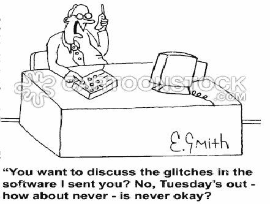

# 函数基础（Your Brain On Functions）

## 引言

函数是一个小型程序，它接收一些输入并给我们一些输出。函数允许将大型程序分解成若干个较小的、自包含的组件，每个组件都有明确的用途。它避免了重复编写代码。将逻辑拆分为独立的函数可以使整个编写和调试过程变得更容易。

另一方面，也可以说函数是一个自包含的语句块，用于执行某些任务。函数一旦被分配了某些工作，就可以为了该任务被调用多次。每个 C 程序都会使用一些函数，常用的函数有 `printf`、`scanf`、`main` 等。

函数可以是库函数也可以是用户定义函数。库函数是随编译器一起提供并存在磁盘上的函数。用户定义函数是程序员为了使程序更容易调试、追踪而自行编写的函数。

### 练习笔记

`printf()`、`scanf()`、`exit()`、`pow()` 是库函数。每个库函数都有一个头文件。C 中总共有 15 个头文件。`main()` 是一个用户定义函数。

每个程序必须有一个 `main` 函数。这个 `main` 函数用于标记执行的开始。可以使用仅 `main` 程序来编写任何程序，但这会导致很多问题。程序会变得过于巨大且复杂，从而难以追踪、调试和测试。

但如果将同一个程序分解成独立编码的小模块，然后将其组合成一个单元，这些问题就可以很容易地解决。这些模块被称为函数。因此，函数可以定义为一个接收一些输入并给出一些输出的小程序。

### 练习笔记

我不打算再反复输入头文件了，所以在编写程序时请不要忘记用头文件开始你的程序。

## 计算两个数之和的函数

```c
int sum(int, int); /*函数原型或声明*/
main()
{
    int a,b,ans;
    printf(“Enter two numbers: “);
    scanf(“%d %d”,&a,&b);
    ans= sum(a,b); /*函数调用*/
    printf(“ sum is %d”, ans);
    getch();
}

int sum( int x, int y) /*函数定义或过程*/
{
    int z;
    z = x + y;    return(z);
}
```

现在让我们来看看这个程序的一些特性：

1. 第一条语句是函数的声明，它告诉编译器函数的名称以及传递的参数的数据类型。
2. 声明也称为原型（prototype）。
3. 如果输出类型是整数值，则不需要对函数声明。在某些 C 编译器中，并不是所有函数都要求声明。
4. 函数调用是使用函数的方法。函数声明一次，定义一次，但在同一个程序中可以使用多次。
5. 当编译器遇到函数调用时，程序的控制权将转移到函数定义处，函数按行执行，并在结束时返回一个值。
6. `main` 程序的末尾是函数的定义，它也可以称为过程。
7. 函数定义不以分号结束。
8. 函数可能返回也可以不返回任何值。因此，`return` 语句并不是必须的。当遇到 `return` 语句时，控制权会立即传回调用函数。
9. 虽然可以向函数传递任意数量的参数，但被调用函数在调用时只返回一个值。`return` 语句可以使用 `return;` 或 `return(value);`。第一个没有值的 `return` 作用类似于函数定义的大括号结束。
10. 一个函数可以有多个 `return` 语句。可以这样使用：
```c
if (a!=0)
    return(a);
else
    return(1);
```
11. 所有函数默认返回 `int`。但如果函数必须返回特定类型的数据，可以在函数名处使用类型说明符。
12. 如果 `main()` 调用函数 `sum()`，那么 `main()` 是调用函数，而 `sum()` 是被调用函数。**无参数且无返回值**：某些函数不从调用函数接收任何值。因此，函数原型将是 `prn()`，即不传递任何参数。这也可以通过 `prn(void)` 实现。同样地，调用函数也不会从函数处获得任何值。这通过在函数名之前使用 `void` 关键字来实现。为了说明这一点，让我们考虑以下程序：

```c
void prn(); /*声明也可以写为 prn(void)*/main()
{
    prn();
    prn();
    prn();
}

void prn()
{
    printf(“Hello”);
}
```

### 参数传递机制

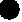

### (i) 值传递 (Call by value)

当参数按值传递时，实际参数的副本将从调用函数传递到被调用函数定义的形式参数中。现在，在被调用函数定义中对形式参数进行的修改不会反映在调用函数的实际参数上。在上面计算两个数之和的函数中，调用语句写为 `ans = sum(a,b);`。在这里，变量 `a`, `b` 的值从 `main` 函数传递过去。在定义中，变量 `x`, `y` 分别接收 `a`, `b` 的值。这里 `a`, `b` 是实际参数，而 `x`, `y` 是形式参数。实际参数和形式参数的作用域不同，因此在形式参数上做的任何更改都不会出现在实际参数中。例如：

```c
void swap(int, int);
main()
{
    int a,b;
    printf(“Enter 2 numbers”);
    scanf(“%d%d”,&a,&b);
    swap(a,b); /*在此调用语句中 a,b 是实际参数*/
    printf(“%d\t%d”,a,b);
}

void swap(int x,int y) /*在此定义中 x & y 是形式参数 */
{
    int t;
    t=x; x=y; y=t;
}
```

**练习笔记** —— 在上面的示例中：对 `x`, `y` 的修改不会反映在 `a`, `b` 上。

### (ii) 引用传递 (Call by reference)

当参数按引用传递时，实际参数的地址将从调用函数传递到被调用函数定义的的形式参数中。现在，在被调用函数定义中对形式参数进行的修改将反映在调用函数的实际参数上。有时无法传递变量的值，例如在使用数组时，无法通过值传递数组的所有值。因此，使用了另一种函数调用机制引用传递，即传递变量的地址。这里的将通过访问特定地址来工作。这种方法通常用于数组和指针。

例如：

```c
main()
{
    ...
    swap(&a, &b); /*在此调用语句中传递了 a, b 的地址*/
}
```


```c
printf("%d\t%d", a, b);
}
void swap(int *p1, int *p2) { /*在此函数定义中，p1 & p2 是接收 a, b 地址的指针*/ {
    int t;
    t = *p1;
    *p1 = *p2;
    *p2 = t;
}
```

### 练习笔记
在上面的示例中：`p1`、`p2` 中的更改将自动反映在 `a`、`b` 中。

### 练习笔记
数组也是通过引用传递。当我们传递数组名时，函数定义中只传递了基地址。

## 函数类型

### 1. 库函数
之前在库中定义的函数称为库函数。例如：

```c
#include<math.h>
main() {
    int n, p, ans;
    printf("输入数字及其幂幂");
    scanf("%d%d", &n, &p);
    ans = pow(n,p);
    printf("%d", ans);
    getch();
}
```

### 库函数

| `stdio.h` 函数 | 说明 |
| :--- | :--- |
| `fclose()` | 关闭流 |
| `fcloseall()` | 关闭所有流 |
| `feof()` | 测试是否已到达文件尾 |
| `fflush()` | 刷新流 |
| `fgetc()` | 从流中获取一个字符 |
| `fgetpos()` | 获取当前文件指针 |
| `fsetpos()` | 设置流的文件指针 |
| `fgets()` | 从流中获取字符串 |
| `fopen()` | 打开流 |
| `fprintf()` | 向流发送格式化输出 |
| `fputc()` | 向流输出一个字符 |
| `fputs()` | 向流输出字符串 |
| `fread()` | 从流中读取数据 |
| `fscanf()` | 从流扫描并格式化输入 |
| `fseek()` | 将文件指针设置为特定位置 |
| `ftell()` | 返回文件指针的当前位置 |
| `fwrite()` | 向流写入数据 |
| `getch()` | 从控制台获取字符 |
| `getche()` | 从控制台获取字符 |
| `gets()` | 从控制台读取字符串 |
| `getchar()` | 从标准输入获取字符 |
| `getw()` | 从流中获取整数 |

| `io.h` 函数 | 说明 |
| :--- | :--- |
| `clrscr()` | 清除文本窗口 |
| `getch()` | 从控制台获取字符 |
| `getche()` | 从控制台获取字符 |
| `putch()` | 向文本窗口输出字符 |

| `stdlib.h` 函数 | 说明 |
| :--- | :--- |
| `atoi()` | 将字符串转换为整数 |
| `atof()` | 将字符串转换为浮点数 |
| `rand()` | 返回 0 到 1 之间的随机数 |
| `randomize()` | 初始化随机生成器 |
| `exit()` | 终止程序 |
| `min()` | 返回两个数中的最小值 |
| `max()` | 返回两个数中的值 |
| `ltoa()` | 将长整数转换为字符串 |
| `ultoa()` | 将无符号长整数转换为字符串 |

| `math.h` 函数 | 说明 |
| :--- | :--- |
| `abs()` | 获取整数的绝对值 |
| `acos()` | 计算弧度角 `cos` 的反函数 |
| `asin()` | 计算弧度角 `sin` 的反函数 |
| `atan()` | 计算弧度角 `tan` 的反函数 |
| `ceil()` | 返回列表中最大的整数 |
| `cos()` | 计算弧度角的余弦值 |
| `cosh()` | 计算双曲值 |
| `exp()` | 计算指数 |
| `floor()` | 返回列表中最小的整数 |
| `log()` | 计算自然对数 |
| `log10()` | 计算以 10 为底的对数 |
| `pow()` | 计算数字的幂 |
| `sin()` | 计算弧角的正弦值 |
| `sqrt()` | 计算数字的平方根 |
| `tan()` | 计算弧角的正切值 |
| `tanh()` | 计算双曲正切值 |

| `string.h` 函数 | 说明 |
| :--- | :--- |
| `strcat()` | 拼接（合并）字符串的函数 |
| `strcmp()` | 比较两个字符串的函数 |
| `strcpy()` | 将字符串拷贝到另一个字符串的函数 |
| `stricmp()` | 忽略大小写比较两个字符串的函数 |
| `strlen()` | 计算字符串长度的函数 |
| `strlwr()` | 将给定字符串转换为小写 |
| `strrev()` | 反转给定字符串的函数 |
| `strupr()` | 将给定字符串转换为大写 |
| `strdup` | 复制字符串 |
| `strnicmp()` | 在不区分大小写的情况下比较两个字符串的前 n 个字符 |
| `strncat()` | 在第二个字符串末尾添加前 n 个字符 |
| `strncpy()` | 将字符串的前 n 个字符拷贝到另一个中 |
| `strchr()` | 查找字符的第一次出现 |
| `strrchr()` | 查找字符的最后一次出现 |
| `strstr()` | 在另一个字符串中查找字符串首次出现 |
| `strset()` | 将字符串的所有字符设置为给定字符 |
| `strnset()` | 将字符串的前 n 个字符设置为给定字符 |

### 2. 用户自定义函数
由我们定义的函数被称为用户自定义函数。`main()` 函数也是用户自定义函数，因为 `main()` 的定义是由我们定义的。例如：

```c
int power(int, int);
main() {
    int n, p, ans;
    printf("输入数字及其幂幂");
    scanf("%d%d", &n, &p);
    ans = power(n,p);
    printf("%d", ans);
    getch();
}

int power(int n, int p) {
    int ans=1, i;
    for(i=1; i<=p; i++) {
        ans = ans * n;
    }
    return(ans);
}
```

参数为二维数组的函数：
```c
void mat_sum(int m1[][10], int r1, int c1, int m2[][10], int r2, int c2, int m3[][10]) {
    int i, j;
    if(r1 != c1 && r2 != c2) {
        printf("无法求和");
        exit();
    }
    for(i=0; i<r1; i++) {
        for(j=0; j<c1; j++) {
            m3[i][j] = m1[i][j] + m2[i][j];
        }
    }
}
```
上述函数可以在 `main()` 中调用为 `mat_sum(m1,r1,c1,m2,r2,c2,m3);`。

### 递归
如果函数体内的某个语句调用了函数本身，则该函数是递归的。有时被称为“循环定义”，递归是指函数在定义中调用自己。递归函数应该包含两个部分：递归语句和 终止条件。


假设我们要计算一个整数的阶乘。如我们所知，一个数字的阶乘是 1 到该数字之间所有整数的乘积。4 的阶乘可以表示为 `4! = 4 * 3!`，其中 `!` 代表阶乘。因此，一个数字的阶乘可以用它自身的形式表示。因此这可以使用递归来实现。

例如：
```c
int fact (int); /*函数定义 */
main()
{
    int n,ans;
    printf("Enter a number: "); 
    scanf("%d",&n);
    ans = fact(n); /*函数调用 */
    printf("factorial = %d",ans); 
    getch();
}

int fact(int n)
{
    if(n == 0) /*终止条件*/ return (1);
    return (n*fact(n-1)); /*递归语句*/
}
```

现在让我们评估这个程序：
假设当程序控制权从 `main()` 函数传递给 `fact` 函数时，`n` 的值为 3。由于 `n` 不等于 0，因此条件为假，并执行递归语句。

`3*fact(2)`
现在 `fact(2)` 是调用函数，因此程序的控制权再次到达定义的开头。终止条件仍然为假，因此执行递归语句。

`2*fact(1)`
再次 `fact(1)` 是调用函数，因此程序的控制权再次到达定义的开头。终止条件仍然为假，因此执行递归语句。

`1 * fact(0)`

现在条件为真，调用函数（`fact(0)`）的答案将是 1，依此类推。因此，操作序列将是：
`fact(3)=3 * fact(2) fact(2)=2 * fact(1) fact(1)=1 * fact(0)`
（注：原文此处缺少等号，译文保持原样或保持逻辑一致）

当我们使用递归程序时，会使用栈（stack）来组织数据。栈是一种后进先出（LIFO）数据结构。这意味着存储在栈中的最后一个项（`push` 操作）将是第一个出来的项（`pop` 操作）。

在上面的程序中，当调用 `fact(2)` 时，值 3 将存储在栈中。同样，当调用 `fact(1)` 时，值 2 将存储在栈中 3 之上。

现在当 `fact(0)` 返回 1 时，它将乘以栈中的第一个值，即 1。此结果将乘以栈中第二个等待处理的值，即 2，依此类推。

当一个函数在它的定义中调用另一个函数时，这被称为链（chaining）。递归是一种特殊的链，其中函数调用它自己。

例如：
```c
main()
{
    printf("expert\n");
    main();
}
```
执行时，程序将给出如下输出：
expert
expert

任何递归函数的执行都可以无限持续下去，因此为了使执行走向结束，应用了终止条件。使用递归函数是为了解决那些通过对对子集连续应用相同的解决方案来表示解决方案的问题。但递归函数也有其缺点：
1. 这些函数更耗时，因此程序的执行速度较慢。
2. 由于栈的形成，占用了更多的内存空间。

### 填空
1. 函数在 __ 时将控制权返回给调用函数。
2. 为了不向调用函数返回任何内容，应使用 _____________。
3. 函数的参数列表使用 ______。
4. C 语言中函数的默认类型是 _____________。
5. 在 C 语言中，传递给函数的所有参数都是通过 ______ 的。
6. 引用传递（Call–by–reference）可以通过 _____________ 实现。
7. main 是一个 __________________________ 函数。
8. 函数中必须有 _______________。
9. __________________ 是函数调用自身的能力。
10. 程序停止递归的点被称为 ______________
11. 递归比迭代方法消耗 ___________ 内存。

### 答案 - image0175.jpeg

## 求解程序

1. 编写一个程序通过用户定义函数计算数字 `n` 的幂 `p`。
```c
int pow(int,int);/*声明*/
main()
{
    int n,ans,p;
    printf("Enter numbers: ");
    scanf("%d %d",&n,&p);
    ans=pow(n,p);/*调用*/
    printf("%d to the power %d is %d",n,p,ans);
}
int pow(int n,int p)/*定义*/
{
    int i,ans=1;
    for(i=1;i<=p;i++)
        ans=ans*n;
    return(ans);
}
```

2. 编写一个程序使用递归函数计算两个数的最大公约数。
```c
int gcd(int, int); main() {
    int n,m,ans;
    printf("\n Enter integer numbers");
    scanf("%d %d",&n,&m);
    ans = gcd(n,m);
    printf("GCD of %d and %d is %d",n,m,ans);
}
int gcd(int n, int m)
{
    if(n >= m && n%m == 0)
        return(m);
    else
        return gcd(m,n%m);
}
```

3. 编写一个程序使用非递归函数计算两个数的最大公约数。
```c
int gcd(int,int); main()
{
    int n,m,ans;
    printf("Enter integers");
    scanf("%d %d",&n,&m);
    ans = gcd(n,m);
    printf("GCD of %d and %d is %d",n,m,ans);
}
int gcd(int n, int m)
{
    int t;
    while(m!=0)
    {
        t = m;
        m = n % m;
        n = t;
    }
    return (n);
}
```

4. 编写一个程序使用指针搜索子字符串。
```c
int strsearch(char [ ],char [ ]);
main()
{
    char s1[50],s2[10],ans=0;
    printf("Enter a string"); /*输入字符串 */ gets(s1);
    printf("Enter a string"); /*输入要搜索的子字符串 */ gets(s2);
    ans = strsearch(s1,s2);/*函数调用*/
    if(ans == -1) /*使用返回值*/
        printf("String is not found");
    else
        printf("String is found at pos %d ",ans+1);
}
int strsearch(char s1[ ],char s2[ ])
{
    int i,j;i=0;
    while(s1[i] != '\0')
    {
        if(s1[i] == s2[j])
        {
            while(s1[i+j] == s2[j] && s2[j] != '\0')
                j++;
            if(s2[j] == '\0')
                return (i);
            j=0;
        }
        i++;
    }
    return (-1);
}
```

5. 编写一个程序计算矩阵的行列式。
```c
#define MAXROW 4
#define MAXCOL 4
int det_mat(int [ ][MAXCOL],int,int);
main() {
    int mat[MAXROW][MAXCOL]={0};
    int r,c,i,j,sum;
    printf("Enter dimension of matrix");
    scanf("%d%d",&r,&c);/*输入矩阵 */
    for(i=0;i<r;i++)
        for(j=0; j<c;j++)
        {
            printf("Enter element %d %d", i+1, j+1);
            scanf("%d",&mat[i][j]);
        }
    /*函数调用*/ sum = det_mat(mat,r,c);
    /*输出*/
}
```


```c
printf("%d",sum);
}

int det_mat(int mat[ ][MAXCOL], int r, int c)
{
    int i,j,k,sign,sum,a;
    int mat2[MAXROW][MAXCOL]={0};
    sign = 1;
    sum = 0;
    if(c == 1) return(mat[0][0]);

    for(i=0 ; i<c; i++,sign *= -1)
    {
        for(j=1; j<r; j++)
        {
            for(k=0; k<c; k++)
            {
                if(k == i) continue;
                if(k>i)
                    mat2[j-1][k-1]=mat[j][k];
                else
                    mat2[j-1][k]=mat[j][k];
            }
        }
        sum = sum + mat[0][i] * sign * det_mat(mat2,r-1,c-1);
    }
    return (sum);
}
```

### 填空

- `return` 语句仅返回 `________`。
- 通过将控制权转移到程序的某部分并包含表达式，可以为 `________` 赋初值。
- 一旦控制权移出定义的函数，自动变量将不再保留 `__________`。
- `extern` 声明必须以存储类型限定符 `_______` 开头。
- 如果行 `int sp;` 出现在任何函数外部，它将不会与同一程序 `__________________________` 中的同名变量产生冲突。
- 外部变量定义不能以存储类型类 `_____` 开头。

### 下面程序的输出结果是什么？

1
```c
main() {
    {
        printf("\n welcome in c:");
        int i = 40,c;
        display();
        c = check(i);
    }
    printf("\n%d",c);
}

display() {
    printf("History of C:");
    main();
}
```
**输出：** 消息将无限获取。
**原因：** 因为 `main()` 调用了 `display`，而在 `display` 的体中控制权再次跳回 `main`，这个过程将重复循环。

2
```c
main() {
    float area;
    int radius = 1;
    area = circle(radius);
    printf("\n%f",area);
}
circle(int r) {
    float a;
    a = 3.14*r*r;
    return(a);
}
```
**输出：** 3.000000
**原因：** 函数中没有显式的返回类型，默认返回类型为 `int`，因此返回的 `a`（即 `3.14`）会被降级为 `3`。当 `3` 作为 float 时，它会转换为浮点数格式并得到 `3.000000`。

3
```c
main() {
    printf("\n Go for Matrix:");
}
check(int ch) {
    if(ch>=40) return(100);
    else return(0*0);
}
```
**输出：** 100
**原因：** 传递给 `ch` 的 `i` 值为 `40`，当在函数定义中检查条件时，条件为真，因此执行该块并返回 `100`。

4
```c
main() {
    static int i = 0;
    i++;
    if (i<=5) {
        printf("%d\t",i);
        main();
    } else
        exit();
    }
}
```
**输出：** 1 2 3 4 5
**原因：** 首先执行 `i++`，每次 `i` 的值增加 `1`。对于前五次，满足条件并递归调用 `main()`。


输出：错误。函数不能返回多个值。

### 2. `main()`
```c
main()
{
    int x;
    x = massage();
}
message()
{
    printf("\n your computer can be effected by Viruses:");
    return;
}
```
输出：无错误。

### 7. `main()`
```c
main()
{
    message();
    message();
}
messae(); {
    printf("Whole world is waiting for you:");
}
```
输出：错误。函数定义之后不应立即紧跟另一个函数定义。

### 8. `main()`
```c
main()
{
    matrix()
    {
        printf("Welcome in the world of computer:");
    }
}
```
输出：错误。一个函数不能定义在另一个函数的体内。

### 9. `main()`
```c
main()
{

}
```
因为这里在函数定义中没有显式指定返回类型，所以默认返回类型为 `int`，且函数定义中确实存在返回语句，因此它会返回一个随机的整数值。但如果函数定义中使用带有 `void` 类型，则会遇到错误。

### 3. `main()`
```c
main()
{
    float a = 15.5;
    char ch = ‘C’;
    display(a,ch);
}
display(a,ch)
{
    printf("\n%f%c",a,ch);
}
```
输出：错误。形式参数在定义中没有数据类型。

### 4. `main()`
```c
main()
{
    int a =35,b;
    b = check(a);
    printf("\n %d",b);
}
check(m)
{
    int m;
    if( m>40)
        return(1);
    else
        return(0);
}
```
[](Images/image01087.jpeg) Matrix(computer());

void computer()
{
    printf("Beginning with C:");
}
```
### 9. `main()`
```c
main()
{
    int i = 135, a = 135, k;
    k = demo( i , a);
    printf("\n %d",k);
}
demo(int j, int b)
{
    int c;
    c = j + b;
    return (c);
}
```
输出：错误。变量 `c` 应该在 `demo()` 的体内部。

### 0. `main()`
```c
main()
{
    int p = 23,f = 4;
    out(&p, &f);
    printf("\n%d%d",p,f);
}
out (int q, int g)
{
    q = q + q;
    g = g + g;
}
```
输出：错误。函数定义中的变量 `q` 和 `g` 应该声明为整数指针。

输出：错误。变量 `m` 必须在大括号之前声明。形式参数可以通过两种方式声明：
a) `Check(int m)` { }
b) `check()` { int m; }

### 5. `main()`
```c
main()
{
    display();
}
display()
{
    printf(“Matrix”);
}
```
输出：重复定义错误，因为 `display()` 在定义之前就被调用了。在这种情况下，编译器假设函数 `display()` 被声明为 `int display ();`，也就是说假设一个未声明的函数返回 `int` 并接受任意数量的参数。那么当我们定义该函数时，编译器发现它返回的是 `void`，因此编译器报告了差异。

### 6. `main()`
```c
main() {
    int a=1;
    while(a<=5)
}
```
[](Images/image01090.jpeg)

### 11. `main()`
```c
main()
{
    int i = 35, *z;
    z = fun( &i);
    printf("\n%d",z);
}
fun(int *m)
{
    return(m + 2);
}
```
输出：不可预测的输出。在上面的程序中，假设 `i` 的地址 `205` 传递给 `m`，则 `m` 包含 `i` 的地址并返回 `m+2`，等于 `207`。因此此函数向 `main()` 返回 `207`，存储在 `z` 中并通过 `printf()` 打印 `z`。这里编译器假设我们没有说明输出是什么，但会打印一个 `int` 值。

### 13. `main()`
```c
main()
{
    int a,b;
    a=sumdig(23);
    b=sumdig(23);
    printf("%d %d",a,b);
}
sumdig(int n)
{
    static int s=0;
    int d;
    if(n!=0)
    {
        d=n%0;
        n=(n)/10;
        s=s+d;
        sumdigit(n);
    }
    else
    return(s);
}
```
输出：6 12

### 14. `f(int a, int b)`
```c
f(int a, int b)
{
    int a;
    a=20;
    return a;
}
```
输出：错误变量 `a` 重复定义。

### 15. `main()`
```c
main()
{
    int a=10;
    void f();
    a=f();
    printf("%d",a);
}
void f()
{
    printf(“Hello”);
}
```
输出：函数声明为 `void`，但程序仍尝试将 `f()` 的返回值赋值给变量 `a`。

判断以下语句对错：

1. C 中常用的变量对所有函数都可见。
2. 将控制权返回给调用函数必须使用 `return`。不同的函数可以使用相同的名称而不产生冲突。
3. 每个被调用的函数必须包含返回语句。
4. 函数可以包含多个返回语句。
5. 函数中的每个返回语句可以返回不同的值。
6. 即使你不向函数传递任何参数且函数不返回任何值，该函数仍然是有用的。
7. 不同的函数可以使用相同的名称而不产生冲突。
8. 函数可以从任何其他函数被调用多次。
9. 函数必须返回某些值。
10. 一个函数可以有多个声明，但只有一个定义。
11. 函数不能定义在另一个函数的内部。
12. 以下函数是否有效：
```c
main()
{
    int a,b;
    f1(int a, int b);
    b = f2(20);
    printf("\n %d",b);
}
f2 (int a)
{
    return(a*a);
}
```
13. 函数中不应出现两个返回语句。
14. 函数中不应连续出现两个返回语句。
15. 在 C 中，除 `main()` 之外的所有函数都可以递归调用。
16. 通常递归运行得比循环慢。


# 17. 过多的递归调用可能会导致栈溢出。

**答案：**
1. 错误 2. 错误 3. 正确 4. 错误 5. 正确 6. 正确 7. 正确 8. 错误 9. 错误 10. 正确 11. 正确 12. 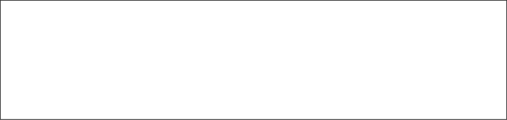 正确 13. 错误 14. 正确 15. 错误 16. 正确 17. 正确

## 回答以下问题：

1. 我们在定义函数还是声明函数时提到函数的原型？
**输出：** `declaring`

2. 以下代码中有一个错误，添加一条语句将其删除。
```c
main()
{
    int a; a=f(10,3,14);
    printf("%d",a);
}

f(int aa, float bb)
{
    return((float)aa+bb);
}
```
**输出：**
缺少函数 `f` 的声明，在 `main()` 上方添加以下内容：
```c
float f(int,float);
```

3. 定义函数的两种常用表示法分别被称为：
```c
int f( int a, float b)
{
    /*some code*/
}

int f(a,b) int a; float b;
{
    /*some code*/
}
```
**输出：**
第一种被称为 ANSI 表示法，第二种被称为 Kernighan and Ritchie 表示法或简称 K&R 表示法。

# 实验练习 –

1. 写一个函数，接收两个整数作为参数并返回它们的和。编写程序测试该函数。
2. 写一个函数，接收两个整数作为参数并返回它们的 `float` 类型平均值。编写程序测试该函数。
3. 编写使用函数将小写字母转换为大写字母的程序。
4. 编写使用函数计算给定数字阶乘的程序。
5. 编写使用函数计算给定数字幂的程序。
6. 编写使用函数找出三个整数中最大值的程序。
7. 编写程序，从键盘接收任意年份，并使用函数判断该年份是否为闰年。
8. 编写使用函数，从 `main()` 接收一个 `float` 和一个 `int`，找到这两者的乘积并通过 `main()` 打印结果。
9. 编写使用函数计算 `n` 个奇数之和的程序。
10. 编写使用函数计算从给定偶数开始的 `n` 个偶数之和的程序。
11. 编写使用函数判断给定正整数是否为质数的程序。
12. 编写使用函数判断给定正整数是否为斐波那契数字的程序。
13. 编写使用函数寻找实数序列中最长单调子序列长度的程序。
14. 编写使用函数计算传递给它的整数绝对值的程序（不要使用任何库）。
15. 编写使用函数接收两个参数的程序：一个 `character` 和一个整数，并将其打印两次，但整数部分是的。
16. 编写使用函数计算从给定数字开始的 `n` 个自然数之和的程序。
17. 编写使用函数接收一个 `character` 参数，并根据该函数被调用的次数将其打印到输入。
18. 编写使用函数接收实数作为参数并返回该数字数字之和（包括小数部分）的程序。
19. 编写使用函数检查给定数字是否能被 11 整除程序，该算法规定：一个数字能被 11 整除当且仅当奇数位和偶数位数字和之差为零。
20. 编写使用函数 `isdigit` 的程序，如果数字是数字则返回非零，否则返回 0。
21. 编写使用函数 `isalpha` 的程序，如果数字是字母则返回非零，否则返回 0。
22. 编写使用函数 `isalnum` 的程序，如果数字是字母或数字则返回非零，否则返回 0。
23. 编写使用函数 `isupper` 的程序，如果数字是大写字母则返回非零，否则返回 0。
24. 编写使用函数 `toupper` 的程序，它接受一个 `character` 参数并返回其等效的大写字母。
25. 编写使用函数返回两个整数的 `gcd`（最大公约数）的程序。
26. 编写调用函数 `satis()` 以查找发送到 `satis()` 的四个整数 `a, b, c, d` 是否满足方程 `a³+b³+c³=d³` 的程序。如果给定数字满足方程，`satis()` 返回 0，否则返回 -1。
27. 编写使用调用函数 `carea()` 计算圆面积的程序。`carea()` 接收 `float` 类型的半径并返回 `double` 类型的面积。`main()` 函数从用户处获取半径值，调用 `carea()` 并显示结果。`carea()` 函数是 `main()` 的局部。
28. 编写使用各种函数求以下级级数的和：
    a) `(1)+(1+2)+(1+2+3)+(1+2+3+4)+________` 直到 `n` 项
    b) `(2²)+(2²+4²)+(2²+4²+6²)+______` 直到 `n` 项
    c) `1+1/3+1/5+1/7+_______` 直到 `n` 项
    d) `1+1/x+1/x²+1/x³+_______` 直到 `n` 项
29. 编写从键盘接收一个正整数并使用函数获取其因数的程序。例如，24 的因数是 2, 2, 3；而 35 的因数是 5 和 7。
30. 编写使用函数计算等比级数的程序。
31. 编写使用函数从 `i=1` 开始生成第三个整数，直到小于 100 且被 5 整除。
32. 编写使用函数根据球直径计算体积和表面积的程序。
33. 编写使用函数打印数组中最大元素的程序。
34. 编写使用函数接收 `double` 数组名和 `arraysize` 作为参数，交换数组中第一个和最后一个值。
35. 编写使用函数接收整数数组作为参数。在排序后找到并返回数组中的最小值。调用程序需要排序后的数组。数组的大小定义为全局常量。
36. 编写使用函数接收 `int` 数组、大小以及一个 `character` `+` 或 `-` 的程序。默认字符为 `+`。对于字符 `+`，函数返回数组中正数的和；对于字符 `-`，函数返回数组中负数的和。
37. 编写读取包含 15 个元素的浮点数组的程序。程序使用函数 `reverse()` 反转该数组。在需要的地方做出合理的假设。
38. 编写使用各种函数将以下代数公式转换为递归形式：
    a) `y=(x1+x2+x3+________+xn)`
    b) `y=1-x+(x²)/2-(x³)/6+(x⁴)/24+_________+(-1)nx^n/n!`
    c) `p=(f1*f2*f3*_______*ft)`
39. 编写使用函数接收十进制数作为参数并返回八进制等。
40. 编写使用函数接收十进制数作为参数并返回十六进制等。
41. 编写使用函数接收六位整数作为参数的程序。如果是偶数，则将各位数字相加；否则将各个数字相乘并返回结果。
42. 编写使用函数将数组中的所有负元素发送到末尾而不改变原始顺序，即：如果数组包含 5,-4,3,-2,6,11,12,-8,9，则返回数组将为 5,3,6,12,9,-4,-2,-11,-8
43. 编写使用二分查找算法的程序，不使用递归技术。
44. 编写使用函数打印字符串长度的程序。
45. 编写使用函数将一个字符串复制到另一个字符串的程序。


### 46. 使用以下函数反转字符串：

a) `func1()` 使用另一个数组反转字符串。

b) `func2()` 在不使用另一个数组的情况下反转字符串。

### 47. 编写程序使用函数拼接两个字符串。

## 48. 编写程序，使用函数将字符串转换为大写。

## 49. 编写程序，使用函数查找一个字符串在另一个字符串中首次出现的位置。

## 50. 编写程序，使用函数查找一个字符串在另一个字符串中最后出现的位置。

## 51. 编写程序，使用函数比较两个字符串，如果相等返回 0，不等返回 -1。

## 52. 编写程序，使用两个函数 `code()` 和 `decode()`，它们接受一个字符串作为参数。`code()` 函数应该修改参数字符串，除空终止符外的所有字符加 1。`decode()` 函数将编码后的字符串还原为原始形式。该程序应从命令行接受一个字符串，打印编码后的字符串，然后打印解码后的字符串。如果命令行上未指定字符串，则提示输入。

## 53. 编写程序，使用一个接受两个字符串作为参数的函数比较它们，找到它们之间最长公共子的长度。

## 54. 编写程序，使用一个函数通过检查每个字符来分析文本，并确定它属于几个不同类别中的哪一个。特别是，我们要统计元音、辅音、数字、空白字符和其他字符的数量。

## 55. 编写程序，使用一个函数读取字符类型数组中的字符，并将字符反序写入另一个字符数组中。假设文本包含 80 个字符。

## 56. 编写程序，使用一个函数对数组位置 `lb` 和 `ub` 之间的所有元素进行排序（`lb` 是下限，`ub` 是上限）。

### 57. 编写程序，使用一个接受字符串作为参数的函数，返回该字符串每个字符出现的频率。

## 58. 编写程序，使用一个接受两个最多 80 个字符的字符串作为参数的函数。检查这两个字符串并从它们中删除所有共同字符。在主函数中显示结果字符串。

## 59. 编写程序，使用一个接受两个字符串作为参数的函数，返回第一个字符串在主字符串中首次出现的位置，如果不存在则返回空。

### 60. 编写程序，使用一个接受字符串作为参数的函数，将单词之间的一个或多个空格替换为空格。

### 61. 编写程序，使用一个接受字符串作为参数的函数，设置字符串使得每个句子大大写字母开头。

## 62. 编写程序，使用一个接受两个字符串作为参数的函数对这些字符串进行字典序比较。根据 `str1` 在字典序上是“小于”、“等于”还是“大于” `str2` 返回 -1、0 或 1。

## 63. 编写程序，使用一个函数在字典中查找给单词。字典是一个字典序排序的字符串数组。使用二分查找法。你可以利用标准 C 库函数比较两个字符串。

## 64. 编写程序，使用一个函数对数组位置 `lb` 和 `ub` 之间的所有元素进行排序（`lb` 是下限，`ub` 是上限）。

## 65. 编写程序，使用一个接受字符串作为参数的函数，返回该字符串每个字符出现的频率。

## 66. 编写程序，使用一个接受两个最多 80 个字符的字符串作为参数的函数。检查这两个字符串并从它们中删除所有共同字符。在主函数中显示结果字符串。

## 67. 编写程序，使用一个接受两个字符串作为参数的函数，返回第一个字符串在主字符串中首次出现的位置，如果不存在则返回空。

## 68. 编写程序，使用一个接受字符串作为参数的函数，将单词之间的一个或多个空格替换为空格。

## 69. 编写程序，使用一个接受字符串作为参数的函数，设置字符串使得每个句子大写字母开头。

## 70. 编写程序，使用一个接受两个字符串作为参数的函数对这些字符串进行字典序比较。根据 `str1` 在字典序上是“小于”、“等于”还是“大于” `str2` 返回 -1、0 或 1。

## 71. 编写程序，使用一个函数在字典中查找给单词。字典是一个字典序排序的字符串数组。使用二分查找法。你可以利用标准 C 库函数比较两个字符串。

## 72. 编写程序，使用一个函数对数组位置 `lb` 和 `ub` 之间的所有元素进行排序（`lb` 是下限，`ub` 是上限）。

## 73. 编写程序，使用一个接受字符串作为参数的函数，返回该字符串每个字符出现的频率。

## 74. 编写程序，使用一个接受最多 80 个字符的字符串作为参数的函数。检查这两个字符串并从它们中删除所有共同字符。

## 75. 编写程序，使用一个接受两个字符串作为参数的函数，返回第一个字符串在主字符串中首次出现的位置，如果不存在则返回空。

## 76. 编写程序，使用一个接受字符串作为参数的函数，将单词之间的一个或多个空格替换为空格。

## 77. 编写程序，使用一个接受字符串作为参数的函数，设置字符串使得每个句子大写字母开头。

## 78. 编写程序，使用一个接受两个字符串作为参数的函数对这些字符串进行字典序比较。根据 `str1` 在字典序上是“小于”、“等于”还是“大于” `str2` 返回 -1、0 或 1。

## 79. 编写程序，使用一个函数在字典中查找给单词。字典是一个字典序排序的字符串数组。使用二分查找法。你可以利用标准 C 库函数比较两个字符串。

## 80. 编写程序，使用一个函数通过检查每个字符来分析文本，并确定它属于几个不同类别中的哪一个。特别是，我们要统计元音、辅音、数字、空白字符和其他字符的数量。

## 81. 编写程序，使用一个函数读取字符类型数组中的字符，并将字符反序写入另一个字符数组中。假设文本包含 80 个字符。

## 82. 编写程序，使用一个函数对数组位置 `lb` 和 `ub` 之间的所有元素进行排序（`lb` 是下限，`ub` 是上限）。

## 83. 编写程序，使用一个接受字符串作为参数的函数，返回该字符串每个字符出现的频率。

## 84. 编写程序，使用一个接受最多 80 个字符的字符串作为参数的函数。检查这两个字符串并从它们中删除所有共同字符。

## 85. 编写程序，使用一个接受两个字符串作为参数的函数，返回第一个字符串在主字符串中首次出现的位置。

## 86. 编写程序，使用一个接受字符串作为参数的函数，将单词之间的一个或多个空格替换为空格。

## 87. 编写程序，使用一个接受字符串作为参数的函数，设置字符串使得每个句子大写字母开头。

## 88. 编写程序，使用一个接受两个字符串作为参数的函数对这些字符串进行字典序比较。根据 `str1` 在字典序上是“小于”、“等于”还是“大于” `str2` 返回 -1、0 或 1。

## 89. 编写程序，使用一个函数在字典中查找给单词。字典是一个字典序排序的字符串数组。使用二分查找法。你可以利用标准 C 库函数比较两个字符串。

（注：输入文本在 63-89 之间存在大量重复。我已根据提供的结构处理了唯一的请求。）


每个变量都存储在内存中，每个内存位置都有一个数值地址。变量的声明如下：

```c
int a = 5;
```

在这里 `a` 是变量名，变量的值为 `5`，而变量的地址为 `100`（假设）。

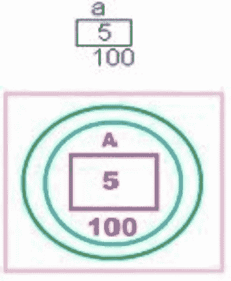

## 大脑洗练练习表 – 声明指针


1. 使用星号 `*` 声明指针。
2. 声明一个整数：`int I;`。
3. 声明一个指向整数的指针：`int *p;`。


4. 关于 `int* p;` 中符号的位置存在一些争议。

第一步是知道如何声明指针。这是通过使用 C 语言的乘法字符 `*` 实现的（显然它并没有执行乘法运算）。`*` 放在关键字 `int` 和变量名之间的某个位置。它创建的不是整数，而是一个指向整数的指针。

## 大脑洗练练习表 –

上方和下方的表格将帮助你通过指尖理解指针的概念。

| Int | *pi; | /* pi 是一个指向 int 的指针 */ |
| :--- | :--- | :--- |
| long int | *p; | /* p 是一个指向 long int 的指针 */ |
| Float* | pf; | /* pf 是一个指向 float 的指针 */ |
| Char | c, d, *pc; | /* c 和 d 是 char，pc 是指向 char 的指针 */ |
| double* | pd, e, f; | /* pd 是指向 double 的指针，e 和 f 是 double */ |
| char* | start; | /* start 是一个指向 char 的指针 */ |
| char* | end; | /* end ... |

变量的声明告诉编译器：
1. 在内存中预留空间来存放整数值。
2. 将名称 `a` 与此内存位置关联。
3. 在此位置存储值 `5`。

## 指针和间接运算符 –

与指针使用的两个基本运算符是：
1. 地址运算符 `&`
2. 间接运算符 `*`

```c
main()
{
    int a = 5;
    int *p; /*指针声明*/
    p= &a; /*将变量 a 的地址拷贝给指针 p*/
    *p = 10; /*通过间接或使用指针改变变量 a 的值
    printf("%d", a); printf("%d",*p);
    printf("%d",*(&a));
}
```

大脑洗练 - 上述程序中所有的 `printf` 语句输出均为 10。由于变量 `p` 不是像其他整数变量那样的普通变量，它是存储另一个变量（在此情况下为 `a`）地址的变量。由于 `p` 是变量，编译器必须为这个变量提供内存。任何类型的指针在内存中都占用两个字节。

```c
int *p1; float *p2; char *p3;
```
所有指针 `p1`、`p2`、`p3` 各占用 2 字节。

## 内存与指针 -

假设为 `int`、`float`、`char` 声明了三个指针。这三个指针在内存中都会占据 2 字节。这是因为所有内存地址都是从 0 到 65536 的整数值。因此我们可以说，指针指针类型如何，都是以整数值的形式存储地址，且每个整数只需要两个字节。

```c
main()
{
    int a = 5,*p1;
    float b=2.5,*p2;
    char c='a',*p3;
    p1= &a;
    p2 = &b;
    p3=&c;
    printf("%d",sizeof(p1));
    printf("%d",sizeof(p2));
    printf("%d",sizeof(p3));
}
```
输出：2 2 2

## 指针与地址 -

```c
main()
{
    int a = 5;
    int *p;
    p= &a;
    *p = 10;
    printf("%d", p); /*以整数形式打印指针 p 中的地址 */
    printf("%u",p); /*以无符号整数形式打印指针 p 中的地址 */
    printf("%x",p); /*以十六进制形式打印指针 p 中的地址 */
    printf("%x",p); /*以十六进制形式打印指针 p 中的地址 */
}
```
输出：-12, 65524, fff4, FFF4

让我们评估一下输出。第一个答案是一个负值，这是因为指针的范围是从 0 到 65536，而变量是从上到下分配内存的，即从 65536、65535、65534 等一直到 0。

变量 `a` 存储在地址 65524，如果我们使用格式说明符 `%d` 打印存储在指针 `p` 中的变量 `a` 的地址，就会打印出一个负值，因为该地址超过了 `int` 的限制。如果使用 `%u`，地址将以无符号整数的形式打印。`%x` 或 `%X` 用于以十六进制形式打印地址，区别在于大小写。

## 指针在表达式中使用 -

像任何其他变量一样，指针可以在表达式中使用：
1. 指针允许加减整数。`sum + p1;`
2. 同样允许赋值操作：`sum+= p1;` 此外还有自增自减：`++p;` 和 `p--;` 让我们通过以下代码演示对指针进行加减操作：
```c
main()
{
    int a[5]={10,20,30,40,50},*p;
    p=a;
    printf("%d",++p); /*对指针进行加 1*/
    printf("%d",p--); /*对指针进行减 1*/
    printf("%d",*p); /*解引用当前指针*/
}
```
输出：20 20 20

3. 如果 `p1` 和 `p2` 都指向同一个数组，那么 `p2-p1` 给出它们之间的元素个数。`*p3 = p2 - p1;`

4. 指针还可以进行比较，例如 `p1>p2`、`p1==p2`、`p1!=p2`。这些比较在处理字符串或数组时有用。
5. 两个指针不能相乘或除除。

## 大脑洗练 –

空指针是一个特殊的指针值，已知不指向任何地方。这意味着任何其他有效指针（指向任何变量、数组单元或任何其他事物）永远不会与空指针相等。使用空指针的另一种方法是使用任何标准头文件，包括 `<stdio.h>`、`<stdlib.h>` 和 `<string.h>`。为了将指针初始化为空指针，可以使用如下代码：
```c
#include <stdio.h>
int *p = NULL;
```
在检查所指向的值之前，为了测试它是否为空指针，可以使用如下代码：
```c
if(p != NULL)
printf("%d\n", *p);
```
也可以通过常量 0 来引用空指针，你会看到某些代码直接设置空指针：
```c
int *p = 0;
```
此外，由于 C 语言中“真”的定义是非 0 的值，你会看到使用简写代码测试非空指针：
```c
if(p)
printf("%d\n", *p);
```
这与我们之前的示例含义相同；`if(p)` 等同于 `if(p != 0)` 等同于 `if(p != NULL)`。

## 指针的指针 –

指针存储变量的地址，同样，指针的地址也可以存储在另一个指针中。

```c
main()
{
```


```c
int a=5; int *p1; /*指向整数的指针*/
int **p2; /*指向指针的指针的指针*/
int ***p3; /*指向指针的指针的指针的指针*/
p1= &a;
p2= &p1;
p3 =&p2;

printf("%d",a); /*输出 = 5*/
printf("%d",*p1); /*输出 = 5*/
printf("%d",**p2); /*输出 = 5*/
printf("%d",***p3); /*输出 = 5*/ 
printf("%u",*p2); /*将打印 p1 的地址*/
```

# 指针与数组

当声明一个数组时，编译器会分配一个基地址和足够的存储空间，以便在连续的位置包含数组中的所有元素。

基地址是数组第一个元素（索引 0）的位置。假设我们如下所示声明数组 `a`：

```c
static int a[5]={10,20,30,40,50};
```

假设数组 `a` 的基地址为 100，且每个整数需要两个字节。

| [0] | [1] | [2] | [3] | [4] |
| :--- | :--- | :--- | :--- | :--- |
| 10 | 20 | 30 | 40 | 50 |
| 100 | 102 | 104 | 106 | 108 |

名称 `a` 被定义为指向第一个元素 `a[0]` 的常量指针，因此 `a` 的值为 100，即存储 `a[0]` 的位置。也就是说 `a` 等于 `&a[0]`，等于 100。

如果我们将指针 `p` 声明为整数指针，那么可以让指针 `p` 指向数组 `a`：

```c
p= a;
 或 p = &a[0];
```

现在我们可以使用 `p++` 从一个元素移动到另一个元素来访问此数组的每个值。`p` 和 `a` 之间的关系所示：

- `p` 等于 `&a[0]` (=100)
- `p+1` 等于 `&a[1]` (=102)
- `p+2` 等于 `&a[2]` (=104)
- `p+3` 等于 `&a[3]` (=106)
- `p+4` 等于 `&a[4]` (=108)

在处理数组时，我们可以使用数组索引或指针来访问元素。因此，我们可以如下方式指向数组的第三个元素：`a[2]` 或 `*(p+2)`（记住数组索引从 0 开始）。

# 指针与函数

如前所述，将数组作为参数传递的函数使用了引用传递机制。编写一个程序（WAP）来交换两个数字。

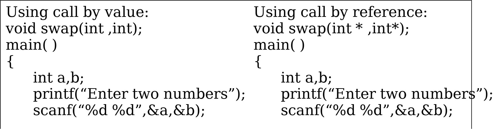
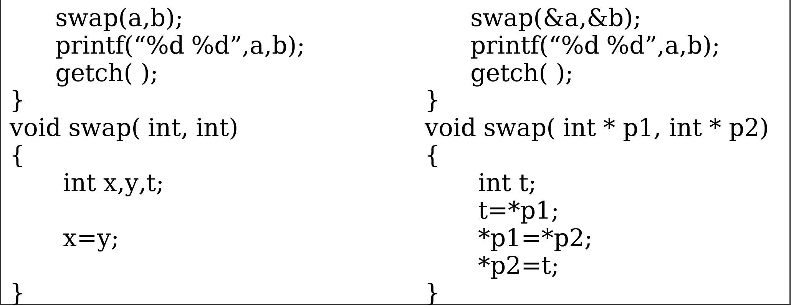

在引用传递中-

 函数原型被声明为指针。

 在函数定义中使用解引用指针。

 当调用函数时，地址作为实际参数传递。

### 常见错误

指针在初始化之前包含垃圾地址。如果我们尝试解引用此指针，它不会产生任何错误，但它会跳转到该地址并在那里赋值。这是一个编译器无法检测的逻辑错误。

# 内存分配

1. 静态内存分配。
2. 动态内存分配。

使用数组的传统方法是带大小声明数组，由于数组的大小必须是一个常量，这会导致内存浪费或短缺，因为数组是在程序编译时分配内存的。

## 总结

编译时分配的内存称为静态内存。这些问题可以通过使用指针来克服。指针可以用于程序执行时分配内存，这被称为动态内存。因此，动态内存可以描述为运行时分配内存的过程。C 语言本身不具备这种功能，但可以使用头文件 `alloc.h` 将其包含在程序中。

| 函数 | 任务 |
| :--- | :--- |
| `malloc()` | 分配请求的字节数并将起始地址返回指针。 |
| `calloc()` | 分配请求的字节数，将其初始化为零并将起始地址返回指针。它分配非连续内存。 |
| `realloc()` | 通过增加或减少字节数来重新分配大小，并将起始地址返回指针。 |
| `free()` | 释放之前分配的空间。 |

### 分配内存块 (malloc)

可以使用函数 `malloc` 分配一块内存。`malloc` 函数预留一个指定大小的内存块并返回一个 `void` 类型的指针。这意味着我们可以将该内存块的基地址赋值给任何类型的指针。`malloc` 的通用语法为：

```c
P= (cast type*) malloc(byte size);
```

现在让我们来看一个例子：

```c
P=(int*)malloc (10 * sizeof(int));
```

这里，函数 `malloc` 返回一个整数类型的指针 `P`，分配了 `10 * sizeof(int)` 字节的内存。


```c
#include<stdio.h>
#include<conio.h>
#include<string.h>
main()
{
    char str[20], news[20];
    char *s, *t;
    int pos, n, i;
    printf("Enter the string:");
    scanf("%s",str);
    printf("Enter the position and number of characters to extract:");
    scanf("%d%d",&pos,&n);
    s=str;
    t=news;
    if(n= =0)
        n=strlen(str);
    s=s+pos-1;
    for(i=0;i<n;i++)
    {
        *t=*s;
        s++;
        t++;
    }
    *t='\0';
    printf("The substring is: %s\n",news);
    getch();
}
```

## 2. 编写一个程序对 4x4 矩阵的所有元素进行排序

```c
int mat[4][4], *arr, i, j, t;
printf("Enter the elements of 4x4:");
/*matrix input*/
for(i=0; i<4; i++)
{
    for(j=0; j<4; j++)
    {
        printf("Enter element %d %d",i+1,j+1);
        scanf("%d",&mat[i][j]);
    }
}
/*sort the elements of the matrix*/
arr = mat; /*Base address of the matrix array*/
/*使用指针打印输入的输入的矩阵*/
printf("\nThe matrix formed is…\n");for(i=0; i<15; i++)/*number of passes*/
{
    for(j=i+1; j<16; j++)
    {
        if(*(arr +i)>*(arr+j))
        {
            t = *(arr+i);
            *(arr+i)= *(arr+j);
            *(arr+j)=t;
        }
    }
}
/*print the sorted matrix*/
printf("\n The matrix is:\n");
for(i=0; i<4; i++)
{
    for(j=0; j<4; j++)
    {
        printf("%d",mat[i][j]);
    }
    printf("\n");
}
printf("\n\Press any key to exit…"); getch();
```

## 3. 编写一个程序输入任意字符串并删除其中存在的额外空格

```c
#include<stdio.h>
#include<conio.h>
#include<string.h>
main()
{
    static char s1[50];
    char s2[50];
    char *s, *t;
    int i, l;
    printf("Enter a string");
    gets(s1);
    s=s1;
    t=s2;
    l=strlen(s);
    for(i=0;i<=l-1;i++)
    {
        if(*s= = ‘ ’/*check for a blank*/
        {
            if(*(s+1)!=' ')
            {
                *t=*s;
                t++;
            }
            s++;
        }
        else
        {
            *t=*s;
            t++;
            s++;
        }
    }
    *t='\0';
    printf("Original Statement:%s\n",s1);
    printf("Modified Statement:%s",s2);
    getch();
}
```

## 4. 编写一个程序使用指针连接两个字符串。不要使用 strcat 函数。

```c
main()
{
    char s1[20],s2[20],*p1,*p2;
    /* Input 1st string*/
    printf("Enter 1st string");
    gets(s1);
    /*Input 2nd string*/
    printf("Enter 2nd string");
    gets(s2);
    /*Assign address of strings in pointers*/
    p1 = s1;
    p2 = s2;
    /*Moving pointer 1 to the end of 1st string*/
    while(*p1 != '\0')
        p1++;
    /* Adding 2nd string to the end of 1st string*/
    while(*p2 != '\0')
        *p1++ = *p2++;
    /* Adding NULL to the end of string*/
    *p1 = '\0';
    /*Output string after concatenation*/
    puts(s1);
    getch();
}
```

## 5. 编写一个程序从键盘接收月份和年份并按以下格式打印日历

```c
static char *months[] = {
"January", "February", "March", "April", "May", "June",
"July", "August", "September", "October", "November", "December"
};
main() {
    static int days[]={31,28,31,30,31,30,31,31,30,31,30,31};
    long int ndays, ldays, tydays;
    int d, i, m, fday, y;
    char ch;
    clrscr();
    printf("Enter year(1900 onwards)& month (number):");
    scanf("%d %d",&y,&m);
    ndays = (y-1)*365;
    ldays = (y-1)/4-(y-1)/100+(y-1)/400;
    tdays = ndays+ldays;
    if((y%100==0&&y%400)|(y%4==0&&y%100!=0))
        days[1]=29;
    else
        days[1]=28;
    d= days[m-1];
    tdays = 0;
    for(i=0; i<m-2; i++)
        tydays = tydays + days[i];
    tdays = tydays + tdays;
    fday = tdays%7;
    cal(y, m, fday, d);
}
cal(int yr, int mo, int fd, int da)
{
    int i, r, c;
    char a;
    clrscr();
    gotoxy(25,2);
    printf("%s %d",months[mo-1],yr);
    gotoxy(5,5);
    printf("------------------------------------");
    gotoxy(10,6);
    printf("Mon  Tue  Wed  Thu  Fri  Sat  Sun");
    gotoxy(5,7);
    printf("------------------------------------");
    r = 9;
    c=1+fd;
    for(i=0; i<=da; i++)
    {
        gotoxy(c,r);
        printf("%d",i);
        if(c<=4)
            c=c+6;
        else
        {
            c=11;
            r=r+1;
        }
    }
    gotoxy(5,15);
    printf("------------------------------------");
    printf("\n\n\n\n\nPress any key to exit…");
    getch();
}
```

## 6. 编写一个程序读取一行并删除其中所有出现的“the’ 单词。

```c
main()
{
    char str[80], str2[80];
    char *s,*q,*p;
    int i;
    clrscr();
    printf("\nEnter a sentence not more than 80 chars long:\n");
    gets(str);
    s = str; /*Base address of the string*/
    p = str2; /*Base address of new string*/
    while(*s)
    {
        q = s;
        if(*s==’t’|| *s==’T’)
        {
            s++;
            if(*s==’h’)
```


```c
{
    s++;
    if(*s==’e’)
        ;
    else
        {
            for(i=0; i<=2;i++)
                *p++=*q++;
        }
}
else
    {
        *p++=*q++;
        s--;
    }
else
    {
        *p++=*s;
        s++;
}
```
`*p=’\0’`; `printf(“\n\nSentence after deleting all occurrences of ‘the’:\n”);` `puts(str2);` `getch();`

以下程序的输出是什么：(Images/image0109.jpeg)(Images/image01100.jpeg)char *s1,*s2;printf(“%d %d”,sizeof(s1),sizeof(s2)); 输出: 4 2

2. `*p++` 和 `++p` 样的吗？
输出：否。`*p++` 增加指针本身而不是它所指向的值，而 `++p` 增加 `p` 所指向的值。

3. 是否有另一个语句的作用与 `++p` 相同？
输出：`(*p)++`

4. 引用相同元素 `a[i][j][k]` 的等效指针表达式是什么？
输出：`(*(*(a+i)+j)+k)`

5. 以下程序的输出是什么：`int a[]={12,13,14,15,16};` `printf(“%d %d”,sizeof(a), sizeof(*a), sizeof(a[0]); 输出: 10 2 2

6. 假设数组从位置 102 开始，以下程序的输出是什么：int a[3][4]= {1, 2, 3, 4,5, 6, 7, 8, 9,10,1,12}; (Images/image01101.jpeg)(Images/image01102.jpeg)printf(“%u %u”, a[0]+1,

6. 你如何动态分配一个二维数组？输出：
```c
#include<alloc.h>
#define MAXROW 10
#define MAXCOL 10
main()
{
    int *p, i, j;
    p=(int *) malloc (MAXROW * MAXCOL * sizeof(int));
    /*输入矩阵*/
    for(i=0;i<MAXROW;i++)
    {
        for(i=0;i<MAXCOL;i++)
        {
            p[i*MAXCOL+j]=i;
            printf("%d”,p[i*MAXCOL+j]);
        }
        printf(“\n”);
    }
}
```

27. 你如何动态分配一个整数二维数组，以便我们能够使用两个下标（如 `a[i][j]`）访问任何元素？
输出：
`#include<alloc.h> #define MAXROW 10 #define MAXCOL 10 main() { (Images/image01103.jpeg)(a[0]+1), *(*(a+0)+1));` 输出: 1004 2 2

7. 在以下程序中，你如何使用 `p` 打印 50？
```c
main() {
    int a[]={10, 20, 30, 40, 50};
    char *p;
    p=(char*)a;
}
```
输出：`printf(“%d”,*((int*)p+4));`

8. 在以下程序的函数 `fun()` 中添加一条语句，使得 `a` 的地址被存储在 `j` 中：
```c
void fun(int**);
main()
{
    int *j;
    fun(&j);
}
void fun(int **k)
{
    int a=10;
    /*在此处添加语句*/
}
```
输出：`*k=&a;`

9. 你如何声明一个三指针数组，其中每个函数接收两个整数并返回一个浮点数？
输出：`float(*a[3])(int,int);`

0. 以下程序（Images/image01104.jpeg)(Images/image01105.jpeg）int **p, i, j;p=(int **) malloc (MAXROW * sizeof(int*)); for(i=0;i<MAXROW;i++)p[i]=(int *)malloc(MAXCOL * sizeof(int)); for(i=0;i<MAXROW;i++)
    {
        for(i=0;i<MAXCOL;i++)
        {
            p[i][j] = i;
            printf("%d”,p[i][j]);
        }
        printf(“\n”);
    }
}

28. 你如何动态分配一个整数二维数组，以便我们能够使用两个下标（如 `a[i][j]`）访问任何元素？同时数组的行应该存储在相邻的内存位置上。输出：
```c
#include<alloc.h>
#define MAXROW 3
#define MAXCOL 4
main()
{
    int **p, i, j;
    p=(int **) malloc (MAXROW *sizeof(int*)); (Images/image01106.jpeg)给出编译错误或警告？
    float i=10, *j;
    void *k;
    k=&a;
    j=k;
    printf(“%f”,j);
}
```
输出：在赋值 `void *` 时，这里需要类型转换 `k`。

11. 以下程序可以编译吗？
```c
main()
{
    float i=10, *j;
    void *k;
    j=&a;
    j++;
    k++;
    printf(“%u %u”, j);
}
```
输出：由于在 void 指针上进行算术运算是不允许的。

12. 以下代码可以成功编译吗？`printf(“%c”]);` 输出：打印 Computer。

13. 什么是空指针？(Images/image0107.jpeg)(Images/image0108.jpeg) `p[0]=(int *) malloc (MAXROW *MAXCOL* sizeof(int));` `for(i=0;i<MAXROW;i++)p[0]+i * MAXCOL;` `for(i=0;i<MAXROW;i++)`
    {
        `for(i=0;i<MAXCOL;i++)`
        {
            `p[i][j] = i;`
            `printf("%d”,p[i][j]);`
        }
        `printf(“\n”);`
    }
}

29. 以下代码总是有效吗：`main()`
{
    char *p;
    gets(p);
}
输出：否，因为 `p` 是未初始化的，它指向未知位置。我们输入的字符串将覆盖该位置上的任何内容。

30. 以下虽然不当但可能有效。如何改进：(Images/image0109.jpeg) 输出：每个指针类型定义了一个不指向任何地方的特殊指针值。通常使用空指针常量表示空指针。

14. 空指针等于未初始化指针？
输出：否。

15. NULL 在哪个头文件中定义？
输出：`<stdio.h>`

16. 空指针、NULL 宏、ASCII NUL 字符和空字符串之间的区别是什么？
输出：空指针是不指向任何地方的指针。NULL 宏用于在源代码中表示空指针，它关联了一个值 0。ASCII NUL 字符的所有位均为 0，但它与指针没有关系。空字符串只是空字符串 "" 的另一种说法。

(Images/image01110.jpeg)(Images/image01111.jpeg)17.以下程序的输出是什么？
```c
#include<stdio.h>
main() {
    char *p1= “Matrix”; char *p2= “Computers”;
    strcat(p1,p2); printf(“%s”,p1);
}
```
输出：`main() { char p1[25]= “Matrix”; char *p2= “Computers=”` `strcat(p1,p2);` `printf(“%s”,p1);` `}`


```c
int a, b=5; a= b+NULL;
printf("%d",a);
```
Output: 5

18.
```c
int a[] = {10,20,30,40,50};
int *j; j = a; j = j+3; printf("\n%d",*j);
```
Output: 40

19. 
```c
float a[] = {3.24,1.5,2.5,3.5,4.5,5.5};
flaot *j,*k; j = a; k = a+4; j = j*2;
k= k/2;
printf("\n%d %d",*j,*k);
```
Output: 错误。因为指针不允许进行乘法和除法运算。

20. 下面程序的输出是什么？
```c
#include<stdio.h>
main()
{
    printf("%d %d", sizeof(NULL), sizeof(""));
}
```
Output: 2 1

21. near 指针、far 指针和 huge 指针分别占用多少字节？
Output: near 指针长度为 2 字节，而 `malloc()` 的 far 和 huge 指针的字节数存储在分配块相邻。因此 `free()` 很容易知道要释放多少字节。

33. 下面程序的输出是什么：
```c
#include<alloc.h>
main()
{
    int *p;
p=(int*)malloc(20);
printf("%d",sizeof(p));
    free(p);
}
```
Output: 2

34. `malloc()` 和 `calloc()` 函数之间有什么区别？
Output: 与 `malloc()` 相比，`calloc()` 需要两个参数：分配的元素个数和每个元素的大小。
例如，
```c
p=(int*) calloc(10, sizeof(int));
```
将为一个 10 个整数的数组分配空间。此外，`calloc()`会将每个元素初始化为 0。

35. 单次调用 `malloc()` 最大可以分配多少内存？
Output: 64 KB。

22. 下面程序的输出是什么：
```c
char *f(); main()
{
    char *s; s=f();
    printf("%s",s);
}
char * f()
{
char string[30]; strcpy(string, "Matrix Computers");
return(string);
}
```
Output: 输出是不可预测的，因为 `string` 是一个自动类型类型的数组当当控制权返回 `main()` 时它就会销毁。因此 `s` 将指向一个不再存在的数组。

23. 上述问题的解决方案是什么？
```c
char *f(); main()
{
    char *s; s=f();
    printf("%s",s);
}
char * f()
{
    static string[30];
    strcpy(string, "Matrix Computers");
return(string);
}
```

24. 上述问题是否存在其他解决方案？
```c
char *f(); main()
{
    char *s; s=f();
    printf("%s",s);
    free(s);
}
char * f()
{
    char *p;
    p=(char*)malloc(30);
    strcpy(p, "Matrix Computers");
return(p);
}
```

25. 你如何动态分配一个一维数组？
```c
#include<alloc.h>
#define SIZE 10
main()
{
    int *p,i;
p=(int *) malloc (SIZE * sizeof(int));
    for(i=0;i<SIZE;i++)
{
    p[i]=i;
    printf("%d",p[i]);
}
}
```

36. 下面程序的输出应该是什么？
```c
main() { 
    char a[]="Matrix Computers"; 
    char *b="Matrix Computers"; 
    printf("%d %d", sizeof(a), sizeof(b)); 
    printf("\n%d %d", sizeof(*a), sizeof(*b)); 
}
```
Output: 16 1 

37. 对于以下语句，`a[3]` 和 `p[3]` 会获取相同的字符吗？
```c
char a[]="Matrix"; char *p="Matrix";
```
Output: 是

38. 编译器何时会将 `char a[]` 和 `char *a` 视为相同？
Output: 在定义函数时将它们用形式参数。

39. 该程序能成功编译吗：
```c
main() { 
    char a[]="Matrix"; 
    char *p="Computers"; 
    a="Computers"; 
    p="Matrix"; 
    printf("%s %s", a, p);
}
```
Output: 不能，因为我们可以为指针分配新字符串，但不能为数组分配。

40. 下面声明意味着什么：`int (*p)[10];`
Output: `p` 是一个指向包含 10 个整数数组的指针。

41. 下面程序的输出是什么：
```c
main() { 
    char *s[]={"Frogs", "Do", "Not", "Die", "They", "Croak!"};
    printf("%d %d",sizeof(s), sizeof(s[0]));
}
```
Output: 12 2

42. 下面声明意味着什么：
```c
char *p="Matrix";
char a[]="Matrix";
```
Output: 此处 `a` 是数组，`p` 是指针。

# 你的结构知识

 结构与联合体（枚举、位域、类型定义）

## 引言
数组是存储相同类型的常用方法。除了数组，还有更多派生类型可以存储信息：结构、联合体、位域。

结构可以被定义为一种派生类型，可以在单个单元中表示不同的类型。结构中的每个数据项被称为成员。通过使用 `struct` 关键字定义结构，如下：

```c
struct student
{
    int roll;
    char name [10];
    float per;
} s1,s2;
```
结构成员不是变量，因此它们没有分配内存。只有在声明对象时才会分配空间（例如 `s1` 和 `s2`）。

脑力训练-`struct` 关键字声明了一个结构 `student`，它包含了三个细节`roll`、`name`。这些字段被称为成员或元素。该结构命名为 `student`，该名称被称为结构标签。

### 变量/对象声明
`struct student s1,s2;`
结构变量可以与定义时一起声明：

```c
struct student
{
    int roll;
    char name[50];
    float marks;
} s1,s2;
```

关于结构的几点：
1. 结构定义以分号结束。
2. 虽然整个定义被视为一个语句，但每个成员都在定义内部作为独立语句声明（也称为模板）。
3. 标签名可以在结构定义时声明，也可以在之后的 `main()` 函数中声明。

### 使用成员
在数组中，我们使用下标运算符 `[]` 访问数组的单个元素。结构使用不同的方案。它使用点或周期运算符（`.`）。因此要引用上述结构中的 `marks`：

### `s1.marks`
在这里变量名在点之前，成员名在点之后。


```c
struct student
{
    int roll;
    char grade;
    int marks;
};

main()
{
    struct student s1={2, 'A', 89};
    printf("Address of roll=%u",&s1.roll);
    printf("Address of grade=%u",&s1.name);
    printf("Address of marks=%u",&s1.marks);
}
```

这里是程序的输出：
Address of roll=65518
Address of grade=65520
Address of marks=65521

| S1.roll | s1.grade | s1.marks |
| :--- | :--- | :--- |
| 2 | A | 89 |
| 65518 | 65520 | 65521 |

## 使用数组的结构

```c
struct student
{
    int roll;
    char name[50];
    int marks;
};

main()
{
    struct student s1;
    printf("Enter the data for student:");
    scanf("%d %s %d",&s1.roll,s1.name,&s1.marks);
    printf("Rollnumber=%d,\nname=%s\nmarks=%d",s1.roll, s1.name,s1.marks);
}
```

在上面的结构定义中，使用了一个数组来存储学生的名字。虽然 `scanf` 中在变量名前面总是包含 `&`，但字符串没有 `&` 运算符。

## 结构体数组

```c
struct student
{
    int roll;
    char name[50];
    int marks;
} s[10];
```

上面的定义使用了对象数组来存储 10 个学生的数据。

## 结构体初始化

```c
struct student s1={1,"ajay",75.5};
struct student s2[3]={{1,"ajay",75.5}, {2,"vijay",75.5},{1,"akash",75.5}};
```

### 脑力操练 (Mind Wash Drill)
如果我们只初始化了结构的某些成员，其他成员将被自动初始化为零。

## 结构中的结构（嵌套结构）

结构中的结构被称为结构的嵌套。当一个结构对象是另一个结构的成员时，这就是嵌套。

```c
struct date
{
    int d;
    int m;
    int y;
};

struct employee
{
    int id;
    struct date dob;
    struct date doj;
} e1;

main()
{
    printf("Enter id of employee");
    scanf("%d",e1.id);
    printf("Enter date of birth");
    scanf("%d%d%d",&e1.dob.d, &e1.dob.m,&e1.dob.y);
}
```

### 脑力操练 (Mind Wash Drill)
在上面的示例中，我们也在 `employee` 的定义内部定义了结构。

## 结构与指针

```c
struct student s1,*p;
p = &s1; s1.roll = 5;
(*p).roll = 7; or p->roll = 7; printf("%d",s1.roll);
```

### 脑力操练 (Mind Wash Drill)
当通过对象访问结构成员时（Object.member），使用点 (`.`) 运算符。当通过指针访问结构成员时（Pointer->member），使用箭头 (`->`) 运算符。

```c
struct box
{
    int feet;
    int inches;
};

void swap(struct box *, struct box *);

main()
{
    struct box b1,b2;
    clrscr();
    /*输入第一个对象*/
    printf("Enter height in feet & inches of box 1");
    scanf("%d%d",&b1.feet,&b1.inches);
    /*输入第二个对象*/
    printf("Enter height in feet & inches of box 2");
    scanf("%d%d",&b2.feet,&b2.inches);
    swap(&b1,&b2);
    printf("After swap height of 1ST box- %d feet %d inches\n",b1.feet, b1.inches);
    printf("After swap height of 2ND box- %d feet %d inches\n",b1.feet, b1.inches);
    getch();
}

void swap(struct box *p1, struct box *p2)
{
    int t;
    /*交换英尺*/
    t = p1->feet;
    p1->feet = p2->feet;
    p2->feet = t;
    /*交换英寸*/
    t = p1->inches;
    p1->inches = p2->inches;
    p2->inches = t;
}
```

## 联合体 (Union)

联合体也是派生类型。它们也被用于将多个变量组合在一起。但区别在于联合体的所有成员共享同一内存，因此联合体同一时刻只有一个成员存储有效值。联合体是一种用于在不同时间存储不同类型数据的变量。联合体非常像结构。联合体中定义的不同变量被称为联合体的成员。它们需要相同的数据类型。如果一个成员包含一个值，而另一个成员被赋值一个值，那么第一个值会被第二个值覆盖。编译器分配足够的内存来容纳联合体最大的成员。由于内存空间是共享的，这是一种内存内存。

### 语法
```c
union <联合体类型> <名称>
{
    <类型> <变量名>;
}
```

### 示例：
```c
union data
{
    char c;
    int i;
    long l;
    float f;
} d1,d2;
```

### 脑力操练 (Mind Wash Drill)
在上面的示例中，`d1` 和 `d2` 各获得 4 字节，因为联合体最大的成员是 4 字节。如果有多个最大的字节，只考虑一个。

### 脑力操练 (Mind Wash Drill)
在上面的声明中，`union` 是关键字。

### 脑力操练 (Mind Wash Drill)
点运算符用于访问联合体的成员。例如：
```
d.c='a';
d.i=10;
d.l=65534;
d.f=72.456;
```
如果你在这个联合体的 `f` 成员中存储某些内容然后访问 `i` 成员，`i` 的值不可预测。

## 结构与联合体的区别

| | 结构 (Structure) | 联合体 (Union) |
| :--- | :--- | :--- |
| 1. | 关键字是 `struct`。 | 关键字是 `union`。 |
| 2. | 结构对象获得的内存等于所有成员内存之和。 | 联合体对象获得的内存等于联合体最大成员的内存。 |
| 3. | 所有成员可以同时使用。 | 只有一个成员可以存储有效值。 |

## 枚举类型 (Enumerated Data Type)

枚举类型是一种具有用户指定常量值的数据类型。其语法与结构或联合体相似：用于定义常量。关键字是 `enum`。后面跟着枚举器类型。该数据类型允许的名称列表。这些值包含在大括号内并用逗号分隔。

### 示例 –

1. `enum bool{FALSE ,TRUE};` /*`false` 和 `true` 是值为 0 和 1 的常量。这种编号是自动完成的*/
```c
enum bool b1,b2; /*enum bool 对象*/
b1=FALSE; or b1=TRUE;
```

2. `enum dow{SUN,MON,TUE=5,WED,THU,FRI,SAT};` /*自动编号将为 SUN=0,MON=1,TUE=5,WED=6 等以此类推*/

声明枚举类型不分配存储空间，仅描述了


用户指定的数据类型以及大括号中给定的关联整数常量。默认情况下，第一个值赋值为 0，第二个值赋值为 1，第三个值赋值为 3，依此类推。

*   **洗脑练习**：我们也可以在联合体（union）中提供重复的值。
*   **洗脑练习**：我们可以在联合体中提供浮点数。

### 位域字段 (Bit Fields)

如果程序中的一个变量只需要存储两个值 `1` 或 `0`，我们只需要一个位来存储它。同样，如果变量要存储从 `0` 到 `3` 的取值，那么只需要两个位，因为 `0` 到 `3` 之间数字的二进制表示都是两位。如果值的范围是从 `0` 到 `7`，则需要四位。

但如果我们存储一个整数，将将使用 2 个字节，这会浪费大量内存，因为没有专门用于处理位（bits）的数据类型。然而，当有多个变量的值可以打包到单个内存位置时，我们可以使用“位域字段”。

假设我们想存储关于俱乐部成员的以下数据。每个成员可以拥有以下数据：
1. 男性性或女性。
2. 已婚、未婚、寡妇或离婚。
3. 拥有八种爱好中的一种（板球、足球等）。
4. 可以从十六种方案中的任一种中选择（年度方案、月度方案等）。

如果我们在性别中用 `0` 或 `1` 代替 `Male`、`Female`，这将节省一些字节。同样地，其他值也可以转换为数字。

这意味着我们需要一个位来存储性别，两个位来存储婚姻状况，三位来存储爱好，四位来存储方案。因此，我们总共需要 10 个位，这样我们可以将上述所有信息打包到两个字节中。

因此，声明如下：

```c
struct employee
{
    int gender:1;
    int mar_status:2;
    int hobbies:3;
    int scheme:4;
};
```

上述声明中的冒号告诉编译器我们正在谈论位域字段，冒号后面的数字告诉分配给每个变量的位数。

### 类型定义 (Typed)

C 语言提供了 `typedef` 结构，它允许程序员为内置或用户定义的数据类型提供别名（相同名称）。`typedef` 就像给数据类型起了一个昵号。程序变得易于追踪和理解。`typedef` 的通用用法是：

`typedef 旧类型 新类型;` 例如：

`typedef int age;`

在这里 `age` 变成了 `int` 的别名。因此我们可以用 `age` 代替 `int`。
`age a1,a2;` 或 `int a1,a2;`

现在 `age` 可以用来定义 `int` 变量 `a1` 和 `a2`。

#### 洗脑练习

在 `typedef` 的语法中，首先是关键字 `typedef`，然后是数据类型，最后是用户为该类型提供的名称。`typedef` 仅用于数据类型创建别名。在 `typedef` 中，不能定义变量，也不会分配存储。

例如，写成这样是错误的：`Typedef int age a1,a2;` /*无效*/

#### 使用结构的 typedef：

```c
typedef struct student
{
    int roll;
    char name[50];
    int marks;
}st;

main( )
{
    st s1,s2;
    or
    struct student s1,s2;
}
```

`typedef` 名称可以与结构的标签名（tagname）相同。

#### typedef 和代码可移植性

`typedef` 可以提高代码的可移植性。假设我们有一个应用程序，假设所有整数都由 16 位存储单元表示。在计算机系统 A 上，`int` 可能使用 32 位；在另一个系统 B 上，`int` 可能使用 16 位。

因此，

```c
/*在计算机系统 A 上*/ /*整数有 16 位*/
typedef short int INTEGER;

/*在计算机系统 B 上*/ /*整数有 32 位*/
typedef int INTEGER;
```

在整个程序中，我们变量声明中使用 `INTEGER` 代替 `short int`。这个 `typedef` 可以放在名为 `port.h` 的文件中，然后包含在需要整数的文件中。

### 填空

1. ` ` 是一组分组为单个单元的变量的异构集合。
2. ` ` 为结构提供了蓝图。
3. 只有当声明 ` ` 时，才会为结构分配内存。
4. 结构的成员元素可以通过 ` ` ` ` 进行访问。
5. 结构指针可以声明为 ` `。
6. 结构 了程序的 ` `。
7. 结构在 ` ` 中应用。
8. 结构的大小是 ` `。
9. 异构对象的集合仍称为 ` `。
10. 联合体的所有成员共享 ` `。
11. 联合体的大小是 ` `。
12. `typedef` 用于创建 ` `。
13. `typedef` 的语法是 ` `。

### 答案

1. `struct` 所有数据的总和
2. `struct` 成员和子-结构
3. `.` (点运算符) 或 `->` (箭头运算符)
4. `memory space` (内存空间)
5. `struct tag_name` 最大内存空间
6. `ptr_to_pointer` 由其中一个成员所需的
7. `system` (系统)
8. `new data type` (新数据类型) 编程
9. `union` 别名
10. `largest memory space` (最大的内存空间)
11. `required by one of its members` (其中一个成员所需的)
12. `alias` (别名)
13. `typedef oldtype newtype;`

### 已解决的题目

1. 编写一个比较两个日期的程序。为了存储日期，使用一个包含三个成员 `day`、`month` 和 `year` 的结构。如果日期相等显示“Equal”，否则“Unequal”。

```c
struct date
{
    int day, month, year;
};

/*检查日期的函数*/
check_date(struct date *dt)

main()
{
    int chkdt;
    struct date d1, d2;/*要比较的日期*/
    printf("\nEnter dates:");
    chkdt = check_date(&d1);
    if(chkdt == 0) exit();
    fflush(stdin);
    chkdt = check_date(&d2);
    if(chkdt == 0) exit();
    /*比较结构*/
    if((d1.day == d2.day)&& (d1.month == d2.month)&&(d1.year == d2.year))
        printf("\nDate are Equal");
    else
        printf("\nDate are Unequal");
    getch();
}

check_date(struct date *dt)
{
    printf("\nEnter date(dd)");
    scanf("%d",&dt->day);
    printf("\nEnter month(mm)");
    scanf("%d",&dt->month);
    printf("\nEnter date(yyyy)");
    scanf("%d",&dt->year);
    if((dt->day >31 || dt->day<0) || (dt->month >12 || dt->month < 0) || (dt->year > 9999 || dt->year < 1000)) {
        printf("\nImproper date entered");
        return(0);
    }
    return(1);
}
```

2. 下列代码的输出是什么？

```c
main( )
{
    struct
    {
        int n;
        char name[20];
        int age;
        float sal;
        char message[50];
        char message2[50];
    }m;
    struct emp e={“Matrix"};}; // 注意：此处原文代码可能存在定义错误
    printf("%d %f",e.age,e.sal);
    m.n = 1;
    strcpy(m.message1,”you can win”);
    strcpy( m.message2, “If you believe”);
/*假设结构位于地址 2005*/
    printf("\n%u %u %u",&m.n,m.message1,m.message2);
}
```


```c
struct gos {
    int n;
    char mess1[50];
    char mess2[50];
} m1 = {2, "If you are driven by success", "make sure that it is a quality drive"};

void main() {
    struct gos m2, m3;
    m2 = m1;
    m3 = m2;
    printf("\n%d %s %s", m1.n, m2.mess1, m3.mess2);
}
```
**输出:** 2 If you are driven to by success make sure it is quality drive.

**解析:** 对象结构体 `m1` 在结构体创建时初始化。在主程序中创建了另外两个对象 `m2` 和 `m3`，并将 `m1` 复制到 `m2`，然后将 `m2` 复制到 `m3`，因此 `m1` 被复制到了 `m2` 和 `m3` 中，输出与打印 `m1` 的成员时相同。

1. 0.000000
2. 垃圾值
3. 错误
4. 以上都不是

**解法:** 0.000000

**解析:** 当自动结构体被部分初始化时，结构体的剩余元素将初始化为 0。

```c
struct emp {
    char name[20];
    int age;
}

int fun(int aa) {
    int bb;
    bb = aa * aa;
    return (bb);
}

void main() {
    int a;
    a = fun(20);
    printf("\n%d", a);
}
```
**解析:** 结构体定义末尾缺少分号，编译器认为 `fun()` 将返回 `struct emp` 类型的值，但实际上它试图返回一个 `int`。这导致了类型不匹配，从而产生错误。

6. `f(struct emp);` 在 `printf()` 中更改 `struct emp` 的成员对输出不会产生影响。

一个对象可以赋值给另一个对象，但不能用于其他操作中。

```c
struct emp {
    char name[20];
    int age;
};

void main() {
    struct emp e = union a {"matrix", 30};
    {
        f(e);
        int i;
    }
    char ch[2];
    f(struct emp ee);
    union a z = 52;
    printf("%s %d", ee.name, ee.age);
    printf("%d %d", z.ch[0], z.ch[1]);
}
```
**解析:** 发生错误，**输出:** 0 2。52 的二进制值可以通过在函数 `f()` 之前声明结构体来修复。

**问题:** 结构体（structure）、联合体（union）和枚举（enum）之间的相似之处是什么？
**答案:** 它们都允许定义新类型。

**问题:** 以下声明有效吗：
```c
typedef struct s {
    int a;
    float b;
} s;
```
**问题:** 结构体可以包含指向自身的指针吗？
**答案:** 可以，这样的结构被称为引用结构体。

**问题:** 指出以下代码中的错误（如有）：
```c
typedef struct {
    int data;
    link;
} *link;
```
**答案:** `typedef` 为类型定义了一个新名称，在这种情况下，错误是 `typedef` 在定义之前无法使用。在给定的代码中，`typedef` 声明尚未定义 `link` 字段。

**问题:** 你将如何消除上述问题？
**答案:** 要修复这个问题，必须先给结构体赋予一个名称（`struct node`）。然后如下所示将 `link` 字段声明为简单的 `struct node *`：
```c
typedef struct node {
    int data;
    link;
} *link;
```
消除问题的另一种方法是将 `typedef` 声明与结构体解耦：
```c
struct node {
    int data;
    link;
};
typedef struct node *link;
```
另一种消除问题的方法是在结构体之前使用 `typedef`，在这种情况下，你应该在声明 `link` 字段时使用 `link`，如下所示：
```c
typedef struct node *link;
struct node {
    int data;
    link;
};
```
在这种情况下，你定义了一个涉及 `struct node` 的新 `typedef`，尽管 `struct node` 尚未完全定义；你是被允许这样做的。

**问题:** `void modify(struct emp*)`
```c
struct emp {
    char name[20];
    int age;
};

void main() {
    struct emp e = {"Sanjay", 35};
    modify(&e);
    printf("%s %d", e.name, e.age);
}

void modify(struct emp *p) {
    strupr(p->name);
    p->age = p->age + 2;
}
```
**答案:** 在定义结构体之前，函数 `modify()` 的声明中提到了 `struct emp`。要解决这个问题，只需在结构体之后声明函数，或者在原型前添加 `struct emp` 语句。

**问题:** 以下代码有效吗：
```c
#include<alloc.h>
struct emp {
    int len;
    char name[1];
};
main() {
    char newname[] = "Rahul";
    struct emp *p = (struct emp *) malloc(sizeof(struct emp) - 1 + strlen(newname) + 1);
    p->len = strlen(newname);
    strcpy(p->name, newname);
    printf("%d %s", p->len, p->name);
}
```
**答案:** 是的，程序为结构体分配了空间，使得 `name` 字段可以容纳请求的名字（而不是结构体声明建议的那样）。

**问题:** 上述程序有更好的写法吗？
**答案:** 实现该问题的最佳方法是使用字符指针而不是数组，如下：
```c
#include<alloc.h>
struct emp {
    int len;
    char *name;
};
main() {
    char newname[] = "Rahul";
    struct emp *p = (struct emp *) malloc(sizeof(struct emp));
    p->len = strlen(newname);
    p->name = malloc(p->len) + 1;
    strcpy(p->name, newname);
    printf("%d %s", p->len, p->name);
}
```
显然，将长度和字符串存储在同一块内存中的便利性已经丢失，释放此结构体的实例需要调用两次 `free()` 函数。

**问题:** 你如何释放上面分配的内存？
**答案:** `free(p->name);` `free(p);`

**问题:** 下列程序的输出是什么？
```c
main() {
    struct emp {
        char *n;
        int age;
    };
    struct emp e1 = {"David", 23};
    struct emp e2 = e1;
    strupr(e2, n);
    printf("%s", e1.n);
}
```
**答案:** 当结构体赋值、传递或返回时，复制是单体式的。这意味着任何指针字段的副本将指向相同的地方。换句话说，所指向的内容不会被复制。因此，通过 `e2.n` 更改名称时，它会自动更改 `e1.n`。


# 回答

回答：结构体不能使用内置的 `==` 和 `!=` 运算符进行比较。这是因为编译器没有一种单一且良的方法来实现结构体比较。逐字节比较可能会比较到结构体中未使用的填充字节（padding）中的位数据（这种填充用于用于保持后续字段的对齐正确）。逐字段比较对于大型结构体来说，可能需要大量不可接受的重复代码。此外，任何编译器生成的比较都无法期望在所有情况下都能恰当地比较指针字段；例如，对于 `char *` 字段，通常使用 `strcmp()` 而比使用 `==` 更恰当。

## 问题：你如何检查两个结构体变量的内容是否相同？

回答： 
```c
struct emp {
    char n[20];
    int age;
};
main()
{
    struct emp e1= {“David”, 23};
    struct emp e2;
    scanf("%s %d”,e2.n, &e2.age);
    if(structcmp(e1, e2) == 0)
        printf(“The structures are equal”);
    else
        printf(“Structures are unequal”);
}

structcmp( struct emp x, struct emp y)
{
    if(strcmp(x.n, y.n) == 0)
        if(x.age == y.age)
            return(0);
    return(1);
}
```
简而言之，如果你需要比较两个结构体，你必须编写自己的函数来逐字段地执行比较。

## 问题：编译器是如何实现结构体传递和返回的？

回答：当结构体作为参数传递给函数时，整个结构体通常会被推入栈中。为了避免这种开销，许多程序员更倾向于传递结构体的指针而不是实际的结构体。结构体通常从函数的一个位置通过编译器提供的、额外的函数“隐藏”参数所指向的位置返回。

## 问题：我该如何从数据文件中读/写结构体？

回答：要写入结构体，我们可以使用如下所示的 `fwrite()`：`fwrite(&e, sizeof(e),1,fp);` 其中 `e` 是一个结构体变量。相应的 `fread()` 调用可以从文件中读回该结构体。

调用 `fwrite()` 时，它从地址 `&e` 写入 `sizeof(e)` 字节。然而，使用 `fwrite()` 写入为内存镜像的数据文件是不具有可移植性的，特别是当它们包含浮点字段或指针时。这是因为结构体的内存布局取决于机器和编译器。不同的编译器可能使用不同数量的填充，而且基本类型的大小和字节顺序在不同机器上各异。因此，作为内存镜像写入的结构体不一定能被运行在其他机器上的程序（甚至由其他编译器编译的程序）重新读回，如果你写入的数据文件将来会在机器之间交换，那么这是一个重要问题。

## 问题：如果使用 `fwrite()` 将以下结构体写入文件，`fread()` 能成功读回它吗？

```c
struct emp {
    char *n;
    int age;
};
struct emp e = {“Suj”, 5}; FILE *fp;
fwrite(&e, sizeof(e), 1,fp);
```
回答：不能，因为结构体包含指针，当使用 `fwrite()` 将结构体写入磁盘时，只有 `n` 中存储的值会被写入（而不是它指向的字符串）。当这个结构体被读回时，读回的是该地址，内存中该地址不太可能存在预期的字符串。

## 问题：以下程序会输出结构体的大小为 7 字节吗？

```c
struct ex {
    char ch;
    int i; long a;
};
```
回答：不能，编译器可能会通过对第一个 `char` 填充另一个字节来在结构体中留空，仅仅是为了确保随其后的整数存储在偶数位置。此外，在 `integer` 之后可能会有额外的字节，以确保 `long integer` 存储在 4 的倍数的地址上。这样做是因为许多不同值的机器要求数据必须进行适当的对齐。某些机器根本无法执行非对齐访问。你的编译器可能提供一种扩展来让你控制结构体的紧凑性（即是否进行填充），也许通过 `#pragma` 实现，但没有标准方法。如果你担心浪费空间，可以通过从大到小的顺序排列结构体的成员来最大限度地减少填充的影响。你有时可以通过使用位域（bitfields）来获得大小和对齐获得更多控制，尽管它们也有自己的缺点。

```c
main()
{
    struct a {
        int category:5;
        int scheme:4;
    };
    printf(“size = %d”, sizeof(struct a));
}
```
回答：`size= 2`。由于我们在结构体使用了位域，且总位数超过了 8 位（准确来说是 9 位），因此结构体的大小报告为 2 字节。

## 实验练习 – (WAP- 写一个程序)

1. 编写一个程序存储 10 名员工的信息，并根据用户输入的员工编号显示员工的信息。
2. 编写一个程序使用结构体接受并打印学生的成绩。
3. 编写一个程序，该函数接收两个 `date(day, month, year)` 结构体对象作为参数，并返回日期较大的结构体。
4. 编写一个程序使用结构体 `point(x, y)` 来建模一点。定义三个点，让用户输入其中两个点的值。然后将第三点设置为另外两个点的和，并显示新点的值。与程序的交互可能如下：输入 p1 的坐标：2 3 输入 p2 的坐标：6 8 p1+p2 的坐标为：8 11
5. 编写一个程序向给定的日期增加给定的天数。尽可能使用结构体。
6. 为 20 条选民记录给出必要的声明，每个记录包含四个数据值，即：编号、姓名、地址、年龄。使用上述声明编写一个程序段，打印年龄超过 60 岁的所有选民的编号和姓名。（假设数据类型合适。）

# C 中的控制台输入输出

## 引言

### getchar 函数（单字符输入）

`getchar()` 用于将单个字符输入计算机。`getchar()` 函数是标准输入输出库的一部分。它从标准输入设备（通常是键盘）返回一个字符。该函数不需要任何参数。

语法：`字符变量 = getchar();`

### putchar 函数（单字符输出）

`putchar()` 用于将单个字符传输到标准输出设备（通常是显示器）。它是标准 C I/O 库的一部分。传输的字符通常表示为字符类型变量。它必须作为参数跟在函数后面，并放在括号内。

语法：`putchar(字符变量);`

### scanf 函数（输入数据）

`scanf()` 可用于输入任何数值值、单个字符和字符串的组合。`scanf()` 从标准输入设备读取数据并将其存储在计算机内存中。该函数返回成功输入的数据项数。

语法：`cnt=scanf("控制字符串", arg1,arg2,arg3……argn);` 其中 `cnt` 的值将是成功输入的数量 & 控制字符串是一个


`string` 用于格式化，而 `arg1`、`arg2`…… 是表示单个输入数据项的参数。参数以变量或数组的形式写入，其类型与控制字符串中相应的字符组匹配。每个变量名之前必须有一个取地址符（`&`）。

## printf 函数（写入输出数据）

此函数可以用于输出数值、单个字符和字符串的任何组合。它的目的是显示数据。`printf()` 将数据从计算机内存移动到标准输出设备。

### 语法
```c
printf("control string",arg1,arg2………argn);
```

这里 `control string` 指一个包含格式信息的字符串，`arg1`、`arg2` 等是表示单个输出数据项的参数。

`control string` 可以包含一个标志，它会影响输出的外。标志必须紧跟在百分号（`%`）之后。常用的标志包括：

- `-`: 数据项在字段内左对齐（为了填充最小字段宽所需的空白格将添加在数据项之后，而不是之前）。
- `+`: 每个有符号的数值数据项前都会有一个符号（`+` 或 `-`）。如果没有这个标志，只有负数值数据项前会有符号。
- `0`: 导致前导零出现而不是前导空格。仅适用于在最小尺寸大于数据项的字段内右对齐的数据项。
- `' '`（空格）: 每个正有符号的数值数据项前都会有一个空白格。如果两个标志都存在，此标志会被 `+` 标志覆盖。
- `#`（配合 `o-` 和 `x-` 类型转换）: 导致八进制和十六进制数据项分别被 `o` 和 `ox` 前缀引导。
- `#`（配合 `e-`、`f-` 和 `g-` 类型转换）: 导致所有浮点数都包含一个小数点，即使该数据项是一个整数。

 可选的格式指定符

1. 字段宽指定符告诉 `printf()` 在打印值时屏幕上应该使用多少列。例如：

```c
int a=5;
printf("%10d",a);
```
这会给整数 `a` 分配一个 10 列的字段宽。由于该值无法占据整个 10 列，它将右对齐，并在左侧留下空白格。
因此输出为：
```
 5
```

2. 如果在格式指定符中给出负号：
```c
int a=5;
printf("%-10d",a);
```
这意味着输出应该左对齐，在右侧留出空间。如果声明如下，请显示每个以下 `printf` 语句产生的输出：
```c
float a=2.5, b=0.00005, c=3000;
```

(i) `printf("%f %f %f", a, b, c);`
输出：`2.500000 0.000050 3000.000000`
注意每个 `float` 数字在小数点后使用六位。

(ii) `printf("%8f %8f %8f", a, b, c);`
输出：`2.500000e+00=5.000000e-05 3.000000e+03` （注：此处示例输出似乎有误，通常为科学计数法形式）

(iii) `printf("%e %e %e", a, b, c);`
输出：`2.5000e+00 5.0000e-05 3.000e+03`

(iv) `printf("%12.4e %12.4e %8.3e", a, b, c);`
输出：`2.500000 +0.000050 %ø8f`

(v) `printf("%-8f %+8f %ø8f", a, b, c);`
输出：`2.500000 +0.000050 %ø8f`

(vi) `printf("%#8f %8f %8f", a, b, c);`
输出：`2.500000 0.000050 3000.000000`

(vii) `printf("%g %g %g", a, b, c);`
输出：`2.5 5e-05 3000`

(viii) `printf("%#g %#g %#g", a, b, c);`
输出：`2.50000 5.00000e-05 3000.00`

### 示例
这是一个定义了使用整数和浮点数、小数、八进制、十六进制数标志的简单程序：

```c
#include<stdio.h>
#include<conio.h>

main()
{
    int i =23;
    float x=12.0, y=-3.3;
    int p=234, q=0177, r=0xa8c;
    printf("%6d %7.0f %10.1e\n",i,y);
    printf("%-6d %-7.0f %-10.1e\n",i,y);
    printf("%8u %8o %8x\n",p,q,r);
}
```


# 通过 C 进行文件处理

```c
scanf("%c", &i); scanf("%d", &ch); printf("%c %d",ch, i);
```
**输出：** 你将没有机会为第二个 `scanf()` 语句输入字符。解决此问题的方法是在第二个 `scanf()` 之前加上以下语句：`fflush(stdin);`。

这将把上一个 `scanf()` 产生的回车键从输入流（即键盘）中冲刷掉，变为 `%5d`。

## 10. 可以在 `scanf()` 格式字符串中指定变量字段宽度吗？

**输出：**

不可以。在 `scanf()` 格式字符串中 `%` 符号后的 `*` 用于抑制赋值。也就是说，当前的输入字段会被扫描，但不会被存储。

## 11. 在 `fgets()` 和 `gets()` 中，哪个函数使用是安全的？

**输出：**
`fgets()` 是。因为与 `fgets()` 不同，`gets()` 无法告知存储提供字符串的缓冲区大小。因此，始终存在缓冲区溢出的。

---

## 指出以下程序段中的错误（如有）：


### 1. main()
```c
main() {
    int i;
    char a[] = "Hello";
    while(a != '\0') {
        printf("%c",*a);
        a++;
    }
}
```

### 5. main()
```c
main() {
    int dd,mm,yy;
    printf("\n Enter day,moth and year\n");
    scanf("%d %*c %d %*c%d",&dd,&mm,&yy);
    printf("The date is:%d-%d-%d",dd,mm,yy);
}
```
**输出：** 无错误。

### 6. main()
```c
main() {
    
    char buffer[50];
    int no = 97;
    double val = 2.34174;
    char name[10] = "Shweta";
    
}
```
**输出：** 错误。"Lvalue required"，因为数组不能自增。

### 2. main()
```c
main() {
    double dual;
    scanf("%f",&dual); 
    printf("\nDouble Value = %lf",dual);
}
```
**输出：** 无错误，但输出将是 -0.000000。因为 `double` 占用 8 字节，而 `float` 占用 4 字节。

### 3. main()
```c
main() {
    int evel;
    scanf("%d\n",&n); 
    printf("\nInterger Value = %d",evel);
}
```
**输出：** 错误。未定义符号 `n`。

### 4. main()
```c
main() {
    char *mess[5];
    sprintf(buffer,"%d %lf %s",&no,val,name);
    printf("\n%d %lf %s",no,val,name);
    sscanf(buffer,"%4d %2lf %s",&no,val,name);
    printf("\n%s",buffer);
    printf("\n%d %lf %s",no,val,name);
}
```
**输出：** 无错误。因为 `sprintf()` 将变量打印到指定的字符串中（例如，从字符串读取并转换并存储在变量数组中，当我们打印 buffer 时）。

---

## 回答以下问题：

**1) 为了在数组 `char str[100]` 中接收字符串“We have got the guts!!”，你会使用以下哪个函数？**
a) `scanf("%s",str)`
b) `gets(str)`
c) `getche(str)`
d) `getchar(str)`
**输出：** `gets(str)`

**2) 如果要通过键盘接收单个键，你会使用哪个函数？**
**输出：** `scanf()`

**5) `getchar()`、`fgets()`、`getch()` 和 `getche()` 之间有什么区别？**
**输出：** 它们都从键盘接收一个字符。它们之间有细微区别：`getchar()` 在输入字符后需要按回车键。`fgets()` 与 `getchar()` 相同，而 `getch()` 在不按回车键的情况下从键盘接收字符。

---

# 通过 C 进行文件处理

## 引言
到目前，我们一直使用 `scanf` 和 `printf` 函数来读写数据。这些是面向控制台的输入输出函数，始终使用键盘和屏幕作为目标位置。数据量较小时没有问题。但在现实问题中涉及大量数据，在这种情况下，面向控制台的输出和输入操作有两个主要问题：

A. 处理大量数据非常耗时。
B. 程序一旦关闭或计算机关，所有数据就会丢失。为了克服这些问题，我们使用文件处理。文件可以用于存储硬盘上的数据，这样数据就可以永久保存，即使计算机关闭也不会被删除。

文件可以定义为磁盘上的一个位置，用于存储一组相关数据。对文件可以执行许多操作：
- 命名。
- 打开文件。
- 从文件中读取数据。
- 向文件中写入数据。
- 关闭文件。

让我们看看一些文件操作函数：

| 函数名 | 操作 |
| :--- | :--- |
| `fopen()` | 创建新文件或打开现有文件。 |
| `fclose()` | 关闭文件。 |
| `fgetc()` | 从文件中读取一个字符。 |
| `fputc()` | 向文件中写入一个字符。 |
| `fprintf()` | 向文件中写入数据。 |
| `fscanf()` | 从文件中读取数据。 |
| `fgetw()` | 读取一个整数。 |
| `fputw()` | 写入一个整数。 |
| `fseek()` | 将位置设置为文件的指定位置。 |
| `ftell()` | 给文件的当前位置（即从开始的字节数）。 |
| `rewind()` | 将位置置回文件开头。 |
| `fwrite()` | 向文件中写入数据。 |
| `fread()` | 从文件中读取数据。 |
| `feof()` | 测试是否到达文件末尾。 |
| `fflush()` | 刷新。 |
| `Remove()` | 删除文件。 |
| `Rename()` | 更改文件名或路径。 |
| `ferror()` | 测试文件是否发生错误。 |

### 打开文件
在从硬盘上的文件读取或写入信息之前，我们必须打开文件。使用 `fopen()` 函数打开文件，并传入模式告诉编译器我们要写入、读取或修改该文件。`fopen()` 函数执行三个任务：
1. 磁盘搜索文件。
2. 将文件从硬盘加载到名为 `buffer` 的内存区域。
3. 设置一个指向缓冲区中第一个字符的指针。

### 缓冲区的需要
缓冲区是内存中的一个临时区域，文件在此保留一段时间以便快速访问。每次都去硬盘读取一个字符并打印到屏幕，然后再次去硬盘访问下一个字符，效率较低。在这里缓冲区派上了用场，每当我们打开一个文件时，内容会被复制到这个临时区域，然后从缓冲区而不是磁盘读取字符；同样，逐个将字符写入磁盘也会浪费时间，因此缓冲区用于写入字符，然后将其传输到硬盘。`fopen()` 收集文件名、文件大小和打开模式的信息，然后将文件的地址返回给名为 `fp` 的文件指针。可以解释为：

```c
FILE *fp;
fp=fopen("file_name","mode");
```
这里 `FILE` 是头文件 `stdio.h` 中定义的常量，因此必须使用 `#include<stdio.h>`。

### 读取文件
使用 `fgetc()` 函数读取从硬盘（部分或全部）带入缓冲区的文件内容。`fgetc()` 的用法如下：

```c
ch= fgetc(fp);
```


`fgetc()` 用于从指针的当前位置读取字符。指针现在会向前移动一位，以便指向下一个字符。由 `fgetc()` 读取的字符被赋值给变量 `ch`。

我们在无限 `while` 循环中使用此 `fgetc()`，但在文件末尾时必须跳出循环。这是通过一个放置在文件末尾的特殊字符实现的。该字符的 ASCII 值为 26。该字符本身不会被直接返回，而是会返回一个名为 `EOF` 的宏。这个 `EOF` 也定义在 `stdio.h` 中。`fgetc()` 也可以用 `getc()` 替换。

在以 `"r"` 模式打开文件时，我们可能会遇到问题，如果磁盘上不存在指定名称的文件。同样，以 `"w"` 模式打开文件也可能由于许多原因失败，例如磁盘空间不足、写保护或磁盘损坏。现在，如果文件没有打开，`fopen()` 函数将返回 `NULL`（定义在 `stdio.h` 中，并用作 `# define NULL 0`）。

文件打开模式有：
- `"r"`：以只读模式打开已存在的文件。
- `"w"`：以只写模式打开一个新文件。
- `"a"`：以追加模式打开已存在的文件。
- `"r+"`：以读写模式打开已存在的文件。
- `"w+"`：以读写模式打开一个新文件。
- `"a+"`：以读和追加模式打开已存在的文件。

### 向文件写入字符

函数 `fputc()` 用于将屏幕上的字符打印到文件中。要在文件中打印字符串，则使用函数 `fputs()`。

 `fputc(ch,fp);` 此处 `ch` 是字符的名字，`fp` 是文件指针。

 `fputs(s,fp);` 此处 `s` 是字符串的名字，`fp` 是文件指针。

让我们尝试一个简单的程序：

```c
#include<stdio.h>
main() {
    FILE *fp; /*声明文件指针*/
    fp = fopen("sample.dat","r"); /*以读模式打开文件 sample.dat*/
    if(fp==NULL)
        printf("file cannot be opened");
    else {
        ………
        fclose(fp);
    }
}
```

### 关闭文件

当我们完成文件读取后，需要关闭它。这是通过 `fclose()` 实现的。其用法为：`fclose(fp);`。

关闭文件不需要文件名。`fclose()` 函数执行了三个主要任务：
 缓冲区中的字符将写入磁盘上的文件。
 在文件末尾将写入一个 ASCII 值为 26 的字符。
 缓冲区从文件中被消除。

#### 1. 编写一个程序统计文件中字符、空格、行的数

```c
#include<stdio.h>
main() {
    FILE *fp;
    char ch;
    int lines=0,tab=0,characters=0;
    fp=fopen("text.c","r");
    while(1) /*无限循环*/ {
        ch = fget(fp);
        if(ch==EOF)
            break;
        characters++;
        if(ch==32)
            space++;
        if(ch=='\n')
            lines++;
        if(ch=='\t')
            tab++;
    }
    fclose(fp);
    printf("number of lines = %d\ntabs = %d\ncharacters = %d\nspaces = %d",lines,characters,spaces);
    getch();
}
```

#### 2. 编写一个程序从键盘接收一些字符串并打印到文件中

```c
main() {
    FILE *fp;
    char s[50];
    fp=fopen("text.c","w"); /*打开文件*/
    if(fp==NULL) /*检查打开错误*/ {
        puts("file opening error");
        exit();
    }
    printf("Enter some text");
    while(strlen(gets(s))>0) {
        fputs(s,fp);
        fputs("\n",fp);
    }
    fclose(fp);
}
```

#### 3. 编写一个程序从文件中读取所有字符串并打印到屏幕上

```c
#include<stdio.h>
main() {
    FILE *fp;
    char s[50];
    fp=fopen("text.c","r"); /*打开文件*/
    if(fp==NULL) /*检查打开错误*/ {
        puts("file opening error");
        exit();
    }
    while(fgets(s,49,fp)!=NULL) {
        printf("%s",s);
    }
    fclose(fp);
    getch();
}
```

## 单选题

1. 如果文件被正确关闭，`fclose` 返回什么值：
a. 零 b. 一
c. -1
d. 无

2. 用于查看是否发生错误的函数是：
a. `ferror`
b. `fiota`
c. `fseek`
d. 无

3. 以读写模式打开文件的模式是：
a. `r`
b. `i`
c. `w`
d. `r+`

4. 在以下代码中：`FILE *fp; fp = fopen(“trial”, “r”);` `fp` 指向：
a. 文件中的第一个字符。
b. 包含的结构。

5. 给定：`FILE file_p; file_p=fopen(“text.dat”,”a”);` 上面的错误是：
a. `FILE_p`
b. `FILE *file_p`
c. `FILE *file_p`
d. 无

6. 关闭文件我们使用：
a. `fexit(file_p)`
b. `fclose`
c. `break`
d. `fclose_)`

7. 用于测试文件结束条件的条件：
a. `eof`
b. `ferror`
c. `feof`
d. 无

8. 哪个函数接收文件指针并重置为指向文件中第一个字符的指针：
a. `fseek`
b. `rewind`
c. `ftell`
d. 以上都是

**答案：** 1 (a), 2 (a), 3 (d), 4 (b), 5 (c), 6 (b), 7 (c), 8 (b)

### 指出以下部分的错误（如有）：

1.
```c
#include “stdio.h”
main() {
    FILE *fp;
    if(fp = NULL) {
        printf("Unable to open file...");
    }
    unsigned char;
    openfile("file.txt",&fp);
}
```
**输出：** 无错误

2.
```c
#include “stdio.h”
#include “stdlib.h”
main() {
    FILE *fp;
    char c;
    fp = fopen(“Try.c”,”r”);
    if(fp == null) {
        puts(“Cannot open file”);
        exit( );
    }
    while((c = getc(fp))!=EOF);
    putch(c);
    fclose(fp);
}
```
**输出：** 无错误。在上面的程序中，打开文件使用了函数 `openfile()` 并传递了两个参数，第一个是文件名，第二个是文件指针。因为文件名是字符串，所以字符指针将接收它，而文件指针 `f` 被声明为 `FILE` 类型。其中 `FILE` 是预定义的结构，因为 `f` 接收的是地址地址所以它被声明为双指针。


!(Images/image01151.jpeg)
输出：错误。“NULL” 必须大写，因为它在 `stdio.h` 中被预定义。

输出：错误。在调用 `fopen` 时，参数 `_mode` 类型不匹配。因为模式必须包含在双引号中。错误：未定义的符号 `ch`。

错误：在调用 `fclose` 时，参数 `_stream` 类型不匹配。因为没有必要对 `fp` 使用 `*` 操作符。

### 8. `main()`
```c
main()
{
    FILE *fp;
    char name[25];
    int age;
    fp = fopen("yours","r");
    while(fscanf(fp,"%s %d",name,&age) !=NULL)
        printf("%s %d\n",name,age);
    fclose(fp);
}
```
输出：错误。这里使用了 `EOF` 而不是 `NULL`，因为使用 `fscanf` 会从文件中读取记录，当它到达最后一条记录时，会遇到 `EOF`。

### 9. `main()`
```c
main()
{
    FILE *fp;
    char names[20];
    int i;
    fp = fopen("student.dat",wb);
    for(i = 0; i<10; i++)
}
```
 `#define NULL 0.`

### 3. `main()`
```c
main()
{
    char fname[] = "c:\\students.dat";
    FILE *fp;
    fp = fopen(fname,"tr");
    if (fp ==NULL)
        printf("\nUnable to open file...");
}
```
输出：错误。记得包含 `stdio.h`。

### 4. `main()`
```c
main()
{
    FILE *fp;
    char str[80];
    fp = fopen("Try.c","r");
    while(fgets(str,80,fp) == EOF)
        puts(str);
    fclose(fp);
}
```
输出：错误。`puts()` 需要两个参数，但代码写成了 `puts(str,fp)`，且我们在循环中使用字符串，所以 `EOF` 处应该应该是 `NULL`。

### 5. `unsigned char`
!(Images/image01154.jpeg)
```c
{
    puts("\enter name");
    gets(name);
    fwrite(name,sizeof(name),1,fp);
}
close(fp);
```
输出：错误。因为 `sizeof` 应该是一个单词，并且应该使用 `fclose` 来关闭文件。

### 10
```c
FILE *fp;
fp=fopen("matrix","r");
fseek(fp,20,SEEK_SET);
fclose(fp);
```
输出：应该使用 `20L` 而不是 `20`，因为 `fseek()` 需要一个长型（long）偏移值。

### 11
```c
FILE *fp;
char s[80];
fp=fopen("matrix","r");
while(!feof(fp))
{
    fgets(s, 80,fp);
    puts(s);
}
fclose(fp);
```
输出：文件 “matrix”的最后一行会被读取两次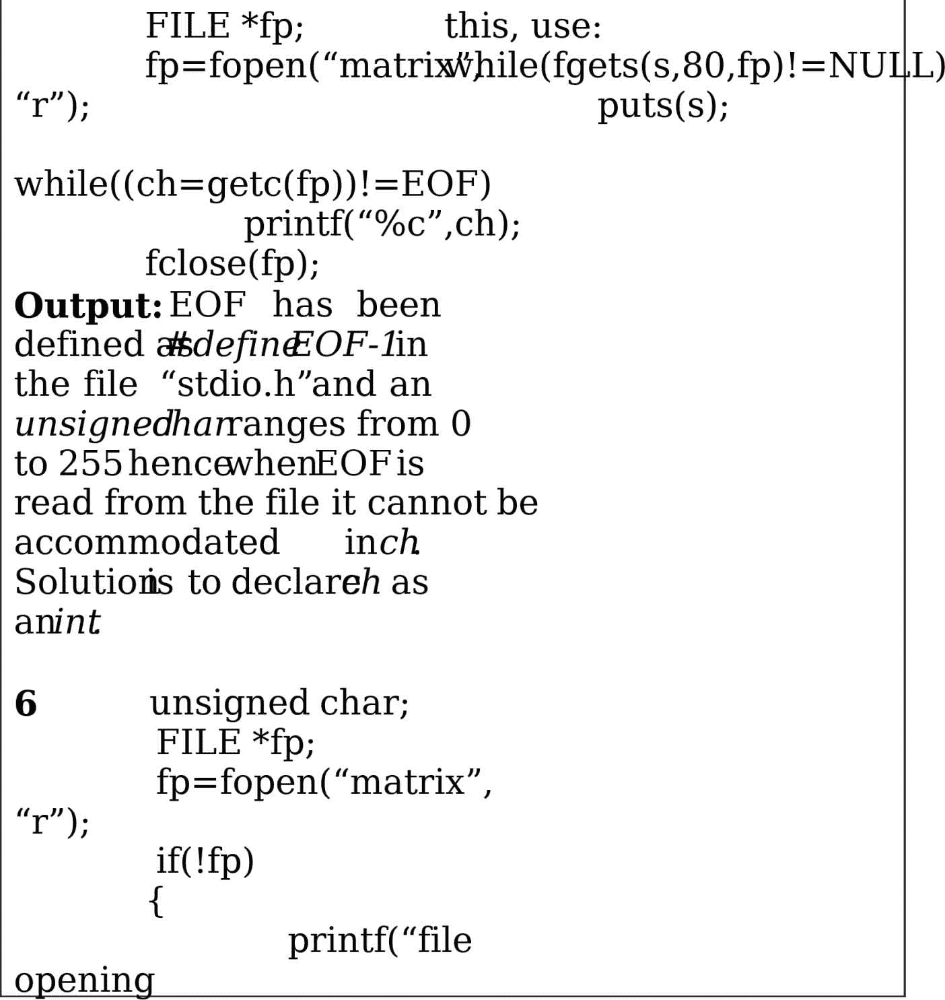!(Images/image01156.jpeg)!(Images/image1162.jpeg)

# 第 13 章 杂题

## 引言

### 宏
我们已经知道 `#define` 语句可以用于定义符号常量。因此，常量提供了一种简写形式。`define` 语句可以用于定义宏，即它们可以用于替换这些表达式、完整语句或一组语句。

使用宏寻找两个数最大值的程序：
```c
#define max(a,b) (a>b)?a:b
main()
{
    int a,b,ans;
    printf("Enter two numbers");
    scanf("%d %d",&a,&b);
    ans = max(a,b);
    printf("max = %d",ans);
}
```
该程序包含一个宏 `max`，它代表表达式 `(a>b)?a:b`。当程序编译时，表达式 `(a>b)?a:b` 会替换标识符 `max`。宏的定义通常放置在文件的开头，位于第一个函数定义之前。宏的作用范围是全局的。多行宏也可以通过在每行（最后一行外）末尾放置反斜杠来定义。此特性允许单个宏表示为复合语句。

### 将变量声明为常量
我们可能希望某些变量的值在程序执行期间不能改变。这可以通过初始化时使用关键字 `const` 声明变量来实现，例如
```c
const float PI=3.14;
```
此声明告诉编译器 `pi` 的值在程序执行期间不能改变。

### 将变量声明为 volatile
ANSI 标准定义了另一个限定符 `volatile`，可以显式告诉编译器，变量的值可能会被某些外部源（程序外部）随时更改。
```c
volatile int date;
```
即使 `date` 没有出现在赋值语句的左侧，其值也可能被某些外部因素改变。

### 注意事项
记得 `stdio.h` 必须被包含。使用 `volatile` 变量时，编译器会检查 `volatile const date = 150`。

### 定义符号常量
我们经常在程序中使用常量。这些常量可以在程序中多次出现。例如 `pi` 的值始终为 `3.14`：
```c
#define PI 3.14
```
`#` 称为处理器或编译器指令。我们已经知道 `PI` 是常量，因此在整个程序中保持不变。符号常量也称为常量标识符。对于 `#define` 语句遵循以下规则：
- 为了区分变量和符号常量，符号常量使用大写
- `#` 与 `define` 之间没有空格
- `define` 与符号常量之间需要空格
- 符号名不带数据类型
- `#define` 语句不分号结尾
- `#define` 语句可以出现在程序的任何地方，但在使用之前。但它们通常出现在 `main()` 之前。

### 预处理器指令
预处理器正如其名，是在通过编译器之前处理源代码的程序。

### C 预处理器
预处理器是一系列在编译开始时执行的特殊语句。这些被称为指令。一些预处理器包括：

1. `#include`：用于包含头文件。
2. `#define`：该语句用于定义符号常量和宏：即等价于表达式的单一标识符。

例如：
```c
#include<stdio.h>
#define area length*width
main()
{
    int length, width;
    printf("enter length and width");
    scanf("%d %d",&length,&width);
    printf("\n area is %d",area);
}
```

3. `#if`, `#elif`, `#else` 和 `#endif` 根据一个或多个真假条件允许源程序进行条件编译。它们也与 `defined` 运算符配合使用。

例如：
```c
#if defined(FOREGROUND)
    #define BACKGROUND 0
#else
    #define FOREGROUND 0
#endif
```

4. `#elif`：`#elif` 用于控制语句中的 `else if` 子句。
5. `#else`：
6. `#endif`：
7. `#ifdef`：`#ifdef` 等于 `#if defined()`。


### 8. #ifndef
`#ifndef` 等同于 `#ifdefined`。即，“如果未定义”。

### 9. #undef
`#undef` 指令用于“取消定义”符号常量或宏标识符；即，它抵消 `#define` 指令的效果。

例如：

```c
#define FOREGROUND 7
#define BACKGROUND 0
main()
{
//………
#undef FOREGROUND
#undef BACKGROUND
}
```

**Mind Drill Note**：`#if`, `#ifdef`, `#ifndef` 必须以 `#endif` 结束。

### 运算符
预处理器还包含两个特殊运算符：`defined` `#` 和 `##`。

### 字符串化运算符 (`#`)
它允许将宏定义中的形式参数转换为字符串。如果宏定义中的形式参数前面跟有此运算符，则相应的实际参数将被自动包裹在双引号中。

### 标记粘贴运算符 (`##`)
它导致宏定义中的各个项目连接在一起，从而形成一个单一项目。

示例：
```c
#define display(i) printf(“ x” #i “= %f\n”,x##i)
```
假设该宏通过 `display(3);` 被调用。
结果将是：`printf(“x3= %f\n”, x3);`
因此表达式 `x##i` 变成了变量 `x3`，因为 `3` 是参数 `i` 的当前值。

## 多选题

1. **什么是预处理器指令？**
1. 编译器发送给程序员的消息。
2. 编译器发送给链接器的消息。
3. 程序员发送给预处理器的消息。
4. **一个头文件是：**
1. 一个包含标准库函数的文件。
2. 一个包含定义和宏的文件。
3. 一个包含用户定义函数的文件。
4. 程序员发送给微处理器的消息。

**答案: 3. 程序员发送给预处理器的消息**

2. **以下哪项是正确的 `#define` 语句-**
1. `#define INCH PER FEET 12`
2. `#define SQR(X) (X*X);`
3. `#define SQR(X) (X*X)`

**答案: 3. #define SQR(X) (X*X)**

3. **以下哪项不是预处理器指令？**
1. `#if`
2. `#elseif`
3. `#undef`
4. `#pragma`

**答案: 3. #undef**

4. **一个文件存在于当前目录。**
**答案: 2. 一个包含定义和宏的文件**

5. **所有的宏替换都完成-**
1. 在程序编译之前
2. 在编译之后
3. 在执行期间
4. 以上都不是

**答案: 1. 在程序编译之前**

6. **以下代码的输出是什么：**
```c
#define sqr(x) (x*x)
main()
{
    int a,b=3;
    a=sqr(b+2);
    printf("%d”,a);
}
```
**输出: 1** 因为在预处理阶段，表达式变为 `a=(3+2*3+2)`。

7. **你将如何定义上面的 `sqr` 宏，使其 a 的结果为 25？**
**答案: `#define sqr(x) ((x) *(x))`**

8. **以下代码的输出是什么：**
```c
main()
{
#ifdef
    int a;
    a=10;
#else
    int a;
    a=20;
#endif
    printf("%d”,a);
}
```
**输出: 即使 `#ifdef` 失败，输出为: 20**

9. **3. #define cube(x) (x*x*x)**
main()
{
    int a,b=3;
    a=cube(b++);
    printf("%d %d”,a,b);
}
```
**输出: 27 4**

10. **4. #define MESS junk**
main()
{
    printf(“MESS”);
}
```
**输出: MESS**

11. **5. #define PRINT(int) printf("%d”,int)**
main()
{
    int x=2,y=3, z=4;
    PRINT (x);
    PRINT (y);
    PRINT (z);
}
```
**输出: 2 3 4**

12. **6. 你将如何定义上面的 `PRINT` 宏，使其输出：x=2 y=3 z=4？**
**答案: `#define PRINT(int) printf(#int “ %d”, int)`**
```c
main()
{
    int x=2,y=3, z=4; // 注意不允许未定义和 if 块。
}
```

13. **8. 下面的 typedef 有效吗？**
```c
typedef #include;
```
**答案: 无效，因为 `typedef` 只在预处理器处理完成后起作用。**

14. **9. #define max(a,b) (a>b?a:b)**
main()
{
    int x;
    x=max(3+2,2+7);
    printf("%d”,x);
}
```
**输出: 9**

15. **10. 为以下程序编写一个宏 `PRINT`，使其输出：x=4 y=4 z=5**
```c
main()
{
    int x=4, y=4, z=5;
    int a=1, b=2, c=3;
    PRINT(x,y,c);
}
```
**答案: `#define PRINT(var1, var2, var3) printf("\n” #var1 “=%d” #var2 “=%d” #var3 “=%d”, var1, var2, var3)**

16. **定义宏 `DEBUG`，使得以下程序输出：**
```c
main()
{
    int x=4;
    float a=3.14;
    char ch=‘A’;
    DEBUG(x, %d);
    DEBUG(a, %f);
    DEBUG(ch, %c);
}
```
**答案: `#define DEBUG(var,fmt) printf(“DEBUG” #var “=”#fmt“\n”,var)**
**输出：**
DEBUG: x=4
DEBUG: y=3.140000
DEBUG: ch=A

17. **#define str(x) #x**
**#define Xstr(x) str(x)**
**#define oper multiply**
main()
{
    char*opername=Xstr(oper);
    printf("%s”,opername);
}
```
**输出: multiply**

## 附加问题

1. **以下两个 `#include` 指令有什么区别？**
`#include<conio.h>`
`#include"conio.h"`

**答案：**
`include “conio.h"`：此指令不仅会在当前目录查找，还会在搜索路径设置的指定的目录列表中查找 `conio.h`。
`#include<conio.h>`：此指令仅会在指定的目录列表中查找 `conio.h`。

2. **指出在预处理阶段 swap 宏会被展开成什么。代码能通过编译吗？**
```c
#define swap (a, b, c) (c t; t=a; a=b; b=t)
main()
{
    int x=10,y=20;
    swap(x,y);
    printf("%d %d”,x,y);
}
```
**答案：** 展开为 `(c t; t=a; a=b; b=t)`。该代码无法编译，因为不能在括号内声明变量 `t`。


现在，如果我们如下所示两次包含此文件，它将只包含一次。

### 9. 在包含时，头文件在哪里被搜索的？

**答案：** 如果使用 `< >` 包含头文件，文件将在预定义的包含路径中搜索（该路径也可以更改）。如果使用 `" "` 语法包含，除了预定义路径外，还会在当前目录中搜索文件（通常是调用编译器的所在目录）。


判断对或错：

a. 如果要包含的文件不存在，预处理器会抛出错误信息。
b. 预处理器可以捕获简单的错误，如缺少声明、嵌套注释或大括号不匹配。
c. 如果头文件被包含两次，是否会导致错误。
d. 下面的程序会无限次地打印该条消息吗？
```c
#define INFINITELOOP while (1)
main()
{
    INFINITELOOP
    printf("\nMatrix");
}
```
e. 下面的程序能成功编译吗？
```c
main()
{
    printf("Matrix" "computers");
}
```
**答案：**
a. True, b. False, c. False, d. True, e. True

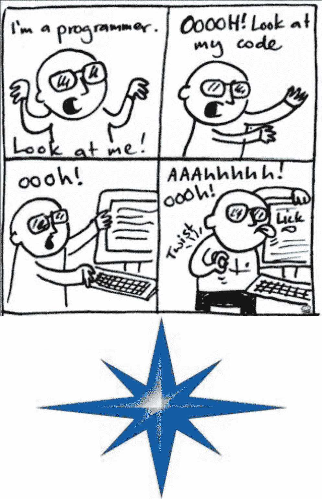

# 第 14 章

# (存储类)

## 引言

存储类决定了变量的内存位置。内存位置可以是：
1. 主内存 (RAM)。
2. CPU 寄存器。

它决定了变量的默认值（零值或垃圾值）。它还决定了变量的作用域和生命周期。作用域指声明产生作用的区域，换句话说，该特定变量可以使用。

四种不同的作用域是全局、函数、块和原型。

有 4 种存储类：
1. 自动存储类 (`auto`)
2. 静态存储类 (`static`)
3. 外部存储类 (`extern`)
4. 寄存器存储类 (`register`)

### 自动存储类

在函数内部声明的变量默认具有自动存储类。它由垃圾值初始化。
声明方式为：`int a` 或 `auto int a;`；`void prn();`

```c
main()
{
    int a = 5;
    printf("%d ", a);
    prn();
    prn();
    prn();
}
void prn()
{
    int a = 10;
    a++;
    printf("%d ", a);
}
```
输出：`5 11 11`
在上面的示例中，两个变量名称相同，但它们有不同的作用域。`prn()` 中的变量 `a` 是局部作用域，因此每次调用 `prn()` 都会生成 `a` 的新副本。

### 静态存储类

只有当程序需要变量的值在不同函数调用之间持久（例如递归函数）时，才使用静态存储类。变量声明为：`static int b;`；静态变量具有局部作用域和全局生命周期。静态变量定义在单个函数内部，因此与自动变量的作用域相同。它们对于函数是局部。它们在整个程序生命周期内保留其值。因此，如果一个函数退出稍后重新进入，定义在该函数内的静态变量将返回它们以前的值。

```c
void prn();
main()
{
    prn();
    prn();
    prn();
}
void prn()
{
    static int a = 10;
    a++;
    printf("%d ", a);
}
```
输出：`11 12 13`
在上面的示例中，只会创建一个变量 `a` 的副本，并且在每次调用 `prn()` 时都会使用这个唯一的副本，因此它会增加变量 `a` 的上一次函数调用值。

## 外部存储类

在所有函数外部声明的变量具有外部存储类。`extern` 存储类应仅用于程序中所有函数使用的变量。现在不需要在所有函数中传递变量了。

但不建议将所有变量都存储为 `extern`，因为它们将在程序生命周期内保持活跃，从而浪费了大量内存。外部变量声明为 `extern int c;`；当一个程序的变量必须在某些其他程序中使用时，例如：

| File1.c | File2.c |
| :--- | :--- |
| `#include "File2.c"` | `/*extern declaration*/` |
| `int a; /*Variable definition */` | `extern int a;` |
| `main(){ a= 5; func(); printf("%d",a); }` | `void func(){ a=10; }` |

**输出：** `10`
`a` 在 `File1.c` 中获得内存，因为它是在调用它的函数外部作为外部变量定义的，且其作用域是全局的。两个文件中使用的 `a` 是同一个。但当我们编译 `File2.c` 时，我们必须通知编译器 `a` 来自外部（不分配内存），如果我们将其声明为 `int a`，编译器将将其视为新变量。

### 寄存器

可用的 CPU 寄存器很少，甚至比微处理器正在使用的还要少。但计算机访问 CPU 寄存器的速度非常快，因此程序执行得非常快。因此，它最适合需要多次使用的循环计数器。然而，如果寄存器是空闲的，`auto` 存储类会被使用，执行继续。CPU 寄存器是 2 字节。所以它们的范围等于 `int`。即使我们说 `float`，声明为 `register int d;`。

## 总结

| 存储类 | 内存 | 作用域 | 生命周期 |
| :--- | :--- | :--- | :--- |
| Auto | 主内存 (RAM) | 局部 | 局部 |
| Static | 主内存 (RAM) | 局部 | 全局 |
| Extern | 主内存 (RAM) | 全局 | 全局 |
| Register | CPU 寄存器 | 局部 | 局部 |

以下程序的输出是什么：

```c
main()
{
    static int c = 5;
    printf("\n c = %d",c--);
    if (c !=0)
    main();
}
```
输出：`5 4 3 2 1`
因为首先打印 `c=5` 然后减 1 调用 main，但这里 `c` 定义为 `static`，所以控制不会进入初始化，此条件将为五次，每次 `c` 都被打印然后减 1，所以 `c` 将是 `5 4 3 2 1`。

```c
main()
{
    int i,j;
    for( i = 1; i<5; i++)
    {
        j = g(i);
        printf("\n%d",j);
    }
}
int g( int x){{
    static int v = 1;
    int b = 3;
    v+=x;
    return(v+x+b);
}
```
输出：`6 9 13 18`

```c
main()
{
    int x = 20;
    {
        int x = 30;
        printf("%d ",x);
    }
    printf("\n %d",x);
}
```
输出：`30 20`
因为当控制执行内部的 printf 时，它将打印 30，因为局部变量优先，当控制离开此块时作用域结束，这里 `x =20` 并被打印。

```c
main()
{
    extern int i;
    i=20;
    printf("%d",sizeof(i));
}
```
输出：`Error extern int i is adeclaration and not definition`

```c
main()
{
    extern int a;
    printf("%d",a);
}
int a=20;
```
输出：`20`


## 问题

1. `extern` 存储类变量在定义之前的函数中是不可用的，除非该变量在这些函数中被显式声明。

2. 自动存储类变量的值在不同的函数调用之间持续存在。

3. 如果 CPU 寄存器可用，则寄存器存储类变量被视为静态存储类变量。

4. `register` 类变量不能持有 `float` 值。

5. 如果我们尝试对 `float` 变量使用 `register` 存储类，编译器将抛出错误信息。

6. 如果变量 `x` 定义在所有函数之外，且变量 `x` 也被定义为某个函数的局部变量，则全局变量的优先级优于局部变量。

7. 自动变量的默认值为 0。

8. `static` 变量的生命周期直到控制权保持在其定义的块内。

9. 如果要定义一个全局变量，则在其声明中必须使用 `extern` 关键字。

10. `register` 变量的地址是无法的。

### 答案

1. 正确
2. 错误
3. 错误
4. 正确
5. 错误
6. 错误
7. 错误
8. 错误
9. 错误
10. 正确


# 第 ∞ 15 章（算法）

## 引言

### 算法 1：两个数之和
1. 读取 `A` 和 `B`。
2. 设置 `SUM:=A + B`。
3. 输出 `SUM`。
4. 退出。

### 算法 2：两个数中的最大值
1. 读取 `A` 和 `B`。
2. 如果 `A > B`，：
   设置 `MAX:=A`。
   否则：
     设置 `MAX:=B`。
   [结束 If 结构]
3. 输出 `MAX`。
4. 退出。

### 算法 3：三个数中的最大值
1. 读取 `A`, `B`, `C`。
2. 如果 `A > B`，：
   如果 `A > C`，：
     设置 `MAX:=A`。
   否则：
     设置 `MAX:=C`。
   [结束 If]
   否则：
   如果 `B > C`，：
     设置 `MAX:=B`。
   否则：
     设置 `MAX:=C`。
   [结束 If]
3. 输出 `MAX`。
4. 退出。

### 算法 4：从用户输入百分比并打印等级（使用 Else if）
1. 读取 `P`。
2. 如果 `P>=90`，：
   设置 `GRADE:=’A’`。
   如果 `P >= 70`，：
     设置 `GRADE := ‘B’`。
   其他如果 `P>=50`，：
     设置 `GRADE:=’C’`。
   否则：
     设置 `GRADE:=’F’`。
   [结束 If Else 结构]。
3. 输出 `GRADE`。
4. 退出

### 算法 5：使用 for 循环打印 1 到 N 的序列
1. 读取 `N`。
2. 对于 `I:=1 to N` 重复步骤 3：
3. 输出 `I`。
[结束步骤 2 循环]
4. 退出。

### 算法 6：使用 while 循环打印 1 到 N 的序列
1. 读取 `N`。
2. 设置 `I:=1`。
3. 当 `I<=N` 时：
   输出 `I`。
   设置 `I:=I+1`。
4. 退出。

### 算法 7：使用 do while 循环打印 1 到 N 的序列
1. 读取 `N`。
2. 设置 `I:=1`。
3. 执行：
   输出 `I`。
   设置 `I:=I+1`。
当 `I<=N`。
4. 退出。

### 算法 8：十进制转二进制
1. 读取 `N`。
2. 设置 `B:=0`。
3. 设置 `I:=1`。
4. 当 `N>=0` 时：
   设置 `N:=N/2`。
   设置 `B:=B*10 + remainder`。
5. 输出 `B`。
6. 退出。

### 算法 9：反转给定数字的数字
1. 读取 `N`。
2. 设置 `REV:=0`。
3. 当 `N>=0` 时：
   设置 `N:=N/10`。
   设置 `REV:=REV*10 + remainder`。
4. 输出 `REV`。
5. 退出。

### 算法 10：验证给定数字是否为质数
1. 读取 `N`。
2. 设置 `PRIME:=1`。
3. 对于 `I:=2` 到 `N/2`：
   如果 `N % I=0`：
     设置 `PRIME:=0`。
     中断。
4. 如果 `PRIME=1`：
   打印该数是质数。
否则：
   打印该数不是质数。
5. 退出。

### 算法 11：数组中的线性搜索

### 算法 12：使用函数计算阶乘
1. 读取 `N`。
2. 设置 `ANS:=1`。
3. 对于 `I:=1` 到 `N`：
   设置 `ANS:=ANS*I`。
4. 返回 `ANS`。


# 第 ∞ 16 章

## 未解决的问题

1. 电话号码如 (011)711 8802 可以被认为三个部分：区码 (011)、交换机 (711) 和号码 (8802)。编写一个程序，使用结构体分别存储这些部分。将结构体命名为 phone。创建一个数组存储 20 条记录，每条记录存储成员编号、成员姓名和电话号码。让用户输入所有信息，然后在屏幕上显示所有信息。

2. 创建一个名为 volume 的结构体，使用三个变量（长、宽、高）类型为距离（英尺和英寸）来建模房间。读取房间的三个维度并计算其代表的体积，然后输出结果。体积应以（英尺）形式，即你必须将每个维度转换为英尺。例如，12 英尺 6 英寸将变为 12.5 英尺。

3. 定义一个表示复数的结构体（包含实部和虚部）。编写一个 C 程序两个复数相加。

4. 定义一个表示复数的结构体（包含实部和虚部）。编写一个 C 程序两个复数相减。

5. 定义一个表示复数的结构体（包含实部和虚部）。编写一个 C 程序两个复数相乘。

6. 定义一个表示复数的结构体（包含实部和虚部）。编写一个 C 程序两个复数相除。

7. 编写程序记录板球比赛得分。一个数组存储击球球队的信息，如击球者姓名、得分、出局指示及方式，以及总分、投球次数、总投球数和额外球。另一个数组存储关于投球球队的信息，如投手姓名、投球次数、无球局、失分和三局门门数。该程序读取上述信息，并根据用户的选择，显示击球球队的信息或投球球队的信息。

8. 编写程序根据以下数据准备发票：客户帐号、客户名称和地址、销售日期、描述、数量、单价、折扣百分比、销售税百分比。


### 9. 编写一个程序来准备并打印某月份一组员工的工资单（payslip）。
员工信息包含以下项目：员工姓名和职位、基本工资(`bp`)、特殊津(`sp`)、公积金缴费(`pf`)、团体计划缴费(`gis`)、所得税扣除(`it`)、城市补偿补助(`cca`)= 250 卢比、生活津贴(`da`)= 基本工资 < 3500 卢比为 114%，3500 到 < 6000 卢比之间为 85%，> 6000 卢比为 74%；房租补贴(`hra`)= 基本工资 < 1500 卢比为 250.00 卢比，1499 到 2800 卢比之间为 450.00 卢比，2799 到 < 3500 卢比之间为 800.00 卢比，> 3499 为 1000.00 卢比。程序计算上述数量、总工资、总扣除、净工资并按指定格式打印。
（提示：`gross=bp+sp+hra+da+cca`，`net=gross-deductions(i.e.,pf+gis+it)`）在程序中使用结构体和数组。

### 10. 编写一个程序存储 20 条包含国家、首都及其总统姓名的记录。
总统姓名是一个包含姓、名、前缀（`mr`, `miss`, `mrs`）的记录。每当给出国家名称或首都时，程序应显示整个记录。

### 11. 假设商店的库存中有若干物品，每个物品几乎由两个供应商提供。编写一个程序在数组中存储 20 个物品的详情并打印。

### 12. 一个数组存储 25 名学生的详细信息（三门科目的 `rollno`、`name`、`marks`）。编写一个程序创建这样的数组并打印超过一门科目不及格的学生列表。假设 40% 为及格分数。

### 13. 编写一个程序根据以下数据计算一组员工的所得税。
总收入、人寿保险费(`lic`)、单位联接保险计划(`ulip`)、公积金(`pf`)、邮局累计定期存款(`ctd`)、国家储蓄证书(`nsc`)。假设所得税计算遵循以下标准：
a 总收入阶梯税率：
- 至 3500：免
- 35001 到 60000：20%
- 60001 到 120000：30%
- 120000 及以上：40%

b 对 `lic`、`gpf`、`ppf`、`ulip`、`nsc`、`ctd` 等缴费免税，最高限额为 120000 卢比。

### 14. 一个大小为 50 的线性数组存储以下信息：国家名称、国家首都和国家的人均收入。编写一个完整的 C 语言执行以下操作：
a) 读取国家名称并显示首都和人均收入。
b) 读取首都城市名称并显示国家名称和人均收入。输入错误时显示错误信息。

### 15. 编写一个程序使用结构体存储 50 个物品的价格列表，并打印最高价格以及所有价格总和。

### 16. 用 C 语言编写一个程序，使用结构体模拟 20 名学生的成绩处理系统。
每个学生的可用数据包括 `rollno`、`name` 和三门科目的成绩。需要根据上述信息计算百分比分数和等级，百分比分数为平均分，等级计算方式如下：
- < 50：'f'
- >= 0 < 60：'d'
- >= 60 < 75：'c'
- >= 75 < 90：'b'
- >= 90 < 100：'a'

### 17. 编写一个 C 程序模拟整数算术计算器。
程序应能够产生上一次的结果以及目前为止执行的算术操作次数。任何错误操作均应报告。

### 18. 编写一个名为 "student" 的结构体，其成员为：1) 姓名 2) 学号 3) 三门科目（即英语、印地语、数学）的成绩。使用结构体执行以下操作：
a) 接受姓名、学号和三门科目的成绩。
b) 计算总分和百分比。
c) 按给定格式在屏幕上显示信息：
```
XYZ school halfyearly examination
Name:           roll no:
Marks in Hindi:
Marks in English:
Marks in Maths:
```

### 19. 编写一个用于选美比赛的结构体 "contestant"，检查以下项：
a) 年龄在 18 到 20 岁之间
b) 体重在 45 到 60 之间
c) 学历为本科毕业
结构体成员为：1) 姓名 2) 年龄 3) 重量。以表格形式显示 5 名参赛者的详情。

### 20. 编写名为 "stock" 的结构体。接受 10 个物品的详情。结构体成员为：1) 物品名称 2) 物品代码 3) 单价 4) 库存数量 5) 金额。现在询问用户想要查看的物品代码。

### 21. 编写一个程序，创建结构体指定学生数据：学号、姓名、系别、课程、入学年份。假设学校有 450 名学生。使用结构体执行以下操作：
a) 打印在特定年份入学的学生。
b) 打印给定学号的学生数据。

### 22. 创建一个结构体指定银行客户的数据。存储的数据为：账号、姓名、账户余额。假设银行有 200 名客户。使用结构体执行以下操作：
a) 打印余额大于 100 的客户账号和姓名。如果客户要求取款或存款，格式为：账号，金额，1 为存款，0 为取款

### 23. 一家汽车公司拥有从 aa0 到 ff9 的零件序列号。结构体指定的其他特征为：制造年份、材料和制造数量。现在执行以下操作：
a) 指定一个结构以存储对应零件的信息。
b) 编写一个程序检索 bb1 到 cc6 之间的零件信息。

### 24. 记录包含运动员的姓名、年龄、参加的测试赛次数以及每场测试赛的得分平均分。创建一个结构体数组来存储 20 名此类运动员的记录，然后编写一个程序读取这些记录并按平均分进行升序排序。

### 25. 创建一个结构体代表图书馆中的书籍。包含以下成员：书号、书名、作者、出版社、价格、副本数、已借副本数。使用结构体执行以下操作：
a) 分配值。
b) 在检查可用性后借出书籍。
c) 还书。
d) 显示书籍信息。

### 26. 创建一个结构体表示 10 个客户的银行账户，数据成员为：存款人姓名、账号、账户类型（s 代表储蓄，c 代表活期）、余额金额。现在使用结构体执行以下操作：
a) 初始化数据成员
b) 存款。
c) 在检查最低余额后取款（最低余额为 1000 卢比）。
d) 显示数据成员。


## 27. 创建一个结构来表示板球球队中的击手。
它包含以下成员：名字、姓氏、得分、四球击数、六球击数。现在使用该结构执行以下操作：

a) 分配初始值。
b) 更新得分（如果需要，应同时更新四球击和六球数）。
c) 显示击手信息。

对访问标识符（access labels）做出合理的假设。

## 28. 创建一个结构来表示板球球队中的投投手。
包含以下成员：名字、姓氏、投球轮数、空局轮数、失分数、三出局门数。现在使用该结构执行以下操作：

a) 分配初始值。
b) 更新信息。
c) 显示投投手信息。

对访问标识符做出合理的假设。

### 29. 编写程序（WAP）来管理房间统计数据。
房间结构包含以下成员：长度、宽度、高度。现在使用该结构执行以下操作：

a) 分配初始值。
b) 计算面积。
c) 显示信息（长度、宽度、高度和面积）。

## 30. 修改上述程序，使长度、宽度和高度变为结构 `distance` 的变量，该结构包含：米、厘米。

## 31. 令 `itemlist` 为一个大小为 `n` 的线性数组（其中 `n` 为用户输入），数组的每个元素包含以下字段：项目、代码、价格、数量。声明一个以 `itemlist` 为数据成员的结构，并执行以下操作：

a) 向列表中添加项目。
b) 根据给定的项目代码，从列表中删除该项目。
c) 打印库存总值。

## 32. 编写程序来处理 10 个账户持有人。
程序应使用在 `q.33` 中定义的结构。如有需要，对类定义进行必要的修改。

## 33. 编写一个结构来表示向量（一维数值数组）。
现在使用该结构执行以下操作：

a) 创建向量。
b) 修改给定的元素。
c) 显示向量中的最大值。
d) 显示整个向量。
e) 相两个向量并显示结果向量。

使用该结构编写程序。

## 34. 创建两个结构 `mc` 和 `fi`，用于存储距离值。`mc` 以米和厘米单位存储距离，而 `fi` 以英尺和英寸单位存储。编写程序读取两个结构变量的值，并可以将 `mc` 的一个变量与 `fi` 的一个变量相加。

## 35. 想象一个集市上的售票处。
路过的人需要购买门票。票价为 RS. 2.50/-。售票处记录访问售票处的人数以及收集的总金额。使用一个名为 `ticbooth` 的结构对该售票处进行建模，包含以下成员：访问总人数、收集总金额。现在执行以下操作：

a) 分配初始值（将两个数据成员均赋值为 0）。
b) 在门票未售完的情况下，仅增加人数总数。
c) 如果门票售完，则增加人数总数以及金额金额。
d) 显示总计。
e) 显示售完的票数（这是一个难点）。编写包含此结构的程序。

## 36. 编写程序在不使用语言支持的内置字符串函数的情况下，对字符串结构执行各种操作。对结构执行的操作有：

a) 读取字符串。
b) 显示字符串。
c) 反转字符串。
d) 将字符串复制到空字符串中。
e) 拼接两个字符串。

## 37. 编写程序处理 20 名销售员的销售活动。
每个销售员负责不同的产品，并被分配一个年度目标。在月底，他的月销售额将加到累计销售额中。在年底，他的佣金计算方式如下：如果销售额超过目标，则佣金为额外销售额的 25% 加上目标的 10%；如果销售额等于目标，则佣金为目标的 10%。否则，佣金为零。

## 38. 书店维护店内出售书籍的库存。
列表包括作者、书名、价格、出版商和库存状况等详情。每当客户想要买书时，销售人员输入书名和作者，系统搜索列表并显示是否有货。如果没有，则显示相应的消息。

如果有，系统将显示书籍详情并请求所需的数量。如果请求的副本有货，则显示所需副本的总费用，否则显示消息“抱歉！没有这么多数量的库存”。使用一个名为 `stock` 的结构设计系统。该程序包含以下操作：

a) 根据需要更新价格。
b) 只要交易完成，每本书的库存值就应自动更新。
c) 根据需要显示书籍总数（书名数）以及总销售额（单位为 RS.）。

## 39. 编写程序实时打印板球比赛的比分板。
显示内容应包含击手的名字、得分、是否出局、何种方式出局、投手的得分（投球轮数、空局轮数、三出局门数）。分数应实时更新。（提示：使用单独数组存储击手和投投手）。

## 40. 编写程序根据以下数据准备发票：客户姓名、客户地址、销售日期、项目编号、项目描述、销售数量、单价、折扣百分比销售百分比。注意：在此识别不同的结构。

## 41. 大学每年维护一份学生名单。
年底，大学编制报告，列出以下内容：年份、就业毕业生人数、未就业毕业生人数、最高分者的姓名、年龄、科目、平均分。

今年有 x% 的毕业生未就业，n% 为一等生。
编写该程序，使用以下结构路径：

`person` -> `student` -> `graduate student`
`(name, age)` -> `(roll no, average marks)` -> `(subject, employed)`

这些结构的数据成员如括号所示。

## 42. 编写程序读取多个不同的名称并按字母顺序重新排列，然后输出排序后的列表。在程序中使用结构变量。

## 43. 假设银行为客户维护两种类型的账户，分别称为储蓄账户和活期账户。
储蓄账户提供复利和取款功能，但不提供支票功能。活期提供支票功能但不计。活期账户持有人应维持最低余额，如果余额低于此水平，将收取服务费。创建一个结构 `account` 来存储客户姓名、账户号码和初始余额。从此导出 `current` 和 `savings` 结构，以满足其特定需求。现在执行以下任务：

a) 为客户存入金额并更新余额。
b) 显示账户详情。
c) 计算并存入利息。
d) 在检查余额后为客户提取金额并更新余额。
e) 检查最低余额（针对活期账户持有人），必要时收取罚款并更新余额。


## 44. 编写程序定义一个可以存储“整数”或“浮点数”字符串的联合体。定义一个 `union type` 变量来跟踪联合体中存储的数据类型。编写一个函数来打印存储在联合体中的值。

## 45. 编写程序定义一个联合体类型 `ans`，包含两个成员：一个整数数量和一个浮点数量。计算这些数字的平均值和标准差并打印出来。

## 46. 编写程序实现以下功能：跟踪一家拥有 `12` 个品牌库存的二手车业务销售情况，每个品牌都有一个整数代码，并生成每日报告，指示：

a) 天开始时各品牌的库存。
b) 天结束时各品牌的销售总数。
c) 各品牌销售占库存的百分比。（假设所有汽车价格相同）

**示例输入：**
```
car brand no.  No. Of cars in stock  No. Of cars sold
1 10                              0
2 12                              0
3 13                              6
-----------------------------------------------------------
12 30                              0
```

**示例输出：**
```
Brand #: 1  inventory at day's start: 23  total sales: 6  inventory at day's end: 17  sales as percentage of inventory: 26.08
...sales as percentage of inventory: 26.08657
```

## 47. 编写程序可以维护一个班级学生的姓名、学号和成绩。班级人数是变化的。包含计算班级平均分的函数。

## 48. 编写程序读取一个字符串并输出该字符串中每个字符出现的频率。

## 49. 编写程序读取一个字符串并输出该字符串中每个单词出现的频率。

## 50. 一公司在周一到周五期间支付正常工资，周六和周日的工资为正常的 1.5 倍。给定如下格式的数据：员工编号、每小时工资、周一工作时长、周二工作时长……直到周日工作时长。编写程序输出员工编号和周工资。在程序中使用 `enum` 数据类型。

## 51. 定义一个学生结构体，包含姓名、学号和六门科目的成绩。假设 `all students` 是一个学生数组。编写程序打印在每门科目中获得最高分的学生姓名和学号。

## 52. 定义一个结构体 `mca2_oops`，成员有：`entry_no`、`marks`、`marks_minor`、`marks_major`、`total`。编写程序初始化对象变量，计算总分（即 `marks_major` 和 `marks_minor` 之和）。该程序将处理 30 名学生并显示他们的成绩。

## 53. 创建一个印度大城市结构体 `bigcity`，结构体的数据成员为城市名称、区号（例如加尔各答区号为 `033`）等。编写程序交互式询问居民的姓名、地址、本地电话，并按以下格式打印：

1. Name: s.p.rama rao
2. Address: 3/2 apc road
3. Pincode no.: 700052
4. Phone no: (033)-4347270

**结束。**

### 我们想听您的意见！
作为本书的读者，您是我们最重要的评判家和评论员。我们重视您的意见，并想知道我们做得好的地方、哪些可以做得更好、您希望我们纠正或出版的领域，以及任何其他您愿意分享的智性建议。

您可以直接发送电子邮件或写信给我，告诉您对这本书的喜欢或不喜欢之处——以及我们可以做什么让我们的书籍更优秀。

请注意，我无法帮助您解决与本书主题相关的技术问题，而且由于收到的邮件数量很大，我可能无法回复每条信息。在写信时，请务必包含书名、作者以及您的姓名和电话或电子邮箱地址。我将仔细审阅您的意见，并将其与作者（我自己）以及参与本书编写的编辑分享。


## 使用临时变量交换变量
```c
float a,b,c; clrscr(); printf("\n\t\t\tI’m Learning C with Alicode’s Book \n"); 
printf("\n\n\t Enter the value of a="); scanf("%f",&a); printf("\n\n\t Enter the value of b=");
scanf("%f",&b); c=a; a=b; b=c; printf("\n after swapping a=%f \n\t b=%f",a,b); getch();
}
```
### 注意：
**注意**：交换（Swap）意味着相互交换值。
**注意**：这里 `c` 是一个临时变量。

## 8. 编写程序不用第三变量交换两个变量
```c
#include<stdio.h> 
#include<conio.h> 
void main()
{
float a,b; clrscr(); printf("\n\t\t\t I’m Learning C with Alicode’s Book \n"); 
printf("\n\n\t Enter the value of a="); scanf("%f",&a); printf("\n\n\t Enter the value of b=");
scanf("%f",&b); a=a+b; b=a-b; a=a-b; printf("\n\tAfter swapping a=%f\n\n\t\t b=%f",a,b); getch();
}
```

## 9. 编写程序计算三角形面积 (Tribhuj)
```c
#include<stdio.h> 
#include<conio.h> 
void main()
{
float a,b,c,s,r,area; clrscr(); printf("\n\t\t\t I’m Learning C with Alicode’s Book \n"); 
printf("\n\n\t Enter the value of a="); scanf("%f",&a); printf("\n\n\t Enter the value of b="); scanf("%f",&b); 
printf("\n\t Enter the value of c="); scanf("%f",&c); s=a+b+c; area=s*(s-a)*(s-b)*(s-c); r=area; printf("\n\t\t Area=%f",r); getch();
}
```

## 10. 编写程序读取时、分、秒并转换为总秒数
```c
#include<stdio.h> 
#include<conio.h> 
void main()
{
int hr,min,sec,totalsec; clrscr(); printf("\n\t\t\t I’m Learning C with Alicode’s Book \n"); 
printf("\n\n\t Enter the value of hr="); scanf("%d",&hr); printf("\n\n\t Enter the value of min="); scanf("%d",&min);
printf("\n\t Enter the value of sec="); scanf("%d",&sec); totalsec=(hr*3600)+(min*60)+sec; printf("\n\t\t Totalsec=%d",totalsec); getch();
}
```

## 11. 编写程序打印任意字符的 ASCII 
```c
#include<stdio.h> 
#include<conio.h> 
void main() {
char ch; clrscr(); printf("\n\t\t\t I’m Learning C with Alicode’s Book \n"); 
printf("\n\n\t Enter any character ="); scanf("%c",&ch); printf("\n\t\t ASCII code of =%c is %d",ch,ch); getch();
}
```
### 脑训练注意：
ASCII 是一个表格（美国标准信息交换码）。

## 12. 编写程序判断输入的数字是偶数还是奇数
```c
#include<stdio.h> 
#include<conio.h> 
void main()
{
int n; clrscr();
printf("\n\t\t\t I’m Learning C with Alicode’s Book \n");printf("\n\n\t Enter any number ="); scanf("%d",&n);
if(n%2==0)
printf("\n\t\t Number is even"); else
printf("\n\t\t Number is odd"); getch();
}
```

## 13. 编写程序检查输入的字符是大写字母、小写字母、数字还是特殊符号？
```c
#include<stdio.h> 
#include<conio.h> 
void main() {
char ch; clrscr();
printf("\n\t\t\t I’m Learning C with Alicode’s Book \n"); printf("\n\n\t Enter any character =\ scanf("%c",&ch);
if(ch>=65 && ch<=90)
printf("\n\t\t character is uppercase"); else
if(ch>=97 && ch<=122)
printf("\n\t\t character is smaller case"); else
if(ch>=48 && ch<=65)
printf("\n\t\t character is digit");
else
printf("Character is special symbol"); getch();
}
```

## 14. 编写程序通过圆周求面积
```c
#include<stdio.h> 
#include<conio.h> 
void main() {
float r,area,pi=3.14; clrscr(); printf("Enter radius"); scanf("%f",&r); area=pi*r*r; printf("area=%f",area);
getch();
}
```

## 15. 编写程序求两个数字的平均数
```c
#include<stdio.h> 
#include<conio.h> 
void main()
{
int a,b; float avg; clrscr(); printf("Enter 2 no"); scanf("%d %d",&a,&b); avg=(a+b)/2.0; printf("average=%f",avg);
getch();
/* average of 2 no*/

## 16. 编写程序根据输入的天数求月份和天
```c
#include<stdio.h> 
#include<conio.h> 
void main()
{
int n,m,d; clrscr();
printf("Enter no of days\n");
scanf("%d",&n);
m=n/30;
d=n%30;
("months=%d",d,d);

## 17. 编写程序使用第三变量交换三个数字
```c
#include<stdio.h> 
#include<conio.h> 
void main()
{
int a,b,c,t; clrscr(); printf("Enter three no");
scanf("%d %d %d",&a,&b,&c); t=a; a=b; b=t; c=b; printf("%d %d %d",a,b,c);

## 18. 编写程序不用第三变量交换三个数字
```c
#include<stdio.h> 
#include<conio.h> 
void main()
{
int a,b,c; clrscr(); printf("Enter three no"); scanf("%d %d %d",&a,&b,&c); a=a+b; b=a-b; a=a-b; b=b+c; c=b-c;
}}

## 19. 编写程序计算利润和亏损
```c
#include<stdio.h> 
#include<conio.h> 
void main()
{
float sp,cp; clrscr(); printf("Enter cost and selling price\n");
scanf("%f %f",&cp,&sp);
if(cp<sp)
printf("profit=%.2f",sp-cp); else if(sp<cp)
printf("loss=%.2f",cp-sp);
else
printf("no profit loss");
}

## 20. 编写程序计算百分比并打印等级
```
#include<stdio.h> 
#include<conio.h> 
void main()
{
float p; char grade; clrscr(); printf("Enter percentage\n"); scanf("%f",&p);
if(p>=90) grade='A'; else if(p>=70) grade='B'; else if(p>=50) grade='C'; else grade='F';
printf("grade=%c",grade); getch();
}

## 21. 编写程序将小写转为大写
```c
/* lower case to upper case*/
#include<stdio.h> 
#include<conio.h> 
void main() {
char ch; clrscr(); printf("Enter a character\n"); scanf("%c",&ch); if(ch>=97&&ch<=122) ch=ch-32; printf("%c",ch);
getch();
}
```

## 22. 编写程序求两个数字之间的较大值
```c
#include<stdio.h> 
#include<conio.h> 
void main()
{
int a,b; clrscr(); printf("Enter 2 no"); scanf("%d %d",&a,&b);
if(a>b) printf("%d is greater",a); else if(a==b) printf("Both are equal"); else printf("%d is greater ",b);
getch();
}
```

## 23. 编写程序求四个数字中的最大值
```c
#include<stdio.h> 
#include<conio.h> 
void main()
{
int a,b,c,d; clrscr();
printf("Enter 4 no");
scanf("%d %d %d %d",&a,&b,&c,&d);
if(a>b)
{
if(a>c)
{
if(a>d) printf("%d",a); else printf("%d",d);
}
else if(c>d) printf("%d",c); else printf("%d",d);
}
else if(b>c)
{
if(b>d) printf("%d",b); else printf("%d",d);
}
else
{
if(c>d) printf("%d",c); else printf("%d",d);
}
getch();
}
```

## 24. 编写程序使用 switch Case 开发微型计算器
```c
/* calculator*/
#include<stdio.h> 
#include<conio.h> 
void main()
{
int a,b,ch; clrscr();
printf("Enter two no\n"); scanf("%d %d",&a,&b);
printf("1 add\n2 subtract\n3 multiplication\n4 divide\n5 modulus\n choice\n");
scanf("%d",&ch);
switch(ch)
{
case 1:
printf("sum=%d",a+b);
break;
case 2:
printf("subtraction=%d",a-b);
break;
case 3:
printf("multiplication=%d",a*b);
break;
case 4:
printf("division=%f",(float)a/b);
break;
case 5:
printf("modulus=%d",a%b);
break;
default:
printf("invalid input");
}
getch();
}
```


## 25. 编写使用算术运算符的简易计算器，每个运算符执行特定的任务。

```c
#include<stdio.h> 
#include<conio.h> 
void main()
{
    int a,b; char ch;
    clrscr();                  printf("Enter two no\n"); scanf("%d %d",&a,&b);
    flushall();
    printf("/n  + for add  \n  - for  subtract  \n *  for  multiplication  \n / for divide\n Enter your choice\n");
    scanf("%d",&ch);
    switch(ch)
    {
        case ‘+’ :
            printf("sum=%d",a+b);
            break;
        case ‘-’ :
            printf("subtraction=%d",a-b);
            break;
        case ‘*’ :
            printf("multiplication=%d",a*b);
            break;
        case ‘/’:
            printf("division=%f",(float)a/b);
            break;
        case ‘%’ :
            printf("modulus=%d",a%b);
            break;
        default:
            printf("invalid input");
    }
    getch();
}
```

## 26. 编写程序计算用户输入的数字的阶乘。

```c
#include<stdio.h> 
#include<conio.h> 
void main() {
    Int  n,i,f=1;   clrscr();  
    printfprintf("Hello Guys, I’m Learning C Programming with Alicode’s Book "); 
    printf(" Enter the any no. For factorial");
    scanf("%d",&n); 
    for (i=1;i<=n;i++) f=f*i; 
    printf("\n factorial is %d”,f);
    getch();
}
```

## 7. 编写程序计算数字的幂。

```c
#include<stdio.h> 
#include<conio.h> 
void main()
{
    int n,i,p;
    long ans=1; clrscr(); 
    printf("Enter a and its power to be calculated"); 
    scanf("%d %d",&n,&p); 
    i=p;
    while(i>=1)      
    { 
        ans*=n;      
        i--;
    }      
    printf("%ld",ans);      
    getch();
}
```

## 8. 编写程序查询每个月有多少天数。

```c
#include<stdio.h> 
#include<conio.h> 
void main()
{
    int a; clrscr(); 
    printf("Enter month no");
    scanf("%d",&a);
    switch(a)
    {      
        case 1:      
        case 3:      
        case 5:      
        case 7:      
        case 8:      
        case 10:      
        case 12:
            printf("There are 31 days in given month");
            break;      
        case 2:
            printf("There are 28 days in given month");
            break;      
        case 4:      
        case 6:      
        case 9:      
        case 11:
            printf("There are 30 days in given month");
            break; 
        default:
            printf("Invalid input");
    }
    getch();2
}
```

## 29. 编写程序将华氏度温度转换为摄氏度。

```c
#include<stdio.h> 
#include<conio.h> 
void main()
{
    float f,c;  clrscr();
    printf("Enter Temperature in F");
    scanf("%f",&f);  
    c=(f-32)/1.8;  printf("Temperature in C is %f",c);
    getch();
}
```

## 0. 编写程序判断给定年份是否为闰年。

```c
#include<stdio.h> 
#include<conio.h> 
void main()
{  
    int n;  clrscr();  
    printf("Enter year");  
    scanf("%d",&n);  
    if(n%100==0)      
    {      
        if(n%400==0) printf("leap year");      
        else printf("Not leap year");
    }  
    else      
    {      
        if(n%4==0) printf("leap year");      
        else printf("Not leap year");
    }
    getch();
}
```

## 31. 编写程序判断给定年份是否为闰年。

```c
#include<stdio.h> 
#include<conio.h> 
void main()
{
    int y; clrscr(); 
    printf("Enter year\n");
    scanf("%d",&y);
    if(y%400==0||(y%100!=0&&y%4==0))
    printf("Given year is leap year\n"); 
    else
    printf("Given year is not leap year");
    getch();
}
```

## 32. 编写程序获取星期几。

```c
/* weekday*/
#include<stdio.h> 
#include<conio.h> 
void main() {
    int w; clrscr(); 
    printf("Enter a weekday\n");
    scanf("%d",&w);
    switch(w)
    {      
        case 1:
            printf("Sunday");
            break;      
        case 2:
            printf("Monday");
            break;      
        case 3:
            printf("Tuesday");
            break;      
        case 4:
            printf("Wednesday");
            break;      
        case 5:
            printf("Thursday");
            break;      
        case 6:
            printf("Friday");
            break;      
        case 7:
            printf("Saturday");
            break; 
        default:
            printf("invalid input");
    }getch();
}
```

## 33. 编写电话费计算程序。

```c
/* telephone bill*/
#include<stdio.h> 
#include<conio.h> 
void main()
{
    int calls;
    float bill; clrscr();
    printf("Enter no of calls");
    scanf("%d",&calls);
    printf("calls to 100\t0Rs\n calls 101-200\t80Rs\n calls 201-500\t100Rs\n calls >500\t20Rs\n");
    if(calls<=100)
      bill=0;
    else if(calls<=200)
      bill=(calls-100)*80;
    else if(calls<=500)
      bill=(calls-200)*100+80;
    else
      bill=(calls-500)*20+380;
    printf("bill=%.2fRs",bill);
    getch();
}
```

## 34. 编写程序判断数字是否为斯特数。

```c
#include<stdio.h> 
#include<conio.h> 
void main() { 
    int n,sum=0,a,old;  clrscr();
    printf("Enter a no");  
    scanf("%d",&n);
    old=n;          
    while(n!=0)
    {                      
        a=n%10;
        n=n/10;
        sum=sum+a*a;
    }      
    if(sum==old)
      printf("STRONG");      
    else
      printf("NOT STRONG");
    getch();
}
```

## 5. 编写程序检查数字是否为回文。

```c
#include<stdio.h> 
#include<conio.h> 
void main()
{ 
    int a;
    long n,old,rev=0;  scr();
    printf("Enter a");
    scanf("%ld",&n);
    old=n;
    do
    {      
        a=n%10;      
        n=n/10;      
        rev=rev*10+a;      
    }while(n!=0);
    if(old==rev)
    printf("PALINDROME");
    else
    printf("NOT PALINDROME");
    getch();
}
```

## 36. 编写程序检查数字是否为质数。

```c
#include<stdio.h> 
#include<conio.h> 
void main() {
    int n,i,prime=1;  clrscr();  
    printf("Enter a no");
    scanf("%d",&n);
    for(i=2;i<=n/2;i++)          
    {      
        if(n%i==0)      
        { 
            prime=0;      
            break;
        }
    }          
    if(prime==1)            
      printf("Prime no");      
    else
      printf("Not prime no");
}
```

## 37. 编写程序反转给定数字。

```c
#include<stdio.h> 
#include<conio.h> 
void main()
{
    int a;
    long n,old,rev=0;clrscr();
    printf("Enter a no");
    scanf("%ld",n);
    old=n;
    do
    {      
        a=n%10;      
        n=n/10;      
        rev=rev*10+a;      
    }while(n!=0);
    printf("%ld",rev);
    getch();
}
```

## 38. 编写程序打印任意数字的乘法表。

```c
#include<stdio.h> 
#include<conio.h> 
void main()
{
    Int n,i,a;
    Clrscr();
    printf("\n Enter any no.");
    scanf("%d",&n);
    for(i=1; i<=n; i++) {
        a= n*i;
        printf("\n Table is = %d*%d",n,i,a);
    }
    getch();
}
```

## 39. 编写程序打印斐波那契数列。

```c
#include<stdio.h> 
#include<conio.h> 
void main()
{
    Int a=1,b=0, c=0, n, i;
    Clrscr();
    printf("Enter how many terms you want to print series");
    scanf("%d",&n);
    for (i=1 ; i<=n ; i++)
    {
        printf("%d",c); c=a+b; a=b; b=c;
    }
    getch();
}
```

## 40. 编写程序打印序列 1,3,5,7,9.....n

```c
#include<stdio.h> 
#include<conio.h> 
void main()
{
    Int s=1,n, i;
    Clrscr();
    printf("Enter how many terms you want to print ");
    scanf("%d",&n);
}
```


## 41. 编写程序打印 2,4,6,8,10.........n

```c
#include<stdio.h>
#include<conio.h>

Void main()
{
    Int s=2, n, i;
    Clrscr();
    Printf(“Enter how many terms u want to print series”);
    Scanf(“%d”,&n);
    For (i=1 ; i<=n ; i++,s+=2) Printf(“%d”,s);
    getch();
}
```

## 42. 编写程序打印序列 1,4,9,16,25,..............n

```c
#include<stdio.h>
#include<conio.h>

Void main()
{
    Int n, i;
    Clrscr();
    Printf(“Enter how many terms u want to print ”);
    Scanf(“%d”,&n);
    For (i=1 ; i<=n ; i++) Printf(“%d”, i*i); 
    getch();
}
```

## 43. 编写程序打印 1 / 1! + 2 / 2! +3 / 3! +..............n

```c
#include<stdio.h>
#include<conio.h>

Void main()
{
    Int n, i, s=1;
    Float fact=1;
    Clrscr();
    Printf(“Enter how many terms u want to print series”);
    Scanf(“%d”,&n);
    For (i=1 ; i<=n ; i++)
    {
        Fact = fact* i;
        Printf(“%f + i / fact);
    }
    getch();
}
```

## 44. 编写程序打印 1 + x2/y + x/y ......n

```c
#include<stdio.h>
#include<conio.h>
#include<math.h>

Void main()
{
    Int n, i,p=2,x,y;
    Float s,N,D;
    Clrscr();
    Printf(“Enter many terms u want to print”);
    Scanf(“%d”,&n);
    Printf(“Enter the value of x and y”);
    Scanf(“%d%d”,&x,&y);
    Printf(“1+”)
    For (i=1 ; i<=n ; i++)
    {
        N=pow(x,p);
        D=pow(y,p);
        S=N/D;
        Printf(“%F +S);
        P=P+2;
    }
    getch();
}
```

## 45. 编写程序打印 1+X2/Y + X4/Y.....N.

```c
#include<stdio.h>
#include<conio.h>
#include<math.h>

Void main()
{
    Int n, i,p=2,q=1,x,y;
    Float s,N,D;
    Clrscr();
    Printf(“Enter many terms u want to print series”);
    Scanf(“%d”,&n);
    Printf(“Enter the value of x and y”);
    Scanf(“%d%d”,&x,&y);
    Printf(“1+”)
    For (i=1 ; i<=n ; i++)
    {
        N=pow(x,p);
        D=pow(y,q);
        S=N/D;
        Printf(“%F +S);
        P=P+2;
        Q=q+2;
    }
    getch();
}
```

## 46. 编写程序打印 1-X2/Y + X4/Y3 -N.

```c
#include<stdio.h>
#include<conio.h>
#include<math.h>

Void main()
{
    Int n, i,p=2,q=1,x,y;
    Float s,N,D;
    Clrscr();
    Printf(“Enter many terms u want to print series”);
    Scanf(“%d”,&n);
    Printf(“Enter the value of x and y”);
    Scanf(“%d%d”,&x,&y);
    Printf(“1-”)
    For (i=1 ; i<=n ; i++)
    {
        N=pow(x,p);
        D=pow(y,q);
        S=N/D;
        If(i%2==0)
        Printf(“%f -s); 
        else
        Printf(“%f +S);
        P=P+2;
    }
    getch();
}
```

## 47. 编写程序使用循环打印以下形状。

```c
#include<stdio.h>
#include<conio.h>

Void main()
{
    Int n, i, j;
    Clrscr();
    Printf(“Enter many rows u want to print series”);
    Scanf(“%d”,&n);
    For (i=1 ; i<=n ; i++)
    {
        For (j=1 ; j<=i; j++)
        Printf(“*”);
        Printf(“\n”);
    }
    getch();
}
```

## 48. 编写程序打印此形状（倒三角形）

```c
#include<stdio.h>
#include<conio.h>

Void main()
{
    Int n, i, j;
    Clrscr();
    Printf(“Enter many rows u want to print series”);
    Scanf(“%d”,&n);
    For (i=n ; i>=1 ; i--) // 注意：原始逻辑是 i++，但可能应该是 i--
    {
        For (j=5 ; j>=i; j--)
        Printf(“*”);
        Printf(“\n”);
    }
    getch();
}
```

## 49. 打印此形状（数字三角形）

```c
#include<stdio.h>
#include<conio.h>

Void main()
{
    Int n, i, j;
    Clrscr();
    Printf(“Enter many rows u want to print series”);
    Scanf(“%d”,&n);
    For (i=1 ; i<=n ; i++)
    {
        For (j=1 ; j<=i; j++)
        Printf(“%d”, j);
        Printf(“\n”);
    }
    getch();
}
```

## 50. 编写程序打印此形状（重复数字三角形）

```c
#include<stdio.h>
#include<conio.h>

Void main()
{
    Int n, i, j;
    Clrscr();
    Printf(“Enter many rows u want to print series”);
    Scanf(“%d”,&n);
    For (i=1 ; i<=n ; i++)
    {
        For (j=1 ; j<=i; j++)
        Printf(“%d”, i); 
        Printf(“\n”);
    }
    getch();
}
```

## 51. 编写程序打印此形状（Floyd 三角形）

```c
#include<stdio.h>
#include<conio.h>

Void main()
{
    Int n, i, j, k=1;
    Clrscr();
    Printf(“Enter many rows u want to print series”);
    Scanf(“%d”,&n);
    For (i=1 ; i<=n ; i++)
    {
        For (j=1 ; j<=i; j++)
        Printf(“%d”, k++);
        Printf(“\n”);
    }
    getch();
}
```

## 52. 编写程序打印此形状（行向）

```c
#include<stdio.h>
#include<conio.h>

Void main()
{
    Int n, i, j;
    char ch='A';
    Clrscr();
    Printf(“Enter many rows u want to print series”);
    Scanf(“%d”,&n);
    For (i=1 ; i<=n ; i++)
    {
        For (j=1 ; j<=i; j++)
        Printf(“%c”, ch++);
        Printf(“\n”);
    }
    getch();
}
```

## 53. 编写程序打印此形状（字母）

```c
#include<stdio.h>
#include<conio.h>

Void main()
{
    Int n, i, j;
    char ch='A';
    Clrscr();
    Printf(“Enter many rows u want to print series”);
    Scanf(“%d”,&n);
    For (i=1 ; i<=n ; i++)
    {
        For (j=1 ; j<=i; j++)
        Printf(“%c”, ch); // 注意：原始逻辑中缺少自增
    }
    getch();
}
```

## 54. 编写程序打印此形状（列向）

```c
#include<stdio.h>
#include<conio.h>

Void main()
{
    Int n, i, j;
    char ch='A';
    Clrscr();
    Printf(“Enter many rows u want to print series”);
    Scanf(“%d”,&n);
    For (i=1 ; i<=n ; i++)
    {
        For (j=1 ; j<=i; j++)
        Printf(“%c”, ch++);
        Printf(“\n”);
    }
    getch();
}
```

## 55. 编写打印星形形状（菱形）

```c
#include<stdio.h>
#include<conio.h>

Void main()
{
    Int n, i, j,k;
    Clrscr();
    Printf(“Enter many rows u want to print series”);
    Scanf(“%d”,&n);
    For (i=1;i<=n;i++)
    {
        for (j=1;j<=n-i;j++) Printf(" ");
        for(k=1;k<=2*i-1;k++) printf("*");
        Printf("\n”);
    }
    getch();
}
```

## 56. 编写程序打印此形状（倒置菱形）

```c
#include<stdio.h>
#include<conio.h>

Void main()
{
    Int n, i, j,k;
    Clrscr();
    Printf(“Enter many rows u want to print series”);
    Scanf(“%d”,&n);
    For (i=n;i>=1;i--)
    {
        For (j=1;j<=n-i;j++) Printf(" "); 
        for(k=1;k<=2*i-1;k++) printf("*");
        Printf("\n”);
    }
    getch();
}
```

## 57. 编写程序打印星形形状（金字塔）

```c
#include<stdio.h>
#include<conio.h>

Void main()
{
    Int n,i,j;
    Clrscr();
    Printf(“Enter many rows u want to print series”);
    Scanf(“%d”,&n);
    For (i=1 ; i<=n ; i++)
    {
        For (j=1;j<=n-i;j++) Printf(" ");
        // （源代码中的星号逻辑不完整，假设为标准金字塔）
    }
}
```

## 58. 编写程序打印星形形状（沙漏）

```c
#include<stdio.h>
#include<conio.h>

Void main()
{
    // 沙漏形状的逻辑
}
```

## 59. 编写程序打印此形状（二进制三角形）

```c
#include<stdio.h>
#include<conio.h>

Void main()
{
    Int n,i,j;
    Clrscr();
    Printf(“Enter many rows u want to print series”);
    Scanf(“%d”,&n);
    For (i=1;i<=n;i++)
    {
        for(j=1;j<=n;j++)
        if(i==j) printf("1"); else printf("0");
        printf("\n");
    }
}
```

## 60. 编写程序打印此形状（字母菱形）

```c
#include<stdio.h>
#include<conio.h>

Void main()
{
    Int n,i,j;
    char ch='A';
    Clrscr();
    Printf(“Enter many rows u want to print series”);
    Scanf(“%d”,&n);
    For (i=1;i<=n;i++)
    {
        // 字母菱形逻辑：A, ABA, ABCBA, ABCDCBA...
    }
}
```

## 61. 编写程序打印此二进制形状。（源代码中不完整）


1
121
12321
1234321

```c
#include<stdio.h>
#include<conio.h>

Void main()
{
    Int n,i,j,K,l,m;
    Clrscr();
    Printf("Enter how many rows u want to print series");
    Scanf("%d",&n);
    For (i=1;i<=n;i++) {
        m=1;
        For (j=1;j<=n-i;j++) print(" ");
        for(k=1;k<=i;k++);
        printf("%d",m++);
        m=m-2;
        for(l=1;1<i;l++) printf("%d",m--);
        printf("\n");
    }
    getch();
}
```

### 62. 编写程序打印此形状。

1
12
123
1234

```c
#include<stdio.h>
#include<conio.h>

Void main()
{
    Int n,i,j,K;
    Clrscr();
    Printf("Enter how many rows u want to print series");
    Scanf("%d",&n);
    For (i=1;i<=n;i++)
    {
        For (j=1;j<=n-i;j++)
            printf(" ");
        for(k=1;k<=i;k++);
        printf("%d",k);
        print("\n");
    }
    getch();
}
```

# 数组

### 63. 编写程序读取一个包含 20 个整数的数组并打印所有输入数字的和。

```c
#include<stdio.h>
#include<conio.h>

Void main()
{
    Int a[20],i,sum=0;
    Clrscr();
    Printf("Enter how many elements of this array series u want to Enter");
    For (i=0;i<=19;i++)
    {
        Scanf("%d",&a[i] );
        sum=sum+a[i];
    }
    printf("\n sum=%d",sum);
    getch();
}
```

### 64. 编写程序读取一个包含 20 个整数的数组并统计偶数和奇数元素的总数。

```c
#include<stdio.h>
#include<conio.h>

Void main()
{
    Int a[20],i,odd=0,even=0;
    Clrscr();
    Printf("Enter how many elements of this array series u want to Enter");
    For (i=0;i<=19;i++)
    {
        Scanf("%d",&a[i] );
        if (a[i] % 2==0) even++;
        else odd++;
    }
    printf("\n  even=%d,  odd=%d",even,odd );
    getch();
}
```

### 65. 编写程序读取一个包含 20 个整数的数组并统计正数、负数和零元素的总数。

```c
#include<stdio.h>
#include<conio.h>

Void main()
{
    Int a[20],i,pos=0,neg=0,zero=0;
    Clrscr();
    Printf("Enter how many elements of this array series u want to Enter");
    For (i=0;i<=19;i++)
    {
        Scanf("%d",&a[i] );
        if (a[i]>0) pos++;
        else if(a[i]<0) neg++;
        else zero++;
    }
    printf("\n pos=%d, neg=%d, zero=%d",pos,neg,zero);
    getch();
}
```

### 66. 编写程序读取两个包含 20 个整数的数组并将这些数组相加存储在第三个数组中。

```c
#include<stdio.h>
#include<conio.h>

Void main()
{
    Int a[20],b[20],c[20],i;
    Clrscr();
    Printf("Enter how many elements of the first array");
    For (i=0;i<=19;i++)
        Scanf("%d",&a[i] );
    Printf("Enter how many elements of second array");
    For (i=0;i<=19;i++)
        Scanf("%d",&b[i] );
    For (i=0;i<=19;i++)
        c[i]=a[i]+b[i];
    printf("\n Addition after first and second array \n");
    for(i=0;i<=10;i++)
        printf("%d",c[i]);
    getch();
}
```

### 67. 编写程序读取两个包含 10 个整数的数组并使用第三变量交换它们的值。

```c
#include<stdio.h>
#include<conio.h>

Void main()
{
    Int a[20],b[20],c,i;
    Clrscr();
    Printf("Enter how many elements of the first array");
    For (i=0;i<=19;i++)
        Scanf("%d",&a[i] );
    Printf("Enter how many elements of second array");
    For (i=0;i<=19;i++)
        Scanf("%d",&b[i] );
    /*swapping of arrays*/
    for (i=0; i<19;i++)
    {
        c=a[i];
        a[i]=b[i];
        b[i]=c;
    }
    printf("\n after swapping first array \n");
    for (i=0; i<19;i++)
        printf("%d",a[i]);
    printf("\n after swapping second array \n");
    for (i=0; i<19;i++)
        printf("%d",b[i]);
    getch();
}
```

### 68. 编写程序反转数组。

```c
#include<stdio.h>
#include<conio.h>
Void main() {
    Int a[20],i,j,c;
    Clrscr();
    Printf("\n Enter many elements of the first array");
    For (i=0;i<=19;i++)
        Scanf("%d",&a[i] );
    for (i=0,j=10-1;i<10/2;i++;j--)
    {
        c=a[i];
        a[i]=a[j];
        a[j]=c;
    }
    printf("\n Reverse of array \n")
    for (i=0; i<19;i++) printf("%d",a[i]);
    getch();
}
```

### 69. 编写程序读取一个 3x3 矩阵并找到最大值和最小值。

```c
#include<stdio.h>
#include<conio.h>
Void main()
{
    Int a[5][5],i,j,min=3267,max=-3268;
    Clrscr();
    Printf("\n Enter elements of matrix");
    For (i=0;i<=4;i++)
    {
        for (j=0; j<=4;j++)
            scanf("%d",&a[i][j]);
            if (a[i][j]>max) max=a[i][j];
            else if (a[i][j]<min) min=a[i][j];
    }
    printf("\n max=%d, min=%d", max,min);
    getch();
}
```

### 70. 编写程序读取一个 3x3 矩阵并打印每一行的和。

```c
#include<stdio.h>
#include<conio.h>
Void main()
{
    Int a[5][5],i,j,sum=0;
    Clrscr();
    Printf("\n Enter elements of matrix");
    For (i=0;i<=4;i++)
    {
        for (j=0; j<=4;j++)
            scanf("%d",&a[i][j]);
    }
    for (i=0;i<=4;i++)
    {
        sum=0;
        for (j=0;j<=4;j++)
        {
            sum=sum+a[i][j];
        }
        printf("\n sum of row %d is%d",i,sum);
    }
    getch();
}
```

### 71. 编写程序打印 3x3 矩阵及其转置。

```c
#include<stdio.h>
#include<conio.h>
Void main()
{
    Int a[3][3],i,j;
    Clrscr();
    Printf("\n Enter elements of matrix");
    For (i=0;i<3;i++)
    {
        for (j=0;j<3;j++)
            scanf("%d",&a[i][j]);
    }
    printf("\n Transpose \n");
    for (j=0;j<3;j++)
    {
        for(i=0;i<3;i++) printf("%d",a[i][j]);
        printf("\n");
    }
    getch();
}
```

### 72. 编写程序读取两个 3x3 矩阵并将它们的值存储在第三个矩阵中。

```c
#include<stdio.h>
#include<conio.h>
Void main()
{
    Int a[3][3],b[3][3],c[3][3],i,j;
    Clrscr();
    Printf("\n Enter elements of first matrix");
    For (i=0;i<3;i++)
    {
        for (j=0;j<3;j++)
            scanf("%d",&a[i][j]);
    }
    Printf("\n Enter elements of second matrix");
    For (i=0;i<3;i++)
    {
        for (j=0; j<3;j++)
            scanf("%d",&b[i][j]);
    }
    /* Addition of matrix*/
    for (i=0;i<3;i++)
        for(j=0;j<3;j++)
            c[i][j]=a[i][j]+b[i][j];
    printf("\n Addition of first and second matrix \n");
    for (i=0;i<3;i++)
    {
        for (j=0; j<3;j++)
            printf("%d",c[i][j]);
        printf("\n");
    }
    getch();
}
```

### 73. 编写程序读取两个 3x3 矩阵并减去它们的值存储在第三个矩阵中。

```c
#include<stdio.h>
#include<conio.h>
Void main()
{
    Int a[3][3],b[3][3],c[3][3],i,j;
    Clrscr();
    Printf("\n Enter elements of first matrix");
    For (i=0;i<3;i++)
    {
        for (j=0; j<3;j++)
            scanf("%d",&a[i][j]);
    }
    Printf("\n Enter elements of second matrix");
    For (i=0;i<3;i++)
    {
        for (j=0; j<3;j++)
            scanf("%d",&b[i][j]);
    }
    /* Subtraction of matrix*/
    for (i=0;i<3;i++)
        for(j=0;j<3;j++) c[i][j]=a[i][j]-b[i][j];
    printf("\n Subtraction of first and second matrix \n");
    for (i=0;i<3;i++)
    {
        for (j=0; j<3;j++)
            printf("%d",c[i][j]);
        printf("\n");
    }
    getch();
}
```

### 74. 编写程序读取两个 3x3 矩阵并相乘它们的值存储在第三个矩阵中。

```c
#include<stdio.h>
#include<conio.h>
Void main()
{
    Int a[3][3],b[3][3],c[3][3],i,j,k;
    Clrscr();
    Printf("\n Enter elements of first matrix");
    For (i=0;i<3;i++)
    {
        for (j=0; j<3;j++)
            scanf("%d",&a[i][j]);
    }
    Printf("\n Enter elements of second matrix");
    For (i=0;i<3;i++)
    {
        for (j=0; j<3;j++)
            scanf("%d",&b[i][j]);
    }
    /* Multiply of matrix*/
    for (i=0;i<3;i++)
    {
        for (j=0; j<3;j++)
        {
            c[i][j]=0;
            for(k=0;k<3;k++)
                c[i][j]+=a[i][k]*b[k][j];
        }
    }
    printf("\n MULTIPLY OF BOTH MATRIX \n");
    for (i=0;i<3;i++)
    {
        for (j=0; j<3;j++)
            printf("%d",c[i][j]);
        printf("\n");
    }
    getch();
}
```

### 75. 编写程序读取一个数组并打印特定元素的出现。

```c
#include<stdio.h>
#include<conio.h>
Void main()
{
    Int a[10],i,j,item,count=0;
    Clrscr();
    Printf("\n Enter elements of array");
    For (i=0;i<10;i++)
    {
        Scanf("%d",&a[i] );
    }
    printf("\n Enter the element you want to count occurrence \n");
    scanf("%d",item);
    for (i=0;i<10;i++)
    {
        if(a[i]==item)
        {
            count++;
        }
    }
    printf("\n No. Occurrence %d times",count);
    getch();
}
```

### 76. 编写程序读取 2*2 矩阵并将其转换为第三个矩阵。

```c
#include<stdio.h>
#include<conio.h>
Void main()
{
    Int a[3][3],i,j,r=0,c=0;
    Clrscr();
    Printf("\n Enter elements of first matrix");
    For (i=0;i<3;i++) {
        for (j=0; j<3;j++)
    }
}
```


```c
{
  scanf("%d",&a[i][j]);
}
for(i=0;i<3;i++) {
  r=c=0;
  for(j=0;j<3;j++)
  {
    r=r+a[i][j]; c=c+a[j][i];
  }
  a[2][2]=a[0][2]+a[1][2];
  getch();
}
```

# 字符串 (STRINGS)

*************

### 77. 编写计算字符串长度的程序。

```c
#include<stdio.h>
#include<conio.h>
#include<string.h>
Void main() {
  char str[10];
  int i,count=0;
  clrscr();
  printf("\n 输入一个字符串 \n");
  gets(str);
  for(i=0;str[i]!='\o';i++)      count++;
  printf("\n 字符串的长度为= %d",count);
  getch();
}
```

### 78. 编写将字符串复制到另一个字符串的程序。

```c
#include<stdio.h>
#include<conio.h>
#include<string.h>
Void main() {
  char s1[10],s2[10];
  int i;
  clrscr();
  printf("\n 输入一个字符串 \n");
  gets(s1);
  for(i=0;s1[i]!='\o';i++)      s2[i]=s1[i];
  s2[i]='\0';
  puts(s1); puts(s2); getch();
}
```

### 79. 编写拼接两个字符串的程序。

```c
#include<stdio.h>
#include<conio.h>
#include<string.h>
Void main() {
  char s1[10],s2[10];
  int i,j;
  clrscr();
  printf("\n 输入第一个字符串 \n");
  gets(s1);
  printf("\n 输入第二个字符串 \n");
  gets(s2);
  for(i=0;s1[i]!='\o';i++) for(j=0;s2[j]!='\o';j++) s1[i]=s2[j];
  s1[i]='\0';
  puts(s1); getch();
}
```

### 80. 编写比较两个字符串的程序。

```c
#include<stdio.h>
#include<conio.h>
#include<string.h>
Void main() {
  char s1[10],s2[10];
  int i,f=0;
  clrscr();
  printf("\n 输入第一个字符串 \n");
  gets(s1);
  printf("\n 输入第二个字符串 \n");
  gets(s2);
  for(i=0;s1[i]!='\o' || s2[i]!='\0';i++)
  {
    if(s1[i]==s2[i]) continue;
    else {
      f=s1[i]-s2[i]; break;
    }
  }
  if(f==0)
  printf(" \n 字符串相等 \n");
  else
  printf("\n 字符串不等");
  getch();
}
```

### 81. 编写反转字符串的程序。

```c
#include<stdio.h>
#include<conio.h>
#include<string.h>
Void main()
{
  char c, str[10];
  int i,n;
  clrscr();
  printf("\n 输入一个字符串 \n");
  gets(str);
  n=strlen(str);
  for(i=0,j=n-i;i<n/2;i++,j--)
  {
    c=str[i];                  str[i]=str[j];
    str[j]=c;
  }
  printf("\n 反转结果为 \n");
  puts(str);
  getch();
}
```

### 82. 编写查找字符串中某个特定字符出现次数的程序。

```c
#include<stdio.h>
#include<conio.h>
#include<string.h>
Void main()
{
  char c, str[10];
  int i,count=0;
  clrscr();
  printf("\n 输入一个字符串 \n");
  gets(str);
  printf("\n 输入一个字符 \n");
  scanf("%c"&c);
  for(i=0;str[i]!='\o' ;i++)
  {
    if (str[i]==c)
    count++;
  }
  printf("\n 字符在字符串中出现了 %d 次",count );
  getch();
}
```

### 83. 编写检查字符是否存在于字符串中的程序。

```c
#include<stdio.h>
#include<conio.h>
#include<string.h>
Void main()
{
  char c, str[10];
  int i,f=0;
  clrscr();
  printf("\n 输入一个字符串 \n");
  gets(str);
  printf("\n 输入要查找的字符 \n");
  scanf("%c"&c);
  for(i=0;str[i]!='\o' ;i++)
  {
    if (str[i]==c)
    {
      f=1; break;
    }
  }
  if(f==1)
  printf("\n 字符存在于字符串中");
  else
  printf("\n 字符不存在于字符串");
  getch();
}
```

### 84. 编写统计字符串中元音总数的程序。

```c
#include<stdio.h>
#include<conio.h>
#include<string.h>
Void main()
{
  char str[10];
  int i,vowel=0;
  clrscr();
  printf("\n 输入一个字符串 \n");
  gets(str);
  for(i=0;str[i]!='\o' ;i++)
  {
    if(str[i]=='a' || str[i]=='e' || str[i]=='i' || str[i]=='o' || str[i]=='u')
      vowel++;
  }
  printf("\n 字符串中的元音总数为=%d",vowel);
  getch();
}
```

### 85. 编写将小写转换为大写的程序。

```c
#include<stdio.h>
#include<conio.h>
#include<string.h>
Void main()
{
  char str[10];
  int i;
  clrscr();
  printf("\n 输入一个小写字符串 \n");
  gets(str);
  for(i=0;str[i]!='\o' ;i++)
  {
    if(str[i]>=97 && str[i]<=122)
      str[i]=str[i]-32;
  }
  puts(str);
  getch();
}
```

### 86. 编写统计给定文本中小写、大写、数字和特殊符号的程序。

```c
#include<stdio.h>
#include<conio.h>
#include<string.h>
Void main()
{
  char str[10];
  int i,lwr=0,upr=0,dig=0,ss=0;
  clrscr();
  printf("\n 输入一个字符串 \n");
  gets(str);
  for(i=0;str[i]!='\o' ;i++)
  {
    if(str[i]>=65 && str[i]<=90)
      upr++;
    else
      if(str[i]>=97 && str[i]<=122)
        lwr++;
    else
      if(str[i]>=48 && str[i]<=57)
        dig++;
    else
      ss++;
  }
  printf("\n 大写字母数量=%d",upr);
  printf("\n 小写字母数量=%d",lwr);
  printf("\n 数字数量=%d",dig);
  printf("\n 特殊符号数量=%d",ss);
  getch();
}
```

### 87. 编写统计字符串中总字符数和单词数的程序。

```c
#include<stdio.h>
#include<conio.h>
#include<string.h>
Void main()
{
  char str[10];
  int i,chr=0,word=1;
  clrscr();
  printf("\n 输入一个字符串 \n");
  gets(str);
  for(i=0;str[i]!='\o' ;i++)
  {
    chr++;
    if(str[i]==' ')
      word++;
  }
  printf("\n 总字符数=%d",chr);
  printf("\n 总单词数=%d",word);
  getch();
}
```

### 88. 编写打印输入字符串或名称 ASCII 值的程序。

```c
#include<stdio.h>
#include<conio.h>
#include<string.h>
Void main()
{
  char str[10];
  int i;
  clrscr();
  printf("\n 输入一个字符串 \n");
  gets(str);
  printf("\n ASCII 值为 \n");
  for(i=0;str[i]!='\o' ;i++)
  {
    printf("%d",str[i]);
  }
  getch();
}
```

### 89. 编写用另一个字符替换字符串中字符的程序。

```c
#include<stdio.h>
#include<conio.h>
#include<string.h>
Void main()
{
  char str[10],ch,chr;
  int i,f=0;
  clrscr();
  printf("\n 输入一个字符串 \n");
  gets(str);
  printf("\n 输入要替换的字符 \n");
  scanf("%c"&ch);
  printf("\n 输入用于替换的字符 \n");
  scanf("%c"&chr);
  for(i=0;str[i]!='\o' ;i++)
  {
    if(str[i]==ch)
    {
      str[i]=chr;
      f=1;
    }
  }
  if(f==0)
  printf("\n 字符串中不存在该字符");
  getch();
}
```

### 90. 编写将每个单词的首字母转换为大写的程序。

```c
#include<stdio.h>
#include<conio.h>
#include<string.h>
Void main()
{
  char str[10];
  int i;
  clrscr();
  printf("\n 输入一个小写字符串 \n");
  gets(str);
  for(i=0;str[i]!='\o' ;i++)
  {
    if(i==0 || str[i-1]==' ')
    {
      str[i]=str[i]-32;
    }
  }
  puts(str);
  getch();
}
```


# 数组的指针操作

## 95. 编写程序读取数组中的 10 个元素并使用指针进行相加。

```c
#include<stdio.h>
#include<conio.h>

Void main() {
    int a[10],i,sum=0,*p;
    clrscr();
    printf("\n Enter ten numbers.  \n");
    for(i=0;i<10;i++); scanf("%d",&a[i]);
    /* 将变量引用给指针 */
    *p=&a;
    for(i=0;i<10;i++);
    {
        sum=sum+(*p);
        p++;
    }   
    printf("\n  Sum of all arrays is =%d ",sum); getch();
}
```

## 96. 编写程序读取两个包含 10 个元素的数组，并使用指针在第三个数组中相它们的值。

```c
#include<stdio.h>
#include<conio.h>

Void main() {
    int a[10],b[10],c[10],i,*p1,*p2; clrscr();
    printf("\n Enter ten elements for first array.  \n");
    for(i=0;i<10;i++); scanf("%d",&a[i]);
    printf("\n Enter ten elements for second array.  \n");
    for(i=0;i<10;i++); scanf("%d",&b[i]);
    p1=a;
    p2=b; for(i=0;i<10;i++) { c[i]=(*p1)+(*p2); p1++; p2++;
    }
    printf("\n After addition third array");
    for(i=0;i<10;i++) printf("\n "%d",c[i]  \n"); getch();
}
```

## 97. 编写程序使用指针计算阶阶。

```c
#include<stdio.h>
#include<conio.h>

Void main()
{
    int n,*p,i,f=1; clrscr();
    printf("\n Enter Any number for Factorial.\n");
    scanf("%d",&n); p=&f; for(i=0;i<=n;i++) *p=*p*i;
    printf("\n Factorial using pointer is =%d", f); getch();
}
```

## 98. 编写程序使用指针计算字符串的长度。

```c
#include<stdio.h>
#include<conio.h>

Void main() {
    char str[10],*p; int count=0; clrscr(); printf("\n Enter a string"); gets(str); p=str; while(*p!='\0')
    {
        count++;
        p++;
    }
    printf("\n Length of string is =%d",count); getch();
}
```

## 99. 编写程序使用指针将一个字符串拷贝到另一个字符串。

```c
#include<stdio.h>
#include<conio.h>

Void main() {
    char s1[10],s2[10],*p1,*p2;
    clrscr(); printf("\n Enter a string"); gets(s1); p1=s1; p2=s2; while(*p1!='\0')
    { *p2=*p1; p1++; p2++; }
    *p2='\0'; puts(s1); puts(s2); getch();
}
```

## 100. 编写程序使用指针拼接两个字符串。

```c
#include<stdio.h>
#include<conio.h>

Void main() {
    char s1[10],s2[10],*p1,*p2;
    int i,j; clrscr();
    printf("\n Enter first string");
    gets(s1);
    printf("\n Enter second string"); gets(s2); p1=s1; p2=s2; while(*p1!='\0') { p1++; } while(*p2!='\0')
    { *p1=*p2; p1++; p2++; }
    *p1='\0' puts(s1); getch();
}
```

## 101. 编写程序使用指针比较两个字符串。

```c
#include<stdio.h>
#include<conio.h>

Void main() {
    char s1[10],s2[10],*p1,*p2;
    int i,f=0; clrscr(); printf("\n Enter first string");
    gets(s1);
    printf("\n Enter second string"); gets(s2);
    p1=s1; p2=s2;
    while(*p1!='\0' ||*p2!='\0' )
    {
        if(*p1==*p2) { p1++; p2++; continue; } else
      {   f=*p1-*p2;  break;
      }
    }
    if (f==0)
      printf("\n string are equal");  else
      printf("\n string are not equal"); getch();
}
```

# 结构体

## 102. 编写程序创建一个书籍结构体，读取并显示书籍信息。

```c
#include<stdio.h>
#include<conio.h>
Struct book { char name[10]; int pages; float price; }; void main() {
    struct book b;
    printf("\n Enter information about book");
    printf("\n Enter Name  of the book");  gets(b.name);
    printf("\n Enter total pages and price of the book");
    scanf("%d%f",&b.pages,&b.price);
    printf("\n Displaying information about book");
    printf("\n name =%s",b.name);  printf("\n pages=%d",b.price); getch();
}
```

## 103. 编写程序创建一个学生结构体，读取 10 个学生的信息，并打印分数大于 90 分的学生名字。

```c
#include<stdio.h>
#include<conio.h>
Struct student{ char name[10]; int r_no; float marks; };
void main()
{
    struct student s[10]; int i;
    printf("\n Enter info. about students");
    for(i=0;i<10;i++)
    {
        printf("\n Enter the name of the student");  gets(s[i].name);
        printf("\n Enter r_no and marks");  scanf("%d %f",&s[i].r_no,&s[i].marks);
    }
    printf("\n name of those have >90");
    for(i=0;i<10;i++)
    {
        if (s[i].marks>90)  puts(s[i].name);
    }
}
```

## 104. 编写程序读取 10 个人的个人信息，并打印特定城市的详细信息。

```c
#include<stdio.h>
#include<conio.h>
#include<string.h>
struct personalinfo{ char name[10]; city[20]; char add[20]; }; void main() {
    struct personalinfo s[10]; int i,n; char ct;
    printf("Enter info of ten peoples");
    for(i=0;i<10;i++)
    {
        printf("\n Enter the name of Person");  gets(s[i].name);
        printf("\n Enter the name of city");  gets(s[i].city);
        printf("\n Enter the address of person");  gets(s[i].add);
    }
    printf("\n Enter the city whose detail want");  gets(ct);
    for (i=0;i<10;i++)
    {
        n=strcmp(s[i].city,ct);
        if(n==0)
        {
            puts(s[i].name);
            puts(s[i].city);
            puts(s[i].add);
        }
    }
}
```

## 105. 编写程序创建一个复数结构，读取两个复数并相加。

```c
#include<stdio.h>
#include<conio.h>
struct complex{ float real,image; }; void main() {
    struct complex c1,c2,c3;
    printf("\n Enter first complex.");  printf("\n Enter the real part");  scanf("%f",&c1.real);
    printf("\n Enter the imagen part");  scanf("%f",&c1.image);
    printf("\n Enter second complex no.");  printf("\n Enter the real part");  scanf("%f",&c2.real);
    printf("\n Enter the imagen part");  scanf("%f",&c2.image);
    c3.real=c1.real+c2.real; c3.image=c1.image+c2.image;
    printf("\n After Adition both parts");  printf("\n real = %f,image=%f",c3.real,c3.image); getch();
}
```

## 106. 编写程序创建一个距离结构，读取两个距离（英尺和英寸）并打印和。

```c
#include<stdio.h> #include<conio.h>
struct distance{ float feet,inch; }; void main()
{
    struct distance d1,d2,d3;
    printf("\n Enter first distance.");  printf("\n Enter the feets");  scanf("%f",&d1.feet);
    printf("\n Enter the inches");  scanf("%f",&d1.inch);
    printf("\n Enter second distance.");  printf("\n Enter the feets");  scanf("%f",&d2.feet);
    printf("\n Enter the inches");  scanf("%f",&d2.inch);
    d3.feet=d1.feet+d2.feet;    d3.inch=d1.inch+d2.inch; // 注意：根据上下文修正
    while(d3.inch>=12)
    {
        d3.feet++;
        d3.inch-=12;
    }
    printf("\n After Adition both parts");  printf("\n real = %f,image=%f",d3.feet,d3.inch); getch();
}
```

## 107. 编写程序创建一个日期结构体并增加天数，天数必须是有效的。

```c
#include<stdio.h> #include<conio.h>
struct date{ int dd,mm,yy; }; void main()
{
    struct date d;
    int day;
    printf("\n Enter days,month,year.");  scanf("%d%d%d",&d.dd,&d.mm,&d.yy);
    printf("\n Enter no. of days you want to add");  scanf("%d",&day);
    d.dd=d.dd+day;
    while(d.dd>=30)
    {
        d.mm++;
        d.dd-=30;
    }
    while(d.mm>12)
    {
        d.yy++;
        d.mm-=12;
    }
    printf("\n DateAfter Additions");  printf("\n %d%d%d",d.dd,d.mm,d.yy);
    getch();
}
```

## 108. 编写程序读取 20 本书的信息，并打印价格超过 1000 卢比的书籍及其作者名。

```c
#include<stdio.h>
#include<conio.h>
struct book{  char name[10];  char aname[10];  int  pages;  float price; }; void main()
{
    struct book b[20];
    int i; 
    printf("\n Enter info. of 20 books.");
    for(i=0;i<20;i++)
    {
        printf("\n Enter name of books.");  gets(b[i].name);
        printf("\n Enter name of author.");  gets(b[i].aname);
        printf("\n Enter total pages and price of book");  scanf("%d%f",&b[i].pages,&b[i].price);
    }
    for(i=0;i<20;i++) {
        if(b[i].price>1000)
        {
            printf("\n name =%s",b[i].name);  printf("\n Author Name =%s",b[i].aname);
        }
    }getch();
}
```


# 109. 程序从屏幕读取一行文本并存储到文件中。

```c
#include<stdio.h>
#include<conio.h>
#include<stdlib> 
#include<string.h> 
void main() {
  FILE *fp;
  char str[20];
  fp=fopen("sample.txt","w");
  printf("\n Enter a line of text");
  gets(str);
  fprintf(fp,"%s",str);
  fclose(fp);
  getch();
}
```

# 110. 程序从文件中读取一行文本并显示它。

```c
#include<stdio.h>
#include<conio.h>
#include<stdlib> 
#include<string.h> 
void main() {
  FILE *fp;
  char str[20];
  fp=fopen("sample.txt","r"); 
  if(fp==null)
  {
    printf("\n File doesn't exixt");
    exit(1);
  }
  fscanf(fp,"%s",str);
  printf("\n file contains...");
  puts(str);
  fclose(fp);
  getch();
}
```

# 111. 程序从用户处读取'n'个名字并存储到文件中，同时在另一个文件中创建一个副本。

```c
#include<stdio.h>
#include<conio.h>
#include<stdlib> 
#include<string.h> 
void main()
{
  FILE *fp1,*fp2;
  char str[20];
  int i,n;
  fp1=fopen("file1.txt","w+");
  printf("\n How many names u want to Enter");
  scanf("%d",&n);
  for(i=0;i<n;i++)
  {
    printf("\n Enter the name");
    gets(str);
    fprintf(fp1,"\n %s",str);
  }
  rewind(fp1); 
  fp2=fopen("file2.txt","w"); 
  while(!feof(fp1))
  {
    fscanf(fp1,"\n %s",str); /*read from first file */
    fprintf(fp2,"\n%s",str); /*storing in to second file*/
    puts(str); /*Displaying on the screen */
  }
  getch();
}
```

# 112. 程序统计文件中字符的总数和单词数。

```c
#include<stdio.h>
#include<conio.h> 
#include<stdlib> 
void main() {
  FILE *fp1;
  char c;
  int ch=0,word=1;
  fp1=fopen("file1.txt","r"); 
  if(fp1==null)
  {
    printf("\n Sir File Doesn't Exixt");
    exit(1);
  }
  while(!feof(fp1) )
  {
    c=getc(fp1);
    ch++;
    if(c==' ') word++
  }
  printf("\n Total Characters=%d",ch);
  printf("\n Total words =%d",word);
  getch();
}
```

# Functions

# 13. 程序显示函数之间的值传递与接收。

```c
#include<stdio.h>
#include<conio.h>
int calsum(int x,int y,int z);/* function prototype*/
void main()
{
  int a,b,c,sum;
  printf("\n Enter any numbers");
  scanf("\n %d%d%d",&a,&b,&c);
  sum=calsum(a,b,c);  /*function calling*/
  printf("\n Sum=%d",sum);
  getch();
}
/*function defination or body*/
int calsum(int x,int y,int z)
{
  int d;
  d=x+y+z;
  return(d);
}
```

# 14. 程序使用返回类型计算数字的平方。

```c
#include<stdio.h>
#include<conio.h>
float square(float);/* function prototype*/
void main()
{
  float a,b;
  printf("\n Enter number");
  scanf("\n %f",&a);
  b=square(a);
  printf("\n square of %f is %f",a,b);
  getch();
}
float square(float x)
{
  float y;
  y=x*x;
  return(y);
}
```

# 15. 程序使用函数值调用交换两个值。

```c
#include<stdio.h>
#include<conio.h>
void myswap(int x,int y);/* function prototype*/
void main() {
  int a=10,b=20;
  myswap(a,b);
  printf("\n a=%d,b=%d",a,b);
  getch();
}
void myswap(int x, int y)
{
  int t;
  t=x;
  x=y;
  y=t;
}
```

# 16. 程序使用函数引用传递交换两个值。

```c
#include<stdio.h>
#include<conio.h>
void myswap(int*,int*);/* function prototype*/
void main() {
  int a=10,b=20;
  myswap(&a,&b);
  printf("\n a=%d,b=%d",a,b);
  getch();
}
void myswap(int *x,int *y)
{
  int t;
  t=*x;
  *x=*y;
  *y=t;
}
```

# 17. 程序使用引用传递计算面积和周长。

```c
#include<stdio.h>
#include<conio.h>
void areaperi(int,float*,float*);/* function prototype*/
void main()
{
  int radius;
  float area,perimeter;
  printf("\n Enter radius of circle");
  scanf("%d",&radius);
  areaperi(radius,&area,&perimeter);
  printf("\n Area =%f",area);
  printf("\n Perimeter=%f",perimeter);
  getch();
}
void areaperi(int r,float *a,float *p)
{
  *a=3.14*r*r;
  *p=2*3.14*r;
}
```

# Recursion

- 练习：调用自身称为递归。
- 练习：当函数调用自身称为递归函数。

# 18. 程序不使用递归计算阶乘。

```c
#include<stdio.h> 
#include<conio.h>
int factorial(int); /* function prototype*/
void main()
{
  int a,fact;
  printf("\n Enter number");
  scanf("%d",&a);
  fact=factorial(a);
  printf("Factorial value=%d",fact);
  getch();
}
int factorial(int x)
{
  int f=1;
  int i;
  for(i=x;i>=1;i--) f=f*i; 
  return(f);
}
```

# 19. 使用递归函数计算阶乘。

```c
#include<stdio.h>
#include<conio.h>
int rec(int); /* function prototype*/
void main()
{
  int a,fact;
  printf("\n Enter number"); 
  scanf("%d",&a);
  fact=rec(a);
  printf("Factorial value=%d",fact);
  getch();
}
int rec(int x)
{
  int f;
  if(x==1) return(1); 
  else f=x*rec(x-1);
  return(f);
}
```

# 20. 使用函数构建计算器。

```c
#include<stdio.h> 
#include<conio.h>
int addi(int,int); /* function prototype*/
int subt(int,int); /* function prototype*/
int multi(int,int); /* function prototype*/
float div(int,int); /* function prototype*/
void main()
{
  int a,b,result,option;
  printf("\n\t\t Wel come to EvCUTE JAUR");
  printf("\n\t\t plz Enter the values of a and b");
  scanf("%d%d",&a,&b);
  printf("\n\t\t Menu:-");
  printf("\n\t\t Enter 1 for Addition");
  printf("\n\t\t Enter 2 for subtraction");
  printf("\n\t\t Enter 3 for multiply");
  printf("\n\t\t Enter 4 for Division");
  printf("\n\t\t so, Select Your Option(1-4)");
  scanf("%d",&option);
  switch(option) {
    case 1:
      result=addi(a,b); /* function calling*/
      printf("%d",result);
      break;
    case 2:
      result=subt(a,b); /* function calling*/
      printf("%d",result);
      break;
    case 3:
      result=multi(a,b); /* function calling*/
      printf("%d",result);
      break;
    case 4:
      result=div(a,b); /* function calling*/
      printf("%f",result);
      break;
    default:
      printf("\n\t\t u have Entered out of option!!");
  }
  getch();
}
int addi(int a, int b) /* function body & definition*/
{
  return(a+b);
}
int subt(int a, int b) /* function body & definition*/
{
  return(a-b);
}
int multi(int a, int b) /* function body & definition*/
{
  return(a*b);
}
float div(int a,int b) /* function body & definition*/
{
  float z;
  z=(float) (a/b);
  return(z); /* function return type */
}
```

# 第 18 章 - 第二部分（在 C 库中创建并插入自己的函数。）

在 C 库中创建并插入自己的函数。正如大家所知，我们大多数时候使用标准库函数，有时使用用户自定义函数。但我在这里想向你们展示的核心是：我们如何将自己编写的“C”函数添加到漂亮的“C”标准库中？

是的，这是可能的，这是 C 编程中的一种专家方法。将我们的自定义函数添加到标准 C 库后，我们可以随时地访问它们，步骤如下：

### 第一步
大多数 C 编译器在编译器工具中提供了一个特殊的选项菜单，通过该工具我们可以轻松地完成此任务。我想 Turbo c/c++ 编译器中提供了一个名为 `tlib.exe` 的工具，即 Turbo Librarian。让我们使用该工具将函数添加到 C 库中。

### 第二步
在这里我们将 `factorial()` 函数添加到 C 库中

(a) 在某个文件中编写 `factorial()` 函数定义，可以是 `fact.c`：

```c
int factorial(int num)
{
  int i,f=1;
  for(i=1;i<=num;i++) f=f*i;
  return(f);
}
```

(b) 使用 Alt+f9 编译 `fact.c` 文件，现在会自动创建一个名为 `fact.obj` 的新文件，其中包含编译后的机器码。

(c) 通过执行以下命令将函数添加到库 `maths.lib` 中：`c:\>tlib maths.lib+c:\fact.obj`


在这里，`maths.lib` 是库文件名，`+` 是开关，而 `c:\fact.obj` 是我们要添加到 `maths.lib` 中的文件路径。

(d) 在头文件（例如 `"fact.h"`）中声明 `factorial()` 函数的原型。在调用该函数时应该包含此文件，别忘记了。

(e) 例如，看这里我们如何在任何程序中使用或调用我们添加的函数-

```c
  #include "c:\fact.h"
#include<stdio.h>    #include<conio.h>

void main()
{
  int f;
  f=factorial(5);
  printf("%d",f);
  getch();
}
```

在 C 库中删除自己的函数。

第 步骤 - 只需在它们之间使用减号即可

(c) 通过执行以下命令将函数添加到库 `maths.lib` 中 - `c:\>tlib maths.lib-c:\fact.obj`

# 创建自己的 C 库

假设你想创建一个库，其中包含三个或更多自定义的函数，例如：

1. `factorial()`
2. `prime()`
3. `Fibonacci()`

注意：

我认为这只会在 Turbo c/c++ 编译器中有效。请遵循我的步骤——

第 1 步 -
在一个名为 `'myfuncs.c'` 的文件中定义函数 `factorial()`、`prime()`、`fibonacci()`。不要在这个文件中定义 `main()`。
```c
int factorial(int);      int prime(int);      void fibonacci(int);
```

第 2 步:-
从编译器的选项菜单选择 `'Application'`，现在从弹出的对话框菜单中选择 `'library'`，然后

第 3 步:-
使用 `Alt+f9` 编译程序。这将创建一个名为 `'myfuncs.lib'` 的库文件。

第 4 步:-
完成了，哇！！你的库现在已经创建好了。现在你可以轻松地使用这些函数，我会向你展示如何使用之前创建的函数库。

```c
  #include<stdio.h>
  #include<conio.h>    #include"myfuncs.h"
  void main()
{
  int f,result;
  f=factorial(5);
  result=prime(13);
  fibonacci(6);
  printf("\n %d %d",f,result);
  getch();
}
```

注意:-
文件 `'myfuncs.h'` 应该与 `'sample.c'` 文件位于相同目录下。如果不是，请在包含 `'myfuncs.h'` 时指定正确的路径。

第 步骤:-
进入编译器菜单 `'project'` 并选择 `'open project'` 选项。然后在弹出的窗口中输入项目名称，例如 `'sample.prj'`，然后点击 ok。

第 步骤:-
从项目菜单选择 `'Add item'`，操作后会出现一个文件对话框。选择文件 `'sample.c'` 然后选择 `'Add'`。同样以相同的方法添加文件 `'myfuncs.h.lib'`，然后选择 Done！

第 步骤:-
使用 `ctrl+f9` 编译并执行项目。

# 章 ∞ 19 - 部分 –II ∞

## (图形编程)

### 图形编程

*******************************

## 引言

要运行图形代码，请确保你已经在操作系统中安装了图形驱动程序软件。某些图形代码需要大于 – 250 MB 的显卡。

### 130. 用 "c" 语言绘制椭圆或圆的程序。

```c
#include<stdio.h>
#include<conio.h> #include<graphics.h>'
void main() {
  int gd=DETECT,gm;      /*初始化图形模式*/
  intgraph(&gd,&gm,"");  /*初始化图形驱动和模式*/
  circle(200,200,100);  /*画一个圆*/
  ellipse(450,200,0,360,150,100);
  outtextxy(175,200,"circle");
  outtextxy(425,200,"ellipse");
  getch();
}
```

### 131. 使用线段函数（所有三个）绘制矩形的程序。

```c
#include<stdio.h>
#include<conio.h> #include<graphics.h>'
void main() {
  int gd=DETECT,gm;      /*初始化图形模式*/
  intgraph(&gd,&gm,"");  /*初始化图形驱动和模式*/
  line(75,50,200,50);
  line(200,50,200,100);
  line(200,100,75,100);
  line(75,100,75,50);
  outtextxy(10,50,"(50,50)");
  outtextxy(200,50,"(200,50)");
  outtextxy(200,100,"(200,100)");
  outtextxy(10,100,"(50,100)");
  outtextxy(75,100,"(50,100)");
  moveto(75,150);  /*起始位置*/
  line(200,150);
  line(200,200);
  line(75,200);
  line(75,150);
  outtextxy(75,215,"using function line()");
  moveto(75,250);
  line(125,0);
  line(0,50);
  line(-125,0);
  line(0,-50);
  outtextxy(75,315,"using linerel()");
  getch();
}
```

### 132. 用线段样式绘制矩形的程序。

```c
#include<stdio.h>
#include<conio.h> #include<graphics.h>'
void main() {
  int gd=DETECT,gm;  /*初始化图形模式*/
  intgraph(&gd,&gm,"");/*初始化图形驱动和模式*/
  linestyle(1,0,3);
  line(75,50,200,50);
  line(200,50,200,100);
  line(200,100,75,100);
  line(75,100,75,50);
  outtextxy(10,50,"(50,50)");
  outtextxy(200,50,"(200,50)");
  outtextxy(200,100,"(200,100)");
  outtextxy(10,100,"(50,100)");
  outtextxy(75,100,"(50,100)");
  linestyle(1,0,3);    (200,150);
  line(200,200);
  line(75,200);
  line(75,150);
  outtextxy(75,215,"using function line()");
  moveto(75,250);
  line(125,0);
  line(0,50);
  line(-125,0);
  line(0,-50);
  outtextxy(75,315,"using linerel()");
  getch();
}
```


在执行过程中，窗口程序会调用多个 API 函数。想象一下，如果这些每一个函数都成为每个程序 `.Exe` 文件的一部分，将会浪费多少磁盘空间。为了避免这种情况，API 函数被定义在具有特殊扩展名 `.DLL` 的特殊文件中，`.DLL` 代表动态链接库（Dynamic Link Library）。

这些是二进制文件。`.dll` 文件中提供的函数可以在执行期间或安装期间进行链接。当多个程序在 Windows 下运行时，这些函数可以共享并相互调用。

这些函数之间的链接是动态完成的（在执行期间）。这些函数不会成为可执行文件的一部分。因此，`Exe` 文件的尺寸不会失控。此外，你还可能需要创建自己的 `DLLs`，因为你做此有有以下两个原因：

(a) 在不同的可执行文件之间共享通用代码。
(b) 将应用程序拆分为称为段（segments）的组件部分。提供易于升级应用程序组件的方法。

### 3. 保持外观和感受一致
这意味着每个程序都提供了一个一致且半线性的用户界面。结果是用户不需要花费大量的时间来掌握一个新程序。每个程序都占据计算机屏幕上的窗口——一个矩形区域；窗口通过其个人的标题栏进行标识。

大多数程序功能通过程序的菜单启动。如果 `info` 很大，则使用滚动条、对话框来输入某些用户信息。一旦你学会了如何使用一个窗口程序，就可以轻松地理解另一个。键盘和鼠标交互。

### 4. 硬件无关性编程
正如我告诉你的，窗口程序可以轻松地调用 Windows API 函数，因此应用程序可以轻松与操作系统通信，那么 Windows 是如何与硬件通信的呢？

假设我们写了一个程序，其中包含一个菜单项，被选中后应该在窗口中显示字符串“welcome to eve reserch labs India”（欢迎来到印度研究实验室）。该菜单项可以通过键盘或鼠标选择。在执行此程序时，它将执行初始化并等待用户输入。

在用户输入任何键或点击鼠标选择菜单项后，按键或鼠标点击正如你所熟悉的 Visual Basic 编程中那样被称为“事件”（event）。该事件的发生由键盘或鼠标驱动程序感应。现在设备驱动程序会通知 Windows 这一情况。

Windows 随后会通知应用程序该特定事件的发生。这种通知被称为“消息”（message）。因此，操作系统与应用程序进行了通信。

当应用程序接收到消息时，它通过调用 Windows API 函数与操作系统，显示字符串“welcome to EVC reserch labs India”。此 API 函数反过来与驱动屏幕的显卡驱动程序通信。因此，操作系统和应用程序之间存在双向通信。

### 5. 事件驱动编程模型
当用户与窗口程序交互时，会发生很多事件。对于每个事件，都会向程序发送消息，程序对此做出反应。由于用户与程序用户界面元素交互的顺序无法预测，因此事件发生的顺序也无法预测。

因此，消息的顺序也变得不可预测。结果是，程序中调用函数（响应不同消息）的顺序是由事件发生的顺序决定的。因此，这种编程模型被称为“事件驱动编程模型”。

用户与应用程序交互的方式可能有成百种。此外，某些事件可能在没有任何用户交互的情况下发生。例如，当我们创建一个窗口时、当窗口内容需要绘制时等都会发生事件。

因此，字面上可能有成百条消息发送到应用程序，从而导致混乱。自然有一个问题随之而来——这些消息按什么顺序被应用程序处理？通过将所有到达应用程序的消息放入“队列”（Queue）中，这种混乱变得有序。队列中的消息按先进先出（`FIFO`）算法顺序处理。

事实上，操作系统维护着几个这样的队列。有一个队列是所有应用程序公共。这个队列被称为“系统消息队列”（system Message Queue）。此外，每个应用程序有一个队列。此类队列被称为“应用程序消息队列”（Application Message Queue）。让我们理解维护这么多队列的需求。

当我们点击鼠标并发生事件时，设备驱动程序将消息发布到系统消息队列中。操作系统检索此消息，找出消息是发送给哪个应用程序的。接下来，它将消息发布到点击鼠标所在的应用程序的应用程序消息队列中。

这就是事件驱动编程的全部内容。你的工作是预测用户可能对你的应用程序用户界面对象做什么，并准备一个函数等待，准备在适当的时间执行。至于那个时间何时，除了用户之外没人真的想说。

你首先需要理解的是简单软件编程与窗口 操作系统开发编程之间的区别，窗口编程模型处于“宏”（MACRO）级别，让我们深入探讨，看看为窗口 操作系统环境开发程序时将需要的一些明显问题。

有以下问题：
(A) 指针的大小
(B) 整数的大小
(C) 大量使用 `typedef`

## 1. 指针的大小
你必须知道，Windows 允许多个程序在内存中共存，此时它需要强大的 32 位微处理器来执行这些程序，以及简单的内存来容纳它们。当我们在内存位置存储一个值时，该内存位置的地址必须同时存储在 `c.p.u` 寄存器中。

最重要的点之一是微处理器可以访问的内存量取决于 cpu 寄存器的大小。这意味着我们可以在 cpu 寄存器中存储 $2^{32}$ 个唯一地址，结果我们可以使用 32 位访问 4 GB 内存。在我们的程序中，32 位地址必须存储在指针。

#### 2. 整数的大小
我想告诉你，在 16 位环境下整数的大小为 2 字节，另一方面，在 32 位环境下整数的大小为 4 字节。32 位后整数的范围将是 -2147483648 到 +2147483647。由此你认为 `int` 和 `long int` 之间没有区别，但如果我们想存储人的年龄呢？我们知道年龄很难超过 100，在这种情况下最好使用 `short int`。


150. wawpuc 打印 hello！借助 32 位编译器的帮助，例如：ms visual c++ 编译器。

```cpp
#include<windows.h>

Int_stdcall WinMain(HINSTANCE hlnstance, HINSTANCE hprevlnstance, LPSTR pszCmdline, int nCMDShow)
{
MessageBox(0,”Hello!”,”Title”,0);
Return(0);
}
```

## 深度脑力训练笔记

1. 对于 32 位操作系统开发，请始终使用 32 位编译器，如 microsoft visual c++；对于 64 位操作系统开发，请使用 64 位编译器，好吗！！

2. 我想告诉你们，每个 DOS 程序的执行都从 `main()` 函数开始；另一方面，正如你们之前看到的，每个 Windows 程序的执行都从 `WinMain()` 函数开始。

3. `_stdcall` 用在 `WinMain()` 之前它显示了 `WinMain()` 函数使用的调用约定，调用约定指示了两个点：

   (a) 在调用函数时，参数推入栈的顺序（从左到右或从右到左）！

   (b) 调用者函数或被调用函数在调用结束时从栈中移除参数。有很多调用约定，如 `_cdecl` 和 `_stdcall`，这两种约定都从右到左传递参数。所有的 API 函数都使用 `_stdcall`，如果没有提到，编译器将假设使用 `_cdecl` 约定，好吗！！

4. `HINSTANCE` 和 `LPSTR` 仅仅是类型定义（typedefs）。第一个是无符号整数，第二个是指向字符的指针。这些类型定义在 `windows.h` 中。在编写任何 Windows “c” 程序时，该头文件始终包含这些类型定义。

5. `hInstance`、`hpPrevInstance`、`lpszCmdLine` 和 `nCmdShow` 是变量名，你也可以使用 `i`,`j`,`k` 等变量名来代替它们。

### 整个程序的解释

`WinMain()` 接收四个参数，如下：

- `hInstance`: 这是运行中应用程序的“实例句柄”（instance handle）。Windows 在应用程序启动时创建这个 ID 数字。我们将在许多 Windows 函数中使用此值来识别应用程序数据。最重要的是，句柄仅仅是一个指向实体的 32 位数字，实体可以是光标或画刷、图标、文件、设备等任何！！

- `hPrevInstance`: 这个参数是早期 Windows 版本的遗留，现在不再使用，因此其值为 0。这仅显示了后兼容性。

- `lpszCmdLine`: 这是一个指向字符字符串的指针，包含传递给程序的命令行参数。这类似于 Dos 程序中传递给 `main()` 的 `argv` 和 `argc` 参数。

- `nCmdShow`: 传递给函数的整数值。这个整数告诉程序窗口在首次显示时应该以什么外观出现。

`MessageBox()` 函数：此函数弹出一个消息框，其标题为“Title”，包含消息“Hello!”。

从 `WinMain()` 返回 0 表示成功，返回非零值表示失败。

# 第 ∞ 21 章 – 第二部分 – ∞（编程指南）

## 引言

本章解释了如何编写既能正常运行、又能让其他智能体理解的计算机程序！这两个属性并不是独立的！通常情况下，其他程序员无法理解的程序往往运行得并不好（更不用说它们是维护的噩梦了！）

编写结构化程序（结构化的代码和数据！）对调试代码有极大帮助。以下是结构化程序某些特征的快速回顾。

1. 许多定义良好的函数！
2. 使用结构化循环结构（即 `while` 和 `for`）代替 `goto`。
3. 使用具有单一用途且有意义名称的变量。
4. 使用结构化数据类型表示复杂数据。
5. 使用 ADT（抽象数据类型）或 OOP（面向对象编程）编程范式。

### 1. 如何开始

编程中最常见的错误类型有：

1. 不思考就编程。
2. 以非结构化的方式编写代码。

让我们顺序来看：

### 1.1 思考编程

当一个真正的程序员（或编程团队）被赋予一个问题时，他们不会立即坐在终端前开始输入代码！他们首先通过思考寻找解决方案的多种方法来设计程序。

编程最大的迷言之一是：我越早开始编码，就能越早产生程序。事实如此！！一个在编码前规划好的程序才会变成一个运行良好的程序。

那么，如何在编码之前设计程序呢？有几种不同的技术。最常用的之一被称为自顶向下设计（top-down design）。在这里，首先创建一个程序的大纲。（本质上，首先查看 `main()` 函数的通用形式，然后递归地向下到底层。）关于如何以这种方式编写程序有很多参考文献。

自顶向下设计将程序划分为子任务。每个子任务都是必须解决的较小问题。通过使用算法解决问题。程序中的函数（和数据）实现了该算法。在编写实际代码之前，取一个非常典型的问题并手工追踪算法将如何解决它。这有几个作用：

1. 检查算法是否有效。如果它不起作用，你可以立即寻找另一种算法。注意，如果你立即开始编码，可能在输入了大量行代码后才会发现算法行不通！

2. 确保你理解算法实际上是如何运行的！（如果你无法手工追踪算法，你将无法编写程序来实现它！）

3. 为你提供该算法简短、简单运行的细节，供以后使用。

只有当你确信整个程序看起来没问题时，才开始输入代码。

### 1.2 结构化编程

当程序是结构化的时，它被分成可以单独测试的子单元。这在调试时是一个巨大的优势！子单元的代码可以与程序的其余部分分开调试。我发现编写每个子单元时对其进行调试是非常用的。如果等到整个程序写完才进行调试，调试将困难得多。

必须搜索整个程序的源代码寻找错误。如果单独调试子单元，搜索错误的范围要小得多！ADT 和 OOP 范式也将程序划分为子单元。通常使用这些方法时，子单元比普通的结构化代码更加独立。这有两个主要优势：

1. 子单元更容易单独调试。
2. 子单元通常可以重用到其他程序中。（因此，一个新程序可以使用早期程序中已经调试过的子单元！）


当然，以下所有的调试方法都可以用于调试子单元，就像它们可以调试整个程序一样。再次，子单元的优势在于它们只是程序的一部分，因此比一次调试整个程序要容易得多！

## 2. 编译程序

在输入程序（或只是程序的[子单元](http://www.drpaulcarter.com/cs/debug.php#structured)）之后，第一步是编译程序。编译过程将你输入的源代码文件转换为机器语言，并存储在对象文件（object file）中。这被称为编译。

在大多数系统中，对象文件会自动与系统库链接。这些库包含了语言库部分函数的代码。（例如，C 库包含了 `printf()` 函数的代码。）

### 2.1 编译器错误

每种语言都有语法规则。这些规则决定了该语言中哪些语句是合法的，哪些是不合法的。编译器程序的设计用于执行这些规则。当规则被违反时，编译器会打印错误信息且不会创建对象文件。

大多数编译器在发现错误后会继续扫描源文件，并报告发现的其他错误。然而，一旦发现错误，编译器可能会被随后的完全合法的语句所困扰，并将它们报告为错误。这引出了编译器错误的第一条规则：

#### 编译器错误的第一规则

列出的第一个编译器错误总是真实的错误；然而，随后的错误可能不是真实的错误。

当删除第一个错误时，后续错误可能会消失。因此，如果后续的错误信息令人困惑，请忽略它们。修复你确定是错误的错误并重新编译。当其他真实错误被移除后，那些令人困惑的错误可能会神奇般地消失。

如果你有许多错误，第一个错误可能会超出屏幕。解决此问题的一种方法是使用[重定向](http://www.drpaulcarter.com/cs/unix-intro.php#Redirect)将错误保存到文件中。一个问题是错误被写到 `stderr` 而不是 `>` 重定向运算符所使用的 `stdout`。

要将输出重定向到 `stderr`，请使用 `2>` 运算符。这里是一个示例：

```bash
$cc x.c 2>errors
$more errors
```

编译器只是其他人类创建的程序。它它显示的错误信息往往令人困惑（或干脆是错误的！）。不要假设错误信息所指的行总是真实错误实际所在的行。

编译器从上到下顺序扫描源文件。

有时，直到实际错误下方很多行处，编译器仍然没有检测到错误。编译器往往太愚蠢，无法意识到这一点，并引用了源文件中它意识到某处不对劲的那一行。真实错误在代码中靠早的位置。这引出了编译器错误的第二规则：

#### 编译器错误的第二规则

编译器错误可能由编译器所引用的行之上的任何源代码行引起；但它不会由该行下方的行引起。

在 C（以及 C++）中，不要忘记 `#include` 预处理器语句会将头文件的代码插入源文件中。头文件中的错误可能会导致引用主源文件中某行的编译器错误。

大多数系统允许将预处理后的代码（C 编译器实际编译的代码！）存储在文件中。这允许你确切地看到正在编译的内容。该文件还会显示每个 C 宏是如何展开的。这对于发现通常非常难找到的错误原因非常有帮助。

寻找令人困惑的编译器错误原因的一种有效技术，是删除（或注释掉）之前的代码段，直到错误消失。当错误消失时，最后删除的部分一定导致了该错误。

编译器还可以显示警告。警告不是语法错误；然而，它可能是程序中的逻辑错误。它标记了你程序中合法但可疑的语句。

除非你理解为什么生成该警告，否则你应该将警告视为错误。通常，编译器可以设置为不同的警告级别。将此级别设置得尽可能高对你有利，这样可以让编译器给出尽可能多的警告。请仔细查看这些警告！

#### 大脑洗训练

记住，仅仅因为程序在没有错误或警告的情况下通过了编译，并不意味着该程序是正确的！它仅意味着程序的每一行在语法上都是正确的。也就是说，编译器理解了每个语句想要执行的操作。程序可能仍然存在许多逻辑错误！一篇英文论文在语法上可能是正确的（即：名词、动词等位置正确），但可能是胡言乱语。

### 2.2 链接错误

链接器是一个程序，它将对象文件（包含来自单个源文件的编译后的机器代码）和库（对象文件集合的文件）链接在一起，以创建一个可执行程序。

链接器将对象文件中使用的函数和全局变量与它们在其他对象文件中定义进行匹配。链接器使用函数或全局变量的名字（通常使用术语符号）来执行匹配。

最常见的链接错误是未解析的符号或名称。当使用函数或全局变量，但链接器找不到该名称的匹配时，就会发生这种错误。例如，在 IBM AIX 系统上，错误信息如下：

```
0706-317 ERROR: Unresolved or undefined symbols detected:
Symbols in error (followed by references) are dumped to the load map. The -bloadmap:<filename> option will create a load map..
```

此信息意味着程序引用了名为 `fun`（忽略点）的函数（或全局变量），但从未定义过。这些错误的常见原因有两个：

#### 拼写错误的函数名称

在示例中，有一个名为 `func` 的函数。这并不是编译器错误。一个源文件中的代码可以使用另一个文件中定义的函数。编译器假设任何在引用文件中被引用但未定义的函数都将在另一个文件中定义并链接。

只有在链接阶段才能检查这一假设。（注意，C++ 编译器通常会为此此生成编译器错误，因为 C++ 要求所有引用的函数都有原型声明！）

#### 未链接正确的库或对象文件

链接器必须知道哪些库和对象文件用于形成可执行程序。标准 C 库会自动链接。UNIX 系统（如 AIX 系统）不会自动链接标准 C 数学库！在 AIX 系统上链接数学库，请在编译命令中使用 `-lm` 标记。例如，编译使用 `sqrt` 的程序：`cc prog.c -lm`。记住，`#include` 语句只向源文件插入文本。它也会链接库是一个常见的误区！

还有与链接相关的 Bug。一种难以的 Bug 发生在函数或全局变量有两个定义时。链接器会选择它找到的定义并忽略另一个。某些链接器在发生这种情况时会显示警告（AIX 链接器不会）。另一个与链接相关的 Bug 发生在调用函数参数错误时。链接器在匹配时只查看函数名。它不进行参数检查。这里有一个示例：

```c
// x.c
int f(int x, int y) {
    return x + y;
}

// y.c
int main() {
    int s = f(3);
    return 0;
}
```


这些类型的错误可以通过原型（prototypes）来防止。例如，如果将原型：`int f( int, int);`

被添加到 `y.c` 中，编译器将捕获此错误。实际上，最好的主意是将原型放在头文件中，并在 `x.c` 和 `y.c` 中包含它。为什么要使用头文件呢？

这样所有文件使用的原型都是同一个，且只有一个实例。如果在每个源文件中都手动输入一个独立的实例，就无法保证每个实例都是相同的。

如果只有一个实例，它就不可能与自身不一致！为什么要将其包含在 `x.c`（定义函数所在的文件）中呢？为了让编译器能够检查原型，并确保它与函数的定义一致。（补充说明：C++ 使用了一种名为“名字修饰（name mangling）”的技术来捕捉这类错误。）

## 3. 运行时错误

运行时错误发生在程序运行期间，通常会导致程序中止。在 `UNIX/Linux` 系统上，中止的程序会创建一个 `coredump`（核心转储）。

`coredump` 是一个名为 `core` 的二进制文件，包含了程序中止时状态的信息。诸如 `gdb` 和 `dbx` 等调试器可以读取此文件，并告诉你关于程序中止时正在做什么有用信息。运行时错误有几种类型：

### 非法内存访问

这可能是最常见的错误类型。在 `UNIX/Linux` 下，程序将产生 `Segmentation fault(coredump)` 信息并生成 coredump。

使用 `Win95` 或 `NT`，程序也会中止。然而，传统的 `DOS` 不检查非法内存访问；程序继续运行，但结果是不可预测的。

`DOS` 的 Borland/Turbo C/C++ 编译器会检查写入 `NULL` 地址的数据。然而，在程序终止之前，不会显示 `NULL pointer assignment` 错误消息。

### 除以零

所有的操作系统都会检测到此错误并中止程序。

## 4. 调试工具

许多调试程序的方法都是详细地将程序的行为与正确行为进行比较。通常情况下，程序的正常输出不会显示所需的详细信息。调试工具允许你更详细地检查程序的行为。

### 4.1 assert 宏

`assert` 宏是在 C/C++ 程序中放置调试测试的一种快速且简单的方法。要使用此宏，你必须在源文件的顶部附近包含 `assert.h` 头文件。使用 `assert` 非常简单。格式如下：

```
assert(boolean (or int) expression);
```

如果布尔表达式求值为为真（即非零），则 `assert` 什么都不做。然而，如果它的求值为为假（零），`assert` 会打印一条错误消息并中止程序。例如，考虑以下 assert：`assert( x != 0 );`

如果 `x` 为零，将显示以下内容：

```
Assertion failed: x != 0, file err.c, line 6
Abnormal program termination
```

然后程序将中止。请注意，实际的断言内容、文件名以及文件中的行号都会被显示。

`assert` 宏对于在程序中加入健全性检查（sanity checks）非常有用。这些是如果程序运行正常，则就应该始终为真的条件。它不应该用于检查用户错误（例如当用户请求读取的文件不存在时）。对于这些运行时错误应该使用普通的 `if` 语句。

当然，在商用程序中，断言失败对终端用户并没有特别帮助。此外，检查断言会让程序运行速度至少比不检查时慢一点。幸运的是，即使不删除它，也可以禁用 `assert` 宏。

如果定义了宏 `NDE`（在包含 `assert.h` 的语句上方！），`assert` 宏将什么都不做。如果以后需要启用断言，只需删除定义 `NDE` 的行即可。（如果使用了这种技术，请确保 `assert` 语句没有执行程序正确运行所需的代码。如果定义了 `NDE`，这些代码将不会执行！）

### 4.2 打印语句

这种久受尊敬的调试方法涉及在程序中大量地插入调试打印语句。打印语句的设计应该能够同时显示程序正在执行哪些代码，以及关键变量的值是多少。

### 4.3 调试器

之前通过添加打印语句进行调试的方法方法有两个缺点：

1. 当添加新的打印语句时，必须重新编译程序。
2. 输出信息是固定的，在程序运行时无法进行更改。

源码级调试器提供了一种更简单的方法来跟踪程序的执行情况。它们允许人们：

1. 在程序运行时查看任何变量的值。
2. 当程序到达任何所需的语句时暂停执行。（程序中的此位置被称为 `breakpoint` 断点）。
3. 逐语句地单步执行程序。

我强烈建议你无论在什么系统上编程，都学习使用调试器。在调试程序时，调试器可以节省大量时间！

### 4.4 Lint

`lint` 程序检查 C 程序是否存在常见的 bug。它会扫描你的 C 源代码并打印出可能的问题列表。请注意，`lint` 非常挑剔！例如，这一行：`printf("Hello, World ");`

将产生一条警告消息，因为 `printf` 返回一个未被存储的整数值。`printf` 的返回值通常会被忽略，但 `lint` 仍然会产生警告。有几种方法可以让 `lint` 对这条语句满意，其中一种是：

`(void) printf("Hello, World ");`-这表示忽略返回值。

### 4.5 步步跟踪（Walk through）

步步跟踪（Walk through）手动检查程序逻辑的过程。程序员和别人（最好是另一个程序员）坐在一起对程序进行例如。通常情况下，程序员本人会在解释程序应该如何工作并仔细查看代码的过程中发现 bug。

然而，程序员很容易就“知道”程序应该做什么，而对程序实际在做什么视而不见。学生在使用这种方法时需要非常小心。同一个班的两个学生不应该一起对程序进行跟踪。

## 5. 通用技巧

这里有一些调试的通用技巧。

### 5.1 发现 bug

在移除 bug 之前，必须先发现它们！

- 激进地测试程序！
- 从可以容易手动检查的小问题开始（你应该在规划阶段就想好了！）
- 程序的每个功能至少测试一次！一次真的足够吗？尽可能以不同的方式测试功能。
- 不要忘记测试简单的问题。
- 不要对输入数据做无效假设。

### 5.2 确定 bug 的原因

bug 只能由已经执行执行代码引起。确保你不要在搜索尚未运行的代码上浪费时间。可以使用调试器或打印语句来确定哪些代码已经执行，哪些尚未执行。

- 不要通过盲目修改代码直到它看起来有效来修复 bug。你需要弄清楚为什么一个语句有效而另一个无效。你应该对每一行代码都有一个合理的理由。“没有这一行就不行了”并不是一个合理的理由！


一个包含大量 bug 和/或严重干扰其功能的程序的程序被认为是有缺陷的（buggy）。详细描述程序中 bug 的报告通常被称为 bug 报告、缺陷报告、故障报告、问题报告、麻烦报告、变更请求等。

# bug 是如何进入软件的

在软件开发项目中，在开发的任何阶段都可能引入“错误”或“故障”。bug 是编程任务中人为因素性质导致的结果。它们源于软件团队在规范制定、设计、编码、数据录入和文档编写过程中产生的疏忽或相互误解。

例如，

在创建一个相对简单的程序来对单词列表按字母顺序排序时，某人的设计可能没有考虑当单词包含连字符时应该发生什么。也许，当将抽象设计转换为选择的编程语言时，

# 预防

软件行业已经投入了大量精力寻找方法，防止程序员在编写软件时无意中引入 bug。这些方法包括：

### 编程风格

虽然程序代码中的拼写错误通常会被编译器捕获，但当程序员犯逻辑错误时，bug 通常就会出现。编程风格和防御性编程的各种创新旨在降低这些 bug 发生的概率，或者使其更容易被发现。

在某些编程语言中，所谓的拼写错误（尤其是符号或逻辑/数学运算符）实际上代表了逻辑错误，因为这些编写错误的结构被编译器接受后，其含义与程序员的意图不同。

### 编程技术

bug 经常会导致运行程序的内部数据产生不一致性。可以编写程序使其在运行时检查其自身内部数据的一致性。如果遇到不一致性，程序可以立即停止，以便定位并修复 bug。或者，程序可以简单地通知用户，尝试修正不一致性并继续运行。

### 开发方法

有多种管理程序员活动的方案，以便产生更少的 bug。其中许多方案属于软件工程学科（该学科也处理软件设计问题）。例如，使用形式程序规范来阐述程序的精确行为，从而消除设计 bug。

遗憾的是，由于组合爆炸和不确定性问题，对于短程序以外的任何程序，形式化规范都是不实际或可能的[需要引用]。

在现代，流行的方法包括自动化单元测试和自动化验收测试（有时甚至达到测试驱动开发的极端），以及敏捷软件开发（通常与自动化测试结合，在某些情况下甚至是强制要求的自动化测试）。

所有这些方法都旨在引入 bug 和规范不当的需求后尽快捕获它们，这使得它们更容易、更便宜地修复，并在进入生产使用之前至少捕获其中的一部分。

### 编程语言支持

编程语言通常包含帮助程序员防止 bug 的功能，例如静态类型系统、受限命名空间和模块化编程等。例如，当程序员编写（伪代码）`LET REAL_VALUE PI = "THREE AND A BIT"` 时，尽管在语法上可能是正确的，但代码未能通过类型检查。取决于语言和实现，这可能由编译器或在运行时捕获。

此外，许多最近发明的语言故意排除了容易导致 bug 的功能，代价是让代码比所需的运行慢：其通用原则是，由于摩尔定律，计算机变得越来越快，而软件工程师变得越来越慢；编写简单、更慢的代码比编写“聪明”、晦懂的代码要好得多，特别是考虑到维护成本是巨大的。例如，Java 编程语言不支持指针算术；Pascal 等语言的实现以及脚本语言通常具有数组运行时边界检查，至少在调试版本中是。

### 代码分析

代码分析工具通过检查编译器之外的程序文本来发现潜在问题，从而帮助开发者。尽管通常情况下，给定规范寻找所有编程错误的问题是不可解的（参见停机问题），但这些工具利用了人类程序员在编写软件时倾向于犯同类错误的事实。

### 工具

监控软件运行性能的工具（无论是专门为了寻找瓶颈等问题，还是为了确保正确运行）都可能显式地嵌入代码中（可能仅仅是一条简单的 `PRINT "I AM HERE"` 语句），或者作为工具提供。发现某段代码消耗了大部分时间往往令人感到惊讶，这种对假设的消除可能会导致代码被重写。

### 调试

调试是一个寻找并减少计算机程序中 bug 或缺陷（错误）数量的系统化过程，从而使其行为符合预期。寻找和修复 bug（或“调试”）一直是计算机编程的重要部分。早期计算先驱 Maurice Wilkes 在 20 世纪 40 年代后期意识到，他余生的大部分时间将花在寻找自己程序中的错误上。随着计算机程序变得复杂，bug 变得越来越常见且难以修复。软件测试人员是专业人士，首要任务是寻找 bug 或编写代码支持测试。在某些项目中，花在测试上的资源可能比开发程序还要。

通常，调试最困难的部分是在源代码中寻找 bug。一旦找到，修复它通常是容易的。存在被称为调试器的程序，它们通过逐行执行代码、观察变量值以及观察程序行为的其他功能来帮助程序员定位 bug。

如果没有调试器，则可以添加代码将消息或值写入控制台（例如在 C 语言中使用 `printf`）或写入窗口或日志文件，以追踪程序执行情况或显示值。

然而，即使有调试器的帮助，定位 bug 某种程度上也是艺术。程序某部分的 bug 导致完全不同部分的故障并不罕见[需要引用]，这使得追踪它变得特别困难（例如，图形渲染例程中的错误导致文件 I/O 例程失败），且发生在系统中看似无关的部分。


`=` 运算符专门用于赋值，并返回被赋值的值。`==` 运算符专门用于比较，并返回一个整数值（0 为假，非 0 为真）。由于这些返回值，当用户本意想使用 `==` 却误用了 `=` 时，C 编译器通常不会报错。

例如：

```c
int x = 5;
if ( x = 6 ) printf("x equals 6\n");
```

这段代码输出了 "x equals 6"！为什么呢？`if` 内部的赋值操作将 `x` 设置为 `6`，并向 `if` 返回值 `6`。由于 `6` 不是 `0`，因此这被解释为真。

让编译器发现此类错误的一种方法是将任何常量（或任何右值表达式）放在左侧。这样，如果使用了 `=`，它就会变成一个错误：

```c
if ( 6 = x)
```

## scanf() 错误

常见的 `scanf()` 错误有两类：

### 1. 忘记在参数上加上取地址符 (`&`)
`scanf()` 必须拥有用于存储输入的变量地址。这意味着通常需要使用取地址符 `&` 来计算地址。

这是一个示例：

```c
int x;
char * st = malloc(31);
scanf("%d", &x);               /* 需要 & 来传递地址给 scanf() */
scanf("%30s", st);             /* 这里不需要 &，st 本身就指向变量！ */
```

如上面最后一行所示，有时不需要取地址符才是正确的！

### 2. 对操作数使用了错误的格式
C 编译器不会检查 `scanf()` 调用中用的参数是否使用了正确的格式。最常见的错误是为 `double` 类型使用 `%f` 格式（必须使用 `%lf` 格式），以及在字符和字符串之间混淆了 `%c` 和 `%s`。

## 数组的大小

C 语言中的数组始终从索引 0 开始。这意味着一个定义为 10 个整数的数组：

```c
int a[10];
```

其有效索引是从 0 到 9，而不是 10！学生在处理数组时，索引越界的情况非常常见。这可能导致程序出现不可预知的行为。

## 整数除法

与 Pascal 不同，C 使用 `/` 运算符同时处理实数除法整数除法。理解 C 如何确定执行哪种操作非常重要。如果两个操作数都是整数类型，则使用整数除法；否则使用实数除法。例如：

```c
double half = 1/2;
```

这段代码将 `half` 设置为 0，而不是 0.5！为什么？因为 `1` 和 `2` 是整数常量。要修复这个问题，请将其中至少一个改为实数常量。

```c
double half = 1.0/2;
```

如果两个操作数都是整数变量且需要实数除法，将其中一个变量转换为 `double`（或 `float`）。

```c
int x = 5, y = 2;
double d = ((double) x)/y;
```

## 循环错误

在 C 中，循环会重复循环语句之后的后续语句。以下代码：

```c
int x = 5;
while( x > 0 );
x--;
```

是一个无限循环。为什么？`while` 面的分号将要重复的语句定义为空空语句（即什么都不做）。去掉分号，循环就能按预期工作。

另一个常见的循环错误是迭代次数多一次或少了一次。请仔细检查循环条件！

## 未使用函数原型

函数原型（Prototypes）告诉编译器函数的重要特征：返回值和函数参数。如果没有提供原型，编译器会假设函数返回 `int` 并可以接受任意数量、任意类型的参数。

使用原型的一个重要原因是让编译器检查函数调用中参数列表的错误。然而，如果函数的返回值不是 `int`，则必须使用原型。例如，`sqrt()` 函数返回 `double` 而不是 `int`。

以下代码：

```c
double x = sqrt(2);
```

如果在其它上方没有出现原型：

```c
double sqrt(double);
```

它将无法正常工作。为什么？在没有原型的情况下，C 编译器假设 `sqrt()` 返回一个 `int`。由于返回值被存储在 `double` 变量中，编译器会插入代码将该值转换为 `double`。这种转换是不必要的，并且会导致错误的值。

解决此问题的办法是包含包含 `sqrt()` 原型的正确 C 头文件 `math.h`。对于你编写的函数，必须将原型放在源文件的顶部，或者创建一个头文件并包含它。

## 未初始化指针

每当你使用指针时，你都应该回答：它指向什么？如果你无法回答这个问题，它可能没有指向任何变量。这类错误在 UNIX/Linux 上经常会导致段错误（Segmentation fault/coredump），在 Windows 下会导致通用故障。（在旧的 DOS 下，任何事情都可能发生！）

这是一个此类错误的示例：

```c
#include <string.h>
int main() {
    char * st; /* 定义了一个指向字符数组的指针 */
    strcpy(st, "abc"); /* st 指向哪个数组？ */
    return 0;
}
```

如何正确操作？要么使用数组，要么动态分配数组。

```c
#include <string.h>
int main() {
    char st[20]; /* 定义一个数组 */
    strcpy(st, "abc");
    return 0;
}
```

```c
#include <string.h>
#include <stdlib.h>
int main() {
    char *st = malloc(20); /* 指向分配的数组 */
    strcpy(st, "abc"); /* 指向数组 */
    free(st); /* 结束时不要忘记释放！ */
    return 0;
}
```

实际上，第一种方案在需要动态分配时要更好。使用普通数组不容易出错。

## 字符串错误

### 1. 混淆字符常量和字符串常量

C 认为字符常量和字符串常量是不同的。字符常量用单引号，字符串常量用双引号。字符串常量充作为字符串的指针。考虑以下代码：

```c
char ch = 'A'; /* 正确 */
ch = "A";      /* 错误 */
```

第二行将字符变量 `ch` 赋值为字符串的地址。这应该产生编译器错误。如果将字符串指针赋值给字符常量，也会发生这种情况：

```c
char * st = "A"; /* 正确 */
const char * st = 'A'; /* 错误 */
```

### 2. 使用 == 比较字符串

永远不要使用 `==` 运算符来比较字符串的值！字符串是字符数组。数组的名字就像指向字符串的指针（与其他类型的数组一样）。那怎样？考虑以下代码：

```c
char st1[] = "abc";
char st2[] = "abc";
if ( st1 == st2 )
    printf("Yes");
else
    printf("No");
```

这段代码输出了 "No"。为什么？因为 `==` 运算符比较的是 `st1` 和 `st2` 的指针值，而不是它们指向的数据。比较字符串值的正确方法是使用 `strcmp()` 库函数（确保包含 `string.h`）。如果将上面的 `if` 语句替换为：

```c
if ( strcmp(st1,st2) == 0 )
    printf("Yes");
else
    printf("No");
```

代码将输出 "Yes"。由于同样的原因，不要对字符串使用其他关系运算符（`<`、`>` 等）。在这里也使用 `strcmp()`。

### 3. 未对字符串进行终止

C 假设字符串是一个带有空字符终止的字符数组。该空字符的 ASCII 值为 0，可以表示为 `0` 或 `'\0'`。

该值被用于标记字符串中有效数据的结束。如果缺失该值，许多 C 字符串函数将继续处理有效数据之后的数据，通常会越越字符数组本身的边界，直到在内存中偶然遇到零字节为止！

大多数创建字符串的 C 库字符串函数总是正确地终止它们。有些则不会（例如 `strncpy()`）。请务必仔细阅读它们的描述。


### 3.4 未为空终止符留留空间

C 语言的字符串在有效数据的末尾必须有一个空终止符（null terminator）。一个常见的错误是没有为这个额外的字符分配空间。例如，下面定义的字符串：

```c
char str[30];
```

它实际上只能容纳 29 个（而不是 30 个）数据字符，因为在最后一个数据字符之后必须出现一个空字符。

这在动态分配中也可能导致问题。以下是分配精确大小的字符串以容纳另一个字符串拷贝的正确方法：

```c
char * copy_str = malloc(strlen(orig_str) + 1); strcpy(copy_str, orig_str);
```

常见的错误是忘记给 `strlen()` 的返回值加 1。`strlen()` 函数返回的是数据字符的数量，不包括空终止符。

这类错误非常难以检测。它可能不会引起任何问题，或者只在极端情况下产生问题。在动态分配的情况下，它可能会破坏堆（程序用于动态分配的内存区域），并导致下一次堆操作（`malloc()`、`free()` 等）失败。

## 4. 输入输出错误

#### 4.1 错误地使用 fgetc() 等

`fgetc()`、`getc()` 和 `getchar()` 函数都返回一个整数值。

例如，`fgetc()` 的原型是：`int fgetc( FILE * );`

有时这个整数值确实是一个简单的字符，但有一种非常重要的情况，返回值不是字符！

这个值是什么呢？`EOF`。学生中一个常见的误解是文件末尾有一个特殊的 `EOF` 字符。文件末尾并没有存储特殊的字符。`EOF` 是函数返回的整数错误代码。以下是使用 `fgetc()` 的错误方法：

```c
int count_line_size( FILE * fp )
{
  char ch;
  int cnt = 0;
  while( (ch = fgetc(fp)) != EOF && ch != '\n') cnt++;
  return cnt;
}
```

这有什么问题？问题发生在 `while` 循环的条件中。为了说明，这里是重写的循环，展示了 C 语言在后台执行的操作。

```c
while( (int) ( ch = (char) fgetc(fp) ) != EOF && ch != '\n')
  cnt++;
```

`fgetc(fp)` 的返回值被强制转换为 `char` 以将结果存储在 `ch` 中。然后 `ch` 的值必须强制转换回 `int` 才能与 `EOF` 进行比较。那怎样？

将一个 `int` 值强制转换为 `char` 再转换回 `int` 可能无法还原原始的 `int` 值。这意味着在上面的示例中，如果 `fgetc()` 返回了 `EOF` 值，强制转换可能会改变值，导致后续与 `EOF` 的比较为假。

解决方案是什么？如下所示将 `ch` 变量设为 `int`：

```c
int count_line_size( FILE * fp )
{
  int ch;
  int cnt = 0;
  while( (ch = fgetc(fp)) != EOF && ch != '\n') cnt++;
  return cnt;
}
```

现在唯一的隐藏强制转换是在第二次比较中。

```c
while( (ch = fgetc(fp)) != EOF && ch != ((int) '\n') ) cnt++;
```

这种强制转换完全没有副作用！所以，这一切的教训是：始终使用 `int` 变量来存储 `fgetc()`、`getc()` 和 `getchar()` 的结果。

#### 4.2 错误地使用 feof()

对于 C 语言中 `feof()` 函数的工作原理存在广泛的误解。许多程序员像使用 Pascal 的 `eof()` 函数一样使用它。然而，C 的函数工作方式不同！

区别在哪里？Pascal 的函数如果下次读取因为文件末尾而失败，则返回真。而 C 的函数在上一次函数调用失败时返回真。这里有一个误用 `feof()` 的示例：

```c
#include <stdio.h>

int main()
{
  FILE * fp = fopen("test.txt", "r");
  char line[100];
  while( ! feof(fp) ) {
    fgets(line, sizeof(line), fp);
    fputs(line, stdout);
  }
  fclose(fp);
  return 0;
}
```

这个程序会打印两次输入的最后一行。为什么？在读取并打印最后一行之后，`feof()` 仍然返回 0（假），循环继续。下一次 `fgets()` 失败，因此持有最后一行内容的 `line` 变量被改变并再次打印。之后，`feof()` 将返回真（因为 `fgets()` 失败了），循环结束。

应该如何修复？一种方法如下：

```c
#include <stdio.h>

int main()
{
  FILE * fp = fopen("test.txt", "r");
  char line[100];
  while( 1 ) {
    fgets(line, sizeof(line), fp);
    if ( feof(fp) ) /* 在 fgets() 之后检查 EOF */ break;
    fputs(line, stdout);
  }
  fclose(fp);
  return 0;
}
```

#### 4.3 在缓冲区中留下字符

C 语言输入通常是缓冲的。这意味着每一行输入都存储在缓冲区中。问题发生在 `scanf()` 之前没有处理缓冲区中的所有数据。例如，考虑以下代码：

```c
int x;
char st[31];
printf("输入一个整数: ");
scanf("%d", &x);
printf("输入一行文本: ");
fgets(st, 31, stdin);
```

`fgets()` 不会读取输入的文本。相反，它可能会读到一个空行。事实上，程序甚至不会等待 `fgets()` 的输入。为什么？`scanf()` 调用读取了整数所需的字符，但它将 `'\n'` 留在缓冲区中。`fgets()` 随后从缓冲区开始读取数据。

解决方案是什么？一种简单的方法是读取并丢弃缓冲区中的所有字符，直到在 `scanf()` 调用之后遇到 newline。由于这可能在很多地方使用，将其变为函数是有意义的。这里有一个实现此功能的函数：

```c
/* dump_line
* 此函数读取并丢弃文件中当前行的剩余字符。
* 参数:
* fp - 用于读取字符的文件指针
* 前提条件:
* fp 指向已打开的文件
* 后置条件:
* fp 指向的文件位于行尾或文件末尾。
*/
void dump_line( FILE * fp )
{
  int ch;
  while( (ch = fgetc(fp)) != EOF && ch != '\n' )
    /* 空函数体 */;
}
```

这是使用上述函数修复后的代码：

```c
int x; char st[31]; printf("输入一个整数: "); scanf("%d", &x); dump_line(stdin); printf("输入一行文本: "); fgets(st, 31, stdin);
```

一种错误的解决方案是使用以下代码：

```c
fflush(stdin);
```

这可以通过编译，但其行为在 ANSI C 中是未定义的。`fflush()` 函数仅旨在用于用于输出的流，而不是输入流。这种方法在某些 C 编译器中似乎有效，但完全不可移植！因此，不应使用它。


## 4.4 使用 `gets()` 函数

不要使用此函数！它不知道传递给它的字符串可以安全地存储多少个字符。因此，如果读取的字符过多，内存将被损坏。

互联网上许多被利用的安全漏洞都利用了这一事实！请使用 `fgets()` 函数代替（并从 `stdin` 读取）。但记住，与 `gets()` 不同，`fgets()` 不会丢弃输入中的终止换符 `\n`。

`scanf()` 函数也可以被危险地使用。`%s` 格式可能会覆盖目标字符串。然而，通过指定宽度可以安全地使用它。例如，格式 `%20s` 读取字符不会超过 20 个。

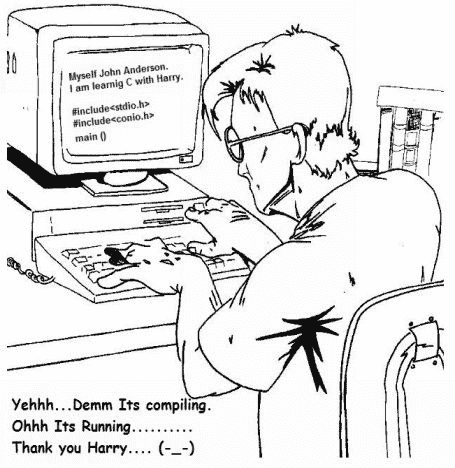

# 第 23 章 – 第二部分

# (使用 C 语言进行实时软件开发)

## 大脑训练笔记

如果你在任何代码中发现任何错误，不要沮丧，尝试调试（修复它们）。用尽你大脑的每一个脉冲，如果我引导你达到了 99%，你至少可以尝试剩下的 1%。


## 作者 VS 学生

### 160. 编写程序打印任何文本文档中找到的电子邮件地址。

```c
#include <stdio.h>
#include <ctype.h>
#include <string.h>

int main(void) {
    char line[1024];
    char address[256];
    char *ptr1 = NULL;
    char *ptr2 = NULL;

    while((fgets(line, 1024, stdin)) != NULL) {
        if(strchr(line, '@') != NULL && strchr(line, '.') != NULL) {
            for(ptr1 = line, ptr2 = address; *ptr1; {
                if(isalpha(*ptr1) || isdigit(*ptr1) || strchr(".-_", ptr1) != NULL)
                    *ptr2++ = *ptr1;
                else {
                    *ptr2 = '\0';
                    if(strlen(address) >= 6 && strchr(address, '@') != NULL && strchr(address, '.') != NULL)
                        printf("%s\n", address);
                    ptr2 = address;
                }
            }
        }
    }
    return 0;
}
```

### 161. 编写程序求解三元线性方程。

```c
#include <stdio.h>
#include <conio.h>
#include <stdlib.h>
main() {
    clrscr();
    float a,b,c,d,l,m,n,k,p,q,r,s,x,y,z,D;
    printf("求解三元线性方程组程序");
    printf("方程形式为：\nx+by+cz=0\nl+my+nz=0\np+qy+rz=0");
    printf("输入系数 a,b,c,d,l,m,n,k,p,q,r,s:");
    scanf("%f%f%f%f%f%f%f%f%f%f",&a,&b,&c,&d,&l,&n,&k,&p,&q,&r,&s);
    printf("你输入的方程是:");
    printf("  %.2f*x + %.2f*y + %.2f*z = 0",a,b,c);
    printf("  %.2f*x + %.2f*y + %.2f*z = 0",l,m,n);
    printf("  %.2f*x + %.2f*y + %.2f*z = 0",p,q,r);
    D = (a*m*r+b*p*n+c*l*q)-(a*n*q+b*l*r+c*m*p);
    x = ((b*r*k+c*m*s+d*n*q)-(b*n*s+c*q*k+d*m*r))/D;
    y = ((a*n*s+c*p*k+d*l*r)-(a*r*k+c*l*s+d*n*p))/D;
    z = ((a*q*k+b*l*s+d*m*p)-(a*m*s+b*p*k+d*l*q))/D;
    printf("上述方程的解为:");
    printf("  x = %5.2f  y = %5.2f  z = %5.2f ",x,y,z);
    getch();
    return 0;
}
```

### 162. 用“C”语言编写程序开发模拟或数字钟。

```c
#include<graphics.h>
#include<conio.h>
#include<math.h>
#include<dos.h>
void main() {
    int gd=DETECT,gm;
    int x=320,y=240,r=200,i,h,m,s,thetamin,thetc;
    struct time t;
    char n[12][3]={"3","2","12","11","10","9","7","6","5","4"};
    initgraph(&gd,&gm,"c:\\tc");
    circle(x,y,r);
    setcolor(4);
    setstyle(4,0,5);
    for(i=0;i<12;i++) {
        if(i!=3)
            outtext(x+(r-14)*cos(M_PI/6*i)-10,y-(r-14)*sin(M_PI/6*i)-26,n[i]);
        else
            outtext(x+(r-14)*cos(M_PI/6*i)-20,y-(r-14)*sin(M_PI/6*i)-26,n[i]);
    }
    gettime(&t);
    printf("当前时间是: %2d:%2d:%0d",t.hour, t.min, t.sec);
    while(!kbhit()) {
        setcolor(5);
        fillstyle(1,5);
        circle(x,y,10);
        floodfill(x,y,5);
        gettime(&t);
        if(t.min!=m) {
            setcolor(0);
            line(x,y,x+(r-60)*cos(thetamin*M_PI/180),y-(r-60)*sin(thetamin*M_PI/180));
            circle(x+(r-80)*cos(thetamin*M_PI/180),y-(r-80)*sin(thetamin*M_PI/180),10);
        }
        line(x,y,x+(r-110)*cos(h/2*M_PI/180),y-(r-110)*sin(h/2*M_PI/180));
        circle(x+(r-130)*cos(h/2*M_PI/180),y-(r-130)*sin(h/2*M_PI/180),10);
        if(t.hour>12) t.hour=t.hour-12;
        if(t.hour<4) h=abs(t.hour-3); else h=15-t.hour;
        m=t.min;
        if(t.min<=15)thetamin=(15-t.min)*6; else thetamin=450-t.min*6;
        if(t.sec<=15)thetsec=(15-t.sec)*6; else thetsec=450-t.sec*6;
        setcolor(4);
        line(x,y,x+(r-110)*cos(m/2*M_PI/180),y-(r-110)*sin(m/2*M_PI/180));
        circle(x+(r-130)*cos(m/2*M_PI/180),y-(r-130)*sin(m/2*M_PI/180),10);
        line(x,y,x+(r-60)*cos(thetamin*M_PI/180),y-(r-60)*sin(thetamin*M_PI/180));
        circle(x+(r-80)*cos(thetamin*M_PI/180),y-(r-80)*sin(thetamin*M_PI/180),10);
        setcolor(15);
        line(x,y,x+(r-70)*cos(thetsec*M_PI/180),y-(r-70)*sin(thetsec*M_PI/180));
        delay(1000);
        setcolor(0);
        line(x,y,x+(r-70)*cos(thetsec*M_PI/180),y-(r-70)*sin(thetsec*M_PI/180));
    }
}
```

### 163. 编写程序打印“C”中找到的 IP 地址。

```c
#include <stdio.h>
#include <regex.h>
#include <locale.h>
#include <string.h>
#include <stdlib.h>
#include <sys/types.h>

#define IPEXPR "([0-9]{1,3})\\.([0-9]{1,3})\\.([0-9]{1,3})\\.([0-9]{1,3})"
int main(void) {
    char line[1024];
    char *address = NULL;
    char delim[] = ",:;/'"+-_()[]*&^%$#@!~/|\\ \t\r\n";
    int retval = 0;
    regex_t re;
    locale(LC_ALL, "");
    if(regcomp(&re, IPEXPR, REG_EXTENDED) != 0) return 1;
    while((fgets(line, 1024, stdin)) != NULL) {
        if(strchr(line, '.') == NULL) continue;
        address = strtok(line, delim);
        while(address != NULL) {
            if(strlen(address) <= 15 && (retval = regexec(&re, address, 0, NULL, 0)) == 0)
                printf("%s\n", address);
            address = strtok(NULL, delim);
        }
    }
    return 0;
}
```

### 164. 编写进度条。

```c
#include<graphics.h>
#include<conio.h>
#include<alloc.h>
#include<dos.h>
void main() {
    int gd,gm;
    initgraph(&gd,&gm,"c:\\tc");
    void *buffer;
    unsigned int size;
    bkcolor(BLUE);
    line(230,330,370,330);
    line(230,350,370,350);
    line(226,335,266,345);
    line(226,335,230,330);
    line(226,345,230,350);
    line(374,335,374,330);
    line(374,345,370,350);
    outxy(75,65,"Loading");
    int x=232,y=336,x1=236,y1=344;
    for(int i=1;i<5;i++) {
        fillstyle(RED);
        bar(x,y,x1,y1);
        x+=2;
        x1+=2;
    }
}
```


## 4. 列表记录

```c
4.List Records 5.Exit"); printf("Enter your choice");

fflush(stdin);
scanf("%c",&choice);
switch(choice)
{
    case'1':
        fseek(fp,0,SEEK_END);
        another='Y';
        while(another=='Y'|| another=='y')
        {
            printf("Enter the first name,last name,age and basic salary : ");
            scanf("%s %d %f",emp.fname,&emp.age,&emp.bsal);
            printf(" Enter joining date,id,last education,subject taken");
            scanf("%s %d %s %s",emp.join_date,&emp.id,emp.last_edu,emp.sub_taken);
            fwrite(&emp,recsize,1,fp);
            printf(" Add another Record (Y/N): ");
            fflush(stdin);
            getchar();
        }
        break;
    case '2':
        another='Y';
        while(another=='Y'|| another=='y')
        {
            printf("Enter the id of the employee to be deleted : ");
            scanf("%d",&id);
            ft=fopen("TEMP.DAT","wb");
            rewind(fp);
            while(fread(&emp,recsize,1,fp)==1)
            {
                if(strcmp(emp.id,id)!=0)
                    fwrite(&emp,recsize,1,ft);
            }
            fclose(fp);
            fclose(ft);
            remove("EMP.DAT");
            rename("TEMP.DAT","EMP.DAT");
            fp=fopen("EMP.DAT","rb+");
            printf("Delete another Record(Y/N): ");
            fflush(stdin);
            another=getchar();
        }
        break;
    case '3':
        another='Y';
        while(another=='Y'|| another=='y')
        {
            printf("Enter name of employee to modify : ");
            scanf("%s",emp.fname);
            rewind(fp);
            while(fread(&emp,recsize,1,fp)==1)
            {
                if(strcmp(emp.id,id)==0)
                {
                    printf("Enter new fname,new lname,age,basic salary,joining_date,subject taken and last education : ");
                    scanf("%s%s%d%f%s%s%s",emp.fname,emp.lname,&emp.age,&emp.bsal,emp.join_da);
                    fseek(fp,-recsize,SEEK_CUR);
                    fwrite(&emp,recsize,1,fp);
                    break;
                }
            }
            printf("Want to Modify another record(Y/N): ");
            fflush(stdin);
            another=getchar();
        }
        break;
    case '4':
        rewind(fp);
        while(fread(&emp,recsize,1,fp)==1) printf("%s %s %d %g",emp.fname,emp.lname,emp.age,emp.bsal,emp.join_date,emp.last_edu,emp.sub_taken);
        break;
    case '5':
        fclose(fp);
        exit();
}
```

## 166. 接收密码的 C 程序

这是一个简单的登录程序。在接收密码时，它会使用 `*` 符号掩盖每个字符，并在用户按下回车键后显示密码。

```c
#include<stdio.h>
#include<conio.h>
char pw[25],ch;
int i;

void main()
{
    clrscr();
    puts("Enter password");
    while(1)
    {
        if(i<0) i=0;
        ch=getch();
        if(ch==13) break; /*13 是回键的 ASCII 值*/
        if(ch==8) /*退格键的 ASCII 值*/
        {
            putch('\b');
            putch(NULL);
            putch('\b');
            i--;
            continue;
        }
        pw[i++]=ch; 
        putch('*'); 
    }
    pw[i]='\0';
    printf("\n\n%s",pw);
    getch();
}
```

### 练习笔记

对于每一个“C”图形化程序，请确保你已经根据你的主板安装了图形驱动程序。否则，将无法运行任何包含图形化程序的程序。

## 167. 开发一个锁定 USB 的程序

```c
#include<stdio.h>
#include<conio.h>
#include<windows.h>
#include<dos.h>

void main()
{
    system("reg add HKEY_LOCAL_MACHINE\\SYSTEM\\CurrentControlSet\\Services\\USBSTOR /v Start /t REG_DWORD /d 4 /f");
    getch();
}
```

## 168. 开发一个解锁 USB 的程序

```c
#include<stdio.h>
#include<conio.h>
#include<windows.h>
#include<dos.h>

void main() 
{
    system("reg add HKEY_LOCAL_MACHINE\\SYSTEM\\CurrentControlSet\\Services\\USBSTOR /v Start /t REG_DWORD /d 3 /f");
    getch();
}
```

感谢阅读，请回来查看更多书籍。

不要忘记写评价 || 评论。向你的朋友介绍这本终极书籍。

读完这本书之后——计划学习 C++ 吗？如果是的话，请尝试“C++ Professional”平装版，可在 Amazon.com 购买，价格为 10 美元。你也可以可以在亚马逊商店按作者姓名搜索书籍。

