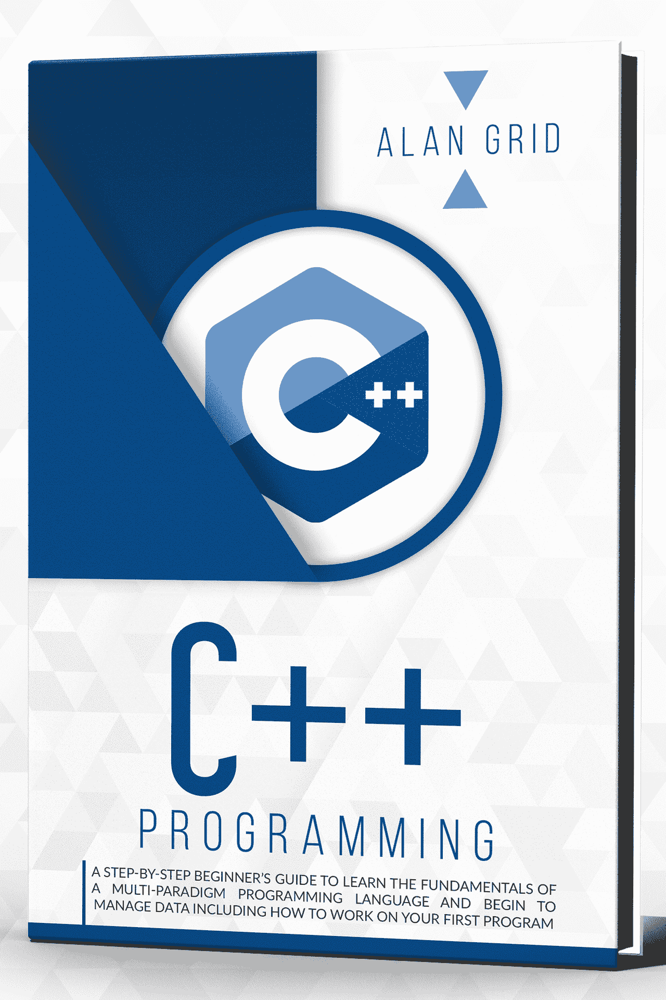
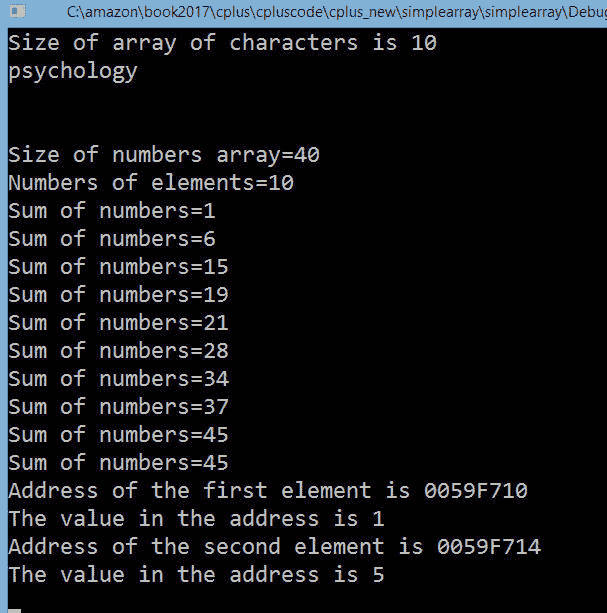
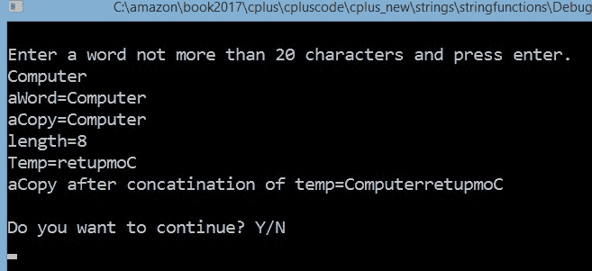
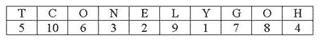
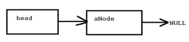
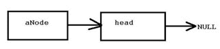
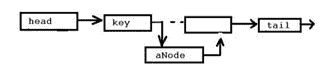

# C++ 编程：学习多范式编程语言基础并开始数据管理的初学者指南：第一个程序（计算机科学系列 3）





可能有很多不同的编程语言，当我们谈论容易上手的编程语言时，C++ 通常不会出现在名单上。我们可能会发现使用这种语言有许多优势，但与其他一些语言相比，它通常被认为更难上手。正如我们在本指南中将要探索的那样，你会发现这实际上是一种非常棒的语言。它将为我们提供所需的一些最佳技巧和方法，并向我们展示如何实际编写所需的各种代码。如果你正在寻找一种强大的、可以帮助 Web 应用、游戏等领域的编程语言，并且想学习如何使用它，那么本指南就是为你准备的。在内部，我们将学习关于 `C++` 编程所需的所有知识。我们将从使用这种语言的一些基础知识开始，例如这种语言的本质，以及它与许多其他语言相比的优点。一旦我们掌握了 `C++` 语言的基础，你就可以开始探索其他我们需要了解的内容。我们将深入研究语法和该语言的基础知识。它与其他一些编程语言略有不同，因此学习如何实现这些并进行操作至关重要。我们还将探索一些流行的且与 `C++` 良好配合的不同库，这些库可以扩展我们看到的功能。到此时，我们已经掌握了 `C++` 编程的基础，并对这种语言整体有了更多了解。现在是时候真正进入关于如何编写我们想要的代码的信息了。有许多不同类型的代码我们可以关注，也有许多我们可以操作的领域，我们将查看与它们相关的代码以及更多内容。我们将通过介绍如何进行这种语言所需的简单调试来结束本指南。有时，特别是作为这种语言的初学者，代码并不一定能按照你喜欢的方式运行，或者会有你需要修复的错误。这对于初学者来说可能是困难的，因为他们想要处理这些代码并让程序运行，但他们可能感到不确定。

许多初学者将 `C++` 分类为一种复杂的编程语言。无论原因如何，`C++` 并不是复杂的语言，而是一种为初学者提供了良好资源的计算机语言。这是因为这种编程语言在过去的几十年是从另一种主要的编程语言（C 语言）演变而来的。`C++` 是 `C` 语言的衍生语言，增加了继承和多态等面向对象的原则。`C++` 是 `C` 的子集，并演变成了一个比预期大得实例。

在早期，`C++` 仅被用作 `C` 的一种分支语言，并且在没有直接编译器的情况下，在编译之前会被转换回 `C`。一个名为 `Cfront` 的编译器因执行这项工作而闻名。然而，几年后，使用 `C++` 的人们发现没有实际编译器的语言中编写代码太困难了。因此某些开发者开始开发编译器，这项任务最终由 `Bjarne Stroustrup` 通过研究 `C++` 完成。通过在几年内实现严格的语法结构，`C++` 在 1998 年被 `ISO`（国际标准组织）认可。第一个更新版本在同年发布，人们对 `C++` 开始提供的新附加功能感到惊讶。它开始使用高级技术来缩短编译时间，并在第一个版本中引入了模板（templates）。所有强健的新功能帮助 `C++` 开发了支持系统编程的复杂软件。在几年内，`C++` 有了巨大的进步，并包含了许多可以用于创建通用应用程序的高级功能。非常感谢微软让 `C++` 作为一种编程语言突然兴起。微软开始使用 `C++` 开发其软件 Visual C++。许多为微软系统开发应用程序的程序员开始发现使用 `C++` 是多么可靠和舒适。到 2009 年，`C++` 标准库已经更新了各种复杂的系统、数学和时间函数。

`C++` 的成功主要归功于它的面向对象特性。在 20 世纪 80 年代初，面向对象的编程范式席卷了科技世界。人们对其提供的适应性和简单性留下了深刻印象。当时的许多内置库可以很容易转换为 `C++` 功能库。所有这些因素的结合帮助 `C++` 成为这十年最流行的高级编程语言之一。估计到 2025 年，15% 的机器人应用将使用 `C++` 作为开发其资源的主要语言。

所有用于创建 `C++` 软件的软件都由代码编辑器和一个用于显示可能错误的内置调试器组成。如果你是一个老派的人，你可以简单地使用文本编辑器并使用命令行环境运行程序。它仍然运行得很好。但对于本节，我们将讨论用于创建 `C++` 程序的的高级集成开发环境软件。

`IDE` 使用编辑程序、编译器链机制和调试的结合来创建高效的程序。
注意：记住，如果你尝试在命令行中执行程序，`C++` 不提供解释器。

较新版本的 `C++` 是为了支持试图实现复杂现实世界项目的开发者而开发的。以下是 `C++` 提供的一些著名的高级特性。

简单的数据结构，如树（Trees）和链表（Linked lists），可以通过基础 `C++` 版本轻松实现。然而，使用旧版本无法实现图和二叉树等高级数据结构。相反，较新的 `C++` 版本提供了帮助我们的标准库。

较新版本的 `C++` 为安全提供了高级加密特性。

较新版本的 `C++` 支持用于函数式编程的 Lambda 实现。

较新版本的 `C++` 包含了高级对象特性。

## C++ 编译器
（见上文）
## 基础语法
（见上文）
## C++ 数据类型
## C++ 函数
## 类型修饰符
## 数组
## 字符串
## 字符串函数
## 列表
图 链表
## 实现二叉树
插入
## 那么什么是继承？
## 指针
使用指针
指针算术
函数指针
## 存储分类
## 自动变量
静态变量
寄存器变量
外部变量
递归
## 容器
容器迭代器
STL 迭代器
I/O 基础知识
输入
输入基础知识
输入模式
其他流
文件
缓冲区和字符串缓冲区
操纵流
内存管理
C++ 程序可用内存
手动内存管理
资源管理
结论


这些是你语言的组织工具。它们可以被看作是存放或存储对象的盒子，并对相似的对象进行分类。你可以为类命名任何你喜欢的，但将以某种方式具有相似特征的对象放在同一个类中是一个良好的编码习惯。

对象是你代码中具有状态和行为的实体。这些可以是颜色、纹理、形状等东西。你通常会将这些对象分类到具有相似对象的类中。因此，如果你有一个关于狗的类，你可以将不同类型的狗放在同一个类中。

这是编码中用于描述行为的术语。你可以根据需要使用任意数量的方法。这就是你操作数据的方式，并且操作将根据你正在处理或使用的方法执行。如果不使用正确的方法，你的程序将不知道确切应该做什么。

这些指的是你正在处理的个体。每个对象都使用一组唯一的变量进行分类，这些变量就像指纹一样用于识别你的对象。你可以在创建对象时使用某些值为对象分配正确的变量。这就是在 C++ 中编写代码的基础。你应该花些时间在编译器中写出上面的代码，通过练习来理解你在这里应该做什么。我们稍后会查看这些代码可以进行的一些事情，但这是一个很好的开始点。

就像你在在此过程中可能想要使用的其他编码语言一样，在 C++ 代码中也会出现很多数据点。你通常会经常处理变量，例如，变量只是你在计算机内存中预留的区域，以确保代码的不同部分保持安全。在处理 C++ 语言时，我们有很多可以关注的数据点，这些包括：

1. 布尔 (Boolean)
2. 双精度浮点 (Double floating point)
3. 浮点 (Floating point)
4. 整数 (Integer)
5. 字符 (Character)
6. 空值 (Valueless)
7. 宽字符 (Wide character)

## C++ 函数
我们还需要看看在使用 C++ 语言时会遇到的一些函数。函数非常简单，它只是为了执行任务而的一组顺序语句。你在 C++ 中编写的每个程序至少都会有一个函数，被称为 `main()` 函数，但你可能需要添加更多函数以便使其代码按照我们想要的方式运行。你可以通过多种不同的方式实现这一点。首先，我们可以选择根据我们希望运行的方式将代码拆分成几个函数。你决定如何拆分代码以及使用多少个函数取决于你以及你试图在代码中编写的内容。但大多数程序员会以这种方式拆分，使每个函数都能独立完成自己的任务。

函数声明将告诉编译器函数名、随之来的参数以及我们将看到的返回类型。但请记住，我们看到的函数定义将位于函数的实际体中。我们在 C++ 库中看到的标准库将为我们提供许多已经内置在程序中的函数，我们也可以随时根据需要调用它们。例如，如果我们正在使用 `strcat()` 函数，它可以帮助我们连接两个字符串。然后我们可以使用 `memcpy()` 来帮助我们将内存的某一个位置的内容复制到另一个位置。这些只是你能够使用的不同类型的函数，你会发现每一个它们的工作方式都是相似的。

考虑到这一点，我们需要更进一步，实际上看看我们如何在 C++ 中应用函数。你将能够用于定义泛的代码将包括：

```
返回类型 函数名 (参数列表) {函数体}
```

这些函数定义将由函数头和函数体组成。函数的各个部分包括以下内容：

- **返回类型 (Return type)**：你正在处理的函数可能会返回一个值，你将使用返回类型的值来在这里返回某些内容。某些函数可以执行你的操作而不向你返回值。使用我们上面使用的语法，你最终将得到 `void` 的答案。
- **函数名 (Function name)**：这是你给函数起的名字。当你把函数名和参数放在一起时，你就得到了所谓的“函数签名”。
- **参数 (Parameters)**：参数是一个占位符。当你调用函数时，你是将一个值传递给参数。这个值将被称为实际参数或参数。参数列表将能够引用参数的数量、顺序和类型。编写一个完全没有参数的函数也是可能的。
- **函数体 (Function body)**：最后，函数体将包含一组能够定义函数作用的语句。

很多时候，我们将使用函数来帮助完成代码的某些部分，并确保所有内容都准备就绪。请确保练习这些函数，看看它们是如何满足我们的需求的。

## 修饰符类型 (Types of Modifiers)
每当你要在 C++ 中执行某些代码时，你会发现可以使用 `char`、`double` 和 `int`，以便让其前面的修饰符生效。我们在这里讨论的修饰符将帮助我们改变该基本类型的含义，使其适应我们试图创建的任何程序或情况。我们可以处理的数据有很多类型的修饰符。这些包括 `signed`（有符号）、`unsigned`（无符号）、`long`（长）和 `short`（短）。

这四种修饰符适用于任何整数基本类型。你可以使用 `signed` 和 `unsigned` 来处理 `char`，然后 `long` 可以用于 `double`（例如）。C++ 还将让我们更方便地使用缩写表示法来处理这些整数。这意味着你可以直接使用这些单词，而不需要添加 `int` 部分，因为这在编码中是隐含的。

我们还有不同类型的限定符（qualifiers）来让你的 C++ 代码正常工作。以下是你可以使用的一些限定符类型，用于为其先前的变量提供一些额外信息：

- **常量 (Const)**：具有 `const` 的对象在程序执行期间无法被更改。
- **易变 (Volatile)**：易变性修饰符会告诉编译器你可以更改值，但这些更改可能不是由程序显式指定的。


Restrict：被 `restricting` 限定的指针在初始状态下是访问其指向的对象的唯一手段。


数组是一种存储相同数据类型元素顺序集合的数据结构。例如，在下面的代码中，我声明了两个不同数据类型的数组：一个字符数组和一个整数数组：

```cpp
#include "stdafx.h"
#include <iostream>
int main(int argc, char* argv[]){
    int i;
    int length;
    int sum = 0;
    char char_array[10] = { 'p', 's', 'y', 'c', 'h', 'o', 'l', 'o', 'g', 'y' };
    // 为该数组分配的字节总数
    // 一个 char 是一个字节：元素个数 = 字节数
    length = sizeof(char_array);
    std::cout << "Size of array of characters is " << length << std::endl;
    for (i = 0; i<length; i++)
    std::cout << char_array[i];
    std::cout << '\n';
    std::cout << '\n';
    std::cout << '\n';
    int numbers[10] = { 1, 5, 9, 4, 2, 7, 6, 3, 8, 0 };
    // 为该数组分配的字节总数。
    length = sizeof(numbers);
    std::cout << "Size of numbers array=" << length << std::endl;
    // 为数组分配的字节总数/每个元素分配的字节数
    length = sizeof(numbers) / sizeof(numbers[0]);
    std::cout << "Numbers of elements=" << length << std::endl;
    for (i = 0; i<length; i++){
        sum = sum + numbers[i];
        std::cout << "Sum of numbers=" << sum << std::endl;
    }
    int *p = numbers;
    std::cout << "Address of the first element is " << p << std::endl;
    std::cout << "The value in the address is " << *p << std::endl;
    p++; //将指针移动到下一个元素
    std::cout << "Address of the second element is " << p << std::endl;
    std::cout << "The value in the address is " << *p << std::endl;
    int hold = 1;
    std::cin >> hold;
    return 0;
}
```

`sizeof` 函数返回为数组分配的字节数。由于 `char` 数据类型占用 1 个字节，`sizeof` 函数返回的字节数等于 `char` 数组的元素个数。

整数数据类型在内存中占用 4 个字节，一个包含 10 个整数的数组存储在 40 个字节中。因此，`sizeof` 数组函数对于包含 10 个元素的整数数组会返回 40 字节。

要计算数组中存储了多少个元素，我们可以将整个数组分配的字节数除以数组中单个元素分配的字节数：
`length=sizeof(numbers) / sizeof(numbers[0]);`
`40 / 4 = 10`

要访问单个元素的值，必须使用数组索引。C++ 中的数组索引从 0 开始。第一个元素的索引是 0，第二个元素的索引是 1，依此类推。

要访问数组的所有元素，必须使用 `for` 循环：
`for(i=0; i<length; i++)cout<<char_array[i];`

如果我们声明一个指针并将数组赋值给该指针，该指针将持有数组第一个元素的地址：
`int *p =numbers;`
`cout<<"Address of the first element is "<<p<<endl;`
该行代码的输出是：`Address of the first element is 0059F710`

要使用指针访问数组第一个元素地址中存储的值，请运行以下代码：
`cout<<"The value in the address is "<<*p<<endl;`
代码的输出是：`The value in the address is 1.`

要移动到数组的下一个元素，必须增加 `p` 值：
`p++;`
现在它将指向数组的第二个元素：
`cout<<"Address of the second element is " <<p<<endl;`
`cout<<"The value in the address is"<<*p<<endl;`
输出是：`The address of the second element of the numbers array on my PC is 0059F714. The value in the address of the second element is 5.`


图 数组程序的输出。

字符串函数我将向你展示如何使用一些字符串函数：
- `strcpy_s()` - 将字符串的内容复制到另一个字符串。
- `strcat_s()` - 将源字符串的副本添加到目标字符串。
- `strlen()` - 返回字符串的长度。

我们的应用程序将从用户输入读取字符串，将其复制到另一个字符串，然后按反序将原始字符串字符复制到临时字符串中，并将副本和反转后的副本合并成一个字符串。例如，如果用户输入字符串‘Concatenation’，则应用程序将输出‘ConcatenationnoetacC’。

`main.cpp` 文件必须包含以下头文件：
```cpp
#include "stdafx.h"
#include <stdio.h>
#include <cctype>
#include <iostream>
#include <cstring>
```
`<cstring>` 头文件用于字符串函数：`strcpy_s()`、`strcat_s()` 和 `strlen()`。`cctype` 头文件用于 `toupper()` 函数。

我想解释我是如何反序将字符从原始字符串复制到临时字符串的。首先，使用 `strlen()` 函数获取原始字符串的长度：`length=strlen(aWord);`。

然后在循环中，我将原始字符串的最后一个字符复制到第一个位置，依此类推：
`for(i=0; i <length; i++)temp[i]=aWord[length-(i+1)];`
如果用户输入单词‘Concatenation’，长度为 13。字符串第一个字符的索引是 0，最后一个字符的索引是 12。这意味着最后一个字符是 `length - 1`。

当 `i = 0` 时，`temp[i]` 指向临时字符串的第一个字符。同时（当 `i =0` 时）`aWord[length-(0 + 1)]` 指向最后一个字符。当 `i=1` 时，`temp[1]` 指向临时字符串的第二个字符，而 `aWord[length-(1+1)]` 指向倒数第二个字符。通过这种方式，我们可以顺序复制所有字符。当我们把所有字符从原始字符串复制到临时字符串后，我们需要在临时字符串末尾添加空字符，因为 C++ 字符串必须以 null 结尾。`temp[length]='\0';` 这行代码将完成工作。整个代码包含在 `visual_studio_2017.zip` 中。

```cpp
#include "stdafx.h" 
#include <stdio.h>
#include <cctype>
#include <iostream>
int main(){
    char more = 'Y';
    char prompt1[] = "\nEnter a word not than 20 characters and press enter.\n";
    char prompt3[] = "\nDo you want to continue? Y/N\n";
    char aWord[20];
    char aCopy[40];
    int length = 0;
    char temp[20];
    int i;
    while (toupper(more) == 'Y'){
        std::cout << prompt1;
        std::cin >> aWord;
        std::cout << "aWord=" << aWord << std::endl;
        strcpy_s(aCopy, aWord);
        std::cout << "aCopy=" << aCopy << std::endl;
        length = strlen(aWord);
        std::cout << "length=" << length << std::endl;
        //反序填充 temp[] 数组
        for (i = 0; i <length; i++)
            temp[i] = aWord[length - (i + 1)];
        temp[length] = '\0';
        std::cout << "Temp=" << temp << std::endl;
        strcat_s(aCopy, temp);
        std::cout << "aCopy after concatenation of temp=" << aCopy << std::endl;
        std::cout << prompt3;
        std::cin >> more;
    }
    return 0;
}
```
输出：

图 字符串操作。

## 列表
让我们想象一个谜。有一排盒子。每个盒子包含一个字母卡片。你需要找出字母的顺序，使字母组成一个单词。


图 链表

在上面的表中，你可以看到每个盒子都有一个数字。你可能猜这些数字是谜题的关键。第一个盒子内部有一个字母 T，正面是数字 5。取出字母 T 卡片并将其放在旁边。数字 5 可能指向下一个字母。数盒子。第五个盒子有字母‘E’。取出字母 E 卡片并放在 T 旁边。你会得到“TE”。字母 E 的盒子侧面有数字 2。所以，从第 2 个盒子取出卡片并放在“TE” 旁边。你会得到“TEC”。字母 C 的盒子数字是 10，所以从第 10 个盒子取出卡片。你会得到“TECH”。字母 H 的盒子数字是 4，所以从第 4 个盒子取出卡片。你得到了“TECHN”。继续跟随数字，你将得到整个单词：TECHNOLOGY。这就是链表的工作原理。它由节点组成。每个节点至少有一个变量存储数据（文本、数字或对象）以及一个变量（指针）存储下一个节点的地址。这个系统像你在谜题中做的那样遍历节点列表。最后一个节点的指针具有空值，或者它可能指向第一个节点。这时我们就有了闭链表。

### 添加节点
如果你想在链表的末尾添加一个新节点，必须创建一个新节点。然后将最后一个节点的指针指向新节点的地址，并将新节点指针赋值为空值。


图 在链表末尾添加节点。

如果你想在链表的开头添加一个新节点，必须创建一个新节点。将新节点的指针指向第一个节点，就完成了。


图 在链表的头部添加节点。

如果你需要在链表的中间添加一个节点，必须创建一个新节点，然后打破链条：重定向节点（断开之前的节点）指向新节点，并将新节点的指针指向下一个节点（断开之后的节点）。


图 在链表中间添加节点。

### 删除节点

二叉树是所有基础数据结构中最实用的之一，而且到目前为止是最有趣的。它们是如何使用递归和指针来实现非常有用事情的完美示例。


*   你正在开发一款 MMORPG 游戏，玩家需要快速登录——这涉及到快速查找玩家信息。
*   你正在开发一款处理信用卡的软件，每小时需要处理数百万笔交易——需要非常快速找到信用卡余额。
*   你正在使用低功耗设备（如平板电脑或智能手机）向用户展示通讯录。你不希望用户因为你的数据结构太慢而导致一直卡顿。


本节将讨论克服这些问题及更多问题所需的工具。解决方案的思路是能够在像链表这样的结构中存储元素，使用指针来帮助组织内存，但方法比链表更简单。这要求内存具有比简单列表更复杂的结构。那么，数据结构意味着什么呢？当我们开始这段旅程时，我们只有数组，但这些数组从未真正让我们能够使用顺序列表以外的数据结构。链表使用指针来增量地扩展顺序列表，但没有利用指针的灵活性来构建更复杂的结构。内存中这些更复杂的结构是什么？在任何给定时刻持有比单个“下一个节点”更多节点的结构就是一个很好的例子。但你为什么想要这样做呢？很简单。如果你有两个“下一个节点”，其中一个可以用来表示当前元素之外的元素。这被称为**二叉树**。之所以这样命名，是因为每个节点都有一或两个分支。每个下一个节点都是子节点，而连接到子节点的节点就是父节点。二叉树可能像这样：

```
106 145 8 11 18
```

在树中，每个元素的左子节点小于该元素，而右子节点大于该元素。`10` 是整棵树的父节点，而 `6` 和 `14` 的子节点都是各自小树的父节点，这些小树被称为子树。二叉树有一个非常重要的属性：每个子节点都是一整棵树。结合左子节点小、右子节点大的规则，你就有了一种简单的方法来定义在树中定位特定节点的算法。

首先，查看当前节点的值。如果它等于搜索目标，则完成。如果它大于搜索目标，则向左走；否则，向右走。这之所以有效，是因为树左侧的每个节点都小于当前节点的值，右侧的每个节点都更大。在理想的世界里，你的二叉树是平衡的，两边的节点数量完全相同。在这种情况下，每个子树大约各占整棵树的 50%，当你在树中搜索一个值时，每次到达子节点时都可以排除 50% 的结果。所以，如果你有一棵拥有 1000 个元素的树，500 个将立即被排除。再次搜索这棵树（现在它只有 50 个元素了），你可以再次削减大约 50%。这样找到你想要的值就不需要很长时间。

那么，在得到一个元素之前，树必须被划分多少次？答案是 `log2n`（`n` 是树拥有的元素数量）。即使你的树很大，这个值也很小——假设你的树有 320 亿个元素，该值也只有 `32`；这比搜索包含 40 亿元素的链表快了近 1 亿倍，而在后者中每一个元素都必须经过评估。

如果树不是平衡的，你就无法排除大约一半的元素；最坏的情况下，每个节点只有一个子节点，这使得树无非带有几个额外指针的链表，因此需要你搜索所有元素。所以，当树大致平衡时，搜索节点比在链表上相同的搜索要快且容易得多。这是因为你可以按照你想要的方式组织内存。

## 实现二叉树

要实现二叉树，从声明节点结构开始：

```cpp
Struct node{
    int key_value;
    node *p_left;
    node *p_right;
};
```

节点可以作为简单的整数 `key_value` 存储值，并有两个子树——`p_left` 和 `p_right`。你的二叉树上需要一些常用函数：插入、搜索、删除和销毁：

```cpp
node* insert (node* p_tree, int key);
node *search (node* p_tree, int key);
void destroyTree (node* p_tree);
node *remove (node* p_tree, int key);
```

#### 插入

我们将使用递归算法将其插入树中。递归对于树来说是极的，因为每个树都有两个小树；这使得整棵树在本质上是递归的。该函数接收一个键和一个已经存在的树（即使是空树），并返回一个包含插入值的新树。

```cpp
node* insert (node *p_tree, int key) {
    // 基础情况——我们到达了一棵空树，我们的新节点
    // 需要插入在这里
    if ( p_tree == NULL ) {
        node* p_new_tree = new node;
        p_new_tree->p_left = NULL;
        p_new_tree->p_right = NULL;
        p_new_tree->key_value = key;
        return p_new_tree;
    }
    // 决定——根据节点的值
    // 插入到左子树还是右子树
    if( key < p_tree->key_value ) {
        // 从 p_tree->left 构建一个新树，并添加键
        // 将现有的 p_tree->left 指针替换为指向
        // 新树的指针。设置 p_tree->p_left 指针
        // 以防 p_tree->left 为空。（如果它不为空，
        // p_tree->p_left 不会改变，但我们设置它
        // 是为了万防一失。）
        p_tree->p_left = insert( p_tree->p_left, key );
    } else {
        // 插入
        p_tree->p_right = insert( p_tree->p_right, key );
    }
    return p_tree;
}
```


* 我们定义了一个名为 `Student` 的类，它包含 2 个成员，一个是 `studentID`，另一个是 `studentName`。
* 然后我们定义了一个名为 `Display()` 的成员函数，它向控制台输出 `studentID` 和 `studentName`。
* 之后我们可以在主程序中通过对象调用该成员函数。
通过此程序，输出如下：
Student ID 1
Student Name John


继承是一个概念，其中我们可以定义一个类来继承另一个类的属性和方法。这有助于避免重复定义该类，或避免重复定义已经定义过的属性和方法。假设我们有一个名为 `Person` 的类，它有一个属性 `Name` 和 一个方法 `Display`。然后通过继承，我们可以定义一个名为 `Student` 的类，它可以继承 `Person` 类。`Student` 类将自动获得 ID 成员和 `Display` 函数。如果需要，`Student` 类还可以再定义它自己的额外成员。

要定义一个被继承类，我们使用以下语法。

`派生类:基类`

在这里，`派生类` 是继承另一个类（即`基类`）属性的类。

所以，如果我们有一个如下所示的带有属性和函数的基类。

`基类`
`{公共或保护:属性 1;}`

那么当我们从基类定义派生类时，该派生类将能够访问该属性。请注意，该属性和函数的访问修饰符需要为 `public` 或 `protected`。我们稍后会详细介绍访问修饰符。

`派生类: 基类`
`{// 不需要定义属性 1，它将自动继承这些。}`

现在让我们来看一个通过代码实现继承的简单示例。

```cpp
#include <iostream>
using namespace std;
// 定义一个具有 Name 属性的简单 Person 类
class Person{
public:
string Name;
};
// 这里我们有一个派生类。它定义了另一个属性 ID
class Student:public Person{
public:intint ID;
// 显示同时 ID 和 Name 的函数。由于 Name 可以从 Person 基类中获取，因此我们可以在这里访问它。
void Display(){cout<<"Student ID "<<ID<<endl;cout<<"Student Name "<<Name;}}
};
int main () {
Student stud1;
stud1.ID=1;
stud1.Name="John";
stud1.Display();
return 0;
}
```

通过上述程序：
* 我们定义了一个名为 `Person` 的类，它包含一个名为 `Name` 的成员。
* 然后我们使用继承来定义 `Student` 类。注意我们现在定义了另一个名为 `ID` 的属性。
* 在 `Display` 函数中，请注意我们可以直接使用 `Name` 属性，而不需要在 `Student` 类中再次定义它。

通过此程序，输出如下：
Student ID 1
Student Name John

现在我们已经看到了如何使用派生类和基类，这也被称为继承。


我们也可以定义可以从基类继承的函数。让我们看看如何实现这一目标。
例如，如果我们有一个如下所示的带有属性和函数的基类。

`基类`
`{公共或保护:属性 1;Fucntion1;}`

当我们从基类定义派生类时，该派生类也将能够访问该属性和函数。请注意，该属性和函数的访问修饰符需要为 `public` 或 `protected`。

`派生类: 基类`
`{// 不需要定义属性 1 和 Function1，它将自动继承这些。}`

现在让我们来看一个在派生类中使用函数的示例。
**示例 3**：以下程序用于展示如何使用带有函数的继承类。

```cpp
#include <iostream>
using namespace std;
// 定义一个具有 Name、ID 属性以及名为 Display 的函数的简单 Person 类。
class Person{
public:
string Name;
void Display(){cout<<"ID "<<ID<<endl;cout<<"Name "<<Name;}}
};
// Student 类简单地派生自 Person 基类
class Student:public Person {};
int main () {
// 既然派生类可以访问基类的属性和函数，那么就可以可以通过 Student 对象访问这些内容
Student stud1;
stud1.ID=1;
stud1.Name="John";
stud1.Display();
return 0;
}
```

通过此程序，输出如下：
ID 1
Name John

**示例 4**：以下程序展示了如何使用带有重定义函数的继承类。

```cpp
#include <iostream>
using namespace std;
class Person{
public:
string Name;
int ID;
void Display(){cout<<"ID "<<ID<<endl;cout<<"Name "<<Name;}};
};
class Student:public Person {
public:
// 这里我们正在重定义 Display 函数
void Display(){cout<<"Student ID "<<ID<<endl;cout<<"Student Name "<<Name;}};
};
int main () {
Student stud1;
stud1.ID=1;
stud1.Name="John";
stud1.Display();
return 0;
}
```

通过此程序，输出如下：
Student ID 1
Student Name


我们还可以让派生类继承多个基类。这有助于一次性获取多个类的功能。

`派生类: 基类 1, 基类 2... 基类 N`

在这里你只需要用逗号分隔基类。
假设我们有一个如下所示的带有属性和函数的基类。

`基类 1`
`{公共或保护:属性 1;函数 1;}`
以及另一个如下所示的基类。

`基类 2`
`{公共或保护:属性 2;函数 2;}`

那么当我们从这两个基类中定义派生类时，该派生类将能够访问这些类的属性和函数。

再次注意，属性和函数的访问修饰符需要为 `public` 或 `protected`。让我们来看一个多派生类的示例。
**示例 5**：以下程序用于展示如何使用多派生类。
```cpp
#include <iostream>
using namespace std;
// 定义第一个基类 Person
class Person{
public:
string Name;
int ID;
void Display(){cout<<"ID "<<ID<<endl;cout<<"Name "<<Name;}}
};
// 定义第二个基类 Marks
class Marks{
public:int marks1,marks2;
void Sum(){cout<<marks1+marks2;}}
};
// 派生类继承自 Person 和 Marks 基类
class Student:public Person,public Marks {
public:
void Display(){cout<<"Student ID "<<ID<<endl;cout<<"Student Name "<<Name<<endl;}};
};
int main () {
Student stud1;
stud1.ID=1;
stud1.Name="John";
stud1.Display();
stud1.marks1=5;
stud1.marks2=10;
stud1.Sum();
return 0;
}
```

通过上述程序：
* 我们定义了两个基类，一个名为 `Person`，另一个名为 `Marks`。
* 派生类 `Student` 继承了这两个类，并能够使用这两个类的成员。

通过此程序，输出如下：
Student ID 1
Student Name John
15


类修饰符可以定义类中属性和方法的可见性。以下是可用的各种修饰符。

* `private`（私有）：对于 `private`，属性和方法仅对类本身可用。
* `protected`（保护）：对于 `protected`，属性和方法仅对类本身以及从该类类的子类可用。
* `public`（公共）：对于 `public`，属性和方法对所有类可用。


假设我们有如下的类结构。

```cpp
Class classname{
Private:
Property1;
Fucntion1;
}
```
`property1` 和 `function1` 在定义它们的类之外，在任何地方都无法被访问。如果你尝试从主程序访问这些属性或函数的任何一个，将得到编译时错误。

现在让我们定义下面的类，但这次我们将改使用 `protected`（保护）访问修饰符。

```cpp
Class classname1{
Protected:
Property1;
Fucntion1;
}
```
现在，`property1` 和 `function1` 可以在上述类以及任何派生自该类的类中被访问。因此，如果我们有下面的派生类定义，我们就可以在派生类中访问 `property1` 和 `fucntion1`。但请注意，我们无法在任何其他非派生类中使用这些属性。

```cpp
Class derivedclassname: classname1{}
```

让我们来看另一个关于访问修饰符的例子。
### 示例 6：以下程序用于演示如何使用访问修饰符。

```cpp
#include <iostream>
using namespace std;
class Person{
public:
int ID;
protected:
// 注意我们我们将 Name 属性定义为 protected
string Name;
void Display(){
    cout<<"ID "<<ID<<endl;
    cout<<"Name "<<Name;
}
// 注意我们将 city 属性定义为 private
private:
string city;
};
class Student:public Person {
public:
void Display(){
    cout<<"Student ID "<<ID<<endl;
    cout<<"Student Name "<<Name<<endl;
}
}};
int main () {
    Student stud1;
    stud1.ID=1;
    stud1.Name="John";
    stud1.Display();
    return 0;
}
```
`error: 'std::__cxx11::string Person::Name' is protected`

为什么我们会得到这个错误？`person` 类有两个属性，分别为 `ID` 和 `Name`。`name` 具有 `protected` 访问修饰符，这意味着它只能在派生类中被访问。但我们正尝试在主类中访问它，这是错误的。因此，实现此点的正确方法如下。


```cpp
#include <iostream>
using namespace std;
class Person{
public:
int ID;
protected:
string Name;
    cout<<"ID "<<ID<<endl;
    cout<<"Name "<<Name;
}
private:
string city;
};
class Student:public Person {
public:
// 我们现在定义了一个函数，可以相应地设置 protected 属性的值。
void InputName(string pName){
    Name=pName;
}
void Display(){
    cout<<"Student ID "<<ID<<endl;
    cout<<"Student Name "<<Name<<endl;
}
}};
int main () {
    Student stud1;
    stud1.ID=1;
    stud1.InputName("John");
    stud1.Display();
    return 0;
}
```

在上面的程序中，我们现在 `Student` 类中正确地定义了一个名为 `InputName` 的方法，它可以访问受保护的 `Name` 成员。运行此程序，输出如下：
`Student ID 1`
`Student Name John`

现在让我们来看同一个例子，并尝试显示在 `Person` 类中定义的 `City` 属性。

### 示例 8：以下程序展示了错误使用访问修饰符的第二个例子。
```cpp
#include <iostream>
using namespace std;
class Person{
public:
int ID;
protected:
string Name;
    cout<<"ID "<<ID<<endl;
    cout<<"Name "<<Name;
}
private:
string city;
};
class Student:public Person {
public:
void InputName(string pName){
    Name=pName;
}
void Display(){
    cout<<"Student ID "<<ID<<endl;
    // 注意我们正尝试在派生类中使用 private 属性。
    cout<<"Student city "<<city<<endl;
    cout<<"Student Name "<<Name<<endl;
}
}};
int main () {
    Student stud1;
    stud1.ID=1;
    stud1.InputName("John");
    stud1.Display();
    return 0;
}
```

运行此程序，输出如下：
`error: 'std::__cxx11::string Person::city' is private`

由于 `City` 属性是 `private` 的，它甚至无法在派生类中运行。我们只能在 `Person` 类中处理此属性。


之前提到过指针，它们是变量的内存地址，这就像人的家庭地址一样。这些可以作为参数传递，并允许之前提到的按引用传递的效果。

下面的程序将显示变量的地址：

```cpp
#include <stdio.h>
int main(){
    int var;
    printf("The address is: %x\n", &var);
    return 0;
}
```
输出：`> The address is: 10ffa2c`

注意：这几乎每次运行结果都会不同。注意高亮显示的语句，`&`（引用运算符）用于返回变量的内存位置，并允许某些语句访问该位置的数据。使用 `%x` 是因为内存位置是十六进制的。

要创建指针，我们使用解引用运算符 `*`，这将创建一个专门用于存储内存地址的指针变量。下面的程序创建了一个指针并使用引用运算符 `&` 将另一个普通变量的地址存储在新创建的指针中。解引用运算符 `*` 也用于访问或更改该内存位置中的实际数据。


```c
//Regular variable
int var = 10;
//Pointer
int* pointer;
//Storing of var memory location
pointer = &var;
//Pointer is now effecivly 'var' so
//things like this can happen
pointer = 20;
printf("Var's value is now: %d", var);
```
Output: `>Var's value is now: 20`

### 空指针
当你创建一个指针时，它最初可能没有被赋予任何指向的内容，这是危险的，因为指针在创建时引用的是随机内存，更改该内存位置中的数据可能会导致程序崩溃。为了防止这种情况，当我们创建指针时，会将其赋值为 `NULL`，如下所示：

```c
int* pointer = NULL;
```
这意味着指针的地址为‘0’，这是一个用于识别空指针的预留内存位置。可以通过 `if` 语句检查空指针：

```c
if (pointer){}
```
如果指针不为空，则判断将成功。

现在，指针的一些真实世界用途是将它们作为参数传递，并有效地实现了按引用传递。下面的示例将展示其效果：

```c
void Change_Value(int* reference){
//修改内存位置中的值
*reference = 20;
}
int main(){
//创建变量的指针
int var = 10;
int* pointer = &var;
printf("The value before call: %d\n", var);
//调用方法
Change_Value(pointer);
//打印新值
printf("The value after call: %d\n", var);
return 0;
}
```
Output:
`>The value before call: 10`
`>The value after call: 20`

这传递的是内存地址而不是变量的值，意味着你拥有一个可以进行更改的位置。请注意参数类型是 `int*`，这是指针类型，因此一个指向字符的指针示例将是 `char*`。

有时，将指针移动到另一个内存位置是有用的；这正是指针算术派用用场。如果我们执行例如 `ptr++` 且 `ptr` 是一个整数指针，它现在将向前移动 4 字节（`int` 的大小），再次运行时再次移动 4 字节，以此此类推。这意味着指针（如果指向有效的数组结构）可以像数组一样工作。下文是一个示例：

```c
int arrayInt[] = { 10, 20, 30 };
size_t arrayInt_Size = 3;
//将指向第一个数组索引
int* ptr = &arrayInt;
for (int i = 0; i < arrayInt_Size; i++){
//记住，*ptr 获取内存位置中的值
printf("Value of arrayInt[%d] = %d\n", i, *ptr);
ptr++;
}
```
Output:
`>Value of arrayInt[0] = 10`
`>Value of arrayInt[1] = 20`
`>Value of arrayInt[2] = 30`

这表明指向数组第一个地址的指针可以沿着数组的地址递增（记住数组的每个值都存储在相邻的内存位置中）。
也可以执行相反的操作，减少指针，即减小指针的值。

还有方法使用关系运算符（如 `==`、`<` 和 `>`）来比较指针。最常见的用途是检查两个指针是否指向同一个位置：

```c
int value;
//为 ptr1 和 prt2 赋值相同的值
int* ptr1 = &value;
int* ptr2 = &value;
//ptr3 被赋值为另一个值
int* ptr3 = NULL;
if (ptr1 == ptr2){
printf("ptr1 and ptr2 are equal!\n");
}
if (!ptr1 == ptr3){
printf("ptr1 is not equal to ptr3\n");
}
```
这检查了各种指针是否相等。使用 `>` 和 `<` 也可以实现。

就像对变量的操作一样，你也可以函数执行同样的操作；下面的代码片段展示了如何定义函数指针。关键部分已高亮：

```c
void printAddition(int value1, int value2){
int result = value1 + value2;
printf("The result is: %d", result);
}
int main(){
//函数指针定义
//<retrunType>(*<Name>)(<Parameters>)
void(*functionPtr)(int, int);
functionPtr = &printAddition;
//对指针函数的调用
(*functionPtr)(100, 200);
return 0;
}
```
定义函数指针的基本结构如下
`<Return_Type> (*<Name>) (<Parameters>)`
在本文例中：
`<Return_Type>` = `void`
`<Name>` = `functionPtr`
`<Parameters>` = `int, int`

该函数指针现在可以作为参数传递，并在你想要更改代码行为但保持几乎相同代码的情况下使用。一个示例可以是动态选择计算器应该执行的操作（注意：这是复杂的代码，应仅作为粗略示例，所以如果你不完全理解请担心）。

```c
void calculator(int value1, int value2, int(*opp)(int,int)){
int result = (*opp)(value1, value2);
printf("The result from the operation: %d\n", result);
}
//加上两个值
int add(int num1, int num2){
return num1 + num2;
}
//相减两个值
int sub(int num1, int num2){
return num1 - num2;
}
int main(){
calculator(10, 20, &add);
calculator(10, 20, &sub);
return 0;
}
```
这里发生的是我们将函数 `add` 和 `sub` 作为参数传递给函数 `calculator`，正如从高亮部分所示，函数参数的定义方式如上，传入 `calculator` 的都是 `&add` 和 `&sub` 函数指针。`calculator` 函数随后调用指针传递值并返回结果。

在 C 语言中，每个变量都可以被赋予一个存储类，以定义某些特性。这些类是：

*   自动变量

*   静态变量

*   寄存器变量

*   外部变量


到目前为止我们定义的每个变量都是自动变量；它们在函数被调用时创建，并在函数退出时自动销毁。这些变量也被局部变量。

`auto int value;`
等同于 `int value;`

当你希望变量在超出作用域时不被销毁时，就会使用 `static`；该变量将持续到程序结束。静态变量在整个生命周期内只创建一次。下面是一个静态变量使用的示例：

```cpp
void tick(){
    //这里将运行一次
    static int count = 0;
    count++;
    printf("The count is now: %d\n", count);
}
int main(){
    tick();
    tick();
    tick();
}
```
输出:
>The count is now: 1
>The count is now: 2
>The count is now: 3

高亮区域是静态定义，只会运行一次。

## 寄存器变量
`register` 用于定义存储在寄存器内存而非普通内存中的变量，寄存器内存的优势在于其访问速度快得多；然而，空间有限，只能存放几个变量。定义寄存器变量的方法如下：
`register int value;`
## 外部变量
我们之前提到过这一点，全局变量是指未定义在作用域内的变量，因此可以在任何地方使用。外部变量是指定义在独立位置（如另一个文件）的变量，使用 `extern` 关键字表示该变量在另一个文件中。

你可以通过在文件顶部放置此内容来引用另一个引用文件：

```cpp
#include "FileName.c"
```
这是为了告诉程序也引用此文件。注意文件需要位于相同的位置。

### 程序 1 [File_2.c]
```cpp
#include <stdio.h>
#include "C_TUT.c"
int main(){
    extern int globalValue;
    printf("The global variable is: %d", globalValue);
}
```

### 程序 2 (较小) [C_TUT.c]
```cpp
#include <stdio.h>
int globalValue = 1032;
```
运行 `File_2.c` 的输出:
>The global variable is: 1032

这显示 `globalValue` 是从 `C_TUT.c` 中引用的，并通过 `extern` 关键字在另一个文件中被使用。

我们在教程的基础部分提到过递归，它再次被定义为函数任务通过定义自身来完成任务。正如所承诺的，下面进一步解释了几个关于递归的示例：

```cpp
int factorial(int x){
    int r;
    // 停止条件
    if (x == 1){
        // 达成了结论，所以循环停止
        return 1;
    }else{
        // 递归定义
        return r = x * factorial(x - 1);
}
int main(){
    puts("Please enter a number: ");
    // 读取用户输入
    int a, b;
    scanf("%d", &a);
    // 开始执行
    b = factorial(a);
    printf("The factorial is: %d", b);
}
```
这是一个世界著名的递归示例，用于计算数的阶乘（3 的阶乘是 3x2x1）。它通过上面的递归返回语句工作；通过设置一个不包含递归定义的返回语句来停止，即当 `x = 1` 时，函数直接返回 1；这意味着栈可以回溯并找到答案。下面是一个流程图：

递归是一个困难的概念，这里只会对其进行简单介绍，其在现实世界中的应用和功能将在高级部分进行解释。

递归是函数任务通过定义自身来完成任务。下面进一步解释了几个关于递归的示例：

```cpp
const int maxLoops = 5;
void recursion(int previous, int next) {
    // ... 逻辑 ...
    if (next < maxLoops) {
        // ... 递归调用 ...
        recursion(previous, next + 1);
    }
}
int main(){
    // ... ...
}
```
输出:
> 1
> 2
> 3
> 4
> 5

高亮区域是静态定义，只会运行一次。

递归是一个困难的概念，这里只会对其进行简单介绍，其在现实世界中的应用和功能将在高级部分进行解释。递归是函数任务通过定义自身来完成任务。
通过这些章节，我们知道每个容器都提供自己的迭代器，并使用该迭代器对元素执行操作。在五类迭代器中，每个容器定义了以下三种中的任意一种：

## 前向迭代器
*   可以读；
*   可以写；
*   可以在单个位置重复读/写；
*   可以向前移动 (`++`)，但不能向后移动，因此名为前向迭代器；
*   用于容器：container（容器）和 list（链表）。

## 双向迭代器
*   与前向迭代器相同，但它也可以向后移动（即既有 `++` 也有 `--`），因此名为双向；
*   用于容器：list, set, map, multiset, 和 multimap。

## 随机访问迭代器
*   与双向迭代器相同，但它可以跳转 (`+=N` 或 `–=N`，其中 `N` 是整数）而不是逐一移动 (`+=1` 或 `-1`，其中 `+=1` 是 `++`，`-1` 是 `--`），因此名为随机访问迭代器（跳转迭代器）；
*   用于容器：vector, string, deque 和 `array<T,N>`。

除了帮助容器中的 STL 算法操作外，迭代器还帮助执行内部操作（成员函数）。某些内部操作是所有序列和关联容器通用的，它们是：

**O(1):** `begin()`, `end()`, `cbegin()`, `cend()`, `rbegin()`, `rend()`, `crbegin()`, `crend()`, `empty()`, `swap()`, `size()†`, `max_size()`, `shrink_to_fit()‡`, `emplace()` 和 `emplace_back()*。

**O(n):** 赋值运算符：`=`，关系运算符：`!=`, `==`, `<††`, `<=††`, `>††` 和 `>=††` 以及 `clear()`。


- `Insert()`†, `erase()`† 和 `emplace()`†（它们在基于节点的容器中很快，但在连续内存容器（中间）中很慢）；以及
- 构造函数（通常情况下，类的组合或
- 它们的默认构造函数具有常数级复杂度，但所有其他构造函数和析构函数可能具有线性复杂度）。

注意：
a) `forward list`（向前列表）和 `unordered associative containers`（无序关联容器）使用正向迭代器，因此它们不支持反向迭代器操作：`emplace back()`，`rbegin()`，`rend()`，`crbegin()` 和 `crend()`。
b) 关联容器支持反向迭代器，但不支持 `emplace back`。这是因为关联容器按顺序存储元素，因此它们不接受 `emplace back()` 命令，该命令强制要求将新元素放在容器的末尾。†

## 前向列表 (forward list)：

1. 不支持运算符 `size()` ；
2. 它提供了 `insert after()`、`erase after()` 和 `emplace after()` 来代替 `insert()`、`erase()` 和 `emplace()`；
3. 在 `begin()`、`cbefore begin()` 之前有特殊的迭代器，使得：

- `forward list` 中的一项操作：
```
my_fwd_list.insert_after(my_fwd_list.before_begin(), inv_data.gold);
```
- 等于 `list` 中的以下操作：
```
my_list.insert(my_list.begin(), inv_data.gold);
```
- 注意：
- 没有任何容器可以在 `end()` 之外进行写入或读取，即 `my_fwd_list.insert_after(my_fwd_list.end(), inv_data.gold)` 是一个错误！

‡ `shrink to fit ()` 请求移除未使用的内存容量，它仅适用于 `vector`、`deque` 和 `string`。†† 无序容器不支持关系运算符：`<`、`<=`、`>` 和 `>=`

在上述运算符列表中，O` 代表复杂度。简而言之，尽管复杂度意味着函数的时间和或空间复杂度，但在容器中指的是时间复杂度；

- `O(1)` 代表常数时间复杂度；
- `O(log n)` 代表对数时间复杂度；
- `O(n)` 代表线性时间复杂度；


相比之下，`O(n) > O(log n) > O(1)`，这意味着 `O(1)` 是最快的操作；注意：这些是预期复杂度或平均复杂度，而标准库文档对某些运算符引用了最坏情况复杂度。少数容器不支持迭代器，它们是：容器适配器、`bitset` 和 `valarray`。注意：C++11 为 `valarray` 定义了迭代器 `begin()` 和 `end()`。


迭代器、容器和算法是由于 Alexander Stepanov 等人在 20 世纪 90 年代初在惠普公司编写的标准模板库的组成部分，随后在标准库中进行了合并和改进。

迭代器是特化指针的抽象，它用于对给定容器（如 `vector`、`map` 和自定义容器类）中的元素进行解引用。每个容器类都包含用于生成迭代器的成员函数，例如，成员 `begin()` 和 `end()` 分别返回第一个元素的迭代器和最后一个元素之后元素的迭代器。

下图展示了迭代器 `*it` 及其其容器 `vector<int>data {1111, 1134, 1134, 1124, 1124, 1134, 1111, 1176, 1124, 1134, 1176}` 之间的关系。，迭代器可以在算法操作（如 `sort`、`accumulate` 和自定义算法函数）中使用容器的元素。换句话说，迭代器将容器与算法关联起来。

最常用的迭代器来自 `begin()` 和 `end()`。如下所示：`data[0]` 和 `data.begin()` 表示同一个元素，即 elem 1，但 `data[N]` 和 `data.end()` 代表“真空”，访问它会导致运行时错误。然而，成员函数 `end()` 在迭代语句构造条件时非常有用。

以下代码说明了迭代器的这一基本属性：

```cpp
// iterators.cpp
#include "..\..\my_essentials.hpp"
void illustrate_iterators(){
    int arr[] = {1111, 1134, 1134, 1124, 1124, 1134, 1111, 1176, 1124, 1134, 1176};
    vector<int>data(arr, arr+ sizeof(arr)/sizeof(arr[0]) );
    // vector<int>data2{1111, 1134, 1134, 1124, 1124, 1134, 1111, 1176, 1124, 1134, 1176}; // fine with gcc4.7.0
    cout << "\n Illustration of iterators: \n" << "\n Given vector: data =\n\t( ";
    for(auto element: data) // 'the range-based for' do not work with VC10.
        cout << element << "; ";
    cout << ")\n\n Let us define an iterator, say *it for this vector.\n";
    vector<int>::iterator it = data.begin();
    /*Note:在 STL 容器中，每个容器模板类都定义了自己的迭代器成员类，所以 vector<int>::iterator 不同于 list <int>::iterator.*/
    cout << " Thus,\t\t*it = " << *it << " that is data[0]\n 迭代器可以递增，即，++it;\n";
    ++it;
    cout << " After ++\t*it = " << *it << " that is data[1]\n 因此, 迭代器 *it 遍历了 vector data。\n 所以, 让我们使用迭代器表示整个 vector：  \n\t( ";
    for(auto it = data.begin(); it!=data.end(); ++it)
        cout << *it << "; ";
    cout << ")\n";
    cout << "\n Task: 由于这个 vector 有重复数字，\n 我们可以只保留每个数字的一个副本并删除重复吗？\n 是的，我们可以！\n 为此，我们将迭代器通过三种类型的 STL 算法，如下所示:\n";
    cout << "\n Step.1 升序排序:\n";
    sort(data.begin(), data.end());
    cout << " After the iterator has passed through sort(): \n\t( ";
    for(auto element: data)
        cout << element << "; ";
    cout << ")\n\n Step.2 将相邻的重复元素移动到左侧:\n";
    auto my_unique = unique(data.begin(), data.end());
    cout << " After the iterator has passed through unique(): \n\t( ";
    for(auto element: data)
        cout << element << "; /*/*unique() 函数返回了一个指向标识符“my_unique”的迭代器，从该位置开始，重复元素被推到 end() 之前。注意：STL 算法可以移动元素但不能删除它们，但是每个 stl 容器模板类都有一个名为“erase()”的成员函数用于删除指定的元素。换句话说，迭代器可以修改容器中的元素但不能修改容器本身。因此，为了删除重复，我们从迭代器“my_unique”到 end() 应用 erase 操作*/
    cout << ")\n\n Step.3 删除这些重复元素:\n";
    data.erase(my_unique, data.end());
    cout << " After the iterator has passed through erase() i.e., \n Final:\t( ";
    for(auto element: data)
        cout << element << "; ";
    cout << ")\n";
}
int main(){
    illustrate_iterators();
    just_pause();
}输出:
迭代器演示：
给定 vector: data =(1111; 1134; 1134; 1124; 1124; 1134; 1111; 1176; 1124; 1134; 1176; )
让我们为这个 vector 定义一个迭代器，假设为 *it。
因此,*it = 1111 是 data[0]迭代器可以递增，即，++it。
++ *it = 1134 是 data[1]
因此，迭代器 *it 遍历了 vector data。
所以，让我们用迭代器表示整个 vector： (1111; 1134; 1134; 1124; 1124; 1134; 1111; 1176; 1124; 1134; 1176; )
任务：由于这个 vector 有重复数字，
我们可以只保留每个数字的一个副本并删除重复吗？
是的，我们可以！
为此，我们将迭代器通过三种类型的 STL 算法，如下所示：
步骤.1 升序排序：
迭代器通过 sort() 之后： (1111; 1111; 1124; 1124; 1124; 1134; 1134; 1134; 1134; 1176; 1176; )
步骤.2 将相邻的重复元素移动到左侧：
迭代器通过 unique() 之后： (1111; 1111; 1124; 1124; 1124; 1134; 1134; 1134; 1134; 1176; 1176; ) /*unique() 函数返回了一个指向标识符“my_unique”的迭代器，从该位置开始，重复元素被推到 end() 之前。注意：STL 算法可以移动元素但不能删除它们，但是每个 stl 容器模板类都有一个名为“erase()”的成员函数用于删除指定的元素。换句话说，迭代器可以修改容器中的元素但不能修改容器本身。因此，为了删除重复，我们从迭代器“my_unique”到 end() 应用 erase 操作
步骤.3 删除这些重复元素：
迭代器通过 erase() 之后，即，
最终：(1111; 1124; 1134; 1176; )
[/content] 

```cpp
// 容器无关代码
// 单类型容器
template<typename container>
void cout_container(const std::string& message, const container& data) {
    cout << message << "{";
    if(data.empty()){
        cout << "NULL}" << std::endl;
        return;
    }
    auto start = data.begin();
    auto end = data.end();
    while(true){
        cout << *start;
        ++start;
        if(start != end)
            cout << ", ";
        else
            cout << '}' << std::endl;
            break;
    }
}
```

// cout_containers.cpp
#include "..\..\my_essentials.hpp"
#include <array>
#include <vector>
#include <unordered_set>
#include <forward_list>
#include <set>
int main() {
    // 定义定义
    // 固定大小数组
    array<int,6> arr = {1,3,5,1,2,4};
    cout_container("my array\t = ", arr);
    // 一个 vector
    vector<int> vec(arr.begin(), arr.end());
    cout_container("my vector\t = ", vec);
    // 一个 forward_list
    forward_list<int> f_lis(arr.begin(), arr.end());
    cout_container("my forward_list\t = ",f_lis);
    // 一个 unordered_set
    unordered_set<int> u_set(arr.begin(), arr.end());
    cout_container("my unordered_set = ", u_set);
    // 一个 set
    set<int> se(arr.begin(), arr.end());
    cout_container("my set\t\t = ", se);
    just_pause();
}
```

输出是：
my array = {1, 3, 5, 1, 2, 4}
my vector = {1, 3, 5, 1, 2, 4}
my forward_list = {1, 3, 5, 1, 2, 4}
my unordered_set = {1, 3, 5, 2, 4}
my set = {1, 2, 3, 4, 5}
# 第 7 章 STL 算法

STL 算法位于 `<algorithms>` 头文件中，因此我们需要在程序中包含它。这些算法可以分类为：


*   非修改算法：例如 `for each`、`count`、`search` 等。
*   修改算法：例如 `copy`、`transform` 等。
*   删除算法：`remove`、`remove if` 等。
*   变异算法：`reverse`、`rotate` 等。
*   排序算法：`sort`、`partial sort` 等。
*   有序范围算法：`binary search`（二分查找）、`merge` 等。
*   数值算法：`accumulate`（累加）、`partial sum`、`inner product`（内积）等。

以下示例展示了 `sort()` 函数是如何在数组上工作的。

程序 13.11：使用 `sort` 算法对数组
```cpp
#include <iostream>
#include <algorithm>
using namespace std;
int main(){
    int a[ ] = {3,5,7,2,9};
    sort(a, a + 5);
    cout << "Sorted Array:" << endl;
    for (int i = 0; i <5; i++)
    cout << a[i] << " ";
    return 0;
}
```
输出：Sorted Array:2 3 5 7 9

在上面的示例中，当我们把数组名 `a` 作为参数传递时，我们是在告诉函数从数组的开头开始排序。如果我们想让它从数组的第三个元素开始排序，可以使用 `sort(a+3, a+5);`。我们在第二个参数中使用了 `a+5`，它指定了我们要排序到数组的最后一个元素。

现在，类似的 `sort()` 函数也可以作用于 `vector` 容器，如下面的程序所示。这表明 STL 算法是泛型的。

```cpp
#include <iostream>
#include <algorithm>
#include <vector>
using namespace std;
int main(){
    int a[ ] = {5,3,7,6,2,9};
    vector<int> v(a, a+6) ;
    sort(v.begin(), v.end());
    for (int i = 0; i != v.size(); i++)
    cout << v[i] << " ";
    cout << endl;
    return 0;
}
```
输出：2 3 5 6 7 9

如你所示，排序函数的工作方式几乎与数组上相同。`sort()` 中的第一个参数接受使用 `begin()` 指向第一个元素的迭代器，因为它返回一个指向第一个元素的迭代器。因此，它将从 vector 的第一个元素开始排序。同样，`end()` 返回一个指向容器中最后一个元素之后的迭代器。请注意，`sort` 函数排序到我们传递的第二个参数所的位置，但**不包含**该位置元素。

`find()` 和 `count()` 算法
`find()` 算法有助于从容器中查找特定值。`count()` 用于统计某个特定值在容器中出现的次数。

```cpp
#include <iostream>
#include <algorithm>
#include <vector>
using namespace std;
int main(){
    vector<int> v;
    for(int i = 0; i < 10; i++)v.push_back(i);
    int a = 5;
    vector<int>::iterator it;
    it = find(v.begin(),v.end(),a);
    if(it != v.end()) {
        cout << "found " << a<< endl;
    }else {
        cout << "could not find " << a << endl;
    }
    int c = count(v.begin(), v.end(), 6);
    cout<<"Number of 6 stored in vector:" << c;
    return 0;
}
```
输出：found 5
Number of 6 stored in vector:1


```cpp
#include <iostream>
using namespace std;
#include <cmath>
void main(void){
    cout <<"The absolute value of -55 is "<<abs(-55)<< "\n";
    cout <<"The square root of 100 is "<<sqrt(100.0)<< "\n";
    cout <<"10 to the power of 5 is "<<pow(10,5)<< "\n";
}
```

编写此程序时首先要决定的是包含哪些头文件。为了调用 `abs()`、`sqrt()` 和 `pow()`，你需要在预处理器指令中包含头文件 `cmath`。你还需要包含头文件 `iostream`，以便使用 `cin` 和 `cout` 语句。

```cpp
#include <iostream>
using namespace std;
#include <cmath>
void main(void){
    cout <<"The absolute value of -55 is "<<abs(-55)<< "\n";
    cout <<"The square root of 100 is "<<sqrt(100.0)<< "\n";
    cout <<"10 to the power of 5 is "<<pow(10,5)<< "\n";
}
```

**注意**：`abs()` 函数也包含在 `stdlib.h` 头文件中。一旦你完成了预处理器指令，就可以开始编写 `main()` 代码了。

```cpp
#include <iostream>
using namespace std;
#include <cmath>
void main(void){
    cout <<"The absolute value of -55 is "<<abs(-55)<< "\n";
    cout <<"The square root of 100 is "<<sqrt(100.0)<< "\n";
    cout <<"10 to the power of 5 is "<<pow(10,5)<< "\n";
}
```

这三个函数的每个返回值都通过三个独立的 `cout` 语句直接显示在屏幕上。你可以在 `cout` 语句中显示常量、数据类型和表达式值的组合，只要每个唯一项目都用插入运算符（`<<`）分隔即可。

在第一个 `cout` 语句中，显示的第一个值是一个常量字符串。然后，通过调用函数 `abs()` 显示数学库函数 `abs()` 的返回值。

`abs()` 函数计算作为函数参数传递的整数的绝对值。该函数返回 `int` 类型的值。在这个示例中，参数是一个常量，而不是 `int` 类型的变量。

当执行 `cout` 语句时，函数被调用，屏幕上显示数字 55。

接下来的两行代码执行函数调用的方式与第一行相同。函数 `sqrt()` 接受一个 `double` 类型参数并返回一个 `double` 类型的值。在这个示例中，屏幕上显示数字 10。

**注意**：如果参数是负数，会发生域错误。库函数 `pow()` 接受两个 `double` 类型参数并返回一个 `double` 类型的值。当执行 `cout` 语句时，屏幕显示数字 50。


C++ 和 C 语言本身都没有内置输入输出。它们使用函数（C）或其他 I/O 对象（C++）。


C++ I/O 类使用 `<iostream>`、`<fstream>` 和 `<sstream>` 等头文件。

1. `<iostream>` 包含 `cin`、`cout` 和 `cerr`。你应该在 C++ 中包含它。
2. 类：`iostream` (streambuf), `fstream` (filebuf), `stringstream` (stringbuf)。
3. `cout` 像 `cerr`，但它对输出进行缓冲。
4. C++ 通常在你按下回车键时刷新输入缓冲区。
5. `>>` 和 `<<` 不需要格式字符串，C++ 会自动转换，它比 C 语言中的 `printf` 和 `scanf` 好。
6. 通过继承，`fstream` 和 `cin` 共享相同的用法。


对于输入，你需要掌握一个基本思想、两种语言和三种数据类型。为了实现连续输入，你需要使用 `while`。当发生两种情况时：
1. 用户想要结束输入（`ctrl+D`）或读取文件末尾（EOF）；
2. 读取失败（例如 `cin >> int` 但输入了字母 'a'）；将返回 `false`。这时你需要使用某些标志或状态在 `while` 循环内部区分 `EOF` 和内部错误。

两种语言是 C 和 C++，它们使用不同的输入方法。三种数据类型是：
- 数字（中间没有空格）
- 字符（包括空白字符）
- 字符串（中间包含空格）


| 语言 | 方法 |
| :--- | :--- |
| **C** | `scanf("%d %f %c %s", &i, &f, &c);` |
| | `int a = getchar();` |
| | `fgets(char*p, n, stdin);` |
| **C++** | `cin >> i >> f >> c >> w;` |
| | `cin.get(char &c);` |
| | `cin.get();` |
| | `cin.getline(char *p, n);` |
| | `getline(cin, str);` |

## Scanf 格式符

在 `scanf` 中，读取时需要指定精确的数据类型：
1. `H`: `short int` 或 `short unsigned`。示例：`%hd` 或 `%hu`。
2. `I`: `long int` 或 `long unsigned` 或 `double`（对于 `%f`）。示例：`%ld`, `%lu` 或 `%lf`。
3. `L`: 解析的值是 `long` 整数类型或 `long double` 类型。示例：`%ld`, `%Lu` 或 `%Lf`。
4. `*`: 告诉 `scanf()` 执行指定的转换但不存储在任何地方。示例：`%*d`。

`scanf("%c", &c)` 会读取任何字符，包括空白字符。如果你想让 `scanf` 跳过任何空白字符，可以在 `%c` 前加一个空格。

```c
while(true) {
    scanf("%c", &c);
    //scanf(" %c", &c);
    printf("you input: %d", c);
}
```
当你输入 `a`（回车）时，输出为 `you input: 97`（a 的值），`you input: 10`（回车的值）。

`cin >> c` 不读取空白字符（制表符、空格、换行）。如果你想从输入缓冲区读取，可以使用 `getchar()` 或 `cin.get()`。如果你想让用户输入名字：

```cpp
while(true) {
    cin >> c;
    cout << "you input:" << c << endl;
}
```
当你输入 `" a"`（回车）时，输出为 `you input: a`，然后光标等待。

## 读取单词和行

使用 `cin >>` 或 `scanf` 会在读取第一个空格后终止字符串。处理这种情况的最好方法是使用读取行的函数。

| 语言 | 方法 |
| :--- | :--- |
| **C** | `scanf("%s", char_array);` |
| | `gets(char_array)`（不推荐） |
| | `fgets(char_array, n, stdin);` |
| **C++** | `cin >> char_array;` |
| | `cin >> str;` |
| | `cin.getline(char *p, n);` |
| | `cin.get(char *p, n);` |
| | `getline(cin, str);` |

- `cin >>`: 读取单词直到遇到空白字符。
- `cin.getline(char *p, n)`: 读取行；为了安全建议使用。
- `getline(cin, str)`: C++ 读取并丢弃换行符。


- `Cin.read` 函数的接口与 `cin.get` 相同，但它不会在输入后附加空空字符。它不是设计用于键盘输入的，而是用于二进制格式的文件。
- 对于 C++，三个使用 `get`，两个使用 `getline`，其他使用 `>>`；
- `cin.get(char)` 和 `int = cin.get()` 的区别：
  1. `while(cin.get(c))`
  2. `// 在读取循环中使用 cin.get(char)`
  3. `cin.get() != '\n'`
  4. `// 使用 cin.get() 返回字符来测试某些内容`
  5. `cin.get() EOF`
第 7 行：当用于 `EOF` 时，你必须使用 `int`，因为 `EOF` 可能无法用 `char` 类型表示。
- 混淆的函数：`cin.get` 和 `cin.getline` 几乎是一样的。
  `Cin.get( char* s, streamsize n, char delim );`
  `Cin.getline (char* s, streamsize n, char delim );`
  `Istream& getline (istream& is, string& str);`
  1. 对于每一行，如果你不知道最大长度，直接使用 `getline(cin, string)`。你不需要输入任何长度（如果你想避免内存分配，可以预留 `string` 的长度）。
  2. `cin.get()` 不从输入流中丢弃 `delim`。然而，`cin.getline()` 会读取并丢弃换行符。（这很容易记忆，因为行是由换行符定义的）
  3. 在 `cin.getline(char* s, int n)` 中，如果函数没有提取到字符（换行符也是字符），或者在已经写入 `s` 的 `(n-1)` 个字符后没有找到分隔符 `delim`，则设置 `failbit` 位。注意，如果输入序列中这些 `(n-1)` 个字符之后的字符恰好是分隔符 `delim`，它也会被提取，且不会设置 `failbit` 标志。
  4. 在 `cin.get(char* s , int n)` 中。只有当函数没有提取到字符时，才会设置 `failbit` 标志。
  5. `cin.get(char* s, n)` 比 `cin.getline` 更灵活。因为当读取到数组满界时，它不会设置 `failbit`。此时你可以使用 `gcount()` 或 `peek()` 查看下一个字符是否是新行。它比 `cin.getline()` 更具定制性。

- 在外部测试流，然后在条件/循环语句的体内部对其进行读/写是一个坏主意。这是因为读取操作可能会导致流状态错误（bad）。通常将读取作为测试的一部分更好。
```cpp
while(!cin.fail()){  //这是糟糕的编程风格
cin>>i;  //这里可能会导致流 fail()......     //然后 i 不是有效值
}
```
```cpp
while(scanf("%d",&i) != 1)
while((int c = getchar())!=EOF)
while( fgets(line, sizeof(line), fp) != NULL )//在 C 语言中，使用这些退出循环！
while(cin>>input)
while(cin.get(p, 20) )
while(getline(ifstream, string));//在 C++ 语言中，使用 bool 运算符退出循环。//做一些用的操作。//输入是正确的。}
```
```cpp
while(true) //使用 break 退出循环;
{
  cin>>i//或 getline(ifstream, string);
  If(cin.eof()){   //如果是 EOF
    cout<<"EOF␣ encountered"<<endl
    //break;
  If(cin.fail()) //处理无效输入
  {
    cin.clear(); //重要。清除状态和缓冲区
    while(cin.get()!=’\n’)  //get 行的剩余部分，
    continue ;
    cout<<"please␣ input␣a␣ number"<<endl;
    continue;
  }
  ...  //输入是正确的。做一些用的操作。
}
- 在上一个示例中，为什么我们需要区分 `eof` 和 `fail`？当发生 `fail` 时，缓冲区中可能存在无效字符。清理缓冲区后，我可以继续从输入缓冲区读取输入。清理缓冲区中无效字符的三种方法：
```cpp
cin.clear();   //重要。清除状态和缓冲区
while(cin.get()!=’\n’)continue ;      //方法 1
while(!issapce(cin.get()))continue;  //方法 2
basic_istream& ignore(streamsize _Count = 1, \int_type _Delim = traits_type::eof());  //方法 3
cin.ignore(5, ’a’);
cin.ignore(numeric_limits<streamsize>::max(), ’\n’);
- 你可以使用 `istream_iterator`，它可以节省你判断 `EOF` 的麻烦。
```cpp
Class A{
Private:
  Int,y;
  Friend istream& operator>>(istream& in, A&);
  Friend ostream& operator<<(ostream& in, const A&);
};
istream& operator>>(istream& in, A&){
  in>>x>>y;
  return in;
}
Ostream& operator<<(ostream& out, const A& a){
  out<<x<< " <<y;
  return out;
}
Vector<A> v;
Copy(istream_iterator<A>(cin), istream_iterator<A>(), Back_inserter(v));
Copy(v.begin(), v.end(),ostream_iterator<A>(cout,"\n"));
```
- 总结，最好使用判断来退出循环。如果你需要不同的操作来处理 `EOF` 或错误。使用 `while(true)`，然后使用 C++ 中的 `eof()` 或 `clear()` 函数。

- 对于 `cout`，它可以自动识别类型，并且具有扩展性，你可以重载 `<<` 运算符让 `cout` 能够识别数据类型。
```cpp
Class Foo{
  Friend ostream& operator<<(ostream& s,const Foo &r);
};
Ostream& operator<<(ostream& s, const Foo &r){
  s<<a<<b<<endl;
}
```
- 在 C 和 C++ 中如何打印地址？
```cpp
char* amount = "dozen";
cout<< amount ; //打印 "dozen" 字符串
cout<<(void*) amount;//打印指针地址
printf("%p", (void*) p);
```
- 格式是输出的关键点。你需要了解常用的操作符来控制输出。
- 数字进制操作符：`hex`, `dec`；字段宽度：`Width`, `fill`, `Setf()`。
- 你不需要了解细节，只需要名称。当你想要使用它们时，请参考文档。格式操作符可以在 C++ 入门书中看到，你需要包含 `<iomanip>`。`<<` 在 C 语言中是位移运算符，但在 C++ 中我们在 `ostream` 类中重载了它，`cout` 是一个 `ostream` 对象。
- 你可以使用 `cout<<flush` 强制刷新输出缓冲区。
- `cout.write` 可以输出字符串；它会输出特定长度的字符串，即使到达字符串结尾。

- 当你熟悉 `cin` 和 `cout` 后，你会发现文件操作非常简单。只需将 `cin` 或 `cout` 替换为你的 `ifstream`, `ofstream` 对象即可。
```cpp
std::fstream ifs;
ifs.open ("test.txt", ios_base::in| ios_base::binary);
if(!ifs.is_open())exit(1);
char c = ifs.get();//使用之前所有的输入
ifs.close();
```
- 只读 `ifstream`；只写 `ofstream`；读写使用 `fstream`。
- 对于 `ios_base::binary` 模式，使用 `write()` 和 `read()` 函数。
- 对于写入，注意 `ios_base::trunc` 和 `ios_base::app` 的区别。
- 随机访问主要用于二进制文件。因为位置可以精确定位。对于输入使用 `seekg()`，对于输出使用 `seekp()`。（p 代表 put，g 代表 get）。移动指针。`tellp()` 和 `tellg()` 函数会告诉你指针的位置。

### 缓冲区和字符串
- `String` 是像独立的 I/O 设备一样操作字符串的方便方法。有时使用 `stringstream` 在字符串和其他数值类型之间转换非常方便。`stringstream` 的用法非常相似，所以学习起来负担。
- 你需要从字符串创建一个 `stringstream`，或者将 `stringstream` 转换回字符串。
```cpp
stringstream outstr;
outstr<<"salary value"<<123333.00<<endl;
string str = outstr.str() //转换为字符串
istringstream Instr(str);
while(instr>>number)
  cout<<number<<endl;
char sentence []="Yan is 41 old";
char str [20];
int i;
sscanf (sentence,"%s %*s % %d", str, &i);
sprintf(...);
```
第 1 到 3 行：将数字转换为文本。
第 5 到 7 行：将文本转换为数字。
第 9 行到结束：C 语言方法。在第 12 行，你可以看到 "*s"，这意味着输入会被忽略。所以 `str = Yan`, `i = 41`。
操作流


## 输入流操作

1. `Peek` 返回输入流中的下一个字符，但不从输入流中提取它。例如，你想读取输入直到第一个换行符或句号为止。

```cpp
char input[80];
int i = 0;
while( (ch=cin.peek()) != ’.’ && ch != ’\n’)cin.get(input[i++];)
input[i] = ’\0’;
```

2. `Gcount()` 方法返回上一次未格式化提取方法读取的字符数。这意味着通过 `get()`、`getline()`、`ignore()` 或 `read()` 读取的字符，但不包括通过提取运算符读取的字符。

3. `Putback()` 函数将一个字符放回输入缓冲区。


## 内存管理

C++ 编程语言在管理执行程序所使用的内存方面，为用户提供了许多选项。在本章中，我们将探索其中一些常用的选项。我们还将介绍一些旨在减少过去困扰 C++ 项目的内存管理问题的现代技术。

### C++ 程序可用的内存

现代操作系统通常会为程序执行留留一段内存区域，允许操作系统同时管理多个程序的运行。不同的操作系统以不同的方式布局执行程序的内存。然而，这种布局通常包含以下四个部分。

* **代码段 (Code)**：程序编译后的可执行指令存储在代码段内存中。在程序执行期间，代码段的内容永远不会改变。同样，在程序执行过程中，代码段也不会改变。
* **数据段 (Data)**：持久变量、全局变量以及静态局部变量存储在内存的数据段中。在执行程序的整个寿命期间，数据段的变量一直存在。然而，除非数据是常量，否则执行程序可以自由更改它们的值。虽然存储在数据段变量的值在程序执行过程中可能会改变，但在程序执行时数据段的大小不会改变。这是因为程序的源代码精确地定义了全局变量和静态局部变量的数量。编译器也可能计算出数据段的精确大小。
* **堆 (Heap)**：执行程序获取动态内存的区域称为堆。使用 `new` 操作符从堆中获取内存，而使用 `delete` 操作符将之前分配的内存还给堆。随着程序使用 `delete` 和 `new` 释放和分配动态内存，堆的大小在程序执行过程中会收缩和扩张。
* **栈 (Stack)**：函数参数和局部变量始终存储在栈中。函数参数和局部变量在函数返回时消失，在函数调用时出现。随着各种函数的执行，栈的大小在程序执行过程中也会收缩和增长。

通常，操作系统限制栈的大小。深度递归会消耗大量的栈空间。例如，考虑一个编写不当的递归函数，它忽略了基准情况，导致出现“无限”递归，从而消耗栈上的所有可用空间。这种情况被称为栈溢出。现代操作系统会终止消耗大量栈空间的进程。然而，在某些嵌入式系统中，这种栈溢出可能无法被检测。通常堆空间是充足的，操作系统可以使用虚拟内存为执行程序提供比实际内存中更多的空间。虚拟内存的额外空间来自磁盘驱动器，操作系统根据执行程序的需要将数据从磁盘调到实际内存。使用虚拟内存的程序运行速度比使用少量虚拟内存的程序慢得多。

### 手动内存管理

使用 `delete` 和 `new` 时频繁出现的内存管理问题是寻找和修复逻辑错误源的主要困难。程序员必须严格遵守以下原则：

* 对于你调用 `new` 的每一个对象，只要分配的内存不再需要，就应该始终有一个对应的 `delete` 调用。这听起来很简单，但何时使用 `delete` 并不总是很清晰，下面的函数展示了内存泄漏：

```cpp
void calc(int n) {
// ...
// 执行一些事情
// ...
int *x = new int[n];
// ...
// 对 x 执行一些操作
// ...
// 退出函数时没有删除 x 的内存
}
```
如果程序调用 `calc` 函数的次数足够，程序最终将耗尽内存。在 `calc` 函数中，`x` 是一个局部变量。从这个来看，`x` 存在栈上。因此，当用户完成特定的 `calc` 调用时，函数的清理代码会自动释放变量 `x` 帮助的空间。因为所有函数都会自动管理其局部和参数变量的内存。`x` 的问题在于通过 `new` 分配指向从堆中分配的内存而非栈。函数执行时，`x` 指向的内容没有被自动释放。

* 绝不应使用 `delete` 操作符来释放未从之前的 `new` 调用中分配的内存。下面的代码片段说明了这样一个例子：

```cpp
int list[10], *x = list; // x 指向 list
// ...
// 执行一些事情 
// ... delete [ ] x; // 逻辑错误，尝试释放 x 的内存
```
指针 `x` 所引用的空间不是由 `new` 操作符分配的，因此不应使用 `delete` 操作符尝试释放该内存。当你尝试删除未用 `new` 分配的内存时，会导致未定义行为，这证明了逻辑错误。

* `delete` 操作符不能被多次用于释放同一块内存。这种情况在两个指针指向同一块内存时很常见。这种指针被称为别名（aliases）。下面的代码片段能更好地说明这种情况：

```cpp
int *p = new int[10], *y = x; // y 是 x 的别名
// ...
// 对 x 和/或 y 执行一些事情
// ...
delete [ ] x; // 释放 x 的内存
// ...
// 执行其他事情
// ...
delete [ ] y; // 逻辑错误，y 的内存已经释放！
```
由于指针 `x` 和 `y` 指向同一块内存，因此 `x` 和 `y` 是彼此的别名。如果你释放了其中一个引用的内存，那么另一块内存也会被释放，因为它们是同一块内存。

* 当你通过 `delete` 释放之前的内存时，不应再次访问它们。当你尝试访问已删除的内存时，会导致未定义行为，这代表了逻辑错误。


```cpp
int *list = new int[10]; // ... // Use list, then // ... delete [ ] list; // Deallocate list's memory // ... // Sometime later // ... int x = list[2]; // Logic error, but sometimes works!
```
上面的代码段说明了这种情况是如何产生的。为了提高效率，`delete` 算符会将堆空间标记为可用，而不修改内存中的内容。


程序员在完成链表对象的操作后，必须在国际范围内调用 `clear`。请看以下定义：

```cpp
void x() {
  IntList1 my_list; // 在此处调用构造函数
  // 向列表添加一些数字
  my_list.insert(12);
  my_list.insert(7);
  my_list.insert(-14);
  // 打印列表
  my_list.print();
} // 哎！忘记调用 my_list.clear()！
```

在上面的代码中，变量 `my_list` 是函数 `x` 的局部变量。当函数 `x` 执行结束时，变量 `my_list` 将超出作用域。此时，栈上分配给名为 `my_list` 的局部变量 `IntList1` 的空间将被回收。虽然头节点元素空间仍然存在，但程序对内存的唯一访问方式是通过 `my_list.head`，而 `my_list` 已不再存在。这是一个内存泄漏的经典示例。

请注意，除了 `IntList1` 之外，我们目前设计的类类都没有这个问题。然而，C++ 为类设计者提供了一种方法，指定对象生命周期结束时必须执行的操作。在对象存在开始时执行代码的函数被称为析构函数。析构函数是在对象停止之前立即执行的特殊方法。析构函数的名字可以与其类名相同，但带有一个波浪号 `~`。此外，析构函数不接受参数。代码 9.2 显示了如何在代码中添加析构函数，并添加之前建议的 `length` 和 `clear` 方法的优化。

### 代码 9.2

```cpp
class Code9.2 {
  // 之前的嵌套私有 Node 类
  struct Node {
    int data; // 列表的数据元素
    Node *next; // 列表中紧随其后的节点
    Node(int d); // 构造函数
  };
  Node *head; // 指向列表的第一个项目
  Node *tail; // 指向列表的最后一个项目
  int len; // 列表中的元素个数
public:
    // 构造函数创建一个初始空列表
    IntList2();
    // 回收列表内存的析构函数
    ~Code9.2(); // 将 n 插入列表末尾。
    void insert(int n);
    // 打印整数链表的内容。
    void print() const;
    // 返回链表的长度。
    int length() const;
    // 移除链表中的所有元素。
    void clear();
};
```

## 结论

在带你了解了 C++ 中十个必须掌握的话题后，现在轮到你开发自己的技能了。关于语言有一点是，无论是英语、法语还是编程语言，熟能生巧。我们在本书书中教给你的知识可以类比为学习英语的字母表和一些基础单词。因此，我们建议你多练习。将精力集中在理解为什么要使用某些语句，以及我们想要获得的结果。

去网上下载所有你觉得易于使用的应用程序，如果需要付费，就购买它们。当你一切准备就绪并准备好后，拿起一个项目开始学习。你可以构建自己的自己的小项目，也可以选择一个现成的项目并尝试复制它。如果你在任何地方卡住了，你可以随时回去，查看程序员是如何制作该项目并继续的。但始终要尝试将自己推向极限，在检查之前深深思考。

选择其他非常好的书籍也将大有帮助，可以让你对 C++ 的某个部分产生不同的感知，从而拓宽你的理解。尽管我们可以向你保证本书的足以让你走上成为 C++ 成功的正确道路，但我们建议你也阅读其他关于该编程语言的书。

此外，你也可以考虑学习一种 C++ 以外的语言来与 C++ 并行学习。学习新语言是深入理解 C++ 的有效方法。新语言会带来对通用编程语言的更好的理解。它还能拓宽你解决问题的思维，从而引出 C++ 语言的特殊特性。尽管你可能不会在 C++ 中使用这种新语言的代码，但它会让你接触到可以转换到 C++ 中的成熟思想。我们建议你与 C++ 一起学习的编程语言是 `Haskell`。你也可以学习 `Java`，因为它比 C++ 更接近我们的日常英语，对你来说更容易理解。你也可以查看我们关于 `Java` 的书。

此外，始终保持更新。跟上现代 C++ 特性，如 `C++11`、`C++14`、`C++17` 以及标准库中的许多其他新特性。它的一些最新特性（如 lambdas）很容易掌握的。你只需要良好的资源和时间，很快，你就会发现自己成为了这些技术的大师。所以，为什么不去喝杯茶，找一个你觉得容易集中精力并开始的放松的地方呢？正如著名的谚言所，“千里之行，始于足下。”所以，今天就出那一步吧，让我们成为引导你走上正确道路的行会。

