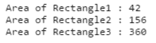

# C++ 编程：下班自学 C++ 指南。构建你的编程技能并学习解决常见问题。将你的热情转化为计算机程序员职业生涯。


# 引言
欢迎来到奇妙编程世界。本书包含的章节将让你对 C++ 编程有基本的理解。到最后一个章节结束时，你将能够使用 C++ 独立创建一个完整的程序。

本指南面向 C++ 的初学者。然而，如果你对编程完全陌生，我建议先阅读我们的《编程入门》。它涵盖了完全初级学者需要了解的所有概念、术语、编程范式和编码技术。

本指南将花费一些时间来介绍我们使用 C++ 语言可以做的一切事情，以及学习这种语言有多大好处。

这门 C++ 语言面向对象编程课程为学习者提供了设计、开发和有效实现健壮程序模型所需的概念和技术。作为一名学习者，你将掌握如何应用面向对象分析和设计的基本概念的实用知识，并解决日常活动中的各种问题。

C++ 是一种广泛用于通用编程的计算机编程语言。它是 C 语言的扩展。可以通过 C 语言获得对 C++ 的基础理解。这就是为什么两种语言都表示为 C/C++。Bjarne Stroustrup 在 1979 年开发了这种多范式语言。

在当今世界，许多操作系统使用 C++ 作为它们的基础语言。一些系统驱动程序、浏览器和游戏都是基于 C++ 程序的。它是一种自由形式、编译型且静态类型的编程语言。许多专业人士认为 C++ 是实现所需结果最高效的语言。

学习代码终究是未来的语言。我们生命中的某个时刻都曾听过类似这样的话。

当你到达最后时，阅读 C++ 代码并编写既有趣又有用的程序对你来说将不再任何问题。那么，让我们深入学习 C++ 吧。

# 第 1 章：C++ 剖析
## 编程语言简介
如你所知，程序无非是一组指令。这些指令由硬件（即物理计算机设备）执行。尽管现代计算机速度很快，但它们也有自己的局限性。计算机只能理解以原生语言给出的指令指令。为此，你应该理解机器语言、汇编语言和高级语言的概念。

### 机器语言
尽管计算机是非常先进的机器，但它们无法直接理解 C++ 这样的语言。计算机只理解 0 和 1。它们被称为位（bits）。它们只能理解以二进制格式给出的指令。我们给计算机的每组指令都会翻译成一组告诉处理器执行特定任务的指令。你应该理解不同类型的处理器具有不同的指令集。例如，奔腾（Pentium）处理器只理解它们自己的指令集。Macintosh 的情况也是如此。在最开始，程序员必须用二进制语言编写指令。这非常耗时且具有挑战性。幸运的是，我们不需要经历这一切。

### 汇编语言
由于机器语言很难处理，人们发明了一种名为汇编语言的新语言。在这里，每条指令都给出了一个短名称，变量用名称而不是二进制位来替换，使得程序员编写代码变得容易。你可能会问如何理解汇编语言。你不能。汇编语言将在汇编器的帮助下转换为机器语言。你应该记住每个 CPU 都有自己的汇编语言。因此，一个 CPU 的汇编语言不能在另一个 CPU 上运行。即使汇编语言也有它的缺点。即使是简单任务，它们也需要大量的指令。

### 高级语言
高级编程语言的出现是为了解决汇编和机器语言引起的问题。它们可以在任何计算机上运行。编译器的作用是生成 CPU 可以直接理解的可执行文件或程序。这些程序是独立程序。今天现有的现代编译器非常高效、快速，能将代码转换为可执行格式。一些编程语言使用解释器。解释器的工作是执行代码，但不将其编译为机器码。但这里我们不会学习解释器。任何给定的编程语言都可以被解释或编译。C、C++ 和 PASCAL 等语言是编译的，而 JavaScript 和 Perl 等脚本语言是解释的。

问这个问题，你将得到十种不同的答案，但简单来说，C++ 是一种编译的、面向对象的计算机编程语言。如果你是编程新手，即使是这个定义可能让你感到有些困惑，所以让我们再详细地拆解一下。

编程语言有两种类型——一种是解释型的，另一种是编译型的。解释型语言在解释器上运行——解释器读取代码并逐次执行命令。编译型语言在你的计算机上通过编译器将代码转换成程序。计算机无法读取字母；它们只能读取二进制数字，所以当你编写代码时，它必须先翻译成二进制。这被称为编译。面向对象的部分描述了代码的结构。

## 这些对我意味着什么？
要成功学习 C++，需要使用文本编辑器和编译器。如果你在 Windows 上操作，你可以使用记事本（Notepad），它已经安装了。编译器是它将你的代码转换为可执行格式，你应该使用。

### Linux/Unix
检查 Linux/Unix 是否安装了 GCC 的简单方法是打开命令行并输入：
```
g++ -v
```
如果安装了 GCC，你会得到如下消息：
```
Target: i386-linux
Configured with: posix
gcc version 4.1
```

### Mac OS
获取 Mac OS GCC 的最佳方法是访问 `developer.apple.com/x`，下载 Xcode 并遵循说明。

### Windows
在 Windows 上获取 GCC 必须下载 MinGW。确保安装了最新版本的 MinGW 以及 g++，这些是基本要求。你可以考虑的另一件事是 IDE——集成开发环境。文本编辑器具有编译器和语法高亮功能。最好的是 Code。还有其他我应该知道的吗？是的。C++ 的语法非常严格，并且对大小写敏感，所以输入时要小心。“Hello” 意味着什么，我们稍后会详细介绍。在进入更多细节之前，我想先介绍一下构成你代码的内容。首先，代码编写如下：


```cpp
int x;
x = 5;
std::cout << x;
```
第一行告诉你的计算机你想使用 `iostream` 库，库中包含了变量和运算符。`iostream` 库中的代码让我们字符显示在屏幕上。这里我们使用代码 `cout`。代码后面的 `<<` 是一个运算符，它翻译为“输出”，意味着我们告诉计算机将代码发送到指定的流。打印“Hello!” 被称为字符串，它只不过是双引号内的字符序列。注意该行以分号结尾——这告诉计算机代码已结束。如果没有使用，程序将无法编译。第八行始终位于 `main` 的末尾，用于通知计算机块已完成。现在你有了程序的源代码，必须使用你的编译器进行编译。稍后会有细节，首先我想介绍组成你代码的内容。

# C++ 程序结构
正如我们讨论过的，计算机程序无非是一组告诉 CPU 要做什么的指令序列。

## 语句和表达式
在 C++ 中，语句无非程序中最小的独立单元。它也是编程中最常见的指令形式。C++ 中，语句是将你的指令传递给编译器以执行特定任务的方法。我们使用 `;` 来结束语句。在 C++ 中有许多种语句，下面给出最常见的语句类型。
```cpp
int x;
x = 5;
std::cout << x;
```
我们将在后面的章节中讨论上述语句的功能。

## 函数
函数无非按顺序执行的语句序列。有一个名为 `main` 的函数，它是每个 C++ 程序中都必不可少的。当运行任何给定的 C++ 程序时，程序的执行从 `main` 函数开始。函数有非常特定的任务要执行，并且它们只能执行这些任务。为了成为一名优秀的 C++ 程序员，你需要知道如何高效使用函数。在下一章中，你将学习更多函数的知识。

## 库和 C++ 标准库
库无非预编译的代码集合。它们可以在不同的程序中使用。如果你想扩展程序的功能，可以添加库。C++ 核心语言是简约且直接的，但它也带有一个名为 C++ 标准库的内置库。C++ 标准库为用户提供了额外的功能。

## 编译你的第一个程序
在编写第一个程序之前，你需要了解两个重要事项。你的程序将编写在 `.cpp` 文件中，这些将被添加到你的项目中。项目也被称为工作区（workspaces）或解决方案（solutions）。代码文件和 IDE 设置将保存到你的项目中。你应该通过创建一个新项目来开始，因为有很多种类型的项目。


# 是什么构成了 C++ 代码？

变量是存储值的东西。它就像一个盒子，每个盒子上都有名称和类别，而类别是存储在其中的物品的类型——名称就是特定的变量。每个变量都有特定的类型、名称和大小，这些因素精确决定了内部可以存储什么。

第 7 行被称为赋值。这为变量分配了一个值，而 `=` 是赋值运算符——它负责执行赋值操作。`=` 后面的值被称为二元操作符。

注意，这次 `cout` 语句周围没有引号。这是因为我们不是在显示字符串，而是在输出值。现在编译该程序将在屏幕上打印“42”。

除了具有类型外，变量还可以在声明中添加前缀，这些变化会改变变量的行为。有些会改变变量的大小，而另一些允许你使用或阻止你使用负数，而另一些则执行完全不同的工作。几乎所有的前缀都会在这里介绍。

## 大小改变者
两个特定的前缀会改变变量的字节大小——`short` 和 `long`。这背后的想法是允许变量存储更多值和更大的数字。多大取决于你所使用的计算机架构：
* 在 32 位计算机上，`int` 和 `long int` 都是 4 字节。
* 在 64 位计算机上，`int` 是 4 字节，`long int` 是 8 字节。
* 在两种架构上，`short int` 都是 2 字节。

没有任何规定这些特定关键字修饰符的大小，除非：
* `Short` 必须等于或小于普通变量。
* 普通变量反过来必须等于或小于 `long`。
* 唯一可以带前缀变量是 `int`。

更让人混乱的是，你可以省略 `int` 直接使用 `long` 或 `short`，例如：
```cpp
short int s = 0;
int i = 0;
long int l = 0;
short s2 = 0;
long l2 = 0;
```

## 符号改变者
另外两个前缀可以限制类型所存储的值——`signed` 和 `unsigned`。有符号变量可以存储负值和正值，而 `unsigned` 变量只能取正值。

## 其他前缀
C++ 中还可以使用一些其他前缀，它们并不常见，我们大多数将不会使用，也不会在书中介绍。不过，有两个非常有用的前缀——`const` 和 `static`。前者是常量，永远不会改变值，而后者保持变量的值不变，但仅限于函数调用之间；那是以后讨论的话题。

# 语言的核心：理解 C++
今天计算机运行着我们周围的几乎一切；在计算机或你偏爱的手机品牌的核心，是程序。对于我们的学习过程，我假设你已经知道什么是计算机程序及其背后的结构。所有程序的核心都是计算机语言。那么问题随之：C++ 到底是什么？

C++（读作 "plus plus"）核心上是一种通用的编程语言。该语言的独特之处在于，它在提供低级内存管理的同时，整合了关键的面向对象和泛型编程。

该语言及其设计偏向于系统编程，例如嵌入式系统和操作系统内核，仅举几例。由于其性能、灵活性效率，该语言是许多程序员的最爱。该语言在许多场景中都有有效用途，例如服务器（如 Web 搜索 SQL 和电子商务）、桌面应用程序、性能关键型应用（如太空探测器和电话交换机），以及最重要的是娱乐软件，你最喜欢的视频游戏就属于此类。

该语言被称为编译语言，其实现可以在全球许多平台上运行，并被 Intel、FSF、Microsoft 和 LLVM 等许多跨国公司使用，仅举此类。

如果你搜索 ISO（国际标准组织），你会了解到 C++ 是标准化的。ISO 在 2011 年 9 月批准并发布了 C++ 的当前版本 `ISO/IEC 14882:2011`，非正式称为 `C++11`。C++ 首次于 1998 年标准化为 `ISO/IEC 14882:1198`，然后修订为 `C++03`，然后在 2003 年再次修订为 `ISO/IEC 14882:2003`。尽管上述信息很有用，但对你并不重要。更重要的是当前的标准 `C++11`，由于整合了新功能和更大的标准库，它取代了所有其他版本。

与计算机相关的一切，事实上，世界上其他一切事物都有起源。C++ 是 Bjarne Stroustrup 早 1979 年在贝尔实验室的结晶（`C`）。每一项大创新都有原因或目的。Bjarne 想要一种像 `C` 一样更灵活高效的语言，但同时也提供更高级程序组织功能的语言。

这里有一个关键；记得我说过学习 C++ 会为你学习其他语言做准备吗？原因就在于：C++ 影响了许多语言，包括 `Java`、`C#` 以及 1998 年之后开发的所有后期 `C` 版本。

在结束第一章之前，我可能应该提到 `C` 是 C++ 的前身，因此，使用 C++ 需要一些对后者的知识。

# 入门：第一次使用 C++
虽然学习 C++ 令人兴奋，但在我们开始编写代码之前，有一些先决条件。在进行任何编程之前，你需要一个集成开发环境（IDE）。IDE 是一个编译器，它将你的代码翻译成机器可以理解的 0 和 1（机器代码）。

如果你还没有安装编译器，可以下载许多免费和付费的编译器。

## 安装 IDE
IDE 构成了你编程非常核心的一部分。因此，我们查看一些更基础的方面——安装是有重要的。正如我提到的，你可以使用许多 IDE。大多数开发者都在纠结哪一个适合自己。但情况是，你可以安装多个 IDE。最常见的集成编译器是 `CodeBlocks` 和 Microsoft 的 Visual C++。如果你觉得某个更易用，或者优于上述两个，不要受限。如果你在 Windows 上编程，最好的选择是 Microsoft 的 Visual C++ 2010 Express 版，可以从 Microsoft 网站下载。如果你在没有网络的环境下工作，通过 Google 的帮助你可以找到离线安装程序。（此处为原文中的重复内容）

IDE 构成了你编程非常核心的一部分。因此，我们查看一些更基础的方面——安装是有重要的。正如我提到的，你可以使用许多 IDE。大多数开发者都在纠结哪一个适合自己。但情况是，你可以安装多个 IDE。……（此处为原文中大段重复内容）

取决于你的带宽，安装过程可能需要一些时间，一旦安装完成，Windows 将提示重启。你可能会在计算机响应中注意到这一点，不要感到惊讶，因为系统正在安装所有资源。然而，此时，安装程序将简单地运行。另一方面，你可能在 Windows 上开发但反之亦然；在这种情况下，你的最佳选择是使用 `CodeBlocks`，这是一个跨平台的 IDE，可以在 Windows 和 Linux 上运行。到目前为止，我们涵盖了几乎所有平台除了 Mac。如果你是 OSX 用户，可以使用 `Xcode` 或 `Eclipse`。Eclipse  C++ 不是自动设置；它需要下载和安装组件。如果 `CodeBlocks` 不合你意，你也可以使用 Dev-C++，这也是跨平台的，可以在 Windows 和 Linux 上运行。你应该下载 MinGW。IDE 安装部分可能是任何编程教程中最难的部分。现在我们完成了这一部分，你准备好开始编码了。

## 你的第一个 C++ 程序
欢迎来到最兴奋的部分，即让你拿起这本书使用 C++ 编写程序的部分。像大多数语言教程一样，我们的第一个目标是创建一个 hello world 程序。虽然“Hello world”代码听起来像陈词滥调，但在程序创建中，它是任何程序的最佳示例。无论你的程序复杂还是简单，都必须包含几行基础代码。

上面的代码是我们所说的预处理器指令。如果你查看代码，你会发现有 `iostream` 和 `std`；它们分别代表输入和输出，是任何使用 C++ 创建的程序的绝对要求。另一方面，`namespace std` 告诉编译器你打算使用标准库。如果你没有使用代码行来指定这一点，你将限制自己，无法使用 `cin`、`cout` 或 `endl`，我们稍后会介绍。

上面的代码指示了我们的 `main` 程序开始的地方，那里是大部分编码发生的地方。如果你好奇，`int` 表示整数。整数是返回给程序的值。同样重要的是，你不应该忽略括号 `()`；即使它们是空的，它们也是重要的。在同时，你也不应该忽略大括号 `{`，因为它是必要的。现在我们理解了这些，让我们使用 `cout` 在屏幕上打印一些东西吧。

我并不知道你是否熟悉 C 语言，但上述代码中的 `cout` 就是 `printf` 语句。代码 (`cout`) 在屏幕上打印引号内的任何内容、文本或其他内容。另一方面，`endl` 表示行结束（它类似于在处理文文档文件时按回车键）。分号也是必须的，所以不要忘记。在上面的代码中，`return 0` 充当返回给 `int main` 的整数。不想像复读机一样，不要忘记用大括号结尾，因为它们标志着 `main` 的结束。在上面的代码中，这就是我们的主程序代码外观。这可能让你感到惊讶，但如果你遵循了我们目前所做的一切，你刚刚创建了自己的第一个程序。

惊喜！我们刚刚使用和创建的代码是所有程序的基本结构；把它想象成在幼儿园学习字母表一样。你应该尽力理解并记住它。其次，你应该记住使用 `cout` 和 `endl` 的顺序。不要忘记声明 `using namespace std;`，否则编译器将返回错误。

然而，有一种解决办法。如果你不使用 `namespace std` 声明，你必须使用 `std::` 来声明每个 `cout`、`cin` 和 `endl`。这是我意思的示例。为了清晰，如果你不熟悉通用编程或 C++，你会发现 `cout`、`cin` 和 `endl` 在你的代码中经常出现。选择使用我刚刚描述的方法会让你的工作更快。

# 第 2 章：声明常量
常量是程序执行期间不能更改的固定值。当你有应该保持不变的值时，这很有用。在 C++ 中，定义常量有两种：使用 `const` 关键字或 `#define` 预处理器指令。`const` 关键字通常更受欢迎，因为它是类型安全的且具有作用域。

```cpp
const double PI = 3.14159;
const int MAX_USERS = 100;
```

另一种，你可以使用 `#define`：
```cpp
#define PI 3.14159
#define MAX_USERS 100
```
注意 `#define` 是预处理器指令，意味着在编译器实际看到代码之前执行文本替换。

## 符号改变者
另外两个前缀可以限制类型所存储的值——`signed` 和 `unsigned`。有符号变量可以存储负值和正值，而 `unsigned` 变量只能取正值。

```cpp
signed int a = -10;
unsigned int b = 10;
```

## 其他前缀
C++ 中还可以使用一些其他前缀，它们并不常见，我们大多数将不会使用，也不会在书中介绍。不过，有两个非常有用的前缀——`const` 和 `static`。前者是常量，永远不会改变值，而后者保持变量的值不变，但仅限于函数调用之间；那是以后讨论的话题。

# 语言的核心：理解 C++
计算机运行我们周围的几乎一切；在计算机或你偏爱的手机品牌的核心，是程序。对于我们的学习过程，我假设你已经知道什么是计算机程序及其背后的结构。所有程序的核心都是计算机语言。那么问题随之出现：C++ 到底是什么？

C++（读作 "plus plus"）核心上是一种通用的编程语言。该语言的独特之处在于，它在提供低级内存管理的同时，整合了关键的面向对象和泛型编程。

该语言及其设计偏向于系统编程，例如嵌入式系统和操作系统内核，仅举几例。由于其性能、灵活性效率，该语言是许多程序员的最爱。该语言在许多场景中都有有效用途，例如服务器（如 Web 搜索 SQL 和电子商务）、桌面应用程序、性能关键型应用（如太空探测器和电话交换机），以及最重要的是娱乐软件，你最喜欢的视频游戏就属于此类。

该语言被称为编译语言，其实现可以在全球许多平台上运行，并被 Intel、FSF、Microsoft 和 LLVM 等许多跨国公司使用，仅举此类。如果你搜索 ISO（国际标准组织），你会了解到 C++ 是标准化的。ISO 在 2011 年 9 月批准并发布了 C++ 的当前版本 `ISO/IEC 14882:2011`，非正式称为 `C++11`。C++ 首次于 1998 年标准化为 `ISO/IEC 14882:1198`，然后修订为 `C++03`，然后在 2003 年再次修订为 `ISO/IEC 14882:2003`。尽管上述信息很有用，但对你并不重要。更重要的是当前的标准 `C++11`，由于整合了新功能和更大的标准库，它取代了所有其他版本。

与计算机相关的一切，事实上，世界上其他一切事物都有起源。C++ 是 Bjarne Stroustrup 早 1979 年在贝尔实验室的结晶（`C`）。每一项大创新都有原因或目的。Bjarne 想要一种像 `C` 一样更灵活高效的语言，但同时也提供更高级程序组织功能的语言。

这里有一个关键；记得我说过学习 C++ 会为你学习其他语言做准备吗？原因就在于：C++ 影响了许多语言，包括 `Java`、`C#` 以及 1998 年之后开发的所有后期 `C` 版本。

在结束第一章之前，我可能应该提到 `C` 是 C++ 的前身，因此，使用 C++ 需要一些对后者的知识。

# 入门：第一次使用 C++
虽然学习 C++ 令人兴奋，但在我们开始编写代码之前，有一些先决条件。在进行任何编程之前，你需要一个集成开发环境（IDE）。IDE 是一个编译器，它将你的代码翻译成机器可以理解的 0 和 1（机器代码）。

如果你还没有安装编译器，可以下载许多免费和付费的编译器。

## 安装 IDE
IDE 构成了你编程非常核心的一部分。因此，我们查看一些更基础的方面——安装是有重要的。正如我提到的，你可以使用许多 IDE。大多数开发者都在纠结哪一个适合自己。但情况是，你可以安装多个 IDE。……（此处为原文中大段重复内容）


| 编程中的值 | 数值 | 数据类型 |
| :--- | :--- | :--- |
| 98 | +98 | int |
| -865 | -865 | int |
| -68495L | -68495 | long int |
| 984325LU | 984325 | unsigned long int |

## 字符常量
每当你发现一个包含在两个单引号之间的整数时，它就是一个字符常量。此外，你可能会在这些单引号之间发现反斜线 `\u201c` `\u201d`。对于大多数机器，使用的是 `ASCII` 字符集，即：

| ASCII 字符 | 符号显示 |
| :--- | :--- |
| 空字符 | `\0` |
| 换行 | `\n` |
| 水制表符 | `\t` |
| 警报（铃声） | `\a` |
| 退格 | `\b` |
| 分页 | `\f` |
| 垂直制表符 | `\v` |
| 单引号 | `\'` |
| 反斜线 | `\\` |
| 回车 | `\r` |

## 浮点常量
浮点常量在内存中以两个部分存储，因为浮点常量是带有小数部分的数字。它们在内存中获得的第一部分是有效位，第二部分是指数。浮点常量的默认类型是 `double`。你必须编写代码来指定你所需的数据类型，例如 `float` 或 `long double`。我们可以记住 `f` 或 `F` 用于表示浮点，而 `l` 或 `L` 用于表示长双点。在下表中展示了 `float`、`double` 和 `long double` 的一些示例：

| 编程中的值 | 数值 | 数据类型 |
| :--- | :--- | :--- |
| .0 | 0.00 | double |
| 0. | 0.00 | double |
| 3.0 | 3.0 | double |
| 5.6534 | 5.6534 | double |
| -3.0f | -3.0 | float |
| 5.6534785674L | 5.6534785674 | long double |

## 布尔常量
这些常量是预定义的关键字，程序员不能对其进行定义或声明。它有两个预定义的常量：`True` 和 `False`。在编程中，我们把这种常量表示为 `bool`。

## 编程常量
在这部分中，我们将理解不同的编程常量以及在 `C++` 程序中编写和定义常量的方法。通常有三种类型的编程常量。

### 定义常量
在 `C++` 程序中定义常量的一种方法是使用预编译语句 `define`。像其他所有预处理器指令一样，它以 `#` 开头。例如，一个传统的 `define` 预处理器指令如下：
```
#define TABLE_SIZE 150
```
定义指令通常放在程序的开头，这样任何阅读你程序的人都能轻松找到它们。

### 内存常量
另一种编写常量的方法是使用内存常量。这些常量使用一个 `C++` 类型限定符来记住指定的数据不能更改。`C++` 编程为我们提供了定义命名常量的能力。我们只需要在代码中常量之前添加类型限定符即可。

```cpp
#include <iostream>
using namespace std;
#define val 50
#define floatVal 9.7
#define charVal 'K'
int main(){
    cout << "Integer Constant in our code: " << val << "\n";
    cout << "Floating point Constant in our code: " << floatVal << "\n";
    cout << "Character Constant in our code: "<< charVal << "\n";
    return 0;
}
```
输出：
在此段代码的情况下，控制台屏幕将弹出以下输出：
Integer Constant in our code: 50
Floating-point Constant in our code: 9.7
Character Constant in our code: K

### 字面量常量
字面量常量是一个匿名且用于指定你所需数据的常量。正如我们所知，常量不能被更改，因此我们只需要在语句中编写它的数据值。字面量常量是最常见的形式。下表显示了不同类型的字面量常量。

| 值 | 类型 |
| :--- | :--- |
| 'C' | 字符字面量 |
| 7 | 数值字面量 7 |
| C + 8 | 另一个数值字面量 (8) |
| 5.6534 | 浮点字面量 |
| Hello | 字符串字面量 |


# 第 3 章：函数

你可能记得在数学课上曾经处理过函数，例如 `f(x) = 2x + 5`。`f(0)` 的结果将是 `5`（`2(0) = 5`），`f(1)` 将是 `7`（`2(1) + 5`），`f(2)` 将是 `9`（`2(2) + 5`），以此此类推。

C++ 中的函数工作原理类似。函数执行操作后，通常会返回一个值。它们并不总是必须返回值。但是——不返回值的函数是空函数（void functions）。

首先，来看这段代码。它现在不需要逻辑上通；我们将对它进行过一遍。创建一个新项目并删除 `main.cpp` 中的内容，然后输入以下内容：

```cpp
#include <iostream>
using namespace std;
int getArea(int l, int w);
int main(){
int length, width;
cout << "Enter the length, and then enter the width.\n";
cin >> length >> width;
cout << "The area is: " << getArea(length, width);
return 0;
}
int getArea(int l, int w) {
int area = l * w;
return area;
}
```

现在，让我们逐行分析一下：

`#include <iostream>`
这包含了输入输出所需的必需组件。

`using namespace std;`
这表示我们正在使用标准输入/输出命名空间。

`int getArea(int l, int w);`
这是我们声明第一个函数的地方。C++ 是过程编译的，所以你不能随随地乱放函数。你必须在之后编写它们之前声明它们，或者它们必须在你的 `main` 函数之前完全编写。为了清晰起见，我倾向于先初始声明，然后在 `main` 函数之后编写函数，但这是个人选择。无论如何，我们在这里创建了一个名为 `getArea` 的函数。名称前的 `int` 表示它将返回一个整数值。同样，`float getArea(...)` 将返回一个浮点值，`char getChararacter(...)` 将返回一个字符，以此此类推。在声明中，我们给了两个变量，被称为“参数”（arguments）。就像在 `f(x)` 方程中，`x` 是方程修改的内容一样，参数变量就是我们的 C++ 读取并利用的内容。

`int main(){`
这是我们 `main` 函数的开始。如果你还没有发现，每个程序都必须有一个 `main` 函数。它是你代码的入口点，编译器会积极寻找它。

`int length, width;`
我们声明了两个变量，`length` 和 `width`。

`cout << "Enter the length, and then enter the width.\n";`
`cin >> length >> width;`
我们要求用户输入长度和宽度，然后接受他们的输入。

`cout << “The area is: “ << getArea(length, width);`
这里需要进一步的解释。输出流输出了我们给它的值，对吧？由于函数只是返回一个值，所以我们可以直接把它们放在输出流中。此外，由于此函数返回一个整数值，你可以创建一个新的整数，然后将其赋值赋值为函数的值，例如：`int area = getArea(length, width);`。然后你只需要输出：`cout << “The area is: “ << area;`。不过这是一种浪费，因为这个程序不需要创建这个变量。但是，如果你确实需要存储像矩形面积这样的变量，你可以这样做。

`return 0;}`
简单，每个 `main` 函数都必须返回 `0`。

`int getArea (int l, int w) {`
这镜像了之前的函数声明，也是我们开始编写它的地方。

`int area = l * w;`
`return area;`
我们创建了一个名为 `area` 的新变量，它获取函数头中的两个参数并将它们相乘得到它的值。然后我们返回同一个整数。我们也可以简单地写成：`return l * w;`。这都是返回此函数的有效方式，并将带给你适当的结果。

这就是对函数的简要介绍。它们是结构化程序的重要方式。所有内容都只在一个函数中的程序读起来很枯燥，且难以维护。分工更细的程序要容易理解和管理得多。

# 第 4 章：多态

多态意味着以多种形式存在。在编程中，当我们有许多通过继承相互相关的类时，就会发生多态。

在 C++ 中，多态意味着对对函数的调用将根据调用函数的对象的类型导致执行不同的函数。考虑下面给出的示例，我们有一个基类被另外两个类派生或继承：

```cpp
#include <iostream>
using namespace std;
class Figure {
protected : int breadth , length ;
public : Figure ( int x = 0 , int y = 0 ){
breadth = x ; length = y ; }
int area () {cout << "Area of parent class is :" << endl ; return 0 ; }
}; 
class Rectangle : public Figure {
public : Rectangle ( int x = 0 , int y = 0 ): Figure ( x , y ) { }
int area () {cout << "Area of Rectangle class is :" << endl ; return ( breadth * length );};
class Square : public Figure {
public : Square ( int x = 0 , int y = 0 ): Figure ( x , y ) { }
int area () {cout << "Area of Square class is :" << endl; return(breadth * length); }};

// Main function
int main () {
Figure * figure ;
Rectangle rec ( 10 , 7 );
Square sq ( 5 , 5 );
// store address of Rectangle
figure = & rec ;
// call rectangle area.
figure -> area (
// store address of Square
figure = & sq ;
// call area
figure -> area ();
return 0 ; }
```

代码将返回如下：输出是错误的。这是因为 `area()` 函数的调用被编译器仅设置为基类中的版本。这被称为静态解析或静态链接。函数调用在程序执行之前就固定了。有时被称为早期绑定，因为我们的 `area` 是在编译期间设置的。

让我们对代码进行修改，使得 `area()` 函数在 `Figure` 类中声明。但是我们将使用 `virtual` 关键字来声明它，如下所示：

```cpp
class Figure {
protected : int breadth , length ;
public : Figure ( int x = 0 , int y = 0 ){
breadth = x ; length = y ; }
virtual int area () {cout << "Area of parent class is :" << endl; return 0; }};
```

这意味着现在应该如下：

```cpp
#include <iostream>
using namespace std;
class Figure {
protected : int breadth , length ;
public : Figure ( int x = 0 , int y = 0 ){
breadth = x ; length = y ; }
virtual int area () {cout << "Area of parent class is :" << endl; return 0; }}; 
class Rectangle : public Figure {
public : Rectangle ( int x = 0 , int y = 0 ): Figure ( x , y ) { }
int area () {cout << "Area of Rectangle class is :" << endl ; return ( breadth * length ); }};
class Square : public Figure {
public : Square ( int x = 0 , int y = 0 ): Figure ( x , y ) { }
int area () {cout << "Area of Square class is :" << endl ; return (breadth * length); }};

// Main function
int main () {
Figure * figure ;
Rectangle rec ( 10 , 7 );
Square sq ( 5 , 5 );
// store address of Rectangle
figure = & rec ;
// call rectangle area.
figure -> area (
// store address of Square
figure = & sq ;
// call area
figure -> area ();
return 0 ; }
```

代码现在应该返回如下：编译器考虑的是指针的元素而不是它的类型。`rec` 和 `sq` 的对象已存储在 `figure` 中；它们各自的 `area()` 函数定义被调用。这显示每个派生类都有名为 `area` 的实现。这被称为多态。你有多个相同函数名和相同参数的类，但实现不同。

注意我们使用了 `virtual` 关键字使函数变为虚。当虚函数在基类中定义而在派生类中定义另一个版本时，这将向编译器发出信号，不需要静态链接。我们只需要根据调用函数的对象类型在程序的任何一点选择函数。这种操作被称为晚绑定或动态链接。

有时，你可能需要在基类中包含虚函数，以便在派生类中重新定义它以适应类对象，但你没有给基类中的函数提供意义定义。在这种情况下，我们基类中的虚函数 `area()` 可以更改为：

```cpp
class Figure {
protected : int breadth , length ;
public : Figure ( int x = 0 , int y = 0 ){
breadth = x ; length = y ; }
virtual int area () = 0 ; };
```

注意函数中使用 `= 0;`。这告诉 C++ 编译器该函数没有函数体。这样的函数被称为纯函数（pure virtual function）。

## 对象析构与多态

对象析构是复杂的，特别是当通过接口销毁对象时。例如，你可以有这样的代码：

```cpp
class Drawable{
public:virtual void draw () = 0;
};
class MyDrawable : public Drawable{
public:virtual void draw ();
MyDrawable ();
~MyDrawable ();
private:int *mydata;
};
MyDrawable::MyDrawable (){mydata = new int;}
MyDrawable::~MyDrawable (){delete mydata;}
void deleteDrawable (Drawable *drawable){delete drawable;}
int main (){deleteDrawable( new MyDrawable() )}
```

`deleteDrawable` 内部发生了什么？记住，当使用 `delete` 时，会调用析构函数，所以读取 `delete drawable` 的行在对象上调用了函数。但编译器如何知道 `MyDrawable` 析构函数在哪里？编译器不知道 `drawable` 变量的具体类型，但知道它是一个 `Drawable`，一个拥有 `draw()` 方法的东西。它只知道 `MyDrawable` 析构函数本身如何找到与 `Drawable` 关联的析构函数。由于 `MyDrawable` 在其构造函数中分配了内存，为了释放内存，`MyDrawable` 析构函数必须运行。

# 第 5 章：运算符类型与重载

C++ 中的运算符

C++ 提供了丰富的运算符，用于对常量和变量执行不同的功能。C++ 主要有以下几种类型的运算符：
算术运算符（加法、乘法等）
关系运算符（小于、大于等）
逻辑运算符（逻辑与、逻辑或等）
位运算符
赋值运算符

算术运算符

C++ 主要提供了 7 种算术运算符。我们将使用两个变量 `x` 和 `y` 来讨论每个运算符，其中 `x` 的值为 `45`，`y` 的值为 `25`。


## 算术运算符

| 算术运算符 | 含义 | 示例 |
| :--- | :--- | :--- |
| `+` | 操作数的简单数学加法 | `x+y` 结果为 70 |
| `-` | 操作数的简单数学减法 | `x-y` 结果为 20 |
| `*` | 操作数的数学乘法 | `x*y` 结果为 1125 |
| `/` | 操作数的数学除法 | `x/y` 结果为 1 |
| `%` | 取模运算符，提供整数除法后的余数 | `x%y` 结果为 20 |
| `++` | 称为[增运算符](http://www.tutorialspoint.com/cplusplus/cpp_increment_decrement_operators.htm)，将操作数的值加 1 | `x++` 结果为 46 |
| `--` | 称为[递减运算符](http://www.tutorialspoint.com/cplusplus/cpp_increment_decrement_operators.htm)，将操作数的值减 1 | `x - -` 结果为 44 |

## 关系运算符

C++ 主要提供了 7 种关系运算符。这些运算符提供 TRUE 或 FALSE 结果值，并通常用于条件检查。我们将通过两个变量 `x` 和 `y` 来理解每个运算符的含义，其中 `x` 的值为 45，`y` 的值为 25。

| 关系运算符 | 含义 | 示例 |
| :--- | :--- | :--- |
| `==` | 等于运算符，用于检查两个操作数是否相等。如果相等则返回 TRUE，否则为 false | `(x == y)` 为 FALSE。 |
| `!=` | 不等运算符，用于检查两个操作数是否不等。如果不相等则返回 TRUE，否则为 false | `(x != y)` 为 TRUE。 |
| `>` | 大于运算符，检查左操作数是否大于右操作数。如果左侧大，返回 TRUE，否则返回 FALSE | `(x > y)` 为 TRUE。 |
| `<` | 小于运算符，检查左操作数是否小于右操作数。如果左侧小，返回 TRUE，否则返回 FALSE | `(x < y)` 为 FALSE。 |
| `>=` | 大于或等于运算符，检查左操作数是否大于或等于右操作数。如果左侧大于或等于，返回 TRUE，否则返回 FALSE | `(x >= y)` 为 TRUE。 |
| `<=` | 小于或等于运算符，检查左操作数是否小于或等于右操作数。如果左侧小于或等于，返回 TRUE，否则返回 FALSE | `(x <= y)` 为 FALSE |

## 逻辑运算符

C++ 支持以下 3 种逻辑运算符，使用两个变量 `x` 和 `y` 进行解释，其中 `x` 的值为 0，`y` 的值为 1。

| 逻辑运算符 | 含义 | 示例 |
| :--- | :--- | :--- |
| `||` | 逻辑或运算符。如果至少有一个操作数非零，返回 TRUE | `(x || y)` 返回 TRUE |
| `&&` | 逻辑与运算符。如果两个操作数都非零，返回 TRUE | `(x && y)` 返回 TRUE |
| `!` | 逻辑非运算符，反转其操作数的逻辑值。如果操作数为 0 则变为非 0，如果操作数为非零则变为 0。 | `!(x && y)` 返回 TRUE |

## 位运算符

位运算符按位执行其功能。按位与运算符对两个操作数的每对对应位执行与操作，按位或运算符对两个操作数的每对对应位执行或操作。

| `x` | `y` | `x | y` | `x & y` | `x ^ y` |
| :--- | :--- | :--- | :--- | :--- |
| 1 | 1 | 1 | 1 | 0 |
| 0 | 0 | 0 | 0 | 0 |
| 1 | 0 | 1 | 0 | 1 |
| 0 | 1 | 1 | 0 | 1 |

假设 `x = 13;` 且 `y = 60;`
`x = 0000 1101`
`y = 0011 1100`
`x|y = 0011 1101`
`x&y = 0000 1100`
下表显示了 `p = 60` 和 `q = 13` 时的位运算符

| 位运算符 | 含义 | 示例 |
| :--- | :--- | :--- |
| `|` | 按位或运算符，如果任意位为 1 则给出 1 | `(p | q)` 结果为 0011 1101，即 61 |
| `&` | 按位与，如果两个位都为 1 则给出 1 | `(p & q)` 结果为 0000 1100，即 12 |
| `^` | 按位异异运算符，仅当恰有一个位为 1 时给出 1 | `(p ^ q)` 结果为 0011 0001，即 49 |
| `~` | 按位取反，改变位的逻辑值 | `(~p )` 结果为 1100 0011，表示 -61 |
| `>>` | 位右移运算符，将左操作数的值向右指定的位数（即右操作数）移动 | 0000 1111 |
| `<<` | 位左移运算符，将左操作数的值向左指定的位数（即右操作数）移动 | 1111 00 |

## 赋值运算符

| 赋值运算符 | 含义 | 示例 |
| :--- | :--- | :--- |
| `=` | 赋值运算符，将右侧表达式的值赋值给左操作数 | `p = q + r` |
| `+=` | 涉及加法后的赋值 | `p += q` |
| `-=` | 涉及减法后的赋值 | `p -= q` |
| `||` | 涉及逻辑或后的赋值（此处原文为误） | `p += q` |
| `/=` | 涉及除法后的赋值 | `p /= q` |
| `*=` | 涉及乘法后的赋值 | `p *= q` |
| `%=` | 涉及取模后的赋值 | `p %= q` |
| `>>=` | 涉及右移后的赋值 | `p >>= q` |
| `<<=` | 涉及左移后的赋值 | `p <<= q` |
| `&=` | 涉及按位与后的赋值 | `p &= q` |
| `^=` | 涉及按位异异后的赋值 | `p ^= q` |
| `|=` | 涉及按位或后的赋值 | `p |= q` |

## 运算符优先级和结合性

每个运算符都有相应的优先级和结合性。运算符优先级用于确定表达式包含多个运算符时的计算顺序。在表达式中，优先级较高的运算符先执行。结合性用于当存在多个具有相同优先级的运算符时，确定是从左到右还是从右到左评估。

| 类别 | 运算符 | 结合性 |
| :--- | :--- | :--- |
| 后置运算符 | `[] () -> - -- ++.` | 从左到右 |
| 一元运算符 | `+ ! ~ - -- ++ (type)*sizeof &` | 从右到左 |
| 乘法运算符 | `* % /` | 从左到右 |
| 加法运算符 | `- +` | 从左到右 |
| 移位运算符 | `>> <<` | 从左到右 |
| 关系运算符 | `< > <= >=` | 从左到右 |
| 等等运算符 | `!= ==` | 从左到右 |
| 按位与运算符 | `&` | 从左到右 |
| 按位异异运算符 | `^` | 从左到右 |
| 按位或运算符 | `|` | 从左到右 |
| 逻辑与运算符 | `&&` | 从左到右 |
| 逻辑或运算符 | `||` | 从左到右 |
| 条件运算符 | `?:` | 从右到左 |
| 赋值运算符 | `+= = -= /= *= %= <<= >>= &= |= ^=` | 从右到左 |
| 逗号运算符 | `,` | 从左到右 |


# C++ 中的重载

在`C++ 中的重载` 章节中，我们可以在同一作用域内为函数或运算符指定多个一个定义。这些过程分别被称为`函数重载`和`运算符重载`。

重载声明是在与之前的声明相同的作用域内完成的，但两个定义具有不同的参数和不同的实现/定义。

在调用重载函数或运算符后，编译器将通过比较你调用函数或运算符时使用的参数类型与定义中指定的参数类型，来确定使用最合适的定义。这种确定使用最合适定义的过程被称为`重载解析`（overload resolution）。

## 运算符重载

C++ 允许你重新定义或重载其大多数内置运算符。这意味着程序员可以使用自定义类型配合运算符。

重载的运算符是具有特殊名称的简单函数，即 `operator` 关键字后跟所正在定义的运算符的符号。就像函数定义一样，重载的运算符将有一个返回类型和参数列表。重载运算符的定义如下所示：

`Rectangle operator +( const Rectangle &);`

在下面给出的示例中，我们正在演示使用成员函数进行运算符重载的过程。我们将传递对象作为参数，并将使用该对象访问对象的属性。调用运算符的对象将可以通过该运算符访问，如下所示：

```cpp
#include <iostream>
using namespace std;
class Rectangle {
public :
    double getArea ( void ) {
        return length * breadth ;
    }
    void setLength ( double len ) {
        length = len ;
    }
    void setBreadth ( double bre ) {
        breadth = bre ;
    }
    // 重载 + 运算符以相两个 Rectangle 对象。
    Rectangle operator+( const Rectangle & r ) {
        Rectangle rect ;
        rect . length = this -> length + r . length ;
        rect . breadth = this -> breadth + r . breadth ;
        return rect ;
    }
private:
    double length ; // 矩形的长度
    double breadth ; // 矩形的宽度
};
// 主函数
int main () {
    Rectangle Rectangle1 ; // 声明类型为 Rectangle 的 Rectangle1
    Rectangle Rectangle2 ; // 声明类型为 Rectangle 的 Rectangle2
    Rectangle Rectangle3 ; // 声明类型为 Rectangle 的 Rectangle3
    double area = 0.0 ; // 在这里存储 Rectangle 的面积
    // Rectangle 1 规格
    Rectangle1 . setLength ( 6.0 );
    Rectangle1 . setBreadth ( 7.0 );
    // Rectangle 2 规格
    Rectangle2 . setLength ( 12.0 );
    Rectangle2 . setBreadth ( 13.0 );
    // Rectangle 1 的面积
    area = Rectangle1 . getArea ();
    cout << "Area of Rectangle1 : " << area << endl ;
    // Rectangle 2 的面积
    area = Rectangle2 . getArea ();
    cout << "Area of Rectangle2 : " << area << endl ;
    // 相加两个对象：Rectangle3 = Rectangle1 + Rectangle2 ;
    // 矩形 3 的面积
    area = Rectangle3 . getArea ();
    cout << "Area of Rectangle3 : " << area << endl ;
    return 0 ;
}
```

执行时，代码将返回以下内容：

考虑从上述代码中提取的以下部分：

```cpp
Rectangle operator +( const Rectangle & r ) {
    Rectangle rect ;
    rect . length = this->length + r . length ;
    rect . breadth = this->breadth + r . breadth ;
    return rect ;
}
```

这就是实现运算符重载机制的地方。我们重载了 `+` 运算符，使其能够加上两个矩形对象的测量值。这里是代码中提取的另一行：

`Rectangle3 = Rectangle1 + Rectangle2 ;`

在上述行中，`Rectangle1` 将被加到 `Rectangle2` 上。这意味着 `Rectangle1` 的长度将加到 `Rectangle2` 的长度上以得到 `Rectangle3` 的长度，而 `Rectangle1` 的宽度将加到 `Rectangle2` 的宽度上以得到 `Rectangle3` 的宽度。然后这两个值将相乘以得到 `Rectangle3` 的面积。`+` 运算符的含义被重载了！

# 第 6 章：宏与模板

## 模板简介

模板是 C++ 编程语言中的一项重要特性，因为它允许函数和类使用泛型。它们在函数和类的工作方式中起着至关重要的作用，允许它们在不重写彼此的情况下定义不同的数据类型。

使用模板，你可以编写适用于任何数据类型的泛型代码。你只需要将数据类型作为参数传递。模板促进了代码的重用性并提高了程序的灵活性。你可以创建一个简单的类或函数，并将数据类型作为参数传递，并实现供任何数据类型使用的代码。每当你想使用该函数时，调用该函数并指定返回类型。

例如，如果你使用 `sort()` 函数对仓库数据进行排序，可以将不同的数据类型作为参数传递给函数。你不需要编写和维护多个文件代码来排序数据。根据传递给排序算法的数据类型，你仓库中的数据将无视特定数据类型进行排序。因此，当你需要代码在多个数据类型上可重用时，就会使用模板。

在处理多重继承和运算符重载时，模板具有重要意义。它们在代码可重用性要求高的地方被广泛应用。

模板通过以下两种方式实现：
- 使用函数模板
- 使用类模板

模板可以定义为宏。也就是说，当你定义特定类型的对象时，模板在执行时会替换相应的类型。

### 类模板

类模板提供了根据参数创建类的规格。类模板接受成员类型，并通常用于实现成员函数。

**语法：**
`Template <class identifier>`
`class-name{…}`

示例：![00018.jpeg]

类模板定义与标准类定义相似，只是在模板处添加 `template <class M>` 前缀，`M` 是类型。如果从模板派生类，则通过 `Classname<type> object(arg)` 实例化。

示例：

```cpp
template <class TT>
class Rectangle {
    TT width;
    TT height;
public:
    void setvalues(TT num1,TT num2) {
        width = num1;
        height = num2;
    }
    TT area() {
        TT A;
        A=width*height;
        return A;
    }
};

int main() {
    Rectangle<int> obj1(5,6);
    Rectangle<float> obj2(5.6,4);
    cout << obj1.area();
    cout << obj2.area();
    return 0;
}
```
输出：
3022.4

上述程序创建了类型 `TT` 的类。`<TT>` 在 `void Rectangle <TT> ::setvalues (TT num1,TT2)` 中指定，函数参数也是模板。

### 多个参数的类模板

你也可以在类中拥有多一个用逗号分隔的泛型类型。![0019.jpeg]

**语法：**
`Template <class xy, …>`
`Class class-name{//function body;}`

示例：两个泛型类型的模板

```cpp
template<class f1,class f2>
class numbers{
    f1 j;
    f2 k;
public:
    numbers (f1 x, f2 y) {
        j=x;
        k=y;
    }
    void print() {
        cout<<j<<"and"<<k<<"\n";
    }
};

int main() {
    Numbers<float, int> numbers1 (5.3,23);
    Numbers<int, char> numbers2 (50,'Z');
    numbers1.print();
    numbers2.print();
    return 0;
}
```
输出：
5.3 and 23
50 and Z

### 函数模板

函数模板的工作方式与普通函数类似，但普通函数只处理单一数据类型，而模板可以适应多个数据类型。通过模板，你可以重载普通函数以处理不同的数据类型。这使得函数模板更有用，因为你只需要编写适用于所有数据类型的单一程序。模板始终在编译时展开。

**语法：**
`Template <class type>`
`Return-type function-name (arguments){Function body;}`

在定义函数模板时，必要时函数体和参数列表中包含模板类型。

示例 1：交换函数
```cpp
template <Class T1>
Void swap (T1&num1, T1&num2) {
    T1 val=num1;
    num1=num2;
    num2=val;
}
```

示例 2：函数的实现

```cpp
template <class test>
test max (test x, test y) {
    test results;
    results=x>y? x:y;
    return results;
}

int main() {
    int a=5, b=6, c;
    double l=4, m=6, n;
    c= max <int> (a,b);
    n=max <double> (l,m);
    cout<< c<<endl;
    cout<<n<<endl;
    return 0;
}
```
在这个示例中，`test` 是模板参数。函数 `max` 被调用两次，使用不同的数据类型（`int` 和 `double`）。当编译器实例化时，它每次按其类型调用函数。产生的输出对象（在特定类型实例化模板后）将与参数 `x` 和 `y` 的类型相同。上述程序将根据哪个值更高对值排序。如果使用数字数组，将应用排序算法对数字从最小到最大进行排序。

### 多个参数的函数模板

与类模板一样，你可以拥有多一个用逗号分隔的泛型类型。![0019.jpeg]

示例：多个参数的模板

```cpp
template<class Temp1,class Temp2>
void display( Temp1 j, Temp2 k) {
    cout<<j<<“ ”<<k<<"\n";
}
int main() {
    display(2019, “EDGE”);
    display(18.54, “1854”);
    return 0;
}
```
输出：
2019 EDGE
18.54 1854

## 重载模板函数

你可以使用其模板函数或普通函数来重载模板函数。重载可以通过以下方式完成：
- 调用匹配模板函数的普通函数。
- 使用精确类型的函数调用模板函数。
- 在普通函数上进行匹配模板函数的函数调用。

如果没有找到匹配，系统将生成错误消息。

示例：使用普通函数的重载模板

```cpp
template <class M>
void display(M n) {
    cout<<”template function:” << n<<“n”;
}
void display (int n) {
    cout<<”Explicit display: “ << n<<“n”;
}
int main() {
    display (80);
    display (15);
    return 0;
}
```
输出：
Explicit display: 80
template function: 15

##在创建类模板时，所有成员函数都可以在类外定义，因为模板类中的成员函数是使用类型参数化的。因此，函数模板应该定义成员函数。

成员函数模板有三种定义方式：
- 文件作用域内的显式定义。
- 模板内的文件作用域。
- 类内的内联。

成员函数模板可以实例化。如果一个类既有成员函数又有普通函数，则显式定义优先。

示例：带有成员函数的类

```cpp
template <typename T>
class ArrayWrapper {
    T *pmem;
public:
    ArrayWrapper(int size) : pmem(new T[size]) {}
};
```

示例：带有成员函数的类模板

```cpp
template <typename T>
class ArrayWrapper {
    T *pmem;
public:
    ArrayWrapper(int size) : pmem(new T[size]) {}
};

template <typename T>
ArrayWrapper<T>::ArrayWrapper() {}

## 非类型模板参数

模板可以有单个或多个类型参数。除了类型，你还可以使用字符串、内置类型和函数名创建模板参数![0022.jpeg]

上述模板将数组的大小作为参数传递。编译器只在执行期间知道数组的大小。参数在创建模板时指定。

## 模板类

虽然模板类倾向于编写 `map` 和 `vector` 等类的编写者，但普通程序员也可以从代码泛化中受益。你不应该仅仅因为可以使用就模板；相反，你应该寻找在类型上不同的类。声明模板类与模板函数没有太大。假设我们要构建一个封装数组的小类：

```cpp
template <typename T>
class ArrayWrapper {
private:
    T *pmem;
};
```

与模板函数一样，我们从引入模板的声明开始。我们使用 `template` 关键字，然后添加模板参数。这里只有一个参数，`T`。每当我们需要用户指定的类型时，都可以使用 `T`，就像模板函数一样。为模板类定义函数时，也使用模板语法。所以，让我们为类添加一个名为 `ArrayWrapper` 的构造函数：

```cpp
template <typename T>
class ArrayWrapper {
public:
    ArrayWrapper (int size);
private:
    T *pmem;
};
```

为了使构造函数可以在类外定义，我们首先指示该函数是模板

```cpp
template <typename T>
ArrayWrapper<T>::ArrayWrapper (int size) : pmem(new T[size]) { }

int main() {
    ArrayWrapper<int> arr(10);
    return 0;
}
```
区别是，类名现在包含了 `ArrayWrapper` 模板，这告诉所有人这是一个模板类，而不是标准类上的模板函数。

## 模板与头文件

到为止，我们看到的模板都是直接写入 `.cpp` 文件的。如果我们想把模板声明放在头文件中呢？可以吗？这里的问题是，使用模板类或模板函数的代码需要能够对模板的每一次函数调用以及在模板类上调用的每个成员函数访问整个模板定义。

这不是标准函数的工作方式；这些只需要调用者知道声明。例如，如果你将 `Calc` 类放在它的头文件中，你还需要需要添加完整的构造函数定义以及 `add()` 方法，而不是像通常那样将它们都放入一个 `.cpp` 文件中。如果你不这样做，你将无法使用 `Calc`。这是模板的一个相当遗憾的问题，这与模板如何编译有关。在大多数情况下，当编译器第一次解析它们时，它几乎忽略模板。只有当使用模板时，连接了具体的类型，编译器才会生成代码。因此，为了生成代码，所有的模板定义必须包含在头文件中。创建模板类时最简单的方法是使用 `.h` 之外的扩展名来指示它是模板，例如。

## 分析模板错误消息

使用模板的一个显著缺点是，许多编译器会抛出易于理解的错误消息。无论你写还是不写，你可能得到数页的错误消息。因为模板参数被扩展到完全，模板错误消息并不容易读。在模板被误用时总是指出哪里出错了。如果这还不明显，你的代码会显示一个错误：“error: int is not a class, struct or union.”

# 第 7 章：类

## 类的介绍

面向对象编程的核心是类的概念，你创建并在贯穿整个代码中使用。这有助于模块化、易用性以及更具逻辑性的高层编程。在 C++ 的早期版本中，使用的是 `struct`，但现在更多地采用类。然而，`struct` 仍然存在。

在进入那里之前，让我们简谈一下访问修符。我们已经讨论过 `int`、`string`、`bool` 和 `float` 等内容。我们创建了可以认为是某种类型的枚举。访问修符描述了代码中可以更改的内容。三种不同的访问修符：

- `Public`（公共）：对象和/或内部函数可以被程序的任何其他代码访问和修改。
- `Protected`（保护）：对象和/或内部函数可以被其派生类修改（在我们进入继承和多态时会有意义）。
- `Private`（私有）：只有对象本身可以访问和修改其数据。这对于安全、清晰和代码安全很重要。

`struct` 和类都是创建新对象的方法。`struct` 的主要区别在于它们默认是公共的，而类默认是私有的。除此之外，差异是微不足道的。然而，在技术行业中，`struct` 有相当负面的含义。开发者倾向于将它们视为功能受限的未保护对象，而倾向于将类视为结构良好且功能强大的对象。因此，通常最好创建类。看这个 struct 和声明：

```cpp
struct animal {
    enum diet { herbivore, omnivore, carnivore };
    int legs;
    string name;
    diet naturalDiet;
};

int main() {
    animal dog;
    dog.legs = 4;
    dog.name = "Dog";
    dog.naturalDiet = carnivore;
}
```


- 它需要自初始化
- 它需要清理内存和/或其他资源
- 它需要复制自己


所有这些对于创建良好的数据类型都非常重要。我们将使用字符串（string）来演示这一点。字符串必须能够自我初始化，即使它们是空的。它们不应该依赖外部代码来完成初始化。一旦字符串声明，它就可以立即使用。当你用完字符串后，它必须能够进行清理，因为所有字符串都会分配内存。当使用 `string` 类时，不需要调用其他方法来完成这一操作；字符串会自动完成。

最后，它必须能够将数据从一个变量拷贝到另一个变量，就像整数可以在变量之间拷贝一样。总而言之，这些功能都应该是所有类的一部分，以便它们被易地使用。我们将一个一个地处理这三个特征，看看 C++ 是轻松地实现这一切的。

## 对象构造 (Object Construction)

你可能已经注意到，我们在 `ChessBoard` 接口中没有编写初始化棋面的代码，它是代码的公共部分。我们现在可以修复它。

当声明类变量时，该变量需要能够被初始化：
```cpp
ChessBoard board;
```

当声明一个对象时，运行它的代码被称为构造函数，它应该设置好对象，使其不再需要额外的初始化。构造函数也可以接受参数——你在声明一个特定大小的 vector 时已经看到了：`vector<int> v( 10 );`。`vector` 构造函数被带有值为 10 的值调用；新的 `vector` 由构造函数初始化，使其能够立即容纳 10 个整数。

创建一个构造函数无非声明一个与类名同名的函数，它没有参数也没有返回值。你甚至不需要给它提供 `void` 值；返回值不提供任何类型：

```cpp
enum ChessPiece { EMPTY_SQUARE, WHITE_PAWN /* 还有其他成员 */ };
enum PlayerColor { PC_WHITE, PC_BLACK };
class ChessBoard{
public:
    ChessBoard (); // <-- 完全没有返回值！
    PlayerColor getMove ();
    ChessPiece getPiece (int x, int y);
    void makeMove (int from_x, int from_y, int to_x, int to_y);
private:
    ChessPiece _board[ 8 ][ 8 ];
    PlayerColor whosemove;
};

ChessBoard::ChessBoard () // <-- 无返回值
{
    whosemove = PC_WHITE;
    // 首先清空整个棋盘，然后添加棋子
    for ( int i = 0; i < 8; i++ ){
        for(int j = 0; j < 8; j++ ){
            board[ i ][ j ] = EMPTYSQUARE;
        }
    }
    // 初始化棋盘所需的其他代码
}
```

我不会一直向你展示方法声明，但我会继续向你展示类声明，以便你看到它们是如何结合的。现在注意，上面的构造函数位于类的公共部分。如果我们不把 `ChessBoard` 构造函数设置为公共，我们就无法创建任何对象实例。为什么呢？因为每当创建一个对象时，都必须调用构造函数；如果我们将其为私有，它就无法从类外部调用。对象只能通过调用构造函数来初始化，如果你将其为私有，你就无法声明该对象。

构造函数在创建对象的那一行被调用：
```cpp
ChessBoard board; // 调用 ChessBoard 构造函数
```
或者在分配内存时：
```cpp
ChessBoard *board = new board; // 这作为内存分配的一部分调用了 ChessBoard 构造函数
```
当声明多个对象时：
```cpp
ChessBoard a;
ChessBoard b;
```

构造函数总是按照对象的声明顺序运行——`a` 然后是 `b`。和普通函数一样，构造函数可以接受一个或多个参数，如果存在不同的初始化对象的方法，可以通过参数类型对多个构造函数进行重载。例如，可以为 `ChessBoard` 创建第二个构造函数来接收棋盘大小：

```cpp
class ChessBoard{
    ChessBoard ();
    ChessBoard (int board_size);
};
```

函数定义与任何类方法相同：
```cpp
ChessBoard::ChessBoard (int size){// ... 代码}
```

参数像这样传递给构造函数：
```cpp
ChessBoard board( 8 ); // 8 是 ChessBoard 构造函数的参数
```

当你你使用 `new` 关键字时，传递参数看起来就像直接调用了构造函数：
```cpp
ChessBoard *p_board = new ChessBoard( 8 );
```

关于语法的说明：虽然使用圆括号来传递参数，但你不能用它们来声明具有无参数构造函数的对象。你不能这样做：
```cpp
ChessBoard board();
```
正确的形式是：
```cpp
ChessBoard board;
```
然而，在使用 `new` 关键字时你可以使用圆括号：
```cpp
ChessBoard *board = new board();
```
这是 C++ 解析中一个不幸的小缺陷，因为细节保持得非常晦涩。只需在声明具有无参数构造函数的对象时不要使用括号即可。

那么，如果没有声明构造函数会发生什么？

如果没有声明构造函数，C++ 会创建一个。它不会接受参数，也不会初始化 `int`、`char` 或任何其他原始类型，但它会通过调用默认构造函数初始化每个类字段。通常，你应该创建构造函数以确保一切都得到正确初始化。一旦声明了构造函数，C++ 就不会为你生成。编译器假设你清楚自己在做什么，并且你会创建所需的构造函数。特别是，如果你创建了接受参数的构造函数，除非你专门声明，否则可能会产生意外后果。如果使用了自动生成的构造函数而你添加了非默认的，依赖于自动构造函数的代码将无法编译。提供默认构造函数是你的责任。

## 初始化列表 (Initialization List) 和 常量字段 (Const Fields)

如果类字段被声明为 `const`，则必须在列表中初始化：
```cpp
class ConstHolder{
public:
    ConstHolder (int val);
private:
    const int _val;
};
ConstHolder::ConstHolder (): _val( val){}
```
`const` 字段不能通过赋值来初始化，因为字段被设置后无法更改。类没有被完全形成的地方是在初始化列表，这样对象可以被安全地设置。

# 第 8 章：库 (Chapter 8: Library)

## 标准模板库 (The Standard Template Library)

能够编写自己的数据结构是好事。但正如你可能学到的，这并不常见。你现在已经学习了很多关于构建数据结构的知识，C++ 有一个酷炫特性可以复用。它被称为标准模板库 (`STL`)，包含了常用的数据结构……这些包括二叉树和链表。这些结构让你指定它们存储的数据类型。

## Vectors

包含在 STL 中的是数组的替代品——`vector`。这非常像数组但它是可调整的；不再需要担心分配内存和移动元素。数组的语法是：
```cpp
int an_array[10 ];
```
而 vector 的语法是：
```cpp
#include <vector>
using namespace std;
vector> a_vector( 10 );
```
`vector` 头文件必须与 `std` 一起包含。这是因为就像 `cout` 和 `cin` 一样，`vector` 是标准库的一部分。此外，当声明 vector 时，必须提供存储的类型。这是使用角括号完成的：
```cpp>

## 在 Vector 上调用方法

vector 提供的比数组多得多。你可以做各种事情，比如在末尾添加元素。vector 提供了函数来帮助这一点。vector 使用了名为方法的 C++ 特性。调用方法的语法如下所示：
```cpp
a_vector.size();
```

## 其他 Vector 特性 (Other Vector Features)

vector 还非常容易增加项的数量而不需要分配内存。例如，向 vector 添加额外的项会这样写：
```cpp
a_vector.push_back( 10 );
```
这在 vector 末尾添加了另一个 10 的项。vector 会处理大小调整。如果你想用数组实现这一点，必须分配内存、复制值并添加新项。虽然 vector 确实执行内存分配和拷贝，但它是智能地执行的，不需要每次添加新项时都调整大小。

然而，尽管你可以使用 `push_back` 将项添加到 vector 的末尾，但单独使用括号是不一样的。括号主要让你只能处理已经分配过的数据，这样内存分配就不会在你不知情的情况下进行。因此，像这这样的代码：
```cpp
vector<int> a_vector( 10 );
a_vector[ 10 ] = 10; // 最后一个有效元素是 9
```
是不行通的，并且很可能导致程序崩溃。更不用说，它是危险的。像这样写：
```cpp
vector<int> a_vector( 10 );
a_vector.push_back( 10 ); // 向 vector 添加一个新元素
```
是可以调整 vector 大小的。

## 映射 (Maps)

我们稍早提到过使用一个值来查找另一个值的映射。这在编程中很常见，例如你想实现一个电子邮件地址簿，通过名字查找地址，或者通过账户号码查找账户或允许用户登录游戏。

STL 给我们一个 `map` 类型，让我们指定键类型和值。一个示例是持有电子邮件地址簿的数据结构；可以按如下方式实现：
```cpp
#include <map>
#include <string>
using namespace std;
map<string, string> name_to_email;
```
我们必须告诉结构有两个类型：一个 `string` 作为键，另一个 `string` 作为值（在本例中是电子邮件地址）。这些映射的有用功能之一是，当使用 `map` 时，该语法也可以作为数组使用。如果你想添加值，它和数组很像，使用的是键类型而不是整数：
```cpp
name_to_email[ "Billy Bunter" ] = "value@example.com";
```

## 从映射移除项 (Removing items from maps)

我们稍早提到过使用一个值来查找另一个值。这在编程中很常见，例如你想实现一个通过名字查找地址的电子邮件地址簿，或者一个通过账户号码查找账户的程序或允许用户登录游戏。

STL 给我们一个 `map` 类型，让我们指定键类型和值。一个示例是持有电子邮件地址簿的数据结构；可以按如下方式实现：
```cpp
#include <map>
#include <string>
using namespace std;
map<string, string> name_to_email;
```
我们必须告诉结构有两个类型：一个 `string` 作为键，另一个 `string` 作为值（在本例中是电子邮件地址）。这些映射的有用功能之一是，当使用 `map` 时，该语法也可以作为数组使用。如果你想添加值，它和数组很像，使用的是键类型而不是整数：
```cpp
name_to_email[ "Billy Bunter" ] = "value@example.com";
```

从映射中移除项：我们稍早提到过使用一个值来查找另一个值。这在编程中很常见。使用 `erase()` 方法：
```cpp
name_to_email.erase( key );
```
使用 `size()` 方法：
```cpp
name_to_email.size();
```
使用 `empty()` 方法来检查是否为空：
```cpp
if ( name_to_email.empty() )
```

## 迭代器 (Iterators)

正如你可能学到的，这并不常见。你可以通过 `begin()` 看到：
```cpp
map<string, string>::iterator it = name_to_email.begin();
```
方法的语法如下所示：
```cpp
for ( vector<int>::iterator it = a_vector.begin(); it != a_vector.end(); ++it ) {
    cout << *it;
}
```
迭代器递增：
```cpp
it++;
```
检查是否到达结尾：
```cpp
if ( it == a_vector.end() )
```


```cpp
for (string i : j) {cout << i << " - string length: " << i.length() << "\n"; }
```
你可以对创建的任何对象执行此操作，但我们会在下一章开始实际创建对象时再更详细地讨论这一点。

另一种类型的容器是 `lists`，它的功能与 `vectors` 非常相似。这两者之间的具体差异对于初学者来说可能难以理解。尽管如此，关于这两种类型容器的通用规则是：除非你需要在容器末尾的其他任何地方不断添加或删除元素，否则通常应该使用 `vector`。

另一种类型的容器被称为 `associative container`（关联容器），它以键值对和映射值的形式进行格式化。它通常根据键进行排序。最著名的关联容器类型被称为 `map`。当你需要将一组数据与特定特征关联时，这种容器非常有用。用现实世界的例子来说，商店的库存系统可以使用 `map` 来维护 `SKU 代码`（整数 - 键）和项目名称（字符串 - 映射数据）。

为此，你需要导入 `<map>` 头文件，并通过以下方式声明 `map`：
```cpp
map<int, string> Inventory;
Inventory[00400030] = “Tamagotchi, blue”;
Inventory[00400031] = “Tamagotchi, white”;
Inventory[00324359] = “Twilight, DVD”;
Inventory[44539294] = “Dark Souls, Xbox 360”;
```
如果你想在代码稍后调用某个特定元素，可以执行类似的操作：
```cpp
cout << “Inventory[00400030] is: “ << Inventory[00400030] << “\n";
```
调用 `Inventory[00400030]` 将打印出映射值，这里是“Tamagotchi, blue”。

另一种关联容器是 `set`。`Sets` 的功能与 `maps` 非常相似，不同在于它们不允许重复。`Maps` 允许重复值，但不允许重复键。

`STL` 中还包含一个名为“algorithms”（算法）的库。该库可以用于搜索、排序和处理元素范围。其中包含函数如 `equal()`，用于判断两个元素集合是否相等。还有 `transform()`，它可以将给定的函数应用于给范围。

## 结论

我们已经来到了这本书的末尾，但对于你来说，编程生活只是漫长且果实累程的开始。掌握了 `C++` 的基础知识，是时候开始你真正的学习了。开始编写那些程序吧！开始实现数据结构和算法。

如果你喜欢学习 `C++`，那么这门奇妙的语言还有很多可以学习和做的事情。请务必通过该系列的第二本书继续你的旅程，它在涵盖稍微复杂的话题的同时，仍然对初学者非常友好。

`C++` 编程语言是一种具有竞争力的通用平台，它借用了命令式编程范式的一些特征，并可以在任何平台上运行。它被称为命令式编程语言，因为它通过分步执行的过程来实现目标。该语言使用面向对象编程的概念来设计和实现复杂的程序。

下一步是开始使用 `C++` 语言编写你想要的的一些不同程序和代码。即使你只是刚起步，只想花时间练习本指南中的一些代码，你仍然处于通过这种语言取得优异成果的正确道路上。

在旅途中你的自己的代码实践越多，编写和创建你自己的代码就会变得越容易。

`C++` 语言是一个独特的工作选择，它将帮助我们创建一些真正强大健壮的代码，而且这种语言发现的功能与我们能够处理的任何其他语言都不同。

所有这些在你旅途中想要编写的某些代码中可能都是重要的，当我们完成本指南后，你应该觉得已经准备好处理这些内容并将它们添加到你自己的代码中了。

正如我们所看到的，在使用 `C++` 语言时，我们可以做的事情非常多。它是世界上最好的编程语言之一，无论你是初学者，还是已经从事编程编码工作很久的人。

当你准备好开始自己的编码旅程，并想要能够迅速创建出一些自己的程序时，`C++` 编程语言利用 `OOP` 范式的特征来开发和执行程序。这些特征中的包括使用对象、类、数据抽象和封装、继承以及多态。

程序侧重于使用数据而不是过程来解决现实问题。程序试图通过提高程序的数据安全性、促进代码重用性以及利用继承特性制作有效程序，来弥补其他传统编程语言的缺点。

与许多其他 `OOP` 语言一样，`C++` 支持各种构建模块。在教程中，你学习了在处理从简单到复杂的程序如何使用各种内置数据类型。数据类型分为原始数据类型、派生数据类型和抽象数据类型。你不仅学习了如何使用原始或标准数据类型，还学习了如何定义你自己的用户数据类型。

享受你的旅程。如果你在编程时觉得不好，那么它就不适合你。让它变得有趣，变得兴奋，并让它成为你早晨起床的理由。

祝你的旅程顺利。

