# C++ 编程：面向对象方法（第1版 ISE）


献给我的妻子 Faezeh  
Behrouz A. Forouzan

献给我的妻子 Evelyn  
Richard F. Gilberg


*本页有意留空*
# 前言

本书配合一门使用 C++ 语言语法讲授面向对象编程的课程而编写，同时也将帮助学生学习数据结构和设计模式等高级概念。完成本课程的学生将能够继续学习其他面向对象语言课程、数据结构课程或设计模式课程。

### 什么是 C++ 语言？

C++ 是一种渐进式发展的编程语言，源自它的前身 C 语言和 B 语言。C++ 语言将 `struct` 的概念扩展为类；通过一个类的定义，可以创建多个不同的对象，并为每个数据元素设置不同的值。

此外，C++ 语言还探索了能够模拟现实生活的面向对象语言的思想。在现实生活中，我们定义一种类型，然后拥有该类型的对象。在 C++ 语言中，我们定义一个类，然后从该类创建对象。C++ 还包含继承的思想。在继承中，我们可以创建一个类，然后扩展其定义来创建其他类，就像在现实生活中可以将动物这一概念扩展为马、牛、狗等概念一样。

C++ 最有趣的新增特性或许是多态。多态使我们能够使用同一个名称编写某个操作的多个版本，以供不同的对象使用。当我们使用动词“打开”时，现实生活中就存在这种情况。我们可以说打开一家企业、打开一个罐头、打开一扇门，等等。虽然所有情况下都使用“打开”这个词，但它会对不同的对象执行不同的操作。

C++ 最近的新增内容包括标准模板库（STL）——一个预定义的复杂对象及其操作的集合，这些操作可以应用于这些对象；此外还包括设计模式，用于使问题求解更加高效和协调。

### 为什么选择本书？

本书有以下五个鲜明的目标。

### 教授计算机编程

本书可以作为使用 C++ 语言进行计算机编程的第一门课程教材。第 1 章至第 6 章就是为此目的而设计的。这些章节介绍计算机系统和语言，还讨论 C++ 语法和程序控制的基础知识，例如决策和重复。第 1 章至第 6 章是学习使用 C++ 语言进行编程的基础。

### 教授 C++ 语言语法

第 7 章至第 12 章是学习面向对象编程的基础。虽然第 8 章和第 9 章与 C++ 的面向对象特性没有直接关系，但我们认为，在学生理解第 7 章所讨论的面向对象编程基础知识之后，可以讲授这两章的内容。


### 介绍 C++ 的新特性

第 13 章至第 17 章讨论编程第一或第二门课程中通常教授的其他主题。这些章节可以按任意顺序讲授。

### 讨论数据结构并介绍 STL 库

第 18 章和第 19 章介绍数据结构，为学生后续学习数据结构课程做好准备。

### 介绍设计模式

第 20 章（可在网上找到）针对面向对象编程中的一些典型问题给出了简单且可替代的解决方案；如果不使用模式，这些问题会更难解决。第 20 章通过一组针对特定问题的标准解决方案，使学生深入理解面向对象编程。尽管设计模式通常在计算机图形学课程中讲授，但我们将其应用于非图形问题，以面向没有图形编程经验的学生。

### 课程大纲

下图概述了本书的二十章。

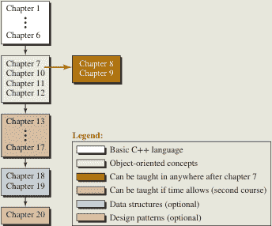

### 附录

附录可在网上找到，分为六类。

### 参考资料

附录 A 至 E 旨在供学生作为参考资料使用。学生在学习本书各章时可能需要查阅这些附录。

### 语言知识

附录 F 和 G 向学生介绍 C++ 如何为编译准备源代码，以及如何处理不同部分中的名称。

### 高级主题

附录 H 至 O 讨论添加到 C++ 中的一些高级主题。这些内容可以在课堂上讲授，学生也可以将其作为补充信息来源。

### C++11 简要回顾

附录 P 简要回顾了在讨论高级主题的附录中未涉及的 C++11 主题。

### UML 简要回顾

我们在正文中使用了 UML 图。附录 Q 概述了 UML 作为面向对象项目设计工具的一般知识。

### 位集

当 C++ 用于网络编程时，位集概念变得更加流行。我们已将此主题纳入附录 R。

### 教师资源

本书附带若干额外资源，可在 www.mhhe.com/forouzan1e 在线获取。其中包括检查点问题，可帮助教师在学生阅读每章每一节后评估其理解程度。还提供判断题和复习题，以进一步测试学生的知识。检查点功能、判断题、复习题和习题的完整解答也一并提供。最后，还提供讲座 PPT、教材图像文件和示例程序。

### 致谢

我们谨向本书的审稿人表示感谢。过去几年中，他们的洞见和建议对本书第一版产生了很大影响。以下按字母顺序列出审稿人：

- **Vicki H. Allan**，*犹他州立大学*
- **Kanad Biswas**，*德里理工学院*
- **Gary Dickerson**，*联合学院*
- **Max I. Formitchev**，*Maximus Energy*
- **Cynthia C. Fry**，*贝勒大学*
- **Barbara Guilott**，*Q&A Analysis，CGI，路易斯安那州拉斐特*
- **Jon Hanrath**，*伊利诺伊理工学院*
- **David Keathly**，*北德克萨斯大学*
- **Robert Kramer**，*扬斯敦州立大学*
- **Kami Makki**，*拉马尔大学*
- **Christopher J. Mallery**，*微软首席软件工程主管*
- **Michael L. Mick**，*普渡大学卡鲁梅特分校*
- **Amar Raheja**，*加州州立理工大学波莫纳分校*
- **Brendan Sheehan**，*内华达大学里诺分校*

在麦格劳-希尔，我们要感谢以下编辑和制作人员：Thomas Scaife，高级产品组合经理；Suzy Bainbridge，执行产品组合经理；Heather Ervolino，产品开发人员；Shannon O’Donnell，营销经理；Patrick Diller，业务项目经理；Jane Mohr，内容项目经理。

*本页有意留空*

# 1 计算机与编程语言导论

本章介绍计算机系统的组成部分，并讨论计算机语言背后的一般思想。本章提供的概述将帮助你为后续章节做好准备。初读时可以跳过本章，待对编程有更好理解后再回头阅读。

### 目标

阅读并学习本章后，你应当能够：

- 讨论计算机的两个主要组成部分：硬件和软件。
- 描述硬件的六个部分：CPU、主存、辅存、输入系统、输出系统和通信系统。
- 描述软件的两大类别：系统软件和应用软件。
- 描述计算机语言从机器语言到汇编语言再到高级语言的演变。
- 讨论计算机语言的四种不同范式：过程式、面向对象式、函数式和逻辑式。
- 描述程序设计的两个步骤：理解问题和开发解决方案。
- 描述将用 C++ 语言编写的程序转换为可执行程序的多步骤过程。

## 1.1 计算机系统

**计算机系统**由两个主要部分组成：硬件和软件。**计算机硬件**是物理设备。**软件**是允许硬件完成其工作的程序（指令）集合。

#### 1.1.1 计算机硬件

计算机系统的**硬件**由六个部分组成：中央处理器（CPU）、主存储器、辅助存储器、输入系统、输出系统和通信系统。这些组件通过所谓总线连接在一起。图 1.1 展示了这六个组件及其连接。

#### 中央处理器（CPU）

**中央处理器（CPU）**由**算术逻辑单元（ALU）**、控制器和一组在处理过程中临时保存数据的寄存器组成。控制器是系统的“交通警察”；它协调系统的所有操作。ALU 执行算术计算和数据比较等指令。图 1.2 展示了中央处理器背后的一般思想。

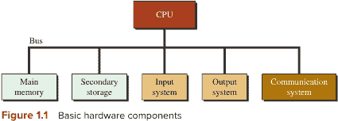

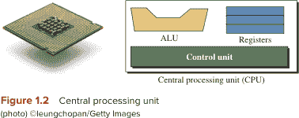

#### 主存

**主存**是在处理过程中临时存储程序和数据的场所。关闭计算机时，主存的内容会丢失。图 1.3 更详细地展示了主存。内存中的每个存储位置都有一个地址，很像街道地址，用于引用内存内容。图 1.3(a) 中的地址显示在左侧，为从零到 *(n − 1)* 的数字，其中 *n* 是内存大小。在图 1.3(b) 中，地址用符号 *x* 表示。

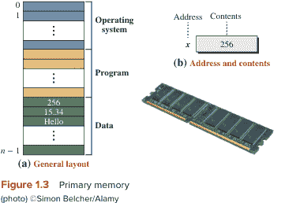


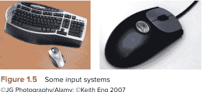

通常，每个地址指向固定大小的内存。在个人计算机中，访问的存储量通常是一、二或四个字节。在大型计算机中，可以是许多字节。当一次访问多个字节时，内存大小通常用*字*而不是字节来表示。

一般而言，主存有三种用途：存储操作系统、存储程序和存储数据。所存储数据的类型取决于应用。在图 1.3 中，我们演示了三种不同类型的数据：整数（256）、实数（15.34）和字符串（Hello）。

#### 辅存

程序和數據永久存储在**辅存**中。关闭计算机时，程序和数据仍留在辅存中，供下次需要时使用。辅存的示例包括硬盘、CD 和 DVD 以及闪存驱动器（图 1.4）。

#### 输入系统

**输入系统**通常是键盘，程序和數據通过它输入计算机。其他输入设备的示例包括鼠标、笔或触控笔、触摸屏或音频输入单元（图 1.5）。

#### 输出系统

**输出系统**通常是显示器或打印机，输出内容在其中显示或打印。如果输出显示在显示器上，我们称之为软拷贝。如果打印在打印机上，我们称之为硬拷贝（图 1.6）。

#### 通信系统

我们可以通过连接多台计算机来创建计算机网络。为此，通信设备安装在计算机系统上。图 1.7 展示了其中一些设备。


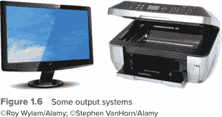

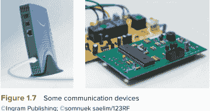

### 1.1.2 计算机软件

**计算机软件**分为两大类：**系统软件**和**应用软件**。无论硬件系统体系结构如何，情况都是如此。系统软件管理计算机资源。而应用软件则直接负责帮助用户解决问题。

#### 系统软件

系统软件由管理计算机硬件资源并执行所需信息处理的程序组成。这些程序分为三组：**操作系统**、**系统支持**和**系统开发**。

**操作系统** 操作系统提供用户界面、文件和数据库访问以及通信系统接口等服务。该软件的主要目的是以高效的方式运行系统，同时允许用户访问系统。

**系统支持** 系统支持提供系统实用程序和其他运行服务。系统实用程序的示例包括排序程序和磁盘格式化程序。运行服务由为操作人员提供性能统计信息的程序以及保护系统和数据的安全监视程序组成。

**系统开发** 系统开发软件包括将程序转换为机器语言以便执行的语言翻译器、确保程序无错误的调试工具，以及计算机辅助软件工程（CASE）系统，这些系统超出了本书的讨论范围。

#### 应用软件

应用软件分为两类：**通用软件**和**专用软件**。

**通用软件** 通用软件从软件开发商处购买，可用于不止一种应用。通用软件的示例包括字处理器、数据库管理系统和计算机辅助设计系统。这些程序之所以称为通用软件，是因为它们能够解决各种用户计算问题。

**专用软件** 专用软件只能用于其预期用途。会计人员使用的总账系统和工程师使用的物料需求计划系统就是专用软件的示例。它们只能用于为其设计的任务；不能用于其他一般化任务。

## 1.2 计算机语言

要为计算机编写程序，我们必须使用**计算机语言**。多年来，计算机语言已经从机器语言演进到符号语言，再到高级语言，并继续发展。计算机语言的时间线见图1.8。

### 1.2.1 机器语言

在计算机的早期，唯一可用的编程语言是**机器语言**。尽管每台计算机仍然有自己的机器语言——它由一串串0和1组成——但我们不再用机器语言编写程序。

> 计算机唯一能理解的语言是它的机器语言。

### 1.2.2 符号语言

显然，如果程序员继续用机器语言工作，那么能编写出的程序不会很多。20世纪50年代初，数学家、美国海军成员格雷斯·霍珀提出了一种特殊计算机程序的概念，用于将程序转换为机器语言（见图1.9）。

她的工作促成了编程语言的使用；这些语言只是使用符号（即助记符）来表示各种机器语言指令，从而映照机器语言。由于它们使用符号，这些语言被称为**符号语言**。一种称为**汇编器**的特殊程序用于将符号代码转换为机器语言。由于符号语言必须汇编成机器语言，它们很快就被称为**汇编语言**。如今，这个名称仍用于那些 closely 表示其计算机机器语言的符号语言。

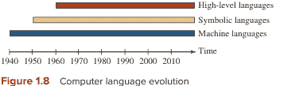


**图1.9** 格雷斯·霍珀  
© Cynthia Johnson/Getty Images

> 符号语言使用助记符号来表示机器语言指令。

### 1.2.3 高级语言

尽管符号语言极大地提高了编程效率，但它们仍然要求程序员专注于他们正在使用的硬件。使用符号语言工作也非常繁琐，因为每条机器指令都必须单独编码。为了提高程序员效率，并将关注点从计算机转向所解决的问题，**高级语言**得以发展。

高级语言可以移植到许多不同的计算机上，这使程序员能够专注于手头的应用问题，而不是计算机的复杂细节。高级语言旨在让程序员摆脱汇编语言的细节。然而，高级语言与符号语言有一个共同点：它们必须被转换为机器语言。这一过程称为*编译*。

第一种广泛使用的高级语言 FORTRAN（Formula Translation，公式翻译）由约翰·巴克斯和一个 IBM 团队于1957年创造。紧随 FORTRAN 之后的是 COBOL（Common Business-Oriented Language，面向商业的通用语言）。海军少将格雷斯·霍珀再次成为关键人物，这次是在 COBOL 商业语言的开发中。

多年来，还开发了其他几种语言——最著名的是 BASIC、Pascal、Ada、C、C++ 和 Java。如今，用于系统软件和新应用程序代码的流行高级语言之一是 C++，本书将讨论它。

## 1.3 语言范式

计算机语言可以根据其解决问题所采用的方法进行分类。范式是描述程序如何处理数据的模型或框架。尽管有几种分类法可将当前语言划分为一组范式，但我们只讨论四种：过程式、面向对象、函数式和逻辑式，如图1.10所示。该图还根据我们的分类法显示了哪种语言属于哪种范式。

请注意，C++ 语言既可以作为过程式范式使用，也可以作为面向对象范式使用，我们将在后续章节中看到。

### 1.3.1 过程式范式

在**过程式**（也称为**命令式**）范式中，程序是一组命令。每条命令的执行都会改变与该问题相关的内存状态。例如，假设我们想求任意两个值的和。我们保留三个内存位置，并将它们称为 a、b 和 sum。在这种情况下，这三个内存位置的组合构成一个状态。图1.11展示了过程式范式如何使用四条命令四次改变内存状态。注意，灰色的内存位置表示原始状态，而这些位置是为程序保留的。

为了将第一个数 a 的值存入内存，我们使用输入命令（输入 a）。执行该命令后，计算机等待我们在键盘上输入一个数。我们输入了6。当我们按下键盘上的回车键时，数字6被存入第一个内存位置，内存状态发生改变。执行第二条命令后，内存状态再次改变，现在6和8都存储在内存中。第三条命令通过将 a 和 b 的值相加并将结果存入 sum 来改变内存状态。尽管最后一条命令（输出 sum）看起来没有改变内存状态，但它被视为一次改变，因为 sum 的值被输出了。

我们在图1.11中编写代码的方式非常低效，原因有两个。第一，它包含一些可以在同一程序或其他程序中重复使用的命令。第二，如果要处理的数据集很大，我们需要逐个处理它们。为消除这两个低效问题，过程式范式允许将命令和**数据项**打包。

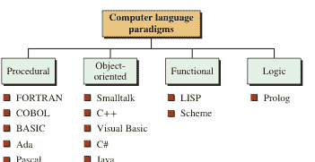

图1.10 语言范式


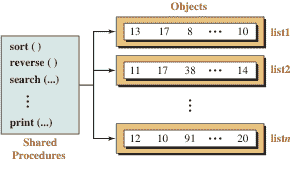

**图 1.12** 面向对象范式的一个示例

在任何典型的洗碗机中。然而，每次我们给机器装入不同的一套盘子（就像不同的数据集一样）。不过，我们需要注意，不要给机器装入它并非为承载而设计的负载（例如，不要在洗碗机里洗衣服）。

在现实世界中，一项操作所需的全部硬件都包含在一个对象中；在面向对象编程世界中，每个对象只保存数据，而定义过程的代码是共享的。图 1.12 展示了面向对象范式中过程与数据之间的关系。

### 1.3.3 函数式范式

在**函数式范式**中，程序就是一个数学函数。在此语境下，函数是一个黑箱，它将输入列表映射为输出列表。例如，数字相加可以看作一个函数，其输入是要相加的数字列表，输出是只包含一个项（和）的列表。换言之，函数式范式关注的是数学函数的结果。在这种范式中，我们不使用命令，也不跟踪内存状态。其思想是，我们有一些基本函数，例如加、减、乘、除。我们还有一些基本函数，用于创建列表，或从列表中提取第一个元素或其余元素。我们可以通过组合这些基本函数来编写程序或新函数。图 1.13 展示了我们如何使用函数式范式将两个数字相加。代码是符号化的，但该范式中的每种语言对函数都有自己的定义。另请注意，在我们的代码中，我们区分数字和列表。我们有一个数字 8，但一个列表只包含一个

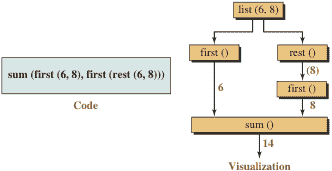

**图 1.13** 函数式范式的一个示例

**我们要处理的是哪种类型的数（带分数还是不带分数）？**

**这些数字是否按某种特殊顺序排列，例如从低到高？**

**我们可能预期有多少个数字？**

如果我们不澄清问题——也就是说，如果我们对输入或输出作出假设——就可能给出错误答案。为了回答我们的问题，我们需要处理按任意顺序排列的整数。整数的数量没有限制。

正如这个例子所示，即使是最简单的问题陈述也可能需要澄清。想象一下，对于一个包含数百或数千条详细语句的程序，必须提出多少问题。

### 1.4.2 制定解决方案

一旦我们完全理解了问题并澄清了可能存在的任何疑问，我们就会以算法的形式制定解决方案。**算法**是解决问题所必需的一组逻辑步骤。算法有两个重要特征：第一，它们独立于计算机系统。这意味着它们既可用于在办公室中实现人工系统，也可用于实现计算机程序。第二，算法接受数据作为输入，并将数据处理为输出。

为了为我们的问题编写算法，我们采用一种直观的方法，不仅依据问题陈述，还依据我们的知识和经验。我们从一小组五个数字开始：一旦为五个数字开发出解决方案，就将其扩展到任意数量的整数。

13        7        19        29        23

我们从一个简单的假设开始：算法一次处理一个数字。我们将该算法命名为 **FindLargest**。每个算法都有一个名称来标识它。**FindLargest** 依次查看每个数字，而不知道其他数字的值。当它处理每个数字时，会将其与到该点为止已知的最大数字进行比较，并判断新数字是否更大。然后它查看下一个数字是否更大，再查看下一个数字、再下一个数字，直到所有数字都被处理完。图 1.15 展示了在五个整数中确定最大值的步骤。

该算法要求我们跟踪两个值：当前数字和已找到的最大数字。我们通过以下步骤确定最大数字。

- **步骤 1：** 我们输入第一个数字 13。由于 largest 还没有值，我们将其设为第一个数字的值。
- **步骤 2：** 我们输入第二个数字 7。由于 7 小于 13，*largest* 的值无需改变。
- **步骤 3：** 我们输入第三个数字 19。当我们把 19 与 *largest* 的值 13 比较时，看到 19 更大。因此我们将 *largest* 设为 19。
- **步骤 4：** 我们输入第四个数字 29。当我们把 29 与 *largest* 的值 19 比较时，看到 29 更大。我们将 *largest* 设为 29。
- **步骤 5：** 我们输入第五个数字 23。由于它小于 29，*largest* 无需改变。由于没有更多输入，我们到此完成，并已确定最大值为 29。
- **步骤 6：** 我们输出 *largest* 的值，即 29。

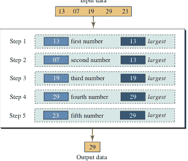

**图 1.15** 在五个整数中找出 *largest*

## 算法泛化

图 1.15 所示的算法并不能完全解决我们最初的问题定义，因为它只处理五个数字。要使其适用于所有数字序列，我们需要替换步骤 2 到 5，以处理数量不确定的值。这要求我们泛化这些语句，使它们相同。我们可以通过对语句稍作改写来实现，如下所示。

**如果当前数字大于 *largest*，则将 *largest* 设为当前数字。**

然后，我们将改写后的语句包含在一条重复语句中，该语句执行这些步骤，直到所有数字都被处理完。所得算法如图 1.16 所示。

重要的是要认识到，设计是在我们编写程序*之前*完成的。在这方面，它就像建筑师的蓝图。没有人会在没有一套详细计划的情况下开始建造房屋，然而，无论是经验丰富的还是新手

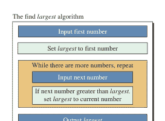

**图 1.16** 在 *n* 个数中找出 *largest* 的算法

程序员最常见的错误之一，同样是在设计完成并得到完整记录之前就开始编写程序。

这种急于开始的做法，部分是因为程序员认为自己已经完全理解了问题，部分是因为他们急于着手解决一个新问题。在第一种情况下，他们会发现自己并没有完全理解问题。通过花时间设计程序，他们会提出更多必须回答的问题，从而更好地理解问题。

程序员在完成设计之前就编写代码的第二个原因，纯粹是人的天性。编程是一项极其令人兴奋的任务。看到自己的设计开始成形，看到自己创建的程序第一次运行起来，会带来一种个人满足感，这是一种自然的兴奋。

## 统一建模语言（UML）

**统一建模语言**（UML）是一种标准工具，用于设计、指定和记录计算系统的许多方面。例如，它可用于设计大型复杂系统、程序以及程序中的对象。它还可用于展示面向对象语言（如 C++）中对象之间的关系。我们将在后续学习设计程序的章节中讨论 UML。

## 1.5 程序开发

图 1.17 展示了将用任何语言编写的程序转换为机器语言的一般过程。C++ 程序的过程稍微复杂一些。该过程以直接、线性的方式呈现，但我们需要认识到，在开发过程中，这些步骤会重复多次，以纠正错误并改进代码。

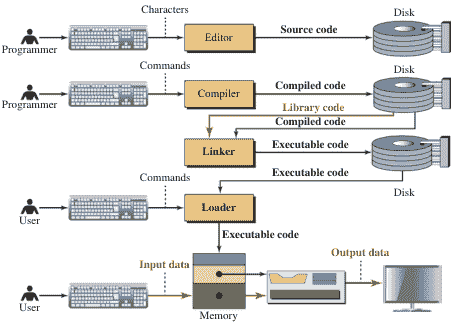

**图 1.17** 编写、编辑和执行程序


程序员的工作是编写程序，然后将其转换为**可执行文件**。这个过程包括四个步骤：

- a. 编写和编辑程序。
- b. 编译程序。
- c. 将程序与所需的库模块链接（通常自动完成）。
- d. 执行程序。从我们的角度看，执行程序是一步。然而，从计算机的角度看，它是两个子步骤：加载程序和运行程序。

### 1.5.1 编写和编辑程序

用于编写程序的软件称为**文本编辑器**。文本编辑器帮助我们输入、修改和存储字符数据。根据我们系统上的编辑器，我们可以用它来写信、创建报告或编写程序。其他形式的文本处理与编写程序之间的最大区别在于，程序是面向代码行的，而大多数文本处理是面向字符和段落的。

文本编辑器可以是通用字处理器，但更常见的是由提供编译器的公司提供的专用编辑器。我们在编辑器中寻找的一些功能包括：用于定位和替换语句的搜索命令，用于将语句从程序的一部分复制或移动到另一部分的复制粘贴命令，使用颜色显示程序关键部分的格式化命令，以及对齐并缩进程序各部分的自动格式化功能。

完成程序后，我们将文件保存到磁盘。该文件随后成为编译器的输入；它被称为**源文件**。

### 1.5.2 编译程序

存储在磁盘上的源文件中的信息必须转换为机器语言，以便计算机能够理解。这是**编译器**的工作。

### 1.5.3 链接程序

正如我们将在正文后面看到的，程序由许多函数组成。其中一些函数由我们编写，是我们源程序的一部分。然而，还有其他函数，例如输入/输出过程和数学库函数，它们存在于其他地方，必须附加到我们的程序中。**链接器**将系统函数和我们自己的函数组装成可执行文件。

### 1.5.4 执行程序

程序链接完成后，就可以执行了。为了执行程序，我们使用操作系统命令（例如 run）将程序加载到主存并执行它。将程序加载到内存是称为**加载器**的操作系统程序的功能。它定位**可执行程序**并将其读入内存。一切就绪后，控制权交给程序，程序开始执行。

在典型的程序执行过程中，程序读取数据以供处理，数据可以来自用户或文件。程序处理数据后，准备输出。数据输出可以写到用户显示器或文件。程序结束后，它通知操作系统，操作系统将程序从内存中移除。

## 1.6 测试

编写程序后，我们必须测试它。**程序测试**可能是程序开发中非常枯燥且耗时的部分。作为程序员，我们负责对其进行完整测试。我们必须确保每条指令和每种可能的情况都已测试。

### 1.6.1 设计测试数据

测试数据应在程序的设计和开发全过程中制定。在设计程序时，我们创建测试用例来验证设计。这些测试用例随后在我们编写程序后成为测试数据的一部分。

此外，在设计程序时，我们要问自己需要测试哪些情况，尤其是异常情况，然后记录下来。例如，在 `FindLargest` 中，如果只输入一个数会怎样？类似地，如果数据按顺序排列或全部相同会怎样？在设计程序时，我们从测试用例的角度审查它，并记录所需的其他用例。最后，在编写程序代码时，我们记录更多测试用例。

到了构造测试用例的时候，我们查看笔记，并将它们组织成逻辑集合。除了非常简单的学生程序外，一组测试数据永远不能完全验证一个程序。对于大型开发项目，可能需要运行 20、30 甚至更多测试用例来验证一个程序。所有这些测试用例构成了所谓的测试计划。

> **一组测试数据永远不能完全验证一个程序。**

最后，在测试程序时，我们会发现更多测试用例。同样，我们将它们记录下来并纳入测试计划。当程序完成并投入生产后，我们仍然需要测试计划来对程序进行修改。对修改的测试称为**回归测试**，并且应从编写程序时制定的测试计划开始。

我们如何知道程序何时被完全测试？现实中，无法确切知道，但我们可以做一些事情来提高成功几率。虽然其中一些概念要到后面章节才会清晰，但为了完整性，我们在此列出。

- a. 验证每一行代码至少执行过一次。幸运的是，如今市场上有编程工具可以帮助我们做到这一点。
- b. 验证程序中的每个条件语句都执行了真分支和假分支，即使其中一个分支为空。
- c. 对于每个具有范围的条件，确保测试包含范围中的第一项和最后一项，以及第一项之前和最后一项之后的项。范围测试中最常见的错误发生在范围的边界处。
- d. 如果正在检查错误条件，确保所有错误逻辑都经过测试。这可能需要临时修改程序以强制产生错误；例如，输入/输出错误通常无法自然产生——必须模拟。

### 1.6.2 程序错误

错误通常分为三类：**规格错误、代码错误和逻辑错误。**

### 规格错误

当问题定义陈述不正确或被误解时，就会发生规格错误。当我们与分析人员和用户一起审查设计时，应该发现规格错误。

### 代码错误

代码错误通常会产生编译器错误消息。这些错误最容易纠正。有些代码错误会产生所谓的警告消息，这通常意味着编译器对代码做出了假设，需要对其进行验证。这种假设可能是对的，也可能是错的。即使程序可能在有警告消息的情况下运行，也应修改代码以消除所有警告消息。

### 逻辑错误

最难发现和纠正的错误是逻辑错误。逻辑错误的例子包括除以零，或忘记在 `FindLargest` 中将第一个数存入 largest。只能通过彻底测试来纠正它们。记住，在运行测试用例之前，我们应该知道正确答案是什么。不要假设计算机的答案是正确的；如果存在逻辑错误，答案就会出错。

## 关键术语

- 算法
- 应用软件
- 特定应用软件
- 算术逻辑单元（ALU）
- 汇编器
- 汇编语言
- 中央处理器（CPU）
- 代码错误
- 编译器
- 计算机硬件
- 计算机语言
- 计算机软件
- 计算机系统
- 数据项
- 可执行文件
- 可执行程序
- 函数
- 函数式范式
- 通用软件
- 硬件
- 高级语言
- 命令式范式
- 链接器
- 输入系统
- 加载器
- 逻辑错误
- 逻辑范式
- 机器语言
- 面向对象范式
- 操作系统
- 输出系统
- 主存
- 过程式范式
- 过程
- 程序设计
- 程序错误
- 程序测试
- 回归测试
- 辅助存储器
- 软件
- 源文件
- 规格错误
- 符号语言
- 系统开发软件
- 系统软件
- 系统支持软件
- 文本编辑器
- 统一建模语言（UML）


## 摘要

计算机系统由两大主要部分组成：硬件（CPU、内存、二级存储、输出系统和通信系统）和软件（系统软件和应用软件）。

计算机语言用于开发软件。计算机本身以机器语言运行。多年来，编程语言已从符号语言发展到当今使用的众多高级语言。

语言范式（过程式、面向对象、函数式、逻辑式）描述了在计算机上解决问题所采用的方法。C++基于过程式和面向对象范式。

程序设计是一个两步过程，需要理解问题，然后开发解决方案。

算法有两个重要特征：它们独立于计算机系统，并且接受数据作为输入并将数据处理为输出。

程序开发将程序设计转化为计算机系统，分为四个步骤：编写程序、编译程序、链接程序和执行程序。

测试程序要求验证每条指令和每种可能的情况。

## 问题

- **PR-1.** 展示以下过程式范式示例的内存状态（见图1.11）。

    ```text
    input a
    input b
    input c
    sum = a + b + c
    output sum
    ```

- **PR-2.** 展示以下过程式范式示例的内存状态（见图1.11）。假设*length*和*width*的值分别为12和8，代表矩形的边。

    ```text
    input length
    input width
    area = length × width
    perimeter = 2 × (length + width)
    ```

- **PR-3.** 假设我们需要使用面向对象范式创建一个银行账户对象。展示你认为需要与数据一起封装的数据和过程列表（见图1.12）。

- **PR-4.** 在函数式范式中，展示以下函数的结果（见图1.13）。

    ```text
    first (rest (rest (a, b, c)))
    ```

- **PR-5.** 在函数式范式中，展示以下函数的结果，假设列表（...）表示给定元素的列表（见图1.13）。

    ```text
    list (first (rest (a, b)), first (a, b))
    ```

- **PR-6.** 基于图1.14，以下查询的结果是什么？

    ```text
    Parent (Benji, Tara)?
    GrandParent (Fay, Willi)?
    ```

- **PR-7.** 基于图1.14，以下查询的结果是什么？

    ```text
    Parent (Fay, Tara)?
    GrandParent (Tara, Willi)?
    ```

- **PR-8.** 展示以下算法执行后*sum*的值。

    ```text
    sum = 0
    sum = sum + 10
    sum = sum × 10
    sum = sum − 10
    ```

- **PR-9.** 展示以下算法执行后*x*的值。

    ```text
    x = 5
    x = x + 1
    x = x − 10
    ```

- **PR-10.** 展示以下算法执行后*x*、*y*和*z*的值。

    ```text
    x = 2
    y = 5
    x = x + 1
    y = y − 10
    z = 8
    z = x + y
    x = y + z
    y = x + y + z
    ```

- **PR-11.** 设计一个算法，使用以下公式将厘米值转换为英寸值：

    ```text
    1 inch = 2.54 centimeters
    ```

- **PR-12.** 设计一个算法，使用以下公式将英寸值转换为厘米值：

    ```text
    1 centimeter = 0.3937 inch
    ```

- **PR-13.** 设计一个算法，使用以下公式将华氏温度值（F）转换为摄氏温度值（C）：

    ```text
    C = (F − 32) × (100/180)
    ```

- **PR-14.** 设计一个算法，计算一笔由两瓶软饮料（每瓶1美元）、三瓶牛奶（每瓶2美元）和一罐咖啡（3美元）组成的交易的销售税和总销售金额。税率为9%。

- **PR-15.** 设计一个算法，找出一组数字中的最小值。

- **PR-16.** 设计一个算法，求出一组数字的和。

- **PR-17.** 设计一个算法，求出一组数字的乘积。

- **PR-18.** 设计一个算法，计算从1到100的数字之和。

# 2 C++编程基础

本章为C++计算机编程奠定基础。每个C++程序都涉及输入、输出和赋值。首先，我们讨论如何使用两个对象和一个运算符来实现这些活动。接下来，我们介绍C++中的基本数据类型。基本数据类型是无需声明即可使用的原始内置数据类型。然后我们讨论变量、值和常量以及如何在程序中使用它们。最后，我们讨论程序的两个组成部分，即标记和注释。

### 目标

阅读并学习本章后，你应该能够：

- 讨论变量、值和常量以及它们在C++程序中的使用方式。
- 讨论由标记和注释构成的C++程序的一般组成部分。
- 讨论C++中的基本数据类型及其大小。
- 展示如何在程序中使用整数数据类型。
- 展示如何在程序中使用字符数据类型。
- 展示如何在程序中使用布尔数据类型。
- 展示如何在程序中使用浮点数据类型。
- 讨论void数据类型并讨论其用途。
- 介绍C++字符串并简要讨论其使用。
- 介绍并讨论一些简单的C++程序。

## 2.1 C++程序

每个C++程序都由若干部分组成，而每个部分又由若干部分构成。每个部分或组成部分都必须遵循C++语言定义的规则，就像用某种自然语言编写的文档遵循该语言的规则一样。

在我们正式深入探讨C++程序的结构并研究一些相关规则之前，先学习一些示例程序。

### 2.1.1 第一个程序

程序2.1展示了一个简单的C++程序示例，将帮助我们获得对C++程序的基本理解。

**程序2.1** 第一个简单程序

```cpp
#include <iostream>

int main()
{
    std::cout << "This is a simple program in C++";
    std::cout << " to show the main structure." << std::endl;
    std::cout << "We learn more about the language";
    std::cout << " in this chapter and the rest of the book.";
    return 0;
}
```

**运行：**

This is a simple program in C++ to show the main structure.
We learn more about the language in this chapter and the rest of the book.

### 方框与背景着色

我们已将程序展示在一个由两列和多行组成的表格中，其中包含一些方框和一些着色或阴影背景。这些装饰仅用于本书中的演示。它们不是C++语言的一部分。其他书籍可能使用其他装饰来使程序的组成部分更清晰可见。

> **方框和背景着色不是C++程序的一部分；它们在本节中用于展示程序的不同部分。**

### 代码与结果的分离

我们将程序垂直分为两个部分。顶部部分以两列显示我们编写的代码。底部部分显示程序运行时的结果。请注意，第二部分的第一行（Run:）不是程序或其运行结果的一部分。它是由我们添加的，用以表明此部分是运行程序的结果。如果我们多次运行程序，你会看到多个部分，每个部分都以（Run:）开头。程序的结果通常显示在我们编译和运行程序的计算机屏幕上，但为了快速参考，我们在每个程序底部以阴影区域显示它们。

> **为了演示，我们将代码与程序结果分开；程序结果通常显示在屏幕上。**

### 区分大小写

每个C++程序都区分大小写。我们必须严格按照语言中定义的方式使用术语。如果我们改变语言中某个术语的字母大小写，就会得到编译错误。换句话说，我们不能在程序的第1行使用Include或IOSTREAM代替include或iostream。我们不能在第3行使用Main代替main。对于std、cout、endl和return等术语也是如此。

> **C++语言区分大小写。命名实体的术语必须按照其定义使用，不能改变字母的大小写。**


## 程序行

尽管并非必须这样做，我们仍将程序划分为多行，以展示不同部分并提高可读性。讨论程序时，我们使用行号以便引用。行号不是程序的一部分，在创建源代码时不应包含在程序中。注意，我们还会添加空行来分隔程序的不同部分（例如程序2.1中的第2行）。

> 行号不是程序的一部分，不应包含在源代码中。本书使用行号来引用每一行。

## 缩进

在程序2.1中，我们对函数体中的行进行了缩进。尽管并非必须这样做，但我们认为这能提高程序的可读性。我们总是对属于某个外围实体的行进行缩进。第5行至第9行属于函数体，我们将它们缩进，以表明它们位于两个花括号内部。

> 行缩进可提高程序的可读性，我们强烈推荐这样做。

## 程序分析

我们逐行简要分析该程序（第2行除外，该行为空行，用于提高可读性并表明两个部分的分隔）。

### 第1行：预处理指令

预处理指令是给编译器的命令，要求其在编译程序之前执行某些操作。程序的第1行（不含行号）是一条预处理指令，如下所示：

```cpp
#include <iostream>
```

C++程序需要一些并非由我们编写的预定义代码行。这些代码行非常复杂，有时会访问计算机硬件，这意味着它们取决于我们使用的计算机类型。C++设计者创建了这些代码行，并将其包含在称为**头文件**的文件中。我们不必编写这些行；只需将这些文件的内容复制到我们的代码中。要复制它们，我们需要知道文件名`iostream`，在此处它代表*输入/输出流*。为了告诉编译器我们需要包含该文件的内容，我们需要有一条如上所示的`include`行。include行以`#`符号开头。当程序中的一行以该符号开头时，这向编译器表明，在程序可以编译之前需要完成某些操作。在编译器开始编译我们的代码之前，它会运行另一个称为*预处理器*的程序，该程序检查所有预处理命令（**include**指令是其中之一）。编译器执行命令中所需的操作（例如包含头文件的内容），然后移除该预处理指令。在所有预处理指令都处理并移除之后，程序就准备好编译了。注意，每条预处理命令必须单独占一行，且第一个非空白字符是符号#（井号）。在include指令中，文件名必须在include一词之后用两个尖括号括起来，例如`<filename>`。我们在附录F中更详细地讨论预处理。

> **注意，任何include指令后都不应加分号。**  
> **如果编译器发现分号，可能会产生错误。**

### 第3行：函数头

程序的第3行（不含行号）如下所示：

```cpp
int main()
```

C++程序通常由若干*函数*组成。函数，正如我们将在后续章节中看到的，是将若干代码行组合在一起的部分。C++程序由一个或多个函数组成，但必须包含一个名为main的函数。C++程序的执行从main函数开始，并在main函数终止时终止。

> **每个C++程序的执行都从main函数开始，这意味着每个程序都必须有一个名为main的函数。**

每个函数都有一个*函数头*和一个*函数体*。函数头定义函数的名称、传入函数的内容（括号内）以及从函数输出的信息类型；在本例中，该类型写在函数名之前。第3行是main函数的函数头。它表明函数名为main；不会向函数传递任何内容（括号为空）；函数将返回一个整数值（int是C++中表示整数的类型），并将其提供给操作系统。

### 第4行和第10行：左花括号与右花括号

第4行和第10行是左花括号和右花括号（大括号）的组合，二者必须成对出现，以包围整个函数体。只有其中一个而没有另一个会导致编译错误。下面展示了这些行。

```cpp
{
    ...
}
```

C++中的每个函数定义都需要一个由左花括号和右花括号包围的函数体。

> **有左花括号而没有右花括号，或有右花括号而没有左花括号，是重大错误。**

### 第5行：函数体的第一行

现在我们逐行讨论函数体的内容，从下面所示的第5行开始：

```cpp
std::cout << "This is a simple program in C++ ";
```

函数体中的大多数行都是告诉计算机要做什么的命令。正如我们在自然语言中看到的，命令（祈使句）由动词、直接宾语、间接宾语（目标或接收者）以及终止符（通常是句号）构成。这就是我们在函数中的命令行里看到的结构，尽管顺序不同。在本例中，目标对象（cout，即显示器）在前，动词（write）随后，要写入的内容（直接宾语，一个字符串）在最后。该命令以分号（而不是句号）终止。根据这一解释，程序2.1的第5行表示计算机应将对象字符串（This is a simple program in C++）写到显示器上，然后转到下一条命令。注意，两个引号是语言语法的一部分；它们不会显示在屏幕上。图2.1展示了对第5行的图形化分析。

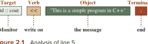

我们将看到，C++（作为一种面向对象语言）中的每个对象都有一个名称。连接到我们计算机的显示器在C++中也有一个名称。它称为std::cout。注意，此处的名称由两部分组成：std和cout，二者用双冒号分隔。就像现实生活中人们通过两个标识符——姓和名——来识别一样，C++中的对象也有一个“姓”和一个“名”。显示器的“姓”是std（standard的缩写）；它的“名”是cout（console out的缩写）。“姓”定义对象所属的组（族）；“名”定义该对象在组中的实际名称。总之，第5行告诉计算机将给定消息写到屏幕上。

### 第6行：函数体的第二行

程序的第6行如下所示：

```cpp
std::cout << "to show the main structure." << std::endl;
```

这一行与第5行非常相似，但有一些例外。首先，消息不同：“to show the main structure.”其次，在写入消息之后，动词（<<）被重复。第三，没有定义新消息，但程序写入一个名为std::endl的预定义对象。这是一个不同的对象；当它被发送到显示器时，会在前一条消息末尾添加一个换行，从而使输出移到下一行。这个对象endl是（end line）的缩写。下一条输出将打印在下一行。图2.2表明目标相同（只提及一次），但动词和对象被重复。在第一部分中，对象是字符串对象；在第二部分中，对象是endl（注意最后一个字符是小写字母L，而不是数字1）。

### 第7行和第8行

第7行和第8行与第5行和第6行相似，但没有endl对象，因为第8行是最后一行文本，不需要endl对象。

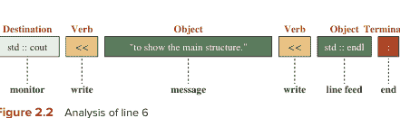


## 程序 2.2 第二个简单程序

```cpp
/**************************************************************
 * This program shows how we can print a square of asterisks. *
 **************************************************************/
#include <iostream>
using namespace std;

int main()
{
    // Printing a square of asterisks
    cout << "******" << endl;
    cout << "******" << endl;
    cout << "******" << endl;
    cout << "******" << endl;
    cout << "******" << endl;
    cout << "******" << endl;
    return 0;
}
```

**运行：**
```text
******
******
******
******
******
******
```

## 分析

我们简要分析程序 2.2 中与第一个程序对应行不同的那些行。

**第 1 到 3 行：块注释** 第二个程序中的第 1 到 3 行与第一个程序不同。它们就是我们所说的**块注释**。块注释是一行或多行，被视为供代码用户或审查者阅读的注释，并且完全被编译器忽略（块注释在程序编译前被删除）。格式如下所示：

```text
/* Text to be ignored
Text to be ignored
Text to be ignored */
```

注释有一个开始部分和一个结束部分。开始部分由两个字符（/*）组成，结束部分由同样的两个字符但顺序相反（*/）组成。两者之间的所有内容都被视为注释并被忽略。注意，在开始部分和结束部分之间可以有任意字符（包括 * 和 /），但不能组合成开始部分或结束部分。在程序中，我们对整个注释使用彩色文本。注意，在第 1 到 3 行中，我们使用了一些星号作为文本，为注释创建了一个边框，但这只是个人选择。

**第 5 行** 这一行在这个程序中也是新的，如下所示：

```cpp
using namespace std;
```

第 5 行告诉编译器，当它看不到对象的最后一个名字时，在它前面插入 `std::` 以使名字完整。换句话说，它告诉编译器，我们在程序中使用的某些名字属于命名空间 std。有了这一行，我们就可以使用 cout 和 endl 对象，而无需用 std 命名空间限定它们。

**第 9 行** 这一行也是注释，但属于**行注释**（而不是块注释）。这种类型的注释以两个斜杠开始，后面继续写作为注释的文本（直到行尾）。整行都被编译器忽略。

```cpp
// Printing a square of asterisks
```

这种类型的注释只能跨一行。如果我们需要两行注释，就必须开始另一个行注释，或者使用块注释。

**第 10 到 15 行** 这些行与第一个程序中类似的行做同样的事情，但我们可以使用 cout 和 endl 而不用 `std::`。每一行在显示器上打印一行六个星号，从而形成一个星号方阵。在程序 2.2 中，我们使用了黄色背景来突出显示这里的函数体。这并非必需；它只是为了可读性。

## 2.2 变量、值和常量

在我们编写更多程序之前，需要理解三个概念：*变量、值，*和*常量*。

### 2.2.1 变量

用 C++ 语言编写的程序接收输入数据、处理这些数据并生成输出数据。由于输入和输出数据可能变化，我们必须能够将输入数据、中间数据和输出数据存储在内存中。因此，C++ 像大多数编程语言一样，使用了变量的概念。在计算机语言术语中，**变量**是一个内存位置，它需要有一个*名称*和一个*类型*。它被称为变量，是因为它的内容可能在程序执行期间发生变化。它的目的是存储和检索数据。它必须有一个*类型*，因为我们为不同目的使用不同的数据类型。

> **变量是一个内存位置，具有名称和类型，在程序执行的每一刻存储不同的值。**

在我们使用变量之前，必须先定义它。我们必须告诉编译器，我们想要使用一个具有给定名称和给定类型的内存位置。名称用于指代变量；类型用于说明变量中存储的是什么类型的数据。

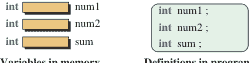

**图 2.5** 内存中的变量及其在程序中的定义

### 示例 2.1

图 2.5 显示了三个变量及其类型和名称。该图还显示了如何定义它们，以确保编译器知道我们所指的是哪个变量。

我们还没有讨论数据类型，但我们要说明，这三个数据类型都是整数类型（可以表示不带小数的整数），例如 17、35、100 等，但不是 23.67。

### 2.2.2 值

变量的内容称为它的**值**。例如，如果此刻 `num1` 保存整数 17，那么它的值就是 17。当我们在程序中使用变量名时，有时指的是变量本身，有时指的是它保存的值。下一个示例展示了这种区别。

### 示例 2.2

假设我们要编写一个程序，接受任意两个整数，将它们相加并显示结果。虽然我们还没有学习数据类型，但我们知道这两个数字和结果都是整数类型（在 C++ 中为 int）。为了存储这两个数字和加法结果，我们需要给它们命名。我们分别称它们为 **num1**、**num2** 和 **sum**。然后我们编写一个程序，每次运行时，求出从键盘输入的两个数字之和并打印它们（程序 2.3）。

## 程序 2.3 一个将两个值相加的程序

```cpp
/**************************************************************
 * This program gets the values for two numbers from the keyboard, *
 * adds them together and prints the result on the monitor.       *
 **************************************************************/
#include <iostream>
using namespace std;

int main()
{
    // Definition
    int num1;
    int num2;
    int sum;
    // Getting inputs
    cout << "Enter the first number: ";
16    cin >> num1;
17    cout << "Enter the second number: ";
18    cin >> num2;
19    // Calculation and storing result
20    sum = num1 + num2;
21    // Display output
22    cout << "The sum is: " << sum;
23    return 0;
24 }
```

```text
Run:
Enter the first number: 23
Enter the second number: 35
The sum is: 58

Run:
Enter the first number: 7
Enter the second number: 110
The sum is: 117
```

我们检查第 11 到 13 行的内容，如下所示：

```cpp
int num1;
int num2;
int sum;
```

这三行声明变量。声明变量意味着保留具有相应名称的内存。在上述三个声明的情况下，我们得到前面图 2.5 所示的情况。注意，此时程序中没有存储任何值。

现在我们检查第 15 到 18 行，如下所示：

```cpp
cout << "Enter the first number: ";
cin >> num1;
cout << "Enter the second number: ";
cin >> num2;
```

我们熟悉第一行。第一行在屏幕上打印一条消息，这被称为*提示*。它告诉用户接下来该做什么。第二行对我们来说是新的。它使用目标对象 `cin`（表示控制台输入）和一个命令（`>>`），其含义是*读取*。该命令等待程序用户在键盘上输入一个值（这里是整数）并按回车键。然后程序将输入的值存储到变量 `num1` 中。第三行与第一行相同。第四行与第二行相同，但它将用户输入的值存储到变量 `num2` 中。在这四行之后，两个值被存储


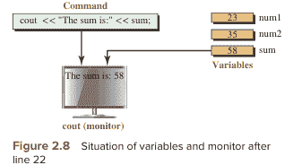

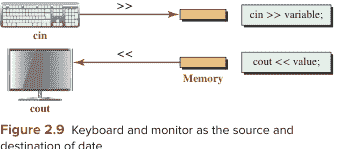

cout 对象使用输出设备作为数据的目标。cin 对象使用输入设备（例如键盘）作为数据的来源。cout 对象使用输出设备（例如显示器）作为数据的目标。cin 对象使用运算符（>>）获取数据；cout 对象使用运算符（<<）传递数据。如果我们结合图 2.9 所示的内存来观察这些对象，就能更好地理解它们的作用。

为了记住需要使用哪些运算符，我们可以把（>>）和（<<）看作表示数据移动方向的双箭头。输入时，数据向右移动；输出时，数据向左移动。

关于 cin 对象，我们需要记住的最重要的一点是：我们需要一个变量名（作为数据的目标）。另一方面，对于 cout 对象，我们需要一个值作为数据的来源。然而，我们已经看到，我们会使用诸如 cout << sum 这样的命令，其中 sum 是变量名。我们应当注意，在这种情况下，我们指的是 sum 的值，而不是 sum 的名称。这是我们需要记住的一个重要问题。变量名有时表示作为目标的物理变量；有时表示存储在该变量中的值的一份副本。

与 cout 对象一起使用的值不一定必须是某个变量的值；它也可以是一个独立的值，例如（cout << 12），表示将值 12 发送到显示器。

> **cin 对象需要看到变量名；**  
> **cout 对象需要看到值。**

以下示例阐明了这些重要概念。

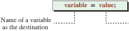

**图 2.10** 赋值中的源和目标

```cpp
cin >> x;          // Get a value from keyboard and store it in variable x.
cout << x;         // Get the value of variable x and display it; value of x will not change.
cout << 4;         // Display the value 4 on the screen.
cin >> 4;          // Error. The cin object needs a variable, not a value.
```

### 赋值运算符

另一个与值和变量概念相关的实体是赋值运算符。赋值运算符（=）需要左侧为变量，右侧为值，如图 2.10 所示。

当我们谈论与赋值运算符相关的值时，我们指的是已给出名称的变量的值、一个独立的值，或者组合成单个值的多个值。示例如下：

```cpp
x = y;             // Store the value of variable y into variable x.
x = 5;             // Store 5 into variable x.
x = y + 6;         // Take value of y, and add 6 to it, and store the result in variable x.
x = x + 3;         // Take value of x, add 3 to it, and store the result back in variable x.
x = x + y;         // Take value of x, add value of y to it, and store the result back in x.
```

请注意，赋值运算符左侧和右侧的 x 和 y 含义不同。

> 赋值运算符右侧的变量表示复制该变量的值（作为源）；赋值运算符左侧的变量表示将值存储到该变量中（作为目标）。

### 2.2.3 常量

本节讨论的最后一个实体是常量。常量是一种存储实体，其值不能改变。它的值是固定的。我们声明保存它的内存位置，用 const 修饰符限定名称，并使用赋值运算符存储我们希望它保存的值，无论我们引用它多少次。其格式以数学中 π 的值所示。请注意，术语 **double** 表示带小数的数，例如 3.14159 或 7.2。

```cpp
const double PI = 3.14159;        // Definition of a constant
```

上述定义告诉我们，我们希望将 π 的值存储在名为 PI 的内存位置中，但我们希望它的值在程序运行期间固定不变。换句话说，我们可以访问该值，但不能改变该值。这意味着我们不能在赋值运算符左侧使用名称 PI（定义它时除外），也不能将其与 cin 对象一起使用，如下所示：

```cpp
PI = x;          // Error: the value of PI cannot be changed
cin >> PI;       // Error: PI cannot receive a value
cout << PI;      // The value of PI can be shown on the monitor
x = PI;          // The value of PI can be stored in a variable
```

在程序中使用常量值的另一种方式是将其用作 *字面量*。我们在程序中使用字面值，而不将其存储在内存位置中。然而，专家禁止在程序中使用字面量，除非所有查看程序的人都完全清楚其用途。下面展示了在给定半径时，如何使用存储常量和字面常量来求圆的周长（此处的星号表示乘法）。

```cpp
perimeter = 2 * PI * radius;        // 2 is a literal, PI is a stored constant
```

## 2.3 C++ 程序的组成部分

既然我们已经讨论了一些 C++ 程序并分析了它们，现在我们来介绍 C++ 程序的组成部分。要用一门新的自然语言（如法语或西班牙语）写作，我们必须了解该语言的组成部分。我们必须知道所用词集的含义，以及如何将它们组合成句子。我们还必须熟悉该语言中使用的标点符号。学习用一门新的计算机语言（如 C++）创建程序要简单得多，因为它需要掌握的词和符号数量有限。

我们在 C++ 程序（称为源代码）中看到的内容通常由两种相互交织的内容组成。第一种是编译器用来创建可运行程序（以机器语言表示）的代码。第二种是程序员添加的注释，用于解释整个程序或部分程序的目的。第一种使用 C++ 语言的 *标记*；第二种使用英语单词和少量预定义符号。

### 2.3.1 标记

不含注释的 C++ 程序是 *标记* 的序列。*标记* 可以是 *标识符*、*字面量* 或 *符号*。下面逐一讨论。

### 标识符

*标识符* 是 C++ 语言中实体的名称。要成为有效标识符，名称必须以字母或下划线开头，并且可以包含零个或多个数字、字母或下划线。标识符中的字符数量没有限制。

> **标识符必须以字母或下划线开头，并且可以包含零个或多个字母、数字或下划线。**

正如我们之前提到的，C++ 语言区分大小写。许多程序员使用由小写字母构成的标识符，但使用由两个或三个单词构成的标识符越来越常见：第一个单词全部小写，后续单词以大写字母开头，例如 `lowerValue`、`upperValue`、`firstTest`、`secondTest`、`timeOfWithdraw` 等。C++ 语言的库也使用由多个单词组成、以下划线分隔的标识符，但我们在程序中需要避免使用它们。

### 示例 2.3

程序 2.1 中的标识符列表如下：

```
`include`, `iostream`, `int`, `main`, `std`, `cout`, `endl`, `return`
```

它们可分为 *关键字*、*预定义标识符* 和 *用户定义标识符*。下面逐一讨论每一类。

**关键字** **关键字**（有时称为保留字）是 C++ 语言保留的标识符，程序员或该语言的库不能重新定义它。我们在正文和程序中将关键字显示为彩色，以区别于其他标识符。表 2.1 显示了 C++ 中的 84 个关键字。这些关键字是按照我们之前讨论的标识符规则构成的。

**表 2.1 — 关键字**

|  |  |  |  |  |
|---|---|---|---|---|
| alignas | alignof | and | and_eq | asm |
| auto | bitand | bitor | bool | break |
| case | catch | char | char16_t | char32_t |
| class | compl | const | const_cast | constexpr |
| continue | decltype | default | delete | do |
| double | dynamic_cast | else | enum | explicit |
| export | extern | false | float | for |
| friend | goto | if | inline | int |
| long | mutable | namespace | new | noexcept |
| not | not_eq | nullptr | operator | or |
| or_eq | private | protected | public | register |
| reinterpret_cast | return | short | signed | sizeof |
| static | static_assert | static_cast | struct | switch |
| template | this | thread_local | throw | true |
| try | typedef | typeid | typename | union |
| unsigned | using | virtual | void | volatile |
| wchar_t | while | xor | xor_eq |  |


## 示例 2.4

找出程序 2.1 中有多少个标识符是关键字。我们看到其中只有两个是用颜色显示的关键字。在本书中，我们用蓝色区分关键字和其他标识符。

| 标识符 |
|---|
| `int`、`return` |

### 预定义标识符

我们在 C++ 语言中会遇到一些标识符，它们不是关键字，但属于语言中预定义的标识符。尽管我们可以重新定义它们并在程序中使用它们，但最好不要这样做，以避免混淆。

## 示例 2.5

找出我们在程序 2.1 中使用了多少个预定义标识符。如下所示，共有六个：

| 预定义标识符 |
|---|
| `include`、`iostream`、`main`、`std`、`cout`、`endl` |

### 用户自定义标识符

该语言的使用者（程序员）可以定义一组标识符并在其程序中使用，只要遵循我们前面讨论的标识符规则即可。以下是一些有效的程序员标识符：

| 有效的程序员标识符 |
|---|
| `z` | `z12` | `_3` | `sum` | `average` | `result2` | `counter` |

然而，我们不推荐前三个标识符。前两个不具描述性（名称没有说明实体的任何信息）；第三个以下划线开头，而下划线通常只用于预定义标识符。

以下都是无效（非法）标识符，会导致编译错误。前三个以数字开头。第三个、第四个和第五个含有除数字或字母之外的一些符号。最后两个是关键字，程序员不能重新定义它们。

| 无效标识符 |
|---|
| `3z` | `13` | `3?2` | `sum@` | `count-2` | `delete` | `double` |

## 示例 2.6

我们在程序 2.1 或程序 2.2 中没有定义任何标识符。不过，我们在程序 2.3 中创建了三个标识符，如下所示：

| 标识符 |
|---|
| `num1`、`num2`、`sum` |

### 字面量

我们在程序中遇到的另一组记号是字面量。字面量是不同类型的常量值。在本章讨论 C++ 语言中的数据类型之后，我们将讨论一些字面量。

| 表 2.2——C++ 中的符号 |  |  |  |  |  |  |  |  |  |
|---|---|---|---|---|---|---|---|---|---|
| `(` | `)` | `{` | `}` | `#` | `##` | `(` | `)` | `<` | `>` |
| `<%` | `%>` | `%:` | `%:%:` | `;` | `:` | `...` | `?` | `::` | `.*` |
| `-` | `*` | `/` | `%` | `^` | `&` | `|` | `?` | `::` | `.*` |
| `->` | `->*` | `~` | `!` | `=` | `==` | `<` | `>` | `<=` | `>=` |
| `<<` | `>>` | `<<=` | `>>=` | `+=` | `-=` | `*=` | `/=` | `%=` |  |
| `&=` | `|=` | `^=` | `++` | `--` |  |  |  |  |  |

## 示例 2.7

我们在程序 2.1 中使用了五个字面量：一个整数字面量和四个字符串字面量。

```cpp
0                                      // numeric literal
"This is a simple program in C++"      // string literal
"to show the main structure."          // string literal
"We learn more about the language";     // string literal
"in this chapter and the rest of the book."; // string literal
```

## 符号

C++ 使用非字母符号作为运算符和标点符号。我们将在本章后面讨论一些运算符。这里我们讨论示例程序中的一些标点符号。表 2.2 显示了 C++ 语言中使用的符号。

## 示例 2.8

找出程序 2.1 中使用的符号。它们如下所示：

```text
#   (   )   {   }   ::   <<   ;   }
```

## 2.3.2 注释

我们在介绍第二个程序时简要讨论了注释。注释是添加到程序中的解释，使阅读源代码的人能够理解程序。它们是由预处理器移除的文本，预处理器是一个为编译准备源代码的程序。

### 单行注释

如果我们需要简短注释，可以使用单行注释。单行注释以 `//` 开头，并在该行末尾终止。它可以在一行中的任何位置开始，但会占用该行其余部分。`//` 之后的该行其余内容会被编译器忽略。在本书中，我们用红色显示注释。

```cpp
cout << "Hello World";          // This prints the first line.
```

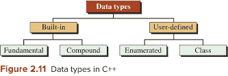

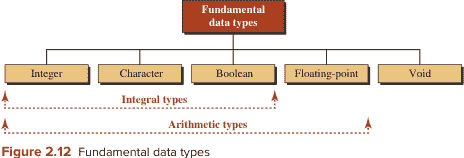

**内置类型**是由语言定义的类型。该语言将这一类分为两组：*基本（或原始）*类型和*复合*类型。基本类型非常基础；我们可以立即使用它们；复合类型派生自基本类型（将在后续章节讨论）。该语言还将用户定义类型分为两类：**枚举和类**。

基本数据类型本身根据其所定义内容的性质分为五类，如图 2.12 所示。

在本节中，我们只讨论基本类型和其中一种类类型（string 类）。我们将在后续章节讨论复合类型。

### 2.4.1 整型

不带小数的数称为**整数**。例如，数字 1376 是整数，但数字 1376.25 不是。C++ 允许三种不同大小的整数：**短整型**、**整型**和**长整型**（在附录 M 中，我们讨论 C++11 中定义的一种新整数数据类型）。然而，如果没有歧义，**int** 一词可以省略。这些类型的大小取决于平台，这意味着**长整型**在一台机器上可能是 4 字节，在另一台机器上可能是 8 字节。这三种不同类型中的每一种都可以是有符号或无符号的（默认是有符号）。我们使用前缀来表示这一点。换句话说，C++ 实际上定义了六种不同的**整数数据类型**。

表 2.3 显示了典型机器中使用的数字范围。请注意，我们假设**长整型**的大小为 4 字节（32 位），但有些平台为此使用 8 字节。

尽管该语言没有定义不同整数数据类型的确切大小和范围，但它强调了它们的相对大小。它定义了以下关系，其中符号 ≤ 表示“小于或等于”。

| `short int` | ≤ | `int` | ≤ | `long int` |
|---|---|---|---|---|

为了更好地直观理解这些不同的整数类型及其大小，我们可以查看图 2.13。

**表 2.3——典型机器中整数的范围**

| 类型 | 符号 | 范围 |
|---|---|---|
| short int | 有符号 | −32,768 到 +32,767 |
| short int | 无符号 | 0 到 65,535 |
| int | 有符号 | −2,147,483,648 到 +2,147,483,647 |
| int | 无符号 | 0 到 4,294,967,295 |
| long int | 有符号 | −2,147,483,648 到 +2,147,483,647 |
| long int | 无符号 | 0 到 4,294,967,295 |

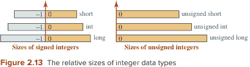

有符号类型可以是正数或负数；无符号类型只能是正数。请注意，有符号版本和无符号版本中某个类型的总范围相同，但在有符号版本中，范围被分为两个等分部分（0 被视为有符号部分的一部分）。

> 如果我们没有显式定义整数的符号，那么它是有符号的。

### 整型变量

如果显式定义了整数类型的变量，我们就可以在程序中使用整型变量：**短整型**、**整型**和**长整型**（**短整型**和**长整型**可以缩写为**short**或**long**）。同时，我们可以定义整数的符号：**有符号**或**无符号**（默认是**有符号**）。

## 示例 2.9

下面显示了六个变量的定义，每个变量都是不同的整数类型。

```cpp
// Long format                         // Short format
unsigned short int first;             unsigned short first;
signed short int second;              short second;
unsigned int third;                   unsigned int third;
signed int fourth;                    int fourth;
unsigned long int fifth;              unsigned long fifth;
signed long int sixth;                long int sixth;
```

## 示例 2.10

假设我们需要求任意一组硬币（美元、25 美分、10 美分、5 美分和 1 美分硬币）以 1 美分为单位的总价值。由于每种硬币的价值都是预定义的且始终为正，我们可以使用无符号整型常量，如程序 2.4 所示。


### 程序 2.4 使用无符号整数

```cpp
1 /************************************************
2  * Finding the total value of a set of coins
3  ************************************************/
4 #include <iostream>
5 using namespace std;
6
7 int main ()
8 {
9     // Defining constants
10     const unsigned int pennyValue = 1;
11     const unsigned int nickelValue = 5;
12     const unsigned int dimeValue = 10;
13     const unsigned int quarterValue = 25;
14     const unsigned int dollarValue = 100;
15     // Defining variables (number of each coin)
16     unsigned int pennies;
17     unsigned int nickels;
18     unsigned int dimes;
19     unsigned int quarters;
20     unsigned int dollars;
21     // Defining total value
22     unsigned long totalValue;
23     // Inputting number of different coins
24     cout << "Enter the number of pennies: ";
25     cin >> pennies;
26     cout << "Enter the number of nickels: ";
27     cin >> nickels;
28     cout << "Enter the number of dimes: ";
29     cin >> dimes;
30     cout << "Enter the number of quarters: ";
31     cin >> quarters;
32     cout << "Enter the number of dollars: ";
33     cin >> dollars;
34     // Calculating total value
35     totalValue = pennies * pennyValue + nickels * nickelValue +
36         dimes * dimeValue + quarters * quarterValue + dollars * dollarValue;
37     // Outputting result
38     cout << "The total value is: " << totalValue << " pennies.";
39     return 0;
40 }
```

运行：
```text
Enter the number of pennies: 20
Enter the number of nickels: 5
Enter the number of dimes: 10
Enter the number of quarters: 4
Enter the number of dollars: 6
The total value is: 845 pennies.
```

### 程序 2.5 在程序中使用有符号整数

```cpp
/*********************************************************
 * Finding the balance of an account after three transactions    *
 **********************************************************/
#include <iostream>
using namespace std;

int main ()
{
  // Definition of variables
  int balance = 0;
  int transaction;
  // Inputting first transaction and adjusting the balance
  cout << "Enter the value of the first transaction: ";
  cin >> transaction;
  balance = balance + transaction;
  // Inputting second transaction and adjusting the balance
  cout << "Enter the value of the second transaction: ";
  cin >> transaction;
  balance = balance + transaction;
  // Inputting third transaction and adjusting the balance
  cout << "Enter the value of the third transaction: ";
  cin >> transaction;
  balance = balance + transaction;
  // Outputting the final balance
  cout << "The total balance is: " << balance << " dollars. ";
  return 0;
}
```

运行：
```text
Enter the value of the first transaction: 70
Enter the value of the second transaction: -50
Enter the value of the third transaction: 35
The total balance in your account is: 55 dollars.
```

### 示例 2.11

在处理银行交易时，我们需要考虑有符号整数。存款是正值交易；取款是负值交易。程序 2.5 展示了当账户初始余额为零美元时，经过三笔交易后的账户余额。注意，由于我们同时使用正整数和负整数，即使余额为负，我们也允许每位客户取款。

### 示例 2.12

在本书后面，我们会进一步讨论每种类型的大小以及最大值和最小值。现在，我们编写一个小程序（程序 2.6），并使用 sizeof 运算符来查找我们所用平台上整数数据类型的大小。这有助于我们避免使用超出该类型范围的数据值。

### 程序 2.6 查找整数类型的大小

```cpp
/****************************************************************
 * A program to find the size of all three integer types         *
 ****************************************************************/
#include <iostream>
using namespace std;

int main()
{
    cout << "Size of short int is " << sizeof (short int) << " bytes." << endl;
    cout << "Size of int is " << sizeof (int) << " bytes." << endl;
    cout << "Size of long int is " << sizeof (long int) << " bytes." << endl;
    return 0;
}
```

运行：
```text
Size of short int: 2 bytes.
Size of int: 4 bytes.
Size of long int: 4 bytes.
```

注意，在我们用来运行该程序的计算机上，**int** 和 **long int** 的大小相同。

## 整数字面量

当我们在程序中显式使用任何类型的值时，该值称为字面量。**整数字面量**在程序中使用时具有常量值；程序执行时其值不会改变。如果程序员没有定义整数字面量的大小和符号，系统会使用能够容纳该值的最小大小（**int** 或 **long**）。如果该整数为正，则该字面量是**无符号**的；如果为负，则该字面量是**有符号**的。程序员可以使用表 2.4 中定义的后缀来显式定义字面量的大小和符号。

注意，short int 不用于字面量。默认值是 int（无后缀）。要告诉编译器我们需要 long，可以使用后缀 l 或 L（小写或大写）。数值字面量默认是有符号的：要显式说明我们希望它们无符号，需要使用后缀 u 或 U（小写或大写）。但是请注意，我们不推荐使用小写格式（l 或 u）。前者太容易与数字 1 混淆。

> 要显式定义整数字面量的大小或符号，我们使用后缀。

**表 2.4** 用于显式指定整数字面量大小和符号的后缀

| 大小 | 后缀 | 符号 | 后缀 |
|---|---|---|---|
| int | 无 | 有符号 int 或 有符号 long | 无 |
| long | l 或 L | 无符号 int 或 无符号 long | u 或 U |

### 示例 2.13

下面展示了我们将整数用作字面量时仅有的四种情况：

```cpp
1234        // The system uses signed integer
1234U       // The system uses unsigned integer
1234L       // The system uses signed long int
1234UL      // The system uses unsigned long int
```

整数字面量可以用于两个目的。它们既可以在计算中作为独立值使用，也可以用于初始化变量。

### 用于初始化的整数字面量

当我们声明变量时，可以将其初始化为某个值。这并不意味着之后不能更改变量的值。它只是意味着，如果没有给变量赋新值，该变量将保持初始值。在本书后面，我们会讨论变量的默认初始化值，但在那之前，我们应记得用适当的值初始化变量。

为了说明为什么在使用整数字面量初始化变量时需要小心，让我们运行程序 2.7。

### 程序 2.7 使用整数字面量进行初始化

```cpp
 /****************************************************************
  * Using some literal values as variable initializers             *
  ****************************************************************/
#include <iostream>
using namespace std;

int main()
{
  // Declaration and initialization
  int x = -1245;
  unsigned int y = 1245;
  unsigned int z = -2367;
  unsigned int t = 14.56;
  // Outputting initialized values
  cout << x << endl;
  cout << y << endl;
  cout << z << endl;
  cout << t;
  return 0;
}
```

运行：
```text
Value of x: -1245        // OK.
Value of y: 1245         // OK.
Value of z: 4294964929   // Logical error. A negative value is changed to positive.
Value of t: 14           // The value is truncated.
```

结果表明第 12 行存在逻辑错误。我们将变量 z 定义为无符号整数，并在其中存储了值 -2367。这个数字被解释为 4294964929 并存储在 z 中。我们将在下一章讨论这个逻辑错误，但这并不是我们想要的结果。第 18 行的结果同样令人意外。由于我们将变量 t 定义为无符号整数类型，并在其中存储了一个非整数值，系统通过丢弃小数点后的小数部分将该字面量转换为整数值。大多数严格主义者认为这种情况是逻辑错误。

### 用作独立值的整数字面量

我们还可以在程序中将整数字面量用作独立值。在这种情况下，程序看到的值取决于字面量值及其内容。

### 示例 2.14

程序 2.8 展示了几个测试上述情况的案例。

### 程序 2.8 一些字面量的使用

```cpp
/************************************************************/
/* Using some stand alone literal values                    */
/************************************************************/
#include <iostream>
using namespace std;

int main()
{
    // Variable definition
    int x;
    unsigned long int y;
    // Assignments
    x = 1456;
    y = -14567;
    // Outputs
    cout << x << endl;
    cout << y << endl;
```


### 程序 2.9 字符变量和字面量

```cpp
/*+++++++++++++++++++++++++++++++++++++++++++++++++++++++++++++++
 * Using some char variables and initialize them                 *
 *++++++++++++++++++++++++++++++++++++++++++++++++++++++++++++++*/
#include <iostream>
using namespace std;

int main()
{
    // Defining and initializing some variables of char type
    char first = 'A';
    char second = 65;
    char third = 'B';
    char fourth = 66;
    // Printing values
    cout << "Value of first: " << first << endl;
    cout << "Value of second: " << second << endl;
    cout << "Value of third: " << third << endl;
    cout << "Value of fourth: " << fourth;
    return 0;
}

Run:
Value of first: A
Value of second: A
Value of third: B
Value of fourth: B
```

> 字符字面量始终包含在一对单引号中。

我们可以使用转义序列（反斜杠后跟一个符号）来定义一些特殊字符，如表 2.5 所示。

前五个字符前使用反斜杠，是因为它们是不可打印字符。单引号用于界定字符，因此必须使用反斜杠来表示我们需要的是单引号本身，而不是界定符。**双引号**也是如此，但双引号用于界定字符串。因此，我们需要使用反斜杠告诉程序，我们实际需要的是这个字符，而不是界定符。如果想要直接使用反斜杠，则必须使用另一个反斜杠对其进行转义。

**表 2.5——一些特殊字符**

| 序列 | 描述 | 序列 | 描述 |
|---|---|---|---|
| `\n` | 换行（换行进纸） | `\f` | 换页 |
| `\t` | 制表符 | `\'` | 单引号 |
| `\b` | 退格 | `\"` | 双引号 |
| `\r` | 回车 | `\\` | 反斜杠 |

### 示例 2.15

虽然我们可以定义变量并为其赋予这些转义序列中的任意一个，但更好的方式是在字符串中使用它们，以展示其效果。程序 2.10 展示了如何在七个字符串中使用其中的七种转义序列。换页符不能与显示器一起使用；它用于让打印机换到新的一页。

### 程序 2.10 一些特殊字符的效果

```cpp
/***************************************************************
 * Using some special characters in strings                    *
 ***************************************************************/
#include <iostream>
using namespace std;

int main ()
{
    cout << "Hello\n";
    cout << "Hi\tfriends." << endl;
    cout << "Buenos dias  \bamigos." << endl;  // two space after dias
    cout << "Hello\rBonjour mes amis." << endl;
    cout << "This is a single quote\'" << endl;
    cout << "This is a double quote\"." << endl;
    cout << "This is how to print a backslash \\.";
    return 0;
}

Run:
Hello    // \n has the same effect as endl
Hi friends.    // effect of tab
Buenos dias amigos.    // \b deletes the previous character (one of the spaces)
Bonjour mes amis.    // \r moves control to beginning of line (Hello will be gone)
This is a single quote'    // A single quote is displayed
This is a double quote".    // A double quote is displayed
This is how to print a backslash \. // A backslash is displayed
```

### 2.4.3 布尔类型

C++ 语言定义了一种称为**布尔型**的类型（以法国数学家兼哲学家乔治·布尔命名），用于表示可以是**真**或**假**的值。这种类型被称为布尔型，但程序中实际使用的类型名称是关键字 **bool**。

这种类型主要用于表示比较两个值的结果。例如，如果比较整数 23 和 24 是否相等，结果为**假**。但是，如果比较它们是否不相等，结果则为**真**。

### 布尔变量

在几乎所有的实现中，*bool* 类型的值都存储在 1 字节的内存块中。换句话说，其大小为 1 字节或 8 位。如果将 *char* 类型的变量与 *bool* 类型的变量进行比较，会发现二者都使用 1 字节的内存，并且都可以存储整数。区别在于，存储在 *char* 类型中的整数会被解释为字符；而存储在 *bool* 类型中的整数会被解释为逻辑值（0 或 1），即（*false* 或 *true*）。

***bool* 数据类型的大小为 1 字节。**

布尔数据类型用于决策过程，我们将在后续章节中讨论这些过程。

### 布尔字面量

由于布尔类型实际上是一个 1 字节的整数，因此可以使用较小的整数来表示**布尔字面量**。按照传统，任何零值都会被解释为 *false*；任何非零值都会被解释为 *true*。输出布尔类型的值时，结果要么是 0，要么是 1。在后续章节中，我们将介绍如何将字面量输出为 *false* 或 *true*。

### 示例 2.16

程序 2.11 是一个用于测试布尔值的简单程序。

### 程序 2.11 布尔类型

```cpp
/*********************************************************
 * The use of Boolean variables and values                *
 *********************************************************/

#include <iostream>
using namespace std;

int main ()
{
   // Variable definitions
   bool x = 123;
   bool y = -8;
   bool z = 0;
   bool t = -0;
   bool u = true;
   bool v = false;
   // Outputting values
   cout << "Value of x: " << x << endl;
   cout << "Value of y: " << y << endl;
   cout << "Value of z: " << z << endl;
   cout << "Value of t: " << t << endl;
   cout << "Value of u: " << u << endl;
   cout << "Value of v: " << v << endl;
   return 0;
}

Run:
Value of x: 1       // 123 is interpreted as 1 (true)
Value of y: 1       // -8 is interpreted as 1 (true)
Value of z: 0       // 0 is interpreted as 0 (false)
Value of t: 0       // -0 is interpreted as 0 (false)
Value of u: 1       // true is output as 1
Value of v: 0       // false is output as 0
```

请注意，任何非零值（正数或负数）都会被解释为 true；任何零值都会被解释为 false。除非我们明确将其更改为 true 或 false，否则布尔值会显示为 1 或 0；我们将在后续章节中讨论这一点。

### 2.4.4 浮点类型

带有小数的数在 C++ 中称为**浮点型**。为了提高计算效率，C++ 定义了三种不同大小的浮点类型：**float**、**double** 和 **long double**。所有浮点数都是有符号数。

> **所有浮点数都是有符号数。**

浮点数使用 IEEE 标准存储在计算机中（取值范围请参见附录 S）。虽然语言没有定义不同浮点数据类型的确切大小和范围，但强调了它们之间的相对大小。它定义了如下关系，其中符号 ≤ 表示“小于或等于”。

`float ≤ double ≤ long double`

图 2.14 以图形方式展示了这种关系。请注意，所有浮点数据类型都是有符号的，因此其关系比整数数据类型的关系更简单。

### 浮点变量

我们可以采用定义整数的相同方式来定义浮点变量。可以在声明变量时对其进行初始化，也可以稍后为其赋值。

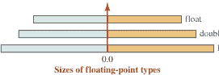

**图 2.14** 浮点类型的相对大小

### 浮点字面量

浮点字面量是带有小数部分的数值，例如 32.78、141.123、123456.0 和 -2472.657。程序员可以使用表 2.6 所示的后缀来明确指定其大小。

**表 2.6** 用于定义字面量大小的后缀

| 浮点类型 | 后缀 | 示例 |
|---|---|---|
| float | f 或 F | 12.23F、12345.45F、-1436F |
| double | **无** | 1425.36、1234.34、12345.4 |
| long double | l 或 L | 2456.23L、143679.00004L、-0.02345L |

> 浮点字面量的默认大小为 double。

### 示例 2.17

我们之前讨论过如何计算圆的面积和周长。程序 2.12 根据给定的半径计算任意圆的面积和周长。

### 程序 2.12 计算圆的面积和周长

```cpp
/*********************************************************
 * This program calculates the area and perimeter of a circle.
 *********************************************************/

#include <iostream>
using namespace std;

int main ()
{
   // Defining a stored constant
   const double PI = 3.14159;
   // Defining three variables
   double radius;
   double perimeter;
   double area;
   // Inputting value for radius
   cout << "Enter the radius of the circle: ";
   cin >> radius;
   // Calculating perimeter and area and storing them in variables
   perimeter = 2 * PI * radius;   // 2 is used as a constant literal
   area = PI * radius * radius;
```


### 程序 2.12 计算圆的面积和周长（续）

```cpp
21  // Outputting the value of radius, perimeter, and area
22  cout << "The radius is: " << radius << endl;
23  cout << "The perimeter is: " << perimeter << endl;
24  cout << "The area is: " << area;
25  return 0;
26 }
```

```text
Run:
Enter the radius of the circle: 10.5
The radius is: 10.5
The perimeter is: 65.9734
The area is: 103.631
```

### 2.4.5 void 类型

**void 类型**是一种没有值的特殊类型。然而，它很有用，因为它可以表示没有任何值。例如，我们可以使用 void 来表示函数不返回值。没有值这一概念与我们在现实生活中所说的*空头支票*相同，空头支票是用于其他目的但没有价值的支票。例如，void 类型可用于表示函数不返回任何内容。

### 2.4.6 string 类

本章到目前为止使用的字符串继承自 C 语言。它是以空字符结尾的字符集合。例如，字符串 "John" 可以看作由五个字符 'J'、'o'、'h'、'n' 和 '\0' 组成的集合，其中最后一个字符定义空字符（终止符）。我们将在后续章节讨论数组（元素的集合）时更详细地了解这种字符串。

C++ 定义了一个新的 string 类，它是一种用户定义类型（见图 2.11）。**string 类**定义在 C++ 库中，更加复杂且更易于使用，因为为它定义了许多操作。我们逐渐使用 **C++ 字符串**而不是 **C 字符串**，直到在后续章节完整讨论这个类。

要使用 C++ 字符串，我们必须像下面这样在程序中包含头文件 `<string>`：

```cpp
#include <string>
```

我们使用以下定义声明一个 string 类型的变量：

```cpp
string name;
```

其中 *name* 是变量的名称。string 类的对象也可以使用双引号创建，例如 "John"。C 字符串字面量与 C++ 字符串对象之间的区别之一是，前者由五个字符组成；后者仅由四个字符组成（C++ 字符串中不需要空字符）。随着我们逐步学习对此类对象使用操作，**C++ 字符串**的主要区别和优势将会显现出来。

我们可以用 C++ 字符串做的一件有趣的事情是拼接。我们可以简单地使用加法运算符 (+) 将两个或多个字符串拼接在一起，如下一个示例所示。

### 示例 2.18

在这个示例中，我们编写一个使用 C++ 字符串的简单程序（程序 2.13）。我们声明一个人的名、姓和首字母，并使用拼接打印完整姓名。这只是 string 类的一个简单示例；更强大的示例将在后续章节中讨论。

### 程序 2.13 使用 string 类

```cpp
/***************************************************************
 * This program prints the full name of a person given the first,
 * the middle, and the last name.
 ***************************************************************/
#include <iostream>
#include <string>             // Need to use the string class
using namespace std;

int main ()
{
    // Defining variables
    string first;
    string initial;
    string last;
    string space = " ";
    string dot = ".";
    string fullName;
    // Input data for first name, initial, and last name
    cout << "Enter the first name: ";
    cin >> first;
    cout << "Enter the initial: ";
    cin >> initial;
    cout << "Enter the last name: ";
    cin >> last;
    // Formation of full name using concatenation operator
    fullName = first + space + initial + dot + space + last;
    // Outputting full name
    cout << "The full name is: " << fullName;
    return 0;
}
```

```text
Run:
Enter the first name: John
Enter the initial: A
Enter the last name: Brown
The full name is: John A. Brown
```

## 关键术语

-   ASCII
-   反斜杠
-   块注释
-   布尔
-   布尔字面量
-   内置数据类型
-   C 字符串
-   C++ 字符串
-   字符类型
-   字符字面量
-   类
-   注释
-   常量
-   数据类型
-   double
-   双引号
-   枚举
-   浮点
-   浮点字面量
-   基本数据类型
-   标识符
-   include
-   include 指令
-   整数
-   整数数据类型
-   整数字面量
-   关键字
-   行注释
-   字面量
-   换行
-   预处理器
-   单引号
-   string 类
-   标记
-   值
-   变量

## 小结

C++ 语言区分大小写。我们通常将程序划分为多行以提高可读性。程序中的头文件在程序顶部包含预定义代码。每个 C++ 程序至少需要一个名为 main 的函数。

C++ 程序使用变量，变量具有名称和类型。

我们在程序中使用的 *cin* 和 *cout* 对象与变量和值的概念密切相关。*cin* 对象从键盘获取数据并将其存储在变量中；*cout* 对象将值发送到显示器。

C++ 程序中的源代码通常由彼此交织的两部分组成：代码和注释。代码使用 C++ 语言的*标记*；注释是英语单词。一个*标记*可以是*标识符*、*字面量*或*符号*。

用 C++ 语言编写的程序会操作数据。C++ 识别不同类型的数据：*内置（基本和复合）*类型和*用户定义（枚举和类）*类型。基本数据类型分为三类：整数类型、字符类型和浮点类型。*整数*是没有小数部分的数。字符数据类型定义一个字母。*布尔*数据类型表示真值或假值。浮点类型表示带小数部分的数。

C++ 语言使用两种字符串类型；第一种称为 C 字符串；第二种称为 C++ 字符串。

## 习题

-   **PR-1.** 找出以下程序中的错误（如果有）。

  ```cpp
  #include <iostream>
  using namespace std

  int main ()
  {
      cout << 25;
      cout << first;
      return 0;
  }
  ```

-   **PR-2.** 找出以下程序中的错误（如果有）。

  ```cpp
  #include <iostream>

  int main ()
  {
      cout << 35;
      cout << 45;
      return 0;
  }
  ```

-   **PR-3.** 找出以下程序中的错误（如果有）。

  ```cpp
  #include <iostream>
  using namespace std

  int main ();
  {
      std::cout << 35 << endl;
      std::cout << 45;
  }
  ```

-   **PR-4.** 找出以下程序中的错误（如果有）。

  ```cpp
  #include <iostream>
  using namespace std

  int main ()
  {
      int a = 25;
      a + 30 = a;
      cout << a;
      return 0;
  }
  ```

-   **PR-5.** 找出以下程序中的错误（如果有）。

  ```cpp
  #include <iostream>
  using namespace std;

  int main ()
  {
      string name;
      cout << name;
      return 1;
  }
  ```

```cpp
{
    char y = 32;
    char t = 78;
    char z = y + t;
    cout << z;
    return 0;
}
```

-   **PR-11.** 以下程序会打印什么？

  ```cpp
  #include <iostream>
  using namespace std;

  int main ()
  {
      int x = 12;
      int y = 14;
      int z = x + y;
      cout << z;
      return 0;
  }
  ```

-   **PR-12.** 以下程序会打印什么？

  ```cpp
  #include <iostream>
  using namespace std;

  int main ()
  {
      double x = 12.24;
      double y = 14.32;
      cout << x << " + " << y;
      return 0;
  }
  ```

-   **PR-13.** 以下程序会打印什么？

  ```cpp
  #include <iostream>
  using namespace std;

  int main ()
  {
      char x = 'A';
      char y = 'B';
      cout << x << y;
      return 0;
  }
  ```

-   **PR-14.** 以下程序会打印什么？

  ```cpp
  #include <iostream>
  using namespace std;
  ```


```cpp
int main ()
{
    bool truth = true;
    bool lie = false;
    bool result = truth + lie;
    cout << result;
    return 0;
}
```

**PR-15.** 列出下列程序中的所有关键字。

```cpp
#include <iostream>
using namespace std;

int main ()
{
    int x = 0;
    int y = 1;
    cout << x << y;
    return 0;
}
```

**PR-16.** 找出下列程序中所有非关键字标识符。

```cpp
#include <iostream>
using namespace std;

int main ()
{
    int x = 4;
    int y = 22;
    cout << x << y;
    return 0;
}
```

**PR-17.** 找出下列程序中的所有变量。

```cpp
#include <iostream>
using namespace std;

int main ()
{
    int x = 4;
    int y = 22;
    cout << x << y;
    return 0;
}
```

**PR-18.** 给出下列程序中包含行注释的行号。

```cpp
#include <iostream>
using namespace std;

int main ()
{
    // Declaration and initialization of two variables
    int x = 4;
    int y = 22;
    // Print the value of x and y
    cout << x << " " << y;
    return 0;
}
```

**PR-19.** 给出下列程序中包含块注释的行号。

```cpp
/***********************************
 * A small program to print two values.                         *
 ***********************************/
#include <iostream>
using namespace std;

int main ()
{
    int x = 4;
    int y = 22;
    cout << x << " " << y;
    return 0;
}
```

## 编程项目

**PRG-1.** 编写一个程序，打印下面的星号三角形。

```text
*
**
***
```

**PRG-2.** 编写一个程序，使用星号打印下面的图形。

```text
*
**
***
**
*
```

**PRG-3.** 编写一个程序，打印如下所示的大写字母 H。

```text
H  H
H  H
HHHH
H  H
H  H
```

**PRG-4.** 编写一个程序，给定任务持续时间的小时数、分钟数和秒数，计算以秒为单位的持续时间。

**PRG-5.** 编写一个程序，输入四个整数值，计算并打印它们的和。

**PRG-6.** 编写一个程序，在给定正方形一条边的长度时，计算并打印该正方形的面积和周长。

**PRG-7.** 编写一个程序，使用 C++ 字符串，在提示输入你的名字和姓氏后，按如下所示格式打印你的姓名。注意，姓氏应如所示放在名字之前。

> 你的全名是：*姓，名*

**PRG-8.** 编写一个程序，提示用户输入两个整数，然后打印它们的和。多次运行程序，每次为变量使用不同的值。

**PRG-9.** 编写一个程序，在给定销售金额的情况下计算交易的销售税。假设税率为 9%。使用常量定义税率。多次运行程序，每次为销售金额使用不同的值。使用以下格式输出。

> 销售金额：...  
> 税额：...  
> 应付总额：...

**PRG-10.** 编写一个程序，在给定街道号码、街道名称、城市名称、州名称和邮政编码时，按以下格式打印地址。

> *街道号码，街道 城市，州 邮政编码*

## 表 3.1 C++ 表达式部分列表

| 组 | 名称 | 运算符 | 表达式 | 优先级 | 结合性 |
| --- | --- | --- | --- | --- | --- |
| 基本 | 字面量<br>名称<br>括号表达式 |  | 字面量<br>名称<br>(表达式) | 19 | → |
| 一元 | 加<br>减<br>sizeof | +<br>-<br>sizeof | + 表达式<br>- 表达式<br>sizeof 表达式 | 17 | ← |
| 乘法 | 乘法<br>除法<br>求余 | *<br>/<br>% | 表达式 * 表达式<br>表达式 / 表达式<br>表达式 % 表达式 | 14 | → |
| 加法 | 加法<br>减法 | +<br>- | 表达式 + 表达式<br>表达式 - 表达式 | 13 | → |
| 赋值 | 简单赋值<br>复合赋值 | =<br>op= | 变量 = 表达式<br>变量 op = 表达式 | 3 | ← |

一个表达式可以是一个简单值。表达式也可以使用*运算符*将值组合起来以创建新值。在 C++ 中，表达式可以没有运算符、有一个运算符、有两个运算符或有三个运算符。我们也可以组合表达式来创建另一个表达式。

为了处理表达式，我们需要一个表达式列表，以及它们用于创建表达式时所对应的运算符。该列表见*附录 C*，但就本章而言，我们只需要该列表的一部分，如*表 3.1*所示。注意，我们在该列表中使用了一些缩写，例如 *Pred*（表示优先级）、*Assoc*（表示结合性）、*expr*（表示表达式）和 *op*（表示运算符）。

在讨论每一组表达式之前，让我们先提供一些关于表 3.1 的信息。

- 1. 该表只列出了五组表达式，但如今 C++ 有十九组表达式，如*附录 C*所示。
- 2. 第一列定义表达式的组。第二列定义通常用于每个子组的名称。第三列定义用作运算符的符号或术语。第四列展示运算符如何组合表达式以创建新表达式。
- 3. 第五列定义运算符的优先级（*Pred*）。我们将在本章后面讨论优先级；它告诉我们在有一组具有不同优先级的表达式时的求值顺序；优先级最高的先求值。注意，我们有十九个优先级级别，但*表 3.1*中只展示了其中五个。
- 4. 第六列定义运算符的结合性（*Assoc*）。我们也将在本章后面讨论结合性；它告诉我们在有相同优先级的表达式时的求值顺序。结合性可以是左到右（→）或右到左（←）。

现在我们讨论在表 3.1 中定义的五组表达式。

### 3.1.1 基本表达式

**基本表达式**是一种没有运算符的简单表达式。它是构造更复杂表达式的基本构件。基本表达式的优先级为 19，这意味着它在所有表达式中具有最高优先级。我们有若干种基本表达式，如附录 C 所示，但这里只描述表 3.1 中展示的那些。

### 字面量

我们已经讨论过*字面量*（程序中使用的值）。程序中的*字面量*是一种基本表达式；它有一个值，但没有副作用。下面展示了一些作为基本表达式的字面量。注意，不存在 short 字面量。

| 字面量 | 描述 | 字面量 | 描述 |
|---|---|---|---|
| `false` | `// Boolean literal` | `12897234L` | `// long integer literal` |
| `'A'` | `// character literal` | `245.78F` | `// float literal` |
| `"Hello"` | `// string literal` | `114.7892` | `// double literal` |
| `234` | `// integer literal` | `245.784321L` | `// long double literal` |

### 例 3.1

正如我们已经看到的，字面量可以因其值而被使用，如程序 3.1 所示。

### 程序 3.1 字面量表达式

```cpp
/************************************************************
 * The program shows some literal expressions.
 ************************************************************/
#include <iostream>
using namespace std;

int main ()
{
    cout << false << " " << 'A' << " " << "Hello" << endl;
    cout << 23412 << " " << 12897234L << endl;
    cout << 245.78F << " " << 114.782 << " " << 2.051L;
    return 0;
}
```

**运行结果：**
```text
0 A Hello                 // A Boolean, a character, a string
23412 12897234            // An integer, a long integer (there is no short literal)
245.78 114.782 2.051      // A float, a double, a long double
```

### 名称

当我们在程序中使用**名称**时，我们使用的是一种基本表达式。作为名称的*标识符*可以是变量、对象名、函数名等。我们能在程序中使用的最简单的名称是变量名。它是一个带值的基本表达式，该值存储在对应的变量中。正如我们在上一章所见，我们也可以使用限定名（用双冒号分隔组名和个体名的名称）。

| 表达式 | 描述 |
|---|---|
| `x` | `// Can be a name of a variable` |
| `cout` | `// The name of an object` |
| `std::cout` | `// A name qualified with its namespace` |

### 括号表达式

当我们有一个较低优先级的表达式，并希望将其变为基本表达式时，我们用圆括号将其括起来。这样做是为了在需要基本表达式的地方使用复杂表达式。有时我们还需要在求表达式的其余部分之前先求其中一部分的值。基本表达式具有最高优先级，因此我们添加圆括号，强制先求圆括号内表达式的值。我们将在本章后面看到一些括号表达式，但下面展示两个示例。

| 表达式 | 描述 |
|---|---|
| `(x + 3) * 5` | `// After adding the value of x with 3, multiply the result by 5` |
| `12 / (x + 2)` | `// After adding x with 2, then divide 12 by the result` |

在这两种情况下，如果我们去掉圆括号，表达式的值将会改变，不再是我们要得到的结果，如下一个程序所示。

### 例 3.2

程序 3.2 展示了使用圆括号会带来多大差别。我们使用上面描述的两个表达式，分别带圆括号和不带圆括号，以观察差异。

### 程序 3.2 括号表达式

```cpp
/***************************************************************
 * The program shows the use of parenthetical expressions.      *
 ***************************************************************/
#include <iostream>
using namespace std;

int main ()
{
    // Variable declaration
    int x = 4;
    // Printing the first expression with and without parentheses
    cout << "Value with parentheses: " << (x + 3) * 5 << endl;
    cout << "Value without parentheses: " << x + 3 * 5 << endl << endl;
}
```

（续）

**程序3.2** 括号表达式（续）

```cpp
14  // Printing the second expression with and without parentheses
15  cout << "Value with parentheses: " << 12 / (x + 2) << endl;
16  cout << "Value without parentheses: " << 12 / x + 2;
17  return 0;
18 }
```

运行：
```text
Value with parentheses: 35
Value without parentheses: 19

Value with parentheses: 2
Value without parentheses: 5
```

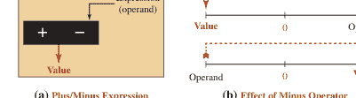

### 3.1.2 一元表达式

**一元表达式**是由一个运算符作用于单个值（称为操作数）组成的表达式，该值必须是基本表达式（如果不是，则必须先转换为基本表达式，本章后文将讨论）。结果是基本表达式。在一元表达式中，运算符位于操作数之前。

#### 正号和负号表达式

我们有两种表达式，分别称为**正号表达式**和**负号表达式**，但我们将它们放在一起讨论。在这两种表达式类型中，运算符都位于操作数之前，如图3.1所示。

正号运算符不改变其操作数的值（仅用于强调）；负号运算符确实会改变其操作数的值（翻转该值）。如果原值为正，该运算符将其变为负，反之亦然。

**例3.3**

程序3.3展示了如何将正/负号运算符应用于基本表达式。

#### sizeof表达式

另一种一元表达式是使用**sizeof**运算符，如图3.2所示。该运算符有两个版本：一个求表达式的大小，一个求类型的大小。第一个版本对表达式求值（求出其值），然后求该值的大小。第二个版本求由C++实现定义的类型的大小。下面展示这两个版本的示例：

```cpp
sizeof expression    // Finds the size of an expression.
sizeof (type)        // Finds the size of a type.
```

然而，请注意，第一个版本中的*表达式*必须是基本表达式。因此，如果我们的表达式包含运算符，就需要用圆括号将其括起来。当然，第二个表达式的结果取决于系统，因为数据类型的大小取决于系统。其他一元表达式将在后续章节中使用时讨论。

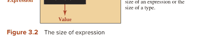

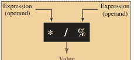

> **注意：** 对于乘法和除法运算符，如果操作数符号相同，结果为正；否则，结果为负。对于求余运算符，结果的符号取决于系统。

**图3.3** 乘法表达式

### 3.1.3 乘法表达式

**乘法表达式**是一种二元表达式，其中有两个操作数：左操作数和右操作数。有三种运算符可创建乘法表达式，如图3.3所示（*乘法、除法和求余*）。

#### 乘法

要将两个值相乘，我们使用乘法运算符，其符号为\*（星号）。如果两个操作数类型不同，可能会发生某些类型转换，后文将讨论。

#### 除法

要将一个值除以另一个值，我们使用除法运算符，其符号为 /（正斜杠）。如果两个操作数都是整数，结果就是整数值。如果其中一个操作数是浮点数，结果可以是浮点值。

#### 求余

要求一个整数值除以另一个整数值后的余数，我们使用求余运算符，其符号为百分号（%）。两个操作数都需要是正整数类型。如果任一操作数是负整数类型，结果取决于系统。

**例3.4**

程序3.4测试了一些乘法表达式。

**程序3.4** 乘法表达式

```cpp
/********************************************************
 * Shows effects of multiplicative expressions           *
 ********************************************************/
#include <iostream>
using namespace std;

int main ()
{
// Multiplication
cout << "Testing multiplication operator" << endl;
cout << "Value of 3 * 4 = " << 3 * 4 << endl;
cout << "Value of 2.4 * 4.1 = " << 2.4 * 4.1 << endl;
cout << "Value of -3 * 4 = " << -3 * 4 << endl;
// Division
cout << "Testing division operator" << endl;
cout << "Value of 30 / 5 = " << 30 / 5 << endl;
cout << "Value of 4 / 7 = " << 4 / 7 << endl;
// Remainder
cout << "Testing remainder operator" << endl;
cout << "Value of 30 % 5 = " << 30 % 5 << endl;
cout << "Value of 30 % 4 = " << 30 % 4 << endl;
cout << "Value of 3 % 7 = " << 3 % 7 << endl;
return 0;
}
```

运行：
```text
Testing multiplication operator
Value of 3 * 4 = 12
Value of 2.4 * 4.1 = 9.84
Value of -3 * 4 = -12
Testing division operator
Value of 30 / 5 = 6
Value of 4 / 7 = 0
Testing remainder operator
Value of 30 % 5 = 0
Value of 30 % 4 = 2
Value of 3 % 7 = 3
```

### 3.1.4 加法表达式

加法表达式是一种二元表达式，其中有两个操作数：左操作数和右操作数。我们有两种加法表达式：**加法**和**减法**（两者都称为加法表达式），如图3.4所示。

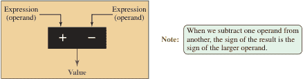

图3.4 加法表达式

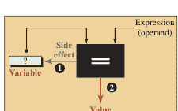

图3.5 简单赋值

> **注意：**
> 左操作数必须是一个变量。
> 变量的原值会丢失，而右侧表达式的值会作为副作用存储到该变量中。
> 副作用先完成；随后返回该值。

**在赋值中，右侧表达式的值会在返回表达式值之前存储到变量中（副作用）。**

**例3.6**

程序3.6展示了如何测试返回值和副作用。我们首先执行赋值，该赋值返回要打印的值（我们需要使用圆括号使赋值表达式先执行）。然后打印变量的值以检查副作用。

**程序3.6** 简单赋值运算符

```cpp
/**********************************************************
 * Testing some simple assignment expressions
 **********************************************************/
#include <iostream>
using namespace std;

int main ()
{
    // Variable Declaration
    int x;
    int y;
    // First assignment
    cout << "Return value of assignment expression: " << (x = 14) << endl;
    cout << "Value of variable x: " << x << endl;
    // Second assignment
    cout << "Return value of assignment expression: " << (y = 87) << endl;
    cout << "Value of variable y: " << y;
    return 0;
}
```

运行：
```text
Return value of assignment expression: 14
Value of variable x: 14
Return value of assignment expression: 87
Value of variable y: 87
```


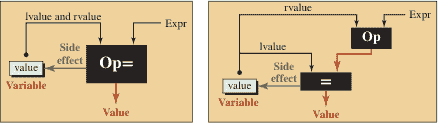

**图 3.6** 复合赋值及其解释

## 复合赋值

**图 3.6** 展示了**复合赋值**及其解释。在编程中，我们经常需要更改变量的内容，并将结果存回该变量，例如 `x = x + 5`。在每个表达式中，变量名会被使用两次：一次在左侧表达式中，一次在右侧表达式中。我们需要理解，这里的同一标识符表示两种不同的含义。在赋值运算符右侧，标识符 `x` 表示原始值的一个副本；在左侧，它表示计算右侧表达式的值，并将结果存入变量 `x`。由于上述表达式在编程中非常常见，C++ 为这类表达式提供了一种快捷方式。它将赋值运算符和右侧的运算符组合成一个称为复合赋值的单一运算符，并且只使用变量标识符一次。表达式变为 `x += 5`。

下面展示了一些复合赋值表达式以及编译器对它们的解释。

```cpp
x += 5          // It is interpreted by the compiler as      x = x + 5
y -= 3          // It is interpreted by the compiler as      y = y - 3
z *= 10         // It is interpreted by the compiler as      z = z * 10
t /= 8          // It is interpreted by the compiler as      t = t / 8
u %= 7          // It is interpreted by the compiler as      u = u % 7
```

注意，每个复合赋值运算符由两个运算符组成；我们不能将它们彼此分开。换句话说，如果我们使用 `z * = 10` 而不是 `z *= 10`，就会出错。

### 示例 3.7

程序 3.7 测试一些复合赋值的副作用。

### 程序 3.7 测试复合赋值

```cpp
/********************************************************
 * Testing some compound-assignment expressions          *
 *******************************************************/
#include <iostream>
using namespace std;

int main()
{
    // Declaration of five variables
    int x = 20;
    int y = 30;
    int z = 40;
    int t = 50;
    int u = 60;
    // Use compound assignments
    x += 5;
    y -= 3;
    z *= 10;
    t /= 8;
    u %= 7;
    // Output results
    cout << "Value of x: " << x << endl;
    cout << "Value of y: " << y << endl;
    cout << "Value of z: " << z << endl;
    cout << "Value of t: " << t << endl;
    cout << "Value of u: " << u << endl;
    return 0;
}
```

```text
Run:
Value of x: 25
Value of y: 27
Value of z: 400
Value of t: 6
Value of u: 4
```

第一个结果可以看作 `x = x + 5` 或 `x = 20 + 5`，实际上就是 `x = 25`。最后一个结果可以看作 `u = u % 7` 或 `u = 60 % 7`，实际上就是 `u = 4`。

### 3.1.6 *左值* 和 *右值* 的概念

在 C++ 中，任何可以放在赋值运算符左侧的实体都称为 **左值**（left value）。另一方面，任何可以放在赋值右侧的实体都称为 **右值**（right value）。这个名称有时会误导人。更清楚的说法是：可以作为值的去向的实体称为左值；可以作为值的来源的实体称为右值。当变量位于赋值左侧并作为去向时，它就是左值。同一变量位于赋值右侧并作为来源时，它就是右值。在复合赋值中，变量同时作为左值和右值。当我们把像 `x += 3` 这样的表达式展开为 `x = x + 3` 时，就可以看出这一点。

> *左值*可以看作值的去向；  
> *右值*可以看作值的来源。

## 3.2 类型转换

我们已经讨论了一些算术数据类型、一些运算符和一些表达式，但需要记住，运算符是对数据进行操作的。在求出算术运算的返回值以及（可能的）副作用之前，我们现在需要回答两个问题。

- 1. 当我们对非算术数据类型（如布尔型或字符型）应用算术运算符时会发生什么？例如，如果我们将两个布尔数据项相加，或将两个字符相乘，会发生什么？
- 2. 使用二元运算符时，如果操作数类型不同会发生什么？返回值的类型是什么？

要回答这些问题，我们需要讨论两个不同的过程：*隐式类型转换*和*显式类型转换*。在第一个过程中，数据类型被隐式更改以回答上述问题；在第二个过程中，我们强制进行**类型转换**。

C++ 语言提供了一种用于测试任何表达式类型的工具，如下所示：

```cpp
typeid(expression).name()
```

该表达式就是我们想知道其类型的表达式。该工具返回类型的缩写（即 `i` 表示 **int**，`d` 表示 **double**，依此类推）。要使用此工具，我们需要包含 `<typeinfo>` 头文件。

### 3.2.1 隐式转换

每当我们对未定义该运算的数据类型使用运算时，C++ 编译器都会在给出结果之前执行**隐式类型转换**。隐式类型转换意味着将操作数的类型更改为可以应用该运算的另一种类型。这分两步完成：*隐式类型提升*（将操作数的类型提升为更大的尺寸）和*隐式类型更改*（在二元运算中将一个操作数的类型更改为另一个操作数的类型，使它们类型相同）。我们分别讨论每一步。

> **隐式类型转换由编译器自动完成。**

### 隐式类型提升

**隐式类型提升**会自动应用于任何操作数，使其适合算术运算。这样做有两个原因。第一，操作数的类型不适合算术运算（布尔型和字符型）。第二，没有为该类型（**short** 和 **float**）定义算术运算符，因为如果对 **short** 或 **float** 值应用算术运算符，结果可能无法装入 **short** 或 **float**（想一想两个数据项相乘）。为避免这些问题，编译器应用五条隐式类型提升规则，如表 3.2 所示。

| 规则 | 原始类型 | 提升后的类型 |
|---:|---|---|
| 1 | `bool` | `int` |
| 2 | `char` | `int` |
| 3 | `short` | `int` |
| 4 | `unsigned short` | `unsigned int` |
| 5 | `float` | `double` |

### 示例 3.8

程序 3.8 展示了隐式类型提升如何将 **bool**、**char** 和 **short** 数据类型转换为 **int** 数据类型。它还展示了 **float** 数据的类型如何更改为 **double** 数据类型。注意，这些数据类型没有定义算术运算。因此，如果我们能使用算术运算（此处为加法），就意味着发生了隐式提升。

### 程序 3.8 数据类型的隐式提升

```cpp
/**************************************************************
 * Testing implicit type conversion for types with no arithmetic *
 * operations: bool, char, short and float                     *
 **************************************************************/
#include <iostream>
#include <typeinfo>
using namespace std;

int main ( )
{
    // Declarations
    bool x = true;
    char y = 'A';
    short z = 14;
    float t = 24.5;
    // Type conversion from bool to int
    cout << "Type of x + 100: " << typeid (x + 100).name() << endl;
    cout << "Value of x + 100: " << x + 100 << endl;
    // Type conversion from char to int
    cout << "Type of y + 1000: " << typeid (y + 1000).name() << endl;
    cout << "Value of y + 1000: " << y + 1000 << endl;
    // Type conversion from short to int
    cout << "Type of z * 100: " << typeid (z * 100).name() << endl;
    cout << "Value of z * 100: " << z * 100 << endl;
    // Type conversion from float to double
    cout << "Type of t + 15000.2: " << typeid (t + 15000.2).name() << endl;
    cout << "Value of t + 15000.2: " << t + 15000.2;
    return 0;
}
```

```text
Run:
Type of x + 100: i                 // Type is integer
Value of x + 100: 101
Type of y + 1000: i                // Type is integer
Value of y + 1000: 1065
Type of z * 100: i                 // Type is integer
Value of z * 100: 1400
Type of t + 15000.2: d             // Type is double
Value of t + 15000.2: 15024.7
```


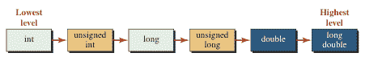

**图 3.7** 隐式转换的类型层次结构

## 隐式类型转换

根据前面讨论的规则对每个操作数进行隐式提升后，编译器可能会执行隐式类型转换，也可能不会。**隐式类型转换**发生在两个操作数类型不同时；转换之后，两个操作数的类型相同。如果操作是一元运算，则不需要进行隐式转换；如果操作是二元运算，则可能需要进行隐式类型转换，使两个操作数的类型相同。下面讨论两种情况。

### 无副作用的表达式

在这种情况下，根据图 3.7 中定义的类型层次结构，层次较低（大小较小）的操作数需要转换为层次较高的操作数类型。请注意，前一节中已经提升过的类型不包括在此列表中。例如，`bool`、`char`、`short`、`unsigned short` 和 `float` 类型的数据项不在此列表中，因为它们已经按照前一节所述进行了隐式提升。

编译器遵循的步骤是：找到层次较高的操作数，并将另一个操作数转换到该层次。

### 示例 3.9

程序 3.9 展示了一个示例。我们有三个变量。

**程序 3.9** 隐式类型转换（无副作用）

```cpp
/****************************************************************
 * Implicit type conversion in an expression of mixed types when
 * there is no side effect.
 ****************************************************************/
#include <iostream>
#include <typeinfo>
using namespace std;

int main()
{
    // Declarations
    int x = 123;
    long y = 140;
    double z = 114.56;
    // Check the type and value of expression x + y
    cout << "Type of x + y: " << typeid(x + y).name() << endl;
    cout << "Value of x + y: " << x + y << endl << endl;
    // Check the type and value of expression x + y + z
    cout << "Type of x + y + z: " << typeid(x + y + z).name() << endl;
    cout << "Value of x + y + z: " << x + y + z << endl;
    return 0;
}

Run:
Type of x + y: l                 // Type is long
Value of x + y: 263

Type of x + y + z: d             // Type is double
Value of x + y + z: 377.56
```

### 有副作用的表达式

在某些操作或活动中，值需要存储到预定义类型的目标中，此时我们不能更改目标的类型，因为它已经被定义。例如，将一个值赋给不同类型的变量时就会出现这种情况。在这些情况下，编译器会执行隐式类型转换。编译器会更改源类型，使其适合目标类型。例如，如果将浮点值赋给整数，编译器会截断源值，并将其整数部分赋给目标变量。另一方面，如果尝试将整数值赋给浮点类型的变量，编译器会为该整数添加一个值为零的小数部分，使其成为浮点值。

### 示例 3.10

程序 3.10 展示了如何将浮点值截断为整数，并将其存储在 **int** 类型的变量中；同时还展示了如何将整数值转换为浮点类型，并将其存储在 **double** 类型的变量中。

**程序 3.10** 隐式类型转换（有副作用）

```cpp
/************************************************************
 * Checking type conversion in an expression of mixed types *
 ************************************************************/
#include <iostream>
#include <typeinfo>
using namespace std;

int main()
{
    // Declaration
    int x;
    double y;
    // Assignment
    x = 23.67;
    y = 130;

    // Checking type and value of x
    cout << "Type of x = 23.67: " << typeid(x = 23.67).name() << endl;
    cout << "Value of x after assignment: " << x << endl;
    // Checking type and value of y
    cout << "Type of y = 130: " << typeid(y = 130).name() << endl;
    cout << "Value of y after assignment: " << y << endl;
    return 0;
}

Run:
Type of x = 23.67: i          // Type is int
Value of x after assignment: 23

Type of y = 130: d          // Type is double
Value of y after assignment: 130
```

请注意，`y` 的值打印为 130，但实际上是 130.0；我们需要使用一个操纵器来显示小数部分（本章稍后将讨论）。

### 3.2.2 显式类型转换（强制类型转换）

有时，我们需要或希望显式地更改操作数的类型。这可以使用**显式类型转换**来完成，这一过程称为**强制类型转换**。在 C++ 中有多种强制类型转换方式，但这里只介绍其中一种，即 `static_cast`，它在前面的某一节中已经介绍过。

```cpp
static_cast <type> (expression)
```

### 示例 3.11

程序 3.11 展示了隐式类型转换和显式类型转换之间的区别。我们有两个不同类型的变量。我们可以将这两个变量的值相加，从而允许进行隐式类型转换；也可以使用显式类型转换。在第一种情况下，编译器会将 `y` 的值转换为 `double`；在第二种情况下，我们强制将 `x` 的值转换为 `int`。请注意，在隐式转换中，`y` 的值被转换为 30.0，并与 23.56 相加，结果为 53.56。在显式转换中，23.56 被转换为 23，并与 30 相加，结果为 53。

**程序 3.11** 显式转换

```cpp
/**********************************************************
 * Comparing implicit and explicit conversion in an expression *
 **********************************************************/
#include <iostream>
using namespace std;

int main()
{
    // Declaration
    double x = 23.56;
    int y = 30;
    // Allowing implicit conversion
    cout << "Without casting: " << x + y << endl;
    // Forcing explicit conversion
    cout << "With casting: " << static_cast<int>(x) + y;
    return 0;
}

Run:
Without casting: 53.56
With casting: 53
```

## 3.3 求值顺序

在前面两节中，我们讨论了几种表达式类型。读者可能会问，如果一个复杂表达式中包含多个运算符，会发生什么？计算机如何对表达式求值？例如，下面这个由四个运算符组成的表达式的值是多少？

```text
3 + 4 * 7 / 22 - 8
```

要回答这个问题，我们需要考虑运算符的两个属性：**优先级**和**结合性**。附录 C 列出了 C++ 中使用的所有运算符和表达式，但对于本章而言，我们只需要使用表 3.1 所示的部分列表。

### 3.3.1 优先级

当一个复杂表达式包含多个优先级不同的简单表达式时，我们需要执行以下步骤来求出复杂表达式的值：

- 1. 对优先级最高的简单表达式求值，并用其值替换该表达式。此时我们得到一个新的表达式。
- 2. 重复步骤 1，直到整个表达式完成求值。

### 示例 3.12

程序 3.12 展示了如何求出 C++ 对表达式 **5 + 7 * 4** 求值后的结果。该程序同时展示了结果和求值步骤。请注意，乘法的优先级为 14，而加法的优先级为 13。

**程序 3.12** 对简单表达式求值

```cpp
/***************************************************************
 * Evaluating a simple expression with two levels of precedence *
 ***************************************************************/
#include <iostream>
using namespace std;

int main()
{
    cout << "Result of expression: " << 5 + 7 * 4 << endl;
    return 0;
}

Run:
Result of expression: 33
```

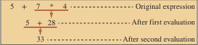

### 示例 3.13

程序 3.13 展示了如何对复杂表达式 **result = 5 - 15 % 4** 求值。该表达式由三个运算符组成——赋值、减法和取余，每个运算符具有不同的优先级。

**程序 3.13** 对复杂表达式求值

```cpp
/***************************************************************
 * Evaluating an expression with three levels of precedence
 ***************************************************************/
#include <iostream>
using namespace std;

int main()
{
    // Declare one variable
    int result;
    // Evaluate the expression and store the result in the variable
    result = 5 - 15 % 4;
    // Output the result stored in the variable
    cout << "The value stored in result: " << result;
    return 0;
}

Run:
The value stored in result: 2
```


### 程序 3.13 计算复杂表达式（续）

| 计算步骤 | 表达式 | 注释 |
| --- | --- | --- |
| result | result = 5 - 15 % 4 | 原始表达式 |
|  | result = 5 - 3 | 第一次计算后 |
|  | result = 2 | 第二次计算后 |
| 副作用 | 2 | 返回值 |

### 例 3.14

现在假设我们需要有意改变一个简单表达式的优先级。例如，我们需要将字面量 6 加到变量 x 的值上，然后将结果乘以 7。这里乘法优先于加法，但我们需要先做加法。解决方案是使用括号。如前所述，一对括号会创建一个处于最高优先级的基本表达式。程序 3.14 展示了如何编写并计算该表达式。

### 程序 3.14 带括号的简单表达式

```cpp
/*********************************************************
 * Evaluating simple expression including parentheses
 **********************************************************/
#include <iostream>
using namespace std;

int main ( )
{
    // Declaration
    int x = 5;
    // Outputting value of expression
    cout << "Value of (x + 6) * 7: " << (x + 6) * 7 ;
    return 0;
}
```

运行：
Value of (x + 6) * 7: 77

| 计算步骤 | 表达式 | 注释 |
| --- | --- | --- |
|  | (x + 6) * 7 | 原始表达式 |
|  | 11 * 7 | 第一次计算后 |
|  | 77 | 第二次计算后 |

### 例 3.15

作为另一个示例，假设 x 和 y 的原始值分别为 8 和 10。程序 3.15 展示了在计算以下表达式后，我们如何求得 y 的值：

### 程序 3.15 带副作用的表达式

```cpp
/* **************************************
   * Evaluating a simple expression with side effect
   ************************************** */
#include <iostream>
using namespace std;

int main( )
{
    // Declaration and initialization
    int x = 8;
    int y = 10;
    // Assignment
    y *= x + 5;
    // Outputting value of variable y
    cout << "Value of y: " << y;
    return 0;
}
```

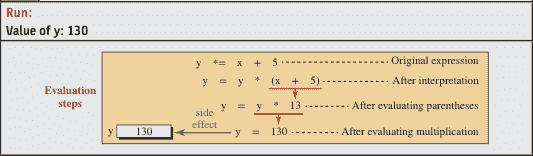

**y *= x + 5.** 注意，当我们将复合赋值展开为简单赋值时，复合赋值运算符右侧的表达式被视为一个基本表达式。换句话说，复合赋值实际上是 **y *= (x + 5)**，它展开为 **y = y * (x + 5)**。

### 3.3.2 结合性

在前面的示例中，我们使用的复杂表达式仅包含一个某类表达式实例（乘法、加法或赋值）。如果一个复杂表达式在同一优先级上包含多个表达式（例如两个乘法表达式），会发生什么？在这种情况下，我们需要使用简单表达式的结合性。运算符的结合性要么是从左到右，要么是从右到左（见表 3.1）。当需要计算包含多个同类表达式实例的特定表达式时，我们需要根据它们的结合性来计算这些表达式。

### 例 3.16

我们来求一个包含两个乘法运算符和两个加法运算符的表达式值：**5 − 30 / 4 * 8 + 10**。程序 3.16 展示了 C++ 如何计算该表达式。

### 程序 3.17 具有相同优先级的表达式（续）

```cpp
// Declaration and initialization
int x = 10;
int y = 20;
// Assignment
y += x *= 40;
// Printing values of x and y
cout << "Value of x: " << x << endl;
cout << "Value of y: " << y;
return 0;
}
```

```text
Run:
Value of x: 400
Value of y: 420
```

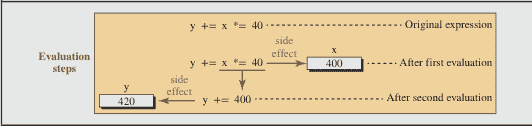

## 3.4 溢出和下溢

在编写更多程序之前，我们讨论一个所有程序员都需要理解的问题：*溢出*和*下溢*。在现实生活中，可以在纸上写出一个非常大的数。然而，每种计算机系统中为数据类型分配的内存是有限的。如果我们试图存储一个大于某类型最大值或小于其最小值的数，会发生什么？结果就是**溢出或下溢**。C++ 在编译期间不会产生错误消息，尽管可能会给出警告。实际发生的情况是结果并非我们所期望的。整数和浮点值的溢出与下溢行为不同（其他类型会提升为整数或浮点数，如前所述）。

### 3.4.1 整数中的溢出和下溢

众所周知，整数数据类型可以是有符号的或无符号的。无符号整数和有符号整数的溢出与下溢错误不同。我们分别讨论每种情况。

### 无符号整数中的溢出和下溢

无符号整数的范围从零到正最大值。我们想看看当试图使用大于最大值的值或小于零的值时会发生什么。第一种情况是溢出；第二种情况是下溢。两者如图 3.8 所示。无论哪种情况，值都会被回绕

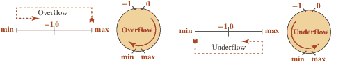

**图 3.9** 有符号整数中的溢出和下溢

### 有符号整数中的溢出和下溢

有符号整数的范围从负的最小值到正的最大值。我们想看看当试图使用大于最大值的值或小于最小值的值时会发生什么。第一种情况是溢出；第二种情况是下溢。两者如图 3.9 所示。换句话说，值会被回绕到有效范围内。大于正最大值的正值会变成负值；小于负最小值的负值会变成正值。

程序 3.19 展示了 **signed int** 类型中溢出和下溢的效果。我们将变量（num1）初始化为最大值，然后尝试给它加 1。我们将另一个变量（num2）初始化为最小值，然后尝试从中减 1。输出结果表明发生了回绕。由于最大值和最小值取决于系统，我们在第 11 行和第 12 行使用库函数来设置这些值。

### 程序 3.19 测试有符号整数中的溢出和下溢

```cpp
/*******************************************************
 * A program to test overflow and underflow in signed integers       *
 *******************************************************/
#include <iostream>
#include <limits>
using namespace std;

int main( )
{
    // Find the maximum and minimum of an integer
    int num1 = numeric_limits<int>::max();
    int num2 = numeric_limits<int>::min();
    // Print the maximum and minimum values
    cout << "Value of maximum signed int: " << num1 << endl;
    cout << "Value of minimum signed int: " << num2 << endl;
    // Cause num1 and num2 to overflow
    num1 += 1;
    num2 -= 1;
    // Print the overflowed values
    cout << "The value of num1 + 1 after overflow: " << num1 << endl;
    cout << "The value of num2 - 1 after underflow: " << num2 << endl;
22    return 0;
23  }
```

```text
Run:
The value of maximum signed int: 2147483647
The value of minimum signed int: −2147483648
The value of num1 + 1 after overflow: −2147483648
The value of num2 − 1 after underflow: 2147483647
```

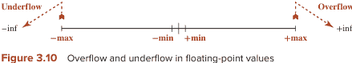

### 3.4.2 浮点值中的溢出和下溢

浮点值中也会出现溢出和下溢；不过这里有两个不同之处。第一，所有浮点值都是有符号的。第二，发生溢出和下溢时不会回绕；相反，我们会发生*下沉*。溢出会导致下沉到 +无穷大；下溢会导致下沉到 −无穷大。图 3.10 展示了这一概念。

注意，我们有两个最大值和两个最小值。最小值定义了最接近零的小数。正最大值和负最大值在分别增大或减小时，可能会产生正无穷大或负无穷大。程序 3.20 将 num1 和 num2 初始化为正最大值和负最大值，然后将每个数乘以 1000.00，使这些值溢出为 +inf 和 −inf。由于正最大值和负最大值取决于系统，我们在第 11 行和第 12 行使用库函数来初始化它们。

### 程序 3.20 双精度浮点数中的溢出和下溢

```cpp
 1  /**************************************************************
 2  * A program to test overflow and underflow in doubles          *
 3  ***************************************************************/
 4  #include <iostream>
 5  #include <limits>
 6  using namespace std;
 7
 8  int main()
 9  {
10      // Find the positive and negative maximum double
11      double num1 = +numeric_limits<double>::max();
12      double num2 = −numeric_limits<double>::max();
```


**程序 3.20** 双精度浮点数的溢出和下溢（续）

```cpp
// Print the positive and negative maximum double
cout << "The value of maximum double: " << num1 << endl;
cout << "The value of minimum double: " << num2 << endl;
// Multiply the values by 1000.00
num1 *= 1000.00;
num2 *= 1000.00;
// Print the overflowed values
cout << "The value of num1 * 1000 after overflow: " << num1 << endl;
cout << "The value of num2 * 1000 after underflow: " << num2 << endl;
return 0;
}
```

**运行：**

The value of maximum double: 1.79769e+308  
The value of minimum double: -1.79769e+308  
The value of num1 * 1000 after overflow: 1.#INF  
The value of num2 * 1000 after underflow: -INF

## 3.5 格式化数据

上一节中我们使用的程序以标准（默认）格式输入或输出数据。例如，布尔数据以 0 或 1 输入和输出。整数值以十进制格式输入和输出（见附录 B）。浮点值以标准格式输入（整数部分后跟小数点和分数部分），并按照应用程序的要求输出。有时我们需要改变这种行为。我们需要按自己的喜好格式化数据。这可以借助称为**操纵器**的预定义对象来完成。我们有用于输出数据的操纵器和用于输入数据的操纵器。我们首先讨论用于输出数据的操纵器，它们更常见也更广泛；然后讨论用于输入数据的操纵器。

### 3.5.1 输出操纵器

如前所述，输出操作使用输出对象完成。我们使用预定义的输出对象（cout）。到目前为止，我们只将数据项传递给插入运算符（<<）；还没有定义数据在显示或打印时应如何格式化。输出操纵器是一种可以传递给插入运算符以改变输出行为的对象。我们有两种不同的输出操纵器：无参数的和带一个参数的。下面分别讨论。

**无参数操纵器**

有几种输出操纵器不需要参数。无参数操纵器是 `<iostream>` 的一部分，这意味着不需要额外的头文件。表 3.3 列出了常见的无参数操纵器。

每一类操纵器（`endl` 除外）都以两个或三个为一组出现。每组中有一个操纵器是默认值。如果我们不使用该组中的操纵器，它就设置为默认值。在表 3.3 中，默认值用红色显示。注意，术语 (none) 表示没有默认值：除非我们明确指定另外两个选项之一，否则系统根据浮点数据的值使用定点或科学记数法。除 endl 外，所有操纵器都会改变输出流的状态。当我们选择组中的一个操纵器时，输出流就使用该操纵器，直到我们使用另一个操纵器改变状态。这意味着我们可以对全部输出数据应用某个操纵器，直到需要改变它为止。

> 除 endl 外，所有无参数操纵器都会改变输出流的状态。

**表 3.3 输出流的无参数操纵器**

| 操纵器 | 布尔型 | 字符型 | 整型 | 浮点型 |
|---|---|---|---|---|
| endl | √ | √ | √ | √ |
| noboolalpha, boolalpha | √ | | | |
| dec, oct, hex | | | √ | |
| noshowbase, showbase | | | √ | |
| (none), fixed, scientific | | | | √ |
| noshowpoint, showpoint | | | | √ |
| noshowpos, showpos | | | √ | √ |
| nouppercase, uppercase | | | √ | √ |
| left, right, internal | √ | √ | √ | √ |

**endl 操纵器** 我们从本书开头就一直使用这个操纵器。它用于在数据末尾添加一个 '\n' 字符，以强制下一次输出移到下一行。它是唯一不改变流状态的无参数操纵器。每次需要时都必须重复使用它。

**用于布尔字面量的操纵器（noboolalpha、boolalpha）** 表 3.3 中的第一类操纵器只能用于布尔数据类型。noboolalpha 操纵器将布尔值输出为整数（0 或 1）；boolalpha 将 bool 值输出为字面量（false 或 true）。程序 3.21 展示了一个测试。注意，我们不需要在第 17 行使用操纵器；输出状态已在第 16 行改变。

**程序 3.21** 测试 boolalpha 操纵器

```cpp
1  /*********************************************************
2   * A program to test boolalpha manipulator for logical values    *
3   *********************************************************/
4  #include <iostream>
5  using namespace std;
6  
7  int main ( )
8  {
// Declaration
bool x = true;
bool y = false;
// Testing values without manipulators
cout << "Value of x using default: " << x << endl;
cout << "Value of y using default: " << y << endl;
// Testing values using manipulators
cout << "Value of x using manipulator: " << boolalpha << x << endl;
cout << "Value of y: " << y;
return 0;
}
```

**运行：**

Value of x using default: 1  
Value of y using default: 0  
Value of x using manipulator: true  
Value of y: false

**用于不同基数的操纵器（dec、oct、hex）** 尽管所有整数在计算机中都以二进制（基数为 2）存储（见附录 B），但在程序中我们可能需要以三种不同格式之一输出它们：dec（基数为 10）、oct（基数为 8）或 hex（基数为 16）。默认是 dec。表示形式不会影响计算机中的大小、符号或值；它只是为了方便程序员。它允许程序员使用最方便的格式。例如，我们可以将整数 1237 打印为 1237（十进制）、2325（八进制）或 4D5（十六进制）。

**用于基数前缀的操纵器（showbase、noshowbase）** 当我们以不同基数输出整数时，可以选择不显示数字的基数（默认），或显示数字的基数。基数以前缀形式显示（十进制无前缀，八进制为 0，十六进制为 0x）。

**例 3.18**

程序 3.22 展示了如何使用操纵器将整数转换为不同基数，并显示或不显示基数前缀。

**程序 3.22** 测试用于整数基数的操纵器

```cpp
/**************************************************************
 * A program to print data in different bases (decimal, octal, *
 * and hexadecimal)                                             *
 ***************************************************************/
#include <iostream>
using namespace std;
int main( )
{
    // Declaration of variable x
    int x = 1237;
    // Outputting x in three bases without showbase
    cout << "x in decimal: " << x << endl;
    cout << "x in octal: " << oct << x << endl;
    cout << "x in hexadecimal: " << hex << x << endl;
    // Outputting x in three bases with showbase
    cout << "x in decimal: " << x << endl;
    cout << "x in octal: " << showbase << oct << x << endl;
    cout << "x in hexadecimal: " << showbase << hex << x;
    return 0;
}
```

```text
Run:
x in decimal: 1237
x in octal: 2325
x in hexadecimal: 4d5

x in decimal: 1237
x in octal: 02325        // 0 shows that the number is in octal
x in hexadecimal: 0x4d5  // 0x shows that the number is in hexadecimal
```

**用于定点或科学记数法的操纵器** 我们有两种方式显示浮点类型的值：*定点*或*科学记数法*。两者都如图 3.11 所示。

在**定点**格式中，浮点值显示为整数部分和小数部分，二者由小数点分隔，例如 (dddd.ddd)，其中每个 *d* 都是一位数字。如果数字为负，则数字前带有负号。在**科学记数法**格式中，数字显示为定点格式的数字乘以一个指数：如果数字非常大，则乘以 10ⁿ；如果数字非常小，则乘以 10⁻ⁿ。

**用于显示小数点的操纵器** 如果浮点值的小数部分为零，C++ 不会打印小数点。我们可以使用 `showpoint` 操纵器强制输出显示小数部分为零的小数点。

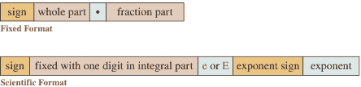

**图 3.11** 操纵器的定点格式和科学记数法格式


## 程序 3.23 测试浮点操纵符

```cpp
/**************************************************************
 * A program to test some manipulators for floating-point types *
 **************************************************************/
#include <iostream>
using namespace std;

int main( )
{
    // Declarations
    double x = 1237;
    double y = 12376745.5623;
    // Using fixed (default) and showpoint manipulator
    cout << "x in fixed-point format: " << x << endl;
    cout << "x in fixed-point format: " << showpoint << x << endl;
    // Using scientific manipulator
    cout << "y in scientific format: " << y << scientific;
    return 0;
}
```

```text
Run:
x in fixed-point format: 1237          // We have not used showpoint
x in fixed-point format: 1237.00        // We have used showpoint
y in scientific format: 1.23767e+007
```

## 示例 3.19

程序 3.23 展示了我们如何为浮点类型使用操纵符。

**用于显示正号的操纵符** 如果数字为正，C++ 不会显示正号（+）（负号则始终显示）。要强制正数打印时带上正号，我们可以使用 `showpos` 操纵符。

**用于以大写形式显示字母的操纵符** 我们已经看到，整数和浮点值有时会包含字母字符（a、b、c、d、e、f），用于表示十六进制记法的值；还会包含 x（用于十六进制记法）和 e（用于科学记法）。这些字符默认以小写形式打印。如果我们希望它们以大写形式打印，就使用操纵符 **uppercase**。

**用于调整字段中数字的操纵符** 稍后我们会看到，如何使用带参数的操纵符来定义字段的大小（占用的字符数），以便打印一个值。在确定大小之后，我们需要决定希望如何在字段中调整值和符号（如果有的话）。C++ 为此使用三种格式，如图 3.12 所示。

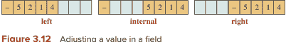

表 3.4 输出流的单参数操纵符

| 操纵符 | 布尔 | 字符 | 整数 | 浮点数 |
|---|---|---|---|---|
| `setprecision (n)` |  |  |  | √ |
| `setw (n)` | √ | √ | √ | √ |
| `setfill (ch)` | √ | √ | √ | √ |

在左对齐格式（默认）中，数字和符号位于字段的左侧，字段的其余部分用填充字符填充（我们很快就会解释）。在内部格式中，符号占据字段的最左侧部分，数字占据最右侧部分，剩余部分用填充字符填充。在右对齐格式中，符号和数字占据最右侧部分，左侧部分用填充字符填充。注意，此操纵符不会改变流的状态。

## 带参数的操纵符

我们只讨论三个接受一个参数（一个整数或一个字符）的操纵符，如表 3.4 所示。要使用这些操纵符，我们需要在程序中包含 `<iomanip>` 头文件。它们并未定义在 `<iostream>` 中。

**操纵符 setprecision (n)** 此操纵符仅用于定点（而非科学记数法）浮点值。括号内的整数 (n) 定义小数点后的位数。

**操纵符 setw (n)** 此操纵符用于定义我们希望值所占用的字段大小。注意，对于浮点数据类型，我们需要考虑整数部分、小数点和小数部分所占的空间。注意，此操纵符不会改变流的状态。需要为每个值单独设置。

**操纵符 setfill (ch)** 此操纵符展示了当值的实际大小小于 `setw (n)` 定义的宽度时，我们如何用填充字符填充字段。括号内的参数是用作填充的字面字符。我们之前讨论的 left、internal 和 right 操纵符随后可以决定填充字符位于何处。

> 除 `setw` 外，所有带参数的操纵符都会改变输出流的状态。我们必须在需要的地方重复 `setw`。

## 示例 3.20

程序 3.24 展示了我们如何测试带参数的操纵符。

## 程序 3.24 使用带参数的操纵符

```cpp
/***************************************************************
 * A program to test other manipulators for floating-point types
 ***************************************************************/
#include <iostream>
#include <iomanip>
using namespace std;

int main ( )
{
    // Declaration
    double x = 1237234.1235;
    // Applying common formats
    cout << fixed << setprecision(2) << showpos << setfill('*');
    // Printing x in three formats
    cout << setw(15) << left << x << endl;
    cout << setw(15) << internal << x << endl;
    cout << setw(15) << right << x;
    return 0;
}
```

```text
Run:
+1237234.12****
+****1237234.12
****+1237234.12
```

| 操纵符 | 布尔 | 字符 | 整数 | 浮点数 |
|---|---|---|---|---|
| noboolalpha, boolalpha | √ | | | |
| dec, oct, hex | | | √ | |

### 3.5.2 输入操纵符

有些操纵符可用于输入。这里我们只提及其中两个，其余的在第 16 章讨论。它们如表 3.5 所示。注意，它们与输出流的前两个操纵符相同，但用于输入流。在第一种情况下，我们可以输入布尔值 true 或 false，而不是 0 或 1。在第二种情况下，我们可以按八进制或十六进制输入整数值。

## 示例 3.21

程序 3.25 展示了我们如何为布尔值输入 false 或 true，然后将其打印为 0 或 1。

## 程序 3.25 测试布尔值输入

```cpp
/*********************************************************
 * A program to input Boolean values as false or true    *
 *********************************************************/
#include <iostream>
using namespace std;

int main ( )
{
    // Declaration
    bool flag;
    // Input value using manipulator
    cout << "Enter true or false for flag: ";
    cin >> boolalpha >> flag;
    // Output value
    cout << flag ;
    return 0;
}
```

| 运行： | |
| --- | --- |
| 为 flag 输入 true 或 false：false | |
| 0 | |
| 运行： | |
| 为 flag 输入 true 或 false：true | |
| 1 | |

## 示例 3.22

程序 3.26 展示了我们如何以十进制、八进制和十六进制格式输入三个变量的值。然后我们以十进制打印这三个值。

## 程序 3.26 以不同进制输入整数

```cpp
/********************************************************
 * A program to input integer value in any base           *
 ********************************************************/
#include <iostream>
using namespace std;

int main ( )
{
    // Declaration
    int num1, num2, num3;
    // Input first number in decimal (no manipulator)
    cout << "Enter the first number in decimal: ";
    cin >> num1;
    // Input second number in octal
    cout << "Enter the second number in octal: ";
    cin >> oct >> num2;
    // Input third number in hexadecimal
    cout << "Enter the third number in hexadecimal: ";
    cin >> hex >> num3;
    // Output values
    cout << num1 << endl;
    cout << num2 << endl;
    cout << num3;
    return 0;
}
```

```text
Run:
Enter the first number in decimal: 124
Enter the second number in octal: 76
Enter the third number in hexadecimal: 2ab
124
62
683
```

## 3.6 语句

我们已经学习了表达式，但在 C++ 语言中创建程序还需要语句。一个 C++ 程序由一系列 **语句** 组成。计算机按照程序规定的顺序执行每条语句，以实现程序的目标。

如果把 C++ 语言与英语这样的自然语言进行比较，我们会发现 C++ 中的语句扮演着自然语言中句子的角色。例如，在阅读英语文本时，句子是一个信息单元，我们必须先解释并理解它，才能继续看下一个句子。C++ 程序中的语句是一条命令，C++ 运行环境必须先执行它，才能转到下一条语句。然而，像 C++ 这样的编程语言也有一些语句会改变执行顺序，从程序中的一个位置转移到另一个位置。

C++ 提供了许多不同类型的语句，每种语句都有预定义的任务。这里我们只讨论其中一些。其余的将在后续章节中逐步讨论。

有些语句需要用分号来终止语句。另一方面，有些语句不需要分号，因为它们在末尾还有另一个标记用作终止符。

> 有些语句需要在末尾使用分号作为终止符，
> 但有些语句已经具有内置的终止符。

### 3.6.1 声明语句

C++ 中有两个术语必须解释：*声明* 和 *定义*。**声明** 通过提及实体的类型并赋予其名称（标识符）来引入一个实体。另一方面，**定义** 表示为实体分配内存。对于复杂程序，有许多实体需要声明和定义，但现在我们只限于变量和常量的声明。


## 变量声明

我们在前一节讨论了变量的概念。要在程序中使用变量，我们必须声明它。**变量声明**实际上既是声明也是定义，除非我们添加一个额外的修饰符（称为 **extern**）将定义推迟到程序的其他部分。变量声明语句需要分号来表示语句结束。

> 变量声明语句需要分号来终止该语句。

**单个声明** **单个声明**为变量命名并定义其类型。它还在内存中保留一个物理位置，适合存放所声明类型的数据项。下面我们声明并定义三个变量：test、sum 和 average。注意每个声明都需要分号来终止语句。

```cpp
short test;
int sum;
double average;
```

**多个声明** 如果我们需要声明多个相同类型的变量，可以将它们合并，只使用一条声明语句。例如，下面展示了如何声明三个 **int** 类型的变量、两个 **double** 类型的变量和一个 **char** 类型的变量。注意，我们需要用逗号分隔变量名，但只需要一个分号来终止语句。还要注意，逗号后不必添加空格，但我们强烈建议每个逗号后至少有一个空格，以提高程序可读性。

```cpp
int first, second, third;
double average, mean;
char ch;
```

**初始化** 当我们声明变量时，我们为变量命名，并请求计算机分配一个对应类型的内存位置。然而，声明并没有说明该内存位置最初应存储什么，但我们可以在声明变量时初始化它们，如下面的声明所示。

```cpp
int first = 0;
double average = 0.0, mean = 0.0;
char ch = 'a';
```

我们可能会问，如果变量未初始化会发生什么。我们会遇到两种情况。

**全局变量** 如果变量是全局的（在任何函数之外声明），它会被初始化为默认值（整数初始化为 0，浮点数初始化为 0.0）。注意，字符和布尔数据类型是特殊的（小）整数，会被初始化为 0。

**局部变量** 如果变量是局部的（在函数内部声明），则不会被初始化，但该变量会保存上一次使用后遗留的某些垃圾值。在使用局部变量之前，我们需要初始化它，或通过其他方式改变其中存储的垃圾值。

> 在使用局部变量之前，我们需要在其中存储一个值。

## 常量声明

在前一节中，我们讨论过*常量*是一个内存位置，其值被初始化后不能再更改。要使用常量，我们需要声明它（此处的声明也意味着定义）。**常量声明**与变量声明类似，但有四点不同。第一，我们需要在类型前使用关键字 `const`。第二，常量在声明时必须初始化。第三，习惯上使用大写字母为常量命名，以区别于程序中的变量（如果名称包含多个单词，则单词之间用下划线分隔）。第四，常量通常声明在程序的全局区域（任何函数之前，包括 `main`），这使得它们在所有函数中都可见。以下是使用常量的示例。

```cpp
const int FOOT_TO_INCH = 12;
const double TAX_RATE = 8.5;
const double PI = 3.1415926536;
```

> **常量在声明时必须初始化。**

### 3.6.2 表达式语句

**表达式语句**是以分号（作为终止符）结尾的表达式。我们在上一节了解到，*表达式*有一个值，并且可能产生副作用。当程序中遇到*表达式语句*时，计算机会确定其值并执行其副作用。该值会被丢弃，但副作用会改变计算机的内存状态。这意味着，如果表达式没有副作用，那么对应的表达式语句作为语句是无用的；我们需要避免这种语句，尽管编译器不会报错。

> **计算机计算表达式的值并执行其副作用。该值会被丢弃。**

### 示例 3.23

以下都是表达式语句。有些有用，有些无意义。只有最后一条会造成编译错误。

```cpp
num = 24;          // Expression statement
num *= 10;         // Expression statement
num = data + 6;    // Expression statement
num1 + num2;       // Useless. There is no side effect.
num1 * 6;          // Useless. There is no side effect.
num;              // Useless. There is no side effect.
6;                // Useless. There is no side effect.
cout << "Hello!"; // Output.
cin >> data       // Input
```

在一些文献中，表达式语句被称为赋值语句。C++ 语言的语法中不存在赋值语句，只有表达式语句。我们遵循正式的语言规范。

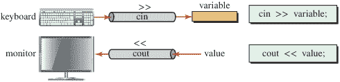

**图 3.13** 输入/输出对象与操作

尽管我们需要向程序输入数据并将结果从程序输出，但 C++ 中并没有输入/输出语句。在 C++ 中，输入和输出操作使用流对象（cin 和 cout）完成，如图 3.13 所示。

流对象可以看作连接程序与物理输入设备（如键盘）或物理输出设备（如显示器）的通道。连接到键盘的流称为 cin；连接到显示器的流称为 cout。符号 >>（称为提取运算符）实际上是为 cin 对象定义的运算符；符号 <<（称为插入运算符）实际上是为 cout 对象定义的运算符。

从表面上看，当我们使用输入/输出命令时，它看起来像是一种新类型的语句，但事实并非如此。输入/输出命令实际上是一条表达式语句，并且末尾需要分号。

> **我们在程序中使用过的输入/输出命令实际上是表达式语句，并且需要分号作为终止符。**

### 3.6.3 空语句

**空语句**是不执行任何操作的语句。我们将在接下来的两章中看到，有时 C++ 语法需要一个语句，但不需要副作用。我们将在后续章节讨论空语句的一些应用，但目前先假设我们误在表达式末尾添加了两个分号。编译器不会报错，因为它认为我们使用了两条语句：一条表达式语句和一条空语句。下面展示了这种情况。

```cpp
num = 24;          // We have an expression statement and a null statement.
;
```

### 3.6.4 复合语句

有时我们需要将多条语句视为一条语句。在这种情况下，我们将这些语句括在一对花括号中。我们可以在一对花括号内组合任意数量的语句（零条或更多条）。该过程会创建一条称为**复合语句**的单一语句，也称为*块*。每当 C++ 语法需要一条语句，而我们需要不止一条语句时，就必须使用复合语句。正如我们将在后续章节中看到的，有时我们甚至会将单条语句括在一对花括号中，以提高可读性并避免混淆。注意，复合语句末尾不需要分号；右花括号充当终止符。下面展示了一个包含两条语句的复合语句。

```cpp
{
    int num = 8;
    cout << num << endl;
}
```

如果在复合语句末尾添加一个分号会发生什么？什么也不会发生。编译器认为我们有一个复合语句，后面跟着一条空语句。

### 示例 3.24

函数体需要在头部之后有一个复合语句，如下所示：

```c
int main ()
{
   ...
   return 0;
}
```

### 3.6.5 返回语句

我们在程序中使用的另一种语句是**返回语句**，它可以将一个值返回给调用该函数的实体，例如 `main` 向系统返回 0。该语句属于控制语句类别，我们将在第 4 章更详细地讨论。

### 示例 3.25

在本例中，我们编写一个 C++ 程序；该程序将输入三个整数，计算总和并打印总和（程序 3.27）。程序中使用了各种语句。

### 程序 3.27 输入三个整数并打印它们的和

```cpp
/************************************************************
 * A program to add three integers and print the result      *
 ************************************************************/
#include <iostream>
#include <iomanip>
using namespace std;

int main ( )
{
   // Variables declaration
   int first, second, third, sum;
   // Prompts and inputs
   cout << "Enter the first integer: ";
   cin >> first;
   cout << "Enter the second integer: ";
   cin >> second;
   cout << "Enter the third integer: ";
   cin >> third;
   // Calculation
   sum = first + second + third;
   // Output
   cout << "The sum of the three integers is: " << sum;
```


- 1. 输入
  - a. 输入一个数。
- 2. 处理
  - a. 提取整数部分。
  - b. 提取小数部分。
- 3. 输出
  - a. 输出原始数。
  - b. 输出整数部分。
  - c. 输出小数部分。

## 编写代码

现在我们已经将程序的所有要素——输入部分、处理部分和输出部分——形式化，可以编写代码了（见程序 3.28）。

### 程序 3.28 提取浮点数的整数部分和小数部分

```cpp
/********************************************************
 * This program shows how to extract the integral part and the        *
 * fractional part of a floating-point number                         *
 ********************************************************/
#include <iostream>
#include <iomanip>
using namespace std;

int main ( )
{
  // Variable Declaration
  double number;
  int intPart;
  double fractPart;
  // Input
  cout << "Enter a floating-point number: ";
  cin >> number;
  // Processing
  intPart = static_cast<int>(number);
  fractPart = number - intPart;
  // Output
  cout << fixed << showpoint << setprecision (2);
  cout << "The original number: " << number << endl;
  cout << "The integral part: " << intPart << endl;
  cout << "The fractional part: " << fractPart;
  return 0;
} // End of main
```

### 程序 3.28 提取浮点数的整数部分和小数部分（续）

```
Run:
Enter a floating-point number: 145.72
The original number: 145.72
The integral part: 145
The fractional part: 0.72

Run:
Enter a floating-point number: -546
The original number: -546.00
The integral part: -546
The fractional part: 0.00

Run:
Enter a floating-point number: -0.14
The original number: -0.14
The integral part: 0
The fractional part: -0.14
```

我们使用了 fixed、showpoint 和 setprecision 操纵符来格式化输出。请注意，在每次运行中我们只输入一个浮点值。测试程序是否完成工作的一种方法是，在每次运行中把整数部分和小数部分相加，看看是否能得到原始数。在第一次运行中，我们有 145 + 0.72 = 145.72。

### 3.7.2 提取整数的第一位数字

让我们设计并实现一个程序：给定一个整数，提取并输出该整数第一位（最右边）的数字。

### 理解问题

给定一个整数；我们想提取该数字的第一位数字。例如，给定 6759，我们想输出 9。

### 开发算法

本例中的算法很简单。我们输入一个整数并提取其第一位数字。然后输出原始整数和第一位数字。算法如下所示：

- 1. **输入**
  - a. **输入一个整数。**
- 2. **处理**
  - a. **提取第一位（最右边）数字。**
- 3. **输出**
  - a. **输出原始数。**
  - b. **输出第一位数字。**

### 编写代码

我们使用已定义的输入、处理、输出部分来编写程序（见程序 3.29）。

### 程序 3.29 提取给定整数的第一位数字

```cpp
/********************************************************
 * This program extracts the first digit of an input integer. *
 ********************************************************/
#include <iostream>
using namespace std;

int main ()
{
    // Variables Declaration
    unsigned int givenInt, firstDigit;
    // Prompt and Input
    cout << "Enter a positive integer: ";
    cin >> givenInt;
    // Processing
    firstDigit = givenInt % 10;
    // Output
    cout << "Entered integer: " << givenInt << endl;
    cout << "Extracted first digit: " << firstDigit << endl;
    return 0;
}
```

```
Run:
Enter a positive integer: 253
Entered integer: 253
Extracted first digit: 3

Run:
Enter a positive integer: 45672
Entered integer: 45672
Extracted first digit: 2
```

### 3.7.3 将持续时间转换为各组成部分

让我们设计并实现另一个问题。找出以秒为单位给定的持续时间中包含多少小时、分钟和秒。

### 理解问题

给定一个大整数，例如 234,572，表示执行任务所需的秒数。我们需要找出执行该任务用了多少小时、分钟和秒。

### 开发算法

本例中的算法很简单。我们输入一个表示秒数的数，并提取其中的小时、分钟和秒。然后输出小时数、分钟数和秒数。算法如下所示：

- 1. 输入
  - a. 输入一个表示持续时间秒数的整数。
- 2. 处理
  - a. 提取秒数中可容纳的小时数。
  - b. 提取剩余秒数中可容纳的分钟数。
  - c. 求出剩余秒数。
- 3. 输出
  - a. 输出以秒为单位给出的持续时间值。
  - b. 输出提取出的小时数。
  - c. 输出提取出的分钟数。
  - d. 输出剩余秒数。

### 编写代码

现在我们可以根据前面的算法编写程序代码（见程序 3.30）。

### 程序 3.30 将持续时间转换为各组成部分

```cpp
/*********************************************************
 * This program changes a duration of time in seconds to hours *
 * minutes, and seconds. *
 *********************************************************/
#include <iostream>
using namespace std;

int main ( )
{
// Variables Declaration
unsigned long duration, hours, minutes, seconds;
// Prompt and Input
cout << "Enter a positive integer for the number of seconds: ";
cin >> duration;
// Processing
hours = duration / 3600L;
minutes = (duration - (hours * 3600L)) / 60L;
seconds = duration - (hours * 3600L) - (minutes * 60);
// Output
cout << "Given Duration in seconds: " << duration << endl;
cout << "Result: ";
cout << hours << " hours, ";
cout << minutes << " minutes, and ";
cout << seconds << " seconds.";
return 0;
} // End main
```

### 程序 3.30 将持续时间转换为各组成部分（续）

```
Run:

Enter a positive integer for the number of seconds: 4000
Given duration in seconds: 4000
Result: 1 hours, 6 minutes, and 40 seconds.

Run:

Enter a positive integer for the number of seconds: 39250
Given duration in seconds: 39250
Result: 10 hours, 54 minutes, and 10 seconds.
```

我们不能仅凭结果就断定答案正确。我们应该测试一些结果，以确保程序设计正确。例如，我们可以反向从两次运行的输出求出输入，如下所示：

运行 1：(1 * 3600) + (6 * 60) + 40 = 3600 + 360 + 40 = 4000 秒
运行 2：(10 * 3600) + (54 * 60) + 10 = 36000 + 3240 + 10 = 39250 秒

由于我们得到了与给定持续时间相同的值，所以程序运行正常。

### 3.7.4 计算平均值和偏差

在这个问题中，我们想读取三个整数，计算它们的平均值，并确定每个整数与平均值的偏差。

### 理解问题

一组数的平均值可以通过将它们相加并除以这组数的个数来求得。每个数的偏差表示该数距离平均值有多远，可为正或负。例如，我们有三个数：10、14 和 15。这些数的和是 39。平均值是 39/3 或 13。第一个数的偏差是 10 − 13 = −3，第二个数的偏差是 14 − 13 = 1，第三个数的偏差是 15 − 13 = 2。

### 开发算法

本例中的算法稍复杂。我们输入三个整数。我们计算和与平均值。我们计算每个数与平均值的偏差。然后输出和、平均值以及每个数的偏差。算法如下所示：

- 1. **输入**
  - a. 输入三个数。
- 2. **处理**
  - a. 将三个数相加求和。
  - b. 将和除以 3 求平均值。
  - c. 求每个数与平均值的偏差。
- 3. **输出**
  - a. 输出和的值。
  - b. 输出平均值。
  - c. 输出每个数的偏差。


## 编写代码

现在编写代码（程序 3.31）。

### 程序 3.31 求和、平均值和偏差

```cpp
/******************************************************************
 * This program takes three integers, adds them, finds their       *
 * average and the deviation of each from the average.             *
 *****************************************************************/
#include <iostream>
#include <iomanip>
using namespace std;

int main( )
{
    // Variable declaration
    int num1, num2, num3;
    int sum;
    double average;
    double dev1, dev2, dev3;

    // Prompt and Input
    cout << "Enter the first integer: ";
    cin >> num1;
    cout << "Enter the second integer: ";
    cin >> num2;
    cout << "Enter the third integer: ";
    cin >> num3;

    // Processing
    sum = num1 + num2 + num3;
    average = static_cast <double> (sum) / 3;
    dev1 = num1 - average;
    dev2 = num2 - average;
    dev3 = num3 - average;

    // Output
    cout << fixed << setprecision (2) << showpos;
    cout << "Sum of three numbers: " << sum << endl;
    cout << "Average: " << setw(9) << average << endl;
    cout << "Deviation of number 1: " << setw(9) << dev1 << endl;
    cout << "Deviation of number 2: " << setw(9) << dev2 << endl;
    cout << "Deviation of number 3: " << setw(9) << dev3 << endl;

    return 0;
}

Run:
Enter the first integer: 100
Enter the second integer: 101
Enter the third integer: 103
```

### 程序 3.31 求和、平均值和偏差（续）

三个数的和：304  
平均值：101.33  
数值 1 的偏差：−1.33  
数值 2 的偏差：−0.33  
数值 3 的偏差：+1.67

我们需要确认结果是正确的。如果将每个偏差加到平均值上，应该得到原始数值。不过，这种计算可能会产生近似值。我们有：

- a. 101.33 + (−1.33) = 100（第一个数）。
- b. 101.33 + (−0.33) = 101（第二个数）。
- c. 101.33 + (+1.67) = 103（第三个数）。

## 关键术语

- 加法
- 结合性
- 类型转换
- 复合赋值
- 复合语句
- 常量声明
- 声明
- 定义
- 显式类型转换
- 表达式
- 表达式语句
- 定点格式
- 隐式类型变更
- 隐式类型转换
- 隐式类型提升
- 字面量
- 左值
- 操纵器
- 减法表达式
- 多重声明
- 乘法表达式
- 名称
- 空语句
- 溢出
- 加法表达式
- 优先级
- 主表达式
- return 语句
- 右值
- 科学计数法格式
- showpoint
- 简单赋值
- 单一声明
- sizeof
- 语句
- 减法
- 类型转换
- 一元表达式
- 下溢
- 大写
- 变量声明

## 总结

表达式是具有值并且可能产生副作用的实体。表达式可以由一个简单值组成，也可以由运算符组合多个值构成。主表达式包含一个值且不含运算符。一元表达式包含一个值和一个运算符。二元表达式包含一个运算符和两个值。三元表达式由两个运算符和三个值组成。表达式求值可能涉及类型转换，类型转换可以是隐式的，也可以是显式的。

要确定复杂表达式中简单表达式的求值顺序，我们需要考虑运算符的两个属性：优先级和结合性。当表达式包含不同级别的优先级时使用优先级；当表达式具有相同的优先级时使用结合性。

溢出和下溢规定了当一个数对于某个变量来说过大或过小时应如何处理。

有时我们需要对数据进行格式化。这可以借助称为操纵器的预定义对象来完成。我们有用于输出数据的操纵器，也有用于输入数据的操纵器。

要编写 C++ 程序，我们需要使用语句。C++ 提供了许多不同类型的语句，每种语句都有预定义的任务。本章讨论五种语句：声明语句、表达式语句、空语句、复合语句和 return 语句。

程序设计是一个需要严格遵循的过程，至少包括三个步骤：理解程序、设计算法和编写代码。

## 习题

- **PR-1.** 将以下整数表达式转换为十进制并求值。找出其中的错误。
  - a. `0723`
  - b. `0491`
  - c. `-0241`
  - d. `-0412`

- **PR-2.** 将以下整数表达式转换为十进制并求值。找出其中的错误。
  - a. `-0x1A12`
  - b. `-0xH21B`
  - c. `0xA2EF`
  - d. `0x4`

- **PR-3.** 求以下浮点表达式的值。找出其中的错误。
  - a. `0.0712F`
  - b. `6.0712`
  - c. `1.234E2`
  - d. `1123E-2`

- **PR-4.** 求以下表达式的值。
  - `3 + 7 * 2`
  - `4 * 2 + 7`
  - `7 / 4 + 3 * 4`

- **PR-5.** 求以下表达式的值。
  - `4 / 3 * 6 / 2 + 8 % 3`
  - `24 % 5 + 16 % 5 * 4 / 2`

- **PR-6.** 假设 x = 3、y = 5、z = 6。求以下表达式的值（假设每个表达式相互独立）。
  - `x - 3 + y * 2 - z / 2`
  - `(x + 2) % (y * y)`

- **PR-7.** 假设 x = 3、y = 5、z = 6。求以下表达式的值（假设每个表达式相互独立）。
  - `(y / 3 + x) * z % x`
  - `y - 2 - x * y`

- **PR-8.** 假设 x = 4 且 y = 2。求分别执行以下表达式后 x 的值。
  - `x -= y - 2;`
  - `x += y + 2;`

- **PR-9.** 假设 x = 4、y = 2 且 z = 5。求分别执行以下表达式后 z 的值。
  - `z /= x + y + 4;`
  - `z %= y * 2 + 3;`

- **PR-10.** 每个表达式的值是多少？

| `2 + 4` | `3 % 5` | `3.2 * 2` | `5 + 3.2` |
|---|---|---|---|

- **PR-11.** 每个表达式的值是多少？

| `'A' - 2` | `'B' + 3.2` | `4.5 + 'D'` | `'C' * 2` |
|---|---|---|---|

- **PR-12.** 如果 x 是整数，y 是浮点数，z 是双精度浮点数，那么 x、y 和 z 的值分别是多少？

| `x = 'A'` | `y = 3` | `z = 2` | `z = 2.5 + 2` |
|---|---|---|---|

- **PR-13.** 将以下简单赋值改写为复合赋值。

| `x = x + 4;` | `y = y - 2;` | `z = z + 2 - t` | `t = t / 5;` |
|---|---|---|---|

- **PR-14.** 将以下复合赋值改写为简单赋值。

| `x += 8` | `y -= 8 + x` | `z *= t + 2` | `t %= x + 5` |
|---|---|---|---|

- **PR-15.** 已知 x 是字符型，y 是短整型，z 是整型，t 是长整型，找出以下语句中的错误。

| `x = 105.2;` | `y = 4.6;` | `z = 27;` | `t = 'A';` |
|---|---|---|---|

- **PR-16.** 以下哪些变量声明是正确的？
  - a. `char letter = 'A';`
  - b. `int first, second;`
  - c. `double average, tax = 8.5;`
  - d. `long double 3x;`

- **PR-17.** 以下哪些变量声明是正确的？
  - a. `char letter, grade;`
  - b. `int sum = 5;`
  - c. `double average * 3;`
  - d. `long double 34.123;`

- **PR-18.** 假设以下语句在程序中依次执行。显示所有语句执行完毕后 x、y 和 z 的值。

```cpp
int x = 2, y = 4, z = 5;
x = y - 2;
y += x;
z /= x + y + 4;
z %= y * 2 + 3;
```

- **PR-19.** 假设以下语句在程序中依次执行。显示所有语句执行完毕后 x、y 和 z 的值。

```cpp
double x = 2.5, y = 3.2, z = 5.1;
x = y + 2;
y += x - 1.5;
z += x + y * 4;
```

- **PR-20.** 声明两个 **int** 类型的变量、两个 **float** 类型的变量、三个 **double** 类型的变量，以及一个 **char** 类型的变量。

- **PR-21.** 将 x、y、z 和 t 分别声明为 **char**、**short**、**int** 和 **float** 类型的常量。为每个常量使用适当的值。

- **PR-22.** 以下哪些语句会导致编译时错误？解释你的答案。

```cpp
a. 2 + x = 4;                         b. z = z + 2 = 6;
c. y = x + 2 % 5;                     d. t = z + 4 = 5;
```

- **PR-23.** 假设以下语句在程序中依次执行。显示所有语句执行完毕后 x、y 和 z 的值。

```cpp
int x = 2, y, z;
x = y = x + 2;
y += y - 6;
z = y + 5;
```

- **PR-24.** 假设以下语句在程序中依次执行。显示所有语句执行完毕后 x 和 y 的值。x 和 y 的值是否交换？解释原因。

```cpp
int x = 2, y = 10;
y = x;
x = y;
```

- **PR-25.** 假设以下语句在程序中依次执行。显示所有语句执行完毕后 x 和 y 的值。x 和 y 的值是否交换？解释原因。

```cpp
int x = 2, y = 10;
int temp;
temp = x;
x = y;
y = temp;
```

- **PR-26.** 以下代码行会输出什么内容？

```cpp
cout << fixed << setprecision (2) << 124.78560 << endl;
cout << fixed << setprecision (2) << 0.14 << endl;
cout << fixed << setprecision (2) << 20 << endl;
cout << fixed << setprecision (2) << 14767.0 << endl;
```

- **PR-27.** 以下代码行会输出什么内容？

```cpp
cout << fixed << setprecision (4) << 124.79 << endl;
cout << fixed << setprecision (4) << 0.14 << endl;
cout << fixed << setprecision (4) << 20 << endl;
cout << fixed << setprecision (4) << 14767.00 << endl;
```

- **PR-28.** 用 C++ 编写以下表达式语句。每个语句相互独立。
  - 将 x 的值递增
  - 将 y 的值递减
  - 将 t 的值设置为 5.14
  - 将变量 first 的当前值复制给变量 second

- **PR-29.** 用 C++ 编写以下表达式语句。每个语句相互独立。
  - 将变量 x 的内容加 2
  - 将变量 y 的值乘以 7


```
add value of x with y and store the result in z
set the value of flag (of type bool) to false
```

**PR-30.** 找出下列每条语句中的任何错误（x、y、z 和 t 均为数值类型）。

```cpp
x += 7;
y *= y;
z + 6 = z;
3t = 12;
```

**PR-31.** 找出下列每条语句中的任何错误（假设所有变量均为数值类型）。

```cpp
x = 7 = 4;
y *= y = 6;
z = z + 5 = 8;
hello = 12;
```

**PR-32.** 假设 x 为 bool 类型，y 为 char 类型，z 为 short 类型，t 为 float 类型。下列每个表达式中会发生什么隐式提升，每个表达式的值是多少？

```
x + 4
y * 2
z - 24;
t + 23.4;
```

**PR-33.** 假设 x 为 int 类型，y 为 long 类型，z 为 long long 类型，t 为 long double 类型。下列每个表达式中会发生什么隐式提升？

```
x + y
y * z
z - t;
```

**PR-34.** 下列程序段将输出什么？

```cpp
double x = -909.245;
cout << fixed << setprecision (2) << x << endl;
cout << fixed << setw (15) << setprecision (3) << setfill ('*') << x;
```

**PR-35.** 下列程序段将输出什么？

```cpp
int x = 50;
cout << setw(10) << setfill ('*') << x;
```

**PR-36.** 下列程序段将输出什么？

```cpp
int n1 = 10, n2 = 20;
char ch = '#';
cout << setw(n1) << setfill (ch) << 241 << endl;
cout << setw(n2) << setfill (ch) << 14672;
```

**PR-37.** 下列程序段将输出什么？

```cpp
int n1 = 8, n2 = 12;
char ch = '#';
cout << setw(n1) << setprecision (3) << setfill (ch) << 475.12 << endl;
cout << setw(n2) << setprecision (4) << setfill (ch) << 0.151;
```

**PR-38.** 当执行下列代码并输入布尔值 false 时，将输出什么？

```cpp
bool x;
cin >> boolalpha >> x;
cout << x;
```

**PR-39.** 当运行下列代码并输入 72 时，将输出什么？

```cpp
int x;
cin >> oct >> x;
cout << x;
```

**PR-40.** 当运行下列代码并输入 72 时，将输出什么？

```cpp
int x;
cin >> hex >> x;
cout << x;
```

### 程序

- **PRG-1.** 编写一个程序，找出你计算机中 **short** 和 **unsigned int** 的最大值和最小值。
- **PRG-2.** 编写一个程序，找出你计算机中 **long** 和 **long long** 的最小值和最大值。
- **PRG-3.** 编写一个程序，找出你计算机中 **float** 和 **double** 的最小值和最大值。
- **PRG-4.** 编写一个程序，提取并打印一个 **int** 类型输入数据的第二位数字。
- **PRG-5.** 编写一个程序，分别提取一个 **int** 类型输入数据的最右边三位数字。
- **PRG-6.** 编写一个程序，给定一个三位整数，构造并打印另一个整数，其数字与给定整数的数字顺序相反。例如，给定 372，程序打印 273。
- **PRG-7.** 编写一个程序，给定小时数，计算该数量中包含的周数、天数和小时数。
- **PRG-8.** 编写一个程序，给定任务持续时间的时、分、秒数，计算以秒为单位的持续时间。
- **PRG-9.** 编写一个程序，输入秒数（一个 long 值），将其转换为天、小时、分钟和秒。
- **PRG-10.** 编写一个程序，输入四个分数（int 值），求并打印这些分数的平均值（double 值）。
- **PRG-11.** 编写一个程序，帮助商店收银员计算应找零金额、以美元和美分表示的购买金额，以及顾客支付的美元和美分金额。答案应以美元、25 美分硬币、10 美分硬币、5 美分硬币和 1 美分硬币表示。
- **PRG-12.** 编写一个程序，给定摄氏温度，使用公式 F = (9/5) C + 32 计算并打印华氏温度。
- **PRG-13.** 编写一个程序，给定华氏温度，使用公式 C = (F − 32) * 5/9 计算并打印摄氏温度。
- **PRG-14.** 假设三对夫妇一行在餐厅用餐。第一个家庭有两个孩子。其他每个家庭有一个孩子。如果儿童收费为成人份额的 3/4，编写一个程序在每家之间分摊账单。总费用（税前）作为输入给出。税率为 9.5%，并且必须加收 20% 的服务费。
- **PRG-15.** 一名按小时计酬的员工每周工作 40 小时按正常时薪支付。超过 40 小时的每一小时，她将获得多 60% 的报酬。编写一个程序，要求员工输入上周加班小时数和周费率，然后计算并打印总报酬。
- **PRG-16.** 编写一个程序，为公司创建客户账单。该公司只销售三种产品：电视机、DVD 播放器和遥控器。单价分别为 $1400.00、$220.00 和 $35.20。程序必须从键盘读取每件设备的购买数量。然后计算每项商品的成本、小计，以及加上 8.25% 销售税后的总成本。

# 4 选择

我们在前几章编写的程序基于语句的顺序执行。程序大多由输入语句、计算语句和输出语句组成。每次运行程序时，程序中的所有语句都会一个接一个地执行。语句的顺序执行或许能解决简单问题，但我们也需要控制语句。在本章中，我们讨论第一组控制语句：选择语句。选择语句允许程序员根据一个或多个条件在不同操作之间进行选择。

**目标**

阅读并学习本章后，你应该能够：

- 讨论在实现简单选择时对关系表达式和相等表达式的需要。
- 理解如何使用 *if* 语句进行单向选择。
- 理解如何使用 *if-else* 语句进行双向选择。
- 理解如何使用嵌套 *if-else* 语句进行多路选择。
- 说明如何通过将关系/相等表达式与逻辑表达式组合来进行复杂决策。
- 理解如何使用 *switch* 语句进行基于离散值的多路选择。
- 说明如何使用*条件表达式*代替简单的 *if-else* 语句。

## 4.1 简单选择

为了解决某些问题，我们必须基于对真假条件的测试做出决策。如果条件为真，我们需要执行一组语句；如果条件为假，我们需要执行另一组语句（或者不执行语句）。这个过程称为选择。问题是，我们如何创建应该测试的条件？答案是我们使用值为真或假的表达式。

### 4.1.1 关系表达式和相等表达式

为了做出简单决策，我们需要关系表达式或相等表达式。这些表达式见附录 C，但我们在表 4.1 中列出以便快速参考。我们区分这两组，是因为它们占据不同的优先级层次（11 和 10）。

**表 4.1** 关系表达式和相等表达式

| 组 | 名称 | 运算符 | 表达式 | 优先级 | 结合性 |
| --- | --- | --- | --- | --- | --- |
| 关系 | 小于 | < | expr < expr | 11 | → |
|  | 小于或等于 | <= | expr <= expr |  |  |
|  | 大于 | > | expr > expr |  |  |
|  | 大于或等于 | >= | expr >= expr |  |  |
| 相等 | 等于 | == | expr == expr | 10 | → |
|  | 不等于 | != | expr != expr |  |  |

#### 关系表达式

如表 4.1 所示，**关系表达式**使用四个关系运算符来比较两个值。注意，如果 a 等于 b 或 a 小于 b，则 (a <= b) 的结果为 *真*；如果 a 大于 b，则结果为 *假*。类似地，如果 a 大于或等于 b，则 (a >= b) 的结果为 *真*；如果 a 小于 b，则结果为 *假*。在计算比较时，左侧和右侧表达式的类型必须相同。如果两个表达式类型不同，则应用第 3 章讨论的转换。下面展示了一些关系运算符的示例。

```cpp
3 < 4              // The result is true because 3 is less than 4.
12.78 < 7.36       // The result is false because 12.78 is not less than 7.36.
5 <= 3.24          // The left operand is first promoted to 5.0. The result is false.
5.0 <= 5           // The right operand is first promoted to 5.0. The result is true.
3 > false          // The right operand is promoted to 0. The result is true.
5 >= 2.2           // The left operand is promoted to 5.0. The result is true.
```

#### 相等表达式

表 4.1 还展示了两个**相等表达式**，用于确定两个实体是否相等。注意，如果 a 等于 b，则 (a == b) 的结果为 *真*；如果 a 不等于 b，则结果为 *假*。类似地，如果 a 的值与 b 的值不同，则 (a != b) 的结果为 *真*；如果它们相等，则结果为假。在计算比较时，左侧和右侧表达式的类型必须相同。如果两个表达式类型不同，则应用第 3 章讨论的转换。下面展示了一些相等表达式及其结果。

```cpp
3 == 4             // The result is false.
true == false      // The expression is converted to (1 == 0). The result is false.
true != false      // The expression is converted to (1 != 0). The result is true.
3 != false         // The right operand is changed to 0. The result is true.
65 != 'A'          // The result is false because 'A' is converted to 65.
```


## 优先级与结合性

当我们尝试计算包含关系表达式和相等表达式的复杂表达式时，需要注意这两组运算符的优先级和结合性。在复杂表达式中，括号有助于指明求值顺序。以下是一些示例：

```cpp
3 < 4 == 1        // 根据优先级，表达式为 (3 < 4) == 1。结果为 true。
2 < 3 < 0         // 根据结合性，表达式为 (2 < 3) < 0。结果为 false。
3 <= 6 < 5        // 根据结合性，表达式为 (3 <= 6) < 5。结果为 true。
4 == 4 < 2        // 根据优先级，表达式为 4 == (4 < 2) 或 4 == 0。结果为 false。
```

## 易犯错误

我们应避免对浮点值使用相等运算符，因为我们不知道这些值在内存中的存储精度。换句话说，结果取决于系统。

```cpp
x == 2.78123       // 即使 x 的值为 2.78123，结果也可能为 false。
x != 14.67823      // 即使 x 的值接近 14.67823，结果也可能为 true。
```

### 4.1.2 单向选择：if 语句

最常见的决策结构是单向选择，在 C++ 中通过 if 语句实现。图 4.1 展示了单向选择的逻辑以及 C++ 中 if 语句的语法。

在这种类型的语句中，我们使用表达式来测试条件。如果测试结果为 true，程序就执行该语句（或一组语句）；如果结果为 false，则跳过该语句（或一组语句）。请注意，如果要执行多个语句，就需要使用复合语句。

这种选择通常称为单向选择：执行某项任务或不执行该任务。请注意，只有在每次运行程序时，选择表达式的结果都无法预知（取决于所测试的条件），它才有意义。换句话说，关系表达式或相等表达式的结果应取决于程序的输入；否则，决策就没有意义。

请注意，当测试结果为 true 时要执行的语句是一个单独的语句，但这个单独的语句可以是复合语句（即包含在一对大括号中的一组语句）。有些程序员在只需执行一条语句时会省略大括号。我们强烈不建议这样做。即使只需执行一条语句，大括号也能清晰地显示程序的执行流程。

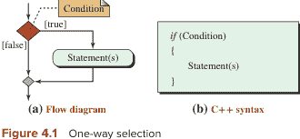

### 程序 4.1 输出绝对值

```cpp
1  /************************************************************
2   * Using if-statement to print the absolute value of a number        *
3   ************************************************************/
4  #include <iostream>
5  using namespace std;
6
7  int main ()
8  {
9      // Declaration
10     int number;
11     // Getting input
12     cout << "Enter an integer: ";
13     cin >> number;
14     // Finding the absolute value
15     if (number < 0)
16     {
17         number = -number;
18     }
19     // Printing the absolute value
20     cout << "Absolute value of the number you entered is: " << number;
21     return 0;
22 }
```

```text
运行：
Enter an integer: 25
Absolute value of the number you entered is: 25

运行：
Enter an integer: -17
Absolute value of the number you entered is: 17
```

### 示例 4.1

程序 4.1 展示了 if 语句的一种非常简单的用法：求出程序用户输入的整数的绝对值。如果用户输入的是负整数，程序就将它改为大小相同的正整数；否则，程序不做任何操作。程序退出决策部分（第 15 至 18 行）后，会输出所输入整数的绝对值。

请注意，在这个简单示例中，我们不需要使用大括号（第 16 和 18 行），但使用大括号是一种良好的编程习惯。

### 示例 4.2

程序 4.2 同样展示了 if 语句的用法。它用于计算员工每周的税前总收入。如果员工一周工作超过 40 小时，超出部分的加班工资率为基本工资率的 130%。

### 程序 4.2 员工税前总收入

```cpp
/****************************************************************
 * Use of if-statement to find gross payment of an employee      *
 ****************************************************************/
#include <iostream>
#include <iomanip>
using namespace std;

int main()
{
    // Declaration
    double hours;
    double rate;
    double regularPay;
    double overPay;
    double totalPay;
    // Input
    cout << "Enter hours worked: ";
    cin >> hours;
    cout << "Enter pay rate: ";
    cin >> rate;
    // Calculation that does not depend on decision
    regularPay = hours * rate;
    overPay = 0.0;
    // Calculation that is skipped if hours worked is not more than 40
    if (hours > 40.0)
    {
        overPay = (hours - 40.0) * rate * 0.30;
    } // End if
    // Rest of the calculation
    totalPay = regularPay + overPay;
    // Printing output
    cout << fixed << showpoint;
    cout << "Regular pay = " << setprecision (2) << regularPay << endl;
    cout << "Over time pay = " << setprecision (2) << overPay << endl;
    cout << "Total pay = " << setprecision (2) << totalPay << endl;
    return 0;
}
```

```text
运行：
Enter hours worked: 30
Enter pay rate: 22.00
Regular pay = 660.00
Over time pay = 0.00
Total pay = 660.00
```

### 程序 4.2 员工税前总收入（续）

```text
运行：
Enter hours worked: 45
Enter pay rate: 25.00
Regular pay = 1125.00
Over time pay = 37.50
Total pay = 1162.50
```

在第一次运行中，由于员工工作时间少于 40 小时，程序会忽略第 27 行的语句。加班工资保持初始化时的 0.0。在第二次运行中，由于员工工作时间超过 40 小时，程序会执行第 27 行的语句，计算出 37.50 美元的加班工资，并将其加到 *regularPay* 上，使 *totalPay* 达到 1162.50 美元。

### 一些易犯错误

使用 *if* 语句进行单向选择时，我们必须仔细留意可能出现的问题。这些错误通常不会被编译器发现，因为它们是逻辑错误，而非语法错误。我们编译并运行程序后，才会发现结果不正确。

**误用赋值运算符而非相等运算符** 一种常见错误是使用赋值运算符（=）而非相等运算符（==）。以下是一个示例：

```cpp
if (x = 0)        // This statement is always false.
{
  statement;      // The statement is never executed.
}
```

请注意，在这种情况下，无论 x 的值是什么，条件都始终为 *false*。该表达式会将 x 的值改为 0（这并非我们的本意）。表达式的结果就是 x 的值，即 0。我们已经知道，在需要布尔值的表达式中，0 会被解释为 *false*。这意味着该语句永远不会执行。

类似地，如果使用 (x = 5) 而不是 (x == 5)，结果就始终为 *true*，该语句也始终会执行，如下所示：

```cpp
if (x = 5)        // This condition is always true.
{
  statement;      // The statement is always executed.
}
```

**忘记大括号** 另一个常见错误是在需要执行多个语句时忘记大括号：

```cpp
if (x == 0)
  statement1;     // 如果 x 等于 0，则执行 Statement1。
  statement2;     // Statement2 总是会执行。
```

### 程序 4.3 判断成绩是否及格

```cpp
/************************************************************
 * Use of an if-else statement to find a pass/no-pass grade *
 ************************************************************/
#include <iostream>
using namespace std;

int main()
{
    // Local Declaration
    int score;
    // Input
    cout << "Enter a score between 0 and 100: ";
    cin >> score;
    // Decision
    if (score >= 70)
    {
        cout << "Grade is pass" << endl;
    } // End if
    else
    {
        cout << "Grade is nopass" << endl;
    } // End else
    return 0;
}
```

```text
运行：
Enter a score between 0 and 100: **65**
Grade is nopass

运行：
Enter a score between 0 and 100: **92**
Grade is pass
```

### 示例 4.4

程序 4.4 要求用户输入两个整数，并输出其中较大的一个。

### 程序 4.4 求两个数中的较大值

```cpp
/************************************************************
 * Use of if-else statement to print larger between two numbers *
 * or print the first if numbers are equal                    *
 ************************************************************/
#include <iostream>
```


## 程序 4.4 找出两个数中的较大者（续）

```cpp
using namespace std;

int main()
{
    // Declaration
    int num1, num2;
    int larger;
    // Input Statements
    cout << "Enter the first number: ";
    cin >> num1;
    cout << "Enter the second number: ";
    cin >> num2;
    // Decision
    if (num1 >= num2)
    {
        larger = num1;
    } // End if
    else
    {
        larger = num2;
    } // End else
    // Printing result
    cout << "The larger number is: " << larger;
    return 0;
}

Run:
Enter the first number: 40
Enter the second number: 25
The larger number is: 40

Run:
Enter the first number: 22
Enter the second number: 67
The larger number is: 67
```

注意，在上面的程序中，我们将输出与决策过程分开。我们不在决策部分打印较大值。我们将较大值存储在一个变量（称为 larger）中，然后在决策过程完成后打印它。这比前一个程序中所用的策略更好，因为我们分离了任务。

## 另一个陷阱：多余的分号

在头部多出一个分号会产生与单向选择中看到的相同问题。然而，这里的错误不同；它是编译错误。程序无法编译，因为编译器认为我们使用了一个没有 *if* 子句的 *else* 子句。这是一个不那么危险的错误，因为它迫使我们进行修正并重新编译。编译时错误比运行时错误更好。

```cpp
// Coded                         // Interpreted by the compiler
if (b);  // Extra semicolon       if (b);  // Empty statement
{
    statement1;
}
else                             else // Error here (else without if)
{
    statement2;
}                                {
                                     statement2
                                 }
```

## 嵌套 if-else 语句

正如上一节所讨论的，if-else 语句中的每个分支都可以是任何类型的语句。这意味着每个分支可以是另一个 if-else 语句。这种情况称为嵌套 if-else 语句。尽管我们可以按需拥有任意多层的嵌套，但在几层之后程序会变得非常复杂。图 4.3 显示了一个具有两层的嵌套 if-else 语句。注意，嵌套可以出现在 if 分支、else 分支或两者中。该图显示了两个分支中的嵌套。

## 示例 4.5

让我们编写一个程序，判断一个数大于、等于还是小于第二个数。流程图如图 4.4 所示。注意，在这种情况下，else 分支只有一个任务。

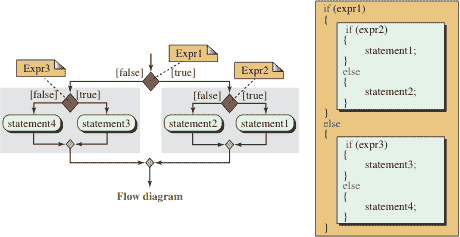

**图 4.3** 嵌套 if-else 语句

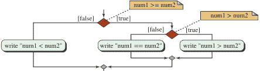

**图 4.4** 找出两个数之间关系的图

该解决方案首先判断第一个数是否大于或等于第二个数。如果此条件为假，则程序已确定 num1 小于 num2。如果 num1 大于或等于 num2，则程序进一步测试以找出确切关系。这是一个嵌套 *if-else* 语句的示例，其中左分支只是一个简单语句。代码如程序 4.5 所示。

## 程序 4.5 找出两个数之间的关系

```cpp
/********************************************************
 * Find if a number is greater than, equal to, or less than another
 ********************************************************/
#include <iostream>
using namespace std;

int main()
{
    // Declaration
    int num1, num2;
    // Get input values
    cout << "Enter the first number: ";
    cin >> num1;
    cout << "Enter the second number: ";
    cin >> num2;
    // Decision using nested if-else statement
    if (num1 >= num2)
    {
        if (num1 > num2)
        {
            cout << num1 << " > " << num2;
        }
        else
        {
            cout << num1 << " == " << num2;
        }
    }
    else
    {
        cout << num1 << " < " << num2;
    }
    return 0;
}
```

```
Run:
Enter the first number: 42
Enter the second number: 32
42 > 32
```

## 程序 4.5 找出两个数之间的关系（续）

```
Run:
Enter the first number: 12
Enter the second number: 12
12 == 12

Run:
Enter the first number: 12
Enter the second number: 28
12 < 28
```

## 一个严重的陷阱：悬空 else 问题

嵌套 *if-else* 语句可能会产生一个经典问题，称为 **悬空 else**。如果在嵌套 *if-else* 语句中，我们的 *if* 分支可能多于 *else* 分支，我们就需要知道哪个 *if* 分支应与哪个 *else* 分支配对。答案是编译器将 *else* 与最近一个未配对的 *if* 匹配。无论我们原本意图如何，都会这样做。

> **else 总是与最近一个未配对的 if 配对。**

图 4.5 显示了一个流程图和两个编码解决方案。第一个代码与图不一致，因为 *if* 和 *else* 部分配对错误。在这种情况下，我们必须像第二个代码所示那样使用复合语句，以确保 *else* 语句与第一个 *if* 语句配对，而不是第二个。我们稍后会看到，此问题还有另一个解决方案：使用逻辑表达式。

> **始终使用复合语句以避免悬空 else 问题。**

### 4.1.4 多路选择

有时我们需要解决具有多个条件的问题，如下所示。注意每个语句都可以是复合语句：

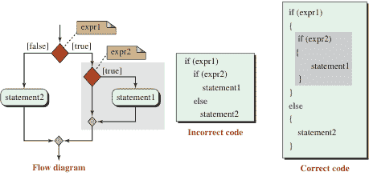

**图 4.5** 悬空 else 问题

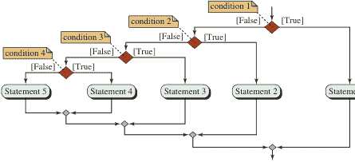

```
If condition 1 is true, do statement 1
If condition 2 is true, do statement 2
...
If none of the above conditions is true, do statement n
```

这称为 **多路选择**。我们可以使用嵌套 *if-else* 语句来实现多路选择。图 4.6 显示了具有五个不同语句的多路条件流程图。

我们可以用两种不同方式格式化图 4.6 中的多路选择，如下所示：

| 非紧凑格式 | 紧凑格式 |
|---|---|
| <pre>if (condition 1)
    statement 1;
else
    if (condition 2)
        statement 2;
    else
        if (condition 3)
            statement 3;
        else
            if (condition 4)
                statement 4;
            else
                statement 5;</pre> | <pre>if (condition 1)
    statement 1;
else if (condition 2)
    statement 2;
else if (condition 3)
    statement 3;
else if (condition 4)
    statement 4;
else
    statement 5;</pre> |

注意，左侧实现与右侧实现在语法上相同，只是 *else* 和 *if* 位于两个连续行中，二者之间没有任何语句，而这里仅用一个空格将它们组合起来。就 C++ 而言，换行符和空格是相同的。紧凑格式在行数上更短，并且需要更少的缩进。它更易于阅读。为了保持代码简短，我们没有使用花括号。程序中应始终使用花括号，如下一个示例所示。

## 示例 4.6

假设一位教授想编写一个程序，根据 0 到 100 之间的考试分数确定字母等级（A、B、C、D 和 F）。使用多路选择的代码如程序 4.6 所示。

## 程序 4.6 根据分数查找等级

```cpp
/**********************************************************
 * Find a grade given a score using the multi-way selection
 **********************************************************/
#include <iostream>
using namespace std;

int main()
{
    // Declaration
    int score;
    char grade;
    // Get Input
    cout << "Enter a score between 0 and 100: ";
    cin >> score;
    // Multi-way decision using if-else
    if (score >= 90)
    {
        grade = 'A';
    }
    else if (score >= 80)
    {
        grade = 'B';
    }
    else if (score >= 70)
    {
        grade = 'C';
    }
    else if (score >= 60)
    {
        grade = 'D';
    }
    else
    {
        grade = 'F';
    }
    // Output
    cout << "The grade is: " << grade;
    return 0;
} // End main
```


**程序4.6** 查找与分数相关的等级（续）

```text
Run:
Enter a score between 0 and 100: 83
The grade is B
Run:
Enter a score between 0 and 100: 65
The grade is D
Run:
Enter a score between 0 and 100: 95
The grade is A
```

## 4.2 复杂决策

在上一节中，我们使用关系和相等表达式解决了一些决策问题。有时需要做出的决策更复杂，我们需要更多表达式类型来定义它。例如，我们无法根据特定范围内的值做出决策，比如 *x* 应介于5和10之间。我们需要使用更多表达式。在本节中，我们介绍三种有助于实现更复杂决策的逻辑表达式。这些逻辑表达式可用于计算机编程的其他领域，例如我们将在后续章节讨论的重复。

### 4.2.1 逻辑表达式

**逻辑表达式**使用逻辑运算符，这些运算符接受一个或两个布尔类型的操作数，并生成布尔类型。我们有三个逻辑运算符：NOT（!）、AND（&&）和OR（||）。附录C展示了所有C++表达式；我们在表4.2中只包括本节需要的那些表达式。我们也在表4.2中包括关系和相等表达式，以便看到创建选择语句所必需的所有表达式之间的关系。注意，*逻辑非表达式*具有非常高的优先级（甚至高于关系和相等表达式），但*逻辑与*和*逻辑或表达式*具有非常低的优先级。我们还必须注意*逻辑非*的结合性（从右到左）。

**表4.2** 一些表达式的优先级和结合性

| 组 | 名称 | 运算符 | 表达式 | 优先级 | 结合性 |
|---|---|---|---|---|---|
| 一元 | 逻辑非 | ! | ! expr | 17 | ← |
| 关系 | 小于 | < | expr < expr | 11 | → |
|  | 小于或等于 | <= | expr <= expr |  |  |
|  | 大于 | > | expr > expr |  |  |
|  | 大于或等于 | >= | expr >= expr |  |  |
| 相等 | 等于 | == | expr == expr | 10 | → |
|  | 不等于 | != | expr != expr |  |  |
| 逻辑与 | 逻辑与 | && | expr && expr | 6 | → |
| 逻辑或 | 逻辑或 | \|\| | expr \|\| expr | 5 | → |

**真值表 — NOT**

| 操作数 | 结果 |
|---|---|
| 假 | 真 |
| 真 | 假 |

**真值表 — AND**

| 左操作数 | 右操作数 | 结果 |
|---|---|---|
| 假 | 假 | 假 |
| 假 | 真 | 假 |
| 真 | 假 | 假 |
| 真 | 真 | 真 |

**真值表 — OR**

| 左操作数 | 右操作数 | 结果 |
|---|---|---|
| 假 | 假 | 假 |
| 假 | 真 | 真 |
| 真 | 假 | 真 |
| 真 | 真 | 真 |

**图4.7** 逻辑表达式及其真值表

展示逻辑表达式结果的最佳方式是使用真值表。图4.7展示了三个逻辑运算符及其解释。

在**非**表达式的情况下，我们只有一个输入。注意，如果我们为此运算符使用true或false之外的操作数，则会发生转换。下面展示了一些使用逻辑非表达式的示例。

```text
!true                         // The result is false.
!false                        // The result is true.
!5                            // First, 5 is converted to Boolean true. The result is false.
!0                            // First, 0 is converted to Boolean false. The result is true.
```

**与**表达式需要两个布尔值作为其操作数。当且仅当两个操作数都为*真*时，结果为布尔值*真*；如果任一操作数为*假*，结果为*假*。再次注意，如果我们为这些运算符使用true或false之外的操作数，则会发生转换。下面展示了一些使用逻辑**与**表达式的示例。

```text
true && true                  // The result is true.
false && true                 // The result is false.
(3 < 5) && (4 > 2)            // It is true && true. The result is true.
(4 < 6) && (2 == 3)           // It is true && false. The result is false.
6 && false                    // First, 6 is converted to true. The result is false.
4 && 0                        // First, 4 is converted to true and 0 to false. The result is false.
```

**或**表达式也需要两个布尔值作为其操作数。当且仅当两个操作数都为*假*时，结果为布尔值*假*；如果任一操作数为*真*，结果为*真*。再次注意，如果我们为这些运算符使用true或false之外的操作数，则会发生转换。下面展示了一些逻辑**或**表达式及其结果。

```text
true || true                  // The result is true.
false || false               // The result is false.
(1 < 4) || (2 == 3)          // It is (true || false). The result is true.
(4 < 3) || (4 < 3)           // It is (false || false). The result is false.
3 || false                   // First, 3 is converted to true. The result is true.
0 || false                   // First, 0 is converted to false. The result is false.
```

下面展示优先级和结合性如何影响复杂表达式的计算。在计算中添加括号有助于我们找到结果。

```text
!false && true               // This is (!false) && true. The result is true.
false || true && false       // This is false || (true && false). The result is false.
2 == 2 || 5 < 6 && false      // This is true || (true && false). The result is true.
```

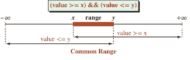

**图4.8** 常见范围作为两个关系的组合

### 4.2.2 逻辑表达式的使用

我们可以使用关系/相等表达式和逻辑表达式的组合来编写复杂的选择标准。让我们看一些情况。

**AND表达式的使用**

由于当两个操作数都为真时，*and*表达式的结果为*true*，所以当我们需要两个条件都为真才能做某事时，可以使用*and*表达式。换句话说，表达式

```text
condition1 && condition2
```

在condition1和condition2都为true时为true。例如，要测试一个数字是否在范围内，我们需要两个条件，如图4.8所示。

**例4.7**

假设一家汽车租赁公司规定租车的最低和最高年龄分别为25岁和100岁。程序4.7展示了如何使用简单的决策代码测试一个人的年龄。

**程序4.7** 查找年龄资格

```cpp
/*****************************************************************
 * Find age eligibility to rent a car
 *****************************************************************/
#include <iostream>
using namespace std;

int main ()
{
  // Declaration of variables
  int age;
  bool eligible;
  // Getting input
  cout << "Enter your age: ";
  cin >> age;
  // Setting the condition
  eligible = (age >= 25) && (age <= 100);
  // Testing the condition and output
  if (eligible)
  {
      cout << "You are eligible to rent a car.";
  }
  else
  {
      cout << "Sorry! You are not eligible to rent a car.";
  }
  return 0;
}
```

```text
Run:
Enter your age: 27
You are eligible to rent a car.

Run:
Enter your age: 54
You are eligible to rent a car.

Run:
Enter your age: 103
Sorry! You are not eligible to rent a car.

Run:
Enter your age: 21
Sorry! You are not eligible to rent a car.
```

**OR表达式的使用**

由于当任一操作数为真时，*or*表达式的结果为*true*，所以当我们需要在决策中测试两个条件中至少一个为真时，必须想到or运算符。换句话说，表达式

`condition1 || condition2`

在condition1或condition2（或两者）为*true*时为true。例如，要测试一个数字是否在范围外，我们需要测试两个条件，如图4.9所示。

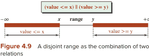


注意，要使该测试有效，x 和 y 必须不同，且 y 必须大于 x。否则会发生重叠，范围就不互异。

### 示例 4.8

假设我们希望当室内温度高于 75 华氏度或低于 60 华氏度时，房屋中的空调系统开启。我们可以通过输入温度并开启空调系统来模拟这一过程，如程序 4.8 所示。系统开启后，程序可以决定开启加热器还是冷却器。注意，无论要使加热器还是冷却器开启，都必须先开启空调系统。

### 程序 4.8 —— 开启和关闭空调系统

```cpp
/**************************************************************
 * Turn the air conditioning system on if the temperature is
 * below or above a certain temperature.
 **************************************************************/
#include <iostream>
using namespace std;

int main()
{
    // Variable declaration
    int temperature;
    bool hot;
    bool cold;
    // Input the temperature
    cout << "Enter the temperature: ";
    cin >> temperature;
    // Set two conditions
    hot = temperature >= 75;
    cold = temperature <= 60;
    // Make the decision
    if (hot || cold)
    {
        cout << "The air condition system is turned on!" << endl;
        if (hot)
        {
            cout << "The cooler is working!" << endl;
        }
        else
        {
            cout << "The heater is working!" << endl;
        }
    }
    else
    {
```

### 程序 4.9 判断给定年份是否为闰年（续）

```cpp
9  // Variable declaration
10 int year;
11 bool divBy400, divBy4, divBy100;
12 bool leapYear;
13 // Input year
14 cout << "Enter the year: ";
15 cin >> year;
16 // Set conditions
17 divBy400 = ((year % 400) == 0);
18 divBy4 = ((year % 4) == 0);
19 divBy100 = ((year % 100) == 0);
20 leapYear = (divBy400) || (divBy4 && !(divBy100));
21 // Decision and output
22 if (leapYear)
23 {
24     cout << "Year " << year << " is a leap year." << endl;
25 }
26 else
27 {
28     cout << "Year " << year << " is not a leap year." << endl;
29 }
30 return 0;
31 }
```

| 运行 | 输出 |
|---|---|
| 运行：输入年份：2000 | 2000 年是闰年。 |
| 运行：输入年份：1900 | 1900 年不是闰年。 |
| 运行：输入年份：2012 | 2012 年是闰年。 |
| 运行：输入年份：2014 | 2014 年不是闰年。 |

## 去除 Not 运算符

有时，我们编写一个条件，最终在表达式前面带有一个*非*运算符，这有时可能难以理解或解释。

**涉及关系或相等运算符的表达式**

如果*非*运算符后面的表达式是关系表达式或不等式，那么去除该*非*运算符并改变表达式就很简单，因为我们可以很容易地找到另一个与现有表达式相反的表达式。下面展示了如何去除关系表达式或相等表达式前面的*非*运算符。

```
!(x < 7)      →      (x >= 7)        !(x >= 7)      →      (x < 7)
!(x > 7)      →      (x <= 7)        !(x <= 7)      →      (x > 7)
!(x == 7)     →      (x != 7)        !(x != 7)      →      (x == 7)
```

**涉及逻辑与或逻辑或运算符的表达式**

当表达式涉及*逻辑与*或*逻辑或*运算符时，情况就不简单了。我们需要使用所谓的**德摩根定律**的两种形式之一，该定律以逻辑学家奥古斯都·德摩根（1806—1871）命名。这两种形式如下所示：

```
!(x && y)      →      (!x || !y)        !(x || y)      →      (!x && !y)
```

换句话说，如果我们将*逻辑与*运算符改为*逻辑或*运算符，并在每个表达式前插入*非*运算符，就可以去除*逻辑与*表达式前面的*非*运算符。反过来，如果我们将*逻辑或*运算符改为*逻辑与*运算符，并在每个表达式前插入*非*运算符，就可以去除*逻辑或*表达式前面的*非*运算符。

乍一看，我们似乎通过去除一个*非*运算符并添加两个*非*运算符而拉长了表达式，但实际上我们是在简化表达式，使其更容易理解。

### 示例 4.10

假设我们希望当温度低于 35 华氏度（太冷）或高于 90 华氏度（太热）时停止慢跑。我们可以将停止条件写为

```
Stop Condition      →      (temp < 35) || (temp > 90)
```

如果我们想找出继续慢跑的条件，可以很容易地对上述表达式取反，如下所示

```
Continue Condition      →      !((temp < 35) || (temp > 90))
```

德摩根定律的第二种形式允许我们将表达式写为

```
Continue Condition      →      (!(temp < 35) && !(temp > 90))
```

尽管这里有两个*逻辑非*运算符，但我们可以（使用本节学到的规则）简化表达式，以便更清楚地理解。

```
Continue Condition      →      (temp >= 35) && (temp <= 90)
```

最后一个版本表明，只要温度在 35 到 90 之间，我们就可以继续慢跑。

### 交换 *If* 和 *else* 块

有时我们想交换 *if-else* 语句中的 *if* 块和 *else* 块。我们可以通过翻转 *if* 子句中的条件来实现。如下所示，当 *if* 块为空时，这很有用。通过交换 *if* 和 *else* 块，我们可以使 *else* 块为空，而空块可以被移除，从而变成简单的判断。注意，我们不能消除空的 *if* 块，

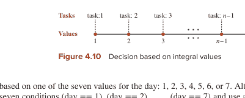

基于星期几的七个值之一：1、2、3、4、5、6 或 7。尽管我们仍然可以使用七个条件 (day == 1)、(day == 2)、……、(day == 7) 并使用多重 *if-else* 语句，但 C++ 为我们提供了更好的解决方案：*switch* 语句，我们接下来讨论它。

### 4.3.1 Switch 语句

C++ 中另一种多路判定结构是 *switch 语句*，其中的判定基于特定值。图 4.10 显示了这样一种情况：我们必须测试特定值（1 到 n），并根据结果执行 n 个任务之一。

### Switch 语句的结构

在讨论如何使用 *switch* 语句进行多值判定之前，我们先看看该语句的结构。基本的 *switch* 语句是为所谓的*贯穿*流程设计的。图 4.11 显示了一个包含四个 case 的 switch 语句的流程图和语法（我们可以根据需要设置任意多个 case）。

当表达式的值与某个 case 中定义的值匹配时，*switch* 语句会决定进入*贯穿*流程。换句话说，进入*贯穿*是基于某个值，但当流程进入*贯穿*后，它会一直执行到末尾，并执行所有剩余的贯穿语句。

在图中，首先将表达式的值与 value1 进行比较。如果匹配，则 statement1 到 statement4 都会执行。如果表达式的值与 value1 不匹配，但与 value2 匹配，则执行 statement2 到 statement4（跳过 statement1）。如果所有值都不匹配，则不执行任何语句。*case* 子句中的值应当是唯一的。

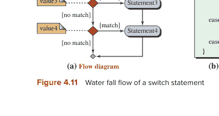

### 程序 4.10 打印一周中的各天（续）

| 运行 | 输出 |
|---|---|
|  | 星期五<br>星期六 |
| **运行：**<br>输入 1 到 6 之间的数字：6 | 星期六 |
| **运行：**<br>输入 1 到 6 之间的数字：8 |  |

我们运行该程序四次。第一次，我们为整数 day 输入 2；*switch* 从 case 2 进入，并打印该周剩余的各天（星期二到星期六）。第二次运行，我们为整数 day 输入 4；*switch* 语句从 case 4 进入，并打印该周剩余的各天（星期四到星期六）。第三次运行，我们输入 6；程序只打印该周的最后一天（星期六）。第四次运行，我们输入 8，它不在整数值列表中；不会打印任何内容。

### 带 break 的 Switch 语句

要将 switch 语句用于多值选择，我们必须添加 *break* 语句。*break* 语句会在遇到该语句时中断程序流程，并跳转到 *switch* 语句的末尾。图 4.12 显示了在每个分支处添加 break 语句后的 *switch* 语句。我们可以看到，每次进入 *switch* 语句时，只遵循一条路径，即与表达式匹配的那条路径。比较图 4.11 和图 4.12 的流程图，看看差异。图 4.11 使用贯穿；图 4.12 使用选择。

### 示例 4.12

让我们将程序 4.10 改为带 break 的 *switch* 语句。程序 4.11 显示了结果。在程序的每次运行中，只打印一天。和之前一样，我们为

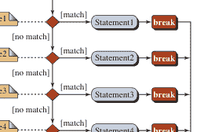

```c
switch (expression)
{
  case value1: Statement 1;
                break;
  case value2: Statement 2;
                break;
  case value3: Statement 3;
                break;
  case value4: Statement 4;
                break;
}
```

**图 4.12** 带 break 的 Switch 语句


第一次运行中，整数 day；结果是 Tuesday。第二次运行中，我们为整数 day 输入 5；结果是 Thursday。当我们为整数 day 输入 8 时，没有任何 case 匹配，因此不会打印任何内容。注意，最后一个 break 实际上并不需要，但优秀的程序员会加上它，以使结构对称完整。还要注意，我们在第一个和最后一个 case 中增加了第二条输出，以演示在任何 case 分支中也可以执行多条语句。

## 程序 4.11 根据给定的 day 打印星期几

```cpp
/****************************************************************
* Use a switch statement with break to print the name of the      *
* week day.                                                       *
****************************************************************/
#include <iostream>
using namespace std;

int main ()
{
    // Declaration
    int day;
    // Input
    cout << "Enter a number between 0 and 6: ";
    cin >> day;
    // Switch statement (Decision and output)
    switch (day)
    {
        case 0: cout << "Sunday" << endl;
                cout << "First day of the week " << endl;
                break;
        case 1: cout << "Monday" << endl;
                break;
        case 2: cout << "Tuesday" << endl;
                break;
        case 3: cout << "Wednesday" << endl;
                break;
        case 4: cout << "Thursday" << endl;
                break;
        case 5: cout << "Friday" << endl;
                break;
        case 6: cout << "Saturday" << endl;
                cout << "Last day of the week " << endl;
                break; // This is not needed, but added for parallelism
    } // End switch
    return 0;
} // End main
```

| 运行： |
| :--- |
| Enter a number between 0 and 6: 0 |
| Sunday |
| First day of the week |
| 运行： |
| Enter a number between 0 and 6: 4 |
| Thursday |
| 运行： |
| Enter a number between 0 and 6: 6 |
| Saturday |
| Last day of the week |
| 运行： |
| Enter a number between 0 and 6: 8 |

## 添加默认分支

有时我们有多个 case 需要执行相同的操作。在这种情况下，如果所有 case 都位于 switch 语句末尾，我们可以通过添加 **default** case 来缩短语句。当没有任何 case 匹配时，会进入 *default* case。

*default* case 也可用于错误检测。当没有任何 case 与给定值匹配时，可以用它来检测错误。但是，我们需要知道 *default* case 只能使用一次，并且必须作为最后一个 case。

> **在 *switch* 语句中，*default* 分支必须是最后一个分支。**

这意味着，如果我们使用 *default* 来捕获多个 case 值，它就不能用于错误检测。我们需要使用其他工具。下一个示例展示了 *default* case 的用法。

## 示例 4.13

让我们展示如何使用 *switch* 语句将考试分数转换为字母等级。我们有一个需要解决的问题；等级基于分数范围，而不是单个值。例如，如果分数在 90 到 100 的范围内，等级应赋为字母 'A'。然而，如果我们使用除法运算符将范围转换为单个值，就可以使用 *switch* 语句解决该问题。如果将 0 到 100 之间的分数除以 10，就会得到一个 0 到 10 之间的值。程序 4.12 展示了如何使用这种技术解决该问题。

## 程序 4.12 根据分数打印等级

```cpp
1 /*********************************************************
2  * Use a switch statement to print a grade from a given score.       *
3  *********************************************************/
4 #include <iostream>
5 using namespace std;
6 
int main()
{
    // Declaration
    int score;
    char grade;
    // Input
    cout << "Enter a score between 0 and 100:";
    cin >> score;
    // Decision making using switch statement
    switch (score / 10)
    {
        case 10: grade = 'A';
                 break;
        case 9: grade = 'A';
                break;
        case 8: grade = 'B';
                break;
        case 7: grade = 'C';
                break;
        case 6: grade = 'D';
                break;
        default: grade = 'F';
    } // End switch
    // Output
    cout << "Score: " << score << endl;
    cout << "Grade: " << grade << endl;
    return 0;
}
```

```text
Run:
Enter a score between 0 and 100: 71
Score: 71
Grade: C

Run:
Enter a score between 0 and 100: 93
Score: 93
Grade: A

Run:
Enter a score between 0 and 100: 24
Score: 24
Grade: F
```

如你所见，我们使用了一个 *default* case 来处理多个 case（5、4、3、2、1、0），这意味着所有低于 60 分的等级。但是，我们仍然有一个问题。如果用户输入的分数小于 0 或大于 100 怎么办？程序会给出等级 F。要处理这个问题，我们需要先测试输入的有效性。一种方法如下。

```cpp
cout << "Enter a score between 0 and 100: ";
cin >> score;
if (score > 100)
{
    score = 100;
}
if (score < 0)
{
    score = 0;
}
```

我们将在下一章讨论重复时看到更好的输入验证策略。

## 合并分支

如果多个 case 执行的任务相同，我们可以合并这些 case。这是可行的，因为 *switch* 语句的 *贯穿* 特性允许程序依次执行各个 case，直到遇到 *break* 语句。下一个示例展示了这一思路。

## 示例 4.14

在程序 4.13 中，我们读取一个字母等级并打印及格/不及格等级。default 语句用作错误检测器。

## 程序 4.13 查找及格/不及格等级

```cpp
/*--------------------------------------------------------------*
 * Use a switch statement to find a pass/nonpass grade.          *
 *--------------------------------------------------------------*/
#include <iostream>
using namespace std;

int main()
{
    // Declaration
    char grade;
    // Input
    cout << "Enter a grade (A, B, C, D, F): ";
    cin >> grade;
    // Decision section using switch statement
    switch (grade)
    {
        case 'A':
18  case 'B':
19  case 'C': cout << "Grade is pass";
20          break;
21  case 'D':
22  case 'F': cout << "Grade is nopass";
23          break;
24  default: cout << "Error in the input. Try again.";
25  } // End switch
26  return 0;
27  } // End main
```

```text
Run:
Enter a grade (A, B, C, D, F): A
Grade is pass

Run:
Enter a grade (A, B, C, D, F): D
Grade is nopass

Run:
Enter a grade (A, B, C, D, F): F
Grade is nopass

Run:
Enter a grade (A, B, C, D, F): G
Error in the input. Try again.

Run:
Enter a grade (A, B, C, D, F): B
Grade is pass

Run:
Enter a grade (A, B, C, D, F): C
Grade is pass
```

## 4.4 条件表达式

另一种可用于决策的结构是 **条件表达式**。它是 C++ 中唯一的三元表达式。它使用两个运算符和三个操作数，如下所述。

### 4.4.1 条件表达式的结构

下面展示条件表达式的语法。

```cpp
condition ? expression1 : expression2
```

表 4.3 显示了条件表达式在附录 C 表达式列表中的位置。

| 组 | 名称 | 运算符 | 表达式 | 优先级 | 结合性 |
|---|---|---|---|---|---|
| 条件 | 条件 | `?:` | `expr1 ? expr2 : expr3` | 4 | `←` |

*expr1* 必须是值为 *true* 或 *false* 的布尔表达式。*expr2* 和 *expr3* 的类型必须相同，但该公共类型可以是前几章讨论过的任意类型。整个结构也是一个带值的表达式。如果 *expr1* 为 *true*，则整个表达式的值是 *expr2* 的值；否则，它是 *expr3* 的值。

> **条件表达式可以用在任何可以使用表达式的地方。**

### 4.4.2 比较

让我们将条件表达式与图 4.13 所示的双向 *if-else* 语句进行比较。

- 双向 *if-else* 语句由一个布尔表达式以及 true 分支和 false 分支组成。条件表达式由一个布尔表达式和两个表达式组成，一个对应 *true*，一个对应 *false*。
- 双向 *if-else* 语句是一种语句；凡是能使用语句的地方都可以使用它。*条件表达式* 是一种表达式；凡是能使用表达式的地方也都可以使用它。我们可以通过以下方式之一使用它：
  - a. 可以将其作为语句中的表达式使用。
  - b. 可以在末尾添加分号，使其成为独立语句。当第二个和第三个语句都有副作用时，这种方法很有用。

## 示例 4.15

在程序 4.14 中，我们使用 *条件表达式* 打印两个整数中较大的那个。

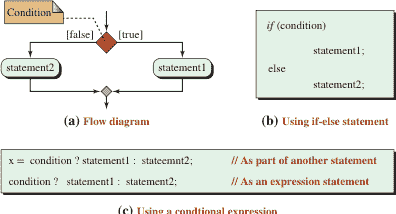

**图 4.13** 比较 *if-else* 语句和条件表达式


## 程序 4.14 条件表达式

```cpp
/************************************************************
 * Uses a conditional expression to print the larger of two *
 * numbers or the first if the numbers are equal             *
 ************************************************************/
#include <iostream>
using namespace std;

int main()
{
    // Declaration
    int num1, num2;
    int larger;
    // Input
    cout << "Enter the first number: ";
    cin >> num1;
    cout << "Enter the second number: ";
    cin >> num2;
    // Decision making
    larger = num1 >= num2 ? num1 : num2;
    // Output
    cout << "The larger is: " << larger;
    return 0;
} // End main

Run:
Enter the first number: 40
Enter the second number: 25
The larger is: 40

Run:
Enter the first number: 22
Enter the second number: 67
The larger is: 67
```

## 4.5 程序设计

在本节中，我们设计并实现四个程序。我们使用第 3 章讨论的软件开发过程：*理解问题、开发算法并编写代码。*

### 4.5.1 学生成绩

让我们创建一个程序，帮助教授根据三次测试的结果计算班级中一名学生的成绩。教授认为，学生成绩应是三次分数中最大值与最小值的平均值。

## 理解问题

我们需要输入、处理和输出。我们需要输入三个分数。接下来，我们必须找出三个输入分数中的最高分和最低分。最后，我们必须求出二者的平均值，并将学生成绩设为该平均值。尽管后续章节会讨论更高效的方法，但我们先用嵌套 if-else 结构找出最高分，再找出最低分。学生成绩是最低分和最高分的平均值。

## 开发算法

基于我们的理解，可以创建以下算法。

- 1. **输入**
  - a. 输入 score1
  - b. 输入 score2
  - c. 输入 score3
- 2. **处理**
  - a. 找出 maxScore
    - 1. 如果 score1 大于另外两个分数，则 maxScore 为 score1
    - 2. 否则如果 score2 大于另外两个分数，则 maxScore 为 score2
    - 3. 否则 maxScore 为 score3
  - b. 找出 minScore
    - 1. 如果 score1 小于另外两个分数，则 minScore 为 score1
    - 2. 否则如果 score2 小于另外两个分数，则 minScore 为 score2
    - 3. 否则 minScore 为 score3
  - c. 计算学生成绩
    - 1. 将 maxScore 与 minScore 相加
    - 2. 将结果除以二，得到学生成绩
- 3. **输出**
  - a. 输出三个分数
  - b. 输出 minScore 和 maxScore
  - c. 输出学生成绩

## 编写代码

现在我们可以根据所开发的算法编写代码（程序 4.15）。程序中唯一需要稍作解释的部分是第 47 行到第 52 行。最高分和最低分都是整数类型，而我们希望学生成绩也是整数类型。如果最高分与最低分之和为奇数，我们就给它加 1，使和为偶数。加 1 实际上会把除法结果向上舍入到较高的分数；否则，成绩会被截断为较低的分数。

## 程序 4.15 根据三次测试计算学生成绩

```cpp
/*
************************************************************
 * Finding the student score based on the given three scores
 * The program sets the student score to the average of maximum
 * and minimum of the three scores
 ************************************************************/
#include <iostream>
using namespace std;

int main( )
{
    // Declarations
    int score1, score2, score3, maxScore, minScore, score;
    // Input
    cout << "Enter the first score: ";
    cin >> score1;
    cout << "Enter the second score: ";
    cin >> score2;
    cout << "Enter the third score: ";
    cin >> score3;
    // Find maximum score
    if (score1 > score2 && score1 > score3)
    {
        maxScore = score1;
    }
    else if (score2 > score1 && score2 > score3)
    {
        maxScore = score2;
    }
    else
    {
        maxScore = score3;
    }
    // Find minimum score
    if (score1 < score2 && score1 < score3)
    {
        minScore = score1;
    }
    else if (score2 < score1 && score2 <= score3)
    {
        minScore = score2;
    }
    else
    {
        minScore = score3;
    }
    // Find and round the student score
    int temp = maxScore + minScore;
    if (temp % 2 == 1)
    {
        temp += 1;
    }
    score = temp / 2;
    // Print results
    cout << "Scores: " << score1 << " " << score2 << " " << score3 << endl;
    cout << "minimum and maximum scores: ";
    cout << minScore << " " << maxScore << endl;
    cout << "Student score: " << score;
    return 0;
}

Run:
Enter the first score: 78
Enter the second score: 92
Enter the third score: 79
Scores: 78 92 79
minimum and maximum scores: 78 92
Student score: 85

Run:
Enter the first score: 65
Enter the second score: 93
Enter the third score: 60
Scores: 65 93 60
minimum and maximum scores: 60 93
Student score: 77
```

### 4.5.2 计算给定收入的税款

让我们设计一个程序，计算并打印给定收入的税款。

## 理解问题

许多国家的所得税是分档的，这意味着每个档次有不同的税率，如图 4.14 所示。

总税款是各档次税款之和（表 4.4）。处于第 1 档的人缴纳税额1。处于第 2 档的人缴纳税额1与税额2之和。处于第 3 档的人缴纳税额1、税额2和税额3。处于第 4 档的人缴纳税额1、税额2、税额3和税额4。表中的 *diff* 表示收入与上一档限额之间的差额。


图 4.14 分档税率的概念

**表 4.4 — 税率档次**

| 档次 | 税额1 | 税额2 | 税额3 | 税额4 |
|---|---|---|---|---|
| 第 1 档 | 差额 × 税率1 |  |  |  |
| 第 2 档 | 限额1 × 税率1 | 差额 × 税率2 |  |  |
| 第 3 档 | 限额1 × 税率1 | 限额2 × 税率2 | 差额 × 税率3 |  |
| 第 4 档 | 限额1 × 税率1 | 限额2 × 税率2 | 限额3 × 税率3 | 差额 × 税率4 |


**图 4.15** 计算所得税设计的流程图

## 开发算法

本例中的算法很简单。我们输入收入，使用嵌套 if-else 结构计算税款，然后如图 4.15 所示打印税款金额。

## 编写代码

我们基于前两节创建一个程序，使程序在将来税率和档次范围变化时可重用，并且我们声明税率和限额，而不是在程序中直接硬编码。我们还创建四个布尔变量，用于定义收入属于哪个档次（bracket1 到 bracket4）。如果 bracket1 为真，则收入属于第 1 档，依此类推。为了防止错误（例如输入负收入），我们在 if-else 语句中创建另一个分支来处理错误情况。如果用户输入负收入，程序会打印一条消息，并立即在第 44 行和第 45 行返回。第 45 行的 return 语句用于避免执行第 48 行和第 49 行的结果打印。参见程序 4.16。

## 程序 4.16 个人税负

```cpp
/********************************************************
 * Finding the tax of an individual using four different tax
 * brackets
 ********************************************************/
#include <iostream>
using namespace std;

int main()
{
    // Declaration and initialization
    double income, tax;
    bool bracket1, bracket2, bracket3, bracket4;
    double limit1 = 100000.00, limit2 = 50000.00, limit3 = 100000.00;
    double rate1 = 0.05, rate2 = 0.10, rate3 = 0.15, rate4 = 0.20;
    // Input
    cout << "Enter income in dollars: ";
    cin >> income;
    // Defining brackets
    bracket1 = (income <= limit1) && (income >= 0);
    bracket2 = (income > limit1) && (income <= limit2);
    bracket3 = (income > limit2) && (income <= limit3);
    bracket4 = (income > limit3);
    // Calculating tax
    if (bracket1)
    {
        tax = income * rate1;
    }
    else if (bracket2)
    {
        tax = limit1 * rate1 + (income - limit1) * rate2;
    }
    else if (bracket3)
    {
        tax = limit1 * rate1 + (limit2 - limit1) * rate2 +
              (income - limit2) * rate3;
    }
    else if (bracket4)
    {
        tax = limit1 * rate1 + (limit2 - limit1) * rate2 +
              (limit3 - limit2) * rate3 + (income - limit3) * rate4;
    }
    else
    {
        cout << "Error! Invalid income";
        return 0;
    }
    // Printing income and tax
```


## 程序 4.16 一个人的税负（续）

```cpp
48    cout << "Income: " << income << endl;
49    cout << "Tax due: " << tax;
50    return 0;
51 }
```

运行：

```text
Enter income in dollars: 8500
Income: 8500
Tax due: 425
```

运行：

```text
Enter income in dollars: 14500
Income: 14500
Tax due: 950
```

运行：

```text
Enter income in dollars: -5
Error! Invalid income!
```

运行：

```text
Enter income in dollars: 123000
Income: 123000
Tax due: 16600
```

第三次运行中的收入（-5）无效；除此之外，每次运行中的收入都属于某个税率档次。在第一次运行中，纳税人处于第 1 档，需要缴纳其收入的 5% 作为税款（425）。在第二次运行中，纳税人处于第 2 档。她需要为第 1 档（前 10000 美元）缴纳 500 美元，并为第 2 档（剩余的 4500 美元）缴纳 450 美元，依此类推。请验证每个结果是否正确。

### 4.5.3 日期编号

假设我们为一年中的每一天分配一个日期编号。例如，1 月 1 日是第 1 天，12 月 31 日是第 365 天。我们希望根据月份和当月的日期，找出某一天在一年中的编号。

### 理解问题

要解决这个问题，我们需要知道月份和该月的日期。我们需要月份，是因为必须计算所有前面月份经过的天数。

### 制定算法

该算法需要完成两个任务：加上所有过去月份的天数，以及加上当前月份中的日期编号。第一个任务通过一个 *switch* 语句完成，每个月对应一个 case。第二个任务在 *switch* 语句之后完成。采用贯穿方式（不使用 *break* 语句）的 *switch* 语句非常适合这个问题，因为我们需要累计前面月份经过的天数。为了让 *switch* 语句正常工作，我们从一年中的最后一个月开始，依次处理到第一个月。例如，如果当前是第 7 个月，我们进入 case 7，但会加上第 6 个月到第 1 个月的天数。执行完 *switch* 语句后，再加上当前月份中的日期数。

### 编写代码

程序 4.17 遵循上述算法。请注意，我们忽略了闰年的情况；在闰年中，2 月包含 29 天。闰年的情况留作练习。我们还忽略了输入错误，这些内容将在后续章节中讨论。

**程序 4.17** 日期编号

```cpp
/********************************************************
 * Finding the number of days passed from the beginning of the
 * year including the current day
 ********************************************************/
#include <iostream>
using namespace std;

int main ( )
{
    // Declaration
    int month;
    int day;
    int totalDays = 0;
    // Input current month and current day of the month
    cout << "Enter month: ";
    cin >> month;
    cout << "Enter day of month: ";
    cin >> day;
    // Number of days in months
    int m01 = 31;
    int m02 = 28;
    int m03 = 31;
    int m04 = 30;
    int m05 = 31;
    int m06 = 30;
    int m07 = 31;
    int m08 = 31;
    int m09 = 30;
    int m10 = 31;
    int m11 = 30;
    // Switch statement finds the total days using fall-through
    switch (month)
    {
        case 12 : totalDays += m11;
        case 11 : totalDays += m10;
        case 10 : totalDays += m09;
        case 9  : totalDays += m08;
        case 8  : totalDays += m07;
```

（续）

## 程序 4.17 日期编号（续）

```cpp
39    case 7 : totalDays += m06;
40    case 6 : totalDays += m05;
41    case 5 : totalDays += m04;
42    case 4 : totalDays += m03;
43    case 3 : totalDays += m02;
44    case 2 : totalDays += m01;
45    case 1 : totalDays += 0;
46  }
47  // Adding the day of the month to the previous total days
48  totalDays += day;
49  // Printing the result
50  cout << "Day number: " << totalDays;
51  return 0;
52}
```

运行：

```text
Enter month: 1
Enter day of month: 23
Day number: 23
```

运行：

```text
Enter month: 4
Enter day of month: 12
Day number: 102
```

运行：

```text
Enter month: 11
Enter day of month: 24
Day number: 328
```

运行：

```text
Enter month: 12
Enter day of month: 31
Day number: 365
```

## 关键术语

- 条件表达式
- 悬空 else
- 德·摩根定律
- *default* 分支
- 相等表达式
- if 语句
- if-else 语句
- 逻辑与表达式
- 逻辑表达式
- 逻辑非表达式
- 逻辑或表达式
- 多路选择
- 单路选择
- 关系表达式
- 短路行为
- switch 语句
- 双路选择

## 总结

为了解决某些问题，我们需要根据对真值条件的测试结果做出决定。这称为*选择*。最常见的决策结构是单路选择，在 C++ 中通过 *if 语句*实现。我们讨论的第二种选择语句是使用 *if-else 语句*的双路选择。

有时，决策问题过于复杂，无法仅使用关系表达式和相等表达式解决。我们可以将关系表达式和相等表达式与逻辑表达式结合起来实现选择。我们讨论了三种逻辑运算符：NOT、AND 和 OR。

C++ 中的另一种多路决策结构是 *switch 语句*，它根据特定值做出决策。

另一种可用于决策的结构称为*条件表达式*。它是 C++ 中唯一的*三元*表达式。它使用两个运算符和三个操作数。

## 习题

**PR-1.** 如果初始值为 x = 4、y = 0，执行以下代码后，x 和 y 的值是多少？

```cpp
if (x != 0)
{
    y = 3;
}
```

**PR-2.** 如果初始值为 x = 4、y = 0 和 z = 2，执行以下代码后，x、y 和 z 的值是多少？

```cpp
if (z == 2)
{
    y = 1;
}
else
{
    x = 3;
}
```

**PR-3.** 如果初始值为 x = 4、y = 0 和 z = 2，执行以下代码后，x、y 和 z 的值是多少？

```cpp
if (x > y || y < z)
{
    x = 10;
}
```

**PR-4.** 如果初始值为 x = *true*、y = *false* 和 z = *true*，执行以下代码后，x、y 和 z 的值是多少？

```cpp
if (x)
{
    if (y)
    {
        z = false;
    }
    else
    {
        y = true;
    }
}
```

**PR-5.** 如果初始值为 x = 4、y = 0 和 z = 2，执行以下代码后，x、y 和 z 的值是多少？

```cpp
if (z == 0 || y != 0)
{
    if (z <= 2)
    {
        z = 4;
    }
}
else
{
    y = 5;
    z = y + x;
}
```

**PR-6.** 如果初始值为 x = 0、y = 0 和 z = 1，执行以下代码后，x、y 和 z 的值是多少？

```cpp
switch (x)
{
    case 0: x = 2;
            y = 3;
    case 1: x = 4;
    default: y = 5;
             x = 1;
}
```

**PR-7.** 如果初始值为 x = 2、y = 1 和 z = 1，执行以下代码后，x、y 和 z 的值是多少？

```cpp
switch (x)
{
    case 0: x = 3;
            y = 2;
    case 1: x = 2;
    default: y = 3;
             x = 4;
}
```

**PR-8.** 使用 switch 语句重写下面的多路选择。

```cpp
if (x == 2)
{
    x++;
}
else if (x == 3)
{
    x--;
}
else
{
    cout << "End!";
}
```

**PR-9.** 使用多路 *if-else* 语句重写下面的 switch 语句。

```cpp
switch (x)
{
    case 1: cout << "One" << endl;
        break;
    case 2: cout << "Two" << endl;
        break;
    default: cout << "Any" << endl;
        break;
}
```

**PR-10.** 使用一个 *switch* 语句重写下面的代码片段。

```cpp
if (ch == 'R' || ch == 'a')
    countA++;
else if (ch == 'E' || ch == 'e')
    countE++;
else if (ch == 'T' || ch == 't')
    countT++;
else
    cout << "Error--Not A, E, or T" << endl;
```

**PR-11.** 编写一个代码片段：如果整型变量 *score* 大于或等于 90，则将值 1 赋给变量 *best*。

**PR-12.** 编写一个代码片段：如果浮点变量 *amount* 大于 5.4，则给整型变量 *num* 加 4。

**PR-13.** 编写一个代码片段：如果变量 *flag* 为 *true*，则打印整型变量 *num* 的值。

**PR-14.** 编写一个代码片段完成以下操作：如果变量 *divisor* 不为零，则用变量 *dividend* 除以 *divisor*，并将结果存储在 *quotient* 中。如果 *divisor* 为零，则将其赋给 *quotient*。然后打印这三个变量。假设变量 *dividend* 和 *divisor* 为整型，*quotient* 为双精度型。

**PR-15.** 编写一个代码片段来检查变量 *flag* 是否为 *true*；如果为 *true*，则读取整型变量 *num1* 和 *num2* 的值。然后计算并打印这两个输入值的和与平均值。如果变量 *flag* 为 *false*，则不执行任何操作。

**PR-16.** 编写一个代码片段来测试整型变量 *num1* 的值。如果该值为 10，则计算 *num1* 的平方。如果该值为 9，则向 *num1* 中读入一个新值。如果该值为 2 或 3，则将 *num1* 乘以 99 并打印结果。使用嵌套的 *if* 语句实现代码，不要使用 *switch* 语句。


## 程序

- **PRG-1.** 编写一个程序，仅接受用户输入的两位无符号整数，然后反转数字并打印它们。如果输入数字超过两位，使用 `if` 语句终止程序。

- **PRG-2.** 编写一个程序，给定三个整数，打印最小的一个。

- **PRG-3.** 编写一个程序，给定一个 1 到 12（含）之间的整数，打印一年中对应的月份。

- **PRG-4.** 编写一个程序，给定车辆类型（`c` 表示小汽车，`b` 表示公交车，`t` 表示卡车）以及车辆在停车场停留的小时数，根据下面显示的费率返回停车费。

  | 车辆 | 费率 |
  |---|---|
  | 小汽车 | 每小时 2 美元 |
  | 公交车 | 每小时 3 美元 |
  | 卡车 | 每小时 4 美元 |

- **PRG-5.** 编写一个程序确定学生成绩。它读取三个考试分数（0 到 100 之间），并根据以下规则计算等级：

  - a. 如果平均分达到或超过 90，成绩为‘A’。
  - b. 如果平均分在 80 到 90 之间，程序检查第三次成绩。如果第三次成绩超过 90，成绩为‘A’；否则，成绩为‘B’。
  - c. 如果平均分在 70 到 80 之间，程序检查第三次成绩。如果第三次成绩超过 80，成绩为‘B’；否则，成绩为‘C’。
  - d. 如果平均分在 60 到 70 之间，程序检查第三次成绩。如果第三次成绩超过 70，成绩为‘C’；否则，成绩为‘D’。
  - e. 如果平均分低于 60，程序检查第三次成绩。如果第三次成绩超过 60，成绩为‘D’；否则，成绩为‘F’。

- **PRG-6.** 编写一个程序，计算并打印学生在大学的总学费。学生最多修 12 个学分时每学分支付 10 美元费用；一旦他们已支付 12 个学分的费用，就不再收取额外的每学分费用。注册费为每名学生 10 美元。

- **PRG-7.** 批发商店根据购买商品数量提供折扣，如下所示。

  | 数量 | 折扣 | 数量 | 折扣 |
  |---|---:|---|---:|
  | 1 到 9 | 0% | 50 到 99 | 5% |
  | 10 到 49 | 3% | 100 或更多 | 10% |

  编写一个程序，给定商品数量和单价，计算折扣后的总价。

- **PRG-8.** 编写一个程序，给定点的 x 和 y 值，打印该点在笛卡尔（直角）坐标系中所处的象限（1、2、3 和 4）。例如，如果 x 和 y 均为正，则该点位于第一象限。如果 x 和 y 均为负，则该点位于第三象限，依此类推。

- **PRG-9.** 修改程序 4.17，以考虑闰年中的额外一天（二月为 29 天而不是 28 天）。程序必须从用户处获取年份，并使用以下公式判断该年份是否为闰年。

```cpp
leapYear = (year % 400 == 0) || (year % 4 == 0 && !(year % 100 == 0))
```

# 5 重复

我们在前几章编写的程序基于顺序语句或选择语句。在大多数程序中，我们需要重复代码行。重复允许程序多次迭代一段代码。C++ 提供了三种构造来重复一组语句，而无需在代码中实际重复它们：*while 语句*、*for 语句*和 *do-while 语句*。要使用这些构造中的任何一种，我们需要更多表达式类型。

### 目标

阅读并学习本章后，你应该能够：

- 复习可在重复语句中用作计数器的表达式。
- 理解 while 语句的语法及其在创建计数器控制型或事件控制型重复中的用法。
- 理解如何在计数器控制型重复语句中初始化和更新计数器。
- 理解如何在事件控制型重复语句中使用哨兵值、文件结束（EOF）标记或标志。
- 理解 for 语句作为计数器控制型 while 语句替代形式的语法。
- 理解初始化、测试和计数器更新如何都在 for 语句的头部完成。
- 理解 do-while 语句的语法以及如何将其用于数据验证。
- 分析并比较三种重复构造。
- 讨论与重复相关的其他语句，以及如何通过改变重复语句的结构来避免它们。

## 5.1 引言

尽管我们可以仅使用顺序和选择构造来解决计算机科学中的许多问题，但这种方法并不能解决所有问题。假设我们想将 100 个考试成绩转换为对应的字母等级。我们有三种选择：

- a. 我们可以编写一个只包含选择语句的程序，并运行它 100 次。这种方法非常耗时。


### 例 5.1

图 5.2 告诉我们，如果我们连续递增变量 x 并递减变量 y，就可以将表达式 *x++* 的副作用用作递增计数器，将表达式 *y--* 的副作用用作递减计数器。

```cpp
// Using x as count-up counter                 // Using y as count-down counter
int x = 3;                                     int y = 8;
x++;                                           y--;
x++;                                           y--;
x++;                                           y--;
cout << x;  // 6 is printed                    cout << y;  // 5 is printed
```

### 前缀递增与前缀递减表达式

**前缀递增**和**前缀递减表达式**由一个操作数和一个位于操作数之前的运算符（++ 或 --）组成，如图 5.3 所示。

在每个表达式中，副作用（变量递增或递减）在返回值之前发生。图 5.4 显示了使用这些表达式递增或递减变量的结果。

### 例 5.2

图 5.4 告诉我们，如果我们连续递增变量 x 并递减变量 y，就可以将表达式 *++x* 的副作用用作递增计数器，将表达式 *--y* 的副作用用作递减计数器。


```cpp
// Using x as count-up counter                         // Using y as count-down counter
int x = 3;                                              int y = 8;
++x;                                                    --y;
++x;                                                    --y;
++x;                                                    --y;
cout << x;  // 6 is printed                             cout << y;  // 5 is printed
```

### 后缀表达式与前缀表达式的比较

当我们比较后缀表达式和前缀表达式时，如果只关心它们的副作用（变量的内容），会发现它们的行为相同。区别在于返回值。后缀表达式的返回值是变量的原始值；前缀表达式的返回值是副作用之后变量的值。换句话说，如果我们将这些表达式中的任何一个用作计数器，则没有区别。传统上，程序员使用后缀表达式。

### 5.1.2 重复语句

C++ 中使用三种重复语句：*while* 语句、*for* 语句和 *do-while* 语句，如图 5.5 所示。本章将讨论这三种语句。

## 5.2 *while* 语句

我们讨论的第一种重复语句是 **while 语句**（或 *while* 循环）。*图 5.6* 显示了该语句的流程图和语法。*while* 语句由保留字 *while* 组成，后跟括号中的布尔表达式（称为条件），再后跟单条语句，即 *while* 语句的主体。


该结构会反复计算条件，并且只要条件为*真*，就执行语句。当条件变为*假*时，重复停止。此时，控制权会传递给 *while* 语句之后的下一条语句。

> **该 *while* 语句末尾不需要分号。**

循环体必须是单条语句。如果我们需要在循环体中执行多条语句，就把这些语句括在复合语句中，使它们对于 *while* 循环而言成为一条语句。不过，无论循环体需要执行多少条语句，始终使用复合语句作为循环体都是一种好做法。下面展示了我们通常看到的 *while* 语句代码。

```text
while (condition)
{
  statement-1;
  ...
  statement-n;
}
```

> **该 *while* 语句的循环体必须是单条语句。**

图5.6中的结构是 *while* 语句背后的总体思路。它并未定义条件检查什么，也未定义如何设计条件，使其在我们希望重复语句时为*真*，或在我们需要停止重复语句时为*假*。C++ 提供两种类型的 *while* 语句：*计数器控制的*和*事件控制的*。每种类型以不同方式回答这些问题。

### 5.2.1 计数器控制的 *while* 语句

通常，我们知道循环体必须重复多少次。在这些情况下，我们可以使用计数器。我们可以在循环之前将计数器设置为初始值，在每次迭代中递增或递减计数器，并在完成时停止循环。例如，如果我们决定每天早上做 20 个俯卧撑，我们使用的就是**计数器控制的循环**。我们知道想要重复多少次。我们数俯卧撑的个数，并在完成时停止。

要把图5.6中展示的一般 *while* 循环结构改为计数器控制的循环，我们必须在循环之前添加一条语句来初始化计数器，并扩充循环体以更新计数器。现在，循环体必须是一个复合语句，其中包含要执行的操作和计数器更新。图5.7展示了流程图和 C++ 代码。除了计数器之外，我们还需要一个限制值，用来对照检查计数器的值。限制值可以是具体的或隐式的。

> **在计数器控制的 *while* 循环中，计数器在进入循环之前初始化，在每次迭代中与限制值进行比较检查，并在循环内部更新。**

### 示例 5.3

假设我们需要打印消息“Hello world!”10 次。我们可以使用 *while* 循环，而不是把这条消息重复 10 次。这里的限制（10）可以直接写在循环条件中，如程序5.1所示。


> **注意：** 我们需要有显式或隐式的限制。  
> 条件检查尚未达到限制。

代码：

```text
Initialize counter
while (condition)
{
    Actions
    Update counter
}
```

### 图5.7 计数器控制的 *while* 语句的流程图和代码

### 程序5.1 一个计数器控制的 *while* 语句

```cpp
/**********************************************************
 * Use of a while statement to print a message 10 times   *
 **********************************************************/
#include <iostream>
using namespace std;

int main()
{
    // Declaration and initialization of counter
    int counter = 0;
    // While statement
    while (counter < 10)  // The number of repetition is fixed to 10
    {
        cout << "Hello world!" << endl;
        counter++;
    }
    return 0;
}
```

```text
Run:
Hello world!
Hello world!
Hello world!
Hello world!
Hello world!
Hello world!
Hello world!
Hello world!
Hello world!
Hello world!
```

| 计数器 | 0 | 1 | 2 | 3 | 4 | 5 | 6 | 7 | 8 | 9 | 10 |
|---|---:|---:|---:|---:|---:|---:|---:|---:|---:|---:|---:|
| 条件 | 真 | 真 | 真 | 真 | 真 | 真 | 真 | 真 | 真 | 真 | 假 |
| 循环体是否执行？ | 是 | 是 | 是 | 是 | 是 | 是 | 是 | 是 | 是 | 是 | 否 |

我们使用了一个计数器，它在第10行初始化，并在第15行更新。我们想要使用的限制（10）在第12行直接编码为循环条件。当计数器为0、1、2、3、4、5、6、7、8和9时，循环体重复执行。当计数器变为10时，我们得到表5.2所示的结果。

无论我们运行程序多少次，消息都会打印10次，因为重复次数是固定的。

### 示例 5.4

现在假设一位教授需要编写一个程序，来确定每位学生在该学期中的平均成绩。教授每学期给每位学生安排四次考试。这也是迭代次数固定的一种情况，但教授可以针对不同学生的成绩多次运行该程序。程序5.2展示了这种情况。

### 程序5.2 求一组成绩的平均值

```cpp
/*******************************************************
 * Use of the counter-controlled while loop to find the average       *
 * of scores for each student.                                      *
 **************************************************************/
#include <iostream>
#include <iomanip>
using namespace std;

int main()
{
    // Declaration
    int score;
    int sum = 0;
    double average;
    // Loop
    int counter = 0;  // initialize the counter
    while (counter < 4)  // Test the counter
    {
        // Process (Read and add score to the sum)
        cout << "Enter the next score (between 0 and 100): ";
        cin >> score;
        sum = sum + score;
        counter++;  // Increment the counter
    }
    // Result
    average = static_cast <double> (sum) / 4;
    cout << fixed << setprecision (2) << showpoint;
    cout << "The average of scores is: " << average;
    return 0;
}
```

```text
Run:
Enter the next score (between 0 and 100): 78
Enter the next score (between 0 and 100): 68
Enter the next score (between 0 and 100): 92
Enter the next score (between 0 and 100): 88
The average of scores is: 81.50

Run:
Enter the next score (between 0 and 100): 80
Enter the next score (between 0 and 100): 90
Enter the next score (between 0 and 100): 76
Enter the next score (between 0 and 100): 74
The average of scores is: 80.00
```

### 示例 5.5

在上一个程序中，控制循环迭代的限制被设置为一个固定值。我们也可以使用一种计数器控制的循环，其中限制值可以在每次运行时改变。例如，程序5.3展示了如何打印从1到某个限制值的整数，其中该限制值在每次运行时由用户给出。注意，在这个程序中，我们实际上打印的是计数变量的值。

### 程序5.3 打印 *n* 个整数

```cpp
/************************************************************
 * Use of a while statement loop to print integers from 0 to n *
 *************************************************************/
#include <iostream>
using namespace std;

int main()
{
    // Declaration of the limit and counter
    int n, count;
    // Input the value of n (limit)
    cout << "Enter the number of integers to print: ";
    cin >> n;
    // Printing integers
    count = 0;
```

_（续）_

### 程序5.4 使用 while 循环计算一个级数（续）

```cpp
// Declaration and initialization
int sum1 = 0, sum2 = 0, sum3 = 0;
int n;
// Input value of n (limit)
cout << "Enter the value of n: ";
cin >> n;
// The while statement
int counter = 1;   // Initialize counter
while (counter <= n)
{
    sum1 += counter;
    sum2 += counter * counter;
    sum3 += counter * counter * counter;
    counter++;  // Update counter
}
// Printing results
cout << "Value of n: " << n << endl;
cout << "Value of sum1: " << sum1 << endl;
cout << "Value of sum2: " << sum2 << endl;
cout << "Value of sum3: " << sum3 << endl;
return 0;
}
```

```text
Run:
Enter the value of n: 5
Value of n: 5
Value of sum1: 15
Value of sum2: 55
Value of sum3: 225
```

```text
Run:
Enter the value of n: 15
Value of n: 15
Value of sum1: 120
Value of sum2: 1240
Value of sum3: 14400
```

### 5.2.2 事件控制的 while 循环

有时我们想重复一项活动，但不知道需要做多少次。我们知道，当某个*事件*发生时就应该停止。这在现实生活中也可能发生。例如，我们想在早上做俯卧撑，但不知道自己能做多少。我们认为累了就应该停止。换句话说，*疲劳*就是我们用来停止重复的事件。图5.8展示了一个*事件控制的循环*。

计算机编程中出现的事件可以有多种，但最常见的事件是*哨兵*的出现、*文件结束*标记的出现以及*条件*的发生。


**图5.8** 事件控制的 *while* 循环

## 哨兵控制的 while 循环

哨兵是防止未经授权人员通过某一关卡的守卫。在数据处理中，哨兵是添加到数据列表中的一个值，用来表示何时需要停止处理。哨兵的类型与其余数据相同，但其值必须不同于它之前的所有数据项。注意，当我们将 while 循环用作**哨兵控制的循环**时，哨兵不参与处理（while 循环是预测试循环）。

> 在哨兵控制的 *while* 循环中，哨兵不参与处理。

### 示例 5.7

假设我们有一长串要相加的正数。我们不想在将它们输入计算机之前先计数。由于我们知道列表中没有负数，可以在列表末尾添加一个负数作为哨兵，如下所示：

14 23 71 87 … 66 12 −1

此例中的哨兵是整数 −1。有了它，就可以像程序 5.5 所示那样将这些数字相加。注意，我们在循环之前和循环内部都使用了提示语句，让用户知道该做什么。程序 5.5 展示了如何使用哨兵控制迭代。

### 程序 5.5 哨兵控制的循环

```cpp
/**************************************************************
 * Use of the sentinel-controlled while loop to find the sum   *
 * of some numbers                                            *
 **************************************************************/
#include <iostream>
using namespace std;

int main()
 9  {
10      // Declaration
11      int sum = 0;
12      int num;
13      // Loop including the first input
14      cout << "Enter an integer (-1 to stop): ";
15      cin >> num;
16      while (num != -1)
17      {
18          sum = sum + num;
19          cout << "Enter an integer (-1 to stop): ";
20          cin >> num; // Sentinel update
21      }
22      // Outputting result
23      cout << "The sum is: " << sum;
24      return 0;
25  }
```

```text
Run:
Enter an integer (-1 to stop): 25
Enter an integer (-1 to stop): 22
Enter an integer (-1 to stop): 12
Enter an integer (-1 to stop): 67
Enter an integer (-1 to stop): -1
The sum is: 126
```

## EOF 控制的 *while* 循环

我们可以从键盘或从文件读取数据。在这两种情况下，我们都可以使用 EOF 标记，它在*EOF 控制的循环*中充当哨兵。它可以添加到键盘输入中，并且总是存在于文件中。它是一个标记，表示不会再通过键盘输入数据，或者我们已经到达文件末尾。EOF 标记允许我们读取数据项并控制循环的重复。如果我们使用键盘作为数据源，在 Unix 环境中 EOF 是（ctrl + d），在 Windows 环境中是（ctrl + z）（第一个表示“按住 Control 键并按 d”；第二个表示“按住 Control 键并按 z”）。另一方面，如果我们使用文件作为数据源，EOF 标记会在创建文件时添加。图 5.9 展示了这两种情况。


我们如何使用 EOF？幸运的是，`>>` 运算符有一个副作用和一个返回值。它读取流中的下一项。如果下一项是 EOF，它会丢弃该项并返回 false（循环终止）。如果下一项不是 EOF，它会将下一项存储在运算符 `>>` 之后定义的变量中，并返回 true（循环继续）。

| // 从键盘读取 | // 从文件读取 |
|---|---|
| `while (cin >> num)`<br>`{`<br>&nbsp;&nbsp;&nbsp;&nbsp;`process;`<br>`}` | `while (infile >> num)`<br>`{`<br>&nbsp;&nbsp;&nbsp;&nbsp;`process;`<br>`}` |

### 示例 5.8

程序 5.6 是前一个示例的重复，但使用 EOF 控制循环。

### 程序 5.6 — 使用 EOF

```cpp
/***************************************************************
 * Use of the EOF-controlled while loop to find the sum        *
 * of some numbers entered on the keyboard                    *
 ***************************************************************/
#include <iostream>
using namespace std;

int main()
{
    // Declaration
    int sum = 0;
    int num;
    // Loop including initialization
    cout << "Enter the first integer (EOF to stop): ";
    while (cin >> num)
    {
        sum = sum + num;
        cout << "Enter the next integer: ";  // update
    }
    // Output
    cout << "The sum is: " << sum;
    return 0;
}
```

```text
Run:
Enter the first integer: 24
Enter the next integer: 12
Enter the next integer: 123
Enter the next integer: 14
Enter the next integer: ^Z
The sum is: 173
```

### 示例 5.9

我们可以对名为 numbers.dat 的文件做同样的事情，该文件中有五个数字：100、200、300、400 和 500，如程序 5.7 所示。

## 标志控制的 while 循环

有时我们要寻找的事件不一定像使用哨兵或 EOF 时看到的那样发生在项目列表的末尾。该事件可以是一个可能出现在项目列表中任何位置的条件。例如，假设我们要在一个整数列表中搜索第一个大于或等于 100 的整数。我们不能使用哨兵，因为我们不是在寻找像 100 这样的特定值来停止循环。将停止循环的数字可以是 100、132、150 等等。我们不能使用 EOF，因为我们不想处理所有整数。我们要寻找一个可以定义为（number >= 100）的条件。解决方案是标志控制的循环。我们创建一个布尔变量，称为标志。在进入循环之前将标志设置为 false；当条件发生时将其设置为 true。然而，我们需要将标志与其他工具结合使用，以避免在条件从未发生时出现无限循环。换句话说，我们将标志控制条件与哨兵控制或 EOF 控制条件结合使用。

### 程序 5.7 在文件上使用 EOF

```cpp
/***************************************************************
 * Use of the EOF-controlled while loop to find the sum          *
 * of some numbers stored in a file                              *
 ***************************************************************/
#include <iostream>
#include <fstream>
using namespace std;

int main()
{
    // Declarations
    int sum = 0;
    int num;
    ifstream infile;
    // Opening file
    infile.open("numbers.dat");
    // While loop
    while (infile >> num)
    {
        sum = sum + num;
    }
    // Output result
    cout << "The sum is: " << sum;
    infile.close();
    return 0;
}
```

```text
Run:
The sum is: 1500
```

> 标志控制机制通常与另一种机制结合，以防止无限循环。

### 示例 5.10

假设我们想打印一个整数列表中第一个大于或等于 150 的整数。我们可以使用一个布尔标志，在进入循环之前将其设置为 false。如果找到该数字，我们将标志设置为 true 并退出循环。否则，我们让 EOF 标记终止循环。程序 5.8 使用了这种设计。

### 程序 5.8 使用标志

```cpp
/************************************************************
* Use of both EOF and a flag to terminate a loop             *
************************************************************/
#include <iostream>
#include <fstream>
using namespace std;

int main()
{
    // Declarations
    ifstream infile;
    int num;
    bool flag;
    // Open file
    infile.open("numbers.dat");
    // Loop to find a number greater than 150
    flag = false;
    while (infile >> num && !flag)
    {
        if (num >= 150)
        {
            cout << "The number is: " << num;
            flag = true;
        }
    }
    // Check flag
    if (!flag)
    {
        cout << "The number was not found!";
    }
    infile.close();
    return 0;
}
```


## 程序 5.8 标志的使用（续）

| 运行结果： |
|---|
| 数字为：170 |
| 运行结果： |
| 未找到该数字！ |

注意，我们使用同一个文件和两种不同的内容来测试程序。第一次运行时，文件内容为：

90 110 120 135 **170** 200 230 **EOF**

读取到 170 时，我们跳出循环，因为它符合我们要查找的条件（大于 150）。标志被设置为 *true*，这意味着 !flag 为 *false*，循环随之终止，尽管另一个条件（infile >> num）为 *true*。第二次运行时，文件内容为：

90 110 120 135 137 140 **EOF**

标志始终不会变为 *true*，但是当我们到达 EOF 时，另一个条件（*infile >> num*）变为 *false*，循环随之终止。如果在循环内部找到了该数字，我们就将其打印出来。如果循环终止时标志仍然为 *false*，我们就知道已经到达文件末尾。

## 易错点

尽管使用 *while* 语句时有许多需要避免的易错点，但这里只介绍其中四个。

### 零次迭代循环

我们必须避免循环一次都不执行的情况。当布尔表达式第一次进行测试时为 *false*，就会发生这种情况。在这种情况下，无论我们运行程序多少次，循环体都不会执行。遗憾的是，这个问题在编译时或运行时都不会被发现。我们必须非常小心地避免这种情况。下面是两个零次迭代的示例。

```cpp
while (false)                 while (2 == 3)
{
    ...                         ...
}
```

### 无限迭代循环

*while* 语句的另一个易错点是循环永远重复执行其循环体。当布尔表达式每次测试时都为 *true*，就会发生这种情况。在这种情况下，循环永远不会停止。通常应避免这种类型的循环，但是正如我们将在下一节中讨论的那样，我们会创建这种循环，使服务器程序永远运行。

```cpp
while (true)                 while (2 != 3)
{                            {
    ...                          ...
}                            }
```

### 空循环体循环

有时我们会意外创建一个循环体为空的循环。例如，如果我们在 `while` 语句的头部后面添加分号，就会发生这种情况。编译器会认为我们不想使用花括号，并且分号前面有一条空语句。实际的循环体会被解释为一条独立语句，在循环结束后执行一次。编译器不会报错，但程序不会按照我们的预期运行（逻辑错误）。

```cpp
while (expression); // 空语句（复合语句被忽略）
{
    ...
}
```

### 在布尔表达式中使用浮点值

正如我们在前一章中讨论的，浮点值取决于系统中数字的精度。例如，3.141516 和 3.1415 并不相等，但如果精度仅保留小数点后四位，它们可能看起来相等。因此，在测试浮点数是否相等时，我们必须格外小心。

## 创建延迟

C++ 提供了几种用于在程序中创建延迟的工具（将在后续章节中讨论）。我们也可以使用 `while` 语句来创建延迟。我们可以使用计数器控制的 `while` 语句，其循环体中只有更新语句。循环除了进行迭代之外不执行任何操作，从而产生延迟。下面是一个示例。如果计算机每秒执行 10,000 次迭代，以下代码将创建 10 秒的延迟，这意味着这种延迟取决于计算机的速度。

```cpp
int counter = 0;
while (counter < 100000)
{
    counter++;
}
```

### 5.2.3 *while* 语句的分析

如果将 *while* 语句看作决策语句的组合（如图 5.10 所示），就能更好地理解它的行为。在每次循环执行中，都存在一条 *true 路径* 和一条 *false 路径*。图 5.10 表明，测试次数总是比重复次数多一次。如果循环体重复执行 *n* 次，就会进行 *n* + 1 次测试。在前 *n* 次测试中，结果为 *true*；在最后一次测试中，结果为 *false*。这意味着，即使循环体一次都不执行，我们仍然需要进行一次测试，并且结果应为 *false*。上述分析表明，`while` 语句是一个**前测循环**。在每次迭代中，都必须先进行测试，然后才能执行循环体。


| 统计项 |  |
|---|---|
| 重复次数 | *n* |
| 测试次数 | *n* + 1 |

最后一次测试的结果应相同：false。

**图 5.10**  *while* 语句的分析

> **while 语句是一个前测循环。**  
> 如果循环体执行了 *n* 次，  
> 条件就被测试了 (*n* + 1) 次。

## 5.3 *for* 语句

正如我们在上一节中讨论的，我们始终可以将 `while` 语句用作计数器控制的循环。不过，C++ 还提供了另一种循环结构，称为 *for* 语句。当我们需要进行计数器控制的迭代时，它尤其有用。它将循环的三个要素——初始化、条件测试和更新——组合到循环结构本身中。对这两种循环进行快速比较可以看出，如图 5.11 所示，在进行计数器控制的循环时，*for* 语句比使用 *while* 语句更加紧凑。

### 5.3.1 头部

现在详细讨论 *for* 语句头部中的三个部分。


**图 5.11**  *while* 循环与 *for* 循环的比较

### 初始化

初始化部分是一个用于初始化计数器的表达式。通常使用小写变量（如 i、j、k）作为计数器。我们可以在循环头部之前声明计数器，也可以在初始化计数器的同时声明它。

| // 在头部之前声明计数器 | // 在头部内部声明计数器 |
| :--- | :--- |
| `int i;`<br>`for (i = 0 ; ... ; ... )`<br>`{`<br>`  actions`<br>`}` | `for (int i = 0 ; ... ; ... )`<br>`{`<br>`  actions`<br>`}` |

在第一种方法中，计数器的作用域超出循环边界；在第二种方法中，计数器的作用域仅限于循环内部。

### 条件

条件部分是头部中的第二部分。与 *while* 语句一样，*for* 语句中的条件是一个布尔表达式。如果条件为 true，则执行循环体；否则，循环退出，这表明 *for* 语句是一个前测循环。如果条件部分为空（位于第一个和第二个分号之间），则默认为 true。

> 如果条件部分为空，则默认为 true。

### 示例 5.11

下面的 *for* 循环无法编译，因为头部中缺少条件部分。

```cpp
for (int i = 0 ; i++) {...}
```

### 示例 5.12

下面的 *for* 循环可以编译，并且会创建一个无限循环，因为条件部分为空，默认为 true。

```cpp
for (int i = 0 ; ; i++) {...}
```

### 更新

更新部分在循环体执行之后执行。更新完成后，会再次测试条件，以确定是否应再次执行循环体。更新部分可以省略，这意味着必须在循环体中显式或隐式地完成更新。

### 5.3.2 循环体

*for* 语句的循环体应与对应的 *while* 语句的循环体相同，但有一个例外：计数器的更新部分被省略了，因为它已经移到了头部。

### 示例 5.13

我们可以将使用 *while* 语句的程序 5.3 改写为使用 *for* 语句的程序 5.9。可以看到，两者的结果相同，但 *for* 语句使程序更短，也更容易理解。


## 程序 5.10 打印能被 7 整除的整数（续）

```cpp
using namespace std;

int main()
{
    // Declaration including initialization
    int lower = 1;
    int higher = 300;
    int divisor = 7;
    int col = 1;
    // Processing loop
    for (int i = lower; i < higher; i++)
    {
        if (i % divisor == 0)
        {
            cout << setw(4) << i;
            col++;
            if (col > 10)
            {
                cout << endl;
                col = 1;
            }
        }
    }
    return 0;
}
```

```text
Run:
  7   14   21   28   35   42   49   56   63   70
 77   84   91   98  105  112  119  126  133  140
147  154  161  168  175  182  189  196  203  210
217  224  231  238  245  252  259  266  273  280
287  294
```

## 示例 5.15

假设我们想要在给定某月的天数和该月第一天是星期几（0 到 6 分别表示星期日到星期六）的情况下打印该月的月历。程序 5.11 给出了一个解决方案。

## 程序 5.11 打印某月的日历

```cpp
/**************************************************************
 * Prints a month's calendar when we are given the number of days *
 * and the first day of the month.                              *
 **************************************************************/
#include <iostream>
#include <iomanip>
using namespace std;

int main()
{
    // Declaration including initialization
    int startDay;
    int daysInMonth;
    int col = 1;
    // Validation of days in a Month
    do
    {
        cout << "Enter the number of days in the month (28, 29, 30, or 31): ";
        cin >> daysInMonth;
    } while (daysInMonth < 28 || daysInMonth > 31);
    // Validation of start day
    do
    {
        cout << "Enter start day (0 to 6): ";
        cin >> startDay;
    } while (startDay < 0 || startDay > 6);
    // Print titles
    cout << endl;
    cout << "Sun Mon Tue Wed Thu Fri Sat" << endl;
    cout << "---------------------------" << endl;
    // Print spaces before the startday
    for (int space = 0; space < startDay; space++)
    {
        cout << "  ";
        col++;
    }
    // Print the calendar
    for (int day = 1; day <= daysInMonth; day++)
    {
        cout << setw(3) << day << " ";
        col++;
        if (col > 7)
        {
            cout << endl;
            col = 1;
        }
    }
    return 0; // End main
}
```

```text
Run:
Enter the number of days in the month (28, 29, 30, or 31): 31
Enter start day (0 to 6): 3

Sun Mon Tue Wed Thu Fri Sat
---------------------------
                  1   2   3   4
  5   6   7   8   9  10  11
 12  13  14  15  16  17  18
 19  20  21  22  23  24  25
 26  27  28  29  30  31
```

## 5.4 *do-while* 语句

我们要讨论的最后一种重复语句是 *do-while 语句*，其中逻辑表达式在每次迭代结束时而不是开始时进行测试。因此，*do-while* 循环是一种 *后测试循环*。由于每次迭代中的逻辑表达式都是在循环体执行之后才进行测试，所以 *do-while* 语句中的循环体至少会执行一次（图 5.12）。

*do-while* 语句由五个部分组成：保留字 *do*、作为循环体的语句（通常是括在花括号中的复合语句）、保留字 *while*、括号中的逻辑表达式以及一个分号。注意，*do-while* 语句末尾必须有一个分号。

> **在 *do-while* 语句末尾必须有一个分号。**

### 5.4.1 事件控制循环

*do-while* 语句被设计用作事件控制循环。然而，*do-while* 循环的后测试特性需要采用不同的措施来控制循环。

### 至少一次迭代

当问题要求循环体至少执行一次时，*do-while* 循环是推荐的解决方案。


**图 5.12** do-while 语句的流程图和语法

当问题要求循环体至少执行一次时，我们使用 *do-while* 循环。

## 示例 5.16

我们想要编写一个程序，提取并打印任意非负整数的最左边一位数字。换句话说，如果输入的整数是 247，则应打印数字 2；如果整数是 7562，则应打印数字 7。程序 5.12 包含该问题的解决方案。

在第一次运行中，该数字只有一位。循环的第一次迭代提取出这一位数字，*num* 的值变为 0，这意味着循环终止。

## 程序 5.12 提取整数的最左边一位数字

```cpp
/*****************************************************************
 * Demonstrate the use of the do-while loop to extract the       *
 * left-most digit of an integer.                                *
 *****************************************************************/
#include <iostream>
using namespace std;

int main()
{
    // Declaration
    int num;
    short leftDigit;
    // Input
    cout << "Enter a non-negative integer: ";
    cin >> num;
    // Loop
    do
    {
        leftDigit = num % 10;
        num = num / 10;
    } while (num > 0);
    // Output
    cout << "The leftmost digit is: " << leftDigit << endl;
    return 0;
}
```

```text
Run:
Enter a non-negative integer: 5
The leftmost digit is: 5

Run:
Enter a non-negative integer: 4567
The leftmost digit is: 4
```

在第二次运行中，该数字有四位。这里第一次迭代提取最右边的数字（7），但第二次迭代会丢弃这个数字，并用新的最右边数字（6）替换它，因为进入第二次迭代时，num 的值是 456。一个四位数字会经历四次迭代。这个问题表明，我们确实至少需要一次迭代，因为输入的数字至少有一位（即使该数字是 0）。

### 数据验证

另一个需要至少一次迭代的常见示例是**数据验证**。当用户输入必须符合一组标准的数据时，程序中应包含数据验证。例如，当我们在航空公司预订系统中输入航班信息时，有些数据是必填的，有些是可选的。数据验证可确保我们已按正确格式输入所有必填数据。

## 示例 5.17

数据输入通常要求数据处于预定义范围内。例如，当我们将数字分数转换为等级时，考试分数通常位于 0 到 100 的范围内。如果用户输入了超出该范围的数字，程序需要重复请求，直到用户输入正确范围内的数字。程序 5.13 演示了这种数据验证。注意使用 *逻辑或* 和 *不等* 表达式来定义不可接受的范围。

在第一次运行中，用户输入了有效范围内的分数。循环体只执行一次，该分数被接受。在第二次运行中，用户两次输入了超出范围的分数。循环体重复执行三次；前两次迭代中输入的分数被丢弃，第三次迭代中输入的分数被接受。该程序表明，*do-while* 循环是适用于数据验证的设计。

## 程序 5.13 使用 *do-while* 循环进行验证

```cpp
/**************************************************************
 * Demonstrate the use of the do-while loop to validate data    *
 **************************************************************/
#include <iostream>
using namespace std;

int main ()
{
    // Declaration
    int score;
    char grade;
    // Input validation loop
    do
    {
        cout << "Enter a score between 0 and 100: ";
        cin >> score;
    } while (score < 0 || score > 100);
    // Decision
    switch (score / 10)
    {
        case 10: grade = 'A';
            break;
        case 9: grade = 'A';
            break;
        case 8: grade = 'B';
            break;
        case 7: grade = 'C';
            break;
        case 6: grade = 'D';
            break;
        default: grade = 'F';
    }
    // Output
    cout << "The grade is " << grade << endl;
    return 0;
}
```

```text
Run:
Enter a score between 0 and 100: 83
The grade is B

Run:
Enter a score between 0 and 100: 111
Enter a score between 0 and 100: 97
The grade is A
```

### 5.4.2 *do-while* 循环分析

我们在前一节分析了 *while* 循环，发现 *while* 循环是一种预测试循环，其中测试次数比迭代次数多一次。我们说 *for* 循环是 *while* 循环的一种变体，这意味着它遵循 *while* 循环的规范。分析 *do-while* 循环并将其与 *while* 循环进行比较是有用的。为此，我们像展开 *while* 循环那样展开一个 *do-while* 循环（图 5.13）。

> 在 *do-while* 循环中，如果循环体执行了 *n* 次，
> 则条件会被测试 *n* 次。


**图 5.13** *do-while* 循环分析

## 5.5 关于循环的更多内容

在本节中，我们首先比较三种循环结构：*while* 循环、*for* 循环和 *do-while* 循环。然后我们会了解如何组合它们来创建嵌套循环，这有助于解决问题。

### 5.5.1 三种循环的比较

前面几节讨论的三种循环语句有一些共同特征，也有一些不同特征。表 5.3 展示了 *n* 次迭代的比较总结。

- *while* 循环和 *for* 循环是前测试循环。*do-while* 循环是后测试循环。
- *while* 循环和 *do-while* 循环主要设计为事件控制循环；*for* 循环主要设计为计数器控制循环。
- *while* 循环和 *for* 循环可以迭代零次；*do-while* 循环至少迭代一次。
- 如果我们希望循环进行 *n* 次迭代，那么 *while* 循环和 *for* 循环中需要 *n + 1* 次测试，而 *do-while* 循环中只需要 *n* 次测试。

### 5.5.2 嵌套循环

我们可以有**嵌套循环**，即一个循环位于另一个循环内部。内层循环不必与外层循环类型相同。

**表 5.3** *while*、*for* 和 *do-while* 循环的比较

| 特性 | while 循环 | for 循环 | do-while 循环 |
|---|---|---|---|
| 测试类型 | 前测试 | 前测试 | 后测试 |
| 主要设计 | 事件控制 | 计数器控制 | 事件控制 |
| 最少迭代次数 | 0 | 0 | 1 |
| 测试次数 | *n + 1* | *n + 1* | *n* |

**例 5.18**

我们可以使用嵌套的 *for* 循环来水平和垂直打印一组星号；也就是说，打印一个星号矩形。外层循环控制行；内层循环控制列。对于外层循环的每次迭代，内层循环会针对每一列重复一次。要打印一个四行、每行八个星号（列）的矩形，外层循环使用 4 次迭代；内层循环使用 32（4 × 8）次迭代。程序 5.14 展示了代码和两个示例运行。

**程序 5.14** *一个 for 语句位于另一个 for 语句内部*

```cpp
/********************************************************
 * Use a for loop inside another loop to print a pattern of      *
 * asterisks horizontally and vertically                         *
 ********************************************************/
#include <iostream>
using namespace std;

int main ( )
{
    // Declaration
    int rows;    // Number of rows
    int cols;    // Number of columns
    // Inputs
    cout << "Enter the number of rows: ";
    cin >> rows;
    cout << "Enter the number of columns: ";
    cin >> cols;
    // Output
    for (int count1 = 1; count1 <= rows; count1++)
    {
        for (int count2 = 1; count2 <= cols; count2++)
        {
            cout << "*";
        }
        cout << endl;
    }
    return 0;
}
```

```text
Run:
Enter the number of rows: 3
Enter the number of columns: 8
********
********
********
```

```text
Run:
Enter the number of rows: 2
Enter the number of columns: 6
******
******
```

**例 5.19**

让我们看另一个例子。这一次，外层循环计数器的值控制内层循环计数器的起始值（程序 5.15）。

**程序 5.15** 打印数字图案

```cpp
/*******************************************************
 * Use a for loop inside another loop to print a pattern of
 * digits horizontally and vertically
 *******************************************************/
#include <iostream>
using namespace std;

int main()
{
    // Declaration
    int rows;    // Number of rows
    int cols;    // Number of columns
    // Inputs
    cout << "Enter the number of rows: ";
    cin >> rows;
    cout << "Enter the number of columns: ";
    cin >> cols;
    // Nested loops
    for (int i = 1; i <= rows; i++)
    {
        for (int j = i; j <= i + cols - 1; j++)
        {
            cout << j << " ";
        } // End inner loop
        cout << endl;
    }
    return 0;
}
```

```text
Run:
Enter the number of rows: 3
Enter the number of columns: 6
1 2 3 4 5 6
2 3 4 5 6 7
3 4 5 6 7 8
```

```text
Run:
Enter the number of rows: 2
Enter the number of columns: 8
1 2 3 4 5 6 7 8
2 3 4 5 6 7 8 9
```

**例 5.20**

程序 5.16 展示了如何创建大小为 2 到 10 的乘法表。大小由用户输入。注意第 *i* 行和第 *j* 列的值实际上是 (*i* * *j*) 的值。

**程序 5.16** 创建乘法表

```cpp
/****************************************************************
 * Use a for loop inside another loop to print a multiplication
 * table of size 2 to 10.
 ****************************************************************/
#include <iostream>
#include <iomanip>
using namespace std;

int main ()
{
    // Declaration of size
    int size;
    // Input and validation
    do
    {
        cout << "Enter table size (2 to 10): ";
        cin >> size;
    } while (size < 2 || size > 10);
    // Printing the table (nested loops)
    for (int i = 1; i <= size; i++)
    {
        for (int j = 1; j <= size; j++)
        {
            cout << setw (4) << i * j;
        }
        cout << endl;
    }
    return 0;
}
```

```text
Run:
Enter table size (2 to 10): 4
   1   2   3   4
   2   4   6   8
   3   6   9  12
   4   8  12  16
```

```text
Run:
Enter table size (2 to 10): 11
Enter table size (2 to 10): 9
1 2 3 4 5 6 7 8 9
2 4 6 8 10 12 14 16 18
3 6 9 12 15 18 21 24 27
4 8 12 16 20 24 28 32 36
5 10 15 20 25 30 35 40 45
6 12 18 24 30 36 42 48 54
7 14 21 28 35 42 49 56 63
8 16 24 32 40 48 56 64 72
9 18 27 36 45 54 63 72 81
```

## 5.6 其他相关语句

除了三种重复语句之外，C++ 还定义了另一组通常与重复语句一起使用的语句：*return*、*break*、*continue* 和 *goto*。图 5.14 展示了这些语句的分类。

### 5.6.1 *return* 语句

**return 语句**立即终止当前函数，并将控制权返回给函数调用者。在循环中使用 *return 语句*会导致循环终止，同时也会终止循环正在其中迭代的函数（例如 *main*）。

**例 5.21**

在数学中，我们可以将正整数分为三类：1、*素数*和*合数*。素数只能被它自身和 1 整除。合数不是素数。素数在计算机科学和安全中起着非常重要的作用。要判断一个数是否为素数，我们可以使用以下步骤（尽管还有更高效但更复杂的方法）。

- a. 如果该数是 1，我们知道该数不是素数。
- b. 如果该数能被任何小于它自身的数整除，那么它不是素数；它是合数。

注意，我们不必测试从 2 到该数本身的所有数；一旦找到任何能整除该数的、大于等于 2 的整数，我们就可以宣布该数不是素数并终止循环。程序 5.17 展示了一种解决方案。

注意，我们在第 23 行插入了一个 *return 语句*，在第 32 行插入了一个 *return 语句*，并在第 37 行插入了一个 *return 语句*。这三个语句都可以终止程序。


**图 5.14** 与重复相关的语句

**程序 5.17** 判断一个数是否为素数

```cpp
/*******************************************************
 * Use a return statement to find if a number is a prime or not. *
 * The program returns from the main function as soon as it finds *
 * that a number is 1 or composite.                              *
 *******************************************************/
#include <iostream>
using namespace std;

int main ()
{
    // Declaration
    int num;
    // Input validation loop
    do
    {
        cout << "Enter a positive integer: ";
        cin >> num;
    } while (num <= 0);
    // Testing if the input is 1
    if (num == 1)
    {
        cout << "1 is not a composite nor a prime.";
        return 0;
    }
    // Testing for composite
    for (int i = 2; i < num ; i++)
    {
        if (num % i == 0)
        {
            cout << num << " is composite." << endl;
            cout << "The first divisor is " << i << endl;
            return 0;
        }
    }
    // Output Result
    cout << num << " is a prime." << endl;
    return 0;
}
```

```text
Run:
Enter a positive integer: 1
1 is not a composite nor a prime.
```

```text
Run:
Enter a positive integer: 12
12 is composite.
The first divisor is 2
```


## 程序 5.17 判断一个数是否为素数（续）

```text
Run:
Enter a positive integer: 23
23 is a prime.

Run:
Enter a positive integer: 97
97 is a prime.
```

### 5.6.2 *break* 语句

C++ 中的 **break 语句**可用于循环体或 *switch* 语句中。我们在第 4 章中看到了 *break* 语句在 *switch* 语句中的使用。当需要时，我们也可以使用 *break* 语句提前退出循环。所有三种循环语句都可以由 *break* 语句终止。*break* 语句将控制转移到循环的末尾。大多数计算机科学专业人士认为在循环中使用 *break* 是非结构化的。他们认为应重新设计循环中的布尔表达式，以避免使用 *break* 语句。下面的代码展示了两个不同的循环：一个使用 *break* 语句，另一个不使用；两段代码完成相同的事情。（Statement1 和 Statement2 是符号性的，可以是任何语句，包括复合语句。）

```cpp
while (expression)
{
    Statement1
    if (condition)
        break;
    Statement2
}

while (expression && !condition)
{
    Statement1
    if (!condition)
        Statement2
}
```

### 5.6.3 *continue* 语句

与循环相关的下一个语句是 **continue 语句**。如前所述，如果某个条件发生，*break* 语句会终止循环。但有时我们不想终止循环；我们只想终止一次迭代并继续剩余的迭代。在这种情况下，我们可以使用 *continue* 语句，但需要小心，因为在 *while* 和 *do-while* 循环中，控制会转移到布尔表达式。因此，任何必需的更新都必须包含在 *continue* 语句之前的语句中。然而，在 *for* 循环中，控制会转移到循环头部的更新语句，因为更新明确位于那里。图 5.15 展示了每个循环中的转移点。

### 5.6.4 *goto* 语句

C++ 中另一个可与循环语句一起使用的语句是 **goto 语句**。下面展示了该语句的格式。

```cpp
goto label
```


其中 *label* 是一个标识符，指向同一函数中的 *带标签* 语句。尽管 *goto* 语句仍是 C++ 语言的一部分，但纯粹主义程序员认为使用 *goto* 语句是非结构化的。使用它可能会产生 *面条式* 代码，这种代码难以调试且耗时。出于这个原因，我们在此不深入讨论该语句，也不需要讨论标签语句。

## 5.7 程序设计

在本节中，我们展示如何使用选择语句和重复语句来解决计算机科学中的一些经典问题。我们给出这些问题的一些基本解决方案，但在后续章节中，我们将提供更结构化和高效的解决方案。

### 5.7.1 求和与求积

尽管在前面的小节中我们已经编写了一些将数字相加的程序，但在本节中，我们给出涉及求和与求积问题的正式解决方案。求和是指将一组数字相加；求积是指将一组数字相乘。下面展示了将一组实数相加或相乘的思路。

|  |  |  |  |  |  |  |  |
|---|---|---|---|---|---|---|---|
| **sum** | = | **17.0** | + | **14.4** | + | **…** | + **71.2** |
| **product** | = | **17.0** | × | **14.4** | × | **…** | × **71.2** |

**理解问题**

我们有一个要相加（或相乘）的浮点数列表。我们可以初始化一个变量 *sum*（或 *product*）来保存求和（或求积）的结果，并使用循环将每个整数加到 *sum*（或将每个整数与 *product* 相乘），如下所示：

|  |  |  |
|---|---|---|
| **初始化** | `sum = 0.0` | `product = 1.0` |
| **第 1 次迭代** | `sum += 17.0` | `product *= 17.0` |
| **第 2 次迭代** | `sum += 14.4` | `product *= 14.4` |
| **…** | `…` | `…` |
| **第 n 次迭代** | `sum += 71.2` | `product *= 71.2` |
| **打印结果** | `sum` | `product` |

注意，sum 和 product 的初始化不同。对于 sum，初始化为 sum = 0.0；对于 product，初始化为 product = 1.0。

## 程序 5.18 求一组数的乘积（续）

```cpp
#include <iostream>
#include <iomanip>
using namespace std;

int main()
{
    // Variable declaration
    int size;
    long double number;
    long double sum, product;
    // input validation for the size
    do
    {
        cout << "Enter a non-negative integer value for size: ";
        cin >> size;
    } while (size < 0);
    // Initialization
    sum = 0;
    product = 1;
    // Processing
    for (int i = 1; i <= size; i++)
    {
        cout << "Enter the next number: ";
        cin >> number;
        sum += number;
        product *= number;
    }
    // Output
    cout << fixed << setprecision(2);
    cout << "sum = " << sum << endl;
    cout << "product = " << product;
    return 0;
}
```

```text
Run:
Enter a non-negative integer value for size: 6
Enter the next number: 12
Enter the next number: 13.45
Enter the next number: 15
Enter the next number: 22.10
Enter the next number: 11.34
Enter the next number: 14
sum = 87.89
product = 8494310.92
```

```text
Run:
Enter a non-negative integer value for size: 0
sum = 0.00
product = 1.00
```

第一次运行将六个数相乘。第二次运行表明，如果列表为空（size = 0），结果就是变量 *sum* 和 *product* 的初始值。表明列表为空是一种良好做法。

### 5.7.2 阶乘

编程中遇到的另一种计算是求一个数的 **阶乘**。

**理解问题**

阶乘是一种特殊的乘法，其中要相乘的数是正整数（从 1 到阶乘数）。换句话说，我们要求的是 (1 × 2 × 3 × ⋯ × n) 的结果，其中 n 是列表的大小。在数学中，这称为阶乘 n!。我们需要从用户那里获得的唯一信息是该序列中的最后一个数（n）。

**开发算法**

求阶乘的算法与我们在上一个问题中讨论的乘法算法相同。然而，由于在每次迭代中我们必须将计数器乘以阶乘值，所以必须让计数器从 1 开始（而不是 0）；否则阶乘值在第一次迭代中就会变为 0，并在算法的其余部分一直保持为 0。由于计数器从 1 开始，我们需要在计数器为 n + 1 而不是 n 时退出循环。

- 1. **输入**
  - a. 输入 *n*
- 2. **初始化**
  - a. 将 factorial 初始化为 1
  - b. 将 counter 初始化为 1
- 3. **重复执行，只要 counter 小于 n + 1**
  - a. 将新的 factorial 设为前一个 factorial 乘以 counter
  - b. 更新 counter
- 4. **输出**
  - a. 输出 factorial

**编写程序**

基于程序组件，为这个问题编写代码非常简单。然而，我们必须关注一个潜在问题：结果值溢出。根据系统中 *unsigned long* 类型的大小，当 n 较大时结果可能会溢出（程序 5.19）。

## 程序 5.19 阶乘

```cpp
/************************************************************
 * It uses the idea of list multiplication to find the value *
 * of n! (factorial n)                                      *
 ************************************************************/
#include <iostream>
using namespace std;

int main()
{
    // Variable declaration
    int n;
    unsigned long long factorial;
    // Input
    do
    {
        cout << "Enter the factorial size: ";
        cin >> n;
    } while (n < 0);
    // initialization
    factorial = 1;
    // Processing
    for (int i = 1; i < n + 1; i++)
    {
        factorial *= i;
    }
    // Output
    cout << n << "! = " << factorial;
    return 0;
}
```

```text
Run:
Enter the factorial size: 0
0! = 1
```

```text
Run:
Enter the factorial size: 4
4! = 24
```

```text
Run:
Enter the factorial size: 12
12! = 479001600
```

```text
Run:
Enter the factorial size: 22
22! = 17196083355034583040
```

```text
Run:
Enter the factorial size: 30
30! = 9682165104862298112
```


让我们分析这些输出：第一个输出定义了 $0! = 1$，这符合定义。第二个输出显而易见；当 $n$ 为 4 时，我们有 $4! = 1 \times 2 \times 3 \times 4 = 24$。第三个输出表明，当 $n$ 为 12 时，阶乘计算结果确实变得很大。第四个和第五个输出的结果很奇怪。$30!$ 的结果小于 $22!$ 的结果。这意味着发生了溢出，但我们不知道溢出发生在哪里。它可能在 $n = 22$ 之前的某个值处就已经发生了。

### 5.7.3 幂

乘法的另一个有趣示例是计算一个数的幂（$b^n$），其中 $b$ 称为底数，$n$ 称为指数。

### 理解问题

这是一个乘法示例，其中列表中的值都是相同的，即底数。换句话说，我们将底数与自身相乘 $n$ 次。

$\mathit{power} = b^n = b \times b \times b \times \ldots \times b \times b$   *n 次*

C++ 库提供了一个函数，用于计算任意底数的任意次幂。该函数中使用的数值都是浮点值。有时我们需要使用无符号整数，本节正是如此。

### 开发算法

下面是该算法的非正式描述。

1. **输入**
   a. *输入底数*
   b. *输入指数*
2. **初始化**
   a. *将幂设为 1*
   b. *将计数器设为 0*
3. **只要计数器小于*指数*就重复**
   a. *将新幂设为前一个幂乘以底数*
   b. *更新计数器*
4. **输出**
   a. *输出幂*

### 编写程序

由于我们知道如何处理溢出，因此在程序 5.20 中给出该程序的最终版本。

**程序 5.20** 计算底数的幂（$b^n$）

```cpp
/************************************************************
 * It uses the idea of multiplication to find the value of a   *
 * base to the power of an exponent (b^n).                     *
 ************************************************************ */
#include <iostream>
using namespace std;

int main ( )
{
    // Variable declaration
    int base, exponent;
    unsigned long int power, temp;
    bool overflow;
    // input validation for base
    do
    {
        cout << "Enter a non-negative integer value for b: ";
        cin >> base;
    } while (base < 0);
    // input validation for exponent
    do
    {
        cout << "Enter a non-negative integer value for n: ";
        cin >> exponent;
    } while (exponent < 0);
    // initialization
    power = 1;
    temp = power;
    overflow = false;
    // Processing
    for (int i = 1; (i <= exponent) && (!overflow); i++)
    {
        power *= base;
        if (power / base != temp)
        {
            overflow = true; // terminate the loop
        }
        temp = power;
    }
    // Output
    if (overflow)
    {
        cout << "Overflow occurred! Try again with smaller b or n.";
    }
    else
    {
        cout << base << "^" << exponent << " = " << power;
    }
    return 0;
}
```

```text
Run:
Enter a non-negative integer value for b: 22
Enter a non-negative integer value for n: 5
22^5 = 5153632

Run:
Enter a non-negative integer value for b: 5
Enter a non-negative integer value for n: 25
5^25 = 298023223876953125

Run:
Enter a non-negative integer value for b: 5
Enter a non-negative integer value for n: 28
Overflow occurred! Try again with smaller b or n.
```

关于程序 5.20，第一点是，我们可能会想允许 $b$（底数）取负值。如果这样做，那么当 $n$（指数）的值为奇数时，结果将为负数。因此，我们对 power 和 temp 使用无符号值，以使溢出检查更加简单。

第二点是，在最后一次测试中，变量 power 发生了溢出，这意味着我们的系统无法接受 5^28。这个问题与前一个问题的区别在于，溢出取决于 $b$ 和 $n$ 的组合值。因此，更难确定是什么导致了溢出。

### 5.7.4 最小值和最大值

计算机科学中的另外两个常见操作是从一列数值中找出最小值和最大值。

### 理解问题

假设我们有以下数值列表：17、14、12、18 和 71。在进入循环之前，我们将变量 smallest 初始化为 +无穷大。在每一步中，我们确定上一次迭代的结果与下一个数值之间较小的那个。我们通过使用 if 语句来完成这项工作。下面展示了寻找最小值的过程。寻找最大值的过程与此类似。在进入循环之前，我们将变量 largest 设置为 −无穷大。在每次迭代中，我们确定前一个最大值与下一个数值之间较大的那个。

| 数值 | smallest = +∞ |
|---|---|
| 17 | smallest = 17 和前一个 smallest（+∞）中较小的值 = 17 |
| 14 | smallest = 14 和前一个 smallest（17）中较小的值 = 14 |
| 12 | smallest = 12 和前一个 smallest（14）中较小的值 = 12 |
| 18 | smallest = 18 和前一个 smallest（12）中较小的值 = 12 |
| 71 | smallest = 71 和前一个 smallest（12）中较小的值 = 12 |
| **结果** | **12** |

一些文献会将 smallest（或 largest）初始化为第一个数。尽管这种做法几乎适用于所有情况，但如果列表为空，则无法正常工作。换句话说，它不是一种通用的解决方案。你可能会疑惑，为什么我们将 *smallest* 设置为 +无穷大。原因是，我们希望在第一次迭代之后，*smallest* 就成为列表中第一个数的值。对于 *largest*，过程也是类似的。

### 开发算法

下面是该算法的非正式描述。

1. **输入**
   a. 输入 *size*
2. **初始化**
   a. 将 smallest 初始化为（+∞）
   b. 将 largest 初始化为（−∞）
   c. 将 counter 初始化为 0
3. **只要计数器小于 *size* 就重复**
   a. 读取下一个数值
   b. 将 smallest 设置为前一个 smallest 与该数值中较小的值
   c. 将 largest 设置为前一个 largest 与该数值中较大的值
   d. 更新计数器
4. **输出**
   a. 输出 smallest
   b. 输出 largest

### 编写程序

程序 5.21 展示了如何组合我们讨论过的各个组成部分，从一列整数中找出最小值和最大值。

**程序 5.21** 查找列表中的最小值和最大值

```cpp
/********************************************************
 * The program finds the smallest and the largest among a list
 * of integers when the size of the list is known.
 ********************************************************/
#include <iostream>
#include <limits>          // Header file for numeric limits
using namespace std;

int main ( )
{
    // Variable declaration
    int size;
    int number, smallest, largest;
    // Initialization
    smallest = numeric_limits <int> :: max();
    largest = numeric_limits <int> :: min( );
    // Size Input
    do
    {
        cout << "Enter the size of the list (non-negative): ";
        cin >> size;
    } while (size <= 0);
    // Processing
    for (int i = 1; i <= size; i++)
    {
        cout << "Enter the next item: ";
        cin >> number;
        if (number < smallest)
        {
            smallest = number;
        }
        if (number > largest)
        {
            largest = number;
        }
    } // End for
    // Result output
    cout << "The smallest item is: " << smallest << endl;
    cout << "The largest item is: " << largest << endl;
    return 0;
}
```

```text
Run:
Enter the size of the list (non-negative): 6
Enter the next item: 12
Enter the next item: -3
Enter the next item: 14
Enter the next item: 15
Enter the next item: 27
Enter the next item: -7
The smallest item is: -7
The largest item is: 27

Run:
Enter the size of the list (non-negative): 3
Enter the next item: 1
Enter the next item: 87
Enter the next item: 45
The smallest item is: 1
The largest item is: 87
```


**图 5.16** 查找满足*任意*或*全部*条件的项

### 5.7.5 任意项或全部项查询

计算机科学中的另一项常见活动是使用指定条件搜索项目列表。特别是，我们经常需要判断是否有任意项满足条件，或者所有项是否都满足条件。

### 理解问题

如果我们要查找满足条件的任意项，那么一旦找到第一个满足条件的项，就立即停止搜索。如果我们要检查所有项是否都满足条件，那么一旦找到第一个不满足条件的项，就立即停止搜索。图 5.16 展示了搜索过程。

### 设计算法

由于我们需要在找到满足条件的项（对于*任意项*）或找到不满足条件的项（对于*全部项*）时停止搜索，因此需要结合使用计数器控制循环（或哨兵控制循环、EOF 控制循环）和标志控制循环。我们将此标志称为*成功*（`success`）。对于*任意项*查询，我们将*成功*初始化为*假*（`false`）；对于*全部项*查询，我们将*成功*初始化为*真*（`true`）。对于*任意项*查询，如果在循环过程中*成功*变为*真*，则表示成功。对于*全部项*查询，如果在整个循环过程中*成功*始终保持为*真*，则表示成功。确定任一循环条件的最佳方法，是先考虑退出循环的条件，然后使用德·摩根定律将其转换为继续循环的条件。

| 问题 | 终止条件 | 继续条件 |
|---|---|---|
| *任意项：* | （没有更多项）或（成功） | （有更多项）且（不成功） |
| *全部项：* | （没有更多项）或（不成功） | （有更多项）且（成功） |

下面分别给出了*任意项*和*全部项*查询的非正式算法描述。请注意，我们针对每个问题分别进行了描述，因为两种问题的循环终止条件和输出结果不同。

| 任意项的描述 | 全部项的描述 |
|---|---|
| **1. 输入**<br>&nbsp;&nbsp;&nbsp;&nbsp;a. 输入大小<br><br>**2. 初始化**<br>&nbsp;&nbsp;&nbsp;&nbsp;a. success = *false*<br>&nbsp;&nbsp;&nbsp;&nbsp;b. counter = 0 | **1. 输入**<br>&nbsp;&nbsp;&nbsp;&nbsp;a. 输入大小<br><br>**2. 初始化**<br>&nbsp;&nbsp;&nbsp;&nbsp;a. success = *true*<br>&nbsp;&nbsp;&nbsp;&nbsp;b. counter = 0 |
| **3. 重复（counter < size 且 !success）**<br>&nbsp;&nbsp;&nbsp;&nbsp;a. 读取下一项<br>&nbsp;&nbsp;&nbsp;&nbsp;b. success = 条件<br>&nbsp;&nbsp;&nbsp;&nbsp;c. counter++<br>**4. 如果 success**<br>&nbsp;&nbsp;&nbsp;&nbsp;a. 输出成功消息<br>**5. 否则**<br>&nbsp;&nbsp;&nbsp;&nbsp;a. 输出失败消息 | **3. 重复（counter < size 且 success）**<br>&nbsp;&nbsp;&nbsp;&nbsp;a. 读取下一项<br>&nbsp;&nbsp;&nbsp;&nbsp;b. success = 条件<br>&nbsp;&nbsp;&nbsp;&nbsp;c. counter++<br>**4. 如果 success**<br>&nbsp;&nbsp;&nbsp;&nbsp;a. 输出成功消息<br>**5. 否则**<br>&nbsp;&nbsp;&nbsp;&nbsp;a. 输出失败消息 |

### 编写程序

由于这两个程序非常相似，我们给出*任意项*情况的代码，并将*全部项*情况留作练习。程序 5.22 展示了代码。我们使用了一个验证循环、一个搜索循环，以及一个循环结束后的判断，用于检查是否找到了满足给定条件的项。

**程序 5.22** 查找列表中是否有*任意项*满足给定条件

```cpp
/************************************************************
 * The program search a list of item to find if any item is  *
 * divisible by 7.                                           *
 ************************************************************/
#include <iostream>
using namespace std;

int main()
{
    // Declaration
    bool success = false;
    int size;
    int item;
    // Input Validation
    do
    {
        cout << "Enter the number of items in the list: ";
        cin >> size;
    } while (size < 0);
    // Processing
    for (int i = 0; (i < size) && (!success); i++)
    {
        cout << "Enter the next item: ";
        cin >> item;
        success = (item % 7 == 0);
    }
    // Checking success or failure
    if (success)
    {
        cout << "The number " << item << " is divisible by 7." << endl;
    }
    else
    {
        cout << "None of the numbers is divisible by 7." << endl;
    }
    return 0;
}
```

```text
运行：
Enter the number of items in the list: 5
Enter the next item: 12
Enter the next item: 32
Enter the next item: 28
The number 28 is divisible by 7.
```

```text
运行：
Enter the number of items in the list: 5
Enter the next item: 6
Enter the next item: 12
Enter the next item: 15
Enter the next item: 17
Enter the next item: 22
None of the numbers is divisible by 7.
```

## 关键术语

- *break* 语句
- *continue* 语句
- 计数器控制循环
- 数据验证
- *do-while* 语句
- EOF 控制循环
- 事件控制循环
- 标志控制循环
- *for* 语句
- *goto* 语句
- 嵌套循环
- 后测循环
- 后缀递增表达式
- 后缀递减表达式
- 前测循环
- 前缀递增表达式
- 前缀递减表达式
- *return* 语句
- 哨兵
- 哨兵控制循环
- *while* 语句

## 总结

重复允许程序多次迭代执行代码的一部分。当我们使用重复语句时，需要使用一个*计数器*来检查某个操作重复执行了多少次。有两组表达式用于模拟计数器：*后缀递增/递减*和*前缀递增/递减*。重复语句有三种：*while* 循环、*for* 循环和 *do-while* 循环。

while 循环包含一个条件，即布尔表达式，后面跟着一条称为循环体的语句。`for` 语句组合了三个要素：循环初始化、条件测试和更新。`do-while` 循环类似于 `while` 循环，不同之处在于逻辑表达式会在每次迭代结束时进行测试。

还有另外四种可与循环结构结合使用的语句：`return`、`break`、`continue` 和 `goto`。return 语句终止一个函数。break 语句会提前跳转到循环末尾，从而中断重复执行。循环中的 continue 语句用于立即终止本次迭代，但下一次迭代仍会执行。goto 语句将控制权转移到带标签的语句。它被认为是一种非结构化语句，因此不应使用。

## 习题

- **PR-1.** 下面循环的循环体执行了多少次？循环终止后 *x* 的值是多少？

    ```cpp
    int x = 5;
    while (x < 9)
    {
        x++;
    }
    ```

- **PR-2.** 下面循环的循环体执行了多少次？循环终止后 *x* 的值是多少？

    ```cpp
    int x = 5;
    while (x < 11)
    {
        x += 2;
    }
    ```

- **PR-3.** 下面循环的循环体执行了多少次？循环终止后 *x* 的值是多少？

    ```cpp
    int x = 7;
    while (x < 3)
    {
        x++;
    }
    ```

- **PR-4.** 下面循环的循环体执行了多少次？循环终止后 *x* 和 *y* 的值是多少？

    ```cpp
    int x = 7;
    int y = 5;
    while (x < 11 && y > 3)
    {
        x++;
        y--;
    }
    ```

- **PR-5.** 下面循环的循环体执行了多少次？循环终止后 *x* 的值是多少？

    ```cpp
    int x = 7;
    while (false)
    {
        x++;
    }
    ```

- **PR-6.** 下面循环的循环体执行了多少次？循环终止后 *x* 的值是多少？

    ```cpp
    int x = 10;
    while (true)
    {
        x--;
    }
    ```

- **PR-7.** 下面循环的循环体执行了多少次？循环终止后 *x* 的值是多少？

    ```cpp
    int x = 5;
    do
    {
        x = 2;
    } while (x != 4);
    ```

- **PR-8.** 下面循环的循环体执行了多少次？循环终止后 *x* 的值是多少？

    ```cpp
    int x = 15;
    do
    {
        x = 2;
        if (x < 9)
            break;
    } while (true);
    ```

- **PR-9.** 下面的程序片段会输出什么？

    ```cpp
    int x = 13;
    while (x > 7)
    {
        cout << x << " ";
        x--;
    }
    ```

- **PR-10.** 下面的程序片段会输出什么？

    ```cpp
    for (int x = 13; x > 7; x--)
    {
        cout << x << " ";
    }
    ```


- **PR-11.** 下列程序段输出什么？

  ```cpp
  int x = 13;
  do
  {
      cout << x << " ";
      x--;
  } while (x > 7);
  ```

- **PR-12.** 将下列 *do-while* 循环改为 *while* 循环。

  ```cpp
  int x = 10;
  do
  {
      cout << x << endl;
      x++;
  } while (true);
  ```

  *do-while* 和 *while* 都是无限循环。

- **PR-13.** 将下列 *while* 循环改为 *for* 循环。

  ```cpp
  int x = 10;
  while (x < 20)
  {
      cout << x << endl;
      x++;
  }
  ```

- **PR-14.** 将下列 *for* 循环改为 *while* 循环。

  ```cpp
  for (int x = 20; x < 10; x--)
  {
      cout << x << endl;
  }
  ```

## 编程题

- **PRG-1.** 编写一个程序，打印以下四种图案中的任意一种。图案类型（1 到 4）和图案大小（1 到 9）由用户给出。

  | 类型 1 | 类型 2 | 类型 3 | 类型 4 |
  |---|---|---|---|
  | `*` | `*****` | `*****` | `*` |
  | `**` | `****` | `****` | `**` |
  | `***` | `***` | `***` | `***` |
  | `****` | `**` | `**` | `****` |
  | `*****` | `*` | `*` | `*****` |

- **PRG-2.** 编写一个程序，打印以下图案之一。图案类型和大小（行数）由用户给出（在 1 到 6 之间）。

  | 类型 1 | 类型 2 |
  |---|---|
  | ******** | * |
  | ******* | *** |
  | ***** | ***** |
  | *** | ******* |
  | * | ********* |

- **PRG-3.** 编写一个程序，从键盘读取一个小于 1000 的正整数列表。程序打印这些数的和与平均值。当用户输入 1000 作为哨兵值时，程序将停止。

- **PRG-4.** 编写一个程序，要求用户输入一个正整数或负整数列表，并使用整数 0 作为哨兵值。然后程序统计输入的正整数和负整数的个数。

- **PRG-5.** 编写一个程序，要求用户输入两个正整数。然后程序打印给定整数之间的偶数列表和奇数列表。

- **PRG-6.** 编写一个程序，打印 1 到 100 之间所有能被 7 整除的数。

- **PRG-7.** 编写一个程序，打印 1 到 100 之间所有能同时被 5 和 7 整除的数。

- **PRG-8.** 编写一个程序，读取 1 到 100 之间的一个正整数，并打印其因子（约数）。因子是能整除另一个数的数。例如，10 的因子是 1、2、5 和 10。12 的因子是 1、2、3、4、6 和 12。

- **PRG-9.** 编写一个程序，读取 1 到 100 之间的两个整数，并打印它们的公因子（公约数）。

- **PRG-10.** 编写一个程序，使用以下算法求两个整数 *m* 和 *n* 的最大公约数：

  1. 令 *m = m − n*，如果减法后 *m < n*，则交换 *m* 和 *n*。
  2. 重复步骤 1，直到 *n* 为 0。最大公约数是 *m*。用以下数据对测试你的程序：9 和 12；7 和 11；12 和 140。

- **PRG-11.** 编写一个程序，读取一个 0 到 100 之间的分数列表，找出并打印最小分数和最大分数。程序需要向用户询问分数个数；该数字必须小于或等于 10。

- **PRG-12.** 编写一个程序，显示 2000 年至 2099 年间的闰年。闰年是能被 4 整除的年份，但如果它也能被 100 整除，则还应能被 400 整除。

- **PRG-13.** 编写一个程序，要求用户输入一个正整数。然后程序打印各位数字之和。

- **PRG-14.** 编写一个程序，要求用户输入一个正整数。然后程序按逆序打印该整数。例如，如果用户输入 359，程序打印 953。

- **PRG-15.** 编写一个程序，要求用户输入一个正整数。然后程序检查该数是否为回文数。回文整数是数字顺序反转后仍相同的整数。例如，353 和 376673 是回文数。提示：使用 PRG-14 中程序的结果。

- **PRG-16.** 编写一个程序，创建一个 0 到 99 摄氏度之间的摄氏/华氏转换表。转换公式如下：

  ```
  Fahrenheit = Celsius * 180.0 / 100.0 + 32
  ```

# 6 函数

到目前为止，我们展示的程序都非常简单。它们解决的问题无需太多努力就能理解。然而，当我们考虑越来越大、越来越复杂的程序时，就会发现：如果不先以某种方式将大多数程序简化为更基础的部分，就不可能理解它们的方方面面。

将复杂问题分解为更小的部分是常见做法。我们把程序划分为易于处理的模块。在本章中，我们讨论函数——计算机编程中的一种抽象，它有助于将大型程序划分为更小的部分。

### 目标

阅读并学习本章后，你应该能够：

- 介绍函数，并讨论将程序任务划分为更小任务（每个更小的任务都分配给一个函数）的好处。
- 给出函数的要素：定义、声明和调用。
- 将 C++ 中的函数分为库函数和用户定义函数。
- 讨论无需定义即可使用的库函数，例如数学函数、字符函数、时间函数和随机数生成器。
- 通过将用户定义函数分为四类来介绍其概念：无参数的 void 函数、带参数的 void 函数、无参数且返回数据的函数，以及带参数且返回数据的函数。
- 讨论调用函数与被调用函数之间的数据交换机制：数据传递和数据返回。
- 讨论默认参数和函数重载，其中可以定义两个或多个具有不同签名的函数。
- 讨论程序中实体的作用域：局部和全局。
- 讨论程序中实体的生命周期，包括自动变量和静态变量。
- 使用函数设计和编写程序。

## 6.1 引言

**函数**是旨在完成任务的实体；它有一个函数头以及一组包含在左花括号和右花括号中的语句。在前几章中，我们使用单个函数 *main* 来完成程序的全部任务。换句话说，我们把解决问题的全部责任都放在 *main* 函数上。这种方法适用于任务非常简单且程序很短的小型程序。


**图 6.1** 由若干函数组成的程序

当任务更复杂时，我们将任务划分为更小的任务，其中每个任务负责工作的一部分。我们在许多其他情境中也能看到这种方法。例如，制造汽车被划分为若干任务。车身在一个地点制造，发动机在另一个地方制造，另一个实体负责制造轮胎，等等。当所有零件制造完成并准备就绪后，汽车被组装起来。

同样的方法可以应用于编程。我们可以将程序划分为不同的部分，其中每个部分负责任务的一部分。在这种情况下，每个部分在 C++ 中称为函数，尽管也使用具有相同含义的其他术语，如 *方法* 或 *过程*。图 6.1 展示了这种方法。

在图中，程序的责任仍然落在 *main* 函数的肩上，但 *main* 调用其他函数来完成部分工作。语句 *input (...)*、*process (...)* 和 *output (...)* 是函数调用，它们调用相应的函数并让它们完成部分工作。当每个函数终止时，控制权返回到 *main* 函数。该图还显示 *main* 函数由 C++ 运行器调用。当我们运行程序时，*main* 函数被调用并执行其任务。换句话说，从本书第一章我们编写的第一个程序开始，我们就已经使用了函数的概念。在本章中，我们发展这一思想，并学习如何编写更多函数。

### 6.1.1 优点

你可能会问，将任务划分为若干小任务有什么好处，因为每个函数都有开销，这样做会涉及编写更多代码。尽管有额外工作，任务划分仍有好处，包括以下方面。

**更容易编写更简单的任务**

每个人都知道，做简单任务比做困难任务更容易。专注于制造汽车轮胎比制造整辆汽车更容易。

**错误检查（调试）**

编程中最令人头疼的问题之一是查找错误（称为 bug）。当程序被划分为小函数时，错误检查（或调试）要简单得多。每个函数都可以单独调试，然后组合成一个程序。


## 可重用性

小任务可以在许多大任务中重用。如果我们将这些小任务隔离出来并为每个任务编写一个函数，就可以通过组装这些小函数来创建许多大型程序。我们不需要一遍又一遍地重写小任务。

## 函数库

一些涉及与操作系统和计算机硬件交互的常见任务已经预先编写好，可供用户使用。我们可以使用这些函数而无需为它们编写代码。

### 6.1.2 定义、声明和调用

要使用函数，必须考虑三个实体：函数定义、函数声明和函数调用。我们在此简要讨论这些内容。

### 函数定义

**函数定义**创建函数。像 C++ 中的任何其他实体一样，函数的定义必须遵循语法规则。图 6.2 展示了函数定义的基本语法。

如图所示，定义由两部分组成：**函数头**和**函数体**。函数头定义函数的名称、将从函数返回的数据类型，以及**参数列表**，该列表由传递给函数的数据项（及其类型）组成。函数体定义函数所执行的操作。

**示例 6.1**

下面展示了查找并返回两个给定整数中较大者的函数定义。

```cpp
int larger (int first, int second)   // header
{
    int temp;
    if (first > second)
    {
        temp = first;
    }
    else
    {
        temp = second;
    }
    return temp;
}
```


**图 6.2** 函数定义的语法

返回类型是整数。有两个整数类型的参数。函数体是一个复合语句，正如我们在前几章的 *main* 函数中所见。

### 函数声明

**函数声明**（也称为**函数原型**）只是函数头后跟一个分号。参数名是可选的；类型是必需的。函数声明用于说明应如何调用该函数。它告诉我们什么进入函数、什么从函数出来，而不定义函数执行的操作。

**示例 6.2**

下面展示了示例 6.1 中定义的函数的声明。我们给出了两个版本：带参数名和不带参数名。

```cpp
int larger (int first, int second);        // With the names of the parameters
int larger (int, int);                     // Without the names of the parameters
```

### 函数调用

**函数调用**是一个后缀表达式，它调用函数来完成其工作。正如我们在前几章学到的表达式一样，我们需要知道此表达式的语法才能调用它。它属于后缀组（如后缀递增和后缀递减表达式）。表 6.1 展示了函数调用表达式相对于附录 C 中讨论的其他表达式的位置。图 6.3 展示了关于函数调用表达式的更多信息。

**表 6.1** 函数调用

| 分组 | 名称 | 运算符 | 表达式 | 优先级 | 结合性 |
|---|---|---|---|---|---|
| 后缀 | 函数调用 | `()` | `name(expr, ...)` | 18 | → |

如果我们将函数调用的语法与其他后缀表达式（例如后缀递增或后缀递减）进行比较，就会看到此处的操作数是一个名称（函数名）。运算符是一对括号，其中包含零个或多个值的列表。函数调用可以产生副作用、返回值，或两者兼有。如果它只有副作用，则需要将其用作表达式语句。如果它返回一个值（无论是否有副作用），则可以在任何需要值的地方使用它。我们的 larger 函数被调用为 *larger (value1, value2)*，如下一例所示。


**图 6.3** 函数调用运算符

**示例 6.3**

下面展示了我们如何在 *main* 中按需多次调用 larger 函数。

```cpp
int main ()
{
   cout << larger (3, 13);
   cout << larger (10, 12);
   cout << larger (2, 12);
   return 0;
}
```

你可能已经注意到，我们在前几章使用的 *main* 函数本身就是一个函数定义。该函数由 C++ 运行时环境调用。它的函数头告诉我们它返回一个整数，但它的参数列表为空（附录 N 展示了带参数列表的 *main* 函数）。

### 实参与形参

在结束本节之前，我们讨论函数中使用的两个术语：实参和形参。*形参*是在函数定义头部声明的变量；*实参*是在调用函数时初始化形参的值。换句话说，形参就像赋值语句左侧的变量；相应的实参就像赋值语句右侧使用的值。形参的初始化在调用函数时由系统显式完成。

下面展示了带有赋值语句的函数调用。形参 *x* 用实参 5 初始化。

```cpp
int main ()
{
   ...
   fun (5);          // Function call; 5 is an argument
   ...
}
void fun (int x)     // Function definition; x is a parameter
{
   ...
}
```

正如我们将看到的，实参可以是变量甚至对象，但只有它的值参与函数调用。

### 6.1.3 库函数与用户定义函数

要在程序中使用函数，我们必须有函数定义和函数调用。但是，我们必须在两种类型之间选择：库函数和用户定义函数。

### 库函数

C++ 库包含预定义函数。我们只需要函数的声明就可以调用它们。本章后面将学习其中一些函数。

### 用户定义函数

我们需要很多函数，但没有为它们预定义函数。我们必须先定义这些函数，然后调用它们。我们将在本章后面学习如何这样做。

## 6.2 库函数

正如之前所说，如果库中有预定义函数，我们就不需要担心函数定义。我们只需添加定义该函数的相应头文件。但是，我们必须调用该函数，这意味着我们必须知道函数的声明。

### 6.2.1 数学函数

C++ 定义了一组可在程序中调用的数学函数。这些函数是预定义的，并收集在 `<cmath>` 头文件下。头文件名称中的前缀“c”强调它是从 C 语言继承而来的（有一些变化）。

> 我们需要 `<cmath>` 头文件才能使用数学函数。

### 数值函数

数值函数用于数值计算。参数通常是一个或多个数值，结果也是一个数值。表 6.2 展示了此类别中的一些常见函数以及函数声明。

类型是 *float*、*double* 或 *long double*。对于 *pow* 函数，第二个实参也可以是整数。所有这些函数都可以接受不同类型的实参，并可以返回不同类型的值。这意味着这些函数是*重载的*（我们将在本章后面讨论重载）。

**示例 6.4**

程序 6.1 展示了表 6.2 中给出的函数的返回值。

**表 6.2** `<cmath>` 中定义的一些数值函数

| 函数声明 | 说明 |
|---|---|
| `type abs (type x);` | 返回 *x* 的绝对值 |
| `type ceil (type x);` | 返回大于或等于 *x* 的最小整数值 |
| `type floor (type x);` | 返回小于或等于 *x* 的最大整数值 |
| `type log (type x);` | 返回 *x* 的自然对数（以 *e* 为底） |
| `type log10 (type x);` | 返回 *x* 的常用对数（以 10 为底） |
| `type exp (type x);` | 返回 *e*ˣ |
| `type pow (type x, type y);` | 返回 xʸ；注意在这种情况下 y 也可以是 int 类型 |
| `type sqrt (type x);` | 返回 *x* 的平方根（x¹ᐟ²） |


## 程序 6.1 测试一些数值函数

```cpp
/************************************************************/
/* This program shows how to use some of the numeric functions */
/* defined in the <cmath> header file.                        */
/************************************************************/
#include <iostream>
#include <cmath>
using namespace std;

int main()
{
    // abs function with two different arguments
    cout << "abs (8) = " << abs(8) << endl;
    cout << "abs(-8) = " << abs(-8) << endl;
    // floor and ceil functions with the same argument
    cout << "floor (12.78) = " << floor(12.78) << endl;
    cout << "ceil (12.78) = " << ceil(12.78) << endl;
    // log and log10 functions
    cout << "log (100) = " << log(100) << endl;
    cout << "log10 (100) = " << log10(100) << endl;
    // exp and pow functions
    cout << "exp (5) = " << exp(5) << endl;
    cout << "pow(2,3) = " << pow(2, 3) << endl;
    // sqrt function
    cout << "sqrt (100) = " << sqrt(100);
    return 0;
}
```

运行：

```text
abs(8) = 8
abs(-8) = 8
floor(12.78) = 12
ceil(12.78) = 13
log(100) = 4.60517
log10(100) = 2
exp(5) = 148.413
pow(2,3) = 8
sqrt(100) = 10
```

注意，由于这些函数都没有副作用，当我们将其中任一函数用作表达式语句时，返回值将被丢弃。我们必须在需要值的地方使用每个函数，例如作为插入运算符（`<<`）的参数。

### 示例 6.5

作为其中一个函数 `pow` 的应用，让我们求二次方程 \(ax^2 + bx + c = 0\) 的根，正如我们在数学中所见。我们知道，根据 \((b^2 - 4ac)\) 的值（我们称之为项），可能发生三种情况：

- a. 如果该项的值为负，则没有实根（根为复数）。
- b. 如果该项的值为零，则两个根相同，公共值为 −b/2a。
- c. 如果该项的值为正，则两个根不同，其值为 −b + (b² − 4ac)¹ᐟ² 和 −b − (b² − 4ac)¹ᐟ²。

我们可以利用这三个事实来求任何二次表达式的根，如程序 6.2 所示。

## 程序 6.2 计算二次方程的根

```cpp
/************************************************************
 * This program finds the roots of the quadratic equations  *
 ************************************************************/
#include <iostream>
#include <cmath>
using namespace std;

int main()
{
    // Declaration of variables
    int a, b, c;
    double term;
    // Inputting the value of three coefficients
    cout << "Enter the value of coefficient a: ";
    cin >> a;
    cout << "Enter the value of coefficient b: ";
    cin >> b;
    cout << "Enter the value of coefficient c: ";
    cin >> c;
    // Calculating the value of term (b² − 4ac)
    term = pow(b, 2) - 4 * a * c;
    if (term < 0)
    {
        cout << "There is no root!" << endl;
    }
    else if (term == 0)
    {
        cout << "The two roots are equal." << endl;
        cout << "x1 = x2 = " << -b / (2 * a) << endl;
    }
    else
    {
        cout << "There are two distinct roots:" << endl;
        cout << "x1 = " << (-b + sqrt(term)) / (2 * a) << endl;
        cout << "x2 = " << (-b - sqrt(term)) / (2 * a) << endl;
    }
    return 0;
}
```

运行：

```text
Enter the value of coefficient a: 3
Enter the value of coefficient b: 5
Enter the value of coefficient c: 4
There is no root!

Enter the value of coefficient a: 1
Enter the value of coefficient b: 2
Enter the value of coefficient c: 1
The two roots are equal.
x1 = x2 = −1

Enter the value of coefficient a: 4
Enter the value of coefficient b: −9
Enter the value of coefficient c: 2
There are two distinct roots:
x1 = 2
x2 = 0.25
```

## 三角函数

表 6.3 给出了常用三角函数的列表。注意所有这些函数也都是重载的。类型条目（红色）表示一种浮点类型（*float*、*double* 和 *long double*）。

注意前三个函数的参数必须以弧度为单位，其中 180 度 = π 弧度，且（π ≈ 3.141592653589793238462）。

### 示例 6.6

程序 6.3 展示了某些三角函数的使用。

| 函数声明 | 函数说明 | 参数单位 | 返回范围 |
|---|---|---|---|
| `type cos (type x);` | 返回余弦值 | 弧度 | [−1, +1] |
| `type sin (type x);` | 返回正弦值 | 弧度 | [−1, +1] |
| `type tan (type x);` | 返回正切值 | 弧度 | 任意 |
| `type acos (type x);` | 返回反余弦值 | [−1, +1] | [0, π] |
| `type asin (type x);` | 返回反正弦值 | [−1, +1] | [0, π] |
| `type atan (type x);` | 返回反正切值 | 任意 | [−π/2, +π/2] |

## 程序 6.3 三角函数

```cpp
/************************************************************
 * A program to test some trigonometric functions            *
 ************************************************************/
#include <iostream>
#include <cmath>
using namespace std;

int main()
{
    // Defining constant PI and an angle of 45 degrees
    const double PI = 3.141592653589793238462;
    double degree = PI / 4;
    // Finding the sin, cos, and tan of an angle of 45 degrees
    cout << "sin (45): " << sin(degree) << endl;
    cout << "cos (45): " << cos(degree) << endl;
    cout << "tan (45): " << tan(degree);
    return 0;
}
```

运行：

```text
sin (45): 0.707107
cos (45): 0.707107
tan (45): 1
```

### 示例 6.7

三角学告诉我们，已知边数和每条边的长度，可以求出一个有四条或更多条边的多边形的周长和面积，如图 6.4 所示。程序 6.4 展示了如何求出任意多边形的周长和面积。


**图 6.4** 多边形的周长和面积

## 程序 6.4 计算多边形的周长和面积

```cpp
/************************************************************
 * This program finds the perimeter and the area of a polygon *
 * given the number of sides and the length of a side         *
 ************************************************************/
#include <iostream>
#include <cmath>
using namespace std;
```

（续）

**表 6.4** 字符分类函数

| 函数声明 | 说明 |
|---|---|
| `int isalnum (int x);` | 参数是字母数字字符吗？ |
| `int isalpha (int x);` | 参数是字母字符吗？ |
| `int iscntrl (int x);` | 参数是控制字符吗？ |
| `int isdigit (int x);` | 参数是十进制数字（0 到 9）吗？ |
| `int isgraph (int x);` | 参数是除空格外的可打印字符吗？ |
| `int islower (int x);` | 参数是小写字母（a 到 z）吗？ |
| `int isprint (int x);` | 参数是可打印字符（包括空格）吗？ |
| `int ispunct (int x);` | 参数是标点字符吗？ |
| `int isspace (int x);` | 参数是空白字符（空格、回车或制表符）吗？ |
| `int isupper (int x);` | 参数是大写字符（A 到 Z）吗？ |
| `int isxdigit (int x);` | 参数是十六进制字符（0–9、a–f 或 A–F）吗？ |

此外，C++ 中还有几个处理字符的库函数。所有字符处理函数都位于 `<cctype>` 库中（C Character Type 的缩写）。它们继承自 C 语言。

> 我们需要 `<cctype>` 头文件才能使用字符函数。

## 字符分类函数

所有分类函数名都以 *is* 前缀开头，例如 *iscontrol*、*isupper* 等。如果参数属于函数名定义的类别，函数返回 1（可解释为 *true*）；否则返回 0（可解释为 *false*）。表 6.4 列出了这些函数。注意每个函数中的参数类型为 *int*，但我们总是将字符作为参数传入（字符是比短整型更小的整数）。

## 字符转换函数

C++ 中有两个函数用于将字符从一个类别转换为另一个类别。这些函数以 *to* 前缀开头，并返回一个整数，即转换后字符的值。表 6.5 列出了这两个函数。

注意这些函数的返回值定义为整数，但我们始终可以（隐式或显式地）将返回值转换为字符，如程序 6.5 所示。

程序 6.5 展示了使用预定义函数 *isalpha* 和 *toupper* 将文本中的字符改为大写并统计字母字符的示例。

**表 6.5** 字符转换函数

| 声明 | 说明 |
|---|---|
| `int tolower (int x)` | 返回其参数的小写形式。 |
| `int toupper (int x)` | 返回其参数的大写形式。 |


### 程序 6.5 使用字符函数

```cpp
/***************************************************************
 * A program that changes every lowercase letter to an uppercase
 * letter and counts the alphabetic characters.
 ***************************************************************/
#include <iostream>
#include <cctype>
using namespace std;

int main ( )
{
    // Declaration
    char ch;
    int count = 0;
    // Inputting characters and processing
    while (cin >> noskipws >> ch)
    {
        if (isalpha (ch))
        {
            count++;
        }
        ch = toupper (ch);
        cout << ch;
    }
    // Printing the count of characters
    cout << "The count of alphabetic characters is: " << count;
    return 0;
}

Run:
This is a line made of more than 10 characters.
THIS IS A LINE MADE OF MORE THAN 10 CHARACTERS.
^Z
The count of alphabetic characters is: 35
```

### 6.2.3 处理时间

在 C++ 编程中，我们经常遇到的库函数之一是在 <ctime> 头文件中定义的 time 函数。我们将在附录 I 中更详细地讨论这个函数，但就目前而言，只需说明：当传递给该函数的参数为 0 时，它返回从 Unix 纪元（1970 年 1 月 1 日午夜）起经过的秒数。换句话说，time() 给出从纪元到调用该函数那一刻的秒数，如图 6.5 所示。

要找出当前时间的日、月、年，我们需要更复杂的函数，这将在后续章节讨论（必须考虑闰年）。然而，找出当前时间的小时、分钟和秒很容易，如下一个示例所示。


**图 6.6** 随机数的缩放和平移

介绍从 C 语言继承而来、定义在 `<cstdlib>` 头文件中的随机数生成器。该函数名为 *rand*。它生成一个介于 0 和 RAND_MAX 之间的随机整数；RAND_MAX 的值取决于系统，但通常设为 32,767（2<sup>15</sup> − 1），这意味着如果包括 0，则是 32,768 个不同值之一。

这个函数是伪随机的：它在程序的每次运行中生成同一组随机数，因为它使用相同的 *seed* 来启动随机序列。种子被设为 1，这意味着总是生成相同的序列。要在每次运行时得到不同的序列，我们必须在每次运行程序时给 *rand* 函数一个不同的种子。最好的选择是使用函数 *time(0)*，即从纪元起经过的秒数，如前所述。每次运行程序时，*time(0)* 的值都不同，这意味着我们得到一组不同的随机数。为此，我们只需将 *time(0)* 的返回值传递给另一个名为 *srand*（随机数的种子）的函数，然后调用 *rand* 函数。

我们经常需要生成一个范围在 *a* 到 *b*（含端点）之间的随机数。为此，我们必须使用 *rand* 函数生成一个随机数。然后必须将其缩放到 0 到 (*b* – *a*) 的范围。最后如图 6.6 所示对其进行平移。

### 示例 6.9

作为生成随机数的一个应用，我们创建了一个猜数字游戏（见程序 6.7）。我们在两个界限（*low* 和 *high*）之间生成一个随机数，并让用户在有限次数内猜出它。每次尝试中，如果猜得不对，我们就给用户一个线索。

### **程序 6.7** 猜数字游戏

```cpp
/************************************************************
 * A program simulating a guessing game using a random number       *
 ************************************************************/
#include <iostream>
#include <cstdlib>
#include <ctime>
using namespace std;

int main ( )
{
  // Declaration and initialization
  int low = 5;
  int high = 15;
  int tryLimit = 5;
  int guess;
  // Generation of random number
  srand(time(0));
  int temp = rand();
  int num = temp % (high - low + 1) + low;
  // Guessing loop
  int counter = 1;
  bool found = false;
  while (counter <= tryLimit && !found)
  {
      do
      {
          cout << "Enter your guess between 5 to 15 (inclusive): ";
          cin >> guess;
      } while (guess < 5 || guess > 15);

      if (guess == num)
      {
          found = true;
      }
      else if (guess > num)
      {
          cout << "Your guess was too high!" << endl;
      }
      else
      {
          cout << "Your guess was too low!" << endl;
      }
      counter++;
  }
  // Success response
  if (found)
  {
      cout << "Congratulations! You found it. ";
      cout << "The number was: " << num;
  }
  // Failure response
  else
  {
      cout << "Sorry, you did not find it! ";
      cout << "The number was: " << num;
  }
  return 0;
}
```

```text
Run:
Enter your guess between 5 to 15 (inclusive): 7
Your guess was too low!
Enter your guess between 5 to 15 (inclusive): 8
Congratulations! You found it. The number was: 8

Run:
Enter your guess between 5 to 15 (inclusive): 15
Your guess was too high!
Enter your guess between 5 to 15 (inclusive): 14
Your guess was too high!
Enter your guess between 5 to 15 (inclusive): 13
Your guess was too high!
Enter your guess between 5 to 15 (inclusive): 12
Your guess was too high!
Enter your guess between 5 to 15 (inclusive): 11
Your guess was too high!
Sorry, you did not find it! The number was: 10
```

## 6.3 用户自定义函数

并非我们需要的所有函数都定义在 C++ 库中。要调用一个未在库中定义的函数，我们必须先在程序中定义它。

### 6.3.1 函数的四种类型

我们在图 6.2 中展示了函数定义的一般语法，在图 6.3 中展示了函数调用运算符的语法。在本节中，我们将进一步展开函数概念，给出在 C++ 中遇到的四种函数类型的语法细节：无参数的 `void` 函数、带参数的 `void` 函数、无参数的返回值函数，以及带参数的返回值函数，如图 6.7 所示。我们还将讨论每种类型的应用，以便在设计函数时知道需要哪一种类型。


### 无参数的 void 函数

也许最简单的情况是无参数的 **void 函数**。该函数不接受参数，也不返回任何内容。这种函数只是为了其副作用而定义，副作用发生在函数内部；否则，该函数就没有用处。由于函数不返回值，我们不能在需要值的地方使用它。我们只能将此函数作为后缀表达式使用，并在其中利用其副作用。

### 示例 6.10

让我们创建一个无参数的 **void** 函数，它在屏幕上打印一条消息（例如问候语）作为副作用，如程序 6.8 所示。注意，我们为函数定义使用了不同的背景颜色。还要注意，函数定义（第 13 行到第 19 行）位于 **main** 函数中的函数调用（第 23 行）之前。实际上，我们有两个函数定义，一个用于 **greeting** 函数，一个用于 **main** 函数。**greeting** 函数从 **main** 函数内部调用；**main** 函数由 C++ 运行器调用。

### **程序 6.8** 使用无参数的 void 函数

```cpp
/************************************************************
 * A program that prints a boxed greeting using a void function      *
 ************************************************************/
#include <iostream>
using namespace std;

/************************************************************
 * Function definition for the greeting function. This is a void *
 * function with no parameters that creates a three-line message. *
 * The function returns nothing to its caller. It has only a side *
 * effect (displaying three lines)                                 *
 ************************************************************/
void greeting ( )
{
    cout << "************************" << endl;
    cout << "* Hello Friends        *" << endl;
    cout << "************************";
    return;
}

int main ( )
{
    greeting();  // Calling the greeting function (expression statement)
    return 0;
}

Run:
************************
* Hello Friends        *
************************
```


图 6.8 展示了 *main* 函数与 *greeting* 函数之间的通信。尽管 *main* 函数与 *greeting* 函数之间没有交换数据，但存在副作用。*main* 函数首先调用 *greeting* 函数。*greeting* 函数在屏幕上打印问候语（副作用）。随后控制权返回 *main* 函数（void 返回）。

## 带参数的 void 函数

下一个选择是创建带参数的函数。传给函数的值（实参）位于形参的位置。该函数有副作用，但不向调用者返回数据。当我们只需要函数的副作用，但还需要传递一些信息（例如每次调用函数时要输出的内容）时，就会使用这种类型的函数。正如稍后将看到的，带参数的 void 函数是输入-处理-输出设计中输出模块的良好选择。

## 示例 6.11

程序 6.9 展示了一个示例，其中参数告诉函数在每次执行时如何格式化图案。第 14 行到第 25 行是函数定义；第 38 行是函数调用。

## 程序 6.9——带参数的 void 函数

```cpp
/************************************************************
 * This program shows how we can create different patterns using     *
 * a void function with a parameter.                                  *
 ************************************************************/
#include <iostream>
using namespace std;

/************************************************************
 * Function definition for the pattern function. This is a void      *
 * function with one parameter that accepts its size from the        *
 * user each time the program is called. The parameter is used       *
 * to create a different size for the pattern.                       *
 ************************************************************/
void pattern (int size)
{
    for (int i = 0; i < size; i++)
    {
        for (int j = 0; j < size; j++)
```

## 图 6.9 主函数与 pattern 函数之间的通信

## 程序 6.10 无参数的有返回值函数

```cpp
/******************************************************
 * This program shows how to define a function to get a positive   *
 * integer from the keyboard and print its right-most digit.      *
 ******************************************************/
#include <iostream>
using namespace std;

/******************************************************
 * The getdata function is a returning-value function with         *
 * no parameters. It takes the user input (side effect) from      *
 * the keyboard and returns the value to the main function         *
 * after validating that the number is positive.                   *
 ******************************************************/
int getData()
{
    int data;
    do
    {
        cout << "Enter a positive integer: ";
        cin >> data;
    } while (data <= 0);
    return data;
}

int main()
{
    int number = getData(); // function call with no argument
    cout << "Right-most digit: " << number % 10;
    return 0;
}
```

```text
Run
Enter a positive integer: 56
Right-most digit: 6
```

## 程序 6.10 无参数的有返回值函数（续）

```text
Run
Enter a positive integer: -72
Enter a positive integer: 72
Right-most digit: 2
```


**图 6.10** 主函数与 pattern 函数之间的通信

图 6.10 展示了 *main* 函数与 *getData* 函数之间的通信。每次运行程序时，我们从键盘获取一个整数，验证它为正数，然后将其返回给 *main* 函数。

## 带参数的有返回值函数

程序 6.11 展示了如何拥有一个带参数并返回值的函数。*larger* 函数从 *main* 函数接收两个值，找出两者中较大的一个，并返回结果。

## 程序 6.11 带参数的有返回值函数

```cpp
1  /*************************************************************
2  * This program shows how to define a function to find the    *
3  * larger of any two positive integers given by the user.     *
4  *************************************************************/
5  #include <iostream>
6  using namespace std;
7
8  /*************************************************************
9  * The larger function is a value-returning function with two    *
10 * parameters that gets two values from the calling function  *
11 * and returns the larger one. The function has no side effect.*
12 *************************************************************/
13 int larger (int fst, int snd)
14 {
15   int max;
16   if (fst > snd)
17   {
18      max = fst;
19   }
20    else
21    {
22        max = snd;
23    }
24    return (max);
25 } // End larger

27 int main()
28 {
29    // Declaration
30    int first, second;
31    // Get inputs
32    cout << "Enter the first number: ";
33    cin >> first;
34    cout << "Enter the second number: ";
35    cin >> second;
36    // Function call
37    cout << "Larger: " << larger (first, second); // Function call
38    return 0;
39 }

Run
Enter the first number: 56
Enter the second number: 71
Larger: 71

Run
Enter the first number: -10
Enter the second number: 8
Larger: 8
```

图 6.11 展示了 *main* 函数与 *larger* 函数之间的通信。*main* 函数向 *larger* 发送两个值（实参）。*larger* 函数找出两者中较大的一个并返回它。

### 6.3.2 使用声明

在之前的所有示例中，我们都将函数定义放在函数调用之前。另一种方法是将函数的声明（原型）放在函数调用之前。


**图 6.11** 函数调用、返回和副作用


图 6.12 将函数定义放在函数调用之后

并将函数定义放在函数调用之后，如图 6.12 所示。注意声明末尾必须有一个分号。

> 函数声明末尾需要有一个分号。

## 示例 6.12

程序 6.12 遵循模块化编程的原则：输入-处理-输出。main 函数只负责三个调用：输入调用、处理调用和输出调用。其余工作由三个函数完成：*input*、*process*、*output*。程序 6.12 旨在从用户处获取年份值（输入），检查该年份是否为闰年（处理），并打印结果（输出）。我们之前讨论过，一个年份要成为闰年需要满足两个条件。第一，它必须能被 4 整除。第二，如果它能被 100 整除，那么它还必须能被 400 整除。

## 程序 6.12 判断某一年是否为闰年

```cpp
/**************************************************************
 * This program shows how to use three functions: input an     *
 * integer representing a year, check if it is a leap year,   *
 * and print the result.                                       *
 **************************************************************/
#include <iostream>
using namespace std;

// Declarations (prototypes)
int input();
bool process (int year);
void output (int year, bool result);

int main()
{
    // Input, processing, output
    int year = input();
    bool result = process (year);
    output (year, result);
}
```

*（续）*

## 程序 6.12 判断某一年是否为闰年（续）

```cpp
/******************************************************************
 * The definition of the input function. It is called in the       *
 * main function. It takes the value of the year from the user     *
 * (side effect), validates the year to be greater than 1582,      *
 * and returns the result to the main function. The function is    *
 * value-returning, with no parameters, but with a side effect.    *
 *******************************************************************/
int input()
{
    int year;
    do
    {
        cout << "Enter a year after 1582: ";
        cin >> year;
    } while (year <= 1582);
    return year;
}
/******************************************************************
 * The definition of the process function. It takes the value of  *
 * the year from the main function. It checks to                  *
 * to see if it is a leap year and returns a boolean value back   *
 * to main. It is a value-returning function with a parameter      *
 * and no side effect.                                            *
 *******************************************************************/
bool process (int year)
{
    bool criteria1 = (year % 4 == 0);
    bool criteria2 = (year % 100 != 0) || (year % 400 == 0);
    return (criteria1) && (criteria2);
}
/******************************************************************
 * The output function takes the year value and the Boolean value  *
 * returned from the process function. It prints the results on   *
 * the monitor. It is a void function with two parameters.        *
 *******************************************************************/
void output (int year, bool result)
{
    if (result)
    {
        cout << "Year " << year << " is a leap year.";
    }
    else
    {
```


## 程序 6.12 判断某一年是否为闰年（续）

```cpp
64    cout << "Year " << year << " is not a leap year.";
65 }
66 return;
67 }
```

| 运行 |
|---|
| 输入 1582 年之后的年份：1900<br>1900 年不是闰年。 |

| 运行 |
|---|
| 输入 1582 年之后的年份：1500<br>输入 1582 年之后的年份：1600<br>1600 年是闰年。 |


图 6.13 展示了 *main* 函数与其他三个函数之间的通信。数字定义了通信顺序。*main* 函数首先调用 *input* 函数，该函数从键盘获取输入，并在验证后向 *main* 函数返回一个值。然后，*main* 函数调用 *process* 函数，并将年份值传递给它，以判断该年是否为闰年并返回结果。接着，*main* 函数调用 output 函数打印年份值，并指出它是否为闰年。

## 6.4 数据交换

上一节中，我们展示了调用函数可以与被调用函数通信。在通信过程中，两个函数可以沿两个方向交换数据：正向和反向，如图 6.14 所示。我们将分别讨论每种情况。

### 6.4.1 传递数据

如果被调用函数的参数列表不为空，数据会从每个实参传递给对应的形参。根据应用场景，我们可以使用三种机制将数据从实参传递给形参：按值传递、按引用传递和按指针传递。


**图 6.14** 调用者与被调用函数之间的数据交换


**图 6.15** 按值传递的概念

### 按值传递

在 **按值传递** 机制中，实参将数据项的副本发送给对应的形参。形参接收该值并存储它。由于交换是通过值进行的，实参可以是字面值或变量的值，如图 6.15 所示。

当我们不希望被调用函数更改传递给它的实参值时，就使用按值传递。换言之，被调用函数只能读取实参的值，不能修改它们。用计算机术语来说，这称为只读访问。

> **按值传递方法用对应实参的副本初始化形参。**

### 示例 6.13

程序 6.13 展示了一个简单示例，用于演示按值传递背后的思想。我们在被调用函数（*fun*）中递增形参 *y* 的值，但对应实参 *x* 的值不会递增。

我们在现实生活中也能看到按值传递的例子。当朋友想向你借一份重要文件时，你可以给她文件的副本。朋友可以对这份文件随意处理，但你的原始文件仍保持不变。

## 程序 6.13 测试按值传递

```cpp
#include <iostream>
using namespace std;

// Function declaration
void fun(int y);

int main()
{
    // Declaration and initialization of an argument
    int x = 10;
    // Calling function fun and passing x as an argument
    fun(x);
    // Printing the value of x to see no change
    cout << "Value of x in main: " << x << endl;
    return 0;
}

/****************************************************************
* Fun is a function that receives the value of x by value and   *
* stores it in parameter y. The locations x and y are two       *
* independent memory locations. The value of y is incremented  *
* in fun, but the value of x in main remains unchanged.         *
*****************************************************************/
void fun(int y)
{
    y++;
    cout << "Value of y in fun: " << y << endl;
    return;
}
```

运行
fun 中 y 的值：11    // 被调用函数中的 y 已递增。
main 中 x 的值：10    // main 中的 x 不受影响。

### 按引用传递

在 **按引用传递** 机制中，实参和对应的形参共享一个内存位置。调用函数和被调用函数可以用相同名称或不同名称（更推荐不同名称）引用该内存位置。形参名是实参名的别名。图 6.16 展示了这一概念。

在图中，x 和 y 这两个名称实际上引用同一个变量位置，该位置由调用函数创建，并由被调用函数使用。然而，为了告诉编译器 y 不是新的内存位置，C++ 要求我们将 y 声明为某个整数位置的别名（int& y），而不是新的整数位置（int y）。

### 示例 6.14

程序 6.14 重复了上一个示例，但我们使用按引用传递而不是按值传递。


**图 6.16** 按引用传递的概念

## 程序 6.14 测试按引用传递

```cpp
/********************************************************************
 * This program shows how a change in the parameter can change the   *
 * corresponding argument when data is passed by reference.          *
 ********************************************************************/
#include <iostream>
using namespace std;

// Function declaration
void fun (int& y);  // The ampersand tells us that y is an alias

int main ()
{
  // Declaration and initialization of an argument
  int x = 10;
  // Calling function fun and passing x as an argument
  fun (x);
  // Printing the value of x to see change
  cout << "Value of x in main: " << x << endl;
  return 0;
}
/********************************************************************
 * Fun is a function that receives the value of y by reference,       *
 * which means the parameter y is an alias for the argument x in     *
 * the function call. This function increments its parameters, which *
 * results in incrementing the argument in main.                     *
 ********************************************************************/
void fun (int& y)
{
  y++;
  cout << "Value of y in fun: " << y << endl;
  return;
}
```

运行
fun 中 y 的值：11
main 中 x 的值：11    // fun 中 y 的变化改变了 main 中的 x


**图 6.17** 使用临时变量交换两个值

注意，我们以值为 10 的实参 *x* 调用函数 *fun*。*fun* 函数递增 *y* 的值并将其打印为 11。由于 *main* 函数和 *fun* 函数共享同一个内存位置，*main* 函数中 *x* 的值也如所示那样被递增。

我们在现实生活中也能看到按引用传递的例子。当我们将一份文档交给朋友编辑时，我们是在与她共享原始文档。朋友对文档所做的任何更改，在文档归还时都会改变我们的文档。

用计算机术语来说，我们有时将按引用传递称为 *读写* 通信，这意味着被调用函数可以读取调用函数中实参的值，也可以更改它们。

### 示例 6.15

作为一个经典示例，我们展示 *交换* 两个变量 *first* 和 *second* 的值的过程。交换后，变量 *first* 保存原先存储在 *second* 中的值；变量 *second* 保存原先存储在 *first* 中的值。例如，如果变量 *first* 和 *second* 的值分别为 10 和 20，那么交换后这两个变量应保存 20 和 10。我们应当说服自己，使用简单赋值 *first = second* 和 *second = first* 会将两个变量都设置为 10 或 20。我们必须使用一个临时变量和三次赋值，如图 6.17 所示。注意，每个变量的名称必须在赋值运算符的左侧出现一次，在右侧出现一次。

交换用于排序和其他算法中，并且在每个算法中重复很多次，因此值得编写一个函数，并在需要时调用该函数。然而，如果我们使用按值传递，被调用函数无法交换调用函数中的变量，因为数据是在被调用函数中交换，而不是在调用函数中交换。在这种情况下，我们需要使用按引用传递，如程序 6.15 所示。

## 程序 6.15 使用交换函数

```cpp
/**************************************************************
 * This program shows how pass-by-reference can swap two values
 * in the calling function.
 **************************************************************/
#include <iostream>
using namespace std;

void swap (int& first, int& second);  // Function declaration

int main ( )
{
```


### **程序 6.15** 使用交换函数（续）

```cpp
// Declaration
int first = 10;
int second = 20;
swap (first, second); // Function call

// Printing to test swapping
cout << "Value of first in main: " << first << endl;
cout << "Value of second in main: " << second << endl;
return 0;
}
/****************************************************************
 * The swap function takes two parameters as pass-by-reference. *
 * It then swaps the values of fst and snd using a temporary    *
 * variable named temp. Since the data are passed by reference, *
 * changing the parameters in the swap means changing values in *
 * the arguments (first and second in main).                    *
 ****************************************************************/
void swap (int& fst, int& snd)
{
  int temp = fst;
  fst = snd;
  snd = temp;
  return;
}
```

```text
Run:
Value of first in main: 20
Value of second in main: 10
```

### 按指针传递

在**按指针传递**机制中，实参向对应的形参发送一个内存地址。形参存储该地址，并可通过该地址访问实参中存储的值。按指针传递机制用于 C 语言，因为 C 语言中不存在按引用传递。它在 C++ 中仍有一定程度的使用。我们将在第 9 章讨论指针之后讨论按指针传递。

### 优点与缺点

在结束本节之前，我们简要回顾每种方法的优点和缺点。

- a. 按值传递非常简单，并且可以保护实参不被被调用函数更改。然而，它有一个缺点：实参对象需要从调用函数复制并传递给被调用函数。如果对象很小，比如我们目前使用的内置数据类型，复制并不昂贵，我们应该使用这种方法。然而，我们将在第 9 章看到，在面向对象编程中，当对象尺寸很大时，我们不使用按值传递。我们使用其他方法（按引用传递和按指针传递）。


- **b.** 当被调用函数更改形参时，按引用传递会更改调用函数中的实参。如果这就是函数的目的，例如交换的情况，按引用传递是最佳选择。这种方法具有不需要复制的优点；调用函数和被调用函数中的对象是同一个对象，只是名称不同。这意味着对于大型对象，当复制可能很昂贵时，我们应该使用这种方法。

- **c.** 按指针传递具有与按引用传递相同的优点。在 C++ 中通常避免使用它，但如果要传递的数据性质涉及指针（例如 C 风格字符串和数组，二者都将在后续章节讨论），则可以使用它。

### 6.4.2 返回数据

我们已经看到，*void* 函数是为其副作用而设计的；它不向调用函数返回任何内容。另一方面，非 void 函数需要向其调用者返回一个值。这可以通过三种方式完成：按值返回、按引用返回和按指针返回。

### 按值返回

最常见的返回方法是*按值返回*。被调用函数在其函数体中创建一个表达式，并将其返回给调用函数。在这种情况下，函数调用表达式必须在需要值的情境中调用。图 6.18 展示了将表达式的值返回给被调用函数的两个示例。

### 例 6.16

程序 6.16 演示按值返回。

### **程序 6.16** 从函数返回字面值

```cpp
/* ***************************************************************
 * This program shows how we can return a value from a function.  *
 ***************************************************************/
#include <iostream>
using namespace std;

// Function declaration
bool isEven (int y);

9
10    int main ( )
11    {
12        
13        // Function call
14        cout << boolalpha << isEven (5) << endl;
15        cout << boolalpha << isEven (10);
16        return 0;
17    }
18    /*******************************************************
19     * The isEven function takes one parameter y. It then checks to
20     * see if the value of y is even by getting the remainder of y.
21     * The function then returns the result by value (literal value).
22     ********************************************************/
23    bool isEven (int y)
24    {
25        return ((y % 2) == 0);
26    }
```

```text
Run:
false
true
```

### 按引用返回

我们在 C++ 中遇到的大多数函数（当作为过程式编程语言使用时）都按值返回数据。使用按值返回既简单又直接。然而，按值返回有一个缺点。编译器必须复制被调用函数要返回的对象，然后将其返回给调用函数。对于内置数据类型，这通常没有问题。然而，在面向对象编程中，我们会遇到必须返回的大型对象。为了提高效率，我们应该按引用返回它们。然而，当被调用函数创建该对象时会出现一个问题，因为函数终止后，该对象不再存在；它不能按引用返回。我们将在第 9 章讨论按引用返回。

### 按指针返回

按指针返回可以产生与按引用返回相同的效果，但这种做法很少使用。

### 6.4.3 一个综合示例

在本节中，我们考虑一个使用模块化编程原则的程序。我们必须创建一个程序，获取分数、计算对应成绩并打印结果。模块之间的关系如图 6.19 所示。

### 例 6.17

程序 6.17 展示了如何为每个任务创建函数。前两个是有返回值函数；第三个是 void 函数。

### **程序 6.17** 根据分数值计算成绩（续）

```cpp
{
    cout << "Enter a score between 0 and 100";
    cin >> score;
} while (score < 0 || score > 100);
return score;
}
/************************************************************
 * The findGrade function calculates and returns a character
 * grade (A, B, C, D, F) related to the score passed to it.
 * It uses pass-by-value to get the value of the score. It
 * use return-by-value to return the grade to the main function.
 * We have used a nested if-else construct, but it can also be
 * be done using a switch statement.
 ************************************************************/
char findGrade (int score)
{
    char grade; // Local declaration
    if (score >= 90)
    {
        grade = 'A';
    }
    else if (score >= 80)
    {
        grade = 'B';
    }
    else if (score >= 70)
    {
        grade = 'C';
    }
    else if (score >= 60)
    {
        grade = 'D';
    }
    else
    {
        grade = 'F';
    }
    return grade;
}
/************************************************************
 * The last function prints the score and corresponding grade.
 ************************************************************/
void printResult (int score, char grade)
{
    cout << endl << "Result of the test." << endl;
    cout << "Score: " << score << " out of 100" << endl;
    cout << "Grade: ";
}
```

```text
Run:
Enter a score between 0 and 100: 87
Result of the test.
Score: 87 out of 100
Grade: B

Run:
Enter a score between 0 and 100: 93
Result of the test.
Score: 93 out of 100
Grade: A
```

图 6.20 展示了 *main* 函数与三个被调用函数之间的通信。

当我们分析图 6.20 中的小程序时，我们发现 *main* 函数负责协调其他三个函数各自的工作。第一个函数 *getScore* 从外部获取数据（*score*），并将其返回给 *main*。第二个函数 *findGrade* 从 *main* 接收数据（*score*），处理它，并将结果（*grade*）返回给 *main*。第三个函数 *printResult* 从 *main* 接收两个数据项（*score* 和 *grade*），并将它们发送到显示器。

注意，我们为处理分数的形参和局部变量使用了相同的名称。我们在程序中将它们都称为 *score*，而不会产生任何混淆。原因是它们位于不同的区域（或作用域，稍后解释）。我们有四个名为 *score* 的存储位置，每个实体中各有一个。*getScore* 和 *main* 中的是局部变量；*findGrade* 和 *printResult* 中的是形参。我们还有三个名为 *grade* 的存储位置，两个局部变量和一个形参。


**图 6.20** 在 *main* 与被调用函数之间传递数据


## 6.5 关于参数的更多内容

还有两个与参数相关的问题必须讨论：默认参数和重载函数。

### 6.5.1 默认参数

程序可能会多次调用一个函数。如果函数设计为按值传递参数，那么可能出现某个参数的值在大多数情况下都相同的情况。在这种情况下，我们可以为一个或多个参数值（包括所有参数）使用**默认参数**值。如果只有部分参数具有默认参数，那么它们必须是*最右边的参数*。

**示例 6.18**

假设我们设计了一个名为 *calcEarnings* 的函数，用于计算一组员工的每周总收入。该函数使用两个参数：*rate* 和 *hours*。大多数员工工作 40 小时；但有些员工工作更少。我们假设没有员工可以工作超过 40 小时（公司规定）。我们可以在这个函数中为参数 *hours* 使用默认值 40，只需在参数列表中为该参数指定默认值即可。下面的声明语句展示了名为 *calcEarnings*、默认工作时间为 40 小时的函数的声明。

```cpp
double calcEarnings (double rate, double hours = 40.0);
```

请注意，如果没有函数声明（当函数定义出现在函数调用之前时），那么正如我们之前讨论的，函数定义就充当函数声明。这意味着默认参数必须定义在函数定义的头部中。

当员工工作 40 小时时，我们可以只传递 *rate* 参数的实参来调用 *calcEarnings*。当员工工作少于 40 小时时，我们同时传递 *rate* 和 *hours*。下面的示例演示了默认参数的概念。

```cpp
calcEarnings (payRate);
calcEarnings (payRate, hoursWorked);
```

在第一次调用中，程序会为员工的工作小时数插入默认值 40。请注意，默认参数必须是函数参数列表中最右边（最后）的参数。程序 6.18 展示了这一概念。

**程序 6.18 使用默认值**

```cpp
/****************************************************
 * This program shows how we use the default parameter value.  *
 ****************************************************/
#include <iostream>
using namespace std;

// Declaration: the second parameter uses a default value of 40
double calcEarnings (double rate, double hours = 40);

int main()
{
    // The first function call uses the default value
    cout << "Employee 1 pay: " << calcEarnings (22.0) << endl;
    cout << "Employee 2 pay: " << calcEarnings (12.50, 18);
    return 0;
}
/************************************************************
 * The function definition has two parameters, but we do not *
 * have to show the default parameter in the function because *
 * it is the declaration that contains the default value.    *
 ************************************************************/
double calcEarnings (double rate, double hours)
{
    double pay;
    pay = hours * rate;
    return pay;
} // End of calcEarnings
```

运行结果：
```text
Employee 1 pay: 880
Employee 2 pay: 225
```

### 6.5.2 函数重载

我们可以有两个同名函数吗？如果它们的参数列表不同（类型、数量或顺序不同），答案就是肯定的。在 C++ 中，这种做法称为**函数重载**。编译器用来允许程序中存在两个同名函数的标准称为**函数签名**。函数的签名是函数名与参数列表中类型的组合。如果两个函数定义具有不同的签名，编译器就能区分它们。请注意，函数的返回类型不包含在签名中，因为 C++ 在调用函数时必须从重载函数中进行选择；返回类型不包含在函数调用的语法中。

> **函数的返回值不包含在其签名中。**

**示例 6.19**

下面展示了如何定义不同的函数，以分别求两个整数之间以及两个浮点值之间的最大值。

```cpp
int max (int a, int b)
{
    ...
}

double max (double a, double b)
{
    ...
}
```

上述两个函数被视为两个不同（重载）的函数，因为它们的签名不同。第一个函数（左边的那个）的签名是 *max (int, int)*；第二个函数的签名是 *max (double, double)*。

**示例 6.20**

下面两个函数不会被识别为两个重载函数，因为它们的签名相同。

```cpp
int get ()
{
  ...
}

double get ()
{
  ...
}
```

第一个函数的签名是 *get ( )*；第二个函数的签名也是 *get ( )*。如果我们编写一个包含上述两个定义的程序，它无法编译。

> **编译器不会编译包含两个具有相同签名的函数定义的程序。**

**示例 6.21**

重载可以帮助我们在一个函数内部调用另一个函数。例如，我们可以编写三个重载函数，分别求两个整数中的最大值、三个整数中的最大值和四个整数中的最大值。第二个函数在其定义中调用第一个函数；第三个函数调用第二个函数。程序 6.19 演示了这一概念。

**程序 6.19 创建三个重载函数**

```cpp
/**************************************************************
 * This program shows how we can use different signatures to  *
 * create three overloaded functions.                         *
 **************************************************************/
#include <iostream>
using namespace std;

// Function Declaration
int max (int num1, int num2);
int max (int num1, int num2, int num3);
int max (int num1, int num2, int num3, int num4);

int main ()
{
  // Three calls to overloaded max functions
  cout << "maximum (5, 7):" << max (5, 7) << endl;
  cout << "maximum (7, 9, 8):" << max (7, 9, 8) << endl;
  cout << "maximum (14, 3, 12, 11):" << max (14, 3, 12, 11);
  return 0;
} // End main
/**************************************************************
 * The following is the definition for the max function with    *
 * two arguments num1 and num2. It returns the maximum of the   *
 * parameters.                                                  *
 **************************************************************/
int max (int num1, int num2)
{
    int larger; // Local variable
    if (num1 >= num2)
    {
        larger = num1;
    }
    else
    {
        larger = num2;
    }
    return larger;
}
/**************************************************************
 * The following is the definition for the max function with    *
 * three arguments num1, num2, and num3. It uses a call to      *
 * the function with two arguments to first find the maximum    *
 * of the first two. It then makes another call to the first    *
 * function to find the maximum of the result and the num3.     *
 **************************************************************/
int max (int num1, int num2, int num3)
{
    return max(max(num1, num2), num3);
}
/**************************************************************
 * The following is the definition for the max function with    *
 * four arguments num1, num2, num3, and num4. It uses a         *
 * call to the function with three arguments first to find      *
 * the maximum of the first three, and then calls the function  *
 * with two arguments to find the max of the previous result    *
 * and the fourth number.                                       *
 **************************************************************/
int max (int num1, int num2, int num3, int num4)
{
    return max(max(num1, num2, num3), num4);
} // End max function with four parameters
```


### 程序 6.19 创建三个重载函数（续）

```text
Run:
maximum (5, 7): 7
maximum (7, 9, 8): 9
maximum (14, 3, 12, 11): 14
```

## 6.6 作用域与生存期

本节讨论影响函数设计与使用的两个概念：*作用域*和*生存期*。

### 6.6.1 作用域

**作用域**定义命名实体（常量、变量、对象、函数等）在源代码中的可见位置。要定义实体的作用域，我们必须首先定义作用域。作用域是源代码中具有一个或多个声明的区域。换句话说，当我们声明一个实体时，就为该实体创建了一个作用域。

> **作用域是一个包含声明的区域。**

#### 局部作用域

具有**局部作用域**的实体从声明处起可见，直到块结束（由右花括号定义）。局部作用域可以始于块之前的头部（如函数头或循环头），或紧接块开始之后（左花括号之后），有时也可始于块中间。但是，局部作用域的结束位置始终是右花括号处。

图 6.21 展示了局部作用域的三种情况。第一种情况展示函数头中声明的参数的作用域。第二种情况展示 for 循环中声明的计数器的作用域。第三种情况展示 *main* 函数体中声明的局部变量的作用域。


**重叠作用域** 在同一个块中不能有两个同名实体；这样做会导致编译错误。图 6.22 展示了一种情况：我们声明了两个同名变量，一个在函数头中，一个在函数体中。这两个变量的作用域都是函数体，尽管一个作用域先于另一个声明。两个作用域重叠，编译时会出错。

**嵌套块** 编写程序时，我们经常看到嵌套块：一个块位于另一个块内部。外层块和内层块中声明的实体的作用域分别是什么？外层块中的实体具有更大的作用域，包含内层块；内层块中声明的实体具有更小的作用域，仅包含内层块。图 6.23 展示了这种差异。


**图 6.22** 重叠作用域（本例中会出错）


**图 6.23** 嵌套块中的作用域

变量 *sum* 声明在外层块中；它在外层块和内层块中都可见。变量 *i*（循环计数器）声明在内层块的头部；它仅在内层块中可见。如果试图在内层块之外使用变量 *i*，就会得到编译错误。

**局部作用域中的遮蔽** 在前面嵌套块的例子中，名称各不相同。如果我们在外层块和内层块中分别声明两个同名实体，会发生什么？可见性规则是什么？虽然这看起来像作用域重叠，但由于存在两个不同的作用域（内层和外层），情况有所不同。在这种情况下，称为**变量遮蔽**，内层块中实体的可见性会遮蔽外层块中实体的可见性。换句话说，一旦在内层块中声明了重复名称，相应实体就是唯一可见的实体，直到它在块结束时离开作用域。外层块实体在内层块实体定义之前以及内层块终止之后可见。

### 程序 6.20 局部作用域中的遮蔽

```cpp
/***************************************************************/
/* A variable declared inside a block shadows another variable  */
/* with the same name declared outside the block                */
/***************************************************************/
#include <iostream>
using namespace std;

int main ( )
{
    int sum = 5;
    cout << sum << endl;
    {
        int sum = 3;
        cout << sum << endl;  // The sum in the inner block is visible
    }
    cout << sum << endl;  // The sum in the outer block is visible
    return 0;
}
```

```text
Run
5
3
5
```

#### 全局作用域

如果实体声明在所有函数之外，则具有**全局作用域**。全局实体从其声明位置到程序结束都可见。图 6.24 展示了在 *main* 和 *print* 之外声明的名为 *sum* 的变量的作用域。它在两个函数中都可见。

**全局作用域中的遮蔽**

我们讨论了局部作用域的遮蔽。如果把全局作用域视为程序中从程序开头延伸到程序结尾的最大块，那么可以看到遮蔽也适用于全局作用域。换句话说，局部作用域会遮蔽全局作用域。程序 6.21 说明了这一点。我们有两个名为 *num* 的变量：一个全局变量和一个局部变量。局部变量遮蔽了全局变量。


**图 6.24** 全局实体的作用域

### 程序 6.21 全局作用域中的遮蔽

```cpp
/************************************************************/
/* A program to test shadowing of global scope              *
 ************************************************************/
#include <iostream>
using namespace std;

int num = 5;   // Global variable

int main()
{
    cout << num << endl;   // global num
    int num = 25;          // local variable
    cout << num;           // local num shadows global num
    return 0;
} // End of main
```

```text
Run
5
25
```


**图 6.25** 作用域解析运算符的两种版本

**作用域解析运算符** 有时我们可能需要覆盖遮蔽，并在局部块内访问全局实体。C++ 提供了一个运算符（`::`），可以显式或隐式地定义实体的作用域。图 6.25 展示了该运算符的两种版本。第一种版本带一个右操作数；第二种版本带两个操作数。

在第一种版本中，作用域名称是隐式的（表示程序的全局作用域）。在第二种版本中，我们必须给出作用域名称。程序 6.22 展示了第一种版本作用域运算符的用法。

### 程序 6.22 使用作用域解析运算符

```cpp
/************************************************************/
/* A program to test the use of scope operator              *
 ************************************************************/
#include <iostream>
using namespace std;

int num = 5; // A global variable

int main ( )
{
    int num = 25; // A local variable
    cout << "Value of Global num: " << ::num << endl;
    cout << "Value of Local num: " << num << endl;
    return 0;
} // End of main
```

```text
Run
Value of Global num: 5
Value of Local num: 25
```

#### 与函数相关的作用域

理解函数的作用域可能具有挑战性。函数有一个名称，函数的参数也有名称。我们必须区分两者。

**函数名的作用域** 函数是带有名称的实体；它具有作用域。**函数作用域**从声明处开始，直到程序结束。我们讨论过，可以通过将函数定义插入到 *main* 函数之前来消除函数声明（原型）。在这种情况下，函数定义同时充当声明和定义。图 6.26 展示了两种情况中函数名的作用域。

在第一种情况中，函数名（*print*）的作用域从函数声明处开始，一直延伸到程序结束。在第二种情况中，定义同时充当声明和定义，这意味着函数名（*print*）的作用域从函数头开始，一直延伸到程序结束。

**函数参数的作用域** 除了函数名之外，函数参数也是带有名称的其他实体，这意味着它们也有作用域。它们的作用域从声明处开始，直到函数块终止处。然而，


**图6.27** 函数参数的作用域

我们必须提醒，参数并不是在函数声明（原型）中声明的；它们是在函数定义的首部中声明的。函数声明只声明函数名并给出其结构（参数的类型）。这就是为什么我们可以有一个不提及参数名的函数声明。图6.27展示了图6.26中*print*函数的参数作用域。我们在声明中省略了参数名，以强调编译器不需要它们，并且作用域并不从那里开始。然而，我们强烈建议为了文档说明而在声明中包含它们。

注意，在两种情况下，参数作用域都局部于函数定义。这就是为什么即使我们为参数及其对应实参使用相同的名称，也需要按值传递、按引用传递和按指针传递。参数的作用域局部于被调用函数的定义；实参的作用域局部于调用函数。

### 6.6.2 生命周期

程序中的每个实体都有一个**生命周期**：它诞生并消亡。然而，本节我们只讨论函数中局部变量的生命周期。函数中变量的生命周期很重要，因为我们可能多次调用一个函数。函数中有两种类型的局部变量：自动的和静态的。

### 自动局部变量

**自动局部变量**在函数被调用时诞生，在函数终止时消亡。默认情况下，函数中的所有局部变量都具有自动生命周期，但我们可以在变量声明前显式使用修饰符`auto`，以强调局部变量在每次函数调用时都会重新诞生。程序6.23展示了这一思想。

**程序6.23** 测试自动局部变量

```cpp
/*****************************************************************
 * A program to test the use of an automatic local variable
 *****************************************************************/
#include <iostream>
```

### 程序6.23 测试自动局部变量（续）

```cpp
using namespace std;

void fun();

int main()
{
    fun();
    fun();
    fun();
    return 0;
}
/***********************************************************
* The function has two automatic local variables, num and count. *
* In each function call, these variables are initialized.       *
***********************************************************/
void fun()
{
    int num = 3;                 // implicit auto variable
    auto int count = 0;          // explicit auto variable
    num++;
    count++;
    cout << "num = " << num << " and " << "count = " << count << endl;
}
```

**运行**

```text
num = 4 and count = 1
num = 4 and count = 1
num = 4 and count = 1
```

程序调用函数*fun*三次。在每次调用中，两个变量诞生，初始化为3和0，并递增。每次函数*fun*终止时，这些变量消亡。换句话说，系统不跟踪这些变量。在每次调用中，都会创建两个新变量。

### 静态局部变量

修饰符*static*在C++中有三种应用，但我们只讨论与局部变量相关的一种。**静态局部变量**通过使用*static*修饰符创建。*static*变量的生命周期是定义它的程序的生命周期。*static*变量只初始化一次，但只要程序运行，系统就会跟踪其内容。这意味着它在第一次调用函数时初始化，但在后续函数调用期间可以更改。我们可以将前一个程序中的变量*count*改为*static*变量，并观察系统如何在每次调用之间保持*count*的值。程序6.24展示了如何使用静态变量来告知函数*fun*被调用了多少次。

### 程序6.24 测试静态变量

```cpp
/*****************************************************
 * A program to test the use of static variables      *
 *****************************************************/
#include <iostream>
using namespace std;

void fun();

int main()
{
    fun();
    fun();
    fun();
    return 0;
}
/********************************************************
* The function has one static variable named count. It is
* initialized in the first call, but it holds its value for
* the next time. This means value is incremented in each call.
********************************************************/
void fun()
{
    static int count = 0;  // explicit static variable
    count++;
    cout << "count = " << count << endl;
}
```

**运行**

```text
count = 1
count = 2
count = 3
```

注意，程序在第二次和第三次调用中忽略初始化，但它在每次调用后保留*count*的值。第一次调用终止后，count值为1；第二次调用终止后，值为2；第三次调用终止后，值为3。

我们在前一个程序中使用*static*变量来计算函数*fun*被调用了多少次。静态变量还可以以其他方式使用。例如，当函数被多次调用时，我们可以使用静态变量来查找参数的最大值或最小值。

### 初始化

值得比较全局变量、自动局部变量和静态局部变量的初始化。如果自动局部变量没有显式初始化，它将保留前一次使用留下的垃圾值。另一方面，全局和静态局部变量如果没有显式初始化，则会被初始化为默认值（整型为0，浮点型为0.0，布尔型为false）。换句话说，全局和静态局部变量在初始化方面具有相同的行为。

> 如果未显式初始化，全局和静态局部变量  
> 会被初始化为默认值，但局部变量  
> 包含前一次使用留下的垃圾值。

程序6.25展示了三个变量（一个全局变量、一个静态局部变量和一个自动局部变量）如何被隐式初始化。全局和静态局部变量被初始化为默认值；自动局部变量保留前一次使用留下的垃圾值。

## 6.7 程序设计

本节我们展示如何在三个程序中使用函数。这三个程序都与金融相关。它们是经典程序，并在计算机科学文献中被讨论。

### 6.7.1 固定投资的终值

我们想编写一个使用函数并引入因子和乘数概念的程序。这些概念将在接下来的两个程序中用于计算定期投资的终值以及求贷款的月供。

### 理解问题

固定投资的终值可以计算为：

$$\text{终值} = \text{投资额} \times (1 + \text{利率})^{\text{期数}}$$

其中*利率*是每期利率，*期数*是期数（年或月）。我们可以将(1 + rate)视为一个*因子*，它表示一美元投资在下一期末的价值。我们也可以将(factor^term)视为一个乘数，它表示一美元投资在期末的价值。基于这些假设，我们有

$$\begin{aligned}\text{因子} &= (1 + \text{利率})\\\text{乘数} &= \text{因子}^{\text{期数}}\\\text{终值} &= \text{投资额} \times \text{乘数}\end{aligned}$$

换句话说，要计算投资的终值，我们必须先计算一美元的终值（使用乘数），然后将其乘以投资额。

### 开发算法

**结构图** 在图6.28所示的结构图中，我们将任务划分为三个函数：*input*、*process*和*output*。这些函数各自调用其他函数。*input*函数调用*getInput*函数三次，以获取投资额、利率和期数（期数）。*process*函数调用另一个名为*findMultiplier*的函数来获取乘数，并将其乘以投资额以求出投资的终值。output函数首先调用*printData*函数来打印给定数据。然后调用*printResult*来打印结果（乘数和终值）。我们将输出分为两类，以展示给定内容（由*input*函数收集）和计算内容（在*process*函数中找到）。

**main函数** *main*函数调用三个函数：*input*、*process*和*output*。

**input函数** *input*函数是一个*void*函数，它从用户获取三个值，并使用按引用传递将它们传递给*main*函数。为了获取输入，它调用另一个函数*getInput*，该函数每次被调用时显示不同的消息。它获取投资额、利率和期数（年数）。

**process函数** *process*函数计算终值。我们对前三个参数使用按值传递，对后两个参数使用按引用传递，因为它们需要改变*main*中*multiplier*和*futureValue*的值。*process*函数调用另一个


**图6.28** 投资问题的结构图


函数 *findMultiplier* 用于计算 *multiplier*。*multiplier* 是一个数字，必须用它乘以原始投资，才能得到期末的未来值。它可以定义为 (multiplier = factor^period)，其中 factor 为 (1 + rate / 100)。

**output** 函数调用两个函数 *printData* 和 *printResult*，以显示用户输入的内容和计算出的结果。

## 编写程序

程序 6.26 展示了 **main** 函数以及由 *main* 调用的三个函数：*input*、*process* 和 *output*。它还给出了 *getInput*（由 *input* 调用）、*findMultiplier*（由 *process* 调用）以及 *printData* 和 *printResult*（由 *output* 调用）的定义。

### **程序 6.26** 计算固定投资的未来值

```cpp
/************************************************************
 * The program shows how to use functions to calculate the future *
 * value of an investment that earns compound interest.         *
 ************************************************************/
#include <iostream>
#include <iomanip>
#include <cmath>
using namespace std;

// Declaration of top-level functions
void input (double& invest, double& rate, double& term);
void process (double invest, double rate, double term,
             double& multiplier, double& futureValue);
void output (double invest, double rate, double term,
             double multiplier, double futureValue);
// Declaration of low-level functions
double getInput (string message);
double findMultiplier (double rate, double period);
void printData (double invest, double rate, double term);
void printResult (double multiplier, double value);

int main ( )
{
    // Variable Declaration
    double invest, rate, term;        // For input
    double multiplier, futureValue;   // For Result
    // Call first level functions
    input (invest, rate, term);
    process (invest, rate, term, multiplier, futureValue);
    output (invest, rate, term, multiplier, futureValue);
    return 0;
}

/* **********************************************************************
 * The input function gets three inputs by calling the getInput
 * function three times. It uses pass-by-reference to send back
 * the values to main. After the function terminates, the
 * data values are stored in invest, rate, and term.
 ********************************************************************** */
void input (double& invest, double& rate, double& term)
{
    invest = getInput ("Enter the value of investment: ");
    rate = getInput ("Enter the interest rate per year: ");
    term = getInput ("Enter the term (number of years): ");
}

/* **********************************************************************
 * The process function calls findMultiplier to calculate the
 * multiplier. It then multiplies the return value by the value
 * invested to find the future value.
 ********************************************************************** */
void process (double invest, double rate, double term,
              double& multiplier, double& futureValue)
{
    multiplier = findMultiplier (rate, term);
    futureValue = multiplier * invest;
}

/* **********************************************************************
 * The output function calls printData to print three given values.
 * It then calls printResult to print the two calculated values.
 ********************************************************************** */
void output (double invest, double rate, double term,
             double multiplier, double futureValue)
{
    printData (invest, rate, term);
    printResult (multiplier, futureValue);
}

/* **********************************************************************
 * The getInput function gets the input from the user. Its only
 * parameter is an object of type string that contains a
 * different message in each call to ask the user to input
 * the appropriate data. It validates the data and sends it
 * back to the calling expression in the input function.
 ********************************************************************** */
double getInput (string message )
{
    double input;
    do
    {
        cout << message;
        cin >> input;
    } while (input < 0.0);
    return input;
}

/**************************************************************
 * The findMultiplier is very simple. The two values, rate and term, *
 * are passed to it by value. It first calculates the factor. It     *
 * then returns the multiplier using the pow function.              *
 **************************************************************/
double findMultiplier(double rate, double term)
{
    double factor = 1 + rate/100;
    return pow (factor, term);
}

/**************************************************************
 * The printData function prints the three data items input by      *
 * the user with appropriate explanations. It is a void function   *
 * with only side effects.                                         *
 **************************************************************/
void printData (double invest, double rate, double term)
{
    cout << endl << "Information about investment" << endl;
    cout << "Investment: " << fixed << setprecision (2) << invest << endl;
    cout << "Interest rate: " << rate << fixed << setprecision (2);
    cout << " percent per year" << endl;
    cout << "Term: " << term << " years" << endl << endl;
}

/**************************************************************
 * The printResult function prints the two results of the program. *
 * It prints the multiplier and the future value of the investment. *
 * It is also a void function with only side effects.              *
 **************************************************************/
void printResult (double multiplier, double futureValue)
{
    cout << "Investment is multiplied by: " << fixed << setprecision (8);
    cout << multiplier << endl;
    cout << "Future value: " << fixed << setprecision(2);
    cout << futureValue << endl;
}
```

```text
Run:
Enter the value of investment: 360000
Enter the interest rate per year: 5
Enter the term (number of years): 30
```

| 投资信息 |
|---|
| 投资额：360000.00 |
| 利率：每年 5.00% |
| 期限：30.00 年 |
|  |
| 投资额乘以：4.32194238 |
| 未来值：1555899.26 |

结果表明，乘数为 4.32194238。任何以每年 5% 的利率投资 30 年的 1 美元，都会变成 4.32194238 美元。我们可以用不同的投资金额、但相同的利率和期限来测试该程序，以看出乘数相同；只有未来值会改变。

### 6.7.2 定期投资的未来值

我们可以定期向支付复利的银行账户投资，而不是一次性投资。例如，我们可以每月投资相同的金额。

### 理解问题

- 1. 我们假设每个周期的定期投资额相同。
- 2. 我们假设投资间隔与支付利息的间隔相同。换言之，如果我们按月投资，利息也按月计算并加到之前的值上。

### 开发算法

基于前两个假设，我们只需更改上一个程序中乘数的计算方式，就能使其适用于定期投资。在这种情况下，我们实际上有 *n* 个乘数，每个周期一个，其中 *n* = *term* × *period*。第二笔投资的乘数应按 (*n* − 1) 个周期计算。第三笔投资的乘数应按 (*n* − 2) 个周期计算。最后，最后一笔投资的乘数只应按一个周期计算。换言之，总乘数为

**multiplier** = (1 + factor)^n + (1 + factor)^(n − 1) + ... + (1 + factor)^1

这是一个幂级数，在数学上有解，但我们可以轻松地用循环来模拟它。因此，可以更改上一个程序中的 *findMultiplier* 函数，用 *for* 循环来模拟该级数。

```cpp
double findMultiplier (double rate, double term)
{
    double multiplier = 0;
    double factor = 1 + rate/100;
    for (int i = term; i >= 0; i--)
    {
        multiplier += pow (factor, i);
    }
    return multiplier;
}
```


## 程序 6.27 求定期投资的未来值

```cpp
void input (double& invest, double& rate, double& term)
{
    invest = getInput ("Enter the value of periodic investment: ");
    rate = getInput ("Enter the interest rate per year: ");
    term = getInput ("Enter the term (number of years): ");
}

/*
 * The process function calls findMultiplier to calculate the
 * multiplier. It then multiplies the return value by the value
 * invested to find the future value.
 */
void process (double invest, double rate, double term,
              double& multiplier, double& futureValue)
{
    multiplier = findMultiplier (rate, term);
    futureValue = multiplier * invest;
}

/*
 * The output function calls printData to print three given values.
 * It then calls printResult to print the calculated values.
 */
void output (double invest, double rate, double term,
             double multiplier, double futureValue)
{
    printData (invest, rate, term);
    printResult (multiplier, futureValue);
}

/*
 * The getInput function gets the input from the user. Its
 * only parameter is an object of type string that contains
 * a different message in each call to force the user to input
 * the appropriate data. It then validates the data and sends it back
 * to the calling expression in the input function.
 */
double getInput(string message )
{
    double input;
    do
    {
        cout << message;
        cin >> input;
    } while (input < 0.0);
    return input;
83 }
84 /**********************************************************
85  * This findMultiplier in this case needs to add all multipliers      *
86  * calculated for each year together, each with a different exponent. *
87  * The function then returns the result to the process function.      *
88  **********************************************************/
89 double findMultiplier (double rate, double term)
90 {
91     double multiplier = 0;
92     double factor = 1 + rate/100;
93     for (int i = term; i > 0; i--)
94     {
95         multiplier += pow (factor , i);
96     }
97     return multiplier;
98 }
99 /**********************************************************
100 * The printData function prints the three data items input by      *
101 * the user with appropriate explanations.                           *
102 **********************************************************/
103 void printData (double invest, double rate, double term)
104 {
105     cout << endl << "Information about period investment" << endl;
106     cout << "Periodic Investment: " << fixed << setprecision (2)
107                                      << invest << endl;
108     cout << "Interest rate: " << rate << fixed << setprecision (2);
109     cout << " percent per year" << endl;
110     cout << "Term: " << term << " years" << endl << endl;
111 }
112 /**********************************************************
113 * The printResult function prints the two results of the program.   *
114 * It prints the multiplier and the futureValue of the investment.    *
115 **********************************************************/
116 void printResult (double multiplier, double futureValue)
117 {
118     cout << "Result of investment" << endl;
119     cout << "The investment is multiplied by: " << fixed << setprecision (8);
120     cout << multiplier << endl;
121     cout << "Future value: " << fixed << setprecision(2);
122     cout << futureValue << endl;
123 }
```

```text
Run:
Enter the value of periodic investment: 12000
Enter the interest rate per year: 5
Enter the term (number of years): 30

Information about period investment
Periodic investment: 12000.00
Interest rate: 5.00 percent per year
Term: 30.00 years

Result of investment
Investment is multiplied by: 69.76078988
Future value: 837129.48
```

注意，程序 6.26 和程序 6.27 中的总投资为 360,000 美元，但第二个程序的未来值更小。这是自然的，因为当我们定期投资时，资金并非在整个期限内全额投入。

## 关键术语

- 自动局部变量
- 默认参数
- 函数
- 函数体
- 函数调用
- 函数声明
- 函数定义
- 函数头
- 函数重载
- 函数原型
- 函数作用域
- 函数遮蔽
- 函数签名
- 全局作用域
- 生命周期
- 局部作用域
- 嵌套块
- 参数列表
- 按指针传递
- 按引用传递
- 按值传递
- 作用域
- 静态局部变量
- void 函数

## 小结

函数是一个实体，由函数头和一组旨在完成某项任务的语句组成。随着程序变得越来越复杂，我们将任务划分为更小的任务，每个小任务负责工作的一部分。将任务划分为若干小任务有四个好处：更易于编写、更易于调试、可复用，并且可以保存以供将来使用。

与函数相关的有三个实体：函数定义、函数声明和函数调用。

在库函数中，定义已在 C++ 库中创建；我们只需在程序中包含相应的头文件，然后调用该函数。在用户定义函数中，我们需要声明、定义并调用该函数。

程序中的函数可能需要交换数据。我们将这种活动称为*数据传递*和*数据返回*。二者均可通过三种方法之一完成：按值、按引用或按指针。

在函数声明中，我们可以有一个或多个带预定义值的默认参数。

函数重载为同名函数提供了多个定义，但这些定义具有不同的*签名*，即参数数量不同、参数类型不同，或两者均不同。函数的返回类型不属于其签名的一部分。

作用域和生命周期是影响函数设计与使用的两个概念。作用域定义了命名实体在源代码中可见的位置。程序中的实体具有生命周期：它诞生，也会消亡。

## 习题

- **PR-1.** 找出下列每个函数声明对应的签名：

```cpp
int firstFunction (int x, float y, int z);
void secondFunction (int x, boolean y);
void thirdFunction (double x, double y);
void fourthFunction ();
```

- **PR-2.** 已知以下两个函数的声明，判断它们是否为彼此的重载版本。

```cpp
int fun (int x, int y);
void fun (int a, int b);
```

- **PR-3.** 已知以下两个函数的声明，判断它们是否为彼此的重载版本。

```cpp
int fun (int x, int y);
void fun (float a, float b);
```

- **PR-4.** 已知以下两个函数的声明，判断它们是否为彼此的重载版本。

```cpp
int fun (int x, int y, int z);
float fun (int a, int b);
```

- **PR-5.** 已知以下两个函数的声明，判断它们是否为彼此的重载版本。

```cpp
int functionOne (int x, int y);
int functionTwo (int a, int b);
```

- **PR-6.** 已知以下两个函数的声明，判断它们是否为彼此的重载版本。

```cpp
int fun ();
float fun ();
```

- **PR-7.** 找出下列有效的函数声明：

```cpp
a. float one (int a, int b);
b. boolean two (int a, int b);
c. float (int a, int b);
d. void three (void);
e. int ();
```

- **PR-15.** 调用以下函数时将返回什么？

```cpp
double test ()
{
    return 9;
}
```

- **PR-16.** 以下程序将打印什么？

```cpp
#include <iostream>
using namespace std;

int main ()
{
    int x;
    cout << x;
    return 0;
}
```

- **PR-17.** 以下程序将打印什么？

```cpp
#include <iostream>
using namespace std;

int x;

int main ()
{
    cout << x;
    return 0;
}
```

- **PR-18.** 以下程序将打印什么？

```cpp
#include <iostream>
using namespace std;

int x;

int main ()
{
    int x;
    cout << x;
}
```

- **PR-19.** 以下程序将打印什么？

```cpp
#include <iostream>
#include <cmath>
using namespace std;

int main ()
```


```cpp
{
    double x = 23.671;
    cout << floor(x * 10 + 0.5) / 10 << endl;
    return 0;
}
```

**PR-20.** 以下程序将输出什么？

```cpp
#include <iostream>
#include <cmath>
using namespace std;

int main ()
{
    double x = -23.671;
    cout << floor(x * 10 - 0.5) / 10 << endl;
    return 0;
}
```

## 程序

- **PRG-1.** 编写一个简短程序，求以下函数调用的结果。
  - a. abs(25) 和 abs(-23)
  - b. floor(44.56) 和 floor(-23.78)
  - c. ceil(25.23) 和 ceil(-2.89)

- **PRG-2.** 编写一个简短程序，求以下函数调用的结果。
  - a. pow(5.0, 3) 和 pow(5, -3)
  - b. sqrt(44.56)
  - c. exp(-6.2) 和 exp(44.26)
  - d. log(16.2) 和 log10(14.24)

- **PRG-3.** 编写一个简短程序，求以下函数调用的结果。PI 的值在正文中定义。
  - a. sin(0) 和 sin(PI)
  - b. cos(0) 和 cos(PI)
  - c. tan(0) 和 tan(1)
  - d. asin(0) 和 asin(1)
  - e. acos(0) 和 acos(1)
  - f. atan(0) 和 atan(1)

- **PRG-4.** 说明如何使用 *round* 函数对数值进行四舍五入。例如，数字 23.2 应变为 23，数字 23.8 应变为 24，数字 -23.2 应变为 -23，数字 -23.8 应变为 -24。

- **PRG-5.** 为展示随机数生成器的行为，生成 5 组随机数，每组包含 10 个介于 10 和 99 之间的随机数（两位数值）。然后求每组中数字之和，以观察变化。

- **PRG-6.** 说明如何调用 *rand* 函数生成一个只能是 0 或 1 的随机数，并模拟抛硬币。

- **PRG-7.** 说明如何调用 *rand* 函数生成一个介于 0.1 和 0.9 之间且小数点后只有一位的随机数。提示：先找出 1 到 9 之间的随机数，然后将结果除以 10 得到 double 值。编写一个程序，用 10 个数字测试你的答案。

- **PRG-8.** 说明如何调用 *rand* 函数生成属于以下集合的随机数：2、4、6、8、10。

- **PRG-9.** 编写一个程序，使用 `<cmath>` 头文件中相应的函数打印前 10 个整数的平方根。用合适的表头将结果列成表格。

- **PRG-10.** 编写一个程序，使用 `<cmath>` 头文件中的 *pow* 函数打印前 10 个整数的立方根。用合适的表头将结果列成表格。

- **PRG-11.** 编写一个函数，使用 `<cmath>` 头文件中的对数函数求 \(\log_a x\)。注意有 \(\log_a x = \log_b x / \log_b a\)。在一个程序中使用 \(x\) 从 1 到 10 的值测试你的函数。用合适的表头将结果列成表格。

- **PRG-12.** 编写一个函数，给定摄氏温度，返回华氏温度。在一个程序中使用你的函数，并用摄氏温度值 0、37、40 和 100 进行测试。摄氏温度到华氏温度的转换如下：
  
  \(\textbf{华氏度} = \textbf{摄氏度} * 180.0 / 100.0 + 32\)

- **PRG-13.** 编写一个函数，给定华氏温度，返回摄氏温度。在一个程序中使用你的函数，并用华氏温度值 32、98.6、104 和 212 进行测试。华氏温度到摄氏温度的转换如下：
  
  \(\textbf{摄氏度} = (\textbf{华氏度} - 32) * (100.0 / 180.0)\)

- **PRG-14.** 编写一个函数，求一个正数的阶乘，如下所示。然后在程序中使用该函数从用户处获取 \(n\) 的值并打印阶乘值。用 1 到 20 之间的 \(n\) 值测试你的程序，以避免溢出。
  
  \(\text{factorial}(n) = n * (n - 1) * (n - 2) * \ldots * 3 * 2 * 1\)

- **PRG-15.** 每次取 \(k\) 个的 \(n\) 个对象的排列可定义如下。该公式告诉我们，每次取 \(k\) 个元素时，可以由 \(n\) 个对象形成多少个排列。
  
  \(P(n, k) = \text{factorial}(n) / \text{factorial}(n - k)\)

- **PRG-16.** 每次取 \(k\) 个的 \(n\) 个对象的组合可定义如下。该公式告诉我们，每次取 \(k\) 个元素时，可以由 \(n\) 个对象形成多少个组合。
  
  \(C(n, k) = \text{factorial}(n) / (\text{factorial}(n - k) * \text{factorial}(k))\)

- **PRG-17.** 帕斯卡三角形定义了二项式展开中各项 \((C_n)\) 的系数
  
  \((x + y)^n = C_0 x^0 y^n + C_1 x^1 y^{n-1} + \cdots + C_{n-1} x^{n-1} y^1 + C_n x^n y^0\)。
  
  下面显示了 \(n\) 从 0 到 5 时与每个 \(n\) 相关的系数。注意行和列都从 0 开始。
  
  | n | 系数 |
  |---|---|
  | 0 | 1 |
  | 1 | 1 1 |
  | 2 | 1 2 1 |
  | 3 | 1 3 3 1 |
  | 4 | 1 4 6 4 1 |
  | 5 | 1 5 10 10 5 1 |
  
  注意，某一行某一列的每个系数值，等于上一行前一列的系数加上上一行同一列的系数，如下所示。
  
  ```cpp
  Pascal (row, col) = pascal (row - 1, col - 1) + pascal (row - 1, col)
  ```
  
  编写一个函数，求任意 n 的系数值。测试你的函数，按行和列打印 n 从 1 到 10 的系数。

- **PRG-18.** 三角学中 PI（π）的值可如下计算：
  
  ```cpp
  π = 4 × [ 1 − 1 / 3 + 1 / 5 + ... + (−1)^(i+1) / (2i − 1) ]
  ```
  
  其中 i 从 1 变化到 n。随着 n 越来越大，我们得到的 π 值越来越接近实际值。编写一个函数，返回给定 n 值对应的 π 值。然后编写一个程序，将 i 从 1 到 2001、步长为 200 的 i 和 π 值列成表格。

- **PRG-19.** 编写一个函数，生成 1111 到 9999 范围内的四位随机整数。剔除任何包含零的数。然后生成 100 个数，并将它们打印在一个每行 10 个数的表格中。

- **PRG-20.** 编写两个函数。第一个求任意三个整数的平均值。第二个求任意三个整数的中位数。中位数是集合排序后位于中间的数（例如，4、9、6 的中位数是 6，因为排序后集合为 (4, 6, 9)）。然后在程序中调用每个函数，求任意三个整数的平均值和中位数。至少用五组不同的数据测试你的程序，并将结果列成表格。

- **PRG-21.** 编写一个函数，求任意正整数（大于 0）的位数。该整数从键盘读取。例如，367 的位数是 3。提示：连续用给定整数除以 10，并递增计数，直到整数为 0。在一个程序中测试该函数，并将至少 10 个整数的位数列成表格。

- **PRG-22.** 编写一个函数，求任意给定整数的各位数字之和。例如，367 的各位数字之和是 16。编写一个程序，将至少五个整数列成表格，并打印它们的各位数字之和。

- **PRG-23.** 编写一个函数，反转其参数中的数字。例如，给定整数 378，函数返回 873。用几个位数不同的整数测试你的程序。

- **PRG-24.** 如果一个整数正读反读都一样，则它是回文数。例如 5、121、12321、1347431 都是回文数。编写一个函数判断一个数是否为回文数。使用 PRG-23 中开发的函数先反转给定整数，再测试它是否为回文数。

- **PRG-25.** 如果一个整数只能被自身和 1 整除，则它是素数。注意整数 1 不是素数。编写一个函数测试给定数是否为素数。然后使用一个程序将小于 100 的素数打印在一个 10 列的表格中。

- **PRG-26.** 判断一个数是否为素数的另一种方法是：判断它是否只能被自身整除，而不能被 1 到其平方根范围内的任何其他数整除。编写一个函数，使用这种方法测试给定数是否为素数。然后使用一个程序将小于 500 的素数打印在一个 10 列的表格中。

- **PRG-27.** 如果一个整数反转其数字后也是素数，则称为 *emirp*（prime 的倒拼）。编写一个函数，打印 1 到 1000 的 *emirp* 整数，每行十个。

- **PRG-28.** 编写一个程序，求给定数的所有因子。因子是小于给定数且能整除该数的数。程序应使用一个函数测试一个数是否能被另一个数整除。用 1 到 100 之间的数测试你的函数。

- **PRG-29.** 编写一个函数，求给定数的所有质因子。质因子既是素数又是因子。使用 PRG-25 中找素数的方法。用 1 到 100 之间的数测试你的函数。

- **PRG-30.** 编写一个程序，给定期望的未来值、年数和利率，求应投资的固定金额值。提示：先求乘数。

- **PRG-31.** 编写一个程序，给定月供、年数和利率，求可以借到的贷款金额。提示：先求乘数。


# 7 用户定义类型：类

这是我们将 C++ 作为面向对象语言使用的第一章。在前几章中，我们讨论了基础知识，并且我们将需要在这些章节中学到的内容来理解本章以及本书其余部分使用的材料。在本章中，我们展示如何创建新类型以及如何使用它们。创建新类型的机制使用*类*或枚举类型。我们将在本章讨论类，但会忽略对枚举类型的讨论，因为它们不常用。

**目标**

阅读并学习本章后，你应该能够：

-   介绍面向对象概念，包括类型和实例、属性和行为，以及数据成员和成员函数。
-   讨论声明数据成员和成员函数的类定义。
-   讨论三种构造函数：参数构造函数、默认构造函数和拷贝构造函数。
-   讨论用于在对象被回收之前清理对象的析构函数。
-   讨论实例数据成员和实例成员函数。
-   讨论静态数据成员和静态成员函数。
-   讨论如何将程序的三个部分划分为三个独立文件——接口文件、实现文件和应用文件——并实现面向对象编程的目标之一：封装。

## 7.1 引言

在第 1 章中，我们提到 C++ 是过程式语言和面向对象语言的结合。在前几章中，我们主要将该语言用作过程式语言；在本章中，我们开始将其用作面向对象语言。

### 7.1.1 现实生活中的类型和实例

*类型*是一个概念，*实例*由它创建。换句话说，类型是一种抽象；该类型的**实例**是一个具体实体。*时钟*这个词是一个类型；它定义了我们熟悉的一个一般概念。约翰办公室里的时钟、苏办公室里的时钟或火车站里的时钟都是这个类型的实例。*圆*这个词是一个类型。我们可以绘制不同半径的圆，作为该类型的实例。我们甚至可以进一步说，*人*这个词是一个类型，而约翰、苏和米歇尔是“人”这个类型的实例。

类型与其实例之间的关系是一对多关系。我们可以从一个单一类型创建许多实例。图 7.1 展示了类型 *Circle* 以及四个实例，我们称它们为 *circle1*、*circle2*、*circle3* 和 *circle4*。


**图 7.1** 一个类型及其实例

我们在世界上遇到的任何实例都具有一组属性和一组行为。

##### 属性

在现实生活中，属性是归属于某个实例的特征。在计算机科学中，属性是实例中我们感兴趣的任何特征。例如，如果实例是一名员工，我们可能只关心该员工的*姓名*、*地址*、*职位*和*薪水*。另一方面，如果实例是一名大学生，我们可能只关心该学生的*姓名*、*年级*、*已修课程*和*成绩*。如果实例是一个圆，我们可能只关心它的*半径*、*周长*和*面积*。

> 属性是实例中我们感兴趣的特征。

##### 行为

当我们思考实例时，也会思考它们的行为。从这个意义上说，*行为*是实例可以对自身执行的操作。例如，如果实例是一名员工，我们假设她能够给出自己的*姓名*、*地址*和*薪水*。另一方面，如果实例是一个圆，我们假设它能够给出自己的*半径*、*周长*和*面积*。请注意，在面向对象编程中，我们假设实例能够对自身执行操作。

> 行为是我们假设实例可以对自身执行的操作。

### 7.1.2 程序中的类和对象

在面向对象编程中，我们仍然使用*类型*和*实例*这两个术语。在 C++ 中，可以使用名为*类*的构造来创建用户定义类型。类的实例称为*对象*。这意味着我们会使用*类型*和*类*。我们也会使用*实例*和*对象*。在面向对象编程中，对象的属性和行为表示为*数据成员*和*成员函数*。

##### 数据成员

对象的**数据成员**是一个变量，其值表示一个属性。例如，圆对象的半径可以用 *double* 类型变量的值来表示。换句话说，*circle* 类型对象的属性可以有效地表示为一个 *double* 类型变量，该变量保存该实例的半径值。然而，实例的某些属性并非独立；它们可能依赖于其他属性的值。例如，对于数学家来说，圆的周长和面积可能是两个属性，但我们不把它们表示为数据成员，因为二者都依赖于半径的值。


**图 7.2** 现实生活与面向对象编程中的术语比较

> **面向对象编程中对象的属性**  
> **使用数据成员来模拟。**

##### 成员函数

在编程中，函数是能够执行某些操作的实体。面向对象编程中的**成员函数**是模拟对象某一行为的函数。例如，我们可以编写一个函数，让圆能够给出其半径、面积和周长。我们也可以编写一个供圆用来设置其半径的函数，但在这样做时应注意依赖属性。

> **面向对象编程中对象的行为**  
> **使用成员函数来模拟。**

### 7.1.3 比较

图 7.2 展示了我们在现实生活中和面向对象编程中使用的术语。本章可一直借助该图来更好地理解我们讨论的概念。


**图 7.3** 面向对象范式中 C++ 程序的三个部分

## 7.2 类

尽管 C++ 有许多预定义（内置）类型，如 *int*、*double*、*char* 和 *bool*，它也允许程序员创建新类型。在 C++ 中，新类型主要使用**类**创建。要编写面向对象程序，我们需要创建一个类作为类型，然后将对象实例化为该类型的实例。在过程式编程中，我们只需要编写一个*应用*程序（*main* 函数和一些其他函数）来使用内置类型的对象。在面向对象编程中，我们需要三个部分：*类定义*、*成员函数定义*和*应用*（使用从类创建的对象）。换句话说，如果要编写面向对象程序而不是过程式程序，我们应始终考虑这三个部分。我们将看到，有时每个部分由不同实体设计和保存。我们已经看到，在某些情况下，前两个部分（类定义和成员函数定义）创建并存储在 C++ 库中（如 string 和 file 类），但原理相同：我们需要全部三个部分，如图 7.3 所示。

在*类定义*部分，我们声明数据成员和成员函数。在*成员函数定义*部分，我们定义所有成员函数。在*应用*部分，我们实例化对象并将成员函数应用于这些对象。

### 7.2.1 一个示例

在正式讨论这三个部分之前，我们先在程序 7.1 中使用它们。我们知道还有许多问题尚未讨论，但将使用该程序逐步讨论它们。

**程序 7.1** 创建并处理两个圆对象

```cpp
/*****************************************************
 * A program to use a class in object-oriented programming
 *****************************************************/
#include <iostream>
using namespace std;
/*****************************************************
 * Class definition: the declaration of data members and member
 * functions of the class
 *****************************************************/
class Circle
{
  private:
    double radius;
  public:
    double getRadius() const;
    double getArea() const;
    double getPerimeter() const;
    void setRadius(double value);
};
/*****************************************************
 * Member function definition. Each function declared in the
 * class definition section is defined in this section.
 *****************************************************/
// Definition of getRadius member function
double Circle::getRadius() const
{
  return radius;
}
```


## **程序 7.1** 创建和处理两个圆对象（续）

```cpp
// Definition of getArea member function
double Circle :: getArea () const
{
    const double PI = 3.14;
    return (PI * radius * radius);
}
// Definition of getPerimeter member function
double Circle :: getPerimeter () const
{
    const double PI = 3.14;
    return (2 * PI * radius);
}
// Definition of setRadius member function
void Circle :: setRadius (double value)
{
    radius = value;
}
/********************************************************
 * Application section: Objects are instantiated in this section.    *
 * Objects use member functions to get or set their attributes.      *
 ********************************************************/
int main ()
{
    // Creating first circle and applying member functions
    cout << "Circle 1: " << endl;
    Circle circle1;
    circle1.setRadius (10.0);
    cout << "Radius: " << circle1.getRadius() << endl;
    cout << "Area: " << circle1.getArea() << endl;
    cout << "Perimeter: " << circle1.getPerimeter() << endl << endl;
    // Creating second circle and applying member functions
    cout << "Circle 2: " << endl;
    Circle circle2;
    circle2.setRadius (20.0);
    cout << "Radius: " << circle2.getRadius() << endl;
    cout << "Area: " << circle2.getArea() << endl;
    cout << "Perimeter: " << circle2.getPerimeter();
    return 0;
}
```

```text
Run:
Circle 1:
Radius: 10
Area: 314
Perimeter: 62.8
```


图 7.4 访问修饰符

> **类中的数据成员不能相互依赖。**

## 声明成员函数

类定义的第二部分声明类的成员函数；也就是说，它声明用于模拟该类行为的所有函数。这一部分类似于前几章使用全局函数时所使用的原型声明。但是有一个区别：有些函数末尾带有 *const* 限定符，有些则没有。那些会改变对象中某些内容的函数不能使用此限定符；那些不允许改变任何内容的函数则需要此限定符。本章稍后将回到这个问题。

## 访问修饰符

**访问修饰符**决定如何访问一个类。类中数据成员和成员函数的声明默认是私有的。这些成员和成员函数不能被访问以读取或更改。

> **当成员没有访问修饰符时，默认是私有的。**

为了规避这一限制，C++ 定义了三种访问修饰符。类的设计者可以对成员的声明应用访问修饰符，以控制对该成员的访问。C++ 为此使用三种修饰符：*private*、*protected* 和 *public*，如图 7.4 所示。表 7.1 给出了每种修饰符背后的总体思想。

当成员是 *private* 时，只能在该类内部（通过成员函数）访问。当成员是 *public* 时，可以从任何位置访问（同一类内部、子类内部以及应用程序中）。我们将在第 11 章讨论子类时讨论 *protected* 成员。

**数据成员的访问修饰符** 数据成员的修饰符通常设置为 *private* 以作强调（尽管没有修饰符也表示私有）。这意味着数据成员不能直接访问。必须通过成员函数访问它们。

**表 7.1** 每种修饰符的成员访问权限

| 修饰符 | 可从同一类访问 | 可从子类访问 | 可从任何位置访问 |
|---|---|---|---|
| private | 是 | 否 | 否 |
| protected | 是 | 是 | 否 |
| public | 是 | 是 | 是 |

然而，私有并不意味着可见性上的私有；它意味着访问上的私有。私有数据成员是可见的，但除非通过成员函数，否则不能访问它。

> **类的数据成员通常设置为私有。**

**成员函数的访问修饰符** 要对数据成员进行操作，应用程序必须使用成员函数，这意味着成员函数的声明通常必须设置为 *public*。

> **类的实例成员函数通常设置为 public。**

然而，有时成员函数的修饰符必须设置为 private，例如当某个成员函数必须帮助其他成员函数，但不允许被类外函数调用时。本章稍后将讨论这个问题。

**分组修饰符访问** 你可能已经注意到，在整个类定义中我们只使用了一个关键字 *private* 和一个关键字 *public*。这称为分组修饰。我们将所有数据成员归入一个组，并使用 *private* 关键字后跟冒号来表示所有数据成员都是私有的。我们还将所有成员函数分组，并使用一个 *public* 关键字后跟冒号来表示它们都是公有的。换句话说，修饰符一直有效，直到遇到新的修饰符。我们本可以为每个数据成员或成员函数定义修饰符后跟冒号，但没有必要。修饰符后的缩进是为了清晰。

### 7.2.3 成员函数定义

成员函数的声明给出了其原型；每个成员函数还需要一个定义。函数的定义必须单独完成，除非在某些情况下，我们将在本章稍后讨论。在程序 7.1 中，我们根据类定义中给出的声明为每个成员函数创建了定义。

```cpp
double Circle :: getRadius () const
{
    return radius;
}
double Circle :: getArea () const
{
    const double PI = 3.14;
    return (PI * radius * radius);
}
double Circle :: getPerimeter () const
{
    const double PI = 3.14;
    return (2 * PI * radius);
}
void Circle :: setRadius (double value)
{
    radius = value;
}
```

**表 7.2** 类作用域

| 分组 | 名称 | 运算符 | 表达式 | 优先级 | 结合性 |
|---|---|---|---|---|---|
| 基本 | 类作用域 | `::` | `class :: name` | 19 | → |

每个成员函数的定义与前几章使用的定义相似，但有两个区别。第一个是应用于某些成员函数的限定符（`const`）。第二个是函数名必须用类名限定。这类似于我们认识两个同名的人。一个来自 Brown 家族，另一个来自 White 家族。在 C++ 中，我们需要先写类名（姓氏），后跟 *类作用域*（`::`）符号来实现这一目标。类作用域是一个基本表达式，如附录 C 所示，但为方便起见在表 7.2 中重复列出。

你可能会问，为什么我们在类声明中没有包含数据成员或成员函数的“姓氏”。原因是这些成员被包含在类定义中；它们属于该类。这类似于当一个人在家庭中时，我们不提她的姓氏；当我们走出家庭圈子时才使用姓氏。图 7.5 显示了这种区别。

注意，函数的返回类型总是位于完整名称之前。在类声明中，没有显式的“姓氏”，所以它位于“名字”之前。在函数定义中，它必须位于完整名称之前。

### 7.2.4 内联函数

当函数体很短时，函数调用所涉及的执行时间（存储实参、转移控制、取回实参以及存储返回值）可能大于执行函数内部代码的时间。为了提高程序性能，我们可以将函数声明为 **内联函数**，以指示编译器可以用函数中的实际代码替换函数调用。但是，编译器可能会忽略此请求。我们之前的程序中没有使用内联函数，以后也不会这样做，但你可以自由使用此选项。

### 隐式内联函数

当我们用函数定义替换其在类定义中的声明时，该函数就被定义为 **隐式内联函数**。出于两个原因，不建议这样做。第一，它使定义更难阅读。第二，它违反了封装原则，我们稍后会讨论。下面展示了带有隐式内联函数的 *Circle* 类的部分定义。


**图 7.5** 在类定义和成员函数中使用名称


```cpp
class Circle
{
    // 数据成员
    private:
        double radius;
    // 成员函数
    public:
        double getRadius() const { return radius; }
    ...
};
```

我们已将 *getRadius* 函数的定义包含在类定义中，这意味着无需单独定义该函数。

## 显式内联函数

在函数定义前添加关键字 *inline*，即可将该函数定义为**显式内联函数**。在这种情况下，除了添加 *inline* 关键字之外，定义保持不变。

```cpp
inline double Circle::getRadius() const
{
    return radius;
}
```

### 7.2.5 应用

必须使用类定义和成员函数定义。我们需要一个应用部分（例如 *main* 函数），用于实例化类的对象，并对这些对象应用成员函数，如程序 7.1 所示。首先，我们使用以下格式实例化了一个名为 *circle1* 的对象（本章稍后将讨论这种格式及类似格式）。

### 对象实例化

使用任何成员函数之前，我们必须先实例化一个类的对象，如下所示：

```cpp
Circle circle1;
```

执行此行代码后，我们就有了一个名为 *circle1* 的对象。该对象封装了一个名为 *radius*、类型为 *double* 的数据成员（变量），其中包含上一次操作后遗留的垃圾值。使用该变量之前，必须先更改它的值。

### 对对象应用操作

实例化对象后，我们可以让该对象对自身应用一个或多个成员函数定义中规定的操作。

```cpp
circle1.setRadius(10.0);
cout << "Radius: " << circle1.getRadius() << endl;
cout << "Area: " << circle1.getArea() << endl;
cout << "Perimeter: " << circle1.getPerimeter() << endl << endl;
```


应用程序在对象上请求的操作。另一个名为 *析构函数* 的特殊成员函数会对对象进行清理并回收。

### 7.3.1 构造函数

构造函数是一种成员函数，在被调用时创建对象，并在执行时初始化对象的数据成员。在类定义中声明数据成员并不会初始化它们；该声明只指定数据成员的名称和类型。

构造函数有两个特征：它没有返回值，并且其名称与类名相同。构造函数不能有返回值（甚至不能是 *void*），因为它的设计目的不是返回任何内容，而是执行其他任务：创建对象并初始化数据成员。虽然我们还会看到构造函数也可以执行其他任务（例如验证值），但这些任务也被视为初始化的一部分。一个类可以有三种类型的构造函数：*带参数的构造函数、默认构造函数和拷贝构造函数*。

### 构造函数声明

构造函数是类的成员函数，因此必须在类定义中声明。构造函数没有返回值，名称与类名相同，并且不能带有 *const* 限定符，因为构造函数要初始化数据成员的值（后文将进一步讨论）。以下示例展示了如何在 *Circle* 类中添加三个构造函数的声明。

```cpp
class Circle
{
    ...
    public:
        Circle(double radius);       // 带参数的构造函数
        Circle();                    // 默认构造函数
        Circle(const Circle& circle); // 拷贝构造函数
    ...
};
```

请注意，类的所有构造函数通常都是公有的，因此应用程序可以调用任何构造函数来初始化该类的对象。

**带参数的构造函数** 通常，我们会使用**带参数的构造函数**，用指定值初始化每个实例的数据成员。带参数的构造函数可以重载，这意味着可以有多个签名不同的带参数构造函数。它的优点是可以用特定值初始化每个对象的数据成员。换句话说，使用带参数的构造函数时，一个圆的半径可以初始化为 3.1，另一个可以初始化为 4.6，依此类推。

> 类的带参数构造函数可以重载。

**默认构造函数** 默认构造函数是不带参数的构造函数。它用于创建对象，并将所有对象的每个数据成员设置为某些字面值或默认值。请注意，默认构造函数不能重载，因为它没有参数列表，因此不符合重载条件。

> 类的默认构造函数不能重载。

**拷贝构造函数** 有时，我们希望将对象的每个数据成员初始化为另一个先前创建对象中相应数据成员的值，此时可以使用拷贝构造函数。拷贝构造函数会将给定对象的数据成员值复制到刚创建的新对象中。调用拷贝构造函数后，源对象和目标对象的每个数据成员都具有完全相同的值，但它们仍是不同的对象。拷贝构造函数只有一个参数，用于通过引用接收源对象。参数类型前的 *const* 修饰符可确保按引用传递时无法更改源对象。请记住，按引用传递有两个特点：第一，无需实际复制对象；第二，更改目标对象会导致源对象发生相同的更改。使用 *const* 修饰符后，我们保留了第一个特点，但禁止了第二个特点。另请注意，拷贝构造函数不能重载，因为其参数列表是固定的，无法提供其他形式。

> 类的拷贝构造函数不能重载。

### 构造函数定义

如前所述，构造函数是一种特殊的成员函数。它没有返回值，名称与类名相同。以下示例展示了 *Circle* 类中三个构造函数的定义。

```cpp
// 带参数的构造函数定义
Circle::Circle(double rds)
: radius(rds)        // 初始化列表
{
    // 其他语句
}
// 默认构造函数定义
Circle::Circle()
: radius(1.0)         // 初始化列表。如果省略，radius 将被设置为垃圾值
{
    // 其他语句
}
// 拷贝构造函数定义
Circle::Circle(const Circle& cr)
: radius(cr.radius)  // 初始化列表
{
    // 其他语句
}
```

构造函数定义与其他成员函数定义的主要区别在于，构造函数可以在函数头之后使用初始化列表来初始化数据成员。初始化列表位于函数头之后、构造函数体之前，并以冒号开头。在我们的 *Circle* 类中，只有一个数据成员需要初始化。如果需要初始化多个数据成员，则各数据成员的初始化项之间必须用逗号分隔。一般来说，初始化列表的格式如下：

```
: dataMember(parameter), ... , dataMember(parameter)
```

我们可以将每个初始化项视为一条赋值语句，用参数为数据成员赋值，例如 `dataMember = parameter`。初始化列表末尾不需要终止符。下一行是构造函数体。*dataMember* 的名称必须与数据成员声明中的名称相同，但各参数的名称由程序员决定。

另一个重要之处是，对象的常量数据成员必须在对象创建时初始化。正如前几章所述，常量实体声明后就不能更改，但 C++ 允许我们在构造函数的初始化部分对其进行初始化。

不过，有时我们必须通过构造函数体中的赋值来初始化复杂的数据成员，因为这些成员无法通过初始化列表简单地完成初始化。构造函数体也可用于执行其他处理，例如验证参数、按需打开文件，甚至打印消息以确认构造函数已被调用。

### 7.3.2 析构函数

与构造函数一样，析构函数也有两个特殊特征。第一，析构函数的名称是在类名前加上波浪号（~）；波浪号加在第一个名称前，而不是最后一个名称前（所有成员函数的最后一个名称都相同）。第二，与构造函数一样，析构函数没有返回值（甚至不能是 *void*），因为它不返回任何内容。当由类实例化的对象超出作用域时，系统保证会自动调用并执行析构函数。换句话说，如果我们从类中实例化了五个对象，析构函数就会自动调用五次，以确保所有对象都得到清理。如果构造函数曾获取资源（例如文件），清理就尤为重要。程序终止后，已分配的内存会被回收。析构函数不能带参数，因此不能重载。

> 析构函数是一种特殊用途的成员函数，不带参数，用于清理并回收对象。

### 析构函数声明

以下示例展示了如何在类定义中声明析构函数。

```cpp
class Circle
{
    ...
    public:
        ...
        ~Circle();                 // 析构函数
};
```


**注意：** 我们需要每组至少有一个成员。如果我们没有为每组定义至少一个成员，系统会提供一个。

图 7.8 构造函数与析构函数的分组

### 7.3.4 必需的成员函数

我们可能会问，这四种成员函数中，哪些是类所必需的？如果我们像在 *Circle* 类中那样忽略声明和定义一个或多个成员函数，会发生什么？如果把图 7.8 所示的这些成员函数分成三组，我们就能最好地回答这个问题。就各自的需求而言，每一组都是独立的。

### 第 1 组

第 1 组由带参构造函数和默认构造函数组成。我们必须至少拥有其中一个构造函数；有时可能两个都需要。如果我们提供了其中任意一个，系统就不会再为我们提供任何构造函数。如果我们两个都不提供，系统会提供一个默认构造函数，称为 *合成的默认构造函数*，它会把每个成员初始化为系统中残留的垃圾值。这正是我们第一次定义 *Circle* 时发生的情况。我们需要第 1 组中两个构造函数之一，但没有提供。系统为我们提供了一个构造函数，并在 *radius* 数据成员中存储了垃圾值。在用 *setRadius* 成员函数重新初始化构造函数之前，我们并没有使用所创建的对象。为安全起见，我们始终可以提供第 1 组中的两个构造函数。

> 通常，我们会在类中声明并定义带参构造函数和默认构造函数。

### 第 2 组

第 2 组是拷贝构造函数。一个类必须有且只有一个拷贝构造函数，但如果我们不提供，系统会为我们提供一个，称为 *合成的拷贝构造函数*。大多数情况下，最好创建自己的拷贝构造函数。

### 第 3 组

第 3 组是析构函数。一个类必须有且只有一个析构函数，但如果我们不提供，系统会为我们提供一个，称为 *合成的析构函数*。大多数情况下，合成的析构函数并不是我们想要的。最好创建自己的析构函数。

### 示例 7.1

程序 7.2 重复了我们的 *Circle* 类，并提供了构造函数和析构函数。我们在每个构造函数和析构函数的主体中包含一条消息，以显示它们何时被调用。

### 程序 7.2 一个完整的 *Circle* 类

```cpp
/***************************************************************
 * A program to use a class in object-oriented programming       *
 ***************************************************************/
#include <iostream>
using namespace std;

/***************************************************************
 * Class Definition:                                            *
 * declaration of parameter constructor, default constructor,  *
 * copy constructor, destructor, and other member functions    *
 ***************************************************************/
class Circle
{
private:
    double radius;
public:
    Circle (double radius);       // Parameter Constructor
    Circle ();                    // Default Constructor
    ~Circle ();                   // Destructor
    Circle (const Circle& circle); // Copy Constructor
    void setRadius (double radius); // Mutator
    double getRadius () const;      // Accessor
    double getArea () const;        // Accessor
    double getPerimeter () const;   // Accessor
};
/***************************************************************
 * Member Function Definition:                                 *
 * Definition of parameter constructor, default constructor,   *
 * copy constructor, destructor, and other member functions    *
 ***************************************************************/
// Definition of parameter constructor
Circle :: Circle (double rds)
: radius (rds)
{
    cout << "The parameter constructor was called." << endl;
}
// Definition of default constructor
Circle :: Circle ()
: radius (0.0)
{
    cout << "The default constructor was called." << endl;
}
// Definition of copy constructor
Circle :: Circle (const Circle& circle)
: radius (circle.radius)
{
    cout << "The copy constructor was called." << endl;
}
// Definition of destructor
Circle::~Circle()
{
    cout << "The destructor was called for circle with radius: " << radius;
    cout << endl;
}
// Definition of setRadius member function
void Circle::setRadius (double value)
{
    radius = value;
}
// Definition of getRadius member function
double Circle::getRadius () const
{
    return radius;
}
// Definition of getArea member function
double Circle::getArea () const
{
    const double PI = 3.14;
    return (PI * radius * radius);
}
// Definition of getPerimeter member function
double Circle::getPerimeter () const
{
    const double PI = 3.14;
    return (2 * PI * radius);
}
/***************************************************************
 * Application:                                                  *
 * Creating three objects of class Circle (circle1, circle2,     *
 * and circle3) and applying some operation on each object       *
 ***************************************************************/
int main ()
{
    // Instantiation of circle1 and applying operations on it
    Circle circle1 (5.2);
    cout << "Radius: " << circle1.getRadius() << endl;
    cout << "Area: " << circle1.getArea() << endl;
    cout << "Perimeter: " << circle1.getPerimeter() << endl << endl;

    // Instantiation of circle2 and applying operations on it
    Circle circle2 (circle1);
    cout << "Radius: " << circle2.getRadius() << endl;
    cout << "Area: " << circle2.getArea() << endl;
    cout << "Perimeter: " << circle2.getPerimeter() << endl;

    // Instantiation of circle3 and applying operations on it
    Circle circle3;
    cout << "Radius: " << circle3.getRadius() << endl;
    cout << "Area: " << circle3.getArea() << endl;
    cout << "Perimeter: " << circle3.getPerimeter() << endl;

    // Calls to destructors occur here
    return 0;
}

Run:
The parameter constructor was called.
Radius: 5.2
Area: 84.9056
Perimeter: 32.656

The copy constructor was called.
Radius: 5.2
Area: 84.9056
Perimeter: 32.656

The default constructor was called.
Radius: 0
Area: 0
Perimeter: 0

The destructor was called for circle with radius: 0
The destructor was called for circle with radius: 5.2
The destructor was called for circle with radius: 5.2
```

注意，该应用程序使用带参构造函数、拷贝构造函数和默认构造函数创建了三个对象 *circle1*、*circle2* 和 *circle3*。注意，应用程序并不调用析构函数，而是当对象离开作用域时由系统调用它。有趣的是，对象的销毁顺序与构造顺序相反。最后创建的对象最先销毁；最先创建的对象最后销毁。我们将在第 14 章讨论其原因，届时会说明对象是在 *栈内存* 中创建的。在栈中，最后插入的项最先被移除（就像一摞盘子）。

### 示例 7.2

有时我们只需要带参构造函数，因为默认构造函数和拷贝构造函数没有意义。我们在第 6 章讨论了随机数生成的使用。

我们知道，对于每个随机数，都需要用合适的实参（例如 `time(0)`）调用 `seed` 函数。然后调用 `random` 函数。最后，需要对生成的随机数进行缩放和平移，以得到所需范围内的随机数。所有这些工作都可以在一个类中完成。我们实例化该类的一个对象来生成随机数，如程序 7.3 所示。

### 程序 7.3 定义并创建三个随机数

```cpp
/*****************************************************************
 * A program to declare, define, and use a class that generates    *
 * a random-number integer between any given range defined in     *
 * the constructor of the class.                                  *
 *****************************************************************/
#include <iostream>
#include <cstdlib>
#include <ctime>
using namespace std;

/****************************************************************
 * Class Definition (Declaration of data members and member      *
 * functions) for a Random-number generator.                    *
 ****************************************************************/
class RandomInteger
{
  private:
      int low;    // Data member
      int high;   // Data member
      int value;  // Data member
  public:
      RandomInteger (int low, int high);  // Constructor
      ~RandomInteger ();                  // Destructor
      // Preventing a synthesized copy constructor
      RandomInteger (const RandomInteger& random) = delete;
      void print () const;  // Accessor member function
};
/****************************************************************
 * Definitions of constructor, destructor, and accessor member   *
 * functions for the random number generator class              *
 ****************************************************************/
// Constructor
RandomInteger :: RandomInteger (int lw, int hh)
:low (lw), high (hh)
{
  srand (time (0));
  int temp = rand ();
```


## **程序 7.3** 定义并创建三个随机数（续）

```cpp
value = temp % (high - low + 1) + low;
}

// Destructor
RandomInteger::~RandomInteger()
{
}

// Accessor member function
void RandomInteger::print() const
{
    cout << value << endl;
}

/********************************************************
 * Application to instantiate random number objects and print
 * the value of the random number
 ********************************************************/
int main()
{
    // Generating a random integer between 100 and 200
    RandomInteger r1(100, 200);
    cout << "Random number between 100 and 200: ";
    r1.print();

    // Generating a random integer between 400 and 600
    RandomInteger r2(400, 600);
    cout << "Random number between 400 and 600: ";
    r2.print();

    // Generating a random integer between 1500 and 2000
    RandomInteger r3(1500, 2000);
    cout << "Random number between 1500 and 2000: ";
    r3.print();

    return 0;
}
```

```text
Run:
Random number between 100 and 200: 130
Random number between 400 and 600: 570
Random number between 1500 and 2000: 1720
```

关于这个程序，有四点必须提及。

- 这是一个不需要默认构造函数的示例，因为用字面值创建随机数没有意义。由于我们已经定义了带参数的构造函数，系统在这种情况下不会创建默认构造函数，这正是我们想要的。
- 这个类不需要拷贝构造函数（创建相同的随机数没有意义），但我们无法阻止系统定义一个合成拷贝构造函数。在这种情况下，新的 C++11 标准可以解决这个问题。它允许我们声明一个拷贝构造函数并将其设置为关键字 *delete*，从而阻止系统提供合成的拷贝构造函数（参见类定义第 25 行）。
- 尽管我们有三个数据成员，但其中只有两个（*low* 和 *high*）在构造函数的初始化列表中被初始化。第三个数据成员（*value*）在构造函数体中被计算。该计算过于复杂，无法在初始化列表中完成。唯一的访问器成员函数是 *print* 函数，它打印所创建随机数的值。
- 最后，我们没有修改器成员函数，因为我们不想更改已创建的随机数。

## 7.4 实例成员

在前三节中，我们学习了如何定义类、如何从类实例化对象，以及如何将成员函数应用于对象的数据成员。在本节和下一节中，我们将进一步了解这些成员以及成员在后台的交互：这样做将有助于我们设计更好的类。当我们设计一个类时，可以有两组成员：*实例成员*和*类成员*。

### 7.4.1 实例数据成员

**实例数据成员**定义实例的属性，这意味着每个对象必须*封装*类中定义的一组数据成员。这些数据成员专属于相应的实例，不能被其他实例访问。这里的术语*封装*意味着为每个对象分配单独的内存区域，并且每个区域为每个数据成员存储可能不同的值。图 7.9 展示了封装的概念。

#### 实例数据成员的访问修饰符

尽管实例数据成员可以具有 *私有* 或 *公有* 访问修饰符，但实例数据成员设为私有更有意义。如果我们把实例成员的数据成员设为公有，应用程序无需调用实例成员函数就可以直接访问它们。这不是面向对象编程的目标。在面向对象编程中，我们希望对象对其属性应用其行为。换句话说，我们必须将实例数据成员设为私有，以便只能通过实例成员函数访问它们。

> **类的实例数据成员通常是私有的，并且只能通过实例成员函数访问。**


**图 7.10** 一个具有两个数据成员和四个成员函数的类

### 7.4.2 实例成员函数

**实例成员函数**定义可应用于对象实例数据成员的行为之一。尽管每个对象都有自己的实例数据成员，但每个实例成员函数在内存中只有一份副本，并且必须由所有实例共享。图 7.10 展示了一个具有两个实例数据成员和四个实例成员函数的类的情况。

由于我们已从这个类创建了三个对象，因此我们有三对实例数据成员和四个实例成员函数；每个成员函数在对象之间共享（一次一个对象）。

#### 实例成员函数的访问修饰符

与实例数据成员不同，实例成员函数的访问修饰符通常是公有的，允许从类外部（应用程序）访问，除非该实例成员函数只应由类内的其他实例成员函数使用。

> 类的实例成员函数必须是公有的，这样才能从类外部访问。

#### 实例成员函数选择器

应用程序（例如 *main* 函数）可以调用实例成员函数来操作实例。在面向对象编程中，这种调用必须通过实例完成。应用程序必须先构造一个实例，然后让该实例调用实例成员函数。换句话说，看起来像是实例在操作自身。C++ 语言为此定义了两个运算符，称为**成员选择运算符**。它们在附录 C 中作为后缀表达式的一部分定义，并在表 7.4 中重复列出以便快速参考。

**表 7.4 — 成员选择运算符**

| 组 | 名称 | 运算符 | 表达式 | 优先级 | 结合性 |
|---|---|---|---|---:|:---:|
| 后缀 | 成员选择器 | `.` | object.member | 18 | → |
|  | 成员选择器 | `->` | pointer -> member | 18 | → |


**图 7.11** 使用成员选择运算符对实例应用操作

图 7.11 展示了如何使用第一个*成员选择运算符*，在给定对象名称的情况下选择成员函数。我们将在讨论锁定和解锁实例时很快讨论第二个运算符的使用。

在程序 7.2 和程序 7.3 中，我们使用点成员选择运算符让对象调用它们的成员函数。

#### 锁定和解锁

如果成员函数只有一份副本，那么一个对象如何在一个时间使用该函数，而另一个对象在另一个时间使用它？更重要的问题是，当一个函数正被一个对象使用时，我们如何阻止其他对象使用它？换句话说，当函数正在使用时，我们如何*锁定*它，并在函数终止（返回）时*解锁*它，以便以后可以由另一个对象使用？

答案是锁定和解锁是在后台完成的。C++ 为每个成员函数添加一个指针（保存对象地址的变量）。因此，当我们使用图 7.11 中所示的点成员选择运算符时，编译器会将其改为图 7.12 中所示的指针成员选择运算符，其中每个成员函数都有一个名为 **this 指针** 的隐藏指针。函数由当时 *this 指针* 所指向的对象使用。换句话说，函数代码应用于 *this 指针* 所指向对象的数据成员。


**图 7.12** 将函数锁定和解锁到特定对象

图 7.12 展示了一个成员函数在不同时间被不同对象使用。函数是相同的，但在不同时间被操作的对象不同。由于每个函数只有一个 `this` 指针，并且一次只能调用一个函数，我们应当相信锁定和解锁是正确完成的。

**隐藏参数** 实例成员函数如何获得 *this* 指针？它由编译器作为参数添加到实例成员函数中，如下所示：

```cpp
// Written by the user
double getRadius() const
{
    return radius;
}
```

```cpp
// Changed by the compiler
double getRadius(Circle* this) const
{
    return (this->radius);
}
```

运算符 (->) 是一种特殊运算符，它是间接运算符和成员运算的组合。换句话说，我们有以下关系：

| 表达式 | 关系 | 表达式 |
|---|---|---|
| `this->radius` | 等同于 | `(*this).radius` |

当我们使用成员运算符调用实例成员函数时，编译器会将调用语句改为两条语句，如下所示：

```cpp
// Written by the user
circle1.getRadius();
```

```cpp
// Changed by the system
this = &circle1;
getRadius(this);
```

#### 显式使用 this 指针

我们可以在程序中使用 *this* 指针来引用数据成员，而不是使用数据成员本身，并且我们可以将数据成员的名称用作参数。这样，我们就不必像过去那样使用缩写名称。下面展示了分别在不使用和使用 *this* 指针的情况下为 Circle 类编写 `setRadius`。

```cpp
// Without using the this pointer
void Circle::setRadius(double rds)
{
    radius = rds;
}
```

```cpp
// Using the this pointer
void Circle::setRadius(double radius)
{
    this->radius = radius;
}
```

我们必须记住，*this* 指针不能在构造函数的初始化列表中使用，因为在那个时刻，宿主对象尚未构造；但是，如果需要，可以在构造函数体中使用它。

#### 宿主对象

当实例成员函数正在执行时，总是存在一个**宿主对象**。宿主对象是实例成员函数在给定时刻正在操作的对象。换句话说，宿主对象是 *this* 指针所指向的对象。在实例成员函数执行期间只有一个宿主对象。图 7.12 描绘了我们接下来讨论的情况。


```cpp
void setRadius (double rds);      // No const qualifier for a mutator
```

修改器实例成员函数不需要有参数来改变数据成员的值；它可以是无参数但具有副作用的函数（例如，通过输入一个值）。

> **修改器实例函数会改变宿主对象的状态；它不能带有 const 修饰符。**

例如，我们可以有一个 *input* 函数，它输入 *Circle* 类对象的半径值，并且没有返回值，如下所示。

```cpp
void Circle :: input()
{
    cout << "Enter the radius of the circle object: ";
    cin >> radius;
}
```

在第16章中我们将看到，插入运算符（>>）实际上是一个应用于 *cin* 对象的修改器函数。

注意，构造函数和析构函数可以被视为修改器成员函数，因为它们初始化或清理对象（从而改变状态）。

### 7.4.3 类不变量

类设计中的重要问题之一是类不变量。**类不变量**是我们必须对类的部分或全部实例数据成员施加的一个或多个条件，并且应通过实例成员函数来强制执行。换句话说，这是一个同时涉及实例数据成员和实例成员函数的问题。当我们查看 *Circle* 类时，会发现圆的半径必须为正值；半径为负值的圆没有意义。编译器不会捕获这个问题，因为我们将半径定义为 *double* 类型，而 *double* 值可以为负。

> **不变量是必须对部分或全部类数据成员施加的一个或多个条件。**

我们通过创建对象的实例数据成员函数（参数构造函数）或改变数据成员值的修改器成员函数来强制执行类的不变量。例如，我们可以修改 *Circle* 类的参数构造函数，以保证类的不变量。下面展示了如何修改构造函数。

```cpp
Circle :: Circle (double rds)
: radius (rds)
{
    if (radius <= 0.0)
    {
        cout << "No circle can be made!" << endl;
        cout << "The program is aborted" << endl;
        assert (false);
    }
}
```

在这种情况下，我们必须中止程序，因为无法创建相应的对象，而缺少该对象可能会影响程序的其余部分。**assert** 函数是一个库函数：当其参数设置为 **true** 时它不起作用；当其参数设置为 **false** 时它会中止程序。我们使用 **false** 参数来在不满足不变量时中止程序。要使用 assert 函数，我们必须在程序中包含 `<cassert>` 头文件。

### 示例 7.3

在本例中，我们创建一个新类 `Rectangle`，它表示一种矩形类型，具有两个数据成员：*length* 和 *height*，如程序 7.4 所示。注意，我们没有使用任何修改器成员函数，因为我们不希望在矩形创建后调整其大小，但可以很容易地添加它们。还要注意，我们没有使用两个访问器函数分别获取 *length* 和 *height*，而是使用了一个访问器函数 `print` 来打印这两个值。

### 程序 7.4 使用 Rectangle 类

```cpp
/**************************************************************
 * A program to declare, define, and use a Rectangle class
 **************************************************************/
#include <iostream>
#include <cassert>
using namespace std;
/**************************************************************
 * Class Definition (Declaration of data members and member    *
 * functions) for a Rectangle class.                          *
 **************************************************************/
class Rectangle
{
    private:
        double length;                         // Data member
        double height;                         // Data member
    public:
        Rectangle (double length, double height);   // Constructor
        Rectangle (const Rectangle& rect);          // Copy constructor
        ~Rectangle ();                               // Destructor
        void print () const;                         // Accessor member
        double getArea() const;                      // Accessor member
        double getPerimeter () const;                // Accessor member
};
/**************************************************************
 * Definitions of constructors, destructor, and the accessor   *
 * instance member functions                                  *
 **************************************************************/
// Parameter constructor
Rectangle :: Rectangle (double len, double hgt)
: length (len), height (hgt)
31  {
32  if ((length <= 0.0) || (height <= 0.0))
33  {
34      cout << "No rectangle can be made!" << endl;
35      assert(false);
36  }
37 }
38 // Copy constructor
39 Rectangle :: Rectangle (const Rectangle& rect)
40 : length (rect.length), height (rect.height)
41 {
42 }
43 // Destructor
44 Rectangle :: ~Rectangle ()
45 {
46 }
47 // Accessor member function: Print length and height
48 void Rectangle :: print() const
49 {
50     cout << "A rectangle of " << length << " by " << height << endl;
51 }
52 // Accessor member function: Get area
53 double Rectangle :: getArea() const
54 {
55     return (length * height);
56 }
57 // Accessor member function: Get perimeter
58 double Rectangle :: getPerimeter () const
59 {
60     return (2 * (length + height));
61 }
62 /************************************************************
63  * Application to instantiate three objects and use them
64 ************************************************************/
65 int main ()
66 {
67     // Instantiation of three objects
68     Rectangle rect1 (3.0, 4.2);      // Using parameter constructor
69     Rectangle rect2 (5.1, 10.2);     // Using parameter constructor
70     Rectangle rect3 (rect2);         // Using copy constructor
71     // Operations on first rectangle
72     cout << "Rectangle 1: ";
73     rect1.print();
74  cout << "Area: " << rect1.getArea() << endl;
75  cout << "Perimeter: " << rect1.getPerimeter() << endl << endl;
76  // Operations on second rectangle
77  cout << "Rectangle 2: ";
78  rect2.print();
79  cout << "Area: " << rect2.getArea() << endl;
80  cout << "Perimeter: " << rect2.getPerimeter() << endl << endl;
81  // Operations on third rectangle
82  cout << "Rectangle 3: ";
83  rect3.print();
84  cout << "Area: " << rect3.getArea() << endl;
85  cout << "Perimeter: " << rect3.getPerimeter() << endl << endl;
86  return 0;
87  }
```

```text
Run
Rectangle 1: A rectangle of 3 by 4.2
Area: 12.6
Perimeter: 14.4

Rectangle 2: A rectangle of 5.1 by 10.2
Area: 52.02
Perimeter: 30.6

Rectangle 3: A rectangle of 5.1 by 10.2
Area: 52.02
Perimeter: 30.6
```

## 7.5 静态成员

正如我们提到的，类类型可以有两种成员：*实例成员*和*静态成员*。我们在上一节讨论了实例成员；本节讨论静态成员。与实例成员一样，我们可以有*静态数据成员*和*静态成员函数*。我们将分别讨论它们。

### 7.5.1 静态数据成员

*静态数据成员*是属于所有实例的数据成员；它也属于类本身。作为*静态数据成员*的一个例子，假设我们希望跟踪程序中当前实例的数量。我们可以创建一个 *static* 数据成员，名为 *count*，并将其初始化为 0。我们可以修改所有构造函数的定义，使得每次创建实例时都递增这个 *static* 成员。我们可以修改析构函数的定义，使得对象被销毁（离开作用域）时递减它。*静态数据成员*还有其他应用，我们将在本章后面以及其他章节中看到。


### 声明静态数据成员

数据成员属于类，其声明必须包含在类定义中；*静态*成员必须用关键字 *static* 限定。下面展示如何在类定义中声明一个名为 *count* 的*静态*数据成员。

```cpp
class Rectangle
{
  private:
    ...
    static int count;          // Static data member
  public:
    ...
};
```

### 初始化静态数据成员

我们知道，实例数据成员通常在构造函数中初始化，但*静态*数据成员不属于任何实例，这意味着它不能在构造函数中初始化。*静态*数据成员必须在类定义之后初始化。这意味着它必须在程序的全局区域中初始化。我们将其写在类定义之后。我们必须通过在定义中添加类名和类作用域运算符（::）来表明它属于该类，但不应添加 *static* 限定符。它在类的定义部分已经被限定为*静态*数据成员。下面展示如何初始化已在类内声明的*静态*成员 *count*。

```cpp
int Rectangle::count = 0;          // initialization of static data member
```

### 7.5.2 静态成员函数

在声明并初始化*静态*数据成员之后，我们必须找到访问它的方法（例如，打印其值）。由于*静态*数据成员通常是*私有*的，我们需要一个*公有*成员函数来实现。虽然这可以通过实例成员函数完成，但通常我们为此使用*静态*成员函数。*静态*成员函数可以通过对象访问*静态*数据成员，也可以在不存在对象时通过类名访问。换句话说，使用*静态*成员函数使我们能够在实例想要访问相应*静态*数据成员时，或应用程序需要访问它时，访问该成员。注意，*静态*成员函数没有宿主对象，因为它不与任何实例关联。

> **静态成员函数没有宿主对象。**

### 声明静态成员函数

*静态*成员函数与*静态*数据成员一样，属于类。它应在类内声明，但必须用关键字 *static* 限定。下面展示如何向 *Rectangle* 类添加一个*静态*成员函数 *getCount*，以获取*静态*数据成员 *count* 的值。

```cpp
class Rectangle
{
    private:
        ...
        static int count;              // Static data member
    public:
        static int getCount();         // Static member function
        ...
};
```

### 定义静态成员函数

静态成员函数必须像实例成员函数一样在类外定义。静态成员函数的定义与实例成员函数的定义没有区别。如果我们想判断一个函数定义是实例成员函数还是静态成员函数，需要参考其声明。

```cpp
int Rectangle::getCount()
{
    return count;
}
```

注意，我们不能使用 const 限定符，因为没有宿主对象。

### 调用静态成员函数

静态成员函数既可以通过实例调用，也可以通过类调用（例如 Rectangle）。通过实例调用静态成员函数时，我们使用与调用实例成员函数相同的语法；通过类调用静态成员函数时，我们使用类名和类解析运算符（::）。下面展示这两种方法。

```cpp
rect.getCount ();             // Through an instance
Rectangle :: getCount();      // Through the class
```

警告：我们不能使用静态成员函数访问实例数据成员，因为静态成员函数没有隐藏的 this 指针，而该指针定义了需要引用的实例。

> 静态成员函数不能用于访问实例数据成员，因为它没有 this 指针参数。

另一方面，实例成员函数可以用于访问静态数据成员（不使用 this 指针），但我们通常避免这样做。良好的做法是使用实例成员函数访问实例数据成员，使用静态成员函数访问静态数据成员。我们建议在程序中象征性地将实例成员的领域与静态成员分开，如图 7.13 所示。


**图 7.13** 实例与静态领域的分离

**例 7.4**

在本例中，我们编写一个程序，使用 *Rectangle* 类测试静态数据成员及相应的静态成员函数。程序 7.5 还展示了如何对实例进行计数。

**程序 7.5** 测试静态成员

```cpp
/****************************************************
 * A program to create objects and count them.       *
 ****************************************************/
#include <iostream>
using namespace std;
/****************************************************
 * Definitions of the class Rectangle              *
 ****************************************************/
class Rectangle
{
private:
    double length;
    double height;
    static int count;   // Static data member
public:
    Rectangle (double length, double height);
    Rectangle ();
    ~Rectangle ();
    Rectangle (const Rectangle& rect);
    static int getCount ();  // Static member function
};
// Initialization of static data member
int Rectangle :: count = 0;
/****************************************************
 * Definitions of instance member functions        *
 ****************************************************/
// Definition of parameter constructor

Rectangle :: Rectangle (double len, double hgt)
: length (len), height (hgt)
{
    count++;
}
// Definition of default constructor
Rectangle :: Rectangle ()
: length (0.0), height (0.0)
{
    count++;
}
// Definition of copy constructor
Rectangle :: Rectangle (const Rectangle& rect)
: length (rect.length), height (rect.height)
{
    count++;
}
// Definition of destructor
Rectangle :: ~Rectangle ()
{
    count--;
}
/************************************************************
 * Definitions of the static member function
 ************************************************************/
int Rectangle :: getCount ()
{
    return count;
}

/************************************************************
 * Application to create and count Rectangle objects        *
 ************************************************************/
int main ()
{
    {
        Rectangle rect1 (3.2, 1.2);
        Rectangle rect2 (1.5, 2.1);
        Rectangle rect3;
        Rectangle rect4 (rect1);
        Rectangle rect5 (rect2);
        cout << "Count of objects: " << rect5.getCount() << endl;
    }
    cout << "Count of objects: " << Rectangle::getCount();
    return 0;
}
```

运行：

```
Count of objects: 5
Count of objects: 0
```

静态成员的声明在第 14 行使用关键字 *static* 完成。该成员的初始化在第 23 行于类外完成。函数的定义在第 53–56 行完成。我们在 *main* 函数中添加了一个嵌套块（第 63–70 行），以创建一个创建对象的作用域。这意味着在该块之外没有实例，但我们可以使用类名检查静态数据成员的值。在离开该块之前，我们创建了五个实例；我们通过最后一个对象检查静态数据成员的值，发现它为 5。离开该块之后，所有实例都被销毁，我们可以通过类名检查静态数据成员的值，看到它为 0。

**例 7.5**

在本例中，我们设计一个表示支票账户的类。我们为这个类设计的仅有的两个实例数据成员是*账号*和*余额*。虽然余额可以在创建实例时由类的用户初始化，但账号不能由用户输入，因为它必须是唯一的。为了防止账号重复，我们使用了一个名为 *base* 的静态数据成员，它初始化为 0，并在每开立一个新账户时递增。我们按惯例给这个静态数据成员加上 100000，使其成为一个较大的数字。我们不需要静态成员函数，因为不检查静态数据成员的值。程序 7.6 展示了这个类及其应用。

**程序 7.6** 银行账户示例

```cpp
/********************************************************
 * A program to declare, define, and use a bank account class       *
 ********************************************************/
#include <iostream>
#include <cassert>
using namespace std;

/********************************************************
 * Class Definition (Declaration of all members)                  *
 ********************************************************/
class Account
{
    private:
        long accNumber;
        double balance;
```


### 程序 7.6 一个银行账户的示例

```cpp
16        static int base;  // Static data member
17    public:
18        Account (double bal);  // Constructor
19        ~Account();  // Destructor
20        void checkBalance () const;                  // Accessor
21        void deposit (double amount);                // Mutator
22        void withdraw (double amount);               // Mutator
23    };
24    // Initialization of static data member
25    int Account :: base = 0;
26    /***********************************************************
27     * Definition of all member functions                      *
28     ***********************************************************/
29    // Parameter Constructor
30    Account :: Account (double bal)
31    :balance (bal)
32    {
33        if (bal < 0.0)
34        {
35            cout << "Balance is negative; program terminates";
36            assert (false);
37        }
38        base++;
39        accNumber = 100000 + base;
40
41        cout << "Account " << accNumber << " is opened." << endl;
42        cout << "Balance $" << balance << endl << endl;
43    }
44    // Destructor
45    Account :: ~Account ()
46    {
47        cout << "Account #: " << accNumber << " is closed." << endl;
48        cout << "$" << balance << " was sent to the customer." << endl << endl;
49    }
50    // Accessor member function
51    void Account :: checkBalance () const
52    {
53        cout << "Account #: " << accNumber << endl;
54        cout << "Transaction: balance check" << endl;
55        cout << "Balance: $" << balance << endl << endl;
56    }
57    // Mutator member function
58    void Account :: deposit (double amount)
{
    if (amount > 0.0)
    {
        balance += amount;
        cout << "Account #: " << accNumber << endl;
        cout << "Transaction: deposit of $" << amount << endl;
        cout << "New balance: $" << balance << endl;
    }
    else
    {
        cout << "Transaction aborted." << endl;
    }
}

// Mutator member function
void Account::withdraw (double amount)
{
    if (amount > balance)
    {
        amount = balance;
    }
    balance -= amount;
    cout << "Account #: " << accNumber << endl;
    cout << "Transaction: withdraw of $" << amount << endl;
    cout << "New balance: $" << balance << endl;
}
/************************************************************
 * Application (the main function) to use the account class  *
 ************************************************************/
int main()
{
    // Creation of three accounts
    Account acc1 (2000);
    Account acc2 (5000);
    Account acc3 (1000);
    // Transaction
    acc1.deposit (150);
    acc2.checkBalance ();
    acc1.checkBalance ();
    acc3.withdraw (800);
    acc1.withdraw (1000);
    acc2.deposit (120);
    return 0;
}
```

```text
Run:
Account 100001 is opened.
Balance $2000

Account 100002 is opened.
Balance $5000

Account 100003 is opened.
Balance $1000

Account #: 100001
Transaction: deposit of $150
New balance: $2150

Account #: 100002
Transaction: balance check
Balance: $5000

Account #: 100001
Transaction: balance check
Balance: $2150

Account #: 100003
Transaction: withdraw of $800
New balance: $200

Account #: 100001
Transaction: withdraw of $1000
New balance: $1150

Account #: 100002
Transaction: deposit of $120
New balance: $5120

Account #: 100003 is closed.
$200 was sent to the customer.

Account #: 100002 is closed.
$5120 was sent to the customer.

Account #: 100001 is closed.
$1150 was sent to the customer.
```

关于这个程序，有几点必须说明。

- 尽管我们本可以使用一个成员函数让用户关闭每个账户，但我们让账户在程序终止时关闭。在我们的设计中，当析构函数被调用时，账户关闭，剩余余额被发送给银行客户。
- 我们定义了一个带参数的构造函数，这意味着系统不会创建合成构造函数（由于账户编号的初始化，这在此类中是不可取的）。
- 由于我们没有定义复制构造函数，系统创建了一个合成复制构造函数，应用程序在这种情况下可以调用它。我们必须避免这种情况，因为不能有两个具有相同账户编号的账户。防止这种情况的最佳方法是声明一个复制构造函数并将其设置为关键字 *delete*，这会自动阻止系统创建合成复制构造函数，如下所示：

  ```cpp
  Account(const Account& acc) = delete;
  ```

  然而，此特性是在 C++11 标准中引入的，这意味着程序必须使用 C++11 编译器进行编译。
- 我们在构造函数中使用了 *assert* 库函数（前面讨论过），以确保不会以负余额开立账户。

## 7.6 面向对象编程

现在我们从过程式编程转向面向对象编程。这样做需要我们更改前几章中使用的一些过程。我们需要在编译和运行程序的方式上实施一些更改。我们将在后续章节中使用本节介绍的方法。

### 7.6.1 分离文件

正如我们所学到的，当 C++ 用作面向对象编程语言时，通常有三个代码部分：*类定义*、*成员函数定义*和*应用程序*。到目前为止，我们只使用了一个包含这些部分的文件。由于我们稍后将讨论的原因，C++ 允许我们创建三个单独的文件，每个部分一个，如图 7.14 所示。


**图 7.14** 在 C++ 中为类创建的三个文件

### 接口文件

**接口文件**是包含类定义（数据成员声明和成员函数声明）的文件。它向其他文件提供要使用的类的总体情况；也就是说，它定义了其他两个文件要使用的*类型*。此文件的名称通常是类名加上 *h* 扩展名，例如 *circle.h*。字母 *h* 表示它是一个头文件。

### 实现文件

这个**实现文件**包含成员函数的定义。它是接口文件中给出的所有成员函数声明的代码。此文件的名称通常是类名加上 *cpp* 扩展名，例如 *circle.cpp*，尽管在不同 C++ 环境中扩展名可能有所不同。

### 应用程序文件

**应用程序文件**包含 *main* 函数，用于实例化对象并让每个对象对自身执行操作。应用程序文件也必须具有 *cpp* 扩展名，但文件名通常由用户选择。我们使用的名称是 *app.cpp*，尽管在不同 C++ 环境中扩展名可能有所不同。

### 7.6.2 分离编译

创建三个单独的文件后，我们必须编译它们以创建可执行文件。在 C++ 中，此过程称为**分离编译**（图 7.15）。

注意，尽管每个操作系统的过程相同，但编译命令的名称和所创建文件的名称在不同环境中可能不同。


### 分步过程

以下是分步过程：

- a. 创建*接口文件*，仅包含类定义（数据成员和成员函数的声明）。此文件必须包含在*实现文件*和*应用程序文件*中，正如我们稍后将展示的那样。在我们的 *Circle* 类中，我们可以将此文件称为 *circle.h*。
- b. 通过包含 *include* 指令，用接口文件创建*实现文件*（成员函数定义）。选项 `-c` 表示我们只希望进行编译。
  
  ```bash
  c++ -c circle.cpp
  ```
  
  如果编译成功，我们将得到一个扩展名为 *.o* 的目标文件。在我们的示例中，文件名将是 *circle.o*。
- c. 创建*应用程序文件*（*main* 函数），其中还使用 *include* 指令将接口文件添加到文件开头。使用以下命令编译此文件。选项 `-c` 表示我们只希望进行编译。
  
  ```bash
  c++ -c app.cpp
  ```
  
  如果编译成功，我们将得到一个扩展名为 *.o* 的目标文件。在我们的示例中，文件名将是 *app.o*。
- d. 然后我们使用 `-o` 选项将两个目标文件链接在一起，以创建可执行文件，如下所示：
  
  ```bash
  c++ -o application circle.o app.o
  ```
- e. 结果是一个可执行文件，可以如下所示运行：
  
  ```bash
  ./application
  ```

### 示例

这里我们对 *Circle* 类应用分离编译过程。从现在起，我们将对我们设计的所有类执行相同操作。

**创建接口文件** 我们创建包含类定义（数据成员和成员函数的声明）的接口文件，如程序 7.7 所示。此文件中仅有的三个新行是第 7、8 和 25 行。这三行防止编译中其他也包含此文件的文件重复包含它。我们稍后讨论这个问题。

**程序 7.7 接口文件**

```cpp
1   /*************************************************************************
2    * This is the interface file that defines the class Circle.            *
3    * It gives declaration of data members and member functions.           *
4    * This file will be included at the top of the implementation          *
5    * and application files.                                               *
6    *************************************************************************/
(continued)
```


## 程序 7.8 实现文件（续）

```cpp
13  Circle :: Circle (double rds)
14  : radius (rds)
15  {
16      if (radius < 0.0)
17      {
18          assert (false);
19      }
20  }
21  /****************************************************
22   * The default constructor that initializes a circle to 0.0.
23   * It does not need an assertion.
24   ****************************************************/
25  Circle :: Circle ()
26  : radius (0.0)
27  {
28  }
29  /****************************************************
30   * The copy constructor that copies the radius of another circle
31   * to create a new one. The source circle is already validated,
32   * which means that we do not need validation.
33   ****************************************************/
34  Circle :: Circle (const Circle& circle)
35  : radius (circle.radius)
36  {
37  }
38  /****************************************************
39   * A destructor that cleans up an object when the application is
40   * terminated.
41   ****************************************************/
42  Circle :: ~Circle ()
43  {
44  }
45  /****************************************************
46   * The setRadius function is defined to change the circle
47   * by decreasing or increasing the size of the radius. It needs
48   * validation because the new size must be a positive value.
49   ****************************************************/
50  void Circle :: setRadius (double value)
51  {
52      radius = value;
53      if (radius < 0.0)
54      {
55          assert (false);
56      }
57  }
58  /**********************************************************************
59   * The getRadius is a function that returns the radius                 *
60   * of an object. It needs the const modifier to prevent the            *
61   * accidental change of the host object.                                *
62   **********************************************************************/
63  double Circle :: getRadius () const
64  {
65      return radius;
66  }
67  /**********************************************************************
68   * The getArea accessor function returns the area of the host           *
69   * object. It needs the const modifier to prevent the accidental       *
70   * change of the host object.                                           *
71   **********************************************************************/
72  double Circle :: getArea() const
73  {
74      const double PI = 3.14;
75      return (PI * radius * radius);
76  }
77  /**********************************************************************
78   * The getPerimeter accessor function returns the perimeter of          *
79   * the host object. It needs the const modifier to prevent the          *
80   * accidental change of the host object.                                *
81   **********************************************************************/
82  double Circle :: getPerimeter () const
83  {
84      const double PI = 3.14;
85      return (2 * PI * radius);
86  }
```

**创建应用程序文件** 程序 7.9 与之前见过的一样，只有一个例外：接口文件的内容在开头使用 include 宏添加。

## 程序 7.9 应用程序文件

```cpp
1  /**********************************************************************
2   * This is the application file that instantiates objects and         *
3   * lets the object operate on themselves using member functions.      *
4   * To be compiled, it needs a copy of the interface file.             *
5   **********************************************************************/
6  #include "circle.h"

int main ( )
{
    // Instantiation of first object and applying operations
    Circle circle1 (5.2);
    cout << "Radius: " << circle1.getRadius() << endl;
    cout << "Area: " << circle1.getArea() << endl;
    cout << "Perimeter: " << circle1.getPerimeter() << endl;
    cout << endl;
    // Instantiation of second object and applying operations
    Circle circle2 (circle1);
    cout << "Radius: " << circle2.getRadius() << endl;
    cout << "Area: " << circle2.getArea() << endl;
    cout << "Perimeter: " << circle2.getPerimeter() << endl;
    cout << endl;
    // Instantiation of third object and applying operations
    Circle circle3;
    cout << "Radius: " << circle3.getRadius() << endl;
    cout << "Area: " << circle3.getArea() << endl;
    cout << "Perimeter: " << circle3.getPerimeter() << endl;
    cout << endl;
    return 0;
}
```

**编译、链接和运行** 下面展示了编译、链接和运行过程。注意，这些过程与其他文件的创建是分开的。

| 命令 | 描述 |
|---|---|
| `c++ -c circle.cpp` | 编译实现文件 |
| `c++ -c app.cpp` | 编译应用程序文件 |
| `c++ -o application circle.o app.o` | 链接两个编译后的目标文件 |
| `application` | 运行可执行文件 |

```text
Radius: 5.2
Area: 84.9056
Perimeter: 32.656

Radius: 5.2
Area: 84.9056
Perimeter: 32.656

Radius: 0
Area: 0
Perimeter: 0
```

### 7.6.3 防止多次包含

如果我们在一个编译文件中多次包含同一个头文件的内容，编译器会报错并中止编译。为了防止这种情况，我们使用以下预处理指令：*define*、*ifndef*（如果未定义）和 *endif*。在本节中，我们学习如何使用这三个预处理指令来忽略头文件的重复包含。在将被包含到另一个文件中的文件（例如接口文件）中，我们添加这三个指令，如图 7.16 所示。

```c
#ifndef CIRCLE_H
#define CIRCLE_H

   // contents of the circle.h file

#endif
```

circle.h

**图 7.16** 添加三个指令后头文件的内容

这三个指令与一个标志（常量）配合工作。图中我们使用的标志是文件名后跟下划线和字母 H，全部大写。这是一种约定；只要保持一致，可以使用任何名称。指令 *ifndef* 遵循 *if* 语句的规则。如果该指令常量尚未定义，则包含 *ifndef* 的主体。换句话说，`CIRCLE_H` 中的代码被包含到文件中。如果该标志已经定义，预处理器会忽略其余文本并跳转到 *endif* 指令。

现在让我们看看，当我们在程序中多次包含文件 `circle.h`，或者包含另一个也有 include 指令的文件时会发生什么。结果是我们文件中得到两份 `circle.h` 内容，如图 7.17 所示。

当预处理器遇到第一个 *ifndef* 指令时，由于该标志尚未定义，它会定义它（下一行），并添加其余代码，直到遇到 *endif* 指令，这意味着头文件的内容被添加到源文件中。当预处理器遇到第二个 *ifndef* 指令时，由于该标志已经定义，它会立即跳转到 *endif* 指令，不再包含头文件的内容。这就是我们需要实现的目标。你可能想知道一个文件如何被包含两次。通常，当两个不同的文件（每个都包含相同的包含文件）被添加到一个第三个文件时，就会发生这种情况。


**图 7.17** 条件指令如何忽略重复包含

### 7.6.4 封装

你可能想知道为什么我们需要分别编译。分别编译使我们能够实现面向对象编程的目标之一：封装。面向对象编程中的**封装**允许我们区分类的设计与类的使用。

### 类的设计

设计者创建接口文件和实现文件。设计者将接口文件公开。实现文件被编译，但只有编译后的版本被公开；源代码保持私有。设计者可以随时修改实现文件、重新编译并重新发布。

### 类的使用

用户收到接口文件的一份副本和实现文件的编译版本。用户将接口添加到自己的应用程序文件中并编译它。然后，用户将自己编译的文件与从设计者那里收到的编译文件链接起来，创建可执行文件。

### 效果

实际效果是，设计者通过以下方式保护接口文件和实现文件免受用户的任何更改：

- 接口文件受到保护，不会被更改，因为在此过程中使用了它的两份副本。设计者使用一份副本，用户使用另一份副本。如果用户更改了他公开收到的副本，分别编译过程将无法工作。
- 实现文件受到保护，不会被更改，因为设计者将文件的编译版本发送给用户。编译是一个单向过程。用户无法从编译文件中获取原始文件来更改它。

这意味着整个设计被封装在一个盒子中，用户无法更改；用户只能创建实例，并让这些实例对自身进行操作。

### 公共接口

在用户能够有效实例化对象并使用它们之前，还有一个步骤。尽管用户可以打印并查看设计者创建的接口，但设计者通常会创建所谓的**公共接口**，即成员函数的声明以及一些解释，以便用户理解如何在其应用程序中调用这些成员函数。

> 公共接口是一个基于函数声明的文本文件，它告诉类的用户如何使用它。

与产品等现实生活中的对象相比，*公共接口*就像我们从制造商那里收到的说明书，说明了如何使用该产品。

### 例 7.6

表 7.5 展示了我们的 *Circle* 类（截至目前所开发的）的公共接口示例。如果需要，我们总是可以添加更多解释，以让用户感到方便。


**表 7.5** Circle 类的公共接口

| 成员 | 描述 |
|---|---|
| **构造函数和析构函数** | |
| `Circle::Circle()` | 一个默认构造函数，用于构建 length = 0.0 和 height = 0.0 的圆。 |
| `Circle::Circle(double radius)` | 一个参数构造函数，用于构建具有给定半径的圆。 |
| `Circle::Circle(const Circle& c)` | 一个复制构造函数，用于构建与现有圆相同的圆。 |
| `Circle::~Circle()` | 析构函数，用于清理超出作用域的圆对象。 |
| **访问器函数** | |
| `double Circle::getRadius() const` | 一个访问器函数，返回宿主对象的半径。 |
| `double Circle::getArea() const` | 一个访问器函数，返回宿主对象的面积。 |
| `double Circle::getPerimeter() const` | 一个访问器函数，返回宿主对象的周长。 |
| **修改器函数** | |
| `void Circle::setRadius(double radius)` | 一个修改器函数，更改宿主对象的半径。 |

## 7.7 设计类

在本节中，我们使用类创建两个新类型：一个用于表示*分数*，一个用于表示*计时器*。

### 7.7.1 分数类

**分数**，也称为*有理数*，是两个整数的比值，例如 3/4、1/2、7/5 等。C++ 中没有可以表示分数的内置类型；我们需要用两个整数类型的数据成员为它创建一个新类型。我们将第一个称为 *numer*（*numerator* 的缩写），第二个称为 *denom*（*denominator* 的缩写）。

我们创建三个构造函数、一个析构函数、一些访问器和一些修改器。我们还添加一个名为 *normalize* 的私有成员函数，用于处理类不变式。我们添加一个名为 *gcd* 的私有成员函数，用于求最大公约数，如第 5 章所述。该函数由 *normalize* 函数调用。

请注意，我们同时扮演设计者和用户两种角色，但在现实生活中，这两种角色由不同的人担任。

#### 不变式

在定义新类时，我们必须首先考虑不变式，正如本章前面所讨论的。对于分数对象，我们关注的不变式有三个条件：

- 分子和分母不应有公因子。例如，6/9 应约简为 2/3。
- 分母不能为 0。像 2/0 这样的分数是未定义的。
- 分数的符号是分子符号与分母符号的乘积，并且应设置为分子的符号。

我们创建两个私有成员函数来处理这些不变式。*gcd* 函数求分子和分母之间的最大公约数。*normalize* 函数使用 *gcd* 函数处理这三个不变式。

#### 接口文件

现在我们创建接口文件 *fraction.h*。接口文件是类的定义。尽管私有数据成员和私有成员函数（如果有）的声明不属于公共接口，但它们必须放在此文件中，因为当此文件被包含在其他两个编译文件中时，我们将需要它们。

**数据成员** 我们的分数对象将只有两个数据成员：分子，我们称之为 *numer*；分母，我们称之为 *denom*。这两个数据成员都可以是 int 类型，因为我们通常不会使用分子或分母非常大的分数。

**成员函数** 我们有许多可应用于数据成员的成员函数。我们还可以有操作由该类创建的多个对象的成员函数，例如比较两个分数或相加两个分数。我们将第二类推迟到下一章。

**代码** 程序 7.10 展示了接口文件。请注意，实例成员函数都是公共的，可通过类实例访问，但我们还有两个处理类不变式的辅助函数（*normalize* 和 *gcd*）。它们被声明为私有，因此只能通过类的参数构造函数访问。

**程序 7.10** fraction.h 文件

```cpp
/************************************************************
 * The interface file fraction.h defining the class Fraction
 ************************************************************/
#include <iostream>
using namespace std;

#ifndef FRACTION_H
#define FRACTION_H

class Fraction
{
    // Data members
private:
    int numer;
    int denom;

    // Public member functions
public:
    // Constructors
    Fraction(int num, int den);
    Fraction();
    Fraction(const Fraction& fract);
    ~Fraction();

    // Accessors
    int getNumer() const;
    int getDenom() const;
    void print() const;

    // Mutators
    void setNumer(int num);
    void setDenom(int den);

    // Helping private member functions
private:
    void normalize();
    int gcd(int n, int m);
};
#endif
```

#### 实现文件

现在我们为接口文件中定义的所有成员函数（*public* 和 *private*）编写函数定义。请注意，我们已在此程序中将接口文件添加为头文件（编译器在编译定义之前需要看到声明）。**程序 7.11** 展示了实现文件。

- 我们在第 7 行添加了 `<cassert>` 头文件，以便使用第 101 行的 *assert* 宏，当分母为 0 时需要该宏来中止程序。
- 第 104 至 108 行处理类不变式的第二个条件。如果分母为负，我们同时改变分子和分母，以将负号移到分子上。
- 第 110 至 112 行处理类不变式的第三个条件。我们使用前面章节讨论的最大公约数函数，求出分子和分母之间的最大公约数，然后将两者都除以该公约数。请注意，在计算 *gcd* 时我们使用分子和分母的绝对值。

**程序 7.11** fraction.cpp 文件

```cpp
/**********************************************************
 * The implementation file fraction.cpp defining the instance    *
 * member functions and helper functions for the Fraction class  *
 **********************************************************/
#include <iostream>
#include <cmath>
#include <cassert>
#include "fraction.h"
using namespace std;

/**********************************************************
 * The parameter constructor gets values for the numerator    *
 * and denominator, initializes the object, and normalizes the*
 * value of the numerator and the denominator according to the*
 * conditions defined in the class invariant.                 *
 **********************************************************/
Fraction::Fraction(int num, int den = 1)
: numer(num), denom(den)
{
    normalize();
}

/**********************************************************
 * The default constructor creates a fraction as 0/1. It does *
 * not need validation.                                      *
 **********************************************************/
Fraction::Fraction()
: numer(0), denom(1)
{
}

/**********************************************************
 * The copy constructor creates a new fraction from an existing*
 * object. It does not need normalization because the source  *
 * object is already normalized.                             *
 **********************************************************/
Fraction::Fraction(const Fraction& fract)
: numer(fract.numer), denom(fract.denom)
{
}

/**********************************************************
 * The destructor simply cleans up a fraction for recycling. *
 **********************************************************/
Fraction::~Fraction()
{
}
```


## 程序 7.11 fraction.cpp 文件（续）

```cpp
45 /************************************************************
46  * The getNumer function is an accessor function returning the    *
47  * numerator of the host object. It needs the const modifier.     *
48  ************************************************************/
49 int Fraction :: getNumer () const
50 {
51     return numer;
52 }
53 /************************************************************
54  * The getDenom function is an accessor function returning the     *
55  * denominator of the host object. It needs the const modifier.   *
56  ************************************************************/
57 int Fraction :: getDenom () const
58 {
59     return denom;
60 }
61 /************************************************************
62  * The print function is an accessor function with a side effect  *
63  * that displays the fraction object in the form x/y.             *
64  ************************************************************/
65 void Fraction :: print () const
66 {
67     cout << numer << "/" << denom << endl;
68 }
69 /************************************************************
70  * The setNumer is a mutator function that changes the numerator  *
71  * of an existing object. The object needs normalization.         *
72  ************************************************************/
73 void Fraction :: setNumer (int num)
74 {
75     numer = num;
76     normalize();
77 }
78 /************************************************************
79  * The setDenom is a mutator function that changes the denominator *
80  * of an existing object. The object needs normalization.          *
81  ************************************************************/
82 void Fraction :: setDenom (int den)
83 {
84     denom = den;
85     normalize();
86 }
```

## 程序 7.12 应用程序文件（app.cpp）

```cpp
/**************************************************************
 * The application file app.cpp uses the Fraction objects.    *
 **************************************************************/
#include "fraction.h"
#include <iostream>
using namespace std;

int main( )
{
    // Instantiation of some objects
    Fraction fract1;
    Fraction fract2 (14, 21);
    Fraction fract3 (11, -8);
    Fraction fract4 (fract3);
    // Printing the object
    cout << "Printing four fractions after constructed: " << endl;
    cout << "fract1: ";
    fract1.print();
    cout << "fract2: ";
    fract2.print();
    cout << "fract3: ";
    fract3.print();
    cout << "fract4: ";
    fract4.print();
    // Using mutators
    cout << "Changing the first two fractions and printing them:" << endl;
    fract1.setNumer(4);
    cout << "fract1: ";
    fract1.print();
    fract2.setDenom(-5);
    cout << "fract2: ";
    fract2.print();
    // Using accessors
    cout << "Testing the changes in two fractions:" << endl;
    cout << "fract1 numerator: " << fract1.getNumer() << endl;
    cout << "fract2 numerator: " << fract2.getNumer() << endl;
    return 0;
}
```

## 编译、链接和运行

下面展示了编译、链接和运行过程。注意，此过程与其他文件的创建过程是分开的。

## 程序 7.13 接口文件（time.h）

```cpp
/******************************************************
 * The interface file for time.h class                 *
 ******************************************************/
#include <iostream>
using namespace std;

#ifndef TIME_H
#define TIME_H

class Time
{
    private:
        int hours;
        int minutes;
        int seconds;
    public:
        Time (int hours, int minutes, int seconds);
        Time ();
        ~Time ();
        void print() const;
        void tick();

    private:
        void normalize();          // Helping function
};
#endif
```

### 数据成员

我们需要三个私有数据成员：*小时*、*分钟*和*秒*。它们的类型均为 *int*。

### 成员函数

有许多成员函数不仅可以应用于数据成员，还可以应用于由该类创建的对象。例如，我们可以比较两个时间，确定两个时间之间经过的时间，等等。我们将这些操作的定义推迟到后续章节。在本章中，我们使用充当构造函数、析构函数、数据成员访问器和数据成员修改器的成员函数。

### 代码

程序 7.13 展示了接口文件。这只是一个头文件，将被包含在应用程序文件和用户文件中。

## 实现文件

现在，我们为接口文件中定义的所有成员函数（公有和私有）编写函数定义。注意，我们已在此程序中将接口文件添加为头文件。程序 7.14 展示了实现文件。

## 程序 7.14 实现文件（time.cpp）

```cpp
/*************************************************************
 * The implementation file time.cpp for functions in Time class *
 *************************************************************/
#include <cmath>
#include <cassert>
#include "time.h"

/*************************************************************
 * The parameter constructor accepts three values corresponding *
 * to the data members from the user and initializes an object. *
 * It uses the normalize function to ensure that hours, minutes, *
 * and seconds are in the predefined ranges.                  *
 *************************************************************/
Time :: Time (int hr, int mi, int se )
: hours (hr), minutes (mi), seconds (se)
{
    normalize ();
}

/*************************************************************
 * The default constructor creates a time object.             *
 *************************************************************/
Time :: Time ( )
: hours (0), minutes (0), seconds (0)
{
}

/*************************************************************
 * The destructor just cleans up the object(s) before recycling. *
 *************************************************************/
Time :: ~Time ( )
{
}

/*************************************************************
 * The print function is an accessor function that has a side  *
 * effect: it displays the time.                              *
 *************************************************************/
void Time :: print ( ) const
{
    cout << hours << ":" << minutes << ":" << seconds << endl;
}

/*************************************************************
 * The tick function is a mutator function that increments the *
 * number of seconds.                                          *
 *************************************************************/
```

## 程序 7.15 用于测试 Time 类的应用程序文件（app.cpp）

```cpp
/***************************************************************
 * The application file app.cpp to use the Time class          *
 ***************************************************************/
#include "time.h"

int main ()
{
    // Instantiation of a time object
    Time time (4, 5, 27);
    // Printing the original time
    cout << "Original time: ";
    time.print();
    // Adding 143500 seconds to the original time
    for (int i = 0; i < 143500; i++)
    {
        time.tick ();
    }
    // Printing the time after 143500 ticks
    cout << "Time after 143500 ticks";
    time.print();
    return 0;
}
```

## 应用程序文件

用户创建应用程序文件。程序 7.15 只是应用程序文件的一个示例。用户唯一需要做的就是包含接口文件的副本。

## 编译、链接和运行

下面展示了编译、链接和运行过程。

```text
c++ -c time.cpp                         // Compilation of implementation file
c++ -c app.cpp                          // Compilation of application file
c++ -o application time.o app.o         // Linking of two object files
application                             // Running the executable file

Run:
Original time: 4:5:27
Time after 143500 ticks: 19:57:7
```

注意，经过 143500 秒的滴答计时后，一天过去了，我们来到 19 时 57 分 7 秒。我们可以很容易地验证这一点。


## 关键术语

- 访问修饰符
- 访问器成员函数
- 应用程序文件
- 属性
- 行为
- 类
- 类体
- 类定义
- 类头
- 类不变式
- 构造函数
- 数据成员
- 析构函数
- 封装
- 显式内联函数
- 分数
- 宿主对象
- 实现文件
- 隐式内联函数
- 内联函数
- 实例
- 实例数据成员
- 实例成员函数
- 接口文件
- 成员函数
- 成员选择运算符
- 修改器成员函数
- 对象
- 带参构造函数
- 公共接口
- 分离编译
- 静态数据成员
- 静态成员函数
- 结构体
- this 指针

## 摘要

面向对象概念包括类型与实例、属性与行为，以及数据成员与成员函数。类型是一个概念（抽象），实例（具体实体）由它创建。属性是我们感兴趣的对象特征，例如姓名和地址。行为是对象的一个动作。对象的数据成员是一个变量，其值表示一个属性。因此，成员函数表示对象的一种行为。

类定义由保留字 *class* 后跟类名和类体组成，类体是一个包含数据成员和成员函数声明的块。有三种访问修饰符决定谁可以访问数据成员或成员函数：*private*、*protected* 和 *public*。私有数据成员只能通过成员函数访问。另一方面，成员函数通常是公有的，可以通过实例访问。构造函数和析构函数是构造或销毁类实例的特殊成员函数。对象的状态是其数据成员中所存储值的组合。

在面向对象编程中，对象的实例化由称为构造函数的特殊成员函数完成，清理由称为析构函数的特殊成员函数完成。

实例数据成员定义每个实例的属性，这意味着每个实例都需要封装所有实例数据成员。实例成员函数定义实例的一种行为。

*static* 数据成员是属于所有实例和类的数据成员。它不能由构造函数初始化；它需要在程序的全局区域中初始化。

在面向对象编程中，我们将程序的三个部分划分为三个独立文件：接口文件、实现文件和应用程序文件。接口文件被包含在实现文件和应用程序文件的开头。这两个文件分别编译并链接在一起。分离编译允许我们向用户展示类的接口，而对用户隐藏实现。这一原则称为封装。

## 问题

**PR-1.** 下列哪一项是带参构造函数的声明？哪一项是默认构造函数的声明？哪一项是拷贝构造函数的声明？

```
Fun();
Fun(int x);
Fun(const Fun& fun);
```

**PR-2.** 下面类 *Rectangle* 的构造函数声明中有什么错误？

```
int Rectangle(int length, int height);
```

**PR-3.** 下面类 *Rectangle* 的析构函数声明中有什么错误？

```
int ~Rectangle();
```

**PR-4.** 将下面构造函数的定义改为使用初始化而不是赋值。

```
Rectangle :: Rectangle (int len, int wid)
{
    length = len;
    height = wid;
}
```

**PR-5.** 给定以下类定义：

```
class Sample
{
    private:
        int x;
    public:
        int getX() const;
};
```

找出下列每个构造函数调用中的错误（如果有）。

```
Sample first (4);
Sample second ( );
Sample third;
```

**PR-6.** 给定以下类定义：

```
class Sample
{
    private:
        int x;
    public:
        Sample (int x);
        int getX() const;
};
```

找出下列每个实例化中的错误。

```
Sample first (4);
Sample second (4, 8);
Sample third;
```

**PR-7.** 找出以下类定义中的错误。

```
class First
    private:
        double x;
        double y;
    public:
        double getX () const;
        double getY () const;
```

**PR-8.** 找出以下类定义中的错误。

```
class Second
{
    private:
        double x;
        double y;
    public:
        bool Second (int x, int y);
        double getX () const;
        double getY () const;
};
```

**PR-9.** 找出以下类定义中的错误。

```
class Third
{
    private:
        int x;
        int y;
    public:
        ~Third (int z);
        int getX () const;
        int getY () const;
};
```

**PR-10.** 如果 x 是类的数据成员，找出以下类成员函数定义中的错误：

```
Fun :: int getX ( ) const
{
    return x;
}
```

**PR-11.** 下列哪一项是类 *Sample* 的访问器函数的正确形式？

| type Sample :: getValue ( ) const | type Sample :: getValue ( ) |
|---|---|
| `{` | `{` |
| `return ...;` | `return ...;` |
| `}` | `}` |

**PR-12.** 下列哪一项可以作为类 *Sample* 的修改器函数？

| void Sample :: setValue() const | void Sample :: setValue() |
|---|---|
| `{` | `{` |
| `...;` | `...;` |
| `}` | `}` |

**PR-13.** 假设我们有如下类定义。写出两个成员函数的定义。

```
class Fun
{
    private:
        int x;
    public:
        Fun(int);
        Fun(const Fun&);
};
```

**PR-14.** 展示应用程序如何使用 PR-13 中定义的带参构造函数和拷贝构造函数。

## 程序

**PRG-1.** 创建一个名为 One 的类，具有两个整数数据成员 *x* 和 *y*，以及两个成员函数 getX 和 getY。定义接口文件、实现文件和一个应用程序文件，该应用程序文件从该类实例化一个对象并打印 *x* 和 *y* 的值。

**PRG-2.** 创建一个名为 Two 的类，具有一个名为 *x* 的整数数据成员和一个名为 *a* 的字符数据成员。定义四个成员函数 getX、getA、setX 和 setA。定义接口文件、实现文件和一个应用程序文件，该应用程序文件从该类实例化一个对象并打印数据成员的值。然后通过修改器函数设置数据成员的值，并再次打印它们的值。

**PRG-3.** 平面笛卡尔坐标中的一个点通常由两个整数值（*x* 和 *y*）定义。定义一个名为 Point 的类，具有两个数据成员。定义一个打印函数，返回 Point 对象的坐标。定义函数来告诉用户一个点是在另一个点的左侧、右侧、上方还是下方。定义一个函数来求两点之间的距离，如下所示：

```text
distance = sqrt ( ( x₂ − x₁)² + ( y₂ − y₁)² )
```

**PRG-4.** 为名为 *Person* 的类编写接口文件、实现文件和应用程序文件，该类具有以下成员：

- a. 数据成员是 *name* 和 *age*。
- b. 访问器成员函数是 getName 和 getAge。
- c. 修改器成员函数是 *setName* 和 *setAge*。
- d. 有一个带参构造函数和一个析构函数。

**PRG-5.** 如下定义一个名为 *Triangle* 的类：

- a. 数据成员是 *firstSide*、*secondSide* 和 *thirdSide*。
- b. 使用一个构造函数，断言任意两边之和大于第三边。
- c. 访问器成员函数是 *getSides*、*getPerimeter* 和 *getArea*。要求三角形的周长和面积，使用以下公式。

perimeter = a + b + c

area = sqrt (p) * (p - a) * (p - b) * (p - c)    // p = perimeter / 2

- d. 为该类定义一个构造函数。

**PRG-6.** 如下定义一个名为 *Address* 的类：

- a. 数据成员是 *houseNo* 和 *streetName*、*cityName*、*stateName* 和 *zipcode*。
- b. 定义一个带参构造函数和一个析构函数。
- c. 定义一个访问器成员函数来打印地址。

**PRG-7.** 如下定义一个名为 *Employee* 的类：

- a. 数据成员是 *name*、*age*、*serviceYear*、*salary*。
- b. 定义一个带参构造函数和一个析构函数。
- c. 访问器成员函数是 *getName*、*getAge*、*getServiceYear* 和 *getSalary*。

**PRG-8.** 在面向对象编程中，我们可以创建一个类来帮助求解数学方程。我们在代数中经常需要求解的方程之一是*二次方程*，如下所示：

*ax² + bx + c = 0*

该方程的根为：

x₁ = −b + sqrt (b² − 4 * a * c)　　　 x₂ = −b − sqrt (b² − 4 * a * c)

括号内的部分称为*判别式*。如果判别式的值为正，则方程有两个根。如果为零，则方程有一个根。如果为负，则方程没有根。创建一个名为 Quadratic 的类，在给定系数 *a*、*b* 和 *c* 时求二次方程的根。

**PRG-9.** 我们在第 4 章编写了一个程序，使用蔡勒同余公式求任意给定日期是星期几：

weekday = (day + 26 * (month + 1) / 10 +
　　　　　　year + year / 4 − year /100 + year / 400) % 7

为了说明用过程式范式编写的任何程序都可以用面向对象范式编写，设计一个类 Zeller，具有三个数据成员——*day*、*month* 和 *year*——来求对应的星期几（星期六到星期日）。


## PRG-10.

设计一个表示复数的 Complex 类。数学中的复数定义为 $x + iy$，其中 $x$ 定义该数的实部，$y$ 是虚部。字母 $i$ 表示 −1 的平方根（即 $i^2$ 为 −1）。包含以下函数：将一个复数加到宿主对象上，从宿主对象中减去一个复数，将一个复数与宿主对象相乘，以及将一个复数除以宿主对象。

$$(x_1 + iy_1) + (x_2 + iy_2) = (x_1 + x_2) + i(y_1 + y_2)$$

$$(x_1 + iy_1) - (x_2 + iy_2) = (x_1 - x_2) + i(y_1 - y_2)$$

$$(x_1 + iy_1) * (x_2 + iy_2) = (x_1x_2 - y_1y_2) + i(x_1y_2 + x_2y_1)$$

$$(x_1 + iy_1) / (x_2 + iy_2) = ((x_1x_2 + y_1y_2) + i(-x_1y_2 + x_2y_1)) / \text{denominator}$$

**其中分母 = $x_2^2 + y_2^2$**

# 8 数组

在讨论了大多数基本内置数据类型和用户定义类型之后，现在该讨论第一种复合数据类型：数组。我们将在下一章讨论其他复合数据类型。

### 目标

阅读并学习本章后，你应该能够：

- 介绍一维数组是元素序列，其中所有元素必须具有相同类型（基本类型或用户定义类型）。
- 讨论一维数组的三个属性：类型、容量和大小。
- 展示如何声明和初始化一维数组。
- 讨论如何使用下标表达式访问一维数组的元素。
- 讨论对一维数组的非修改操作和修改操作。
- 讨论如何使用函数对一维数组应用非修改操作和修改操作。
- 讨论并行一维数组及其应用。
- 讨论二维数组以及如何声明和初始化它们。
- 讨论对二维数组执行操作以创建另一个二维数组。
- 展示如何使用线性操作或锯齿操作将二维数组转换为一维数组。

## 8.1 一维数组

**一维数组**是相同内置类型或用户定义类型的数据项序列。复合类型是一种包含两种类型的结构；数组是第一种类型，而数组中的数据类型是第二种类型。

> 数组是一种复合类型，它定义相同类型的数据项序列。

### 8.1.1 数组属性

数组有三个属性——*类型、容量* 和 *大小*——如图8.1所示。该图展示了三个数组，每个数组具有不同的属性。接下来我们讨论每个属性。


**图8.1** 数组的属性

**注意：** 我们对 *CAPACITY* 使用大写，因为它是常量或字面量。我们对 *size* 使用小写，因为它是变量。灰色区域是数组当前未被占用的部分。

### 类型

数组的*类型*是数组中数据项（元素）的类型。例如，我们可以有 *int* 数组、*double* 数组、*char* 数组和 *Circle* 数组。

> 数组中所有数据项的类型必须相同；数组类型就是元素的类型。

### 容量

数组的*容量*是它最多能容纳的元素个数。该属性要么是字面量，要么是常量值，在数组声明后不能更改。我们通常用大写字母表示容量名称。

> 数组声明后，我们不能更改其容量。

### 大小

数组的*大小*定义每个时刻有多少个元素有效；也就是说，有多少个元素包含有效数据。我们可以创建一个容量为10的数组，但在某一时刻可能只有三个有效元素；在另一时刻，可能有八个有效元素。换句话说，*size* 是数组的一个控制属性。

> 数组大小定义每个时刻有效元素的个数。

### 8.1.2 声明、分配和初始化

数组在使用前必须先声明。编译器在声明数组时为数组分配内存位置。数组的元素也可以在声明数组时初始化。

### 数组声明


图8.2 数组声明与变量声明的比较

**数组声明**为数组指定名称、设置元素类型、设置数组容量，并为数组分配内存位置。换句话说，数组声明也是定义。图8.2展示了声明数组的语法，并将其与变量声明进行比较。

关于图8.2中所示上述语法，有三个要点：

- 1. 声明由四部分组成：类型、名称、容量和终止分号。
- 2. 如果将数组声明与变量声明进行比较，我们会发现唯一的区别是增加了用两个方括号括起来的容量。
- 3. 数组的容量必须是常量或字面量。

**例8.1**

下面展示如何使用字面量值作为容量来声明图8.1中所示的数组。

```cpp
int scores [8];          double nums [6];          Circle cls [4];
```

**例8.2**

下面展示使用定义容量的相同声明。

```cpp
const int CAPACITY = 8;       const int CAPACITY = 6;       const int CAPACITY = 4;
int scores [CAPACITY];         double nums [CAPACITY];       Circle cls [CAPACITY];
```

这种做法的优点是，我们可以使用常量标识符（CAPACITY）来引用数组的容量。如前所述，通常使用大写字母来定义常量。

### 内存分配

数组声明后，编译器为数组分配内存位置。分配取决于数组的类型和容量。数组的每个元素可通过用两个方括号括起来的下标访问。不过，下标从 [0] 开始，到 [CAPACITY − 1] 结束。图8.3展示了三个数组的声明和内存分配：scores、nums 和 cls。


图8.3 三个不同类型的数组

注意，数组中的元素使用零索引，这意味着下标从 [0] 开始，到 [CAPACITY − 1] 结束。

> 数组元素使用零索引进行引用。

### 初始化

数组的每个元素都像单独的变量。当我们声明数组时，编译器根据数组类型为每个元素分配内存位置。与单个变量一样，我们有两种情况：

- 1. 如果数组声明在程序的全局区域，则根据数组类型为每个元素赋予默认值。布尔类型的默认值是 *false*，字符类型的默认值是 *null* 字符，整数类型的默认值是 0，浮点类型的默认值是 0.0，对象类型的默认值是由默认构造函数创建的对象。
- 2. 如果数组声明在函数内部（包括 *main*），则元素中填充的是垃圾值（内存位置先前使用后遗留的内容）。

**显式初始化** 为了更好地控制存储在数组元素中的初始值，我们可以显式初始化数组的元素。不过，初始值必须用花括号括起来，并用逗号分隔。下面展示如何声明并同时初始化具有八个元素的数组 *scores* 的元素。

```cpp
const int CAPACITY = 8;
int scores [CAPACITY] = {87, 92, 100, 65, 70, 10, 96, 77};
```

当初始化中的每个元素都是对构造函数的调用时，我们也可以用这种方式初始化类对象数组，如下所示：

```cpp
const int CAPACITY = 4;
Circle circles [CAPACITY] = {Circle (4.0), Circle (5.0), Circle (6.0), Circle (7.0)};
```

该声明将 *Circle* 对象数组初始化为四个半径分别为 4.0、5.0、6.0 和 7.0 的圆。

**隐式容量** 当初始化元素的数量恰好等于数组容量时，我们不必定义数组容量，如下所示。编译器会统计初始值数量并据此设置数组容量。然而，我们就无法利用引用数组容量的常量这一优势。

```cpp
int scores [] = {87, 92, 100, 65, 70, 10, 96, 77};
```

**部分默认填充** 初始化值的数量不能大于数组容量（否则编译错误），但可以小于数组容量。在这


| 分组 | 名称 | 运算符 | 表达式 | 优先级 | 结合性 |
|---|---|---|---|---|---|
| 后缀 | 下标 | `[]` | `name[expr]` | 18 | → |

在这种情况下，其余元素都会用默认值填充，无论数组是在全局区域中声明还是在函数内部声明。

```cpp
const int CAPACITY = 10;
int scores[CAPACITY] = {87, 92, 100};
```

前三个元素分别被设置为87、92和100；其余元素被设置为0。

下面展示了如何将包含100个元素的数组的所有元素显式初始化为0.0。

```cpp
const int CAPACITY = 100;
double anArray[CAPACITY] = {0.0};
```

第一个元素被设置为0.0；其余元素被设置为默认值，对于浮点类型来说默认值也是0.0。

### 8.1.3 访问数组元素

我们已经了解到，如果要访问变量的内容，就必须使用表达式。对于单个变量，变量名是一个基本表达式，我们可以用它获取存储在变量中的值。对于数组，我们必须使用一种称为下标的后缀表达式。下标表达式使用下标运算符（`[]`），并带有一个操作数。该操作数是数组的名称。在第9章中我们会说明，数组的名称实际上是指向第一个元素的指针的名称。表8.1给出了一个C++表达式的示例，如附录C所示。

图8.4展示了如何使用下标表达式访问数组的一个元素。

下面展示了如何访问我们之前在图8.3中声明的三个数组各自的一个元素。

```cpp
scores[4]                         // Accessing element at location 4
nums[5]                           // Accessing element at location 5
crls[3]                           // Accessing element at location 3
```


### **程序 8.1** 逆序打印列表（续）

```cpp
#include <iostream>
using namespace std;

int main ()
{
    // Declarations
    const int CAPACITY = 10;
    int numbers [CAPACITY];
    int size;
    // Getting the size from user and validate it
    do
    {
        cout << "Enter the size (1 to 10): ";
        cin >> size;
    } while (size < 1 || size > CAPACITY);
    // Inputting Integers
    cout << "Enter " << size << " integer(s): ";
    for (int i = 0; i < size; i++)
    {
        cin >> numbers[i];
    }
    // Outputting Integers in reverse order of inputting
    cout << "Integer(s) in reversed order: ";
    for (int i = size - 1; i >= 0; i--)
    {
        cout << numbers[i] << " ";
    }
    return 0;
}

Run:
Enter the size (1 to 10): 10
Enter 10 integer(s): 2 3 4 5 6 7 8 9 10 11
Integer(s) in reversed order: 11 10 9 8 7 6 5 4 3 2

Run:
Enter the size (1 to 10): 0
Enter the size (1 to 10): 11
Enter the size (1 to 10): 9
Enter 9 integer(s): 4 1 1 7 8 2 5 3 8 9    // The last integer is ignored.
Integer(s) in reversed order: 8 3 5 2 8 7 1 1 4
```

关于程序8.1，有两点重要说明。

- 1. 在这个数组中不存在越界问题，因为我们在验证循环中强制 *size* 变量的值介于1和CAPACITY之间。例如，当我们将CAPACITY设置为10时，可以有1到10个整数，这会填充索引0到9的元素；没有整数会超出数组边界（见第二次运行）。

- 2. 键盘被当作一个文件，其中的数字一个接一个地键入，并且它们之间至少有一个空格。只要读取循环没有终止，数字就会被逐个读取。即使用户在输入由 *size* 变量定义的整数个数之前按下了回车键，程序也会等待用户输入剩余的整数（回车键被视为空格）。另一方面，如果用户输入的数字多于 *size* 变量定义的数量，则只读取预先定义数量的整数，其余数字会被忽略（如第二次运行中，最后输入的整数9被忽略）。

### 示例 8.4

除了从键盘读取数组元素之外，我们还可以使用输入文件。键盘和输入文件的行为类似（两者都充当顺序数据项的来源）。此外，在处理完数组元素后，除了将数组元素写到显示器上，我们还可以将它们存储到输出文件中。显示器和输出文件的行为类似（两者都充当数据项序列的目的地）。程序8.2展示了如何重复程序8.1，从文件中读取原始数字，并将处理后的数字写入另一个文件。

### **程序 8.2** 使用文件逆序排列数字列表

```cpp
1 /**************************************************************
2  * Use of an array to read a list of integers from a file, to
3  * reverse the order of elements, and to write the reversed
4  * elements to another file
5  **************************************************************/
6 #include <iostream>
7 #include <fstream>
8 using namespace std;
9
10 int main ( )
11 {
12   // Declarations
13   const int CAPACITY = 50;
14   int numbers [CAPACITY];
15   int size = 0;
16   ifstream inputFile;
17   ofstream outputFile;
18   // Opening the input file
19   inputFile.open ("inFile.dat");
20   if (!inputFile)
21   {
22     cout << "Error. Input file cannot be opened." << endl;
23     cout << "The program is terminated.";
24     return 0;
25   }
26   // Reading the list of numbers from the input file into array
27   while (inputFile >> numbers[size] && size < 50)
28   {
29       size++;
30   }
31   // Closing the input file
32   inputFile.close();
33   // Opening the output file
34   outputFile.open("outFile.dat");
35   if (!outputFile)
36   {
37       cout << "Error. Output file cannot be opened." << endl;
38       cout << "The program is terminated.";
39       return 0;
40   }
41   // Writing the elements of the reversed array into the output file
42   for (int i = size - 1; i >= 0; i--)
43   {
44       outputFile << numbers[i] << " ";
45   }
46   // Closing the output file
47   outputFile.close();
48   return 0;
49 }
```

当我们在文本编辑器中打开输入文件和输出文件时，会得到以下内容，其中两个列表互为逆序。

| 输入文件 | 输出文件 |
|---|---|
| 12 56 72 89 11 71 61 92 34 13 | 13 34 92 61 71 11 89 72 56 12 |

关于程序8.2，有几个重要说明：

- 1. 我们包含了 `<fstream>` 头文件，因此可以使用文件操作。
- 2. 由于我们不知道输入文件中数字的数量，必须谨慎地选择一个较大的数（本例中为50）作为容量。
- 3. 如果输入文件未能成功打开，我们会输出一条消息并终止程序（第19至25行）。同样，如果输出文件未能成功打开，我们也会输出一条消息并终止程序（第34至40行）。
- 4. 当到达输入文件末尾时，数组的大小会被自动设置（第29行）。
- 5. 运行程序时，除非打开输入或输出文件出现问题，否则我们看不到任何输出。
- 6. 该程序读取的整数永远不会超过50个（见第27行）。

### **程序 8.3** 查找一年中某个月份的天数（续）

```
Run:
Enter the month number (1 to 12): 0
Enter the month number (1 to 12): 13
Enter the month number (1 to 12): 3
There are 31 days in this month.
```

请注意，前两次运行拒绝了小于1和大于12的月份。

### 示例 8.6

在第7章中，我们创建了一个 *Circle* 类。使用 *Circle* 实现文件，我们可以创建一个应用程序，使用 *Circle* 类的编译版本创建包含三个圆的数组（程序8.4）。

下面展示了如何编译并链接实现文件和应用文件，以查看每个圆的半径、面积和周长。

### **程序 8.4** 创建包含三个圆的数组

```cpp
/* ***************************************************************
 * A program that uses the compiled version of the Circle class   *
 * to create an array of three circles.                           *
 *****************************************************************/
#include <iostream>
#include "circle.h"
using namespace std;

int main( )
{
    // Declaration of array
    Circle circles[3];
    // Instantiation of objects
    circles[0] = Circle (3.0);
    circles[1] = Circle (4.0);
    circles[2] = Circle (5.0);
    // Printing information
    for (int i = 0; i < 3; i++)
    {
        cout << "Information about circle [" << i << "]" << endl;
        cout << "Radius: " << circles[i].getRadius( ) << " ";
        cout << "Area: " << circles[i].getArea( ) << " ";
        cout << "Perimeter: " << circles[i].getPerimeter( ) << " ";
        cout << endl;
    }
    return 0;
}
```


```bash
c++ -c circle.cpp
c++ -c app.cpp
c++ -o application circle.o app.o
application
```

```text
Run:
Information about circle [0]
Radius: 3 Area: 28.26 perimeter: 18.84

Information about circle [1]
Radius: 4 Area: 50.24 perimeter: 25.12

Information about circle [2]
Radius: 5 Area: 78.5 perimeter: 31.4
```

## 8.2 数组的更多内容

在本节中，我们讨论一些可以应用于一维数组的操作。我们将这些操作分为两类：一类是访问数组元素而不改变其值或修改其顺序的操作，另一类是改变元素值或改变数组结构的操作。我们还会解释如何使用带数组的函数来模拟这些操作。最后，我们讨论并行数组及其应用。

### 8.2.1 访问操作

访问操作是指既不改变元素的值，也不改变数组结构（元素顺序）的操作。我们讨论其中一些操作。

#### 求总和与平均值

假设我们想求一个名为 *numbers* 的数组中各元素的和与平均值。下面展示了如何使用 *for* 循环来完成这一操作。我们假设数组的容量大于或等于其大小。

```cpp
double average;
int sum = 0;
for (int i = 0; i < size; i++)
{
   sum += numbers[i];
}
average = static_cast<double>(sum) / size;
```

#### 查找最小值和最大值

在前面的章节中，我们学习了如何查找一组数字中的最小值和最大值。如果这些数字封装在数组中，我们可以使用相同的策略来查找数组中的最小值和最大值。

```cpp
int smallest = 1000000;
int largest = -1000000;
for (int i = 0; i < size; i++)
{
    if (numbers[i] < smallest)
    {
        smallest = numbers[i];
    }
    if (numbers[i] > largest)
    {
        largest = numbers[i];
    }
}
```

#### 例 8.7

在本例中，我们编写一个程序，从输入文件（*numFile.dat*）中读取一个整数列表，其内容如下所示：

```text
14 76 80 33 21 95 22 88 16 39
```

程序 8.5 查找并打印这些数字的和、平均值、最小值和最大值，并将它们显示在显示器上。

#### **程序 8.5** 在序列中查找和、平均值、最小值和最大值

```cpp
/**************************************************************
 * Use of an array to read a list of integers from a file and
 * prints the sum, the average, the smallest, and largest of
 * the numbers in the file.
 **************************************************************/
#include <iostream>
#include <fstream>
using namespace std;

int main ( )
{
    // File declaration
    ifstream inputFile;
    // Array and variable declarations
    const int CAPACITY = 50;
    int numbers[CAPACITY];
    int size = 0;
    // Initialization
    int sum = 0;
    double average;
    int smallest = 1000000;
    int largest = -1000000;
    // Opening input file with opening validation
    inputFile.open ("myFile.dat");
    if (!inputFile)
    {
        cout << "Error. Input file cannot be opened." << endl;
        cout << "The program is terminated.";
        return 0;
    }
    // Reading (copying) numbers from the file
    while (inputFile >> numbers[size])
    {
        size++;
    }
    // Closing input file
    inputFile.close();
    // Finding sum, average, smallest, and the largest
    for (int i = 0; i < size; i++)
    {
        sum += numbers[i];
        if (numbers[i] < smallest)
        {
            smallest = numbers[i];
        }
        if (numbers[i] > largest)
        {
            largest = numbers[i];
        }
    }
    average = static_cast <double> (sum) / size;
    // Printing results
    cout << "There are " << size << " numbers in the list" << endl;
    cout << "The sum of them is: " << sum << endl;
    cout << "The average of them is: " << average << endl;
    cout << "The smallest number is: " << smallest << endl;
    cout << "The largest number is: " << largest << endl;
    return 0;
}
```

```text
Run:
There are 10 numbers in the list.
The sum of them is: 484
The average of them is: 48.4
The smallest number is: 14
The largest number is: 95
```

#### 查找某个值

在数组处理中，我们经常需要查找某个值。尽管有一些高级且高效的数组查找算法，但它们要求数组已经排序。这里我们展示一种基本的查找方法，即使数组未排序也可以使用。它有时被称为*线性查找*。我们正在检验的值称为*查找参数*。

#### 例 8.8

假设我们想查找一个大小为 100 的数组中是否有任何值等于运行时输入的值。我们可以使用带两个终止条件的 *for* 循环。第一个条件确保我们不会超出数组的大小；第二个条件检验我们是否已经找到要查找的元素。如果查找成功，我们就找到了该元素的索引，这正是我们要找的。

```cpp
bool found = false;
for (int i = 0; (i < size) && (!found); i++)
{
    if (numbers[i] == value)
    {
        index = i;
        found = true;
    }
}
if (found)
{
    cout << "The value was found at index: " << index;
}
else
{
    cout << "The value was not found";
}
```

### 8.2.2 修改操作

有些操作可能会改变元素的值、元素的顺序，或同时改变二者。

#### 交换

我们讨论的第一个操作是交换两个元素的内容。这种交换常用于排序等其他操作。图 8.8 展示了交换元素 1 和元素 3 的错误方式和正确方式。


**图 8.8** 交换数组中两个元素的错误方式和正确方式

在错误方式中，我们只使用两个操作。如图 8.8 所示，经过这两个操作后，*list [1]* 和 *list [3]* 都包含整数 11，因为我们在第一个操作中丢失了 *list [1]* 的内容。

```cpp
list [1] = list [3];              // Copy list [3] into list [1]
list [3] = list [1];              // Copy value of list [1] to list [3]
```

解决办法是使用一个临时变量，在丢失 *list [1]* 的值之前将其保存下来。图 8.8 表明，这必须在这另外两个操作之前完成。在第二个操作之后，我们丢失了 *list [1]* 的值，但我们已经将其副本保存在 *temp* 中。我们在第三个操作中取回这个值。

```cpp
temp = list [1];                  // Save original value of list [1]
list [1] = list [3];               // Copy value of list [3] to list [1]
list [3] = temp;                    // Copy value of temp to list [3]
```

注意，三个变量 *temp*、*list [1]*、*list [3]* 中的每一个，都在这三个操作的左侧和右侧各使用一次。

#### 数组排序

只改变元素顺序的操作称为*排序*。排序是一种非常复杂的操作，它使用元素交换，直到数组中的元素有序。我们将在第 17 章和第 19 章讨论排序技术。

#### 删除元素

在数组中，效率不太高的操作之一是删除元素。假设我们想删除索引 3 处的元素。删除数组中元素的方法是，将目标索引之后的所有元素向数组开头方向移动一个元素，如图 8.9 所示。

该图表明我们需要进行三次移动。我们无法删除索引 6 处的元素，但我们可以减小数组的大小，使该元素不可用。

#### 例 8.9

假设我们想删除索引 *pos* 处的元素。我们可以使用 *for* 循环将元素向前移动，然后递减数组的大小。


**图 8.9** 删除数组中的一个元素


```cpp
for (int i = pos + 1; i < size; i++)
{
    array[i - 1] = array[i];             // Movement
}
size--;
```

#### 插入元素

另一个效率不高的操作是向数组中间插入元素。只有当数组部分填充时才能执行此操作；否则，我们会越出数组的边界。图 8.10 展示了如何将值为 80 的元素插入索引 5 处。所有元素都必须向末尾移动一个位置，以便为插入腾出空间。不过，这一次我们需要从最后一个元素开始移动。

#### 例 8.10

假设我们想在一个数组中特定索引（pos）处插入一个项（值），该数组的当前大小由变量 size 定义。如果数组的大小小于其容量，我们就将索引 (size) 到索引 (pos) 的所有元素向数组末尾移动一个位置，并为要插入的新元素腾出空间。

```cpp
for (int i = size; i > pos; i--)
{
    numbers[i] = numbers[i - 1];        // Movement
}
numbers[pos] = value;
size++;
```

### 8.2.3 将函数与数组一起使用

我们已经看到，函数是一段代码块，它对基本类型和类类型执行操作。现在我们要探讨函数如何对数组进行操作。为此，我们需要知道是否可以将数组作为实参传递给函数，以及是否可以从函数返回数组。


## 将数组传递给函数

正如我们将在本章后面讨论的那样，数组名是指向第一个元素的常量指针（地址）。换句话说，数组名定义了内存中的一个固定点。当我们把数组名传递给函数时，我们就是在把这个地址传递给函数。换句话说，数组仍然存储在属于调用函数的区域中，但被调用函数可以访问或修改它。图8.11展示了这种情况。图中显示，内存分配仅通过调用函数完成，但允许被调用函数访问或修改数组的元素。要访问属于调用函数的数组，被调用函数必须知道数组的起始地址和大小。起始地址通过一个参数定义，该参数包含类型、数组名和一个空方括号（int array []）。数组的大小则定义为单独的参数。

我们可能有两种情况。如果我们希望被调用函数只访问数组元素而不能修改它，就必须在数组名前面使用 *const* 修饰符。另一方面，如果我们希望被调用函数能够修改数组，就不使用 *const* 修饰符。下面展示了两种情况下被调用函数的原型：

```cpp
void function (const type array [], int size);    // Only for processing
void function (type array [], int size);          // For modifying
```

换句话说，我们在数组名中添加 *const* 修饰符，以保护数组不被被调用函数更改。

### 示例 8.1

作为一个简单示例，我们创建一个小数组，然后调用名为 *print* 的函数来打印各元素的值。这是一个被调用函数不应更改传递给它的数组的示例（程序8.6）。

### 程序8.6 使用函数访问数组

```cpp
/* **********************************************************************
 * Passing array name and size to a function to let it print the        *
 * elements of the array                                                *
 ********************************************************************** */
#include <iostream>
using namespace std;

 7 /***********************************************************
 8  * Function print accepts the name and the size of an array. *
 9  * The function then prints the elements of the array created *
10  * and initialized in main. It does not modify the array. *
11  ***********************************************************/
12 void print (const int numbers [], int size)
13 {
14     for (int i = 0; i < size; i++)
15     {
16         cout << numbers[i] << " ";
17     }
18     return;
19 }
20
21 int main( )
22 {
23     // Declaration and initialization of the array
24     int numbers [15] = {5, 7, 9, 11, 13};
25     // Calling the print function
26     print (numbers, 5);
27     return 0;
28 }
```

运行：
```text
5 7 9 11 13
```

### 示例 8.2

作为另一个简单示例，我们创建一个小数组，然后调用名为 *multiplyByTwo* 的函数，将数组元素乘以2。这是一个被调用函数修改在 *main* 中创建的数组的示例。注意，我们还使用前一个程序中定义的 print 函数。我们在修改数组之前和修改数组之后各调用一次该函数（程序8.7）。

### 程序8.7 使用函数修改数组

```cpp
1 /***********************************************************
2  * Passing array name and size to a function to let it modify *
3  * the elements of the array *
4  ***********************************************************/
5 #include <iostream>
6 using namespace std;
7

/************************************************************
 * Function multiplyByTwo is a modifying function that changes
 * the array in main. There is no const modifier here.
 * The function accesses the array in main and modifies it.
 ************************************************************/
void multiplyByTwo (int numbers [ ], int size)
{
    for (int i = 0; i < size; i++)
    {
        numbers[i] *= 2;
    }
    return;
}

/************************************************************
 * Function print accepts the name and the size of an array.
 * The function then prints the elements of the array created
 * and initialized in main. It does not modify the array.
 ************************************************************/
void print (const int numbers [ ], int size)
{
    for (int j = 0; j < size; j++)
    {
        cout << numbers[j] << " ";
    }
    cout << endl;
    return;
}

int main( )
{
    // Declaration and initialization of an array
    int numbers [5] = {150, 170, 190, 110, 130};
    // Printing the array before being modified
    print (numbers, 5);
    // Modifying the array in multiplyByTwo function
    multiplyByTwo (numbers, 5);
    // Printing the array after being modified
    print (numbers, 5);
    return 0;
}
```

运行：
```text
150 170 190 110 130
300 340 380 220 260
```

输出的第一行显示原始数组；第二行显示修改后的数组。

### 不能从函数返回数组

C++ 不允许我们从函数返回数组。换句话说，我们不能有如下这样的函数原型。

```cpp
type [] function (const type array [], int size);    // It is not allowed in C++
```

将数组传递给函数时，我们有如下三种选择：

```cpp
// array will not change.
void (const type array [], int size);
// array will change.
void (type array [], int size);
// array1 will not change, but array2 can be a modified version of array1.
void (const type array1 [], type array2 [], int size);
```

> 为了模拟从函数返回数组，我们可以使用两个数组（一个常量数组和一个非常量数组）。

### 示例 8.3

假设我们要编写一个函数来反转数组的内容，同时不改变原始数组。如果创建两个相似的数组——原始数组和修改后的数组（后者最初可以为空），如程序8.8所示，就可以做到这一点。注意，我们会同时打印原始数组和修改后的数组。

### 程序8.8 通过传递两个数组模拟数组返回

```cpp
1 /***********************************************************
2  * Passing two arrays to a function simulating returning an array.
3  ***********************************************************/
4 #include <iostream>
5 using namespace std;
6 /***********************************************************
7  * Function reverse is a function that takes two arrays. It uses
8  * the first array to reverse the elements in the second array.
9  ***********************************************************/
10 void reverse (const int array1[], int array2[], int size)
11 {
12   for (int i = 0, j = size - 1; i < size; i++, j--)
13   {
14     array2[j] = array1[i];
15   }
16   return;
17 }

/**********************************************************************
 * Function print accepts the name and the size of an array.          *
 * It then prints the elements of the array without modifying it.    *
 **********************************************************************/
void print (const int array [], int size)
{
    for (int i = 0; i < size; i++)
    {
        cout << array[i] << " ";
    }
    cout << endl;
    return;
}

int main ( )
{
    // Declaration of two arrays
    int array1 [5] = {150, 170, 190, 110, 130};
    int array2 [5];
    // Calling reverse function to modify array2 to be the reverse of array1
    reverse (array1, array2, 5);
    // Printing both arrays
    print (array1, 5);
    print (array2, 5);
    return 0;
}
```

运行：
```text
150 170 190 110 130
130 110 190 170 150
```

### 8.2.4 并行数组

有时我们需要一个列表，其中每一行由多个数据项组成，这些数据项可能具有不同的类型。例如，我们可能需要保存一门课程中每个学生的姓名、分数和等级信息。这可以使用三个并行数组来完成，如图8.12所示。


图8.12 三个不同类型的并行数组


### 示例 8.14

程序 8.9 在 *main* 中创建并初始化两个并行数组 *names* 和 *scores*。然后调用一个函数来确定学生的成绩，并将它们存储到第三个并行数组中，该数组称为 *grades*。最后打印这些数组。

### 程序 8.9 使用三个并行数组

```cpp
/**********************************************************************
 * The program uses three parallel arrays to create a list of           *
 * names, scores, and grades of five students in a course.              *
 **********************************************************************/
#include <iostream>
#include <iomanip>
using namespace std;
/**********************************************************************
 * The function findGrades accepts the constant array score, the       *
 * non-constant array grades, and the common size of the arrays.       *
 * It uses the first array to create the second array.                 *
 **********************************************************************/
void findGrades (const int scores [], char grades [], int size)
{
    char temp [] = {'F', 'F', 'F', 'F', 'F', 'D', 'C', 'B', 'A', 'A'};
    for (int i = 0; i < size; i++)
    {
        grades [i] = temp [scores [i] / 10];
    }
    return ;
}
int main( )
{
    // Declaration of three arrays and initialization of two
    string names [4] = {"George", "John", "Luci", "Mary"};
    int scores [4] = {82, 73, 91, 72};
    char grades [4];
    // Function call
    findGrades (scores, grades, 4);
    // Printing values in all three arrays with headers
    for (int i = 0; i < 4; i++)
    {
        cout << setw (10) << left << names[i] << "   " << setw (2);
        cout << scores[i] << "   " << setw(2) << grades[i] << endl;
    }
    return 0;
}
```

```text
Run:
George    82    B
John      73    C
Luci      91    A
Mary      72    C
```

### 示例 8.15

并行数组的一种更好的方法是使用对象数组。例如，我们可以创建一个名为 *Student* 的类，其中包含——*name*、*score* 和 *grade*——以解决示例 8.14 中提出的问题。然后我们创建一个对象数组，其中每个元素都是 *Student* 类的实例。这样，我们可以创建该类，并通过分离编译使其可供每位教授使用。教授们随后可以创建自己的定制应用程序（*main* 函数），以使用该类处理任意数量的学生。程序 8.10 展示了 *Student* 接口。

### 程序 8.10 *Student* 类的接口

```cpp
/********************************************************************
 * This is the interface file for a Student class with three         *
 * private data members and four public member functions.            *
 ********************************************************************/
#ifndef STUDENT_H
#define STUDENT_H
#include <iostream>
#include <string>
using namespace std;

class Student
{
private:
    string name;
    int score;
    char grade;
public:
    Student();
    Student (string name, int score);
    ~Student();
    void print();
};
#endif
```

### 程序 8.12 Student 类的应用程序文件（续）

```cpp
// Declaration of an array of Students using default constructors
Student students[5];
// Instantiation of five objects using parameter constructors
students[0] = Student("George", 82);
students[1] = Student("John", 73);
students[2] = Student("Luci", 91);
students[3] = Student("Mary", 72);
students[4] = Student("Sue", 65);
// Printing students' name, score, and grade
for (int i = 0; i < 5; i++)
{
    students[i].print();
}
return 0;
}
```

下面展示了用于创建和显示学生信息的应用程序的分离编译和运行过程。

```text
c++ -c students.cpp                 // Compilation of implementation file
c++ -c app.cpp                      // Compilation of application file
c++ -o application student.o app.o  // Linking of two compiled object files
application                         // Running the executable file

Run:
George        82        B
John          73        C
Luci          91        A
Mary          72        C
Sue           65        D
```

尽管这种方法可能看起来更复杂，并且使用了更多代码行，但它的优点是：一旦创建了 *Student* 类，任何教授只需下载接口和实现即可使用它。每位教授都可以根据自己的需求定制自己的应用程序。

## 8.3 多维数组

有些应用要求将一组值排列在 *多维数组* 中。最常见的是二维数组，但偶尔也可能遇到三维数组。

### 8.3.1 二维数组

*二维数组* 定义了一种结构化数据类型，其中使用两个索引来定义元素在行和列中的位置。第一个索引定义行；第二个索引定义列。图 8.13 展示了一个名为 *scores* 的二维数组，它有五行三列。


请注意，与一维数组一样，第一行是第 0 行，第一列是第 0 列。学生 1 的成绩占据第 0 行；所有学生测试 1 的成绩占据第 0 列。

### 声明与初始化

我们像声明和定义一维数组那样声明和定义二维数组，但必须定义两个维度：行和列。先定义行数，再定义列数。下面展示了如何定义一个包含五名学生三次测试成绩的 *scores* 数组。

```cpp
int score [5][3];
```

**下标运算符** 在一维数组中，我们需要使用一个下标运算符。在二维数组中，我们需要使用两个下标运算符。

**初始化** 数组元素的初始化按行进行。但是，如果使用花括号分隔各行，初始化列表会更易读，如下所示。

```cpp
int scores [5][3] = { {82, 65, 72},
                      {73, 70, 80},
                      {91, 76, 40},
                      {72, 72, 68},
                      {65, 90, 80} };
```

要将整个数组初始化为零（当数组在局部声明时），我们只需指定第一个值，如下所示：

```cpp
int scores [5][3] = {0};
```

**访问元素** 我们可以使用由两个索引定义的元素确切位置来访问数组中的每个元素。访问可用于将值存储到单个元素中，或检索某个元素的值。

```cpp
scores[1][0] = 5;              // Storing 5 in row 1 column 0
cin >> scores[2][1];           // Inputting value for row 2 column 1
x = scores [1][2];             // Copying the value of row 1 column 2 into variable x
cout << scores [0][0];         // Outputting value of row 0 column 0
```

### 将二维数组传递给函数

将二维数组传递给函数使用我们讨论一维数组时相同的原理。如下所示，第一个参数定义该数组。这里，第一个方括号为空，但第二个方括号必须明确地定义第二维的大小。第一维的大小必须作为单独的参数传递给数组。

```cpp
void function(int array[][3], int rowSize);
```

### 示例 8.16


**图 8.14** 一个二维数组和两个一维数组

图 8.14 展示了二维数组与两个一维数组之间的关系。

程序 8.13 展示了如何使用两个函数求出学生平均分和测试平均分。每个函数接受一个二维数组和一个一维数组。

### 程序 8.13 使用三个数组

```cpp
/************************************************
 * The program creates student average and test average from the
 * two-dimensional test scores.
 ************************************************/
#include <iostream>
#include <iomanip>
using namespace std;

/************************************************
 * The function takes a two-dimensional array of test scores
 * for six students in three tests. It then modifies an array
 * in main representing student average.
 ************************************************/
void findStudentAverage(int const scores[][3],
                        double stdAver[], int rowSize, int colSize)
{
  for (int i = 0; i < rowSize; i++)
  {
    int sum = 0;
    for (int j = 0; j < colSize; j++)
    {
      sum += scores[i][j];
    }


## 程序 8.13 使用三个数组（续）

```cpp
24         double average = static_cast <double> (sum) / colSize;
25         stdAver[i] = average;
26     }
27     return;
28 }
29 /*******************************************************
30  * The function takes a two-dimensional array of test scores    *
31  * for six students in three tests. It then modifies an array    *
32  * in main representing test averages.                           *
33  *******************************************************/
34 void findTestAverage (int const scores [][3],
35                        double tstAver [], int rowSize , int colSize)
36 {
37     for (int j = 0; j< colSize; j++)
38     {
39         int sum = 0;
40         for (int i = 0; i < rowSize; i++)
41         {
42             sum += scores [i][j];
43         }
44         double average = static_cast <double> (sum) / rowSize;
45         tstAver[j] = average;
46     }
47 }
48
49 int main( )
50 {
51     // Declarations of three arrays and some variables
52     const int rowSize = 5;
53     const int colSize = 3;
54     int scores [rowSize][colSize] = {{82, 65, 72},
55                                      {73, 70, 80},
56                                      {91, 67, 40},
57                                      {72, 72, 68},
58                                      {65, 90, 80}};
59     double stdAver [rowSize];
60     double tstAver [colSize];
61     // Calling two functions to modify two average arrays
62     findStudentAverage (scores, stdAver, rowSize, colSize);
63     findTestAverage (scores, tstAver, rowSize, colSize);
64     // Print headings
65     cout << "         Test Scores          stdAver" << endl;
66     cout << "   -----------------------------   " << endl;
67  // Print test scores and student averages
68  for (int i = 0; i < rowSize; i++)
69  {
70      for (int j = 0; j < colSize; j++)
71      {
72          cout << setw (12) << scores[i][j];
73      }
74      cout << fixed << setprecision (2) << "   " << stdAver[i] << endl;
75  }
76  // Print test averages
77  cout << "tstAver ";
78  cout << "----------------------------------------";
79  for (int j = 0; j < colSize; j++)
80  {
81      cout << fixed << setprecision (2) << stdAver[j] << "   ";
82  }
83  return 0;
84  }
```

**运行：**

|  | 测试成绩 |  |  | stdAver |
| --- | --- | --- | --- | --- |
|  | 82 | 65 | 72 | 73.00 |
|  | 73 | 70 | 80 | 74.33 |
|  | 91 | 67 | 40 | 66.00 |
|  | 72 | 72 | 68 | 70.67 |
|  | 65 | 90 | 80 | 78.33 |
| tstAver | 73.00 | 74.33 | 66.00 |  |

我们在循环中使用索引*i*和*j*来表示行和列。在第 14 行和第 34 行，我们将二维数组作为常量实体传递，并将第二个索引设置为字面量 3（列数）。在第 15 行和第 35 行，我们将一维数组作为非常量实体传递，以便每个函数都能存储平均值。在第 15 行和第 35 行，我们传递*rowSize*和*colSize*以供循环使用。

### 操作

我们之前为一维数组定义的一些操作可用于二维数组。其他操作必须修改后才能适用于二维数组。例如，搜索和排序应分别应用于每个维度。然而，有些操作可以专门应用于二维数组。

**折叠** 我们可以沿水平轴（行折叠）或垂直轴（列折叠）折叠二维数组，如图 8.15 所示。

### 例 8.17

下面展示如何使用嵌套循环进行行折叠。我们将列折叠的代码留作练习。


```cpp
for (int i = 0; i < rowSize; i++)
{
    for (int j = 0; j < colSize; j++)
    {
        foldedArray[rowSize - 1 - i][j] = originalArray[i][j];
    }
}
```

**转置** 处理二维数组时，我们可能需要对其进行转置。例如，如果我们想用矩阵求解一组方程，转置是必要的。转置意味着改变行和列的角色。行变成列；列变成行。图 8.16 展示了应用于 3 × 4 数组的思路。结果是一个 4 × 3 数组。要转置一个数组，我们需要将行索引改为列索引，反之亦然。

### 例 8.18

下面展示如何使用嵌套循环进行转置。

```cpp
for (int i = 0; i < orgRowSize; i++)
{
    for (int j = 0; j < orgColSize; j++)
    {
        transposedArray[j][i] = originalArray[i][j];
    }
}
```


**图 8.17**  数组线性化

**线性化** 我们可能需要通过网络发送二维数组的内容（例如，当我们发送视频时）。在传输之前，必须将数组转换为一维数组（通过称为*线性化*的过程）。图 8.17 展示了三种实现方式：逐行、逐列和锯齿形。

### 8.3.2 三维数组

C++ 并不将数组限制为二维。然而，超过三维的数组很少见。图 8.18 展示了如何表示一个**三维数组**。图 8.18 中所示的企业在三个州运营，每个州最多有四个办公室，每个办公室最多有 12 名员工。我们将编写处理三维数组的程序留作练习。

## 8.4 程序设计

本节展示如何使用数组解决计算机科学中的经典问题。

### 8.4.1 频率数组与直方图

数组可用于创建**频率数组**，它显示整数列表中元素的分布。然后可以使用该数组创建**直方图**，即该表的图形表示。图 8.19 展示了典型数据以及根据这些数据创建的频率数组。


**图 8.18**  三维数组


**图 8.19**  整数列表和频率数组

假设我们收集了一个整数序列，其中每个整数都介于 0 和 9 之间（包括 0 和 9）（图 8.19 仅显示了 20 个整数，但列表可以是任意长度）。我们想知道 0 的个数、1 的个数、2 的个数，等等。我们创建一个包含 10 个元素的数组来保存每个值的计数。我们称该数组为*frequency*。注意，如果我们将*frequency*数组中的所有值相加，就得到列表中整数的个数。整数个数和数字范围通常很大，并且整数是从文件中读取的。图中的列表可以看作一个文件的内容。我们逐个从文件中读取整数，并创建*frequency*数组。例如，每次读取到整数 4，我们就给 frequency[4] 加一。注意，我们只能使用整数列表，因为频率数组的索引是整数。

### 理解问题

我们需要创建一个数组*frequency*，其中从列表中读取的每个整数都与数组的索引相关。换句话说，如果我们在列表中遇到 6，就需要将*frequency[6]*中元素的值加一。因此，*frequency*数组的大小等于数据数组中值的范围。数据数组中的值介于 0 和 9 之间；频率数组的索引是 [0] 到 [9]。要创建频率数组，我们逐个元素遍历列表，当看到值为 x 的元素时，就给 frequency[x] 加 1。数组构建完成后，我们创建一个直方图来以图形方式显示它。注意，一些文献针对此问题创建两个数组：*data* 和 *frequencies*。除非我们希望在程序执行期间将所有数据项保留在内存中用于其他目的，否则不需要*data*数组。

### 开发算法

需要执行以下步骤：

- 1. 声明频率数组并将其全部初始化为 0。
- 2. 打开整数文件并确保文件正确打开；否则应终止程序。
- 3. 读取整数文件，每次读取一个整数。如果该整数在所需范围内（在我们的例子中是 0 到 9），就将频率数组中对应索引的内容加一。如果不在，则忽略它。
- 4. 逐个元素打印存储在直方图数组中的值。同时，我们必须创建直方图的对应行（在我们的例子中，星号的数量等于该元素的值）。

### 编写程序

程序 8.14 展示了基于五步算法的代码。


## 程序 8.14 创建频率数组和直方图

```cpp
/********************************************************
 * The program reads a list of integers from a file and creates a *
 * frequency array and histogram for the list of integers between *
 * 0 and 9 (inclusive).                                      *
 *************************************************************/
#include <iostream>
#include <fstream>
#include <iomanip>
using namespace std;

int main( )
{
    // Declaration and initialization
    const int CAPACITY = 10;
    int frequencies [CAPACITY] = {0};
    ifstream integerFile;
    // Opening integer file
    integerFile.open ("integerFile.dat");
    if (!integerFile)
    {
        cout << "Error. Integer file cannot be opened." << endl;
        cout << "The program is terminated.";
        return 0;
    }
    // Reading from the integer file and creating frequency array
    int data;
    int size = 0;
    while (integerFile >> data )
    {
        if (data >= 0 && data <= 9)
        {
            size++;
            frequencies[data]++;
        }
    }
    // Closing integer file
    integerFile.close();
    // Printing frequencies and histogram
    cout << "There are " << size << " valid data items." << endl;

    for (int i = 0; i < 10; i++)
    {
        cout << setw(3) << i << " ";
        for (int f = 1; f <= frequencies[i]; f++)
        {
            cout << '*';
        }
        cout << " " << frequencies[i] << endl;
    }
    return 0;
}
```

**运行结果：**

```text
There are 202 valid data items.
0 ********************** 22
1 **** 4
2 ******************* 19
3 ************* 13
4 ******************** 20
5 ********************************* 33
6 **************************** 28
7 **************************** 28
8 ************************* 25
9 ********** 10
```

每行中的星号数量实际上就是对应整数的计数。下面显示了我们使用的整数文件的内容。请注意，列表中共有 205 个整数，但其中三个（以彩色显示）不在 0 到 9 的范围内。这意味着程序读取了全部 205 个整数，但频率数组仅由 202 个整数构成。

```text
13225732806467078542306758548965592352678
06467078542306758548967078542306758548965
270785423067585489651597078542306758965664
59707854230675896566427078542306758548965
132257328064671078542300646707854230675811
```

### 8.4.2 线性变换

我们之前提到过，在将二维数组线性变换为一维数组时，我们有两种选择：行变换和列变换。第一种方式是逐行进行变换；第二种方式是逐列进行变换（图 8.20）。

## 理解问题

我们必须找到一种逻辑，使我们能够将 N 行 M 列数组中的数据转换为包含 N × M 个元素的一维序列。


**图 8.20** 线性变换

## 设计算法

我们声明并初始化一个二维数组。对于小型数组，我们可以直接输入值；对于大型数组，我们会从文件中读取数据。我们定义四个函数：

- 1. 第一个函数逐行变换数组，并创建一个我们称之为 *rowArray* 的数组。
- 2. 第二个函数逐列变换数组，并创建一个我们称之为 *colArray* 的数组。
- 3. 第三个函数打印二维数组。
- 4. 第四个函数打印两个一维数组中的任意一个。

*main* 函数的工作非常简单。在声明并初始化二维数组之后，它调用第一个函数和第二个函数来创建一维数组。然后，它调用相应的函数来打印二维数组以及每一个一维数组。

## 编写程序

程序 8.15 给出了基于上述说明的代码。

## 程序 8.15 数组变换

```cpp
/**********************************************************************
 * The program shows how to transform a two-dimensional array to       *
 * two one-dimensional arrays using row-by-row or column-by-column    *
 * transformation.                                                     *
 **********************************************************************/
#include <iostream>
#include <iomanip>
using namespace std;
```

## 程序 8.15 数组变换（续）

```cpp
52 /************************************************************
53  * The function prints the contents of a two-dimensional array
54  * passed to it as a constant argument.
55  ************************************************************/
56 void printTwoDimensional (const int twoDimensional [][4],
57                            int rowSize)
58 {
59    for (int i = 0; i < rowSize; i++)
60    {
61       for (int j = 0; j < 4; j++)
62       {
63          cout << setw (4) << twoDimensional [i][j];
64       }
65       cout << endl;
66    }
67    cout << endl;
68 }
69
70 /************************************************************
71  * The function prints the contents of a one-dimensional array
72  * passed to it as a constant argument.
73  ************************************************************/
74 void printOneDimensional (const int oneDimensional[], int size)
75 {
76    for (int i = 0; i < size; i++)
77    {
78       cout << setw (4) << oneDimensional[i];
79    }
80    cout << endl;
81 }
82
83 int main ( )
84 {
85    // Declaration of three arrays and initialization of the first
86    int originArray [2][4] = {{0, 1, 2, 3}, {10, 11, 12, 13}};
87    int rowArray [8];
88    int colArray [8];
89    // Calling two functions to transform arrays
90    rowTransform (originArray, 2, rowArray);
91    colTransform (originArray, 2, colArray);
92    // Printing the two-dimensional array
93    cout << " Original Array " << endl;
94    printTwoDimensional (originArray, 2);
```

## 程序 8.15 数组变换（续）

```cpp
// Printing the row-transformed one-dimensional array
cout << "Row-Transformed Array: ";
printOneDimensional(rowArray, 8);
// Printing the col-transformed one-dimensional array
cout << "Column-Transformed Array: ";
printOneDimensional(colArray, 8);
return 0;
}
```

**运行结果：**

```text
Original Array
  0   1   2   3
 10  11  12  13

Row-Transformed Array:    0   1   2   3  10  11  12  13
Column-Transformed Array: 0  10   1  11   2  12   3  13
```

## 关键术语

- 数组声明
- 频率数组
- 直方图
- 线性化
- 多维数组
- 一维数组
- 平行数组
- 下标
- 三维数组
- 二维数组

## 小结

数组是相同类型数据项的序列。数组是一种复合类型；我们可以拥有除 `void` 之外任何类型的数组。数组具有三个属性：*类型、大小和容量*。要声明数组，我们指定其类型、名称和用方括号括起来的容量。在程序全局区域中声明的数组会使用默认值进行初始化。在函数内部声明的数组会使用先前操作遗留的垃圾值进行初始化。

在一维数组中，每个元素都可以通过单个下标来访问。访问二维数组中的元素需要两个下标，分别表示行和列。二维数组上有几种常见操作：折叠、转置和线性化。我们不仅限于二维；然而，超过三维的数组非常少见。

## 习题

**PR-1.** 给定以下声明，编写代码打印下标为偶数的数组元素。

```cpp
int arr[10] = {0, 1, 2, 3, 4, 5, 6, 7, 8, 9};
```

**PR-2.** 给定以下声明，编写代码打印数组的前五个元素。

```cpp
int arr [12] = {0, 10, 20, 39, 40, 50, 60, 70, 80, 90};
```

**PR-3.** 使用以下声明，编写代码将下标为偶数的元素填充为整数 0，将下标为奇数的元素填充为整数 1。

```cpp
int arr [10];
```

**PR-4.** 给定以下数组声明，编写代码将前五个元素填充为整数 5，将后五个元素填充为整数 10。

```cpp
int arr [10];
```

**PR-5.** 以下代码段的输出是什么？

```cpp
int arr [10] = {0, 1, 2, 3, 4, 5, 6, 7, 8, 9};
for (int i = 0; i < 5; i++)
{
    cout << arr [i * 2] << " ";
}
```

**PR-6.** 以下代码段的输出是什么？

```cpp
int arr [10] = {0, 1, 2, 3, 4, 5, 6, 7, 8, 9};
for (int i = 0; i < 5; i++)
{
    arr [i] = arr [i * 2 + 1];
    cout << arr [i] << endl;
}
```

**PR-7.** 以下代码段的输出是什么？

```cpp
int arr1 [5] = {0, 1, 2, 3, 4};
int arr2 [5];
for (int i = 0; i < 5; i++)
{
    arr2 [i] = arr1 [i];
    cout << arr1 [i] + arr2 [i] << endl;
}
```

**PR-8.** 以下代码段的输出是什么？

```cpp
int arr [5] = {0, 1, 2, 3, 4};
for (int i = 1; i <= 4; i++)
{
    cout << arr [i] << " ";
}
cout << endl;
```

**PR-9.** 编写代码，创建另一个数组 arr2，其元素与以下名为 arr1 的数组的顺序相反。

```cpp
int arr1 [10] = {0, 10, 20, 39, 40, 50, 60, 70, 80, 90};
```


- **PR-10.** 编写一个函数的定义，该函数给定两个整数数组 `arr1` 和 `arr2` 作为参数，比较两个数组是否相等并返回 `true` 或 `false`。假设两个数组的容量相同。

- **PR-11.** 编写一个函数的定义，该函数给定一个容量为 `n` 的整数数组 `arr1`，创建另一个数组 `arr2`。`arr2` 中的每个元素应是 `arr1` 中对应元素的两倍。假设 `arr2` 的容量与 `arr1` 相同。

- **PR-12.** 编写一个函数的定义，该函数给定一个大小为 `n` 的整数数组 `arr`，检查数组元素是否按递增顺序排列（每个元素的值大于或等于前一个元素）。该函数应返回 `true` 或 `false`。

- **PR-13.** 编写一个函数的定义，该函数给定一个大小为 `n` 的整数数组 `arr`，在数组中搜索给定值。该函数返回 `true` 或 `false`。

- **PR-14.** 编写一个函数的定义，该函数给定一个名为 `arr` 的整数数组，交换数组中给定索引处的两个元素。注意，该函数应检查给定索引的有效性。

- **PR-15.** 编写一个函数的定义，该函数给定一个名为 `arr` 的整数数组，删除给定索引处的元素。注意，该函数应断言给定索引的有效性。

- **PR-16.** 编写一个函数的定义，该函数给定一个名为 `arr` 的整数数组，在给定索引处插入给定值。注意，该函数应检查给定索引的有效性。

- **PR-17.** 编写两个容量为 10 的数组的声明和初始化，其中第一个保存公司员工的姓名，第二个保存员工的工资。

- **PR-18.** 编写一个函数的定义，该函数给定一个名为 `table` 的二维数组，有 `n` 行和 3 列，打印第 `r` 行中的元素。检查作为参数传入的 `r` 的有效性。

- **PR-19.** 编写一个函数的定义，该函数接受一个名为 `table` 的二维数组，有 `n` 行和 3 列，并打印第 `c` 列中的元素。检查作为参数传入的 `c` 的有效性。

- **PR-20.** 展示以下数组中元素的值，该数组由数组的线性行变换创建。

    ```cpp
    int sample[2][4] = {{1, 2, 3, 4}, {5, 6, 7, 8}};
    ```

- **PR-21.** 展示以下数组中元素的值，该数组由以下数组初始化经过线性列变换创建：

    ```cpp
    int sample[2][4] = {{1, 2, 3, 4}, {5, 6, 7, 8}};
    ```

- **PR-22.** 展示以下数组经过锯齿形变换后创建的数组中元素的值。

    ```cpp
    int sample[3][3] = {{1, 2, 3}, {4, 5, 6}, {7, 8, 9}};
    ```

## 程序

- **PRG-1.** 编写一个程序，随机创建一个包含 100 个元素的数组，并用 100 到 200 之间的随机整数填充元素。该程序通过调用一个打印函数将元素打印为 10 行。

- **PRG-2.** 编写一个程序，创建一个包含 1 到 100 之间 10 个随机整数的列表，然后打印数组元素、最小元素和最大元素。

- **PRG-3.** 编写一个程序，创建一个包含 1 到 100 之间 10 个随机整数的列表，然后打印数组元素、元素的平均值以及它们的标准差，使用如下所示公式，其中 n 定义列表大小，aver 定义平均值：

    ```
    stdDev = sqrt((num[0] - aver)^2 + ... + (num[n-1] - aver)^2) / n
    ```

- **PRG-4.** 编写一个程序，创建一个包含 1 到 100 之间 10 个随机整数的列表，并编写一个函数将元素向数组末尾循环移位一个位置，使得第一个元素变为第二个，第二个元素变为第三个，……，最后一个元素变为第一个。该程序打印原始数组和移位后的数组。

- **PRG-5.** 编写一个程序，创建一个包含 10 个整数的数组，并用 1 到 100 之间的值随机填充。然后该程序从数组中删除最大和最小元素，并打印原始数组以及删除这两个元素后的数组。

- **PRG-6.** 编写一个程序，创建一个包含 10 个整数的数组，并用 1 到 100 之间的值随机填充；然后创建另一个数组，其中元素顺序反转；然后打印两个数组的内容。

- **PRG-7.** 编写一个程序，创建一个包含 20 个整数的数组，其中每个元素都在 1 到 100 之间。然后该程序创建两个数组：一个保存奇数值，另一个保存偶数值。

- **PRG-8.** 编写一个程序，随机创建一个大小为 6 乘 6 的二维数组；该数组包含 100 到 199 的整数。然后该程序创建两个函数。第一个创建一个包含从左到右对角线元素的数组，第二个创建从右到左的对角线元素。该程序打印二维数组和两个一维数组。

- **PRG-9.** 编写一个程序，创建两个大小为 5 的一维数组，并用 100 到 199 之间的随机值填充它们。然后该程序使用一个函数合并两个数组以创建一个新数组。合并时依次从每个数组中取一个元素。该程序打印所有数组的内容。

- **PRG-10.** 编写一个程序，用 100 到 199 之间的随机值初始化两个大小为 5 的数组，然后编写一个函数创建一个大小为 2 乘 5 的二维数组，其中每一行是原始数组之一的副本。该程序打印三个数组的内容。

- **PRG-11.** 编写一个程序，用 100 到 199 之间的随机值初始化两个大小为 5 的数组，然后编写一个函数创建一个大小为 5 乘 2 的二维数组，其中每一列是原始数组之一的副本。该程序打印三个数组的内容。

# 9 引用、指针和内存管理

在第 8 章中，我们讨论了复合数据类型之一：数组。在本章中，我们讨论另外两种复合数据类型：引用和指针。我们还将讨论与将所指对象存储在堆内存中相关的内存管理。

### 目标

阅读并学习本章后，你应该能够：

- 讨论引用类型和引用变量。
- 讨论如何在引用变量和原始变量之间创建永久绑定。
- 讨论如何通过引用变量检索和更改原始变量中的数据。
- 展示引用在函数中的应用：按引用传递和按引用返回。
- 讨论指针类型和指针变量。
- 讨论如何在指针变量和数据变量之间创建永久或临时绑定。
- 讨论如何通过指针变量检索和更改数据变量中的数据。
- 展示指针在函数中的应用：按指针传递和按指针返回。
- 讨论数组与指针之间的关系，并讨论数组算术。
- 讨论程序员可用的四个内存区域及其应用。
- 讨论对象何时可以存储在栈内存中，以及何时需要存储在堆内存中。
- 讨论动态内存分配。

## 9.1 引用

*引用*是对象的另一个名称。C++ 中添加引用是为了简化实体（例如函数）之间的通信，正如我们将在本章后面看到的那样。

**9.1.1 引言**

声明为 *type&* 的变量是声明为 *type* 的变量的另一个名称。当我们声明一个**引用变量**时，我们不会在内存中创建新对象；我们只是为现有变量声明一个替代名称。原始变量和引用变量实际上是同一个内存位置，只是用不同名称调用。


**图 9.1** 原始变量和引用变量

因此，我们需要在声明引用变量时立即将其*绑定*到原始变量。绑定通过用原始变量的名称初始化引用变量来完成。下面展示了创建名为 *score* 的 *int* 类型原始变量，并将 *int&* 类型的引用变量绑定到它。

```cpp
int score = 92;              // Declaring and initializing variable score of type int
int& rScore = score;          // Declaring variable rScore of type int& and binding it
```

图 9.1 显示了内存中的情况。我们只有一个内存位置，但有两个名称。其中一个名称定义原始变量；另一个名称定义对该变量的引用。

有趣的是，相同的值 92，通过 *score* 变量访问时被视为 *int* 类型；通过 *rScore* 变量访问时被视为 *int&* 类型。

我们为引用变量使用的名称与原始名称相同，但在开头添加一个 r，并将原始名称的首字母大写。这不是强制要求。这是我们的约定，有助于我们记住引用变量绑定到哪个原始变量。

**复合类型**

尽管原始变量和引用变量定义内存中的同一位置，并且两者看到相同的值，但原始变量和引用变量的类型不同。例如，在图 9.1 中，变量 *score* 的类型是 *int*，但变量 *rScore* 的类型是 *int&*。换句话说，使用引用变量会创建一种新的复合类型：**引用类型**。引用类型是一种复合类型，因为我们可以有对 *int* 的引用（*int&*）、对 *double* 的引用（*double&*）、对 *bool* 的引用（*bool&*）等等。当我们将变量绑定到引用变量时，引用变量的类型应该是原始变量类型的引用。以下是一个编译错误。我们不能初始化一个 *double&* 类型的引用变量来引用 *int* 类型的变量。

```cpp
int num = 100;
double& rNum = num;            // Compilation error. Type mismatch
```

**永久绑定**

在引用变量声明并绑定到变量名之后，它们之间就创建了*引用*关系，并且直到变量被销毁（离开作用域）之前都不能断开。用 C++ 的说法，我们说变量与相应引用变量之间的关系是常量关系。图 9.2 表明，引用关系创建后，我们不能更改它。


本章后面将更详细地讨论引用关系中的常量性。

> **引用关系建立后，就不能改变。**

### 示例 9.1

如果我们先将*rScore*绑定到*score*，然后试图打破这种关系并将*rScore*绑定到*num*，就会得到编译错误，如下所示：

```cpp
int score = 92;
int& rScore = score;
int num = 80;
int& rScore = num;    // Compilation error, breaking the reference relationship
```

### 示例 9.2

有时我们会看到一些语句，不应将它们与打破引用关系混淆。例如，考虑以下代码：

```cpp
int score = 92;
int& rScore = score;
int num = 80;
rScore = num;
```

在这段代码中，我们并没有打破关系。我们是在将*num*中值的副本存储到由引用关系建立的公共内存位置。换句话说，最后一条语句不是绑定；它是对公共变量的赋值。我们本可以使用语句 score = num 达到同样的效果。

## 多重性

我们可以让多个引用变量绑定到同一个变量，但反过来不行。我们不能让一个引用变量绑定到多个变量。

### 示例 9.3

下面展示了如何将三个引用变量（*rNum1*、*rNum2*和*rNum3*）绑定到单个变量*num*。

```cpp
int num = 100;
int& rNum1 = num;       // rNum1 is bound to num
int& rNum2 = num;       // rNum2 is bound to num
int& rNum3 = num;       // rNum3 is bound to num
```

这意味着一个内存位置可以用四个名称来称呼：*num*、*rNum1*、*rNum2*和*rNum3*，如图9.3所示。


**图 9.3** 允许对同一变量有多个引用。


**图 9.4** 不允许一个引用指向多个变量。

### 示例 9.4

如果我们试图将一个引用变量绑定到多个变量，就会得到编译错误，因为这样做意味着打破原有的常量引用关系并创建新的关系，这是不允许的。

```cpp
int num1 = 100;
int num2 = 200;
int& rNum = num1;        // rNum is bound to num1
int& rNum = num2;        // Compilation error. rNum cannot be bound to num2
```

图9.4展示了这种不被允许的关系。

## 不能绑定到值

注意，引用变量不能绑定到值。例如，在下面的语句中我们会得到编译错误。

```cpp
int& x = 92;            // Compilation error: no binding to values
```

### 9.1.2 获取值

引用关系建立后，存储在公共内存位置中的值既可以通过原始变量获取，也可以通过引用变量获取。

### 示例 9.5

程序9.1展示了原始变量及其引用的使用。然而，这个应用仅用于演示；变量与其引用之间的实际关系在我们于两个不同函数中使用它们时才有用，正如我们将在本章后面看到的那样。

### 程序 9.1 访问值

```cpp
/************************************************************
 * The program shows how to declare and initialize the original    *
 * and reference variables and then access the common value       *
 * through either of them.
 *******************************************************************/
#include <iostream>
using namespace std;

int main ( )
{
    // Creation of reference relations
    int score = 92;
    int& rScore = score;
    // Using data variable
    cout << "Accessing value through data variable." << endl;
    cout << "score: " << score << endl;
    // Using reference variable
    cout << "Accessing value through reference variable." << endl;
    cout << "rScore: " << rScore << endl;
    return 0;
}
```

运行：

```text
Accessing value through data variable.
score: 92
Accessing value through reference variable.
rScore: 92
```

### 9.1.3 改变值

引用关系中只有一个值，但该值既可以通过原始变量改变，也可以通过任意一个引用变量改变，除非我们使用*const*修饰符（图9.5）。


**图 9.5** 阻止改变引用关系中的值

**表 9.1 —— 四种可能的组合**

| **情形** | **数据变量** | **引用变量** | **状态** |
|---|---|---|---|
| 1 | `int name = value;` | `int& rName = name;` | 正常 |
| 2 | `const int name = value;` | `int& rName = name;` | 错误 |
| 3 | `int name = value;` | `const int& rName = name;` | 正常 |
| 4 | `const int name = value;` | `const int& rName = name;` | 正常 |

常量修饰符可以放在原始变量前面，也可以放在引用变量前面。这种关系（绑定）本质上是常量，不能被打破。图9.5展示了对原始变量和引用变量都使用const修饰符的情况。

表9.1展示了四种可能的组合，但第二种组合会导致编译错误，我们很快会对此进行说明。

### 第一种情形

在第一种情形中，通过原始变量或引用变量改变值都没有限制。

### 第二种情形

第二种情形会导致编译错误，因为我们试图将一个非常量引用变量绑定到一个常量变量。由于原始变量已经是常量，我们无法通过引用变量改变它的值。

### 第三种情形

在第三种情形中，数据可以通过数据变量改变，但我们希望限制通过引用变量改变它。

### 第四种情形

在第四种情形中，我们希望以原始变量和引用变量都不能改变公共值的方式来创建原始变量和引用变量。这种情形几乎没有应用，因为数据变量和引用变量只能用于获取数据，而不能改变数据。

### 9.1.4 应用

在同一命名空间（例如同一函数）中使用引用是不必要的，因为我们总是可以使用原始变量代替引用变量。两个变量使用同一个内存位置。当两个变量位于不同作用域（例如调用函数和被调用函数）时，引用的思想才有用。我们可以通过使用一个内存位置，并在两个函数中分别使用原始变量和引用变量访问它来节省内存。

在本节中，我们讨论引用在两个函数之间通信中的使用。我们讨论在向函数传递数据和从函数返回数据时使用引用。第一种应用称为按引用传递；第二种称为按引用返回。

我们需要复制构造函数来创建复制构造函数（恶性循环）。C++标准规定我们必须使用按常量引用传递，如下所示：

```cpp
// Pass-by-reference in copy constructor
Circle::Circle(const Circle& circle)
: radius (circle.radius)
{
}
```

### 示例 9.8

假设我们要编写一个函数来交换两个数据项。这是我们建议中的第二种情形。我们需要改变数据，因此使用按引用传递，如程序9.2所示。

### 程序 9.2 使用按引用传递的交换函数

```cpp
/************************************************************
 * The program shows how to use pass-by-reference to allow a
 * called function to swap two values in the calling function.
 ************************************************************/
#include <iostream>
using namespace std;

void swap (int& first, int& second);  // Prototype

int main ( )
{
    // Definition of two variables
    int x = 10;
    int y = 20;
    // Printing the value of x and y before swapping
    cout << "Values of x and y before swapping." << endl;
    cout << "x: " << x << " " << "y: " << y << endl;
    // Calling swap function to exchange the values of x and y
    swap (x, y);
    // Printing the value of x and y after swapping
    cout << "Values of x and y after swapping." << endl;
    cout << "x: " << x << " " << "y: " << y;
    return 0;
}
/************************************************************
 * The swap function swaps the values of the parameters and
 * pass-by-reference allows the corresponding arguments in main
 * to be swapped accordingly.
 ************************************************************/
void swap (int& x, int& y)
{
```


## 程序 9.2 使用按引用传递的交换函数（续）

```cpp
int temp = rX;
rX = rY;
rY = temp;
}
```

运行：
交换前 x 和 y 的值。
x: 10 y: 20
交换后 x 和 y 的值。
x: 20 y: 10

## 按引用返回

在第二种情况下，**按引用返回**，被调用函数有一个必须返回给调用函数的对象。

**按值返回的特性** 在按值返回中，被调用函数使用以下原型返回所需类型的对象。

```cpp
type function (...);
```

按值返回简单且可在任何地方使用。我们可以返回参数或局部变量的值。唯一的缺点是复制的开销。如果要返回的对象是基本类型，我们不必担心；如果是类类型的对象，我们知道将调用复制构造函数，开销可能很高。

**按引用返回的特性** 在**按引用返回**中，要返回的对象的类型是对另一个对象的引用，如下原型所示。

```cpp
type& function (...);
```

这种方法消除了复制的开销，但有一个缺点：如果对象是值参数或局部变量（静态除外），我们就不能按引用返回它。原因将在本章后面讨论：当函数终止时，所有局部变量和值参数都被销毁。当对象被销毁时，我们不能拥有它的别名，但可以返回对引用参数的引用。

## 示例 9.9

假设我们要编写一个函数来找出两个整数中较大的一个。我们可以使用按值传递和按值返回的组合，也可以使用按引用传递和按引用返回的组合。下面并排展示两个程序以进行比较。

```cpp
#include <iostream>                    #include <iostream>
using namespace std;                   using namespace std;

// Return-by-value                                      // Return-by-reference
int larger (int x, int y)                              int& larger (int& x, int& y)
{                                                     {
    if (x > y)                                            if (x > y)
    {                                                     {
        return x;                                            return x;
    }                                                     }
    return y;                                              return y;
}                                                     }
int main ()                                            int main ()
{                                                     {
    int x = 10;                                             int x = 10;
    int y = 20;                                             int y = 20;
    int z = larger (x, y);                                  int z = larger (x, y);
    cout << z;                                              cout << z;
    return 0;                                               return 0;
}                                                     }

Run:                                                  Run:
20                                                    20
```

我们看到在这类情况下两种做法的示例，因为在按值传递和按值返回中复制开销很小。

## 示例 9.10

在本例中，我们找出两个类类型对象中较大的一个。在第7章中，我们创建了一个分数类。这里不再重复接口和实现文件（分离编译）。我们只创建一个应用程序文件，它使用按引用传递和按引用返回找出两个分数中较大的一个。程序9.3展示了该应用程序文件。

## 程序 9.3 找出两个分数中较大的一个

```cpp
/***************************************************************
 * The program creates two pairs of fractions and then calls a  *
 * function named larger to find the larger in each pair        *
 ***************************************************************/
#include "fraction.h"

Fraction& larger (Fraction&, Fraction&);  // Prototype

int main ( )
{
    // Creating first pair of fractions and finding the larger
    Fraction fract1 (3, 13);
    Fraction fract2 (5, 17);
    cout << "Larger of the first pair of fractions: ";
    larger (fract1, fract2).print ();
    // Creating second pair of fractions and finding the larger
    17    Fraction fract3 (4, 9);
    18    Fraction fract4 (1, 6);
    19    cout << "Larger of the second pair of fractions: ";
    20    larger (fract3, fract4).print ();
    21    return 0;
    22 }
    23 /********************************************************
    24  * The function gets two fractions by reference, compares them *
    25  * and returns the larger.                                  *
    26  ********************************************************/
    27 Fraction& larger (Fraction& fract1, Fraction& fract2)
    28 {
    29    if (fract1.getNumer() * fract2.getDenom() >
    30          fract2.getNumer() * fract1.getDenom())
    31    {
    32        return fract1;
    33    }
    34    return fract2;
    35 }
```

运行：
第一对分数中较大者：5/17
第二对分数中较大者：4/9

有趣的是，在每次调用中，返回的项是一个*左值*，即发送给函数的对象之一。这就是为什么我们可以将类中定义的*print*函数应用于该对象（第17行和第22行）。

## 9.2 指针

**指针类型**是一种复合类型，表示内存位置的地址。指针变量是其内容为指针类型的变量。在本节中，我们讨论地址、指针类型、指针变量以及一些相关问题。

### 9.2.1 地址

当我们谈论地址时，必须考虑两个独立的概念：内存中的地址和变量的地址。

### 内存中的地址

正如我们在第1章中简要讨论的，计算机内存是字节的序列。换句话说，最小可访问单元是*字节*。当我们说一台计算机有1千字节的内存（随机存取存储器，或RAM）时，我们是指内存由2<sup>10</sup>即1024字节组成。今天的计算机内存范围从兆字节（2<sup>20</sup>）、吉字节（2<sup>30</sup>）甚至太字节（2<sup>40</sup>）。

每个内存字节都有一个地址。地址以十六进制格式显示。例如，在一台有1千字节内存的计算机中，字节编号从0x000到0x3ff（十进制0到1023），如图9.7所示。


### 变量的地址

在我们的程序中，我们定义不同类型的变量：布尔型、字符型、整型、浮点型和类。每个变量占用一个或多个内存字节。*bool*或*char*类型的变量通常占用一个内存字节。*int*类型的变量可能占用四个或更多内存字节。*double*类型的变量也可能占用四个或更多内存字节（可以使用*sizeof*运算符确定字节数）。变量的地址是它所占用第一个字节的地址。这是我们在处理地址或指针时必须记住的重要一点，正如我们将看到的。要获取变量的地址，我们在变量前使用**地址运算符（&）**。

> 变量的地址是该变量所占用的第一个字节的地址。

## 示例 9.1

在本例中，我们编写一个简单程序，打印三个变量的地址：*bool*、*int*和*double*（程序9.4）。

### 程序 9.4 打印大小、值和地址

```cpp
/**************************************************************
 * The program to define three variables and to print their    *
 * values and their addresses in the memory                    *
 **************************************************************/
#include <iostream>
using namespace std;

int main ( )
{
    // Declaration of three data variables
    bool flag = true;
    int score = 92;
    double average = 82.56;
    // Printing size, value, and address of the flag variable
    cout << "A variable of type bool" << endl;
    cout << "Size: " << sizeof (flag) << " " ;
    cout << "Value: " << flag << " " ;
    cout << "Address: " << &flag << endl << endl;
```


## 程序 9.4 打印大小、值和地址（续）

```cpp
// Printing size, value, and address of the score variable
cout << "A variable of type int" << endl;
cout << "Size: " << sizeof(score) << " ";
cout << "Value: " << score << " ";
cout << "Address: " << &score << endl << endl;
// Printing size, value, and address of the average variable
cout << "A variable of type double" << endl;
cout << "Size: " << sizeof(average) << " ";
cout << "Value: " << average << " ";
cout << "Address: " << &average << endl;
return 0;
}
```

```
Run:
A variable of type bool
Size: 1  Value: 1  Address: 0x28fef0

A variable of type int
Size: 4  Value: 92  Address: 0x28fef1

A variable of type double
Size: 8  Value: 82.56  Address: 0x28fef5
```

关于程序 9.4，有三个重要点：

- 插入运算符（`<<`）被重载，因此可以接受地址。所以，我们可以使用表达式 `cout << &score` 打印变量的地址。
- 地址使用十六进制表示法显示。地址不是整数；它们是指针类型，我们很快会看到。
- 大小和地址在不同系统中可能不同。地址可能从最小到最大开始，或相反。地址之间可能存在一些间隙。

图9.8显示了程序9.5中打印的地址。


**图9.8** 程序9.5中声明和定义的内存情况


*pScore* 是一个指向 *int* 类型变量的指针；它必须用 *int* 类型的地址初始化。*图9.9* 展示了指针变量（*pScore*）与相应被指向变量（*score*）之间的实际和符号关系。

## 示例 9.12

以下是编译错误。我们不能将指针字面量赋给指针变量。

```cpp
double* pAverage = 0x123467;        // Compilation Error. No literal addresses
```

## 示例 9.13

以下是编译错误。我们不能将 *int* 变量的地址赋给 *double* 类型的指针。

```cpp
int num;
double* p = &num;        // Compilation Error. Variable p is of type double*
```

## 间接寻址（解引用）

指针变量的声明和初始化使我们能够使用存储在指针变量中的地址来访问存储在所指变量中的值。这是通过 **间接运算符**（也称为解引用运算符）使用星号符号完成的，如下所示：

```cpp
*pFlag;        // value stored in flag
*pScore;       // value stored in score
*pAverage;     // value stored in average
```

你可能会问，既然可以直接获取或更改变量 *flag* 的值，为什么还需要使用间接运算符。答案将在本节后面看到：我们在不同领域使用不同的方法（直接访问和间接访问）。例如，在调用函数中使用直接方法，在相应的被调用函数中使用间接方法。

## 两个相关运算符

本节中使用的两个运算符是 *取地址运算符* 和 *间接运算符*。这两个运算符是在附录 C 中定义的一元运算符，如表9.2所示。

**表9.2** 地址表达式

| 组 | 名称 | 运算符 | 表达式 | 优先级 | 结合性 |
|---|---|---|---|---|---|
| 一元 | 取地址<br>间接寻址 | `&`<br>`*` | `&lvalue`<br>`* pointer` | 17 | ← |


图9.10展示了这两个运算符的用法。取地址运算符接受一个变量并返回其地址；间接运算符接受一个地址并返回相应被指向变量的值。

C++ 将 & 符号和星号符号用于三种目的，如表9.3所示。

**& 符号**用于定义引用类型。它也可以用作一元运算符来获取变量的地址。它还用作二元按位与运算符（在附录 C 中讨论）。当它用于定义引用类型时，放在类型之后（`int&`）。当它用于获取变量地址时，放在变量名之前（`&score`）。当它用作二元运算符时，用在两个操作数之间。

星号符号也可用于三种情况：作为指针类型、作为获取被指向变量值的一元运算符，以及作为二元乘法运算符。当它用于定义指针类型时，放在类型之后（`int*`）。当它用于间接访问值时，放在指针之前（`*pScore`）。当它用作二元运算符时，用在两个操作数之间。

### 9.2.3 获取值

在建立指针关系后，我们可以通过数据变量或指针变量获取存储在内存位置中的值。

## 示例 9.14

在本例中，我们编写一个简单程序，直接和间接访问数据变量的值（程序9.5）。

**表9.3** & 和 * 运算符的用途

| 符号 | 类型定义 | 一元运算符 | 二元运算符 |
|---|---|---|---|
| `&` | `type&` | `&variable` | `x & y` |
| `*` | `type*` | `*pointer` | `x * y` |

## 程序9.5 数据的直接和间接获取

```cpp
/***************************************************************
 * The program shows how to access (retrieve or change) the value
 * of a data variable both directly and indirectly.
 ***************************************************************/
#include <iostream>
using namespace std;

int main ()
{
    // Declaration and initialization of variables
    int score = 92;
    int* pScore = &score;
    // Retrieving value of data variable directly and indirectly
    cout << "Direct retrieve of score: " << score << endl;
    cout << "Indirect retrieve of score: " << *pScore;
    return 0;
}
```

```
Run:
Direct retrieve of score: 92
Indirect retrieve of score: 92
```

### 9.2.4 使用常量修饰符

造成混淆和错误的一个问题是如何控制对数据变量和指针的更改。更改通过使用 *const* 修饰符来控制。我们最多可以使用三个 *const* 修饰符，每个都有不同的用途，如图9.11所示。前两个与更改数据有关；第三个与更改数据变量和指针变量之间的关系有关。


**图9.11** 常量修饰符与指针相关的三种用法

## 控制数据更改

表9.4展示了可用于控制数据更改的四种可能组合。

**表9.4** 四种可能的组合

| 情况 | 数据变量 | 指针变量 |
| --- | --- | --- |
| 1 | `int name = value;` | `int* pName = &name;` |
| 2（禁止） | `const int name = value;` | `int* pName = &name;` |
| 3 | `int name = value;` | `const int* pName = &name;` |
| 4 | `const int name = value;` | `const int* pName = &name;` |

**第一种情况** 在第一种情况下，无论通过数据变量还是通过指针变量更改值都没有限制。

```cpp
int score = 92;
int* pScore = &score;
score = 80;                     // Change through data variable
*pScore = 70;                   // Change through pointer variable
```

**第二种情况** 第二种情况是禁止的情况。当我们尝试将数据变量绑定到指针变量时，会得到编译错误。由于数据变量已经是常量，我们无法将其绑定到非常量指针类型。

```cpp
const int score = 92;
int* pScore = &score;          // Compilation error
```

**第三种情况** 在第三种情况下，数据可以通过数据变量更改，但我们希望防止通过指针变量更改它。如果我们尝试通过指针变量更改它，就会得到编译错误。

```cpp
int score = 92;
const int* pScore = &score;
score = 80;
*pScore = 80;                  // Compilation Error
```

**第四种情况** 在第四种情况下，我们希望创建既不能更改的数据变量，也不能更改的指针变量。这种情况应用很少，因为数据变量和指针变量只能用于获取数据，而不能更改它们。

```cpp
const int score = 92;
const int* pScore = &score;
score = 80;                    // Compilation Error
*pScore = 80;                  // Compilation Error
```

## 更改指针（绑定）

我们可以使用常量修饰符在程序生命周期内将数据变量绑定到指针变量。换句话说，前面四种情况中的每一种都可以与非常量指针或常量指针组合（表9.5）。


**表 9.5** 八种可能的组合

| 数据变量与指针变量之间变化的关系 | |
|---|---|
| 前四种情况中的任意一种 pName = &name; | // 可更改 |
| 前四种情况中的任意一种 const pName = &name; | // 不可更改 |


图9.12表明，如果指向关系是常量，我们就不能破坏该关系并让指针指向另一个数据变量。注意，在这种情况下，*const* 修饰符必须放在指针变量名称的前面。

### 9.2.5 指向指针的指针

指针变量是内存中的一个位置。我们可以把这个内存位置的地址存储在另一个内存位置中吗？答案是可以。我们可以有新的类型：*指向 int 的指针的指针*、*指向 double 的指针的指针*，等等。我们甚至可以进一步拥有*指向 int 的指针的指针的指针*，等等。但在实践中，超过两级的指针很少见。当我们在一个类型后使用双星号时，我们指的是指向该类型的指针的指针，如下所示：

```c
int score = 92;             // Declaration and initialization of score
const int* pScore = &score; // Binding pScore to score
int** ppScore = &pScore;    // Binding ppScore to pScore
```

图9.13展示了指向指针的指针的概念。


### 9.2.6 两个特殊指针

有时我们会看到两个特殊指针：指向无处的指针和指向 void 的指针。我们简要解释这两个指针；在后续章节中我们会看到更多应用。

**指向无处的指针：空指针**

指向无处的指针（有时称为**空指针**）是指不指向任何内存位置的指针。虽然 C 语言使用 NULL 这个词来定义这样的指针，但 C++ 语言更倾向于使用字面量 0。换句话说，如果我们想表明一个指针此时不指向任何内存位置，可以像下面这样将它绑定到 0。

```c
int* p1 = 0;
double* p2 = 0;
```

注意，前面两条语句都不表示 *p1* 或 *p2* 指向地址 0x0 处的内存位置。该地址处的字节供系统使用，用户不能使用。字面值 0 只是表示该指针此时不指向任何地方。

程序员将 0 赋给指针，以表明在将该指针绑定到有效地址之前不能使用它。注意，当一个名称被声明后，在其离开作用域之前不会失效。将 0 赋给指针变量意味着声明仍然有效，但我们不能使用它。如果逻辑错误确实尝试使用该指针，程序会中止。

当一个指针不为空时，它的值可以被解释为真；当它为空时，它的值可以被解释为假。这意味着我们始终可以检查一个指针是否为空，如下所示：

```c
int x = 7;
int* p = &x;
if (p) {...}                  // Test is true here (p is not null)
p = 0;
if (p) {...}                  // Test is false here (p null)
```

**指向 void 的指针：泛型指针**

*void* 指针是一种**泛型指针**。它可以指向任何类型的对象。下面展示如何使用泛型指针指向任何类型。假设我们首先需要让它指向一个 *int* 对象，然后指向一个 *double* 对象。注意，*void* 指针在被转换为适当类型之前不能被重定向。

```c
void* p;                      // Declaring a void pointer
int x = 10;
p = &x;                       // Make p to point to an int type
double y = 23.4;
p = &y;                       // Make p to point to a double type
```

### 9.2.7 应用

与引用一样，指针可用于在函数之间建立通信。我们讨论使用指针将数据传递给函数以及从函数返回数据。第一个应用称为按指针传递；第二个称为按指针返回。

- 在按指针传递中，实参和形参绑定在一起。除非像前面讨论的那样使用常量指针，否则形参的任何更改都意味着实参的相同更改。
- 显然，按指针传递降低了复制成本。只复制一个 4 字节地址。当需要将大型对象（例如类类型对象）传递给被调用函数时，我们必须考虑此方法。

**建议** 我们将先前的建议扩展为三种做法：按值传递、按引用传递和按指针传递。

- 1. 如果需要防止更改，我们必须使用
  - a. 对小对象使用按值传递。
  - b. 对大对象使用按常量引用传递或按常量指针传递。
- 2. 如果需要更改，我们必须使用按引用传递或按指针传递。

### 示例 9.15

假设我们要编写一个函数来打印基本数据类型的值。我们不想更改调用函数中数据的值。这是建议中的第一种情况。由于对象很小，我们可以使用按值传递。

### 示例 9.16

假设我们要编写一个函数来交换两个数据项。这是建议中的第二种情况。前面展示了如何使用按引用传递；在程序9.6中，我们展示如何使用按指针传递。

### 程序 9.6 使用按指针传递的 swap 函数

```cpp
/*********************************************************
 * The program shows how to use pass-by-pointer to allow a
 * called function to swap two values in the calling function.
 *********************************************************/
#include <iostream>
using namespace std;

void swap (int* first, int* second); // Prototype

int main ( )
{
  // Definition of two variables
  int x = 10;
  int y = 20;
  // Printing the value of x and y before swapping
  cout << "Values of x and y before swapping." << endl;
  cout << "x:" << x << "   " << "y:" << y << endl;
  // Calling swap function to swap the values of x and y
  swap(&x, &y);
  // Printing the value of x and y after swapping
  cout << "Values of x and y after swapping." << endl;
  cout << "x: " << x << "  " << "y: " << y;
  return 0;
}
/************************************************************
* The swap function swaps the values of parameters and      *
* pass-by-pointer allows the corresponding arguments in main *
* to be swapped accordingly.                                *
************************************************************/
void swap(int* pX, int* pY)
{
    int temp = *pX;
    *pX = *pY;
    *pY = temp;
}
```

运行：
交换前 x 和 y 的值。
x: 10  y: 20
交换后 x 和 y 的值。
x: 20  y: 10

### 按指针返回

在第二种情况，**按指针返回**中，被调用函数有一个必须返回给调用函数的对象。我们可以使用按指针返回。

### 按指针返回的特性

在这种情况下，要返回的对象的类型是指向函数形参的指针，而该形参本身又是指向调用函数中对象的指针，如下面的原型所示：

```c
type* function (type* ...);
```

正如我们在按引用返回的讨论中所述，这种做法有一些缺点，最显著的是：我们不能返回指向值形参或局部变量的指针。当被调用函数终止时，所有局部对象和值形参都被销毁，不再有可指向的对象。

### 示例 9.17

假设我们要编写一个函数来找出两个整数中的较大者。我们可以使用按值传递和按值返回的组合，或者按指针传递和按指针返回的组合。下面并排展示两个程序以进行比较。

```cpp
// Return by value
#include <iostream>
using namespace std;

int larger (int x, int y )
{
    if (x > y)
    {
        return x;
    }
    return y;
}
int main ()
{
    int x = 10;
    int y = 20;
    int z = larger (x, y);
    cout << z;
    return 0;
}
```

运行：
20

```cpp
// Return by pointer
#include <iostream>
using namespace std;

int* larger (int* x, int* y )
{
    if (*x > *y)
    {
        return x;
    }
    return y;
}
int main ()
{
    int x = 10;
    int y = 20;
    int z = *larger (&x, &y);
    cout << z;
    return 0;
}
```

运行：
20

我们将在此类情况中看到两种做法的示例，因为在按指针传递和按指针返回中，复制成本并不大。

### 示例 9.18

在此示例中，我们找出两个类类型对象中的较大者。前面使用了按引用返回；现在使用按指针返回。我们创建一个应用文件，使用按指针传递和按指针返回找出两个分数中的较小者。程序9.7展示了该应用文件。

注意，成员选择表达式 (object -> member) 实际上是表达式 (*object).member 的简写。两者均在第7章中讨论过。还要注意，由指针返回的对象是左值，这意味着我们可以对返回的对象应用成员函数 print，如第17行和第22行所示。

### 程序 9.7 查找两个对象中的较大者

```cpp
/***************************************************************
 * The program creates two pairs of fractions and then calls a
 * function named larger to find the larger in each pair.
 ***************************************************************/
#include "fraction.h"
#include <iostream>
using namespace std;

Fraction* larger (Fraction*, Fraction*); // Prototype
```

（续）


**程序 9.7** 找出两个对象中较大者

```cpp
10
11 int main ( )
12 {
13    // Creating the first pair of fractions
14    Fraction fract1 (3, 13);
15    Fraction fract2 (5, 17);
16    cout << "Larger of the first pair of fractions: ";
17    larger (&fract1, &fract2) -> print ();
18    // Creating the second pair of fractions
19    Fraction fract3 (4, 9);
20    Fraction fract4 (1, 6);
21    cout << "Larger of the second pair of fractions: ";
22    larger (&fract3, &fract4) -> print ();
23    return 0;
24 }
25 /************************************************************
26  * The function gets two fractions by pointer, compares them  *
27  * and returns the larger of the two.                         *
28  ************************************************************/
29 Fraction* larger (Fraction* fract1, Fraction* fract2)
30 {
31    if (fract1 -> getNumer() * fract2 -> getDenom() >
32        fract2 -> getNumer() * fract1 -> getDenom())
33    {
34        return fract1;
35    }
36    return fract2;
37 }
```

**运行：**

```text
Larger of the first pair of fractions: 5/17
Larger of the second pair of fractions: 4/9
```

## 9.3 数组与指针

在 C++ 中，数组和指针彼此交织。本节学习如何用指针表示一维数组和二维数组。

### 9.3.1 一维数组与指针

当我们声明一个名为 *arr*、类型为 t、容量为 N 的数组时，系统会创建 N 个类型为 t 的内存位置。系统随后创建一个类型为 t 的常量指针，指向第一个元素，如图 9.15 所示。


指针是常量意味着其内容（地址）不能改变。它始终指向第一个元素。由于第一个元素的地址是固定的，我们就知道所有元素的地址。索引为 0 的元素的地址是 `arr`（或 `arr + 0`）；索引为 1 的元素的地址是 `arr + 1`；依此类推。

> **数组名是指向第一个元素的常量指针。**

为了演示，我们编写一个程序，并打印图 9.15 中定义的数组元素的地址。我们同时使用指针的值和地址运算符来证明它们相同（程序 9.8）。该程序演示了我们可以使用常量指针或索引访问每个元素的地址。事实上，索引是一种符号表示，使访问元素更加容易。

**程序 9.8** 检查每个数组元素地址的程序

```cpp
/****************************************************
 * The program proves that the system stores the address of each       *
 * element in the array in a constant pointer.                         *
 *************************************************************/
#include <iostream>
using namespace std;

int main ()
{
    // Declaration of an array of five int
    int arr[5];
    // Printing the addresses through pointers and the & operator
    for (int i = 0; i < 5; i++)
    {
        cout << "Address of cell " << i << " Using pointer: ";
        cout << arr + i << endl;
        cout << "Address of cell " << i << " Using & operator: ";
        cout << &arr[i] << endl;
    }
    return 0;
}
```

**运行：**

```text
Address of cell 0 Using pointer: 0x28fee8
Address of cell 0 Using & operator: 0x28fee8

Address of cell 1 Using pointer: 0x28feec
Address of cell 1 Using & operator: 0x28feec

Address of cell 2 Using pointer: 0x28fef0
Address of cell 2 Using & operator: 0x28fef0

Address of cell 3 Using pointer: 0x28fef4
Address of cell 3 Using & operator: 0x28fef4

Address of cell 4 Using pointer: 0x28fef8
Address of cell 4 Using & operator: 0x28fef8
```

这意味着 `arr[0]` 与 `*(arr + 0)` 相同，但我们必须小心使用括号，因为星号运算符的优先级高于加法运算符，而使用括号可以改变这一点。同样有趣的是，每个地址增加 4 字节，这证明整数的大小为 4。

> 使用指针引用数组元素时，我们需要用括号让加法运算符优先。

**例 9.19**

程序 9.9 表明，使用索引和指针引用数组元素可以得到相同的结果。

**程序 9.9** 对数组使用索引和指针

```cpp
1 /**********************************************************
2 * The program shows how to access the elements of an array       *
3 * using either the indexes or pointers to elements.             *
4 **********************************************************/
5 #include <iostream>
6 using namespace std;
7
8 int main ( )
9 {
10   // Declaration and initialization of an array
11   int numbers [5] = {10, 11, 12, 13, 14};
12   // Accessing elements through the indexes
13   cout << "Accessing elements through indexes" << endl;
14   for (int i = 0; i < 5; i++)
15   {
16       cout << numbers [i] << " ";
17    }
18    cout << endl;
19    // Accessing elements through the pointers
20    cout << "Accessing elements through pointers" << endl;
21    for (int i = 0; i < 5; i++)
22    {
23        cout << *(numbers + i) << " ";
24    }
25    return 0;
26    }
```

**运行：**

```text
Accessing elements through indexes
10  11  12  13  14
Accessing elements through pointers
10  11  12  13  14
```

### 指针算术

指针类型不是整数类型。然而，指针算术允许将有限数量的算术运算符应用于指针类型。我们必须带着新的定义来看待这些运算符。使用这些运算符时，我们必须记住：由于结果是另一个指针值，该值必须指向我们控制的内存位置；否则结果毫无意义。这就是为什么将这些运算符应用于指向数组元素的指针时是有意义的：当我们声明数组时，所涉及的内存位置处于我们的控制之下。

**整数加法或减法**  我们可以使用加法运算符将整数加到指针上，或使用减法运算符从指针中减去一个整数：

| 加法 | 减法 |
|---|---|
| `ptr1 = ptr + n` | `ptr2 = ptr - n` |

以这种方式使用加法和减法运算符，会为它们创建新的定义。它会创建一个向前或向后移动 *n × m* 字节的新指针；*m* 是被指向变量的大小，其中 *m* 是每个元素占用的字节数。因此，该操作将指针向前或向后移动 *n* 个元素，如图 9.16 所示。加法创建的指针离数组开头更远；减法创建的指针离数组开头更近。红色箭头表示原始指针。


**图 9.16** 指针的整数加法和减法

**自增和自减** 这两个运算符设计用于变量（*值*）。它们不能用于数组名，因为数组名是一个常量值。`ptr++` 的含义与 `ptr = ptr + 1` 相同，`ptr--` 的含义与 `ptr = ptr - 1` 相同。在这些情况下，原始指针会如图 9.17 所示移动。自增操作后，原始指针指向 `arr[3]`。自减操作后，它指回 `arr[2]`。


**图 9.17** 自增和自减运算符应用于指针

**复合加法和减法** 我们也可以对指针变量使用复合加法和减法运算符。如果 *ptr* 是一个指针变量，表达式（`ptr += 3`）等价于（`ptr = ptr + 3`），表达式（`ptr -= 3`）等价于（`ptr = ptr - 3`）。这些操作与自增和自减运算符一样，会将指针移向开头或移向末尾，如图 9.18 所示。


**图 9.18** 复合加法和减法

**指针减法** 我们可以从一个指针中减去另一个指针。如果 *ptr1* 和 *ptr2* 是指针，其中 *ptr1* 指向索引较低的元素，*ptr2* 指向索引较高的元素，那么表达式（`ptr2 - ptr1`）返回一个正整数，而（`ptr1 - ptr2`）返回一个负整数，如图 9.19 所示。换句话说，这些运算的结果是整数，而不是指针。

**指针不能相加** C++ 中不允许指针值相加，因为这没有意义。


## 我们不能将两个指针相加。

**比较指针** 我们可以像图 9.20 所示那样比较两个指针。如果 `ptr1` 和 `ptr2` 是指向数组元素的指针，那么当 `ptr1` 和 `ptr2` 指向同一元素时，表达式 `ptr1 == ptr2` 为真。当 `ptr1` 和 `ptr2` 指向不同元素时，表达式 `ptr1 != ptr2` 为真。如果 `ptr1` 指向的元素的索引小于 `ptr2` 所指向元素的索引，则表达式 `ptr1 < ptr2` 为真。如果 `ptr1` 指向的索引高于 `ptr2`，则表达式 `ptr1 > ptr2` 为真。如果两个指针指向同一元素，或者 `ptr1` 指向的元素比 `ptr2` 更靠近数组开头，则表达式 `ptr1 <= ptr2` 为真。如果两个指针指向同一元素，或者 `ptr1` 指向的元素比 `ptr2` 更靠近数组末尾，则表达式 `ptr1 >= ptr2` 为真。

**没有其他运算** 我们不能对指针使用任何其他算术运算。例如，乘法、除法和取模运算符没有为指针类型定义。

**警告** 我们必须谨慎使用指针运算。如果该运算导致访问数组范围之外，我们可能会破坏不属于该数组的内存位置。

## 带数组参数的函数

函数中的指针可以用来表示数组。我们讨论两种情况。

**为数组向函数传递指针** 我们可以向函数传递指针，而不是传递数组。换句话说，下面两个函数原型是相同的。

```c
int getSum (const int array[], int size);      // Using array
int getSum (const int* p, int size);           // Using pointer
```


我们使用了常量修饰符，以防止函数 *getSum* 改变元素的值。

### 示例 9.20

程序 9.10 展示了如何使用上面代码中的第二个版本求数组中元素的和。

在程序 9.10 中，*getSum* 函数的第一个参数是指向常量整数的指针（因此该函数不能改变元素的值）。然而，这并不意味着它是常量指针。我们可以移动它。如果我们把参数设为原型为 `(const int* const, int)` 的常量指针，那么我们就不能在程序的第 27 行使用 `p++`。我们将不得不改用 `*(p + 1)`。

**程序 9.10** 求数组中元素的和

```cpp
/***********************************************************
 * The program shows how to access the elements of an array       *
 * using pointers.                                                *
 ***********************************************************/
#include <iostream>
using namespace std;

int getSum (const int*, int); // Prototype

int main ()
{
    // Array declaration and initialization
    int arr [5] = {10, 11, 12, 13, 14};
    // Function call
    cout << "Sum of elements: " << getSum (arr, 5);
    return 0;
}
/***********************************************************
 * The function gets a pointer to the first element of an        *
 * array and calculates and returns the sum of the elements.      *
 ***********************************************************/
int getSum (const int* p, int size)
{
    int sum = 0;
    for (int i = 0; i < size ; i++)
    {
        sum += *(p++);
    }
    return sum;
}

Run:
Sum of elements: 60
```

### 示例 9.21

假设我们要编写一个使用指针反转数组元素的函数。程序 9.11 展示了一个示例。

**程序 9.11** 反转数组元素

```cpp
/*********************************************************
 * The program shows how a function can reverse the elements *
 * of an array using a pointer.                             *
 *********************************************************/
#include <iostream>
using namespace std;

void reverse (int* , int);

int main ()
{
    // Array declaration and initialization
    int arr [5] = {10, 11, 12, 13, 14};
    // Calling function
    reverse (arr, 5);
    // Printing array after reversed
    cout << "Reversed array: ";
    for (int i = 0; i < 5; i++)
    {
        cout << *(arr + i) << " ";
    }
    return 0;
}
/*********************************************************
 * The function uses a pointer to the first element of the array *
 * and the size of the array to reverse the elements in place.   *
 *********************************************************/
void reverse (int* pArr, int size)
{
    int i = 0;
    int j = size - 1;
    while (i < size / 2)
    {
        int temp = *(pArr + i);
        *(pArr + i) = *(pArr + j);
        *(pArr + j) = temp;
        i++;
        j--;
    }
}

Run:
Reversed array: 14 13 12 11 10
```

```cpp
int matrix [3] [4] = {{10, 11, 12, 13}, {20, 21, 22, 23}, {30, 31, 32, 33}};
```

声明


尽管 `arr` 是常量指针且不能移动，但 `pArr` 不必是常量指针；它是一个独立的指针变量。另请注意，`pArr` 不能是指向常量整数的指针，因为它在交换时应改变所指向的元素。我们只交换一半元素。当一半元素交换完成时，我们就完成了。

**从函数返回数组** 尽管我们可能会考虑从函数返回数组，但必须记住，数组是两部分信息的组合：指向第一个元素的指针和数组的大小。函数只能返回一部分信息（除非我们将指针和大小捆绑到一个对象中）。正如我们在第 8 章提到的，我们不能从函数返回数组。

### 9.3.2 二维数组与指针

C++ 中的二维数组是数组的数组。如果记住这个事实，那么将指针与二维数组一起使用就很容易。图 9.21 展示了我们所看到的二维数组以及 C++ 所看到的内容。

与某些看法相反，二维数组的名称不是指向整数的指针的指针；它是指向包含四个整数的数组的指针，即 `int (*matrix) [4]`。数组名周围的括号意味着该声明应读作“matrix 是指向包含四个整数的数组的指针”。当我们把二维数组传递给函数时，必须记住这个事实。和往常一样，列大小必须随指针一起给出；行大小应作为整数单独给出。

### 示例 9.22

在这个示例中，我们编写一个简短程序，并将图 9.21 中定义的数组传递给一个函数，该函数将像程序 9.12 所示那样打印元素。

**程序 9.12** 将二维数组传递给函数

```cpp
/************************************************************
 * The program to show how to pass a two-dimensional array to a *
 * function using pointer notations.                          *
 ************************************************************/
#include <iostream>
using namespace std;

void print (int (*) [4], int);  // Prototype

int main()
{
    int matrix[3][4] = {{10, 11, 12, 13}, {20, 21, 22, 23},
                         {31, 32, 33, 34}};
    // Calling print function
    print(matrix, 3);
    return 0;
}
/************************************************************
 * The function accepts a pointer to any array of four integers *
 * with the number of rows.                                  *
 ************************************************************/
void print(int (*m)[4], int rows)
{
    for (int i = 0; i < rows; i++)
    {
        for (int j = 0; j < 4; j++)
        {
            cout << m[i][j] << " ";
        }
        cout << endl;
    }
}
```

```text
Run:
10  11  12  13
20  21  22  23
31  32  33  34
```

## 9.4 内存管理

当 C++ 程序运行时，它会使用内存位置。代码必须存储在内存中，每个对象（无论是基本类型还是用户定义类型）也必须存储在内存中。然而，C++ 环境将内存划分为不同区域，如图 9.22 所示，以提高内存管理效率。请注意，该图并未显示计算机中不同内存区域的顺序。


**图 9.22** 程序使用的内存区段


在本节中，我们将讨论这些内存区域及其使用方法。了解每个区域的特性并知道如何使用它们，有助于我们编写更好的程序。

### 9.4.1 代码内存

**代码内存**用于存放程序代码。程序运行时，C++ 的运行环境会依次执行每条语句，或者跳转到另一条语句。该内存区域不存储任何对象。程序终止时，代码内存会被释放。

> **代码内存存储程序代码；**  
> **程序终止时，代码内存会被释放。**

### 9.4.2 静态内存

**静态内存**用于存放**全局对象**（不属于任何函数的对象，包括 `main`）以及程序中任意位置创建的**静态对象**（在全局区域或函数内部）。程序终止时，这些对象会自动销毁，其占用的内存也会被释放。

> **静态内存存储全局对象和静态对象；**  
> **程序终止时，静态内存会被释放。**

## 示例 9.23

程序 9.13 展示了一个非常简单的程序。三个数据变量 *first*、*second* 和 *third* 的内存位置都在静态内存中创建。第一个是全局变量，第二个和第三个是静态变量。

## **程序 9.13** 使用静态内存

```cpp
/******************************************************
* The program shows how global and static objects are visible
* at any point in the program. They last through the life of the
* program.
******************************************************/
#include <iostream>
using namespace std;

int first = 20;             // Global variable in static memory
static int second = 30;     // Static variable created in static memory

int main()
{
    static int third = 50;  // Static variable in static memory

    cout << "Value of global variable: " << first << endl;
```

当函数 *second* 返回时，系统会弹出其唯一的参数 (b) 并将其丢弃（之后不再需要）。当函数 *first* 返回时，系统会弹出其唯一的参数 (a) 并将其丢弃（之后不再需要）。当函数 *main* 返回时，系统会弹出其唯一的局部变量 (x) 并将其丢弃（之后不再需要）。程序终止时，栈内存最终再次变为空。为简单起见，我们没有在函数 *first* 或 *second* 中使用局部变量；否则，这些局部变量也会被压入栈中，并从栈中弹出。

### 优点

每个程序都会使用栈内存。栈内存的后进先出操作使其非常高效。只有当对象处于某个函数的作用域内时，它才会存储在栈内存中并保留在那里。当对象离开函数的作用域时，它会从栈中弹出并被丢弃；之后便无法再访问它。

### 限制

使用栈内存的高效性带来了两项限制：

- 对象必须在编译时具有名称。未命名对象无法存储在栈中。
- 对象的大小必须在编译时确定。除非系统知道对象的确切大小，否则无法为其分配栈内存。对于单个对象，可以根据其类型推断大小；对于对象列表（例如数组），元素数量必须在编译时确定。

根据前面的讨论，我们可以将*栈内存*称为*编译时内存*。存储在栈内存中的每个对象都必须在编译时明确定义。

> 在栈内存中创建的对象必须具有名称，并且其大小必须在编译时确定。

## 示例 9.24

假设我们需要一个大小可变的数组，这意味着每次运行程序时，都必须由用户定义数组大小，如下所示：

```cpp
#include <iostream>
using namespace std;

int main ()
{
    int size;
    cin >> size;
    double array[size];             // Compilation error
    ...
    return 0;
}
```

我们会得到上面显示的编译错误，这是因为编译器必须在为数组分配栈内存之前知道数组的大小。我们将在下一节中解决这个问题。


**注意：**  
指针位于栈内存中；它必须具有名称（`ptr`）。  
指针所指向的对象位于堆内存中；它不能具有名称。

### 9.4.4 堆内存

有时，我们需要在运行时于内存中创建对象。当我们创建和编译程序时，如果不知道对象的大小，就会出现这种情况。**堆内存**（也称为*空闲内存*或*动态内存*）用于存储运行时创建的对象。当对象或对象集合需要大量内存，或者无法在编译期间计算所需内存量时，就会出现这种情况。在堆内存中创建的对象不能具有名称，因此，为了访问它们，我们需要在栈内存中使用一个指针，并让该指针指向它们。换句话说，为此我们同时需要栈内存和堆内存。栈内存用于存放指针（一个 4 字节的小对象）；堆内存用于存储指针所指向的对象（通常是一个较大的对象），如图 9.24 所示。

堆内存中的被指向对象不能具有名称；它通过指向它的指针来引用。另一方面，指针对象位于栈中，因此必须具有名称。换句话说，指针的名称帮助我们引用指针本身；被指向对象的地址则使我们能够访问该对象。

> 在堆内存中创建的对象不能具有名称；  
> 只能通过它的地址访问该对象，而该地址  
> 由栈内存中的指针获得。

### 两个运算符：`new` 和 `delete`

现在的问题是：如果对象没有名称，我们如何在运行时于堆中创建对象，以及在不再需要它时如何销毁对象？这通过四个运算符来完成。这些运算符在附录 C 中定义，并在表 9.6 中列出，以便快速查阅。

表 9.6 中的第一个运算符用于在堆中为单个对象创建内存。第二个运算符用于在堆中创建对象数组。第三个运算符用于使用指向单个对象的指针删除该对象。第四个运算符用于释放堆中为数组分配的内存。图 9.25 展示了用于创建 *new* 和 *delete* 表达式的四个运算符。

**表 9.6 — 堆中的内存分配和释放运算符**

| 分组 | 名称 | 运算符 | 表达式 | 优先级 | 结合性 |
|---|---|---|---|---:|:---:|
| 一元 | 分配对象<br>分配数组<br>删除对象<br>删除数组 | `new`<br>`new []`<br>`delete`<br>`delete []` | `new type`<br>`new type [size]`<br>`delete ptr`<br>`delete [] ptr` | 17 | ← |

注意，执行 *delete* 后，指针会变成悬空指针，我们将在本节稍后讨论这一点。在再次对它应用 *new* 运算符之前，不能使用该指针。

## 示例 9.25

在本示例中，我们将在堆中创建一个对象。假设我们想编写一个程序，使其在用户每次运行程序时都创建一个大小可变的数组。由于数组大小在编译时未定义，而只在运行时确定，因此无法在栈内存中创建该数组。图 9.26 展示了这种情况。

程序 9.14 展示了如何实现这种情况。在程序终止之前，我们必须删除在堆中创建的数组（第 34 行）。


**程序 9.14** 使用堆内存存储大小可变的数组

```cpp
/********************************************************
 * The program shows how to create and access a variable-size
 * array in the heap and use pointers to access elements.
 ********************************************************/
#include <iostream>
using namespace std;

int main ()
{
    // Declaration of array size and the pointer in the stack
    int size;
    int* pArray;
    // Validation of the size to be greater than zero
    do
    {
        cout << "Enter the array size (larger than zero): ";
        cin >> size;
    } while (size <= 0);
    // Creation of array in the heap
    pArray = new int[size];
    // Inputting the values of array
    for (int i = 0; i < size; i++)
    {
        cout << "Enter the value for element " << i << ": ";
        cin >> *(pArray + i);
    }
    // Outputting the values of the array
    cout << "The elements in the array are: " << endl;
    for (int i = 0; i < size; i++)
    {
        cout << *(pArray + i) << " ";
    }
    // Deleting the array in the heap
    delete [] pArray;
    return 0;
}
```

**运行：**

```text
Enter the array size (larger than zero): 3
Enter the value for element 0: 6
Enter the value for element 1: 12
Enter the value for element 2: 5
The elements in the array are:
6 12 5
```

### 与堆内存相关的问题

当我们使用堆内存以及相关运算符（*new* 和 *delete*）时，必须注意可能出现的一些问题。

**未分配就删除**

编程中可能出现的错误之一，是我们在使用 *new* 运算符之前就尝试使用 *delete* 运算符。这意味着我们试图


在堆中删除一个对象，但并未在堆中分配该对象。这通常发生在对象分配在栈中，但我们却试图从堆中将其删除时，如下所示：

```cpp
double x = 23.4;
double* pX = &x;  // Allocation in the stack
delete pX;  // Deletion in the heap may create a run-time error
```

**分配后不删除（内存泄漏）** 一个更严重的问题称为**内存泄漏**，它发生在我们于堆中分配了一个对象却没有删除它时，如下所示：

```cpp
double* pX = new double;
... // using the allocated memory
```

这意味着我们在堆中创建了一个内存位置，但没有删除它。大多数操作系统会在指向该内存位置的指针超出作用域时删除该内存位置。然而，如果该指针被重新指向另一个内存位置（在栈中或堆中），就会产生严重的问题。在这种情况下，没有指针指向该对象，因此不会出现指针超出作用域并提醒操作系统删除已分配内存的情况。这个严重的问题被称为内存泄漏，应当避免。内存泄漏会使未删除的内存位置无法使用，如果系统内存耗尽，还可能导致计算机系统崩溃。

**悬空指针** 另一个问题是**悬空指针**，当我们删除了被指向的对象，然后又尝试再次使用它时，就可能出现这种问题，如下所示：

```cpp
double* pX = new double;
... // using the allocated memory
delete pX;
*pX = 35.3;  // Dangling pointer
```

最后一行会产生一个意外错误，因为该指针为 null，无法解引用。

> **当我们在堆内存中工作时，必须将每个 *new* 操作符与 *delete* 操作符配对，并避免悬空指针。**

### 建议

始终显式删除在堆中创建的任意内存位置。

### 9.4.5 二维数组

如前所述，二维数组由行和列组成。在创建二维数组时，我们有三种选择。本节将讨论这些选择。

### 仅使用栈内存

如果行大小和列大小在编译前都是已知的，我们可以像之前一样完全在栈中创建数组。


**图 9.27** 位于栈中和堆中的二维数组

### 同时使用栈内存和堆内存

如果行数在编译前已知，我们可以在栈中创建一个指针数组，然后在堆中创建每一行，如图 9.27 所示。

下面显示了创建此类数组的代码。行数在编译前固定（4）；列数必须在运行时输入。

```cpp
int* arr[4]; // This is an array of four pointers to integers in the stack
cin >> colNums;
for (int i = 0; i < 4; i++)
{
    arr[i] = new int[colNums]; // an array of colNums in the heap
}
```

### 仅使用堆内存

如果两个维度在编译前都未知，我们必须如图 9.28 所示在堆中创建整个二维数组。

下面的代码创建了这样的数组。两个维度的值在编译期间都是未知的。

```cpp
cin >> rowNums;
cin >> colNums;
int** arr = new int*[rowNums];
for (int i = 0; i < rowNums; i++)
{
    arr[i] = new int[colNums];
}
```


**图 9.28** 完全位于堆中的二维数组


### 示例：不规则数组

我们可以创建一个二维数组，其中一行的元素数量与另一行的元素数量不同，如图 9.29 所示。

换句话说，我们可以有一个数组，其中第一行有 3 个元素，第二行有 4 个元素。这被称为**不规则数组**。这是可行的，但我们不能在栈内存中分配这些元素；它们必须在堆中创建。也就是说，我们必须考虑一个指针数组，其中每个指针指向一个所需大小的数组，如图 9.29 所示。这种设计比使用二维数组更节省内存，因为二维数组会留下一些空元素。

### 示例 9.26

帕斯卡三角形用于确定二项式展开的系数。当像 $(x + y)$ 这样的二项式被提升为正整数次幂时，我们有：

$$(x + y)^n = a_0 x^n + a_1 x^{n-1} y + a_2 x^{n-2} y^2 + ... + a_{n-1} x y^{n-1} + a_n y^n$$

每一项的系数 $(a_0, a_1, a_2, ..., a_{n-1}, a_n)$ 可以使用一个有 $n + 1$ 行和 $n + 1$ 列的三角形来计算。数组中的每个单元格保存一个项的系数。行数比幂值 $(n)$ 多一。三角形中的每个元素都是通过将上一行前一列的元素与上一行同一列的元素相加得到的，如下所示（当 $n = 4$ 时）。显然，要计算任何 $n$（0 和 1 除外）的系数，我们必须知道前一个 $n$ 的系数值。这证明了使用二维数组的合理性。我们可以使用指针数组来动态创建数组并计算系数。

| n | 系数 |
|---|---|
| n = 0 | 1 |
| n = 1 | 1 1 |
| n = 2 | 1 2 1 |
| n = 3 | 1 3 3 1 |
| n = 4 | 1 4 6 4 1 |

### 示例 9.27

程序 9.15 查找 0 到 9 之间任意 $n$ 的系数。为每一行分配的位置数比行号多 1。例如，当 $i = 0$ 时，我们必须从堆中分配 1 个位置；当 $i = 9$ 时，我们必须从堆中分配 10 个位置。

### 程序 9.15 查找帕斯卡系数

```cpp
/**************************************************************
 * The program shows how to create Pascal coefficients using  *
 * a ragged array dynamically allocated on the heap.           *
 **************************************************************/
#include <iostream>
#include <iomanip>
using namespace std;

int main()
{
    // Declaration
    int maxPower = 10;
    int n;
    // Input validation
    do
    {
        cout << "Enter the power of binomial: ";
        cin >> n;
    } while (n < 0 || n > maxPower);
    // Allocate memory from heap
    int** pascal = new int*[n + 1];
    for (int i = 0; i < n + 1; i++)
    {
        pascal[i] = new int[i + 1];
    }
    // Formation of the coefficient
    for (int i = 0; i <= n; i++)
    {
        for (int j = 0; j < i + 1; j++)
        {
            if (j == 0 || j == i)
            {
                pascal[i][j] = 1;
            }
            else
            {
                pascal[i][j] = pascal[i - 1][j - 1] + pascal[i - 1][j];
            }
        }
    }
    // Print coefficients
    cout << endl;
    cout << "Coefficients for (x + y)^" << n << " are:";
    for (int j = 0; j <= n; j++)
    {
        cout << setw(5) << pascal[n][j];
    }
    cout << endl;
    // Delete allocated memory
    for (int i = 0; i < n + 1; i++)
    {
        delete[] pascal[i];
    }
    delete[] pascal;
    return 0;
}
```

运行：
```
Enter the power of binomial : 5
Coefficients for (x + y)^5 are: 1  5  10  10  5  1
```

在本程序的第 22 行，我们在栈内存中创建了一个类型为 `int**`、名为 *pascal* 的变量。在同一行，我们在堆中创建了一个指针数组，并将返回的指针存储在变量 *pascal* 中。现在，变量 *pascal* 指向一个指针数组。然后我们使用循环在堆中创建了 (n + 1) 个数组，每个数组大小不同。每个数组由数组 *pascal*[i] 中的一个指针指向。在第 51–55 行，我们先删除了堆中的 (n + 1) 个整数数组，然后删除了由 *pascal* 变量指向的数组。堆中的位置必须按分配的逆序删除。

## 9.5 程序设计

在本节中，我们创建两个类，其中一些数据成员是在堆中创建的。

### 9.5.1 *Course* 类

我们创建一个 *Course* 类，学校里的教授可以使用该类的对象来统计每门课程的情况。由于每门课程的学生人数可能不同，我们必须在每门课程中设置一个可变大小的数组来记录分数。为了让每位教授不必编写程序，*Course* 类已由管理部门的程序员创建并保存。每位教授都会获得*公共接口*，用来创建并运行应用程序。在本节中，我们展示管理部门的程序员已完成的工作，以及教授们应该完成的工作。

#### 数据成员

图 9.30 显示了 *Course* 类中数据成员的排列方式。

我们必须为每个学生保留四项信息：身份、分数、等级和与平均值的偏差。我们没有在堆中创建四个平行数组，而是将这四项信息打包到一个 *struct* 中，并在堆中创建了一个结构体数组。

#### 成员函数

当类的对象被实例化时，构造函数会自动调用几个私有成员函数。两个公共成员函数是构造函数和析构函数。


**图 9.30**  Course 类的数据成员

### 输入文件

假设输入文件包含以下数据，其中第一列表示学生标识，第二列定义该课程的成绩。

```text
1000   88
1001  100
1002   92
1003   77
1004   54
1005   82
1006   67
1007   95
1008   93
1009  100
```

### 接口文件、实现文件和应用程序文件

程序 9.16、9.17 和 9.18 展示了相关文件。

**程序 9.16**  Course 类的接口文件

```cpp
 1  /*********************************************************
 2   * We have private data members and public member functions.  *
 3   * The private member functions are helper functions called    *
 4   * by the constructor to do its job. The constructor is        *
 5   * responsible for everything. The destructor deletes arrays   *
 6   * created in the heap and closes the input file.              *
 7   *********************************************************/
 8  #ifndef COURSE_H
 9  #define COURSE_H
10  #include <iostream>
#include <fstream>
using namespace std;

class Course
{
private:
    int numOfStds;
    const char* inputFileName;
    ifstream inputFile;
    struct Student {int id; int score; char grade;
                    double deviation;};

    Student* students;
    double averageScore;
    double standardDeviation;
    // Private member functions
    void getInput ();
    void setGrades ();
    void setAverage ();
    void setDeviations();
    void printResult() const;
public:
    Course (int numOfStds, const char* inputFileName);
    ~Course ();
};
#endif
```

**程序 9.17**  实现文件

```cpp
/****************************************************************
 * The implementation file gives the definitions of all private
 * and public member functions.
 ****************************************************************/
#include "course.h"
#include <iomanip>
#include <cmath>

/****************************************************************
 * The constructor is responsible for initializing student's
 * number and the name of the input file containing scores.
 * The constructor then opens the input file and creates
 * an array in the heap. The rest of the job is done by helper
 * functions that set the scores, the grades, the average and
 * deviations, and prints the results.
 ****************************************************************/
Course::Course (int num, const char* fn)
:numOfStds (num), inputFileName (fn)
{
    inputFile.open (inputFileName);
    students = new Student[numOfStds];
    getInput();
    setGrades ();
    setAverage ();
    setDeviations();
    printResult();
}
/**************************************************************
 * The destructor is responsible for deleting the array created *
 * in the heap using the corresponding pointer. It also closes  *
 * the input file opened by the constructor.                    *
 **************************************************************/
Course::~Course()
{
    delete [] students;
    inputFile.close();
}
/**************************************************************
 * The getInput function is responsible for reading the input   *
 * file containing the identity and score of students.          *
 **************************************************************/
void Course::getInput()
{
    for (int i = 0; i < numOfStds; i++)
    {
        inputFile >> students[i].id;
        inputFile >> students[i].score;
    }
}
/**************************************************************
 * The getGrades function uses the score for each student and   *
 * changes it to the grade using an array of chars.              *
 **************************************************************/
void Course::setGrades()
{
    char charGrades[] =
                    {'F', 'F', 'F', 'F', 'F', 'F', 'D', 'C', 'B', 'A', 'A'};
    for (int i = 0; i < numOfStds; i++)
    {
        int index = students[i].score / 10;
        students[i].grade = charGrades[index];
    }
}

/**************************************************************
 * The setAverage function processes scores in the array and  *
 * creates the average for the class.                         *
 **************************************************************/
void Course :: setAverage()
{
    int sum = 0;
    for (int i = 0; i < numOfStds; i++)
    {
        sum += students[i].score;
    }
    averageScore = static_cast <double> (sum) / numOfStds;
}

/**************************************************************
 * The setDeviation function reprocesses the scores to determine *
 * the deviation of each student's score from the average.      *
 **************************************************************/
void Course :: setDeviations()
{
    standardDeviation = 0.0;
    for (int i = 0; i < numOfStds; i++)
    {
        students[i].deviation = students[i].score - averageScore;
        standardDeviation += pow(students[i].deviation, 2);
    }
    standardDeviation = sqrt(standardDeviation) / numOfStds;
}

/**************************************************************
 * The printResult function prints all information about the  *
 * course.                                                     *
 **************************************************************/
void Course :: printResult() const
{
    cout << endl;
    cout << "Identity   Score   Grade   Deviation" << endl;
    cout << "--------   -----   -----   ---------" << endl;
    for (int i = 0; i < numOfStds; i++)
    {
        cout << setw(4) << noshowpoint << noshowpos;
        cout << right << students[i].id;
        cout << setw(14) << noshowpoint << noshowpos;
105    cout << right << students[i].score;
106    cout << setw (10) << right << students[i].grade;
107    cout << fixed << setw (20) << right << setprecision (2);
108    cout << showpoint << showpos;
109    cout << students[i].deviation << endl;
110 }
111 cout << "Average score: " << fixed << setw (4);
112 cout << setprecision (2) << averageScore << endl;
113 cout << "Standard Deviation: " << standardDeviation;
114 }
```

**程序 9.18**  应用程序文件

```cpp
1  /********************************************************************
2   * The application program is very simple. The user instantiates    *
3   * an object of the class and passes the number of students and     *
4   * name of the input file where the scores are stored.              *
5   * Everything is done by the constructor of the class.              *
6   ********************************************************************/
7   #include "course.h"
8
9   int main ( )
10 {
11     // Instantiation of the Course object
12     Course course (10, "scores.dat");
13     return 0;
14 }
```

**运行结果：**

| 标识 | 成绩 | 等级 | 偏差 |
|---|---:|:---:|---:|
| 1000 | 88 | B | +3.20 |
| 1001 | 100 | A | +15.20 |
| 1002 | 92 | A | +7.20 |
| 1003 | 77 | C | -7.80 |
| 1004 | 54 | F | -30.80 |
| 1005 | 82 | B | -2.80 |
| 1006 | 67 | D | -17.80 |
| 1007 | 95 | A | +10.20 |
| 1008 | 93 | A | +8.20 |
| 1009 | 100 | A | +15.20 |

平均成绩：+84.80

标准差：+4.51


图 9.31  两个矩阵相加

### 9.5.2 矩阵类

矩阵是数学中的数值表。在计算机编程中，我们可以使用二维数组来模拟矩阵。本节定义一个 *Matrix* 类，用于展示如何对矩阵应用一些选定的运算。

### 运算

我们定义矩阵的三种运算：加法、减法和乘法。矩阵除法非常复杂，需要对矩阵求逆。

**加法**  如果第一个矩阵的行数与第二个矩阵的行数相同，并且第一个矩阵的列数与第二个矩阵的列数相同，则可以将两个矩阵相加。换句话说，$r1 == r2$ 且 $c1 == c2$。结果矩阵包含 $r$ 行和 $c$ 列（图 9.31）。注意，字母表示符号值。

结果矩阵中的每个元素都是两个矩阵中对应元素之和，如下所示：

```text
A = a1 + a2
...
F = f1 + f2
```

**减法**  减法与加法相同，但需要对对应单元格中的值执行相减运算。（图 9.32）。

结果矩阵中的每个元素都是两个矩阵中对应元素之差，如下所示：

```text
A = a1 - a2
...
F = f1 - f2
```

**乘法**  如果第一个矩阵的列数与第二个矩阵的行数相同（$c1 == r2$），则可以将两个矩阵相乘。结果矩阵的行数等于 r1，列数等于 c2，如图 9.33 所示。


图 9.32  两个矩阵相减


**图 9.33** 两个矩阵相乘

结果单元格中的每个元素是对应行与对应列乘积之和。

```text
A = a * g + b * k + c * o
B = a * h + b * l + c * p
...
H = d * j + e * n + f * r
```

## 代码

现在我们定义接口文件、实现文件和应用文件。

**接口文件** 程序 9.19 展示了接口文件。

### 程序 9.19 *Matrix* 类的接口文件

```cpp
/****************************************************************
 * The interface file for the Matrix class. The only private data
 * members are the sizes of the matrix and the pointer that
 * points to the matrix in the heap.
 * The constructor creates a matrix in the heap and the destructor
 * deletes the allocated memory in the heap.
 * The setup member function fills the matrices randomly.
 * We have addition, subtraction, multiplication, and print
 * member functions.
 ***************************************************************/
#include <iostream>
#ifndef MATRIX_H
#define MATRIX_H
#include <cmath>
#include <cstdlib>
#include <iomanip>
#include <cassert>
using namespace std;

// Matrix class definition
class Matrix
{
    private:
    24        int rowSize;
    25        int colSize;
    26        int** ptr;
    27    public:
    28        Matrix (int rowSize, int colSize);
    29        ~Matrix ();
    30        void setup ();
    31        void add (const Matrix& second, Matrix& result) const;
    32        void subtract (const Matrix& second, Matrix& result) const;
    33        void multiply (const Matrix& second, Matrix& result) const;
    34        void print () const;
    35    };
    36    #endif
```

**实现文件** 程序 9.20 展示了实现文件。注意，`setup` 成员函数会随机填充矩阵，但在实际情况下，我们可以从文件中读取这些值。

### 程序 9.20 *Matrix* 类的实现文件

```cpp
    1    /************************************************************
    2     * We have implemented all member functions declared in the
    3     * interface file.
    4     * The implementation follows the description of operations
    5     * discussed before.
    6     ************************************************************/
    7    #include "matrix.h"
    8
    9    // Constructor: creates a matrix in the heap
    10   Matrix::Matrix (int r, int c)
    11   : rowSize (r), colSize (c)
    12   {
    13       ptr = new int* [rowSize];
    14       for (int i = 0; i < rowSize; i++)
    15       {
    16           ptr[i] = new int [colSize];
    17       }
    18   }
    19   // Destructor: deletes memory locations in the heap
    20   Matrix::~Matrix ()
    21   {
    22       for (int i = 0; i < rowSize ; i++)
    23       {
    24           delete [] ptr[i];
    25       }
    26       delete [] ptr;
    27   }
    28   // The setup fills the cells with random values between 1 and 5.
    29   void Matrix::setup()
    30   {
    31       for (int i = 0; i < rowSize; i++)
    32       {
    33           for (int j = 0; j < colSize; j++)
    34           {
    35               ptr[i][j] = rand() % 5 + 1;
    36           }
    37       }
    38   }
    39   // The add function adds second to the host and creates result.
    40   void Matrix::add (const Matrix& second, Matrix& result) const
    41   {
    42       assert (second.rowSize == rowSize && second.colSize == colSize);
    43       assert (result.rowSize == rowSize && result.colSize == colSize);
    44
    45       for (int i = 0; i < rowSize; i++)
    46       {
    47           for (int j = 0; j < second.colSize; j++)
    48           {
    49               result.ptr[i][j] = ptr[i][j] + second.ptr[i][j];
    50           }
    51       }
    52   }
    53   // The subtract function subtracts second from host.
    54   void Matrix::subtract (const Matrix& second, Matrix& result) const
    55   {
    56       assert (second.rowSize == rowSize && second.colSize == colSize);
    57       assert (result.rowSize == rowSize && result.colSize == colSize);
    58       for (int i = 0; i < rowSize; i++)
    59       {
    60           for (int j = 0; j < second.colSize; j++)
    61           {
    62               result.ptr[i][j] = ptr[i][j] - second.ptr[i][j];
    63           }
    64       }
    65   }
    66   // The multiply function multiplies second by host.
    67   void Matrix::multiply (const Matrix& second, Matrix& result) const
    68   {
    assert (colSize == second.rowSize);
    assert (result.rowSize == rowSize);
    assert (result.colSize == second.colSize);
    for (int i = 0; i < rowSize; i++)
    {
        for (int j = 0; j < second.colSize; j++)
        {
            result.ptr[i][j] = 0;
            for (int k = 0; k < colSize; k++)
            {
                result.ptr[i][j] += ptr[i][k] * second.ptr[k][j];
            }
        }
    }
}

// The print function prints the values of cells.
void Matrix::print() const
{
    for (int i = 0; i < rowSize; i++)
    {
        for (int j = 0; j < colSize; j++)
        {
            cout << setw (5) << ptr[i][j];
        }
        cout << endl;
    }
    cout << endl;
}
```

**应用文件** 程序 9.21 展示了使用 *Matrix* 类的应用程序。

### 程序 9.21 测试 *Matrix* 类的应用程序

```cpp
/************************************************************
 * We create several matrix objects in the heap, and we apply *
 * some operations on them.                                  *
 ************************************************************/
#include "matrix.h"

int main ()
{
    // Instantiation and setup of matrix1
    cout << "matrix1" << endl;
11    Matrix matrix1 (3, 4);
12    matrix1.setup ();
13    matrix1.print();
14    // Instantiation and setup of matrix2
15    cout << "matrix2" << endl;
16    Matrix matrix2 (3, 4);
17    matrix2.setup ();
18    matrix2.print ();
19    // Instantiation and setup of matrix3
20    cout << "A new matrix3" << endl;
21    Matrix matrix3 (4, 2);
22    matrix3.setup ();
23    matrix3.print ();
24    // Adding matrix2 to matrix1 and printing the resulting matrix
25    cout << "Result of matrix1 + matrix2" << endl;
26    Matrix addResult (3, 4);
27    matrix1.add (matrix2, addResult);
28    addResult.print ();
29    // Subtracting matrix2 from matrix1 and printing the resulting matrix
30    cout << "Result of matrix1 - matrix2" << endl;
31    Matrix subResult (3, 4);
32    matrix1.subtract (matrix2, subResult);
33    subResult.print ();
34    // Multiplying matrix1 and matrix3 and printing the resulting matrix
35    cout << "Result of matrix1 * matrix3" << endl;
36    Matrix mulResult (3, 2);
37    matrix1.multiply (matrix3, mulResult);
38    mulResult.print();
39    return 0;
40 }
```

```text
Run:
matrix1
   3       2       3       1
   4       4       5       1
   4       1       1       5
matrix2
   4       3       1       3
   3       5       1       5
   4       5       1       4
matrix3
   4       1
   5       5
   3       4
   2       1
```

**matrix1 + matrix2 的结果**

|  |  |  |  |
|---:|---:|---:|---:|
| 7 | 5 | 4 | 4 |
| 7 | 9 | 6 | 6 |
| 8 | 6 | 2 | 9 |

**matrix1 − matrix2 的结果**

|  |  |  |  |
|---:|---:|---:|---:|
| −1 | −1 | 2 | −2 |
| 1 | −1 | 4 | −4 |
| 0 | −4 | 0 | 1 |

**matrix1 × matrix3 的结果**

|  |  |
|---:|---:|
| 33 | 26 |
| 53 | 45 |
| 34 | 18 |

## 关键术语

- 取地址运算符；指针算术
- & 符号；指针类型
- 代码内存；锯齿数组
- 悬空指针；引用类型
- 泛型指针；引用变量
- 全局对象；按指针返回
- 堆内存；按引用返回
- 间接运算符；按值返回
- 内存泄漏；静态内存
- 空指针；栈内存
- 按指针传递；静态对象
- 按引用传递

## 小结

引用类型是一种复合类型，它允许同一内存位置以不同名称使用。

指针类型是一种表示内存地址的复合类型。指针变量是包含地址的变量。

C++ 程序使用的内存由四个不同的区域组成：代码内存（存放程序）、静态内存（存放全局对象和静态对象）、栈内存（存放参数和局部对象）以及堆内存（存放运行时创建的对象）。

## 问题

**PR-1.** 给定以下代码行，说明将打印什么。

```cpp
int x = 10;
int& y = x;
cout << x << " " << y;
```


**PR-2.** 给定以下代码行，说明将打印什么。

```cpp
int x = 100;
int& y = x;
int& z = x;
cout << x << " " << y << " " << z;
```

**PR-3.** 以下代码行有什么问题？

```cpp
int x = 1000;
int& y = 2000;
```

**PR-4.** 以下代码行将打印什么？

```cpp
int x = 1;
int y = 2;
int& z = x;
z = y;
cout << x << " " << y << " " << z;
```

**PR-5.** 以下代码行有什么问题？

```cpp
const int x = 100;
double& y = x;
```

**PR-6.** 以下代码行有什么问题？

```cpp
const int x = 100;
int& y = x;
```

**PR-7.** 以下代码行有什么问题？

```cpp
int x = 1000;
const int& y = x;
```

**PR-8.** 以下程序将打印什么？

```cpp
#include <iostream>
using namespace std;

void fun(int& y);

int main()
{
    int x = 10;
    fun(x);
    cout << x << endl;
    return 0;
}

void fun(int& y)
{
    y++;
}
```

**PR-9.** 以下程序将打印什么？

```cpp
#include <iostream>
using namespace std;

void fun(int& y);

int main()
{
    fun(10);

    cout << x << endl;
    return 0;
}

void fun(int& y)
{
    y++;
}
```

**PR-10.** 以下程序将打印什么？

```cpp
#include <iostream>
using namespace std;

int& fun(int& yy, int& zz);

int main()
{
    int x = 120;
    int y = 80;
    cout << fun(x, y);
    return 0;
}

int& fun(int& yy, int& zz)
{
    if (yy > zz)
    {
        return yy;
    }
    return zz;
}
```

**PR-11.** 以下程序将打印什么？

```cpp
#include <iostream>
using namespace std;

int& fun(int yy, int zz);

int main()
{
    int x = 120;
    int y = 80;
    cout << fun(x, y);
    return 0;
}

int& fun(int yy, int zz)
{
    if (yy > zz)
    {
        return yy;
    }
    return zz;
}
```

**PR-12.** 以下程序将打印什么？

```cpp
#include <iostream>
using namespace std;

int& fun(int& yy, int& zz)
{
    if (yy > zz)
    {
        return yy;
    }
    return zz;
}
int main()
{
    cout << fun(120, 80);
    return 0;
}
```

**PR-13.** 给定以下代码行，说明将打印什么。

```cpp
int x = 10;
int* y = &x;
cout << x << " " << *y;
```

**PR-14.** 给定以下代码行，说明将打印什么。

```cpp
int x = 100;
int* y = &x;
int* z = &x;
cout << x << " " << *y << " " << *z;
```

**PR-15.** 以下代码行有什么问题？

```cpp
int* x = 25;
```

**PR-16.** 以下代码行有什么问题？

```cpp
const int x = 100;
double* y = &x;
```

**PR-17.** 以下代码行有什么问题？

```cpp
const int x = 100;
int* y = &x;
```

**PR-18.** 以下代码行有什么问题？

```cpp
const int x = 100;
const int* y = &x;
int* y = &x;
```

**PR-19.** 以下代码行有什么问题？

```cpp
int x = 1000;
int y = 2000;
int* const z = &x;
z = &y;
```

**PR-20.** 以下代码行将打印什么？

```cpp
int sample[5] = {0, 10, 20, 30, 40};
cout << *(sample + 2);
```

**PR-21.** 以下代码行将打印什么？

```cpp
int sample[5] = {5, 10, 15, 20, 25};
cout << *sample + 2 << endl;
cout << *(sample + 2);
```

**PR-22.** 以下代码行将打印什么？

```cpp
int sample[5] = {0, 10, 20, 30, 40};
cout << *(sample + 7);
```

**PR-23.** 以下程序将打印什么？

```cpp
#include <iostream>
using namespace std;

void fun(int* x)
{
    cout << *(x + 2);
}

int main()
{
    int sample[5] = {0, 10, 20, 30, 40};
    fun(sample);
    return 0;
}
```

**PR-24.** 以下语句在堆中创建了什么？画图显示堆中的对象。

```cpp
int** arr = new int*[3];
```

**PR-25.** 以下语句在堆中创建了什么？画图显示堆中的对象。

```cpp
int** arr = new int*[3];
for (int i = 0; i < 3; i++)
{
    arr[i] = new int[5];
}
```

**PR-26.** 编写代码，用键盘输入的值填充 PR-25 中创建的二维数组。

**PR-27.** 应如何使用 *delete* 运算符删除 PR-25 中创建的数组？

### 程序

**PRG-1.** 编写一个函数，使用按引用传递和按引用返回找出三个整数中的最大值。你的设计可以使用我们编写的用于找出两个整数中较大者的函数。在程序中测试你的函数。

**PRG-2.** 编写一个函数，使用按引用传递和按引用返回找出三个分数中的最大值。你的设计可以使用我们编写的用于找出两个分数中较大者的设计。在程序中测试你的函数。

**PRG-3.** 编写一个函数，将两个分数相乘，并使用按引用传递和按引用返回返回结果。在程序中测试你的函数。

**PRG-4.** 为了更好地控制数组的使用方式，我们可以创建一个数组类。设计一个名为 Array 的类，其数据成员为 *capacity*、*size* 和 *arr*（一个指向堆中数组第一个元素的指针）。再设计一个名为 *insert* 的成员函数，用于向数组末尾添加元素；以及一个名为 *print* 的函数，用于打印数组元素。用不同的数组元素列表测试你的程序。

**PRG-5.** 重新设计 PRG-4 中的 Array 类，使其成为有序数组（可能包含重复值）。在有序数组中，为了在正确位置插入新元素，我们可能需要将一些元素向数组末尾移动。删除元素时，我们也可能需要将一些元素向数组开头移动。

**PRG-6.** 在面向对象编程中，我们总是可以为要解决的问题创建一个类，让用户从该类实例化对象并使用它们。定义一个类，用于创建最大到 10 的任意大小的乘法表。然后使用一个应用程序实例化任意乘法表。

**PRG-7.** 将帕斯卡三角形重新设计为一个类，在该类中，我们可以为传递给构造函数的任意大小的二项式创建系数列表。例如，Pascal(5) 打印 \((x + y)^5\) 的系数。

# 10 字符串

本章探讨字符串这一主题，我们在几乎每个程序中都会用到它。C++ 语言从 C 语言继承了 C 字符串；我们在本章第一节讨论这一点。C++ 定义了一种更丰富、更安全的字符串，我们在本章第二节讨论。C 字符串是一个以空字符结尾的字符数组；C++ 字符串是一个符合面向对象编程理念的类。

### 目标

阅读并学习本章后，你应该能够：

-   描述 C 字符串的一般概念和使用方法。
-   简要列出 <cstring> 头文件中的 C 字符串库。
-   演示在程序中使用 C 字符串。
-   解释库中为 C 字符串定义的操作。
-   简要列出 <string> 头文件中的 C++ 字符串库。
-   解释库中为 C++ 字符串定义的操作。
-   演示在程序中使用 C++ 字符串。

## 10.1 C 字符串

尽管 C++ 语言包含 C++ 字符串类类型（我们将在本章第二节讨论），我们仍简要讨论 C 字符串（有时也称为 C 风格字符串），原因有两个。第一，有些程序（包括一些库）仍在使用 C 字符串。第二，C++ 字符串类在其定义中使用了一些 C 字符串，因此理解 C++ 字符串需要具备 C 字符串的基本知识。要使用 C 字符串，我们需要 <cstring> 库头文件。

> **使用 C 字符串需要 <cstring> 头文件。**

**C 字符串**不是类类型。它是一个字符数组，但这并不意味着任何字符数组都是 C 字符串。要成为 C 字符串，数组中的最后一个字符必须是空字符（'\0'）。换句话说，C 字符串是一个以空字符结尾的字符数组。图 10.1 显示了一个 C 字符串。


由于数组名是指向数组中第一个元素的指针，因此 C 字符串名是指向字符串中第一个字符的指针。但是，我们必须记住，C 字符串名并不定义变量；它定义的是一个指针值（就像任何数组名一样）。换句话说，它不是左值；它是右值。它是一个常量指针，这意味着该指针不能移动以指向任何其他元素。

> **C 字符串名是指向第一个字符的常量指针。**

### 10.1.1 C 字符串库

在讨论如何使用 C 字符串之前，我们在表 10.1 中列出常见操作及其原型（如果适用）。

**表 10.1 — `<cstring>` 头文件中函数的原型**

| 类别 | 函数/说明 |
| --- | --- |
| **// 构造** | 没有构造函数。用户需要创建一个字符数组。 |
| **// 析构** | 没有析构函数。如果数组是在堆中创建的，用户需要销毁该数组。 |
| **// 复制构造（有两个成员函数用于复制字符串）** | `char* strcpy (char* str1, const char* str2)`<br>`char* strncpy (char* str1, const char* str2, size_t n)` |
| **// 查找长度** | `size_t strlen (const char* str)` |
| **// 输入/输出** | 库中没有输入/输出操作，但 `>>` 和 `<<` 运算符已重载用于输入和输出。用户也可以使用 `istream` 类中定义的 `getline()` 函数来输入一行字符。 |
| **// 访问字符** | 没有访问单个字符的成员函数，但用户可以使用索引运算符 `[...]` 来访问。 |
| **// 搜索字符（向前和向后）** | `char* strchr (const char* str, int c)`<br>`char* strrchr (const char* str, int c)` |
| **// 搜索子串** | `char* strstr (const char* str, const char* substr)` |
| **// 在集合中搜索字符（仅向前搜索）** | `char* strpbrk(const char* str, const char* set)` |
| **// 比较两个字符串** | `int strcmp(char* str1, const char* str2)`<br>`int strncmp(char* str1, const char* str2, size_t n)` |
| **// 拼接（在另一个字符串末尾追加一个字符串）** | `char* strcat(char* str1, const char* str2)`<br>`char* strncat(char* str1, const char* str2, size_t n)` |
| **// 分词** | `char* strtok(char* str, const char* delim)` |

### 10.1.2 C 字符串上的操作

在本节中，我们说明如何使用表 10.1 中定义的成员函数。

### 构造

正如我们所说，C 字符串不是类类型，这意味着库中没有定义构造函数。要构造一个 C 字符串，我们必须创建一个字符数组，并将最后一个元素设置为空字符 '\0'。

我们可以创建两种类型的 C 字符串：非常量和常量。在非常量 C 字符串中，字符的值在创建后可以更改；在常量 C 字符串中，字符的值不能更改。下面展示了如何创建并初始化 C 字符串。

```cpp
char str[] = {'A', 'B', 'C', 'D', '\0'};        // Nonconstant
char str[] = "ABCD";                             // Nonconstant compact
const char str[] = {'A', 'B', 'C', 'D', '\0'};    // Constant
const char str[] = "ABCD";                       // Constant compact
```

第一种初始化形式是我们过去见过的任意字符数组的初始化形式。第二种形式有时称为紧凑形式，它使用紧凑初始化，其中字符括在双引号中，并且不包含空字符。编译器逐个提取字符并将它们存储在相应的数组单元中。空字符会自动添加。图 10.2 展示了紧凑形式背后的思想。

> > **我们建议使用紧凑形式**
> > **以避免遗漏空字符。**


**图 10.3** 从字符串创建指针变量

正如我们提到的，在表 10.1 或图 10.2 中创建的字符串名是一个 *rvalue* 指针，而不是变量。如果我们想创建一个变量，必须声明一个类型为 *char\** 或 *const char\** 的变量，并将字符串名赋值给该变量，如图 10.3 所示。

在第 8 章中，我们提到不能从函数返回数组，因为数组需要指向首元素的指针及其大小。C 字符串的设计消除了第二个要求。不需要大小，因为最后一个字符是空字符，它隐式地定义了大小。这意味着我们可以从函数返回一个指向 C 字符串的指针变量。

**字符串字面量** 我们已经见过数据类型的字面量，例如整数、浮点数或字符。例如，3 是整数字面量，23.7 是浮点字面量，'A' 是字符字面量。我们也可以有字符串字面量。**字符串字面量** 是一个以空字符结尾的字符数组，其名称是数组中用两个引号括起来的字符序列，如图 10.4 所示。

字符串字面量是 C++ 语言的一部分，是一种常量字符串，可与 C 字符串和 C++ 字符串一起使用。创建后，它可以在任何可以使用字符串字面量的地方使用。我们已经使用字符串字面量来打印消息。但是，我们必须记住，字符串字面量是常量实体，创建后不能更改。

> > 字符串字面量是常量实体；它不能被修改。

### **示例 10.1**

以下代码片段表明，我们可以像使用其他字面量一样使用字符串字面量。例如，我们可以使用 *cout* 对象和插入运算符来打印整数字面量、浮点字面量、字符字面量和字符串字面量的值。

```cpp
cout << 5 << endl;                // Printing an integer literal
cout << 21.3 << endl;             // Printing a floating-point literal
cout << 'R' << endl;              // Printing a character literal
cout << "Hello dear" << endl;    // Printing a string literal
```


**图 10.4** 字符串字面量


**图 10.5** 将字符串字面量赋值给指针

### 使用字符串字面量创建字符串

字符串字面量使得创建 C 字符串变得容易：首先创建所需的字符串字面量，然后将其赋值给指向常量字符的指针。图 10.5 展示了该过程。

C++ 禁止将字符串字面量赋值给指向字符的非常量指针，如下所示：

```cpp
char* str = "Hello";                 // Error. Literal is a constant
const char* str = "Hello";             // OK.
```

> > 将字符串字面量赋值给非常量指针会导致编译错误。

### 紧凑初始化器与字符串字面量

我们必须区分紧凑初始化器和字符串字面量，尽管二者看起来相同。区别在于它们使用的位置。紧凑初始化器是我们已经见过的一种常规初始化器形式。使用时，编译器逐个取出字符并将它们存储在字符数组中。字符串字面量已经是一个常量字符串，可以在任何可以使用字符串的地方使用。它是指向内存中创建的字符串的指针，并且可以赋值给指向常量字符的指针。下面展示了使用上的区别：

```cpp
char str1[] = "Hello";                 // "Hello" is a compact initializer
const char str2[] = "Hello";            // "Hello" is a compact initializer
const char* str3 = "Hello";              // "Hello" is a literal string
```

### 在堆内存中构造

由于 C 字符串是数组，我们可以在堆内存中创建它。但是，由于这种情况下字符串名是指向字符的指针，我们不能使用紧凑初始化。如果它是非常量字符串，我们必须逐个字符地初始化它；如果它是常量字符串，我们必须使用字符串字面量来完成初始化。

```cpp
char* str = new char [3];                // Nonconstant string of two characters
const char* str = new char [3];           // Constant string of two characters
```

### 析构

如表 10.1 所述，C 字符串不是类类型，这意味着库中没有定义析构函数。如果 C 字符串是在栈内存中创建的，那么当 main 函数终止时，它会自动被删除。当字符串是在堆中创建时，我们必须使用 delete 运算符来删除它；这样做可以避免内存泄漏。

```cpp
const char* str = new char [3];           // Creation
delete [] str;                             // Deletion
```


## 复制

由于 C 字符串并非定义为类，因此没有复制构造函数。然而，库的设计者定义了两个成员函数：`strcpy` 和 `strncpy`。函数 `strcpy` 用整个第二个字符串替换第一个字符串；函数 `strncpy` 用第二个字符串的前 *n* 个字符替换第一个字符串中的前 *n* 个字符。注意，复制会改变目标字符串，但不会改变源字符串。

```cpp
strcpy (str1, str2);                    // Using the whole str2
strncpy (str1, str2, n);                 // Using part of str2
```

> 两个函数 strcpy (…) 和 strncpy (…) 可用于
> 用一个字符串替换另一个字符串。

### 示例 10.2

在程序 10.1 中，第一个函数完全擦除 *str1* 并用 *str2* 替换它。第二个函数用 *str2* 的前 *n* 个字符替换 *str1* 的前 *n* 个字符，并保持 *str1* 的其余部分不变。

### 程序 10.1 C 字符串库中的复制

```cpp
/****************************************************************
 * The program shows how to use strcpy and strncpy to replace   *
 * the whole string or part of it with the whole or part of     *
 * another string.                                             *
 ***************************************************************/
#include <cstring>
#include <iostream>
using namespace std;

int main ( )
{
    // Copy the whole str2 to str1. String str1 is erased.
    char str1[ ] = "This is the first string";
    char str2[ ] = "This is the second string";
    strcpy (str1, str2);
    cout << "str1: " << str1 << endl;
    // Copy part of str4 to str3. str3 is partially erased.
    char str3[ ] = "abcdefghijkl";
    const char* str4 = "ABCDEFGHIJK";
    strncpy (str3, str4, 4);
    cout << "str3: " << str3 << endl;
    return 0;
}
```

```
Run:
str1: This is the second string
str3: ABCDefghijkl
```

## 字符串长度

每个 C 字符串都有一个大小（长度），即字符串中的字符数，不计空字符。C 字符串库定义了 *strlen* 函数来查找字符串的长度。该函数接受一个 C 字符串，并返回其长度，类型为 *size_t*，在库中定义为 *unsigned int*。

```cpp
size_t n = strlen (str); // Finding the length of str
```

> *strlen* (...) 函数返回 C 字符串中的字符数，不计空字符。

### 示例 10.3

程序 10.2 展示了如何查找 C 字符串的长度。

### 输入与输出

除了使用紧凑形式初始化或使用字面量字符串赋值之外，我们还可以将字符读入声明为字符数组的 C 字符串。当字符串声明为类型（`char*` 或 `const char*`）时，我们不能这样做，因为编译器必须在读取字符之前分配内存。

**重载的提取和插入运算符** 考虑 `<cstring>` 库重载了提取运算符（`>>`）和插入运算符（`<<`）以用于字符串输入和输出的情况。提取运算符从输入对象（键盘或文件）逐个提取字符，并将它们存储在数组中，直到遇到空白字符。然后它在末尾添加空字符。问题在于，存储输入的字符数组必须分配足够的内存位置，以存储输入的所有字符（在空白字符之前）再加上一个用于空字符的位置。如果分配不够大，结果不可预测。插入运算符将数组中的字符写入输出设备，直到遇到空字符。

```cpp
cin >> str;                         // Input
cout << str;                         // Output
```

### 示例 10.4

程序 10.3 在 str4 的字面量字符串中包含一个空字符，只是为了表明该字面量字符串由空字符终止，其余字符不属于该字面量字符串（第 15 行）。换句话说，该字符串只有 8 个字符，而不是 19 个。我们为 str5 输入了字符，但请注意，只有第一个单词存储在字符串中；其余字符被忽略，因为提取运算符在第一个空白处停止。

### 程序 10.3 使用 C 字符串

```cpp
/******************************************************
 * The program shows how to create C-strings and use input and
 * output operations with strings.
 ******************************************************/
#include <iostream>
using namespace std;

int main ( )
{
    // Create one constant and one non-constant string.
    char str1[ ] = {'h', 'e', 'l', 'l', 'o', '\0'};
    const char str2[ ] = {'h', 'e', 'l', 'l', 'o', '\0'};
    // Create two constant string types and use string literals.
    const char* str3 = "Goodbye";
    const char* str4 = "Goodbye\0 my friend";
    // Printing four strings
    cout << "str1: " << str1 << endl;
    cout << "str2: " << str2 << endl;
    cout << "str3: " << str3 << endl;
    cout << "str4: " << str4 << endl << endl;
    // Create and input a fifth string.
    char str5[20];
    cout << "Enter the characters for str5: ";
    cin >> str5;
    cout << "str5: " << str5;
    return 0;
}
```

```
Run:
str1: Hello
str2: Hello
str3: Goodbye
str4: Goodbye

Enter the characters for str5: This is the one.
str5: This
```

**getline 函数** 要读取包含空白字符的一行字符，我们必须使用为此目的定义的函数，即 *getline* 函数。*getline* 函数是 *istream* 类的成员，这意味着我们必须有一个 *cin* 类型的对象。如果缺少 *delim* 参数，我们使用 '\n' 字符。

```cpp
cin.getline (str, n);                      // Using '\n' as the delimiter
cin.get (str, n, 'delimiter');             // Using a specific delimiter
```

### 示例 10.5

程序 10.4 创建一个字符串数组，将行读入该数组，并打印这些行。

### 程序 10.4 使用字符串数组

```cpp
/*************************************************************
 * The program shows how to read a set of lines using the     *
 * getline function and print them.                           *
 *************************************************************/
#include <iostream>
#include <cstring>
using namespace std;

int main ()
{
    // Declaration of an array of strings
    char lines [3][80];
    // Inputting three lines
    for (int i = 0; i < 3; i++)
    {
        cout << "Enter a line of characters: ";
        cin.getline (lines [i], 80);
    }
    // Outputting three lines
    cout << endl;
    cout << "Output: " << endl;
    for (int i = 0; i < 3; i++)
    {
        cout << lines[i] << endl;
    }
    return 0;
}
```

```
Run:
Enter a line of characters: This is the first line.
Enter a line of characters: This is the second line.
Enter a line of characters: This is the third line.

Output:
This is the first line.
This is the second line.
This is the third line.
```

## 访问字符

接下来讨论的操作是如何访问字符串中的任意字符。如果我们知道字符在字符串中的位置，就可以使用下标运算符访问该字符。如果字符串是常量，访问仅意味着检索。如果字符串是非常量，访问可以意味着检索或更改。

```cpp
char c = str[i];                         // The string str is a constant
str[i] = c;                              // The string str is nonconstant
```

### 示例 10.6

程序 10.5 展示了如何访问常量和非常量字符串中的字符。

### 程序 10.5 访问 C 字符串中的字符

```cpp
/***************************************************************
 * The program shows how to access a character in a string      *
 * using the subscript operator.                                *
 ***************************************************************/
#include <cstring>
#include <iostream>
using namespace std;

int main()
{
```


### 程序 10.5 访问 C 字符串中的字符（续）

```cpp
// Creation of two C-strings
const char* str1 = "Hello my friends.";
char str2[] = "This is the second string.";
// Retrieving character at a given position
cout << "Character at index 6 in str1: " << str1[6] << endl;
// Changing character at a given position
str2[0] = 't';
cout << "str2 after change: " << str2;
return 0;
}
```

**运行：**
```text
Character at index 6 in str1: m
str2 after change: this is the second string.
```

## 搜索字符

我们可以搜索字符串以查找某个字符。搜索可以返回第一次出现该字符的位置的指针（正向搜索），也可以返回最后一次出现该字符的位置的指针（反向搜索）。前一种搜索使用 `strchr` 函数，后一种使用 `strrchr` 函数。设置好指向该字符的指针后，如果字符串不是常量，就可以使用该指针修改字符。如果找不到该字符，则返回空指针。

```cpp
char* ptr = strchr (str, 'c');       // Forward search
char* ptr = strrchr (str, 'c');      // Backward search
```

> 我们可以使用 strchr (...) 和 strrchr (...) 成员函数来创建指向某个字符的指针。

### 示例 10.7

程序 10.6 展示了如何搜索字符。

### 程序 10.6 查找子字符串的起始位置

```cpp
/*************************************************************
 * A program to search for a given character using forward
 * search to find the first occurrence or backward search to
 * find the last occurrence
 *************************************************************/
#include <cstring>
#include <iostream>
using namespace std;

int main()
{
    // Declaration of a string
    char str[ ] = "Hello friends.";
    // Capitalizing the first occurrence of character e
    char* cPtr = strchr (str, 'e');
    *cPtr = 'E';
    cout << "str after first change: " << str << endl;
    // Capitalizing the last occurrence of character e
    cPtr = strrchr (str, 'e');
    *cPtr = 'E';
    cout << "str after last change: " << str << endl;
    return 0;
}
```

**运行：**
```text
str after first change: HEllo friends.
str after last change: HEllo friEnds.
```

## 搜索子字符串

我们可以使用 *strstr* 函数搜索字符串，以查找子字符串的位置。该函数返回指向子字符串中第一个字符的指针。如果在字符串中找不到该子字符串，则返回空指针。

```cpp
char* ptr = strstr (str, substr);        // Searching for a substring
```

### 示例 10.8

程序 10.7 展示了如何查找子字符串。

### 程序 10.7 查找子字符串

```cpp
/************************************************************
 * The program shows how to use the strstr member function to
 * find the occurrence of a substring in a string.
 ************************************************************/
#include <cstring>
#include <iostream>
using namespace std;

int main ( )
{
    // Creating a string
    char str[ ] = "Hello friends of mine.";
    // Finding the location of the substring
    char* sPtr = strstr (str, "friends");
    cout << "The substring starts at index: " << sPtr - str;
    return 0;
}
```

**运行：**
```text
The substring starts at index: 6
```

## 搜索字符集中的任意字符

有时，我们需要搜索字符串，以查找字符集所定义的任意字符的位置。换句话说，我们不是要查找字符串中特定字符的位置，而是要查找字符集中任意字符第一次出现的位置。本章稍后将介绍，这种操作用于对字符串进行标记化处理。该字符集也定义为一个字符串。`strpbrk` 函数用于此目的。如果找不到任何字符，则返回空指针。

```cpp
char* p = strpbrk (str, set);             // Searching for character in a set
```

> 成员函数 strpbrk (...) 允许我们查找字符集中任意字符第一次出现的位置。

### 示例 10.9

程序 10.8 展示了如何使用 `strpbrk (...)` 函数。

### 程序 10.8 搜索字符集中的字符

```cpp
/***************************************************************
 * The program shows how we can use the strpbrk function to
 * find the location of any character in a set of characters.
 ***************************************************************/
#include <cstring>
#include <iostream>
using namespace std;

int main ()
{
    // Creation of a string
    char str[ ] = "Hello friends of mine.";
    // Finding the first occurrence of any character in a set
    char* pPtr = strpbrk (str, "pfmd");
    cout << "The character " << *pPtr << " was found." << endl;
    cout << "It is at index: " << pPtr - str;
    return 0;
}
```

**运行：**
```text
The character f was found.
It is at index: 6
```

## 比较

我们可以使用 `strcmp` 和 `strncmp` 函数比较两个字符串。前者比较两个完整的字符串；后者只比较两个字符串的前 *n* 个字符。比较会逐字符进行，直到遇到不同的字符为止（注意，空字符也会参与比较）。当找到不相等的字符时，比较停止。如果第一个字符串中的字符小于第二个字符串中的字符，函数返回负数；如果第一个字符串中的字符大于第二个字符串中的字符，则返回正整数。如果没有找到不同的字符，函数返回 0。

```cpp
int value = strcmp(str1, str2);        // Comparing str1 with the whole str2
int value = strncmp(str1, str2, n);     // Comparing str1 with the first n characters of str2
```

> 可以使用 `strcmp (...)` 和 `strncmp (...)` 成员函数比较两个字符串。

### 示例 10.10

程序 10.9 使用了这两个函数。请注意，比较函数不会修改两个字符串中的任何一个。

### 程序 10.9 比较 C 字符串

```cpp
/*******************************************************
 * The program shows how we can compare two strings using the
 * strcmp and strncmp functions.
 *******************************************************/
#include <cstring>
#include <iostream>
using namespace std;

int main( )
{
    // Declaration of two C-strings
    const char* str1 = "Hello Alice.";
    const char* str2 = "Hello John.";
    const char* str3 = "Hello Betsy.";
    // Comparison uses the whole length
    cout << "Comparing str1 and str2: ";
    cout << strcmp (str1, str2) << endl;
    cout << "Comparing str2 and str3: ";
    cout << strcmp (str2, str3) << endl;
    // Comparison using one of the first characters
    cout << "Comparing first 5 characters of str1 and str2: ";
    cout << strncmp (str1, str2, 5);
    return 0;
}
```

**运行：**
```text
Comparing str1 and str2: -1
Comparing str2 and str3: 1
Comparing first 5 characters of str1 and str2: 0
```

## 连接（追加）

我们可以将一个字符串添加到另一个字符串的末尾。在这种情况下，目标字符串会发生变化，而源字符串保持不变。库为此定义了两个成员函数：*strcat* 和 *strncat* 函数。前一个函数将 *str2* 中的所有字符连接到 *str1* 的末尾。后一个函数只将第二个字符串的前 *n* 个字符连接到第一个字符串的末尾。但是，我们必须确保为 *str1* 分配了足够的内存来容纳连接后的字符串（程序 10.10）。

```cpp
strcat(str1, str2);      // Appending the whole str2 to str1
strncat(str1, str2, n);  // Appending the first n characters of str2 to str1
```

> 可以使用成员函数 *strcat* (...) 和 *strncat* (...) 将一个字符串连接到另一个字符串的末尾。

### 示例 10.11

程序 10.10 使用了两个与字符串连接相关的成员函数。

### 程序 10.10 使用 strcat 和 strncat

```cpp
/**************************************************************
 * We use strcat and strncat to concatenate a string at the
 * end of another string.
 **************************************************************/
#include <cstring>
#include <iostream>
using namespace std;

int main( )
{
    // Using strcat function
    char str1[20] = "This is ";
    const char* str2 = "a string.";
    strcat(str1, str2);
    cout << "str1: " << str1 << endl;
    // Using strncat function
```


程序 10.10  使用 strcat 和 strncat（续）

```cpp
17  char str3[20] = "abcdefghijk";
18  const char* str4 = "ABCDEFGHIJK";
19  strncat (str3, str4, 4);
20  cout << "str3: " << str3 << endl;
21  return 0;
22 }
```

运行：

```text
str1: This is a string.
str3: abcdefghijkABCD
```

## 标记化

字符串上的常见操作之一是查找嵌入在字符串中的标记。**字符串标记**是由分隔符（如空白）分隔的子字符串。该库定义了 *strtok* 函数。要查找字符串中的所有标记，我们必须多次调用 *strtok* 函数。调用 *strtok* 函数时，它会执行三个特定任务：

- 1. 它在字符串中搜索第一个不在分隔符集中的字符。搜索从第一个参数所指向的字符开始。如果找到字符，就将指针 *p* 设置为该字符。如果未找到，则不做任何操作。
- 2. 然后，它搜索分隔符集中第一个出现的字符。如果找到该字符，就将其改为空字符。
- 3. 它返回在第一个任务中设置的指针。

在图 10.6 中，*strtok* 函数找到第一个不在分隔符集中的字符，并将 *p* 指向该字符。然后它找到分隔符集中的一个字符，并将该字符改为空字符。


这意味着 `p` 创建了一个从 `p` 延伸到空字符的字符串。在第二次及后续调用中，第一个参数是空指针，`strtok` 函数从上一次调用创建的空指针处开始搜索。当函数到达字符串末尾时，`p` 为空。

```cpp
char* p = strtok (str, delimiter);        // Tokenizing str using a delimiter
```

`strtok(...)` 函数可用于使用分隔符字符将字符串拆分为标记。

## 示例 10.12

程序 10.11 使用 `strtok(...)` 函数将字符串拆分为标记。程序循环重复调用 `strtok`，直到 `p` 指向空字符（原字符串末尾）。注意，原字符串在此过程中会被修改，这意味着它不能是常量字符串。

注意，程序 10.11 还处理了另外两种情形。第一，如果字符串为空，第 15 行中的 `p` 被设为空，`while` 被跳过，这意味着不会打印任何内容。第二，如果字符串只由一个单词组成，那么在第一次迭代中第 18 行打印完这个唯一的单词后，`p` 指向空字符，循环终止。

## 程序 10.11 对字符串进行标记化

```cpp
 1 /************************************************************************
 2  * The program shows how we can use the strtok function to extract    *
 3  * tokens from a date.                                                *
 4  ************************************************************************/
 5 #include <cstring>
 6 #include <iostream>
 7 using namespace std;
 8 
 9 int main ( )
10 {
11    // Declaration of a sentence and a pointer
12    char str[ ] = "July 15, 2015";
13    char* p;
14    // Use strtok to extract all words
15    p = strtok (str, " ,"); // first call
16    while (p)
17    {
18        cout << p << endl;
19        p = strtok (0, " ,"); // second, third, and fourth calls
20    }
21    return 0;
 }
```

运行：

```text
July
15
2015
```

## C 字符串的问题

尽管 C 字符串提供了一种使用字符串的方式，但它们更容易出错，且不如 C++ 字符串健壮。因此，我们建议尽可能使用 C++ 字符串。我们将在下一节讨论 C++ 字符串。

## 10.2 C++ string 类

C++ 库提供了一个名为 *string* 的类，与 C 字符串字符数组相比，其对象通常称为 C++ string 对象。要使用该类的对象和成员函数，我们必须在程序中包含头文件 `<string>`。

C++ string 库定义的是类类型，而 C 字符串库定义的是字符数组。使用 C 字符串时，我们必须创建一个字符数组，并应用 `<cstring>` 库中定义的函数。使用 C++ string 时，我们可以构造一个 string 对象，并对其应用 `<string>` 库中预定义的成员函数。我们强烈建议尽可能使用 C++ string。

> 要使用 C++ 字符串，我们需要 `<string>` 头文件。

### 10.2.1 总体设计思路

为了更好地理解 string 类如何工作，我们必须考虑设计者在设计 string 类时使用的一般概念。string 类具有私有数据成员和公有成员函数。用户调用公有成员函数来操作 string 对象。通常，数据成员包括一个指向字符数组的指针。其他数据成员保存关于字符数组的信息。数据成员通常创建在栈内存中，但字符数组本身分配在堆中，因为其大小直到运行时才确定。虽然 C++ string 可以可视化为字符数组，但它不像我们在 C 字符串中看到的那样以空字符终止。图 10.7 展示了 C++ string 的总体情况。

> C++ string 是字符数组，但它不以空字符终止。


- **注：**
- 1. C++ string 不以空字符终止。
- 2. 大小必须小于或等于容量。
- 3. 前端位于索引 0。
- 4. 后端位于索引 (size − 1)。

图 10.7  C++ string 对象背后的总体思路

在讨论每个成员函数之前，我们先讨论库中使用的元数据类型和常量：*size_type* 和 *npos*。我们用不同颜色显示它们，以强调它们不是基本数据类型；它们是在库中使用基本类型创建的类型定义。*size_type* 是一个无符号 int。它被定义为无符号类型以防止负整数，因为大小必须始终为正。它有两个用途：它是字符数组的索引，并且包含一组字符的计数；在这两种情况下，值都不能为负。常量 *npos* 的类型为 *size_type*，其值设为 −1。*npos* 常量用于表示我们在向前移动时已越过最后一个元素，或在向后移动时已越过第一个元素。换句话说，它是一个不存在的索引。这两个标识符定义在 `std::string` 命名空间中。当我们在程序中使用它们时，必须用其命名空间限定它们，如下所示：

```cpp
string :: size_type length;
string :: npos;
```

### 10.2.2 C++ string 库

在讨论库中的成员函数之前，我们先给出它们的原型（表 10.2）。

**表 10.2  C++ 库的选定成员**

```cpp
// Constructors
string :: string ()
string :: string (size_type count, char c)
string :: string (const char* cstr)
string :: string (const char* cstr, size_type count)

// Destructor
string :: ~string ()

// Copy constructors
string :: string (const string& str)
string :: string (const string& str, size_type index, size_type length = npos)

// Operations related to size and capacity
size_type string :: size () const
size_type string :: max_size () const
void string :: resize (size_type n, char c )
size_type string :: capacity () const
void string :: reserve (size_type n = 0)
bool string :: empty () const

// Input and output
istream& operator>> (istream& in, string& str)
ostream& operator<< (ostream& out, const string& str)
```

*（续）*

## 表 10.2  C++ 库的选定成员（续）

```cpp
istream& getline (istream& in, string& str)
istream& getline (istream& in, string& str, char delim)

// Accessing a character given its position
const char& string :: operator[] (size_type pos) const
char& string :: operator[] (size_type pos)
const char& string :: at (size_type pos) const
char& string :: at (size_type pos)

// Accessing a substring given the position of the first character and length
string string :: substr (size_type pos = 0, size_type length = npos) const

// Finding the position of a given character (forward or backward search)
size_type string :: find (char c, size_type index = 0) const
size_type string :: rfind (char c, size_type index = npos) const

// Finding the position of a character in a set (forward or backward search)
size_type string :: find_first_of (const string& temp, size_type pos = 0)
size_type string :: find_last_of (const string& temp, size_type pos = npos)

// Finding the position of a character not in a set (forward or backward search)
size_type string :: find_first_not_of (const string& temp, size_type pos = 0)
size_type string :: find_last_not_of (const string& temp, size_type pos = npos)

// Comparing two strings
int string :: compare (size_type pos1, size_type n1, const string strg2,
                      size_type pos2, size_type n2) const
int string :: compare (size_type pos1, size_type n1,
                      const char* cstr, size_type n2) const

// Logical comparison of two strings (operator can be <, <=, >, >=, ==, !=)
bool string :: operator< (const string strg1, const string strg2)
bool string :: operator> (const string strg1, const char* cstr)
bool string :: operator== (const char* cstr, const string strg1)

// Pushing a character at the end of a string
void string :: push_back (char c)

// Modifying a string using another string (append, insert, replace, and assign)
string& string :: append (const string& temp)
string& string :: insert (size_type pos, const string& temp)
string& string :: replace (size_type pos, size_type n, const string& temp)
string& string :: assign (size_type pos, size_type n, const string& temp)

// Clearing and erasing a string
void string :: clear ()
```


| 表 10.2 C++ 库的选定成员（续） |
| :--- |
| `string& string :: erase (size_type pos = 0, size_type n = npos)` |
| `// Using the assignment operator` |
| `string& string :: operator= (const string& strg)` |
| `string& string :: operator= (const char* cstr)` |
| `string& string :: operator= (char c)` |
| `// Using the compound assignment (addition)` |
| `string& string :: operator+= (const string& strg)` |
| `string& string :: operator+= (const char* cstr)` |
| `string& string :: operator+= (char c)` |
| `// Using the addition operator` |
| `string string :: operator+ (const string& strg1, const string& strg2)` |
| `string string :: operator+ (const string& strg1, const char* cstr2)` |
| `string string :: operator+ (const char* cstr1, const string& strg2)` |
| `string string :: operator+ (const string& strg1, char c)` |
| `// Conversion to a character array` |
| `const char* string :: data ( ) const` |
| `// Conversion to a C-string` |
| `const char* string :: c_str ( ) const` |

### 10.2.3 为 C++ 字符串定义的操作

下面简要介绍表 10.2 中定义的操作。

### 构造

C++ 字符串定义了一个默认构造函数和三个带参数的构造函数。

**默认构造函数** 表 10.2 中所示的默认构造函数非常简单。它将图 10.7 中的指针数据成员（绿色框）设置为 0（空指针），从而创建一个空字符串。下面展示了如何创建一个空字符串。

```cpp
string str;                     // Creating an empty string object
```

**带参数的构造函数** 除了默认构造函数之外，字符串类还允许我们通过三种不同的方式创建字符串对象，如表 10.2 所示。我们可以使用一组具有相同值的字符、一个字符串字面量，以及字符串字面量的一部分。下面展示了如何创建这些对象：

```cpp
string strg1 (5, 'a');            // The string "aaaaa"
string strg2 ("hello");           // The string "hello"
string strg3 ("hello", 2);        // The string "he"
```

字符串 *strg1* 由五个相同的字符组成（这里的 *size_type* 定义了长度）。字符串 *strg2* 由一个字符串字面量构成。在这种情况下，函数会将字面量中的所有字符（末尾的空字符除外）复制到字符串对象中。字符串 *strg3* 是字符串字面量的一部分。如果我们想使用 C 字符串对象的一部分（在此处以及后面的其他成员函数中），就必须从字符串的开头开始，因为指向字符串字面量的指针是一个常量指针，不能移动。不过，我们可以定义要复制的字符数量。在本例中，我们指定只需要两个字符，这意味着只有 "he" 会被用来创建 C++ 字符串对象。

### 析构

字符串类的析构函数只需删除在堆中创建的字符数组，并弹出在栈中分配的所有数据成员。换句话说，调用 `delete` 运算符释放已分配内存的工作由析构函数完成，这有助于防止内存泄漏。

### 复制构造

字符串类允许我们使用两种不同的复制构造函数：一种复制整个已有对象，另一种复制已有对象的一部分。

```cpp
string str (oldStr);                  // Using the whole oldStr
string str (oldStr, index, length);   // Using part of the oldStr
```

### 大小和容量

C++ 字符串对象使用堆中的字符数组。如果在某个操作期间必须减小数组的大小，就会改变 *size* 成员函数的返回值。但是，如果在某个操作期间必须增大字符串的大小，就需要重新分配内存。系统必须在堆中创建一个更大的数组，复制现有元素的值，填充新元素，并回收原来的内存。这些工作在后台由私有成员函数完成。然而，如果需要对大小进行许多小幅度的增量修改，这一过程可能会给系统带来巨大的开销。为了避免这种开销，系统允许用户进行预留，这样在创建数组时就会分配一个比实际需要更大的数组。

**大小和最大大小** 有两个函数可以返回字符串大小的值。*size* 函数返回字符串对象当前包含的字符数。*max_size* 函数返回字符串对象能够包含的最大字符数；它通常是一个非常大的数，并且取决于系统。

```cpp
size_type n = strg.size();        // Getting the size
size_type n = strg.max_size();    // Getting the maximum size
```

**调整大小** *resize* 函数会改变字符串的大小。如果 *n* < *size*，则从字符串末尾删除字符，使大小等于 *n*；如果 *n* > *size*，则将字符 *c* 的副本添加到字符串末尾，使字符串大小达到 *n*。

```cpp
strg.resize (n, 'c');             // Resizing and filling the rest of string with 'c'
```

**容量和预留** `capacity` 函数返回字符数组当前的容量。如果我们没有进行预留，容量就与大小相同。我们可以调用 *reserve* 函数，使容量大于大小。

```
size_type n = strg.capacity();              // Getting the capacity
strg.reserve (n);                           // Reserving a larger array
```

不过，这里存在一些限制。如果函数的参数小于大小，则不会发生任何变化（容量不能小于大小）。如果参数表示的增量很小，系统可能会对其进行调整。

**空性** *empty* 函数在大小为 0 时返回 *true*；否则返回 *false*。

```
bool fact = strg.empty();                   // Checking emptiness
```

### 示例 10.13

程序 10.12 使用了与大小、容量、空性和预留相关的成员函数。

**程序 10.12** 测试与大小和容量相关的函数

```cpp
/* ***************************************************************
 * The program creates a string object and then tests the size,   *
 * maximum size, and capacity before and after reservation.       *
 *****************************************************************/
#include <string>
#include <iostream>
using namespace std;

int main( )
{
   // Creating a string object
   string strg ("Hello my friends");
   // Test size, maximum size and capacity
   cout << "Size: " << strg.size() << endl;
   cout << "Maximum size: " << strg.max_size() << endl;
   cout << "Capacity: " << strg.capacity() << endl;
   cout << "Empty? " << boolalpha << strg.empty() << endl;
   cout << endl;
   // Making reservation and test again
   strg.reserve (20);
   cout << "Size: " << strg.size() << endl;
   cout << "Maximum size: " << strg.max_size() << endl;
   cout << "Capacity: " << strg.capacity() << endl;
   cout << "Empty? " << boolalpha << strg.empty();
   return 0;
}
```

```
Run:
Size: 16
Maximum size: 1073741820
Capacity: 16
Empty? false

Size: 16
Maximum size: 1073741820
Capacity: 32
Empty? false
```

在程序 10.12 中，我们尝试为总共 20 个字符进行预留，但系统预留了 32 个字符（比当前大小多 16 个）。系统认为，既然我们创建的原始字符串包含 16 个字符，那么额外增加四个位置可能是不够的。

### 输入和输出

我们将在第 13 章和第 16 章中进一步讨论类对象的输入/输出。在本节中，我们简要讨论如何输入字符串对象以及如何输出字符串对象。

**输入/输出运算符** 到目前为止，我们用于基本数据类型的输入和输出运算符，是输入对象（*istream*）和输出对象（*ostream*）的成员函数。要输入或输出的对象就是参数。如果我们想输入或输出一个字符串，参数必须是字符串类的一个实例。

*in* 对象连接到键盘（*cin*）或文件；*out* 对象连接到显示器（*cout*）或文件。输出运算符的第二个参数是一个常量字符串，因为输出操作不应改变字符串对象；而输入运算符的第二个参数不是常量，因为从键盘或文件读取的输入会改变字符串。

输入运算符逐个字符地从输入流中读取内容。它需要知道何时停止读取。函数的设计者规定，当遇到空白字符时停止读取。这意味着，如果输入流中出现空格或换行符，读取操作将在读到该字符时停止。

输出运算符从头到尾将字符串对象写入输出流。它不像输入运算符那样受到限制。

```
cin >> str;                         // inputting characters for a string
cout << str;                        // outputting the character of a string
```

### 示例 10.14

程序 10.13 展示了如何对字符串对象使用输入/输出运算符。


## 程序 10.13 使用输入/输出运算符

```cpp
/*************************************************************/
/* A program to test input/output operators with string objects. */
/*************************************************************/
#include <string>
#include <iostream>
using namespace std;

int main( )
{
    // Constructing a default object
    string str;
    // Inputting and outputting values for the str object
    cout << "Input the string: ";
    cin >> str;
    cout << str << endl;
    return 0;
}

Run:
Input the string: Hello
Hello

Run:
Input the string: Hi my friends
Hi
```

在第一次运行中，我们只输入字符串“Hello”。所有字符都被输入和输出。在第二次运行中，我们输入字符串“Hi my friends”，当遇到第一个空格时输入停止。只有字符串“Hi”被存储在字符串对象中并打印出来。

## getline 函数

正如我们所说，输入运算符有预定义的分隔符，用于停止从输入流中读取。为了给用户更多控制，*istream* 对象有一个名为 *getline* 的函数，它有两个版本。第一个版本使用 '\n' 作为分隔符，这意味着它可以读取整行；第二个版本允许用户定义自己的分隔字符。

```cpp
getline (in, strg);                         // The input stops with '\n'
getline (in, strg, 'c');                      // The input stops with character c
```

## 示例 10.15

程序 10.14 展示了如何输入单行和多行字符串。

## 程序 10.14 使用 getline 进行输入

```cpp
/********************************************************
 * A program to test the getline function with strings.  *
 ********************************************************/
#include <string>
#include <iostream>
using namespace std;

int main( )
{
    // Constructing a default object
    string str;
    // Creating a string made of a single line
    cout << "Enter a line of characters: " << endl;
    getline (cin, str);
    cout << str << endl;
    // Creating a string made of multiple lines
    cout << "Enter lines of characters ended with $: " << endl;
    getline (cin, str, '$');
    cout << str;
    return 0;
}

Run:
Enter a line of characters:
This is a line of text.
This is a line of text.

Enter lines of characters ended with $:
This is a multi-line set of
characters to be
stored in a string.$
This is a multi-line set of
characters to be
stored in a string.
```

注意，输入以红色显示，输出以黑色显示。在第一部分中，我们使用默认分隔符，即 '\n' 字符（回车键）。在第二部分中，我们使用 '$' 字符作为分隔符。两个分隔字符都不会被打印。

## 访问字符

在字符串对象被实例化之后，如果我们知道某个字符的索引（它在字符串中相对于零的位置），就可以访问单个字符以获取或修改它。string 类为此提供了成员函数。前两个使用重载的下标运算符 [ ] 以右值或左值的形式返回字符。我们将在第 13 章讨论运算符重载；目前，运算符 [ ] 给出了一个函数的名称，该函数允许我们

## 程序 10.16 将所有字符改为大写

```cpp
/*************************************************************
 * The program shows how we can capitalize a line of text using
 * the operator [] as an lvalue and rvalue.
 *************************************************************/
#include <string>
#include <iostream>

using namespace std;
int main( )
{
   string line;

   cout << "Enter a line of text: " << endl;
   getline (cin, line);
   for (int i = 0; i < line.size(); i++)
   {
      line[i] = toupper (line[i]);
   }
   cout << line;
   return 0;
}
```

```
Run:
Enter a line of text:
This is a line of text to be capitalized.
THIS IS A LINE OF TEXT TO BE CAPITALIZED.
```

## 示例 10.18

程序 10.17 创建并测试一个函数，该函数反转字符串中的字符。该函数使用按引用传递来反转传递给它的同一个字符串对象。在函数内部，我们使用复制构造函数创建一个临时字符串，然后反转该字符串。我们将这个函数用于本章后面讨论的问题。

## 程序 10.17 反转字符串对象

```cpp
/*************************************************************
 * The program uses a function to reverse a string object.
 *************************************************************/
#include <string>
#include <iostream>
using namespace std;

void reverse (string& str);   // Function declaration

10  int main( )
11  {
12      // Declaration of string object
13      string str;
14      // Input the original object and print it
15      cout << "Enter a string: ";
16      getline (cin, str);
17      cout << "Original string: " << str << endl;
18      // Reverse the object and print it
19      reverse (str);
20      cout << "Reversed string: " << str;
21      return 0;
22  }
23  /**********************************************************
24   * The function reverses a string passed by reference to it *
25   **********************************************************/
26  void reverse (string& str)
27  {
28      string temp (str);
29      int size = str.size ( );
30      for (int i = 0; i < size; i++)
31      {
32          str [i] = temp [size - 1 - i];
33      }
34  }
```

```
Run:
Enter a string: Hello my friends.
Original string: Hello my friends.
Reversed string: .sdneirf ym olleH
```

## 获取子字符串

我们可以通过给出第一个字符的索引和要获取的字符数（长度），从字符串中获取一个子字符串，即一组连续字符。由于只有最左侧的参数可以设置为默认值，因此如果只给出一个参数，它会被当作 `pos`。如果两个参数都缺失，则返回整个字符串。注意，该函数被定义为常量，这意味着宿主对象不能被改变。以下结果包含一个在此过程中创建的字符串。

```cpp
string result = strg.substr (pos, n);        // Result contains n characters
```

## 示例 10.19

程序 10.18 展示了子字符串函数的两种用法。

## 程序 10.18 获取两个子字符串

```cpp
/* ***************************************************************
 * The program shows how to retrieve two substrings from a       *
 * string object.                                               *
 ***************************************************************/
#include <string>
#include <iostream>
using namespace std;

int main( )
{
    // Construction of a string
    string str ("The C++ language is fun to work with.");
    // Retrieving two substrings
    cout << str.substr(8) << endl;
    cout << str.substr(4,12) << endl;
    return 0;
}

Run:
language is fun to work with.
C++ language
```

## 搜索字符

在 C++ 字符串中搜索的范围非常广泛，涵盖许多情况。在特定搜索中，我们会得到一个搜索参数，它由一个我们想要在宿主字符串对象中找到的特定字符组成。然而，宿主对象中可能存在多个搜索参数的副本。在正向搜索中，我们查找第一个副本；在反向搜索中，我们查找最后一个副本。注意，搜索不会获取或更改被搜索的对象；它只会找到搜索参数的位置。如果我们想要获取或更改定位到的字符或字符串，就必须使用我们之前讨论过的其他成员函数。

### 对给定字符进行正向和反向搜索

在字符搜索中，我们可以使用两个成员函数（*find* 和 *rfind*）来向前或向后搜索特定字符，如图 10.8 所示。


> **注意：** 如果未找到该字符（无论哪个方向），都会返回常量 `npos`（−1）。

**图 10.8** 在字符串中搜索字符


表 10.2 展示了字符搜索函数的定义。搜索操作针对主字符串进行。第一个参数定义要查找的字符；第二个参数定义起始索引。如果省略第二个参数，则在正向搜索中，起始索引默认为 0；在反向搜索中，起始索引默认为 npos。如果搜索成功，则返回相应字符的索引；否则返回常量 npos（-1）。

警告：两个函数都返回无符号整数（size_type）。但是，当未找到字符时，两个函数都会返回常量 npos，该常量是值为 -1 的整数。由于 -1 不能作为无符号整数返回，因此该值会发生回绕，并返回一个非常大的数（最大整数 -1）。我们必须注意这一问题，并在程序中正确处理它。

```cpp
size_type pos = strg.find(c, index);          // forward search
size_type pos = strg.rfind(c, index);         // backward search
```

### 正向或反向搜索属于某个集合的字符

一种更有趣的搜索是查找字符集合中的任意字符。例如，假设我们要在主字符串中查找第一个元音字母。元音字母属于集合“aeiou”。我们查找这些字符中的任意一个，并在正向搜索中返回第一个元音字母的索引，或在反向搜索中返回最后一个元音字母的索引。另一种情况是，我们希望查找不属于某个集合的字符。例如，我们想在主字符串中查找第一个或最后一个非元音字符。

我们可以使用多种搜索集合：C++ 字符串、C 字符串、C 字符串的一部分，甚至单个字符。为了便于理解这些函数的格式，我们创建一个定义该集合的临时主对象，然后在搜索函数中使用这个临时对象。图 10.9 展示了这一思想。我们有四个函数，可以分别与这四种集合组合使用。

- *find_first_of* 函数执行正向搜索，以查找字符串中与给定集合中的任意字符匹配的第一个字符。如果找到，则返回相应的索引；否则返回 npos。
- *find_first_not_of* 函数执行正向搜索，以查找字符串中与给定集合中的任何字符都不匹配的第一个字符。如果找到，则返回相应的索引；否则返回 npos。
- *find_last_of* 函数执行反向搜索，以查找字符串中与给定集合中的任意字符匹配的最后一个字符。如果找到，则返回相应的索引；否则返回 npos。
- `find_last_not_of` 函数执行反向搜索，以查找字符串中与给定集合中的任何字符都不匹配的最后一个字符。如果找到，则返回相应的索引；否则返回 `npos`。


**图 10.9** 四个 find 函数背后的思想

下面展示了如何使用这些函数。注意，集合是我们需要按照图 10.9 中定义的四种方式之一创建的临时字符串，而索引定义了搜索的起始位置。

```cpp
size_type pos = strg.find_first_of (set, index);       // forward search
size_type pos = strg.find_last_of (set, index);        // backward search
size_type pos = strg.find_first_not_of (set, index);   // forward search
size_type pos = strg.find_last_not_of (set, index);    // backward search
```

### 分词

我们可以使用搜索函数来查找子字符串的起始位置和结束位置，然后从字符串中提取子字符串。例如，假设我们要查找文本中的单词。文本中的单词通常由空格或换行符（`'\n'`）分隔。如果我们创建一个包含这两个字符的集合，将其作为单词的分隔符，就可以从文本中提取单词。图 10.10 展示了如何使用一种策略来实现这一点。


**图 10.10** 从文本行中提取单词的策略

程序 10.19 使用两个搜索函数和一个循环来提取单词。我们使用函数 `find_first_not_of` 查找单词的开头（单词不能包含集合中的字符）；使用 `find_first_of` 查找单词的结尾（单词后面紧跟着集合中的字符）。在本例中，分隔符由两个字符组成：空格和换行符。我们还可以加入更多分隔符，例如逗号、分号等，但为使程序保持简单，这里忽略它们。

**程序 10.19** 从文本行中提取单词

```cpp
/****************************************************************
 * The program uses search functions to find and extract words   *
 * in a line of text.                                            *
 ****************************************************************/
#include <string>
#include <iostream>
using namespace std;

int main ( )
{
// Declaration of variables, types, and constants
string text, word;
string delimiter (" \n");
string::size_type wStart, wEnd;
string::size_type npos;
// Input a line of text from keyboard
cout << "Enter a line of text: " << endl;
getline (cin, text);
// Search, find, and print words
cout << "Words in the text:" << endl;
wStart = text.find_first_not_of (delimiter, 0);
while (wStart < npos)
{
    wEnd = text.find_first_of (delimiter, wStart);
    cout << text.substr (wStart, wEnd - wStart) << endl;
    wStart = text.find_first_not_of (delimiter, wEnd);
}
return 0;
}
```

```text
Run:
Enter a line of text:
This is a line of text.
Words in the text:
This
is
a
line
of
text.
```

在程序 10.19 的循环之前，我们将 *wStart* 设置为指向当前单词的开头，也就是文本中第一个单词的开头（第 21 行）。在循环的每次迭代中：

- a. 我们将 *wEnd* 设置为当前单词的结尾（第 24 行）。
- b. 我们提取 *wStart* 和 *wEnd* 之间的子字符串（第 25 行）。
- c. 我们更新 *wStart* 的值，使其指向下一次迭代中下一个单词的开头（第 26 行）。

退出循环时，所有单词都已被提取并打印出来。分析该循环，确定当单词之间出现两个或三个空格时会发生什么。

## 比较字符串

C++ 字符串提供了两种比较两个字符串的方式：整型比较和布尔比较。


**图 10.11** 比较两个字符串

**整型比较** 整型比较会比较两个字符串，并返回三个整型值中的一个：当两个字符串相等时返回 0；当第一个字符串大于第二个字符串时返回正数；当第一个字符串小于第二个字符串时返回负数。这里有一些语法规则。第一个字符串是主字符串。字符串参数可以是 C++ 字符串，也可以是 C 字符串。两者都可以是完整字符串或子字符串。C++ 字符串的子字符串可以通过给出起始索引和长度来定义；C 字符串的子字符串则必须从第一个字符开始。图 10.11 展示了这一思想。

```cpp
int result = strg.compare (pos1, n1, strg2, pos2, n2);    // Two C++ strings
int result = strg.compare (pos1, n1, str, n2);            // C++ string and C string
```

表 10.2 给出了用于比较两个字符串的两个成员函数。第一个成员函数将主字符串与另一个 C++ 字符串进行比较；第二个成员函数将主字符串与 C 字符串进行比较。注意，C 字符串不使用 *pos* 参数，因为它必须始终从开头开始。

通常，*pos1* 和 *n1* 定义第一个字符串的起始索引和长度；*pos2* 和 *n2* 定义第二个字符串的起始索引和长度。图 10.11 展示了如何使用这些成员函数。

**示例 10.20**

程序 10.20 比较字符串。

**程序 10.20** 字符串的整型比较

```cpp
/*************************************************************
 * The program to test integral comparison.                   *
 *************************************************************/
#include <string>
#include <iostream>
using namespace std;
```

*（续）*


## 程序 10.20 字符串的整数比较（续）

```cpp
 8  int main()
 9  {
10      // Declaration of two C++ strings
11      string strg1("Hello my friends");
12      string strg2("Hello friends");
13      // Comparing two C++ strings
14      cout << strg1 << " compared with " << strg2 << ": ";
15      cout << strg1.compare(strg2) << endl;
16      // Comparing part of the two C++ strings
17      cout << "Hello compared with Hello: ";
18      cout << strg1.compare(0, 5, strg2, 0, 5) << endl;
19      // Comparing part of the first C++ string and a C-string
20      cout << "Hello compared with Hello: ";
21      cout << strg1.compare(0, 5, strg2) << endl;
22      // Comparing part of a C++ string and part of a C-string
23      cout << "Hel compared with Hell: ";
24      cout << strg2.compare(0, 3, "Hello", 4) << endl;
25      return 0;
26 }
```

```text
运行：
Hello my friends compared with Hello friends: 1
Hello compared with Hello: 0
Hello compared with Hello: -8
Hel compared with Hell: -1
```

我们来检查结果：

- 1. 在第一次比较中（第 15 行），我们比较的是“Hello my friends”和“Hello friends”。比较会逐个字符进行，直到将字符‘m’与字符‘f’进行比较。字符‘m’大于字符‘f’，比较停止，函数返回 1（一个正数）。
- 2. 在第二次比较中（第 18 行），我们比较的是“Hello”和“Hello”。两个子字符串相等，因此结果为 0。
- 3. 在第三次比较中（第 21 行），我们比较的是“Hello”和“Hello friends”。空字符与空格进行比较。结果为负数（−8）。
- 4. 在第四次比较中（第 24 行），我们比较的是“Hel”和“Hell”。当比较到第四个字符时，实际上是在比较空字符和字符‘l’。结果为负数（−1）。

在整数比较中，我们必须注意不能将整数结果转换为布尔类型，因为 1 和 −1 都会被转换为 true，这样做是不正确的。

### 逻辑比较

逻辑比较会比较两个字符串，并返回一个布尔值（*true* 或 *false*）。与整数比较一样，逻辑比较也会比较两个字符串。第一个字符串始终是宿主字符串，第二个字符串可以是 C++ 字符串或 C 字符串。与整数比较不同，我们不能比较两个子字符串。如果确实需要这样做，就必须根据子字符串创建临时 C++ 字符串，然后再对它们进行比较。

这些原型使用了运算符重载，我们将在第 13 章讨论这一内容。原型中的 Oper 可以是关系运算符或相等运算符（<、<=、>、>=、== 或 !=）中的任何一个。我们可以使用这些运算符来比较两个字符串，就像它们是基本类型一样。你可能会想，我们是否可以比较两个 C 字符串。我们可以这样做，但 C 字符串会被视为基本类型，并且会对它们应用普通的关系运算符和相等运算符（不需要 `<string>` 头文件）。请注意，在逻辑比较中，两个字符串中的一个必须是 C++ 字符串。

下面展示了如何使用这些成员函数。

```cpp
bool result = strg1 oper strg2;      // Comparing two C++ strings
bool result = strg oper str;         // Comparing a C++ string and a C string
bool result = str oper strg;         // Comparing a C string and a C++ string
```

## 示例 10.21

程序 10.21 比较字符串。

### 程序 10.21 使用逻辑运算符比较字符串

```cpp
/*********************************************************************
 * The program to test logical operators to compare two strings.       *
 *********************************************************************/
#include <string>
#include <iostream>
using namespace std;

int main ( )
{
  // Creation of four C++ strings
  string strg1;
  string strg2 (5, 'a');
  string strg3 ("Hello Friends");
  string strg4 ("Hi People", 4);
  // Using six logical operators (relational and equality)
  cout << "strg1 < strg2 :" << boolalpha << (strg1 < strg2);
  cout << endl;
  cout << "strg2 >= strg3:" << boolalpha << (strg2 >= strg3);
  cout << endl;
  cout << "strg1 == strg2:" << boolalpha << (strg1 == strg2);
  cout << endl;
  cout << "Hi P != strg4:" << boolalpha << ("Hi P" != strg4);
  return 0;
}
```

```text
运行：
strg1 < strg2 : true
strg2 >= strg3: true
strg2 < strg3: false
strg1 == strg2: false
Hi P != strg4: false
```

## 示例 10.22

如果一个字符串正读和反读都相同，那么它就是回文。字符串“rotor”、“dad”和“noon”都是回文。更复杂的回文示例包括“Madam, I am Adam”和“Able was I ere I saw Elba”。通过将字符串与其反转形式进行比较，我们可以轻松检查一个字符串是否为回文。在某些情况下，我们必须先删除标点符号，并将所有字符统一为相同形式，然后再反转字符串。程序 10.22 展示了如何检查字符串是否为回文。

### 程序 10.22 检查回文

```cpp
/**************************************************************
 * The program checks to see if an input string is a palindrome. *
 **************************************************************/
#include <string>
#include <iostream>
using namespace std;

// Declaration of two functions
void reverse (string& str);
bool isPalindrome (string& str);

int main ( )
{
   // Construction of a default string object
   string str;
   // Inputting
   cout << "Enter a string: ";
   getline (cin, str);
   // Checking for palindrome
   if (isPalindrome (str))
   {
      cout << str << " is a palindrome.";
   }
   else
   {
      cout << str << " is not a palindrome.";
   }
   return 0;
}
/**************************************************************
 * The isPalindrome function calls the reverse function       *
 * to compare its parameter with its reversed parameter.      *
 **************************************************************/
bool isPalindrome (string& str)
{
   string temp (str);
   reverse (temp);
   return (temp == str);
}
/************************************************
 * The reverse function reverses the string parameter. *
 ************************************************/
void reverse (string& strg)
{
   string temp (strg);
   int size = strg.size( );
   for (int i = 0; i < size; i++)
   {
       strg[i] = temp [size - 1 - i];
   }
}
```

```text
运行：
输入一个字符串：rotor
rotor 是回文。
```

```text
运行：
输入一个字符串：mom
mom 是回文。
```

```text
运行：
输入一个字符串：son
son 不是回文。
```

### Push_Back

我们经常需要向字符串中添加字符。字符串库定义了 *push_back* 函数，它会将一个字符添加到字符串末尾。可以按如下方式使用该库成员函数：

```cpp
strg.push_back (c);           // Append character c at the end of strg
```

在程序设计部分，我们将展示如何在字符串的前面添加字符，同时也会展示如何从字符串的前端或后端弹出字符。

### 修改操作

C++ 字符串库为修改操作提供了一组不同的函数定义。不过，如果我们将临时字符串构造为参数，就可以将成员函数的数量减少为四类。字符串 *temp* 是我们要查找的字符集合。

```cpp
temp (strg);                // A complete C++ string
temp (strg, pos2, n2);      // A part of C++ string
temp (1, c);                // A string made of one character
temp (cstr);                // A complete C-string
temp (cstr, n);             // The first n characters of a C-string
```


**图 10.12** append、insert、replace 和 assign 背后的基本思想

图 10.12 展示了四组函数如何使用临时字符串来修改宿主字符串。

下面展示了如何使用这四类函数：

```cpp
strg.append (temp);        // Append
strg.insert (pos1, temp);  // Insert
strg.replace (pos1, n1, temp); // Replace
strg.assign (temp);        // Assign
```

### 部分或全部擦除

有两个函数可以在不销毁字符串的情况下，全部或部分擦除字符串中的字符。对象仍然存在，但其中的字符可能被部分或全部删除。

```cpp
strg.clear ();             // Erase all character in the string
strg.erase (pos, n);       // Erase part of the string
```

### 重载运算符

一些修改操作是通过重载运算符实现的。C++ 对赋值运算符（=）、复合赋值运算符（+=）和加法运算符（+）进行了重载，如下所示。*temp*、*temp1* 和 *temp2* 是 *string* 类的实例。

```cpp
string strg = temp;        // Assignment
string strg += temp;       // Compound Assignment
string strg = temp1 + temp2; // Addition
```


### 程序 10.23 打印一个人的全名

```cpp
1 /*********************************************************
2  * A program to show concatenation of strings and characters.
3  *********************************************************/
4 #include <string>
5 #include <iostream>
6 using namespace std;
7
8 int main ( )
9 {
10   // Declarations
11   string first, last;
12   char init;
13   // Input first, last, and initial
14   cout << "Enter first name: ";
15   cin >> first;
16   cout << "Enter last name: ";
17   cin >> last;
18   cout << "Enter initial: ";
19   cin >> init;
20   // Printing the full name in one format
21   cout << endl;
22   cout << "Full name in first format: ";
23   cout << first + " " + init + "." + " " + last << endl << endl;
24   // Printing the full name in another format
25   cout << "Full name in second format: ";
26   cout << last + ", " + first + " " + init + ".";
27   return 0;
28 }
```

运行：

```
Enter first name: John
Enter last name: Brown
Enter initial: A

Full name in first format: John A. Brown

Full name in second format: Brown, John A.
```

### 示例 10.23

程序 10.23 展示了如何读取一个人的名、姓和首字母，以两种格式创建全名。

### 示例 10.24

在本示例中，我们展示如何将一个左对齐文本的文件转换为一个右对齐文本的文件。解决此问题有几种方法，取决于我们对文件有多少了解。如果我们知道最大行大小，问题就非常


**图 10.13** 四个自定义函数的效果

程序 10.25 展示了创建四个自定义函数的头文件。程序 10.26 展示了如何使用一个简单字符串测试我们的自定义函数。

### 程序 10.25 自定义函数的头文件

```cpp
/**************************************************************
 * A header file to define our four customized functions.       *
 * The pushFront function adds the given character at the front. *
 * The pushBack function adds the given character at the back.   *
 * The popFront function removes the character at the front.     *
 * The popBack function removes the character at the back.       *
 **************************************************************/
#ifndef custom_H
#define custom_H
#include <iostream>
#include <string>
using namespace std;

// Definition of pushFront function
void pushFront (string& str, char c)
{
    string temp (1, c);
    str.insert (0, temp);
}
// Definition of pushBack function
void pushBack (string& str, char c)
{
    string temp (1, c);
    str.append (temp);
}
// Definition of popFront function
char popFront (string& str)
{
    int index = 0;
    char temp = str[index];
    str.erase (index, 1);
    return temp;
}
// Definition of popBack function
char popBack (string& str)
{
    int index = str.size () - 1;
    char temp = str[index];
    str.erase (index, 1);
    return temp;
}
#endif
```

### 程序 10.26 测试四个自定义函数

```cpp
/**************************************************************
 * A program that tests the customized functions defined in the
 * customized header file.
 **************************************************************/
#include "customized.h"
#include <string>
#include <iostream>
using namespace std;

int main ( )
{
   // Declaration of original string
   string strg ("abcdefgh");
   // Testing pushFront function
   cout << "String before calling pushFront: " << strg << endl;
   pushFront (strg, 'A');
   cout << "String after calling pushFront: " << strg << endl;
   cout << endl;
   // Testing pushBack function
   cout << "String before calling pushBack: " << strg << endl;
   pushBack (strg, 'Z');
   cout << "String after calling pushBack: " << strg << endl;
   cout << endl;
   // Testing popFront function
   cout << "String before calling popFront: " << strg << endl;
   char c1 = popFront (strg);
   cout << "String after calling popFront: " << strg << endl;
   cout << "The popped character: " << c1 << endl;
    29  cout << endl;
    30  // Testing popBack function
    31  cout << "String before calling popBack: " << strg << endl;
    32  char c2 = popBack (strg);
    33  cout << "String after calling popBack: " << strg << endl;
    34  cout << "The popped character: " << c2 << endl;
    35  cout << endl;
    36  return 0;
    37  }
```

运行：

```
String before calling pushFront: abcdefgh  
String after calling pushFront: Aabcdefgh  

String before calling pushBack: Aabcdefgh  
String after calling pushBack: AabcdefghZ  

String before calling popFront: AabcdefghZ  
String after calling popFront: abcdefghZ  
The popped character: A  

String before calling popBack: abcdefghZ  
String after calling popBack: abcdefgh  
The popped character: Z
```

### 10.3.2 位置数制中的转换

在计算机科学中，我们使用不同的位置数制；附录 B 中描述了这些数制：二进制、八进制、十进制和十六进制。每种位置数制使用一组符号和一个基数。*基数*定义了该系统中使用的符号总数。表 10.3 展示了我们在编程中使用的基数和符号。注意，符号 A、B、C、D、E、F 的值分别为 10、11、12、13、14 和 15。

尽管所有这些数制都用不同的表示法表示一个整数，但十进制是唯一可以直接在程序中作为整数使用的数制。其他数制中的数字必须表示为字符串。

**表 10.3** 位置数制

| 系统 | 基数 | 符号 |
|---|---|---|
| 二进制 | 2 | 0, 1 |
| 八进制 | 8 | 0, 1, 2, 3, 4, 5, 6, 7 |
| 十进制 | 10 | 0, 1, 2, 3, 4, 5, 6, 7, 8, 9 |
| 十六进制 | 16 | 0, 1, 2, 3, 4, 5, 6, 7, 8, 9, A, B, C, D, E, F |


> 在 C++ 中，十进制数制中的数字用作整数；其他数制中的数字用作字符串。

这意味着，当我们使用不同的数制时，必须将字符串转换为整数，反之亦然。在本节中，我们给出实现此转换的通用设计。在学习本节剩余内容之前，我们建议你复习附录 B。

### 从任何其他基数转换为十进制

图 10.14 展示了如何将一个三字符字符串转换为整数。

我们使用一个由字符串大小控制的循环。当字符串为空时，退出循环。在开始循环之前，将 decimal 变量的值设为 0。在每次迭代中，将 decimal 的前一个值乘以其基数。然后弹出第一个字符，将其转换为十进制，并加到 decimal 的值上。注意，在每次迭代中，decimal 的值增加，但字符串的大小减少。当退出循环时，decimal 的值就计算出来了。表 10.4 展示了该算法。

**表 10.4** 将字符串转换为十进制的算法

|  |  |
|---|---|
| set base | // 将基数设为 2、8、16 |
| decimal = 0 |  |
| input string |  |
| while (string not empty) |  |
| { |  |
|   decimal *= base; |  |
|   ch = popFront(string) | // 使用之前开发的 popFront 函数 |
|   decimal += findValue(ch) | // 使用函数将 ch 转换为其值 |
| } |  |
| output decimal |  |

### 示例 10.25

程序 10.27 将一个二进制字符串转换为十进制整数。在这种情况下，基数为 2。我们使用了之前开发的 *popFront* 函数（包含在头文件中）。我们编写了一个名为 *findValue* 的小函数，将提取的字符转换为其整数值。

### 程序 10.27 将二进制字符串转换为十进制整数

```cpp
/**************************************************************
 * A program to change a binary string to a decimal integer.   *
 **************************************************************/
#include "customized.h"
#include <string>
#include <iostream>
using namespace std;
/**************************************************************
 * A function to change a numeric character to its equivalent  *
 * integer value.                                             *
 **************************************************************/
int findValue (char ch)
{
    return static_cast<int>(ch) - 48;
}

int main ()
{
    // Declaration, inputting, and validation of binary string
    string binary;
    do
    {
        cout << "Enter binary string: ";
        getline (cin, binary);
    } while (binary.find_first_not_of ("01") < binary.size());
    // Initialization and calculation of decimal integer
    int base = 2;
    int decimal = 0;
    while (!binary.empty())
    {
        decimal *= base;
        char ch = popFront (binary);
        decimal += findValue (ch);
    }
    cout << "Decimal value: " << decimal;
    return 0;
}
```


### 程序 10.27 将二进制字符串转换为十进制整数（续）

```text
Run:
Enter binary string: 11 101
Enter binary string: 11101
Decimal value: 29

Run:
Enter binary string: 1181
Enter binary string: 11111
Decimal value: 31

Run:
Enter binary string: 111000111
Decimal value: 455
```

关于程序 10.27 有三点重要说明：第一，在第 21 到 25 行，我们处理一行表示二进制字符串的文本。我们需要的字符串必须仅由字符 '0' 和 '1' 组成，这意味着输入字符串在使用前必须经过验证。这是通过本章前面学过的 find_first_not_of 函数完成的。该函数查找不是 '0' 或 '1' 的字符，并返回相应的索引。如果返回的索引小于字符串长度，说明在字符串中找到了 '0' 或 '1' 之外的字符，于是我们循环回去重新读取。

第二，考虑第 31 行。每次进入循环时，我们必须按照表 10.3 给出的算法，将 decimal 的值重置为 decimal 乘以 base 的值。

第三，考虑 popFront 函数。我们知道，在每次迭代中都必须提取字符串中的下一个字符，这由头文件中定义的 popFront 函数正确完成。

## 从十进制转换为任意其他进制

图 10.15 展示了如何将十进制数转换为由三个字符组成的字符串。

我们使用一个由十进制数值控制的循环。当值为 0 时，我们停止。在开始循环之前，字符串为空。在每次迭代中，我们将 decimal 的前一个值除以 base 并取得余数。然后，我们将得到的值转换为字符，并将其压入字符串的前端。注意，在每次迭代中，decimal 的值会减小直到变为 0，但字符串的大小会增加。当我们退出循环时，字符串就准备好了。表 10.5 展示了该算法。


### 程序 10.28 从十进制转换为二进制（续）

```cpp
{
    cout << "Enter a positive decimal: ";
    cin >> decimal;
} while (decimal <= 0);
// Conversion to binary
while (decimal > 0)
{
    int digit = decimal % base;
    char ch = findChar(digit);
    pushFront (strg, ch);
    decimal /= base;
}
// Outputting binary
cout << "Binary: " << strg;
return 0;
}
```

```text
Run:
Enter a positive decimal: 35
Binary: 100011
```

```text
Run:
Enter a positive decimal: 7
Binary: 111
```

```text
Run:
Enter a positive decimal: 126
Binary: 1111110
```

输入十进制值的验证很简单，并在 do-while 循环中完成。为了将字符插入二进制字符串，我们使用自己创建并包含在头文件中的 *pushFront* 函数。

## 关键术语

- C 字符串
- C++ 字符串
- 字符串字面量
- 字符串标记

## 小结

C 字符串是一个以空字符结尾的字符数组，可以像数组一样创建。字面量字符串是一个常量值，用两个双引号括起字符。我们可以使用提取运算符或 *getline* 库函数输入 C 字符串。我们可以使用插入运算符输出 C 字符串。

C++ string 类位于 `<string>` 头文件中。它是一个创建不以空字符结尾、并在堆内存中创建的字符数组的类。它像任何其他类一样定义数据成员和成员函数。

## 习题

- PR-1. 以下代码片段使用 C 字符串。请将代码改为使用 C++ 字符串。

```cpp
const char* str = "This is a string.";
cout << strlen (str) << endl;
```

- PR-2. 以下代码片段使用 C 字符串。请将代码改为使用 C++ 字符串。

```cpp
const char* str1 = "This is a string.";
const char* str2 = "This is another one";
cout << strcmp (str1, str2) << endl;
```

- PR-3. 以下代码片段使用 C 字符串。使用 C++ 字符串重写以下代码，以实现相同的目标。

```cpp
char str1 [] = "This is the first string.";
const char* str2 = "Here is another one.";
strcpy (str1, str2);
cout << str1 << endl;
```

- PR-4. 以下代码片段使用 C 字符串。使用 C++ 字符串重写代码，以实现相同的目标。

```cpp
char str1 [] = "This is the first string.";
const char* str2 = "Here is another one.";
strncpy (str1, str2, 4);
cout << str1 << endl;
```

- PR-5. 以下代码片段使用 C 字符串。请将代码改为使用 C++ 字符串。

```cpp
char str1 [40] = "The time has come. ";
const char* str2 = "Are you ready?";
strcat (str1, str2);
cout << str1 << endl;
```

- PR-6. 以下代码片段使用 C 字符串。请将代码改为使用 C++ 字符串。

```cpp
char str1 [40] = "The time has changed. ";
const char* str2 = "Do you know? My dear friend.";
strncat (str1, str2, 12);
cout << str1 << endl;
```

- PR-7. 以下代码片段使用 C 字符串。请将代码改为使用 C++ 字符串。

```cpp
char str [] = "This is a long string.";
*strchr (str, 's') = 'S';
*strchr (str, 's') = 'S';
cout << str << endl;
```

- PR-8. 以下代码片段使用 C 字符串。请将代码改为使用 C++ 字符串。

```cpp
const char* str = "This is a long string.";
char* p = strstr(str, "is");
cout << *p << endl;
```

- PR-9. 以下代码片段使用 C 字符串删除字符串中的第一个字符。请将代码改为使用 C++ 字符串。

```cpp
const char* str = "ABCDEFGH";
str = str + 1;
cout << str << endl;
```

- PR-10. 以下代码使用 C 字符串删除字符串中除最后一个字符之外的所有字符。请将代码改为使用 C++ 字符串。

```cpp
const char* str = "ABCDEFGH";
str = str + strlen(str) - 1;
cout << str << endl;
```

- PR-11. 以下代码片段使用 C++ 字符串编写。请将代码改为使用 C 字符串。

```cpp
string str ("ABCDEFGH");
str.push_back ('I');
cout << str << endl;
```

- PR-12. 编写一个代码片段，将一个 C++ 字符串拆分为两个大小相等的字符串。如果原字符串中的字符数为奇数，则代码在拆分前在字符串末尾添加一个空白字符。

- PR-13. 编写一个代码片段，提取一个字符串的前四个字符和最后四个字符。然后打印提取出的字符串。

### 编程题

- PRG-1. 编写一个函数，统计给定字符在 C++ 字符串中出现的次数。在程序中测试该函数。

- PRG-2. 编写一个函数，将 C++ 字符串中的所有字符转换为大写。在程序中测试该函数。

- PRG-3. 编写一个函数，从 C++ 字符串中删除给定字符的所有出现。在程序中测试该函数。

- PRG-4. 编写一个函数，从字符串中删除重复字符（每个字符只保留一个实例）。在程序中测试该函数。

- PRG-5. 编写一个函数，给定两个字符串，创建另一个仅包含这两个字符串共有字符的字符串。一种解决方案是在创建包含共有字符的字符串之前，先从每个字符串中删除重复字符（PRG-4）。

- PRG-6. 编写一个函数，它有三个 C++ 字符串参数。它在第一个参数中搜索第二个参数（作为子字符串），并用第三个参数替换它。如果找到该子字符串，则返回更改后的第一个参数；否则，返回原始的第一个参数。在程序中测试你的函数。

- PRG-7. 编写一个函数，将给定字符串插入到第二个字符串的中间。如果第二个字符串的字符数为奇数，程序会先重复最后一个字符，然后再插入。编写一个程序来测试你的函数。

- PRG-8. 修改程序 10.21，以处理复杂的回文，例如“Madam, I'm Adam”或“A man, a plan, a canal: Panama.”

- PRG-9. 编写一个程序，将一个正整数转换为对应的八进制字符串（基数为 8）。例如，整数 1234 将被转换为字符串“2322”。
  - 提示：你可以使用 toChar 函数将每个八进制数字转换为八进制字符，使用我们在正文中开发的 pushFront 函数将八进制字符插入字符串，并使用 toString 函数反复调用另外两个函数，直到完成整个转换。

- PRG-10. 编写一个程序，将一个正整数转换为对应的十六进制字符串（基数为 16）。例如，当我们仅使用大写字母时，整数 23456 将被转换为字符串“5BA0”。
  - 提示：你可以使用 toChar 函数将每个十六进制数字转换为十六进制字符，使用我们在正文中开发的 pushFront 函数将十六进制字符插入字符串，并使用 toString 函数反复调用另外两个函数，直到完成整个转换。

- PRG-11. 编写一个程序，将八进制字符串转换为十进制整数。八进制字符串仅使用字符 '0' 到 '7'。基数为 8。
  - 提示：你可以使用我们在正文中开发的 popFront 函数从八进制字符串中提取下一个字符，使用 toInt 函数将八进制字符转换为八进制数字，并使用 toDecimal 函数持续调用另外两个函数来完成任务。注意，八进制字符串必须经过验证，这可以使用正文中讨论的 find_first_not_of 函数来完成。

- PRG-12. 编写一个程序，将十六进制字符串转换为十进制整数。就我们的目的而言，十六进制字符串仅使用字符 '0' 到 '9' 以及 'A' 到 'F' 或 'a' 到 'f'。基数为 16。
  - 提示：你可以使用我们在正文中开发的 popFront 函数从十六进制字符串中提取下一个字符，使用 toInt 函数将十六进制字符转换为十六进制数字，并使用 toDecimal 函数持续调用另外两个函数来完成任务。注意，十六进制字符串必须经过验证，这可以使用正文中讨论的 find_first_not_of 函数来完成。

- PRG-13. 在数据可以用不同形式表示的情况下，如编程题 PRG-9 到 PRG-11 所示，我们可以使用一个类。我们可以用最常见的形式（例如无符号整数）声明唯一的数据成员，然后使用 set 和 get 函数，以四种不同进制（2、8、10 和 16）的字符串形式设置和获取该数据的值。给出该类的接口文件、实现文件和应用文件。定义一些辅助函数，即 toInt、toChar、pushFront、popFront 和 validate，其中 validate 验证传递给 set 函数的字符串。

- PRG-14. 创建一个名为 Address 的类，表示 Internet 地址。版本 4 中的 Internet 地址（IPv4 地址）是 0 到 4,294,967,295 之间的十进制值。换句话说，它可以是连接到 Internet 的四十多亿台计算机的地址。IP 地址的两种常见表示形式是二进制格式（基数为 2）或点分十进制格式（基数为 256），如下所示。二进制格式是由四个 8 位段组成的字符串。点分十进制格式是由四个十进制值（0 到 255）组成的字符串，这些值用点分隔。注意，在二进制表示法和点分十进制表示法中，所有元素（位或十进制值）都必须存在，尽管其中一些可能为零。下面展示了一个 IPv4 地址的示例。

```text
Decimal format: 71832456
Binary format : 00000100 01001000 00010011 10001000
Dotted Decimal format: 4.72.19.136
```


# 11 类之间的关系

在面向对象编程中，类并非孤立使用。它们相互关联地使用。一个程序通常使用多个类，这些类之间存在不同的关系。图11.1展示了本章讨论的关系分类体系。

### 目标

阅读并学习本章后，你应该能够：

-   定义类之间的继承关系，包括公有继承、受保护继承和私有继承。
-   学习如何为继承关系中的多个类编写类定义和成员函数定义。
-   将关联定义为类之间的关系，并定义其变体：聚合和组合。
-   学习如何为关联关系中的多个类编写类定义和成员函数定义。
-   定义类之间的依赖关系，以表明一个类可以使用另一个类的对象。
-   学习如何为依赖关系中的类编写类定义和成员函数定义。

## 11.1 继承

在面向对象编程中，继承从更一般的概念派生出更具体的概念。这正是我们在现实生活中所做的。例如，生物学中动物概念比马的概念更一般。我们可以给出动物的定义；然后可以在这个定义上添加内容，形成马的定义。从更具体的概念到更一般的概念存在一种 is-a 关系。所有马都是动物，但并非所有动物都是马。


**图11.1** 类之间的关系


*受保护*，或*公有*。图11.4展示了这三种继承类型，其中 B 是基类，D 是派生类。

继承的默认类型是私有继承。换句话说，如果我们不指定继承类型（*公有*、*受保护*或*私有*），系统就假定我们希望使用私有继承。由于私有继承（正如我们稍后将看到的）很少使用，我们需要显式定义继承类型。最常见的是公有继承。

> **继承最常见的用法是公有继承。**

### 11.1.2 公有继承

尽管默认的继承类型是私有继承，但迄今为止最常见的是公有继承。另外两种继承类型很少使用。我们将在本章后面简要讨论另外两种继承类型，但在本节中我们集中讨论公有继承。其他一些面向对象语言（如 Java）只有公有继承。

#### 示例 11.1

在本示例中，我们设计两个类：*Person* 和 *Student*，其中类 *Student* 继承自类 *Person*。我们知道学生是人。我们假设 *Person* 类只使用一个数据成员：*identity*（例如社会安全号码）。我们还假设 *Student* 类需要两个数据成员：*identity* 和 *gpa*。然而，由于 *identity* 数据成员已在类 *Person* 中定义，因此借助继承，它不需要在类 *Student* 中再次定义。图11.5展示了扩展的 UML 类图，其中有两个分栏来容纳这些数据成员。

基于图11.5，我们可以立即看到继承的优势。*Student* 类使用 *Person* 类的数据成员，并添加了自己的一个数据成员。


**图11.5** 继承关系中的两个类

#### 示例 11.2


**图11.6** 同时具有数据成员和成员函数的类

在本示例中，我们为这两个类添加成员函数。此时我们忽略构造函数和析构函数，因为它们不会被继承；我们假设使用合成的构造函数和析构函数。我们为每个类添加一个 getter 函数和一个 setter 函数。我们使用一个更扩展的 UML 图，其中另一个分栏定义成员函数，如图11.6所示。基于图11.6，我们可以看到另一个优势。*Student* 类的对象必须设置和获取 *identity* 值，但 *identity* 已在 *Person* 类中定义，*Student* 类不需要设置或获取它。

#### 示例 11.3

程序11.1在一个简单程序中展示了这一思想。稍后我们将展示如何使用继承来实现分离编译。

#### **程序 11.1** 公有继承

```cpp
/*****************************************************************
 * The program shows how we can let the class Student inherit    *
 * from the class Person because a student is a person.         *
 *****************************************************************/

#include <iostream>
#include <cassert>
#include <string>
using namespace std;

/*****************************************************************
 * The class definition for the Person class                    *
 *****************************************************************/
class Person
{
private:
    long identity;
public:
    void setId (long identity);
    long getId() const;
};

/*********************************************************************
 * The definition of setId function in the Person class              *
 *********************************************************************/
void Person :: setId (long id)
{
    identity = id;
    assert (identity >= 100000000 && identity <= 999999999);
}

/*********************************************************************
 * The definition of the getId function in the Person class          *
 *********************************************************************/
long Person :: getId() const
{
    return identity;
}

/*********************************************************************
 * The class definition for the Student class                         *
 *********************************************************************/
class Student : public Person
{
private:
    double gpa;
public:
    void setGPA (double gpa);
    double getGPA () const;
};

/*********************************************************************
 * The definition of setGPA function in Student class                 *
 *********************************************************************/
void Student :: setGPA (double gp)
{
    gpa = gp;
    assert (gpa >= 0 && gpa <= 4.0);
}

/*********************************************************************
 * The definition of getGPA function in Student class                 *
 *********************************************************************/
double Student::getGPA() const
{
    return gpa;
}

/*************************************************************
 * The application function (main) that uses both classes
 *************************************************************/
int main()
{
    // Instantiation and use of a Person object
    Person person;
    person.setId (1111111111);
    cout << "Person Information: " << endl;
    cout << "Person's identity: " << person.getId ();
    cout << endl << endl;
    // Instantiation and use of a Student object
    Student student;
    student.setId (2222222222L);
    student.setGPA (3.9);
    cout << "Student Information: " << endl;
    cout << "Student's identity: " << student.getId() << endl;
    cout << "Student's gpa: " << student.getGPA();
    return 0;
}
```

```text
Run:
Person Information:
Person's identity: 1111111111

Student Information:
Student's identity: 2222222222
Student's gpa: 3.9
```

关于这个程序，有三个要点：

-   a. 这个程序中有两个类。我们实例化一个 *Person* 类的对象，同时也实例化一个 *Student* 类的对象。
-   b. 尽管我们没有为 *Student* 类定义数据成员 *identity*，但这个类的对象会从 *Person* 类继承 *identity*。
-   c. 我们使用 *identity* 而不是 *name* 来标识一个人。我们使用 *identity*，是因为 name 的类型是 *string*，而 *string* 是一种类类型；如果我们使用它，实际上就是在继承关系中添加了组合关系，但我们还没有定义组合关系。


图 11.7 公有继承中的私有数据成员

## 私有数据成员

在进一步深入探讨继承主题之前，我们先讨论基类和派生类对象的内容。如图 11.7 所示，基类对象只有一个数据成员，而派生类对象有两个数据成员：一个继承而来，一个新建而成。

在公有继承中，基类中的私有数据成员会被派生类继承，但其私有性更进一步；它在派生类中变得不可访问（有时称为隐藏）；只能通过其自身的类成员函数来访问，这一点我们稍后将讨论。

> 基类中的私有成员在派生类中变为不可访问（隐藏）的成员。

## 公有成员函数

图 11.8 在图 11.7 的基础上添加了公有成员函数。我们可以看到，基类只有两个成员函数，而派生类有四个成员函数，其中两个继承而来，两个在派生类中新定义。

> 基类中的公有成员在派生类中仍是公有成员。


图 11.8 公有继承中的公有成员函数

## 访问私有数据成员

以下列表说明了我们在每个类中如何访问私有数据成员：

- 在基类中，我们可以通过该类中定义的公有成员函数（`setId` 和 `getId`）访问私有数据成员。
- 在派生类中，我们需要两组公有成员函数：
    - 要访问被隐藏的继承而来的私有数据成员，我们使用基类中定义的公有成员函数（`setId` 和 `getId`）。
    - b. 如果我们需要访问派生类中定义的数据成员，则使用派生类中定义的成员函数（*setGPA* 和 *getGPA*）。

## 不同类中的同名函数

在之前的两个类 *Person* 和 *Student* 中，我们使用了两个用于设置数据成员的成员函数（*setId* 和 *setGPA*）以及两个用于获取数据成员的成员函数（*getId* 和 *getGPA*）。我们能否在基类和派生类中分别使用两个同名的函数？换句话说，我们能否在基类中有一个名为 *set* 的函数，而在派生类中也有一个名为 *set* 的函数？类似地，我们能否在基类中有一个名为 *get* 的函数，而在派生类中也有一个名为 *get* 的函数？这两个问题的答案都是肯定的，但我们需要使用两个不同的概念：*重载*（overloaded）函数和*覆盖*（overridden）函数。

> 要在基类和派生类中使用同名函数，我们需要重载或覆盖成员函数。

### 重载成员函数

正如我们在第6章中讨论的，重载函数是具有相同名称但具有两种不同签名的两个函数。重载函数可以在同一类或不同类中使用，而不会相互混淆。我们可以有两个名为 *set* 的函数，一个在基类中，另一个在派生类中，具有以下原型：

```cpp
// In Person class             // In Student class
void set (long identity);      void set (double gpa);
```

由于签名不同，我们可以在 *Person* 类中使用第一个，在 *Student* 类中使用第二个。

### 覆盖成员函数

如果两个同名函数的签名相同，我们就得到了*覆盖*成员函数，如下所示。

```cpp
// In Person class             // In Student class
long get ();                   double get ();
```

## 类作用域

如果我们知道基类和派生类所属的作用域，就能更好地理解继承规则。我们在第6章中讨论过*作用域*；公有继承层次结构中的类也有作用域。基类有自己的类作用域，派生类也有自己的类作用域。然而，派生类的作用域被包含在基类的作用域之内，如图 11.9 所示。请注意，虽然这里只展示了两级继承，但继承的级数没有限制。


**图 11.9** 基类和派生类的作用域

在图 11.9 中，两个类的作用域表明，基类中定义的每个名字在派生类中也是可见的，但反过来则不然。这个概念类似于函数内的块作用域。

系统如何区分我们正在调用哪个函数？我们必须记住，我们并不仅仅通过名称来调用类中的成员函数；我们让实例来调用适当的函数。换句话说，如果 person 和 student 分别是 Person 类和 Student 类的两个对象，我们使用以下两条语句：

| 使用 Person 对象 | 使用 Student 对象 |
|---|---|
| `person.set(11111111);`<br>`person.get();` | `student.set(3.7);`<br>`student.get();` |

作用域告诉我们编译器如何根据以下规则调用函数：

- a. 编译器尝试查找一个属于调用该函数的对象所属类的匹配函数（使用名称和参数）。
- b. 如果找不到匹配的函数，编译器会查看从超类继承的函数。
- c. 如果仍然找不到匹配项，搜索会继续，直到到达基类。
- d. 如果在任何类中都找不到匹配项，则发出编译错误。

## 职责委托

派生类中的重载或覆盖成员函数可以通过调用相应成员函数，将其部分操作委托给上一级类中的成员函数。对于 void 成员函数，这很容易实现；对于返回值函数则更复杂，因为必须返回两个值，这需要结构体或类对象。在这种情况下，我们重点关注 void 成员函数。

例如，Student 类中的 set 成员函数可以被设计为设置 Person 类的数据成员 identity 以及自身类的数据成员 gpa。然而，正如我们所说，identity 数据成员在 Student 类中是隐藏的，无法被 Student 类中的 set 函数访问，但 Student 类中的 set 函数可以调用 Person 类的 set 函数。同样，我们可以在 Person 类中设计一个 print 函数，只打印 identity 数据成员的值。我们也可以在 Student 类中设计一个 print 函数，通过调用 Person 类中的 print 函数来完成部分工作。下面展示了带委托的 set 函数和 print 函数的定义。

| 使用 Person 对象 | 使用 Student 对象 |
|---|---|
| `void Person :: set (long id)`<br>`{`<br>`    identity = id;`<br>`}`<br><br>`void Person :: print ()`<br>`{`<br>`    cout << identity;`<br>`}` | `void Student :: set (long id, double gp)`<br>`{`<br>`    Person :: set (id);  // Delegation`<br>`    gpa = gp;`<br>`}`<br><br>`void Student :: print ()`<br>`{`<br>`    Person :: print();  // Delegation`<br>`    cout << gpa;`<br>`}` |

注意，要调用基类中的 *set* 函数或 *print* 函数，我们必须使用类作用域运算符 *Person :: set (...)* 或 *Person :: print ()*。

## 未继承的成员：调用

有五种成员函数不会在派生类中继承：*默认构造函数*、*参数构造函数*、*拷贝构造函数*、*析构函数*和*赋值运算符*。我们将在第11章再讨论赋值运算符，但本章将讨论其余四种。

构造函数和析构函数不被继承，是因为派生类的对象天然比对应的基类拥有更多的数据成员。派生类的构造函数必须构造更多内容；派生类的析构函数必须析构更多内容。

> **构造函数、析构函数和赋值运算符不会被继承；它们必须被重新定义。**

然而，我们在这里面临一个难题。派生类的构造函数无法初始化基类的数据成员，因为它们在派生类中是隐藏的。同样，派生类的析构函数无法删除基类的数据成员，因为它们在派生类中是隐藏的。

如果派生类的构造函数在其初始化中调用基类的构造函数，然后初始化派生类的数据成员，构造函数问题就可以解决。类似地，如果派生类的析构函数先删除派生类的数据成员，然后调用基类的析构函数，析构函数问题也可以解决，如图 11.10 所示。

请注意，构造函数和析构函数中活动的顺序是相反的。由于析构函数是由系统而不是用户调用的，因此除非对象使用了可能需要用户干预的指针或文件，这些活动都是在后台完成的。

### 示例 11.4

表 11.1 并排展示了 *Person* 和 *Student* 类的默认构造函数、参数构造函数、拷贝构造函数和析构函数。请注意，派生类部分使用了基类构造函数（调用）。在调用基类构造函数之后，初始化器可以初始化派生类的私有成员。

在调用拷贝构造函数时，术语 *st* 指的是一个 *Student* 对象。你可能会想，我们如何将此对象传递给 *Person* 拷贝构造函数？因为它需要 *Person* 对象类型的参数。如果我们知道，每当在需要基类对象的地方使用派生类对象时，该对象会被*切片*，并且属于派生类的数据成员会被丢弃，这个困惑就可以解开。换句话说，*Person (st)* 调用中的对象只是 *Student* 类中从 *Person* 类继承的那一部分。


图 11.10 继承中的构造函数和析构函数


**表11.1** 构造函数和析构函数的定义

| 基类 | 派生类 |
|---|---|
| `// Default Constructor`<br>`Person :: Person ()`<br>`: identity (0)`<br>`{`<br>`}`<br><br>`// Parameter Constructor`<br>`Person :: Person (long id)`<br>`: identity (id)`<br>`{`<br>`}`<br><br>`// Copy Constructor`<br>`Person :: Person (const Person& obj)`<br>`: identity (obj.identity)`<br>`{`<br>`}`<br><br>`// Destructor`<br>`Person :: ~Person ()`<br>`{`<br>`}` | `// Default Constructor`<br>`Student :: Student ()`<br>`: Person (0), gpa (0.0)`<br>`{`<br>`}`<br><br>`// Parameter Constructor`<br>`Student :: Student (long id, double gp)`<br>`: Person (id), gpa (gp)`<br>`{`<br>`}`<br><br>`// Copy Constructor`<br>`Student :: Student (const Student& st)`<br>`: Person (st), gpa (st.gpa)`<br>`{`<br>`}`<br><br>`// Destructor`<br>`Student :: ~Student ()`<br>`{`<br>`}` |

图11.11展示了如何使用参数构造函数构造基类和派生类的对象。对于基类（Person），我们必须初始化唯一的数据成员。在派生类（Student）中，我们可以通过调用基类的构造函数来构造继承部分，然后初始化新的数据成员。基类的构造函数是公有成员，可以在派生类中访问。

## 委托与调用

委托和调用是不同的概念，并且实现方式也不同。在委托中，派生类的成员函数使用类解析运算符（::）将部分职责委托给基类。在调用中，派生类的构造函数在初始化期间调用基类的构造函数，这不需要类解析运算符。


**图11.11** 构造 Person 和 Student 类型的对象


## 分离编译

我们之前讨论过分离编译，但看看它在继承情况下如何工作很有意思，如图11.12所示。

该图揭示了几点。*Person* 类被编译并发送给任何只想使用该类的人。如果 *Student* 类能够访问 *Person* 类的接口文件，那么 *Person* 类和 *Student* 类就由两个不同的实体编译，因为 *Student* 类的接口文件必须包含 *Person* 类的接口文件。

## 使用分离编译的示例

现在我们给出这个简单继承示例的接口文件、实现文件和应用文件，该示例包含构造函数、析构函数和其他函数。我们添加了更多数据字段，但扩充了 `set` 和 `get` 函数，并且只使用 `print` 函数来打印人员或学生的信息。

## Person 类的接口文件和实现文件

我们首先给出 *Person* 类的接口文件和实现文件。该类是独立的，可以与应用程序文件一起使用。程序11.2展示了 *Person* 类的接口文件。

### 程序11.2 文件 person.h

```cpp
/*********************************************************
 * The interface file for the Person class                *
 *********************************************************/

#ifndef PERSON_H
#define PERSON_H
#include <cassert>
#include <iostream>
#include <iomanip>
using namespace std;

class Person
{
```

*（续）*

### 程序11.2 文件 person.h（续）

```cpp
private:
    long identity;
public:
    Person ();
    Person (long identity);
    ~Person();
    Person (const Person& person);
    void print () const;
};
#endif
```

程序11.3展示了 *Person* 类的实现文件。

### 程序11.3 文件 person.cpp

```cpp
/*************************************************************
 * The implementation file for the Person class              *
 *************************************************************/
#include "person.h"

// Default constructor
Person :: Person ()
: identity (0)
{
}

// Parameter constructor
Person :: Person (long id)
: identity (id)
{
  assert (identity >= 100000000 && identity <= 999999999);
}

// Copy constructor
Person :: Person (const Person& person)
: identity (person.identity)
{
}

// Destructor
Person:: ~Person()
{
}

// Accessor member function
void Person :: print () const
{
  cout << "Identity: " << identity << endl;
}
```

### 程序11.4 文件 student.h

```cpp
1 /*************************************************************
2  * The interface file for the Student class                  *
3  *************************************************************/
4 #ifndef STUDENT_H
5 #define STUDENT_H
6 #include "person.h"
7
8 class Student: public Person
9 {
10   private:
11     double gpa;
12   public:
13     Student( );
14     Student (long identity, double gpa);
15     ~Student();
16     Student (const Student& student);
17     void print () const;
18 };
19 #endif
```

## Student 类的接口文件和实现文件

现在我们展示 *Student* 类的接口文件和实现文件，该类继承自 *Person* 类。程序11.5展示了 *Student* 类的实现文件。

### 程序11.5 文件 student.cpp

```cpp
1 /*************************************************************
2  * The implementation file for the Student class             *
3  *************************************************************/
4 #include "student.h"
5
6 // Default constructor
7 Student :: Student ()
8 : Person (), gpa (0.0)
9 {
10 }
11 // Parameter constructor
12 Student :: Student (long id, double gp)
13 : Person (id), gpa (gp)
14 {
15   assert (gpa >= 0.0 && gpa <= 4.0);
16 }
17 // Copy constructor
18 Student :: Student (const Student& student)
```

*（续）*

### 程序11.5 文件 student.cpp（续）

```cpp
: Person (student), gpa (student.gpa)
{
}

// Destructor
Student::~Student()
{
}

// Accessor member function
void Student::print() const
{
    Person::print();
    cout << "GPA: " << fixed << setprecision (2) << gpa << endl;
}
```

## 使用这些类的应用程序文件

程序11.6展示了一个应用程序文件的简单示例。客户端可以创建任意应用程序文件并使用 *Person* 和 *Student* 类。

### 程序11.6 文件 app.cpp

```cpp
/*****************************************************************
 * The application to test the Person and Student classes
 *****************************************************************/
#include "student.h"

int main ( )
{
    // Instantiation and using a Person object
    Person person (111111111);
    cout << "Information about person: " << endl;
    person.print();
    cout << endl;

    // Instantiation and using a Student object
    Student student (222222222, 3.9);
    cout << "Information about student: " << endl;
    student.print();
    cout << endl;

    return 0;
}
```

```text
Run:
Information about person:
Identity: 111111111

Information about student:
Identity: 222222222
GPA: 3.90
```

### 11.1.3 关于公有继承的更多内容

本节我们讨论关于公有继承的其他问题。

### 受保护成员

到目前为止，我们只讨论了类中的私有成员和公有成员。C++还为成员定义了另一个说明符，**protected**。受保护成员在基类中（或没有派生时）的行为类似私有成员。当我们扩展一个类时，受保护成员的作用就显现出来。受保护成员在派生类以及派生类的所有派生类中可访问。换句话说，受保护成员像私有成员一样被继承，但它在派生类中不会被隐藏。派生类中定义的函数可以轻松访问受保护成员，而不必调用从基类继承的函数。图11.13展示了这种区别。

图11.13展示了两种情况。在第一种情况下，我们只有一个私有数据成员和一个公有成员函数。当我们使用派生时，私有成员 **x** 被隐藏。虽然函数 *set (x)* 是公有的并且在派生类中可见，但它不能被直接调用，因为参数 **x** 不可见。我们需要创建另一个函数，使用另一个哑变量 **y** 来访问 **x**，如下所示：

```cpp
void Derived :: set (int y)
{
    Base :: set (y);          // Calling the inherited function
}
```

如果我们将数据成员定义为 protected，它在派生类中可见，我们可以直接使用 *set (x)*，而不必创建另一个带哑变量的函数。问题是我们应该采用哪种方法：使用私有数据成员还是受保护的数据成员。接下来我们讨论两种方法的优缺点。

**使用私有数据成员**

使用私有数据成员强化了封装的概念。正如前几章所讨论的，封装意味着隐藏数据。


**图11.13** 私有成员与受保护成员


类的成员。当我们使用私有数据成员时，数据对类外部的实体以及派生类都是隐藏的。另一方面，使用私有数据成员意味着在派生类中创建更多代码。因此，私有数据成员的优点是封装性更强；其缺点是在派生类中创建更多代码。如果我们是基类的设计者，并且希望保护我们的数据成员不被直接访问，就应该使用私有数据成员。

## 使用受保护的数据成员

使用受保护的数据成员会使派生类的编码更简单。然而，它破坏了封装的思想。我们将会看到，有时我们必须使用受保护的数据成员，因为如果使用私有数据成员，编码会变得非常复杂。

## 阻止继承

有时我们可能想要阻止继承——例如，当我们（作为设计者）定义了一个类，并且不希望用户从这个类继承并创建派生类时。C++ 标准允许我们使用 `final` 修饰符来做到这一点，如下所示。

```cpp
class First final
{
    ...
};
```

我们也可以使用 final 修饰符来阻止继承层次结构中任何位置的继承。例如，我们可能有一个从基类派生的派生类，但不希望该层次结构继续下去，如下所示。

```cpp
class First
{
    ...
};
class Second final : public First
{
    ...
};
```

*Second* 类继承自 *First* 类，但继承在这里被阻止了。我们不希望有人尝试从 *Second* 类创建另一个子类。final 修饰符会阻止进一步继承。

## 里氏替换原则（LSP）

一个有时被忽视的设计原则是由 Barbara Liskov 提出的**里氏替换原则**（LSP）。该原则指出，超类的对象必须始终能够被子类的对象替换，而不改变超类的任何属性。在现实生活中，我们可能认为一个对象是另一种对象的特殊类型，但在面向对象编程中，我们必须在编写代码之前检查 LSP。


图 11.14 里氏替换原则

### 示例 11.5

为了更好地理解里氏替换原则，我们考虑两个对象：*正方形* 和 *长方形*。在现实生活中，我们可能会说正方形是一种特殊的长方形，其长度和宽度相同。我们也可能会说长方形是一种正方形，其中长度和边长不相同。这两种定义都不符合面向对象编程中的 *is-a* 关系。为了理解原因，我们研究图 11.14 所示的两种方法。

在图 11.14 中，左侧的情况里，我们可能认为 *Square* 类可以派生自 *Rectangle* 类，因为正方形是一种特殊的长方形。然而，我们看到 *Square* 类型的对象只有一个数据成员，而不是两个。*Square* 类型的对象无法封装 *Rectangle* 类型的对象，因此它不可替换。

同样在图 11.14 中，右侧的情况里，*Rectangle* 类的对象比 *Square* 类的对象拥有更多数据成员，但它们都不能从 *Square* 类复制。换句话说，*Rectangle* 类的对象与 *Square* 类的对象没有关系，也不能替代它。

这并不意味着我们不能在继承层次结构中拥有 *Square* 类和 *Rectangle* 类。这意味着它们不能相互继承；它们可以处于同一层级，并继承自一个共同的基类。

## 继承树

在 C++ 中，我们可以拥有继承树。例如，我们可以有两个继承自 *Person* 类的类：*Student* 和 *Employee*。显然，学生是一个人，雇员也是一个人。图 11.15 展示了这棵继承树。在本章后面，我们还会定义其他类，例如继承自 *Student* 类的 *Undergraduate* 类和 *Graduate students* 类。我们还会定义继承自 *Employee* 类的 *Staff* 类和 *Professor* 类。

### 示例 11.6

在本例中，我们为图 11.15 所示的类创建接口文件、实现文件和应用文件。参见程序 11.7 至 11.13。


图 11.15 继承树

### 程序 11.7 文件 person.h

```cpp
/**********************************************************
 * The interface file to define the Person class
 **********************************************************/

#ifndef PERSON_H
#define PERSON_H
#include <iostream>
#include <string>
using namespace std;

// Definition of Person class
class Person
{
    private:
        string name;
    public:
        Person (string nm);
        ~Person();
        void print () const;
};
#endif
```

### 程序 11.8 文件 person.cpp

```cpp
/**********************************************************
 * The implementation file for the Person class
 **********************************************************/

#include "person.h"

// Constructor for Person class
Person :: Person (string nm)
:name (nm)
{
}
// Destructor for Person class
Person :: ~Person()
{
}
// Definition of print member function
void Person :: print () const
{
    cout << "Name: " << name << endl;
}
```

### 程序 11.9 文件 `student.h`

```cpp
/*************************************************************
 * The interface file to define the Student class             *
 *************************************************************/
#ifndef STUDENT_H
#define STUDENT_H
#include "person.h"

// Definition of the Student class
class Student : public Person
{
private:
    string name;
    double gpa;
public:
    Student (string name, double gpa);
    ~Student ();
    void print () const;
};
#endif
```

### 程序 11.10 文件 `student.cpp`

```cpp
/*************************************************************
 * The implementation file for the Student class             *
 *************************************************************/
#include "student.h"

// Constructor for Student class
Student :: Student (string nm, double gp)
:Person (nm), gpa (gp)
{
}
// Destructor for Student class
Student :: ~Student ()
{
}
// Definition of the print member function
void Student :: print () const
{
    Person :: print();
    cout << "GPA: " << gpa << endl;
}
```

### 程序 11.11 文件 employee.h

```cpp
/************************************************************
 * The interface file to define the Employee class           *
 ************************************************************/
#ifndef EMPLOYEE_H
#define EMPLOYEE_H
#include "person.h"

// Definition of the Employee class
class Employee : public Person
{
private:
    string name;
    double salary;
public:
    Employee (string name, double salary);
    ~Employee ();
    void print () const;
};
#endif
```

### 程序 11.12 文件 employee.cpp

```cpp
/************************************************************
 * The implementation file for the Employee class           *
 ************************************************************/
#include "employee.h"

// Constructor for Employee class
Employee::Employee (string nm, double sa)
:Person (nm), salary (sa)
{
}
// Destructor for Employee class
Employee::~Employee()
{
}
// Definition of print member function
void Employee::print () const
{
    Person::print();
    cout << "Salary: " << salary << endl;
}
```

### 程序 11.13 文件 application.cpp

```cpp
/***************************************************************
 * The application file to use classes                            *
 ***************************************************************/
#include "student.h"
#include "employee.h"

int main ()
{
    // Instantiation and using an object of the Person class
    cout << "Person: " << endl;
    Person person ("John");
    person.print ();
    cout << endl << endl;
    // Instantiation and using an object of the Student class
    cout << "Student: " << endl;
    Student student ("Mary", 3.9);
    student.print ();
    cout << endl << endl;
    // Instantiation and using an object of the Employee class
    cout << "Employee: " << endl;
    Employee employee ("Juan", 78000.00);
    employee.print ();
    cout << endl << endl;
    return 0;
}
```

```text
Run:
Person:
Name: John

Student:
Name: Mary
GPA: 3.9

Employee:
Name: Juan
Salary: 78000
```

### 11.1.4 三种继承类型

尽管 *public* 继承是迄今为止最常见的派生类型，但 C++ 允许我们使用另外两种派生类型：*private* 和 *protected*。在讨论这两种派生的应用之前，我们使用图 11.16 展示每种派生中元素的状态。表中的术语 *hidden* 意味着该成员不能由派生类的公有成员函数访问。它必须通过基类的公有成员函数访问。


**图 11.16** 继承类型

### 公有继承

**公有继承**是我们最常使用的继承方式。这种派生方式在基类对象和派生类对象之间定义了*是一种*（*is-a*）关系，因为基类的公有接口会成为派生类的公有接口。换句话说，派生类的对象也是基类的对象。需要注意的是，基类的私有成员在派生类中仍然保持私有，不能通过派生类的公有函数访问；它们必须通过基类的成员函数访问。

### 保护继承

**保护继承**很少见，实际上几乎从不使用。

### 私有继承

**私有继承**不像公有继承那样常见，但它有一些应用场景。在图 11.16 中可以看到，基类的公有成员在派生类中会变成私有成员。这一特性支持继承实现（代码复用）。假设我们已经编写了一个类的代码。现在我们想为另一个类编写代码，但这两个类之间不存在*是一种*（*is-a*）关系。不过，我们注意到第一个类的一些公有成员可以帮助我们编写新类的一些公有成员。为了使用第一个类的某些函数，我们让第二个类以私有方式继承自第一个类。下面是一个示例。由于私有继承是默认方式，因此不需要明确指定继承方式。

```cpp
void First::functionFirst()
{
    ...;
}

void Second::functionSecond()
{
    First::functionFirst();        // Use functionFirst to do some of the job
    ...;                           // Add more code to the rest of the job
}
```

在后续讨论数据结构的章节中，我们将看到私有继承的示例。例如，栈不是链表，但它可以从链表中继承代码。

> **私有继承不定义类型继承；**
> **它定义的是实现继承。**

## 11.2 关联

并非所有类之间的关系都可以定义为继承。在面向对象编程中，我们会遇到彼此之间存在其他类型关系的类。这里要讨论的第二种关系是**关联**。如今，越来越多的程序采用关联而不是继承。两个类之间的关联表示它们之间存在某种关系。例如，我们可以定义一个名为 *Person* 的类和另一个名为 *Address* 的类。*Person* 类型的对象可能与 *Address* 类型的对象相关联：一个人居住在某个地址，而一个地址由某个人居住。*Address* 类不是从 *Person* 类继承而来，反之亦然。换句话说，人*不是*地址，地址也*不是*人。我们不能将任一类定义为另一个类的子类。这种类型的关系在 UML 图中表示为两个类之间的一条实线，如图 11.17 所示。

关联图还显示了类之间关系的类型。这通过指向相应类方向的箭头和文本表示。关联图表示的另一项信息是**多重性**。多重性定义参与关联的对象数量。多重性显示在线段末端、类的旁边。图 11.17 表明，一个人只能有一个地址，但一个地址可以属于任意数量的居住者（所有居住在该地址的人）。表 11.2 展示了不同类型的多重性。


**表 11.2  关联图中的多重性**

| 关键字 | 解释 |
|---|---|
| *n* | 恰好 *n* 个对象 |
| \* | 任意数量的对象，包括零个 |
| 0 ... 1 | 零个或一个对象 |
| *n* ... *m* | 从 *n* 个到 *m* 个对象的范围 |
| *n*, *m* | *n* 个或 *m* 个对象 |


**图 11.18** 课程与学生之间的关联

再举一个例子，假设我们需要定义学生与他们所选课程之间的关联关系。我们可以定义两个类：*Course* 和 *Student*。假设每个学期一名学生最多可以选修五门课程，而一门课程最多可以由四十名学生选修，我们就可以在关联图中描述这些关系，如图 11.18 所示。

图 11.18 中的关联关系定义了多对多关系。表示多对多关系的关联不能直接实现，因为它会在程序中创建无限数量的对象（循环关系）。通常，这类关联会以一种避免这种循环无限性的方式实现。例如，一个 *Student* 对象可以包含一个由五个课程名称组成的列表（而不是完整的 *Course* 对象），一个 *Course* 对象可以包含一个由四十个学生姓名组成的列表（而不是完整的 *Student* 对象）。本章稍后将介绍一个展示这种关系的程序。

### 11.2.1 聚合

**聚合**是一种特殊的关联，其关系涉及所有权。换句话说，它模拟的是“拥有”（“has-a”）关系。一个类称为聚合类，另一个类称为被聚合类。聚合类的对象包含一个或多个被聚合类的对象。图 11.19 展示了聚合的 UML 图。请注意，聚合的符号是一个空心菱形，放置在聚合类所在的一侧。

聚合关系是单向的；它不能是双向的，因为那样会创建无限数量的对象。如图 11.19 所示，一个 *Person* 可以拥有一个出生日期（即 *Date* 类的对象），但一个 *Date* 对象可以与多个事件相关，而不仅仅是某个人的出生日期。

> 聚合表示从聚合类到被聚合类的一对多关系。

我们必须记住，在这种关系中，被聚合对象的生命周期独立于聚合对象的生命周期。被聚合对象可以在聚合对象实例化之前被实例化，并且可以在聚合对象销毁之后继续存在。

> 在聚合关系中，被聚合对象的生命周期独立于聚合对象的生命周期。

### 示例 11.7

在本示例中，我们创建一个 *Person* 类和一个 *Date* 类。*Date* 类是独立的，可以用于表示任何事件。*Person* 类使用 *Date* 类的对象来定义一个人的生日。


**图 11.19** 聚合关系示例

### 程序 11.14 文件 date.h

```cpp
/*********************************************************
 * The interface file for date.h class                  *
 *********************************************************/
#ifndef DATE_H
#define DATE_H
#include <iostream>
#include <cassert>
using namespace std;

class Date
{
  private:
    int month;
    int day;
    int year;
  public:
    Date(int month, int day, int year);
    ~Date();
    void print() const;
};
#endif
```

程序 11.14（Date 类）展示了 *Date* 类的接口文件。程序 11.15 展示了 *Date* 类的实现。

### 程序 11.15 文件 date.cpp

```cpp
/*********************************************************
 * The implementation of functions in the Date class    *
 *********************************************************/
#include "date.h"

// Parameter constructor
Date::Date(int m, int d, int y)
: month(m), day(d), year(y)
{
  if ((month < 1) || (month > 12))
  {
    cout << "Month is out of range.";
    assert(false);
  }
  int daysInMonths[13] = {0, 31, 28, 31, 30, 31, 30, 31,
                          31, 30, 31, 30, 31};

17  if ((day < 1) || (day > daysInMonths[month]))
18  {
19      cout << "Day out of range! ";
20      assert (false);
21  }
22  if ((year < 1900) || (year > 2099))
23  {
24      cout << "Year out of range! ";
25      assert (false);
26  }
27 }
28  // Destructor
29  Date::~Date()
30  {
31  }
32  // Print member function
33  void Date::print() const
34  {
35      cout << month << "/" << day << "/" << year << endl;
36  }
```

程序 11.16（Person 类）展示了 *Person* 类的接口文件。

### 程序 11.16 文件 person.h

```cpp
1  /************************************************************
2   * The interface file for the Person class                  *
3   ************************************************************/
4  #ifndef PERSON_H
5  #define PERSON_H
6  #include "date.h"
7
8  // Definition of the Person class
9  class Person
10 {
11   private:
12      long identity;
13      Date birthDate;
14   public:
15      Person (long identity, Date birthDate);
16      ~Person( );
17      void print( ) const;
18 };
19 #endif
```


## 程序 11.17　文件 person.cpp

```cpp
/*
 * The implementation file for Person concrete class
 ********************************************************************/
#include "person.h"

// Constructor
Person::Person(long id, Date bd)
: identity(id), birthDate(bd)
{
    assert(identity > 111111111 && identity < 9999999999);
}
// Destructor
Person::~Person()
{
}
// Print function
void Person::print() const
{
    cout << "Person Identity: " << identity << endl;
    cout << "Person date of birth: ";
    birthDate.print();
    cout << endl;
}
```

程序 11.17 展示了聚合 *Date* 类的 *Person* 类的实现文件。

**应用程序类** 程序 11.18 展示了使用 *Person* 类的应用程序类的实现。

## 程序 11.18　文件 app.cpp

```cpp
/********************************************************************
 * The application file to test the Person class
 ********************************************************************/
#include "person.h"

int main()
{
    // Instantiation
    Date date1(5, 6, 1980);
    Person person1(111111456, date1);
    Date date2(4, 23, 1978);
    Person person2(345332446, date2);
    // Output
    person1.print();
    person2.print();
    return 0;
}
```

运行：
```text
Person Identity: 111111456
Person date of birth: 5/6/1980

Person Identity: 345332446
Person date of birth: 4/23/1978
```

### 11.2.2 组合

**组合**是聚合的一种特殊形式，其中容器的生命周期取决于组件的生命周期。例如，一个人与其姓名之间的关系就是组合的一个例子。姓名不能脱离作为某个人的姓名而存在。图 11.20 展示了员工与其姓名之间的关系。姓名本身由三个字符串对象组成。注意，组合的符号是位于组合者一侧的实心菱形。在 *Employee* 与 *Name* 之间的关系中，组合者是 *Employee*。在 *Name* 与 string 之间的关系中，*Name* 是组合者。

聚合与组合之间的区别通常是概念上的；它取决于设计者如何看待这种关系。例如，一位设计者可能认为姓名必须始终属于某个人，不能有自己独立的生命。另一位设计者可能认为即使人去世了，姓名仍然继续存在。这种区别还取决于我们设计类时所处的环境。例如，在汽车工厂中，汽车与发动机之间的关系是组合；不把发动机安装到汽车里就无法使用它。而在发动机工厂中，每台发动机都有自己的生命周期。

与聚合关系一样，组合关系也通过类来实现，其中容器类具有一个（或一组）容器类型的数据成员。然而，容器对象是在容器对象内部创建的；它们没有独立的生命。

### 示例 11.8

我们创建一个员工类，其中员工对象有两个数据成员：salary 和 name。name 本身是一个类的对象，该类有三个字段：名、中间名首字母和姓。

**Name 类** 程序 11.19 展示了 *Name* 类的接口文件。


**图 11.20** 组合关系示例

### 程序 11.19　文件 name.h

```cpp
/********************************************************
 * The interface file for the Name class                 *
 ********************************************************/
#ifndef NAME_H
#define NAME_H
#include <string>
#include <iostream>
#include <cassert>
using namespace std;

class Name
{
private:
        string first;
        string init;
        string last;
public:
        Name(string first, string init, string last);
        ~Name();
        void print() const;
};
#endif
```

程序 11.20 展示了 *Name* 类的实现文件。

### 程序 11.20　文件 name.cpp

```cpp
/********************************************************
 * The implementation file for Name class                *
 ********************************************************/
#include "name.h"

// Constructor
Name::Name(string fst, string i, string lst)
: first(fst), init(i), last(lst)
{
    assert(init.size() == 1);
    toupper(first[0]);
    toupper(init[0]);
    toupper(last[0]);
}
// Destructor
Name::~Name()
{
}
// Print member function
void Name::print() const
{
    cout << "Employee name: " << first << " " << init << ". ";
    cout << last << endl;
}
```

**Employee 类** 程序 11.21 展示了 *Employee* 类的接口文件。
程序 11.22 展示了 *Employee* 类的实现文件。

### 程序 11.21　文件 employee.h

```cpp
/***************************************************************
 * The interface file for the employee class
 ***************************************************************/
#ifndef EMPLOYEE_H
#define EMPLOYEE_H
#include "name.h"

class Employee
{
private:
    Name name;
    double salary;
public:
    Employee(string first, string init, string last,
              double salary);

    ~Employee();
    void print() const;
};
#endif
```

### 程序 11.22　文件 employee.cpp

```cpp
/***************************************************************
 * The implementation file for Employee class
 ***************************************************************/

#include "employee.h"

// Constructor
Employee::Employee(string fst, string i, string lst,
                   double sal)
: name(fst, i, lst), salary(sal)
{
    assert(salary > 0.0 and salary < 100000.0);
}
// Destructor
Employee::~Employee()
{
}
// Print member function
void Employee::print() const
{
    name.print();
    cout << " Salary: " << salary << endl << endl;
}
```

**应用程序** 程序 11.23 展示了用于测试 *Employee* 类的应用程序文件。

### 程序 11.23　文件 appl.cpp

```cpp
/************************************************************
 * The application file to test the Employee class          *
 ************************************************************/
#include "employee.h"

int main()
{
    // Instantiation
    Employee employee1("Mary", "B", "White", 22120.00);
    Employee employee2("William", "S", "Black", 46700.00);
    Employee employee3("Ryan", "A", "Brown", 12500.00);
    // Output
    employee1.print();
    employee2.print();
    employee3.print();
    return 0;
}
```

运行：
```text
Employee name: Mary B. White
Salary: 22120

Employee name: William S. Black
Salary: 46700

Employee name: Ryan A. Brown
Salary: 12500
```

## 11.3 依赖

我们可以在两个类之间定义的第三种关系是依赖。依赖是比继承或关联更弱的一种关系。尽管依赖有多种定义，我们采用最常见的一种。我们说依赖建模的是“使用”关系。如果类 A 以某种方式使用了类 B，那么类 A 依赖于类 B。换句话说，如果类 A 在不了解类 B 存在的情况下无法完成其全部任务，那么类 A 就依赖于类 B。这种情况发生在：

- 类 A 在成员函数中将类型 B 的对象用作参数。
- 类 A 有一个成员函数返回类型 B 的对象。
- 类 A 有一个成员函数，其中含有类型 B 的局部变量。

### 11.3.1 UML 图

我们同时使用 UML 类图和 UML 顺序图来表示依赖（参见附录 Q）。

#### UML 类图

尽管依赖的 UML 类图有许多变体，我们使用其中一种：用一条从依赖类指向被依赖类的虚线箭头来表示依赖。图 11.21 展示了一个依赖关系的例子，其中类 A 依赖于类 B。

#### UML 顺序图

顺序图展示对象之间的交互。主函数和每个对象都有生命线，用来表示时间的流逝。对象可以被实例化，其成员函数可以被调用。

作为一个简单示例，我们有两个类：First 和 Second。类 First 有一个名为 fun() 的成员函数，用户由于某些原因（例如安全原因）不能在应用程序中直接调用它。我们想使用 Second 类中的另一个函数 funny() 来调用 First 类中的函数 fun()。然而，我们必须在 funny() 内部传入 First 类的一个实例，这样 First 类在调用其 fun() 函数时才能使用它（图 11.22）。

在图 11.22 中，主函数实例化类 First 的一个对象和类 Second 的一个对象。主函数调用类 Second 的成员函数 funny(…)，并将类 First 的一个对象作为参数传入。然后，类 Second 的对象可以使用从 main 接收到的对象名来调用类 First 的 fun() 函数。注意，对象 First 和 Second 之间的关系是依赖。对象 Second 在其成员函数 funny(…) 中使用了类 First，并且对象 Second 调用了对象 First 的成员函数。

### 11.3.2 一个综合示例

我们使用一个综合示例来演示依赖关系的基础知识。假设我们要为已售产品列表创建一张发票。我们有一个名为 Invoice 的类和一个名为 Product 的类。类 Invoice 在其一个成员函数（add）中将类 Product 的实例用作参数。图 11.23 展示了 UML 类图。


**图 11.22** *First* 类和 *Second* 类的时序图


**图 11.23** *Invoice* 类和 *Product* 类的 UML 类图

图 11.24 展示了两个产品的时序图。注意，*main* 函数必须实例化两个 *Product* 类型的对象和一个 *Invoice* 类型的对象。然后，*main* 函数调用 *Invoice* 类中的 *add* 函数将产品添加到发票中，但它必须从相应对象获取每个产品的价格。


**图 11.24** *Invoice* 程序的时序图

**程序 11.24** 文件 product.h

```cpp
/**************************************************************
 * The interface file for the Product class                    *
 ***************************************************************/
#ifndef PRODUCT_H
#define PRODUCT_H
#include <string>
#include <iostream>
using namespace std;

class Product
{
    private:
        string name;
        double unitPrice;
    public:
        Product (string name, double unitPrice);
        ~Product ();
        double getPrice ( ) const;
};
#endif
```

**Product 类。** 程序 11.24 是 *Product* 类的接口文件。  
程序 11.25 是 *Product* 类的实现文件。

**程序 11.25** 文件 product.cpp

```cpp
/**************************************************************
 * The implementation file for Product class                  *
 ***************************************************************/
#include "product.h"

// Constructor
Product :: Product (string nm, double up)
: name (nm), unitPrice (up)
{
}
// Destructor
Product :: ~Product ( )
{
}
// The getPrice member function
double Product :: getPrice ( ) const
{
    return unitPrice;
}
```

**程序 11.26** 文件 `invoice.h`

```cpp
/**************************************************************
 * The interface file for the Invoice class                    *
 **************************************************************/
#ifndef INVOICE_H
#define INVOICE_H
#include "product.h"

class Invoice
{
private:
   int invoiceNumber;
   double invoiceTotal;
public:
   Invoice (int invoiceNumber);
   ~Invoice ( );
   void add (int quantity, Product product);
   void print ( ) const;
};
#endif
```

**Invoice 类。** 程序 11.26 是 *Invoice* 类的接口文件。程序 11.27 展示了 *Invoice* 类的实现文件。

**程序 11.27** 文件 `invoice.cpp`

```cpp
/**************************************************************
 * The implementation file for Invoice class                   *
 **************************************************************/
#include "invoice.h"

// Constructor
Invoice::Invoice (int invNum)
: invoiceNumber (invNum), invoiceTotal (0.0)
{
}
// Destructor
Invoice::~Invoice ( )
{
}
// Add member function
void Invoice::add (int quantity, Product product)
{
   invoiceTotal += quantity * product.getPrice ( );
}
// Print member function
void Invoice::print() const
{
    cout << "Invoice Number: " << invoiceNumber << endl;
    cout << "Invoice Total: " << invoiceTotal << endl;
}
```

**应用程序** 程序 11.28 是用于测试 *Invoice* 类的应用程序文件。

**程序 11.28** 文件 `application.cpp`

```cpp
/********************************************************************
 * The application file to test the Invoice class                    *
 ********************************************************************/
#include "invoice.h"

int main()
{
    // Instantiation of two products
    Product product1("Table", 150.00);
    Product product2("Chair", 80.00);
    // Creation of invoice for the two products
    Invoice invoice (1001);
    invoice.add (1, product1);
    invoice.add (6, product2);
    invoice.print();
    return 0;
}
```

```text
Run:
Invoice Number: 1001
Invoice Total: 630
```

## 11.4 程序设计

在本节中，我们讨论两个项目。第一个展示如何创建 *Tokenizer* 类；第二个展示如何模拟大学的注册过程。

### 11.4.1 Tokenizer 类

一个常见问题是使用一组分隔符对字符串进行分词。例如，我们可能需要从文本中提取单词。文本中的单词由空格和换行符分隔。在这种情况下，单词称为 *标记*，分隔单词的字符称为 *分隔符*。例如，以下字符串包含七个标记（单词）。

> "This is a book about C++ language"


**图 11.25** 类之间的关系

C++ 语言没有这样的类：其对象可以对字符串进行分词，但我们可以创建一个类来完成这项工作。string 库类具有成员函数，可以搜索字符串以查找字符串中的字符，或查找不在字符串中的字符。我们可以使用 string 库中的这些函数来创建 *Tokenizer* 类。

**类之间的关系**

在编写 *Tokenizer* 类的代码之前，我们展示描述类之间关系的 UML 类图。此任务中我们只使用两个类：*Tokenizer* 类和 *string* 类。图 11.25 展示了这两个类之间的关系。

在图 11.25 中，*Tokenizer* 类三次使用 *string* 类。它使用 *string* 类创建目标字符串（要分词的文本）、创建分隔符字符串，最后创建标记。我们有一个字符串作为目标，一个字符串作为分隔符，但会创建许多字符串作为标记。tokenizer 对象与目标或分隔符对象之间的关系是组合。tokenizer 对象与标记之间的关系是依赖（标记是 *Tokenizer* 类中函数返回的对象）。

**时序图**

图 11.26 展示了时序图中对象之间的交互。


**图 11.26** *Tokenizer* 设计的时序图

**程序 11.30** 文件 tokenizer.cpp

```cpp
1 /************************************************************
2  * The implementation file for the Tokenizer class
3  ************************************************************/
4 #include "tokenizer.h"
5
6 // Constructor
7 Tokenizer :: Tokenizer (const string& tar, const string& del)
8 : target (tar), delim (del)
9 {
10    begin = target.find_first_not_of (delim, 0);
11    end = target.find_first_of (delim, begin);
12 }
13 // Destructor
14 Tokenizer :: ~Tokenizer()
15 {
16 }
17 // Checks for more tokens
18 bool Tokenizer :: moreToken () const
19 {
20    return (begin != -1);
21 }
22 // Returns the next token
23 string Tokenizer :: nextToken ()
24 {
25    string token = target.substr (begin, end - begin);
26    begin = target.find_first_not_of (delim, end);
27    end = target.find_first_of (delim, begin);
28    return token;
29 }
```

**程序 11.31** 文件 app.cpp

```cpp
1 /************************************************************
2  * The application file to test the Tokenizer class
3  ************************************************************/
4 #include "tokenizer.h"
5
6 int main ()
7 {
8    // The target string that needs to be tokenized
9    string target ("This is the string to be tokenized. \n");
10   // The delimiter string defines the set of separators
11   string delimit (" \n");  // Delimiter made of ' ' and '\n'
12   // Instantiation of tokenizer object
13   Tokenizer tokenizer (target, delimit);
14   // Traversing the target string to find tokens
15   while (tokenizer.moreToken())
16   {
17       cout << tokenizer.nextToken() << endl;
18   }
19   return 0;
20 }
```

```text
Run:
This
is
the
string
to
be
tokenized.
```

### 11.4.2 注册

在本节中，我们使用类之间的关联和依赖关系，为一所学院或大学中的一个小型院系设计一个简单的注册系统。

**UML 类图**

我们使用六个类，如图 11.27 所示。

每个 *student* 对象组合一个 *string* 对象（作为学生姓名），并组合一个 *schedule* 对象，而该对象又组合一个学生姓名（字符串）数组。每个 *course* 对象组合一个 *string* 对象（作为课程名称），并组合一个 *roster* 对象，而该对象又组合一个课程名称（字符串）数组。registrar 类只使用 *student* 和 *course* 对象。

**UML 时序图**

在编写涉及的五种用户定义类的代码之前，我们展示时序图以及类之间的交互（图 11.28）。注意，*roster* 对象


**图 11.27** 注册项目中类之间的关系


图 11.28 registrar 项目的顺序图

由 *课程* 对象创建，而 schedule 对象由 *学生* 对象创建。*注册员*、*课程* 和 *学生* 对象由 *main* 创建。为使图更简单，我们展示单个学生和单门课程的情况。

## 程序

程序 11.32 是接口文件。程序 11.33 是实现文件。

### 程序 11.32 文件 courseRoster.h

```cpp
/**********************************************************************
 * The interface file for the class CourseRoster                       *
 **********************************************************************/
#ifndef COURSEROSTER_H
#define COURSEROSTER_H
6  #include <string>
7  #include <iostream>
8  #include <cassert>
9  using namespace std;
10
11 // Class Definition
12 class CourseRoster
13 {
14   private:
15     int size;
16     string* stdNames;
17   public:
18     CourseRoster ();
19     ~CourseRoster();
20     void addStudent (string studentName);
21     void print () const;
22 };
23 #endif
```

### 程序 11.33 文件 courseRoster.cpp

```cpp
1 /*************************************************************
2  * The implementation file for class CourseRoster            *
3  *************************************************************/
4 #include "courseRoster.h"
5
6 // Constructor
7 CourseRoster :: CourseRoster ()
8  :size (0)
9 {
10     stdNames = new string [20];
11 }
12 // Destructor
13 CourseRoster :: ~CourseRoster ()
14 {
15     delete [] stdNames;
16 }
17 // Definition of addStudent function
18 void CourseRoster :: addStudent (string studentName)
19 {
20     stdNames [size] = studentName;
21     size++;
}
// Definition of print function
void CourseRoster::print() const
{
    cout << "List of Students" << endl;
    for (int i = 0; i < size; i++)
    {
        cout << stdNames[i] << endl;
    }
    cout << endl;
}
```

## Course 类

程序 11.34 是接口文件。程序 11.35 是实现文件。

### 程序 11.34 文件 course.h

```cpp
/************************************************************
 * The interface file for the class Course                 *
 ************************************************************/
#ifndef COURSE_H
#define COURSE_H
#include <cassert>
#include <string>
#include <iostream>
#include "courseRoster.h"
using namespace std;

// Class Definition
class Course
{
private:
    string name;
    int units;
    CourseRoster* roster;
public:
    Course (string name, int units);
    ~Course();
    string getName() const;
    CourseRoster* getRoster() const;
    void addStudent (string name);
    void print () const;
};
#endif
```

### 程序 11.35 文件 course.cpp

```cpp
/*****************************************************
 * The implementation file for the class Course
 *****************************************************/
#include "course.h"

// Constructor
Course :: Course (string nm, int ut)
: name (nm), units (ut)
{
    roster = new CourseRoster;
}
// Destructor
Course :: ~Course ()
{
}
// Definition of getName function
string Course :: getName() const
{
    return name;
}
// Definition of addStudent function
void Course :: addStudent (string name)
{
    roster -> addStudent (name);
}
// Definition of getRoster function
CourseRoster* Course :: getRoster () const
{
    return roster;
}
// Definition of print function
void Course :: print () const
{
    cout << "Course Name: " << name << endl;
    cout << "Number of Units: " << units << endl;
    roster -> print ();
}
```

## StudentSchedule 类

程序 11.36 是接口文件。

### 程序 11.36 文件 studentSchedule.h

```cpp
/*************************************************************
 * The interface file for the class StudentSchedule           *
 *************************************************************/
#ifndef STUDENTSCHEDULE_H
#define STUDENTSCHEDULE_H
#include <string>
#include <iostream>
#include <cassert>
using namespace std;

// Class Definition
class StudentSchedule
{
   private:
      int size;
      string* courseNames;
   public:
      StudentSchedule ();
      ~StudentSchedule();
      void addCourse (string course);
      void print () const;
};
#endif
```

程序 11.37 是实现文件。

### 程序 11.37 文件 studentSchedule.cpp

```cpp
/*************************************************************
 * The implementation file for the class StudentSchedule     *
 *************************************************************/
#include "studentSchedule.h"

// Constructor
StudentSchedule :: StudentSchedule ()
:size (0)
{
   courseNames = new string [5];
}
// Destructor
StudentSchedule :: ~StudentSchedule()
{
    delete[] courseNames;
}
// Definition of addCourse function
void StudentSchedule::addCourse (string name)
{
    courseNames[size] = name;
    size++;
}
// Definition of print function
void StudentSchedule::print () const
{
    cout << "List of Courses" << endl;
    for (int i = 0; i < size; i++)
    {
        cout << courseNames[i] << endl;
    }
    cout << endl;
}
```

程序 11.38 是接口文件。

### 程序 11.38 文件 student.h

```cpp
/************************************************************
 * The interface file for the class Student                 *
 ************************************************************/
#ifndef STUDENT_H
#define STUDENT_H
#include <cassert>
#include <string>
#include <iostream>
#include "studentSchedule.h"
using namespace std;

// Class Definition
class Student
{
private:
    string name;
    StudentSchedule* schedule;
public:
    Student (string name);
    ~Student();
    string getName () const;
    StudentSchedule* getSchedule () const;
    void addCourse (string name);
    void print () const;
};
#endif
```

程序 11.39 是实现文件。

### 程序 11.39 文件 student.cpp

```cpp
/************************************************************
 * The implementation file for the class Student             *
 ************************************************************/
#include "student.h"

// Constructor
Student :: Student (string nm)
: name (nm)
{
    schedule = new StudentSchedule;
}
// Destructor
Student :: ~Student ()
{
}
// Definition of getName function
string Student :: getName () const
{
    return name;
}
// Definition of getSchedule function
StudentSchedule* Student :: getSchedule () const
{
    return schedule;
}
// Definition of addCourse function
void Student :: addCourse (string name)
{
    schedule -> addCourse (name);
}
// Definition of print function
void Student :: print () const
{
    cout << "Student name: " << name << endl;
    schedule -> print();
}
```

### 程序 11.40 文件 registrar.h

```cpp
/************************************************************
 * The interface file for the class Registrar                 *
 ************************************************************/
#ifndef REGISTRAR_H
#define REGISTRAR_H
#include "course.h"
#include "student.h"

// Class Definition
class Registrar
{
   public:
      Registrar();
      ~Registrar();
      void enroll (Student student, Course course);
};
#endif
```

程序 11.40 是接口文件。
程序 11.41 是实现文件。
程序 11.42 是应用程序文件。注意，应用程序创建了一个 registrar 对象。在第 20 章中，我们将学习如何控制 Registrar 对象，使其唯一。

### 程序 11.41 文件 registrar.cpp

```cpp
/************************************************************
 * The implementation file for the class Registrar           *
 ************************************************************/
#include "registrar.h"

// Constructor
Registrar :: Registrar ()
{
}
// Destructor
Registrar :: ~Registrar ()
{
}
// Enroll function
void Registrar :: enroll (Student student, Course course)
{
   (course.getRoster ()) -> addStudent (student.getName());
   (student.getSchedule()) -> addCourse (course.getName());
}
```


（单例模式），但暂时假设只创建一个注册器对象。程序 11.42 然后创建三个 Student 对象和三个 Course 对象。注册器对象负责将学生注册到他们想要的课程中。注意，我们没有从 *StudentSchedule* 或 *CourseRoster* 类实例化任何对象。第一个在 *Student* 类中实例化，第二个在 *Course* 类中实例化。

## 程序 11.42 文件 application.cpp

```cpp
 1 /********************************************************
 2  * The application file to test classes in Registration project *
 3  ********************************************************/
 4 #include "registrar.h"
 5
 6 int main ( )
 7 {
 8     // Instantiation of a Registrar object
 9     Registrar registrar;
10     // Instantiation of three student objects
11     Student student1 ("John");
12     Student student2 ("Mary");
13     Student student3 ("Ann");
14     // Instantiation of three course objects
15     Course course1 ("CIS101", 4);
16     Course course2 ("CIS102", 3);
17     Course course3 ("CIS103", 3);
18     // Let the registrar object enroll students in the courses
19     registrar.enroll (student1, course1);
20     registrar.enroll (student1, course2);
21     registrar.enroll (student2, course1);
22     registrar.enroll (student2, course3);
23     registrar.enroll (student3, course1);
24     // Printing the information about each student
25     student1.print();
26     student2.print();
27     student3.print();
28     // Printing information about each course
29     course1.print();
30     course2.print();
31     course3.print();
32     return 0;
33 }
Run:
Student name: John
List of Courses
CIS101
CIS102

Student name: Mary
List of Courses
CIS101
CIS103

Student name: Ann
List of Courses
CIS101

Course Name: CIS101
Number of Units: 4
List of Students
John
Mary
Ann

Course Name: CIS102
Number of Units: 3
List of Students
John

Course Name: CIS103
Number of Units: 3
List of Students
Mary
```

## 关键术语

- aggregation
- association
- base class
- composition
- dependency
- derived class
- inheritance
- inheritance tree
- Liskov substitution principle
- multiplicity
- private inheritance
- protected inheritance
- protected member
- public inheritance
- subclass
- superclass

## 小结

面向对象编程中的*继承*从更一般的概念派生出更具体的概念。更一般的类称为基类，更具体的类称为派生类。派生类继承基类的所有成员，但参数构造函数、默认构造函数、复制构造函数、析构函数和赋值运算符除外。继承类型有三种：公有、保护和私有；默认是私有，但最常见的是公有。

两个类之间的*关联*表示它们之间的关系。*聚合*是一种特殊关联，其中关系涉及所有权，即“has-a”关系。*组合*是一种特殊聚合，其中被包含对象的生命周期取决于容器对象的生命周期。

*依赖*是类之间的一种弱关系。它建模“uses”关系。

## 问题

**PR-1.** 假设我们已经定义了以下两个类。使用委托为这两个类编写 *set* 和 *print* 函数的定义。

```cpp
// Declaration of the class First
class First
{
    private:
        int a;
    public:
        void set (int a);
        void print () const;
};
// Declaration of the class Second
class Second : public First
{
    private:
        int b;
    public:
        void set (int a, int b);
        void print () const;
};
```

**PR-2.** 假设我们已经定义了以下两个类。不使用委托为这两个类编写 *set* 和 *print* 函数的定义。

```cpp
// Declaration of the class First
class First
{
    protected:
        int a;
    public:
        void set (int a);
        void print () const;
};
// Declaration of the class Second
class Second : public First
{
    private:
        int b;
    public:
        void set (int a, int b);
        void print () const;
};
```

**PR-3.** 假设我们有一个如下定义的类 *First*。如果类 *Second* 是类 *First* 的公有派生类，那么成员 *one*、*two* 和 *set* 在类 *Second* 中的可访问性是什么？

```
class First
{
    private:
        int one;
    protected:
        int two;
    public:
        void set (int one, int two);
}
```

**PR-4.** 重复 PR-3，但假设类 *Second* 是类 *First* 的保护派生类。

**PR-5.** 重复 PR-4，但假设类 *Second* 是类 *First* 的私有派生类。

**PR-6.** 我们有以下三个类定义。为所有三个类编写构造函数和 print 函数的定义。

```
// Definition of class First
class First
{
    private:
        int a;
    public:
        First (int a);
        void print ( ) const;
};
// Definition of class Second
class Second : public First
{
    private:
        int b;
    public:
        Second (int a, int b);
        void print ( ) const;
};
// Definition of class Third
class Third : public Second
{
    private:
        int c;
    public:
        Third (int a, int b, int c);
        void print ( ) const;
};
```

**PR-7.** 我们有以下三个类定义。为所有三个类编写构造函数和 print 函数的定义。

```cpp
// Definition of class First
class First
{
    private:
        int a;
    public:
        First (int a);
        void print ( ) const;
};
// Definition of class Second
class Second : public First
{
    private:
        int b;
    public:
        Second (int a, int b);
        void print ( ) const;
};
// Definition of class Third
class Third : public First
{
    private:
        int c;
    public:
        Third (int a, int c);
        void print ( ) const;
};
```

**PR-8.** 我们有以下两个类定义。为这两个类编写构造函数和 print 函数的定义。

```cpp
// Definition of class First
class First
{
    private:
        int a;
        double b;
    public:
        First (int a, double b);
        void print ( ) const;
};
// Definition of class Second
class Second
{
    private:
        First f;
        char c;
    public:
        Second (First f, char c);
        void print ( ) const;
};
```

- **PR-9.** 为程序 11.6 中 *main* 与 *Person* 和 *Student* 对象的交互绘制序列图。
- **PR-10.** 为程序 11.6 中 *main* 与 *Person* 和 *Date* 对象的交互绘制序列图。注意，我们有两个 *Person* 类的实例和两个 *Date* 类的实例。
- **PR-11.** 为程序 11.21 中对象的交互绘制序列图。

## 编程项目

**PRG-1.** 设计一个名为 *Square* 的类，它定义正方形几何形状。该类必须有一个名为 *side* 的数据成员，用于定义每条边的长度。然后定义两个成员函数 *getPeri* 和 *getArea*，用于求正方形形状的周长和面积。现在定义一个 *Cube*，它定义立方体形状，并从 *Square* 类继承。类 *Cube* 不需要新的数据成员，但需要成员函数 *getArea* 和 *getVolume*。为这两个类提供适当的构造函数和析构函数。

**PRG-2.** 设计一个名为 *Rectangle* 的类，它有两个私有数据成员：*length* 和 *width*。为该类定义构造函数和析构函数，并编写成员函数来求矩形的周长和面积。然后定义一个名为 *Cuboid*（表示长方体盒子）的类，它从 *Rectangle* 类继承，并额外有一个数据成员：*height*。然后为 *Cuboid* 类编写构造函数和析构函数，并编写成员函数来求 *Cuboid* 对象的表面积和体积。

**PRG-3.** 创建一个 *Sphere* 类，它从 *Circle* 类继承。我们知道，可以通过让圆绕其直径旋转来创建球体对象。

- a. 为名为 *circle* 的类设计一个接口，该类有一个私有数据成员：*radius*。为该类定义参数构造函数和析构函数，并使用以下关系编写成员函数来求圆的周长和面积。

| `perimeter = 2 * π * radius` | `area = π * radius * radius` |
| --- | --- |

- b. 为名为 *Sphere* 的类定义接口文件。同时为该类定义参数构造函数和析构函数，并编写成员函数来求球体的表面积和体积。

- c. 为类 *Sphere* 定义实现文件，使用以下公式求球体的表面积和体积；在公式中，*perimeter* 是圆的周长，*area* 是第 (b) 部分中定义的圆的面积。

| `surface = 2 * radius * perimeter` | `volume = (4 / 3) * radius * area` |
| --- | --- |

- d. 编写一个应用程序文件来测试 *Circle* 和 *Sphere* 类。

**PRG-4.** 创建一个 *Cylinder* 类，它从 *Circle* 类继承。我们知道，可以通过给圆对象增加高度来创建圆柱体对象。

- a. 按 PRG-3 中的方式为名为 *circle* 的类设计一个接口。

- b. 为名为 *Cylinder* 的类定义接口文件。同时为该类定义参数构造函数和析构函数，并编写成员函数来求球体的表面积和体积。


- c. 使用以下公式为 *Cylinder* 类定义一个实现文件，以求出圆柱体的表面积和体积；在这些公式中，*perimeter* 是圆的周长，*area* 是 (b) 部分中定义的圆的面积。

  | 表面积 = 高度 * 周长 | 体积 = 高度 * 面积 |
  | --- | --- |
- d. 编写一个应用程序文件来测试 *Circle* 和 *Cylinder* 类。

- **PRG-5.** 创建一个简单的员工类，支持两类员工：受薪员工和小时工。所有员工都有四个数据成员：*姓名*、*员工编号*、*出生日期* 和 *受雇日期*。受薪员工有月薪和年度奖金，奖金以 0% 到 10% 之间的百分比表示。小时工有小时工资和加班费率，加班费率范围为 50% 到 100%。

- **PRG-6.** 设计一个名为 *Student* 的类，具有两个数据成员：*姓名* 和 *平均绩点*。然后定义一个名为 *Course* 的类，其数据成员 *容量* 保存课程中的学生人数，以及一个在堆内存中创建的学生数组。*Student* 类必须有一个成员函数来打印学生对象的信息。*Course* 类必须具有注册学生到课程中的信息，并且必须打印所有已注册学生的信息。

- **PRG-7.** 设计一个名为 *Course* 的类，具有两个数据成员：*名称* 和 *学分*。然后设计一个名为 *Student* 的类，具有三个数据成员：*姓名*、*平均绩点* 和已修课程列表。该列表必须在堆内存中实现为数组。为 *Course* 和 *Student* 类的操作创建构造函数、析构函数和所有必要的成员函数。在应用程序中测试这两个类。

- **PRG-8.** 编写一个程序，模拟如下所示的三个类：

  

  - a. 使用 *姓名* 作为 *Person* 类的唯一数据成员。
  - b. 使用 *姓名* 和 *平均绩点* 作为 *Student* 类的数据成员。
  - c. 使用 *姓名* 和 *薪水* 作为 *Employee* 类的数据成员。

- **PRG-9.** 编写一个程序，模拟如下所示的七个类。前三个类（*Person*、*Student* 和 *Employee*）已在 PRG-8 中定义。编写代码定义其他四个类。

  

# 12 多态性及其他问题

在本章中，我们讨论多态性以及与面向对象编程相关的其他问题。多态性使我们能够在一个函数的不同类中编写多个版本。我们还将讨论与多态性相关的另外两个问题：抽象类和多重继承。

### 目标

阅读并学习本章后，您应该能够：

- 定义多态性并描述实现它所需的三个必要条件。
- 定义虚表以及它们如何帮助系统在运行时决定使用哪个虚函数。
- 讨论虚析构函数以及为什么正确使用多态性需要它们。
- 区分继承中的静态绑定和动态绑定。
- 讨论运行时类型信息 (RTTI) 及其使用方式。
- 讨论抽象类及其用途。
- 讨论接口类及其用途。
- 讨论多重继承及其相关问题。
- 展示如何使用虚基继承和类混合来消除多重继承中重复数据成员的问题。

## 12.1 多态性

在前面的章节中，我们提到面向对象编程的主要支柱之一是**多态性**。多态性使我们能够编写一个函数的多个版本，每个版本位于不同的类中。然后，当我们调用该函数时，会执行与被引用对象相适应的版本。我们在日常语言中也能看到相同的概念。我们用一个动词（*函数*）表示不同的含义。例如，我们说“打开”，意思是打开门、罐子或书；具体打开哪个由上下文决定。类似地，在 C++ 中，我们可以调用一个名为 *printArea* 的函数来打印三角形的面积或矩形的面积。

为了更好地理解多态性的概念，我们必须首先理解插接兼容对象的概念。与电气设备的类比可能会有帮助，如图 12.1 所示。


假设我们有两个电气设备（例如台灯和电视机）。我们只有一个插座，一次只能为其中一个设备供电。每个设备都有一个插头，可以插入这个唯一的插座。在时刻 t1，我们将台灯插入插座。在时刻 t2，我们拔下台灯，将电视机插入插座。我们可以这样做，因为这两个设备是插接兼容的；它们的插头遵循相同的标准。插接兼容设备的有趣之处在于，它们都从插座获得相同的东西（电力），但各自执行不同的任务。

**12.1.1 多态的条件**

我们通过将多态性与插头进行比较，来定义继承中多态的条件。

**指针或引用**

为了进行比较，我们需要某种东西扮演插座的角色，一旦创建，就可以接受插接兼容对象。在 C++ 中，指针或引用可以扮演这个角色。我们可以定义一个指针（或引用），它可以指向基类；然后我们可以让该指针指向层次结构中的任何对象。因此，指针和引用变量有时被称为多态变量。

**可交换对象**

我们需要扮演设备角色的插接兼容对象。继承层次结构中的对象扮演这个角色。

**虚函数**

我们需要某种东西扮演提供给执行不同任务的不同设备的电力角色。在 C++ 中，这是通过虚函数完成的，虚函数由关键字 virtual 修饰。例如，我们可以在所有类中都有一个 print 函数，名称都相同，但每个函数打印的内容不同。

> **对于多态，我们需要指针（或引用），需要可交换对象，并且需要虚函数。**

**示例 12.1**

程序 12.1 展示了一个不完整的多态程序，仅使用了前两个条件。我们定义了两个类。然后我们创建一个指针（模拟插座），它可以在不同时间接受每个类的对象（插接兼容对象）。为简单起见，我们只为每个类定义一个公有成员函数，并让系统添加默认构造函数。

**程序 12.1** 一个不完整的多态程序

```cpp
/**************************************************************
 * A simple program to show the first two conditions for       *
 * polymorphism                                                *
 **************************************************************/
#include <iostream>
#include <string>
using namespace std;

// Definition of Base class and in-line print function
class Base
{
    public:
        void print () const {cout << "In the Base" << endl;}
};
// Definition of Derived class and in-line print function
class Derived : public Base
{
    public:
        void print () const {cout << "In the Derived" << endl;}
};

int main ()
{
    // Creation of a pointer to the Base class (simulating socket)
    Base* ptr;
    // Let ptr point to an object of the Base class
    ptr = new Base ();
    ptr -> print();
    delete ptr;
    // Let ptr point to an object of the Derived class
    ptr = new Derived();
    ptr -> print();
    delete ptr;
    return 0;
}

Run:
In the Base
In the Base
```

在第 27 行，*ptr* 指向 *Base* 类的一个对象，在第 28 行，我们调用 *Base* 类中定义的函数。在第 31 行，我们让同一个指针指向 *Derived* 类的一个对象，在第 32 行，我们试图调用 *Derived* 类中定义的函数，但结果显示调用的是为 *Base* 类定义的函数。程序中完成了多态的前两个条件，但第三个条件（虚函数）未满足。print 函数不是*虚*函数。

这个结果应该是意料之中的，因为变量 *ptr* 被定义为指向 *Base* 的指针。它可以接受指向 *Derived* 类型对象的指针，因为派生对象是 *Base* 对象（继承定义了一种 *is-a* 关系）。然而，当它想调用 print 函数时，它仍然是指向 *Base* 的指针，因此它调用 *Base* 类中定义的 *print* 函数。我们没有改变指针的类型；我们只是强制它指向 *Derived* 类。

**示例 12.2**

我们重复上一个示例，但将 print 函数设为*虚*函数。结果是每次调用时都会激活正确的函数，如程序 12.2 所示。在第 13 行和第 19 行，我们为 *print* 函数添加了修饰符 *virtual*。第 28 行调用 *Base* 类合适的 *print* 函数，第 32 行调用 *Derived* 类合适的 *print* 函数。

**程序 12.2** 一个使用全部三个条件的有效多态程序

```cpp
/***********************************************************************
 * A simple program to show that if all three necessary               *
 * conditions are fulfilled, we have polymorphism.                    *
 ***********************************************************************/

#include <iostream>
#include <string>
using namespace std;

// Definition of Base class and in-line definition for print function
class Base
{
public:
    virtual void print () const {cout << "In the Base" << endl;}
};

// Definition of Derived class and in-line definition for print function
class Derived : public Base
{
public:
    virtual void print () const {cout << "In the Derived" << endl;}
};

int main ( )
{
    // Creation of a pointer to the Base class (simulating socket)
    Base* ptr;
```


## 程序 12.2 使用全部三个条件的有效多态程序（续）

```cpp
26    // 让 ptr 指向一个 Base 类对象
27    ptr = new Base();
28    ptr -> print();
29    delete ptr;
30    // 让 ptr 指向一个 Derived 类对象
31    ptr = new Derived();
32    ptr -> print();
33    delete ptr;
34    return 0;
35 }

Run:
In the Base
In the Derived
```

### 不需要 virtual 修饰符

尽管我们为两个 *print* 函数都添加了 **virtual** 修饰符，但这并非必需。将某个函数定义为虚函数后，类层次结构中所有具有相同签名的函数都会自动成为虚函数。

### 机制

要理解虚函数如何参与多态行为，我们必须了解虚函数表（*vtables*）。在多态中，系统会为类层次结构中的每个类创建一个虚函数表。每个 *vtable* 中的每个条目都包含一个指向相应虚函数的指针。应用程序中创建的每个对象都会有一个额外的数据成员，该成员是一个指向相应 *vtable* 的指针。在我们的简单程序中，有两个对象和两个 *vtable*，每个表都只有一个条目，如图 12.2 所示。

当 *ptr* 指向 *Base* 对象时，会访问添加到 *Base* 类对象中的 *VPTR* 指针，而该指针指向 *Base* 类的 *vtable*。在这种情况下，*vtable* 只有一个条目，它会调用 *Base* 类中唯一的虚函数。当 *ptr* 指向 *Derived* 对象时，会访问 *Derived* 对象的 *vtable*，并调用在 *Derived* 类中定义的 print 函数。


### 12.1.2 构造函数和析构函数

类层次结构中的构造函数和析构函数也是成员函数，只不过比较特殊。它们是否需要声明为虚函数？我们分别讨论构造函数和析构函数的情况。

### 构造函数不能是虚函数

构造函数不能是虚函数，因为尽管构造函数是成员函数，但基类和派生类的构造函数名称不同（签名不同）。

### 虚析构函数

尽管基类和派生类的析构函数名称不同，但通常不会通过名称调用析构函数。当设计中存在任何虚成员函数时，我们也应该将析构函数声明为虚函数，以避免内存泄漏。为了解这一情况，我们讨论两种情形：（1）不使用多态；（2）使用多态。

**情形 1：不使用多态** 假设基类有一个 string 类型的数据成员，它在堆内存中分配空间。由于派生类继承了这个 string 数据成员，因此派生类也拥有一个在堆内存中分配空间的数据成员。图 12.3 展示了不使用多态时的情况。我们创建一个 *Person* 类和一个 *Student* 类。*Person* 类有一个 string 类型的 *name* 数据成员，其字符存储在堆中。*Student* 类从 *Person* 类继承了 *name*，但还添加了另一个数据成员 *gpa*。

在这种情况下不会发生内存泄漏。程序终止时，会调用 *Person* 类和 *Student* 类的析构函数，而它们会自动调用 *string* 类的析构函数，释放在堆中分配的内存。

**情形 2：使用多态** 现在假设我们使用多态，情况就不同了。*Person* 对象和 *Student* 对象是在堆中创建的，string 对象也在堆中创建。我们必须对栈内存中的多态变量 *ptr* 应用 *delete* 运算符，以删除堆内存中的对象。删除对象时，会调用其析构函数，并删除 string 对象。图 12.4 展示了这种情况。

对 *ptr* 指针应用 *delete* 运算符时，能否保证两个对象都被删除？为回答这个问题，我们来看看在两种不同情况下对指针使用 *delete* 运算符时会发生什么。


**图 12.3** 不使用多态时程序中的两个对象


图 12.4 使用多态时程序中的两个对象

```
ptr = new Person (...);
...
delete ptr;        // 因为 ptr 的类型是 Person*，所以它会删除 Person 对象。
```

```
ptr = new Student (...);
...
delete ptr;        // 因为 ptr 的类型是 Person*，所以它不会删除 Student 对象。
```

在第一种情况下，指针 *ptr* 是指向 *Person* 类型的指针，*delete* 运算符可以删除 *Person* 对象。删除 *Person* 对象时，会调用其析构函数，而该析构函数又会调用 string 类的析构函数。在堆中创建的字符会被释放，因此不会发生内存泄漏。

在第二种情况下，指针 *ptr* 仍然是指向 *Person* 类型的指针，这意味着它可以删除 *Person* 类的对象（但这样的对象并不存在，因此不会发生任何事情），却不能删除 *Student* 类的对象。由于 *Student* 类的对象没有被删除，因此不会调用其析构函数，也就不会调用 string 类的析构函数，堆中的字符也不会被释放。这就会造成内存泄漏。请注意，当程序超出作用域时，*Student* 对象占用的内存最终会被释放，但指向字符的指针会成为悬空指针，系统将永远无法删除 string 中字符所占用的内存位置。

解决方案是将基类的析构函数声明为虚函数，这会自动使派生类的析构函数也成为虚函数。在这种情况下，系统允许两个名称不同的成员函数成为虚函数，并将它们都加入虚函数表。图 12.5 显示，虚函数表中有两个条目；删除堆中的对象时，程序会知道应该调用哪个析构函数。

> C++ 建议在多态中始终为基类显式定义析构函数，并将其声明为虚函数。使用虚析构函数可以防止多态中可能出现的内存泄漏。


**图 12.5** 使用虚析构函数时的虚函数表

### 示例 12.3

我们将展示如何使用多态，通过指向 *Person* 类的指针打印 *Student* 类中的信息。

**Person 类** 程序 12.3 展示了 *Person* 类的接口文件。

## 程序 12.3 文件 person.h

```cpp
/*************************************************************
 * The interface file for the Person class
 *************************************************************/
#ifndef PERSON_H
#define PERSON_H
#include <iostream>
#include <string>
using namespace std;

class Person
{
private:
    string name;
public:
    Person (string name);
    virtual ~Person();
    virtual void print() const;
};
#endif
```

## 程序 12.6 文件 student.cpp

```cpp
/*************************************************************
 * The implementation file for the Student class              *
 *************************************************************/
#include "Student.h"

// Definition of Constructor for Student class
Student :: Student (string nm, double gp)
: Person (nm), gpa (gp)
{
}
// Definition of virtual print function for Student class
void Student :: print () const
{
    Person :: print ();
    cout << "GPA: " << gpa << endl;
}
```

### 应用程序

程序 12.7 展示了应用程序文件。

## 程序 12.7 文件 app.cpp

```cpp
/*************************************************************
 * The application file to test Person and Student classes    *
 *************************************************************/
#include "Student.h"

int main ()
{
    // Creation of ptr as polymorphic variable
    Person* ptr;
    // Instantiation Person object in the heap
    ptr = new Person ("Lucie");
    cout << "Person Information";
    ptr -> print();
    cout << endl;
    delete ptr;
    // Instantiation Student object in the heap
    ptr = new Student ("John", 3.9);
    cout << "Student Information";
    ptr -> print();
    cout << endl;
    delete ptr;
    return 0;
}
```


### 程序 12.8 在多态中使用指针数组（续）

```cpp
22  // Deleting the objects in the heap
23  for (int i = 0; i < 4; i++)
24  {
25      delete ptr[i];
26  }
27  return 0;
28  }
```

```text
Run:
Name: Joe
GPR: 3.70

Name: John
GPR: 3.90

Name: Bruce

Name: Sue
```

图 12.6 展示了程序 12.8 中四个对象（每种类型两个）的虚表。

在图 12.6 中，每个类只有一个虚表，但两个 *Person* 类型的对象都有一个指向 *Person* 虚表的 VPTR 指针，而两个 *Student* 类的对象都有一个指向 *Student* 虚表的指针。

## 其他语言中的多态

如果你了解其他面向对象语言，你可能会疑惑：尽管在讨论这些语言时经常提到多态，为什么在其他语言中找不到上述所有条件。这三个条件在其他语言中始终存在，但它们可能是隐藏的。例如，在 Java 语言中（它是在 C++ 之后设计的），多态的发生满足全部三个条件，如下所示：


- 1. Java 支持公有继承（事实上，Java 只有一种继承类型，即公有继承），这意味着我们可以通过继承获得可互换的对象。
- 2. 尽管在 Java 的用户层面没有指针或引用，但类对象总是在堆中创建，并且存在指向这些对象的变量（称为引用类型）；每个类对象都可以通过多态变量（插槽）访问。
- 3. Java 中的所有成员函数默认都是虚函数，这意味着第三个条件——多态函数的存在——也得到满足。

### 12.1.3 绑定

绑定是与多态相关的一个问题。虽然不需要额外代码来确保绑定正确，但我们应当理解其中发生了什么。如前几章所述，一个函数被分成两个实体：函数调用和函数定义。这里的绑定是指函数调用（例如 *print()*）与函数体（例如 *void print {...}*）之间的关联。

我们知道，函数定义在某处创建，而函数调用发生在另一处。如果一个函数只有一个定义，就不会有混淆。每当我们调用一个函数时，就会执行对应的定义。

然而，我们在继承中已经看到，可能有两个签名相同的函数（重写函数）。这意味着该函数只有一种调用形式，但可能有多个定义。如果 *Person* 对象调用 *print* 函数，则执行一个定义；如果 *Student* 对象调用 *print* 函数，则执行另一个不同的定义。这里的绑定是指程序如何将函数调用绑定（关联）到函数定义。有两种情况：*静态绑定*和*动态绑定*。

### 静态绑定

**静态绑定**这个术语（有时称为*编译时绑定*或*早期绑定*）出现在一个函数有多个定义，但编译器在程序编译时知道要使用哪个版本的定义的情况下。我们知道，函数的每个定义都存储在内存中的某个位置，编译器在遇到函数调用时知道它在哪里。例如，当函数由其对应对象调用时，就可能发生这种情况，如下所示。

```cpp
person.print();
student.print();
```

当编译器遇到第一个调用时，它知道该调用应当指向 *print* 函数的定义，该定义打印 *Person* 对象的数据成员（只有 *name*）。当编译器遇到第二个调用时，它知道该调用应当指向 print 函数的定义，该定义打印 *Student* 对象的数据成员（*name* 和 *gpa*）。

这里没有歧义，也不需要多态。一切都在更早的时候定义好了；绑定在编译期间建立，由编译器建立这种关联。

### 动态绑定

静态绑定很简单，但并非总是可行。我们使用多态来实现**动态绑定**（也称为*后期绑定*或*运行时绑定*），这意味着我们必须在运行时将调用绑定到对应的定义。当编译期间对象未知时，就需要这样做。例如，在程序执行期间，不同的对象被插入到一个多态变量中，而程序需要调用适当的函数时，绑定必须在运行时完成。为此，我们需要虚函数来强制运行时系统创建一张表，显示哪个对象需要哪个函数，并将调用绑定到适当的函数。多态与动态绑定紧密相关，因为我们希望能够执行适当的函数定义。

### 12.1.4 运行时类型信息（RTTI）

在处理类层次结构时，有时我们需要知道正在处理的对象类型，有时我们想改变对象的类型。

### 使用 typeid 运算符

如果我们想在运行时找到对象的类型，可以使用 `<typeinfo>` 头文件来访问 *type_info* 类的对象（注意类名有下划线，而头文件名没有）。*type_info* 类没有构造函数、析构函数或拷贝构造函数。创建 *type_info* 类型对象的唯一方法是使用名为 *typeid* 的重载运算符。我们可以通过向运算符 *typeid* 传递一个可被求值为类型的表达式来创建 *type_info* 对象；例如，*typeid* (5)、*typeid* (object_name)、*typeid* (6 + 2) 等。然后，我们可以使用 *type_info* 类中定义的四个成员函数或运算符之一，如表 12.1 所示，其中 t1 和 t2 是 *type_info* 类的对象。

**表 12.1 对 type_info 对象的操作**

| 表达式 | 操作 |
|---|---|
| `t1 == t2` | 如果 t1 和 t2 类型相同，则返回 true |
| `t1 != t2` | 如果 t1 和 t2 类型不同，则返回 true |
| `t1.name()` | 返回一个 C 类型字符串（t1 的名称） |
| `t1.before(t2)` | 如果 t1 在 t2 之前（在继承中），则返回 true |

### 程序 12.9 测试 typeid 运算符（续）

```cpp
/************************************************************
 * A program to use typeid operator to find the name of classes   *
 ************************************************************/
#include <iostream>
#include <string>
#include <typeinfo>
using namespace std;

class Animal {};
class Horse {};

int main ( )
{
14    Animal a;
15    Horse h;
16    cout << typeid(a).name() << endl;
17    cout << typeid(h).name();
18    return 0;
19 }
```

```text
Run:
6Animal
5Horse
```

注意，类名前面带有每种情况下的字符数（6 和 5）。

### 使用动态转换运算符

我们已经看到，在多态关系中，我们可以*向上转换*指针，这意味着我们让派生类中的指针指向基类，如下所示：

```cpp
Person* ptr1 = new Student;
```

这里，**new** 运算符返回的指针是指向 *Student* 对象的指针，但我们把它赋给一个指向 *Person* 对象的指针（该指针被向上转换）。

C++ 还允许我们向下转换指针，使其指向层次结构中较低层次的对象。这可以使用 **dynamic_cast** 运算符来完成，如下所示：

```cpp
Student* ptr2 = dynamic_cast <Student*> (ptr1);
```

这种转换证明 *Student* 类是从 *Person* 类派生的类，因为 *ptr1* 可以向下转换为 *ptr2*。有些程序员认为这是一种类型检查形式。然而，我们不建议程序员使用 **dynamic_cast** 运算符进行类型检查，因为它涉及大量开销。

## 12.2 其他问题

本节讨论抽象类和多重继承。我们包含一个使用多个继承层次的项目。

### 12.2.1 抽象类

到目前为止，我们设计的类称为具体类。**具体类**可以被实例化，并创建其类型的对象。当我们创建一组类时，有时会发现存在一组对所有类都相同的行为。例如，假设我们定义两个名为 *Rectangle* 和 *Square* 的类。这两个类至少有两个共同行为：*getArea()* 和 *getPerimeter()*。我们如何强制这两个类的创建者（特别是当每个类由不同实体创建时）为每个类提供这两个成员函数的定义？我们知道，求这些几何图形面积和周长的公式不同，这意味着每个类必须创建自己的 *getArea* 和 *getPerimeter* 版本。


面向对象编程中的解决方案是创建一个**抽象类**，这会强制所有派生类的设计者将这两个定义添加到他们的类中。包含抽象类的一组类必须具有*纯虚函数*的声明和定义。

> **抽象类是指至少包含一个纯虚函数的类。**

## 纯虚函数的声明

**抽象类**是至少包含一个*纯虚函数*的类。**纯虚函数**是一种虚函数，其实现被设置为零，并且在抽象类中没有定义。下面展示了 *Shape* 类的两个*虚成员函数*：

```cpp
virtual double getArea () = 0;
virtual double getPerimeter () = 0;
```

## 纯虚函数的定义

抽象类不定义其纯虚函数，但每个继承自抽象类的类都必须提供每个纯虚函数的定义，或者将其声明为纯虚函数，以便在层次结构的下一较低层级中定义。

## 不能实例化

我们不能从抽象类实例化对象，因为它没有其纯虚函数的定义。要从某个类实例化对象，该类必须具有所有成员函数的定义。这意味着，如果我们要定义用于实例化的具体类，抽象类必须以多态方式被继承。

> **抽象类不能被实例化，因为纯虚成员函数没有定义。**

## 接口

抽象类可以同时包含虚函数和纯虚函数。然而，在某些情况下，我们可能需要为继承类创建蓝图。我们可以定义一个所有成员函数都是纯虚函数的类。这样的类有时被称为*接口*；我们不能从该类创建任何实现文件，只能创建接口文件。

> **接口是抽象类的一种特殊情况，其中所有成员函数都是纯虚函数。**

## Shape 类

为了展示抽象类的用法，我们创建五个具体类来表示形状。所有类都继承自抽象类 *Shape*，如图 12.7 所示。


**图 12.7** 向一组类中添加抽象类

### 程序 12.10 文件 `shape.h`

```cpp
/*******************************************************
 * The interface for the abstract Shape class           *
 *******************************************************/
#ifndef SHAPE_H
#define SHAPE_H
#include <iostream>
#include <cassert>
#include <cmath>
using namespace std;

// Class definition
class Shape
{
protected:
    virtual bool isValid() const = 0;
public:
    virtual void print() const = 0;
    virtual double getArea() const = 0;
    virtual double getPerimeter() const = 0;
};
#endif
```

程序 12.10 是 *Shape* 类的接口文件。

请注意，此程序中没有数据成员，只有纯虚成员函数。原因是我们不希望从该类实例化对象；其目的只是强制派生类实现纯虚成员函数。第一个纯虚成员函数强制所有类实现一个 `isValid()` 成员函数，从而在对象构造期间验证其数据成员。另外两个纯虚成员函数强制每个派生类至少具有两个成员函数，以计算相应形状的面积和周长。

程序 12.11 是 *Square* 类的接口文件。它只有一个数据成员、一个用于验证该唯一数据成员的私有成员函数，以及三个公有成员函数。

### 程序 12.11 文件 `square.h`

```cpp
/*******************************************************
 * The interface file of the Square class               *
 *******************************************************/
#ifndef SQUARE_H
#define SQUARE_H
#include "shape.h"

// Class Definition
class Square : public Shape
{
private:
    double side;
    bool isValid() const;
public:
    Square (double side);
    ~Square ();
    void print() const;
    double getArea() const;
    double getPerimeter() const;
};
#endif
```

程序 12.12 是 *Square* 类的实现文件。

### 程序 12.12 文件 `square.cpp`

```cpp
/**************************************************************
 * The implementation file of the Square class                *
 **************************************************************/
#include "square.h"

// Constructor
Square::Square (double s)
:side (s)
{
    if (!isValid ())
    {
        cout << "Invalid square!";
        assert (false);
    }
}
// Destructor
Square::~Square ()
{
}
// Definition of print function
void Square :: print () const
{
    cout << "Square of side " << side << endl;
}
// Finding the area
double Square::getArea() const
{
    return (side * side);
}
// Finding the perimeter
double Square::getPerimeter() const
{
    return (4 * side);
}
// Private isValid function
bool Square::isValid() const
{
    return (side > 0.0);
}
```

程序 12.13 是 *Rectangle* 类的接口文件。它有两个数据成员、一个私有成员函数和三个公有成员函数。

### 程序 12.13 文件 `rectangle.h`

```cpp
/**********************************************************
 * The interface file for the Rectangle class             *
 **********************************************************/
#ifndef RECTANGLE_H
#define RECTANGLE_H
#include "shape.h"

// Class definition
class Rectangle : public Shape
{
private:
    double length;
    double width;
    bool isValid() const;
public:
    Rectangle (double length, double width);
    ~Rectangle();
    void print () const;
    double getArea() const;
    double getPerimeter() const;
};
#endif
```

### 程序 12.14 文件 `rectangle.cpp`

```cpp
1 /**********************************************************
2  * The implementation file for the Rectangle class          *
3  **********************************************************/
4 #include "rectangle.h"
5
6 // Constructor
7 Rectangle :: Rectangle (double lg, double wd)
8 : length (lg), width (wd)
9 {
10   if (!isValid())
11   {
12       cout << "Invalid rectangle!";
13       assert (false);
14   }
15 }
16 // Destructor
17 Rectangle :: ~Rectangle ()
18 {
19 }
20 // Definition of print function
21 void Rectangle :: print () const
22 {
23     cout << "Rectangle of " << length << " X " << width << endl;
24 }
25 // Finding the area
26 double Rectangle :: getArea() const
27 {
28     return length * width;
29 }
30 // Finding the perimeter
31 double Rectangle :: getPerimeter() const
32 {
33     return 2 * (length + width);
34 }
35 // Private isValid function
36 bool Rectangle :: isValid () const
37 {
38     return (length > 0.0 && width > 0.0);
39 }
```

程序 12.14 是 *Rectangle* 类的实现文件。

程序 12.15 是 *Triangle* 类的接口文件。它有三个私有数据成员、一个私有成员函数和三个公有成员函数。

### 程序 12.15 文件 `triangle.h`

```cpp
/*********************************************************************
 * The interface file for the Triangle class                         *
 *********************************************************************/
#ifndef TRIANGLE_H
#define TRIANGLE_H
#include "shape.h"

// Class definition
class Triangle : public Shape
{
private:
    double side1;
    double side2;
    double side3;
    bool isValid() const;
public:
    Triangle (double side1, double side2, double side3);
    ~Triangle ();
    void print() const;
    double getArea() const;
    double getPerimeter() const;
};
#endif
```

程序 12.16 是 *Triangle* 类的实现文件。

### 程序 12.16 文件 `triangle.cpp`

```cpp
/*********************************************************************
 * The implementation file for the Triangle class                    *
 *********************************************************************/
#include "triangle.h"

// Constructor
Triangle :: Triangle (double s1, double s2, double s3)
: side1(s1), side2(s2), side3 (s3)
{
    if (!isValid())
    {
        cout << "Invalid triangle!";
        assert (false);
    }
}
```


### 程序 12.16 文件 triangle.cpp（续）

```cpp
16 // Destructor
17 Triangle::~Triangle ()
18 {
19 }
20 // Definition of print function
21 void Triangle::print() const
22 {
23   cout << "Triangle of :" << side1 << " X " << side2 << " X ";
24   cout << side3 << endl;
25 }
26 // Finding the area
27 double Triangle::getArea() const
28 {
29   double s = (side1 + side2 + side3) / 2;
30   return (sqrt(s * (s - side1) * (s - side2) * (s - side3)));
31 }
32 // Finding the perimeter
33 double Triangle::getPerimeter() const
34 {
35   return (side1 + side2 + side3);
36 }
37 // Private isValid function
38 bool Triangle::isValid () const
39 {
40   bool fact1 = (side1 + side2) > side3;
41   bool fact2 = (side1 + side3) > side2;
42   bool fact3 = (side2 + side3) > side1;
43   return (fact1 && fact2 && fact3);
44 }
```

程序 12.17 是 *Circle* 类的接口文件。它只有一个私有数据成员（半径）。

### 程序 12.17 文件 circle.h

```cpp
1 /**************************************************************
2  * The interface file for the Circle class                    *
3  **************************************************************/
4 #ifndef CIRCLE_H
5 #define CIRCLE_H
6 #include "shape.h"
7

// Class definition
class Circle : public Shape
{
private:
    double radius;
    bool isValid () const;
public:
    Circle (double radius);
    ~Circle ();
    void print() const;
    double getArea() const;
    double getPerimeter() const;
};
#endif
```

程序 12.18 是 *Circle* 类的实现文件。程序 12.19 是 *Ellipse* 类的接口文件。它与 *Circle* 类的接口文件类似，但需要两个半径。

### 程序 12.18 文件 circle.cpp

```cpp
/***************************************************************
 * The implementation file for the Circle class                *
 ***************************************************************/
#include "circle.h"

// Constructor
Circle :: Circle (double r)
: radius (r)
{
    if (!isValid())
    {
        cout << "Invalid circle!";
        assert (false);
    }
}
// Destructor
Circle :: ~Circle ()
{
}
// Definition of print function
void Circle :: print() const
{
```

（续）

程序 12.20 是 *Ellipse* 类的实现文件。

### 程序 12.20 文件 ellipse.cpp

```cpp
/*****************************************************************
 * The implementation file for the Ellipse class                *
 *****************************************************************/
#include "ellipse.h"

// Constructor
Ellipse::Ellipse (double r1, double r2)
: radius1 (r1), radius2 (r2)
{
    if (!isValid())
    {
        cout << "Invalid ellipse!";
        assert (false);
    }
}
// Destructor
Ellipse::~Ellipse ()
{
}
// Definition of print function
void Ellipse::print() const
{
    cout << "Ellipse of radii: " << radius1 << " X ";
    cout << radius2 << endl;
}
// Finding the area
double Ellipse::getArea () const
{
    return (3.14 * radius1 * radius2);
}
// Finding the perimeter
double Ellipse::getPerimeter () const
{
    double temp = (radius1 + radius1 + radius2 + radius2) / 2;
    return (2 * 3.14 * temp);
}
// Private isValid function
bool Ellipse::isValid () const
{
    return (radius1 > 0 && radius2 > 0);
}
```

程序 12.21 是用于测试每个类的一个实例的应用程序。

### 程序 12.21 文件 app.cpp

```cpp
/**************************************************************
 * The application file to test all classes                  *
 **************************************************************/
#include "square.h"
#include "rectangle.h"
#include "triangle.h"
#include "circle.h"
#include "ellipse.h"

int main( )
{
    // Instantiation and testing the Square class
    cout << "Information about a square" << endl;
    Square square (5);
    square.print ();
    cout << "area: " << square.getArea ( ) << endl;
    cout << "Perimeter: " << square.getPerimeter ( ) << endl;
    cout << endl;
    // Instantiation and testing the Rectangle class
    cout << "Information about a rectangle" << endl;
    Rectangle rectangle (5, 4);
    rectangle.print ();
    cout << "area: " << rectangle.getArea ( ) << endl;
    cout << "Perimeter: " << rectangle.getPerimeter ( ) << endl;
    cout << endl;
    // Instantiation and testing the Triangle class
    cout << "Information about a triangle" << endl;
    Triangle triangle (3, 4, 5);
    triangle.print ();
    cout << "area: " << triangle.getArea ( ) << endl;
    cout << "Perimeter: " << triangle.getPerimeter ( ) << endl;
    cout << endl;
    // Instantiation and testing the Circle class
    cout << "Information about a circle" << endl;
    Circle circle (5);
    circle.print ();
    cout << "area: " << circle.getArea ( ) << endl;
    cout << "Perimeter: " << circle.getPerimeter ( ) << endl;
    cout << endl;
    // Instantiation and testing the Ellipse class
    cout << "Information about an ellipse" << endl;
    Ellipse ellipse (5, 4);
43  ellipse.print ();
44  cout << "area: " << ellipse.getArea () << endl;
45  cout << "Perimeter: " << ellipse.getPerimeter () << endl;
46  return 0;
47  }
```

```text
运行：
关于正方形的信息
边长为 5 的正方形
面积：25
周长：20

关于矩形的信息
5 X 4 的矩形
面积：20
周长：18

关于三角形的信息
3 X 4 X 5 的三角形
面积：6
周长：12

关于圆的信息
半径为 5 的圆
面积：78.5
周长：31.4

关于椭圆的信息
半径为 5 X 4 的椭圆
面积：62.8
周长：28.4339
```

### 12.2.2 多重继承

C++ 允许**多重继承**，即从多个类派生出一个类。作为一个简单示例，我们可以定义一个名为 *TA*（教学助理）的类，该类继承自两个类：*Student* 和 *Professor*（图 12.8）。该图展示了每个类的 UML 图和对象。

遗憾的是，当我们对这些类进行编码时，继承会失败，因为 *TA* 类同时从 *Student* 类和 *Professor* 类继承了数据成员 *name*。在 *TA* 类的对象中，我们有这个数据成员的两个副本，而这在 C++ 中是不可接受的。

*Person* 类定义了唯一的一个数据成员 *name*。这个数据成员分别被 *Student* 对象和 *Professor* 对象继承。由于 *TA*（教学助理）类继承了 *Student* 类和 *Professor* 类，数据成员 *name* 就在 *TA* 类中重复出现了。如果不删除这个重复的数据成员，我们就无法在这种情况下使用继承。


**图 12.8** 多重继承中的类和对象

### 虚基类

解决多重继承中共享数据成员重复问题的一种方法是使用**虚基类继承**。在这种继承类型中，两个类可以使用 *virtual* 关键字继承自一个公共基类。图 12.9 展示了这种方法。

在这种情况下，我们有以下四个类。

```cpp
class Person {...};
class Student: virtual public Person {...};
class Professor: virtual public Person {...};
class TA: public Student, public Professor {...};
```

使用虚基类继承时，虚基类的对象不会存储在派生类的每个对象中。虚基类的对象会被单独存储，并且每个派生类都拥有一个指向该对象的指针。

使用虚基类技术时，我们必须避免第 11 章讨论过的*委托*。换句话说，我们不能在 *TA* 类中定义一个通过调用 *Student* 类和 *Professor* 类中相应的 *print* 函数来实现的 *print* 函数，因为这样会导致数据成员 *name* 被打印三次。解决这个难题的方法不止一种；我们推荐的方法是将公共数据成员设为受保护成员，使所有派生类都能看到它们，并避免使用委托成员函数。


**图 12.9** 虚基类继承中的类和对象


### 程序 12.25 文件 student.cpp（续）

```cpp
assert (gpa <= 4.0);
}
// Destructor
Student::~Student()
{
}
// Print member function uses a protected data member (name)
void Student::print ()
{
    cout << "Student " << endl;
    cout << "Name: " << name << " ";
    cout << "GPA: " << gpa << endl << endl;
}
```

程序 12.26 展示了 *Professor* 类的接口文件。注意，数据成员 salary 具有受保护的访问权限。

### 程序 12.26 文件 professor.h

```cpp
/*********************************************************
 * The interface file for the Professor class            *
 *********************************************************/
#ifndef PROFESSOR_H
#define PROFESSOR_H
#include "person.h"

class Professor: virtual public Person  // Virtual inheritance
{
protected:
    double salary; // Protected data member
public:
    Professor (string name, double salary);
    ~Professor ();
    void print ();
};
#endif
```

程序 12.27 展示了 *Professor* 类的实现文件。注意，*print* 函数没有调用 *Person* 类的 *print* 函数（没有委托）。

### 程序 12.27 文件 professor.cpp

```cpp
/*********************************************************
 * The implementation file for the Professor class       *
 *********************************************************/
#include "professor.h"

   5
   6 // Constructor
   7 Professor::Professor (string nm, double sal)
   8 : Person(nm), salary(sal)
   9 {
  10 }
  11 // Destructor
  12 Professor::~Professor ()
  13 {
  14 }
  15 // Print member function
  16 void Professor::print ()
  17 {
  18     cout << "Professor " << endl;
  19     cout << "Name: " << name << " ";
  20     cout << "Salary: " << salary << endl << endl;
  21 }
```

程序 12.28 展示了 *Teaching Assistant* 类的接口文件。注意，这个类没有数据成员。

程序 12.29 展示了 TA 类的实现文件。注意，*print* 函数没有调用 Student 类的 *print* 函数（没有委托），也没有调用 *Professor* 类的 *print* 函数（没有委托）。

### 程序 12.28 文件 ta.h

```cpp
   1 /*************************************************************
   2 * The interface file for the TA class                     *
   3 *************************************************************/
   4 #ifndef TA_H
   5 #define TA_H
   6 #include "student.h"
   7 #include "professor.h"
   8
   9 class TA: public Professor, public Student  // Double inheritance
  10 {
  11   public:
  12     TA (string name, double gpa, double sal);
  13     ~TA ();
  14     void print ();
  15 };
  16 #endif
```

### 程序 12.29 文件 ta.cpp

```cpp
/******************************************************************
 * The implementation file for the TA class                       *
 ******************************************************************/
#include "ta.h"

// Constructor
TA::TA (string nm, double gp, double sal)
: Person(nm), Student(nm, gp), Professor(nm, sal)
{
}

// Destructor
TA::~TA ()
{
}

// Print member function
void TA::print ()
{
    cout << "Teaching Assistant: " << endl;
    cout << "Name: " << name << " ";
    cout << "GPA: " << gpa << " ";
    cout << "Salary: " << salary << endl << endl;
}
```

程序 12.30 展示了用于测试所有四个类的应用程序文件。

### 程序 12.30 文件 application.cpp

```cpp
/******************************************************************
 * The application to test all four classes (Person, Student,     *
 * Professor, and TA).                                            *
 ******************************************************************/
#include "ta.h"

int main ( )
{
    // Testing Person class
    Person person ("John");
    person.print();
    // Testing Student class
    Student student ("Anne", 3.9);
    student.print();
    // Testing Professor class
    Professor professor ("Lucie", 78000);
    professor.print ();

  18  // Testing TA class
  19  TA ta("George", 3.2, 20000);
  20  ta.print();
  21  return 0;
  22  }
```

```text
Run:
Person
Name: John

Student
Name: Anne  GPA: 3.9

Professor
Name: Lucie  Salary: 78000

Teaching Assistant:
Name: George  GPA: 3.2  Salary: 20000
```

## 混入类

多重继承中共同基类问题的另一种解决方案是使用**混入类**。*混入类*永远不会被实例化（它有一些纯虚函数），但它可以向其他类添加数据成员。例如，我们可以将 *Student* 对象视为带有一个额外数据成员 *gpa* 的 *Person* 对象。我们可以将 *Professor* 对象视为带有一个额外数据成员 *salary* 的 *Person* 对象。我们也可以将 *TA* 对象视为带有两个额外数据成员 *gpa* 和 *salary* 的人。借助 *混入类*，可以将这些额外数据成员添加到这些类中，如图 12.10 所示。

图 12.10 向我们展示，学生、教授和助教都是 *Person* 类的实例。一个 *Student* 对象多一项资格（修读课程），一个 *Professor* 对象多一项资格（教授课程），而一个 *TA* 对象有两项资格（修读课程和教授课程）。注意，这里仍然存在多重继承。


**图 12.10** 使用混入类的多重继承

在这种情况下，`TA` 类继承自 `StdType` 和 `PrfType`，但没有共同基类，并且 `StdType` 和 `PrfType` 不会被实例化，从而不会造成我们提到的多重继承问题。

这里用一个类比可能有助于理解。设想一家冰淇淋店只出售一种冰淇淋，并允许顾客最多购买两种额外配料。一个 Person 对象不添加配料，一个 Student 或 Professor 对象添加一种配料，而一个 Teaching Assistant 对象添加两种配料。我们假设不单独出售配料（没有冰淇淋就不卖配料）。

## 例 12.5

在本例中，我们为图 12.10 所示的混入类开发代码。我们给出五个接口文件、三个实现文件和一个应用程序文件的代码。注意，混入类是抽象类（接口），没有实现。程序 12.31 展示了 StdType 类的接口文件。

程序 12.32 展示了 PrfType 类的接口文件。

### 程序 12.31 文件 stdtype.h

```cpp
/************************************************************
 * The interface file for StdType abstract class             *
 ************************************************************/
#ifndef STDTYPE_H
#define STDTYPE_H
#include <iostream>
using namespace std;

class StdType
{
protected:
    double gpa;
public:
    virtual void printGPA() = 0;
};
#endif
```

### 程序 12.32 文件 prftype.h

```cpp
/************************************************************
 * The interface file for PrfType abstract class             *
 ************************************************************/
#ifndef PRFTYPE_H
#define PRFTYPE_H
#include <iostream>
using namespace std;

class PrfType
{
protected:
    double salary;
public:
    virtual void printSalary () = 0;
};
#endif
```

程序 12.33 展示了 *Person* 类的接口文件。程序 12.34 展示了 *Student* 类的接口文件。注意，这个类没有自己的数据成员；它只从 *Person* 类和 *StdType* 类继承数据成员。

### 程序 12.33 文件 person.h

```cpp
/**********************************************************************
 * The interface file for Person concrete class
 **********************************************************************/
#ifndef PERSON_H
#define PERSON_H
#include <iostream>
#include <string>
#include <iomanip>
using namespace std;

class Person
{
private:
    string name;
public:
    Person (string name);
    void print ();
};
#endif
```

### 程序 12.34 文件 student.h

```cpp
/**********************************************************************
 * The interface file for Student concrete class. This class
 * inherits from two classes: Person and StdType.
 **********************************************************************/
#ifndef STUDENT_H
#define STUDENT_H
#include "person.h"
```


## 程序 12.34 文件 `student.h`（续）

```cpp
#include "stdtype.h"

class Student: public Person, public StdType
{
public:
    Student (string name, double gpa);
    void printGPA();
    void print();
};
#endif
```

程序 12.35 展示了*Professor*类的接口文件。请注意，该类没有自己的数据成员；它只继承了*Person*类和*PrfType*类的数据成员。

## 程序 12.35 文件 `professor.h`

```cpp
/***************************************************************
 * The interface file for Professor concrete class. This class   *
 * inherits from two classes: Person and PrfType.               *
 ***************************************************************/
#ifndef PROFESSOR_H
#define PROFESSOR_H
#include "person.h"
#include "prftype.h"

class Professor : public Person, public PrfType
{
public:
    Professor (string name, double salary);
    void printSalary();
    void print ();
};
#endif
```

程序 12.36 展示了TA类的接口文件。请注意，该类没有自己的数据成员；它只继承了*Person*类、*StdType*类和*PrfType*类的数据成员。

## 程序 12.36 文件 `ta.h`

```cpp
/***************************************************************
 * The interface file for TA concrete class. This class          *
 * inherits from three classes: Person and StdType and PrfType.  *
 ***************************************************************/
#ifndef TA_H
#define TA_H
#include "person.h"
#include "stdtype.h"
#include "prftype.h"

class TA: public Person, public StdType, public PrfType
{
public:
    TA (string name, double gpa, double salary);
    void printGPA ();
    void printSalary();
    void print ();
};
#endif
```

程序 12.37 展示了Person类的实现文件。程序 12.38 展示了Student类的实现文件。请注意，它从*StdType*类继承了作为受保护数据成员的*gpa*数据成员。该数据成员可以在*Student*类中访问，但无法在此类中初始化。我们必须在构造函数中为它赋值。

## 程序 12.37 文件 `person.cpp`

```cpp
/***************************************************************
 * The implementation file for Person concrete class            *
 ***************************************************************/
#include "person.h"

// Constructor
Person :: Person (string nm)
: name(nm)
{
}
// Print member function
void Person :: print ( )
{
    cout << "Name: " << name << endl;
}
```

## 程序 12.38 文件 `student.cpp`

```cpp
/***************************************************************
 * The implementation file for Student concrete class           *
 ***************************************************************/
#include "student.h"

// Constructor
Student :: Student (string na, double gp)
: Person (na)
{
    gpa = gp;                 // Assignment, not initialization
}
// PrintGPA member function
void Student :: printGPA()
{
    cout << "GPA: " << fixed << setprecision (2) << gpa << endl;
}
// Print member function
void Student :: print()
{
    Person :: print();
    printGPA();
}
```

程序 12.39 展示了*Professor*类的实现文件。请注意，它从*PrfType*类继承了作为受保护数据成员的*salary*数据成员。该数据成员可以在*Professor*类中访问，但无法在此类中初始化；我们必须在构造函数中为它赋值。

## 程序 12.39 文件 `professor.cpp`

```cpp
/********************************************************
 * The implementation file for Professor concrete class *
 ********************************************************/
#include "professor.h"

// Constructor
Professor :: Professor (string nm, double sal)
: Person (nm)
{
    salary = sal;             // Assignment, not initialization
}
// PrintSalary member function
void Professor :: printSalary()
{
    cout << "Salary: ";
    cout << fixed << setprecision (2) << salary << endl;
}
// General print function
void Professor :: print()
{
    Person::print();
    printSalary();
}
```

程序 12.40 展示了TA类的实现文件。请注意，它从*PrfType*类继承了作为受保护数据成员的*salary*数据成员，并从*StdType*类继承了作为受保护数据成员的*gpa*数据成员。这些数据成员可以在TA类中访问，但无法在此类中初始化。我们必须在构造函数中为它们赋值。

## 程序 12.40 文件 `ta.cpp`

```cpp
/****************************************************
 * The implementation file for TA concrete class    *
 ****************************************************/
#include "ta.h"

// Constructor
TA :: TA (string nm, double gp, double sal)
: Person (nm)
{
    gpa = gp;                 // Assignment, not initialization
    salary = sal;             // Assignment, not initialization
}
// member function to print GPA
void TA :: printGPA ()
{
    cout << "GPA: " << gpa << endl;
}
// member function to print salary
void TA :: printSalary ()
{
    cout << "Salary: ";
    cout << fixed << setprecision (2) << salary << endl;
}
// General print function
void TA :: print ()
{
    Person :: print();
    printGPA ();
    printSalary();
}
```

程序 12.41 展示了一个用于测试混合类思想的非常简单的应用程序文件。应用程序由用户定义。

## 程序 12.41 文件 `application.cpp`

```cpp
/******************************************************************
 * The application file to test the three classes                 *
 ******************************************************************/
#include "student.h"
#include "professor.h"
#include "ta.h"

int main( )
{
    // Instantiation of our objects
    Person per ("John");
    Student std ("Linda", 3.9);
    Professor prof("George", 89000);
    TA ta ("Lucien", 3.8, 23000);
    // Printing information about a person
    cout << "Information about person" << endl;
    per.print();
    cout << endl << endl;
    // Printing information about a student
    cout << "Information about student" << endl;
    std.print();
    cout << endl << endl;
    // Printing information about a professor
    cout << "Information about professor" << endl;
    prof.print();
    cout << endl << endl;
    // Printing information about a teaching assistant
    cout << "Information about teaching assistant" << endl;
    ta.print();
    cout << endl << endl;
    return 0;
}
```

```text
运行：
关于人员的信息
姓名：John

关于学生的信息
姓名：Linda
GPA：3.90
```


## 关键术语

- 抽象类
- 具体类
- 动态绑定
- 混合类
- 多重继承
- 多态
- 纯虚函数
- 静态绑定
- 虚基类继承

## 总结

多态使我们能够编写同一个函数的多个版本，每个版本位于不同的类中。然后，当我们调用该函数时，会执行与被引用对象相适应的版本。多态需要满足三个条件：指针或引用、继承层次结构以及虚函数。与多态相关的一个问题是*绑定*。我们可以使用*静态绑定*和*动态绑定*。

在C++中，我们可以使用*具体*类和*抽象*类。具体类可以被实例化，并且能够创建其类型的对象。

抽象类可以作为具体类遵循的通用基类。抽象类必须至少包含一个纯虚函数，其声明被设置为0，并且没有函数定义。我们不能从抽象类实例化对象，但可以继承抽象类。接口是抽象类的一种特殊情况，其中所有成员函数都是纯虚函数。

## 习题

- PR-1. 假设我们有一个名为*Base*的类，以及两个从*Base*类继承而来的名为*Derived1*和*Derived2*的类。我们希望在多态关系中使用这些类。如果每个类都有一个虚拟的*print*函数和一个虚析构函数，请展示这些类的虚函数表条目。
- PR-2. 假设我们有以下两个类。展示如何使用栈内存以多态方式实例化这两个类的对象。


```cpp
class First
{
    private:
        int fr;
    public:
        First (int fr);
        virtual ~First ();
        virtual void print () const;
};

class Second : public First
{
    private:
        int se;
    public:
        Second (int fr, int se);
        ~Second ();
        void print () const;
};
```

- **PR-3.** 重复 PR-2，但让对象在堆内存中创建。
- **PR-4.** 假设有一个名为 *Base* 的类和一个名为 *Derived* 的类。基类将另一个名为 *Base1* 的类作为私有数据成员组合进来。请画出这些类的 UML 图。
- **PR-5.** 考虑以下代码行。我们需要对函数 *print ()* 施加什么要求，才能使类 A 和 B 可以被多态地使用？

  ```cpp
  class A {…};
  class B: public A {…};

  int main()
  {
      A* ptr;
      ptr = new A ();
      ptr->print ();
      ptr = new B ();
      ptr->print ();
      return 0;
  }
  ```

- **PR-6.** 假设有以下类。在这种情况下，我们需要使用虚基类还是混入类？解释你的答案。

  

- **PR-7.** 假设有以下类。在这种情况下，我们是否存在多重继承问题？

  

## 编程题

- **PRG-1.** 修改程序 12.10 至程序 12.14，使其可以被多态地使用。
- **PRG-2.** 修改程序 12.25 至程序 12.35，使其可以被多态地使用。
- **PRG-3.** 假设有以下类处于多态关系中。

  

  类 *Employee* 是抽象类。员工有名字、中间名首字母和姓氏。受薪员工每月领取固定工资。计时员工根据每月工作小时数和固定时薪获得工资。为这三个类编写接口文件和实现文件，然后在应用程序文件中测试它们。

- **PRG-4.** 修改 PRG-3，增加另一个名为 SalaryHourlyEmployee 的类，其对象每月领取固定金额的工资，并且如果每月工作超过 180 小时，则按计时员工所获得的相同费率获得额外报酬。如下所示，再使用两个抽象类 SalaryType 和 HourlyType 来避免多重继承（混入类）。为所有类编写接口文件和实现文件，然后在应用程序文件中测试它们。

  

# 13 运算符重载

我们在前几章中已经定义并使用了一些类。如果我们想将用户定义类型与基本类型同等对待，就必须对它们使用与基本类型相同的运算。例如，我们知道当 x 和 y 都是整型或浮点型变量时，可以相加两个基本类型的对象，如 (x + y)。如果两个分数都是 *Fraction* 类型，我们应该能够相加两个分数（*fract1 + fract2*）。当然，对用户定义类型对象的运算应当有意义。我们从数学中知道可以相加两个分数；另一方面，相加两个贷款则没有意义。

### 目标

阅读并学习本章后，你应该能够：

- 解释在运算符重载过程中如何处理宿主对象、参数对象和返回对象。
- 区分可重载运算符和不可重载运算符。
- 理解运算符函数的作用，以及它们如何用作成员函数和非成员函数。
- 展示如何将一元运算符重载为成员运算符函数，其中唯一操作数成为宿主对象。
- 展示如何将复合二元运算符重载为成员运算符函数。
- 展示如何将二元运算符重载为友元函数。
- 展示如何使用构造函数从基本类型转换为用户定义类型。
- 展示如何使用转换函数从用户定义类型转换为基本类型。

## 13.1 对象的三种角色

用户定义类型的对象在函数中可以扮演三种不同的角色：*宿主对象*、*参数对象*和*返回对象*。我们必须仔细研究每种角色中与对象相关的问题，以理解编写函数或重载运算符的过程。

### 13.1.1 宿主对象

当我们为类定义非静态成员函数时，该函数必须通过类的实例来调用。例如，如表 13.1 所示，我们可以让 *functionOne* 作为类 *Fun* 的非静态成员函数。

**表 13.1 宿主对象示例**

```cpp
void Fun::functionOne(...)
{
    ...
}
int main()
{
    fun1.functionOne (...);      // fun1 is the object affected by functionOne
    fun2.functionOne (...);      // fun2 is the object affected by functionOne
    fun3.functionOne (...);      // fun3 is the object affected by functionOne
    ...
}
```

成员函数 *functionOne* 在第一次调用中作用于 *fun1*，在第二次调用中作用于 *fun2*，在第三次调用中作用于 *fun3*。在每种情况下，函数所作用的对象称为**宿主对象**。第一次调用中的宿主对象是 *fun1*，第二次调用中是 *fun2*，第三次调用中是 *fun3*。

如果你编写过实例成员函数，可能会疑惑为什么在函数体内部没有引用宿主对象。原因是，如上所述，宿主对象始终在变化。第一次调用中它是 *fun1*；第二次调用中它是 *fun2*；第三次调用中它是 *fun3*。这意味着函数的定义不能包含宿主对象的名称，因为它在变化。解决方案是使用一个名为 *this* 的指针（如第 7 章所讨论）指向宿主对象。换句话说，成员函数通过 **this 指针**间接访问宿主对象。在第一次调用中，系统让 *this* 指针指向 *fun1*，第二次调用中指向 *fun2*，第三次调用中指向 *fun3*。换言之，在每次调用中，宿主对象就是 *this* 对象。

> 宿主对象就是由 *this* 指针所指向的对象。

##### 例 13.1

假设 Fun 类只有一个名为 *num* 的整型数据成员。在表 13.2 中，左侧部分展示了我们通常如何定义 *multiplyByTwo* 函数；右侧部分展示了编译器如何修改它以访问由 *this* 指针指向的宿主对象。

我们可以直接使用右侧的代码来定义这个函数，但写成左侧所示的形式更容易。换句话说，宿主对象始终是由 *this* 指针指向的对象。我们可以使用星号运算符（或 -> 运算符）访问宿主对象。

**表 13.2 成员函数的两种形式**

| `// Written by the user` | `// Changed by the compiler` |
|---|---|
| `void Fun::multiplyByTwo()`<br>`{`<br>&nbsp;&nbsp;&nbsp;&nbsp;`cout << num * 2;`<br>`}` | `void Fun::multiplyByTwo()`<br>`{`<br>&nbsp;&nbsp;&nbsp;&nbsp;`cout << (this->num) * 2;`<br>`}` |

##### 保护

某些成员函数的性质要求修改宿主对象；另一些函数则不应修改宿主对象。例如，如果我们编写一个成员函数来为数据成员输入值，则必须修改宿主对象（修改器函数）。另一方面，如果我们编写一个输出数据成员值的成员函数，则不应修改宿主对象（访问器函数）。为了防止成员函数修改宿主对象，我们必须表明希望宿主对象是常量。由于宿主对象在成员函数中不可见，我们必须使用函数头末尾的 `const` 修饰符来警告编译器我们不希望修改宿主对象。我们必须在函数声明和函数定义中都这样做，但两种情况下函数调用是相同的。

> 如果函数不应修改宿主对象，则宿主对象必须是常量；否则，它必须是非常量。

##### 例 13.2

表 13.3 展示了宿主对象的两种情况：一种是非常量，另一种是常量。

*input* 函数应当获取宿主对象数据成员的值，这意味着该函数将修改宿主对象。另一方面，*output* 函数应当打印宿主对象成员的副本，这意味着不应修改宿主对象。

**表 13.3 —— 宿主对象的两种情况**

| `// The host object can be changed` | `// The host object cannot be changed` |
|---|---|
| `// Declaration`<br>`void input (...);`<br><br>`// Definition`<br>`void Fun :: input (...)`<br>`{`<br>&nbsp;&nbsp;`...;`<br>`}`<br><br>`// Call`<br>`fun1.input (...);` | `// Declaration`<br>`void output (...) const;`<br><br>`// Definition`<br>`void Fun :: output (...) const`<br>`{`<br>&nbsp;&nbsp;`...;`<br>`}`<br><br>`// Call`<br>`fun1.output (...);` |

### 13.1.2 参数对象

**参数对象**不同于宿主对象。宿主对象是成员函数中隐藏的部分；参数对象必须传递给成员函数。

##### 三种传递方式

如第 6 章所讨论，参数可以通过三种方式传递给函数：按值传递、按引用传递和按指针传递。

**按值传递** 第一种方法是**按值传递**，当参数是用户定义类型的对象时通常不使用它，因为它涉及调用拷贝构造函数、创建对象的副本，然后将其传递给函数。这非常低效。


**按引用传递** 第二种方法——**按引用传递**——是我们在实践中遇到的最常见方法。我们不复制对象；只需在函数头中定义一个别名，以便访问该对象。函数可以使用这个名称访问原始对象并对其进行操作。没有复制的开销。

**按指针传递** 第三种方法——**按指针传递**——并不很常见，除非我们已经有一个指向该对象的指针（例如当对象在堆中创建时），并且我们将该指针传递给函数。

> 将用户自定义对象传递给函数的最常见方式是按引用传递。

### 保护

由于我们通常使用按引用传递将用户自定义类型的对象传递给函数，因此函数可以更改原始对象。如果我们想防止这种更改（大多数情况下），就应该在参数前插入 *const* 修饰符，这意味着函数不能更改原始对象。然而，有时函数需要更改参数（例如传递给输入函数的流）。在这种情况下，参数对象不应为常量（表 13.4）。

**表 13.4** 两类参数对象

| // The parameter can be changed | // The parameter cannot be changed |
|---|---|
| `// Declaration`<br>`void one (Type& para);` | `// Declaration`<br>`void two (const Type& para);` |
| `// Definition`<br>`void Fun :: one (Type& para)`<br>`{`<br>`    ... ;`<br>`}` | `// Definition`<br>`void Fun :: two (const Type& para)`<br>`{`<br>`    ... ;`<br>`}` |
| `// Call`<br>`fun1.one (para);` | `// Call`<br>`fun1.two (para);` |

### 13.1.3 返回对象

构造函数和析构函数不返回对象；它们创建或销毁宿主对象。其他函数可以返回对象。我们可以有一个返回对象实例的函数。

### 三种返回方式

我们可以通过三种方式从函数返回对象：按值返回、按引用返回和按指针返回。

**按值返回** 在**按值返回**中，函数调用复制构造函数，创建对象副本，并返回该副本。众所周知，这种开销很大，但如果要返回的对象是在函数内部创建的，我们就别无选择，因为另外两种方法（按引用返回和按指针返回）在这种情况下不可行。

**表 13.6** 按引用返回的两个示例

| // The object can be changed | // The object cannot be changed |
| :--- | :--- |
| `// Declaration`<br>`Fun& one ();` | `// Declaration`<br>`const Fun& two ();` |
| `// Definition`<br>`Fun& Fun :: one()`<br>`{`<br>`    ...`<br>`    return *this;`<br>`}` | `// Definition`<br>`const Fun& Fun :: two ()`<br>`{`<br>`    ...`<br>`    return *this;`<br>`}` |
| `// Call`<br>`fun1.one () = ...;` | `// Call`<br>`fun1.two ();` |

## 13.2 重载原则

运算符重载是使用同一个运算符定义两个或更多操作。C++ 使用一组称为运算符的符号来操作整数和浮点数等基本数据类型。这些符号中的大多数都被重载以处理多种数据类型。例如，两个基本数据类型的加法运算符符号（x + y）可用于将两个 int、long、long long、double 和 long double 类型的值相加。这意味着 C++ 中的以下两个表达式使用同一个符号但有两种不同解释。第一个符号表示两个整数相加；第二个符号表示两个实数相加。

```
14 + 20        14.21 + 20.45
```

如果我们思考 C++ 如何对两个整数和两个浮点类型使用两种不同过程进行加法，就能更好地理解重载的含义。每个表达式中的加号表示不同的过程。在以下示例中，编译器将第一个操作数改为 14.0 来执行运算：

```
14 + 20.35
```

C++ 语言更进一步：当符号 << 应用于整数数据类型和 ostream 类时，它表示两种不同的含义。以下两个表达式为该符号给出了两种不同的解释：

```
x << 5;        cout << 5;
```

在左边的表达式中，符号 << 表示将整数对象中的位向左移动五个位置（我们在附录 D 中讨论位运算）；在右边的表达式中，它表示对 cout 对象应用插入运算符，以打印基本数据类型值 5（cout 对象在 ostream 类中重载，我们将在本章后面讨论）。

重载是 C++ 语言的一项强大能力，它允许用户为用户自定义数据类型重新定义运算符，并可能赋予新的解释。例如，我们可以重载加号（+）来完成与使用函数调用将两个分数相加相同的事情，而不必使用函数调用。

**表 13.7** — C++ 中的运算符及其可重载性（续）

| 运算符 | 元数 | 名称 | 可重载性 |
|---|---|---|---|
| `==` | 二元 | 等于 | 可重载 |
| `!=` | 二元 | 不等于 | 可重载 |
| `&` | 二元 | 按位与 | 不建议 |
| `^` | 二元 | 按位异或 | 可重载 |
| \| | 二元 | 按位或 | 不建议 |
| `&&` | 二元 | 逻辑与 | 不建议 |
| \|\| | 二元 | 逻辑或 | 不建议 |
| `?:` | 三元 | 条件 | 不可重载 |
| `=` | 二元 | 简单赋值 | 可重载 |
| `op=` | 二元 | 复合赋值 | 可重载 |
| `,` | 二元 | 逗号 | 不建议 |

### 不可重载的运算符

C++ 语言不允许我们重载表 13.7 中标记为*不可重载*的运算符。这一决定背后的原因超出了本书的范围，但我们必须尽量不要重载它们。

### 不建议重载

有六个运算符可以被重载，但 C++ 强烈建议我们不要重载它们。不建议重载*取地址*运算的原因是，C++ 为该运算符定义了非常特殊的含义，并且无法保证用户会实现这种特殊含义。接下来的五项建议的原因是，这些运算符的内置版本按预定义顺序计算两个操作数（先左操作数，后右操作数）。成员函数无法保证这种顺序。此外，第四个和第五个运算符具有*短路*行为，如第 4 章所述，成员函数也无法保证这一点。

### 可重载的运算符

表 13.7 中定义的其余运算符都可以重载，并且重载遵循 C++ 中定义的运算符的自然行为。我们不会讨论所有运算符；这里只讨论最常见的运算符。

### 13.2.2 重载规则

在我们尝试为用户自定义数据类型重载运算符之前，必须了解重载的规则和限制：

- **优先级。** 重载不能改变运算符的优先级。很好的例子是*插入*（`<<`）和*提取*（`>>`）运算符。它们实际上是按位运算符，优先级非常低（2）。当我们为用户自定义类使用运算符时，必须注意优先级列表中定义的该运算符的优先级。
- **结合性。** 重载不能改变运算符的结合性。大多数运算符具有从左到右的结合性，但少数运算符具有从右到左的结合性。当我们重载一个运算符时，该运算符保持其结合性。
- **交换律。** 重载不能改变运算符的交换律。例如，加法运算符（+）满足交换律：(a + b) 与 (b + a) 相同；而减法运算符不满足：(a - b) 与 (b - a) 不同。当我们重载运算符时，必须特别注意这条规则。
- **元数。** 重载不能改变运算符的*元数*。如果原生运算符是一元的（只接受一个操作数），那么重载定义也必须是一元的。如果原生运算符是二元的（接受两个操作数），那么重载定义也必须是二元的。我们不需要担心唯一的三元运算符（`?:`），因为它不可重载。
- **不能新建运算符。** 我们不能发明运算符；只能重载现有的可重载运算符。例如，我们不能将符号 `#` 用作新运算符，因为该符号未在 C++ 语言的运算符列表中定义。
- **不能组合。** 我们不能组合两个运算符符号来创建新运算符。例如，我们不能使用两个星号（`**`）的组合来定义新运算符，例如其他一些语言中用于幂运算的运算符。

### 13.2.3 运算符函数

要为用户自定义数据类型重载运算符，我们必须编写一个名为**运算符函数**的函数，即充当运算符的函数。该函数的名称以保留字 *operator* 开头，后跟我们需要重载的运算符符号。图 13.1 展示了运算符函数原型的一般形式。


### 成员函数与非成员函数

大多数可重载运算符既可以定义为成员函数，也可以定义为非成员函数。少数运算符只能重载为成员函数；少数运算符只能重载为非成员函数。由于成员和非成员运算符函数的语法不同，我们分别讨论这些函数。

### 使用运算符或运算符函数

重载之后，我们既可以使用运算符本身，也可以使用函数形式的运算符。例如，假设我们已将 *Fraction* 类的一元减号运算符重载为成员函数。然后，我们可以对分数对象应用该运算符，或如下所示调用分数运算符。左侧的版本更简洁、直观。运算符重载的全部目的就是使用运算符本身来模拟内置类型的行为。

```cpp
-fr // operator
fr.operator-() // function
```

## 13.3 作为成员重载

尽管所有可重载运算符（*插入*和*提取*运算符除外）都可以重载为成员函数，但有些运算符比其他运算符更适合重载为成员函数。


### 13.3.1 一元运算符

在一元运算符中，唯一操作数成为*运算符函数*的宿主对象。我们没有参数对象。这意味着我们只应考虑两个对象：宿主对象和返回对象，如图13.2所示。


#### 加号和减号运算符

我们首先重载*加号*和*减号*运算符，如图13.3所示。


#### 示例

要为类定义加号和减号运算符，我们必须首先定义这些运算符应用于类对象时的含义。尽管这两个运算符应用于*Fraction*对象时有意义，但应用于*Loan*对象时没有意义。基于这一准则，我们可以为第7章中定义的*Fraction*类定义加号/减号重载运算符的声明和定义，如表13.8所示。

**表 13.8 一元加号或减号运算符**

```cpp
// Declarations
const Fraction operator+() const;
const Fraction operator-() const;

// Definition of plus operator
const Fraction Fraction::operator+() const
{
    Fraction temp (+numer, denom);       // a new object
    return temp;
}

// Definition of minus operator
const Fraction Fraction::operator-() const
{
    Fraction temp (-numer, denom);       // a new object
    return temp;
}
```

我们需要知道，在这种情况下没有参数对象。两个运算符都是一元运算符，宿主对象作为唯一操作数。宿主对象不应被改变（无副作用），返回对象是修改后的宿主对象。

如表13.8所示，*Fraction*类的加号和减号运算符的含义是将加号或减号运算符应用于分子。我们可以在函数体内构造一个新对象，并将这些运算符应用于宿主对象的分子数据成员。然后，函数将临时对象作为常量值返回。我们按值返回对象，因为返回对象是在函数体内部创建的，函数终止时它就不存在了（不能将其作为引用返回）。我们还以常量修饰符返回对象，因为返回对象只能作为*右值*使用（不能将其用作*左值*，例如赋值运算符左侧）。带常量修饰符的对象也不能被链式使用。

#### 前置递增和前置递减运算符

现在我们重载前置递增和前置递减运算符。每个运算符都有改变其操作数的副作用；返回对象是已改变对象的副本。C++允许这两个运算符链式使用，这意味着我们可以有`++++x`或`----x`。这意味着返回值必须是*左值*（图13.4）。


**图 13.4** 重载前置递增和前置递减运算符

基于图13.4中的检查清单，我们可以在表13.9中为`Fraction`类定义前置递增/前置递减重载运算符的声明和定义。

**表 13.9 前置递增/前置递减运算符**

| 运算符 | 变换 |
|---|---|
| `++` | `a/b → a/b + 1 → (a + b)/b` |
| `--` | `a/b → a/b − 1 → (a − b)/b` |

```cpp
// Declaration of pre-increment operator
Fraction& operator++ ();
// Definition of pre-increment operator
Fraction& operator++ ()
{
    numer = numer + denom;
    this -> normalize ();
    return *this;
}
// Declaration of pre-decrement operator
Fraction& operator-- ();
// Definition of pre-decrement operator
Fraction& operator-- ()
{
    numer = numer - denom;
    this -> normalize ();
    return *this;
}
```

这两个运算符中的每一个都有两项任务要执行。运算符必须改变宿主对象，然后返回改变后的宿主对象（宿主对象不能是常量）。这意味着，我们不应从宿主对象创建新对象，而应改变宿主对象然后返回它。由于返回对象是宿主对象的改变版本，我们可以按引用返回，而不是按值返回（按值返回开销更大）。C++允许该运算符链式使用（`++ ++x`和`-- --x`），这意味着返回对象不能是常量。

#### 后置递增和后置递减运算符

现在我们重载后置递增和后置递减运算符。返回对象在副作用发生之前创建（图13.5）。


**图 13.5** 重载后置递增和后置递减运算符

基于图13.5中的检查清单，我们可以在表13.10中为Fraction类定义后置递增/后置递减重载运算符的声明和定义。

**表 13.10 后置递增/后置递减运算符**

| 运算符 | 变换 |
|---|---|
| `++` | \(\frac{a}{b}++ \longrightarrow \frac{a}{b}+1 \longrightarrow \frac{a+b}{b}\) |
| `--` | \(\frac{a}{b}-- \longrightarrow \frac{a}{b}-1 \longrightarrow \frac{a-b}{b}\) |

```cpp
// Declaration of post-increment operator
const Fraction operator++(int);

// Definition of post-increment operator
const Fraction Fraction::operator++ (int dummy)
{
    Fraction temp (numer, denom);
    ++(*this);
    return temp;
}

// Declaration of post-decrement operator
const Fraction operator-- (int);

// Definition of post-decrement operator
const Fraction Fraction::operator-- (int dummy)
{
    Fraction temp (numer, denom);
    --(*this);
    return temp;
}
```

由于我们无法在改变宿主对象之前返回它，因此需要从宿主对象创建一个临时对象，对宿主对象应用副作用，然后返回该临时对象。哑整数参数创建唯一签名，以区分前置运算符和后置运算符的原型；它会被忽略。

返回对象是在改变之前创建的临时对象，这意味着我们不能按引用返回它。返回对象是常量，因为C++不允许诸如（`x++++`）或（`x----`）这样的操作链式进行。还要注意，由于前缀运算符和后缀运算符的副作用相同，我们可以调用前缀运算符来改变宿主对象。

### 13.3.2 二元运算符

二元运算符有两个操作数（左操作数和右操作数）。如果我们想将二元运算符重载为成员函数，必须将其中一个操作数视为宿主对象，另一个视为参数对象。更自然的是将左操作数作为宿主对象，右操作数作为参数对象。因此，通常只将那些左操作数（成为宿主对象）与右操作数（成为参数对象）角色不同的二元运算符重载为成员函数。在二元运算符中，赋值运算符和复合赋值运算符（=、+=、-=、*=、/=和%=）是此目的的最佳候选。在每个这样的运算符中，左操作数与右操作数扮演不同角色。左操作数表示左值，而右操作数是右值。这意味着我们有三个对象需要考虑。左操作数成为宿主对象，右操作数成为参数对象，运算的返回值是副作用之后的宿主对象的值。图13.6展示了作为成员函数实现的二元运算符的通用原型。


图 13.6 二元运算符的准则

#### 赋值运算符

这一类中的第一个候选是赋值运算符。这是一种非对称运算，其中左操作数和右操作数的性质不同。左操作数是接收运算副作用的对象左值；右操作数是在此过程中不应被改变的对象右值。在继续讨论此运算符之前，我们必须提到，要使用此运算符，左操作数和右操作数必须已经存在。换句话说，此运算符不同于复制构造函数，后者从已有对象创建新对象。两个对象都必须存在；我们只改变左对象，使其成为右对象的精确副本。

> 在赋值运算符中，左对象（宿主）和右对象（参数）都必须已经存在。

图13.7展示了简单赋值运算符。首先，宿主对象（左操作数）不能是常量，因为有副作用。其次，返回对象不能是常量，因为我们可以链式使用此运算符（x = y = z）。


图 13.7 重载赋值运算符


关于这个运算符，还有一点我们必须提及。如果我们没有为类定义赋值运算符，系统会提供一个（合成赋值运算符）。然而，合成的运算符可能并不是我们需要的。此外，以下警告适用于重载运算符：

-   我们应验证宿主对象和参数对象不是同一个对象（不具有相同地址）。如果对象是在堆内存中创建的，这一点尤其重要。因为我们必须在复制参数对象的内容之前删除宿主对象，所以如果两个对象相同，那么与宿主对象在物理上相同的参数对象会被删除，也就没有任何内容可供复制了。
-   我们知道赋值运算符是从右到左结合的。换句话说，如果有 `y = x`，那么我们可以把该运算的结果赋给另一个对象，即 `z = y = x`，它被解释为 `z = (y = x)`。然而，C++ 要求将 `z` 视为对 `y` 的引用。这就是为什么返回的对象必须按引用返回。

## 示例 13.5

表 13.11 展示了 `Fraction` 类的赋值运算符的声明和定义。

## 复合赋值运算符

我们还可以重载另一组运算符，即复合赋值运算符（`+=`、`-=`、`*=`、`/=` 和 `%=`）。我们知道复合赋值的含义。

| 表达式 | 表示 | 等价表达式 |
|---|---|---|
| `fract1 += fract2` | 表示 | `fract1 = fract1 + fract2` |
| `fract1 -= fract2` | 表示 | `fract1 = fract1 - fract2` |
| `fract1 *= fract2` | 表示 | `fract1 = fract1 * fract2` |
| `fract1 /= fract2` | 表示 | `fract1 = fract1 / fract2` |
| `fract1 %= fract2` | 表示 | `fract1 = fract1 % fract2` |

### 表 13.11 赋值运算符


```cpp
// Declaration of assignment operator
Fraction& operator=(const Fraction& right)

// Definition of assignment operator
Fraction& Fraction::operator=(const Fraction& right)
{
    if (*this != right) // or check inequality in another way
    {
        number = right.number;
        denom = right.denom;
    }
    return *this;
}
```

在这个运算中，*fract1* 是宿主对象，*fract2* 是参数对象。该过程与赋值运算符相同，只是我们必须仔细定义宿主对象的分子和分母。返回的对象是更改后的宿主对象。

## 示例 13.6

表 13.12 展示了 *Fraction* 类的复合赋值运算符的声明和定义。

### 表 13.12 重载复合赋值运算符

| 运算 | 等价运算 | 结果 |
|---|---|---|
| `a/b += c/d` | `a/b = a/b + c/d` | `(a*d + b*c)/(b*d)` |
| `a/b -= c/d` | `a/b = a/b - c/d` | `(a*d - b*c)/(b*d)` |
| `a/b *= c/d` | `a/b = a/b * c/d` | `(a*c)/(b*d)` |
| `a/b /= c/d` | `a/b = a/b / c/d` | `(a*d)/(b*c)` |

```cpp
// Declaration of += operator
Fraction& operator+=(const Fraction& right)

// Definition of += operator
Fraction& Fraction::operator+=(const Fraction& right)
{
    numer = numer * right.denom + denom * right.numer;
    denom = denom * right.denom;
    normalize();
    return *this;
}

// Declaration of -= operator
Fraction& operator-=(const Fraction& right)

// Definition of -= operator
Fraction& Fraction::operator-=(const Fraction& right)
{
    numer = numer * right.denom - denom * right.numer;
    denom = denom * right.denom;
    normalize();
    return *this;
}

// Declaration of *= operator
Fraction& operator*=(const Fraction& right)

// Definition of *= operator
Fraction& Fraction::operator*=(const Fraction& right)
{
    numer = numer * right.numer;
    denom = denom * right.denom;
    normalize();
    return *this;
}

// Declaration of /= operator
Fraction& operator/=(const Fraction& right)

// Definition of /= operator
Fraction& Fraction::operator/=(const Fraction& right)
{
    numer = numer * right.denom;
    denom = denom * right.numer;
    normalize();
    return *this;
}
```

在表 13.12 中，只要运算定义良好，右操作数不必与左操作数属于相同的对象类型。例如，我们可以使用赋值运算符将一个分数与一个整数相加、相减、相乘或相除。该运算定义良好。重载规则不要求宿主对象和参数对象具有相同的类型。

### 13.3.3 其他运算符

还有其他运算符可以实现为成员函数。接下来我们讨论其中一些。

## 间接运算符和成员选择运算符

在 C++ 中，我们经常使用间接运算符（`*`）或成员选择运算符（`->`）来访问存储在栈内存或堆内存中的对象或对象的成员。在重载这两个运算符之前，我们必须提及关于它们的一些要点。

-   这两个运算符都是一元运算符，这意味着它们都只有一个操作数，且该操作数必须是指向相应对象的指针。间接运算符返回该操作数所指向的对象；成员选择运算符将指针操作数变为一个可指向相应对象任意成员的指针，并返回该成员。在第一种情况下，运算符位于操作数之前（前缀）；在第二种情况下，运算符位于操作数之后（后缀），如下所示：

```cpp
// Returns object                 // Returns member
*ptr                              ptr->
```

-   如果我们想重载这两个运算符，就需要一个充当指针的类，因为操作数（宿主对象）必须是指针。


## 智能指针

当我们使用指针指向栈中的对象时，不需要重载间接运算符和成员选择运算符（`*` 和 `->`）。我们可以使用指针作为一种复合数据类型来指向我们的对象。当对象超出作用域时，它会自动从栈中弹出，不会发生内存泄漏。然而，当我们在堆中创建对象时，必须记得删除它以避免内存泄漏，正如我们在第 9 章所讨论的那样。为此，我们创建一个智能指针，如图 13.8 所示。

智能指针对象是一个只含有一个数据成员的对象：一个指向所需类型（如 `Fraction`）的指针。当调用该对象的构造函数时，它会创建一个指向所需类型的指针。运算符 `*` 和 `->` 已为 `SmartPtr` 类重载，该类可以指向所需对象以及所需对象的成员。

## 示例 13.7

我们创建一个名为 *SmartPtr* 的智能指针类，其接口如程序 13.1 所示。

### 程序 13.1——文件 smartptr.h

```cpp
/*******************************************************
 * The interface file for the SmartPtr class           *
 *******************************************************/
#ifndef SMARTPTR_H
#define SMARTPTR_H
#include <iostream>
using namespace std;

class Fraction;    // Forward declaration
class SmartPtr
{
    private:
        Fraction* ptr;
    public:
        SmartPtr(Fraction* ptr);
        ~SmartPtr();
        Fraction& operator*() const;
        Fraction* operator->() const;
};
#endif
```

注意，我们在第 9 行添加了一个前向声明，以告知头文件：*SmartPtr* 声明中的名称 *Fraction* 是一个类型。*Fraction* 类的声明和定义位于其他文件中，正如我们在第 7 章讨论分离编译原则时所述。

现在我们为 *SmartPtr* 类创建实现（程序 13.2）。注意，析构函数会删除由 *ptr* 成员分配的内存（第 15 行）。

现在我们创建应用程序来测试 *SmartPtr* 类（程序 13.3）。

### 程序 13.2——文件 smartptr.cpp

```cpp
/**************************************************************
 * The implementation file for the SmartPtr class            *
 **************************************************************/
#include "smartptr.h"

// Constructor
SmartPtr::SmartPtr(Fraction* p)
    : ptr(p)
{
}

// Destructor
SmartPtr::~SmartPtr()
{
    delete ptr;
}

// Overloading of indirection operator
Fraction& SmartPtr::operator*() const
{
    return *ptr;
}

// Overloading of the arrow operator
Fraction* SmartPtr::operator->() const
{
    return ptr;
}
```

### 程序 13.3——文件 app.cpp

```cpp
/**************************************************************
 * The application file to test the SmartPtr class           *
 **************************************************************/
#include "smartptr.h"
#include "fraction.h"
```

**程序 13.3** 文件 app.cpp（续）

```cpp
 7  int main ( )
 8  {
 9    // Creating a smart pointer object
10    SmartPtr sp = new Fraction (2, 5);
11    // Accessing the member through the * operator
12    cout << "Fraction: " << endl;
13    (*sp).print ( );
14    cout << endl;
15    // Accessing the member through -> operator
16    cout << "Fraction: " << endl;
17    sp -> print ( );
18    cout << endl;
19    return 0;
20  }
```

**运行：**

```text
Fraction: 2 / 5
Fraction: 2 / 5
```

注意，我们本可以在应用程序中使用以下语句在堆中创建一个分数对象，而不使用智能指针。

```cpp
Fraction* ptr = new Fraction (2, 5);
(*ptr).print ();
ptr -> print ();
```

区别在于，在堆中创建的分数对象不会自动被删除，我们必须在应用程序中删除它，以避免可能的内存泄漏。智能指针为我们完成了这项任务。

### 下标运算符

另一个可以作为成员函数重载的运算符是下标运算符（[ ]）。但是，我们必须小心不要改变这个运算符的语义。下标运算符是一个二元运算符，其中左操作数是数组名，右操作数是定义数组中元素索引的类型。这意味着，只有当我们的类型是数组或行为类似于数组的东西（例如字符串或列表）时，我们才应该重载这个运算符。

如果我们想正确地重载这个运算符，我们需要两个版本。在第一个版本中，运算符被重载为访问器函数；在第二个版本中，它被重载为修改器函数。图13.9展示了下标运算符的设计。

假设我们想要一个名为*数组*的类，在其中我们可以控制数组的大小，并且整个数组是在堆内存中创建的。程序13.4展示了接口文件。


**图 13.9** 重载下标运算符

**程序 13.4** 文件 array.h

```cpp
/*******************************************************
 * The interface file for an Array class                 *
 *******************************************************/
#ifndef ARRAY_H
#define ARRAY_H
#include <iostream>
#include <cassert>
using namespace std;

class Array
{
    private:
        double* ptr;
        int size;
    public:
        Array (int size);  // Constructor
        ~Array();          // Destructor
        double& operator[ ] (int index) const; // Accessor
        double& operator[ ] (int index);       // Mutator
};
#endif
```

程序13.5展示了实现文件。

**程序 13.5** 文件 Array.cpp

```cpp
/*******************************************************
 * The implementation file for Array class              *
 *******************************************************/
#include "array.h"

// Constructor (allocating memory in the heap)
Array :: Array (int s)
:size (s)
{
    ptr = new double [size];
}
// Destructor (freeing memory in the heap)
Array :: ~Array( )
{
    delete [ ] ptr;
}
// Accessor subscript
double& Array :: operator [ ] (int index) const
{
    if (index < 0 || index >= size)
    {
        cout << "Index is out of range. Program terminates.";
        assert (false);
    }
    return ptr [index];
}
// Mutator subscript
double& Array :: operator [ ] (int index)
{
    if (index < 0 || index >= size)
    {
        cout << "Index is out of range. Program terminates.";
        assert (false);
    }
    return ptr [index];
}
```

程序13.6展示了一个简单的应用程序。

**程序 13.6** 文件 app.cpp

```cpp
/***************************************************************
 * The application file to test the Array class                 *
 ***************************************************************/
#include "array.h"

int main ( )
{
    // Instantiation of array object with three elements
    Array arr(3);
    // Storing values using mutator operator [ ]
    arr[0] = 22.31;
    arr[1] = 78.61;
    arr[2] = 65.22;
    // Retrieving values using accessor operator [ ]
    for (int i = 0; i < 3; i++)
    {
        cout << "Value of arr [" << i << "]: " << arr[i] << endl;
    }
    return 0;
}
```

**运行：**

```text
Value of arr [0]: 22.31
Value of arr [1]: 78.61
Value of arr [2]: 65.22
```

### 函数调用运算符

另一个可以重载的一元运算符是**函数调用运算符**，如下所示：

```text
name (list of arguments)
```

函数调用运算符的重载允许我们创建一个*函数对象*（有时称为*仿函数*）：一个行为像函数的对象实例。如果一个类重载了函数调用运算符，编译器允许我们实例化这个类的对象，就像我们在调用函数一样。我们实际上是将函数包装在一个类中，这样做的好处是可以在不同的应用程序中使用。我们可以实例化该类的对象来调用嵌入在类中的函数。

函数对象和函数之间的区别在于，函数对象可以保持其状态（函数没有状态）。例如，一个名为*最小*的函数对象可以保存上一次调用中的最小值（作为数据成员）。这样，我们可以任意多次调用该函数对象，只要对象在作用域内，它总是给出最小值。

**示例 13.8**

程序13.7展示了声明一个名为*最小*的类的接口文件。

**程序 13.7** 文件 smallest.h

```cpp
/*************************************************************
 * The interface file for the Smallest class                 *
 *************************************************************/
#ifndef SMALLEST_H
#define SMALLEST_H
#include <iostream>
using namespace std;

class Smallest
{
private:
    int current;
public:
    Smallest();
    int operator() (int next); // function call operator
};
#endif
```

程序13.8展示了类*最小*的实现。程序13.9展示了用于测试函数对象的应用程序文件。

**程序 13.8** 文件 smallest.cpp

```cpp
/************************************************************
 * The implementation file for the Smallest class           *
 ************************************************************/
#include "smallest.h"

// Constructor
Smallest :: Smallest ( )
{
    current = numeric_limits <int> :: max();
}
// Overloaded function call operator
int Smallest :: operator() (int next)
{
    if (next < current)
    {
        current = next;
    }
    return current;
}
```

**程序 13.9** 文件 app.cpp

```cpp
/************************************************************
 * The application file to test the Smallest class          *
 ************************************************************/
#include "smallest.h"
#include <iostream>

int main( )
{
    // Instantiation of a smallest object
    Smallest smallest;
    // Applying the function call operator to objects
    cout << "Smallest so far: " << smallest (5) << endl;
    cout << "Smallest so far: " << smallest (9) << endl;
    cout << "Smallest so far: " << smallest (4) << endl;
    return 0;
}
```

**运行：**

```text
Smallest so far: 5
Smallest so far: 5
Smallest so far: 4
```

在第19章中，我们将更多地讨论函数对象（仿函数），并展示C++如何在标准模板库（STL）中使用它们。

关于函数对象的一个有趣之处是，C++不限制函数调用中的参数数量。这意味着我们可以用多个参数重载这个运算符。一个应用是用它来获取定义二维数组（甚至更多维数组）的类中的元素。第一个参数可以定义第一维（行）的索引，第二个参数可以定义第二维（列）的索引。

## 13.4 作为非成员重载

当我们将一个二元运算符重载为成员函数时，其中一个操作数需要是宿主对象。当每个操作数在运算中扮演不同的角色时，这没问题。然而，在某些运算符中，例如（a + b）或（a < b），两个操作数扮演相同的角色，并且它们都与结果无关。在这些情况下，最好使用非成员函数。我们有两种选择：全局函数或友元函数。

没有什么能阻止我们使用全局函数来重载二元运算符。尽管有很多人提倡这种策略，但它有一个缺点。运算符函数的定义更长、更复杂，因为它需要使用类的访问器函数和修改器函数来访问类的数据成员。我们不开发这些类型的函数。

C++允许将函数声明为类的友元函数。**友元函数**没有宿主对象，但它被授予友元关系，以便它可以访问类的私有数据成员和成员函数，而无需调用公有成员函数。我们使用友元函数来重载选定的运算符。


**原型**

```cpp
friend const type operator op (const type & left, const type & right);
```

**图 13.10** 重载二元算术运算符

### 13.4.1 二元算术运算符

我们把二元算术运算符重载的讨论推迟到现在，因为将它们作为友元函数来重载更合适。图 13.10 展示了该设计。两个操作数必须已经存在。我们在函数内部创建一个新对象，并将其作为常量对象返回。我们可以将两个操作数作为引用传递，但返回对象不能是引用类型，因为它是在函数定义内部创建的。

表 13.13 给出了 *Fraction* 类的算术运算符。注意，取模运算符（%）不能应用于 *Fraction* 类，因为该运算对分数没有意义。我们给出第一个运算符的声明和定义；其余运算符类似。注意，*friend* 限定符只在声明中需要。

注意，结果是 *右值*，这意味着它们只能在需要 *右值* 时使用。不过，如果需要，我们可以实例化一个对象，然后将结果赋给该对象（fract = fract1 + fract2）。我们必须确保赋值运算符已重载。

**表 13.13 — Fraction 类的二元算术运算符**

| Fraction 类的二元算术运算符 |
|---|
| `a/b + c/d → (a*d + b*c)/(b*d)` &nbsp;&nbsp; `a/b × c/d → (a*c)/(b*d)` |
| `a/b − c/d → (a*d − b*c)/(b*d)` &nbsp;&nbsp; `a/b ÷ c/d → (a*d)/(b*c)` |

```cpp
// Declarations of addition operator
friend const Fraction operator+ (const Fraction& left,
                                const Fraction& right);

// Definition of addition operator
const Fraction operator+ (const Fraction& left,
                          const Fraction& right)
{
    int newNumer = left.numer * right.denom + right.numer * left.denom;
    int newDenom = left.denom * right.denom;
    Fraction result (newNumer, newDenom);
    return result;
}
```


**图 13.11** 重载相等运算符和关系运算符

### 13.4.2 相等与关系运算符

我们还可以使用友元函数重载两个相等运算符（`==` 和 `!=`）以及四个关系运算符（`<`、`<=`、`>` 和 `>=`）。运算符函数的结构与算术运算符相同，只是返回值类型为布尔类型（*true* 或 *false*）。

图 13.11 展示了该设计。两个操作数必须已经存在。我们将两个操作数作为常量引用传递。我们返回一个布尔值，它自动为常量，并且只能作为 *右值* 使用。

表 13.14 只给出了相等运算符的代码；其他五个运算符的代码类似。

**表 13.14 Fraction 类的相等与关系运算符**

| 运算符 | Fraction 比较 |
|---|---|
| `==` | `a/b == c/d` → `a * d == b * c` |
| `!=` | `a/b != c/d` → `a * d != b * c` |
| `<` | `a/b < c/d` → `a * d < b * c` |
| `<=` | `a/b <= c/d` → `a * d <= b * c` |
| `>` | `a/b > c/d` → `a * d > b * c` |
| `>=` | `a/b >= c/d` → `a * d >= b * c` |

```cpp
// Declaration of equality operator
friend bool operator== (const Fraction& left, const Fraction& right);

// Definition of equality operator
bool operator== (const Fraction& left, const Fraction& right)
{
    return (left.numer * right.denom == right.numer * left.denom);
}
```

### 13.4.3 提取与插入运算符

基本类型的值可以使用提取运算符（`>>`）从输入流对象中提取出来，也可以使用插入运算符（`<<`）插入到输出流中。我们可以为类类型重载这两个运算符，如图 13.12 所示。


> **注意：** `>>` 运算符会改变右侧对象，这意味着它不能作为常量引用传递。

```cpp
Prototypes
friend istream & operator >> (istream & left, type & right);
friend ostream & operator << (ostream & left, const type & right);
```

**图 13.12** 重载插入或提取运算符

这些运算符中的每一个都是二元运算符，但对于提取运算符，左操作数是 *istream* 类的对象；对于插入运算符，左操作数是 *ostream* 类的对象。换句话说，这两种情况下的左操作数都是库类的对象，而不是我们想要为这些运算符重载的类。另一方面，右操作数才是类对象。注意，如果我们想将键盘用作输入流，输入流对象是 *cin*；如果我们想将显示器用作输出流，输出流对象是 *cout*。否则，左参数应声明为 *istream* 或 *ostream* 类型的文件。

### 示例 13.9

在这个示例中，我们为 *Fraction* 类创建提取和插入运算符。参见表 13.15。

**表 13.15** 重载的提取与插入运算符

```cpp
// Declaration of >> operator
friend istream& operator >> (istream& left, Fraction& right);

// Definition of >> operator
istream& operator >> (istream& left, Fraction& right)
{
    cout << "Enter the value of numerator: ";
    left >> right.numer;
    cout << "Enter the value of denominator: ";
    left >> right.denom;
    right.normalize();
    return left;
}

// Declaration of << operator
friend ostream& operator << (ostream& left, const Fraction& right);

// Definition of << operator
ostream& operator << (ostream& left, const Fraction& right)
{
    left << right.numer << "/" << right.denom << endl;
    return left;
}
```

## 13.5 类型转换

当我们处理基本数据类型时，有时会在表达式中使用混合类型，并期望系统根据转换规则将它们转换为同一类型。例如，在下面这条求半径为 5 的圆周长的表达式语句中，系统会进行两次转换：将整数 5 转换为 double 5.0，将整数 2 转换为 2.0，以求出周长：

```cpp
double perimeter = 2 * 5 * 3.1415;
```

我们也可以在一定限制下这样做，将基本类型转换为用户定义类型，反之亦然。

### 13.5.1 基本类型到类类型

如果需要将基本类型转换为类类型（在有意义时），我们会创建一个单参数构造函数（也称为转换构造函数）。例如，我们可以将整数转换为分数，也可以将实数转换为分数。在这两种情况下，我们都会创建一个带一个参数的构造函数。

#### 将整数转换为 Fraction

这可以通过一个构造函数轻松完成：它接收一个整数参数并将其设为分子；分母设为 1。

### 示例 13.10

表 13.16 展示了如何将整数转换为 Fraction 对象。我们可以将分数与整数相加，因为编译器会在相加之前将整数 4 转换为分数 4/1。

```cpp
Fraction fract1 (2, 5);
Fraction fract2 = fract1 + 4;
```

**表 13.16 — 将整数值转换为分数**

```cpp
// Declaration
Fraction (int n);

// Definition
Fraction :: Fraction (int n)
: numer (n), denom (1)
{
}
```

#### 将实数转换为 Fraction

我们可以使用构造函数将实数转换为分数。分数可以表示实数。例如，分数 7/4 就是实数 1.75。这意味着我们也可以将实数（例如 1.75）转换为其对应的分数表示。给定值 1.75，我们可以将其改写为 175/100，然后通过归一化得到 7/4。

**表 13.17 将实数值转换为分数**

```cpp
// Declaration
Fraction (double value);

// Definition
Fraction :: Fraction (double value)
{
    denom = 1;
    while ((value - static_cast<int>(value)) > 0.0)
    {
        value *= 10.0;
        denom *= 10;
    }
    numer = static_cast<int>(value);
    normalize();
}
```

表 13.17 展示了如何完成这一转换。构造函数接收实数（*value*），它将成为分子。我们将分母设为 1，并不断将实数值和分母乘以 10，直到该值的小数部分消失。然后，分子就是该值转换为整数后的结果。在将分子和分母归一化之后，就创建了一个分数对象。

### 13.5.2 类类型到基本类型

有时我们需要将类类型转换为基本类型。我们可以使用 *转换运算符* 来实现，这是一种运算符函数，其中 *operator* 一词和运算符符号被替换为基本数据类型，如表 13.18 所示。

**表 13.18 将类类型转换为基本类型**

```cpp
// Declaration
operator double ();

// Definition
Fraction :: operator double ()
{
    double num = static_cast<double>(numer);
    return (num / denom);
}
```

该运算符的语法看起来很奇怪（没有返回值），但我们必须把它看作 **double** 类型的构造函数。它接收一个分数并构造一个 double 值。我们知道构造函数没有返回值；它构造一个类型。

## 13.6 设计类

在本节中，我们创建四个类，以展示在某些应用中重载运算符的重要性。我们使用重载运算符重新创建 *Fraction* 类。我们通过重载适当的运算符来定义 *Date* 类。我们设计并定义一个 *Matrix* 类，并为矩阵定义一些简单的运算符。我们还设计并实现一个 *Polynomial* 类，它可用于计算机科学的许多领域。


### 13.6.1 带有重载运算符的 Fraction 类

我们在第 7 章创建了一个 Fraction 类。在本节中，我们将展示如何为该类重载若干运算符。

## 接口文件

程序 13.10 展示了接口文件。

### 程序 13.10 文件 fraction.h

```cpp
/***************************************************************
 * The interface file for the Fraction file                    *
 ***************************************************************/
#ifndef Fraction_H
#define Fraction_H
#include <iostream>
#include <cassert>
#include <iomanip>
#include <cmath>
using namespace std;

// Fraction class definition
class Fraction
{
private:
    int numer;
    int denom;
    int gcd (int n, int m = 1);  // Helper function
    void normalize();            // Helper function
public:
    Fraction (int num, int denom);   // Parameter constructor
    Fraction (double value);         // Parameter constructor
    Fraction ();                     // Default constructor
    Fraction (const Fraction& fract); // Copy constructor
    ~Fraction ();                    // Destructor
    // Member operators
    operator double ();              // Conversion
    const Fraction operator+() const;   // Unary plus
    const Fraction operator-() const;   // Unary minus
    Fraction& operator++ ();           // Prefix increment
    Fraction& operator-- ();           // Prefix decrement
    const Fraction operator++ (int);   // Postfix increment
    const Fraction operator-- (int);   // Postfix decrement
    Fraction& operator= (const Fraction& right);  // Assign
    Fraction& operator+= (const Fraction& right); // Compound Assign
    Fraction& operator-= (const Fraction& right); // Compound Assign
    Fraction& operator*= (const Fraction& right); // Compound Assign
    Fraction& operator/= (const Fraction& right); // Compound Assign
```

### 程序 13.11 文件 fraction.cpp（续）

```cpp
10    normalize ();
11 }
12 // Parameter Constructor
13 Fraction::Fraction (double value)
14 {
15    denom = 1;
16    while ((value - static_cast<int> (value)) > 0.0)
17    {
18        value *= 10.0;
19        denom *= 10;
20    }
21    numer = static_cast<int> (value);
22    normalize ();
23 }
24 // Default Constructor
25 Fraction::Fraction ()
26 : numer (0), denom (1)
27 {
28 }
29 // Copy Constructor
30 Fraction::Fraction (const Fraction& fract)
31 : numer (fract.numer), denom (fract.denom)
32 {
33 }
34 // Destructor
35 Fraction::~Fraction ()
36 {
37 }
38 // Conversion operator
39 Fraction::operator double ()
40 {
41    double num = static_cast<double> (numer);
42    return (num / denom);
43 }
44 // Unary plus operator
45 const Fraction Fraction::operator+ () const
46 {
47    Fraction temp (+numer, denom);
48    return temp;
49 }
50 // Unary minus operator
51 const Fraction Fraction::operator- () const
52 {
53  Fraction temp(-numer, denom);
54  return temp;
55  }
56  // Pre-increment operator
57  Fraction& Fraction :: operator++ ()
58  {
59      numer = numer + denom;
60      this -> normalize ();
61      return *this;
62  }
63  // Pre-decrement operator
64  Fraction& Fraction :: operator-- ()
65  {
66      numer = numer - denom;
67      this -> normalize ();
68      return *this;
69  }
70  // Post-increment operator
71  const Fraction Fraction :: operator++ (int)
72  {
73      Fraction temp (numer, denom);
74      ++(*this);
75      return temp;
76  }
77  // Post-decrement operator
78  const Fraction Fraction :: operator-- (int)
79  {
80      Fraction temp (numer, denom);
81      --(*this);
82      return temp;
83  }
84  // Assignment operator
85  Fraction& Fraction :: operator= (const Fraction& right)
86  {
87      if (*this != right)
88      {
89          numer = right.numer;
90          denom = right.denom;
91      }
92      return *this;
93  }
94  // Compound Assignment operator (+=)
95  Fraction& Fraction :: operator+= (const Fraction& right)
96 {
97   numer = numer * right.denom + denom * right.numer;
98   denom = denom * right.denom;
99   normalize();
100   return *this;
101 }
102 // Compound Assignment operator (-=)
103 Fraction& Fraction::operator-=(const Fraction& right)
104 {
105   numer = numer * right.denom - denom * right.numer;
106   denom = denom * right.denom;
107   normalize();
108   return *this;
109 }
110 // Compound Assignment operator (*=)
111 Fraction& Fraction::operator*=(const Fraction& right)
112 {
113   numer = numer * right.numer;
114   denom = denom * right.denom;
115   normalize();
116   return *this;
117 }
118 // Compound Assignment operator (/=)
119 Fraction& Fraction::operator/=(const Fraction& right)
120 {
121   numer = numer * right.denom;
122   denom = denom * right.numer;
123   normalize();
124   return *this;
125 }
126 // Addition operator (friend)
127 const Fraction operator+(const Fraction& left, const Fraction& right)
128 {
129   int newNumer = left.numer * right.denom + right.numer * left.denom;
130   int newDenom = left.denom * right.denom;
131   Fraction result (newNumer, newDenom);
132   return result;
133 }
134 // Subtraction operator (friend)
135 const Fraction operator-(const Fraction& left, const Fraction& right)
136 {
137   int newNumer = left.numer * right.denom - right.numer * left.denom;
138   int newDenom = left.denom * right.denom;
139   Fraction result (newNumer, newDenom);
140   return result;
}
// Multiplication operator (friend)
const Fraction operator* (const Fraction& left, const Fraction& right)
{
    int newNumer = left.numer * right.numer;
    int newDenom = left.denom * right.denom;
    Fraction result (newNumer, newDenom);
    return result;
}
// Division operator (friend)
const Fraction operator/ (const Fraction& left, const Fraction& right)
{
    int newNumer = left.numer * right.denom;
    int newDenom = left.denom * right.numer;
    Fraction result (newNumer, newDenom);
    return result;
}
// Equality operator (friend)
bool operator== (const Fraction& left, const Fraction& right)
{
    return (left.numer * right.denom == right.numer * left.denom);
}
// Inequality operator (friend)
bool operator!= (const Fraction& left, const Fraction& right)
{
    return (left.numer * right.denom != right.numer * left.denom);
}
// Less-than operator (friend)
bool operator< (const Fraction& left, const Fraction& right)
{
    return (left.numer * right.denom < right.numer * left.denom);
}
// Less-than or equal operator (friend)
bool operator<= (const Fraction& left, const Fraction& right)
{
    return (left.numer * right.denom <= right.numer * left.denom);
}
// Greater-than operator (friend)
bool operator> (const Fraction& left, const Fraction& right)
{
    return (left.numer * right.denom > right.numer * left.denom);
}
// Greater-than or equal operator (friend)
bool operator>= (const Fraction& left, const Fraction& right)
{
    return (left.numer * right.denom >= right.numer * left.denom);
}
// Extraction operator (friend)
istream& operator >> (istream& left, Fraction& right)
{
    cout << "Enter the value of numerator: ";
    left >> right.numer;
    cout << "Enter the value of denominator: ";
    left >> right.denom;
    right.normalize();
    return left;
}
// Insertion operator (friend)
ostream& operator << (ostream& left, const Fraction& right)
{
    left << right.numer << "/" << right.denom;
    return left;
}
// Helper function (greatest common divisor)
int Fraction::gcd (int n, int m)
{
    int gcd = 1;
    for (int k = 1; k <= n && k <= m; k++)
    {
        if (n % k == 0 && m % k == 0)
        {
            gcd = k;
        }
    }
    return gcd;
}
// Helper function (normalizing a fraction)
void Fraction::normalize ()
{
    if (denom == 0)
    {
        cout << "Invalid denominator in fraction. Need to quit." << endl;
        assert (false);
    }
    if (denom < 0)
    {
```


## 程序 13.11 文件 fraction.cpp（续）

```cpp
denom = -denom;
numer = -numer;
}
int divisor = gcd (abs (numer), abs (denom));
numer = numer / divisor;
denom = denom / divisor;
}
```

## 应用程序文件

程序 13.12 展示了用于测试 *Fraction* 类中运算的应用程序文件。

### 程序 13.12 文件 app.cpp

```cpp
/**************************************************************
 * The interface file date.h defining the class Date          *
 **************************************************************/
#include "fraction.h"

int main ()
{
    // Creation of two objects and testing the plus and minus operator
    Fraction fract1 (2, 3);
    Fraction fract2 (1, 2);
    cout << "fract1: " << fract1 << endl;
    cout << "fract2: " << fract2 << endl;
    cout << "Result of +fract1: " << +fract1 << endl;
    cout << "Result of -fract2: " << -fract2 << endl << endl;
    // Creation of four objects and testing the ++ and -- operators
    Fraction fract3 (4, 4);
    Fraction fract4 (4, 5);
    Fraction fract5 (5, 6);
    Fraction fract6 (6, 7);
    cout << "fract3: " << fract3 << endl;
    cout << "fract4: " << fract4 << endl;
    cout << "fract5: " << fract5 << endl;
    cout << "fract6: " << fract6 << endl << endl;
    ++fract3;
    --fract4;
    fract5++;
    fract6--;
    cout << "Result of ++fract3: " << fract3 << endl;
    cout << "Result of --fract4: " << fract4 << endl;
    cout << "Result of fract5++: " << fract5 << endl;
    cout << "Result of fract6--: " << fract6 << endl << endl;
32 // Testing compound assignment operators
33 Fraction fract7 (3, 5);
34 Fraction fract8 (4, 7);
35 Fraction fract9 (5, 8);
36 Fraction fract10 (7, 9);
37 fract7 += 2;
38 fract8 -= 3;
39 fract9 *= 4;
40 fract10 /= 5;
41 cout << "Result of fract7 += 2: " << fract7 << endl;
42 cout << "Result of fract8 -= 3: " << fract8 << endl;
43 cout << "Result of fract9 *= 4: " << fract9 << endl;
44 cout << "Result of fract10 /= 5: " << fract10 << endl << endl;
45 // Creation of two new objects and testing friend arithmetic operations
46 Fraction fract11 (1, 2);
47 Fraction fract12 (3, 4);
48 cout << "fract11: " << fract11 << endl;
49 cout << "fract12: " << fract12 << endl;
50 cout << "fract11 + fract12: " << fract11 + fract12 << endl;
51 cout << "fract11 - fract12: " << fract11 - fract12 << endl;
52 cout << "fract11 * fract12: " << fract11 * fract12 << endl;
53 cout << "fract11 / fract12: " << fract11 / fract12 << endl << endl;
54 // Creation of two new objects and testing relational operators
55 Fraction fract13 (2, 3);
56 Fraction fract14 (1, 3);
57 cout << "fract13: " << fract13 << endl;
58 cout << "fract14: " << fract14 << endl;
59 cout << "fract13 == fract14: " << boolalpha;
60 cout << (fract13 == fract14) << endl;
61 cout << "fract13 != fract14: " << boolalpha;
62 cout << (fract13 != fract14) << endl;
63 cout << "fract13 > fract14: " << boolalpha;
64 cout << (fract13 > fract14) << endl;
65 cout << "fract13 < fract14: " << boolalpha;
66 cout << (fract13 < fract14) << endl << endl;
67 // Using convertor constructor to create two new objects
68 Fraction fract15 (5); // Changing an integer to a fraction
69 Fraction fract16 (23.45); // Changing a double value to a fraction
70 cout << "fract15: " << fract15 << endl;
71 cout << "fract16: " << fract16 << endl << endl;
72 // Changing a fraction to a double
73 Fraction fract17 (9, 13);
74 cout << "double value of fract17 (9, 13): ";
75 cout << setprecision (2) << fract17.operator double () << endl << endl;
76  // Testing extraction operator
77  Fraction fract18;
78  cin >> fract18;
79  cout << "fract18: " << fract18 << endl;
80  return 0;
81 }
```

```
Run:
fract1: 2/3
fract2: 1/2
Result of +fract1: 2/3
Result of -fract2: -1/2

fract3: 3/4
fract4: 4/5
fract5: 5/6
fract6: 6/7

Result of ++fract3: 7/4
Result of --fract4: -1/5
Result of fract5++: 11/6
Result of fract6--: -1/7

Result of fract7 += 2: 13/5
Result of fract8 -= 3: -17/7
Result of fract9 *= 4: 5/2
Result of fract10 /= 5: 7/45

fract11: 1/2
fract12: 3/4
fract11 + fract12: 5/4
fract11 - fract12: -1/4
fract11 * fract12: 3/8
fract11 / fract12: 2/3

fract13: 2/3
fract14: 1/3
fract13 == fract14: false
fract13 != fract14: true
fract13 > fract14: true
fract13 < fract14: false

fract15: 5/1
fract16: 469/20

double value of fract17 (9, 13): 0.69

Enter the value of numerator: 6
Enter the value of denominator: 7
fract18: 6/7
```

### 13.6.2 Date 类

我们创建一个新类 *Date*，它用三个整数表示日期：*month*、*day* 和 *year*（例如 2/5/2016）。尽管 C++ 中有一个库类可用于查找日期和时间，但它是用来定义当前日期和时间的。我们需要一个能够表示过去或未来日期的类型。

日期定义从起始日算起经过的天数，而起始日在不同日历中有所不同。在我们的文化中，它以公历的第一天 1/1/1 为基准。然而，日期不是给出天数计数（这个数接近 800,000），而是用月、日、年来定义，以使数值更小。由于每个月的天数不固定，而且闰年有 366 天而不是 365 天，日期的计算很复杂。

### 策略

为了克服这些复杂问题，我们在设计这个类时采用了几种策略。

- a. 我们将日历的起点设为 1/1/1900，而不是 1/1/1，因为 16 世纪为了修正闰年而对日历做过修改。
- b. 遵循面向对象编程的一条原则——存储在对象中的数据成员必须彼此独立，不能有可由其他数据成员计算出来的冗余数据成员——我们只存储 *month*、*day* 和 *year*。尽管我们需要从起点算起的总天数来计算日期以及查找星期几，但我们可以使用成员函数来计算额外信息。
- c. 为了确定某个日期是星期几，我们使用一个名为 *findTotalDays()* 的函数来计算从起始日期算起的总天数。我们知道 1900 年 1 月 1 日是星期一。
- d. 我们使用递增和递减运算符来到达下一天或前一天。然而，由于这可能改变日期的月份或年份，我们使用两个名为 *plusReset()* 和 *minusReset()* 的函数在必要时调整新日期。
- e. 当我们要加减天数来求新日期时，我们使用复合赋值运算符，但为了让调整更容易，我们通过递增或递减来定义函数。换句话说，我们不是给日期加上 20 天，而是将日期递增 20 次。
- f. 为了求两天之间经过的天数，我们对每个日期应用 *findTotalDays()* 函数，然后相减。

### 不变式

如第 7 章所讨论的，类不变式是我们必须首先考虑的事情。对于日期对象，我们需要关注的不变式如下：

- a. *month* 应在 1 到 12 之间（一月到十二月）。
- b. 每个月的 *day* 应在 1 到该月天数（28、30、31）之间；如果月份是二月且年份是闰年，则应在 1 到 29 之间。
- c. *year* 应大于或等于起始年份（我们设为日期日历起点的年份）。

### 文件

我们创建独立的接口文件、实现文件和应用文件。

**接口文件** 我们创建接口文件 *date.h*，如程序 13.13 所示。

### 程序 13.13 文件 date.h

```cpp
/****************************************************************
 * The interface file date.h defining the class Date            *
 ****************************************************************/
#ifndef DATE_H
#define DATE_H
#include <iostream>
#include <cmath>
#include <cassert>
#include <string>
using namespace std;

class Date
{
   private:
      // Instance Data Members
      int month;
      int day;
      int year;
      // Static Data Members and member functions
      static const int startWeekDay;
      static const int startYear;
      static const int daysInMonths[ ];
      static const string daysOfWeek[ ];
      static const string monthsOfYear[ ];
      static bool isLeap (int year);
      // Private helper function
      bool isValid () const;
      string findWeekDay ( );
      int findTotalDays () const;
      void plusReset ( );
      void minusReset ( );
   public:
      // Constructors and destructor
      Date (int month, int day, int year);
      Date ( );
      ~Date ( );
      // Member operator functions
      Date& operator++();
      Date& operator--();
```


## 程序 13.13 文件 date.h（续）

```cpp
40 Date operator++(int);
41 Date operator--(int);
42 Date& operator+=(int days);
43 Date& operator-=(int days);
44 bool operator==(const Date& right) const;
45 bool operator!=(const Date& right) const;
46 Date& operator=(const Date& right);
47 // Friend operator functions
48 friend int operator-(const Date& date1, const Date& date2);
49 friend ostream& operator<<(ostream& output, const Date& date);
50 };
51 #endif
```

**实现文件** 我们给出接口文件中定义的所有成员函数的实现文件。我们还初始化接口文件中声明的静态数据成员。程序 13.14 展示了实现文件。

## 程序 13.14 文件 date.cpp

```cpp
1 /**************************************************************
2  * The implementation file date.cpp defining the instance      *
3  * member functions and helper functions for the Date class    *
4  **************************************************************/
5 #include "date.h"
6
7 // Parameter constructor
8 Date::Date(int m, int d, int y)
9 : month(m), day(d), year(y)
10 {
11   if (!isValid())
12   {
13     cout << "Date is not valid; program terminates!" << endl;
14     assert(false);
15   }
16 }
17 // Default constructor
18 Date::Date()
19 : month(1), day(1), year(1900)
20 {
21 }
22 // Destructor
23 Date::~Date()
24 {
25 }

// Pre-increment operator
Date& Date::operator++()
{
    day++;
    plusReset();
    return *this;
}
// Pre-decrement operator
Date& Date::operator--()
{
    day--;
    minusReset();
    return *this;
}
// Post-increment operator
Date Date::operator++(int)
{
    Date temp(month, day, year);
    ++(*this);
    return temp;
}
// Post-decrement operator
Date Date::operator--(int)
{
    Date temp(month, day, year);
    --(*this);
    return temp;
}
// Compound addition operator
Date& Date::operator+=(int days)
{
    for (int i = 1; i <= days; i++)
    {
        ++(*this);
    }
    return *this;
}
// Compound subtraction operator
Date& Date::operator-=(int days)
{
    for (int i = days; i >= 1; i--)
    {
        --(*this);
    }
    return *this;
}
// Operator ==
bool Date::operator==(const Date& right) const
{
    bool fact1 = (month == right.month);
    bool fact2 = (day == right.day);
    bool fact3 = (year == right.year);
    return (fact1 && fact2 && fact3);
}
// Operator !=
bool Date::operator!=(const Date& right) const
{
    return !(*this == right);
}
// Assignment operator
Date& Date::operator=(const Date& right)
{
    if (*this != right)    // Check for self-assignment
    {
        month = right.month;
        day = right.day;
        year = right.year;
    }
    return *this;
}
// Subtraction operator (friend function)
int operator-(const Date& date1, const Date& date2)
{
    return (date1.findTotalDays() - date2.findTotalDays());
}
// Output operator (friend function)
ostream& operator<<(ostream& output, const Date& date)
{
    cout << Date::daysOfWeek[(date.findTotalDays()
                + Date::startWeekDay) % 7] << " ";
    cout << Date::monthsOfYear[date.month] << " ";
    cout << date.day << " ";
    cout << date.year << endl;
}
// Private function for validation
bool Date::isValid() const
{
    bool validMonth = (month >= 1) && (month <= 12);
    bool validYear = (year >= startYear);
    bool validDay = (day >= 1) && (day <= (Date::daysInMonth[month]
        + (isLeap(year) && month == 2)));
    return (validMonth && validYear && validDay);
}
// Private function for resetting after increment
void Date::plusReset()
{
    bool extraDay = (isLeap(year) && month == 2);
    if (day > daysInMonth[month] + extraDay)
    {
        day = 1;
        month++;
    }
    if (month > 12)
    {
        month = 1;
        year++;
    }
}
// Private function for resetting after decrement
void Date::minusReset()
{
    if (day < 1)
    {
        month--;
        if (month < 1)
        {
            month = 12;
            year--;
        }
        bool extraDay = isLeap(year) && (month == 2);
        day = daysInMonth[month] + extraDay;
    }
}
// Private function to find total days
int Date::findTotalDays() const
{
    int totalDays = 0;
    int currentYear = startYear;
    while (year > currentYear)
    {
        totalDays += 365 + isLeap(currentYear);
        currentYear++;
    }
    int currentMonth = 1;
    while (month > currentMonth)
    {
        totalDays += daysInMonth[currentMonth];
        if (currentMonth == 2)
        {
            totalDays += isLeap(year);
        }
        currentMonth++;
    }
    totalDays += day - 1;
    return totalDays;
}
// Initialization of static data members
const int Date::startWeekDay = 1;
const int Date::startYear = 1900;
const int Date::daysInMonth[] = {0, 31, 28, 31, 30, 31,
                                 30, 31, 31, 30, 31, 30, 31};
const string Date::daysOfWeek[] = {"Sun", "Mon", "Tue", "Wed",
                                   "Thr", "Fri", "Sat"};
const string Date::monthsOfYear[] = {"", "Jan", "Feb", "Mar", "Apr",
                                     "May", "Jun", "Jul", "Aug", "Sep", "Oct", "Nov", "Dec"};
// Definition of static member function
bool Date::isLeap(int year)
{
    return (year % 400 == 0) || ((year % 4 == 0) && (year % 100 != 0));
}
```

**应用文件** 应用文件必须创建 *Date* 类型的对象并操作它们。用户需要看到公共接口，以便将其包含在自己的程序中；他们还需要实现文件的编译版本，以便创建自己的应用文件版本。程序 13.15 是一个示例。

## 程序 13.15 文件 app.cpp

```cpp
1 /********************************************************
2  * The application file date.cpp uses the Date objects. *
3  ********************************************************/
4 #include "date.h"
5
6 int main()
7 {
```

## 程序 13.15 文件 app.cpp（续）

```cpp
// Create two dates and print them
Date date1(2, 8, 2014);
Date date2(10, 15, 1944);
cout << "date1: " << date1;
cout << "date2: " << date2;
// Create two more dates, increment them, and print them
Date date3 = date1;
Date date4 = date2;
date3++;
date4++;
cout << "date3: " << date3;
cout << "date4: " << date4;
// Add and subtract days to and from the previous dates
date3 += 20;
date4 -= 130;
cout << "date3 after change: " << date3;
cout << "date4 after change: " << date4;
// Find the difference and print the number of days
cout << "Difference between date3 and date4: "
     << date3 - date4 << " days.";
return 0;
}

Run:
date1: Sat  Feb 8 2014
date2: Sun  Oct 15 1944
date3: Sun  Feb 9 2014
date4: Mon  Oct 16 1944
date3 after change: Sat  Mar 1 2014
date4 after change: Thu  Jun 8 1944
Difference between date3 and date4: 25468 days.
```

### 13.6.3 多项式

多项式是我们在计算机科学的许多不同领域（例如网络和网络安全）中遇到的基本数学结构之一。单变量多项式可以定义如下，其中 n 表示指数，a 表示各项的系数。

$a_nx^n + a_{n-1}x^{n-1} + ... + a_2x^2 + a_1x + a_0$

## 表示

要对多项式执行数学运算，我们为每一项使用两个值。例如，项 $3.0x^5$ 的系数为 3.0，指数为 5。最大的指数称为多项式的次数。在我们的实现中，我们假设

## 多项式类

基于前面的讨论，我们定义了一个*多项式*类。

**接口文件** 程序 13.16 展示了 *Poly* 类的接口文件。我们定义了三个构造函数（第三个是用于除法的一项式构造函数）、一个析构函数、一个拷贝构造函数和一个赋值运算符。我们为该类重载了加法、减法、乘法、除法运算符和商运算符。我们还重载了提取运算符。我们使用一个成员函数，允许我们输入已构造多项式的系数。*max* 函数用于求两个多项式的最高次数。

**程序 13.16** 文件 poly.h

```cpp
/*
 * The interface file for the Poly class                     *
 ****************************************************************/
#ifndef POLY_H
#define POLY_H
#include <iostream>
#include <string>
#include <cassert>
#include <iomanip>
using namespace std;

// Definition for the Poly class
class Poly
{
  private:
    int degree;
    double* ptr;
  public:
    Poly();
    Poly (int degree);
    Poly (int degree, double coef); // One-term polynomial
    ~Poly();
    Poly (const Poly& origin);
    Poly& operator= (const Poly& right);
    void fill ();
    int max (int x, int y);
    friend const Poly operator+ (const Poly& left, const Poly& right);
    friend const Poly operator- (const Poly& left, const Poly& right);
    friend const Poly operator* (const Poly& left, const Poly& right);
    friend const Poly operator/ (const Poly& left, const Poly& right);
    friend const Poly operator% (const Poly& left, const Poly& right);
    friend ostream& operator << (ostream& left, const Poly& poly);
};
#endif
```

**实现** 程序 13.17 展示了 *Poly* 类中声明的函数的实现。

## 程序 13.17 文件 poly.cpp

```cpp
/**************************************************************
 * The implementation file for the Poly class                  *
 **************************************************************/
#include "poly.h"

// Default constructor
Poly :: Poly ()
:degree (0)
{
    ptr = 0;
}
// Parameter constructor
Poly :: Poly (int deg)
:degree (deg)
{
    ptr = new double [degree + 1];
    for (int i = degree; i >= 0; i--)
    {
        ptr [i] = 0.0;
    }
}
// A constructor that creates an object of one term
Poly :: Poly (int deg, double coef)
:degree (deg)
{
    ptr = new double [degree + 1];
    for (int i = degree; i >= 0; i--)
    {
        ptr [i] = 0.0;
    }
    ptr [degree] = coef;
}
// Destructor
Poly :: ~Poly ()
{
    delete [ ] ptr;
}
// Copy constructor
Poly :: Poly (const Poly& origin)
{
    ptr = new double [degree + 1];
    for (int i = origin.degree; i >= 0; i--)
    {
        ptr [i] = origin.ptr [i];
    }
}
// Assignment operator
Poly& Poly :: operator= (const Poly& right )
{
    this -> degree = right.degree;
    this -> ptr = new double [degree + 1];
    for (int i = right.degree; i >= 0; i--)
    {
        (this -> ptr) [i] = right.ptr [i];
    }
    return *this;
}
// Addition operator
const Poly operator+ (const Poly& left, const Poly& right)
{
    Poly result (max (left.degree , right.degree));
    for (int i = result.degree; i >= 0; i--)
    {
        if (i <= left.degree && i <= right.degree)
        {
            result.ptr [i] = left.ptr [i] + right.ptr[i];
        }
        else if (i <= left.degree && i > right.degree)
        {
            result.ptr [i] = left.ptr [i];
        }
        else
        {
            result.ptr [i] = right.ptr [i];
        }
    }
    return result;
}
// Subtraction operator
const Poly operator- (const Poly& left, const Poly& right)
{
    Poly result (max (left.degree , right.degree));
    for (int i = result.degree; i >= 0; i--)
    {
        if (i <= left.degree && i <= right.degree)
        {
            result.ptr [i] = left.ptr [i] - right.ptr[i];
        }
        else if (i <= left.degree && i > right.degree)
        {
            result.ptr [i] = left.ptr [i];
        }
        else
        {
            result.ptr [i] = -right.ptr [i];
        }
    }
    return result;
}
// Multiplication operator
const Poly operator* (const Poly& left, const Poly& right)
{
    int degree = left.degree + right.degree;
    Poly result (degree);
    for (int i = result.degree ; i >= 0; i--)
    {
        result.ptr [i] = 0;
    }
    for (int i = left.degree; i >= 0; i--)
    {
        for (int j = right.degree; j >= 0; j--)
        {
            result.ptr [i + j] += (left.ptr [i] * right.ptr [j]);
        }
    }
    return result;
}
// Quotient operator
const Poly operator/ (const Poly& left, const Poly& right)
{
    Poly result (left.degree - right.degree);
    Poly temp (left.degree);
    temp = left;
    int i = temp.degree;
    int j = right.degree;
    int k = i - j;
    while (i >= j)
    {
        double coef = temp.ptr [i] / right.ptr [j];
        Poly poly (k, coef);
        temp = temp - (poly * right);
        result = result + poly;
        i--;
        k = i - j;
    }
    return result;
}

// Remainder operator
const Poly operator% (const Poly& left, const Poly& right)
{
    Poly result (left.degree - right.degree - 1);
    Poly temp (left.degree);
    temp = left;
    result = temp - (temp / right) * right;
    return result;
}

// The << operator
ostream& operator<< (ostream& output, const Poly& poly)
{
    string sign;
    for (int j = poly.degree; j >= 0; j--)
    {
        if (poly.ptr[j] > 0.0 || poly.ptr[j] < 0.0)
        {
            cout << fixed << showpos << setprecision (2);
            cout << poly.ptr[j];
            cout << noshowpos;
            if (j != 0)
            {
                cout << "x^";
                cout << j;
            }
            cout << " ";
        }
    }
    cout << endl;
    return output;
}

// Helper function
int max (int x, int y)
{
    if (x >= y)
    {
        return x;
    }
    return y;
}
// A function to fill the coefficient of a polynomial
void Poly :: fill ()
{
    for (int i = degree; i >= 0; i--)
    {
        cout << "Enter coefficient for exponent " << i << ":";
        cin >> ptr[i];
    }
    cout << endl;
}
```

**应用** 程序 13.18 展示了一个用于测试我们为多项式定义的操作的应用程序。

## 程序 13.18 文件 app.cpp

```cpp
/***************************************************************
 * The application file to test the Poly class                  *
 ***************************************************************/
#include "poly.h"

int main ()
{
    // Constructing and filling two polynomials
    Poly poly1 (5);
    poly1.fill ();
    Poly poly2 (2);
    poly2.fill ();
    // Printing the value of the two polynomials
    cout << "Printing the first two polynomials: " << endl;
    cout << "Poly1 :" << poly1 << endl;
    cout << "Poly2 :" << poly2 << endl;
    // Applying five operations to the two created polynomials
    Poly poly3 = poly1 + poly2;
    Poly poly4 = poly1 - poly2;
    Poly poly5 = poly1 * poly2;
    Poly poly6 = poly1 / poly2;
    Poly poly7 = poly1 % poly2;
    // Printing the result of operations
    cout << "Printing the results of operations:" << endl;
    cout << "Poly1 + Poly2: " << poly3 << endl;
    cout << "Poly1 - Poly2: " << poly4 << endl;
    cout << "Poly1 * Poly2: " << poly5 << endl;
    cout << "Poly1 / Poly2: " << poly6 << endl;
    cout << "Poly1 % Poly2: " << poly7 << endl;
    return 0;
}
```

运行：

```text
Enter coefficient for degree 5: 4
Enter coefficient for degree 4: 0
Enter coefficient for degree 3: 2
Enter coefficient for degree 2: 5
Enter coefficient for degree 1: 1
Enter coefficient for degree 0: 4

Enter coefficient for degree 2: 2
Enter coefficient for degree 1: 0
Enter coefficient for degree 0: 6

Printing the first two polynomials:
Poly1 : +4.00x^5 +2.00x^3 +5.00x^2 +1.00x^1 +4.00
Poly2 : +2.00x^2 +6.00

Printing the result of operations:
Poly1 + Poly2: +4.00x^5 +2.00x^3 +7.00x^2 +1.00x^1 +10.00
Poly1 - Poly2: +4.00x^5 +2.00x^3 +3.00x^2 +1.00x^1 -2.00
Poly1 * Poly2: +8.00x^7 +28.00x^5 +10.00x^4 +14.00x^3 +38.00x^2 +6.00x^1 +24.00
Poly1 / Poly2: +2.00x^3 -5.00x^1 +2.50
Poly1 % Poly2: +31.00x^1 -11.00
```

注意，将商（Poly1 / Poly2）乘以除数（Poly2），再将结果加到余数（Poly1 % Poly2）上，应该得到被除数（Poly1）。

## 关键术语

- 友元函数
- 函数调用运算符
- 宿主对象
- 运算符函数
- 运算符重载
- 参数对象
- 按指针传递
- 按引用传递
- 按值传递
- 按指针返回
- 按引用返回
- 按值返回
- 智能指针
- this 指针


## 摘要

用户定义类型的对象在函数中可以扮演三种不同角色：*宿主对象*、*参数对象*和*返回对象*。非静态成员函数需要通过类的实例调用，该实例称为*宿主对象*。参数对象可以通过按值传递、按引用传递或按指针传递的方式传给成员函数。成员函数也可以返回对象。

我们可以将 C++ 中的运算符分为三类：不可重载、不建议重载和可重载。我们需要注意，不能改变待重载运算符的优先级、结合性、交换性和元数。我们还需要知道，不能创建新的运算符符号，也不能组合现有运算符的符号来创建新运算符。要为某种用户定义数据类型重载运算符，我们需要编写一个名为*运算符函数*的函数，即充当运算符的函数。

我们展示了如何将一些运算符重载为成员函数。要将运算符重载为非成员函数，我们有两种选择：重载为全局函数或重载为友元函数。我们使用了第二种选择。友元函数是被类授予友元关系的函数；它可以访问该类的私有数据成员。

## 问题

- **PR-1.** 已知 *Fun* 是类名，指出以下一元运算符函数原型中的任何错误：

```cpp
Fun operator+();
```

- **PR-2.** 已知 *Fun* 是类名，指出以下一元函数原型中的任何错误：

```cpp
Fun operator?(int x, int y, int z);
```

- **PR-3.** 已知 *Fun* 是类名，指出以下二元运算符函数原型中的任何错误：

```cpp
void operator+(const Fun& fun, const Fun& fun);
```

- **PR-4.** 已知 *Fun* 是类名，指出以下运算符重载原型中的任何错误：

```cpp
double operator[](int x, int y);
```

- **PR-5.** 已知 *Fun* 是类名，指出以下运算符重载原型中的任何错误：

```cpp
void operator()(int x, int y);
```

- **PR-6.** 已知 *Fun* 是类名，下面所示两个重载运算符的原型之间有什么区别？它们能同时存在于 *Fun* 类中吗？

```cpp
Fun operator+=(const Fun& fun);
Fun operator+=(int x);
```

**PR-7.** 假设 *fun1*、*fun2* 是在类 *Fun* 中定义的对象。为以下操作编写运算符函数声明。

- a. `fun1 += fun2`
- b. `fun2 = fun1`
- c. `fun1++`
- d. `fun1(a)`

**PR-8.** 为以下类编写一个重载复合加法运算符（`+=`）的函数。

```cpp
class Sample
{
    private:
        int value;
    public:
        Sample(int value);
        ~Sample();
        ...
};
```

**PR-9.** 为类 `Matrix`（程序 13.16）的接口文件编写声明，以重载 `+=`、`-=` 和 `*=` 运算符。第一个运算符将给定整数加到每个元素上。第二个运算符从每个元素中减去给定整数。第三个运算符将每个元素乘以给定整数。

**PR-10.** 给出类 `Matrix`（程序 13.17）的实现文件的额外代码，以添加 PR-9 中定义的运算符。

**PR-11.** 为类 `Matrix`（程序 13.18）的应用文件编写代码，以添加 PR-10 中定义的运算符。

## 编程题

**PRG-1.** 创建一个名为 *Time* 的类，用小时、分钟和秒来定义时间点，并指定 AM 或 PM。小时可在 1 到 12 之间，分钟可在 1 到 59 之间，秒也可在 1 到 59 之间。另定义一个可为 0 或 1 的整数来表示 AM 或 PM。创建一个默认构造函数，将时间设为午夜。重载前缀 `++`，给时间加一秒（表示时钟的每次滴答）。重载 *operator()*，求出从午夜起经过的时间长度（以秒为单位）。重载运算符 `+=`，加上一个时间长度（以秒为单位），以得到新的时间点。

**PRG-2.** 设计一个表示复数的 *Complex* 类。数学中的复数定义为 *x + iy*，其中 *x* 定义该数的实部，*y* 是虚部。字母 *i* 表示 −1 的平方根（即 *i²* 为 −1）。为该类包含用于重载 `+=`、`−=`、`*=`、`/=` 和 `<<` 运算符的运算符函数。注意，两个复数之间存在以下关系：

```text
(x₁ + i y₁) + (x₂ + i y₂) = (x₁ + x₂) + i (y₁ + y₂)
(x₁ + i y₁) − (x₂ + i y₂) = (x₁ − x₂) + i (y₁ − y₂)
(x₁ + i y₁) * (x₂ + i y₂) = (x₁x₂ − y₁y₂) + i (x₁y₂ + x₂y₁)
(x₁ + i y₁) / (x₂ + i y₂) = ((x₁x₂ + y₁y₂) + i (−x₁y₂ + x₂y₁)) / denominator
denominator = x₂² + y₂²
```

**PRG-3.** 重新设计 Complex 类（见 PRG-2），但只为该类重载 `+`、`−`、`*`、`/` 和 `<<` 运算符。

**PRG-4.** 声明并定义一个表示整数集合的类 `Set`。集合是无重复、无顺序的数据集合。该类应只包含私有数据成员：一个指向动态分配的整数数组的指针，以及一个保存集合大小的整数。下面展示了要为集合定义的运算符。


你的解决方案必须包含一个接口文件、一个实现文件和一个应用文件。它应具有以下方法：

- a. 创建空集合的构造函数。
- b. 析构函数。
- c. 向集合中添加元素的函数（重载 `+=` 运算符）。
- d. 从集合中删除元素的函数（重载 `-=` 运算符）。
- e. 求两个集合交集的二元友元函数（重载 `*` 运算符）。
- f. 求两个集合并集的二元友元函数（重载 `+` 运算符）。
- g. 求两个集合差集的二元友元函数（重载 `-` 运算符）。
- h. 打印集合内容的函数。

**PRG-5.** 创建一个表示金额值（美元与美分的组合）的类 `Money`。重载二元加号运算符，将两个金额值相加得到新值。重载二元减号运算符，从较大值中减去一个金额值以得到新值。还要重载 `*=` 运算符，使金额值乘以整数；并重载 `/=` 运算符，使金额值除以整数。

**PRG-6.** 重新设计 Money 类，仅重载关系运算符（`<`、`>`、`==` 和 `!=`）来比较两个 Money 对象。

**PRG-7.** 在第 9 章中，我们设计了一个 `Pascal` 类，用于定义给定 *n* 的所有项的值。另一种方法是重载函数调用运算符，以求出任意项的系数。例如，*x³y²* 的系数可以通过调用 `operator()(5, 3)` 求得。利用项的系数可按如下方式求得这一事实：

```text
coefficient of x^i y^j = factorial(i + j) / (factorial(i) * factorial(j))
```

**PRG-8.** 设计一个 *Big_Integer* 类，用于处理以数字字符串形式给出的任意大小的整数，例如 `"345672134579098765"`。请遵循以下准则：

- a. 使用我们在第 10 章中为字符串定义的 *popBack* 和 *pushFront* 函数，提取大整数的最右位数字，或在整数的左侧插入一个数字。
- b. 重载 `<<` 运算符以打印大整数。
- c. 重载 `+` 运算符以将两个大整数相加。注意，在数学中把两个数字相加时，可能会产生*进位*（数字 1）。例如，将整数 7 和 8 相加得到 5，并有一个要加到下一列的*进位*。
- d. 重载 `−` 运算符以从一个整数中减去另一个整数。注意，在从一个数字减去另一个数字时，可能会产生*借位*（数字 1）。例如，从 5 中减去整数 7 得到 8，并有一个要在下一列使用的*借位*。注意，如果第一个整数小于第二个整数，则必须对减法结果取补，以得到负整数。
- e. 在加法和减法中，为整数添加前导零以使它们的大小相同，并在打印结果时去除前导零，这样会更容易。


# 14 异常处理

本章将重点讨论*异常处理*，这是 C++ 中对错误处理的术语。我们先定义这一概念，然后说明如何使用类来实现异常处理。我们还将讨论库异常类，这些类可以在程序中使用。

**目标**

阅读并学习完本章后，你应当能够：

- 讨论传统的错误处理方法。
- 使用三种不同的模式讨论函数中的异常处理，这些模式使用 *try-catch* 块和 *throw* 语句。
- 讨论异常规范，用于定义函数可以抛出的异常类型，包括任意异常、预定义异常和不抛出异常。
- 讨论栈展开过程及其对捕获异常的影响。
- 讨论类中的异常，以及如何使用一种称为 *function-try* 块的 *try-catch* 块变体来处理构造函数中的异常。
- 强调应避免在析构函数中使用异常，因为异常会破坏栈展开过程。
- 讨论 C++ 标准异常类的总体布局和格式，以及它们的公共接口和用途。
- 演示如何创建从标准异常类继承而来的自定义异常类。

## 14.1 引言

编写源代码时，我们预计编译过程中可能会出现一些错误。然而，许多初学者认为，只要程序成功编译，一切就都没有问题。另一方面，经验丰富的程序员在使用预先确定的一组测试数据测试每个程序之前，通常不会认为程序没有问题。即使采用了完整的计划测试阶段，程序运行时仍可能偶尔出现错误。这样的错误被称为异常，因为它比较少见。本章的主题就是如何处理这些异常。

### 14.1.1 传统的错误处理方法

运行时错误很棘手。如果没有语法错误，程序就会被编译；但是，如果发生运行时错误，程序将无法继续执行，最终必须中止程序。通常有几种处理运行时错误的方法。下面讨论其中四种。

##### 让运行时环境中止程序

第一种方法是什么也不做，让程序在发生异常时终止。

**示例 14.1**

在本例中，我们编写一个简单程序，从用户处读取两个整数，将第一个整数除以第二个整数，并输出结果。程序最多重复计算五次，如程序 14.1 所示。

程序能够无错误地编译，因为不存在编译时错误。当运行程序时，循环应当重复五次，读取五对整数，将每一对中的第一个整数除以第二个整数，并输出结果。前两次迭代一切正常，但在第三次迭代中，由于我们为第二个整数输入了 0，程序中止了（没有显示错误消息），这是因为 C++ 运行时系统不允许除以 0。循环提前终止，程序也随之中止。

**程序 14.1** 两个整数相除

```cpp
/************************************************************
 * The program shows how division by zero aborts the program. *
 ************************************************************/
#include <iostream>
using namespace std;

int main ()
{
    int num1, num2, result;
    for (int i = 0; i < 5; i++)
    {
        cout << "Enter an integer: ";
        cin >> num1;
        cout << "Enter another integer: ";
        cin >> num2;
        result = num1 / num2;   // The statement that may create exception.
        cout << "The result of division is: " << result << endl;
    }
    return 0;
}
```

```text
Run:
Enter an integer: 12
Enter another integer: 5
The result of division is: 2
Enter an integer: 10
Enter another integer: 3
The result of division is: 3
Enter an integer: 6
Enter another integer: 0
```

两次迭代之后，程序中止了，但我们输出了一条解释所发生情况的消息。同样，程序是由运行时环境中止的，不过这次是我们通过使用 *assert* 宏告诉运行时系统中止程序。

##### 使用错误检查

第三种方法是在每次迭代中检查第二个数的值，如果它为零，就跳过除法运算。与前两种方法相比，这种方法更好，因为我们可以跳过第二个数为零的情况，并继续处理其他情况。

**示例 14.3**

由于我们知道除数为零时程序会中止，因此可以使用 *if/else* 语句，仅在除数不为零时执行除法。程序 14.3 展示了这种方法。

**程序 14.3** 传统的错误检查程序

```cpp
/*********************************************************
 * A program that uses traditional error checking to prevent        *
 * program abortion                                                 *
 *********************************************************/
#include <iostream>
using namespace std;

int main( )
{
    int num1, num2, result;
    for (int i = 0; i < 4; i++)
    {
        cout << "Enter an integer: ";
        cin >> num1;
        cout << "Enter another integer: ";
        cin >> num2;
        if (num2 == 0)
        {
            cout << "Division cannot be done in this case." << endl;
        }
        else
        {
            result = num1 / num2;
            cout << "The result of division is: " << result << endl;
        }
    }
    return 0;
}
```

```text
Run:
Enter an integer: 8
Enter another integer: 2
The result of division is: 4
Enter an integer: 7
Enter another integer: 1
The result of division is: 7
Enter an integer: 8
Enter another integer: 0
Division cannot be done in this case.
Enter an integer: 9
Enter another integer: 7
The result of division is: 1
```

计算在程序中突出显示的部分（第 17 行至第 25 行）完成。如果无法执行计算，就跳过该计算。循环继续处理其余数据。

##### 使用函数返回值进行错误检查

第四种方法涉及函数。C++ 程序中语句的执行总是在函数中进行，而不是在函数之外进行。我们可以在函数外部（全局区域）初始化变量，但初始化并不是执行；如果初始化存在问题，编译器会检测到该问题。由于执行总是在函数中进行，因此可以说运行时错误总是发生在函数中。在过去的过程化编程中，通常会将每次计算放在一个函数中，并通过检查函数的返回值来检查错误。例如，*main* 函数在没有问题时返回 0，在出现问题时返回其他值。过去的程序员利用这一思想设计程序，让每个函数在发生错误时返回特定值。

**示例 14.4**

在本例中，我们使用函数的返回值进行错误检查，重写之前的程序，如程序 14.4 所示。

**程序 14.4** 使用函数进行错误检查

```cpp
/*
 * A program that uses the return value of a function to show
 * the occurrence of a run-time error
 */
#include <iostream>
using namespace std;

// Function declaration
int quotient (int first, int second);

11 int main ()
12 {
13     int num1, num2, result;
14     for (int i = 0; i < 3; i++)
15     {
16         cout << "Enter an integer: ";
17         cin >> num1;
18         cout << "Enter another integer: ";
19         cin >> num2;
20         result = quotient (num1, num2);
21         if (result == -1)
22         {
23             cout << "Error, division by zero." << endl;
24         }
25         else
26         {
27             cout << "Result of division is: " << result << endl;
28         }
29     }
30     return 0;
31 }
32
33 // Function definition
34 int quotient (int first, int second)
35 {
36     if (second == 0)
37     {
38         return -1;
39     }
40     return (first / second);
41 }
```

```text
Run:
Enter an integer: 6
Enter another integer: 5
The result of division is: 1
Enter an integer: 7
Enter another integer: 0
Error, division by zero.
Enter an integer: 8
Enter another integer: 2
The result of division is: 4
```

请注意，当商为零时，程序会输出错误消息，而不是输出计算结果。


## 传统方法的问题

我们分析这些方法，以了解为什么需要一种新方法（异常处理）。

- 1. 第一种方法是最糟糕的。我们让程序在没有任何警告的情况下中止。
- 2. 第二种方法更好；程序仍会中止，但会通知用户。
- 3. 第三种方法比前两种更好，因为会导致程序中止的那一对数据被忽略，程序继续处理其余数据。这种方法的问题在于，处理错误的代码与程序的功能代码混在一起。换句话说，这里的问题是*耦合*。错误处理代码与完成任务的代码如此紧密地耦合在一起，以至于很难区分它们。
- 4. 第四种方法是最好的，但它不能应用于所有情况。此外，模块化编程原则要求函数的返回值只能用于一个目的，而不是两个目的。在这种情况下，一个值（−1）用于报告错误；其他值用于返回计算结果。

### 14.1.2 异常处理方法

为了避免上一节提到的四个问题，C++ 开发了*异常处理方法*。在这种方法中，运行时系统检测到错误，但不会中止程序。它让程序处理错误。

> **在异常处理方法中，运行时错误会被检测到，但由程序处理错误，并且仅在必要时才中止程序。**

使用这种方法时，我们仍然需要添加额外的代码，但错误处理代码不会与帮助我们遵循程序逻辑的代码耦合。检测和处理错误的代码有一种必须遵循的标准模式，每个 C++ 程序员都应该知道如何处理它。

### try-catch 块

C++ 中的异常处理方法使用所谓的 **try-catch 块**。这个块由两个子句组成。第一个子句称为 *try 子句*，包含可能导致程序中止的代码。运行时环境尝试执行这些代码。如果代码可以执行，程序流程继续。如果代码不能执行，系统会*抛出*一个异常（基本类型或类的对象），但不会中止程序。第二个子句称为 *catch 子句*，让程序处理异常，并在可能的情况下继续执行程序的其余部分。

图 14.1 展示了简单的 *try-catch* 块。在本章后面，我们将看到 *try-catch* 块可以有一个以上的 *catch* 子句。

图 14.2 展示了 *throw* 运算符的两种形式。第一种用于抛出一个异常；第二种用于返回一个异常（我们将在本章后面讨论第二种形式）。

注意，图 14.2 中所示的表达式没有返回值。调用它只是为了它的副作用，即抛出一个异常。通常通过在表达式后添加分号将其变为表达式语句。


**注意：** `try` 子句检测出错的可能性并抛出一个异常对象。`catch` 子句处理异常以防止中止。这两个子句必须一前一后，中间不能有任何代码；它们属于同一个块。

**图 14.1** 一个简单的 try-catch 块


**图 14.2** 使用 throw 表达式抛出一个对象（异常）

### 三种模式

异常处理方法中常用三种模式。

**第一种模式** 在第一种模式中，try-catch 块完全包含在一个函数中。如果抛出异常，throw 语句之后 try 子句的其余部分将被忽略，控制转移到 catch 子句。函数在 catch 子句之后继续执行，除非程序在 catch 子句中被中止。图 14.3 展示了这种模式。


**图 14.3** 调用函数中的 try-catch 块

注意，在这种情况下，throw 语句被包含在 try 子句中。这种模式很少见。

### 示例 14.5

我们使用 *try-catch* 块重复程序 14.3，以观察传统错误检查与异常处理方法之间的相似性（程序 14.5）。注意，在这种情况下，异常处理意味着只忽略导致异常的那一对整数，并继续执行程序。在本章后面我们将看到，异常处理可能需要其他操作。

### 程序 14.5 使用 try-catch 块

```cpp
/*************************************************************
 * A program that uses the try-catch block to detect an error
 * and throw it to be caught and handled by the program
 *************************************************************/
#include <iostream>
using namespace std;

int main()
{
    int num1, num2, result;
    for (int i = 0; i < 3; i++)
    {
        cout << "Enter an integer: ";
        cin >> num1;
        cout << "Enter another integer: ";
        cin >> num2;
        // The try-catch block
        try
        {
            if (num2 == 0)
            {
                throw 0;       // An object of type integer is thrown
            }
            result = num1 / num2;
            cout << "The result is: " << result << endl;
        }
        catch (int x)
        {
            cout << "Division by zero cannot be performed." << endl;
        }
    }
    return 0;
}
```

```text
Run:
Enter an integer: 6
Enter another integer: 5
The result is: 1
Enter an integer: 7
Enter another integer: 0
Division by zero cannot be performed.
Enter an integer: 8
Enter another integer: 2
The result is: 4
```

在这个程序中，*try-catch* 块（第 18 行到第 30 行）被高亮显示。有几点我们必须解释。*try* 子句包含我们怀疑会产生运行时错误的代码。我们提供逻辑，在本例中是一个判断语句，来*抛出*异常。如果抛出异常，控制转移到 *catch* 子句。如果发生这种情况，异常必须是内置类型或用户定义类型的对象。在本例中，我们决定抛出一个 *int* 类型的对象（值为 0）。如果没有抛出异常，则执行第 24 行和第 25 行，*catch* 子句被忽略。还要注意，*catch* 子句看起来像一个函数，带有一个参数，其类型是异常对象的类型，但它不是函数。它是 *try-catch* 块中的一个子句。它的参数（*x*）是一个整数类型的变量。程序输出与程序 14.4 的输出相同。

**第二种模式** 在第二种模式中，*try-catch* 块仍在 *main* 中，但异常是在 *try* 子句中调用的另一个函数中抛出的。在这种情况下，*throw* 语句位于被调用函数中。当抛出异常时，被调用函数中的其余代码被忽略，程序流程转移到调用函数中的 *catch* 块。图 14.4 展示了这种模式。


第二种模式更可取，因为它遵循了划分任务的结构化编程原则。操作的任务定义在被调用函数中，如果有问题，它会抛出异常。异常处理的任务在调用函数中。

当我们将 *throw* 语句放在函数中时，我们在被调用函数中创建了两个不同的返回点。如果没有抛出异常，被调用函数在到达 return 语句时返回，程序流程回到调用函数。在这种情况下，*catch* 子句被忽略。如果抛出异常，被调用函数会提前终止，程序流程返回到调用函数中的 *catch* 子句。

图 14.4 展示了使用异常处理程序的另一个优点。我们不必从函数返回两个值，一个表示成功，一个表示错误。在发生错误时，抛出异常并终止函数。

这种模式中的 *throw* 语句是否也包含在 *try* 子句中？答案是肯定的，但这种包含是间接的。*try* 子句包含被调用函数，而被调用函数包含 *throw* 语句。

### 示例 14.6

在这个示例中，我们使用第二种模式重写前面的程序。计算商的任务属于一个名为 *quotient* 的函数，如果出现问题，它会抛出一个 *int* 类型的异常。*main* 函数只负责调用 *quotient*，并在抛出异常时捕获和处理异常。注意，在这种情况下，捕获异常只是意味着忽略这一对整数并继续处理下一对整数。程序 14.6 展示了这种情况。

### 程序 14.6 检测由函数抛出的异常

```cpp
/********************************************************
 * A program that uses the try-catch block to detect an error   *
 * thrown by a function                                         *
 ********************************************************/
#include <iostream>
using namespace std;

int quotient (int first, int second);    // Function declaration

int main ()
{
   int num1, num2, result;
   for (int i = 0; i < 3; i++)
   {
      cout << "Enter an integer: ";
      cin >> num1;
      cout << "Enter another integer: ";
      cin >> num2;
      // The try-catch block
      try
      {
         cout << "Result: " << quotient (num1, num2) << endl;
```


## 程序 14.6 检测函数抛出的异常（续）

```cpp
23         }
24         catch (int ex)
25         {
26             cout << "Division by zero cannot be performed." << endl;
27         }
28     }
29     return 0;
30 }
31 // Function definition
32 int quotient (int first, int second)
33 {
34     if (second == 0)
35     {
36         throw 0;
37     }
38     return first / second;
39 }
```

```text
Run:
Enter an integer: 12
Enter another integer: 4
Result: 3
Enter an integer: 16
Enter another integer: 0
Division by zero cannot be performed.
Enter an integer: 7
Enter another integer: 2
Result: 3
```

这种模式允许函数向其调用者抛出异常。换句话说，抛出异常和处理异常的责任被划分给被调用函数和调用函数。我们创建一个函数；不需要公开其代码；只需告诉用户它做什么（公共接口），并告诉他们它可能抛出哪些异常。用户的责任是捕获并处理异常。这种优势在库函数的情况下显而易见。

> 异常处理方法的一个优点是，我们可以设计能够抛出异常的函数。处理异常是调用者的责任。

### 第三种模式

有时我们需要在被调用函数中使用 *try-catch* 块。当被调用函数属于独立实体（例如类中的成员函数）时，就可能出现这种情况。当一个函数被另一个函数调用时，如果异常被捕获并处理，我们有两种情况。


**图 14.7** 带有多个 catch 子句的 try-catch 块

### 隐藏的 throw 语句

有时我们会看到 *try-catch* 块，但看不到 *throw* 语句。这发生在我们使用预定义函数或库函数而无法看到其定义时。我们只在 *try* 子句中看到函数调用，但函数定义中包含 *throw* 语句。例如，某些字符串成员函数（如 at() 函数）在索引超出范围时会抛出异常。当我们在程序中调用此函数时，可能需要将该调用包含在 *try-catch* 块中，以捕获异常并防止程序中止。

### 多个 catch 子句

图 14.7 展示了一种情况，其中函数可能抛出两种不同类型的异常。由于对每种类型的处理可能不同，我们可以有两种类型的 *catch* 子句。

### 通用 catch 子句

*catch* 子句只能捕获其参数类型的异常。当抛出浮点类型异常时，整数类型的 *catch* 子句无法捕获它。如果我们想捕获任何类型的异常，可以在 *catch* 子句中使用省略号作为参数。在这种情况下，如果特定异常类型需要以不同方式处理，则通用（任意类型）*catch* 子句被编码为最后一个 *catch* 子句。下面展示了这样一个 *try-catch* 块。

```cpp
try
{
    ...
}
catch (int x)  // Specific type catch
{
    ...
}
catch (...)  // Ellipsis means any exception type
{
    ...
}
```


**图 14.8** 异常传播

### 异常传播

函数可能抛出异常，但这并不意味着异常一定应该在抛出它的同一函数中捕获和处理。如果异常在抛出它的地方没有被捕获和处理，它将自动传播到函数调用层次中的前一个函数，直到路径中的某个函数捕获并处理它。被抛出的异常能够被捕获和处理的最后一个函数是 *main* 函数。如果异常没有被 *main* 函数捕获和处理，它将被传播到运行时系统，在那里被捕获并导致 *main* 函数中止，从而中止整个程序。此过程称为**异常传播**。图 14.8 展示了三个函数中的函数调用路径和异常传播路径：*main* 由运行时系统调用，*first* 由 *main* 调用，*second* 由 *first* 调用。

异常在 *second* 中被抛出（显式或隐式）且未被捕获。异常传播到 *first*，在那里也未被捕获。异常最终传播到运行时系统，在那里被捕获，程序终止。如果任何函数（*second*、*first* 或 *main*）使用了 *try-catch* 块并处理了传播，异常就不会到达运行时系统，程序也不会中止。

注意，*second* 在抛出异常处终止，*first* 在调用 *second* 的位置终止，*main* 在调用 *first* 的位置终止。这意味着在回溯路径的某处，我们必须有 *try-catch* 块，在异常到达运行时系统之前处理它。这正是我们在程序 14.6 中所做的。异常在 *quotient* 函数中抛出，但我们在它到达运行时系统之前，在 *main* 函数中捕获并处理了它，否则运行时系统会中止程序。

### 重新抛出异常

我们在第 3 部分简要讨论了重新抛出异常。*catch* 子句可能无法或不想部分或全部处理异常。在这种情况下，可以将异常重新抛出到上一级函数。这可能发生在我们需要在处理异常之前释放内存、关闭网络连接或执行其他维护活动时。我们执行维护，然后重新抛出异常，由调用函数处理。要重新抛出异常，我们使用不带任何操作数的 throw 运算符。下面是重新抛出异常的示例。

```cpp
try
{
    ...
}
catch (type variable)
{
    ... // Some work
    throw; // Re-throw the exception to the calling function
}
```

### 14.1.3 异常规范

当我们编写供自己使用的函数时，我们知道函数中可能抛出什么类型的异常，并且可以在调用函数中创建适当的 *try-catch* 块。然而，如果我们编写供他人使用的函数，通常只向用户提供函数签名作为公共接口。换句话说，用户不了解函数体以及可能抛出哪些异常。在这种情况下，建议在函数头中添加一个表达式，告诉用户如果她想要在调用函数中捕获异常，应使用哪种抛出对象类型。为此，我们可以说函数可以按三种方式之一设计：*任意异常、预定义异常*。

### 任意异常

如果没有规范，函数就像我们目前编写的函数一样。这意味着函数可以抛出任何异常。要找出抛出了什么异常，我们查看函数体。这不适用于由一个实体设计并由另一个实体使用的函数，例如库函数。下面展示了此类函数的原型格式。

```cpp
type functionName (parameters); // Prototype with no specification
```

在程序 14.6 中，我们使用了这种类型的函数。quotient 函数可以抛出任何异常。由于我们设计并使用了该函数，我们知道它抛出一个 *int* 类型的异常。

```cpp
int quotient (int first, int second); // Function declaration
```

### 预定义异常

如果函数的设计者和用户不同，我们必须在函数头中定义函数抛出的异常（该函数头会被复制到声明中）。此类函数的语法如下所示。函数头定义了可能从函数抛出的所有异常对象的类型。

```cpp
type functionName (parameters) throw (type1, type2, ..., typen);
```

我们可以添加预定义规范，以表明我们的 quotient 函数可能抛出 *int* 类型的异常，如下所示：

```cpp
int quotient (int first, int second) throw (int); // Function declaration
```


## 无异常

第三种可能性是向用户声明该函数不抛出异常，这意味着用户不需要使用 *try-catch* 块。这类函数的语法如下所示。函数头部使用 *throw* 关键字，但括号为空。

```
type functionName (parameters) throw ();
```

下面展示了这种规范的一个示例。如果一个函数本应打印两个整数，则不存在错误条件，也不需要异常处理。

```
int print (int first, int second) throw ();   // Function declaration
```

### 14.1.4 栈展开

异常处理中最重要的概念之一是**栈展开**。栈展开与程序所分配内存的管理密切相关。

### 程序内存

第9章讨论过，当C++程序开始运行时，运行时系统为程序指定四个内存区域：*代码内存*、*静态内存*、*栈内存*和*堆内存*。代码内存（程序内存）保存程序运行期间执行的程序指令。*静态内存*存储静态变量和全局变量的值。这些值与局部变量分开。*栈内存*是一种后进先出内存，类似于我们在餐厅看到的托盘堆叠。最后压入栈的托盘最先弹出。*栈内存*负责跟踪每个函数的三种信息：参数值、局部变量值，以及调用函数在代码内存中的返回地址。*堆内存*是程序用来存储其生命周期可能超过函数生命周期的信息的空闲内存。

### 栈内存的压入与弹出

异常处理基于栈内存的行为。每个程序由一组可能相互调用的函数组成。在函数调用期间，关于调用函数的数据（例如参数、局部变量和返回地址）被压入栈内存。当函数正常或异常（通过抛出异常）终止时，会使用返回地址。图14.9展示了函数调用期间数据如何压入栈。

在图14.9所示的示例中，*main* 函数被压入栈，除局部变量（x）外没有参数，并且调用 *main* 函数在RTE中的指令地址被压入栈。当 *main* 函数调用 *function1* 时，*function1* 的参数（xx）、局部变量（y）以及函数调用指令的地址（107）被压入栈。类似地，当 *function1* 调用 *function2* 时，*function2* 的参数（yy）、*function2* 的局部变量（z）以及函数调用的地址（244）被存储到栈中。现在由于三次函数调用，栈中有三个条目。注意，每个参数条目可以包含零个或多个参数，每个局部变量记录可以包含零个或多个变量。


图14.10展示了从每个函数返回期间信息如何从栈中弹出。这称为*栈展开*。

当抛出异常且控制返回到调用函数时，也会发生栈展开。换句话说，当抛出异常时，正在运行的函数会立即弹出栈上的最后一个条目，而不是等待到达函数末尾。

### 栈展开的影响

栈展开最重要的影响是：当函数返回或终止时，相应条目会从栈中弹出，参数和局部对象会被销毁。如果参数或对象是类的实例，则会自动调用其析构函数进行销毁。

这在程序中设计对象时会产生很大差异。如果一个对象作为参数或局部对象创建，我们不必担心函数结束或因异常终止后它的销毁。但如果在堆中设计对象，对象在终止后可能不会被删除，最终会导致内存泄漏。


- 注释：
  - 1. 调用构造函数时创建对象并将其压入栈。
  - 2. 构造函数的执行会初始化对象并分配资源（如果有）。
  - 3. 初始化后的对象返回给 main 函数使用。
  - 4. main 函数使用该对象。
  - 5. 当对象超出作用域时，调用析构函数。
  - 6. 析构函数释放资源（如果有）。
  - 7. 对象从栈中弹出。

图14.11 未抛出异常时的构造与析构


- 注释：
  - 1. 调用构造函数时创建对象并将其压入栈。
  - 2. 构造函数在初始化（或分配资源）期间发生异常。
  - 3. 抛出异常会终止构造函数。析构函数永远不会被调用，但栈展开会弹出该对象，此时对象被销毁。

图14.12 在构造函数中抛出异常时

### 堆中对象的部分创建

假设 Integer 对象有一个指向在堆内存中创建的整数的指针。我们再次考虑两种情况。

**情况1：构造函数中未抛出异常** 图14.13展示了构造函数中未抛出异常的情况。我们假设构造函数在初始化期间在堆中创建对象，然后在函数体执行期间将值存储到该对象中。当 Integer 对象超出作用域时，调用析构函数并释放内存。内存释放后，Integer 对象从栈内存中弹出。


- 注释：
  - 1. 调用构造函数时创建对象并将其压入栈。
  - 2. 初始化在堆中分配内存，并且在构造函数体执行期间将值存储到其中。
  - 3. 构造函数终止，对象可供 main 函数使用。
  - 4. main 函数使用该对象。
  - 5. 当对象超出作用域时，调用析构函数。
  - 6. 析构函数删除堆中的整数。
  - 7. 析构函数返回后对象超出作用域，并且对象被弹出。

图14.13 未抛出异常时的构造与析构

**情况2：构造函数中抛出异常** 假设当值存储到在堆中创建的变量时，构造函数体中抛出异常。在这种情况下，构造函数未完成其工作即被终止。由于对象未完全构造，析构函数不会被调用，这意味着堆中分配的内存永远不会被删除。我们可能会发生内存泄漏。尽管 Integer 对象在展开期间从栈中弹出，但析构函数永远不会被调用，堆中的内存也永远不会释放（图14.14）。


- 注释：
  - 1. 调用构造函数时创建对象并将其压入栈。
  - 2. 已完成堆内存中位置的分配，但当构造函数需要将值存储到堆中分配的对象时发生异常。
  - 3. 抛出异常，终止 main 函数。栈展开从栈中弹出 Integer 对象，但由于未调用析构函数，堆中的内存不会被释放。

图14.14 抛出异常时的构造与析构


**注释：**
- 在栈中创建一个 `Integer` 对象，该对象进而创建一个 SP 对象并将其压入栈中。
- 在构造函数中，SP 对象在堆中创建了一块位置，但在填充该位置的过程中抛出异常，这意味着 `Integer` 类的构造函数尚未完全构造该对象。
- main 函数终止，栈展开会将 SP 对象从栈中弹出。由于 SP 对象已完全构造，因此会调用 SP 对象的析构函数，由它删除堆上的内存。`Integer` 对象的析构函数未被调用，但不会发生内存泄漏，因为 SP 对象已释放了该内存。

**图 14.15** 使用智能指针

解决方案是将内存的分配和释放合并为一个原子任务，并让一个对象负责内存的分配和释放。这时就会想到我们在第 13 章讨论过的*智能指针*。我们需要一个智能指针来处理内存分配和释放，而无需担心在已分配的内存中存储数据。

## 使用智能指针进行内存管理

为了将内存的分配和释放关联起来，我们使用智能指针而不是原始指针。智能指针在调用其构造函数时分配内存，并在调用其析构函数时释放内存。然而，构造函数没有其他职责，这意味着当分配结束时，构造就完成了；如果抛出任何异常，栈展开将调用析构函数。换句话说，由于智能指针的构造函数只做一项工作，它的析构函数总会被调用，因此我们在释放内存方面没有任何问题。图 14.15 展示了相同场景，但使用的是智能指针而不是原始指针。你可能会想，如果堆中的内存分配失败会发生什么。答案是，没有已分配的内存需要我们担心。

## 构造函数中的 Try-Catch 块：函数 Try 块

在到目前为止讨论的示例中，异常是在构造函数体内隐式抛出的，并传播到 *main* 函数。我们也可以显式抛出异常，并让它在 *main* 中被捕获和处理。我们还可以使用 *try-catch* 块在构造函数中处理异常，或将其重新抛出给 *main*。C++ 不允许我们做的是在初始化列表中隐式或显式地抛出异常。要抛出在初始化列表中发生的异常，我们使用 *函数 try 块*，它将 *try-catch* 块与初始化列表结合起来，如图 14.16 所示。*函数 try 块* 允许在关键字 *try* 和冒号之后添加初始化。

## 程序 14.10 文件 integer.cpp

```cpp
/*******************************************************
 * The implementation file for the Integer class       *
 *******************************************************/
#include "integer.h"

// Constructor using function-try block
Integer::Integer(int v)
try : sp(new int)
{
    *sp = v;
}
catch (...)
{
    throw;
}

// Destructor
Integer::~Integer()
{
}

// Accessor function
int Integer::getValue()
{
    return *sp;
}
```

程序 14.10 展示了 *Integer* 类的实现文件。  
程序 14.11 展示了应用程序文件。

## 程序 14.11 文件 app.cpp

```cpp
/*******************************************************
 * The application to test the Integer class           *
 *******************************************************/
#include "integer.h"

int main()
{
    for (int i = 0; i < 1000000; i++)
    {
        try
        {
            Integer integer(i);
            cout << integer.getValue() << endl;
        }
    }
    catch (...)
    {
        cout << "Exception is thrown" << endl;
    }
    return 0;
}
```

```text
Run:
0
1
2
3
4
5
6
...
87245
Exception is thrown
87247
...
92101
Exception is thrown
92103
...
99999
```

为节省篇幅，我们没有显示全部输出，但可以看到整数 87246 和 92102 会抛出异常。

### 14.2.2 析构函数中的异常

析构函数在栈展开期间被调用。如果析构函数因抛出异常而被中断，栈展开过程就会停止。因此，如果析构函数中抛出任何异常，C++ 会调用一个名为 *terminate* 的全局函数来终止整个程序。

> **必须避免在析构函数中抛出异常。**

## 14.3 标准异常类

本章前面各节讨论的异常涉及基本数据类型的异常。C++ 定义了一组在其库中使用的标准异常类，如图 14.17 所示。C++ 包含从名为 *exception* 的类派生的标准**异常类**。


**图 14.17** 标准异常类的层次结构

研究图 14.17 所示类的用途和格式，可以帮助我们学习当库函数中抛出异常时如何处理它，并使用这些类或从它们继承来创建自己的异常类。

图 14.17 中层次结构的顶部是定义在 `<exception>` 头文件中的 *exception* 类。表 14.1 展示了 *exception* 类的公共接口。

*exception* 类中定义的所有函数都具有异常规范，该规范规定函数内部不抛出异常。*what* 成员函数是一个虚函数，返回描述所发生错误的 C 字符串。派生类为该函数提供实现。

### 14.3.1 逻辑错误

如图 14.17 所示，C++ 定义了一个名为 *logic_error* 的类。它是另外四个与逻辑错误相关的类的基类；逻辑错误与函数的前置条件有关，这些错误无法在编译期间检测到。

> **逻辑错误与函数的前置条件有关。**

表 14.2 展示了 *logic_error* 类的公共接口。这些类还从 *exception* 类继承了 *what* 成员函数。

**表 14.1** exception 类的公共接口

| 成员 | 描述 |
| --- | --- |
| `exception() throw()` | 构造函数 |
| `exception(const exception&) throw()` | 拷贝构造函数 |
| `exception& operator=(const exception&) throw()` | 赋值运算符 |
| `virtual ~exception() throw()` | 析构函数 |
| `virtual const char* what() const throw()` | 成员函数 |

**表 14.2** logic_error 类的公共接口

| 成员 | 描述 |
| --- | --- |
| `explicit logic_error (const string& whatArg)` | 构造函数 |
| `virtual const char* what() const throw()` | 成员函数 |

有四个类派生自该类：*domain_error*、*length_error*、*out_of_range* 和 *invalid_argument*。所有这些类的构造函数都与 *logic_error* 类具有相同的模式，但名称不同。表 14.3 展示了从 *logic_error* 类继承的四个异常类的构造函数。

> 要使用逻辑错误类，我们需要 `<stdexcept>` 头文件。

#### domain_error 类

当给定数据超出定义域时，会抛出 *domain_error* 异常。例如，如果一个函数要求参数在 0.0 到 4.0 之间（例如，平均绩点 GPA），那么当我们传入不在该定义域内的值时，就会抛出此异常。

#### length_error 类

如果对象的长度大于或小于预定义长度，就会抛出 *length_error* 异常。例如，如果字符串的大小超过 *max_size* 成员函数返回的值，string 类就会抛出异常。如果数组的大小超出其预定义大小，我们可以使用该类抛出异常。

#### out_of_range 类

如果索引超出库类的范围，就会抛出 *out_of_range* 异常。例如，string 类有一个名为 `at(...)` 的函数，它返回其参数所定义索引处的值。如果传入的整数超出当前 string 对象的索引范围，就会抛出此类型的异常。如果数组的索引超出范围，我们可以使用该类抛出异常。

#### invalid_argument 类

*invalid_argument* 异常通常发生在存在逻辑错误，但该异常的性质与前面定义的三个类都不匹配时。例如，当我们有一个 bitset，其中每个位都应具有 0 或 1 的值时。

**表 14.3** 从 logic_error 类继承的类

| 类 | 构造函数 |
| --- | --- |
| `domain_error` | `explicit domain_error (const string& whatArg)` |
| `length_error` | `explicit length_error (const string& whatArg)` |
| `out_of_range` | `explicit out_of_range (const string& whatArg)` |
| `invalid_argument` | `explicit invalid_argument (const string& whatArg)` |


**表 14.4 `runtime_error` 类的公共接口**

| 接口 | 说明 |
|---|---|
| `explicit runtime_error (const string& whatArg)` | `// constructor` |
| `virtual const char* what() const throw()` | `// member function` |

### 14.3.2 运行期错误

如图 14.17 所示，C++ 定义了一个名为 `runtime_error` 的类。**运行期错误**通常与函数的后置条件有关，例如上溢、下溢或返回值超出范围。

要使用运行期错误类，我们需要 `<stdexcept>` 头文件。

表 14.4 表明，`runtime_error` 类的公共接口还从 `exception` 类继承了 `what` 成员函数。

从这个类派生出三个类：`underflow_error`、`overflow_error` 和 `range_error`（见图 14.17）。所有这些类的构造函数都与 `runtime_error` 类的模式相同，但名称不同。所有类都继承 `what` 函数。表 14.5 显示了从 `runtime_error` 类继承的三个异常类的构造函数。

运行期错误与函数的后置条件有关。

### `underflow_error` 类

我们在第 3 章讨论了下溢概念。`underflow_error` 情况发生在算术计算中。然而，通常没有为任何算术运算符定义这种类型的错误。它可用于在用户定义函数中抛出异常。

### `overflow_error` 类

我们也在第 3 章讨论过上溢概念。`overflow_error` 情况也发生在算术计算中。然而，通常没有为任何算术运算符定义这种类型的错误。它可用于在用户定义函数中抛出异常。

### `range_error` 类

`range_error` 异常设计用于在函数结果超出预定义范围时抛出异常（可与 `out_of_range` 错误比较，后者与函数实参范围中的错误有关）。`<cmath>` 头文件中的预定义数学函数不会抛出这些错误中的任何一种，但由其他来源设计的一些函数可能会。

**表 14.5 从 `runtime_error` 类继承的类**

| **类** | **构造函数** |
|---|---|
| `underflow_error` | `explicit underflow_error (const string& whatArg)` |
| `overflow_error` | `explicit overflow_error (const string& whatArg)` |
| `range_error` | `explicit range_error (const string& whatArg)` |

### 14.3.3 其他五个类

如图 14.17 所示，还有另外五个类直接派生自 *exception* 类。这些类具有与 *exception* 类相同的成员函数，不同之处在于构造函数、拷贝构造函数、赋值运算符和析构函数使用相应类的名称。`what()` 函数在所有四个类中都是相同的。

### `bad_exception` 类

*`bad_exception`* 类对象从这样一个函数中抛出：该函数带有异常规范，声明它不会抛出异常；但函数中发生了某些情况，于是它抛出了一个异常。

### `bad_alloc` 类

`<new>` 头文件定义了与动态内存分配相关的类型和函数。如果请求的内存无法分配，运算符 `new` 会抛出 *bad_alloc* 类类型的对象。

### `bad_typeid` 类

当我们定义一个无法满足的类型时，会抛出 *bad_typeid* 异常。例如，如果我们试图解引用一个为空的指针 (*)P，就会抛出这种类型的异常。

### `bad_cast` 类

当动态转换操作失败时，使用 *bad_cast* 类来抛出异常。

### `failure` 类

`<ios>` 头文件定义了一个类，可用作所有输入/输出类中抛出的异常的基类。注意，该类的名称是 *failure*，但其作用域是 *ios_base*。构造函数中唯一的参数用于自定义 `what()` 函数显示的消息（表 14.6）。

C++ 中的输入/输出类是在该语言支持异常处理之前定义的。然而，在异常类被加入该语言之后，*failure* 类也被加入异常类的层次结构中。

正如我们之前所讨论的，输入/输出类保存状态，这些状态可以表明相应流中是否发生了任何错误。为了能够在输入/输出操作中使用异常，C++ 增加了两个名为 `exception()` 的函数，如表 14.7 所示。

表 14.7 中显示的第一个签名定义了哪些标志在被触发时将抛出 *failure* 类型的异常。第二个签名返回已定义为抛出异常的标志。

**表 14.6 `failure` 类的接口**

| 接口 | 说明 |
|---|---|
| `explicit failure (const string& mesg)` | `// constructor` |
| `virtual ~failure()` | `// destructor` |
| `virtual const char* what() const throw()` | `// member function` |

**表 14.7 输入/输出异常类的接口**

| 接口 | 说明 |
|---|---|
| `void exception (iostate flags)` | `// set the flags that triggered exception` |
| `iostate exception() const` | `// Returns flags candidate for exception` |

### 14.3.4 使用标准异常类

我们可以使用 `<exception>` 或 `<stdexcept>` 头文件中定义的标准异常类之一的对象来实现此目的，而不是创建自己的异常对象。

### 示例 14.7

程序 14.12 展示了如何使用 `invalid_argument` 类来处理程序 14.6 中定义的求商问题。

### 程序 14.12 `invalid_argument` 类的使用

```cpp
/**************************************************************
 * This program shows how to use an object of invalid_argument  *
 * to detect division by zero in a function.                   *
 **************************************************************/
#include <stdexcept>
#include <iostream>
using namespace std;

// Function declaration
int quotient (int first, int second);

int main()
{
    int num1, num2, result;
    for (int i = 0; i < 3; i++)
    {
        cout << "Enter an integer: ";
        cin >> num1;
        cout << "Enter another integer: ";
        cin >> num2;
        // Try-Catch block
        try
        {
            cout << "Result of division: " << quotient (num1, num2);
            cout << endl;
        }
        catch (invalid_argument ex)
        {
            cout << ex.what() << endl;
        }
31    }
32    return 0;
33  }
34  // Function definition
35  int quotient (int first, int second)
36  {
37    if (second == 0)
38    {
39      throw invalid_argument ("Error! Divide by zero!");
40    }
41    return first / second;
42  }
```

```text
Run:
Enter an integer: 20
Enter another integer: 4
Result of division: 5
Enter an integer: 12
Enter another integer: 0
Error! Divide by zero!
Enter an integer: 14
Enter another integer: 5
Result of division: 2
```

## 关键术语

- catch 子句
- 异常类
- 异常传播
- 运行期错误
- 栈展开
- try-catch 块

## 小结

我们讨论了传统错误处理的四种方法。第一种是什么也不做，当发生错误时让程序在没有任何警告的情况下中止。第二种是测试可能出现的错误，并在发生错误时打印一条消息。第三种是使用错误检查。第四种是使用函数返回值进行错误检查。

为避免这四种方法的问题，C++ 开发了*异常处理方法*。在这种方法中，运行期系统检测到错误，但不会中止程序，而是让程序处理该错误。异常处理方法使用 *try-catch* 块。我们讨论了 *try-catch* 块的三种模式。在第一种模式中，*try-catch* 块完全位于一个函数中。在第二种模式中，*try-catch* 块位于一个函数中，但异常是在 *try* 子句中调用的函数中抛出的。在第三种模式中，*try-catch* 块位于被调用的函数中。


## 问题

- **PR-1.** 运行以下简短程序时会发生什么？

```cpp
#include <iostream>
using namespace std;

int main ()
{
    int value = 30;
    if (value > 20) throw value;
    cout << value;
    return 0;
}
```

- **PR-2.** 当我们尝试编译以下简短程序时会发生什么？

```cpp
#include <iostream>
using namespace std;

int main ()
{
    int value = 30;
    try
    {
        if (value > 30) throw value;
    }
    cout << value;
    return 0;
}
```

- **PR-3.** 运行以下简短程序时会发生什么？

```cpp
#include <iostream>
using namespace std;

int main ()
{
    int value = 30;
    try
    {
        if (value < 20) throw value;
```

```cpp
if (x > 1000) throw 10000;
}
```

- **PR-8.** 以下程序会打印什么？

```cpp
#include <iostream>
using namespace std;

void second (int x) throw (int)
{
    if (x > 1000) throw x;
}

void first (int x)
{
    try
    {
        second (1200);
    }
    catch (...)
    {
        throw x * 10;
    }
}

int main ()
{
    try
    {
        first (10);
    }
    catch (int value)
    {
        cout << value << endl;
    }
    return 0;
}
```

## 程序

- **PRG-1.** 我们可以使用类类型的对象，而不是使用基本数据类型作为要抛出的异常类型。重写程序 14.5，并使用一个名为 *DivByZero* 的类来抛出异常对象，而不是整数。该类不需要任何数据成员或成员函数。

- **PRG-2.** 重写 PRG-1，但为 DivByZero 类定义一个构造函数和一个成员函数 *what()*。

- **PRG-3.** 重写 PRG-2，使 DivByZero 类继承自标准异常类 *invalid_argument*，该类适合此目的。当我们除以两个整数时，我们调用的是库运算符 (/)，其中第二个参数是整数，且不应为零。

- **PRG-4.** 编写一个程序，提示用户以小时、分钟和秒的形式输入持续时间。然后该程序计算以秒为单位的持续时间。程序必须抛出三个不同的异常对象：HExcept（如果小时为负）、MExcept（如果分钟不在 0 到 59 之间）和 SExcept（如果秒不在 0 到 59 之间）。创建三个异常类，它们继承自 *out_of_range* 标准异常类。使用多态（按引用捕获）和一个 catch 子句处理所有情况。

- **PRG-5.** 当 *at* 函数试图访问不在范围内的字符时，`<string>` 库会抛出 *out_of_range* 类型的异常。编写一个程序，用英文字母中的大写字母创建一个字符串，并在给定索引时打印该字符。如果用户输入的索引小于 1 或大于 26，使用 *try-catch* 块捕获错误。注意，在这种情况下我们不需要 *throw* 语句，因为库会抛出异常；我们只需要捕获它。

# 15 泛型编程：模板

本章我们专注于 *泛化*，即编写一个可用于多种特殊情况的通用程序。C++ 将此过程称为 *模板编程*。我们首先讨论如何编写通用函数（称为函数模板），然后讨论通用类（称为类模板）。

### 目标

在阅读并学习本章之后，你应该能够：

- 讨论 *函数模板* 作为一种工具，用于创建一组具有相同代码逻辑、但其代码可应用于不同数据类型的函数。
- 给出函数模板的语法，并说明编译器在编译期间如何生成一组非模板函数。
- 讨论函数模板中的几个问题，包括非模板参数、显式类型确定、预定义操作、特化和重载。
- 讨论如何为模板函数创建单独的接口文件和应用文件。
- 讨论 *类模板* 作为一种工具，用于创建一组仅在所保存数据成员的类型上有所不同的类。
- 讨论编译涉及类模板的程序的两种方法：包含方式和分离编译。
- 讨论模板友元函数以及继承类中模板的思想。

## 15.1 函数模板

在用任何语言编程时，我们有时需要将相同的代码应用于不同的数据类型。例如，我们可能有一个函数求两个整数数据类型中较小的一个，另一个函数求两个浮点数据类型中较小的一个，等等。首先，我们应该考虑代码（程序逻辑），然后考虑要使用的数据类型。我们可以将这两项任务分开。我们可以编写一个程序，用通用数据类型解决问题。然后可以将该程序应用于我们需要的特定数据类型。这称为泛型编程或模板编程。

C++ 中的函数是一个实体，它对零个或多个对象应用操作，并创建零个或多个对象。使用**函数模板**，可以在编写程序时定义操作，并在编译程序时定义数据类型。换句话说，我们可以定义一族函数，每个函数具有一个或多个不同的数据类型。

**15.1.1 使用一族函数**

如果我们不使用模板和泛型编程，就必须定义一族函数。假设我们需要在程序中为多种数据类型比较并找出较小的数据项。例如，假设我们需要找出两个字符、两个整数和两个浮点数中较小的一个。由于数据类型不同，不使用模板时，我们将需要编写三个函数，如程序 15.1 所示。注意，在 ASCII 中大写字母排在小写字母之前，这意味着 ‘B’ 小于 ‘a’。

**程序 15.1** 使用三个重载函数

```cpp
/************************************************************
 * A program to find the smaller between three types of data *
 ************************************************************/
#include <iostream>
using namespace std;

// Function to find the smaller between two characters
char smaller (char first, char second)
{
    if (first < second)
    {
        return first;
    }
    return second;
}
// Function to find the smaller between two integers
int smaller (int first, int second)
{
    if (first < second)
    {
        return first;
    }
    return second;
}
// Function to find the smaller between two doubles
double smaller (double first, double second)
{
    if (first < second)
    {
        return first;
    }
    return second;
}

int main ()
{
37 cout << "Smaller of 'a' and 'B': " << smaller ('a', 'B') << endl;
38 cout << "Smaller of 12 and 15: " << smaller (12, 15) << endl;
39 cout << "Smaller of 44.2 and 33.1: " << smaller (44.2, 33.1) << endl;
40 return 0;
41 }
```

运行：
Smaller of 'a' and 'B': B
Smaller of 12 and 15: 12
Smaller of 44.2 and 33.1: 33.1

如果使用模板并且只编写一个函数，就可以避免编写三个相似的函数。

**15.1.2 使用函数模板**

我们首先给出要定义的函数模板的语法，然后给出实例化的概念，即编译器处理实例化的方式。

**语法**

要创建模板函数，我们可以为每个泛型类型使用一个占位符。表 15.1 显示了泛型函数的一般语法，其中 T、U、... 和 Z 在调用函数时被实际类型替换。

如表 15.1 所示，模板头包含关键字 template，后跟两个尖括号内的一组符号类型。模板函数头遵循函数头的规则，不同之处在于类型是模板头中声明的符号类型。虽然可以有多个泛型类型，但具有两个以上泛型类型的函数模板很少见。一些较旧的代码使用术语 class 而不是 typename。我们使用关键字 typename，因为它是当前标准，并且用于 C++ 库中。

我们使用函数模板修改程序 15.1，如程序 15.2 所示。在这个程序中，我们只有一个泛型类型，但该类型被使用了三次：两次作为参数，一次作为返回类型。在这个程序中，参数的类型和返回值的类型相同。

我们可以看到结果与程序 15.1 中相同。我们通过只编写一个模板函数而不是三个重载函数节省了代码。注意，我们有

| 表 15.1 模板函数的语法 |
| --- |
| `template <typename T, typename U, ..., typename Z>`<br>`T functionName (U first, ..., Z last)`<br>`{`<br>`  ...`<br>`}` |


## 程序 15.2 使用一个函数模板

```cpp
/************************************************************/
/* A program that uses a template function to find the smaller *
/* of two values of different types                           */
/************************************************************/
#include <iostream>
using namespace std;

// Definition of a template function
template <typename T>
T smaller (T first, T second)
{
    if (first < second)
    {
        return first;
    }
    return second;
}

int main ( )
{
    cout << "Smaller of a and B: " << smaller ('a', 'B') << endl;
    cout << "Smaller of 12 and 15: " << smaller (12, 15) << endl;
    cout << "Smaller of 44.2 and 33.1: " << smaller (44.2, 33.1) << endl;
    return 0;
}
```

运行：

```text
Smaller of a and B: B
Smaller of 12 and 15: 12
Smaller of 44.2 and 33.1: 33.1
```

该函数模板只使用了一个类型名 *T*，用于定义两个参数和返回值。我们这样做是因为两个参数的类型和返回类型相同。另请注意，我们使用了 *T&* 而不是 *T*，以便允许用户定义类型的对象通过引用而不是值来传递和返回。

程序 15.3 展示了如何创建一个通用交换函数来交换两个整数、两个双精度浮点数等。我们将该函数命名为 *exchange*，以避免与名为 *swap* 的库函数混淆。

## 程序 15.3 交换两个值

```cpp
/************************************************************/
/* A program that uses a template function to swap two values *
/************************************************************/
#include <iostream>
using namespace std;

// Definition of template function
template <typename T>
void exchange (T& first, T& second)
{
    T temp = first;
    first = second;
    second = temp;
}

int main ()
{
    // Swapping two int types
    int integer1 = 5;
    int integer2 = 70;
    exchange (integer1, integer2);
    cout << "After swapping 5 and 70: ";
    cout << integer1 << " " << integer2 << endl;

    // Swapping two double types
    double double1 = 101.5;
    double double2 = 402.7;
    exchange (double1, double2);
    cout << "After swapping 101.5 and 402.7: ";
    cout << double1 << " " << double2 << endl;
    return 0;
}
```

运行：

```text
After swapping 5 and 70: 70 5
After swapping 101.5 and 402.7: 402.7 101.5
```

## 实例化

使用模板函数会将非模板函数定义的创建推迟到编译时。这意味着，当编译涉及函数模板的程序时，编译器会根据函数调用的需要创建尽可能多的函数版本。在程序 15.2 中，编译器创建了名为 *smaller* 的函数的三个版本，以处理带有各自参数的三个函数调用，如图 15.1 所示。此过程称为 *模板实例化*，但不应将其与从类型实例化对象相混淆。

### 15.1.3 变体

与上一节讨论的基本函数模板语法相比，有几种变体。


## 非类型模板参数

有时我们需要在函数模板中定义一个值而不是一个类型。换句话说，对于我们想要使用的所有模板函数，某个参数的类型可能相同。在这种情况下，我们可以定义一个模板，但无法具体定义该类型。

假设我们想要一个函数，它可以打印任意数组的元素，而无论元素的类型和数组的大小如何。我们知道，每个元素的类型可能因数组而异，但数组的大小始终是整数（或无符号整数）。我们使用程序 15.4 来实现这一点。我们有两个模板参数 T 和 N。参数 T 可以是任何类型；参数 N 是非类型参数（其类型预定义为整数）。

## 程序 15.4 打印数组

```cpp
/********************************************************
 * A program that uses a template function to print elements of
 * any array of any type
 ********************************************************/

#include <iostream>
using namespace std;

// Definition of the print template function
template <typename T, int N>
void print (T (&array) [N])
{
   for (int i = 0; i < N ; i++)
   {
      cout << array [i] << " ";
   }
   cout << endl;
}

int main ()
{
   // Creation of two arrays
   int arr1 [4] = {7, 3, 5, 1};
   double arr2 [3] = {7.5, 6.1, 4.6};

   // Calling template function
   print (arr1);
   print (arr2);
   return 0;
}
```

运行：

```text
7 3 5 1
7.5 6.1 4.6
```

## 显式类型确定

如果我们尝试调用函数模板来查找一个整数和一个浮点值中较小的值，如下所示，就会得到一条错误消息。

```cpp
cout << smaller (23, 67.2); // Errors! Two different types for the same template type T.
```

换句话说，我们给编译器提供的第一个类型 T 参数是整数值 23，第二个类型 T 参数是浮点值 67.2。类型 T 是一个模板类型，其对应的值必须始终彼此相同。如果在调用期间定义显式类型转换，就可以避免前一种情况中的错误。这是通过如下所示在尖括号内定义类型来完成的：

```cpp
cout << smaller <double> (23, 67.2); // 23 will be changed to 23.0
```

我们是在告诉编译器，我们想使用 smaller 程序中 T 的值为 double 类型的那个版本。然后，编译器创建该版本，并在查找较小值之前将 23 转换为 23.0。

## 预定义运算

我们可以使用 smaller 函数比较两个整数、两个双精度浮点数或两个字符，因为小于运算符（<）已为这些类型定义。这意味着，我们可以对任何已定义重载小于运算符（<）的类型使用函数模板。例如，我们知道库中的 string 类已经重载了此运算符。我们可以告诉编译器将 T 替换为 string，然后调用该函数。这意味着以下语句有效，并且结果是字符串 “Bi”。

```cpp
cout << smaller ("Hello", "Bi"); // The result is "Bi"
```

C 字符串类型和 Rectangle 类型尚未为此运算符重载；如果我们不重载它，就会得到编译错误。解决方案是特化，我们接下来将讨论。

## 特化

小于运算符（<）未为 C 风格字符串定义。这意味着我们不能使用该模板函数来查找两个 C 风格字符串中较小的一个。不过，有一种解决方案，称为模板特化。我们可以定义另一个具有特定类型（而不是模板类型）的函数，如程序 15.5 所示。关于此程序有两个要点。

## 程序 15.5 特化

```cpp
/*******************************************************
 * Template function definition with specialization     *
 *******************************************************/
#include <iostream>
#include <string>
#include <cstring>
using namespace std;

// Template Function
template <typename T>
T smaller (const T& first, const T& second)
{
    if (first < second)
    {
        return first;
    }
    return second;
}

// Specialization of template function
template <>
const char* smaller (const char* & first, const char* & second)
{
    if (strcmp (first, second) < 0)
    {
        return first;
    }
    return second;
}

int main ( )
{
    // Calling template with two string objects
    string str1 = "Hello";
    string str2 = "Hi";
    cout << "Smaller (Hello, Hi): " << smaller (str1, str2) << endl;

    // Calling template function with two C-string objects
    const char* s1 = "Bye";
    const char* s2 = "Bye Bye";
    cout << "Smaller (Bye, Bye Bye): " << smaller (s1, s2) << endl;
    return 0;
}
```

运行：

```text
Smaller (Hello, Hi): Hello
Smaller (Bye, Bye Bye): Bye
```


- 我们必须在函数头之前使用模板 `<>`，以表明这是先前定义的模板函数的特化。
- 我们必须小心用特化类型替换 T。C 风格字符串的类型是 `const char*`，这意味着每次遇到 T 时，都必须将其替换为 `const char*`。

### 重载

我们在第 7 章讨论了普通（非模板）函数的重载。我们可以将同样的概念应用于函数模板。我们可以重载函数模板，使多个函数具有相同的名称但不同的签名。通常，模板类型相同，但参数数量不同。

例如，我们重载 *smaller* 模板函数，使其接受两个或三个参数（我们称其为 *smallest*，因为它使用两个以上的参数）。程序 15.6 展示了该接口。注意，我们基于第一个函数定义了第二个函数。这就是第二个函数更短的原因。

**程序 15.6** 重载 smaller 函数的程序

```cpp
1  /*********************************************************
2   * Overloaded version of the smaller template function
3   *********************************************************/
4  #include <iostream>
5  using namespace std;
6
7  // Template function with two parameters
8  template <typename T>
9  T smallest (const T& first, const T& second)
10 {
11   if (first < second)
12   {
13     return first;
14   }
15   return second;
16 }
17 // Template function with three parameters
18 template <typename T>
19 T smallest (const T& first, const T& second, const T& third)
20 {
21   return smallest (smallest (first, second), third);
22 }
23
24 int main ( )
25 {
26   // Calling the overloaded version with three integers
27   cout << "Smallest of 17, 12, and 27 is ";
28   cout << smallest (17, 12, 27) << endl;
// Calling the overloaded version with three doubles
cout << "Smallest of 8.5, 4.1, and 19.75 is";
cout << smallest (8.5, 4.1, 19.75) << endl;
return 0;
}
```

```text
Run:
Smallest of 17, 12, and 27 is 12
Smallest of 8.5, 4.1, and 19.75 is 4.1
```

### 15.1.4 接口文件与应用程序文件

模板函数的定义可以放在接口文件中，而头文件可以包含在应用程序文件中。这意味着我们可以为模板函数编写一个定义，然后在不同的程序中使用它。在这种情况下，接口文件必须包含函数的定义，而不仅仅是声明。程序 15.7 展示了如何创建接口文件 *smaller.h*，并将函数模板的定义放入其中。任何程序都可以包含此接口并使用该函数（程序 15.8）。

**程序 15.7** 函数模板的定义

```cpp
/********************************************************
 * The interface file for the function template named smaller       *
 ********************************************************/
#ifndef SMALLER_H
#define SMALLER_H
#include <iostream>
using namespace std;

template <typename T>
T smaller (const T& first, const T& second)
{
    if (first < second)
    {
        return first;
    }
    return second;
}
#endif
```

**程序 15.8** 使用函数模板

```cpp
/********************************************************
 * The application file to test a function template              *
 ********************************************************/
#include "smaller.h"

int main( )
{
    cout << "Smaller of 'a' and 'B': " << smaller ('a', 'B') << endl;
    cout << "Smaller of 12 and 15: " << smaller (12, 15) << endl;
    cout << "Smaller of 44.2 and 33.1: " << smaller (44.2, 33.1) << endl;
    return 0;
}
```

```text
Run:
Smaller of 'a' and 'B': B
Smaller of 12 and 15: 12
Smaller of 44.2 and 33.1: 33.1
```

## 15.2 类模板

**类模板**的概念使 C++ 语言非常强大。我们在前几章中已经了解到，类是数据成员和成员函数的组合。我们可能有一个带某种数据类型的类，以及另一个具有相同功能但数据类型不同的类。在这些情况下，我们可以使用类模板。C++ 库（如 *string* 和 *iostream* 类）中使用了模板。我们将在第 19 章学习的标准模板库（STL）中也使用了模板。要创建类模板，我们必须使数据成员和成员函数都泛型化。

### 15.2.1 接口与实现

正如我们所知，类有接口和实现。当需要创建类模板时，接口和实现中都必须有泛型参数。

**接口**

类的接口必须为使用参数化类型的数据成员和成员函数定义 *typename*。表 15.2 展示了一个简单类模板的语法。我们只使用一个数据成员、一个默认构造函数和两个成员函数。在这种情况下，构造函数不使用该数据成员。访问器函数返回 T 类型的值。修改器函数有一个 T 类型的参数。

**表 15.2** 简单类模板的语法

```cpp
template <typename T>
class Name
{
    private:
        T data;
    public:
        Name ();                 // default constructor
        T get () const;          // accessor
        void set (T data);       // mutator function
};
```

**表 15.3** 表 15.2 中定义的类的实现

```cpp
// Implementation of the get function
template <typename T>
T Name <T> :: get () const
{
    return data;
}
// Implementation of the set function
template <typename T>
void Name <T> :: set (T d)
{
    data = d;
}
```

**实现**

在实现中，我们必须为每个使用泛型类型的成员函数指明 *typename*。表 15.3 展示了表 15.2 中定义的简单类的实现语法。

注意，在解析运算符（::）之前使用的类名应为 *Name* <*T*>，而不仅仅是 *Name*。

为了集中讨论语法，我们定义一个非常简单的类，称之为 *Fun*，它只有一个数据成员（其类型可以是 *int*、*double*、*char*，甚至 *string*）。我们想展示在定义类的接口、实现和应用程序文件时，该语法实际是如何使用的。本章后面我们将介绍更复杂的类。在本章末尾，我们将创建一个更复杂的类（泛型数组），以更好地展示模板在 C++ 中的实用性。

程序 15.9 展示了 *Fun* 类的接口。注意，每次需要定义类型时（第 13 行），都必须使用 typename（此处为 *T*）。我们还必须在类定义的开头使用 `template <typename T>` 声明。

**程序 15.9** *Fun* 类的接口文件

```cpp
/*********************************************************
 * The interface file for a class named Fun                  *
 *********************************************************/
#ifndef FUN_H
#define FUN_H
#include <iostream>
using namespace std;

template <typename T>
class Fun
{
private:
    T data;
```

我们在非模板类和模板类的实现中注意到一个非常重要的区别：编译器在编译应用程序文件时需要看到模板函数的参数化版本。换句话说，应用程序文件（稍后定义）需要将实现文件作为头文件包含，这意味着我们需要向实现文件中添加宏 `#ifndef`、`#define` 和 `#endif`。

程序 15.11 展示了使用模板类 *Fun* 的应用程序。注意，我们将 *fun.cpp* 作为头文件包含，以帮助编译器创建该类的不同版本。还要注意，要实例化模板类（第 10 至 13 行），我们必须定义替换 *typename T* 的实际类型。

类 *Fun1* 的数据成员的实际类型是 *int*，*Fun2* 的是 *double*，*Fun3* 的是 *char*，而 *Fun4* 的是 string。

**程序 15.11** 使用 Fun 类的应用程序文件

```cpp
/************************************************************
 * The application file to test the template class Fun       *
 ************************************************************/
#include "fun.cpp"

int main ( )
{
    // Instantiation of four classes each with different data type
    Fun <int> Fun1 (23);
    Fun <double> Fun2 (12.7);
    Fun <char> Fun3 ('A');
    Fun <string> Fun4 ("Hello");
    // Displaying the data values for each class
    cout << "Fun1: " << Fun1.get() << endl;
    cout << "Fun2: " << Fun2.get() << endl;
    cout << "Fun3: " << Fun3.get() << endl;
    cout << "Fun4: " << Fun4.get() << endl;
    // Setting the data values in two classes
    Fun1.set(47);
    Fun3.set ('B');
    // Displaying values for newly set data
    cout << "Fun1 after set: " << Fun1.get() << endl;
    cout << "Fun3 after set: " << Fun3.get() << endl;
    return 0;
}
```

```text
Run:
Fun1: 23
Fun2: 12.7
Fun3: A
Fun4: Hello
Fun1 after set: 47
Fun3 after set: B
```


### 15.2.2 编译

当项目中有多个函数模板或类模板时，我们可以编译并链接与程序相关的不同文件。基本上有两种方法。

## 包含方法

第一种方法称为*包含*，如图 15.2 所示。在这种方法中，我们将声明和定义放在头文件中，然后在应用程序中包含这些头文件。当然，始终建议使用独立的头文件，一个用于声明，另一个用于定义。将这两个文件分开，可以让我们快速转换到其他方法。我们可以将声明放在一个（.h）文件中，将定义放在一个（.cpp）文件中。我们不单独编译定义文件，而是将其包含在应用程序文件中，只编译应用程序文件。注意，声明文件必须包含在定义文件中，定义文件必须包含在应用程序文件中。我们只编译应用程序文件。

## 独立编译

我们根据面向对象编程设计的所有程序，都使用了第 7 章讨论过的*独立编译*概念。在这种模型中，我们有三种不同的文件：接口文件、实现文件和一个应用程序文件，如图 15.3 所示。正如第 7 章所讨论的，独立编译的优点是可以对最终用户隐藏实现，从而促进封装概念。

虽然这种方法已经用于非模板函数和类，但如果程序中有函数模板或类模板，就需要进行修改。问题在于，实现文件不能独立编译，因为编译器需要应用程序文件来确定在编译过程中必须使用每个函数模板或类模板的哪些实例。

C++ 标准已经找到了解决方案。我们必须使用*export*关键字导出每个模板声明或定义。我们将*export*关键字插入每个 typename 的前面。例如，在类 *Fun* 的定义中，我们添加此关键字，如下所示。对于每个成员函数，我们也需要添加该关键字，下面的构造函数示例展示了这一点：


**图 15.2** 使用包含方法进行编译


**图 15.3** 独立编译

```cpp
// fun.h
export template <typename T>
class Fun
{
    ...
};
```

```cpp
// fun.cpp
export template <typename T>
Fun<T>::Fun(T d)
    : data (d)
{
}
```

如果你的编译器尚未实现*export*关键字，则必须使用包含方法。

> 并非所有编译器都支持使用*export*关键字进行独立编译。

## 示例

在本示例中，我们创建一个用于模拟栈的类模板。正如前面所述，栈是一种数据结构，其中最后压入栈的项会第一个从栈中弹出，如图 15.4 所示。

为了模拟栈，我们使用一个 *T* 类型的数组，但只提供两种操作：在数组末尾插入元素（push），以及删除数组末尾的元素（pop）。弹出元素时，可以获取其值。程序 15.12 展示了接口文件。


**注意：**

push 操作将一个元素插入栈中。

pop 操作删除栈顶的元素。

我们将栈模拟为堆中的一个倒置数组。

**图 15.4** 栈上的操作

在本程序中，我们将栈定义为一个数组（第 14 行），但为该数组定义的操作只允许压入和弹出顶部元素。不允许访问或修改其他元素。

**程序 15.12** 文件 stack.h

```cpp
/**********************************************************
 * The interface file for the class template stack
 **********************************************************/
#ifndef STACK_H
#define STACK_H
#include <iostream>
#include <cassert>
using namespace std;

template <typename T>
class Stack
{
private:
    T* ptr;
    int capacity;
    int size;
public:
    Stack (int capacity);
    ~Stack ();
    void push (const T& element);
    T pop ();
};
#endif
```

## 友元

模板类的声明可以包含友元函数。实现友元函数有三种方法。模板类可以将非模板函数声明为友元。模板类可以将模板函数声明为友元。模板类还可以将特化的模板函数声明为友元。

## 别名

有时可以使用关键字 `typedef` 为模板类定义别名，这样更为方便。这样，我们就可以在程序中使用别名来表示类的完整定义。例如，对于之前定义的栈模板类，我们可以定义以下别名：

```cpp
typedef stack <int> iStack;
typedef stack <double> dStack;
typedef stack <string, int> siStack;
```

然后，我们可以在程序中使用这些类型定义，如下所示：

```cpp
iStack s1;
dStack s2;
siStack s3;
```

### 15.2.4 继承

我们可以从另一个模板类或非模板类派生出一个模板类。例如，假设我们已经将类 *First* 定义为模板类：

```cpp
template <typename T>
class First
{
    ...
};
```

然后，我们可以定义另一个类 *Second*，使其公有派生自 *First* 类，如下所示：

```cpp
template <typename T>
class Second : public First <T>
{
    ...
};
```

继承的模板类没有什么特殊之处，而且并不常见。这里不再进一步讨论它们。

### 15.2.5 回顾

我们讨论过的一些类实际上是模板类。在本节中，我们将从通用类的角度来考察这些类。

### 字符串类

在第 10 章中，我们讨论了 *string* 类。*string* 类是名为 *basic_string* 的模板类的一个特化。下面展示了该类的一般结构。

```cpp
template <typename charT>
class basic_string
{
    ...
};
```

库类从该类定义了两个特化：一个用于 *char* 类型，另一个用于 *wchar_t* 类型，如下所示。在附录 A 中，我们使用第一个特化；第二个与之类似。

```cpp
typedef basic_string <char> string;
typedef basic_string <wchar_t> wstring;
```

### 输入/输出类

另一组实际上属于通用类的类是输入/输出类。我们之前讨论过的所有输入类实际上都是模板类的特化。例如，*istream* 类是 *basic_istream* 类的一个特化，如下所示：

```cpp
typedef basic_istream <char> istream;
typedef basic_istream <wchar_t> wistream;
```

## 关键术语

- 类模板
- 函数模板
- 模板特化

## 总结

函数模板允许我们定义函数，但将类型的定义推迟到程序编译时。程序编译时，编译器会根据不同类型的函数调用数量，创建相应数量的函数版本。其语法在尖括号中包含保留字 *template* 和 *typename*。为了便于共享，函数模板被放在接口文件中，而该接口文件会包含在正在编译的程序中。函数模板中的类型确定有三条规则：(1) 不能混合使用不同类型。(2) 如果必须使用混合类型，则必须显式指定次要类型。(3) 函数中的操作（例如比较）必须对所指定的类型有效。如果这些操作无效，我们可以使用特化；也就是说，可以针对具体类型定义另一个函数来处理这种例外情况。只要签名不同，就可以重载模板函数。


类模板可以通过在接口和实现中使用泛型参数来创建。类的接口必须为使用参数化类型的数据成员和成员函数定义*类型名*。在实现中，每个涉及泛型*类型*的成员函数都必须使用*类型名*。但是，编译器在编译应用程序文件时必须看到模板函数的参数化版本，这意味着实现文件必须作为头文件包含。虽然可以使用包含方式或单独编译来包含实现文件，但目前并非所有编译器都支持单独编译。类模板可以包含多种类型，只要为每个*类型名*指定不同的标识符即可。

## 习题

- **PR-1.** 在编译过程中，下面的函数会实例化出多少个版本？

    ```cpp
    template <typename T>
    void fun(T x)
    {
        ...
    }
    int main ()
    {
        fun (7);
        fun (12.5);
        fun ("Hello");
        return 0;
    }
    ```

- **PR-2.** 在编译过程中，下面的函数会实例化出多少个版本？

    ```cpp
    template <typename T>
    void fun(T x)
    {
        ...
    }
    int main ()
    {
        fun (7);
        fun (9);
        return 0;
    }
    ```

- **PR-3.** 编写一个函数模板，计算两个数的平均值，例如整数、长整数、双精度数或长双精度数的平均值。

- **PR-4.** 重载 PR-3 中编写的函数，以计算三个数的平均值。

- **PR-5.** 为名为*Pair*的*结构体*编写一个模板，使其能够创建由任意两种类型的数据项组成的*结构体*。例如，可以创建一个由整数和双精度数构成的对、一个由双精度数和字符构成的对，等等。

## 程序

- 1. **PRG-1.** 编写一个模板函数，用于查找任意类型数组中最小元素的下标。使用三个类型分别为*int*、*double*和*char*的数组测试该函数。然后输出最小元素的值。

- 2. **PRG-2.** 如果我们能够找到数组中的最小元素，就可以使用*选择排序*算法对数组进行排序。在该算法中，我们找到数组中的最小元素，并将其与第一个元素交换。然后在数组的剩余部分中找到最小元素，并将其与第二个元素交换。重复此过程，直到数组完全有序。编写一个程序，对三个类型分别为*int*、*double*和*char*的数组进行排序。

- 3. **PRG-3.** 编写一个模板函数，在数组中查找某个值。使用两个类型分别为*int*和*char*的数组测试该函数。注意，由于相等运算符对于浮点值没有明确定义，因此搜索双精度值可能无法得到正确结果。

- 4. **PRG-4.** 定义一个函数，将任意类型数组中元素的顺序反转。使用一个整数数组、一个双精度数组、一个字符数组和一个字符串数组测试程序。使用交换辅助函数交换任意两个元素。使用打印辅助函数输出交换前后数组的内容。

- 5. **PRG-5.** 创建一个模板类*Array*，使其能够在堆中处理任意类型和任意大小的对象数组。定义一个*add*成员函数，将元素添加到数组末尾。定义一个*print*函数，输出数组中的所有元素。使用类型分别为*int*、*double*和*char*的数组测试程序。

- 6. **PRG-6.** *队列*是一种先进先出结构。排队等待服务的人群就是队列的一个例子。我们可以使用数组实现队列：元素从数组末尾插入（入队），从数组前端移除（出队）。创建一个模板类和一个任意类型的队列。然后在两个独立的应用程序文件中测试该队列：一个作为整数队列，另一个作为字符串队列。添加适当的*try-catch*代码块，以捕获向已满队列中添加元素或从空队列中移除元素的情况。

# 16 输入/输出流

C++ 将输入/输出操作视为称为*流*的库类。在本章中，我们首先介绍数据源和数据汇。然后讨论流，即连接程序与这些数据源和数据汇的类。我们将讨论控制台流、文件流和字符串流。最后，讨论与流相关的数据格式化。

## 目标

阅读并学习本章后，你应当能够：

- 使用流对象讨论程序与数据源或数据汇之间的通信。
- 讨论流类的层次结构。
- 强调作为层次结构中所有类的虚基类，*ios*类无法被实例化，但它定义了由整个层次结构中的所有类继承的数据成员。
- 讨论控制台流（*istream*、*ostream*和*iostream*类），并强调用户无法从这些类实例化对象。
- 说明 C++ 已经从*istream*类实例化了一个对象，从*ostream*类实例化了三个对象，并将它们存储在`<iostream>`头文件中。
- 说明我们可以使用控制台流中定义的成员函数从键盘读取数据并将数据写入显示器。
- 将文件流（*ifstream*、*ofstream*和*fstream*）作为用于连接文件与数据源或数据汇的三个类进行讨论。
- 说明文件流既能够进行文本输入/输出，也能够进行二进制输入/输出。
- 说明如何按顺序和随机方式访问数据源或数据汇。
- 将字符串流（*istringstream*、*ostringstream*和*stringstream*）作为应用程序与字符串类之间使用的适配器进行讨论。
- 说明如何使用*ios*类中定义的标志和字段直接格式化数据，以及如何使用标准操纵器或自定义操纵器完成格式化。

## 16.1 简介

运行程序时，数据必须存储在内存中。内存中用于处理的数据来自外部数据源，并流向外部数据汇。这意味着我们必须考虑数据的数据源和数据汇。数据源可以是键盘、文件或字符串。数据汇可以是显示器、文件或字符串。图 16.1 展示了输入/输出数据与程序之间的关系。


到目前为止，我们一直使用键盘作为数据源，使用显示器作为数据汇。键盘是数据的临时来源，显示器是数据的临时去向。运行程序时，必须重新输入输入数据，输出数据也会在显示器上重新生成。

另一方面，文件是数据的永久来源和去向。文件可以保存，也可以物理传输到另一台计算机，并且可以反复使用。

字符串作为数据的内部来源或去向，是为了特殊目的而设计的，稍后将在本章中介绍。

> **数据源或数据汇可以是控制台、文件或字符串。**

### 16.1.1 流

数据源和数据汇不能直接连接到程序。我们需要一个位于它们与程序之间的中介，用于控制数据流，并在读取或写入数据的同时解释数据。我们有输入流和输出流。*输入流*位于数据源与程序之间；*输出流*位于程序与数据汇之间。

图 16.2 展示了我们通常理解的*流*：流入或流出程序的字节序列。字节从*输入流中提取*，并*插入输出流*。*输入/输出流*可以是双向的，但图中没有展示这一点。

### 16.1.2 数据表示

虽然我们可以从数据源接收文本或二进制格式的数据，也可以向数据汇发送文本或二进制格式的数据，但数据源和数据汇属于计算机系统的一部分，并且被组织为*字节*（8 位数据块）的序列。我们只能向数据汇发送字节序列，或者从数据源接收字节序列。理解这一事实有助于我们更轻松地处理不同的数据源和数据汇。

> **数据汇只能接收字节序列；**  
> **数据源只能发送字节序列。**


## 流的作用

C++ 标准创建输入/输出流的原因之一，是将从源接收的数据字节转换为程序所需的数据类型，并将程序发送到汇的数据类型转换为汇可以存储的字节。换句话说，流的主要工作可以看作是将字节转换为数据类型，以及将数据类型转换为字节。当然，流还有其他工作，例如控制字节流入和流出计算机，我们将在本章中逐步了解。图 16.3 展示了这一思想。

## 文本输入/输出与二进制输入/输出

当我们需要输入或输出数据时，必须理解涉及三个位置：内存、流以及源/汇。我们现在来考察数据在这三个位置中是如何存储的。

**数据在内存中的存储**

计算机的内存是字节（8 位）块的集合，但我们并不是以单个字节来存储数据的；我们是以一组连续的字节来存储数据的。例如，无论变量的值是多少，*int* 类型的每个数据对象都占用 4 字节内存。换句话说，值为 23 的小整数和值为 4,294,967,294 的大整数都占用 4 字节内存，即 32 位二进制数据。

> 内存中的数据以二进制形式存储。

**数据在源或汇中的存储**

数据的源和汇也是以字节块来存储数据的，但数据可以是二进制形式，也可以是文本形式。如果数据项以二进制存储，则数据的类型决定了字节数；如果数据项以文本存储，则数据的值决定了字节数。例如，整数 23 可以存储为 4 字节（二进制），也可以存储为 '2' 和 '3' 两个字符（文本）。整数 4294967294 以二进制存储需要 4 字节，但以文本存储需要 10 字节。

问题在于我们需要使用哪种存储方法。以下考虑因素可能有助于我们做出决定。

- 键盘作为数据源只能接受文本形式的数据。类似地，显示器作为数据汇只能以一组字符的形式显示数据。
- 文件作为数据源或数据汇可以处理文本和二进制两种输入/输出。问题在于我们如何在文件中存储数据：以二进制还是以文本形式。如果我们想要在文件中存储对象，格式应为二进制。
- 字符串作为数据源或数据汇必须以文本形式进行输入/输出；字符串是字符的集合（我们将在本章后面更详细地讨论这一点）。

**数据在流缓冲区中的存储**

流以批量方式将数据传送到汇或从源接收数据。这意味着流缓冲区应当与它所连接的汇或源完全匹配。换句话说，如果源或汇使用的是文本数据，那么流也必须使用文本数据；如果源或汇使用的是二进制数据，那么流也必须使用二进制数据。正如我们稍后将看到的，流被设计为默认以文本模式运行；如果我们希望它们以二进制模式运行，则必须将流对象实例化为二进制形式。一个问题：如果内存以二进制方式运行，而流以文本或二进制方式运行（取决于它所连接的源或汇），那么这种差异如何解决？这正是使用流的主要目的之一。流始终以二进制形式从内存接受数据或将数据传送到内存，但它会根据需要转换数据以匹配源或汇的需求。图 16.4 展示了这一职责。

**注意：** 流负责将数据从文本转换为二进制，反之亦然。


**图 16.4** 流的职责

### 16.1.3 流类

为了处理输入/输出操作，C++ 库定义了一个类的层次结构（图 16.5）。

### ios 类

层次结构顶端的是 *ios* 类，它充当虚基类。*ios* 类是所有输入/输出类的基类。它定义了被所有输入/输出流类继承的数据成员和成员函数。由于 *ios* 类永远不会被实例化，因此它不会使用自己的数据成员和成员函数。它们由其他流类使用。

> **ios 类不能被实例化。**


**图 16.5** C++ 中的基本流层次结构

**表 16.1** 使用流的五个步骤

| | |
|---|---|
| 1. | 构造流 |
| 2. | 将流连接到源或汇 |
| 3. | 从流中读取或写入 |
| 4. | 断开源或汇 |
| 5. | 销毁流 |

### 其他类

为了方便起见，我们将 *istream*、*ostream* 和 *iostream* 称为控制台类（它们用于将我们的程序连接到控制台）；将 *ifstream*、*ofstream* 和 *fstream* 称为文件流（它们用于将我们的程序连接到文件）；将 *istringstream*、*ostringstream* 和 *stringstream* 称为字符串流。

### 使用流

要使用任何流，我们必须考虑表 16.1 中所示的五个操作链。首先构造一个适当的流对象，将对象连接到源或汇，从源读取数据或向汇写入数据，将源或汇与流断开连接，最后销毁流。

### 流对象的特性

当我们使用流对象时，需要知道层次结构中的类都没有提供复制构造函数或赋值运算符。我们还应该知道，这些类的对象在使用时会发生改变。这意味着我们应该记住关于从这些类实例化的对象的三个事实：

- 我们绝不能按值将任何流类的对象传递给函数（这样做需要复制构造函数）。传递这些对象必须通过引用。
- 我们绝不能从函数按值返回任何流类的对象（这样做需要复制构造函数）；返回必须通过引用进行。
- 我们不能使用常量修饰符传递或返回任何流类的对象；这些对象的性质要求其发生改变。

## 16.2 控制台流

在本节中，我们将讨论**控制台流**：*istream*、*ostream* 和 *iostream*。我们可以使用前两个，但 *iostream* 类不能被实例化。正如我们将在本章后面看到的，它被定义为层次结构中其他类的超类。

### 16.2.1 控制台对象

我们首先讨论从这两个控制台流类创建的对象。

### istream 对象：cin

*istream* 类定义了一个允许我们从键盘读取数据到程序中的类。我们不能实例化这个类。然而，系统已经创建了该类的一个对象，名为 *cin*，它存储在 `<iostream>` 头文件中。系统还将 *cin* 对象连接到键盘，如图 16.6 所示。


当我们的程序离开作用域时，`cin` 对象被销毁，并自动与键盘断开连接。这意味着表 16.1 中定义的五项任务中有四项是由系统自动为我们完成的；我们只需使用该类中定义的成员函数从键盘读取数据即可。

> **系统已经从流类创建了一个名为 `cin` 的对象，并将其存储在 `<iostream>` 头文件中。**

### ostream 对象：`cout`、`cerr` 和 `clog`

*ostream* 类定义了一个允许我们将程序中的数据写入显示器的类。我们不能实例化这个类。然而，系统已经创建了该类的三个对象（名为 *cout*、*cerr* 和 *clog*），它们存储在 `<iostream>` 头文件中。系统还将这三个对象都连接到显示器。当我们的程序离开作用域时，这些对象会被自动销毁，并自动与显示器断开连接。这意味着表 16.1 中定义的五项任务中有四项是由系统自动为我们完成的。我们只能使用该类中定义的成员函数将数据写入显示器。图 16.7 展示了这些对象与显示器以及我们的程序之间的连接。

关于这些对象有几点很重要。首先，*cout* 与 *cin* 对象绑定在一起，这意味着每当我们想要通过 *cin* 对象输入数据时，*cout* 对象都会被刷新（清空）。其次，*cerr* 和 *clog* 都是设计用于向控制台发送错误信息。区别在于，*cerr* 对象在每次操作后立即刷新其内容；而 *clog* 对象会收集错误消息，并在程序终止或被显式刷新时刷新。


> **系统已从 `ostream` 类创建了 `cout`、`cerr` 和 `clog` 对象，并将它们存储在 `<iostream>` 头文件中。**

## 16.2.2 流状态

当我们从键盘读取文本数据时，必须使用 *istream* 对象（*cin*）；当我们将文本数据写入显示器时，必须使用 *ostream* 对象（*cout*、*cerr* 或 *clog*）。这些对象与我们迄今为止使用过的对象不同。我们需要应用于这些对象的成员函数可能无法完成其工作。我们可能尝试从空缓冲区读取，或向已满的缓冲区写入。我们需要从中读取一个字节的当前位置可能不包含我们需要读取的内容（我们可能需要读取一个数字作为整数的一部分，但当前位置可能包含一个不是数字的字符）。

由于这些原因，流必须跟踪其*状态*。流状态存储在一个数据成员中，该数据成员显示流对象的状态。流还需要成员函数来测试其状态。由于控制台流、文件流和字符串流的状态相同，状态数据成员及相应的成员函数定义在 *ios* 类中，而所有流类都继承该类。

> **与流状态相关的数据成员和成员函数定义在 `ios` 流类中，但会被所有流类继承。**

### 状态数据成员

*ios* 流定义了一种名为 *iostate*（输入/输出状态）的类型。此类型的实现依赖于系统，但我们知道它定义了三个常量：*eofbit*、*failbit* 和 *badbit*。我们可以将 *iostate* 数据成员视为由三个位组成的位集合，如图 16.8 所示。

表 16.2 显示了 *iostate* 类型中定义的位。注意，*eofbit* 不适用于输出流。

**表 16.2 与 iostate 一起使用的常量值**

| 常量 | 输入流 | 输出流 |
|---|---|---|
| `ios::eofbit` | 没有更多可提取的字符。 | 不适用。 |
| `ios::failbit` | 无效的读取操作。 | 无效的写入操作。 |
| `ios::badbit` | 流完整性丢失。 | 流完整性丢失。 |
| `ios::goodbit` | 一切正常。 | 一切正常。 |

### 程序 16.1 测试 cin 状态

```cpp
/***************************************************
 * A program to show how to test the state of a stream *
 ***************************************************/
#include <iostream>
using namespace std;

int main()
{
    int n;
    cout << "Enter a line of integers and eof at the end: " << endl;
    while (cin >> n)
    {
        cout << n * 2 << " ";
    }
    return 0;
}
```

运行：
```
Enter a line of integers and eof at the end:
14 24 11 78 19 32 ^Z
28 48 22 156 38 64
```

在第 11 行，我们使用表达式 `cin >> n`。尽管我们尚未正式讨论运算符 `>>`，但过去已经使用过它。它从连接到键盘的 `cin` 对象读取一个整数。稍后我们将看到，此运算符将一个整数读入其参数，并返回对 `cin` 对象的引用。`while` 语句内部的表达式需要看到一个布尔值，但该语句（`cin >> n`）返回的是 `cin` 对象的一个实例。必须进行转换，以将 `cin` 对象转换为布尔值。这是通过调用 `operator void*()` 完成的；如果前一次操作成功，它返回一个指针（`true`），如果不成功，则返回一个空指针（`false`）。这意味着循环会继续，直到三个位中的一个被设置。当我们在键盘上输入 `^Z` 时，这意味着我们终止向 `cin` 缓冲区输入数据，并且 `eofbit` 被设置。

## 16.2.3 输入/输出

由于 *istream* 和 *ostream* 类的对象已经为我们实例化并连接到控制台，我们唯一的任务是使用这两个流类中定义的成员函数，从缓冲区读取数据或向缓冲区写入数据。正如我们提到的，键盘（连接到唯一的 *istream* 对象）和显示器（连接到三个 *ostream* 对象）只能接受文本数据。这意味着 *istream* 和 *ostream* 对象中的缓冲区只存储一组以字符形式单独解释的 8 位字节。由于计算机内存以二进制形式存储数据，*ostream* 对象的成员函数必须将二进制数据转换为单个字符。类似地，*istream* 对象的成员函数必须读取一组字符，并将它们解释为二进制数据。

### 字符成员函数

*istream* 和 *ostream* 类提供了若干字符成员函数和重载运算符，用于从键盘读取字符并将字符写入显示器。

### 读取和写入单个字符

**表 16.4 读取和写入单个字符**

| istream 类 | ostream 类 |
|---|---|
| `int get()` | 无 |
| `istream& get(char& c)` | `ostream& put(char c)` |

表 16.4 展示了两个从键盘读取单个字符的成员函数，以及一个向显示器写入单个字符的成员函数。*istream* 类提供了两个版本的 get 函数。第一个版本返回缓冲区中字符的整数（ASCII 值）；该字符在内存中以整数形式存储（转换为 4 字节）。由于此函数不返回对 *istream* 对象的引用，因此我们在调用该函数时无法测试流的状态。第二个函数读取一个字符，并将其存储在其参数中。然而，*ostream* 对象只提供了一个 put 函数，它写入其参数中定义的一个字符的副本。

程序 16.2 展示了如何使用第一个 get 函数打印五个字符的 ASCII 值。注意，循环由 i 的值控制，而不是由流的状态控制。

注意，我们输入一组五个字符，它们存储在 cin 对象的缓冲区中。程序逐个读取它们，并使用插入运算符（`<<`）将它们发送到显示器。

### 程序 16.2 测试第一个 get 函数

```cpp
/************************************************
 * A program to read characters and print their ASCII values *
 ************************************************/
#include <iostream>
using namespace std;

int main()
{
    int x;
    cout << "Enter five characters (no spaces): ";
    for (int i = 0; i < 5; i++)
    {
        x = cin.get();
        cout << x << " ";
    }
    return 0;
}
```

运行：
```
Enter five characters (no spaces): ABCDE
65 66 67 68 69
```

### 程序 16.3 测试 get 和 put 函数

```cpp
/***********************************************************
 * A program that capitalizes the first letter of each word  *
 ***********************************************************/
#include <iostream>
using namespace std;

int main()
{
    char c;
    cout << "Enter a multi-line text and EOF as the last line." << endl;
    char pre = '\n';
    while (cin.get(c))
    {
        if (pre == ' ' || pre == '\n')
        {
            cout.put(toupper(c));
        }
        else
        {
            cout.put(c);
        }
        pre = c;
    }
    return 0;
}
```

运行：
```
Enter a multi-line text and EOF as the last line.
This is the text that we want to capitalize
This Is The Text That We Want To Capitalize
each word.
Each Word.
^Z
```

现在我们使用 *istream* 类中的 *get* 函数和 *ostream* 类中的 *put* 函数，将每个单词的首字母大写（见程序 16.3）。

注意，在程序 16.3 中，我们定义了两个变量：当前字符 *c* 和前一个字符 *pre*。如果前一个字符是空格或回车（'\n'）字符，我们就将当前字符大写。为了将第一个单词大写，我们将 *pre* 设置为回车字符。每次迭代之后，我们将当前字符存储为前一个字符。

**读取 C 字符串** *istream* 类提供了两个成员函数，用于读取一组字符并由此创建 C 字符串。第一个函数 *get* 从键盘读取 *n − 1* 个字符，并将它们存储为 C 字符串（在数组末尾添加一个*空字符*）。第二个函数 *getline* 读取 *n − 1* 个字符，或读取由分隔符终止的一组字符（分隔符默认为 '\n'），以先到者为准。注意，分隔符是


**表16.5** 读取C字符串

| *istream* 类 | *ostream* 类 |
|---|---|
| `istream& get (char* s, int n)` | |
| `istream& getline (char* s, int n, char d = '\n')` | |

从流中移除，但不会添加到数组中。这些函数的原型如表16.5所示。

注意，在表中所示的两种情况下，当读取了 n 个字符或到达分隔符时，eofbit 会被设置，并且不能再从流中读取字符。

我们在程序16.4中测试第二个函数。我们创建一个80个字符的数组来接收一行。然后输入一行并按回车键。程序根据该行创建一个字符串（不包含'\n'字符），并在末尾添加一个空字符。

## 基本数据类型的输入/输出

istream 和 ostream 类基本上是字符流类，但这并不意味着我们不能从输入流中提取基本类型的值，或将基本数据类型的值插入输出流。基本数据类型的输入和输出也被视为文本输入/输出，因为函数会提取若干字符并将它们组合起来得到一个基本数据类型，或者函数会根据一个基本数据类型创建若干字符并将它们插入输出流。这是通过两个重载运算符完成的，分别称为插入运算符和提取运算符。表16.6显示了这两个运算符的一般声明，其中 type 可以是 bool、char、short（有符号和无符号）、int（有符号和无符号）、long（有符号和无符号）、float、double、long double 或 void*。

**程序16.4** 测试 getline

```cpp
/**************************************************************
 * A program to test the getline functions                    *
 **************************************************************/
#include <iostream>
using namespace std;

int main ()
{
   char str2 [80];
   cin.getline (str2, 80, '\n');
   cout << str2;
   return 0;
}
```

运行：
这是一行用来从中生成字符串的文本。
这是一行用来从中生成字符串的文本。

| 表16.6 提取和插入基本数据类型 |
|---|
| `istream& operator >> (type& x);` — 提取下一个数据项 |
| `ostream& operator << (type& x);` — 插入下一个数据项 |

提取运算符和插入运算符对于基本数据类型的行为是不同的。我们简要回顾这些操作。

### 提取基本数据类型

对于基本数据类型，提取运算符在遇到诸如 `cin >> variable` 这样的语句时使用以下四条规则。该运算符逐个读取字符，直到找到不属于相应类型语法的字符：

- a. 如果提取的是布尔值，它必须看到一个可以解释为0或1的值。
- b. 如果提取的是字符值，它读取输入流中的下一个字符（包括空白字符），并将其存储到相应变量中。
- c. 如果提取的是整数值，它读取数字直到遇到非数字字符。它根据提取的字符组成一个整数值。未提取的字符留在流中。
- d. 如果提取的是浮点值，它读取数字，且这些数字之间只有一个小数点。如果遇到第二个小数点或非数字字符，它就停止并组成浮点值。

### 插入基本数据类型

基本数据类型可以使用插入运算符（`<<`）插入流中。该值被视为一组字符并插入流中。例如，整数124作为三个字符（1、2和4）插入流中。

## C类型字符串的输入/输出

当我们使用 `cin` 对象输入C字符串时，必须小心不要超过数组的大小；否则会发生运行时错误，程序会中止。输出C字符串时没有问题。

## C++字符串的输入/输出

提取运算符和插入运算符已为 *string* 类重载；它们可以按已定义的方式使用。然而，遇到第一个空白字符时输入就会停止。如果我们想读取空白字符（整行），必须使用 `<string>` 头文件中定义的 `getline` 函数（一个全局函数）。它具有以下签名：

```cpp
istream& getline (istream& in, string& str);
```

## 其他成员函数

*istream* 和 *ostream* 类中还定义了其他成员函数，但这些类实例化的对象并不使用它们。然而，它们会被层次结构中的其他流类继承；我们将在后续章节讨论这些类。

## 16.3 文件流

在上一节中，我们使用键盘和显示器作为数据的源和汇，但它们是临时的。程序终止后，数据不再存在，无法再次使用；如果需要，必须重新创建数据。文件是数据的永久源或汇。创建后，它可以被另一个程序使用。文件可以保存以供将来使用。

要使用文件，我们必须使用 `<fstream>` 头文件中定义的文件流类；这样做允许我们将文件连接到程序，以便读取或写入它们。

> 我们必须包含 `<fstream>` 头文件才能使用文件流。

如图16.5所示，文件流类由三个类构成：`ifstream`、`ofstream` 和 `fstream`。这些类用于从文件输入数据、向文件输出数据，或对同一文件进行输入和输出。它们分别继承自 `istream`、`ostream` 和 `iostream` 类，并继承这些类的所有成员函数。文件流类定义了一些新函数，主要用于实例化和打开文件。

> 控制台流中定义的所有成员函数都由文件流继承。

### 16.3.1 文件输入/输出

数据的源或汇始终是一个必须连接到流对象的实体。在文件输入/输出中，源是文件，汇也是文件。文件是驻留在磁盘（辅助存储）上的实体。换句话说，我们有文件，也有必须连接到文件的流对象，如图16.9所示。这意味着我们必须构造流、将流连接到相应文件、从文件读取或写入、断开文件连接，并析构流。

### 构造流

我们可以如下所示实例化这三种流中的任意一种。为此，必须在程序中包含 `<fstream>` 头文件。


**图16.9** 将我们的程序连接到文件的文件流对象

## 程序16.5 测试输出到文件的五个步骤

```cpp
/*************************************************************
 * A program to create an output file and write to it         *
 *************************************************************/
#include <iostream>
#include <fstream>
#include <cassert>
using namespace std;

int main ()
{
    // Instantiation of an ofstream object
    ofstream outStrm;
    // Creation of a file and connecting it to the ofstream object
    outStrm.open ("integerFile");
    if (!outStrm.is_open())
    {
        cout << "integerFile cannot be opened!";
        assert (false);
    }
    // Writing to the file using overloaded insertion operator
    for (int i = 1; i <= 10; i++)
    {
        outStrm << i * 10 << " ";
    }
    // Closing the file
    outStrm.close ();
    // The ofstream object is destroyed after return statement
    return 0;
}
```

## 两个示例

程序16.5展示了如何使用上述步骤来实例化流、打开文件并测试其是否已打开、写入文件以及关闭文件（流对象的析构在后台完成）。

在程序16.6中，我们实例化一个 *ifstream* 类，并将其连接到在程序16.5中创建的 *integerFile*。然后逐个读取整数并显示它们。注意我们使用了两个流：连接到 *integerFile* 的 *ifstream*，以及自动连接到显示器的 *ostream*。正如我们所说，*ostream* 由系统自动实例化（*cout* 对象）。

程序16.5运行时不会向显示器输出任何内容，但我们可以用文本编辑器检查名为 *integerFile* 的文件（一个数据文件）的内容，发现其中存储了以下行。

```text
10 20 30 40 50 60 70 80 90 100
```


## 程序 16.6 从现有文件中读取

```cpp
/******************************************************
 * A program to read from an existing file and display data on
 * the monitor                                           *
 ******************************************************/
#include <iostream>
#include <fstream>
#include <cassert>
using namespace std;

int main()
{
    int data;
    // Instantiation of an ifstream object
    ifstream inStrm;
    // Connection of the existing file to the ifstream object
    inStrm.open("IntegerFile");
    if (!inStrm.is_open())
    {
        cout << "integerFile cannot be opened!";
        assert(false);
    }
    // Reading from the ifstream object and writing to the cout object
    for (int i = 1; i <= 10; i++)
    {
        inStrm >> data;
        cout << data << " ";
    }
    // Disconnection of the IntegerFile from the ifstream
    inStrm.close();
    // Destruction of the ifstream object is done after return
    return 0;
}
```

**运行结果：**

`10 20 30 40 50 60 70 80 90 100`

注意，这一次我们可以看到打印在显示器上的整数。我们使用提取运算符从 *integerFile* 中读取数据。该运算符会跳过空白字符并读取数据。每次读取之后，我们都将数据写入 `cout` 对象（显示器）。

### 16.3.2 打开模式

在程序 16.5 和 16.6 中，我们忽略了*打开模式*。在这两个程序中，我们都使用了 *integerFile* 的默认打开模式（分别连接到 *ofstream* 和 *ifstream* 时）。打开模式是在 *ios* 类中定义的一种类型，并由流类层次结构中的所有类继承。控制台流或字符串流不使用打开模式，因为我们不会打开它们；打开模式只用于文件流。

**表 16.7 — 文件流使用的打开模式**

| `openmode` | `in` | `out` | `app` | `ate` | `trunc` | `binary` |
|---|---|---|---|---|---|---|
| `ios :: in` | 以输入方式打开 | | | | | |
| `ios :: out` | | 以输出方式打开；内容会被销毁 | | | | |
| `ios :: app` | | | 以输出方式打开，并在末尾写入（追加） | | | |
| `ios :: ate` | | | | 打开后立即移动到末尾（位于末尾） | | |
| `ios :: trunc` | | | | | 将文件截断为零长度 | |
| `ios :: binary` | | | | | | 以二进制模式读写（默认为文本模式） |

打开模式被定义为一种类型，但其具体实现取决于系统。大多数情况下，它被实现为一个位域（参见附录 E），包含六个位，这些位可以独立使用，也可以与其他位组合使用。表 16.7 展示了这些模式。

其中一些模式可以按照图 16.10 所示进行组合。二进制模式可以与所有其他模式组合（图中未显示）。

### 输入的打开模式

通常，我们会为输入文件使用两种模式之一。第一种模式（`ios :: in`）以输入方式打开文件，并将标记放置在缓冲区的第一个字节处。这样，我们就可以从文件的第一个字节开始读取。每读取一次，标记就会移动到下一个字节，直到到达一个空位置。此时会设置 `eofbit`，文件也就不能再读取了。

在第二种模式（`ios :: in | ios :: ate`）下，文件以读取方式打开，但标记会移动到最后一个字节之后的位置。这意味着 `eofbit` 已被设置，我们无法读取文件。


**图 16.10** 常见的打开模式组合

不过，这种模式还有其他用途，例如通过将标记向文件开头移动，允许我们反向读取字节。另一个用途是查找文件大小，稍后我们将对此进行演示。

我们可以使用第一种模式（`ios :: in`）读取名为 `file1` 的文件。该文件的内容如下所示：

这是我们想要打开并读取其内容的文件。

程序 16.7 逐个字符地读取文件，并将字符写入显示器，直到设置了 *eofbit*。

## 程序 16.7 使用第一种输入模式读取文件

```cpp
1  /**********************************************************
2   * A program to open a file, read its contents, character by        *
3   * character, and write each character to the monitor        *
4   **********************************************************/
5  #include <iostream>
6  #include <fstream>
7  #include <cassert>
8  using namespace std;
9
10 int main ()
11 {
12   // Variable declaration
13   char ch;
14   // Instantiation of an ifstream object
15   ifstream istrm ;
16   // Opening file1 and testing if it is opened properly
17   istrm.open ("file1", ios :: in);
18   if (!istrm.is_open())
19   {
20      cout << "file1 cannot be opened!" << endl;
21      assert (false);
22   }
23   // Reading file1 character by character and writing to monitor
24   while (istrm.get (ch))
25   {
26      cout.put(ch);
27   }
28   // Closing stream
29   istrm.close ();
30   return 0;
31 }
```

**运行结果：**

这是我们想要打开并读取其内容的文件。

### 输出的打开模式

如图 16.10 所示，我们可以使用两种输出模式向文件写入数据。在第一种模式（`ios :: out`）下，我们以输出方式打开文件。如果文件中包含任何数据，这些数据都会被删除。在第二种模式（`ios :: out | ios :: app`）下，我们打开文件并在文件末尾写入数据（追加）。原有数据会被保留。

我们创建一个名为 `file2` 的文件，并将 `file1` 的内容复制到其中。注意，我们使用打开模式（`ios :: in`）以输入方式打开 `file1`，这意味着标记被设置在缓冲区的第一个字节处。我们使用打开模式（`ios :: out`）打开 `file2`，这意味着缓冲区被清空，并且标记被设置在第一个字节处。在程序 16.8 中，我们一次从 `file1` 读取一个字符，并将其写入 `file2`。两个文件中的文件标记都按顺序移动。

## 程序 16.8 使用输入和输出模式复制文件

```cpp
/**********************************************************
 * A program to open a file, read its contents character by *
 * character and write each character on another file       *
 **********************************************************/

#include <iostream>
#include <fstream>
#include <cassert>
using namespace std;

int main ()
{
    // Variable declaration
    char ch;
    // Instantiation of an ifstream and an ofstream object
    ifstream istr;
    ofstream ostr;
    // Opening file1 and file2 and testing if they are open
    istr.open ("file1", ios :: in);
    if (!istr.is_open())
    {
        cout << "file1 cannot be opened!" << endl;
        assert (false);
    }
    ostr.open ("file2", ios :: out);
    if (!ostr.is_open())
    {
        cout << "file2 cannot be opened!" << endl;
        assert (false);
    }
    // Reading file1 character by character and writing to file2
    while (istr.get (ch))
    {
        ostr.put(ch);
    }
35  // Closing file1 and file2
36  istr.close ();
37  ostr.close ();
38  return 0;
39 }
```

比较程序 16.7 和程序 16.8，可以看到这两个程序执行的是同一件事，即复制，但存在一些差异。程序 16.7 将 `file1` 的内容复制到显示器；程序 16.8 将 `file1` 的内容复制到 `file2`。在第一个程序中，我们只需要实例化一个流（`cout` 已经由系统为我们完成）；在第二个程序中，我们必须实例化两个流。在第一个程序中，我们只需要打开一个文件（`cout` 已经由系统为我们完成）；在第二个程序中，我们必须打开两个文件。在第一个程序中，我们只关闭一个文件（`cout` 会由系统自动处理）。在第二个程序中，我们必须关闭两个文件。在第一个程序中，显示器上创建的副本是临时的（但运行程序时我们可以看到数据）。在第二个程序中，我们看不到任何输出，但可以打开 `file2`，查看它是否是 `file1` 的完整副本。

打开模式（`ios :: out | ios :: app`）可用于打开现有文件并进行追加。文件内容不会受到影响；我们会在文件末尾添加数据。例如，假设我们决定在 `file1` 的末尾添加日期。如程序 16.9 所示，我们只需打开文件，并将日期作为 C 字符串追加到文件末尾。

## 程序 16.9 向文件追加内容

```cpp
1 /*****************************************************************
2  * A program to open a file, append the current date at the      *
3  * end of the file and close it                                  *
4  *****************************************************************/
5 #include <iostream>
6 #include <fstream>
7 #include <cassert>
8 using namespace std;
9
10 int main ()
11 {
12    // Instantiate a ostream object
13    ofstream ostr;
14    // Open file1 and connect it to the ostream object
15    ostr.open ("file1", ios :: out | ios :: app);
16    if (!ostr.is_open())
17    {
18       cout << "file1 cannot be opened!";
19       assert (false);
20    }
21    // Append the date as a C-string to file1
22    ostr << "\nOctober 15, 2016.";
23    // Close the file
24    ostr.close ();
25    return 0;
26 }
```


当我们用文本编辑器打开*文件*时，会看到日期已被添加到文件末尾（位于新的一行），如下所示：

> 这是我们要打开  
> 并读取其内容的文件。  
> 2015年10月15日。

## 以输入/输出方式打开

如果使用模式（`ios::in | ios::out`）将文件连接到一个 *fstream* 对象，就可以以输入/输出方式打开文件。假设我们有一个整数文件。我们决定在文件末尾添加这些整数的和。我们可以以读写方式打开文件（`ios::in | ios::out`）。请注意，这种情况与上一个示例不同。我们必须逐个读取整数（输入），然后将和写入文件末尾（输出）。更改前文件的内容如下所示：

> 12 14 17 20 21 25 32 27 56 18

程序 16.10 展示了解决方案。

### 程序 16.10 以输入和输出方式打开文件

```cpp
/***************************************************************
 * A program that opens a file, sums its contents, and writes   *
 * the sum at the end of the file.                              *
 ***************************************************************/
#include <iostream>
#include <fstream>
#include <cassert>
using namespace std;

int main()
{
    // Instantiate an fstream object
    fstream fstr;
    // Open the intFile and connected to the fstream object
    fstr.open("intFile", ios::in | ios::out);
    if (!fstr.is_open())
    {
        cout << "intFile cannot be opened!";
        assert(false);
    }
    // Read all integers and add to the sum until end of file is detected
    int num;
    int sum = 0;
    while (fstr >> num)
    {
        sum += num;
    }
    // Clear the stream and add the message and the sum to the file
    fstr.clear();
    fstr << "\nThe sum of the numbers is: ";
    fstr << sum;
    // Close the stream
    fstr.close();
    return 0;
}
```

当循环（程序 16.10 中的第 24 到 27 行）终止时，*eofbit* 被设置，我们无法再使用该流。在第 29 行，我们清除流，然后将消息和和写入文件末尾。结果是一个具有以下内容的文件：

> 12 14 17 20 21 25 32 27 56 18  
> **这些数字的和为：242**

## 示例 16.1

图 16.10 中的最后一种文件模式（`ios::in | ios::out | ios::trunc`）允许我们打开文件、截断其内容并向其中写入新数据。这与模式（`ios::out`）相同，但有一个区别。在第二种模式中，我们创建一个新文件；在第一种模式中，我们删除旧文件的内容并用新数据替换。当我们想保留文件名但使用新内容时，使用第二种方法。

## 其他打开模式

我们尚未使用表 16.7 中列出的最后三种模式，但会在本章后面用到它们。

### 16.3.3 其他成员函数

还有一些为 *istream* 类定义的其他成员函数，但它们在 *ifstream* 类中有更多应用（表 16.8）。

函数 *gcount* 返回上一次输入中提取的字符数。函数 *unget* 将上一次从流中提取的字符放回流中。函数 *putback* 与 *unget* 作用相同。函数 *peek* 查看下一个字符的值而不将其移除。函数 *ignore* 跳过若干字符而不提取它们。我们将展示如何使用 *unget* 函数；其余函数留作练习。

假设我们有一个只包含文本和整数的文件，如下所示：

> **这个文件中有 7、12、23 和 442。**

**表 16.8 文件流中使用的其他成员函数**

| 函数 | 描述 |
|---|---|
| `int gcount() const` | `// counts the number of characters` |
| `istream& unget()` | `// put back the last character in stream` |
| `istream& putback(char c)` | `// same as unget` |
| `int peek()` | `// look without extracting` |
| `istream& ignore(int n = 1, int d = EOF)` | `// ignore some characters` |

我们想从这个文件中提取整数并忽略文本。程序 16.11 展示了如何使用 `unget` 函数来实现这一点。

该程序逐字符遍历整个文件。如果字符不是数字，就将其丢弃。如果字符是数字，就将其放回流中，以便再次作为整数提取。

### 程序 16.11 使用 unget 函数

```cpp
/***************************************************************
 * A program that extracts only integers from an input file     *
 * that contains both integer and character data types          *
 ***************************************************************/
#include <iostream>
#include <fstream>
#include <cassert>
using namespace std;

int main()
{
    // Instantiation of an ifstream object and connection to the file
    ifstream ifstr;
    ifstr.open("mixedFile", ios::in);
    if (!ifstr.is_open())
    {
        cout << "The file mixedFile cannot be opened for reading!";
        assert(false);
    }
    // Reading only integers by putting back the non-digit characters
    char ch;
    int n;
    while (ifstr.get(ch))
    {
        if (ch >= '0' && ch <= '9')
        {
            ifstr.unget();
            ifstr >> n;
            cout << n << " ";
        }
    }
    // Closing the file
    ifstr.close();
    return 0;
}

Run:
7 12 23 442
```

### 16.3.4 顺序访问与随机访问

文件是 8 位字节的顺序集合。我们不直接读写文件；我们读写流对象中的缓冲区。读取时，系统以批量移动方式将文件内容复制到缓冲区；写入时，以批量移动方式将缓冲区内容从缓冲区移动到文件。将字节从文件传输到缓冲区，或从缓冲区传输到文件，不受我们控制。

当我们谈论**顺序访问**或**随机访问**时，我们并不是说文件按顺序或随机排列（文件始终是字节的顺序集合），而是指我们如何访问流对象中的缓冲区：按顺序还是随机。如果考虑缓冲区，我们会看到它就像一个数组；我们始终可以按顺序（一个元素接一个元素）或随机（任意想要的元素）访问数组。事实上，流中的缓冲区由元素组成，元素索引从 0 到 *n* − 1，其中 *n* 是系统定义的缓冲区大小。

*ifstream* 中的缓冲区有一个标记，指向下一个要读取的字节。*ofstream* 中的缓冲区有一个标记，指向下一个要写入的字节。*fstream* 中的缓冲区只有一个用于读或写的标记。

> **每个流只有一个标记，用于指示下一个字节应被读取还是写入。**

### 顺序访问

到目前为止展示的所有示例都使用顺序访问。在顺序访问中，流标记的移动由读/写函数控制。打开文件时，标记从缓冲区开头（索引 0）开始。每次读或写时，它向缓冲区末尾移动。该标记指向下一个要读取或写入的字节，但每次读或写的字节数取决于数据类型。如果我们读取或写入字符，则每次移动一个字节；如果我们读取或写入格式化数据（基本类型或类类型），则每次读或写可以移动多个字节。

### 随机访问

使用控制台系统进行读或写只能按顺序进行，但使用文件流或字符串流时可以使用随机访问。在随机访问中，我们可以从任意位置读取数据，也可以向任意位置写入数据。我们只需将流标记移动到相应字符。*istream* 和 *ostream* 类提供了成员函数，使我们能够找到标记的位置，并将标记移动到所需位置。表 16.9 展示了用于此目的的六个成员函数。

**表 16.9 用于随机访问的成员函数**

| 方向（dir）值 |
|---|
| `ios::beg` `ios::cur` `ios::end` |

| 输入 | 输出 |
|---|---|
| `int tellg();`<br>`istream& seekg(int pos);`<br>`istream& seekg(int off, ios::dir);` | `int tellp();`<br>`ostream& seekp(int pos);`<br>`ostream& seekp(int off, ios::dir);` |


### 查找当前位置的索引

每一类中的第一个函数*tellg*或*tellp*给出标记所指向的当前字节的索引。尽管只有一个标记，但当使用*istream*对象时，我们必须使用*tellg*（g代表get），而当使用*ostream*对象时，我们必须使用*tellp*（p代表put）。

程序16.12展示了如何打印标记的位置以及文件中对应字符的值，该文件中只有一个单词（“Hello!”）。

### 移动标记

使用表16.9中的另外四个成员函数，我们可以将标记移动到我们接下来要读取或写入的字节处。移动可以是绝对的或相对的。如果我们知道要移动到的字节的索引，可以使用两个带一个参数的成员函数之一：*seekg*（位置）和*seekp*（位置）。如果我们想把标记移动到相对于缓冲区开头、当前位置或末尾的另一个位置，可以使用相对成员函数*seekg*（偏移量，方向）或*seekp*（偏移量，方向），其中偏移量（off）是正整数或负整数，dir是起始位置：*cur*表示当前位置，*beg*表示缓冲区开头，*end*表示缓冲区末尾。

假设我们有一个简单文件，其内容如下所示：

> 生活中有许多美妙的事情可做。

我们希望更改文件内容，使每个单词单独占一行。程序16.13完成了这项工作。注意我们一次读取一个字符（顺序访问）。然后检查该字符的值。如果它是空格，就将其改为回车字符（`'\r'`），而不是换行符（`'\n'`），因为换行符通常由两个字符组成，会替换掉空格和下一个单词的第一个字符。读取一个字符并发现它是空格后，我们必须修改它。然而，标记已经前进到下一个单词的开头。在将回车符放到空格字符的位置之前，我们必须把标记移回去。我们通过使用*seekp*函数将标记向后移动一个位置来实现这一点。

**程序16.13** 将空格改为回车符

```cpp
/**************************************************************
 * A program to put each word in the file on a new line       *
 **************************************************************/
#include <iostream>
#include <fstream>
using namespace std;

int main()
{
    fstream fstr;
    fstr.open("file3", ios::in | ios::out);

    char ch;
    while (fstr.get(ch))
    {
        if (isspace(ch))
        {
            fstr.seekp(-1, ios::cur);
            fstr.put('\r');
        }
    }
    fstr.close();
    return 0;
}
```

运行程序后，文件如下所示：

```text
There
are
wonderful
things
to
do
in
life.
```

作为另一个示例，如果我们使用*ate*（位于末尾）打开模式打开文件，该模式会将标记置于文件中最后一个字符之后，那么我们就可以求出文件的大小（以字节为单位）。然后可以使用*tellg*成员函数告诉我们最后一个字符之后的字符的索引，如程序16.14所示。

下面显示了我们所用文件的内容。注意，当我们检查*tellg*返回的值时，它给出的是文件中句点之后字符的索引（43），但由于索引从0而不是从1开始，我们知道该文件中恰好有43个字符，索引为0到42。

```text
This is the file whose size we want to find.
```

**程序16.14** 求文件的大小

```cpp
/**********************************************************
 * A program to find the length of the file              *
 **********************************************************/
#include <iostream>
#include <fstream>
using namespace std;

int main()
{
    // Instantiation of stream and connection to the file
    ifstream ifstr;
    ifstr.open("file4", ios::in | ios::ate);
    // Finding the marker value after the last character
    cout << "File size: " << ifstr.tellg();
    // Closing the file
    ifstr.close();
    return 0;
}
```

运行：
```text
File size: 44
```


- 插入运算符将每个数字转换为一个字节。
- 函数`write()`将内存映像复制到流中。

**图16.11** 文本输出与二进制输出的区别

### 16.3.5 二进制输入/输出

控制台流不用于二进制数据，因为源端和汇端（键盘或显示器）都无法处理这些数据。另一方面，连接到文件流的文件可用于输入和输出二进制数据，其中8位（一个字节）被当作一个字节处理，而不与任何字符编码（ASCII或Unicode）相关联。当我们要输入或输出应被解释为字节的数据时，这一点很重要。例如，我们可能编写一个程序来读取存储了音频/视频信息的文件。视频文件中的每个图像元素（像素）可以是8位，可能作为一个字节存储。我们可能还需要将用户定义类型的对象存储为一组字节。在这些情况下，我们可以将数据作为字节序列存储在文件中。为此，应以二进制模式打开文件。

> 文件流能够保存文本数据和二进制数据。

正如本章开头所讨论的，数据在内存、流和文件中都以8位字节存储。区别在于我们如何解释存储在流和文件中的数据（它们互为映像）。在文本输入/输出中，值被转换为字节；在二进制输入/输出中，确切的位模式被转换为字节。我们展示一个大整数1,464,740,402在内存、流和文件中分别以文本和二进制形式存储的情况（图16.11）。

图16.11表明，在文本输出中，我们必须在流和文件中将整数的每一位存储为一个字符（文本）；在二进制输出中，我们只使用4个字节（内存中数据的映像）。显然，在文本输出的情况下，文件可以用文本编辑器打开，并且我们可以看到整数的值；在二进制输入的情况下，我们可以看到字符2*N E，这绝对不是内存中存储的整数的值。当整数很大时，我们可以从图中看出二进制输出的好处。在文本输出中，文件存储10个字节；在二进制输出中，文件只存储4个字节。

### 成员函数

为了读写二进制数据，库定义了三个成员函数，如表16.10所示。这些成员函数定义在`istream`和`ostream`类中，但在那里并不使用。`ifstream`和`ofstream`类继承它们并使用它们。

在表16.10中，`read`函数从流缓冲区中最多读取n个字符，并填充名为s的字符数组。如果流中可用的字符数少于

**程序16.15** 写入和读取二进制数据

```cpp
/***************************************************************
 * A program that shows how to write binary data to a file       *
 * and how to read the same binary data from the file            *
 ***************************************************************/
#include <iostream>
#include <string>
#include <fstream>
#include <cassert>
using namespace std;

int main()
{
    int int1 = 12325;
    double double1 = 45.78;
    // Creating a new file for output and write the two data types
    ofstream strmOut("Sample", ios::out | ios::binary);
    if (!strmOut.is_open())
    {
        cout << "The file Sample cannot be opened for writing!";
        assert(false);
    }
    strmOut.write(reinterpret_cast<char*>(&int1), sizeof(int));
    strmOut.write(reinterpret_cast<char*>(&double1), sizeof(double));
    strmOut.close();

    int int2;
    double double2;
    // Opening the same file for input and reading the two data types
    ifstream strmIn("Sample", ios::in | ios::binary);
    if (!strmIn.is_open())
    {
        cout << "The file Sample cannot be opened for reading!";
        assert(false);
    }
    strmIn.read(reinterpret_cast<char*>(&int2), sizeof(int));
    strmIn.read(reinterpret_cast<char*>(&double2), sizeof(double));
    strmIn.close();
    // Testing the value of stored data types
    cout << "Value of int2: " << int2 << endl;
    cout << "Value of double2: " << double2 << endl;
    return 0;
} // End main
```

运行：
```text
Value of int2: 12325
Value of double2: 45.78
```


在程序 16.15 的第 22 行，我们取一个 int 类型变量的地址，将其解释为指向字符的指针，并将其内容作为字符写入文件。在第 23 行我们也这样做，但该变量是 double 类型。

在第 35 行，我们取一个 int 类型变量的地址，将内存中保留的位置解释为指向字符的指针，并将从文件中提取的字符存储到其中。在第 36 行我们也这样做，但该位置是 double 类型。

注意，在两种情况下（读取和写入），我们都将基本数据类型的地址解释为指向字符的指针。

## 用户定义对象的转换

之所以可以进行这种转换，是因为基本数据类型的对象在内存中存储为位（或字节）序列。我们唯一需要做的是修改读/写函数，使其访问类类型的变量，而不是基本数据类型的变量。

读取时，我们需要一个空对象（由默认构造函数创建），用文件中的字符填充它。写入时，我们需要一个已填充的对象（由带参数构造函数创建），将其转换为字符并写入文件，如下所示：

```cpp
istream& read (reinterpret_cast <char*> (&object), sizeof (class))
ostream& write (reinterpret_cast <char*> (&object), sizeof (class))
```

我们可以创建一个表示学生信息（身份标识、姓名和 GPA）的类，将该类的实例写入文件，然后从文件中读取这些实例。接下来我们展示接口文件、实现文件和应用文件。程序 16.16 展示了接口文件。

### 程序 16.16 文件 student.h

```cpp
/**********************************************************
 * The program defines the interface file for the Student class
 * to be used to store student records in a binary file
 **********************************************************/
#ifndef STUDENT_H
#define STUDENT_H
#include <iostream>
#include <fstream>
#include <cassert>
#include <iomanip>
#include <cstring>
#include <string>
using namespace std;

class Student
{
private:
   int stdId;
   char stdName [20];
   double stdGpa;
public:
    Student(int, const string&, double);
    Student();
    ~Student();
    int getId() const;
    string getName() const;
    double getGpa() const;
};
#endif
```

程序 16.17 展示了 Student 类的实现文件。注意，我们使用访问器函数来获取数据成员的值，但也可以为该类重载插入运算符。

### 程序 16.17 文件 student.cpp

```cpp
/******************************************************
 * The implementation file for Student class
 ******************************************************/
#include "student.h"

// Parameter Constructor
Student::Student(int id, const string& name, double gpa)
: stdId(id), stdGpa(gpa)
{
    strcpy(stdName, name.c_str());
    if (stdId < 1 || stdId > 99)
    {
        cout << "Identity is out of range. Program aborted.";
        assert(false);
    }
    if (stdGpa < 0.0 || stdGpa > 4.0)
    {
        cout << "The gpa value is out of range. Program aborted.";
        assert(false);
    }
}

// Default Constructor
Student::Student()
{
}

// Destructor
Student::~Student()
{
}

// Accessor function
int Student :: getId() const
{
    return stdId;
}

// Accessor function
string Student :: getName() const
{
    return stdName;
}

// Accessor function
double Student :: getGpa() const
{
    return stdGpa;
}
```

程序 16.18 展示了将对象写入文件和从文件读取对象的应用文件。我们首先将若干对象转换为二进制数据并写入文件。然后打开同一个文件，依次读取学生对象。

### 程序 16.18 文件 app.cpp

```cpp
/**************************************************************
* The application file to write students record to a binary   *
* file and then read the records sequentially                  *
**************************************************************/
#include "student.h"

int main()
{
    // Opening File.dat for binary output
    fstream stdStrm1;
    stdStrm1.open ("File.dat", ios :: binary | ios :: out);
    if (!stdStrm1.is_open())
    {
        cout << "File.dat cannot be opened for writing!";
        assert (false);
    }

    // Instantiation of five objects
    Student std1 (1, "John", 3.91);
    Student std2 (2, "Mary", 3.82);
    Student std3 (3, "Lucie", 4.00);
    Student std4 (4, "Edward", 3.71);
    Student std5 (5, "Richard", 3.85);

    // Writing the five objects to the binary file and close it
    stdStrm1.write(reinterpret_cast<char*>( &std1), sizeof(Student));
    stdStrm1.write(reinterpret_cast<char*>( &std2), sizeof(Student));
    stdStrm1.write(reinterpret_cast<char*>( &std3), sizeof(Student));
    stdStrm1.write(reinterpret_cast<char*>( &std4), sizeof(Student));
    stdStrm1.write(reinterpret_cast<char*>( &std5), sizeof(Student));
    stdStrm1.close();

    // Opening file.dat for input
    fstream stdStrm2;
    stdStrm2.open("File.dat", ios :: binary | ios :: in);
    if (!stdStrm2.is_open())
    {
        cout << "File.dat cannot be opened for reading!";
        assert (false);
    }

    // Read Student objects, display them, and close the File.data
    cout << left << setw (4) << "ID" << " ";
    cout << setw (15) << left << "Name" << " ";
    cout << setw (4) << "GPA" << endl;

    Student std;
    for (int i = 0; i < 5; i++)
    {
        stdStrm2.read(reinterpret_cast<char*>( &std), sizeof(Student));
        cout << setw (4) << std.getId() << " ";
        cout << setw (15) << left << std.getName() << " ";
        cout << fixed << setw (4) << setprecision (2) << std.getGpa();
        cout << endl;
    }

    stdStrm2.close();
    return 0;
}
```

| 编号 | 姓名    | GPA |
|---:|---------|----:|
| 1  | John    | 3.91 |
| 2  | Mary    | 3.82 |
| 3  | Lucie   | 4.00 |
| 4  | Edward  | 3.71 |
| 5  | Richard | 3.85 |

## 随机访问

我们也可以随机读取或写入二进制文件。换句话说，不必读取所有学生的记录，我们可以使用某个学生的身份标识来读取该学生的记录。然而，这涉及两项注意事项。

首先，我们必须确保文件中存储的所有对象大小相同，以便使用 `seekg()` 和 `seekp()` 函数。对于仅包含基本数据类型数据成员的对象，每个对象的大小是其数据成员大小之和。对于 `Student` 类，表示姓名的数组大小也是固定的。

其次，在给定对象某些信息的情况下，我们必须采取一些预防措施来找到该对象的位置。例如，我们可以使用上一个示例中学生的身份标识，通过以下方式找到 Student 对象的位置：

```cpp
seekg ((id − 1) * sizeof (Student))
```

但如果身份标识不是从 1 开始，我们必须将身份标识转换为学生记录编号。

## 16.4 字符串流

字符串流使用三个类：*istringstream*、*ostringstream* 和 *stringstream*。这些类用于从字符串输入数据或向字符串输出数据。它们分别继承自 *istream*、*ostream* 和 *iostream*。除了少数例外，其超类中讨论的所有成员函数都可以在这些类中使用，并且这些类还可以增加更多类。字符串流类定义在 `<sstream>` 头文件中，使用它们时必须在程序中包含该头文件。

> 要使用字符串流，我们需要 `<sstream>` 头文件。

字符串流的源或目标不同于控制台流或文件流的源或目标。在控制台流中，源或目标是程序外部的物理设备。在文件流中，源或目标是文件，即存在于程序外部的实体。在字符串流中，源或目标实际上是程序本身内部的字符串。换句话说，我们从程序中已有的字符串读取；我们向程序中的字符串写入。为清晰起见，在本节使用的图中，我们将源或汇表示为程序外部的字符串，但必须记住它是程序的一部分。

我们不能打开或关闭这些流，因为连接到这些流的源或汇实体不是外部的；它们是在程序内部创建和销毁的。因此，这些流没有 *open()* 或 *close()* 函数。

> 字符串流没有定义 *open()* 和 *close()* 函数。

### 16.4.1 实例化

与文件流类似，每个字符串流都使用构造函数进行实例化。表 16.11 展示了 *istringstream*、*ostringstream* 和 *stringstream* 类的构造函数；我们展示了打开模式的默认值。

每个构造函数都会实例化一个 *istringstream*、*ostringstream* 或 *stringstream* 类型的对象，并将该对象连接到作为第一个参数定义的字符串对象。注意，必须包含一个字符串对象，但它可以是空字符串。


**表16.11** 三个字符串流类的构造函数

```cpp
istringstream(const string str, ios::openmode mod = ios::in);
ostringstream(const string str, ios::openmode mod = ios::out);
stringstream(const string str, ios::openmode mod = ios::in | ios::out);
```


> **注意：**
> 
> 当字符串连接到流时，标记位于缓冲区的开头。
> 标记会随每次读取或写入操作或其他成员函数而移动。

**图16.13** 连接到字符串和程序的字符串流对象

图16.13以图形方式显示了三个字符串流对象。

## 成员函数

*istringstream* 类继承超类 *istream* 中定义的所有顺序访问和随机访问成员函数（*open* 和 *close* 函数除外）。*ostringstream* 也是如此，但它继承自超类 *ostream*。*stringstream* 类也是如此，但它继承自超类 *ostream*。

此外，每个类都提供了新成员函数 *str* 的两个版本。第一个版本替换连接到流的字符串；第二个版本返回连接到流的字符串的副本。表16.12显示了这些函数的原型。

程序16.19是一个简单的字符串示例。在第一部分中，我们创建一个连接到字符串的 *istringstream* 对象并打印该字符串。然后我们更改连接到同一个 *istringstream* 的字符串并打印该字符串。在第二部分中，我们对 *ostringstream* 做同样的操作。

**表16.12** str 函数的两个版本

```cpp
void str(string str);       // Connect the parameter to the host object
string str() const;         // Returns the string connected to the host object
```

## **程序16.19** 测试字符串流类

```cpp
/**************************************************************
 * A program to show how to use string stream classes          *
 **************************************************************/
#include <iostream>
#include <string>
#include <sstream>
using namespace std;

int main ()
{
    // Using istringstream object
    istringstream iss ("Hello friends!");
    cout << iss.str () << endl;
    iss.str ("Hello world!");
    cout << iss.str () << endl;
    // Using ostringstream object
    ostringstream oss ("Bye friends!");
    cout << oss.str () << endl;
    oss.str ("Bye world!");
    cout << oss.str () << endl;
    return 0;
}

Run:
Hello friends!
Hello world!

Bye friends!
Bye world!
```

### 16.4.2 应用：适配器

字符串流类最常见的应用是充当 string 类的适配器。众所周知，string 类没有构造函数来包装基本类型的值（char 除外）并由此生成字符串。它也没有成员函数来解包字符串并从中取出基本数据类型的值。

在编程中，我们有时需要将基本数据类型转换为字符串，并将字符串转换为基本数据类型。为此，我们使用 stringstream 类的对象作为适配器。

在包装时，我们将基本数据类型插入 ostringstream 对象，然后将 ostringstream 对象转换为 string 对象。在解包时，我们将字符串转换为 istringstream 对象，并从 istringstream 对象中提取基本数据类型。这两种操作如图16.14所示。


我们可以创建一个函数模板，将任何基本数据类型转换为字符串。我们还可以创建一个函数模板，返回嵌入在字符串中的基本数据类型。我们将这两个模板函数包含在名为 convert.h 的头文件中，如程序16.20所示。请注意，在第13行我们必须使用特化，如第15章所述，因为模板函数 `toData` 仅将模板类型用作返回类型。没有特化，模板函数无法检测返回类型。

## **程序16.20** 文件 convert.h

```cpp
/*************************************************************
 * The header file defines two template functions. The first    *
 * inserts a fundamental type into a string. The second extracts *
 * a fundamental type embedded in a string.                     *
 *************************************************************/
#ifndef CONVERT_H
#define CONVERT_H
#include <iostream>
#include <string>
#include <sstream>
using namespace std;

// toString function changes any data type to string
template <typename T>
string toString (T data)
{
    ostringstream oss ("");
    oss << data;
    return oss.str ();
}
// toData function takes out the data embedded in a string
template <typename T>
T toData (string str)
{
    T data;
    istringstream iss (str);
    iss >> data;
    return data;
}
#endif
```

程序16.21演示了 *convert.h* 模板函数的用法。

## **程序16.21** 文件 app.cpp

```cpp
/****************************************************************
 * A simple application program that uses toString and toData    *
 * template functions                                           *
 ****************************************************************/
#include "convert.h"

int main()
{
   // Converting integer 12 to a string
   string str = toString(12);
   cout << "String: " << str << endl;
   // Converting string "15.67" to double
   double data = toData<double>("15.67");
   cout << "Data: " << data;
   return 0;
}
```

**运行：**

String: 12

Data: 15.67

## 16.5 格式化数据

在第3章中，我们讨论了操纵器并使用了其中一些。操纵器使用 *ios* 类中定义的格式化数据成员（格式化标志、格式化字段和格式化变量）。由于所有流类都继承自 *ios* 类，因此它们都继承这些数据成员以及用于设置和取消字段、将值存入变量的相应成员函数。要创建自定义操纵器，我们必须理解如何直接使用这些*标志*、*字段*和*变量*。

### 16.5.1 直接使用标志、字段和变量

理解如何使用标志、字段和变量，将有助于我们在本章后面创建自定义操纵器。

### 格式化标志

如表16.13所示，*ios* 类定义了一个名为 *fmtflags* 的类型，该类型可以取七个值中任意值的组合。每一位都可以设置（值为1）或取消（值为0）。这些标志彼此独立，我们可以使用其中一个或多个来格式化数据。

我们可以使用 *setf()* 或 *unsetf()* 函数来设置或取消它们，如表16.14所示。

### 格式化字段

*ios* 类还定义了一组三个用于格式化数据的字段。每个字段组有两个或三个字段，可以互斥地设置或取消。一次只能设置一个位。表16.15显示了此类别中定义的三个字段。

**表16.16 设置或取消字段的成员函数**

| 成员函数 | 描述 |
|---|---|
| `fmtField ios::setf(addfield, field)` | 它设置相应字段 |
| `fmtField ios::unsetf(field)` | 它取消相应字段 |

**表16.17 设置和取消变量字段**

| 变量 | 类型 |
|---|---|
| `width` | `int` |
| `precision` | `int` |
| `fill` | `char` |

| 成员函数 | 描述 |
|---|---|
| `int ios::width(int n)` | 设置一个值要使用的位数。 |
| `int ios::width()` | 将宽度字段重置为0。 |
| `int ios::precision(int n)` | 设置小数点后的位数。 |
| `int ios::precision()` | 取消精度字段。 |
| `int ios::fill(char c)` | 设置用于填充空位的字符类型。 |
| `int ios::fill()` | 取消填充字段。 |

每组中的字段不是独立的，一次只能设置其中一个。默认设置以颜色显示，但请注意，*floatfield* 没有默认值（如果没有显式选择，系统会选择最合适的值）。

设置这些字段中的任何一个，其方法都与用于 *fmtflags* 的方法不同，因为它保证每个类别中只设置一个值（表16.16）。

要设置字段，我们必须使用两个参数。第二个参数（field）取消该字段组中的所有字段；然后第一个参数设置所需字段。

### 格式化变量

表16.17中显示的格式化变量名为 *width*（类型为 *int*）、*precision*（类型为 *int*）和 *fill*（类型为 *char*）。

这些格式化变量用于定义为一个值预留多少位、小数点后预留多少位，以及应使用什么字符填充未使用的位置。有六个成员函数用于设置和取消这些标志，如表16.17所示。请注意，如果未设置 *fill* 字段，则填充字符默认为空格。

程序16.22展示了如何直接格式化三个数据项，其类型分别为 *boolean*、*integer* 和 *floating-point*。本程序有两个目标：(1) 表明可以使用格式化标志、字段和变量来格式化数据；(2) 表明这个过程有多么冗长和复杂。稍后，我们将展示可以使用操纵器实现相同目标。

## 程序16.22 打印三个数据项

```cpp
/*********************************************************
 * A program to show how to format three data types using the
 * formatting flags, fields and variables
 *********************************************************/
#include <iostream>
```


## 程序 16.22 打印三个数据项（续）

```cpp
using namespace std;

int main()
{
    // Declaration and initialization of three variables
    bool b = true;
    int i = 12000;
    double d = 12467.372;
    // Printing values
    cout << "Printing without using formatting" << endl;
    cout << "Value of b: " << b << endl;
    cout << "Value of i: " << i << endl;
    cout << "Value of d: " << d << endl;
    // Formatting the Boolean data and print it again
    cout << "Formatting the Boolean data" << endl;
    cout.setf(ios::boolalpha);
    cout << b << endl << endl;
    // Formatting the integer data and print it again
    cout << "Formatting the integer data type" << endl;
    cout.setf(ios::showbase);
    cout.setf(ios::uppercase);
    cout.setf(ios::hex, ios::basefield);
    cout.setf(ios::right, ios::adjustfield);
    cout.width(16);
    cout.fill('*');
    cout << i << endl << endl;
    // Formatting the floating-point data and print it again
    cout << "Formatting the floating-point data type" << endl;
    cout.setf(ios::showpoint);
    cout.setf(ios::right, ios::adjustfield);
    cout.setf(ios::fixed, ios::floatfield);
    cout.width(16);
    cout.precision(2);
    cout.fill('*');
    cout << d << endl;
    return 0;
}
```

```text
Run:
Printing without using formatting
Value of b: 1
Value of i: 12000
Value of d: 12467.4
Formatting the Boolean data
true

Formatting the integer data type
**********0X2EE0

Formatting the floating-point data type
********12467.37
```

### 16.5.2 预定义操纵符

本节讨论我们在本文中多次使用的标准操纵符。我们的目标是更深入地复习这些操纵符，并了解它们是如何编写以实现其功能的。这样做将帮助我们编写自己的操纵符。

### 与格式标志相关的操纵符

在表 16.13 中，我们列出了七个格式标志。在表 16.18 中，我们再次列出它们。对于这七个标志，我们恰好有十四个格式标志操纵符（每个标志分别有一个设置和取消设置操纵符）。其中以彩色显示的是默认操纵符。

| 标志 | 操纵符 | 作用 | 输入 | 输出 |
|---|---|---|:---:|:---:|
| boolalpha | noboolalpha | 将布尔值显示为 0/1。 | ✓ | ✓ |
|  | boolalpha | 将布尔值显示为 false/true。 | ✓ | ✓ |
| skipws | noskipws | 输入时不跳过空白字符。 | ✓ |  |
|  | skipws | 输入时跳过空白字符。 | ✓ |  |
| showbase | noshowbase | 不显示十进制数的基数。 |  | ✓ |
|  | showbase | 显示十进制数的基数。 |  | ✓ |
| showpoint | noshowpoint | 不显示小数点。 |  | ✓ |
|  | showpoint | 显示小数点。 |  | ✓ |
| showpos | noshowpos | 不显示正号（+）。 |  | ✓ |
|  | showpos | 显示正号（+）。 |  | ✓ |
| unitbuf | nounitbuf | 不刷新输出。 |  | ✓ |
|  | unitbuf | 写入后刷新输出。 |  | ✓ |
| uppercase | nouppercase | 不以大写形式显示字符。 |  | ✓ |
|  | uppercase | 以大写形式显示字符。 |  | ✓ |

### 与格式字段相关的操纵符

在表 16.15 中，我们列出了三个格式字段。与这些字段中的标志相关的操纵符恰好有八个。其中以彩色显示的是默认操纵符（表 16.19）。

**表 16.19** 使用格式字段的操纵符

| 标志 | 操纵符 | 作用 | 输入 | 输出 |
|---|---|---|---|---|
| basefield | dec | 以十进制显示整数。 | ✓ | ✓ |
|  | hex | 以十六进制显示整数。 | ✓ | ✓ |
|  | oct | 以八进制显示整数。 | ✓ | ✓ |
| floatfield | fixed | 以定点格式显示数据。 |  | ✓ |
|  | scientific | 以科学计数法格式显示数据。 |  | ✓ |
| adjustfield | right | 在字段中右对齐数据。 |  | ✓ |
|  | left | 在字段中左对齐数据。 |  | ✓ |
|  | internal | 在字段中进行内部对齐。 |  | ✓ |

### 与格式变量相关的操纵符

在表 16.17 中，我们提到了三组用于设置变量字段的成员函数。我们有三个看起来像带参数函数的操纵符（表 16.20）。

**表 16.20** 使用变量字段的操纵符

| 变量 | 操纵符 | 作用 | 输入 | 输出 |
|---|---|---|---|---|
| width | setw (n) | 将字段设置为 n 个字符宽。 | ✓ | ✓ |
| precision | setprecision (n) | 将精度设置为 n 个字符。 |  | ✓ |
| fill | setfill (c) | 使用 c 作为填充字符。 | ✓ | ✓ |

### 与标志或字段无关的操纵符

有四个操纵符与任何标志或字段都无关。它们对流执行特定操作（表 16.21）。

**表 16.21** 不使用标志或字段的操纵符

| 操纵符 | 作用 | 输入 | 输出 |
|---|---|---|---|
| ws | 提取空白字符。 | ✓ |  |
| endl | 插入换行符并刷新缓冲区。 |  | ✓ |
| ends | 插入字符串结束字符。 |  | ✓ |
| flush | 刷新流缓冲区。 |  | ✓ |

我们重新编写该程序，但使用操纵符来代替格式标志、字段和变量，以实现与程序 16.23 中所示相同的目标。请注意，对于与格式变量相关的操纵符，我们需要包含头文件 `<iomanip>`。

## 程序 16.23 使用操纵符进行格式化

```cpp
/* *******************************************************
 * A program to show how predefined manipulators can achieve *
 * the same goal as using flags, fields, and variables       *
 ***********************************************************/
#include <iostream>
#include <iomanip>
using namespace std;

int main()
{
    // Declaration and initialization of three variables
    bool b = true;
    int i = 12000;
    double d = 12467.372;
    // Printing values
    cout << "Printing without using formatting" << endl;
    cout << "Value of b: " << b << endl;
    cout << "Value of i: " << i << endl;
    cout << "Value of d: " << d << endl;
    // Formatting the Boolean data and print it again
    cout << "Formatting the Boolean data" << endl;
    cout.setf(ios::boolalpha);
    cout << boolalpha << b << endl << endl;
    // Formatting the integer data and print it again
    cout << "Formatting the integer data type" << endl;
    cout << showbase << uppercase << hex << right
         << setw(16) << setfill('*') << i << endl;
    // Formatting the floating-point data and print it again
    cout << "Formatting the floating-point data type" << endl;
    cout << showpoint << right << fixed << setw(16)
         << setprecision(2) << setfill('*') << d << endl << endl;
    return 0;
}
```

```text
Run:
Printing without using formatting
Value of b: 1
Value of i: 12000
Value of d: 12467.4

Formatting the Boolean data
true

Formatting the integer data type
**********0X2EE0
Formatting the floating-point data type
********12467.37
```

### 16.5.3 操纵符的定义

如果我们想要创建新的操纵符，就必须首先了解预定义操纵符是如何定义的。

### 不带参数的操纵符

不难了解不带参数的操纵符（表 16.18、表 16.19 和表 16.21）是如何实现的。系统中有两个带一个参数的重载运算符，该参数接收一个指向函数的指针，如下所示：

```cpp
istream& istream::operator>>(istream& (*pf)(istream&));
ostream& ostream::operator<<(ostream& (*pf)(ostream&));
```

第一个重载运算符使用一个指向函数的指针，该函数接收一个 `istream` 对象的引用，并返回一个 `istream` 对象的引用（用于链式操作）。第二个重载运算符使用一个指向函数的指针，该函数接收一个 `ostream` 对象的引用，并返回一个 `ostream` 对象的引用（用于链式操作）。

每个不带参数的操纵符都可以实现为一个函数，如下所示。函数名将作为一个指向函数的指针传递给前面定义的重载运算符。

```cpp
istream& name(istream& is)
{
    action;
    return is;
}

ostream& name(ostream& os)
{
    action;
    return os;
}
```

> 不带参数的操纵符可以通过一个接收流参数并返回流的函数来创建。

我们模拟操纵符 `boolalpha` 和 `noboolalpha`，以确认自己是否理解了如何编写新的操纵符。我们将自己的操纵符命名为 `alpha` 和 `noalpha`。程序 16.24 定义并使用了这两个模拟操纵符。

## 程序 16.24 包含两个自定义操纵符的程序

```cpp
/***********************************************************
 * A program to simulate boolalpha and noboolalpha manipulators *
 ***********************************************************/
#include <iostream>
using namespace std;

// Defining a function named alpha
ostream& alpha(ostream& os)
{
    os.setf(ios::boolalpha);
    return os;
}
// Defining a function named noalpha
ostream& noalpha(ostream& os)
```

（续）


## 程序 16.24 使用两个自定义操纵符的程序

```cpp
{
ios.unsetf(ios::boolalpha);
return os;
}

int main()
{
    // Declaration and initialization of two boolean variables
    bool b1 = false;
    bool b2 = true;
    // Printing values of variables with alpha and noalpha manipulators
    cout << alpha << b1 << " " << b2 << endl;
    cout << noalpha << b1 << " " << b2 << endl;
    return 0;
}

Run:
false true
0 1
```

了解如何模拟系统操纵器有助于我们创建自己的操纵器。假设我们想要创建一个名为*currency*的无参数操纵器，它能够以美元符号 `$` 开头打印值，并在字段开头用前导星号填充，同时在小数点后保留两位小数。程序 16.25 展示了这样一个自定义操纵器。

## 程序 16.25 创建并测试自定义操纵器

```cpp
/***************************************************************
 * A program that uses a customized manipulator                 *
 ***************************************************************/
#include <iostream>
#include <iomanip>
using namespace std;

ostream& currency(ostream& stream)
{
    stream << '$';
    stream.precision(2);
    stream.fill('*');
    stream.setf(ios::fixed, ios::floatfield);
    return stream;
}

int main()
{
    cout << currency << setw(12) << 12325.45 << endl;
    cout << currency << setw(12) << 0.36 << endl;
    return 0;
}

Run:
$*****12325.45
$********0.36
```

这些值按照支票上的通常方式打印，在空白位置填充星号，从而防止他人篡改支票金额。

## 带参数的操纵器

模拟带参数的操纵器稍微复杂一些。函数指针不能带参数。换句话说，我们不能拥有一个指向带参数函数的指针，例如 `setw(4)`；指针只能命名为 `setw`。这意味着我们必须改变策略。我们可以不使用函数指针，而将短语 `setw(4)` 看作对一个构造函数的调用，该构造函数属于一个只有一个整型数据成员的类。换句话说，我们将语句

```cpp
cout << setw(4);
```

解释为一个具有两个操作数的运算符。第一个操作数是 `ostream` 类型的实例；第二个操作数是 `setw` 类型的实例。现在，我们可以通过以下步骤创建一个带参数的操纵器：

- 1. 我们需要一个类，其名称与操纵器的名称相同，并且包含一个数据成员，该数据成员的类型与操纵器参数的类型相同。
- 2. 我们需要为该类重载插入运算符或提取运算符，其中第一个参数为流类型（`ostream` 或 `istream`），第二个参数与步骤 1 中的类相同。
- 3. 在重载运算符的函数体中，编写用于实现操纵器功能的操作。

> 可以通过定义一个包含一个数据成员的类来创建带参数的操纵器，
> 并对插入运算符或提取运算符进行重载。

我们模拟操纵器 `setw(n)`，但将其命名为 `length(n)`，这样它就会被当作一个新的操纵器。程序 16.26 展示了类 `length` 的接口（为了与操纵器保持一致，我们使用小写字母作为类名）。

## 程序 16.26 接口文件（length.h）

```cpp
/**************************************************************
 * Interface file for a class named length                    *
 **************************************************************/
#ifndef LENGTH_H
#define LENGTH_H
#include <iostream>
using namespace std;

class length
{
private:
    int n;
public:
    length(int n);
    friend ostream& operator<<(ostream& stream, const length& len);
};
#endif
```

我们还按照程序 16.27 所示实现类 `length`。注意，我们希望运算符 `<<` 使用类 `length` 中数据成员 `n` 的值设置宽度格式变量。

我们编写程序 16.28 来应用并测试这个新的操纵器。

## 程序 16.27 实现文件（length.cpp）

```cpp
/**************************************************************
 * Implementation of the class length                         *
 **************************************************************/
#include "length.h"

// Definition of the length member function
length::length(int n1)
: n(n1)
{
}

// Overloaded operator <<
ostream& operator<<(ostream& stream, const length& len)
{
    stream.width(len.n);
    return stream;
}
```

## 程序 16.28 应用程序文件（application.cpp）

```cpp
/**************************************************************
 * An application program to use the manipulator length(n)     *
 **************************************************************/
#include "length.h"

int main()
{
    cout << length(10) << 123 << endl;
    cout << length(20) << 234 << endl;
    return 0;
}

Run:
    123
    234
```

## 16.6 程序设计

在本节中，我们设计三个程序，以展示输入/输出流的应用。

### 16.6.1 合并两个有序文件

我们希望对两个整数文件执行归并排序。假设我们有两个整数文件，其中的整数已经排序（按照从小到大的顺序排列）。我们希望合并这两个文件，创建一个新文件，使其中的整数仍然保持有序，并且保留所有重复项。图 16.15 展示了 `infile1`、`infile2` 和 `outfile` 的内容。


**注意：**

只有一个名为*first*的变量和一个名为*second*的变量，但随着排序的进行，它们的值和条件会发生变化。

**图 16.15。** 归并排序中的数据流。

合并这些文件的过程需要进行 13 次迭代。在每次迭代中，变量*first*或变量*second*中的内容会被移动到输出文件，但不会同时移动两者。有些整数会在相应变量中保留几次迭代，之后才能移动到输出文件。注意，将整数移动到输出文件的比较和决策始终基于变量*first*和*second*中的内容。

程序 16.29 展示了代码。在第 14 行，我们声明了两个变量*first*和*second*，用于在处理过程中分别保存第一个输入文件和第二个输入文件中的整数。在第 15 行，我们创建了一个哨兵值（一个非常大的整数，正如前面章节中所学）。

## 程序 16.29 应用于两个文件的归并排序过程

```cpp
/************************************************************/
/* A program to merge two files of sorted integer to create  */
/* a file of sorted integers                                */
/************************************************************/
#include <iostream>
#include <fstream>
#include <assert.h>
#include <limits>
using namespace std;

int main()
{
    // Declaration and Initialization
    int first, second;
    int sentinel = numeric_limits<int>::max();
    // Instantiating streams and opening files
    ifstream strm1("infile1");
    ifstream strm2("infile2");
    ofstream strm3("outfile");
    if (!strm1.is_open())
    {
        cout << "Error opening infile1!" << endl;
        assert(false);
    }
    if (!strm2.is_open())
    {
        cout << "Error opening infile2!" << endl;
        assert(false);
    }
    if (!strm3.is_open())
    {
        cout << "Error opening outfile!" << endl;
        assert(false);
    }
    // Processing
36    strm1 >> first;
37    strm2 >> second;
38    while (strm1 || strm2)
39    {
40        if (first <= second)
41        {
42            strm3 << first << " ";
43            strm1 >> first;
44            if (!strm1)
45            {
46                first = sentinel;
47            }
48        }
49        else
50        {
51            strm3 << second << " ";
52            strm2 >> second;
53            if (!strm2)
54            {
55                second = sentinel;
56            }
57        }
58    }
59    // Closing files
60    strm1.close();
61    strm2.close();
62    strm3.close();
63    return 0;
64 }
```

### 16.6.2 对称密码

必须以安全的方式处理使用文件传输的信息。为此，常用的技术之一是密码学。**密码学**一词源自希腊语，意为“秘密书写”。它涉及两种不同的机制：对称密钥密码学和非对称密钥密码学。密码学使用密钥将称为*明文*的原始消息转换为称为*密文*的秘密消息。

密码学主要分为两大类：*对称密码学*和*非对称密码学*。本节将讨论并使用第一类密码学的示例；下一节将使用第二类密码学的示例。

在*对称密钥密码学*中，加密和解密使用同一个密钥。该密钥可以用于双向通信，这也是它被称为*对称*密钥的原因。图 16.16 展示了对称密钥密码的基本思想。

在图 16.16 中，一个实体 Alice 通过不安全信道向另一个实体 Bob 发送消息，并假设攻击者即使通过窃听信道，也无法理解消息的内容。


**图16.16** 对称密钥密码的一般概念

从 Alice 发送给 Bob 的原始消息是*明文*；通过信道发送的消息是*密文*。为了从*明文*生成*密文*，Alice 使用*加密算法*和一个*共享密钥*。

> **对称密钥密码也称为秘密密钥密码。**

为了从密文生成明文，Bob 使用*解密算法*和同一个秘密密钥。我们将加密算法和解密算法称为*密码算法*。密钥是密码算法（作为算法）所使用的一个值或一组值。

对称密钥密码可分为传统密码和现代密码。传统密码是简单的、面向字符的密码，按照今天的标准并不安全。另一方面，现代密码是复杂的、面向位的密码，更加安全。我们的程序使用一种传统密码。现代密码（如 DES（数据加密标准））极其复杂，需要高水平的密码学和数论知识（见 Behrouz A. Forouzan 所著、McGraw-Hill 出版的 *密码学与网络安全 2008*）。

一种传统对称密码称为*单字母替换密码*，其中*明文*中的一个字符（或符号）总是被转换为*密文*中的同一个字符（或符号），无论它在文本中的位置如何。例如，如果算法规定明文中的字母 A 被转换为字母 D，那么每个字母 A 都会被转换为字母 D。换句话说，明文和密文中的字母之间的关系是一一对应的。一种常见的单字母替换密码使用二维表进行加密和解密。图16.17 展示了这种映射的一个示例，程序16.30 演示了它的用法。

在这种情况下，密钥对于*明文*和*密文*中的每个字符都是不同的。如果*明文*中的字符是‘a’，则*密文*中对应的字符将是‘N’，依此类推。注意，我们用小写字母表示*明文*，用大写字母表示*密文*。


**图16.17** 单字母替换密码的示例密钥

### 程序16.30 作为接口文件的 monoalpha.h 文件

```cpp
/**************************************************************/
/* The interface for the MonoAlpha class                       */
/**************************************************************/
#ifndef MONOALPHA_H
#define MONOALPHA_H
#include <iostream>
using namespace std;

class MonoAlpha
{
private:
    static const char key [ ][2];
    char searchEncrypt (char c);
    char searchDecrypt (char c);
public:
    MonoAlpha ();
    ~MonoAlpha ();
    void encrypt (const char* plainFile, const char* cipherFile);
    void decrypt (const char* cipherFile, const char* plainFile);
};
#endif
```

我们创建一个名为 *MonoAlpha* 的类，其中包含秘密密钥，即一个静态二维数组。该类有两个公有成员函数：*encrypt* 和 *decrypt*。还有两个私有成员函数，用于将明文中的一个字符转换为密文中的字符，以及反向转换。它们由公有的加密和解密函数调用。

### 实现文件

实现文件基于接口文件。*encrypt* 函数从明文文件中逐个提取字符。然后该函数调用 *searchEncrypt* 函数，根据密钥表将每个字符转换为新字符。每个字符转换后，都会被插入密文文件。*decrypt* 函数逆转该过程。程序16.31 展示了该实现。

### 程序16.31 作为实现文件的 monoalpha.cpp 文件

```cpp
/**************************************************************/
/* The implementation file for the MonoAlpha class             */
/**************************************************************/
#include "monoalpha.h"
#include <fstream>

// Constructor
MonoAlpha :: MonoAlpha()
 9  {
10  }
11  // Destructor
12  MonoAlpha :: ~MonoAlpha ()
13  {
14  }
15  // Public member function
16  void MonoAlpha :: encrypt (const char* plainFile, const char* cipherFile)
17  {
18      ifstream istrm (plainFile, ios :: in);
19      ofstream ostrm (cipherFile, ios :: out);
20      char c1, c2;
21      while (istrm.get (c1))
22      {
23          c2 = searchEncrypt (c1);
24          ostrm.put(c2);
25      }
26      istrm.close ();
27      ostrm.close ();
28  }
29  // Public member function
30  void MonoAlpha :: decrypt (const char* cipherFile, const char* plainFile)
31  {
32      ifstream istrm (cipherFile, ios :: in);
33      ofstream ostrm (plainFile, ios :: out);
34      char c1, c2;
35      while (istrm.get (c1))
36      {
37          c2 = searchDecrypt (c1);
38          ostrm.put(c2);
39      }
40      istrm.close ();
41      ostrm.close ();
42  }
43  // Private member function
44  char MonoAlpha :: searchEncrypt (char c)
45  {
46      int i = 0;
47      while (true)
48      {
49          if (key[i][0] == c)
50          {
51              return key[i][1];
52          }
53        i++;
54    }
55 }
56 // Private member function
57 char MonoAlpha :: searchDecrypt (char c)
58 {
59     int i = 0;
60     while (true)
61     {
62         if (key[i][1] == c)
63         {
64             return key[i][0];
65         }
66         i++;
67     }
68 }
69 // Definition of the static key array
70 const char MonoAlpha :: key [ ][2] = {{'a','N'}, {'b','O'},
71          {'c','A'}, {'d','T'}, {'e','R'}, {'f','B'}, {'g','E'}, {'h','C'},
72          {'i','F'}, {'j','U'}, {'k','Q'}, {'l','D'}, {'m','X'}, {'n','G'},
73          {'o','Y'}, {'p','L'}, {'q','K'}, {'r','H'}, {'s','V'}, {'t','I'},
74          {'u','J'}, {'v','M'}, {'w','P'}, {'x','Z'}, {'y','S'}, {'z','W'} };
```

### 加密端的应用程序文件

我们需要两个应用程序文件，一个位于加密端，另一个位于解密端。然而，Alice 和 Bob 需要共享接口文件和实现文件，并对其他人隐藏它们。程序16.32 展示了加密端的应用程序。Alice 需要将明文转换为密文并发送给 Bob。注意，我们在明文中只使用小写字母，在密文中只使用大写字母，以便使转换更容易、代码更安全。此外，应避免使用标点符号，因为它会给黑客提供更多线索。

### 程序16.32 发送端使用的 app1.cpp 文件

```cpp
1  /**************************************************************
2   * The application file used to encrypt the message            *
3   **************************************************************/
4  #include "monoalpha.h"

6  int main ()
7  {
8      MonoAlpha monoalpha;
9      monoalpha.encrypt ("plainFile", "cipherFile");
10     return 0;
11 }
```

明文文件内容：
thisisthefiletoencrypt

密文文件内容：
ICFVFVICRBFDRIYRGAHSLI

### 解密端的应用程序文件

程序16.33 展示了解密端的应用程序。Bob 必须将收到的来自 Alice 的密文转换为明文。

> 单字母替换程序仅用于教学目的；在实际系统中使用它并不安全。

### 程序16.33 接收端使用的 app2.cpp 文件

```cpp
/* ***************************************************************
 * The application file used to decrypt the message               *
 ***************************************************************/
#include "monoalpha.h"

int main ()
{
  MonoAlpha monoalpha;
  monoalpha.decrypt ("cipherFile", "plainFile");
  return 0;
}
```

密文文件内容：
ICFVFVICRBFDRIYRGAHSLI

明文文件内容：
thisisthefiletoencrypt

## 关键术语

- 控制台流
- 密码学
- *ios* 类
- 随机访问
- 顺序访问
- 流状态

## 小结

数据源或数据汇不能直接连接到程序。我们需要一个中介位于源/汇与程序之间，以控制数据流，并在读取或写入时解释数据元素。这是通过使用流来完成的。使用流的主要目的之一是将存储在汇或源中的数据格式转换为内存中的格式。C++ 定义了一个流层次结构，其中 *ios* 类是所有输入/输出类的基类。

控制台流由三个类组成：*istream*、*ostream* 和 *iostream*。我们可以使用前两个，但 *iostream* 类不能被实例化。


我们还可以使用文件流读写文件。文件流由三个类组成：*ifstream*、*ofstream* 和 *fstream*。要使用它们，我们必须构造流，将文件连接到流（打开文件），进行输入或输出，断开文件与流的连接（关闭文件），并销毁流（这是自动完成的）。

C++ 库定义了三个用于输入或输出字符串的类。字符串流类最常见的应用是充当 *string* 类的*适配器*。

输入/输出中的一个问题是数据格式化。*ios* 类定义了用于格式化数据的标志、字段和变量。它们可以直接使用，也可以在操纵器的统辖下使用，操纵器是使用这些标志、字段和变量的成员函数或类。除了预定义的操纵器，我们还可以定义自己的操纵器。

## 问题

- **PR-1.** 编写一个函数 *openInput*，以输入模式打开文件。文件名作为参数传入。
- **PR-2.** 编写一个函数 *openOutput*，以输出模式打开文件。文件名作为参数传入。
- **PR-3.** 编写一个函数，当给定文件名和文件中某个字符的位置作为参数时，返回该文件中的该字符。
- **PR-4.** 编写一个函数，当给定文件名、文件中某个字符的位置以及要替换成的新字符作为参数时，更改文件中该字符的值。
- **PR-5.** 编写一个函数，将文件的内容复制到新文件。
- **PR-6.** 编写一个函数，比较两个文件；如果文件相同则返回 *true*，如果内容不同则返回 *false*。
- **PR-7.** 编写一个函数，将一个文件追加到另一个文件的末尾。
- **PR-8.** 编写一个函数，给定一个文件，将奇数编号的字符复制到第二个文件，将偶数编号的字符复制到第三个文件。
- **PR-9.** 编写一个函数，接收一个字符文件，并在文件末尾的一个空白之后追加该文件中的字符数。
- **PR-10.** 编写一个函数，从字符数组读取项并创建一个字符文件。
- **PR-11.** 说明如何读取一行由 *id*（整数）、*name*（字符串）和 *gpa*（双精度浮点数）组成的学生数据记录，并将数据存储到合适的变量中。
- **PR-12.** 说明如何将由 *id*（整数）、*name*（字符串）和 *gpa*（双精度浮点数）组成的三个变量组合起来，并将它们存储到单个字符串中。

## 程序

- **PRG-1.** 编写一个程序，读取一个文本文件并将文件中的每个字符改为大写。让用户以 C++ 字符串的形式输入文件名（记得在打开文件时将该名称转换为 C 字符串）。使用包含以下内容的文件测试程序：
  ```
  This is a file of characters to be changed.
  ```
- **PRG-2.** 使用文本编辑器创建一个由单个空格字符分隔的整数文件，如下所示。然后使用程序查找给定整数是否在该文件中。
  ```
  14 17 24 32 11 72 43 88 99
  ```
- **PRG-3.** 如果文件中的元素已排序（有序），查找目标可能会更快。使用文本编辑器创建一个由单个空格字符分隔的整数文件，如下所示。然后使用程序查找给定整数是否在该文件中。请注意，虽然我们使用小文件进行测试，但如果文件非常大，查找时间会有很大差别。
  ```
  14 17 24 32 48 52 64 74 81 92
  ```
- **PRG-4.** 我们可以从随机文件中删除数据元素，因为内存中连接的流实际上是一个数组。我们通过将其余项向流的开头移动一个位置来删除数据项。然而，移动会在末尾创建一个重复的数据项。在数组中，我们减小大小以避免使用该重复项。对于流，我们必须将最后一个元素改为哑元。我们知道字符文件可以随机访问，因为字符的大小是固定的。假设你有以下字符文件：
  ```
  ABCDEFGHIJKLMNOPQRSTUVWXYZ
  ```

  编写一个程序，在给定位置（0 到 25）时删除文件中的任意字符。记得将末尾的重复字符改为空字符。
- **PRG-5.** 我们可以使用索引随机访问数组的元素。然而，数组不是永久的。当程序终止时，数组的内容会被销毁。我们可以使用随机访问，用二进制文件模拟数组。创建两个程序。在第一个程序中，将 10 个不同的 double 值存储到文件中。在第二个程序中，随机检索第一个程序存储在文件中的某些值。请注意，我们使用两个应用程序来表明，在第一个程序终止后，文件仍然存在并且可以被第二个程序访问。
- **PRG-6.** 问题出现了：“我们如何创建一个由字符串（例如姓名）组成的随机访问文件？”这不能仅通过使用 *string* 类来实现，因为字符串对象的大小不是预先定义的。在随机访问文件中，所有项的大小必须相同。一种解决方案是创建一个新类，其中只有一个 *string* 类型的数据成员。我们知道，当 C++ 创建用户定义类型的对象时，会对对象进行填充，使它们大小相等。编写一个程序，将一些姓名存储到二进制文件中，然后随机访问其中一个姓名。
- **PRG-7.** 创建一条存储在文件中且可随机访问的信息记录的一种方法是，将其转换为字符串。我们可以使用 *toString* 函数将一条大小可变且数据类型不同的记录转换为字符串，并对其进行填充，使所有字符串的大小相同。编写一个程序，创建五名学生的记录，其中每条记录由三部分组成：id（0 到 100 之间的整数）、name（大小不一的字符串）和 gpa（小于或等于 4.0 的 double 值）。使字符串大小相同（18 个字符），并在每条记录的末尾添加一个换行符，以便可以使用 *getline* 函数读取每一行。编写一个程序将五条记录存储到文件中。再编写另一个程序访问记录。
- **PRG-8.** 编写一个程序，更新银行客户的二进制文件。数据由客户标识（整数）和客户余额（double 值）组成。编写两个应用程序。在第一个应用程序中，创建二进制文件，其中包含五个客户的标识（从 1000 开始）和余额。在第二个应用程序中，允许更改某些客户的余额（使用存款或取款）（更新文件），然后在更新后打印文件的内容。

# 17 递归

我们知道，计算机程序涉及迭代（重复）。在本章中，我们介绍一种称为*递归*的新方法，它可以使某些类别的程序更容易求解。特别地，我们展示如何使用递归解决一些排序和查找问题。最后，我们展示如何使用递归解决一个经典问题——汉诺塔。

### 目标

在阅读并学习本章之后，你应该能够：

- 讨论递归的概念，并将其与重复进行比较。
- 区分无返回值递归函数和有返回值递归函数。
- 说明如何将一些重复性函数改为递归函数。
- 区分尾递归和非尾递归，以及如何为了提高效率将后者改为前者。
- 讨论使用辅助函数来提高某些递归函数的效率。
- 讨论列表排序，并说明如何编写高效的递归排序函数，例如快速排序。
- 讨论查找，并说明如何编写递归查找函数，例如二分查找。
- 讨论作为经典递归算法的汉诺塔。

## 17.1 引言

在前面的章节中，我们学习了编写函数来解决问题。当函数要求我们反复做某件事时，我们使用*迭代*（循环）。在本章中，我们将说明，我们也可以使用*递归*来解决重复性问题。

### 17.1.1 重复与递归

在简单的迭代中，我们使用计数器将任务重复 *n* 次；在递归中，函数只执行该任务一次，但随后调用自身 *n* - 1 次以达到相同目标。处理无返回值递归函数和有返回值递归函数的方法不同，因此我们分别讨论它们。

#### 无返回值递归函数

假设我们需要在一行中打印 *n* 个星号，并且 *n* 的值已知。我们可以使用如下所示的迭代或递归解决方案。我们为迭代解决方案选择了 *while* 循环，因为它使两者之间的比较更容易；在两个函数中，我们都只有一个变量 *n*。


```cpp
// Iterative
void line (int n)
{
    while (n >= 1)
    {
        cout << "*";
        n--;
    }
    return;
}

// Recursive
void line (int n)
{
    if (n < 1)
    {
        return;
    }
    cout << "*";
    line (n - 1);
}
```

迭代版本中存在一个隐式条件。如果 *n* 小于 1，我们就不会进入 *while* 循环，函数将返回。在每次迭代中，我们将 *n* 的值减 1，直到它小于 1，然后从函数返回。

在递归版本中，我们使用显式条件在 *n* 小于 1 时从函数返回。然而，我们不是用 *n* − 1 重复循环，而是用参数 *n* − 1 再次调用该函数。

如果比较这两种方法，我们会发现它们做的是同一件事。无论条件隐式还是显式，都需要用它从函数返回。在迭代版本中，我们使用语句 `n--;` 将变量 *n* 的值逐个减 1。在递归版本中，我们用减小后的参数（*n* − 1）再次调用该函数。

在重复版本中，语句（`cout << "*"`）被调用 *n* 次，每次都在循环的一次迭代中执行。在递归版本中，同一条语句在每次函数调用中执行一次。

在重复版本中，我们只有一次函数调用；在递归版本中，我们有 *n* − 1 次函数调用。除最后一次外，每次调用都会打印一个星号；最后一次调用不打印任何内容。前三次调用称为*一般情况*；最后一次调用称为*基准情况*。**一般情况**与那些执行某些操作的调用有关；**基准情况**与终止递归的情况有关。


**图 17.1** void 函数的迭代调用与递归调用

## 有返回值的递归函数

假设我们需要求从 0 到 *n* 的所有数字之和（通常称为求和）。我们可以编写两个函数，一个迭代版本，一个递归版本。然而，这些函数不是 void 函数；每个函数都必须返回和的值。

我们并排展示两个函数，以看出迭代版本和递归版本之间的区别。这里我们再次使用 *while* 循环，以便更容易进行比较。

```cpp
// Iterative                              // Recursive
int sum (int n)                           int sum (int n)
{                                         {
    int result = 0;                           if (n <= 0)
    while (n >= 0)                           {
    {                                            return 0;
        result += n;                           }
        n--;                                   return sum (n - 1) + n;
    }                                       }
    return result;
}
```

在两种情况下，我们都是反向求和，即从 *n* 到 0。换句话说，我们求的是 sum = *n* + *n* − 1 + *n* − 2 + ... + 1 + 0。在迭代情况下，如果 *n* < 0（终止情况），函数会跳过循环。在递归情况下，函数会显式地从函数返回。这意味着条件（*n* <= 0）是两个函数的基准情况或终止情况。迭代函数在每次迭代中减小 *n* 的值；递归函数用值 *n* − 1 调用同一个函数。图 17.2 用符号展示了每个函数的行为。

## 比较

当我们比较递归的 line 函数（图 17.1）和递归的 *sum* 函数（图 17.2）时，可以推断出无返回值递归函数与有返回值递归函数之间的区别。对于无返回值递归函数，一般情况会被连续调用，直到到达基准情况；一般情况不必保存任何信息。对于有返回值函数，一般情况会被调用，直到到达基准情况。每个一般情况都必须保存一些信息（*n* 的值），直到对下一步的调用返回。然后基准情况将 `sum(0)` 的值返回给前一个一般情况，前一个一般情况再将 `sum(1)` 的值返回给再前一个一般情况，依此类推。


**图 17.2** 有返回值函数的迭代调用与递归调用

### 17.1.2 递归算法

本节我们将求解一些简单的递归算法。

### 求和与阶乘

我们讨论了如何递归地求解 *sum(n)* 问题。*sum(n)* 函数的一个姊妹函数是 *factorial(n)* 函数（也称为乘积）。在 *sum* 函数中，我们必须将从 *n* 到 0 的数字相加；在 *factorial* 函数中，我们必须将从 *n* 到 1 的数字相乘。

```cpp
// Sum function
int sum(int n)
{
    if (n <= 0)
    {
        return 0;
    }
    return sum(n - 1) + n;
}

// Factorial function
int factorial(int n)
{
    if (n <= 1)
    {
        return 1;
    }
    return factorial(n - 1) * n;
}
```

注意，*sum(0)* 为 0，而 *factorial(1)* 为 1。在 *sum* 函数中，我们使用加法运算符；在 *factorial* 函数中，我们使用乘法运算符。注意，在 *sum* 函数中，*sum(n − 1)* 是下一次调用返回的值；在 *factorial* 函数中，*factorial(n − 1)* 是下一次调用返回的值。

程序 17.1 在每次调用中使用相同的 *n* 值来测试 *sum(n)* 和 *factorial(n)* 的值。我们可以看到，*sum* 增长缓慢，但 *factorial* 增长迅速。

### 程序 17.1 测试递归求和与阶乘

```cpp
/************************************************************/
/* A program to find the sum and factorial of an integer     */
/************************************************************/
#include <iostream>
using namespace std;

// Declaration of sum function
int sum(int n);
// Declaration of factorial function
int factorial(int n);

int main()
{
    // Testing sum (0) and factorial (1)
    cout << "sum (0) = " << sum (0) << endl;
    cout << "factorial (1) = " << factorial (1) << endl << endl;
    // Testing sum (3) and factorial (3)
    cout << "sum (3) = " << sum (3) << endl;
    cout << "factorial (3) = " << factorial (3) << endl << endl;
    // Testing sum (7) and factorial (7)
    cout << "sum (7) = " << sum (7) << endl;
    cout << "factorial (7) = " << factorial (7);
    return 0;
}
// Recursive definition of sum (n)
int sum (int n)
{
    if (n <= 0)
    {
        return 0;
    }
    return n + sum (n - 1);
}
// Recursive definition of factorial (n)
int factorial (int n)
{
    if (n <= 1)
    {
        return 1;
    }
    return n * factorial (n - 1);
}
```

```text
Run:
sum (0) = 0
factorial (1) = 1

sum (3) = 6
factorial (3) = 6

sum (7) = 28
factorial (7) = 5040
```

### 最大公约数

数学和计算机科学中经常需要的一个函数是两个正整数的*最大公约数*，即 *gcd*。如果 *x % y = 0*，则整数 *y* 是 *x* 的约数。两个正整数可能有许多公约数，但只有一个最大公约数。


**图 17.3** 12 和 140 的最大公约数

| 基准情况 | 一般情况 |
|---|---|
| `gcd(x, 0) = x` | `gcd(x, y) = gcd(y, x % y)` |

例如，12 的约数是 1、2、3、4、6、12。140 的约数是 1、2、4、7、10、14、20、28、35、70 和 140。12 和 140 的公约数是 1、2、4。然而，最大公约数是 4。如图 17.3 所示。

2000 多年前，一位名叫欧几里得的数学家提出了一种递归求两个正整数最大公约数的算法。表 17.1 展示了欧几里得算法的基准情况和一般情况。

图 17.4 展示了递归 `gcd` 函数如何调用另一个版本，直到求出其两个参数的最大公约数。

程序 17.2 展示了如何使用递归定义求若干对整数的最大公约数。


**图 17.4** gcd (9, 12) 中的递归调用

### 程序 17.2 最大公约数

```cpp
/***********************************************************
 * A program to find the greatest common divisor of some pairs *
 ***********************************************************/
#include <iostream>
using namespace std;
```


## **程序 17.2** 最大公约数（续）

```cpp
// Declaration of gcd function
int gcd (int first, int second);

int main ()
{
    // Checking gcd of five pairs
    cout << "gcd (8, 6) = " << gcd (8, 6) << endl;
    cout << "gcd (9, 12) = " << gcd (9, 12) << endl;
    cout << "gcd (7, 11) = " << gcd (7, 11) << endl;
    cout << "gcd (21, 35) = " << gcd (21, 35) << endl;
    cout << "gcd (140, 12) = " << gcd (140, 12);
    return 0;
}
// Recursive definition of greatest common divisor
int gcd (int first, int second)
{
    if (second == 0)
    {
        return first;
    }
    else
    {
        return gcd (second, first % second);
    }
}
```

```text
Run:
gcd (8, 6) = 2
gcd (9, 12) = 3
gcd (7, 11) = 1
gcd (21, 35) = 7
gcd (140, 12) = 4
```

## 斐波那契数

斐波那契数以一位意大利数学家的名字命名，是一个数列，其中每个数都是前两个数之和。与前面的递归问题不同，该问题有两个基本情况，如表 17.2 所示。

图 17.5 展示了如何使用递归调用计算 *fib(4)*。请注意，在找到 *fib(3)* 和 *fib(2)* 的返回值之前，我们无法找到 *fib(4)* 的返回值。

**表 17.2** 斐波那契数的基本情况和一般情况

| 基本情况 | 一般情况 |
|---|---|
| fib (0) = 0，fib (1) = 1 | fib (n) = fib (n-1) + fib (n-2) |


**图 17.5** 斐波那契数 fib(4) 的递归跟踪

在找到 *fib*(2) 和 *fib*(1) 之前，我们无法找到 *fib*(3)。在找到 *fib*(1) 和 *fib*(0) 之前，我们无法找到 *fib*(2)。最后，我们找到 *fib*(0) 和 *fib*(1) 的答案，它们就是基本情况。根据表 17.2 中斐波那契数的定义，我们编写一个递归函数来计算其中任意一个数，如程序 17.3 所示。

## **程序 17.3** 斐波那契数的递归解法

```cpp
/**************************************************************
* A program to find the Fibonacci values
**************************************************************/
#include <iostream>
using namespace std;

// Function declaration
long long fib(int n);

int main()
{
    // Testing Fibonacci 0 to 10
    cout << "Fibonacci numbers from 0 to 10" << endl;
    for (int i = 0; i <= 10; i++)
    {
        cout << "fib(" << i << ") = " << fib(i) << endl;
    }
    cout << endl;

// Testing Fibonacci numbers of 35 and 36
cout << "Fibonacci numbers of 35 and 36" << endl;
cout << "fib (35) = " << fib(35) << endl;
cout << "fib (36) = " << fib(36) << endl;
return 0;
}
// Function Definition
long long fib (int n)
{
    if (n == 0 || n == 1)
    {
        return n;
    }
    else
    {
        return (fib (n - 2) + fib (n - 1));
    }
}
```

```text
Run:
Fibonacci numbers from 0 to 10
fib (0) = 0
fib (1) = 1
fib (2) = 1
fib (3) = 2
fib (4) = 3
fib (5) = 5
fib (6) = 8
fib (7) = 13
fib (8) = 21
fib (9) = 34
fib (10) = 55

Fibonacci numbers of 35 and 36
fib (35) = 9227465
fib (36) = 14930352
```

我们可以看到，每个斐波那契数都是前两个数之和。

## 反转字符串

另一个可以通过递归解决的问题是反转字符串。我们可以定义基本情况和一般情况，如表 17.3 所示。换句话说，如果字符串由零个或一个字符组成，则反转后的字符串就是它本身。否则，我们需要找到子字符串的反转结果。

**表 17.3** 字符串反转的基本情况和一般情况

| 基本情况 | 一般情况 |
|---|---|
| if (length <= 1), return strg | return reverse (substr (1, length - 1)) + substr (0, 1) |


**图 17.6** 调用 reverse（“ABCD”）所涉及的步骤

该子字符串不包含第一个字符，然后将其与只包含第一个字符的子字符串连接起来。图 17.6 展示了如何递归地求出一个字符串的反转结果。

每个一般情况都会调用另一个一般情况，并传入参数的子字符串（不包含第一个字符）。它将第一个字符保存在一个子字符串中，直到返回反转后的字符串。然后，它连接两个字符串，并将结果返回给调用函数。换句话说，给定字符串“ABCD”，第一次调用会将“A”作为子字符串保存下来，并将“BCD”传递给下一次调用。当字符串“DCB”返回时，它会将其与字符串“D”连接起来，得到“DCBA”。

程序 17.4 展示了这个问题的递归解法。

**程序 17.4** 递归反转字符串

```cpp
/***************************************************************
 * A program that reverses a string recursively                 *
 ***************************************************************/
#include <iostream>
#include <string>
using namespace std;

// Declaration of recursive function
string reverse (string str);
```

## **程序 17.4** 递归反转字符串（续）

```cpp
10
11 int main( )
12 {
13     // Calling reverse function using some strings
14     cout << "Reverse of 'ABCD': " << reverse ("ABCD") << endl;
15     cout << "Reverse of 'Hello': " << reverse ("Hello") << endl;
16     cout << "Reverse of 'Bye': " << reverse ("Bye") << endl;
17     return 0;
18 }
19 // Definition of recursive function
20 string reverse (string str)
21 {
22     if (str.length () <= 1)
23     {
24         return str;
25     }
26     else
27     {
28         return reverse (str.substr (1, str.length() - 1)) + str.substr (0, 1);
29     }
30 }
```

```text
Run:
Reverse of 'ABCD': DCBA
Reverse of 'Hello': olleH
Reverse of 'Bye': eyB
```

### 回文检查

如果一个字符串正向和反向读取都相同，那么它就是回文。我们可以使用名为 *isPalindrome* 的递归函数来解决这个问题。该函数有两个基本情况和一个一般情况，如*表 17.4* 所示。

第一个基本情况与空字符串或只有一个字符的字符串有关，这显然是回文。第二个基本情况与第一个字符和最后一个字符不同的字符串有关，这显然不是回文。

*图 17.7* 展示了如何使用基本情况和一般情况来判断一个字符串是否为回文。

*程序 17.5* 展示了递归函数 *isPalindrome* 的代码。

**表 17.4** isPalindrome 函数的基本情况和一般情况

|  |  |
|---|---|
| 基本情况 | `if (length <= 1), return true`<br>`else if (str[0] != str[str.size() - 1]) return false` |
| 一般情况 | `return isPalindrome (str.substr (1, str.size () - 2));` |

## **程序 17.5** 使用递归 isPalindrome 函数（续）

```cpp
27  if (strg.size() <= 1)
28  {
29      return true;
30  }
31  else if (strg[0] != strg[strg.size() - 1])
32  {
33      return false;
34  }
35  return isPalindrome (strg.substr (1, strg.size() - 2));
36  }
```

```text
Run:
Is "a palindrome? true    // empty string
Is 'rotor' a palindrome? true
Is 'hello' a palindrome? false
```

### 17.1.3 尾递归和非尾递归函数

在前面几节讨论的示例中，我们遇到了两种递归：*尾递归*和*非尾递归*（图 17.8）。

### 尾递归

在**尾递归**中，每个一般情况都会在调用下一个一般情况或基本情况后终止。换句话说，一般情况的职责只是调用下一个一般函数或基本函数。基本情况的职责是将整个操作的结果返回给 *main* 函数。在尾递归中，保存下一次函数调用记录的栈中只有一条记录，因为当调用下一个函数时，当前函数就会终止。


**图 17.8** 尾函数和非尾函数的区别


### 程序 17.7 使用辅助函数的 isPalindrome 函数

```cpp
/******************************************************************
 * A program that checks if a string is a palindrome by using      *
 * a helper function to avoid creating substring objects           *
 ******************************************************************/
#include <string>
#include <iostream>
using namespace std;

// Function declaration
bool isPalindrome (const string & str);
bool isPalindrome (const string & str, int left, int right);

int main ()
{
    // Checking if the strings are palindromes
    cout << boolalpha;
    cout << "Is 'rotor' a palindrome? " << isPalindrome ("rotor") << endl;
    cout << "Is 'madam' a palindrome? " << isPalindrome ("madam") << endl;
    cout << "Is 'Hello' a palindrome? " << isPalindrome ("Hello");
}
// Function definition for non-recursive isPalindrome
bool isPalindrome(const string& str)
{
    return isPalindrome (str, 0, str.size() - 1);
}
// Function definition for helper recursive isPalindrome
bool isPalindrome(const string& str, int left, int right)
{
    if (right <= left)
    {
        return true;
    }
    else if (str[left] != str[right])
    {
        return false;
    }
    return isPalindrome (str, left + 1, right - 1);
}

Run:
Is 'rotor' a palindrome? true
Is 'madam' a palindrome? true
Is 'Hello' a palindrome? false
```

## 17.2 递归排序与查找

在计算机科学中，我们经常需要对列表进行排序和查找。当列表已排序时，查找可以非常快。

### 17.2.1 快速排序

*排序*是指重新排列列表（例如数组）中的元素，使这些值按顺序排列。本节介绍的排序算法称为*快速排序*（一种递归算法）。这是一种快速且高效的算法，被用于大多数库中。快速排序算法使用一种称为*划分*的非递归算法，我们接下来讨论它。

### 划分算法

划分算法围绕一个*枢轴*（数组中的一个元素）重新排列数组，使所有大于或等于*枢轴*的元素移到它后面，所有小于*枢轴*的元素移到它前面。*枢轴*通常选择为第一个元素。

下面展示了划分算法。

```c
int partition (int arr[], int i, int j) // i and j are partition indexes
{
  int p = i; // p is the pivot
  while (i < j) // outer loop
  {
    while (arr[j] > arr[p]) // first inner loop
    {
      j--;
    }
    swap(arr[j], arr[p]);
    p = j;
    j--;
    while (arr[i] < arr[p]) // second inner loop
    {
      i++;
    }
    swap(arr[i], arr[p]);
    p = i;
    i++;
  }
  return p;
}
```

在外层循环的每次执行中，我们执行以下两组操作。

- 只要 *arr[j]* 大于 *arr[p]*，我们就将 *j* 向左移动。然后交换 *arr[j]* 和 *arr[p]* 的值，并设置 *p = j*。接着再将 *j* 向左移动一个元素。
- 只要 *arr[i]* 小于 *arr[p]*，我们就将 *i* 向右移动。然后交换 *arr[i]* 和 *arr[p]* 的值，并设置 *p = i*。接着再将 *i* 向右移动一个元素。

*枢轴* *p* 被设置为第一个元素，但它会移动到数组中的最终位置。注意，在第二次迭代之后，*i* 移动到 *j* 的右侧，外层循环终止。


**图例：**
- 递归调用
- 主函数
- 调用
- p：枢轴

**注意：** 每个分支中的基本情况在对应划分区域为空时到达。

**图 17.11** 快速排序算法的思想

### 程序 17.8 快速排序程序

```cpp
/***************************************************************
 * A program that uses the quicksort algorithm to sort an array *
 * by calling the partition algorithm recursively              *
 ***************************************************************/
#include <iostream>
using namespace std;

// Function declarations
void swap (int& x, int& y);
void print (int array[], int size);
int partition (int arr[], int beg, int end);
void quickSort (int arr[], int beg, int end);

int main ()
{
    // Declaration of an unsorted array
    int array [10] = {27, 22, 11, 94, 83, 14, 30, 19, 46, 33};
    // Printing unsorted array
    cout << "Original array: " << endl;
    print (array, 10);
    // Calling quickSort function
    quickSort (array, 0, 9);
    // Printing sorted array
    cout << "Sorted array: " << endl;
```

### 程序 17.8 快速排序程序（续）

```cpp
68  return p;
69 }
70 // Quick sort function
71 void quickSort (int arr[], int beg, int end)
72 {
73     if (beg >= end || beg < 0)
74     {
75         return;
76     }
77     int pivot = partition (arr, beg, end);
78     quickSort (arr, beg, pivot - 1);
79     quickSort (arr, pivot + 1, end);
80 }

Run:
Original array:
27 22 11 94 83 14 30 19 46 33
Sorted array:
11 14 19 22 27 30 33 46 83 94
```

会容易得多。例如，如果电话簿中的条目未排序，要在其中查找一个条目将非常困难。二分查找算法旨在在已排序数组中查找某个值。二分查找首先查看中间元素。我们可以有三种情况：

- 如果该值等于中间元素，则查找停止。已找到索引。
- 如果该值大于中间元素，则在数组的右半部分继续查找。
- 如果该值小于中间元素，则在数组的左半部分继续查找。

图 17.12 展示了一个二分查找的示例。我们在一个包含 10 个元素的已排序数组中查找值 30。经过三次尝试后，返回该值的索引 5。


### 递归二分查找

图 17.13 展示了使用辅助函数的递归二分查找算法。

如图 17.13 所示，我们有两个基本情况。第一种情况是未找到该值，第二种情况是找到了该值。

在传统二分查找中，应用程序使用数组名、大小和要查找的值来调用搜索函数，例如 `binarySearch(arr, size, value)`。如果该值不是中间元素，我们必须再次调用，但新的调用只能搜索数组的左半部分或右半部分。如果要搜索左半部分，数组指针不需要改变，但大小必须改变。如果要搜索右半部分，我们必须将数组指针移到中间元素之后，并调整大小。使用辅助函数会更方便、更高效：该函数不移动数组指针，而是在每次调用中使用从 `low` 到 `high` 的数组子部分。辅助递归调用的格式为 `binarySearch(arr, low, high, value)`。在每次调用中，只有 `low` 或 `high` 的值会改变；`arr` 指针和搜索参数保持不变。

程序 17.9 展示了如何使用辅助函数实现递归二分查找。

### 程序 17.9 递归二分查找

```cpp
/******************************************************
 * A program that uses the recursive binary search to search *
 * an array for a value                              *
 ******************************************************/
#include <iostream>
using namespace std;

// Declaration of non-recursive and recursive search functions
int binarySearch (const int arr[], int size, int value);
int binarySearch (const int arr[], int low, int high, int value);
// Declaration of array to be searched
const int size = 10;
int array [size] = {11, 14, 19, 22, 27, 30, 33, 46, 63, 94};
```

### 程序 17.9 递归二分查找（续）

```cpp
57  {
58      return binarySearch(arr, mid + 1, high, value);
59  }
60 }

Run:
Enter the value to be found: 11
The value was found at index: 0

Run:
Enter the value to be found: 27
The value was found at index: 4

Run:
Enter the value to be found: 94
The value was found at index: 9

Run:
Enter the value to be found: 10
The value is not in the array!

Run:
Enter the value to be found: 95
The value is not in the array!
```

### 17.2.3 汉诺塔

我们再讨论一个经典的递归问题：汉诺塔。它通常使用递归方法求解。在该问题中，有三根柱子（塔）。第一根柱子上叠放着一组圆盘，最小的圆盘在最上面。图 17.14 展示了四个圆盘的情形。

我们必须将圆盘从第一根柱子（A）移动到第三根柱子（C）。第二根柱子（B）用于在此过程中临时存放圆盘。该任务使用以下规则：

- 一次只能移动一个圆盘。
- 较大的圆盘绝不能叠放在较小的圆盘之上。
- 使用一根临时柱子（B）用于圆盘的中间存储。

这个问题有趣有两个原因。第一，递归解法比迭代解法更容易编写代码。第二，这个问题的解法模式与我们一直在讨论的简单示例不同。


**图 17.14** 只有四个圆盘的汉诺塔


## 基本情况

我们首先找到最简单情况（基本情况）的解法。假设只有一个圆盘。解法很简单。我们将圆盘从源柱（A 或 B）移动到目标柱（C）。不需要辅助柱。

## 一般情况

现在我们来看当有 *n* 个圆盘时如何解决该问题（一般情况）。可以分三步完成：

- a. 我们必须将前 *n − 1* 个圆盘从柱 A 移到柱 B，使它们让开，以便下一步可以进行。
- b. 我们将最后一个圆盘从源柱移动到目标柱（基本情况）。
- c. 我们需要将 *n − 1* 个圆盘从柱 B 移到柱 C（即暂时存放在柱 B 上的那些圆盘）。

为了完全理解这种情况，我们用图形展示这些步骤。图 17.15 展示了四个圆盘的情况。

对该函数的原始调用知道有四个圆盘，源柱是 A，目标柱是 C，辅助柱是 B。在第一次递归调用中，我们假定源柱是 A，目标柱是 B，辅助柱是 C。在第二次递归调用中，我们假定源柱是 B，目标柱是 C，辅助柱是 A。

## 算法

一般情况可以很容易地转换为递归算法。求解该问题的函数签名为 *towers* (*n*, source, destination, auxiliary)。算法如下所示：

```text
towers (n, source, destination, auxiliary)
{
    Call towers (n − 1, source, auxiliary, destination)
    Move one disk from source to destination           // Base case
    Call towers (n − 1, auxiliary, destination, source)
}
```


**图 17.15** 汉诺塔中的基本情况和递归情况

## 程序

使用上面的 towers 算法，我们编写了程序 17.10 来求解任意数量圆盘的该问题。注意，为了清晰起见，我们使用一个单独的函数来处理基本情况。

### 程序 17.10 汉诺塔

```cpp
/**************************************************************
 * A program to solve the problem of Tower of Hanoi             *
 **************************************************************/
#include <iostream>
using namespace std;

// Function declaration
void towers (int, char, char, char);
void moveOneDisk (char, char);

int main ()
{
    // Variable declaration
    int n;
    // Input
    do
    {
        cout << "Enter number of disks (1 to 4): ";
        cin >> n;
    } while (n < 1 || (n > 4));
    // Function call
    towers (n, 'A', 'C', 'B');
}

// Definition for towers function
void towers (int num, char source, char dest, char aux)
{
    if (num == 1)
    {
        moveOneDisk (source, dest);
    }
    else
    {
        towers (num - 1, source, aux, dest);
        moveOneDisk (source, dest);
        towers (num - 1, aux, dest, source);
    }
}
// Definition for moveOneDisk function
void moveOneDisk (char start, char end)
41 {
42   cout << "Move top disk from " << start << " to " << end << endl;
43 }
```

### 程序 17.10 汉诺塔（续）

```text
Run:
Enter number of disks (1 to 4): 1
Move top disk from A to C

Run:
Enter number of disks (1 to 4): 2
Move top disk from A to B
Move top disk from A to C
Move top disk from B to C

Run:
Enter number of disks (1 to 4): 3
Move top disk from A to C
Move top disk from A to B
Move top disk from C to B
Move top disk from A to C
Move top disk from B to A
Move top disk from B to C
Move top disk from A to C
```

第一次运行很简单；我们有一个圆盘，将其从 A 移到 C。第二次运行也很简单；我们将顶部圆盘从 A 移到 B（辅助柱），将第二个圆盘移到目标柱，再将第一个圆盘从 B 移到 C。第三次运行需要七步。前三步将顶部两个圆盘从 A 移到 B（辅助柱）。第四步将最后一个圆盘从 A 移到 C。最后三步将两个圆盘从 B 移到 C（使用 A 作为辅助柱）。图 17.16 展示了移动三个圆盘的初始状态和七个步骤。


**图 17.16** 移动三个圆盘的步骤

## 17.3 程序设计

在本节中，我们为两个问题开发递归解法，其中递归给出的解法比迭代更短、更优雅。

### 17.3.1 字符串排列

字符串排列会找出字符串中字符的所有可能排列。给定一个包含 n 个字符的字符串，共有 factorial(n) 种排列。例如，当 n = 3 且给定字符串为“abc”时，我们得到以下六个字符串：

|  |  |  |  |  |  |
|---|---|---|---|---|---|
| "abc" | "acb" | "bac" | "bca" | "cab" | "cba" |

任意长度的排列都可以通过迭代和递归的组合来求解。

### 迭代

在该问题的任何递归解法中，我们必须先选择一个字母，然后对其余部分进行排列。例如，在三字符排列中，我们必须选择字符 ‘a’ 作为第一个字符，然后对其余部分应用排列。接着需要选择字符 ‘b’ 并对其余部分进行排列，依此类推。第一个字符的选择可以用迭代完成，即先交换第一个字母与字符串中的某个字母，然后调用递归解法，如下所示：

```cpp
for (int i = 0; i < str.length(); i++)
{
    swap (str [0], str[i]);
    permute (...);
}
```

### 递归函数

现在我们可以定义完整的递归函数来排列字符串。递归 permute 函数有两个参数：左侧参数是要排列的字符串；右侧参数是已部分排列的字符串。该递归函数从左侧字符串中取出一个字符，将其添加到右侧字符串末尾，然后再次进行排列。当左侧字符串为空时调用基本情况。下面展示了递归 permute 函数：

```cpp
void permute (string str, string p)
{
    if (str.length() == 0)
    {
        cout << p;
    }
    else
    {
        for (int i = 0; i < str.length(); i++)
        {
            swap (str[0], str[i]);
            permute (str.substr (1, str.length() - 1), p + str.substr (0, 1));
        }
    }
}
```

### 程序 17.11 字符串排列（续）

```cpp
29 // Definition of recursive (helper) permute function
30 void permute (string str, string p)
31 {
32     if (str.length () == 0)
33     {
34         cout << p << " ";
35     }
36     else
37     {
38         for (int i = 0; i < str.length (); i++)
39         {
40             swap (str[0], str[i]);
41             permute (str.substr (1, str.length () - 1), p + str.substr (0, 1));
42         }
43     }
44 }
45 // Definition of swap function
46 void swap (char& c1, char& c2)
47 {
48     char temp = c1;
49     c1 = c2;
50     c2 = temp;
51 }
Run:
Permutation of xy: xy yx
Permutation of abc: abc acb bac bca cab cba
```

### 17.3.2 素数

数学家将正整数分为三组：

- 1. 整数 1
- 2. 素数
- 3. 合数

整数 1 既不是素数也不是合数。素数能被 1 和它自身整除。合数能被 1、它自身以及其他整数整除。换句话说，整数 1 只有一个因子（它自身），素数有两个因子（整数 1 和它自身），合数有两个以上的因子（整数 1、它自身以及比它小的其他整数）。可以看出，最小的素数是整数 2。小于 10 的素数是 2、3、5 和 7。

### 检查素性

给定一个数 *n*，我们如何判断它是否为素数？根据公理，如果一个数不能被范围（2 ... floor(sqrt(*n*))）中的任何素数整除，那么它就是素数。

### 例 17.1

我们可以使用上述规则检查 97 的素性。floor(sqrt(97)) = 9。我们只需检查所有小于或等于 9 的素数，即 2、3、5 和 7。由于这些整数都不能整除 97，因此整数 97 是素数。

### 例 17.2

我们可以使用上述规则检查 301 的素性。floor(sqrt(301)) = 17。我们只需检查所有小于或等于 17 的素数，即 2、3、5、7、11、13、17。整数 7 能整除 301（301 / 7 = 43）。因此 301 不是素数。

### 递归函数

基于上述观察，我们可以编写一个递归函数来判断一个数是否为素数。我们可以不断检查该数是否能被其素因子整除。然而，这意味着我们已经创建了一个素因子列表，也就是说我们已经知道如何判断一个数是否为素数。我们可以放宽这个条件，检查给定数是否能被范围 2 ... floor(sqrt(number)) 中的所有数整除。

下面展示了用于判断一个数是否为素数的递归函数。它有两个基本情况和一个一般情况（递归情况）。如果该数能被第一个参数整除，第一个基本情况返回 *false* 并终止函数。当检查完所有小于 floor(sqrt(number)) 的整数且未找到因子时，第二个基本情况返回 *true* 并终止函数。一般情况会用范围内下一个可能的因子再次调用该函数。

```cpp
bool isPrime (int div, int num)
{
    if (num % div == 0)
    {
        return false;
    }
    else if (div >= floor (sqrt (num)))
    {
        return true;
    }
    return isPrime (div + 1, num);
}
```

### 添加非递归函数

你可能已经注意到，前面的递归函数没有正确处理两个特殊情况。首先，如果 *num* 为 1，它会错误地返回 *true*。其次，如果 *num* 为 2，它会错误地返回 *false*。这两种情况不能包含在递归函数中，但可以在调用该递归函数的非递归函数中进行测试，如下所示：

```cpp
bool isPrime (int num)
{
    if (num <= 1)
    {
        return false;
```

```cpp
}
else if (num == 2)
{
    return true;
}
return isPrime(2, num);
}
```

注意，在处理完这两个特殊情况后，非递归函数会调用递归函数并从除数 2 开始。程序 17.12 展示了使用这两个函数的完整程序。

## 程序 17.12 测试一个整数的素性

```cpp
/********************************************************
 * A program to test the primeness of an integer        *
 ********************************************************/
#include <iostream>
#include <cmath>
using namespace std;

// Declaration of a non-recursive and a recursive function
bool isPrime(int num);
bool isPrime(int div, int num);

int main( )
{
    // Testing the primeness of some integers
    cout << "Is 1 prime?  " << boolalpha << isPrime(1) << endl;
    cout << "Is 2 prime?  " << boolalpha << isPrime(2) << endl;
    cout << "Is 7 prime?  " << boolalpha << isPrime(7) << endl;
    cout << "Is 21 prime? " << boolalpha << isPrime(21) << endl;
    cout << "Is 59 prime? " << boolalpha << isPrime(59) << endl;
    cout << "Is 97 prime? " << boolalpha << isPrime(97) << endl;
    cout << "Is 301 prime?" << boolalpha << isPrime(301) << endl;
    return 0;
}
// Definition of non-recursive function calling the recursive function
bool isPrime(int num)
{
    if (num <= 1)
    {
        return false;
    }
    else if (num == 2)
    {
        return true;
    }
    return isPrime(2, num);
}
// Definition of the recursive (helper) function
bool isPrime(int div, int num)
{
    if (num % div == 0)
    {
        return false;
    }
    else if (div >= floor(sqrt(num)))
    {
        return true;
    }
    return isPrime(div + 1, num);
}
```

运行：

```text
Is 1 prime? false
Is 2 prime? true
Is 7 prime? true
Is 21 prime? false
Is 59 prime? true
Is 97 prime? true
Is 301 prime? false
```

## 关键术语

- 基本情况
- 二分查找
- 一般情况
- 辅助函数
- 非尾递归
- 排序
- 尾递归

## 总结

我们可以使用重复或递归来解决一个迭代问题。在重复中，我们让一个函数重复自身，直到出现终止条件。在递归中，我们让一个函数调用自身，直到出现相同的终止条件。

我们有两种递归类型：尾递归和非尾递归。尾递归通常比非尾递归更高效，并且使用的计算机资源更少。我们可以通过定义更多参数将非尾递归改为尾递归。

我们遇到递归的两个领域是排序和搜索列表，例如项目数组。

汉诺塔是一个经典的递归算法，它使用了递归的许多方面。

## 问题

- **PR-1.** 下面的代码中，*fun*('G') 会输出什么？解释该函数的作用。

```cpp
void fun (char c)
{
    if (c < 'A' || c > 'Z')
    {
        return;
    }
    cout << c << " ";
    fun (c + 1);
}
```

- **PR-2.** 下面的代码中，*fun*(5, 12) 和 *fun*(12, 5) 分别返回什么？解释该函数的作用。

```cpp
int fun (int n, int m)
{
    if (n == m)
    {
        return 0;
    }
    else if (n > m)
    {
        return 1;
    }
    else
    {
        return fun (m, n);
    }
}
```

- **PR-3.** 下面的代码中，*fun*(5) 会输出什么？解释该函数的作用。

```cpp
void fun (int n)
{
    if (n < 0)
    {
        return;
    }
    cout << n << " ";
    fun (n - 1);
}
```

- **PR-4.** 下面的代码中，*fun*(5) 返回什么？解释该函数的作用。

```cpp
double fun (int n)
{
    if (n <= 1)
    {
        return 0;
    }
    return fun (n - 1) + 1.0 / n;
}
```

- **PR-5.** 下面的代码中，*fun(4)* 返回什么？解释该函数的作用。

```cpp
double fun (int n)
{
    if (n <= 1)
    {
        return 0;
    }
    return fun (n - 1) + double (n) / (n + 2);
}
```

- **PR-6.** 下面的代码中，*fun(4)* 返回什么？解释该函数的作用。

```cpp
double fun (int n)
{
    if (n <= 1)
    {
        return 0;
    }
    return fun (n - 1) + double (n) / (2 * n - 1);
}
```

- **PR-7.** 下面的代码中，*fun(4)* 返回什么？解释该函数的作用。

```cpp
double fun (int n)
{
    if (n <= 1)
    {
        return 0;
    }
    return fun (n - 1) + double (n) / (3 * n - 1);
}
```

- **PR-8.** 下面的代码中，*fun(164)* 会输出什么？解释该函数的作用。

```cpp
int fun (int n)
{
    if (n < 10)
    {
        return n;
    }
    else
    {
        cout << (n % 10);
        return fun (n / 10);
    }
}
```

- **PR-9.** 解释下面的函数做什么，以及当 *n* 为 3、*m* 为 4 时返回什么。

```cpp
int fun (int n, int m)
{
    if (n == 0 || m == 0)
    {
        return 1;
    }
    else
    {
        return fun(n, m - 1) + fun(n - 1, m);
    }
}
```

- **PR-10.** 下面的代码中，`fun(19)` 会输出什么？解释该函数的作用。

```cpp
void fun (int n)
{
    if (n > 0)
    {
        fun (n / 2);
        cout << n % 2;
    }
}
```

## 程序

- **PRG-1.** 编写 *factorial* 函数的尾递归版本，并添加一个非递归函数来调用它。在程序中测试该函数。

- **PRG-2.** 编写一个递归函数来求一次取 *k* 个对象的 *n* 个对象的排列数，然后编写一个程序测试它。公式如下：
  `P(n, k) = factorial(n) / factorial(n - k)`

- **PRG-3.** 编写一个递归函数来求一次取 *k* 个对象的 *n* 个对象的组合数。然后编写一个程序测试它。公式如下：
  `C(n, k) = factorial(n) / (factorial(n - k) * factorial(k))`

- **PRG-4.** 编写一个递归*尾*函数，反转其参数中的数字。例如，给定整数 12789，函数返回 98721。然后使用一个非递归函数来调用它。在程序中测试这些函数。

- **PRG-5.** 编写一个*尾*递归函数，将十进制整数转换为二进制字符串，然后使用一个非递归函数来调用它。例如，十进制 78 将被转换为“1001110”。在程序中测试你的函数。

- **PRG-6.** 编写一个*尾*递归函数，将十进制整数转换为十六进制字符字符串，并使用一个非递归函数来调用它。例如，十进制 78 将被转换为“4E”。在程序中测试你的函数。

- **PRG-7.** 编写一个*尾*递归函数，在整数数组中查找最小整数。然后使用一个非递归函数来调用它。在程序中使用至少三个包含 10 个整数的数组测试你的函数。注意，当我们在数组中查找最小元素时，必须跟踪最小元素和下一个要检查的索引。这意味着你的辅助函数必须有两个额外参数。

- **PRG-8.** 编写一个程序，找出给定数的所有因子。因子是小于或等于给定数且能整除该数且余数为零的数。注意，任何数至少有两个因子：1 和它本身。用几个数的因子测试你的函数，并在程序中以表格形式列出结果。编写一个递归（辅助）函数来求两个数的除数。然后使用一个非递归函数来调用它。

- **PRG-9.** 编写一个尾递归函数及相应的非递归函数，用于测试一个整数是否为素数。记住，素数只能被 1 和它本身整除，但我们可以检查从 1 到该数平方根的数来确保它是素数。记住，1 不是素数。数学家将正整数分为三类：合数、素数和 1。

- **PRG-10.** 编写一个程序，找出给定数的所有素因子。素因子是一个整数，它既是因子又是素数。素因子在安全和密码学领域有许多应用。在编写程序时，可以随意使用 PRG-8 和 PRG-9 中提出的思路。

- **PRG-11.** 编写一个递归函数，统计并打印字符串中给定字符的数量。在程序中测试该函数。


# 18 数据结构简介

在本章中，我们概述数据结构——这一主题通常在 C++ 编程的第二门课程中讲授。理解基本数据结构是理解标准模板库（STL）所必需的，我们将在第19章讨论 STL。

### 目标

在阅读并学习本章之后，你应该能够：

-   讨论将集合视为由对象组成的对象。
-   讨论线性集合和非线性集合之间的区别。
-   解释集合可以使用数组或链表实现。
-   讨论线性集合的一种实现——单链表。
-   说明如何使用链表类实现作为后进先出结构的栈类。
-   说明如何使用链表类实现作为先进先出结构的队列类。
-   通过使用链表框架创建二叉搜索树来演示非线性集合。

## 18.1 引言

在前几章中，我们讨论了使用 C++ 语言进行面向对象编程的基础知识。我们学习了基本数据类型和用户定义数据类型。我们学习了如何将系统定义的操作（运算符）和用户定义的操作（函数）应用于任意类型的对象。我们学习了如何选择应对对象应用哪种操作，以及如何重复操作。我们学习了如何通过使用模板类型使用户定义的对象和操作成为泛型。换句话说，我们学习了如何在 C++ 中单独处理对象。

在计算机科学中，对象常常是集合。这意味着我们需要处理对象的集合，而不是单个对象。迄今为止我们学到的技术可以应用于集合中的每个对象，但我们也需要将集合视为由对象组成的对象。我们已经学习了如何对单个对象应用操作，例如访问或修改其部分；现在我们学习如何对集合应用操作。我们学习如何在集合中插入对象、删除对象和访问对象。


**图18.1** 对象的线性集合

### 18.1.1 对象关系

对集合（作为由对象组成的对象）的操作取决于集合中对象之间的关系。我们通常在集合中遇到两种一般关系：线性和非线性。

### 线性集合

集合可以在集合中的对象之间施加一种线性关系，这意味着每个对象都以某种方式连接到前一个对象和后一个对象。图18.1展示了线性集合的基本概念。

### 非线性集合

在非线性集合中，每个对象可以连接到一组对象。我们处理的不是对象一个接一个排列的集合。对象之间可以以表格关系相互关联，其中一个对象连接到同一行中的两个对象以及同一列中的两个对象。我们也可以有这样的集合：对象之间的关联方式就像树的树枝相互连接一样。在倒置的树中，我们可以有一个根和若干分支，每个分支都带有若干对象。图18.2展示了非线性集合中的这两种关系类型。

### 18.1.2 接口与实现

正如我们在单个对象的情形中讨论的那样，在面向对象编程中，我们需要考虑对象的两个方面：接口和实现。这一说法对于集合（即由对象组成的对象）也同样成立。

### 接口

我们了解到，单个对象的接口只是给出我们可以使用的操作列表，而不揭示对象如何创建及其内容。这对于基本对象和用户定义对象都成立。由于集合通常实现为模板实体，我们可以定义集合中对象的类型，但集合如何实现对用户是隐藏的。我们只有接口，它说明如何插入、删除、访问和重新排列对象。STL 就是这种情况。STL 为我们提供了丰富的集合，并给出了使用这些集合相应操作的接口，但实现是隐藏的。


**图18.2** 对象的非线性集合

### 实现

如果我们想创建自己的集合，并具有 STL 中未定义的某些特性，我们可以编写自己的集合类并提供所需函数。另一种解决方案是从 STL 类继承并定制我们需要的操作。

### 18.1.3 实现选择

无论我们创建自己的实现还是使用 STL 集合，我们都会发现有两种选择：使用数组或使用链表。

### 数组实现

我们可以使用一维数组实现线性集合，或使用二维数组创建非线性集合。数组可以在栈内存或堆内存中实现。在执行期间，如果需要增大数组大小，我们可以创建一个更大的数组，将先前数组的值复制到新数组中，然后销毁原数组。在第19章中，我们将看到 STL 在将集合实现为数组时使用了这种技术。在数组实现中，对象之间的连接通过数组索引建立。索引较高的对象位于索引较低的对象之后。

### 链表实现

在链表实现中，集合中对象之间的连接通过指针而不是索引提供。一个对象可以有一个或多个指向集合中其他对象的指针。换句话说，对象通过指针链接。尽管链表实现需要设计者付出更多精力，但与数组实现相比它有两个主要优点：集合的大小不必在编译期间定义，并且可以在不需要将整个集合复制到新集合的情况下改变大小。

### 18.1.4 本章目标

本章的主要目标是学习如何实现简单集合。尽管 STL 库已经为我们实现了若干集合，但如果我们学习如何创建自己的集合，就会更容易理解 STL 集合中对象之间的关系，以及如何从 STL 派生自己的集合。本章还为我们学习 C++ 编程的第二门课程——数据结构——做好准备，在该课程中我们将设计和创建集合。

## 18.2 单链表

在本节中，我们使用**单链表**开发一种对象的线性集合实现。在这种实现中，集合中的每个对象只与集合中的下一个对象相关（因此称为*单*）。单链表中的对象称为节点，由两部分组成：数据和一个指针。数据部分定义对象的值；指针部分指向下一个节点。在单链表中，我们可以从任意节点前往下一个节点，但不能返回前一个节点。还有另一种实现称为**双向链表**，它允许向前和向后移动，但我们将其留作练习。


**图18.3** 一个节点和一个列表对象

### 18.2.1 设计

要将容器设计为单链表，我们使用两种不同的对象类型：*列表*和*节点*。

### 列表对象和节点对象

图18.3展示了一个列表和一个节点对象。

### 对象的创建

列表对象创建在栈内存中，因为我们只使用它的一个实例；节点创建在堆内存中，因为节点数量会随着我们插入或删除节点而变化。图18.4展示了单链表背后的一般思想。

在图18.4所示的设计中，列表对象有一个指针 *begin*，它指向前端节点；还有一个整数数据类型 *count*，它保存链表中节点的数量。为了从列表对象访问*节点*的 *data* 和 *next* 成员，我们将节点定义为 *struct* 而不是 *class*，因为我们可以直接从 List 类访问其数据成员；*struct* 的成员默认是公有的。

### 18.2.2 实现

我们展示如何使用单链表实现我们的线性对象集合。为了更好地理解该实现，我们首先为三个文件开发代码，然后以图形方式解释这些操作。

### 代码

下面是接口文件、实现文件和应用文件的代码。在本节中，我们为以单链表实现的线性集合开发接口文件、实现文件和应用文件。文件中有两个定义：Node 结构体的定义和 List 类的定义。Node 只有两个公有数据成员：一个模板数据类型和一个指向下一个节点的指针。List 类有两个私有数据成员 *begin* 和 *count*，以及一个私有成员函数 *makeNode*，它用于


注意：变量 *begin* 是指向前端节点的指针。

**图18.4** 作为单链表的列表实现。


创建一个新节点，以便将其插入列表中。我们创建了七个公有成员函数，包括构造函数和析构函数。公有成员函数可以在列表中插入节点、从列表中删除节点、获取特定位置节点的数据值、打印所有节点的数据内容，以及返回列表中的节点数。我们的列表不是有序列表，因为使用单链表实现有序列表并不常见；通常会使用二叉搜索树等其他结构来实现这一目的。尽管 STL 中的列表结构使用了特定操作，例如在列表的前端和后端插入、删除以及获取元素中的数据，但在现阶段，我们只使用上述基本操作。程序 18.1 包含接口文件。

## 程序 18.1 — 文件 list.h

```cpp
/***************************************************************
 * The interface file for a List class as a singly linked list  *
 ***************************************************************/
#ifndef LIST_H
#define LIST_H
#include <iostream>
#include <cassert>
using namespace std;

// Definition of the Node as a struct
template <typename T>
struct Node
{
    T data;
    Node<T>* next;
};

// Definition of the class List
template <typename T>
class List
{
private:
    Node<T>* begin;
    int count;
    Node<T>* makeNode(const T& value);

public:
    List();
    ~List();
    void insert(int pos, const T& value);
    void erase(int pos);
    T& get(int pos) const;
    void print() const;
    int size() const;
};
#endif
```

## 实现文件

程序 18.2 是实现文件。

## 程序 18.2 — 文件 list.cpp

```cpp
/****************************************************************
 * The implementation file for a List class                    *
 ****************************************************************/
#ifndef LIST_CPP
#define LIST_CPP
#include "List.h"

// Constructor
template <typename T>
List<T>::List()
    : begin(0), count(0)
{
}

// Destructor
template <typename T>
List<T>::~List()
{
    Node<T>* del = begin;
    while (begin)
    {
        begin = begin->next;
        delete del;
        del = begin;
    }
}

// Insert member function
template <typename T>
void List<T>::insert(int pos, const T& value)
{
    if (pos < 0 || pos > count)
    {
        cout << "Error! The position is out of range." << endl;
        return;
    }

    Node<T>* add = makeNode(value);
    if (pos == 0)
    {
        add->next = begin;
        begin = add;
    }
    else
    {
        Node<T>* cur = begin;
        for (int i = 1; i < pos; i++)
        {
            cur = cur->next;
        }
        add->next = cur->next;
        cur->next = add;
    }
    count++;
}

// Erase member function
template <typename T>
void List<T>::erase(int pos)
{
    if (pos < 0 || pos > count - 1)
    {
        cout << "Error! The position is out of range." << endl;
        return;
    }

    if (pos == 0)
    {
        Node<T>* del = begin;
        begin = begin->next;
        delete del;
    }
    else
    {
        Node<T>* cur = begin;
        for (int i = 0; i < pos - 1; i++)
        {
            cur = cur->next;
        }
        Node<T>* del = cur->next;
        cur->next = cur->next->next;
        delete del;
    }
    count--;
}

// Get member function
template <typename T>
T& List<T>::get(int pos) const
{
    if (pos < 0 || pos > count - 1)
    {
        cout << "Error! Position out of range";
        assert(false);
    }
    else if (pos == 0)
    {
        return begin->data;
    }
    else
    {
        Node<T>* cur = begin;
        for (int i = 0; i < pos; i++)
        {
            cur = cur->next;
        }
        return cur->data;
    }
}

// Print member function
template <typename T>
void List<T>::print() const
{
    if (count == 0)
    {
        cout << "List is empty!" << endl;
        return;
    }

    Node<T>* cur = begin;
    while (cur != 0)
    {
        cout << cur->data << endl;
        cur = cur->next;
    }
}

// Size member function
template <typename T>
int List<T>::size() const
{
    return count;
}

// MakeNode member function (private)
template <typename T>
Node<T>* List<T>::makeNode(const T& value)
{
    Node<T>* temp = new Node<T>;
    temp->data = value;
    temp->next = 0;
    return temp;
}
#endif
```

**应用程序文件**

我们使用一个小型应用程序文件来测试单链表。我们创建一个姓名列表，并测试实现文件中定义的操作。请注意，我们使用*包含过程*而不是*单独编译过程*，因为我们希望不支持模板对象*单独编译过程*的编译器也能编译该文件。程序 18.3 展示了这一概念。

## 程序 18.3 — 文件 application.cpp

```cpp
/***************************************************************
 * The application file to test some operations in our list     *
 ***************************************************************/
#include "list.cpp"
#include <string>

int main()
{
    // Instantiation of a list object
    List<string> list;

    // Inserting six nodes in the list
    list.insert(0, "Michael");
    list.insert(1, "Jane");
    list.insert(2, "Sophie");
    list.insert(3, "Thomas");
    list.insert(4, "Rose");
    list.insert(5, "Richard");

    // Printing the values of nodes
    cout << "Printing the list" << endl;
    list.print();

    // Printing the values of three nodes
    cout << "Getting data in some nodes" << endl;
    cout << list.get(0) << endl;
    cout << list.get(3) << endl;
    cout << list.get(5) << endl;

    // Erasing three nodes from the list
    cout << "Erasing some nodes and printing after erasures" << endl;
    list.erase(0);
    list.erase(3);
    list.print();

    // Printing the list after erasures
    cout << "Checking the list size" << endl;
    cout << "List size: " << list.size();
    return 0;
}
```

```text
Run:
Printing the list
Michael
Jane
Sophie
Thomas
Rose
Richard
Getting data in some nodes
Michael
Thomas
Richard
Erasing some nodes and printing after erasures
Jane
Sophie
Thomas
Richard
Checking the list size
List size: 4
```

## 操作说明

大多数操作都很直观。其他操作则需要解释列表是如何被修改的。

**构造函数** 我们使用默认构造函数，将*count*成员设置为 0，并将空指针（0）存储在*begin*成员中。

**析构函数** 析构函数逐个删除所有节点，并释放堆内存。图 18.5 展示了包含两个节点的链表。

**插入** 插入操作在指定位置执行。我们有三种情况：在前端插入、在中间插入，或在末尾插入。在创建节点后，可以使用两个操作完成开头位置的插入，如图 18.6 所示。

中间位置的插入更加复杂，如图 18.7 所示。我们必须使用一个*cur*指针，并将其移动到插入位置之前的节点。然后就可以插入该节点。


末尾插入是中间插入的一种特殊情况，此时应将*cur*指针移动到最后一个节点。新节点插入最后一个节点之后。这里将其留作练习。

**删除** 删除操作针对特定节点执行。如果列表不为空，则有三种情况：删除第一个节点、删除中间节点，或删除最后一个节点。删除第一个节点非常简单，可以按照图 18.8 所示的方式完成。

删除中间节点则更加复杂。我们必须使用一个*cur*指针，使其指向待删除节点之前的节点。然后可以使用另一个指针*del*指向要删除的节点。接着即可删除该节点。图 18.9 展示了删除中间节点时涉及的操作。

删除末尾节点涉及类似的过程，但必须将*cur*指针移动到最后一个节点之前的节点。


**图 18.9** 删除中间节点

## 18.3 栈和队列

我们经常需要一个线性表，但不需要上一实现中定义的链表类的完整接口。我们可以调整接口以满足自己的用途。例如，我们可以调整链表来创建两个限制更多的集合，称为*栈*和*队列*。这里讨论这两种实现，作为将通用集合调整为特定集合的一次练习。

### 18.3.1 栈

*栈*是一种实现为线性表的容器，其中所有添加和删除都限制在一端，这一端称为*栈顶*。如果我们向栈中插入数据项，然后再删除它们，数据项的顺序会被反转。按 {5, 10, 8, 20} 输入的数据将按 {20, 8, 10, 5} 被删除。这种反转特性就是栈被称为*后进先出（LIFO）*数据结构的原因。

在日常生活中，我们会使用许多不同类型的栈。我们经常说到一叠硬币或一摞书。任何只能从顶部添加或移除对象的情形都是一个栈。如果你想移除除顶部对象之外的任何对象，必须先移除它上面的所有对象。栈的图形表示如图 18.10 所示。


**图 18.10** 栈

### 栈操作

对于栈数据结构，我们通常会遇到三种基本操作，如图 18.11 所示。

- 在栈顶插入元素的操作称为*入栈*。
- 从栈顶删除元素的操作称为*出栈*。
- 只访问栈顶元素而不删除它的操作称为*取栈顶*。

### 栈的实现

栈既可以用数组实现，也可以用链表实现。尽管数组实现更容易，但数组的大小必须在编译时固定。链表实现允许栈的大小动态增长和收缩。图 18.12 展示了我们通常如何将栈实现为链表。


**图 18.11** 栈上的三种基本操作


**图 18.12** 栈的链表实现

在图 18.12 中，我们有一个*栈*对象和若干节点对象。栈对象创建在*栈内存*中。它有一个整型变量用于保存栈的大小，以及一个指向栈顶节点的指针。我们还有若干节点对象。每个节点对象都有一个数据部分和一个指针部分。数据部分可以是任意类型。节点创建在堆中，因为节点数量会随着每次*入栈*操作而增长，并随着每次*出栈*操作而减少。注意，我们使用了与链表相同的术语。我们将指向栈顶元素的指针称为*起始指针*。还要注意，栈顶是底层链表的前端。

### 代码

我们可以为*栈*类创建新的接口文件和实现文件，但复用为*列表*类编写的代码更高效。*栈*类是一种操作受限的特殊列表类。但是，我们应该记住，*栈*对象不是*列表*对象。*栈*对象的功能比*列表*对象少。我们在第 11 章讨论的里氏替换原则要求在这种情况下不应使用公有继承和受保护继承。不过，我们可以使用私有继承。私有继承正是为此目的而设计的：复用代码。然而，由于我们使用的是模板类，在这种情况下私有继承可能会产生一些编译问题。另一种解决方案是使用组合。栈对象组合一个列表对象，并且只使用列表中定义的有限操作。我们使用组合来实现*栈*类。

**我们使用组合来实现栈类。**

**接口文件** 程序 18.4 展示了*栈*类的接口文件。注意，*栈*类有一个*列表*类的实例作为私有数据成员。没有构造函数和析构函数。*栈*类使用合成的默认构造函数和析构函数，它们使用*列表*类的构造函数和析构函数。由于我们已经为*列表*类提供了构造函数和析构函数，因此我们调用它们来初始化作为唯一数据成员的*列表*类对象。

**程序 18.4** *栈*类的接口文件

```cpp
/**************************************************************
 * The interface file for the Stack that composes an object    *
 * of the List class                                           *
 **************************************************************/
#ifndef STACK_H
#define STACK_H
#include "list.cpp"

// Stack class definition composing a list object
template <typename T>
class Stack
{
private:
    List<T> list;
public:
    void push (const T& data);
    void pop ();
    T& top() const;
    int size() const;
};
#endif
```

**实现文件** 在实现文件中，我们基于列表类定义栈类的公有成员函数，如程序 18.5 所示。

**程序 18.5** 栈类的实现文件

```cpp
/***************************************************************
 * The implementation file for the Stack using the definition  *
 * of member function defined in the list class                 *
 ***************************************************************/
#ifndef STACK_CPP
#define STACK_CPP
#include "stack.h"

// Definition of the push member function
template <typename T>
void Stack<T>::push (const T& value)
{
    list.insert (0, value);
}
// Definition of the pop member function
template <typename T>
void Stack<T>::pop ()
{
    list.erase (0);
}
// Definition of the top member function
template <typename T>
T& Stack<T>::top () const
{
    return list.get(0);
}
// Definition of the size member function
template <typename T>
int Stack<T>::size () const
{
    return list.size ();
}
#endif
```

**程序 18.6** 用于测试栈类的简单应用程序

```cpp
/***************************************************************
 * The application file to test the operations in the Stack     *
 ***************************************************************/
#include "stack.cpp"

int main ()
{
    // Instantiation of a Stack object
    Stack <string> stack;
    // Pushing four nodes into the stack
    stack.push ("Henry");
    stack.push ("William");
    stack.push ("Tara");
    stack.push ("Richard");
    // Testing the size of the stack after four push
    cout << "Stack size: " << stack.size () << endl;
    // Continuously get the value of the top node and pop it from the stack
    while (stack.size () > 0)
    {
        cout << "Node value at the top: " << stack.top () << endl;
        stack.pop ();
    }
    // Recheck the size after all elements are popped out
    cout << "Stack size: " << stack.size ();
    return 0;
}

Run:
Stack size: 4
Node value at the top: Richard
Node value at the top: Tara
Node value at the top: William
Node value at the top: Henry
Stack size: 0
```

**应用程序文件** 程序 18.6 是一个简单的应用程序文件，用于测试*栈*类中定义的操作。

### 栈的应用

在需要反转一组数据项顺序的任何地方，都可以使用栈。我们展示两个例子：将十进制数转换为其等价的十六进制字符串，以及反转字符串中的字符。

**将十进制数转换为十六进制数** 如果不断用 16 除一个十进制数，就可以将其转换为等价的十六进制数。余数-


余数是当前十六进制位的值，而商用于生成下一位。重复该过程，直到商为零。然而，生成的十六进制位是逆序的。我们可以将它们压入栈中，然后再从栈中弹出，以恢复顺序，如图 18.13 所示。

程序 18.7 是一个将十进制数转换为十六进制数的简单程序。要打印十六进制数，我们必须将其插入字符串中，因为 A 到 F 这些字符在 C++ 中不是数字。我们还使用一个名为 converter 的字符串对象，其中保存十六进制数中可能出现的字符。这个字符串避免了包含 16 个分支的 *switch* 语句。我们使用由余数得到的值作为 converter 字符串的索引。

### **程序 18.7** 从十进制转换为十六进制

```cpp
/*****************************************************
 * The application program to change a decimal number to its *
 * hexadecimal equivalent                                       *
 *****************************************************/

#include "stack.cpp"

int main ( )
{
    // Instantiation of a Stack object
    Stack<char> stack;
    // Instantiation of two string objects and two integer variables
    string converter ("0123456789ABCDEF");
    string hexadecimal;
    int decimal;
    int index;
    // Input the decimal number
    do
    {
        cout << "Enter a positive integer: ";
        cin >> decimal;
    } while (decimal <= 0);
    cout << "The decimal number: " << decimal << endl;
23     // Creation of hexadecimal characters and push them into stack
24     while (decimal != 0)
25     {
26         stack.push (converter [decimal % 16]);
27         decimal = decimal / 16;
28     }
29     // Pushing the characters from the stack into the hexadecimal string
30     while (stack.size () > 0)
31     {
32         hexadecimal.push_back (stack.top());
33         stack.pop ();
34     }
35     // Printing the hexadecimal number
36     cout << "The hexadecimal number : " << hexadecimal;
37     return 0;
38 }
```

```
Run:
Enter a positive integer: 124
The decimal number: 124
The hexadecimal number : 7C
```

```
Run:
Enter a positive integer: 1345
The decimal number: 1345
The hexadecimal number : 541
```

```
Run:
Enter a positive integer: 11
The decimal number: 11
The hexadecimal number : B
```

**反转字符串** 栈作为一种反转器，其特性可以帮助我们完成许多应用。我们之前使用递归来反转字符串中字符的顺序。我们可以改用栈。我们可以逐个获取输入字符串中的字符，并将它们压入一个字符栈。然后，我们可以从栈中移除字符并生成输出字符串，如程序 18.8 所示。

### **程序 18.8** 使用栈反转字符串

```cpp
1     /************************************************************
2      * The application program to reverse a string using a stack       *
3      * instead of recursion                                            *
4      ************************************************************/
5     #include "stack.cpp"
6
int main ( )
{
    // Instantiation of a stack object and two string objects
    Stack <char> stack;
    string origin;
    string reversed;
    // Input a string
    cout << "Enter a string to be reversed: ";
    getline (cin, origin);
    // Pushing the copy of characters in the origin string into the stack
    for (int i = 0; i < origin.size(); i++)
    {
        stack.push (origin [i]);
    }
    // Popping the stack and adding characters to the reversed string
    while (stack.size () > 0)
    {
        reversed.push_back (stack.top());
        stack.pop ();
    }
    // Printing both string for comparison
    cout << "Original string: " << origin << endl;
    cout << "Reversed string: " << reversed;
    return 0;
}
```

**运行：**

输入要反转的字符串：**Hello my friends.**

原始字符串：Hello my friends.

反转字符串：.sdneirf ym olleH

**运行：**

输入要反转的字符串：**rotor**

原始字符串：rotor

反转字符串：rotor

### 18.3.2 队列

一个**队列**是一种线性表，其中数据只能从一端插入，称为*后端*，并从另一端删除，称为*前端*。这些限制确保数据按照输入队列的顺序通过队列输出。换句话说，队列是一种*先进先出（FIFO）*结构。

队列与排队相同。公交车站中等候公交车的人群队列是一个*队列*；被搁置等待电话接线员接听的电话列表是一个队列；等待计算机处理的作业列表也是一个队列。

图 18.14 展示了队列的两种表示：一种是人的队列，另一种是数据项的队列。人和数据都从后端进入队列，并穿过队列直到到达前端。一旦到达队列前端，它们就可以离开队列。

### **程序 18.9** 文件 queue.h（续）

```cpp
#ifndef QUEUE_H
#define QUEUE_H
#include "list.cpp"

template <class T>
class Queue
{
private:
    List<T> list;
public:
    void push (const T& data);
    void pop ();
    T& front() const;
    T& back() const;
    int size() const;
    void print() const;
};
#endif
```

正如我们在 *Stack* 类的情况中所讨论的，*Queue* 类使用一个单一数据成员，即 *List* 类的一个实例。同样，不需要声明构造函数和析构函数。*Queue* 类使用合成的默认构造函数和析构函数。

**实现文件** *Queue* 类的实现文件非常简单；成员函数的定义基于 *List* 类的成员函数定义给出，如程序 18.10 所示。

### **程序 18.10** 文件 queue.cpp

```cpp
/********************************************************************
 * The implementation for the Queue class in terms of operations   *
 * defined for the List class                                     *
 ********************************************************************/
#ifndef QUEUE_CPP
#define QUEUE_CPP
#include "queue.h"
#include "list.cpp"

// Definition of push operation
template <typename T>
void Queue<T> :: push (const T& value)
{
    list.insert (list.size (), value);
}

// Definition of pop operation
template <typename T>
void Queue<T>::pop()
{
    list.erase (0);
}

// Definition of front operation
template <typename T>
T& Queue<T>::front() const
{
    return list.get (0);
}
// Definition of back operation
template <typename T>
T& Queue<T>::back() const
{
    return list.get (list.size () - 1);
}
// Definition of size operation
template <typename T>
int Queue<T>::size () const
{
    return list.size ();
}
// Definition of print operation
template <typename T>
void Queue<T>::print () const
{
    list.print ();
}
#endif
```

**应用文件** 我们使用一个非常简单的应用来测试接口文件和实现文件，如程序 18.11 所示。

### **程序 18.11** 用于测试 *Queue* 类的应用文件

```cpp
/*******************************************************
 * The application to test the Queue class              *
 *******************************************************/
#include "queue.cpp"

int main ( )
{
```

第二位顾客在前一位顾客之后随机分钟数到达。服务时间也是一个随机数。换句话说，每位顾客由两个随机生成的整数定义。这两个随机数封装在一个 *pair* 对象中，该对象定义在 `<utility>` 头文件中。此情况下的队列对象使用 *pair* 对象作为数据部分。

### **程序 18.12** 使用队列对象模拟等待队列

```cpp
/***************************************************************
 * A program to use a queue to simulate the queue of customers   *
 * in a bank and find the corresponding statistics               *
 ***************************************************************/

#include "queue.cpp"
#include <cstdlib>
#include <ctime>
#include <iomanip>
#include <utility>

// Definition of a randNum function
int randNum (int low, int high)
{
    int temp = rand();
    int num = temp % (high - low + 1) + low;
    return num;
}

int main ( )
{
    // Declaration of variables
    int size = 15;
    int arriveDelay;
    int serveTime;
    int arrive = 0;
    int start = 0;
    int leave = 0;
    int wait = 0;
    int totalServeTime = 0;
    int totalWait = 0;
    // Instantiation of a queue object called line
    Queue <pair <int, int> > line;
    // Simulation of customer arrivals and push the information into queue
    srand (time (0));
    for (int i = 0; i < size; i++)
    {
        pair < int, int> p (randNum(1, 6), randNum(5, 10));
        line.push (p);
    }
```


### 程序 18.12 使用队列对象模拟排队过程（续）

```cpp
// Printing the header for statistical data
cout << left << setw (10) << "Arrive" << setw (10) << "Start";
cout << left << setw (10) << "Delay" << setw (10) << "Leave";
cout << left << setw (10) << "Serve time" << endl;
// Calculation and printing statistics
while (line.size() > 0)
{
    arriveDelay = line.front().first;
    serveTime = line.front().second;
    arrive = arrive + arriveDelay;
    if (arrive >= leave)
    {
        start = arrive;
    }
    else
    {
        start = leave;
    }
    leave = start + line.front().second;
    wait = start - arrive;
    cout << left << setw(10) << arrive << setw (10) << start;
    cout << left << setw (10) << wait;
    cout << setw (10) << leave;
    cout << left << setw (12) << serveTime << endl;
    totalServeTime += serveTime;
    totalWait += wait;
    line.pop();
}
// Printing the summary
double averageWait = static_cast <double> (totalWait) / size;
cout << "----------------------------------------------" << endl;
cout << "Total serve time: " << totalServeTime << endl;
cout << "Average Delay: " << averageWait << endl;
return 0;
}
```

| 到达 | 开始 | 延迟 | 离开 | 服务时间 |
|---:|---:|---:|---:|---:|
| 5 | 5 | 0 | 12 | 7 |
| 6 | 12 | 6 | 22 | 10 |
| 8 | 22 | 14 | 32 | 10 |
| 10 | 32 | 22 | 39 | 7 |
| 13 | 39 | 26 | 48 | 9 |
| 16 | 48 | 32 | 54 | 6 |
| 20 | 54 | 34 | 63 | 9 |

程序输出表明，尽管捐赠是随机到达的，我们仍可以将其归为五类。我们也可以添加一些代码来求每一类捐赠值的总和与平均值，但我们将此留作练习。

## 18.4 二叉搜索树

链表、栈和队列是线性集合；*树*是一种非线性集合。在一般树中，每个节点可以有两个或更多指向其他节点的链接。尽管一般树在计算机科学中有许多应用（例如目录），但我们更常遇到的是**二叉树**，即最多有两棵子树的树。二叉树的一种特殊情况称为**二叉搜索树**，其中左子树中节点的值小于根的值，右子树中的值大于根的值。图 18.16 展示了一棵二叉搜索树。

### 18.4.1 遍历

二叉搜索树的遍历要求按照预先确定的顺序对树中的每个节点处理一次且仅处理一次。我们讨论三种常见的遍历：*前序*、*中序*和*后序*。

### 前序遍历

在**前序遍历**中，首先处理根节点，然后以前序遍历左子树中的所有节点，再以前序遍历右子树中的所有节点。对图 18.16 中的子树进行前序遍历，得到以下序列。注意，根节点出现在开头。

- 80, 62, 45, 72, 84, –, 86

当我们希望首先访问树或子树中的根节点时，前序遍历很有用。

### 中序遍历

在**中序遍历**中，根节点的处理位于两棵子树之间。换句话说，我们需要先遍历整个左子树，然后处理根节点，再遍历右子树。每个子树都应遵循这一规则。对图 18.16 中的子树进行中序遍历，得到以下序列。整棵树的根节点位于中间。注意，在二叉搜索树的中序遍历中，各值按升序处理。

- 45, 62, 72, 80, –, 84, 86


**图 18.16** 整数二叉搜索树

### 后序遍历

在**后序遍历**中，根节点的处理在两棵子树处理之后。换句话说，我们需要先遍历左子树，然后遍历右子树，最后处理根节点。每个子树都应遵循这一规则。对图 18.16 中的子树进行后序遍历，得到以下序列。注意，整棵树的根节点出现在最后。

| 45 | 72 | 62 | – | 86 | 84 | 80 |
|---|---|---|---|---|---|---|

### 18.4.2 实现

我们讨论二叉搜索树的三种遍历。当二叉搜索树被正确实现时，二叉搜索树中的数据值是有序的，这意味着我们可以更容易地搜索该树（这也是“二叉搜索树”名称的由来）。这三种遍历帮助我们构建二叉搜索树、搜索二叉搜索树以及销毁二叉搜索树。然而，对于每项活动，我们必须使用正确的遍历。

### 插入

如何在二叉搜索树中插入节点？答案是必须找到待插入节点的位置。查找位置应从根节点开始。我们必须插入根节点，然后插入左子树或右子树。在每个子树中，我们都做同样的事情。这意味着我们可以编写如下所示的递归算法：

```
If the tree is empty, insert as the root.                         // Base case
Insert at the left subtree if value is less than root value.     // General case
Insert at the right subtree if value is greater than root value.  // General case
```

### 销毁

如何销毁一棵二叉搜索树？答案是我们逐个节点地进行。然而，要删除一个节点，其左子树和右子树必须为空。这表明销毁二叉搜索树需要后序遍历，因为最后必须销毁的节点是根节点。我们必须销毁左子树，然后销毁右子树，最后销毁根节点。这意味着我们可以编写如下所示的递归算法：

```
Destroy the left subtree.                    // General case
Destroy the right subtree.                   // General case
Delete data item in the root.                // Base case
```

### 打印

如何打印二叉搜索树中的项以得到有序列表？答案是我们逐个节点地进行。左子树在该节点之前处理，右子树在该节点之后处理。这表明打印所有节点的值是一个递归过程，如下所示：

```
Print items at the left subtree.              // General case
Print the root.                               // Base case
Print the items in right subtree.             // General case
```

### 程序 18.14 文件 `binarysearchtree.h`（续）

```cpp
void inorder() const;
void preorder() const;
void postorder() const;
int size() const;
bool empty() const;
};
#endif
```

请注意，我们有一些公有成员函数和一些私有成员函数。公有成员函数是由用户（对于析构函数则是系统）调用的非递归函数。这些函数调用时使用的参数数量最少。私有成员函数是由相应的非递归成员函数调用的递归辅助函数。例如，我们有一个非递归成员函数，当树对象离开作用域时由系统调用，但它会调用 destroy 成员函数，使用后序遍历销毁整棵树。我们还有一个由用户调用的 insert 函数，用户只提供节点数据的值，但它会调用一个递归辅助函数，将节点插入适当位置并维护二叉搜索树的属性（数据项的有序集合）。我们还创建了三个遍历函数，它们又调用相应的递归辅助函数。

**实现文件** 程序 18.15 展示了程序 18.14 中接口文件对应的实现文件。

### 程序 18.15 二叉搜索树的实现文件

```cpp
/************************************************************
 * The implementation file to define the member function     *
 * declared in the interface file                            *
 ************************************************************/
#ifndef BINARYSEARCHTREE_CPP
#define BINARYSEARCHTREE_CPP
#include "binarySearchTree.h"

// Constructor
template <class T>
BinarySearchTree<T> :: BinarySearchTree()
:root (0), count (0)
{
}
// Destructor
template <class T>
BinarySearchTree<T> :: ~BinarySearchTree ()
{
    destroy (root);
}
```


## 程序 18.15 二叉搜索树的实现文件（续）

```cpp
// Insert member function
template <class T>
void BinarySearchTree<T>::insert(const T& value)
{
    insert(value, root);
    count++;
}

// Search member function
template <class T>
bool BinarySearchTree<T>::search(const T& value) const
{
    return search(value, root);
}

// Preorder traversal function
template <class T>
void BinarySearchTree<T>::preorder() const
{
    preorder(root);
}

// Inorder traversal function
template <class T>
void BinarySearchTree<T>::inorder() const
{
    inorder(root);
}

// Postorder traversal function
template <class T>
void BinarySearchTree<T>::postorder() const
{
    postorder(root);
}

// Size member function
template <class T>
int BinarySearchTree<T>::size() const
{
    return count;
}

// Empty member function
template <class T>
bool BinarySearchTree<T>::empty() const
{
    return (count == 0);
}

// Recursive helper member function called by the destructor
template <class T>
void BinarySearchTree<T>::destroy(Node<T>* ptr)
{
    if (!ptr)
    {
        return;
    }
    destroy(ptr->left);
    destroy(ptr->right);
    delete ptr;
}

// Recursive helper member function called by insert member function
template <class T>
void BinarySearchTree<T>::insert(const T& value, Node<T>*& ptr)
{
    if (!ptr)
    {
        ptr = makeNode(value);
        return;
    }
    else if (value < ptr->data)
    {
        insert(value, ptr->left);
    }
    else
    {
        insert(value, ptr->right);
    }
}

// Recursive helper member function called by preorder function
template <typename T>
void BinarySearchTree<T>::preorder(Node<T>* ptr) const
{
    if (!ptr)
    {
        return;
    }
    cout << ptr->data << endl;
    preorder(ptr->left);
    preorder(ptr->right);
}

// Recursive helper member function called by the inorder function
template <class T>
void BinarySearchTree<T>::inorder(Node<T>* ptr) const
{
    if (!ptr)
    {
        return;
    }
    inorder(ptr->left);
    cout << ptr->data << endl;
    inorder(ptr->right);
}

// Recursive helper member function called by the postorder function
template <class T>
void BinarySearchTree<T>::postorder(Node<T>* ptr) const
{
    if (!ptr)
    {
        return;
    }
    postorder(ptr->right);
    postorder(ptr->left);
    cout << ptr->data << endl;
}

// Recursive helper member function called by the search function
template <typename T>
bool BinarySearchTree<T>::search(const T& value, Node<T>* ptr) const
{
    if (!ptr)
    {
        return false;
    }
    else if (ptr->data == value)
    {
        return true;
    }
    else if (value < ptr->data)
    {
        return search(value, ptr->left);
    }
    else
    {
        return search(value, ptr->right);
    }
}

// Recursive helper member function called by the makeNode function
template <typename T>
Node<T>* BinarySearchTree<T>::makeNode(const T& value)
{
    Node<T>* temp = new Node<T>;
    temp->data = value;
    temp->left = 0;
    temp->right = 0;
    return temp;
}
#endif
```

**应用文件** 程序 18.16 展示了如何使用实现文件创建二叉搜索树，然后按前序、中序和后序序列打印数据项。注意，只有中序遍历能给出数据值的有序列表（从最小到最大）。另外两种遍历给出树的结构（哪个元素是根，哪些元素在左子树中，哪些元素在右子树中）。

## 程序 18.16 用于测试二叉搜索树的应用文件

```cpp
/****************************************************************
 * The application file that tests the binary search tree class  *
 ****************************************************************/
#include "binarySearchTree.cpp"

int main()
{
    // Instantiation of a binary search tree object
    BinarySearchTree<string> bct;

    // Inserting six nodes in the tree
    bct.insert("Michael");
    bct.insert("Jane");
    bct.insert("Sophie");
    bct.insert("Thomas");
    bct.insert("Rose");
    bct.insert("Richard");

    // Printing values using preorder traversal
    cout << "Using preorder traversal" << endl;
    bct.preorder();
    cout << endl << endl;

    // Printing values using inorder traversal
    cout << "Using inorder traversal" << endl;
    bct.inorder();
    cout << endl << endl;

    // Printing values using postorder traversal
    cout << "Using postorder traversal" << endl;
    bct.postorder();
    cout << endl << endl;
```

## 小结

在计算机科学中，对象通常呈现在集合中：线性和非线性。要实现一个集合，我们通常有两种选择：使用数组或使用链表。

要将容器实现为单链表，我们使用两种不同的对象类型：*列表* 和 *节点*。列表对象在栈内存中实现；节点在堆内存中实现。列表的两种常见适配是栈和队列。*栈* 是一种线性表，其中所有添加和删除都限制在一端，称为 *栈顶*。*队列* 是一种线性表，其中数据只能在一端插入，称为 *队尾*，并从另一端删除，称为 *队头*。

作为非线性集合的一个例子，我们介绍了二叉搜索树，其中左子树中的所有元素的值都小于根，右子树中的所有元素的值都大于根。要使用二叉搜索树，我们需要三种遍历。前序遍历用于创建二叉搜索树。中序遍历用于获取有序列表中节点的值，后序遍历用于在销毁树时删除树中的节点。

## 习题

- **1. PR-1.** 假设我们决定使用如下所示的双向链表（为简单起见只显示三个节点）。给出向空列表添加节点所需的分步操作。

- **2. PR-2.** 对在列表开头插入节点的情况重复 PR-1。

- **3. PR-3.** 对在列表末尾插入节点的情况重复 PR-1。

- **4. PR-4.** 对在中间（第二个和第三个节点之间）添加节点的情况重复 PR-1。

- **5. PR-5.** 使用 PR-1 中的双向链表，说明我们如何删除第一个节点。

- **6. PR-6.** 使用 PR-1 中的双向链表，说明我们如何删除最后一个节点。下面显示了删除链表最后一个节点时的操作及其效果。


- **7. PR-7.** 使用 PR-1 中的双向链表，说明我们如何删除中间节点。

- **8. PR-8.** 假设我们有一个包含五个元素的栈。我们需要删除从栈顶数第三个元素。使用另一个栈作为辅助容器展示这些操作。

- **9. PR-9.** 假设我们有一个包含五个元素的队列。我们需要删除第三个元素。我们能否使用另一个队列保存队列前面的两个元素，删除第三个元素，然后再把前面的元素放回？

- **10. PR-10.** 你认为从队列中间删除元素并保持元素原始顺序的解决方案是什么？

- **11. PR-11.** 以下二叉搜索树的前序、中序和后序遍历的输出是什么？


- **12. PR-12.** 从以下列表创建二叉搜索树。

```text
32 45 47 23 24 41 39 15 26 47
```

## 编程题

- **PRG-1.** 向 *List* 类添加一个 void 尾递归函数和非递归函数，以便我们可以按逆序打印链表的内容。递归函数从第一个节点开始并移动到链表末尾。当它返回时，它打印每个节点的数据值，如下所示。


- **PRG-2.** 假设我们决定将图 18.4 中的单链表改为如下所示的双向链表。重写并测试接口文件、实现文件和应用程序文件（程序 18.1、18.2 和 18.3），以使用这个新设计。还要说明如何使用这个设计按逆序打印链表。


- **PRG-3.** 修改程序 18.7，使程序能将任意十进制数转换为等价的二进制数。

- **PRG-4.** 更改程序 18.7 中的代码，使程序能将任意十进制数转换为等价的八进制数。

- **PRG-5.** 使用在堆中创建的数组，重写 *Stack* 类的接口文件、实现文件和应用程序文件。一种方法是使用一个更大的数组和一个索引作为栈顶指示器。

- **PRG-6.** 使用在堆中创建的数组，重写 *Queue* 类的接口文件、实现文件和应用程序文件。一种方法是使用两个索引分别作为队列的队头和队尾。


# 19 标准模板库（STL）

本章概述 C++ 中的标准模板库（STL）。这个库很庞大，对其进行详尽讨论足以写满一本书，但我们仍专门用一章来介绍它，以便你熟悉其主要思想。

### 目标

阅读并学习本章之后，你应当能够：

- 列出 STL 的四个组成部分：容器、算法、迭代器和函数对象。
- 讨论迭代器并解释其不同类型。
- 讨论序列容器（*vector*、*deque* 和 *list*），它们定义按序列组织的数据项集合。
- 讨论容器适配器（*stack*、*queue* 和 *priority_queue*），它们是序列容器的特殊情况，其中只能从容器的前端或后端访问、插入或删除数据项。
- 讨论关联容器（*set* 和 *map*），它们是排序元素，其中可以使用键访问元素。
- 讨论函数和函数对象，以及如何定制它们以便用于本章讨论的算法中。
- 讨论 STL 中选定的泛型算法，例如非变异算法、变异算法、排序及相关算法和数值算法。

## 19.1 引言

标准模板库（STL）是多年研究的结果，旨在解决两个重要问题：软件的可重用性和功能分离。

### 19.1.1 组成部分

STL 由四个组成部分构成，如图19.1所示。


##### 容器

**容器**是 STL 的核心。该库定义了四类容器，每一类用于不同目的：序列容器、关联容器、容器适配器和伪容器。每一类容器都是为一组应用而定义的。每一类中的每个容器都用于特定目的。本章只讨论前三类。对于第四类伪容器，我们只讨论 *bitset* 类（见附录 R）。

##### 算法

**算法**是我们应用于容器元素的操作。它们分为四类：非变异算法，不改变容器结构；变异算法，改变结构；**排序算法**，重新排列容器中的元素；以及数值算法，对元素应用数学运算。

##### 迭代器

研究和经验表明，我们对容器元素执行的操作与元素类型和容器类型无关。我们从小就知道，如果要数一组物品，无论这些物品是鹅卵石、球还是其他东西都无关紧要；物品是装在一个袋子里、一个盒子里、有序还是无序交给我们，也无关紧要。我们逐个访问容器中的元素。**迭代器**允许我们逐个访问每个元素并对其应用所需操作。这意味着我们不需要一个算法来统计一种类型，又需要另一个算法来统计另一种类型。算法可以应用于任何提供该容器所支持迭代器类型的容器。

##### 函数和函数对象

为了将算法应用于容器，STL 在算法定义中使用*函数*或*函数对象*。它们使 STL 能够定义泛型算法，并使用函数或函数对象使算法具体化。在第一种情况下，我们需要一个函数定义；在第二种情况下，我们需要一个定义了 *operator()* 的类。第一种情况由用户定义函数，而类通常定义在 STL 库中，用户只能调用该类的构造函数。

### 19.1.2 应用

本章介绍的应用使用 STL。其中一些应用已在前面的章节中定义过，但没有使用 STL。另一些则是本章新增的。

## 19.2 迭代器

在前面的章节中，我们学习了可以声明一个*指针*——一种由系统定义并具有若干操作的类型——它指向容器（如数组或链表）中的元素。然后，我们可以使用为指针定义的操作逐个访问容器中的元素。

### 19.2.1 简介

**迭代器**是指针的一种抽象。它是一种类类型，具有一个指针作为数据成员，并具有可应用于该指针成员的预定义操作。我们可以实例化迭代器对象，然后对其应用已定义的操作。


**图19.2** 内部迭代器和外部迭代器

迭代器相对于指针的一个优点是，我们既不能限制为指针定义的操作，也不能扩展为指针定义的操作。但对于迭代器，这两者都可以做到。例如，我们可以定义一个只能向前移动的迭代器，方法是包含 ++ 运算符并排除 -- 运算符。我们可以通过不为类定义加（+）或减（−）运算符，定义一个不能从容器中的一个对象跳转到另一个对象的迭代器。可以说，迭代器只能访问元素，或只能修改元素，或两者都可以。

迭代器的另一个优点是它可以隐藏容器的内部结构。每个容器都可以定义自己的迭代器类型，其设计对用户隐藏，但用户可以创建该类型的迭代器并访问容器中的对象。

迭代器与大多数容器协同工作的方式是，STL 定义了若干个固定且不能移动的内部迭代器。它们用于控制应用程序实例化的外部迭代器。图19.2展示了一个示例。

在图中，左侧的内部迭代器指向容器中的第一个对象。外部迭代器被初始化为指向左侧内部迭代器所指向的位置。应用程序可以推动外部迭代器遍历容器，直到它到达右侧内部迭代器，该迭代器指向末尾一个不存在的对象。这样，外部迭代器就可以访问容器中的所有对象，而无需了解容器的结构。

### 19.2.2 迭代器的五种类型

我们可以将迭代器分为五种类型：*输入迭代器*、*输出迭代器*、*前向迭代器*、*双向迭代器*和*随机访问迭代器*，如图19.3所示。


**图19.3** 迭代器类型的层次结构

表19.1展示了五种迭代器类型及其支持的操作。

**表19.1** 迭代器类型

| 迭代器 | 读 | 写 | * | ++ | -- | == != | <, <=, >, >= | + - |
| --- | ---: | ---: | ---: | ---: | ---: | ---: | ---: | ---: |
| 输入 | ✓ |  | ✓ | ✓ |  | ✓ |  |  |
| 输出 |  | ✓ | ✓ | ✓ |  | ✓ |  |  |
| 前向 | ✓ | ✓ | ✓ | ✓ |  | ✓ |  |  |
| 双向 | ✓ | ✓ | ✓ | ✓ | ✓ | ✓ |  |  |
| 随机访问 | ✓ | ✓ | ✓ | ✓ | ✓ | ✓ | ✓ | ✓ |

##### 输入迭代器

**输入迭代器**只能使用解引用运算符从容器中读取；不允许向容器写入。换言之，输入迭代器将容器视为要读取的数据项的*来源*。

##### 输出迭代器

**输出迭代器**只能使用解引用运算符向容器写入；不允许从容器读取。

##### 前向迭代器

**前向迭代器**可以读取或写入元素。其功能是输入迭代器和输出迭代器的组合。

##### 双向迭代器

**双向迭代器**可以双向移动：向后和向前。为该迭代器定义了 ++ 和 -- 运算符。下一节我们将讨论容器中向前和向后移动的含义。

##### 随机访问迭代器

**随机访问迭代器**具有双向迭代器的能力，此外还支持加（+）运算符和减（−）运算符。它还提供其他迭代器不提供的四个关系运算符（<、<=、> 和 >=）。这些运算符使我们能够使用下标运算符 [ ]，该运算符需要 +、− 和关系运算符来进行向前或向后移动。

### 19.2.3 移动方向

容器通常定义两类迭代器：常规迭代器（称为 *iterator*）和反向迭代器（称为 *reverse_iterator*）。这两类迭代器的移动方向如图19.4所示。

在常规迭代器中，运算符 ++ 和 + 表示向尾部移动；运算符 −− 和 − 表示向前端移动。在反向迭代器中，运算符 ++ 和 + 表示向前端移动；运算符 −− 和 − 表示向尾部移动。我们可以把反向迭代器想象成类似于驾驶时掉头。


### 19.2.4 常量性

容器还可以定义两种类型的迭代器：*常量迭代器* 和 *const_iterator*。

### 类型：常量迭代器

类型 *常量迭代器* 定义了一种作为常量对象的迭代器类型。换句话说，它创建后就不能被改变。我们不能移动 *常量迭代器* 使其指向另一个元素。它就像数组名一样，是一个常量指针。

### 类型：const_iterator

类型 *const_iterator* 定义了一种迭代器类型，其中解引用的项是 *右值*（不能由该迭代器修改）。这类似于我们声明一个元素为常量的数组。

## 19.3 序列容器

**序列容器** 是对象的集合，程序员可以控制存储和取回元素的顺序。STL 提供三种序列容器：*vector*、*deque* 和 *list*。前两种通常实现为动态数组；第三种通常实现为双向链表。

### 19.3.1 公共接口

在讨论序列容器之前，我们在表 19.2 中给出它们的一般公共接口。当相应列被勾选时，缩写 SC 必须替换为三种序列容器（*vector*、*deque* 或 *list*）之一。这些容器中的每一个都是模板类，其中 T 定义容器中元素的类型。*typename T* 可以是任何内置类型或用户定义类型。我们用 *iter* 表示迭代器，用 *inIter* 表示输入迭代器，用 *prev* 表示返回 *true* 或 *false* 的布尔函数。缩写 V 代表 *vector*，D 代表 *deque*，L 代表 *list*。

**表 19.2 — 序列容器类的接口**

| 构造函数、赋值和析构函数 | V | D | L |
|---|:---:|:---:|:---:|
| `SC<T>::SC()` | ✓ | ✓ | ✓ |
| `SC<T>::SC(size_type n, const T& value = T())` | ✓ | ✓ | ✓ |
| `SC<T>::SC(const_iterator first, const_iterator last)` | ✓ | ✓ | ✓ |
| `SC<T>::SC(const SC<T>& other)` | ✓ | ✓ | ✓ |
| `SC<T>& SC<T>::operator=(const SC<T>& other)` | ✓ | ✓ | ✓ |
| `SC<T>::~SC()` | ✓ | ✓ | ✓ |
| **大小和容量** |  |  |  |
| `size_type SC<T>::size()` | ✓ | ✓ | ✓ |
| `size_type SC<T>::max_size()` | ✓ | ✓ | ✓ |
| `void SC<T>::resize(size_type n, T value = T())` | ✓ | ✓ | ✓ |
| `bool SC<T>::empty()` | ✓ | ✓ | ✓ |
| `size_type SC<T>::capacity()` | ✓ |  |  |
| `void SC<T>::reserve(size_type n)` | ✓ |  |  |
| **访问元素（常量版本和非常量版本）** |  |  |  |
| `T& SC<T>::front()` | ✓ | ✓ | ✓ |
| `T& SC<T>::back()` | ✓ | ✓ | ✓ |
| `T& SC<T>::operator[](size_type index)` | ✓ | ✓ |  |
| `T& SC<T>::at(size_type index)` | ✓ | ✓ |  |
| **迭代器（普通版本和常量迭代器版本）** |  |  |  |
| `iter SC<T>::begin()` | ✓ | ✓ | ✓ |
| `iter SC<T>::end()` | ✓ | ✓ | ✓ |
| `reverse_iterator SC<T>::rbegin()` | ✓ | ✓ | ✓ |
| `reverse_iterator SC<T>::rend()` | ✓ | ✓ | ✓ |
| **插入** |  |  |  |
| `void SC<T>::push_front(const T& value)` |  | ✓ | ✓ |
| `void SC<T>::push_back(const T& value)` | ✓ | ✓ | ✓ |
| `iter SC<T>::insert(iter pos, const T& value)` | ✓ | ✓ | ✓ |
| `void SC<T>::insert(iter pos, size_type n, const T& value)` | ✓ | ✓ | ✓ |
| `void SC<T>::insert(iter pos, inIter first, inIter last)` | ✓ | ✓ | ✓ |
| **删除** |  |  |  |
| `void SC<T>::pop_front()` |  | ✓ | ✓ |
| `void SC<T>::pop_back()` | ✓ | ✓ | ✓ |
| `iter SC<T>::erase(iter pos)` | ✓ | ✓ | ✓ |
| `iter SC<T>::erase(iter first, iter second)` | ✓ | ✓ | ✓ |
| `void SC<T>::clear()` | ✓ | ✓ | ✓ |
| `void SC<T>::remove(const T& value)` |  |  | ✓ |
| `void SC<T>::remove_if(pred p)` |  |  | ✓ |
| `void SC<T>::unique(pred p)` |  |  | ✓ |
| **拼接、合并和排序** |  |  |  |
| `void SC<T>::splice(iter pos, SC<T> other)` |  |  | ✓ |
| `void SC<T>::splice(iter pos, SC<T> other, iter other)` |  |  | ✓ |
| `void SC<T>::splice(iter pos, SC<T> other, iter i, iter j)` |  |  | ✓ |
| `void SC<T>::merge(SC<T> other)` |  |  | ✓ |
| `void SC<T>::sort()` |  |  | ✓ |
| **交换** |  |  |  |
| `void SC<T>::swap(SC<T>& other)` | ✓ | ✓ | ✓ |
| **全局函数**（*op* 表示 <、<=、>、>=、== 或 !=） |  |  |  |
| `bool operator *op*(const SC<T>& left, const SC<T>& right)` | ✓ | ✓ | ✓ |
| `void swap(SC<T>& left, SC<T>& right)` | ✓ | ✓ | ✓ |

注意，每个访问成员还有一个创建 *右值* 的常量版本，但为了使接口更简短，我们没有包含它们。还要注意，每个迭代器都有一个 *const_iterator* 版本，出于同样的原因我们也没有包含它。

### 19.3.2 Vector 类

**vector** 类定义在 `<vector>` 头文件中，实现了一种序列容器，可对任意元素进行快速随机访问，并可在尾部快速插入和删除。这意味着，如果我们需要一种在前端或中间进行大量插入和删除的序列容器，vector 并不是最佳选择。vector 是一个具有开放端部的元素序列，如图 19.5 所示。

vector 类实现为在堆内存中分配的数组，但具有额外特性。像数组一样，它具有访问每个元素的索引机制。与数组不同，vector 在需要更多元素时会自行调整大小。

### 操作

vector 类的成员函数语法可从一般公共接口（表 19.2）中获得。在接下来的几节中，我们讨论其中一些操作。

### 构造函数和赋值运算符

vector 类有一个默认构造函数、两个带参构造函数、一个复制构造函数和一个赋值运算符。下面展示我们如何使用这些成员函数。

```cpp
vector<T> vec;                 // Constructs an empty vector
vector<T> vec(4, value);        // Constructs a vector of 4 elements of given value
vector<T> vec(from,to);         // A vector created from another sequence
vector<T> vec(otherVec);        // Copy constructor
vector<T> vec = otherVec;       // Assignment operator
```

第一行展示如何创建一个空 vector。第二行展示如何创建一个包含四个元素的 vector，所有元素具有相同值。注意，如果缺少第二个参数，则使用默认值（例如，整数的零）。第三行展示如何从另一个结构复制元素来创建 vector。参数 *from* 和 *to* 是复制这些元素的迭代器。注意，复制的序列是一个开放端序列 (from, to)，这意味着 *from* 在序列中，但 *to* 不在。下一行是复制构造函数，它创建 *otherVec* 的副本。最后，最后一行是赋值运算符，它完成与复制构造函数相同的工作，但要求 *vec* 对象必须已经实例化。

### 析构函数

当 vector 容器超出作用域时，析构函数会被自动调用。析构函数旨在从堆中删除整个数组。


**图 19.5** 带索引的 vector 作为序列结构

### 大小和容量

如公共接口（表 19.2）所示，vector 类有六个与 vector 大小和容量相关的成员函数。下面展示我们如何在 vector 类的实例（我们称之为 *vec*）上使用它们。

```
vec.size();                         // Returns the current size
vec.max_size();                     // Returns the maximum size
vec.resize(n, value);               // Resizes the vector
vec.empty();                        // Returns true if vector is empty
vec.capacity();                     // Returns potential size
vec.reserve(n);                     // Reserves more memory locations
```

*size* 函数返回当前 vector 中元素的数量。*max_size* 函数定义 vector 可拥有的最大元素数量（一个在 STL 中定义的大数）。*empty* 函数在 vector 为空时返回 true。如果 *n > size*，*resize(n, value)* 函数向 vector 尾部插入元素；如果 *n < size*，它从 vector 尾部移除元素。如果未给出 *value*，则使用默认值。*capacity* 函数返回已分配位置的数量。换句话说，*capacity* 返回 vector 自行调整大小之前的潜在大小。*reserve* 函数确保容量至少为 *n*。vector 通常会估计我们必须使用多少元素，并基于该估计从堆中分配内存。如果在执行过程中需要更多内存，该函数会分配更大的存储块，将所有元素复制到该块，销毁旧对象，并释放旧块使用的内存——这是一项耗时的活动。

### 访问元素（用于读取或修改）

如公共接口（表 19.2）所示，vector 类提供以下成员函数来访问 vector 中已有的元素。

```
vec.front();                       // Access the first element
vec.back();                        // Access the last element
vec[i];                            // Access the element at index i
vec.at(i);                         // Access the element at index i
```

尽管我们可以使用 vec[i] 或 vec.at(i) 访问索引 *i* 处的元素，但我们推荐 vec.at()，因为它会检查范围，并在索引超出范围时抛出异常。

### 迭代器

vector 类定义了两个普通迭代器和两个反向迭代器。我们在表 19.2 中只展示了普通迭代器。在每个类别中，我们可以有常量迭代器和非常量迭代器。图 19.6 展示了这些迭代器。

注意，由 *begin()*、*end()*、*rbegin()* 和 *rend()* 形成的迭代器是固定迭代器，不能移动。它们被用作限定用户定义迭代器（*iter* 和 *riter*）范围的控制边界。

要在程序中使用迭代器，我们必须先实例化它们。由于每个容器都有自己的迭代器，我们必须根据需要为该特定类创建一个或两个迭代器。根据应用的不同，我们可能需要其中一个或两个。为方便起见，我们将这两个迭代器称为 *iter* 和 *riter*。

```
vector<T>::iterator iter;             // A regular iterator
vector<T>::reverse_iterator riter;    // A reverse iterator
```

在实例化用户迭代器之后，我们必须设置它们。迭代器 *iter* 必须从 *begin()* 返回的迭代器所设置的位置开始；我们必须将迭代器 *riter* 设置为 *rbegin()* 返回的迭代器所设置的位置，如下所示：


**注释：**

`begin()` 函数返回一个指向第一个元素的普通迭代器。

`end()` 函数返回一个指向最后一个元素之后的不存在元素的普通迭代器。

`rbegin()` 函数返回一个指向最后一个元素的反向迭代器。

`rend()` 函数返回一个指向第一个元素之前的不存在元素的反向迭代器。

这两种迭代器都是随机访问迭代器，可以向前和向后跳跃。

**图 19.6** 向量中的迭代器和反向迭代器

```cpp
iter = vec.begin();                 // iter starts when the vec.begin() points to
riter = vec.rbegin();               // riter starts when the vec.rbegin() points to
```

我们创建一个大小为 10 的向量，并使用普通迭代器和反向迭代器访问元素（程序 19.1）。

## 程序 19.1 测试向量中的迭代器

```cpp
/**************************************************************
 * A simple program to test regular and reverse navigation      *
 **************************************************************/
#include <vector>
#include <iostream>
#include <iomanip>
using namespace std;

int main()
{
    // Constructing a vector of 10 elements and two iterators
    vector<int> vec(10);
    vector<int>::iterator iter;
    vector<int>::reverse_iterator rIter;
    // Changing the value of elements
    for (int i = 0; i < 10; i++)
    {
        vec.at(i) = i * i;
    }
    // Printing the elements using the forward iterator
    cout << "Regular navigation: ";
    for (iter = vec.begin(); iter != vec.end(); ++iter)
    {
        cout << setw(4) << *iter;
    }
```

*（续）*

## 程序 19.2 展示迭代器的随机访问特性（续）

```cpp
vector <int>::iterator iter1;
vector <int>::reverse_iterator iter2;
// Filling the vector with 10 elements
for (int i = 0; i < 10; i++)
{
    vec.push_back(i * 10);
}
// Using the regular iterator to print 40 followed by 20
cout << "Printing 40 followed by 20" << endl;
iter1 = vec.begin();
iter1 += 4;
cout << *iter1 << " ";
iter1 -= 2;
cout << *iter1 << endl;
// Using the reverse iterator to print 70 followed by 50
cout << "Printing 50 followed by 70" << endl;
iter2 = vec.rbegin();
iter2 += 4;
cout << *iter2 << " ";
iter2 -= 2;
cout << *iter2 << endl;
return 0;
}
```

```text
Run:
Printing 40 followed by 20
40  20
Printing 50 followed by 70
50  70
```

图 19.7 展示了普通迭代器和反向迭代器如何在向量中随机地向前和向后移动。


**图 19.7** 普通迭代器和反向迭代器在向量中的移动

### 插入

vector 类定义了几个成员函数，用于向容器中插入一个或多个元素。在尾部插入非常高效，并且不需要重新定位向量中的元素。在中间和前端插入则需要在内存中重新分配元素。下面展示如何使用成员函数向向量中插入新元素。注意，最后一个示例将元素从第一个复制到倒数第二个元素。

```cpp
vec.push_back(value);                  // Insert value at the back
vec.insert(pos, value);                 // Insert value before pos
vec.insert(pos, n, value);              // Insert n copies of value before pos
vec.insert(pos, first, last);           // Insert elements [first, last) before pos
```

*pos* 参数是已定义迭代器所指向的位置。*first* 和 *last* 参数是定义范围 [first, last) 的输入迭代器。它们可用于复制宿主向量或另一个容器中的元素。

### 删除

vector 类定义了几个成员函数，用于删除容器中的一个或多个元素。在尾部删除非常高效，并且不需要重新分配任何元素。从中间或前端删除需要重新分配内存，应尽量避免。下面展示可用于从向量中删除元素的成员函数。

```cpp
vec.pop_back();                       // Erase the back (last) element
vec.erase(pos);                         // Erase the element before pos
vec.erase(first, second);               // Erase all the elements in the range [first, last)
vec.clear();                             // Erase all elements
```

## 应用

vector 类的设计使其看起来像一个数组。它具有与数组相同的功能，但也有一些优点。首先，vector 是一个具有内置类型操作的类。其次，它分配在堆中，并可按需调整大小。第三，它具有定义良好的迭代器机制，允许我们访问、插入和删除元素。总之，每当需要数组时，我们都可以使用 vector，并受益于它的优点。

在第 8 章中，我们学习了如何使用二维数组。使用 vector 也可以做到这一点。我们可以创建一个二维向量，即向量的向量。向量的向量相对于二维数组的优势，与 vector 相对于一维数组的优势相同。在程序 19.3 中，我们创建一个二维向量，用来模拟小学教授的乘法表。为了理解实例化，我们逐步展示如何编写二维向量的定义代码。

```cpp
vector <type> table(rows, value);
vector <vector <int> > table(rows, value);
vector <vector <int> > table(rows, vector <int>(cols));
```

在第一行中，我们定义一个名为 *table* 的向量，包含 rows 个元素，每个元素都初始化为 *value*。在第二行中，我们看到 table 的类型是整数向量。在第三行中，我们看到每一行的值都是一个整数类型的向量，并且有 *cols* 个这样的向量。注意，两个符号（> >）之间需要一个空格，以表明该组合不是 >> 运算符。

## 程序 19.3 向量的向量（表）

```cpp
/*******************************************************
 * A program to simulate a table using a vector of vectors *
 *******************************************************/
#include <vector>
#include <iostream>
#include <iomanip>
using namespace std;

int main()
{
    // Creation of a vector of vectors
    int rows = 10;
    int cols = 10;
    vector < vector <int> > table(rows, vector <int>(cols));
    // Changing values from default
    for (int i = 0; i < rows; i++)
    {
        for (int j = 0; j < cols; j++)
        {
            table[i][j] = (i + 1) * (j + 1);
        }
    }
    // Retrieving and printing values
    for (int i = 0; i < rows; i++)
    {
        for (int j = 0; j < cols; j++)
        {
            cout << setw(4) << table[i][j] << " ";
        }
        cout << endl;
    }
    return 0;
}
```

运行：

|  |  |  |  |  |  |  |  |  |  |
|---|---:|---:|---:|---:|---:|---:|---:|---:|---:|---:|
| 1 | 2 | 3 | 4 | 5 | 6 | 7 | 8 | 9 | 10 |
| 2 | 4 | 6 | 8 | 10 | 12 | 14 | 16 | 18 | 20 |
| 3 | 6 | 9 | 12 | 15 | 18 | 21 | 24 | 27 | 30 |
| 4 | 8 | 12 | 16 | 20 | 24 | 28 | 32 | 36 | 40 |
| 5 | 10 | 15 | 20 | 25 | 30 | 35 | 40 | 45 | 50 |
| 6 | 12 | 18 | 24 | 30 | 36 | 42 | 48 | 54 | 60 |
| 7 | 14 | 21 | 28 | 35 | 42 | 49 | 56 | 63 | 70 |
| 8 | 16 | 24 | 32 | 40 | 48 | 56 | 64 | 72 | 80 |
| 9 | 18 | 27 | 36 | 45 | 54 | 63 | 72 | 81 | 90 |
| 10 | 20 | 30 | 40 | 50 | 60 | 70 | 80 | 90 | 100 |

在第 8 章中，我们使用不规则数组来创建多项式 (x + y)^n 的系数。现在我们使用向量的向量来解决这个问题（程序 19.4）。

## 程序 19.4 使用不规则向量创建帕斯卡三角形

```cpp
1 /************************************************************
2  * A program to print Pascal coefficients                  *
3  ************************************************************/
4 #include <vector>
5 #include <iostream>
6 #include <iomanip>
7 using namespace std;
8
9 int main()
10 {
11     // Declaration
12     int power = 5;
13     vector < vector <int> > pascal(power + 1, vector <int>());
14     // Creation of ragged vector
15     for (int i = 0; i <= power; i++)
16     {
17         for (int j = 0; j < i + 1; j++)
18         {
19             pascal[i].push_back(0);
20         }
21     }
22     // Filling ragged table to create a Pascal triangle
23     for (int i = 0; i <= power; i++)
24     {
25         for (int j = 0; j < i + 1; j++)
26         {
27             if (j == 0 || i == j)
28             {
29                 pascal[i][j] = 1;
30             }
31             else
32             {
33                 pascal[i][j] = pascal[i-1][j-1] + pascal[i-1][j];
34             }
35         }
36     }
37     // Printing the triangle
38     for (int i = 0; i <= power; i++)
39     {
40         cout << "Coefficients of (x + y)^" << i << " ====> ";
41         for (int j = 0; j < i + 1; j++)
```


### 程序 19.4 使用不规则向量创建帕斯卡三角形（续）

```cpp
{
    cout << setw(4) << pascal[i][j] << " ";
}
cout << endl;
}
return 0;
}
```

运行：
```text
Coefficients of (x + y)^0 ======>    1
Coefficients of (x + y)^1 ======>    1    1
Coefficients of (x + y)^2 ======>    1    2    1
Coefficients of (x + y)^3 ======>    1    3    3    1
Coefficients of (x + y)^4 ======>    1    4    6    4    1
Coefficients of (x + y)^5 ======>    1    5    10   10   5    1
```

注意，在构造函数中，我们定义了行数（power + 1），但列的大小设置为零。每一行中的列随着我们使用 *push_back()* 操作插入新元素而增长。插入期间这些值被设置为 0（第 19 行），但它们会在内部的 *for* 循环（第 25 至 35 行）中改变。

### 19.3.3 deque 类

*deque* 类定义在 `<deque>` 头文件中，是一个类似于 *vector* 但具有两个开放端的序列容器。名称 deque（发音为 deck）是 *double-ended queue* 的缩写。这意味着我们可以在 deque 的两端插入和删除元素。图 19.8 展示了一个包含 *n* 个元素的 deque。

从两端插入和删除元素的操作很快。然而，在开头插入的额外能力使得 deque 的效率低于 vector，因为这样做需要系统分配额外内存来在任一端扩展 deque。这意味着，如果我们需要一个不需要在前端进行插入和删除的结构，使用 vector 比使用 deque 更高效。在 deque 中间插入和删除与 vector 的情况具有相同的低效性。

### 操作

*deque* 类的成员函数语法可以从通用公共接口（表 19.2）中获得。其函数与 vector 类的函数非常相似，只有一些细微差异。我们仅列出差异。

**为 deque 添加的操作** *deque* 类使用与 vector 相同的一组操作，但使用两个额外操作。


**图 19.8** 作为序列容器的 deque

```cpp
deq.push_front(value);              // Insert value at the front
deq.pop_front();                    // Delete value at the front
```

**deque 中缺失的操作** 如公共接口（表 19.2）所示，*deque* 类中缺少 *capacity()* 和 *reserve()* 成员函数。原因在于实现方式。由于 *deque* 可以从两端增长或收缩，标准通常将 *deque* 实现为堆内存中的一组块。

### 应用

*deque* 类被设计为后面讨论的 *queue adapter* 类的基础。然而，它可以用于任何需要在两端插入和删除的应用。通常使用 *deque* 的一个应用是 *rotation*，其中我们有一个想要旋转 *n* 次的数据项列表。顺时针旋转需要我们从后端移除一个元素并将其插入前端；逆时针旋转需要我们从前端移除一个元素并将其插入后端。

### 程序 19.5 使用 deque 将列表向左和向右旋转

```cpp
/*********************************************************
 * A program to demonstrate rotation                    *
 *********************************************************/
#include <deque>
#include <string>
#include <iostream>
#include <iomanip>
using namespace std;

// Global print function
void print(deque<string> deq)
{
   for (int i = 0; i < deq.size(); i++)
   {
      cout << deq.at(i) << " ";
   }
   cout << endl;
}

int main()
{
   // Create a deque of five strings and print it
   deque<string> deq(5);
   string arr[5] = {"John", "Mary", "Rich", "Mark", "Tara"};
   for (int i = 0; i < 5; i++)
   {
27     deq[i] = arr[i];
28 }
29 print(deq);
30 // Rotate the deque clockwise one element
31 deq.push_back(deq.front());
32 deq.pop_front();
33 print(deq);
34 // Rotate the deque counter-clockwise one element
35 deq.push_front(deq.back());
36 deq.pop_back();
37 print(deq);
38 return 0;
39 }
```

运行：
```text
John  Mary  Rich  Mark  Tara
Mary  Rich  Mark  Tara  John
John  Mary  Rich  Mark  Tara
```

在第 23 至 29 行，我们创建了一个包含五个字符串的 deque。在第 31 至 33 行，我们复制前端元素并将其推到后端，然后删除它。在第 35 至 37 行，我们复制后端元素并将其推到前端，然后删除它。

### 19.3.4 list 类

`list` 类定义在 `<list>` 头文件中，是一个可以在任意位置快速插入和删除的序列容器。这意味着我们可以在 `list` 中的任意位置轻松插入或删除。另一方面，`list` 不支持使用索引运算符或 `at()` 成员函数进行随机访问来检索或更改元素的值，因为 `list` 是作为双向链表实现的，而不是堆中的数组。如果我们想随机访问列表，必须使用一个迭代器移动到所需元素，然后访问它。图 19.9 展示了一个由五个元素组成的 list。该图显示每个节点都有一个数据部分和两个指针，一个指向前一个节点，另一个指向下一个节点。


### 操作

`list` 类的成员函数语法可以从通用公共接口（表 19.2）中获得。这些成员函数与 `vector` 类和 `deque` 类的成员函数相似，但有一些差异。我们仅讨论差异。

**迭代器** `list` 类仅支持双向迭代器（不支持随机访问迭代器）。这意味着不能使用索引运算符或 `at()` 成员函数访问 list 元素，因为这需要为随机访问迭代器定义的 `+` 和 `−` 运算符。

**容量与预留** `list` 类中不存在 `capacity()` 和 `reserve()` 成员函数，因为系统使用双向链表中的指针在前端、后端和中间添加元素。

**访问元素** `list` 类不支持运算符 `[]` 和 `at()` 函数，因为 `list` 类不支持随机访问运算符（仅支持双向）。我们必须显式使用迭代器来访问元素。

**删除** 如公共接口所示，`list` 类提供了三个新操作来从列表中删除一个或多个元素。下面展示了如何调用这些操作。

```cpp
remove(value);              // Erases all occurrences of value
remove_if(predicate);       // Erases all occurrences for which parameter is true
unique(predicate);          // Erases adjacent duplicates if parameter is true
```

**拼接、合并与排序** `list` 类还定义了另外三个操作：`splice()`、`merge()` 和 `sort()`，如公共接口中所定义。

```cpp
splice(pos, first, last);   // Inserts elements [first, last) from another list before pos
merge(other);               // Merges two sorted lists to a new sorted list
sort();                     // Sorts the list
```

图 19.10 展示了拼接背后的思想。迭代器 *firstIter* 定义了第一个列表中的插入位置；迭代器 *secondIter1* 和 *secondIter2* 定义了第二个列表中要移动的范围。


### 应用

由于 *list* 类可以轻松地从两端增长或收缩，它有许多应用。接下来我们给出一些示例。

作为一个简单示例，我们创建一个包含用户输入的五个整数的 list。然后我们按正向和反向打印该列表。程序 19.6 展示了代码。

### 程序 19.6 打印 list 元素

```cpp
/********************************************************************
 * The program that creates a list of five integers and prints     *
 * in both forward and reverse direction                           *
 ********************************************************************/
#include <list>
#include <iostream>
using namespace std;

int main()
{
    // Instantiation of a list object and declaration of a variable
    list<int> lst;
    int value;
    // Inputting five integers and store them in the list
    for (int i = 0; i < 5; i++)
    {
        cout << "Enter an integer: ";
        cin >> value;
        lst.push_back(value);
    }
    // Printing the list in forward direction
    cout << "Print the list in forward direction." << endl;
    list<int>::iterator iter1;
    for (iter1 = lst.begin(); iter1 != lst.end(); iter1++)
    {
        cout << *iter1 << " ";
    }
    cout << endl;
    // Printing the list in backward direction
    cout << "Print the list in reverse direction." << endl;
    list<int>::reverse_iterator iter2;
    for (iter2 = lst.rbegin(); iter2 != lst.rend(); iter2++)
    {
        cout << *iter2 << " ";
    }
    return 0;
}
```


## 程序 19.6 打印列表元素（续）

```text
Run:
Enter an integer: 25
Enter an integer: 32
Enter an integer: 41
Enter an integer: 72
Enter an integer: 95
Print the list in forward direction.
25    32    41    72    95
Print the list in reverse direction.
95    72    41    32    25
```

我们可以重写程序 19.2，而不使用 + 或 − 运算符，因为这些运算符并未为双向迭代器定义。程序 19.7 给出了一种解决方案。

## 程序 19.7 打印列表中的一些元素

```cpp
/*~~~~~~~~~~~~~~~~~~~~~~~~~~~~~~~~~~~~~~~~~~~~~~~~~~~~~~~~~~~~~~
 * Rewrite of Program 19-2 using list instead of vector
 ~~~~~~~~~~~~~~~~~~~~~~~~~~~~~~~~~~~~~~~~~~~~~~~~~~~~~~~~~~~~~~*/
#include <iostream>
#include <list>
using namespace std;

int main()
{
    // Instantiation of the list container and defining two iterators
    list <int> lst;
    list <int>:: iterator iter1;
    list <int>:: reverse_iterator iter2;
    // Inserting 10 integers into the list
    for (int i = 0; i < 10; i++)
    {
        lst.push_back(i * 10);
    }
    // Moving two steps forward and two steps backward using iter1
    cout << "Printing 40 followed by 20" << endl;
    iter1 = lst.begin();
    iter1++;
    iter1++;
    iter1++;
    iter1++;
    cout << *iter1 << " ";
    iter1--;
    iter1--;
    cout << *iter1 << endl;
    // Moving two steps forward and two steps backward using iter2
    cout << "Printing 50 followed by 70" << endl;
    iter2 = lst.rbegin();
    iter2++;
    iter2++;
    iter2++;
    iter2++;
    cout << *iter2 << " ";
    iter2--;
    iter2--;
    cout << *iter2 << endl;
    return 0;
}
```

```text
Run:
Printing 40 followed by 20
40     20
Printing 50 followed by 70
50     70
```

我们创建一个大整数类，它可以处理任意位数的整数。我们只提供两个大整数的加法运算。程序 19.8 展示了一个简单大整数类的接口，该类只包含加法（+）运算。我们使用一个列表，其中每个元素保存一位数字。另一种解决方案是让每个元素保存三位或六位数字，但编码会更复杂。

## 程序 19.8 文件 bigInteger.h

```cpp
/*************************************************************
 * The interface for the big integer class                   *
 *************************************************************/
#include <string>
#include <list>
#include <iostream>
#ifndef BIGINTEGER_H
#define BIGINTEGER_H
using namespace std;

class BigInteger
{
private:
    list <int> lst;
public:
    BigInteger();
    BigInteger(string str);
    ~BigInteger();
    string toString();
    friend BigInteger operator+(BigInteger first, BigInteger second);
};
#endif
```

程序 19.9 展示了大整数类的实现文件。我们编写了两个构造函数、一个析构函数、一个加法运算符，以及一个名为 toString() 的成员函数。在计算机编程中，通常会定义一个 toString 函数，它从值创建字符串对象，以便该对象可以导出到其他程序。

## 程序 19.9 文件 bigInteger.cpp

```cpp
/*************************************************************
 * The implementation file for the BigInteger class          *
 *************************************************************/
#include <iostream>
#include <string>
#include <iomanip>
#include "bigInteger.h"
using namespace std;

// Default constructor
BigInteger :: BigInteger()
:lst (list<int>())
{
}
// Parameter constructor
BigInteger :: BigInteger(string str)
:lst (list<int>())
{
    for (int i = 0; i < str.length(); i++)
    {
        int num = str[i] - 48;
        lst.push_back(num);
    }
}
// Destructor
BigInteger :: ~BigInteger()
{
// Changing a list to a string for printing
}
```

```cpp
string BigInteger :: toString()
{
    string strg;
    list <int> :: iterator iter;
    iter = lst.begin();
    while (iter != lst.end())
    {
        strg.append(1, *iter + 48);
        iter++;
    }
    return strg;
}
// Friend operator+
BigInteger operator+(BigInteger first, BigInteger second)
{
    list <int> :: reverse_iterator iter1;
    list <int> :: reverse_iterator iter2;
    BigInteger result;
    int num1, num2, sum;
    int carry = 0;
    iter1 = first.lst.rbegin();
    iter2 = second.lst.rbegin();
    while ((iter1 != first.lst.rend()) && (iter2 != second.lst.rend()))
    {
        num1 = *iter1;
        num2 = *iter2;
        sum = (num1 + num2 + carry) % 10;
        carry = (num1 + num2 + carry) / 10;
        result.lst.push_front(sum);
        iter1++;
        iter2++;
    }
    while ((iter1 != first.lst.rend()))
    {
        num1 = *iter1;
        sum = (num1 + carry) % 10;
        carry = (num1 + carry) / 10;
        result.lst.push_front (sum);
        iter1++;
    }
    while ((iter2 != second.lst.rend()))
    {
        num2 = *iter2;
        sum = (num2 + carry) % 10;
        carry = (num2 + carry) / 10;
        result.lst.push_front(sum);
        iter2++;
    }
    if (carry == 1)
    {
        result.lst.push_front(carry);
    }
    return result;
}
```

在程序 19.9 中，默认构造函数创建一个空列表。带参构造函数接受一个表示大整数的字符串，例如“4572349876509”，逐个提取其中的数字作为 ASCII 字符，从 ASCII 字符的整数值中减去 48 来得到一个数字，然后将其推入列表的后部。注意，字符是从字符串的前部复制的，但被推入列表的后部。下一个数字会把列表后部的数字向前推。当实例化大整数对象时，我们就得到一个整数列表，其中每个元素保存一位数字。

下一个成员函数是 toString() 函数，它执行相反的操作。它逐个从列表中复制数字，并将它们追加到字符串中。

实现的核心是友元 operator+() 函数，它接受两个大整数对象，从右往左逐位相加，并生成和与进位。我们需要使用三个 while 循环。如果两个列表大小相同，第一个循环即可完成工作。如果其中一个列表已经遍历完，则另外两个循环之一会继续。注意，如果两个列表都已遍历完，最后相加的两位数字仍可能产生进位；末尾的 if 语句会处理这种情况。程序 19.10 展示了一个使用我们的 BigInteger 类的示例应用程序。

## 程序 19.10 应用程序文件（app.cpp）

```cpp
/**************************************************************
 * Application file to test the BigInteger class              *
 ***************************************************************/
#include <iostream>
#include <iomanip>
#include "bigInteger.h"
using namespace std;

int main()
{
    // Inputting two strings
    string str1, str2;
    cout << "Enter the first big integer: ";
    cin >> str1;
    cout << "Enter the second big integer: ";
    cin >> str2;
    // Creation of two objects of type BigInteger
    BigInteger first (str1);
    BigInteger second (str2);
    // Adding two big integers and storing the result in the third object
    BigInteger result = first + second;
    // Changing big integers to strings
    str1 = first.toString();
    str2 = second.toString();
    string strg3 = result.toString();
    string dashes(strg3.length(), '-');
    // Printing the result
    cout << "First big integer " << setw(strg3.length());
    cout << right << str1 << endl;
    cout << "Second big integer " << setw(strg3.length());
    cout << right << str2 << endl;
    cout << "                 " << dashes << endl;
    cout << "Result           " << setw(strg3.length());
    cout << right << strg3 << endl;
    return 0;
}
```

```text
Run:
Enter the first big integer: 346786543098762378
Enter the second big integer: 78654329876

First big integer          346786543098762378 +
Second big integer              78654329876
                           --------------------------
Result                    346786621753092254

Run:
Enter the first big integer: 3478654212345690
Enter the second big integer: 7654329876543567

First big integer             3478654212345690 +
Second big integer             7654329876543567
                              --------------------------
Result                       11132984088880257

Run:
Enter the first big integer: 356709876567
Enter the second big integer: 19283848484848987654356

First big integer                 356709876567 +
Second big integer            19283848484848987654356
                                --------------------------
Result                       19283848485205697530923
```

在第一次运行中，第一个整数更长；在第二次运行中，两个整数长度相等，并产生一个额外进位；在第三次运行中，第一个整数更短。


## 19.4 容器适配器

标准模板库还定义了**三种容器适配器**，它们具有更小的接口，因而更易于使用。库中定义的容器适配器包括*stack*、*queue*和*priority_queue*。由于容器适配器缺少迭代器，因此我们无法将库中定义的算法应用于容器适配器；它们不提供用于创建迭代器的成员函数，例如*begin*和*end*。

> **容器适配器无法与算法一起使用，因为它们不支持迭代器。**

### 19.4.1 公共接口

表 19.3 给出了容器适配器的一般公共接口。当对应列中有勾号时，缩写`Ad`可以替换为三种适配器（*stack*、*queue*或*priority_queue*）中的一种。这些适配器都是模板类，其中`T`定义容器中元素的类型。缩写分别为`S`（stack）、`Q`（queue）和`P`（priority queue）。

注意，*stack*和*priority_queue*的接口相似，尽管它们的用途和应用不同。我们只能使用`top()`成员函数访问*stack*或*priority_queue*中的元素。另一方面，我们可以使用`front()`和`back()`成员函数访问*queue*中的首元素或尾元素。

**表 19.3 — 容器适配器类的公共接口**

| **构造函数** | **S** | **Q** | **P** |
| --- | --- | --- | --- |
| `Ad<T>::Ad()` | ✓ | ✓ | ✓ |
| **检查大小和空状态** |  |  |  |
| `size_type Ad<T>::size() const` | ✓ | ✓ | ✓ |
| `bool Ad<T>::empty() const` | ✓ | ✓ | ✓ |
| **访问元素** |  |  |  |
| `T& Ad<T>::front()` |  | ✓ |  |
| `T& Ad<T>::back()` |  | ✓ |  |
| `T& Ad<T>::top()` | ✓ |  | ✓ |
| **插入** |  |  |  |
| `void Ad<T>::push(const T& elem)` | ✓ | ✓ | ✓ |
| **删除** |  |  |  |
| `void Ad<T>::pop()` | ✓ | ✓ | ✓ |

### 19.4.2 stack 类

**stack**类定义在`<stack>`头文件中，是一种容器适配器类，专门用于三种简单操作：*push*、*pop*和*top*。stack 类用于从一端（顶部）插入和删除元素。它也被称为*后进先出*（LIFO）结构，因为最后压入 stack 的元素会最先从 stack 中弹出。

**操作**

stack 接口可以创建一个空 stack。我们可以检查 stack 的大小和空状态。唯一可以用来访问 stack 中元素的成员函数是`top()`成员函数。*push*和*pop*操作分别用于向 stack 中插入元素以及从 stack 中删除元素。

**应用**

stack 的后进先出特性使其非常适合这样的应用：在一组对象中，我们需要使用的第一个对象是最后创建的对象。

在第 10 章中，我们介绍了如何使用用户自定义的 stack 类将十进制数转换为等价的十六进制数。下面使用 STL 中定义的 stack 类重复这一示例，如程序 19.11 所示。

**程序 19.11** 将十进制数转换为十六进制数

```cpp
/***************************************************************
 * Using a stack to change a decimal number to hexadecimal      *
 ***************************************************************/
#include <stack>
#include <iostream>
using namespace std;

int main()
{
    // Instantiation of a stack
    stack <char> stk;
    // Creation of two strings and a declaration of a variable
    string converter("0123456789ABCDEF");
    string hexadecimal;
    int decimal;
    // Inputting a decimal number
    do
    {
        cout << "Enter a positive integer: ";
        cin >> decimal;
    } while (decimal <= 0);
    // Creation of hexadecimal characters and push them into stack
    while (decimal != 0)
    {
        stk.push(converter[decimal % 16]);
        decimal = decimal / 16;
    }
    // Popping characters from stack and pushing into hex string
    while (!stk.empty())
    {
        hexadecimal.push_back(stk.top());
        stk.pop();
    }
    cout << "The hexadecimal number : " << hexadecimal;
    return 0;
}
```

| 运行 | 输出 |
| --- | --- |
| **运行：** | 输入一个正整数：182<br>十六进制数：B6 |
| **运行：** | 输入一个正整数：1234<br>十六进制数：4D2 |
| **运行：** | 输入一个正整数：23<br>十六进制数：17 |

虽然代码与第 10 章中的代码非常相似，但我们不必定义链表和*stack*类，而是使用 STL 库中现成的*stack*类。

另一个示例来自编译器设计。编译器必须验证表达式中使用的括号是否正确配对；每个左括号都必须与一个右括号配对。下面展示了括号配对和未配对的示例。

| 配对的括号 | 未配对的括号 |
| --- | --- |
| (2 + 5) * (3 - 4) | 10 - (5 + (6 + 7) |
| 4 + 5 * (6 + 7) | 8 - (5 + 6 * 7) + 4 |

注意，我们并不是说左括号和右括号的数量必须相同；我们的意思是每个左括号都必须与一个右括号配对。例如，在表达式

> (3 + 4 ( 7 + 4 ) ) ) 7 ( 8

中，左括号和右括号的数量相同，但它们并没有正确配对。程序 19.12 使用 stack 检查表达式中的括号是否配对。

**程序 19.12** 检查括号是否配对

```cpp
/****************************************************************
 * A program to check if parentheses are paired in an expression *
 ****************************************************************/
#include <stack>
#include <string>
#include <iostream>
using namespace std;

int main()
{
    // Declaration of a stack, a string, and a Boolean object
    stack<char> stk;
    string expr;
    bool paired = true;
    // Inputting an expression and pushing it into or popping the stack
    cout << "Enter an expression: " ;
17  getline(cin, expr);
18  int i = 0;
19  while (i < expr.size() && paired)
20  {
21      char next = expr[i];
22      if (next == '(')
23      {
24          stk.push(next);
25      }
26      else if (next == ')')
27      {
28          if (stk.empty())
29          {
30              paired = false; // If stack is empty here, no pairing
31          }
32          else
33          {
34              stk.pop();
35          }
36      }
37      i++;
38  }
39  // If stack is not empty at the end, parentheses are not paired
40  if (!stk.empty())
41  {
42      paired = false;
43  }
44  // Print the result
45  if (paired)
46  {
47      cout << "Parentheses are paired!" << endl;
48  }
49  else
50  {
51      cout << "Parentheses are not paired!" << endl;
52  }
53  return 0;
54  }
```

```
运行：
输入一个表达式：3 + (4 + 7 + 6)
括号已配对！
```

```
运行：
输入一个表达式：2 + (4 + (6 + 7)
括号未配对！
```

```
运行：
输入一个表达式：6 + 7 + (10 * 2 - 4) + 8)
括号未配对！
```

### 19.4.3 queue 类

**queue 类**定义在`<queue>`头文件中，是一种容器适配器类，专门用于三种简单操作：从一端插入、从另一端删除，以及从两端访问。它也被称为*先进先出*（FIFO）结构，因为最先压入 queue 的元素会最先从 queue 中弹出。

**操作**

queue 接口可以创建一个空 queue。我们可以检查 queue 的大小和空状态。可以用来访问 queue 中元素的成员函数只有两个，即*front()*和*back()*成员函数，并且每个成员函数都有两个版本。*push()*和*pop()*操作分别用于向 queue 中插入元素以及从 queue 中删除元素。

**应用**

queue 的先进先出特性使其非常适合用于表示等待服务器提供服务的实体。例如，在银行中，客户排成一列（queue），等待一名或多名出纳员为其服务。在邮局中，客户排队等待一名或多名工作人员为其服务。在典型的 queue 中，客户随机到达，并且需要随机的服务时间（例如若干分钟）。我们在本书前面的内容中学习过此类应用。

在第 18 章中，我们使用用户自定义的 queue 类创建了一个程序，将慈善捐款归类到不同的组中。现在使用 STL 的*queue*类重复这一问题。虽然应用程序代码几乎相同，但我们不必为此创建链表和 queue 类，而是使用库中定义的*queue*类（程序 19.13）。

**程序 19.13** 对慈善捐款进行分组

```cpp
/***************************************************************
 * Using a queue to categorize a list of donations             *
 ***************************************************************/
#include <queue>
#include <cstdlib>
#include <ctime>
#include <iostream>
using namespace std;

// Declaration of print function
void print(queue<int> queue);

int main()
{
    // Instantiation of five queue objects and two variables
    queue<int> queue1, queue2, queue3, queue4, queue5;
    int num;
    int donation;
    // Random creation of donation values and push them in queues
    srand(time(0));
```


## 程序 19.13 对慈善捐款进行分组（续）

```cpp
for (int i = 0; i < 50; i++)
{
    num = rand();
    donation = num % (50 - 0 + 0) + 0;
    switch (donation / 10)
    {
        case 0: queue1.push(donation);
            break;
        case 1: queue2.push(donation);
            break;
        case 2: queue3.push(donation);
            break;
        case 3: queue4.push(donation);
            break;
        case 4: queue5.push(donation);
            break;
    }
}
// Printing the donations in each group
cout << "Donations between 00 and 09: ";
print(queue1);
cout << "Donations between 10 and 19: ";
print(queue2);
cout << "Donations between 20 and 29: ";
print(queue3);
cout << "Donations between 30 and 39: ";
print(queue4);
cout << "Donations between 40 and 49: ";
print(queue5);
return 0;
}
// Definition of the print function
void print(queue<int> queue)
{
    while (!queue.empty())
    {
        cout << queue.front() << " ";
        queue.pop();
    }
    cout << endl;
}
```

```text
Run:
Donations between 00 and 09:  3  1  3  7  9  1  8  8  9  7  4  3
Donations between 10 and 19:  18  14  13  15  16  15
Donations between 20 and 29:  23  26  28  29  23  21  26  21  22  27  28  23
Donations between 30 and 39:  32  31  39  39  39  34  30  38  30  36  32
Donations between 40 and 49:  41  49  49  43  47  43  45  46  41
```

### 19.4.4 *priority_queue* 类

`<queue>` 头文件中定义的 *priority_queue* 类是一种容器适配器，其中每个元素都有一个优先级。元素可以按任意顺序插入 *priority_queue*，但会根据优先级取出元素。换句话说，队首元素是容器中值最大的元素。

### 操作

*priority_queue* 的接口如表 19.2 所示。与 *queue* 一样，我们从 *back* 端压入元素，并从 *front* 端弹出元素；但访问仅限于称为 `top()` 的 *front* 端，这一点类似于栈；我们无法访问 *back* 端的元素。

*queue* 和 *priority_queue* 的一个实现差异是，*priority_queue* 不支持关系运算符（参见表 19.3）。换句话说，两个优先队列不能进行比较。

### 应用

当我们需要按照元素进入容器的顺序访问它们，同时又要优先访问那些需要更快访问的元素时，*priority_queue* 是唯一可用的结构。例如，在餐厅中，有预订的客人具有优先入座权。

虽然我们可以使用 *pair* 类、*tuple* 类或用户创建的类来定义优先队列中元素的类型，但所有这些方法都要求我们为该数据类型定义比较方式，或者使用 *function object* 来完成比较。我们将在学习 *function object* 时再讨论这一点。程序 19.14 展示了优先队列的一个简单应用示例，其元素类型为整数，并按照整数值记录元素。

结果表明，优先级较高（值较大）的元素会先于优先级较低（值较小）的元素打印出来。

## 程序 19.14 使用优先队列

```cpp
/* **************************************************************
 * A program to test the priority_queue class                    *
 ************************************************************** */
#include <queue>
#include <iostream>
using namespace std;

int main()
{
    // Create a priority_queue object
    priority_queue <int> line;
    // Push some elements
    line.push(4);
    line.push(7);
    line.push(2);
    line.push(6);
    line.push(7);
    line.push(8);
    line.push(2);
}
```

**表 19.4** set 类和 map 类的公共接口（续）

| 接口 | set | map |
|---|:---:|:---:|
| **迭代器** |  |  |
| `iterator AS <...> :: begin()` | ✓ | ✓ |
| `iterator AS <...> :: end()` | ✓ | ✓ |
| `reverse_iterator AS <...> :: rbegin()` | ✓ | ✓ |
| `reverse_iterator AS <...> :: rend()` | ✓ | ✓ |
| **访问** |  |  |
| `T& AS <...> :: operator [] (const K& k) const` |  | ✓ |
| **搜索** |  |  |
| `size_type AS <...> :: count(const K& k) const` | ✓ | ✓ |
| `iterator AS <...> :: find(const K& k) const` | ✓ | ✓ |
| `iterator AS <...> :: lower_bound(const K& k) const` | ✓ | ✓ |
| `iterator AS <...> :: upper_bound(const K& k) const` | ✓ | ✓ |
| `pair <iterator, iterator> AS <...> :: equal_range(const K& k) const` | ✓ | ✓ |
| **插入** |  |  |
| `pair <iterator, bool> AS <...> :: insert(const K& k)` | ✓ |  |
| `pair <iterator, bool> AS <...> :: insert(const pair <const K, T> & p)` |  | ✓ |
| `iterator AS <...> :: insert(iterator hint, const K& element)` | ✓ |  |
| `void AS <...> :: insert(InputIterator first, InputIterator last)` | ✓ | ✓ |
| **删除** |  |  |
| `size_type AS <...> :: erase(const K& k)` | ✓ | ✓ |
| `void AS <...> :: erase(iterator pos)` | ✓ | ✓ |
| `void AS <...> :: erase(iterator first, iterator last)` | ✓ | ✓ |
| `void AS <...> :: clear()` | ✓ | ✓ |
| **交换** |  |  |
| `void AS <...> :: swap(AS <...> & v)` | ✓ | ✓ |
| **全局函数** |  |  |
| `bool operator oper(const AS <...> left, const AS <...> right)` | ✓ | ✓ |
| `void swap(AS <...> & c1, AS <...> & c2)` | ✓ | ✓ |

为了讨论 set 和 map 类，我们先介绍 `<utility>` 头文件中定义的库结构 `pair`。pair 定义了一个模板结构，其中包含两个可能具有不同类型的模板数据成员。这两个元素分别称为 first 和 second，如下所示：

```cpp
template <typename T1, typename T2>
struct pair
{
    T1 first;
    T2 second;
};
```


**注意：**

set 中的键是唯一的。

对象之间是非线性关系。

set 类使用双向迭代器。

**图 19.11** 一个 set

### 19.5.2 Set

*set* 类定义在 `<set>` 头文件中。在 *set* 中，容器中的每个元素存储一个模板值，该值称为键。元素按升序排列，并且不允许重复元素。图 19.11 展示了一个 *set* 示例。

尽管图 19.11 中的对象看起来是一个接一个排列的，但它们并不是线性连接的。它们之间存在非线性关系。尽管该库没有公开具体实现，但它们很可能是通过二叉搜索树实现的。

### 操作

下面简要讨论可以对 set 执行的操作。

### 构造函数、析构函数和赋值

我们可以使用默认构造函数创建一个新的 set（空 set）。也可以使用带参数的构造函数，通过复制另一个 set 的元素来创建新的 set，其中范围由 `[first, last)` 指定。我们还可以使用复制构造函数或赋值运算符来创建 set。下面展示了如何创建一个存储整数的 set。

```cpp
set <type> set1                 // Create an empty set
set <type>(pos1, pos2) set2     // Create a set copying elements of another set
set <type>(set2) set3           // Create a set copying all elements of another set
set4 = set3                     // Create a set copying all elements of another set
```

### 控制大小

我们可以使用三个成员函数来检查大小、最大容量和是否为空。这些函数与序列容器中的相关函数相同。

### 迭代器

*set* 类使用双向迭代器（而不是随机访问迭代器），因为它通常被实现为非线性链表。它提供与序列容器相同的八种内部迭代器，其中四种为常量迭代器，另外四种为非常量迭代器。常量迭代器和非常量迭代器具有相同的语法。

```cpp
set1.begin()                  // Returns a regular iterator to the first element
set1.end()                    // Returns a regular iterator to the element after the last
set1.rbegin()                 // Returns a reverse iterator to the last element
set1.rend()                   // Returns a reverse iterator to the element before the first
```


### 搜索

由于集合中的元素已排序，因此可以进行高效搜索。集合提供了以下五个用于搜索的成员函数：

```cpp
set1.count(k)                 // Returns number of elements equal to k
set1.find(k)                   // Returns an iterator pointing to the first k found
set1.lower_bound(k)            // Returns the first position where k can be inserted
set1.upper_bound(k)            // Returns the last position where k can be inserted
set1.equal_range(k)            // Combination of lower bound and upper bound
```

请注意，集合的`count(k)`返回值只能是 0 或 1。`find()`成员函数尝试在集合中查找该值；如果找到，则返回指向该值的迭代器。如果在集合中未找到该值，则返回`end()`。`lower_bound()`返回可以插入该值的第一个位置；`upper_bound()`返回可以插入该值的最后一个位置。`equal_range()`返回一个 pair 对象，表示`lower_bound`和`upper_bound`的组合。请注意，集合没有使用下标运算符或`at()`函数访问元素的操作。我们必须使用键来访问元素。

### 插入

集合没有用于插入元素的 push 成员函数。插入必须通过键或迭代器完成。

```cpp
set1.insert(k)                // Insert k and returns a pair <pos, bool>
set1.insert(hint, k)          // Returns an iterator to the element after the hint
set1.insert(pos1, pos2)       // Returns a pair where k can be found
```

第一个成员函数插入键 k，并返回一个显示位置的迭代器以及一个布尔值（成功或失败）。第二个成员函数同样插入 k，但用户可以提供一个位置提示（迭代器），以减少搜索范围。第三个成员函数从另一个集合中复制开区间 [pos1, pos2)，并将其插入适当的位置。

### 删除

集合没有用于删除元素的 pop 成员函数。删除必须通过值或迭代器完成。

```cpp
set1.erase(k)                 // Erases k and returns a pair <pos, bool>
set1.erase(pos)               // Erases an element pointed to by pos
set1.erase(first, last)       // Erases elements in the range [first, last)
set1.clear()                  // Returns an iterator to the element after the last
```

第一个成员函数删除键为 k 的元素，并返回元素数量；对于集合而言，该值只能是 0 或 1。第二个成员函数删除 pos 所指向的元素。第三个成员函数删除一个范围内的元素。最后一个成员函数删除所有元素。

### 其他操作

与序列容器一样，集合也定义了`swap()`操作。此外，我们还可以使用关系运算符比较两个集合。

## 应用

本节介绍集合的两个简单应用。在第一个示例中，我们使用程序创建一个整数集合，按升序和降序打印元素，并打印给定整数之前的整数以及给定整数之后的整数（程序 19.15）。在第二个示例中，我们创建一个学生集合，并为 Student 类重载小于运算符，从而可以按照学生标识列出学生（程序 19.16、程序 19.17 和程序 19.18）。

### 程序 19.15 处理整数集合

```cpp
/****************************************************
 * Using a set to create a sorted container of integers       *
 ****************************************************/
#include <set>
#include <iostream>
#include <iomanip>
using namespace std;

int main()
{
    // Create an empty set of integers
    set <int> st;
    // Insert some keys in the set (with duplicates)
    st.insert(47);
    st.insert(18);
    st.insert(12);
    st.insert(24);
    st.insert(52);
    st.insert(20);
    st.insert(24);
    st.insert(92);
    st.insert(53);
    st.insert(77);
    st.insert(98);
    st.insert(87);
    // Print the set elements from smallest to largest
    cout << "Printing set elements from smallest to largest." << endl;
    set <int> :: iterator iter;
    for (iter = st.begin(); iter != st.end(); iter++)
    {
        cout << setw(4) << *iter;
    }
    cout << endl << endl;
    // Print the set elements from largest to smallest
    cout << "Printing set elements from largest to smallest." << endl;
    set <int> :: reverse_iterator riter;
    for (riter = st.rbegin(); riter != st.rend(); riter++)
    {
        cout << setw(4) << *riter;
    }
    cout << endl << endl;
    // Print the set element after 52
    set <int> :: iterator iter1 = st.find(52);
    iter1++;
    cout << "Element after 52: " << *iter1 << endl;
    // Print the set element before 20
    set <int> :: iterator iter2 = st.find(20);
    iter2--;
    cout << "Element before 20: " << *iter2 << endl;
    return 0;
}
```

```text
运行：
Printing set elements from smallest to largest.
  12 18 20 24 47 52 53 77 87 92 98

Printing set elements from largest to smallest.
  98 92 87 77 53 52 47 24 20 18 12

Element after 52: 53
Element before 20: 18
```

程序 19.16 展示了 Student 集合的接口文件。

### 程序 19.16 接口文件（student.h）

```cpp
 1  /************************************************************
 2   * The interface file for the Student class                  *
 3   ************************************************************/
 4  #ifndef STUDENT_H
 5  #define STUDENT_H
 6  #include <string>
 7  #include <set>
 8  #include <iostream>
 9  #include <iomanip>
10 using namespace std;
11
12 class Student
13 {
14    private:
15        int identity ;
16        string name;
17        double gpa;
18    public:
19        Student(int identity, string name, double gpa);
20        ~Student();
21        void print() const;
22        bool friend operator<(const Student& left, const Student& right);
23 };
24 #endif
```

### 程序 19.18 应用程序文件（app.cpp）（续）

```cpp
15  // Insert the above six objects into the set
16  set<Student> stdSet ;
17  stdSet.insert(student1);
18  stdSet.insert(student2);
19  stdSet.insert(student3);
20  stdSet.insert(student4);
21  stdSet.insert(student5);
22  stdSet.insert(student6);
23  // Printing the contents of student objects
24  set<Student> :: iterator iter;
25  for (iter = stdSet.begin(); iter != stdSet.end(); iter++)
26  {
27      iter -> print();
28  }
29  return 0;
30 }
```

```text
运行：
110   Richard       4.00
120   George        3.78
172   John          3.00
185   Mary          3.95
195   Lucie         3.80
245   Alen          3.70
```

### 19.5.3 映射

*映射（map）*也称为*表（table）*、*字典（dictionary）*或*关联数组（associative array）*，定义在`<map>`头文件中。它是一种容器，用于存储由*键（key）*和*值（value）*组成的模板*对（pair）*。元素根据*键*按升序排列。在*映射*中，*键*是唯一的。图 19.12 展示了一个*映射*示例。


### 操作

为*映射*类定义的操作与为*集合（set）*类定义的操作非常相似。主要区别在于，可以使用`operator [ ]`访问*映射*中的元素。该运算符使**映射**对象看起来像一个数组，只不过其索引是键而不是整数。换句话说，如果我们知道某个元素中键的值，就可以使用表达式*map* [key]访问该元素。但是，`operator [ ]`的行为并不像数组、*向量（vector）*或*双端队列（deque）*所使用的下标运算符。它只是一种用于创建由键和值组成的*对（pair）*的表示法。*映射*只使用双向迭代器，不能使用 + 或 − 运算符从一个*对*跳转到另一个*对*。

### 应用

我们讨论两个使用映射的应用。在第一个应用中，我们创建一个学生成绩*映射*，其中每个元素都是由学生姓名和学生考试成绩组成的对。然后，我们找出最低分和最高分（程序 19.19）。在第二个应用中，我们创建一个程序，用于查找

### 程序 19.19 学生表（姓名和成绩）

```cpp
/**************************************************************
 * A program to create five pairs of student and score in a map *
 **************************************************************/
#include <map>
#include <iostream>
#include <iomanip>
#include <utility>
using namespace std;

int main()
{
 // Creation of a map and the corresponding iterator
 map <string, int> scores;
 map <string, int> :: iterator iter;
 // Inputting student name and score in the map
 scores ["John"] = 52;
 scores ["George"] = 71;
 scores ["Mary"] = 88;
 scores ["Lucie"] = 98;
 scores ["Robert"] = 77;
 // Printing the names and score sorted on names
 cout << "Students names and scores" << endl;
 for (iter = scores.begin(); iter != scores.end(); iter++)
 {
     cout << setw(10) << left << iter -> first << " ";
     cout << setw(4) << iter -> second << endl;
 }
 return 0;
}
```

```text
运行：
Students names and scores
```


### 程序 19.19 学生表（姓名和成绩）

|  |  |
|---|---:|
| George | 71 |
| John | 52 |
| Lucie | 98 |
| Mary | 88 |
| Robert | 77 |

字符串中单词的频率。我们使用一个名为 *freq* 的 *map* 对象，其中键是文本中遇到的单词，值是单词出现的频率。注意，我们使用 Ctrl + Z 字符来标记输入文件的结束（程序 19.20）。

### 程序 19.20 文本中单词的频率

```cpp
1  /*********************************************************
2   * A program to count the number of words in a text        *
3   *********************************************************/
4  #include <map>
5  #include <string>
6  #include <iomanip>
7  #include <iostream>
8  using namespace std;
9
10 int main()
11 {
12   // Declaration of map, iterator, and a string
13   map<string, int> freq;
14   map<string, int>::iterator iter;
15   string word;
16   // Reading and storing words in the map
17   cout << "Enter a sentence to be parsed: " << endl;
18   while (cin >> word)
19   {
20       ++freq[word];
21   }
22   // Printing the words and their frequency
23   for (iter = freq.begin(); iter != freq.end(); iter++)
24   {
25       cout << left << setw(10) << iter->first << iter->second << endl;
26   }
27   return 0;
28 }

Run:
Enter a sentence to be parsed:
we are in the world of this and that and this and that
^Z
```

| 单词 | 频率 |
|---|---:|
| and | 3 |
| are | 1 |
| in | 1 |
| of | 1 |
| that | 2 |
| the | 1 |
| this | 2 |
| we | 1 |
| world | 1 |


**图 19.13** 作为关联数组的 map

注意，我们将所有单词都输入为小写，以便更容易看出键是按顺序排列的。单词及其频率构成一个关联数组，即索引不必是整数的数组（图 19.13）。

## 19.6 使用函数

我们可以使用库算法，也可以定义自己的算法。在这两种情况下，算法都会对容器中的若干元素执行某种操作。问题在于，如何将此操作作为参数传递给算法。可以通过两种方式实现：函数指针或函数对象（*仿函数*）。下面分别讨论这两种方法。

### 19.6.1 函数指针

我们知道，函数的定义存储在内存中。存储在内存中的每个实体都有一个地址。实际上，函数名是指向存储该函数的内存首字节的指针，就像数组名是指向数组首元素的指针一样。图 19.14 展示了数组名和函数名作为指针的情况。该图还展示了数组指针和函数指针的声明方式。

我们来看一个函数指针的示例（程序 19.21）。我们想要使用一个名为 *fun* 的函数，它将另一个函数 *print* 作为参数。我们定义这两个函数。在 *main* 中，我们调用 *fun* 两次，每次调用都会调用 *print* 函数。注意，*fun* 的定义并未指定第二个参数具体要调用哪个函数。调用语句会传递指向 *print* 函数的指针（*print* 是指向 print 函数起始位置的指针）。


**图 19.14** 数组指针和函数指针

### 程序 19.21 使用函数指针

```cpp
/* **************************************************************
 * Using functions that call another function                    *
 ************************************************************** */
#include <iostream>
using namespace std;

// Definition of print function
void print(int value)
{
    cout << value << endl;
}

// Definition of fun function
void fun(int x, void (*f)(int))
{
    f(x);
}

int main()
{
    fun(24, print); // Calling function fun
    fun(88, print); // Calling function fun
    return 0;
}

Run:
24
88
```

在程序 19.21 中，函数指针的声明 `void (*f)(int)` 可能看起来有些特别，但好消息是，STL 中的大多数算法都已经定义了使用函数指针（例如 `print`）的函数，我们不需要自行声明。换句话说，如果 STL 算法使用函数指针，我们在调用时只需提供函数名。

我们使用 STL 泛型算法 `for_each`，它会对容器中某个范围内的元素应用一个函数。如程序 19.22 所示，该算法会将定义为第三个参数的函数应用于范围 [first, last)。算法规定第三个参数必须是函数指针。我们传入 *print* 的名称，然后定义一个名为 *print*、带有一个参数的函数。print 函数从迭代器（*iterator*）中获取参数值。

### 程序 19.22 使用 `for_each` 和用户定义的函数

```cpp
/* **************************************************************
 * Applying a function to all elements in a range using the      *
 * algorithm for_each in the library                           *
 ************************************************************** */
#include <vector>
#include <algorithm>
#include <iostream>
using namespace std;

// Definition of the print function
void print(int value)
{
    cout << value << " ";
}

int main()
{
    // Instantiation of a vector object and storing three values
    vector<int> vec;
    vec.push_back(24);
    vec.push_back(42);
    vec.push_back(73);
    // Using a print function to print the value of each element
    for_each(vec.begin(), vec.end(), print);
    return 0;
}

Run:
24  42  73
```

### 19.6.2 函数对象（仿函数）

在第 13 章中，我们了解到可以重载*函数调用运算符*（一对圆括号），从而创建一个*函数对象*（有时称为*仿函数*）。图 19.15 展示了普通函数和函数对象的写法。

程序 19.23 展示了如何在另一个函数（*main*）中调用*仿函数*。我们创建一个名为 *Print* 的类，重载 *operator()*，创建该类的对象，然后调用该运算符。注意，调用重载运算符实际上就是调用由该类实例化的对象，并将参数放在圆括号内。实际上，我们是在第 16 行调用 *print.operator()(45)*。


**图 19.15** 普通函数与函数对象

### 程序 19.23 使用仿函数

```cpp
1 /*******************************************
2 * Calling a function object to print the same value
3 *******************************************/
4 #include <iostream>
5 using namespace std;
6
7 class Print
8 {
9   public:
10    void operator()(int value) {cout << value;}
11 };
12
13 int main()
14 {
15   Print print; // Instantiation of an object of type Print
16   print(45); // calling operator()
17   return 0;
18 }
```

运行结果：45

可以看出，函数对象的定义比普通函数更长，但函数对象具有一些优点，足以弥补其定义较长的不足：

- 函数对象作为对象，可以在任何能够使用对象的地方使用。特别是，它可以作为参数传递给函数，也可以从函数中返回。
- 函数对象可以拥有状态，也就是说，它可以保存从一次调用到下一次调用的信息。
- 我们可以定义一个用作函数对象的类，然后从该类继承以创建其他函数对象。

### STL 算法中的函数对象

为了方便使用算法，STL 库定义了许多函数对象。它们可以分为一元函数对象（接受一个参数）和二元函数对象（接受两个参数）。这些函数对象定义在 `<functional>` 头文件中，可以在程序中使用。表 19.5 列出其中的一些函数对象。

**表 19.5** STL 中的函数对象

| 函数对象 | 类型 | 元数 | 运算符 |
|---|---|---|---|
| `negate<T>` | 算术 | 一元 | - |
| `plus<T>` | 算术 | 二元 | + |

（续）


| 表 19.6 | 非变易算法 |
|---|---|
| `difference_type count(InIter first, InIter last, const T& value);` | |
| `difference_type count_if(InIter first, InIter last, Predicate pred);` | |
| `InIter find(InIter first, InIter last, const T& value);` | |
| `Function for_each(InIter first, InIter last, Function func);` | |

### 19.7.1 非变易算法

**非变易算法**定义在 `<algorithm>` 头文件中，它们不会改变所应用容器中元素的顺序。它们可以是可修改的，也可以是不可修改的。不可修改算法不改变容器中元素的值；如果操作就是为此目的而设计的，则可修改算法可以改变这些值。表 19.6 列出了该类别中一些最常用的算法。注意，我们用 `InIter` 作为 Input Iterator（输入迭代器）的缩写。谓词是返回布尔值的函数。在该类别中，唯一既可以是可修改的又可以是不可修改的算法是最后一个算法。如果函数使用其参数的引用并返回引用，则它可以是可修改的。

第一个函数统计等于 `value` 的元素个数。第二个函数统计满足 `pred` 中条件的元素个数。第三个函数查找具有给定值的元素的位置。第四个函数将参数 `func` 应用于范围 `[first, last)` 中的成员元素。

如程序 19.25 所示，我们将其中一些算法应用于一个整数 vector 对象。我们使用 `for_each`、`count` 和 `count_if` 算法。`for_each` 将一个函数应用于所有元素。`count` 函数统计某些特定值，而 `count_if` 将布尔函数应用于每个元素。

### 程序 19.25 测试非变易算法

```cpp
/***********************************************************
 * A program to use some non-mutating algorithms             *
 ***********************************************************/
#include <vector>
#include <algorithm>
#include <iostream>
using namespace std;

// Definition of isEven
bool isEven(int value)
{
    return (value % 2 == 0);
}
// Definition of timesTwo
void timesTwo(int& value)
{
    value = value * 2;
}

// Definition of print
void print(int value)
{
    cout << value << " ";
}

int main()
{
    // Instantiation of a vector of integers
    vector<int> vec;
    // Pushing ten values into the vector
    vec.push_back(17);
    vec.push_back(10);
    vec.push_back(13);
    vec.push_back(13);
    vec.push_back(18);
    vec.push_back(15);
    vec.push_back(17);
    vec.push_back(13);
    vec.push_back(13);
    vec.push_back(18);
    // Printing original values
    cout << "Original values in vector" << endl;
    for_each(vec.begin(), vec.end(), print);
    cout << endl << endl;
    // Counting number of 10's
    cout << "Count of 10's: ";
    cout << count(vec.begin(), vec.end(), 10);
    cout << endl << endl;
    // Counting the even values
    cout << "Count of even values: ";
    cout << count_if(vec.begin(), vec.end(), isEven );
    cout << endl << endl;
    // Doubling each value and printing vector
    cout << "Values after multiplying by 2" << endl;
    for_each(vec.begin(), vec.end(), timesTwo);
    for_each(vec.begin(), vec.end(), print);
    return 0;
}
```

运行：
```
Original values in vector
17  10  13  13  18  15  17  13  13  18
```

### 程序 19.26 测试变易函数（续）

```cpp
// Definition of print function
void print(int value)
{
    cout << value << " ";
}

int main()
{
    // Instantiation of a vector object
    vector<int> vec;
    // Adding six values
    vec.push_back(11);
    vec.push_back(14);
    vec.push_back(17);
    vec.push_back(23);
    vec.push_back(35);
    vec.push_back(52);
    // Printing original values
    cout << "Original vector" << endl;
    for_each(vec.begin(), vec.end(), print);
    cout << endl << endl;
    // Reversing the values and print the vector
    cout << "Vector after reversing the order" << endl;
    reverse(vec.begin(), vec.end());
    for_each(vec.begin(), vec.end(), print);
    cout << endl << endl;
    // Rotate the values and print the vector
    cout << "Vector after rotating the order" << endl;
    rotate(vec.begin(), vec.begin() + 2, vec.end());
    for_each(vec.begin(), vec.end(), print);
    cout << endl << endl;
    // Random shuffle the value print the vector
    cout << "Vector after random shuffle" << endl;
    random_shuffle(vec.begin(), vec.end());
    for_each(vec.begin(), vec.end(), print);
    cout << endl << endl;
    return 0;
}
```

运行：
```
Original vector
11  14  17  23  35  52

Vector after reversing the order
52  35  23  17  14  11

Vector after rotating the order
23  17  14  11  52  35

Vector after random shuffle
23  14  35  52  17  11
```

| 表 19.8 | 排序及相关算法 |
|---|---|
| `void sort(RndIter first, RndIter last);` | |
| `bool binary_search(FwIter first, FwIter last, const T& value);` | |
| `FwIter min_element(FwIter first, FwIter last);` | |
| `FwIter max_element(FwIter first, FwIter last);` | |
| `OutIter set_difference(InIter first1, InIter last1, InIter first2, InIter last2, OutIter result);` | |
| `OutIter set_intersection(InIter first1, InIter last1, InIter first2, InIter last2, OutIter result);` | |
| `OutIter set_union(InIter first1, InIter last1, InIter first2, InIter last2, OutIter result);` | |
| `OutIter set_symmetric_difference(InIter first1, InIter last1, InIter first2, InIter last2, OutIter result);` | |

### 19.7.3 排序及相关算法

`<algorithm>` 头文件还定义了一些算法，它们要么对序列进行排序，要么应用与排序相关的操作。我们在表 19.8 中列出了其中八个算法，并给出一些示例。

表 19.8 中的第一个算法对序列进行排序，但我们必须确保该序列支持随机访问迭代器。第二个算法使用二分查找算法在序列中查找元素。第三个算法查找第一个最小元素，第四个算法查找第一个最大元素。最后四个算法对已排序序列应用集合操作。换句话说，它们将已排序序列视为一个集合，并对这些已排序序列应用 *set_difference*、*set_intersection*、*set_union* 和 *set_symmetric_difference*。由于 set 容器本身已经是已排序序列，我们可以将这些操作应用于 set 关联容器。

在程序 19.27 中，我们创建一个整数 vector，然后先按升序排序，再按降序排序。排序算法由两个函数对象之一控制：`less<T>` 和 `greater<T>`。要按升序排序，我们使用默认函数 `less<T>`。要按降序排序，我们通过将 `greater<T>` 函数对象用作参数列表中的第三个参数来改变排序算法的行为。

### 程序 19.27 使用排序算法

```cpp
/************************************************************
 * A program that sorts a vector using sort algorithm         *
 ************************************************************/
#include <vector>
#include <algorithm>
#include <iostream>
using namespace std;

// Definition of print function
void print(int value)
{
    cout << value << " ";
}

int main()
{
    // Instantiation of a vector object
    vector<int> vec;
    // Pushing six elements into the vector and print them
    vec.push_back(17);
    vec.push_back(10);
    vec.push_back(13);
    vec.push_back(18);
    vec.push_back(15);
    vec.push_back(11);
    cout << "Original vector" << endl;
    for_each(vec.begin(), vec.end(), print);
    cout << endl << endl;
    // Sorting the vector in ascending order and print it
    cout << "Vector after sorting in ascending order" << endl;
    sort(vec.begin(), vec.end());
    for_each(vec.begin(), vec.end(), print);
    cout << endl << endl;
    // Sorting the vector in descending order and print it
    cout << "Vector after sorting in descending order" << endl;
    sort(vec.begin(), vec.end(), greater<int>());
    for_each(vec.begin(), vec.end(), print);
    cout << endl;
    return 0;
}
```

运行：
```
Original vector
17  10  13  18  15  11
```


### 程序 19.27 使用排序算法（续）

```
Vector after sorting in ascending order
10  11  13  15  17  18

Vector after sorting in descending order
18  17  15  13  11  10
```

我们现在测试 `binary_search()` 算法。要使该算法正确工作，序列必须已排序。程序 19.28 展示了一个简单示例：其中我们创建一个整数向量，对其进行排序，然后在向量中搜索两个值：一个在向量中，另一个不在向量中。

### 程序 19.28 使用二分查找算法

```cpp
/**************************************************************
 * A program that uses binary search on a vector                *
 **************************************************************/
#include <vector>
#include <algorithm>
#include <iostream>
using namespace std;

int main()
{
    // Instantiation of a vector object
    vector<int> vec;
    // Adding six elements to the vector
    vec.push_back(17);
    vec.push_back(10);
    vec.push_back(13);
    vec.push_back(18);
    vec.push_back(15);
    vec.push_back(11);
    // Sorting the vector
    sort(vec.begin(), vec.end());
    // Searching vector for two values
    cout << "Found 10 in vector? " << boolalpha;
    cout << binary_search(vec.begin(), vec.end(), 10) << endl;
    cout << "Found 19 in vector? " << boolalpha;
    cout << binary_search(vec.begin(), vec.end(), 19) << endl;
    return 0;
}

Run:
Found 10 in vector? true
Found 19 in vector? false
```


### 图 19.16 集合并集的图形表示

图 19.16 展示了对 *first* 和 *second* 两个集合应用并集操作。结果是阴影区域。并集是一个包含 *first* 和 *second* 中所有元素的集合。

程序 19.29 展示了如何对两个集合（*first* 和 *second*）应用并集操作。

### 程序 19.29 求两个集合的并集

```cpp
/***************************************************************
 * A program that finds the union of two sets                    *
 ***************************************************************/
#include <set>
#include <vector>
#include <iostream>
#include <algorithm>
using namespace std;

// Print function
void print(int value)
{
    cout << value << " ";
}

int main()
{
    // Creation of the first set
    set<int> first;
    first.insert(10);
    first.insert(19);
    first.insert(14);
    first.insert(17);
    first.insert(13);
    cout << "Elements of first set" << endl;
    for_each(first.begin(), first.end(), print);
    cout << endl << endl;
    // Creation of the second set
    set<int> second;
    second.insert(16);
    second.insert(14);
    second.insert(13);
    second.insert(11);
    second.insert(20);
    cout << "Elements of second set" << endl;
    for_each(second.begin(), second.end(), print);
    cout << endl << endl;
    // Finding the union of two sets and storing in a vector
    vector<int> temp(10);
    vector<int>::iterator iter;
    vector<int>::iterator endIter;
    endIter = set_union(first.begin(), first.end(), second.begin(),
                        second.end(), temp.begin());
    // Copying elements from the vector to the result set
    set<int> result;
    for (iter = temp.begin(); iter != endIter; iter++)
    {
        result.insert(*iter);
    }
    cout << "Elements of result set" << endl;
    for_each(result.begin(), result.end(), print);
    cout << endl << endl;
    return 0;
}

Run:
Elements of first set
10  13  14  17  19

Elements of second set
11  13  14  16  20

Elements of result set
10  11  13  14  16  17  19  20
```

在程序 19.29 中，目标序列的大小必须足够大以容纳结果。对于集合来说这是不可能的，因为创建的任何集合都是空的。为了解决这个问题，我们创建了一个向量来临时保存操作结果，然后将向量中保存结果的部分复制到结果集合中。图 19.17 展示了我们使用的过程。

### 19.7.4 数值算法

在 `<numeric>` 头文件中定义了一些**数值算法**，它们对容器或容器中的元素执行简单的算术运算。注意，这些算法不必应用于算术类型（例如 *int* 或 *double*）；只要为某个类型定义了相应操作，这些算法就可以应用于它们。表 19.9 展示了一种常用的数值算法。

### 程序 19.30 测试 accumulate 算法（续）

```cpp
24  vec.push_back(15);
25  vec.push_back(17);
26  for_each(vec.begin(), vec.end(), print);
27  cout << endl;
28  // Calculate the sum and print it
29  int sum = accumulate(vec.begin(), vec.end(), 0);
30  cout << "Sum of elements: " << sum;
31  return 0;
32  }

Run:
17 10 13 13 18 15 17
Sum of elements: 103
```

## 关键术语

- 算法
- 关联容器
- 双向迭代器
- 容器
- 容器适配器
- deque 类
- 前向迭代器
- 输入迭代器
- 迭代器
- list 类
- map
- 可变算法
- 非可变算法
- 数值算法
- 输出迭代器
- priority_queue 类
- queue 类
- 随机访问迭代器
- 序列容器
- set
- 排序算法
- stack 类
- vector 类

## 总结

标准模板库（STL）是多年研究的结果，旨在解决两个重要问题：软件的可重用性以及创建每个都具有独特功能的组件。STL 由四个组件组成：迭代器、容器、函数和算法。

迭代器是允许我们访问容器中对象的工具。它们基于指针概念，允许我们使用对象的地址来引用对象。

序列容器保留添加到容器中的项目的原始顺序。它由三个类组成：*vector*、*deque* 和 *list*。容器适配器包括 *stack*、*queue* 和 *priority_queue* 类。关联容器保存由键存储和检索的元素。我们讨论了两种关联容器类：*set* 和 *map*。

STL 在算法中使用指向函数的指针或函数对象。如果算法使用指向函数的指针，用户需要提供函数定义。如果算法使用函数对象，它通常在集合中定义。

算法由模板全局函数组成，这些函数可以应用于任何支持算法所需迭代器的容器类型。我们将算法分为四组：非可变、可变、排序和数值。

## 问题

- **PR-1.** 编写一个泛型函数的定义，用于打印任意类型的 `vector` 中所有元素的值。
- **PR-2.** 编写一个泛型函数的定义，用于打印任意类型的 `list` 中所有元素的值。
- **PR-3.** 编写代码，使用 `at()` 成员函数创建一个包含 0、1、2、3、4、5、6、7、8、9 值的 vector。
- **PR-4.** 编写代码创建一个包含 0、1、2、3、4、5、6、7、8、9 值的 list。
- **PR-5.** 编写语句，交换名为 `vec` 的整数类型 vector 中索引 2 和索引 3 处的值。
- **PR-6.** 编写语句，交换名为 `lst` 的整数类型 list 中第二个和第三个元素的值。
- **PR-7.** `push_front` 操作没有为 vector 定义。编写代码在整数类型 vector 的前端插入一个值。
- **PR-8.** `pop_front` 操作没有为 vector 定义。编写代码从整数类型 vector 中移除第一个元素。
- **PR-9.** `remove` 函数没有为 vector 定义。编写代码为 vector 模拟 `remove` 函数。
- **PR-10.** 假设我们将以下整数值插入一个空优先队列：14、24、76、18、20 和 54。然后我们弹出两个整数。下一个要弹出的整数是什么？
- **PR-11.** 假设我们将以下值插入一个 set：20、17、20、14、15、19、17 和 10。所有插入完成后，`size()` 成员函数将打印什么？
- **PR-12.** 假设我们将以下对插入一个 `map`：(20, 10)、(14, 40) 和 (17, 3)。这些项在 map 中的顺序是什么？
- **PR-13.** 假设名为 `st` 的 set 中有以下项：20、14、18、22、76。编写代码打印 18 和 22。
- **PR-14.** 假设我们已将配对 (15, 10)、(16, 10)、(6, 16) 和 (12, 8) 插入名为 `mp` 的 `map`。以下代码将打印什么？

```cpp
cout << mp[6] << endl;
cout << mp[16] << endl;
cout << mp[10] << endl;
```

- **PR-15.** 编写代码创建一个 map，并使用 `insert` 成员函数将以下对插入其中：(3, 10)、(5, 12) 和 (7, 8)。

## 程序

- **PRG-1.** 由于数组中的指针与随机访问迭代器兼容，我们可以将 STL 中定义的一些算法用于数组。编写一个程序，初始化一个包含五个元素的数组，定义一个打印函数，并使用 `for_each` 算法打印数组中的值。
- **PRG-2.** `<algorithm>` 中定义的 `max` 和 `min` 函数可用于比较任意两个定义了小于（`<`）和大于（`>`）运算符的对象。在一个小程序中使用这些函数来比较两个整数、两个双精度浮点数和两个字符串。这两个模板函数定义如下：


```cpp
const T& max(const T& first, const T& second);
const T& min(const T& first, const T& second);
```

- **PRG-3.** 编写一个程序，创建一个包含几个名字的 *向量*。然后打印这些名字，对名字排序，并打印排序后的名字。

- **PRG-4.** 由于列表不支持随机访问迭代器，我们无法将通用排序算法应用于列表。不过，STL 库为列表提供了定制的排序操作。编写一个程序，创建一个整数列表，然后对该列表排序。

- **PRG-5.** 由于数组指针具有随机访问能力，我们可以将通用排序算法用于数组。创建一个包含 10 个字符的数组，然后对其排序并打印。

- **PRG-6.** 编写一个程序，创建一个包含 10 个元素的向量，然后创建另一个向量。仅将位置 2 到 6 的元素复制到新向量。打印两个向量的元素。

- **PRG-7.** 创建一个包含 10 个随机值的 *向量*，然后使用 *for_each* 和 *accumulate* 算法打印这些值及其和。

- **PRG-8.** 将随机值存储到向量中的另一种方法是使用 *generate* 算法，将函数的返回值赋给容器的每个成员。编写一个程序，使用名为 *randGen* 的函数将 100 到 200 之间的 10 个随机值存储到向量中。

- **PRG-9.** 使用 *min_element* 和 *max_element* 算法查找向量中的最小和最大元素。

- **PRG-10.** 对数组排序的一种方法是创建该数组的 *集合*，然后将该集合复制回数组。编写一个程序来实现。

- **PRG-11.** 程序 19.29 求两个集合的 *并集*。设计一个程序，求两个集合的 *交集*。两个集合的 *交集* 是一个仅包含两个集合中公共元素的集合，如下所示：

  

- **PRG-12.** 程序 19.29 求两个集合的 *并集*。设计一个程序，求两个集合的 *差集*。我们可以有两种集合差：first-second 和 second-first。集合 first-second 包含所有在 first 中但不在 second 中的元素。集合 second-first 包含所有在 second 中但不在 first 中的元素，如下所示：

  

*本页有意留白*

# A

- abs (...)，213
- 抽象类，567
  - 纯虚函数的声明，568
  - 纯虚函数的定义，568
  - 不实例化，568
  - 接口，568
  - Shape 类，568–579
- 访问修饰符，279
  - 用于数据成员，279–280
  - 组修饰符访问，280
  - 用于实例数据成员，294
  - 用于实例成员函数，295
  - 用于成员函数，280
- 访问器成员函数，298
- 访问器和修改器，320
- accumulate 算法，909–910
- Ada，7
- 适配器，753–755
- 加法运算符，603
- 加法，66，431
- 加法表达式，66–67
- 取地址运算符，394，395，603，604
- 地址，391–393
  - 在内存中，391–392
  - 变量的，392–393
- Adjustfield，760
- 聚合，520–524
- 算法，11，853，899
  - 泛化，12–13
  - 修改型，902–904
  - 非修改型，900–902
  - 数值型，908–910
  - 排序及相关，904–908
- 别名，712
- alignas，33
- alignof，33
- 数组分配运算符，603
- 对象分配运算符，603
- ALU。参见算术逻辑单元（ALU）
- And，33
- AND 表达式，128–129
- and_eq，33
- 任意异常，672
- 任意或全部查询，201
  - 开发算法，201–202
  - 问题，201
  - 编写程序，202–203
- 应用程序类程序，523–524
- 应用程序文件，312，325–326，331，643–644，821–822
  - 用于 Course 类，426，430
    - 创建，316–317
    - 程序，835–836，848–849
- 应用程序，532，562–563
- 应用软件，5
- 专用应用软件，5
- 实参，212
  - 带参数的操纵符，90–91
- 算术数据类型，71
- 算术逻辑单元（ALU），1
- 元数，605
- 数组属性，338–339
  - 容量，339
  - 大小，339
  - 类型，339
- 数组下标运算符，603
- 数组，338，616
  - 访问操作，349
  - 声明，339–340
  - 删除元素，353–354
  - 查找最小和最大元素，349–351
  - 求和与平均值，349
  - 将函数与数组一起使用，354–359
- 数组（续）
  - 实现，815
  - 插入元素，354
  - 修改操作，352
  - 关于数组的更多内容，349–363
  - 多维数组，363–369
  - 一维数组，338–349
  - 并行数组，359–363
  - 程序设计，369–376
  - 查找值，352
  - 排序数组，353
  - 交换，352–353
- 数组与指针，405
  - 一维数组与指针，405–413
  - 二维数组与指针，413–414
- ASCII 编码系统，44
- Asin，216
- asm，33
- 汇编器，5
- 汇编语言，5
- 断言函数，300
- 赋值表达式，67
  - 复合赋值，69–70
  - 简单赋值，67–68
- 赋值运算符，31，117，505，610–611
- 关联数组。参见 Map
- 关联，519
  - 聚合，520–524
  - 组合，524–527
  - 课程与学生之间，520
  - 关系，519
- 关联容器，884
  - map，891–894
  - 公共接口，884–885
  - set，886–891
- 结合性，60，76，79–81，114，604
- 非对称密钥密码学，768
- Atan，216
- 属性，274
- auto，33
- 自动局部变量，253–254

# B

- BASIC，7
- bitand，33
- bitor，33
- 按位非运算符，603
- 按位左移运算符，603
- 按位右移运算符，603
- 主体，22，176–180
- bool，33
- Bool，47，73
- boolalpha，86–87
- 布尔，392
  - 表达式，161
    - 在其中使用浮点值，174
  - 字面量，47–48
    - 用于布尔的操纵符，86–87
  - 类型，46
  - 值，623
  - 变量，47
- 花括号
  - 右花括号，22
  - 左花括号，22
- break 语句，33，190
  - 带 break 的 switch 语句，137–139
- 缓冲区，数据存储于其中，718–719
- 缺陷，209
- 内置数据类型，37
- 总线，1

# C

- C 编程，7
- C 字符串，50，443
  - 库，444–445
  - 对 C 字符串的操作，445
    - 访问字符，452–453
    - 比较 C 字符串，456–457
    - 拼接，457–458
    - 构造，445–447
    - 复制，448–449
    - 销毁，447
    - 输入与输出，449–452
    - C 字符串的问题，460
    - 在集合中查找任意字符，455
    - 查找字符，453–454
    - 查找子串，454–455
    - 分词，458–459
  - 读取，726–727
  - strcat() 函数，457
  - strchr 函数，453
  - strcmp 函数，456
  - strcpy() 函数，448
- C 类型字符串的输入/输出，728
- C++11 标准，221–222
- C++ 语言，7，213，602，603–604
  - 范式，10
- C++ 编程，19–26，273，276
  - 组成部分，32–36
  - 常量，31–32
  - 数据类型，36–51
  - 值，27–31
  - 变量，26–27
- C++ 运行时环境，212
- C++ 字符串，50
  - 类，460
  - 总体设计思想，460–461
  - 输入/输出，728
  - 库，461–463
  - 为其定义的操作，463
    - 访问字符，468–471
    - 比较字符串，475–480
    - 构造，463–464
    - 转换，484
    - 复制构造，464
    - 销毁，464
    - 输入与输出，466–468
    - 修改操作，480–481
    - 重载运算符，481–484
    - 部分或全部擦除，481
    - 获取子串，471–472
    - 查找字符，472–474
    - 大小与容量，464–466
    - 分词，474–475
- calcEarnings 函数，244
- 被调用函数，385
- 调用函数，385
- 调用静态成员函数，304–311
- Capacity() 函数，869
- 回车符，45，742
- case，33
- CASE。*参见*计算机辅助软件工程（CASE）
- 类型转换。参见显式类型转换
- catch，33
- catch 子句，663，664
- cctype，219
- ceil，213
- 中央处理器（CPU），1–2
- cerr 对象，721
- 改变指针，398–399
- 改变值，384–385
- char，33，44，47，73，394
- char16_t，33
- char32_t，33
- 字符，392
- 字符分类函数，219
  - isalnum，219
  - isalpha，219
  - iscntrl，219
  - isdigit，219
  - isgraph，219
  - islower，219
  - isprint，219
  - ispunct，219
  - isspace，219
  - isupper，219
  - isxdigit，219
- 字符转换函数，219
  - tolower，219
  - toupper，219
- 字符函数，218–220
  - 字符分类函数，219
  - 字符转换函数，219–220
- 字符字面量，44–46
- 字符成员函数，724–727
- 字符类型，44
  - 字符字面量，44–46
  - 字符变量，44
- 字符变量，44
- 流对象的特征，720
- cin 对象，29–31，721
- 密文，768，769
- 类，33，37，275，392，597
  - 应用程序，282–283
  - 关联，519–527
  - 类体，278
  - 课程，539–540
  - 定义，278–280
  - 依赖，528–532
  - 设计，319，320
    - 分数类，320–327
    - 时间类，327–331
  - 示例，276–278
  - 异常，675
    - 构造函数中，675–682
    - 析构函数中，682
  - 头文件，278
  - 内联函数，281–282
  - 不变式，299–302
  - 成员函数，280–281


- 类（续）
  - 程序设计，532–546
  - 在程序中，274
    - 数据成员，274
    - 成员函数，275
  - 之间的关系，496
  - 作用域，281
  - 结构体，283
  - 类类型到基本类型，626
- 类模板，703、711。*另见* 函数模板
  - 别名，712
  - 编译，707–711
  - 友元函数，712
  - 实现，704–706
  - 继承，712
  - 接口，703–704
  - 回顾，712–713
- clog 对象，721
- close() 函数，751
- 右花括号，22、98、208
- COBOL。*参见* 通用商业语言（COBOL）
- 代码，321–322、328、816–817
  - 错误，15、16
  - Matrix 类，432–437
  - 内存，415、673
- 注释，19、35
  - 多行注释，36
  - 嵌套，36
  - 单行注释，35
- 通用商业语言（COBOL），6
- 通信系统，3、4
- 交换律，605
- 紧凑初始化器，447
- 比较指针，410
- 循环的比较，143
- 编译，6、707
  - 示例，708–711
  - 包含方式，707
  - 分离编译，707–708
- 编译程序，14
- 编译时绑定。*参见* 静态绑定
- 编译时内存，417
- 编译器，14、240、246
- 编译、链接和运行，317、326–327、331
- compl，33
- 复杂判定，126
  - 逻辑表达式，126–134
- 组合，524–527
- 复合加减，409
- 复合赋值，69–70
  - 运算符，611–613
- 复合语句，96–97
- 复合类型，381
- 计算机
  - 硬件，1
    - 通信系统，3、4
    - 组件，2
    - CPU，1–2
    - 输入系统，3
    - 输出系统，3
    - 主存储器，2–3
    - 辅助存储器，3
  - 语言，5
    - 演化，5
    - 高级语言，6–7
    - 机器语言，5
    - 符号语言，5
  - 内存，391
  - 软件，4
    - 应用软件，5
    - 系统软件，4
  - 系统，1–5
- 计算机辅助软件工程（CASE），4
- 拼接，457–458
- 具体类，567
- 条件表达式，142。*另见* 逻辑表达式
  - 比较，143–144
  - 结构，142–143
- 控制台类，720
- 控制台对象，720–721
- 控制台流，720。*另见* 文件流
- const，33
- const bool operator!()，723
- 常量迭代器，856
- const 修饰符，385、599
- const_cast，33
- Const_iterator，856
- 常量声明，95
- 常量修饰符，397
  - 修改指针，398–399
  - 控制数据修改，397–398
- 常量指针，381
- 常量性，856
- 常量，31–32
- constexpr，33
- 构造函数，283、284、285–286、505、506、558–565、822
  - 声明，284–285
  - 构造函数中的异常，675
    - 在栈中创建对象，675–676
    - 在堆中部分创建对象，676–678
    - 构造函数中的 try-catch 块，678–682
- 容器适配器，877
  - priority_queue 类，883–884
  - 公共接口，877
  - queue 类，881–882
  - stack 类，877–880
- 容器，852
- continue 语句，33、190、191
- 控制单元，1
- 控制数据修改，397–398
- 转换
  - 隐式类型转换，73–75
  - 转换运算符，626
  - 类型转换，625–626
- 十进制数转换为十六进制，829–831、878–879
- 复制构造函数，284、285、287、464
- 复制，448–449
- count 算法，900
- count_if 算法，900
- 计数器，159
- 计数器控制循环，162
- 计数器控制的 while 语句，162–167
- Course 类，425
  - 数据成员，425、426
  - 输入文件，426
  - 接口文件、实现文件和应用文件，426–430
  - 成员函数，425
- cout 对象，29–31、721
- CPU。*参见* 中央处理器（CPU）
- 创建延迟，174
- 创建和销毁对象，287–288
- 密码学，768
- cstdlib，222
- ctime，220
- 当前日期和时间，637
- 定制函数，484–487
- customized.h，头文件，484

# D

- 悬空 else，123
  - 问题，123
- 悬空指针，421
- 数据分类，839–841
- 数据加密标准（DES），769
- 数据交换，233
  - 综合示例，240–243
  - 传递数据，233–239
  - 返回数据，239–240
- 数据项，7
- 数据成员，274、321、328、425、426
  - 访问修饰符，279–280
  - 声明，278
- 数据表示，717
  - 流的作用，718
  - 文本输入/输出与二进制输入/输出，718–719
- 内存中的数据存储，718
- 数据结构，813
  - 二叉搜索树，841–849
  - 目标，815
  - 实现，815
  - 接口，814–815
  - 对象关系，814
  - 队列，832–841
  - 单链表，815–825
  - 栈，825–832
- 数据类型，36、602
  - 布尔类型，46–48
  - 在 C++ 中，37
  - 字符类型，44–46
  - 浮点类型，48–49
  - 整数类型，37–44
  - String 类，50–51
  - void 类型，49–50
- 数据验证，182–183
- Date 类，637
  - 不变式，637
  - 策略，637
- 天数编号，150–152
- 德摩根定律，133
- 调试，209
- dec，86、87
- 小数点操纵符，88
- 十进制，488
- 十进制到十六进制数转换，829–831

# E

- 错误
  - 检查，209
  - 代码错误，15、16
  - 逻辑错误，16
  - 规格说明错误，15、16
- 错误处理
  - 错误检查的传统方法，657
    - 用于错误检查的函数返回值，661–662
    - 传统方法的问题，663
    - 运行时环境，658–660
    - 使用错误检查，660–661
    - 使用函数返回值，661–663
- 欧几里得算法，781
- 事件模拟，836–839
- 事件控制循环，167、180
  - 数据验证，182–183
  - 至少一次迭代，180–182
- 事件控制的 while 循环，167
  - 创建延迟，174
  - EOF 控制的 while 循环，169–171
  - 标志控制的 while 循环，171–173
  - 陷阱，173
    - 空循环体，174
    - 无限迭代循环，173–174
    - 在布尔表达式中使用浮点值，174
  - 零次迭代循环，173
  - 哨兵控制的 while 循环，168–169
- 异常
  - 类中的异常，675–682
  - 构造函数中的异常，675–682
  - 析构函数中的异常，682
  - 传播，671
- 异常处理方法，657、663
  - 异常传播，671
  - 通用 catch 子句，670
  - 隐藏的 throw 语句，670
  - 多个 catch 子句，670
  - throw 语句的位置，669
  - 重新抛出异常，671–672
  - 栈展开，673–675
  - 标准异常类，682–688
  - 三种模式，664–669
  - 错误处理的传统方法，657–663
  - try-catch 块，663–664
- 异常规范，672
  - 任意异常，672
  - 无异常，673
  - 预定义异常，672
- 可交换对象，554
- 可执行文件，14
- 可执行程序，14
- exp，213
- explicit，33
- 显式初始化，341
- 显式内联函数，282
- 显式类型转换，71
- 显式类型确定，699
- 指数，196
- export，33
- 表达式语句，95–96
- 表达式，59
  - 加法表达式，66–67
  - 赋值表达式，69–70
  - C++，60
  - 相等表达式，112–114
  - 格式化数据，85–93
  - 字面量，61
  - 左值和右值，70
  - 乘法表达式，65
    - 除法，65
    - 求余，65
  - 求值顺序，76–81
  - 溢出和下溢，81–85
  - 后缀表达式，59
  - 前缀表达式，159–161
  - 基本表达式，61
    - 名称，61
    - 带括号表达式，62–63
  - 关系表达式，112–114
  - 类型转换，71–76
  - 一元表达式，63
    - 减号，63
    - 加号，63
- extern，33、94
- 提取基本数据类型，728
- 提取运算符，605、623–624
- 阶乘，194
  - 开发算法，194
  - 函数，779–780
  - 问题，194
  - 编写程序，194–196
- failbit，722
- Failure 类，686
- 贯穿，135

# F


# F

- False，33
- False 字面量，46，47
- 斐波那契数，782
  - 基本情况与一般情况，782
  - 回文检查，786–788
  - 递归解法，783–784
  - 递归跟踪，783
  - 反转字符串，784–786
- FIFO。*参见* 先进先出（FIFO）
- 文件输入/输出，729–732
  - 连接文件（Open），730
  - 构造流，729
  - 断开文件（Close），730
  - 为输入/输出打开，737–738
  - 打开模式，732
  - 读写，730
  - 测试打开是否成功，730
- 文件流，720，729，744。*另请参见* 控制台流
  - 二进制输入/输出，744–751
  - 成员函数，738–739
  - 打开模式，732–738
  - 顺序访问*与*随机访问，740–743
- 文件，638
  - 应用程序，643–644
  - 实现，639–643
  - 接口，638–639
- fill，757
- findGrade 函数，243
- findMultiplier 函数，257
- 先进先出（FIFO），832，881
- 固定格式，86，88
- 标志控制循环，171
- 标志控制的 while 循环，171–173
- Float 数据类型，33，73
- Float 浮点类型，48
- 浮点，392，602
- 浮点字面量，49
- 浮点类型，48–49
- 浮点值
  - 在布尔表达式中，174
  - 溢出与下溢，84–85
- 浮点变量，48
- floor，213
- for 循环，33，183
- for 语句，175
  - 循环体，176–180
  - 循环头，175–176
- for-each 算法，900
- 格式化数据，85，755
  - 直接使用标志、字段和变量，755–759
  - 操纵器，760–766
    - 用于输入，91–93
    - 用于输出，85–91
  - 预定义操纵器，759–760
- 格式化字段，755–757
- 格式化标志，755
- 格式化变量，757–759
- 公式翻译（FORTRAN），6
- 正向迭代器，855
- Fraction 类，320，605，622，626
  - 应用程序文件，325–326
  - 编译、链接和运行，326–327
  - 实现文件，322–325
  - 接口文件，321–322
  - 不变式，321
    - 使用重载运算符，627
      - 实现文件，628–637
      - 接口文件，627–628
- Fraction 类型，597
- 空闲内存，418
- 频率数组，369
  - 开发算法，370
  - 理解问题，370
  - 编写程序，370–372
- 友元函数，33，621，712
- 友元 operator+() 函数，875
- fstream 类，720，729
- 函数调用，211–212
- 函数调用运算符，603
- 函数声明，211
- 函数定义，210–211
- 函数对象，619，853
- 函数重载，245–248
- 函数原型。*参见* 函数声明
- 函数作用域，252
- 函数遮蔽，249
- 函数模板，693，695。*另请参见* 类模板
  - 函数族，693–695
  - 实例化，697
  - 接口文件与应用程序文件，702–703
  - 语法，695–697
  - 变体，697
    - 显式类型确定，699
    - 非类型模板参数，698–699
    - 重载，701–702
    - 预定义操作，699
    - 特化，699–701
- 函数 try 块，678–682
- 函数式范式，9–10
- FunctionOne，597
- 函数，8，22，208，853，894
  - 实参与形参，212
  - 带数组形参，410–413
  - 与数组一起使用，354
  - 优点，209–210
  - 函数体，210
  - 在 C++ 中，208
  - 调用运算符，619–621
  - 数据交换，233–244
  - 更易于编写更简单的任务，209
  - 错误检查，209
  - 函数头，210
  - 库函数，210，213–224
  - 不能从函数返回数组，358–359
  - 对象，896–899
  - STL 算法中的对象，897–898
  - 运算符格式，605
  - 形参，244–248
  - 将数组传递给函数，355–358
  - 指向函数的指针，894–896
  - 程序设计，256–265
  - 返回值，389
    - 用于错误检查的值，661–662
  - 可重用性，210
  - 函数名的作用域，252
  - 函数形参的作用域，252–253
  - 签名，245
  - 一元函数对象，898–899
  - 用户定义函数，224–233
- 函数：将二维数组传递给函数，364–367
- 仿函数，896–899
- 基本数据类型，19
- 基本类型到类类型的转换，625–626
- 固定投资的未来值，256
  - 开发算法，257
  - 结构图，257
  - 理解问题，257
  - 编写程序，258–261
- 定期投资的未来值，261–265
  - 开发算法，261
  - 理解问题，261
  - 编写程序，262–265

# G

- GCD。*参见* 最大公约数（GCD）
- 一般情况，777
- 通用软件，5
- 泛型 catch 子句，670
- 泛型指针，400
- 泛型编程，693–713
- 乔治·布尔，46
- getData 函数，227
- getInput 函数，257
- getline 函数
  - 在 C 字符串中，451
  - 在 C++ 字符串中，451，467–468
- getRadius 函数，282
- getScore 函数，243
- Getter。*参见* 访问器成员函数
- 全局函数，621
- 全局对象，415
- 全局作用域，250–252
  - 作用域解析运算符，251–252
  - 全局作用域中的遮蔽，250–251
- 全局变量，94
- GMT。*参见* 格林尼治标准时间（GMT）
- goodbit，722
- goto 语句，33，190–191
- 最大公约数（GCD），780–782
- 格林尼治标准时间（GMT），221
- 问候函数，225–226
- 组修改，280
- 组修改器访问，280
- 分组，288–294

# H

- 处理时间，220–221
- 硬拷贝，3
- 硬件，1
  - 通信系统，3–4
  - CPU，1–2
  - 输入系统，3
  - 输出系统，3
  - 主存储器，2–3
  - 辅助存储器，3
- 循环头，22，175
  - 条件，176
  - 初始化，176
  - 更新，176
- 头文件，21
- 堆内存，418，422，673
  - 在堆中构造 C 字符串，447
  - 问题，420–421
  - new 与 delete，418–420
  - 对象的部分创建，676–678
- 辅助函数，789–791
- hex，86，87，91
- 十六进制，87，487
  - 将十进制数转换为十六进制，829–831，878–879
- 隐藏参数，297
- 隐藏的 throw 语句，670
- 高级语言，6–7
- 直方图，369–372
- Hopper，G.，5，6
- 宿主对象，297，597–599

# I

- 标识符，32
  - 关键字，33
- 同一性，501
- IEEE 标准，48
- if 语句，33，114–118
- if-else 语句，118
- ifstream 类，720，729
- 命令式范式。*参见* 过程式范式
- 实现文件，312
  - 用于 Course 类，427–430
  - 创建，314–316
  - 日期类，639–643
  - 用于 Fraction 类，322–325
    - 带重载运算符的 Fraction 类，628–637
  - 程序，834–835，844–848
  - 栈，828–829
  - 时间类，328–330
- 类的实现，704–706
- 隐式容量，341
- 隐式内联函数，281–282
- 隐式类型转换，71
  - 隐式类型变化，73–75
  - 隐式类型提升，71–72
- 中序遍历，841
- 递增运算符，409
- 间接寻址运算符，395，613–616
- 无限迭代循环，173–174
- 继承，496，498，517–519，712
  - 阻止继承，512
  - 类作用域，503–504
  - 职责委托，504–505
  - 委托与调用，506
  - 派生类，497
  - 基本思想，497–498
  - 里氏替换原则，512–513
  - 私有继承，518–519
  - 私有数据成员，502
  - 受保护继承，518
  - 受保护成员，511–512
  - 公有继承，498–501，518
  - 公有成员函数，502
  - 分离编译，312–317
  - 类型，517
  - 继承的 UML 图，497
  - 虚基类，580
- 继承中未被继承的成员，505–506
- 继承树，513
- 初始化，94，255–256，341
  - 显式初始化，341
  - 隐式容量，341
  - 部分默认填充，341–342
  - 二维数组，364
    - 访问元素，364
    - 下标运算符，364
- 内联函数，33，281
  - 显式内联，282
  - 隐式内联，281–282
- 输入文件，426
- 输入函数，233，257
- 输入迭代器，854
- 输入操纵器
  - boolalpha，91
  - dec，91
  - noboolalpha，91
  - oct，91
- 输入系统，3
- 输入/输出类，713，716，724
  - 字符成员函数，724–727
  - 控制台流，720–724
  - 数据表示，717–719
  - 文件流，729–751
  - 格式化数据，755–766
  - 基本数据类型的输入/输出，727–728
  - 程序设计，766


- 合并两个已排序文件, 766–768
- 对称密码, 768–773
- 与源和汇相关的程序, 717
- 流类, 719–720
- 流, 717
- 字符串流, 751–755
- 插入运算符, 605, 623–624, 822–823, 842, 862–863
- 实例, 283
- 实例数据成员, 294
  - 访问修饰符, 294
- 实例成员函数选择器, 295–296
- 实例成员函数, 295
  - 访问修饰符, 295
  - 访问器成员函数, 298
  - 显式使用指针, 297
  - 宿主对象, 297
  - 加锁和解锁, 296–297
  - 修改器成员函数, 298–299
  - 选择器, 295–296
- 实例成员, 294
  - 隐藏参数, 297
  - 宿主对象, 297–298
- 现实生活中的实例, 273–274
- int, 33, 37, 38, 41, 602
- 整数, 219, 392
- 整数加法或减法, 408–409
- 整数字面量, 41–44
- 整数对象, 676
- 整数到分数的转换, 625
- 整数类型, 37
  - 查找大小, 41
  - 整数字面量, 41–44
  - 整数变量, 38–41
- 整数变量, 38–41
- 整数中的上溢和下溢, 81
  - 在有符号整数中, 83–84
  - 在无符号整数中, 81–83
- 接口, 568, 814–815
  - 类的接口, 703–704
- 接口文件, 312
  - 用于 Course 类, 426–427
  - 创建, 313–314
  - date 类, 638–639
  - fraction 类, 321–322
  - 带有重载运算符的 fraction 类, 627–628
  - 程序, 827–828, 833–834, 843–844
  - time 类, 327–328
- internal, 86
- Invalid_argument 类, 684, 687–688
- 不变式, 321, 327, 637
- 调用, 505–506
- Invoice 类程序, 531–532
- ios 类, 719, 755
- iostream 文件, 21, 720
- isalpha 函数, 219
- isdigit, 219
- isgraph, 219
- islower, 219
- isPalindrome 函数, 786, 790, 791
- ispunct, 219
- isspace, 219
- istream 类, 713, 720, 727
- istream 对象, 720–721
- istringstream, 751–752
- isupper, 219
- isxdigit, 219
- 迭代, 803
- 迭代器, 853, 859–862, 869
  - 双向, 855
  - 常量性, 856
  - 前向, 855
  - 输入, 854
  - 内部和外部, 854
  - 移动方向, 855
  - 输出, 855
  - 随机访问, 855

# J

- Java, 7, 498

# K

- 键, 769
- 键盘, 3
- 关键字, 33
  - and, 33
  - for, 33
  - using, 33
- alignas, 33
- alignof, 33
- and_eq, 33
- asm, 33
- auto, 33
- bitand, 33

# 关键字（续）

- bitor, 33
- bool, 33
- break, 33
- case, 33
- catch, 33
- char, 33
- char16_t, 33
- char32_t, 33
- class, 33
- compl, 33
- const, 33
- const_cast, 33
- constexpr, 33
- continue, 33
- decltype, 33
- default, 33
- delete, 33
- do, 33
- double, 33
- dynamic_cast, 33
- else, 33
- enum, 33
- explicit, 33
- export, 33
- extern, 33
- false, 33
- float, 33
- friend, 33
- goto, 33
- if, 33
- inline, 33
- int, 33
- long, 33
- mutable, 33
- namespace, 33
- new, 33
- noexcept, 33
- not, 33
- not_eq, 33
- nullptr, 33
- operator, 33
- or, 33
- or_eq, 33
- private, 33
- protected, 33
- public, 33
- register, 33
- reinterpret_cast, 33
- return, 33
- short, 33
- signed, 33
- sizeof, 33
- static, 33
- static_assert, 33
- static_cast, 33
- struct, 33
- switch, 33
- template, 33
- this, 33
- thread_local, 33
- throw, 33
- true, 33
- try, 33
- typedef, 33
- typeid, 33
- typename, 33
- union, 33
- unsigned, 33
- virtual, 33
- void, 33
- volatile, 33
- wchar_t, 33
- while, 33
- xor, 33
- xor_eq, 33

# L

- 语言
  - 汇编, 5
  - 高级, 6–7
  - 机器, 5
  - 符号, 5
- 语言范式, 7
  - 在 C++ 语言中, 10
  - 函数式范式, 9–10
  - 逻辑范式, 10
  - 面向对象范式, 8–9
  - 过程式范式, 7–8
- 较大的函数, 229
- 后进先出（LIFO）, 825, 877
- 晚绑定。参见动态绑定
- left, 86
- 左操作数（左值）, 610
- Length_error 类, 684
- 库类, 484
- 库函数, 212, 213
  - 字符函数, 218–220
  - 处理时间, 220–221
  - 数学函数, 213–218
  - 随机数生成, 221–224
- 函数库, 210
- 生存期, 253
  - 自动局部变量, 253–254
  - 初始化, 255–256
  - 静态局部变量, 254–255
- LIFO。参见后进先出（LIFO）
- 行注释, 26
- 对象的线性集合, 814
- 线性搜索, 352
- 线性变换, 372
  - 开发算法, 373
  - 理解问题, 372–373
  - 编写程序, 373–376
- 线性化, 369
- 链接程序, 14
- 链表实现, 815
- 链接器, 14
- 里氏替换原则（LSP）, 512–513, 827
- List 类, 868
  - 应用, 870–876
  - 操作, 869
- List 对象, 816
- 字面常量, 32
- 字面量, 34–35, 61–62
- 加载器, 14
- 局部作用域, 248–250
  - 嵌套块, 248–249
  - 重叠作用域, 248
  - 其中的遮蔽, 249–250
- 局部变量, 94
- log, 213
- log10, 213
- 逻辑错误, 15, 16
- 逻辑范式, 10
- 逻辑 AND 运算符的短路行为, 134
- 逻辑错误, 683
  - domain-error 类, 684
  - invalid_argument 类, 684
  - length_error 类, 684
  - out_of_range 类, 684
- 逻辑表达式, 126。另见条件表达式
  - 移除 not 运算符, 132–133
  - 短路行为, 134
  - 交换 if 和 else 块, 133–134
  - AND 真值表, 127
- 逻辑 not 运算符, 603
- 逻辑 OR 运算符的短路行为, 134
- 逻辑 AND 表达式, 126, 128–129
- 逻辑 NOT 表达式, 126, 131–132
- 逻辑 OR 表达式, 126, 129–131
- long, 33
- long double 浮点类型, 48, 602
- long int, 37, 38, 41
- long 类型, 602
- long long 类型, 602
- 循环, 159, 184, 776
  - 比较, 184
  - 数据验证, 182–183
  - do-while 语句, 183
  - 嵌套循环, 184–188
  - 后测试, 180
  - 相关语句, 188–191
- LSP。参见里氏替换原则（LSP）
- 左值, 70

# M

- 机器语言, 5
- 主函数, 208–209, 212, 225–226, 231, 233, 257, 295, 673
- 主存, 1, 14
- makeNode, 816
- 操纵器, 85, 760
  - 用于调整字段中的数字, 89–90
  - 无参数, 762–764
  - 带参数, 764–766
  - 用于整数的基数, 87–88
  - 用于基数前缀, 87
  - boolalpha, 86–87
  - 用于布尔字面量, 86
  - dec, 86, 87
  - 用于不同基数, 87
  - endl, 86
  - fixed, 86
  - 用于定点或科学记数法, 88
  - 浮点, 89
  - 用于格式化, 761
  - hex, 86, 87
  - 用于输入, 91–93


- 操纵符（*续*）
  - 输入流，91
  - internal，86
  - left，86
  - noboolalpha，86
  - noshowbase，86，87
  - noshowpoint，86
  - noshowpos，86
  - nouppercase，86
  - oct，86，87
  - 用于输出，85
    - 带参数，90–91
    - 无参数操纵符，85–90
  - 与格式化字段相关，759–760
  - 与格式化标志相关，759
  - 与格式化变量相关，760
  - right，86
  - scientific，86
  - setfill，90
  - setprecision，90
  - setw，90
  - showbase，86，87
  - 显示小数点，88
  - 显示大写字母，89
  - 显示正号，89
  - showpoint，86
  - showpos，86
  - 与标志或字段无关，760
  - uppercase，86
- Map，884，885，891
  - 应用，892–894
  - 操作，891–892
- 数学函数，213
  - abs，213
  - ceil，213
  - exp，213
  - floor，213
  - log，213
  - log10，213
  - 数值函数，213–216
  - pow，213
  - sqrt，213
  - 三角函数，216–218
- Matrix，413
- Matrix 类，431，626
  - 代码，432–437
  - 操作，431–432
- Max 函数，646
- 成员，作为……重载，605
  - 二元运算符，609–613
  - 其他运算符，613
    - 函数调用运算符，619–621
    - 间接运算符和成员选择运算符，613–616
    - 下标运算符，616–619
    - 一元运算符，606–609
- 成员函数，275，280–281，321，328，425，598，605，668，728
  - 访问修饰符，280
  - 声明，279
  - 分组，288–294
  - 加锁和解锁，296–297
  - 要求，288
- 成员选择运算符，283
- 成员选择，283
- 成员选择运算符，295，296，603–616
- 内存，地址位于，391–392
- 内存分配，340–341
- 内存泄漏，421
- 内存管理，414
  - 代码内存，415
  - 堆内存，418–421
  - 栈内存，416–417
  - 静态内存，415–416
  - 二维数组，421–425
- merge() 操作，869
- 合并两个已排序文件，766–768
- 减表达式，63
- 减运算符，603，606–607
- 混入类，586–594
- 现代密码，769
- 监视器，3
- MonoAlpha 类，770
- 单表密码，769
- 单表密码程序，773
- 贷款月供，256
- 移动方向，855
- 多路选择，125
  - if-else 语句，125
- 多维数组，363–369
  - 三维数组，369
  - 二维数组，363–369
- 多个 catch 子句，670
- 多重声明，94
- 防止多次包含，317–318
- 多重继承，579
  - 其中的类和对象，580
  - 混入类，586–594
  - 虚基类，580–586
- 多行注释，36
- 乘法，65
  - 操作，431–432
- 乘法表达式，65–66，80
- 多重性，382–383，519
- 乘法运算符，603
- 多路 if-else 选择，124
- 多路选择，123–126
- mutable，33
- 修改算法，902–904
- 修改器函数，599
- 修改器成员函数，298–299

# N

- Name 类，524–525
- 命名空间，26，27，33
- Negate 类，898
- 嵌套块，248–249
- 嵌套 if-else 语句，121–123
- 嵌套循环，184–188
- 嵌套注释，36
- 网络与网络安全，644
- new，33
- 换行，23，45
- new 运算符，418–420，567
- 不绑定到值，383
- 不组合，605
- 无异常，673
- 无新运算符，605
- 指针不能相加，409
- 不能从函数返回数组，358–359
- 无参数操纵符，85
- noboolalpha，86
- 节点对象，816
- noexcept，33
- 非线性集合，850
- 非修改算法，900–902
- 不可重载运算符，604
- 对象的非线性集合，814
- 非成员，作为……重载，621
  - 二元算术运算符，622
  - 相等和关系运算符，623
  - 提取和插入运算符，623–624
- 非成员函数，605
- 非递归函数，804，806–808
- 非尾递归，789
- 非类型模板参数，698–699
- 规范化函数，320
- noshowbase，86，87
- noshowpoint，86
- noshowpos，86
- not，33
- NOT 表达式，131–132
- not 运算符，131
  - 移除，132–133
- 不建议重载，604
- not_eq，33
- nouppercase，86
- 空指针。参见“指向无处的指针”
- 空语句，96
- nullptr，33
- 数值算法，908–910
- 数值函数，213–216

# O

- 对象，8
  - 对其应用操作，282–283
  - 创建，816
    - 与销毁，287
    - 在栈中，675–676
  - 实例化，282
  - 对象的，813
  - 程序中的，274–275
  - 关系，814
  - 角色，597
    - 宿主对象，597–599
    - 参数对象，599–600
    - 返回对象，600–602
- 面向对象范式，8–9
- 面向对象编程，275，311，675
  - 封装，318–320
  - 防止多次包含，317–318
  - 分离编译，312–317
  - 分离文件，311–312
- oct，86，87
- ofstream 类，720，729
- 一维数组，338
  - 访问数组元素，342–349
  - 数组属性，338–339
  - 数组声明，339–340
  - 数组声明、分配和初始化，339–342
  - 初始化，341–342
  - 内存分配，340–341
  - 越界错误，343
  - 与指针，405
    - 带数组参数的函数，410–413
    - 指针算术，408–410
    - 检查数组元素地址的程序，406–407
  - 方括号的两种用法，343–349
- 单向选择，114–118
- *open()* 函数，751
- 打开模式，732
  - 用于输入，733–734
  - 用于输入/输出，737–738
  - 用于输出，735–737
  - 使用流，732–733
- 操作系统，4
- 对对象应用操作，282–283
- 操作，645
- operator !，126
- operator !=，126
- 运算符，33，60，211
  - 加法，66–67
  - 类别，603–604
  - 函数，605，606
  - 在 C++ 中，603–604
  - 逻辑与，126
  - 逻辑非，126
  - 逻辑或，126
  - 不可重载，603–604
  - 不建议重载，603–604
  - 运算符函数，605
  - 可重载，604
  - 减法，66–67
- operator &&，126
- Operator ||，126
- operator ==，113
- operator >，113
- operator >=，113
- 运算符函数
  - 成员，653
  - 非成员，653
- 运算符重载
  - 设计类，626–652
  - 作为成员，605–621
  - 作为非成员，621–624
  - 原则，602–605
  - 对象角色，597–602
  - 类型转换，625–626
- Operator void*，723
- Operator() 函数，853
- OR 表达式，33，129–131
- or_eq，33
- 求值顺序，76–81
  - 结合性，79–81
  - 优先级，76–79
- 原始变量，383
- ostream 类，624，720，721，727
- ostringstream 类，720，751–752
- 越界错误，343
- out_of_range 类，684
- 输出函数，233，257–258
- 输出迭代器，855
- 输出系统，3
- 溢出，81
  - 浮点值中，84–85
  - 整数中，81–84
- overflow_error 类，685
- 重叠作用域，248
- 重载运算符，604
- 重载成员函数，503
- 重载运算符，481–484
- 重载，701–702
  - 赋值运算符，610
  - 二元算术运算符，622–623
  - 二元运算符，609–610
  - 相等和关系运算符，623
  - 提取和插入，623
  - 提取和插入运算符，623–624
  - 函数调用运算符，616–621
  - 间接运算符，613
  - 作为成员，605–621
  - 成员选择运算符，613
  - 作为非成员，621–624
  - 使用运算符，605
  - 加法和减法运算符，606–607
  - 后置递增和后置递减运算符，608–609
  - 前置递增和前置递减运算符，607–608
  - 原则，602
    - 运算符函数，605
    - 运算符或运算符函数，605
    - 重载规则，604–605
    - 三类运算符，603–604


- 智能指针, 614–616
- 下标运算符, 616–619
- 一元运算符, 606
- 重写的成员函数, 503

# P

- 对（Pair）, 885
  - 检查, 786–788
- 并行数组, 359–363
- 参数, 212, 244
  - 构造函数, 284, 311
  - 默认, 244–245
  - 函数重载, 245–248
  - 列表, 210
  - 对象
    - 按指针传递, 600
    - 按引用传递, 600
    - 按值传递, 599
- 括号表达式, 62–63
- 在堆中部分创建对象, 676–678
- 部分默认填充, 341–342
- 分区算法, 792–793
- 帕斯卡, 7
- 帕斯卡系数, 424–425
- 按指针传递, 238, 401–403, 599, 600
- 按引用传递, 234–238, 386, 599, 600
  - 特性, 387
  - 建议, 387
  - swap 函数, 388–389
- 按值传递, 234, 386, 599
  - 特性, 386–387
- 将数组传递给函数, 355–358
- 传递数据, 233
  - 优缺点, 238–239
  - 按指针传递, 238
  - 按引用传递, 234–238
  - 按值传递, 234
- 将指向数组的指针传递给函数, 410–412
- 将二维数组传递给函数, 364–367
- 模式函数, 227
- 永久绑定, 381–382
- Person 类程序, 522–523, 560–561
- pFlag 指针, 394–395
- 明文, 768, 769
- 加表达式, 63
- 加运算符, 603, 606–607
- 指针, 296, 391, 405, 554, 853
  - 地址, 391–393
  - 应用, 400
  - 使用常量修饰符, 397–399
  - 显式使用指针, 297
  - 指向函数, 894–896
  - 指向空, 400
  - 一维数组与指针, 405–413
  - 按指针传递, 401–403
  - 指向指针, 399
  - 指针的指针, 399
  - 获取值, 396–397
  - 按指针返回, 403–405
  - 两个特殊指针, 400
  - 二维数组与指针, 413–414
  - 类型, 391, 394–396
  - 变量, 394, 399
    - 间接访问, 395
    - 两个相关运算符, 395–396
  - 指向 void, 400
- 指针（ptr）, 559
- 指针算术, 408
  - 比较指针, 410
  - 复合加法和减法, 409
  - 递增和递减, 409
  - 整数加法或减法, 408–409
  - 指针不能相加, 409
  - 指针相减, 409, 410
- 多态变量, 554
- 多态, 553
  - 抽象类, 567–579
  - 指针数组, 563–564
  - 绑定, 565–566
  - 构造函数和析构函数, 558–565
  - 可交换对象, 554
  - 多重继承, 579–594
  - 在其他语言中, 564–565
  - 指针或引用, 554
  - 运行时类型识别（RTTI）, 566–567
  - 使用, 563–564
  - 虚函数, 554–557
  - 不需要 virtual 修饰符, 557
- 多项式, 644
  - 运算, 645
  - 多项式类, 626, 646–652
  - 表示, 644–645
- 弹出, 826
- pop() 操作, 878, 881
- 弹出栈内存, 673–674
- pos 参数, 863
- 位置记数制中的转换, 487–488
- 后置递减运算符, 608–609
- 后置递增运算符, 608–609
- 后序遍历, 842
- 后测试循环, 180
- 后缀递减运算符, 603
- 后缀表达式, 159
  - 后缀递增和后缀递减表达式, 159–160
  - 值与副作用, 160
- 后缀递增运算符, 603
- Pow 函数, 213
- 幂, 196
  - 开发算法, 196
  - 问题, 196
  - 编写程序, 196–198
- 前置递减运算符, 607–608
- 前置递增运算符, 607–608
- 前序遍历, 841
- 前测试循环, 174
- 优先级, 60, 76–79, 114
  - 重载, 604
- 预定义异常, 672
- 预定义标识符, 34
- 预定义操纵符, 759–760
- 预定义运算, 699
- 谓词函数, 900
- 前缀递减运算符, 603
- 前缀表达式, 159
  - 后缀表达式与前缀表达式的比较, 161
  - 后缀递增和后缀递减表达式, 159–160
  - 前缀递增和前缀递减表达式, 160
  - 值与副作用, 160
- 前缀递增运算符, 603
- 预处理器, 21, 35
  - 指令, 21
- 防止多重包含, 317–318
- 基本表达式, 61
  - 字面量, 61–62
  - 括号表达式, 62–63
- 主存储器, 2–3
- 素数, 805
  - 检查素性, 805–806
  - 非递归函数, 806–808
  - 递归函数, 806
- 素性检查, 805–806
- print 函数, 294, 565, 894
- printData 函数, 257
- 打印机, 3
- 打印, 842
- printResult 函数, 243, 258
- priority_queue 类, 883–884
- 私有
  - 数据成员, 502–503, 511–512
  - 继承, 518–519
  - 成员函数, 844
- private, 33
- 过程式范式, 7–8
- 过程, 8
- Process 函数, 233, 257–258
- Product 类, 530
- 程序设计, 10, 144–152, 191, 256–265, 369, 532, 803
  - 任意或全部查询, 201–203
  - 阶乘, 194–196
  - 频率和直方图, 369–372
  - 固定投资的未来值, 256–261
  - 定期投资的未来值, 261–265
  - 线性变换, 372–376
  - 幂, 196–198
  - 素数, 805–808
  - 注册, 536–546
  - 最小值和最大值, 198–200
  - 解决方案开发, 11–13
  - 字符串排列, 803–805
  - 求和与乘积, 191–194
  - Tokenizer 类, 532–536
  - 理解问题, 10–11
- 程序开发, 13–14
- 程序错误, 15–16
- 程序执行, 14, 566
- 程序内存, 673
- 程序测试, 15
- 编程, 13
- 编程语言, 5
- 程序设计, 425
  - Course 类, 425–430
  - Matrix 类, 431–437
- 提示, 28
- protected, 33
- 保护继承, 518
- 保护成员, 511–512
- 原型, 230, 752
- pScore 指针, 394–395
- public, 33
- 公有访问修饰符, 294
- 公有继承, 498–501, 518
  - 阻止继承, 512
  - 继承关系中的类, 498
  - 同时具有数据成员和成员函数的类, 499
  - 委托和调用, 506
  - 职责委托, 504–505
  - 不同类中的同名函数, 503
  - 调用, 505–506
  - LSP, 512–513
  - 私有数据成员, 502–503
  - 程序示例, 513–517
  - 保护成员, 511–512
  - 公有成员函数, 502
  - 作用域（类）, 503–504
  - 分离编译, 507–510
  - 树, 513
- 公有接口, 319–320, 856–858, 877, 884–885
  - 用于异常类, 683
- 公有成员函数, 502, 621, 844
- 纯虚函数, 568
- 压入, 826
- push() 操作, 878, 881
- push_back 函数, 480
- 压入栈内存, 673–674

# Q

- 队列, 832
  - 应用, 836–841
  - 类, 881–882
  - 代码, 833–836
  - 实现, 833
  - 队列类, 833, 834, 881
- 快速排序, 792–793
  - 算法, 793, 794
  - 程序, 794–796
- Quotient 函数, 671

# R

- 不规则数组, 423–425
- RAM。参见随机存取存储器（RAM）
- rand 函数, 222
- 随机访问, 740–743, 750–751
- 随机存取存储器（RAM）, 391
- 随机数生成, 221–224
- 随机访问迭代器, 855
- random_shuffle 函数, 902
- range_error 类, 685
- 有理数。参见分数类
- rbegin() 迭代器, 859
- rdstate 函数, 723
- 实数到分数转换, 625–626
- 递归, 776
  - 算法, 779–788
  - 比较, 778–779
  - 斐波那契数, 782–788
  - 辅助函数, 789–791
  - 非尾递归, 789
  - 程序设计, 803–808
  - 递归排序与查找, 792–802
  - 与重复的对比, 776–779
  - 尾递归, 788–789
- 递归斐波那契数, 783
- 递归二分查找, 797–799
- 递归函数, 803, 806
- 递归排序与查找, 792
  - 二分查找, 793–799
  - 快速排序, 792–793
  - 汉诺塔, 799–802
- 引用, 380, 554
  - 关系, 381
  - 类型, 381
  - 变量, 380–381, 383
- register, 33
- 注册, 536
  - 程序, 537–539
  - UML 类图, 536
  - UML 序列图, 536–537
- 回归测试, 15
- reinterpret_cast, 33
- 关系表达式
  - 大于, 603
  - 大于或等于, 603
  - 小于或等于, 603
  - 小于, 603
- 关系表达式, 112, 113
- 关系运算符, 623
- 求余运算符, 65
- rend() 迭代器, 859


- 重复语句，159、161、188–191
  - do-while 语句，180–184
  - 循环，184–188
  - 前缀和后缀表达式，159–161
  - 程序设计，191–203
  - for 语句，175–180
  - while 语句，161–175
- 重复 *与* 递归，776–779
- 表示，644–645
- 必需的成员函数，288–294
- Reserve() 函数，869
- 保留字。*参见* 关键字
- resize 函数，464
- 重新抛出异常，671–672
- 获取值，383–384、396–397
- return，33
- 返回语句，97–98、188–190
- 通过指针返回，240、403–405、601
- 通过引用返回，240、385、389、601、602
  - 特征，389–391
- 按值返回，239–240、389、600
- 返回的对象，600–602、609
- 从函数返回数组，413
- 返回数据，239–240
  - 通过指针返回，240
  - 通过引用返回，240
  - 按值返回，239–240
- Reverse_iterator，855
- 反转字符串，784–786、831–832
- right，86
- 右操作数（右值），610
- RTTI。*参见* 运行时类型信息（RTTI）
- 重载规则，604
  - 元数，605
  - 结合性，604
  - 交换性，605
  - 不进行组合，605
  - 不新增运算符，605
  - 优先级，604
- 运行时绑定。*参见* 动态绑定
- 运行环境中止程序，658–660
- 运行时错误，657、685
  - 溢出错误类，685
  - range_error 类，685
  - 下溢错误类，685
- 运行时类型信息（RTTI），566–567
  - dynamic_cast 运算符，567
  - typeid 运算符，566–567
- 运行程序，24
- rvalue，赋值运算符，70

# S

- Scheme，7
- 科学计数格式，86、88
- 作用域运算符，603
- 作用域，248、503–504
  - 函数名的作用域，252
  - 函数参数的作用域，252–253
  - 全局作用域，250–252
  - 局部作用域，248–250
  - 重叠作用域，248
  - 与函数相关的作用域，252–253
  - 解析运算符，251–252
- 搜索参数，352
- 辅助存储器，3
- 选择
  - 复杂决策，126–134
  - 条件表达式，142–144
  - 基于特定值的决策，134–142
  - 程序设计，144
    - 日期编号，150–152
    - 根据给定收入计算税额，147–150
    - 学生成绩，144–147
  - 简单选择，112–126
- 哨兵，168
- 哨兵控制的 while 循环，168–169
- 分离编译，312、507–510
  - 示例，313–317
  - 防止多重包含，317–318
  - 分步过程，313
- 分离文件，311–312
- 序列容器，856。*另请参见* 标准模板库（STL）
  - deque 类，866–868
  - list 类，868
  - 公共接口，856–858
  - vector 类，858–866
- 字符序列，446
- 顺序访问，740–743
- 集合，884
  - 应用，887–891
  - 赋值，886
  - 构造函数，886
  - 控制大小，886
  - 析构函数，886
  - 擦除，887
  - 插入，887
  - 迭代器，886
  - 操作，886–887
  - 搜索，887
- set_difference，904
- set_intersection，904
- set_symmetric_difference，904
- set_union，904
- setf()，755
- setfill，90
- setprecision，90
- Setter。*参见* 修改器成员函数
- setw，90
- 遮蔽
  - 在全局作用域中，250–251
  - 在局部作用域中，249–250
- Shape 类，568–579
  - Ellipse，568
  - Square，568
- 共享密钥，769
- short，33、73
  - int，37、38
  - unsigned，38
- 短路行为，134、604
- showbase，86、87、759
- showpoint，86、759
  - 操纵器，88
- showpos，86、759
  - 操纵器，89
- 副作用，59
- signed，33
  - 有符号整数，38、40
    - 其中的溢出和下溢，83–84
- 简单赋值，67–68
- 简单选择，112
  - 多路选择，123–126
  - 单路选择，114–118
  - 关系表达式和相等表达式，112–114
  - 双路选择，118–123
- sin，216
- 单个声明，94
- 单引号，44
- 单行注释，35
- 单例模式，545
- 单向链表，815
  - 设计，816
  - 实现，816–825
- 汇，717
  - 其中的数据存储，718
- sizeof 运算符，33、40–41、63–65
- skipws，756、759
- 最小值和最大值，198
  - 开发算法，199
  - 问题，198–199
  - 编写程序，199–200
- 智能指针，614–616、678
- SmartPtr 类，614
- 软拷贝，3
- 软件，4
  - 应用软件，5
  - 专用应用软件，5
  - 通用软件，5
  - 操作系统，4
  - 系统软件，4
  - 系统开发，4
  - 系统支持，4
- sort() 操作，869
- 排序
  - 算法，853、899、904–908
  - 数组，353
- 源
  - 代码，32
  - 其中的数据存储，718
  - 文件，14
- 特殊字符，45、46
- 特化，699–701
- 规范错误，15、16
- splice() 操作，869
- sqrt，213
- srand 函数，222
- Stack 类，827、877–880
- 栈内存，416–417、421、422、673
  - 栈展开的影响，674–675
  - 压栈和出栈，673–674
- 栈展开，673、674
  - 影响，674–675
  - 程序内存，673
  - 栈内存的压栈和出栈，673–674
- 栈，825
  - 应用，829–832
  - 代码，827–829
  - 将十进制数转换为十六进制，829–831
  - 实现，826–827
  - 在栈中创建对象，675–676
  - 操作，826
  - 反转字符串，831–832
- **标准异常类**，682、687
  - invalid_argument 类，687–688
  - 逻辑错误，683–684
  - 其他类，686–687
  - 运行时错误，685
- **标准模板库（STL）**，621、813、852
  - accumulate，909–910
  - 算法，899–910
  - 应用，853
  - 关联容器，884–894
  - 组件，852–853
  - 容器适配器，877–884
  - count，900
  - count_if，900
  - find，900
  - for_each，900
  - 函数对象，896–898
  - 函数，894–899
  - 仿函数，896–898
  - 迭代器，853–856
  - 可变更算法，902–904
  - 不可变更算法，900–902
  - 数值算法，908–910
  - 指向函数的指针，895
  - random_shuffle，902
  - reverse，902
  - rotate，902
  - set_symmetric_difference，904
  - 排序及相关算法，904–908
  - transform，902
- **状态相关成员函数**，723–724
- **语句**，93、188
  - break，190
  - 复合语句，96–97
  - continue，190、191
  - 声明语句，93–95
  - 表达式语句，95–96
  - goto，190–191
  - if-else，118
  - 嵌套 if-else，121–123
  - 空语句，96
  - 程序设计，98
    - 计算平均值和偏差，103–105
    - 将时间长度转换为各组成部分，101–103
    - 提取整数的第一位数字，100–101
    - 提取浮点数的各部分，98–100
  - **return**，97–98、188–190
  - **变量声明**，94
- **static**，33
- **静态绑定**，565
- **静态数据成员**，302
  - 声明，303
  - 初始化，303
- **静态局部变量**，254–255
- **静态成员**，302–311
  - 调用，304–311
  - 声明，303–304
  - 定义，304
  - 函数，303
- **静态内存**，415–416、673
- **静态对象**，415
- **static_assert**，33
- **static_cast**，33、75
- **STL。参见标准模板库（STL）**
- **存储设备**，3
- **流缓冲区中的数据存储**，718–719
- **内存中的数据存储**，718
- **源或汇中的数据存储**，718
- **strcat() 函数**，457
- **strchr 函数**，453
- **strcmp 函数**，456
- **strcpy() 函数**，448
- **流**，717、718
  - 类，703、719–720
  - 其中的数据存储，718
  - 职责，719
  - 状态，721
  - 状态数据成员，721–723
  - 状态相关成员函数，723–724
- **string 类**，50–51、703、713
- **字符串长度**，449
- **字符串字面量**，446–447
- **字符串排列**，803–805
  - 迭代，803
  - 非递归函数，804
  - 递归函数，803
- **字符串流**，751–755
  - 适配器，753–754
  - 应用，753–755
  - 实例化，751–753
  - 成员函数，752


- 字符串标记，458
- 字符串类型，501
- 字符串
  - C 字符串，443–460
  - C++ 字符串类，460–484
    - 程序设计，484
    - 位置计数制中的转换，487–492
    - 自定义函数，484–487
- StringStream 类，720，751–752
- strlen() 函数，449
- strncat() 函数，457
- strncmp 函数，456
- strncpy() 函数，448
- strpbrk 函数，455
- strrchr 函数，453
- strstr 函数，454
- strtok 函数，458–459
- struct，33，283
- 结构图，257
- Student 类程序，561–562
- 学生成绩，144–147
- StudentSchedule 类，540–546
- 子类，497
- 下标运算符，342，364，616–619
- 减法运算符，603
- 减法，66
  - 运算，431
- Sum 函数，779–780，789
- 求和与乘积，191，778
  - 开发算法，192
  - 问题，191
  - 编写程序，192–194
- 超类，497
- 交换，237，352–353，696–697
  - if 和 else 代码块，133–134
- switch 语句，33，135
  - 添加 default，139–141
  - 使用 break，137–139
  - 合并 case，141–142
  - 贯穿执行，135
  - 结构，135–137
- 符号语言，5
- 符号，35
- 对称密码，768
  - 应用程序文件
    - 解密端，773
    - 加密端，772–773
  - 实现文件，769–772
    - 对称密钥密码学，768–769
- 对称密钥密码学，768–769
- 语法，695–697
- 合成复制构造函数，288
- 合成默认构造函数，288
- 合成析构函数，288
- 系统开发，4
- 系统软件，4
- 系统支持，4

# T

- 制表符，45
- 表。参见 Map
- 尾递归，788–789
- tan，216
- tellg 成员函数，743
- template，33
- 模板编程，693
- 模板
  - 别名，712
  - 类，703–714
  - 友元，712
    - 函数，693–703
  - 继承，712
  - 特化，699
  - 字符串类，713
- 终止符，682
- 三元表达式，142
- 设计测试数据，15
- 测试，15–16
- 文本，718–719
  - 编辑器，14
- 文本输入/输出，727
- ios 类，719，722，723，755
- return 语句，97，148，188–190
- 表达式的大小，63–65
- stack 类，827，828，829
- this，33
- this 指针，33，598
- thread_local，33
- 三类运算符，603–604
- 对象的三种角色，597–602
- 三种继承类型，517–519
- 三维数组，369
- throw，33
- throw 运算符，33，663
- Time 类，327
  - 应用程序文件，331
  - 编译、链接和运行，331
  - 实现文件，328–330
  - 接口文件，327–328
  - 不变式，327
- Time 函数，220
- 时间表示
  - 时钟，654
  - 持续时间，654
  - 时间点，654
- Tokenizer 类，532
  - 程序，534–536
  - 类之间的关系，533
  - 序列图，533–534
- 标记化
  - 在 C 字符串中，458–459
  - 在 C++ 字符串中，474–475
- 标记，19，32，532
  - 标识符，32–34
  - 字面量，34–35
  - 符号，35
- tolower 函数，219
- 栈顶，826
- top() 成员函数，878
- toString() 函数，873，875
- toupper 函数，219
- 汉诺塔，799
  - 算法，800
  - 其中的基本情况和递归情况，800
  - 基本情况，800
  - 一般情况，800
  - 仅使用四个盘片，799
  - 程序，801–802
- 错误处理的传统方法，657–663
- 传统密码，769
- Transform 函数，902
- 遍历，841–842
- 三角函数，216–218
  - acos，216
  - asin，216
  - atan，216
  - cos，216
  - sin，216
  - tan，216
- true，33
- true 字面量，46，47
- 真-假条件，112
- 真值表，33
- try，33
- try-catch 代码块，663–664
  - 在构造函数中，678–682
- 二维数组，363–369，421
  - 同时使用栈内存和堆内存，422
  - 声明和初始化，364
  - 折叠，367–368
  - 线性化，369
  - 仅使用堆内存，422
  - 仅使用栈内存，421
  - 操作，367–369
  - 将二维数组传递给函数，364–367
  - 与指针，413–414
  - 不规则数组，423–425
  - 转置，368
- 双向 if-else 语句，143
- 双向选择，118–123
- 类型
  - 布尔型，46–48
  - 字符型，44–46
  - 浮点型，48–49
  - void 型，49–50
- 类型转换，71
  - 类类型转换为基本类型，626
  - 显式转换，75–76
  - 基本类型转换为类类型，625–626
  - 隐式转换，71–75
    - 类型改变，73–75
    - 类型提升，71–72
  - 运算符，603
- 类型变量，380–381
- typedef，33
- typeid 运算符，33，566–567
- typename 函数，703
- 现实生活中的类型，273
  - 属性，274
  - 行为，274

# U

- UML。参见统一建模语言（UML）
- 一元表达式，63
  - 加法和减法表达式，63
  - sizeof 表达式，63–65
- 一元运算符，606，613
  - 加法和减法运算符，606–607
  - 后置递增和后置递减运算符，608–609
  - 前置递增和前置递减运算符，607–608
- 下溢，81
  - 浮点值中的下溢，84–85
  - 整数中的下溢，81–84
- Underflow_error 类，685
- Unicode 联盟，744
- 统一建模语言（UML），13，497
  - 类图，528，529，536
  - 图，528
  - 序列图，528，529，536–537
- union，33，907–908
- unitbuf，756，759
- 未命名命名空间，417
- unsetf() 函数，755
- unsigned，33
- 无符号整数，38，39，645
  - 其中的上溢和下溢，81–83
- 无符号 long，38
- 无符号 long int，38
- 无符号 short int，38，44，73
- 大写，33，41，86，89
  - 用于大写的操纵器，89
- 用户定义函数，33，213，224
  - 函数类别，224–230
  - using 声明，230–233
  - 无参数的值返回函数，227–229
  - 带参数的值返回函数，229–230
  - 无参数的 void 函数，225–226
  - 带参数的 void 函数，226–227
- 用户定义标识符，34
- 用户定义类型，597
  - 类，275–283
    - 程序中的类和对象，274–275
  - 比较，275
  - 构造函数和析构函数，283–294
  - 设计类，320–331
  - 实例成员，294–302
  - 现实生活中的类和实例，273–274
  - 面向对象编程，311–320
  - 静态成员，302–311
- using，33

# V

- 无参数的值返回函数，227–229
- 带参数的值返回函数，229–230
- 值返回递归函数，778
- 值，27–31
- 变量，26–27
  - 地址，392–393
  - 字符，44
  - 声明，94
  - 全局，94
  - 初始化，94
  - 整数，38–41
  - 局部，94
- Vector 类，858
  - 访问元素，859
  - 应用，863–866
  - 赋值运算符，858
  - 构造函数，858
  - 析构函数，858
  - 插入，862–863
  - 迭代器，859–862
  - 操作，858–863
  - 大小和容量，859
- 向量的向量，863–866
- virtual，33
- 虚基类，580–586
  - 继承，580
- 虚析构函数，558–563
- 虚函数，554–557
- virtual 修饰符，557
- void，33
- void 检查，50
- void 函数，239
  - 无参数，225–226
  - 带参数，226–227
    - main 函数与模式函数之间的通信，228
- void 递归函数，776–777
- void 类型，49–50
- volatile，33

# W

- 警告消息，16
- switch 语句的贯穿流程，135
- wchar_t，33
- while 循环，161，183，776，777，778
  - 创建延迟，174


- while 循环（*续*）
  - 受 EOF 控制，169–171
  - 受标志控制，171–173
  - 常见陷阱，173–174
  - 受哨兵控制，168–169
- while 语句，33、161、174
  - 分析，174–175
  - 受计数器控制的 while 语句，162–167
  - 受事件控制的 while 循环，167–174
- 包装类，675
- 编写和编辑程序，14

# X

- xor，33
- xor_eq，33

# Z

- 零次迭代循环，173
