# C 编程与数据结构（JNTU）


## 关于作者

E Balagurusamy，时任金奈安娜大学前副校长，现任新德里印度联邦公共服务委员会委员。他是信息技术和管理领域的教师、培训师和顾问。他拥有印度理工学院鲁尔基分校电气工程荣誉硕士学位（ME (Hons)）和系统工程博士学位。他的研究兴趣包括面向对象软件工程、电子商务、技术管理、业务流程再造和全面质量管理。

他是一位多产的作家，著有多篇研究论文和多部书籍。他的畅销书包括（其中）：

- *C# 编程, 第2版*
- *Java 编程, 第3版*
- *C++ 面向对象编程, 第4版*
- *BASIC 编程, 第3版*
- *ANSI C 编程, 第4版*
- *数值方法*
- *可靠性工程*

他获得众多荣誉和奖项，被列入《知识分子名人录》和《教育杰出领袖名录》。

## 序言

我很高兴介绍 E. Balagurusamy 博士的《C语言编程与数据结构》，该书的出版标志着这本能够完全、有效地满足 JNTU 学生需求的著作的问世。

很容易理解本课程为何需要一本好教材。学生可以找到许多该课程的书籍，但几乎没有一本能恰当地兼顾简明性、严谨性、教学法和与教学大纲的兼容性。这些书通常没有解决 JNTU 该课程学生面临的一个或多个具体问题。一直需要一本符合学生要求并涵盖课程各个方面的好书。我相信本书能够填补这一空白。

本书在组织和编写过程中倾注了大量心血与奉献。作者是一位杰出的教师，也是印度 IT 教育的先驱。书中刻意简化概念，以帮助读者更好地理解本课程。

Balagurusamy 博士完成了这项艰巨任务，值得我们的赞扬和感谢。麦格劳-希尔教育是一家知名出版社，也因出色完成工作而值得称赞。

K. RAJAGOPAL 博士
副校长
贾瓦哈拉尔·尼赫鲁科技大学
海得拉巴

## 前言

C 是一种通用结构化编程语言，功能强大、高效且紧凑。C 将高级语言的特征与汇编程序的要素结合起来，因而既贴近人又贴近机器。过去几年 C 的发展非同寻常。由于速度快、可移植且代码紧凑，它已成为大多数应用的首选语言。如今，它几乎已在从微型机到大型机的各种计算机上实现。

多年来，实现该语言的事实标准一直是 Kernighan 和 Ritchie 于1978年出版的原始《C参考手册》。在 C 发展与普及的这些年里，它经历了许多变化。大量不同的特性和功能被开发并推向市场。这给程序的可移植性带来了一些小问题。因此，美国国家标准学会（ANSI）成立了一个委员会来研究该语言特性，并制定更全面、更明确的 C 定义。其结果就是 ANSI C。大多数编译器已经采用了 ANSI 标准。

本书纳入了 C 程序员必不可少的 ANSI C 所有特性。ANSI 标准在适当位置作了详细说明。为方便读者，正文中已通过特别提示标出这些位置。本修订版的一大亮点是加入了关于编译器 C99 标准的最新信息，并配有相关理论和程序。

本版的另一项重要新增内容是附录C，其中包含2008年真题及解答（4套）。全书始终强调“通过示例学习”的理念。语言的每一个重要特性都得到深入讲解，并配有一个完整程序示例来说明其用法。各章末尾的案例研究不仅描述了组合使用 C 特性的常见方式，还展示了实际应用。必要时还加入了概念图示，以帮助更好地理解。

本书包含100多个示例和程序。所有程序均已使用兼容 UNIX 和 MS-DOS 操作系统的编译器测试，并在适当之处讨论了输出性质。这些程序还展示了良好编程风格的一般原则。书中给出200道选择题，帮助学生检验对本课程概念的理解。

本书还详细讨论了数据结构、标准库函数、位字段、链表、双向链表、队列、栈和图，并配有示例代码和算法。第17章提供了关于排序与查找技术的全面信息。这两个主题都通过示例代码加以说明，还涵盖了每种技术的各种优缺点。


本版随附一张 CD，其中包含：

- 600 余道客观题/复习题/调试题（8 个单元）
- 100 道编程练习
- 模拟试卷
- 2006 年和 2007 年试题解答
- 实验用计算机程序

随附 CD 的目的是让学生学会编程语言，并能够使用 C 语言和数据结构编写自己的程序。

作者感谢贡图尔 Loyola Institute of Technology & Management 的 A Rama Rao 先生和普利文杜拉 JNTU College of Engineering 的 P Chenna Reddy 先生提出的宝贵意见与建议。

E BALAGURUSAMY

## 教学大纲路线图

（自 2007 年 8 月起生效）

海得拉巴贾瓦哈拉尔·尼赫鲁技术大学

B.Tech 第一学年

| T | P | C |
|---|---|---|
| 4 | 0 | 6 |

## C 语言编程与数据结构

## 目标

- 让学生学习一门编程语言。
- 教学生用 C 语言编写程序来解决问题。
- 向学生介绍简单的线性和非线性数据结构，如链表、栈、队列、树和图。

## 教学大纲

## 第一单元

算法/伪代码、流程图、程序开发步骤、C 程序结构、一个简单的 C 程序、标识符、基本数据类型及大小、常量、变量、算术运算符、关系运算符和逻辑运算符、自增和自减运算符、条件运算符、位运算符、赋值运算符、表达式、类型转换、条件表达式、优先级和求值顺序。

输入输出语句、语句与块、if 和 switch 语句、循环——while、do-while 和 for 语句、break、continue、goto 和标签、编程示例。

- 转至
- 第 1 章 – 算法
- 第 2 章 – C 语言概述
- 第 3 章 – 常量、变量和数据类型
- 第 4 章 – 运算符和表达式
- 第 5 章 – 输入输出操作管理
- 第 6 章 – 决策与分支
- 第 7 章 – 决策与循环

## 第二单元

设计结构化程序、函数、基础知识、参数传递、存储类别——extern、auto、register、static，作用域规则、块结构、用户自定义函数、标准库函数、递归函数、头文件、C 预处理器、C 程序示例。

- 转至
- 第 7 章 – 决策与循环
- 第 10 章 – 用户自定义函数

## 第三单元

数组——概念、声明、定义、访问元素、存储元素、数组与函数、二维和多维数组、数组的应用。指针——概念、指针变量的初始化、指针与函数参数、地址运算、字符指针与函数、指向指针的指针、指针与多维数组、动态内存管理函数、命令行参数、C 程序示例。

- 第 8 章 – 数组
- 第 9 章 – 字符串处理
- 第 11 章 – 指针

## 第四单元

派生类型——结构体——结构体的声明、定义和初始化、访问结构体、嵌套结构体、结构体数组、结构体与函数、指向结构体的指针、自引用结构体、联合体、typedef、位域、C 程序示例。

- 第 12 章 – 结构体与联合体
- 第 15 章 – 动态内存分配与链表

## 第五单元

输入与输出——文件的概念、文本文件和二进制文件、流、标准 I/O、格式化 I/O、文件 I/O 操作、错误处理、C 程序示例。

- 第 13 章 – C 语言中的文件管理

## 第六单元

查找——线性查找和二分查找方法；排序——冒泡排序、选择排序、插入排序、快速排序、归并排序。

- 第 17 章 – 排序与查找技术

## 第七单元

数据结构简介、单链表、双链表、循环链表、使用数组和链表在 C 语言中表示栈和队列、中缀到后缀的转换、后缀表达式求值。

- 第 14 章 – 数据结构
- 第 15 章 – 动态内存分配与链表

## 第八单元

树——二叉树、术语、表示、遍历；图——术语、表示、图的遍历（DFS 和 BFS）。

- 第 16 章 – 二叉树与图

## C99 标准

计算机语言并非一成不变；它们会随着方法论、应用、普遍接受的做法以及硬件的变化而不断演进。C 语言也不例外。就 C 语言而言，有两条演进路径在同时推进。第一条是 C 语言自身的持续发展。第二条是 C++，其起点正是 C 语言。尽管过去几年的关注焦点大多集中在 C++ 上，但 C 语言的完善工作始终没有停止。

例如，为了适应计算环境的国际化，最初的 C89 标准于 1995 年进行了修订，加入了各种宽字符和多字节函数。1995 年修订完成后，对语言本身的全面更新工作便开始了。最终结果自然就是 C99。在制定 1999 标准的过程中，C 语言的每一个要素都被重新深入审视，用法模式得到分析，未来的需求也得到预判。正如所料，C 与 C++ 的关系为整个过程提供了背景参照。最终产生的 C99 标准证明了原标准的长处。C 语言的关键要素几乎没有被改动。大多数改动只是一小部分经过精心挑选的语言新增内容，以及若干新库函数的引入。所以说，C 依然是 C！

这里我们将深入探讨 C99 新增的特性，以及 C99 与 C89 之间的少数差异。

## C99

或许伴随新语言标准发布而来的最大担忧，就是与旧版本的兼容性问题。新规范是否会让旧程序过时？重要的结构是否被改动？我是否必须改变编写代码的方式？这类问题的答案往往决定着新标准被接受的程度，从长远来看也决定着语言本身的生存能力。幸运的是，C99 的制定是一个受控且公正的过程，反映出有几位经验丰富的“舵手”在掌控局面。简而言之：如果你喜欢原来的 C，那么你也会喜欢 C99 所定义的 C。在很多程序员眼中，它依然是世界上最优雅的编程语言！在本章中，我们将审视 1999 标准对 C 语言所做的修改和新增。其中许多改动在第一部分已经顺带提到过，这里将更详细地讨论。不过请记住，在撰写本书时，还没有任何广泛使用的编译器支持 C99 的许多新特性。因此，你可能需要等上一段时间，才能“试驾”变长数组、受限指针和 long long 数据类型这些令人兴奋的新结构。

## C89 与 C99：概述

C89 与 C99 之间的变化可分为三大类：

- 与 C89 相比新增的特性
- 与 C89 相比移除的特性
- 已更改或增强的特性

C89 与 C99 之间的许多差异都很微小，只是澄清了 C 语言的一些细微之处。本书将重点讨论那些影响程序编写方式的较大变化。

## 新增特性

C99 新增的最重要特性或许就是这些新关键字：

- inline
- restrict
- _Bool
- _Complex
- _Imaginary

其他主要新增内容包括：

- 变长数组
- 对复数运算的支持
- long long int 数据类型
- // 注释
- 可将代码与数据交错放置
- 预处理器的扩充
- 在 for 语句内声明变量
- 复合字面量
- 柔性数组成员
- 指定初始化器
- 对 printf() 和 scanf() 函数族的修改
- __func__ 预定义标识符
- 新的库和头文件

C99 增加的大部分特性都是标准化委员会创造的创新成果，其中许多基于各种 C 实现所提供的语言扩展。不过，也有少数特性借鉴自 C++，例如 inline 关键字和 // 风格注释。需要特别指出的是，C99 并没有加入 C++ 风格的类、继承或成员函数。委员会的共识是让 C 仍然是 C。

## 移除的特性

C99 移除的最重要特性是“隐式 int”规则。在 C89 中，许多情况下如果没有显式类型说明符，就会默认使用 int 类型。C99 不再允许这样做。此外，隐式函数声明也被移除。在 C89 中，如果函数在使用前没有被声明，则假定存在隐式声明。C99 不支持这种做法。如果希望与 C99 兼容，这两项更改都可能要求重写现有代码。


## 特性变更

C99 对现有特性进行了多项更改。在大多数情况下，这些更改扩展了特性或澄清了其含义。在少数情况下，更改会限制或缩小特性的适用范围。许多此类更改都很小，但其中一些相当重要，包括：

- 增加翻译限制
- 扩展的整数类型
- 扩展的整数类型提升规则
- 收紧 return 语句

由于它会影响现有程序，return 的更改影响最大，因为可能需要对代码进行少量重写。

在本章剩余部分，我们将研究 C89 与 C99 之间的主要差异。

## restrict 限定指针

C99 最重要的创新之一是 restrict 类型限定符。该限定符仅适用于指针。被 restrict 限定的指针最初是访问其所指向对象的唯一途径。仅当第二个指针基于第一个指针时，才可以通过另一个指针访问该对象。因此，对对象的访问仅限于基于 restrict 限定指针的表达式。restrict 限定的指针主要用作函数参数，或指向通过 malloc() 分配的内存。restrict 限定符不会改变程序的语义。通过用 restrict 限定指针，编译器能够更好地优化某些类型的例程，因为它假设 restrict 限定指针是访问对象的唯一手段。例如，如果一个函数指定了两个 restrict 限定的指针参数，编译器可以假设这些指针指向不同的（即不重叠的）对象。例如，考虑一下已成为 restrict 的经典示例：memcpy() 函数。

在 C89 中，其原型如下所示：

```
void *memcpy(void *str1, const void *str2, size_t size);
```

memcpy() 的说明指出，如果 str1 和 str2 指向的对象重叠，则行为未定义。因此，memcpy() 仅保证对不重叠的对象有效。在 C99 中，restrict 可用于在 memcpy() 的原型中明确说明 C89 必须用文字解释的内容。

以下是 C99 的 memcpy() 原型：

```
void *memcpy(void * restrict str1, const void * restrict str2, size_t size);
```

通过用 restrict 限定 str1 和 str2，原型明确断言它们指向不重叠的对象。由于使用 restrict 带来的潜在好处，C99 已将其添加到 C89 原始定义的许多库函数的原型中。

## 内联

C99 增加了关键字 inline，适用于函数。通过在函数声明前加上 inline，您是在告诉编译器优化对该函数的调用。通常，这意味着函数的代码将被内联展开，而不是被调用。然而，**内联** 只是对编译器的请求，可以被忽略。具体来说，C99 指出使用 **内联** ‘建议对函数的调用尽可能快。’ **内联** 说明符也为 C++ 所支持，并且 C99 中 **内联** 的语法与 C++ 兼容。

要创建内联函数，请在其定义前加上 inline 关键字。例如，在以下程序中，对函数 **max()** 的调用被优化：

```
#include <stdio.h>
inline int max(int a, int b)
{
    return a > b ? a : b;
}
int main(void)
{
    int x=5, y=10;
    printf("Max of %d and %d is: %d\n", x, y, max(x, y));
    return 0;
}
```

对于 **内联** 的典型实现，前面的程序等价于以下程序：

```
#include <stdio.h>
int main(void)
{
    int x=5, y=10;
    printf("Max of %d and %d is: %d\n", x, y, (x>y ? x : y));
    return 0;
}
```

**内联** 函数之所以重要，是因为它们在保持结构化、基于函数的编程方法的同时，帮助您创建更高效的代码。正如您可能知道的，每次调用函数时，调用和返回机制都会产生大量开销。通常，在调用函数时参数会被压入栈，各种寄存器会被保存，然后在函数返回时恢复。问题是这些指令需要时间。

然而，当函数被内联展开时，这些操作都不会发生。尽管内联展开函数调用可以产生更快的运行时间，但由于代码重复，也可能导致代码体积增大。因此，最好仅对非常小的函数使用 **内联**。此外，仅对会对程序性能产生显著影响的函数使用 **内联** 也是一个好主意。

> 记住：尽管 **内联** 通常会导致函数的代码被内联展开，但编译器可以忽略此请求或使用其他方式来优化对函数的调用。

## 新内置数据类型

C99 增加了几种新的内置数据类型。下面逐一介绍。

### _Bool

C99 增加了 _Bool 数据类型，能够存储值 1 和 0（true 和 false）。_Bool 是一种整数类型。正如许多读者所知，C++ 定义了关键字 bool，它与 _Bool 不同。因此，在这一点上 C99 与 C++ 不兼容。此外，C++ 定义了内置布尔常量 true 和 false，但 C99 没有。然而，C99 增加了头文件 <stdbool.h>，它定义了宏 bool、true 和 false。因此，可以轻松创建兼容 C/C++ 的代码。

指定 _Bool 而不是 bool 作为关键字的原因是，许多现有的 C 程序已经自行定义了自己的 bool 版本。通过将布尔类型定义为 _Bool，C99 避免破坏这些已有代码。然而，对于新程序，最好包含 <stdbool.h> 然后使用 bool 宏。

### _Complex and _Imaginary

C99 增加了对复数运算的支持，其中包括关键字 _Complex 和 _Imaginary、额外的头文件以及多个新的库函数。然而，并不要求实现必须实现虚数类型，并且 freestanding 实现（那些没有操作系统的实现）不必支持复数类型。复数运算被添加到 C99 中以提供更好的数值编程支持。

以下复数类型被定义：

- float _Complex
- float _Imaginary
- double _Complex
- double _Imaginary
- long double _Complex
- long double _Imaginary

指定 _Complex 和 _Imaginary 而不是 complex 和 imaginary 作为关键字的原因是，许多现有的 C 程序已经使用名称 complex 和 imaginary 自行定义了自定义复数数据类型。通过定义关键字 _Complex 和 _Imaginary，C99 避免破坏这些已有代码。

头文件 <complex.h> 定义了（其中包括）宏 complex 和 imaginary，它们展开为 _Complex 和 _Imaginary。因此，对于新程序，最好包含 <complex.h> 然后使用 complex 和 imaginary 宏。

### long long 整数类型

C99 增加了 long long int 和 unsigned long long int 数据类型。long long int 的范围至少为 -(2^63-1) 到 2^63-1。unsigned long long int 的最小范围为 0 到 2^64-1。long long 类型允许 64 位整数作为内置类型得到支持。

## 数组增强

C99 为数组增加了两个重要特性：可变长度以及在声明中包含类型限定符的能力。

### 可变长度数组

在 C89 中，数组维度必须使用整数常量表达式声明，并且数组大小在编译时固定。C99 在某些情况下改变了这一点。在 C99 中，您可以声明一个数组，其维度由任何有效的整数表达式指定，包括那些值仅在运行时才知道的表达式。这称为可变长度数组（VLA）。然而，只有局部数组（即具有块作用域或原型作用域的数组）可以是可变长度的。

以下是可变长度数组的示例：

```
void f(int dim1, int dim2)
{
    int matrix[dim1][dim2]; /* a variable-length, 2-D array */
    /* . . . */
}
```

这里，matrix 的大小由传递给 f() 的 dim1 和 dim2 的值决定。因此，每次调用 f() 都可能导致 matrix 以不同的维度创建。

必须理解，可变长度数组在其生命周期内不会改变维度。（也就是说，它们不是动态数组。）相反，可变长度数组每次遇到其声明时都可以用不同的大小创建。

您可以通过使用 * 作为大小来指定大小未指定的可变长度数组。

包含可变长度数组会导致 sizeof 运算符发生微小变化。通常，sizeof 是一个编译时运算符。也就是说，它通常被翻译成一个整数常量，其值等于程序编译时类型或对象的大小。然而，当它应用于可变长度数组时，sizeof 在运行时求值。这种更改是必要的，因为可变长度数组的大小可能要到运行时才知道。

将可变长度数组添加到 C99 的主要原因之一是支持数值处理。当然，这是一个具有广泛适用性的特性。但请记住，可变长度数组不被 C89（或 C++）支持。

### 在数组声明中使用类型限定符

在 C99 中，当数组声明用于函数参数时，您可以在方括号内使用关键字 static。它告诉编译器参数所指向的数组将始终至少包含指定数量的元素。以下是示例：

```
int f(char str[static 80])
{
    // here, str is always a pointer to an 80-element array
    /* . . . */
}
```

在此示例中，str 保证指向一个包含至少 80 个元素的字符数组的开头。

您也可以在方括号内使用关键字 restrict、volatile 和 const，但仅限于函数参数。使用 restrict 指定指针是访问对象的唯一初始手段。


使用 const 表示始终指向同一个数组（也就是说，指针始终指向同一个对象）。使用 volatile 是允许的，但毫无意义。

## Single-Line Comments

C99 为 C 增加了单行注释。这种注释以 // 开始并延伸到行尾。

For example:

```c
// This is a comment
int i; // this is another comment
```

单行注释也为 C++ 所支持。当只需要简短的单行说明时，它们很方便。许多程序员对较长的描述使用 C 的传统多行注释，而将单行注释保留用于“逐行”解释。

## Interspersed Code and Declarations

在 C89 中，在一个块内，所有声明必须位于第一个代码语句之前。此规则不适用于 C99。

For example:

```c
#include <stdio.h>
int main(void)
{
    int i;
    i = 10;
    int j; // wrong for C89; OK for C99 and C++
    j = i;
    printf("%d %d", i, j);
    return 0;
}
```

这里，语句 i = 10; 位于 i 的声明和 j 的声明之间。这不被 C89 允许。C99（以及 C++）允许这样做。在 C++ 中广泛使用交错声明和代码的能力。

将此功能添加到 C 中，使得编写可在两种环境中使用的代码变得更容易。

## 预处理器更改

C99 对预处理器做了一些小的更改。

### 可变参数列表

预处理器最重要的更改可能是能够创建接受可变数量参数的宏。这在宏定义中用省略号 (...) 表示。内置预处理标识符 `__VA_ARGS__` 决定参数将被替换的位置。

For example, given this definition

```
#define MyMax(...) max(__VA_ARGS__)
```

```
MyMax(a, b);
```

```
max(a, b);
```

可以在可变参数之前有其他参数。例如，给定

```
#define compare(compfunc, ...) compfunc(__VA_ARGS__)
```

```
compare(strcmp, "one", "two");
```

```
strcmp("one", "two");
```

正如示例所示，`__VA_ARGS__` 被所有剩余参数替换。

### _Pragma 操作符

C99 提供了在程序中指定 pragma 的另一种方法：_Pragma 操作符。它的一般形式如下：

`_Pragma("directive")`

这里，directive 是被调用的 pragma。_Pragma 操作符的添加使 pragma 能够参与宏替换。

### 内置 Pragma

| 指令 | 含义 |
|---|---|
| `STDC FP_CONTRACT ON/OFF/DEFAULT` | 打开时，浮点表达式被视为不可分割的单元，由基于硬件的方法处理。默认状态由实现定义。 |
| `STDC FENV_ACCESS ON/OFF/DEFAULT` | 告诉编译器浮点环境可能被访问。默认状态由实现定义。 |
| `STDC CX_LIMITED_RANGE ON/OFF/DEFAULT` | 打开时，告诉编译器涉及复值的某些公式是安全的。默认状态为关闭。 |

您应参考编译器的文档以了解这些 pragma 的详细信息。

### 额外的内置宏

C99 在 C89 已支持的宏之外增加了以下宏：

| 宏 | 描述 |
|---|---|
| `__STDC_HOSTED__` | 如果存在操作系统则为 1。 |
| `__STDC_VERSION__` | 199901L 或更大。表示 C 的版本。 |
| `__STDC_IEC_559__` | 如果支持 IEC 60559 浮点运算则为 1。 |
| `__STDC_IEC_559_COMPLEX__` | 如果支持 IEC 60559 复数运算则为 1。 |
| `__STDC_ISO_10646__` | 形式为 yyyymmL 的值，表示编译器支持的 ISO/IEC 10646 规范的年份和月份。 |

## 在 for 循环中声明变量

C99 通过允许在循环的初始化部分声明一个或多个变量来增强 for 循环。这样声明的变量的作用域仅限于该语句控制的代码块。也就是说，在 for 循环内声明的变量将是该循环的局部变量。C 包含此功能是因为通常控制 for 循环的变量仅由该循环需要。通过将此变量限定在循环内，可以避免不必要的副作用。

以下是声明变量在 for 循环初始化部分的示例：

```c
#include <stdio.h>
int main(void)
{
    // declare i within for
    for(int i=0; i < 10; i++)
        printf("%d ", i);
    return 0;
}
```

这里，i 在 for 循环内声明，而不是在其之前。

如前所述，在 for 中声明的变量是该循环的局部变量。请考虑以下程序。注意变量 i 被声明了两次：在 main() 开始处和 for 循环内部。

```c
#include <stdio.h>
int main(void)
{
    int i = -99;
    // declare i within for
    for(int i=0; i < 10; i++)
        printf("%d ", i);
    printf("\n");
    printf("Value of i is: %d", i); // displays -99
    return 0;
}
```

该程序显示如下：

0 1 2 3 4 5 6 7 8 9

Value of i is: -99

正如输出所示，一旦 for 循环结束，在该循环内声明的 i 的作用域就结束。因此，最后的 printf() 语句显示 -99，即在 main() 开始处声明的 i 的值。在 C++ 中，在 for 内声明循环控制变量的能力已经存在相当一段时间，并且被广泛使用。预计大多数 C 程序员也会这样做。

## 复合字面量

C99 允许您定义复合字面量，它们是指定给定类型对象的数组、结构或联合表达式。复合字面量是通过指定带括号的类型名创建的，其后跟一个初始化列表，该列表必须用大括号括起来。当类型名是数组时，其大小不得指定。创建的对象是无名的。

以下是复合字面量的示例：

```
double *fp = (double[]) {1.0, 2.0, 3.0};
```

这创建了一个指向 double 的指针，名为 fp，它指向一个包含三个 double 值的数组的第一个元素。

在文件作用域创建的复合字面量在程序的整个生命周期中存在。在块内创建的复合字面量是局部对象，在离开块时被销毁。

## 灵活数组结构成员

C99 允许您将一个未指定大小的数组指定为结构的最后一个成员。（结构必须在灵活数组成员之前至少有一个其他成员。）这被称为灵活数组成员。它允许结构包含可变大小的数组。sizeof 返回的此类结构的大小不包括灵活数组的内存。

通常，包含灵活数组成员的结构的内存是使用 malloc() 动态分配的。必须在结构大小之外分配额外的内存以容纳灵活数组所需的大小。

例如，给定

```
struct mystruct {
int a;
int b;
float fa[]; // flexible array
};
```

以下语句为 10 个元素的数组分配空间：

```
struct mystruct *p;
p = (struct mystruct *) malloc(sizeof(struct mystruct) + 10 *
sizeof(float));
```

由于 sizeof(struct mystruct) 给出的值不包括 fa 的任何内存，因此在调用 malloc() 时，通过表达式

```
10 * sizeof(float)
```

为 10 个元素的浮点数组添加空间。

## 指定初始化器

C99 的一个新特性是指定初始化器，这对处理稀疏数组的程序员尤其有帮助。指定符有两种形式：一种用于数组，一种用于结构和联合。

对于数组，使用以下形式，

```
[index] = val
```

其中 index 指定要初始化为值 val 的元素。例如：

```
int a[10] = { [0] = 100, [3] = 200 };
```

这里，只有元素 0 和 3 被初始化。

对于结构或联合成员，使用以下形式：

```
.member-name
```

使用指定符与结构一起使用可轻松地仅初始化结构中的选定成员。

## printf() 和 scanf() 系列函数的添加

C99 为 printf() 和 scanf() 系列函数增加了处理 long long int 和 unsigned long long int 数据类型的能力。long long 的格式修饰符是 ll。

```
long long int val;
unsigned long long int u_val;
printf("%lld %llu", val, u_val);
```


The **ll** 可以应用于 **d**、**i**、**o**、**u** 和 **x** 格式说明符，用于 **printf()** 和 **scanf()** 两者。

C99 添加了 **hh** 修饰符，用于在 使用 **d**、**i**、**o**、**u** 或 **x** 格式说明符时指定 **char** 参数。**ll** 和 **hh** 说明符也可以应用于 **n** 说明符。

格式说明符 **a** 和 **A** 被添加到 **printf()** 中，会导致浮点值以十六进制格式输出。值的格式为 `[-]0xh.hhhp+d`

当使用 **A** 时，**x** 和 **p** 为大写。格式说明符 **a** 和 **A** 也被添加到 **scanf()** 中，并读取浮点值。

在对 **printf()** 的调用中，C99 允许将 **l** 修饰符添加到 **%f** 说明符（例如 **%lf**），但它没有效果。在 C89 中，**%lf** 对于 **printf()** 是未定义的。

## C99 中的新库

C99 添加了多个新的库和头文件。它们如下所示：

| 头文件 | 用途 |
|---|---|
| `<complex.h>` | 支持复数运算。 |
| `<fenv.h>` | 提供对浮点状态标志和浮点环境其他方面的访问。 |
| `<inttypes.h>` | 定义一组标准、可移植的整数类型名称。也支持处理最大宽度整数的函数。 |
| `<iso646.h>` | 由 1995 年的修正案 1 添加。定义对应于各种运算符的宏，例如 && 和 ^。 |
| `<stdbool.h>` | 支持布尔数据类型。定义宏 **bool**、**true** 和 **false**，有助于 C++ 兼容性。 |
| `<stdint.h>` | 定义一组标准、可移植的整数类型名称。此头文件被 `<inttypes.h>` 包含。 |
| `<tgmath.h>` | 定义类型通用的浮点宏。 |
| `<wchar.h>` | 由 1995 年的修正案 1 添加。支持多字节和宽字符函数。 |
| `<wctype.h>` | 由 1995 年的修正案 1 添加。支持多字节和宽字符分类函数。 |

## 预定义标识符 __func__

C99 定义了 **__func__**，它指定 **__func__** 出现的函数名称（作为字符串字面量）。

例如：

```c
void StrUpper(char *str)
{
static int i = 0;
i++;
printf("%s has been called %d time(s).\n", __func__, i);
while(*str) {
*str = toupper(*str);
str++;
}
}
```

第一次调用时，StrUpper() 将显示以下输出：
StrUpper has been called 1 time(s).

## 翻译限制的增加

“翻译限制”一词指的是 C 编译器必须能够处理的各种元素的最小数量。这些包括标识符的长度、嵌套级别、case 语句的数量以及结构或联合中允许的成员数量等。C99 将其中几个限制提高到了超过 C89 已规定的宽松限制之外。

这里有一些例子：

| 限制 | C89 | C99 |
|---|---|---|
| 块的嵌套级别 | 15 | 127 |
| 条件包含的嵌套级别 | 8 | 63 |
| 内部标识符中的有效字符数 | 31 | 63 |
| 外部标识符中的有效字符数 | 6 | 31 |
| 结构或联合的成员 | 127 | 1023 |
| 函数调用中的参数 | 31 | 127 |

## 不再支持隐式 int

几年前，C++ 放弃了隐式 int 规则，随着 C99 的出现，C 也随之效仿。在 C89 中，隐式 int 规则规定，在没有显式类型说明符的情况下，类型被假定为 int。隐式 int 规则最常见的用途是在函数的返回类型中。过去，C 程序员在声明返回 int 值的函数时经常省略 int。

例如，在 C 的早期，main() 通常写成这样：

```
main ()
{
/* . . . */
}
```

在这种方法中，返回类型只是被允许默认为 int。在 C99（以及 C++）中，这种默认值不再存在，int 必须显式指定，就像本书中的所有程序一样。

这里是另一个例子。过去，像这样的函数

```
int isEven(int val)
{
    return !(val%2);
}
```

通常会写成这样：

```
/* use integer default */
isEven (int val)
{
    return !(val%2);
}
```

第一种情况中，int 的返回类型被显式指定。第二种情况中，它被默认为假定。隐式 int 规则并不仅适用于函数返回值（尽管那是其最常见的用途）。

例如，对于 C89 及更早版本，isEven() 函数也可以写成这样：

```
isEven(const val)
{
    return ! (val%2);
}
```

这里，参数 val 也默认为 int——在这种情况下为 const int。同样，这种默认为 int 不被 C99 支持。

> 注意 从技术上讲，C99 兼容的编译器可以在报告警告错误后接受包含隐含 int 的代码。这允许旧代码被编译。但是，并不要求 C99 兼容的编译器接受此类代码。

## 已移除隐式函数声明

在 C89 中，如果在没有先前显式声明的情况下调用函数，则会为该函数创建隐式声明。此隐式声明具有以下形式：

```
extern int name();
```

C99 不再支持隐式函数声明。

> 注意 从技术上讲，C99 兼容的编译器可以在报告警告错误后接受包含隐含函数声明的代码。这允许旧代码被编译。但是，并不要求 C99 兼容的编译器接受此类代码。

## return 的限制

在 C89 中，具有非 void 返回类型的函数（即据说返回值的函数）可以使用不包含值的 return 语句。虽然这会产生未定义行为，但从技术上讲并不违法。在 C99 中，非 void 函数必须使用返回值的 return 语句。也就是说，在 C99 中，如果函数被指定为返回值，则其内部的任何 return 语句都必须与其关联一个值。因此，以下函数在技术上对 C89 有效，但对 C99 无效：

```
int f(void)
{
/* . . . */
return ; // in C99, this statement must return a value
}
```

## 扩展整数类型

C99 在 <stdint.h> 中定义了几种扩展整数类型。扩展类型包括精确宽度、最小宽度、最大宽度和最快整数类型。
以下是一些示例：

## 扩展类型 含义

| 扩展类型 | 含义 |
|---|---|
| int16_t | 由恰好 16 位组成的整数 |
| int_least16_t | 由至少 16 位组成的整数 |
| int_fast32_t | 至少具有 32 位的最快整数类型 |
| intmax_t | 最大整数类型 |
| uintmax_t | 最大无符号整数类型 |

扩展类型使您更容易编写可移植代码。

## for 循环的更改

在 for 循环中，第一个表达式可以是声明，其作用域仅涵盖循环。

```
for (decl; pred; inc)
    stmt;
```

等价于：

```
{
    decl;
    for (; pred; inc)
        stmt;
}
```

## 类型说明符或数据类型

类型说明符：新增组合用于：

- _Bool
- float _Complex, double _Complex, long double _Complex
- signed and unsigned long long int.

## C99 标准

新类型 long long（有符号和无符号），至少 64 位宽。

> 注意：似乎这些类型说明符可以按任何顺序出现，例如，_Complex double long 或 signed long int long 将是合法的。

复数类型的实现由标准定义为使用笛卡尔坐标（实部和虚部），即禁止使用极坐标（距 [0,0] 的距离和一个角度）。此外，同一段落还规定，复数类型具有与对应浮点类型的两个元素数组相同的对齐要求，第一个必须是实部，第二个必须是虚部。

新布尔类型 _Bool 的对象可能具有两个值之一：零或一。

## C99 添加的 Printf() 格式修饰符

C99 为 printf() 添加了几个格式修饰符：hh、ll、j、z 和 t。hh 修饰符可以应用于 d、i、o、u、x 或 n。它指定相应的参数是有符号或无符号 char 值，或者在 n 的情况下，是指向有符号 char 变量的指针。ll 修饰符也可以应用于 d、i、o、u、x 或 n。它指定相应的参数是有符号或无符号 long long int 值，或者在 n 的情况下，是指向 long long int 的指针。C99 还允许将 l 应用于浮点说明符 a、A、e、E、f、g 和 G，但它没有效果。j 格式修饰符适用于 d、i、o、u、x、X 或 n，指定匹配的参数类型为 intmax_t 或 uintmax_t。这些类型在 <stdint.h> 中声明，并指定最大宽度整数。z 格式修饰符适用于 d、i、o、u、x、X 或 n，指定匹配的参数类型为 size_t。此类型在 <stddef.h> 中声明，并指定 sizeof 的结果。t 格式修饰符适用于 d、i、o、u、x、X 或 n，指定匹配的参数类型为 ptrdiff_t。此类型在 <stddef.h> 中声明，并指定两个指针之间的差值。

```
#include <stdio.h>
int main(void)
{
/* This prints "this is a test" left justified
in 20 character field.
*/
printf("%-20s", "this is a test");
/* This prints a float with 3 decimal places in a 10
character field. The output will be " 12.235".
*/
printf("%10.3f", 12.234657);
return 0;
}
```

## 整数提升规则的更改

C99 增强了整数提升规则。在 C89 中，char、short int 或 int 位字段类型的值可以在表达式中代替 int 或 unsigned int 使用。如果提升后的值可以容纳在 int 中，则提升为 int；否则，原值提升为 unsigned int。


在 C99 中，每种整数类型都被分配了一个等级。例如，long long int 的等级高于 int，而 int 高于 char，依此类推。在表达式中，任何等级低于 int 或 unsigned int 的整数类型都可以用作 int 或 unsigned int。

## printf() 格式说明符

| 代码 | 格式 |
|------|------|
| %a | 十六进制输出，形式为 0xh.hhhhp+d（仅 C99）。 |
| %A | 十六进制输出，形式为 0Xh.hhhhP+d（仅 C99）。 |
| %c | 字符。 |
| %d | 有符号十进制整数。 |
| %i | 有符号十进制整数。 |
| %e | 科学计数法（小写 e）。 |
| %E | 科学计数法（大写 E）。 |
| %f | 十进制浮点数。 |
| %F | 十进制浮点数（仅 C99；应用于无穷大或非数字值时产生大写的 INF、INFINITY 或 NAN。%f 格式说明符产生小写等价形式。） |
| %g | 使用 %e 或 %f，以较短者为准。 |
| %G | 使用 %E 或 %F，以较短者为准。 |
| %o | 无符号八进制。 |
| %s | 字符字符串。 |
| %u | 无符号十进制整数。 |
| %x | 无符号十六进制（小写字母）。 |
| %X | 无符号十六进制（大写字母）。 |
| %p | 显示指针。 |
| %n | 相关参数必须是指向整数的指针。此说明符会导致写入的字符数（直到遇到 %n 为止）存储在该整数中。 |
| %% | 打印百分号。 |

## restrict 限定指针

C99 标准新增了一种仅适用于指针的新类型限定符：restrict。由 restrict 限定的指针最初是访问其指向对象的唯一途径。仅当第二个指针基于第一个指针时，才可以通过另一个指针访问该对象。因此，对该对象的访问仅限于基于 restrict 限定指针的表达式。restrict 限定的指针主要用作函数参数或指向通过 malloc() 分配的内存。通过用 restrict 限定指针，编译器能够更好地优化某些类型的例程。例如，如果一个函数指定了两个 restrict 限定指针参数，则编译器可以假设这些指针指向不同的（即不重叠的）对象。restrict 限定符不会改变程序的语义。

### 1. /* 编写一个程序来测试给定的字符串是否为回文。 使用 _Bool 数据类型实现该程序 */
```c
#include<stdio.h>
#include<string.h>
enum _Bool{false,true}; // _Bool DataType which is capable of storing the values 0 and 1
enum _Bool IsPalindrome(char string[]) // _Bool datatype
{
    int left,right,len=strlen(string);
    enum _Bool matched=true; // _Bool datatype
    if(len==0)
        return 0;
    left=0;
    right=len-1;
    /* Compare the first and last letter,second & second last & so on */
    while(left<right&&matched)
    {
        if(string[left]!=string[right])
            matched=false;
        else
        {
            left++;
            right--;
        }
    }
    return matched;
}

int main()
{
    char string[40];
    clrscr();
    printf("****Program to test if the given string is a palindrome****\n");
    printf("Enter a string:");
    scanf("%s",string);
    if(IsPalindrome(string))
        printf("The given string %s is a palindrome\n",string);
    else
        printf("The given string %s is not a palindrome\n",string);
    getch();
    return 0;
}
```

### 2. /* 在 C89 中，在一个块内，所有声明必须在第一个代码语句之前。此规则不适用于 C99 */
```c
#include<stdio.h>
int main(void)
{
int i;
i=10;
int j; //wrong for c89; ok for c99
j=i;
clrscr();
printf("%d %d",i,j);
return 0;
getch();
}
```

### 3. /* 编写一个程序，使用 C99 标准打印有符号和无符号数字 */
```c
#include<stdio.h>
int main(void)
{
int i= -99;
{
for(int i=0; i<10; i++) //declare i within for
printf("%d",i);
printf("\n");
}
printf("Value of i is: %d",i); //display-99
return 0;
}
```

### 4. /* 编写一个程序，使用 C99 标准打开文件 */
```c
#include<stdio.h>
#include<stdlib.h>
int main(void)
{
FILE *fp;
if((fp=fopen("test","wb"))==NULL);
{
printf("cannot open file.\n");
exit(1);
}
fprintf(fp,"this is a test %d %f", 10,20.01); // fprintf
fclose(fp);
return 0;
}
```

### 5. /* 编写一个 C 程序，使用函数执行以下操作，使用 C99 标准（_Complex、_Imaginary）： */
- (i) 读取复数
- (ii) 写入复数
- (iii) 两个复数的加法
- (iv) 两个复数的乘法
- （注意：使用结构体表示复数。）
```c
#include<stdio.h>
#include<math.h>
#include<complex.h>

void _Complex(int opern);

struct comp
{
    double realpart;
    double _Imaginary;
};

void main()
{
    int opern;
    clrscr();
    printf("\n\n\t\t**** MAIN MENU ****");
    printf("\n\n Select your option: \n1 : ADD\n2 : MULTIPLY\n0 : EXIT \n\n\t Enter your Option [ ]\b\b");
    
    scanf("%d",&opern);

    switch(opern)
    {
    case 0:
        exit(0);
    case 1:
    case 2:
        _Complex(opern);
    default:
        main();
    }

}

void _Complex(int opern)
struct comp w1, w2, w;
printf("\nEnter two Complex Numbers (x+iy) :\n Real Part of First Number:");
scanf("%lf",&w1.realpart);
printf("\n Imaginary Part of First Number:");
scanf("%lf",&w1._Imaginary);
printf("\n Real Part of Second Number:");
scanf("%lf",&w2.realpart);
printf("\n Imaginary Part of Second Number:");
scanf("%lf",&w2._Imaginary);
switch(opern)
{
/*addition of complex number*/
case 1:
w.realpart = w1.realpart+w2.realpart;
w._Imaginary = w1._Imaginary+w2._Imaginary;
break;
/*multiplication of complex number*/
case 2:
w.realpart=(w1.realpart*w2.realpart) - (w1._Imaginary*w2._Imaginary);
w._Imaginary=(w1.realpart*w2._Imaginary)+(w1._Imaginary*w2.realpart);
break;
}
if (w._Imaginary>0)
printf("\n Answer = %lf+%lfi",w.realpart,w._Imaginary);
else
printf("\n Answer = %lf%lfi",w.realpart,w._Imaginary);
getch();
main();
}
```

### 6. 编写一个程序，使用 C99 标准（inline 关键字）查找最大值
```c
inline int max(int a, int b) // inline keyword
{
return a > b ? a : b;
}
```
```c
int main(void)
{
int x=5, y=10;
printf("Max of %d and %d is: %d\n", x,y,max(x,y));

return 0;
}
```

### 7. /* 编写一个 C 程序，使用 C99 标准生成帕斯卡三角形 */
```c
#include<stdio.h>
#include<conio.h>

void main()
{
int bin,q,r;
clrscr();
bin=1;
q=0;

printf("Rows you want to input:");
scanf("%d",&r);

printf("\nPascal's Triangle:\n");

while(q<r)
{
for(int p=40-3*q;p>0;--p) // declare p with in for
printf(" ");
for(int x=0;x<=q;++x)   // declare x with in for
{
if((x==0)||(q==0))
bin=1;
else
bin=(bin*(q-x+1))/x;
printf("%6d",bin);
}

printf("\n");
++q;
}
getch();
}
```

### 8. /* 编写一个 C 程序，使用 C99 标准生成 1 和 n 之间的所有质数，其中 n 由用户提供。（long long int，在 for 循环内声明变量） */
```c
#include <stdio.h>

void main()
{
long long int no,check;   // long long int
clrscr();
printf("<-----------------------------PRIME NO. SERIES--------------------------");
printf("-->");
printf("\n\n\n\t\tINPUT THE VALUE OF N: ");
scanf("%ld",&no);
printf("\n\n\nTHE PRIME NO. SERIES B/W 1 TO %lld : \n\n",no);

for(int counter = 1; counter <= no; counter++)   // declare counter with in for
{
check = 0;
//THIS LOOP WILL CHECK A NO TO BE PRIME NO. OR NOT.

for(int counter1 = counter-1; counter1 > 1 ; counter1--)
if(counter%counter1 == 0)
{
check++;      // INCREMENT CHECK IF NO. IS NOT A PRIME NO.
break;
}
if(check == 0)
printf("%d\t",counter);
}
getch();
}
```

### 9. /* 编写一个程序，使用 C99 标准打印文本和数字 */
```c
#include<stdio.h>
int main(void)
{
printf("%-20s","this is a test"); // left justified
printf("%10.3f",12.234657);
return 0;
}
```


## 12. /* 使用 C99 标准中的 long long int 编写 C 程序求正整数各位数字之和 */

```
#include<stdio.h>
#include<conio.h>
void main()
{
    long long int num, k=1, sum=0; // long long int
    clrscr();
    printf("Enter the number whose digits are to be added:");
    scanf("%lld",&num);
    while(num!=0)
    {
        k=num%10;
        sum=sum+k;
        k=num/10;
        num=k;
    }
    printf("Sum of the digits:%lld",sum);
    getch();
}
```

# 第一单元

## 第 1 章

## 算法

### 1.1 引言

人类行为与计算机执行各种功能的方式之间存在极大的相似性。计算机语言“Pascal”的发明者尼古拉斯·沃斯曾说过“A program is equal to algorithm + data”。在接下来的几章中，我们将探讨这些术语的含义；首先学习并清晰地分析人类行为，然后展示计算机如何以类似的方式行动，从而揭开围绕计算机的复杂性。

我们一天要进行数百项活动。活动可以是任何事情，从刷牙到泡茶，从上班到吃晚饭。有两种基本方法可以详细描述这些活动中的任何一种：

- 1. 通过逐步描述过程——称为 **algorithm**。
- 2. 以图表形式表示各个步骤——称为 **flow chart**。

#### 1.1.1 算法/伪代码

术语“算法”在计算机文献中非常流行。算法也称为 **pseudocode**。起初，它可能听起来很复杂。然而，它非常简单易懂。事实上，我们每天都在不知不觉中执行数百个算法！

算法是执行任何任务的逐步方法。当我们把一个大任务分解成更小的步骤时，我们实际上是在创建算法。换句话说，我们执行了数百个算法。刷牙、泡茶、准备上学或上班，都是不同的算法。

例如，泡一杯茶时，我们遵循图 1.1 所示的算法（当然会有一些变化！）。

一个有趣的观察：许多步骤可以进一步细分为更小的子步骤。例如，我们可以通过编写煮水的详细步骤来为步骤 1（Boil water）编写算法。然而，描述步骤的详细程度取决于个人。每个步骤都可以称为 **instruction**。此外，我们可以注意到步骤 4 和 5 可以并行执行，即我们可以一边等待一边煮牛奶。在现实生活中，我们的许多行为都存在大量的并行性。我们通常同时听、看和感受以理解一个情况。在此过程中，当我们看到

正如所见，这些是我们自童年起就学习的非常基础的概念。我们通过观察别人泡茶来学习泡茶：就像任何其他活动一样。因此，泡茶的算法很早就被记录在我们大脑深处——在我们的记忆中。我们的记忆中还有另一部分存储当前活动或思想的细节。每当我们想泡茶时，这个算法不知怎么地从我们深层的记忆中带回当前记忆（即它被‘记住’），然后它实际上被执行。这种将某物存储在记忆中、根据需要将其检索回当前记忆（即‘记住’它）并实际执行任务的概念非常原始，但极其重要，正如我们将看到的那样，这是由于它与计算机的相似性。

### 1.2 三种基本操作

之前讨论的泡茶算法和流程图相当简单。一个步骤接一个步骤地按顺序进行。然而，现实生活中的事情并没有那么简单！有很多如果和但是。例如，考虑以下陈述：

- If it is 9 am, I must go to the office.
- If it is raining, take your umbrella with you.
- Read each line and say it loudly until the end of this page.

我们如何在算法和流程图中处理这些事情？我们必须应对多少种不同的情况？本节试图回答这些问题。

总的来说，算法中的步骤可以分为以下三个基本类别：

- Sequence—A series of steps that we perform one after the other
- Selection—Making a choice from multiple available options
- Iteration—Performing repetitive tasks

这些基本活动类别以不同的方式组合，可以形成描述任何算法的基础。起初听起来可能很惊人。但这是真的。想想我们日常生活中的任何情况，并尝试将其归入三个类别之一：它行得通！

现在让我们更详细地看看每个类别。

#### 1.2.1 顺序

顺序是在任何算法中我们无间断地、无条件地遵循的一系列步骤。图 1.1 中描述的泡茶算法属于这一类。图 1.3 描述了该类别中用于‘boiling water’的另一个算法。这意味着我们进一步展开了图 1.1 中给出的泡茶算法中的步骤或指令 1。我们可以按以下方式展开图 1.1 中的所有此类步骤。

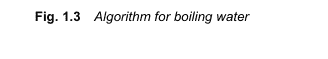

图 1.3 煮水的算法

我们不会为煮水绘制流程图。到现在应该很清楚了，这只是将上述 9 个步骤一个接一个地写在矩形中；每个矩形都通过箭头连接到其后继者。

#### 1.2.2 选择

我们很快就会意识到仅靠‘sequence’不足以表达算法。我们相当多的行为取决于某些事件。因此，需要能够从许多可用选项中做出选择。因此，有一个选择过程。选择语句通常采用图 1.4 所示的形式。

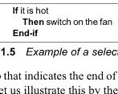

我们在日常生活中做出了很多大大小小的决定，甚至没有意识到。例如，如果很热，我们就打开风扇。我们可以按图 1.5 所示描绘此选择过程。

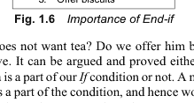

请注意，End-if 是一个额外的步骤，表示选择过程的结束。可能有人会问：End-if 真的有必要吗？让我们通过以下没有 End-if 的选择过程来说明这一点。参见图 1.6。

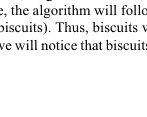

如果客人不想喝茶怎么办？我们给他提供饼干吗？从上述描述的选择过程来看并不清楚。可以从两种方式论证和证明。也就是说，我们不确定 Offer biscuits 部分是否属于我们的 If 条件。一个吝啬的人总是会说他认为 Offer biscuits 是条件的一部分，因此只会向想要喝茶的人提供饼干！因此，为了避免至少在我们的算法中产生任何混淆，最好以 End-if 结束选择过程。不同的计算机编程语言有不同的约定。

does not want tea, the algorithm will follow step 1 and directly step 4. 步骤 2 末尾的分号表示茶和饼干一起提供。你会注意到 End-if 的位置（在步骤 3 或 4）造成了全部差异！图 1.8（a）和 1.8（b）显示了相应的流程图。

```
Begin
1. If the guest wants tea
2. Then make tea
3. End-if
4. Offer biscuits
End
```

图 1.7(a) 向所有客人提供饼干

```
Begin
1. If the guest wants tea
2. Then make tea;
3. offer biscuits
4. End-if
End
```

图 1.7(b) 仅向想要喝茶的客人提供饼干

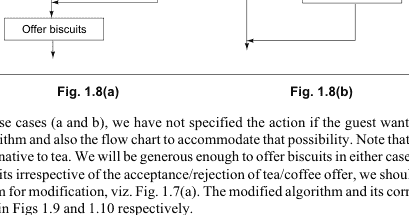

图 1.8(a)

图 1.8(b)

在这两种情况（a 和 b）中，我们都没有指定如果客人想要咖啡时的操作。让我们修改我们的算法和流程图以适应这种可能性。请注意，我们提供咖啡作为茶的替代品。我们将慷慨地在任何情况下都提供饼干。由于我们希望无论是否接受/拒绝茶/咖啡提供都提供饼干，我们应该只考虑第一个算法进行修改，即图 1.7(a)。修改后的算法及其相应的流程图分别显示在图 1.9 和 1.10 中。

```
Begin
1. If the guest wants tea
2. Then make tea
3. End-if
4. If the guest wants coffee
5. Then make coffee
6. End-if
7. Offer biscuits
End
```

图 1.9 提供茶/咖啡和饼干的算法


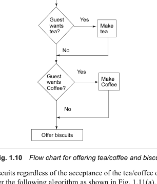

图 1.10 提供茶/咖啡和饼干的流程图

注意我们无论茶/咖啡的提供是否被接受都会提供饼干。这正是我们想要的。请考虑如图 1.11(a) 所示的以下算法。图 1.11(b) 显示了相应的流程图。

```
Begin
1. If the guest wants tea
2. Then make tea
3. Offer biscuits
4. End-If
5. If the guest wants coffee
6. Then make coffee
7. Offer biscuits
8. End-If
End
```

(a) 算法

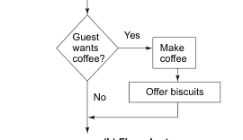

(b) 流程图

图 1.11 仅在客人想要茶/咖啡时才提供饼干

它能否达到图 1.9 中所示算法的相同目标？仔细检查会发现它并不相同。例如，如果客人拒绝茶和咖啡，图 1.9 中所示的算法仍会提供饼干给客人。然而，图 1.11(a) 中所示的算法则什么也不提供！看似相似的事物很容易误导我们，因为它们实际上是不同的。编写算法时需要特别注意这些问题。否则会导致被称为 bug 的编程错误，而程序员时常会提到这些错误。

我们会注意到图 1.9–1.11 中描绘的算法和流程图存在一些问题。客人选择喝茶后，算法仍会询问客人是否想要咖啡。除非客人同时想要两者，否则这完全是浪费的。我们可以通过引入 goto 指令来避免这种情况。利用它，我们可以将图 1.9 的算法重写为图 1.12(a) 和 1.12(b) 所示。

```
Begin
1. If the guest wants tea
2. Then make tea
3. Goto LAST
4. End-If
5. If the guest wants coffee
6. Then make coffee
7. End-If
8. LAST: Offer Biscuits
End
```

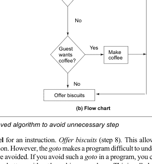

图 1.12 改进的算法以避免不必要的步骤

在此算法中，LAST 被称为指令的标签。提供饼干（步骤 8）。这允许 goto 指令分支到特定指令。然而，goto 使程序难以理解，因此难以修改。所以，通常会避免使用 goto。如果你在程序中避免使用这种 goto，你可以从顶部开始阅读程序，到底部结束，而不会向上或向下分支。这被称为无 goto 或自顶向下或结构化编程方法。此类程序易于理解，因此易于维护。我们稍后将看到如何以结构化方式编写相同的算法。

##### 1.2.2.1 复合条件

将不同的条件组合成一个条件非常容易。我们通常使用像 and 和/或 or 这样的词来连接句子。同样的，我们也可以将两个或多个条件组合成一个单一的复合条件。

例如，看看图 1.13 所示的算法。

```
1. If it is a weekday
2. and it is 7 am or more
3. and you are feeling ok
4. Then
5. Take breakfast
6. Go to work
7. End-if
```

图 1.13 使用 and 的复合条件

在此算法中，你同时做两件事，即吃早餐和去上班。然而，你只有在全部三个条件都满足时才执行这些操作，即必须是工作日，必须至少是早上 7 点，并且你感觉良好。如果其中任何一个条件不成立，你就不会执行这两个操作。例如，如果是早上 7 点，你感觉良好，但如果是周末，你就不会执行这两个操作。但如果你在现实生活中非常认真地对待该算法，你会注意到一个 bug。你周末不上班是对的，但你也必须跳过早餐！所以，要小心！

同样，图 1.14 中的算法说明了使用 or 词来连接两个或多个条件的使用。（注意，我们现在假设我们的算法具有隐式的 Begin 和 End 语句。）

```
1. If it is a weekday
2. or work is pending
3. or boss is angry
4. Then
5. Take breakfast
6. Go to work
7. End-if
```

图 1.14 使用 or 的复合条件

在这种情况下，只要满足其中任何一个条件，你就会吃早餐并去上班。例如，如果你的老板生气了，即使是假期并且实际上没有待办工作，你仍会执行这两个操作。只有当三个条件都不满足时，你才会跳过吃早餐和去上班。

##### 1.2.2.2 嵌套条件

有时，事情并不容易表达。面对各种需要担心的情况，就会变得非常复杂。例如，如果某事取决于仍有另一件事发生（或不发生），就会出现一个 if 嵌套在另一个 if 中。我们称之为嵌套条件。让我们看一个例子。

```
1. If you are feeling ok
2. Then go to work
3. Else
4. If you have fever
5. Then go to the doctor
6. Else
7. Just relax
8. End-if
9. End-if
```

图 1.15 嵌套条件

你会注意到开头有一个 if（步骤 1），底部有对应的 End-if（步骤 9），它表示该 if 条件的结束。在此之内，你会注意到在同一列中写的另一个 if 和 End-if 对（步骤 4 和 8）。Else 提供了一种替代的执行路径。让我们在你感觉良好时追踪算法。在这种情况下，算法执行步骤 2，跳过步骤 3 到 8，直接进入步骤 9。如果你感觉不佳但没有发烧，算法会经过步骤 1、3、4、6、7、8 和 9。你不会去上班，你只是放松，但即使你有胃痛，你也不会去看医生。这是一个 bug！

如果你感觉不佳并且发烧，你会经过步骤 1、3、4、5、8 和 9。在这种情况下，你不会去上班，你会去看医生，但你不会放松。所以，还有另一个 bug。试着把它去掉！

让我们使用嵌套条件重写图 1.6 的第一个算法。这将使 else 的好处更清晰。

```
1. If the guest wants tea
2. Then make tea
3. Else
4. If the guest wants coffee
5. Then make coffee
6. End-if
7. End-if
8. Offer biscuits
```

图 1.16 使用嵌套条件的‘茶-咖啡’算法

如图所示，如果客人接受茶，我们只需泡茶并提供饼干，而不必在意他是否想要咖啡（除非客人想要两者！）。图 1.6 中并没有发生这种情况。如果我们只需要检查一两个条件，这可能不会有太大区别。然而，随着条件数量的增加，算法最好尽可能紧凑和高效。

作为进一步的说明，让我们编写一个算法来找出任意三个给定数字中最大的数。编写一个算法来找出两个数字中较大的数非常容易。假设这两个数字是 a 和 b，我们只需比较两者即可。然而，当有三个数字时，事情就有点复杂了。算法如图 1.17 所示。

```
1. If a > b
2. Then If a > c
3. Then choose a
4. Else choose c
5. End-if
6. Else If b > c
7. Then choose b
8. Else choose c
9. End-if
10. End-if
```

图 1.17 选择三个数中最大的数

为了确定算法确实按预期工作，我们可能会将值 15、2 和 21 分别赋给 a、b 和 c。当我们想象这些数字代替 a、b 和 c 出现在上述算法中并检查算法是否正确工作时，这就被称为我们算法的铅笔运行。它也被称为算法的步行检查。最好使用各种值对算法进行步行检查。即，我们应取 a、b 和 c，使得一次 a 是其中最大者（例如 a = 7，b = 2 且 c = 1），然后是 b（例如 a = 13，b = 20，c = 10），然后是 c（例如 a = 18，b = 24，c = 49）。这样可以确保我们的算法在每种情况下都能给出正确的结果。当我们以这种方式对算法进行步行检查时，我们实际上是在检查它是否工作正常。

##### 1.2.2.3 测试与调试

上面讨论的意思是，我们正在检查我们的算法是否给出期望的结果。因此，我们正在测试我们的算法。我们用于测试的一组 a、b 和 c 的值（例如 a = 18，b = 24，c = 49）被称为测试用例，因为我们在特定时间测试算法的可能性（或情况）。一组测试用例构成测试数据。

如果在其中任何一种条件下，我们的算法给出错误的结果，我们就说算法中存在 bug——这是错误的另一个名称。然后需要纠正这个 bug，即相应地更改算法并再次进行步行检查。现在算法应该给出期望的结果。从算法中移除 bug 的过程称为调试。

为了理解这一点，让我们故意在算法中引入一个 bug。找出三个数中最大数的修改后算法如图 1.18 所示。斜体中的语句与图 1.17 中的互换了。

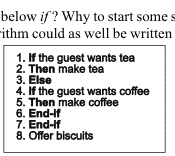

让我们用 a = 1，b = 5 和 c = 9 的值测试如图 1.18 所示的修改后算法。你会发现我们的算法结果是 b 是三个数中最大的。这显然是错误的。这就是调试如何帮助我们识别和纠正错误。

##### 1.2.2.4 缩进与算法维护

一个问题：为什么要将 end-if 正好写在 if 的下方？为什么有些句子从开头开始，有些则在留出一些空格后开始？算法也可以像图 1.19 所示那样写。


好吧，客人可能最终喝咖啡，而他实际上想要的是茶！这种写法明显的缺点是它不易跟随。即，它没有缩进。此外，如果有人要更改它（例如添加另一种饮料），就很难立即看出在哪里进行更改。在软件术语中，这意味着一个难以维护的算法。


#### 1.2.3 迭代

让我们想象一个不同的情况。假设我请我的朋友等我到来。然后我们两人一起去看电影。我的朋友将如何为这种情况编写算法？起初，似乎可以用（一系列）如果-那么-否则语句来完成。假设朋友决定每两分钟检查一次我的到来。因此，图 1.20 中的算法应该足够了。

```
1. If I arrive
2. Then we go for a movie
3. Else wait for two minutes
4. If I arrive
5. Then we go for a movie
6. Else wait for two minutes
7. If I arrive
8. Then...
```

Fig. 1.20 需要迭代

等等。应该写多少次？例如，如果我两小时后才到，上述说明就必须写 60 次！但如果我四小时后才来，就要重复 120 次！！这就像想象如果时钟不是圆形的会怎样。把时钟想象成一条直线。12 之后是 1 没错，但时针是直线移动的（为简单起见，忽略秒和分钟）。于是，我们有：

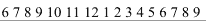

正如可以看到的，仅一天就需要 24 套 1-12。我们在算法中也有同样的问题：

- 它太长且重复
- 我们对其没有控制，因为我们不确定它何时会结束

迭代算法将解决这些问题。编写此算法的方法有很多。图 1.21 显示了所有方法。让我们也画出相应的流程图。

```
1. Repeat
2. Wait for two minutes
3. until I arrive
4. Go to movie
```

```
1. Do
2. Wait for two minutes
3. While I do not arrive
4. Go to movie
```

```
1. While I do not arrive
2. Wait for two minutes
3. End-while
4. Go to movie
```

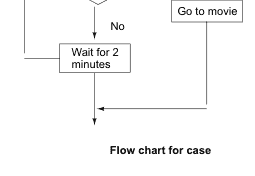

Fig. 1.21 迭代

Repeat-until 和 Do-while（情况 a 和 b）本质上是相同的。两者都使用 until 和 while 等通用术语来检查成功/失败。然而，它们与（c）（While-End-while）有显著不同。我们现在来看看为什么。如果我在算法执行之前就到了——也就是说，在算法开始时——会发生什么？在（a）和（b）中，我的朋友仍会等待两分钟！这些算法首先要求我的朋友等待两分钟，然后再检查我是否已到。另一方面，情况（c）首先检查我是否已到。只有然后才要求我的朋友等待两分钟。请注意，流程图是按照样式（c）绘制的。我们也可以为前两种（先等待后检查）绘制它。必须指出，算法（a）和（b）一点也不坏。在某些情况下我们可能更喜欢情况（a）或（b）。在其他情况下，我们会选择（c）。

总之，顺序、选择和迭代构成了编写任何算法的基础构件。这三种基本指令类型可以处理几乎任何情况并将其表述出来。编写相同算法的方式有很多种。我们的目标应是使其尽可能紧凑且易于理解，同时不丢失任何含义。

### 需记住的要点

- 1. 逐步描述过程称为 **算法**。
- 2. 将各个步骤以图表形式表示称为 **流程图**。
- 3. **并行计算**是为了加速事物而开发的，最终试图在 **人工智能** 中模仿人类行为。
- 4. 顺序涉及我们一个接一个执行的步骤序列。
- 5. 选择涉及从多个可用选项中做出选择。
- 6. 迭代涉及执行重复性任务。
- 7. 上述三种基本活动类别以不同方式组合可以形成描述 *任何* 算法的基础。
- 8. 没有 goto 语句的程序易于理解，因此也易于维护。
- 9. 我们可以将两个或多个条件组合成一个单一的 **复合条件**。
- 10. 在另一个 *if* 中放置一个 *if* 形成 **嵌套条件**。
- 11. 用各种值对算法进行演练始终是一个良好的实践。
- 12. 从算法中移除错误的过程称为 **调试**。

### 复习问题和练习

- 1.1 指出算法和流程图之间的区别。
- 1.2 编写从银行取款 Rs. 1000 的算法。
- 1.3 绘制上述流程图。
- 1.4 详细描述测试所涉及的步骤。
- 1.5 详细讨论顺序、选择和迭代。

#### 判断以下陈述是真还是假

- (a) 逐步描述过程称为流程图。
- (b) 算法涉及非常复杂的过程。
- (c) 当我们将一个大任务分解为更小的步骤时，我们实际做的是创建算法。
- (d) 算法中的每个步骤都可以称为指令。
- (e) 并行计算减慢了事物。
- (f) 通常，算法中的步骤可以分为五个基本类别。
- (g) 从多个可用选项中做出选择称为顺序。
- (h) 执行重复性任务称为迭代。
- (i) End-if 的位置可以改变过程中的含义。
- (j) 避免程序中的 goto 使其成为无 goto 或自顶向下或结构化的程序。
- (k) 无 goto 程序难以理解。
- (l) 我们可以将两个或多个条件组合成一个单一的复合条件。
- (m) 如果一个 if 在另一个 if 内，则称为复合条件。
- (n) 检查我们的算法是否给出期望结果称为测试用例。
- (o) 一组测试用例构成测试数据。
- (p) 顺序、选择和迭代构成了编写任何算法的基础构件。

#### 真假问题的答案

| (a) | (b) | (c) | (d) |
|-----|-----|-----|-----|
| 假 | 假 | 真 | 真 |
| 假 | 假 | 假 | 真 |
| 真 | 真 | 真 | 真 |
| 真 | 真 | 真 | 真 |

## 第2章

## C 概述

### 2.1 引言

'C' 对于编程语言来说似乎是一个奇怪的名字。但这种奇怪听起来语言是当今最流行的编程语言之一。C 是 1960 年代在剑桥大学开发的名为 B 的 'Basic Combined Programming Language'（BCPL）的后代。B 语言由 Dennis Ritchie 修改，并在 1972 年于贝尔实验室实现。新语言被命名为 C。

由于它与 UNIX 操作系统一起开发，因此与 UNIX 紧密相关。该操作系统也是在贝尔实验室开发的，几乎完全用 C 编写。

多年来，C 主要用于学术环境，但随着商业用途的 C 编译器的发布以及 UNIX 越来越受欢迎，它开始在计算机专业人士中获得广泛支持。今天，C 运行在包括 MS-DOS 在内的多种操作系统下。由于 MS-DOS 是微型计算机的主导操作系统，自然而然地，C 开始在整个微型计算机社区产生影响。

本书描述了 C 的特性，这些特性通常由大多数编译器支持。它还包括 ANSI C 的所有基本特性。

### 2.2 C 的重要性

C 越来越受欢迎可能是由于其许多理想品质。它是一种健壮的语言，其丰富的内置函数和运算符集可用于编写任何复杂程序。C 编译器结合了汇编语言的能力和高级语言的特性，因此非常适合编写系统软件和业务包。事实上，市场上许多 C 编译器都是用 C 编写的。

用 C 编写的程序高效且快速。这归功于其多种数据类型和强大的运算符。它比 BASIC 快很多倍。例如，将变量从 0 递增到 15000 的程序在 C 中大约需要一秒钟，而在解释型 BASIC 中则需要超过 50 秒。

只有 32 个关键字，其优势在于其内置函数。有多个标准函数可用于开发程序。


C 具有高度可移植性。这意味着为一台计算机编写的 C 程序几乎无需修改或完全无需修改即可在另一台计算机上运行。如果我们计划使用一台装有不同操作系统的新计算机，可移植性就很重要。

C 语言非常适合结构化编程，因此要求用户从功能模块或程序块的角度来思考问题。这些模块的恰当组合就能构成一个完整的程序。这种模块化结构使程序的调试、测试和维护更加容易。

C 的另一个重要特性是它能够自我扩展。一个 C 程序基本上就是一组由 C 库支持的函数。我们可以不断将自己的函数添加到 C 库中。有了大量可用函数，编程任务就变得简单了。

在讨论 C 的任何具体特性之前，我们先看一些 C 示例程序，分析并理解它们是如何工作的。每个程序必须有且仅有一个 main 函数。如果我们使用多个 main 函数，编译器就无法判断哪一个标志着程序的开始。

考虑图 2.1 中给出的一个非常简单的程序。该程序执行时将产生以下输出：

```c
main()
{
/* ............printing begins............. */
printf("I see, I remember");
/* ............printing ends............. */
}
```

图 2.1 打印一行文本的程序

让我们仔细看看这个程序。第一行通知系统程序的名称为 main，执行从这一行开始。main() 是 C 系统用来告诉计算机程序从何处开始的一个特殊函数。每个程序必须有且仅有一个 main 函数。如果我们使用多个 main 函数，编译器就无法判断哪一个标志着程序的开始。

紧跟在 main 后面的空圆括号表明函数 main 没有参数（或形参）。参数的概念将在后面讨论函数时详细讨论（第 10 章）。

第二行中的左花括号 '{' 标志着函数 main 的开始，最后一行中的右花括号 '}' 表示函数的结束。在本例中，右花括号也标志着程序的结束。这两个花括号之间的所有语句构成函数体。函数体包含一组执行给定任务的指令。

在本例中，函数体包含三条语句，其中只有 printf 行是可执行语句。以 /* 开头并以 */ 结尾的行称为注释行。它们在程序中用于增强可读性和便于理解。注释行不是可执行语句，因此 /* 和 */ 之间的任何内容都会被编译器忽略。一般来说，注释可以插入到任何可以出现空白的地方——行的开头、中间或末尾，但绝不能插入到单词中间。

由于注释不影响程序的执行速度和大小，我们应在程序中大量使用它们。它们帮助程序员和其他用户理解程序的各种功能与操作，并有助于调试和测试。在后续示例中，我们将看到注释行更多的用法。

现在让我们看看 printf() 函数，它是该程序唯一的可执行语句。

```c
printf("I see, I remember");
```

printf 是一个预定义的标准 C 函数，用于打印输出。预定义意味着它是一个已经编写并编译好的函数，在链接时与我们的程序链接在一起。编译和链接的概念将在本章后面解释（第 2.4 节）。printf 函数会将起始和结束引号之间的所有内容打印出来。在本例中，输出将是：

```
I see, I remember
```

注意，打印行以分号结尾。C 中的每条语句都应以分号（;）结尾。

假设我们想将上面的引文打印成两行，如下所示：

```
I see,
I remember !
```

这可以通过再添加一个 printf 函数来实现，如下所示：

```c
printf("I see, \n");
printf("I remember !");
```

圆括号之间包含的信息称为函数的参数。第一个 printf 函数的参数是 "I see,\n"，第二个函数的参数是 "I remember !"。这些参数只是要打印出来的字符串，而语句

```c
printf("\nSee,\n....\n....remember !");
```

将打印出

```
I see,
I remember !

I
See,
.....I
......remember !
```

在我们继续讨论更多示例之前，必须注意一个重要点。C 确实区分大写和小写字母。例如，printf 和 PRINTF 并不相同。在 C 中，一切都用小写字母书写。不过，大写字母用于表示常量的符号名。我们也可以在输出字符串中使用大写字母，如 "I SEE" 和 "I REMEMBER"。

上面的示例是最简单的程序之一。图 2.2 突出显示了通用格式。所有 C 程序都需要一个 main 函数。

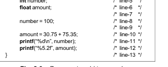

### 示例程序 2：两数相加

考虑另一个对两个数执行加法并显示结果的程序。完整程序如图 2.3 所示。

```c
/* Program ADDITION */
/* Written by EBG */
main()
{
    int number;
    float amount;

    number = 100;

    amount = 30.75 + 75.35;
    printf("%d\n", number);
    printf("%5.2f", amount);
}
```

图 2.3 两数相加的程序

该程序执行时将产生以下输出：

```
100
106.10
```

程序的前两行是注释行。在开头使用注释行来提供程序名称、作者、日期等信息是一种好做法。注释字符也用于其他行中指示行号。

```c
int number;
float amount;
```

告诉编译器 number 是整数（int 是 integer 的缩写），而 amount 是浮点（float）数。声明语句必须出现在函数的开头，如图 2.3 所示。所有声明语句都必须以分号结尾。C 支持许多其他数据类型，它们将在第 3 章详细讨论。

诸如 int 和 float 这样的词称为关键字，不能用作变量名。第 3 章给出了关键字列表。

```c
number = 100;
amount = 30.75 + 75.35;
```

下一条语句是输出语句，用于打印 number 的值。该打印语句包含两个参数。第一个参数 "%d\n" 告诉编译器，第二个参数 number 的值应作为十进制整数打印。注意这些参数由逗号分隔。换行符 \n 使下一个输出出现在新的一行。

```c
printf("%d\n", number);
```

程序的最后一条语句以浮点格式打印出 amount 的值。格式说明 %5.2f 告诉编译器，输出必须是浮点格式，总共有五位，小数点右边有两位。

```c
printf("%5.2f", amount);
```

执行一个用 C 编写的程序涉及一系列步骤。这些步骤是：

- 1. 创建程序。
- 2. 编译程序。
- 3. 将程序与 C 库中所需的函数链接。
- 4. 执行程序。

图 2.4 说明了创建、编译和执行 C 程序的过程。尽管这些步骤无论使用何种操作系统都相同，但用于实现这些步骤的系统命令以及文件命名约定在不同系统上可能有所不同。

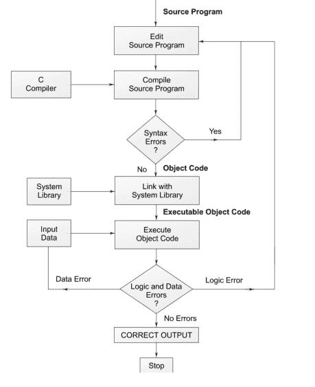

图 2.4 编译和运行 C 程序的过程

操作系统是控制计算机系统全部操作的程序。所有输入/输出操作都通过操作系统进行。操作系统是硬件和用户之间的接口，负责处理用户程序的执行。

当今最流行的两种操作系统是 UNIX（用于小型机）和 MS-DOS（用于微型机）。我们将简要讨论在这两种操作系统下执行 C 程序时应遵循的过程。

### UNIX 系统

### 创建程序

一旦将 UNIX 操作系统装入内存，计算机就准备好接收程序了。程序必须输入到一个文件中。文件名可以由字母、数字和特殊字符组成，后面跟一个点和字母 c。有效文件名的示例有：

- hello.c
- program.c
- ebg1.c

文件是借助文本编辑器创建的，可以是 ed 或 vi。调用编辑器并创建文件的命令是

```c
ed filename
```

如果文件以前存在，它会被加载。如果文件尚不存在，则必须创建该文件，以便它准备好接收新程序。程序中的任何更正都在编辑器下完成。（你系统编辑器的名称可能不同。请查阅系统手册。）

编辑结束后，文件被保存到磁盘上。以后任何时候都可以通过文件名引用它。输入到文件中的程序称为源程序，因为它代表程序的原始形式。

### 编译和链接

让我们假设程序已创建在一个名为 ebg1.c 的文件中。现在程序已准备好编译。在 UNIX 下完成此任务的编译命令是

```c
cc ebg1.c
```

源程序指令现在被翻译成适合计算机执行的形式。翻译是在检查每条指令的正确性之后进行的。如果一切正常，编译会静默进行，翻译后的程序存储在另一个名为 ebg1.o 的文件中。这个程序称为目标代码。

链接是将程序所需的其他程序文件和函数组合在一起的过程。例如，如果程序使用 exp() 函数，那么该函数的目标代码应从系统的数学库中取出，并链接到主程序。在 UNIX 下，使用 cc 命令时链接会自动完成（如果未检测到错误）。

如果发现语言的语法和语义错误，它们会被列出，编译过程会立即结束。应在编辑器的帮助下更正源程序中的错误，然后重新进行编译。


编译并链接后的程序称为*可执行目标代码*，并自动存储在另一个名为**a.out**的文件中。

请注意，某些系统使用不同的编译命令来链接数学函数。

`cc filename -lm`

是 UNIX SYSTEM V 操作系统下的命令。

### 执行程序

执行是一项简单的任务。命令

`a.out`

会将可执行目标代码加载到计算机内存中并执行指令。执行期间，程序可能要求通过键盘输入一些数据。有时程序不会产生预期结果。也许程序的*逻辑*或*数据*有问题。这时就有必要修正源程序或数据。如果修改了源程序，则应重复编译、链接和执行程序的整个过程。

### 创建自己的可执行文件

请注意，链接器总是分配相同的名称**a.out**。当我们编译另一个程序时，该文件将被新程序的可执行目标代码覆盖。如果我们想防止这种情况发生，应立即使用以下命令重命名该文件

`mv a.out name`

我们也可以通过如下在**cc**命令中指定一个选项来实现：

`cc -o name source-file`

这会将可执行目标代码存储在文件 name 中，并防止旧文件**a.out**被破坏。

### 多个源文件

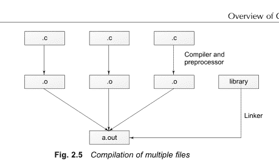

会将源文件 mod1.c 和 mod2.c 编译成目标文件 mod1.o 和 mod2.o。它们可以通过以下命令链接在一起

```
cc mod1.o mod2.o
```

我们也可以如下组合源文件和目标文件：

```
cc mod1.c mod2.o
```

仅编译 mod1.c，然后将其与目标文件 mod2.o 链接。当多个源文件中的一个需要修改并重新编译，或者要将已有的目标文件与待编译程序一起使用时，这种方法很有用。

### MS-DOS 系统

可以使用任何文字处理软件以非文档模式创建程序。文件名应以字符“.c”结尾，如 program.c、pay.c 等。然后，命令

```
MSC pay.c
```

在 MS-DOS 操作系统下会加载存储在 pay.c 文件中的程序并生成目标代码。该代码存储在另一个名为 pay.obj 的文件中。如果发现任何语言错误，编译就不会完成。然后应修正程序并再次编译。链接由命令 LINK pay.obj 完成，该命令生成文件名为 pay.exe 的可执行代码。现在，命令 pay 将执行程序并给出结果。

### 2.5 C 程序的结构

到目前为止讨论的示例说明，C 程序可以看作是一组称为函数的构建块。函数是一个子程序，可能包含一条或多条旨在执行特定任务的语句。要编写 C 程序，我们首先创建函数，然后将它们组合在一起。一个 C 程序可以包含一个或多个部分，如图 2.6 所示

文档部分由一组注释行组成，给出程序名称、作者以及程序员以后可能想使用的其他详细信息。链接部分向编译器提供指令，以链接系统库中的函数。定义部分定义所有符号常量。

有些变量在多个函数中使用。这类变量称为全局变量，并在所有函数外部的全局声明部分中声明。该部分还声明所有用户定义函数。

每个 C 程序必须有一个 main() 函数部分。该部分包含两部分：声明部分和可执行部分。声明部分声明可执行部分中使用的所有变量。可执行部分至少有一条语句。这两部分必须出现在左花括号和右花括号之间。程序执行从左花括号开始，到右花括号结束。main 函数部分的右花括号是程序的逻辑结尾。声明部分和可执行部分中的所有语句都以分号(;)结尾。

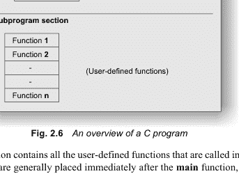

## 图 2.6 C 程序概述

子程序部分包含主函数中调用的所有用户定义函数。

用户定义函数通常紧接在主函数之后放置，尽管它们可以以任何顺序出现。

除主函数部分外，所有部分在不需要时都可以缺省。

### 要点

- 1. 每个 C 程序都需要一个 main() 函数（使用多个 main() 是非法的）。main 所在的位置是程序执行开始的地方。
- 2. 函数的执行从该函数的左花括号开始，到相应的右花括号结束。
- 3. C 程序使用小写字母编写。然而，符号名称和输出字符串使用大写字母。
- 4. 程序行中的所有单词之间必须至少用一个空格、制表符或标点符号分隔。
- 5. C 程序中的每条程序语句都必须以分号结尾。
- 6. 所有变量在程序中投入使用之前，都必须声明其类型。
- 7. 当程序引用其未定义的特殊名称和函数时，必须确保使用 #include 指令包含头文件。
- 8. define 和 include 等编译器指令是帮助编译器编译程序的特殊指令。它们不以分号结尾。
- 9. 编译器指令的符号 # 必须出现在该行的第一列。
- 10. 当使用花括号对语句进行分组时，请确保左花括号有对应的右花括号。
- 11. C 是一种自由格式语言，因此对各部分进行适当形式的缩进可以提高程序的可读性。
- 12. 注释几乎可以插入到任何可以出现空格的地方。在适当位置使用适当的注释可以提高程序的可读性和可理解性，并帮助用户进行调试和测试。记得正确匹配符号 /* 和 */。

### 复习问题与练习

- 2.1 如果你能使用带有 C 编译器的计算机系统，请查明操作系统和编译器特殊功能的详细信息。
- 2.2 编译并运行本章讨论的所有程序。将输出与程序中给出的输出进行比较。
- 2.3 删除图 2.1 程序中的 printf 语句末尾的分号，并尝试执行它。程序的输出是什么？
- 2.4 在示例程序 2 中，删除第 5 行并执行程序。错误消息有多大帮助？
- 2.5 修改示例程序 3，使其输出以下内容：
  年份      金额
  1         5550.00
  2         6160.00
  .          .
  .          .
  .          .
  10        14197.11
  注意，修改后的输出仅包含 10 个值（年份 = 1,..., 10）。

### 2.6 找出以下程序中的语法错误：

```
Include <math.h>
main { }
(
    FLOAT X;
    /*** ASSIGNMENT SECTION***/
    X = 2.5,
    Y = exp (x);
    /*** PRINTING SECTION ***/
    print(x, y)
)
```

### 2.7 编写一个程序，按以下形式打印你的邮寄地址：

第一行：姓名
第二行：门牌号 街道
第三行：城市，邮政编码

### 2.8 编写一个程序，输出以下乘法表：

5 × 1 = 5
5 × 2 = 10
5 × 3 = 15
.
.
.
5 × 20 = 100

### 2.9 编写一个程序，打印以下图形：

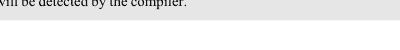

### 2.10 指出以下陈述是 TRUE 还是 FALSE：

- (a) C 程序中的每一行都应以分号结尾。
- (b) 在 C 语言中，小写字母是有意义的。
- (c) 每个 C 程序都以 END 一词结尾。
- (d) main() 是程序开始执行的地方。
- (e) C 程序中的一行可以有多条语句。
- (f) 一个 printf() 语句只能生成一行输出。
- (g) 程序中 main() 的右花括号是程序的逻辑结尾。
- (h) 语法错误将由编译器检测。


## 第3章：常量、变量和数据类型

### 3.1 引言

编程语言旨在帮助处理由数字、字符和字符串组成的某些类型的数据，并提供称为信息的有用输出。数据处理任务通过执行称为程序的一系列精确指令来完成。这些指令使用某些符号和单词，并按照称为语法规则（或文法）的一些严格规则构成。每条程序指令都必须严格符合该语言的语法规则。像任何其他语言一样，C 有自己的词汇和语法。在本章中，我们将讨论常量和变量的概念及其与 C 编程语言相关的类型。

### 3.2 字符集

可用于构成单词、数字和表达式的字符取决于运行程序的计算机。不过，有一个字符子集可在大多数个人计算机、微型计算机、小型计算机和大型计算机上使用。C 中的字符分为以下几类：

-   字母
-   数字
-   特殊字符
-   空白字符

除非空白字符是字符串常量的一部分，否则编译器会忽略它们。空白字符可用于分隔单词，但禁止在关键字和标识符的字符之间使用。

### 3.3 C 记号

在一段文本中，单个单词和标点符号称为记号。类似地，在 C 程序中，最小的独立单元称为 C 记号。C 有六种记号，如图3.1所示。C 程序是使用这些记号以及该语言的语法编写的。

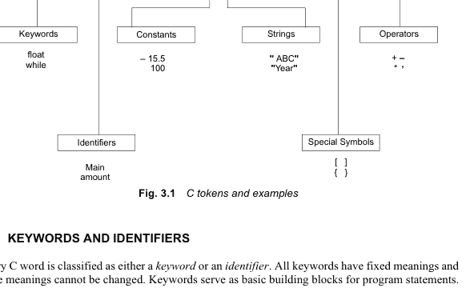

图3.1 C 记号及示例

### 3.4 关键字和标识符

每个 C 单词都被归类为关键字或标识符。所有关键字都有固定含义，这些含义不能更改。关键字是程序语句的基本构建块。ANSI C 中所有关键字的列表见表3.1。所有关键字都必须用小写字母书写。某些编译器可能会使用额外关键字，这些关键字必须从 C 手册中查明。

**表 3.1 ANSI C 关键字**

| auto | double | int | struct |
| break | else | long | switch |
| case | enum | register | typedef |
| char | extern | return | union |
| const | float | short | unsigned |
| continue | for | signed | void |
| default | goto | sizeof | volatile |
| do | if | static | while |

标识符指变量、函数和数组的名称。这些是用户定义的名称，由字母和数字序列组成，第一个字符为字母。允许使用大写和小写字母，但通常使用小写字母。标识符中也允许使用下划线字符。它通常用于连接长标识符中的两个单词。

### 3.5 常量

C 中的常量指在程序执行期间不改变的固定值。C 支持多种类型的常量，如图3.2所示。

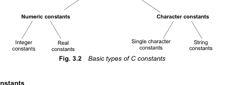

图3.2 C 常量的基本类型

#### 整型常量

整型常量指数字序列。整数有三种类型，即十进制、八进制和十六进制。

十进制整数由数字 0 到 9 组成，前面可带可选的 − 或 + 号。十进制整型常量的有效示例如下：

-   −123
-   −321
-   0
-   654321
-   +78

数字之间不允许嵌入空格、逗号和非数字字符。例如，15 750、20,000 和 $1000 都是非法数字。注意，ANSI C 支持一元加号，而早期版本未定义该符号。

八进制整型常量由集合 0 到 7 中数字的任意组合组成，并带有前导 0。八进制整数的一些示例如下：

-   037
-   0
-   0435
-   0551

以 0x 和 0X 开头的数字序列被视为十六进制整数。它们还可以包含字母 A 到 F 或 a 到 f。字母 A 到 F 表示数字 10 到 15。以下是有效十六进制整数的示例。

-   0X2
-   0x9F
-   0Xbcd
-   0x

编程中很少使用八进制和十六进制数。

可存储的最大整数值取决于计算机。16位计算机上为 32767，32位计算机上为 2,147,483,647。在这些计算机上，也可以通过给常量追加 U、L 和 UL 等限定符来存储更大的整型常量。例如：

-   56789U 或 56789u（无符号整数）
-   987612347UL 或 98761234ul（无符号长整数）
-   9876543L 或 9876543l（长整数）

无符号整数和长整数的概念将在 3.7 节详细讨论。

#### 例 3.1

在16位计算机上表示整型常量。

图3.3中的输出表明，大于 32767 的整数值在16位计算机上无法正确存储。然而，当将它们限定为长整型（通过追加 L）时，这些值会被正确存储。

```
Program
/******************************************************/
/* INTEGER NUMBER ON 16-BIT MACHINE */
/******************************************************/
main()
{
printf("Integer values\n\n");
printf("%d %d %d\n", 32767,32767+1,32767+10);
printf("\n");
printf("Long integer values\n\n");
printf("%ld %ld %ld\n", 32767L,32767L+1L,32767L+10L);
}
```

输出

```
Integer values

32767 -32768 -32759

Long integer values

32767 32768 32777
```

图3.3 整型常量的表示

#### 实型常量

整数不足以表示连续变化的量，例如距离、高度、温度、价格等。这类量用包含小数部分的数表示，如 17.548。这样的数称为实型（或浮点）常量。实型常量的更多示例如下：

-   0.0083
-   −0.75
-   435.36
-   +247.0

这些数用十进制记数法表示，由整数部分后跟小数点和小数部分组成。可以省略小数点前或小数点后的数字。也就是说，

-   215.
-   .95
-   −.71
-   +.5

都是有效的实数。

实数也可以用指数（或科学）记数法表示。例如，值 215.65 可以用指数记数法写成 2.1565e2。e2 表示乘以 10²。一般形式为：

```
mantissa e exponent
```

尾数是用十进制记数法表示的实数或整数。指数是带可选正负号的整数。分隔尾数和指数的字母 e 可以写成小写或大写。由于指数使小数点“浮动”，因此称这种记数法以浮点形式表示实数。合法浮点常量示例如下：

-   0.65e4
-   12e−2
-   1.5e+5
-   3.18E3
-   −1.2E−1

不允许嵌入空白。

指数记数法适合表示量级非常大或非常小的数。例如，750000000 可以写成 7.5E9 或 75E8。类似地，−0.0000000368 等价于 −3.68E−7。

浮点常量通常表示为双精度量。不过，可以使用后缀 f 或 F 强制为单精度，使用 l 或 L 进一步扩展双精度。

表3.2给出了一些有效和无效数值常量的示例。

**表 3.2 数值常量示例**

| 常量 | 是否有效？ | 备注 |
|---|---|---|
| 698354L | 是 | 表示长整型 |
| 25,000 | 否 | 不允许使用逗号 |
| +5.0E3 | 是 | （ANSI C 支持一元加号） |
| 3.5e-5 | 是 |  |
| 7.1e 4 | 否 | 不允许有空白 |
| -4.5e-2 | 是 |  |
| 1.5E + 2.5 | 否 | 指数必须为整数 |
| $255 | 否 | 不允许使用 $ 符号 |
| 0X7B | 是 | 十六进制整数 |

#### 单字符常量

单字符常量（或简称字符常量）包含一个用一对单引号括起来的单个字符。字符常量示例如下：

```
'5' 'X' ',' ' '
```

注意，字符常量 '5' 与数字 5 不同。最后一个常量是空白字符。

字符常量具有称为 ASCII 值的整数值。例如，语句

```
printf("%d", 'a');
```

将打印数字 97，即字母 a 的 ASCII 值。类似地，语句

```
printf("%c", 97);
```

将输出字母 'a'。所有字符的 ASCII 值见附录 II。

由于每个字符常量表示一个整数值，因此也可以对字符常量执行算术运算。这些内容将在第8章讨论。

#### 字符串常量

字符串常量是用双引号括起来的字符序列。字符可以是字母、数字、特殊字符和空白。示例如下：

-   "Hello!"
-   "1987"
-   "WELL DONE"
-   "?..."
-   "5+3"
-   "X"

请记住，字符常量（例如 'X'）不等同于单字符字符串常量（例如 "X"）。此外，单字符字符串常量没有对应的整数值，而字符常量具有整数值。字符串常用于程序中以构建有意义的程序。字符串操作将在第9章详细讨论。


#### 反斜杠字符常量

C 支持一些特殊的反斜杠字符常量，用于输出函数。例如，符号 `\n` 代表换行字符。此类反斜杠字符常量的列表见表 3.3。请注意，每一个都代表一个字符，尽管它们由两个字符组成。这些字符组合被称为 *转义序列*。

### 表 3.3 反斜杠字符常量

| 常量 | 含义 |
| --- | --- |
| `\a` | 可听警报（铃） |
| `\b` | 退格 |
| `\f` | 换页 |
| `\n` | 换行 |
| `\r` | 回车 |
| `\t` | 水平制表符 |
| `\v` | 垂直制表符 |
| `\'` | 单引号 |
| `\"` | 双引号 |
| `\?` | 问号 |
| `\\` | 反斜杠 |
| `\0` | 空 |

### 3.6 变量

一个 *变量* 是可用于存储数据值的数据名。与在程序执行期间保持不变的常量不同，变量在执行期间的不同时间可能取不同的值。在第 2 章中，我们使用了几个变量。例如，我们在示例程序 3 中使用了变量 **amount** 来存储每年结束时（在加上当年赚取的利息后）的货币价值。

变量名可以由程序员有意义地选择，以便反映其在程序中的功能或性质。此类名称的示例有：

- Average
- height
- Total
- Counter_1
- class_strength

如前所述，变量名可以由字母、数字和下划线(_) 字符组成，但需满足以下条件：

- 1. 必须以字母开头。某些系统允许下划线作为第一个字符。
- 2. ANSI 标准识别的长度为 31 个字符。然而，长度通常不应超过八个字符，因为许多编译器只将前八个字符视为有意义。
- 3. 大小写是有意义的。也就是说，变量 Total 与 total 或 TOTAL 不同。
- 4. 变量名不应为关键字。
- 5. 不允许空白字符。

有效变量名的一些示例是：

John    Value    T_raise
Delhi   x1       ph_value
mark    sum1     distance

无效的示例包括：

123        (area)
%          25th

变量名及其正确性的进一步示例见表 3.4。

### 表 3.4 变量名示例

| 变量名 | 是否有效 | 备注 |
|---|---|---|
| First_tag | 有效 | |
| char | 无效 | char 是关键字 |
| Price$ | 无效 | 美元符号不合法 |
| group one | 无效 | 不允许空白 |
| average_number | 有效 | 前八个字符有意义 |
| int_type | 有效 | 关键字可以作为名称的一部分 |

如果编译器只识别前八个字符，那么两个名称 average_height average_weight 对计算机来说含义相同。

这样的名称可以重写为 avg_height 和 avg_weight

或

ht_average 和 wt_average

而不改变其含义。

### 3.7 基本数据类型和大小

C 语言在数据类型方面非常丰富。存储表示和处理常量的机器指令因机器而异。可用的数据类型种类繁多，允许程序员根据应用程序和机器的需求选择合适的类型。

ANSI C 支持四类数据类型：

- 1. 主（或基本）数据类型
- 2. 用户定义数据类型
- 3. 派生数据类型
- 4. 空数据集

本节讨论主数据类型及其扩展。用户定义数据类型在下一节定义，而派生数据类型如数组、函数、结构体和指针则在遇到时讨论。空数据集在函数章节中讨论。

所有 C 编译器都支持四种基本数据类型，即整数 (int)、字符 (char)、浮点 (float) 和双精度浮点 (double)。许多编译器还提供扩展数据类型，如 long int 和 long double。各种数据类型及其描述术语见图 3.4。基本四种类型的范围见表 3.5。我们在本节简要讨论它们各自。

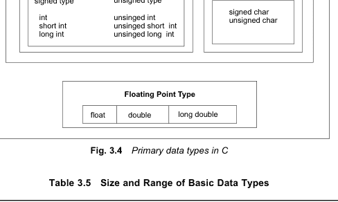

图 3.4 C 中的主数据类型

### 表 3.5 基本数据类型的大小和范围

| 数据类型 | 值范围 |
|---|---|
| char | −128 to 127 |
| int | −32,768 to 32,767 |
| float | 3.4e−38 to 3.4e+38 |
| double | 1.7e−308 to 1.7e+308 |

### 整数类型

整数是特定机器支持范围的整数。通常，整数占用一个字的存储空间，由于机器的字长各不相同（通常为 16 或 32 位），可存储的整数大小取决于计算机。如果使用 16 位字长，整数值的大小限制在 −32768 到 +32767 范围内（即 −2^15 到 2^15−1）。有符号整数使用 1 位表示符号，15 位表示数值的大小。同样，32 位字长可以存储从 −2,147,483,648 到 2,147,483,647 的整数。

为了在数值范围和存储空间上提供一定的控制，C 有三种整数存储类别，即 short int、int 和 long int，均有有符号和无符号形式。例如，short int 表示相对较小的整数值，其所需存储量约为普通 int 数量的一半。与有符号整数不同，无符号整数使用所有位表示数值的大小，并且始终为正。因此，对于 16 位机器，无符号整数的范围为 0 到 65,535。

我们声明 long 和无符号整数以增加值的范围。在整数上使用 signed 限定符是可选的，因为默认声明假定为有符号数。表 3.6 显示了在 16 位机器上基本类型和限定符的所有允许组合及其大小和范围。

### 表 3.6 16 位机器上数据类型的大小和范围

| 类型 | 大小（位） | 范围 |
|---|---|---|
| char or signed char | 8 | − 128 to 127 |
| unsigned char | 8 | 0 to 255 |
| int or signed int | 16 | − 32,768 to 32,767 |
| unsigned int | 16 | 0 to 65535 |
| short int or signed short int | 8 | − 128 to 127 |
| unsigned short int | 8 | 0 to 255 |
| long int or signed long int | 32 | − 2,147,483,648 to 2,147,483,647 |
| unsigned long int | 32 | 0 to 4,294,967,295 |
| float | 32 | 3.4E-38 to 3.4E+38 |
| double | 64 | 1.7E−308 to 1.7E+308 |
| long double | 80 | 3.4E−4932 to 1.1E + 4932 |

### 浮点类型

浮点数（或实数）在 32 位中存储（在所有 16 位和 32 位机器上），精度为 6 位数字。C 中通过关键字 float 定义浮点数。当 float 提供的精度不足时，可以使用 double 类型来定义该数字。double 数据类型数字使用 64 位，提供 14 位数字的精度。这些被称为双精度数。请记住，double 类型表示与 float 相同的数据类型，但精度更高。为了进一步扩展精度，我们可以使用使用 80 位的 long double。

### 字符类型

单个字符可以定义为字符 (char) 类型数据。字符通常存储在 8 位（一个字节）的内部存储中。signed 或 unsigned 限定符可以显式应用于 char。无符号字符的值在 0 到 255 之间，有符号字符的值从 −128 到 127。

### 3.8 变量声明

设计合适的变量名后，我们必须向编译器声明它们。声明做两件事：

- 1. 它告诉编译器变量名是什么。
- 2. 它指定变量将保存的数据类型。

变量的声明必须在程序中使用它们之前完成。

### 主类型声明

变量可用于存储任何数据类型的数值。也就是说，名称与其类型无关。

声明变量的语法如下：

```
data-type v1, v2, ... vn;
```

v1, v2, ... vn 是变量名。变量之间用逗号分隔。声明语句必须以分号结束。例如，有效的声明是：

```
int count;
int number, total;
double ratio;
```

int 和 double 分别是表示整数类型和实数类型数据值的关键字。表 3.7 显示了各种数据类型及其关键字等价物。

### 表 3.7 数据类型及其关键字

| 数据类型 | 关键字等价 |
|---|---|
| Character | char |
| Unsigned character | unsigned char |
| Signed character | signed char |
| Signed integer | signed int (or int) |
| Signed short integer | signed short int (or short int or short) |
| Signed long integer | signed long int (or long int or long) |
| Unsigned integer | unsigned int (or unsigned) |
| Unsigned short integer | unsigned short int (or unsigned short) |
| Unsigned long integer | unsigned long int (or unsigned long) |
| Floating point | float |
| Double-precision floating point | double |
| Extended double-precision floating point | long double |


## C 编程与数据结构

图 3.5 给出的程序段说明了变量的声明。main() 是程序的开始。左花括号 { 表示程序开始执行。变量声明通常在程序的左花括号之后立即进行。变量也可以在 main 函数外部（之前或之后）声明。声明位置的重要性将在后面讨论函数时详细说明。

```
main()/* ................ Program Name .................... */
{
 /* ................ Declaration .................... */
 float x, y;
 int code;
 short int count;
 long int amount;
 double deviation;
 unsigned n;
 char c;
 /* ............ Computation .................... */
 .....
 .....
 .....
 }/* ........... Program ends .................... */
```

图 3.5 变量的声明

当形容词（限定符）short、long 或 unsigned 在没有基本数据类型说明符的情况下使用时，C 编译器会将该数据类型视为 int。如果想把字符变量声明为 unsigned，则必须同时使用像 unsigned char 这样的两个词。

### 用户定义类型声明

C 支持一种称为“类型定义”的特性，允许用户定义一个标识符来表示已有的数据类型。这个用户定义的数据类型标识符随后可用于声明变量。它的一般形式为：

```
typedef type identifier;
```

其中 type 指已有的数据类型，“identifier” 指赋予该数据类型的“新”名称。已有数据类型可以属于任何类型类别，包括用户定义的类型。请记住，新类型只是在名称上是“新”的，而不是数据类型本身。typedef 不能创建新类型。类型定义的一些示例如下：

另一种用户定义的数据类型是 ANSI 标准提供的枚举数据类型。它的定义如下：

```
enum identifier {value1, value2, ... value_n};
```

“identifier” 是一种用户定义的枚举数据类型，可用于声明变量，这些变量可以取花括号内所列值之一（称为枚举常量）。在此定义之后，我们可以如下声明这种“新”类型的变量：

```
enum identifier v1, v2, ... vn;
```

枚举变量 v1、v2、... vn 只能取 value1、value2、... value n 中的一个值。以下类型的赋值是有效的：

```
v1 = value3;
v5 = value1;
```

示例：

```
enum day {Monday,Tuesday, ... Sunday};
enum day week_st, week_end;

week_st = Monday;
week_end = Friday;
if(week_st == Tuesday)
week_end = Saturday;
```

编译器会自动为所有枚举常量分配从 0 开始的整数数字。也就是说，枚举常量 value1 被赋值为 0，value2 被赋值为 1，依此类推。不过，可以通过显式给枚举常量赋值来覆盖自动分配。例如：

```
enum day {Monday = 1, Tuesday, ... Sunday};
```

这里，常量 Monday 被赋值为 1。其余常量被赋值为依次递增 1 的值。

枚举变量的定义和声明可以合并为一条语句。示例：

```
enum day {Monday, ... Sunday} week_st, week_end;
```

### 存储类的声明

C 中的变量不仅可以有数据类型，还可以有存储类，存储类提供有关变量位置和可见性的信息。存储类决定变量在程序的哪一部分内被识别。考虑以下示例：

```
/* Example of storage classes */
int m;
main()
{
    int i;
    float balance;
    ...
....
function1();
}
function1()
{
    int i;
    float sum;
    ...
    ...
}
```

在 main 之前声明的变量 m 称为全局变量。它可以在程序中的所有函数中使用，不必在其他函数中声明。全局变量也称为外部变量。

变量 i、balance 和 sum 称为局部变量，因为它们是在函数内部声明的。局部变量只在声明它们的函数内部可见且有意义。其他函数不知道它们。注意，变量 i 在两个函数中都声明了。在一个函数中对 i 值的任何更改都不会影响它在另一个函数中的值。

C 提供了多种存储类说明符，可用于显式声明变量的作用域和生存期。作用域和生存期的概念仅在多函数和多文件程序中重要，因此存储类将在后面讨论函数时详细考虑。现在只需记住，有四种存储类说明符（auto、register、static 和 extern），它们的含义见表 3.8。

### 表 3.8 存储类及其含义

| 存储类 | 含义 |
|---|---|
| auto | 只有声明它的函数才知道的局部变量。默认为 auto。 |
| static | 即使控制权转移到调用函数之后仍然存在并保留其值的局部变量。 |
| extern | 文件中所有函数都知道的全局变量。 |
| register | 存储在寄存器中的局部变量。 |

存储类是另一种限定符（如 long 或 unsigned），可以添加到变量声明中，如下所示：

```
auto int count;
register char ch;
static int x;
extern long total;
```

静态变量和外部（extern）变量会自动初始化为零。自动（auto）变量除非被显式初始化，否则包含未定义的值（称为“垃圾值”）。

### 3.9 给变量赋值

变量是为了在程序语句中使用而创建的，例如

```
value = amount + inrate * amount;
while (year <= PERIOD)
{
....
....
year = year + 1;
}
```

在第一条语句中，存储在变量 inrate 中的数值乘以存储在 amount 中的值，乘积再加到 amount 上。结果存储在变量 value 中。只有变量 amount 和 inrate 已经被赋值，这个过程才可能进行。变量 value 称为目标变量。虽然所有变量都按其类型进行了声明，但在表达式中使用的变量（计算语句中等号（=）右侧的变量）必须在程序遇到它们之前被赋值。同样，while 语句中的变量 year 和符号常量 PERIOD 必须在该语句被执行到之前被赋值。

### 赋值语句

可以使用赋值运算符 = 给变量赋值，如下所示：

```
variable_name = constant;
```

我们在第 2 章已经使用过这类语句。更多示例：

```
initial_value = 0;
final_value = 100;
balance = 75.84;
yes = 'x';
```

C 允许在一行中进行多次赋值。例如

```
initial_value = 0; final_value = 100;
```

是有效语句。

赋值语句意味着将“等号”左侧变量的值设置为等于右侧量（或表达式）的值。语句

```
year = year + 1;
```

表示 year 的“新值”等于 year 的“旧值”加 1。

在赋值操作期间，C 会将右侧值的类型转换为左侧的类型。当实数值转换为整数时，这可能涉及截断。

也可以在声明变量时给变量赋值。其形式如下：

```
data-type variable_name = constant;
```

一些示例如下：

```
int final_value = 100;
char yes = 'x';
double balance = 75.84;
```

给变量赋初值的过程称为初始化。C 允许使用多个赋值运算符在一条语句中初始化多个变量。例如，以下语句

```
p = q = s = 0;
x = y = z = MAX;
```

是有效的。第一条语句将变量 p、q 和 s 初始化为零，第二条语句用 MAX 初始化 x、y 和 z。注意，MAX 是在开头定义的符号常量。

请记住，外部变量和静态变量默认初始化为零。未显式初始化的自动变量将包含垃圾值。

### 例 3.2

图 3.6 中的程序展示了典型的声明、赋值以及存储在各种类型变量中的值。

变量 x 和 p 已声明为浮点变量。注意，我们赋给 x 的值 1.234567890000 在不同输出格式下是如何显示的。在 %.12f 格式下，x 的值显示为 1.23456780630，而实际赋的值为 1.234567890000。这是因为变量 x 被声明为 float，而 float 只能存储最多六位小数。

### 程序

```
/* **************************************************** */
/* EXAMPLES OF ASSIGNMENTS */
/* **************************************************** */

main()
{
    /*................. DECLARATIONS .....................*/ 
    float x, p;
    double y, q;
    unsigned k;

    /* ........ DECLARATION AND ASSIGNMENTS ............ */
    int m = 54321;
    long int n = 1234567890;

    /*................ ASSIGNMENTS .................... */
    x = 1.234567890000;
    y = 9.87654321;
    k = 54321;
    p = q = 1.0;

    /*.......... PRINTING ................................ */
    printf("m = %d\n", m);
    printf("n = %ld\n", n);
    printf("x = %.12f\n", x);
    printf("x = %f\n", x);
    printf("y = %.12f\n", y);
}
```


```
printf("y = %lf\n", y);
printf("k = %u p = %f q = %.12lf\n", k, p, q);
}
```

输出

m = -11215
n = 1234567890
x = 1.234567880630
x = 1.234568
y = 9.87653210000
y = 9.876543
k = 54321 p = 1.000000 q = 1.000000000000

图 3.6 赋值示例

声明为 `int` 的变量 `m` 无法正确存储值 54321，而是包含一些垃圾值。由于该程序运行在 16 位机器上，`int` 变量能够存储的最大值仅为 32767。然而，声明为 `unsigned` 的变量 `k` 正确存储了 54321。类似地，`long int` 变量 `n` 正确存储了 1234567890。

赋给声明为 `double` 的变量 `y` 的值 9.87654321 已被正确存储，但在 `%lf` 格式下打印为 9.876543。请注意，除非另行指定，否则 `printf` 函数总是将浮点值或双精度值显示到小数点后六位。我们将在后面讨论显示数字的输出格式。

#### 将变量声明为常量

在程序执行过程中，我们可能希望某些变量的值保持不变。可以通过在初始化时为变量加上限定符 `const` 来实现这一点。示例：

```
const int class_size = 40;
```

#### 将变量声明为 volatile

ANSI 标准还定义了另一个限定符 `volatile`，用于明确告诉编译器：变量的值可能随时被某些外部来源（来自程序外部）改变。例如：

```
volatile int date;
```

即使 `date` 没有出现在赋值语句的左侧，它的值也可能被某些外部因素修改。当把变量声明为 `volatile` 后，编译器会在每次遇到该变量时检查其值，以判断是否有外部修改改变了它。

请记住，声明为 `volatile` 的变量的值也可以被程序自身修改。如果我们希望变量的值不能被程序修改，却可能被其他进程修改，那么可以同时把变量声明为 `const` 和 `volatile`，如下所示：

```
volatile const int location = 100;
```

#### 数据的溢出与下溢

当变量的值对于其数据类型而言过大或过小时，就会发生数据溢出问题。变量能够容纳的最大值也取决于机器。由于浮点值会按允许（或指定）的有效数字位数进行舍入，溢出通常会得到尽可能大的实数值，而下溢通常会得到 0。

整数在所用整数数据类型的取值范围之内始终是精确的。然而，如果数据类型与常量的值不匹配，就可能发生溢出，这是一个严重的问题。C 不会对整数溢出给出任何警告或提示，只会给出不正确的结果。（溢出通常会产生负数。）因此，我们应更加谨慎地定义正确的数据类型，以处理输入/输出值。

#### 从键盘读取数据

给变量赋值的另一种方式是通过 `scanf` 函数从键盘输入数据。它是 C 中可用的通用输入函数，概念上与 `printf` 函数非常相似。它的工作方式很像 BASIC 中的 INPUT 语句。`scanf` 的一般格式如下：

```
scanf("control string", &variable1, &variable2.....);
```

控制字符串包含所接收数据的格式。每个变量名之前的 `&` 符号是一个运算符，用于指明该变量名的地址。我们必须始终使用该运算符，否则可能出现意外结果。来看一个示例：

```
scanf("%d", &number);
```

当计算机遇到这条语句时，执行会停止，并等待用户输入变量 `number` 的值。由于控制字符串 `"%d"` 指明要从终端读取一个整数值，因此我们必须以整数形式输入该值。输入数字后按下"回车"键，计算机便会继续执行下一条语句。因此，使用 `scanf` 可以提供交互式特性，也使程序变得"用户友好"。

#### 示例 3.3

图 3.7 中的程序演示了 `scanf` 函数的用法。程序中的第一条可执行语句是 `printf`，用于请求用户输入一个整数。这称为"提示消息"，会像"输入一个整数"这样显示在屏幕上。用户一输入整数，计算机就继续将该值与 100 进行比较。如果输入的值小于 100，屏幕上会打印消息"你的数字小于 100"。

## 常量、变量与数据类型

否则，会打印消息"你的数字多于两位"。该程序针对两种不同输入运行得到的输出也显示在图 3.7 中。

```
/*
 INTERACTIVE COMPUTING USING scanf FUNCTION
 */

main()
{
 int number;
 printf("Enter an integer number\n");
 scanf("%d", &number);

 if(number < 100)
 printf("Your number is smaller than 100\n");
 else
 printf("Your number contains more than two digits\n");
 }
```

输出
Enter an integer number
54
Your number is smaller than 100
Enter an integer number
108
Your number contains more than two digits

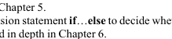

有些编译器允许把"提示消息"作为 `scanf` 控制字符串的一部分，例如 `scanf("Enter a number %d", &number);`。

我们将在第 5 章进一步讨论 `scanf`。

在图 3.7 中，我们使用 `if...else` 决策语句来判断数字是否小于 100。决策语句将在第 6 章深入讨论。

示例 3.4 第 2 章中讨论的示例程序 3 可以使用 `scanf` 转换成更灵活的交互式程序，如图 3.8 所示。

在这个例子中，计算机请求用户输入投资金额、利率和期限的值，然后等待输入。当用户输入完对应于 `amount`、`inrate` 和 `period` 这三个变量的三个值后，计算机便开始计算每年年末的金额，直到第 `period` 年，并产生如图 3.8 所示的输出。

### 程序

```
/************************************************/
/* INTERACTIVE INVESTMENT PROGRAM */
/************************************************/

main()
{
    int year, period;
    float amount, inrate, value;

    printf("Input amount, interest rate, and period\n\n");
    scanf("%f %f %d", &amount, &inrate, &period);
    printf("\n");
    year = 1;

    while (year <= period)
    {
        value = amount + inrate * amount;
        printf("%2d Rs %8.2f\n", year, value);
        amount = value;
        year = year + 1;
    }
}
```

### 输出

Input amount, interest rate, and period

10000 0.14 5

1  Rs 11400.00
2  Rs 12996.00
3  Rs 14815.44
4  Rs 16889.60
5  Rs 19254.15

Input amount, interest rate, and period

20000 0.12 7

1  Rs 22400.00
2  Rs 25088.00
3  Rs 28098.56
4  Rs 31470.39
5  Rs 35246.84
6  Rs 39476.46
7  Rs 44213.63

### 图 3.8 交互式投资程序

请注意，`scanf` 函数包含三个变量。在这种情况下，应确保输入的值与列表中变量的顺序和类型一致。任何不匹配都可能导致意外结果。编译器可能无法检测到这类错误。

- 3. `'# '` 必须是该行中的第一个字符。
- 4. `#define` 与符号名之间，以及符号名与常量之间必须有空格。
- 5. `#define` 语句不能以分号结尾。
- 6. 定义之后，在程序中不能通过赋值语句给符号名赋其他值。例如，`STRENGTH = 200;` 是非法的。
- 7. 符号名不对数据类型进行声明。其数据类型取决于常量的类型。
- 8. `#define` 语句可以出现在程序中的任何位置，但必须在程序中引用它之前出现（通常的做法是放在程序开头）。

`#define` 语句是一条预处理器编译指令，其功能比这里介绍的要强大得多。更高级的定义类型将在后面讨论。表 3.11 列举了一些无效的 `#define` 语句。

### 表 3.11 无效的 #define 语句示例

| 语句 | 有效性 | 说明 |
|---|---|---|
| `#define X = 2.5` | 无效 | 不允许使用 `=` 号 |
| `#define MAX 10` | 无效 | `#` 与 `define` 之间没有空格 |
| `#define N 25;` | 无效 | 末尾不能有分号 |
| `#define N 5, M 10` | 无效 | 一条语句只能定义一个名字 |
| `#Define ARRAY 11` | 无效 | `define` 应使用小写字母 |
| `#define PRICE$ 100` | 无效 | 名称中不允许使用 `$` 符号 |

### 案例研究

### 1. 计算数字的平均值

一个计算 N 个数字平均值的程序如图 3.9 所示。

程序

```
/***********************************************************/
/*              AVERAGE OF n VALUES                        */
/**********************************************************/

#define  N  10                 /* SYMBOLIC CONSTANT */

main()
{
    int    count;              /* DECLARATION OF */
    float  sum, average, number;   /* VARIABLES */

    sum = 0;                   /* INITIALIZATION */
    count = 0;                 /* OF VARIABLES */
    while (count < N)
    {
```


```
scanf("%f", &number);
sum = sum + number;
count = count + 1;
}

average = sum/N;
printf("N = %d Sum = %f", N, sum);
printf("Average = %f", average);
}
```

输出

1
2.3
4.67
1.42
7
3.67
4.08
2.2
4.25
8.21
N = 10 Sum = 38.799999 Average = 3.880000

## 图 3.9 N 个数的平均值

变量 number 被声明为 float，因此它既可以接受整数，也可以接受实数。

由于使用 #define 语句将符号常量 N 赋值为 10，程序接受十个值，并使用 while 循环计算它们的和。变量 count 统计值的个数，一旦它变为 11，就退出 while 循环，然后计算平均值。

请注意，sum 的实际值是 38.8，但显示的值是 38.799999。事实上，显示的实际值相当依赖于计算机系统。这种不准确是由于浮点数在计算机内部表示的方式造成的。

## 2. 温度转换问题

图 3.10 中的程序使用以下转换公式将给定的华氏温度转换为摄氏温度：

C = (F - 32)/1.8

```
Program
/******************************************************/
/* FAHRENHEIT---CELSIUS CONVERSION TABLE */
/******************************************************/

#define F_LOW 0    /* ************************ */
#define F_MAX 250  /* SYMBOLIC CONSTANTS */
#define STEP 25    /* ************************ */
```

```c
main()
{
    typedef float REAL;                 /* TYPE DEFINITION */
    REAL fahrenheit, celsius;           /* DECLARATION */

    fahrenheit = F_LOW;                 /* INITIALIZATION */
    printf("Fahrenheit\n");
    while (fahrenheit <= F_MAX)
    {
        celsius = (fahrenheit - 32.0) / 1.8;
        printf("%5.1f  %7.2f\n", fahrenheit, celsius);
        fahrenheit = fahrenheit + STEP;
    }
}
```

## 输出

| 华氏度 | 摄氏度 |
|------------|---------|
| 0.0 | -17.78 |
| 25.0 | -3.89 |
| 50.0 | 10.00 |
| 75.0 | 23.89 |
| 100.0 | 37.78 |
| 125.0 | 51.67 |
| 150.0 | 65.56 |
| 175.0 | 79.44 |
| 200.0 | 93.33 |
| 225.0 | 107.22 |
| 250.0 | 121.11 |

图 3.10 温度转换

该程序打印一张转换表，用于在给定华氏值的情况下读取摄氏温度。最小值、最大值和步长被定义为符号常量。可以通过重新定义 #define 语句来更改这些值。用户定义的数据类型名 REAL 用于声明变量 fahrenheit 和 celsius。

第二个 printf 语句中的格式说明符 %5.1f 和 %7.2f 产生如图所示的两列输出。

### 复习题与练习题

- 3.1 什么是三字符组？它们有什么用处？
- 3.2 描述四种基本数据类型。我们如何扩展它们所表示值的范围？
- 3.3 什么是无符号整型常量？将常量声明为无符号有什么意义？
- 3.4 描述转义序列字符的特性和用途。
- 3.5 什么是变量？变量的“值”是什么意思？
- 3.6 变量和符号名有何不同？
- 3.7 说明变量声明与符号名定义之间的区别。

#### 3.8 什么是初始化？为什么它很重要？

#### 3.9 int 一次可以具有哪些限定符？

#### 3.10 程序员想用单词 DPR 来声明其程序中的所有双精度浮点值。他怎样才能做到这一点？

#### 3.11 什么是枚举变量？它们如何声明？在程序中使用它们有什么优点？

#### 3.12 描述限定符 const 和 volatile 的用途。

#### 3.13 处理非常小或非常大的数时，你会采取哪些步骤来提高计算的精度？

#### 3.14 下列哪些是无效常量？为什么？

| 0.0001 | 5x1.5 | 99999 |
| +100 | 75.45 E-2 | "15.75" |
| -45.6 | -1.79 e + 4 | 0.00001234 |

#### 3.15 下列哪些是无效变量名？为什么？

| Minimum | First_name | n1+n2 | &name |
| doubles | 3rd_row | n$ | Row1 |
| float | Sum Total | Row Total | Column-total |

#### 3.16 找出下列声明语句中的错误（如果有）。

```
int x;
float letter, DIGIT;
double = p,q
exponent alpha, beta;
m, n, z: INTEGER
short char c;
long int m; count;
long float temp;
```

#### 3.17 执行下列语句后，x 的值会是什么？

```
int x, y = 10;
char z = 'a';
x = y + z;
```

#### 3.18 找出下列程序中的语法错误。改正后，执行它时你预期会得到什么输出？

```
#define PI 3.14159
main()
{
    int R,C;
    float perimeter;
    float area;
    C = PI
    R = 5;
    Perimeter = 2.0 * C * R;
    Area = C*R*R;
    printf("%f\n",%d",&perimeter,&area)
}
```

3.19 编写一个程序，对于给定的 n 值，确定并打印以下调和级数的和：
1 + 1/2 + 1/3 + ... + 1/n
n 的值应通过终端交互式地给出。

3.20 编写一个程序，读取一件商品以十进制形式表示的价格（如 15.95），并以派士为单位输出（如 1595 派士）。

## 第 4 章

## 运算符与表达式

C 支持丰富的运算符集合。我们已经使用过其中几个，例如 +、-、*、& 和 <。运算符是一种符号，它告诉计算机执行某些数学或逻辑操作。程序中使用运算符来操作数据和变量。它们通常构成数学表达式或逻辑表达式的一部分。C 运算符可以分为若干类别。它们包括：

- 1. 算术运算符。
- 2. 关系运算符。
- 3. 逻辑运算符。
- 4. 赋值运算符。
- 5. 递增和递减运算符。
- 6. 条件运算符。
- 7. 位运算符。
- 8. 特殊运算符。

C 提供了所有基本算术运算符。它们列于表 4.1 中。运算符 +、-、*、/ 和 % 的工作方式与其他语言中相同。它们可作用于 C 中允许的任何内置数据类型。一元减运算符实际上将其单个操作数乘以 -1。因此，前面带有负号的数会改变其符号。

## 表 4.1 算术运算符

| 运算符 | 含义 |
|----------|---------|
| + | 加法或一元加 |
| - | 减法或一元减 |
| * | 乘法 |
| / | 除法 |
| % | 模除 |

整数除法会截断任何小数部分。模除产生整数除法的余数。算术运算符的示例如下：

```
a - b      a + b
 a * b      a / b
 a % b      - a * b
```

这里 a 和 b 是变量，称为操作数。模除运算符 % 不能用于浮点数据。

注意，C 没有幂运算运算符。较早版本的 C 不支持一元加，但 ANSI C 支持它。

## 整数算术

当单个算术表达式（如 a + b）中的两个操作数都是整数时，该表达式称为整数表达式，该运算称为整数算术。整数算术总是产生一个整数值。正如前面所指出的，最大整数值取决于机器。在上面的示例中，如果 a 和 b 是整数，那么对于 a = 14 和 b = 4，我们得到以下结果：

```
a - b = 10
 a + b = 18
 a * b = 56
 a / b = 3 (decimal part truncated)
 a % b = 2 (remainder of division)
```

在整数除法期间，如果两个操作数符号相同，则结果向零截断。如果其中一个为负，则截断方向取决于实现。也就是说，

```
6/7 = 0 and -6/-7 = 0
```

但 -6/7 可能为 0 或 -1。（取决于机器）

类似地，在模除期间，结果的符号始终是第一个操作数（被除数）的符号。即

```
-14 % 3 = -2
 -14 % -3 = -2
 14 % -3 = 2
```

## 例 4.1

图 4.1 中的程序展示了如何使用整数算术将给定天数转换为月数和天数。

变量 months 和 days 被声明为整数。因此，语句

```
months = days/30;
```

会截断小数部分，并将整数部分赋给 months。类似地，语句

```
days = days%30;
```

会将除法的余数部分赋给 days。这样，给定天数就被转换为等价的月数和天数，并按输出中所示打印结果。


```
Program
/*******************************************************/
/* PROGRAM TO CONVERT DAYS TO MONTHS AND DAYS          */
/*******************************************************/
main()
{
    int months, days;
    printf("Enter days\n");
    scanf("%d", &days);
    months = days / 30;
    days   = days % 30;
    printf("Months = %d  Days = %d", months, days);
}

Output
Enter days
265
Months = 8      Days = 25
Enter days
364
Months = 12     Days = 4
Enter days
45
Months = 1      Days = 15
```

图 4.1 整数运算示例

### 实型算术

仅包含实型操作数的算术运算称为实型算术。实型操作数可以采用十进制记法，也可以采用指数记法。由于浮点值会舍入到允许的有效数字位数，因此最终值是正确结果的近似值。如果 `x`、`y` 和 `z` 都是浮点数，那么：

x = 6.0/7.0 = 0.857143
y = 1.0/3.0 = 0.333333
z = -2.0/3.0 = -0.666667

运算符 `%` 不能用于实型操作数。

### 混合模式算术

当一个操作数是实型而另一个操作数是整数时，该表达式称为混合模式算术表达式。只要任一操作数为实型，就执行实型运算，结果始终是实型数。因此

15/10.0 = 1.5

而

15/10 = 1

关于混合运算的更多内容，将在后面讨论表达式求值时介绍。

### 4.3 关系运算符

我们经常比较两个量，并根据它们的关系作出某些决定。例如，我们可以比较两个人的年龄，或比较两个物品的价格等。这些比较可以借助关系运算符完成。我们已经使用过符号 `<`，它表示“小于”。

a < b 或 1 < 20

包含关系运算符的表达式，例如 `a < b` 或 `1 < 20`，称为关系表达式。关系表达式的值为 1 或 0。如果所指定的关系为真，其值为 1；如果关系为假，其值为 0。例如

10 < 20 为真

但

20 < 10 为假

C 一共支持六种关系运算符。这些运算符及其含义如表 4.2 所示。

表 4.2 关系运算符

| 运算符 | 含义 |
|---|---|
| < | 小于 |
| <= | 小于或等于 |
| > | 大于 |
| >= | 大于或等于 |
| == | 等于 |
| != | 不等于 |

简单关系表达式只包含一个关系运算符，并采用以下形式：

```
ae-1 relational operator ae-2
```

### 4.4 逻辑运算符

除关系运算符外，C 还有以下三个逻辑运算符：

&& 表示逻辑与
|| 表示逻辑或
! 表示逻辑非

当我们想测试多个条件并作出判断时，会使用逻辑运算符 `&&` 和 `||`。例如：

a > b && x == 10

这种将两个或多个关系表达式组合在一起的表达式称为逻辑表达式或复合关系表达式。与简单关系表达式一样，逻辑表达式也会根据表 4.3 所示的真值表得到值 1 或 0。上面给出的逻辑表达式只有在 `a > b` 为真且 `x == 10` 为真时才为真。如果其中一个（或两个）为假，则该表达式为假。

表 4.3 真值表

| op-1 | op-2 | 表达式 op-1 && op-2 的值 | 表达式 op-1 \|\| op-2 的值 |
|---|---|---|---|
| 非零 | 非零 | 1 | 1 |
| 非零 | 0 | 0 | 1 |
| 0 | 非零 | 0 | 1 |
| 0 | 0 | 0 | 0 |

逻辑表达式用法的一些示例为：

- 1. if (age > 55 && salary < 1000)
- 2. if (number < 0 || number > 100)

在讨论判定语句时，我们还会看到更多这样的示例。

### 4.5 赋值运算符

赋值运算符用于将表达式的结果赋给一个变量。我们已经见过常用的赋值运算符 `=`。此外，C 还提供了一组形式如下的“简写”赋值运算符：

```
v op = exp;
```

其中 `v` 是变量，`exp` 是表达式，`op` 是 C 的二元算术运算符。运算符 `op =` 称为简写赋值运算符。

赋值语句

```
v op = exp;
```

等价于

```
v = v op (exp);
```

且 `v` 只求值一次。考虑一个示例：

```
x += y+1;
```

这条语句与下面的语句相同：

```
x = x + (y+1);
```

简写运算符 `+=` 表示“将 `y+1` 加到 `x`”或“将 `x` 增加 `y+1`”。当 `y = 2` 时，上述语句变为

```
x += 3;
```

执行该语句时，会将 3 加到 `x`。如果 `x` 的旧值为 5，那么 `x` 的新值就是 8。表 4.4 给出了一些常用的简写赋值运算符。

表 4.4 简写赋值运算符

| 使用简单赋值运算符的语句 | 使用简写运算符的语句 |
|---|---|
| a = a + 1 | a += 1 |
| a = a - 1 | a -= 1 |
| a = a * (n + 1) | a *= n + 1 |
| a = a / (n + 1) | a /= n + 1 |
| a = a % b | a %= b |

使用简写赋值运算符有三个优点：

- 1. 左侧出现的内容无需重复书写，因此写起来更容易。
- 2. 语句更简洁，更容易阅读。
- 3. 语句更高效。

如果考虑一条稍微复杂一些的语句，这些优点会更明显，例如：

```
value(5*j-2) = value(5*j-2) + delta;
```

借助 `+=` 运算符，可以写成：

```
value(5*j-2) += delta;
```

它更容易阅读和理解，而且效率更高，因为表达式 `5*j-2` 只求值一次。

### 示例 4.2

图 4.2 中的程序打印一串数字的平方。注意其中使用了简写运算符 `*=`。

该程序尝试打印从 2 开始的一串数字的平方。语句

```
a *= a;
```

与

```
a = a*a;
```

相同，它用 *a* 的平方替换 *a* 的当前值。当 *a* 的值大于或等于 *N*（=100）时，**while** 循环终止。请注意，输出只包含 2、4 和 16 三个值。

```
Program
/*******************************************************/
/* PROGRAM TO SHOW USE OF SHORTHAND OPERATORS */
/*******************************************************/
#define        N        100
#define        A        2
main()
{
    int        a;
    a   =   A;
    while(a < N)
    {
        printf("%d\n", a);
        a *= a;
    }
}
Output
2
4
16
```

**图 4.2** *简写运算符 `*=` 的使用*

### 4.6 自增和自减运算符

C 有两个在其他语言中通常不太常见的非常有用的运算符，即*自增*运算符和*自减*运算符：

```
++ and --
```

运算符 `++` 使操作数加 1，运算符 `--` 使操作数减 1。它们都是一元运算符，并采用以下形式：

```
++m; or m++;
--m; or m--;
++m; is equivalent to m = m + 1; (or m += 1;)
--m; is equivalent to m = m - 1; (or m -= 1;)
```

我们会在 **for** 和 **while** 循环中大量使用自增和自减语句。

虽然 `++m` 和 `m++` 作为独立语句时含义相同，但当它们用在赋值语句右侧的表达式中时，行为会有所不同。考虑以下语句：

```
m = 5;
y = ++m;
```

在这种情况下，`y` 和 `m` 的值都会是 6。假如我们把上述语句改写为

```
m = 5;
y = m++;
```

那么 `y` 的值会是 5，而 `m` 的值会是 6。前缀运算符会先将操作数加 1，然后把结果赋给左侧的变量。相反，后缀运算符会先把当前值赋给左侧的变量，然后对操作数执行自增。

在带下标的变量中使用 `++`（或 `--`）时也有类似情况。也就是说，语句

```
a[j++] = 10;
```

等价于

```
a[j] = 10;
i = i + 1;
```

自增和自减运算符可以用于复杂语句。例如：

```
m = n++ - j + 10;
```

在计算表达式时使用 `n` 的旧值，`n` 在求值完成后才递增。有些编译器要求在 `n++` 或 `++n` 两侧有空格。

### 4.7 条件运算符

C 提供了一对三目运算符 `?` 和 `:`，用于构造如下形式的条件表达式：

```
exp1 ? exp2 : exp3;
```

其中 `exp1`、`exp2` 和 `exp3` 都是表达式。

运算符 `?:` 的工作方式如下：首先对 `exp1` 求值。如果它非零（真），则对 `exp2` 求值，并将其作为表达式的值。如果 `exp1` 为假，则对 `exp3` 求值，并将其值作为表达式的值。注意，`exp2` 和 `exp3` 中只有一个会被求值。例如，考虑以下语句：

```
a = 10;
b = 15;
x = (a > b) ? a : b;
```

在本例中，`x` 将被赋值为 `b` 的值。使用 `if..else` 语句也可以实现同样的效果，如下所示：

```
if (a > b)
    x = a;
else
    x = b;
```

### 4.8 位运算符

C 的一个特色是支持一种特殊运算符，称为位运算符，用于在位级对数据进行操作。这些运算符用于测试位，或将位右移或左移。位运算符不能应用于 `float` 或 `double`。表 3.5 列出了位运算符及其含义。它们将在附录 I 中详细讨论。


**表 4.5** 按位运算符

| 运算符 | 含义 |
| --- | --- |
| & | 按位与 |
| \| | 按位或 |
| ^ | 按位异或 |
| << | 左移 |
| >> | 右移 |
| ~ | 一的补码 |

### 4.9 特殊运算符

C 支持一些有特殊用途的运算符，例如逗号运算符、**sizeof** 运算符、指针运算符（& 和 *）以及成员选择运算符（. 和 ->）。逗号和 **sizeof** 运算符将在本节讨论，而指针运算符将在第 12 章讨论。用于选择结构体成员的成员选择运算符将在第 11 章和第 12 章讨论。ANSI 委员会引入了两个预处理运算符，称为“字符串化”和“标记粘贴”运算符（# 和 ##）。它们将在第 14 章讨论。

### 逗号运算符

逗号运算符可用于将相关表达式连接在一起。逗号连接的表达式列表按*从左到右*求值，*最右边*表达式的值就是组合表达式的值。例如，语句

```c
value = (x = 10, y = 5, x+y);
```

首先将值 10 赋给 x，然后将 5 赋给 y，最后将 15（即 10 + 5）赋给 **value**。由于逗号运算符在所有运算符中优先级最低，因此括号是必需的。逗号运算符的一些应用如下：

在 **for** 循环中：

```c
for (n = 1, m = 10; n <= m; n++, m++)
```

在 **while** 循环中：

```c
while(c = getchar(), c != '\n')
```

交换值：

```c
t = x, x = y, y = t;
```

### sizeof 运算符

**sizeof** 是一个编译时运算符，当与操作数一起使用时，它返回该操作数占用的字节数。操作数可以是变量、常量或数据类型限定符。

### 示例：

```c
m = sizeof(sum);
n = sizeof(long int);
k = sizeof(235L);
```

当程序员不知道数组和结构体的大小时，sizeof 运算符通常用于确定它们的长度。它也用于在程序执行期间为变量动态分配内存空间。

### 例 4.3

在图 4.3 中，程序使用了不同类型的运算符。为了便于比较，还显示了它们的求值结果。

注意增量运算符 ++ 在表达式中使用时的行为方式。在语句

```c
c = ++a - b;
```

中使用 a 的新值（= 16），因此给 c 赋值 6。也就是说，a 在表达式中使用之前先增加 1。然而，在语句

```c
d = b++ + a;
```

表达式中使用 b 的旧值（= 10）。这里，b 在表达式中使用之后才增加 1。

在控制字符串中，将字符 % 紧放在另一个 % 字符之后，就可以打印字符 %。语句演示了这一点

```c
printf("a%%b = %d\n", a%b);
```

该程序还说明了表达式

```c
c > d ? 1 : 0
```

当 c 小于 d 时取值为 0，当 c 大于 d 时取值为 1。

程序
```c
/*****************************************************/
/* ILLUSTRATION OF OPERATORS */
/*****************************************************/
main()
{
 int a, b, c, d;
 a = 15;
 b = 10;
 c = ++a - b;
 printf("a = %d b = %d c = %d\n", a, b, c);
 d = b++ + a;
 printf("a = %d b = %d d = %d\n", a, b, d);
 printf("a/b = %d\n", a/b);
 printf("a%%b = %d\n", a%b);
 printf("a = %d b = %d\n", a, b);
 printf("%d\n", (c > d) ? 1 : 0);
 printf("%d\n", (c < d) ? 1 : 0);
}
```

输出
```
a = 16 b = 10 c = 6
a = 16 b = 11 d = 26
a/b = 1
a%b = 5
a * b = 176
0
1
```

图 4.3 算术运算符的进一步说明

### 4.10 算术表达式

算术表达式是按照语言语法排列的变量、常量和运算符的组合。在到目前为止讨论的示例中，我们已经使用了许多简单表达式。C 可以处理任何复杂的数学表达式。C 表达式的一些示例见表 3.6。请记住，C 没有用于幂运算的运算符。

### 4.11 表达式求值

表达式使用如下形式的赋值语句求值

```c
variable = expression;
```

表 4.6 表达式

| 代数表达式 | C 表达式 |
|---|---|
| a x b - c | a * b - c |
| (m + n)(x + y) | (m + n)*(x + y) |
| ab/c | a * b/c |
| 3x² + 2x + 1 | 3 * x * x + 2 * x + 1 |
| x/y + c | x/y + c |

变量是任何有效的 C 变量名。当遇到该语句时，首先对表达式求值，然后结果替换左侧变量的先前值。表达式中使用的所有变量在尝试求值之前都必须已赋值。求值语句的示例如下

```c
x = a *b - c;
y = b / c * a;
z = a - b / c + d;
```

运算符周围的空格是可选的，仅用于提高可读性。当这些语句在程序中使用时，变量 a、b、c 和 d 必须在表达式中使用之前定义。

### 例 4.4

图 4.4 中的程序说明了变量在表达式中的使用及其求值。

该程序的输出还说明了表达式中括号的存在所产生的影响。这将在下一节讨论。

### 表达式求值规则

- 首先，从左到右对带括号的子表达式求值。
- 如果括号嵌套，则从最内层子表达式开始求值。
- 在确定子表达式求值中运算符的应用顺序时，应用优先级规则。
- 当子表达式中出现两个或更多同一优先级的运算符时，应用结合性规则。
- 算术表达式使用优先级规则从左到右求值。
- 使用括号时，括号内的表达式具有最高优先级。

### 4.12 算术运算符的优先级

不带括号的算术表达式将使用运算符优先级规则从左到右求值。C 中算术运算符有两个不同的优先级级别

高优先级  * / %
低优先级   + -

基本求值过程包括对表达式进行两次从左到右的遍历。在第一遍中，高优先级运算符（如果有）在遇到时应用。在第二遍中，低优先级运算符（如果有）在遇到时应用。考虑图 4.4 的程序中使用的以下求值语句。

程序
```c
/***************************************************************/
/* EVALUATION OF EXPRESSIONS */
/***************************************************************/
main()
{
    float a, b, c, x, y, z;
    a = 9;
    b = 12;
    c = 3;
    x = a - b / 3 + c * 2 - 1;
    y = a - b / (3 + c) * (2 - 1);
    z = a - (b / (3 + c) * 2) - 1;
    printf("x = %f\n", x);
    printf("y = %f\n", y);
    printf("z = %f\n", z);
}
```

输出
```
x = 10.000000
y = 7.000000
z = 4.000000
```

图 4.4 表达式求值示例

x = a - b/3 + c*2-1

当 a = 9、b = 12 且 c = 3 时，该语句变为

x = 9 - 12/3 + 3*2-1

并按如下方式求值

**第一遍**

步骤1：x = 9 - 4 + 3*2 - 1
步骤2：x = 9 - 4 + 6 - 1

**第二遍**

步骤3：x = 5 + 6 - 1
步骤4：x = 11 - 1
步骤5：x = 10

这些步骤在图 4.5 中说明。括号内的数字指步骤编号。

然而，可以通过在表达式中引入括号来改变求值顺序。考虑如下带括号的同一表达式：

9 - 12/(3 + 3)*(2 - 1)

只要使用括号，括号内的表达式就具有最高优先级。如果如上所示连续出现两组或更多组括号，则最左边一组中包含的表达式首先求值，最右边一组最后求值。下面给出新的步骤。

**第一遍**

步骤1：9 - 12/6 * (2 - 1)
步骤2：9 - 12/6 * 1

**第二遍**

步骤3：9 - 2 * 1
步骤4：9 - 2

**第三遍**

步骤5：7

这一次，过程包括三次从左到右的遍历。然而，求值步骤的数量仍为 5（即等于算术运算符的数量）。


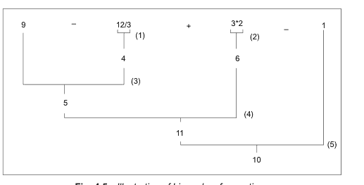

括号可以嵌套，在这种情况下，表达式的求值将从最内层括号开始向外进行。只需确保每个左括号都有与之匹配的右括号。例如：

9 - (12/(3+3) * 2) - 1 = 4

而

9 - ((12/3) + 3 * 2) - 1 = -2

虽然括号允许我们改变优先级顺序，但我们也可以利用它们来提高程序的可读性。如有疑问，我们总可以多加一对括号，以确保所假定的优先级正是我们所需要的。

### 4.13 一些计算问题

当表达式中包含实数值时，采取必要的预防措施以防止某些计算错误就显得尤为重要。我们知道计算机对实数给出的是近似值，而这种近似所带来的误差可能导致严重的问题。例如，考虑下面的语句：

```
a = 1.0/3.0;
b = a * 3.0;
```

我们知道 (1.0/3.0) * 3.0 等于 1。但无法保证程序中计算出的 b 值一定等于 1。

另一个问题是除零。在大多数计算机上，任何用零除一个数的尝试都将导致程序异常终止。在某些情况下，这种除法可能产生无意义的结果。应注意检查可能取零值的分母，并避免任何除以零的情况。

第三个问题是避免溢出或下溢错误。我们有责任确保操作数的类型和范围正确，并且结果不会产生任何溢出或下溢。

### 示例 4.5

图 4.6 中程序的输出显示了浮点数计算中可能出现的舍入误差。

```
Program
/**************************************************************/
/*              PROGRAM SHOWING ROUND-OFF ERRORS              */
/*                     Sum of n terms of 1/n                   */
/**************************************************************/

main()
{
    float sum,n,term;
    int count = 1;
    sum = 0;
    printf("Enter value of n\n");
    scanf("%f",&n);
    term = 1.0/n;
    while ( count <= n )
    {
        sum = sum + term;
        count++;
    }
    printf("Sum = %f\n",sum);
}
```

输出

```
Enter value of n
99
Sum = 1.000001
Enter value of n
143
Sum = 0.999999
```

**图 4.6** 浮点计算中的舍入误差

我们知道 n 个 1/n 项的和为 1。然而，由于浮点表示中的误差，结果并不总是 1。

### 4.14 表达式中的类型转换

### 自动类型转换

C 语言允许在表达式中混合使用不同类型的常量和变量，但在求值过程中，它遵循非常严格的类型转换规则。我们知道计算机一次只考虑一个运算符，并涉及两个操作数。

如果操作数类型不同，则在运算进行之前，“较低”类型会自动转换为“较高”类型。结果的类型为较高类型。图 4.7 说明了一个典型的类型转换过程。

```
int i, x;
float f;
double d;
long int l;
```

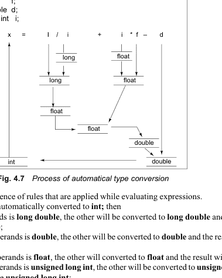

**图 4.7** 自动类型转换的过程

下面给出了在对表达式求值时所应用的一系列规则。

所有 short 和 char 都自动转换为 int；然后

- 1. 如果其中一个操作数是 long double，则另一个操作数将被转换为 long double，结果也将是 long double；
- 2. 否则，如果其中一个操作数是 double，则另一个操作数将被转换为 double，结果也将是 double；
- 3. 否则，如果其中一个操作数是 float，则另一个操作数将被转换为 float，结果也将是 float；
- 4. 否则，如果其中一个操作数是 unsigned long int，则另一个操作数将被转换为 unsigned long int，结果也将是 unsigned long int；
- 5. 否则，如果其中一个操作数是 long int，另一个是 unsigned int，则：
    - (a) 如果 unsigned int 可以转换为 long int，则 unsigned int 操作数将按此方式转换，结果将是 long int；
    - (b) 否则，两个操作数都将转换为 unsigned long int，结果将是 unsigned long int；
- 6. 否则，如果其中一个操作数是 long int，则另一个操作数将被转换为 long int，结果也将是 long int；
- 7. 否则，如果其中一个操作数是 unsigned int，则另一个操作数将被转换为 unsigned int，结果也将是 unsigned int。

请注意，某些 C 语言版本会自动将所有浮点操作数转换为双精度。

表达式的最终结果在赋值给变量之前，会被转换为赋值号左侧变量的类型。然而，在最终赋值过程中会引入以下变化。

- 1. float 转换为 int 会导致小数部分被截断。
- 2. double 转换为 float 会导致数字的舍入。
- 3. long int 转换为 int 会导致多余的高位被丢弃。

### 强制类型转换

我们刚刚讨论了 C 语言如何自动执行类型转换。然而，在某些情况下，我们希望以不同于自动转换的方式强制进行类型转换。例如，考虑计算某城镇女性与男性的比率。

ratio = female_number/male_number

由于 female_number 和 male_number 在程序中被声明为整数，除法结果的小数部分将丢失，ratio 将表示错误的数值。可以通过将其中一个变量局部转换为浮点类型来解决此问题，如下所示：

ratio = (float) female_number/male_number

运算符 (float) 为了表达式的求值而将 female_number 转换为浮点类型。然后利用自动转换规则，除法以浮点模式执行，从而保留了结果的小数部分。

请注意，运算符 (float) 绝不会影响变量 female_number 的值。而且，在程序的其他部分，female_number 的类型仍然是 int。

这种局部转换的过程称为强制类型转换。强制类型转换的一般形式是：

```
(type-name) expression
```

其中 type-name 是标准 C 数据类型之一。该表达式可以是常量、变量或表达式。表 4.7 给出了一些强制类型转换的示例及其作用。

**表 4.7 强制类型转换的使用**

| 示例 | 作用 |
|---|---|
| x = (int) 7.5 | 7.5 通过截断转换为整数。 |
| a = (int) 21.3/(int)4.5 | 按 21/4 求值，结果为 5。 |
| b = (double)sum/n | 除法以浮点模式进行。 |
| y = (int) (a + b) | a + b 的结果被转换为整数。 |
| z = (int)a + b | a 被转换为整数，然后与 b 相加。 |
| p = cos((double)x) | 在使用 x 之前将其转换为 double。 |

```
Program
/* ************************************************************ */
/* PROGRAM SHOWING THE USE OF A CAST */
/* ************************************************************ */
main()
{
    float sum;
    int n;
    sum = 0;

    for(n = 1; n <= 10; ++n)
    {
        sum = sum + 1/(float)n;
        printf("%2d %6.4f\n", n, sum);
    }
}
```

输出

```
1 1.0000
2 1.5000
3 1.8333
4 2.0833
5 2.2833
6 2.4500
7 2.5929
8 2.7179
9 2.8290
10 2.9290
```

**图 4.8** 强制类型转换的使用

强制类型转换可用于对给定值进行舍入。考虑下面的语句：

```
x = (int) (y + 0.5);
```

如果 y 是 27.6，y + 0.5 是 28.1，经过强制类型转换后，结果变为 28，这就是赋给 x 的值。当然，被转换的表达式不会改变。

### 示例 4.6

图 4.8 展示了一个使用强制类型转换来计算以下方程的程序

sum = Σ (1/i)，i = 1 到 n

### 4.15 运算符优先级与结合性

C 语言中的每个运算符都有与之关联的优先级。该优先级用于确定包含多个运算符的表达式如何被求值。优先级有不同级别，一个运算符可能属于其中一个级别。优先级较高的运算符先被求值。同一优先级的运算符根据级别不同，按照从左到右或从右到左的顺序进行求值。这被称为运算符的结合性。表 4.8 提供


提供运算符的完整列表，包括它们的优先级级别和结合规则。这些分组按优先级递减的顺序列出（等级 1 表示最高优先级等级，15 表示最低优先级等级）。列表中还包含我们尚未讨论过的运算符。

仔细注意运算符的优先级顺序和结合性非常重要。请考虑以下条件语句：

```c
if (x == 10 + 15 && y < 10)
```

优先级规则表明，*加法*运算符的优先级高于逻辑运算符（&&）和关系运算符（== 和 <）。因此，首先执行 10 和 15 的加法。这等价于：

```c
if (x == 25 && y < 10)
```

下一步是判断 x 是否等于 25，以及 y 是否小于 10。如果我们假设 x 的值为 20，y 的值为 5，那么

```c
x == 25 is FALSE (0)
y < 10 is TRUE (1)
```

注意，由于运算符 `<` 的优先级高于 `==`，因此先测试 `y < 10`，再测试 `x == 25`。

最后得到：

```c
if (FALSE && TRUE)
```

因为其中一个条件为 FALSE，所以整个复合条件为 FALSE。

对于 **&&**，可以保证如果第一个操作数为 0，则不会计算第二个操作数；对于 **||**，如果第一个操作数为非 0，则不会计算第二个操作数。

### 案例研究

### 1. 销售人员的工资

某计算机制造公司对其销售人员实行以下月度薪酬政策：

| 薪酬项目 | 金额 |
|---|---|
| 最低基本工资 | 1500.00 |
| 每售出一台计算机的奖金 | 200.00 |
| 月度总销售额提成 | 2% |

由于计算机价格不断变化，每台计算机的销售价格在每月初固定。用于计算销售人员总工资的程序如图 4.9 所示。

在给定基本工资、奖金和提成率的情况下，计算总工资所需的输入是每台计算机的价格以及当月售出的数量。

总工资由以下公式给出：

```
Gross salary = base salary + (quantity * bonus rate)
                + (quantity * Price) * commission
```

**程序**

```c
/******************************************************************/
/* PROGRAM TO CALCULATE A SALESMAN'S SALARY */
/******************************************************************/
#define BASE_SALARY 1500.00
#define BONUS_RATE 200.00
#define COMMISSION 0.02
main()
{
    int quantity;
    float gross_salary, price;
    float bonus, commission;
    printf("Input number sold and price\n");
    scanf("%d %f", &quantity, &price);
    bonus = BONUS_RATE * quantity;
    commission = COMMISSION * quantity * price;
    gross_salary = BASE_SALARY + bonus + commission;
    printf("\n");
    printf("Bonus = %6.2f\n", bonus);
    printf("Commission = %6.2f\n", commission);
    printf("Gross salary = %6.2f\n", gross_salary);
}
```

**输出**

```
Input number sold and price
5
20450.00
Bonus = 1000.00
Commission = 2045.00
Gross salary = 4545.00
```

图 4.9 销售人员工资程序

### 复习题与练习

4.1 下列算术表达式中哪些是有效的？如果有效，请给出表达式的值；否则请说明原因。

- (a) 25/3 % 2
- (b) + 9/4 + 5
- (c) 7.5 % 3
- (d) 14 % 3 + 7 % 2
- (e) -14 % 3
- (f) 15.25 + - 5.0
- (g) (5/3) * 3 + 5 % 3
- (h) 21 % (int) 4.5

4.2 写出用于计算下列方程的 C 赋值语句：

- (a) Area = πr² + 2πrh
- (b) Torque = (2m₁m₂)/(m₁ + m₂) · g
- (c) Side = √(a² + b² − 2ab cos(x))
- (d) Energy = mass [ acceleration × height + (velocity)² / 2 ]

4.3 指出下列算术表达式中不必要的括号。

- (a) ((x-(y/5)+z)%8) + 25
- (b) ((x-y) * p)+q
- (c) (m*n) + (-x*y)
- (d) x/(3*y)

4.4 找出下列赋值语句中的错误（如果有），并改正。

- (a) x = y = z = 0.5, 2.0, -5.75;
- (b) m = ++a * 5;
- (c) y = sqrt(100);
- (d) p = x/y;
- (e) s = /5;
- (f) a = b+ -c * 2

4.5 如果 a = 5、b = 10、c = -6，试确定下列各逻辑表达式的值。

- (a) a > b && a < c
- (b) a < b && a > c
- (c) a == c || b > a
- (d) b > 15 && c < 0 || a > 0
- (e) (a/2.0 == 0.0 && b/2.0 != 0.0) || c < 0.0

4.6 用直线法计算某项资产年折旧额的公式为

```
Depreciation = (Purchase Price – Salvage Value) / Years of Service
```

编写一个程序，在已知购买价格、使用年限和年折旧额的情况下，确定资产的残值。

4.7 编写一个程序，从键盘读取一个实数，并在同一行中输出以下内容：

| 不小于该数的最小整数 | 给定的数 | 不大于该数的最大整数 |
|---|---|---|

4.8 车辆在 t 秒内行驶的总距离由下式给出：

```
distance = ut + (at²)/2
```

其中 u 是初始速度（米/秒），a 是加速度（米/秒²）。

编写一个程序，在给定 u 和 a 的值后，按规则的时间间隔计算行驶距离。程序应允许用户选择自己的时间间隔，并能针对不同的 u 和 a 值重复计算。

4.9 在库存管理中，单项物品的经济订货量由下式给出：

```
EOQ = √( 2 × demand rate × setup costs / holding cost per item per unit time )
```

最优订货间隔为：

```
TBO = √( 2 × setup costs / (demand rate × holding cost per item per unit time) )
```

编写一个程序，在给定需求率（单位时间内的物品数）、每次订货的设置成本以及单位时间内每件物品的持有成本时，计算 EOQ 和 TBO。

4.10 对于带有电感 L 和电阻 R 的某个电路，阻尼固有频率由下式给出：

Frequency = $\sqrt{\frac{1}{LC} - \frac{R^2}{4L^2}}$

我们希望研究该频率随电容 C 的变化。编写一个程序，计算 C 从 0.01 到 0.1、步长为 0.01 时的不同频率值。

## 第 5 章：管理输入和输出操作

### 5.1 引言

数据的读取、处理和写入是计算机程序的三个基本功能。大多数程序都会将某些数据作为输入，并在合适的介质上显示处理后的数据，这些数据通常称为信息或结果。到目前为止，我们已经看到了向程序变量提供数据的两种方法。一种方法是通过赋值语句（例如 `x = 5;`、`a = 0;` 等）为变量赋值。另一种方法是使用输入函数 `scanf`，它可以从终端读取数据。在前面的大多数示例程序中，我们已经使用了这两种方法。对于结果输出，我们大量使用了 `printf` 函数，它可以将结果发送到终端。

#### 5.1.1 输入/输出语句和头文件

与其他高级语言不同，C 语言在语法中没有内置的输入/输出语句。所有输入/输出操作都通过函数调用（如 `printf` 和 `scanf`）完成。在 C 语言中，已经存在若干或多或少成为输入和输出操作标准的函数。这些函数统称为标准 I/O 库。在本章中，我们将讨论一些可以在许多机器上不经修改即可使用的常见 I/O 函数。不过，读者应查阅系统参考手册，以了解这些函数的确切细节，并查看还有哪些其他可用函数。

回顾前面内容可知，我们在第 2 章的示例程序 5 中使用数学库函数 `cos(x)` 时，曾包含一条语句：

```c
#include <math.h>
```

这是为了指示编译器从数学库中获取函数 `cos(x)`，并表明它并不是 C 语言本身的一部分。类似地，每个使用标准输入/输出函数的程序都必须在开头包含语句：

```c
#include <stdio.h>
```

不过，也可能存在例外。例如，对于 `printf` 和 `scanf` 这两个已被定义为 C 语言一部分的函数，这条语句并不是必需的。

文件名 `stdio.h` 是标准输入输出头文件（standard input-output header file）的缩写。指令 `#include <stdio.h>` 告诉编译器查找名为 `stdio.h` 的文件，并将其内容放在程序中的这一位置。在编译时，该头文件的内容会成为源代码的一部分。


### 5.2 读取一个字符

最简单的输入/输出操作之一是从标准输入单元（通常是键盘）读取一个字符并将其写入标准输出单元（通常是屏幕）。读取单个字符可以通过使用函数 getchar() 来完成。（这也可以借助 scanf 函数完成，该函数在第 5.4 节中讨论）getchar 的形式如下：

```
variable_name = getchar();
```

variable_name 是已声明为 char 类型的有效 C 名称。当遇到此语句时，计算机等待直到按下某个键，然后将该字符作为值赋给 getchar 函数。由于 getchar 用在赋值语句的右侧，getchar 的字符值反过来被赋给左侧的变量名。例如

```
char name;
name = getchar ();
```

当我们在键盘上按下 H 键时，将把字符 'H' 赋给变量 name。由于 getchar 是一个函数，如图所示它需要一组括号。

### 示例 5.1

图 5.1 中的程序展示了 getchar 函数在交互环境中的使用。

该程序向用户显示一个 YES/NO 类型的问题，并以单个字符（Y 或 N）读取用户的响应。如果响应为 Y，则输出消息

My name is BUSY BEE

否则，输出 "you are good for nothing"。

getchar 函数可以连续调用以读取文本行中包含的字符。例如，下面的程序段从键盘一次读取一个字符，直到按下 'Return' 键为止。

```
char character;
character = '\0';
while (character != '\n')
{
    character = getchar();
}
```

警告：getchar() 函数接受任何键入的字符。这包括 RETURN 和 TAB。这意味着当我们输入单个字符时，换行字符会在 getchar() 返回后等待在输入队列中。这在使用 getchar () 在循环中交互时可能会造成问题。可以使用一个虚拟的 getchar() 来“吃掉”不需要的换行字符。

```c
/***********************************************************/
/*.................. READING A CHARACTER FROM TERMINAL..................*/
/**********************************************************/
#include <stdio.h>
main()
{
 char answer;
 printf("Would you like to know my name?\n");
 printf("Type Y for YES and N for NO: ");
 answer = getchar(); /* ............ Reading a character ............ */
 if(answer == 'Y' || answer == 'y')
 printf("\n\n My name is BUSY BEE\n");
 else
 printf("\n\n You are good for nothing\n");
}
```
输出
Would you like to know my name?
Type Y for YES and N for NO: Y
My name is BUSY BEE
Would you like to know my name?
Type Y for YES and N for NO: n
You are good for nothing

### 图 5.1 getchar 函数的使用

### 示例 5.2

图 5.2 的程序要求用户输入一个字符，并在屏幕上显示一条消息，告诉用户该字符是字母还是数字，或是其他特殊字符。

该程序接收从键盘输入的字符，并测试它是否为字母或数字，并据此打印出消息。这些测试借助以下函数完成：`isalpha(character)` `isdigit(character)`

例如，如果参数 character 包含字母，则 isalpha 假定一个非零值（TRUE）；否则假定为 0（FALSE）。isdigit 函数的情况类似。

C 支持许多其他类似的函数，它们列在表 5.1 中。这些字符函数包含在文件 ctype.h 中，因此语句 `#include <ctype.h>` 必须包含在程序中。

```c
/**********************************************************/
/*.................. TESTING CHARACTER TYPE..................*/
/**********************************************************/
#include <stdio.h>
#include <ctype.h>
main()
{
 char character;
 printf("Press any key\n");
 character = getchar();
 if (isalpha(character) > 0)
    printf("The character is a letter.");
 else
    if(isdigit(character) > 0)
        printf("The character is a digit.");
    else
        printf("The character is not alphanumeric.");
}
```
输出
Press any key
h
The character is a letter.
Press any key
5
The character is a digit.
Press any key
*
The character is not alphanumeric.

### 图 5.2 测试字符类型的程序

### 表 5.1 字符测试函数

| Function | Test |
|---|---|
| isalnum(c) | c 是否为字母数字字符？ |
| isalpha(c) | c 是否为字母字符？ |
| isdigit(c) | c 是否为数字？ |
| islower(c) | c 是否为小写字母？ |
| isprint(c) | c 是否为可打印字符？ |
| ispunct(c) | c 是否为标点符号？ |
| isspace(c) | c 是否为空白字符？ |
| isupper(c) | c 是否为大写字母？ |

### 5.3 写入一个字符

与 getchar 类似，有一个类似的函数 putchar 用于一次写入一个字符到终端。它形式如下所示：

```
putchar(variable_name);
```

其中 variable-name 是一个包含字符的类型为 char 的变量。该语句在终端上显示 variable-name 中包含的字符。例如，语句

```
answer = 'Y';
putchar(answer);
```

将在屏幕上显示字符 Y。语句

### 示例 5.3

图 5.3 给出了一个从键盘读取字符然后以反向大小写打印的程序也就是说，如果输入是大写，则输出为小写，反之亦然。

该程序使用了三个新函数；islower、toupper 和 tolower。函数 islower 是一个条件函数，如果参数是小写字母则取值为 TRUE；否则取值为 FALSE。函数 toupper 将小写参数转换为大写字母，而函数 tolower 则做相反的操作。

```c
/******************************************************************/
/*              WRITING A CHARACTER TO THE TERMINAL              */
/******************************************************************/

#include <stdio.h>
#include <ctype.h>

main()
{
    char alphabet;
    printf("Enter an alphabet");
    putchar('\n');
    alphabet = getchar();
    if (islower(alphabet))
        putchar(toupper(alphabet));
    else
        putchar(tolower(alphabet));
}
```
输出
Enter an alphabet
a
A
Enter an alphabet
Q
q
Enter an alphabet
z
Z

### 图 5.3 字母的反向大小写读写

### 5.4 格式化输入

格式化输入是指按特定格式排列的输入数据。例如，考虑以下数据：

15.75 123 John

该行包含三块数据，按特定形式排列。这种数据必须按照其出现的格式进行读取。例如，数据的第一部分应读入 float 变量，第二部分读入 int，第三部分读入 char。这在 C 中使用 scanf 函数是可行的。

我们已经在多个示例中使用了此输入函数。在这里，我们将探讨使用 scanf 函数读取格式化数据时可用的所有选项。scanf 的一般形式为

```
scanf("control string", arg1, arg2, ...... argn);
```

控制字符串指定数据的输入字段格式，而参数 arg1、arg2、...... argn 指定数据存储位置的地址。控制字符串和参数用逗号分隔。

控制字符串包含字段说明，用于指导输入数据的解释。它可能包括：

- 字段（或格式）说明，由转换字符 %、数据类型字符（或类型说明符）以及可选的数字组成，指定字段宽度。
- 空格、制表符或换行符。

空格、制表符和换行符将被忽略。数据类型字符表示要分配给相应参数相关变量的数据类型。字段宽度说明符是可选的。以下讨论将阐明这些概念。

### 输入整数

读取整数的字段说明为：

```
% w d
```

百分号 (%) 表示后面跟着转换说明。w 是一个整数，指定要读取的数字的字段宽度，而 d，即数据类型字符，表示要读取的数字处于整数模式。考虑以下示例：

```
scanf("%2d %5d", &num1, &num2);
```

数据行：

50 31426

值 50 被赋给 num1，31426 被赋给 num2。假设输入数据如下：

31426 50

变量 num1 将被赋值为 31（因为 %2d），num2 将被赋值为 426（31426 的非真实部分）。未读取的值 50 将在下一次 scanf 调用中赋给第一个变量。如果我们使用不带字段宽度的字段说明，可以消除此类错误。也就是说，语句

```
scanf("%d %d", &num1, &num2);
```

将读取数据

31426 50

正确地并将 31426 赋给 num1，50 赋给 num2。

输入数据项必须用空格、制表符或换行符分隔。标点符号不计为分隔符。当 scanf 函数在输入数据行中搜索要读取的值时，它总是会绕过任何空白字符。


如果我们输入的是浮点数而不是整数，会发生什么？小数部分可能会被丢弃！此外，scanf 还可能跳过后续输入。

当 scanf 读取某个值时，一旦达到字段宽度指定的字符数（如果指定了），或者遇到一个对所读值无效的字符，读取就会终止。对于整数而言，有效字符是一个可选带符号的数字序列。

可以通过在字段宽度位置指定 `*` 来跳过输入字段。例如，语句

```c
scanf("%d %*d %d", &a, &b)
```

会将数据

```text
123 456 789
```

按如下方式赋值：

- 123 赋给 a
- 456 被跳过（因为使用了 `*`）
- 789 赋给 b

类型字符 d 前面可以加 'l'（字母 ell）来读取长整数。

## 示例 5.4

图 5.4 所示的程序对读取整数的各种输入格式选项进行了实验。

第一个 scanf 请求输入三个整数值 a、b 和 c，相应地输入了 1、2、3 三个值。由于使用了 `%*d` 格式，值 2 被跳过，3 被赋给变量 b。请注意，由于没有剩余数据可供 c 使用，因此 c 中包含垃圾值。

第二个 scanf 分别为变量 x 和 y 指定了 `%2d` 和 `%4d` 格式。每当我们为读取整数指定字段宽度时，输入数字不应包含超过指定大小的位数。否则，右侧多余的位数会被截断，并赋给列表中的下一个变量。因此，第二个 scanf 截断了四位数字 6789，将 67 赋给 x，89 赋给 y。紧接着的下一条 scanf 语句中的第一个变量得到了数值 4321。

程序

```c
/******************************************************/
/*                                                    */
/*              READING INTEGER NUMBERS              */
/*                                                    */
/******************************************************/
main()
{
    int a,b,c,x,y,z;
    int p,q,r;

    printf("Enter three integer numbers\n");
    scanf("%d %*d %d",&a,&b,&c);
    printf("%d %d %d\n\n",a,b,c);

    printf("Enter two 4-digit numbers\n");
    scanf("%2d %4d",&x,&y);
    printf("%d %d\n\n",x,y);

    printf("Enter two integers\n");
    scanf("%d %d", &a,&x);
    printf("%d %d", a,x);
    printf("Enter a nine digit number\n");
    scanf("%3d %4d %3d", &p,&q,&r);
    printf("%d %d %d\n",p,q,r);
    printf("Enter two three digit numbers\n");
    scanf("%3d %3d",&x,&y);
    printf("%d %d",x,y);
}
```

输出

```text
Enter three integer numbers
1 2 3
1 3 -3577

Enter two 4-digit numbers
6789 4321
67 89

Enter two integers
44 66
4321 44

Enter a nine digit number
123456789
66 1234 567

Enter two three digit numbers
123 456
89 123
```

图 5.4 使用 scanf 读取整数

## 输入实数

与整数不同，实数的字段宽度不应被指定，因此 scanf 使用简单的 `%f` 格式读取实数，同时支持十进制小数表示法和指数表示法。例如，语句

```c
scanf("%f %f %f", &x, &y, &z);
```

配合输入数据

```text
475.89 43.21E-1 678
```

会将值 475.89 赋给 x，4.321 赋给 y，678.0 赋给 z。输入字段之间可以用任意空白字符分隔。

如果要读取的数字是 double 类型，则应使用 `%lf` 而不是简单的 `%f`。可以使用 `%*f` 格式跳过数字。

### 示例 5.5

图 5.5 演示了如何读取实数（包括十进制小数表示法和指数表示法）。

程序

```c
/***************************************************************/
/* READING OF REAL NUMBERS */
/************************************************************** */
main()
{
  float x,y;
  double p,q;
  printf("Values of x and y:");
  scanf("%f%f", &x, &y);
  printf("\n");
  printf("x = %f\n y = %f\n", x, y);
  printf("Values of p and q:");
  scanf("%lf %lf", &p, &q);
  printf("\n p = %lf q = %lf", p,q);
  printf("\n\np = %.12lf\n q = %.12lf", p,q);
}
```

输出

```text
Values of x and y: 12.3456 17.5e-2
x = 12.345600
y = 0.175000
Values of p and q: 4.142857142857 18.5678901234567890
p = 4.142857142857
q = 1.856789012346e+001
```

图 5.5 读取实数

## 输入字符串

我们已经看到如何使用 getchar 函数从终端读取单个字符。使用 scanf 函数也可以做到同样的事情。此外，scanf 函数还可以输入包含多个字符的字符串。以下是读取字符串的格式说明：

%ws or %wc

相应的参数应是指向字符数组的指针。不过，当参数是指向 char 变量的指针时，可以使用 %c 读取单个字符。

### 示例 5.6

图 5.6 演示了使用 %wc 和 %ws 读取字符串的过程。

图 5.6 中的程序演示了各种用于读取字符串的字段规格的用法。当我们使用 %wc 读取字符串时，系统会一直等待，直到键入第 w 个字符。

请注意，%s 格式会在遇到空白字符时终止读取。因此，name2 只读到了“New York”的第一部分，第二部分会自动赋给 name3。不过，在第二次运行时，字符串“New-York”被正确赋给了 name2。

某些版本的 scanf 支持以下用于字符串的转换规格：

%[characters] and %[^characters]

### 5.10 C 程序设计与数据结构

%[characters] 表示输入字符串中只允许包含方括号内指定的字符。如果输入字符串中出现任何其他字符，字符串会在第一次遇到该字符时终止。%[^characters] 的作用正好相反。也就是说，插入符（^）之后指定的字符不允许出现在输入字符串中；一旦遇到这些字符之一，字符串的读取就会终止。

程序

```c
/******************************************************/
/*                    READING STRINGS                 */
/******************************************************/
main()
{
    int no;
    char name1[15], name2[15], name3[15];
    printf("Enter serial number and name one\n");
    scanf("%d %15c", &no, name1);
    printf("%d %15s\n\n", no, name1);
    printf("Enter serial number and name two\n");
    scanf("%d %5c", &no, name2);
    printf("%d %15s\n\n", no, name2);
    printf("Enter serial number and name three\n");
    scanf("%d %15c", &no, name3);
    printf("%d %15s\n\n", no, name3);
}
```

输出

```text
Enter serial number and name one
1 123456789012345
1 123456789012345r
Enter serial number and name two
2 New York
2 New      New
Enter serial number and name three
2 York
Enter serial number and name one
1 123456789012
1 123456789012  r
Enter serial number and name two
2 New York
2     New-York
Enter serial number and name three
3 London
3       London
```

图 5.6 读取字符串

我们刚刚已经看到，%s 格式说明符不能用于读取包含空白的字符串。但借助 %[] 格式说明符可以做到这一点。空白字符可以包含在方括号内，从而使 scanf 能够读取带空格的字符串。请记住，小写字母和大写字母是彼此不同的。示例 5.7 演示了 %[] 格式说明符的用法。

### 示例 5.7

图 5.7 中的程序演示了 %[ ] 格式说明符的功能。

## 读取混合数据类型

可以使用一条 scanf 语句输入一行包含混合模式的数据。在这种情况下，应特别小心，确保输入数据项在顺序和类型上都与控制规格匹配。当尝试读取一个与预期类型不匹配的数据项时，scanf 函数将不再继续读取，并立即返回已经读取的值。语句

```c
scanf("%d %c %f %s", &count, &code, &ratio, name);
```

可以正确读取数据

```text
15 p 1.575 coffee
```

并按变量出现的顺序将值赋给相应变量。某些系统接受用整数代替实数，或者用实数代替整数，输入数据会被转换为控制字符串中指定的类型。

## 检测输入错误

当 scanf 函数完成其列表时，它会返回成功读取的项目数。

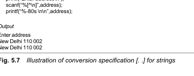

图 5.7 字符串转换规格 %[ ] 的演示


读取。这个值可用于测试读取输入时是否发生任何错误。例如，语句

```
scanf("%d %f %s", &a, &b, name);
```

如果输入以下数据，将返回值为 3：

20 150.25 motor

如果输入以下行，将返回值为 1

20 motor 150.25

这是因为函数在期望浮点值时遇到了字符串，因此在读取第一个值后终止扫描。

### 示例 5.8

图 5.8 中给出的程序说明了通过 scanf 函数测试读取数据正确性的情况。

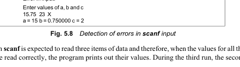

图 5.8 scanf 输入错误检测

函数 scanf 预计读取三项数据，因此，当三个变量的值全部正确读取时，程序会打印出它们的值。在第三次运行期间，第二项与变量的类型不匹配，因此读取被终止并打印错误消息。第四次运行的情况也是如此。

在最后一次运行中，尽管数据项与变量不匹配，但并未打印错误消息。当我们尝试为 int 变量读取实数时，整数部分被赋给该变量，被截断的小数部分被赋给下一个变量。请注意，字符 '2' 被赋给字符变量 c。

常用 scanf 格式代码在表 5.2 中给出。

| Code | Meaning |
|------|---------|
| %c | 读取单个字符 |
| %d | 读取十进制整数 |
| %e | 读取浮点值 |
| %f | 读取浮点值 |
| %g | 读取浮点值 |
| %h | 读取短整数 |
| %i | 读取十进制、十六进制或八进制整数 |
| %o | 读取八进制整数 |
| %s | 读取字符串 |
| %u | 读取无符号十进制整数 |
| %x | 读取十六进制整数 |
| %[.] | 读取单词字符串 |

以下字母可作为某些转换字符的前缀使用。

h for short integers
l for long integers or double
L for long double

- 1. 所有函数参数，除控制字符串外，必须是指向变量的指针。
- 2. 控制字符串中包含的格式说明应按顺序与参数匹配。
- 3. 输入数据项必须用空格分隔，并且必须与接收输入的变量按相同顺序匹配。
- 4. 当 scanf 遇到数据的“无效不匹配”或对读取的值无效的字符时，读取将被终止。
- 5. 在搜索值时，scanf 忽略行边界，只查找下一个适当的字符。
- 6. 行中任何未读取的数据项将被视为传递给下一个 scanf 调用的数据输入行的一部分。
- 7. 当使用字段宽度说明符 w 时，它应足够大以容纳输入数据大小。

### 5.5 格式化输出

我们已经看到了使用 printf 函数打印标题和数值结果的情况。非常希望输出能够以易于理解且易于使用形式产生。因此，程序员必须仔细考虑其程序产生的输出的外观和清晰度。

printf 语句提供了某些功能，可以有效地用于控制终端上打印输出的对齐和间距。printf 语句的一般形式为

```
printf("control string", arg1, arg2, ...... argn);
```

控制字符串由三类项目组成：

- 1. 将按原样打印到屏幕上的字符。
- 2. 定义每个项目显示输出格式的格式说明。
- 3. 转义序列字符，如 \n、\t 和 \b。

控制字符串指示其后跟随多少个参数以及它们的类型是什么。参数 arg1、arg2、...... argn 是其值根据控制字符串的规范进行格式化并打印的变量。参数在数量、顺序和类型上应与格式说明匹配。

一个简单的格式说明具有以下形式：

```
% w.p type-specifier
```

其中 w 是一个整数，指定输出值的总列数，p 是另一个整数，指定小数点后（实数）的位数或从字符串中打印的字符数。w 和 p 都是可选的。printf 语句的一些示例为：

```
printf("Programming in C");
printf(" ");
printf("\n");
printf("%d", x);
printf("a = %f\n b = %f", a, b);
printf("sum = %d", 1234);
printf("\n\n");
```

printf 不会自动提供换行符，因此可以使用多个 printf 语句构建一行的输出。换行符可以通过换行字符 '\n' 引入，如上述某些示例所示。

### 整数输出

打印整数的格式说明为

```
% w d
```

其中 w 指定输出的最小字段宽度。但是，如果数字大于指定的字段宽度，它将完整打印，覆盖最小规范，d 指定要打印的值为整数。数字在给定字段宽度中右对齐打印。根据需要会出现前导空格。以下示例说明了在不同格式下数字 9876 的输出：

| Format | Output |
|---|---|
| printf("%d", 9876) | 9 8 7 6 |
| printf("%6d", 9876) |   9 8 7 6 |
| printf("%2d", 9876) | 9 8 7 6 |
| printf("%-6d", 9876) | 9 8 7 6   |
| printf("%06d", 9876) | 0 0 9 8 7 6 |

通过在 % 字符后直接放置减号，可以强制打印左对齐，如上第四个示例所示。也可以通过在字段宽度说明符前放置 0（零）来用零填充前导空格，如最后一项所示。

长整数可以通过在格式说明中用 ld 代替 d 来打印。

### 示例 5.9

图 5.9 中的程序说明了在各种格式下整数的输出。

```
Program
/***********************************************************/
/* PRINTING OF INTEGER NUMBERS */
/***********************************************************/
main()
{
    int m = 12345;
    long n = 987654;
    printf("%d\n",m);
    printf("%10d\n",m);
    printf("%010d\n",m);
    printf("%-10d\n",m);
    printf("%10d\n",n);
    printf("%10ld\n",n);
    printf("% 10ld\n",n);
}
Output
12345
    12345
0000012345
12345       
    987654
  -987654
```

图 5.9 整数的格式化输出

### 浮点数输出

实数的输出可以使用以下格式说明以十进制形式显示：

```
% w.p f
```

整数 w 表示用于显示值的最小位置数，整数 p 表示小数点后要显示的位数（精度）。显示时，值将四舍五入到 p 位小数，并在 w 列的字段中右对齐打印。根据需要会出现前导空格和尾随零。默认精度为 6 位小数。负数将带减号打印。数字将以形式 [ − ] mmm . nn 显示

我们也可以使用说明

```
% w.p e
```

以指数形式显示实数

显示形式为

[ − ] m.nnnne[ ± ]xx

其中 n 的字符串长度由精度 p 指定。默认精度为 6。字段宽度 w 应满足条件。

w ≥ p+7

值将被四舍五入并在 w 列的字段中右对齐打印。通过在字段宽度说明符 w 之前引入 0 或 –，也可以用零填充前导空格并进行左对齐打印。

以下示例说明了在不同格式说明下数字 y = 98.7654 的输出：

| Format | Output |
|---|---|
| printf("%7.4f",y) | 9 8 . 7 6 5 4 |
| printf("%7.2f",y) |     9 8 . 7 7 |
| printf("%-7.2f",y) | 9 8 . 7 7     |
| printf("%f",y) | 9 8 . 7 6 5 4 |
| printf("%10.2e",y) |     9 . 8 8 e + 0 1 |
| printf("%11.4e",-y) | - 9 . 8 7 6 5 e + 0 1 |
| printf("%-10.2e",y) | 9 8 8 e + 0 1     |
| printf("% e",y) | 9 8 7 6 5 4 0 e + 0 1 |

一些系统还支持一个特殊的字段说明字符，让用户在运行时定义字段大小。这采用以下形式：

```
printf("%*.*f", width, precision, number);
```

在这种情况下，字段宽度和精度都作为参数给出，这些参数将分别为 w 和 p 提供值。例如，

```
printf("%*.*f",7,2,number);
```

等价于

```
printf("%7.2f",number);
```

这种格式的优点是宽度和精度的值可以在运行时提供，从而使格式成为动态格式。例如，上述语句可以如下使用：

```
int width = 7;
int precision = 2;
........
........
printf("%*.*f", width, precision, number);
```

### 示例 5.10

打印实数的所有选项如图 5.10 所示。

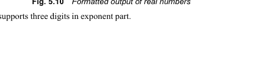

图 5.10 实数的格式化输出

注意：Microsoft C 在指数部分支持三位数字。

## 打印单个字符

可以使用以下格式在所需位置显示单个字符

```
%wc
```

该字符将在 w 列的字段中右对齐显示。我们可以通过在整数 w 前放置减号使显示左对齐。w 的默认值为 1。

## 打印字符串

输出字符串的格式说明与实数类似。其形式为

```
%w.ps
```

其中 w 指定显示的字段宽度，p 指示只显示字符串的前 p 个字符。显示为右对齐。

以下示例展示了在打印包含 16 个字符（包括空格）的字符串“NEW DELHI 110001”时各种说明的效果

| 说明 | 输出 |
|---|---|
| %s | NEW DELHI 110001 |
| %20s | 在20列中右对齐 |
| %20.10s | 右对齐，前10个字符 |
| %.5s | 前5个字符 |
| %-20.10s | 左对齐，前10个字符 |
| %5s | 在5列中右对齐 |

### 示例 5.11

字符和字符串的打印如图 5.11 所示。

## 混合数据输出

允许在一个 printf 语句中混合数据类型。例如，如下类型的语句

```
printf("%s%d %f %s %c", a, b, c, d);
```

程序
```
/************************************************/
/*      PRINTING OF CHARACTERS AND STRINGS      */
/************************************************/
main()
{
    char x = 'A';
    static char name[20] = "ANIL KUMAR GUPTA";
    printf("OUTPUT OF CHARACTERS\n");
    printf("%c\n%c\n%5c\n", x,x,x);
    printf("%3c\n%3c\n", x,x);
    printf("\n");
    printf("OUTPUT OF STRINGS\n");
    printf("%s\n", name);
    printf("%20s\n", name);
    printf("%20.10s\n", name);
    printf("%5s\n", name);
    printf("%-20.10s\n", name);
    printf("%5s\n", name);
}
Output
OUTPUT OF CHARACTERS
A
  A
    A
A
OUTPUT OF STRINGS
ANIL KUMAR GUPTA
        ANIL KUMAR GUPTA
    ANIL KUMAR
ANIL
ANIL KUMAR
ANIL KUMAR GUPTA
```

### 图 5.11 字符和字符串的打印

常用的 printf 格式代码见表 5.3，格式标志见表 5.4。

### 表 5.3 printf 格式代码

| 代码 | 含义 |
|------|---------|
| %c | 打印单个字符 |
| %d | 打印十进制整数 |
| %e | 以指数形式打印浮点值 |
| %f | 打印不带指数的浮点值 |
| %g | 根据值打印 e 型或 f 型的浮点值 |
| %i | 打印有符号十进制整数 |
| %o | 打印八进制整数，不带前导零 |
| %s | 打印字符串 |
| %u | 打印无符号十进制整数 |
| %x | 打印十六进制整数，不带前导 0x |

以下字母可用作某些转换字符的前缀。

- h 表示短整数，
- l 表示长整数或 double，
- L 表示 long double

### 表 5.4 输出格式标志

| 标志 | 含义 |
|---|---|
| - | 输出在字段内左对齐。剩余字段将为空白。 |
| + | + 或 – 将位于带符号数值项之前。 |
| 0 | 导致出现前导零。 |
| #（与 o 或 x 一起） | 使八进制和十六进制项分别以 0 和 0x 开头。 |
| #（与 e、f 或 g 一起） | 使所有浮点数中都存在小数点，即使它是整数。还可防止 g 型转换中尾随零的截断。 |

## 增强输出的可读性

计算机输出被用作分析变量之间某些关系并做出决策的信息。因此，输出的正确性和清晰度至关重要。正确性取决于求解过程，而清晰度取决于输出的呈现方式。以下是我们可以采取的一些步骤，以提高清晰度，从而提高输出的可读性和可理解性。

- 1. 在两个数字之间提供足够的空白。
- 2. 在输出中引入适当的标题和变量名。
- 3. 每当输出中出现特殊条件时，打印特殊消息。
- 4. 在输出的重要部分之间引入空行。

系统通常会在数字之间提供两个空格。但是，可以通过为数字选择合适的字段宽度或在说明之间引入“制表符”来增加空格。例如，语句

```
printf("a = %d\t b = %d", a, b);
```

将在两个字段之间提供四个空白。我们还可以通过使用以下语句将它们打印在两行上

```
printf("a = %d\n b = %d", a, b);
```

消息和标题可以通过直接在 printf 语句中使用字符串来打印。

示例：

```
printf("\n OUTPUT RESULTS \n");
printf("code\t Name\t Age\n");
printf("Error in input data\n");
printf("Enter your name\n");
```

### 案例研究

### 1. 库存报告

问题：ABC 电气公司生产四种消费产品。它们在某一特定日期的库存状况如下：

| 代码 | 数量 | 费率（卢比） |
|---|---|---|
| F105 | 275 | 575.00 |
| H220 | 107 | 99.95 |
| I109 | 321 | 215.50 |
| M315 | 89 | 725.00 |

需要按以下格式编制库存报告表：

### 库存报告

| 代码 | 数量 | 费率 | 价值 |
|---|---|---|---|
| — | — | — | — |
| — | — | — | — |
| — | — | — | — |
| — | — | — | — |
|  |  |  | 总价值： |

每项的价值由数量与费率的乘积给出。

程序：图 5.12 中给出的程序从终端读取数据并生成所需输出。该程序使用下标变量，将在第 8 章讨论。

### 2. 可靠性图

问题：电子元件的可靠性由下式给出
可靠性 (r) = e^{-λt}

程序
```
/*******************************/
/*      INVENTORY REPORT        */
/*******************************/

#define ITEMS 4
main()
{ /* BEGIN */
    int i, quantity[5];
    float rate[5], value, total_value;
    char code[5][5];
    /* READING VALUES */
    i = 1;
    while (i <= ITEMS)
```
```
{ printf("Enter code, quantity, and rate:"); scanf("%s %d %f", code[i], &quantity[i], &rate[i]); i++; }
/* ............... Printing of Table and Column Headings ............... */
printf("\n"); printf("\t\t\t\t\t\t\t\t\t\tINVENTORY REPORT\t\n"); printf("-------------------------------------------------------------------\n"); printf("\tCode\t\tQuantity\t\tRate\t\tValue\n"); printf("-------------------------------------------------------------------\n");
/* ............... Preparation of Inventory Position .................... */
total_value = 0; i = 1; while (i <= ITEMS) { value = quantity[i] * rate[i]; printf("%s %5d %10.2f %10.2f\n", code[i], quantity[i], rate[i], value); total_value += value; i++; }
/* ............... Printing of End of Table ............................. */
printf("-------------------------------------------------------------------\n"); printf("\t\t\t\t\t\t\t\tTotal Value = %e\n", total_value); printf("-------------------------------------------------------------------\n"); } /* END */
```

输出
输入代码、数量和费率：F105  275  575.00
输入代码、数量和费率：H220  107  99.95
输入代码、数量和费率：I109 321  215.50
输入代码、数量和费率：M315  89  725.00

| 代码 | 数量 | 费率 | 价值 |
|---|---|---|---|
| F105 | 275 | 575.00 | 1.581250e+005 |
| H220 | 107 | 99.95 | 1.069465e+004 |
| I109 | 321 | 215.50 | 6.917550e+004 |
| M315 | 89 | 725.00 | 6.452500e+004 |
|  |  |  | 总价值 = 3.025202e+005 |

### 图 5.12 库存报告程序

其中 λ 是每小时元件故障率，t 是以小时计的运行时间。需要绘制图表来确定 0 到 300 小时之间各个时刻的可靠性。故障率 λ（lamda）为 0.001。

```
Program
/**************************************************************/
/*              RELIABILITY GRAPH                             */
/**************************************************************/
#include <math.h>
```


```
#define LAMDA 0.001
main()
{
    double t;
    float r;
    int i, R;
    for (i = 1; i<=27; ++i)
    {
        printf("---");
    }
    printf("\n");
    for (t=0; t<=3000; t +=150)
    {
        r = exp(-LAMDA*t);
        R = (int)(50*r+0.5);
        printf("|");
        for (i=1; i<=R; ++i)
        {
            printf("*");
        }
        printf("#\n");
    }
    for (i = 1; i<3; ++i)
    {
        printf("\n");
    }
}
```

#### 输出

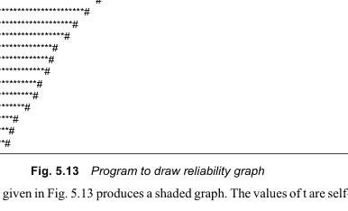

## 图 5.13 绘制可靠性图的程序

程序：图 5.13 给出的程序生成一个阴影图。t 的值由 for 语句自行生成

for (t=0; t<=3000; t +=150)

以 150 为步长。语句中整数 50

```
R = (int)(50*r+0.5)
```

是比例因子，它将 r 转换为用于绘制曲线时使用整数的大值。请记住 r 始终小于 1。

### 复习题和练习

对于问题 5.1 至 5.5 假设程序中已做出以下声明：

```
int    year, count;
float  amount, price;
char   code, city[10];
double root;
```

- **5.1** 说明以下输入语句中是否存在错误。
  - (a) scanf("%c%d%d", city, &price, &year);
  - (b) scanf("%s%d", city, amount);
  - (c) scanf("%f, %d, &amount, &year);
  - (d) scanf("\n%f", root);
  - (e) scanf("%c %d %ld", &code, &count, &root);

- **5.2** 当数据
  1988, x
  作为对以下语句的响应输入时，变量 **year** 和 **code** 中存储的值将是什么：
  - (a) scanf("%d %c", &year, &code);
  - (b) scanf("%c %d", &year, &code);
  - (c) scanf("%d %c", &code, &year);
  - (d) scanf("%s %c", &year, &code);

**5.3** 变量 **count**、**price** 和 **city** 具有以下值：

```
count  ←  1275
price  ← -235.74
city   ← Cambridge
```

显示以下输出语句将产生的确切输出：

- (a) printf("%d %f", count, price);
- (b) printf("%2d\n%f", count, price);
- (c) printf("%d %f", price, count);
- (d) printf("%10dxxxx%5.2f", count, price);
- (e) printf("%s", city);
- (f) printf("%-10d%-15s", count, city);

- **5.4** 说明以下每个输出语句有什么（如果有的话）错误：
  - (a) printf("%d 7.2%f", year, amount);
  - (b) printf("%-s, %c\n", city, code);
  - (c) printf("%f, %d, %s, price, count, city);
  - (d) printf("%c%d%f\n", amount, code, year);

## 5.5

作为对输入语句的响应

```
scanf("%4d %4d", &year, &code, &count);
```

输入以下数据：

19883745

计算机将为变量 year、code 和 count 分配什么值？

## 5.6

给定字符串 "WORDPROCESSING"，编写一个程序从终端读取该字符串并以以下格式显示：

- (a) WORD PROCESSING
- (b) WORD
      PROCESSING
- (c) W.P.

## 5.7

编写一个程序读取 x 和 y 的值并在一行中打印以下表达式的结果：

- (a) (x + y)/(x - y)
- (b) (x + y)/2
- (c) (x + y)(x - y)

## 5.8

编写一个程序读取以下数字，将其四舍五入到最接近的整数并以整数形式打印结果：

35.7   50.21   -23.73   -46.45

## 第 6 章

## 决策与分支

### 6.1 引言

我们已经看到 C 程序是一组语句，通常按其出现的顺序依次执行。这发生在不需要选项或不需要重复某些计算时。然而，在实践中，我们有许多情况可能需要根据某些条件改变语句的执行顺序，或重复一组语句直到满足某些指定条件。这涉及一种决策，以查看特定条件是否已发生，然后指示计算机相应地执行某些语句。

C 语言具有这种决策能力，并支持以下称为 *控制* 或 *决策* 语句的语句。

- 1. if 语句
- 2. switch 语句
- 3. 条件运算符语句
- 4. goto 语句

我们已经在之前的示例中使用了一些这些语句。在这里我们将更详细地讨论它们的功能、能力和应用。

### 6.2 使用 if 语句进行决策

if 语句是一个强大的决策语句，用于控制语句的执行流程。它基本上是一个双向决策语句，并与一个表达式一起使用。其形式如下：

```
if (test expression)
```

它允许计算机首先计算表达式，然后根据表达式（关系或条件）的值是‘真’（非零）还是‘假’（零），将控制转移到特定语句。程序的这一点有两个路径可供选择，一个用于真条件，另一个用于假条件，如图 6.1 所示。

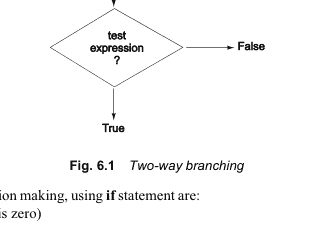

图 6.1 双向分支

使用 if 语句进行决策的一些示例是：

- 1. if (银行余额为零)
      借钱
- 2. if (房间黑暗)
      打开灯
- 3. if (代码为 1)
      人是男性
- 4. if (年龄超过 55)
      人已退休

if 语句可以根据要测试的条件复杂程度以不同的形式实现。

- 1. 简单 if 语句
- 2. if .... else 语句
- 3. 嵌套 if .... else 语句
- 4. else if 梯形。

### 6.3 简单 if 语句

简单 if 语句的一般形式是

```
if(test expression)
{
    statement-block;
}
statement-x;
```

'statement-block' 可能是单个语句或一组语句。如果测试表达式为真，则 statement-block 将被执行；否则 statement-block 将被跳过，执行将跳转到 statement-x。请记住，当条件为真时，statement-block 和 statement-x 都将按顺序执行。这在图 6.2 中有所说明。

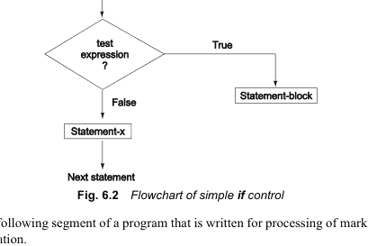

图 6.2 简单 if 控制的流程图

考虑以下用于处理入学考试成绩的程序段。

```
........
if (category == SPORTS)
{
    mark = marks + bonus_marks;
}
printf("%f", marks);
........
```

程序测试学生的类别类型。如果学生属于 SPORTS 类别，则在打印成绩之前会额外加上 bonus_marks。对其他人，不加 bonus_marks。

## 示例 6.1

图 6.3 中的程序从终端读取四个值 a、b、c 和 d，并计算 (a + b) 与 (c − d) 的比率，并在 c − d 不等于零时打印结果。

图 6.3 给出的程序已针对两组数据运行，以查看路径是否正常工作。

第一次运行的结果打印为

Ratio = -3.181818

第二次运行既没有产生任何结果也没有任何消息。在第二次运行期间，(c − d) 的值等于零，因此 statement-block 中包含的语句被跳过。由于 statement-block 后没有其他语句，程序在不产生任何输出的情况下停止。请注意在计算比率的语句中使用 float 转换。这是为了避免由于整数除法而导致的截断。

```
Program
/***********************************************************/
/* ILLUSTRATION OF IF STATEMENT */
/**********************************************************/

main()
{
    int a, b, c, d;
    float ratio;

    printf("Enter four integer values\n");
    scanf("%d %d %d %d", &a, &b, &c, &d);

    if (c-d != 0)
    {
        ratio = (float) (a+b) / (float) (c-d);
        printf("Ratio = %f\n", ratio);
    }
}

Output

Enter four integer values
12  23  34  45
Ratio = -3.181818

Enter four integer values
12  23  34  34
```

图 6.3 简单 if 语句的说明

简单 if 通常用于计数目的。示例 6.2 说明了这一点。

## 示例 6.2

图 6.4 中的程序计算体重小于 50 kg 且身高大于 170 cm 的男孩数量。

程序必须测试两个条件，一个用于体重，另一个用于身高。这是通过复合关系完成的

```
if (weight < 50 && height > 170)
```

这也可以等效地使用两个 if 语句完成，如下所示：

```
if (weight < 50)
    if (height > 170)
        count = count +1;
```

如果体重值小于 50，则执行以下语句，而该语句又是另一个 if 语句。此 if 语句测试身高，如果身高大于 170，则计数加 1。


程序
```c
/************************************************/
/*              COUNTING WITH if                */
/************************************************/
main()
{
    int count, i;
    float weight, height;
    count = 0;
    printf("Enter weight and height for 10 boys\n");
    for (i = 1; i <= 10; i++)
    {
        scanf("%f%f", &weight, &height);
        if(weight < 50 && height > 170)
            count = count + 1;
    }
    printf("Number of boys with weight < 50 kgs\n");
    printf("and height > 170 cm = %d\n", count);
}
```

输出
```
Enter weight and height for 10 boys
45 176.5
55 174.2
47 168.0
49 170.7
54 169.0
53 170.5
49 167.0
48 175.0
47 167
51 170
Number of boys with weight < 50 kgs
and height > 170 cm = 3
```

图 6.4 使用 if 进行计数

### 6.4 if ... else 语句

if ... else 语句是简单 if 语句的扩展。其一般形式如下：

```c
if (test expression)
{
    True-block statement(s)
}
else
{
    False-block statement(s)
}
statement-x
```

如果测试表达式为真，则执行紧跟在 if 语句之后的真分支语句；否则执行假分支语句。无论哪种情况，只会执行真分支或假分支之一，而不会同时执行两者。图 6.5 说明了这一点。在这两种情况下，控制随后都会转移到 statement-x。

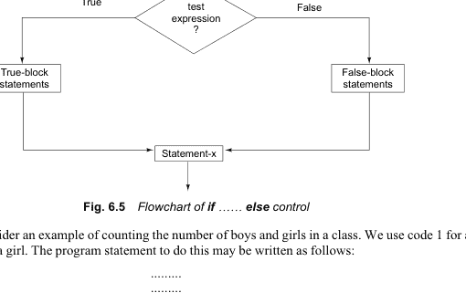

图 6.5 if ... else 控制的流程图

让我们考虑一个统计班级中男生和女生人数的例子。我们用代码 1 表示男生，2 表示女生。实现这一功能的程序语句可编写如下：

```c
........
if (code == 1)
    boy = boy + 1;
if (code == 2)
    girl = girl + 1;
........
```

第一个测试判断该学生是否为男生。如果是，则男生人数加 1，程序继续执行第二个测试。第二个测试再次判断该学生是否为女生。这是不必要的。一旦确定学生是男生，就无需再判断是否为女生。一个学生要么是男生，要么是女生，不可能两者都是。上面的程序段可以使用 else 子句修改为如下形式：

```c
........
if (code == 1)
    boy = boy + 1;
else
    girl = girl + 1;
statement-x
........
```

这里，如果 code 等于 1，则执行语句 `boy = boy + 1;`，并在跳过 else 部分后将控制转移到 statement-x。如果 code 不等于 1，则跳过语句 `boy = boy + 1;`，并在控制到达 statement-x 之前执行 else 部分中的语句 `girl = girl + 1;`。

考虑图 6.3 中给出的程序。当 (c – d) 的值为零时，不计算比值，程序没有任何提示就停止了。在这种情况下，我们可能不知道程序是因为值为零还是其他错误而停止。可以通过添加 else 子句来改进该程序，如下所示：

```c
........
if (c - d != 0)
{
    ratio = (float)(a+b)/(float)(c-d);
    printf("Ratio = %f\n", ratio);
}
else
printf("c-d is zero\n");
........
........
```

### 示例 6.3

一个计算幂级数的程序

e^x = 1 + x + x²/2! + x³/3! + ... + x^n/n!, 0 < x < 1

见图 6.6。它使用 if ... else 来测试精度。

该幂级数包含如下类型的递推关系：

T_n = T_{n-1}(x/n)  （当 n > 1 时）  
T_1 = x  （当 n = 1 时）  
T_0 = 1

如果已知 T_{n-1}（通常称为前一项），则可以通过将前一项乘以 x/n 轻松求得 T_n（称为当前项）。于是

e^x = T_0 + T_1 + T_2 + ...... + T_n = sum

程序使用 count 来统计所添加的项数。当项的值小于 0.0001（ACCURACY）时，程序停止。注意，当某项小于 ACCURACY 时，n 的值被设为 999（一个大于 100 的数），因此 while 循环终止。结果在 while 循环外打印。

### 6.5 if ... else 语句的嵌套

当涉及一系列决策时，我们可能必须以嵌套形式使用多个 if ... else 语句，如下所示：

```c
/* ************************************************************* */
/* EXPERIMENT WITH if ... else STATEMENT */
/* ************************************************************* */

#define ACCURACY 0.0001
main()
{
    int n, count;
    float x, term, sum;
    printf("Enter value of x:");
    scanf("%f", &x);
    n = term = sum = count = 1;
    while (n <= 100)
    {
        term = term * x/n;
        sum = sum + term;
        count = count + 1;
        if (term < ACCURACY)
            n = 999;
        else
            n = n + 1;
    }
    printf("Terms = %d Sum = %f\n", count, sum);
}
```

输出
```
Enter value of x:0
Terms = 2 Sum = 1.000000

Enter value of x:0.1
Terms = 5 Sum = 1.105171

Enter value of x:0.5
Terms = 7 Sum = 1.648720

Enter value of x:0.75
Terms = 8 Sum = 2.116997

Enter value of x:0.99
Terms = 9 Sum = 2.691232

Enter value of x:1
Terms = 9 Sum = 2.718279
```

图 6.6 if ... else 语句的示例

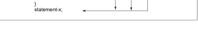

执行逻辑如图 6.7 所示。如果条件 1 为假，则执行语句 3；否则继续执行第二个测试。如果条件 2 为真，则计算语句 1；否则计算语句 2，然后将控制转移到 statement-x。

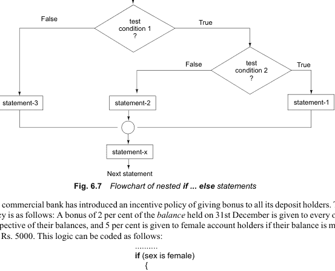

图 6.7 嵌套 if ... else 语句的流程图

一家商业银行推出了一项向所有储户发放奖金的激励政策。政策如下：无论余额多少，每个人均获得 12 月 31 日余额 2% 的奖金；如果女性账户持有人的余额超过 5000 卢比，则获得 5% 的奖金。该逻辑可编码如下：

```c
if (sex is female)
{
    if (balance > 5000)
        bonus = 0.05 * balance;
    else
        bonus = 0.02 * balance;
}
else
{
    bonus = 0.02 * balance;
}
balance = balance + bonus;
```

在嵌套时，应注意让每个 if 都配对一个 else。考虑上面程序的另一种写法（乍一看似乎是正确的）：

```c
if (sex is female)
    if (balance > 5000)
        bonus = 0.05 * balance;
    else
        bonus = 0.02 * balance;
    balance = balance + bonus;
```

对于 else 属于哪个 if 存在歧义。在 C 语言中，else 与最近的未终止的 if 配对。因此，该 else 与内层 if 关联，而外层 if 没有对应的 else。这意味着计算机将尝试执行语句

`balance = balance + bonus;`

而并没有真正计算男性账户持有人的奖金。

考虑另一种同样看起来正确的写法：

```c
if (sex is female)
{
    if (balance > 5000)
        bonus = 0.05 * balance;
}
else
    bonus = 0.02 * balance;
    balance = balance + bonus;
```

在这种情况下，else 与外层 if 关联，因此会计算男性账户持有人的奖金。但是，对于余额等于或小于 5000 的女性账户持有人，由于内层 if 缺少对应的 else，其奖金不会被计算。

### 示例 6.4

图 6.8 中的程序使用嵌套的 if ... else 语句选择并打印三个数中的最大值。

程序
```c
/**********************************************************************/
/* SELECTING THE LARGEST OF THREE VALUES */
/**********************************************************************/
main()
{
    float A, B, C;

    printf("Enter three values");
    scanf("%f %f %f", &A, &B, &C);

    printf("\nLargest value is:");

    if (A > B)
    {
        if (A > C)
            printf("%f", A);
        else
            printf("%f\n", C);
    }
    else
    {
        if (C > B)
            printf("%f\n", C);
        else
            printf("%f\n", B);
    }
}
```

输出
```
Enter three values
23445 67379  88843
Largest value is 88843.000000
```

图 6.8 选择三个数中的最大值

### 6.6 else if 阶梯

当涉及多路决策时，还有另一种组合 if 的方式。多路决策是一系列 if 的链，其中每个 else 所关联的语句又是一个 if。它采用以下一般形式：

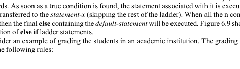

这种结构称为 else if 阶梯。条件从（阶梯的）顶部向下依次求值。一旦找到为真的条件，就执行与之关联的语句，并将控制转移到 statement-x（跳过阶梯的其余部分）。当所有 n 个条件均为假时，将执行包含默认语句的最终 else。图 6.9 显示了 else if 阶梯语句的执行逻辑。

让我们考虑一个学术机构中对学生进行评级的例子。评级按照以下规则进行：


| 平均分数 | 等级 |
|---|---|
| 80 至 100 | 荣誉 |
| 60 至 79 | 一级 |
| 50 至 59 | 二级 |
| 40 至 49 | 三级 |
| 0 至 39 | 不及格 |

这种分级可以使用 else if 阶梯结构来实现，如下所示（尽管从语法上讲，它是错误的！）

```c
if (marks > 79)
    grade = "Honours";
else if (marks > 59)
    grade = "First Division";
else if (marks > 49)
    grade = "Second Division";
else if (marks > 39)
    grade = "Third Division";
else
    grade = "Fail";
printf("%s\n", grade);
```

再考虑下面给出的另一个例子：

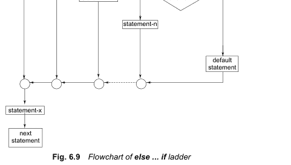

图 6.9 else ... if 阶梯结构的流程图

```c
..........
if (code == 1)
    colour = "RED";
else if (code == 2)
    colour = "GREEN";
else if (code == 3)
    colour = "WHITE";
else
    colour = "YELLOW";
..........
```

除 1、2 或 3 以外的代码编号均视为表示 YELLOW 颜色。使用嵌套的 if ... else 语句也可以获得相同的结果。

```c
if (code != 1)
    if (code != 2)
        if (code != 3)
            colour = "YELLOW";
        else
            colour = "WHITE";
    else
        colour = "GREEN";
else
    colour = "RED";
```

在这种情况下，选择哪种方法由程序员自行决定。然而，为了选择一种既有效又高效的 if 结构，程序员必须充分了解 if 语句的各种形式及其嵌套规则。

### 示例 6.5

一家电力分配公司向其家庭用户收费如下：

| 用电量（单位） | 收费标准 |
|---|---|
| 0 - 200 | 每单位 Rs. 0.50 |
| 201 - 400 | Rs. 100 加上超过 200 单位部分每单位 Rs. 0.65 |
| 401 - 600 | Rs. 230 加上超过 400 单位部分每单位 Rs. 0.80 |
| 601 及以上 | Rs. 390 加上超过 600 单位部分每单位 Rs. 1.00 |

图 6.10 中的程序读取客户编号和用电量，并打印客户需支付的金额。

### 6.7 SWITCH 和 BREAK 语句

当分支数量增加时，程序变得难以阅读和理解。有时，甚至连设计者本人也会感到困惑。幸运的是，C 语言有一种内置的多路决策语句，称为 switch。switch 语句将给定变量（或表达式）的值与一系列 case 值进行比较，当找到匹配项时，执行与该 case 关联的语句块。switch 语句的一般形式如下页所示。

决策与分支 6.15

```c
程序
/***************************************************************/
/* 使用 else if 阶梯结构 */
/************************************************************** */
main()
{
    int units, custnum;
    float charges;
    printf("Enter CUSTOMER NO. and UNITS consumed\n");
    scanf("%d %d", &custnum, &units);
    if (units <= 200)
        charges = 0.5 * units;
    else if (units <= 400)
        charges = 100 + 0.65 * (units - 200);
    else if (units <= 600)
        charges = 230 + 0.8 * (units - 400);
    else
        charges = 390 + (units - 600);
    printf("\n\nCustomer No: %d: Charges = %.2f\n",
    custnum, charges);
}
输出
Enter CUSTOMER NO. and UNITS consumed 101 150
Customer No: 101 Charges = 75.00
Enter CUSTOMER NO. and UNITS consumed 202 225
Customer No: 202 Charges = 116.25
Enter CUSTOMER NO. and UNITS consumed 303 375
Customer No: 303 Charges = 213.75
Enter CUSTOMER NO. and UNITS consumed 404 520
Customer No: 404 Charges = 326.00
Enter CUSTOMER NO. and UNITS consumed 505 625
Customer No: 505 Charges = 415.00
```

图 6.10 else ... if 阶梯结构的示例

表达式是一个整数表达式或字符。值-1、值-2……是常量或常量表达式（可求值为整型常量），称为 case 标签。这些值中的每一个在 switch 语句块内都应是唯一的。块-1、块-2……是语句列表，可以包含零个或多个语句。不需要在这些块周围加大括号。注意，case 标签以冒号（:）结尾。

当 switch 执行时，表达式的值会依次与值-1、值-2……进行比较。如果找到某个 case 的值与表达式的值匹配，则执行该 case 后面的语句块。

```c
switch (expression)
{
  case value-1: block-1
  break;
  case value-2: block-2
  break;
  ......
  default:
    default-block
  break;
}
statement-x;
```

每个块末尾的 break 语句表示特定 case 的结束，并使程序从 switch 语句中退出，将控制权转移到 switch 后面的 statement-x。

default 是一个可选 case。如果存在，当表达式的值与任何 case 值都不匹配时，将执行它。如果不存在，当所有匹配都失败时，不执行任何操作，控制权将转到 statement-x。

switch 语句的选择过程如图 6.11 中的流程图所示。

switch 语句可用于对学生的成绩进行分级，如上一节所述。下面进行说明：

```c
index = marks / 10;
switch (index)
{
  case 10:
  case 9:
  case 8:
    grade = "Honours";
    break;
  case 7:
  case 6:
    grade = "First Division";
    break;
  case 5:
    grade = "Second Division";
    break;
  case 4:
    grade = "Third Division";
    break;
  default:
    grade = "Fail";
    break;
}
printf("%s\n", grade);
........
```

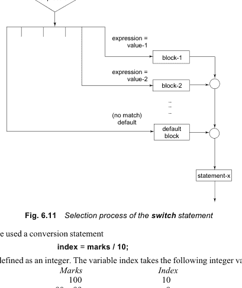

图 6.11 switch 语句的选择过程

注意，我们使用了一个转换语句

```c
index = marks / 10;
```

其中，index 被定义为整数。变量 index 取以下整数值。

| 分数 | 索引 |
|---|---|
| 100 | 10 |
| 90 – 99 | 9 |
| 80 – 89 | 8 |
| 70 – 79 | 7 |
| 60 – 69 | 6 |
| 50 – 59 | 5 |
| 40 – 49 | 4 |
| : | : |
| 0 | 0 |

程序的这一部分说明了两个重要特性。首先，它使用了空 case。前三个 case 将执行相同的语句

```c
grade = "Honours";
break;
```

case 7 和 case 6 也是如此。其次，对于所有其他分数小于 40 的情况，使用了 default 条件。

switch 语句通常用于菜单选择。例如：

```c
..........
printf(" TRAVEL GUIDE \n\n");
printf(" A Air Timings\n");
printf(" T Train Timings\n");
printf(" B Bus Service\n");
printf(" X to skip\n");
printf("\n Enter your choice\n");
character = getchar();
switch (character)
{
case 'A':
air_display();
break;
case 'B':
bus_display();
break;
case 'T':
train_display();
break;
default:
printf("No choice\n");
}
..........
```

switch 语句可以嵌套。也就是说，一个 switch 可以是另一个 case 块的一部分。ANSI C 允许 15 层嵌套，以及多达 257 个 case 标签。

### 6.8 ? : 运算符

C 语言有一个不寻常的运算符，可用于进行双向决策。该运算符是 ? 和 : 的组合，需要三个操作数。这个运算符通常被称为条件运算符。条件运算符的一般使用形式如下：

```c
conditional expression ? expression1 : expression2
```

首先对条件表达式进行求值。如果结果不为零，则对 expression1 求值，并将其作为条件表达式的值返回。否则，对 expression2 求值并返回其值。例如，以下代码段

```c
if (x < 0)
    flag = 0;
else
    flag = 1;
```

可以写成

```c
flag = (x < 0) ? 0 : 1;
```

考虑以下函数的求值：

```text
y = 1.5x + 3    当 x ≤ 2
y = 2x + 5      当 x > 2
```

可以使用条件运算符进行求值，如下所示：

```c
y = (x > 2) ? (2 * x + 5) : (1.5 * x + 3);
```

条件运算符可以嵌套使用，以计算更复杂的赋值决策。例如，考虑一位销售家用产品的女销售的周薪。如果 x 是一周内售出的产品数量，她的周薪为：

```text
salary = { 4x + 100   当 x < 40
           300        当 x = 40
           4.5x + 150 当 x > 40 }
```

这个复杂的方程可以写成

```c
salary = (x != 40) ? ((x < 40) ? (4 * x + 100) : (4.5 * x + 150)) : 300;
```

同样的计算也可以使用 if ... else 语句进行：

```c
if (x <= 40)
    if (x < 40)
        salary = 4 * x + 100;
    else
        salary = 300;
else
    salary = 4.5 * x + 150;
```

当使用条件运算符时，代码变得更简洁，也许也更高效。然而，可读性较差。当需要超过一层的条件运算符嵌套时，最好使用 if 语句。

### 示例 6.6

一名员工可以在每六个月开始时申请贷款，但公司将根据以下规定批准金额：

- 规则 1：员工在任何时间点不能同时享受超过两笔贷款。
- 规则 2：最大允许贷款总额是有限制的，且取决于员工的类别。

处理贷款申请并批准贷款的程序如图 6.12 所示。

程序使用以下变量：

- loan3 - 当前申请的贷款金额
- loan2 - 之前未偿还的贷款金额
- loan1 - 之前再之前未偿还的贷款金额


maxloan - 最大允许贷款  
sancloan - 批准的贷款

批准新贷款的规则是：

- loan1 应为零。
- loan2 + loan3 不应超过 maxloan。

注意：使用 long int 类型声明变量。

```c
/*
******************************
* CONDITIONAL OPERATOR
******************************/
#define MAXLOAN 50000
main()
{
    long int loan1, loan2, loan3, sancloan, sum23;
    printf("Enter the values of previous two loans:\n");
    scanf("%ld %ld", &loan1, &loan2);
    printf("Enter the value of new loan:\n");
    scanf("%ld", &loan3);
    sum23 = loan2 + loan3;
    sancloan = (loan1 > 0) ? 0 : ((sum23 > MAXLOAN) ? 0 : loan3);
    printf("\nPrevious loans pending:\n%ld %ld\n", loan1, loan2);
    printf("Loan requested = %ld\n", loan3);
    printf("Loan sanctioned = %ld\n", sancloan);
}
```

### 输出

```
Enter the values of previous two loans:
0 20000
Enter the value of new loan:
30000
Previous loans pending:
0 20000
Loan requested = 30000
Loan sanctioned = 30000
```

```
Enter the values of previous two loans:
1000 15000
Enter the value of new loan:
25000
Previous loans pending:
1000 15000
Loan requested = 25000
Loan sanctioned = 0
```


### 6.9 GOTO 语句

到目前为止，我们已经讨论了基于某些指定条件控制执行流程的方法。像许多其他语言一样，C 支持 goto 语句，以便在程序中从一个点无条件跳转到另一个点。尽管在 C 这种高度结构化的语言中可能并不一定需要使用 goto 语句，但有时使用 goto 可能是有益的。

### 6.9.1 标号

goto 需要一个标号来标识要跳转到的位置。标号可以是任何有效的变量名，并且后面必须跟一个冒号。标号紧挨着控制要转移到的语句之前放置。goto 和标号语句的一般形式如下所示：

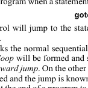

向前跳转

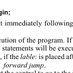

向后跳转

标号可以位于程序中 `goto label;` 语句之前或之后的任何位置。

在程序运行期间，当遇到像 `goto begin;` 这样的语句时，控制流将跳转到标号 `begin:` 紧后面的语句。这种跳转是无条件发生的。

注意，goto 会破坏程序的正常顺序执行。如果 `label:` 位于语句 `goto label;` 之前，就会形成一个循环，某些语句将被重复执行。这种跳转称为向后跳转。另一方面，如果 `label:` 放在 `goto label;` 之后，则会跳过某些语句，这种跳转称为向前跳转。

goto 通常用于程序末尾，将控制导向输入语句，以读取更多数据。考虑以下示例：

```c
main()
{
    double x, y;
read:
    scanf("%lf", &x);
    if (x < 0) goto read;
    y = sqrt(x);
    printf("%f %f\n", x, y);
    goto read;
}
```

该程序用于计算从终端读取的一系列数字的平方根。程序使用了两个 goto 语句：一个在打印结果之后的末尾，将控制转移回输入语句；另一个在数字为负数时跳过任何进一步的计算。

由于末尾的无条件 goto 语句，控制总是被转移回输入语句。事实上，这个程序使计算机进入一个永久循环，称为无限循环。计算机一遍又一遍地循环，直到我们采取某些特殊步骤来终止循环。应避免此类无限循环。例 6.7 说明了如何消除这种无限循环。

### 例 6.7

图 6.13 中给出的程序说明了 goto 语句的使用。

该程序计算五个数字的平方根。变量 count 记录已读取数字的数量。当 count 小于或等于 5 时，`goto read;` 将控制导向标号 `read;`；否则，程序打印一条消息并停止。

```c
/*******************************************************/
/* USE OF GOTO STATEMENT */
/*******************************************************/
#include <math.h>
main()
{
    double x, y;
    int count;
    count = 1;
    printf("Enter FIVE real values in a LINE \n");
read:
    scanf("%lf", &x);
    printf("\n");
    if (x < 0)
        printf("\nItem--%d is negative \n", count);
    else
    {
        y = sqrt(x);
        printf("%f\t%f\n", x, y);
    }
    count = count + 1;
    if (count <= 5)
        goto read;
    printf("\nEnd of computation");
}
```

```
Enter FIVE real values in a LINE
50.70 40 -36 75 11.25
50.700000        7.123903
40.000000        6.324555
Item--3 is negative
75.000000        8.660254
11.250000        3.354102
End of computation
```

**图 6.13** goto 语句的使用

goto 语句的另一个用途是，在遇到某些特殊条件时，将控制转移出循环（或嵌套循环）。示例：

```c
while (------)
{
    for (------)
    {
        ------------
        for (------------) goto end_of_program;
        ------------
    }
    ------------
}
end_of_program:
```

跳出循环

我们应尽可能避免使用 goto。但如果用它来增强程序的可读性或提高执行速度，也没有什么不妥。

### 案例研究

### 1. 数值范围

**问题：** 一项计算机市场调查显示，个人计算机由供应商以不同的成本出售。以下是一些供应商给出的成本清单（以百为单位）：

35.00  40.50  25.00  31.25  68.15  
47.00  26.65  29.00  53.45  62.50

确定平均成本和数值范围。

**问题分析：** 极差是统计分析一系列数值时使用的离散程度度量之一。任何序列的极差是该序列中最高值与最低值之差。即

极差 = 最高值 – 最低值

因此，有必要找出序列中的最高值和最低值。

**程序：** 图 6.14 给出了一个用于确定个人计算机市场价格范围和平均成本的程序。

第一次读取值时，通过以下语句将其赋给 high 和 low 两个桶：

```c
high = low = value;
```

对于后续值，将读取的值与 high 比较；如果更大，则将该值赋给 high。否则，将该值与 low 比较；如果更小，则将该值赋给 low。注意，在某一时刻，桶 high 和 low 保存着到目前为止读取到的最高值和最低值。

```c
/*--------------------------------------------------------------------*/
/*                        RANGE OF NUMBERS                            */
/*--------------------------------------------------------------------*/

main()
{
    int count;
    float value, high, low, sum, average, range;

    sum = 0;
    count = 0;

    printf("Enter numbers in a line : input a NEGATIVE number to end\n");

input:
    scanf("%f", &value);
    if (value < 0) goto output;
    count = count + 1;
    if (count == 1)
        high = low = value;
    else if (value > high)
        high = value;
    else if (value < low)
        low = value;

    sum = sum + value;
    goto input;

output:
    average = sum/count;
    range = high - low;
    printf("\n\n");
    printf("Total values : %d\n", count);
    printf("Highest-value: %f\nLowest-value: %f\n", high, low);
    printf("Range        : %f\nAverage      : %f\n",
            range, average);
}
```

```
Enter numbers in a line : input a NEGATIVE number to end
35 40.50  25  31.25  68.15  47  26.65  29  53.45  62.50  -1
Total values  :  10
Highest-value :  68.150002
Lowest-value  :  25.000000
Range         :  43.150002
Average       :  41.849998
```

**图 6.14** 数值范围的计算

这些值是在由 **goto input;** 语句创建的输入循环中读取的。通过输入一个负数将控制转移出该循环。这是由以下语句导致的：

```c
if (value < 0) goto output;
```

### 2. 工资单计算

**问题：** 一家制造公司为享受某些福利将其高管分为四个级别。级别及相应福利如下所示：


| 级别 | 福利 | |
|---|---|---|
|  | 通勤津贴 | 娱乐津贴 |
| 1 | 1000 | 500 |
| 2 | 750 | 200 |
| 3 | 500 | 100 |
| 4 | 250 | |

高级职员的毛薪包括基本工资、按基本工资25%计算的住房租金津贴以及其他福利。所得税按以下百分比从薪水中扣除：

| 毛薪 | 税率 |
|---|---|
| 毛薪 <= 2000 | 无税扣除 |
| 2000 < 毛薪 <= 4000 | 3% |
| 4000 < 毛薪 <= 5000 | 5% |
| 毛薪 > 5000 | 8% |

编写一个程序，读取高级职员的工号、级别编号和基本工资，然后计算扣除所得税后的净薪水。

## 问题分析：

毛薪 = 基本工资 + 住房租金津贴 + 福利

净薪水 = 毛薪 – 所得税

福利的计算取决于级别，而所得税取决于毛薪。主要步骤如下：
- 1. 读取数据。
- 2. 确定级别编号并计算福利。
- 3. 计算毛薪。
- 4. 计算所得税。
- 5. 计算净薪水。
- 6. 打印结果。

程序：程序和测试数据的结果在图 6.15 中给出。注意最后一条语句应为可执行语句。即标签 stop; 不能是最后一行。

```
Program
/* ************************************************************** */
/*
            PAY-BILL CALCULATIONS
*/
/* ************************************************************** */
#define CA1 1000
#define CA2 750
#define CA3 500
#define CA4 250
#define EA1 500
#define EA2 200
#define EA3 100
#define EA4 0
main()
{
    int  level, jobnumber;
    float  gross,
           basic,
           house_rent,
           perks,
           net,
           incometax;
    input:
    printf("\nEnter level, job number, and basic pay\n");
    printf("Enter 0 (zero) for level to END\n\n");
    scanf("%d", &level);
    if (level == 0) goto stop;
    scanf("%d %f", &jobnumber, &basic);
    switch (level)
    {
        case 1:
            perks = CA1 + EA1;
            break;
        case 2:
            perks = CA2 + EA2;
            break;
        case 3:
            perks = CA3 + EA3;
            break;
        case 4:
            perks = CA4 + EA4;
            break;
        default:
            printf("Error in level code\n");
            goto stop;
    }
    house_rent = 0.25 * basic;
    gross = basic + house_rent + perks;
    if (gross <= 2000)
        incometax = 0;
    else if (gross <= 4000)
        incometax = 0.03 * gross;
    else if (gross <= 5000)
        incometax = 0.05 * gross;
    else
        incometax = 0.08 * gross;
    net = gross - incometax;
    printf("%d %d %.2f", level, jobnumber, net);
    goto input;
    stop: printf("\n\nEND OF THE PROGRAM");
}
```

## 输出

输入级别、工号和基本工资
输入 0（零）作为级别以结束

1 1111 4000
1 1111 5980.00
输入级别、工号和基本工资
输入 0（零）作为级别以结束

2 2222 3000
2 2222 4465.00
输入级别、工号和基本工资
输入 0（零）作为级别以结束
3 3333 2000
3 3333 3007.00
输入级别、工号和基本工资
输入 0（零）作为级别以结束
4 4444 1000
4 4444 1500.00
输入级别、工号和基本工资
输入 0（零）作为级别以结束
0
程序结束

图 6.15 薪资计算

### 复习题和练习

#### 6.1 判断以下说法是否正确或错误：
- (a) 当 if 语句嵌套时，最后的 else 与最近的没有 else 的 if 关联。
- (b) 一个 if 可以有多个 else 子句。
- (c) switch 语句总可以用一系列 if…else 语句替换。
- (d) switch 表达式可以是任意类型。
- (e) 当遇到 break 语句时，程序停止执行。

#### 6.2 switch 语句与 if 语句有何不同？

#### 6.3 找出以下各段中的错误，如有：
(a) if (x + y = z && y > 0)
    printf(" ");
(b) if (code > 1);
    a = b + c
    else
    a = 0
(c) if (p < 0) ; (q < 0)
    printf("sign is negative");

#### 6.4 以下是一个程序段：
    x = 1;
    y = 1;
    if(n > 0)
    x = x + 1;
    y = y - 1;
    printf("%d %d", x, y);

#### 6.5
n 假设为 (a) 1 和 (b) 0 时，x 和 y 的值会是什么。
不使用复合关系重写以下各式：

```
if (grade <= 59 && grade >= 50)
    second = second + 1;
```

```
if (number > 100 || number < 0)
    printf("Out of range");
else
    sum = sum + number;
```

```
if ((M1 > 60 && M2 > 60) || T > 200)
    printf("Admitted\n");
else
    printf("Not admitted\n");
```

#### 6.6
阅读本章讨论的所有程序。确定可能需要做哪些更改以提高程序的可读性或效率。

#### 6.7
编写一个程序来判断一个数是“奇数”还是“偶数”并打印消息

NUMBER IS EVEN
or
NUMBER IS ODD

- (a) 不使用 else 选项， 和 (b) 使用 else 选项。

#### 6.8
编写一个程序来找出所有大于 100 且小于 200 且能被 7 整除的整数的个数和总和。

#### 6.9
下面给出了两个未知数 x₁ 和 x₂ 的二元一次方程组：

a x₁ + b x₂ = m
c x₁ + d x₂ = n

该方程组有唯一解

```
x₁ = (m d - b n) / (a d - c b)
x₂ = (n a - m c) / (a d - c b)
```

前提是分母 ad − cb 不等于零。
编写一个程序读取常数 a、b、c、d、m 和 n 的值并计算 x₁ 和 x₂ 的值。如果 ad − cb = 0，则应打印适当的提示信息。

#### 6.10
给定一个范围在 0 到 100 的分数列表，编写一个程序计算并打印学生的数量：
- (a) 获得超过 80 分的学生，
- (b) 获得超过 60 分的学生，
- (c) 获得超过 40 分的学生，
- (d) 获得 40 分或更少分的学生，
- (e) 在 81 到 100 范围内，
- (f) 在 61 到 80 范围内，
- (g) 在 41 到 60 范围内， 和
- (h) 在 0 到 40 范围内。
程序应使用最少的 if 语句。

#### 6.11 录取到专业课程须满足以下条件：
- (a) 数学成绩 >= 60
- (b) 物理成绩 >= 50
- (c) 化学成绩 >= 40
- (d) 三科总分 >= 200
- 或
- 数学和物理总分 >= 150

给定三科的成绩，编写一个程序处理申请以列出符合条件的候选人。

#### 6.12 编写一个程序打印如下所示的二维平方根表，以提供从 0 到 9.9 的任意数字的平方根。例如，值 x 给出 3.2 的平方根，y 给出 3.9 的平方根。

## 平方根表

| 数字 | 0.0 | 0.1 | 0.2 | ........ | 0.9 |
|---|---|---|---|---|---|
| 0.0 |  |  |  |  |  |
| 1.0 |  |  |  |  |  |
| 2.0 |  |  |  |  |  |
| 3.0 |  |  | x |  | y |
|  |  |  |  |  |  |
| 9.0 |  |  |  |  |  |

#### 6.13 下面是 Floyd 的三角形。

1
2 3
4 5 6
7 8 9 10
11 ...... 15
.
.
79 ........... 91

- (a) 编写一个程序打印此三角形。
- (b) 修改程序以产生以下形式的 Floyd 三角形。
- 1
- 0 1
- 1 0 1
- 0 1 0 1
- 1 0 1 0 1

#### 6.14 一家布料商店宣布了购买商品的以下季节性折扣：

| 购买金额 | 折扣 | |
| | 机制布 | 手织品 |
| 0 – 100 | – | 5% |
| 101 – 200 | 5% | 7.5% |
| 201 – 300 | 7.5% | 10.0% |
| 300 以上 | 10.0% | 15.0% |

使用 switch 和 if 语句编写一个程序计算客户应支付的净金额。

#### 6.15 编写一个程序读取 x 的值并计算以下函数

y = { 1 for x > 0
      0 for x = 0
     -1 for x < 0 }

- 使用
- (a) 嵌套 if 语句，
- (b) else if 语句， 和
- (c) 条件运算符 ? :

## 第 7 章

## 决策与循环

### 7.1 引言

我们在上一章中看到，通过引入计数器并稍后使用 if 语句对其进行测试，可以重复执行程序的某一段。虽然这种方法对于所有实际目的来说都相当令人满意，但我们需要在程序中适当的位置初始化和递增计数器，并在循环完成时测试其值。例如，假设我们想计算 1 到 10 之间所有整数的平方和。我们可以使用 if 语句编写如下程序：

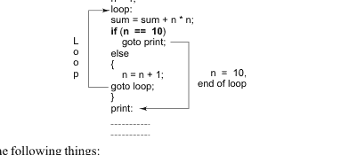

该程序执行以下操作：
- 1. 初始化变量 n。
- 2. 计算 n 的平方并将其加到 sum 上。
- 3. 测试 n 的值是否等于 10。如果等于 10，则程序打印结果。
- 4. 如果 n 小于 10，则将其递增 1，控制权返回以再次计算和。


### 7.2 C 程序设计和数据结构

程序计算语句

```
sum = sum + n*n;
```

10 次。也就是说，循环执行 10 次。这个数字可以通过在语句 `if (n == 10)` 中适当修改关系表达式来轻松减小或增大。在已知确切重复次数的情况下，C 语言中有更方便的循环方法。这些循环功能使我们能够在不使用 `goto` 语句的情况下开发包含重复过程的简洁程序。

在循环中，一系列语句会被执行，直到满足循环终止的条件。程序循环因此由两个部分组成，一个称为循环体，另一个称为控制语句。控制语句测试某些条件，然后指导循环体中包含的语句的重复执行。

根据循环中控制语句的位置，控制结构可分为入口控制循环或出口控制循环。图 7.1 中的流程图说明了这些结构。在入口控制循环中，控制条件在循环执行开始前进行测试。如果条件不满足，则循环体将不会被执行。在出口控制循环的情况下，测试在循环体结束时进行，因此循环体在第一次执行时无条件执行。

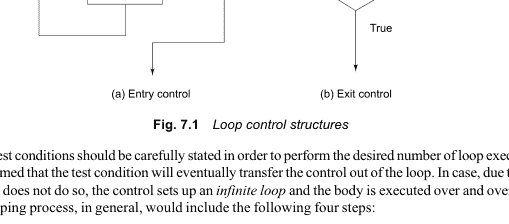

测试条件应仔细陈述，以便执行所需次数的循环。假定测试条件最终会将控制转移出循环。如果由于某种原因它没有这样做，控制会建立一个无限循环，循环体会被一次又一次地执行。

一般而言，循环过程包括以下四个步骤：

- 1. 设置和初始化计数器。
- 2. 执行循环中的语句。
- 3. 测试循环执行的指定条件。
- 4. 递增计数器。

测试可以是确定循环是否已重复指定的次数，也可以是确定是否满足特定条件。

C 语言提供了三种用于执行循环操作的循环结构。它们是：

- 1. The `while` statement.
- 2. The `do` statement.
- 3. The `for` statement.

我们将在本章讨论这些语句的特性和应用。

### 7.2 WHILE 语句

C 中所有循环结构中最简单的是 `while` 语句。我们在许多早期程序中都使用过 `while`。`while` 语句的基本格式是

```
while (test condition)
{
    body of the loop
}
```

`while` 是一个入口控制循环语句。测试条件被求值，如果条件为真，则执行循环体。执行循环体后，测试条件再次被求值，如果为真，则再次执行循环体。循环体的重复执行过程一直持续，直到测试条件最终变为假，控制被转移出循环。退出时，程序继续执行循环体之后的语句。

循环体可以有一个或多个语句。只有当循环体包含两个或多个语句时才需要大括号。然而，即使循环体只有一个语句，使用大括号也是一个好习惯。

我们可以将第 7.1 节中讨论的程序循环重写如下：

```
sum = 0;
n = 1;
while(n <= 10)
{
    sum = sum + n * n;
    n = n+1;
}
printf("sum = %d\n", sum);
```

循环体对 n = 1, 2, ......, 10 执行 10 次，每次都加上 n 的平方的值，而 n 在循环内部递增。测试条件也可以写成 `n < 11`；结果相同。

下面显示了使用键盘输入的 `while` 语句的另一个示例：

```
..........
..........
character = ' ';
while (character != 'Y')
    character = getchar();
xxxxxxxx;
..........
```

首先 character 被初始化为 ' '。然后 `while` 语句开始测试 character 是否不等于 Y。由于 character 被初始化为 ' '，测试为真，循环语句

```
character = getchar();
```

被执行。每次键入一个字母时，都会进行测试并执行循环语句，直到按下字母 Y。当按下 Y 时，由于 character 等于 Y，条件变为假，循环终止，从而将控制转移到语句 `xxxxxxxx;`

### 示例 7.1

用于求解方程的程序

$y = x^n$

当 n 为非负整数时，给出在图 7.2 中。

变量 y 初始化为 1，然后使用 `while` 循环乘以 x n 次。循环控制变量 count 在循环外部初始化，并在循环内部递增。当 count 的值大于 n 时，控制退出循环。

### 7.3 DO 语句

我们在上一节讨论的 `while` 循环结构在循环执行前进行条件测试。因此，如果条件在第一次尝试时不满足，循环体可能根本不会被执行。在某些情况下，可能需要在执行测试之前执行循环体。这种情况可以通过 `do` 语句来处理。其形式为：

```
do
{
    body of the loop
}
while (test-condition);
```

到达 `do` 语句时，程序首先评估循环体。在循环结束时，`while` 语句中的测试条件被求值。如果条件为真，程序将再次评估循环体。只要条件为真，此过程就会继续。当条件变为假时，循环将被终止，控制转到 `while` 语句之后立即出现的语句。

```c
Program
/********************************************************************************/
/* EXAMPLE OF while STATEMENT */
/********************************************************************************/
main()
{
    int count, n;
    float x, y;
    printf("Enter the values of x and n:");
    scanf("%f %d", &x, &n);
    y = 1.0;
    count = 1;
    /* LOOP BEGINS */
    while (count <= n)
    {
        y = y*x;
        count++;
    }
    /* END OF LOOP */
    printf("x = %f; n = %d; x to power n = %f\n",x,n,y);
}
Output
Enter the values of x and n: 2.5 4
x = 2.500000; n = 4; x to power n = 39.062500

Enter the values of x and n: 0.5 4
x = 0.500000; n = 4; x to power n = 0.062500
```

图 7.2 使用 while 循环计算 x 的 n 次幂的程序

由于测试条件在循环底部求值，`do...while` 结构提供了一个出口控制循环，因此循环体至少执行一次。

`do...while` 循环的一个简单示例是：

```c
do
{
    printf("Input a number\n");
    number = getnum();
}
while (number > 0);
```

这段程序从键盘读取数字，直到键入零或负数。

测试条件也可能具有复合关系。例如，上例中的语句 `while (number > 0 && number < 100)` 将导致循环只要键入的数字在 0 到 100 之间就执行。

考虑另一个示例：

```
I = 1;
sum = 0;
do
{
  sum = sum + 1;
  I = I+2;
}
while(sum < 40 || I < 10);
printf("%d %d\n", I, sum);
```

只要两个关系之一为真，循环就会被执行。

### 示例 7.2

用于打印从 1 × 1 到 12 × 10 的乘法表，如下所示的程序在图 7.3 中给出。

| × | 1 | 2 | 3 | 4 | … | 10 |
|---|---|---|---|---|---|---|
| 1 | 1 | 2 | 3 | 4 | … | 10 |
| 2 | 2 | 4 | 6 | 8 | … | 20 |
| 3 | 3 | 6 | 9 | 12 | … | 30 |
| 4 | 4 | … | … | … | … | 40 |
| … | … | … | … | … | … | … |
| 12 | 12 | … | … | … | … | 120 |

该程序包含两个嵌套形式的 `do...while` 循环。外层循环由变量 row 控制，执行 12 次。内层循环由变量 column 控制，每次外层循环执行时执行 10 次。也就是说，内层循环总共执行 120 次，每次打印表中的一个值。

请注意，内层循环的 `printf` 不包含任何换行字符 (`\n`)。这允许在一行中打印所有行值。外层循环中的空 `printf` 启动新行以打印下一行。

### 7.4 FOR 语句

### 简单的 for 循环

`for` 循环是另一种入口控制循环，提供更简洁的循环控制结构。`for` 循环的一般形式是

```
for (initialization ; test-condition ; increment)
{
  body of the loop
}
```


```c
Program
/***********************************************/
/*                PRINTING OF MULTIPLICATION TABLE              */
/***********************************************/

#define COLMAX 10
#define ROWMAX 12

main()
{
    int row,column, y;

    row = 1;
    printf("                MULTIPLICATION TABLE                \n");
    printf("-----------------------------------------------------\n");
    /* ......... OUTER LOOP BEGINS ........ */
    do
    {
        column = 1;
        /* INNER LOOP BEGINS ........ */
        do
        {
            y = row * column;
            printf("%4d", y);
            column = column + 1;
        }
        while (column <= COLMAX);
        /* INNER LOOP ENDS ........ */
        printf("\n");
        row = row + 1;
    }
    while (row <= ROWMAX);
    /* .... OUTER LOOP ENDS .... */
    printf("-----------------------------------------------------\n");
}
```

输出

**乘法表**

|  |  |  |  |  |  |  |  |  |  |
|---|---|---|---|---|---|---|---|---|---|
| 1 | 2 | 3 | 4 | 5 | 6 | 7 | 8 | 9 | 10 |
| 2 | 4 | 6 | 8 | 10 | 12 | 14 | 16 | 18 | 20 |
| 3 | 6 | 9 | 12 | 15 | 18 | 21 | 24 | 27 | 30 |
| 4 | 8 | 12 | 16 | 20 | 24 | 28 | 32 | 36 | 40 |
| 5 | 10 | 15 | 20 | 25 | 30 | 35 | 40 | 45 | 50 |
| 6 | 12 | 18 | 24 | 30 | 36 | 42 | 48 | 54 | 60 |
| 7 | 14 | 21 | 28 | 35 | 42 | 49 | 56 | 63 | 70 |
| 8 | 16 | 24 | 32 | 40 | 48 | 56 | 64 | 72 | 80 |
| 9 | 18 | 27 | 36 | 45 | 54 | 63 | 72 | 81 | 90 |
| 10 | 20 | 30 | 40 | 50 | 60 | 70 | 80 | 90 | 100 |
| 11 | 22 | 33 | 44 | 55 | 66 | 77 | 88 | 99 | 110 |
| 12 | 24 | 36 | 48 | 60 | 72 | 84 | 96 | 108 | 120 |

*图 7.3* 使用 do … while 循环打印乘法表

**for** 语句的执行如下：

- 1. 首先使用赋值语句（如 i = 1 和 count = 0）对控制变量进行初始化。变量 i 和 count 被称为循环控制变量。
- 2. 使用测试条件检查控制变量的值。测试条件是一个关系表达式，例如 i < 10，用于确定循环何时退出。如果条件为真，则执行循环体；否则终止循环并继续执行紧跟循环之后的语句。
- 3. 当执行循环体时，控制权在评估循环体中的最后一句语句后转移回 for 语句。现在，使用赋值语句（如 i = i + 1）递增控制变量，并再次测试控制变量的新值是否满足循环条件。如果条件满足，则再次执行循环体。此过程一直持续到控制变量的值不再满足测试条件为止。

考虑以下程序段；

```
for (x = 0; x <= 9; x = x+1)
{
    printf("%d", x);
}
printf("\n");
```

此 for 循环执行 10 次并在一行中打印数字 0 到 9。圆括号内的三个部分必须用分号分隔。注意递增部分 x = x+1 的末尾没有分号。

for 语句允许负增量。例如，上面讨论的循环可以写成如下形式：

```
for (x = 9; x >= 0; x = x-1)
    printf("%d", x);
printf("\n");
```

此循环也执行 10 次，但输出将是从 9 到 0 而不是从 0 到 9。注意当循环体只包含一个语句时，大括号是可选的。

由于条件测试始终在循环开始时执行，如果条件在开始时失败，循环体可能根本不会执行。例如，

```
for (x = 9; x < 9; x = x-1)
    printf("%d", x);
```

永远不会被执行，因为测试条件在开始时就失败了。

让我们再次考虑第 7.1 节中讨论的整数平方和问题。此问题可以使用 for 语句编码如下：

```
sum = 0;
for (n = 1; n <= 10; n = n+1)
{
    sum = sum + n*n;
}
printf("sum = %d\n", sum);
```

循环体

```
sum = sum + n*n;
```

对 n = 1, 2, ......, 10 执行 10 次，每次都用 n 值的平方递增 sum。

关于 for 循环的一个重要点是，所有三个操作，即初始化、测试和递增，都放在 for 语句本身中，从而使它们在同一位置对程序员和用户可见。for 语句及其 while 和 do 语句的等价形式在表 7.1 中显示。

## 表 7.1 三种循环的比较

| for | while | do |
|---|---|---|
| for (n=1; n<=10; ++n) {
  ........
  ........
} | n = 1;
while (n<=10) {
  ........
  n = n+1;
} | n = 1;
do {
  ........
  n = n+1;
} while (n<=10); |

## 例 7.3

图 7.4 中的程序使用 for 循环打印从 0 到 20 的“2 的幂”表，正负均有。

程序通过将 2 自乘 n 次，依次计算值 p = 2^n。q = 2^{-n} = 1/p

请注意，我们已将 p 声明为 long int，q 声明为 double。

## for 循环的附加特性

C 语言中的 for 循环具有其他结构中找不到的几种功能。例如，在 for 语句中一次可以初始化多个变量。语句

```
p = 1;
for (n=0; n<17; ++n)
```

可以重写为

## 程序

```
/***************************************************************/
/* USE OF FOR LOOP */
/***************************************************************/
main()
{
    long int p;
    int n;
    double q;

    printf("-------------------------------------------------------------\n");
    printf(" 2 to power n          n          2 to power -n\n");
    printf("-------------------------------------------------------------\n");
    p = 1;
    for (n = 0; n < 21; ++n) /* LOOP BEGINS */
    {
        if (n == 0)
            p = 1;
        else
            p = p * 2;
        q = 1.0/(double)p;
        printf("%10ld %10d %20.12f\n", p, n, q);
    }
    printf("-------------------------------------------------------------\n");
}
```

## 输出

| 2 的 n 次幂 | n | 2 的 -n 次幂 |
|---|---|---|
| 1 | 0 | 1.000000000000 |
| 2 | 1 | 0.500000000000 |
| 4 | 2 | 0.250000000000 |
| 8 | 3 | 0.125000000000 |
| 16 | 4 | 0.062500000000 |
| 32 | 5 | 0.031250000000 |
| 64 | 6 | 0.015625000000 |
| 128 | 7 | 0.007812500000 |
| 256 | 8 | 0.003906250000 |
| 512 | 9 | 0.001953125000 |
| 1024 | 10 | 0.000976562500 |
| 2048 | 11 | 0.000488281250 |
| 4096 | 12 | 0.000244140625 |
| 8192 | 13 | 0.000122070313 |
| 16384 | 14 | 0.000061035156 |
| 32768 | 15 | 0.000030517578 |
| 65536 | 16 | 0.000015258789 |
| 131072 | 17 | 0.000007629395 |
| 262144 | 18 | 0.000003814697 |
| 524288 | 19 | 0.000001907349 |
| 1048576 | 20 | 0.000000953674 |

## 图 7.4 使用 for 循环打印 'Power of 2' 表的程序

请注意，初始化部分有两个部分 p = 1 和 n = 1，用逗号分隔。

与初始化部分类似，递增部分也可能有多于一个部分。例如，循环

```
for (n=1, m=50; n<=m; n=n+1, m=m-1)
{
    p = m/n;
    printf("%d %d %d\n", n, m, p);
}
```

是完全有效的。递增部分中的多个参数用逗号分隔。

第三个特性是测试条件可以有任何复合关系，测试不必仅限于循环控制变量。考虑下面的例子：

```
sum = 0;
for (i = 1; i < 20 && sum < 100; ++i)
{
    sum = sum+i;
    printf("%d %d\n", i, sum);
}
```

循环使用控制变量 i 和外部变量 sum 的复合测试条件。只要条件 i < 20 和 sum < 100 都为真，循环就会执行。sum 在循环内部求值。

在初始化和递增部分的赋值语句中使用表达式也是允许的。例如，类型为

```
for (x = (m+n)/2; x > 0; x = x/2)
```

的语句是完全有效的。

for 循环的另一个独特之处是，如果需要，可以省略一个或多个部分。考虑以下语句：

```
m = 5;
for (; m != 100; )
{
    printf("%d\n", m);
    m = m+5;
}
```

for 语句中省略了初始化和递增部分。初始化已在 for 语句之前完成，控制变量在循环内部递增。在这种情况下，这些部分留空。但是，分隔各部分的<|message|> 必须保留。如果没有测试条件，for 语句将设置无限循环。此类循环可以使用循环中的 break 或 goto 语句中断。

我们可以使用空语句设置时间延迟循环，如下所示：

```
for (j = 1000; j > 0; j = j - 1)
;
```

这个循环执行 1000 次而不产生任何输出；它只是造成时间延迟。注意，循环体只包含一个分号，称为空语句。这也可以写成

```
for (j=1000; j > 0; j = j-1);
```

这意味着，如果我们错误地在 for 语句末尾放置一个分号，C 编译器不会给出错误消息。该分号将被视为空语句，程序可能会产生一些无意义的结果。

## for 循环的嵌套

循环的嵌套，即一个 for 语句位于另一个 for 语句内部，在 C 中是允许的。例如，两个循环可以如下嵌套：

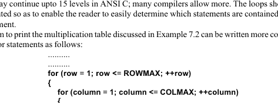

在 ANSI C 中，嵌套最多可达到 15 层；许多编译器允许更多层。循环应正确缩进，以便读者能轻松确定每个 for 语句中包含哪些语句。

示例 7.2 中讨论的打印乘法表的程序，可以使用嵌套 for 语句写得更简洁，如下所示：

```
for (row = 1; row <= ROWMAX; ++row)
{
    for (column = 1; column <= COLMAX; ++column)
    {
        y = row * column;
        printf("%4d", y);
    }
    printf("\n");
}
```

外层循环控制行，而内层循环控制列。

## 示例 7.4

一个班有 n 名学生参加 m 门科目的年度考试。图 7.5 给出了一个程序，用于读取每名学生在各科目中获得的分数，并计算和打印每名学生获得的总分。

```
Program
/ ************************************************************/
/ * ILLUSTRATION ON NESTED LOOPS */
/ ************************************************************/
#define FIRST  360
#define SECOND 240
main()
{
 int n, m, i, j;
 roll-number, marks, total;
 printf("Enter number of students and subjects\n");
 scanf("%d %d", &n, &m);
 printf("\n");
 for (i = 1; i <= n; ++i)
 {
 printf("Enter roll-number: ");
 scanf("%d", &roll-number);
 total = 0 ;
 printf("Enter marks of %d subjects for ROLL NO %d\n",m,roll-number);
 for (j = 1; j <= m; j++)
 {
 scanf("%d", &marks);
 total = total + marks;
 }
 printf("TOTAL MARKS = %d", total);
 if (total >= FIRST)
 printf("(First Division) \n\n");
 else if (total >= SECOND)
 printf("(Second Division) \n\n");
 else
 printf("*** F A I L *** \n\n");
 }
}
```

输出
Enter number of students and subjects
3 6
Enter roll-number : 8701
Enter marks of 6 subjects for ROLL NO 8701
81 75 83 45 61 59
TOTAL MARKS = 404 ( First Division )
Enter roll-number : 8702
Enter marks of 6 subjects for ROLL NO 8702
51 49 55 47 65 41
TOTAL MARKS = 308 ( Second Division )
Enter roll-number : 8704
Enter marks of 6 subjects for ROLL NO 8704
40 19 31 47 39 25
TOTAL MARKS = 201 ( *** F A I L ***)

图 7.5 嵌套 for 循环的示例

### 7.5 循环中的跳转

该程序使用两个 for 循环，一个用于控制学生人数，另一个用于控制科目数。由于学生人数和科目数都由程序请求，因此该程序可用于任意规模的班级和任意数量的科目。

外层循环包括三个部分：(1) 依次读取学生的学号；(2) 内层循环，在其中读取并累加每名学生的分数；(3) 打印总分并公布等级。

循环会反复执行一组操作，直到控制变量不再满足测试条件。循环重复的次数是预先确定的，并编写测试条件来实现这一点。有时，在执行循环时，可能希望跳过循环的一部分，或者在某个条件出现时立即离开循环。例如，考虑在一个包含比如 100 个名字的列表中搜索某个特定名字的情况。为读取并测试名字 100 次而编写的程序循环，必须在找到所需名字时立即终止。C 允许在循环内从一条语句跳转到另一条语句，也允许跳出循环。

### 跳出循环

可以使用 break 语句或 goto 语句实现提前退出循环。我们已经看到 break 在 switch 语句中的使用，以及 goto 在 if … else 结构中的使用。这些语句也可以在 while、do 或 for 循环中使用。图 7.6 和图 7.7 对它们进行了说明。

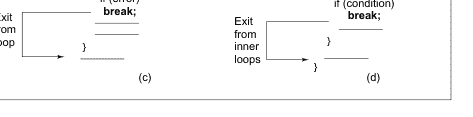

图 7.6 使用 break 语句退出循环

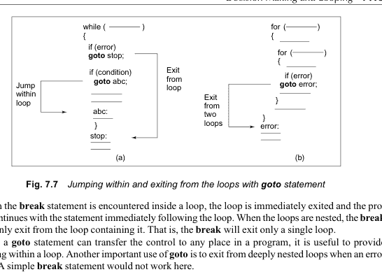

图 7.7 使用 goto 语句在循环内跳转并退出循环

当在循环内部遇到 break 语句时，会立即退出该循环，程序继续执行紧跟在循环之后的语句。当循环嵌套时，break 只会退出包含它的那个循环。也就是说，break 只会退出单个循环。

由于 goto 语句可以将控制转移到程序中的任何位置，因此它有助于在循环内提供分支。goto 的另一个重要用途是在发生错误时从深度嵌套的循环中退出。简单的 break 语句在这里无法起作用。

## 示例 7.5

图 7.8 中的程序说明了 break 语句在 C 程序中的使用。

该程序读取一组正值并计算它们的平均值。for 循环被编写为读取 1000 个值。然而，如果我们希望程序计算任意一组少于 1000 个值的平均值，那么必须在列表中最后一个值之后输入一个负数，以标记输入的结束。

每个值在被读取时都会进行测试，以判断它是否为正数。如果为正数，则将该值加到总和中；否则，循环终止。退出时，计算已读取值的平均值并打印结果。

```
Program
/* *************************************************************** */
/* USE OF break IN A PROGRAM */
/* *************************************************************** */
main()
{
 int m;
 float x, sum, average;
 printf("This program computes the average of a
 set of numbers\n");
 printf("Enter values one after another\n");
 printf("Enter a NEGATIVE number at the end.\n\n");
 sum = 0;
 for (m = 1; m <= 1000; ++m)
 {
 scanf("%f", &x);
 if (x < 0)
 break;
 sum += x;
 }
 average = sum/(float)(m-1);
 printf("\n");
 printf("Number of values = %d\n", m-1);
 printf("Sum = %f\n", sum);
 printf("Average = %f\n", average);
}
```

输出
This program computes the average of a set of numbers
Enter values one after another
Enter a NEGATIVE number at the end.
21 23 24 22 26 22 -1
Number of values = 6
Sum = 138.000000
Average = 23.000000

This program computes the average of a set of numbers
Enter values one after another
Enter a NEGATIVE number at the end.

21 23 24 22 26 22 -1
Number of values = 6
Sum = 138.000000
Average = 23.000000

图 7.8 在程序中使用 break

## 示例 7.6

图 7.9 给出了一个程序，用于在 -1 < x < 1 时计算级数 1/(1-x) = 1 + x + x^2 + x^3 + ..... + x^n，以达到 0.01% 的精度。goto 语句用于在达到所需精度时退出循环。

我们使用 for 语句来重复累加级数中的每一项。由于这是一个无穷级数，当项 x^n 达到所需精度时，函数的计算就会终止。决定循环操作次数的 n 值未知，因此我们任意取了一个值 100，这可能会也可能不会达到所需的精度水平。

```
/*
************** EXAMPLE OF EXIT WITH goto STATEMENT **************/
#define LOOP 100
#define ACCURACY 0.0001
main()
{
int n, term, sum;
printf("Input value of x: ");
scanf("%f", &x);
sum = 0;
for(term = 1, n = 1; n <= LOOP; ++n)
{
term *= x;
if(term <= ACCURACY)
goto EXIT;
sum += term;
}
term *= x;
/* EXIT FROM THE LOOP */
}
```


```
printf("\nFINAL VALUE OF N IS NOT SUFFICIENT\n");
printf("TO ACHIEVE DESIRED ACCURACY\n");
goto end;
output:
printf("\nEXIT FROM LOOP\n");
printf("Sum = %f; No. of terms = %d\n", sum, n);
end:
;
}
```
输出
输入 x 值 : 21
退出循环
和 = 1.265800; 项数 = 7
输入 x 值 : 75
退出循环
和 = 3.999774; 项数 = 34
输入 x 值 : 99
N 的最终值不足
以达到期望的精度

## 图 7.9 使用 goto 从循环退出

精度测试使用 if 语句进行，goto 语句在精度条件满足后立即退出循环。如果循环重复次数不足以产生期望的精度，程序将打印相应的消息。

请注意，在这里 break 语句并不太方便使用。正常退出和 break 退出都会将控制转移到循环后出现的同一条语句。但是，在当前问题中，正常退出会打印消息 "FINAL VALUE OF N IS NOT SUFFICIENT TO ACHIEVE DESIRED ACCURACY"，而强制退出会打印求值结果。注意末尾使用了空语句。这是必要的，因为程序不应以标签结尾。

## 跳过循环的一部分——continue 语句

在循环操作期间，在某些条件下可能需要跳过循环体的一部分。例如，在处理某些工作的申请时，我们可能希望排除属于某一类别的申请人的数据处理。在读取申请人的类别代码时，会进行测试以查看其申请是否应被考虑。如果不予考虑，则跳过处理申请详细信息的程序循环部分，并继续执行下一个循环操作。

与 break 语句类似，C 支持另一种类似的语句，称为 continue 语句。然而，与会导致循环终止的 break 不同，continue 正如其名称所示，会在跳过中间的任何语句后继续下一次迭代。continue 语句告诉编译器，“SKIP THE FOLLOWING STATEMENTS AND CONTINUE WITH THE NEXT ITERATION”。continue 语句的格式很简单

## continue;

在循环中使用 **continue** 语句的示例见图 7.10。在 **while** 和 **do** 循环中，**continue** 会使控制直接转到 *test-condition*，然后继续迭代过程。在 **for** 循环的情况下，*increment* 部分将在 *test-condition* 评估之前执行。

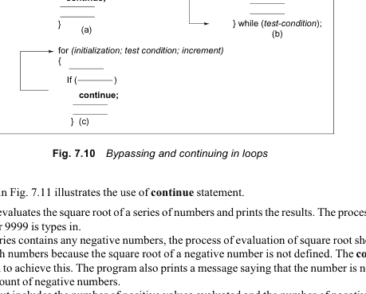

图 7.10 在循环中绕过并继续

## 示例 7.7

图 7.11 中的程序说明了 **continue** 语句的使用。

该程序计算一系列数字的平方根并打印结果。当输入数字 9999 时，过程停止。

如果序列中包含负数，则应绕过此类数字的平方根求值过程，因为负数的平方根未定义。**continue** 语句用于实现这一点。程序还打印一条消息，说明该数字为负数，并对负数进行计数。

最终输出包括已求值的正数值数量和遇到的负项数量。

```
Program
/***************************************************************/
/*              USE OF continue STATEMENT                     */
/***************************************************************/

#include <math.h>
main()
{
    int count, negative;
    double number, sqroot;
    printf("Enter 9999 to STOP\n");
    count = 0;
    negative = 0;
    while (count <= 100)
{
    printf("Enter a number : ");
    scanf("%lf", &number);
    if (number == 9999)
        break;    /* EXIT FROM THE LOOP */
    if (number <0)
    {
        printf("number is negative\n\n");
        negative++;
        continue;    /* SKIP REST OF THE LOOP */
    }
    sqroot = sqrt(number);
    printf("\nNumber    = %lf\nSquare root = %lf\n", number, sqroot);
    count++;
}
printf("Number of items done    = %d\n", count);
printf("\nNegative items          = %d\n", negative);
printf("END OF DATA\n");
```
输出
输入 9999 停止
输入一个数字 : 25.0
数字        = 25.000000
平方根   = 5.000000
输入一个数字 : 40.5
数字        = 40.500000
平方根   = 6.363961
输入一个数字 : -9
数字为负数
输入一个数字 : 16
数字        = 16.000000
平方根   = 4.000000
输入一个数字 : -14.75
数字为负数
输入一个数字 : 80
数字        = 80.000000
平方根   = 8.944272
输入一个数字 : 9999
已处理的项目数    = 4
负项          = 2
数据结束

图 7.11 continue 语句的使用

## 避免使用 goto

如前所述，避免使用 goto 是一个良好的实践。有很多原因。当使用 goto 时，许多编译器会生成效率较低的代码。此外，使用过多会使程序逻辑复杂化并使程序难以阅读。通过仔细的程序设计可以避免使用 goto。如果绝对需要使用任何 goto，则应进行文档记录。以下 goto 跳转会导致问题，因此必须避免：

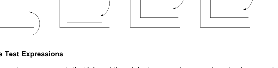

## 简洁的测试表达式

我们经常在 if、for、while 和 do 语句中使用测试表达式，这些表达式会被求值并与零进行比较以做出分支决策。由于每个整数表达式都有真/假值，因此我们无需显式与零进行比较。例如，表达式 x 在 x 不为零时为真，在 x 为零时为假。应用 ! 运算符，我们可以在不使用任何关系运算符的情况下编写简洁的测试表达式。

```
if (expression == 0)
```

等价于

```
if (! expression)
```

同样，

```
if (expression != 0)
```

等价于

```
if (expression)
```

## 示例

If (m%5 == 0 && n%5 == 0) 与 if (!(m%5) && !(n%5)) 相同

### 7.6 结构化编程

结构化编程是对程序设计和开发的一种方法。它是使程序的逻辑易于理解的学科，仅使用三种基本控制结构：

- Sequence (straight line) structure
- Selection (branching) structure
- Repetition (looping) structure

虽然序列和循环结构足以满足编程的所有要求，但在某些情况下选择结构更方便。

## 决策与循环

使用结构化编程技术有助于确保设计良好的程序，与非结构化程序相比，更易于编写、阅读、调试和维护。结构化编程不鼓励使用 goto、break 和 continue 等跳转语句实现无条件分支。在其最纯粹的形式中，结构化编程与“goto-less 编程”同义。不要使用 goto 语句！

### 案例研究

## 1. 二项式系数表

问题：二项式系数用于二项分布和多组件冗余系统可靠性的研究。它由 B(m, x) = (m choose x) = m! / (x! (m-x)!) 给出，m >= x

需要一个二项式系数表来确定任意 m 和 x 的二项式系数。

问题分析：二项式系数可以递归计算如下：B(m, x) = B(m, x - 1) * [(m - x + 1) / x] ，x = 1, 2, 3, ..., m

此外，B(m, 0) = 1 B(0, x) = 1

也就是说，当 x 为零或 m 为零时，二项式系数为一。图 7.12 中的程序打印 m = 10 的二项式系数表。程序采用一个 do 循环和一个 while 循环。

```
#include <stdio.h>
/* EVALUATION OF BINOMIAL COEFFICIENTS */
#define MAX 10
{
int m, x, binom;
printf("m x\n");
for (m=0; m<=10; ++m)
printf("%4d", m);
printf("\n");
m=0;
do {
printf("%4d ", m);
x=0; binom=1;
while (x <= m) {
printf("%4d", binom);
binom = binom * (m - x +1) / x;
x++;
}
printf("\n");
m++;
} while (m <=10);
}
```


```
while (x <= m)
{
    if(m == 0 && x == 0)
    printf("%4d", binom);
    else
    {
        binom = binom * (m - x + 1)/x;
        printf("%4d", binom);
    }
    x = x + 1;
}
printf("\n");
m = m + 1;
}
while (m <= MAX);
printf("---------------------------------------------------------------\n");
}
```

输出

mx 0 1 2 3 4 5 6 7 8 9 10
0 1
1 1 1
2 1 2 1
3 1 3 3 1
4 1 4 6 4 1
5 1 5 10 10 5 1
6 1 6 15 20 15 6 1
7 1 7 21 35 35 21 7 1
8 1 8 28 56 70 56 28 8 1
9 1 9 36 84 126 126 84 36 9 1
10 1 10 45 120 210 252 210 120 45 10 1

图 7.12 打印二项式系数表的程序

## 2. 直方图

问题：在某组织中，为了某些福利，员工按基本工资分组。工资范围和每组员工人数如下：

| 组 | 工资范围 | 员工人数 |
|---|---|---|
| 1 | 750 – 1500 | 12 |
| 2 | 1501 – 3000 | 23 |
| 3 | 3001 – 4500 | 35 |
| 4 | 4501 – 6000 | 20 |
| 5 | 6000以上 | 11 |

绘制一张直方图以突出显示各组规模。

问题分析：已知各组规模，需要绘制代表各组规模的条形。每个条形上需标明组号和规模。

图 7.13 中的程序读取属于各组的员工人数并绘制直方图。

该程序使用了四个 for 循环和两个 if … else 语句。

```c
#define N 5
main()
{
int value[N];
int i, j, n, x;
for(n=0; n < N; ++n)
{
printf("Enter employees in Group – %d : ",n+1);
scanf("%d",&x);
value[n] = x;
printf("%d\n", value[n]);
}
printf("\n");
printf("\n");
for(n = 0; n < N; ++n)
{
for(i = 1; i <= 3; i++)
{
if (i == 2)
printf("Group-%d | ",n+1);
else
printf(" | ");
for (j = 1; j <= value[n]; ++j)
printf("*");
printf("\n");
if (i == 2)
printf("%d\n", value[n]);
else
printf("\n");
}
}
printf("\n");
}
```
```

```
Enter employees in Group-1 : 12
12
Enter employees in Group-2 : 23
23
Enter employees in Group-3 : 35
35
Enter employees in Group-4 : 20
20
Enter employees in Group-5 : 11
11
Group 1 | ************(12)
Group 2 | ***********************(23)
Group 3 | ***********************************(35)
Group 4 | ********************(20)
Group 5 | ***********(11)
```

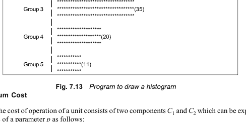

图 7.13 绘制直方图的程序

## 3. 最小成本

问题：一台设备的运行成本由两个分量 C₁ 和 C₂ 组成，它们可表示为参数 p 的函数，如下所示：
C₁ = 30 − 8p
C₂ = 10 + p²

参数 p 从 0 到 10 变化。以 ± 0.1 的精度确定使运行成本最小时的 p 值。

问题分析：

总成本 = C₁ + C₂ = 40 − 8p + p²

当 p = 0 时成本为 40，p = 1 时为 33，p = 10 时为 60。因此成本先下降后上升。图 7.14 中的程序以 p 的连续间隔（步长为 0.1）计算成本，并在成本开始上升时停止。该程序使用 break 和 continue 语句退出循环。

```
/* *************************************************************** */
/* PROGRAM OF MINIMUM COST */
/* *************************************************************** */
main()
{
    float p, cost, p1, cost1;
    for (p = 0; p <= 10; p = p + 0.1)
    {
        cost = 40 - 8 * p + p * p;
        if(p == 0)
        {
            cost1 = cost;
            continue;
        }
        if(cost >= cost1)
            break;
        cost1 = cost;
        p1 = p;
    }
```
```
}
p = (p + p1)/2.0;
cost = 40 - 8 * p + p * p;
printf("\nMINIMUM COST = %.2f AT p = %.1f\n", cost, p);
}
```
输出
MINIMUM COST = 24.00 AT p = 4.0

图 7.14 最小成本问题的程序

## 4. 绘制两个函数

问题：我们有两个如下类型的函数：

y1 = exp (- a x)
y2 = exp (-a x²/2)

绘制这些函数在 x 从 0 到 5.0 变化时的图形。

问题分析：初始时，当 x = 0 时，y1 = y2 = 1，图形从同一点开始。两条曲线在 x = 2.0 处再次相等并相交。程序应具有适当的分支语句，在以下三种条件下打印图形点：

- 1. y1 > y2
- 2. y1 < y2
- 3. y1 = y2

函数 y1 和 y2 按如下方式归一化并转换为整数：

y1 = 50 exp (- a x) + 0.5
y2 = 50 exp (- a x²/2) + 0.5

图 7.15 中的程序同时绘制这两个函数。（0 表示 y1，* 表示 y2，# 表示公共点）。

```
Program
/***************************************************************/
/*              PLOTTING OF TWO FUNCTIONS                      */
/***************************************************************/
#include <math.h>
main()
{
    int i;
    float a, x, y1, y2;
    a = 0.4;
    printf("          Y ________________ >\n");
    printf("          0 ______________________________\n");
    printf("\n");
    for (x = 0; x < 5; x +=0.25)
    {  /* BEGINNING OF FOR LOOP */
       /* .................Evaluation of functions.............. */
       y1 = (int) (50 * exp(-a * x) + 0.5);
       y2 = (int) (50 * exp(-a * x * x /2) + 0.5);
```
```
/* ........Plotting when y1 = y2............... */
if (y1 == y2)
{
    if (x == 2.5)
        printf(" X ");
    else
        printf(" | ");
    for (i = 1; i <= y1 - 1; ++i)
        printf("*");
    printf("#\n");
    continue;
}
/* ........Plotting when y1 > y2............... */
if (y1 > y2)
{
    if (x == 2.5)
        printf(" X ");
    else
        printf(" | ");
    for (i = 1; i <= y2 - 1; ++i)
        printf("*");
    printf("***");
    for (i = 1; i <= (y1 - y2 - 1); ++i)
        printf("-");
    printf("0\n");
    continue;
}
/* ........Plotting when y2 > y1............... */
if (x == 2.5)
    printf(" X ");
else
    printf(" | ");
for (i = 1; i <= (y1 - 1); ++i)
    printf("*");
printf("0");
for (i = 1; i <= (y2 - y1 - 1); ++i)
    printf("-");
printf("\n");
}/* ........END OF FOR LOOP................ */
printf("|\n");
```

输出

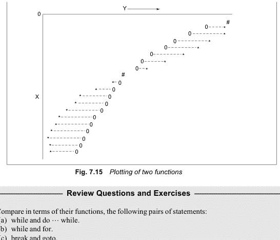

图 7.15 两个函数的绘制

### 复习题与练习

7.1 从功能上比较以下各组语句：

- (a) while 和 do ... while。
- (b) while 和 for。
- (c) break 和 goto。
- (d) break 和 continue。
- (e) continue 和 goto。

7.2 分析下列各程序段，确定每个循环体执行多少次。

```
(a) x = 5;
    y = 50;
    while (x <= y)
    {
        x = y/x;
        ______
        ______
    }
```

```
(b) m = 1;
    do
    {
        ______
        ______
    }
```

7.3 找出下列各循环段中的错误（如果有）。假设所有变量均已声明并赋值。

```
m = m+2;
}
while (m < 10);
(c)
int i;
for (i = 0; i <= 5; i = i+2/3)
{
______
______
______
}
(d) int m = 10;
int n = 7;
while (m % n >= 0)
{
______
m = m + 1;
n = n + 2;
______
}
```

```
(a) while (count !=10;
{
count = 1;
sum = sum + x;
count = count + 1;
}
```

```
(b) name = 0;
do { name = name + 1;
printf("My name is John\n");}
while (name = 1)
```

```
(c) do:
total = total + value;
scanf("%f", &value);
while(value != 999);
```

```
(d) for (x = 1, x > 10; x = x + 1)
{
______
______
______
}
```

```
(e) m = 1
n = 0
for (m + n < 19; ++n);
printf("Hello\n");
m = m+10
```

```
(f) for (p = 10; p > 0;) p = p - 1; printf("%6f", p);
```

7.4 什么是空语句？解释它的用途。

7.5 给定一个数字，编写一个使用 while 循环的程序来反转该数字的各位数字。例如，数字 12345 应写为 54321（提示：使用取模运算符提取最后一位数字，使用整数除以 10 从 n 位数字得到 n - 1 位数字。）

7.6 整数 m 的阶乘是从 1 到 m 的连续整数的乘积。即，m 的阶乘 = m! = m × (m - 1) × ...... × 1。编写一个程序，计算并打印任意给定 m 的阶乘表。

7.7 编写一个程序，计算给定整数的各位数字之和。

7.8 数字 1 1 2 3 5 8 13 21 …… 称为斐波那契数。编写一个使用 do...while 循环的程序，计算并打印前 n 个斐波那契数。（提示：数列中前两个数之后，每个数都是前两个数之和。）

7.9 使用 for 语句重写示例 7.1 的程序。

7.10 编写一个程序来计算以下投资方程 V = P (1 + r)^n，并打印表格，给出 P、r 和 n 的以下各种组合所对应的 V 值。P：1000, 2000, 3000, ......., 10,000 r：0.10, 0.11, 0.12, ......., 0.20 n：1, 2, 3, ....., 10 （提示：P 是本金，V 是 n 年末资金的价值。该方程可以递归地写为 V = P(1 + r)，P = V。也就是说，第一年末的资金价值成为下一年的本金，依此类推。）

7.11 使用 for 循环编写程序打印以下输出。(a) 1 2 2 3 3 3 4 4 4 4 5 5 5 5 5 (b) * * * * * * * * * * * * * * * (c) 1 2 2 3 3 3 4 4 4 4 5 5 5 5 5


# 第二单元

## 第8章

## 数组

### 8.1 引言

数组是一组共享同一名称的相关数据项。例如，我们可以定义一个数组名`salary`来表示一组员工的工资。特定值通过在数组名后的方括号中写一个称为索引号或下标的数字来表示。例如，`salary[10]`表示第10名员工的工资。整组值称为数组，而各个值称为元素。数组可以是任何变量类型。

使用单个名称表示一组数据项，并通过指定项号来引用某个数据项的能力，使我们能够开发简洁而高效的程序。例如，可以使用以下标作为控制变量的循环来读取整个数组、执行计算并打印结果。在本章中，我们将讨论如何在C中定义和使用数组。

### 8.2 一维数组

只需使用一个下标，就可以给一组数据项指定一个变量名，这样的变量称为单下标变量或一维数组。在数学中，我们经常处理单下标变量。例如，我们使用方程

A = Σ_{i=1}^{n} x_i / n

来计算x的n个值的平均值。

### 访问和存储元素

下标变量 x_i 表示 x 的第 i 个元素。在C中，单下标变量 x_i 可以表示为

```
x[1], x[2], x[3] ........x[n]
```

下标可以从数字0开始。也就是说

```
x[0]
```

是允许的。例如，如果我们想用数组变量`number`表示一组五个数，比如(35, 40, 20, 57, 19)，那么可以如下声明变量`number`：

```
int number[5];
```

计算机保留五个存储位置，如下所示：

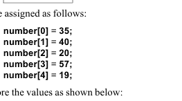

数组元素的值可以如下赋值：

```
number[0] = 35;
number[1] = 40;
number[2] = 20;
number[3] = 57;
number[4] = 19;
```

这会使数组`number`存储如下所示的值：

| 数组元素 | 值 |
| --- | --- |
| number[0] | 35 |
| number[1] | 40 |
| number[2] | 20 |
| number[3] | 57 |
| number[4] | 19 |

这些元素可以像任何其他C变量一样在程序中使用。例如，以下语句是合法的：

```
a = number[0] + 10;
number[4] = number[0] + number[2];
number[2] = x[5] + y[0];
value[6] = number[i] * 3;
```

数组的下标可以是整型常量、像i这样的整型变量，或产生整数的表达式。C不进行边界检查，因此应当小心确保数组索引在声明的范围内。

### 数组的声明

像任何其他变量一样，数组必须在使用前声明。数组声明的一般形式是

```
type variable-name[size];
```

类型指定数组中包含的元素的类型，例如`int`、`float`或`char`，而大小表示数组中可存储的最大元素数。例如，

```
float height[50];
```

声明`height`为一个包含50个实型元素的数组。0到49的任何下标都是有效的。类似地，

```
int group[10];
```

声明`group`为一个最多包含10个整型常量的数组。请记住，对数组的任何超出声明范围的引用不一定会导致错误。相反，它可能导致不可预测的程序结果。

C语言将字符串简单地视为字符数组。字符串中的大小表示该字符串最多可容纳的字符数。例如，

```
char name[10];
```

声明`name`为一个字符数组（字符串）变量，最多可容纳10个字符。假设我们将以下字符串常量读入字符串变量`name`。

"WELL DONE"

字符串的每个字符都被视为数组`name`的一个元素，并按如下方式存储在内存中：

| 存储的字符 |
| --- |
| 'W' |
| 'E' |
| 'L' |
| 'L' |
| ' ' |
| 'D' |
| 'O' |
| 'N' |
| 'E' |
| '\0' |

当编译器看到字符串时，会用额外的空字符终止它。因此，元素`name[9]`在末尾保存空字符`'\0'`。声明字符数组时，我们必须始终为终止空字符多留一个元素空间。

### 例8.1

编写一个使用单下标变量的程序来计算以下表达式：

Total = Σᵢ₌₁¹⁰ xᵢ²

x₁、x₂、……的值从终端读取。

图8.1中的程序使用一维数组x读取这些值并计算其平方和。

```
Program
/***************************************************************/
/*              PROGRAM SHOWING ONE-DIMENSIONAL ARRAY          */
/**************************************************************/
main()
{
    int i;
    float x[10], value, total;
    /* .................... READING VALUES INTO ARRAY .................... */
    printf("ENTER 10 REAL NUMBERS\n");
    for(i = 0; i < 10; i++)
    {
        scanf("%f", &value);
        x[i] = value;
    }
    /* .................... COMPUTATION OF TOTAL .................... */
    total = 0.0;
    for(i = 0; i < 10; i++)
        total = total + x[i] * x[i];
    /* .................... PRINTING OF x[i] VALUES AND TOTAL .......... */
    printf("\n");
    for(i = 0; i < 10; i++)
        printf("x[%2d] = %5.2f\n",i+1, x[i]);
    printf("\nTotal = %.2f\n", total);
}
Output
ENTER 10 REAL NUMBERS
1.1 2.2 3.3 4.4 5.5 6.6 7.7 8.8 9.9 10.10
x[1]  = 1.10
x[2]  = 2.20
x[3]  = 3.30
x[4]  = 4.40
x[5]  = 5.50
x[6]  = 6.60
x[7]  = 7.70
x[8]  = 8.80
x[9]  = 9.90
x[10] = 10.10
Total = 446.86
```

图8.1 说明一维数组的程序

### 数组的初始化

我们可以在声明数组时像普通变量一样初始化数组元素。数组初始化的一般形式是：

```
static type array-name[size] = { list of values };
```

列表中的值用逗号分隔。例如，语句

```
static int number[3] = { 0,0,0 };
```

将声明变量`number`为一个大小为3的数组，并为每个元素赋零。如果列表中的值数量少于元素数量，那么只初始化相应数量的元素。其余元素将自动设置为零。例如，

```
static float total[5] = {0.0,15.75, -10};
```

将把前三个元素初始化为0.0、15.75和-10.0，其余两个元素初始化为零。

注意，我们在类型声明前使用了单词`static`。这会将变量声明为静态变量。关于静态变量和其他变量存储类别的更多内容将在第10章讨论。

注意：在旧版本（K & R标准）中，自动数组不能初始化。只有外部数组和静态数组可以初始化。然而，ANSI标准允许初始化具有自动存储类别的数组。也就是说，使用ANSI编译器时，关键字`static`可以省略。由于ANSI编译器接受两种版本，我们在程序中使用存储类别`static`，以便它们既能在K & R编译器下运行，也能在ANSI编译器下运行。

大小可以省略。在这种情况下，编译器会为所有已初始化的元素分配足够的空间。例如，语句

```
static int counter[] = {1,1,1,1};
```

将声明`counter`数组包含四个元素，初始值均为1。只要我们初始化数组中的每个元素，这种方法就很好用。

字符数组可以用类似的方式初始化。因此，语句

```
static char name[] = {'J','o','h','n'};
```

声明`name`为一个包含四个字符的数组，并用字符串"John"初始化。

C中数组的初始化有两个缺点。

- 1. 没有便捷的方法只初始化选定的元素。
- 2. 没有像FORTRAN中那样可用于初始化大量数组元素的快捷方法。

考虑一个大小为100的数组。所有100个元素都必须显式初始化。无法指定重复次数。在这种情况下，最好使用for循环来初始化元素。考虑以下C程序片段：

```
for (i = 0; i < 100; i = i+1)
{
if (i < 50)
    sum[i] = 0.0;
else
```

7.12 编写一个程序，读取100个人的年龄，并统计年龄在50到60岁之间的人数。使用`for`和`continue`语句。

7.13 使用`else ... if`结构而不是`continue`语句重写案例研究7.4（绘制两条曲线）的程序。

7.14 编写一个程序，打印函数

y = exp (−x)

当x从0.0到10.0以0.10为步长变化时的函数值表。该表应如下所示：

**Y = EXP(−X) 表**

| x | 0.1 | 0.2 | 0.3 | ............ | 0.9 |
|---|---|---|---|---|---|
| 0.0 |  |  |  |  |  |
| 1.0 |  |  |  |  |  |
| 2.0 |  |  |  |  |  |
| 3.0 |  |  |  |  |  |
| . |  |  |  |  |  |
| 9.0 |  |  |  |  |  |

7.15 编写一个程序，读取一个正整数，确定并打印其二进制等价值。（提示：一个整数的二进制表示的各个位可以通过反复将数字及相继的商除以2，并在每次除法后保存余数（余数为0或1）来生成。）


## 8.8 C 程序设计与数据结构

```
sum[i] = 1.0;
}
```

前 50 个数组元素 sum 初始化为零，而剩余的 50 个元素初始化为 1.0。

### 示例 8.2

下面给出的是某班 50 名学生在年度考试中取得的成绩列表。

```
43 65 51 27 79 11 56 61 82 09
25 36 07 49 55 63 74 81 49 37
40 49 16 75 87 91 33 24 58 78
65 56 76 67 45 54 36 63 12 21
73 49 51 19 39 49 68 93 85 59
```

编写一个程序来统计属于以下各分数段的学生人数：0-9, 10-19, 20-29, ......, 100。

图 8.2 中编写的程序使用包含 11 个元素的数组 group，每个元素对应一个分数范围。每个元素统计落在其所代表范围内的值。

对于任意一个值，我们可以通过除以 10 来确定正确的组元素。例如，考虑值 59。59 除以 10 的整数除法结果为 5。这就是 59 被计入的元素。

请注意，在进行整数除法之前，小数部分会被四舍五入到最接近的整数。

### 8.3 二维数组

到目前为止，我们已经讨论了可以存储值列表的数组变量。会有需要存储值表的情况。考虑以下数据表，显示了四名售货员销售三种商品的销售额：

| | 商品1 | 商品2 | 商品3 |
|---|---|---|---|
| 售货员 #1 | 310 | 275 | 365 |
| 售货员 #2 | 210 | 190 | 325 |
| 售货员 #3 | 405 | 235 | 240 |
| 售货员 #4 | 260 | 300 | 380 |

该表共包含 12 个值，每行三个。我们可以将此表视为一个由四行三列组成的矩阵。每一行代表特定售货员的销售额，每一列代表特定商品的销售额。

程序

```
/* ************************************************************* */
/* PROGRAM FOR FREQUENCY COUNTING */
/* ************************************************************* */
#define MAXVAL 50
#define COUNTER 11
main()
{
    float    value[MAXVAL];
    int      i,low,high;
    static int group[COUNTER] = {0,0,0,0,0,0,0,0,0,0,0};

    /*...................READING AND COUNTING.....................*/
    for(i=0; i < MAXVAL; i++)
    {
        /*... READING OF VALUES ...*/
        scanf("%f", &value[i]);
        /*... COUNTING FREQUENCY OF GROUPS ...*/
        ++ group[(int) (value[i] + 0.5) / 10];
    }

    /*...................PRINTING OF FREQUENCY TABLE.................*/
    printf("\n");
    printf("GROUP  RANGE   FREQUENCY\n\n");
    for(i = 0; i < COUNTER ; i++ )
    {
        low = i * 10 ;
        if(i == 10)
            high = 100;
        else
            high = low + 9 ;
        printf("%2d   %3d to %3d    %3d\n", i+1, low, high, group[i]);
    }
}
```

输出

```
43 65 51 27 79 11 56 61 82 09
25 36 07 49 55 63 74 81 49 37
40 49 16 75 87 91 33 24 58 78
65 56 76 67 45 54 36 63 12 21
73 49 51 19 39 49 68 93 85 59
(input data)
```

| 组 | 范围 | 频数 |
|---|---|---|
| 1 | 0 to 9 | 2 |
| 2 | 10 to 19 | 4 |
| 3 | 20 to 29 | 4 |
| 4 | 30 to 39 | 5 |
| 5 | 40 to 49 | 8 |
| 6 | 50 to 59 | 6 |
| 7 | 60 to 69 | 7 |
| 8 | 70 to 79 | 6 |
| 9 | 80 to 89 | 4 |
| 10 | 90 to 99 | 2 |
| 11 | 100 to 100 | 0 |

图 8.2 频数统计程序

在数学中，我们使用两个下标如 v_ij 来表示矩阵中的特定值。这里 v 表示整个矩阵，v_ij 指第 i 行第 j 列的值。例如，在上表中 v_23 指值 325。

C 允许我们使用二维数组来定义此类项目表。上面讨论的表可以在 C 中定义为

```
v[4][3]
```

二维数组的声明如下：

```
type array_name[row_size][column_size];
```

请注意，与大多数其他语言不同，这些语言使用一对带逗号的括号来分隔数组大小，C 将每个大小放在自己的括号集中。

二维数组在内存中的存储方式如 图 8.3 所示。与一维数组一样，数组的每个维度从零索引到其最大尺寸减一；第一个索引选择行，第二个索引选择该行内的列。

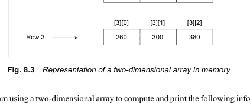

图 8.3 内存中二维数组的表示

### 示例 8.3

使用二维数组编写一个程序，从上面讨论的数据表中计算并打印以下信息：

- (a) 每位女孩的销售额总额。
- (b) 每种商品的销售额总额。
- (c) 所有女孩所有商品的销售额总计。

程序及其输出如 图 8.4 所示。程序使用二维变量 value，其中索引 i 表示女孩，j 表示商品。计算结果使用的方程如下：

(a) 第 m 位女孩的销售额总额 = Σ_{j=0}^{2} value[m][j] (girl_total[m])

(b) 第 n 种商品的销售额总额 = Σ_{i=0}^{3} value[i][n] (item_total[n])

(c) 总销售额 = Σ_{i=0}^{3} Σ_{j=0}^{2} value[i][j]

= Σ_{i=0}^{3} girl_total[i]

= Σ_{j=0}^{2} item_total[j]

程序

```
/**********************************************************************/
/* PROGRAM SHOWING TWO-DIMENSIONAL ARRAYS */
/**********************************************************************/
#define MAXGIRLS 4
#define MAXITEMS 3
main()
{
 int value[MAXGIRLS][MAXITEMS];
 int girl_total[MAXGIRLS], item_total[MAXITEMS];
 int i, j, grand_total;
/*...................READING OF VALUES AND COMPUTING girl_total.................*/ 
printf("Input data\n");
printf("Enter values, one at a time, row-wise\n\n");
for(i = 0; i < MAXGIRLS ; i++)
{
 girl_total[i] = 0;
 for(j = 0; j < MAXITEMS ; j++)
 {
 scanf("%d", &value[i][j]);
 girl_total[i] = girl_total[i] + value[i][j];
 }
}
/*...................COMPUTING item_total.....................................*/
for(j = 0; j < MAXITEMS ; j++)
{
 item_total[j] = 0;
 for(i = 0; i < MAXGIRLS ; i++)
 item_total[j] = item_total[j] + value[i][j];
}
/*...................COMPUTING grand_total....................................*/
grand_total = 0;
for(i = 0; i < MAXGIRLS ; i++)
 grand_total = grand_total + girl_total[i];
/*...................PRINTING OF RESULTS.....................................*/
printf("\n GIRLS TOTALS\n\n");
for(i = 0; i < MAXGIRLS ; i++)
 printf("Salesgirl%d = %d\n", i+1, girl_total[i]);
printf("\n ITEM TOTALS\n");
for(j = 0; j < MAXITEMS ; j++)
 printf("Item%d = %d\n", j+1, item_total[j]);

printf("\nGrand Total = %d\n", grand_total);
}
```

输出

输入数据

按行逐个输入值

|   |   |   |
|---|---|---|
| 310 | 275 | 365 |
| 210 | 190 | 325 |
| 405 | 235 | 240 |
| 260 | 300 | 380 |

```
GIRLS TOTALS
Salesgirl1 = 950
Salesgirl2 = 725
Salesgirl3 = 880
Salesgirl4 = 940

ITEM TOTALS
Item1 = 1185
Item2 = 1000
Item3 = 1310
Grand Total = 3495
```

图 8.4 二维数组的说明

### 示例 8.4

编写一个程序计算并打印 1 到 5 的乘法表，如下所示：

|   | 1 | 2 | 3 | 4 | 5 |
|---|---|---|---|---|---|
| 1 | 1 | 2 | 3 | 4 | 5 |
| 2 | 2 | 4 | 6 | 8 | 10 |
| 3 | 3 | 6 | 9 | 12 | 15 |
| 4 | 4 | 8 | 12 | 16 | 20 |
| 5 | 5 | 10 | 15 | 20 | 25 |

图 8.5 所示的程序使用二维数组存储表值。每个值都使用嵌套 for 循环的控制变量按如下方式计算：

```
product[i][j] = row * column
```

其中 i 表示乘法表的行，j 表示列。由于索引 i 和 j 的范围为 0 到 4，我们引入了以下转换：

```
row = i+1
column = j+1
```

程序

```
/***************************************************************/
/* PROGRAM TO PRINT MULTIPLICATION TABLE */
/***************************************************************/
#define ROWS 5
#define COLUMNS 5
main()
{
    int row, column, product[ROWS][COLUMNS];
    int i, j;
    printf(" MULTIPLICATION TABLE\n\n");
    printf(" ");
    for( i = 1; i <= COLUMNS ; i++ )
        printf("%4d",i);
    printf("\n");
    printf("_________________________\n");
    for( i = 0; i < ROWS ; i++ )
    {
        row = i + 1;
```

### 8.4 二维数组的初始化

与一维数组一样，二维数组也可以通过在其声明后跟随用大括号括起来的初始值列表来初始化。例如，

```
static int table[2][3] = {0,0,0,1,1,1};
```

初始化第一行的元素为零，第二行的元素为一。初始化按行进行。上述语句可以等价地写成

```
static int table[2][3] = {{0,0,0},{1,1,1}};
```

通过用大括号括起每一行的元素。

我们也可以以矩阵的形式初始化二维数组，如下所示：

```
static int table[2][3] = {
    {0,0,0},
    {1,1,1}
};
```

请注意上述语句的语法。除了最后一行外，每次关闭一行的括号后都需要逗号。

如果初始化器中缺少值，则它们会自动设置为零。例如，语句

```
printf("%2d", row);
for(j = 1; j <= COLUMNS ;j++)
{
    column = j;
    product[i][j] = row * column;
    printf("%4d", product[i][j]);
}
printf("\n");
}
```

### 输出：乘法表

|   | 1 | 2 | 3 | 4 | 5 |
|---|---|---|---|---|---|
| 1 | 1 | 2 | 3 | 4 | 5 |
| 2 | 2 | 4 | 6 | 8 | 10 |
| 3 | 3 | 6 | 9 | 12 | 15 |
| 4 | 4 | 8 | 12 | 16 | 20 |
| 5 | 5 | 10 | 15 | 20 | 25 |

图 8.5 使用二维数组打印乘法表的程序

```
static int table[2][3] = {
    {1,1},
    {2}
};
```

将第一行的前两个元素初始化为 1，第二行的第一个元素初始化为 2，其余所有元素初始化为 0。

当所有元素都要初始化为零时，可以使用以下简便方法。

```
static int m[3][5] = { {0}, {0}, {0} };
```

每一行的第一个元素被显式初始化为零，而其他元素则自动初始化为零。

### 例 8.5

为了解四款汽车（Ambassador、Fiat、Dolphin 和 Maruti）的受欢迎程度，在四座城市（Bombay、Calcutta、Delhi 和 Madras）进行了一项调查。每位受访者都被要求给出其所在城市以及所使用的汽车类型。结果以编码形式列表如下：

```
M 1 C 2 B 1 D 3 M 2 B 4
C 1 D 3 M 4 B 2 D 1 C 3
D 4 D 4 M 1 M 1 B 3 B 3
C 1 C 1 C 2 M 4 M 2 C 2
D 1 C 2 B 3 M 1 B 1 C 2
D 3 M 4 C 1 D 2 M 3 B 4
```

编码表示以下信息：

| 城市代码 | 城市 | 汽车代码 | 汽车 |
|---|---|---|---|
| M | 马德拉斯 | 1 | 大使牌 |
| D | 德里 | 2 | 菲亚特 |
| C | 加尔各答 | 3 | 海豚 |
| B | 孟买 | 4 | 马鲁蒂 |

编写一个程序，生成一张表，显示四座城市中各种汽车的受欢迎程度。

二维数组 frequency 用作累加器，用于存储每个城市各类别中使用的汽车数量。例如，元素 frequency[i][j] 表示城市 i 中使用的 j 类型汽车的数量。frequency 被声明为大小为 5 × 5 的数组，所有元素都初始化为零。

图 8.6 所示的程序从终端逐组读取城市代码和汽车代码。当读取到字母 X 代替城市代码时，制表结束。

### 8.5 多维数组

C 允许使用三维或更多维的数组。确切上限由编译器决定。多维数组的一般形式是

```
type array_name[s1][s2][s3]....[sm];
```

其中 si 是第 i 维的大小。一些示例：

```
int survey[3][5][12];
float table[5][4][5][3];
```

survey 是一个三维数组，声明为包含 180 个整型元素。类似地，table 是一个四维数组，包含 300 个浮点型元素。

数组 survey 可以表示五座城市中过去三年从一月到十二月的降雨调查数据。

### 程序

8.16 C 编程与数据结构

```
/***************************************************************/
/* PROGRAM TO TABULATE SURVEY DATA */
/***************************************************************/
main()
{
    int i, j, car;
    static int frequency[5][5] = { {0}, {0}, {0}, {0}, {0} };
    char city;
    printf("For each person, enter the city code\n");
    printf("followed by the car code.\n");
    printf("Enter the letter X to indicate end.\n");
    /* ...........................................TABULATION BEGINS................................ */
    for(i=1; i<100 ;i++)
    {
        scanf("%c",&city);
        if(city == 'X')
            break;
        scanf("%d",&car);
        switch(city)
        {
        case 'B' : frequency[1][car]++;
            break;
        case 'C' : frequency[2][car]++;
            break;
        case 'D' : frequency[3][car]++;
            break;
        case 'M' : frequency[4][car]++;
            break;
        }
    }
    /* .................... TABULATION COMPLETED AND PRINTING BEGINS ... */
    printf("\n\n");
    printf(" POPULARITY TABLE\n\n");
    printf(" City Ambassador Fiat Dolphin Maruti\n");
    printf("---------------------------------------\n");
    for(i = 1 ; i <= 4; i++)
    {
        switch(i)
        {
        case 1: printf("Bombay ");
            break;
        case 2: printf("Calcutta ");
            break;
        case 3: printf("Delhi ");
            break;
        case 4: printf("Madras ");
            break;
        }
        for(j = 1 ; j <= 4; j++ )
            printf("%7d", frequency[i][j]);
        printf("\n");
    }
    /* .................... PRINTING ENDS ........................ */
}
```

### 输出

对每个人，输入城市代码，随后输入汽车代码。

输入字母 X 表示结束。

| 城市 | 大使牌 | 菲亚特 | 海豚 | 马鲁蒂 |
|---|---|---|---|---|
| 孟买 | 2 | 1 | 3 | 2 |
| 加尔各答 | 4 | 1 | 1 | 0 |
| 德里 | 2 | 1 | 3 | 2 |
| 马德拉斯 | 4 | 1 | 1 | 4 |

图 8.6 将调查数据制表的程序

如果第一个下标表示年份，第二个下标表示城市，第三个下标表示月份，那么元素 survey[1][2][9] 表示城市 3 在第二年十月份的降雨量。请记住，三维数组可以表示为一系列二维数组，如下所示：

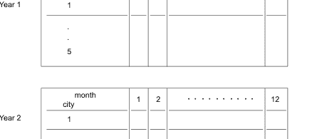

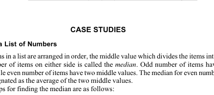

### 案例研究

### 1. 一组数字的中位数

当列表中的所有项按顺序排列时，将各项分成两边项数相等的中间值称为中位数。奇数个项只有一个中间值，而偶数个项有两个中间值。因此，偶数个项的中位数被指定为两个中间值的平均值。

求中位数的主要步骤如下：

- 1. 将各项读入数组，同时记录项数。
- 2. 按递增顺序对各项排序。
- 3. 计算中位数。

程序和示例输出如图 8.7 所示。所使用的排序算法如下：

- 1. 比较列表中的前两个元素，例如 a[1] 和 a[2]。如果 a[2] 小于 a[1]，则交换它们的值。
- 2. 比较 a[2] 和 a[3]；如果 a[3] 小于 a[2]，则交换它们。
- 3. 继续此过程，直到比较并交换最后两个元素。
- 4. 重复上述步骤 n-1 次。

在反复遍历数组的过程中，最小的元素会“冒泡”到顶部。由于这种冒泡效应，该算法称为冒泡排序。下面用四个项说明冒泡效果。

8.18 C 编程与数据结构

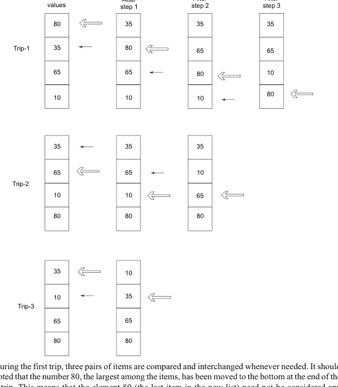

在第一趟中，比较三对项，并在需要时交换。应注意，最大项 80 在第一趟结束时已移到最底部。这意味着元素 80（新列表中的最后一项）无需再考虑。因此，第 2 趟只需比较两对。这一次，第二大的值 65 已下移到列表中。注意，每一趟都会使最小值 10 上升一级。

每进行一趟，一趟所需的步骤数就减少一。当某一趟只包含一步时，整个过程就结束了。如果列表包含 n 个元素，则涉及的比较次数为 n(n-1)/2。

### 程序

```
/* ****************************************************************** */
/* PROGRAM TO SORT A LIST AND FIND ITS MEDIAN */
/* ****************************************************************** */
#define N 10
main()
{
    int i,j,n;
    float median, a[N], t;
    printf("Enter the number of items\n");
    scanf("%d", &n);
    /* Reading items into array */
    printf("Input %d values\n",n);
    for (i = 1; i <= n; i++)
        scanf("%f", &a[i]);
    /* Sorting begins */
    for (i = 1; i <= n-1; i++)
    { /* Trip i begins */
        for (j = 1; j <= n- i; j++)
        {
            if (a[j] <= a[j+1])
            { /* Interchanging values */
                t = a[j];
                a[j] = a[j+1];
                a[j+1] = t;
            }
            else
                continue;
        }
    } /* sorting ends */
    /* calculation of median */
    if (n % 2 == 0)
        median = (a[n/2] + a[n/2 + 1])/2.0;
    else
        median = a[n/2 + 1];
    /* Printing */
    for (i = 1; i <= n; i++)
        printf("%f", a[i]);
    printf("\nMedian is %f\n", median);
}
```

### 输出

```
Enter the number of items
5
Input 5 values
1.111 2.222 3.333 4.444 5.555
5.555000 4.444000 3.333000 2.222000 1.111000
Median is 3.333000
Enter the number of items
6
Input 6 values
3 5 8 9 4 6
9.000000 8.000000 6.000000 5.000000 4.000000 3.000000
Median is 5.500000
```


## 2. 标准差的计算

在统计学中，标准差用于衡量数据相对于其均值的离散程度。计算 n 个项的标准差的公式为

$s = \sqrt{\text{方差}}$

其中 $\text{方差} = \frac{1}{n} \sum_{i=1}^{n} (x_i - m)^2$

并且 $m = \text{均值} = \frac{1}{n} \sum_{i=1}^{n} x_i$

计算标准差的算法如下：

- 1. 读取 n 个项。
- 2. 计算这些项的总和与均值。
- 3. 计算方差。
- 4. 计算标准差。

带有示例输出的完整程序如图 8.8 所示。

```c
/* --------------------------------------------------------------- */
/* PROGRAM TO CALCULATE STANDARD DEVIATION */
/* --------------------------------------------------------------- */
#include <math.h>
#define MAXSIZE 100
main()
{
    int i,n;
    float value[MAXSIZE], deviation,
          sum,sumsqr,mean,variance,stddeviation;
    sum = sumsqr = n = 0;
    printf("Input values: input -1 to end\n");
    for (i = 1; i <= MAXSIZE; i++)
    {
        scanf("%f", &value[i]);
        if (value[i] == -1)
            break;
        sum += value[i];
        n += 1;
    }
    mean = sum/(float)n;
    for (i = 1 ; i <= n; i++)
    {
        deviation = value[i] - mean;
        sumsqr += deviation * deviation;
    }
    variance = sumsqr/(float)n;
    stddeviation = sqrt(variance);

    printf("\nNumber of items : %d\n",n);
    printf("Mean : %f\n", mean);
    printf("Standard deviation : %f\n", stddeviation);
}
```

### 输出

```text
Input values: input -1 to end
65 9 27 78 12 20 33 49 -1
Number of items : 8
Mean : 36.625000
Standard deviation : 23.510303
```

### 图 8.8 计算标准差的程序

## 3. 评估一次测验

一份包含 25 道多项选择题的测验被用于一批 3 名学生。正确答案和学生的回答如下表所示：

| 题号 | 1 | 2 | 3 | 4 | 5 | 6 | 7 | 8 | 9 | 10 | 11 | 12 | 13 | 14 | 15 | 16 | 17 | 18 | 19 | 20 | 21 | 22 | 23 | 24 | 25 |
|---|---|---|---|---|---|---|---|---|---|---|---|---|---|---|---|---|---|---|---|---|---|---|---|---|---|
| 正确答案 |  |  |  |  |  |  |  |  |  |  |  |  |  |  |  |  |  |  |  |  |  |  |  |  |  |
| 学生 1 |  |  |  |  |  |  |  |  |  |  |  |  |  |  |  |  |  |  |  |  |  |  |  |  |  |
| 学生 2 |  |  |  |  |  |  |  |  |  |  |  |  |  |  |  |  |  |  |  |  |  |  |  |  |  |
| 学生 3 |  |  |  |  |  |  |  |  |  |  |  |  |  |  |  |  |  |  |  |  |  |  |  |  |  |

评估学生答案的算法如下：

- 1. 将正确答案读入一个数组。
- 2. 读取一名学生的回答并统计正确答案的数量。
- 3. 对每位学生重复步骤 2。
- 4. 打印结果。

实现该算法的程序如图 8.9 所示。该程序使用了以下数组：

- key[i] — 存储题目的正确答案
- response[i] — 存储学生的回答
- correct[i] — 用于标记回答正确的题目。

```c
/*
******************************* */
/*      PROGRAM TO EVALUATE A MULTIPLE-CHOICE TEST      */
/*
******************************* */

#define STUDENT 3
#define ITEMS 25
main()
{
    char key[ITEMS+1], response[ITEMS+1];
    int count, i, student,n,
        correct[ITEMS+1];

    /* Reading of Correct answers */
    printf("Input key to the items\n");
    for(i=0; i < ITEMS; i++)
    {
        scanf("%c", &key[i]);
    }
    /* Evaluation begins */
    for(student = 1; student <= STUDENT; student++)
    {
        /*Reading student responses and counting correct ones*/
        count = 0;
        printf("\n");
        printf("Input responses of student--%d\n", student);
        for(i=0; i < ITEMS ; i++)
        {
            scanf("%c", &response[i]);
        }
        for (i = 0; i < ITEMS; i++)
            correct[i] = 0;
        for(i=0; i < ITEMS; i++)
        {
            if(response[i] == key[i])
            {
                count = count + 1;
                correct[i] = 1;
            }
        }
        /* printing of results */
        printf("\n");
        printf("Student--%d\n", student);
        printf("Score is %d out of %d\n", count, ITEMS);
        printf("Response to the items below are wrong\n");
        n = 0;
        for(i=0; i < ITEMS ; i++)
        {
            if(correct[i] == 0)
            {
                printf("%d", i+1);
                n = n +1;
            }
        }
        if(n == 0)
        {
            printf("NIL\n");
        }
        printf("\n");
    } /* Go to next student */
    /* Evaluation and print ends */
}
```

### 输出

```text
Input key to the items
abcdabcdabcdabcdabcdabcda
Input responses of student-1
abcdabcdabcdabcdabcdabcda
Student-1
Score is 25 out of 25
Response to the following items are wrong
NIL
Input responses of student-2
abcdcbaabcdabcd... 
Student-2
Score is 14 out of 25
Response to the following items are wrong
5 6 7 8 17 18 19 21 22 23 25
Input responses of student-3
aaaaaaaaaaaaaaaaaaaaaaaaaa
Student-3
Score is 7 out of 25
Response to the following items are wrong
2 3 4 6 7 8 10 11 12 14 15 16 18 19 20 22 23 24
```

### 图 8.9 评估多项选择测验回答的程序

## 4. 生产与销售分析

一家公司生产五种类别的产品，并且在一个月内每周按产品记录生产与销售的数量。公司每月月底审查其生产计划。审查可能需要以下一项或多项信息：

- (a) 每周生产和销售的价值。
- (b) 所有已生产产品的总价值。
- (c) 所有已售出产品的总价值。
- (d) 每种已生产和已售出产品的总价值。

让我们分别用两个二维数组 M 和 S 表示已生产和已售出的产品。那么，

M =

|  | M11 | M12 | M13 | M14 | M15 |
|---|---|---|---|---|---|
|  | M21 | M22 | M23 | M24 | M25 |
|  | M31 | M32 | M33 | M34 | M35 |
|  | M41 | M42 | M43 | M44 | M45 |

S =

|  | S11 | S12 | S13 | S14 | S15 |
|---|---|---|---|---|---|
|  | S21 | S22 | S23 | S24 | S25 |
|  | S31 | S32 | S33 | S34 | S35 |
|  | S41 | S42 | S43 | S44 | S45 |

其中 Mij 表示第 i 周生产的第 j 类产品的数量，Sij 表示第 i 周售出的第 j 类产品的数量。我们还可以用一维数组 C 表示每种产品的成本，如下所示：

C =

| C1 | C2 | C3 | C4 | C5 |
|---|---|---|---|---|

其中 Cj 是第 j 类产品的成本。

我们将用两个价值数组（即 Mvalue 和 Svalue）表示已生产和已售出产品的价值。那么，

Mvalue[i][j] = Mij x Cj

Svalue[i][j] = Sij x Cj

用于生成审查会议所需输出的程序如图 8.10 所示。还使用了以下附加变量：

Mweek[i] = 第 i 周生产的所有产品的价值。
= Σ j=1 到 5 Mvalue[i][j]

Sweek[i] = 第 i 周售出的所有产品的价值
= Σ j=1 到 5 Svalue[i][j]

Mproduct[j] = 该月生产的第 j 类产品的价值
= Σ i=1 到 4 Mvalue[i][j]

Sproduct[j] = 该月售出的第 j 类产品的价值
= Σ i=1 到 4 Svalue[i][j]

Mtotal = 该月生产的所有产品的总价值
= Σ i=1 到 4 Mweek[i] = Σ j=1 到 5 Mproduct[j]

Stotal = 该月售出的所有产品的总价值
= Σ i=1 到 4 Sweek[i] = Σ j=1 到 5 Sproduct[j]

```c
/***************************************************************/
/*     PRODUCTION AND SALES ANALYSIS     */
/***************************************************************/
main()
{
    int M[5][6], S[5][6], C[6],
        Mvalue[5][6], Svalue[5][6],
        Mweek[5], Sweek[5],
        Mproduct[6], Sproduct[6],
        Mtotal, Stotal, i,j,number;

    /* Input data */
    printf("Enter products manufactured week_wise\n");
    printf(" M11,M12 .... M21, M22, etc\n");
    for(i=1;i<=4; i++)
    {
        for(j=1;j<=5; j++)
        {
            scanf("%d",&M[i][j]);
        }
    }
    printf("Enter products sold week_wise\n");
    printf(" S11, S12, .... S21, S22, ....etc\n");
    for(i=1;i<=4; i++)
    {
        for(j=1;j<=5; j++)
        {
            scanf("%d",&S[i][j]);
        }
    }
    printf("Enter cost of each product\n");
    for(i=1;i<=5; i++)
    {
        scanf("%d",&C[i]);
    }
    /* Value matrices of production and sales */
    for(i=1;i<=4; i++)
    {
        for(j=1;j<=5; j++)
        {
            Mvalue[i][j] = M[i][j] * C[j];
            Svalue[i][j] = S[i][j] * C[j];
        }
    }
    /* Total value of weekly production and sales */
    for(i=1;i<=4; i++)
    {
        Mweek[i] = 0;
        Sweek[i] = 0;
        for(j=1;j<=5; j++)
        {
            Mweek[i] += Mvalue[i][j];
            Sweek[i] += Svalue[i][j];
        }
    }
    /* Monthly value of product_wise production and sales */
    for(j=1;j<=5; j++)
    {
        Mproduct[j] = 0;
        Sproduct[j] = 0;
        for(i=1;i<=4; i++)
        {
            Mproduct[j] += Mvalue[i][j];
            Sproduct[j] += Svalue[i][j];
        }
    }
    /* Grand total of production and sales values */
    Mtotal = Stotal = 0;
    for(i=1;i<=4; i++)
    {
        Mtotal += Mweek[i];
```


```c
Stotal += Sweek[i];
}
/***************************************************************************
Selection and printing of information required
***************************************************************************/
printf("\n\n");
printf(" Following is the list of things you can\n");
printf(" request for Enter appropriate item number\n");
printf(" and press RETURN Key\n\n");
printf(" 1. Value matrices of production & sales\n");
printf(" 2. Total value of weekly production & sales\n");
printf(" 3. Product_wise monthly value of production &\n");
printf(" sales\n");
printf(" 4. Grand total value of production & sales\n");
printf(" 5. Exit\n");

number = 0;
while(1)
{
    /* Beginning of while loop */
    printf("\n\n ENTER YOUR CHOICE:");
    scanf("%d",&number);
    printf("\n");
    if(number == 5)
    {
        printf("G O O D B Y E\n");
        break;
    }
    switch(number)
    {
        /* Beginning of switch */
        /* VALUE MATRICES */
        case 1:
            printf("VALUE MATRIX OF PRODUCTION\n\n");
            for(i=1;i<=4;i++)
            {
                printf("Week%d",i);
                for(j=1;j<=5;j++)
                    printf("%7d",Mvalue[i][j]);
                printf("\n");
            }
            printf("\nVALUE MATRIX OF SALES\n\n");
            for(i=1;i<=4;i++)
            {
                printf("Week%d",i);
                for(j=1;j<=5;j++)
                    printf("%7d",Svalue[i][j]);
                printf("\n");
            }
            break;
        /* WEEKLY ANALYSIS */
        case 2:
            printf(" TOTAL WEEKLY PRODUCTION & SALES\n\n");
            printf(" PRODUCTION SALES\n");
            printf(" ____________________ _____ \n");
            for(i=1; i<=4; i++)
            {
                printf("Week(%d)\t",i);
                printf("%7d%7d\n", Mweek[i], Sweek[i]);
            }
            break;
        /* PRODUCTWISE ANALYSIS */
        case 3:
            printf(" PRODUCT_WISE TOTAL PRODUCTION &");
            printf(" SALES\n\n");
            printf(" ____________________ _____\n");
            for(i=1; i<=5; i++)
            {
                printf(" Product(%d)\t",i);
                printf("%7d%7d\n",Mproduct[i],Sproduct[i]);
            }
            break;
        /* GRAND TOTALS */
        case 4:
            printf(" GRAND TOTAL OF PRODUCTION & SALES\n");
            printf("\n Total production = %d\n", Mtotal);
            printf(" Total sales      = %d\n", Stotal);
            break;
        /* DEFAULT */
        default :
            printf(" Wrong choice, select again\n\n");
            break;
    } /* End of switch */
} /* End of while loop */
printf("\n Exit from the program\n\n");
}  /* End of main */
```

### 输出

```text
Enter products manufactured week_wise
M11,M12,_____,M21,M22,_____ etc
11 15 12 14 13
13 14 15 12
12 16 10 15 14
14 11 15 13 12

Enter products sold week_wise
S11,S12,_____,S21,S22,_____ etc
10 13 9 12 11
12 10 12 14 10
11 14 10 14 12
12 10 13 11 10

Enter cost of each product
10 20 30 15 25
```

下面是可以请求的项目列表。请输入相应的项目编号并按回车键

- 1. 生产和销售的价值矩阵
- 2. 每周生产和销售的总价值
- 3. 按产品统计的每月生产和销售额
- 4. 生产和销售的总计价值
- 5. 退出

请输入选择：1

**生产价值矩阵**

| 周次 | 产品1 | 产品2 | 产品3 | 产品4 | 产品5 |
|---|---|---|---|---|---|
| 第1周 | 110 | 300 | 360 | 210 | 325 |
| 第2周 | 130 | 260 | 420 | 225 | 300 |
| 第3周 | 120 | 320 | 300 | 225 | 350 |
| 第4周 | 140 | 220 | 450 | 185 | 300 |

**销售价值矩阵**

| 周次 | 产品1 | 产品2 | 产品3 | 产品4 | 产品5 |
|---|---|---|---|---|---|
| 第1周 | 100 | 260 | 270 | 180 | 275 |
| 第2周 | 120 | 200 | 360 | 210 | 250 |
| 第3周 | 110 | 280 | 300 | 210 | 300 |
| 第4周 | 120 | 200 | 390 | 165 | 250 |

请输入选择：2

**每周生产与销售总额**

| 周次 | 生产额 | 销售额 |
|---|---|---|
| 第1周 | 1305 | 1085 |
| 第2周 | 1335 | 1140 |
| 第3周 | 1315 | 1200 |
| 第4周 | 1305 | 1125 |

请输入选择：3

**按产品统计的生产与销售总额**

| 产品 | 生产额 | 销售额 |
|---|---|---|
| 产品1 | 500 | 450 |
| 产品2 | 1100 | 940 |
| 产品3 | 1530 | 1320 |
| 产品4 | 855 | 765 |
| 产品5 | 1275 | 1075 |

请输入选择：4

**生产与销售总计**

生产总额 = 5260

销售总额 = 4550

请输入选择：5

再 见

程序退出

**图 8.10** 生产与销售分析程序

### 复习题与练习

- 8.1 解释数组变量的必要性。
- 8.2 找出以下数组声明语句中可能存在的错误。
  - (a) `int score (100);`
  - (b) `float values[10,15];`
  - (c) `float average[ROW],[COLUMN];`
  - (d) `char name[15];`
  - (e) `int sum[];`
- 8.3 找出以下初始化语句中可能存在的错误。
  - (a) `static int number[] = {0,0,0,0,0};`
  - (b) `static float item[3][2] = {0,1,2,3,4,5};`
  - (c) `static char word[] = {'A','R','A','Y','Y'};`
  - (d) `static int m[2,4] = {{0,0,0,0},{1,1,1,1}};`
  - (e) `static float result[10] = 0;`
- 8.4 假设数组 A 和 B 声明如下：

```c
int A[5][4];
float B[4];
```

找出以下程序段中的错误（如果有）。

  - (a)
    ```c
    for (i=1; i<=5; i++)
        for(j=1; j<=4; j++)
            A[i][j]=0;
    ```
  - (b)
    ```c
    for (i=1; i<4; i++)
        scanf("%f", B[i]);
    ```
  - (c)
    ```c
    for (i=0; i<=4; i++)
        B[i] = B[i]+i;
    ```
  - (d)
    ```c
    for (i=4; i>=0; i--)
        for (j=0; j < 4; j++)
            A[i][j] = B[j] + 1.0;
    ```

- 8.5 编写一个程序段，按如下方式初始化数组 A：

|   |   |   |   |   |   |   |
|---|---|---|---|---|---|---|
| 1 | 0 | 0 | 0 | 0 | ... | 0 |
| 0 | 1 | 0 | 0 | 0 | ... | 0 |
| 0 | 0 | 1 | 0 | 0 | ... | 0 |
| ... | ... | ... | ... | ... | ... | ... |
| 0 | 0 | 0 | 0 | 0 | ... | 1 |

所有对角元素都初始化为 1，其余元素初始化为 0。

- 8.6 编写一个程序，对一组点 (x_i, y_i)，i = 1, ..., n 拟合一条直线。直线方程为

y = m x + c

其中 m 和 c 的值由下式给出：

m = [ n Σ(x_i y_i) - (Σ x_i)(Σ y_i) ] / [ n (Σ x_i²) - (Σ x_i)² ]

c = (1/n) (Σ y_i - m Σ x_i)

所有求和均从 1 到 n。

- 8.7 1月份10个城市的每日最高气温（全部31天）记录如下表：

| 日 | 城市1 | 城市2 | 城市3 | ... | 城市10 |
|---|---|---|---|---|---|
| 1 | ... | ... | ... | ... | ... |
| 2 | ... | ... | ... | ... | ... |
| 3 | ... | ... | ... | ... | ... |
| ... | ... | ... | ... | ... | ... |
| 31 | ... | ... | ... | ... | ... |

编写一个程序，将表中的元素读入二维数组 temperature，并找出与 (a) 最高气温和 (b) 最低气温对应的城市和日期。

- 8.8 一次选举有 5 名候选人。候选人编号为 1 到 5，投票时在选票上标记候选人编号。编写一个程序，读取选票并使用数组变量 count 统计每位候选人的得票数。如果读取的数字超出 1 到 5 的范围，该选票应视为“废票”，程序还应统计废票的数量。
- 8.9 下面这组数字广为人知，称为杨辉三角。


如果用 i 表示行、用 j 表示列，则三角形中除边界元素外的任一元素由下式给出：

P_{ij} = P_{i-1, j-1} + P_{i-1, j}

编写一个程序，计算 10 行杨辉三角的元素并打印结果。

- 8.10 100 名学生的年度考试成绩如下表：

| 学号 | 科目1 | 科目2 | 科目3 |
|---|---|---|---|

编写一个程序读取数据并确定以下内容：

  - (a) 每名学生获得的总成绩。
  - (b) 每个科目的最高分以及获得该分数的学生学号。
  - (c) 获得总成绩最高的学生。

- 8.11 给定两个一维数组 A 和 B，它们都按升序排序。编写一个程序，将它们合并为一个按升序排列的单个有序数组 C，其中包含数组 A 和 B 中的每一项。
- 8.12 两个具有相同行数和列数的矩阵可以相乘，得到第三个矩阵。考虑以下两个矩阵。


A 和 B 的乘积是第三个矩阵 C，其大小为 n×n，其中 C 的每个元素由以下公式给出：

C_{ij} = Σ_{k=1}^{n} a_{ik} b_{kj}

编写一个程序，读取 A 和 B 中元素的值，并生成乘积矩阵 C。

## 第 9 章

## 字符串处理

### 9.1 引言

字符串是字符的数组。我们在之前的许多示例中使用过字符串。任意一组字符（双引号除外）放在双引号之间，就构成一个字符串常量。

例如：

> “人显然是为了思考而被创造出来的。”

如果要在字符串中包含双引号，可以像下面这样使用反斜杠：

> "\" Man is obviously made to think, \" said Pascal."

例如，

```c
printf("\"Well Done !\" ");
```

将输出字符串

> “干得好！”

而语句

```c
printf("Well Done !");
```

将输出字符串

干得好！

字符串通常用于构建有意义且可读性强的程序。对字符串执行的常见操作包括：

- 读写字符串。
- 组合字符串。
- 将一个字符串复制到另一个字符串。
- 比较字符串是否相等。
- 提取字符串的一部分。


本章将详细讨论这些操作，并开发涉及这些操作的程序。

### 9.2 声明和初始化字符串变量

字符串变量可以是任何有效的 C 变量名，并且总是被声明为数组。声明字符串变量的一般形式是

```
char string_name[size];
```

size 决定字符串名中的字符数。一些示例如下：

```
char city[10];
char name[30];
```

当编译器将字符串赋给字符数组时，它会自动在字符串末尾提供一个空字符（'\0'）。因此，size 应等于字符串中最大字符数加一。

字符数组可以在声明时初始化。C 允许以以下两种形式之一初始化字符数组：

```
static char city[9] = "NEW YORK";
static char city[9] = {'N','E','W',' ','Y','O','R','K','\0'};
```

city 必须长度为 9 个元素的原因是字符串 NEW YORK 包含 8 个字符，并且为空字符终止符提供了一个元素空间。请注意，当我们通过列出元素来初始化字符数组时，必须显式提供空字符终止符。

C 还允许我们在不指定元素数量的情况下初始化字符数组。在这种情况下，数组的大小将根据已初始化的元素数量自动确定。例如，语句

```
static char string [] = {'G','O','O','D','\0'};
```

将数组 string 定义为包含五个元素的数组。

请注意，使用 ANSI 编译器时可以省略 static 这个词。

### 9.3 从终端读取字符串

### 读取单词

熟悉的输入函数 scanf 可以与 %s 格式说明符一起使用，以读取一串字符。示例：

```
char address[15];
scanf("%s", address);
```

scanf 函数的问题在于，它在遇到第一个空白字符时就会终止输入。（空白字符包括空格、制表符、回车符、换页符和换行符。）因此，如果在终端中输入以下文本行，

NEW YORK

那么只有字符串 "NEW" 会被读入数组 address，因为单词 ‘NEW’ 后面的空格会终止字符串。

请注意，与之前的 scanf 调用不同，对于字符数组，变量名之前不需要与号（&）。scanf 函数会自动用空字符终止读取的字符串，因此字符数组应足够大，以容纳输入字符串加上空字符。

如果我们想读取整行 "NEW YORK"，那么可以使用两个大小合适的字符数组。即，

```
scanf("%s %s", adr1, adr2);
```

对于文本行

NEW YORK

会将字符串 "NEW" 赋给 adr1，将 "YORK" 赋给 adr2。

### 示例 9.1

编写一个程序，使用 scanf 函数从终端读取一系列单词。
图 9.1 所示的程序读取四个单词并将它们显示在屏幕上。请注意，字符串 ‘Oxford Road’ 被视为两个单词，而字符串 ‘Oxford-Road’ 被视为一个单词。

```
Program
/* ------------------------------------------------------------ */
/*   READING A SERIES OF WORDS USING scanf FUNCTION             */
/* ------------------------------------------------------------ */
main()
{
    char word1[40], word2[40], word3[40], word4[40];
    printf("Enter text :\n");
    scanf("%s %s", word1, word2);
    scanf("%s", word3);
    scanf("%s", word4);
    printf("\n");
    printf("word1 = %s\nword2 = %s\n", word1, word2);
    printf("word3 = %s\nword4 = %s\n", word3, word4);
}

Output
Enter text:
Oxford Road, London M17ED
word1 = Oxford
word2 = Road,
word3 = London
word4 = M17ED

Enter text:
Oxford-Road, London-M17ED United Kingdom
word1 = Oxford-Road,
word2 = London-M17ED
word3 = United
word4 = Kingdom
```

图 9.1 使用 scanf 读取一系列单词

### 读取一行文本

在许多文本处理应用中，我们需要从终端读取整行文本。无法使用 scanf 函数读取包含多个单词的一行。这是因为 scanf 在输入中遇到空格时就会终止读取。

我们在第 5 章讨论了如何使用 getchar() 函数从终端读取单个字符。我们可以重复使用该函数，从输入中读取连续的单个字符并将它们放入字符数组。因此，可以读取整行文本并将其存储在数组中。当输入换行符（'\n'）时读取终止，然后在字符串末尾插入空字符。

### 示例 9.2

编写一个程序，从终端读取包含一系列单词的一行文本。

图 9.2 所示的程序可以将一行文本（最多 80 个字符）读入字符串 line。每次读取一个字符时，都会将其赋给字符串 line 中的相应位置，然后检测是否为换行符。当读取到换行符（表示行结束）时，读取循环终止，换行符被替换为空字符，以表示字符串结束。

```
Program
/*
* PROGRAM TO READ A LINE OF TEXT FROM TERMINAL
*/
#include <stdio.h>
main()
{
 char line [81], character;
 int c;
 c = 0;
 printf("Enter text. Press <Return> at end\n");
 do
 {
 character = getchar();
 line[c] = character;
 c++;
 }
 while(character != '\n');
 c = c - 1;
 line[c] = '\0';
 printf("\n%s\n", line);
}
```

Output
Enter text. Press <Return> at end
Programming in C is interesting.
Programming in C is interesting.
Enter text. Press <Return> at end
National Computing Centre, United Kingdom.
National Computing Centre, United Kingdom.

图 9.2 从终端读取一行文本的程序

当循环退出时，索引 c 的值比字符串中最后一个字符位置大 1（因为在将新字符赋给字符串后它已经递增）。因此，索引值 c-1 给出了应存储空字符的位置。

C 不提供直接作用于字符串的运算符。例如，我们不能直接将一个字符串赋给另一个字符串。例如，以下赋值语句

```
string = "ABC";
string1 = string2;
```

是无效的。如果我们确实想将 string2 中的字符复制到 string1 中，可以逐个字符地进行。

### 示例 9.3

编写一个程序，将一个字符串复制到另一个字符串，并统计复制的字符数。

该程序如图 9.3 所示。我们使用 for 循环将 string2 中包含的字符复制到 string1 中。当到达空字符时循环终止。请注意，我们再次将空字符赋给 string1。

### 9.4 将字符串写入屏幕

我们已经广泛使用带 %s 格式的 printf 函数将字符串打印到屏幕。%s 格式可用于显示以空字符终止的字符数组。例如，语句

```
printf("%s", name);
```

可用于显示数组 name 的全部内容。

我们还可以指定显示数组时使用的精度。例如，说明符

```
%10.4s
```

表示前四个字符将打印在宽度为 10 列的字段中。

但是，如果我们在说明符中包含减号（例如 %-10.4s），字符串将左对齐打印。示例 9.4 说明了各种 %s 说明符的效果。

### 示例 9.4

编写一个程序，将字符串 "United Kingdom" 存储在数组 country 中，并在各种格式说明符下显示该字符串。

该程序及其输出如图 9.4 所示。输出说明了 %s 说明符的以下特性。

- 1. 当字段宽度小于字符串长度时，将打印整个字符串。


```
printf("Enter a string\n");
printf("?");
scanf("%s", string2);
for(i=0; string2[i] != '\0'; i++)
    string1[i] = string2[i];
string1[i] = '\0';
printf("\n");
printf("%s\n", string1);
printf("Number of characters = %d\n", i);
}
```

输出
Enter a string
?Manchester

Manchester
Number of characters = 10

Enter a string
?Westminster

Westminster
Number of characters = 11

图 9.3 将一个字符串复制到另一个字符串

- 2. 小数点右侧的整数值指定要打印的字符数。
- 3. 当指定要打印的字符数为零时，不打印任何内容。
- 4. 说明符中的减号会使字符串左对齐打印。

UNIX 上的 printf 支持另一个不错的功能，允许使用可变的字段宽度或精度。例如

```
printf("%*.*s\n", w, d, string);
```

在字段宽度 w 中打印字符串的前 d 个字符。

该功能在打印字符序列时很方便。示例 9.5 说明了这一点。

```
Program
/* ************************************************************ */
/* WRITING STRINGS USING %s FORMAT                              */
/* ************************************************************ */
main()
{
    static char country[15] = "United Kingdom";
    printf("\n\n");
    printf("__________________\n");
    printf(" %%1s\n", country);
    printf(" %%6s\n", country);
    printf(" %%6s\n", country);
    printf(" %%15.6s\n", country);
```


```c
printf("%15.6s \n", country);
printf("%15.0s \n", country);
printf("%.3s \n", country);
printf("%s \n", country);
printf("____________________ \n");
}
```

**输出**

```text
United Kingdom
United Kingdom   United
United
Uni
United Kingdom
```

**图 9.4** 使用 %s 格式写入字符串

### 示例 9.5

使用 for 循环编写程序打印以下输出。

```text
C
CP
CPr
CPro
....
....
CProgramming

CProgramming
....
....
CPro
CPr
CP
C
```

**程序**

```c
/* ************************************************************ */
/*               PRINTING SEQUENCES OF CHARACTERS               */
/* ************************************************************ */

main()
{
    int c, d;
    static char string[] = "CProgramming";
    printf("\n\n");
    printf("____________________ \n");
    for(c = 0; c <= 11 ; c++)
    {
        d = c + 1;
        printf("%-12.*s\n", d, string);
    }
    printf("|___________|\n");
    for(c = 11 ; c >= 0; c--)
    {
        d = c + 1;
        printf("|%-12.*s|\n", d, string);
    }
    printf("|___________|\n");
}
```

*输出*


**图 9.5** 可变字段说明的示意图

图 9.5 中程序的输出，对于可变说明 %12.*s、%.*s 和 %*.*s 显示在图 9.6 中，该图进一步说明了可变字段宽度和精度说明。


**图 9.6** 可变说明的进一步示意图

### 9.5 字符上的算术运算

C 允许我们像处理数字一样处理字符。每当字符常量或字符变量在表达式中使用时，系统会自动将其转换为整数值。整数值取决于系统的本地字符集。

要以整数形式表示字符，我们可以将其写成整数。例如，如果机器使用 ASCII 表示，则，

```c
x = 'a';
printf("%d\n", x);
```

将在屏幕上显示数字 97。

也可以对字符常量和变量执行算术运算。例如，

```c
x = 'z' - 1;
```

是一个有效的语句。在 ASCII 中，'z' 的值为 122，因此该语句将把值 121 分配给变量 x。

我们也可以在关系表达式中使用字符常量。例如，表达式

```c
ch >= 'A' && ch <= 'Z'
```

将测试变量 ch 中包含的字符是否为大写字母。

我们可以使用以下关系将字符数字转换为其等效整数值：

```c
x = character - '0';
```

其中 x 被定义为整数变量，character 包含字符数字。例如，假设 character 包含数字 '7'。那么，

x = '7' 的 ASCII 值 - '0' 的 ASCII 值  
= 55 - 48  
= 7

C 库支持一个将数字字符串转换为其整数值的函数。该函数的形式为

```c
x = atoi(string)
```

x 是整数变量，string 是包含数字字符串的字符数组。考虑以下程序段：

```c
number = "1988";
year = atoi(number);
```

number 是一个字符串变量，被赋值为字符串常量 "1988"。函数 atoi 将字符串 "1988"（包含在 number 中）转换为其数值等价物 1988 并将其分配给整数变量 year。

### 示例 9.6

编写一个程序，打印字母集 a 到 z 和 A 到 Z 的十进制和字符形式。

程序显示在图 9.7 中。在 ASCII 字符集中，十进制数字 65 到 90 表示大写字母，97 到 122 表示小写字母。值 91 到 96 使用 for 循环中的 if 语句排除。

**程序**

```c
/* ************************************************************/
/* PRINTING ALPHABET SET IN DECIMAL AND CHARACTER FORM */
/* ************************************************************/
main()
{
 char c;
 printf("\n\n");
 for(c = 65; c <= 122; c = c + 1)
 {
 if(c > 90 && c < 97)
 continue;
 printf("%5d - %c", c, c);
 }
 printf("\n");
}
```

**输出**

```text
65 - A 66 - B 67 - C 68 - D 69 - E 70 - F
71 - G 72 - H 73 - I 74 - J 75 - K 76 - L
77 - M 78 - N 79 - O 80 - P 81 - Q 82 - R
83 - S 84 - T 85 - U 86 - V 87 - W 88 - X
89 - Y 90 - Z 97 - a 98 - b 99 - c 100 - d
101 - e 102 - f 103 - g 104 - h 105 - i 106 - j
107 - k 108 - l 109 - m 110 - n 111 - o 112 - p
113 - q 114 - r 115 - s 116 - t 117 - u 118 - v
119 - w 120 - x 121 - y 122 - z
```

**图 9.7** 以十进制和字符形式打印字母集

### 9.6 合并字符串

正如我们不能直接将一个字符串赋给另一个字符串一样，我们也不能通过简单的算术加法将两个字符串连接起来。也就是说，像这样的语句

```c
string3 = string1 + string2;
string2 = string1 + "hello";
```

是无效的。string1 和 string2 中的字符应一个接一个地复制到 string3 中。数组 string3 的大小应足够大以容纳所有字符。

将两个字符串组合在一起的过程称为连接。示例 9.7 说明了三个字符串的连接。

### 示例 9.7

组织员工的姓名存储在三个数组中，即 first_name、second_name 和 last_name。编写一个程序将这三个部分连接成一个名为 name 的字符串。

程序在图 9.8 中给出。使用三个 for 循环复制三个字符串。在第一个循环中，first_name 中包含的字符被复制到变量 name 中，直到遇到空字符。空字符不被复制，而是被赋值语句 name[i] = ' '; 用空格替换；

同样，second_name 被复制到 name 中，从上述语句创建的空格之后的列开始。这是通过赋值语句 name[i+j+1] = second_name[j]; 实现的；

如果 first_name 包含 4 个字符，则此时 i 的值为 4，因此 second_name 的第一个字符将被放置在 name 的第五个单元中。请注意，我们已在第四个单元中存储了一个空格。

同样，语句 name[i+j+k+2] = last_name[k]; 用于将 last_name 中的字符复制到 name 的正确位置。

最后，我们放置一个空字符来终止连接后的字符串 name。在本例中，需要注意表达式 i+j+1 和 i+j+k+2 的使用。

**程序**

```c
/***************************************************************/
/*                     CONCATENATION OF STRINGS                */
/***************************************************************/
main()
{
    int i, j, k;
    static char first_name[10] = {"VISWANATH"};
    static char second_name[10] = {"PRATAP"};
    static char last_name[10] = {"SINGH"};
    char name[30];

    /* Copy first_name into name */
    for(i = 0; first_name[i] != '\0'; i++)
        name[i] = first_name[i];
    /* End first name with a space */
    name[i] = ' ';
    /* Copy second_name into name */
    for (j = 0; second_name[j] != '\0'; j++)
        name[i + j + 1] = second_name[j];
    /* End second name with a space */
    name[i + j + 1] = ' ';
    /* Copy last_name into name */
    for (k = 0; last_name[k] != '\0'; k++)
        name[i + j + k + 2] = last_name[k];
    /* End name with a null character */
    name[i+j+k+2] = '\0';
    printf("\n\n");
    printf("%s\n", name);
}
```

**输出**

```text
VISWANATH PRATAP SINGH
```

**图 9.8** 字符串的连接

### 9.7 比较两个字符串

再一次，C 不允许直接比较两个字符串。也就是说，像这样的语句

```c
if(name1 == name2)
if(name == "ABC")
```

是不允许的。因此有必要逐字符比较要测试的两个字符串。比较一直进行到出现不匹配或其中一个字符串以空字符终止，以先发生者为准。以下程序段说明了这一点。

```c
i=0;
while(str1[i] == str2[i] && str1[i] != '\0'
      && str2[i] != '\0')
    i = i+1;
if (str1[i] == '\0' && str2[i] == '\0')
    printf("strings are equal\n");
else
    printf("strings are not equal\n");
```


### 9.8 字符串处理函数

幸运的是，C 库支持大量字符串处理函数，可用于执行迄今为止讨论的许多字符串操作。以下是最常用的字符串处理函数。

| 函数 | 作用 |
|---|---|
| strcat() | 连接两个字符串 |
| strcmp() | 比较两个字符串 |
| strcpy() | 将一个字符串复制到另一个字符串 |
| strlen() | 查找字符串的长度 |

我们将简要讨论如何在使用字符串处理中应用这些函数。

### strcat() 函数

strcat 函数将两个字符串连接在一起。其形式如下：

```
strcat(string1, string2);
```

string1 和 string2 是字符数组。当执行 strcat 函数时，string2 会被追加到 string1。它通过移除 string1 末尾的空字符并从那里放置 string2 来实现。string2 中的字符串保持不变。例如，考虑以下三个字符串：


执行语句

```
strcat(part1, part2);
```

将得到结果：


而语句

```
strcat(part1, part3);
```

将得到结果：


我们必须确保 string1（string2 被追加到的字符串）的大小足够容纳最终的字符串。

strcat 函数也可以将字符串常量追加到字符串变量。以下写法是有效的。

```
strcat(part1, "GOOD");
```

C 允许嵌套 strcat 函数。例如，语句

```
strcat(strcat(string1,string2), string3);
```

是允许的，并且将三个字符串全部连接在一起。结果字符串存储在 string1 中。

### strcmp() 函数

strcmp 函数比较由参数指定的两个字符串，如果它们相等则返回值为 0。如果不相等，则返回字符串中第一个不匹配字符之间的数值差。其形式为：

```
strcmp(string1, string2);
```

string1 和 string2 可以是字符串变量或字符串常量。示例有：

```
strcmp(name1, name2);
strcmp(name1, "John");
strcmp("Rom", "Ram");
```

我们主要关心的是确定字符串是否相等；如果不相等，哪一个在字母顺序上靠前。不匹配的值很少重要。例如，语句

```
strcmp("their", "there");
```

将返回 -9 的值，这是 ASCII "i" 和 ASCII "r" 之间的数值差。即 ASCII 码中 "i" 减去 "r" 为 -9。如果值为负，则 string1 在字母顺序上高于 string2。

### strcpy() 函数

strcpy 函数的工作方式几乎像一个字符串赋值运算符。其形式为

```
strcpy(string1, string2);
```

并将 string2 的内容赋给 string1。string2 可以是字符数组变量或字符串常量。例如，语句

```
strcpy(city, "DELHI");
```

将把字符串 “DELHI” 赋给字符串变量 city。同样，语句

```
strcpy(city1, city2);
```

将把字符串变量 city2 的内容赋给字符串变量 city1。数组 city1 的大小应足够大以接收 city2 的内容。

### strlen() 函数

该函数计算并返回字符串中的字符数。

```
n = strlen(string);
```

其中 n 是一个整数变量，接收字符串长度的值。参数可以是字符串常量。计数在第一个空字符处结束。

### 示例 9.8

s1、s2 和 s3 是三个字符串变量。编写一个程序读取两个字符串常量到 s1 和 s2 中并比较它们是否相等。如果不相等，则将它们连接在一起。然后将 s1 的内容复制到变量 s3。最后，程序应打印三个变量的内容及其长度。

程序如 图 9.9 所示。在第一次运行中，输入字符串为 “New” 和 “York”。这些字符串由语句比较

```
x = strcmp(s1, s2);
```

由于它们不相等，它们被连接在一起并使用语句复制到 s3 中

```
strcpy(s3, s1);
```

程序输出三个字符串及其长度。在第二次运行中，两个字符串 s1 和 s2 相等，因此它们不会被连接。在这种情况下，三个字符串都包含相同的字符串常量 “London”。

### 9.9 字符串表

我们经常使用字符字符串列表，例如班级学生姓名列表、组织员工姓名列表、地点列表等。姓名列表可以视为字符串表，并且可以使用二维字符数组来存储整个列表。例如，字符数组 student[30][15] 可用于存储最多 30 个姓名列表，每个姓名长度不超过 15 个字符。

下面是一个五个城市的表：

|   | C | h | a | n | d | i | g | a | r | h |
|---|---|---|---|---|---|---|---|---|---|---|
| M | a | d | r | a | s |   |   |   |   |
| A | h | m | e | d | a | b | a | d |   |   |
| H | y | d | e | r | a | b | a | d |   |   |
| B | o | m | b | a | y |   |   |   |   |

该表可以方便地存储在字符数组 city 中，使用以下声明：

```c
static char city[][]
{
    "Chandigarh",
    "Madras",
    "Ahmedabad",
    "Hyderabad",
    "Bombay"
};
```

访问列表中第 i 个城市的名称，我们写 city[i-1]

```
Program
/*******************************************************/
/* ILLUSTRATIONS OF STRING-HANDLING FUNCTIONS */
/*******************************************************/

#include <string.h>
main()
{
    char s1[20], s2[20], s3[20];
    int x, l1, l2, l3;
    printf("\nEnter two string constants \n");
    printf("?");
    scanf("%s %s", s1, s2);
    /* comparing s1 and s2 */
    x = strcmp(s1, s2);
    if(x != 0)
    {
        printf("\n\nStrings are not equal \n");
        strcat(s1, s2); /* joining s1 and s2 */
    }
    else
        printf("\nStrings are equal \n");
    /* copying s1 to s3 */
    strcpy(s3, s1);
    /* Finding length of strings */
```

```
l1 = strlen(s1);
l2 = strlen(s2);
l3 = strlen(s3);

/* output */
printf("\ns1 = %s\tlength = %d characters\n", s1, l1)
printf("\ns2 = %s\tlength = %d characters\n", s2, l2);
printf("\ns3 = %s\tlength = %d characters\n", s3, l3);
}
Output
Enter two string constants
? New York
Strings are not equal

s1 = New York      length = 7 characters
s2 = York          length = 4 characters
s3 = New York      length = 7 characters

Enter two string constants
? London   London
Strings are equal

s1 = London        length = 6 characters
s2 = London        length = 6 characters
s3 = London        length = 6 characters
```

### 图 9.9 字符串处理函数的说明

因此 city[0] 表示 "Chandigarh"，city[1] 表示 "Madras"，以此类推。这表明一旦数组被声明为二维，就可以在进一步的操作中像一维数组一样使用。也就是说，该表可以被视为字符串的列。

### 示例 9.9

编写一个程序，按字母顺序对姓名列表进行排序。

对字符串列表按字母顺序排序的程序在图 9.10 中给出。它采用了上一章案例研究 1 中描述的冒泡排序方法。

```
Program
/*
************************************************************/
*          SORTING STRINGS IN ALPHABETICAL ORDER          */
************************************************************/
#define ITEMS   5
#define MAXCHAR 20
main()
{
    char string[ITEMS][MAXCHAR], dummy[MAXCHAR];
    int i = 0, j = 0;
    /* Reading the list */
    printf("\nEnter names of %d items \n",ITEMS);
    while (i < ITEMS)
        scanf("%s", string[i++]);
```


```c
/* Sorting begins */
for (i=1; i < ITEMS; i++) /* Outer loop begins */
{
    for (j=1; j <= ITEMS-i; j++) /*Inner loop begins*/
    {
        if (strcmp (string[j-1], string[j]) > 0)
        {
            /* Exchange of contents */
            strcpy (dummy, string[j-1]);
            strcpy (string[j-1], string[j]);
            strcpy (string[j], dummy);
        }
    } /* Inner loop ends */
} /* Outer loop ends */
/* Sorting completed */

printf ("\nAlphabetical list\n\n");
for (i=0; i < ITEMS; i++)
    printf ("%s", string[i]);
}
```

**输出**

输入 5 个项目的名称
London Manchester Delhi Paris Moscow

字母顺序列表

Delhi
London
Manchester
Moscow
Paris

**图 9.10 字符串的排序**

请注意，这里使用二维数组来存储字符串列表。每个字符串都是通过 `scanf` 函数以 `%s` 格式读入的。请记住，如果某个字符串中包含空格，那么空格之后的部分会被 `scanf` 视为列表中的另一个项。在这种情况下，我们应该使用合适的算法将整行作为一个字符串读入。

### 案例研究

### 1. 统计文本中的单词数

字符串处理的实际应用之一是统计文本中的单词数。我们假设一个单词是由除转义字符和空格之外的任意字符组成的序列，并且两个单词之间用一个空格字符分隔。统计单词的算法如下：

- 1. 读入一行文本。
- 2. 从行中的第一个字符开始，查找空格。如果找到空格，则单词数加 1。
- 3. 重复步骤 1 和 2，直到处理完最后一行。

该算法的实现如图 9.11 所示。第一个 `while` 循环会对每一行文本执行一次。文本结束的标志是在输入完整个文本后，再额外按一次回车键。额外按下的回车键会使最后一行输入一个换行符，因此最后一行只包含空字符。

程序使用以下语句检查这一特殊行：

```c
if (line[0] == '\0')
```

如果行中的第一个（也是唯一一个）字符是空字符，则终止计数。请注意空字符和空格字符之间的区别。

程序还统计读取的行数和文本中的字符总数。请记住，包含空字符串的最后一行不会被计数。

当第一个 `while` 循环退出后，程序打印计数结果。

```c
Program
/***************************************************************/
/*    COUNTING CHARACTERS, WORDS AND LINES IN A TEXT          */
/***************************************************************/

#include  <stdio.h>
main()
{
    char  line[81], ctr;
    int   i,c,
          end = 0,
          characters = 0,
          words = 0,
          lines = 0;

    printf("KEY IN THE TEXT. \n");
    printf("GIVE ONE SPACE AFTER EACH WORD.\n");
    printf("WHEN COMPLETED, PRESS RETURN.\n\n");

    while(end == 0)
    {
        /* Reading a line of text */
        c = 0;
        while((ctr=getchar()) != '\n')
        {
            line[c++] = ctr;
        }
        line[c] = '\0';
        /* counting the words in a line */
        if(line[0]=='\0')
        break;
        else
        {
            words ++;
            for(i=0; line[i] != '\0';i++)
                if(line[i] == ' ' || line[i] == '\t')
                    words ++;
            /* counting lines and characters */
            lines = lines + 1;
            characters = characters + strlen(line);
        }
        printf("\n");
        printf("Number of lines = %d\n", lines);
        printf("Number of words = %d\n", words);
        printf("Number of characters = %d\n", characters);
    }
}
```

**输出**

输入文本。
每个单词后留一个空格。
输入完成后，按回车键。
Admiration is a very short-lived passion.
Admiration involves a glorious obliquity of vision.
Always we like those who admire us but we do not like those whom we admire.
Fools admire, but men of sense approve.
行数 = 5
单词数 = 36
字符数 = 205

**图 9.11 统计文本中的字符数、单词数和行数**

### 2. 处理客户名单

重要客户的电话号码记录如下：

| 全名 | 电话号码 |
|---|---|
| Joseph Louis Lagrange | 869245 |
| Jean Robert Argand | 900823 |
| Carl Friedrich Gauss | 806788 |

现在需要准备一份经过修订的按字母顺序排列的名单，其中姓氏（last name）在前，后面跟一个逗号以及名字和中间名的首字母。例如，

Argand,J.R.:

我们创建一个字符串表，每一行代表一个人的详细信息，例如 first_name（名）、middle_name（中间名）、last_name（姓）和 telephone_number（电话号码）。根据需要互换列的顺序，并按 last_name 对列表进行排序。图 9.12 展示了实现这一功能的程序。

```c
Program
/* ************************************************************ */
/*              PROCESSING OF CUSTOMER LIST                     */
/* ************************************************************ */
#define CUSTOMERS 10
main()
{
 char first_name[20][10], second_name[20][10],
 surname[20][10], name[20][20],
 telephone[20][10], dummy[20];
 int i,j;
 printf("Input names and telephone numbers\n");
 printf("?");
 for(i=0; i < CUSTOMERS; i++)
 {
 scanf("%s %s %s %s", first_name[i],
 second_name[i], surname[i], telephone[i]);
 /* converting full name to surname with initials */
 strcpy(name[i], surname[i]);
 strcat(name[i], ". ");
 dummy[0] = first_name[i][0];
 dummy[1] = ' ';
 strcat(name[i], dummy);
 strcat(name[i], ". ");
 dummy[0] = second_name[i][0];
 dummy[1] = ' ';
 strcat(name[i], dummy);
 }
 /* Alphabetical ordering of surnames */
 for(i=1; i<= CUSTOMERS-1; i++)
 for(j=1; j<=CUSTOMERS-i; j++)
 if(strcmp (name[j-1], name[j]) > 0)
 {
 /* Swapping names */
 strcpy(dummy, name[j-1]);
 strcpy(name[j-1], name[j]);
 strcpy(name[j], dummy);
 /* Swapping telephone numbers */
 strcpy(dummy, telephone[j-1]);
 strcpy(telephone[j-1], telephone[j]);
 strcpy(telephone[j], dummy);
 }
 /* printing alphabetical list */
 printf("\nCUSTOMERS LIST IN ALPHABETICAL ORDER \n\n");
 for(i=0; i < CUSTOMERS; i++)
 printf("%-20s %-10s\n", name[i], telephone[i]);
}
```

**输出**

输入姓名和电话号码
?Gottfried Wilhelm Leibniz 711518
Joseph Louis Lagrange 869245
Jean Robert Argand 900823
Carl Friedrich Gauss 806788
Simon Denis Poisson 853240
Friedrich Wilhelm Bessel 717931
Charles Francois Sturm 222031
George Gabriel Stokes 545454
Mohandas Karamchand Gandhi 362718
Josiah Willard Gibbs 123145
按字母顺序排列的客户名单
Argand,J.R 900823
Bessel,F.W 717931
Gandhi,M.K 362718
Gauss,C.F 806788
Gibbs,J.W 123145
Lagrange,J.L 869245
Leibniz,G.W 711518
Poisson,S.D 853240
Stokes,G.G 545454
Sturm,C.F 222031

**图 9.12 按字母顺序排列客户名单的程序**

### 复习题与练习

9.1 描述使用 getchar 和 scanf 函数读取字符串时的局限性。

9.2 在 C 语言中，字符串以空字符自动结尾。请解释这一特性如何有助于字符串处理。

9.3 字符串变量可以通过三种方式赋值：

- (a) 在类型声明时：`static char string[] = {"....."};`
- (b) 使用 strcpy 函数：`strcpy(string,".....");`
- (c) 使用 scanf 函数读入字符串：`scanf("%s", string);`

对它们进行批判性比较，并描述在哪些情况下其中一种方法优于其他方法。

9.4 假设变量 string 包含值“The sky is the limit”，确定以下程序段的输出是什么。

- (a) `printf("%s", string);`
- (b) `printf("%25.10s", string);`
- (c) `printf("%s", string[0]);`
- (d) `for (i=0; string[i] != ' '; i++) printf("%c", string[i]);`
- (e) `for (i=0; string[i] != '\0'; i++) printf("%d\n", string[i]);`
- (f)

  ```c
  for (i=0; i <= strlen(string); ;) {
      string[i++] = i;
      printf("%s\n", string[i]);
  }
  ```

- (g) `printf("%c\n", string[10] + 5);`
- (h) `printf("%c\n", string[10] + 5);`

9.5 编写一个程序，从键盘读取你的名字，并输出表示你名字的 ASCII 码列表。

9.6 编写一个程序，完成以下操作：

- (a) 输出问题“谁是 C 语言的发明者？”
- (b) 接受一个答案。
- (c) 如果答案正确，则打印“很好”并停止。
- (d) 如果答案错误，则输出消息“再试一次”。
- (e) 如果答案在第三次尝试时仍然错误，则显示正确答案并停止。

9.7 编写一个程序，提取字符串的一部分并打印提取出的字符串。假设从第 n 个字符开始提取 m 个字符。

9.8 编写一个程序，读取一段文本并统计某个特定单词出现的次数。

9.9 编写一个程序，读取一个字符串并按字母顺序重新排列。例如，单词 STRING 应改写为 GINRST。

9.10 编写一个程序，将给定字符串中的某个特定单词替换为另一个单词。例如，在文本“It is good to program in PASCAL language.”中，单词“PASCAL”应替换为“C”。

9.11 一位 Maruti 汽车经销商以如下形式记录了各种车辆的销售情况：

| 车辆类型 | 销售月份 | 价格 |
|---|---|---|
| MARUTI-800 | 02/87 | 75000 |
| MARUTI-DX | 07/87 | 95000 |
| GYPSY | 04/88 | 110000 |
| MARUTI-VAN | 08/88 | 85000 |

编写一个程序，将这些数据读入一个字符串表，并输出在指定时期内销售的特定车辆的详细信息。程序应要求用户输入车辆类型和时期（起始月份、结束月份）。


## 第10章
## 用户定义函数
### 10.1 引言

前面我们已经提到，C 语言的优势之一是 C 函数易于定义和使用。到目前为止，我们讨论过的每个程序都使用了函数。然而，它们主要局限于三个函数，即 main、printf 和 scanf。在本章中，我们将详细考虑函数如何设计、两个或多个函数如何组合在一起以及它们如何相互通信。

### 10.1.1 标准库函数

C 函数可分为两类，即库函数和用户定义函数。main 是用户定义函数的一个例子。printf 和 scanf 属于库函数类别。我们还使用了其他库函数，如 sqrt、cos、strcat 等。这两类函数的主要区别在于，库函数不需要由我们编写，而用户定义函数必须由用户在编写程序时开发。然而，用户定义函数以后可以成为 C 程序库的一部分。

### ANSI C 标准库函数

C 语言附带许多执行各种任务的库函数。ANSI 委员会已经标准化了包含这些函数的头文件。下面列出常用函数及其定义所在的头文件。要获得更完整的列表，读者应参阅所使用 C 版本的手册。

本附录包含的头文件有：

| 头文件 | 描述 |
|---|---|
| `<ctype.h>` | 字符测试和转换函数 |
| `<math.h>` | 数学函数 |
| `<stdio.h>` | 标准 I/O 库函数 |
| `<stdlib.h>` | 实用函数，如字符串转换例程、内存分配例程、随机数生成器等 |
| `<string.h>` | 字符串操作函数 |
| `<time.h>` | 时间操作函数 |

注意：以下函数参数用于：
- c - 字符类型参数
- d - 双精度参数
- f - 文件参数
- i - 整数参数
- l - 长整数参数
- p - 指针参数
- s - 字符串参数
- u - 无符号整数参数

星号（*）表示指针

| 函数 | 返回数据类型 | 任务 |
|---|---|---|
| <ctype.h> |  |  |
| isalnum(c) | int | 判断参数是否为字母数字。若为真则返回非零值；否则返回0。 |
| isalpha(c) | int | 判断参数是否为字母。若为真则返回非零值；否则返回0。 |
| isascii(c) | int | 判断参数是否为 ASCII 字符。若为真则返回非零值；否则返回0。 |
| iscntrl(c) | int | 判断参数是否为 ASCII 控制字符。若为真则返回非零值；否则返回0。 |
| isdigit(c) | int | 判断参数是否为十进制数字。若为真则返回非零值；否则返回0。 |
| isgraph(c) | int | 判断参数是否为可打印图形 ASCII 字符。若为真则返回非零值；否则返回0。 |
| islower(c) | int | 判断参数是否为小写。若为真则返回非零值；否则返回0。 |
| isodigit(c) | int | 判断参数是否为八进制数字。若为真则返回非零值；否则返回0。 |
| isprint(c) | int | 判断参数是否为可打印 ASCII 字符。若为真则返回非零值；否则返回0。 |
| ispunct(c) | int | 判断参数是否为标点字符。若为真则返回非零值；否则返回0。 |
| isspace(c) | int | 判断参数是否为空白字符。若为真则返回非零值；否则返回0。 |
| isupper(c) | int | 判断参数是否为大写。若为真则返回非零值；否则返回0。 |
| isxdigit(c) | int | 判断参数是否为十六进制数字。若为真则返回非零值；否则返回0。 |
| toascii(c) | int | 将参数值转换为 ASCII。 |
| tolower(c) | int | 将字母转换为小写。 |
| toupper(c) | int | 将字母转换为大写。 |
| <math.h> |  |  |
| acos(d) | double | 返回 d 的反余弦。 |
| asin(d) | double | 返回 d 的反正弦。 |
| atan(d) | double | 返回 d 的反正切。 |
| atan2(d1,d2) | double | 返回 d1/d2 的反正切。 |
| ceil(d) | double | 返回向上舍入到下一个更高整数的值。 |
| cos(d) | double | 返回 d 的余弦。 |
| cosh(d) | double | 返回 d 的双曲余弦。 |
| exp(d) | double | 返回 e 的 d 次幂。 |
| fabs(d) | double | 返回 d 的绝对值。 |
| floor(d) | double | 返回向下舍入到下一个更低整数的值。 |
| fmod(d1,d2) | double | 返回 d1/d2 的余数（符号与 d1 相同）。 |
| labs(l) | long int | 返回 l 的绝对值。 |
| log(d) | double | 返回 d 的自然对数。 |
| log10(d) | double | 返回 d 的以10为底的对数。 |
| pow(d1,d2) | double | 返回 d1 的 d2 次幂。 |
| sin(d) | double | 返回 d 的正弦。 |
| sinh(d) | double | 返回 d 的双曲正弦。 |
| sqrt(d) | double | 返回 d 的平方根。 |
| tan(d) | double | 返回 d 的正切。 |
| tanh(d) | double | 返回 d 的双曲正切。 |
| <stdio.h> |  |  |
| fclose(f) | int | 关闭文件 f。如果文件成功关闭，返回0。 |
| feof(f) | int | 判断是否已到达文件结束条件。如果是，返回非零值；否则返回0。 |
| fgetc(f) | int | 从文件 f 读取单个字符。 |
| fgets(s, i, f) | char* | 从文件 f 读入字符串 s，包含 i 个字符。 |
| fopen(s1,s2) | file* | 打开名为 s1、类型为 s2 的文件。返回指向该文件的指针。 |
| fprintf(f,...) | int | 将数据项发送到文件 f。 |
| fputc(c,f) | int | 将单个字符发送到文件 f。 |
| fputs(s,f) | int | 将字符串 s 发送到文件 f。 |
| fread(s,i1,i2,f) | int | 从文件 f 读入 i2 个数据项（每项大小为 i1 字节）到字符串 s。 |
| fscanf(f,...) | int | 从文件 f 输入数据项。 |
| fseek(f,l,i) | int | 将文件 f 的指针从位置 i 移动 l 字节。 |
| ftell(f) | long int | 返回文件 f 内的当前指针位置。 |
| fwrite(s,i1,i2,f) | int | 将字符串 s 中的 i2 个数据项（每项大小为 i1 字节）发送到文件 f。 |
| getc(f) | int | 从文件 f 读取单个字符。 |
| getchar(void) | int | 从标准输入设备读取单个字符。 |
| gets(s) | char* | 从标准输入设备读入字符串 s。 |
| printf(...) | int | 将数据项发送到标准输出设备。 |
| putc(c,f) | int | 将单个字符发送到文件 f。 |
| putchar(c) | int | 将单个字符发送到标准输出设备。 |
| puts(s) | int | 将字符串 s 发送到标准输出设备。 |
| rewind(f) | void | 将指针移到文件 f 的开头。 |
| scanf(...) | int | 从标准输入设备读取数据项。 |
| <stdlib.h> |  |  |
| abs(i) | int | 返回 i 的绝对值。 |
| atof(s) | double | 将字符串 s 转换为双精度量。 |
| atoi(s) | int | 将字符串 s 转换为整数。 |
| atol(s) | long | 将字符串 s 转换为长整数。 |
| calloc(u1,u2) | void* | 为具有 u1 个元素、每个元素长度为 u2 字节的数组分配内存。返回指向已分配空间起始处的指针。 |
| exit(u) | void | 关闭所有文件和缓冲区，并终止程序。（u 的值由函数赋值，用于指示终止状态。） |
| free(p) | void | 释放由 p 指示起始位置的已分配内存块。 |
| malloc(u) | void* | 分配 u 字节内存。返回指向已分配空间起始处的指针。 |
| rand(void) | int | 返回一个随机正整数。 |
| realloc(p, u) | void* | 为指针变量 p 分配 u 字节的新内存。返回指向新内存空间起始处的指针。 |
| srand(u) | void | 初始化随机数生成器。 |
| system(s) | int | 将命令字符串 s 传递给操作系统。如果命令成功执行，返回0；否则返回非零值（通常为1）。 |
| <string.h> |  |  |
| strcmp(s1,s2) | int | 按字典序比较两个字符串。如果 s1 < s2，返回负值；如果 s1 和 s2 相同，返回0；如果 s1 > s2，返回正值。 |
| strcmpi(s1,s2) | int | 按字典序比较两个字符串，不区分大小写。如果 s1 < s2，返回负值；如果 s1 和 s2 相同，返回0；如果 s1 > s2，返回正值。 |
| strcpy(s1, s2) | char* | 将字符串 s2 复制到字符串 s1。 |
| strlen(s) | int | 返回字符串 s 中的字符数。 |
| strset(s, c) | char* | 将 s 内的所有字符设置为 c（不包括终止空字符\0）。 |
| <time.h> |  |  |
| difftime(t1,t2) | double | 返回时间差 t1 - t2。其中 t1 和 t2 表示超过指定基准时间经过的时间（参见 time 函数）。 |
| time(p) | long int | 返回超过指定基准时间经过的秒数。 |

### 10.2 用户定义函数的必要性

正如前面所指出的，main 是 C 中特别识别的函数。每个程序必须有一个 main 函数来指示程序从哪里开始执行。虽然可以仅利用 main 函数编写任何程序，但这会导致许多问题。程序可能变得太大且复杂，结果调试、测试和维护任务变得困难。如果将程序划分为功能部分，则每个部分可以独立编码，然后组合成单个单元。这些称为“函数”的子程序更易于理解、调试和测试。

有时某种操作或计算在程序中的许多地方重复。例如，我们可能在程序中的多个位置使用某个数的阶乘。在这种情况下


情况下，我们可以在需要的地方重复程序语句。另一种方法是设计一个函数，在需要时调用和使用它。这既节省时间又节省空间。

这种划分子程序的方法显然带来了许多优点。

- 1. 它便于实现自顶向下的模块化编程，如图 10.1 所示。在这种编程风格中，首先解决整体问题的高层逻辑，而每个较低层函数的细节则在稍后处理。
- 2. 通过在适当位置使用函数，可以缩短源程序的长度。在内存空间有限的微型计算机上，这一点尤其关键。
- 3. 如前所述，很容易定位并隔离有故障的函数，以便进一步调查。
- 4. 一个函数可以被许多其他程序使用。这意味着 C 程序员可以在他人已完成工作的基础上构建，而不是从头开始。


图 10.1 使用函数的自顶向下模块化编程

### 10.3 多函数程序

函数是执行特定任务的独立代码块。一旦函数设计并封装好，就可以把它视为一个“黑箱”，它从主程序接收一些数据并返回一个值。其内部操作细节对程序的其他部分不可见。程序对函数所知道的一切就是：输入什么，输出什么。每个 C 程序都可以用这些黑箱的集合来设计。

考虑如下所示的一组语句：

```c
println()
{
    int i;
    for (i=1; i<40; i++)
        printf("-");
    printf("\n");
}
```

上述语句集定义了一个名为 println 的函数，它可以打印一行长度为 39 个字符的内容。该函数可在程序中如下使用：

```c
main()
{
    println();
    printf("This illustrates the use of C functions \n");
    println();
}

println()
{
    int i;
    for(i=1; i<40; i++)
        printf("-");
    printf("\n");
}
```

该程序将输出以下内容：

This illustrates the use of C functions

上述程序包含两个用户定义函数：

- `main()`
- `println()`

如我们所知，程序执行总是从 main 函数开始。在 main 执行期间，遇到的第一条语句是 `println();`，这表明要执行函数 println。此时，程序控制权转移到函数 println。执行完 println 函数（它输出一行长度为 39 个字符的内容）后，控制权转回 main。现在，执行从函数调用被执行的位置继续。执行完 printf 语句后，控制权再次转移到 println 函数，以再次打印该行。

main 函数调用了用户定义的 println 函数两次，调用了库函数 printf 一次。我们可能注意到，println 函数本身反复调用了库函数 printf。

任何函数都可以调用任何其他函数。事实上，它可以调用自身。“被调用函数”也可以调用另一个函数。一个函数可以被调用不止一次。事实上，这是使用函数的主要特点之一。图 10.2 说明了多函数程序中的控制流。

除了起点之外，构成完整程序的各函数之间没有其他预先确定的关系、优先级规则或层次关系。函数可以按任意顺序放置。被调用函数可以放在调用函数之前或之后。然而，通常做法是将所有被调用函数放在末尾。

### 重要说明

在 C 语言应用的最近几年中，函数的定义和声明方式已经发生了变化。主要变化是函数参数的声明方式。目前有两种公认的参数声明方法。较旧的方法（称为“经典”方法）在函数名定义（称为函数头）之后单独声明函数参数。较新的方法（称为“现代”或 ANSI 方法）将函数定义和参数声明合并到一行中。幸运的是，现代编译器支持这两种方法。也就是说，我们可以使用其中任何一种方法编写函数并成功执行它。

由于大量现有程序和函数是使用较旧方法编写的，我们应该熟悉这种方法。接下来的各节（第 10.4 节至第 10.15 节）将讨论并使用经典形式的函数定义和声明。现代 ANSI 方法将在第 10.16 节讨论。


图 10.2 多函数程序中的控制流

### 10.4 C 函数的形式

所有函数都具有如下形式：

```c
function-name(argument list)
argument declaration;
{
    local variable declarations:
    executable statement1;
    executable statement2;
    --------
    --------
    return(expression);
}
```

函数可能向调用函数送回一个值，也可能不送回任何值。如果送回值，则通过 **return** 语句完成。虽然可以向被调用函数传递任意数量的值，但被调用函数每次调用最多只能返回*一个值*。

**return** 语句可采用下列形式之一：

```c
return;
```

或

```c
return(expression);
```

第一种是“普通”的 **return**，它不返回任何值；其作用很像函数的右花括号。当遇到 **return** 时，控制权立即传回调用函数。使用简单 **return** 的示例如下：

```c
if(error)
    return;
```

第二种带表达式的 **return** 形式返回表达式的值。例如，函数

```c
mul(x,y)
int x,y;
{
    int p;
    p = x*y;
    return(p);
}
```

返回 **p** 的值，即 **x** 和 **y** 的值的乘积。最后两条语句可以合并为如下一条语句：

```c
return (x*y);
```

一个函数可以有多个 **return** 语句。当返回的值取决于某些条件时，就会出现这种情况。例如：

```c
if(x <= 0)
    return(0);
else
    return(1);
```

函数返回什么类型的数据？默认情况下，所有函数都返回 **int** 类型的数据。但如果函数必须返回其他类型，会发生什么？我们可以通过在函数头中使用*类型说明符*，强制函数返回特定类型的数据。例如：

```c
double product(x,y)
float sqr_root(p)
```

返回值时，它会自动强制转换为函数的类型。在使用 **double** 进行计算却返回 **int** 的函数中，返回值将被截断为整数。

### 10.6 调用函数

只需在语句中使用函数名，就可以调用函数。例如：

```c
main()
{
    int p;
    p = mul(10,5);
    printf("%d\n", p);
}
```

当编译器遇到函数调用时，控制权转移到函数 mul(x,y)。然后按所述逐行执行该函数，并在遇到 return 语句时返回一个值。该值被赋给 p。

返回值的函数可以像任何其他变量一样用于表达式中。下列每条语句都是有效的：

```c
printf("%d\n", mul(p,q));
y = mul(p,q) / (p+q);
if (mul(m,n)>total) printf("large");
```

然而，函数不能用于赋值语句的左侧。例如，

```c
mul(a,b) = 15;
```

是无效的。

不返回任何值的函数不能用于表达式中；但可以调用它来执行该函数中指定的某些任务。第 10.3 节讨论的函数 println() 属于这一类。此类函数可以通过将其名称作为独立语句写出来调用。

例如：

```c
main()
{
    println();
}
```

注意末尾有分号。

### 10.7 函数的类别

函数根据是否存在参数以及是否返回值，可属于下列类别之一：

- 类别 1：无参数且无返回值的函数
- 类别 2：有参数但无返回值的函数
- 类别 3：有参数且有返回值的函数。

在接下来的各节中，我们将结合示例讨论这些类别。

### 10.8 无参数且无返回值

当函数没有参数时，它不从调用函数接收任何数据。同样，当它不返回值时，调用函数也不从被调用函数接收任何数据。实际上，调用函数和被调用函数之间没有数据传递。如图 10.3 所示。虚线表示只有控制权的转移，而没有数据传递。


## 用户自定义函数


如前所述，不返回任何值的函数不能用于表达式中，只能作为独立语句使用。

### 例 10.1

编写一个包含多个函数的程序，这些函数之间不传递任何数据。

图 10.4 给出了一个包含三个用户自定义函数的程序。main 是调用函数，它调用 printline 和 value 函数。由于两个被调用函数都不含参数，因此没有参数声明。printline 函数在被调用时，会按函数中的规定打印一条长度为 35 个字符的线。value 函数计算本金经过若干年后的金额值并打印结果。下面的等式会被反复求值：

value = principal(1 + interest-rate)

```
Program
/*
 * FUNCTIONS WITH NO ARGUMENTS, NO RETURN VALUES
 */
main()
{
printline();
value();
printline();
}

/* Function: printline() */
/* contains no arguments */
int i;
for(i=1; i <= 35; i++)
printf("%c", '-');
printf("\n");
}

/* Function: value() */
/* contains no arguments */
value ()
{
int year, period;
float inrate, sum, principal;
```

```
printf("Principal amount?");
scanf("%f", &principal);
printf("Interest rate? ");
scanf("%f", &inrate);
printf("Period? ");
scanf("%d", &period);
sum = principal;
year = 1;
while(year <= period)
{
    sum = sum * (1 + inrate);
    year = year + 1;
}
printf("\n%8.2f %5.2f %5d %12.2f\n", principal, inrate, period, sum);
}
Output
Principal amount? 5000
Interest rate? 0.12
Period? 5
5000.00 0.12 5 8811.71
```

### 图 10.4 无参数且无返回值的函数

需要注意的是，value 函数直接从终端接收数据。输入数据包括本金金额、利率以及要计算最终值所对应的期数。while 循环计算最终值，结果由库函数 printf 打印。当到达 value() 的右花括号时，控制权转回调用函数 main。由于所有事情都由 value 自身完成，实际上没有什么需要发送回调用函数。

注意，没有使用 return 语句。当没有内容需要返回时，return 语句是可选的。函数的右花括号表示函数执行结束，从而将控制权返回给调用函数。

### 10.9 有参数但无返回值

在图 10.4 中，main 函数无法控制函数接收输入数据的方式。例如，printline 函数每次被调用时都会打印同一条线。value 函数也是如此。我们可以让调用函数从终端读取数据，并将其传递给被调用函数。这种方法似乎更明智，因为如有必要，调用函数可以在将数据交给被调用函数之前检查数据的有效性。图 10.5 展示了带参数但无返回值的调用函数与被调用函数之间数据通信的性质。


### 图 10.5 单向数据通信

我们将修改两个被调用函数的声明，使其包含参数，如下所示：

```
printline(ch)
value(p,r,n)
```

参数 ch、p、r 和 n 称为形式参数。现在，调用函数可以使用包含适当参数的函数调用向这些参数发送值。例如，函数调用

```
value(500,0.12,5)
```

会将值 500、0.12 和 5 发送给函数

```
value(p,r,n)
```

并将 500 赋给 p，0.12 赋给 r，5 赋给 n。值 500、0.12 和 5 是实际参数，它们在被调用函数内部成为形式参数的值。

实际参数和形式参数应在数量、类型和顺序上匹配。实际参数的值按一对一的方式赋给形式参数，从第一个参数开始，如图 10.6 所示。


### 图 10.6 函数调用与被调用函数之间的参数匹配

我们应确保函数调用具有匹配的参数。如果实际参数多于形式参数（m > n），则多余的实际参数会被丢弃。另一方面，如果实际参数少于形式参数，则未匹配的形式参数会被初始化为某些垃圾值。数据类型上的任何不匹配也可能导致传递垃圾值。请记住，不会生成任何错误消息。

## 10.14 C 程序设计与数据结构

形式参数必须是有效的变量名，而实际参数可以是变量名、表达式或常量。实际参数中使用的变量必须在进行函数调用之前赋值。

请记住，进行函数调用时，只有实际参数值的副本会被传入被调用函数。函数内部发生的事情不会影响实际参数列表中使用的变量。

### 例 10.2

修改例 10.1 的程序，在函数调用中包含参数。

带有函数参数的修改后程序如图 10.7 所示。该程序的大部分内容与图 10.4 中的程序相同。输入提示和 scanf 赋值语句已从 value 函数移到 main 中。变量 principal、inrate 和 period 在 main 中声明，因为它们在 main 中用于接收数据。

value(principal, inrate, period); 将其中包含的信息传递给 value 函数。

value 的函数头有三个形式参数 p、r 和 n，它们对应于函数调用中的实际参数，即 principal、inrate 和 period。形式参数紧接在函数头之后声明。执行函数调用时，实际参数的值会被赋给相应的形式参数。事实上，以下赋值跨越函数边界完成：

p = principal; r = inrate; n = period;

在函数内部声明的变量称为局部变量，因此它们的值只在该函数内有效，不能被任何其他函数访问。本章后面将对此进行更多讨论。

value 函数计算给定期限的最终金额，并像之前一样打印结果。到达函数的右花括号时，控制权会返回。注意，该函数不返回任何值。

printline 函数被调用两次。第一次调用将字符 'Z' 传递给该函数，第二次调用将字符 'C' 传递给该函数。这些字符被赋给形式参数 ch，用于打印线条（见输出）。

### 10.10 有参数且有返回值

图 10.7 中的 value 函数通过参数从调用函数接收数据，但不发送回任何值。相反，它在终端上显示计算结果。

```
Program
p
FUNCTIONS WITH ARGUMENTS BUT NO RETURN VALUES
main()
{
```

```
p
FUNCTIONS WITH ARGUMENTS BUT NO RETURN VALUES
main()
{
```

## 用户自定义函数

```
float principal, inrate;
int period;
printf("Enter principal amount, interest");
printf("rate, and period \n");
scanf("%f %f %d", &principal, &inrate, &period);
printf("\n");
value(principal,inrate,period);
```

```
char ch;
{
int i;
for(i=1; i<=52; i++)
printf("%c",ch);
printf("\n");
}
```

```
value(p,r,n)
{
int n;
float sum;
sum = p;
year = 1;
while(year <= n)
{
sum = sum * (1+rate);
year = year + 1;
}
printf("%f %f %d %f\n", p,r,n,sum);
}
```

输出
Enter principal amount, interest rate, and period
5000 0.12 5
5000.000000 0.120000 5 8811.708984

### 图 10.7 有参数但无返回值的函数

然而，我们可能并不总是希望显示函数的结果。我们可以在调用函数中使用它进行进一步处理。此外，为了保证程序之间具有高度的可移植性，函数通常应编写为不涉及任何 I/O 操作。例如，不同的程序可能要求不同的输出格式来显示结果。通过将函数的结果传递给它的调用函数，可以克服这些缺点；在调用函数中，返回值可以按程序需要加以使用。


一个自包含且独立的函数应像一个“black box”一样，接收预定义形式输入并输出期望的值。此类函数将具有双向数据通信，如图 10.8 所示。

我们将修改图 10.7 中的程序，以说明调用函数与被调用函数之间双向数据通信的使用。


图 10.8 函数之间的双向数据通信

## 示例 10.3

在图 10.7 中给出的程序中，修改函数 value，使其将计算得到的最终金额返回给 main，后者将在终端显示所需输出。还通过让其接受行长度作为参数来扩展函数 println 的通用性。

包含所提议更改的修改后程序在图 10.9 中给出。主要更改之一是将 printf 语句从 value 移至 main。

计算得到的值通过以下语句传递给 main：

```
return(sum);
```

sum 的整数值在此点被返回给 main，并通过函数调用被赋给变量 amount

```
amount = value(principal,inrate,period);
```

执行上述函数调用时，按顺序发生以下事件：

- 1. 函数调用将控制权连同实际参数值的副本一起转移到函数 value，其中形式参数 p、r 和 n 分别被赋予 principal、inrate 和 period 的值。
- 2. 被调用函数 value 按正常方式逐行执行，直到遇到 return(sum); 语句为止。此时，sum 的值被传回 main 中的函数调用，并发生以下间接赋值：

```
value(principal,inrate,period) = sum;
```

```
Program
/* ************************************************************ */
/* FUNCTIONS WITH ARGUMENTS AND RETURN VALUES */
/* ************************************************************ */
main()
{
  float principal, inrate, amount;
  int period;
```

## 用户自定义函数

```
printf("Enter principal amount, interest\n");
printf("rate, and period\n");
scanf("%f %f %d", &principal, &inrate, &period);
printf("\n");
amount = value(principal, inrate, period);
printf("\n%5f%5f%5d%5f\n", principal, inrate, period, amount);
printline("=", 52);
}
/*--------------------------------------*/
```

```
printline(ch,len)
int len;
char ch;
{
int i;
for(i=1;i<=len;i++) printf("%c",ch);
printf("\n");
}
/*--------------------------------------*/
```

```
value(p,r,n)
int n;
float p,r;
{
int year;
float sum;
sum = p; year = 1;
while(year <=n)
{
sum = sum * (1 + r);
year = year + 1;
}
return(sum);
}
/*--------------------------------------*/
```

输入本金金额、利率和期限
5000 0.12 5
5000.000000 0.120000 5 8811.000000

- 3. 调用语句正常执行，因此返回的值被赋给 amount。请注意，函数返回的值只是 sum 的整数部分。另一个重要更改是在 printline 函数中包含第二个参数，以从调用函数接收行长度的值。因此，函数调用 printline("=", 52); 将控制权转移到函数 printline，并将以下值赋给形式参数 ch 和 len：

### 10.11 非整数函数的处理

我们前面提到过，当未显式指定其他类型时，C 函数默认返回类型为 int 的值。例如，示例 10.3 中的函数 value 使用 float 执行所有计算，但 return 语句

```
return(sum);
```

仅返回 sum 的整数部分。这是因为函数头中缺少类型说明符。在这种情况下，我们可以接受 sum 的整数值，因为截断的小数部分与整数部分相比不重要。然而，有时我们可能需要接收 float 或 double 类型的数据。例如，计算一组值的平均值或标准差的函数应以 float 或 double 返回函数值。

要使调用函数能够从被调用函数接收非整数值，必须做两件事：

- 1. 必须在函数头中提及与所需数据类型相对应的显式类型说明符。函数定义的一般形式为

```
type-specifier function-name (argument list)
argument declaration;
{
    function statements;
}
```

类型说明符告诉编译器，函数应返回的数据类型。

- 2. 被调用函数必须在调用函数的体开始处像其他变量一样声明。这是为了告诉调用函数该函数实际返回的数据类型。

下面的程序说明了在多函数程序中如何在函数之间传输浮点值。

```
main()
{
    float a,b,mul();
    double div();
    a = 12.345;
    b = 9.82;
    printf("%f\n", mul(a,b));
    printf("%f\n", div(a,b));
}
float mul(x,y)
float x,y;
{
    return(x*y);
```

```
double div(p,q)
double p,q;
{
return(p/q);
}
```

main 函数的声明部分不仅声明了变量，还声明了函数 mul 和 div。这只是告诉编译器 mul 将返回 float 类型的值，而 div 返回 double 类型的值。跟在 mul 和 div 之后的小括号指定它们是函数而不是变量。如果被调用函数返回的数据类型与调用函数期望的数据类型不匹配，我们将得到不可预测的结果。因此，我们必须非常小心，确保两种类型兼容。

## 示例 10.4

编写一个函数 power，计算整数 x 和 y 的 x 的 y 次幂，并返回 double 类型的值。

图 10.10 显示了一个返回 double 的 power 函数。声明 double power(); 出现在 main 中，在调用 power 之前。

```
Program
/* POWER FUNCTIONS */
main ()
{
int x,y;
double power();
printf("Enter x,y: ");
scanf("%d %d",&x,&y);
printf("%d to power %d is %f\n", x,y,power(x,y));
}
double power(x,y) computes x to power y
int x,y;
{
double p;
p = 1.0; /* x to power zero */
if(y >= 0) /* computes positive powers */
while(y--) /* computes positive powers */
p *= x;
else
while(y++) /* computes negative powers */
p /= x;
return(p); /* returns double type */
}
Output
Enter x,y:16 2
```

```
16 to power 2 is 256.000000
Enter x,y:16 -2
16 to power -2 is 0.003906
```

### 图 10.10 浮点值返回的说明

另一种保证 power 的类型在 main 中被调用之前声明的方法是在定义 main 之前先定义 power 函数。然后 power 的类型可从其定义得知，因此我们不再需要在 main 中对其类型进行声明。

## 不返回值的函数

我们前面看到，在许多情况下，函数不返回任何值。它们仅执行一些打印或 house keeping 操作。考虑图 10.4 中的程序。

```
main ()
{
    println();
    value();
    println();
}
println()
{
    ....
    ....
}
value()
{
    ....
    ....
}
```

函数 println() 和 value() 不返回任何值，因此它们未在 main 中声明。虽然程序运行良好，但我们可以用 void 限定符在 main 中声明它们。这明确指出函数不返回值。这可防止这些函数在表达式中被意外使用。图 10.4 中的程序可修改如下：

```
main()
{
    void println();   /* declaration */
    void value();     /* declaration */
    ....
    ....
}
void println()
{
    ....
}
void value()
```

### 10.12 函数的嵌套

C 允许自由嵌套函数。main 可以调用 function1，后者调用 function2，后者调用 function3，……等等。原则上，函数嵌套的深度没有限制。考虑以下程序：


上述程序计算比率

a
b - c

并打印结果。我们有以下三个函数：

main()
ratio()
difference()

main 读取 a、b 和 c 的值并调用函数 ratio 计算值 a/(b-c)。如果 (b - c) = 0，则该比率无法求值。因此，ratio 调用另一个函数 difference 来测试差值 (b - c) 是否为零。difference 如果 b 不等于 c 则返回 1；否则返回零给函数 ratio。反过来，如果 ratio 收到 1，则计算值 a/(b-c) 并以 float 返回结果。如果 ratio 从 difference 收到零，则向 main 发送回 0.0，表示 (b-c) = 0。


函数调用也可以嵌套。例如，像下面这样的语句

```
p = mul(mul(5,2),6);
```

是合法的。这表示两次顺序函数调用。内层函数调用先被求值，返回的值又作为外层函数调用的实际参数使用。如果 mul 返回其参数的乘积，那么 p 的值将是 60（= 5 × 2 × 6）。

### 10.13 递归

当一个被调用的函数又调用另一个函数时，就发生了“链式”调用过程。递归是这一过程的特殊情况，即函数调用自身。下面给出一个非常简单的递归示例：

```
main()
{
    printf("This is an example of recursion\n");
    main();
}
```

执行时，该程序将产生类似下面的输出：

This is an example of recursion
This is an example of recursion
This is an example of recursion
This is an ex

执行会突然终止；否则执行将无限继续下去。

递归的另一个有用示例是计算给定数字的阶乘。数字 n 的阶乘可表示为如下一系列重复乘法：

n 的阶乘 = n(n-1)(n-2)....1。

例如，

4 的阶乘 = 4 × 3 × 2 × 1 = 24

计算 n 的阶乘的函数如下：

```
factorial(n)
int n;
{
    int fact;
    if (n==1)
        return(1);
    else
        fact = n*factorial(n-1);
        return(fact);
}
```

让我们看看递归是如何工作的。假设 n = 3。由于 n 的值不是 1，因此语句

```
fact = n * factorial(n-1);
```

将在 n = 3 时执行。也就是说，

```
fact = 3 * factorial(2);
```

将被求值。右侧的表达式包含一次以 n = 2 调用 factorial 的调用。该调用将返回以下值：

```
2 * factorial(1)
```

factorial 再次以 n = 1 被调用。这一次，函数返回 1。操作序列可总结如下：

```
fact = 3 * factorial(2)
= 3 * 2 * factorial(1)
= 3 * 2 * 1
= 6
```

递归函数可以有效地用于求解那些其解可表示为对问题子集相继应用同一解法的问题。当我们编写递归函数时，必须在某处有一个 if 语句，强制函数在不执行递归调用的情况下返回。否则，函数将永远不会返回。

### 10.14 带数组的函数

与简单变量的值一样，也可以将数组的值传递给函数。要将数组传递给被调用函数，只需列出数组名（不带任何下标）以及数组大小作为参数。例如，调用

```
largest(a,n);
```

将传递大小为 n 的数组 a 中包含的所有元素。接受此调用的被调用函数必须被适当地定义。largest 函数的头部可能如下所示：

```
float largest(array, size)
float array[];
int size;
```

函数 largest 被定义为接受两个参数：数组名和数组大小（用于指定数组中元素的数量）。形式参数 array 的声明如下：

```
float array[];
```

这对括号告诉编译器，参数 array 是一个数字数组。此处不必指定数组的大小。

让我们考虑一个在元素数组中查找最大值的问题。程序如下：

```
main()
{
    float largest();
    static float value[4] = {2.5, -4.75, 1.2, 3.67};
    printf("%f\n", largest(value,4));
}
float largest(a,n)
float a[];
int n;
{
int i;
float max;
max = a[0];
for(i = 1; i < n; i++)
if(max < a[i])
max = a[i];
return(max);
}
```

当进行函数调用 largest(value, 4) 时，数组 value 的所有元素的值都被传递给被调用函数中数组 a 的对应元素。largest 函数找到数组中的最大值，并将结果返回给 main。

### 例 10.5

编写一个程序来计算一组值的标准差。数组元素从终端读取。使用函数计算标准差和平均值。

S.D. = \sqrt{\frac{1}{n} \sum_{i=1}^n (\bar{x} - x_i)^2}
其中 \bar{x} 是这些值的平均值。

图 10.11 展示了一个由 main、std-dev 和 mean 函数组成的多功能程序。main 从终端读取数组 value 的元素，并调用函数 std-dev 打印数组元素的标准差。std-dev 又调用另一个函数 mean 来提供数组元素的平均值。std-dev 和 mean 都被定义为 float，因此它们在各自调用函数的声明部分被声明为 float。

处理数组参数时，我们应记住一个主要区别。如果函数改变了数组元素的值，那么这些改变将作用于传递给该函数的原始数组。当整个数组作为参数传递时，数组的内容不会被复制到形式参数数组中；相反，有关数组元素地址的信息被传递给函数。因此，对数组元素所做的任何更改都会真实反映在调用函数中的原始数组里。

```
Program
/*
 FUNCTIONS WITH ARRAYS
 */
#include <math.h>
#define SIZE 5
main()
{
float value[SIZE], std_dev();
int i;
printf("Enter %d float values\n", SIZE);
for(i=0; i < SIZE; i++)
scanf("%f", &value[i]);
printf("Std deviation is %f\n", std_dev(value, SIZE));
}
float std_dev(a,n)
float a[];
int n;
{
int i;
float mean(), x = 0.0;
x = mean(a,n);
for(i=0; i < n; i++)
sum += (x-a[i])*(x-a[i]);
return(sqrt(sum/(float)n));
}
float mean(a,n)
float a[];
int n;
{
int i;
float sum = 0.0;
for(i=0; i < n; i++)
sum = sum + a[i];
return(sum/(float)n);
}
```

```
Output
Enter 5 float values
35.0 67.0 79.5 14.20 55.75
Std.deviation is 23.231582
```

图 10.11 将数组传递给函数

然而，当传递单个元素作为参数时，这并不适用。例 10.6 强调了这些概念。

### 例 10.6

编写一个使用函数对整数数组进行排序的程序。

图 10.12 给出了一个使用函数 sort() 对整数数组进行排序的程序。其输出清楚地表明，函数可以改变作为参数传递的数组中的值。

```
Program
/------------------------------------------------------------
/ SORTING OF ARRAY ELEMENTS
------------------------------------------------------------
main()
{
int i ;
static int marks[5] = {40, 90, 73, 81, 35};
printf("Marks before sorting\n");
for(i = 0; i < 5; i++)
    printf("%d", marks[i]);
printf("\n");
sort(5, marks);
printf("Marks after sorting\n");
for(i = 0; i < 5; i++)
    printf("%4d", marks[i]);
printf("\n");
}
sort(m,x)
int m, x[];
{
    int i, j, t;
    for(i = 1; i < m-1; i++)
        for(j = 1; j <= m-i; j++)
            if(x[j-1]>x[j])
            {
                t = x[j-1];
                x[j-1] = x[j];
                x[j] = t;
            }
}
Output
Marks before sorting
40 90 73 81 35
Marks after sorting
35 40 73 81 90
```

图 10.12 使用函数对数组元素进行排序

### 10.15 函数中变量的作用域和生命周期——存储类

C 中变量的行为与大多数其他语言中的变量不同。例如，在 BASIC 程序中，变量在整个程序期间都保留其值。在 C 中并非总是如此。这完全取决于变量可能采用的“存储”类。

如前所述，C 中的变量可以具有以下四种存储类中的任意一种：

- 1. 自动变量
- 2. 外部变量
- 3. 静态变量
- 4. 寄存器变量

我们将简要讨论上述每一类变量的作用域和生命周期。变量的作用域决定变量在程序的哪些部分实际可用于使用（活动）。生命周期指变量在程序执行期间保留给定值的时间段（存活）。因此，生命周期对给定变量的用途有直接影响。

根据声明位置的不同，变量也可以大致分为内部（局部）变量或外部（全局）变量。内部变量是在特定函数内声明的变量，而外部变量是在任何函数之外声明的变量。


了解存储类的概念及其用途对于开发高效的多功能程序非常重要。

## 自动变量

自动变量是在其将被使用的函数内部声明的。它们在函数被调用时被*创建*，在函数退出时自动被*销毁*，因此得名自动。自动变量因此对于声明它们的函数是私有的（或局部的）。由于这一特性，自动变量也被称为*局部或内部*变量。

在函数内部声明且未指定存储类说明符的变量，默认情况下是自动变量。例如，下例中变量*number*的存储类是自动的。

```
main()
{
    int number;
    ---------
    ---------
}
```

我们也可以使用关键字*auto*显式声明自动变量。

```
main()
{
    auto int number;
    ---------
    ---------
}
```

自动变量的一个重要特性是，其值不会因程序中其他函数发生的情况而意外改变。这保证了我们可以在同一程序的不同函数中声明并使用相同的变量名，而不会对编译器造成任何混淆。

## 示例 10.7

编写一个多功能程序来说明自动变量的工作原理。

图 10.13 中显示了一个包含两个子程序 **function1** 和 **function2** 的程序。**m** 是一个自动变量，并在每个函数的开头声明。**m** 在 **function1**、**function2** 和 **main** 中分别初始化为 10、100 和 1000。

执行时，**main** 调用 **function2**，后者又调用 **function1**。当 **main** 处于活动状态时，m = 1000；但当 **function2** 被调用时，**main** 的 m 会暂时搁置，新局部 m = 100 变为活动状态。类似地，当 **function1** 被调用时，之前 m 的两个值都被搁置，最新 m 值（=10）变为活动状态。一旦 **function1**（m = 10）结束，**function2**（m = 100）再次接管。完成后，**main**（m = 1000）接管。输出清楚地表明，在一个函数中赋给 m 的值不会影响它在其他函数中的值；并且当 m 离开函数时，其局部值会被销毁。

关于 auto 变量的作用域和生命周期，有两个值得记住的后果。首先，**main** 局部的任何变量通常会在整个程序中*存活*，尽管它仅在

```
Program
/* ILLUSTRATION OF WORKING OF auto VARIABLES */
main()
{
    int m = 1000;
    function2();
    printf("%d\n",m);
}
function1()
{
    int m = 10;
    printf("%d\n",m);
}
function2()
{
    int m = 100;
    function1();
    printf("%d\n",m);
}
Output
10
100
1000
```

**图 10.13** 自动变量的工作原理

**main**。其次，在递归期间，嵌套变量是唯一的 **auto** 变量，这与具有相同名称的函数嵌套 **auto** 变量的情况类似。

自动变量也可以在称为“块”的大括号集合内定义。它们仅在其被定义的块内部有意义。请考虑下面的示例：

```
main()
{
    int n, a, b;
    ....
    ....
    if(n <= 100)        // Scope level 1
    {
        int n, sum;
        ....
        ....
    }                   // Scope level 2
    .... /* sum not valid here */
    ....
}
```

在 **main** 中定义的变量 **n**、**a** 和 **b** 的作用域从 **main** 的开始到结束。然而，在 **main** 中定义的变量 **n** 不能进入作用域级别 2 的块，因为作用域级别 2

包含另一个名为 n 的变量。第二个 n（优先于第一个 n）仅在作用域级别 2 内部可用，一旦控制离开 if 块就不再可用。当然，如果在 if 块内部没有定义名为 n 的变量，则在 main 中定义的 n 也会在作用域级别 2 内部可用。在 if 块中定义的变量 sum 在该块外部不可用。

## 外部变量

在整个程序中同时存活且活跃的变量称为外部变量。它们也称为全局变量。与局部变量不同，全局变量可以被程序中的任何函数访问。外部变量在函数外部声明。例如，整数 number 和浮点数 length 的外部声明可能如下所示：

```c
int number;
float length = 7.5;
main()
{
----------
}
function1()
{
----------
}
function2()
{
----------
}
```

变量 number 和 length 可用于全部三个函数。如果局部变量和全局变量具有相同的名称，则在声明它的函数中，局部变量将优先于全局变量。请考虑以下示例：

```c
int count;
main()
{
count = 10;
----------
}
function()
{
int count = 0;
----------
count = count+1;
}
```

## C 语言编程与数据结构

当函数引用变量 count 时，它只会引用其局部变量，而不是全局变量。main 中 count 的值不会受到影响。

## 示例 10.8

图 10.14 中展示了一个说明全局变量属性的程序。请注意，变量 x 在所有函数中使用，但除 fun2 外，没有其他函数对 x 有定义。因为 x 已在所有函数“之上”声明，所以它可供每个函数使用，而无需将其作为函数参数传递。

```
Program
/**************************************************
* ILLUSTRATION OF PROPERTIES OF GLOBAL VARIABLES *
**************************************************/

int x;

main()
{
	x = 10;
	printf("x=%d\n", x);
	printf("x=%d\n", fun1());
	printf("x=%d\n", fun2());
	printf("x=%d\n", fun3());
}

fun1()
{
	x = x + 10;
	return(x);
}

fun2()
{
	int x;
	x = 1;
	return(x);
}

fun3()
{
	x = x + 10;
	return(x);
}

Output

x = 10
x = 20
x = 1
x = 30
```

图 10.14 全局变量的说明

一旦变量被声明为全局，任何函数都可以使用它并更改其值。然后，后续函数只能引用该新值。由于这一特性，我们应尽量仅将全局变量用于表或在将它们作为参数传递不方便时在函数之间共享的变量。

全局变量的另一个方面是，它仅从声明点到程序结束可见。请考虑如下所示的程序段：

```
main()
{
    y = 5;
    --------
    --------
}
int y;
func1()
{
    y = y+1;
}
```

这里存在一个问题。就 main 而言，y 未定义。因此，编译器会发出错误消息。与局部变量不同，全局变量默认初始化为零。因此，fun1 中的语句 y = y +1; 将把 1 赋给 y。

## 外部声明

在上面的程序段中，main 无法访问变量 y，因为它是在 main 函数之后声明的。此问题可以通过使用存储类 extern 声明变量来解决。例如：

```
main()
{
    extern int y; /* external declaration */
    ....
    ....
}
func1()
{
    extern int y; /* external declaration */
    ....
    ....
}
int y; /* definition */
```

尽管变量 y 在两个函数之后才被定义，但函数内部对 y 的外部声明会告知编译器 y 是在程序其他地方定义的整数类型。请注意，extern 声明不会为变量分配存储空间。对于数组，定义还应包含其大小。

## C 语言编程与数据结构

```
void print_out();
extern float height [];
....
print_out();
}
void print_out()
{
extern float height [];
int i;
....
}
float height[SIZE];
```

函数内的 extern 仅向该一个函数提供类型信息。我们可以通过在它们之前放置外部声明来为文件内的所有函数提供类型信息，如下所示：

```
extern float height [];
main()
{
int i;
void print_out();
....
print_out();
}
void print_out()
{
int i;
....
}
float height[SIZE];
```

定义与声明之间的区别也适用于函数。当指定了函数的参数和函数体时，函数即被定义。这告诉编译器为函数代码分配空间并为参数提供类型信息。由于函数默认是外部的，因此我们在调用函数中声明它们时不使用 extern 限定符。因此，声明
void print_out();
等价于
extern void print_out();
函数在任何函数之外的声明与变量声明的行为相同。

## 多文件程序

到目前为止，我们一直假设所有函数（包括 main）都定义在一个文件中。然而，在实际编程环境中，我们可能会使用多个源文件，这些文件可能

编译分开，然后链接形成可执行目标代码。这种方法非常有用，因为对一个文件中的任何更改都不会影响其他文件，从而消除了重新编译整个程序的需要。

多个源文件可以共享一个变量，前提是它被适当地声明为外部变量。由两个或多个文件共享的变量是全局变量，因此我们必须在一个文件中相应地声明它们，然后在其他文件中用 extern 显式定义它们。图 10.15 说明了在多文件程序中使用 extern 声明。

file1 中的函数 main 可以引用在 file2 中声明为全局的变量 m。请记住，function1 不能访问变量 m。然而，如果 extern int m; 语句放在 main 之前，则两个函数都可以引用 m。这也可以通过在 file1 的每个函数内部使用 extern int m; 语句来实现。

extern 说明符告诉编译器以下变量类型和名称已在其他地方声明，无需为它们创建存储空间。解析引用问题是链接器的责任。需要注意的是，多文件全局变量应在其中一个（且仅一个）文件中不使用 extern 声明。extern 声明在进行次要引用时完成。如果我们在单个程序使用的两个不同文件中将变量声明为全局，则链接器将对使用哪个变量产生冲突，因此发出警告。

## file1.c

```
main()
{
    extern int m;
    int i;
    ....
    ....
}
function1()
{
    int j;
    ....
    ....
}
```

## file2.c

```
int m /* global variable */
function2()
{
    int i;
    ....
    ....
}
function3()
{
    int count;
    ....
    ....
}
```

图 10.15 多文件程序中 extern 的使用

图 10.15 所示的多文件程序可以按图 10.16 所示进行修改。

当一个函数在一个文件中定义并在另一个文件中访问时，后者文件必须包含函数声明。该声明将函数标识为外部函数，其定义出现在其他地方。我们通常将此类声明放在文件的开头，在所有函数之前。尽管所有函数都被假定为外部函数，但用存储类 extern 显式声明此类函数将是一个良好的实践。

## 静态变量

顾名思义，静态变量的值会一直保持到程序结束。可以使用关键字 static 声明变量为 static，如：

## file1.c

```
int m; /* global variable */
main()
{
    int i;
    ....
    ....
}
function1()
{
    int j;
    ....
    ....
}
```

## file2.c

```
extern int m;
function2()
{
    int i;
    ....
    ....
}
function3()
{
    int count;
    ....
    ....
}
```

图 10.16 多文件程序的另一个版本

```
static int x;
static float y;
```

静态变量可以是内部类型或外部类型，这取决于声明的位置。

内部静态变量是指在函数内部声明的变量。内部静态变量的作用域延伸到定义它们的函数结束。因此，内部静态变量类似于 auto 变量，只是它们在程序剩余期间保持存在（存活）。因此，内部静态变量可用于在函数调用之间保留值。例如，它可用于计数对函数的调用次数。

## 示例 10.9

编写一个程序来说明静态变量的特性。

图 10.17 中的程序解释了静态变量的行为。

```
Program
/*---------------------------------------------------------------*/
/* ILLUSTRATION OF STATIC VARIABLE */
/*---------------------------------------------------------------*/
main()
{
    int i;
    for(i=1; i<=3; i++)
        stat();
}
stat()
{
    static int x = 0;
    x = x + 1;
    printf("x = %d\n", x);
}
```

输出
x = 1
x = 2
x = 3

## 图 10.17 静态变量的说明

静态变量只初始化一次，即在程序编译时。它永远不会再次初始化。在第一次调用 stat 时，x 增加到 1。因为 x 是静态的，这个值会保留，因此下一次调用再向 x 加 1，使其值为 2。当进行第三次调用时，x 的值变为三。

```
x = 1
x = 1
x = 1
```

这是因为每次调用 stat 时，auto 变量 x 都被初始化为零。当函数终止时，其值为 1 的值丢失。

外部静态变量在所有函数之外声明，可供该程序中的所有函数使用。静态外部变量与简单外部变量之间的区别在于，静态外部变量仅在定义它的文件内可用，而简单外部变量可以被其他文件访问。

也可以控制函数的作用域。例如，我们希望某个函数仅可被定义它的文件中的函数访问，而不能被其他文件中的任何函数访问。这可以通过用存储类 static 定义该函数来实现。

## 寄存器变量

我们可以告诉编译器变量应保存在机器的一个寄存器中，而不是保存在内存中（正常变量存储在那里）。由于寄存器访问比内存访问快得多，将频繁访问的变量（例如，循环控制变量）保存在寄存器中将导致程序执行更快。这是这样做的：

```
register int count;
```

尽管 ANSI 标准不对其实应用于任何特定数据类型进行限制，但大多数编译器只允许 int 或 char 变量放在寄存器中。由于只能放置少量变量到寄存器中，因此选择变量用于此目的时非常重要。然而，一旦达到限制，C 会自动将寄存器变量转换为非寄存器变量。

## 表 10.1 声明的作用域和生命周期

| 存储类 | 声明位置 | 可见性（活动） | 生命周期（活动） |
|---|---|---|---|
| 无 | 在文件中的所有函数之前（可初始化） | 整个文件加上用 extern 声明变量的其他文件。 | 整个程序（全局） |
| extern | 在文件中的所有函数之前（不可初始化） | 整个文件加上用 extern 声明变量的其他文件以及最初声明为全局的文件。 | 全局 |
| static | 在文件中的所有函数之前 | 仅在该文件内 | 全局 |
| 无或 auto | 在函数内部（或块内） | 仅在该函数或块内 | 直到函数或块结束 |
| register | 在函数或块内部 | 仅在该函数或块内 | 直到函数或块结束 |
| static | 在函数内部 | 仅在该函数内 | 全局 |

### 10.16 ANSI C 函数

## 函数定义

如本章开头所述，ANSI 标准将函数定义和参数声明合并在一行（函数头）中。ANSI C 函数的一般形式是：

```
data-type function-name (type1 a1, type2 a2... typeN aN)
{
    .....
    .... (body of the function)
    .....
}
```

这里 data-type 指函数 function-name 返回的值的类型，而 type1、type2、...、typeN 是参数 a1、a2、...、aN 的类型。

像往常一样，如果未为函数指定数据类型，则默认情况下假定函数返回整数值。参数声明使用逗号分隔符进行。请记住，每个参数必须使用类型说明符和名称独立声明。也就是说，类似类型的参数不能像变量声明那样合并在一种类型名称下。例如，

```
double funct(int a, int b, double c)
```

是一个有效的函数定义，而

```
double funct(int a, b, double c)
```

是不正确的。

这种将参数列表和参数声明结合起来的新版本的函数定义称为函数原型。函数原型不是原始 C 语言的一部分。它是 ANSI C 委员会的重要建议之一。

## 函数声明

我们知道每个被引用的函数都应在调用函数中为其类型声明。例如：

```
main()
{
    float a, b, x;
    float mul(); /* function declaration (old type) */
    ....
    ....
    x = mul(a,b); /* function call */
}
```

请注意，如上所述的函数声明指定了函数 mul 返回的值的类型，而对其参数没有任何说明。实际参数仅在函数被调用时指定。

“函数原型”的引入要求函数声明不仅必须包括返回值的类型，还必须包括期望的参数类型和数量。上述程序段可使用函数原型修改如下：

```
main()
{
    float a, b, x;
    float mul(float a, float b);  /* function prototype */
    ....                       /* ANSI declaration */
    x = mul(a, b);
}
```

使用 ANSI 原型进行函数声明的一般形式是：

```
data-type function-name (type1 a1, type2 a2, .... typeN aN);
```

在函数声明中使用函数原型的主要原因之一是它们使编译器能够检查函数调用和函数定义之间类型和参数数量的任何不匹配。它们还有助于编译器对函数参数执行自动类型转换。当函数被调用时，实际参数会根据赋值规则自动转换为函数定义中的类型。


函数声明中使用的参数名（a1, a2, ..., aN）仅用于文档说明，并不定义函数中的变量。这意味着，我们可以使用任何“虚拟”参数名（这些名称仅在声明中被识别）。例如，下面的函数声明是有效的。

```c
main()
{
    float a, b, x;
    float mul(float length, float breadth); /* 声明 */
    ...
    x = mul(a, b);
}
```

但通常的做法是使用函数调用中出现的“实际”参数名。由于只有参数的类型（而不是名称）是重要的，因此可以不使用参数名来声明函数。示例：

```c
float mul(float, float); /* 声明 */
```

如果函数不返回任何值，或者没有任何参数需要声明，可以使用 `void` 进行声明，如下所示：

```c
void read(void);

不返回任何值         无参数（空集）
```

`void` 类型通常用于声明返回指针的函数，这些指针可以指向任何类型的数据。

### 示例 10.10

使用函数原型重写图 10.10 中的幂函数程序。

重写后的程序如图 10.18 所示。该程序在函数定义和函数声明中都使用了函数原型。该程序还说明了以下几点：

1. 当函数被调用时，实际参数的名称不必与声明中给出的名称相同。然而，它们的数据类型必须与声明中的类型匹配。
2. 原型声明中的参数名不必与原型定义中给出的名称相同。同样，数据类型必须匹配。
3. 变量 `p` 在两个函数中都有定义。由于它们被定义为局部自动变量，因此不会冲突。

```c
/*
带原型的幂函数程序 */

main()
{
    int x, y, m, n, p;
    double q;
    double power(int x, int y); /* 原型声明 */
    x = 16; y = 2;
    p = power(x, y);
    m = 16; n = -2;
    q = power(m, n); /* 参数名不相同 */
    printf("\n p = %d\n q = %f\n", p, q);
}

double power(int a, int b) /* 原型定义 */
{
    double p;
    p = 1.0;
    if (b > 0)
        while (b--) p *= a;
    else
        while (b++) p /= a;
    return (p);
}
```

输出：

```text
p = 256

q = 0.003906
```

图 10.18 函数原型的使用

## 可变数量的参数

有些函数具有可变数量的参数和数据类型，这些在编译时无法知道。`printf` 和 `scanf` 函数是典型的例子。ANSI 标准提出了一种新的符号，称为省略号，用于处理此类函数。省略号由三个句点（`...`）组成，用法如下所示：

```c
double area(float d, ...)
```

函数声明和定义都应使用省略号来表示参数在数量和类型上都是任意的。

### 10.17 预处理器

C 语言在许多方面都是一种独特的语言。我们已经看到了诸如结构体和指针之类的特性。C 语言的另一个独特特性是预处理器。C 预处理器提供了其他高级语言中不可用的几种工具。程序员可以使用这些工具使他的程序易于阅读、易于修改、可移植且更高效。

顾名思义，预处理器是一个在源代码通过编译器之前对其进行处理的程序。它在所谓的预处理命令行或指令的控制下运行。预处理指令被放置在源程序中主行之前。在源代码通过编译器之前，预处理器会检查它是否有任何预处理指令。如果有，则执行相应的操作（根据指令），然后将源程序交给编译器。

预处理指令遵循与正常 C 语法不同的特殊语法规则。它们都以 `#` 符号开头，位于第一列，并且末尾不需要分号。我们已经在有限的范围内使用了 `#define` 和 `#include` 指令。一组常用的预处理指令及其功能见表 10.2。

| 指令 | 功能 |
|---|---|
| #define | 定义宏替换 |
| #undef | 取消宏定义 |
| #include | 指定要包含的文件 |
| #ifdef | 测试宏定义是否存在 |
| #endif | 指定 #if 的结束 |
| #ifndef | 测试宏是否未定义 |
| #if | 测试编译时条件 |
| #else | 当 #if 测试失败时指定替代方案 |

1. 宏替换指令。
2. 文件包含指令。
3. 编译器控制指令。

### 宏替换

宏替换是一种过程，其中程序中的标识符被由单个或多个记号组成的预定义字符串替换。预处理器在 `#define` 语句的指导下完成此任务。该语句通常称为宏定义（或简称为宏），采用以下一般形式：

```c
#define 标识符 字符串
```

如果此语句包含在程序的开头，那么预处理器会将源代码中每次出现的标识符替换为字符串。关键字 `#define` 按所示书写（在第一列），后面跟着标识符和字符串，它们之间至少有一个空格。请注意，定义不以分号结尾。字符串可以是任何文本，而标识符必须是有效的 C 名称。

宏替换有不同的形式。最常见的形式是：

1. 简单宏替换。
2. 带参数的宏替换。
3. 嵌套宏替换。

### 定义宏

简单字符串替换通常用于定义常量。常量定义的示例有：

| 指令 | 宏 | 值 |
|---|---|---|
| #define | COUNT | 100 |
| #define | FALSE | 0 |
| #define | SUBJECTS | 6 |
| #define | PI | 3.1415926 |
| #define | CAPITAL | "DELHI" |

请注意，我们已将所有的宏（标识符）都写成了大写。将所有宏都写成大写是一种惯例，以便将它们识别为符号常量。

### 取消宏定义

可以使用以下语句取消已定义的宏：

```c
#undef 标识符
```

当我们希望将定义限制在程序的特定部分时，这很有用。

### 文件包含

包含函数或宏定义的外部文件可以作为程序的一部分包含进来，这样我们就不必重写这些函数或宏定义。这通过预处理指令来实现：

```c
#include "文件名"
```

其中 `文件名` 是包含所需定义或函数的文件的名称。此时，预处理器会将 `文件名` 的全部内容插入到程序的源代码中。当文件名被包含在双引号内时，会首先在当前目录中搜索该文件，然后在标准目录中搜索。

或者，该指令可以采用 `#include <文件名>` 的形式，不带双引号。在这种情况下，只会在标准目录中搜索该文件。允许嵌套包含文件。也就是说，被包含的文件可以包含其他文件。但是，文件不能包含自身。如果找不到被包含的文件，则会报告错误并终止编译。

假设我们创建了以下三个文件：

| 文件 | 内容 |
|---|---|
| SYNTAX.C | 包含语法定义 |
| STAT.C | 包含统计函数 |
| TEST.C | 包含测试函数 |

我们可以通过在程序中包含它们来使用这些文件中包含的任何定义或函数：

```c
#include <stdio.h>
#include "SYNTAX.C"
#include "STAT.C"
#include "TEST.C"
#define M 100
main()
{
    -------------
    -------------
    -------------
}
```

### 编译器控制指令

在开发大型程序时，您可能会面临以下一种或多种情况：

1. 您已包含一个包含某些宏定义的文件。不知道某个特定的宏（比如 TEST）是否已在该头文件中定义。但是，您希望确保 TEST 被定义（或未被定义）。
2. 假设客户有两种不同类型的计算机，您需要编写一个能在两个系统上运行的程序。您希望使用同一个程序，尽管某些代码行对每个系统必须不同。
3. 您正在为公开市场销售开发一个程序（例如，用于销售分析）。有些客户可能坚持要增加某些功能。但是，您希望有一个能满足两类客户的单一程序。
4. 假设您正在测试您的程序，而该程序相当大。您希望在特定位置插入 printf 调用，以显示中间结果和消息，从而跟踪执行流程和错误（如果有）。这类语句称为“调试”语句。您希望这些语句成为程序的一部分，并且只在您决定时才“激活”。

解决这些问题的一种方法是开发不同的程序以适应不同情况的需要。另一种方法是开发一个包含所有可选代码的单一综合程序，然后指示编译器在不需要时跳过源代码的某些部分。幸运的是，C 预处理器提供了一种称为条件编译的特性，可用于“打开”或“关闭”程序中的特定行或行组。

### 10.18 ANSI 补充

ANSI 委员会在表 10.2 给出的现有列表中增加了一些预处理指令。它们是：

| 指令 | 描述 |
|---|---|
| #elif | 提供替代的测试功能 |
| #pragma | 指定某些指令 |
| #error | 发生错误时停止编译 |


ANSI 标准还新增了两种预处理操作：

- # 字符串化运算符
- ## 记号粘贴运算符

### #elif 指令

#elif 使我们能够建立“if...else...if...”序列来测试多个条件。#elif 的一般使用形式如下：

```
#if expression 1
statement sequence 1
#elif expression 2
statement sequence 2
.....
#elif expression N
statement sequence N
#endif
```

例如：

```
#if MACHINE == HCL
#define FILE "hcl.h"
#elif MACHINE == WIPRO
#define FILE "wipro.h"
#elif MACHINE == DCM
#define FILE "dcm.h"
#endif
#include FILE
```

### #pragma 指令

#pragma 是一种面向实现的指令，允许我们向编译器指定各种指令。它采用以下形式：

```
#pragma name
```

其中，name 是我们想要的 pragma 名称。例如，在 Microsoft C 中，`#pragma loop_opt(on)` 会执行循环优化。如果编译器无法识别该指令，则会忽略它。

### #error 指令

#error 指令用于在调试过程中产生诊断信息。其一般形式为

```
#error error message
```

当遇到 #error 指令时，它会显示错误信息并终止处理。例如：

```
#if !defined(FILE_G)
#error NO GRAPHICS FACILITY
#endif
```

请注意，我们使用了与 #if 一起使用的特殊预处理运算符 defined。defined 是一个新增内容，它接受一个用括号括起来的名称。如果编译器不支持它，我们可以按如下方式替换：

|  |  |  |
|---|---|---|
| #if !defined | 替换为 | #ifndef |
| #if defined | 替换为 | #ifdef |

### 字符串化运算符（#）

ANSI C 提供了一个名为 # 的运算符，称为字符串化运算符，用于宏函数的定义。该运算符允许将宏定义中的形式参数转换为字符串。请看下面的例子：

```
#define sum(xy) printf(#xy " = %f\n", xy)
main()
{
    ...
    sum(a+b);
    ...
}
```

预处理器将把这一行

```
sum(a+b);
```

转换为

### 记号粘贴运算符（##）

ANSI 标准定义的记号粘贴运算符 ## 使我们能够在宏定义中把两个记号组合成一个记号。例如：

```
#define combine(s1,s2) s1 ## s2
main()
{
    ...
    ...
printf("%f", combine(total, sales));
...
}
```

预处理器将该语句转换为语句

```
printf("%f", totalsales);
```

再考虑一个宏定义：

```
#define print(i) printf("a" #i "=%f", a##i)
```

这个宏会把下面的语句转换为语句

```
printf("a5 = %f", a5);
```

### 案例研究

### 计算曲线下的面积

计算机在数值分析中的应用之一就是计算曲线下的面积。计算曲线下面积的一种简单方法是将面积划分为若干等宽的梯形，然后求出各梯形面积之和。梯形的面积由下式给出：

Area = 0.5 * (h1 + h2) * b

其中 h1 和 h2 是两侧的高度，b 是宽度，如下图所示：


图 10.19 中的程序计算函数 f(x) = x² + 1 在任意两个给定界限（例如 A 和 B）之间的曲线面积。

- 下限（A）
- 上限（B）
- 梯形数量
- 给定界限之间的曲线下总面积。

- 1. 输入下限、上限和梯形数量。
- 2. 计算梯形宽度。
- 3. 初始化总面积。
- 4. 计算梯形面积并累加到总面积。
- 5. 重复第 4 步，直到所有梯形计算完毕。
- 6. 输出总面积。

该算法采用自顶向下的模块化形式实现，如下所示：


对 f(x) 的求值使用了单独的函数，以便可以轻松修改，从而对其他函数求值。

两次运行的输出表明，梯形数量越多，精度越高。界限为 0 和 3 时的实际面积为 12 个单位（通过解析法求得）。

```
Program
/*
 AREA UNDER A CURVE
*/
#include <stdio.h>
/* GLOBAL VARIABLES */
float start_point, end_point, total_area;
int numtraps;

main()
{
void input(void);
float find_area(float a, float b, int n);
printf("AREA UNDER A CURVE\n");
printf("\n");

total_area = find_area(start_point, end_point, numtraps);
printf("TOTAL AREA = %f", total_area);
}
void input(void)
{
printf("\n Enter lower limit:");
scanf("%f", &start_point);
printf(" Enter upper limit:");
scanf("%f", &end_point);
printf("Enter number of trapezoids:");
scanf("%d", &numtraps);
}

float find_area(float a, float b, int n)
{
float base, lower, h1, h2; /* LOCAL VARIABLES */
float function_x(float x);
float trap_area(float h1, float h2, float base);

base = (b-a)/n;
lower = a;

for(lower = a; lower <=b - base; lower = lower + base)
{
h1 = function_x(lower);
h2 = function_x(lower + base);
total_area += trap_area(h1, h2, base);
}
return(total_area);
}

float trap_area(float height_1, float height_2, float base)
{
float area; /* LOCAL VARIABLES */
area = 0.5 * (height_1 + height_2) * base;
return(area);
}

float function_x(float x)
{
/* F(X) = X * X + 1 */
return(x*x + 1);
}
```

### 输出

```
AREA UNDER A CURVE
Enter lower limit: 0
Enter upper limit: 3
Enter number of trapezoids: 30
TOTAL AREA = 12.005000

AREA UNDER A CURVE
Enter lower limit: 0
Enter upper limit: 3
Enter number of trapezoids: 100
TOTAL AREA = 12.000438
```

图 10.19 计算曲线下的面积

### 要点回顾

C 语言的优势主要在于函数的高效使用。我们鼓励采用模块化、多函数的编程方法，同时也有必要记住关于函数的一些重要要点。

- 1. 函数可以返回值，也可以不返回值。如果返回值，也只能返回一个值。
- 2. 实参和形参的数据类型必须一致。否则，传入的将是垃圾值，而且不会生成任何错误信息。
- 3. 函数默认返回整型值。
- 4. 当函数需要返回非整型值时，必须在函数首部显式指定其类型。此类函数应在调用函数的开头声明。
- 5. 没有 return 语句的函数不能返回任何值。不过，函数中使用的全局变量会保留其值，以供以后使用。
- 6. 返回值的函数可以像其他 C 变量一样用于表达式（算术或关系表达式）。
- 7. 当返回值赋给变量时，该值会转换为接收它的变量的类型。
- 8. 函数不能作为赋值的目标。
- 9. return 语句可以出现在函数体的任何位置。一个函数也可以有多条 return 语句。
- 10. 函数可以放在 main 函数之后，也可以放在 main 函数之前。
- 11. 使用多个函数时，它们可以按任意顺序排列。
- 12. 函数被视为外部变量。因此，不能在另一个函数内部定义函数。
- 13. 函数内部声明的变量仅对该函数可见。它在函数被调用时创建，在函数结束时销毁。
- 14. 全局（外部）变量从声明位置开始到程序结束都可见。
- 15. 在函数内部声明为 static 的变量即使在函数退出后仍会保留其值。（由于 static 变量在编译期间初始化，因此它们只初始化一次。）
- 16. 多文件全局变量必须且只能在一个文件中以不带 extern 的方式声明。在其他需要引用它的地方使用 extern 声明。

### 复习题与练习

10.1 解释当程序中遇到下列情况时可能会发生什么。

- (a) 函数中的实参少于形参。
- (b) 其中一个实参的数据类型与对应形参的数据类型不匹配。
- (c) return (expression) 中表达式的类型与函数类型不匹配。
- (d) 在两个不同函数中声明了同名变量。

10.2 判断下列说法是否正确。

- (a) 函数应按照被调用的顺序排列。
- (b) C 函数只能返回一个值。
- (c) 可以向函数传递任意数量的参数。
- (d) C 函数至少应有一个参数。
- (e) 函数总是返回整型值。
- (f) 函数可以调用自身。
- (g) 全局变量只能在 main 函数中使用。
- (h) 形式参数的值可以在声明它们的函数内部改变。
- (i) 每个函数都应有 return 语句。

10.3 区分下列概念：

- (a) 实参与形参。
- (b) 全局变量与局部变量。
- (c) 自动变量与静态变量。
- (d) 全局变量与 extern 变量。

10.4 main 是一个用户自定义函数。它与其他用户自定义函数有何不同？

10.5 下列哪些函数首部无效？为什么？

- (a) average(x,y,z);
- (b) power(a,n-1)
- (c) product(m,10)
- (d) double minimum(float a; float b;)

10.6 下面的函数返回 x/y 的值。

```
divide(x,y)
float x,y;
{
    return(x/y);
}
```

下列函数调用的值是多少：

- (a) divide(10,2)
- (b) divide(9,2)
- (c) divide(4.5,1.5)

10.7 确定下列程序的输出：

```
main()
{
```


```c
int x = 10;
int y = 20;
int p,q;
p = prod(x,y);
q = prod(p,prod(x,2));
printf("%d %d\n", p,q);
}
prod(a,b)
int a,b;
{
return (a*b);
}
```

- 10.50 编写一个函数 exchange 来交换两个变量的值，例如 x 和 y。说明在调用函数中使用该函数。 (提示：假设 x 和 y 被定义为全局变量。)

- 10.51 编写一个函数 space(x)，可用于在两个输出数字之间提供 x 个位置的空格。

- 10.52 使用递归调用求值  
  f(x) = x - x^3/3! + x^5/5! - x^7/7! + .......

- 10.53 n 阶多项式可以按如下方式求值：  
  P = (...((a0+a1x+a2)x+a3)x+...+an)  
  编写一个函数来求值多项式，使用数组变量 a。

- 10.54 斐波那契数定义如下：  
  F1 = 1  
  F2 = 1  
  Fn = F(n-1)+F(n-2), n > 2  
  编写一个函数来生成并打印前 n 个斐波那契数。

- 10.55 编写一个函数，将浮点数四舍五入到指定的小数位数。例如，数字 17.457 四舍五入到两位小数时将得到值 17.46。

- 10.56 编写一个函数 prime，如果其参数为质数则返回 1，否则返回零。

- 10.57 编写一个函数，扫描作为参数传递的字符字符串，并将所有小写字符转换为其大写等价形式。

- 10.58 编写一个函数，在两者都是浮点数时将一个数提高到另一个数的幂。

注意：按照 ANSI C 推荐的方式使用函数原型是一个良好的实践。如果你的编译器支持 ANSI 标准，请尝试使用它们。

- 10.59 解释 C 预处理器的作用。

- 10.60 什么是宏以及它与 C 变量名有何不同？

- 10.61 程序员在何时使用 #include 指令？

- 10.62 区分 #ifdef 和 #if 指令。

在 #include 指令中，一些文件名用尖括号括起来，而其他文件名用双引号括起来。为什么？

# 第三单元

## 指针

指针是 C 语言的另一个重要特性。虽然它们对初学者来说可能显得有点令人困惑，但一旦掌握，它们就是一种强大的工具，使用起来很方便。使用指针有以下几个原因。

- 1. 指针使我们能够访问在函数外部定义的变量。
- 2. 指针在处理数据表时更高效。
- 3. 指针减少了程序的长度和复杂性。
- 4. 它们提高了执行速度。
- 5. 使用指向字符字符串的指针数组可节省内存中的数据存储空间。

C 的真正威力在于指针的正确使用。在本章中，我们将详细研究指针并学习如何在程序开发中使用它们。

如你所知，计算机使用其内存来存储程序的指令，以及与其关联的变量的值。计算机的内存是一个顺序的'存储单元'集合，如图 11.1 所示。每个单元，通常称为字节，都关联着一个称为地址的编号。通常，地址从零开始连续编号。最后一个地址取决于内存大小。具有 64 K 内存的计算机系统的最后一个地址为 65,535。

每当我们声明一个变量时，系统会在内存中的某个位置分配一个合适的空间来保存变量的值。由于每个字节都有唯一的地址编号，该位置将有自己的地址编号。考虑以下语句：

```c
int quantity = 179;
```

此语句指示系统为整数变量 quantity 找到一个位置并将值 179 放入该位置。假设系统为 quantity 选择了地址位置 5000。我们可以将其表示为图 11.2 所示。

11.4 C 程序设计与数据结构

图 11.1 内存组织

| 地址 | 内存单元 |
|---|---|
| 0 | |
| 1 | |
| 2 | |
| 3 | |
| 4 | |
| 5 | |
| 6 | |
| 7 | |
| . | |
| . | |
| . | |
| 65,535 | |


在程序执行期间，系统始终将名称 quantity 与地址 5000 关联起来。(这类似于同时拥有房屋号码和房屋名称。)我们可以使用名称 quantity 或地址 5000 来访问值 179。由于内存地址只是数字，它们可以分配给某些变量，这些变量可以像其他变量一样存储在内存中。保存内存地址的此类变量称为指针。因此，指针只不过是一个包含地址的变量，该地址是内存中另一个变量的位置。


请记住，由于指针是一个变量，其值也存储在内存中的另一个位置。假设我们可以将 quantity 的地址分配给变量 p。变量 p 和 quantity 之间的链接可以可视化为图 11.3 所示。p 的地址是 5048。由于变量 p 的值是变量 quantity 的地址，我们可以使用 p 的值来访问 quantity 的值，因此我们说变量 p '指向' 变量 quantity。因此，p 得名为'指针'。

### 11.3 访问变量的地址

变量在内存中的实际位置取决于系统，因此变量的地址我们并不知道。那么我们如何确定变量的地址呢？这可以通过 C 中可用的运算符 & 来完成。我们已经在 scanf 函数中看到了此地址运算符的使用。紧跟在变量之前的运算符 & 返回与其关联的变量的地址。例如，语句

```c
p = &quantity;
```

会将地址 5000（quantity 的位置）分配给变量 p。运算符 & 可以记为'地址运算符'。

运算符 & 只能与简单变量或数组元素一起使用。以下是地址运算符的非法使用：

- 1. `&125`（指向常量）。
- 2. `int x[10];`  
  `&x`（指向数组名）
- 3. `&(x+y)`（指向表达式）。

如果 x 是数组，则表达式如

```c
&x[0] and &x[i+3]
```

是有效的，表示 x 的第 0 个和第 (i+3) 个元素的地址。

### 示例 11.1

编写一个程序打印变量的地址及其值。

图 11.4 所示的程序声明并初始化了四个变量，然后打印出这些值及其各自的存储位置。请注意，我们使用了 %u 格式来打印地址值。内存地址是无符号整数。

```c
Program
/*---------------------------------------------------------------*/
/* ACCESSING ADDRESSES OF VARIABLES */
/*---------------------------------------------------------------*/
main()
{
  char a;
  int x;
  float p, q;
  a = 'A';
x = 125;
p = 10.25, q = 18.76;
printf("%c is stored at addr %u\n", a, &a);
printf("%d is stored at addr %u\n", x, &x);
printf("%f is stored at addr %u\n", p, &p);
printf("%f is stored at addr %u\n", q, &q);
}
```

```text
Output
A is stored at addr 4436.
125 is stored at addr 4434.
10.250000 is stored at addr 4442
18.760000 is stored at addr 4438.
```

图 11.4 访问变量的地址

### 11.4 声明和初始化指针

在 C 中，每个变量都必须为其类型声明。由于指针变量包含属于单独数据类型的地址，因此在使用它们之前必须将它们声明为指针。指针变量的声明采用以下形式：

```c
data type *pt_name;
```

这告诉编译器关于变量 pt_name 的三件事。

- 1. 星号 (*) 表示变量 pt_name 是指针变量。
- 2. pt_name 需要一个内存位置。
- 3. pt_name 指向类型为 data type 的变量。

例如，

```c
int *p;
```

声明变量 p 为指向整数数据类型的指针变量。请记住，类型 int 指的是被 p 指向的变量的数据类型，而不是指针值的类型。同样，语句

```c
float *x;
```

声明 x 为指向浮点变量的指针。

一旦指针变量被声明，就可以使用赋值语句使其指向一个变量，例如

```c
p = &quantity;
```

这使得 p 指向 quantity。也就是说，p 现在包含 quantity 的地址。这称为指针初始化。在指针初始化之前，不应使用它。

我们必须确保指针变量始终指向相应类型的数据。例如，

```c
float a, b;
int x, *p;
```


```
p = &a;
b = *p;
```

将导致错误的输出，因为我们试图将一个 float 变量的地址赋给一个整数指针。当我们声明指针为 int 类型时，系统假定指针所保存的任何地址都将指向一个整数变量。由于编译器不会检测此类错误，应注意避免错误的指针赋值。

而且，给指针变量赋一个绝对地址也是被禁止的。以下是错误的。

```
int    *ptr;
...
ptr    = 5368;
...
....
```

指针变量可以在其声明中本身进行初始化。例如，

```
int x, *p = &x;
```

这是完全合法的。它声明 x 为整数变量，p 为指针变量，然后将 p 初始化为 x 的地址。请注意，这是在初始化 p，而不是 *p。而且还请记住目标变量 x 是先声明的。语句

```
int  *p = &x, x;
```

是无效的。

### 11.5 通过指针访问变量

一旦指针被赋予变量的地址，问题仍然是如何使用指针访问变量的值。这是通过使用另一个一元运算符 *（星号）完成的，通常称为间接运算符。考虑以下语句：

```
int  quantity, *p, n;
quantity = 179;
p = &quantity;
n = *p;
```

第一行将 quantity 和 n 声明为整数变量，p 声明为指向整数的指针变量。第二行将值 179 赋给 quantity，第三行将 quantity 的地址赋给指针变量 p。第四行包含间接运算符 *。当运算符 * 放在表达式中指针变量之前（等号的右边）时，指针返回指针值所指向的变量的值。在这种情况下，*p 返回变量 quantity 的值，因为 p 是 quantity 的地址。* 可以记为‘地址处的值’。因此 n 的值将为 179。以下两个语句

```
p = &quantity;
n = *p;
```

等价于

n = *&quantity;

进而等价于

n = quantity;

在 C 语言中，指针和地址的赋值总是以符号方式进行，通过符号名称。你不能通过写 *5368 来访问存储在地址 5368 处的值。它不会工作。例 11.2 说明了指针值与其所指向的值之间的区别。

### 例 11.2

编写一个程序来说明使用间接运算符 '*' 访问指针所指向的值。

程序和输出如 图 11.5 所示。程序清楚地展示了如何使用指针访问变量的值。你可能还会注意到指针 ptr 的值是 4104，而它所指向的值是 10。此外，你还可能注意到以下等价关系：

x = *(&x) = *ptr = y
&x = &*ptr

```
Program
/* ************************************************************ */
/*                    ACCESSING VARIABLES USING POINTERS       */
/* ************************************************************ */
main()
{
    int x, y;
    int *ptr;
    x = 10;
    ptr = &x;
    y = *ptr;
    printf("Value of x is %d\n",x);
    printf("%d is stored at addr %u\n", x, &x);
    printf("%d is stored at addr %u\n", *ptr, &x);
    printf("%d is stored at addr %u\n", *ptr, ptr);
    printf("%d is stored at addr %u\n", y, &ptr);
    printf("%d is stored at addr %u\n", y, &y);
    *ptr = 25;
    printf("\nNow x = %d\n",x);
}
Output
Value of x is 10
10 is stored at addr 4104
10 is stored at addr 4104
10 is stored at addr 4104
10 is stored at addr 4104
4104 is stored at addr 4106
10 is stored at addr 4108
Now x = 25
```

程序执行的操作如图 11.6 所示。语句 ptr = &x 将 x 的地址赋给 ptr，而 y = *ptr 将指针 ptr 所指向的值赋给 y。

注意赋值语句的使用

```
*ptr = 25;
```

此语句将 25 的值放在其地址为 ptr 值 的内存位置。我们知道 ptr 的值是 x 的地址，因此 x 的旧值被 25 替换。实际上，这等价于将 25 赋给 x。这展示了如何使用指针和间接运算符间接改变变量的值。

### 11.6 指针表达式

像其他变量一样，指针变量也可以用于表达式。例如，如果 p1 和 p2 是正确声明并初始化的指针，则以下语句是有效的。


图 11.6 指针赋值的说明

## C 程序设计与数据结构

```
y = *p1 * p2; same as (*p1) * (p2)
sum = sum + *p1;
z = 5* - *p2 / *p1; same as (5 * (-(*p2))) / (*p1)
*p2 = *p2 + 10;
```

请注意，上面第 3 项中 / 和 * 之间有一个空白。以下是错误的。

```
z = 5* - *p2 / *p1;
```

符号 /* 被视为注释的开始，因此该语句失败。

C 允许我们向指针添加整数或从指针减去整数，以及从一个指针减去另一个指针。p1 + 4、p2 - 2 和 p1 - p2 都是允许的。如果 p1 和 p2 都是指向同一数组的指针，则 p2 - p1 给出 p1 和 p2 之间的元素个数。

我们也可以使用简写运算符与指针一起使用。

```
p1++;
p2--;
sum += *p2;
```

除了上面讨论的算术运算外，指针还可以使用关系运算符进行比较。诸如 p1 > p2、p1 < p2 和 p1 != p2 之类的表达式是允许的。然而，对指向不同且不相关变量的指针进行任何比较都没有意义。比较可以在处理数组和字符串时有意义地使用。

我们不能在除法或乘法中使用指针。例如，p1 / p2 或 p1 * p2 或 p1 / 3 之类的表达式是不允许的。同样，两个指针不能相加。即 p1 + p2 是非法的。

### 例 11.3

图 11.7 中的程序展示了指针变量如何直接用于表达式。它还说明了表达式的求值顺序。例如，表达式 4 * - *p2 * p1 + 10 的求值如下：((4 * (-(*p2))) / (*p1)) + 10

```
int a, b, *p1, *p2, x, y, z;
a = 12;
b = 4;
p1 = &a;
p2 = &b;
```

当 *p1 = 12 且 *p2 = 4 时，该表达式求值为 9。请记住，由于所有变量都是 int 类型，整个求值都使用整数运算进行。

```
```c
x = *p1 * p2 - 6;
y = 4* - *p2 / *p1 + 10;
printf("Address of a =%u\n", p1);
printf("Address of b =%u\n", p2);
printf("\n");
printf("a =%d, b =%d\n", a, b);
printf("x =%d, y =%d\n", x, y);
p2 = *p2 + 3;
p1 = p2 - 5;
z = *p1 * *p2 -6;
printf("a =%d, b =%d\n", a, b);
printf("z =%d\n", z);
}
```
```

### 输出

Address of a = 4020
Address of b = 4016
a = 12, b = 4
x = 42, y = 9
a = 2, b = 7, z = 8

### 11.7 指针递增与比例因子——地址算术

我们已经看到指针可以像 p1 = p2 + 2; 这样递增；等等。然而，请记住，像 p1++; 这样的表达式会使指针 p1 指向其类型的下一个值。例如，如果 p1 是一个整数指针，初始值为 2800，那么在执行 p1 = p1 + 1 操作后，p1 的值将为 2802，而不是 2801。也就是说，当我们递增一个指针时，其值会增加它所指向的数据类型的长度。这个长度称为比例因子。

```
p1 = p2 + 2;
```

```
p1++;
```

| 数据类型 | 大小 |
|-----------|------|
| 字符 | 1 byte |
| 整数 | 2 bytes |
| 浮点数 | 4 bytes |
| 长整数 | 4 bytes |
| 双精度 | 8 bytes |

系统上用于存储各种数据类型的字节数可以通过使用 sizeof 运算符找到。例如，如果 x 是一个变量，则 sizeof(x) 返回该变量所需的字节数。

### 11.8 指针与数组

当声明一个数组时，编译器分配一个基地址和足够的存储空间，以在连续的内存位置容纳数组的所有元素。基地址是数组的第一个元素（索引 0）的位置。编译器还将数组名定义为指向第一个元素的常量指针。假设我们按如下方式声明一个数组 x：

```
static int x[5] = {1, 2, 3, 4, 5};
```

假设 x 的基地址为 1000，并且假设每个整数需要两个字节，这五个元素将存储如下：


名称 x 被定义为指向第一个元素 x[0] 的常量指针，因此 x 的值是 1000，即 x[0] 存储的位置。也就是说，

```
x = &x[0] = 1000
```

如果我们声明 p 为整数指针，则可以通过以下赋值使指针 p 指向数组 x：

```
p = x;
```

这等价于

```
p = &x[0];
```

（ANSI 标准允许通过对数组名本身应用 & 运算符来获得指向数组的指针。）现在，我们可以使用 p++ 来从一个元素移动到另一个元素，从而访问 x 的每个值。p 与 x 的关系如下所示：

- p = &x[0] (= 1000)
- p+1 = &x[1] (= 1002)
- p+2 = &x[2] (= 1004)
- p+3 = &x[3] (= 1006)
- p+4 = &x[4] (= 1008)

你可能注意到，元素的地址是使用其索引和数据类型的比例因子计算的。例如，

```
address of x[3] = base address + (3 × scale factor of int)
= 1000 + (3 × 2) = 1006
```

处理数组时，我们可以使用指针访问数组元素，而不是使用数组索引。注意，*(p+3) 给出 x[3] 的值。指针访问方法比数组索引快得多。

示例 11.4 说明了指针访问方法的用法。

### 示例 11.4

编写一个使用指针计算数组中所有元素之和的程序。
图 11.8 所示的程序说明了如何使用指针遍历数组。由于递增数组指针会使其指向下一个元素，因此每次循环时我们只需将 p 加一。

```
Program
/*---------------------------------------------------------------*/
/* POINTERS IN ONE-DIMENSIONAL ARRAY */
/*---------------------------------------------------------------*/
main()
{
    int *p, sum, i;
    static int x[5] = {5, 9, 6, 3, 7};
    i = 0;
    p = x;
    sum = 0;
    printf("Element  Value  Address\n\n");
    while(i < 5)
    {
        printf("%d\t%d\t %u\n", i, *p);
        sum = sum + *p;
        i++; p++;
    }
    printf("\n Sum = %d\n", sum);
    printf("&x[0] = %u\n", &x[0]);
    printf("p = %u\n", p);
}
```

输出

| 元素 | 值 | 地址 |
|---|---|---|
| x[0] | 5 | 166 |
| x[1] | 9 | 168 |
| x[2] | 6 | 170 |
| x[3] | 3 | 172 |
| x[4] | 7 | 174 |
Sum = 55
&x[0] = 165
p = 176

图 11.8 使用指针访问数组元素

如下所示，可以避免使用循环控制变量 i：

```
p = x;
while(p <= &x[4])
{
    sum += *p;
    p++;
}
...
```

这里，我们将指针 p 与最后一个元素的地址进行比较，以确定数组何时被遍历完。


指针也可以用于操作二维数组。我们知道，在一维数组 x 中，表达式

`*(x + i)` 或 `*(p+i)`

表示元素 x[i]。类似地，二维数组中的元素可以用如下指针表达式表示：

`*((a+i)+j)` 或 `*(*(p+i)+j)`

图 11.9 说明了该表达式如何表示元素 a[i][j]。数组 a 的基地址是 &a[0][0]，编译器从该地址开始，按行将所有元素的连续空间分配出来。也就是说，第二行的第一个元素紧接在第一行的最后一个元素之后放置，依此类推。假设我们如下声明数组 a：

```
    int a[3][4] = {{15,27,11,35},
                   {22,19,31,17},
                   {31,23,14,36}
                  };
```

数组 a 的元素将如下所示存储：


如果我们将 **p** 声明为一个 **int** 指针，并以 &a[0][0] 作为初始地址，那么

a[i][j] 等价于 *(p+4*i+j)

你可能会注意到，如果我们将 i 增加 1，**p** 就增加 4，即每一行的大小，从而使 p 指向元素 a[2][3] 的地址由 *(p + 2*4 + 3) = *(p + 11) 给出。

这就是为什么在声明二维数组时，我们必须指定每一行的大小，以便编译器能够确定正确的存储映射。

### 11.9 指针与字符串

我们知道，字符串是一个字符数组，以空字符结尾。与一维数组一样，我们可以使用指针访问字符串中的各个字符。示例 11.5 说明了这一点。

### 示例 11.5

编写一个使用指针确定字符串长度的程序。

图 11.10 展示了一个计算字符串长度的程序。语句

```
    char *cptr = name;
```

```
    Program
    /*----------------------------------------------------------------*/
    /*        POINTERS AND CHARACTER STRINGS                          */
    /*----------------------------------------------------------------*/
    main()
    {
        char *name;
        int  length;
        char *cptr = name;

        name = "DELHI";
        while(*cptr != '\0')
        {
            printf("%c is stored at address %u\n", *cptr, cptr);
            cptr++;
        }
        length = cptr - name;
        printf("\nLength of the string = %d\n", length);
    }
```

输出
D 存储在地址 54
E 存储在地址 55
L 存储在地址 56
H 存储在地址 57
I 存储在地址 58
字符串长度 = 5

图 11.10 使用指针处理字符串

将 cptr 声明为一个字符指针，并将 name 的第一个字符的地址作为初始值赋给它。由于字符串总是以空字符结尾，因此语句

```
while(*cptr != '\0')
```

在到达字符串末尾之前一直为真。

当 while 循环终止时，指针 cptr 保存的是空字符的地址。因此，语句

```
length = cptr - name;
```

给出字符串 name 的长度。

输出还显示了每个字符的地址位置。注意，每个字符占用一个内存单元（字节）。

在 C 中，常量字符串总是表示指向该字符串的指针。因此，以下语句是有效的：

```
char *name;
name = "Delhi";
```

这些语句将 name 声明为一个字符指针，并将常量字符串 "Delhi" 赋给 name。你可能记得，这种赋值方式不适用于字符数组。像下面这样的语句

```
char name[20];
name = "Delhi"
```

是无效的。

指针的一个重要用途是处理字符串表。考虑以下字符串数组：

```
char name[3][25];
```

这说明 name 是一个包含三个名字的表，每个名字的最大长度为 25 个字符（包括空字符）。name 表总共需要 75 字节的存储空间。


我们知道，各个字符串很少长度相等。因此，与其让每一行具有固定的字符数，不如让它成为一个指向长度可变字符串的指针。例如，

```
static char *name[3] = {
  "New Zealand",
  "Australia",
  "India"
};
```

将 name 声明为一个包含三个字符指针的数组，每个指针指向一个特定的名字，如下所示：

- name[0] → 新西兰
- name[1] → 澳大利亚
- name[2] → 印度

该声明只分配 28 字节，足以容纳如下所示的所有字符：

| N | e | w | Z | e | a | l | a | n | d | \0 |
|---|---|---|---|---|---|---|---|---|---|-----|
| A | u | s | t | r | a | l | i | a | \0 |  |
| I | n | d | i | a | \0 |  |  |  |  |  |

以下语句将打印出所有三个名字：

```
for(i = 0; i <= 2; i++)
  printf("%s\n", name[i]);
```

要访问第 i 个名字中的第 j 个字符，我们可以写成

```
*(name[i]+j)
```

行长度可变的字符数组称为不规则数组，用指针处理它们更合适。

记住记号 *p[3] 和 (*p)[3] 之间的区别。由于 * 的优先级低于 []，*p[3] 将 p 声明为一个包含 3 个指针的数组，而 (*p)[3] 将 p 声明为一个指向包含三个元素的数组的指针。

### 11.10 指针与函数

### 指针作为函数参数

我们之前已经注意到，当把数组作为参数传递给函数时，只传递数组第一个元素的地址，而不传递数组元素的实际值。如果 x 是一个数组，当我们调用 sort(x) 时，x[0] 的地址被传递给函数 sort。该函数使用这个地址来操作数组元素。类似地，我们可以按常规方式将变量的地址作为参数传递给函数。

当我们将地址传递给函数时，接收地址的参数应该是指针。使用指针传递变量地址来调用函数的过程称为按引用调用。（你知道，传递变量实际值的过程称为按值调用。）通过“引用”调用的函数可以改变调用中所使用变量的值。考虑以下代码：

```
main()
{
    int x;
    x = 20;
    change(&x);
    printf("%d\n", x);
}
change(p)
{
    int *p;
    *p = *p + 10;
}
```

当调用函数 change() 时，传递进去的是变量 x 的地址，而不是其值。在 change() 内部，变量 p 被声明为指针，因此 p 是变量 x 的地址。语句

```
*p = *p + 10;
```

means ‘将地址 p 处存储的值加 10’。由于 p 代表 x 的地址，x 的值从 20 变为 30。因此，程序的输出将是 30，而不是 20。

因此，按引用调用提供了一种机制，使函数能够更改调用函数中的存储值。

### 示例 11.6

写一个使用指针交换内存中两个位置存储的值的函数。

图 11.11 中的程序展示了如何使用地址位置交换两个位置的内容。函数 exchange() 接收变量 x 和 y 的地址并交换它们的内容。

```
Program
/* ************************************************************ */
/*   POINTERS AS FUNCTION PARAMETERS                            */
/* ************************************************************ */
main()
{
    int x, y;
    x = 100;
    y = 200;

    printf("Before exchange:  x = %d  y = %d\n", x, y);
    exchange(&x, &y);
    printf("After exchange  :  x = %d  y = %d\n", x, y);
}
exchange(a,b)
int *a, *b;
{
    int t;
    t = *a; /* Assign the value at address a to t */
    *a = *b; /* put the value at b into a */
    *b = t; /* put t into b */
}
```

程序
在交换之前：x = 100 y = 200
在交换之后：x = 200 y = 100

### 图 11.11 作为函数参数传递指针

- 1. 函数参数被声明为指针。
- 2. 在函数体中使用解引用的指针。
- 3. 调用函数时，地址作为实际参数传递。

```
copy(s1, s2)
{
char *s1, *s2;
while((*s1++ = *s2++) != '\0')
}
```

这会将 s2 的内容复制到字符串 s1 中。参数 s1 和 s2 是指向字符字符串的指针，其初始值由调用函数传递。例如，调用语句 copy(name1, name2); 将把 name1 的第一个元素的地址赋给 s1，并把 name2 的第一个元素的地址赋给 s2。

请注意，*s2++ 的值是 s2 在递增之前所指向的字符。由于后缀 ++，s2 仅在获取当前值之后才递增。同样，s1 仅在赋值完成后才递增。每次赋值在被复制后都会与 '0' 进行比较，因此一旦复制了 '0'，复制就会终止。

## 指向指针的指针

在 C 中，指向指针的指针可用于间接指向变量的内存地址。指向变量的指针是一个包含变量内存地址的指针。因此，指向指针的指针包含指针的内存地址。在 C 中，指针是一种数据类型，指向变量值在内存中存储的地址。因此，你可以拥有一个指向指针的指针，该指针指向指针的内存地址。在 C 中，指向指针的指针可以指向任何类型的指针，而不管指针引用的是整数还是字符值。例如，你可以创建一个指向指针 ptr1 的指针 ptr2，ptr1 指向存储 'Name' 变量值的内存地址，如下所示：

```
ptr2
|
|
vptr1
|
|
vName variable

Address 7645 -> Address 7676 -> Address 8687 storing the value of Name variable
```


### 图 11.12

这里，存储在内存位置 7645 的 ptr2 指向包含指针 ptr1 的内存地址 7676。指针 ptr1 指向存储 ‘Name’ 变量值的内存地址 8687。

指向指针的指针在处理数组或将地址值作为参数传递给函数时特别有用。指向指针的指针可以按如下方式声明：

data type ** pointername

在上述声明中，data type 可以是任何类型，例如 char 或 int，而 pointername 可以是任何有效名称。上述声明中的 ** 表示名称为 pointername 的指针是指向指针的指针，其中包含类型为 data type 的变量的内存地址。

在数组的情况下，在函数之间传递二维数组时可以使用指向指针的指针。

例如，考虑以下声明：

```
int x;
int *ptr1;
ptr1 = &x;
int **ptr2;
ptr2 = &ptr1;
```

在上述声明中，x 是整数类型变量，ptr1 是整数类型指针，保存 x 的地址。**ptr2 是指向指针的整数类型指针，并包含其地址。

以下代码是 C 中如何使用指向指针的指针的示例。

```
#include <stdio.h>
#include <conio.h>

int main(void)
{
clrscr();
int num1, num2, mul, *ptr1,*ptr2,*ptr3,*ptr4;
printf("Enter the first number for multiplication:\n");
scanf("%d",&num1);
printf("Enter the second number for multiplication:\n");
scanf("%d",&num2);
ptr1 = &num1;
ptr2 = &num2;
mul = *ptr1 * *ptr2;
ptr3 = &mul;
ptr4 = &ptr3;
printf("The multiplication of %d and %d is %d", num1, num2,**ptr4);
getch();
return 0;
}
```

图 11.13 指向指针的指针的 C 程序

在上述代码中，ptr4 是指向 ptr3 指针的指针，ptr3 指向包含两个数字相乘后生成的值的内存地址。然后 ptr4 指针在 printf() 函数中使用以显示两个整数值相乘的结果。上述代码的输出为：

输入用于乘法的第一个数字：
45
输入用于乘法的第二个数字：
67
45 和 67 的乘积是 3015

## 指向函数的指针

函数与变量一样，在内存中有地址位置。因此，可以声明指向函数的指针，然后将其用作另一个函数的参数。指向函数的指针声明如下：

```
type (*fptr)();
```

这告诉编译器 fptr 是指向返回 type 值 的函数的指针。*fptr 周围的括号是必要的。请记住，像

```
type *gptr();
```

这样的语句会将 gptr 声明为返回指向 type 的指针的函数。

我们可以通过简单地将函数的名称赋给指针来使函数指针指向特定函数。例如，语句

```
double (*p1)(), mul();
p1 = mul;
```

声明 p1 为指向函数的指针，mul 为函数，然后使 p1 指向函数 mul。要调用函数 mul，我们现在可以使用指针 p1 以及参数列表。即，

```
(*p1)(x,y)
```

等价于

```
mul(x,y)
```

请注意 *p1 周围的括号。

### 示例 11.7

编写一个程序，使用函数指针作为函数参数。

用于在给定值范围内打印函数值的程序如图 11.14 所示。打印由函数 table 完成，它通过计算 main 传递给它的函数来完成。

使用 table，我们按如下方式声明参数 f 为指向函数的指针：

```
double (*f)();
```

函数返回的值为 double 类型。当在语句中调用 table 时

```
table (y, 0.0, 2, 0.5);
```

## C 程序设计与数据结构

```c
/* ILLUSTRATION OF POINTERS TO FUNCTIONS */
#include <math.h>
#define PI 3.1415926
main()
{
double y(); table();
printf("Table of y(x)=2*x*x - x + 1\n");
table(y, 0.0, 2.0, 0.5);
printf("\nTable of cos(x)\n");
table(cos, 0.0, PI, 0.5);
}
double table(f, min, max, step)
double f();
double min, max, step;
{
double a, value;
for(a = min; a <= max; a += step)
{
value = (f)(a);
printf("%5.2f%10.4f\n", a, value);
}
}
double y(x)
double x;
{
return(2*x*x - x + 1);
}
double cos(x)
double x;
{
return(cos(x));
}
```

| a   | value   |
|-----|---------|
| 0.00 | 1.0000 |
| 0.50 | 2.0000 |
| 1.00 | 4.0000 |
| 1.50 | 7.0000 |
| 2.00 | 10.0000 |

| a   | value   |
|-----|---------|
| 0.00 | 1.0000 |
| 0.50 | 0.8776 |
| 1.00 | 0.5403 |
| 1.50 | 0.0707 |
| 2.00 | -0.4161 |
| 2.50 | -0.8011 |
| 3.00 | -0.9900 |

> 图 11.14 指向函数的指针的使用

我们将指向函数 y 的指针作为 table 的第一个参数传递。请注意，y 后面没有参数列表，


## 指针

在执行 `table` 函数期间，语句

```
value = (*f)(a);
```

调用由 `f` 指向的函数 `y`，并将参数 `a` 传递给它。因此，函数 `y` 在 0.0 到 2.0 范围内、以 0.5 为间隔进行求值。

类似地，调用

```
table (cos, 0.0, PI, 0.5);
```

会以第一个参数的形式传递指向 `cos` 的指针，因此 `table` 函数会在 0.0 到 PI 范围内、以 0.5 为间隔计算 `cos` 的值。

### 11.11 指针与结构体

我们知道，数组名代表其第 0 个元素的地址。对于结构体变量数组的数组名，情况也是如此。假设 `product` 是一个结构体类型的数组变量。名称 `product` 代表其第 0 个元素的地址。请看以下声明：

```
struct inventory {
 char name[30];
 int number;
 float price;
} product[2], *ptr;
```

这条语句将 `product` 声明为包含两个元素的数组，每个元素都是 `struct inventory` 类型，并将 `ptr` 声明为指向 `struct inventory` 类型数据对象的指针。

赋值语句 `ptr = product;` 会将 `product` 第 0 个元素的地址赋给 `ptr`。也就是说，指针 `ptr` 现在将指向 `product[0]`。可以使用以下记号访问其成员。

```
ptr -> name
ptr -> number
ptr -> price
```

符号 `->` 称为箭头运算符，由减号和大于号组成。请注意，`ptr ->` 只是 `product[0]` 的另一种写法。当指针 `ptr` 增 1 时，它将指向下一条记录，即 `product[1]`。下面的 `for` 语句将打印 `product` 数组所有元素的成员值。

```
for(ptr = product; ptr < product+2; ptr++)
printf("%s %d %f\n",ptr->name,ptr->number,ptr->price);
```

我们也可以使用记号 `(*ptr).number` 来访问成员 `number`。必须用括号把 `*ptr` 括起来，因为成员运算符 `.` 的优先级高于运算符 `*`。

### 示例 11.8

编写一个程序，说明结构体指针的用法。

图 11.15 展示了一个使用结构体指针来操作结构体数组元素的程序。该程序涵盖了上面讨论的所有特性。请注意，指针 `ptr`（类型为 `struct invent`）在 `for` 循环中也被用作循环控制变量。

```
/*
 * POINTERS TO STRUCTURE VARIABLES 
 */
struct invent
{
char name[20];
int number;
float price;
};
main()
{
struct invent product[3],*ptr;
printf("INPUT\n");
for(ptr = product; ptr < product+3; ptr++)
printf("%s%d%f\n",ptr->name,ptr->number,ptr->price);
scanf("%s %d %f",ptr->name,&ptr->number,&ptr->price);
ptr = product + 3;
while(ptr < product + 3)
{
printf("%-20s%5d %10.2f\n",ptr->name,ptr->number,ptr->price);
ptr -> name;
ptr -> number;
ptr -> price;
ptr++;
}
}
```

INPUT
Electric_iron 12 350
Two_in_one 7 1250
OUTPUT
Washing_machine 5 7500.00
Electric_iron 12 350.00
Two_in_one 7 1250.00

图 11.15 指向结构体变量的指针

在使用结构体指针时，我们应注意运算符的优先级。运算符 `->`、`.`、`()` 和 `[]` 在运算符中享有最高优先级。它们与操作数结合得非常紧密。例如，对于以下定义

```
struct
{
    int count;
    float *p;
} *ptr;
```

那么语句

```
++ptr -> count;
```

会使 `count` 增加，而不是 `ptr`。不过，

```
(++ptr) -> count;
```

会先让 `ptr` 增加，然后再访问 `count`。语句

```
ptr++ -> count;
```

是合法的，它会在访问 `count` 之后使 `ptr` 增加。

以下语句也具有类似的行为。

-   `*ptr -> p` 取得 `p` 所指向的内容。
-   `*ptr -> p++` 在访问 `p` 所指向的内容之后使 `p` 增加。
-   `(*ptr -> p)++` 使 `p` 所指向的内容增加。
-   `*ptr++ -> p` 在访问了 `p` 所指向的内容之后使 `ptr` 增加。

在上一章中，我们讨论了将结构体作为参数传递给函数的问题。我们还看到一个示例，其中函数接收整个结构体的副本，处理完后再将其返回。如前所述，这种方法在执行速度和内存方面都是低效的。我们可以通过传递指向结构体的指针，然后使用该指针处理结构体成员来克服这个缺点。请看以下函数：

```
print_invent(item)
struct invent *item;
{
    printf("Name: %s\n", item -> name);
    printf("Price: %f\n", item -> price);
}
```

可以通过以下方式调用该函数：

```
print_invent(&product);
```

形式参数 `item` 接收结构体 `product` 的地址，因此必须将其声明为 `struct invent` 类型指针，其中 `struct invent` 表示 `product` 的结构体类型。

### 案例研究

### 1. 考试成绩处理

一组学生在年度考试中取得的成绩如下表所示。

```
scanf("%s", string[i]);
for(j = 0; j < SUBJECTS; j++)
    scanf("%d", &((rowptr + i)[j]));
}
/* Compute total marks obtained by each student */
get_sum(array, m, n)
int m,n;
int array[][SUBJECTS+1];
{
    int i,j, *(rowptr)[SUBJECTS+1] = array;
    for(i = 0; i < m; i++)
    {
        *((rowptr + i)[n-1]) = 0;
        for(j = 0; j < n-1; j++)
            *((rowptr + i)[n-1]) += *((rowptr + i)[j]);
    }
}
/* Prepare rank list based on total marks */
get_rank(list,string,array,m,n)
char *string[];
int m,n;
int array[][SUBJECTS+1];
{
    int i,j,k, *(rowptr)[SUBJECTS+1] = array;
    char *temp;
    for(i = 1; i <= m-1; i++)
        for(j = 1; j <= m-i; j++)
            if(*((rowptr + j-1)[n-1]) < *((rowptr + j)[n-1]))
            {
                swap_string(string[j-1], string[j]);
                for(k = 0; k < n; k++)
                    swap_int(&((rowptr + j-1)[k]), &((rowptr + j)[k]));
            }
}
/* Print out the ranked list */
print_list(string,array, m, n)
int m,n;
char string[];
int array[][SUBJECTS+1];
{
    int i,j, *(rowptr)[SUBJECTS+1] = array;
    for(i = 0; i < m; i++)
    {
        printf("%20s", string[i]);
        for(j = 0; j < n-1; j++)
            printf("%5d", *((rowptr + i)[j]));
        printf("\n");
    }
}
/* Exchange of integer values */
swap_int(p,q)
int *p, *q;
{
```

```
int temp;
temp = *p;
*p = *q;
*q = temp;
}
/* Exchange of strings */
swap_string(s1, s2)
char s1[], s2[];
{
 char swaparea[256];
 int i;
 for(i = 0; i < 256; i++)
  swaparea[i] = '\0';
 i = 0;
 while(s1[i] != '\0' && i < 256)
 {
  swaparea[i] = s1[i];
  i++;
 }
 i = 0;
 while(s2[i] != '\0' && i < 256)
 {
  s1[i] = s2[i];
  s1[i++] = '\0';
 }
 i = 0;
 while(swaparea[i] != '\0')
 {
  s2[i] = swaparea[i];
  s2[i++] = '\0';
 }
}
```

输出
输入学生姓名及其四门课程的成绩
S.Laxmi 45 67 38 55
V.S.Rao 77 89 56 69
A.Gupta 66 78 98 45
S.Mani 86 72 0 25
R.Daniel 44 55 66 77

S. Laxmi 45 67 38 55 205
V.S.Rao 77 89 56 69 291
A.Gupta 66 78 98 45 287
S.Mani 86 72 0 25 183
R.Daniel 44 55 66 77 242

排名列表
V.S.Rao 77 89 56 69 291
A.Gupta 66 78 98 45 287
R.Daniel 44 55 66 77 242
S.Laxmi 45 67 38 55 205
S.Mani 86 72 0 25 183

```
int *rowptr[SUBJECTS+1];
```

会将 `rowptr` 声明为一个包含 `SUBJECTS+1` 个元素的数组。

当我们对 `rowptr` 进行递增（通过 `rowptr+1`）时，递增以 `array` 每一行的大小为单位进行，使 `rowptr` 指向下一行。由于 `rowptr` 指向特定的一行，`(*rowptr)[x]` 指向该行中的第 `x` 个元素。

### 2. 库存更新

商店中库存商品的价格和数量每天都会变化，可能增加，也可能减少。图 11.17 中的程序读取价格和数量的增量值，并计算库存商品的总价值。

```
Program
/* ************************************************************ */
/* STRUCTURES AS FUNCTION PARAMETERS */
/* ************************************************************ */
/* Using structure pointers */
/* ************************************************************ */
struct stores
{
    char name[20];
    float price;
    int quantity;
};
main()
{
    void update();
    float mul(), p_increment, value;
    int q_increment;
    static struct stores item = {
    "XYZ", 25.75, 12};
    struct stores *ptr = &item;
    printf("\nInput increment values:");
    printf("\nprice increment and quantity increment\n");
    scanf("%f%d", &p_increment, &q_increment);
    /* ------------------------------------------------------------ */
    update(&item, p_increment, q_increment);
    /* ------------------------------------------------------------ */
    printf("\nUpdated values of item\n\n");
    printf("Name : %s\n", ptr->name);
    printf("Price : %f\n", ptr->price);
    printf("Quantity : %d\n", ptr->quantity);
    /* ------------------------------------------------------------ */
    value = mul(&item);
    /* ------------------------------------------------------------ */
    printf("\nValue of the item = %f\n", value);
}
void update(product, p, q)
struct stores *product;
float p;
int q;
{
```


```
product->price += p;
product->quantity += q;
}
float mul(stock)
struct stores *stock;
{
    return(stock->price * stock->quantity);
}
```

输出
输入增量值：价格增量和数量增量
10  12
更新后的物品值
名称：XYZ
价格：35.750000
数量：24
物品的价值 = 858.000000

## 图 11.17 结构指针作为函数参数的使用

该程序演示了结构指针作为函数参数的使用。结构体变量 item 的地址 &item 被传递给函数 update(product,p,q) 和 mul(stock)。形参 product 和 stock 接收 &item 的值，它们被声明为 struct stores 类型的指针。

### 关于指针的要点

指针为程序员提供了强大的能力和灵活性，但如果使用不当，它们可能会带来噩梦。建议在使用指针之前掌握其所有复杂细节。我们应该确保知道每个指针在程序中的指向。以下是一些可能值得记住的一般性观察和常见错误。

- 1. 指针在初始化之前包含垃圾值。由于编译器无法检测未初始化或错误初始化的指针，因此错误可能直到程序执行时才会被发现。请记住，即使我们能够找到错误的结果，它也可能无法提供任何证据让我们怀疑是指针的问题。
- 2. C 运算符繁多也是导致混淆从而引发错误的一个原因。例如，`*ptr++`、`*p[]`、`(*p)[]`、`(ptr).member` 等表达式应谨慎使用。正确理解 C 语言的优先级和结合性规则在指针应用中起着关键作用。
- 3. 当数组作为参数传递给函数时，实际传递的是一个指针。在函数头中，我们必须以适当的尺寸声明这些数组，除了第一个维度是可选的。
- 4. 如果在函数中定义了一个 auto 存储类别的数组，我们不能将该数组的地址传回 main 以供后续使用。
- 5. 一个非常常见的错误是在某些地方使用（或不使用）地址运算符 & 和间接引用运算符 *。即使是对用户友好的编译器也可能不会警告你这类错误。

### 复习题与练习

11.1 什么是指针？

11.2 指针是如何初始化的？

11.3 解释以下语句的作用：

- (a) int a, *b = &a;
- (b) int p, *p;
- (c) char *s;
- (d) a = (float *) &x;
- (e) double (*f)();

11.4 如果 m 和 n 已被声明为整数，p1 和 p2 为指向整数的指针，那么请指出下列语句中的错误（如果有的话）：

- (a) p1 = &m;
- (b) p2 = n;
- (c) *p1 = &n;
- (d) p2 = &* &m;
- (e) m = p2 - p1;
- (f) p1 = &p2;
- (g) m = *p1 + *p2 +.

11.5 区分 (*m)[5] 和 *m[5]。

11.6 判断下列每个陈述是正确还是错误，并说明理由。

- (a) 整数可以加到指针上。
- (b) 一个指针绝不能从另一个指针中减去。
- (c) 当数组作为参数传递给函数时，传递的是一个指针。
- (d) 指针不能用作函数定义头部的形参。
- (e) 函数中局部变量的值可以被另一个函数改变。

11.7 解释“按引用调用”和“按值调用”之间的区别。

11.8 编写一个使用指针的程序，读入一个整数数组并将其元素逆序打印。

11.9 我们知道形式为 ax² + bx + c = 0 的一元二次方程的根由以下方程给出：x₁ = [-b + 平方根 (b² - 4ac)] / 2a，x₂ = [-b - 平方根 (b² - 4ac)] / 2a。编写一个函数来计算这两个根。该函数必须使用两个指针参数，一个用于接收系数 a、b 和 c，另一个用于将根发送回调用函数。

11.10 编写一个函数，接收一个已排序的整数数组和一个整数值，并将该值插入到正确的位置。

11.11 使用指针编写一个函数，将两个矩阵相加，并将结果矩阵返回给调用函数。

11.12 使用指针编写一个函数，接收一个字符串和一个字符作为参数，并删除该字符串中所有该字符的出现。函数应返回修正后的字符串，不留空位。

11.13 编写一个名为 day_name 的函数，它接收一个数字 n，并返回一个指向字符字符串的指针，该字符串包含对应日期的名称。日期名称应保存在函数本地的静态字符串表中。

11.14 编写一个程序，读入一组名称并按字母顺序排序。使用一个 sort 函数，该函数接收指向 strcmp 和 swap 函数的指针。sort 再通过指针调用这些函数。

11.15 给定一个已排序的整数数组，编写一个函数，使用二分查找的方法搜索特定项。并展示该函数如何在程序中使用。使用指针和指针算术。

提示：在二分查找中，将目标值与数组的中间元素进行比较。由于表已排序，如果需要查找的值较小，我们就知道所有大于中间元素的值都可以忽略。也就是说，在一次尝试中，我们排除了列表的一半。此查找可以递归地应用，直到找到目标值。

# 第四单元

## 第12章

## 结构体与联合体

### 12.1 引言

我们已经看到，数组可以用来表示属于同一类型的一组数据项，例如 int 或 float。然而，如果要用一个名称来表示不同类型数据项的集合，就不能使用数组。幸运的是，C 语言支持一种称为结构体（structure）的构造数据类型，它是一种将不同类型数据打包在一起的方法。结构体是处理一组逻辑上相关的数据项的便捷工具。例如，它可用于表示一组属性，如学生姓名（student_name）、学号（roll_number）和成绩（marks）。结构体的概念类似于许多其他语言中的“记录”（record）。

结构体有助于以更有意义的方式组织复杂数据。它是一个强大的概念，我们在程序设计中经常需要使用。本章专门研究结构体及其在程序开发中的应用。同时还讨论了一个相关概念——联合体（unions）。

### 12.2 结构体定义——声明结构体

结构体定义创建了一种可用于声明结构体变量的格式。让我们用一个例子来说明结构体定义和结构体变量创建的过程。考虑一个由书名、作者、页数和价格组成的图书数据库。我们可以定义一个结构体来保存这些信息，如下所示：

```
struct book_bank
{
    char title[20];
    char author[15];
    int pages;
    float price;
};
```

关键字 struct 声明了一个结构体，用于保存四个字段的详细信息，即 title、author、pages 和 price。这些字段称为结构体元素或成员。每个成员可以属于不同的数据类型。**book_bank** 是结构体的名称，被称为*结构体标签*。该标签名随后可用于声明具有该标签结构的变量。

请注意，上述声明并未声明任何变量。它只是描述了一种称为*模板*的格式，用以表示信息，如下所示。


结构体定义的一般格式如下：

```
struct tag_name
{
    data_type  member1;
    data_type  member2;
    ...        ...
    ...        ...
};
```

我们可以在程序中的任何位置使用标签名来声明结构体变量。例如，语句

```
struct book_bank book1, book2, book3;
```

将 **book1**、**book2** 和 **book3** 声明为 struct book_bank 类型的变量。

这些变量中的每一个都有模板指定的四个成员。完整的声明可能如下所示：

```
struct book_bank
{
    char title[20];
    char author[15];
    int pages;
    float price;
};
struct book_bank book1, book2, book3;
```

请记住，结构体的成员本身并不是变量。在它们与结构体变量（如 book1）关联之前，不占用任何内存。

在定义结构体时，你可能会注意到以下语法：

- 1. 模板以分号结束。
- 2. 虽然整个声明被视为一条语句，但每个成员在模板内部都以独立的语句单独声明其名称和类型。
- 3. 标签名（如 **book_bank**）可以在程序后面用于声明其类型的结构体变量。


也可以将模板声明和变量声明合并在一行语句中。

The declaration

```
struct book_bank
{
  char title[20];
  char author[15];
  int pages;
  float price;
} book1, book2, book3;
```

是有效的。标签名的使用是可选的。例如，

```
struct
{
  ........
  ........
} book1, book2, book3;
```

声明 book1、book2 和 book3 为表示三本书的结构变量，但没有包含标签名以便在后续声明中使用。

通常，结构定义出现在程序文件的开头，在任何变量或函数定义之前。它们也可以与宏定义一起出现在 main 之前，例如 #define。在这种情况下，定义是全局的，也可以被其他函数使用。

### 12.3 为成员赋值

我们可以以多种方式为结构成员赋值。如前所述，成员本身不是变量。它们应与结构变量关联起来，使其成为有意义的成员。例如，单词 title 本身没有意义，而短语 'book3 的 title' 具有意义。成员与变量之间的关联是通过成员运算符 '.' 建立的，也称为 'dot operator' 或 'period operator'。例如，

```
book1.price
```

是表示 book1 价格的变量，可以像任何其他普通变量一样处理。以下是我们为 book1 的成员赋值的方式：

```
strcpy(book1.title, "BASIC");
strcpy(book1.author, "Balagurusamy");
book1.pages = 250;
book1.price = 28.50;
```

我们也可以使用 scanf 通过键盘给出值。

```
scanf("%s\n", book1.title);
scanf("%d\n", &book1.pages);
```

是有效的输入语句。

## C 编程与数据结构

结构定义连同程序一起显示在图 12.1 中。scanf 和 printf 函数说明了成员运算符 '.' 如何用于将结构成员链接到结构变量。变量名加上句点和成员名可像普通变量一样使用。

### 示例 12.1

```
```c
/* DEFINING AND ASSIGNING VALUES TO STRUCTURE MEMBERS */
struct personal
{
    char name[20];
    int day;
    char month[10];
    int year;
    float salary;
};

main()
{
    struct personal person;
    printf("Input Values\n");
    scanf("%s %d %s %d %f",
           &person.name,
           &person.day,
           &person.month,
           &person.year,
           &person.salary);
    printf("%s %s %d %.2f\n",
           person.name,
           person.day,
           person.month,
           person.year,
           person.salary);
}
```
```

输入值
M.L. Goel 10 January 1945 4500.00
M.L. Goel 10 January 1945 4500.00


像其他任何数据类型一样，结构变量可以被初始化。然而，如果要在函数内部初始化结构，则必须将其声明为 static（类似于数组）。

注意：此条件不适用于 ANSI 编译器。ANSI 标准允许使用 auto 存储类别初始化结构变量。因此在使用 ANSI 编译器时我们可以删除 static 关键字。然而，在程序中使用 static 关键字可以使我们在旧标准和 ANSI 标准编译器下都能运行它们。

```
main()
{
    static struct
    {
        int weight;
        float height;
    }
    student = {60, 180.75};
    ....
    ....
}
```

这将值 60 分配给 student.weight，将 180.75 分配给 student.height。成员与其初始化值之间存在一一对应关系。

初始化结构时有很多变化。以下语句初始化两个结构变量。这里，必须使用标签名。

```
main()
{
    struct st_record
    {
        int  weight;
        float height;
    };
    static struct st_record student1 = {60, 180.75};
    static struct st_record student2 = {53, 170.60};
    ....
    ....
}
```

另一种方法是在函数外部初始化结构变量，如下所示：

```
struct st_record  /* No static word */
{
    int  weight;
    float height;
} student1 = {60, 180.75};
main()
{
    static struct st_record student2 = {53, 170.60};
    ....
    ....
}
```

C 语言不允许在模板内初始化单个结构成员。初始化只能在实际变量的声明中进行。

### 12.5 结构变量的比较

相同结构类型的两个变量可以像普通变量一样进行比较。如果 person1 和 person2 属于同一结构，则以下操作是有效的：

| 操作 | 含义 |
|---|---|
| person1 = person2 | 将 person2 赋给 person1。 |
| person1 == person2 | 比较 person1 和 person2 的所有成员，若相等则返回 1，否则返回 0。 |
| person1 != person2 | 若所有成员都不相等则返回 1，否则返回 0。 |

请注意，并非所有编译器都支持这些操作。例如，Microsoft C 版本不允许对结构变量进行任何逻辑操作。在这种情况下，可以使用逻辑运算符比较单个成员。

### 示例 12.2

编写一个程序来说明结构变量的比较。

图 12.2 所示的程序说明了如何将一个结构变量复制到同一类型的另一个结构变量中。它还执行逐成员比较以判断两个结构变量是否相同。

### 12.6 结构数组

我们使用结构来描述多个相关变量的格式。例如，在分析班级学生成绩时，我们可以使用模板来描述学生姓名和各科成绩，然后将所有学生声明为结构变量。在这种情况下，我们可以声明一个结构数组，数组的每个元素代表一个结构变量。例如，

```
struct class student[100];
```

定义了一个名为 student 的数组，由 100 个元素组成。每个元素被定义为 struct class 类型。考虑以下声明：

```
struct marks
{
    int subject1;
    int subject2;
    int subject3;
};
main()
{
    static struct marks student[3] = {
        {45,68,81}, {75,53,69}, {57,36,71}};
```

## 结构和联合

这声明 student 为包含三个元素 student[0]、student[1] 和 student[2] 的数组，并按如下方式初始化其成员：

```
student[0].subject1 = 45;
student[0].subject2 = 68;
.....
student[2].subject3 = 71;
```

```
Program
/* COMPARISON OF STRUCTURE VARIABLES */
struct class {
int number;
char name[20];
float marks;
};
main()
{
int x;
static struct class student1 = {111,"RAO",72.50};
static struct class student2 = {222,"Reddy",67.00};
struct class student3;
student3 = student2;
x = ((student3.number == student2.number) && (student3.marks == student2.marks)) ? 1 : 0;
if(x == 1)
{
printf("\nstudent2 and student3 are same\n");
printf("%d %s %f\n", student3.number, student3.name, student3.marks);
}
else
{
printf("\nstudent2 and student3 are different\n");
}
Output
student2 and student3 are same
222 Reddy 67.000000
```


请注意，数组的声明方式与任何其他数组一样。因为 student 是一个数组，所以我们使用通常的数组访问方法来访问各个元素，然后使用成员运算符来访问各个成员。

结构数组在内存中存储的方式与多维数组相同。数组 student 实际看起来如 图 12.3 所示。

### 示例 12.3

对于上面讨论的 **student** 数组，编写一个程序来计算按科目和按学生的总和，并将其作为结构的一部分存储。

|  |  |
|---|---|
| student[0].subject1 | 45 |
| . subject2 | 68 |
| . subject3 | 81 |
| student[1].subject1 | 75 |
| . subject2 | 53 |
| . subject3 | 69 |
| student[2].subject1 | 57 |
| . subject2 | 36 |
| . subject3 | 71 |

**图 12.3** *内存中 student 数组*

程序显示在图 12.4 中。我们声明了一个四成员结构，第四个用于保存学生总和。我们还声明了一个数组 total 来保存科目总和和总总和。总总和由 **total.total** 给出。请注意，成员名可以是任何有效的 C 名称，并且可以与已有的结构变量名相同。链接名 **total.total** 表示结构变量 total 的 **total** 成员。

```
Program
/*------------------------------------------------------------*/
/* ARRAYS OF STRUCTURES */
/*------------------------------------------------------------*/
struct marks
{
 int sub1;
 int sub2;
 int sub3;
 int total;
};
main()
{
 int i;
 static struct marks student[3] = { {45,67,81,0},
 {75,53,69,0},
 {57,36,71,0}};
 static struct marks total;
 for(i = 0; i <= 2; i++)
 {
 student[i].total = student[i].sub1 +
 student[i].sub2 +
 student[i].sub3;
 total.sub1 = total.sub1 + student[i].sub1;
 total.sub2 = total.sub2 + student[i].sub2;


```
total.sub3 = total.sub3 + student[i].sub3;
    total.total = total.total + student[i].total;
}
printf("STUDENT\t\t\tTOTAL\n\n");
for(i = 0; i < 3; i++)
    printf("Student[%d]\t\t%d\n", i+1, student[i].total);
printf("\n SUBJECT\t\tTOTAL\n");
printf("%s\t%d\n%s\t%d\n%s\t%d\n", "Subject 1", total.sub1, "Subject 2", total.sub2, "Subject 3", total.sub3);
printf("\nGrand Total = %d\n", total.total);
}
```

输出
STUDENT    TOTAL
Student[1] 193
Student[2] 197
Student[3] 164
SUBJECT    TOTAL
Subject 1 177
Subject 2 156
Subject 3 221
Grand Total = 554

图12.4 带下标的结构体变量示意图

### 12.7 结构体中的数组

C 允许将数组用作结构体成员。我们已经使用过结构体内的字符数组。类似地，我们也可以使用 int 或 float 类型的一维或多维数组。例如，以下结构体声明是有效的：

```
struct marks
{
    int number;
    float subject[3];
} student[2];
```

这里，成员 subject 包含三个元素：subject[0]、subject[1] 和 subject[2]。可以使用适当的子标访问这些元素。例如，名称 student[1].subject[2]; 将指第二个学生在第三门科目中获得的分数。

### 例12.4

使用数组成员表示三门科目，重写例12.3的程序。

修改后的程序如图12.5所示。你可能会注意到，对科目使用数组名简化了代码。

### 12.8 结构体中的结构体——嵌套结构体

结构体中的结构体意味着结构体的嵌套。C 语言允许结构体嵌套。让我们考虑以下为存储员工工资信息而定义的结构体。

```
struct salary
{
    char name[20];
    char department[10];
    int basic_pay;
    int dearness_allowance;
    int house_rent_allowance;
    int city_allowance;
} employee;
```

该结构体定义了姓名、部门、基本工资和三种津贴。我们可以将所有与津贴相关的项归为一组，并在如下所示的子结构体中声明它们：

```
struct salary
{
    char name[20];
    char department[10];
    struct
    {
        int dearness;
        int house_rent;
        int city;
    } allowance;
} employee;
```

salary 结构体包含一个名为 allowance 的成员，它本身是一个具有三个成员的结构体。内部结构体中所包含的成员，即 dearness、house_rent 和 city，可以这样引用：

```
employee.allowance.dearness
employee.allowance.house_rent
employee.allowance.city
```

嵌套结构体中最内层的成员，可以通过使用点运算符将所有相关的结构体变量（从最外层到最内层）与该成员链接起来进行访问。以下写法无效：

```
Program
/*---------------------------------------------------------------*/
/* ARRAYS WITHIN A STRUCTURE */
/*---------------------------------------------------------------*/
main()
{
 struct marks
 {
   int sub[3];
   int total;
 };
 static struct marks student[3] =
 {45,67,81,0,75,53,69,0,57,36,71,0};
 static struct marks total;
 int i,j;
 for(i = 0; i <= 2; i++)
 {
   for (j = 0; j <= 2; j++)
   {
     student[i].total += student[i].sub[j];
     total.sub[j] += student[i].sub[j];
   }
   total.total += student[i].total;
 }
 printf("\nSTUDENT          TOTAL\n");
 for(i = 0; i <= 2; i++)
 printf("Student[%d]        %d\n",i+1,student[i].total);
 printf("\nSUBJECT          TOTAL\n");
 for(j = 0; j <= 2; j++)
 printf("Subject-%d        %d\n",j+1,total.sub[j]);
 printf("\nGrand Total    =  %d\n",total.total);
}
```

输出
STUDENT    TOTAL
Student[1] 193
Student[2] 197
Student[3] 164
SUBJECT    TOTAL
Subject-1 177
Subject-2 156
Subject-3 221
Grand Total = 554

图12.5 结构体中下标成员的使用

employee.allowance      （实际成员缺失）
employee.house_rent      （内部结构体变量缺失）

## C 编程与数据结构

内部结构体可以有多个变量。以下声明形式是合法的：

```
struct salary
{
.....
struct
{
int dearness;
.....
}
allowance,
arrears;
}
employee[100];
```

内部结构体有两个变量：allowance 和 arrears。这意味着它们都具有相同的结构体模板。注意 allowance 名称后的逗号。可以按如下方式访问基本成员：
employee[1].allowance.dearness
employee[1].arrears.dearness

我们也使用标记名来定义内部结构体。例如：

```
struct pay
{
int dearness;
int house_rent;
int city;
}
struct salary
{
char name[20];
char department[10];
struct pay allowance;
struct pay arrears;
}
struct salary employee[100];
```

pay 模板定义在 salary 模板之外，并用于定义 salary 结构体内部 allowance 和 arrears 的结构。
也可以嵌套不止一种类型的结构体。

```
struct personal_record
{
struct name_part name;
struct addr_part address;
struct date date_of_birth;
.....
}
struct personal_record person1;
```

该结构体的第一个成员是 name，其类型为 struct name_part。类似地，其他成员也各有其结构体类型。

### 12.9 结构体与函数

我们知道，C 语言的主要理念是使用函数。因此，C 语言自然支持将结构体值作为参数传递给函数。可以通过三种方法将一个结构体的值从一个函数传递到另一个函数。

第一种方法是将结构体的每个成员作为函数调用的实际参数传递。然后，这些实际参数像普通变量一样被独立处理。这是最基本的方法，当结构体较大时会变得难以管理且效率低下。

第二种方法是将整个结构体的副本传递给被调用函数。由于函数操作的是结构体的副本，因此在函数内对结构体成员所做的任何更改都不会反映到原始结构体（在调用函数中）。因此，函数有必要将整个结构体返回给调用函数。并非所有编译器都支持这种将整个结构体作为参数传递的方法。

第三种方法采用称为指针的概念将结构体作为参数传递。在这种情况下，结构体的地址位置被传递给被调用函数。函数可以间接访问整个结构体并对其进行操作。这与将数组传递给函数的方式类似。与第二种方法相比，这种方法更高效。

本节详细讨论第二种方法，而使用指针的第三种方法将在下一章讨论，那里会详细讲解指针。

将结构体副本发送给被调用函数的一般格式为：

```
function name (structure variable name)
```

被调用函数采用以下形式：

```
data_type function name(st_name)
struct_type st_name;
{
......
......
return(expression);
}
```

以下几点需要注意：

- 1. 被调用函数必须按其类型进行声明，该类型应与预期返回的数据类型相适应。例如，如果它返回整个结构体的副本，则必须声明为带适当标记名的 struct。
- 2. 用作实际参数的结构体变量与被调用函数中相应的形式参数必须具有相同的 struct 类型。
- 3. 仅当函数返回某些数据时才需要 return 语句。表达式可以是任意简单变量、结构体变量或使用简单变量的表达式。
- 4. 当函数返回结构体时，必须在调用函数中将其赋给相同类型的结构体。
- 5. 如果被调用函数放在调用函数之后，则必须在调用函数中对其类型进行声明。

### 例12.5

编写一个简单程序，说明将整个结构体作为参数传递给函数的方法。


一个用于更新项目的程序在图 12.6 中展示。函数 **update** 将结构变量 **item** 的副本作为其参数之一接收。请注意，函数 **update** 和形式参数 **product** 都被声明为类型 **struct stores**。这样做是因为函数使用参数 **product** 来接收结构变量 **item**，并返回 **item** 的更新值。函数 **mul** 的类型为 **float**，因为它返回 **price** 和 **quantity** 的乘积。然而，接收结构变量 **item** 的参数 **stock** 被声明为类型 **struct stores**。**update** 返回的整个结构可以复制到相同类型的结构中。语句

**item = update(item,p_increment,q_increment);**

用新值替换 **item** 的旧值。

```
Program
/***************************************************************/
/*               STRUCTURE AS FUNCTION PARAMETERS              */
/*             Passing a copy of the entire structure          */
/***************************************************************/
struct stores
{
    char name[20];
    float price;
    int quantity;
};
main()
{
    struct stores update();
    float mul(), p_increment, value;
    int q_increment;
    static struct stores item = {"XYZ", 25.75, 12};
    printf("\nInput increment values:");
    printf("\nprice increment and quantity increment\n");
    scanf("%f%d", &p_increment, &q_increment);
    /*------------------------------------------------------------*/
    item = update(item,p_increment,q_increment);
    /*------------------------------------------------------------*/
    printf("\nUpdate values of item\n");
    printf("Name      :%s\n",item.name);
    printf("Price     :%f\n",item.price);
    printf("Quantity  :%d\n",item.quantity);
    /*------------------------------------------------------------*/
    value = mul(item);
    /*------------------------------------------------------------*/
    printf("\nValue of the item = %f\n", value);
}
struct stores update(product, p, q)
struct stores product;
float p;
int q;
{
    product.price += p;
    product.quantity += q;
    return(product);
}
```

```
float mul(stock)
struct stores stock;
{
return(stock.price * stock.quantity);
}
```

```
Output
Input increment values:  price increment and quantity increment
10 12
Update values of item
Name : XYZ
Price : 35.750000
Quantity : 24
Value of the item = 858.000000
```

图 12.6 使用结构作为函数参数

你可能会注意到 stores 的模板是在 main() 之前定义的。这使得数据类型 struct stores 成为全局的，并使函数 update 和 mul 能够使用此定义。

### 12.10 联合体

联合体是一个借鉴自结构的概念，因此遵循与结构相同的语法。然而，在存储方面它们之间存在主要区别。在结构中，每个成员都有自己的存储位置，而联合体的所有成员都使用同一位置。这意味着，尽管联合体可能包含许多不同类型的成员，但一次只能处理一个成员。与结构类似，联合体可以使用关键字 union 如下声明：

```
union item
{
    int m;
    float x;
    char c;
} code;
```

这声明了一个类型为 union item 的变量 code。联合体包含三个成员，每个成员具有不同的数据类型。然而，我们一次只能使用其中一个。这是因为无论其大小如何，联合体变量只分配一个位置。


图 12.7 联合体成员共享存储位置

编译器分配一块足够大的存储空间来容纳联合体中最大的变量类型。在上面的声明中，成员 x 需要 4 字节，是成员中最大的。

图 12.7 显示了这三个变量如何共享同一地址。这假设 float 变量需要 4 字节存储。

要访问联合体成员，我们可以使用与访问结构成员相同的语法。即，

```
code.m
code.x
code.c
```

都是有效的成员变量。在访问期间，我们应确保访问的是当前存储值的成员。例如，像这样的语句

```
code.m = 379;
code.x = 7859.36;
printf("%d", code.m);
```

会产生错误的输出（这是机器相关的）。

实际上，联合体创建了一个存储位置，一次只能由其成员中的一个使用。当为不同成员分配新值时，新值会覆盖之前成员的值。

联合体可以在允许使用结构的所有地方使用。访问嵌套在结构内部的联合体成员的记法与嵌套结构相同。

## typedef

C 提供了 typedef 关键字，允许你为 C 编程语言中已提供的 数据类型指定一个新名称。换句话说，你可以使用 typedef 关键字为现有数据类型指定一个标识符。typedef 关键字的声明为：typedef data type newname 在上面的示例中，data type 表示你想要指定标识符的现有数据类型，而 newname 指的是该标识符。例如，考虑以下声明：typedef int num; 这里，int 是 C 中可用的数据类型，并且为此数据类型指定了一个新的标识符 num。以下代码展示了使用 typedef 关键字的示例：

```
#include <stdio.h>
#include <conio.h>
int main(void)
{
typedef int num;
num a, b, add;
a=10;
b=20;
add=0;
add = a+b;
clrscr();
printf("The sum of %d and %d is: %d",a,b,add);
getch();
return 0;
}
```

在上面的代码中，typedef 关键字用于为 int 数据类型指定一个新名称。上述代码的输出为：

The sum of 10 and 20 is: 30

### 12.11 结构的大小

我们通常使用结构、联合体和数组来创建大尺寸的变量。这些变量以字节为单位的实际大小可能会因机器而异。我们可以使用一元运算符 sizeof 来告诉我们结构（或任何变量）的大小。表达式 `sizeof(struct x)` 将计算保存结构 x 的所有成员所需的字节数。如果 y 是类型为 struct x 的简单结构变量，则表达式 `sizeof(y)` 也会给出相同的答案。然而，如果 y 是类型为 struct x 的数组变量，则 `sizeof(y)` 会给出数组 y 所需的总字节数。

这类信息对于确定数据库中的记录数很有用。例如，表达式 `sizeof(y)/sizeof(x)` 会给出数组 y 中的元素数。

### 12.12 位字段

到目前为止，我们一直使用 16 位大小的整数字段来存储数据。有时数据项需要的空间远小于 16 位。在这种情况下，我们会浪费内存空间。幸运的是，C 允许我们使用小的位字段来保存数据项，从而将多个数据项打包到一个内存字中。位字段允许直接操作一组预选位，就好像它代表一个整数一样。

位字段是一组相邻位，其大小可以从 1 到 16 位不等。因此，一个字可以被划分为多个位字段。位字段的名称和大小使用结构定义。位字段定义的一般形式为：

```
struct tag-name
{
    data-type name1: bit-length;
    data-type name2: bit-length;
    .....
    .....
    data-type nameN: bit-length;
}
```

data-type 只能是 int 或 unsigned int 或 signed int，而 bit-length 是为指定名称使用的位数。请记住，有符号位字段应至少有 2 位（一位用于符号）。

## C 编程与数据结构

请注意，字段名后面跟着冒号。bit-length 由要存储的值的范围决定。可以存储的最大值是 2^{n-1}，其中 n 为 bit-length。位字段的内部表示是机器相关的。即，它取决于 int 的大小和位的顺序。有些机器从左到右存储位，而其他机器从右到左存储。下面的草图说明了位字段的布局，假设一个 16 位字按从右到左排序。


- 1. 第一个字段总是从字的第一个位开始。
- 2. 位字段不能重叠整数边界。即，结构中所有字段的长度之和不应超过一个字的大小。如果超过， 重叠的字段会自动强制到下一个字的开头。
- 3. 可以声明具有大小的未命名字段。示例：
- Unsigned : bit-length
- 这样的字段在字内提供填充。
- 4. 字中可以有未使用的位。
- 5. 我们不能获取位字段变量的地址。这意味着我们不能使用 scanf 向位字段中读取值。我们也不能使用指针访问位字段。
- 6. 位字段不能被数组化。
- 7. 位字段应被赋予在其大小范围内的值。如果我们尝试分配更大的值，行为将是不可预测的。

假设，我们想以压缩形式存储和使用员工的个人信息，可以按如下方式完成：

```
struct personal {
    unsigned sex : 1;
    unsigned age : 7;
    unsigned m_status : 1;
    unsigned children : 3;
} emp;
```

这定义了一个名为 emp 的变量，包含四个字段。每个字段可能具有的值范围如下：

| 位字段 | 位长度 | 值范围 |
|----------|------------|----------------|
| sex | 1 | 0 或 1 |
| age | 7 | 0 或 127 (2^7 - 1) |
| m_status | 1 | 0 或 1 |
| children | 3 | 0 到 7 (2^3 - 1) |


一旦定义了位字段，就可以像引用任何其他结构类型数据项那样引用它们。以下赋值语句是有效的。

```
emp.sex = 1;
emp.age = 50;
```

请记住，我们不能使用 scanf 将值读入位字段。我们可能必须读入一个临时变量，然后将其值赋给位字段。例如：

```
scanf("%d %d", &AGE,&CHILDREN);
emp.age = AGE;
emp.children = CHILDREN;
```

访问位字段的一个限制是不能使用指针。不过，它们可以像其他变量一样用于普通表达式。例如：

```
sum = sum + emp.age;
if(emp.m_status)...;
printf("%d\n", emp.age);
```

都是有效语句。

可以将普通结构元素与位字段元素组合起来。例如：

```
struct personal
{
    char      name[20];    /* normal variable */
    struct addr address;   /* structure variable */
    unsigned  sex : 1;
    unsigned  age : 7;
    .....
}
emp[100];
```

这会将 emp 声明为 struct personal 类型的 100 个元素的数组。它将普通变量 name、结构类型变量 address 与位字段组合在一起。

位字段在定义中按出现顺序打包到字中。考虑以下定义。

```
struct pack
{
    unsigned a:2;
    int count;
    unsigned b : 3;
};
```

这里，位字段 a 将位于一个字中，变量 count 将位于第二个字中，位字段 b 将位于第三个字中。字段 a 和 b 不会被打包到同一个字中。

### 案例研究
### 书店库存

一家书店使用个人计算机来维护店内正在销售的图书库存。清单包括作者、书名、价格、出版商、库存情况等详细信息。每当顾客想要一本书时，店主输入该书的书名和作者，系统便回答该书是否在清单中。如果不在，则显示相应消息。如果书在清单中，则系统显示图书详情并询问册数。如果所需册数有货，则显示这些书的总费用；否则显示消息“所需册数库存不足”。

完成此任务的程序如图 12.8 所示。该程序使用模板来定义图书结构。请注意，出版日期（记录结构的一个成员）也被定义为一个结构。

当指定一本书的书名和作者时，程序使用以下函数在清单中查找该书

look_up(table, s1, s2, m)

接收结构变量 book 的参数 table 被声明为 struct record 类型。参数 s1 和 s2 接收书名和作者的字符串值，而 m 接收清单中的图书总数。图书总数由以下表达式给出

sizeof(book)/sizeof(struct record)

当在清单中找到该书时搜索结束，函数返回该书的序号。当未找到该书时，函数返回 −1。请记住，清单中第一本书的序号为零。当对以下问题回答“NO”时，程序终止

还要其他书吗？

注意，我们使用函数

get(string)

从终端获取书名、作者等。这使我们能够输入带空格的字符串，例如“C Language”。我们不能使用 scanf 读取这个字符串，因为它包含两个单词。

由于我们使用 get(string) 函数将数量作为字符串读取，因此在任何表达式中使用它之前，必须将其转换为整数。这通过 atoi() 函数完成。

```
Program
/***************************************************************/
/* BOOK SHOP INVENTORY */
/***************************************************************/
#include <stdio.h>
#include <string.h>
struct record
{
  char author[20];
  char title[30];
  float price;
  struct
  {
    char month[10];
    int year;
  } date;
  char publisher[10];
  int quantity;
};
```

```
main()
{
    char title[30], author[20];
    int index, no_of_records, look_up();
    char response[10], quantity[10];
    static struct record book[] = {
    {"Ritche","C Language",45.00,"May",1977,"PHI",10},
    {"Kochan","Programming in C",75.50,"July",1983,"Hayden",5},
    {"Balagurusamy","BASIC",30.00,"January",1984,"TMH",0},
    {"Balagurusamy","COBOL",60.00,"December",1988,"Macmillan",25}
    };
    no_of_records = sizeof(book)/sizeof(struct record);
    do
    {
        printf("Enter title and author name as per the list\n");
        printf("\nTitle:      ");
        get(title);
        printf("Author:     ");
        get(author);
        index = look_up(book,title,author,no_of_records);
        if(index != -1)  /* Book found */
        {
            printf("\n%s %s %.2f %s %d %s\n",
            book[index].author,
            book[index].title,
            book[index].price,
            book[index].date.month,
            book[index].date.year,
            book[index].publisher);
            printf("Enter number of copies:");
            get(quantity);
            if(atoi(quantity) < book[index].quantity)
                printf("Cost of %d copies = %.2f\n", atoi(quantity),
                book[index].price * atoi(quantity));
            else
                printf("\nRequired copies not in stock\n\n");
        }
        else
            printf("\nBook not in list\n\n");
        printf("\nDo you want any other book? (YES/NO):");
        get(response);
    }
    while(response[0] == 'Y' || response[0] == 'y');
    printf("\n\nThank you. Good bye!\n");
}
get(string)
char string[];
{
    char c;
    int i = 0;
    do
    {
```

```
c = getchar();
string[i++] = c;
}
while(c != '\n');
string[i - 1] = '\0';
}
int look_up (table, s1, s2, m)
struct record table[];
char s1[], s2[];
int m;
{
int i;
for(i = 0; i < m; i++)
if(strcmp(s1, table[i].title) == 0 &&
strcmp(s2, table[i].author) == 0)
return(i); /* book found */
return(-1); /* book not found */
}
```

输出
按清单输入书名和作者名
书名：BASIC
作者：Balagurusamy
Balagurusamy BASIC 30.00 January 1984 TMH
输入册数：5
所需册数库存不足
还要其他书吗？(YES/NO):y
按清单输入书名和作者名
书名：COBOL
作者：Balagurusamy
Balagurusamy COBOL 60.00 December 1988 Macmillan
输入册数：7
7 册的费用 = 420.00
还要其他书吗？(YES/NO):y
按清单输入书名和作者名
书名：C Programming
作者：Ritche
书不在清单中
还要其他书吗？(YES/NO):n
谢谢。再见！

## 图 12.9 书店库存程序

### 复习题与练习

- 12.1 结构体与数组有何不同？
- 12.2 解释以下各项的含义和用途：

- - (a) 模板。
- - (b) 标记。
- - (c) sizeof。
- - (d) struct。

12.3 描述以下结构声明中的错误：

```
struct
{
    int number;
    float price;
}
main()
{
    ....
    ....
}
```

12.4 以下代码出现在函数开头。指出代码中的错误（如果有）。

```
static int count[] = {
    10, 15, 20, 30;
    float value;
```

12.5 以下术语是什么意思？

- - (a) 嵌套结构。
- - (b) 结构数组。

12.6 定义一个可以描述旅馆的结构。它应包含名称、地址、等级、平均房费、房间数等成员。

编写函数执行以下操作：

- - (a) 按房费顺序打印给定等级的旅馆。
- - (b) 打印房费低于给定值的旅馆。

12.7 定义一个名为 cricket 的结构，用于描述以下信息：
球员姓名
队名
击球率
使用 cricket，声明一个具有 50 个元素的数组 player，并编写程序读入全部 50 名球员的信息，打印按队分组的列表，其中包含球员姓名及其击球率。

12.8 使用 ANSI 函数原型重写图 12.6 和图 12.8 中的程序。


# 第五单元
## 第 13 章
## C 语言中的文件管理

到目前为止，我们一直在使用 `scanf` 和 `printf` 等函数来读写数据。这些是面向控制台的 I/O 函数，它们总是把终端（键盘和屏幕）作为目标位置。只要数据量较小，这种做法就没有问题。然而，许多现实问题涉及大量数据，在这种情况下，面向控制台的 I/O 操作会带来两个主要问题。

1. 通过终端处理大量数据会变得繁琐且耗时。
2. 当程序终止或计算机关闭时，所有数据都会丢失。

因此，有必要采用一种更灵活的方法，使数据可以存储在磁盘上，并在需要时读取，而不会破坏数据。这种方法利用文件的概念来存储数据。文件是磁盘上存储一组相关数据的位置。与大多数其他语言一样，C 支持许多能够执行基本文件操作的函数，包括：

- 命名文件，
- 打开文件，
- 从文件读取数据，
- 向文件写入数据，以及
- 关闭文件。

在 C 中执行文件操作有两种不同的方式。第一种称为低级 I/O，使用 UNIX 系统调用。第二种方法称为高级 I/O 操作，使用 C 标准 I/O 库中的函数。本章将讨论 C 库中可用的重要文件处理函数。它们列在表 13.1 中。并非所有编译器都支持所有这些函数。在使用某个特定的 I/O 函数之前，应检查你的 C 库。

## 表 13.1 高级 I/O 函数

| 函数名 | 操作 |
|---|---|
| fopen() | • 创建新文件以供使用。 <br>• 打开现有文件以供使用。 |
| fclose() | • 关闭已打开以供使用的文件。 |
| getc() | • 从文件读取一个字符。 |
| putc() | • 向文件写入一个字符。 |
| fprintf() | • 向文件写入一组数据值。 |
| fscanf() | • 从文件读取一组数据值。 |
| getw() | • 从文件读取一个整数。 |
| putw() | • 向文件写入一个整数。 |
| fseek() | • 将位置设置到文件中的所需点。 |
| ftell() | • 给出文件中的当前位置 <br>（以距文件开头的字节数表示）。 |
| rewind() | • 将位置设置到文件开头。 |

## 文本文件和二进制文件

文本文件是包含字母、数字和符号的文件。文本文件主要包含按 ASCII 字符集编码的字符。另一方面，二进制文件是使用一个字节的全部八位来存储信息的文件。文本文件主要采用人类可读且可理解的形式。另一方面，二进制文件通常采用计算机系统可解释和理解的形式。

与二进制文件相比，文本文件只使用七位，允许第 8 位为 0。在计算机系统中，所有可执行文件或 .exe 文件、动态链接库（DLL）以及许多数据库文件都以二进制文件形式存储。文本文件和二进制文件的区别之一是，文本文件中包含的数据可以由文字处理器读取，而二进制文件数据不能由文字处理器读取。

在 C 中，当你访问文件进行读写时，可以选择将文件作为二进制文件或文本文件打开。C 编程语言提供了 fopen() 函数，用于以特定模式打开文件。

当使用 fopen() 函数指定模式时，你可以选择以读模式打开文件进行读取、以写模式打开文件进行写入，或以追加模式打开文件以将数据追加到文件末尾。使用 fopen() 函数打开文件时，也会确定文件应作为二进制文件还是文本文件打开。C 编程语言提供了不同的读、写和追加模式，用于读写文本文件和二进制文件。如果将以下模式与 fopen() 函数一起使用，则文件将作为文本文件打开。

- r：此模式允许你以文本文件形式打开文件，以便从中读取数据。
- w：此模式允许你以文本文件形式打开文件，以便向其写入数据。
- a：此模式允许你以文本文件形式打开文件，以便将数据追加到文件末尾。
- r+：此模式允许你以文本文件形式打开文件，以便读取以及向文件写入数据。
- w+：此模式允许你以文本文件形式打开文件，以便写入以及从文件读取数据。
- a+：此模式允许你以文本文件形式打开文件，以便既读取又向文件写入数据。

另一方面，你需要在 r、w 和 a 模式后加上 b，以将文件作为二进制文件打开。换句话说，要将文件作为二进制文件打开，可以使用以下模式：

- **rb：** 此模式允许你以二进制文件形式打开文件，以便从中读取数据。
- **wb：** 此模式允许你以二进制文件形式打开文件，以便向其写入数据。
- **ab：** 此模式允许你以二进制文件形式打开文件，以便将数据追加到文件末尾。
- **rb+：** 此模式允许你以二进制文件形式打开文件，以便读取以及向文件写入数据。
- **wb+：** 此模式允许你以二进制文件形式打开文件，以便写入以及从文件读取数据。
- **ab+：** 此模式允许你以二进制文件形式打开文件，以便既读取又向文件写入数据。

在 C 中，写入文本文件和二进制文件的过程也不同。对于二进制文件，数据以文本行的形式包含。在文本文件中，当你表示已到达行末时，会自动在每一行文本末尾添加行末标记。C 的 fwrite() 函数允许你在文本文件的文本末尾写入行末标记。然而，对于二进制文件，数据不分离，因此使用 fwrite() 函数向二进制文件写入数据时，不会在文本末尾写入行末标记。文本文件和二进制文件的读取过程也不同。对于文本文件，数据在读取时会根据行末标记的位置分隔成文本行。另一方面，二进制文件中的数据不会分隔成文本行。

## 流

流是数据字节序列，用于向文件读写数据。表示程序输入数据的流称为输入流，而表示程序输出数据的流称为输出流。输入流解释来自键盘和鼠标等不同设备的数据，并向程序提供输入数据。然而，输出流从程序获取数据，并将这些数据写入内存等不同设备，或将其打印到屏幕上。因此，流只充当程序与输入/输出设备之间的接口。程序使用流来读写数据，而不依赖其来源设备。不同的设备声明了不同的流类。下图显示了流与输入/输出设备之间的关系。


图 13.1 流与 I/O 设备之间的关系

你可以使用 C 提供的 fread() 和 fwrite() 函数读写文件流。例如，考虑以下代码。

```c
#include<stdio.h>
#include<conio.h>
void main()
{
struct employee
{
char name[25];
char phone;
int employee[3];
} employee *fptr;
FILE *fptr;
int num,i;
fptr=fopen("hello.txt","ab+");//opening file in binary mode
clrscr();    //to write records
if (fptr==NULL)
{
printf("The file does not exist");
exit(1);
}
else
{
printf("How many records do you want to enter\n");
scanf("%d", &num);
printf("Enter the names and phone numbers\n");
for(i=0;i<num;i++)
{
scanf("%s %d", &employee[i].name, &employee[i].phone);
}
printf("Adding records to a file\n");
i=0;
do
{
fwrite(&employee, sizeof(employee),1,fptr);
i++;
}
while(i<num);
fclose(fptr);
i=0;
fptr=fopen("hello.txt","rb"); //opening file in binary
// mode to read records
printf("records entered are\n");
do
{
fread(&employee, sizeof(employee), 1, fptr);
printf("%s %d", employee[i].name, employee[i].phone);
i++;
}
while(i<num);
fclose(fptr);
getch();
}
}
```

图 13.2 使用流的 C 程序


上述代码展示了如何以二进制模式打开文件，也展示了如何对二进制文件进行数据读写。上述代码的输出为：

您想输入多少条记录？
2
请输入姓名和电话号码
Jyotsna 2345
Richa 3457
正在向文件添加记录
输入的记录为
Jyotsna, 2345Richa, 3457

### 13.2 定义和打开文件

如果我们想在辅助存储器中存储数据到文件，就必须向操作系统指定文件的某些信息。这些信息包括：

- 1. 文件名。
- 2. 数据结构。
- 3. 用途。

文件名是一组字符，构成操作系统中的合法文件名。它可以包含两个部分：主名称和可选的句点加上扩展名。例如：

Input.data
store
PROG.C
Student.c
Text.out

在标准I/O函数定义的库中，文件的数据结构被定义为FILE。因此，所有文件在使用前都应被声明为FILE类型。FILE是一种定义好的数据类型。

当我们打开一个文件时，必须指定要对文件进行的操作。例如，我们可以向文件写入数据，或者读取已有的数据。

以下是声明和打开文件的通用格式：

```
FILE *fp;
fp = fopen("filename", "mode");
```

第一条语句将变量fp声明为“指向FILE数据类型的指针”。如前所述，FILE是I/O库中定义的结构。第二条语句打开名为filename的文件，并将一个标识符赋给FILE类型指针fp。这个指针包含关于该文件的所有信息，随后用作系统与程序之间的通信链接。

第二条语句还指定了打开此文件的目的，mode参数负责这一工作。mode可以是以下之一：

- r 以只读模式打开文件。
- w 仅以写入模式打开文件。
- a 以追加（或添加）数据模式打开文件。

请注意，文件名和mode都以字符串形式指定，应使用双引号括起来。

尝试打开文件时，可能会发生以下情况之一：

- 1. 当mode为“写入”时，如果指定名称的文件不存在，则创建该文件；如果文件已存在，则删除其内容。
- 2. 当目的为“追加”时，文件以当前内容保持安全的状态打开；如果指定名称的文件不存在，则创建该文件。
- 3. 如果目的为“读取”，且文件存在，则文件以当前内容保持安全的状态打开；否则会发生错误。

考虑以下语句：

```
FILE *p1, *p2;
p1 = fopen("data", "r");
p2 = fopen("results", "w");
```

data文件以读取模式打开，results文件以写入模式打开。如果results文件已经存在，其内容将被删除，并以新文件方式打开。如果data文件不存在，则会发生错误。

许多新近的编译器还包含其他操作模式，包括：

- **r+** 打开现有文件，指针定位到文件开头，同时进行读取和写入。
- **w+** 与w相同，但既可读取也可写入。
- **a+** 与a相同，但既可读取也可写入。

我们可以同时打开和使用多个文件。不过，这个数量取决于所使用的系统。

### 13.3 关闭文件

一旦对文件的所有操作完成，就必须关闭文件。这样可以确保与文件相关的所有未处理信息从缓冲区中刷新出去，并断开与文件的所有链接。

这还可以防止对文件的意外误用。如果系统对同时打开的文件数量有限制，关闭不需要的文件可能有助于打开所需文件。另一种必须关闭文件的情况是，当我们想以不同模式重新打开同一文件时。I/O库提供了一个函数来实现这一操作，其形式如下：

```
fclose(file_pointer);
```

这将关闭与FILE指针file_pointer关联的文件。请看以下程序片段。

```
.....
FILE *p1, *p2;
p1 = fopen("INPUT", "w");
p2 = fopen("OUTPUT", "r");
.....
fclose(p1);
fclose(p2);
.....
```

该程序打开两个文件，并在对其所有操作完成后关闭它们。文件一旦关闭，其文件指针可以被其他文件重新使用。

事实上，当程序终止时，所有文件都会自动关闭。不过，一旦用完文件就及时关闭它，是一个良好的编程习惯。

### 13.4 文件输入/输出操作

一旦文件被打开，就可以使用表13.1中列出的标准I/O例程对其进行读写出操作。

### getc和putc函数

最简单的文件I/O函数是getc和putc。它们类似于getchar和putchar函数，一次处理一个字符。假设一个文件以模式w打开，文件指针为fp1。那么，语句

```
putc(c, fp1);
```

将字符变量c中的字符写入与FILE指针fp1关联的文件。类似地，getc用于从以读取模式打开的文件中读取一个字符。例如，语句

```
c = getc(fp2);
```

将从文件指针为fp2的文件中读取一个字符。

每次执行getc或putc操作时，文件指针向前移动一个字符位置。当到达文件末尾时，getc会返回文件结束标记EOF。因此，当遇到EOF时应结束读取。

### 示例13.1

编写一个程序，从键盘读取数据，将其写入名为INPUT的文件，再次从INPUT文件读取相同数据，并在屏幕上显示。

程序及相关输入输出数据如图13.3所示。我们通过键盘输入数据，程序将其逐字符写入文件INPUT。数据的结束通过输入EOF字符来指示，在参考系统中为control-Z（在其他系统中可能是control-D）。收到此信号后，INPUT文件被关闭。

```
Program
/* ************************************************************/
/*              WRITING TO AND READING FROM A FILE             */
/* ************************************************************/
#include <stdio.h>
main()
{
    FILE *f1;
    char c;
    printf("Data Input\n");
f1 = fopen("INPUT", "w");      /* Open the file INPUT */
while((c=getchar())!=EOF)          /* Get a character from keyboard */
putc(c,f1);                        /* Write a character to INPUT */
fclose(f1);                        /* Close the file INPUT */
printf("\nData Output\n");
f1 = fopen("INPUT", "r");       /* Reopen the file INPUT */
while((c=getc(f1))!=EOF)           /* Read a character from INPUT */
printf("%c",c);                  /* Display a character on screen */
fclose(f1);                        /* Close the file INPUT */
}
```

输出
Data Input
This is a program to test the file handling features on this system Z
Data Output
This is a program to test the file handling features on this system

### 图13.3 面向字符的文件读写操作

INPUT文件被重新打开以进行读取。程序随后逐字符读取其内容，并显示在屏幕上。当getc遇到文件结束标记EOF时，读取终止。测试文件结束条件很重要。任何尝试读取超出文件末尾的操作，都可能导致程序因错误而终止，或产生无限循环。

### fprintf和fscanf函数

到目前为止，我们已经了解了一次只能处理一个字符或整数的函数。大多数编译器还支持另外两个函数，即fprintf和fscanf，它们可以同时处理一组混合数据。

函数fprintf和fscanf执行与熟悉的printf和scanf函数相同的I/O操作，当然区别在于它们用于文件。这些函数的第一个参数是文件指针，用于指定要使用的文件。fprintf的通用形式为

```
fprintf(fp, "control string", list);
```

其中fp是与一个已打开用于写入的文件关联的文件指针。控制字符串包含列表项的输出格式描述。列表可以包括变量、常量和字符串。例如：

```
fprintf(f1, "%s %d %f", name, age, 7.5);
```

这里，name是char类型的数组变量，age是int类型变量。fscanf的通用格式为

```
fscanf(fp, "control string", list);
```

该语句将根据控制字符串中的格式说明，从fp指定的文件中读取列表中的项。示例：

**fscanf(f2, "%s %d", item, &quantity);**

与 scanf 类似，fscanf 也返回成功读取的项目数。当到达文件末尾时，它返回值为 EOF。

### 示例 13.2

写一个程序打开名为 INVENTORY 的文件并在其中存储以下数据：

| 项目名称 | 编号 | 价格 | 数量 |
|-----------|--------|-------|----------|
| AAA-1     | 111    | 17.50 | 115      |
| BBB-2     | 125    | 36.00 | 75       |
| C-3       | 247    | 31.75 | 104      |

扩展程序以从文件 INVENTORY 读取此数据并显示包含每项价值的库存表。

程序在图 13.4 中给出。文件名 INVENTORY 通过键盘提供。数据使用函数 fscanf 从文件 stdin 读取，stdin 指终端，然后写入由文件指针 fp 指向的文件。请记住，文件指针 fp 指向文件 INVENTORY。

关闭文件 INVENTORY 后，它会再次以读取方式打开。文件中的数据连同项目价值一起写入文件 stdout，stdout 指屏幕。在从文件读取时，应注意使用与写入文件内容时相同的格式规范。

```
Program
/* ************************************************************ */
/*   HANDLING OF FILES WITH MIXED DATA TYPES                   */
/*          (scanf and printf)                                 */
/* ************************************************************ */
#include <stdio.h>
main()
{
    FILE *fp;
    int number, quantity, i;
    float price, value;
    char item[10], filename[10];

    printf("Input file name\n");
    scanf("%s", filename);
    fp = fopen(filename, "w");

    printf("Input inventory data\n");
    printf("Item name Number Price Quantity\n");
    for(i = 1; i <=3; i++)
    {
        fscanf(stdin, "%s %d %f %d", item, &number, &price, &quantity);
        fprintf(fp, "%s %d %2f %d", item, number, price, quantity);
    }
    fclose(fp);
}
```
```
fprintf(stdout, "\n");
fp = fopen(filename, "r");
printf("Item name Number Price Quantity Value\n");
for(i = 1; i<=3; i++)
{
    fscanf(fp, "%s %d %f %d", item, &number, &price, &quantity);
    value = price * quantity;
    fprintf(stdout, "%-8s %7d %8.2f %8d %11.2f\n", item, number, price, quantity, value);
}
fclose(fp);
}
```

输出
输入文件名
INVENTORY
输入库存数据

| 项目名称 | 编号 | 价格 | 数量 |
|---|---|---|---|
| AAA-1 | 111 | 17.50 | 115 |
| BBB-2 | 125 | 36.00 | 75 |
| C-3 | 247 | 31.75 | 104 |

| 项目名称 | 编号 | 价格 | 数量 | 价值 |
|---|---|---|---|---|
| AAA-1 | 111 | 17.50 | 115 | 2012.50 |
| BBB-2 | 125 | 36.00 | 75 | 2700.00 |
| C-3 | 247 | 31.75 | 104 | 3302.00 |

图 13.4 混合数据类型上的操作

### 13.5 I/O 操作期间的错误处理

在文件上的 I/O 操作期间可能发生错误。典型的错误情况包括：

- 1. 尝试读取超出文件结束标记。
- 2. 设备溢出。
- 3. 尝试使用未打开的文件。
- 4. 尝试对文件执行操作，而文件是为另一种类型的操作而打开的。
- 5. 使用无效文件名打开文件。
- 6. 尝试写入写保护文件。

如果我们未能检查此类读写错误，程序在发生错误时可能会异常行为。未检查的错误可能导致程序过早终止或输出不正确。

幸运的是，我们有两个状态查询库函数 feof 和 ferror，可以帮助我们检测文件中的 I/O 错误。

feof 函数可用于测试文件结束条件。它接受一个 FILE 指针作为唯一参数，如果已读取指定文件的所有数据，则返回非零整数值，否则返回零。如果 fp 是刚刚打开用于读取的文件的指针，则语句

```
if(feof(fp))
    printf("End of data.\n");
```

在达到文件结束条件时将显示消息 "End of data."。

ferror 函数报告所指示文件的状态。它也接受 FILE 指针作为参数，如果在处理过程中到该点为止检测到错误，则返回非零整数。否则返回零。语句

```
if(ferror(fp) != 0)
    printf("An error has occurred.\n");
```

如果读取不成功，将打印错误消息。

我们知道，每当使用 fopen 函数打开文件时，都会返回一个文件指针。如果由于某种原因无法打开文件，则函数返回空指针。此功能可用于测试文件是否已打开。示例：

```
if(fp == NULL)
    printf("File could not be opened.\n");
```

### 示例 13.3

编写一个程序来说明文件操作中的错误处理。

图 13.5 所示的程序说明了空指针测试和 feof 函数的使用。当我们输入文件名 TETS 时，函数调用

```
fopen("TETS", "r");
```

返回空指针，因为文件 TETS 不存在，因此打印出消息 "Cannot open the file"。

类似地，当整个数据已被读取时，调用 feof(fp2) 返回非零整数，因此程序打印消息 "Ran out of data" 并终止进一步读取。

```
/* **************************************************************************/
/* *                                                                      */
/* *                        ERROR HANDLING IN FILE OPERATIONS             */
/* *                                                                      */
/* **************************************************************************/
#include <stdio.h>
main()
{
    char filename[20];
    FILE *fp1,*fp2;
    int i,number;
    fp1 = fopen("TEST","w");
    for(i=0;i<=100;i+=10)
        putw(i,fp1);
    fclose(fp1);
    printf("\n\nInput filename\n");
open_file:
    scanf("%s",filename);
    if((fp2 = fopen(filename,"r")) == NULL)
    {
        printf("Cannot open the file.\n");
```
```
printf("Type filename again.\n\n");
goto open_file;
}
else
for(i = 1; i <=20; i++)
{ number = getw(fp2);
if(feof(fp2))
{
printf("\nRan out of data.\n");
break;
}
else
printf("%d\n", number);
}
fclose(fp2);
}
```

输出
输入文件名
TETS
Cannot open the file.
Type filename again.
TEST
10
20
30
40
50
60
70
80
90
100
Ran out of data.

图 13.5 错误处理的说明

### 13.6 文件的随机访问

到目前为止，我们讨论了用于顺序读取和写入数据的有用文件函数。然而，有时我们只对访问文件的特定部分感兴趣，而不想读取其他部分。这可以通过 I/O 库中提供的 fseek、ftell 和 rewind 函数来实现。

ftell 接受一个文件指针并返回一个类型为 long 的数字，对应于当前位置。此函数在保存文件当前位置方面很有用，该位置可在程序后面使用。其形式如下：

```
n = ftell(fp);
```

n 将给出当前位置的相对偏移量（以字节为单位）。这意味着已经读取（或写入）了 n 个字节。

rewind 接受一个文件指针并将位置重置为文件的开头。例如，语句

```
rewind(fp);
 n = ftell(fp);
```

将把 0 分配给 n，因为 rewind 已将文件位置设置为文件的开头。请记住，文件中的第一个字节编号为 0，第二个为 1，以此类推。此函数帮助我们在不必关闭和打开文件的情况下多次读取文件。请记住，每当打开文件进行读取或写入时，都会隐式执行 rewind。

fseek 函数用于将文件位置移动到文件内的所需位置。其形式如下：

```
fseek(file ptr, offset, position);
```

file ptr 是有关文件的指针，offset 是类型为 long 的数字或变量，position 是整数。offset 指定从 position 指定的位置移动的位置数（字节）。position 可以取以下三个值之一：

| 值 | 含义 |
|---|---|
| 0 | 文件开头 |
| 1 | 当前位置 |
| 2 | 文件末尾 |

offset 可能是正数，表示向前移动，或负数，表示向后移动。以下示例说明了 fseek 函数的操作：

| 语句 | 含义 |
|---|---|
| fseek(fp,0L,0); | 转到开头。（类似于 rewind） |
| fseek(fp,0L,1); | 保持在当前位置。（很少使用） |
| fseek(fp,0L,2); | 转到文件末尾，超出文件的最后一个字符。 |
| fseek(fp,m,0); | 移动到文件中的第 (m+1) 个字节。 |
| fseek(fp,m,1); | 向前移动 m 个字节。 |
| fseek(fp,-m,1); | 从当前位置向后移动 m 个字节。 |
| fseek(fp,-m,2); | 从末尾向后移动 m 个字节。（将文件定位到从末尾算起的第 m 个字符。） |

当操作成功时，fseek 返回零。如果我们尝试将文件指针移动到文件边界之外，则会发生错误，fseek 返回 −1（负一）。在继续之前检查是否发生错误是良好的做法。

### 示例 13.4

编写一个程序使用 ftell 和 fseek 函数。采用 ftell 和 fseek 函数的程序显示在图 13.6 中。我们创建了一个名为 RANDOM 的文件，其内容如下：

Position ———→ 0 1 2 ........ 25
Character
stored ———→ A B C ........ Z

我们两次读取文件。第一次，我们读取每第五个位置的内容并将其值与其位置一起打印到屏幕上。第二次，我们从文件末尾读取文件内容并同样打印到屏幕上。

在第一次读取期间，当 fseek (fp,n,0) 的参数 n 变为 30 时，文件指针会越过文件结束标记。因此，在打印位置 30 的内容后，循环终止。（位置 30 中没有内容。）

为了从末尾读取文件，我们使用语句

```
fseek(fp, -1L,2);
```

将文件指针定位到最后一个字符。由于每次读取都会使位置向前移动一个位置，因此我们必须将其向后移动两个位置以读取下一个字符。这是通过函数

```
fseek(fp, -2L, 1);
```

在 while 语句中实现的。该语句还测试文件指针是否越过文件边界。只要越过边界，循环就会立即终止。

```
Program
/*************************************************/
/*************************************************/
/* ILLUSTRATION OF fseek & ftell FUNCTIONS */
/*************************************************/

#include <stdio.h>
main()
{
 FILE *fp;
 long n;
 char c;
 fp = fopen("RANDOM", "w");
 while((c=getchar())!=EOF)
 putc(c,fp);
 printf("No. of characters entered = %ld\n", ftell(fp));
 fclose(fp);
 fp = fopen("RANDOM", "r");
 n = 0L;
 while(feof(fp) == 0)
 {
 fseek(fp, n, 0); /* Position to (n+1)th character */
 printf("Position of %c is %ld\n", getc(fp), ftell(fp));
 n = n+5L;
 }
 putchar('\n');
 fseek(fp, -1L,2); /* Position to the last character */
 do
 {
 putchar(getc(fp));
}
while(fseek(fp,-2L,1));
fclose(fp);
}
输出
ABCDEFGHIJKLMNOPQRSTUVWXYZ
输入的字符数 = 26
A 的位置是 0
F 的位置是 5
K 的位置是 10
P 的位置是 15
U 的位置是 20
Z 的位置是 25
? 的位置是 30
ZYXWVUTSRQPONMLKJIHGFEDCBA
```

图 13.6 fseek 和 ftell 函数的说明

### 13.7 命令行参数

什么是命令行参数？它是在程序被调用时提供给程序的参数。该参数可能表示程序应处理的文件名。例如，如果我们想执行一个程序来复制名为 X_FILE 的文件的内容到另一个名为 Y_FILE 的文件，则可以使用如下命令行

```
C>PROGRAM X_FILE Y_FILE
```

PROGRAM 是存储程序可执行代码的文件名。这消除了程序在执行期间请求用户输入文件名的需要。这些参数如何进入程序？我们知道每个 C 程序都应有一个 main 函数，它标志着程序的开始。但我们迄今未提及的是，它也可以像其他函数一样接受参数。事实上 main 可以接受两个参数称为 argc 和 argv，命令行中的信息在系统调用 main 时通过这些参数传递给程序。变量 argc 是一个参数计数器，计算命令行上的参数数量。argv 是一个参数向量，表示指向命令行参数的字符指针数组。此数组的大小将等于 argc 的值。例如，对于上面给出的命令行，argc 为三，argv 是指向字符串的三个指针的数组，如下所示：

```
argv[0] ------> PROGRAM
argv[1] ------> X_FILE
argv[2] ------> Y_FILE
```

为了访问命令行参数，我们必须按如下方式声明 main 函数及其参数：

```
main(argc, argv)
int argc;
char *argv[];
{
    ....
    ....
}
```

命令行中的第一个参数始终是程序名，因此 argv[0] 始终表示程序名。

## 示例 13.5

编写一个程序，使其接收文件名和一行文本作为命令行参数，并将文本写入文件。

图 13.7 显示了命令行参数的使用。命令行是

F12_6 TEXT AAAAA BBBBBB CCCCCC DDDDDD EEEEEE FFFFFF GGGGGG.

命令行中的每个单词都是 main 的一个参数，因此参数总数为 9。

参数向量 argv[1] 指向字符串 TEXT，因此语句

```
fp = fopen(argv[1], "w");
```

以名称 TEXT 打开一个文件。紧接着的 for 循环将剩余的 7 个参数写入文件 TEXT。

程序还打印两个输出，一个来自文件 TEXT，另一个来自系统内存。参数向量 argv 包含内存中的整个命令行，因此语句：

```
printf("%s\n", argv[i]);
```

从内存中打印参数。

```
Program
/*.........................................................................*/
/* COMMAND LINE ARGUMENTS */
/*.........................................................................*/

#include <stdio.h>
main(argc, argv)    /* main with arguments */
int argc;           /* argument count */
char *argv[];       /* list of arguments */
{
    FILE *fp;
    int i;
    char word[15];
    fp = fopen(argv[1], "w");    /* open file with name argv[1] */
    printf("\nNo. of arguments in Command line = %d\n", argc);
    for(i = 2; i < argc; i++)
        fprintf(fp, "%s ", argv[i]);    /* write to file argv[1] */
    fclose(fp);
    /* Writing content of the file to screen */
    printf("Contents of %s file\n", argv[1]);
    fp = fopen(argv[1], "r");
    for(i = 2; i < argc; i++)
{
    fscanf(fp, "%s", word);
    printf("%s", word);
}
fclose(fp);
printf("\n");
/* Writing the arguments from memory          */
for(i = 0; i < argc; i++)
    printf("%s\t\n", argv[i]);
}
输出
C:\F12_6 TEXT AAAAAA BBBBBB CCCCCC DDDDDD EEEEEE FFFFFF GGGGGG
命令行中的参数数 = 9
TEXT 文件的内容
AAAAAA BBBBBB CCCCCC DDDDDD EEEEEE FFFFFF GGGGGG
C:\F12_6.EXE
TEXT
    AAAAAA
        BBBBBB
            CCCCCC
                DDDDDD
                    EEEEEE
                        FFFFFF
                            GGGGGG
```

图 13.7 命令行参数的使用

### 案例研究

### 向文件追加项目

这里开发了一个程序，用于向文件 INVENTORY 追加额外项目并打印文件的总内容。该程序如图 13.8 所示。它使用结构定义来描述每个项目，并使用函数 append () 将项目添加到文件中。

执行时，程序会请求要追加数据的目标文件名。在追加项目后，最后一个字符在文件中的位置被赋给 n，然后文件被关闭。

文件重新打开以供读取并显示其内容。请注意，读取和显示是在 while 循环的控制下进行的。循环将当前文件位置与 n 进行比较，并在它们相等时终止。

```
Program
/* ************************************************************/
/*      APPENDING ITEMS TO AN EXISTING FILE                   */
/* ************************************************************/
#include <stdio.h>
struct invent_record
{
    char name[10];
    int  number;
    float price;
    int  quantity;
};
main()
{
    struct invent_record item;
    char filename[10];
    int  response;
    FILE *fp;
    long n;
    printf("Type filename:");
    scanf("%s", filename);
    fp = fopen(filename, "a+");
    do
    {
        append(&item, fp);
        printf("\nItem %s appended \n",item.name);
        printf("\nDo you want to add another item \\(1 for YES /0 for NO)?");
        scanf( "%d", &response);
    } while (response == 1);
    n = ftell(fp);        /* Position of last character */
    fclose(fp);
    fp = fopen(filename, "r");
    while(ftell(fp) < n)
    {
        fscanf(fp, "%s %d %f %d",
        item.name, &item.number, &item.price, &item.quantity);
        printf("%8s %7d %7.2f %8d\n",
        item.name, item.number, item.price, item.quantity);
    }
    fclose(fp);
}
append(product, ptr)
struct invent_record *product;
FILE  *ptr;
{
    printf("Item name:");
    scanf("%s", product->name);
    printf("Item number:");
    scanf("%d", &product->number);
    printf("Item price:");
    scanf("%f", &product->price);
    printf("Quantity:");
    scanf("%d", &product->quantity);
    fprintf(ptr, "%s %d %f %d",
    product->name,
    product->number,
    product->price,
    product->quantity);
}
```


```
product->quantity);
Output
Type filename:INVENTORY
Item name:XXX
Item number:444
Item price:40.50
Quantity:34
Item XXX appended.
Do you want to add another item(1 for YES/0 for NO)?1
Item name:YYY
Item number:555
Item price:50.50
Quantity:45
Item YYY appended.
Do you want to add another item(1 for YES/0 for NO)?0
AAA-1 111 17.50 115
BBB-2 125 36.00 75
C-3 247 31.75 104
XXX 444 40.50 34
YYY 555 50.50 45
```

图 13.7 向现有文件添加项

### 复习题与练习

- 13.1 描述函数 getc 和 putc 的用途与局限性。
- 13.2 EOF 有什么意义？
- 13.3 程序终止时，它使用的所有文件都会自动关闭。那么为什么在程序执行期间还需要关闭文件？
- 13.4 区分以下函数：
  - (a) getc 和 getchar
  - (b) printf 和 fprintf。
  - (c) feof 和 ferror。
- 13.5 追加模式与写入模式有何不同？
- 13.6 rewind 和 ftell 函数的常见用途是什么？
- 13.7 解释 fseek 函数的一般格式？
- 13.8 语句 rewind(fp); 和 fseek(fp, 0L, 0); 之间有什么区别？
- 13.9 编写一个程序，将一个文件的内容复制到另一个文件。
- 13.10 文件 DATA1 和 DATA2 包含已排序的整数列表。编写一个程序生成第三个文件 DATA，其中保存这两个列表合并后的单个有序列表。使用命令行参数指定文件名。
- 13.11 编写一个程序，生成一个包含客户列表及其对应电话号码的数据文件。使用结构体变量存储每个客户的姓名和电话。使用示例列表创建数据文件。
- 13.12 编写一个交互式、菜单驱动的程序，访问上述问题中创建的数据文件，并执行以下任务之一：
  - (a) 确定指定客户的电话号码。
  - (b) 确定指定电话号码对应的客户。

# 第六单元

## 第14章

## 数据结构

### 14.1 数据结构简介

在计算领域，我们已经制定了许多高效处理数据的方法。到目前为止，我们已经了解了如何使用变量来存储数据。然而，在处理大量数据时，变量并不可行。

考虑这样一种情况：我们想要访问某个国家特定州中学生的信息，例如学生姓名、学号、班级名称、性别、地址、科目以及每门科目取得的成绩。使用单个变量来存储如此大量的相关数据是不可行的任务。此外，我们需要一种有组织的存储媒介来处理任何相关信息。因此，引入了数据结构的概念。

数据结构是相互关联的有组织数据的集合。数据结构可分为两类：

- 线性数据结构
- 非线性数据结构

线性数据结构（如数组和列表）以及非线性数据结构（如树和图）是最广为人知的数据结构。

如前所述，数组用于在连续的内存位置中存储数据。数组被认为是实现简单数据结构的良好示例。数组可有效地用于对固定数量的数据进行随机访问。我们还可以使用数组创建数据结构，如栈和队列。栈和队列通常称为线性数据结构，因为栈和队列中的数据项按线性顺序排列。

### 14.2 栈

栈是一种线性数据结构，其中数据项的插入和删除都在同一端进行。栈称为后进先出（LIFO）结构，因为最后插入栈的数据项是第一个从栈中删除的数据项。为了理解这一点，想象一堆书。通常，我们从书堆中拿起最上面的书。同样，最上面的项（即最后进入的项）是第一个从栈中取出/移除的项。

栈在计算机应用中被广泛使用。其最显著的用途是在系统软件（如编译器、操作系统等）中。例如，当一个 C 函数调用另一个函数并传递一些参数时，这些参数通过栈传递。事实上，甚至许多编译器也会将函数内部的局部变量存储在栈上。

一般来说，向栈写入值称为 push 操作，而从栈读取值称为 pop 操作。与队列的情况一样，栈中的 pop（即读取）操作也是破坏性的。也就是说，一旦从栈中弹出某项，该项就不再可用。

图 14.1 说明了执行 push 和 pop 操作时发生的情况。请注意新项如何添加到栈的末尾，以及元素如何从那里移除。我们假设最初栈为空。

| 操作 | 操作后栈的内容 |
|---|---|
| Push (A) | A |
| Push (B) | A B |
| Pop | A |
| Push (C) | A C |
| Push (D) | A C D |
| Push (E) | A C D E |
| Pop | A C D |
| Pop | A C |
| Pop | A |
| Pop | 空 |

图 14.1 栈的工作方式

图 14.2 展示了栈的 push 和 pop 操作的典型实现。如图所示，push 操作检查栈中是否还有剩余空间，如果有，就将接收到的项添加到栈顶，并将栈计数器加一。类似地，pop 操作将栈计数器减一，以检查栈是否为空。如果不为空，则返回栈顶。

还要注意，我们将栈实现为数组。也可以改用动态内存管理技术来实现。变量 top 表示栈的当前栈顶，它根据是否有新项添加到栈中或现有项被移除而动态地上下移动。

```c
#define MAX 100
int stack[MAX];

int top = 0;  /* indicates the top of the stack */

/* write an item to the stack */
void push (int t)
{
    if (top >= MAX)
    {
        printf("Stack is already full. Cannot add more items.\n");
        return;
    }

    stack[top] = t;
    top++;
}

/* read the topmost item from the stack */
int pop(void)
{
    top--;
    if (top < 0)
    {
        printf("Stack is already empty. No items to read.\n");
        return;
    }
    return stack[top];
}
```

图 14.2 栈的 push 和 pop 操作

对于栈的实际应用，想象一个杂志库。新杂志不断到达图书馆，并不断被登记。每当有会员走进来，她都会索要当前可用的最新杂志。图书管理员查看最上面的杂志，并将其提供给该会员。每当任何杂志被借给会员时，它就会从可用杂志列表中移除。当然，为简单起见，我们将忽略会员不想要最新杂志而想要其他杂志的情况。栈最能实现这种安排。其程序列于图 14.3。

```c
#include <stdio.h>
#include <string.h>

/* Global variables */
char magazines[1000][1000];    /* library can have 1000 magazines at the most at a time */
int top = 0;                   /* indicates the top of the stack */

/* function declarations */
void push(void);
void pop(void);

void main(void)
{
    int ch = 0;

    while (1)
    {
        printf("\n\n Main Menu \n");
        printf("1. Add new magazine\n");
        printf("2. Issue the latest magazine\n");
        printf("3. Quit\n");
        printf("Your choice: ");
        scanf("%d", &ch);

        switch (ch)
        {
            case 1: push(); break;
            case 2: pop(); break;
            case 3: return;
        }
    }
}
```

图 14.3 用栈实现的杂志库——第 I 部分

```c
/* add a new magazine to the top of the stack */
void push (void)
{
    if (top >= 1000)
    {
        printf("Stack is already full. Cannot add more magazines.\n");
        return;
    }

    printf("Magazine details:\n");
    gets(magazines[top]);

    if (!magazines[top])
        return;
    top++;
}

/* issue the topmost magazine from the stack */
void pop (void)
{
    top--;
    if (top < 0)
    {
        printf("Stack is already empty. No magazines to issue.\n");
        return;
    }

    printf("Issuing magazine: %s", magazines[top]);
}
```

图 14.3 用栈实现的杂志库——第 II 部分

### 14.3 队列

队列非常类似于我们（按理说）在火车订票柜台或银行出纳台前排队的方式。队列是线性、顺序的项列表，按先进先出（FIFO）的顺序访问。也就是说，第一个插入队列的项也是第一个被访问的项，第二个插入队列的项也是第二个被访问的项，最后插入的项也是最后被访问的项。我们不能任意或以任何随机方式存储/访问队列中的项。

假设我们正在创建一个项队列。为此，让我们假设两个非常简单的函数：write 和 read。write 函数向队列添加新项，而 read 函数从队列读取一项。如果我们继续用这两个函数进行几次插入和几次读取，队列的结果值将如图 14.4 所示。

| 操作 | 队列内容 |
|---|---|
| write (a) | a |
| write (b) | a b |
| write (c) | a b c |
| read（返回 a） | b c |
| write (d) | b c d |
| read（返回 b） | c d |
| read（返回 c） | d |
| write (e) | d e |

图 14.4 队列操作


如图所示，对队列的操作是FIFO（先进先出）。另外，请注意，当从队列中读取一个项时，该项就被销毁。因此，对队列的读取操作是破坏性的，这与其他数据结构（如链表）的情况不同。如果程序员需要实现队列的非破坏性读取，那么这些值在被读取（并因此自动从队列中移除）时，必须存储在别处以便以后检索。

为了实现队列的写入和读取操作，需要两个指针：start 和 end。一个指针（start）指向队列的当前起始位置（即任意时刻队列中的第一个项）。另一个指针（end）指向队列的当前末尾位置（即队列中可供新项使用的下一个存储位置）。因此，如前所述，对队列的插入和检索将对指针产生如图14.5所示的影响。


图14.5 因队列操作引起的指针移动——第I部分


图14.5 因队列操作引起的指针移动——第II部分

以下程序说明了队列的工作方式。

```
#include <stdio.h>
#include <stdlib.h>
#include <string.h>

#define MAX 1000

/* Global variables */
char *arr[MAX];
int start, end;

/* Function declarations */
char *queue_retrieve (void);
void enter (void);
void queue_store (char *item);
void queue_review (void);
void delete_item (void);
```

图14.6 队列程序——第I部分

```
/* Make an entry into the queue */
void enter (void)
{
    char str[400], *p;

    do
    {
        printf ("Please enter item number : %d", end+1);
        gets (str);

        if(!*str)
            return;
        else
            p = (char *) malloc (strlen (str));
```

```
if (!p)
{
    printf("Insufficient memory\n");
    return;
}

strcpy(p, str);

if (*str)
    queue_store(p);
}
while (*str);
}

/* List queue items */
void queue_review(void)
{
    register int i;

    for (i=start; i<end; i++)
        printf("%d %s", i+1, arr[i]);
}

/* Delete an item from the queue */
void delete_item(void)
{
    char *p;

    p = queue_retrieve();

    if (p == NULL)
        return;

    printf("%s\n", p);
}
```

图14.6 队列程序——第II部分

```
/* store an item */
void queue_store(char *p)
{
    if (end == MAX)
    {
        printf("Queue is full. Cannot add new items.\n");
        return;
    }

    arr[end] = p;
    end++;
}

/* Retrieve an item from the queue */
char* queue_retrieve(void)
{
```

```
if (start == end)
{
    printf ("Queue is empty.\n");
    return NULL;
}

start++;

return arr[start-1];
}
```

图14.6 队列程序——第III部分

### 14.4 循环队列

队列也可以是环形的，在这种情况下，它被称为循环队列。当我们讨论队列时，你可能会认为，随着队列中的项被删除，该项的空间会被回收。然而，事实并非如此。那些队列位置会继续为空。循环队列解决了这个问题。

循环队列不采用线性方法，而是采用环形方法。这就是循环队列没有起点或终点的原因。循环队列的逻辑如图14.7所示。


图14.7 循环队列

在循环队列的情况下，函数 queue_store 和 queue_retrieve 将如下改变：

```
void queue_store (char *p)
{
    /* The queue is full if (a) end is one less than start, or (b) end is at the end position of the queue, and start is at the beginning of the queue */

    if ((end+1 == start) || (end+1 == MAX && start == 0))
    {
    printf ("Queue is full. Cannot add new items.\n");
    return;
    }
}
```

### 示例 14.1

中缀表示法的一个示例是 (A/B)+(C-D)*E。

#### 前缀表示法

在前缀表示法中，运算符放在数学表达式中的操作数之前。这种表示法也称为波兰表示法。

### 示例 14.2

方程 A/B+C-D*E 的前缀表示法是 +/-AB*-CDE。

#### 从中缀表示法转换为前缀表示法

以下算法用于将中缀表达式转换为前缀表达式。

### 算法

- 1. 首先，将栈初始化为空，并反转给定的输入字符串。
- 2. 对于输入字符串中的每个字符
  - 如果输入字符串中的字符是右括号，则将其压入栈中
  - 如果输入字符串中的字符是操作数，则追加到输出。
  - 否则
    - 如果栈为空，或该运算符的优先级高于栈顶运算符，或栈顶是右括号，则
      - 将该运算符压入栈中
    - 否则
      - 从栈中弹出运算符并追加到输出。
- 3. 如果输入字符串中的字符是左括号，则从栈中弹出运算符并将所有运算符追加到输出，直到遇到右括号。从栈中弹出右括号并丢弃它。
- 4. 如果遇到输入字符串的末尾，则迭代循环直到栈不为空
  从栈中弹出内容，并将剩余的输入字符串追加到输出，然后反转输出字符串。

### 示例 14.3

考虑将中缀表达式 A*B/(C-D)+E*(F-G) 转换为其等价的前缀表示法。

首先，要将中缀表达式转换为前缀表示法，请按如下方式反转给定的输入字符串：)G-F(*E+D-C/B*A

| 输入字符串 | 栈操作 | 后缀表示法 |
|---|---|---|
| ) | ) |  |
| G | ) | G |
| - | )- | G |
| F | )- | GF |
| ( | 空 | GF- |
| * | * | GF- |
| E | * | GF-E |
| + | + | GF-E* |
| ) | +) | GF-E* |
| D | +) | GF-E*D |
| - | +)- | GF-E*D |
| C | +)- | GF-E*DC |
| ( | + | GF-E*DC- |
| / | +/ | GF-E*DC- |
| B | +/ | GF-E*DC-B |
| * | +/* | GF-E*DC-BA |
| A | +/* | GF-E*DC-BA |
|  | 空 | GF-E*DC-BA*/+ |

现在，将输出字符串 GF-E*DC-BA*/+ 反转为 +/*AB-CD*E-FG，以获得前缀表示法。因此，给定的中缀表达式被转换为其等价的前缀表示法。中缀表达式到前缀表达式的转换如图14.8所示。

```
#include <stdio.h>
#include <conio.h>
#include <string.h>
#include <ctype.h>
#define MAX 50
char output[MAX];
char stack[MAX];
char input[MAX];
char *s, *t;
int top;
int i ;
/*Initializing Function*/
void Initialize(void);
void SetExpression(char *);
char PopFromStack(void);
void PushOnStack(char);
int priority(char);
void ConvertToPrefix(void);
void main()
{
clrscr();
Initialize();
printf("\nEnter an infix expression: ");
gets(input);
SetExpression(input);
strrev(s);
ConvertToPrefix();
strrev(output);
printf("\nThe Prefix expression is: ");
puts(output);
getch();
}
void Initialize(void)
```

```
{
 top = -1;
 strcpy(output,"");
 strcpy(stack,"");
 i = 0;
}
void SetExpression(char *str)
{
 s = str;
 i = strlen(s);
 *(output + i) = '\0';
 t= output;
}
/*Adding operator to the stack */
void PushOnStack(char c)
{
 if (top == MAX - 1)
 printf("\nStack is full.\n");
 else
 {
 top++;
 stack[top] = c;
 }
}
/*Popping an operator from the stack*/
char PopFromStack(void)
{
 if (top == -1)
 return -1;
 else
 {
 char item = stack[top];
 top--;
 return item;
 }
}
/* Returning the priority of the operator */
int priority(char c)
{
 if (c=='^') return 3;
 if (c=='*' || c=='/' || c=='%')
 return 2;
 else if (c=='+' || c=='-') return 1;
 else return 0;
}

/* Converting the Infix expression to Prefix*/
void ConvertToPrefix(void)
{
 char opr;
 while (*s)
 {
 if (*s=='=' || *s=='^')
 {
 s++;

continue;
}
if (isdigit (*s) || isalpha (*s))
{
while (isdigit (*s) || isalpha (*s))
{
*t = *s;
s++;
t++;
}
}
if (*s == ')')
{
PushOnStack(*s);
s++;
}
if (*s == '=' || *s == '+' || *s == '/' || *s == '%' || *s == '-' || *s == '*')
{
if (top != -1)
{
opr = PopFromStack();
while(priority(opr)>priority(*s))
{
*t = opr;
t++;
opr = PopFromStack();
}
PushOnStack(opr);
PushOnStack(*s);
}
else PushOnStack (*s);
s++;
}
if (*s == ')')
{
opr = PopFromStack();
while (opr != '(')
{
*t = opr;
t++;
opr = PopFromStack();
}
s++;
}
}
while (top != -1)
{
opr = PopFromStack();
*t = opr;
t++;
}
t++;
}
```


#### 前缀表达式的求值

栈也用于求前缀表达式的值。要求前缀表达式的值，请考虑以下步骤：

- 反转给定的输入字符串。
- 如果输入字符串是操作数，则将其压入栈中。
- 如果输入字符串是运算符，则从栈中弹出栈顶的两个操作数，用该运算符对它们求值，并将结果也压入栈中。

### 例 14.4

考虑前缀表达式 `+/63*-432` 的求值。为此，将输入字符串反转为 `234-*36/+`，如图 14.9 所示。


图 14.9

#### 后缀表示法

当我们对数学表达式使用后缀表示法时，运算符放在操作数之后，即运算符前面是操作数。后缀表示法也称为逆波兰表示法（RPN）。使用前缀和后缀表示法的优点是，完全避免了使用括号和运算符优先级规则。

### 例 14.5

表达式 `A/B+C-D*E` 的后缀表示法是 `AB/C+DE*-`。

#### 从中缀表示法转换为后缀表示法

以下算法用于将中缀表达式转换为等价的后缀表达式：

### 算法

- 1. 首先，将栈初始化为空。
- 2. 对于输入字符串中的每个字符，
  - 如果输入字符串是操作数，则追加到输出。
  - 如果输入字符串是左括号，则将其压入栈中。
  - 否则
    - 如果栈为空，或该运算符的优先级高于栈顶运算符，或栈顶是左括号，则将该运算符压入栈中。
    - 否则，从栈中弹出运算符并追加到输出。
- 3. 如果输入字符串是右括号，则从栈中弹出运算符并将这些运算符追加到输出，直到遇到左括号。从栈中弹出该左括号并将其丢弃。
- 4. 如果遇到输入字符串的末尾，则循环迭代直到栈不为空。弹出栈中内容，并将剩余的输入字符串追加到输出。

### 例 14.6

考虑将中缀表达式 `A*B/(C-D)+E*(F-G)` 转换为等价的后缀表示法：

| 输入字符串 | 栈操作 | 后缀表示法 |
|---|---|---|
| A | 空 | A |
| * | * | A |
| B | * | AB |
| / | / | AB* |
| ( | /( | AB* |
| C | /( | AB*C |
| - | /(- | AB*C |
| D | /(- | AB*CD |
| ) | / | AB*CD- |
| + | + | AB*CD-/ |
| E | + | AB*CD-/E |
| * | +* | AB*CD-/E |
| ( | +*( | AB*CD-/E |
| F | +*( | AB*CD-/EF |
| - | +*(- | AB*CD-/EF |
| G | +*(- | AB*CD-/EFG |
| ) | +* | AB*CD-/EFG- |
| 结束 | 空 | AB*CD-/EFG-*+ |

给定的中缀表达式被转换为等价的后缀表示法，如图 14.10 所示。

```c
#include <stdio.h>
#include <conio.h>
#include <string.h>
#include <ctype.h>

#define MAX 50

char output[MAX];
char stack[MAX];
char input[MAX];
char *s, *t;
int top;
int i;

/* Initializing Function */
void Initialize(void);
void SetExpression(char *);
char PopFromStack(void);
void PushOnStack(char);
int priority(char);
void ConvertToPostfix(void);

void main()
{
    clrscr();
    Initialize();
    printf("\nEnter an infix expression: ");
    gets(input);
    SetExpression(input);
    ConvertToPostfix();
    printf("\nThe postfix expression is: ");
    puts(output);
    getch();
}

void Initialize(void)
{
    top = -1;
    strcpy(output, "");
    strcpy(stack, "");
    i = 0;
}

void SetExpression(char *str)
{
    s = str;
    i = strlen(s);
    *(output + i) = '\0';
    t = output;
}

/* Adding operator to the stack */
void PushOnStack(char c)
{
    if (top == MAX - 1)
        printf("\nStack is full.\n");
    else
    {
        top++;
        stack[top] = c;
    }
}

/* Popping an operator from the stack */
char PopFromStack(void)
{
    if (top == -1) /* Stack is empty */
        return -1;
    else
    {
        char item = stack[top];
        top--;
        return item;
    }
}

/* Returning the priority of the operator */
int priority(char c)
{
    if (c == '^') return 3;
    if (c == '*' || c == '/' || c == '%') return 2;
    else if (c == '+' || c == '-') return 1;
    else return 0;
}

/* Converting the infix expression to postfix */
void ConvertToPostfix(void)
{
    char opr;
    while (*s != '\0')
    {
        if (*s == ' ' || *s == '\t' || *s == '\n')
        {
            s++;
            continue;
        }
        if (isdigit(*s) || isalpha(*s))
        {
            while (isdigit(*s) || isalpha(*s))
            {
                *t = *s;
                s++;
                t++;
            }
        }
        if (*s == '(')
        {
            PushOnStack(*s);
            s++;
        }
        if (*s == '*' || *s == '/' || *s == '%' || *s == '+' || *s == '-' || *s == '^')
        {
            if (top != -1)
            {
                opr = PopFromStack();
                while (priority(opr) >= priority(*s))
                {
                    *t = opr;
                    t++;
                    opr = PopFromStack();
                }
            }
            PushOnStack(*s);
        }
        else if (*s == ')')
        {
            opr = PopFromStack();
            while (opr != '(')
            {
                *(t) = opr;
                t++;
                opr = PopFromStack();
            }
        }
        else
            PushOnStack(*s);
        s++;
    }
    while (top != -1)
    {
        opr = PopFromStack();
        *(t) = opr;
        t++;
    }
    t++;
}
```

图 14.10

#### 后缀表达式的求值

栈用于求后缀表达式的值。要求后缀表达式的值，请考虑以下步骤：

- 如果输入字符串是操作数，则将其压入栈中。
- 如果输入字符串是运算符，则从栈中弹出栈顶的两个操作数，用该运算符对它们求值，并将结果也压入栈中。

### 例 14.7

考虑后缀表达式 `68+92-/` 的求值。


图 14.11

### 要点回顾

- 1. 队列称为先进先出（FIFO）结构。相比之下，栈称为后进先出（LIFO）结构。
- 2. 栈最显著的用途是在系统软件中（如编译器、操作系统等）。
- 3. 对于栈而言，弹出（即读取）操作是破坏性的。也就是说，一旦从栈中弹出一个元素，它就不再可用。
- 4. 队列是一个线性的、顺序的元素列表，按先进先出（FIFO）的顺序访问。
- 5. 列表/队列也可以是循环的，在这种情况下，它称为循环链表或循环队列。
- 6. 数组和列表称为线性数据结构。
- 7. 普通数学表达式称为中缀表示法。
- 8. 在前缀表示法中，运算符放在操作数之前。
- 9. 在后缀表示法中，运算符放在操作数之后。

### 复习题与练习

- 14.1 结合现实生活中的例子，详细解释栈的压入和弹出操作。
- 14.2 描述如何访问队列中的元素。
- 14.3 描述循环队列。
- 14.4 定义中缀表示法和前缀表示法。
- 14.5 解释后缀表示法的求值。

### 判断以下陈述是否正确

- (a) 栈中的元素按照它们进入栈的相同顺序退出栈。
- (b) 栈在计算机应用中很少使用。
- (c) 向栈写入值称为弹出操作，而从中读取值称为压入操作。
- (d) 一旦从栈中弹出一个元素，它就不再可用。
- (e) 弹出操作将栈计数器加一，以检查栈是否为空。
- (f) 栈可以使用动态内存管理技术实现。

### 判断题答案

- (a) 错误
- (b) 错误
- (c) 错误
- (d) 正确
- (e) 错误
- (f) 正确

# 第七单元

## 第15章

## 动态内存分配与链表

### 15.1 引言

在编程中，我们经常会遇到数据本质上是动态的情况。也就是说，数据项的数量在程序执行期间不断变化。例如，考虑一个处理公司客户列表的程序。添加姓名时列表会增长，删除姓名时列表会缩短。当列表增长时，我们需要为列表分配更多内存空间以容纳额外的数据项。通过将所谓动态数据结构与动态内存管理技术结合使用，可以更轻松、更有效地处理此类情况。

动态数据结构在运行时为添加、删除或重新排列数据项提供了灵活性。动态内存管理技术允许我们在运行时分配额外的内存空间或释放不需要的空间，从而优化存储空间的使用。本章讨论链表的概念，链表是动态数据结构的基本类型之一。在讨论链表之前，我们将简要介绍 C 语言中可用的动态存储管理函数。这些函数将在处理链表时被广泛使用。

### 15.2 动态内存分配

C 语言要求在编译时指定数组中元素的数量。但我们可能并不总是能够这样做。我们最初对大小的判断如果有误，可能会导致程序失败或浪费内存空间。

许多语言允许程序员在运行时指定数组的大小。这类语言能够在执行期间计算并分配程序中变量所需的内存空间。在运行时分配内存的过程称为动态内存分配。尽管 C 语言本身并不具备这种能力，但有四个称为“内存管理函数”的库例程可用于在程序执行期间分配和释放内存。它们列在表 15.1 中。这些函数帮助我们构建能够智能使用可用内存的复杂应用程序。


### 表15.1 内存分配函数

| 函数 | 任务 |
|---|---|
| malloc | 分配所请求的字节大小，并返回一个指向分配空间首字节的指针。 |
| calloc | 为数组元素分配空间，将它们初始化为零，然后返回指向该内存的指针。 |
| free | 释放先前分配的空间。 |
| realloc | 修改先前分配的空间大小。 |

## 内存分配过程

在讨论这些函数之前，让我们先了解一下与 C 程序相关的内存分配过程。图 15.1 展示了 C 程序在内存中存储的概念视图。


图 15.1 C 程序的存储

程序指令以及全局变量和静态变量存储在一个称为永久存储区的区域中，而局部变量存储在另一个称为栈的区域中。位于这两个区域之间的内存空间在程序执行期间可用于动态分配。这个空闲内存区域称为堆。在执行程序时，由于函数和代码块中的局部变量的创建和销毁，堆的大小会不断变化。因此，在动态分配过程中可能会遇到内存“溢出”。在这种情况下，上述内存分配函数返回 NULL 指针（当它们无法找到足够的内存时）。

## 分配一个内存块

可以使用 malloc 函数分配一个内存块。malloc 函数保留一个指定大小的内存块，并返回一个 void 类型指针。这意味着我们可以将其赋值给任何类型的指针。其形式如下：

```c
ptr = (cast-type*) malloc(byte-size);
```

ptr 是 cast-type 类型的指针。malloc 返回一个（cast 类型的）指针，指向大小为 byte-size 的内存区域。

### 示例

```c
x = (int *) malloc(100 * sizeof(int));
```

成功执行该语句后，将保留相当于“int 大小 100 倍”字节的内存空间，并将所分配内存首字节的地址赋给类型为 int 的指针 x。

类似地，语句

```c
cptr = (char *) malloc(10);
```

为类型为 char 的指针 cptr 分配 10 字节的空间。如下图所示：


请注意，动态分配的存储空间没有名称，因此其内容只能通过指针访问。

我们还可以使用 malloc 为复杂数据类型（如结构体）分配空间。示例：

```c
st_var = (struct store *)malloc(sizeof(struct store));
```

其中 st_var 是类型为 struct store 的指针。

请记住，malloc 分配一个连续的字节块。如果堆中的空间不足以满足请求，分配可能会失败。如果失败，它会返回 NULL。因此，在使用内存指针之前，我们应该检查分配是否成功。这在图 15.2 的程序中得到了说明。

### 示例 15.1

编写一个程序，使用一个整数表，其大小将在运行时以交互方式指定。

程序如图 15.2 所示。它测试所需大小的内存空间是否可用。如果可用，则分配所需空间，并显示所分配空间首字节的地址。该程序还说明了使用指针变量存储和访问表值。

程序

```c
/* ************************************************************ */
/* USE OF MALLOC FUNCTION */
/* ************************************************************ */
#include <stdio.h>
#include <stdlib.h>
#define NULL 0
main()
{
    int *p, *table;
    int size;
    printf("\nWhat is the size of the table ?");
    scanf("%d", &size);
    printf("\n");
    /* Memory allocation */
    if((table = (int *)malloc(size * sizeof(int))) == NULL)
    {
        printf("No space available \n");
        exit(1);
    }
    printf("\nAddress of the first byte is %u\n",table);
    /* Reading table values */
    printf("\nInput table values\n");
    for(p = table; p < table + size; p++)
        scanf("%d", p);
    /* Printing table values in reverse order */
    for (p = table + size -1; p >= table; p--)
        printf("%d is stored at address %u\n", *p, p);
}
```

输出

```text
What is the size of the table ? 5
Address of the first byte is 2262
Input table values
11 12 13 14 15
15 is stored at address 2270
14 is stored at address 2268
13 is stored at address 2266
12 is stored at address 2264
11 is stored at address 2262
```

图 15.2 使用 malloc 进行内存分配

## 分配多个内存块

calloc 是另一个内存分配函数，通常用于在运行时请求内存空间，以存储数组和结构体等派生数据类型。malloc 分配单个存储空间块，而 calloc 分配多个存储块，每块大小相同，然后将所有字节设置为零。calloc 的一般形式如下：

```c
ptr = (cast-type *) calloc(n,elem-size);
```

上述语句为 n 个块分配连续空间，每个块的大小为 elem-size 字节。所有字节都初始化为零，并返回一个指向所分配区域首字节的指针。如果没有足够的空间，则返回 NULL 指针。

以下程序片段为一个结构体变量分配空间：

```c
....
struct student
{
    char name[25];
    float age;
    long int id_num;
};
typedef struct student record;
record *st_ptr;
int class_size = 30;

st_ptr = (record *)calloc(class_size, sizeof(record));
....
```

record 是 struct student 类型，具有三个成员：name、age 和 id_num。calloc 分配内存以保存 30 条此类记录的数据。在使用 st_ptr 之前，我们必须确保所请求的内存已成功分配。可以按如下方式完成：

```c
if(st_ptr == NULL)
{
    printf("Available memory not sufficient");
    exit(1);
}
```

## 释放已使用的空间

变量的编译时存储由系统根据其存储类别进行分配和释放。对于动态运行时分配，我们有责任在不需要时释放空间。当存储空间有限时，释放存储空间就变得非常重要。

当我们不再需要存储在某个内存块中的数据，并且不打算使用该块存储任何其他信息时，我们可以使用 free 函数释放该内存块以供将来使用：

```c
free(ptr);
```

ptr 是指向已由 malloc 或 calloc 创建的内存块的指针。在调用中使用无效指针可能会引发问题并导致系统崩溃。free 函数的使用已在示例 15.2 中说明。

## 更改块的大小

我们很可能会在之后发现，先前分配的内存不够用，需要更多空间来容纳更多元素。也有可能分配的内存远大于所需，而我们希望缩小它。在这两种情况下，我们都可以借助 realloc 函数来更改已分配的内存大小。这个过程称为内存重新分配。例如，如果原始分配是通过以下语句完成的：

```c
ptr = malloc(size);
```

那么可以通过以下语句重新分配空间：

```c
ptr = realloc(ptr,newsize);
```

该函数为指针变量 ptr 分配一个大小为 newsize 的新内存空间，并返回一个指向新内存块首字节的指针。newsize 可能大于或小于原大小。请记住，新内存块可能从与旧块相同的位置开始，也可能不从相同位置开始。如果它无法在同一区域找到额外空间，它将在全新的区域创建空间，并将旧块的内容移动到新块中。该函数保证旧数据将保持完整。

如果函数未能成功找到额外空间，它将返回 NULL 指针，并且原始块将被释放（丢失）。这意味着在继续之前测试操作是否成功是非常必要的。这在示例 15.2 的程序中得到了说明。

### 示例 15.2

编写一个程序，将字符串存储在由 malloc 创建的内存块中，然后修改同一内存块以存储更大的字符串。

程序如图 15.3 所示。输出表明，所获得的原始缓冲区大小被修改为能够容纳更大的字符串。请注意，即使原始大小被修改，缓冲区的原始内容仍保持不变。

程序

```c
/***********************************************************************/
/* USE OF realloc AND free FUNCTION */
/***********************************************************************/
#include <stdio.h>
#include <stdlib.h>
#define NULL 0
main()
{
    char *buffer;
    /* Allocating memory */
    if((buffer = (char *)malloc(10)) == NULL)
    {
        printf("malloc failed.\n");
        exit(1);
    }
    printf("Buffer of size %d created\n",_msize(buffer));
    strcpy(buffer,"HYDERABAD");
    printf("\nBuffer contains: %s \n",buffer);
    /* Reallocation */
    if((buffer = (char *)realloc(buffer, 15)) == NULL)
    {
        printf("Reallocation failed.\n");
        exit(1);
    }
}
```


```
printf("\nBuffer size modified.\n");
printf("\nBuffer still contains: %s\n",buffer);
strcpy(buffer, "SECUNDERABAD");
printf("\nBuffer now contains: %s\n",buffer);
// Freeing memory */
free(buffer);
}
```

输出
创建了大小为 10 的缓冲区
缓冲区包含：HYDERABAD
缓冲区大小已修改
缓冲区仍包含：HYDERABAD
缓冲区现在包含：SECUNDERABAD

图 15.3 内存空间的重新分配与释放

### 15.3 链表

我们知道，链表指的是一组按顺序组织的项。数组就是链表的一个例子。在数组中，顺序组织由其索引隐式提供。我们使用索引来访问和操作数组元素。数组的一个主要问题是，数组的大小必须在开始时精确指定。如前所述，在许多实际应用中，这可能是一项困难的任务。

表示链表的另一种完全不同方式是，使链表中的每一项成为一个结构的一部分，该结构还包含指向包含下一项的结构的“链接”，如图 15.4 所示。这种链表称为链表，因为它的顺序是由从一个项到下一项的链接给出的。


图 15.4 链表

### 15.3.1 自引用结构

链表中的每个结构称为节点，由两个字段组成：一个字段包含该项，另一个字段包含链表中下一项的地址（指向下一项的指针）。因此，链表是一组结构，其顺序不是由它们在内存中的物理位置（像数组那样）决定，而是由存储在结构本身数据中的逻辑链接决定。链接的形式是指向同一类型另一个结构的指针。这种结构表示如下：

```
struct node
{
    int item;
    struct node *next;
};
```


这种包含指向相同结构类型的成员字段的结构称为自引用结构。

节点通常可以表示如下：

```
struct tag-name
{
  type member1;
  type member2;
  ....
  ....
  struct tag-name *next;
};
```

该结构可以包含多个具有不同数据类型的项。然而，其中一个项必须是 tag-name 类型的指针。


### 15.3.2 单链表

让我们考虑一个简单示例来说明链接的概念。假设我们定义如下结构：

```
struct link_list
{
  float age;
  struct link_list *next;
};
```

为简单起见，假设该链表包含两个节点 node1 和 node2。它们的类型为 struct link_list，定义如下：

```
struct link_list node1, node2;
```

该语句为两个节点创建空间，每个节点包含两个空字段，如下所示：


通过以下语句可使 node1 的 next 指针指向 node2：

```
node1.next = &node2;
```

该语句将 node2 的地址存入字段 node1.next，从而在 node1 与 node2 之间建立“链接”，如下所示：


“xxxx”是 node2 的地址，变量 node2.age 的值将存储在该地址处。现在让我们为 age 字段赋值。

```
node1.age = 35.50;
node2.age = 49.00;
```

结果如下：


我们可以继续此过程，创建包含任意数量值的链表。例如，

```
node2.next = &node3;
```

如果 node3 已声明为 struct link-list 类型的变量，则会再添加一个链接。

没有链表会无限延续。每个链表都必须有结尾。因此，我们必须指明链表的结尾。这对于处理链表是必要的。C 有一个称为 null 的特殊指针值，可以存储在最后一个节点的 next 字段中。在我们的两节点链表中，链表结尾标记如下：

```
node2.next = 0;
```

包含两个节点的最终链表如下所示：


可使用 node1 的 next 成员访问 node2 的 age 成员值，如下所示：

```
printf("%f\n", node1.next->age);
```

### 15.4 链表的优点

链表是一种动态数据结构。因此，链表相对于数组的主要优点在于，链表可以在程序执行期间增大或缩小。链表可以按需设置长度。

另一个优点是链表不会浪费内存空间。它在任何时刻只使用链表当时所需的内存。这是因为不必指定链表中要使用的节点数。

第三个也是更重要的优点是，链表提供了灵活性，可以高效地重新排列项。通过重新排列链接，插入或删除项更容易。如图 15.5 所示。

链表的主要局限在于，访问任意项都有些繁琐且耗时。每当我们处理固定长度链表时，最好使用数组而不是链表。我们还必须注意，在项数相同的情况下，链表将比数组占用更多存储空间。这是因为每个项都有一个额外的链接字段。

### 15.5 链表的类型

链表有不同类型。到目前为止我们讨论的是线性单链表。

- 循环链表
- 双向链表或双链表
- 循环双链表

其他链表包括：

循环链表没有开始也没有结束。最后一项指回第一项。双向链表使用两组指针，一组指向下一项，另一组指向前一项。这允许我们沿任一方向遍历链表。循环双链表以循环形式同时使用前向指针和后向指针。图 15.6 说明了各种链表。


(a) 插入

（创建一个保存该项的记录，并将其 next 指针设置为链接到链表中该项之后的那一项。必须修改该项之前那一项的 next 指针，使其指向新项。）

(b) 删除

（将要删除项的前一项的 next 指针更改为指向被删除项之后的那一项。）

图 15.5 向链表中插入和从链表中删除


图 15.6 不同类型的链表

### 15.6 指针再探

指针的概念已在第 11 章讨论过。由于指针在链表处理中被广泛使用，我们将简要回顾其一些与链表处理直接相关的性质。

我们知道，变量可以声明为指针，并指定它们可以指向的数据项类型。实际上，指针将保存数据项的地址，并可用于访问其值。在处理链表时，我们大多使用结构体类型的指针。

最重要的是要记住指针变量 ptr（包含变量的地址）与被引用变量 *ptr（表示 ptr 的值所指向的变量的值）之间的区别。以下示例说明了这种区别。在这些说明中，我们假设指针 p、q 和变量 x、y 声明为相同类型。

### (a) 初始化


指针 p 包含 x 的地址，q 包含 y 的地址。

*p = 100，*q = 200，且 p <> q

### (b) 赋值 p = q

赋值 p = q 将变量 y 的地址赋给指针变量 p，因此 p 现在指向变量 y。


两个指针变量都指向同一个变量。

*p = *q = 200，但 x <> y

### (c) 赋值 *p = *q

该赋值语句将 q 所指向变量的值放入 p 所指向变量的位置。


单个项目。 使用链表的根本思想是为了避免对列表中特定项目数量的任何引用，以便我们可以根据需要插入或删除项目。 这可以通过使用“匿名”位置来存储节点来实现。 这种位置不是通过名称访问，而是通过指向它们的指针来访问。 （例如，我们必须避免使用像 node1.age 和 node1.next -> age 这样的引用。）

匿名位置是使用指针和动态内存分配函数（如 malloc）创建的。 我们使用指针 head 来创建和访问匿名节点。 考虑以下内容：

```
struct linked_list
{
    int number;
    struct linked_list *next;
};
typedef struct linked_list node;
node *head;
head = (node *) malloc(sizeof(node));
```

结构体声明仅描述节点的格式，并不分配存储空间。 节点的存储空间仅在调用 malloc 函数的语句中创建

```
head = (node *) malloc(sizeof(node));
```

该语句获取一块足以存储节点的内存，并将其地址分配给指针变量 head。 该指针表示链表的开始。


以下语句将值存储在成员字段中：

```
head -> number = 10;
head -> next   = NULL;
```


第二个节点可以按如下方式添加：

```
head->next = (node *)malloc(sizeof(node));
head->next->number = 20;
head->next->next = NULL;
```

尽管此过程可以继续以创建任意数量的节点，但如果节点超过两个，则会变得繁琐和笨拙。 上述过程可使用递归和迭代技术轻松实现。 指针可以通过诸如 self-replacement 语句之类的语句从当前节点移动到下一个节点

```
head = head -> next;
```

示例 15.3 显示了使用递归创建完整的链表并打印其内容。

## 示例 15.3

编写一个程序以交互方式创建线性链表并打印出列表和列表中的项目总数。

图 15.7 所示的程序首先使用语句动态分配一块内存用于第一个节点

```
head = (node *)malloc(sizeof(node));
```

它返回一个指向先前已定义类型的 node 结构的指针。 然后由函数 create 创建链表。 该函数请求要放置在已创建的当前节点中的数字。 如果分配给当前节点的值为 −999，则将 NULL 分配给指针变量 next，列表结束。 否则，使用 malloc 函数再次为下一个节点分配内存空间，并将下一个值放入其中。 请注意，函数 create 会递归调用自身，并且该过程将一直持续到我们输入数字 −999 为止。

链表中存储的项目使用函数 print 打印，该函数接受指向当前节点的指针作为参数。 它是一个递归函数，并在接收到 NULL 指针时停止。

打印算法如下：

- 1. 从第一个节点开始。
- 2. 当仍有有效节点可打印时
  (a) 打印当前项目并
  (b) 前进到下一个节点。

同样，函数 count 递归地计算列表中的项目数并将项目总数返回给主函数。 请注意，计数不包括项目 −999（包含在虚拟节点中）。

```
Program
/* *************************************************************** */
/*          CREATING A LINEAR LINKED LIST                         */
/* *************************************************************** */
#include <stdio.h>
#include <stdlib.h>
#define NULL 0
struct linked_list
{
    int number;
    struct linked_list *next;
};
typedef struct linked_list node; /* node type defined */
```

```c
main()
{
    node *head;
    void create(node *p);
    int     count(node *p);
    void    print(node *p);

    head = (node *)malloc(sizeof(node));
    create(head);
    printf("\n");
    print(head);
    printf("\n");
    printf("\nNumber of items = %d\n",count(head));
}
void create(node *list)
{
    printf("Input a number\n");
    printf("(type -999 at end): ");
    scanf("%d",&list->number);/* create current node */
    if(list->number == -999)
    {
        list->next = NULL;
    }
    else    /* create next node */
    {
        list->next = (node *)malloc(sizeof(node));
        create(list->next);
    }
    return;
}
void print(node *list)
{
    if(list->next != NULL)
    {
        printf("%d -> ",list->number);/* print current item */
        if(list->next->next == NULL)
            printf("%d",list->next->number);
        print(list->next);  /* move to next item */
    }
    return;
}
int count(node *list)
{
    if(list->next == NULL)
        return (0);
    else
        return(1 + count(list->next));
}
```

## 输出

输入一个数字
(输入 -999 结束): 60


## 插入项目

链表的一个优点是插入新节点相对容易。 它只需要重置两个指针（而不是像数组那样移动数据列表）。

将新项目（例如 X）插入列表有三种情况：

- 1. 在列表前端插入。
- 2. 在列表中间插入。
- 3. 在列表末尾插入。

插入过程先于插入位置的搜索。 搜索涉及定位要在其后插入新项目的节点。 插入的一般算法如下：

```
*Begin*
  *if* the list is empty or
    the new node comes before the head node *then*,
    insert the new node as the head node,
  *else*
    If the new node comes after the last node, *then*,
    insert the new node as the end node,
    *else*
    insert the new node in the body of the list.
*End*
```

将新项目放在链表开头 的算法：

- 1. 为新节点获取空间。
- 2. 将数据分配给新节点的项目字段。
- 3. 设置新节点的 next 字段以指向列表的开始。
- 4. 将 head 指针更改为指向新节点。

在两个现有节点（例如 N1 和 N2）之间插入新节点 X 的算法；

- 1. 为新节点 X 设置空间。
- 2. 为 X 的项目字段分配值
- 3. 设置 X 的 next 字段以指向节点 N2
- 4. 设置 N1 的 next 字段以指向 X

在列表末尾插入项目的算法与在中间插入的算法类似，只是新节点的 next 字段被设置为 NULL（或设置为指向虚拟或哨兵节点（如果存在））。

## 示例 15.4

编写一个函数，在指定的节点（称为关键节点）之前插入给定项目。

图 15.8 所示的函数 insert 请求要插入的项目以及 'key node'。 如果插入发生在开头，则为新节点创建内存空间，将新项目的值分配给它，并将指针 head 分配给新成员。 指示新节点开头的指针 new 被分配给 head。 请注意以下语句：

```
new->number = x;
new->next = head;
head = new;
```

```
/**********************************************************************/
/*                                                                    */
/*                         FUNCTION INSERT                           */
/*                                                                    */
/**********************************************************************/
node *insert(node *head)
{
    node *find(node *p, int a);
    node *new;      /* pointer to new node */
    node *n1;       /* pointer to node preceding key node */
    int key;
    int x;          /* new item (number) to be inserted */
    printf("Value of new item?");
    scanf("%d", &x);
    printf("Value of key item? (type -999 if last )");
    scanf("%d", &key);
    if(head->number == key) /* new node is first */
    {
        new = (node *) malloc(sizeof(node));
        new->number = x;
        new->next = head;
        head = new;
    }
    else    /* find key node and insert new node */
            /* before the key node */
    {
        n1 = find(head, key);  /* find key node */
        if(n1 == NULL

```
printf("\nkey is not found \n");
else /* insert new node */
{
    new = (node *)malloc(sizeof(node));
    new->number = x;
    new->next = n1->next;
    n1->next = new;
}
}
return(head);
node *find(node *list, int key)
{
    if(list->next->number == key) /* key found */
        return(list);
    else
        if(list->next == NULL) /* end */
            return(NULL);
        else
            find(list->next, key);
}
```

Fig. 15.8 用于向链表中插入项的函数

然而，如果新项要在现有节点之后插入，则我们递归使用 find 函数来定位“关键节点”。新项使用上述讨论的算法在关键节点之前插入。下面对此进行了说明：

### 插入之前

```
new = (node *)malloc(sizeof(node));
new->number = x;
```


### 插入之后

```
new->next = n1->next;
n1->next = new;
```


### 删除一项

从列表中删除节点甚至比插入更容易，因为只需要更改一个指针值。

这里同样有三种情况。

- 1. 删除第一项
- 2. 删除最后一项
- 3. 删除列表中间两个节点之间的项

在第一种情况下，头指针被修改为指向列表中的第二个项。在另外两种情况下，紧邻待删除项之前的项的指针被修改为指向被删除项之后的项。删除的一般算法如下：

开始
如果列表为空，则
节点无法被删除，
否则
如果要删除的节点是第一个节点，则，
使头指针指向第二个节点，
否则
从列表主体中删除该节点。
结束

已删除节点的内存空间可以被释放以供重用。如同插入的情况，删除过程也涉及对要删除项的搜索。

### 示例 15.5

编写一个删除指定节点的函数。

用于删除指定节点的函数在图 15.9 中给出。该函数首先检查指定项是否属于第一个节点。如果是，则指向第二个节点的指针暂时赋给指针变量 p，第一个节点占用的内存空间被释放，并且第二个节点的位置被赋给 head。因此，先前的第二个节点成为新列表的第一个节点。

如果要删除的项不是第一个，则我们使用 find 函数来定位包含要删除项的“关键节点”的位置。借助临时指针变量交换指针，使前一节点的指针指向关键节点之后的节点。

已删除的关键节点的内存空间被释放。下图显示了关键节点的相对位置。


/* ************************************************************ */
/* FUNCTION DELETE */
/* ************************************************************ */

node *delete(node *head)
{
    node *find(node *p, int a);
    int key;    /* item to be deleted */
    node *n1;   /* pointer to node preceding key node */
    node *p;    /* temporary pointer */

    printf("\nWhat is the item (number) to be deleted?");
    scanf("%d", &key);

    if(head->number == key)  /* first node to be deleted */
    {
        p = head->next;    /* pointer to 2nd node in list */
        free(head);        /* release space of key node */
        head = p;          /* make head to point to 1st node */
    }
    else
    {
        /* find key node and delete it */
        n1 = find(head, key);
        if(n1 == NULL)
            printf("\n key not found\n");
        else
        {
            p = n1->next->next;    /* pointer to the node following the key node */
            free(n1->next);        /* free key node */
            n1->next = p;          /* establish link */
        }
    }
    return(head);
    /* USE FUNCTION Find() HERE */
}
```

Fig. 15.9 从链表中删除项的函数

以下代码的执行会删除关键节点。

p = n1->next->next;
free (n1->next);

### 15.8 链表的应用

链表概念可用于模拟许多不同的抽象数据类型，如队列、栈和树。

如果我们将插入过程限制在一端进行，而将删除过程限制在另一端，则我们就有一个队列模型。也就是说，我们可以在后端插入一项并在前端移除一项（见图 15.10a）。这遵循“先进先出”（FIFO）的原则。现实生活中有许多队列的例子。

如果我们将插入和删除限制为仅在列表的一端、即开头进行，则我们模拟了另一种称为栈的数据结构。栈也被称为推入式列表。栈的一个例子是忙碌主管的“收件”托盘。文件堆放在托盘中，每当主管有时间清理文件时，他就从顶部取出。那就是，文件在顶部添加并从顶部移除（见图 15.10b）。栈有时被称为“后进先出”（LIFO）结构。

```
n1->next = p;
```


Fig. 15.10 链表的应用

列表、队列和栈本质上都是<|message|> 一维的。树代表二维链表。树在日常生活中经常遇到。一个例子是大型公司的组织结构图。另一个例子是体育锦标赛的图表。

### 15.9 循环链表

在链表中，如果我们想添加任何数据项，我们必须从节点的开头开始，因为最后一个节点有一个空指针。所以，我们不能访问链表中的任意项。与链表不同，循环链表可以在不从开头点开始的情况下在任何点添加数据项。

单向循环链表是一种链表，其中最后一个节点指向第一个节点，如图 15.11 所示。


Fig. 15.11

### 15.10 双向链表

双向链表，也称为双向链表，由数据以及指向下一项的链接，以及指向前一项的链接组成。图 15.12 显示了一个双向链表。


Fig. 15.12 双向链表

如图所示，每个项有两个链接或指针：一个链接指向列表中的下一项，而第二个链接指向回列表中的前一项。当然，列表中非常第一个项（此处显示为 A）没有东西可以指回去，因为它是列表中非常第一个项。因此，其前一指针包含一个虚拟值 0，表示指向无处。同样，列表中最后一个项（此处显示为 C）没有进一步的项可指向。因此，列表中最后一个项的下一指针也包含一个虚拟值 0。所有其他指针根据需要指向列表中的下一项或前一项。

使用两个链接而不是只有一个有两个关键优点：

- 1. 请注意，单向链表只能在一个方向读取（即正向）。因此，单向链表不能从列表的最后一项开始向后读取。相比之下，双向链表可以在两个方向读取，如下所示：
-   (a) 我们可以从列表中的第一项开始，以正向读取到列表中的最后一项。在我们的示例中，这意味着按 A-B-C 的顺序读取三项。

(b) 我们可以从列表中的最后一项开始，以反向读取到列表中的第一项。在我们的示例中，这意味着按 C-B-A 的顺序读取三项。
双向链表的这一特性在实际情况下可能很有用。它不仅简化了列表的管理，而且如果文件或数据库的记录以双向链表实现，还可以帮助读取文件或数据库的记录。

2. 如果某些故障导致其中一个链接（向前或向后）变得无效，则可以使用仍然完好的另一个链接来构建它。请注意，在单向链表的情况下这是不可能的，因为只有一个列表，如果它被损坏，就没有办法重建它。

### 15.11 双向链表操作

构建双向链表与构建单向链表类似。然而，这里需要维护两个链接，而不是只有一个。因此，双向链表的基本项结构必须有足够的空间来维护两个链接。我们将考虑与双向链表相关的以下操作：

- 1. 插入一项
- 2. 删除一项
- 3. 显示列表中的所有项
- 4. 在列表中搜索一项

以下简单结构用于描述这些操作：

```
struct linked_list
{
    int number;
    struct linked_list *next;
    struct linked_list *previous;
}
```

### 插入项

有三种情况可以向双向链表中插入新项：

1. **插入新的第一项（即把现有列表中的所有项向前推一个位置）：** 此操作如图 15.13 所示。原始列表为 A-B-C。由于列表以 A 开头，A 的 *previous pointer* 为 0，如前所述。

请注意，项 *New* 正在被插入到列表的第一位置。因此，先前是列表中第一项的项（即 A）现在指向 *New*。同样，这是一个双向链表，*New* 的 *previous pointer* 指向回 A。列表在正向方向的其余部分保持不变。也就是说，A 指向 B 且 B 指向 C。C 的 *next pointer* 继续为 0。

2. 在列表中间某处插入一项：考虑由三个项 A、B 和 C 组成的相同链表。现在假设要在 A 和 B 之间添加一个新项。该项，如前所述，是 *New*。图 15.14 显示了此操作。它包括两个步骤：
(a) A 的 *next pointer* 应指向 *New*。同样，*New* 的 *previous pointer* 应指向 A。
(b) *New* 的 *next pointer* 应指向 B。同样，B 的 *previous pointer* 应指向 *New*。然而，B 和 C 之间的链接保持不变。


图 15.13 在双向链表中插入新的首项


图 15.14 在双向链表中间插入新项

- 3. 在链表末尾插入一项：在这种情况下，项 New 将被添加到 C 的末尾。因此，C 的 next 指针现在将不再是 0。相反，它将指向 New。同样，New 的 previous 指针将指向 C。最后，New 的 next 指针将变为 0。如图 15.15 所示。


图 15.15 在双向链表末尾插入新项

## 删除一项

删除一项也有三种可能的情况，与向双向链表添加一项的情况非常相似。要删除的项可以是第一项、中间某处的项，或者末尾的项。

- 1. 删除链表中的首项：这个过程相当简单。假设我们原来的链表是 A-B-C。要删除第一项（即 A），我们只需将 A 的 next 指针设为 0，并将 B 的 previous 指针也设为 0。注意，A 作为链表中的第一项，其 previous 指针已经是 0。此后，B 自动成为链表中的第一项。如图 15.16 所示。


图 15.16 删除双向链表中的首项

### 2. 删除链表中间某处的项：

删除链表中间某处的项，涉及调整待删除项前后两个项的 previous 指针和 next 指针。这里，从链表 A-B-C 中删除项 B。因此，需要进行以下更改：

- (a) A 的 next 指针当前指向 B，现在应指向 C。
- (b) 同样，B 的 previous 指针原本指向 A。现在，C 的 previous 指针应改为指向 A。

为此，应将 B 的 previous 指针和 next 指针设为 0。这会自动将项 B 从链表中删除。如图 15.17 所示。


图 15.17 从双向链表中间删除一项

注意，链表中项的删除是逻辑上的，而不是物理上的。也就是说，要删除的项（此处为 B）并不会被物理移除，而仅仅是调整 A 和 C 的指针，就会自动将 B 从链表中移除。

### 3. 删除链表中的最后一项：

删除链表中的最后一项（在我们的示例中为 C）是最简单的。为此，应将 B 的 next 指针（通常指向 C）现在设为 0。这实现了两个目标：B 成为链表中的最后一项，同时 C 被自动从链表中移除。同样，C 的 previous 指针应设为 0。该操作如图 15.18 所示。

我们将借助一个程序来说明其余两个操作（即显示链表中的所有项和搜索特定项）。作为附加功能，我们将在向链表中插入新项时自动对链表进行排序。也就是说，链表中的新项会自动添加到其正确的排序位置。


图 15.18 删除双向链表中的最后一项

使用双向链表的程序如图 15.19 所示。

```
/* This is a simple program that illustrates the use of a double linked list */

#include <stdio.h>
#include <stdlib.h>
#include <string.h>

/* Global linked list variables */
struct linked_list
{
    int number;
    struct linked_list *next; /* pointer to the next item */
    struct linked_list *previous; /* pointer to the previous item */
} list_entry;

struct linked_list *first; /* pointer to the first entry in the list */
struct linked_list *last; /* pointer to the last entry in the list */

/* Function declarations */
char user_choice(void);
void insert(void);
void item_insert(struct linked_list *i, struct linked_list **first, struct linked_list **last);
void item_delete(struct linked_list **first, struct linked_list **last);
struct linked_list *find(int n);
void list(void);
void search(void);
```

图 15.19 双向链表程序——第 I 部分

```
/* start of the program */
void main(void)
{
    first = last = NULL; /* initialize first and last pointers */
    while (1)
{
    switch (user_choice())
    {
        case 1: insert();
            break;

        case 2: item_delete (&first, &last);
            break;

        case 3: list();
            break;

        case 4: search();
            break;

        case 5: return;
    }
}

/* User selects a particular operation to be performed */
char user_choice (void)
{
    char c;

    /* display the menu of available choices */
    printf ("1. Insert an item\n");
    printf ("2. Delete an item\n");
    printf ("3. Print all items\n");
    printf ("4. Search for an item\n");
    printf ("5. Exit\n");

    do
    {
        printf ("Enter your choice: ");
        c = getchar ();
    } while (c < '1' || c > '5');

    return c;
}
```

图 15.19 双向链表程序——第 II 部分

```
/* Accept and store an item at an appropriate position in the list */
void insert (void)
{
    struct linked_list *info;
    int n;    /* Used to accept user input */

    while (1)
    {
        info = (struct linked_list *) malloc (sizeof(list_entry));
        if (!info)
{
    printf ("Insufficient memory");
    return ;
}
/* request user for the next number, 9999 to stop entry */
printf ("Enter the number to be stored, 9999 to quit: ");
scanf ("%d", &n);

if (n == 9999)
    break;
else
{
    /* otherwise, add the number to the info structure */
    info->number = n;
    item_insert (info, &first, &last);
}
}
}
```

图 15.19 双向链表程序——第 III 部分

```
/* Insert an item into the list */
void item_insert (
    struct linked_list *i, /* new item to be added */
    struct linked_list **first, /* first element in the list */
    struct linked_list **last /* last element in the list */
)
{
    struct linked_list *old, *p;

    /* if this is the very first item to be inserted into the list */
    if (*last == NULL)
    {
        i->next = NULL;
        i->previous = NULL;
        *last = i;
        *first = i;
        return;
    }

    /* Begin at the start of the list */
    p = *first;
    old = NULL;

    while (p) /* while there are more items in the list */
    {
        /* if number in the list is less than the one
        entered by the user */
        if (p->number < i->number)
        {
            old = p;
            p = p->next;
}
else
{
  /* if p is not the first item in the list, insert i somewhere middle in the list */
  if (p->previous)
  {
    p->previous->next = i;
    i->next = p;
    i->previous = p->previous;
    p->previous = i;
    return;
  }

  /* i would be the new first item */
  i->next = p;
  i->previous = NULL;
  *first = i;
  return;
}
}
/* i should be the last item */
old->next = i;
i->next = NULL;
i->previous = old;
*last = i;
}
```

图 15.19 双向链表程序——第 IV 部分

```
/* Delete an item from the list */
void item_delete (struct linked_list **first, struct linked_list **last)
{
  struct linked_list *info;
  int s;

  /* accept the number that the user wants to delete */
  printf ("Enter number to be deleted: ");
  scanf ("%d", &s);

  /* find that number in the list */
  info = find (s);

  /* deletion process only if the item is available in the list */
  if (info)
  {
    /* if the first item of the list is to be deleted */
    if (*first == info)
    {
      *first = info->next;

if (*first)
    (*first)->previous = NULL;
else
    *last = NULL;
}
else  /* item to be deleted is somewhere in middle */
{
    info->previous->next = info->next;

    if (info != *last)
        info->next->previous = info->previous;
    else
        *last = info->previous;
}
/* free up the allocated space */
free (info);
}
}
```

图 15.19 双向链表程序——第 V 部分

```
/* find an item in the list */
struct linked_list* find (int n)
{
    struct linked_list *info = first;

    /* while there are more items in the list */
    while (info)
    {
        /* item to be searched is found */
        if (n == info->number) return info;

        /* otherwise, simply move to the next item in the list */
        info = info->next;
    }

    /* if control comes here, it means item was not found */
    printf ("Number entered by you is not in the list\n");
    return NULL;
}
```

```
/* display all the items in the list */
void list (void)
{
    struct linked_list *info = first;

    /* as long as there are more items in the list */
    while (info)
    {
        /* display the current item in the list */
        printf ("%d\n", info->number);

        /* move to the next item in the list */

```


```
info = info->next;
}
printf ("\n\n");
}

/* search for a specific item in the list */
void search (void)
{
int s;
struct linked_list *info;

/* accept the number that the user wants to search */
printf ("Enter number to be searched: ");
scanf ("%d", &s);

/* find that number in the list */
info = find (s);

/* display an appropriate result */
if (info)
printf ("Item found in the list\n");
else
printf ("Item not found in the list\n");
}
```

图 15.19 双向链表程序——第 VI 部分

### 15.12 双向循环链表

在循环或单向链表中，如果我们想在链表中间添加数据项，就必须搜索整个链表。例如，考虑图 15.20 所示的链表。要在节点 Z 之前添加一个新节点 Y：我们可以更改 Y 的指针域使其指向 Z。但我们不知道位于节点 Z 前面的节点 X 的地址。


图 15.20

要找到节点 X 的地址，我们必须搜索整个链表，这需要花费大量时间。为了避免这种低效的过程，引入了双向循环链表，其中每个节点有两个指针，例如前向链接和后向链接。前向链接指向链表中的下一个节点，后向链接指向前一个或前置节点，如图 15.21 所示。


图 15.21

在双向循环链表中，最后一个节点的后向链接指向第一个节点，第一个节点的前向链接指向最后一个节点。与循环链表不同，我们可以轻松地在双向循环链表中间插入一个节点，因为不需要搜索整个链表来找到前一个节点的地址。图 15.22 显示了如何在双向循环链表中在节点 X 之前插入新节点 Y：


图 15.22

要插入一个新节点 Y，节点 A 的前向链接现在指向节点 Y，节点 Y 的后向链接指向节点 A。同样，新节点 Y 的前向链接指向节点 X，节点 X 的后向链接指向节点 Y。

图 15.23 说明了从双向循环链表中删除节点 X：


图 15.23

在上图中，前向链接指向节点 Z，Z 的后向链接指向节点 A，因此节点 X 自动从列表中删除。

### 15.13 使用链表的栈和队列

在上一章中，我们已经看到了使用数组实现栈和队列。在本节中，我们将讨论如何使用链表实现栈和队列。与数组不同，使用链表时，内存会在新数据插入到栈和队列时动态分配。

### 使用链表的栈

要使用链表实现栈，我们需要定义一个节点，该节点反过来由数据和指向下一个节点的指针组成，如上一章所述。使用链表表示栈的优点是我们可以选择哪个端作为栈的顶部。在我们的示例中，我们将选择前端作为栈的顶部，在那里可以添加和删除数据。考虑一个由三个数据项组成的列表，如图 15.24 所示。


图 15.25 说明了使用链表的栈中的推送操作。此操作添加一个名为 A 的新数据项。


当 A 从栈中弹出时，栈将如下图所示，如图 15.26 所示。


使用链表实现栈的程序如图所示 15.27。

链表方法对于栈如下。

```c
/* STACK IMPLEMENTATION USING LINKED LIST */
#include<stdio.h>
#include<malloc.h>

struct link
{
    int info;
    struct link *next;
} *start;

void display(struct link *);
struct link *push(struct link *);
struct link *pop(struct link *);
int main_menu();
```
```c
void display(struct link *rec)
{
    while(rec != NULL)
    {
        printf("%d ",rec->info);
        rec = rec->next;
    }
}

struct link * push(struct link *rec)
{
    struct link *new_rec;
    printf("\n Input the new value for next location of the stack:");
    new_rec = (struct link *)malloc(sizeof(struct link));
    scanf("%d", &new_rec->info);
    new_rec->next = rec;
    rec = new_rec;
    return(rec);
}

struct link * pop(struct link *rec)
{
    struct link *temp;

    if(rec == NULL)
    {
        printf("\n Stack is empty");
    }
    else
    {
        temp = rec->next;
        free(rec);
        rec = temp;
        printf("\n After pop operation the stack is as follows:\n");
        display(rec);
        if(rec == NULL)
            printf("\n Stack is empty");
    }
    return(rec);
}

int main_menu ()
{
    int choice;
    do
    {
```
```c
printf("\n 1. Push ");
printf("\n 2. Pop");
printf("\n 3. Quit");
printf("\n Input your choice :");
scanf("%d", &choice);
if(choice <1 || choice >3)
    printf("\n Incorrect choice-> Please retry");
} while(choice <1 || choice >3);

return(choice);
}

/* main function */

void main()
{
    struct link *start ;
    int choice;
    start = NULL;
    do
    {
        choice = main_menu();
        switch(choice)
        {
            case 1:
                start = push(start);
                printf("\n After push operation stack is as follows:\n");
                display(start);
                break;
            case 2:
                start = pop(start);
                break;
            default :
                printf("\n End of program");
        }
    } while(choice != 3);
}
```

图 15.27

### 使用链表的队列

与栈类似，在使用链表实现队列时，必须定义一个节点。正如我们所知，队列的前端用于删除数据，后端用于添加数据。使用链表表示队列的优点是它允许我们选择任意一端来添加和删除数据项。

从链表中删除第一个节点比删除最后一个节点容易得多。这是因为，要删除最后一个节点，我们需要找到前一个节点，这需要花费大量时间。因此我们可以选择链表的末端作为后端，链表的开头作为前端。考虑一个由三个数据项组成的列表，如图 15.28 所示。


图 15.28

当你添加数据时，新数据将被添加到列表的后端，如图 15.29 所示。


图 15.29

在队列中删除数据与栈类似。队列的删除在前端进行，如图 15.30 所示。


图 15.30

### 案例研究

### 1. 在有序列表中插入

在有序链表的当前位置插入一个值涉及两个操作：

- (1) 找到要在其之前插入新节点的节点。我们称此节点为“关键节点”。
- (2) 创建一个包含要插入的值的新节点，并通过适当操作指针插入新节点。

为了说明插入过程，我们使用第 15.3 例中讨论的 create 函数创建的有序链表。图 15.31 显示了一个完整的程序，该程序创建了一个列表（使用排序的输入数据），然后使用 insert 函数将给定值插入到正确的位置。

```
Program
'-------------------------------------------------------------------------------'
' INSERTING A NUMBER IN A SORTED LIST ............................................ *'
'-------------------------------------------------------------------------------'

#include <stdio.h>
#include <stdlib.h>
#define NULL 0

struct linked_list
{
    int number;
```


```
struct linked_list *next;
};
typedef struct linked_list node;

main()
{
    int n;
    node *head;
    void create(node *p);
    node *insert(node *p, int n);
    void print(node *p);

    head = (node *)malloc(sizeof(node));

    create(head);

    printf("\n");
    printf("Original list: ");
    print(head);
    printf("\n");
    printf("Input number to be inserted:");
    scanf("%d", &n);

    head = insert(head,n);

    printf("\n");
    printf("New list: ");
    print(head);
}

void create(node *list)
{
    printf("Input a number\n");
    printf("(type -999 at end): ");
    scanf("%d", &list->number);
    if(list->number == -999)
    {
        list->next = NULL;
    }
    else /* create next node */
    {
        list->next = (node *)malloc(sizeof(node));
        create(list->next);
    }
    return;
}

void print(node *list)
{
    if(list->next != NULL)
    {
        printf("%d->", list->number);
        if(list->next->next == NULL)
            printf("%d", list->next->number);
```
```
print(list->next);
}
return;
}
node *insert(node *head,int x)
{
node *p1,*p2,*p;
p1 = NULL;
p2 = head; /* p2 points to first node */
for(; p2->number < x ; p2 = p2->next)
{
p1 = p2;
if(p2->next->next == NULL)
{
p2 = p2->next; /* insertion at end */
break;
}
}
/* key node found and insert new node */
p = (node *)malloc(sizeof(node));/* space for new node */
p->number = x;/* place value in the new node */
p->next = p2;/*link new node to key node */
if (p1 == NULL)
head = p; /* new node becomes the first node */
else
p1->next = p; /* new node inserted in middle */
return (head);
}
```

## 输出
输入一个数字
(在末尾输入 -999): 10
输入一个数字
(在末尾输入 -999): 20
输入一个数字
(在末尾输入 -999): 30
输入一个数字
(在末尾输入 -999): 40
输入一个数字
(在末尾输入 -999): -999

原始列表: 10-->20-->30-->40-->-999

输入要插入的数字: 25

新列表: 10-->20-->25-->30-->40-->-999

该函数接收两个参数，一个是要插入的值，另一个是指向链表的指针。该函数使用两个指针 p1 和 p2 来搜索列表。两个指针沿着列表向下移动，p1 滞后 p2 一个节点，同时 p2 指向的值与要插入的值进行比较。当 p2 指向的数字大于（或等于）要插入的数字时，找到‘关键节点’。


### 当找到关键节点时


### 当找到关键节点时


### 当创建新节点时


### 当插入新节点时
一旦找到关键节点，就创建一个包含该数字的新节点，并将其插入到 p1 和 p2 指向的节点之间。下图说明了整个过程。

## 2. 构建有序列表
图 15.31 中的程序可用于创建有序列表。这可以通过使用 create 函数创建‘单项’列表，然后使用 insert 函数一个接一个地插入剩余项目来实现。

图 15.32 显示了一个新的程序，该程序可从给定的数字列表构建有序列表。主函数使用列表中的第一个数字创建一个‘基节点’，然后重复调用 insert_sort 函数来构建整个有序列表。它使用上面讨论的相同的排序算法，但不使用任何哑节点。请注意，最后一个项目指向 NULL。

## 程序
```
/* ************************************************************ */
/*      CREATION OF SORTED LIST FROM A GIVEN LIST               */
/*      OF NUMBERS                                              */
/* ************************************************************ */

#include <stdio.h>
#include <stdlib.h>
#define NULL 0

struct linked_list
{
    int number;
    struct linked_list *next;
};
typedef struct linked_list node;

main()
{
    int n;
    node *head = NULL;
    void print(node *p);
    node *insert_sort(node *p,int n);

    printf("Input the list of numbers.\n");
    printf("At end, type -999.\n");
    scanf("%d", &n);

    while (n != -999)
    {
        if(head == NULL)  /* create 'base' node */
        {
            head = (node *)malloc(sizeof(node));
            head->number = n;
            head->next = NULL;
        }
        else            /* insert next item */
        {
            head = insert_sort(head,n);
        }
```
```
}
scanf("%d", &n);
}
printf("\n");
print(head);
printf("\n");
}

node *insert_sort(node *list,int x)
{
node *p1,*p2,*p;
p1 = NULL;
p2 = list; /* p2 points to first node */
for ( ; p2->number < x; p2 = p2->next)
{
p1 = p2;
if(p2->next == NULL)
{
p2 = p2->next; /* p2 set to NULL */
break; /* insert new node at end */
}
}
/* key node found */
p = (node *)malloc(sizeof(node)); /* space for new node */
p->number = x; /* place value in the new node */
p->next = p2; /* link new node to key node */
if (p1 == NULL)
list = p; /* new node becomes the first node */
else
p1->next = p; /* new node inserted after 1st node */
return (list);
}
void print(node *list)
{
if(list == NULL)
printf("NULL");
else
{
printf("%d->",list->number);
print(list->next);
}
return;
}
```

## 输出
输入数字列表。
在末尾输入 -999。
80 70 50 40 60 -999

40-->50-->60-->70-->80-->NULL

输入数字列表
在末尾输入 -999
40 70 50 60 80 -999

40-->50-->60-->70-->80-->NULL

图 15.32 从给定数字列表创建有序列表

### 复习问题和练习
15.1 动态内存分配是什么？它如何帮助构建复杂程序？

15.2 函数 malloc 和 calloc 的主要区别是什么。

15.3 找出以下内存管理语句中的错误（如有）：
- (a) *ptr = (int *)malloc(m, sizeof(int));
- (b) table = (float *)calloc(100);
- (c) node = free(ptr);

15.4 为什么链表被称为动态数据结构？使用链表相对于数组有哪些优点？

15.5 描述不同类型的链表。

15.6 找出以下结构定义语句中的错误（如有）：
```
struct
{
    char name[30]
    struct *next;
};
typedef struct node;
```

15.7 以下代码在头文件 list.h 中定义
```
typedef struct
{
    char name[15];
    int age;
    float weight;
} DATA;

struct linked_list
{
    DATA person;
    struct linked_list *next;
};

typedef struct linked_list NODE;
typedef NODE *NDPTR;
```

15.8 如何使用此头文件编写程序？在示例 15.3 中，我们以递归模式使用了 print()。请使用迭代技术和 for 循环重写此函数。

15.9 编写一个菜单驱动的程序来创建班级学生的链表并执行以下操作：
(a) 写出列表的内容。
(b) 编辑指定学生的详细信息。
(c) 统计年龄和体重超过指定值的学生人数。
使用练习 15.7 中定义的头文件。

15.10 编写递归和非递归函数以反转线性列表中的元素。比较它们的相对效率。

15.11 编写一个交互式程序来创建客户姓名及其电话号码的线性链表。该程序应菜单驱动，并包括添加新客户和删除现有客户的功能。

15.12 修改上述程序，使列表始终按客户姓名的字母顺序维护。

15.13 开发一个程序来合并两个有序列表，生成一个第三个有序列表，其中包含原始列表中元素的每个出现一次。

15.14 编写一个程序来创建循环链表，以便维护数据项的输入顺序。添加函数以对循环链表执行以下操作。
(a) 计算节点数
(b) 写出内容
(c) 定位并写出给定节点的内容

15.15 编写一个程序来构造有序双向链表并写出指定节点的内容。

15.16 编写一个函数，该函数将线性单向链表反向遍历并按相反顺序写出内容。

15.17 给定两个有序单向链表，编写一个函数将其合并为第三个有序列表。

15.18 详细描述双向链表。

15.19 解释向双向链表插入新项目时的三种情况。

15.20 解释从双向链表中删除一个项目。

15.21 解释循环列表。


## 第 16 章
## 二叉树与图
### 16.1 二叉树——表示与术语

树类型的数据结构有多种形式。不过，二叉树有些特殊，因为当其处于有序形式时，便于快速进行查找、插入和删除。树中的每个数据项都有两个链接：一个指向左成员，另一个指向右成员。这一概念如图 16.1 所示。


图 16.1 二叉树

在该图中，d 是树的根。每个数据项（a 到 g）称为节点。树的任意一部分（例如 a-b-c）称为子树。没有任何子树的节点称为终端节点。例如，a、c、e 和 g 是终端节点，而 b、d 和 f 不是。树的高度是垂直方向上的节点层数。在刚刚展示的示例树中，高度为 3。访问树的过程称为树的遍历。

树的各项数据可以按任意顺序访问、插入或删除。有趣的是，树的每个子树本身也是一棵树。因此，树是一种递归（即自我重复）的数据结构，递归编程技术也常被用于处理树。当然，与树相关的编程并不一定总是递归的。非递归的树编程也是可行的，但与递归版本相比，编写和理解起来要困难得多。

### 16.2 二叉树遍历

树主要有三种遍历方式：

- **中序遍历：** 在这种方式中，先遍历左子树，然后是根节点，最后遍历右子树。因此，前文示例树的中序遍历结果将是序列 a-b-c-d-e-f-g。
- **前序遍历：** 在这种遍历中，先访问根节点，然后访问左子树，最后访问右子树。因此，前文示例树的前序遍历结果将是序列 d-b-a-c-e-f-g。
- **后序遍历：** 在这种方式中，先遍历左子树，再遍历右子树，最后遍历根节点。因此，前文示例树的后序遍历结果将是序列 a-c-b-e-g-f-d。

尽管树并不一定总是有序的，但一般而言，所有实际应用都需要使用有序树。我们也将在有序树上进行操作。另外，我们只考虑中序树。请注意，另外两种遍历类型只是这一类型的变体。

一棵在各数据项之间具有链接的树的实际视图，以另一棵树的形式显示在图 16.2 中。在计算机程序中处理树时，需要牢记这种视图。请注意，对于不指向树中其他节点的节点，其下一个或上一个指针的值为 0。


图 16.2 树的另一种视图

我们可以用如下所示的结构来表示树中的每个节点：

```
struct tree
{
    int number;    /* data to be stored */
    struct tree *left;  /* pointer to the left node */
    struct tree *right; /* pointer to the right node */
};
```

### 下面的函数 insert_node 用于构建一棵有序二叉树。

```
struct tree *insert_node (struct tree *root, /* root of the tree */
struct tree *r, /* node to be inserted */
int info /* value of the node that is being inserted */)
{
  /* this is non-recursive portion of the code */

  /* if node to be inserted does not exist, create it */
  if (!r)
  {
    r = (struct tree *) malloc (sizeof (struct tree));

    if (!r)
    {
      printf ("Insufficient memory\n");
      return;
    }

    /* set the left-right pointers of r to null, and set
       its information to that received from the calling
       function
    */
    r->left = NULL;
    r->right = NULL;
    r->info = info;

    /* root does not exist, so this is the first entry */
    if (!root)
      return r; /* r becomes the root now */

    /* if the value of the node to be inserted is less than
       that of the root, insert it before the root */
    if (info < root->info)
      root->left = r;
    else
      /* if the value of the node to be inserted is greater than
         that of the root, insert it after the root */
      root->right = r;

    return r;
  }
}
```
/* these are recursive calls */
/* insert the current node in the appropriate position, depending
on its value */
if (info < r->info)
    insert_node (r, r->left, info);
else
    insert_node (r, r->right, info);
}

树创建完成后，可以用前面讨论过的三种方式之一（中序、前序和后序）来遍历。中序遍历如下所示。

```
void in_order (struct tree *root)
{
    /* if root does not exist, it means this is an empty tree. So, do not display anything */
    if (!root)
        return;

    in_order (root->left);
    printf ("%d ", root->number);
    in_order (root->right);
}
```

请注意，这也使用了递归。这个程序是如何工作的？为了理解这一点，请参考图 16.3 中所示的示例树。


图 16.3 示例树

首先，程序检查根节点是否存在。在本例中，根节点（d）存在。于是程序继续执行。

然后它调用自身，并把自身的左节点（即 b）传入。由于这是一次递归调用，程序会再次进入 in_order 函数，并再次调用自身，传入新的左节点（即 a）。这同样是一次递归调用，会导致再次调用自身，只不过这次传入的是新的左节点（即 null）。这次对自身的调用将使检查根节点是否为 null 的 if 条件为真。因此，递归到这里结束。现在函数按相反顺序执行（即依次使用值 a 和 b）。这将打印出 a 和 b。

in_order (root->right);

这会导致程序以值 c 调用自身，因此会打印出 c。

至此，从 d 到左子树的遍历结束。因此，函数会打印出 d。

之后，根节点的右子树（即 e-f-g）会采用与先前打印左子树类似的方式，通过递归调用被打印出来。这里不再解释，因为它与 a-b-c 的打印方式完全相同。

### 前序遍历如下所示。

```c
void pre_order (struct tree *root)
{
    if (!root)
        return;

    printf ("%d", root->number);
    pre_order (root->left);
    pre_order (root->right);
}
```

### 最后，后序遍历的函数如下所示。

```c
void post_order (struct tree *root)
{
    if (!root)
        return;

    post_order (root->left);
    post_order (root->right);
    printf ("%d", root->number);
}
```

### 二叉树的深度优先和广度优先遍历

在深度优先遍历技术中，我们会沿着树的一条路径尽可能深入。也就是说，我们会访问一个没有后继的节点，或者一个所有后继都已被访问的节点。然后回到刚遍历过的路径上最后一个仍有未访问后继的节点，并从该节点开始遍历一条新的路径。通过深度优先遍历创建的生成树通常非常深。

在广度优先遍历机制中，我们会在访问某个已访问节点的任何后继的后继之前，先访问该节点的所有后继。这与深度优先遍历形成对比：在深度优先遍历中，我们先访问某个已访问节点的后继，然后才访问同一层级上的其他节点（即它的兄弟节点）。广度优先生成的树通常不深，而是又矮又宽。

下面的程序用于查找二叉树的高度（深度）：

```c
/* Finding the depth of Binary Tree */
```

```
#include<stdio.h>
#include<malloc.h>

struct NODE
{
    char Info;
    struct NODE *Left_Child;
    struct NODE *Right_Child;
};

int depth = 0;

/* Function declarations */
void Output (struct NODE *, int );
int Depth (struct NODE *, int );
struct NODE *Create_Tree (char , struct NODE *);

void Output(struct NODE *T, int Level)
{
    int i;
    if (T)
    {
        Output(T->Right_Child, Level+1);
        printf("\n");
        for (i = 0; i < Level; i++)
            printf("  ");
        printf("%c", T->Info);
        Output(T->Left_Child, Level+1);
    }
}

/* Find depth of the tree */
int Depth (struct NODE *Node, int Level)
{
    if (Node != NULL)
    {
        if (Level > depth)
            depth = Level;
        Depth (Node->Left_Child, Level + 1);
        Depth (Node->Right_Child, Level + 1);
    }
    return (depth);
}
/* Create binary tree */
```


```c
struct NODE * Create_Tree (char Info, struct NODE *Node)
{
    if (Node == NULL)
    {
        Node = (struct NODE *) malloc(sizeof(struct NODE));
        Node->Info = Info;
        Node->Left_Child = NULL;
        Node->Right_Child = NULL;
        return (Node);
    }

    /* Test for the left child */
    if (Info < Node->Info)
        Node->Left_Child = Create_Tree (Info, Node->Left_Child);

    else
        /* Test for the right child */
        if (Info > Node->Info)
            Node->Right_Child = Create_Tree (Info, Node->Right_Child);
    return(Node);
}

/* Function main */
void main()
{
    int Number = 0;
    char Info;
    char choice;
    int depth;
    struct NODE *T = (struct NODE *) malloc(sizeof(struct NODE));
    T = NULL;
    printf("\n Please enter your choice, 'b' to break:");
    choice = getchar();

    while(choice != 'b')
    {
        fflush(stdin);
        printf("\n Input information of the node: ");
        scanf("%c", &Info);
        T = Create_Tree(Info, T);
        Number++;

        fflush(stdin);
        printf("\n Input choice 'b' to break");
        choice = getchar();
    }
    printf("\n Number of elements in the list is %d", Number);
    printf("\n Tree is \n");
    Output(T, 1);
    depth = Depth(T, 0);
    printf("\n Depth of the above tree is: %d", depth);
}
```

### 16.3 图

图是一组节点（也称为顶点）和一组弧（也称为边）。一个示例图如图 16.4 所示。


图 16.4 图

上图中的节点或顶点集合表示为：{A, B, C, D, E}。该图的弧集合为：{(A, B), (A, C), (A, D), (A, E), (C, D), (E, D)}。

如果图中任意两个节点之间都存在路径，即可以从一个节点遍历到图中的任何其他节点，则该图是连通的。否则，该图是非连通的。图 16.5 展示了一个连通图和一个非连通图。


图 16.5 连通图与非连通图

### 16.4 C 语言中的图表示

在 C 语言中，图可以表示为数组或链表。考虑下图（图 16.6）：


图 16.6 示例图

我们约定如下：

- 如果任意两个节点之间存在边，则写 1，并且
- 如果任意两个节点之间不存在边，则写 0

因此，我们将得到如下表示：

|   | A | B | C | D | E | F |
|---|---|---|---|---|---|---|
| A | 0 | 1 | 0 | 0 | 0 | 1 |
| B | 1 | 0 | 1 | 0 | 0 | 0 |
| C | 0 | 0 | 0 | 1 | 1 | 0 |
| D | 0 | 0 | 1 | 0 | 1 | 0 |
| E | 1 | 0 | 1 | 1 | 0 | 1 |
| F | 1 | 0 | 0 | 0 | 1 | 0 |

图 16.7 图的数组表示

如我们所见，第一行中 A-B 和 A-F 之间的“1”表示 A-B 和 A-F 之间存在边。所有其他 0 表示所述节点之间不存在边（例如，节点 A-C 之间不存在边，用“0”表示）。

图也可以表示为链表形式。在这种情况下，有两种类型的链表节点：头节点（也称为图节点）和链表节点。

- 头节点包含节点的实际信息、指向下一个节点的指针以及指向一条弧的指针。
- 链表节点包含指向一个节点的指针和指向下一条弧的指针。

这两种节点类型可以如图 16.8 所示表示。


图 16.8 图中节点的类型

用 C 语言术语来说，我们将弧指针称为 arcptr，将节点指针称为 nodeptr。如果 p 指向表示弧 (A, B) 的链表节点，则 Nodeptr(p) 指向表示图节点 B 的头节点。Next arc(p) 指向表示来自图节点 A 的下一条弧的链表节点。示例图及其对应的链表表示如图 16.9 所示。


图 16.9 示例图及其链表表示

请注意，我们使用箭头来表示节点之间弧的方向。因此，这里的 C-E 是有效的，但 E-C 是无效的。包含这种方向的图称为有向图。不以这种方式表示方向的图称为无向图。

让我们来看一下可以与此链表形式的图相关联的各种 C 操作。

节点类型的基本定义如下：

```c
#define MAX 1000
struct nodetype
{
    int point;
    int info;
    int next;
};

struct nodetype node[MAX];
```

### 连接两个节点

以下函数可用于在两个节点之间创建一条弧。它接受两个指针并将它们连接起来形成一条弧。

```c
void join (int x, int y)
{
    int r1, r2;

    /* Search list of arcs originating from node [x] for an arc to node [y] */
    r1 = node [x].point;

    while (r1 >=0 && node[r1].point != y)
    {
        r2 = r1;
        r1 = node[r1].next;
    }

    if (r1 >=0)
        /* node [r1] represents an arc between x and y */
        node[r1].info = 1;

    /* if an arc between x and y does not exist, create it */
    r1 = getnode ();
    node [r1].point = y;
    node [r1].next = -1;
    node [r1].info = 1;

    if (r2 < 0)
        node [x].point = r1;
    else
        node [r2].next = r1;
}
```

删除弧的函数可以编写如下：

```c
void delete (int x, int y)
{
    int r1 = node[x].point;
    int r2 = -1;

    while (r1 >= 0 && node[r1].point != y)
    {
        r2 = r1;
        r1 = node[r1].next;
    }

    if (r1 >= 0)
    {
        /* r1 points to an arc from node[x] to node[y] */
        if (r2 < 0)
            node[x].point = node[r1].next;
        else
            node[r2].next = node[r1].next;

        free (node[r1]);
        return;
    }

    /* do nothing if the arc is not found */
}
```

以下函数可用于测试节点 y 是否与节点 x 相邻。

```c
int isadjacent (int x, int y)
{
    int r = node[x].point;

    while (r >= 0)
        if (node[r].point == y)
            return 1;  /* found */
        else
            r = node[r].next;
    return 0; /* not found */
}
```

最后，以下函数可用于查找特定节点。如果找到，它返回指向 information = x（正在搜索的节点）的头节点的指针，否则返回 null。

```c
int findnode (int graph, int x)
{
    int r = graph;

    while (r >= 0)
    {
        if (node [r].info == x)
            return r; /* found */
        else
            r = node [r].next;
    }
    return -1; /* not found */
}
```

### 16.5 图遍历

遍历图上的所有节点或顶点的过程称为图遍历。遍历图中的节点有多种方法。最常用的方法是：

- 深度优先搜索（DFS）
- 广度优先搜索（BFS）

### 深度优先搜索

在深度优先搜索中，我们需要选择一个顶点作为遍历图的任意顶点。我们将确定该任意顶点的所有相邻顶点。然后，我们需要从邻接表中选择任意一个相邻顶点。现在，访问与所选顶点相邻的所有顶点，然后选择另一个顶点，并访问与该顶点相邻的所有顶点，依此类推。此过程持续进行，直到访问完图中的所有顶点。例如，考虑图 16.10 所示的图。


图 16.10

让我们看看如何使用 DFS 方法遍历上图中所示图的所有顶点。

- 我们将任意顶点设为 A。
- 顶点 A 的相邻顶点是 B、H 和 C。选择相邻顶点 B。
- 顶点 B 的相邻顶点是 A、D 和 E。A 已经被遍历或访问过，因此选择顶点 D。
- 顶点 D 的相邻顶点是 B 和 H。B 已经被遍历过，因此选择顶点 H。
- 顶点 H 的相邻顶点是 D、E、A、F 和 G。D 和 A 已经被遍历过，因此选择顶点 E。
- 顶点 E 的相邻顶点是 B 和 H。B 和 H 都已经被访问过，因此回溯到遍历顶点 H，以遍历未访问的顶点 F 和 G。现在，选择顶点 F。
- 顶点 F 的相邻顶点是 C 和 H。H 已经被遍历过，因此选择顶点 C。
- 顶点 C 的相邻顶点是 F 和 G。F 已经被访问过。因此遍历顶点 G。
- 顶点 G 的所有相邻顶点都已访问，因此回溯并确定是否所有相邻顶点都已访问。

DFS 方法帮助我们按序列 A、B、D、H、E、F、C 和 G 遍历上述图。

以下程序演示了深度优先方法。

```c
/* DEPTH FIRST SEARCH TECHNIQUE */

#include<stdio.h>
#define size 50
#define T 1
#define F 0

struct Edge
{
    int terminal;
    struct Edge *next;
};
struct Vertex
{
    int visit;
    int vertex_no;
    char info;
    int path_length;
    struct Edge *Edge_Ptr;
};
void Table(int, int matrix [size][size], struct Vertex vert[size]);
struct Edge *Insert_Vertex (int , struct Edge *);
void DFS ( int , int *dist, struct Vertex vert [size]);
void Input(int , int a [size][size]);
void Output(int, int a [size][size]);

struct Edge * Insert_Vertex (int vertex_no, struct Edge *first)
{
    struct Edge *new1, *current;
```

```c
new1 = (struct Edge *) malloc(sizeof(struct Edge));
new1->terminal = vertex_no;
new1->next = NULL;
if (!first)
    return (new1);
for (current = first; current->next; current = current->next);
current->next = new1;
return (first);
}

/* Initializing entries */
void Table(int vertex_num, int matrix[size][size],
    struct Vertex vert[size])
{
    int i, j;
    for (i = 0; i < vertex_num; i++)
    {
        vert[i].visit = F;
        vert[i].vertex_no = i + 1;
        vert[i].info = 'A' + i;
        vert[i].path_length = 0;
        vert[i].Edge_Ptr = NULL;
    }

    for (i = 0; i < vertex_num; i++)
        for (j = 0; j < vertex_num; j++)
            if (matrix[i][j] > 0)
                vert[i].Edge_Ptr = Insert_Vertex(j, vert[i].Edge_Ptr);
}

/* Computing path length */
void DFS(int index, int *dist,
    struct Vertex vert[size])
{
    struct Edge *Link;
    vert[index].visit = T;
    vert[index].path_length = *dist;
    *dist += 1;
    for (Link = vert[index].Edge_Ptr; Link; Link = Link->next)
        if (vert[Link->terminal].visit == F)
            DFS(Link->terminal, dist, vert);
}

/* Input function to read adjacency matrix */
void Input(int number, int a[size][size])
{
    int i, j;
    printf("\n Input the adjacency matrix \n");
    for (i = 0; i < number; i++)
    {
        for (j = 0; j < number; j++)
        {
            scanf("%d", &a[i][j]);
        }
        printf("\n");
    }
}

/* Output function */
void Output(int number, int a[size][size])
{
    int i, j;
    printf("\n Adjacency matrix \n");
    for (i = 0; i < number; i++)
    {
        for (j = 0; j < number; j++)
        {
            printf(" %d", a[i][j]);
        }
        printf("\n");
    }
}

/* Function main */
void main()
{
    int i;
    int number, index, dist;
    int a[size][size];
    struct Vertex vert[size];
    struct Edge *List;
    printf("\n Input the number of vertices in the graph: ");
    scanf("%d", &number);
    Input(number, a);
    Output(number, a);

    Table(number, a, vert);
    printf("\n Input the starting vertex 0-%d: ", number - 1);
    scanf("%d", &index);
    dist = 0;
    DFS(index, &dist, vert);
    printf("\n Path length of the vertex from %c", vert[index].info);
    printf("\n Vertex Length Vertex Connectivity \n");
    for (i = 0; i < number; i++)
    {
        printf("\n %c %d ", vert[i].info, vert[i].path_length);
        for (List = vert[i].Edge_Ptr; List; List = List->next)
        {
            printf(" ");
            putchar(List->terminal + 'A');
        }
    }
}
```

#### 广度优先搜索

与 DFS 类似，在广度优先搜索中也会选择一个任意顶点。不过，我们需要遍历该任意顶点的所有相邻顶点。这里遍历的是与已访问顶点相邻的未访问顶点。此过程持续进行，直到图中的所有顶点都被访问。

例如，考虑上图。要使用 BFS 方法遍历该图，请选择一个任意顶点，比如 A。

顶点 A 的相邻顶点是 B、C 和 H。选择顶点 B。

顶点 B 的未访问顶点是 D 和 E。

然后遍历顶点 D 和 E。

回到其余顶点，并访问 A 的未访问相邻顶点。

选择顶点 C。顶点 C 的未访问相邻顶点是 F 和 G。

顶点 H、D、E、F 和 G 不再有未访问的相邻顶点。

BFS 方法的遍历过程如图 16.11(a)–(d) 所示。


图 16.11

BFS 方法帮助我们按 A、B、H、C、D、E、F 和 G 的顺序遍历上图。

下面的程序演示了广度优先方法。

```c
/* BREADTH FIRST SEARCH TECHNIQUE */

#include <stdio.h>
#define size 50
#define T 1
#define F 0

struct Edge
{
    int terminal;
    struct Edge *next;
};

struct Vertex
{
    int visit;
    int vertex_no;
    char info;
    int path_length;
    struct Edge *Edge_Ptr;
};
struct Q
{
    int info;
    struct Q *next;
};

void Table(int, int matrix[size][size], struct Vertex vert[size]);
struct Edge *Insert_Vertex(int, struct Edge *);
void BFS(int, struct Vertex vert[size]);
void Input(int, int mat[size][size]);
void Output(int number, int mat[size][size]);
struct Q *Insert_Queue(int vertex_no, struct Q *first);
struct Q *Delete_Queue(int *vertex_no, struct Q *first);

/* Insert data into connectivity list */

struct Edge *Insert_Vertex(int vertex_no, struct Edge *first)
{
    struct Edge *new1, *current;
    new1 = (struct Edge *) malloc(sizeof(struct Edge));
    new1->terminal = vertex_no;
    new1->next = NULL;
    if (!first)
        return (new1);
    for (current = first; current->next; current = current->next);
    current->next = new1;
    return (first);
}

/* Insert vertices into queue */

struct Q *Insert_Queue(int vertex_no, struct Q *first)
{
    struct Q *new1, *current;
    new1 = (struct Q *) malloc(sizeof(struct Q));
    new1->info = vertex_no;
    new1->next = NULL;
    if (!first)
        return (new1);
    for (current = first; current->next; current = current->next);
    current->next = new1;
    return (first);
}

struct Q *Delete_Queue(int *vertex_no, struct Q *first)
{
    struct Q *previous;
    if (!first)
        return (NULL);
    *vertex_no = first->info;
    previous = first;
    first = first->next;
    free(previous);
    return (first);
}

/* Initializing entries */

void Table(int vertex_num, int matrix[size][size],
    struct Vertex vert[size])
{
    int i, j;
    for (i = 0; i < vertex_num; i++)
    {
        vert[i].visit = F;
        vert[i].vertex_no = i + 1;
        vert[i].info = 'A' + i;
        vert[i].path_length = 0;
        vert[i].Edge_Ptr = NULL;
    }

    for (i = 0; i < vertex_num; i++)
        for (j = 0; j < vertex_num; j++)
            if (matrix[i][j] > 0)
                vert[i].Edge_Ptr = Insert_Vertex(j, vert[i].Edge_Ptr);
}

/* Computing path length */

void BFS(int index, struct Vertex vert[size])
{
    struct Q *queue = NULL;
    struct Edge *Link;
    vert[index].visit = T;
    queue = Insert_Queue(index, queue);
    while (queue)
    {
        queue = Delete_Queue(&index, queue);
        for (Link = vert[index].Edge_Ptr; Link; Link = Link->next)
        {
            if (vert[Link->terminal].visit == F)
            {
                vert[Link->terminal].visit = T;
                vert[Link->terminal].path_length = vert[index].path_length + 1;
                queue = Insert_Queue(Link->terminal, queue);
            }
        }
    }
}

/* Input function to read adjacency matrix */
void Input(int number, int mat[size][size])
{
    int i, j;
    printf("\n Input the adjacency matrix \n");
    for (i = 0; i < number; i++)
    {
        for (j = 0; j < number; j++)
        {
            scanf("%d", &mat[i][j]);
        }
        printf("\n");
    }
}

/* Output function to display adjacency matrix */
void Output(int number, int mat[size][size])
{
    int i, j;
    printf("\n Adjacency matrix \n");
    for (i = 0; i < number; i++)
    {
        for (j = 0; j < number; j++)
        {
            printf(" %d", mat[i][j]);
        }
        printf("\n");
    }
}

/* Function main */
void main()
{
    int i, number, index;
    int mat[size][size];
    struct Vertex vert[size];
    struct Edge *List;
    printf("\n Input the number of vertices in the graph: ");
    scanf("%d", &number);
    Input(number, mat);
    Output(number, mat);
    Table(number, mat, vert);
    printf("\n Input the starting vertex 0-%d: ", number - 1);
    scanf("%d", &index);
    BFS(index, vert);
    printf("\n Path length of the vertex from %c", vert[index].info);
    printf("\n Vertex Length Vertex Connectivity \n");
    for (i = 0; i < number; i++)
    {
        printf("\n %c %d ", vert[i].info, vert[i].path_length);
        for (List = vert[i].Edge_Ptr; List; List = List->next)
        {
            printf(" ");
            putchar(List->terminal + 'A');
        }
    }
}
```

#### 最短路径问题

正如我们所见，图是通过其边来遍历的。让我们考虑这样一种情况：当从一个地方前往另一个地方时，我们需要确定两地之间的最小距离。这里，两个地点之间的距离被赋为边的权重。

例如，考虑我们想从金奈前往纽约的情况。我们可以经由伦敦从金奈前往纽约，费用为 1500 美元；也可以经由新加坡，费用为 2500 美元。从金奈前往纽约时，我们通常希望经由伦敦，因为旅行费用更低。类似地，在许多应用中，我们需要找到最短路径，即两个顶点之间权重最小的路径。在我们的旅行示例中，顶点指代金奈和纽约这两个地点，权重指代旅行费用。

考虑一个图，其中 S 是源顶点，E 是目标顶点。

图中的路径是指从源顶点到目标顶点的一系列顶点，并且我们沿着两个相邻顶点之间的边前进。各边权重之和称为路径长度。最小长度确定了源顶点与目标顶点之间的最短路径。例如，考虑图 16.12 所示的一个加权图。


## 图 16.12

上图有8个节点，其中A是源顶点，H是目标顶点。首先，我们需要确定节点A和H之间存在的路径。它们是：

- ADCFH，该路径的长度为14
- ABEFH，该路径的长度为13
- ABEH，该路径的长度为5。

由此，我们可以找到源顶点A和目标顶点H之间的最短路径。该路径是ABEH，其最小长度为5。

用于查找图的最短路径的程序如下：

```c
/* SHORTEST PATH */
#include <stdio.h>
#define size 10
#define infinity 9999

int a[size][size];
int m[size][size];
int i,k,j;
int n;

void Input ();
void Short ();
void Output ();

/* Input function */

void Input()
{
    printf("\n Input the number of vertices: ");
    scanf("%d", &n);
    printf("\n Please enter the adjacency matrix\n");
    for (i = 0; i < n; i++)
    {
        for (j = 0; j < n; j++)
{
    scanf("%d", &a[i][j]);
}
printf("\n");
}
printf("\n Adjacency matrix: \n");
for (i = 0; i < n; i++)
{
    for (j = 0; j < n; j++)
    {
        printf(" %i", a[i][j]);
    }
    printf("\n");
}

/* Output function */
void Output()
{
    for (i = 0; i < n; i++)
    {
        for (j = 0; j < n; j++)
        {
            printf(" %d", m[i][j]);
        }
        printf("\n");
    }
}

/* Shortest path function */
void Short()
{
    /* Initialization of matrix m */
    for (i = 0; i < n; ++i)
    {
        for (j = 0; j < n; ++j)
        {
            if (a[i][j] == 0)
                m[i][j] = infinity;
            else
                m[i][j] = a[i][j];
        }
    }
    printf("\n Adjacency matrix after replacing zeros by very large value");
    Output();

/* Shortest path evaluation start from here */
for ( k = 0; k < n; k++)
{
    for ( i = 0; i < n; i++)
    {
        for ( j = 0; j < n; j++)
        {
            if ( m [i][k] <= m [i][k] + m [k][j] )
                m [i][j] = m [i][j];
            else
                m [i][j] = m[i][k] + m [k][j];
        }
    }
    printf("\n STEP %d \n", k);
    Output();
}
}

/* Function main */
void main()
{
    Input();
    Short();
    printf("\n The shortest path matrix is: \n");
    Output();
}
```

### 要点回顾

- 1. 二叉树中的每个项都有两个链接：一个指向左成员，另一个指向右成员。
- 2. 树是一种递归（即自我重复）数据结构，递归编程技术常与树一起使用。
- 3. 树可以通过三种主要方式遍历：中序遍历、前序遍历、后序遍历。
- 4. 图是一组节点（也称为顶点）和一组弧（也称为边）。
- 5. 图在C中可以表示为数组或链表。
- 6. 如果图要表示为链表，那么有两种类型的链表节点：头节点（也称为图节点）和链表节点。

### 复习问题与练习

- 16.1 详细解释二叉树。
- 16.2 简要讨论C中的图表示。
- 16.3 讨论可以以链表形式与图关联的各种C操作。举例说明。

#### 判断以下陈述是否正确

- (a) 树中的每个数据项（a到g）称为子树。
- (b) 树的任何部分（例如a-b-c）称为节点。
- (c) 没有任何子树的节点称为终端节点。
- (d) 访问树称为树遍历过程。
- (e) 树中的项必须按特定顺序访问、插入或删除。
- (f) 树是一种递归数据结构。
- (g) 图的节点集合也可以称为边。
- (h) 如果图的任意两个节点之间存在路径，则该图是连通的。
- (i) 如果图表示为链表，那么有三种类型的链表节点。
- (j) 头节点包含节点的实际信息、指向下一节点的指针以及指向一条弧的指针。
- (k) 链表节点包含指向一个节点的指针和指向前一条弧的指针。

#### 判断题答案

- (a) 错误      (b) 错误      (c) 正确      (d) 正确      (e) 正确
- (f) 正确      (g) 错误      (h) 正确      (i) 错误      (j) 正确
- (k) 错误      (l) 错误      (m) 正确

# 第八单元

## 第17章

## 排序与查找技术

### 17.1 引言

信息检索是计算机系统预期具备的关键特性之一。给定电话号码，获取用户的姓名和地址；给定保单号，显示保单详情，这些都是广泛使用的检索实践。基本上，检索过程涉及以更快的方式搜索一组组织良好的数据，并且必须能够几乎立即向查询者给出结果。为了更快，检索过程必须非常高效。此外，数据的组织方式必须有助于检索过程。到目前为止我们所谈论的检索称为查找，而数据的组织通过排序实现。本章将讨论这两个方面。

### 17.2 排序

正如上一节所见，排序一词意味着为原本无序的数据带来某种有序性。考虑一个简单场景——你要去火车站乘火车。你要乘坐的火车在10号站台。假设该火车站不遵循有序的站台编号方案。因此，站台的编号方式是——8、5、2、1等。你找到自己要找的站台不会花费更多时间吗？另一方面，如果站台编号按1、2、3等排列，找到第10站台就更容易。因此，有序数据使查找过程高效且更容易。排序一词指为数据带来有序性的过程。

人们提倡许多排序方法。每种方法都有其优缺点。设计人员或开发人员常常困惑于哪种方法最好、最有效。效率可以通过内存使用、排序所需时间、CPU使用率等来衡量。我们更关心算法的快速性。下一节将回答这个问题。

#### 17.2.1 排序效率

排序算法的效率使用O记号（称为大O）来衡量。字母O代表“阶”。让我们理解这个记号的含义。考虑一个算法，它可以在奔腾II PC上在50秒内对n个数排序。同一算法可以在奔腾III PC上在40秒内运行。这里时间的减少不是由于算法效率提高，而是由于执行它的PC配置发生变化。因此，时间的减少不能归因于算法效率，而应归因于机器效率。因此，我们需要一种完全不同的尺度来衡量算法效率。答案就是O记号。它旨在根据算法接收的输入数量来衡量算法性能。

让我们理解O记号背后的一些数学。考虑形如 an² + bn + c = 0 的一般二次方程。在这种形式中，假设a、b和c的值分别为0.5、0.25和0.12。方程现在变为：f(n) = 0.5n² + 0.25n + 0.12

当n越来越大时，这个函数会发生什么？这意味着n会对表达式贡献更多，从而产生更高的值。你最终还可以看到，n²项将对f(n)的值产生显著贡献。因此，n项和常数项并不很重要。O记号就依赖于此。

该记号识别表达式中贡献最大的项，并舍弃其他项。我们基于这些主导项对O记号进行分类，以创建各种函数类别来衡量算法效率。一些广泛使用的类别有O(1)——常数、O(n)——线性、O(n³)——多项式、O(2ⁿ)——指数和O(log n)——对数。相应的表格形式如表17.1所示。

## 表17.1 O记号分析

| n | O(1) | O(n) | O(log n) | O(n log n) | O(n²) | O(n³) |
|---|---|---|---|---|---|---|
| 1 | 1 | 1 | 1 | 1 | 1 | 1 |
| 2 | 1 | 2 | 1 | 2 | 4 | 8 |
| 4 | 1 | 4 | 2 | 8 | 16 | 64 |
| 8 | 1 | 8 | 3 | 24 | 64 | 512 |
| 16 | 1 | 16 | 4 | 64 | 256 | 4096 |

现在让我们理解表17.1的含义。

- **O(1)**——这意味着无论算法接收的输入规模如何，它都将运行恒定时间。无论你给出的输入规模如何，算法都将在相同时间内运行并给出结果。一些例子是入栈、出栈。
- **O(n)**——这意味着算法完成所需的时间与输入规模成正比。如果输入规模很大，完成过程所需的时间将会增加。考虑一个典型情况：求数组中数字之和。如果数组规模增加，计算和所需的时间也会增加。
- **O(n²)**——这意味着如果你将输入规模增加n，算法完成所需的时间会按n²增加。某些排序算法（我们很快会看到），如冒泡排序、插入排序，具有这种复杂度。


O(2^n)——这意味着，每当你增加输入规模时，算法完成所需的时间就会翻倍。

你会认同这一事实：具有 O(log n) 的算法拥有最佳效率因子。然而，并不总是能够获得具有这种效率的算法。当你阅读本章时，就会理解这句话。

本章将要讨论的排序算法，根据 O 记号效率分为两类。这两类是 O(n²) 和 O(n log n)。如你所见，我们并没有 O(log n) 效率的排序算法类别。将要讨论的算法包括：

- O(n²)——冒泡排序、插入排序、选择排序和希尔排序
- O(n log n)——堆排序、归并排序和快速排序

#### 17.2.2 交换排序——冒泡排序

最简单、最古老的排序技术是冒泡排序。然而，它也是效率最低的算法。下面我们来理解这种方法。

该方法一次取两个元素。它比较这两个元素。如果第一个元素小于第二个元素，则它们保持不动。如果第一个元素大于第二个元素，则交换它们。该过程继续处理接下来的两个元素，直到所有元素都排序完成。考虑列表 74、39、35、97、84。

第 1 趟：（第一个元素与其他所有元素比较）注意，第一个元素在此过程中可能会发生变化。
（1）比较 74 和 39。因为 74 > 39，所以交换它们。数组此时变为 39、74、35、97、84。
（2）比较 39 和 35。因为 39 > 35，所以交换它们。数组此时变为 35、39、74、97、84。
（3）比较 35 和 97。因为 35 < 97，所以它们保持不动。数组现在为 35、39、74、97、84。
（4）比较 35 和 84。因为 35 < 84，所以它们保持不动。数组现在为 35、39、74、97、84。
在此趟结束时，第一个元素将处于正确位置。第二趟从第二个元素开始，并与其他所有元素比较。注意，由于不再比较第一个元素，比较次数将减少一次。

第 2 趟：（比较第二个元素）
（1）比较 39 和 74。因为 39 < 74，所以它们保持不动。数组现在为 35、39、74、97、84。
（2）比较 39 和 97。因为 39 < 97，所以它们保持不动。数组现在为 35、39、74、97、84。
（3）比较 39 和 84。因为 39 < 84，所以它们保持不动。数组现在为 35、39、74、97、84。
这一趟没有对数组元素产生任何变化。下一趟开始。

第 3 趟：（比较第三个元素）
（1）比较 74 和 97。因为 74 < 97，所以它们保持不动。数组现在为 35、39、74、97、84。
（2）比较 74 和 84。因为 74 < 84，所以它们保持不动。数组现在为 35、39、74、97、84。
这一趟也没有对数组元素产生任何变化。下一趟开始。

第 4 趟：（比较第四个元素）
（1）比较 97 和 84。因为 97 > 84，所以交换它们。数组现在为 35、39、74、84、97。
排序在此结束。注意，最后一个数字不再与任何其他数字比较。

### 1. 冒泡排序的 C 程序

假设名为 arr[] 的数组将保存待排序的数组，n 是待排序元素的数量。我们还假设排序顺序为升序。所需的 C 程序如图 17.1 所示。

```c
#include <stdlib.h>
#include <stdio.h>
#define MAXSIZE 500
void bubblesort(int arr[], int maxsize);
int arr[n],n;
int main()
{
int i;
printf("\nHow many elements you want to sort: ");
scanf("%d",&n);
printf("\nEnter the values one by one: ");
for (i = 0; i < n; i++)
{
printf ("\nEnter element %i: ",i);
scanf("%d",&arr[i]);
}
printf("\nArray before sorting:\n");
for (i = 0; i < n; i++)
printf("[%d]", arr[i]);
printf ("\n");
bubblesort(arr, n);
printf("\nArray after sorting:\n");
for (i = 0; i < n; i++)
printf("[%d]", arr[i]);
}
void bubblesort(int arr[], int n)
{
int i, j, temp;
for (i = 0; i < n - 1; i++)
{
for (j = i; j < n; j++)
{
if (arr[j] > arr[j+1])
{
temp = arr[j];
arr[j] = arr[j+1];
arr[j+1] = temp;
}
}
}
}
```

图 17.1 冒泡排序——C 程序

执行结束时，数组 arr[] 将按升序排序。如果需要执行降序排序，请在比较语句中将 > 符号替换为 < 符号。

### 2. 冒泡排序的效率

现在让我们分析冒泡排序的效率。从算法中可以看出，每次（每一趟）用于比较而扫描的元素数量都会减少 1。因此，我们有：

- 第一趟的比较次数 = (n - 1)
- 第二趟的比较次数 = (n - 2)
- 最后一趟的比较次数 = 1

因此，算法结束时的总比较次数应为：

(n - 1) + (n - 2) + ... + 2 + 1 = n (n - 1) / 2 = n² / 2 + O(n) = O(n²)

因此，冒泡排序算法的阶为 O(n²)。下面给出了显示程序结果的示例输出：

```
How many elements you want to sort: 5
Enter the values one by one:
Enter element 0 :74
Enter element 1 :39
Enter element 2 :35
Enter element 3 :97
Enter element 4 :84

Array before sorting:
[74], [39], [35], [97], [84],

Array after sorting:
[35], [39], [74], [84], [97],
```

#### 17.2.3 交换排序——快速排序

这种方法由 Hoare 发明，被认为是一种快速排序元素的方法。该方法也称为分区交换排序。该方法基于分治技术，即整个列表被划分为多个分区，并对这些分区反复应用排序。

在该方法中，列表基于一个称为枢轴元素的元素分为两部分。通常，第一个元素被视为枢轴元素。现在，将枢轴元素移动到列表中的正确位置。枢轴左侧的元素小于枢轴，而枢轴右侧的元素大于枢轴。该过程会重新应用于每个分区。此过程持续进行，直到得到已排序的元素列表。让我们通过一个例子来理解。考虑列表 74、39、35、32、97、84。

- 1. 我们取 74 作为枢轴，并将其移动到相应位置，使新列表变为——39、35、32、74、97、84。注意，左侧的元素小于 74。此外，这些元素（39、35 和 32）仍有待排序。类似地，位于枢轴右侧的元素 97 和 84 也有待排序。
- 2. 现在取分区后的列表——39、35、32。让我们取 39 作为枢轴。将其移动到正确位置后得到——35、32、39。左侧的分区是 35、32。没有右侧分区。对该分区重新应用该过程，我们得到 32、35。于是，我们得到 32、35、39。
- 3. 对 74 的右侧分区（即 97、84）应用该过程。取 97 作为枢轴并为其定位，我们得到 74、84、97。
- 4. 汇集每个分区中的所有元素，我们得到已排序列表。

### 1. 快速排序的 C 程序

快速排序是递归编程的一个很好的例子。假设名为 elements[] 的数组将保存待排序的数组，maxsize 是待排序元素的数量。我们还假设排序顺序为升序。所需的 C 程序如图 17.2 所示。

```c
#include <stdlib.h>
#include <stdio.h>

#define MAXSIZE 500
void quickSort(int elements[], int maxsize);
void sort(int elements[], int left, int right);

int elements[MAXSIZE];

int main()
{
    int i, maxsize;
    printf("\nHow many elements you want to sort: ");
    scanf("%d",&maxsize);
    printf("\nEnter the values one by one: ");
    for (i = 0; i < maxsize; i++)
    {
        printf ("\nEnter element %i : ");
        scanf("%d",&elements[i]);
    }
    printf("\nArray before sorting:\n");
    for (i = 0; i < maxsize; i++)
    {
        printf("[%d] ",elements[i]);
    }
    printf ("\n");
    quickSort(elements, maxsize);
    printf("\nArray after sorting:\n");
    for (i = 0; i < maxsize; i++)
```

printf("[%d]", elements[i]);
}
void quickSort(int elements[], int maxsize)
{
    sort(elements, 0, maxsize - 1);
}
void sort(int elements[], int left, int right)
{
    int pivot, l, r;
    l = left;
    r = right;
    pivot = elements[left];
    while (left < right)
    {
        while ((elements[right] >= pivot) && (left < right))
            right--;
        if (left != right)
        {
            elements[left] = elements[right];
            left++;
        }
        while ((elements[left] <= pivot) && (left < right))
            left++;
        if (left != right)
        {
            elements[right] = elements[left];
            right--;
        }
    }
    elements[left] = pivot;
    pivot = left;
    left = l;
    right = r;
    if (left < pivot)
        sort(elements, left, pivot - 1);
    if (right > pivot)
        sort(elements, pivot + 1, right);
}

程序的示例输出如下：

```
How many elements you want to sort: 6

Enter the values one by one:
Enter element 0 :74

Enter element 1 :39

Enter element 2 :32

Enter element 3 :35

Enter element 4 :97

Enter element 5 :84

Array before sorting:
[74], [39], [32], [35], [97], [84],

Array after sorting:
[32], [35], [39], [74], [84], [97],
```

## 2. 快速排序的效率

现在让我们分析快速排序的效率。枢轴的选择在决定快速排序效率方面起着至关重要的作用。主要原因是：枢轴可能将列表分成两部分，使得一个分区远大于另一个分区，并且分区可能是未排序的（这种情况最糟时可能出现）。我们将从比较的角度来分析快速排序。这里考虑两种可能的情况。

### 情况 1：

在这种情况下，我们做两个重要的假设。它们是：

- 1. 我们选择的枢轴总是会被交换到分区的正中间。简单来说，枢轴（在交换到正确位置后）左侧和右侧的元素数量相等。
- 2. 列表中元素的数量是 2 的幂。这意味着，如果数组中有 x 个元素，我们说 x = 2^y。这可以重写为 y = log₂ x。

## 表 17.2

| 趟数 | 比较次数 |
|------|----------|
| 1 | x |
| 2 | 2 * (x / 2) |
| 3 | 4 * (x / 4) |
| 4 | 8 * (x / 8) |
| X | X * (x / x) |

因此，比较总次数将是 O(x) + O(x) + ... 共 y 项。这等价于 O(x * y)。让我们代入 y = log₂ x，得到 O(x log x)。因此，快速排序的效率为 O(x log x)。

### 情况 II

现在让我们放弃先前所做的假设之一。我们假设枢轴将列表分成两部分，其中一部分没有元素，而另一部分包含所有其他元素。这是可能出现的最坏情况。此时，排序结束时比较的总次数为：(x - 1) + (x - 2) + ... + 2 + 1 = ½(x - 1) * x = ½x² - ½x = O(x²)。因此，快速排序在最坏情况下的效率为 O(x²)。

#### 17.2.4 选择排序

本节我们将讨论直接选择排序（也称为下推排序）。顾名思义，选择列表的第一个元素，将其与所有元素反复比较。如果发现某个元素小于所选元素，则交换这两个元素。重复此过程，直到整个数组排序完成。让我们通过一个简单的例子来理解这一点。考虑列表 74, 39, 35, 32, 97, 84。表 17.3 给出了每一趟完成后列表的状态。

## 表 17.3

| 趟数 | 每趟后的列表 |
|------|--------------|
| 1 | 32, 39, 35, 74, 97, 84 |
| 2 | 32, 35, 39, 74, 97, 84 |
| 3 | 32, 35, 39, 74, 97, 84 |
| 4 | 32, 35, 39, 74, 97, 84 |
| 5 | 32, 35, 39, 74, 84, 97 |

### 1. 选择排序的 C 程序

我们假设名为 elements[] 的数组将存放待排序的数组，maxsize 是要排序的元素数量。我们还假设排序顺序为升序。所需的 C 程序如图 17.3 所示。

```
```c
#include <stdlib.h>
#include <stdio.h>
#define MAXSIZE 500
void selection(int elements[], int maxsize);
int elements[MAXSIZE],maxsize;
int main()
{
int i;
printf("\nHow many elements you want to sort: ");
scanf("%d",&maxsize);
printf("\nEnter the values one by one: ");
for (i = 0; i < maxsize; i++)
{
printf ("\nEnter element %i :");
scanf("%d",&elements[i]);
}
printf("\nArray before sorting:\n");
for (i = 0; i < maxsize; i++)
printf("%d ",elements[i]);
printf ("\n");
selection(elements, maxsize);
printf("\nArray after sorting:\n");
for (i = 0; i < maxsize; i++)
{
printf("[%i]", elements[i]);
}
void selection(int elements[], int array_size)
{
int i, j, k;
int min, temp;
for (i = 0; i < maxsize-1; i++)
{
min = i;
for (j = i+1; j < maxsize; j++)
{
if (elements[j] < elements[min])
min = j;
}
temp = elements[i];
elements[i] = elements[min];
elements[min] = temp;
}
}
```
```

图 17.3 选择排序的 C 程序

## 2. 选择排序的效率

现在让我们分析选择排序的效率。从算法中可以很容易地理解，程序的第一趟进行 (maxsize – 1) 次比较，下一趟进行 (maxsize – 2) 次比较，依此类推。因此，排序结束时比较的总次数为：

(maxsize – 1) + (maxsize – 2) + ... + 1 = maxsize * (maxsize – 1) / 2 = O(maxsize²)

请注意，该效率与快速排序的最坏情况相同。

#### 17.2.5 归并排序

归并排序技术通过将两个有序数组合并成一个更大的有序数组来对给定的一组值进行排序。

考虑包含 p 个元素的有序数组 A，以及包含 q 个元素的有序数组 B。归并排序技术将 A 和 B 的元素合并成一个包含 p + q 个元素的单一有序数组 C。

归并排序技术对数组的 n 个数据项进行排序所需的总比较次数为 log n。归并排序技术最多需要 log n 趟，因此归并排序的复杂度为 O(n log n)。

考虑一个示例，使用归并排序技术将两个有序数组合并成一个有序数组。存储在数组 A 中的数据项为：
A={56,78}
存储在数组 B 中的数据项为：
B={45,67,89}
合并两个有序数组 A 和 B 后，数组 C 的数据项为：
C={45, 56, 67, 78, 89}

A 数组的第一个数据项与 B 数组的第一个数据项进行比较。如果 A 的第一个数据项小于 B 的第一个数据项，则将 A 中的该数据项移入新数组 C。如果 B 的数据项小于 A 的数据项，则将其移入数组 C。这种数据项的比较一直持续到其中一个数组结束为止。

以下代码展示了归并排序技术的实现。

```
#include<stdio.h>
#include<conio.h>
void smerge_sort(int *a, int *b, int *c, int n1, int n2, int *n);
void main()
{
int n1=0, n2=0, n0,i=0;
int a[30], b[30], c[60];
clrscr();
printf("\nEnter two sorted arrays\n");
printf("\nDetails of 1st array:");
printf("\nNumber of elements n1: ");
scanf("%d",&n1);
printf("Enter elements: ");
for(i=0;i<n1;i++)
scanf("%d",&a[i]);
printf("\n\tDetails of 2nd array:");
printf("\nNumber of elements n2: ");
scanf("%d",&n2);
printf("Enter elements: ");
for(i=0;i<n2;i++)
scanf("%d",&b[i]);
smerge_sort(a, b, c, n1, n2, &n);
printf("\nResultant array after merge sort.\n");
for(i=0;i<n;i++)
printf("%d\t",c[i]);
getch();
}
void smerge_sort(int *a, int *b, int *c, int n1, int n2, int *n)
{
int i=0, j=0, k=0;
while(i<n1 && j<n2)
{
if(a[i]<b[j])
{
c[k]=a[i];
i++;
}
else
{
c[k]=b[j];
j++;
}
k++;
}
while(i<n1)
{
c[k]=a[i];
i++;
k++;
}
while(j<n2)
{
c[k]=b[j];
j++;
k++;
}
*n=k;
}
```

### 图 17.4 归并排序的 C 程序

上述代码的输出为：

Enter two sorted arrays
Details of 1st array:
Number of elements n1:5
Enter elements: 5 10 14 19 30
Details of 2nd array:


元素数量 n2：6
输入元素：2 23 28 44 49 60
归并排序后的结果数组。
2 5 10 14 19 23 28 30 44 49 60

#### 17.2.6 简单插入排序

本节将讨论插入排序。插入排序的一个例子出现在玩扑克牌时。为了给手中的牌排序，你抽出一张牌，移动其余的牌，然后将抽出的牌插入到正确的位置。这个过程反复进行，直到所有牌都按正确的顺序排列。图 17.5 用一个简单示例说明了这一点。考虑列表：23, 17, 5, 14。


图 17.5

观察排序在各个阶段是如何进行的。在每个阶段，将剩余元素向下推移会创建一个空位。

### 1. 插入排序的 C 程序

我们假设一个名为 elements[] 的数组将存放待排序的数组，maxsize 是待排序的元素个数。我们还假设排序顺序为升序。所需的 C 程序如图 17.6 所示。

```c
#include <stdlib.h>
#include <stdio.h>
#define MAXSIZE 500
void insertionsort(int elements[], int maxsize);
int elements[MAXSIZE],maxsize;
int main()
{
int i;
printf("\nHow many elements you want to sort: ");
scanf("%d",&maxsize);
printf("\nEnter the values one by one: ");
for (i = 0; i < maxsize; i++)
{
printf ("\nEnter element %i :",i);
scanf("%d",&elements[i]);
}
printf("\nArray before sorting:\n");
for (i = 0; i < maxsize; i++)
printf("[%d]", elements[i]);
printf ("\n");
insertionsort(elements, maxsize);
printf("\nArray after sorting:\n");
for (i = 0; i < maxsize; i++)
printf("[%d]", elements[i]);
}
void insertionsort(int elements[], int maxsize)
{
int i, j, index;
for (i=1; i < maxsize; i++)
{
index = elements[i];
j = i;
while ((j > 0) && (elements[j-1] > index))
{
elements[j] = elements[j-1];
j = j - 1;
}
elements[j] = index;
}
}
```

图 17.6 插入排序的 C 程序

### 2. 插入排序的效率

现在让我们分析插入排序的效率。假设数组中有 n 个元素，我们必须遍历 n−1 个条目。对于每个条目，我们可能需要检查并移动最多 n−1 个其他条目，因此效率为 O(n²)。

#### 17.2.7 希尔排序

本节将讨论希尔排序。希尔排序基于插入排序。给定的元素列表被分解成几个较小的列表。然后，对这样的较小列表应用插入排序。这些较小的列表再次重新组合。再进行另一次划分，并重复该过程。将列表分解成较小列表的方法是按特定位置选择元素。这由一个称为增量的因素决定。考虑列表：23, 12, 6, 34, 13, 7, 44。我们最初可以取增量为 3。这将把列表分解为 23, 34, 44；12, 13 和 6, 7。第一个列表使用 elements[0]、elements[3] 和 elements[6] 构成，其中增量为 3。该列表使用插入排序进行排序。下一个列表是 elements[1] 和 elements[4]，增量同样为 3。最后一个列表是 elements[2] 和 elements[5]，增量同样为 3。排序后，子列表被重新组合。

作为下一阶段，增量被改变（适当减少），然后重复该过程。该过程一直持续到增量为 1。增量的选择由我们自行决定。我们可以使用诸如 7、5、3 和 1 或 6、4、1 等增量。

### 1. 希尔排序的 C 程序

我们假设一个名为 elements[] 的数组将存放待排序的数组，maxsize 是待排序的元素个数。我们还假设排序顺序为升序。所需的 C 程序如图 17.7 所示。注意我们采用的增量为 7、2 和 1。连续的增量由公式 increment / 2 推导得出。

```c
#include <stdlib.h>
#include <stdio.h>
#define MAXSIZE 500
void shellsort(int elements[], int maxsize);
int elements[MAXSIZE],maxsize;
int main()
{
int i;
printf("\nHow many elements you want to sort: ");
scanf("%d",&maxsize);
printf("\nEnter the values one by one: ");
for (i = 0; i < maxsize; i++)
{
printf ("\nEnter element %i :");
scanf("%d",&elements[i]);
}
printf("\nArray before sorting:\n");
for (i = 0; i < maxsize; i++)
printf("%6d",elements[i]);
printf("\n");
shellsort(elements, maxsize);
printf("\nArray after sorting:\n");
for (i = 0; i < maxsize; i++)
    printf("[%d] ", elements[i]);
}
void shellsort(int elements[], int maxsize)
{
    int i, j, increment, temp;
    increment = 7;
    while (increment > 0)
    {
        for (i=0; i < maxsize; i++)
        {
            j = i;
            temp = elements[j];
            while ((j >= increment) && (elements[j-increment] > temp))
            {
                elements[j]= elements[j - increment];
                j = j - increment;
            }
            elements[j]= temp;
        }
        if (increment/3 != 0)
            increment = increment/3;
        else if (increment == 1)
            increment = 0;
        else
            increment = 1;
    }
}
```

图 17.7

### 17.3 搜索

我们所有人日常生活中都会以某种方式使用搜索。任何信息收集过程或检索过程基本上都是搜索过程。我们已经看到，如果数据以有序（已排序）的方式提供，搜索会更高效。现在让我们研究两种广泛使用的搜索方法——线性搜索和二分搜索技术。

#### 17.3.1 线性搜索

线性搜索或顺序搜索是最简单的搜索方法。它也不要求列表已排序。要搜索的键与列表中的每个元素逐一进行比较。如果存在匹配项，则搜索终止。如果到达列表末尾，则表示搜索失败，即键在列表中没有匹配的元素。

### 1. 线性搜索的 C 程序

图 17.8 展示了线性搜索的 C 程序。

```c
#include <stdlib.h>
#include <stdio.h>
#define MAXSIZE 500
int linearsearch(int elements[], int maxsize, int key);
int elements[MAXSIZE], maxsize, key;
int main()
{
int i, pos;
printf("\nHow many elements you have in the list: ");
scanf("%d",&maxsize);
printf("\nEnter the key to be searched: ");
scanf("%d",&key);
printf("\nEnter the values one by one: ");
for (i = 0; i < maxsize; i++)
{
printf ("\nEnter element %i : ");
scanf("%d",&elements[i]);
}
pos = -1;
pos = linearsearch(elements, maxsize, key);
if (pos != -1)
printf("\nThe key %d is found at position %d", key, pos);
else
printf("\nThe key is not found in the list");
}
int linearsearch(int elements[], int maxsize, int key)
{
int i, j, temp;
for (i = 0; i < maxsize - 1; i++)
{
if (key == elements[i])
return i;
}
return -1;
}
```

图 17.8

### 2. 线性搜索的效率

为了计算一次成功匹配所需的键比较次数，我们可以将每次比较所需的次数相加，然后除以列表中的元素总数。这将得出：

$$ \frac{1+2+3+...+n}{n} = \frac{n(n+1)}{2n} $$

#### 17.3.2 二分搜索

二分搜索是另一种简单的搜索方法。然而，在二分搜索中，算法期望列表是已排序的。你可以先应用任何一种排序方法，然后再使用二分搜索算法。

该算法如何运作？给定的列表被分成两半。给定的键与列表的中间元素进行比较。现在可能出现三种情况：

- (a) 中间元素与键匹配——搜索将在此顺利结束。
- (b) 中间元素大于键——那么我们正在搜索的值（可能）在列表的前半部分。
- (c) 中间元素小于键——那么我们正在搜索的值（可能）在列表的后半部分。

现在，根据上述条件 (b) 和 (c) 的结果，在前半部分或后半部分中搜索列表。这个过程重复进行，直到我们找到键，或者因为键不存在而导致搜索失败。

### 1. 迭代二分搜索的 C 程序

图 17.9 给出了迭代二分搜索的 C 程序。

```c
#include <stdlib.h>
#include <stdio.h>
#define MAXSIZE 500

int binsearch(int elements[], int maxsize, int key);
void bubblesort(int elements[], int maxsize);
int elements[MAXSIZE], maxsize, key;

int main()
{
 int i, pos;
 printf("\nHow many elements you have in the list: ");
 scanf("%d",&maxsize);
 printf("\nEnter the key to be searched: ");
 scanf("%d",&key);
 printf("\nEnter the values one by one: ");
 for (i = 0; i < maxsize; i++)
 {
 printf ("\nEnter element %i : ");
 scanf("%d",&elements[i]);
 }
 bubblesort(elements, maxsize);
 pos = -1;
 pos = binsearch(elements, maxsize, key);
 if (pos != -1)
 printf("\nThe key %d is found at position %d", key, pos);
 else
```


```c
printf("\nThe key is not found in the list");
}
void bubblesort(int elements[], int maxsize)
{
    int i, j, temp;
    for (i = 0; i < maxsize - 1; i++)
    {
        for (j = i; j < maxsize; j++)
        {
            if (elements[i] > elements[j])
            {
                temp = elements[i];
                elements[i] = elements[j];
                elements[j] = temp;
            }
        }
    }
}
int binsearch(int elements[], int maxsize, int key)
{
    int i, first, middle, last;
    first = 0;
    last = maxsize - 1;
    while (last >= first)
    {
        middle = (first + last) / 2;
        if (key > elements[middle])
            first = middle + 1;
        else if (key < elements[middle])
            last = middle - 1;
        else
            return middle;
    }
    return -1;
}
```

## 图 17.9

在上面的程序中，还添加了一个冒泡排序函数，以便在列表上应用二分查找之前先得到一个已排序的列表。除了冒泡排序，你还可以采用我们在前面章节中已经讨论过的任何其他排序例程。

在程序中，你可以推断出我们使用变量“middle”来定位关键字。所有的比较都基于位于变量“middle”所指向位置的元素。这个变量不断变化，直到我们得到结果。如果查找失败，该函数返回一个负值。

## 2. 递归二分查找的C程序

我们也可以非常容易地编写二分查找的递归版本。图17.10给出了这样一个二分查找版本的程序。

```c
#include <stdlib.h>
#include <stdio.h>

#define MAXSIZE 500

int binsearch(int elements[], int maxsize, int key, int first, int last);
void bubblesort(int elements[], int maxsize);
int elements[MAXSIZE], maxsize, key;
int main()
{
    int i, pos;
    printf("\nHow many elements you have in the list: ");
    scanf("%d",&maxsize);
    printf("\nEnter the key to be searched: ");
    scanf("%d",&key);
    printf("\nEnter the values one by one: ");
    for (i = 0; i < maxsize; i++)
    {
        printf ("\nEnter element %i : ");
        scanf("%d",&elements[i]);
    }
    bubblesort(elements, maxsize);
    pos = -1;
    pos = binsearch(elements, maxsize, key, 0, maxsize - 1);
    if (pos != -1)
        printf("\nThe key %d is found at position %d", key, pos);
    else
        printf("\nThe key is not found in the list");
}
void bubblesort(int elements[], int maxsize)
{
    int i, j, temp;
    for (i = 0; i < maxsize - 1; i++)
    {
        for (j = i; j < maxsize; j++)
        {
            if (elements[i] > elements[j])
            {
                temp = elements[i];
                elements[i] = elements[j];
                elements[j] = temp;
            }
        }
    }
}
}
int binsearch(int elements[], int maxsize, int key, int first, int last)
{
int i, middle;
middle = -1;
if (first <= last)
{
middle = (first + last) / 2;
if (key > elements[middle])
middle = binsearch(elements, maxsize, key, middle + 1, last);
else if (key < elements[middle])
middle = binsearch(elements, maxsize, key, first, middle - 1);
}
return middle;
}
```

### 图 17.10

#### 17.3.3 索引顺序查找

索引顺序查找是另一种查找技术。它被广泛应用于各种文件处理和数据库系统中。该方法基于列表的“简短表示”。这种“简短表示”称为索引。这个索引是如何形成的呢？形成这个索引的方式有很多种。其中一种广泛使用的方法是从列表中提取每第八个元素，并将其作为索引的一部分。

每当需要查找某个特定的关键字时，首先在索引中查找它。从索引中取得合适的位置，然后对该位置进行顺序查找。图17.11说明了这一场景。在图中，以每第五条记录作为示例。


### 图 17.11

在图17.11中，假设我们要查找16。首先查找索引。注意，你可能不会在索引中找到一个与关键字完全匹配的项。你只会得到一个范围，你可以使用这个范围在主列表中查找。在这个例子中，我们得到的范围是16位于14和29之间。你可以在这个范围内进行顺序查找，从而找到关键字值。

### 要点提示

- 1. 排序是指按有序方式重新排列给定列表。查找是从列表中定位特定关键字的过程。
- 2. 排序算法的效率用O表示法表达。
- 3. 具有O(log n)的排序算法被认为是高效的排序算法。
- 4. 冒泡排序、插入排序、选择排序和希尔排序的效率为O(n)。堆排序、归并排序和快速排序的效率为O(n log n)。
- 5. 由Hoare设计的快速排序是一种非常高效的排序算法。
- 6. 二分查找可以与索引顺序查找结合使用，以获得更好的效率。
- 7. 始终记住，在有序列表中查找比在无序列表中查找更高效。

### 复习题

- 17.1 讨论冒泡排序，编写一个C程序并展示其效率。
- 17.2 讨论快速排序。推导快速排序在最好和最坏情况下的效率。
- 17.3 什么是堆？说明如何使用堆执行堆排序？计算堆排序的效率因子。
- 17.4 证明快速排序在最坏情况下的效率与简单插入排序相同。
- 17.5 证明希尔排序基于插入排序。
- 17.6 讨论线性查找方法。
- 17.7 用C程序解释二分查找。
- 17.8 什么是索引？索引如何加速查找过程？

#### 判断下列说法是否正确（正确/错误）

- (a) 排序和查找总是紧密相关的。
- (b) 快速排序的效率依赖于枢轴。
- (c) 冒泡排序虽然简单但非常高效。
- (d) 选择排序基于二叉树。
- (e) 希尔排序基于快速排序。
- (f) 快速排序采用了分治法。
- (g) 效率为O(2^n)的排序方法意味着每次增加输入时，算法完成所需的时间都会翻倍。
- (h) 具有O(log n)的排序方法是最有效的方法。
- (i) 线性查找必须进行排序。
- (j) 二分查找只能对有序列表进行。
- (k) 索引顺序查找仅适用于文件处理，不适用于列表。
- (l) 通过从主列表中每三个数字选择一个来构建索引的选择可以改变。

#### 判断题答案

- (a) False    (b) True    (c) False    (d) False    (e) False
- (f) True    (g) True    (h) True    (i) False    (j) True
- (k) False    (l) True

# 附录A

## 字符的ASCII值

| ASCII Value | Character | ASCII Value | Character | ASCII Value | Character | ASCII Value | Character |
|---|---|---|---|---|---|---|---|
| 000 | NUL | 032 | blank | 064 | @ | 096 | ` |
| 001 | SOH | 033 | ! | 065 | A | 097 | a |
| 002 | STX | 034 | " | 066 | B | 098 | b |
| 003 | ETX | 035 | # | 067 | C | 099 | c |
| 004 | EOT | 036 | $ | 068 | D | 100 | d |
| 005 | ENQ | 037 | % | 069 | E | 101 | e |
| 006 | ACK | 038 | & | 070 | F | 102 | f |
| 007 | BEL | 039 | ' | 071 | G | 103 | g |
| 008 | BS | 040 | ( | 072 | H | 104 | h |
| 009 | HT | 041 | ) | 073 | I | 105 | i |
| 010 | LF | 042 | * | 074 | J | 106 | j |
| 011 | VT | 043 | + | 075 | K | 107 | k |
| 012 | FF | 044 | , | 076 | L | 108 | l |
| 013 | CR | 045 | - | 077 | M | 109 | m |
| 014 | SO | 046 | . | 078 | N | 110 | n |
| 015 | SI | 047 | / | 079 | O | 111 | o |
| 016 | DLE | 048 | 0 | 080 | P | 112 | p |
| 017 | DC1 | 049 | 1 | 081 | Q | 113 | q |
| 018 | DC2 | 050 | 2 | 082 | R | 114 | r |
| 019 | DC3 | 051 | 3 | 083 | S | 115 | s |
| 020 | DC4 | 052 | 4 | 084 | T | 116 | t |
| 021 | NAK | 053 | 5 | 085 | U | 117 | u |
| 022 | SYN | 054 | 6 | 086 | V | 118 | v |
| 023 | ETB | 055 | 7 | 087 | W | 119 | w |
| 024 | CAN | 056 | 8 | 088 | X | 120 | x |
| 025 | EM | 057 | 9 | 089 | Y | 121 | y |
| 026 | SUB | 058 | : | 090 | Z | 122 | z |
| 027 | ESC | 059 | ; | 091 | [ | 123 | { |
| 028 | FS | 060 | < | 092 | \ | 124 | \| |
| 029 | GS | 061 | = | 093 | ] | 125 | } |
| 030 | RS | 062 | > | 094 | ^ | 126 | ~ |
| 031 | US | 063 | ? | 095 | _ | 127 | DEL |

注意：前32个字符和最后一个字符是控制字符，它们不能被打印。


# 附录 B

## 多项选择题

### 单元-I

- 1. `a<<1` 等价于
   (a) 乘以 2
   (b) 除以 2
   (c) 加 2
   (d) 以上都不是

- 2. 楼梯开关的操作最好解释
   (a) 或操作
   (b) 与操作
   (c) 异或非操作
   (d) 异或操作

- 3. 以下哪个/哪些在语法上是正确的？
   (a) `for();`
   (b) `for(;;);`
   (c) `for(;);`
   (d) `for(; ;);`

- 4. 表达式 `4+6/3*2-2+7%3` 计算结果为
   (a) 3
   (b) 4
   (c) 6
   (d) 7

- 5. 任意 C 程序
   (a) 必须至少包含一个函数
   (b) 不必包含任何函数
   (c) 需要输入数据
   (d) 以上都不是

- 6. 在 for 循环中使用 goto 等价于使用
   (a) continue
   (b) break
   (c) return
   (d) 以上都不是

- 7. 程序片段

```c
int a=5, b=2;
printf("%d", a+++++b);
```

   (a) 打印 7
   (b) 打印 8
   (c) 打印 9
   (d) 以上都不是

### 单元-II

- 8. `printf("ab", "cd", "ef");` 打印
   (a) ab
   (b) abcdef
   (c) abcdef, followed by garbage value
   (d) 以上都不是

- 9. 考虑以下程序段。终止时，`j` 的值将为
   (a) 4
   (b) 8
   (c) 9
   (d) 6720

```c
i=6720; j=4;
while((i%j)==0)
{
 i=i/j;
 j=j+1;
}
```

- 10. C 预处理器
   (a) 处理条件编译
   (b) 处理宏
   (c) 处理包含文件
   (d) 在编译前执行

- 11. 预处理器命令
   (a) 不必从新行开始
   (b) 不必从第一列开始
   (c) 以 `#` 为第一个字符
   (d) 在第一个可执行语句之前出现

- 12. 以下程序输出
   (a) 5 5
   (b) 4 5
   (c) 5 4
   (d) 4 4

```c
main()
{
 int a=4;
 change(a);
 printf("%d", a);
}

change(int a)
{
 printf("%d", ++a);
}
```

- 13. 以下程序的输出是

```c
main()
{
 static int x[]={1, 2, 3, 4, 5, 6, 7, 8};
 int i;
 for(i=2;i<6;i++)
 x[x[i]]=x[i];
 for(i=0;i<8;i++)
 printf("%d", x[i]);
}
```

   (a) 1 2 3 3 5 5 7 8
   (b) 1 2 3 4 5 6 7 8
   (c) 8 7 6 5 4 3 2 1
   (d) 1 2 3 5 4 6 7 8

- 14. 在函数调用中实际参数的求值顺序
   (a) 从左到右
   (b) 从右到左
   (c) 取决于编译器
   (d) 以上都不是

- 15. 默认的参数传递机制是
   (a) 传值调用
   (b) 传引用调用
   (c) 传值结果调用
   (d) 无

- 16. C 不进行自动数组边界检查。这
   (a) 真
   (b) 假
   (c) C 的优点
   (d) C 的缺点

- 17. 如果二维数组用作形式参数，则
   (a) 两个下标都可留空
   (b) 第一个（行）下标可留空
   (c) 第一个下标必须留空
   (d) 两个下标都必须留空

- 18. 如果数组定义中缺少存储类，默认情况下将被视为
   (a) 自动
   (b) 外部
   (c) 静态
   (d) 取决于出现位置而是自动或外部

- 19. 考虑声明 `static char hello[]="hello";` `printf("%s\n", hello);` 的输出将与以下相同
   (a) `puts("hello");`
   (b) `puts(hello);`
   (c) `printf("%s\n", "hello");`
   (d) `puts("hello\n");`

- 20. 数组名可以是指向
   (a) 另一个数组
   (b) 另一个变量
   (c) 仅该数组
   (d) 无

- 21. 指向字符串表的指针数组节省
   (a) 时间
   (b) 内存
   (c) CPU 利用率
   (d) 以上都不是

```c
main()
{
 inc(); inc(); inc();
}

inc()
{
 static int x;
 printf("%d", ++x);
}
```

- 22. 以下程序打印
   (a) 0 1 2
   (b) 1 2 3
   (c) 3 consecutive, but unpredictable numbers
   (d) 1 1 1

### 单元-III

- 1. `puts(argv[0])` 打印
   (a) 源代码文件名称
   (b) 命令行参数的数量
   (c) `argv`
   (d) 可执行代码文件名称

- 2. 地址运算符 `&` 不能作用于
   (a) 右值
   (b) 算术表达式
   (c) 结构成员
   (d) 局部变量

- 3. 用于打印命令行参数数量的参数是
   (a) `printf("%d", argv);`
   (b) `printf("%d", argv[0]);`
   (c) `printf("%d", argc);`
   (d) 无

- 4. 在命令行参数中，`main()` 函数接受 ______ 个参数
   (a) 1
   (b) 2
   (c) 3
   (d) 4

### 单元-IV

- 1. 结构可以包含
   (a) 多个数据项
   (b) 单个数据项
   (c) 仅 a
   (d) a 和 b

- 2. 结构和联合的大小相同当它们包含
   (a) 单个成员
   (b) 任意数量的成员
   (c) a 和 b
   (d) 无

- 3. 用于查找任何变量大小的运算符
   (a) sizeof
   (b) Sizeof
   (c) sizeOf
   (d) 以上全部

- 4. 用于使用指针变量访问结构成员的运算符
   (a) `.`
   (b) `->`
   (c) `*`
   (d) 以上都不是

- 5. 用于访问结构成员的运算符
   (a) `.`
   (b) `->`
   (c) `*`
   (d) 以上都不是

- 6. 运算符 `->` 与运算符组合相同
   (a) `*` 和 `.`
   (b) `&` 和 `.`
   (c) `*` 和 `&`
   (d) 以上都不是

- 7. 位域用于
   (a) 节省时间
   (b) 节省内存
   (c) 改变内存分配顺序
   (d) 以上都不是

- 8. 联合一次可以存储 ______ 个值
   (a) 其所有成员
   (b) 仅 1
   (c) 2
   (d) 不能保存值

### 单元-V

- 1. 如果文件以 `r+` 模式打开则
   (a) 可以读取
   (b) 可以写入
   (c) 如果不存在则会创建
   (d) 可以追加

- 2. 如果文件以 `w+` 模式打开则
   (a) 可以读取
   (b) 可以写入
   (c) 如果不存在则会创建
   (d) 可以追加

- 3. 如果文件以 `r` 模式打开则
   (a) 可以读取
   (b) 可以写入
   (c) 如果不存在则会创建
   (d) 可以追加

- 4. 如果文件以 `a` 模式打开则
   (a) 可以读取
   (b) 可以写入
   (c) 如果不存在则会创建
   (d) 可以追加

- 5. `ftell`
   (a) 是一个函数
   (b) 给出当前文件位置指示器
   (c) 可用于查找文件大小
   (d) 以上都不是

- 6. `fseek` 函数
   (a) 需要 2 个参数
   (b) 使 rewind 函数不必要
   (c) 接受 3 个参数
   (d) 以上都不是

- 7. rewind 函数接受 ____ 个参数
   (a) 1
   (b) 2
   (c) 3
   (d) 0

- 8. `fseek(fptr, 0, 0)` 等价于
   (a) ftell
   (b) rewind
   (c) a 和 b
   (d) 以上都不是

- 9. `ferror` 函数用于查找 __________ 错误。
   (a) 逻辑
   (b) 文件打开
   (c) 数据
   (d) 以上全部

- 10. 如果文件以 ___________ 模式打开，则文件内容会丢失。
   (a) a
   (b) w
   (c) w+
   (d) a+

- 11. 如果文件以 ___________ 模式打开，则文件内容是安全的。
   (a) a
   (b) r
   (c) a+b
   (d) 以上全部

- 12. 有效的二进制操作模式是
   (a) ab
   (b) rb+
   (c) wb+
   (d) ab+

- 13. rewind 函数用于
   (a) 重置文件指针
   (b) 将其指向文件末尾
   (c) 保持在当前位置
   (d) 以上都不是

- 14. `feof` 函数检查
   (a) 文件打开错误
   (b) 数据错误
   (c) 文件结束
   (d) 文件关闭错误

### B.6 多项选择题

- 15. `fopen()` 函数在文件未打开时返回的值
   (a) 0
   (b) 垃圾值
   (c) NULL
   (d) 以上都不是

- 16. `fclose()` 函数执行
   (a) 关闭所有文件
   (b) 关闭该程序打开的所有文件
   (c) 仅关闭指定的文件
   (d) 以上都不是

- 17. 不用于文件随机访问的函数是
   (a) rewind
   (b) ftell
   (c) fseek
   (d) fprintf

### 单元-VI

- 1. 后缀 `ab+cd+*` 的前缀等价形式是
   (a) `a+b*c+d`
   (b) `+ab*cd`
   (c) `*+ab+cd`
   (d) `*++abcd`

- 2. 前缀 `*+ab+cd` 的后缀等价形式是
   (a) `ab+c+d*`
   (b) `abcd++*`
   (c) `ab+cd+*`
   (d) `ab+c*d+`

- 3. 后缀表达式 `abc+d-*e%f/` 的中缀等价形式是
   (a) `a+b*c-d%e%f/f`
   (b) `a*(b+c-d)%e/f`
   (c) `a*(b-c-d)%e/f`
   (d) `a*(b-c+d)%e/f`

- 4. 计算表达式 `2*3/5+6-4`
   (a) 1
   (b) 2
   (c) 3
   (d) 4

- 5. 前缀表达式 `+/2-5 6 4 3` 的值是
   (a) 1
   (b) 2
   (c) 3
   (d) 4

- 6. 后缀表达式 `1 4 + 3 / 2 * 6 4 % -` 的值是
   (a) 1
   (b) -1
   (c) 0
   (d) 4

- 7. 汉诺塔是应用
   (a) 栈
   (b) 队列
   (c) 链表
   (d) 双端队列

- 8. 铁路预订中使用的數據结构是
   (a) 栈
   (b) 队列
   (c) 优先队列
   (d) 二叉树

- 9. 适用于满载巴士的数据结构是
   (a) 栈
   (b) 队列
   (c) 优先队列
   (d) 二叉树

- 10. 递归函数使用以下进行求值
   (a) 栈
   (b) 队列
   (c) 优先队列
   (d) 二叉树

- 11. 嵌套循环使用以下进行求值
   (a) 栈
   (b) 队列
   (c) 结构
   (d) 二叉树

- 12. 资源共享系统中使用的數據结构是
   (a) 栈
   (b) 队列
   (c) 数组
   (d) 二叉树

- 13. 以下哪个不是线性数据结构？
   (a) 栈
   (b) 队列
   (c) 链表
   (d) 二叉树

- 14. 在后缀表达式求值中使用的數據结构是
   (a) 栈
   (b) 队列
   (c) 数组
   (d) 二叉树


### 第七单元
- 1. 链表使用________类型的内存分配
- (a) 静态      (b) 随机      (c) 动态      (d) 编译时
- 2. 二叉树可以使用________实现
- (a) 数组      (b) 双链表      (c) a和b      (d) 仅b
- 3. 在完全二叉树中，如果父节点位于第n个位置，则子节点将位于
- (a) n+1, n+2      (b) 2n, 2n-1      (c) 2n, 2n+1      (d) 2n+1, 2n-1
- 4. 高度为5的完全二叉树中非叶节点的数量是
- (a) 16      (b) 32      (c) 31      (d) 15
- 5. 高度为5的完全二叉树中叶节点的数量是
- (a) 16      (b) 32      (c) 31      (d) 15
- 6. 高度为5的完全二叉树中节点的数量是
- (a) 16      (b) 32      (c) 31      (d) 15
- 7. 具有n个节点的最小代价生成树中的边数是
- (a) n      (b) n+1      (c) n-1      (d) 2n
- 8. 旅行商问题是________的一个应用
- (a) 生成树      (b) 二叉树
- (c) 贪心方法      (d) 分治法
- 9. 反转单链表所需的额外指针数量是
- (a) 1      (b) 2      (c) 3      (d) 4
- 10. 反转双链表所需的额外指针数量是
- (a) 1      (b) 2      (c) 3      (d) 4
- 11. 用于内存分配的函数是
- (a) malloc      (b) calloc      (c) a和b      (d) 以上都不是
- 12. 链表使用________类型的结构。
- (a) 嵌套      (b) 自引用      (c) 简单      (d) 联合体
- 13. ________不能用于表示链表。
- (a) 数组      (b) 结构体      (c) 联合体      (d) 以上所有
- 14. 二叉树不能使用________实现
- (a) 数组      (b) 联合体
- (c) 单链表      (d) 以上所有
- 15. calloc(m,n) 等价于
- (a) malloc(m*n,0)      (b) memset(0,m*n)
- (c) ptr = malloc(m*n)      (d) malloc(m/n)
- 16. Prim和Kruskal算法用于寻找________的解决方案
- (a) BFS      (b) DFS
- (c) 旅行商问题      (d) 以上都不是

### 第八单元
- 1. 二分查找在平均情况下的时间复杂度是
- (a) O(n)      (b) O(n2)      (c) O(nlogn)      (d) O(logn)
- 2. 冒泡排序在最好情况下的时间复杂度是
- (a) O(n)      (b) O(n2)      (c) O(nlogn)      (d) O(logn)
- 3. 选择排序在最好情况下的时间复杂度是
- (a) O(n)      (b) O(n2)      (c) O(nlogn)      (d) O(logn)
- 4. 插入排序在最好情况下的时间复杂度是
- (a) O(n)      (b) O(n2)      (c) O(nlogn)      (d) O(logn)
- 5. 快速排序在最好情况下的时间复杂度是
- (a) O(n)      (b) O(n2)      (c) O(nlogn)      (d) O(logn)
- 6. 堆排序在最好情况下的时间复杂度是
- (a) O(n)      (b) O(n2)      (c) O(nlogn)      (d) O(logn)
- 7. 归并排序在最好情况下的时间复杂度是
- (a) O(n)      (b) O(n2)      (c) O(nlogn)      (d) O(logn)
- 8. 以下最好的排序技术是
- (a) 快速      (b) 堆      (c) 归并      (d) 冒泡
- 9. 在最坏情况下，快速排序的行为类似于
- (a) 插入      (b) 堆      (c) 选择      (d) 冒泡
- 10. 冒泡排序在最坏情况下的时间复杂度是
- (a) O(n)      (b) O(n2)      (c) O(nlogn)      (d) O(logn)
- 11. 选择排序在最坏情况下的时间复杂度是
- (a) O(n)      (b) O(n2)      (c) O(nlogn)      (d) O(logn)
- 12. 插入排序在最坏情况下的时间复杂度是
- (a) O(n)      (b) O(n2)      (c) O(nlogn)      (d) O(logn)
- 13. 快速排序在最坏情况下的时间复杂度是
- (a) O(n)      (b) O(n2)      (c) O(nlogn)      (d) O(logn)
- 14. 堆排序在最坏情况下的时间复杂度是
- (a) O(n)      (b) O(n2)      (c) O(nlogn)      (d) O(logn)
- 15. 归并排序在最坏情况下的时间复杂度是
- (a) O(n)      (b) O(n2)      (c) O(nlogn)      (d) O(logn)
- 16. 快速排序是________的一个应用
- (a) 分区交换排序      (b) 分区排序
- (c) 贪心方法      (d) 分治法
- 17. 归并排序是________的一个应用
- (a) 贪心方法      (b) 分治法
- (c) a和b      (d) 以上都不是

18. 快速排序在平均情况下的空间复杂度是
(a) O      (b) O(n)      (c) O(nlogn)      (d) O(logn)

19. 冒泡排序在最坏情况下的空间复杂度是
(a) O      (b) O(n)      (c) O(nlogn)      (d) O(logn)

20. 二分查找仅在元素处于________时有效
(a) 升序      (b) 降序
(c) a和b      (d) 乱序

# 附录C
## 已解决的试题
### C语言与数据结构
### 2008年5月/6月
### 第1套

1. (a) 定义算法。

答案：在解决问题或开发程序时，我们应该有两个标准。

- 1. 算法
- 2. 流程图

算法：算法是一种表示解决问题的分步过程的方法。通过将问题分解为简单的情况，算法对于找到简单问题或困难问题的正确答案非常有用。

中序遍历（递归）的算法：

- 步骤1：通过验证根指针R检查树是否为空。如果R=NULL，则打印树为空
- 步骤2：如果leftptr(R)!=NULL，则调用in-order(leftptr(R))
- 步骤3：打印data(R)。
- 步骤4：如果rightptr(R)!=NULL，则调用in-order(rightptr(R))
- 步骤5：返回。

(b) 流程图有什么用途？

答案：流程图是算法的图形化表示。它使用不同类型的框和符号构建。要执行的操作写在框中。所有符号相互连接处理，以指示信息和处理的流程。

流程图的用途：

- 1. 流程图有助于轻松理解程序。
- 2. 由于使用不同的框来指定所执行操作的类型，因此更容易理解复杂的程序。

流程图示例：
/* 打印1到n值的斐波那契数列 */


### (c) 程序开发中遵循哪些不同步骤？

答案：一个“C”程序必须经过多个阶段才能成功执行并获得所需输出。

程序开发涉及的各个步骤如下：

- 1. 编辑阶段
- 2. 编译阶段
- 3. 链接阶段
- 4. 执行阶段

### 编辑阶段

在编辑阶段，C程序通过文本编辑器输入到文件中。Unix操作系统提供了一个文本编辑器，可以通过命令“Vi”访问。现代编译器供应商提供集成开发环境（IDE）。文件以“C”扩展名保存在磁盘上。后续阶段对程序的更正通过这些编辑器完成。程序编写完成后，需要将其转换为机器语言。

### 编译阶段

该阶段由称为编译器的程序执行。编译器将源代码转换为目标代码。除非源代码没有错误，否则编译阶段无法成功进行。如果编译器在源代码中遇到语法错误，则会生成消息。无错误的源代码被转换为目标代码，并存储在扩展名为“.obj”的单独文件中。

### 链接阶段

在该阶段，链接器将所有文件和函数与正在执行的目标代码链接起来。例如，如果用户在其程序中使用了“printf”函数，则链接器会将用户程序的目标代码与printf函数的目标代码链接起来。现在目标代码已准备好进入下一阶段。

### 执行阶段

在该阶段，可执行的目标代码被加载到内存中，程序执行开始。即使编译阶段成功，在执行阶段也可能遇到错误。错误可能是运行时错误和逻辑错误。

### 2. (a) 使用return语句时给出一些重要要点。

答案：return语句：该语句将控制权返回给调用函数。程序中可以有多个return语句，但每个语句只能返回一个值。

return语句终止函数的执行并将控制权返回给调用函数。return语句也可以向调用函数返回一个值。如果存在表达式，则表达式的值返回给调用函数。如果省略表达式，则函数的返回值是未定义的。

要返回的变量类型必须在使用return语句的函数中声明。

带值的return语句不应在值周围使用( )括号。返回值表达式必须与return关键字在同一行开始，以避免插入分号。

如果不需要返回值，则将函数声明为void返回类型；否则默认返回类型为int。如果函数声明为void返回类型，则包含表达式的return语句会生成警告，并且不会计算该表达式。

return语句示例

```
/* Write a program to find the factorial of given number*/

Program:
#include<stdio.h>
#include<conio.h>
int fact(int n)  //starting of the sub program
{
```


```
int f=1,i;
if((n==0) || (n==1)) // check the condition for n value
return(1);
else
for(i=1;i<=n;i++) // perform the looping operation for calculating the factorial
f=f*i;
return(f);
}
void main()
{
int n;
clrscr();
printf("enter the number :");
scanf("%d",&n);
printf("factorial of number %d",fact(n));
getch();
}
```

## (b) 写一份关于变量作用域的简短说明。

答：变量的作用域是指声明的变量是全局变量还是局部变量。局部变量仅在声明它的块中有效。全局变量在整个程序中有效，并且其值在整个程序中不会改变。在 C 语言中，不同存储类别的变量作用域不同。register 存储类别的变量作用域局限于定义该变量的块。automatic 存储类别的变量作用域局限于块。static 存储类别的变量作用域局限于定义该变量的块。external 存储类别的变量作用域为全局。如果变量在 main 函数或任何函数内部声明，则该变量称为局部变量；如果变量在 main 之前声明，则称为全局变量。通过变量的作用域，我们可以了解变量在程序中的功能。

## 示例：

```
#include<stdio.h>
int a; /* global variable*/
void main ()
{
int n,m; /* local variable*/
printf("none");
}
```

## 3. (a) 写一份关于指针的简短说明。

答：指针：指针是用于指向另一个变量地址的变量。当你声明一个变量时，会为其分配存储空间，并将分配给它的值存储在该存储位置中。

#### 示例：int y=5

当遇到此语句时，为变量 y 分配内存；值 5 存储在此地址


类似地，指针是特殊变量，它们存储其他变量或值的地址，而不是存储普通值。

## 指针的声明：

指针可以按如下方式声明

```
Data type *ptr;
```

这里 '*' 表示 ptr 是一个指针变量，表示存储在特定地址处的值。

## 示例：

```
int *p;
char *q;
```

这里 p 是一个指针变量，指向存储整数类型数据的地址位置。q 是一个指针变量，指向存储字符类型数据的地址位置。

## 指针的初始化：

指针变量可以在声明时按如下方式初始化

```
int *p;
*p=5;
```

编译上述语句后，值 5 存储在 p 指向的地址中。假设 p 指向地址 1540，则 5 存储在位置 1540。


这里，p 为 1540，*p 给出值 5。

## 将变量地址赋给指针变量：

指针变量用于打印其他变量的地址。

## 示例：

```
int *p;
int x=5;
p=&x;
```

这里，变量 x 的地址被赋给指针 p。


*p 给出位置 1000 处的值，即 5，与 x 的值相同。

这里使用的 '&' 与我们在 scanf 函数中使用的相同。'&' 称为“取地址运算符”。

## 示例：

```
int *p=&x;
```

该语句将 x 的地址传输给 p。

以下程序是关于指针的示例。

## 程序：

```
```c
/* Write a C program that displays the position or index in the string S where the string T begins, or
-1 if S does not contain T */
#include<stdio.h>
#include<string.h>
#include<conio.h>
void main()
{
    char s[30], t[20];
    char *found;
    clrscr();

    /* Entering the main string */
    puts("Enter the first string: ");
    gets(s);

    /* Entering the string whose position or index to be displayed */
    puts("Enter the string to be searched: ");
    gets(t);

    /*Searching string t in string s */
    found=strstr(s,t);
    if(found)
        printf("Second String is found in the First String at %d position.\n",found-s);
    else
        printf("-1");
    getch();
}
```
```

## 输出：

- 1. 输入第一个字符串：
- kali
- 输入要搜索的字符串：
- li
- 第二个字符串在第一个字符串中于第 2 个位置找到。
- 
- 2. 输入第一个字符串：
- nagaraju
- 输入要搜索的字符串：
- raju
- 第二个字符串在第一个字符串中于第 4 个位置找到
- 
- 3. 输入第一个字符串：
- nagarjuna
- 输入要搜索的字符串：
- ma
- -1

## 4. 编写一个使用结构体显示以下信息的程序：每个客户的姓名、账号、街道、城市、旧余额、当前付款、新余额、账户、状态。

答：

## 程序：

```
##### #include<stdio.h>
#include<conio.h>
void main ()
{
struct organization
{
char name, street, city, status, account;
int account number, oldbalance, currentpayment, newbalance;
};
struct organization cust1={"ramu",101,"subhashchandrabose street",
"vijayawada", 40000, 10000, 50000,
"sbaccount","new"};
struct organization cust2={"raju",100,"subhashchandrabose street",
"vijayawada", 60000, 10000, 70000,
"sbaccount","new"};
printf("the information of the particular customer1 is=%c%c%c%d%d%d%c%c ", cust1.name,cust1.street,cust1.city,
cust1.oldbalance,cust1.currentpayment,cust1.newbalance,cust1.account,cust1.status);
}
```

## 输出：

客户1的信息是：
ramu,101, subhashchandrabose street, vijayawada,
40000,10000,50000, sbaccount new

## 5. 编写一个用于员工数据库的索引顺序文件的程序，用于以下操作

- (a) 添加记录
- (b) 删除记录
- (c) 根据部门搜索记录

答：

## 程序：

```
/* Write a program to add, delete, search and retrieve records from a file*/
#include<stdio.h>
typedef struct
{
unsigned int empno;
char name[50];
int salary;
```
```
```c
} st_rec;
void main()
{
    int ch;
    st_rec rec;
    FILE *fp;
    fp= fopen("employee.rec","wb");
    printf("\n enter the empno");
    printf("type ctrl+z to stop\n");
    /*read from keyboard and write to file*/
    while(scanf("%u%c%d",&rec.empno,&rec.name,&rec.salary) !EOF)
    fwrite(&rec,sizeof(rec),1,fp);
    fclose(fp);
    printf("\n");
    /* read from file and write on screen*/
    fp=fopen("employee.rec","rb");
    /* while loop terminates when fread returns 0*/
    while ( fread(&rec,sizeof(rec),1,fp))
    printf("%5u%-10c$3d\n",rec.empno,rec.name,rec.salary);
    int addrecord ();
    int removerecord();
    int searchrecord ();
    switch(ch)
    {
    case 'a': int addrecord()
        {
        while(scanf("%u%c%d",&rec.empno,&rec.name,&rec.salary) !EOF)
        fwrite(&rec,sizeof(rec),1,fp);
        fclose(fp);
        }
        break;
    case 'd': int removerecord(const char*employeerecord.index);
    break;
    case 's' : int searchrecord()
        {
        fp=open("employee.rec","rb");
        /* while loop terminates when fread returns 0*/
        while ( fread(&rec,sizeof(rec),1,fp))
        printf("%5u%-10c$3d\n",rec.empno,rec.
        name,rec.salary);
        }
        fclose(fp);
    }
    fclose(fp);
}
```
```

## 6. 什么是排序？提及不同类型的排序。给出一些例子并详细解释其中一种。

答：排序：排序是指按某种顺序排列一组数据。有不同的方法可用于按升序或降序对数据进行排序。搜索和排序技术在维护数据库应用程序中起着至关重要的作用。排序是将记录按升序或降序排列的过程，即在数据中带来一定的有序性。排序方法在数据结构中非常重要。排序可以对每个记录中存在的任意一个或多个属性的组合进行。如果数据以排序顺序存储，则执行搜索非常容易且高效。排序技术的效率取决于内存利用率、排序时间、处理器利用率等。

有许多排序技术被使用。其中一些是。

- 1. 冒泡排序
- 2. 插入排序
- 3. 选择排序
- 4. 合并排序
- 5. 快速排序
- 6. 堆排序等，

让我们解释快速排序

## 快速排序：

该方法由 Hoare 发明，被认为是一种快速排序元素的方法。该方法也称为分区交换排序。该方法基于分而治之技术。即整个列表被分为各个分区，并对分区反复应用排序。

在此方法中，基于称为枢轴元素的元素将列表分为两部分。通常，第一个元素被认为是枢轴元素。现在将枢轴元素移动到列表中的正确位置。枢轴元素左侧的元素小于枢轴，而右侧的元素大于枢轴。该过程对这些分区反复应用，直到我们得到排序后的元素列表。

## 快速排序算法：

- 1. 开始
- 2. 如果 lowerbound < upperbound 重复步骤 3 到 13 否则转到步骤 14
- 开始
- 3. 将 lowerbound 赋给 i，upperbound 赋给 j，i 赋给 pivot
- 4. 如果 i<j 重复步骤 5 到 10 否则转到步骤
- 开始
- 5. 如果 a[i]<k[pivot] 且 i< upperbound 重复步骤 6 否则转到步骤 7
- 开始
- 6. 将 i+1 赋给 i
- 结束 if
- 7. 如果 k[j] > k[pivot] 重复步骤 8 否则转到步骤 9
- 开始


- 8. 将 j-1 赋给 j
  - 结束 if
- 9. 如果 i<j 则转到步骤 10 否则转到步骤 4
  - 开始
- 10. 调用函数交换 k[i] 和 k[j]
  - 结束 if
- 11. 调用函数交换 k[pivot] 和 k[j]
- 12. 调用函数 qsort(x,lowerbound,j-1)
- 13. 调用函数 qsort(x,j+1,upperbound)
  - 结束 if
- 14. 停止

快速排序算法的时间复杂度是

- 最坏情况 = O(n²)
- 平均情况 = log₂ n
- 最好情况 = log₂ n

### 程序：

```c
#include <stdio.h>
main()
{
    int x[10],i,n;
    clrscr();
    printf("enter no of elements:");
    scanf("%d",&n);
    printf("enter %d elements:",n);
    for(i=1;i<=n;i++)
    scanf("%d",&x[i]);
    quicksort(x,1,n);
    printf("sorted elements are:");
    for(i=1;i<=n;i++)
    printf("%3d",x[i]);
    getch();
}
quicksort(int x[10],int first,int last)
{
    int pivot,i,j,t;
    if(first<last)
    {
        pivot=first;
        i=first;
        j=last;
        while(i<j)
        {
            while(x[i]<=x[pivot] && i<last)
                i++;
            while(x[j]>x[pivot])
                j--;
            if(i<j)
            {
                t=x[i];
                x[i]=x[j];
                x[j]=t;
            }
        }
        t=x[pivot];
        x[pivot]=x[j];
        x[j]=t;
        quicksort(x,first,j-1);
        quicksort(x,j+1,last);
    }
}
```

### 输出

```
enter no of elements:6
enter 6 elements:
23
12
45
34
21
87
sorted elements are: 12 21 23 34 45 87
```

## 7. 堆栈的优点和缺点是什么？写一个程序来说明堆栈操作？

答：堆栈是有序的项目集合，新项目可以插入其中，项目可以从一端删除，该端称为堆栈顶部。堆栈也称为 LIFO 结构，因为最后插入的元素是第一个被删除的元素。


根据堆栈的定义，堆栈中可以保存的项目数量没有上限。压入一个元素会导致堆栈中的项目集合变大，而弹出一个元素会导致元素集合变小。

### 堆栈的表示：

### 堆栈的优点：

- 1. 将中缀表达式转换为后缀表达式。
- 2. 堆栈用于递归
- 3. 堆栈用于求值后缀表达式。

### 缺点：

- 1. 在 LIFO 中，如果我们想删除第一个元素，则必须删除所有元素。
- 2. 由于插入和删除仅从一端进行，另一端是封闭的。

堆栈中执行的两个操作是。它们是

- 1. push(): 将元素插入堆栈称为压入操作
- 2. pop(): 从堆栈中删除元素称为弹出操作。

以下程序说明了堆栈中的操作

### 程序：

```c
/* Write a 'C' program that implements stack and its operation by using the arrays */
#include <stdio.h>
#define size 4
int choice,top=0,a[size],item;
main()
{
clrscr();
while(1)
{
printf(" *** MENU ***\n 1. PUSH\n 2. POP\n 3. TRAVERSE\n 4. EXIT\n");
printf("enter your choice from menu:");
scanf("%d",&choice);
switch(choice)
{
case 1:push();
break;
case 2:pop();
break;
case 3:traverse();
break;
case 4:exit();
default:printf("wrong choice\n");
}
}
```

从一个图到另一个图的通信。图节点与另一个称为边的节点连接。以下图解释并展示了网络操作是如何执行的。


(b) 生成树通常表示为图。因此，生成树是无向树，仅保留足以将所有节点连接成一棵树的边。关于生成树有两个重要考虑。

- 1. 生成树中每对节点应具有唯一路径。
- 2. 生成树中的边数比节点总数少一个 [如果一棵树包含 ‘n’ 个节点，则边数应为 (n-1)]。
- 3. 因此，任何成功通过上述考虑的树都可以称为生成树。以下是一些生成树的示例。


每个生成树都关联着三个主要概念。它们是

- 1. 深度优先搜索生成树
- 2. 广度优先搜索生成树
- 3. 生成树的成本。

通过考虑深度优先搜索机制得到的生成树称为深度优先搜索生成树。通过考虑广度优先搜索机制得到的生成树称为广度优先搜索生成树。当生成树的每条边都关联一个成本时，则生成树的成本不过是生成树所有边的成本之和。

基于生成树的成本特征，它已成功应用于与电气电路相关的各种研究以及确定网络批量路由中最短路径。

(c) 加权图的最小生成树 (MST) 是边权重之和最小的生成树。最小生成树描述了连接给定顶点集的最便宜的网络。

Kruskal 最小生成树算法通过按递增成本插入边来工作（将连接两个先前不相交分量的边添加到树中）。

图的最小生成树 (MST) 定义了使图保持在一个连通分量中的最便宜的边子集。电话公司对最小生成树特别感兴趣，因为一组站点的最小生成树定义了使用尽可能少的电线连接站点的布线方案。它是所有网络设计问题的母体。

最小生成树因以下几个原因而变得重要：

- 它们可以快速轻松地计算，并且创建了一个稀疏子图，反映了原始图的许多信息。
- 它们提供了一种在点集中识别聚类的方法。从最小生成树中删除长边会留下连通分量，这些分量定义了数据集中自然的聚类。
- 它们可用于给出 Steiner 树和旅行商等难题的近似解。
- 作为教学工具，最小生成树算法提供了贪婪算法可以给出可证明最优解的图形证据。

### 最小生成树示例

### 加权图 G

### 来自加权图 G 的最小生成树


使用 Kruskal 算法，找到树的最小成本。

### MST 问题：

给定一个连通图 G=(V,E) 和权重 d:E->R+，找到最小生成树 T。

### Kruskal 算法

- 1. 设 i=1 且令 E0={}
- 2. 选择不在 E_{i-1} 中的最小值边 e_i，使得 `T_i := <E_{i-1} ∪ {e_i}>` 为无环，并定义 `E_i = E_{i-1} ∪ {e_i}`。如果不存在这样的边，则令 `T = <E_i>` 并停止。
- 3. 用 i+1 替换 i。返回步骤 2。

Kruskal 算法所需的时间为 O(|E|log|V|)。

### (d) 树遍历有三种类型：

- 1. 中序遍历
- 2. 先序遍历
- 3. 后序遍历

### 中序遍历：

中序遍历由以下步骤给出。

- 1. 遍历左子树
- 2. 处理根节点
- 3. 遍历右子树

### 中序遍历算法（递归）：

- 1. **步骤 1：** 通过验证根指针 R 检查树是否为空。如果 R=NULL 则打印树为空
- 2. **步骤 2：** 打印 data(R)。
- 3. **步骤 3：** 如果 leftptr(R)!=NULL 则调用 in-order(leftptr(R))
- 4. **步骤 4：** 如果 rightptr(R)!= NULL 则调用 in-order(rightptr(R))
- 5. **步骤 5：** 返回。


因此，上图中二叉树的 **中序** 为 C—B—A—E—F—D—G。

### 先序遍历：

先序遍历定义如下：

- 1. 处理根节点
- 2. 按先序遍历左子树
- 3. 按先序遍历右子树

### 先序遍历算法：

- 1. **步骤 1：** 通过验证根指针 R 检查树是否为空；如果 R=NULL，则打印 'tree empty'
- 2. **步骤 2：** 打印 data(R)
- 3. **步骤 3：** 如果 leftptr(R)!=NULL 则调用 pre-order(leftptr(R))
- 4. **步骤 4：** 如果 rightptr(R)!=NULL 则调用 pre-order(rightptr(R))
- 5. **步骤 5：** 返回


## C 语言编程与数据结构

## 第二套

- (a) 用示例说明一元运算符的工作方式。
- (b) 用示例说明二元运算符的工作方式。
- (c) 用示例说明赋值运算符的工作方式。
- (d) 用示例说明三元运算符的工作方式。

答：(a) C 支持丰富的运算符集合，例如 +、-、*、/、=、& 和 <

- 1. 运算符是一个符号，它告诉计算机执行某些数学或逻辑操作。
- 2. 运算符在程序中用于处理数据和变量。它们通常构成数学或逻辑表达式的一部分。
- 3. C 运算符可分为若干类别。它们包括：
  - 1. 算术运算符。
  - 2. 关系运算符。
  - 3. 逻辑运算符。
  - 4. 赋值运算符。
  - 5. 自增或自减运算符。
  - 6. 条件运算符。
  - 7. 位运算符。
  - 8. 特殊运算符。

C 提供了所有基本算术运算符。这些运算符是 +、-、* 和 /。它们的工作方式与其他语言相同。它们可对 C 中允许的任何内置数据类型进行运算。

### 一元运算符

一元运算符包括

- 1. 加法或一元加号
- 2. 减法或一元减号
- 3. 自增运算符（++）
- 4. 自减运算符（--）
- 5. 地址运算符
- 6. 大小运算符

下表总结了这些运算符。

| 运算符 | 描述或作用 |
|---|---|
| + | 加 |
| - | 减 |
| ++ | 自增 |
| -- | 自减 |
| & | 地址运算符 |
| sizeof | 给出运算符的大小 |

下面介绍各种一元运算符的工作方式：

### 1. 加号运算符（+）：

该运算符用于求两个操作数的代数和。

**示例：**

```
a + b
```

如果 a = 9，b = 11
那么 a + b = 20，即 (9 + 11)。
这里 a、b 是操作数。
+ 是一元运算符。

**程序：**

```
/* write a program to calculate the sum of two operands */
#include<stdio.h>
#include<conio.h>

main()
{
    int a,b,s;
    clrscr();
    printf("enter the values of a,b");
    scanf("%d%d",&a,&b);
    s=a+b;
    printf("%d=sum",s);
    getch();
}
```

输出：enter the values of a,b
9,11
Sum =20.

### 2. 减号运算符

该运算符用于表示数值代数符号的变化。

**示例：**

```
int x = -50;
int y = -x;
```

这将 -50 的值赋给 x，并通过 x 将 50 的值赋给 y。这样使用的 (-) 号称为一元运算符，因为它只接受一个操作数。

**程序：**

```
/* write a program to subtract two numbers */
#include<stdio.h>
#include<conio.h>

main()
{
    int a,b,s;
    clrscr();
    printf("enter the values of a,b:");
    scanf("%d%d",&a,&b);
    s=a-b;
    printf("%d=subtraction",s);
    getch();
}
```

输出：enter the values of a,b
11,9
Subtraction=2.

### 3. 自增运算符（++）

运算符 ++ 将其操作数加 1，而运算符 -- 将其操作数减 1。

**示例：**

```
x = x + 1 can be written as x++
```

考虑 `z = x * y++`
其中 `x = 20`，`y = 10`
在上面的示例中，y 的当前值用于乘法，执行操作后 y 的值自增。
结果为 `z = 20 * 10 = 200`
现在考虑 `x = 20`，`y = 10`
`z = x * ++y`
这里，首先 y 的值自增，然后用于乘法。
结果为 `z = 20 * 11 = 220`。

### 4. sizeof 和 '&' 运算符

sizeof 运算符给出变量占用的字节数。占用的字节数因变量而异。
'&' 运算符输出变量在内存中的地址。
下面的程序说明了这些运算符。

```
#include<stdio.h>
#include<conio.h>

main()
{
    int x=2;
    float y=2;
    printf("sizeof(x)=%d bytes", sizeof(x));
    printf("sizeof(y)=%f bytes", sizeof(y));
    printf("\naddress of x=%u and y=%u", &x, &y);
}
```

输出：

```
sizeof(x) = 2
sizeof(y) = 4
Address of x = 4066 and y = 25096.
```

### (b) 简单二元运算符：

- 表达式：
  - 表达式 + 表达式
  - 表达式 - 表达式
  - 表达式 * 表达式
  - 表达式 / 表达式
  - 表达式 % 表达式
  - 表达式 == 表达式
  - 表达式 != 表达式
  - 表达式 < 表达式
  - 表达式 > 表达式
  - 表达式 <= 表达式
  - 表达式 >= 表达式
  - 表达式 && 表达式
  - 表达式 || 表达式
  - 表达式 & 表达式
  - 表达式 | 表达式
  - 表达式 ^ 表达式
  - 表达式 << 表达式
  - 表达式 >> 表达式

**示例：** `p + -3` 与 `p - 3` 相同。

### (c) 赋值运算符：

赋值运算符用于将表达式的结果赋给变量。我们已经见过通常的赋值运算符 '='。

此外，C 还有一组形式如下的“简写”赋值运算符

```
v op = exp;
```

其中 'v' 是变量，'exp' 是表达式，'op' 是 C 二元算术运算符。运算符 op= 称为简写赋值运算符。

赋值语句

```
v op = exp;
```

**示例：**

这等同于语句 `x = x + (y + 1);`

`x += y + 1;`

| 使用简单赋值运算符的语句 | 使用简写运算符的语句 |
|---|---|
| a = a + 1 | a += 1 |
| a = a - 1 | a -= 1 |
| a = a * (n + 1) | a *= n + 1 |
| a = a / (n + 1) | a /= n + 1 |
| a = a % b | a %= b |

使用简写赋值运算符有三个优点：

- 1. 左侧的内容不必重复。因此，编写起来更容易。
- 2. 语句更简洁，更易读。
- 3. 语句更高效。

### (d) 三元运算符

三元运算符也称为条件运算符。

语法：

```
exp1 ? exp2 : exp3;
```

其中 exp1、exp2 和 exp3 是表达式。

**三元条件运算符的运算：**

首先计算 exp1 的值。如果为真，则计算 exp2 的值；否则计算 exp3 的值。

**示例：**

```
int a=5,b=10,c=15;
y=(a>b)?b:c;
```

在上面的语句中，先计算表达式 a>b。由于它为假，c 的值将赋给 y。

因此，y 的值将为 15。

```
y=(a<b)?b:c;
```

这里 a<b 为真，因此 b 的值赋给 y。

因此，y 的值将为 10。

**程序：**

```
/* Write a program to find the largest of three input numbers using ternary operator */
#include<stdio.h>
#include<conio.h>

main()
{
    int a,b,c,largest;
    clrscr();
    printf("enter the values of a,b,c:\n");
    scanf("%d%d%d", &a, &b, &c);
    largest = (a > b) ? ((a > c) ? a : c) : ((b > c) ? b : c);
    printf("the largest number is: %d", largest);
    getch();
}
```

### 2. 使用函数有什么优点？编写一个 C 程序，并用示例说明内置函数。

答：函数是一个自包含的程序段，执行特定且定义明确的任务。使用函数可以将程序划分为模块，从而简化复杂任务。

C 语言中有两种函数：

- 1. 程序员定义的函数。
- 2. 库函数。

### 使用函数的优点：

- 1. 当程序非常长时，处理它们会变得困难。调试和理解如此长的程序也很困难。为了克服这些缺点，可以将复杂程序细分为更小的模块。这些模块通过函数实现。因此，这些子程序或函数使程序易于理解、调试和测试。
- 2. 程序中需要重复并使用多次的部分可以写成函数，并在需要的地方调用，以避免重复。这有助于减小程序的大小。
- 3. 一个函数可以被许多程序共享。
- 4. 它便于自顶向下的模块化编程。

在编写关于内置函数的程序之前，我们先了解内置函数的含义。

### 内置函数

- 1. 内置函数是常用的必需函数，它们不分组在一起，并存储在库中。
- 2. 这些函数不可修改。
- 3. 这些函数不是由程序员编写的。
- 4. 对于内置函数，函数名与圆括号 ( ) 之间的空白会被忽略。
- 5. 它们是预定义的。
- 6. 内置函数不能重载。
- 7. 由于它们可作为“即用”函数使用，因此减少了程序员的开销。
- 8. 已可供程序员调用。
- 9. 它们的定义出现在标准库中。
- 10. 不需要声明内置函数。
- 11. 示例：cos(x)、sqrt(x)、sin(x) 等。

下面是一个说明内置函数的 C 程序。

**程序：**

```
/* a 'C' program to find the square root of x */
```


## 已解答试题

```c
#include<stdio.h>
#include<conio.h>
#include<math.h>

void square(int);

main()
{
    int x,y;
    printf("enter the value of x");
    scanf("%d",&x);
    square(x);
    y=sqrt(x); /* call to a built-in function */
    printf("%d",y);
}

void square(int a)
{
    int p;
    p=a*a;
    printf("%d",p);
}
```

### 3. 使用数组有什么优点？给出一维数组的声明、访问和打印语法。

答：

数组是赋予一组相似元素的集合名称，而变量是程序执行期间的任意实体。

以下是数组的优点。

- 数组是一种能够处理多个值的变量，而普通变量一次只能保存一个值。例如，数组初始化可以写成 `int number[8];`，此时会保留八个存储位置，可存储八个属于同一类型的不同值。普通变量初始化可以写成 `int number;`，只保留一个存储位置，一次只能保存一个值。
- 数组元素可以在声明它们的时间和位置进行初始化。

```c
int a[4] = {5,6,7,8};
```

在上面的示例中，数组 `a` 中存储了四个元素。数组元素存储在连续的内存位置中。数组元素从 '0' 开始读取，即 `a[0]` 被赋值为 '5'。类似地，`a[1]` 被赋值为 6。`a[4]` 中的数字 4 表示元素的总数。

需要满足的条件是数组的所有元素必须具有相同的数据类型。所声明数组的类型。以上是关于使用数组的优点。下面介绍一维数组的声明、访问和打印语法。

### 一维数组

它是最简单的数组形式，其中元素列表存储在连续的内存位置中，并且仅使用一个下标进行访问。

示例：

```c
int abc[10];
```

这里 `abc` 是一个包含 10 个整数的数组。

### 一维数组的声明

声明数组的一般格式如下：`dataType array_name [size];`，其中 `dataType` 是数组元素的数据类型，`array_name` 是数组变量的名称，`size` 指定数组中元素的数量。数组的大小在编译时固定，在程序执行期间不能更改。

示例：

```c
int a[50];
```

这里，数组 `a` 可以保存 50 个整数。

数组的总大小为 2*50=100 字节。这是因为每个整数元素需要 2 字节存储。

### 初始化和访问

我们可以在声明数组元素的位置直接初始化它们。这种初始化的一般格式为：`Type array_name [size]={list of elements separated by commas}`

示例：`int a[4]={5,10,1,55};` 这里该数组的大小为 4，5 被赋给第一个元素，即 `a[0]=5`，10 被赋给第二个元素，即 `a[1]=10`，1 被赋给第三个元素，即 `a[2]=1`，55 被赋给第四个元素 `a[3]=55`。假设指定的元素列表少于数组大小，则只初始化相应数量的元素。其余元素被赋予垃圾值。

示例：`int xyz[5]={10,5,20};` 这里，第一个元素被赋值为 10，第二个元素被赋值为 5，第三个元素被赋值为 20。由于元素列表少于数组大小，其余两个元素被赋予垃圾值。索引通常从 0 到 n-1，即对于数组 `a[n]`，其值从 `a[0],a[1],.....a[n-1]`。`xyz[0]=10, xyz[1]=5, xyz[2]=20, xyz[3]` 被赋予垃圾值。`xyz[4]` 被赋予垃圾值。

考虑以下语句

```c
int xyz[] = {5,6,7,8,9};
```

在上面的语句中，我们没有指定数组的大小。在这种情况下，编译器会根据列表中的值的数量来确定数组的大小。在上面的语句中，由于列表中有五个值，因此数组的大小为 5。

如果我们想要初始化一个大尺寸数组的元素（假设有 250 个元素），那么在声明时初始化这样的数组是很困难的。在这种情况下，必须显式地进行声明。在 C 语言中，我们使用循环（while、for、do-while）来初始化元素。在 C 语言中，初始化这种大小的数组没有捷径。

下面是一个关于一维数组的程序。

```c
/* Program showing one-dimensional array */
#include<stdio.h>
#include<conio.h>

main ( )
{
    int i;
    float x[10], value, total;
    /* reading values into array */
    printf("enter 10 real numbers\n");
    for(i=0;i<10;i++)
    {
        scanf("%f",&value);
        x[i]=value;
    }
    /* computation of total */
    total = 0.0;
    for(i=0;i<10;i++)
        total= total+x[i]*x[i];
    /* printing of x[i] values and total */
    printf("\n");
    for(i=0;i<10;i++)
        printf("x[%2d]=%5.2f \n", i+1,x[i]);
    printf("\n total =%2f \n", total);
}
```

10 个实数的输出：1.1, 2.2, 3.3, 4.4, 5.5, 6.6, 7.7, 8.8, 9.9,10.10。

### 4. 定义结构体，并写出声明和访问成员的一般格式。

答：结构体：

当你想要访问由不同类型元素组成的数据时，不能使用数组来实现，因为数组是相似数据项的集合。假设你想存储有关学生的信息。每个学生都有姓名、学号和所学专业。这整个信息不能存储在单个数组中，因为学生信息由不同类型的数据组成[姓名是字符串，学号是整数，专业是字符串]。为处理这类数据，C 提供了一种称为结构体的派生数据类型。


### 结构体定义

结构体是不同数据类型的数据项在单一名称下的集合。或者说，结构体是异构数据项的集合。

结构体的声明如下

```c
struct <tag>
{
    data type member1;
    data type member2;
    .........
    ..........
    data type member n;
};
```

- 在此声明中，`struct` 是关键字。
- `<tag>` 是赋予所声明结构体的名称。
- 数据类型可以是整型、浮点型、字符型或任何其他数据类型。
- `member1, member2,......member n` 是结构体的成员。各个成员可以是变量、指针、数组或其他结构体。
- 各个成员不能在结构体定义内初始化。在结构体声明之后，各个结构体类型变量的声明如下：

  ```c
  struct <tag> variable1,variable2........variable n;
  ```

- `variable1, variable2..........variable n` 是类型为 `tag` 的结构体变量。
- 右花括号之后必须指定分号 ';'。
- 结构体成员本身不占用任何空间。只有在声明结构体变量之后才会分配内存。

结构体可以这样声明：

```c
struct tag
{
    Type 1 data 1;
    Type 2 data 2;
    ..........
    Type n data n;
} variable1, variable2, ......variable n;
```

在上述声明中，tag 是可选的

```c
struct
{
    char name[26];
    int age;
    char gender[6];
    char occupation[25];
} p1,p2;
```

在上述声明中，无需指定结构体名称。

### 访问结构体成员

可以通过编写 `variable name.member` 来访问结构体成员。点（`.`）运算符将结构体变量与数据成员关联起来。它是优先级最高的运算符，并且从左到右结合。

### 为结构体赋值

一种方法是在声明结构体变量时赋值。

```c
struct person p1={"ravi","21","male"};
```

另一种方法是分别给每个成员赋值，如下所示。

```c
strcpy(p1.name,"ravi");
p1.age=21;
strcpy(p1.gender,"male");
strcpy(p1.occupation,"student");
```

下面是一个演示带有初始化值的结构体的示例。

```c
/* structure with initialized values */
#include<stdio.h>
#include<conio.h>
void main ()
{
    struct organization
    {
        char name[20];
        char designation[20];
        int sal;
    };
    struct organization emp1={"ramu","secretary","8000"};
    struct organization emp2={"raju","manager","18000"};
}
```


```c
printf("details of employee one =%c%c%d", emp1.name, emp1.designation, emp1.sal);
printf("details of employee one =%c%c%d", emp2.name, emp2.designation, emp2.sal);
};
```

## 5. 编写一个程序读取以下数据，求出每项的值，并显示文件的内容。

| 项目 | 代码 | 价格 | 数量 |
|---|---|---|---|
| 钢笔 | 101 | 20 卢比 | 5 |
| 铅笔 | 103 | 3 卢比 | 100 |

### 答：

### 程序：

```c
#include<stdio.h>
#include<conio.h>
void main( )
{
struct shop
{
char itemname[30];
int code;
float price;
int quantity;
};
struct shop item1={"pen",101,20,5};
struct shop item2={"pencil",103,3,100};
printf("value of each item1(pen)\nis=%f", item1.price);
printf("value of each item2(pencil)\nis=%f", item2.price);
printf("display the contents of the file is\nitem1=%s%d%f%d", item1.itemname, item1.code, item1.price, item1.quantity);
}
```

## 6. 比较冒泡排序、插入排序和选择排序的优缺点。

### 答：

### 冒泡排序（交换排序）

冒泡排序算法是排序中最简单的算法之一，它通过统一检查两个相邻元素并相应调整它们的位置来组织排序过程。它效率不高，因为迭代次数会随着待排序元素数量的增加而增加。因此，如果要排序 n 个元素，则所需的迭代次数为 n-1。冒泡排序是最简单、最古老的排序技术。该方法一次取两个元素。它比较这两个元素。如果第一个元素小于第二个元素，则这些元素保持不变。如果第一个元素大于第二个元素，则交换它们。该过程继续处理接下来的两个元素，直到所有元素都排序完成。需要注意的是，冒泡排序是一种低效算法。冒泡排序算法的阶为 O(n²)。

### 示例：

- 1) 5 3 11 14 12
- 2) 3 5 11 14 12
- 3) 3 5 11 14 12
- 4) 3 5 11 14 12
- 5) 3 5 11 12 14

### 程序：

```c
/* Program to sort array elements using bubble sort technique */

#include<stdio.h>
main()
{
    int i,j,t,a[5],n;
    clrscr();
    printf("enter the range of array:");
    scanf("%d",&n);
    printf("enter elements into array:");
    for(i=0;i<n;i++)
    scanf("%d",&a[i]);
    for(i=0;i<n-1;i++)
        for(j=i+1;j<n;j++)
            if(a[i]>a[j])
            {
                t=a[i];
                a[i]=a[j];
                a[j]=t;
            }
    printf("the sorted order is:");
    for(i=0;i<n;i++)
    printf("\t%d",a[i]);
    getch();
}
```

- 这种排序方法需要大量比较，因此比快速排序、插入排序等耗时更多。

### 插入排序

插入排序类似于玩纸牌。要整理手中的牌，你抽出一张牌，移动剩余的牌，然后将抽出的牌插入正确的位置。插入排序的效率为 O(n²)。

顾名思义，插入排序是一种技术，它通过将每个元素与其左侧存在的相应元素进行比较，从而将元素插入到适当位置，并相应地移动给定数组的其余部分。

### 通过示例说明插入排序机制

- 1. 9 6 14 2 1
- 2. 6 9 14 2 1
- 3. 6 9 14 2 1
- 4. 2 6 9 14 1
- 5. 1 2 6 9 14

### 程序：

```c
/* Write a C program that implements the insertion sort method */
#include<stdio.h>
main()
{
    int i,j,t,a[10],n,p=0;
    clrscr();
    printf("enter the range of array:");
    scanf("%d",&n);
    printf("enter elements into array:");
    for(i=0;i<n;i++)
    scanf("%d",&a[i]);
    for(i=1;i<n;i++)
    {
        t=a[i];
        for(p=i;p>0 && a[p-1]>t;p--)
        a[p]=a[p-1];
        a[p]=t;
    }
    printf("the sorted order is:");
    for(i=0;i<n;i++)
    printf("\t%d",a[i]);
    getch();
}
```

插入排序比快速排序需要更多比较，但易于实现。

### 选择排序

选择排序算法通过选择未排序列表中的最大元素并将其放在适当位置来对列表进行排序。每一趟都会将列表中的最大元素放到适当位置。如果列表中有 n 个元素，那么

在第一趟中，比较所有元素，并将最大元素放在最后的位置。

在第二趟中，比较前 n-1 个元素，然后对 n-2 个元素的列表继续此过程，接着对 n-3 个元素，依此类推，直到第一个元素。

如果有 n 个元素，我们需要 n-1 趟。

在所有情况下，选择排序的时间复杂度都是 O(n²)。

### 程序：

```c
/* Write a 'C' program that implements the selection sort method */
#include<stdio.h>
#include<conio.h>
void main()
{
 int a[20],i,j,temp,t,n,max;
 clrscr();
 temp=0;
 printf("\n enter the no of elements in the list:");
 scanf("%d",&n);
 printf("\n enter the elements of the list\n");
 for(i=0;i<n;i++)
 scanf("%d",&a[i]);
 for(i=n;i>1;i--)
 {
 max=0;
 for(j=1;j<i;j++)
 if(a[j]>a[max])
 max=j;
 temp=a[i-1];
 a[i-1]=a[max];
 a[max]=temp;
 }
 printf("\n elements in the ascending order are as follows:\n");
 for(i=0;i<n;i++)
 printf("%d\n",a[i]);
 getch();
 }
```

优点：

选择排序通过每一趟将一个条目放到其最终位置来最小化数据移动。因此，该算法适用于条目移动代价高昂的大型连续列表。

缺点：

如果元素使用链表存储，那么插入排序比选择排序更高效。它比快速排序需要更多比较，但比快速排序更易于实现。

## 7. 定义抽象数据类型。

### 答：

抽象数据类型（ADT）是一种对数据进行分组和操作的通用方式，独立于任何特定语言。两种“经典”ADT 是列表和栈。这些概念作为通用结构存在，并可以在许多语言中实现。ADT 定义了它们如何存储和操作数据的关键特征，并在各种语言的代码中实现。在像 Java 这样的面向对象语言中，ADT 通常由类或类组实现。在像 C 这样的非面向对象语言中，它由数据结构和一组针对其调用的函数实现。抽象数据类型的示例可以通过栈、队列、链表等来实现。下面讨论其中之一。

栈是一种数据结构，其中新元素的添加或现有元素的删除总是在同一端进行。这一端称为栈顶。栈通常通过两个基本操作实现。它们是入栈（push）和出栈（pop）。这里，入栈操作允许在栈顶添加元素。

出栈操作允许从栈顶移除元素。在程序中使用栈之前，决定如何表示栈非常重要。表示栈有多种方式，例如使用数组、使用指针、使用链表等。

以下程序通过使用单链表来说明栈。

```c
/* Write a program to implement the stack operation by using single linked list*/
#include <malloc.h>
#include <stdio.h>
struct node
{
	int info;
	struct node *next;
};

typedef struct node *nodeptr;
push(nodeptr *);
nodeptr pop(nodeptr *);

main()
{
	nodeptr stack;
	int choice;
	clrscr();
	stack=NULL;
	while(1)
	{
		printf("\n\t1.push\n\t2.pop\n\t3.display\n\t4.EXIT\n");
		printf("ENTER YOUR CHOICE");
		scanf("%d",&choice);

		switch(choice)
		{
		case 1: stack = push(stack);
			break;
		case 2: stack = pop(stack);
			break;
		case 3: display(stack);
			break;
		case 4: exit();
		}
	}
	getch();
}

push(nodeptr stack)
{
nodeptr temp;
int info;
printf("ENTER THE ELEMENT TO BE PUSHED");
scanf("%d",&info);
temp=(nodeptr)malloc(sizeof(nodeptr));
temp->info=info;
temp->next=stack;
stack=temp;
return(stack);

display(stack);

display(nodeptr stack)
{
printf("TOP");
while(stack != NULL)
{
    printf("%d",stack->info);
    stack=stack->next;
    printf("->");
}
printf("NULL\n");
}
nodeptr pop(nodeptr stack)
{
```


```
nodeptr temp;
if(stack == NULL)
printf("POP OPERATION IS NOT POSSIBLE");
else
{
temp=stack;
printf("THE POPPED ITEM IS %d\n",stack->info);
printf("press any key to continue");
getchar();
stack=stack->next;
}
free(temp);
return(stack);
}
```
/*
输入 / 输出
1 入栈
2 出栈
3 显示
4 退出
请输入您的选择    1
请输入要入栈的元素 34
1 入栈
2 出栈
3 显示
4 退出
请输入您的选择    3
栈顶 34->NULL
1 入栈
2 出栈
3 显示
4 退出
请输入您的选择    2
弹出的元素是 34
按任意键继续
1 入栈
2 出栈
3 显示
4 退出
请输入您的选择    4
退出。

## 8. (a) 什么是网络？
## (b) 什么是生成树？

## (c) 定义最小生成树。
## (d) 树中有哪些不同的遍历方式？
## (a) 什么是网络？

答：网络是指两个介质之间的连接/通信。

根据 C 语言，网络是指两个或多个节点之间的连接，或者从一个图到另一个图的通信。图节点与另一个节点相连，这种连接称为边。下图解释并展示了网络操作是如何执行的。


## (b) 什么是生成树？

答：生成树通常表示为图。因此，生成树是无向树，只包含足以将所有节点连接成一棵树的那些边。关于生成树有两个重要考虑。

- 1. 生成树中的每一对节点之间都应具有唯一路径。
- 2. 生成树中的边数比节点总数少一[如果一棵树由 n 个节点组成，则边数应为 (n-1)]。
- 3. 因此，任何成功满足上述考虑的树都可以称为生成树。下面是一些生成树的示例。


每个生成树都涉及三个主要概念。它们是

- 1. 深度优先搜索生成树
- 2. 广度优先搜索生成树
- 3. 生成树的代价

通过深度优先搜索机制得到的生成树称为深度优先搜索生成树。通过广度优先搜索机制得到的生成树称为广度优先搜索生成树。
当生成树中的每条边都关联一个代价时，生成树的代价就是生成树所有边的代价之和。
基于生成树的代价特性，它已成功应用于与电路相关的研究，以及确定网络批量路由中的最短路径等研究中。

## (c) 定义最小生成树。

答：

加权图的最小生成树（MST）是边权之和最小的生成树。最小生成树描述了连接给定顶点集合中所有顶点的最廉价网络。

用于最小生成树的 Kruskal 算法按代价递增的顺序插入边（将连接两个先前不相交分量的边加入树中）。

图的最小生成树（MST）定义了使图保持为一个连通分量的最廉价边子集。电话公司对最小生成树特别感兴趣，因为一组站点的最小生成树定义了使用尽可能少的线缆连接这些站点的布线方案。它是所有网络设计问题之母。

最小生成树之所以重要，有几个原因：

- - 它们可以快速、轻松地计算出来，并创建一个稀疏子图，该子图能反映原图的许多信息。
- - 它们提供了一种识别点集中簇的方法。从最小生成树中删除长边后，留下的连通分量定义了数据集中的自然簇。
- - 它们可用于为斯坦纳树和旅行商等困难问题给出近似解。
- - 作为一种教学工具，最小生成树算法提供了直观证据，表明贪心算法可以给出可证明的最优解。

## 最小生成树的示例

## 一个加权图 G


## 加权图 G 的最小生成树


使用 Kruskal 算法求该树的最小代价。

## MST 问题：

给定连通图 G=(V,E) 和权重函数 d:E->R+，求一棵最小生成树 T。

## Kruskal 算法

- 1. 令 i=1，并令 E0={}
- 2. 选择一条不在 Ei-1 中且值最小的边 ei，使得 Ti=<Ei-1 ∪ {ei}> 无环

并定义 Ei=Ei-1 ∪ {ei}。如果这样的边存在，则令 T=<Ei> 并停止。

3. 将 i 替换为 i+1。返回步骤 2。

Kruskal 算法所需时间为 O(|E|log|V|)。

## 已解答试卷

(d) 树中有哪些不同的遍历方式？

答：

树的遍历有三种类型：

- 1. 中序遍历
- 2. 前序遍历
- 3. 后序遍历

中序遍历由以下步骤给出：

- 1. 遍历左子树
- 2. 处理根节点
- 3. 遍历右子树

因此，上图中二叉树的中序遍历为 C—B—A—E—F—D—G。

示例


前序遍历定义如下：

- 1. 处理根节点
- 2. 以前序遍历方式遍历左子树
- 3. 以前序遍历方式遍历右子树

前序遍历为 A B C D E F G

示例


后序遍历定义如下：

- 1. 遍历左子树
- 2. 遍历右子树
- 3. 处理根节点

步骤 1：通过检查根指针 R 判断树是否为空。如果 R=NULL，则打印树为空，然后打印“tree empty”

步骤 2：如果 leftptr(R)!=NULL，则调用 post-order(leftptr(R))

步骤 3：打印 data(R)。

步骤 4：如果 rightptr(R)!=NULL，则调用 post-order(rightptr(R))

步骤 5：返回

示例


## C 语言编程与数据结构 2008 年 5/6 月

1. C 语言中有哪些不同类型的控制语句？请举例说明。

答：控制语句也称为决策语句。它们包括：

- 1. if 语句
- 2. switch 和 break 语句
- 3. 条件运算符语句
- 4. goto 语句

下面我们结合示例详细讨论这些语句。

if 语句是一种强大的决策语句，用于控制语句的执行流程。它有不同实现形式。

一般形式：

```
if(expression)
{
	Statements ;
}
Statements;
```


if 表达式

## 已解答试卷

```
Main ()
{
Int a,b,c,d;
float ratio;
printf("enter the values");
scanf("%d%d%d",&a,&b,&c);
if (c!=0)
{
Ratio=(float(a+b)/float(c-d));
Printf("ratio=%f",ratio);
}
}
```

一般形式：

```
If (expression)
{
True block
}
Else
{
False block
}
Statements;
```


```
If (c-d!=0)
{
Ratio=float(a+b)/float(c-d);
Printf("ratio=%f",ratio);
}
Else
Printf("c-d is zero");
}
```

## 嵌套 if else 语句

一般形式：

```
If(condition 1)
{
    If(condition 2)
    {
        Statement 1;
    }
    Else
    {
        Statement 2;
    }
}
Else
{
    Statement 3;
}
Statement x;
```

嵌套 if else 系列中涉及条件判断。它包含不止一个 if else 语句。


## 示例：

```
Main()
{
    Float a,b,c;
    Printf("enter the values");
    Scanf("%f%f%f",&a,&b,&c);
    Printf("largest value is");
    If(a>b)
    {
        If(a>c)
```

## 已解答试卷

```
Printf("%f", a);
Else
Printf("%f", c);
}
Else
{
If(c>b)
Printf("%f", c);
Else
Printf("%f", b);
}
```

## else if 阶梯

一般形式：

```
If(condition 1)
Statement 1;
Else if(condition 2)
Statement 2;
Else if(condition 3)
Statement 3;
Else if(condition n)
Statement n;
Else
Default statement;
Statements
```

这里，条件从顶部向下依次求值。

```
Cond 1
|
v
Statement 1
|
v
Cond 2
|
v
Statement 2
|
v
Cond 3
|
v
Statement 3
|
v
Statements
|
v
Next Statement
```

示例：

```
Main()
{
 Int units, custno;
```


```
Float charges;
Printf("enter custno and units");
Scanf("%d%d",&custno,&units);
If(units<=200)
Charges=0.5*units;
Else if(units<=400)
Charges =100+0.6*(units-200);
Else if(units<=600)
Charges=390+units-600;
Printf("custno %d charges =%f", custno,charges);
}
```

## Switch 和 Break 语句

```
Switch(expression)
{
Case 1 :
Statements;
Break;
Case 2 :
Statements;
Break;
Default :
Statements;
Break;
}
```


### 示例：

```
Switch(choice)
{
    Case '1':
        C=a+b;
        Break;
    Case '-':
        C=a-b;
        Break;
    Default:
        Printf("operation not possible");
}
```

## 条件运算符语句

一般形式：

```
Conditional expression ? expression 1: expression 2
```

### 示例：

```
Flag(x<0) ? 0:1;
Salary=4x+100    for x<40
300            for x>=40
4.5x+150        for x>40
```

数据可以写为

```
Salary=(x!=40)?(x<40)?(4*x+100):(4.5*x+150):300;
```

## Go to 语句

Go to 需要一个标签，以标识要跳转到的位置。标签可以是任何有效的变量名

### 示例：

```
Main ()
{
    Double x,y;
    Read:
    Scanf("%f %f");
    If(x<0) goto read;
    Y=sqrt(x);
    Printf("%f%f",x,y);
    goto read;
}
```

## 2. (a) 简要说明 auto 和 static 存储类？

答：C 语言中的变量不仅是数据类型，还属于存储类，存储类提供有关其位置和可见性的信息。存储类决定程序中可以识别变量的部分。

示例：

```
    int m;
         main ()
         {
              Int I;
              Float balance;
         }
```

在 main 之前声明的变量 *m* 称为全局变量。它可以在程序的所有函数中使用。它无需在其他函数中声明。全局变量也称为外部变量。变量 *I* 和 *balance* 称为局部变量。它们仅在声明它们的函数内部可见。

‘C’ 提供了多种存储类说明符，可用于显式声明变量的作用域和生命周期。作用域和生命周期的概念仅在多函数和多文件编程中才重要。

四种存储类说明符是 **自动（Auto）、寄存器（register）、静态（static）和外部（extern）**。

**自动（Auto）：** 局部变量仅在其声明的函数中已知，默认为 auto。

声明：

```
    Auto int x;
```

自动变量除非被显式初始化，否则具有垃圾值。

**静态（Static）：** 局部变量，即使控制权转移到调用函数后，它仍然存在并保留其值。

声明：

```
    Static int x;
```

静态变量和外部变量会自动初始化为零。

## (b) 简要说明按引用调用？

**答：** 函数有四种类型

- 1. 有参数且有返回值
- 2. 无参数但有返回值
- 3. 有参数但无返回值
- 4. 无参数且无返回值

在使用带参数的情形时，参数可以作为直接值传递。有时它们会连同地址一起传递。这种传递变量地址的方式称为**按引用调用**。

在函数中使用指针，我们可以将变量的地址传入函数。

示例：

```
    Main()
    {
        Int x,y;
        X=100;
    }
```

```
Y=200;
Printf("before exchange x:%d y:%d", x,y);
Exchange(&x, &y);
Printf("after exchange: x:%d y:%d",x,y);
```

```
Exchange(a,b)
Int *a,*b;
{
Int t;
t=*a;
*a=*b;
*b=t;
}
```

## 3. 什么是数组？数组有哪些不同类型？请解释。

答：数组是一组共享同一名称的相关数据项。所有元素都应具有相同的数据类型。

数组的不同类型有：
1. 一维数组
2. 二维数组
3. 多维数组

让我们详细讨论它们。

### 一维数组

只需使用一个下标，就可以为一组数据项赋予一个变量名，这样的变量称为单下标变量或一维数组。

### 访问

- 数组值可以按三种方式初始化
- 
- (i) 直接：
- N[0]=1
- N[1]=2
- N[2]=3
- 
- (ii) n[3]={0,1,2};
- 
- (iii) 使用 for 循环：
- for(i=0;i<3;i++)
- scanf("%d",&n[i]);
- n[4]=n[0]+n[2];
- n[6]=n[1]+3;

### 声明

一般形式为 类型 变量名[大小]

示例：float height[50];

### 程序

```
main()
{
    Int I;
    Float x[10], value, total;
    Printf("enter 10 real no");
    For(i=0;i<10;i++)
    {
        Scanf("%f", &value);
        X[i]=value;
    }
    Total=0.0;
    For(i=0;i<10;i++)
    Printf("%f[%2d]=%f\t",i+1,x[i]);
    Printf("total=%2f",total);
}
```

### 二维数组

### 初始化

它们的元素按行和列排列。

二维数组可以通过以下方法初始化。

```
N[2][3]={0,0,0,1,1,1,};
N[2][3]={{0,0,0},{1,1,1}};
(OR)
N[2][3]={
    {0,0,0},
    {1,1,1},
};
```

声明：
类型 数组名[行大小][列大小];

### 程序

```
/*To perform the matrix addition by using two-dimensional arrays */
Main ()
{
Int a[50][50], b[50][50],c[100][100],I,j,k;
Printf("enter the elements");
```

```
For(i=0;i<3;i++)
For(j=0;j<3;j++)
Scanf("%d",&a[i][j]);
For(i=0;i<3;i++)
For(j=0;j<3;j++)
Scanf("%d",&b[i][j]);
C[i][j]=0;
For(i=0;i<3;i++)
For(j=0;j<3;j++)
{
    C[i][j]=a[i][j]+b[i][j];
    Printf("\n");
}
Printf("%d",c[i][j]);
```

### 多维数组

### 声明

类型 数组名 [s1][s2]....[sm];

示例：int survey[3][5][12];
Float table[5][4][3];

## 4. 定义结构体，并写出声明和访问成员的一般格式？

答：结构体可以将数据项存储在连续的内存位置中。结构体的优点是数据项可以具有不同的数据类型。

声明结构体：

```
Struct student
{
    Char name[20];
    Int stno;
};
```

内存分配如下：

```
Struct tagname
{
    Data type n1;
    Datatype n2;
};
```

在情况 (1) 中，不进行内存分配，仅定义结构体以便分配。

```
} (OR)
Struct st_recrd
{
Int weight;
Float height;
}

Main ()
{
Static struct st_recrd st2={53,170,60};
----------------
----------------
}
```

### 访问结构体成员：

结构体成员可以通过编写 变量名.成员 来访问
点（ . ）运算符将结构体变量与数据成员关联起来。它是优先级最高的运算符，结合性为从左到右。

### 为结构体赋值：

一种方法是在声明结构体变量时赋值。
Struct person p1={"ravi", "21", "male", "student"};
另一种方法是分别给每个成员赋值，如下所示。
Strcpy(p1.name, "ravi");
Strcpy(p1.gender, "male");
Strcpy(p1.occupation, "student");
下面是一个演示带有初始化值的结构体的示例。

```
/* structure with initialized values */
#include<stdio.h>
#include<conio.h>
Void main ()
{
Struct organization
{
Char name[20];
Char designation[20];
Int sal;
};
Struct organization empl1={"ramu", "secretary", "8000"};
Struct organization empl2={"raju", "manager", "18000"};
```

```
Printf("details of employee one =%c%c%d",empl1.name ,empl1.designation,
empl1.sal);
Printf("details of employee one =%c%c%d",empl2.name ,empl2.designation,
empl2.sal);
}
```

## 5. 库函数 feof() 的用途是什么？在更新无格式数据文件的程序中如何使用 feof()？请解释。

答：feof() 是一个表示文件结束的库函数。它是一个错误处理函数。它给出文件中数据的末尾。每执行一次 getc 或 putc 操作，文件指针移动一个字符位置。当到达文件末尾时，getc 将返回文件结束标记 eof。因此，遇到 eof 时应终止读取。

### 程序

```
#include<stdio.h>
Main()
{
    FILE *f1;
    Char c;
    Printf("data input");
    F1=fopen("input file", "w");
    While((c=getchar()) !=eof)
    Putc(c,f1);
    Fclose(f1);
    Printf("data output");
    F1=fopen("input", "r");
    While((c=getc(f1)) !=eof)
    Printf("%c",c);
    Fclose(f1);
}
```

文件 input 被重新打开以进行读取。然后程序逐字符读取其内容并显示在屏幕上。当 gets 遇到文件结束标记时，读取终止。与 scanf 一样，fscanf 也返回成功读取的项目数。当到达文件末尾时，它返回 eof 值。

## 6. 编写一个程序对元素进行排序，使其最坏情况和平均情况为 o(n log n)？

答：最坏情况和平均情况为 o(n log n) 的排序技术是归并排序。归并排序是用于合并两个已排序列表的排序技术。如果没有给出已排序列表，首先需要使用任何排序技术分别对列表进行排序。在所有排序技术中，快速排序对于排序目的最有效。

### 程序

```
#include <stdio.h>
```


~~~c
#include <conio.h>

#define MAX_ARY 10

void merge_sort(int x[], int end, int start);
int main(void) {
    int ary[MAX_ARY];
    int j = 0;

    printf("\n\nEnter the elements to be sorted: \n");
    for(j=0;j<MAX_ARY;j++)
        scanf("%d",&ary[j]);

    /* array before mergesort */
    printf("Before    :");
    for(j = 0; j < MAX_ARY; j++)
        printf(" %d", ary[j]);

    printf("\n");
    merge_sort(ary, 0, MAX_ARY - 1);

    /* array after mergesort */
    printf("After Merge Sort :");
    for(j = 0; j < MAX_ARY; j++)
        printf(" %d", ary[j]);

    printf("\n");
    getch();
}

/* Method to implement Merge Sort*/
void merge_sort(int x[], int end, int start) {

    int j = 0;
    const int size = start - end + 1;
    int mid = 0;
    int mrg1 = 0;
    int mrg2 = 0;
    int executing[MAX_ARY];

    if(end == start)
    return;
    mid = (end + start) / 2;
~~~

```c
{
    int pivot,i,j,t;
    if(first<last)
    {
        pivot=first;
        i=first;
        j=last;
        while(i<j)
        {
            while(x[i]<=x[pivot] && i<last)
            i++;
            while(x[j]>x[pivot])
            j--;
            if(i<j)
            {
                t=x[i];
                x[i]=x[j];
                x[j]=t;
            }
        }
        t=x[pivot];
        x[pivot]=x[j];
        x[j]=t;
        quicksort(x,first,j-1);
        quicksort(x,j+1,last);
    }
}
```

## 合并排序过程

A = {56,78};
B = {45,67,89} 两个已排序的列表。
C = {45,56,67,78,89}

A   56   78
B   45   67   89
C   45   56

A   56   78
B   45   67   89
C   45   56

A   56   78
B   45   67   89
C   45   56   67

| | | | | |
|---|---|---|---|---|
| A | 56 | 78 | | |
| B | 45 | 67 | 89 | |
| C | 45 | 56 | 67 | 78 |

C = {45,56,67,78,89} 是使用合并排序得到的最终排序列表。

## 7. 给出一个原地反转单向循环链表的算法/C程序。

答：循环链表：对线性列表结构做一个小的改动，使得最后一个节点的链接字段包含指向第一个节点的指针而不是 NULL。这样的列表称为循环链表。


以下是反转循环列表的例程。

~~~c
typedef struct node Node;

void reverse(Node** headRef)
{
    Node* result = NULL;
    Node* current = *headRef;
    Node* next;

    while (current != NULL)
    {
        next = current->next; // tricky: note the next node
        current->next = result; // move the node onto the result
        result = current;
        current = next;
        if (current == *headRef)
        {
            //met the beginning node...
            break;
        }
    }
    (*headRef)->next = result;
    *headRef = result;
}
~~~

## 历年考题

```
#include<conio.h>
#include<stdio.h>
struct node
{
int data;
struct node *next;
};
struct node *root;
void addnode()
{
struct item;
struct node *newnode,*p;
printf("\n Enter the item");
scanf("%d", &item);
newnode=(struct node*) malloc(sizeof(struct node));
newnode->data=item;
newnode->next=NULL;
if(root==NULL)
{
root=newnode;
return;
}

p=root;
while(p->next!=NULL)
p->next=newnode;
}
void display()
{
struct node*p=root;
while(p!=NULL)
{
printf("\n %d ",p->data);
p=p->next;
}
}
void reverse()
{
struct node *p,*oldnode=NULL,*newnode;
p=root;
while(p!=NULL)
{
root=newnode;
p=p->next;
}
}
{
newnode=p;
p=p->next;
if(oldnode==NULL)
{
oldnode=newnode;
oldnode->next=NULL;
}
else
{
newnode->next=oldnode;
oldnode=newnode;
}
}
root=oldnode;
}
void main()
{
int i;
clrscr();
for(i=1;i<=10;i++)
{
addnode();
}
printf("\nbefore reverse");
display();
printf("\n After reverse");
reverse();
display();
return 0;
}
```

## 8. 编写一个在二叉树搜索中执行删除操作的算法？

答：我们需要考虑的四种可能情况

- (a) 树中没有节点包含指定的数据
- (b) 包含数据的节点没有子节点
- (c) 包含数据的节点恰好有一个子节点
- (d) 包含数据的节点有两个子节点

情况 a：我们只需打印数据项不存在于树中的消息。

情况 b：由于要删除的节点没有子节点，应释放其占用的内存，并且应将该节点的父节点的左链接或右链接设置为 NULL。设置哪个为 NULLL，取决于被删除的节点是其父节点的左子节点还是右子节点。

情况 c：由于要删除的节点有一个子节点，解决方案同样比较简单。我们必须调整要删除的节点的父节点的指针，使其在删除后指向被删除的子节点。


情况 d：由于要删除的节点有两个子节点，解决方案更为复杂。删除具有两个子节点的节点的整个逻辑是定位中序后继，复制其数据并将问题简化为删除一个具有一个或零个子节点的节点。


二叉搜索树中执行删除操作的算法。

- 步骤 1：开始
- 步骤 2：定义一个结构 btree
- 步骤 3：将 struct btree 类型定义为 node
- 步骤 4：当(tree)时，开始
- 步骤 5：打印 MENU
- 步骤 6：输入你的选择
- 步骤 7：如果 choice=1
- 步骤 8：输入你的节点数
- 步骤 9：读取节点 n
- 步骤 10：for i=1 到 n 步长为 1 执行
- 步骤 11：打印输入项
- 步骤 12：读取项
- 步骤 13：Root = 调用 create (root, item)。结束 for
- 步骤 14：如果 choice=2
- 步骤 15：读取要删除的元素
- 步骤 16：调用 delete(root, item) 结束 for
- 步骤 17：如果 choice=3
- 步骤 18：调用 preorder(root)
- 步骤 19：调用 postorder(root)
- 步骤 20：调用 inorder(root)
- 步骤 21：Break，结束 switch
- 步骤 22：停止

## 对于插入函数

- 步骤 1：开始
- 步骤 2：如果 t= null
- 步骤 3：为 temp 分配内存
- 步骤 4：Temp->data = item
- 步骤 5：Temp-> lc=null
- 步骤 6：Temp->rc=null
- 步骤 7：返回 t 到 main 并结束
- 步骤 8：如果 item< (e->data)
- 步骤 9：T->lc= 调用 insert(e->lc, t)

## 历年考题

- ## INSERT 函数
- 步骤 10：T->rc= 调用 insert(e->lc,t)
- 步骤 11：返回 t
- 步骤 12：停止

- ## DELETION 函数
- 步骤 1：开始
- 步骤 2：x = d
- 步骤 3：当 x!=null 时
- 步骤 4：如果 x->data = t
- 步骤 5：Break
- 步骤 6：Parent = x
- 步骤 7：如果 t->x->data
- 步骤 8：t=t->lc
- 步骤 9：t=t->rc
- 步骤 10：如果 x->lc!=null && x->rc!=null
- 步骤 11：parent = x
- 步骤 12：如果 parent===null
- 步骤 13：parent->lc===null
- 步骤 14：parent->rc===null
- 步骤 15：p = lc->x->rc
- 步骤 16：如果 p->lc=x->rc
- 步骤 17：当 insert->lc!=null 时
- 步骤 18：Insert=insert->la
- 步骤 19：x->data=insert->data
- 步骤 20：x=insert
- 步骤 21：返回 d
- 步骤 22：停止

## 执行二叉搜索树中删除操作的流程。

二叉树删除前

- 7 8 9 10 11 12 13 14 15

删除元素 10

二叉树删除后

- 7 8 9 11 12 13 14 15

二叉树删除前

- 7 8 9 11 12 13 14 15

删除元素 10

二叉树删除后

- 7 8 9 12 13 14 15

## C 编程与数据结构

## 2008 年 5 月/6 月

## SET-4

## 1. (a) 定义算法。

答：在解决一个问题或开发一个程序时，我们应该有两个标准。

- 1. 算法
- 2. 流程图

算法：算法是表示解决问题的逐步过程的方法。算法对于通过将问题分解为简单情况来找到问题的正确答案或困难问题的正确答案非常有用。

## 中序遍历的算法（递归）：

- 步骤 1：通过验证根指针 R 检查树是否为空。如果 R=NULL 则打印树为空
- 步骤 2：如果 leftptr(R)!=NULL 则调用 in-order(leftptr(R))
- 步骤 3：打印 data(R)。
- 步骤 4：如果 rightptr(R)!= NULL 则调用 in-order(rightptr(R))
- 步骤 5：返回。

## (b) 流程图的用途是什么？

答：流程图是算法的图解表示。它使用不同类型的框和符号构建。待执行的运算写在框中。所有符号相互连接并处理以指示信息和处理的流程。

## 流程图的用途：

- 1. 流程图帮助我们轻松理解程序。
- 2. 由于使用不同的框来指定执行的运算类型，因此有助于轻松理解复杂的程序。

## (c) 程序开发遵循的不同步骤是什么？

答：'C' 程序必须经过许多阶段才能成功执行并实现期望的输出。


程序开发所涉及的各种步骤如下

- 1. 编辑阶段
- 2. 编译阶段
- 3. 链接阶段
- 4. 执行阶段

## 编辑阶段

在编辑阶段，C 程序通过文本编辑器输入到文件中。Unix 操作系统提供了一个文本编辑器，可以通过命令“vi”访问。现代编译器供应商提供了集成开发环境（IDE）。文件以“.C”扩展名保存在磁盘上。程序在后期阶段的修正通过这些编辑器完成。程序编写完成后，需要将其翻译成机器语言。

## 编译阶段

此阶段由称为编译器的程序执行。编译器将源代码翻译为目标代码。只有源代码无错误，编译阶段才能成功进行。如果编译器在源代码中遇到语法错误，它会生成消息。无错误的源代码被翻译为目标代码，并存储在扩展名为“.obj”的单独文件中。

## 链接阶段

在此阶段，链接器将所有文件和函数与正在执行的目标代码链接。例如，如果用户在其程序中使用“printf”函数，链接器会将用户程序的目标代码与 printf 函数的目标代码链接。现在，目标代码已为下一阶段做好准备。

## 执行阶段

在此阶段，可执行的目标代码被加载到内存中，程序执行开始。即使编译阶段成功，我们在执行阶段也可能会遇到错误。这些错误可能是运行时错误和逻辑错误。

## 2. 编写一个程序，使用带参数和返回值的函数求给定级数的和 e= 2+3/1!-6/2!+9/3!-12/4!.....!
答案：

### 程序：

```
#include<stdio.h>
#include<math.h>
long fact(int);
```

```
```c
void main()
{
	int x,i,n;
	float s=0,c;
	clrscr();
	printf("\n enter the value of x");
	scanf("%d",&x);
	/*perform the looping operation*/
	for(i=0,n=0;i<n;i=i+2,n++)
	s=s+(pow(-1,n)*pow(x,i)/fact(i));
	printf("\n the result is %f",s);
	getch();
}
/* calling sub program*/
long fact(int x)
{
	long int y=1;
	while(x!=0)
	{
		y=y*x;
		x--;
	}
	return y;
}
```
```

## 3. 编写一个程序并解释 malloc() 和 calloc() 函数的工作方式。

答案：程序中的变量在计算和执行期间需要内存空间。在运行时分配内存的过程称为动态内存分配。C 中有一些内存管理函数，可用于在程序执行期间分配和释放内存。

- 一些内存分配函数有：

- malloc()：分配所需大小的字节，并返回指向已分配空间第一个字节的指针。

- calloc()：为元素数组分配空间，将它们初始化为零，然后返回指向该内存的指针。

- free()：释放先前分配的空间。

- realloc()：修改先前分配的空间的大小。

使用 malloc() 函数进行内存分配：

可以使用 malloc() 函数分配内存块。malloc() 函数保留指定大小的内存块，并返回一个 void 类型的指针。

### 语法：-

```
Ptr=(cast-type*)malloc(byte size);
```

Ptr - 转换类型的指针。

malloc 返回一个指向给定字节大小的内存区域的指针（转换类型）。

示例：- y=(int*)malloc(100*sizeof(int));

malloc 分配一个连续的字节块。如果堆中的空间不足，分配可能会失败。如果失败，它返回 null。

示例程序使用一个整数表，其大小将在运行时交互式指定。

```
#include<stdio.h>
#define null 0
Main()
{
int *p,*table;
int size;
printf("enter size of table");
scanf("%d", &size);
printf("\n");
if (table=(int*)malloc(size*sizeof(int))==null)
{
printf("no space available");
exit(1);
}
printf("address of first byte is %u",table);
printf("input table values");
for(p=table;p<table+size;p++)
scanf("%d",&p);
for(p=table+size-1;p>=table;p--)
Printf("%d is stored address %u",*p,p);
}
```

## 使用 calloc() 函数进行内存分配：-

calloc() 是另一种内存分配函数，通常用于在运行时请求内存空间以存储派生数据类型，如数组和结构。malloc 分配单个存储块，每个块的大小相同，然后将所有字节设置为零。

calloc() 的一般形式是

```
Ptr=(cast_type*)calloc(n, elem_size);
```

上述语句为 n 个块分配连续空间，每个块的大小为 elem_size 字节。所有字节初始化为零，并返回指向已分配区域第一个字节的指针。如果没有足够的空间，则返回空指针。calloc() 分配内存块。

calloc 接受两个参数，即要分配内存的元素数和单个变量的字节大小。

calloc 将分配的内存初始化为零。

```
#include<stdio.h>
#include<stdio.h>
#define null 0
Main()
{
    Char *buffer;
    If(buffer=(char*)malloc(10)==null)
    {
    printf("malloc failed");
    exit(1);
    }
    Printf("buffer of size %d created \n",msize(buffer));
    Strcpy(buffer,"hyderabad");
    Printf("buffer contains%s",buffer);
    If (buffer=(char*) realloc(buffer,15)!=null)
    {
        Printf("reallocation failed");
        Exit(1);
    }
    Printf("buffer size modified");
    Printf("buffer still contains %s \n",buffer);
    Strcpy(buffer, "secunderabad");
    Printf("\n buffer now contains %s \n",buffer);
    Free(buffer);
}
```

## 4. 定义结构体，并写出声明和访问成员的一般格式。

答案：结构体可以在连续的内存位置存储数据项。结构体的优点在于数据项可以具有不同的数据类型。

声明结构体：

```
Struct student
{
    Char name [20];
    Int sno,    (1)
}
```

## 试题解答

```
```c
{
Struct st_record
{
Int weight;
Float height;
};
Static struct st_record st1=(60,180,75);
Static struct st_record st2={53,170,60};
-----------
}
```
```

(或)

```
```c
Struct st_record
{
Int weight;
Float height;
} st1={60,180,75};
Main (0)
{
Static struct st_record st2={53,170,60};
-----------
}
```
```

结构体成员可以通过编写变量名.成员来访问。点（.）运算符将结构体变量与数据成员链接起来。它是优先级最高的运算符，结合性为从左到右。

一种方式是在声明结构体变量时赋值。
Struct person p1={"ravi", "21", "male", "student"};

另一种方式是分别给每个成员赋值，如下所示。

```
```c
Strcpy(p1.name, "ravi");
p1.age=21;
Strcpy(p1.gender, "male");
Strcpy(p1.occupation, "student");
```
```

下面是一个演示具有初始化值的结构体的示例。

```
```c
/* structure with initialized values */
#include<stdio.h>
#include<conio.h>
Void main ( )
{
```
```

## 试题解答

```
```
Struct organization {
	char name[20] ;
	Char designation[20] ;
	Int sal ;
};
```
```

```
```
Struct organization emp1={"ramu", "secretary", "8000"};
Struct organization emp2={"raju", "manager", "18000"};
Printf("details of employee one =%c%c%c%d",emp1.name ,emp1.designation ,emp1.sal);
Printf("details of employee one =%c%c%c%d",emp2.name ,emp2.designation ,emp2.sal);
```
```

文件是记录的集合。每条记录为用户提供一条信息。这些文件存放在磁盘上，可以通过标准“C”库提供的文件处理信息进行访问。

文件包含大量数据，可以根据需求读取或修改。对文件执行的基本操作有：

- 1. 打开文件
- 2. 读取或写入文件
- 3. 关闭文件

这些操作借助结构体 FILE (stdio.h) 和文件指针完成。

文件有两种类型。它们是：
1. 顺序文件
2. 随机访问文件

在顺序文件系统中，记录按顺序存储，并按相同顺序检索。如果要对最后一条记录执行读取操作，则需要读取最后一条记录之前的所有记录，这会浪费大量时间。

在顺序访问文件时，数据按顺序读取或写入，即从文件开头到文件末尾。这可以通过 fprintf()、fscanf()、getc()、putc() 等函数实现。在随机访问文件时，可以访问文件的特定部分，而无需考虑其他部分。

随机访问文件借助 I/O 库中可用的 fseek()、fseek() 和 rewind() 函数实现。这些函数的功能如下所示。


## (a) ftell()

```c
n = ftell(fp);
```

这里，'n' 给出指针从文件开头起的当前位置。它提供关于已读取或已写入字节数的信息。

## (b) rewind()

该函数将文件指针移到文件开头，并重置它。

语法：

```c
rewind(fp);
```

该语句将文件指针 fp 重置到文件开头。

## (c) fseek()

fseek() 是一个文件函数，用于将文件指针移动到文件中的所需位置。通常当需要访问文件的某个特定部分时会使用它。文件函数 fseek() 的主要目的是将文件指针定位到流上的任意位置。

语法：

```c
fseek(fileptr, offset, position);
```

'fileptr' 是文件指针

### 偏移量：

它指定一个 long 类型的数字或变量，用于将指针向前重新定位；负整数用于将指针向后移动。

### 位置：

它指定当前位置。

可赋给 position 的值有

| 值 | 位置 |
|---|---|
| 0 | 文件开头 |
| 1 | 当前位置 |
| 2 | 文件末尾（EOF） |

如果所有操作都成功执行，fseek() 返回零；如果发生错误（例如标记了 EOF），则返回 -1。

### 示例：

### 程序：

```c
#include<stdio.h>
#include<conio.h>
main()
{
    FILE *fp;
    long int n;
    char c, fname[25];
    printf("enter the file name:\n");
    gets(fname);
    fp = fopen(fname, "w");
    while ((c = getchar()) != EOF)
        putc(c, fp);
    fclose(fp);
    fp = fopen(fname, "r");
    n = 0;
    while (!feof(fp))
    {
        fseek(fp, n, 0);
        printf("position of %c is %d\n", getc(fp), ftell(fp));
        fclose(fp);
    }
}
```

## 6. 编写一个程序说明选择排序。它属于哪种技术？

答：选择排序：在排序技术中，排序通过选择未排序列表中的最大元素并将其放置到适当位置（通过交换）来完成。每一趟都会将列表中的最大元素放置到适当位置。如果列表中有 'n' 个元素。

- 在第一趟中，比较所有元素，并将最大元素放到最后一个位置。
- 在第二趟中，比较前 n-1 个元素，然后对 n-2 个元素的列表继续该过程，接着对 n-3 个元素继续，依此类推，直到第一个元素。

如果有 'n' 个元素，则需要 n-1 趟。

### 示例：

考虑元素列表 12, 21, 50, 14, 2, 20。

|  | 12 | 21 | 50 | 14 | 2 | 20 |
|---|---|---|---|---|---|---|
| 第1趟： | 12 | 21 | 20 | 14 | 2 | 50 |
| 第2趟： | 12 | 2 | 20 | 14 | 21 | 50 |
| 第3趟： | 12 | 2 | 14 | 20 | 21 | 50 |
| 第4趟： | 12 | 2 | 14 | 20 | 21 | 50 |
| 第5趟： | 2 | 12 | 14 | 20 | 21 | 50 |

在第1趟中，从第一个元素开始比较以获得最大元素。这里最大元素是 50。因此，如图所示，50 与第 n 个元素的位置互换。在第2趟中，比较前 n-1 个元素，得到最大元素 21。因此，21 与第 (n-1) 个元素的位置互换。

```c
printf("Array before sorting:\n");
for (i = 0; i < maxsize; i++)
    printf("%i, ", elements[i]);
printf ("\n");
selection(elements, maxsize);
printf("\nArray after sorting:\n");
for (i = 0; i < maxsize; i++)
    printf("%i, ", elements[i]);
}
void selection(int elements[], int array_size)
{
    int i, j, k;
    
    
    int min, temp;
    for (i = 0; i < maxsize-1; i++)
    {
        min = i;
        for (j = i+1; j < maxsize; j++)
        {
            if (elements[j] < elements[min])
                min = j;
        }
        temp = elements[i];
        elements[i] = elements[min];
        elements[min] = temp;
    }
}
```

现在分析选择排序的效率。从算法中很容易看出，程序第一趟进行 (maxsize - 1) 次比较。下一趟进行 (maxsize - 2) 次比较，依此类推。因此，排序结束时比较总数为：(maxsize - 1) + (maxsize - 2) + ... + 1 = maxsize * (maxsize - 1) / 2 = O(maxsize2)。

## 7. 队列和循环队列有什么区别？解释循环队列操作？

答：循环队列是一种以循环方式存储元素的队列。循环队列使用数组实现。考虑一个包含 'k' 个元素的数组 CQ，其中在数组中 CQ[1] 位于 CQ[k] 之后。当最后一个位置紧邻第一个位置之前时，线性队列可以转换为循环队列。

在循环队列中，如果在 rear=k 时插入一个元素，则将该元素赋给 CQ[1]，也就是说，不将 rear 值递增到 k+1，而是将 rear 重置为 2。如果只有一个元素，则 front=rear；如果删除该元素，则 front=null 且 rear=null，这表示队列为空。在线性队列上执行插入和删除操作非常容易。同时，实现简单队列有许多缺点。

- 1. 如果删除一个元素，该空内存位置不能再次使用，而在循环队列中可以使用。
- 2. 即使队列开头的位置为空，也不可能在该位置插入元素。由于这些限制，磁盘空间被浪费。

为了克服这些问题，实现了循环队列。

在循环队列的情况下，函数 queue_store 和 queue_retrieve 会有所变化。

```c
void queue_store(char *p)
{
    if ((end+1 == start) || (end+1 == max && start == 0))
    {
        printf("queue is full");
        return;
    }
    arr[end] = p;
    end++;
    if (end == max)
        end = 0;
}

char *queue_retrieve(void)
{
    if (start == max)
        start = 0;
    if (start == end)
    {
        printf("queue is empty");
    }
    start++;
    return arr[start-1];
}
```

## 8. 详细解释树遍历。

答：

树遍历：

树可以通过三种主要方式遍历。它们是

- a. 中序遍历
- b. 前序遍历
- c. 后序遍历

### a. 中序遍历：

中序遍历由以下步骤给出：

- 1. 遍历左子树
- 2. 处理根节点
- 3. 遍历右子树

中序遍历算法（递归）：

- 步骤 1：通过验证根指针 R 检查树是否为空。如果 R=NULL，则输出“树为空”
- 步骤 2：如果 leftptr(R)!=NULL，则调用 in-order(leftptr(R))
- 步骤 3：输出 data(R)
- 步骤 4：如果 rightptr(R)!=NULL，则调用 in-order(rightptr(R))
- 步骤 5：返回。

示例：


因此，上图中二叉树的中序遍历为 C-B-A-E-F-D-G。

### 前序遍历：

前序遍历定义如下：

- 1. 处理根节点
- 2. 以前序遍历左子树。
- 3. 以前序遍历右子树

前序遍历算法：

- 步骤 1：通过验证根指针 R 检查树是否为空。如果 R == NULL，则输出“树为空”
- 步骤 2：输出 data(R)
- 步骤 3：如果 leftptr(R)!=NULL，则调用 pre-order(leftptr(R))
- 步骤 4：如果 rightptr(R)!=NULL，则调用 pre-order(rightptr(R))
- 步骤 5：返回

### 示例：


前序遍历为 A B C D E F G

### 后序遍历：

后序遍历定义如下：

- 1. 遍历左子树
- 2. 遍历右子树
- 3. 处理根节点。

后序遍历算法：

- 1. 通过验证根指针 R 检查树是否为空。如果 R=NULL，则打印“树为空”，然后输出“树为空”
- 2. 如果 leftptr(R)!=NULL，则调用 post-order(leftptr(R))
- 3. 输出 data(R)。
- 4. 如果 rightptr(R)!=NULL，则调用 post-order(rightptr(R))
- 5. 返回。

### 示例：


上述树的后序遍历为 C-B-F-E-G-D-A

## 参考文献

- Barkakati, N.，《Microsoft C 圣经》，SAMS，1990。
- Barker, L.，《面向科学家和工程师的 C 工具》，McGraw-Hill，1989。
- Berry, R.E. 和 Meekings, B.A.E.，《C 语言教程》，Macmillan，1987。
- Hunt, W.J.，《C 工具箱》，Addison-Wesley，1985。
- Hunter, B.H.，《理解 C》，Sybex，1985。
- Kernighan, B.W. 和 Ritchie, D.M.，《C 程序设计语言》，Prentice-Hall，1977。
- Kochan, S.G.，《C 程序设计》，Hayden，1983。
- Miller, L.H. 和 Quilici, E.A.，《C 程序设计语言：应用视角》，John Wiley & Sons，1987。
- Purdum, J.J.，《C 程序设计指南》，Que Corporation，1985。
- Radcliffe, R.A.，《C 百科全书》，Sybex，1990。
- Radcliffe, R.A.，《C 轻松入门》，Osborne McGraw-Hill，1987。
- Schildt, H.，《高级 C》，Osborne McGraw-Hill，1988。
- Tim Grady, M.，《Turbo C！程序设计原理与实践》，McGraw-Hill，1989。
- WSI Staff，《C 用户手册》，Addison-Wesley，1984。
- Wortman, L.A. 和 Sidebottom, T.O.，《C 程序设计导师》，Prentice-Hall，1984。


## 复习题

- 1. 编写一个程序，演示位运算符。
- 2. 编写一个程序，打印所有字母及其对应的 ASCII 值。
- 3. 编写一个程序，使用 while 循环计算前 n 个自然数的平方和。
- 4. 编写一个程序，演示 C 语言中使用的简写运算符。

|   | 1 | 2 | 3 | 4 | 5 |
| --- | --- | --- | --- | --- | --- |
| 1 | 1 | 2 | 3 | 4 | 5 |
| 2 | 2 | 4 | 6 | 8 | 10 |
| 3 | 3 | 6 | 9 | 12 | 15 |
| 4 | 4 | 8 | 12 | 16 | 20 |
| 5 | 5 | 10 | 15 | 20 | 25 |

- 6. 编写一个程序，计算给定数字的阶乘。
- 7. 编写一个程序，计算前 n 个自然数的立方数的平方和的反序。
- 8. 编写一个程序，反转给定数字。
- 9. 编写一个程序，使用 do-while 循环计算 m^n 的值。
- 10. 编写一个程序，检查给定数字是否为回文数。
- 11. 编写一个程序，检查给定数字是否为阿姆斯特朗数。
- 12. 编写一个程序，检查给定数字是否为完全数。


- 14. 编写一个程序，计算幸运数。
- 15. 编写一个程序，计算以下级数的结果，精确到第 7 位数字。

x + x^3/3! + x^5/5! + ....................

## 第二单元

## 第三单元

- (16) 一家电力配电公司对其居民用户收费如下。编写一个 C 程序，读取客户编号和用电量，并打印客户应支付的金额。

| 用电量（单位） | 收费标准 |
| --- | --- |
| 0–200 | 每单位 0.50 卢比 |
| 201–400 | 100 卢比，另加超过 200 的部分每单位 0.65 卢比 |
| 401–600 | 230 卢比，另加超过 400 的部分每单位 0.80 卢比 |

- (17) 使用二分法求二次方程根的程序。
- (18) 编写一个程序，按逆序打印数组元素。
- (19) 编写一个程序，求二维数组所有元素之和。
- (20) 编写一个程序，求给定矩阵的转置。
- (21) 编写一个程序，找出二维数组中的最小和最大元素。
- (22) 编写一个程序，演示按值调用。
- (23) 编写一个函数，计算给定数字的阶乘。
- (24) 编写一个函数，对数组元素排序。
- (25) 编写一个递归函数，使用二分法求二次表达式的根。
- (26) 编写一个程序，在不使用字符串处理函数的情况下将一个字符串复制到另一个字符串。
- (27) 编写一个程序，检查给定字符串是否为回文。
- (28) 编写一个函数，找出数组中的最大元素。
- (29) 编写一个递归函数 power(base, exponent)，调用时返回 base 的 exponent 次幂。
- (30) 编写一个程序，对给定字符串中的字符进行排序。
- (31) 编写一个函数，将给定字符串中的所有大写字母转换为小写字母，并将小写字母转换为大写字母。
- (32) 编写一个程序，取消定义一个已定义的宏。
- (33) 编写一个程序，使用 #if、#endif、#else 演示条件编译。
- (34) 编写一个程序，使用指针计算字符串长度。
- (35) 编写一个函数，使用指针交换两个变量。
- (36) 编写一个程序，演示指针算术。
- (37) 编写一个函数，使用指向函数的指针计算两个数之和。
- (38) 编写一个程序，使用指针执行矩阵乘法。
- (39) 编写一个程序，使用指针找出数组中的最大元素。
- (40) 编写一个程序，将给定数字按升序排列。
- (41) 编写一个使用指针进行字符串比较的 C 程序。

## 复习题 3

- (42) 编写一个程序，使用指针反转字符串。
- (43) 编写一个程序，使用命令行参数执行排序。
- (44) 某组织员工姓名存储在三个数组中，即名字、中间名和姓氏。编写一个使用指针将三部分连接成一个字符串（称为 name）的程序。
- (45) 编写一个程序，使用指针合并两个已排序数组，使结果数组保持有序。

## 第四单元

- (46) 编写一个 C 程序，使用每位员工的姓名计算 100 名员工的月薪。DA 按基本工资的 52% 计算。总工资（基本工资 + DA）。打印员工姓名和总工资。
- (47) 编写一个程序，计算并打印 50 名学生、3 门课程的学生总分。结构应包含 3 门课程和总分。
- (48) 编写一个程序，使用指针计算并打印 50 名学生、3 门课程的学生总分。结构应包含 3 门课程。
- (49) 编写一个程序，使用位字段存储车辆信息以存储状态信息。假设车辆对象由 type、fuel 和 model 成员字段组成。为每个字段假设适当的位数。
- (50) 编写一个程序，使用 typedef 演示用户定义数据类型。
- (51) 编写一个程序，根据特定员工的代码添加或删除其记录。结构应包含 name、designation、code、salary。程序还应提供更新任何员工记录的灵活性。
- (52) 定义一个表示复数的结构（包含两个浮点成员，称为 real 和 imaginary）。编写函数对两个复数进行加、减、乘、除。
- (53) 一家公司销售硬件产品。创建一个结构 "h/witem"，存储产品名称、价格、三个浮点数数组（以便记录特定产品最近三个月的卢比销售额）、产品类别及其原始设备制造商。编写一个小程序，提供读取 N 个产品信息、追加新产品并显示所有记录的功能。
- (54) 定义一个表示日期的结构。使用你的结构接受同一年的两个不同日期，格式为 mmdd。还要编写一个 C 程序显示两个日期的月份名称。
- (55) 考虑一个结构 master，包含 name、code、pay、experience 等信息，编写一个程序，根据给定代码删除并显示 master 变量中包含的信息。
- (56) 编写一个程序，在联合体中使用结构体。显示结构体元素的内容。
- (57) 编写一个程序，在联合体中使用结构体。显示结构体元素的内容。

## 第五单元

- (58) 编写一个 C 程序，读取一个文本文件并统计字符数、单词数和句子数，并写入一个输出文件。
- (59) 编写一个 C 程序，读取包含某些段落的文本文件。使用 fseek() 从文件开头跳过 n 个字符后读取文本。
- (60) 编写一个 C 程序，读取包含某些段落的文本文件。打印文件开头的前 n 个字符。
- (61) 编写一个程序，在 OUTPUT 文件中打印以下格式的输出。

| 数字 | 平方 | 立方 |
| --- | --- | --- |
| 2 | 4 | 8 |
| 3 | 9 | 27 |

- (62) 编写一个 C 程序，从名为 INPUT 的文件中读取包含数字的数据。将所有偶数写入名为 EVEN 的文件，将奇数写入名为 ODD 的文件。
- (63) 编写一个程序，打印文件中从第 m 个位置开始的 n 个字符。
- (64) 编写一个程序，打印文件指针的当前位置值。
- (65) 编写一个程序，使用 feof() 函数检查是否已到达文件末尾。
- (66) 编写一个程序，使用 ferror() 函数检查是否存在任何数据错误，并打印相关信息。
- (67) 编写一个程序，检测打开不存在的文件时的错误。
- (68) 编写一个 C 程序，打开一个已存在的文件，并在文件末尾添加信息。显示追加前后文件的内容。
- (69) 编写一个程序，将一个文件复制到另一个文件。
- (70) 编写一个程序，读取一个文本文件，将文件内容转换为大写，并将内容写入一个输出文件。
- (71) 考生必须在 IQ 测试中得分 90 或以上，才有资格参加后续测试。所有未通过 IQ 测试的考生都会收到拒绝信，其他人会收到参加后续测试的通知信。必须将入选名单和其他函件写入文件。

## 第六单元

- (72) 编写一个汉诺塔的非递归模拟。
- (73) 编写一个汉诺塔的递归函数。
- (74) 编写一个程序，使用栈将前缀表达式转换为后缀表达式。
- (75) 编写一个程序，将后缀表达式转换为前缀表达式。
- (76) 编写一个程序，求后缀表达式的值。
- (77) 编写一个程序，求前缀表达式的值。
- (78) 编写一个程序，实现双端队列。
- (79) 编写一个程序，实现优先队列。
- (80) 编写一个程序，使用栈检查给定字符串是否为回文。


## 第七单元
- (81) 用 'C' 编写一个程序，形成一个由两个列表元素的交集组成的列表。
- (82) 编写一个例程，通过仅遍历一次列表来反转双向链表的元素。
- (83) 编写一个程序来计算二叉树中非叶节点的数量。
- (84) 编写一个程序来计算二叉树中叶节点的数量。
- (85) 编写一个程序使用双向链表实现循环链表。
- (86) 编写一个程序执行多项式加法。
- (87) 编写一个程序执行多项式乘法。
- (88) 编写一个函数来反转单链表。
- (89) 编写二叉树遍历的非递归函数。
- (90) 编写一个程序使用数组实现二叉搜索树。
- (91) 编写一个 C 程序交换单链表的两个节点。
- (92) 编写一个程序实现广度优先搜索。
- (93) 编写一个程序实现深度优先搜索。
- (94) 使用数组表示单链表。编写用于此表示的插入和删除元素的例程。
- (95) 编写例程 SPLIT() 将单链表拆分为两个列表，使所有奇数位置的元素在一个列表中，偶数位置的元素在另一个列表中。
- (96) 使用数组表示双向链表。编写用于此表示的插入和删除元素的例程。
- (97) 编写一个函数合并双向链表并将数字按升序排列。

## 第八单元
- (98) 编写一个程序实现归并排序。
- (99) 推导归并排序的效率。
- (100) 推导二分搜索的效率。
