# C 编程与数据结构

## 关于作者

E Balagurusamy，前金奈安娜大学副校长，目前是班加罗尔EBG基金会主席。他是一位在信息技术和管理领域的教师、培训师和顾问，同时是新德里联邦公务员委员会（UPSC）的成员。

他拥有印度理工学院鲁尔基分校的电气工程硕士（荣誉）学位和系统工程博士学位。他的研究兴趣包括面向对象软件工程、电子商务、技术管理、业务流程再造和全面质量管理。

- 计算机基础
- 计算基础与C编程
- ANSI C编程，第5版
- Java编程，第4版
- C++面向对象编程，第5版
- BASIC编程，第3版
- C#编程，第3版
- 数值方法

他获得了众多荣誉和奖项，并被列入《知识分子名人录》和《教育杰出领袖名录》。

## 前言

我非常高兴地推出这一版面向 JNTU Kakinada 的《计算机程序设计》。本书面向在 JNTU Kakinada 第一学期学习基础课程的本科生。本书中的计算机程序设计部分改编自畅销书《Programming in C》，提供了经过时间检验的内容，过去二十年间已有超过一百万读者通过本书学习 C 语言编程。本书采用简化的方法讲解计算机程序设计，并辅以大量编程示例和详尽的教学内容。

## 主要特色
- 与 JNTU Kakinada 最新教学大纲全面同步
- 增强章节结构，新增“关键术语”“记住要点”和“选择题”
- 以清晰易懂的语言呈现精确的理论
- 采用贴近学生的编写方法
- 在相关章节提供实用案例研究，并为每个案例研究提供逐步解决方案
- 丰富的教学内容：
  - 186 个已解答的 C 程序
  - 22 个案例研究
  - 162 道选择题
  - 277 道复习题
  - 189 道编程练习题
- 本书附带一张 CD，其中包含
  - 历年真题解析
  - 208 道覆盖各单元的附加客观题/复习题/调试题
  - 已解答示例中的程序说明，标明程序关键点
  - 按新教学大纲编写的实验程序

## 单元组织

本书分为八个单元。第1单元又分为两部分：第一部分概述计算机及其发展、特点和演进；第二部分介绍 C 语言及其基础知识。第2单元讲解选择与决策。第3单元讲解字符串处理、分支和循环语句，以及如何在 C 程序中使用它们。第4单元介绍数组的创建及不同数组类型。作为模块化编程组成部分的函数在第5单元讨论。指针在第6单元介绍。第7单元介绍结构与联合类型。最后，第8单元介绍文件处理。

本书提供了大量插图和示例程序以强化学习。必要时，概念会以图解方式说明，便于理解和掌握。每个单元都包含一组复习题、选择题和编程练习题，读者可以用它们检验对本单元概念的理解。

## 致谢

我要感谢在本书编写过程中向我提供宝贵反馈和意见的所有人，尤其要感谢 McGraw Hill Education (India) 的各位同仁，没有他们的帮助与合作，本书不可能及时出版。我要向 Mrs. Nagarathna Hegde 表达感激之情，感谢她为本版所做的内容开发工作。我的妻子 Dr Sushila 给予我的支持、耐心和灵感是我最珍视的。同时也特别感谢所有教师朋友和学生给予我的鼓励。我希望每个渴望参与下一代计算的人都觉得这本书既有意思又有用。我们始终欢迎进一步的改进建议。

## 读者反馈

建设性的建议和批评总能极大地促进任何工作的改进。我们恳请读者将宝贵的意见或反馈发送至 imh.csefeedback@gmail.com，邮件主题中请注明书名和作者姓名。同时，也欢迎举报您发现的任何盗版书籍。

## 教学大纲路线图

### 计算机程序设计

Jawaharlal Nehru Technological University Kakinada

**模块1：** 单元目标：理解 CPU 的工作原理、算法和计算过程的概念，以及在 Linux 中编辑和执行程序

引言：计算机系统，硬件与软件概念。

问题求解：算法/伪代码、流程图、程序开发步骤、计算机语言：机器语言、符号语言和高级语言，创建和运行程序。

在 Linux 下编写、编辑（vi/emacs 编辑器）、编译（gcc）、链接和执行。C 语言基础：C 程序的结构、标识符、基本数据类型及大小。常量、变量、算术运算符、关系运算符和逻辑运算符、递增和递减运算符、条件运算符、赋值运算符、表达式、类型转换、条件表达式、优先级与求值顺序、示例程序。


| 章节导航 |
|---|
| **前往：** |
| **第1章**  计算机概述、问题求解与 C 语言基础 |

**模块2：** 单元目标：理解分支、迭代以及使用数组进行数据表示

选择判断：双向选择：if-else、空 else、嵌套 if、示例；多路选择：switch、else-if、示例。

迭代：循环——while、do-while 和 for 语句，break、continue，初始化与更新，事件控制和计数器控制的循环，循环应用：求和、幂、最大值和最小值。

数组：数组概念、声明、定义、访问元素、存储元素、字符串与字符串处理、一维数组、二维数组和字符数组、字符串处理、多维数组、数组应用：矩阵运算、检查矩阵的对称性。

字符串：概念，C 字符串。


| 章节导航 |
|---|
| **前往：** |
| **第2章**  选择与决策 |
| **第3章**  数组 |
| **第4章**  字符串与迭代 |

### 模块3：目标：模块化编程和递归解决方案的构造

函数——模块化编程：函数、基础知识、参数传递、存储类别 extern、auto、register、static、作用域规则、块结构、用户自定义函数、标准库函数、递归函数、斐波那契数列和汉诺塔的递归解决方案、C 预处理器、C 示例程序、向函数传递一维数组和二维数组。

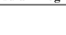

前往：

### 第5章 函数——模块化编程

### 模块4：目标：理解指针和动态内存分配

指针：指针概念、指针变量的初始化、指针与函数参数、按地址传递与悬空内存、地址运算、字符指针与函数、指向指针的指针、指针与多维数组、动态内存管理函数、命令行参数

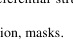

前往：

### 第6章 指针

### 模块5：目标：理解 C 语言的其余方面

枚举、结构和联合类型：派生类型——结构体声明、定义和初始化、访问结构体、嵌套结构体、结构体数组、结构体与函数、指向结构体的指针、自引用结构体、联合体、typedef、位域、程序应用

位运算符：逻辑运算、移位、循环移位、掩码。


前往：

### 第7章 结构与联合类型

### 模块6：目标：理解文件操作

文件处理：输入输出与文件概念、文本文件和二进制文件、格式化 I/O、文件 I/O 操作、示例程序


前往：

### 第8章 文件处理


## 第一单元
计算机导论、问题求解与 C 语言基础

## PART A 计算机导论与问题求解

### 1.1 引言

计算机一词源自 compute 这个词。计算机是一种电子设备，它从用户接收数据和指令作为输入，对数据进行处理，并提供被称为输出的有用信息。计算机的这种操作循环被称为输入-处理-输出循环，并在图 1.1 中显示。电子设备被称为硬件，指令集合被称为软件。

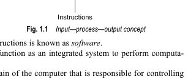

计算机由各种组件组成，这些组件作为集成系统协同工作以执行计算任务。这些组件包括：

- 中央处理器 (CPU)：它是计算机的大脑，负责控制和执行程序指令。
- 显示器：它是一种显示屏，以视觉形式显示信息。
- 键盘和鼠标：这些是计算机用于接收用户输入的外部设备。

图 1.2 显示了计算机的各个组件。

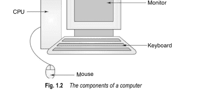

计算机独特的性能和特点使其在各种用户中非常受欢迎，包括工程师、经理、会计师、教师、学生等。

现代数字计算机的一些关键特性包括但不限于：

- **速度**：计算机是一种快速的电子设备，可以在几秒钟内解决大型和复杂的问题。计算机的速度通常取决于其硬件配置。
- **存储容量**：计算机可以以多种不同格式存储大量数据。计算机系统的存储区域通常分为两类，主存储器和辅助存储器。
- **准确性**：计算机能够以极高的准确性进行计算。计算机实现的准确性取决于其硬件配置和指定的指令。
- **可靠性**：计算机在无错误的情况下产生结果。大多数计算机产生的错误实际上是用户自身引发的人为错误。因此，计算机被视为相当值得信赖的机器。
- **多功能性**：计算机是多功能的机器。它们可以执行各种任务，并可用于许多不同的目的。
- **勤奋**：计算机可以以相同的准确度无限制地重复进行计算。

这些计算机的能力使我们能够将其用于各种任务。应用领域大致可分为以下几个主要类别。

- 1. 数据处理（商业用途）
- 2. 数值计算（科学用途）
- 3. 文本（文字）处理（办公和教育用途）
- 4. 消息通信（电子邮件）
- 5. 图像处理（动画和工业用途）
- 6. 语音识别（多媒体）

### 1.2 计算机系统

计算机系统由硬件和软件组件组成。硬件是指计算机系统的物理部件，软件是计算机执行特定任务所需的一组指令或程序。硬件包括以下组件：

- **输入设备**：它们用于接受要执行操作的 data。输入设备的示例有键盘、鼠标和轨迹球。
- **处理器**：也称为 CPU，用于对通过输入设备输入的数据进行计算和信息处理。
- **输出设备**：它们用于提供程序执行指定操作后获得的输出。输出设备的示例有显示器和打印机。
- **存储器**：它用于存储输入数据以及程序执行指定操作后获得的输出。存储器可以是主存储器也可以是辅助存储器。主存储器包括随机存取存储器 (RAM)，辅助存储器包括硬盘和软盘。

软件在内部支持计算机系统的运行，无法看到。它存储在辅助存储器上，可以是应用软件也可以是系统软件。应用软件用于根据需求执行特定任务，而系统软件是运行应用软件所必需的。应用软件的示例包括 Excel 和 MS Word，系统软件的示例包括操作系统和网络系统。

所有硬件组件相互交互，也与软件交互。同样，不同类型的软件相互交互，也与硬件组件交互。各硬件组件之间的交互在图 1.3 中示出。

#### 1.2.1 输入设备

输入设备可以通过电缆连接到计算机系统。其中最常用的输入设备有：

- 键盘
- 鼠标
- 扫描仪

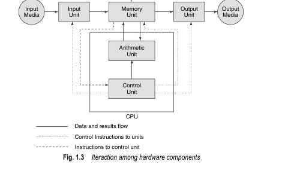

### 键盘

标准键盘包括字母数字键、功能键、修改键、光标移动键、空格键、转义键、数字键盘以及一些特殊键，如 Page Up、Page Down、Home、Insert、Delete 和 End。字母数字键包括数字键和字母键。功能键是帮助执行特定任务的键，例如搜索文件或刷新网页。修改键如 Shift 和 Control 键会修改字符或符号的大小写样式。光标移动键包括上、下、左、右键，用于修改屏幕上光标的方向。空格键将光标向右移动一个位置。数字键盘为数字和数学运算符使用单独的键盘。键盘如图 1.4 所示。

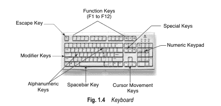

图 1.4 键盘

### 鼠标

鼠标允许用户通过指向并单击来选择屏幕上的元素，如工具、图标和按钮。我们还可以使用鼠标在计算机系统的屏幕上绘图和绘画。鼠标也被称为指向设备，因为它有助于改变屏幕上指针或光标的位置。

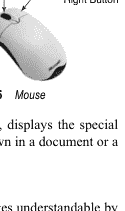

图 1.5 鼠标

鼠标由两个按钮组成，顶部有一个滚轮，底部有一个滚球。当滚球移动时，屏幕上的光标会沿着滚球旋转的方向移动。鼠标左键用于选择元素，右键单击时显示特殊选项，如打开、浏览和快捷菜单。滚轮用于在文档或网页中向下滚动。鼠标如图 1.5 所示。

### 扫描仪

扫描仪是一种输入设备，可将文档和图像转换为计算机系统可理解的数字化图像。数字化图像可以生成为黑白图像、灰度图像或彩色图像。对于彩色图像，图像被视为一组点，每个点代表红、绿、蓝三种颜色的组合，比例各不相同。分配给一个点的红、绿、蓝颜色的比例合称为颜色描述。扫描仪使用点的颜色描述来生成数字化图像。图 1.6 显示了一台扫描仪。

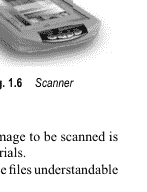

图 1.6 扫描仪

可以用于生成数字化图像的扫描仪类型如下：

- 平板扫描仪：它包含一个扫描头，该扫描头从上到下在页面上移动以读取页面，并将页面上的图像或文本转换为数字形式。平板扫描仪用于扫描图形、超大文档和书籍页面。
- 鼓式扫描仪：这种类型的扫描仪使用固定的扫描头，被扫描的图像在扫描头上移动。鼓式扫描仪用于扫描印前材料。
- 幻灯片扫描仪：它是一种可以直接扫描照片幻灯片以生成计算机可理解文件的扫描仪。


- **手持式扫描仪** 这种扫描仪由最终用户手持，在待扫描页面上移动。此类扫描仪价格低廉且体积小巧。

#### 1.2.2 CPU
CPU 由控制单元（CU）和算术逻辑单元（ALU）组成。控制单元存储指令集，指令集规定计算机要执行的操作。控制单元将数据和指令传送给 ALU 以进行算术运算。ALU 对接收到的数据执行算术或逻辑运算。CPU 寄存器既存储待处理的数据，也存储处理后的数据。除 CU 和 ALU 外，CPU 还需要借助以下硬件设备来处理数据：

### 主板
主板用于将 CPU 与输入和输出设备连接。主板上的各组件与计算机的所有部件相连，并且彼此之间保持绝缘隔离。主板的部分组件包括：
- **总线** 在计算机不同部件之间传输数据和指令的电路通路。例如，数据总线是一种在微处理器、内存以及连接到计算机的输入/输出设备之间传输数据的电路通路。地址总线连接微处理器、RAM 和只读存储器（ROM），用于传输微处理器将要访问的 RAM 和 ROM 存储位置的地址。
- **系统时钟** 用于同步计算机所执行操作的时钟。计算机内部传输的电信号根据时钟的节拍进行定时。因此，系统时钟越快，计算机的处理速度越快。
- **微处理器** 执行处理并控制计算机各部件活动的 CPU 组件。微处理器插入主板上放置的 CPU 插槽中。
- **ROM** 包含计算机永久存储器的芯片，其中的信息不能由最终用户修改。

### 随机存取存储器（RAM）
RAM 指计算机的主存储器，在计算机使用期间存储信息和程序。RAM 以芯片形式提供，可插入主板上的 RAM 插槽。

### 显卡/声卡
显卡是显示器和 CPU 之间的接口。显卡还包含自己的 RAM 和微处理器，用于加快图形的处理和显示。这些显卡插在扩展槽中，因为这些插槽可让我们将高速图形显示卡连接到主板。声卡是放在主板上的一块电路板，用于增强计算机的音频能力。声卡插入外设组件互连（PCI）插槽。PCI 插槽还可将网络接口卡、调制解调器卡和显卡连接到主板。图 1.7 显示了一块主板。

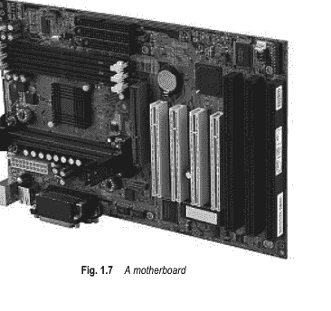
图 1.7 主板

#### 1.2.3 输出设备
CPU 处理后的数据通过输出设备提供给最终用户。最常用的输出设备有：
- 显示器
- 打印机
- 扬声器
- 绘图仪

### 显示器
显示器是最常用的输出设备，用于显示计算机生成的视觉画面。显示器也称为屏幕，可通过电缆作为外部设备连接，也可以作为主机机箱的一部分连接。通过电缆连接的显示器连接到主板扩展槽上的显卡。显示设备用于直观地呈现文本和图形信息。

显示器可分为阴极射线管（CRT）显示器和液晶显示器（LCD）。CRT 显示器体积大，占用计算机空间较多；LCD 显示器轻薄，占用空间较少。两种显示器都有单色、灰度和彩色型号。不过，CRT 产生的视觉显示质量优于 LCD。

显示器可从尺寸和分辨率两方面来描述。显示器尺寸是按对角线测量的屏幕长度。分辨率表示为屏幕的画面元素或像素数量。显示器分辨率也称为点距。分辨率更高的显示器可以产生更清晰的图像。图 1.8 显示了一台显示器。

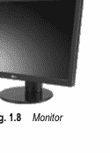
图 1.8 显示器

### 打印机
打印机是一种输出设备，用于将屏幕上显示的电子文本以纸张形式生成硬拷贝，供最终用户使用。打印机是通过电缆连接到计算机系统的外部设备。计算机需要将待打印的文档转换为打印机可理解的数据。打印机驱动程序或打印驱动程序软件用于将文档转换为打印机可理解的形式。当计算机组件升级时，需要在计算机上安装升级后的打印机驱动程序软件。

打印机的性能以打印机输出的每英寸点数（DPI）和每分钟页数（PPM）来衡量。打印机的 DPI 参数越高，其生成输出质量越好。PPM 越高，表示打印机效率越高。打印机可以根据其打印文本和图像所使用的技术进行分类：
- **点阵打印机** 点阵打印机是使用打孔纸打印文本的击打式打印机。打印文本的过程包括将撞针击打在色带上，从而在纸上留下印记。
- **喷墨打印机** 喷墨打印机比点阵打印机慢，用于生成高质量的摄影打印件。喷墨打印机不是击打式打印机。墨盒安装在打印头上，打印头从左到右水平移动。
- **激光打印机** 激光打印机可以连接计算机，也可以不连接计算机来生成输出。这些打印机包含微处理器、ROM 和 RAM，可用于存储文本信息。打印机使用圆柱形硒鼓、碳粉和激光束。图 1.9 显示了一台打印机。

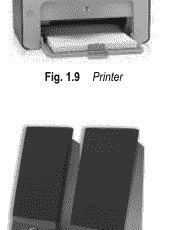

### 扬声器
扬声器是一种机电换能器，将电信号转换为声音。扬声器作为输出设备连接到计算机，以提供音频输出，例如警告音和网络音频。计算机中可以有内置扬声器或外接扬声器，用于向最终用户发出错误音频消息和警报。计算机需要安装音频驱动程序才能产生音频输出。计算机系统中使用的声卡决定我们通过音乐 CD 或网络收听音频的质量。计算机扬声器在质量和价格上差异很大。高级计算机扬声器可能配有低音炮单元，以增强低音输出。图 1.10 显示了扬声器。

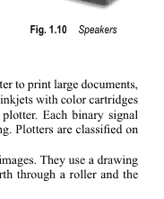

### 绘图仪
绘图仪是另一种常用的输出设备，连接到计算机以打印大型文档，例如工程图或建筑图。绘图仪使用多支墨水笔或带有彩色墨盒的喷墨装置进行打印。计算机将二进制信号发送到绘图仪的所有打印头。每个二进制信号都包含打印头需要定位打印的坐标。绘图仪根据其性能分类如下：
- **滚筒绘图仪** 用于绘制完美的圆形和其他图形图像。它使用绘图臂来绘制图像。滚筒绘图仪通过滚筒前后移动纸张，绘图臂则横向移动穿过纸张。
- **平板绘图仪** 平板绘图仪具有平坦的绘图表面和两个绘图臂，绘图臂在纸张上移动绘制图像。绘图仪打印速度低，体积大。
- **喷墨绘图仪** 通过喷嘴将墨滴喷洒到纸上生成图像。不过，喷嘴可能堵塞，需要定期清洁，因此维护成本较高。
- **静电绘图仪** 与其他绘图仪相比，静电绘图仪能以最高速度生成高质量打印件。它使用带电的电线和特殊的介电纸进行绘图。图 1.11 显示了一台绘图仪。


#### 1.2.4 内存

计算机的存储单元用于存储数据、数据处理的指令、处理的中间结果以及最终处理的信息。计算机的存储单元分为主存储器和辅助存储器。图 1.12 显示了计算机系统中的存储分类。

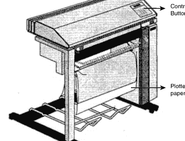

图 1.11 一台喷墨绘图仪。

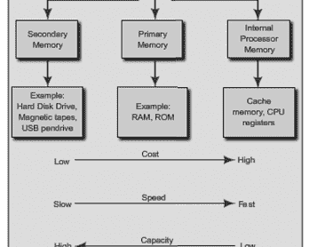

图 1.12 存储设备的分类

### 主存储器

主存储器以计算机的内置单元形式存在于计算机中。主存储器表示为一组存储位置，每个位置占用 8 位。存储器中的每一位都由唯一的地址标识。数据以机器可理解的二进制形式存储在这些存储位置中。

- **ROM** ROM 表示只读存储器，即使计算机关闭时仍存储数据和指令。它是计算机的永久存储器，其内容不能被终端用户修改。ROM 是一块插入主板中的芯片。它通常用于存储基本输入/输出系统（BIOS），该系统执行加电自检（POST）。
- **RAM** RAM 是读写存储单元，其中信息仅在有稳定电源供应时保留。当电源中断或关闭时，存储在 RAM 中的信息会丢失。RAM 是一种易失性存储器，临时存储数据和应用程序，只要它们在使用中。当数据或应用程序使用完毕后，RAM 中的内容会被清除。
- **Cache memory** Cache memory 用于存储 CPU 最后处理的数据和相关应用程序。处理器进行处理时，首先在高速缓存存储器中搜索指令，然后再搜索 RAM。高速缓存存储器始终放置在 CPU 与计算机系统的主存储器之间。

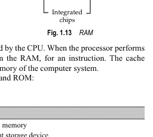

表 1.1 描述了 RAM 和 ROM 之间的一些主要差异：

表 1.1

| RAM | ROM |
|---|---|
| 它是读写存储器 | 它是只读存储器 |
| 它是易失性存储设备 | 它是永久性存储设备 |
| 一旦断电，数据就会被擦除 | 即使断电后数据仍保持存储 |
| 它用作计算机系统的主存储器 | 它用于存储基本输入/输出系统（BIOS）。 |

### 辅助存储器

辅助存储器表示连接到计算机的外部存储设备。它们提供非易失性存储源，用于存储当前未使用的信息。存储设备要么位于计算机的 CPU 机箱内，要么外部连接到计算机。辅助存储设备可分为：

- **Magnetic storage device** 磁存储设备存储的信息可以多次读取、擦除和重写。这些包括软盘、硬盘和磁带。
- **Optical storage device** 光存储设备是使用激光束读取存储数据的辅助存储设备。这些包括 CD-ROM、可重写光盘（CD-RW）以及只读存储器数字视频光盘（DVD-ROM）。

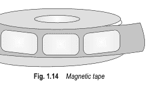

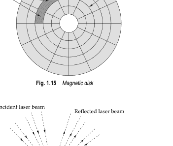

图 1.15 磁盘

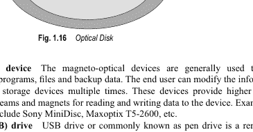

图 1.16 光盘

- **Magneto-optical storage device** 磁光设备通常用于存储信息，例如大型程序、文件和备份数据。终端用户可以多次修改磁光存储设备中存储的信息。这些设备提供更高的存储容量，因为它们使用激光束和磁铁在设备上读写数据。磁光设备的例子包括索尼迷你光盘、Maxoptix T5-2600 等。
- **Universal serial bus (USB) drive** USB 驱动器或通常称为U盘，是一种可移动存储设备，接口在计算机系统的 USB 端口上。与其他存储设备如 CD 和软盘相比，它速度相当快且紧凑。USB 驱动器最重要的优点之一是其容量比其他可移动存储设备更大。最近，它在计算机用户中变得非常流行。

《计算机导论、问题求解与基础 C》 1.11

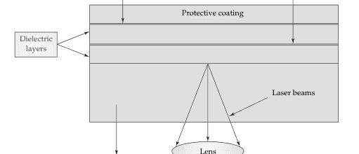


计算机的操作由一组指令控制（称为计算机程序）。这些指令编写出来是为了告诉计算机：

- 1. 执行什么操作
- 2. 在哪里定位数据
- 3. 如何呈现结果
- 4. 何时做出某些决定

两个参与方之间的通信，无论是机器还是人类，都需要一种共同的语言或术语。计算机指令通信中使用的语言称为编程语言。计算机有自己的语言，任何与计算机的通信都必须使用其语言或翻译成该语言。

有三种编程语言级别。它们是：

- 1. 机器语言（低级语言）
- 2. 汇编（或符号）语言
- 3. 过程式语言（高级语言）

### 机器语言

由于计算机由双态电子器件构成，它们只能理解脉冲和无脉冲（或‘1’和‘0’）状态。因此，所有指令和数据都应使用 *二进制代码* 1 和 0 编写。二进制代码称为 *机器码或机器语言*。

计算机不理解英语、印地语或泰米尔语。它们只响应机器语言。加上，计算机的设计并不相同，因此每台计算机都有自己的机器语言。（然而，脚本 1 和 0 对所有计算机都是相同的）。这给用户带来了两个问题。

首先，很难理解和记住代表众多数据和指令的 1 和 0 的各种组合。而且，编写无错误指令是一个缓慢的过程。

其次，由于每台机器都有自己的机器语言，如果用户不知道其语言，就无法与其他计算机通信。想象一下一个泰米尔人第一次去德里之旅。他会面临巨大的障碍，因为语言障碍会阻止他进行交流。

机器语言通常被称为 *第一代语言*。

### 汇编语言

汇编语言于 1950 年代引入，减少了编程复杂性并为构建应用程序提供了一些标准化。汇编语言也称为 *第二代编程语言*，也是一种低级语言。在汇编语言中，机器语言的 0 和 1 被缩写或助记符代码所取代。

汇编语言相对于机器语言的主要优点是：

- 由于我们可以在汇编语言中定位和识别语法错误，因此很容易调试它。
- 与机器语言相比，使用汇编语言开发计算机应用程序更容易。
- 汇编语言运行非常高效。

汇编语言程序由一系列指令和助记符组成，它们对应于一系列可执行指令。汇编语言指令由助记符代码后跟零个或多个操作数组成。助记符代码称为 *操作码或 opcode*，它指定要在给定参数上执行的操作。考虑以下机器代码：

```
10110000 01100001
```

其等效的汇编语言表示为：

```
mov al, 061h
```

在上述指令中，操作码“move”用于将十六进制值 61 移动到名为“al”的处理器寄存器中。以下程序显示了用于减去两个数字的汇编语言指令：

```
ORG 500       ;Origin of program is location 500
LDA SUB       ;Load subtrahend to AC
CMA           ;Complement AC
INC           ;Increment AC
ADD MIN       ;Add minuend to AC
STA DIF       ;Store difference
HLT           ;Halt computer
MIN, DEC 56   ;Minuend
SUB, DEC -2   ;Subtrahend
DIF, HEX 0    ;Difference stored here
END           ;End of symbolic program
```

需要注意的是，在执行过程中，汇编语言程序借助汇编器转换为机器码。简单的汇编语言语句与机器语言语句曾一一对应。这种一一对应关系仍然会生成复杂的程序。于是，人们设计了宏指令，以便可以用单条汇编语言指令表示多条机器语言语句。即使在今天，程序员仍倾向于使用汇编语言来执行某些任务，例如：

- 在启动操作系统之前初始化和测试系统硬件。这段汇编语言代码存储在 ROM 中
- 为杀毒产品开发公司编写用于反汇编病毒的补丁
- 实现极致优化，例如在处理器密集型算法的内层循环中
- 与硬件直接交互
- 在需要完全控制环境的极高安全性场景中
- 在资源严重受限的系统中最大化利用有限资源

### 高级语言

高级语言通过减少必须指定的计算机操作细节数量，进一步简化了编程任务。与低级编程语言相比，COBOL、Pascal、FORTRAN 和 C 等高级语言更抽象、更易使用，并且跨平台可移植性更好。程序员不必再处理寄存器、内存地址和调用栈，而是可以借助变量、数组或布尔表达式，更专注于解决问题的逻辑。例如，考虑以下汇编语言代码：

```
LOAD A
ADD B
STORE C
```

使用 FORTRAN，上述代码可以表示为：

```
C = A + B
```

上述高级语言代码通过编译器或解释器转换为相应的机器语言代码来执行。
高级语言可以分为以下三类：

- 面向过程的语言（第三代）
- 面向问题的语言（第四代）
- 自然语言（第五代）

#### 面向过程的语言

为解决通用问题而设计的高级语言称为过程性语言或第三代语言。这些语言包括 BASIC、COBOL、FORTRAN、C、C++ 和 JAVA，它们旨在表达问题的逻辑和过程。尽管这些编程语言的语法不同，但它们使用类似英语的命令，易于理解。第三代语言的另一个主要优势是可移植性。我们可以在任何计算机上使用编译器（或解释器）并生成目标代码。以下程序表示 C 语言源代码：

```
if ( n > 10 )
{
    do
    {
        n++;
    } while ( n < 50 );
}
```

第三代编程语言被认为是领域特定编程语言，因为它们旨在为特定领域开发软件应用。例如，第三代编程语言 COBOL 旨在解决大量商业领域特有的问题。

#### 面向问题的语言

面向问题的语言用于解决特定问题，被称为第四代语言。这些语言包括查询语言、报表生成器和应用程序生成器，它们具有简单的、类似英语的语法规则。第四代语言（4 GLs）减少了编程工作量以及软件开发的总体成本。这些语言使用可视化环境或文本环境进行程序开发，与第三代语言类似。第四代语言中的单条语句可以完成与第三代语言多行代码相同的任务。此外，程序员只需从工具栏拖放，即可创建按钮、文本框、标签等各种项。此外，程序员可以快速创建软件应用的原型。

这些语言通常用于 WYSIWYG（所见即所得）环境，以促进更快速、更便捷的应用开发。Visual Studio 就是这样一个环境，它包含多种编程工具以及对多种编程语言的支持，以确保程序员在应用开发过程中的灵活性。

#### 自然语言

自然语言旨在使计算机表现得像专家一样并解决问题。程序员只需指定问题以及解决问题的约束条件。LISP 和 PROLOG 等自然语言主要用于开发人工智能和专家系统。这些语言被广泛称为第五代语言。

这一代编程语言主要关注约束编程，这在一定程度上类似于声明式编程。它是一种编程范式，程序员只需指定要在约束条件内找到的解，而无需指定找到所需解的方法。

这一代编程语言允许用户以简单轻松的方式与计算机系统交流。程序员在与计算机系统交互时可以使用普通英语单词。

### 1.4 编程环境

编程环境包含所有有助于程序开发的组件。这些组件主要分为两类——编程工具和应用程序编程接口（API）。它们被视为任何编程环境的构建块。API 可以定义为以库的形式存储的数据结构、类、协议和预定义函数的集合。这些库包含在 C、C++ 等编程语言的软件包中。API 使程序员的开发任务更容易，因为内置 API 组件会被反复使用，从而确保可重用性。用于软件开发、维护和调试的软件应用程序称为编程工具。良好的编程工具可确保以高效方式执行编程活动。以下是编程工具的一些主要类别：

- 集成开发环境（IDE） 它是最常用的工具，为程序员提供用于软件开发的集成环境。它几乎包含软件开发的所有组件，如编译器、编辑器、调试器等。
- 调试工具 它是一种专用工具，帮助程序员检测并消除程序中的缺陷或错误。
- 内存使用工具 顾名思义，内存使用工具帮助程序员高效地管理内存资源。

### 1.5 创建和运行程序

程序员应采用标准的程序开发方法和途径。软件或程序开发生命周期就是这样一种适用于所有类型程序开发场景的标准方法。它由若干相互关联的阶段组成，每个阶段都有明确的目的。我们将在下一节中更详细地学习程序开发生命周期。

#### 1.5.1 结构化程序设计

另一种重要的程序开发方法是结构化程序设计，它是关键编程范式之一（即过程式编程）的一个子集。

它有助于使程序易于理解和调试。不基于结构化程序设计方法的程序很难维护、调试和理解。

结构化程序设计方法主要关注程序中语句的执行顺序。它建议在程序中使用语句的顺序执行。因此，结构化程序设计方法建议主要使用三种控制结构——顺序、重复和选择。此外，它建议在程序中避免使用 goto、break 和 continue 语句，因为这些都是无条件分支语句。

#### 1.5.2 系统开发工具

程序的成功开发和执行需要使用多种工具。一些典型的系统开发工具包括

- 语言翻译器
- 链接器
- 调试器
- 编辑器

### 语言翻译器

- 汇编器 汇编器是一种计算机程序，它将汇编语言语句转换为机器语言代码。汇编器从源代码中取出每一条汇编语言语句，并使用 0 和 1 生成相应的位流。汇编器以 0 和 1 序列形式输出，称为目标代码或机器码。最终执行该机器码以获得结果。

现代汇编器将汇编指令助记符转换为操作码，并解析内存位置和其他实体的符号名，以创建目标代码。一些复杂的汇编器还提供额外功能，可控制汇编过程、促进程序开发并辅助调试。基于 RISC 架构的 Sun SPARC 和 MIPS 等现代汇编器会优化指令调度，以实现 CPU 的高效利用。现代汇编器通常包含宏功能，并被称为宏汇编器。


汇编器可分为单遍汇编器和双遍汇编器。单遍汇编器是第一个汇编器，它处理源代码一次，将助记符替换为二进制代码。单遍汇编器无法支持高级源代码优化。因此，开发了读取程序两次的双遍汇编器。在第一次遍历中，所有变量和标签都被读取并放入符号表。在第二次遍历中，标签间隙从表中填充，通过用地址替换标签名。这有助于实现源代码的更高优化。汇编器的翻译过程包括以下任务：

- 用数值地址替换像 LOOP 这样的符号地址
- 用机器操作码替换符号操作码
- 为指令和数据保留存储空间
- 将常量翻译成其机器表示形式

## 编译器
编译器是一种计算机程序，它将用高级语言编写的源代码翻译成低级语言对应的目标代码。这种翻译过程称为编译。整个高级程序被转换成可执行的机器代码文件。将低级语言翻译成高级语言的程序称为反编译器。编译型语言包括 COBOL、FORTRAN、C、C++ 等。

1952 年，格蕾丝·霍珀为 A-0 编程语言编写了第一个编译器。1957 年，IBM 的约翰·巴克斯推出了第一个完整编译器。随着计算机体系结构的复杂性不断增加以及新编程语言支持的功能不断扩展，编译器变得越来越复杂。尽管早期的编译器是用汇编语言编写的，如今用其编译的语言来实现编译器已成为常见做法。编译器也分为单遍编译器和多遍编译器。尽管单遍编译器通常比多遍编译器更快，但对于复杂的优化，需要多遍汇编器来生成高质量的代码。

## 解释器
解释器是一种翻译程序，它将每个高级程序语句转换成相应的机器代码。这种翻译过程在程序语句执行前立即进行。不是整个程序，而是每次翻译一条语句并立即执行。常用的解释型语言有 BASIC 和 PERL。尽管与编译器相比，解释器更容易创建，但编译型语言可以更高效地执行并且速度更快。

## 链接器
大多数高级语言允许开发者开发包含多个模块的大型程序。链接器将语言翻译器生成的各个模块的目标代码整理成一个单一程序。计算机系统的执行单元在执行时无法链接所有模块，因此，由于链接器能够将所有模块组合成一个单一程序，它被视为重要的软件之一。链接器以这样的方式组装编译器生成的各种对象，使得在执行期间所有对象都被接受为一个单一程序。链接器还包括在运行时库中定义的各种对象的链接。在许多情况下，链接器用对象的符号地址替换其实际地址。图 1.19 说明了链接器的工作原理。

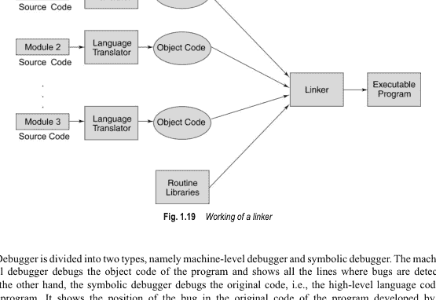

图 1.19 链接器的工作原理

## 调试器
调试器是用于检测程序中错误和 bug 的软件。调试器借助称为指令集模拟器（ISS）技术的方法定位程序代码中错误的位置。ISS 能够在遇到错误语句时停止程序的执行。

调试器分为两种类型，即机器级调试器和符号调试器。机器级调试器调试程序的目标代码并显示检测到 bug 的所有行。另一方面，符号调试器调试原始代码，即程序的高级语言代码。它显示程序员开发的程序原始代码中 bug 的位置。

在调试程序时，调试器除了调试之外还执行许多其他功能，例如在原始代码中插入断点、跟踪特定变量的值等。为了调试程序，调试器有助于执行以下任务：

- 程序的逐步执行
- 回溯以检查之前的步骤
- 在错误被纠正之前停止程序的执行

## 编辑器
编辑器是一种特殊程序，允许用户在计算机系统中处理文本。它用于文档目的，并使我们能够编辑现有文档或文件中的信息。编辑器使我们能够在编辑文本时执行各种编辑操作，如复制、剪切和粘贴。根据编辑器编辑的内容，它们分为以下几类：

- **文本编辑器** 它用于编辑纯文本。操作系统始终包含文本编辑器用于更新配置文件。
- **数字音频编辑器** 它用于编辑多媒体应用程序的音频组件相关信息。这些编辑器用于音频应用程序中，在那里编辑音乐和声音信号是必要的。
- **图形编辑器** 它用于编辑与图形对象相关信息。这些编辑器通常用于多媒体应用程序中，用户在其中处理多个动画对象。
- **二进制文件编辑器** 它用于编辑数字数据或二进制数据，即由 0 和 1 字符串组成的数据。
- **HTML 编辑器** 它用于编辑网页中包含的信息。
- **源代码编辑器** 它用于编辑用 C、C++ 和 Java 等编程语言编写的程序的源代码。

#### 1.5.3 开发程序
开发程序是指按照所选编程语言的语法和语义编写所需应用程序源代码的过程。语法和语义是程序员在开发程序时需要遵守的一组规则。

在实际开发程序之前，程序的目标和逻辑应非常明确。因此，程序开发的第一阶段是对程序目标进行详细研究。目标使程序员意识到开发程序的目的。在确定程序目标后，程序员需要列出程序开发所需遵循的一系列步骤。这一系列程序开发步骤称为算法。程序员还可以使用称为流程图的图形模型来表示程序算法中定义的步骤。

在通过算法或流程图开发程序逻辑之后，下一步是选择一种编程语言来进行程序代码的实际开发。在选择目标编程语言时，应考虑多个因素，例如编程语言的性能和效率、程序员对该语言的先前经验等。

编程语言通常与包含开发、编辑、运行和调试计算机程序所需工具的 IDE 捆绑在一起。例如，Turbo C 提供了强大而功能强大的 IDE 来开发、编译、调试和执行程序。

图 1.20 显示了 C 语言的 IDE。

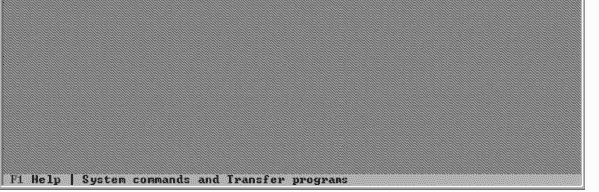

图 1.20. C 语言的 IDE。


假设我们需要开发一个程序来计算学生的两门科目成绩百分比并显示结果。针对此问题的程序开发的第一步是准备算法，如下所示：

- 步骤 1 - 输入第一科目的成绩。 (mark1)
- 步骤 2 - 输入第二科目的成绩。 (mark2)
- 步骤 3 - 计算百分比。
  - percentage = (mark1 + mark2)/200*100
- 步骤 4 - 如果百分比 > 40
- 步骤 5 - 显示通过
- 步骤 6 - 否则
- 步骤 7 - 显示不及格

图 1.21 显示了上述算法的流程图。

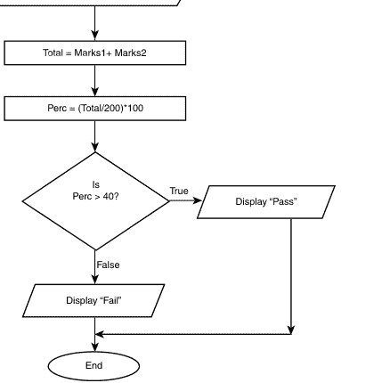

图 1.21. 计算成绩百分比并显示结果的流程图。

1.20 计算机编程

在开发算法和流程图之后，可以在 C 语言的源代码编辑器中开始实际的程序开发。以下代码展示了用于计算学生两门不同科目成绩百分比的 C 语言程序。

```c
#include<stdio.h>
#include<conio.h>
void main()
{
float mark1,mark2;
float percentage;
clrscr();
printf("\n Enter marks of first subject:");
scanf("%f", &mark1);
printf("\n Enter marks of second subject:");
scanf("%f", &mark2);
percentage = ((mark1 + mark2) / 200) * 100;
if(percentage>40)
printf("\n The student is passed");
else
printf("\n The student is failed");
getch();
}
```

图 1.22 计算两门科目成绩百分比的程序

图 1.23 显示了 C 语言源代码编辑器中的程序代码。


图 1.23 在 C 语言源代码编辑器中开发程序。

#### 1.5.4 运行程序

在开发程序代码之后，下一步是对程序进行编译。程序编译有助于识别程序代码中的任何语法错误。如果源代码中没有语法错误，则编译器会生成目标对象代码，该代码可由计算机系统的处理器理解和执行。

一旦编译器构建了相应的对象代码或可执行文件，程序就可以运行以检查程序的逻辑正确性并生成所需输出。逻辑错误也称为语义错误，可能会导致程序生成不期望的结果。编程语言还提供了各种机制，例如异常处理，用于处理这些逻辑错误。如果程序针对给定输入生成的输出与期望结果相符，则程序开发的目的就达到了。否则，应再次检查程序的逻辑以获得给定问题的正确解决方案。

图 1.24 显示了用 C 语言开发的程序的输出。

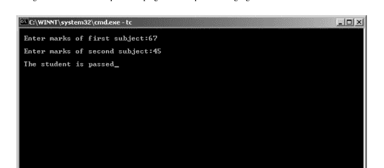

```
Enter marks of first subject:67
Enter marks of second subject:45
The student is passed_
```

上图显示了运行 C 程序生成的输出。我们可以通过选择 Run → Run 或同时按下 Alt 和 F9 键来运行 C 程序。

### 1.6 软件开发方法

软件开发和实施的整个过程涉及一系列步骤。每个后续步骤都依赖于前一步骤的结果。因此，软件设计师、开发人员和操作员团队需要在软件开发的每个阶段相互协作，以确保最终产品符合客户的要求。图 1.25 显示了各种软件开发步骤。

1.22 计算机编程

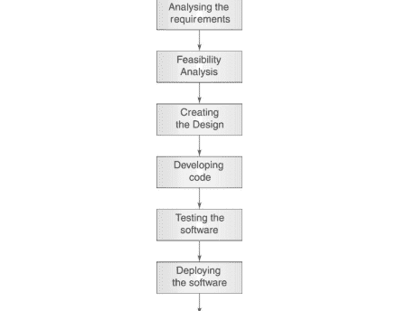

图 1.25 软件开发步骤

#### 1.6.1 分析需求

在此步骤中，了解与待开发软件相关的需求。需求分析或需求分析是软件开发过程中的重要步骤。如果没有正确理解用户需求，则软件势必无法达到最终用户的期望。因此，需求分析始终是软件开发的第一步。

软件本质上是抽象的；因此，在需求分析阶段，用户可能无法提供有关所需软件的完整需求集。因此，软件开发团队与最终用户之间应保持持续互动。此外，软件开发团队还需要注意用户需求可能在开发过程中不断变化这一事实。因此，正确分析用户需求对于在给定时间内开发软件至关重要。它不仅有助于控制软件开发成本，还将导致软件更快、更准确地开发。

需求分析任务通常由业务分析师执行。该人员是该领域的专业人士，了解新手最终用户的需求，并将其记录并与开发团队分享。

#### 1.6.2 可行性分析

在此步骤中，确定开发软件在资源和成本方面的可行性。为了确定软件开发的可行性，用户现有的系统会被正确分析。除了研究现有系统外，本步骤还涉及识别现有系统中自动化的需求。本步骤进行的分析记录在名为可行性报告的标准文档中，其中包含与软件开发任务相关的观察和建议。可行性分析阶段执行的一些重要活动如下：

- **确定开发替代方案** 此活动涉及寻找可用于软件开发的不同替代方案。软件开发主要有四种替代方案。第一个替代方案是允许现有系统继续运行，而不开发新的软件进行自动化。第二个替代方案可以是使用特定的编程语言（如 Java、C++、Visual Basic 等）开发新软件。第三个替代方案是使用诸如 Java 2 企业版（J2EE）和基于大型机的瘦客户端架构技术来开发软件。第四个开发替代方案是从市场上购买已开发的软件及其源代码，并根据客户需求对其进行定制。
- **分析经济可行性** 此活动涉及确定开发新软件是否在财务上是有利的。这种可行性分析是为了确定从软件的开发和实施中可以获得的总体利润。这种可行性分析活动涉及评估所有可用于开发的替代方案并选择最经济的方案。
- **评估技术可行性** 技术可行性评估涉及分析各种因素，例如技术的性能、安装的便捷性、扩展或缩小规模的便捷性、与其他技术的互操作性等。技术可行性活动通常涉及对技术性质的研究，即其易于学习程度以及理解技术所需的培训水平。这种可行性评估在选择用于开发软件的适当技术方面非常有帮助。选择应在评估软件需求规范后进行。此外，在技术可行性评估期间，还必须评估每种已识别技术的优缺点。
- **分析运营可行性** 运营可行性评估涉及从运营和维护方面研究软件。任何软件的运营可行性都是基于以下几个因素进行的，例如：
  - 运行软件所需的工具类型
  - 运行软件所需的技能
  - 运行软件所需的文档和其他支持

#### 1.6.3 创建设计

在可行性分析阶段之后，下一步是创建新软件的架构和设计。本步骤涉及开发新软件的逻辑模型或基本结构。例如，如果新软件基于客户端-服务器技术，则本步骤将涉及确定并指定客户端-服务器设计中使用的层数。本步骤还涉及记录与数据库和数据结构设计相关的各种规范。开发过程的流程主要在这一阶段使用一种称为统一建模语言（UML）的特殊语言来说明。UML 使用图形表示方法来描述软件中数据的流程。设计软件时考虑的一些关键特性是：

- **可扩展性** 软件的设计应具有可扩展性，以便将来允许添加一些新选项或模块。软件的架构应足够灵活，以便在添加新功能时不会受到干扰。


-   **模块化** 软件应具有模块化特性，以便其工作方式和数据流易于理解。模块化还有助于对各种软件模块进行并行开发，后续再将其集成到单一的软件产品中。
-   **兼容性** 软件应在现有系统、旧版本或其他软件中正确运行。因此，软件应具有兼容性，并能与其他软件协同良好工作。
-   **安全性** 软件必须能够控制未经授权的访问。在设计新软件时，确保产品中已纳入适当的安全机制。
-   **容错性** 软件应能够处理在其运行期间可能发生的异常或故障。软件必须具有从故障中恢复的能力。
-   **可维护性** 软件的设计应以简单的方式创建，并包含适当细节，以便易于维护。

#### 1.6.4 开发代码

在此步骤中，新软件各个模块的代码被开发。各个模块的代码是根据每个模块的设计规范开发的。软件开发团队中的程序员使用编译器、解释器和调试器等工具来执行诸如查找代码中的错误以及将代码转换为机器语言以供执行等任务。代码可以使用 C、C++ 或 Java 等编程语言编写。用于开发代码的编程语言的选择是基于要开发的软件类型而决定的。编写代码时必须牢记某些关键点或约定；例如：

-   代码中应有适当的缩进。
-   为变量、方法和程序文件命名时应遵循适当的命名约定。
-   应包含适当的注释，以确保维护期间易于理解。
-   新软件不同模块的代码必须简单，以便易于理解。
-   代码必须在逻辑上正确，以最大程度地减少程序中的逻辑错误。

#### 1.6.5 测试软件

测试主要是为了检测新软件中是否存在错误并纠正这些错误。新软件中出现错误或缺陷的原因之一是未能正确理解用户或客户的需求。另一个导致错误的原因是程序员在开发代码时常犯的错误。测试期间执行的两个重要活动是验证和确认。验证是根据预定义规范检查软件的过程，而确认则涉及测试产品以确定其是否满足用户需求。在确认期间，测试人员输入不同的值以确定软件是否根据原始需求生成正确的输出。各种测试方法包括：

-   黑盒测试
-   白盒测试
-   灰盒测试
-   非功能测试
-   单元测试
-   集成测试
-   系统测试
-   验收测试

#### 1.6.6 部署软件

在此步骤中，最新开发并完全测试的软件被安装在其目标环境中。软件文档移交给用户，并输入一些初始数据以使其投入运行。用户还接受有关软件界面及其其他功能的培训。

#### 1.6.7 维护软件

一旦软件成功部署，就会为其提供持续支持以确保其全天候可用。损坏的文件、病毒感染和致命错误是维护人员被要求修复软件并使其恢复正常运行的一些情况。此外，如果软件的环境发生变化，也可能需要对其进行修改。为了成功维护软件，要求在开发时对其进行适当记录。这是因为维护人员可能不是最初参与软件开发的人员。因此，良好的代码文档对于维护人员修复软件至关重要。

### 1.7 应用软件开发方法

为了理解软件开发方法如何应用，请考虑一个简单场景，即需要将华氏温度转换为相应的摄氏温度值。

#### 程序目标

将温度值从华氏度转换为摄氏度

#### 分析

-   输入：华氏温度值
-   输出：摄氏温度值
-   转换方法：可以使用公式 C = (F-32) / 1.8 来生成所需输出
-   数据元素：实变量 F 用于存储华氏输入温度值；实变量 C 用于存储摄氏结果温度值

#### 设计

```
Algorithm
Step 1 – Read F
Step 2 – Compute C = (F-32) / 1.8
Step 3 – Display C
```

#### 开发

```c
Program
#include <stdio.h>
#include <conio.h>

void main()
{
    float F, C;
    clrscr();
    printf("Enter the temperature value in Fahrenheit: ");
    scanf("%f", &F);
    C = (F - 32.0) / 1.8;
    printf("The equivalent temperature value in degrees Celsius is: %.2f", C);
    getch();
}
```

#### 测试

程序必须使用多个输入值进行测试，以确保代码中不存在逻辑错误。

```
Enter the temperature value in Fahrenheit: 0
The equivalent temperature value in degrees Celsius is: -17.78

Enter the temperature value in Fahrenheit: 175
The equivalent temperature value in degrees Celsius is: 79.44

Enter the temperature value in Fahrenheit: 250
The equivalent temperature value in degrees Celsius is: 121.11
```

### 1.8 问题求解

通过计算机可以解决的问题在规模和复杂性上可能各不相同。由于计算机没有常识，也不能做出任何计划外的决策，无论问题是简单还是复杂，都必须将其分解为计算机可以实现的一组明确的解决方案步骤。

问题求解是通过遵循一系列步骤在计算机系统中解决问题的过程，其中包括：

-   **1. 开发算法** 算法是用英语短语形式编写的一系列步骤，指定在解决问题时执行的操作。它涉及识别用于解决问题时将使用的变量名称和类型。
-   **2. 绘制流程图** 流程图是对问题解决方案中控制流和逻辑的图形表示。流程图是算法的图形表示。
-   **3. 编写伪代码** 伪代码与算法非常相似。它使用通用语法来描述为解决问题而要执行的操作步骤。除了使用通用语法编写的语句外，伪代码还可以使用英语短语来描述操作。

### 1.9 算法

算法帮助程序员将问题的解决方案分解为多个顺序步骤。对应于每个步骤，用编程语言编写一条语句；所有这些语句统称为程序。

以下是将两个整数相加并显示结果的算法示例：

```
Algorithm
Step 1 − Accept the first integer as input from the user.
         (num1)
Step 2 − Accept the second integer as input from the user.
         (num2)
Step 3 − Calculate the sum of the two integers.
         (sum = num1 + num2)
Step 4 − Display sum as the result.
```

**图 1.26** *将两个整数相加并显示结果的算法*

每个算法都与时间和空间复杂度相关。时间复杂度指定算法执行所需任务所需的时间量。空间复杂度指定算法执行所需任务所需的内存空间量。在解决复杂问题时，可能存在多种用于获得所需解决方案的算法。应选择确保最佳时间和空间权衡的算法来获得所需解决方案。

#### 1.9.1 算法的特性

一系列指令要成为算法所需的典型特征如下：

-   指令必须是有序的。
-   指令必须简单简洁。它们不得含糊不清。
-   必须有程序终止的指令（条件）。
-   重复的编程结构必须具有退出条件。否则，程序可能会无限运行。
-   算法必须完整且明确地解决给定的问题陈述。

#### 1.9.2 算法的优点

算法的一些关键优点如下：

-   它为给定问题提供核心解决方案。此解决方案可以使用用户选择的任何编程语言在计算机系统上实现。
-   它通过充当给定问题解决方案的设计文档或蓝图来促进程序开发。
-   与等效的计算机程序相比，它确保了对问题解决方案的易于理解。
-   它简化了程序中逻辑错误的识别和消除。
-   它促进算法分析以找出给定问题的最有效解决方案。

#### 1.9.3 算法的缺点

除了优点之外，算法还存在某些局限性，即

-   在大型算法中，程序控制的流程变得难以跟踪。
-   算法缺乏流程图等编程构造的视觉表示；因此，理解逻辑变得相对困难。


#### 示例 1.1 编写算法以判断给定数字是否为质数

解答

```
Algorithm
Step 1 - Start
Step 2 - Accept a number from the user (num)
Step 3 - Initialize looping counter i = 2
Step 4 - Repeat Step 5 while i < num
Step 5 - If remainder of num divided by i (num%i) is Zero then goto Step 6 else goto Step 4
Step 6 - Display "num is not a prime number" and break from the loop
Step 7 - If i = num then goto Step 8 Else goto Step 9
Step 8 - Display "num is a prime number"
Step 9 - Stop
```

Fig. 1.27 判断给定数字是否为质数的算法

#### 示例 1.2 编写算法求学生三科成绩的平均分

解答

```
Algorithm
Step 1 - Start
Step 2 - Accept the marks in three subjects from the user (marks1, marks2, marks3)
Step 3 - Calculate average marks using formula, average = (marks1 + marks2 + marks3)/3
Step 4 - Display the computed average of three subject marks
Step 5 - Stop
```

Fig. 1.28 求三个科目平均分的算法

#### 示例 1.3 编写算法判断给定的年份是否为闰年

解答

```
Algorithm
Step 1 - Start
Step 2 - Accept a year value from the user (year)
Step 3 - If remainder of year value divided by 4 (year%4) is 0 then goto Step 4 else goto Step 5
Step 4 - Display "year is a leap year" and goto Step 6
Step 5 - Display "year is not a leap year"
Step 6 - Stop
```

Fig. 1.29 确定闰年的算法

#### 示例 1.4 编写算法判断给定数字是偶数还是奇数

解答

```
Algorithm
Step 1 - Start
Step 2 - Accept a number from the user (num)
Step 3 – If remainder of num divided by 2 (num%2) is Zero then goto Step 4 else goto Step 5
Step 4 – Display "num is an even number" and goto Step 6
Step 5 – Display "num is an odd number"
Step 6 – Stop
```

Fig. 1.30 判断数字是偶数还是奇数的算法

#### 示例 1.5 编写算法判断给定的字符串是否为回文

解答

```
Algorithm
Step 1 – Start
Step 2 – Accept a string from the user (str)
Step 3 – Calculate the length of string str (len)
Step 4 – Initialize looping counters left=0, right=len-1 and chk = 't'
Step 5 – Repeat Steps 6-8 while left < right and chk = 't'
Step 6 – If str(left) = str(right) goto Step 8 else goto step 7
Step 7 – Set chk = 'f'
Step 8 – Set left = left + 1 and right = right - 1
Step 9 – If chk='t' goto Step 10 else goto Step 11
Step 10 – Display "The string is a palindrome" and goto Step 12
Step 11 – Display "The string is not a palindrome"
Step 12 – Stop
```

Fig. 1.31 确定回文的算法

### 1.10 流程图

流程图可以定义为过程的图形表示，它描述了过程中控制和信息的顺序和流程。信息流以逐步的形式在流程图内部表示。该技术主要用于开发业务工作流程和使用计算机解决问题。

流程图使用不同的符号来表示在过程的不同阶段执行的不同的活动。流程图中使用了各种符号：

- 开始和结束：它由圆角矩形表示。它表示过程的开始和结束。每个过程在某一点开始和结束，因此流程图始终包含一个开始和一个结束符号。图 1.32 显示了流程图中使用开始和结束符号。

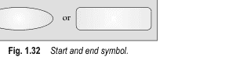

Fig. 1.32 开始和结束符号。

- 输入或输出：它由平行四边形表示。它表示用户向过程提供的输入和过程向用户提供的输出。图 1.33 显示输入或输出符号。

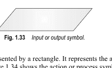

- 动作或过程：它由矩形表示。它表示过程中发生的动作、逻辑和计算。图 1.34 显示动作或过程符号。

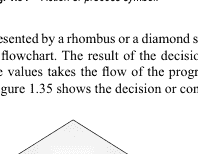

- 决策或条件：它由菱形或菱形表示。它表示流程图中的条件或决策步骤。决策的结果是一个布尔值，即真或假。这些值中的每一个都将程序的流程带到某一点，这借助箭头显示。图 1.35 显示决策或条件符号。

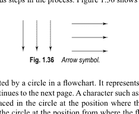

- 箭头：它由有向线表示。它表示流程图中的过程流程和步骤顺序。它指导过程的方向和顺序，在执行过程中的各个步骤时应遵循这些方向和顺序。图 1.36 显示箭头符号。

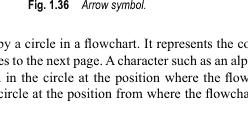

- 连接器：它在流程图中由圆圈表示。它表示当流程图继续到下一页时步骤流程的延续。字母（a 到 z）或符号（α、β 或 γ）等字符可以放置在流程中断位置的圆圈中，并且相同的字符也放置在流程图继续位置的圆圈中。图 1.37 显示连接器符号。

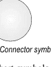

Fig. 1.37 连接器符号。

除上述提到的基本流程图符号外，流程图内部还使用某些其他符号来表示高级操作。表 1.2 显示了其中一些高级流程图符号：

| 符号 | 描述 |
|---|---|
|  | 表示计算机系统的内部存储器，如 RAM 和 ROM |
|  | 表示数据库 |
|  | 表示子程序 |
|  | 表示一组文档 |
|  | 表示空闲或等待状态 |
|  | 将多个数据集合并为一个 |
|  | 从单个数据集中提取单个数据项集合 |
|  | 表示合并和提取操作的组合。它从多个输入数据集中提取多个数据集。 |

为了理解流程图如何表示信息流；请考虑 Fig. 1.38 所示的加两个数字的流程图示例。

## 1.32 计算机编程

## 流程图

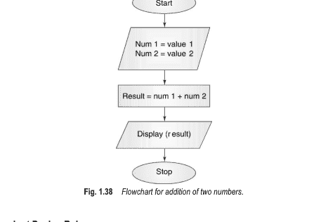

#### 1.10.1 流程图设计规则

设计流程图时必须遵循的一些标准准则或规则是

- 它必须以“Start”开始并以“Stop”符号结束。
- 标准流程应自上而下或自左向右。
- 流程图中指定的指令必须简洁明了。
- 箭头必须正确对齐，以便清晰地描绘程序控制的流程。
- 通常应避免使用连接器，因为它们会使程序看起来更复杂。
- 流程图中的过程或动作符号必须只有一个输入箭头和一个输出箭头。
- 两个箭头绝不能相交或交叉；如果有此需要，则必须使用适当的桥接或交叉符号。

#### 1.10.2 流程图的优点

使用流程图进行程序设计的一些主要优点是

- 它有助于以简单的方式理解程序控制的流程。
- 通过参考其流程图开发程序代码，比从头开始开发程序代码更容易。
- 它有助于避免语义错误。
- 任何概念在视觉表示的帮助下都能更好地理解。这一事实同样适用于流程图。理解编程逻辑的图形表示更容易。
- 流程图可作为流程或程序流程的文档。
- 流程图的使用适用于小型程序设计。

#### 1.10.3 流程图的缺点

流程图也有某些局限性，如下所示：

- 对于大型程序，流程图可能会变得非常复杂且令人困惑。
- 修改流程图很困难，需要几乎完全重新制作。
- 由于流程图需要对编程元素进行图形表示，因此创建流程图会变得有点繁琐和耗时。
- 流程图中过度使用连接器有时会使程序员感到困惑。

#### 示例 1.6 绘制示例 1.1 中给出的问题的流程图

解答

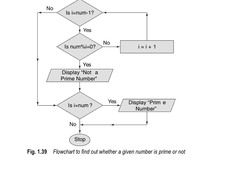

Fig. 1.39 判断给定数字是否为质数的流程图


#### 例 1.7 为示例 1.2 中给出的问题陈述绘制流程图。

**解答**

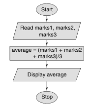

**图 1.40** *用于求学生所得分数平均值的流程图*

#### 例 1.8 为示例 1.3 中给出的问题陈述绘制流程图。

**解答**

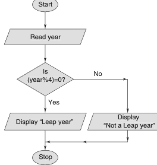

**图 1.41** *用于判断给定年份是否为闰年的流程图*

计算机导论、问题求解与基础 C 1.35

#### 例 1.9 为示例 1.4 中给出的问题陈述绘制流程图。

**解答**

```text
Start
Read num
Is (num%2)=0?
No
Yes
Display "Even Number"
Display "Odd Number"
Stop
```

**图 1.42** 用于判断给定数字是偶数还是奇数的流程图

#### 例 1.10 为示例 1.5 中给出的问题陈述绘制流程图。

**解答**

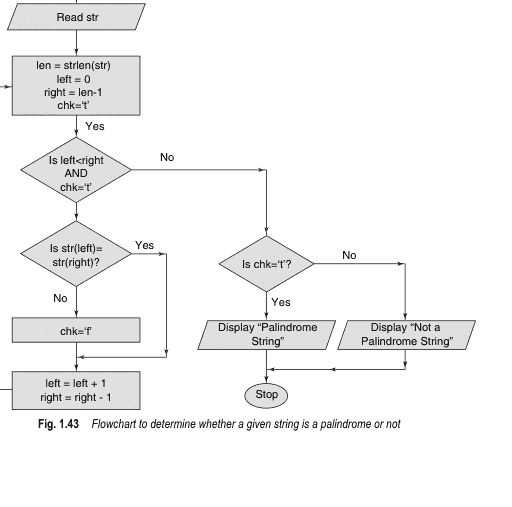

**图 1.43** *用于判断给定字符串是否为回文的流程图*

### 1.11 伪代码

在开发程序之前分析详细算法非常耗时。因此，需要一种只关注程序逻辑的规范。伪代码通过只规定逻辑来满足这一需求，程序员使用该逻辑开发计算机程序。伪代码不是使用某种编程语言的具体语法编写的，而是使用通用语法和普通英语语言的组合编写的。它帮助程序员理解程序的基本逻辑，之后程序员可以选择用任何编程语言编写最终代码。

```text
DEFINE Integer num1, num2, result
READ Integer num1
READ Integer num2
SET result = num1 + num2
Display result
```

**图 1.44** 用于将两个数相加并显示结果的伪代码

在计算机程序的伪代码编写完成后，它被用于开发该计算机程序的源代码。源代码使用编程语言开发，这种语言可以是汇编语言或高级编程语言。

#### 1.11.1 伪代码规则

- 伪代码语句中的指令或操作码必须全部大写；例如 READ（指定输入操作）、PRINT（指定打印命令）等。
- 循环和决策结构的结束必须用相应的“END”关键字适当标记。
- 伪代码指令必须正确缩进，就像计算机程序中的语句缩进一样。
- 应通过编写简单清晰的指令来避免复杂的编程指令。

#### 1.11.2 伪代码的优点

- 它易于理解，因为它使用英语短语编写程序指令。
- 与从头开发程序代码相比，使用伪代码开发程序代码更容易。
- 与从流程图开发程序代码相比，使用伪代码开发程序代码也更容易。
- 与流程图相比，伪代码指令更容易修改。
- 伪代码的使用非常适合大型程序设计。

计算机导论、问题求解与基础 C 1.39

#### 例 1.13 为示例 1.3 中给出的问题陈述编写伪代码。

**解答**

```text
BEGIN
DEFINE: Integer year
DISPLAY: "Enter the year value: "
READ: year
IF: year%4=0
DISPLAY: "'year' is a leap year"
ELSE
DISPLAY: "'year' is not a leap year"
END IF
END
```

**图 1.47** 用于判断给定年份是否为闰年的伪代码

#### 例 1.14 为示例 1.4 中给出的问题陈述编写伪代码。

**解答**

```text
BEGIN
DEFINE: Integer num
DISPLAY: "Enter a number: "
READ: num
IF: num%2=0
DISPLAY: "'num' is an even number"
ELSE
DISPLAY: "'num' is an odd number"
END IF
END
```

**图 1.48** 用于判断给定数字是偶数还是奇数的伪代码

#### 例 1.15 为示例 1.5 中给出的问题陈述编写伪代码。

**解答**

```text
BEGIN
DEFINE: String str
DEFINE: Character chk
DEFINE: Integer left, right, len
SET: chk = 't'
DISPLAY: "Enter a string: "
READ: str
COMPUTE: len = strlen(str)
SET: left = 0
SET: right = len-1
REPEAT
    IF: str(left)=str(right)
        CONTINUE
    ELSE
        SET: chk = 'f'
    END IF
    COMPUTE: left = left + 1
    COMPUTE: right = right - 1
UNTIL: left<right AND chk='t'
IF: chk='t'
    DISPLAY: "'str' is a palindrome string"
ELSE
    DISPLAY: "'str' is not a palindrome string"
END IF
END
```

**图 1.49** 用于确定给定字符串是否为回文的伪代码

### 1.12 问题求解示例

#### 例 1.16 设计并开发求二次方程根的解决方案。

**解答**

**算法**

- 步骤 1 - 开始
- 步骤 2 - 从用户处接受二次方程 ax² + bx + c 的三个数（a、b、c）
- 步骤 3 - 计算 root1=(-b+sqrt(b*b-4*a*c))/2*a
- 步骤 4 - 计算 root2=(-b-sqrt(b*b-4*a*c))/2*a
- 步骤 5 - 显示计算得到的二次方程的根
- 步骤 6 - 停止

**图 1.50** 求二次方程根的算法

**流程图**

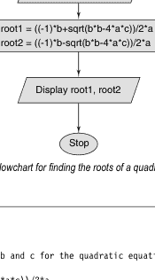

**图 1.51** 求二次方程根的流程图

**伪代码**

```text
BEGIN
DEFINE: Integer a, b, c
DEFINE: Real root1, root2
DISPLAY: "Enter the values of a, b and c for the quadratic equation ax² + bx + c: "
READ: a, b, c
COMPUTE: root1=((-1)*b+sqrt(b*b-4*a*c))/2*a
COMPUTE: root2=((-1)*b-sqrt(b*b-4*a*c))/2*a
DISPLAY: "The roots of the quadratic equation are 'root1' and 'root2'"
END
```

**程序**

```c
#include<stdio.h>
#include<conio.h>
#include<math.h>

void main()
{
    int a,b,c;
    float root1,root2; /*Declaration of variables to store root values*/
    clrscr();
    printf("Enter the value a, b and c for the quadratic equation ax^2+bx+c: ");
    scanf("%d %d %d",&a, &b, &c); /*Reading values of a, b and c*/
    root1=(((-1)*b+sqrt(b*b-4*a*c))/2*a); /*Computing quadratic root1*/
    root2=(((-1)*b-sqrt(b*b-4*a*c))/2*a); /*Computing quadratic root2*/
    printf("\n\nThe roots of the quadratic equation are: %.2f %.2f",root1, root2); /*Displaying resultant roots*/
    getch();
}
```

**输出**

```text
Enter the value a, b and c for the quadratic equation ax^2+bx+c: 1
-7
12

The roots of the quadratic equation are: 4.00 3.00
```

**图 1.52** 求二次方程根的程序

#### 例 1.17 设计并开发判断物品销售过程中是否存在盈利或亏损的解决方案。

**解答**

**算法**

- 步骤 1 - 开始
- 步骤 2 - 从用户处接受一件物品的成本价和销售价（cp、sp）
- 步骤 3 - 如果 sp>cp，则转到步骤 4，否则转到步骤 5
- 步骤 4 - 显示“利润为 (sp-cp)”并转到步骤 8
- 步骤 5 - 如果 cp>sp，则转到步骤 6，否则转到步骤 7
- 步骤 6 - 显示“亏损为 (cp-sp)”
- 步骤 7 - 显示“不盈不亏！”
- 步骤 8 - 停止

**流程图**


**伪代码**

```text
BEGIN
DEFINE: Long Integer cp, sp
DISPLAY: "Enter the cost price and selling price of an item: "
READ: cp, sp
IF: sp>cp
    DISPLAY: "There is a profit of 'sp-cp'"
ELSE
    IF: cp>sp
        DISPLAY: "There is a loss of 'cp-sp'"
    ELSE
        DISPLAY: "No profit no loss!"
    END IF
END IF
END
```

**程序**

```c
#include <stdio.h>
#include <conio.h>

void main()
{
    long cp, sp;
    clrscr();
    printf("\nEnter the cost price and selling price of an item: ");
    scanf("%ld\n%ld", &cp, &sp);  /*Reading CP and SP*/
    if(sp>cp)  /*Checking condition of profit*/
        printf("\nThere is a profit of %ld units", sp-cp);
    else if(cp>sp)  /*Checking condition of loss*/
        printf("\nThere is a loss of %ld units", cp-sp);
    else
        printf("\n\nNo Profit No Loss!");
    getch();
}
```

**输出**

```text
Enter the cost price and selling price of an item: 24
30

There is a profit of 6 units
```

**图 1.53** 计算盈利与亏损的解答

#### 例 1.18 设计并开发求圆面积的解决方案。

**解答**

**算法**

- 步骤 1 - 开始
- 步骤 2 - 从用户处接受圆的半径（radius）
- 步骤 3 - 使用公式 area = 3.14 * radius * radius 计算圆的面积
- 步骤 4 - 显示计算得到的圆的面积
- 步骤 5 - 停止


#### 流程图

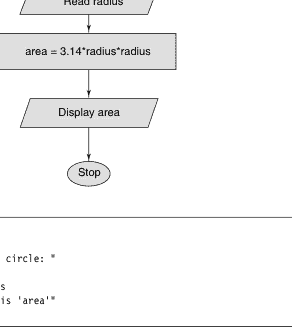

#### 伪代码

```
BEGIN
DEFINE: Real radius, area
DISPLAY: "Enter the radius of the circle: "
READ: radius
COMPUTE: area = 3.14*radius*radius
DISPLAY: "The area of the circle is 'area'"
END
```

#### 程序

```
#include <stdio.h>
#include <conio.h>
#include <math.h>

void main()
{
    float radius, area;
    clrscr();
    printf("Enter the radius of the circle: ");
    scanf("%f",&radius); /*Reading value of radius*/
    area=3.14*radius*radius; /*Computing area of the circle*/
    printf("\n\nThe area of the circle having radius of %.2f is %.2f",radius, area); /*Displaying result*/
    getch();
}
```

输出
输入圆的半径：4

半径为 4.00 的圆的面积是 50.24

## B部分
### C语言基础

### 1.13 C语言的历史

‘C’作为编程语言的名字似乎很奇怪。但这种听起来奇怪的语言是当今最流行的计算机语言之一，因为它是一种结构化、高级、与机器无关的语言。它使软件开发人员能够开发程序，而不必担心程序将在哪些硬件平台上实现。

所有现代语言的根源是 ALGOL，它于 20 世纪 60 年代初问世。ALGOL 是第一种使用块结构的计算机语言。尽管它在美国从未流行起来，但在欧洲被广泛使用。ALGOL 向计算机科学界提出了结构化程序设计的概念。Corrado Bohm、Giuseppe Jacopini 和 Edsger Dijkstra 等计算机科学家在 20 世纪 60 年代推广了这一概念。随后，若干语言相继发布。

1967 年，Martin Richards 开发了一种名为 BCPL（Basic Combined Programming Language，基本组合编程语言）的语言，主要用于编写系统软件。1970 年，Ken Thompson 利用 BCPL 的许多特性创建了一种语言，并直接称之为 B。B 被用于在贝尔实验室创建早期版本的 UNIX 操作系统。BCPL 和 B 都是“无类型”的系统编程语言。

C 由 Dennis Ritchie 于 1972 年在贝尔实验室从 ALGOL、BCPL 和 B 演化而来。C 采用了这些语言中的许多概念，并增加了数据类型的概念和其他强大特性。由于它是与 UNIX 操作系统一起开发的，因此与 UNIX 密切相关。这个操作系统也是在贝尔实验室开发的，几乎完全用 C 编写。UNIX 是当今使用中最流行的网络操作系统之一，也是互联网数据超级高速公路的核心。

多年来，C 主要应用于学术环境，但最终随着许多商用 C 编译器的发布以及 UNIX 日益流行，它开始在计算机专业人员中获得广泛支持。如今，C 可在多种操作系统和硬件平台上运行。

20 世纪 70 年代，C 演变成现在所称的“传统 C”。1978 年 Brian Kernighan 和 Dennis Ritchie 出版《C 程序设计语言》一书后，这种语言变得更受欢迎。这本书如此受欢迎，以至于这种语言在编程界被称为“K&R C”。C 的快速发展导致该语言出现了许多相似但常常不兼容的不同版本。这给系统开发者带来了严重问题。

为了确保 C 语言保持标准，1983 年，美国国家标准协会（ANSI）任命了一个技术委员会来定义 C 的标准。该委员会于 1989 年 12 月批准了一个 C 版本，现在称为 ANSI C。随后，该版本于 1990 年获得国际标准化组织（ISO）的批准。这个 C 版本也称为 C89。

20 世纪 90 年代，完全基于 C 的语言 C++ 经历了许多改进和变化，并于 1998 年 11 月成为 ANSI/ISO 批准的语言。C++ 为 C 增加了若干新特性，使其不仅成为真正的面向对象语言，而且成为用途更广的语言。同一时期，美国 Sun Microsystems 公司以 C 和 C++ 为模型创建了一种新语言 Java。

所有流行的计算机语言本质上都是动态的。它们通过纳入新特性不断增强能力和适用范围，C 也不例外。尽管 C++ 和 Java 是从 C 演化而来的，但 C 的标准化委员会认为，如果将 C++/Java 的少数特性加入 C，将会增强该语言的实用性。其结果就是 1999 年的 C 标准。这个版本通常称为 C99。

C 的历史和发展如图 1.55 所示。

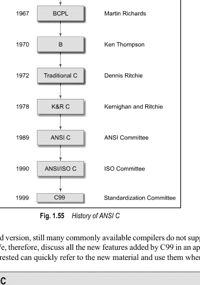

图1.55 ANSI C 的历史

尽管 C99 是一个改进版本，但许多常用编译器仍然不支持 C99 中纳入的所有新特性。因此，我们在附录中单独讨论 C99 新增的所有新特性，以便感兴趣的读者可以快速查阅这些新内容，并在可能的情况下使用它们。

### 1.14 C语言的重要性

C 日益流行，可能归因于它的许多优良特性。它是一种健壮的语言，其丰富的内置函数和运算符可用于编写任何复杂程序。C 编译器将汇编语言的能力与高级语言的特征结合起来，因此非常适合编写系统软件和商业软件包。事实上，市场上许多可用的 C 编译器都是用 C 编写的。

用 C 编写的程序高效且快速。这归因于其多样的数据类型和强大的运算符。它比 BASIC 快许多倍。例如，一个将变量从 0 递增到 15000 的程序在 C 中大约需要一秒，而在解释型 BASIC 中则需要 50 多秒。

ANSI C 中只有 32 个关键字，其优势在于内置函数。有若干标准函数可用于开发程序。

### 1.15 示例程序1：打印一条消息

C 具有高度可移植性。这意味着为一台计算机编写的 C 程序只需很少修改或无需修改即可在另一台计算机上运行。如果我们计划使用具有不同操作系统的新计算机，可移植性就很重要。

C 语言非常适合结构化程序设计，因此要求用户从函数模块或代码块的角度思考问题。合理组织这些模块即可构成一个完整的程序。这种模块化结构使程序调试、测试和维护更加容易。

C 的另一个重要特性是它能够扩展自身。C 程序基本上是由 C 库支持的函数集合。我们可以不断向 C 库添加自己的函数。由于有大量函数可用，编程任务变得简单。

在讨论 C 的具体特性之前，我们将看一些 C 示例程序，并分析理解它们如何工作。

考虑图 1.56 中给出的一个非常简单的程序。

该程序执行后将产生以下输出：

我看见了，我记住了

```
main()
{
/*____printing begins.........*/ 
printf("I see, I remember");
/*________printing ends..............*/
}
```

图1.56 打印一行文本的程序

让我们仔细看看这个程序。第一行通知系统程序名是 main，执行从这一行开始。main() 是 C 系统用来告诉计算机程序从何处开始的一个特殊函数。每个程序必须有且仅有一个 main 函数。如果我们使用多个 main 函数，编译器就无法理解哪一个标志程序的开始。

紧跟在 main 后面的空括号表示函数 main 没有参数（或形参）。参数的概念将在第 12 章讨论函数时详细讨论。

第二行中的左花括号“{”标志函数 main 的开始，最后一行中的右花括号“}”表示函数的结束。在本例中，右花括号也标志程序的结束。这两个花括号之间的所有语句构成函数体。函数体包含一组执行给定任务的指令。

在本例中，函数体包含三条语句，其中只有 printf 这一行是可执行语句。以 /* 开头并以 */ 结尾的行称为注释行。它们在程序中使用，以增强可读性和理解性。注释行不是可执行语句，因此 /* 和 */ 之间的任何内容都会被编译器忽略。一般来说，注释可以插入任何可出现空白的地方——行的开头、中间或末尾——“但绝不能放在单词中间”。

```
/* * = = */ * = = * / * = = * /
```

是无效的，因此会导致错误。

由于注释不影响执行速度和编译后程序的大小，我们应在程序中充分使用它们。它们有助于程序员和其他用户理解各种功能。


以及程序的操作，并有助于调试和测试。在接下来的示例中，我们将进一步了解注释行的用法。

现在让我们看看 printf() 函数，它是该程序中唯一可执行的语句。

```c
printf("I see, I remember");
```

printf 是用于打印输出的预定义标准 C 函数。预定义意味着它是一个已经编写并编译好的函数，并在链接时与我们的程序链接在一起。编译和链接的概念将在本章后面解释。printf 函数会打印起始引号和结束引号之间的所有内容。在这种情况下，输出将是：

I see, I remember

注意，打印行以分号结尾。C 中的每条语句都应以分号（;）结尾。

假设我们想将上面的引文分两行打印为

I see,
I remember!

这可以通过添加另一个 printf 函数来实现，如下所示：

```c
printf("I see, \n");
printf("I remember !");
```

圆括号之间包含的信息称为函数的参数。第一个 printf 函数的参数是 "I see, \n"，第二个参数是 "I remember !"。这些参数就是要打印出来的字符串。

注意，第一个 printf 的参数在字符串末尾包含由 \ 和 n 两个字符组成的组合。这个组合统称为换行符。换行符指示计算机转到下一（新）行。它在概念上类似于打字机上的回车键。在打印逗号（,）字符后，换行符 \n 会使字符串 "I remember !" 打印在下一行。\ 和 n 之间不允许有空格。

如果我们从第一条 printf 语句中省略换行符，那么输出将再次成为一行，如下所示。

I see, I remember !

这与图 1.56 中程序的输出类似。但是请注意，逗号和 I 之间没有空格。

也可以通过一条 printf 语句，在适当位置使用换行符来产生两行或更多行输出。例如，语句

```c
printf("I see,\n I remember !");
```

将输出

I see,
I remember !

而语句

```c
printf("I\n.. see,\n... \n... remember !");
```

将打印出

I
.. see,
... I
... remember !

> 注意：有些作者建议在所有使用任何输入/输出库函数的程序开头包含语句
> #include <stdio.h>
> 。然而，对于已定义为 C 语言一部分的 printf 和 scanf 函数来说，这并不是必需的。有关输入和输出函数的更多内容，请参见第 5 章。

在我们继续讨论更多示例之前，必须注意一个重要点。C 确实区分大写字母和小写字母。例如，printf 和 PRINTF 并不相同。在 C 中，所有内容都用小写字母书写。然而，大写字母用于表示常量的符号名。我们也可以在输出字符串中使用大写字母，例如 "I SEE" 和 "I REMEMBER"。

上面打印 I see, I remember 的示例是最简单的程序之一。图 1.57 强调了这类简单程序的一般格式。所有 C 程序都需要一个 main 函数。

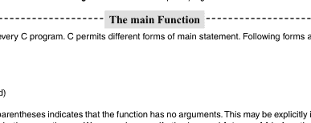

图 1.57 简单 C 程序的格式

## 主函数

main 是每个 C 程序的一部分。C 允许不同形式的 main 语句。允许以下形式。

- main()
- int main()
- void main()
- main(void)
- void main(void)
- int main(void)

一对空圆括号表示该函数没有参数。这可以通过在圆括号内使用关键字 void 来明确表示。我们也可以在单词 main 之前指定关键字 int 或 void。关键字 void 表示该函数不向操作系统返回任何信息，而 int 表示该函数向操作系统返回一个整数值。当指定 int 时，程序中的最后一条语句必须是 "return 0"。为简单起见，我们在程序中使用第一种形式。

## 1.16 示例程序 2：两数相加

考虑另一个程序，它对两个数执行加法并显示结果。完整程序如图 1.58 所示。

```c
/* Program ADDITION          line-1 */
/* Written by EBG            line-2 */
main()                     /* line-3 */
{                          /* line-4 */
int number;                    /* line-5 */
float amount;                  /* line-6 */
                               /* line-7 */
number = 100;                  /* line-8 */
                               /* line-9 */
amount = 30.75 + 75.35;        /* line-10 */
printf("%d\n", number);        /* line-11 */
printf("%5.2f", amount);       /* line-12 */
}                              /* line-13 */
```

图 1.58 两数相加的程序

该程序执行时将产生以下输出：

```
100
106.10
```

程序的前两行是注释行。在开头使用注释行来提供程序名称、作者、日期等信息是一种好习惯。注释字符也用于其他行中以指示行号。

**number** 和 **amount** 这两个词是用于存储数值数据的 *变量名*。数值数据可以是 *整数* 形式，也可以是 *实数* 形式。在 C 中，所有 *变量都应声明*，以告诉编译器 *变量名* 是什么以及它们保存的是什么 *数据类型*。变量必须在使用之前声明。在第 5 行和第 6 行中，声明

```c
int number;
float amount;
```

告诉编译器 **number** 是整数（**int**），**amount** 是浮点（**float**）数。声明语句必须出现在函数的开头，如图 1.58 所示。所有声明语句都以分号结尾；C 支持许多其他数据类型，它们将在第 1 章中详细讨论。

**int** 和 **float** 这类词称为 *关键字*，不能用作 *变量名*。关键字列表在第 1 章中给出。

通过将数据值 *赋值* 给变量，数据便存储在变量中。这在第 8 行和第 10 行中完成。在第 8 行中，整数值 100 被赋给整数变量 **number**；在第 10 行中，两个实数 30.75 和 75.35 相加的结果被赋给浮点变量 **amount**。语句

```c
number = 100;
amount = 30.75 + 75.35;
```

称为 *赋值语句*。每条赋值语句末尾都必须有分号。

下一条语句是输出语句，它打印 **number** 的值。打印语句

```c
printf("%d\n", number);
```

包含两个参数。第一个参数 "%d" 告诉编译器，第二个参数 **number** 的值应作为 *十进制整数* 打印。注意，这些参数用逗号分隔。换行符 '\n' 使下一个输出出现在新的一行。

程序的最后一条语句

```c
printf("%5.2f", amount);
```

以浮点格式打印 **amount** 的值。格式说明 %5.2f 告诉编译器，输出必须为 *浮点数* 格式，总共五位，小数点右边两位。

## 1.17 示例程序 3：利息计算

图 1.59 中的程序计算投资每年年末的货币价值，假设利率为 11%，并以两列打印年份和相应金额。图 1.60 显示了初始投资为 5000.00、期限为 10 年的输出。该程序使用以下公式：

年末价值 = 年初价值 (1 + 利率)

在程序中，变量 value 表示年末的货币价值，而 amount 表示年初的货币价值。语句

```c
amount = value;
```

将当前年末的价值作为下一年年初的价值。

```c
/*______ INVESTMENT PROBLEM ______*/
#define PERIOD 10
#define PRINCIPAL 5000.00
/*______ MAIN PROGRAM BEGINS ______*/
main()
{ /*______ DECLARATION STATEMENTS ______*/
    int year;
    float amount, value, inrate;
    /*______ ASSIGNMENT STATEMENTS ______*/
    amount = PRINCIPAL;
    inrate = 0.11;
    year = 0;
    /*______ COMPUTATION STATEMENTS ______*/
    /* COMPUTATION USING While LOOP ______*/
    while(year <= PERIOD)
    {
        printf("%2d%8.2f\n",year, amount);
        value = amount + inrate * amount;
        year = year + 1;
        amount = value;
    }
    /*______ while LOOP ENDS ______*/
}
/*______ PROGRAM ENDS ______*/
```

图 1.59 投资问题程序

让我们考虑该程序中引入的新特性。第二行和第三行以 #define 指令开头。#define 指令将一个值定义为程序中使用的符号常量。每当遇到符号名时，编译器会自动替换为该名称关联的值。要更改该值，只需更改定义即可。在本例中，我们定义了两个符号常量 PERIOD 和 PRINCIPAL，并分别赋值 10 和 5000.00。这些值在程序执行期间保持不变。

|  |  |
|---|---|
| 0 | 5000.00 |
| 1 | 5550.00 |
| 2 | 6160.50 |
| 3 | 6838.15 |


|   |   |
|---:|---:|
| 4 | 7590.35 |
| 5 | 8425.29 |
| 6 | 9352.07 |
| 7 | 10380.00 |
| 8 | 11522.69 |
| 9 | 12790.00 |
| 10 | 14197.11 |

**图 1.60** *投资程序的输出*

### #define 指令

**#define** 是预处理器编译器指令，而不是语句。因此，**#define** 行不应以分号结尾。符号常量通常用大写字母书写，以便容易与小写变量名区分。**#define** 指令通常放在开头，位于 **main()** 函数之前。符号常量不在声明部分中声明。

我们必须注意，已定义的常量不是变量。我们不能在程序中使用赋值语句更改它们的值。例如，以下语句

```
PRINCIPAL = 10000.00;
```

是非法的。

声明部分将 **year** 声明为整数，将 **amount**、**value** 和 **inrate** 声明为浮点数。注意，所有浮点变量都在一条语句中声明。它们也可以声明为

```
float amount;
float value;
float inrate;
```

当在一条语句中声明两个或更多变量时，它们之间用逗号分隔。

所有计算和打印都在 **while** 循环中完成。**while** 是一种重复求值一条语句或一组语句的机制。在这种情况下，只要 **year** 的值小于或等于 **PERIOD** 的值，就会执行 **while** 后面的四条语句。注意，这四条语句由花括号分组。当 **year** 大于 **PERIOD** 时，我们退出循环。

C 支持四种基本算术运算符（+、-、*、/）以及另外几种运算符。

## 1.18 示例程序 4：子程序的使用

到目前为止，我们只使用了 C 系统为我们提供的 **printf** 函数。图 1.61 所示的程序使用了用户定义的函数。用户定义的函数相当于 FORTRAN 中的子程序或 BASIC 中的子程序。

图 1.61 给出了一个使用 **mul()** 函数的非常简单的程序。该程序将打印以下输出：

**5 和 10 的乘积是 50**

```c
/*------------- PROGRAM USING FUNCTION -------------*/
int mul (int a, int b); /*------------- DECLARATION -------------*/
/*------------- MAIN PROGRAM BEGINS -------------*/
main ()
{
        int a, b, c;

        a = 5;
        b = 10;
        c = mul(a, b);

        printf ("multiplication of %d and %d is %d", a, b, c);

} /*_____________ MAIN PROGRAM ENDS
        MUL() FUNCTION STARTS _____________*/
int mul (int x, int y)
{
        int p;
        p = x * y;
        return(p);
} /*_____________ MUL() FUNCTION ENDS _____________*/
```

图 1.61  使用用户定义函数的程序

**mul()** 函数将 x 和 y 的值相乘，并且当在以下语句中调用它时，结果会返回给 **main()** 函数

```
c = mul(a, b);
```

**mul()** 函数有两个*参数* x 和 y，它们被声明为整数。当调用 **mul()** 函数时，**a** 和 **b** 的值分别传递给 x 和 y。第 9 章将详细讨论用户定义的函数。

## 1.19 示例程序 5：数学函数的使用

我们经常使用标准数学函数，例如 cos、sin、exp 等。现在我们来看如何在程序中使用数学函数。标准数学函数被定义并作为 C **数学库**的一部分保存。如果我们想使用这些数学函数中的任何一个，必须在程序中添加 **#include** 指令。与 **#define** 一样，它也是编译器指令，指示编译器从库中链接指定的数学函数。该指令的形式为

```
#include <math.h>
```

`math.h` 是包含所需函数的文件名。图 1.62 说明了余弦函数的使用。该程序计算角度 0、10、20……180 的余弦值，并连同标题打印结果。

```c
/*---------- PROGRAM USING COSINE FUNCTION ----------*/
#include <math.h>
#define PI 3.1416
#define MAX 180
main ( )
{
    int angle;
    float x, y;

    angle = 0;
    printf("Angle   Cos(angle)\n\n");

    while(angle <= MAX)
    {
        x = (PI / MAX) * angle;
        y = cos(x);
        printf("%5d %13.4f\n", angle, y);
        angle = angle + 10;
    }
}
```

输出

| 角度 | Cos(角度) |
|---:|---:|
| 0 | 1.0000 |
| 10 | 0.9848 |
| 20 | 0.9397 |
| 30 | 0.8660 |
| 40 | 0.7660 |
| 50 | 0.6428 |
| 60 | 0.5000 |
| 70 | 0.3420 |
| 80 | 0.1736 |
| 90 | -0.0000 |
| 100 | -0.1737 |
| 110 | -0.3420 |
| 120 | -0.5000 |
| 130 | -0.6428 |
| 140 | -0.7660 |
| 150 | -0.8660 |
| 160 | -0.9397 |
| 170 | -0.9848 |
| 180 | -1.0000 |

图 1.62  使用数学函数的程序

另一个经常需要的 #include 指令是

```
#include <stdio.h>
```

`stdio.h` 指标准 I/O 头文件，包含标准输入和输出函数。

### #include 指令

如前所述，C 程序被划分为模块或函数。有些函数由像我们这样的用户编写，还有许多函数存储在 C 库中。库函数按类别分组，并存储在不同的文件中，这些文件称为头文件。如果我们想访问存储在库中的函数，必须告诉编译器要访问哪些文件。

这通过使用如下预处理指令 #include 来实现：

```
#include<filename>
```

`filename` 是包含所需函数定义的库文件名。预处理指令放在程序的开头。

## 1.20 C 程序的基本结构

到目前为止讨论的示例表明，C 程序可以看作是一组称为函数的构建块。函数是一个子程序，可以包含一条或多条旨在执行特定任务的语句。要编写 C 程序，首先创建函数，然后将它们组合在一起。一个 C 程序可以包含一个或多个部分，如图 1.63 所示。

文档部分由一组注释行组成，给出程序名称、作者以及程序员以后可能想使用的其他详细信息。链接部分向编译器提供指令，以从系统库链接函数。定义部分定义所有符号常量。

有些变量会在多个函数中使用。这样的变量称为全局变量，并在所有函数之外的全局声明部分中声明。该部分还声明所有用户定义的函数。

每个 C 程序都必须有一个 main() 函数部分。该部分包含两部分：声明部分和可执行部分。声明部分声明可执行部分中使用的所有变量。可执行部分至少有一条语句。这两部分必须出现在左花括号和右花括号之间。程序执行从左花括号开始，到右花括号结束。main 函数部分的右花括号是程序的逻辑结尾。声明部分和可执行部分中的所有语句都以分号（;）结尾。

子程序部分包含主函数中调用的所有用户定义函数。用户定义的函数通常紧跟在主函数之后，尽管它们可以以任何顺序出现。

除主函数部分外，所有部分在不需要时都可以省略。

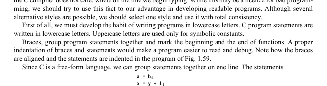

## 1.21 编程风格

与其他一些编程语言（COBOL、FORTRAN 等）不同，C 是一种自由格式语言。也就是说，C 编译器不关心我们在行中的哪个位置开始输入。虽然这可能成为不良编程的借口，但我们应该尝试利用这一事实来开发可读的程序。尽管可能有几种替代风格，但我们应该选择一种风格，并完全一致地使用它。

首先，我们必须养成用小写字母编写程序的习惯。C 程序语句用小写字母书写。大写字母仅用于符号常量。

花括号将程序语句分组，并标记函数的开始和结束。适当地缩进花括号和语句会使程序更易于阅读和调试。注意图 1.59 的程序中花括号如何对齐以及语句如何缩进。

由于 C 是一种自由格式语言，我们可以将语句组合在一行中。语句 a = b; x = y + 1; z = a + x; 可以写成一行：a = b; x = y + 1; z = a + x;

```
a = b;
x = y + 1;
z = a + x;
```


## 1.5.6 计算机编程

```
a = b; x = y+1; z = a+x;
```

```
main() {
    printf("hello C");
}
```

可以写成一行，如 main() (printf("Hello C"));

然而，这种风格会使程序更难以理解，不应使用。在本书中，每条语句都单独占一行。程序中使用大量注释的重要性怎么强调都不为过。恰当插入的注释也有助于理解程序逻辑。这对于程序的调试和测试非常重要。

## 1.2.2 程序开发步骤

执行用C编写的程序涉及一系列步骤。这些步骤是：

- 1. 创建程序；
- 2. 编译程序；
- 3. 将程序与C库中需要的函数链接；以及
- 4. 执行程序。

图 1.64 图示了创建、编译和执行C程序的过程。虽然这些步骤在任何操作系统下都相同，但实现这些步骤的系统命令和文件命名约定在不同系统上可能有所不同。

操作系统是控制计算机系统整体运行的程序。所有输入/输出操作都通过操作系统进行。操作系统是硬件与用户之间的接口，负责处理用户程序的执行。

当今两种最流行的操作系统是 UNIX（用于小型机）和 MS-DOS（用于微型计算机）。我们将在以下章节中简要讨论在这两种操作系统下执行C程序应遵循的过程。

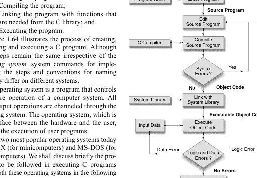

图 1.64 编译和运行C程序的过程

## 1.2.3 UNIX 系统

### 1.2.3.1 创建程序

一旦我们将UNIX操作系统装入内存，计算机就可以接收程序。程序必须输入到文件中。文件名可以由字母、数字和特殊字符组成，后跟一个点和字母 c。有效文件名的示例有：

```
hello.c
program.c
eg1.c
```

文件借助文本编辑器（ed 或 vi）创建。调用编辑器并创建文件的命令是

```
ed filename
```

如果文件之前存在，它会被加载。如果文件尚不存在，则需要创建它以便接收新程序。程序中的所有修正都在编辑器下完成。（系统的编辑器名称可能不同。请查阅系统手册。）

编辑结束后，文件保存在磁盘上。此后任何时间都可以通过其文件名引用它。输入到文件中的程序称为源程序，因为它代表了程序的原始形式。

### 1.2.3.2 编译和链接

让我们假设源程序已创建在名为 eg1.c 的文件中。现在程序可以进行编译了。在UNIX下实现此任务的编译命令是

```
cc eg1.c
```

源程序指令现在被转换成适合计算机执行的形式。转换过程是在检查每条指令的正确性后进行的。如果一切正常，编译会静默进行，转换后的程序存储在另一个名为 eg1.o 的文件中。该程序称为目标代码。

链接是将程序所需的其他程序文件和函数组合在一起的过程。例如，如果程序使用了 exp() 函数，那么该函数的目标代码应从系统的数学库中取出并链接到主程序。在UNIX下，使用 cc 命令时会自动进行链接（如果未检测到错误）。

如果发现语言语法或语义方面的任何错误，会将其列出，编译过程就此结束。应在编辑器的帮助下在源程序中更正错误，然后重新编译。

编译并链接后的程序称为可执行目标代码，并自动存储在另一个名为 a.out 的文件中。

请注意，某些系统使用不同的编译命令来链接数学函数。

```
cc filename -lm
```

是 UNIX SYSTEM V 操作系统下的命令。

### 1.2.3.3 执行程序

执行是一项简单的任务。命令

```
a.out
```

会将可执行目标代码加载到计算机内存并执行指令。在执行期间，程序可能会请求通过键盘输入一些数据。有时程序没有产生预期结果。也许程序逻辑或数据有问题。这时就需要修正源程序或数据。如果修改了源程序，则应重复编译、链接和执行程序的整个过程。

### 1.2.3.4 创建我们自己的可执行文件

注意，链接器总是分配相同的名称 a.out。当我们编译另一个程序时，该文件将被新程序的可执行目标代码覆盖。如果我们想防止这种情况发生，应该立即使用命令重命名该文件：

```
mv a.out name
```

我们也可以通过如下方式在 cc 命令中指定一个选项来实现这一点：

```
cc -o name source-file
```

这会将可执行目标代码存储在名为 name 的文件中，并防止旧的 a.out 文件被销毁。

### 1.2.3.5 多源文件

要编译和链接多个源程序文件，我们必须将所有文件名附加到 cc 命令中。

```
cc filename-1.c ... filename-n.c
```

这些文件将被单独编译成目标文件，称为

```
filename-1.o
```

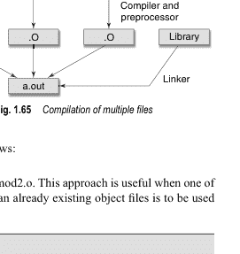

然后链接起来生成可执行程序文件 a.out，如图 1.65 所示。

也可以分别编译每个文件，然后再链接。例如，命令

```
cc -c mod1.c
```

```
cc -c mod2.c
```

会将源文件 mod1.c 和 mod2.c 编译成目标文件 mod1.o 和 mod2.o。它们可以通过命令链接在一起：

```
cc mod1.o mod2.o
```

我们也可以如下方式组合源文件和目标文件：

```
cc mod1.c mod2.o
```

只有 mod1.c 被编译，然后与目标文件 mod2.o 链接。当多个源文件中有一个需要修改并重新编译，或者需要将已有的目标文件与待编译的程序一起使用时，这种方法非常有用。

## 1.2.4 MS-DOS 系统

程序可以使用任何文字处理软件以非文档模式创建。文件名应以 ".c" 结尾，如 program.c、pay.c 等。然后命令

```
MSC pay.c
```

在 MS-DOS 操作系统下会加载存储在文件 **pay.c** 中的程序并生成**目标代码**。该代码存储在另一个名为 **pay.obj** 的文件中。如果发现任何语言错误，编译将无法完成。此时应更正程序并重新编译。

链接通过命令

```
LINK pay.obj
```

完成，该命令生成文件名为 **pay.exe** 的**可执行代码**。现在，命令

```
pay
```

将执行程序并给出结果。

## 1.2.5 常量、变量和数据类型简介

编程语言旨在帮助处理由数字、字符和字符串组成的某些类型的*数据*，并提供称为*信息*的有用输出。处理数据的任务是通过执行一系列精确指令来完成的，这些指令称为*程序*。这些指令根据一些严格的规则（称为*语法规则*（或*文法*））使用特定的符号和单词形成。每个程序指令都必须完全符合该语言的语法规则。

与任何其他语言一样，C 语言也有自己的词汇和语法。在本章中，我们将讨论与 C 编程语言相关的常量、变量及其类型的概念。

## 1.2.6 字符集

可用于构成单词、数字和表达式的字符取决于运行程序的计算机。然而，有一个字符子集可用于大多数个人计算机、微型计算机、小型机和大型机。C 中的字符分为以下几类：

- 1. 字母
- 2. 数字
- 3. 特殊字符
- 4. 空白字符

完整的字符集见表 1.3。

编译器会忽略空白字符，除非它们是字符串常量的一部分。空白字符可用于分隔单词，但禁止出现在关键字和标识符的字符之间。

### 三字符组

许多非英语键盘不支持表 1.3 中提到的所有字符。ANSI C 引入了“三字符组”序列的概念，以便在某些键盘上输入无法使用的字符。每个三字符组序列由三个字符组成（两个问号后跟另一个字符），如表 1.4 所示。例如，如果键盘不支持方括号，我们仍然可以在程序中使用三字符组 `??(` 和 `??)`。

**表 1.3**   C 字符集

| 字母 | 数字 |
|---|---|
| 大写字母 A....Z | 所有十进制数字 0....9 |
| 小写字母 a....z |  |


## 特殊字符

- `,` 逗号
- `.` 句点
- `;` 分号
- `:` 冒号
- `?` 问号
- `'` 撇号
- `"` 引号
- `!` 感叹号
- `|` 竖线
- `/` 斜杠
- `\` 反斜杠
- `~` 波浪号
- `_` 下划线
- `$` 美元符号
- `%` 百分号

- `&` 和号
- `^` 脱字符
- `*` 星号
- `-` 减号
- `+` 加号
- `<` 左尖括号（或小于号）
- `>` 右尖括号（或大于号）
- `(` 左圆括号
- `)` 右圆括号
- `[` 左方括号
- `]` 右方括号
- `{` 左花括号
- `}` 右花括号
- `#` 井号

## 空白字符

- 空格
- 水平制表符
- 回车符
- 换行符
- 换页符

表 1.4 ANSI C 三字符序列

| 三字符序列 | 转换 |
|---|---|
| ??= | # 井号 |
| ??( | [ 左方括号 |
| ??) | ] 右方括号 |
| ??< | { 左花括号 |
| ??> | } 右花括号 |
| ??! | \| 竖线 |
| ??\ | \ 反斜杠 |
| ??/ | ^ 脱字符 |
| ??- | ~ 波浪号 |

## 1.27 C 标记

在一段文本中，单个单词和标点符号被称为*标记*。类似地，在 C 程序中，最小的独立单元称为 C 标记。C 有六种标记，如图 1.66 所示。C 程序使用这些标记和语言语法编写。

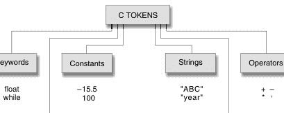

图 1.66 C 标记及示例

每个 C 单词都被归类为关键字或标识符。所有关键字都有固定含义，这些含义不能更改。关键字是程序语句的基本构建块。ANSI C 的所有关键字列于表 1.5。所有关键字必须小写。某些编译器可能使用额外关键字，必须从 C 手册中识别。

> 注意：C99 增加了更多关键字。参见附录“C99 特性”。

| auto | double | int | struct |
|------|--------|-----|--------|
| break | else | long | switch |
| case | enum | register | typedef |
| char | extern | return | union |
| const | float | short | unsigned |
| continue | for | signed | void |
| default | goto | sizeof | volatile |
| do | if | static | while |

标识符指变量、函数和数组的名称。这些是用户定义的名称，由字母和数字序列组成，首字符为字母。允许大写和小写字母，尽管通常使用小写字母。标识符中也允许下划线字符。它通常用于长标识符中两个单词之间的连接。

- 1. 首字符必须是字母（或下划线）。
- 2. 只能由字母、数字或下划线组成。
- 3. 只有前 31 个字符有效。
- 4. 不能使用关键字。
- 5. 不得包含空白字符。

## 1.29 常量

C 中的常量指在程序执行期间不改变的固定值。C 支持几种类型的常量，如图 1.67 所示。

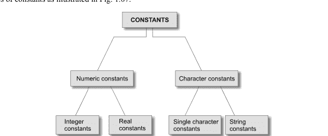

### 1.29.1 整型常量

整型常量指数字序列。有三种整数，即十进制整数、八进制整数和十六进制整数。

十进制整数由一组数字 0 到 9 组成，前面可选带 – 或 + 号。有效的十进制整型常量示例为：

- 123
- -321
- 0
- 654321
- +78

数字之间不允许嵌入空格、逗号和非法数字字符。例如，15 750 20,000 $1000 是非法数字。

> *注意：ANSI C 支持一元加号，而早期版本未定义该运算符。

八进制整型常量由 0 到 7 集合中的任意数字组合组成，并以 0 开头。八进制整数的一些示例为：

- 037
- 0
- 0435
- 0551

以 0x 或 0X 开头的数字序列被视为十六进制整数。它们还可包含字母 A 到 F 或 a 到 f。字母 A 到 F 表示数字 10 到 15。以下是有效十六进制整数示例：

0X2 0x9F 0Xbed 0x

在编程中很少使用八进制和十六进制数。

可存储的最大整数值取决于机器。在 16 位机上为 32767，在 32 位机上为 2,147,483,647。在这些机器上，也可以通过向常量追加 U、L 和 UL 等限定符来存储更大的整型常量。示例：

- 56789U 或 56789u（无符号整数）
- 98761234UL 或 98761234ul（无符号长整型）
- 9876543L 或 9876543l（长整型）

无符号整数和长整型的概念在第 1.7 节详细讨论。

### 例 1.19 在 16 位计算机上表示整型常量。

图 1.68 中的程序演示了在 16 位机上使用整型常量。图 1.68 的输出表明，大于 32767 的整数值在 16 位机上无法正确存储。然而，当把它们限定为长整型（通过追加 L）时，这些值会被正确存储。

```
Program
main()
{
    printf("Integer values\n");
    printf("%d %d %d\n", 32767,32767+1,32767+10);
    printf("\n");
    printf("Long integer values\n");
    printf("%ld %ld %ld\n", 32767L,32767L+1L,32767L+10L);
}
```

Output

```
Integer values
32767 -32768 -32759
Long integer values
32767 32768 32777
```

图 1.68 在 16 位机上表示整型常量

### 1.29.2 实型常量

整数不足以表示连续变化的数量，如距离、高度、温度、价格等。这些量由包含小数部分的数字表示，如 17.548。这类数字称为实型（或浮点）常量。实型常量的更多示例为：

0.0083 -0.75 435.36 +247.0

实数也可以用指数（或科学）记法表示。例如，值 215.65 可用指数记法写成 2.1565e2。e2 表示乘以 10²。一般形式为：

尾数 e 指数

尾数可以是用十进制记法表示的实数或整数。指数是带可选正号或负号的整数。分隔尾数和指数的字母 e 可以小写或大写。由于指数使小数点“浮动”，这种记法被认为以浮点形式表示实数。合法浮点常量示例为：

0.65e4 12e-2 1.5e+5 3.18E3 -1.2E-1

不允许嵌入空白。

指数记法适用于表示量级非常大或非常小的数。例如，7500000000 可写成 7.5E9 或 75E8。类似地，-0.0000000368 等价于 -3.68E-7。

浮点常量通常表示为双精度量。然而，后缀 f 或 F 可用于强制单精度，l 或 L 可进一步扩展双精度。表 1.6 给出了一些有效和无效数值常量的示例。

### 表 1.6 数值常量示例

| 常量 | 有效？ | 备注 |
|---|---|---|
| 698354L | 是 | 表示长整型 |
| 25,000 | 否 | 不允许逗号 |
| +5.0E3 | 是 | （ANSI C 支持一元加号） |
| 3.5e-5 | 是 |  |
| 7.1e 4 | 否 | 不允许空白 |
| -4.5e-2 | 是 |  |
| 1.5E+2.5 | 否 | 指数必须是整数 |
| $255 | 否 | 不允许 $ 符号 |
| 0X7B | 是 | 十六进制整数 |

### 1.29.3 单字符常量

单字符常量（或简称字符常量）包含用一对单引号括起来的单个字符。字符常量示例为：'5' 'X' ';' ' '

注意，字符常量 '5' 与数字 5 不同。最后一个常量是空格。字符常量具有称为 ASCII 值的整数值。例如，语句 printf("%d", 'a'); 将打印数字 97，即字母 a 的 ASCII 值。类似地，语句 printf("%c", 97); 将输出字母 'a'。所有字符的 ASCII 值见附录 II。由于每个字符表示一个整数值，也可以对字符常量执行算术运算。它们将在第 9 章讨论。


### 1.29.4 字符串常量

字符串常量是用双引号括起来的一系列字符。这些字符可以是字母、数字、特殊字符和空白。示例如下：

"Hello!" "1987" "WELL DONE" "?..!" "$+3" "X"

请记住，字符常量（例如，'X'）不等价于单字符字符串常量（例如，"X"）。此外，单字符字符串常量没有等价的整数值，而字符常量有整数值。字符串常用于程序中以构建有意义的程序。字符串的操作将在第11章详细讨论。

### 1.29.5 反斜杠字符常量

C支持一些用于输出函数的特殊反斜杠字符常量。例如，符号'\n'表示换行符。这类反斜杠字符常量的列表见表1.7。注意，它们中的每一个都表示一个字符，尽管它们由两个字符组成。这些字符组合称为转义序列。

**表1.7 反斜杠字符常量**

| 常量 | 含义 |
|---|---|
| `'\a'` | 声音警报（铃） |
| `'\b'` | 退格 |
| `'\f'` | 换页 |
| `'\n'` | 换行 |
| `'\r'` | 回车 |
| `'\t'` | 水平制表 |
| `'\v'` | 垂直制表 |
| `'\''` | 单引号 |
| `'\"'` | 双引号 |
| `'\?'` | 问号 |
| `'\\'` | 反斜杠 |
| `'\0'` | 空字符 |

## 1.30 变量

变量是可用于存储数据值的数据名。与在程序执行期间保持不变的常量不同，变量在执行期间的不同时刻可以取不同的值。在第3章中，我们使用了几个变量。例如，在示例程序3中，我们使用变量amount来存储每年年末的金额（在加上当年所赚利息之后）。

程序员可以用有意义的方式选择变量名，以反映其在程序中的功能或性质。此类名称的一些示例如下：

- Average
- height
- Total
- Counter_1
- class_strength

如前所述，变量名可以由字母、数字和下划线（_）字符组成，但须满足以下条件：

- 1. 它们必须以字母开头。有些系统允许以下划线作为第一个字符。
- 2. ANSI标准识别31个字符的长度。然而，长度通常不应超过八个字符，因为许多编译器只将前八个字符视为有效。（在C99中，至少63个字符是有效的。）
- 3. 大写和小写是有区别的。也就是说，变量Total与total或TOTAL不同。
- 4. 它不应该是关键字。
- 5. 不允许空白字符。

有效变量名的一些示例如下：

|  |  |  |
|---|---|---|
| John | Value | T_raise |
| Delhi | x1 | ph_value |
| mark | sum1 | distance |

无效示例包括：

|  |  |  |
|---|---|---|
| 123 | (area) | |
| % | 25th | |

变量名及其正确性的更多示例见表1.8。

**表1.8 变量名示例**

| 变量名 | 有效？ | 备注 |
|---|---|---|
| First_tag | 有效 | |
| char | 无效 | char是关键字 |
| Price$ | 无效 | 美元符号非法 |
| group one | 无效 | 不允许空白字符 |
| average_number | 有效 | 前八个字符有效 |
| int_type | 有效 | 关键字可以是名称的一部分 |

如果编译器只识别前八个字符，那么average_height和average_weight这两个名称对计算机来说含义相同。这类名称可以改写为avg_height和avg_weight，或ht_average和wt_average，而不改变其含义。

## 1.31 数据类型

C语言的数据类型丰富。存储表示和处理常量的机器指令因机器而异。可用的数据类型多种多样，使程序员能够选择适合应用需求和机器要求的类型。

ANSI C支持三类数据类型：

- 1. 基本（或基础）数据类型
- 2. 派生数据类型
- 3. 用户定义的数据类型

本节讨论基本数据类型及其扩展。用户定义的数据类型将在下一节定义，而派生数据类型（如数组、函数、结构和指针）将在遇到时讨论。

所有C编译器都支持五种基本数据类型，即整数（int）、字符（char）、浮点（float）、双精度浮点（double）和void。其中许多还提供扩展数据类型，如long int和long double。各种数据类型及用于描述它们的术语见图1.69。四种基本类型的范围见表1.9。本节将简要讨论其中的每一种。

**注意：** C99增加了三种数据类型，即`_Bool`、`_Complex`和`_Imaginary`。参见附录“C99特性”。

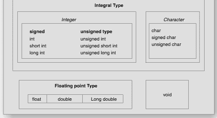

**表1.9** 16位机器上基本数据类型的大小和范围

| 数据类型 | 取值范围 |
| --- | --- |
| char | -128 至 127 |
| int | -32,768 至 32,767 |
| float | 3.4e-38 至 3.4e+38 |
| double | 1.7e-308 至 1.7e+308 |

### 1.31.1 整数类型

整数是整数值，其取值范围由特定机器支持。通常，整数占用一个字的存储空间，并且由于机器的字长各不相同（通常为16位或32位），可存储的整数大小取决于计算机。如果使用16位字长，整数值的大小限制在-32768到+32767范围内（即-2^15到+2^15-1）。有符号整数使用一位表示符号，15位表示数字的大小。类似地，32位字长可存储从-2,147,483,648到2,147,483,647的整数。

为了对数字范围和存储空间提供一定的控制，C有三种整数存储类别，即short int、int和long int，并且都有有符号和无符号两种形式。ANSI C定义这些类型，使它们可以按从小到大组织，如图1.70所示。例如，short int表示相当小的整数值，所需的存储空间是常规int数字所用存储空间的一半。与有符号整数不同，无符号整数将所有位用于表示数字的大小，并且总是正数。因此，对于16位机器，无符号整数的范围将从0到65,535。

我们声明long和unsigned整数以增加取值范围。在整数上使用signed限定符是可选的，因为默认声明假定为有符号数。表1.10显示了基本类型和限定符的所有允许组合及其在16位机器上的大小和范围。

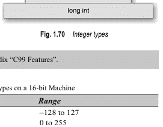

**注意：** C99允许long long整数类型。参见附录“C99特性”。

**表1.10** 16位机器上数据类型的大小和范围

| 类型 | 大小（位） | 范围 |
|---|---|---|
| char or signed char | 8 | -128 至 127 |
| unsigned char | 8 | 0 至 255 |
| int or signed int | 16 | -32,768 至 32,767 |
| unsigned int | 16 | 0 至 65535 |
| short int or signed short int | 8 | -128 至 127 |
| unsigned short int | 8 | 0 至 255 |
| long int or signed long int | 32 | -2,147,483,648 至 2,147,483,647 |
| unsigned long int | 32 | 0 至 4,294,967,295 |
| float | 32 | 3.4E - 38 至 3.4E + 38 |
| double | 64 | 1.7E - 308 至 1.7E + 308 |
| long double | 80 | 3.4E - 4932 至 1.1E + 4932 |

### 1.31.2 浮点类型

浮点（或实数）数存储在32位中（在所有16位和32位机器上），具有6位精度。在C中，浮点数由关键字float定义。当float数字提供的精度不够时，可以使用double类型来定义该数字。double数据类型的数字使用64位，提供14位精度。这些称为双精度数。请记住，double类型表示与float相同的数据类型，但精度更高。


为了进一步提高精度，我们可以使用占用 80 位的 long double。浮点类型之间的关系如图 1.71 所示。

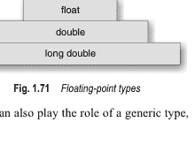

### 1.31.3 空类型

void 类型没有值。这通常用于指定函数的类型。当函数不向调用函数返回任何值时，其类型称为 void。它还可以充当通用类型，意味着它可以表示其他任何标准类型。

### 1.31.4 字符类型

单个字符可以定义为字符 (char) 类型的数据。字符通常存储在内部存储的 8 位（一字节）中。限定符 signed 或 unsigned 可以显式应用于 char。unsigned char 的值在 0 到 255 之间，而 signed char 的值从 −128 到 127。

## 1.32 变量的声明

在设计合适的变量名之后，我们必须向编译器声明它们。声明做两件事：

- 1. 它告诉编译器变量名是什么。
- 2. 它指定变量将保存的数据类型。

变量的声明必须在使用它们之前完成。

### 1.32.1 基本类型声明

变量可用于存储任何数据类型的值。也就是说，名称与其类型无关。声明变量的语法如下：

```
data-type v1, v2, ....vn ;
```

v1, v2, ....vn 是变量名。变量之间用逗号分隔。声明语句必须以分号结束。例如，有效的声明如下：

```
int count;
int number, total;
double ratio;
```

int 和 double 分别是表示整数类型和实数类型数据值的关键字。表 1.11 显示了各种数据类型及其关键字等价物。

表 1.11 数据类型及其关键字

| Data type | keyword equivalent |
|---|---|
| 字符 | char |
| 无符号字符 | unsigned char |
| 有符号字符 | signed char |
| 有符号整数 | signed int (or int) |
| 有符号短整数 | signed short int (or short int or short) |
| 有符号长整数 | signed long int (or long int or long) |
| 无符号整数 | unsigned int (or unsigned) |
| 无符号短整数 | unsigned short int (or unsigned short) |
| 无符号长整数 | unsigned long int (or unsigned long) |
| 浮点 | float |
| 双精度浮点 | double |
| 扩展双精度浮点 | long double |

图 1.72 所示的程序段说明了变量的声明。main() 是程序的开始。左大括号 { 表示程序的执行。变量的声明通常在程序的左大括号之后立即进行。变量也可以在 main 函数之外（在 main 之前或之后）声明。声明位置的重要性将在讨论函数时详细说明。

> 注：C99 允许在函数或块内的任意位置声明变量，只要在使用之前声明即可。

```
main() /*..........Program Name.....................*/
{
    /*..........Declaration.....................*/
    float      x, y;
    int        code;
    short int  count;
    long int   amount;
    double     deviation;
    unsigned   n;
    char       c;
    /*..........Computation.....................*/
    ...
    ...
}
/*..........Program ends.....................*/
```

Fig. 1.72 变量的声明

当形容词（限定符）short、long 或 unsigned 在没有基本数据类型说明符的情况下使用时，C 编译器将数据类型视为 int。如果我们想将字符变量声明为 unsigned，则必须使用两者一起，如 unsigned char。

### 常量的默认值

整数常量默认表示 int 类型数据。我们可以通过在数字后指定 unsigned 或 long（通过附加 U 或 L）来覆盖此默认值，如下所示：

| Literal | Type | Value |
|---|---|---|
| +111 | int | 111 |
| -222 | int | -222 |
| 45678U | unsigned int | 45678 |
| -56789L | long int | -56789 |
| 987654UL | unsigned long int | 987654 |

同样，浮点常量默认表示 double 数据类型。如果我们希望结果数据类型为 float 或 long double，则必须在数字后附加字母 F 或 f 表示 float，字母 L 或 l 表示 long double，如下所示：

| Literal | Type | Value |
|---|---|---|
| 0.0 | double | 0.0 |
| 0.0F | float | 0.0 |
| 12.0 | double | 12.0 |
| 1.234 | double | 1.234 |
| -1.2f | float | -1.2 |
| 1.23456789L | long double | 1.23456789 |

C 支持一种称为“类型定义”的特性，允许用户定义一个标识符来表示现有的数据类型。用户定义的数据类型标识符稍后可用于声明变量。其一般形式为：

```
typedef type identifier;
```

其中 type 指现有的数据类型，而 "identifier" 指赋予数据类型的“新”名称。现有的数据类型可能属于任何类型类别，包括用户定义的类型。请记住，新类型仅在名称上是“新”的，而非数据类型。typedef 不能创建新类型。类型定义的一些示例为：

```
typedef int units;
typedef float marks;
```

这里，units 象征 int，marks 象征 float。它们稍后可用于如下声明变量：

```
units batch1, batch2;
marks name[50], name2[50];
```

batch1 和 batch2 被声明为 int 变量，而 name[50] 和 name2[50] 被声明为 50 个元素的浮点数组变量。typedef 的主要优点是我们可以通过创建有意义的数据类型名称来提高程序的可读性。

另一种用户定义的数据类型是 ANSI 标准提供的枚举数据类型。其定义如下：

```
enum identifier {value1, value2, ... valuen};
```

“identifier” 是一个用户定义的枚举数据类型，可用于声明变量，这些变量可以取大括号内之一的值（称为枚举常量）。在此定义之后，我们可以按如下方式声明此“新”类型的变量：

```
enum identifier v1, v2, ... vn;
```

枚举变量 v1, v2, ... vn 只能取 value1, value2, ... value n 中的一个值。以下类型的赋值是有效的：

```
v1 = value3;
v5 = value1;
```

### 一个示例：

```
enum day {Monday, Tuesday, ... Sunday};
enum day week_st, week_end;
week_st = Monday;
week_end = Friday;
if(week_st == Tuesday)
week_end = Saturday;
```

编译器会自动为所有枚举常量分配从 0 开始的整数数字。也就是说，枚举常量 value1 被赋值为 0，value2 被赋值为 1，以此类推。然而，通过显式地为枚举常量赋值，可以覆盖自动分配。例如：

```
enum day {Monday = 1, Tuesday, ... Sunday};
```

这里，常量 Monday 被赋值为 1。剩余的常量被赋值为依次递增 1 的值。

枚举变量的定义和声明可以合并为一条语句。示例：

```
enum day {Monday, ... Sunday} week_st, week_end;
```

## 1.33 存储类的声明

C 中的变量不仅有数据类型，还有提供其位置和可见性信息的存储类。存储类决定了变量在程序中被识别的部分。请考虑以下示例：

```
/* Example of storage classes */
int m;
main()
{
  int i;
  float balance;
  ....
  ....
  function1();
}
function1()
{
  int i;
  float sum;
  ....
  ....
}
```

在 main 之前声明的变量 m 称为全局变量。它可以在程序的所有函数中使用。它无需在其他函数中声明。全局变量也称为外部变量。

变量 i、balance 和 sum 称为局部变量，因为它们在函数内部声明。局部变量仅在其声明的函数内部可见且有意义。它们不是

其他函数可知。注意，变量 i 已在这两个函数中声明。一个函数中 i 值的变化不会影响另一个函数中的 i 值。

C 语言提供了多种存储类别说明符，可用于显式声明变量的作用域和生存期。作用域和生存期的概念只在多函数和多文件程序中才是重要的，因此在讨论函数时，将详细考虑存储类别。现在，请记住有四种存储类别说明符（auto、register、static 和 extern），其含义见表 1.12。

存储类别是另一种限定符（如 long 或 unsigned），可以添加到变量声明中，如下所示：

```
auto int count;
register char ch;
static int x;
extern long total;
```

静态（static）变量和外部（extern）变量会自动初始化为零。自动（auto）变量除非显式初始化，否则包含未定义的值（称为“垃圾值”）。

表 1.12 存储类别及其含义

| 存储类别 | 含义 |
|---|---|
| auto | 局部变量，仅在其所属函数内可知。默认为 auto。 |
| static | 局部变量，在控制权转移到调用函数后仍然存在并保留其值。 |
| extern | 全局变量，文件中的所有函数均可知。 |
| register | 存储在寄存器中的局部变量。 |

## 1.34 给变量赋值

创建变量是为了在程序语句中使用，例如：

```
value = amount + inrate * amount;
while (year <= PERIOD)
{
    ....
    ....
}
year = year + 1;
```

在第一条语句中，存储在变量 inrate 中的数值乘以存储在 amount 中的值，乘积再与 amount 相加。结果存储在变量 value 中。这个过程只有在变量 amount 和 inrate 已被赋值的情况下才可能实现。变量 value 称为目标变量。在声明所有变量的类型时，在表达式中使用（计算语句等号右侧）的变量在程序中遇到之前必须先赋值。类似地，在 while 语句中的变量 year 和符号常量 PERIOD 在此语句遇到之前也必须赋值。

### 1.34.1 赋值语句

可以使用赋值运算符 = 给变量赋值，如下所示：

```
variable_name = constant;
```

我们在第 1 章中已经使用过这样的语句。更多示例：

```
initial_value = 0;
final_value = 100;
balance = 75.84;
yes = 'x';
```

C 语言允许在一行中进行多次赋值。例如：

```
initial_value = 0; final_value = 100;
```

都是有效语句。

赋值语句意味着“等号”左侧变量的值被设置为右侧量（或表达式）的值。语句

```
year = year + 1;
```

意思是 year 的“新值”等于 year 的“旧值”加 1。

在赋值操作期间，C 会将右侧值的类型转换为左侧的类型。当实值转换为整数时，可能会涉及截断。

也可以在声明变量时给变量赋值。形式如下：

```
data-type variable_name = constant;
```

一些示例：

```
int final_value = 100;
char yes = 'x';
double balance = 75.84;
```

给变量赋予初始值的过程称为初始化。C 语言允许使用多个赋值运算符在一个语句中初始化多个变量。例如，以下语句：

```
p = q = s = 0;
x = y = z = MAX;
```

都是有效的。第一条语句将变量 p、q 和 s 初始化为零，第二条语句将 x、y 和 z 初始化为 MAX。注意，MAX 是在程序开头定义的符号常量。

请记住，外部变量和静态变量默认初始化为零。未显式初始化的自动变量将包含垃圾值。

## 示例 1.20

图 1.73 中的程序展示了各种类型变量中的典型声明、赋值和存储值。

变量 x 和 p 已被声明为浮点变量。注意，我们赋给 x 的 1.234567890000 在不同输出格式下的显示方式。x 的值在 %.12f 格式下显示为 1.234567890630，而实际赋值为 1.234567890000。这是因为变量 x 被声明为 float，它只能存储到六位小数。

被声明为 int 的变量 m 无法正确存储值 54321。相反，它包含一些垃圾值。由于此程序是在 16 位机器上运行的，int 变量能存储的最大值仅为 32767。然而，变量 k（声明为 unsigned）正确存储了 54321。类似地，long int 变量 n 正确存储了 1234567890。

赋给声明为 double 的变量 y 的值 9.87654321 已正确存储，但该值在 %lf 格式下打印为 9.876543。注意，除非另行指定，printf 函数始终会将 float 或 double 值显示到六位小数。我们稍后将讨论显示数字的输出格式。

```
Program
main()
{
/*................DECLARATIONS.................*/
float x, p ;
double y ;
unsigned k ;
/*................DECLARATIONS AND ASSIGNMENTS.................*/
int m = 54321 ;
long int n = 1234567890 ;
/*................ASSIGNMENTS.................*/
x = 1.234567890000 ;
y = 9.87654321 ;
k = 54321 ;
p = q = 1.0 ;
/*................PRINTING.................*/
printf("m = %d\n", m) ;
printf("n = %ld\n", n) ;
printf("x = %.12f\n", x) ;
printf("x = %f\n", x) ;
printf("y = %.12f\n", y) ;
printf("y = %f\n", y) ;
printf("k = %u p = %f q = %.12f\n", k, p, q) ;
}
```

输出
m = -11215
n = 1234567890
x = 1.234567890630
x = 1.234568
y = 9.876543210000
y = 9.876543
k = 54321 p = 1.000000 q = 1.000000000000

图 1.73 赋值示例

### 1.34.2 从键盘读取数据

给变量赋值的另一种方式是通过 scanf 函数从键盘输入数据。它是 C 语言中可用的通用输入函数，在概念上与 printf 函数非常相似。它的工作原理很像 BASIC 中的 INPUT 语句。scanf 的通用格式如下：

```
scanf("control string", &variable1,&variable2,...);
```

控制字符串包含所接收数据的格式。每个变量名之前的与号 & 是一个运算符，指定该变量名的地址。我们必须始终使用该运算符，否则可能出现意外结果。让我们看一个示例：

```
scanf("%d", &number);
```

当计算机遇到此语句时，执行将停止，并等待输入变量 number 的值。由于控制字符串 "%d" 指定从终端读取一个整数值，因此我们必须以整数形式输入该值。一旦输入数字并按“回车”键，计算机就会继续执行下一条语句。因此，scanf 的使用提供了交互功能，使程序具有“用户友好”性。该值被赋给变量 number。

```
Program
main()
{
    int year, period ;
    float amount, inrate, value ;
    printf("Input amount, interest rate, and period\n\n") ;
    scanf("%f %f %d", &amount, &inrate, &period) ;
    printf("\n") ;
    year = 1 ;
    while( year <= period )
    {
        value = amount + inrate * amount ;
        printf("%2d Rs %8.2f\n", year, value) ;
        amount = value ;
        year = year + 1 ;
    }
}
Output
Input amount, interest rate, and period
10000 0.14 5
 1 Rs 11400.00
 2 Rs 12996.00
 3 Rs 14815.44
 4 Rs 16889.60
 5 Rs 19254.15
Input amount, interest rate, and period
20000 0.12 7
 1 Rs 22400.00
 2 Rs 25088.00
 3 Rs 28098.56
 4 Rs 31470.39
 5 Rs 35246.84
 6 Rs 39476.46
 7 Rs 44213.63
```

图 1.75 交互式投资程序

注意，scanf 函数包含三个变量。在这种情况下，应小心确保输入的值与列表中变量的顺序和类型相匹配。任何不匹配都可能导致意外结果。编译器可能不会检测到此类错误。

## 1.35 定义符号常量

我们经常在程序中使用某些唯一的常量。这些常量可能会在程序中的许多地方重复出现。这种常量的一个例子是 3.142，表示数学常量“pi”的值。另一个例子是由“测试分析程序”分析成绩单的学生总数。学生人数，比如 50，可能用于计算班级总分、班级平均分、标准差等。在后续使用此类程序时，我们面临两个问题。这些问题是：

-   1. 程序修改的问题；以及
-   2. 程序理解的问题。


## 1.35.1 可修改性

我们可能希望将“pi”的值从 3.142 改为 3.14159，以提高计算精度；或者将数字 50 改为 100，以处理另一个班级的测试结果。在这两种情况下，我们都必须搜索整个程序，并在使用该常量的所有位置显式修改其值。如果遗漏了某个值未修改，程序可能会产生灾难性的输出。

### 1.35.2 可理解性

当一个数值出现在程序中时，它的用途并不总是明确的，尤其是当同一个值在不同位置表示不同含义时。例如，数字 50 在程序的一个位置可能表示学生人数，而在同一程序的另一个位置可能表示“及格分数”。几天后再阅读该程序时，我们可能会忘记某个数字的含义。

将这类常量赋予符号名可以让我们免于这些问题。例如，我们可以使用名称 STRENGTH 来定义学生人数，使用 PASS_MARK 来定义某门科目所需的及格分数。在程序开头会为这些名称赋予常量值。随后在程序中使用名称 STRENGTH 和 PASS_MARK 时，就会在适当位置自动替换为它们所定义的值。常量的定义如下：

```
#define symbolic-name value of constant
```

常量定义的有效示例如下：

```
#define STRENGTH 100
#define PASS_MARK 50
#define MAX 200
#define PI 3.14159
```

符号名有时也称为常量标识符。由于符号名是常量（而不是变量），因此它们不会出现在声明中。以下规则适用于定义符号常量的 #define 语句：

- 1. 符号名与变量名具有相同的形式。（符号名用大写字母书写，以便在视觉上与普通变量名区分开来，普通变量名用小写字母书写。这只是一项约定，不是规则。）
- 2. 井号“#”与单词 define 之间不允许有空白。
- 3. “#”必须是该行的第一个字符。
- 4. #define 与符号名之间，以及符号名与常量之间，都需要有一个空白。
- 5. #define 语句不得以分号结尾。
- 6. 定义之后，不应在程序中使用赋值语句为该符号名赋予任何其他值。例如，STRENGTH = 200; 是非法的。
- 7. 符号名不是为数据类型而声明的。其数据类型取决于常量的类型。
- 8. #define 语句可以出现在程序中的任何位置，但必须位于程序中引用它之前（通常的做法是将它们放在程序开头）。

#define 语句是一条预处理器编译指令，其功能远比这里提到的更为强大。更高级的定义类型将在后面讨论。表 1.13 说明了一些无效的 #define 语句。

### 表 1.13 无效 #define 语句示例

| 语句 | 有效性 | 备注 |
|-----------|----------|--------|
| #define X = 2.5 | 无效 | 不允许使用 = 号 |
| # define MAX 10 | 无效 | # 与 define 之间不能有空白 |
| #define N 25; | 无效 | 末尾不允许使用分号 |
| #define N 5, M 10 | 无效 | 一条语句只能定义一个名称 |
| #Define ARRAY 11 | 无效 | define 应使用小写字母 |
| #define $PRICES 100 | 无效 | 名称中不允许使用 $ 符号 |

## 1.36 将变量声明为常量

我们可能希望某些变量的值在程序执行期间保持不变。为此，可以在初始化时使用限定符 const 声明该变量。例如：

```
const int class_size = 40;
```

## 1.37 将变量声明为易失变量

ANSI 标准定义了另一个限定符 volatile，可用于明确告诉编译器：某个变量的值可能随时被某些外部来源（来自程序外部）更改。例如：

```
volatile int date;
```

> 注意：C99 增加了另一个称为 restrict 的限定符。参见附录“C99 特性”。

## 1.38 数据的溢出和下溢

当变量的值对于其数据类型而言过大或过小时，就会出现数据溢出问题。变量能够容纳的最大值也取决于机器。由于浮点值会舍入到允许（或指定）的有效数字位数，因此溢出通常会产生可能的最大实数值，而下溢则会产生零。

在使用整数数据类型范围的限制内，整数始终是精确的。然而，如果数据类型与常量的值不匹配，就可能发生溢出，而这是一个严重问题。C 不会对整数溢出提供任何警告或提示。它只会给出错误的结果。（溢出通常会产生负数。）因此，我们应当格外小心，定义正确的数据类型来处理输入/输出值。

## 1.39 管理输入和输出操作简介

读取、处理和写入数据是计算机程序的三个基本功能。大多数程序将一些数据作为输入，并将处理后的数据（通常称为信息或结果）显示在合适的介质上。到目前为止，我们已经了解了两种向程序变量提供数据的方法。一种方法是通过赋值语句为变量赋值，例如 `x = 5; a = 0;` 等。另一种方法是使用输入函数 `scanf`，它可以从键盘读取数据。在我们之前的大多数示例程序中，都使用了这两种方法。对于输出结果，我们广泛使用了函数 `printf`，它将结果发送到终端。

与其他高级语言不同，C 的语法中没有任何内置的输入/输出语句。所有输入/输出操作都通过函数调用（如 `printf` 和 `scanf`）来执行。有若干函数或多或少已成为 C 中输入和输出操作的标准。这些函数统称为标准 I/O 库。在本章中，我们将讨论一些可在许多机器上使用而无需更改的常见 I/O 函数。不过，要了解这些函数的准确细节以及其他可用函数，应查阅系统参考手册。

可以回想一下，我们在第 4 章的示例程序 5 中包含了语句 `#include <math.h>`，其中使用了数学库函数 `cos(x)`。这是为了指示编译器从数学库中获取函数 `cos(x)`，并且它并不是 C 语言的一部分。类似地，每个使用标准输入/输出函数的程序都必须在开头包含语句 `#include <stdio.h>`。不过，也可能存在例外。例如，对于已定义为 C 语言一部分的函数 `printf` 和 `scanf`，这并非必需。

文件名 `stdio.h` 是标准输入输出头文件的缩写。指令 `#include <stdio.h>` 告诉编译器“搜索名为 stdio.h 的文件，并将其内容放在程序中的此位置”。头文件的内容在编译时会成为源代码的一部分。

## 1.40 读取一个字符

所有输入/输出操作中最简单的是从“标准输入”单元（通常是键盘）读取一个字符，并将其写入“标准输出”单元（通常是屏幕）。读取单个字符可以使用函数 `getchar()` 来完成。（也可以借助 `scanf` 函数来完成，这将在 1.4 节中讨论。）`getchar` 采用以下形式：

```
variable_name = getchar();
```

`variable_name` 是一个已声明为 char 类型的有效 C 名称。当遇到该语句时，计算机会等待按键，然后将该字符作为值赋给 getchar 函数。由于 getchar 用于赋值语句的右侧，因此 getchar 的字符值会依次赋给左侧的变量名。例如


```
char name;
name = getchar();
```

当我们在键盘上按下 H 键时，这会将字符 'H' 赋给变量 name。由于 getchar 是一个函数，因此它需要像所示那样带一对圆括号。

## 示例 1.23 图 1.76 中的程序展示了在交互式环境中使用 getchar 函数的方法。

该程序向用户显示一个 YES/NO 类型的问题，并将用户的回答读取为单个字符（Y 或 N）。如果回答是 Y 或 y，则输出消息

My name is BUSY BEE

否则，输出

You are good for nothing

注意：输入文本与输出消息之间有一行空行。

```
Program
#include <stdio.h>
main()
{
char answer;
printf("Would you like to know my name?\n");
printf("Type Y for YES and N for NO: ");
answer = getchar(); /* .... Reading a character.... */
if(answer == 'Y' || answer == 'y')
printf("\n\nMy name is BUSY BEE\n");
else
printf("\n\nYou are good for nothing\n");
}
```

Output
Would you like to know my name?
Type Y for YES and N for NO: Y
My name is BUSY BEE
Would you like to know my name?
Type Y for YES and N for NO: n
You are good for nothing

图 1.76 使用 getchar 函数从键盘读取一个字符

可以连续调用 getchar 函数来读取一行文本中包含的字符。例如，下面的程序段会一个接一个地从键盘读取字符，直到按下“回车”键为止。

```
char character;
character = ' ';
while(character != '\n')
{
    character = getchar();
}
```

> **警告**
>
> `getchar()` 函数会接受键入的任意字符，包括 RETURN 和 TAB。这意味着当我们输入单个字符时，在 `getchar()` 返回后，换行符会停留在输入队列中。如果在循环中以交互方式使用 `getchar()`，这可能会造成问题。可以使用一个哑 `getchar()` 来“吃掉”多余的换行字符。我们也可以使用 `fflush` 函数将不需要的字符刷新出去。

> *注意：* 我们将在本章中大量使用 if、if...else 和 while 等判断语句。这些语句将在第 8 章和第 9 章中详细讨论。

## 示例 1.24 图 1.77 中的程序请求用户输入一个字符，并在屏幕上显示一条消息，告诉用户该字符是字母、数字，还是其他特殊字符。

该程序从键盘接收一个字符，并测试它是否是字母或数字，然后相应地打印消息。这些测试借助以下函数完成：

`isalpha(character)`
`isdigit(character)`

例如，如果参数 `character` 包含字母，`isalpha` 取非零值（TRUE）；否则取 0（FALSE）。`isdigit` 函数的情况与此类似。

```
Program
```c
#include <stdio.h>
#include <ctype.h>
main()
{
    char character;
    printf("Press any key\n");
    character = getchar();
    if (isalpha(character) > 0)/* Test for letter */
        printf("The character is a letter.");
    else
        if (isdigit(character) > 0)/* Test for digit */
            printf("The character is a digit.");
        else
            printf("The character is not alphanumeric.");
}
```
Output
Press any key
h
The character is a letter.
Press any key
5
The character is a digit.
Press any key
*
The character is not alphanumeric.

图 1.77 测试字符类型的程序

C 还支持许多其他类似的函数，见表 1.14。这些字符函数包含在文件 ctype.h 中，因此程序中必须包含语句

```
#include <ctype.h>
```

## 表 1.14 字符测试函数

| 函数 | 测试 |
|---|---|
| isalnum(c) | c 是否为字母数字字符？ |
| isalpha(c) | c 是否为字母字符？ |
| isdigit(c) | c 是否为数字？ |
| islower(c) | c 是否为小写字母？ |
| isprint(c) | c 是否为可打印字符？ |
| ispunct(c) | c 是否为标点符号？ |
| isspace(c) | c 是否为空白字符？ |
| isupper(c) | c 是否为大写字母？ |

## 1.41 写入字符

与 getchar 类似，还有一个用于一次一个字符地写入终端的类似函数 putchar。其形式如下所示：

```
putchar (variable_name);
```

其中 variable_name 是一个 char 类型的变量，包含一个字符。该语句会在终端显示 variable_name 中包含的字符。例如，语句

```
answer = 'Y';
putchar (answer);
```

会在屏幕上显示字符 Y。语句

```
putchar ('\n');
```

会使屏幕上的光标移动到下一行的开头。

### 示例 1.25 图 1.78 中给出了一个从键盘读取字符然后以相反大小写打印的程序。也就是说，如果输入是大写，则输出为小写，反之亦然。

该程序使用了三个新函数：islower、toupper 和 tolower。islower 是一个条件函数，如果参数是小写字母，则取 TRUE 值；否则取 FALSE 值。toupper 函数将小写参数转换为大写字母，而 tolower 函数则执行相反的操作。

```
Program
#include <stdio.h>
#include <ctype.h>
main()
{
    char alphabet;
    printf("Enter an alphabet");
    putchar('\n'); /* move to next line */
    alphabet = getchar();
    if (islower(alphabet))
        putchar(toupper(alphabet)); /* Reverse and display */
    else
        putchar(tolower(alphabet)); /* Reverse and display */
}
```

Output
Enter an alphabet
a
A
Enter an alphabet
Q
q
Enter an alphabet
z
Z

图 1.78 以相反大小写读取和写入字母

## 1.42 格式化输入

格式化输入是指按特定格式排列的输入数据。例如，考虑以下数据：

15.75 123 John

这一行包含三段数据，它们按特定形式排列。读取这种数据时，必须遵循其出现的格式。例如，数据的第一个部分应读入 float 变量，第二个部分应读入 int 变量，第三个部分应读入 char 变量。这种操作在 C 中可以使用 scanf 函数完成（scanf 意为“扫描格式化输入”）。

之前我们已经在许多示例中使用了这个输入函数。这里，我们将探讨使用 scanf 函数读取格式化数据时可用的所有选项。scanf 的一般形式为

```
scanf ("control string", arg1, arg2, ..., argn);
```

控制字符串指定数据输入时的字段格式，参数 arg1、arg2、...、argn 指定数据存储位置的地址。控制字符串和参数之间用逗号分隔。

控制字符串（也称为格式字符串）包含字段规格，用于指导对输入数据的解释。它可能包括：

- 字段（或格式）规格，由转换字符 %、一个数据类型字符（或类型说明符）以及一个可选的数字组成，该数字指定字段宽度。
- 空格、制表符或换行符。

空格、制表符和换行符会被忽略。数据类型字符指示要赋给与相应参数关联的变量的数据类型。字段宽度说明符是可选的。下面的讨论将阐明这些概念。

### 1.42.1 输入整数

读取整数的字段规格为：

```
%w d
```

百分号（%）表示后面是一个转换规格。w 是一个整数，指定要读取的数字的字段宽度；d 称为数据类型字符，指示要读取的数字是整数模式。请考虑以下示例：

```
scanf ("%2d %5d", &num1, &num2);
```

数据行：
50 31426
值 50 被赋给 num1，31426 被赋给 num2。假设输入数据如下：
31426 50

由于 %2d，变量 num1 将被赋值为 31，而 num2 将被赋值为 426（31426 中未读到的部分）。未读取的值 50 将在下一次 scanf 调用时赋给第一个变量。如果我们使用不带字段宽度说明的字段规格，则可以消除这类错误。也就是说，语句

```
scanf ("%d %d", &num1, &num2);
```

会正确读取数据
31426 50
并将 31426 赋给 num1，将 50 赋给 num2。

输入数据项必须用空格、制表符或换行符分隔。标点符号不计为分隔符。当 scanf 函数在输入数据行中搜索要读取的值时，它总是会跳过任何空白字符。

如果输入的是浮点数而不是整数，会发生什么？小数部分可能会被去除！此外，scanf 可能会跳过后续输入。

当 scanf 读取某个值时，一旦达到字段宽度指定的字符数（如果指定了），或者遇到对该值无效的字符，读取就会立即终止。对于整数，有效字符是可有符号的数字序列。

可以通过在字段宽度位置指定 * 来跳过输入字段。例如，语句

```
scanf ("%d %*d %3d", &a, &b);
```

> 注意：我们在字段规格之间提供了空格。对于数字输入，这些空格并不是必需的，但包含它们是良好的实践。

### 示例 1.26 图 1.79 中的程序尝试了读取整数的各种输入格式化选项。


## 1.86 计算机编程

```
Program
main()
{
int a,b,c,x,y,z;
int p,q,r;
printf("Enter three integer numbers\n");
scanf("%d %*d %d",&a,&b,&c);
printf("%d %d %d\n",a,b,c);
printf("Enter two 4-digit numbers\n");
scanf("%2d %d",&x,&y);
printf("%d %d\n",x,y);
printf("Enter two integers\n");
scanf("%d %d",&a,&x);
printf("%d %d\n",a,x);
printf("Enter a nine digit number\n");
scanf("%3d %d",&q,&r);
printf("%d %d\n",q,r);
printf("Enter two three digit numbers\n");
scanf("%d %d",&x,&y);
printf("%d %d\n",x,y);
}
```

```
Output

Enter three integer numbers
1 2 3
1 3 -357
Enter two 4-digit numbers
6789 4321
67 89
Enter two integers
44 66
4321 44
Enter a nine-digit number
123456789
66 1234
Enter two three-digit numbers
123 456
89 123
```

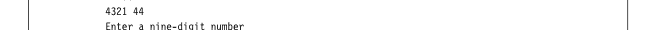

第一个 scanf 请求为三个整数值 a、b 和 c 输入数据，因此键入了三个值 1、2 和 3。由于使用了 %*d 说明符，值 2 被跳过，3 被赋给变量 b。注意，由于没有可供 c 使用的数据，它包含的是垃圾值。

第二个 scanf 分别为变量 x 和 y 指定格式 %2d。每当我们为读取整数指定字段宽度时，输入数字包含的位数不应超过指定大小。否则，右侧多余的位将被截断，并赋给列表中的下一个变量。因此，第二个 scanf 截断了四位数 6789，并将 67 赋给 x，将 89 赋给 y。值 4321 已被赋给紧接着的下一个 scanf 语句中的第一个变量。

> 注意：在字段说明符之间使用非空白字符是合法的。然而，scanf 期望在给定位置有一个匹配字符。例如，scanf("%d-%d", &a, &b); 接受像 123-456 这样的输入，将 123 赋给 a，将 456 赋给 b。

### 1.42.2 输入实数

与整数不同，实数的字段宽度不需要指定，因此 scanf 使用简单说明符 %f 读取实数，适用于两种记法，即小数点记法和指数记法。例如，语句 scanf("%f %f %f", &x, &y, &z); 在输入数据 475.89 43.21E-1 6 78 时，会将值 475.89 赋给 x，4.321 赋给 y，678.0 赋给 z。输入字段说明符之间可以用任意空白字符分隔。如果要读取的数是 double 类型，则说明符应为 %lf，而不是简单的 %f。可以使用 %*f 说明符跳过一个数。

**例 1.27** 图 1.80 说明了实数（同时使用小数点记法和指数记法）的读取。

```
Program
main()
{
float x,y;
double p,q;
printf("Values of x and y: ");
scanf("%f %f", &x, &y);
printf("\n");
printf("Values of p and q: ");
scanf("%lf %lf", &p, &q);
printf("\nValues of p and q: %.12lf %.12lf\n", p, q);
}
```

x 和 y 的值：12.3456 17.5e-2
x = 12.345600
y = 0.175000
p 和 q 的值：4.142857142857 18.5698901234567890
q = 1.856789012346e+001


### 1.42.3 输入字符串

我们已经看到如何使用 getchar 函数从终端读取单个字符。使用 scanf 函数也可以实现同样的功能。此外，scanf 函数还可以输入包含多个字符的字符串。以下是读取字符串的说明符：

`%ws` 或 `%wc`

相应的参数应是指向字符数组的指针。然而，当参数是指向 char 变量的指针时，可以使用 `%c` 读取单个字符。

**例 1.28** 图 1.81 说明了使用 %wc 和 %ws 读取字符串。

图 1.81 中的程序说明了用于读取字符串的各种字段说明符的用法。当我们使用 `%wc` 读取字符串时，系统将等待直到第 w 个字符被键入。

> 注意：请注意，说明符 `%s` 在遇到空白字符时终止读取。因此，name2 只读取了 “New York” 的第一部分，而第二部分被自动赋给 name3。然而，在第二次运行期间，字符串 “New-York” 被正确地赋给 name2。

```
Program
main()
{
    int no;
    char name1[15], name2[15], name3[15];
    printf("Enter serial number and name one\n");
    scanf("%d %s", &no, name1);
    printf("%d %15s\n\n", no, name1);
    printf("Enter serial number and name two\n");
    scanf("%d %s", &no, name2);
    printf("%d %15s\n\n", no, name2);
    printf("Enter serial number and name three\n");
    scanf("%d %15s", &no, name3);
    printf("%d %15s\n\n", no, name3);
}
```

输出
输入序列号和姓名一
1 123456789012345
1 123456789012345
输入序列号和姓名二
2 New York
2          New
输入序列号和姓名三
2          York
输入序列号和姓名一
1 123456789012
1 123456789012
输入序列号和姓名二
2 New-York
2          New-York
输入序列号和姓名三
3 London
3          London

**图 1.81 读取字符串**

某些版本的 scanf 支持以下用于字符串的转换说明：

%[characters]
%[^characters]

说明 %[characters] 表示输入字符串中只允许括号内指定的字符。如果输入字符串包含任何其他字符，则字符串将在第一次遇到此类字符时终止。说明 %[^characters] 的作用正好相反。也就是说，在脱字符（^）之后指定的字符不允许出现在输入字符串中。读取字符串将在遇到这些字符之一时终止。

**例 1.29** 图 1.82 中的程序说明了 %[ ] 说明符的功能。

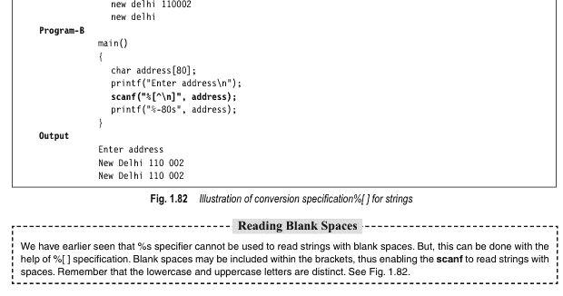

### 读取空白字符

> 我们之前已经看到，%s 说明符不能用于读取带空白字符的字符串。但是，这可以借助 %[ ] 说明符来完成。空白字符可以包含在括号内，从而使 scanf 能够读取带空格的字符串。请记住，小写字母和大写字母是不同的。参见图 1.82。

### 1.42.4 读取混合数据类型

可以使用一个 scanf 语句输入包含混合模式数据的一行数据。在这种情况下，应注意确保输入数据项在顺序和类型上与控制说明相匹配。当尝试读取与预期类型不匹配的项时，scanf 函数不会继续读取，并立即返回已读取的值。语句

```
scanf("%d %c %f %s", &count, &code, &ratio, name);
```

将正确读取数据

15 p 1.575 coffee

并按变量出现的顺序将值赋给这些变量。某些系统接受整数代替实数，反之亦然，并且输入数据会被转换为控制字符串中指定的类型。

> 注意：在格式字符串中，%c 说明符前的空格对于跳过 p 之前的空白字符是必要的。

### 1.42.5 检测输入中的错误

当 scanf 函数完成读取其列表时，它返回成功读取的项数。该值可用于测试读取输入时是否发生任何错误。例如，语句

```
scanf("%d %f %s", &a, &b, name);
```

如果键入以下数据：

20 150.25 motor

将返回值 3；如果输入以下行：

20 motor 150.25

将返回值 1。

**例 1.30** 图 1.83 中给出的程序说明了测试 scanf 函数读取数据是否正确。

scanf 函数预期读取三个数据项，因此，当所有三个变量的值都被正确读取时，程序会打印出它们的值。在第三次运行期间，第二个数据项与变量类型不匹配，因此读取被终止，并打印错误消息。第四次运行的情况相同。

在最后一次运行中，尽管数据项与变量不匹配，但没有打印错误消息。当我们尝试为 int 变量读取实数时，整数部分被赋给该变量，截断的小数部分被赋给下一个变量。

> 注意：字符 '2' 被赋给字符变量 c。

```
Program
main()
{
  int a;
  float b;
  char c;
  printf("Enter values of a, b and c\n");
  if (scanf("%d %f %c", &a, &b, &c) == 3)
```


```
else
    printf("a = %d b = %f c = %c\n" , a, b, c);
}
    printf("Error in input.\n");
```

输出
```
Enter values of a, b and c
12 3.45 A
a = 12      b = 3.450000    c = A
Enter values of a, b and c
23 78.9
a = 23      b = 78.000000   c = 9
Enter values of a, b and c
8 A 5.25
Error in input.
Enter values of a, b and c
Y 12 67
Error in input.
Enter values of a, b and c
15.75 23 X
a = 15      b = 0.750000    c = 2
```

**图 1.83 scanf 输入错误的检测**

常用 scanf 格式代码在表 1.15 中给出。

**表 1.15 常用 scanf 格式代码**

| 代码 | 含义 |
|------|---------|
| %c | 读取单个字符 |
| %d | 读取十进制整数 |
| %e | 读取浮点值 |
| %f | 读取浮点值 |
| %g | 读取浮点值 |
| %h | 读取短整数 |
| %i | 读取十进制、十六进制或八进制整数 |
| %o | 读取八进制整数 |
| %s | 读取字符串 |
| %u | 读取无符号十进制整数 |
| %x | 读取十六进制整数 |
| %[...] | 读取单词字符串 |

以下字母可作为某些转换字符的前缀使用。

- h 用于短整数
- l 用于长整数或 double
- L 用于 long double

注意：C99 增加了一些格式代码。

### 1.42.6 使用 scanf 时需注意的要点

如果我们没有仔细规划，scanf 会出现一些“疯狂”的情况。由于 I/O 例程不是 C 语言的一部分，它们要么作为 C 库的单独模块提供，要么作为操作系统的一部分提供（如 UNIX）。随着系统新版本的发布，这些例程会不时添加新功能。在使用这些例程之前，我们应查阅系统参考手册。下面是编写 scanf 语句时应牢记的一些一般要点。

- 1. 除控制字符串外的所有函数参数都必须是变量的指针。
- 2. 控制字符串中包含的格式说明应与参数的顺序相匹配。
- 3. 输入数据项必须用空格分隔，并且必须与接收输入的变量以相同的顺序匹配。
- 4. 当 scanf 遇到数据不匹配或对正在读取的值无效的字符时，读取将被终止。
- 5. 在搜索值时，scanf 忽略行边界，只查找下一个适当的字符。
- 6. 行中未读取的数据项将被视为传递给下一次 scanf 调用的数据输入行的一部分。
- 7. 当使用字段宽度说明符 w 时，它应足够大以包含输入数据的大小。

### scanf 规则

- 每个要读取的变量必须有一个字段说明。
- 对于每个字段说明，必须有一个适当类型的变量地址。
- 格式字符串中使用的任何非空白字符都必须在用户输入中有一个匹配的字符。
- 切勿以空白字符结束格式字符串。这是致命错误！
- scanf 读取直到：
  - 在数字说明中遇到空白字符，或
  - 已读取最大数量的字符，或
  - 检测到错误，或
  - 到达文件末尾

## 1.43 格式化输出

我们已经看到了 printf 函数用于打印标题和数值结果的用法。输出最好以易于理解且易于使用形式产生。因此，程序员必须仔细考虑其程序产生的输出的外观和清晰度。

printf 语句提供了某些功能，可以有效地用于控制终端上打印输出的对齐和间距。printf 语句的一般形式为：

```
printf("control string", arg1, arg2, ..., argn);
```

```
Program
main()
{
    int m = 12345;
    long n = 987654;
    printf("%d\n",m);
    printf("%10d\n",m);
    printf("%010d\n",m);
    printf("%10d\n",m);
    printf("%10d\n",m);
    printf("%10d\n",m);
    printf("%10d\n",-n);
}
```

输出
```
12345
12345
0000012345
12345
987654
- 987654
```

**图 1.84 整数的格式化输出**

### 1.43.2 浮点数的输出

实数输出可用以下格式说明以十进制形式显示：

```
%w.pf
```

整数 w 表示用于显示值的最小位置数，整数 p 表示小数点后要显示的位数（精度）。显示时，值将四舍五入到 p 位小数，并在 w 列的字段中右对齐显示。必要时会出现前导空格和尾随零。默认精度为 6 位小数。负数将带负号打印。数字将以 [ - ] mmmm.nnn 的形式显示。

我们也可以使用以下说明以指数形式显示实数：

```
%w.pe
```

| 格式 | 输出 |
|---|---|
| printf("%7.4f",y) | 9 8 . 7 6 5 4 |
| printf("%7.2f",y) | [ ][ ][9][8][.][7][7] |
| printf("%-7.2f",y) | [9][8][.][7][7][ ][ ] |
| printf("%6f",y) | [9][8][.][7][6][5][4] |
| printf("%10.2e",y) | [ ][ ][9][.][8][8][e][+][0][1] |
| printf("%11.4e",-y) | [−][9][.][8][7][6][5][e][+][0][1] |
| printf("%-10.2e",y) | [9][8][ ][8][e][+][0][1][ ] |
| printf("%10e",y) | [9][.][8][7][6][5][4][0][e][+][0][1] |

一些系统还支持一种特殊的字段说明字符，允许用户在运行时定义字段大小。其形式如下：

```
printf("%*.*f", width, precision, number);
```

在这种情况下，字段宽度和精度都作为参数给出，将为 w 和 p 提供值。例如，

```
printf("%*.*f",7,2,number);
```

等价于

```
printf("%7.2f",number);
```

这种格式的优点是宽度和精度的值可以在运行时提供，从而使格式成为动态的。例如，上述语句可按如下方式使用：

```
int width = 7;
int precision = 2;
.......
printf("%*.*f", width, precision, number);
```

**示例 1.32** 打印实数的所有选项在图 1.85 中说明。

```
Program
main()
{
    float y = 98.7654;
    printf("%7.4f\n", y);
    printf("%8f\n", y);
    printf("%7.2f\n", y);
    printf("%8.7f\n", y);
    printf("%07.2f\n", y);
    printf("%*.*f", 7, 2, y);
    printf("\n");
    printf("%10.2e\n", y);
    printf("%12.4e\n", -y);
    printf("%-10.2e\n", y);
    printf("%e\n", y);
}
```

输出
```
98.7654
98.765404
98.77
98.77
0098.77
98.77
9.88e+001
-9.8765e+001
9.88e+001
9.876540e+001
```

**图 1.85 浮点数的格式化输出**

### 1.43.3 单个字符的打印

单个字符可使用以下格式在所需位置显示：

```
%wc
```

字符将在 w 列的字段中右对齐显示。我们可以在整数 w 前放置一个减号使显示左对齐。w 的默认值是 1。

### 1.43.4 字符串的打印

输出字符串的格式说明与实数类似。其形式为

```
%w.ps
```

其中 w 指定显示的字段宽度，p 指示仅显示字符串的前 p 个字符。显示为右对齐。

以下示例显示了在打印包含 16 个字符（包括空格）的字符串“NEW DELHI 110001”时各种说明的效果。

| 规格说明 | 输出 |
|---|---|
| %s | N E W D E L H I   1 1 0 0 0 1 |
| %20s | N E W D E L H I   1 1 0 0 0 1 |
| %20.10s | N E W D E L H I |
| %.5s | N E W D |
| %-20.10s | N E W D E L H I |
| %5s | N E W D E L H I   1 1 0 0 0 1 |

**示例 1.33** 字符和字符串的打印在图 1.86 中说明。

```
Program
main()
{
    char x = 'A';
    char name[20] = "ANIL KUMAR GUPTA";
    printf("OUTPUT OF CHARACTERS\n\n");
    printf("%c\n%c\n%c\n", x,x,x);
    printf("%3c\n%c\n", x,x);
    printf("\n");
    printf("OUTPUT OF STRINGS\n\n");
    printf("%s\n", name);
    printf("%20s\n", name);
    printf("%20.10s\n", name);
    printf("%.5s\n", name);
    printf("%-20.10s\n", name);
    printf("%55s\n", name);
}
```

输出
```
OUTPUT OF CHARACTERS
A
    A
        A
    A

OUTPUT OF STRINGS
ANIL KUMAR GUPTA
    ANIL KUMAR GUPTA
ANIL KUMAR GUPTA
    ANIL KUMAR
ANIL
ANIL KUMAR
ANIL KUMAR GUPTA
```

**图 1.86 字符和字符串的打印**

### 1.43.5 混合数据输出

允许在一个 printf 语句中混合数据类型。例如，以下类型的语句

```
printf("%d %f %s %c", a, b, c, d);
```

是有效的。如前所述，printf 使用其控制字符串来决定要打印多少个变量以及它们的类型。因此，格式说明应与变量在数量、顺序和类型上匹配。如果变量不足或类型错误，输出结果将不正确。

以下字母可作为某些转换字符的前缀使用。

- h 用于短整数
- l 用于长整数或 double
- L 用于 long double.

注意：C99 增加了一些格式代码。

### 1.43.6 增强输出的可读性

计算机输出用作分析变量之间某些关系的信息，并用于做出决策。因此，输出的正确性和清晰度至关重要。虽然

正确性取决于求解过程，清晰性取决于输出的呈现方式。以下是我们可采取的一些步骤，以提高输出的清晰性，从而提升其可读性和可理解性。

- 1. 在两个数字之间提供足够的空白。
- 2. 在输出中引入适当的标题和变量名。
- 3. 每当输出中出现特殊条件时，打印特殊消息。
- 4. 在输出的重要部分之间引入空行。

系统通常会在数字之间提供两个空白空格。不过，可以通过为数字选择合适的字段宽度，或在格式说明符之间引入一个 'tab' 字符来增加空白。例如，语句

```
printf("a = %d\t b = %d", a, b);
```

将在两个字段之间提供四个空白空格。我们也可以使用以下语句将它们打印在两个单独的行上

```
printf("a = %d\n b = %d", a, b);
```

### 表 1.16 常用的 printf 格式码

| 代码 | 含义 |
|------|---------|
| %c | 打印单个字符 |
| %d | 打印十进制整数 |
| %e | 以指数形式打印浮点值 |
| %f | 打印不带指数的浮点值 |
| %g | 打印一个浮点值，采用 e 类型还是 f 类型取决于 |
| %i | 打印有符号十进制整数 |
| %o | 打印八进制整数，不带前导零 |
| %s | 打印字符串 |
| %u | 打印无符号十进制整数 |
| %x | 打印十六进制整数，不带前导 0x |

### 表 1.17 常用的输出格式标志

| 标志 | 含义 |
|------|---------|
| - | 输出在字段内左对齐。剩余字段将为空白。 |
| + | + 或 – 将置于带符号数值项之前。 |
| 0 | 使前导零出现。 |
| #（与 o 或 x 一起使用时） | 使八进制和十六进制项分别以 0 和 0x 开头。 |
| #（与 e、f 或 g 一起使用时） | 使所有浮点数都包含小数点，即使它是整数。还可防止 g 类型转换中尾随零被截断。 |

消息和标题可以通过在 printf 语句中直接使用字符串来打印。示例：

```
printf("\n OUTPUT RESULTS \n");
printf("Code\t Name\t Age\n");
printf("Error in input data\n");
printf("Enter your name\n");
```

## 1.44 运算符和表达式简介

C 支持丰富的内置运算符。我们已经使用过其中几个，例如 =、+、-、*、& 和 <。运算符是一种符号，它告诉计算机执行某些数学或逻辑操作。

运算符在程序中用于操作数据和变量。它们通常构成数学表达式或逻辑表达式的一部分。

C 运算符可以分为若干类别。它们包括：

- 1. 算术运算符
- 2. 关系运算符
- 3. 逻辑运算符
- 4. 赋值运算符
- 5. 递增和递减运算符
- 6. 条件运算符
- 7. 按位运算符
- 8. 特殊运算符

表达式是由操作数和运算符组成的序列，它会归约为单个值。例如，10 + 15 是一个表达式，其值为 25。该值可以是除 void 以外的任何类型。

## 1.45 算术运算符

C 提供了所有基本算术运算符。它们列在表 1.18 中。运算符 +、-、* 和 / 的工作方式与其他语言中相同。它们可以作用于 C 允许的任何内置数据类型。一元减号运算符实际上会将其单个操作数乘以 -1。因此，数字前面带有减号会改变其符号。

### 表 1.18 算术运算符

| 运算符 | 含义 |
|---|---|
| + | 加法或一元加 |
| - | 减法或一元减 |
| * | 乘法 |
| / | 除法 |
| % | 模除 |

整数除法会截断任何小数部分。模除运算产生整数除法的余数。算术运算符的使用示例如下：

```
a - b   a + b
a * b   a / b
a % b   -a * b
```

这里 a 和 b 是变量，称为操作数。模除运算符 % 不能用于浮点数据。注意，C 没有用于求幂的运算符。较早版本的 C 不支持一元加，但 ANSI C 支持它。

### 1.45.1 整数运算

当单个算术表达式（如 a+b）中的两个操作数都是整数时，该表达式称为整数表达式，该运算称为整数运算。整数运算总是产生整数值。如前面所指出的，最大整数值取决于机器。在上面的示例中，如果 a 和 b 是整数，那么对于 a = 14 和 b = 4，我们得到以下结果：

- a - b = 10
- a + b = 18
- a * b = 56
- a / b = 3（小数部分被截断）
- a % b = 2（除法的余数）

在整数除法期间，如果两个操作数符号相同，结果会向零截断。如果其中一个为负，则截断方向取决于实现。也就是说，

6/7 = 0 且 -6/-7 = 0

但 -6/7 可能为 0 或 -1。（取决于机器）

类似地，在模除期间，结果的符号始终是第一个操作数（被除数）的符号。也就是说

- -14 % 3 = -2
- -14 % -3 = -2
- 14 % -3 = 2

### 例 1.34

图 1.87 中的程序展示了如何使用整数运算将给定天数转换为月和天。

```
Program
main ()
{
    int months, days ;

    printf("Enter days\n") ;
    scanf("%d", &days) ;

    months = days / 30 ;
    days = days % 30 ;
    printf("Months = %d Days = %d", months, days) ;
}

Output
Enter days
265
Months = 8 Days = 25
Enter days
364
Months = 12 Days = 4
Enter days
45
Months = 1 Days = 15
```

图 1.87 整数运算示例

变量 months 和 days 被声明为整数。因此，语句 months = days/30; 会截断小数部分，并将整数部分赋给 months。类似地，语句 days = days%30; 会将除法的余数部分赋给 days。这样，给定的天数就被转换为等价的月数和天数，并按输出中所示打印结果。

### 1.45.2 实数运算

仅涉及实数操作数的算术运算称为实数运算。实数操作数可以采用十进制表示法或指数表示法中的值。由于浮点值会舍入到允许的有效数字位数，最终值是正确结果的近似值。如果 x、y 和 z 是浮点数，那么我们将有：

```
x = 6.0/7.0 = 0.857143
y = 1.0/3.0 = 0.333333
z = -2.0/3.0 = -0.666667
```

运算符 % 不能与实数操作数一起使用。

### 1.45.3 混合模式运算

当其中一个操作数是实数而另一个是整数时，该表达式称为混合模式算术表达式。如果任一操作数是实数类型，则只执行实数运算，结果始终是实数。因此

15/10.0 = 1.5

而

15/10 = 1

关于混合运算的更多内容将在后面处理表达式求值时讨论。

## 1.46 关系运算符

我们经常比较两个量，并根据它们的关系做出某些决定。例如，我们可以比较两个人的年龄，或两个物品的价格，等等。这些比较可以借助关系运算符来完成。我们已经使用过符号 '<'，表示“小于”。诸如

a < b 或 1 < 20

这样包含关系运算符的表达式称为关系表达式。关系表达式的值是 1 或 0。如果指定的关系为真，则为 1；如果关系为假，则为 0。例如

10 < 20 为真

但

20 < 10 为假

C 总共支持六种关系运算符。这些运算符及其含义如表 1.19 所示。

### 表 1.19 关系运算符

| 运算符 | 含义 |
|---|---|
| < | 小于 |
| <= | 小于或等于 |
| > | 大于 |
| >= | 大于或等于 |
| == | 等于 |
| != | 不等于 |


一个简单的关系表达式只包含一个关系运算符，形式如下：

```
ae-1 relational operator ae-2
```

ae-1 和 ae-2 是算术表达式，它们可以是简单常量、变量或它们的组合。下面给出一些简单关系表达式及其值的示例：

- 4.5 <= 10 真
- 4.5 <= -10 假
- -35 >= 0 假
- 10 < 7+5 真
- a+b = c+d 仅当 a 与 b 的值之和等于 c 与 d 的值之和时为真。

当关系运算符的任意一侧使用算术表达式时，先计算算术表达式，然后比较结果。也就是说，算术运算符的优先级高于关系运算符。

关系表达式用于 if 和 while 等判断语句中，以决定运行中程序的动作过程。判断语句将在第8章和第9章详细讨论。

### 关系运算符的互补

六个关系运算符中，每一个都是另一个运算符的互补运算符。

- > 是 <= 的互补运算符
- < 是 >= 的互补运算符
- != 是 == 的互补运算符

我们可以使用互补运算符简化涉及逻辑非和小于运算符的表达式，如下所示：

| 实际表达式 | 简化后的表达式 |
|---|---|
| !(x<y) | x >= y |
| !(x>=y) | x <= y |
| !(x!=y) | x == y |
| !(x<=y) | x > y |
| !(x>y) | x <= y |
| !(x == y) | x != y |

## 1.47 逻辑运算符

除关系运算符外，C 还具有以下三个逻辑运算符。

- && 表示逻辑与
- || 表示逻辑或
- ! 表示逻辑非

当我们想测试多个条件并作出判断时，使用逻辑运算符 && 和 ||。例如：

```
a > b && x == 10
```

这种将两个或更多关系表达式组合起来的表达式称为逻辑表达式或复合关系表达式。与简单关系表达式一样，逻辑表达式也根据表1.20所示的真值表产生值 1 或 0。上述逻辑表达式仅当 a > b 为真且 x == 10 为真时才为真。如果其中任一（或两者）为假，则该表达式为假。

### 表1.20 真值表

| op-1 | op-2 | op-1 && op-2 | op-1 \|\| op-2 |
|---|---|---|---|
| 非零 | 非零 | 1 | 1 |
| 非零 | 0 | 0 | 1 |
| 0 | 非零 | 0 | 1 |
| 0 | 0 | 0 | 0 |

逻辑表达式的一些用法示例如下：

- 1. if (age > 55 && salary < 1000)
- 2. if (number < 0 || number > 100)

我们将在讨论判断语句时看到更多示例。

注意：关系运算符和逻辑运算符的相对优先级如下：
最高
!
> >= < <=
== !=
&&
最低
||
在复合表达式中使用这些运算符时，记住这一点很重要。

## 1.48 赋值运算符

赋值运算符用于将表达式的结果赋给变量。我们已经见过通常的赋值运算符 ' = '。此外，C 还有一组形式如下的“简写”赋值运算符：

```
v op= exp;
```

其中 v 是变量，exp 是表达式，op 是 C 的二元算术运算符。运算符 op= 称为简写赋值运算符。

```
v op = exp;
```

```
v = v op (exp);
```

```
x += y+1;
```

```
x = x + (y+1);
```

```
x += 3;
```

简写运算符 += 表示“将 y+1 加到 x 上”或“使 x 增加 y+1”。对于 y = 2，上述语句变为 x += 3; 当执行该语句时，3 被加到 x 上。如果 x 的旧值是 5，那么 x 的新值就是 8。表1.21说明了一些常用的简写赋值运算符。

### 表1.21 简写赋值运算符

| 使用简单赋值运算符的语句 | 使用简写运算符的语句 |
|---|---|
| a = a + 1 | a += 1 |
| a = a - 1 | a -= 1 |
| a = a * (n+1) | a *= n+1 |
| a = a / (n+1) | a /= n+1 |
| a = a % b | a %= b |

使用简写赋值运算符有三个优点：

- 1. 左侧出现的内容无需重复，因此更易于编写。
- 2. 语句更简洁，更易于阅读。
- 3. 语句更高效。

如果我们考虑一个稍微复杂一点的语句，就能体会这些优点，例如

```
value(5*j-2) = value(5*j-2) + delta;
```

借助 += 运算符，可以写成如下形式：

```
value(5*j-2) += delta;
```

它更易于阅读和理解，而且更高效，因为表达式 5*j-2 只求值一次。

### 例1.35 图1.88的程序打印一系列数的平方。注意简写运算符 *= 的使用。

该程序试图打印从 2 开始的一系列数的平方。语句

```
a *= a;
```

等同于

```
a = a*a;
```

用 a 的平方替换 a 的当前值。当 a 的值等于或大于 N（=100）时，while 循环终止。注意输出仅包含三个值 2、4 和 16。

```
Program
#define N 100
#define A 2
main()
{
  int a;
  a = A;
  while( a < N )
  {
    printf("%d\n", a);
    a *= a;
  }
}
Output
2
4
16
```

## 1.49 自增和自减运算符

C 允许使用两个在其他语言中通常没有的非常有用的运算符。它们是自增和自减运算符：

```
++ and --
```

运算符 ++ 将操作数加 1，而 -- 将操作数减 1。两者都是一元运算符，采用以下形式：

```
++m; or m++;
--m; or m--;
```

```
++m; is equivalent to m = m+1; (or m += 1;)
--m; is equivalent to m = m-1; (or m -= 1;)
```

我们在 for 和 while 循环中广泛使用自增和自减语句。

虽然 ++m 和 m++ 在独立构成语句时含义相同，但当它们用于赋值语句右侧的表达式中时，行为会有所不同。考虑以下情况：

```
m = 5;
y = ++m;
```

在这种情况下，y 和 m 的值都将是 6。假设我们将上述语句改写为

```
m = 5;
y = m++;
```

那么，y 的值将是 5，m 的值将是 6。前缀运算符先给操作数加 1，然后将结果赋给左侧的变量。另一方面，后缀运算符先将值赋给左侧的变量，然后使操作数自增。

当我们在带下标的变量中使用 ++（或 --）时，情况类似。也就是说，语句

```
a[i++] = 10;
```

等价于

```
a[i] = 10;
i = i+1;
```

自增和自减运算符可用于复杂语句。例如：

```
m = n++ -j+10;
```

求值该表达式时使用 n 的旧值。求值后 n 自增。有些编译器要求 n++ 或 ++n 的两侧各有一个空格。

### ++ 和 -- 运算符的规则

- 自增和自减运算符是一元运算符，它们要求以变量作为操作数。
- 当后缀 ++（或 --）与表达式中的变量一起使用时，先使用变量的原值计算表达式，然后将变量加一（或减一）。
- 当表达式中使用前缀 ++（或 --）时，先将变量加一（或减一），然后使用变量的新值计算表达式。
- ++ 和 -- 运算符的优先级和结合性与一元 + 和一元 - 相同。

## 1.50 条件运算符

C 中有一对三元运算符 '?' ':'，用于构造以下形式的条件表达式：

```
exp1 ? exp2 : exp3
```

其中 exp1、exp2 和 exp3 是表达式。

运算符 ? : 的工作方式如下：首先对 exp1 求值。如果它非零（真），则对表达式 exp2 求值，并成为该表达式的值。如果 exp1 为假，则对 exp3 求值，其值成为该表达式的值。注意只对其中一个表达式（exp2 或 exp3）求值。例如，考虑以下语句：

```
a = 10;
 b = 15;
 x = (a > b) ? a : b;
```

在此例中，x 将被赋值为 b 的值。这可以使用 if...else 语句实现，如下所示：

```
if (a > b)
    x = a;
else
    x = b;
```

## 1.51 位运算符

C 的一个特点是支持称为位运算符的特殊运算符，用于在位级操作数据。这些运算符用于测试位，或将位右移或左移。位运算符不能应用于 float 或 double。表1.22列出了位运算符及其含义。

### 表1.22 位运算符

| 运算符 | 含义 |
|---|---|
| & | 按位与 |
| \| | 按位或 |
| ^ | 按位异或 |
| << | 左移 |
| >> | 右移 |

## 1.52 特殊运算符

C 支持一些值得关注的特殊运算符，例如逗号运算符、sizeof 运算符、指针运算符（& 和 *）以及成员选择运算符（. 和 ->）。本节讨论逗号运算符和 sizeof 运算符，而指针运算符将在第14章讨论。用于选择结构体成员的成员选择运算符将在第13章和第14章讨论。

### 1.52.1 逗号运算符

逗号运算符可用于将相关表达式连接在一起。逗号连接的表达式列表从左到右求值，最右侧表达式的值就是整个组合表达式的值。例如，语句

```
value = (x = 10, y = 5, x+y);
```

首先将值 10 赋给 x，然后将 5 赋给 y，最后将 15（即 10 + 5）赋给 value。由于逗号运算符在所有运算符中优先级最低，因此括号是必需的。逗号运算符的一些应用如下：

- 在 for 循环中：

```
for ( n = 1, m = 10, n <=m; n++, m++)
```


在 while 循环中：

```
while (c = getchar(), c != '\n')
```

交换值：

```
t = x, x = y, y = t;
```

## 1.52.2 sizeof 运算符

`sizeof` 是编译时运算符；当与操作数一起使用时，它返回该操作数所占用的字节数。操作数可以是变量、常量或数据类型限定符。

示例：

```
m = sizeof(sum);
n = sizeof(long int);
k = sizeof(235L);
```

`sizeof` 运算符通常用于在程序员不知道数组和结构体大小的情况下确定其长度。它还用于在程序执行期间动态地为变量分配内存空间。

**例 1.36** 在图 1.89 中，程序使用了不同类型的运算符。其求值结果也一并显示以便比较。

注意增量运算符 `++` 在表达式中使用时的行为方式。在语句

```
c = ++a - b;
```

中，使用了 a 的新值（= 16），因此给 c 赋值为 6。也就是说，a 在表达式中使用之前先增加 1。然而，在语句

```
d = b++ + a;
```

中，表达式中使用的是 b 的旧值（=10）。这里，b 在表达式中使用之后才增加 1。

我们可以通过在控制字符串中将 % 字符紧接在另一个 % 字符之后来打印 % 字符。如下语句所示

```
printf("a%%b = %d\n", a*b);
```

该程序还说明，当 c 小于 d 时，表达式 `c > d ? 1 : 0` 的值为 0；当 c 大于 d 时，值为 1。

```
Program
main()
{
    int a, b, c, d;
    a = 15;
    b = 10;
    c = ++a - b;
    printf("a = %d b = %d c = %d\n", a, b, c);
    d = b++ + a;
    printf("a = %d b = %d d = %d\n", a, b, d);
    printf("a/b = %d\n", a/b);
    printf("a%%b = %d\n", a*b);
    printf("a * b = %d\n", a*b);
    printf("%d\n", (c > d) ? 1 : 0);
    printf("%d\n", (c < d) ? 1 : 0);
}
```

```
Output
a = 16  b = 10  c = 6
a = 16  b = 11  d = 26
a/b = 1
a%b = 5
a * b = 176
0
1
```

图 1.89 算术运算符的进一步说明

## 1.53 算术表达式

算术表达式是按语言语法排列的变量、常量和运算符的组合。在迄今讨论的示例中，我们已经使用了许多简单表达式。C 能处理任何复杂的数学表达式。C 表达式的一些示例如表 1.23 所示。请记住，C 没有用于幂运算的运算符。

表 1.23 表达式

| 代数表达式 | C 表达式 |
|---|---|
| a × b - c | `a * b - c` |
| (m+n) × (x + y) | `(m+n) * (x + y)` |
| $\frac{ab}{c}$ | `a * b/c` |
| 3x² + 2x + 1 | `3 * x * x + 2 * x + 1` |
| $\left(\frac{x}{y}\right)+c$ | `x/y + c` |

## 1.54 表达式的求值

表达式使用如下形式的赋值语句进行求值：

```
variable = expression;
```

变量是任何有效的 C 变量名。当遇到该语句时，先对表达式求值，然后用结果替换左侧变量的先前值。表达式中使用的所有变量都必须在尝试求值之前被赋值。

求值语句的示例如下

```
x = a * b - c;
y = b / c * a;
z = a - b / c + d;
```

运算符周围的空白是可选的，只是为了提高可读性。当这些语句在程序中使用时，变量 a、b、c 和 d 必须在表达式中使用之前定义。

**例 1.37** 图 1.90 中的程序说明了变量在表达式中的使用及其求值。程序的输出还说明了表达式中括号存在的影响。这将在下一节讨论。

```
Program
main()
{
    float a, b, c, x, y, z;
    a = 9;
    b = 12;
    c = 3;
    x = a - b / 3 + c * 2 - 1;
    y = a - b / (3 + c) * (2 - 1);
    z = a - (b / (3 + c) * 2) - 1;
    printf("x = %f\n", x);
    printf("y = %f\n", y);
    printf("z = %f\n", z);
}
```

```
Output
x = 10.000000
y = 7.000000
z = 4.000000
```

图 1.90 表达式求值示例

## 1.55 算术运算符的优先级

不带括号的算术表达式将按照运算符优先级规则从左到右求值。C 中算术运算符有两个不同的优先级：

- 高优先级：`* / %`
- 低优先级：`+ -`

基本求值过程包括对表达式进行“两”遍从左到右扫描。在第一遍中，遇到高优先级运算符（如果有）时就应用它们。在第二遍中，遇到低优先级运算符（如果有）时就应用它们。

考虑以下求值语句

```
x = a - b/3 + c * 2 - 1
```

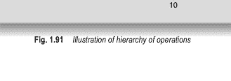

图 1.91 运算层次说明

当 a = 9、b = 12、c = 3 时，该语句变为

```
x = 9 - 12/3 + 3 * 2 - 1
```

并按如下方式求值：

第一遍：

- 步骤 1：`x = 9 - 4 + 3 * 2 - 1`
- 步骤 2：`x = 9 - 4 + 6 - 1`

第二遍：

- 步骤 3：`x = 5 + 6 - 1`
- 步骤 4：`x = 11 - 1`
- 步骤 5：`x = 10`

这些步骤在图 1.91 中说明。括号内的数字表示步骤编号。然而，可以通过在表达式中引入括号来改变求值顺序。考虑如下所示的带括号的同一表达式：

```
9 - 12/(3 + 3) * (2 - 1)
```

### 表达式求值规则

- 首先，从左到右对带括号的子表达式求值。
- 如果括号嵌套，则从最内层子表达式开始求值。
- 在求值子表达式时，应用优先级规则来确定运算符的应用顺序。
- 当一个子表达式中出现两个或多个同一优先级的运算符时，应用结合性规则。
- 算术表达式按照优先级规则从左到右求值。
- 当使用括号时，括号内的表达式具有最高优先级。

## 1.56 一些计算问题

当表达式包含实数值时，必须采取必要的预防措施来防止某些计算错误。我们知道，计算机对实数给出近似值，而这类近似所导致的误差可能引发严重问题。例如，考虑以下语句：

```
a = 1.0/3.0;
b = a * 3.0;
```

我们知道 `(1.0/3.0) * 3.0` 等于 1。但不能保证程序中计算出的 b 值等于 1。

另一个问题是除以零。在大多数计算机上，任何试图将数除以零的操作都会导致程序异常终止。在某些情况下，这种除法可能产生无意义的结果。应注意检查可能取零值的分母，并避免任何除以零的操作。

第三个问题是避免上溢或下溢错误。我们有责任保证操作数具有正确的类型和范围，并且结果不会产生任何上溢或下溢。

**例 1.38** 图 1.92 中程序的输出显示了浮点数计算中可能出现的舍入误差。

```
Program
/*---------- Sum of n terms of 1/n ----------*/
main()
{
    float sum, n, term;
    int count = 1;
    sum = 0;
    printf("Enter value of n\n");
    scanf("%f", &n);
    term = 1.0/n;
    while( count <= n )
    {
        sum = sum + term;
        count++;
    }
    printf("Sum = %f\n", sum);
}
```

```
Output
Enter value of n
99
Sum = 1.000001
Enter value of n
143
Sum = 0.999999
```

图 1.92 浮点计算中的舍入误差

我们知道 `1/n` 的 n 项之和为 1。然而，由于浮点表示中的误差，结果并不总是 1。

## 1.57 表达式中的类型转换

### 1.57.1 隐式类型转换

C 允许在表达式中混合使用不同类型的常量和变量。C 会自动将任何中间值转换为适当的类型，以便在不丢失任何意义的情况下对表达式求值。

这种自动转换称为隐式类型转换。

在求值过程中，它遵循非常严格的类型转换规则。如果操作数类型不同，则在操作进行之前，将“较低”类型自动转换为“较高”类型。结果为较高类型。图 1.93 说明了典型的类型转换过程。

下面给出在对表达式求值时应用的规则序列。

- 所有 `short` 和 `char` 都自动转换为 `int`；然后
  - 1. 如果其中一个操作数是 `long double`，则另一个将转换为 `long double`，结果为 `long double`；
  - 2. 否则，如果其中一个操作数是 `double`，则另一个将转换为 `double`，结果为 `double`；
  - 3. 否则，如果其中一个操作数是 `float`，则另一个将转换为 `float`，结果为 `float`；
  - 4. 否则，如果其中一个操作数是 `unsigned long int`，则另一个将转换为 `unsigned long int`，结果为 `unsigned long int`；
  - 5. 否则，如果其中一个操作数是 `long int`，另一个是 `unsigned int`，则
    - (a) 如果 `unsigned int` 可以转换为 `long int`，则 `unsigned int` 操作数将按原样转换，结果为 `long int`；
    - (b) 否则，两个操作数都将转换为 `unsigned long int`，结果为 `unsigned long int`；
  - 6. 否则，如果其中一个操作数是 `long int`，则另一个将转换为 `long int`，结果为 `long int`；
  - 7. 否则，如果其中一个操作数是 `unsigned int`，则另一个将转换为 `unsigned int`，结果为 `unsigned int`。


图 1.93 隐式类型转换过程


## 转换层次

注意，C 语言使用的规则是：除赋值外，在所有表达式中，任何隐式类型转换都由较小尺寸类型转换为较大尺寸类型，如下所示：


注意，某些版本的 C 会自动将所有浮点操作数转换为双精度。
表达式的最终结果在赋值给变量之前，会转换为赋值号左侧变量的类型。然而，在最终赋值期间会引入以下变化。

- 1. 从 float 转换为 int 会截断小数部分。
- 2. 从 double 转换为 float 会导致数字舍入。
- 3. 从 long int 转换为 int 会导致多余的高位被丢弃。

## 1.57.2 显式类型转换

我们刚刚讨论了 C 如何自动执行类型转换。然而，有时我们希望以不同于自动转换的方式强制进行类型转换。例如，考虑计算一个城镇中女性与男性的比例。

ratio = female_number/male_number

由于程序中将 female_number 和 male_number 声明为整数，除法结果的小数部分将丢失，ratio 将表示错误的值。这个问题可以通过将其中一个变量局部转换为浮点型来解决，如下所示：

```
ratio = (float) female_number/male_number
```

运算符 (float) 会将 female_number 转换为浮点型，以便计算该表达式。然后使用自动转换规则，除法以浮点模式执行，从而保留结果的小数部分。

注意，运算符 (float) 绝不会影响变量 female_number 的值。而且，在程序的其他部分，female_number 的类型仍为 int。

这种局部转换的过程称为显式转换或强制类型转换。强制转换的一般形式是：

```
(type-name)expression
```

其中 *类型名* 是标准 C 数据类型之一。表达式可以是常量、变量或表达式。表 1.24 给出了一些强制转换的示例及其作用。

### 表 1.24 强制转换的使用

| 示例 | 作用 |
|---|---|
| x = (int) 7.5 | 7.5 通过截断转换为整数。 |
| a = (int) 21.3/(int)4.5 | 按 21/4 计算，结果为 5。 |
| b = (double)sum/n | 除法以浮点模式执行。 |
| y = (int) (a+b) | a+b 的结果转换为整数。 |
| z = (int)a+b | a 转换为整数，然后与 b 相加。 |
| p = cos((double)x) | 在使用 x 之前将其转换为 double。 |

强制转换可用于对给定值进行舍入。考虑以下语句：

x = (int) (y+0.5);

如果 y 为 27.6，则 y+0.5 为 28.1，强制转换后结果为 28，并赋值给 x。当然，被强制转换的表达式本身不会改变。

### 示例 1.39 图 1.94 展示了一个使用强制转换计算方程 SUM = Σ_{i=1}^{n} (1/i) 的程序

```
Program
main()
{
    float sum ;
    int n ;
    sum = 0 ;
    for( n = 1 ; n <= 10 ; ++n )
    {
        sum = sum + 1/(float)n ;
        printf("%2d %6.4f\n", n, sum) ;
    }
}
```

输出
1 1.0000
2 1.5000
3 1.8333
4 2.0833
5 2.2833
6 2.4500
7 2.5929
8 2.7179
9 2.8290
10 2.9290

## 1.58 运算符优先级和结合性

如前所述，C 中的每个运算符都有一个与之关联的优先级。该优先级用于确定包含多个运算符的表达式的求值方式。优先级有不同的级别，一个运算符可以属于其中一个级别。优先级较高的运算符先求值。同一优先级的运算符根据级别按“从左到右”或“从右到左”求值。这称为运算符的结合性。表 1.25 提供了运算符、其优先级级别及其结合规则的完整列表。各运算符组按优先级递减的顺序列出。等级 1 表示最高优先级级别，15 表示最低。该列表还包括我们尚未讨论的运算符。

仔细注意运算符的优先级顺序和结合性非常重要。考虑以下条件语句：

```
if (x == 10 + 15 && y < 10)
```

优先级规则表明，加法运算符的优先级高于逻辑运算符（&&）和关系运算符（== 和 <）。因此，先执行 10 与 15 的加法。这等价于：

```
if (x == 25 && y < 10)
```

下一步是确定 x 是否等于 25 以及 y 是否小于 10。如果我们假设 x 的值为 20、y 的值为 5，那么

- x == 25 为假（0）
- y < 10 为真（1）

注意，由于运算符 < 的优先级高于 ==，因此先测试 y < 10，然后测试 x == 25。

最后得到：

```
if (FALSE && TRUE)
```

由于其中一个条件为假，整个复合条件为假。

对于 &&，如果第一个操作数为零，则保证不会对第二个操作数求值；对于 ||，如果第一个操作数非零，则不会对第二个操作数求值。

### 表 1.25 C 运算符汇总

| 运算符 | 描述 | 结合性 | 等级 |
|---|---|---|---|
| () | 函数调用 | 从左到右 | 1 |
| [] | 数组元素引用 |  |  |
| + | 一元加 |  |  |
| - | 一元减 | 从右到左 | 2 |
| ++ | 自增 |  |  |
| -- | 自减 |  |  |
| ! | 逻辑非 |  |  |
| ~ | 按位取反（一的补码） |  |  |
| * | 指针引用（间接寻址） |  |  |
| & | 取地址 |  |  |
| sizeof | 对象大小 |  |  |
| (type) | 类型转换（强制转换） |  |  |
| * | 乘法 | 从左到右 | 3 |

| 运算符 | 描述 | 结合性 | 优先级 |
|---|---|---|---|
| / | 除法 |  |  |
| % | 取模 |  |  |
| + | 加法 | 从左到右 | 4 |
| - | 减法 |  |  |
| << | 左移 | 从左到右 | 5 |
| >> | 右移 |  |  |
| < | 小于 | 从左到右 | 6 |
| <= | 小于等于 |  |  |
| > | 大于 |  |  |
| >= | 大于等于 |  |  |
| == | 等于 | 从左到右 | 7 |
| != | 不等于 |  |  |
| & | 按位与 | 从左到右 | 8 |
| ^ | 按位异或 | 从左到右 | 9 |
| | | 按位或 | 从左到右 | 10 |
| && | 逻辑与 | 从左到右 | 11 |
| || | 逻辑或 | 从左到右 | 12 |
| ?: | 条件表达式 | 从右到左 | 13 |
| = | 赋值运算符 | 从右到左 | 14 |
| *= /= %= += -= &= ^= |= <<= >>= |  |  |  |
| , | 逗号运算符 | 从左到右 | 15 |

### 优先级和结合性规则

- 优先级规则决定不同运算符的应用顺序
- 结合性规则决定同一级别运算符多次出现时的应用顺序

## 1.59 数学函数

诸如 cos、sqrt、log 等数学函数常用于分析实际问题。大多数 C 编译器支持这些基本数学函数。然而，有些系统拥有更全面的数学库，应查阅参考手册以确定哪些函数可用。表 1.26 列出了一些标准数学函数。

### 表 1.26 数学函数

| 函数 | 含义 |
|---|---|
| *三角函数* |  |
| acos(x) | x 的反余弦 |
| asin(x) | x 的反正弦 |
| atan(x) | x 的反正切 |
| atan2(x,y) | x/y 的反正切 |

| 函数 | 描述 |
|---|---|
| cos(x) | x 的余弦 |
| sin(x) | x 的正弦 |
| tan(x) | x 的正切 |
| **双曲函数** | |
| cosh(x) | x 的双曲余弦 |
| sinh(x) | x 的双曲正弦 |
| tanh(x) | x 的双曲正切 |
| **其他函数** | |
| ceil(x) | x 向上舍入到最接近的整数 |
| exp(x) | e 的 x 次幂（e^x） |
| fabs(x) | x 的绝对值。 |
| floor(x) | x 向下舍入到最接近的整数 |
| fmod(x,y) | x/y 的余数 |
| log(x) | x 的自然对数，x > 0 |
| log10(x) | x 的以 10 为底的对数，x > 0 |
| pow(x,y) | x 的 y 次幂（x^y） |
| sqrt(x) | x 的平方根，x >= 0 |

- 注意：
- 1. x 和 y 应声明为 double。
- 2. 在三角函数和双曲函数中，x 和 y 以弧度为单位。
- 3. 所有函数都返回 double。
- 4. C99 增加了这些函数的 float 和 long double 版本。
- 5. C99 增加了许多更多的数学函数。
- 6. 详情请参见附录“C99 特性”。

如前所述，要在程序中使用这些函数中的任何一个，应在程序开头包含以下行：

```
# include <math.h>
```


## 请记住
- 所有以某种方式扩展计算机能力的设备都称为外围设备。例如：打印机、绘图仪、磁盘驱动器、扬声器、麦克风等。
- 高速缓存存储器（cache memory）的访问时间最短，其次是 RAM，然后是辅助存储设备。
- 高级语言对用户最友好，其次是汇编语言和机器语言。
- 机器级语言效率最高，其次是汇编语言和高级语言。
- 始终建议先创建算法，再编写实际程序。这有助于以更系统的方式开发代码，从而减少出错。
- 始终建议在各种测试场景中测试程序，以确保不存在任何语义错误。
- 逐步描述过程称为算法。
- 用图的形式表示各个步骤称为流程图。
- 并行计算的发展旨在加速处理，并最终尝试在人工智能中模仿人类行为。
- 顺序涉及我们依次执行的一系列步骤。
- 选择涉及从多个可用选项中进行选择。
- 迭代涉及执行重复任务。
- 上述三类基本活动以不同方式组合，可以作为描述任何算法的基础。
- 不含 go to 语句的程序易于理解，因而也易于维护。
- 我们可以将两个或多个条件组合成一个复合条件。
- 将一个 if 放在另一个 if 中会形成嵌套条件。
- 使用各种值对算法进行走查始终是一种良好做法。
- 从算法中去除缺陷的过程称为调试。
- 每个 C 程序都需要一个 main() 函数（使用多个 main() 是非法的）。main 所在的位置就是程序执行开始的地方。
- 函数的执行从函数的左花括号开始，到对应的右花括号结束。
- C 程序使用小写字母编写。不过，符号名和输出字符串使用大写字母。
- 程序行中的所有单词之间必须至少用一个空格、制表符或标点符号分隔。
- C 语言中的每条程序语句都必须以分号结尾。
- 所有变量在程序中使用之前都必须声明其类型。
- 当程序引用其未定义的特殊名称和函数时，必须确保使用 #include 指令包含头文件。
- define 和 include 等编译器指令是帮助编译器编译程序的特殊指令。它们不以分号结尾。
- 编译器指令的 # 符号必须出现在该行的第一列。
- 使用花括号对语句分组时，请确保左花括号有对应的右花括号。
- C 是一种自由格式语言，因此对各部分进行适当的缩进可以提高程序的可读性。
- 注释几乎可以插入任何可以出现空格的地方。在适当位置使用恰当的注释可以提高程序的可读性和可理解性，并帮助用户进行调试和测试。请记得正确匹配 /* 和 */ 符号。
- C 是最适合系统编程的编程语言。
- C 是一种过程式语言，而不是面向对象语言。
- 如果未指定显式返回类型，则函数将 void 作为默认返回类型。
- 始终建议使用格式说明符，以便生成格式良好的输出。
- Alt + R 是在 C 中运行程序的快捷键。
- 不要将下划线用作标识符（或变量名）的第一个字符，因为系统库中的许多标识符以下划线开头。
- 标识符只使用 31 个或更少的字符。这有助于确保程序的可移植性。
- 不要将关键字或任何系统库名称用作标识符。
- 使用有意义且明智的变量名。
- 不要创建仅相差一两个字母的变量名。
- 每个使用的变量都必须在程序或函数的开头声明其类型。
- 所有变量在程序中使用之前都必须初始化。
- 整数常量默认采用 int 类型。要使数字成为 long 或 unsigned 类型，必须在其后追加字母 L 和 U。
- 浮点常量默认为 double。要使其表示 float 或 long double，必须在其后追加字母 F 或 L。
- 不要使用小写字母 l 表示 long，因为它通常容易与数字 1 混淆。
- 字符常量使用单引号，字符串常量使用双引号。
- 字符以整数形式存储。因此，可以对字符执行算术运算。
- 不要将声明与可执行语句混在一起。
- 可以通过在程序开头使用预处理命令 #define，或在初始化时用限定符 const 声明变量，来使变量成为常量。
- 不要在 #define 指令末尾使用分号。
- 字符 # 应位于第一列。
- 不要在 # 和 define 之间加任何空格。
- C 不会提供任何溢出警告或提示。它只会给出不正确的结果。定义正确的数据类型时应格外小心。
- 在 main 函数之前定义的变量可供程序中的所有函数使用。
- 在函数内部定义的变量是该函数的局部变量，其他函数不可使用。
- 变量名除下划线外不能包含任何特殊符号。
- 键盘对某些特殊字符支持的限制可以通过三字符序列（trigraph sequences）来消除。
- 任何标识符或关键字之间都不允许出现空白字符。
- typedef 是用于用户定义类型声明的一个非常有用的关键字，尤其是在需要频繁进行声明的大型程序中。
- 符号常量可用于一次性更改程序中某个特定值的所有实例。
- 使用 getchar 函数时，应注意清除输入流中任何不需要的字符。
- 使用标准输入/输出库中的函数时，不要忘记包含 <stdio.h> 头文件。
- 使用字符处理库中的函数时，不要忘记包含 <ctype.h> 头文件。
- 为每个要读取或打印的变量提供适当的字段说明。
- 用双引号括起格式控制字符串。
- 在 scanf 的输入列表中，不要忘记对基本类型变量使用地址运算符 &。
- 字符串常量使用双引号。
- 单个字符常量使用单引号。
- 提供足够的字段宽度来处理要打印的值。
- 注意可能因格式化而导致输出不精确的情况。
- 不要在输入字段说明中指定任何精度。
- 不要在 scanf 语句的格式字符串末尾提供任何空白字符。
- 不要忘记用双引号闭合 scanf 或 printf 语句中的格式字符串。
- 对正在读取或写入的数据类型使用错误的转换代码将导致运行时错误。
- 不要忘记 scanf 和 printf 语句中格式字符串后的逗号。
- 不将读取参数和写入参数分隔开是一种错误。
- 不要在 scanf 语句的格式字符串中使用逗号。
- 在 printf 语句中对变量使用地址运算符 & 将导致运行时错误。
- 使用 %[] 读取空白字符。
- 始终为 scanf 函数调用中要读取的所有变量提供完整的字段说明。
- 使用 %o 打印八进制整数，使用 %x 打印十六进制数。
- 使用 L 进行 long double 转换。
- 使用 0 标志使输出中出现前导零。
- 谨慎使用自减和自增运算符。使用前要理解后缀运算和前缀运算之间的区别。
- 只要觉得有助于明确求值顺序，就添加括号。
- 注意某些表达式产生的副作用。
- 避免任何除以零的尝试。这通常未定义。它要么导致致命错误，要么导致不正确的结果。
- 不要忘记在表达式末尾添加分号。
- 清楚理解表达式中运算符的优先级。如有必要，使用括号。
- 当表达式中使用多个相同优先级的运算符时，会应用结合性。要理解哪些运算符从右到左结合，哪些从左到右结合。
- 不要对除变量标识符以外的任何表达式使用自增或自减运算符。
- 对除整数以外的任何内容应用取模运算符 % 都是非法的。
- 不要在变量被赋值之前就在表达式中使用它。
- 整数除法总是截断结果的小数部分。请谨慎使用。必要时使用强制类型转换。
- 表达式的结果在赋值给变量之前，会转换为赋值左侧变量的类型。注意转换过程中可能发生的信息丢失。
- 所有数学函数都实现为 double 类型参数，并返回 double 类型值。
- 如果运算符 ==、!=、<= 和 >= 的两个符号之间出现任何空格，则是错误。
- 如果运算符 !=、<= 和 >= 的两个符号顺序颠倒，则是错误。
- 在二元运算符两侧使用空格，以提高代码的可读性。
- 不要对浮点变量使用自增和自减运算符。
- 不要将相等运算符 == 与赋值运算符 = 混淆。
- 始终记住关系运算符的结果要么是 0，要么是 1。
- 谨慎使用按位运算符，因为它们直接对位进行操作。
- 记住 *、/ 和 % 的优先级高于 + 和 -。
- 记住算术运算符按照优先级规则从左到右进行运算。
- 正确理解隐式类型转换层次结构，以避免得到意外结果。


## 选择题

1. 下列哪项用于对输入的数据执行计算？
(a) 内存  (b) 处理器
(c) 输入设备  (d) 输出设备

2. 下列哪项不是输入设备？
(a) 绘图仪  (b) 扫描仪
(c) 键盘  (d) 鼠标

3. 下列哪项不是输出设备？
(a) 绘图仪  (b) 扫描仪
(c) 打印机  (d) 扬声器

4. 下列哪项用作计算机的主存储器？
(a) 磁存储设备
(b) RAM
(c) 光存储设备
(d) 磁光存储设备

5. 下列哪项用作计算机的辅助存储器？
(a) 磁存储设备
(b) RAM
(c) 高速缓存存储器
(d) ROM

6. 下列哪项被定义为在计算机系统上执行特定任务的计算机程序？
(a) 硬件  (b) 软件
(c) 处理器  (d) 内存

7. 哪种类型的操作系统允许一个以上的程序在计算机系统中同时运行？
(a) 多线程操作系统
(b) 交互式操作系统
(c) 多用户操作系统
(d) 多任务操作系统

8. 下列哪项将汇编语言转换为机器语言？
(a) 解释器  (b) 编译器
(c) 汇编程序  (d) 算法

9. 下列哪种语言中的指令以0和1的形式编写？
(a) 汇编语言
(b) 编程语言
(c) 高级语言
(d) 机器语言

10. 下列哪项被称为“计算机的语言”？
(a) 编程语言
(b) 高级语言
(c) 机器语言
(d) 汇编语言

11. 高级语言的三大主要类别是什么？
(a) 低级语言
(b) 面向过程语言
(c) 机械语言
(d) 自然语言
(e) 面向问题的语言

12. 下列哪项不是翻译程序？
(a) 链接程序  (b) 汇编程序
(c) 编译器  (d) 解释器

13. 任何C程序
(a) 必须至少包含一个函数
(b) 不必包含任何函数
(c) 需要输入数据
(d) 以上都不是

14. C语言是在哪一年开发的？
(a) 1951  (b) 1962
(c) 1972  (d) 1947

15. 下列哪项最适合描述C语言？
(a) 结构化语言
(b) 面向对象语言
(c) 机器语言
(d) 汇编语言

16. C语言中保留的关键字数量是多少？
(a) 45  (b) 30
(c) 32  (d) 24

17. 用C语言编写的程序的执行开始于：
(a) main()
(b) scanf()
(c) printf()
(d) #include<iostream.h>

18. 下列哪项是C语言中有效文件名的示例？
(a) system
(b) system.c
(c) system.cpp
(d) system.java

19. 下列哪项是printf语句的正确语法？
(a) printf("Hello world");
(b) printf("Hello world")
(c) printf("Hello world");
(d) printf{'Hello world'};

20. %6.2f格式说明表示什么？
(a) 一个普通浮点数
(b) 一个总共六位、小数点右边有两位的浮点数
(c) 一个总共八位、小数点右边有两位的浮点数
(d) 以上都不是

21. 下列哪项是自由格式语言的示例？
(a) FORTRAN
(b) COBOL
(c) C
(d) 以上都不是

22. 下列哪些是UNIX编辑器？
(a) vi
(b) ed
(c) Edit!
(d) 记事本

23. 下列哪项是在C程序执行过程中生成的中间文件？
(a) .c
(b) .obj
(c) .exe
(d) .bak

24. 下列哪项能在C中成功运行？
(a) main()
{
    printf(" Hello world");
}
(b) main()
{ printf(" Hello world"); }
(c) main(){ printf(" Hello world");}
(d) 以上都可以

25. 下列哪项是编写注释的正确形式？
(a) /* comment */
(b) /* comment /*
(c) */ comment /*
(d) */comment */

26. 下列哪项不属于整数常量？
(a) 999
(b) 0
(c) +719
(d) -210
(e) 1,35,000

27. 下列哪项不是实型常量？
(a) 15.25
(b) 0.962
(c) 10
(d) +24.85

28. 下列哪项是字符串常量？
(a) 'S'
(b) "hello"
(c) 25
(d) 以上都不是

29. 下列哪项不能表示变量？
(a) %
(b) height
(c) xy1
(d) m_width

30. char 数据类型的取值范围是
(a) -128 到 127
(b) 3.4e-38 到 3.4e+38
(c) 1.7e-308 到 1.7e+308
(d) -32,768 到 32,768

31. 下列哪项是浮点数据类型？
(a) int
(b) long int
(c) double
(d) 以上都不是

32. C语言中用于从键盘读取数据的命令是哪个？
(a) cout
(b) cin
(c) printf()
(d) scanf()

33. 下列哪个命令用于在C语言中显示输出？
(a) scanf()
(b) printf()
(c) system.out.println()
(d) 以上都不是

34. 下列哪项是表示#的三字符序列？
(a) ??=
(b) ??-
(c) ??'
(d) ??>

35. 下列哪项不是C关键字？
(a) typedef
(b) volatile
(c) register
(d) class

36. 下列哪项是合法的变量名？
(a) income_tax
(b) income-tax
(c) income.tax
(d) income,tax

37. 常量大致分为______和______两类。
(a) 数值、字符串
(b) 整数、字符串
(c) 数值、字符
(d) 整数、字符

38. 对于实数 3.265e4，下列哪项是正确的？
(a) 尾数 3.265，指数 4
(b) 尾数 -4，指数 3.265
(c) 尾数 .3，指数 4
(d) 尾数 .3265，指数 -4

39. 下列哪项不是字符串？
(a) "S"
(b) 'S'
(c) "\"S\""
(d) 以上各项都是字符串

40. 下列哪项不能用于声明整型变量？
(a) int
(b) short int
(c) long int
(d) double int

41. 下列哪项是 double 数据类型的正确取值范围？
(a) 1.7E-308 到 1.7E+308
(b) 1.7E-318 到 1.7E+318
(c) 3.4E-4932 到 1.1E+4932
(d) 3.4E-38 到 3.4E+38

42. 下列哪种存储类别的变量声明能获得最快的内存访问？
(a) auto
(b) static
(c) extern
(d) register

43. 下列哪项不是C语言预定义的头文件？
(a) math.h
(b) conio.h
(c) scientific.h
(d) ctype.h

44. 下列哪个函数适合一次读取一个字符？
(a) scanf
(b) getchar
(c) getch
(d) gets

45. 下列哪个函数适合一次显示一个字符？
(a) printf
(b) putchar
(c) putch
(d) puts

46. 下列哪个函数用于判断字符是否为小写？
(a) islower
(b) islow
(c) islowercase
(d) isupper

47. ispunct(c) 的功能是下列哪项：
(a) 判断 c 是否为标点字符
(b) 判断 c 是否为可打印字符
(c) 判断 c 是否为特殊字符
(d) 以上都不是

48. 在语句 scanf("%2d", &num); 中，2 表示什么？
(a) 读取两位十进制数
(b) 读取一个小数点右边有两位的实数
(c) 同时读取两个十进制数
(d) 以上都不是

49. 读取字符串时，%wc 表示什么？
(a) 读取 w 个字符的字符串
(b) 读取 (w-1) 个字符的字符串
(c) 读取一个字符串，并在遇到“回车”时填充空格直到 w 个位置
(d) 以上都不是

50. 下列哪项不会读取整数？
(a) %d
(b) %f
(c) %ld
(d) %c

51. 下列哪项用于读取十六进制数？
(a) %i
(b) %x
(c) %d
(d) %u

52. 如果 n=123，printf("%08d\n", n); 的输出是什么？
(a) 00000123
(b) 0000000123
(c) 123
(d) 以上都不是

53. 下列哪个标志用于在字段内左对齐输出？
(a) +
(b) -
(c) 0
(d) 以上都不是

54. 字符测试函数位于下列哪个头文件中？
(a) conio.h
(b) stdio.h
(c) ctype.h
(d) 以上都不是

55. 下列哪项不是算术运算符？
(a) +
(b) -
(c) *
(d) &

56. 下列哪个运算符用于获得除法运算中的余数？
(a) /
(b) %
(c) !
(d) 以上都不是

57. 下列哪项是“不等于”的关系运算符？
(a) !
(b) !=
(c) !==
(d) =!

58. 下列哪项是计算逻辑与的正确语句？
(a) a>b & x>y
(b) a<b && x>y
(c) a>B AND x>y
(d) 以上都不是

59. 下列哪项是正确的？
(a) ! 的优先级高于 !=
(b) || 的优先级高于 &&
(c) == 的优先级高于 <=
(d) >= 的优先级高于 <

60. a +=1 的结果是：
(a) a = a + a
(b) a = a+1
(c) a = 1+1
(d) a = a + (a+1)

61. 下列哪项先对表达式求值，然后再递增变量？
(a) a++
(b) ++a

62. 三元运算符“?:”的正确语法是下列哪项？
(a) exp1 ? exp2 ::exp3
(b) exp1 ? exp2 :exp3
(c) exp1 : exp2 ?exp3
(d) 以上都不是

63. 下列哪项是按位左移运算符？
(a) <
(b) <<
(c) <<<
(d) ^

64. a=(int)32.2/(int)4.3 将如何求值？
(a) 32,3/4,3
(b) 32/4
(c) 32.0/4.0
(d) 以上都不是

65. 下列哪项具有最高优先级？
(a) [ ]
(b) ( )
(c) { }
(d) ++

66. 下列哪项具有最低优先级？
(a) <=
(b) !
(c) ,
(d) ?:

67. 下列哪项不是数学函数？
(a) asin
(b) acos
(c) pow
(d) sizeof

68. 如果 a=10, b=5，c = +a - b 的结果是下列哪项：
(a) 5
(b) 6
(c) 7
(d) -6

69. 逻辑非运算符由下列哪项表示？
(a) ||
(b) !
(c) !!
(d) NOT

## 案例研究

### 1. 计算数字的平均值

用于计算一组 N 个数字平均值的程序如图 1.95 所示。

程序
#define N 10          /* SYMBOLIC CONSTANT */
main()
{
    int count ;                 /* DECLARATION OF */
    float sum, average, number ; /* VARIABLES */
    sum = 0 ;                   /* INITIALIZATION */
    count = 0 ;                 /* OF VARIABLES */
    while( count < N )
    {
        scanf("%f", &number) ;
        sum = sum + number ;


```c
count = count + 1 ;
}
average = sum/N ;
printf("N = %d Sum = %f", N, sum);
printf(" Average = %f", average);
}
```

### 输出
```text
1
2.3
4.67
1.42
7
3.67
4.08
2.2
4.25
8.21
N = 10  Sum = 38.799999  Average = 3.880
```

图 1.95  N 个数的平均值

变量 number 被声明为 float 类型，因此它可以接受整数和实数。由于通过 #define 语句将符号常量 N 赋值为 10，程序接受十个值，并使用 while 循环计算它们的总和。变量 count 用于对值的个数进行计数，一旦它变为 11，while 循环即退出，然后计算平均值。

注意，sum 的实际值是 38.8，但显示的值是 38.799999。事实上，显示的实际值在很大程度上取决于计算机系统。这种不精确性是由于浮点数在计算机内部的表示方式造成的。

## 2. 温度转换问题

图 1.96 中的程序使用以下转换公式将给定的华氏温度转换为摄氏温度：

C = (F - 32) / 1.8

### 程序
```c
#define F_LOW  0      /* ---------- */
#define F_MAX  250     /* SYMBOLIC CONSTANTS */
#define STEP   25      /* ---------- */
main()
{
    typedef float REAL ;          /* TYPE DEFINITION */
    REAL fahrenheit, celsius ;   /* DECLARATION */
    fahrenheit = F_LOW ;          /* INITIALIZATION */
    printf("Fahrenheit Celsius\n\n");
    while( fahrenheit <= F_MAX )
    {
        celsius = ( fahrenheit - 32.0 ) / 1.8 ;
        printf( "%5.1f %7.2f\n", fahrenheit, celsius);
        fahrenheit = fahrenheit + STEP ;
    }
}
```

### 输出
```text
Fahrenheit  Celsius
0.0  -17.78
25.0  -3.89
50.0  10.00
75.0  23.89
100.0  37.78
125.0  51.67
150.0  65.56
175.0  79.44
200.0  93.33
225.0  107.22
250.0  121.11
```

图 1.96 温度转换——华氏-摄氏

该程序打印一个转换表，在给定华氏温度值的情况下，读取摄氏温度。最小值和最大值以及步长被定义为符号常量。这些值可以通过重新定义 #define 语句来更改。用户自定义数据类型名 REAL 用于声明变量 fahrenheit 和 celsius。

第二个 printf 语句中的格式说明符 %5.1f 和 %7.2f 产生如图所示的两列输出。

## 3. 库存报告

问题：ABC 电气公司生产四种消费品。其某一天的库存状况如下：

| 代码 | 数量 | 单价（Rs） |
|------|----------|-----------|
| F105 | 275 | 575.00 |
| H220 | 107 | 99.95 |
| I019 | 321 | 215.50 |
| M315 | 89 | 725.00 |

需要按以下格式准备库存报告表：

### 库存报告

| 代码 | 数量 | 单价 | 金额 |
|------|----------|------|-------|
| ___ | ___ | ___ | ___ |
| ___ | ___ | ___ | ___ |
| ___ | ___ | ___ | ___ |
| ___ | ___ | ___ | ___ |
|      |      | 总金额： | ___ |

每项物品的价值由数量和单价的乘积给出。

### 程序
```c
#define ITEMS 4
main()
{ /* BEGIN */
int i, quantity[5];
float rate[5], value, total_value;
char code[5][5];
/* READING VALUES */
i = 1;
while ( i <= ITEMS)
{
printf("Enter code, quantity, and rate:");
scanf("%s %d %f", code[i], &quantity[i],&rate[i]);
i++;
}
/*.......Printing of Table and Column Headings.......*/
printf("\n\n");
printf(" INVENTORY REPORT \n");
printf("-----------------------------------------\n");
printf("* Code Quantity Rate Value *\n");
printf("-----------------------------------------\n");
/*.......Preparation of Inventory Position.........*/
total_value = 0;
i = 1;
while ( i <= ITEMS)
{
value = quantity[i] * rate[i];
printf("%s %10d %10.2f %e\n",code[i],quantity[i],
rate[i],value);
total_value += value;
i++;
}
/*.......Printing of End of Table.....................*/
printf("-----------------------------------------\n");
printf("Total Value = %e\n",total_value);
printf("-----------------------------------------\n");
} /* END */
```

### 输出
```text
Enter code, quantity, and rate:F105 275 575.00
Enter code, quantity, and rate:H220 107 99.95
Enter code, quantity, and rate:I019 321 215.50
Enter code, quantity, and rate:M315 89 725.00

INVENTORY REPORT

| Code | Quantity | Rate | Value |
|------|----------|------|-------|
| F105 | 275 | 575.00 | 1.582250e+005 |
| H220 | 107 | 99.95 | 1.069465e+004 |
| I019 | 321 | 215.50 | 6.917550e+004 |
| M315 | 89 | 725.00 | 6.452500e+004 |
|      |      | Total Value = 3.025202e+005 |  |
```

## 4. 可靠性图

问题：电子元件的可靠性由可靠性 (r) = e^(-λ t) 给出，其中 λ 是元件每小时的失效率，t 是以小时为单位的运行时间。需要绘制一张图来确定从 0 到 3000 小时的不同运行时间下的可靠性。失效率 λ（lambda）为 0.001。

### 问题
```c
#include <math.h>
#define LAMBDA 0.001
main()
{
    double t;
    float r;
    int i, R;
    for (i=1; i<=27; ++i)
    {
        printf("-");
    }
    printf("\n");
    for (t=0; t<=3000; t+=150)
    {
        r = exp(-LAMBDA*t);
        R = (int)(50*r+0.5);
        printf(" |");
        for (i=1; i<=R; ++i)
        {
            printf("*");
        }
        printf("#\n");
    }
    for (i=1; i<=3; ++i)
    {
        printf(" |\n");
    }
}
```

### 输出
```text
---------------------------
|******************************#
|*****************************#
|***************************#
|*************************#
|**********************#
|*******************#
|****************#
|*************#
|**********#
|********#
|******#
|****#
|***#
|**#
|*#
|****#
|***#
|***#
|***#
|*#
```

图 1.98 绘制可靠性图的程序

程序：图 1.98 中的程序生成一幅带阴影的图形。t 的值由 for 语句自动生成

for(t=0; t <= 3000; t = t+150)

步长为 150。语句

R = (int)(50*r+0.5)

中的整数 50 是一个比例因子，它将 r 转换为一个较大的值，以便使用整数来绘制曲线。请记住，r 始终小于 1。

## 5. 销售员的薪金

一家计算机制造公司对其销售人员实行以下月度薪酬政策：

- 最低基本工资：1500.00
- 每台售出计算机的奖金：200.00
- 月销售总额的佣金：2%

### 程序
```c
#define BASE_SALARY 1500.00
#define BONUS_RATE 200.00
#define COMMISSION 0.02
main()
{
    int quantity ;
    float gross_salary, price ;
    float bonus, commission ;
    printf("Input number sold and price\n") ;
    scanf("%d %f", &quantity, &price) ;
    bonus = BONUS_RATE * quantity ;
    commission = COMMISSION * quantity * price ;
    gross_salary = BASE_SALARY + bonus + commission ;
    printf("\n") ;
    printf("Bonus = %6.2f\n", bonus) ;
    printf("Commission = %6.2f\n", commission) ;
    printf("Gross salary = %6.2f\n", gross_salary) ;
}
```

### 输出
```text
Input number sold and price
5 20450.00
Bonus      = 1000.00
Commission = 2045.00
Gross salary = 4545.00
```

图 1.99 销售员工资程序

在给定基本工资、奖金和佣金率的情况下，计算工资总额所需的输入是每台计算机的价格和当月售出的数量。

工资总额由以下等式给出：

工资总额 = 基本工资 + (数量 * 奖金率) + (数量 * 价格) * 佣金率

## 6. 二次方程的解

形式为

ax² + bx + c = 0

的方程称为二次方程。满足该方程的 x 值称为方程的根。二次方程有两个根，由以下两个公式给出：

root 1 = (-b + sqrt(b² - 4ac)) / 2a

root 2 = (-b - sqrt(b² - 4ac)) / 2a

图 1.100 给出了一个计算这些根的程序。该程序要求用户输入 a、b 和 c 的值，并输出 root 1 和 root 2。

### 程序
```c
#include <math.h>
main()
{
    float a, b, c, discriminant,
    root1, root2;
    printf("Input values of a, b, and c\n");
    scanf("%f %f %f", &a, &b, &c);
    discriminant = b*b - 4*a*c ;
    if(discriminant < 0)
        printf("\n\nROOTS ARE IMAGINARY\n");
    else
    {
        root1 = (-b + sqrt(discriminant))/(2.0*a);
        root2 = (-b - sqrt(discriminant))/(2.0*a);
        printf("\n\nRoot1 = %5.2f\nRoot2 = %5.2f\n", root1,root2 );
    }
}
```

### 输出
```text
Input values of a, b, and c
2 4 -16
Root1 = 2.00
Root2 = -4.00
Input values of a, b, and c
1 2 3
ROOTS ARE IMAGINARY
```


术语 (b²-4ac) 称为判别式。如果判别式小于零，则其平方根无法求值。在这种情况下，根被称为虚数，程序会输出适当的提示信息。

## 复习题

### 1.1 判断以下陈述是否正确或错误。
- (a) 字母数字键是帮助执行特定任务的键，例如搜索文件或刷新网页。
- (b) 点阵打印机比喷墨打印机慢，并且用于生成高质量的照片打印件。

### 1.2 用适当的词语填空以下陈述。
- (a) _____ 键包括数字键和字母键。

### 1.3 什么是输入设备？简要说明一些流行的输入设备。

### 1.4 输出设备的目的是什么？解释各种类型的输出设备。

### 1.5 什么是汇编语言？它的主要优点是什么？

### 1.6 什么是高级语言？高级语言有哪些不同类型？

### 1.7 我们对编译器和汇编器的理解是什么？

### 1.8 什么是流程图？它与算法有何不同？

### 1.9 流程图的功能是什么？

### 1.10 指出算法和流程图之间的区别。

### 1.11 编写从银行取款卢比 1000 的算法。

### 1.12 绘制上述的流程图。

### 1.13 详细描述测试所涉及的步骤。

### 1.14 详细讨论顺序、选择和迭代。

### 1.15 判断以下陈述是否正确或错误。
- (a) 逐步描述过程称为流程图。
- (b) 算法涉及非常复杂的过程。
- (c) 当我们将一个大任务分解成更小的步骤时，我们实际上是在创建算法。
- (d) 算法中的每个步骤都可以称为指令。
- (e) 并行计算会减慢事物。
- (f) 通常，算法中的步骤可以分为五个基本类别。
- (g) 从多个可用选项中做出选择称为顺序。
- (h) 执行重复性任务称为迭代。
- (i) End-if 的位置可以改变过程中的含义。
- (j) 在程序中避免使用 goto，使其成为无 goto 的或自顶向下或结构化的。
- (k) 无 goto 程序难以理解。
- (l) 我们可以将两个或多个条件组合成一个单一的复合条件。
- (m) 如果一个 if 嵌套在另一个 if 中，则称为复合条件。
- (n) 检查我们的算法是否给出期望结果称为测试用例。
- (o) 一组测试用例构成测试数据。
- (p) 顺序、选择和迭代构成了编写任何算法的基础构建块。

### 1.16 判断以下陈述是否正确或错误。
- (a) C 程序中的每一行都应以分号结束。
- (b) 在 C 语言中，小写字母是有意义的。
- (c) 每个 C 程序都以 END 词结束。
- (d) main() 是程序开始执行的地方。
- (e) 程序中的一行可能包含多个语句。
- (f) printf 语句只能生成一行输出。
- (g) 程序中 main() 的闭合大括号是程序的逻辑结束。
- (h) 诸如 stdio.h 之类的头文件的目的是存储程序的源代码。
- (i) 注释会导致计算机在执行时打印 /* 和 */ 之间的文本。
- (j) 语法错误将被编译器检测到。

### 1.17 以下哪些陈述是正确的？
- (a) 每个 C 程序必须至少有一个用户定义函数。
- (b) 只能有一个函数命名为 main()。
- (c) 声明部分包含对计算机的指令。

### 1.18 关于注释，以下哪些陈述是错误的？
- (a) 使用注释会降低程序的执行速度。
- (b) 注释可作为程序员的内部文档。
- (c) 注释可以插入在语句中间。
- (d) 在 C 中，我们可以在注释内部有注释。

### 1.19 用适当的词语填空以下每个陈述。
- (a) C 程序中的每个程序语句必须以 _______ 结束
- (b) _______ 函数用于在屏幕上显示输出。
- (c) _______ 头文件包含数学函数。
- (d) 转义序列字符 _______ 导致光标移动到屏幕的下一行。

### 1.20 删除图 1.2 程序中 printf 语句末尾的分号并执行它。输出是什么？

### 1.21 在示例程序 2 中，删除第 5 行并执行程序。错误信息有多有帮助？

### 1.22 修改示例程序 3 以显示以下输出：

| 年 | 金额 |
|------|--------|
| 1 | 5500.00 |
| 2 | 6160.00 |
| - | - |
| - | - |
| 10 | 14197.11 |

### 1.23 查找以下程序中的错误，如有：
```
 /* A simple program
int main( )
{
  /* Does nothing */
}
```

### 1.24 查找以下程序中的错误，如有：
```
#include <stdio.h>
void main(void)
{
  print("Hello C");
}
```

### 1.25 查找以下程序中的错误，如有：
```
Include <math.h>
main {
{
  FLOAT X;
  X = 2.5;
  Y = exp(x);
  Print(x,y);
}
```

### 1.26 为什么以及何时使用 #define 指令？

### 1.27 为什么以及何时使用 #include 指令？

### 1.28 void main(void) 的含义是什么？

### 1.29 区分以下各对：
- (a) main() 和 void main(void)
- (b) int main() 和 void main()

### 1.30 为什么需要在程序中使用注释？

### 1.31 程序的外观为什么重要？

### 1.32 在 C 程序中空白允许出现在哪里？

### 1.33 描述 C 程序的结构。

### 1.34 描述在 UNIX 系统下创建和执行 C 程序的过程。

### 1.35 我们如何实现多个源程序文件？

### 1.36 判断以下陈述是否正确或错误。
- (a) 任何有效的可打印 ASCII 字符都可以在标识符中使用。
- (b) 所有变量在声明时都必须指定类型。
- (c) 声明可以出现在程序的任何位置。
- (d) ANSI C 将变量 name 和 Name 视为相同。
- (e) 下划线可以在标识符中的任何位置使用。
- (f) 关键字 void 是 C 中的数据类型。
- (g) 浮点常量默认表示 float 类型的值。
- (h) 与变量一样，常量也有类型。
- (i) 字符常量使用双引号编码。
- (j) 初始化是在声明时为变量赋值。
- (k) 所有静态变量都自动初始化为零。
- (l) scanf 函数一次只能读取一个值。

### 1.37 用适当的词语填空。
- (a) 关键字 ______ 可用于创建数据类型标识符。
- (b) ______ 是 unsigned short int 类型变量可以存储的最大值。
- (c) 全局变量也称为 ______ 变量。
- (d) 一个变量可以通过在初始化时用限定符 ______ 声明它来使其成为常量。

### 1.38 什么是三字符？它们有什么用？

### 1.39 描述四种基本数据类型。我们如何扩展它们表示的值的范围？

### 1.40 什么是无符号整数常量？声明常量为无符号的意义是什么？

### 1.41 描述转义序列字符的特性和目的。

### 1.42 什么是变量，“变量的值”是什么意思？

### 1.43 变量和符号名有何不同？

### 1.44 说明变量声明和符号名定义之间的区别。

### 1.45 什么是初始化？为什么它很重要？

### 1.46 int 同时可以有哪些限定符？

### 1.47 程序员希望在他的程序中使用单词 DPR 来声明所有双精度浮点值。他如何实现这一点？

### 1.48 什么是枚举变量？它们如何声明？在程序中使用它们的优点是什么？

### 1.49 描述限定符 const 和 volatile 的目的。

### 1.50 处理非常小或非常大的数字时，你会采取哪些步骤来提高计算的准确性？

### 1.51 以下哪些是无效常量，为什么？ 0.0001 5 ' 1.5 99999 +100 75.45 E-2 "15.75" -45.6 -1.79 + 4 0.00001234

### 1.52 以下哪些是无效的变量名，为什么？ Minimum First_name n1+n2 &name doubles 3rd_row n$ Row1 float Sum Total Row Total Column-total

### 1.53 查找以下声明语句中的错误，如有：
```
int x;
float letter,DIGIT;
double p,q
exponent alpha,beta;
m,n,z: INTEGER
short char c;
long int m; count;
long float temp;
```

### 1.54 执行以下语句后 x 的值是多少 int x, y = 10; char z = 'a'; x = y + z;

### 1.55 识别以下程序中的语法错误。修正后，执行时你期望的输出是什么？


```c
#define PI 3.14159
main()
{
int R, C;    /* R - Radius of circle */
float perimeter; /* Circumference of circle */
float area;  /* Area of circle */
C = PI;
R = 5;
perimeter = 2.0 * C * R;
area = C * R * R;
printf("%f %f", perimeter, area);
}
```

## 1.56 判断下列陈述是真还是假。
- (a) 头文件 <stdio.h> 的目的是存储用户创建的程序。
- (b) 从键盘接收单个字符的 C 标准函数是 getchar。
- (c) getchar 不能用于从键盘读取一行文本。
- (d) scanf 语句中的输入列表可以包含一个或多个变量。
- (e) 当输入流包含的数据项多于 scanf 语句中的格式说明符数量时，未使用的数据项将由程序中的下一次 scanf 调用使用。
- (f) 输出格式说明符将数据的内部表示转换为可读字符。
- (g) 变量是 printf 语句格式控制字符串的合法组成部分。
- (h) scanf 函数不能用于从键盘读取单个字符。
- (i) 格式说明 %+ -8d 会打印一个整数，若该数为正，则在宽度为 8 的字段中左对齐并带有加号。
- (j) 如果格式说明符的字段宽度大于值的实际宽度，则该值在字段中右对齐打印。
- (k) printf 语句中的打印列表可以包含函数调用。
- (l) 格式说明 %5s 只会打印给定待打印字符串的前 5 个字符。

## 1.57 填空。
- (a) ________ 说明符用于读取或写入短整型。
- (b) 转换说明符 ________ 用于以十六进制形式打印整数。
- (c) 使用字符函数时，必须在程序中包含头文件 ________。
- (d) 读取 double 类型的值时，必须使用说明符 ________。
- (e) 说明符 ________ 用于从输入列表中读取数据并将其丢弃，而不赋值给任何变量。
- (f) 说明符 ________ 可用于 scanf 中，在遇到特定字符时终止读取。
- (g) 说明符 %[ ] 用于读取包含 ________ 的字符串。
- (h) 默认情况下，实数打印时保留 ________ 位小数。
- (i) 要左对齐打印数据，必须在字段说明中使用 ________。
- (j) 说明符 ________ 以科学记数法打印浮点值。

## 1.58 区分下列各组：
- (a) getchar 和 scanf 函数。
- (b) 用于读取的 %s 和 %c 说明符。
- (c) 用于读取的 %s 和 %[ ] 说明符。
- (d) 用于打印的 %g 和 %f 说明符。
- (e) 用于打印的 %s 和 %c 说明符。

## 1.59 编写 scanf 语句以读取下列数据列表：
- (a) 78 B 45
- (b) 123 1.23 45A
- (c) 15-10-2002
- (d) 1 TRUE 20

## 1.60 说明下列 printf 语句产生的输出。
- (a) printf ("%m%d%c%f", 10, 'x', 1.23);
- (b) printf ("%2d %c %6.2f", 1234, 'x', 1.23);
- (c) printf ("%d%t%4.2f", 1234, 456);
- (d) printf ("%m%8.2f", 1234);
- (e) printf ("%m%8d", 10, 20);
对于问题 5.6 至 5.10，假设程序中已作如下声明：
    int year, count;
    float amount, price;
    char code, city[10];
    double root;

## 1.61 指出下列输入语句中的错误（如有）。
- (a) scanf("%c%f% d", city, &price, &year);
- (b) scanf("%s%d", city, amount);
- (c) scanf("%f", &amount, &year);
- (d) scanf("\n%f", root);
- (e) scanf("%c %d %ld", code, &count, Root);

## 1.62 当输入数据以响应下列语句时，变量 year 和 code 中存储的值将是什么：
- (a) scanf("%d %c", &year, &code);
- (b) scanf("%c %d", &year, &code);
- (c) scanf("%d %c", &code, &year);
- (d) scanf("%s %c", &year, &code);

## 1.63 变量 count、price 和 city 具有以下值
count <—— 1275
price <—— -235.74
city <—— Cambridge
说明下列输出语句将产生的确切输出：
- (a) printf("%d %f", count, price);
- (b) printf("%2d\n%f", count, price);
- (c) printf("%6d %10d", price, count);
- (d) printf("%10dxxx%5.2f", count, price);
- (e) printf("%s", city);
- (f) printf("%-10d %-15s", count, city);

## 1.64 指出下列每个输出语句有什么错误（如有）：
- (a) printf("%d 7.2%f", year, amount);
- (b) printf("%s, %c%m", city, code);
- (c) printf("%f, %d, %s", price, count, city);
- (d) printf("%c%d\n%f", amount, code, year);

## 1.65 对于输入语句 scanf("%4d %%s", &year, &code, &count);
键入以下数据：
19883745
计算机将什么值赋给变量 year、code 和 count？

## 1.66 如何使用 getchar() 函数读取多字符字符串？

## 1.67 如何使用 putchar() 函数输出多字符字符串？

## 1.68 scanf() 函数的用途是什么？

## 1.69 描述 scanf() 函数中常用转换字符的用途。

## 1.70 当输入数据项包含以下情况时会发生什么：
- (a) 字符数多于指定字段宽度，以及
- (b) 字符数少于指定字段宽度？

## 1.71 printf() 函数的用途是什么？

## 1.72 描述 printf() 函数中常用转换字符的用途。

## 1.73 printf() 函数中的控制字符串与 scanf() 函数中的控制字符串有何不同？

## 1.74 如果输出数据项包含以下情况会发生什么：
- (a) 字符数多于指定字段宽度，以及
- (b) 字符数少于指定字段宽度？

## 1.75 控制字符串中未被识别的字符在以下函数中如何解释：
- (a) scanf 函数；以及
- (b) printf 函数？

## 1.76 判断下列陈述是真还是假。
- (a) 所有算术运算符具有相同的优先级。
- (b) 取模运算符 % 只能用于整数。
- (c) 运算符 <=、>= 和 != 都具有相同的优先级。
- (d) 在取模除法中，如果两个操作数符号相同，则结果符号为正。
- (e) 在 C 中，如果数据项为零，则被视为假。
- (f) 表达式 !(x<=y) 与表达式 x>y 相同。
- (g) 一元表达式仅由一个操作数组成，不含运算符。
- (h) 结合性用于决定多个不同表达式中哪一个先求值。
- (i) 表达式语句以句点结束。
- (j) 在混合表达式求值期间，会自动生成隐式类型转换。
- (k) 显式类型转换可用于改变表达式。
- (l) 圆括号可用于改变表达式求值顺序。

## 1.77 用适当的词填空。
- (a) 包含所有整数操作数的表达式称为 ______ 表达式。
- (b) 运算符 ______ 不能与实数操作数一起使用。
- (c) C 支持多达 ______ 个关系运算符。
- (d) 组合两个或多个关系表达式的表达式称为 ______ 表达式。
- (e) ______ 运算符返回操作数占用的字节数。
- (f) 在表达式中使用 ______ 可以改变求值顺序。
- (g) 对变量使用 ______ 可以改变其在内存中的类型。
- (h) ______ 用于确定表达式中不同运算符的求值顺序。

## 1.78 给定语句 int a = 10, b = 20, c; 判断下列每个陈述是真还是假。
- (a) 语句 a = + 10, 是合法的。
- (b) 表达式 a + 4/6 * 6/2 的求值结果为 11。
- (c) 表达式 b + 3/2 * 2/3 的求值结果为 20。
- (d) 语句 a + = b; 将值 30 赋给 a，将值 20 赋给 b。
- (e) 语句 ++a++; 将值 12 赋给 a
- (f) 语句 a = 1/b; 将值 0.5 赋给 a

## 1.79 声明 a 为 int、b 为 float，判断下列陈述是真还是假。
- (a) 语句 a = 1/3 + 1/3 + 1/3; 将值 1 赋给 a。
- (b) 语句 b = 1.0/3.0 + 1.0/3.0 + 1.0/3.0; 将值 1.0 赋给 b。
- (c) 语句 b = 1.0/3.0 * 3.0 将值 1.0 赋给 b。
- (d) 语句 b = 1.0/3.0 + 2.0/3.0 将值 1.0 赋给 b。
- (e) 语句 a = 15/10.0 + 3/2; 将值 3 赋给 a。

## 1.80 下列哪些表达式为真？
- (a) !(5 + 5 ==10)
- (b) 5 + 5 == 10 || 1 + 3 == 5
- (c) 5 > 10 || 10 < 20 && 3 < 5
- (d) 10 != 15 && !(10>20) || 15 > 30

## 1.81 下列哪些算术表达式是合法的？如果合法，给出表达式的值；否则给出原因。
- (a) 25/3 % 2
- (b) +94/4 + 5
- (c) 7.5 % 3
- (d) 14 % 3 + 7 % 2
- (e) -14 % 3
- (f) 15.25 + -5.0
- (g) (5/3)* 3 +5 % 3
- (h) 21 % (int)4.5

## 1.82 编写 C 赋值语句以计算下列等式：
- (a) Area = π r² + 2 π r h
- (b) Torque = 2 m₁ m₂ / (m₁ + m₂) g
- (c) side = √(a² + b² - 2ab cos(x))
- (d) Energy = mass [ acceleration × height + (velocity)² / 2 ]

## 1.83 指出下列算术表达式中不必要的圆括号。
- (a) ((x-(y/5))x?) & 25
- (b) (x-y) p+q
- (c) (m*n)+( -x/y)
- (d) x/(3* y)

## 1.84 指出下列赋值语句中的错误（如有）并改正。
- (a) x = y = z = 0.5, 2.0, -5.75;
- (b) m = ++a * 5;
- (c) y = sqrt(100);


### 1.85 当 a = 5, b = 10 且 c = -6 时，确定以下每个逻辑表达式的值
- (a) a > b && a < c
- (b) a < b && a > c
- (c) a == c || b > a
- (d) b > 15 && c < 0 || a > 0
- (e) (a/2.0 == 0.0 && b/2.0 != 0.0) || c < 0.0

### 1.86 以下程序的输出是什么？
```
main ()
{
    char x;
    int y;
    x = 100;
    y = 125;
    printf ("%c\n", x) ;
    printf ("%c\n", y) ;
    printf ("%d\n", x) ;
}
```

### 1.87 求以下程序的输出？
```
main ()
{
    int x = 100;
    printf("%d\n", 10 + x++);
    printf("%d\n", 10 + x++);
}
```

### 1.88 以下程序打印什么？
```
main ()
{
    int x = 5, y = 10, z = 10 ;
    x = y == z;
    printf("%d", x) ;
}
```

### 1.89 以下程序的输出是什么？
```
main ()
{
    int x = 100, y = 200;
    printf ("%d", (x > y) ? x : y);
}
```

### 1.90 以下程序的输出是什么？
```
main ()
{
    unsigned x = 1 ;
    signed char y = -1 ;
    if(x > y)
        printf("x > y");
    else
        printf("x<= y") ;
}
```
你期望这个输出吗？解释。

### 1.91 以下程序的输出是什么？解释输出。
```
main ()
{
    int x = 10 ;
    if(x == 20) printf("TRUE") ;
    else printf("FALSE") ;
}
```

### 1.92 以下每个语句的错误是什么？
- (a) if (m == 1 && n != 0)
  printf("OK");
- (b) if (x <= 5)
  printf("Jump");

### 1.93 以下段落是否有错误？如有，请指出？
```
int x = 10 ;
float y = 4.25 ;
x = y % x ;
```

### 1.94 执行以下代码时打印什么？
```
for (m = 0; m < 3; m++)
    printf("%d\n", (m%2) ? m : m+2);
```

### 1.95 执行以下段落时的输出是什么？
```
int m = -14, n = 3;
printf("%d\n", m * n * 10) ;
n = -n;
printf("%d\n", m * n * 10);
```

## 编程练习

### 1.1 编写一个程序，按以下格式打印你的邮寄地址：
- 第一行 : 姓名
- 第二行 : 门牌号, 街道
- 第三行 : 城市, 邮政编码

### 1.2 修改上述程序，为地址提供边框线。

### 1.3 编写一个程序，使用一条打印语句打印如下所示的星号图案：

### 1.4 编写一个程序，使用合适的字符打印以下图形。
*
 * *
 * * *
 * * * *


### 1.5 给定圆的半径，编写程序计算并显示其面积。使用符号常量定义 π 值并假设半径的合适值。

### 1.6 编写程序输出以下乘法表：
5 × 1 = 5
5 × 2 = 10
5 × 3 = 15
. . .
. . .
5 × 10 = 50

### 1.7 给定两个整数 20 和 10，编写一个程序，使用函数 add( ) 将这两个数字相加，使用 sub( ) 找到这两个数字的差，然后以以下形式显示和与差：
20 + 10 = 30
20 − 10 = 10

### 1.8 给定三个变量 a、b 和 c 的值，编写程序计算并显示 x 的值，其中
x = a / (b − c)
对以下值执行你的程序：
(a) a = 250, b = 85, c = 25
(b) a = 300, b = 70, c = 70
对每种情况下的输出进行评论。

### 1.9 摄氏度和华氏度之间的关系由公式决定
F = 9C/5 + 32
编写程序转换温度
(a) 从摄氏度到华氏度
(b) 从华氏度到摄氏度

### 1.10 三角形的面积由公式给出
A = √[S(S − a)(S − b)(S − c)]
其中 a、b 和 c 是三角形的边，2S = a + b + c。编写程序根据 a、b 和 c 的值计算三角形的面积。

### 1.11 两点 (x₁, y₁) 和 (x₂, y₂) 之间的距离由公式决定
D² = (x₂ − x₁)² + (y₂ − y₁)²
编写程序根据点的坐标计算 D。

### 1.12 圆周上一点，其圆心为 (0, 0) 为 (4,5)。编写程序计算圆的半径和面积。（提示：使用练习 1.11 中给出的公式）

### 1.13 连接点 (2,2) 和 (5,6) 的线段位于圆周上，是圆的直径。编写程序计算圆的面积。

### 1.14 编写程序以形式显示直线的方程
ax + by = c
其中 a = 5, b = 8 且 c = 18。

### 1.15 编写程序显示以下简单算术计算器
x = [ ]   y = [ ]
sum = [ ]   Difference = [ ]
Product = [ ]   Division = [ ]

### 1.16 编写程序确定并打印给定 n 值时以下调和级数的和：
1 + 1/2 + 1/3 + ... + 1/n
n 的值应通过终端交互式给出。

### 1.17 编写程序以十进制形式（如 15.95）读取商品价格，并以派士（如 1595 派士）形式打印输出。

### 1.18 编写程序打印 1 到 100 之间的偶数。

### 1.19 编写程序要求用户输入两个浮点型数字，然后用第二个数字除第一个数字并显示结果以及数字。

### 1.20 一公斤大米的价格为 Rs. 16.75，一公斤糖的价格为 Rs. 15。编写程序从用户获取这些值并按如下方式显示价格：
*** LIST OF ITEMS ***
Item Price
Rice Rs 16.75
Sugar Rs 15.00

### 1.21 编写程序统计并打印给定数字集合中负数和正数的数量。用合适的数字集合测试你的程序。使用 scanf 读取数字。当遇到值 0 时应终止读取。

### 1.22 编写程序执行以下操作：
(a) 将 x 和 y 声明为整数变量，将 z 声明为 short 整数变量。
(b) 为 x 和 y 分配两个 6 位数字
(c) 将 x 和 y 的和赋给 z
(d) 输出 x、y 和 z 的值
对输出进行评论。

### 1.23 编写程序使用 scanf 语句读取两个浮点数，将它们的和赋给一个整数变量，然后输出所有三个变量的值。

### 1.24 编写程序说明 typedef 声明在程序中的使用。

### 1.25 编写程序说明符号常量在实际应用中的使用。

### 1.26 给定字符串 "WORDPROCESSING"，编写程序从终端读取字符串并以以下格式显示：
(a) WORD PROCESSING
(b) WORD
PROCESSING
(c) W.P.

### 1.27 编写程序读取 x 和 y 的值并在一行中打印以下表达式的结果：
(a) (x+y)/(x-y)
(b) (x+y)/2
(c) (x+y)(x-y)

### 1.28 编写程序读取以下数字，将它们四舍五入到最接近的整数并以整数形式打印结果：
35.7 50.21 -23.73 -46.45

### 1.29 编写程序读取 4 个范围在 0.0 到 20.0 之间的浮点值，并使用字符 * 作为填充字符打印水平条形图来表示这些值。为图表的目的，值可以四舍五入到最接近的整数。例如，值 4.36 应表示如下。
* * * * *
* * * * 4.36
* * * *
注意实际值显示在每个条的末尾。

### 1.30 编写交互式程序演示乘法过程。程序应要求用户输入两个两位整数并按如下所示打印整数的乘积。
45
37
7 × 45 is 315
3 × 45 is 135
Add them 1665

### 1.31 编写程序使用一个 scanf 语句从键盘读取三个整数并在一行上输出它们，使用：
(a) 三个 printf 语句，
(b) 仅一个带转换说明符的 printf，以及
(c) 仅一个不带转换说明符的 printf。

### 1.32 编写程序以指数格式打印值 10.45678，规格如下：
(a) 精确到两位小数；
(b) 精确到四位小数；以及
(c) 精确到八位小数。

### 1.33 编写程序以定点格式打印值 345.6789，规格如下：
(a) 精确到两位小数；

### 1.46 编写程序读取一个四位整数并打印其各位数字之和。
提示：使用 / 和 % 运算符。

### 1.47 编写程序打印 C 中各种数据类型的大小。

### 1.48 给定三个值，编写程序从键盘读取三个值并在不使用 if 语句的情况下打印出其中最大的一个。

### 1.49 编写程序读取两个整数值 m 和 n，并判断并打印 m 是否是 n 的倍数。

### 1.50 编写程序使用 scanf 语句读取三个值并打印以下结果：
- (a) 值之和
- (b) 三个值的平均值
- (c) 三个值中的最大值
- (d) 三个值中的最小值

### 1.51 一种手机服务费用为 Rs. 250，外加超过 100 次通话的每次通话 Rs. 1.25。编写程序读取客户代码和通话次数并为每个客户打印账单。

### 1.52 编写程序打印从 0 到 180 度以 15 度为增量的 sin 和 cos 函数表，如下所示。

| x (degrees) | sin (x) | cos (x) |
|---|---|---|
| 0 | ...... | ...... |
| 15 | ...... | ...... |
| ... |  |  |
| 180 | ...... | ...... |

### 1.53 编写程序计算 0 到 100 以 10 为步长的数字的平方根和平方值，并以表格形式打印输出，如下所示。

| Number | Square-root | Square |
|---|---|---|
| 0 | 0 | 0 |
| 100 | 10 | 10000 |

### 1.54 编写程序判断给定整数是奇数还是偶数，并在同一行显示数字和描述。

### 1.55 编写程序说明强制类型转换运算符在现实生活中的使用。

## 关键术语
- **计算机：** 它是一种电子设备，从用户接收数据和指令作为输入，处理数据，并生成有用的信息作为输出。
- **真空管：** 它用于第一代计算机的电路开发。它由玻璃和灯丝组成。
- **晶体管：** 它是第二代计算机中使用的固态器件。它取代了真空管。
- **IC：** 它是一种硅芯片，嵌入了由多个组件（如晶体管、二极管和电阻器）组成的电子电路。它用于第三代计算机。
- **微处理器：** 它是第四代计算机中使用的处理器芯片。它将数千个组件集成在单个芯片上。
- **LAN：** 它是一个网络，其中家庭、办公室或一组小型建筑物等本地区域内的多台计算机相互连接并允许相互通信。
- **WAN：** 它是一个网络，促进位于多个位置的数百台计算机的连接和通信。
- **MAN：** 它是一种用于在较大地理区域（如区或城市）连接计算机的网络。
- **GUI：** 它是一种用户友好的界面，提供图标和菜单与各种计算机应用程序交互。
- **微型计算机：** 它被定义为以微处理器作为 CPU 的计算机。
- **小型计算机：** 它是一种中等大小的计算机，设计用于同时为多个用户服务。
- **大型计算机：** 它是一种计算机，有助于处理银行、保险公司、医院和铁路等各种组织的信息处理。


- **超级计算机：** 它是功能最强大、速度最快的计算机，用于复杂的科学应用。
- **输入设备：** 输入设备从最终用户处接收将要执行操作的数据。
- **输出设备：** 输出设备用于提供程序在执行程序中指定的操作后得到的输出。
- **中央处理器（CPU）：** 它是计算机的心脏，用于处理通过输入设备输入的数据。
- **内存：** 用于存储输入数据以及程序在执行操作后得到的程序输出。
- **扫描仪：** 它是一种输入设备，可将文档和图像转换为计算机系统可以理解的数字化图像。
- **主板：** 它是一种用于将 CPU 与输入和输出设备连接的设备。
- **随机存取存储器（RAM）：** 它是计算机的主存储器，在计算机使用期间存储信息和程序。
- **显示器：** 它是一种输出设备，用于产生计算机生成的视觉显示。
- **打印机：** 它是一种输出设备，将计算机生成的信息打印到纸张上。
- **扬声器：** 它是一种机电转换器，可将电信号转换为声音。
- **绘图仪：** 它是一种连接到计算机的输出设备，用于打印大型文档，例如工程和建筑图纸。
- **系统软件：** 指管理和控制硬件组件的计算机程序。
- **应用软件：** 它是为执行特定实用任务而设计和开发的计算机程序；也称为最终用户程序。
- **操作系统：** 它是帮助管理计算机系统资源的系统软件，还为应用程序在计算机系统上运行提供平台。

- **二进制数制：** 它是一种仅使用两个数字 0 和 1（称为位）来表示数值的记数系统。
- **美国信息交换标准代码（ASCII）：** 它是一种标准的字母数字代码，使用 7 位格式表示数字、字母字符和符号。
- **逻辑门：** 它们是数字计算机的基本构件，具有两个输入信号和一个输出信号。
- **汇编程序：** 它是一种将汇编语言语句翻译成机器语言代码的计算机程序。
- **编译器：** 它是一种将用高级语言编写的源代码翻译成相应的低级语言目标代码的计算机程序。
- **解释器：** 它是一种翻译程序，将每条高级程序语句转换为相应的机器代码。
- **算法：** 它是独立解决问题的一种完整、详细且精确的逐步方法。
- **流程图：** 它是算法的图形化表示，描述了各个步骤的流程。
- **函数：** 它是一种子程序，可能包含一条或多条用于执行特定任务的语句。
- **全局变量：** 它是一种可以在多个函数中使用的变量。
- **函数体：** 它是程序中包含两个花括号（即 { 和 }）之间的所有语句的部分。
- **换行符：** 它指示计算机转到下一（新）行。
- **实参：** 实参是作为输入传递给函数的值。
- **程序：** 程序包含为执行特定任务而编写的指令序列。
- **标识符：** 它们是变量、函数和数组的名称。
- **常量：** 它是在程序执行期间不会改变的固定值。
- **字符串常量：** 它是用双引号括起来的字符序列，表示一个文本字符串。
- **变量：** 它是可用于存储数据值的数据名。
- **信息：** 程序生成的经过处理的数据称为信息。
- **格式化输入：** 指已按特定格式排列的输入数据。
- **控制字符串：** 它包含字段说明，用于指导输入数据的解释。它也称为格式字符串。
- **格式化输出：** 指已按特定格式排列的生成输出。
- **printf 函数：** 它是用于打印和显示程序输出的函数。
- **scanf 函数：** 它是用于在程序执行时读取用户输入的值的函数。
- **运算符：** 它是一种符号，告诉计算机执行某些数学或逻辑运算。
- **表达式：** 它是操作数和运算符的序列，可化简为单个值。
- **整型表达式：** 当单个算术表达式中的两个操作数都是整数时，该表达式称为整型表达式。
- **实型运算：** 仅涉及实型操作数的算术运算称为实型运算。
- **混合模式运算：** 当一个操作数是实型而另一个是整型时，该表达式称为混合模式算术表达式。
- **关系运算符：** 这些运算符用于比较两个表达式。
- **逻辑运算符：** 这些运算符用于测试多个条件并做出决策。
- **赋值运算符：** 这些运算符用于将表达式的结果赋给变量。
- **位运算符：** 这些运算符用于测试位，或将位右移或左移。
- **逗号运算符：** 它用于将相关表达式链接在一起。
- **sizeof 运算符：** 它是一种编译时运算符，当与操作数一起使用时，返回该操作数占用的字节数。
- **算术表达式：** 它是按照语言语法排列的变量、常量和运算符的组合。

## 第 2 单元：选择与决策

### 2.1 引言

我们已经看到，C 程序是一组语句，通常按照它们出现的顺序依次执行。当不需要做出选择或重复某些计算时，情况就是如此。然而，在实践中，我们可能会遇到许多情况，需要根据特定条件改变语句的执行顺序，或者重复一组语句直到满足特定条件。这涉及一种决策过程，以判断特定条件是否已发生，然后指示计算机相应地执行某些语句。

C 语言通过支持以下语句而具备这种决策能力：

- 1. if 语句
- 2. switch 语句
- 3. 条件运算符语句
- 4. goto 语句

这些语句通常被称为决策语句。由于这些语句‘控制’执行流程，它们也被称为控制语句。

在前面的示例中，我们已经使用了其中一些语句。在这里，我们将更详细地讨论它们的特性、功能和应用程序。

### 2.2 使用 if 语句进行决策

if 语句是一种强大的决策语句，用于控制语句的执行流程。它基本上是一种双向决策语句，与表达式一起使用。其形式如下：

```
if (test expression)
```

它允许计算机先对表达式求值，然后根据表达式（关系或条件）的值是‘真’（或非零）还是‘假’（零），将控制转移到特定语句。程序的这一点有两条路径可循，一条用于真条件，另一条用于假条件，如图 2.1 所示。


使用 if 语句进行决策的一些示例如下：

- 1. if (银行余额为零)  
  借钱


- 2. 如果（房间是暗的）
  打开灯
- 3. 如果（code 为 1）
  这个人是男性
- 4. 如果（年龄大于 55）
  这个人已退休

if 语句可以根据待测试条件的复杂程度以不同形式实现。不同形式包括：

- 1. 简单 if 语句
- 2. if....else 语句
- 3. 嵌套 if....else 语句
- 4. else if 阶梯。

我们将在接下来几节中逐一讨论它们。

### 2.3 简单 if 语句

简单 if 语句的一般形式为

```
if (test expression)
{
    statement-block;
}
statement-x;
```

其中“语句块”可以是一条语句或一组语句。如果测试表达式为真，则执行语句块；否则跳过语句块，执行将跳转到语句 x。请记住，当条件为真时，语句块和语句 x 会依次执行。如图 2.2 所示。


考虑下面这段程序，它用于处理入学考试中获得的分数。

```
if (category == SPORTS)
{
    marks = marks + bonus_marks;
}
printf("%f", marks);
```

该程序测试学生的类别类型。如果学生属于 SPORTS 类别，则在打印其分数之前会加上额外的 bonus_marks。对于其他学生，不会加上 bonus_marks。

### 例 2.1

图 2.3 中的程序从终端读取四个值 a、b、c 和 d，计算 (a+b) 与 (c-d) 的比值，并在 c-d 不等于零时打印结果。

图 2.3 给出的程序已用两组数据运行，以检查各条路径是否正常工作。第一次运行的结果打印如下：

Ratio = -3.181818

```
main()
{
    int a, b, c, d;
    float ratio;

    printf("Enter four integer values\n");
    scanf("%d %d %d %d", &a, &b, &c, &d);

    if (c-d != 0) /* Execute statement block */
    {
        ratio = (float)(a+b)/(float)(c-d);
        printf("Ratio = %f\n", ratio);
    }
}
```

```
Output

Enter four integer values
12 23 34 45
Ratio = -3.181818

Enter four integer values
12 23 34 34
```

图 2.3 简单 if 语句的图示

第二次运行既没有产生任何结果，也没有产生任何消息。在第二次运行中，(c-d) 的值等于零，因此跳过语句块中包含的语句。由于语句块之后没有其他语句，程序停止运行，且不产生任何输出。

注意在计算比值的语句中使用了 float 转换。这是必要的，以避免整数除法导致的截断。请记住，第一次运行的输出 -3.181818 打印到小数点后六位是正确的。该答案包含舍入误差。如果我们希望获得更高精度，就必须使用 double 或 long double 数据类型。

简单 if 常用于计数目的。例 2.2 说明了这一点。

### 例 2.2

图 2.4 中的程序统计体重小于 50 kg 且身高大于 170 cm 的男生人数。

该程序需要测试两个条件：一个针对体重，另一个针对身高。这通过以下复合关系完成：

```
if (weight < 50 && height > 170)
```

这也可以等价地使用两个 if 语句完成，如下所示：

```
if (weight < 50)
if (height > 170)
    count = count +1;
```

如果 weight 的值小于 50，则执行下面的语句，而该语句本身又是一个 if 语句。这个 if 语句测试身高；如果身高大于 170，则 count 加 1。

```
Program
main()
{
    int count, i;
    float weight, height;
    count = 0;
    printf("Enter weight and height for 10 boys\n");
    for (i =1; i <= 10; i++)
    {
        scanf("%f %f", &weight, &height);
        if (weight < 50 && height > 170)
            count = count + 1;
    }
    printf("Number of boys with weight < 50 kg\n");
    printf("and height > 170 cm = %d\n", count);
}

Output
Enter weight and height for 10 boys
45 176.5
55 174.2
47 168.0
49 170.7
54 169.0
53 170.5
49 167.0
48 175.0
47 167
51 170
Number of boys with weight < 50 kg
and height > 170 cm = 3
```

图 2.4 if 用于计数

### 应用德摩根定律

在设计判定语句时，我们经常会遇到将逻辑 NOT 运算符应用于复合逻辑表达式的情况，例如 !(x && y || !z)。然而，正逻辑总是比负逻辑更易于阅读和理解。在这种情况下，我们可以应用所谓的德摩根定律，使整个表达式变为正逻辑。该规则如下：“将 NOT 运算符应用于每个逻辑表达式组成部分，同时对其中的关系运算符取反，从而去掉括号。”

- 即，
    - x 变为 !x
    - !x 变为 x
    - && 变为 ||
    - || 变为 &&
- 示例：
    - !(x && y || !z) 变为 !x || !y && z
    - !(x <= 0 || !condition) 变为 x > 0 && condition

### 2.4 if......else 语句

if...else 语句是简单 if 语句的扩展。其一般形式为

```
if (test expression)
{
    True-block statement(s)
}
else
{
    false-block statement(s)
}
statement-x
```

如果测试表达式为真，则执行紧跟在 if 语句之后的真块语句；否则执行假块语句。无论哪种情况，只会执行真块或假块，而不会两者都执行。如图 2.5 所示。在这两种情况下，控制权随后都会转移到语句 x。

让我们考虑一个统计班级中男生和女生人数的例子。我们用代码 1 表示男生，用代码 2 表示女生。实现这一点的程序语句可以写成如下形式：

```
........
if (code == 1)
    boy = boy + 1;
if (code == 2)
    girl = girl+1;
........
```


图 2.5 if......else 控制的流程图

第一个测试判断学生是否为男生。如果是，则男生人数加 1，程序继续执行第二个测试。第二个测试又判断学生是否为女生。这是不必要的。一旦确定学生是男生，就没有必要再测试是否为女生。一个学生可以是男生或女生，但不能两者都是。上面的程序段可以使用 else 子句修改如下：

```
........
if (code == 1)
    boy = boy + 1;
else
    girl = girl + 1;
xxxxxxxx
........
```

这里，如果 code 等于 1，则执行语句 boy = boy + 1;，跳过 else 部分，并将控制权转移到语句 xxxxx。如果 code 不等于 1，则跳过语句 boy = boy + 1;，并在控制权到达语句 xxxxxxxx 之前执行 else 部分中的语句 girl = girl + 1;。

考虑图 2.3 中给出的程序。当 (c-d) 的值为零时，不计算比值，程序停止且不给出任何消息。在这种情况下，我们可能不知道程序是因为零值还是其他错误而停止。可以通过如下添加 else 子句来改进该程序：

```
if (c-d != 0)
{
    ratio = (float)(a+b)/(float)(c-d);
    printf("Ratio = %f\n", ratio);
}
else
    printf("c-d is zero\n");
```

### 例 2.3

一个计算幂级数的程序：

e^x = 1 + x + x²/2! + x³/3! + ... + x^n/n!   0 < x < 1

该幂级数包含如下类型的递推关系：

Tₙ = Tₙ₋₁ (x/n)，当 n > 1
T₁ = x，当 n = 1
T₀ = 1

如果已知 Tₙ₋₁（通常称为前一项），那么通过将前一项乘以 x/n，就可以很容易地求出 Tₙ（称为当前项）。于是 e^x = T₀ + T₁ + T₂ + ...... + Tₙ = sum

图 2.6 给出了一个使用 if...else 测试精度的程序。

```
Program
#define ACCURACY 0.0001
main()
{
    int n, count;
    float x, term, sum;
    printf("Enter value of x:");
    scanf("%f", &x);
    n = term = sum = count = 1;
    while (n <= 100)
    {
        term = term * x/n;
        sum = sum + term;
        count = count + 1;
        if (term < ACCURACY)
            n = 999;
    }
```


```
else
    n = n + 1;
}
printf("Terms = %d Sum = %f\n", count, sum);
}
```

输出

```
Enter value of x:0
Terms = 2 Sum = 1.000000
Enter value of x:0.1
Terms = 5 Sum = 1.105171
Enter value of x:0.5
Terms = 7 Sum = 1.648720
Enter value of x:0.75
Terms = 8 Sum = 2.116997
Enter value of x:0.99
Terms = 9 Sum = 2.691232
Enter value of x:1
Terms = 9 Sum = 2.718279
```

图2.6 if...else语句示意图

程序使用`count`统计已添加的项数。当项的值小于0.0001（ACCURACY）时，程序停止。注意，当一个项小于ACCURACY时，`n`的值被设置为999（一个大于100的数），因此while循环终止。结果在while循环外打印。

### 2.5 if...else语句的嵌套

当涉及一系列决策时，我们可能需要以嵌套形式使用多个if...else语句，如下所示：

执行逻辑如图2.7所示。如果condition-1为假，则执行statement-3；否则继续执行第二个测试。如果condition-2为真，则求值statement-1；否则求值statement-2，然后将控制转移到statement-x。

一家商业银行推出了一项激励政策，向所有存款持有人发放奖金。政策如下：无论余额多少，所有人都可获得12月31日余额2%的奖金；如果女性账户持有人的余额超过5000卢比，则可获得5%的奖金。该逻辑可以编码如下：

```
if (sex is female)
{
    if (balance > 5000)
        bonus = 0.05 * balance;
    else
        bonus = 0.02 * balance;
}
else
{
    bonus = 0.02 * balance;
}
    balance = balance + bonus;
    ........
```


嵌套时，应小心使每个if都与一个else匹配。考虑以下替代写法（乍一看似乎正确）：

```
if (sex is female)
    if (balance > 5000)
        bonus = 0.05 * balance;
    else
        bonus = 0.02 * balance;
        balance = balance + bonus;
```

关于else属于哪一个if，存在歧义。在C语言中，else与最近的未终止的if配对。因此，else与内层if关联，而外层if没有else选项。这意味着计算机试图执行语句

```
balance = balance + bonus;
```

而没有真正为男性账户持有人计算奖金。

考虑另一个同样看似正确的替代写法：

```
if (sex is female)
{
    if (balance > 5000)
        bonus = 0.05 * balance;
}
else
    bonus = 0.02 * balance;
    balance = balance + bonus;
```


图2.7 嵌套if...else语句的流程图

### 示例2.4

图2.8中的程序使用嵌套if...else语句选择并打印三个数中的最大值。

```
Program
main()
{
    float A, B, C;
    printf("Enter three values\n");
    scanf("%f %f %f", &A, &B, &C);
    printf("\nLargest value is ");
    if (A>B)
    {
        if (A>C)
            printf("%f\n", A);
        else
            printf("%f\n", C);
    }
    else
    {
        if (C>B)
            printf("%f\n", C);
        else
            printf("%f\n", B);
    }
}
```

输出

```
Enter three values
23445 67379 88843
Largest value is 88843.000000
```

图2.8 选择三个数中的最大值

### 悬空else问题

当我们开始使用嵌套if...else语句时，遇到的经典问题之一是悬空else。当某个if没有匹配的else时，就会出现这种情况。解决这个问题的方法非常简单：始终将else与当前块中最近的未匹配if配对。在某些情况下，可能不需要条件为假时的处理。在这种情况下，可以省略else语句。

"else总是与最近的未配对if配对"

### 2.6 else if阶梯

当涉及多路径决策时，还有另一种将if组织起来的方式。多路径决策是一个if链，其中每个else关联的语句是一个if。其一般形式如下：

```
if (condition 1)
    statement-1;
else if (condition 2)
    statement-2;
else if (condition 3)
    statement-3;
else if (condition n)
    statement-n;
else
    default-statement;
statement-x;
```

这种结构称为else if阶梯。条件从阶梯顶部向下依次求值。一旦找到真条件，就执行与之关联的语句，并将控制转移到statement-x（跳过阶梯的其余部分）。当所有n个条件都为假时，将执行包含默认语句的最终else。图2.9显示了else if阶梯语句的执行逻辑。

让我们考虑一个在学术机构中对学生进行评级的例子。评级按照以下规则进行：

| 平均分数 | 等级 |
|---|---|
| 80至100 | 荣誉 |
| 60至79 | 一级 |
| 50至59 | 二级 |
| 40至49 | 三级 |
| 0至39 | 不及格 |

可以使用else if阶梯进行评级，如下所示：

```
if (marks > 79)
    grade = "Honours";
else if (marks > 59)
    grade = "First Division";
else if (marks > 49)
    grade = "Second Division";
else if (marks > 39)
    grade = "Third Division";
else
    grade = "Fail";
printf ("%s\n", grade);
```

考虑下面给出的另一个例子：

```
if (code == 1)
    colour = "RED";
else if (code == 2)
    colour = "GREEN";
else if (code == 3)
    colour = "WHITE";
else
    colour = "YELLOW";
```


图2.9 else...if阶梯的流程图

除了1、2或3以外的代码编号被视为表示黄色。使用嵌套if...else语句可以获得相同的结果。

```
if (code != 1)
    if (code != 2)
        if (code != 3)
            colour = "YELLOW";
        else
            colour = "WHITE";
    else
        colour = "GREEN";
else
    colour = "RED";
```

在这种情况下，选择权交给程序员。然而，为了选择既有效又高效的if结构，程序员必须充分了解if语句的各种形式及其嵌套规则。

### 示例2.5

一家电力配电公司向家庭用户收费如下：

| 用电量（单位） | 收费标准 |
|---|---|
| 0 – 200 | 每单位0.50卢比 |
| 201 – 400 | 100卢比加上超出200单位的部分每单位0.65卢比 |
| 401 – 600 | 230卢比加上超出400单位的部分每单位0.80卢比 |
| 601及以上 | 390卢比加上超出600单位的部分每单位1.00卢比 |

图2.10中的程序读取客户编号和消耗的电量，并打印客户需支付的金额。

```
Program
main()
{
    int units, custnum;
    float charges;
    printf("Enter CUSTOMER NO. and UNITS consumed\n");
    scanf("%d %d", &custnum, &units);
    if (units <= 200)
        charges = 0.5 * units;
    else if (units <= 400)
        charges = 100 + 0.65 * (units - 200);
    else if (units <= 600)
        charges = 230 + 0.8 * (units - 400);
    else
        charges = 390 + (units - 600);
    printf("\n\nCustomer No: %d Charges = %.2f\n", custnum, charges);
}
```

输出

```
Enter CUSTOMER NO. and UNITS consumed 101 150
Customer No:101 Charges = 75.00
Enter CUSTOMER NO. and UNITS consumed 202 225
Customer No:202 Charges = 116.25
Enter CUSTOMER NO. and UNITS consumed 303 375
Customer No:303 Charges = 213.75
Enter CUSTOMER NO. and UNITS consumed 404 520
Customer No:404 Charges = 326.00
Enter CUSTOMER NO. and UNITS consumed 505 625
Customer No:505 Charges = 415.00
```

图2.10 else...if阶梯示例

-   将依赖于前面语句的语句缩进：至少提供三个空格缩进。
-   将else子句与其匹配的if子句垂直对齐。
-   在单独的行上使用花括号来标识语句块。
-   将块中的语句相对于花括号向右缩进至少三个空格。
-   对齐左花括号和右花括号。
-   使用适当的注释来标识块的开始和结束。
-   按照上述规则缩进嵌套语句。
-   每行只编写一个子句或语句。

### 2.7 switch语句

我们已经看到，当需要从多个备选方案中选择一个时，可以使用if语句来控制选择。然而，随着备选方案数量的增加，这类程序的复杂性会急剧增加。程序变得难以阅读和理解。有时，甚至设计者本人也可能会感到困惑。幸运的是，C语言内置了一个多路决策语句，称为switch。switch语句将给定变量（或表达式）的值与一系列case值进行比较，当找到匹配项时，执行与该case关联的语句块。switch语句的一般形式如下所示：

```
switch (expression) {
  case value-1: block-1;
    break;
  case value-2: block-2;
    break;
  ......
  default:
    default-block
    break;
}
statement-x;
```

表达式是一个整数表达式或字符。value-1、value-2……是常量或常量表达式（可求值为整型常量），称为case标签。这些值中的每一个在switch语句中都应是唯一的。block-1、block-2……是语句列表，可以包含零个或多个语句。无需在这些块周围加花括号。注意，case标签以冒号（:）结尾。

当执行switch时，表达式的值会依次与value-1、value-2……的值进行比较。如果找到某个case的值与表达式的值匹配，则执行该case后面的语句块。


每个块末尾的 break 语句标志着特定 case 的结束，并使程序退出 switch 语句，将控制转移到 switch 之后的语句 x。

default 是一个可选的 case。如果存在，当表达式的值与任何 case 值都不匹配时，它将被执行。如果不存在，则在所有匹配都失败时不执行任何操作，控制转到语句 x（ANSI C 允许使用多达 257 个 case 标签）。

switch 语句的选择过程如图 2.11 中的流程图所示。

如上一节所述，switch 语句可用于给学生评分。如下所示：

```c
index = marks / 10;
switch (index)
{
case 10:
case 9:
case 8:
    grade = "Honours";
    break;
case 7:
case 6:
    grade = "First Division";
    break;
case 5:
    grade = "Second Division";
    break;
case 4:
    grade = "Third Division";
    break;
default:
    grade = "Fail";
    break;
}
printf("%s\n", grade);
```


图 2.11 switch 语句的选择过程

**注意：** 我们使用了一个转换语句

```c
index = marks / 10;
```

其中，index 被定义为整数。变量 index 取以下整数值。

| 分数 | Index |
| --- | --- |
| 100 | 10 |
| 90 – 99 | 9 |
| 80 – 89 | 8 |
| 70 – 79 | 7 |
| 60 – 69 | 6 |
| 50 – 59 | 5 |
| 40 – 49 | 4 |
| 30 – 39 | 3 |
| 20 – 29 | 2 |
| 10 – 19 | 1 |
| 0 – 9 | 0 |

程序的这一段说明了两个重要特性。首先，它使用了空 case。前三个 case 将执行相同的语句

```c
grade = "Honours";
break;
```

case 7 和 case 6 也是如此。其次，default 条件用于 marks 小于 40 的所有其他情况。

switch 语句常用于菜单选择。例如：

```c
printf(" TRAVEL GUIDE\n\n");
printf(" A Air Timings\n");
printf(" T Train Timings\n");
printf(" B Bus Service\n");
printf(" X To skip\n");
printf("\n Enter your choice\n");
character = getchar();
switch (character)
{
case 'A' :
    air-display();
    break;
case 'B' :
    bus-display();
    break;
case 'T' :
    train-display();
    break;
default :
    printf(" No choice\n");
}
```

switch 语句可以嵌套。也就是说，一个 switch 可以是 case 语句的一部分。ANSI C 允许 15 层嵌套。

### switch 语句的规则

- switch 表达式必须是整型。
- case 标签必须是常量或常量表达式。
- case 标签必须唯一。不能有两个标签具有相同的值。
- case 标签必须以冒号结尾。
- break 语句将控制转移出 switch 语句。
- break 语句是可选的。也就是说，两个或多个 case 标签可以属于同一条语句。
- default 标签是可选的。如果存在，当表达式找不到匹配的 case 标签时，它将被执行。
- 最多只能有一个 default 标签。
- default 可以放在任何位置，但通常放在末尾。
- 允许嵌套 switch 语句。

### 2.8 ? : 运算符

C 语言有一个不寻常的运算符，可用于进行双向决策。该运算符是 ? 和 : 的组合，接受三个操作数。该运算符通常称为条件运算符。条件运算符的一般使用形式如下：

```
Conditional expression ? expression1 : expression2
```

首先计算条件表达式。如果结果非零，则计算 expression1，并将其作为条件表达式的值返回。否则，计算 expression2 并返回其值。例如，以下代码段

```c
if (x < 0)
    flag = 0;
else
    flag = 1;
```

可以写成

```c
flag = ( x < 0 ) ? 0 : 1;
```

考虑以下函数的求值：

- 当 x ≤ 2 时，y = 1.5x + 3
- 当 x > 2 时，y = 2x + 5

可以使用条件运算符按如下方式求值：

```c
y = ( x > 2 ) ? (2 * x + 5) : (1.5 * x + 3);
```

条件运算符可以嵌套，以评估更复杂的赋值决策。例如，考虑一位销售家用产品的女售货员的周薪。如果 x 是一周内售出的产品数量，她的周薪由下式给出

salary =
- 当 x < 40 时，4x + 100
- 当 x = 40 时，300
- 当 x > 40 时，4.5x + 150

这个复杂方程可以写成

```c
salary = (x != 40) ? ((x < 40) ? (4*x+100) : (4.5*x+150)) : 300;
```

同样的求值可以使用 if...else 语句如下进行：

```c
if (x <= 40)
    if (x < 40)
        salary = 4 * x + 100;
    else
        salary = 300;
else
    salary = 4.5 * x + 150;
```

使用条件运算符时，代码变得更简洁，或许也更高效。然而，可读性较差。当需要多于一层条件运算符嵌套时，最好使用 if 语句。

### 例 2.6

员工可以在每六个月开始时申请贷款，但公司将根据以下规则批准其贷款金额：

- 规则 1：员工在任何时候都不能享受超过两笔贷款。
- 规则 2：最大允许贷款总额是有限的，并取决于员工的类别。

处理贷款申请并批准贷款的程序如图 2.12 所示。

**程序**

```c
#define MAXLOAN 50000
main()
{
    long int loan1, loan2, loan3, sanloan, sum23;
    printf("Enter the values of previous two loans:\n");
    scanf("%ld %ld", &loan1, &loan2);
    printf("\nEnter the value of new loan:\n");
    scanf("%ld", &loan3);
    sum23 = loan2 + loan3;
    sanloan = (loan1 == 0) ? ((sum23 > MAXLOAN) ? MAXLOAN - loan2 : loan3) : 0;
    printf("\n");
    printf("Previous loans pending:\n%ld %ld\n", loan1, loan2);
    printf("Loan requested = %ld\n", loan3);
    printf("Loan sanctioned = %ld\n", sanloan);
}
```

**输出**

```text
Enter the values of previous two loans:
0 20000
Enter the value of new loan:
45000
Previous loans pending:
0 20000
Loan requested = 45000
Loan sanctioned = 30000
Enter the values of previous two loans:
1000 15000
Enter the value of new loan:
25000
Previous loans pending:
1000 15000
Loan requested = 25000
Loan sanctioned = 0
```

图 2.12 条件运算符的说明

程序使用以下变量：

- loan3 - 当前申请的贷款金额
- loan2 - 之前待处理的贷款金额
- loan1 - 再之前待处理的贷款金额
- sum23 - loan2 与 loan3 之和
- sanloan - 已批准的贷款

批准新贷款的规则是：

1. loan1 应为零。
2. loan2 + loan3 不应超过 MAXLOAN。

注意使用 long int 类型声明变量。

### 编写多路选择语句的一些准则

复杂的多路选择语句需要特别注意。读者应能轻松理解其逻辑。下面给出的准则有助于提高可靠性并便于维护。

- 避免复合否定语句。尽可能使用肯定语句。
- 保持逻辑表达式简单。如有必要，我们可以使用嵌套 if 语句来实现这一点（KISS——保持简单和简短）。
- 尽量先编写正常/预期条件的代码。
- 首先使用最可能发生的条件。这将消除不必要的测试，从而提高程序效率。
- 在嵌套 if 和 switch 语句之间进行选择是个人偏好问题。一个良好的经验法则是：当备选路径为三到十个时使用 switch。
- 使用适当的缩进（参见缩进规则）。
- 养成在 switch 语句中使用 default 子句的习惯。
- 将具有相似操作的 case 标签分组。

### 2.9 goto 语句

到目前为止，我们已经讨论了基于某些指定条件控制执行流程的方法。与许多其他语言一样，C 支持 **goto** 语句，以便在程序中从一个点无条件跳转到另一个点。尽管在像 C 这样的高度结构化语言中可能并不必须使用 **goto** 语句，但有时使用 **goto** 可能更可取。

**goto** 需要一个 *标签* 来标识要跳转到的位置。*标签* 是任何有效的变量名，并且后面必须跟一个冒号。*标签* 紧挨着放置在要将控制转移到的语句之前。**goto** 和 *标签* 语句的一般形式如下所示：


*标签：* 可以位于程序中 **goto** *标签;* 语句之前或之后的任何位置。

在程序运行期间，当遇到类似

```c
goto begin;
```

这样的语句时，控制流将跳转到紧跟在标签 **begin:** 之后的语句。这是无条件发生的。

注意，**goto** 会打破程序正常的顺序执行。如果 *标签：* 位于 **goto** *标签;* 语句之前，则会形成一个循环，某些语句将被重复执行。这种跳转称为 *向后跳转*。另一方面，如果 *标签：* 放在 **goto** *标签;* 语句之后，则会跳过某些语句，这种跳转称为 *向前跳转*。

**goto** 常用于程序末尾，将控制转向输入语句，以读取更多数据。考虑以下示例：

```c
main()
{
    double x, y;
    read:
```


```
scanf("%f", &x);
if (x < 0) goto read;
y = sqrt(x);
printf("%f %f\n", x, y);
goto read;
}
```

该程序用于计算从终端读取的一系列数字的平方根。程序使用了两个 goto 语句：一个位于末尾，在打印结果后将控制转移回输入语句；另一个用于在数字为负数时跳过后续计算。

由于末尾有无条件 goto 语句，控制总是被转移回输入语句。事实上，这个程序使计算机进入一个永久循环，称为无限循环。计算机一圈又一圈地运行，直到我们采取某些特殊步骤来终止循环。应避免这种无限循环。例 2.7 说明了如何消除这种无限循环。

## 例 2.7 图 2.13 中给出的程序说明了 goto 语句的使用。

该程序计算五个数字的平方根。变量 count 记录已读取数字的数量。当 count 小于或等于 5 时，goto read; 将控制转移到标签 read；否则，程序打印一条消息并停止。

```
Program
#include <math.h>
main()
{
    double x, y;
    int count;
    count = 1;
    printf("Enter FIVE real values in a LINE \n");
read:
    scanf("%f", &x);
    printf("\n");
    if (x < 0)
        printf("Value - %d is negative\n",count);
    else
    {
        y = sqrt(x);
        printf("%f\t%f\n", x, y);
    }
    count = count + 1;
    if (count <= 5)
        goto read;
        printf("\nEnd of computation");
}
```

输出
Enter FIVE real values in a LINE
50.70 40 -36 75 11.25
50.750000      7.123903
40.000000    6.324555
Value -3 is negative
75.000000    8.660254
11.250000    3.354102
End of computation

图 2.13 goto 语句的使用

goto 语句的另一种用途是在遇到某些特殊条件时，将控制转移出循环（或嵌套循环）。例如：

```
----
while (----)
{
    for (----)
    {
        ----
        if (----) goto end_of_program;
        ----
    }
----
}
end_of_program:
```

跳出循环

我们应尽可能避免使用 goto。但如果使用它来增强程序的可读性或提高执行速度，那也没有什么问题。

## 牢记

- 注意悬空 else 语句。
- 注意控制表达式中的任何副作用，例如 if(x++)。
- 使用花括号将 if...else 语句中 if 和 else 子句的语句括起来。
- 检查是否误用赋值运算符 = 代替相等运算符 ==。
- 关系运算符 ==、!=、>= 和 <= 的两个符号之间不要加空格。
- 将 !=、>= 和 <= 运算符写成 =!、=> 和 =< 是错误的。
- 记住逻辑运算符要使用两个与号（&&）和两个竖线（||）。使用单个运算符会导致逻辑错误。
- 不要忘记为 if 表达式加上括号。
- 在 if 表达式后加分号是错误的。
- 不要使用相等运算符比较两个浮点值。它们很少完全相等。
- 当 switch 语句中的各个 case 互斥时，不要忘记使用 break 语句。
- 尽管 default 子句是可选的，但在 switch 语句中使用它是一个良好的编程实践。
- 在 switch 语句的 case 标签值中使用变量是错误的。（只允许使用整型常量。）
- 不要在 switch 语句的两个 case 标签中使用相同的常量。
- 避免在逻辑二元表达式中使用具有副作用的操作数，例如 (x-- && ++y)。第二个操作数可能完全不会被求值。
- 尽量使用简单的逻辑表达式。
- 始终使用 if 和 switch 语句为程序添加决策能力。
- 如果 if 块没有指定花括号，那么默认情况下，if 子句后的下一条语句被视为 if 块内唯一的语句。else 子句也是如此。
- else 子句必须始终位于 if 子句之后。
- 正确缩进程序代码，以免在嵌套 if-else 语句中混淆。
- 允许嵌套 switch 语句。
- 始终避免使用 goto 语句。

## 选择题

1. 对于 if 语句，以下哪项是正确的？
(a) 它是一种循环结构
(b) 它是一种决策结构
(c) 它是一种逻辑结构
(d) 以上都不是

2. 以下代码的输出是什么（如果 a=2，b=3）：
If(a>b)
    printf(" Inside if");
else ;
    printf("Inside else");
(a) Inside if
(b) Inside else
(c) 无输出（控制台空白）
(d) 编译时错误

3. 如果每个 case 块内没有包含 break 语句，会发生什么？
(a) 所有 case 都会执行
(b) 只有第一个 case 会执行
(c) 选中 case 之后的所有 case 都会执行
(d) 只有 default case 会执行

4. 对于 switch 语句，以下哪些说法是正确的？
(a) 必须包含 default case
(b) 包含 default case 是可选的
(c) switch 块中必须至少包含一个 case
(d) switch 语句中可以包含的 case 数量没有限制

5. 对于 goto 语句，以下哪项是正确的？
(a) 它将程序控制转移到带标签的位置，随后返回其原始位置。
(b) 它将程序控制转移到带标签的位置，并且不返回其原始位置。
(c) 它用于循环结构内部以退出循环。
(d) 它用于循环结构内部以终止当前迭代并开始下一次迭代。

6. 对于 break 语句，以下哪项是正确的？
(a) 它用于终止程序的执行
(b) 它用于循环结构内部以退出循环。
(c) 它用于循环结构内部以终止当前迭代并开始下一次迭代。
(d) 以上都不是

7. 对于 continue 语句，以下哪项是正确的？
(a) 它用于立即终止程序的执行并重新开始程序
(b) 它用于循环结构内部以终止当前迭代并开始下一次迭代。
(c) 它用于循环结构内部以退出循环。
(d) 以上都不是

8. 以下哪项是 goto 语句的正确语法？
- (a) goto label;
- (b) goto label
- (c) goto label;
- (d) goto (label);

9. 以下哪个 if-else 块不会执行？
- (a) if(test expression)
    {
      Statement -block;
    }
- (b) if(test expression );{statement -block;}
- (c) if(test expression);
- (d) 以上都会执行

### 案例研究

### 1. 数字范围

问题：一项计算机市场调查显示，个人计算机由供应商以不同的成本出售。以下是一些供应商报价的成本列表（以百为单位）：
35.00, 40.50, 25.00, 31.25, 68.15,
47.00, 26.65, 29.00, 53.45, 62.50
确定平均成本和数值范围。

问题分析：范围是统计分析一系列数值时使用的离散程度度量之一。任何序列的范围是该序列中最高值与最低值之差。即

范围 = 最高值 – 最低值

因此，有必要找出序列中的最高值和最低值。

程序：图 2.14 给出了一个用于确定个人计算机市场价格范围和平均成本的程序。

```
Program
main()
{
    int count;
    float value, high, low, sum, average, range;
    sum = 0;
    count = 0;
    printf("Enter numbers in a line :
    input a NEGATIVE number to end\n");
input:
    scanf("%f", &value);
    if (value < 0) goto output;
    count = count + 1;
    if (count == 1)
        high = low = value;
    else if (value > high)
        high = value;
    else if (value < low)
        low = value;
    sum = sum + value;
    goto input;
```


**程序：**
```
average = sum/count;
range = high - low;
printf("\nTotal values : %d\n", count);
printf("Highest-value: %f\nLowest-value : %f\n", high, low);
printf("Range : %f\nAverage : %f\n", range, average);
}
```

**输出**
```
Enter numbers in a line : input a NEGATIVE number to end
35 40.50 25 31.25 68.15 47 26.65 29 53.45 62.50 -1
Total values : 10
Highest-value : 68.150002
Lowest-value : 25.000000
Range : 43.150002
Average : 41.849998
```

图 2.14 值的范围计算

第一次读取该值时，通过以下语句将其赋给两个变量 high 和 low：

```
high = low = value;
```

对于后续的值，将读取的值与 high 比较；如果更大，则将该值赋给 high。否则，将该值与 low 比较；如果更小，则将该值赋给 low。请注意，在某一时刻，high 和 low 这两个变量分别保存到目前为止读取到的最高值和最低值。

这些值在由 goto input; 语句创建的输入循环中被读取。通过输入一个负数将控制转移出循环。这是由以下语句引起的：

```
if (value < 0) goto output;
```

> 注意：这个程序可以不使用 goto 语句编写。试试看。

## 2. 工资单计算

问题：一家制造公司为了某些福利，将其管理人员分为四个级别。级别和相应的福利如下表所示：

| 级别 | 福利：交通补贴 | 福利：娱乐补贴 |
|---|---|---|
| 1 | 1000 | 500 |
| 2 | 750 | 200 |
| 3 | 500 | 100 |
| 4 | 250 | – |

管理人员的总工资包括基本工资、按基本工资 25% 计算的房屋租金补贴以及其他福利。所得税按如下百分比从薪水中预扣：

| 总工资 | 税率 |
|---|---|
| 总工资 <= 2000 | 不扣税 |
| 2000 < 总工资 <= 4000 | 3% |
| 4000 < 总工资 <= 5000 | 5% |
| 总工资 > 5000 | 8% |

编写一个程序，读取一位管理人员的职务编号、级别编号和基本工资，然后计算扣除所得税后的净工资。

**问题分析：**

总工资 = 基本工资 + 房屋租金补贴 + 福利

净工资 = 总工资 – 所得税

福利的计算取决于级别，而所得税则取决于总工资。主要步骤如下：

- 1. 读取数据。
- 2. 确定级别编号并计算福利。
- 3. 计算总工资。
- 4. 计算所得税。
- 5. 计算净工资。
- 6. 打印结果。

**程序：** 程序及测试数据的结果如图 2.15 所示。请注意，最后一条语句应该是可执行语句。也就是说，标签 stop: 不能是最后一行。

```
#define CA1 1000
#define CA2 750
#define CA3 500
#define CA4 250
#define EA1 500
#define EA2 200
#define EA3 100
#define EA4 0
main()
{
    int level, jobnumber;
    float gross,
          basic,
          house_rent,
          perks,
          net,
          incometax;

    input:
    printf("\nEnter level, job number, and basic pay\n");
    printf("\nEnter 0 (zero) for level to END\n\n");
    scanf("%d", &level);
    if (level == 0) goto stop;
    scanf("%d %f", &jobnumber, &basic);
    switch (level)
    {
        case 1:
            perks = CA1 + EA1;
            break;
        case 2:
            perks = CA2 + EA2;
            break;
        case 3:
            perks = CA3 + EA3;
            break;
        case 4:
            perks = CA4 + EA4;
            break;
        default:
            printf("Error in level code\n");
            goto stop;
    }
    house_rent = 0.25 * basic;
    gross = basic + house_rent + perks;
    if (gross <= 2000)
        incometax = 0;
    else if (gross <= 4000)
        incometax = 0.03 * gross;
    else if (gross <= 5000)
        incometax = 0.05 * gross;
    else
        incometax = 0.08 * gross;
    net = gross - incometax;
    printf("%d %d %.2f\n", level, jobnumber, net);
    goto input;
    stop: printf("\n\nEND OF THE PROGRAM");
}
```

### 输出

```
Enter level, job number, and basic pay
Enter 0 (zero) for level to END
1 1111 4000
1 1111 5980.00
Enter level, job number, and basic pay
Enter 0 (zero) for level to END
2 2222 3000
2 2222 4465.00
Enter level, job number, and basic pay
Enter 0 (zero) for level to END
3 3333 2000
3 3333 3007.00
Enter level, job number, and basic pay
Enter 0 (zero) for level to END
4 4444 1000
4 4444 1500.00
Enter level, job number, and basic pay
Enter 0 (zero) for level to END
0
END OF THE PROGRAM
```

### 复习题

**2.1** 判断下列说法是否正确（真或假）：

- (a) 当 if 语句嵌套时，最后一个 else 与最近的没有 else 的 if 相关联。
- (b) 一个 if 可以有多个 else 子句。
- (c) switch 语句总是可以用一系列 if...else 语句替代。
- (d) switch 表达式可以是任何类型。
- (e) 当遇到 break 语句时，程序会停止执行。
- (f) else if 中的每个表达式必须测试同一个变量。
- (g) 任何表达式都可以用作 if 表达式。
- (h) 每个 case 标签只能有一个语句。
- (i) switch 语句中必须有 default 情况。
- (j) 谓词 !(x > 10) || (y == 5) 等价于 (x < 10) && (y != 5)。

**2.2** 在下列语句的空白处填写。

- (a) 当两个操作数都为真时，________ 运算符才为真。
- (b) 可以使用 else if 语句和 ________ 语句完成多路选择。
- (c) 在 switch 语句中执行 ________ 语句时，会立即退出该结构。
- (d) 使用运算符 ?: 的三目条件表达式可以很容易地用 ________ 语句编写。
- (e) 表达式 !(x != y) 可以用表达式 ________ 代替。

**2.3** 找出下面各段中的错误（如果有的话）：

- (a) `if (x + y = z && y > 0) printf(" ");`
- (b) `if (code > 1) { a = b + c } else a = 0`
- (c) `if (p < 0) || (q < 0) printf("* sign is negative*");`

**2.4** 下面是一段程序：

```
x = 1;
y = 1;
if (n > 0)
    x = x + 1;
    y = y - 1;
printf("%d %d", x, y);
```

如果 n 的值为 (a) 1 和 (b) 0，x 和 y 的值将是多少？

**2.5** 不使用复合关系重写下列各题：

- (a) `if (grade <= 59 && grade >= 50) second = second + 1;`
- (b) `if (number > 100 || number < 0) printf("Out of range"); else sum = sum + number;`
- (c) `if ((M1 > 60 && M2 > 60) || T > 200) printf("Admitted\n"); else printf("Not admitted\n");`

**2.6** 假设 x = 10，判断下列逻辑表达式是真是假。

- (a) x == 10 && x > 10 && !x
- (b) x == 10 || x > 10 && !x
- (c) x == 10 && x > 10 || !x
- (d) x == 10 || x > 10 || !x

**2.7** 找出下列与 switch 相关的语句中的错误（如果有的话）。假设变量 x 和 y 是 int 类型，且 x = 1，y = 2

- (a) `switch (y);`
- (b) `case 10;`
- (c) `switch (x + y)`
- (d) `switch (x) {case 2: y = x + y; break;}`

**2.8** 化简下列复合逻辑表达式

- (a) `!(x <= 10)`
- (b) `!(x == 10) || !((y == 5) || (z < 0))`
- (c) `!(x * y == z) && !(z > 5)`
- (d) `!(x <= 5) && (y != 10) && (z > 5)`

```
(a) if (x && y)
    x = 10;
else
    y = 10;
(b) if (x || y || z)
    y = 10;
else
    z = 0;
(c) if (x)
    if (y)
        z = 10;
    else
        z = 0;
(d) if (x = 0 || x && y)
    if (!y)
        z = 0;
    else
        y = 1;
```

**2.10** 假设初始时 x = 2，y = 1，z = 0，执行下列代码段后它们的值将是多少？

```
(a) switch (x)
{
    case 2:
        x = 1;
        y = x + 1;
    case 1:
        x = 0;
        break;
    default:
        x = 1;
        y = 0;
}
```

```
(b) switch (y)
{
    case 0:
        x = 0;
        y = 0;
    case 2:
        x = 2;
        z = 2;
    default:
        x = 1;
        y = 2;
}
```

**2.11** 找出下列语句中的错误（如果有的话）：

- (d) `if (x <= 10) printf ("Welcome");`

**2.12** 下列程序的输出是什么？

```
main ()
{
    int m = 5;
    if (m < 3) printf("%d", m+1);
    else if (m < 5) printf("%d", m+2);
    else if (m < 7) printf("%d", m+3);
    else printf("%d", m+4);
}
```

**2.13** 下列程序的输出是什么？

```
main ()
{
    int m = 1;
    if (m == 1)
    {
        printf ( " Delhi " );
        if (m == 2)
            printf("Chennai ");
        else
            printf("Bangalore");
    }
    else;
        printf(" END");
}
```

**2.14** 下列程序的输出是什么？

```
main ()
{
    int m ;
    for (m = 1; m <= 5; m++)
        printf("%d\n", (m%2) ? m : m*2);
}
```

**2.15** 下列程序的输出是什么？

```
main ()
{
    int m, n, p ;
    for ( m = 0; m < 3; m++ )
        for ( n = 0; n <= 3; n++ )
            for ( p = 0; p < 3; p++ )
                if ( m + n + p >= 2 )
                    goto print;
    print:
        printf("%d, %d, %d", m, n, p);
}
```

**2.16** 执行下面这段代码后，x 的值是多少？

```
int x = 10, y = 15;
x = (x > y) ? (y + x) : (y - x);
```


```
if ( x > 0 )
printf("Number is positive");
else
printf("Number is negative");
```

### 2.18 执行以下代码段时，输出将是什么？

```
char ch = 'a' ;
switch (ch)
{
    case 'a' :
        printf( "A" ) ;
    case 'b' :
        printf( "B" ) ;
    default :
        printf( " C " ) ;
}
```

### 2.19 执行以下代码段时，输出将是什么？

```
int x = 10, y = 20;
if( (x > y) || (x + 5) > 10 )
printf("%d", x);
else
printf("%d", y);
```

### 2.20 执行以下代码段时，输出将是什么？

```
int a = 10, b = 5;
if (a > b)
{
    if(b > 5)
        printf("%d", b);
}
else
    printf("%d", a);
```

### 编程练习

### 2.1 编写一个程序，判断给定数字是“奇数”还是“偶数”，并打印消息 NUMBER IS EVEN 或 NUMBER IS ODD

- (a) 不使用 else 选项，以及
- (b) 使用 else 选项。

### 2.4 给定一个范围为 0 到 100 的分数列表，编写一个程序计算并打印以下学生人数：

- (a) 得分超过 80 分的学生，
- (b) 得分超过 60 分的学生，
- (c) 得分超过 40 分的学生，
- (d) 得分为 40 分或以下的学生，
- (e) 分数在 81 到 100 范围内的学生，
- (f) 分数在 61 到 80 范围内的学生，
- (g) 分数在 41 到 60 范围内的学生，以及
- (h) 分数在 0 到 40 范围内的学生。

### 2.5 专业课程的录取须符合以下条件：

### 2.6
编写一个程序，打印如下所示的二维平方根表，以提供 0 到 9.9 之间任意数字的平方根。例如，值 x 将给出 3.2 的平方根，y 将给出 3.9 的平方根。

| 数字 | 0.0 | 0.1 | 0.2 | ........ | 0.9 |
|---|---|---|---|---|---|
| 0.0 |  |  |  |  |  |
| 1.0 |  |  |  |  |  |
| 2.0 |  |  |  |  |  |
| 3.0 |  |  | x |  | y |
| 9.0 |  |  |  |  |  |

### 2.7
下面展示的是一个 Floyd 三角形。
1
2 3
4 5 6
7 8 9 10
11 .... 15
.
.
.
79 .... ... 91

- (a) 编写一个程序打印这个三角形。
- (b) 修改程序以生成以下形式的 Floyd 三角形。
+ 1
+ 0 1
+ 1 0 1
+ 0 1 0 1
+ 1 0 1 0 1

### 2.8
一家布料展厅宣布了以下购买商品的季节性折扣：

| 购买金额 | 折扣（机织布） | 手织品 |
|---|---|---|
| 0 – 100 | – | 5% |
| 101 – 200 | 5% | 7.5% |
| 201 – 300 | 7.5% | 10.0% |
| 300 以上 | 10.0% | 15.0% |

编写一个使用 switch 和 if 语句计算客户应付净额的程序。

### 2.9
编写一个程序，读取 x 的值并计算以下函数

y = { 1 当 x < 0 时
      0 当 x = 0 时
     -1 当 x > 0 时 }

使用
(a) 嵌套 if 语句，
(b) else if 语句，以及
(c) 条件运算符 ? :

### 2.10
编写一个程序计算二次方程的实根
ax² + bx + c = 0
根由以下方程给出
x₁ = -b + √(b² - 4ac) / 2a
x₂ = -b - √(b² - 4ac) / 2a
程序应请求常量 a、b 和 c 的值，并打印 x₁ 和 x₂ 的值。使用以下规则：
(a) 如果 a 和 b 都为零，则无解
(b) 如果 a = 0，则只有一个根 (x = -c/b)
(c) 如果 b² - 4ac 为负，则没有实根
(d) 否则，有两个实根
使用适当的数据测试程序，使所有逻辑路径都按设计正常工作。加入适当的输出消息。

### 2.11
编写一个程序，从键盘读取三个整数值，并输出表明它们是直角三角形三条边的信息。

### 2.12
电力局对用电收取以下费率：
前 200 个单位：每单位 80 P
接下来的 100 个单位：每单位 90 P
超过 300 个单位：每单位 Rs 1.00
所有用户均需支付最低 Rs. 100 的电表费。如果总金额超过 Rs. 400，则额外收取总金额 15% 的附加费。
编写一个程序，读取用户姓名和消耗的单位数，并打印出带有姓名的费用。

### 2.13 编写一个程序，计算并显示 0 到 100 之间所有能被 6 整除但不能被 4 整除的整数之和。程序还应统计并显示此类值的个数。

### 2.14 编写一个交互式程序，读取一个正整数，判断该数是否为素数，并相应显示输出。修改该程序，统计 100 到 200 之间的所有素数。

> 注意：素数是一个只能被 1 或自身整除的正整数。

### 2.15 编写一个程序，读取一个表示弧度角度的 double 类型值 x 和一个表示三角函数类型的字符型变量 T，并使用 (i) if......else 语句和 (ii) switch 语句显示以下值：(a) 如果 T 被赋值为 s 或 S，则显示 sin(x)；(b) 如果 T 被赋值为 c 或 C，则显示 cos(x)；(c) 如果 T 被赋值为 t 或 T，则显示 tan(x)。

### 关键术语

- **决策语句：** 这些语句控制执行流程，并做出判断以确定特定条件是否已经发生。
- **if 语句：** 它是一种双向决策语句，用于控制语句的执行流程。
- **switch 语句：** 它是内置的多路决策语句，用于将给定变量的值与一组 case 值进行测试。
- **条件运算符：** 它是一种由三个操作数组成的运算符，用于进行双向决策。
- **goto 语句：** 它是一种用于在程序中无条件地将执行流程从一点转移到另一点的语句。
- **break 语句：** 它是一种用于将控制权移出某个构造的语句。

### 3.1 引言

到目前为止，我们只使用了基本数据类型，即 char、int、float、double 以及 int 和 double 的变体。尽管这些类型非常有用，但它们受限于以下事实：这些类型的变量在任意给定时刻只能存储一个值。因此，它们只能用于处理有限数量的数据。然而，在许多应用中，我们需要在读取、处理和打印方面处理大量数据。为了处理如此大量的数据，我们需要一种强大的数据类型，以便于高效地存储、访问和操作数据项。C 支持一种称为数组的派生数据类型，可用于此类应用。

数组是相同数据类型元素的固定大小有序集合。它只是同类型数据的分组。在其最简单的形式中，数组可用于表示数字列表或名称列表。可以使用数组概念的一些示例：

- 一天、一个月或一年中每小时记录的温度列表。
- 一个组织中的员工列表。
- 一家商店销售的产品及其成本列表。
- 一个班级学生的考试分数。
- 客户及其电话号码列表。
- 每日降雨量数据表。
等等。

由于数组为表示数据提供了方便的结构，因此它被归类为 C 中的一种数据结构。其他数据结构包括结构体、列表、队列和树。对所有数据结构的完整讨论超出了本文的范围。

如前所述，数组是共享同一名称的相关数据项的有序集合。例如，我们可以使用数组名 salary 来表示一个组织中一组员工的工资集合。我们可以通过在数组名后的方括号中写入一个称为索引或下标的数字来引用各个工资。例如，

```
salary [10]
```

表示第 10 名员工的工资。而完整的值集合称为数组，各个值称为元素。

使用单个名称表示一组项目，并通过指定项目编号来引用项目的能力，使我们能够开发简洁高效的程序。例如，将下标作为控制变量来读取整个数组、执行计算并打印结果。


我们可以使用数组不仅表示简单的值列表，还可以表示二维、三维或更高维的数据表。本章介绍数组的概念，并讨论如何使用它来创建和应用以下类型的数组：

- 一维数组
- 二维数组
- 多维数组

## 数据结构

C 语言除了提供多种基本类型外，还支持丰富的派生类型和用户定义数据类型，如下所示：数组和结构体被称为结构化数据类型，因为它们可用于表示具有某种结构的数据值。结构化数据类型提供了一种组织方案，显示各元素之间的关系，并便于高效的数据操作。用编程术语来说，这类数据类型称为数据结构。除数组和结构体外，C 还支持创建和操作以下数据结构：

- 链表
- 栈
- 队列
- 树


### 3.2 一维数组

使用一个下标就可以给一组数据项赋予一个变量名，这样的变量称为单下标变量或一维数组。在数学中，我们经常处理单下标变量。例如，我们使用方程 $A = \frac{\sum_{i=1}^{n} x_i}{n}$ 计算 x 的 n 个值的平均值。下标变量 $x_i$ 表示 x 的第 i 个元素。在 C 中，单下标变量 $x_i$ 可以表示为

```
x[1], x[2], x[3], ..., x[n]
```

下标可以从数字 0 开始。即

```
x[0]
```

是允许的。例如，如果我们想用数组变量 number 表示一组五个数，比如 (35,40,20,57,19)，那么可以如下声明变量 number

```
int number[5];
```

计算机保留五个存储位置，如下所示：


这些值可以按如下方式赋给数组元素：

```
number[0] = 35;
number[1] = 40;
number[2] = 20;
number[3] = 57;
number[4] = 19;
```

这将使数组 number 存储如下所示的值：

| | |
|---|---|
| number[0] | 35 |
| number[1] | 40 |
| number[2] | 20 |
| number[3] | 57 |
| number[4] | 19 |

这些元素可以像任何其他 C 变量一样在程序中使用。例如，以下语句是有效的：

```
a = number[0] + 10;
number[4] = number[0] + number[2];
number[2] = x[5] + y[10];
value[6] = number[1] * 3;
```

数组的下标可以是整数常量、像 i 这样的整型变量，或产生整数的表达式。C 不执行边界检查，因此应注意确保数组索引在声明范围内。

### 3.3 一维数组的声明

像任何其他变量一样，数组必须先声明后使用，以便编译器在内存中为其分配空间。数组声明的一般形式是

```
type variable-name[ size ];
```

类型指定数组中将包含的元素的类型，例如 int、float 或 char，大小表示数组内可存储的最大元素数。例如，

```
float height[50];
```

声明 height 为一个包含 50 个实数元素的数组。下标 0 到 49 都是有效的。类似地，

```
int group[10];
```

声明 group 为一个最多包含 10 个整数常量的数组。记住：

- 任何超出声明限制对数组的引用不一定导致错误。相反，它可能导致不可预测的程序结果。
- 大小应为数值常量或符号常量。

C 语言将字符串简单地视为字符数组。字符串中的大小表示该字符串能容纳的最大字符数。例如，

```
char name[10];
```

声明 name 为一个字符数组（字符串）变量，最多可容纳 10 个字符。假设我们将以下字符串常量读入字符串变量 name。

```
"WELL DONE"
```

字符串的每个字符都被视为数组 name 的一个元素，并按如下方式存储在内存中：


当编译器看到字符串时，它会用额外的空字符终止字符串。因此，元素 name[10] 保存空字符 "\0"。声明字符数组时，我们必须为空终止符额外留出一个元素空间。

### 例3.1

编写一个使用单下标变量的程序来计算以下表达式：

Total = ∑_{i=1}^{n} x_i^2

x1、x2、……的值从终端读取。

图3.1中的程序使用一维数组 x 读取这些值并计算它们的平方和。

```c
Program

main()
{
    int i ;
    float x[10], value, total ;

    /* ..... READING VALUES INTO ARRAY ..... */

    printf("ENTER 10 REAL NUMBERS\n") ;

    for( i = 0 ; i < 10 ; i++ )
    {
        scanf("%f", &value) ;
        x[i] = value ;
    }
    /* ...... COMPUTATION OF TOTAL ...... */

    total = 0.0 ;

    for( i = 0 ; i < 10 ; i++ )
        total = total + x[i] * x[i] ;

    /* . . . PRINTING OF x[i] VALUES AND TOTAL . . . */

    printf("\n");
    for( i = 0 ; i < 10 ; i++ )
        printf("x[%2d] = %5.2f\n", i+1, x[i]) ;

    printf("\nTotal = %.2f\n", total) ;
}
```

Output

```text
ENTER 10 REAL NUMBERS

1.1 2.2 3.3 4.4 5.5 6.6 7.7 8.8 9.9 10.10

x[ 1] = 1.10
x[ 2] = 2.20
x[ 3] = 3.30
x[ 4] = 4.40
x[ 5] = 5.50
x[ 6] = 6.60
x[ 7] = 7.70
x[ 8] = 8.80
x[ 9] = 9.90
x[10] = 10.10
Total = 446.86
```

图3.1 说明一维数组的程序

注意：C99 允许在运行时指定数组大小。参见附录“C99特性”。

### 3.4 一维数组的初始化

数组声明后，必须对其元素进行初始化。否则，它们将包含“垃圾值”。数组可以在以下任一阶段初始化：

- 编译时
- 运行时

#### 3.4.1 编译时初始化

我们可以在声明数组时像普通变量一样初始化数组元素。数组初始化的一般形式是：

```c
type array_name[size] = { value1, value2, ..., valuen };
```

列表中的值用逗号分隔。例如，语句

```c
int number[3] = { 0,0,0 };
```

将变量 number 声明为大小为 3 的数组，并将每个元素赋值为 0。如果列表中的值数量少于元素数量，则只初始化相应数量的元素。其余元素将自动设置为 0。例如，

```c
float total[5] = {0.0,15.75,-10};
```

将前三个元素初始化为 0.0、15.75 和 -10.0，其余两个元素初始化为 0。可以省略大小。在这种情况下，编译器为所有已初始化的元素分配足够空间。例如，语句

```c
int counter[] = {1,1,1,1};
```

将声明 counter 数组包含四个元素，初始值均为 1。只要初始化数组中的每个元素，这种方法就很好。字符数组可以用类似方式初始化。因此，语句

```c
char name[] = {'J','o','h','n','\0'};
```

将 name 声明为包含五个字符的数组，并用字符串“John”初始化，以空字符结尾。或者，我们可以直接如下赋值字符串字面量：

```c
char name[] = "John";
```

（字符数组和字符串将在第 10 章详细讨论。）

#### 3.4.2 运行时初始化

数组可以在运行时显式初始化。这种方法通常用于初始化大型数组。例如，考虑以下 C 程序片段。

```c
for (i = 0; i < 100; i = i+1)
{
    if (i < 50)
        sum[i] = 0.0;          /* assignment statement */
```


```
else
    sum[i] = 1.0;
}
--------
```

数组 `sum` 的前 50 个元素在运行时被初始化为零，而其余 50 个元素被初始化为 1.0。

我们还可以使用诸如 `scanf` 之类的读取函数来初始化数组。例如，以下语句

```
int x [3];
scanf("%d%d%d", &x[0], &x[1], &x[2]);
```

将用通过键盘输入的值初始化数组元素。

#### 例3.2 下面给出了一个班50名学生在年度考试中获得的成绩列表。
43 65 51 27 79 11 56 61 82 09 25 36 07 49 55 63 74 81 49 37
40 49 16 75 87 91 33 24 58 78 65 49 56 76 67 45 54 36 63 12 21
73 49 51 19 39 49 68 93 85 59
编写一个程序，统计属于以下各分数段的学生人数：0-9、10-19、20-29、……100。

图3.2中编码的程序使用包含11个元素的数组 `group`，每个分数范围对应一个元素。每个元素统计落入它所表示的值范围内的那些值。

对于任何值，我们可以通过将该值除以10来确定正确的 `group` 元素。例如，考虑值59。59除以10的整数除法结果为5。这就是统计59时所放入的元素。

```
Program
#define MAXVAL 50
#define COUNTER 11
main()
{
    float value[MAXVAL];
    int i, low, high;
    int group[COUNTER] = {0,0,0,0,0,0,0,0,0,0,0};
    /* ....READING AND COUNTING .....*/
    for( i = 0 ; i < MAXVAL ; i++ )
    {
        /* ....READING OF VALUES .....*/
        scanf("%f", &value[i] );
        /* ....COUNTING FREQUENCY OF GROUPS.....*/
        ++ group[ (int) ( value[i] ) / 10 ];
    }
    /* ....PRINTING OF FREQUENCY TABLE.....*/
    printf("\n");
    printf(" GROUP    RANGE    FREQUENCY\n\n");
```

```
for( i = 0 ; i < COUNTER ; i++ )
{
    low = i * 10 ;
    if(i == 10)
        high = 100 ;
    else
        high = low + 9 ;
    printf("%2d %3d to %3d\n", i+1, low, high, group[i] ) ;
}
```

输出

43 65 51 27 79 11 56 61 82 09 25 36 07 49 55 63 74
81 49 37 40 49 16 75 87 91 33 24 58 78 65 56 76 67（输入数据）
45 54 36 63 12 21 73 49 51 19 39 49 68 93 85 59

| 组 | 范围 | 频率 |
|---|---|---|
| 1 | 0 到 9 | 2 |
| 2 | 10 到 19 | 4 |
| 3 | 20 到 29 | 4 |
| 4 | 30 到 39 | 5 |
| 5 | 40 到 49 | 8 |
| 6 | 50 到 59 | 8 |
| 7 | 60 到 69 | 7 |
| 8 | 70 到 79 | 6 |
| 9 | 80 到 89 | 4 |
| 10 | 90 到 99 | 2 |
| 11 | 100 到 100 | 0 |

图3.2 频率计数程序

注意，我们使用了一条初始化语句。

```
int group [COUNTER] = {0,0,0,0,0,0,0,0,0};
```
它可以替换为

```
int group [COUNTER] = {0};
```
这会将所有元素初始化为零。

### 查找与排序

查找和排序是对数组执行的两个最频繁的操作。计算机科学家已经设计出多种数据结构和查找、排序技术，以便快速访问存储在列表中的数据。

排序是根据元素的值按升序或降序排列列表中元素的过程。排序后的列表称为有序列表。有序列表在列表查找中尤为重要，因为它们有助于快速执行查找操作。可用的排序技术有很多。其中三种简单且最重要的技术是：

- 冒泡排序
- 选择排序
- 插入排序

其他排序技术包括希尔排序、归并排序和快速排序。

查找是在列表中寻找指定元素位置的过程。指定元素通常称为查找键。如果查找过程发现查找键与某个列表元素值匹配，则称查找成功；否则，查找不成功。两种最常用的查找技术是：

- 顺序查找
- 二分查找

对这些技术的详细讨论超出了本文的范围。请参阅任何一本关于数据结构和算法的优秀书籍。

#### 例3.3 编写一个程序，按降序对数组元素进行排序。

- 1. 设置数组的大小 n。
- 2. 将 n 个元素存储到数组中。
- 3. 按降序读取并存储数组元素。
- 4. 按降序打印数组元素。

图3.3给出了实现该算法的程序。

```
Program
#include <stdio.h>
#include <conio.h>
void main()
{
    int *arr,temp,i,j,n;
    clrscr();
    printf("Enter the number of elements in the array:");
    scanf("%d",&n);
    arr=(int*)malloc(sizeof(int)*n);
    for(i=0;i<n;i++)
    {
        printf("Enter a number:");
        scanf("%d",&arr[i]);
    }
    for(i=0;i<n;i++)
    {
        for(j=i+1;j<n;j++)
        {
            if(arr[i]<arr[j])
            {
                temp=arr[i];
                arr[i]=arr[j];
                arr[j]=temp;
            }
        }
    }
    printf("Elements of array in descending order are:\n");
    for(i=0;i<n;i++)
    {
        printf("%d\n",arr[i]);
    }
    getch();
}
```

### 3.10 计算机编程

```
Output
Enter the number of elements in the array:5
Enter a number:32
Enter a number:43
Enter a number:23
Enter a number:57
Enter a number:47
Elements of array in descending order are:
57
47
43
32
23
```

图3.3 按降序对数组元素进行排序的程序

#### 例3.4 编写一个程序，查找数组中的最大数。

- 1. 将数组的大小设为 n。
- 2. 将 n 个元素存储到数组中。
- 3. 将数组的每个元素赋值给 LARGE 到 LARGE。
- 4. 将数组中的每个元素与 LARGE 进行比较。
- 5. 如果数组中的某个元素大于 LARGE，则设置 LARGE=元素。
- 6. 否则转到第4步。
- 7. 重复该过程，直到到达数组的最后一个元素。
- 8. 打印在数组中找到的最大元素。

图3.4给出了实现该算法的程序。

```
#include <stdio.h>
#include <conio.h>
void main()
{
int *arr,i,j,n,LARGE;
clrscr();
printf("Enter the number of elements in the array:");
scanf("%d",&n);
arr=(int*)malloc(sizeof(int)*n);
for(i=0;i<n;i++)
{
printf("Enter a number:");
scanf("%d",&arr[i]);
}
LARGE=arr[0];
for(i=1;i<n;i++)
{
if(arr[i]>LARGE)
LARGE=arr[i];
}
printf("The largest element in the array is %d",LARGE);
```

```
for(i=1;i<n;i++)
{
    if(arr[i]>LARGE)
        LARGE=arr[i];
}
    printf("The largest number in the array is: %d",LARGE);
    getch();
}
Output
Enter the number of elements in the array:5
Enter a number:32
Enter a number:43
Enter a number:23
Enter a number:57
Enter a number:47
The largest number in the array is:57
```

图3.4 查找数组中最大元素的程序

#### 例3.5 编写一个程序，删除数组中的重复元素。

- 1. 设置数组的大小 n。
- 2. 将 n 个元素存储到数组中。
- 3. 按排序顺序读取并存储数组元素。
- 4. 将第一个元素与下一个元素进行比较。
- 5. 如果元素相同，则通过移动整个数组来替换该元素。
- 6. 否则开始将元素与当前元素进行比较。
- 7. 重复此过程，直到到达数组的最后一个元素。
- 8. 打印不含重复元素的新数组。

实现这一点的程序见图3.5。

```
Program
#include <stdio.h>
#include <conio.h>
#include <stdlib.h>
int main()
{
    int *arr,i,j,n,x,temp;
    clrscr();
    printf("Enter the number of elements in the array:");
    scanf("%d",&n);
    arr=(int*)malloc(sizeof(int)*n);
    for(i=0;i<n;i++)
    {
        printf("Enter a number:");
        scanf("%d",&arr[i]);
    }
}
```

```
for(i=0;i<n;i++)
{
    for(j=i+1;j<n;j++)
    {
        if(arr[i]>arr[j])
        {
            temp=arr[i];
            arr[i]=arr[j];
            arr[j]=temp;
        }
    }
}
printf("\nElements of array after sorting:");
for(i=0;i<n;i++)
    printf("\n%d",arr[i]);

i=0;
j=1;
while(i<n)
{
    if(arr[i]==arr[j])
    {
        for(x=j;x<n-1;x++)
            arr[x]=arr[x+1];
        n--;
    }
    else
    {
        i++;
        j++;
    }
}
printf("\nElements of array after removing duplicate elements:");
for(i=0;i<n;i++)
    printf("\n%d",arr[i]);
getch();
}
```

输出

输入数组中的元素个数：5
输入一个数字：3
输入一个数字：3
输入一个数字：4
输入一个数字：4
输入一个数字：6
输入一个数字：4
数组排序后的元素：
3
3
4
4
6
删除重复元素后的数组元素：
3
4
6


#### 例 3.6 编写一个程序，用于查找数组中所需的第 k 个最小元素。

- 1. 设置数组的大小 n。
- 2. 将 n 个元素存入数组。
- 3. 按升序读取并存储数组元素。
- 4. 打印排序后数组的第 k 个元素。

图3.6给出了一个程序。

```
Program
#include <stdio.h>
#include <conio.h>
void main()
{
    int *arr,i,j,n,temp,k;
    clrscr();
    printf("Enter the number of elements in thearray:");
    scanf("%d",&n);
    arr=(int*)malloc(sizeof(int)*n);
    for(i=0;i<n;i++)
    {
        printf("Enter a number:");
        scanf("%d",&arr[i]);
    }
    for(i=0;i<n;i++)
    {
        for(j=i+1;j<n;j++)
        {
            if(arr[i]>arr[j])
            {
                temp=arr[i];
                arr[i]=arr[j];
                arr[j]=temp;
            }
        }
    }
    printf("\nElements of array after sorting:");
    for(i=0;i<n;i++)
    {
        printf("\n%d",arr[i]);
    }
    printf("\n\nWhich smallest element do you want to determine?");
    scanf("%d",&k);
    if(k<=n)
        printf("\nDesired smallest element is %d.",arr[k-1]);
    else
        printf("\nPlease enter a valid value for finding the particular\nsmallest element");
    getch();
}
```

输出
输入数据
逐行一次输入一个值

- 310 275 365
- 210 190 325
- 405 235 240
- 260 300 380

## 女售货员总计

- 女售货员[1] = 950
- 女售货员[2] = 725
- 女售货员[3] = 880
- 女售货员[4] = 940

## 商品总计

- 商品[1] = 1185
- 商品[2] = 1000
- 商品[3] = 1310

总计 = 3495

> 图3.8 二维数组的图示

## 数组 3.17

#### 例 3.8

|   | 1 | 2 | 3 | 4 | 5 |
| --- | --- | --- | --- | --- | --- |
| 1 | 1 | 2 | 3 | 4 | 5 |
| 2 | 2 | 4 | 6 | 8 | 10 |
| 3 | 3 | 6 | . | . | . |
| 4 | 4 | 8 | . | . | . |
| 5 | 5 | 10 | . | . | 25 |

图9中的程序使用二维数组来存储该表格。每个值都使用嵌套循环的控制变量按如下方式计算：

product[i][j] = row * column

其中 i 表示乘积表的行，j 表示乘积表的列。由于索引 i 和 j 的范围为 0 到 4，我们引入了以下变换：

```
#define ROWS 5
#define COLUMNS 5
main()
{
int row, column, product[ROWS][COLUMNS];
int i, j ;
printf("MULTIPLICATION TABLE\n");
printf(" ");
for ( j = 1 ; j < COLUMNS ; j++ )
printf("%4d", j ) ;
printf("\n");
printf("--------------------------------------\n");
for ( i = 0 ; i < ROWS ; i++ )
{
row = i + 1 ;
printf("%2d |", row) ;
for ( j = 1 ; j < COLUMNS ; j++ )
{
column = j ;
product[i][j] = row * column ;
printf("%4d", product[i][j]) ;
}
printf("\n");
}
printf("\n");
}
```

（续）

### 3.6 初始化二维数组

像一维数组一样，二维数组也可以在其声明之后跟一个用花括号括起来的初始值列表来进行初始化。

```
int table[2][3] = { 0,0,0,1,1,1};
```

将第一行的元素初始化为零，第二行的元素初始化为一。初始化按行进行。上述语句可以等价地写为

```
int table[2][3] = {{0,0,0}, {1,1,1}};
```

通过用花括号将每一行的元素括起来。

我们也可以按如下所示的矩阵形式初始化二维数组：

```
int table[2][3] = {
  {0,0,0},
  {1,1,1}
};
```

注意上述语句的语法。每行结束的右花括号后都需要逗号，最后一行除外。

当数组的所有值都显式地完全初始化时，我们不必指定第一维的大小。也就是说，以下语句

```
int table [] [3] = {
  { 0, 0, 0 },
  { 1, 1, 1 }
};
```

是允许的。

如果初始化器中缺少某些值，它们会自动设置为零。例如，以下语句

```
int table[2][3] = {
  {1,1},
  {2}
};
```

会将第一行的前两个元素初始化为 1，将第二行的第一个元素初始化为 2，并将所有其他元素初始化为零。

当所有元素都要初始化为零时，可以使用以下简便方法。

```
int m[3][5] = { {0}, {0}, {0}};
```

每一行的第一个元素被显式初始化为零，而其他元素会自动初始化为零。以下语句也将得到相同的结果：

```
int m [3] [5] = { 0, 0 };
```

|   | 1 | 2 | 3 | 4 | 5 |
|---|---|---|---|---|---|
|1|1|2|3|4|5|
|2|2|4|6|8|10|
|3|3|6|9|12|15|
|4|4|8|12|16|20|
|5|5|10|15|20|25|

图3.9 使用二维数组打印乘法表的程序


#### 例 3.9

为了了解四款汽车（Ambassador、Fiat、Dolphin 和 Maruti）的受欢迎程度，在四个城市（孟买、加尔各答、德里和马德拉斯）进行了一项调查。每位受访者都被要求给出其所在城市以及所使用的汽车类型。结果以编码形式列表如下：

```
M 1  C 2  B 1  D 3  M 2  B 4
C 1  D 3  M 4  B 2  D 1  C 3
D 4  D 4  M 1  M 1  B 3  B 3
C 1  C 1  C 2  M 4  M 4  C 2
D 1  C 2  B 3  M 1  B 1  C 2
D 3  M 4  C 1  D 2  M 3  B 4
```

代码表示以下信息：

- M – 马德拉斯  1 – Ambassador
- D – 德里  2 – Fiat
- C – 加尔各答  3 – Dolphin
- B – 孟买  4 – Maruti

编写一个程序，生成一个表，显示各种汽车在四个城市中的受欢迎程度。

二维数组 frequency 被用作累加器，用于存储每个城市中各类别下所使用的汽车数量。例如，元素 frequency [i][j] 表示城市 i 中使用的类型 j 的汽车数量。frequency 被声明为大小为 5 × 5 的数组，并且所有元素都初始化为零。

图 3.10 所示的程序从终端逐组读取城市代码和汽车代码。当读到代替城市代码的字母 X 时，制表结束。

```c
Program
main()
{
    int i, j, car;
    int frequency[5][5] = { {0},{0},{0},{0},{0} };
    char city;
    printf("For each person, enter the city code\n");
    printf("followed by the car code.\n");
    printf("Enter the letter X to indicate end.\n");
    /* . . . TABULATION BEGINS . . . */
    for( i = 1; i < 100; i++ )
    {
        scanf("%c", &city );
        if( city == 'X' )
            break;
        scanf("%d", &car );
        switch(city)
        {
            case 'B' :  frequency[1][car]++;
                        break;
            case 'C' :  frequency[2][car]++;
                        break;
            case 'D' :  frequency[3][car]++;
                        break;
            case 'M' :  frequency[4][car]++;
                        break;
        }
    }
    /* . . . TABULATION COMPLETED AND PRINTING BEGINS . . . */
    printf("\n\n");
    printf(" POPULARITY TABLE\n\n");
    printf("_________________________\n");
    printf("City Ambassador Fiat Dolphin Maruti \n");
    printf("_________________________\n");
    for( i = 1 ; i <= 4 ; i++ )
    {
        switch(i)
        {
            case 1 : printf("Bombay ") ;
                break ;
            case 2 : printf("Calcutta ") ;
                break ;
            case 3 : printf("Delhi ") ;
                break ;
            case 4 : printf("Madras ") ;
                break ;
        }
        for( j = 1 ; j <= 4 ; j++ )
            printf("%6d", frequency[i][j] ) ;
        printf("\n") ;
    }
    printf("_________________________\n");
    /* . . . . . PRINTING ENDS. . . . . . . */
}
```

## 输出

```
For each person, enter the city code followed by the car code
Enter the letter X to indicate end.

M 1 C 2 B 1 D 3 M 2 B 4
C 1 D 3 M 4 B 2 D 1 C 3
D 4 D 4 M 1 M 1 B 3 B 3
C 1 C 1 C 2 M 4 M 4 C 2
D 1 C 2 B 3 M 1 B 1 C 2
D 3 M 4 C 1 D 2 M 3 B 4    X
```

流行度表

| 城市 | Ambassador | Fiat | Dolphin | Maruti |
|---|---|---|---|---|
| 孟买 | 2 | 1 | 3 | 2 |
| 加尔各答 | 4 | 5 | 1 | 0 |
| 德里 | 2 | 1 | 3 | 2 |
| 马德拉斯 | 4 | 1 | 1 | 4 |

## 内存布局

二维数组定义中的下标表示行和列。这种格式映射了数据元素在内存中的布局方式。所有数组的元素都连续存储在递增的内存位置中，本质上是一个单一列表。如果我们把内存看作一行字节，最低地址在左侧，最高地址在右侧，那么一个简单数组在内存中存储时，第一个元素位于左端，最后一个元素位于右端。类似地，二维数组按“行”存储，从第一行开始，到最后一行结束，并将每一行当作一个简单数组处理。如下所示。


## 内存布局

对于多维数组，存储顺序是：第一个存储的元素的所有下标均为 0，第二个元素除最右边的下标为 1 外，其余下标均为 0，依此类推。一个 2 x 3 x 3 数组的元素将按如下方式存储：


最右边的下标先递增，其他下标按从右到左的顺序递增。序号 1、2、……、18 表示该元素在列表中的位置。

### 3.7 多维数组

C 允许数组具有三个或更多维度。确切限制由编译器决定。多维数组的一般形式为

```
type array_name[s1][s2][s3]....[sm];
```

其中 s_i 是第 i 维的大小。示例如下：

```
int survey[3][5][12];
float table[5][4][5][3];
```

survey 是一个三维数组，声明为包含 180 个整型元素。类似地，table 是一个四维数组，包含 300 个浮点型元素。

数组 survey 可以表示五个城市中过去三年从一月到十二月的降雨调查数据。

如果第一个索引表示年份，第二个索引表示城市，第三个索引表示月份，那么元素 survey[2][3][10] 表示城市 3 在第二年十月份的降雨量。

请记住，三维数组可以表示为一系列二维数组，如下所示：

**第 1 年**

| 城市/月份 | 1 | 2 | ............... | 12 |
|---|---|---|---|---|
| 1 | . | . | . | 5 |

**第 2 年**

| 城市/月份 | 1 | 2 | ............... | 12 |
|---|---|---|---|---|
| 1 | . | . | . | 5 |

ANSI C 没有规定数组维度的任何限制。然而，大多数编译器允许七到十个维度。有些允许更多。

### 3.8 动态数组

到目前为止，我们通过在源代码中指定大小来在编译时创建数组，这种数组具有固定大小，运行时不能修改。在编译时分配内存的过程称为静态内存分配，接受静态内存分配的数组称为静态数组。只要确切知道数据需求是什么，这种方法就很好用。

考虑这样一种情况：我们想使用一个大小可能变化很大的数组。我们必须猜测所需的最大大小，并相应地创建数组。这实际上是一项困难的任务！像 C 这样的现代语言没有这种限制。在 C 中，可以在运行时为数组分配内存。这一特性称为动态内存分配，在运行时创建的数组称为动态数组。这实际上将数组定义推迟到运行时。

动态数组使用所谓的指针变量和内存管理函数 malloc、calloc 和 realloc 创建。这些函数包含在头文件 <stdlib.h> 中。动态数组的概念用于创建和操作链表、栈和队列等数据结构。

### 3.9 关于数组的更多内容

本章讨论的是数组的基本概念及其有限的应用。数组应用还有一些更重要的方面，包括：

- 使用指针访问数组；
- 将数组作为函数参数传递；
- 数组作为结构的成员；
- 使用结构类型数据作为数组元素；
- 数组作为动态数据结构；以及操作字符数组和字符串。

数组的这些方面将在后续章节中介绍：

- 第 3 章：字符串
- 第 5 章：函数
- 第 7 章：结构
- 第 6 章：指针

## 记住

```
for (i = 0; i <= 5; i++)
for (i = 0; i < 4; i++)
```

- 声明数组时，需要指定三件事：名称、类型和大小。
- 始终记住下标从 0（而不是 1）开始，到 size - 1 结束。
- 将数组大小定义为符号常量可使程序更具可扩展性。
- 注意“第 k 个元素”和“元素 k”之间的区别。第 k 个元素的下标为 k-1，而元素 k 的下标为 k 本身。
- 不要忘记初始化元素；否则它们将包含“垃圾值”。
- 在初始化列表中提供过多的初始化器是编译时错误。
- 使用无效下标是常见错误之一。不正确或无效的索引可能导致意外结果。
- 使用表达式作为下标时，确保其结果不超出 0 到 size - 1 的允许范围。引用数组边界之外的元素是错误的。
- 使用控制结构遍历数组时，使用适当的关系表达式以消除“差一”错误。例如，对于大小为 5 的数组，以下 for 语句是错误的：

  ```
  for (i = 1; i <= 5; i++)
  for (i = 0; i <= 5; i++)
  ```

- 引用二维数组元素时使用 x[i, j] 而不是 x[i][j] 是编译时错误。
- 初始化字符数组时，为终止空字符提供足够空间。
- 确保下标变量在使用前已正确初始化。
- 在赋值操作中遗漏下标引用运算符 [] 是编译时错误。
- 初始化多维数组时，省略除第一维以外的任何维度的数组大小都是错误。
- 数组就像任何其他变量一样，关键区别在于它存储多个相同类型的值。
- 当输入由最终用户提供时，循环结构最常用于初始化数组。
- 在程序中使用多个数组来实现矩阵。

### 多项选择题

- 1. 数组是以下哪一项的示例？
  - (a) 派生类型
  - (b) 基本类型
  - (c) 用户定义类型
  - (d) 以上都不是
- 2. 以下哪一项不是数据结构？
  - (a) 链表
  - (b) 栈
  - (c) 树
  - (d) 指针
- 3. int a[n] 将在内存中保留多少个位置？


## 3.24 计算机编程

(a) n    (b) n-1
(c) n+1    (d) 以上均不是

4. 以下哪项是一维数组初始化的正确语法？
(a) num[3]={ 0 0 0 };
(b) num[3]={ 0, 0, 0 };
(c) num[3]={ 0; 0; 0 };
(d) num[3]=0

5. 以下哪项是二维数组初始化的正确语法？
(a) table2[2][3]={0,0,0,1,1,1}
(b) table2[2][3]={ {0,0,0} {1,1,1} }
(c) table2[2][3]={0,1},{0,1},{0,1}
(d) 以上均不是

6. 以下哪项多维数组声明对于实现 2 × 3 矩阵是正确的？
(a) int m[2][3];    (b) int m[3][2];
(c) int m[3], m[2];    (d) 以上均不是

7. 以下哪项不是排序技术的名称？
(a) 冒泡    (b) 选择
(c) 二分    (d) 插入

8. 以下哪项不是查找技术的名称？
(a) 选择
(b) 顺序
(c) 二分
(d) 以上均是查找技术

9. 在字符串中，最后一个元素存储以下哪个值？
(a) 字符串的最后一个元素
(b) 空白
(c) 空字符
(d) 换行字符

10. 以下哪项是获取 5 × 4 数组矩阵 A 的最后一行最后一列值的正确表达式？
(a) A[4,5]    (b) A[5,4]
(c) A[5] -> A[4]    (d) A[4] -> A[5]

### 案例研究

### 1. 一组数字的中位数

当列表中的所有项按顺序排列时，将各项分成两边项数相等的两部分的中间值称为中位数。奇数个项只有一个中间值，而偶数个项有两个中间值。因此，偶数个项的中位数被指定为两个中间值的平均值。

求中位数的主要步骤如下：

- 1. 将各项读入数组，同时记录项数。
- 2. 按升序对各项排序。
- 3. 计算中位数。

程序和示例输出如图 3.11 所示。所使用的排序算法如下：

- 1. 比较列表中的前两个元素，例如 a[1] 和 a[2]。如果 a[2] 小于 a[1]，则交换它们的值。
- 2. 比较 a[2] 和 a[3]；如果 a[3] 小于 a[2]，则交换它们。
- 3. 继续此过程，直到比较并交换最后两个元素。
- 4. 重复上述步骤 n-1 次。


在第一趟中，比较三对项目，并在需要时交换。需要注意的是，所有项目中最大的数字 80 在第一趟结束时已被移到末尾。这意味着元素 80（新列表中的最后一项）无需再考虑。因此，第 2 趟只需比较两对。这一次，数字 65（第二大的值）被移到了列表的下方。注意，每一趟都会使最小值 10 向上移动一个位置。

每进行一趟，一趟所需的步骤数就减少 1。当某一趟只包含一个步骤时，整个过程结束。如果列表包含 n 个元素，则涉及的比较次数为 n(n−1)/2。

```c
Program
#define N 10
main()
{
    int i,j,n;
    float median,a[N],t;
    printf("Enter the number of items\n");
scanf("%d", &n);

/* Reading items into array a */
printf("Input %d values \n",n);
for (i = 1; i <= n ; i++)
    scanf("%f", &a[i]);

/* Sorting begins */
for (i = 1; i <= n-1 ; i++)
{
    /* Trip-i begins */
    for (j = 1; j <= n-i ; j++)
    {
        if (a[j] <= a[j+1])
        { /* Interchanging values */
            t = a[j];
            a[j] = a[j+1];
            a[j+1] = t;
        }
        else
            continue ;
    }
} /* sorting ends */
/* calculation of median */
if ( n % 2 == 0)
    median = (a[n/2] + a[n/2+1])/2.0 ;
else
    median = a[n/2 + 1];
/* Printing */
for (i = 1; i <= n ; i++)
    printf("%f ", a[i]);
printf("\n\nMedian is %f\n", median);
}
```

#### 输出

Enter the number of items
5
Input 5 values
1.111 2.222 3.333 4.444 5.555
5.555000 4.444000 3.333000 2.222000 1.111000
Median is 3.333000

Enter the number of items
6
Input 6 values
3 5 8 9 4 6
9.000000 8.000000 6.000000 5.000000 4.000000 3.000000
Median is 5.500000

### 2. 标准差的计算

在统计学中，标准差用于衡量数据偏离其均值的程度。计算 n 个项的标准差公式为

s = √variance

其中

variance = 1/n Σᵢ₌₁ⁿ (xᵢ − m)²

且

m = mean = 1/n Σᵢ₌₁ⁿ xᵢ

计算标准差的算法如下：

- 1. 读取 n 个项。
- 2. 计算各项的总和与均值。
- 3. 计算方差。
- 4. 计算标准差。

完整程序及示例输出如图 3.12 所示。

```
Program
#include <math.h>
#define MAXSIZE 100
main()
{
    int i,n;
    float value [MAXSIZE], deviation,
    sum,sumsqr,mean,variance,stddeviation;
    sum = sumsqr = n = 0 ;
    printf("Input values: input -1 to end \n");
    for (i=1; i<= MAXSIZE ; i++)
    {
        scanf("%f",&value[i]);
        if (value[i] == -1)
            break;
        sum += value[i];
        n += 1;
    }
    mean = sum/(float)n;
    for (i = 1; i<= n; i++)
    {
        deviation = value[i] - mean;
        sumsqr += deviation * deviation;
    }
    variance = sumsqr/(float)n ;
    stddeviation = sqrt(variance) ;
    printf("\nNumber of items : %d\n",n);
    printf("Mean : %f\n", mean);
    printf("Standard deviation : %f\n", stddeviation);
}
```

```
Output
Input values: input -1 to end
65 9 27 78 12 20 33 49 -1

Number of items : 8
Mean : 36.625000
Standard deviation : 23.510303
```

图 3.12 计算标准差的程序

### 3. 评估测试

对 3 名学生进行由 25 道多项选择题组成的测试。正确答案和学生作答如下表所示：


评估学生答案的算法如下：

- 1. 将正确答案读入数组。
- 2. 读取一名学生的作答并统计正确数量。
- 3. 对每名学生重复步骤 2。
- 4. 输出结果。

实现该算法的程序如图 3.13 所示。该程序使用以下数组：
key[i] - 用于存储各题的正确答案
response[i] - 用于存储学生的作答
correct[i] - 用于标识回答正确的题目。

```
Program
#define STUDENTS 3
#define ITEMS 25
main()
{
    char key[ITEMS+1],response[ITEMS+1];
    int count, i, student,n,
        correct[ITEMS+1];
    /*
    Reading of Correct answers */
    printf("Input key to the items\n");
    for(i=0; i < ITEMS; i++)
        scanf("%c",&key[i]);
scanf("%c",&key[i]);
key[i] = '\0';
/* Evaluation begins */
for(student = 1; student <= STUDENTS ; student++)
{
/*Reading student responses and counting correct ones*/
count = 0;
printf("\n");
printf("Input responses of student-%d\n",student);
for(i=0; i < ITEMS ; i++)
scanf("%c",&response[i]);
scanf("%c",&response[i]);
response[i] = '\0';
for(i=0; i < ITEMS ; i++)
correct[i] = 0;
for(i=0; i < ITEMS ; i++)
if(response[i] == key[i])
{
count = count +1 ;
correct[i] = 1 ;
}
/* printing of results */
printf("\n");
printf("Student-%d\n", student);
printf("Score is %d out of %d\n",count, ITEMS);
printf("Response to the items below are wrong\n");
n = 0;
for(i=0; i < ITEMS ; i++)
if(correct[i] == 0)
{
printf("%d ",i+1);
n = n+1;
}
if(n == 0)
printf("NIL\n");
printf("\n");
} /* Go to next student */
/* Evaluation and printing ends */
}
```

输出
Input key to the items
abcdabcdabcdabcdabcda
Input responses of student-1
abcdabcdabcdabcdabcda
Student-1
Score is 25 out of 25

Response to the following items are wrong
NIL

Input responses of student-2
abcdcbaabcdabcdcdddddddd

Student-2
Score is 14 out of 25
Response to the following items are wrong
5 6 7 8 17 18 19 21 22 23 25

Input responses of student-3
aaaaaaaaaaaaaaaaaaaaaa

Student-3
Score is 7 out of 25
Response to the following items are wrong
2 3 4 6 7 8 10 11 12 14 15 16 18 19 20 22 23 24

图 3.13 评估多项选择题作答的程序

### 4. 生产与销售分析

一家公司生产五类产品，并在一个月内每周按产品记录生产和销售的产品数量。公司在每月末审查其生产计划。审查可能需要以下一项或多项信息：

- (a) 每周生产和销售的价值。
- (b) 所有生产产品的总价值。
- (c) 所有销售产品的总价值。
- (d) 每种产品生产和销售的总价值。

我们用二维数组 M 和 S 分别表示生产的产品和销售的产品。则，

M =
| M11 | M12 | M13 | M14 | M15 |
|---|---|---|---|---|
| M21 | M22 | M23 | M24 | M25 |
| M31 | M32 | M33 | M34 | M35 |
| M41 | M42 | M43 | M44 | M45 |

S =
| S11 | S12 | S13 | S14 | S15 |
|---|---|---|---|---|
| S21 | S22 | S23 | S24 | S25 |
| S31 | S32 | S33 | S34 | S35 |
| S41 | S42 | S43 | S44 | S45 |

其中 Mij 表示第 i 周生产的第 j 类产品的数量，Sij 表示第 i 周销售的第 j 类产品的数量。我们还可以用一维数组 C 表示每种产品的成本，如下所示：

C = C1 C2 C3 C4 C5


其中 Cj 是第 j 种产品的成本。

我们将用两个值数组，即 Mvalue 和 Svalue，表示制造和销售的产品的价值。于是，

Mvalue[i][j] = Mij x Cj
Svalue[i][j] = Sij x Cj

图 3.14 给出了一个用于生成评审会议所需输出的程序。还使用了以下附加变量：

Mweek[i] = 第 i 周制造的所有产品的价值
= Σ_{j=1}^{5} Mvalue[i][j]

Sweek[i] = 第 i 周所有产品的价值
= Σ_{j=1}^{5} Svalue[i][j]

Mproduct[j] = 当月制造的第 j 种产品的价值
= Σ_{i=1}^{4} Mvalue[i][j]

Sproduct[j] = 当月销售的第 j 种产品的价值
= Σ_{i=1}^{4} Svalue[i][j]

Mtotal = 当月制造的所有产品的总价值
= Σ_{i=1}^{4} Mweek[i] = Σ_{j=1}^{5} Mproduct[j]

Stotal = 当月销售的所有产品的总价值
= Σ_{i=1}^{4} Sweek[i] = Σ_{j=1}^{5} Sproduct[j]

```
Program
main()
{
    int M[5][6],S[5][6],C[6],
    Mvalue[5][6],Svalue[5][6],
    Mweek[5], Sweek[5],
    Mproduct[6], Sproduct[6],
    Mtotal, Stotal, i,j,number;
    /* Input data */
    printf (" Enter products manufactured week_wise \n");
    printf (" M11,M12,... M21,M22,... etc\n");
```
for(i=1; i<=4; i++)
for(j=1;j<=5; j++)
scanf("%d",&M[i][j]);
printf (" Enter products sold week_wise\n");
printf (" S11,S12,... S21,S22,... etc\n");
for(i=1; i<=4; i++)
for(j=1;j<=5; j++)
scanf("%d", &S[i][j]);
printf("Enter cost of each product\n");
for(j=1; j <=5; j++)
scanf("%d",&C[j]);

/* Value matrices of production and sales */
for(i=1; i<=4; i++)
for(j=1;j<=5; j++)
{
    Mvalue[i][j] = M[i][j] * C[j];
    Svalue[i][j] = S[i][j] * C[j];
}

/* Total value of weekly production and sales */
for(i=1; i<=4; i++)
{
    Mweek[i] = 0 ;
    Sweek[i] = 0 ;
    for(j=1; j<=5; j++)
    {
        Mweek[i] += Mvalue[i][j];
        Sweek[i] += Svalue[i][j];
    }
}

/* Monthly value of product_wise production and sales */
for(j=1; j<=5; j++)
{
    Mproduct[j] = 0 ;
    Sproduct[j] = 0 ;
    for(i=1; i<=4; i++)
    {
        Mproduct[j] += Mvalue[i][j];
        Sproduct[j] += Svalue[i][j];
    }
}

/* Grand total of production and sales values */
Mtotal = Stotal = 0;
for(i=1; i<=4; i++)
{
    Mtotal += Mweek[i];
    Stotal += Sweek[i];
}
```
/*********************************************
Selection and printing of information required
*********************************************/
printf("\n\n");
printf(" Following is the list of things you can\n");
printf(" request for. Enter appropriate item number\n");
printf(" and press RETURN Key\n\n");
printf(" 1.Value matrices of production & sales\n");
printf(" 2.Total value of weekly production & sales\n");
printf(" 3.Product_wise monthly value of production &");
printf(" sales\n");
printf(" 4.Grand total value of production & sales\n");
printf(" 5.Exit\n");
number = 0;
while(1)
{
    /* Beginning of while loop */
    printf("\n\n ENTER YOUR CHOICE:");
    scanf("%d",&number);
    printf("\n");
    if(number == 5)
    {
        printf(" GOOD BYE\n");
        break;
    }
    switch(number)
    { /* Beginning of switch */
 /* VALUE MATRICES */
    case 1:
        printf(" VALUE MATRIX OF PRODUCTION\n\n");
        for(i=1; i<=4; i++)
        {
            printf(" Week %d\t",i);
            for(j=1; j <=5; j++)
            {
                printf("%d", Mvalue[i][j]);
            }
            printf("\n");
        }
        printf("\n VALUE MATRIX OF SALES\n\n");
        for(i=1; i <=4; i++)
        {
            printf(" Week %d\t",i);
            for(j=1; j <=5; j++)
            {
                printf("%d", Svalue[i][j]);
            }
            printf("\n");
        }
        break;
 /* WEEKLY ANALYSIS */
    case 2:
        printf(" TOTAL WEEKLY PRODUCTION & SALES\n\n");
        printf("          PRODUCTION   SALES\n");
        printf(" ----------------\n");
for(i=1; i <=4; i++)
{
    printf(" Week %d\t", i);
    printf("%d\t%d\n", Mweek[i], Sweek[i]);
}
break;
/* PRODUCT WISE ANALYSIS */
case 3:
    printf(" PRODUCT_WISE TOTAL PRODUCTION &");
    printf(" SALES\n\n");
    printf("                PRODUCTION SALES\n");
    printf(" ----------------\n");
    for(j=1; j <=5; j++)
    {
        printf(" Product %d\t", j);
        printf("%d\t%d\n",Mproduct[j],Sproduct[j]);
    }
    break;
/* GRAND TOTALS */
case 4:
    printf(" GRAND TOTAL OF PRODUCTION & SALES\n");
    printf("\n Total production = %d\n", Mtotal);
    printf(" Total sales = %d\n", Stotal);
    break;
/* DEFAULT */
    default :
        printf(" Wrong choice, select again\n\n");
        break;
} /* End of switch */
} /* End of while loop */
printf(" Exit from the program\n\n");
} /* End of main */

## 输出

按周输入制造的产品
M11, M12, ___, M21, M22, ___ 等
11 15 12 14 13
13 13 14 15 12
12 16 10 15 14
14 11 15 13 12

按周输入销售的产品
S11, S12, ___, S21, S22, ___ 等
10 13 9 12 11
12 10 12 14 10
11 14 10 14 12
12 10 13 11 10

输入每种产品的成本
10 20 30 15 25

以下是您可以请求的内容列表。
输入适当的项目编号并按 RETURN 键
1.生产和销售的价值矩阵
2.每周生产和销售的总价值
3.按产品分类的月度生产和销售价值
4.生产和销售的总计价值
5.退出
输入您的选择：1
生产价值矩阵
第1周 110 300 360 210 325
第2周 130 260 420 225 300
第3周 120 320 300 225 350
第4周 140 220 450 185 300
销售价值矩阵
第1周 100 260 270 180 275
第2周 120 200 360 210 250
第3周 110 280 300 210 300
第4周 120 200 390 165 250
输入您的选择：2
每周生产和销售总计
生产 销售
生产 销售
第1周 1305 1085
第2周 1335 1140
第3周 1315 1200
第4周 1305 1125
输入您的选择：3
按产品分类的生产和销售总计
生产 销售
产品1 500 450
产品2 1100 940
产品3 1530 1320
产品4 855 765
产品5 1275 1075
输入您的选择：4
生产和销售总计
总生产 = 5260
总销售 = 4550
输入您的选择：5
再 见
退出程序

### 复习题

### 3.1 判断下列说法的正误。

- (a) 数组中所有元素的类型必须相同。
- (b) 声明数组时，C 会自动将其元素初始化为零。
- (c) 求值结果为整数值的表达式可以用作下标。
- (d) 访问数组超出其范围是编译时错误。
- (e) `char` 类型变量不能用作数组下标。
- (f) `unsigned long int` 类型可以用作数组下标。
- (g) 在 C 中，默认情况下第一个下标为零。
- (h) 初始化多维数组时，未指定其所有维度是错误。
- (i) 当我们使用表达式作为下标时，其结果应始终大于零。
- (j) 在 C 中，数组最多可以使用 4 个维度。
- (k) 声明数组时，数组大小可以是常量、变量或表达式。
- (l) 声明 `int x[2] = {1,2,3};` 是非法的。

### 3.2 填空。

- (a) 数组中用作下标的变量通常称为 ______ 变量。
- (b) 数组可以在编译时或 ______ 初始化。
- (c) 在运行时使用 `malloc` 函数创建的数组称为 ______ 数组。
- (d) 使用两个以上下标的数组称为 ______ 数组。
- (e) ______ 是按顺序排列数组元素的过程。

### 3.3 假设 `ROW` 和 `COLUMN` 已声明为符号常量，指出下列每个数组声明语句中的错误（如果有）：

- (a) int score (100);
- (b) float values [10,15];
- (c) float average[ROW][COLUMN];
- (d) char name[15];
- (e) int sum[];
- (f) double salary [i + ROW]
- (g) long int number [ROW]
- (h) int array x[COLUMN];

### 3.4 指出下列每个初始化语句中的错误（如果有）。

- (a) int number [] = {0,0,0,0};
- (b) float item[3][2] = {0,1,2,3,4,5};
- (c) char word [] = {'A','R','R','A','Y'};
- (d) int m[2][4] = {{0,0,0,0},{1,1,1,1}};
- (e) float result[10] = 0;

### 3.5 假设数组 A 和 B 声明如下

int A[5][4];
float B[4];
找出下列程序段中的错误（如果有）。

- (a) for(i=1; i<=5; i++)
  for(j=1; j<=4; j++)
    A[i][j] = 0;
- (b) for(i=1; i<4; i++)
  scanf("%f", B[i]);
- (c) for(i=0; i<4; i++)
  B[j] = B[i];
- (d) for(i=4; i>=0; i--)
  for(j=0; j<4; j++)
    A[i][j] = B[j] + 1.0;

### 3.6 编写一个 `for` 循环语句，将数组的所有对角线元素初始化为 1，其他元素初始化为 0，如下所示。假设有 5 行 5 列。

| 1 | 0 | 0 | 0 | 0 | ..... | 0 |
| 0 | 1 | 0 | 0 | 0 | ..... | 0 |
| 0 | 0 | 1 | 0 | 0 | ..... | 0 |
| . | . | . | . | . |       | . |
| . | . | . | . | . |       | . |
| . | . | . | . | . |       | . |
| 0 | 0 | 0 | 0 | 0 | ..... | 1 |


### 3.7
我们想要声明一个名为 matrix 的二维整数类型数组，用于 3 行 5 列。以下哪些声明是正确的？

- (a) int matrix [3],[5];
- (b) int matrix [5] [3];
- (c) int matrix [1+2] [2+3];
- (d) int matrix [3,5];
- (e) int matrix [3] [5];

### 3.8
以下哪些初始化语句是正确的？

- (a) char str1[4] = "GOOD";
- (b) char str2[] = "C";
- (c) char str3[5] = "Moon";
- (d) char str4[] = { 'S', 'U', 'N' };
- (e) char str5[10] = "Sun";

### 3.9
什么是数据结构？为什么称数组为数据结构？

### 3.10
什么是动态数组？如何创建动态数组？给出一个使用动态数组的典型示例。

### 3.11
以下程序中的错误是什么？

```
main ( )
{
    int x ;
    float y [ ] ;
    ......
}
```

### 3.12
当指定大小的数组被赋值时，（a）赋的值少于指定大小；（b）赋的值多于指定大小，会发生什么？

### 3.13
讨论如何将初始值赋给多维数组。

### 3.14
以下程序的输出是什么？

```
main ( )
{
    int m [ ] = { 1,2,3,4,5 };
    int x, y = 0;
    for (x = 0; x < 5; x++ )
        y = y + m [ x ];
    printf("%d", y);
}
```

### 3.15
以下程序的输出是什么？

```
main ( )
{
    char string [ ] = "HELLO WORLD" ;
    int m;
    for (m = 0; string [m] != '\0'; m++ )
        if ( (m%2) == 0 )
            printf("%c", string [m] );
}
```

### 编程练习

### 3.1
编写一个程序，通过一组点 (x_i,y_i), i =1,...,n 拟合一条直线。直线方程为 y = m x + c，其中 m 和 c 的值由下式给出：m = n Σ(x_i y_i) - (Σ x_i)(Σ y_i) / n(Σ x_i²) - (Σ x_i)² c = 1/n (Σ y_i - m Σ x_i) 所有求和均从 1 到 n。

### 3.2
一月份（共 31 天）记录的 10 个城市的每日最高气温如下表所示：

| 城市 天 | 1 | 2 | 3 | ... | 10 |
|---|---|---|---|---|---|
| 1 |  |  |  | ... |  |
| 2 |  |  |  | ... |  |
| 3 |  |  |  | ... |  |
| ... |  |  |  | ... |  |
| 31 |  |  |  | ... |  |

编写一个程序将表元素读入一个二维数组 temperature，并找出（a）最高气温和（b）最低气温所对应的城市和日期。

### 3.3
一场选举有 5 名候选人参加。候选人编号为 1 到 5，投票通过在选票上标记候选人编号来进行。编写一个程序读取选票，并使用数组变量 count 统计每位候选人的得票数。如果读入的编号超出 1 到 5 的范围，则该选票应被视为“废票”，程序还应统计废票的数量。

### 3.4
下面这组数字通常被称为帕斯卡三角形。

1
1 1
1 2 1
1 3 3 1
1 4 6 4 1
1 5 10 10 5 1
- - - - - - -
- - - - - - -

如果用 i 表示行、j 表示列，那么三角形中任意元素（边界元素除外）由下式给出：

p_ij = p_{i-1,j-1} + p_{i-1,j}

编写一个程序，计算 10 行帕斯卡三角形的元素并打印结果。

### 3.5
100 名学生的年度考试成绩如下表所示：

| 学号 | 科目 1 | 科目 2 | 科目 3 |
|---|---|---|---|
| . | . | . | . |
| . | . | . | . |

编写程序读取数据并确定以下内容：
(a) 每个学生获得的总分。
(b) 每门科目的最高分以及获得该分数的学生学号。
(c) 获得最高总分的学生。

### 3.6
给定两个一维数组 A 和 B，它们已按升序排序。编写一个程序将它们合并成一个已排序数组 C，其中包含数组 A 和 B 中的每一项，按升序排列。

### 3.7
两个具有相同行数和列数的矩阵可以相乘得到第三个矩阵。考虑以下两个矩阵
A = [ a11 a12 ..... a1n ; a21 a22 ..... a2n ; . . . ; an1 ..... ann ]
B = [ b11 b12 ..... b1n ; b21 b22 ..... b2n ; . . . ; bn1 ..... bnn ]
A 和 B 的乘积是一个大小为 n × n 的第三个矩阵 C，其中 C 的每个元素由以下方程给出。
C_ij = a_ik b_kj
编写一个程序，读取 A 和 B 的元素值并生成乘积矩阵 C。

### 3.8
编写一个程序，按如下方式填充一个 5×5 矩阵：

- 左上三角形填充 +1
- 右下三角形填充 −1
- 从右到左的对角线填充 0

使用不超过两个 printf 语句显示矩阵的内容。

### 3.9
选择排序基于以下思想：选择最大的数组元素并将其与最后一个数组元素交换，剩下一个未排序列表，其大小比原始列表小 1。如果我们对未排序列表重复此步骤，我们将得到一个大小为 2 的有序列表和一个大小为 n-2 的无序列表。当我们重复此过程直到未排序列表的大小变为 1 时，结果将是一个已排序的列表。编写一个程序实现此算法。

### 3.10
开发一个实现二分查找算法的程序。该技术将搜索键值与“已排序”列表中位于中间位置的元素值进行比较。然后：

- (a) 如果它们匹配，则搜索结束。
- (b) 如果搜索键值小于中间值，则键值位于列表的前半部分。
- (c) 如果搜索键值大于中间值，则键值位于后半部分。

重复这种“分而治之”的策略，直到匹配为止。如果列表缩小到只有一个不匹配的元素，则列表中不包含该键值。使用练习 3.9 中创建的排序列表或任何其他排序列表。

### 3.11
编写一个程序，计算给定字符串的长度。

### 3.12
编写一个程序，统计给定文本行中指定字符出现的次数。测试你的程序。

### 3.13
编写一个程序，读取大小为 m × n 的矩阵并打印其转置。

### 3.14
国际出版商出版的每本书都应带有国际标准书号（ISBN）。它是一个 10 位字符、由 4 部分组成的号码，如下所示。0-07-041183-2 第一部分表示地区，第二部分表示出版商，第三部分标识本书，第四部分是校验位。校验位的计算方式如下：总和 = (1 × 第一位数字) + (2 × 第二位数字) + (3 × 第三位数字) + ... + (9 × 第九位数字)。校验位是总和除以 11 的余数。编写一个程序，读取给定的 ISBN 号并检查它是否表示有效的 ISBN。

### 3.15
编写一个程序，读取两个矩阵 A 和 B 并打印以下内容：

- (a) A + B；以及
- (b) A – B。

### 关键术语

- **数组**：它是同一数据类型元素的固定大小、有序集合。
- **结构化数据类型**：这些数据类型提供了一种组织方案，显示各元素之间的关系并促进有效的数据操作。
- **一维数组**：在这种数组中，一组项目仅使用一个下标被赋予一个变量名。
- **排序**：根据元素的值按升序或降序排列列表中元素的过程。
- **查找**：在列表中查找指定元素位置的过程。

- **二维数组**：用于存储具有两个维度的值表。
- **多维数组**：用于存储具有三个或更多维度的数据。
- **静态内存分配**：在编译时分配内存的过程。
- **静态数组**：获得静态内存分配的数组。
- **动态内存分配**：在运行时分配内存的过程。
- **动态数组**：在运行时创建的数组。

## 字符串与迭代

### 4.1 引言
字符串是作为一个数据项处理的字符序列。我们过去在许多示例中都使用过字符串。双引号之间定义的任何字符组（双引号符号本身除外）都是字符串常量。示例：

"人显然是为了思考而生的。"

如果要在要打印的字符串中包含双引号，可以使用反斜杠，如下所示。

"\"人显然是为了思考而生的，\"帕斯卡说。"

```
printf ("\" Well Done !\"");
```

将输出字符串

"做得好！"

```
printf(" Well Done !");
```

字符串通常用于构建有意义且可读的程序。对字符串执行的常见操作包括：

- 读和写字符串。
- 将字符串组合在一起。
- 将一个字符串复制到另一个。
- 比较字符串是否相等。
- 提取字符串的一部分。

在本章中，我们将详细讨论这些操作，并研究实现它们的库函数。

### 4.2 声明和初始化字符串变量
C 语言不支持将字符串作为一种数据类型。然而，它允许我们将字符串表示为字符数组。因此，在 C 语言中，字符串变量可以是任何有效的 C 变量名，并且总是声明为字符数组。字符串变量声明的一般形式是：

```
char string_name[ size ];
```


大小决定了 `string_name` 中的字符数。示例如下：

```
char city[10];
char name[30];
```

当编译器将字符串赋给字符数组时，它会自动在字符串末尾提供一个空字符（`'\0'`）。因此，大小应等于字符串中最大字符数加一。

与数值数组一样，字符数组可以在声明时初始化。C 允许按以下两种形式之一初始化字符数组：

```
char city[9] = "NEW YORK";
char city[9] = {'N','E','W',' ','Y','O','R','K','\0'};
```

`city` 必须为 9 个元素长的原因是，字符串 NEW YORK 包含 8 个字符，并且为空终止符提供了一个元素空间。请注意，当我们通过列出元素来初始化字符数组时，必须显式提供空终止符。

C 还允许我们在不指定元素数量的情况下初始化字符数组。在这种情况下，数组的大小将根据已初始化的元素数量自动确定。例如，语句

```
char string[] = {'G','O','O','D','\0'};
```

将数组 string 定义为五元素数组。

我们还可以声明比初始化器中字符串大小大得多的数组大小。也就是说，语句

```
char str[10] = "GOOD";
```

是允许的。在这种情况下，计算机会创建一个大小为 10 的字符数组，将值“GOOD”放入其中，以空字符终止，并将所有其他元素初始化为 NULL。存储情况如下所示：


但是，以下声明是非法的。

```
char str2[3] = "GOOD";
```

这将导致编译时错误。另请注意，我们不能将初始化与声明分开。也就是说，

```
char str3[5];
str3 = "GOOD";
```

是不允许的。同样，

```
char s1[4] = "abc";
char s2[4];
s2 = s1; /* Error */
```

也是不允许的。数组名不能用作赋值运算符的左操作数。

## 终止空字符

> 你一定会想：“为什么我们需要一个终止空字符？”众所周知，字符串在 C 中不是一种数据类型，而是被视为存储在数组中的一种数据结构。字符串是一种可变长度结构，却存储在固定长度的数组中。数组大小并不总是字符串的大小，而且大多数情况下它远大于其中存储的字符串。因此，数组的最后一个元素不必表示字符串的结尾。我们需要某种方式来确定字符串数据的结尾，而空字符充当“字符串结束”标记。

### 4.3 从终端读取字符串

#### 4.3.1 使用 scanf 函数

熟悉的输入函数 scanf 可以与 %s 格式说明符一起使用，以读入一串字符。
示例：

```
char address[10];
scanf("%s", address);
```

scanf 函数的问题在于，它会在遇到的第一个空白字符处终止输入。空白字符包括空格、制表符、回车、换页和换行。因此，如果在终端中输入以下文本行，

NEW YORK

那么只有字符串“NEW”会被读入数组 address，因为单词‘NEW’后的空格将终止字符串的读取。

scanf 函数会自动用空字符终止所读取的字符串，因此字符数组应足够大，以容纳输入字符串加上空字符。请注意，与之前的 scanf 调用不同，对于字符数组，变量名之前不需要使用与号（&）。

address 数组在内存中的创建情况如下所示：


请注意，未使用的位置会填充垃圾值。

如果我们想读取整行“NEW YORK”，那么可以使用两个大小合适的字符数组。也就是说，

```
char adr1[5], adr2[5];
scanf("%s %s", adr1, adr2);
```

配合文本行

NEW YORK

会将字符串“NEW”赋给 adr1，将“YORK”赋给 adr2。

#### 示例 4.1 编写一个程序，使用 scanf 函数从终端读取一系列单词。

图 4.1 所示的程序读取四个单词并将它们显示在屏幕上。请注意，字符串‘Oxford Road’被视为两个单词，而字符串‘Oxford-Road’被视为一个单词。

```
Program
main()
{
    char word1[40], word2[40], word3[40], word4[40];
    printf("Enter text : \n");
    scanf("%s %s", word1, word2);
    scanf("%s", word3);
    scanf("%s", word4);
    printf("\n");
    printf("word1 = %s\nword2 = %s\n", word1, word2);
    printf("word3 = %s\nword4 = %s\n", word3, word4);
}
```

Output

```
Enter text :
Oxford Road, London M17ED
word1 = Oxford
word2 = Road,
word3 = London
word4 = M17ED
Enter text :
Oxford-Road, London-M17ED United Kingdom
word1 = Oxford-Road
word2 = London-M17ED
word3 = United
word4 = Kingdom
```

图 4.1 使用 scanf 函数读取一系列单词

我们还可以在 scanf 语句中使用 %ws 形式指定字段宽度，以便从输入字符串中读取指定数量的字符。示例：

```
scanf("%ws", name);
```

这里可能发生两种情况。

- 1. 宽度 w 等于或大于输入的字符数。整个字符串将存储在字符串变量中。
- 2. 宽度 w 小于字符串中的字符数。多余的字符将被截断并保持未读取状态。

考虑以下语句：

```
char name[10];
scanf("%5s", name);
```

输入字符串 RAM 将存储为：


输入字符串 KRISHNA 将存储为：


#### 4.3.2 读取一行文本

我们刚才已经看到，带 %s 或 %ws 的 scanf 只能读取不含空白字符的字符串。也就是说，它们不能用于读取包含多个单词的文本。然而，C 支持一种称为编辑集转换码 %[...] 的格式说明符，可用于读取包含各种字符（包括空白字符）的一行。回想一下，我们在第 5 章中已经使用过这种转换码。例如，以下程序段

```
char line[80];
scanf("%[^\n]", line);
printf("%s", line);
```

将从键盘读取一行输入并在屏幕上显示相同内容。我们很少使用这种方法，因为 C 支持一个内置字符串函数来完成这项工作。这将在下一节讨论。

#### 4.3.3 使用 getchar 和 gets 函数

我们在第 5 章讨论了如何使用 getchar 函数从终端读取单个字符。我们可以重复使用该函数，从输入中连续读取单个字符并将它们放入字符数组。这样，就可以读取整行文本并将其存储在数组中。当输入换行符（`'\n'`）时，读取终止，然后在字符串末尾插入空字符。getchar 函数调用的形式如下：

```
char ch;
ch = getchar();
```

请注意，getchar 函数没有参数。

#### 示例 4.2 编写一个程序，从终端读取包含一系列单词的一行文本。

图 4.2 所示的程序可以使用 getchar 函数将一行文本（最多 80 个字符）读入字符串 line 中。每次读取一个字符时，都会将其赋给字符串 line 中的相应位置，然后检查是否为换行符。当读取到换行符（表示行结束）时，读取循环终止，并将换行符替换为空字符，以表示字符串结束。

退出循环时，索引 c 的值比字符串中最后一个字符位置大 1（因为在将新字符赋给字符串后，它已经递增了）。因此，索引值 c-1 给出了应存储空字符的位置。

```
Program
#include <stdio.h>
main()
{
    char line[81], character;
    int c;
    c = 0;
    printf("Enter text. Press <Return> at end\n");
    do
    {
        character = getchar();
        line[c] = character;
        c++;
    }
    while(character != '\n');
    c = c - 1;
```

```c
    line[c] = '\0';
    printf("\n%s\n", line);
}
```

**输出**

```text
Enter text. Press <Return> at end
Programming in C is interesting.
Programming in C is interesting.
Enter text. Press <Return> at end
National Centre for Expert Systems, Hyderabad.
National Centre for Expert Systems, Hyderabad.
```

**图 4.2** 从终端读取一行文本的程序

读取包含空白字符的文本字符串的另一种更方便的方法是使用 `<stdio.h>` 头文件中可用的库函数 `gets`。这是一个简单的函数，只有一个字符串参数，调用方式如下：

```c
gets (str);
```

`str` 是已正确声明的字符串变量。它从键盘读取字符到 `str` 中，直到遇到换行字符，然后在字符串末尾追加一个空字符。与 `scanf` 不同，它不会跳过空白字符。例如，以下代码段

```c
char line[80];
gets(line);
printf("%s", line);
```

从键盘读取一行文本并显示在屏幕上。最后两条语句可以合并如下：

```c
printf("%s", gets(line));
```

> （注意不要输入超过所用字符串变量可存储容量的字符。由于 C 不检查数组边界，这可能会引发问题。）

C 不提供直接对字符串进行操作的运算符。例如，我们不能直接将一个字符串赋给另一个字符串。例如，以下赋值语句。

```c
string = "ABC";
string1 = string2;
```

#### 示例 4.3 编写一个程序，将一个字符串复制到另一个字符串中，并统计复制的字符数。

该程序如图 4.3 所示。我们使用 for 循环将 `string2` 中包含的字符复制到 `string1` 中。当到达空字符时，循环终止。注意，我们再次将一个空字符赋给 `string1`。

**程序**

```c
main() {
    char string1[80], string2[80];
    int i;
    printf("Enter a string \n");
    printf("?");
    scanf("%s", string2);
    for( i=0 ; string2[i] != '\0'; i++)
        string1[i] = string2[i];
    string1[i] = '\0';
    printf("\n");
    printf("%s\n", string1);
    printf("Number of characters = %d\n", i );
}
```

**输出**

```text
Enter a string
?Manchester
Manchester
Number of characters = 10
Enter a string
?Westminster
Westminster
Number of characters = 11
```

**图 4.3** 将一个字符串复制到另一个字符串

### 4.4 将字符串写到屏幕

#### 4.4.1 使用 printf 函数

我们已经大量使用了带 `%s` 格式的 `printf` 函数将字符串打印到屏幕。`%s` 格式可用于显示以空字符结尾的字符数组。例如，语句

```c
printf("%s", name);
```

可用于显示数组 `name` 的全部内容。我们还可以指定显示数组时使用的精度。例如，格式说明

```c
%10.4s
```

表示前四个字符要在宽度为 10 列的字段中打印。然而，如果我们在格式说明中包含负号（例如 `%-10.4s`），字符串将左对齐打印。示例 4.4 说明了各种 `%s` 格式说明符的效果。

#### 示例 4.4 编写一个程序，将字符串 "United Kingdom" 存储在数组 country 中，并按各种格式说明显示该字符串

该程序及其输出如图 4.4 所示。输出说明了 `%s` 格式说明符的以下特性。

- 1. 当字段宽度小于字符串长度时，会打印整个字符串。
- 2. 小数点右侧的整数值指定要打印的字符数。
- 3. 当要打印的字符数指定为零时，不打印任何内容。
- 4. 格式说明中的负号使字符串左对齐打印。
- 5. 格式说明 `%.ns` 打印字符串的前 n 个字符。

**程序**

```c
main()
{
    char country[15] = "United Kingdom";
    printf("\n\n");
    printf("*123456789012345*");
    printf("------\n");
    printf("%-15s\n", country);
    printf("%5s\n", country);
    printf("%15.6s\n", country);
    printf("%-15.6s\n", country);
    printf("%15.05s\n", country);
    printf("%.3s\n", country);
    printf("%5s\n", country);
    printf("------\n");
}
```

**输出**

```text
*123456789012345*
------
United Kingdom
United Kingdom
         United
United
          Unite
Uni
United Kingdom
------
```

**图 4.4** 使用 `%s` 格式写字符串

UNIX 上的 `printf` 支持另一个很好的特性，它允许使用可变字段宽度或精度。例如

```c
printf("%*.*s\n", w, d, string);
```

在字段宽度 `w` 中打印字符串的前 `d` 个字符。

这个特性在打印字符序列时很方便。示例 4.5 说明了这一点。

#### 示例 4.5 编写一个使用 for 循环的程序，打印以下输出：

- C
- CP
- CPr
- CPro
- ....
- ....
- CProgramming
- CProgramming
- ....
- ....
- CPro
- CPr
- CP
- C

图 4.5 中程序针对可变格式说明 `%12.*s`、`%6.*s` 和 `%*.1s` 的输出如图 4.6 所示，这进一步说明了可变字段宽度和精度说明。

**程序**

```c
main()
{
    int c, d;
    char string[] = "CProgramming";
    printf("\n\n");
    printf("-------------\n");
    for( c = 0 ; c <= 11 ; c++ )
    {
        d = c + 1;
        printf("%-12.*s\n", d, string);
    }
    printf("-------------\n");
    for( c = 11 ; c >= 0 ; c-- )
    {
        d = c + 1;
        printf("%-12.*s\n", d, string);
    }
    printf("-------------\n");
}
```

**输出**

```text
C
CP
CPr
CPro
CProg
CProgr
CProgra
CProgram
CProgramm
CProgrammi
CProgrammin
CProgramming
CProgramming
CProgrammin
CProgrammi
CProgramm
CProgram
CProgra
CProgr
CProg
CPro
CPr
CP
C
```

**图 4.5** 通过打印字符序列说明可变字段说明


**图 4.6** 可变格式说明的进一步说明

#### 4.4.2 使用 putchar 和 puts 函数

与 `getchar` 类似，C 还支持另一个字符处理函数 `putchar`，用于输出字符变量的值。其形式如下：

```c
char ch = 'A';
putchar ( ch );
```

`putchar` 函数需要一个参数。该语句等价于：

```c
printf("%c", ch);
```

我们在第 5 章中使用了 `putchar` 函数将字符写到屏幕上。我们可以使用循环重复调用该函数，以输出存储在数组中的一串字符。例如：

```c
char name[6] = "PARIS";
for (i = 0; i < 5; i++)
    putchar(name[i]);
putchar('\n');
```

另一种更方便的打印字符串值的方法是使用头文件 `<stdio.h>` 中声明的函数 `puts`。这是一个单参数函数，调用方式如下：

```c
puts ( str );
```

其中 `str` 是包含字符串值的字符串变量。该函数打印字符串变量 `str` 的值，然后将光标移到屏幕上下一行的开头。例如，以下程序段

```c
char line[80];
gets (line);
puts (line);
```

从键盘读取一行文本并显示在屏幕上。注意，与使用 `scanf` 和 `printf` 语句相比，其语法非常简单。

### 4.5 字符的算术运算

C 允许我们像处理数字一样处理字符。每当在表达式中使用字符常量或字符变量时，系统都会自动将其转换为整数值。该整数值取决于系统的本地字符集。

要按字符的整数表示形式输出字符，可以将其作为整数输出。例如，如果机器使用 ASCII 表示，那么，

```c
x = 'a';
printf("%d\n", x);
```

将在屏幕上显示数字 97。

也可以对字符常量和变量执行算术运算。例如，

```c
x = 'z'-1;
```

是一条有效语句。在 ASCII 中，`'z'` 的值为 122，因此该语句将把值 121 赋给变量 `x`。

我们还可以在关系表达式中使用字符常量。例如，表达式

```c
ch >= 'A' && ch <= 'Z'
```

将测试变量 `ch` 中包含的字符是否为大写字母。

我们可以使用以下关系将字符数字转换为其等效整数值：

```c
x = character - '0';
```

其中 `x` 定义为整数变量，`character` 包含字符数字。例如，假设该字符包含数字 `'7'`。那么，

```text
x = ASCII value of '7' - ASCII value of '0'
  = 55 - 48
  = 7
```

C 库支持一个将数字字符串转换为其整数值的函数。该函数的形式为

```c
x = atoi(string);
```

`x` 是整数变量，`string` 是包含数字字符串的字符数组。考虑以下程序段：

```c
number = "1988";
year = atoi(number);
```

`number` 是一个字符串变量，被赋值为字符串常量 `"1988"`。函数 `atoi` 将（`number` 中包含的）字符串 `"1988"` 转换为对应的数值 1988，并将其赋给整数变量 `year`。字符串转换函数存放在头文件 `<stdlib.h>` 中。

#### 示例 4.6 编写一个程序，以十进制和字符形式打印字母集 a 到 z 以及 A 到 Z。

该程序如图 4.7 所示。在 ASCII 字符集中，十进制数 65 到 90 表示大写字母，97 到 122 表示小写字母。使用 for 循环中的 if 语句排除 91 到 96 的值。


```
Program
main()
{
    char c;
    printf("\n\n");
    for( c = 65 ; c <= 122 ; c = c + 1 )
    {
        if( c > 90 && c < 97 )
            continue;
        printf("|%4d - %c ", c, c);
    }
    printf("\n\n");
}
```

输出
| 65 - A | 66 - B | 67 - C | 68 - D | 69 - E | 70 - F
| 71 - G | 72 - H | 73 - I | 74 - J | 75 - K | 76 - L
| 77 - M | 78 - N | 79 - O | 80 - P | 81 - Q | 82 - R
| 83 - S | 84 - T | 85 - U | 86 - V | 87 - W | 88 - X
| 89 - Y | 90 - Z | 97 - a | 98 - b | 99 - c | 100 - d
| 101 - e | 102 - f | 103 - g | 104 - h | 105 - i | 106 - j
| 107 - k | 108 - l | 109 - m | 110 - n | 111 - o | 112 - p
| 113 - q | 114 - r | 115 - s | 116 - t | 117 - u | 118 - v
| 119 - w | 120 - x | 121 - y | 122 - z |

图4.7 以十进制和字符形式打印字母集

### 4.6 字符串连接

正如我们不能直接将一个字符串赋值给另一个字符串，我们也不能通过简单的算术加法将两个字符串连接在一起。也就是说，像这样的语句：

```
string3 = string1 + string2;
string2 = string1 + "hello";
```

是无效的。应该将 string1 和 string2 中的字符一个接一个地复制到 string3 中。数组 string3 的大小应足够大以容纳所有字符。

将两个字符串组合在一起的过程称为连接（concatenation）。示例4.7演示了三个字符串的连接。

示例4.7 某机构员工的姓名存储在三个数组中，即 first_name、second_name 和 last_name。编写一个程序，将这三部分连接成一个名为 name 的字符串。

程序如图4.8所示。使用了三个 for 循环来复制这三个字符串。在第一个循环中，first_name 中的字符被复制到变量 name 中，直到遇到空字符。空字符不被复制，而是通过赋值语句被一个空格替换：

```
name[i] = ' ' ;
```

类似地，second_name 被复制到 name 中，从上述语句创建的空格之后的那一列开始。这通过赋值语句实现：

```
name[i+j+1] = second_name[j];
```

如果 first_name 包含4个字符，那么此时 i 的值将是4，因此 second_name 的第一个字符将被放置在 name 的第五个单元中。注意，我们在第四个单元中存储了一个空格。

同样地，语句

`name[i+j+k+2] = last_name[k];`

用于将 last_name 中的字符复制到 name 的适当位置。

最后，我们放置一个空字符来终止连接后的字符串 name。在本例中，注意表达式 i+j+1 和 i+j+k+2 的使用是很重要的。

```c
Program
main()
{
    int i, j, k;
    char first_name[10] = {"VISWANATH"};
    char second_name[10] = {"PRATAP"};
    char last_name[10] = {"SINGH"};
    char name[30];
    /* Copy first name into name */
    for( i = 0; first_name[i] != '\0' ; i++ )
        name[i] = first_name[i];
    /* End first name with a space */
    name[i] = ' ';
    /* Copy second name into name */
    for( j = 0; second_name[j] != '\0' ; j++ )
        name[i+j+1] = second_name[j];
    /* End second name with a space */
    name[i+j+1] = ' ';
    /* Copy last name into name */
    for( k = 0; last_name[k] != '\0' ; k++ )
        name[i+j+k+2] = last_name[k];
    /* End name with a null character */
    name[i+j+k+2] = '\0';
    printf("\n\n");
    printf("%s\n", name);
}
```

输出

VISWANATH PRATAP SINGH

图4.8 字符串的连接

### 4.7 两个字符串的比较

同样，C 语言不允许直接比较两个字符串。也就是说，像这样的语句：

`if(name1 == name2)`
`if(name == "ABC")`

是不允许的。因此，有必要逐字符比较待测试的两个字符串。比较一直进行到出现不匹配，或者其中一个字符串以空字符结束时为止，以先发生的为准。下面的程序片段说明了这一点。

```
i=0;
while(str1[i] == str2[i] && str1[i] != '\0'
&& str2[i] != '\0')
    i +=1;
if (str1[i] == '\0' && str2[i] == '\0')
    printf("strings are equal\n");
else
    printf("strings are not equal\n");
```

### 4.8 字符串处理函数

幸运的是，C 库支持大量字符串处理函数，可用于执行迄今讨论的许多字符串操作。以下是最常用的字符串处理函数。

| 函数 | 作用 |
|---|---|
| strcat() | 连接两个字符串 |
| strcmp() | 比较两个字符串 |
| strcpy() | 将一个字符串复制到另一个字符串 |
| strlen() | 求字符串的长度 |

#### 4.8.1 strcat() 函数

strcat 函数将两个字符串连接在一起。其形式如下：

```
strcat(string1, string2);
```

string1 和 string2 是字符数组。当执行 strcat 函数时，string2 被附加到 string1 之后。它通过移除 string1 末尾的空字符，并从那里放置 string2 来实现这一点。string2 中的字符串保持不变。例如，考虑以下三个字符串：


```
strcat(part1, part2);
```


而该语句将产生：


我们必须确保 string1（string2 被附加到的字符串）的大小足够大，能够容纳最终字符串。

strcat 函数也可以将一个字符串常量附加到一个字符串变量之后。以下写法是有效的：

```
strcat(part1,"GOOD");
```

C 语言允许 strcat 函数嵌套。例如，语句

```
strcat(strcat(string1,string2), string3);
```

是允许的，它将所有三个字符串连接在一起。结果字符串存储在 string1 中。

#### 4.8.2 strcmp() 函数

strcmp 函数比较由参数标识的两个字符串，如果相等，则值为0。如果不相等，则返回字符串中第一个不匹配字符之间的数值差。其形式为：
strcmp(string1, string2);
string1 和 string2 可以是字符串变量或字符串常量。例如：
strcmp(name1, name2);
strcmp(name1, "John");
strcmp("Rom", "Ram");
我们主要关心的是确定字符串是否相等；如果不相等，哪个在字母顺序上更靠前。不匹配的值很少重要。例如，语句
strcmp("their", "there");
将返回 -9，这是 ASCII 码中 "i" 与 ASCII 码 "r" 的数值差。也就是说，在 ASCII 码中 "i" 减 "r" 等于 -9。如果值为负数，则 string1 在字母顺序上位于 string2 之前。

#### 4.8.3 strcpy() 函数

strcpy 函数的工作方式几乎类似于字符串赋值运算符。其形式为：
strcpy(string1, string2);
它将 string2 的内容赋值给 string1。string2 可以是字符数组变量或字符串常量。例如，语句
strcpy(city, "DELHI");
会将字符串 "DELHI" 赋值给字符串变量 city。类似地，语句

```
strcpy(city1, city2);
```

会将字符串变量 city2 的内容赋值给字符串变量 city1。数组 city1 的大小应足够大，以容纳 city2 的内容。

#### 4.8.4 strlen() 函数

此函数统计并返回字符串中的字符数。其形式为

```
n = strlen(string);
```

其中 n 是一个整型变量，用于接收字符串长度的值。参数可以是字符串常量。计数在第一个空字符处结束。

示例4.8 s1、s2 和 s3 是三个字符串变量。编写一个程序，将两个字符串常量读入 s1 和 s2，并比较它们是否相等。如果不相等，则将它们连接起来。然后将 s1 的内容复制到变量 s3。最后，程序应打印所有三个变量的内容及其长度。

程序如图4.9所示。第一次运行时，输入字符串是 "New" 和 "York"。这些字符串由语句比较

```
x = strcmp(s1, s2);
```

由于它们不相等，它们被连接起来，并使用语句复制到 s3：

```
strcpy(s3, s1);
```

程序输出所有三个字符串及其长度。

第二次运行时，两个字符串 s1 和 s2 相等，因此它们不会连接在一起。在这种情况下，所有三个字符串都包含相同的字符串常量 "London"。

```
Program
#include <string.h>
main()
{
 char s1[20], s2[20], s3[20];
 int x, l1, l2, l3;
 printf("\nEnter two string constants \n");
 printf("*");
 scanf("%s %s", s1, s2);
 /* comparing s1 and s2 */
 x = strcmp(s1, s2);
 if(x != 0)
 {
  printf("\n\nStrings are not equal \n");
  strcat(s1, s2); /* joining s1 and s2 */
 }
 else
  printf("\n\nStrings are equal \n");
 /* copying s1 to s3 */
 strcpy(s3, s1);
 /* Finding length of strings */
 l1 = strlen(s1);
 l2 = strlen(s2);
 l3 = strlen(s3);
```


图 4.9 字符串处理函数示意图

#### 其他字符串函数

头文件 `<string.h>` 中还包含许多其他字符串操作函数。它们在某些情况下可能会很有用。

#### 4.8.5 strncpy() 函数

除了将一个字符串复制到另一个字符串的 strcpy 函数之外，还有另一个函数 strncpy，它仅将源字符串最左侧的 n 个字符复制到目标字符串变量中。这是一个三参数函数，调用方式如下：

```
strncpy(s1, s2, 5);
```

该语句将源字符串 s2 的前 5 个字符复制到目标字符串 s1 中。由于前 5 个字符可能不包含终止空字符，因此我们必须将其显式放置在 s1 的第 6 个位置，如下所示：

```
s1[5] = '\0';
```

现在，字符串 s1 包含一个合法的字符串。

#### 4.8.6 strncmp() 函数

strcmp 函数的一个变体是 strncmp 函数。该函数有三个参数，如下面的函数调用所示：

```
strncmp(s1, s2, n);
```

它会将 s1 最左侧的 n 个字符与 s2 进行比较，并返回：

- 如果它们相等，则返回 0；
- 如果 s1 的子串小于 s2，则返回负数；以及
- 否则返回正数。

#### 4.8.7 strncat() 函数

这是另一个拼接函数，它接受三个参数，如下所示：

```
strncat(s1, s2, n);
```

该调用会将 s2 最左侧的 n 个字符拼接到 s1 的末尾。示例：


执行 `strncat(s1, s2, 4);` 后：


#### 4.8.8 strstr() 函数

它是一个双参数函数，可用于在字符串中定位子串。其形式如下：

```
strstr(s1, s2);
strstr(s1, "ABC");
```

strstr 函数搜索字符串 s1，以查看字符串 s2 是否包含在 s1 中。如果包含，该函数返回子串第一次出现的位置。否则，它返回一个 NULL 指针。示例。

```
if (strstr(s1, s2) == NULL)
    printf("substring is not found");
else
    printf("s2 is a substring of s1");
```

我们还有用于确定字符串中是否存在某个字符的函数。函数调用 `strchr(s1, 'm');` 将定位字符 'm' 第一次出现的位置，而调用 `strrchr(s1, 'm');` 将定位字符串 s1 中字符 'm' 最后一次出现的位置。

#### 警告

- 在声明时为字符串分配空间时，请记住将终止空字符计入其中。
- 当创建一个数组来保存未知大小的字符串变量的副本时，我们可以使用表达式 `strlen(stringname) + 1` 计算所需大小。
- 当将一个字符串复制或拼接到另一个字符串时，我们必须确保目标（目的地）字符串有足够的空间容纳传入的字符。请记住，即使不满足此条件，也不会出现错误消息。复制可能会覆盖内存，程序可能会以不可预测的方式失败。
- 当我们使用 strncpy 从源字符串复制指定数量的字符时，必须确保在目标字符串后追加空字符，以防所复制的字符数小于或等于源字符串长度。

### 4.9 字符串表

我们经常使用字符串列表，例如班级学生姓名列表、组织中员工姓名列表、地点列表等。姓名列表可以被视为字符串表，并且可以使用二维字符数组来存储整个列表。例如，字符数组 `student[30][15]` 可用于存储 30 个姓名，每个姓名的长度不超过 15 个字符。下面显示的是一个包含五个城市的表：


使用以下声明，可以方便地将该表存储在字符数组 city 中：

```
char city[5][15] =
{
    "Chandigarh",
    "Madras",
    "Ahmedabad",
    "Hyderabad",
    "Bombay"
};
```

要访问列表中第 i 个城市的名称，我们写 `city[i-1]`，因此 `city[0]` 表示 "Chandigarh"，`city[1]` 表示 "Madras"，依此类推。这表明，一旦数组被声明为二维数组，在进一步操作中就可以像一维数组一样使用它。也就是说，该表可以被视为一列字符串。

#### 示例 4.9 编写一个按字母顺序对姓名列表排序的程序。

按字母顺序对字符串列表进行排序的程序如图 4.10 所示。它采用了上一章案例研究 1 中描述的冒泡排序方法。

**程序**

```
#define ITEMS 5
#define MAXCHAR 20
main()
{
    char string[ITEMS][MAXCHAR], dummy[MAXCHAR];
    int i = 0, j = 0;
    /* Reading the list */
    printf ("Enter names of %d items \n ",ITEMS);
    while (i < ITEMS)
        scanf("%s", string[i++]);
    /* Sorting begins */
    for (i=1; i < ITEMS; i++) /* Outer loop begins */
    {
        for (j=1; j < ITEMS - i; j++) /* Inner loop begins */
        {
            if (strcmp (string[j-1], string[j]) > 0)
            { /* Exchange of contents */
                strcpy (dummy, string[j-1]);
                strcpy (string[j-1], string[j]);
                strcpy (string[j], dummy);
            }
        } /* Inner loop ends */
    } /* Outer loop ends */
    /* Sorting completed */
    printf ("\nAlphabetical list \n\n");
    for (i=0; i < ITEMS ; i++)
        printf ("%s", string[i]);
}
```

**输出**

```
Enter names of 5 items
London Manchester Delhi Paris Moscow
Alphabetical list
Delhi
London
Manchester
Moscow
Paris
```

图 4.10 按字母顺序对字符串排序

请注意，二维数组用于存储字符串列表。每个字符串使用带 `%s` 格式的 scanf 函数读取。请记住，如果任何字符串包含空白字符，那么空白字符之后的部分将被 scanf 视为列表中的另一项。在这种情况下，我们应该使用合适的算法将整行作为字符串读取。例如，我们可以使用 gets 函数读取包含一系列单词的一行文本。我们也可以使用 puts 函数代替 printf 进行输出。

### 4.10 字符串的其他特性

本章尚未讨论的字符串其他方面包括：

- 使用指针操作字符串。
- 将字符串用作函数参数。
- 将字符串声明并定义为结构的成员。

这些主题将在后面讨论函数、结构和指针时处理。

### 4.11 决策与循环

我们在上一章中已经看到，通过引入计数器并稍后使用 if 语句测试它，可以重复执行程序的一段代码。尽管这种方法在实际应用中相当令人满意，但我们需要初始化并递增计数器，并在程序中合适的位置测试其值以完成循环。例如，假设我们要计算 1 到 10 之间所有整数的平方和，我们可以使用 if 语句编写如下程序：

```
sum = 0;
n = 1;
loop:
  sum = sum + n*n;
  if (n == 10)
    goto print;
  else
  {
    n = n + 1;
    goto loop;
  }
print:
```

该程序完成以下操作：

1. 初始化变量 n。
2. 计算 n 的平方并将其加到 sum。
3. 测试 n 的值，看它是否等于 10。如果等于 10，则程序打印结果。
4. 如果 n 小于 10，则将其加 1，控制权返回再次计算和。

该程序对语句 `sum = sum + n*n;` 求值 10 次。也就是说，循环执行了 10 次。通过在语句 `if (n == 10)` 中适当地修改关系表达式，可以轻松增加或减少这个次数。在已知确切重复次数的情况下，C 中有更方便的循环方法。这些循环能力使我们能够开发包含重复过程的简洁程序，而无需使用 goto 语句。

在循环中，会执行一系列语句，直到满足循环终止的某些条件为止。因此，程序循环由两部分组成，一部分称为循环体，另一部分称为控制语句。控制语句测试某些条件，然后指示重复执行循环体中包含的语句。


根据控制语句在循环中的位置，控制结构可分为入口控制循环或出口控制循环。图 4.11 中的流程图说明了这些结构。在入口控制循环中，控制条件在循环执行开始前进行测试。如果条件不满足，则循环体将不会被执行。在出口控制循环的情况下，测试在循环体末尾进行，因此循环体在第一次会无条件执行。入口控制循环和出口控制循环也分别称为先测试循环和后测试循环。

测试条件应谨慎表述，以便执行期望次数的循环。假定测试条件最终会将控制转移出循环。万一由于某种原因它没有这样做，控制会形成无限循环，循环体将被一次又一次地执行。

循环过程一般包括以下四个步骤：

- 1. 条件变量的设置和初始化。
- 2. 执行循环中的语句。
- 3. 测试条件变量的指定值以执行循环。
- 4. 增加或更新条件变量。

测试可以是确定循环是否已重复指定的次数，也可以是确定是否满足特定条件。

C 语言提供了三种用于执行循环操作的构造。它们是：

- 1. while 语句。
- 2. do 语句。
- 3. for 语句。

我们将在本章讨论这些语句的特性和应用。

#### 哨兵循环

根据控制变量的性质以及为测试控制表达式而赋给它的值的种类，循环可分为两大类：

- 1. 计数器控制循环
- 2. 哨兵控制循环

当我们事先确切知道循环将执行多少次时，我们使用计数器控制循环。我们使用一个称为计数器的控制变量。计数器必须为期望的循环操作正确地初始化、测试和更新。我们希望执行循环的次数可以是常量，也可以是被赋值的变量。

计数器控制循环有时称为确定重复循环。在哨兵控制循环中，使用一个称为哨兵值的特殊值来将循环控制表达式从真变为假。例如，在读取数据时，我们可以用特殊值如 -1 和 999 来表示“数据结束”。控制变量称为哨兵变量。哨兵控制循环通常称为不确定重复循环，因为在循环开始执行之前不知道重复次数。

### 4.12 WHILE 语句

C 中所有循环结构中最简单的是 while 语句。我们在许多早期程序中都使用过 while。while 语句的基本格式是

```
while (test condition)
{
    body of the loop
}
```

while 是一个入口控制循环语句。测试条件被求值，如果条件为真，则执行循环体。执行完循环体后，测试条件再次被求值，如果为真，则再次执行循环体。循环体的重复执行过程会一直持续，直到测试条件最终变为假，控制转移出循环。退出时，程序继续执行循环体之后紧跟的语句。

循环体可以有一个或多个语句。只有当循环体包含两个或多个语句时才需要大括号。然而，即使循环体只有一个语句，使用大括号也是一个良好的实践。

我们可以按如下方式重写第 9.1 节中讨论的程序循环：

```
sum = 0;
n = 1;                 /* Initialization */
while(n <= 10)         /* Testing */
{
    sum = sum + n * n;
    n = n+1;           /* Incrementing */
}
printf("sum = %d\n", sum);
```

循环体对 n = 1, 2, ..., 10 执行 10 次，每次都加上 n 值的平方，n 在循环内部递增。测试条件也可以写成 n <= 11；结果相同。这是计数器控制循环的一个典型例子。变量 n 称为计数器或控制变量。

下面显示了使用键盘输入的 while 语句的另一个例子：

```
character = ' ';
while (character != 'Y')
    character = getchar();
```

首先，character 初始化为 ' '。然后 while 语句开始测试 character 是否不等于 'Y'。由于 character 初始化为 ' '，测试为真，循环语句 character = getchar(); 被执行。每次键入一个字母时，都会进行测试并执行循环语句，直到按下字母 'Y'。当按下 'Y' 时，条件变为假，因为 character 等于 'Y'，循环终止，从而将控制转移到循环之后的语句。这是哨兵控制循环的一个典型例子。字符常量 'Y' 称为哨兵值，变量 character 是条件变量，通常称为哨兵变量。

**例 4.10** 计算方程 y = x^n（其中 n 为非负整数）的程序如 图 4.12 所示。

变量 y 初始化为 1，然后使用 while 循环乘以 x 共 n 次。循环控制变量 count 在循环外部初始化，并在循环内部递增。当 count 的值大于 n 时，控制退出循环。

```
main()
{
    int count, n;
    float x, y;
    printf("Enter the values of x and n : ");
    scanf("%f %d", &x, &n);
    y = 1.0;
    count = 1; /* Initialization */
    while ( count <= n ) /* Testing */
    {
        y = y*x;
        count++; /* Incrementing */
    }
    printf("\nx = %f; n = %d; x to power n = %f\n",x,n,y);
}
```

输入 x 和 n 的值： 2.5 4
x = 2.500000; n = 4; x to power n = 39.062500
输入 x 和 n 的值： 0.5 4
x = 0.500000; n = 4; x to power n = 0.062500


### 4.13 DO 语句

我们在上一节讨论的 while 循环结构在循环执行前进行条件测试。因此，如果条件在第一次尝试时不满足，循环体可能根本不会被执行。在某些情况下，可能需要在执行测试之前先执行循环体。这种情况可以用 do 语句来处理。其形式为：

```
do
{
    body of the loop
}
while (test-condition);
```

到达 do 语句时，程序首先评估循环体。在循环结束时，while 语句中的测试条件被求值。如果条件为真，程序将继续再次评估循环体。只要条件为真，此过程就会继续。当条件变为假时，循环将被终止，控制转到 while 语句之后立即出现的语句。

由于测试条件在循环底部求值，do...while 结构提供了一个出口控制循环，因此循环体至少执行一次。

#### do...while 的一个简单示例

```
do {
  printf("Input a number \n");
  number = getnum();
} while (number > 0);
```

此程序段从键盘读取数字，直到键入零或负数，并将其赋给哨兵变量 number。

测试条件也可以有复合关系。例如，上例中的语句 `while (number > 0 && number < 100)` 会导致循环只要键入的数字在 0 到 100 之间就执行。

再考虑另一个例子：

```
I = 1;
  sum = 0;
  do {
    sum = sum + I;
    I = I+2;
  } while(sum < 40 || I < 10);
  printf("%d %d\n", I, sum);
```

只要两个关系之一为真，循环就会被执行。

**例 4.11** 打印从 1 x 1 到 12 x 12 的乘法表的程序如 图 4.13 所示。

此程序包含两个嵌套形式的 do...while 循环。外层循环由变量 row 控制，执行 12 次。内层循环由变量 column 控制，每次外层循环执行时执行 10 次。也就是说，内层循环总共执行 120 次，每次打印表中的一个值。

```
#define COLMAX 10
#define ROWMAX 12
main()
{
  int row,column, y;
  row = 1;
  printf(" MULTIPLICATION TABLE \n");
  printf("\n");
  do
  {
    column = 1;
    /*........OUTER LOOP BEGINS........*/
    do
    {
      y = row * column;
      printf("%d ", y);
      column = column + 1;
    } while(column <= COLMAX);
    printf("\n");
    row = row + 1;
  } while(row <= ROWMAX);
}
```


```
do /*...... INNER LOOP BEGINS......*/
{
    y = row * column;
    printf("%4d", y);
    column = column + 1;
}
while (column <= COLMAX); /*... INNER LOOP ENDS ...*/
printf("\n");
row = row + 1;
}
while (row <= ROWMAX);/*..... OUTER LOOP ENDS ......*/
printf("-----------------------------\n");
```

输出

#### 乘法表

|   |1|2|3|4|5|6|7|8|9|10|
|---|---|---|---|---|---|---|---|---|---|---|
|1|1|2|3|4|5|6|7|8|9|10|
|2|2|4|6|8|10|12|14|16|18|20|
|3|3|6|9|12|15|18|21|24|27|30|
|4|4|8|12|16|20|24|28|32|36|40|
|5|5|10|15|20|25|30|35|40|45|50|
|6|6|12|18|24|30|36|42|48|54|60|
|7|7|14|21|28|35|42|49|56|63|70|
|8|8|16|24|32|40|48|56|64|72|80|
|9|9|18|27|36|45|54|63|72|81|90|
|10|10|20|30|40|50|60|70|80|90|100|
|11|11|22|33|44|55|66|77|88|99|110|
|12|12|24|36|48|60|72|84|96|108|120|

Fig. 4.13 使用 do...while 循环打印乘法表

请注意，内层循环的 printf 不包含任何换行符（\n）。这允许在一行中打印所有行值。外层循环中的空 printf 启动新行以打印下一行。

### 4.14 FOR 语句

#### 4.14.1 简单的 for 循环

for 循环是另一种入口控制循环，提供更简洁的循环控制结构。for 循环的一般形式为

```
for ( initialization ; test-condition ; increment )
{
    body of the loop
}
```

for 语句的执行如下：

- 1. 首先进行控制变量的初始化，使用赋值语句例如 i = 1 和 count = 0。变量 i 和 count 被称为循环控制变量。
- 2. 使用 test-condition 测试控制变量的值。test-condition 是一个关系表达式，例如 i < 10，用于确定循环何时退出。如果条件为真，则执行循环体；否则终止循环并继续执行紧跟在循环之后的语句。
- 3. 当执行循环体时，控制在评估循环中最后一句语句后转移回 for 语句。现在，使用赋值语句例如 i = i+1 对控制变量进行递增，并再次测试控制变量的新值是否满足循环条件。如果条件满足，则再次执行循环体。此过程一直持续到控制变量的值不再满足测试条件为止。

注意：C99 通过允许在初始化部分声明变量来增强 for 循环。参见附录“C99 特性”。

考虑以下程序段：

```
for ( x = 0 ; x <= 9 ; x = x+1)
{
    printf("%d", x);
}
printf("\n");
```

此 for 循环执行 10 次并在一行中打印数字 0 到 9。圆括号内三个部分必须用分号分隔。注意递增部分 x = x+1 后没有分号。

for 语句允许负递增。例如，上文讨论的循环可以写成如下形式：

```
for ( x = 9 ; x >= 0 ; x = x-1 )
printf("%d", x);
printf("\n");
```

此循环也执行 10 次，但输出将是从 9 到 0 而不是从 0 到 9。注意当循环体仅包含一个语句时，大括号是可选的。

由于条件测试总是在循环开始时执行，如果条件在开始时失败，循环体可能根本不被执行。例如，

```
for ( x = 9 ; x < 9 ; x = x-1 )
printf("%d", x);
```

永远不会被执行，因为测试条件在开始时就已失败。

让我们再次考虑第 4.1 节中讨论的整数平方和问题。此问题可使用 for 语句编码如下：

```
sum = 0;
for (n = 1; n <= 10; n = n+1)
{
    sum = sum + n*n;
}
printf("sum = %d\n", sum);
```

循环体

```
sum = sum + n*n;
```

对 n = 1, 2, ...., 10 执行 10 次，每次都用 n 值的平方递增 sum。

关于 for 循环的一个重要点是，所有三个操作，即初始化、测试和递增，都放在 for 语句本身中，从而使它们对程序员和用户在一处可见。for 语句及其 while 和 do 语句的等价形式在表 4.1 中显示。

表 4.1 三种循环的比较

| for | while | do |
|---|---|---|
| for (n=1; n<=10; ++n) { ______ } | n = 1; while (n<=10) { ______ n = n+1; } | n = 1; do { ______ n = n+1; } while (n<=10); |

#### 示例 4.12 图 4.14 中的程序使用 for 循环打印“2 的幂”表，幂为

程序通过将 2 自乘 n 次来依次计算值

p = 2^n

q = 2^-n = 1/p

请注意，我们已将 p 声明为 long int，q 声明为 double。

#### 4.14.2 for 循环的附加特性

C 中的 for 循环具有其他循环结构所没有的几种功能。例如，for 语句中一次可以初始化多个变量。语句

p = 1;
for (n=0; n<17; ++n)

可以重写为

for (p=1, n=0; n<17; ++n)

```
main()
{
    long int p;
    int n;
    double q;
    printf("--------------------------\n");
    printf(" 2 to power n      n      2 to power -n\n");
    printf("--------------------------\n");
    p = 1;
    for (n = 0; n < 21 ; ++n) /* LOOP BEGINS */
    {
        if (n == 0)
            p = 1;
        else
            p = p * 2;
        q = 1.0/(double)p ;
        printf("%10ld %10d %20.12lf\n", p, n, q);
    }
    /* LOOP ENDS */
    printf("----------------------------------------\n");
}
```

输出

| 2 的幂 n | n | 2 的幂 -n |
|---|---|---|
| 1 | 0 | 1.000000000000 |
| 2 | 1 | 0.500000000000 |
| 4 | 2 | 0.250000000000 |
| 8 | 3 | 0.125000000000 |
| 16 | 4 | 0.062500000000 |
| 32 | 5 | 0.031250000000 |
| 64 | 6 | 0.015625000000 |
| 128 | 7 | 0.007812500000 |
| 256 | 8 | 0.003906250000 |
| 512 | 9 | 0.001953125000 |
| 1024 | 10 | 0.000976562500 |
| 2048 | 11 | 0.000488281250 |
| 4096 | 12 | 0.000244140625 |
| 8192 | 13 | 0.000122070313 |
| 16384 | 14 | 0.000061035156 |
| 32768 | 15 | 0.000030517578 |
| 65536 | 16 | 0.000015258789 |
| 131072 | 17 | 0.000007629395 |
| 262144 | 18 | 0.000003814697 |
| 524288 | 19 | 0.000001907349 |
| 1048576 | 20 | 0.000000953674 |

Fig. 4.14 使用 for 循环打印“2 的幂”表的程序

请注意，初始化部分有两个部分 p = 1 和 n = 1，用逗号分隔。与初始化部分类似，递增部分也可能有多于一个部分。例如，循环

```
for (n=1, m=50; n<=m; n+=1, m-=1)
{
    p = m/n;
    printf("%d %d %d\n", n, m, p);
}
```

是完全有效的。递增部分中的多个参数用逗号分隔。

第三个特性是 test-condition 可以有任何复合关系，测试不必仅限于循环控制变量。考虑下面的例子：

```
sum = 0;
for (i = 1; i < 20 && sum < 100; ++i)
{
    sum = sum+i;
    printf("%d %d\n", i, sum);
}
```

循环使用计数变量 i 和哨兵变量 sum 的复合测试条件。只要两个条件 i < 20 和 sum < 100 都为真，循环就会执行。sum 在循环内部求值。

在初始化和递增部分的赋值语句中使用表达式也是允许的。例如，类型为

```
for (x = (m+n)/2; x > 0; x = x/2)
```

的语句是完全有效的。

for 循环的另一个独特之处是，如果需要，可以省略一个或多个部分。考虑以下语句：

```
m = 5;
for ( ; m != 100; )
{
    printf("%d\n", m);
    m = m+5;
}
```

for 语句中省略了初始化和递增部分。初始化已在 for 语句之前完成，控制变量在循环内部递增。在这种情况下，留空部分。 然而，分隔各部分的 分号必须保留。如果没有 test-condition，for 语句会设置一个“无限”循环。此类循环可使用循环中的 break 或 goto 语句中断。

我们可以使用空语句设置时间延迟循环，如下所示：

```
for ( j = 1000; j > 0; j = j-1 )
;
```

#### 4.14.3 for 循环的嵌套

嵌套循环，即一个 for 语句在另一个 for 语句内，在 C 中是允许的。例如，两个循环可以嵌套如下：


嵌套可以继续到任意期望的层级。循环应正确缩进，以便读者能够轻松确定哪些语句包含在每个 for 语句中。(ANSI C 允许最多 15 层嵌套。然而，一些编译器允许更多。)

在示例 4.2 中讨论的打印乘法表的程序可以使用嵌套的 for 语句更简洁地写成如下形式：

```c
for (row = 1; row <= ROWMAX ; ++row)
{
    for (column = 1; column <= COLMAX ; ++column)
    {
        y = row * column;
        printf("%d", y);
    }
    printf("\n");
}
```

外层循环控制行，而内层循环控制列。

**示例 4.13** n 名学生参加 m 门科目的年度考试。读取每位学生在各科目的成绩并计算和打印每位学生总成绩的程序在图 4.15 中给出。

该程序使用两个 for 循环，一个控制学生人数，另一个控制科目数量。由于程序会请求学生人数和科目数量，因此该程序可用于任何规模的班级和任意数量的科目。

外层循环包括三个部分：

- (1) 逐一读取学生的学号；
- (2) 内层循环，其中为每位学生读取并汇总成绩；以及
- (3) 打印总成绩并宣布等级。

#### 程序

```c
#define FIRST 360
#define SECOND 240
main()
{
    int n, m, i, j,
    roll_number, marks, total;
    printf("Enter number of students and subjects\n");
    scanf("%d %d", &n, &m);
    printf("\n\n");
    for (i = 1; i <= n; ++i)
    {
        printf("Enter roll_number : ");
        scanf("%d", &roll_number);
        total = 0;
        printf("\nEnter marks of %d subjects for ROLL NO %d\n", m,roll_number);
        for (j = 1; j <= m; j++)
        {
            scanf("%d", &marks);
            total = total + marks;
        }
        printf("TOTAL MARKS = %d ", total);
        if (total >= FIRST)
            printf("( First Division )\n\n");
        else if (total >= SECOND)
            printf("( Second Division )\n\n");
        else
            printf("*** F A I L ***\n\n");
    }
}
```

#### 输出

```
Enter number of students and subjects
3 6
Enter roll_number : 8701
Enter marks of 6 subjects for ROLL NO 8701
81 75 83 45 61 59
TOTAL MARKS = 404 ( First Division )
Enter roll_number : 8702
Enter marks of 6 subjects for ROLL NO 8702
51 49 55 47 65 41
TOTAL MARKS = 308 ( Second Division )
Enter roll_number : 8704
Enter marks of 6 subjects for ROLL NO 8704
40 19 31 47 39 25
TOTAL MARKS = 201 ( *** F A I L *** )
```

字符串和迭代 4.33

#### 选择循环

- 分析问题并查看是否需要先测试循环或后测试循环。
- 如果需要先测试循环，则有两个选择：for 和 while。
- 如果需要后测试循环，则只有一个选择：do...while。
- 确定循环终止是否需要基于计数器的控制或基于哨兵的控制。
- 如果需要基于计数器的控制，则使用 for 循环。
- 如果需要基于哨兵的控制，则使用 while 循环。
- 请注意，基于计数器和基于哨兵的循环都可以用三种控制结构实现。

循环重复执行一组操作，直到控制变量不再满足测试条件。循环重复的次数事先决定，测试条件也写成以实现这一点。有时，在执行循环时，可能希望在某些条件下跳过循环的一部分或立即退出循环。例如，考虑在包含 100 个名称的列表中搜索特定名称的情况。为读取和测试名称 100 次而编写的程序循环必须在找到所需名称后立即终止。C 允许在循环内从一个语句跳转到另一个语句，以及从循环中跳出。

可以通过使用 break 语句或 goto 语句实现循环的提前退出。我们已经在 switch 语句中看到过 break 的使用，以及在 if...else 结构中看到过 goto 的使用。这些语句也可以在 while、do 或 for 循环中使用。它们在图 4.16 和图 4.17 中进行了说明。


当在循环内部遇到 break 语句时，循环立即退出，程序继续执行循环之后的下一条语句。当循环嵌套时，break 只会退出包含它的循环。也就是说，break 只会退出单个循环。

由于 goto 语句可以将控制转移到程序中的任何位置，因此它可用于在循环内提供分支。goto 的另一个重要用途是在发生错误时退出深层嵌套的循环。这里简单的 break 语句不起作用。

**示例 4.14** 图 4.18 中的程序说明了 break 语句在 C 程序中的使用。

该程序读取一组正值并计算其平均值。for 循环被写成读取 1000 个值。然而，如果我们希望程序计算少于 1000 个值的任意集合的平均值，则必须在列表的最后一个值之后输入一个“负数”来标记输入结束。

```c
main() {
 int m;
 float x, sum, average;
 printf("This program computes the average of a set of numbers\n");
 printf("Enter values one after another\n");
 printf("Enter a NEGATIVE number at the end.\n");
 sum = 0;
 for (m = 1; m <= 1000; ++m)
 {
 scanf("%f", &x);
 if (x < 0)
 break;
 sum += x ;
 }
 average = sum/(float)(m-1);
 printf("\n");
 printf("Number of values  = %d\n", m-1);
 printf("Sum               = %f\n", sum);
 printf("Average           = %f\n", average);
}
```

#### 输出

```
This program computes the average of a set of numbers
Enter values one after another
Enter a NEGATIVE number at the end.
21 23 24 22 26 22 -1
Number of values = 6
Sum              = 138.000000
Average          = 23.000000
```

**图 4.18** 程序中使用 break

每个值在读取时都会被测试以查看它是否为正数。如果是正数，则该值会加到总和中；否则，循环终止。退出后，计算已读取值的平均值并打印结果。

**示例 4.15** 用于求解级数的程序

1/(1 + x) = 1 + x + x² + x³ + ..... + xⁿ

对于 −1 < x < 1 且精度为 0.01% 的情况在图 4.19 中给出。goto 语句用于在达到所需精度时退出循环。

我们使用 for 语句来执行级数中每一项的重复相加。由于它是无穷级数，当项 xⁿ 达到所需精度时，函数的求值终止。决定循环操作次数的 n 值未知，因此我们任意决定了一个值为 100，这可能达到也可能达不到所需的精度水平。

4.36 计算机编程

#### 程序

```c
#define LOOP      100
#define ACCURACY  0.0001
main()
{
    int n;
    float x, term, sum;
    printf("Input value of x : ");
    scanf("%f", &x);
    sum = 0 ;
    for (term = 1, n = 1 ; n <= LOOP ; ++n)
    {
        sum += term ;
        if (term <= ACCURACY)
            goto output; /* EXIT FROM THE LOOP */
        term *= x ;
    }
printf("\nFINAL VALUE OF N IS NOT SUFFICIENT\n");
printf("TO ACHIEVE DESIRED ACCURACY\n");
goto end;
output;
printf("\nEXIT FROM LOOP\n");
printf("Sum = %f; No.of terms = %d\n", sum, n);
end: /* Null Statement */
```

#### 输出

```
Input value of x : .21
EXIT FROM LOOP
Sum = 1.265800; No.of terms = 7
Input value of x : .75
EXIT FROM LOOP
Sum = 3.999774; No.of terms = 34
Input value of x : .99
FINAL VALUE OF N IS NOT SUFFICIENT
TO ACHIEVE DESIRED ACCURACY
```

**图 4.19** 使用 goto 退出循环

精度测试使用 if 语句进行，一旦满足精度条件，goto 语句就会退出循环。如果循环重复次数不足以产生所需精度，程序会打印相应的消息。

请注意，这里使用 break 语句并不方便。正常退出和 break 退出都会将控制转移到循环后出现的同一条语句。但是，在当前问题中，正常退出会打印消息

> "FINAL VALUE OF N IS NOT SUFFICIENT
> TO ACHIEVE DESIRED ACCURACY"

而强制退出则打印求值结果。注意末尾使用了“空语句”。这是必要的，因为程序不应以标签结束。

> 结构化编程是程序设计和开发的一种方法。它是一种通过仅使用三种基本控制结构使程序逻辑易于理解的学科：
> 
> - 顺序（直线）结构
> - 选择（分支）结构
> - 重复（循环）结构
> 
> 虽然顺序结构和循环结构足以满足编程的所有要求，但在某些情况下选择结构更方便。
> 
> 使用结构化编程技术有助于确保设计良好的程序，与非结构化程序相比，这些程序更容易编写、阅读、调试和维护。
> 
> 结构化编程不鼓励使用 goto、break 和 continue 等跳转语句实现无条件分支。在其最纯粹的形式中，结构化编程等同于“少用 goto 编程”。
> 
> 不要使用 goto 语句！

#### 4.15.2 跳过循环的一部分

在循环操作期间，在某些条件下可能需要跳过循环体的一部分。例如，在处理某些工作的申请时，我们可能希望排除数据的处理

属于某一类别的申请者。在读取申请者的类别代码时，会进行测试，以判断其申请是否应被考虑。如果不应被考虑，则跳过程序循环中处理申请详情的部分，并继续执行下一次循环操作。

与 break 语句类似，C 还支持另一种类似的语句，称为 continue 语句。然而，与会导致循环终止的 break 不同，continue 顾名思义，会在跳过中间任何语句后，使循环继续执行下一次迭代。continue 语句告诉编译器：“跳过以下语句，继续下一次迭代”。

continue 语句的格式很简单

```
continue;
```

图 4.20 说明了 continue 语句在循环中的用法。在 while 和 do 循环中，continue 使控制直接转到测试条件，然后继续迭代过程。对于 for 循环，在执行测试条件判断之前，会先执行循环的增量部分。


#### 例 4.16 图 4.21 中的程序演示了 continue 语句的用法。

该程序计算一系列数字的平方根并打印结果。当输入数字 9999 时，过程停止。

如果序列中包含任何负数，则应跳过这些数字的平方根计算过程，因为负数的平方根没有定义。使用 continue 语句来实现这一点。程序还会打印一条消息说明该数字为负数，并记录负数的数量。

最终输出包括已计算的正值数量以及遇到的负数项数量。

#### 程序：

```
#include <math.h>
main()
{
    int count, negative;
    double number, sqroot;
    printf("Enter 9999 to STOP\n");
    count = 0;
    negative = 0;
    while (count < 100)
    {
        printf("Enter a number : ");
        scanf("%lf", &number);
        if (number == 9999)
            break;          /* EXIT FROM THE LOOP */
        if (number < 0)
        {
            printf("Number is negative\n\n");
            negative++;
            continue;   /* SKIP REST OF THE LOOP */
        }
        sqroot = sqrt(number);
        printf("Number      = %lf\n Square root = %lf\n\n", number, sqroot);
        count++ ;
    }
    printf("Number of items done = %d\n", count);
    printf("\nNegative items = %d\n", negative);
    printf("END OF DATA\n");
}
```

#### 输出

输入 9999 停止
输入一个数字：25.0
数字            = 25.000000
平方根          = 5.000000
输入一个数字：40.5
数字            = 40.500000
平方根          = 6.363961
输入一个数字：-9
数字为负数
输入一个数字：16
数字            = 16.000000
平方根          = 4.000000
输入一个数字：-14.75
数字为负数
输入一个数字：80
数字            = 80.000000
平方根          = 8.944272
输入一个数字：9999
已完成项数 = 4
负数项    = 2
数据结束

#### 4.15.3 避免使用 goto

如前所述，避免使用 goto 是一种良好实践。这样做有很多原因。使用 goto 时，许多编译器会生成效率较低的代码。此外，大量使用 goto 会使程序逻辑复杂，并使程序难以阅读。通过仔细的程序设计，可以避免使用 goto。如果确实绝对需要使用 goto，则应对其进行文档说明。图 4.22 中所示的 goto 跳转会导致问题，因此必须避免。


#### 4.15.4 跳出程序

我们刚刚看到，可以使用 break 语句或 goto 语句跳出循环。类似地，我们可以使用库函数 exit( ) 跳出程序。如果由于某种原因，我们希望中断程序并返回到操作系统，可以使用 exit( ) 函数，如下所示：

```
........
if (test-condition) exit(0) ;
........
```

exit( ) 函数接受一个整数值作为其参数。通常用零表示正常终止，用非零值表示由于某种错误或异常情况而终止。使用 exit( ) 函数需要包含头文件 <stdlib.h>。

### 牢记

- 字符常量用单引号括起来，字符串常量用双引号括起来。
- 为字符数组分配足够的空间，确保其以空字符结尾。
- 避免将单个字符作为字符串处理。
- 在 scanf 函数调用中对字符串变量使用地址运算符 & 是错误的。
- 将字符串赋给字符变量是编译时错误。
- 在赋值运算符左侧使用字符串变量名是错误的。
- 访问字符串变量中的单个字符时，访问超出数组边界是逻辑错误。
- 不能使用运算符操作字符串。请使用字符串函数。
- 不要对未以空字符结尾的 char 类型数组使用字符串函数。
- 当复制的字符数小于或等于源字符串时，不要忘记将空字符追加到目标字符串。
- 使用 strcmp 和 strncmp 函数比较字符串时，要注意返回值。
- 使用字符串函数复制和连接字符串时，请确保目标字符串有足够空间存储结果字符串。否则可能发生内存覆盖。
- 使用标准 I/O 函数时需要头文件 <stdio.h>。
- 使用字符处理函数时需要头文件 <ctype.h>。
- 使用通用工具函数时需要头文件 <stdlib.h>。
- 使用字符串操作函数时需要头文件 <string.h>。
- 字符串不过是以空字符结尾的字符数组。
- gets 和 puts 是非常方便的字符串 I/O 函数。
- 算术运算实际上是对操作数字符的 ASCII 值执行的。
- 使用 strlen 函数确定字符串的长度。
- 不要忘记在 do ...while 语句末尾放置分号。
- 在 while 或 for 语句的控制表达式后放置分号不是语法错误，但很可能是逻辑错误。
- 在 for 语句的头部使用逗号而不是分号是错误的。
- 不要忘记在 while 或 do...while 循环的循环体中放置增量语句。
- 在测试表达式中使用错误的关系运算符是常见错误。确保循环恰好执行所需次数。
- 避免用 = 代替 == 运算符这一常见错误。
- 不要在 for 语句和循环体中同时修改控制变量。这是逻辑错误。
- 不要对浮点值进行相等比较。
- 避免使用 while 和 for 语句实现出口控制（后测试）循环。请使用 do...while 语句。同样，不要将 do...while 用于前测试循环。
- 在循环体中对变量反复执行操作时，请确保在进入循环之前已正确初始化该变量。
- 尽管允许将初始化、测试和增量部分放在 for 语句头部之外，但应尽可能避免这样做。
- 尽管允许在初始化和增量部分使用算术表达式，但要注意求值期间的舍入和截断错误。
- 尽管 for 之前的语句和循环体中的语句可以放在 for 头部中，但应避免这样做，因为这会使程序更难阅读。
- 在任何循环中使用 break 和 continue 语句都被视为非结构化编程。应尽可能消除对这些跳转语句的使用。
- 避免在程序中的任何地方使用 goto。
- 正确缩进循环体中的语句，以增强可读性和可理解性。
- 强烈建议在循环前后使用空白行，并添加结束注释。
- 仅在必要时使用 exit() 函数跳出程序。
- 编写程序时，永远不要忘记为任何循环结构设想并实现循环退出情形。
- 仔细选择 while 和 do-while 循环，因为在后一种情况下，循环体至少会执行一次。
- 非常小心地使用跳转语句，因为它们会改变程序控制流。
- 使用 continue 语句跳过循环当前迭代的剩余部分。


### 多项选择题

- **1.** 以下哪一项用于表示字符串的结束？
  - (a) 空格
  - (b) 空字符
  - (c) 换行字符
  - (d) 字符串的最后一个元素

- **2.** 以下哪一项用于在 I/O 控制台上显示字符串？
  - (a) `%s`
  - (b) `%c`
  - (c) `%d`
  - (d) `%f`

- **3.** 关于 `getchar`，以下哪一项是正确的？
  - (a) 读取一串字符
  - (b) 读取一个字符
  - (c) 读取字符直到遇到 `\n`
  - (d) 以上都不对

- **4.** 以下字符算术表达式的结果是什么？`X = 'A' - 2;`
  - (a) 63
  - (b) 64
  - (c) 65
  - (d) 66

- **5.** 以下哪一项用于确定字符串的长度？
  - (a) `strlen`
  - (b) `strcmp`
  - (c) `strcpy`
  - (d) `strcat`

- **6.** 执行字符串操作需要包含以下哪些头文件？
  - (a) `string.h`
  - (b) `conio.h`
  - (c) `stdio.h`
  - (d) `ctype.h`

- **7.** 对于字符串 `{'R','a','m','\0'}`，`strlen` 函数将返回什么值？
  - (a) 3
  - (b) 4

- **8.** 在拼接过程中，如果目标字符串的空间小于两个源字符串，会出现以下哪种情况？
  - (a) 溢出
  - (b) 下溢
  - (c) 内存泄漏
  - (d) 以上都不对

- **9.** 将字符串 `S1` 复制到 `S2` 的正确语法是以下哪一项？
  - (a) `strcpy(S2, S1);`
  - (b) `strcpy(S1, S2);`
  - (c) `strcmp(S1, S2);`
  - (d) `strcmp(S2, S1);`

- **10.** 在 `printf` 语句中打印一个 `"` 应使用以下哪一项？
  - (a) `\"`
  - (b) `"\`
  - (c) `"'`
  - (d) `""`

- **11.** 一个典型的循环由以下哪些部分组成？
  - (a) 循环体
  - (b) 控制语句
  - (c) break 语句
  - (d) continue 语句

- **12.** `do-while` 循环是以下哪一项的示例？
  - (a) 出口控制循环
  - (b) 入口控制循环
  - (c) 前测试循环
  - (d) 后测试循环

- **13.** 以下哪种循环结构至少执行一次循环体？
  - (a) `while`
  - (b) `do-while`
  - (c) `for`
  - (d) 以上所有

- **14.** 如果事先已知循环将执行的次数，那么该循环称为：
  - (a) 计数器控制循环
  - (b) 哨兵控制循环
  - (c) 确定性重复循环
  - (d) 非确定性重复循环

- **15.** `while` 循环的正确语法是以下哪一项？
  - (a) `while (test condition) { Statement block }`
  - (b) `while (test condition) { Statement block };`
  - (c) `while { statement block } (test condition)`
  - (d) `while { statement block }`

- **16.** `do-while` 循环的正确语法是以下哪一项？
  - (a) `do-while (test condition) { Statement block } (test condition)`
  - (b) `do { Statement block } while(test condition);`
  - (c) `{ statement block } do-while(test condition);`
  - (d) `do { Statement block } while(test condition)`

- **17.** `for` 循环的正确语法是以下哪一项？
  - (a) `for (a=0; a<b; a++)`
  - (b) `for (a=0, a<b, a++)`
  - (c) `for (a=0; a<b; a++)`
  - (d) `for (a=0; a++; a<b)`

- **18.** 以下哪一项通常用于跳出循环？
  - (a) `jump;`
  - (b) `goto;`
  - (c) `break;`
  - (d) 以上都不对

- **19.** 结构化编程方法建议避免使用以下哪种语句？
  - (a) `goto`
  - (b) `exit`
  - (c) `continue`
  - (d) `sizeof`

- **20.** 以下哪一项不会改变程序控制流？
  - (a) `break`
  - (b) `continue`
  - (c) `exit`
  - (d) 以上所有都会改变程序控制流

### 案例研究

#### 1. 统计文本中的单词数

字符串操作的实际应用之一是统计文本中的单词数。我们假设单词是除转义字符和空白字符之外的任意字符序列，并且两个单词之间用一个空白字符分隔。统计单词的算法如下：

- 1. 读取一行文本。
- 2. 从该行的第一个字符开始，查找空白字符。如果找到空白字符，则将 words 加 1。
- 3. 继续执行步骤 1 和 2，直到最后一行完成。

该算法的实现如图 4.23 所示。第一个 `while` 循环将对每一行文本执行一次。在输入完整个文本后，再按一次“Return”键表示文本结束。额外按下的“Return”键会向最后一行输入一个换行字符，因此最后一行只包含空字符。

```c
if ( line[0] == '\0' )
```

#### 程序

```c
#include <stdio.h>
main()
{
    char line[81], ctr;
    int i, c,
        end = 0,
        characters = 0,
        words = 0,
        lines = 0;
    printf("KEY IN THE TEXT.\n");
    printf("GIVE ONE SPACE AFTER EACH WORD.\n");
    printf("WHEN COMPLETED, PRESS 'RETURN'.\n\n");
    while( end == 0 )
    {
        /* Reading a line of text */
        c = 0;
        while((ctr = getchar()) != '\n')
            line[c++] = ctr;
        line[c] = '\0';
        /* counting the words in a line */
        if(line[0] == '\0')
            break;
        else
        {
            words++;
            for(i = 0; line[i] != '\0'; i++)
                if(line[i] == ' ' || line[i] == '\t')
                    words++;
        }
        /* counting lines and characters */
        lines = lines + 1;
        characters = characters + strlen(line);
    }
    printf("\n");
    printf("Number of lines = %d\n", lines);
    printf("Number of words = %d\n", words);
    printf("Number of characters = %d\n", characters);
}
```

#### 输出

```
KEY IN THE TEXT.
GIVE ONE SPACE AFTER EACH WORD.
WHEN COMPLETED, PRESS 'RETURN'.
Admiration is a very short-lived passion.
Admiration involves a glorious obliquity of vision.
Always we like those who admire us but we do not
like those whom we admire.
Fools admire, but men of sense approve.
Number of lines = 5
Number of words = 36
Number of characters = 205
```

该程序还会统计读取的行数以及文本中的字符总数。记住，包含空字符串的最后一行不计入。退出第一个 `while` 循环后，程序会打印统计结果。

#### 2. 处理客户列表

| 全名 | 电话号码 |
|-----------|------------------|
| Joseph Louis Lagrange | 869245 |
| Jean Robert Argand | 900823 |
| Carl Friedrich Gauss | 806788 |

希望编制一份修订后的按字母顺序排列的列表，其中姓氏（last name）在前，后跟一个逗号以及名字和中间名的首字母。例如，Argand,J.R.

我们创建一个字符串表，每一行表示一个人的详细信息，例如 `first_name`、`middle_name`、`last_name` 和 `telephone_number`。交换列，并按 `last_name` 对列表排序。图 4.24 显示了一个实现该功能的程序。

```c
#define CUSTOMERS 10
main()
{
    char first_name[20][10], second_name[20][10], surname[20][10], name[20][20], telephone[10][10], dummy[10];
    int i, j;
    printf("Input names and telephone numbers \n");
    printf("? ");
    for(i = 0; i < CUSTOMERS; i++)
    {
        scanf("%s %s %s %s", first_name[i], second_name[i], surname[i], telephone[i]);
        /* converting full name to surname with initials */
        strcpy(name[i], surname[i]);
        strcat(name[i], ",");
        dummy[0] = first_name[i][0];
        dummy[1] = '\0';
        strcat(name[i], dummy);
        strcat(name[i], ",");
        dummy[0] = second_name[i][0];
        dummy[1] = '\0';
        strcat(name[i], dummy);
        strcat(name[i], ",");
        strcat(name[i], telephone[i]);
    }
    /* Alphabetical ordering of surnames */
    for(i = 1; i <= CUSTOMERS - 1; i++)
        for(j = 1; j < CUSTOMERS; j++)
            if(strcmp(name[j - 1], name[i]) > 0)
            {
                /* Swapping names */
                strcpy(dummy, name[j - 1]);
                strcpy(name[j - 1], name[i]);
                strcpy(name[i], dummy);
                /* Swapping telephone numbers */
                strcpy(dummy, telephone[j - 1]);
                strcpy(telephone[j - 1], telephone[i]);
                strcpy(telephone[i], dummy);
            }
    /* printing alphabetical list */
    printf("\nCUSTOMERS LIST IN ALPHABETICAL ORDER \n\n");
    for(i = 0; i < CUSTOMERS; i++)
        printf("%-20s\t%-10s\n", name[i], telephone[i]);
}
```

#### 输出

```
Input names and telephone numbers
Gottfried Wilhelm Leibniz 711518
Joseph Louis Lagrange 869245
Jean Robert Argand 900823
Carl Friedrich Gauss 806788
Simon Denis Poisson 853240
Friedrich Wilhelm Bessel 719731
Charles Francois Sturm 222031
George Gabriel Stokes 545454
Mohandas Karamchand Gandhi 362718
Josiah Willard Gibbs 123145

CUSTOMERS LIST IN ALPHABETICAL ORDER
Argand,J.R      900823
Bessel,F.W      719731
Gandhi,M.K      362718
Gauss,C.F       806788
Gibbs,J.W       123145
Lagrange,J.L    869245
Leibniz,G.W     711518
Poisson,S.D     853240
Stokes,G.G      545454
Sturm,C.F       222031
```

*图 4.24 将客户列表按字母顺序排列的程序*

#### 3. 二项式系数表

问题：二项式系数用于研究二项分布和多组件冗余系统的可靠性。其公式为

`B(m,x) = (m choose x) = m! / [x!(m - x)!], m >= x`

需要一张二项式系数表，以确定任意 m 和 x 组合的二项式系数。


#### 问题分析：

二项式系数可以按如下方式递归计算：

B(m,0) = 1

B(m,x) = B(m,x-1) [(m - x + 1)/x], x = 1,2,3,...,m

进一步，

B(0,0) = 1

也就是说，当 x 为零或 m 为零时，二项式系数为一。图 4.25 中的程序打印 m = 10 的二项式系数表。该程序采用一个 do 循环和一个 while 循环。

#### 程序

```c
#define MAX 10
main()
{
    int m, x, binom;
    printf(" m x");
    for (m = 0; m <= 10 ; ++m)
        printf("%4d", m);
    printf("\n%4d", m);
    printf("\n-------------------------------\n");
    m = 0;
    do
    {
        printf("%2d ", m);
        x = 0; binom = 1;
        while (x <= m)
        {
            if(m == 0 || x == 0)
                printf("%4d", binom);
            else
            {
                binom = binom * (m - x + 1)/x;
                printf("%4d", binom);
            }
            x = x + 1;
        }
        printf("\n");
        m = m + 1;
    }
    while (m <= MAX);
    printf("-------------------------------\n");
}
```

#### 输出

| m x | 0 | 1 | 2 | 3 | 4 | 5 | 6 | 7 | 8 | 9 | 10 |
|---|---|---|---|---|---|---|---|---|---|---|---|
| 0 | 1 | | | | | | | | | | |
| 1 | 1 | 1 | | | | | | | | | |
| 2 | 1 | 2 | 1 | | | | | | | | |
| 3 | 1 | 3 | 3 | 1 | | | | | | | |
| 4 | 1 | 4 | 6 | 4 | 1 | | | | | | |
| 5 | 1 | 5 | 10 | 10 | 5 | 1 | | | | | |
| 6 | 1 | 6 | 15 | 20 | 15 | 6 | 1 | | | | |


图 4.25 打印二项式系数表的程序

#### 2. 直方图

问题：在一个组织中，员工根据基本工资分组以用于某些福利。各组的工资范围和员工人数如下：

| 组 | 工资范围 | 员工人数 |
|---|---|---|
| 1 | 750 – 1500 | 12 |
| 2 | 1501 – 3000 | 23 |
| 3 | 3001 – 4500 | 35 |
| 4 | 4501 – 6000 | 20 |
| 5 | above 6000 | 11 |

绘制直方图以突出各组规模。

### 问题分析：
给定各组的规模，需要绘制表示各组规模的条形图。对于每个条形，其组号和规模应写出。

图 4.26 中的程序读取每个组所属的员工人数并绘制直方图。该程序使用四个 for 循环和两个 if....else 语句。

### 程序

```c
#define N 5
main()
{
    int value[N];
    int i, j, n, x;
    for (n=0; n < N; ++n)
    {
        printf("Enter employees in Group - %d :",n+1);
        scanf("%d",&x);
        value[n] = x;
        printf("%3d\n", value[n]);
    }
    printf("\n");
    printf("\n");
    for (n = 0 ; n < N ; ++n)
    {
        for (i = 1 ; i <= 3 ; i++)
        {
            if ( i == 2 )
                printf("Group-id [%d",n+1);
            else
                printf("*");
            for (j = 1 ; j <= value[n] ; ++j)
                printf("**");
            if (i == 2)
                printf("%d\n", value[n]);
            else
                printf("*");
        }
        printf("\n");
    }
}
```

### 输出

输入第 1 组员工人数 : 12
12
输入第 2 组员工人数 : 23
23
输入第 3 组员工人数 : 35
35
输入第 4 组员工人数 : 20
20
输入第 5 组员工人数 : 11
11

组-1
************
************(12)
************
组-2
*************************
*************************(23)
*************************
组-3
***********************************
***********************************
*********************************** (35)
组-4
********************
********************(20)
********************
组-5
***********
*********** (11)
***********

图 4.26 绘制直方图的程序

#### 3. 最小成本

问题：一个单位运行成本由两个分量 C1 和 C2 组成，可表示为参数 p 的函数如下：

C1 = 30 − 8p
C2 = 10 + p²

参数 p 的范围为 0 到 10。确定 p 的值，精度为 + 0.1，使运行成本最小。

### 问题分析：

总成本 = C₁ + C₂ = 40 − 8p + p²

当 p = 0 时成本为 40，当 p = 1 时为 33，当 p = 10 时为 60。因此成本先减小后增大。图 4.27 中的程序以 p 的递增间隔 0.1 评估成本，并在成本开始增大时停止。该程序采用 break 和 continue 语句退出循环。

### 程序

```c
main()
{
    float p, cost, p1, cost1;
    for (p = 0; p <= 10; p = p + 0.1)
    {
        cost = 40 - 8 * p + p * p;
        if(p == 0)
        {
            cost1 = cost;
            continue;
        }
        if (cost >= cost1)
            break;
        cost1 = cost;
        p1 = p;
    }
    p = (p + p1)/2.0;
    cost = 40 - 8 * p + p * p;
    printf("\nMINIMUM COST = %.2f AT p = %.1f\n",
        cost, p);
}
```

### 输出
    最小成本 = 24.00 在 p = 4.0

图 4.27 最小成本问题的程序

#### 4. 两个函数的绘图

问题：我们有两种类型的函数

y1 = exp (-ax)
y2 = exp (-ax^2/2)

绘制 x 从 0 变到 5.0 时这些函数的图形。

### 程序

```c
#include <math.h>
main()
{
    int i;
    float a, x, y1, y2;
    a = 0.4;
    printf(" y ---- \n");
    printf(" 0 --------------------------\n");
    for ( x = 0; x < 5; x = x+0.25 )
    /* BEGINNING OF FOR LOOP */
    y1 = (int) (50 * exp(-a * x) + 0.5);
    y2 = (int) (50 * exp(-a * x * x / 2) + 0.5);
    /*......Plotting when y1 = y2......*/
    if ( y1 == y2 )
    {
        if ( x == 2.5 )
            printf(" X |");
        else
            printf("");
        for ( i = 1; i <= y1 - 1; ++i )
            printf("*");
        printf("\n");
    }
    continue;
    /*......Plotting when y1 > y2......*/
    if ( y1 > y2 )
    {
        if ( x == 2.5 )
            printf(" X |");
        else
            printf("");
        for ( i = 1; i <= y1 - 2; ++i )
            printf("*");
        printf("\n");
    }
    continue;
    /*......Plotting when y2 > y1......*/
    if ( y2 > y1 )
    {
        if ( x == 2.5 )
            printf(" X |");
        else
            printf("");
        for ( i = 1; i <= y1 - 1; ++i )
            printf("*");
        printf("\n");
    }
    printf("\n");
} /* END OF FOR LOOP */
printf("\n");
```

4.50 计算机编程


图 4.28 两个函数的绘图

### 问题分析：

最初当 x = 0 时，y1 = y2 =1 且图形从同一点开始。当它们再次相等时曲线在 x = 2.0 处相交。程序应具有适当的分支语句以在以下三种条件下打印图形点：

- 1. y1 > y2
- 2. y1 < y2
- 3. y1 = y2

函数 y1 和 y2 按如下方式归一化并转换为整数：

y1 = 50 exp (-a x) + 0.5
 y2 = 50 exp (-a x² / 2) + 0.5

图 4.28 中的程序同时绘制这两个函数。 ( 0 表示 y1，* 表示 y2，# 表示公共点。)

### 复习题

### 4.1 判断以下陈述是真还是假。

- (a) 在声明时初始化字符串变量时，我们必须将空字符作为字符串常量的一部分包含在内，如 "GOOD\0"。
- (b) gets 函数在从键盘读取的字符串末尾自动附加空字符。
- (c) 使用 scanf 读取字符串时，它会自动插入终止空字符。
- (d) 字符串变量不能与赋值运算符一起使用。
- (e) 我们不能对字符变量执行算术运算。
- (f) 我们可以将字符常量或字符变量赋给 int 类型变量。
- (g) 函数 scanf 无法以任何方式读取包含空白的行文本。
- (h) ASCII 字符集由 128 个不同的字符组成。
- (i) 在 ASCII 排序序列中，大写字母在小写字母之前。
- (j) 在 C 中，非法将字符数据与数值数据混合在算术运算中。
- (k) 函数 getchar 在输入时跳过空白。
- (l) 在 C 中，字符串不能在运行时初始化。
- (m) 输入函数 gets 有一个字符串参数。
- (n) 函数调用 strcpy(s2, s1); 将字符串 s2 复制到字符串 s1 中。
- (o) 函数调用 strcmp("abc", "ABC"); 返回一个正数。

4.52 计算机编程

### 4.2 填空以下陈述。

- (a) 我们可以在 scanf 中使用转换说明符来读取一行文本。
- (b) 我们可以使用 字符串操作函数 来初始化一个字符串。
- (c) 函数 strncat 有 。
- (d) 要在程序中使用函数 atoi，我们必须包含头文件 。
- (e) 函数 可以被 函数 替换用于打印字符串。

### 4.3 描述使用 getchar 和 scanf 函数读取字符串的局限性。

### 4.4 C 中的字符字符串自动以空字符终止。解释此特性如何有助于字符串操作。

### 4.5 字符串可以按如下方式赋值：

- (a) 在类型声明期间 char string[] = {"......", "......"};
- (b) 使用 strcpy 函数 strcpy(string, "......");
- (c) 使用 scanf 函数读取 scanf("%s", string);
- (d) 使用 gets 函数读取 gets(string);

批判性地比较它们并描述一种情况优于其他情况的情况。

### 4.6 假设变量 string 包含值 "The sky is the limit."，确定以下程序段的输出是什么。

- (a) printf("%s", string);
- (b) printf("%25.10s", string);
- (c) printf("%s", string[0]);
- (d) for (i=0; string[i] != '\0'; i++); printf("%c\n", string[i]);
- (e) for (i=0; string[i] != '0'; i++); printf("%d\n", string[i]);
- (f) for (i=0; i < strlen(string); i++)
  {
  string[i++] = i;
  printf("%s\n", string[i]);
  }
- (g) printf("%c\n", string[10] + 5);

### 4.7 以下哪个语句将正确地将字符串 s1 和 s2 的连接存储在字符串 s3 中？

- (a) s3 = strcat(s1, s2);
- (b) strcat(s1, s2);
- (c) strcat(s1, s2, s3);
- (d) strcpy(s3, strcat(s1, s2));
- (e) strcpy(s3, s3, strcat(s1, s2));
- (f) strcpy(s1, s2, s3);

### 4.8 以下语句的输出是什么？

```
printf("%d", strcpy ("push", "pull"));
```


### 4.9
假设 s1、s2 和 s3 按如下方式声明：
char s1[10] = "he", s2[20] = "she",
s3[30], s4[30];
按顺序执行以下语句的输出是什么？
printf("%s", strcpy(s3, s1));
printf("%s", strcat(strcat(strcpy(s4, s1), "or"), s2));
printf("%3d %d", strlen(s2)+strlen(s3), strlen(s4));

### 4.10
查找以下代码段中是否存在错误；
- (a) char str[10];
strncpy(str, "GOD", 3);
printf("%s", str);
- (b) char str[10];
strcpy(str, "Balagurusamy");
- (c) if (strstr("Balagurusamy", "guru") == 0);
printf("Substring is found");
- (d) char s1[5], s2[10];
gets(s1, s2);

### 4.11
以下段落的输出是什么？
char s1[] = "Kolkotta";
char s2[] = "Pune";
strcpy(s1, s2);
printf("%s", s1);

### 4.12
以下段落的输出是什么？
char s1[] = "NEW DELHI";
char s2[] = "BANGALORE";
strncpy(s1, s2, 3);
printf("%s", s1);

### 4.13
以下代码的输出是什么？
char s1[] = "Jabalpur";
char s2[] = "Jaipur";
printf("%d\n", strcmp(s1, s2));

### 4.14
以下代码的输出是什么？
char s1[] = "ANIL KUMAR GUPTA";
char s2[] = "KUMAR";
printf("%s", strstr(s1, s2));

### 4.15
比较以下函数的工作方式：
- (a) strcpy 和 strncpy；
- (b) strcat 和 strncat；和
- (c) strcmp 和 strncmp。

### 4.16
判断以下陈述是真还是假。
- (a) do...while 语句先执行循环体然后再评估循环控制表达式。
- (b) 在预测试循环中，如果循环体执行 n 次，则测试表达式执行 n + 1 次。
- (c) 控制变量更新的次数始终等于循环迭代次数。
- (d) 两个预测试循环都包含初始化在语句内。
- (e) 在 for 循环表达式中，控制变量的起始值必须小于其结束值。
- (f) for 语句中初始化、测试条件和增量部分可能缺失。
- (g) while 循环可以用作 for 循环的替代，而不改变循环体的内容。
- (h) 出口控制循环至少执行一次。
- (i) 使用 continue 语句被视为非结构化编程。
- (j) for 循环头中使用的三个循环表达式必须用逗号分隔。

### 4.17
填补以下陈述中的空白。
- (a) 在出口控制循环中，如果循环体执行 n 次，则测试条件被评估 ______ 次。
- (b) ______ 语句用于跳过循环中的一部分语句。
- (c) 没有测试条件的 for 循环被称为 ______ 循环。
- (d) 哨兵控制循环也被称为 ______ 循环。
- (e) 在计数控制循环中，用于计数循环操作的变量被称为 ______。

## 4.54 计算机编程

### 4.18
我们可以在 for 语句中更改控制变量的值吗？如果可以，请解释其后果。

x = 5;
y = 50;
while (x < y)
{
    x = y/x;
}

m = 1;
do
{
    m = m+2;
}
while (m < 10);

### 4.19
什么是空语句？解释其典型用途。

### 4.20
应避免使用 goto。解释一个典型的例子，在该例子中我们发现 goto 的应用变得必要。

### 4.21
对于给定的问题，你将如何决定在 C 中使用三种循环中的哪一种？

### 4.22
当迭代次数未知时，我们如何使用 for 循环？

### 4.23
解释以下每个 for 循环的操作。
- (a) for (n = 1; n <= 10; n += 2)
sum = sum + n;
- (b) for (n = 5; n <= m; n = n - 1)
sum = sum + n;
- (c) for (n = 1; n <= 5; n = 5)
sum = sum + n;
- (d) for (n = 1; n <= n+1; n = n+1)
sum = sum + n;
- (e) for (n = 1; n <= 5; n = n+1)
n = n-1;

### 4.24
以下每个代码段的输出是什么？

count = 5;
while (count > 0)
printf(count--);

count = 5;
while (count > 0)
printf(count--);

count = 5;
do
printf(count--);
while (count > 0);

for (m = 10; m > 7; m -= 2)
printf(m);

### 4.25
就其功能而言，比较以下语句对：
- (a) while 和 do...while
- (b) while 和 for
- (c) break 和 goto
- (d) break 和 continue
- (e) continue 和 goto

### 4.26
分析以下每个程序段并确定每个循环的循环体将被执行多少次。

count = 5;
while (count != 10)
{
count = count + x;
sum = sum + count;
count = count + 1;
}

name = 0;
do
{
name = name + 1;
printf("My name is John\n");
} while (name != 1);

do;
total = total + value;
scanf("%f", &value);
while (value != 999);

### 4.27
在以下每个循环段中查找错误（如果有）。假设所有变量都已声明并赋值。

while (count != 10)
{
count = 1;
sum = sum + x;
count = count + 2;
}

name = 0;
do
{
name = name + 1;
printf("My name is John\n");
} while (name != 1);

do;
total = total + value;
scanf("%f", &value);
while (value != 999);

- (d) for (x = 1, x > 10; x = x + 1)
{
    ___
    ___
}
- (e) m = 1;
n = 0;
for ( ; m < n + 10; ++n);
printf("Hello\n");
m = m + 10;
- (f) for (p = 10; p > 0;)
p = p - 1;
printf("%d\n", p);

### 4.28
编写 for 语句以打印以下每个整数序列：
- (a) 1, 2, 4, 8, 16, 32
- (b) 1, 3, 9, 27, 81, 243
- (c) -4, -2, 0, 2, 4
- (d) -10, -12, -14, -18, -26, -42

### 4.29
将以下 for 循环更改为 while 循环：
- (a) for (m = 1; m < 10; m = m + 1)
printf(m);
- (b) for ( ; scanf("%d", &m) != -1;)
printf(m);

### 4.30
将练习 4.14 中的 for 循环更改为 do 循环。

### 编程练习

### 4.1
编写一个程序，从键盘读取你的名字并输出表示你的名字的 ASCII 码列表。

### 4.2
编写一个程序执行以下操作：
- (a) 输出问题 "Who is the inventor of C ?"
- (b) 接受一个答案。
- (c) 如果答案正确，则打印出 "Good" 然后停止。
- (d) 如果答案错误，则输出信息 'try again'。
- (e) 如果在第三次尝试时答案仍然错误，则显示正确答案并停止。

### 4.3
编写一个程序提取字符字符串的一部分并打印提取的字符串。假设从第 n 个字符开始提取 m 个字符。

### 4.31
以下代码的输出是什么？
int m = 100, n = 0;
while ( n != 0 )
{
    if ( m < 10 )
        break;
    m = m-10;
}

### 4.32
以下代码的输出是什么？
int m = 0 ;
do
{
    if (m > 10 )
        continue ;
    m = m + 10 ;
} while ( m < 50 ) ;
printf("%d", m);

### 4.33
以下代码的输出是什么？
int n = 0, m = 1 ;
do
{
    printf(m) ;
    m++ ;
}
while (m <= n ) ;

### 4.34
以下代码的输出是什么？
int n = 0, m ;
for (m = 1; m <= n + 1 ; m++ )
printf(m);

### 4.35
我们何时使用以下语句？
for ( ; ; )

### 4.4
编写一个程序读取文本并计算特定单词出现的所有次数。

### 4.5
编写一个程序读取一个字符串并按字母顺序重写它。例如，单词 STRING 应写为 GINRST。

### 4.6
编写一个程序用另一个单词替换给定字符串中的特定单词。例如，文本 "It is good to program in PASCAL language." 中的单词 "PASCAL" 应被 "C" 替换。

## 4.56 计算机编程

| 车辆类型 | 销售月份 | 价格 |
|--------------|----------------|-------|
| MARUTI-800 | 02/01 | 210000 |
| MARUTI-DX | 07/01 | 265000 |
| GYPSY | 04/02 | 315750 |
| MARUTI-VAN | 08/02 | 240000 |

编写一个程序将此数据读入字符串表并输出在指定期间销售的特定车辆的详细信息。程序应要求用户输入车辆类型和期间（开始月份、结束月份）。

编写一个程序从键盘读取一个字符串并确定该字符串是否为回文。（字符串是回文如果可以从左到右和从右到左读取且含义相同。例如，Madam Anna 是回文。忽略大小写。）

编写一个程序读取以形式 RRRR.PP 的商品成本（其中 Rupes 和 Paise 表示 Paise）并将数值转换为文字。例如，如果我们输入 125.75，输出应为 "ONE HUNDRED TWENTY FIVE AND PAISE SEVENTY FIVE"。

开发一个程序读取并存储学生列表的详细信息，格式如下

| 学号 | 姓名 | 获得分数 |
|----------|------|----------------|
| ........ | ........ | ........ |
| ........ | ........ | ........ |
| ........ | ........ | ........ |

并生成以下输出列表：
- (a) 按姓名字母顺序排列的姓名、学号和获得分数的列表。
- (b) 按学号排序的列表。
- (c) 按分数排序的列表（排名列表）

编写一个程序读取两个字符串并使用函数 strncmp() 比较它们，如果第一个字符串等于、小于或大于第二个字符串则打印一条消息。

编写一个程序从键盘读取一行文本并使用函数 strstr() 打印出给定子字符串出现的次数。

编写一个程序将 m 个连续字符从字符串 s1 从位置 n 开始复制到另一个字符串 s2。

编写一个程序为指定姓名的学生创建按学号的目录，反之亦然。

给定一个字符串 char str [] = "123456789"; 编写一个程序显示以下内容：

1

3 4 5 4 3

4 5 6 7 6 5 4

5 6 7 8 9 7 6 5

char str [] = "123456789";

给定一个数字，编写一个程序使用 while 循环反转数字的位数。例如，数字 12345 应写为 54321

（提示：使用模运算符提取最后一位数字和使用整数除以 10 得到 n-1 位数字的 n 位数字）

整数 m 的阶乘是 1 到 m 的连续整数的乘积。也就是说，阶乘 m = m! = m x (m-1) x ...... x 1。
编写一个程序计算并打印任意给定 m 的阶乘表。

编写一个程序计算给定整数的各位数字之和。

序列 1 1 2 3 5 8 13 21 ...... 中的数字称为斐波那契数。编写一个程序使用 do...while 循环计算并打印前 m 个斐波那契数。

（提示：序列中前两个数字之后，每个数字是前两个数字之和。）

使用 for 语句重写示例 4.1 的程序。


4.21 编写程序计算以下投资方程

V = P(1+r)^n

并打印表格，给出 P、r 和 n 的下列取值各种组合下的 V 值。

P : 1000, 2000, 3000,........, 10,000
r : 0.10, 0.11, 0.12, ......., 0.20
n : 1, 2, 3, ....., 10

（提示：P 是本金，V 是 n 年末的货币值。该方程可以递归地写为
V = P(1+r)
P = V

也就是说，第一年末的货币值成为下一年的本金，依此类推。）

4.22 编写程序，使用 for 循环打印以下输出。

(a)
1
2 2
3 3 3
4 4 4 4
5 5 5 5 5

(b)
* * * *
* * * *
* * *
* *
*

4.23 编写程序读取 100 个人的年龄，并统计年龄在 50 到 60 岁之间的人数。使用 for 和 continue 语句。

4.24 使用 else...if 结构而不是 continue 语句重写案例研究 9.4（绘制两条曲线）的程序。

4.25 编写程序打印函数

y = exp (-x)

的值表，其中 x 从 0.0 变化到 10.0，步长为 0.10。
该表应如下所示：

Y = EXP(-X) 的表格

| x | 0.1 | 0.2 | 0.3 | ............... | 0.9 |
|---|---|---|---|---|---|
| 0.0 |  |  |  |  |  |
| 1.0 |  |  |  |  |  |
| 2.0 |  |  |  |  |  |
| 3.0 |  |  |  |  |  |
| . |  |  |  |  |  |
| . |  |  |  |  |  |
| 9.0 |  |  |  |  |  |

4.26 编写程序，读取一个正整数，并确定和打印其二进制表示。

（提示：整数的二进制表示的各位可以通过反复将该数及相继的商除以 2，并在每次除法后保存余数（余数为 0 或 1）来生成。）

4.27 编写程序，使用 for 和 if 语句，在如下所示的 15 行 18 列网格中显示大写字母 S。

* * * * * * * * * * * * * * *
* * - - - - - - - - - - - - *
* * * * * * * * * * - - - - - - *
* * * * * * * * * * * - - - - - *
* * * * * * * * * * * * * * *
* * * * * * * * * * * * * * *
* * * * * * * * * * * * * * *
* * * * * * * * * * * * * * *
* * * * * * * * * * * * * * *
* * * * * * * * * * * * * * *
* * * * * * * * * * * * * * *
* * * * * * * * * * * * * * *
* * * * * * * * * * * * * * *
* * * * * * * * * * * * * * *
* * * * * * * * * * * * * * *

4.28 编写程序计算欧拉数 e 的值，它被用作自然对数的底数。使用以下公式。

e = 1 + 1/1! + 1/2! + 1/3! + ....... + 1/n!

使用合适的循环结构。当 e 的相邻两个值之差小于 0.00001 时，循环必须终止。

4.29 编写程序以 0.0001% 的精度计算以下函数。

(a) sin x = x - x^3/3! + x^5/5! - x^7/7! + .....
(b) cos x = 1 - x^2/2! + x^4/4! - x^6/6! + .....
(c) SUM = 1 + (1/2)^2 + (1/3)^4 + (1/4)^6 + .....

4.30 一个项目的现值（通常称为账面价值）由以下关系给出。

P = c (1 - d)^n

其中
c = 原始成本
d = 折旧率（每年）
n = 年数
p = y 年后的现值。

如果 P 被视为该项目使用寿命结束时的残值，编写程序，在给定原始成本、折旧率和残值的情况下计算使用寿命（年）。程序应以交互方式请求用户输入数据。

4.31 编写程序，使用字符 S 打印如下所示的 5×5 正方形：
(a) S S S S S
S S S S S
S S S S S
S S S S S
S S S S S
(b) S S S S S
S   S
S   S
S   S
S S S S S

4.32 编写程序绘制函数 y = sin (x) 在 0 到 180 度区间内、步长为 15 度的图形。使用第 7 章案例研究 4 中讨论的概念。

4.33 编写程序打印 1 到 100 之间所有既不能被 2 整除也不能被 3 整除的整数。程序还应统计此类整数的个数并打印结果。

4.34 修改习题 4.16 的程序，在正方形中心打印字符 O 而不是 S，如下所示：
S S S S S
S S S S S
S S O S S
S S S S S
S S S S S

4.35 给定一组包含正负值的 10 个两位整数，编写程序使用 for 循环计算所有正值之和，并打印该和以及所加数值的个数。程序应使用 scanf 读取这些值，并在和超过 999 时终止。不要使用 goto 语句。

### 关键术语

- 字符串：它是一系列字符，被当作单个数据项处理。
- strcat：它是一个用于将两个字符串连接在一起的函数。
- strcmp：它是一个用于比较作为参数传入的两个字符串的函数。如果它们相等，则生成值 0。
- strcpy：它是一个用于将一个字符串复制到另一个字符串中的函数。
- strstr：它是一个双参数函数，用于在字符串中定位子串。
- 程序循环：它由两个部分组成，一部分称为循环体，另一部分称为控制语句。根据控制语句，循环体被重复执行。
- 控制语句：它测试某些条件，然后指示重复执行循环体中所包含的语句。

- 无限循环：它是一种永久循环，其中循环体被反复执行。
- 计数器控制循环：当确定循环将执行多少次时使用它。它也称为确定次数重复循环。
- 哨兵控制循环：当循环开始执行前重复次数未知时使用它。它也称为不定次数重复循环。
- while 语句：它是一种入口控制循环语句，其中先计算测试条件，如果条件为真，则执行循环体。
- do 语句：它在执行测试之前先执行循环体。
- for 语句：它是另一种入口控制循环，在一个位置（即 for 语句本身中）提供控制变量的初始化、测试和递增。

- **continue 语句：** 它使循环跳过当前迭代中的后续语句，继续执行下一次迭代。

- **break 语句：** 它使包含它的循环终止。

## 第5单元
### 函数——模块化程序设计
### 5.1 引言

前面已经提到，C 语言的优点之一是 C 函数。它们易于定义和使用。到目前为止，我们讨论的每个程序都使用了函数。然而，它们主要限于三个函数，即 main、printf 和 scanf。在本章中，我们将详细讨论以下内容：

- 函数如何设计？
- 函数如何集成到程序中？
- 两个或多个函数如何组合在一起？以及
- 它们如何相互通信？

C 函数可分为两类，即库函数和用户定义函数。main 是用户定义函数的一个例子。printf 和 scanf 属于库函数类别。我们还使用了其他库函数，例如 sqrt、cos、strcat 等。这两类函数的主要区别在于：库函数不需要由我们编写，而用户定义函数必须由用户在编写程序时开发。然而，用户定义函数以后可以成为 C 程序库的一部分。事实上，这是 C 语言的优点之一。

### 5.2 用户定义函数的必要性

如前所述，main 是 C 中一个被特别识别的函数。每个程序都必须有一个 main 函数，以指明程序必须从何处开始执行。虽然可以仅使用 main 函数来编写任何程序，但这会导致许多问题。程序可能变得过大且过于复杂，结果使调试、测试和维护任务变得困难。如果将程序划分为功能部分，那么每一部分都可以独立编码，然后再组合成一个单元。这些独立编码的程序称为子程序，它们更容易理解、调试和测试。在 C 中，此类子程序称为“函数”。

有时，某些类型的操作或计算会在整个程序的许多位置重复出现。例如，我们可能需要在程序中的多个位置使用某个数的阶乘。在这种情况下，我们可以在需要的地方重复这些程序语句。另一种方法是设计一个函数，在需要时调用和使用它。这既节省时间又节省空间。

这种“划分”方法显然带来许多优点。

- 1. 它便于如 图 5.1 所示的自顶向下模块化程序设计。在这种程序设计风格中，先解决整体问题的高层逻辑，而后再处理每个较低层函数的细节。


## 5.2 计算机编程

2. 在适当位置使用函数可以缩短源程序的长度。在微型计算机内存空间有限的情况下，这一因素尤为关键。

3. 可以很容易地定位并隔离出有故障的函数，以便进一步调查。

4. 一个函数可以被许多其他程序使用。这意味着 C 程序员可以在他人已完成工作的基础上继续构建，而不必从头开始重新编写。

图 5.1 使用函数进行自顶向下的模块化编程


### 5.3 多函数程序

函数是一个自包含的代码块，用于执行特定任务。函数一旦设计和封装，就可以被视为“黑盒”，从主程序接收一些数据并返回一个值。其内部操作细节对程序的其余部分不可见。程序对函数所了解的全部内容仅是：输入什么，输出什么。每个 C 程序都可以使用这些称为函数的黑盒集合来设计。

请看下面的一组语句：

```c
void printline(void)
{
    int i;
    for (i=1; i<40; i++)
        printf(" ");
    printf("\n");
}
```

上述语句定义了一个名为 printline 的函数，该函数可以打印一条长度为 39 个字符的横线。这个函数可以在程序中这样使用：

```c
void printline(void); /* declaration */
main ()
{
    printline();
    printf("This illustrates the use of C functions\n");
    printline();
}

void printline(void)
{
    int i;
    for(i=1; i<40; i++)
        printf(" ");
    printf("\n");
}
```

## 函数与模块化编程 5.3

此程序将打印以下输出：

This illustrates the use of C functions

上述程序包含两个用户自定义函数：

main() 函数

printline() 函数

我们知道，程序的执行总是从 main 函数开始。在执行 main 的过程中，遇到的第一条语句是 printline();，这表示要执行 printline 函数。此时，程序控制权转移到 printline 函数。在执行完 printline 函数（输出一条长度为 39 个字符的横线）后，控制权返回 main。现在，执行从 printf 调用发生的位置继续。执行完 printf 语句后，控制权再次转移到 printline 函数，以再次打印该横线。

main 函数调用了用户自定义的 printline 函数两次，而用户自定义的 printline 函数又反复调用了库函数 printf 39次。

任何函数都可以调用其他任何函数。事实上，它可以调用自身。一个“被调用的函数”也可以调用另一个函数。一个函数可以被调用多次。事实上，这正是使用函数的主要优点之一。图 5.2 说明了多函数程序中的控制流。

除了起点之外，构成完整程序的各个函数之间没有其他预定的关系、优先级规则或层级。函数可以按任意顺序放置。被调用的函数可以放在调用函数之前或之后。不过，通常的做法是把所有被调用的函数放在末尾。请参阅“模块化编程”专栏。


> 模块化编程
>
> 模块化编程是应用于软件系统设计和开发的一种策略。其定义是：将大型程序组织成小型、独立的程序段，这些程序段称为模块，是各自命名且可单独调用的程序单元。这些模块经过仔细集成，最终成为一个满足系统需求的软件系统。它本质上是一种“分而治之”的解决问题方法。

（续）

> 模块的识别和设计应使它们能够组织成自顶向下的层次结构（类似于组织结构图）。在 C 语言中，每个模块都对应一个负责单一任务的函数。
> 模块化编程的一些特征如下：
> 1. 每个模块只做一件事。
> 2. 模块之间的通信只能通过调用模块进行。
> 3. 一个模块只能被一个且仅一个上级模块调用。
> 4. 没有调用-被调用关系的模块之间不能直接通信。
> 5. 所有模块都设计为使用控制结构的*单入口、单出口*系统。

### 5.4 用户自定义函数的组成要素

到目前为止，我们已经在程序中讨论并使用了多种数据类型和变量。然而，这些变量的声明和使用主要是在**main**函数内部完成的。正如我们在第4章中提到的，函数在 C 语言中被归类为派生数据类型之一。因此，我们可以在 C 程序中像定义其他变量一样定义函数并使用它们。因此，C 语言中的函数和变量之间存在一些相似之处也就不足为奇了。

- 函数名和变量名都被视为标识符，因此它们必须遵循标识符的命名规则。
- 与变量一样，函数也具有与之关联的类型（如 int）。
- 与变量一样，函数名及其类型必须在程序中使用之前进行声明和定义。

为了使用用户自定义函数，我们需要建立与函数相关的三个要素。

- 1. 函数定义。
- 2. 函数调用。
- 3. 函数声明。

*函数定义*是独立编写的程序模块，专门用于实现函数的功能要求。为了使用这个函数，我们需要在程序中需要的位置调用它。这称为*函数调用*。调用函数的程序（或函数）称为*调用程序或调用函数*。调用程序应声明程序中稍后要使用的任何函数（就像声明变量一样）。这称为*函数声明或函数原型*。

### 5.5 函数的定义

*函数定义*，也称为*函数实现*，应包括以下要素：

- 1. 函数名；
- 2. 函数类型；
- 3. 参数列表；
- 4. 局部变量声明；
- 5. 函数语句；以及
- 6. 返回语句。

这六个要素分为两部分，即：

- 函数头（前三个要素）；以及
- 函数体（后三个要素）。

下面给出了实现这两部分的函数定义的一般格式：

```c
function_type function_name(parameter list)
{
    local variable declaration;
    executable statement1;
    executable statement2;
    ...
    ...
    return statement;
}
```

第一行 `function_type function_name(parameter list)` 称为函数头，花括号之间的语句构成函数体，函数体是一个复合语句。

#### 函数头

函数头由三部分组成：函数类型（也称为返回类型）、函数名和形式参数列表。请注意，函数头末尾不使用分号。

#### 名称与类型

函数类型指定函数预期返回给调用程序的值的类型（如 float 或 double）。如果未显式指定返回类型，C 语言将假定它为整数类型。如果函数不返回任何内容，则需要将返回类型指定为 void。请记住，void 是 C 语言的基本数据类型之一。即使返回类型是整数，显式写出返回类型也是一种良好的编程习惯。返回的值就是函数产生的输出。

函数名是任意有效的 C 标识符，因此必须遵循与 C 语言中其他变量名相同的构成规则。名称应与函数执行的任务相匹配。但是，必须注意避免与库例程名称或操作系统命令重复。

#### 形式参数列表

参数列表声明将接收调用程序发送的数据的变量。这些变量作为函数执行指定任务的输入数据。由于它们代表实际的输入值，因此通常被称为形式参数。这些参数也可以用于向调用程序发送值。这一内容将在稍后进一步讨论函数时介绍。参数也称为实参。

参数列表包含用逗号分隔并用圆括号括起来的变量声明。示例：

```c
float quadratic (int a, int b, int c) { . . . }
double power (double x, int n) { . . . }
float mul (float x, float y) { . . . }
int sum (int a, int b) { . . . }
```

请记住，右圆括号后没有分号。注意，参数变量的声明不能合并。也就是说，int sum (int a,b) 是非法的。

函数并不总是需要从调用程序接收值。在这种情况下，函数没有形式参数。为了表示参数列表为空，我们在圆括号之间使用关键字 void，如下所示：

```c
void printline (void)
{
    ...
}
```


此函数既不接收任何输入值，也不返回任何值。许多编译器接受空括号集，而无需在其中指定任何内容，如：

```
void println ( )
```

但是，使用 void 来表示空参数列表是一种良好的编程风格。

#### 函数体

函数体包含执行所需任务所需的声明和语句。函数体用花括号括起来，按下列顺序包含三个部分：

- 1. 局部声明，指定函数所需的变量。
- 2. 函数语句，执行函数的任务。
- 3. 返回语句，返回函数计算出的值。

如果函数不返回任何值（如 println 函数），则可以省略返回语句。但是，请注意其返回类型应指定为 void。此外，即使是 void 函数，最好也包含返回语句。

一些典型函数定义的示例如下：

```
(a) float mul (float x, float y)
{
  float result;  /* local variable */
  result = x * y;  /* computes the product */
  return (result);  /* returns the result */
}
(b) void sum (int a, int b)
{
  printf ("sum = %d", a + b); /* no local variables */
  return; /* optional */
}
(c) void display (void)
{
  /* no local variables */
  printf ("No type, no parameters");
  /* no return statement */
}
```

> 注意：
>
> 1. 当函数执行到返回语句时，控制权将转回调用程序。如果没有返回语句，右花括号就充当 void 返回。
> 2. 局部变量是在函数内部定义的变量，在函数之间的通信中不起任何作用。

### 5.6 返回值及其类型

如前所述，函数可能会也可能不会向调用函数发送任何值。如果发送，则通过返回语句完成。虽然可以向被调用函数传递任意数量的值，但被调用函数每次调用最多只能返回一个值。

返回语句可以采用以下形式之一：

```
return;
or
return(expression);
```

第一种“普通”return 不返回任何值；它充当函数的右花括号。遇到 return 时，控制权立即传回调用函数。简单 return 的使用示例如下：

```
if(error)
return;
```

> 注意：在 C99 中，如果函数被指定为返回一个值，则 return 必须带有相关的值。

第二种带有表达式的 return 形式返回表达式的值。例如，函数

```
int mul (int x, int y)
{
    int p;
    p = x*y;
    return(p);
}
```

返回 p 的值，即 x 和 y 的乘积。最后两条语句可以合并为一条语句，如下所示：

```
return (x*y);
```

一个函数可以有多个返回语句。当返回的值基于某些条件时，就会出现这种情况。例如：

```
if( x <= 0 )
    return(0);
else
    return(1);
```

函数返回什么类型的数据？所有函数默认返回 int 类型的数据。但如果函数必须返回其他类型怎么办？我们可以通过在函数头中使用类型说明符来强制函数返回特定类型的数据，如前所述。

当返回值时，它会被自动强制转换为函数的类型。使用 double 进行运算却返回 int 的函数，返回的值将被截断为整数。例如，函数

```
int product (void)
{
    return (2.5 * 3.0);
}
```

将返回值 7，即结果的整数部分。

### 5.7 函数调用

只需使用函数名，后跟用括号括起来的实际参数（或实参）列表（如果有）即可调用函数。例如：

```
main()
{
    int y;
    y = mul(10,5); /* Function call */
    printf("%d\n", y);
}
```

当编译器遇到函数调用时，控制权将转移到函数 mul()。然后如前所述逐行执行该函数，并在遇到返回语句时返回一个值。该值被赋值给 y。下图说明了这一点：


函数调用将两个整数值 10 和 5 发送给函数 **int mul(int x, int y)**，它们分别被赋值给 x 和 y。该函数计算 x 和 y 的乘积，将结果赋值给局部变量 p，然后将值 25 返回给 main，在那里将其赋值给 y。

调用函数有很多不同的方式。下面列出了可以调用 mul 函数的几种方式。

- mul (10, 5)
- mul (m, 5)
- mul (10, n)
- mul (m, n)
- mul (m + 5, 10)
- mul (10, mul(m,n))
- mul (expression1, expression2)

注意，第六种调用将其自身调用作为其参数之一。当我们使用表达式时，应将其计算为可以传递为实际参数的单个值。

返回值的函数可以在表达式中像其他变量一样使用。以下每条语句都是有效的：

```
printf("%d\n", mul(p,q));
y = mul(p,q) / (p+q);
if (mul(m,n)>total) printf("large");
```

但是，函数不能出现在赋值语句的左侧。例如，

```
mul(a,b) = 15;
```

是无效的。

不返回任何值的函数不能在表达式中使用，但可以被调用来执行函数中指定的某些任务。在 5.3 节中讨论的 println() 函数就属于这一类。这类函数可以通过简单地将它们的名称作为独立语句来调用。

```
main ()
{
	println();
}
```

注意末尾的分号。

#### 函数调用

函数调用是一种后缀表达式。运算符 () 具有非常高的优先级。（参见表 4.8）因此，当函数调用作为表达式的一部分时，除非使用括号改变优先级顺序，否则它将首先被求值。

在函数调用中，函数名是操作数，包含实际参数的括号 ( ) 是运算符。实际参数必须在类型、顺序和数量上与函数的形参匹配。多个实际参数必须用逗号分隔。

> 注意：
>
> 1. 如果实际参数多于形参，多余的实际参数将被丢弃。
> 2. 另一方面，如果实际参数少于形参，未匹配的形参将被初始化为某个垃圾值。
> 3. 数据类型上的任何不匹配也可能导致一些垃圾值。

### 5.8 函数声明

与变量一样，C 程序中的所有函数在调用之前都必须声明。函数声明（也称为函数原型）由四个部分组成。

- 函数类型（返回类型）。
- 函数名。
- 参数列表。
- 终止分号。

它们按照以下格式编写：

```
Function-type function-name (parameter list);
```

除了终止分号之外，这与函数头行非常相似。例如，在上一节中定义的 mul 函数将声明为：

```
int mul (int m, int n); /* Function prototype */
```

#### 注意要点

- 1. 参数列表必须用逗号分隔。
- 2. 参数名称在原型声明和函数定义中不必相同。
- 3. 类型必须在数量和顺序上与函数定义中的参数类型匹配。
- 4. 声明中是否使用参数名称是可选的。
- 5. 如果函数没有形参，则列表写成 (void)。
- 6. 当函数返回 int 类型数据时，返回类型是可选的。
- 7. 如果不返回任何值，则返回类型必须为 void。

当声明的类型与函数定义中的类型不匹配时，编译器将产生错误。


声明 mul 函数的同样可接受的形式有：

```
int mul (int, int);
mul (int a, int b);
mul (int, int);
```

当一个函数不接受任何参数且不返回任何值时，其原型写作：

```
void display (void);
```

原型声明可以放在程序中的两个位置。

- 1. 在所有函数（包括 main）之上。
- 2. 在函数定义内部。

当我们将声明放在所有函数之上（在全局声明部分）时，该原型称为全局原型。此类声明可供程序中的所有函数使用。

当我们将它放在函数定义中（在局部声明部分）时，该原型称为局部原型。此类声明主要由包含它们的函数使用。

函数的声明位置定义了程序中其他函数可以使用该函数的区域。这个区域称为函数的作用域。（作用域将在本章后面讨论。）在 main 之前的全局声明部分声明原型是一种良好的编程风格。它增加了灵活性，为程序中使用的函数提供了极好的快速参考，并增强了文档说明。

> **原型：是或否**
> 
> 原型声明并不是必需的。如果一个函数在使用之前尚未声明，C 会假定其详细信息在链接时可用。由于原型不可用，C 会假定返回类型为整数，并且参数类型与形式定义匹配。如果这些假设是错误的，链接器将失败，我们将不得不修改程序。其寓意是，我们必须始终包含原型声明，最好放在全局声明部分。

> **参数无处不在！**
> 
> 参数（也称为实参）用于三个地方：
> 1. 在声明（原型）中，
> 2. 在函数调用中，以及
> 3. 在函数定义中。
> 
> 原型和函数定义中使用的参数称为形式参数，函数调用中使用的参数称为实际参数。调用语句中使用的实际参数可以是简单常量、变量或表达式。
> 
> 形式参数和实际参数必须在类型、顺序和数量上完全匹配。不过，它们的名称不必匹配。

### 5.9 函数的类别

一个函数，根据是否有参数以及是否返回值，可以属于以下类别之一：

- 类别 1：无参数且无返回值的函数。
- 类别 2：有参数且无返回值的函数。
- 类别 3：有参数且有一个返回值的函数。
- 类别 4：无参数但返回一个值的函数。
- 类别 5：返回多个值的函数。

在接下来的各节中，我们将通过示例讨论这些类别。请注意，从现在起，我们将更频繁地使用术语 arguments（参数），而不是 parameters（参数）：

### 5.10 无参数且无返回值

当一个函数没有参数时，它不会从调用函数接收任何数据。同样，当它不返回值时，调用函数不会从被调用函数接收任何数据。实际上，调用函数与被调用函数之间没有数据传输。这一点如图 5.3 所示。虚线表示只有控制权的转移，而没有数据的传递。

如前所述，不返回任何值的函数不能用于表达式中。它只能作为独立语句使用。


图 5.3 函数之间没有数据通信

#### 例 5.1 编写一个包含多个函数的程序，这些函数之间不进行任何数据通信。

图 5.4 给出了一个包含三个用户定义函数的程序。main 是调用函数，它调用 printline 和 value 函数。由于两个被调用函数都不含参数，因此没有参数声明。printline 函数在被调用时，会按函数中的规定打印一条长度为 35 个字符的线。value 函数计算本金在若干年后的价值，并打印结果。下列等式会被反复求值：value = principal * (1+interest-rate)

```
```
Program /* function declaration */
void printline (void);
void value (void);

main()
{
    printline();
    value();
    printline();
}
/* function: printline( ) */
void printline(void) /* contains no arguments */
{
    int i ;
    for(i=1; i <= 35; i++)
    printf("%c", '-');
    printf("\n");
}
```

```
/* Function2: value() */
void value(void) /* contains no arguments */
{
    int year, period;
    float inrate, sum, principal;
    printf("Principal amount?");
    scanf("%f", &principal);
    printf("Interest rate? ");
    scanf("%f", &inrate);
    printf("Period? ");
    scanf("%d", &period);

    sum = principal;
    year = 1;
    while(year <= period)
    {
        sum = sum * (1+inrate);
        year = year +1;
    }
    printf("\n%8.2f %5.2f %5d %12.2f\n", principal, inrate, period, sum);
}
```

输出

-----------------------------
Principal amount? 5000
Interest rate? 0.12
Period? 5

5000.00 0.12 5 8811.71

-----------------------------

#### 图 5.4 无参数且无返回值的函数

需要注意的是，value 函数直接从终端接收数据。输入数据包括本金、利率以及要计算最终价值所对应的期数。while 循环计算最终价值，结果由库函数 printf 打印。当到达 value() 的右花括号时，控制权转回调用函数 main。由于一切都是由 value 自身完成的，实际上没有什么需要送回被调用函数。printline 和 value 的返回类型都声明为 void。

注意，这里没有使用 return 语句。当没有内容需要返回时，return 语句是可选的。函数的右花括号表示函数执行结束，从而将控制权返回给调用函数。

### 5.11 有参数但无返回值

在图 5.4 中，main 函数无法控制这些函数接收输入数据的方式。例如，printline 函数每次被调用时都会打印相同的线。value 函数也是如此。我们可以让调用函数从终端读取数据，并将其传递给被调用函数。这种方法似乎更明智，因为调用函数可以在必要时先检查数据的有效性，然后再将其交给被调用函数。

图 5.5 展示了调用函数与带参数但无返回值的被调用函数之间的数据通信性质。

我们将修改两个被调用函数的定义，以包含如下参数：

```
void printline(char ch)
{
}

void value(float p, float r, int n)
{
}
```


参数 ch、p、r 和 n 称为形式参数。现在，调用函数可以使用包含适当参数的函数调用向这些参数发送值。例如，函数调用 value(500,0.12,5) 会将值 500、0.12 和 5 发送给函数 void value(float p, float r, int n)，并将 500 赋给 p，将 0.12 赋给 r，将 5 赋给 n。值 500、0.12 和 5 是实际参数，它们会成为被调用函数内部形式参数的值。


实际参数和形式参数应在数量、类型和顺序上匹配。实际参数的值按一对一的方式赋给形式参数，从第一个参数开始，如图 5.6 所示。

我们应确保函数调用具有匹配的参数。如果实际参数多于形式参数（m > n），则多余的实际参数会被丢弃。另一方面，如果实际参数少于形式参数，则未匹配的形式参数会被初始化为某些垃圾值。数据类型上的任何不匹配也可能导致传递垃圾值。请记住，不会生成任何错误消息。

形式参数必须是有效的变量名，而实际参数可以是变量名、表达式或常量。实际参数中使用的变量必须在进行函数调用之前被赋值。

请记住，进行函数调用时，只有实际参数值的副本会被传入被调用函数。函数内部发生的任何事情都不会影响实际参数列表中使用的变量。

#### 例 5.2 修改例 5.1 的程序，在函数调用中包含参数。

带有函数参数的修改后程序如图 5.7 所示。该程序的大部分内容与图 5.4 中的程序相同。输入提示和 scanf 赋值语句已从 value 函数移到 main 中。变量 principal、inrate 和 period 在 main 中声明，因为它们要在 main 中使用。value(principal, inrate, period); 会将其包含的信息传递给 value 函数。


函数内部声明的变量称为局部变量，因此它们的值只在该函数内有效，不能被任何其他函数访问。我们将在本章后面进一步讨论这一点。

函数 value 计算给定周期的最终金额，并像之前一样打印结果。当到达函数的右花括号时，控制权返回。注意，该函数不返回任何值。

函数 println 被调用两次。第一次调用将字符 'Z' 传递给函数，而第二次调用将字符 'C' 传递给函数。这些字符被赋给用于打印各行的形式参数 ch（见输出）。

> **可变数量的参数**
> 有些函数具有可变数量的参数以及编译时无法已知的数据类型。printf 和 scanf 函数是典型示例。ANSI 标准提出了称为省略号的新符号来处理此类函数。省略号由三个句点（...）组成，如下所示使用：
> double area(float d,...)
> 函数声明和定义都应使用省略号，以表示参数在数量和类型上都是任意的。

### 5.12 带返回值的参数

图 5.7 中的函数 value 通过参数从调用函数接收数据，但不回传任何值。相反，它在终端显示计算结果。然而，我们可能并不总是希望显示函数的结果。我们可以在调用函数中使用它进行进一步处理。此外，为确保程序之间具有高度可移植性，函数通常应在不涉及任何 I/O 操作的情况下编写。例如，不同程序可能需要不同的输出格式来显示结果。通过将函数的结果交给其调用函数，并在调用函数中按程序需要来使用返回值，这些缺点就可以克服。

一个自包含且独立的函数应像“黑盒”一样工作：接收预定义形式的输入并输出所需的值。此类函数将具有如图 5.8 所示的双向数据通信。

我们将修改图 5.7 中的程序，以说明调用函数与被调用函数之间双向数据通信的使用。


图 5.8 函数之间的双向数据通信

> **示例 5.3** 在图 5.7 所示的程序中，修改函数 value，使其将计算出的最终金额返回给 main，由 main 在终端显示所需输出。同时扩展函数 println 的通用性，使其将行长度作为参数。

包含上述修改的修改后程序如图 5.9 所示。一个主要变化是将 printf 语句从 value 移到 main。

```
Program
void println (char ch, int len);
value (float, float, int);
```

```c
main()
{
    float principal, inrate, amount;
    int period;
    printf("Enter principal amount, interest rate, and period\n");
    scanf("%f %f %d", &principal, &inrate, &period);
    println('*', 52);
    amount = value (principal, inrate, period);
    printf("\n%f\t%f\t%d\t%f\n", principal,
    inrate,period,amount);
    println('*',52);
}
```

```c
void println(char ch, int len)
{
    int i;
    for (i=1;i<=len;++i) printf("%c",ch);
    printf("\n");
}
```

```c
value(float p, float r, int n) /* default return type */
{
    int year;
    float sum;
    year = 1;
    while(year <=n)
    {
        sum = sum * (1+r);
        year = year +1;
    }
    return(sum); /* returns int part of sum */
}
```

输出

```
Enter principal amount, interest rate, and period
5000 0.12 5
**********************
5000.000000 0.120000 5 8811.000000
**********************
```

#### 图 9 带参数和返回值的函数

计算出的值通过以下语句传递给 main：
return(sum);

由于默认情况下函数 value 的返回类型是 int，此时 sum 的“整数”值被返回给 main，并通过函数调用赋给变量 amount：
amount = value (principal, inrate, period);

执行上述函数调用时，会按顺序发生以下事件：

- 1. 函数调用将控制权连同实际参数值的副本一起转移到该函数，其中形式参数 p、r 和 n 分别被赋予 principal、inrate 和 period 的实际值。
- 2. 被调用函数 value 以正常方式逐行执行，直到遇到 return(sum); 语句。此时，sum 的整数值被传回 main 中的函数调用，并发生以下间接赋值：

```
value(principal, inrate, period) = sum;
```
- 3. 调用语句正常执行，返回值因此被赋给 float 变量 amount。
- 4. 由于 amount 是 float 变量，sum 返回的整数部分被转换为浮点值。见输出。

另一个重要变化是给函数 println 增加了第二个参数，用于从调用函数接收行长度值。因此，函数调用

```
println("*", 52);
```

会将控制权转移到函数 println，并将以下值赋给形式参数 ch 和 len；

```
ch = '*';
len = 52;
```

#### 5.12.1 返回浮点值

我们之前提到，当没有显式指定其他类型时，C 函数默认返回 int 类型的值。例如，示例 5.3 中的函数 value 使用 float 完成所有计算，但返回语句

```
return(sum);
```

只返回 sum 的整数部分。这是因为函数头中缺少类型说明符。在这种情况下，我们可以接受 sum 的整数值，因为截断的小数部分与整数部分相比无关紧要。然而，有时我们可能会发现有必要接收 float 或 double 类型的数据。例如，计算一组值的平均值或标准差的函数应以 float 或 double 返回函数值。

在所有此类情况下，我们必须在函数定义和原型声明中都显式指定返回类型。
如果被调用函数返回的数据类型与调用函数期望的数据类型不匹配，就会得到不可预测的结果。因此，我们必须非常小心，确保这两种类型兼容。

示例 5.4 编写一个函数 power，对于整数 x 和 y，计算 x 的 y 次幂，并返回 double 类型的值。

图 5.10 展示了一个返回 double 的 power 函数。原型声明

```
double power(int, int);
```

出现在 main 中、调用 power 之前。

```
double power(int, int);  /* prototype declaration*/
printf("Enter x,y:");
scanf("%d %d", &x,&y);
printf("%d to power %d is %f\n", x,y,power(x,y));
}
double power (int x, int y)
{
    double p;
    p = 1.0;  /* x to power zero */
    if(y >=0)
        while(y--)  /* computes positive powers */
            p *= x;
    else
        while(y++)  /* computes negative powers */
            p /= x;
    return(p);  /* returns double type */
}
Output
Enter x,y:16 2
16 to power 2 is 256.000000
Enter x,y:-2
16 to power -2 is 0.003906
```

图 5.10 幂函数：浮点值返回示例

另一种确保 power 的类型在 main 中调用之前已声明的方法是，在定义 main 之前定义 power 函数。这样，power 的类型就可以从其定义中得知，因此不再需要在 main 中声明其类型。

### 5.13 无参数但返回值

有时我们可能需要设计不接收任何参数、但向调用函数返回值的函数。一个典型示例是头文件 <stdio.h> 中声明的 getchar 函数。我们之前已在多处使用过该函数。getchar 函数没有参数，但它返回表示字符的整数类型数据。

我们可以设计类似的函数并在程序中使用。例如：

```
int get_number(void);
main
{
    int m = get_number();
    printf("%d",m);
}
int get_number(void)
{
    int number;
    scanf("%d", &number);
    return(number);
}
```


### 5.14 返回多个值的函数

到目前为止，我们举例说明的都是使用 return 语句只返回一个值的函数。这是因为，return 语句只能返回一个值。然而，假设我们想从一个函数中获取更多信息。在 C 语言中，我们可以通过参数来实现这一点：参数不仅用于接收信息，还用于将信息送回调用函数。用于“送出”信息的参数称为输出参数。

通过参数送回信息的机制，是通过所谓的地址运算符（&）和间接运算符（*）来实现的。让我们考虑一个例子来说明这一点。

```
void mathoperation (int x, int y, int *s, int *d);
main( )
{
    int x = 20, y = 10, s, d;
    mathoperation(x,y, &s, &d);

    printf("s = %d\nd = %d\n", s, d);
}
void mathoperation (int a, int b, int *sum, int *diff)
{
    *sum = a+b;
    *diff = a-b;
}
```

实际参数 x 和 y 是输入参数，s 和 d 是输出参数。在函数调用中，我们将 x 和 y 的实际值传递给函数，同时传递 s 和 d 的值在内存中存储位置的地址。（这就是为什么运算符 & 被称为地址运算符。）当调用该函数时，会发生以下赋值：

| | |
|---|---|
| 值 | x 赋给 a |
| 值 | y 赋给 b |
| 地址 | s 赋给 sum |
| 地址 | d 赋给 diff |

注意，在函数头中 sum 和 diff 的声明里的间接运算符 * 表示这些变量将存储地址，而不是变量的实际值。现在，变量 sum 和 diff 分别指向 s 和 d 的内存位置。

（运算符 * 被称为间接运算符，因为它通过变量的地址给出对变量的间接引用。）

在函数体中，我们有两条语句：

```
*sum = a+b;
*diff = a-b;
```

第一条语句将 a 和 b 的值相加，结果存储在 sum 所指向的内存位置。记住，这个内存位置与 s 的内存位置相同。因此，存储在 sum 所指向位置的值就是 s 的值。

同样，a-b 的值存储在 diff 所指向的位置，该位置与 d 的位置相同。函数调用执行完毕后，s 的值为 a+b，d 的值为 a-b。输出将是：

```
s = 30
d = 10
```

变量 *sum 和 *diff 称为指针，而 sum 和 diff 称为指针变量。由于它们被声明为 int，因此它们可以指向 int 类型数据的位置。

使用指针变量作为实际参数在函数之间传递数据，称为“按指针传递”或“按地址或引用调用”。指针及其应用将在第 6 章详细讨论。

#### 按指针传递的规则

- 1. 实际参数和形式参数的类型必须相同。
- 2. 实际参数（在函数调用中）必须是调用函数局部变量的地址。
- 3. 函数头中的形式参数必须加上间接运算符 * 作为前缀。
- 4. 在原型中，参数必须加上符号 * 作为前缀。
- 5. 要在被调用函数中访问实际参数的值，我们必须使用带有间接运算符 * 前缀的相应形式参数。

### 5.15 函数的嵌套

C 允许自由地嵌套函数，main 可以调用 function1，function1 调用 function2，function2 调用 function3，……依此类推。原则上，函数可以嵌套多深没有限制。

考虑以下程序：

```
float ratio (int x, int y, int z);
int difference (int x, int y);
main()
{
    int a, b, c;
    scanf("%d %d %d", &a, &b, &c);
    printf("%f \n", ratio(a,b,c));
}
float ratio(int x, int y, int z)
{
    if(difference(y, z))
        return(x/(y-z));
    else
        return(0.0);
}
int difference(int p, int q)
{
    if(p != q)
        return (1);
    else
        return(0);
}
```

上述程序计算比值 a / (b − c) 并打印结果。

我们有下面三个函数：

- main()
- ratio()
- difference()

main 读取 a、b 和 c 的值，并调用函数 ratio 来计算 a/(b−c) 的值。如果 (b−c) = 0，则无法计算该比值。因此，ratio 调用另一个函数 difference 来测试差值 (b−c) 是否为零；如果 b 不等于 c，difference 返回 1；否则向函数 ratio 返回零。反过来，如果 ratio 收到 1，就计算 a/(b−c) 的值并以 float 类型返回结果。如果 ratio 从 difference 收到零，则向 main 返回 0.0，表示 (b−c) = 0。

函数调用的嵌套也是可能的。例如

```
P = mul(mul(5,2),6);
```

是合法的。这表示两次顺序函数调用。先计算内层函数调用，返回的值又作为外层函数调用的实际参数使用。如果 mul 返回其参数的乘积，那么 p 的值将是 60（=5×2×6）。

注意，嵌套并不意味着在一个函数内部定义另一个函数。这样做是非法的。

### 5.16 递归

当一个被调用函数又调用另一个函数时，就会发生“链式”调用过程。递归是这个过程的一种特殊情况，即函数调用自身。下面给出一个非常简单的递归示例：

```
main()
{
    printf("This is an example of recursion\n");
    main();
}
```

当执行时，该程序将产生类似下面的输出：

```
This is an example of recursion
This is an example of recursion
This is an example of recursion
This is an ex
```

执行会突然终止；否则执行将无限继续下去。

递归的另一个有用示例是计算给定数字的阶乘。数字 n 的阶乘表示为一系列重复乘法，如下所示：

n 的阶乘 = n(n-1)(n-2).......1。

例如，

4 的阶乘 = 4x3x2x1 = 24

计算 n 的阶乘的函数如下：

```
factorial(int n)
{
    int fact;
    if (n==1)
        return(1);
    else
        fact = n*factorial(n-1);
        return(fact);
}
```

让我们看看递归是如何工作的。假设 n = 3。由于 n 的值不是 1，语句

```
fact = n * factorial(n-1);
```

将在 n = 3 时执行。也就是说，

```
fact = 3 * factorial(2);
```

将被求值。右侧的表达式包含一次以 n = 2 调用 factorial。该调用将返回以下值：

```
2 * factorial(1)
```

再次以 n = 1 调用 factorial。这一次，函数返回 1。操作序列可以总结如下：

```
fact = 3 * factorial(2)
= 3 * 2 * factorial(1)
= 3 * 2 * 1
= 6
```

递归函数可以有效地用于解决这样的问题：其解表示为将相同的解依次应用于问题的子集。当我们编写递归函数时，必须在某处有一个 if 语句，强制函数在不执行递归调用的情况下返回。否则，函数将永远不会返回。

### 5.17 将数组传递给函数

#### 5.17.1 一维数组

与简单变量的值一样，也可以将数组的值传递给函数。要将一维数组传递给被调用函数，只需列出数组名（不带任何下标）和数组大小作为参数即可。例如，调用

```
largest(a,n)
```

将把整个数组 a 传递给被调用函数。期望此调用的被调用函数必须适当地定义。largest 函数的函数头可能如下所示：

```
float largest(float array[], int size)
max = a[i];
return(max);
}
```

当进行函数调用 largest(value,4) 时，数组 value 所有元素的值成为被调用函数中数组 a 的对应元素。largest 函数找出数组中的最大值，并将结果返回给 main。

在 C 中，数组名表示其第一个元素的地址。通过传递数组名，我们实际上是将数组的地址传递给被调用函数。被调用函数中的数组现在引用存储在内存中的同一个数组。因此，被调用函数中对数组的任何更改都会反映到原始数组中。

将参数的地址传递给函数称为按地址传递（或按指针传递）。注意，我们不能像处理普通变量那样按值传递整个数组。

#### 例 5.5

编写一个程序来计算一组值的数组的标准差。数组元素从终端读取。使用函数计算标准差和均值。

一组 n 个值的标准差由下式给出

S.D. = sqrt( (1/n) * sum_{i=1}^{n} (x̄ - x_i)^2 )

其中 x̄ 是这些值的均值。

程序

```
#include <math.h>
#define SIZE 5
float std_dev(float a[], int n);
float mean (float a[], int n);
main ()
{
    float value[SIZE];
    int i;
    printf("Enter %d float values\n", SIZE);
    for (i=0; i < SIZE; i++)
        scanf("%f", &value[i]);
    printf("Standard deviation is %f\n", std_dev(value,SIZE));
}
float std_dev(float a[], int n)
{
    int i;
    float x, sum = 0.0;
    x = mean (a,n);
    for(i=0; i < n; i++)
        sum += (x-a[i])*(x-a[i]);
    return(sqrt(sum/(float)n));
}
float mean(float a[],int n)
```


{
    int i ;
    float sum = 0.0;
    for(i=0 ; i < n ; i++)
        sum = sum + a[i];
    return sum/(float)n;
}
Output
Enter 5 float values
35.0 67.0 79.5 14.20 55.75
Std.deviation is 23.231582

#### 图 5.11 将数组传递给函数

图 5.11 展示了一个由 main、std_dev 和 mean 函数组成的多功能程序。main 从终端读取数组 value 的各元素，并调用函数 std_dev 打印数组元素的标准差。而 std_dev 又调用另一个函数 mean 来提供数组元素的平均值。

std_dev 和 mean 都被定义为 float 类型，因此在程序的全局区中，它们被声明为 float 类型。

#### 将数组传递给函数的三个规则

- 1. 调用函数时只需传递数组名。
- 2. 在函数定义中，形参必须是数组类型；无需指定数组的大小。
- 3. 函数原型必须表明该参数是一个数组。

在处理数组参数时，我们需要记住一个主要区别。如果函数改变了数组元素的值，那么这些改变将作用于传递给函数的原始数组。当整个数组作为参数传递时，数组的内容不会被复制到形参数组中；相反，传递的是数组元素地址的信息。因此，对数组元素所做的任何修改都会真实地反映在调用函数的原始数组中。但是，当单个元素作为参数传递时，情况并非如此。示例 5.6 强调了这些概念。

#### 示例 5.6 编写一个使用函数对整数数组进行排序的程序

图 5.12 给出了一个使用 sort() 函数对整数数组进行排序的程序。其输出清楚地表明，函数可以修改作为参数传递的数组中的值。

Program
void sort(int m, int x[ ]);
main()
{
    int i;
    int marks[5] = {40, 90, 73, 81, 35};
    printf("Marks before sorting\n");
    for(i = 0; i < 5; i++)
printf("%d ", marks[i]);
printf("\n\n");
sort (5, marks);
printf("Marks after sorting\n");
for(i = 0; i < 5; i++)
printf("%4d", marks[i]);
printf("\n");
}
void sort(int m, int x[])
{
int i, j, t;
for(i = 1; i <= m-1; i++)
for(j = 1; j <= m-1; j++)
if(x[j-1] >= x[j])
{
t = x[j-1];
x[j-1] = x[j];
x[j] = t;
}
}

Output
Marks before sorting
40 90 73 81 35
Marks after sorting
35 40 73 81 90

图 5.12 使用函数对数组元素进行排序

与简单数组一样，我们也可以将多维数组传递给函数。其方法类似于一维数组的处理方式。规则很简单。

- 1. 调用函数时只需传递数组名。
- 2. 在函数定义中，必须通过两组方括号来表明该数组是二维的。
- 3. 必须指定第二维的大小。
- 4. 原型声明应与函数头类似。

下面给出的函数计算二维矩阵中数值的平均值。

```c
double average(int x[][N], int M, int N)
{
int i, j;
double sum = 0.0;
for (i=0; i<M; i++)
for (j=0; j<N; j++)
sum += x[i][j];
return(sum/(M*N));
}
```

该函数可以在 main 函数中使用，如下所示：

```c
main( )
{
    int M=3, N=2;
    double average(int [ ] [N], int, int);
    double mean;
    int matrix [M][N]=
        {
            {1,2},
            {3,4},
            {5,6}
        };
    mean = average(matrix, M, N);
    . . . .
    . . . .
}
```

#### *矩阵*

m × n（读作 m 乘 n）阶矩阵是按 m 行 n 列排列的一组数。同阶矩阵可以通过将对应元素相加来进行加法运算。两个矩阵可以相乘，条件是一个矩阵的列数等于第二个矩阵的行数。因此，如果 m × n 矩阵与 n × r 矩阵相乘，则所得矩阵的阶为 m × r。

如果 a[i][j] 等于 a[j][i]，则该矩阵是对称矩阵。

二维数组可以像矩阵一样工作。二维数组可以看作由行和列组成的表格。

```c
/* a C program that uses functions to perform the following:
    i) Addition of Two Matrices
    ii) Multiplication of Two Matrices
*/

#include<stdio.h>

void main()
{
    int ch,i,j,m,n,p,q,k,r1,c1,a[10][10],b[10][10],c[10][10];
    clrscr();
    printf("**************************************");
    printf("\n\t\tMENU");
    printf("\n**************************************");
    printf("\n[1]ADDITION OF TWO MATRICES");
    printf("\n[2]MULTIPLICATION OF TWO MATRICES");
    printf("\n[0]EXIT");
    printf("\n**************************************");
    printf("\n\tEnter your choice:\n");
    scanf("%d",&ch);

    if(ch<=2 && ch>0)
    {
        printf("Valid Choice\n");
    }

    switch(ch)
{
case 1:
printf("Input rows and columns of A & B Matrix:");
scanf("%d%d",&r1,&c1);
printf("Enter elements of matrix A:\n");
for(i=0;i<r1;i++)
{
for(j=0;j<c1;j++)
scanf("%d",&a[i][j]);
}
printf("Enter elements of matrix B:\n");
for(i=0;i<r1;i++)
{
for(j=0;j<c1;j++)
scanf("%d",&b[i][j]);
}
printf("\n =====Matrix Addition=====\n");
for(i=0;i<r1;i++)
{
for(j=0;j<c1;j++)
printf("%5d",a[i][j]+b[i][j]);
printf("\n");
}
break;

case 2:
printf("Input rows and columns of A matrix:");
scanf("%d%d",&m,&n);
printf("Input rows and columns of B matrix:");
scanf("%d%d",&p,&q);
if(n==p)
{
printf("matrices can be multiplied\n");
printf("resultant matrix is %d*%d\n",m,q);
printf("Input A matrix\n");
read_matrix(a,m,n);
printf("Input B matrix\n");
/*Function call to read the matrix*/
read_matrix(b,p,q);
/*Function for Multiplication of two matrices*/
printf("\n =====Matrix Multiplication=====\n");
for(i=0;i<m;i++)
for(j=0;j<q;j++)
{
c[i][j]=0;
for(k=0;k<n;k++)
c[i][j]=c[i][j]+a[i][k]*b[k][j];
}
printf("Resultant of two matrices:\n");
write_matrix(c,m,q);
}
/*end if*/
else
{
printf("Matrices cannot be multiplied.");
}
}
 /*end else*/
 break;

 case 0:
 printf("\n Choice Terminated");
 exit();
 break;

 default:
 printf("\n Invalid Choice");
 }
 getch();
 }

 /*function read matrix*/
 int read_matrix(int a[10][10],int m,int n)
 {
   int i,j;
   for(i=0;i<m;i++)
     for(j=0;j<n;j++)
       scanf("%d",&a[i][j]);
   return 0;
 }

 /*function to write the matrix*/
 int write_matrix(int a[10][10],int m,int n)
 {
   int i,j;
   for(i=0;i<m;i++)
   {
     for(j=0;j<n;j++)
       printf("%5d",a[i][j]);
     printf("\n");
   }
   return 0;
 }
 /* program for symmetric matrix*/

 #include<stdio.h>
 #include<conio.h>

 main()
 {
   int m, n, c, d, matrix[10][10], transpose[10][10];

   printf("Enter the number of rows and columns of matrix\n");
   scanf("%d%d",&m,&n);
   printf("Enter the elements of matrix\n");

   for ( c = 0 ; c < m ; c++ )
     for ( d = 0 ; d < n ; d++ )
       scanf("%d",&matrix[c][d]);

   if ( m == n ) /* check if order is same */
   {
for ( c = 0 ; c < m ; c++ )
{
    for ( d = 0 ; d < m ; d++ )
    {
        if ( matrix[c][d] != matrix[d][c] )
            break;
    }
    if ( d != m )
        break;
}
if ( c == m )
    printf("Symmetric matrix.\n");
else
    printf("Not a symmetric matrix.\n");
return 0;
```

### 5.18 将字符串传递给函数

在 C 语言中，字符串被视为字符数组，因此将字符串传递给函数的规则与将数组传递给函数的规则非常相似。

基本规则如下：

- 1. 要传递的字符串必须在函数定义时声明为函数的形式参数。
- 示例：
```
void display(char item_name[])
{
    .....
    .....
}
```
- 2. 函数原型必须表明该参数是一个字符串。对于上述函数定义，原型可以写成如下形式：
```
void display(char str[]);
```
- 3. 对函数的调用必须使用不带下标的字符串数组名作为其实际参数。
- 示例：
```
display (names);
```
其中 names 是调用函数中正确声明的字符串数组。这里我们必须注意，与数组一样，C 中的字符串不能按值传递给函数。

> 按值传递与按指针传递
> 将数据从一个函数传递到另一个函数所采用的技术称为参数传递。参数传递可以通过两种方式完成：
> - 按值传递（也称为传值调用）。
> - 按指针传递（也称为传指针调用）。
> 在按值传递中，实际参数的值被复制到被调用函数参数列表中的变量中。被调用函数处理的是副本，而不是实际参数的原始值。这样可以确保调用函数中的原始数据不会被意外更改。


在按指针传递（也称为按地址传递）中，被调函数的传递的是变量的内存地址而非值的副本。在这种情况下，被调函数直接操作调用函数中的数据，并且更改后的值在调用函数中可用。

按指针传递方法常用于操作数组和字符串。当我们需要被调函数返回多个值时，也会使用此方法。

### 5.19 变量的作用域、可视性和生命周期

C 中的变量的行为与其他大多数语言中的变量不同。例如，在 BASIC 程序中，变量在整个程序中都保留其值。在 C 中并非总是如此。一切都取决于变量可能采用的‘存储’类。

在 C 中，不仅所有变量都有数据类型，它们还有存储类。以下变量存储类与函数最相关：

- 1. 自动变量。
- 2. 外部变量。
- 3. 静态变量。
- 4. 寄存器变量。

我们将简要讨论上述每一类变量的作用域、可视性和寿命。变量的作用域决定了变量在程序的哪个区域实际上可用（‘活动’）。寿命是指在程序执行期间变量保留给定值的时间段（‘存活’）。因此，寿命直接影响给定变量的实用性。可视性是指变量从内存中可访问性。

变量也可以根据其声明的位置大致分为内部（局部）或外部（全局）。内部变量是在特定函数内声明的，而外部变量是在任何函数之外声明的。

理解存储类的概念及其用途对于开发高效的多函数程序非常重要。

#### 5.19.1 自动变量

自动变量在要使用它们的函数内部声明。它们在函数被调用时创建，并在函数退出时自动销毁，因此得名自动。因此，自动变量是私有的（或局部的），属于声明它们的函数。由于此属性，自动变量也称为局部或内部变量。

在函数内部声明且未指定存储类说明的变量，默认情况下为自动变量。例如，下例中变量 number 的存储类为自动。

```
main()
{
    int number;
    ____
    ____
}
```

我们也可以使用关键字 auto 显式声明自动变量。

```
main()
{
    auto int number;
```

自动变量的一个重要特性是，其值不会因程序中其他函数发生的情况而意外更改。这确保了我们可以在同一程序的不同函数中声明和使用相同的变量名，而不会导致编译器混淆。

#### 示例 5.7 编写多函数程序以说明自动变量的工作原理。

图 5.13 显示了一个包含两个子程序 function1 和 function2 的程序。m 是一个自动变量，并在每个函数的开头声明。m 在 function1、function2 和 main 中分别初始化为 10、100 和 1000。

执行时，main 调用 function2，而 function2 又调用 function1。当 main 处于活动状态时，m = 1000；但当 function2 被调用时，main 的 m 暂时被搁置，新的局部 m = 100 变为活动。同样，当 function1 被调用时，之前 m 的值都被搁置，最新值 m（=10）变为活动。一旦 function1（m=10）完成，function2（m=100）再次接管。一旦完成，main（m=1000）接管。输出清楚地表明，在一个函数中分配给 m 的值不会影响它在其他函数中的值；并且当它离开函数时，m 的局部值会被销毁。

```
Program
    void function1(void);
    void function2(void);
    main()
    {
        int m = 1000;
        function2();
        printf("%d\n",m); /* Third output */
    }
    void function1(void)
    {
        int m = 10;
        printf("%d\n",m); /* First output */
    }
    void function2(void)
    {
        int m = 100;
        function1();
        printf("%d\n",m); /* Second output */
    }
Output
10
100
1000
```

Fig. 5.13 自动变量的工作原理

## 5.32 计算机编程

值得记住 auto 变量的作用域和寿命有两个后果。首先，main 局部的任何变量通常在整个程序中都存活，尽管它仅在 main 中活动。其次，在递归期间，嵌套变量是唯一的自动变量，这与具有相同名称的函数嵌套自动变量的情况类似。

#### 5.19.2 外部变量

在整个程序中既存活又活动的变量称为外部变量。它们也称为全局变量。与局部变量不同，全局变量可以被程序中的任何函数访问。外部变量在函数之外声明。例如，整数 number 和浮点数 length 的外部声明可能如下所示：

```
int number;
float length = 7.5;
main ( )
{
---------
---------
}
function1( )
{
---------
---------
}
function2( )
{
---------
---------
}
}
```

变量 number 和 length 可在全部三个函数中使用。如果局部变量和全局变量具有相同的名称，则在声明它的函数中，局部变量将优先于全局变量。考虑以下示例：

```
int count;
main( )
{
count = 10;
---------
---------
}
function( )
{
int count = 0;
---------
---------
count = count+1;
}
```

当函数引用变量 count 时，它只引用其局部变量，而不是全局变量。main 中 count 的值不会受影响。

#### 示例 5.8 编写多函数程序以说明全局变量的特性。

图 5.14 展示了一个说明全局变量属性的程序。请注意，变量 x 在所有函数中使用，但 fun2 除外，其他函数都没有 x 的定义。因为 x 已在所有函数‘之上’声明，所以它可供每个函数使用，而无需将 x 作为函数参数传递。此外，由于 x 的值可以直接获得，我们在 fun1 和 fun3 中无需使用 return(x) 语句。然而，由于 fun2 有 x 的定义，它返回其局部 x 的值，因此使用 return 语句。在 fun2 中，全局 x 不可见。局部的 x 在此处隐藏了它的可视性。

```
Program
int fun1(void);
int fun2(void);
int fun3(void);
int x;  /* global */
main()
{
    x = 10;        /* global x */
    printf("x = %d\n", x);
    printf("x = %d\n", fun1());
    printf("x = %d\n", fun2());
    printf("x = %d\n", fun3());
}
fun1(void)
{
    x = x + 10 ;
}
int fun2(void)
{
    int x;        /* local */
    x = 1 ;
    return (x);
}
fun3(void)
{
    x = x + 10 ;  /* global x */
}

Output
x = 10
x = 20
x = 1
x = 30
```

Fig. 5.14 全局变量属性的说明

一旦变量被声明为全局，任何函数都可以使用它并更改其值。然后，后续函数只能引用该新值。

#### 全局变量作为参数

由于程序源文件中的所有函数都可以访问全局变量，因此它们可用于在函数之间传递值。然而，使用全局变量作为传递值的参数会带来某些问题。

## 5.34 计算机编程

- 发送给被调函数的全局变量的值可能被被调函数无意中更改。
- 函数本应是独立且隔离的模块。如果它们使用全局变量，这一特性就会丧失。
- 对读者来说，哪些值被发送给被调函数并不立即显而易见。
- 使用全局变量的函数会丧失可重用性。

全局变量的另一个方面是，它仅从声明点到程序结束可用。考虑如下所示的程序段：

```
main( )
{
 y = 5;
 ...
}

int y; /* global declaration */

func1( )
{
 y = y+1;
}
```

这里存在一个问题。就 main 而言，y 未定义。因此，编译器会发出错误信息。与局部变量不同，全局变量默认初始化为零。因此，fun1 中的语句 y = y+1; 将把 1 赋给 y。

#### 5.19.3 外部声明

在上面的程序段中，main 无法访问变量 y，因为它是在 main 函数之后声明的。此问题可以通过使用存储类 extern 声明变量来解决。

```
main( )
{
 extern int y; /* external declaration */
 ...
}

func1( )
{
 extern int y; /* external declaration */
 ...
}

int y; /* definition */
```

尽管变量 y 在两个函数之后才定义，但函数内部对 y 的外部声明告知编译器 y 是在程序其他地方定义的整数类型。请注意，extern 声明不会为变量分配存储空间。对于数组，定义还应包含其大小。


```
main( )
{
int i;
void print_out(void);
extern float height [ ];
. . . . .
. . . . .
print_out( );
}
void print_out(void)
{
extern float height [ ];
int i;
. . . . .
. . . . .
float height[SIZE];
}
```

函数内的 extern 声明只为该函数提供类型信息。我们可以把外部声明放在文件中任何函数之前，从而为文件中的所有函数提供类型信息。

```
extern float height[ ];
main( )
{
int i;
void print_out(void);
. . . . .
. . . . .
print_out( );
}
void print_out(void)
{
int i;
. . . . .
. . . . .
float height[SIZE];
}
```

定义和声明的区别同样适用于函数。当函数参数和函数体被指定时，函数即被定义。这告诉编译器为函数代码分配空间，并提供参数的类型信息。由于函数在默认情况下是外部的，我们在调用函数中声明它们时不需要限定符 extern。因此，声明 void print_out(void); 等价于 extern void print_out(void);

在任何函数之外的函数声明与变量声明的行为方式相同。

#### 静态变量

静态变量的值会一直持续到程序结束。可以使用关键字 static 声明变量为静态变量，例如 static int x; static float y;

根据声明的位置，静态变量可以是内部静态变量或外部静态变量。内部静态变量是在函数内部声明的变量。内部静态变量的作用域延伸到定义它们的函数的末尾。因此，内部静态变量类似于自动变量，不同之处在于它们在程序余下的执行过程中一直存在（存活）。因此，内部静态变量可用于在函数调用之间保留值。例如，这种变量可以用来统计函数被调用的次数。

#### 示例 5.9 编写一个程序来说明静态变量的特性

图 5.15 中的程序说明了静态变量的行为。

```
Program
void stat(void);
main ()
{
    int i;
    for(i=1; i<=3; i++)
        stat();
}
void stat(void)
{
    static int x = 0;
    x = x+1;
    printf("x = %d\n", x);
}

Output
x = 1
x = 2
x = 3
```

#### 图 5.15 静态变量的说明

静态变量只在程序编译时初始化一次，此后不再初始化。第一次调用 stat 时，x 增加到 1。由于 x 是静态的，该值会保留，因此下一次调用会给 x 再加 1，使其变为 2。第三次调用时，x 的值变为 3。

如果我们将 x 声明为自动变量，输出将会是：

x = 1
x = 1
x = 1

这是因为每次调用 stat 时，自动变量 x 都被初始化为零。当函数终止时，它的值 1 就丢失了。

外部静态变量在所有函数之外声明，可供该程序中的所有函数使用。静态外部变量与普通外部变量的区别在于：静态外部变量只能在其定义所在文件内使用，而普通外部变量可以被其他文件访问。

还可以控制函数的作用域。例如，我们希望某个特定函数只能被其定义所在文件中的函数访问，而不能被其他文件中的任何函数访问。这可以通过将“那个”函数定义为存储类 static 来实现。

#### 寄存器变量

我们可以告诉编译器，变量应保存在机器的某个寄存器中，而不是保存在内存中（普通变量存储的地方）。由于访问寄存器比访问内存快得多，将频繁访问的变量（例如循环控制变量）保存在寄存器中将使程序执行得更快。实现方式如下：

```
register int count;
```

虽然 ANSI 标准并未将其应用限制在某一特定数据类型上，但大多数编译器只允许将 int 或 char 变量放入寄存器。

由于寄存器只能容纳少量变量，因此仔细选择用于此目的的变量很重要。不过，一旦达到限制，C 会自动将寄存器变量转换为非寄存器变量。

表 5.1 总结了变量在函数和文件中的可见性和生命周期信息。

#### 表 5.1 变量的作用域和生命周期

| 存储类 | 声明位置 | 可见性（活动） | 生命周期（存活） |
|---|---|---|---|
| 无 | 文件中的所有函数之前（可初始化） | 整个文件加上使用 extern 声明该变量的其他文件 | 整个程序（全局） |
| extern | 在文件中的所有函数之前（不能初始化），变量以 extern 声明；以及最初声明为全局变量的文件 | 整个文件加上使用 extern 声明该变量的其他文件 | 全局 |
| static | 文件中的所有函数之前 | 仅在该文件中 | 全局 |
| 无或 auto | 函数（或块）内部 | 仅在该函数或块中 | 直到函数或块结束 |
| register | 函数或块内部 | 仅在该函数或块中 | 直到函数或块结束 |
| static | 函数内部 | 仅在该函数中 | 全局 |

#### 5.19.4 嵌套块

用一对花括号括起来的一组语句称为块或复合语句。注意，所有函数（包括 main）都使用复合语句。块可以有自己的声明和其他语句。也可以在函数体或另一个块内部包含这样一个语句块，从而创建所谓的嵌套块，如下所示：


extern 说明符告诉编译器，以下变量类型和名称已在其他地方声明过，无需为它们分配空间。需要注意的是，多文件程序中的全局变量应在其中一个（且仅一个）文件中不使用 extern 进行声明。extern 声明在需要辅助引用的地方进行。如果我们在一个程序使用的两个不同文件中将同一个变量声明为全局变量，链接器就会对使用哪个变量产生冲突，因此会发出警告。

```
file1.c
{
extern int m; /* global variable */
main()
{
int i;
......
}
function1()
{
int j;
......
}
}
file2.c
{
int m /* global variable */
function2()
{
int i;
......
}
function3()
{
int count;
......
}
}
```

#### 图 5.16 在多文件程序中使用 extern

图 5.16 所示的多文件程序可以修改为图 5.17 所示的形式。

```
file1.c
{
int m; /* global variable */
main()
{
int i;
......
}
function1()
{
int j;
......
}
}
file2.c
{
extern int m;
function2()
{
int i;
......
}
function3()
{
int count;
......
}
}
```

#### 图 5.17 多文件程序的另一个版本

当一个函数在一个文件中定义而在另一个文件中被访问时，后一个文件必须包含函数声明。该声明将函数标识为外部函数，其定义出现在其他地方。我们通常将此类声明放在文件开头、所有函数之前。尽管所有函数都是外部的，但显式地将此类函数声明为存储类 extern 是一种好的做法。

## 5.40 计算机编程

斐波那契数列中的数称为斐波那契数。该数列的前几个数为 0、1、2、3、5、8 等。除前两项外，每一项都是前两项之和。例如，8 = 3 + 5（3 和 5 相加）。这个数列在数学和计算机科学中有许多应用。

```
#include <stdio.h>
#include <conio.h>
int fibonacci(int);
main()
{
    int n, i = 0, c;
    scanf("%d",&n);
    printf("Fibonacci Series in C using recursion\n");
    for (c = 1; c <= n; c++)
    {
        printf("%d\n", fibonacci(c));
        i++;
    }
    getch();
    return 0;
}
int fibonacci(int n)
{
    if (n == 0)
    return 0;
    else if (n == 1)
    return 1;
    else
    return ( fibonacci(n-1) + fibonacci(n-2) );
}
```

### 5.21 汉诺塔

汉诺塔问题是一个游戏，包含三根柱子，最初所有圆盘都堆叠在第一根柱子上。游戏需要将这些圆盘移动到相邻的柱子上。移动过程中需要遵守以下条件：

- 1. 大盘子不能放在小盘子上面。
- 2. 一次只能移动一个圆盘。

最终目标是将初始的圆盘堆叠复制到另一根柱子上。图 5.18 展示了一个用 C 程序实现汉诺塔问题的示例。

```
#include <conio.h>
#include <stdio.h>
void tower_hanoi ( int num_disk_f,char tower1, char tower2, char tower3)
```


```c
{
    if ( num_disk_f == 1 )
    {
        printf("\nShift uppermost disk from tower %c to tower %c.", tower1, tower2 );
        return;
    }
    tower_hanoi( num_disk_f -1, tower1, tower3, tower2 );
    printf("\nShift uppermost disk from tower %c to tower %c.", tower1, tower2 );
    tower_hanoi( num_disk_f - 1, tower3, tower2, tower1 );
}
void main()
{
    int num_of_disk;
    clrscr();
    printf("\nEnter the number of disks: ");
    scanf("%d",&num_of_disk);
    if(num_of_disk<1)
        printf("\nThere are no disks to shift");
    else
        printf("\nThere are %d disks in tower 1\n",num_of_disk);
        tower_hanoi(num_of_disk,'1','2','3');
        printf("\nThe %d disks in tower 1 are shifted in tower 2",num_of_disk);
        getch();
}
```

输出

```
Enter the number of disks: 4
There are 4 disks in tower 1
Shift uppermost disk from tower 1 to tower 3.
Shift uppermost disk from tower 1 to tower 2.
Shift uppermost disk from tower 3 to tower 2.
Shift uppermost disk from tower 1 to tower 3.
Shift uppermost disk from tower 2 to tower 1.
Shift uppermost disk from tower 2 to tower 3.
Shift uppermost disk from tower 1 to tower 3.
Shift uppermost disk from tower 1 to tower 2.
Shift uppermost disk from tower 3 to tower 2.
Shift uppermost disk from tower 3 to tower 1.
Shift uppermost disk from tower 2 to tower 1.
Shift uppermost disk from tower 3 to tower 2.
Shift uppermost disk from tower 1 to tower 3.
Shift uppermost disk from tower 1 to tower 2.
Shift uppermost disk from tower 3 to tower 2.
The 4 disks in tower 1 are shifted in tower 2
```

图 5.18 汉诺塔

#### 头文件

头文件是包含 C 声明和宏定义的文件，用于在多个源文件之间共享。头文件可以通过 C 预处理指令 '#include' 将其包含到程序中使用。

头文件有两个用途。

- 系统头文件声明操作系统各部分的接口。你在程序中包含它们，以提供调用系统调用和库所需的定义和声明。
- 用户定义的头文件包含程序源文件之间接口的声明。如果一组相关声明和宏定义全部或大部分需要在多个不同源文件中使用。包含头文件产生的结果与将头文件复制到每个需要它的源文件中相同。这种复制既耗时又容易出错。使用头文件时，相关声明只出现在一个地方。如果需要更改它们，只需在一个地方更改，包含该头文件的程序在下次重新编译时将自动使用新版本。头文件消除了查找和更改所有副本的工作，也消除了因未能找到一个副本而导致程序内部不一致的风险。

### 5.22 预处理命令

预处理命令，顾名思义，是在源代码经过编译器之前执行的指令。处理预处理命令行或指令的程序称为预处理器。

预处理指令放在源程序中主行之前。在源代码经过编译器之前，预处理器会检查其中是否有任何预处理指令。如果有，则采取适当的操作（按照指令），然后将源程序交给编译器。

预处理指令遵循不同于普通 C 语法的特殊语法规则。它们都以第一列的符号 # 开头，并且末尾不需要分号。

表5.2列出了一些关键的预处理指令及其功能：

| 指令 | 功能 |
| --- | --- |
| #define | 定义宏替换 |
| #undef | 取消定义一个宏 |
| #include | 指定要包含的文件 |
| #ifdef | 测试是否要包含某个宏定义 |
| #endif | 指定 #if 的结束。 |
| #ifndef | 测试某个宏是否未定义。 |
| #if | 测试编译时条件 |
| #else | 指定 #if 测试失败时的替代方案。 |

- 宏替换
- 文件包含
- 条件包含

#### 5.22.1 宏替换指令

宏替换是一个过程，其中程序中的标识符被替换为由一个或多个标记组成的预定义字符串。预处理器在 #define 语句的指示下完成此任务。该语句通常称为宏定义（或简称宏），采用以下一般形式：

```c
#define identifier string
```

如果该语句在程序开头被包含，那么预处理器会将源代码中每次出现的标识符替换为该字符串。关键字 #define 按所示方式书写（从第一列开始），后跟标识符和字符串，它们之间至少有一个空格。注意，定义不以分号结尾。字符串可以是任何文本，而标识符必须是有效的 C 名称。

宏替换有不同的形式。最常见的形式有：

- 1. 简单宏替换。
- 2. 带参数宏替换。
- 3. 嵌套宏替换。

#### 简单宏替换

简单字符串替换通常用于定义常量。常量定义的示例如下：

```c
#define COUNT 100
#define FALSE 0
#define SUBJECTS 6
#define PI 3.1415926
#define CAPITAL "DELHI"
```

注意，我们已将所有的宏都用大写字母书写。将所有宏都用大写字母书写是一种惯例，以便将它们识别为符号常量。例如，如下定义

```c
#define M 5
```

将从定义行开始到程序末尾，把所有出现的 M 都替换为 5。但是，字符串内部的宏不会被替换。考虑以下两行：

```c
total = M * value;
printf("M = %d\n", M);
```

这两行在预处理期间将变为如下形式：

```c
total = 5 * value;
printf("M = %d\n", 5);
```

注意，字符串 "M = %d\n" 保持不变。

宏定义也可以包含表达式。以下是有效的定义：

```c
#define AREA 5 * 12.46
#define SIZE sizeof(int) * 4
#define TWO_PI 2.0 * 3.1415926
```

#### 带参数宏替换

预处理器允许我们定义更复杂、更有用的替换形式。其形式为：

```c
#define identifier(f1, f2, ........, fn) string
```

注意，宏标识符和左括号之间没有空格。标识符 f1、f2、...、fn 是形式宏参数，类似于函数定义中的形式参数。上面讨论的简单替换与带参数宏替换之间有一个基本区别。带参数宏的后续出现称为宏调用（类似于函数调用）。当调用宏时，预处理器替换字符串，用实际参数替换形式参数。因此，字符串就像模板一样，替换形式参数。

带参数宏的一个简单示例是

```c
#define CUBE(x) (x*x*x)
```

如果以下语句稍后出现在程序中

```c
volume = CUBE(side);
```

那么预处理器会将此语句展开为：

```c
volume = (side * side * side);
```

#### 嵌套宏替换

我们也可以在一个宏的定义中使用另一个宏。也就是说，宏定义可以嵌套。例如，考虑以下宏定义。

```c
#define M 5
#define N M+1
#define SQUARE(x) ((x) * (x))
#define CUBE(x) (SQUARE(x) * (x))
#define SIXTH(x) (CUBE(x) * CUBE(x))
```

预处理器会展开每个 #define 宏，直到文本中不再出现宏为止。例如，最后一个定义首先展开为

```c
((SQUARE(x) * x) * (SQUARE(x) * x))
```

由于 SQUARE(x) 仍然是一个宏，因此进一步展开为

```c
((( (x)*(x)) * (x)) * (((x)*(x)) * (x)))
```

最终计算为 x^6。

#### 5.22.2 文件包含指令

可以将包含函数或宏定义的外部文件作为程序的一部分包含进来，这样就不必重写那些函数或宏定义。这通过预处理指令实现

```c
#include "filename"
```

其中 filename 是包含所需定义或函数的文件名。此时，预处理器将 filename 的全部内容插入到程序的源代码中。当文件名包含在双引号内时，首先在当前目录中搜索该文件，然后在标准目录中搜索。

或者，该指令可以采用以下形式

```c
#include <filename>
```

不带双引号。在这种情况下，仅在标准目录中搜索该文件。允许包含文件嵌套。也就是说，一个被包含的文件可以包含其他文件。但是，一个文件不能包含自身。

如果未找到被包含的文件，则报告错误并终止编译。

假设我们已经创建了以下三个文件：

- SYNTAX.C 包含语法定义。
- STAT.C 包含统计函数。
- TEST.C 包含测试函数。

我们可以通过将这些文件包含到程序中，来使用其中任何一个文件所包含的定义或函数，如下所示：

```c
#include <stdio.h>
#include "SYNTAX.C"
#include "STAT.C"
#include "TEST.C"
```


```
#define    M    100
main ()
{
    -------------
    -------------
    -------------
}
```

#### 5.22.3 条件包含指令

一些指令用于根据特定条件编译程序的一部分。这意味着如果满足特定条件，则程序将被执行，否则不会。这些条件指令为 #if、#ifdef、#ifndef、#else、#elif 和 #endif，如下所述：

**#ifdef** 该指令仅在宏作为程序中的参数被定义时（无论其值如何）才编译程序的一部分。#ifdef 的用法可以通过以下示例来解释：

```
#ifdef max_marks
int marks[max_marks];
#endif
```

在上面的示例中，第二条语句只有在宏 max_marks 已在程序中预先定义时才会被执行。如果之前未定义，则 int 语句将不会被包含在程序执行中。

**#ifndef** 该指令是 #ifdef 指令的相反。这意味着 #ifndef 和 #endif 之间的语句只有在标识符之前未被定义时才会被执行。#ifndef 的用法可以通过以下示例来解释：

```
#ifndef max_marks
#define max_marks 100
#endif
```

根据该指令，第二条语句只有在宏 max_marks 之前未被定义时才会被执行。

**#if、#else、#elif** 这些指令用于程序中以允许或阻止程序的进一步执行。#if 用于检查给定表达式的结果是否为零。如果结果不为零，则 #if 后的语句将被编译，否则不编译。#if、#else 和 #elif 的用法可以通过以下示例来解释：

```
main()
{
    #if AGE<=18
    printf("Juvenile");
    #elif AGE<=50
    printf("Adult");
    #else
    printf("Aged");
    #endif
}
```

### 请记住

- 如果声明和函数定义中的类型不匹配，则为语法错误。
- 如果函数调用中实际参数的数量与声明语句中的数量不匹配，则为语法错误。
- 如果函数调用中的参数顺序错误，则为逻辑错误。
- 使用形式参数的名称作为局部变量的名称是非法的。
- 当函数预期返回一个值时，使用 void 作为返回类型是错误的。
- 当函数类型标记为 void 时尝试返回值是错误的。
- 参数列表中的变量必须为其类型单独声明。我们不能使用多重声明（如对局部或全局变量所做的那样）。
- 如果返回类型不是 void，则需要 return 语句。
- 如果函数不返回任何值，则返回类型必须声明为 void。
- 如果函数没有参数，则参数列表必须声明为 void。
- 在头文件行的末尾放置分号是非法的。
- 忘记在原型声明末尾放置分号是错误。
- 在另一个函数的函数体内定义函数是不允许的。
- 如果返回的数据类型与函数的返回类型不匹配，则为错误。
- 如果实际参数和形式参数之间存在数据类型不匹配，则很可能导致逻辑错误。
- 函数默认返回整数值。
- 没有 return 语句的函数在按值传递参数时不能返回值。
- 返回值的函数可以像其他 C 变量一样在表达式中使用。
- 当返回值被赋给一个变量时，该值将被转换为接收它的变量的类型。
- 函数不能是赋值的目标。
- 返回类型为 void 的函数不能用作赋值语句的右侧。它只能用作独立语句。
- 返回值的函数不能用作独立语句。
- return 语句可以出现在函数体内的任何位置。
- 一个函数可以有多个 return 语句。
- 函数定义可以放在 main 函数之后或之前。
- 使用多个函数时，它们可以按任意顺序放置。
- 函数中使用的全局变量将保留其值以供将来使用。
- 在函数内部定义的局部变量仅对该函数可见。退出函数时它将被销毁。
- 全局变量仅从其声明点到程序结束可见。
- 当变量在其作用域内（在函数或块中）被重新声明时，原变量在其被重新声明变量的作用域内不可见。
- 声明为 static 的局部变量即使在函数退出后仍保留其值。
- 静态变量在编译时初始化，因此它们只初始化一次。
- 尽可能使用按值传递参数，以避免在被调用函数中对调用函数变量的无意更改。
- 虽然不是必需的，但出于文档目的，请在原型声明中包含参数名称。
- 避免使用隐藏外部作用域名称的名称。
- 使用函数使 C 具有模块化编程方法。
- 函数通常以其名称、类型和参数为特征。
- 根据其功能命名函数是一个良好的实践。
- 一个函数可以返回多个值。
- 在“按引用传递”函数调用的情况下，传递的是变量的地址。
- 确保函数的参数被声明为指针类型以实现按引用传递技术。

### 选择题

1. 函数的默认返回类型是 ______
(a) void      (b) int
(c) float     (d) char

2. 以下哪些是错误的函数声明？
(a) int funct(int a, b);
(b) int funct(int a, int b);
(c) int funct(int , int );
(d) int funct( int );

3. 以下哪项不可行？
(a) 没有参数且没有返回值的函数
(b) 有参数但没有返回值的函数
(c) 没有参数但有返回值的函数
(d) 以上所有情况都可行

4. “按引用调用”函数调用使用以下类型的参数：
(a) 指针变量
(b) 整数变量
(c) 地址变量
(d) 内存变量

5. 递归是指以下情况：
(a) 一个函数调用 main 函数
(b) 一个函数调用系统函数之一
(c) 一个函数调用自身
(d) 以上都不是

6. 以下哪项不是变量存储类？
(a) automatic      (b) external
(c) static         (d) dynamic

7. 以下哪个关键字用于声明外部变量？
(a) external       (b) extern
(c) auto extern    (d) ext

8. 以下哪种类型的变量在程序整个生命周期内保持存活？
(a) extern         (b) auto
(c) static         (d) register

9. 以下哪项指的是程序中变量可供使用的区域？
(a) scope          (b) visibility
(c) life time      (d) 以上都不是

10. 函数头中的形式参数必须由以下哪个间接运算符前缀？
(a) *              (b) +
(c) -              (d) /

11. 函数定义中以下哪项是可选的？
(a) 函数名
(b) 函数类型
(c) 局部变量声明
(d) return 语句

### 案例研究

#### 曲线下面积的计算

计算机在数值分析中的一个应用是计算曲线下的面积。计算曲线下面积的一个简单方法是把面积分成若干宽度相同的梯形并求出各个梯形的面积之和。梯形的面积由下式给出

Area = 0.5 * (h1 + h2) * b

其中 h1 和 h2 是两边的高度，b 是宽度，如图 5.19 所示。


## 5.48 计算机编程

图 5.21 中的程序计算函数 f(x) = x² + 1 在任意两个给定限值（例如 A 和 B）之间的曲线面积。

- 输入
- 下限（A）
- 上限（B）
- 梯形数量

- 输出
- 给定限值之间曲线下的总面积。

- 1. 输入下限和上限以及梯形数量。
- 2. 计算梯形的宽度。
- 3. 初始化总面积。
- 4. 计算梯形面积并加到总面积中。
- 5. 重复第 4 步，直到所有梯形都完成。
- 6. 打印总面积。

该算法以自顶向下模块化形式实现，如图 5.20 所示。f(x) 的求值通过一个单独的函数完成，以便可以轻松修改以允许求值其他函数。

两次运行的输出表明，梯形数量越多，精度越高。限值 0 和 3 之间的实际面积为 12（通过解析方法）。

```
#include <stdio.h>
float start_point, end_point, total_area; /* GLOBAL VARIABLES */
int numtraps;
main ()
{
void input(void);
float find_area(float a, float b, int n); /* prototype */
printf("AREA UNDER A CURVE");
input();
total_area = find_area(start_point, end_point, numtraps);
printf("TOTAL AREA = %f", total_area);
}
void input(void)
{
printf("\n Enter lower limit:");
scanf("%f", &start_point);
printf("\n Enter upper limit:");
scanf("%f", &end_point);
printf("\n Enter number of trapezoids:");
scanf("%d", &numtraps);
}
```


## 5.49 函数——模块化编程

```
printf("Enter upper limit:");
scanf("%f", &end_point);
printf("Enter number of trapezoids:");
scanf("%d", &numtraps);
}
float find_area(float a, float b, int n)
{
float base, lower, h1, h2; /* LOCAL VARIABLES */
float function_x(float x); /* prototype */
float trap_area(float h1,float h2,float base);/*prototype*/
base = (b-a)/n;
lower = a;
for(lower =a; lower <= b-base; lower = lower + base)
{
h1 = function_x(lower);
h2 = function_x(lower + base);
total_area += trap_area(h1, h2, base);
}
return(total_area);
}
float trap_area(float height_1,float height_2,float base)
{
float area; /* LOCAL VARIABLE */
area = 0.5 * (height_1 + height_2) * base;
return(area);
}
float function_x(float x)
{
/* F(x) = x * x + 1 */
return(x*x + 1);
}
```

输出

曲线下的面积
输入下限：0
输入上限：3
输入梯形数量：30
总面积 = 12.005000

曲线下的面积
输入下限：0
输入上限：3
输入梯形数量：100
总面积 = 12.004038

> 图 5.21 计算曲线下的面积

### 复习题

- (a) C 函数只能通过其函数名返回一个值。
- (b) C 中的函数应至少有一个参数。
- (c) 函数可以定义并放在 main 函数之前。
- (d) 函数可以在 main 函数内部定义。
- (e) 用户定义的函数必须至少被调用一次；否则将发出警告消息。
- (f) 任何名称都可以用作函数名。
- (g) 只有 void 类型的函数才能将 void 作为其参数。
- (h) 当变量值传递给函数时，会在内存中创建它们的副本。
- (i) 无论函数在程序中的位置如何，程序执行总是从 main 函数开始。
- (j) 全局变量在程序中的所有块和函数中可见。
- (k) 函数可以调用自身。
- (l) 没有 return 语句的函数是非法的。
- (m) 自动变量不能声明为全局变量。
- (n) 函数原型必须始终放在函数定义之外。
- (o) 函数的返回类型默认为 int。
- (p) 原型中使用的变量名应与函数定义中使用的变量名匹配。
- (q) 在按指针传递参数时，形式参数在其声明中必须加上符号 * 前缀。
- (r) 在按指针传递参数时，函数调用中的实际参数可以是变量或常量。
- (s) 在将数组传递给函数时，函数调用必须具有要传递的数组名，且不带方括号。
- (t) 在将字符串传递给函数时，实际参数必须是字符串名后跟方括号中的大小。

- (a) 函数调用中使用的参数称为 ________。
- (b) 在函数内部声明的变量称为 ________。
- (c) 默认情况下，________ 是 C 函数的返回类型。
- (d) 在按指针传递时，形式参数的变量必须在其声明中加上 ________ 前缀。
- (e) 在原型声明中，指定 ________ 是可选的。
- (f) ________ 指变量实际可供使用的区域。
- (g) 实际可用的函数称为 ________ 函数。
- (h) 如果局部变量必须在函数调用之间保留其值，则必须将其声明为 ________。
- (i) ________ 帮助编译器检查实际参数与形式参数之间的匹配。
- (j) 在函数内部声明的变量默认采用 ________ 存储类。

- (a) 实际参数和形式参数
- (b) 自动变量和静态变量
- (c) 变量的作用域和可见性
- (d) & 运算符和 * 运算符
- (e) & 运算符和 * 运算符

## 5.7 解释在程序中遇到以下情况时可能发生什么。

- (a) 函数中的实际参数少于形式参数。
- (b) 其中一个实际参数的数据类型与对应的形式参数类型不匹配。
- (c) 原型中其中一个参数的数据类型与头行中对应的形式参数类型不匹配。
- (d) 函数调用中实际参数的顺序与函数中形式参数的顺序不同，而该函数中所有参数类型相同。
- (e) return 语句中使用的表达式类型与函数类型不匹配。

## 5.8 以下哪些原型声明无效？为什么？

- (a) `int fun(void);`
- (b) `double fun(void);`
- (c) `float fun(x, y, n);`
- (d) `void fun(void, void);`
- (e) `int fun(int a, b);`
- (f) `fun(int, float, char);`
- (g) `void fun(int a, int b&);`

## 5.9 以下哪些头行无效？为什么？

- (a) `float average(float x, float y, float z);`
- (b) `double power(double a, int n - 1)`
- (c) `int product(int m, 10)`
- (d) `double minimum(double x; double y;)`
- (e) `int mul(int x, y)`
- (f) `exchange(int *a, int *b)`
- (g) `void sum(int a, int b, int &c)`

## 5.10 找出以下函数定义中的错误（如果有）：

```
(a) void abc(int a, int b)
{
    int c;
    ....
    return (c);
}
(b) int abc(int a, int b)
{
```

```
(c) int abc(int a, int b)
{
    double c = a + b;
    return (c);
}
(d) void abc(void)
{
    ....
    return;
}
(e) int abc(void)
{
    ....
    return;
}
```

## 5.11 找出以下函数调用中的错误：

- (a) `void xyz();`
- (b) `xyz(void);`
- (c) `xyz(int x, int y);`
- (d) `xyzz();`
- (e) `xyz() + xyz();`

## 5.12 一个用于将两个浮点数相除的函数如下：`divide(float x, float y) { return (x / y); }` 以下函数调用的值将是什么：

- (a) `divide(10, 2)`
- (b) `divide(9, 2)`
- (c) `divide(4.5, 1.5)`
- (d) `divide(2.0, 3.0)`

## 5.13 如果我们按如下方式更改头行，对上述函数调用会有什么影响：

- (a) `int divide(int x, int y)`
- (b) `double divide(float x, float y)`

## 5.14 确定以下程序的输出？

```
int prod(int m, int n);
main() {
    int x = 10;
    int y = 20;
    int p, q;
p = prod (x,y);
q = prod (p, prod (x,z));
printf ("%d %d\n", p,q);
}
int prod( int a, int b)
{
    return (a * b);
}
```

```
int m, n = 0;
while (number)
{
    m = number % 10;
    if (m % 2)
    {
        n = n + 1;
        number = number /10;
    }
}
return (n);
```

## 5.15 以下程序的输出将是什么？

```
void test (int *a);
main ()
{
    int x = 50;
    test ( &x);
    printf("%d\n", x);
}
void test (int *a)
{
    *a = *a + 50;
}
```

## 5.16 函数 test 的编码如下：

int test (int number)
当执行以下语句时，x 和 y 的值将是什么？
int x = test (135);
int y = test (246);

- 5.17 列举适用于函数调用的规则。
- 5.18 总结按指针向函数传递参数的规则。
- 5.19 管理将数组传递给函数的规则有哪些？
- 5.20 说明当我们把全局变量作为参数传递给函数时可能遇到的问题。

### 编程练习

- 5.1 编写一个函数 exchange，用于交换两个变量（例如 x 和 y）的值。在调用函数中说明该函数的用法。假设 x 和 y 定义为全局变量。
- 5.2 编写一个函数 space(x)，用于在两个输出数字之间提供 x 个位置的空格。演示其应用。
- 5.3 使用递归函数调用求值 f(x) = x^3/3! + x^5/5! - x^7/7! + ....
- 5.4 n 阶多项式可以按如下方式求值：P = (...(((a0 x + a1) x + a2) x + a3) x + ... + an) 编写一个函数，使用数组变量对该多项式求值。使用主程序测试它。
- 5.5 斐波那契数递归定义如下：F1 = 1 F2 = 1 F_n = F_{n-1} + F_{n-2}, n > 2

- 编写一个函数，生成并打印前 n 个斐波那契数。对 n = 5、10 和 15 测试该函数。
- 5.6 编写一个函数，将浮点数舍入到指定的小数位。例如，数字 17.457 舍入到两位小数时将得到值 17.46。
- 5.7 编写一个函数 prime，如果其参数是素数则返回 1，否则返回零。
- 5.8 编写一个函数，扫描作为参数传递的字符串，并将所有小写字符转换为对应的大写字符。
- 5.9 开发一个自顶向下的模块化程序来实现计算器。程序应要求用户输入两个数字，并根据用户意愿显示以下之一：(a) 数字之和


- （b）两数之差
- （c）两数之积
- （d）两数之商

为执行读取、计算和显示等各种任务提供单独的函数。计算模块应调用二级模块来执行各个数学运算。主函数应只包含函数调用。

### 5.10 使用函数开发一个模块化交互式程序，读取三角形三条边的值，并根据用户请求显示其面积或周长。已知三条边 a、b 和 c。

周长 = a + b + c

面积 = √[s(s−a)(s−b)(s−c)]

其中 s = (a+b+c)/2

### 5.11 编写一个可被调用以查找 m×n 矩阵最大元素的函数。

### 5.12 编写一个可被调用以计算大小为 m×n 和 n×m 的两个矩阵乘积的函数。主函数提供 m 和 n 的值以及两个矩阵。

### 5.13 设计并编码一个交互式模块化程序，该程序将使用函数处理一个 m×n 大小的矩阵，计算列平均值和行平均值，然后打印整个矩阵，并在相应的行和列中显示平均值。

### 5.14 开发一个自顶向下的模块化程序，执行以下任务：

- （a）读取两个元素未排序的整数数组。
- （b）按升序对它们排序。
- （c）合并已排序的数组。
- （d）打印排序后的列表。

使用函数执行上述每一项任务。主函数应只包含函数调用。

### 5.15 开发自己的函数，用于对字符串执行以下操作：

- （a）将一个字符串复制到另一个字符串。
- （b）比较两个字符串。
- （c）将一个字符串添加到另一个字符串的末尾。

编写一个驱动程序来测试你的函数。

### 5.16 编写一个程序，调用名为 find() 的函数来执行以下任务：

- （a）接收一个字符数组和一个单个字符。
- （b）如果在数组中找到指定字符，则返回 1，否则返回 0。

### 5.17 设计一个函数 locate()，它接收两个字符数组 s1 和 s2 以及一个整数值 m 作为参数，并将字符串 s2 插入到 s1 中索引 m 之后紧接的位置。

编写一个程序，使用一个现实生活情境来测试该函数。（提示：s2 可能是 s1 中缺失的一个单词，而 s1 表示一行文本。）

### 5.18 编写一个函数，接收一个表示一年中月份编号的整数参数 m，并返回对应的月份名称。例如，如果 m = 3，则月份为三月。

测试你的程序。

### 5.19 在编制某一年的日历时，我们需要知道该年是否为闰年。设计一个函数 leap()，它接收年份作为参数并返回适当的消息。

如果我们想在实际日历编制中使用该函数，需要进行哪些修改？

### 5.20 编写一个函数，接收一个浮点值 x，并将其作为四舍五入到最接近两位小数的值返回。例如，值 123.4567 将四舍五入为 123.46。

（提示：借助数学库中可用的某个数学函数。）

### 关键术语

- **模块化程序设计：** 它是一种将大型程序组织成称为模块的小型、独立程序段的程序设计方法。
- **程序定义：** 它是为实施该功能的需求而专门编写的独立程序模块。
- **调用程序：** 它是调用函数的程序。
- **函数类型：** 它指定函数应返回的值的类型。
- **参数列表：** 它声明将接收调用程序发送的数据的变量。
- **函数体：** 它包含执行所需任务所必需的声明和语句。
- **局部变量：** 在函数内部声明的变量称为局部变量。
- **递归：** 它是指被调用函数转而调用另一个函数的过程。
- **内部变量：** 这些是在特定函数内部声明的变量。
- **外部变量：** 这些变量在任何函数之外声明。它们在整个程序期间都存活并有效。
- **块语句：** 它是一组括在一对花括号中的语句。

## 第 6 单元 指针

### 6.1 引言

指针是 C 中的一种派生数据类型。它建立在 C 中可用的一种基本数据类型之上。指针以内存地址作为其值。由于这些内存地址是计算机内存中存储程序指令和数据的位置，因此可以使用指针来访问和操作存储在内存中的数据。

毫无疑问，指针是 C 语言最独特、最令人兴奋的特性之一。它为语言增添了能力和灵活性。尽管对初学者来说它们看起来有点令人困惑且难以理解，但一旦掌握，它们就是强大且方便使用的工具。

指针在 C 中使用频繁，因为它们为程序员提供了许多好处。这些好处包括：

- 1. 指针在处理数组和数据表方面更高效。
- 2. 指针可用于通过函数参数从函数返回多个值。
- 3. 指针允许引用函数，从而便于将函数作为参数传递给其他函数。
- 4. 使用指向字符串的指针数组可节省内存中的数据存储空间。
- 5. 指针使 C 能够支持动态内存管理。
- 6. 指针为操作动态数据结构（如结构体、链表、队列、栈和树）提供了高效工具。
- 7. 指针缩短了程序的长度并降低了复杂性。
- 8. 它们提高了执行速度，从而缩短了程序执行时间。

当然，C 的真正威力在于正确使用指针。本章将详细考察指针，并说明如何在程序开发中使用它们。

### 6.2 理解指针

计算机内存是如图 6.1 所示的存储单元的连续集合。每个单元通常称为字节，都有一个称为地址的编号与之关联。通常，地址从零开始连续编号。最后一个地址取决于内存大小。具有 64 K 内存的计算机系统，其最后一个地址为 65,535。

每当我们声明一个变量时，系统都会在内存中的某处分配一个适当的位置来保存该变量的值。由于每个字节都有唯一的地址编号，因此该位置将有自己的地址编号。考虑以下语句：

```
int quantity = 179;
```


图 6.1 内存组织


图 6.2 变量的表示


图 6.3 指针变量

该语句指示系统为整型变量 quantity 找到一个位置，并将值 179 放入该位置。假设系统为 quantity 选择了地址位置 5000。我们可以如图 6.2 所示表示这一点。（注意，变量的地址是该变量所占第一个字节的地址。）

在程序执行期间，系统始终将名称 quantity 与地址 5000 关联起来。（这有点类似于既有门牌号又有房屋名称。）我们可以通过使用名称 quantity 或地址 5000 来访问值 179。由于内存地址只是数字，因此可以像任何其他变量一样，将它们赋给某些可存储在内存中的变量。这种保存内存地址的变量称为指针变量。因此，指针变量不过是一个包含地址的变量，该地址是内存中另一个变量的位置。

请记住，由于指针是一个变量，它的值也存储在内存中的另一个位置。假设我们将 quantity 的地址赋给变量 p。变量 p 和 quantity 之间的联系可以如图 6.3 所示那样可视化。p 的地址是 5048。

由于变量 p 的值是变量 quantity 的地址，我们可以通过使用 p 的值来访问 quantity 的值，因此我们说变量 p“指向”变量 quantity。于是，p 获得了“指针”这个名称。（我们并不真正关心指针变量的实际值。每次运行程序时它们可能不同。我们关心的是变量 p 和 quantity 之间的关系。）


## 指针的基本概念

指针建立在以下三个基本概念之上：

-   计算机中的内存地址被称为指针常量。我们不能改变它们，只能使用它们来存储数据值。它们就像门牌号一样。
-   我们无法直接保存内存地址的值，只能通过地址运算符（`&`）从存储在该地址处的变量那里取得这个值。这样得到的值称为指针值。指针值（即变量的地址）可能会随着程序一次次的运行而发生变化。
-   一旦得到指针值，就可以把它存储到另一个变量中。保存指针值的变量称为指针变量。


### 6.3 访问变量的地址

变量在内存中的实际位置取决于系统，因此我们无法立即知道变量的地址。那么如何确定变量的地址呢？这可以借助 C 语言中的 `&` 运算符来完成。我们已经在 `scanf` 函数中见过这个地址运算符的用法。紧跟在变量前面的 `&` 运算符会返回与之关联的变量的地址。例如，语句

```
p = &quantity;
```

会把地址 5000（即 `quantity` 的存储位置）赋给变量 `p`。可以把 `&` 运算符理解为“取地址”（address of）。

`&` 运算符只能用于简单变量或数组元素。以下是对地址运算符的非法使用：

- 1. `&125`（对常量取地址）。
- 2. `int x[10];` `&x`（对数组名取地址）。
- 3. `&(x+y)`（对表达式取地址）。

如果 `x` 是一个数组，那么类似

```
&x[0] and &x[i+3]
```

的表达式是合法的，分别表示 `x` 的第 0 个元素和第 `(i+3)` 个元素的地址。

#### 示例 6.1 编写程序，打印变量的地址及其值

图 6.4 所示的程序声明并初始化了四个变量，然后打印出这些值及其各自的存储位置。注意，我们使用 `%u` 格式打印地址值。内存地址是无符号整数。

```
Program
main()
{
    char a;
    int x;
    float p, q;
    a = 'A';
    x = 125;
    p = 10.25, q = 18.76;
    printf("%c is stored at addr %u\n", a, &a);
    printf("%d is stored at addr %u\n", x, &x);
    printf("%f is stored at addr %u\n", p, &p);
    printf("%f is stored at addr %u\n", q, &q);
}
```

```
Output
A is stored at addr 4436.
125 is stored at addr 4434.
10.250000 is stored at addr 4442.
18.760000 is stored at addr 4438.
```

### 6.4 声明指针变量

在 C 语言中，每个变量都必须声明其类型。由于指针变量保存的地址属于一种独立的数据类型，因此在使用之前必须将它们声明为指针。指针变量的声明形式如下：

```
data_type *pt_name;
```

这向编译器说明了关于变量 `pt_name` 的三件事。

- 1. 星号（`*`）表示变量 `pt_name` 是一个指针变量。
- 2. `pt_name` 需要一个内存位置。
- 3. `pt_name` 指向一个 `data_type` 类型的变量。

```
int *p; /* integer pointer */
```

将变量 `p` 声明为指向整数数据类型的指针变量。请记住，`int` 指的是 `p` 所指向变量的数据类型，而不是指针本身值的类型。

类似地，语句

```
float *x; /* float pointer */
```

将 `x` 声明为指向浮点型变量的指针。


#### 指针声明的风格

指针变量的声明方式与普通变量类似，区别在于增加了一个单目 `*` 运算符。这个符号可以出现在类型名和指针变量名之间的任意位置。程序员通常使用以下几种风格：

```
int* p;     /* style 1 */
int *p;     /* style 2 */
int * p;    /* style 3 */
```

不过，风格 2 正变得越来越流行，原因如下：

- 1. 这种风格便于在同一条语句中进行多个声明。例如：
  ```
  int *p, x, q;
  ```
- 2. 这种风格与访问目标值时使用的格式一致。例如：
  ```
  int x, *p, y;
  x = 10;
  p = &x;
  y = *p;    /* accessing x through p */
  *p = 20;   /* assigning 20 to x */
  ```

本书采用风格 2，即 `int *p;`。

### 6.5 指针变量的初始化

将变量的地址赋给指针变量的过程称为初始化。如前所述，所有未初始化的指针都会包含一些未知值，这些值会被解释为内存地址。它们可能不是有效地址，也可能指向某些错误的值。由于编译器不会检测这些错误，因此含有未初始化指针的程序会产生错误结果。所以，在程序中使用指针变量之前仔细地初始化它们非常重要。

一旦声明了指针变量，就可以使用赋值运算符来初始化该变量。例如：

```
int quantity;
int *p;        /* declaration */
p = &quantity; /* initialization */
```

我们也可以将初始化与声明合并在一起。也就是说，`int *p = &quantity;` 是允许的。这里唯一的要求是，变量 `quantity` 必须在初始化发生之前声明。请记住，这是对 `p` 的初始化，而不是对 `*p` 的初始化。

声明 `int x, *p = &x;` 完全合法。它声明 `x` 为整型变量，`p` 为指针变量，然后把 `p` 初始化为 `x` 的地址。还要记住，目标变量 `x` 必须先声明。下面的语句

```
int *p = &x, x;
```

是无效的。

我们也可以用 `NULL` 或 `0`（零）作为指针变量的初始值。也就是说，下面的语句都是合法的：

```
int *p = NULL;
int *p = 0;
```

#### 指针的灵活性

指针很灵活。我们可以让同一个指针在不同的语句中指向不同的数据变量。例如：

```
int x, y, z, *p;
p = &x;
...
p = &y;
...
p = &z;
...
```


我们可以使用不同的指针指向同一个数据变量。例如：

```
int x;
int *p1 = &x;
int *p2 = &x;
int *p3 = &x;
...
```


除 `NULL` 和 `0` 之外，任何其他常量值都不能赋给指针变量。例如，下面这种写法是错误的：

```
int *p = 5360;    /* absolute address */
```

### 6.6 通过指针访问变量

当一个指针被赋予某个变量的地址后，剩下的问题是如何通过指针访问该变量的值？这可以借助另一个单目运算符 `*`（星号）来完成，它通常被称为间接访问运算符。间接访问运算符的另一个名称是解引用运算符。请看下面的语句：

```
int quantity, *p, n;
quantity = 179;
p = &quantity;
n = *p;
```

第一行将 `quantity` 和 `n` 声明为整型变量，并将 `p` 声明为指向整数的指针变量。第二行将值 179 赋给 `quantity`，第三行将 `quantity` 的地址赋给指针变量 `p`。第四行包含间接访问运算符 `*`。当运算符 `*` 放在表达式（等号右侧）中的指针变量前面时，指针会返回该指针值所对应地址处的变量的值。在本例中，`*p` 返回变量 `quantity` 的值，因为 `p` 是 `quantity` 的地址。可以把 `*` 理解为“该地址处的值”（value at address）。因此，`n` 的值将是 179。下面两条语句

```
p = &quantity;
n = *p;
```

等价于

```
n = *&quantity;
```

而它又等价于

```
n = quantity;
```

在 C 语言中，指针和地址的赋值总是通过符号名以符号方式完成。你不能通过写 `*5368` 来访问地址 5368 处存储的值，那是行不通的。示例 6.2 说明了指针值与它所指向的值之间的区别。

#### 示例 6.2 编写程序，说明如何使用间接访问运算符 `*` 访问指针所指向的值

程序和输出如图 6.5 所示。该程序清楚地展示了如何通过指针访问变量的值。可以注意到，指针 `ptr` 的值是 4104，它指向的值是 10。此外，还可以看到以下等价关系：

```
x = *(&x) = *ptr = y
&x = &*ptr
```

```
Program
main()
{
    int x, y;
    int *ptr;
    x = 10;
    ptr = &x;
    y = *ptr;
    printf("Value of x is %d\n\n", x);
    printf("%d is stored at addr %u\n", x, &x);
    printf("%d is stored at addr %u\n", *ptr, &*ptr);
    printf("%d is stored at addr %u\n", *ptr, ptr);
    printf("%d is stored at addr %u\n", ptr, &ptr);
    printf("%d is stored at addr %u\n", y, &y);
    *ptr = 25;
    printf("\n\nNow x = %d\n", x);
}
```

```
Output
Value of x is 10

10 is stored at addr 4104
10 is stored at addr 4104
10 is stored at addr 4104
4104 is stored at addr 4106
10 is stored at addr 4108

Now x = 25
```

图 6.5 通过指针访问变量


程序执行的操作如图 6.6 所示。语句 `ptr = &x` 将 x 的地址赋给 ptr，而 y = *ptr 将指针 ptr 所指向的值赋给 y。

注意赋值语句的使用

`*ptr = 25;`

该语句将值 25 存放到地址为 ptr 值的内存位置。我们知道 ptr 的值是 x 的地址，因此 x 的旧值被 25 替换。实际上，这等价于将 25 赋给 x。这说明了如何使用指针和间接运算符间接更改变量的值。

### 6.7 指针链

可以让一个指针指向另一个指针，从而创建如图所示的指针链。


图 6.6 指针赋值的图示

这里，指针变量 p2 包含指针变量 p1 的地址，而 p1 指向包含所需值的位置。这称为多重间接。

指向指针的指针变量必须在名称前使用额外的间接运算符符号来声明。例如：

```
int **p2;
```

该声明告诉编译器 p2 是 int 类型的指针的指针。请记住，指针 p2 不是指向整数的指针，而是指向整数指针的指针。

我们可以通过两次应用间接运算符来访问由指向指针的指针间接指向的目标值。考虑以下代码：

```
main ()
{
    int x, *p1, **p2;
    x = 100;
    p1 = &x;      /* address of  x */
    p2 = &p1;     /* address of  p1 */
    printf ("%d", **p2);
}
```

这段代码将显示值 100。这里，p1 被声明为指向整数的指针，p2 被声明为指向整数指针的指针。

### 6.8 指针表达式

像其他变量一样，指针变量也可以用在表达式中。例如，如果 p1 和 p2 是正确声明并初始化的指针，那么以下语句是有效的。

```
y = *p1 * *p2;      same as (*p1) * (*p2)
sum = sum + *p1;
z = 5* - *p2/ *p1;   same as (5 * (- (*p2)))/( *p1)
*p2 = *p2 + 10;
```

注意上面第 3 项中 / 和 * 之间有一个空格。下面的写法是错误的。

```
z = 5* - *p2 /*p1;
```

符号 /* 被视为注释的开头，因此该语句会失败。

C 允许我们将整数加到指针上或从指针中减去整数，也允许从一个指针中减去另一个指针。p1 + 4、p2 -2 和 p1 - p2 都是允许的。如果 p1 和 p2 都是指向同一数组的指针，那么 p2 - p1 给出 p1 和 p2 之间的元素个数。

我们还可以对指针使用简写运算符。

```
p1++;
--p2;
sum += *p2;
```

除了上面讨论的算术运算外，指针还可以使用关系运算符进行比较。诸如 p1 > p2、p1 == p2 和 p1 != p2 这样的表达式都是允许的。然而，对指向彼此独立且无关变量的指针进行比较是没有意义的。比较可以有意义地用于处理数组和字符串。

我们不能在除法或乘法中使用指针。例如，如下表达式

```
p1 / p2 or p1 * p2 or p1 / 3
```

是不允许的。同样，两个指针不能相加。也就是说，p1 + p2 是非法的。

#### 示例 6.3 编写一个程序来说明指针在算术运算中的使用。

图 6.7 中的程序展示了指针变量如何直接在表达式中使用。它还说明了表达式的求值顺序。例如，表达式

```
4* - *p2 / *p1 + 10
```

按如下方式求值：

((4 * (-(*p2))) / (*p1)) + 10

当 *p1 = 12 且 *p2 = 4 时，该表达式的求值结果为 9。请记住，由于所有变量都是 int 类型，整个求值过程使用整数运算进行。

```
Program
main()
{
    int a, b, *p1, *p2, x, y, z;
    a = 12;
    b = 4;
    p1 = &a;
    p2 = &b;
    y = *p1 * *p2 - 6;
    z = 4 * *p2 / *p1 + 10;
    printf("Address of a = %u\n", p1);
    printf("Address of b = %u\n", p2);
    printf("\n");
    printf("a = %d, b = %d\n", a, b);
    printf("x = %d, y = %d\n", x, y);
    *p2 = *p2 + 3;
    *p1 = *p1 - 5;
    z = *p1 * *p2 - 6;
    printf("\na = %d, b = %d\n", a, b);
    printf("z = %d\n", z);
}

Output
    Address of a = 4020
    Address of b = 4016
    a = 12, b = 4
    x = 42, y = 9
    a = 2, b = 7, z = 8
```

图 6.7 指针表达式的求值

### 6.9 指针增量和比例因子

我们已经看到，指针可以像下面这样递增

```
p1 = p2 + 2;
p1 = p1 + 1;
```

等等。但请记住，像这样的表达式

```
p1++;
```

将使指针 p1 指向其类型的下一个值。例如，如果 p1 是一个整数指针，初始值为 2800，那么在执行 p1 = p1 + 1 之后，p1 的值将是 2802，而不是 2801。也就是说，当我们递增一个指针时，它的值会增加它所指向数据类型的“长度”。这个长度称为比例因子。

对于 IBM PC，各种数据类型的长度如下：

| 数据类型 | 大小 |
|---|---|
| 字符 | 1 字节 |
| 整数 | 2 字节 |
| 浮点数 | 4 字节 |
| 长整数 | 4 字节 |
| 双精度浮点数 | 8 字节 |

用于存储各种数据类型的字节数取决于系统，可以通过使用 sizeof 运算符来获得。例如，如果 x 是一个变量，那么 sizeof(x) 返回该变量所需的字节数。（像 Pentium 这样的系统使用 4 个字节存储整数，使用 2 个字节存储短整数。）

#### 指针运算规则

- 1. 指针变量可以被赋予另一个变量的地址。
- 2. 指针变量可以被赋予另一个指针变量的值。
- 3. 指针变量可以用 NULL 或零值初始化。
- 4. 指针变量可以前置或后置递增或递减运算符。
- 5. 可以将整数值加到指针变量上，或从指针变量中减去整数值。
- 6. 当两个指针指向同一数组时，一个指针变量可以从另一个指针变量中减去。
- 7. 当两个指针指向相同数据类型的对象时，可以使用关系运算符对它们进行比较。
- 8. 指针变量不能乘以常数。
- 9. 两个指针变量不能相加。
- 10. 不能将值赋给任意地址（即 &x = 10; 是非法的）。

### 6.10 指针和数组

当声明一个数组时，编译器会分配一个基地址和足够的存储空间，以将所有数组元素存储在连续的内存位置中。基地址是数组第一个元素（索引 0）的位置。编译器还将数组名定义为指向第一个元素的常量指针。假设我们如下声明一个数组 x：

```
int x[5] = {1, 2, 3, 4, 5};
```

假设 x 的基地址是 1000，并假设每个整数需要两个字节，那么这五个元素将按如下方式存储：


名称 x 被定义为指向第一个元素 x[0] 的常量指针，因此 x 的值是 1000，即存储 x[0] 的位置。也就是说，x = &x[0] = 1000

如果我们声明 p 为整数指针，那么可以通过以下赋值让指针 p 指向数组 x：

```
p = x;
```

这等价于 p = &x[0];

现在，我们可以使用 p++ 从一个元素移动到另一个元素，从而访问 x 的每个值。p 和 x 之间的关系如下所示：

```
p = &x[0] (= 1000)
p+1 = &x[1] (= 1002)
p+2 = &x[2] (= 1004)
p+3 = &x[3] (= 1006)
p+4 = &x[4] (= 1008)
```

你可能会注意到，元素的地址是使用其索引和数据类型的比例因子计算出来的。例如，

地址 x[3] = 基地址 + (3 × int 的比例因子)
= 1000 + (3 x 2) = 1006

在处理数组时，我们可以使用指针访问数组元素，而不是使用数组索引。注意 *(p+3) 给出 x[3] 的值。指针访问方法比数组索引快得多。

#### 示例 6.4 编写一个使用指针计算数组中存储的所有元素之和的程序。

图 6.8 所示的程序说明了如何使用指针遍历数组元素。由于递增数组指针会使其指向下一个元素，因此每次循环时只需将 p 加一。

```
main()
{
int *p, sum, i;
int x[5] = {5,9,6,3,7};
i = 0;
p = x; /* initializing with base address of x */
printf("Element Value Address\n\n");
while(i < 5)
{
printf(" x[%d] %d %d\n", i, *p, p);
sum = sum + *p; /* accessing array element */
i++;
p++; /* incrementing pointer */
}
printf("\n Sum = %d\n", sum);
printf(" x[0] = %d\n", x[0]);
printf("\n p = %d\n", p);
}
```

| 元素 | 值 | 地址 |
|---------|-------|---------|
| x[0] | 5 | 166 |
| x[1] | 9 | 168 |
| x[2] | 6 | 170 |
| x[3] | 3 | 172 |
| x[4] | 7 | 174 |
| Sum = 30 |  |  |
| x[0] = 5 |  |  |
| p = 175 |  |  |


|  |  |  |
|---|---|---|
| x[3] | 3 | 172 |
| x[4] | 7 | 174 |
| Sum | = 55 |  |
| &x[0] | = 166 |  |
| p | = 176 |  |

#### 图 6.8 使用指针访问一维数组元素

可以避免使用循环控制变量 i，如下所示：

```
p = x;
while(p <= &x[4])
{
    sum += *p;
    p++;
}
```

这里，我们将指针 p 与最后一个元素的地址进行比较，以确定何时遍历完数组。

指针也可以用于操作二维数组。我们知道，在一维数组 x 中，表达式

```
*(x+i) or *(p+i)
```

表示元素 x[i]。类似地，二维数组中的元素可以用如下指针表达式表示：

```
*(*(a+i)+j) or *(*(p+i)+j)
```


- p → 指向第一行的指针
- p + i → 指向第 i 行的指针
- *(p + i) → 指向第 i 行第一个元素的指针
- *(p + i) + j → 指向第 i 行第 j 个元素的指针
- *(*(p + i) + j) → 存储在单元格 (i,j)（第 i 行第 j 列）中的值

#### 图 6.9 指向二维数组的指针

图 6.9 说明了该表达式如何表示元素 a[i][j]。数组 a 的首地址是 &a[0][0]，编译器从该地址开始按行为所有元素分配连续空间。

也就是说，第二行的第一个元素紧接在第一行的最后一个元素之后，依此类推。假设我们如下声明数组 a：

```c
int a[3][4] = {
  {15,27,11,35},
  {22,19,31,17},
  {31,23,14,36}
};
```

a 的元素将按如下方式存储：


如果我们把 p 声明为 int 指针，初始地址为 &a[0][0]，那么

a[i][j] 等价于 *(p+4 * i+j)

你可能会注意到，如果 i 增加 1，p 就增加 4，也就是每一行的大小。那么元素 a[2][3] 由 *(p+2 * 4+3) = *(p+11) 给出。

这就是为什么在声明二维数组时，必须指定每一行的大小，以便编译器能够确定正确的存储映射。

### 6.11 指针与字符串

字符串被视为字符数组，因此可以如下声明和初始化：

```c
char str [5] = "good";
```

编译器会自动在字符串末尾插入空字符 '\0'。C 语言支持使用 char 类型的指针变量来创建字符串的另一种方法。例如：

```c
char *str = "good";
```

这会为字符串字面量创建一个字符串，然后将其地址存储在指针变量 str 中。现在指针 str 指向字符串 "good" 的第一个字符，如下所示：


我们也可以使用运行时赋值来给字符串指针赋值。例如

```c
char * string1;
string1 = "good";
```

请注意，赋值

```c
string1 = "good";
```

并不是字符串复制，因为变量 string1 是一个指针，而不是字符串。C 语言不支持通过赋值操作将一个字符串复制到另一个字符串。）我们可以使用 printf 或 puts 函数打印字符串 string1 的内容，如下所示：

```c
printf("%s", string1);
puts (string1);
```

请记住，虽然 string1 是指向字符串的指针，但它也是字符串的名称。因此，这里我们不需要使用间接运算符 *。

与一维数组类似，我们可以使用指针访问字符串中的各个字符。示例 6.5 对此进行了说明。

#### 示例 6.5 编写一个使用指针确定字符串长度的程序。

图 6.10 显示了一个计算字符串长度的程序。语句

```
char *cptr = name;
```

将 cptr 声明为指向字符的指针，并将 name 的第一个字符的地址作为初始值赋给它。由于字符串总是以空字符结尾，因此语句

```
while(*cptr != '\0')
```

在到达字符串末尾之前一直为真。

当 while 循环终止时，指针 cptr 保存着空字符的地址。因此，语句

```
length = cptr - name;
```

给出了字符串 name 的长度。

输出还显示了每个字符的地址位置。请注意，每个字符占用一个内存单元（字节）。


```
Program
main()
{
    char *name;
    int length;
    char *cptr = name;
    name = "DELHI";
    printf("%s\n", name);
    while(*cptr != '\0')
    {
        printf("%c is stored at address %u\n", *cptr, cptr);
        cptr++;
    }
    length = cptr - name;
    printf("\nLength of the string = %d\n", length);
}
```

Output
DELHI
D is stored at address 54
E is stored at address 55
L is stored at address 56
H is stored at address 57
I is stored at address 58
Length of the string = 5

#### 图 6.10 使用指针处理字符串

在 C 语言中，常量字符串始终表示指向该字符串的指针。因此以下语句是有效的：

```
char *name;
name = "Delhi";
```

这些语句将 name 声明为指向字符的指针，并将常量字符串 "Delhi" 赋给 name。你可能还记得，这种赋值不适用于字符数组。像这样的语句

```
char name[20];
name = "Delhi";
```

是行不通的。

### 6.12 指针数组

指针的一个重要用途是处理字符串表。考虑下面的字符串数组：

```
char name [3][25];
```

这表示 name 是一个包含三个名称的表，每个名称的最大长度为 25 个字符（包括空字符）。name 表的总存储需求为 75 字节。


我们知道，各个字符串的长度很少会相等。因此，与其让每一行都包含固定数量的字符，不如让每一行成为指向可变长度字符串的指针。例如，

```
char *name[3] = {
  "New Zealand",
  "Australia",
  "India"
};
```

将 name 声明为包含三个字符指针的数组，每个指针指向一个特定的名称，如下所示：

name [0] → New Zealand
name [1] → Australia
name [2] → India

这种声明只分配 28 字节，足以容纳所有字符，如下所示


下面的语句将打印出全部三个名称：

```
for(i = 0; i < 2; i++)
printf("%s\n", name[i]);
```

要访问第 i 个名称中的第 j 个字符，我们可以这样写：

```
*(name[i]+j)
```

行长度不等的字符数组称为“不规则数组”（ragged arrays），使用指针处理会更好。

请记住 *p[3] 和 (*p)[3] 这两种记法之间的区别。由于 * 的优先级低于 []，*p[3] 将 p 声明为包含 3 个指针的数组，而 (*p)[3] 将 p 声明为指向包含 3 个元素的数组的指针。

### 6.13 指针作为函数参数

我们之前已经看到，当数组作为参数传递给函数时，只传递数组第一个元素的地址，而不是数组元素的实际值。如果 x 是一个数组，当我们调用 sort(x) 时，x[0] 的地址被传递给函数 sort。函数使用这个地址来操作数组元素。类似地，我们也可以以通常的方式将变量的地址作为参数传递给函数。在讨论返回多个值的函数时，我们使用了这种方法。

当我们向函数传递地址时，接收地址的参数应该是指针。使用指针传递变量地址来调用函数的过程称为“按引用调用”（call by reference）。（你知道，传递变量实际值的过程称为“按值调用”（call by value）。）通过“引用”调用的函数可以改变调用中使用的变量的值。

考虑以下代码：

```
main()
{
    int x;
    x = 20;
    change(&x);    /* call by reference or address */
    printf("%d\n",x);
}
change(int *p)
{
    *p = *p + 10;
}
```

当调用函数 change() 时，传递到函数 change() 中的是变量 x 的地址，而不是它的值。在函数内部，变量 p 被声明为指针，因此 p 就是变量 x 的地址。语句

```
*p = *p + 10;
```

意思是“将地址 p 处存储的值加 10”。由于 p 表示 x 的地址，x 的值从 20 变为 30。因此，程序的输出将是 30，而不是 20。

因此，按引用调用提供了一种机制，函数可以通过该机制改变调用函数中存储的值。请注意，这种机制也称为“按地址调用”（call by address）或“传指针”（pass by pointers）。

注意：C99 为作为函数参数传递的指针添加了一个新的限定符 restrict。

#### 示例 6.6 编写一个使用指针交换内存中两个位置存储值的函数。

图 6.11 中的程序展示了如何利用两个存储位置的地址来交换它们的内容。函数 exchange() 接收变量 x 和 y 的地址，并交换它们的内容。

```
Program
void exchange (int *, int *);  /* prototype */
main()
{
    int x, y;
```


```c
x = 100;
y = 200;
printf("Before exchange : x = %d\t y = %d\n\n", x, y);
exchange(&x,&y);  /* call */
printf("After exchange  : x = %d\t y = %d\n\n", x, y);
}
exchange (int *a, int *b)
{
  int t;
  t = *a;   /* Assign the value at address a to t */
  *a = *b;  /* put b into a */
  *b = t;   /* put t into b */
}
```

```text
Output

Before exchange  : x = 100   y = 200
After exchange   : x = 200   y = 100
```

图 6.11 将指针作为函数参数传递

你可能会注意到以下几点：

- 1. 函数参数被声明为指针。
- 2. 在函数体中使用解引用后的指针。
- 3. 调用函数时，地址作为实际参数传递。

使用指针访问数组元素在 C 语言中非常常见。在例 6.4 中，我们使用指针遍历数组元素。我们也可以在设计第 12 章讨论的用户自定义函数时使用这种技术。让我们考虑例 5.6 中讨论的对整数数组排序的问题。

函数 sort 可以像下面所示那样使用指针（而不是数组索引）来编写：

```c
void sort (int m, int *x)
{
  int i, j, temp;
  for (i=1; i<=m-1; i++)
    for (j=1; j<=m-i; j++)
      if (*(x+j-1) > *(x+j))
      {
        temp = *(x+j-1);
        *(x+j-1) = *(x+j);
        *(x+j) = temp;
      }
}
```

注意，我们使用指针 x（而不是数组 x[]）来接收所传递数组的地址，因此指针 x 可用于访问数组元素（如第 6.10 节所述）。该函数可用于对整数数组进行排序，如下所示：

```c
int score[4] = {45, 90, 71, 83};
sort(4, score);  /* Function call */
```

调用函数必须使用以下原型声明。

```c
void sort (int, int *);
```

这告诉编译器，接收数组的形式参数是指针，而不是数组变量。指针参数常用于字符串函数。考虑将一个字符串复制到另一个字符串的函数 copy。

```c
copy(char *s1, char *s2)
{
    while( (*s1++ = *s2++) != '\0' )
        ;
}
```

这将 s2 的内容复制到字符串 s1 中。参数 s1 和 s2 是指向字符串的指针，它们的初始值由调用函数传入。例如，调用语句

```c
copy(name1, name2);
```

会将 name1 的第一个元素的地址赋给 s1，并将 name2 的第一个元素的地址赋给 s2。

注意，*s2++ 的值是 s2 在自增之前所指向的字符。由于后缀 ++，只有在取得当前值之后，s2 才会自增。类似地，只有在赋值完成之后，s1 才会自增。

每个字符在被复制后都会与 '\0' 进行比较，因此一旦复制了 '\0'，复制就会终止。

### 6.14 返回指针的函数

到目前为止，我们已经看到，函数可以通过其名称返回单个值，或通过指针参数返回多个值。由于指针是 C 语言中的一种数据类型，我们也可以让函数向调用函数返回一个指针。考虑以下代码：

```c
int *larger (int *, int *);  /* prototype */
main ()
{
    int a = 10;
    int b = 20;
    int *p;
    p = larger(&a, &b);  /*function call */
    printf ("%d", *p);
}
int *larger (int *x, int *y)
{
    if (*x>*y)
        return (x);  /* address of a */
    else
        return (y);  /* address of b */
}
```

函数 larger 接收变量 a 和 b 的地址，使用指针 x 和 y 判断哪一个更大，然后返回其所在位置的地址。返回值随后被赋给调用函数中的指针变量 p。在这种情况下，返回的是 b 的地址并将其赋给 p，因此输出将是 b 的值，即 20。注意，返回的地址必须是调用函数中某个变量的地址。返回指向被调用函数中局部变量的指针是错误的。

### 6.15 指向函数的指针

函数和变量一样，也有类型和内存中的地址位置。因此，可以声明指向函数的指针，然后将其用作另一个函数中的参数。指向函数的指针声明如下：

```c
type (*fptr) ();
```

这告诉编译器，fptr 是指向函数的指针，该函数返回 type 类型的值。*fptr 周围的括号是必需的。请记住，像下面这样的语句

```c
type *gptr();
```

会将 gptr 声明为返回指向 type 的指针的函数。

我们可以通过简单地将函数名赋给指针，使函数指针指向特定函数。例如，以下语句

```c
double mul(int, int);
double (*p1)();
p1 = mul;
```

将 p1 声明为指向函数的指针，将 mul 声明为函数，然后使 p1 指向函数 mul。要调用函数 mul，我们现在可以使用带参数列表的指针 p1。也就是说，

```c
(*p1)(x,y) /* Function call */
```

等价于

```c
mul(x,y)
```

注意 *p1 周围的括号。

#### 例 6.7 编写一个将函数指针用作函数参数的程序。

图 6.12 显示了一个在给定值范围内打印函数值的程序。打印由函数 table 完成，它通过求值由 main 传递给它的函数来实现。

在 table 中，我们如下将参数 f 声明为指向函数的指针：

```c
double (*f)();
```

该函数返回的值是 double 类型。当在以下语句中调用 table 时

```c
table (y, 0.0, 2.0, 0.5);
```

我们将指向函数 y 的指针作为 table 的第一个参数传递。注意，y 后面没有参数列表。

在 table 执行期间，语句

```c
value = (*f)(a);
```

调用 f 所指向的函数 y，并将参数 a 传递给它。因此，函数 y 在 0.0 到 2.0 的范围内以 0.5 为间隔进行求值。

类似地，调用

```c
table (cos, 0.0, PI, 0.5);
```

将指向 cos 的指针作为其第一个参数传递，因此函数 table 在 0.0 到 PI 的范围内以 0.5 为间隔计算 cos 的值。

程序

```c
#include <math.h>
#define PI 3.1415926
double y(double);
double cos(double);
double table (double(*f)(), double, double, double);

main()
{
    printf("Table of y(x) = 2*x*x-x+1\n\n");
    table(y, 0.0, 2.0, 0.5);
    printf("\nTable of cos(x)\n\n");
    table(cos, 0.0, PI, 0.5);
}
double table(double(*f)(),double min, double max, double step)
{
    double a, value;
    for(a = min; a <= max; a += step)
    {
        value = (*f)(a);
        printf("%5.2f %10.4f\n", a, value);
    }
}
double y(double x)
{
    return(2*x*x-x+1);
}
```

输出

y(x) = 2*x*x-x+1 的表

| x | y(x) |
|---|---|
| 0.00 | 1.0000 |
| 0.50 | 1.0000 |
| 1.00 | 2.0000 |
| 1.50 | 4.0000 |
| 2.00 | 7.0000 |

cos(x) 的表

| x | cos(x) |
|---|---|
| 0.00 | 1.0000 |
| 0.50 | 0.8776 |
| 1.00 | 0.5403 |
| 1.50 | 0.0707 |
| 2.00 | -0.4161 |
| 2.50 | -0.8011 |
| 3.00 | -0.9900 |

图 6.12 函数指针的使用

#### 兼容性与强制类型转换

声明为指针的变量不仅仅是指针类型变量。它还是指向特定基本数据类型的指针，例如字符。因此，指针始终与一种类型相关联。我们不能将一种类型的指针赋给另一种类型的指针，尽管两者的值都是内存地址。这称为指针的不兼容性。

所有指针变量都存储内存地址，这些地址是兼容的，但不兼容的是它们所指向的底层数据类型。我们不能对不同类型的指针使用赋值运算符。然而，我们可以像对基本类型那样，通过使用强制类型转换运算符，在不兼容的指针类型之间进行显式赋值。例如：

```c
int x;
char *p;
p = (char *) x;
```

在这种情况下，我们必须确保所有使用指针 p 的操作都正确应用强制类型转换。

有一个例外。这个例外就是 void 指针（void *）。void 指针是一种通用指针，可以表示任何指针类型。所有指针类型都可以赋给 void 指针，而 void 指针也可以在不进行强制类型转换的情况下赋给任何指针。void 指针的创建方式如下：

```c
void *vp;
```

请记住，由于 void 指针没有对象类型，因此不能对它进行解引用。

### 6.16 指针与结构

我们知道，数组名表示其第零个元素的地址。结构变量数组的名称也是如此。假设 product 是一个 struct 类型的数组变量。名称 product 表示其第零个元素的地址。考虑以下声明：

```c
struct inventory
{
    char name[30];
    int number;
    float price;
} product[2], *ptr;
```

该语句将 product 声明为包含两个元素的数组，每个元素的类型为 struct inventory，并将 ptr 声明为指向 struct inventory 类型数据对象的指针。赋值

```c
ptr = product;
```

会将 product 的第零个元素的地址赋给 ptr。也就是说，指针 ptr 现在将指向 product[0]。其成员可以使用以下表示法访问。

```c
ptr -> name
ptr -> number
ptr -> price
```

符号 -> 称为箭头运算符（也称为成员选择运算符），由减号和一个大于号组成。注意，ptr-> 只是 product[0] 的另一种写法。当指针 ptr 增加一时，它便指向下一条记录，即 product[1]。下面的 for 语句将打印 product 数组所有元素的成员值。

```c
for(ptr = product; ptr < product+2; ptr++)
    printf ("%s %d %f\n", ptr->name, ptr->number, ptr->price);
```

我们也可以使用表示法

```c
(*ptr).number
```

来访问成员 number。*ptr 周围的括号是必需的，因为成员运算符 '.' 的优先级高于运算符 *。


#### 例 6.8 编写一个程序来说明结构体指针的用法。

图 6.13 展示了一个程序，用于说明如何使用结构体指针来操作结构体数组的元素。该程序突出了上面讨论的所有特性。注意，指针 ptr（类型为 struct invent）也被用作 for 循环中的循环控制索引。

```
Program
struct invent
{
    char name[20];
    int number;
    float price;
};
main()
{
    struct invent product[3], *ptr;
    printf("INPUT\n\n");
    for(ptr = product; ptr < product+3; ptr++)
        scanf("%s %d %f", ptr->name, &ptr->number, &ptr->price);
    printf("\nOUTPUT\n\n");
    ptr = product;
    while(ptr < product + 3)
    {
        printf("%-20s %5d %10.2f\n",
            ptr->name,
            ptr->number,
            ptr->price);
        ptr++;
    }
}
```

输出

INPUT
Washing_machine 5 7500
Electric_iron 12 350
Two_in_one 7 1250

OUTPUT
Washing machine 5 7500.00
Electric_iron 12 350.00
Two_in_one 7 1250.00

#### 图 6.13 指向结构体变量的指针

在使用结构体指针时，我们必须注意运算符的优先级。
运算符 '->' 和 '.'，以及 () 和 [] 在运算符中享有最高优先级。它们与其操作数结合得非常紧密。例如，给定以下定义

```
struct
{
    int count;
    float *p;    /* pointer inside the struct */
} *ptr;         /* struct type pointer */
```

那么语句

```
++ptr->count;
```

递增的是 count，而不是 ptr。然而，

```
(++ptr)->count;
```

先递增 ptr，然后链接 count。语句

```
ptr++ -> count;
```

是合法的，并在访问 count 后递增 ptr。

以下语句也以类似方式表现。

| 表达式 | 效果 |
|---|---|
| *ptr->p | 取出 p 所指向的值。 |
| *ptr->p++ | 在访问 p 所指向的内容后递增 p。 |
| (*ptr->p)++ | 递增 p 所指向的内容。 |
| *ptr++->p | 在访问 p 所指向的内容后递增 ptr。 |

在上一章中，我们讨论了将结构体作为参数传递给函数。我们还看到了一个示例，其中函数接收整个结构体的副本，并在处理后返回它。正如前面提到的，这种方法在执行速度和内存两方面都低效。我们可以通过传递指向结构体的指针，然后使用该指针来操作结构体成员，从而克服这个缺点。考虑以下函数：

```
print_invent(struct invent *item)
{
    printf("Name: %s\n", item->name);
    printf("Price: %f\n", item->price);
}
```

此函数可以通过以下方式调用

```
print_invent(&product);
```

形式参数 item 接收结构体 product 的地址，因此它必须声明为 struct invent 类型的指针，该类型表示 product 的结构。

#### 指向指针的指针

指向指针的指针存储指针变量的地址。指针存储变量的地址。双星号（**）用于表示双重指针。ANSI C 标准支持 12 级间接寻址。但两级间接寻址很常见。完全解引用一个指针所需的间接运算符数量等于声明它时使用的 * 的数量。


```
#include<stdio.h>

int main()
{
    int num = 45 , *ptr , **ptr2ptr ;
    ptr = &num;
    ptr2ptr = &ptr;
    printf("%d",**ptr2ptr);
    return(0);
}
```
输出为 45

### 6.17 引言

在编程中，我们经常遇到数据本质上是动态的情况。也就是说，数据项的数量在程序执行期间不断变化。例如，考虑一个处理公司客户列表的程序。当添加名称时列表增长，当删除名称时列表缩短。当列表增长时，我们需要为列表分配更多内存空间以容纳额外的数据项。通过使用所谓的动态数据结构并结合动态内存管理技术，可以更轻松、更有效地处理此类情况。

动态数据结构在运行时为添加、删除或重新排列数据项提供了灵活性。动态内存管理技术允许我们在运行时分配额外的内存空间或释放不需要的空间，从而优化存储空间的使用。本章讨论链表的概念，链表是动态数据结构的基本类型之一。在讨论链表之前，我们将简要介绍 C 中可用的动态存储管理函数。这些函数将在处理链表时被广泛使用。

### 6.18 动态内存分配

C 语言要求在编译时指定数组中元素的数量。但我们可能并不总能做到这一点。我们最初对大小的判断如果是错误的，可能会导致程序失败或浪费内存空间。

许多语言允许程序员在运行时指定数组的大小。这类语言能够在执行期间计算并分配程序中的变量所需的内存空间。在运行时分配内存的过程称为动态内存分配。尽管 C 本身不具备这种能力，但有四个称为“内存管理函数”的库例程，可用于在程序执行期间分配和释放内存。它们列于表 6.1 中。这些函数帮助我们构建复杂的应用程序，以智能地使用可用内存。

#### 内存分配过程

在讨论这些函数之前，让我们看看与 C 程序相关的内存分配过程。图 6.14 展示了 C 程序在内存中存储的概念视图。


图 6.14 C 程序的存储

#### 表 6.1 内存分配函数

| 函数 | 任务 |
|---|---|
| malloc | 分配所请求大小的字节，并返回指向已分配空间第一个字节的指针。 |
| calloc | 为元素数组分配空间，将它们初始化为零，然后返回指向该内存的指针。 |
| free | 释放先前分配的空间。 |
| realloc | 修改先前分配空间的大小。 |

程序指令以及全局变量和静态变量存储在称为永久存储区的区域中，局部变量存储在另一个称为栈的区域中。位于这两个区域之间的内存空间在程序执行期间可用于动态分配。这个空闲内存区域称为堆。当程序执行时，由于函数和块局部的变量创建和消亡，堆的大小不断变化。因此，在动态分配过程中可能会遇到内存“溢出”。在这种情况下，上述内存分配函数会返回 NULL 指针（当它们无法找到所请求的足够内存时）。

### 6.19 分配一块内存：MALLOC

可以使用 malloc 函数分配一块内存。malloc 函数保留指定大小的内存块，并返回 void 类型的指针。这意味着我们可以将它赋给任何类型的指针。其形式如下：

```
ptr = (cast-type *) malloc(byte-size);
```

ptr 是 cast-type 类型的指针。malloc 返回一个（cast-type 类型的）指针，指向大小为 byte-size 的内存区域。例如：

```
x = (int *) malloc (100 *sizeof(int));
```

成功执行此语句后，将保留相当于“100 倍 int 大小”的字节的内存空间，并将已分配内存的第一个字节的地址赋给 int 类型的指针 x。

类似地，语句

```
cptr = (char*) malloc(10);
```

为 char 类型的指针 cptr 分配 10 字节的空间。如下图所示：


注意，动态分配的存储空间没有名称，因此其内容只能通过指针访问。


我们也可以使用 malloc 为复杂数据类型（如结构体）分配空间。

示例：

```c
st_var = (struct store *)malloc(sizeof(struct store));
```

其中，st_var 是一个类型为 struct store 的指针。

请记住，malloc 分配一块连续的字节。如果堆中的空间不足以满足请求，分配可能会失败。如果失败，它返回 NULL。因此，在使用内存指针之前，我们应该检查分配是否成功。图 6.14 中的程序说明了这一点。

#### 示例 6.9 编写一个程序，该程序使用一个整数表，其大小将在运行时以交互方式指定。

程序如图 6.14 所示。它测试所需大小的内存空间是否可用。如果可用，则分配所需空间并显示所分配空间第一个字节的地址。该程序还说明了使用指针变量存储和访问表值。

```c
#include <stdio.h>
#include <stdlib.h>
#define NULL 0

main()
{
    int *p,*table;
    int size;
    printf("What is the size of table?");
    scanf("%d",&size);
    printf("\n");
    /*------------Memory allocation ------------ */
    if((table = (int*)malloc(size *sizeof(int))) == NULL)
    {
        printf("No space available \n");
        exit(1);
    }
    printf("\n Address of the first byte is %u\n", table);
    /* Reading table values*/
    printf("\nInput table values\n");
    for (p=table; p<table + size; p++)
        scanf("%d",p);
    /* Printing table values in reverse order*/
    for (p = table + size -1; p >= table; p--)
        printf("%d is stored at address %u \n",*p,p);
}
```

输出

```
What is the size of the table? 5
Address of the first byte is 2262
Input table values
```

当我们不再需要存储在内存块中的数据，并且不打算将该块用于存储任何其他信息时，我们可以使用 free 函数释放该内存块以供将来使用：

```c
free (ptr);
```

ptr 是指向已由 malloc 或 calloc 创建的内存块的指针。在调用中使用无效指针可能会产生问题并导致系统崩溃。这里我们应该记住两件事：

- 1. 被释放的不是指针本身，而是它所指向的内容。
- 2. 要释放由 calloc 分配的内存数组，我们只需释放该指针一次。尝试单独释放各个元素是错误的。

### 6.22 命令行参数

什么是命令行参数？它是在程序被调用时提供给程序的参数。该参数可以表示程序应处理的文件名。例如，如果我们想执行一个程序，将名为 X_FILE 的文件内容复制到另一个名为 Y_FILE 的文件中，那么我们可以使用如下命令行：

```
C > PROGRAM X_FILE Y_FILE
```

其中 PROGRAM 是程序可执行代码存储的文件名。这消除了程序在执行期间请求用户输入文件名的需要。这些参数如何进入程序？

我们知道每个 C 程序都应该有一个 main 函数，它标志着程序的开始。但到目前为止我们还没有提到的是，它也可以像其他函数一样接受参数。实际上，main 可以接受两个参数，称为 argc 和 argv，当 main 被系统调用时，命令行中包含的信息通过这两个参数传递给程序。

变量 argc 是一个参数计数器，用于统计命令行上的参数数量。argv 是一个参数向量，表示一个指向命令行参数的字符指针数组。该数组的大小将等于 argc 的值。例如，对于上面给出的命令行，argc 为 3，argv 是一个包含三个指向字符串的指针的数组，如下所示：

```
argv[0] -> PROGRAM
argv[1] -> X_FILE
argv[2] -> Y_FILE
```

为了访问命令行参数，我们必须按如下方式声明 main 函数及其参数：

```c
main(int argc, char *argv[])
{
    .....
    .....
}
```

命令行中的第一个参数始终是程序名，因此 argv[0] 始终表示程序名。

#### 示例 6.10 编写一个程序，它将接收一个文件名和一行文本作为命令行参数，并将该文本写入文件。

图 6.16 展示了命令行参数的使用。命令行如下：

```
F14_7 TEXT AAAAAA BBBBBB CCCCCC DDDDDD EEEEEE FFFFFF GGGGGG
```

命令行中的每个单词都是 main 的一个参数，因此参数总数为 9。

参数向量 `argv[1]` 指向字符串 `TEXT`，因此语句 `fp = fopen(argv[1], "w");` 会打开一个名为 `TEXT` 的文件。紧随其后的 for 循环将剩余 7 个参数写入文件 `TEXT`。

程序

```c
#include <stdio.h>

main(int argc, char *argv[])
{
    FILE *fp;
    int i;
    char word[15];

    fp = fopen(argv[1], "w"); /* open file with name argv[1] */
    printf("\nNo. of arguments in Command line = %d\n",argc);
    for(i = 2; i < argc; i++)
        fprintf(fp,"%s ", argv[i]); /* write to file argv[1] */
    fclose(fp);

    /* Writing content of the file to screen */

    printf("Contents of %s file\n", argv[1]);
    fp = fopen(argv[1], "r");
    for(i = 2; i < argc; i++)
    {
        fscanf(fp,"%s", word);
        printf("%s ", word);
    }

    fclose(fp);
    printf("\n\n");

    /* Writing the arguments from memory */

    for(i = 0; i < argc; i++)
        printf("%d %s *\n", i+5, argv[i]);
}
```

输出

```
C>F14_7 TEXT AAAAAA BBBBBB CCCCCC DDDDDD EEEEEE FFFFFF GGGGGG

No. of arguments in Command line = 9

Contents of TEXT file
```


图 6.16 命令行参数的使用

### 请记住

- 指针变量中只能存储变量的地址。
- 不要将一种类型的变量的地址存储到另一种类型的指针变量中。
- 变量的值不能赋给指针变量。
- 指针变量在初始化之前包含垃圾值。因此，在将变量的地址赋值给它之前，我们不得使用指针变量。
- 请记住，指针变量的定义只为指针变量分配内存，而不是为其所指向的变量分配内存。
- 如果我们希望被调用函数更改调用函数中变量的值，则必须将该变量的地址传递给被调用函数。
- 当我们按地址传递参数时，相应的形参必须是指针变量。
- 将数值常量赋给指针变量是错误的。
- 将变量的地址赋给任何基本数据类型的变量是错误的。
- 在没有强制类型转换的情况下，将一种类型的指针赋给另一种类型的指针是错误的（void 指针除外）。
- 在指针应用中，正确理解优先级和结合性规则非常重要。例如，应谨慎使用像 `*p++`、`*p[]`、`(*p)[]`、`(*p).member` 这样的表达式。
- 当数组作为参数传递给函数时，实际上传递的是指针。在函数头中，我们必须以适当的大小声明此类数组，第一个维度除外，它是可选的。
- 一个非常常见的错误是在某些地方使用（或不使用）地址运算符（&）和间接运算符（*）。请务必小心。编译器可能不会对此类错误发出警告。
- 指针应非常小心地使用，因为它们涉及直接内存访问。
- 指向指针的指针引用应谨慎使用，因为它涉及使用两个可能令人困惑的间接运算符。
- 可以将另一个指针变量的值赋给指针变量。
- 指针变量可以用 NULL 值初始化。
- 你可以定义一个指向函数的指针，该指针可以用作另一个函数的参数。
- 使用 sizeof 运算符来确定链表的大小。
- 使用内存分配函数 malloc 和 calloc 时，要检查返回值是否为 NULL 指针。如果内存分配失败，请打印适当的消息。
- 永远不要以大小为 0 调用内存分配函数。
- 当不再需要动态分配的内存时，将其释放，以避免任何可能的“内存泄漏”。


- 在其内存已被释放后使用指针是一个错误。
- 将 malloc 或 calloc 的返回值赋给除指针之外的任何东西都是一个错误。
- 在节点已被释放之前将指针设为 NULL 是逻辑错误。节点将无法恢复地丢失。

- 在没有结构标签的情况下声明自引用结构是错误的。
- 对使用 calloc 创建的数组的元素进行单独释放是错误的。
- 失败将最后一个节点的链接字段设为 null 是逻辑错误。

### 选择题

1. 指针是以下哪种类型的示例？
(a) 派生类型
(b) 基本类型
(c) 用户定义类型
(d) 以上都不是

2. 一个整数指针：
(a) 指向另一个整数值
(b) 指向另一个整数值的地址。
(c) 指向自身
(d) 以上都不是

3. 在表达式 *ptr=&a 中，& 表示什么
(a) a 的地址
(b) ptr 的地址
(c) a 的值
(d) 以上都不是

4. C 中以下哪个表达式用于访问变量 var 的地址？
(a) &var
(b) *var
(c) &*(var)
(d) *(&var)

5. 以下哪个是指法上正确的指针声明？
(a) float *x;
(b) float* x;
(c) float * x;
(d) 以上所有都是正确的

6. 以下哪个表达式会给出变量 x 中存储的值？
(a) x
(b) *x
(c) *&x
(d) &x

7. 如果 a1=&x 且 a2=&a1，则表达式 **a2 生成的输出是什么？
(a) a2 的地址
(b) a1 的地址
(c) x 的值
(d) x 的地址

8. 如果 a1 =2 且 a2 = &a1，则 a2++ 表示什么（假设 a1 的地址值为 3802）
(a) 3
(b) 3803
(c) 3804
(d) 3802

9. 获取数组 A 的第 i 个元素的地址的表达式是什么？
(a) A[i]
(b) &A[i]
(c) *A[i]
(d) A[i&i]

10. 整数指针和浮点指针的大小是多少？
(a) 2 & 4
(b) 4 & 4
(c) 2 & 2
(d) 1 & 1

11. 链表使用哪种类型的内存分配
(a) 静态
(b) 随机
(c) 动态
(d) 编译时

12. 反转单链表所需的额外指针数量是
(a) 1
(b) 2
(c) 3
(d) 4

13. 反转双链表所需的额外指针数量是
(a) 1
(b) 2
(c) 3
(d) 4

14. 用于内存分配的函数是
(a) malloc
(b) calloc
(c) a 和 b
(d) 以上都不是

15. 链表使用 ______ 类型的结构。
(a) 嵌套
(b) 自引用
(c) 简单
(d) 联合

16. ______ 不能用于表示链表。
(a) 数组
(b) 结构
(c) 联合
(d) 以上所有

17. calloc(m,n) 等价于
(a) malloc(m*n,0)
(b) memset(0,m*n)
(c) ptr=malloc(m*n)
(d) malloc(m/n)

### 案例研究

#### 1. 考试成绩处理

年度考试中一批学生取得的成绩如下表所示：

| 学生姓名 | 所得分数 |
|---|---|
| S. Laxmi | 45 67 38 55 |
| V.S. Rao | 77 89 56 69 |

需要计算每位学生获得的总成绩并根据总成绩打印排名列表。

程序图 6.15 将学生姓名存储在数组 name 中，将成绩存储在数组 marks 中。在计算所有学生获得的总成绩后，程序准备并打印排名列表。

声明将 marks 定义为指向数组第一行的指针。使用 rowptr 作为指向成绩行的指针。rowptr 初始化如下：

请注意 array 是形式参数，其值被实际参数 marks 的值替换。*rowptr 周围的括号使 rowptr 成为指向 SUBJECTS+1 个整数的数组的指针。请记住，语句 int (*rowptr)[SUBJECTS+1]; 将声明 rowptr 为 SUBJECTS+1 个元素的数组。

当我们递增 rowptr（通过 rowptr+1）时，递增以数组每一行的大小为单位进行，使 rowptr 指向下一行。由于 rowptr 指向特定行，(*rowptr)[x] 指向该行中的第 x 个元素。

```c
#define STUDENTS 5
#define SUBJECTS 4
#include <string.h>
main()
{
char name[STUDENTS][20];
int marks[STUDENTS][SUBJECTS+1];
printf("Input students names & their marks in four subjects\n");
get_list(name, marks, STUDENTS, SUBJECTS);
}
```

```c
get_sum(marks, STUDENTS, SUBJECTS+1);
printf("\n");
print_list(name,marks,STUDENTS,SUBJECTS+1);
get_rank_list(name, marks, STUDENTS, SUBJECTS+1);
printf("\nRanked List\n\n");
print_list(name,marks,STUDENTS,SUBJECTS+1);
}

/* Input student name and marks */
get_list(char *string [], int array [ ][ SUBJECTS +1], int m, int n)
{
    int i, j, (*rowptr)[SUBJECTS+1] = array;
    for(i = 0; i < m; i++)
    {
        scanf("%s", string[i]);
        for(j = 0; j < SUBJECTS; j++)
            scanf("%d", &(*rowptr + i)[j]);
    }
}

/* Compute total marks obtained by each student */
get_sum(int array [ ][SUBJECTS +1], int m, int n)
{
    int i, j, (*rowptr)[SUBJECTS+1] = array;
    for(i = 0; i < m; i++)
    {
        (*rowptr + i)[n-1] = 0;
        for(j = 0; j < n-1; j++)
            (*rowptr + i)[n-1] += (*rowptr + i)[j];
    }
}

/* Prepare rank list based on total marks */
get_rank_list(char *string [],
              int array [ ][SUBJECTS + 1],
              int m,
              int n)
{
    int i, j, k, (*rowptr)[SUBJECTS+1] = array;
    char *temp;
    for(i = 1; i <= m-1; i++)
        for(j = 1; j <= m-i; j++)
            if ((*rowptr + j-1)[n-1] < (*rowptr + j)[n-1])
            {
                swap_string(string[j-1], string[j]);
                for(k = 0; k < n; k++)
                    swap_int(&(*rowptr + j-1)[k],&(*rowptr+j)[k]);
            }
}

/* Print out the ranked list */
```

```c
print_list(char *string[],
    int array [] [SUBJECTS + 1],
    int m,
    int n)
{
    int i, j, (*rowptr)[SUBJECTS+1] = array;
    for(i = 0; i < m; i++)
    {
        printf("%-20s", string[i]);
        for(j = 0; j < n; j++)
            printf("%5d", (*rowptr + i)[j]);
        printf("\n");
    }
}
/*      Exchange of integer values      */
swap_int(int *p, int *q)
{
    int temp;
    temp = *p;
    *p = *q;
    *q = temp;
}

/*      Exchange of strings      */
swap_string(char s1[], char s2[])
{
    char swaparea[256];
    int i;
    for(i = 0; i < 256; i++)
        swaparea[i] = '\0';
    i = 0;
    while(s1[i] != '\0' && i < 256)
    {
        swaparea[i] = s1[i];
        i++;
    }
    i = 0;
    while(s2[i] != '\0' && i < 256)
    {
        s1[i] = s2[i];
        s1[++i] = '\0';
    }
    i = 0;
    while(swaparea[i] != '\0')
    {
        s2[i] = swaparea[i];
        s2[++i] = '\0';
    }
}
```

输出

输入学生姓名及四科成绩
S.Laxmi 45 67 38 55
V.S.Rao 77 89 56 69
A.Gupta 66 78 98 45
S.Mani 86 72 0 25
R.Daniel 44 55 66 77

S.Laxmi 45 67 38 55 205
V.S.Rao 77 89 56 69 291
A.Gupta 66 78 98 45 287
S.Mani 86 72 0 25 183
R.Daniel 44 55 66 77 242

排名列表
V.S.Rao 77 89 56 69 291
A.Gupta 66 78 98 45 287
R.Daniel 44 55 66 77 242
S.Laxmi 45 67 38 55 205
S.Mani 86 72 0 25 183

图 6.17 某班级学生排名列表的编制

#### 2. 库存更新

商店库存商品的价格和数量每天都会变化。它们可能会增加或减少。图 6.17 中的程序读取价格和数量的增量值并计算库存商品的总价值。

程序说明了结构指针作为函数参数的使用。&item，即结构 item 的地址，被传递给函数 update() 和 mul()。接收 &item 值的形式参数 product 和 stock 被声明为 struct stores 类型的指针。

程序
struct stores
{
    char name[20];
    float price;
    int quantity;
};
main()
{
    void update(struct stores *, float, int);
    float    p_increment, value;
    int      q_increment;

```c
struct stores item = {"XYZ", 25.75, 12};
struct stores *ptr = &item;
printf("\nInput increment values:");
printf(" price increment and quantity increment\n");
scanf("%f", &p_increment);
scanf("%d", &q_increment);
/* -------------------------- */
/* update(&item, p_increment, q_increment); */
/* -------------------------- */
/* printf("Updated values of item\n"); */
/* printf("Name : %s\n",ptr->name); */
/* printf("Price : %f\n",ptr->price); */
/* printf("Quantity : %d\n",ptr->quantity); */
/* -------------------------- */
/* value = mul(&item); */
/* -------------------------- */
/* printf("\nValue of the item = %f\n", value); */
void update(struct stores *product, float p, int q)
{
	product->price += p;
	product->quantity += q;
}
float mul(struct stores *stock)
{
	return(stock->price * stock->quantity);
}
```

输出

输入增量值：价格增量和数量增量
10 12
项目的更新值
名称 : XYZ
价格 : 35.750000
数量 : 24
项目价值 = 858.000000

> 图 6.18 作为函数参数使用结构指针


### 复习题

### 6.1 判断下列陈述是否正确。

- (a) 指针常量是内存位置的地址。
- (b) 指针变量使用地址运算符声明。
- (c) 指针变量的基础类型是 void。
- (d) 指向指针的指针这一术语用于描述内容为另一个指针地址的指针。
- (e) 可以将指向 float 的指针强制转换为指向整型的指针。
- (f) 可以将整数加到指针上。
- (g) 一个指针永远不能减去另一个指针。
- (h) 当数组作为参数传递给函数时，传递的是指针。
- (i) 指针不能用作函数定义头部中的形参。
- (j) 函数中局部变量的值可以被另一个函数改变。

### 6.2 填空：

- (a) 指针变量包含另一个变量的 ________ 作为其值。
- (b) ________ 运算符与指针一起使用，用于解引用指针中包含的地址。
- (c) ________ 运算符返回其操作数所指向变量的值。
- (d) 唯一可以赋给指针变量的整数是 ________。
- (e) 声明为 ________ 的指针不能被解引用。

### 6.3 什么是指针？

### 6.4 指针如何初始化？

### 6.5 解释下列语句的作用：

- (a) int a, *b = &a;
- (b) int p, *p;
- (c) char *s;
- (d) a = (float *) &x;
- (e) double (*f)();

### 6.6 如果 m 和 n 已声明为整数，p1 和 p2 已声明为指向整数的指针，则指出下列语句中的错误（如果有）。

- (a) p1 = &m;
- (b) p2 = n;
- (c) *p1 = &n;
- (d) p2 = &&&m;
- (e) m = p2-p1;
- (f) p1 = &p2;
- (g) m = *p1 + *p2++;

### 6.7 区分 (*m)[5] 与 *m[5]。

### 6.8 找出下列各语句中的错误（如果有）：

- (a) int x = 10;
- (b) int *y = 10;
- (c) int a, *b = &a;
- (d) int m;
  int **x = &m;

### 6.9 给定以下声明：
int x = 10, y = 10;
int *p1 = &x, *p2 = &y;
下列各表达式的值分别是什么？

- (a) (*p1)++
- (b) --(*p2)
- (c) *p1 + (*p2)--
- (d) ++(*p2) - p1

### 6.10 描述指针在程序开发中的典型应用。

### 6.11 允许对指针使用的算术运算符有哪些？

### 6.12 以下程序打印什么？
int m = 100;
int * p1 = &m;
int **p2 = &p1;
printf("%d", **p2);

### 6.13 以下代码有什么问题？
int **p1, *p2;
p2 = &p1;

### 6.14 假设 name 是一个长度为 15 个字符的数组，以下两个表达式有什么区别？
(a) name + 10; 和
(b) *(name + 10).

### 6.15 以下代码段的输出是什么？

```
int m[2];
*(m+1) = 100;
*m = *(m+1);
printf("%d", m[0]);
```

### 6.16 以下代码的输出是什么？

```
int m [2];
int *p = m;
m [0] = 100;
m [1] = 200;
printf("%d %d", ++*p, *p);
```

### 6.17 以下程序的输出是什么？

```
int f(char *p);
main ()
{
    char str[] = "ANSI";
    printf("%s", f(str));
}
int f(char *p)
{
    char *q = p;
    while (*++p)
        ;
    return (p-q);
}
```

### 6.18 下面给出了函数 search() 的两种不同定义

```
(a) void search (int* m [], int x) {}
```

```
(b) void search (int ** m, int x) {}
```

它们等价吗？解释。

### 6.19 以下声明

```
char s [ 5 ] ;
char *s;
```

表示相同含义吗？解释。

### 6.20 以下哪一个是声明指向函数的指针的正确方式？为什么？

- (a) int (*p) (void) ;
- (b) int *p (void);

### 6.21 判断下列陈述是否正确。

- (a) 动态分配的内存只能使用指针访问。
- (b) calloc 用于改变先前用 malloc 分配的内存分配。
- (c) 只需调用一次 free 即可释放用 calloc 分配的整个数组。
- (d) 当不再需要内存时，应释放内存。
- (e) 为确保内存被释放，分配的内存在程序结束前应被释放。
- (f) 链表中的链接字段总是指向后续节点。
- (g) 向链表添加节点的第一步是为下一个节点分配内存。

### 6.22 填空。

- (a) 函数 ______ 用于为数组动态分配内存。
- (b) ______ 是一种有序的数据集合，其中每个元素包含下一个元素的位置。
- (c) 包含指向相同结构类型成员字段的数据结构称为 ______ 结构。
- (d) ______ 标识链表中的最后一个逻辑节点。
- (e) 栈被称为 ______

### 6.23 什么是链表？它如何表示？

### 6.24 什么是动态内存分配？它如何有助于构建复杂程序？

### 6.25 函数 malloc 和 calloc 之间的主要区别是什么？

### 6.26 找出下列内存管理语句中的错误（如果有）：

- (a) *ptr = (int *)malloc(m, sizeof(int));
- (b) table = (float *)calloc(100);
- (c) node = free(ptr);

### 6.27 为什么链表被称为动态数据结构？与数组相比，使用链表有哪些优点？

### 6.28 描述不同类型的链表。

### 6.29 指出下列结构定义语句中的错误（如果有）：

```
struct
{
char name[30];
    struct *next;
};
typedef struct node;
```

### 6.30 以下代码定义在头文件 list.h 中
typedef struct {
  char name[15];
  int age;
  float weight;
}DATA;
struct linked_list {
  DATA person;
  struct linked_list *next;
};
typedef struct linked_list NODE;
typedef NODE *NDPTR;
解释我们如何使用该头文件编写程序。

### 6.31 以下代码实现了什么？
int * p;
p = malloc (sizeof (int) );

### 6.32 以下代码做什么？
float *p;
p = calloc (10,sizeof(float) );

### 6.33 以下代码的输出是什么？
int i, *ip;
ip = calloc ( 4, sizeof(int) );

```
for (i = 0 ; i < 4 ; i++)
  * ip++ = i * i;
for (i = 0 ; i < 4 ; i++)
  printf("%d\n", *--ip );
```

### 6.34 以下代码打印什么？
int *p;
p = malloc (sizeof (int) );
*p = 100 ;
p = malloc (sizeof (int) );
*p = 111;
printf("%d", *p);

### 6.35 以下代码段的输出是什么？
struct node {
  int m ;
  struct node *next;
} x, y, z, *p;
x.m = 10 ;
y.m = 20 ;
z.m = 30 ;
x.next = &y;
y.next = &z;
z.next = NULL;
p = x.next;
while (p != NULL)
{
  printf("%d\n", p -> m);
  p = p -> next;
}

### 编程练习

- 6.1 编写一个使用指针读入整数数组并按逆序打印其元素的程序。
- 6.2 我们知道，形如 ax² + bx + c = 0 的一元二次方程的根由以下公式给出：
  - x1 = (-b + 平方根(b² - 4ac)) / 2a
  - x2 = (-b - 平方根(b² - 4ac)) / 2a
  编写一个函数来计算根。该函数必须使用两个指针参数，一个用于接收系数 a、b 和 c，另一个用于将根发送给调用函数。
- 6.3 编写一个函数，接收一个已排序的整数数组和一个整数值，并将该值插入正确位置。
- 6.4 编写一个使用指针将两个矩阵相加并将结果矩阵返回给调用函数的函数。
- 6.5 使用指针编写一个函数，接收一个字符串和一个字符作为参数，并删除字符串中该字符的所有出现。函数应返回没有空洞的修正后字符串。
- 6.6 编写一个函数 day_name，接收数字 n，并返回指向包含对应日期名称的字符串的指针。日期名称应保存在函数局部的字符串静态表中。
- 6.7 编写一个程序，读入一个姓名数组，并按字母顺序排序。使用接收指向函数 strcmp 和 swap 的指针的 sort 函数。sort 应依次通过指针调用这些函数。
- 6.8 给定一个已排序的整数数组，编写一个函数，使用二分查找法搜索特定项。并说明如何在程序中使用该函数。使用指针和指针运算。（提示：在二分查找中，将目标值与数组的中间元素进行比较。由于表已排序，如果所需值较小，则我们知道可以忽略所有大于中间元素的值。也就是说，在一次尝试中，我们排除列表的一半。此搜索可以递归应用，直到找到目标值。）
- 6.9 编写一个函数（使用指针参数），反转给定数组的元素。
- 6.10 编写一个函数（使用指针参数），比较两个整数数组，判断它们是否相同。如果相同，函数返回 1，否则返回 0。
- 6.11 编写一个菜单驱动程序，为一个学生班级创建链表，并执行以下操作：(a) 输出链表内容。(b) 编辑指定学生的详细信息。(c) 统计年龄和体重超过指定值的学生人数。使用复习题 6.30 中定义的头文件。
- 6.12 编写递归和非递归函数来反转线性表中的元素。比较它们的相对效率。
- 6.13 编写一个交互式程序，创建客户姓名及其电话号码的线性链表。该程序应是菜单驱动的，并包含添加新客户和删除现有客户的功能。
- 6.14 修改上述程序，使链表始终按客户姓名的字母顺序维护。
- 6.15 开发一个程序，合并两个已排序链表，生成第三个已排序链表，其中包含原链表中每个元素的一次出现。
- 6.16 编写一个程序，创建一个循环链表，以保持数据项的输入顺序。添加函数以对循环链表执行以下操作。(a) 统计节点数 (b) 输出内容 (c) 定位并写出给定节点的内容
- 6.17 编写一个程序，构造一个有序双向链表，并输出指定节点的内容。
- 6.18 编写一个函数，反向遍历线性单链表，并按逆序输出内容。
- 6.19 给定两个有序单链表，编写一个函数将它们合并为第三个有序链表。
- 6.20 编写一个函数，接受指向链表中第一个节点的指针作为参数，并返回指向最后一个节点的指针。如果链表为空，则应返回 NULL。
- 6.21 编写一个函数，统计并返回链表中节点的总数。
- 6.22 编写一个函数，接受链表中的指定节点，并将其作为最后一个节点。
- 6.23 编写一个函数，计算并返回循环链表的长度。
- 6.24 编写函数实现双向链表的以下任务。(a) 插入节点。(b) 删除节点。(c) 查找指定节点。


### 关键术语
- **指针：** 它是一种派生数据类型，其值是内存地址。
- **内存：** 它是存储单元的连续集合。
- **指针变量：** 这些变量保存内存地址，并存储在内存中。
- **引用调用：** 它是使用指针传递变量地址来调用函数的过程。
- **值调用：** 它是传递变量实际值的过程。
- **命令行参数：** 它是在程序被调用时提供给程序的参数。

## 结构体与联合体类型

我们已经看到，数组可用于表示一组属于同一类型（如 int 或 float）的数据项。然而，如果我们想使用单个名称表示不同类型的数据项集合，就不能使用数组。幸运的是，C 支持一种称为结构体的构造数据类型，这是一种将不同类型数据打包的机制。结构体是处理一组逻辑相关数据项的便捷工具。例如，它可用于表示一组属性，如 student_name、roll_number 和 marks。结构体的概念类似于许多其他语言中的“记录”。此类结构体的更多示例如下：

- 时间：秒、分钟、小时
- 日期：日、月、年
- 图书：作者、书名、价格、年份
- 城市：名称、国家、人口
- 地址：姓名、门牌号、街道、城市
- 库存：物品、库存量、价值
- 客户：姓名、电话、城市、类别

与数组不同，结构体必须先定义其格式，之后才能用该格式声明结构体变量。考虑一个示例来说明结构体定义和结构体变量创建的过程。考虑一个由书名、作者、页数和价格组成的图书数据库。我们可以定义一个结构体来保存这些信息，如下所示：

```
struct book_bank
{
	char title[20];
	char author[15];
	int pages;
	float price;
};
```

关键字 struct 声明一个结构体，用于保存四个数据字段的详细信息，即 title、author、pages 和 price。这些字段称为结构体元素或成员。每个成员可以属于不同的数据类型。book_bank 是结构体的名称，称为结构体标记。随后可以使用该标记名来声明具有该标记所对应结构体类型的变量。


请注意，上述定义没有声明任何变量。它只是描述了一种称为模板的格式，用于表示如下信息：

结构体定义的一般格式如下：

```
struct tag_name
{
    data_type member1;
    data_type member2;
    ____ ____
};
```

在定义结构体时，你可能会注意到以下语法：
- 模板以分号结束。
- 整个定义被视为一条语句，而每个成员都在模板内通过单独的语句独立声明其名称和类型。
- 诸如 book_bank 这样的标记名，可以在程序后面用于声明其类型的结构体变量。

> **数组与结构体**
> 
> 数组和结构体都被归类为结构化数据类型，因为它们提供了一种机制，使我们能够以相对容易的方式访问和操作数据。但它们在许多方面有所不同。
> 1. 数组是同一类型的相关数据元素的集合。结构体可以具有不同类型的元素。
> 2. 数组是派生数据类型，而结构体是程序员定义的数据类型。
> 3. 任何数组的行为都类似于内置数据类型。我们只需声明一个数组变量并使用它。但对于结构体，必须先设计和声明一种数据结构，然后才能声明和使用该类型的变量。

### 7.3 声明结构体变量

定义结构体格式后，我们可以声明该类型的变量。结构体变量声明类似于任何其他数据类型的变量声明。它包括以下要素：
- 关键字 struct。
- 结构体标记名。
- 用逗号分隔的变量名列表。
- 结束分号。

例如，语句

```
struct book_bank book1, book2, book3;
```

将 book1、book2 和 book3 声明为 struct book_bank 类型的变量。

这些变量中的每一个都具有模板所指定的四个成员。完整声明可能如下所示：

```
struct book_bank
{
    char    title[20];
    char    author[15];
    int     pages;
    float   price;
};
struct book_bank book1, book2, book3;
```

请记住，结构体的成员本身不是变量。在它们与诸如 book1 这样的结构体变量关联之前，它们不占用任何内存。当编译器遇到声明语句时，它会为结构体变量保留内存空间。也允许将结构体定义和变量声明合并到一条语句中。

以下声明

```
struct book_bank
{
    char title[20];
    char author[15];
    int pages;
    float price;
} book1, book2, book3;
```

是有效的。这里标记名的使用是可选的。例如：

```
struct
{
    ........
    ........
} book1, book2, book3;
```

将 book1、book2 和 book3 声明为表示三本书的结构体变量，但不包含标记名。然而，不建议采用这种方法，原因有两个。
- 没有标记名，我们就无法将其用于以后的声明：
- 通常，结构体定义出现在程序文件的开头，即任何变量或函数定义之前。它们也可以出现在 main 之前，并与宏定义（如 #define）一起出现。在这种情况下，该定义是全局的，也可以被其他函数使用。

### 类型定义的结构体

我们可以使用关键字 typedef 按如下方式定义结构体：
typedef struct
{
    .....
    type member1;
    type member2;
    .....
} type_name;
type_name 表示与其关联的结构体定义，因此可用于声明结构体变量，如下所示：
type_name variable1, variable2,.....;
请记住：(1) 名称 type_name 是类型定义名称，而不是变量；(2) 我们不能使用 typedef 声明来定义变量。

```
printf("%s %d %s %d %f\n", person.name, person.day, person.month, person.year, person.salary);
}
```

输出
输入值
M.L.Goel 10 January 1945 4500
M.L.Goel 10 January 1945 4500.00

图7.1 定义和访问结构体成员

### 7.5 结构体初始化

像任何其他数据类型一样，结构体变量可以在编译时初始化。

```
main()
{
    struct
    {
        int weight;
        float height;
    }
    student = {60, 180.75};
    ....
    ....
}
```

这将值 60 赋给 student.weight，将 180.75 赋给 student.height。成员与其初始化值之间是一一对应的关系。

初始化结构体时可能存在许多变化。以下语句初始化两个结构体变量。在这里，必须使用标记名。

另一种方法是在函数外部初始化结构体变量，如下所示：

```
struct st_record
{
    int weight;
    float height;
} student1 = {60, 180.75};
```

## 7.6 计算机编程

```c
main()
{
  struct st_record student2 = {53, 170.60};
  ....
  ....
}
```

C 语言不允许在模板内初始化单个结构体成员。初始化只能在实际变量的声明中进行。请注意，结构体变量的编译时初始化必须包含以下要素：
- 关键字 `struct`。
- 结构体标记名。
- 要声明的变量名。
- 赋值运算符 `=`。
- 一组用于结构体变量成员的值，用逗号分隔并括在花括号中。
- 结束分号。

> ## 初始化结构体的规则
> 
> 在编译时初始化结构体变量时，需要记住一些规则。
> 
> 1. 我们不能在结构体模板内初始化单个成员。
> 2. 花括号中值的顺序必须与结构体定义中成员的顺序一致。
> 3. 允许进行部分初始化。我们可以只初始化前几个成员，而将其余成员留空。
> 4. 未初始化的成员将被赋予如下默认值：
> • 整数和浮点数为零。
> • 字符和字符串为 '\0'。

### 7.6 复制和比较结构体变量

同一结构体类型的两个变量可以像普通变量一样复制。如果 `person1` 和 `person2` 属于同一结构体类型，那么以下语句是有效的：

```
person1 = person2;
person2 = person1;
```

然而，诸如

person1 = person2
person1 != person2

这样的语句是不允许的。C 不允许对结构体变量进行任何逻辑运算。如果我们需要比较它们，可以通过逐个比较成员来实现。

> ## 示例 7.2 编写一个程序来说明结构体变量的比较。
> 
> 图 7.2 所示的程序说明了如何将一个结构体变量复制到另一个同类型的结构体变量中。它还执行逐成员比较，以判断两个结构体变量是否相同。


```c
struct class
{
    int number;
    char name[20];
    float marks;
};

main()
{
    int x;
    struct class student1 = {111,"Rao",72.50};
    struct class student2 = {222,"Reddy", 67.00};
    struct class student3;

    student3 = student2;

    x = ((student3.number == student2.number) &&
        (student3.marks == student2.marks)) ? 1 : 0;

    if(x == 1)
    {
        printf("\nstudent2 and student3 are same\n\n");
        printf("%d %s %f\n", student3.number,
            student3.name,
            student3.marks);
    }
    else
        printf("\nstudent2 and student3 are different\n\n");
}
```

输出

student2 and student3 are same

222 Reddy 67.000000

图7.2 比较和复制结构变量

#### 字边界与空余字节

计算机使用“字边界”的概念存储结构体。字边界的大小取决于机器。在一个具有两字节字边界的计算机中，结构体的成员按字边界左对齐存储，如下所示。字符数据占用一个字节，整数占用两个字节。它们之间的一个字节未被占用。这个未占用的字节称为空余字节。

当我们声明结构体变量时，每个变量可能包含空余字节，这些空余字节中存储的值是未定义的。因此，即使两个变量的成员相等，它们的结构体也不一定相等。所以，C语言不允许对结构体进行比较。然而，我们可以设计自己的函数来比较各个成员，从而判断结构体是否相等。


### 7.7 对单个成员的操作

如前所述，单个成员通过成员运算符（点号）来标识。带有点运算符及其结构体变量的成员可以像任何其他变量名一样对待，因此可以使用表达式和运算符进行操作。考虑图7.2中的程序，我们可以执行以下操作：

```
if (student1.number == 111)
    student1.marks += 10.00;
float sum = student1.marks + student2.marks;
student2.marks *= 0.5;
```

我们还可以对数值型成员应用自增和自减运算符。例如，以下语句是有效的：

```
student1.number ++;
++ student1.number;
```

成员运算符的优先级高于所有算术和关系运算符，因此不需要括号。

#### 访问成员的三种方式

我们使用了点运算符来访问结构体变量的成员。实际上，还有另外两种方式。考虑以下结构体：

```
typedef struct
{
    int x;
    int y;
} VECTOR;
VECTOR v, *ptr;
ptr = &v;
```

标识符 ptr 被称为指针，它被赋值为结构体变量 v 的地址。现在，成员可以通过三种方式访问：

- 使用点表示法：v.x
- 使用间接表示法：(*ptr).x
- 使用选择表示法：ptr -> x

第二种和第三种方法将在第14章中讨论。

### 7.8 结构体数组

我们使用结构体来描述许多相关变量的格式。例如，在分析一个班级学生获得的成绩时，我们可以使用一个模板来描述学生姓名和各科目成绩，然后将所有学生声明为结构体变量。在这种情况下，我们可以声明一个结构体数组，数组的每个元素代表一个结构体变量。例如：

```
struct class student[100];
```

这定义了一个名为 student 的数组，包含100个元素。每个元素被定义为 struct class 类型。考虑以下声明：

```
struct marks
{
    int subject1;
    int subject2;
    int subject3;
};
main()
{
struct marks student[3] =
{{45,68,81}, {75,53,69}, {57,36,71}};
}
```

这将 student 声明为包含三个元素 student[0]、student[1] 和 student[2] 的数组，并如下初始化它们的成员：

```
student[0].subject1 = 45;
student[0].subject2 = 68;
....
....
student[2].subject3 = 71;
```

请注意，该数组的声明方式与任何其他数组相同。由于 student 是一个数组，我们使用通常的数组访问方法来访问各个元素，然后使用成员运算符来访问成员。记住，student 数组的每个元素都是一个具有三个成员的结构体变量。

结构体数组在内存中的存储方式与多维数组相同。student 数组实际上如图7.3所示。

| 字段 | 值 |
|---|---|
| student[0].subject1 | 45 |
| student[0].subject2 | 68 |
| student[0].subject3 | 81 |
| student[1].subject1 | 75 |
| student[1].subject2 | 53 |
| student[1].subject3 | 69 |
| student[2].subject1 | 57 |
| student[2].subject2 | 36 |
| student[2].subject3 | 71 |

图7.3 内存中的student数组

#### 示例7.3 对于上面讨论的student数组，编写一个程序来计算按科目和按学生的总分，并将它们存储为结构体的一部分。

程序如图7.4所示。我们声明了一个四成员结构体，第四个成员用于保存学生总分。我们还声明了一个数组 total 来保存各科总分和总成绩。总成绩由 total.total 给出。请注意，成员名称可以是任何有效的C名称，并且可以与现有的结构体变量名相同。连接名称 total.total 表示结构体变量 total 的 total 成员。

#### 程序

```
struct marks
{
    int sub1;
    int sub2;
    int sub3;
    int total;
};
main()
{
    int i;
    struct marks student[3] = {{45,67,81,0},
                               {75,53,69,0},
                               {57,36,71,0}};
    struct marks total;
    for(i = 0; i <= 2; i++)
    {
        student[i].total = student[i].sub1 +
                           student[i].sub2 +
                           student[i].sub3;
        total.sub1 = total.sub1 + student[i].sub1;
        total.sub2 = total.sub2 + student[i].sub2;
        total.sub3 = total.sub3 + student[i].sub3;
        total.total = total.total + student[i].total;
    }
    printf("\n STUDENT          TOTAL\n");
    for(i = 0; i <= 2; i++)
    printf("Student[%d]       %d\n", i+1, student[i].total);
    printf("\n SUBJECT          TOTAL\n");
    printf("%s       %d\n%s       %d\n%s       %d\n",
           "Subject 1 ", total.sub1,
           "Subject 2 ", total.sub2,
           "Subject 3 ", total.sub3);
    printf("\nGrand Total = %d\n", total.total);
}
```

#### 输出

STUDENT      TOTAL
Student[1]   193
Student[2]   197
Student[3]   164

SUBJECT      TOTAL
Subject 1    177
Subject 2    156
Subject 3    221

Grand Total = 554

### 7.9 结构体中的数组

C语言允许使用数组作为结构体成员。我们已经在结构体中使用过字符数组。类似地，我们可以使用 int 或 float 类型的一维或多维数组。例如，以下结构体声明是有效的：

```
struct marks
{
    int number;
    float subject[3];
} student[2];
```

这里，成员 subject 包含三个元素：subject[0]、subject[1] 和 subject[2]。可以使用适当的下标来访问这些元素。例如，名称

```
student[1].subject[2];
```

指的是第二个学生在第三门科目获得的成绩。

**示例7.4** 使用一个数组成员来表示三个科目，重写示例7.3中的程序。

修改后的程序如图7.5所示。您可能会注意到，使用数组名表示科目简化了代码。

```
Program
main()
{
    struct marks
    {
        int sub[3];
        int total;
    };
    struct marks student[3] = {45,67,81,0,75,53,69,0,57,36,71,0};
    struct marks total;
    int i,j;
    for(i = 0; i <= 2; i++)
    {
        for(j = 0; j <= 2; j++)
        {
            student[i].total += student[i].sub[j];
            total.sub[j] += student[i].sub[j];
        }
        total.total += student[i].total;
    }
    printf("STUDENT      TOTAL\n");
    for(i = 0; i <= 2; i++)
```

printf("Student[%d]      %d\n", i+1, student[i].total);

printf("\nSUBJECT      TOTAL\n\n");
for (j = 0; j < 2; j++)
    printf("Subject-%d      %d\n", j+1, total.sub[j]);

printf("\nGrand Total  =   %d\n", total.total);
}
输出
STUDENT      TOTAL
Student[1]   193
Student[2]   197
Student[3]   164

STUDENT      TOTAL
Student-1    177
Student-2    156
Student-3    221
Grand Total  =  554

图 7.5 在结构中使用带下标的成员数组

### 7.10 结构中的结构

结构中的结构意味着结构的嵌套。C 语言允许结构嵌套。让我们考虑以下用于存储员工工资信息的结构。

```
struct salary
{
    char name;
    char department;
    int basic_pay;
    int dearness_allowance;
    int house_rent_allowance;
    int city_allowance;
}
employee;
```

该结构定义了姓名、部门、基本工资和三种津贴。我们可以将所有与津贴相关的项目归为一组，并在一个子结构中声明它们，如下所示：

```
struct salary
{
    char name;
    char department;
    struct
    {
        int dearness;
        int house_rent;
        int city;
    } allowance;
}
employee;
```

salary 结构包含一个名为 allowance 的成员，它本身是一个具有三个成员的结构。
内部结构中包含的成员，即 dearness、house_rent 和 city，可以按如下方式引用：

```
employee.allowance.dearness
employee.allowance.house_rent
employee.allowance.city
```

嵌套结构中最内层的成员可以通过使用点运算符，将所有相关的结构变量（从最外层到最内层）与该成员链接起来进行访问。以下写法无效：

```
employee.allowance  (actual member is missing)
employee.house_rent  (inner structure variable is missing)
```

内部结构可以有多个变量。以下声明形式是合法的：

```
struct salary
{
    ....
    struct
    {
        int dearness;
        ....
    } allowance,
    arrears;
}
employee[100];
```

内部结构有两个变量：allowance 和 arrears。这意味着它们都具有相同的结构模板。注意 allowance 名称后的逗号。基成员可以按如下方式访问：

```
employee[1].allowance.dearness
employee[1].arrears.dearness
```

我们也可以使用标签名来定义内部结构。例如：

```
struct pay
{
    int dearness;
    int house_rent;
    int city;
};
struct salary
{
    char name;
    char department;
    struct pay allowance;
    struct pay arrears;
};
struct salary employee[100];
```

pay 模板定义在 salary 模板之外，用于定义 salary 结构内部的 allowance 和 arrears 的结构。
也允许嵌套多种类型的结构。

```
struct personal_record
{
    struct name_part name;
    struct addr_part address;
    struct date date_of_birth;
    ....
    ....
};
struct personal_record person1;
```

该结构的第一个成员是 name，其类型为 struct name_part。类似地，其他成员也有各自的结构类型。

注意：C 允许最多嵌套 15 层。然而，C99 允许 63 层嵌套。

### 7.11 结构与函数

我们知道，C 语言的主要思想是使用函数。因此，C 支持将结构值作为参数传递给函数是很自然的。可以通过三种方法将结构的值从一个函数传递到另一个函数。

- 1. 第一种方法是将结构的每个成员作为函数调用的实际参数传递。然后，这些实际参数像普通变量一样被独立处理。这是最基本的方法，当结构较大时会变得难以管理且效率低下。
- 2. 第二种方法是将整个结构的副本传递给被调用函数。由于函数操作的是结构的副本，因此在函数内对结构成员所做的任何更改都不会反映到原始结构（在调用函数中）。因此，函数必须将整个结构返回给调用函数。并非所有编译器都支持这种将整个结构作为参数传递的方法。
- 3. 第三种方法采用称为指针的概念将结构作为参数传递。在这种情况下，结构的地址位置被传递给被调用函数。函数可以间接访问整个结构并对其进行操作。这类似于将数组传递给函数的方式。与第二种方法相比，这种方法更高效。

本节详细讨论第二种方法，而使用指针的第三种方法将在下一章讨论，那里会详细讲解指针。

将结构副本发送给被调用函数的一般格式为：

```
function_name (structure_variable_name);
```

被调用函数采用以下形式：

```
data_type function_name(struct_type st_name)
{
    .....
    return(expression);
}
```

以下要点需要注意：

- 1. 必须为被调用函数声明其类型，该类型应适合它预期返回的数据类型。例如，如果它返回整个结构的副本，则必须将其声明为带有适当标签名的 struct。
- 2. 用作实际参数的结构变量和被调用函数中相应的形式参数必须具有相同的 struct 类型。
- 3. 仅当函数向调用函数返回某些数据时，才需要 return 语句。表达式可以是任何简单变量、结构变量或使用简单变量的表达式。
- 4. 当函数返回结构时，必须将其赋给调用函数中类型相同的结构。
- 5. 被调用函数必须在调用函数中适当声明。

#### 例 7.5 编写一个简单程序，说明将整个结构作为参数传递给函数的方法。

图 7.6 显示了一个更新项目的程序。函数 update 接收结构变量 item 的副本作为其参数之一。注意，函数 update 和形式参数 product 都被声明为 struct stores 类型。这样做是因为函数使用参数 product 接收结构变量 item，并返回 item 的更新值。

函数 mul 的类型为 float，因为它返回价格与数量的乘积。然而，接收结构变量 item 的参数 stock 被声明为 struct stores 类型。

update 返回的整个结构可以复制到类型相同的结构中。语句

```
item = update(item, p_increment, q_increment);
```

用新值替换 item 的旧值。

```
Program
/*      Passing a copy of the entire structure      */
struct stores
{
    char name[20];
    float price;
    int quantity;
};
struct stores update (struct stores product, float p, int q);
float mul (struct stores stock);
main()
{
    float    p_increment, value;
    int      q_increment;

    struct stores item = {"XYZ", 25.75, 12};

    printf("\nInput increment values:");
    printf("\n price increment and quantity increment\n");
    scanf("%f %d", &p_increment, &q_increment);

    /* ----------------------------- */
    /* item = update(item, p_increment, q_increment); */
    /* ----------------------------- */
    printf("Updated values of item\n\n");
    printf("Name   : %s\n",item.name);
    printf("Price  : %f\n",item.price);
    printf("Quantity : %d\n",item.quantity);
    /* ------------------- */
    value = mul(item);
    /* ------------------- */
    printf("\nValue of the item = %f\n", value);
}
struct stores update(struct stores product, float p, int q)
{
    product.price += p;
    product.quantity += q;
    return(product);
}
float mul(struct stores stock)
{
    return(stock.price * stock.quantity);
}
```

输出
Input increment values:  price increment and quantity increment
10 12
Updated values of item
Name      : XYZ
Price     : 35.750000
Quantity  : 24
Value of the item = 858.000000

图 7.6 使用结构作为函数参数

你可能会注意到，stores 的模板定义在 main() 之前。这使数据类型 struct stores 成为全局的，并使函数 update 和 mul 能够使用该定义。

#### 自引用结构

自引用结构是一种包含指向自身指针的结构。指针存储相同类型结构的地址。

```
struct struct_name
{
    datatype datatypename;
    struct_name * pointer_name;
}
```

自引用结构允许创建包含对与自身相同类型数据的引用的数据结构。

```
struct node {
    int value;
    struct node *next;
};
```


### 7.12 联合

联合是借用结构体而来的概念，因此遵循与结构体相同的语法。然而，它们在存储方式上存在重大区别。在结构体中，每个成员都有自己的存储位置，而联合的所有成员使用同一位置。这意味着，虽然联合可以包含许多不同类型的成员，但它一次只能处理一个成员。与结构体类似，可以使用关键字 `union` 声明联合，如下所示：

```
union item
{
    int m;
    float x;
    char c;
} code;
```

这将声明一个类型为 `union item` 的变量 `code`。该联合包含三个成员，每个成员具有不同的数据类型。但是，我们一次只能使用其中一个。这是因为无论联合变量的大小如何，只为它分配一个位置。

编译器会分配一块足够大的存储空间，以容纳联合中最大的变量类型。在上述声明中，成员 `x` 需要 4 个字节，这是成员中最大的。图 7.7 显示了三个变量如何共享同一地址。这假设一个 `float` 变量需要 4 字节的存储空间。


要访问联合成员，我们可以使用与结构体成员相同的语法。即：

```
code.m
code.x
code.c
```

都是有效的成员变量。在访问时，我们应该确保正在访问的成员是当前存储值的成员。例如，如下语句：

```
code.m = 379;
code.x = 7859.36;
printf("%d", code.m);
```

会产生错误输出（这取决于机器）。

实际上，联合创建了一个存储位置，该位置一次可供其任何一个成员使用。当不同的成员被赋予新值时，新值会取代前一个成员的值。

联合可以在允许使用结构体的所有地方使用。访问嵌套在结构体内部的联合成员的表示法与嵌套结构体相同。

联合可以在声明变量时初始化。但是，与结构体不同，它只能使用与联合第一个成员相同类型的值进行初始化。例如，对于前面的声明：

```
union item abc = {100};
```

是有效的，但声明

```
union item abc = {10.75};
```

是无效的。这是因为第一个成员的类型是 `int`。其他成员可以通过赋值或从键盘读取来初始化。

### 7.13 结构体的大小

我们通常使用结构体、联合和数组来创建大型变量。这些变量的实际大小（以字节为单位）可能因机器而异。我们可以使用一元运算符 `sizeof` 来告诉我们结构体（或任何变量）的大小。表达式 `sizeof(struct x)` 将计算存储结构体 `x` 的所有成员所需的字节数。如果 `y` 是类型为 `struct x` 的简单结构体变量，那么表达式 `sizeof(y)` 也会给出相同的答案。但是，如果 `y` 是类型为 `struct x` 的数组变量，那么 `sizeof(y)` 将给出数组 `y` 所需的总字节数。这类信息对于确定数据库中的记录数很有用。例如，表达式 `sizeof(y)/sizeof(x)` 将给出数组 `y` 中的元素个数。

### 7.14 位域

```
struct tag-name
{
    data-type name1: bit-length;
    data-type name2: bit-length;
    ...
    data-type nameN: bit-length;
}
```

到目前为止，我们一直使用 16 位大小的整数字段来存储数据。有些情况下，数据项所需的空间远小于 16 位。在这种情况下，我们会浪费内存空间。幸运的是，C 语言允许我们使用小的位域来保存数据项，从而将多个数据项打包到一个内存字中。位域允许直接操作预选位的字符串，就好像它表示一个整数量一样。位域是一组相邻的位，其长度可以从 1 位到 16 位。因此，一个字可以划分为多个位域。位域的名称和大小使用结构体定义。位域定义的一般形式为：数据类型是 `int`、`unsigned int` 或 `signed int`，位长度是用于指定名称的位数。请记住，有符号位域应至少为 2 位（一位用于符号）。请注意，字段名后跟冒号。位长度由要存储的值的范围决定。可以存储的最大值为 2^n - 1，其中 `n` 是位长度。位域的内部表示与机器相关。也就是说，它取决于 `int` 的大小和位的顺序。有些机器从左到右存储位，而另一些则从右到左存储。下图说明了位域的布局，假设一个 16 位的字从右到左排列。


有几点需要特别注意：

- 1. 第一个字段始终从字的第一个位开始。
- 2. 位域不能跨越整数边界。也就是说，结构中所有字段的长度之和不应超过一个字的大小。如果超过，重叠的字段将自动强制移动到下一个字的开头。
- 3. 可以声明具有大小的未命名字段。示例：`unsigned : bit-length`。此类字段在字内提供填充。
- 4. 字中可以有未使用的位。
- 5. 我们不能获取位域变量的地址。这意味着我们不能使用 `scanf` 将值读入位域。我们也不能使用指针来访问位域。
- 6. 位域不能构成数组。
- 7. 应给位域赋予其大小范围内的值。如果我们尝试赋予较大的值，行为将是不可预测的。

假设我们想以压缩形式存储和使用员工个人信息，可以这样做：

```
struct personal
{
    unsigned sex : 1;
    unsigned age : 7;
    unsigned m_status : 1;
    unsigned children : 3;
    unsigned emp : 4;
};
```

这定义了一个具有四个位域的变量 `emp`。每个字段可以拥有的值范围如下：

| 位域 | 位长 | 值范围 |
|---|---|---|
| 性别 | 1 | 0 或 1 |
| 年龄 | 7 | 0 或 127 (2⁷ − 1) |
| 婚姻状况 | 1 | 0 或 1 |
| 子女 | 3 | 0 到 7 (2³−1) |

一旦定义了位域，就可以像引用任何其他结构类型数据项一样引用它们。以下赋值语句是有效的。

```
emp.sex = 1;
emp.age = 50;
```

请记住，我们不能使用 `scanf` 将值读入位域。我们可能必须先读入临时变量，然后将其值赋给位域。例如：

```
scanf("%d %d", &AGE,&CHILDREN);
```

## 7.20 计算机编程

访问位域的一个限制是不能使用指针。但是，它们可以像任何其他变量一样在普通表达式中使用。例如：

```
sum = sum + emp.age;
if(emp.m_status) . . . ;
printf("%d\n", emp.age);
```

是有效的语句。

可以将普通结构体元素与位域元素结合使用。例如：

```
struct personal {
    char name[20]; /* 普通变量 */
    struct addr address; /* 结构体变量 */
    unsigned sex : 1; /* 位域变量 */
    unsigned age : 7;
    . . . . .
    . . . . .
}
```

这将 `emp` 声明为类型为 `struct personal` 的 100 元素数组。这将普通变量 `name` 和结构体类型变量 `address` 与位域结合。

位域按其在定义中出现的顺序打包到字中。考虑以下定义。

```
struct pack {
    unsigned a:2;
    int count;
    unsigned b : 3;
};
```

这里，位域 `a` 将位于一个字中，变量 `count` 将位于第二个字中，位域 `b` 将位于第三个字中。字段 `a` 和 `b` 不会被打包到同一个字中。

### 7.15 TYPEDEF

C 语言支持一种称为“类型定义”的功能，它允许用户定义一个标识符来表示现有数据类型。用户定义的数据类型标识符稍后可用于声明变量。其一般形式为：

```
typedef type identifier;
```

其中 `type` 指现有数据类型，`identifier` 指赋予该数据类型的新名称。现有数据类型可以属于任何类型类别，包括用户定义的类型。请记住，新类型仅名称是“新的”，但数据类型不是。`typedef` 不能创建新类型。类型定义的一些示例：

```
typedef int units;
typedef float marks;
```


### 7.16 枚举

enum 是 ANSI C 支持的一种用户定义的枚举数据类型。

其定义如下：

```
enum identifier {value1, value2, ... value n};
```

“identifier”（标识符）是一种用户定义的枚举数据类型，可用于声明变量，这些变量可以取花括号内包含的值之一（称为枚举常量）。在此定义之后，我们可以如下声明这种“新”类型的变量：

```
enum identifier v1, v2, ... vn;
```

枚举变量 v1、v2、...、vn 只能取 value1、value2、...、valuen 中的一个值。以下类型的赋值是有效的：

```
v1 = value3;
v5 = value1;
```

示例：

```
enum day {Monday, Tuesday, ... Sunday};
enum day week_st, week_end;
week_st = Monday;
week_end = Friday;
if(week_st == Tuesday)
week_end = Saturday;
```

编译器自动为所有枚举常量分配从 0 开始的整数。也就是说，枚举常量 value1 被赋值为 0，value2 被赋值为 1，依此类推。但是，可以通过显式给枚举常量赋值来覆盖自动赋值。例如：

```
enum day {Monday = 1, Tuesday, ... Sunday};
```

这里，常量 Monday 被赋值为 1。其余常量被赋值为依次递增 1 的值。

枚举变量的定义和声明可以合并到一条语句中。示例：

```
enum day {Monday, ... Sunday} week_st, week_end;
```

### 谨记

-   记住在结构和联合的定义末尾放置分号。
-   我们可以在定义结构时声明结构变量，方法是将它放在右花括号之后、分号之前。
-   不要在定义的右花括号之后放置结构标记名。那将被视为结构变量。标记名必须放在左花括号之前、关键字 struct 之后。
-   当我们使用 typedef 定义时，type_name 位于右花括号之后、分号之前。
-   我们不能在创建 typedef 定义时声明变量。我们必须在独立的语句中使用 type_name 来声明变量。
-   将结构变量用作其自身 struct 类型结构的成员是错误的。
-   将一种类型的结构赋值给另一种类型的结构是错误的。
-   仅使用标记名（不带关键字 struct）声明变量是错误的。
-   比较两个结构变量是错误的。
-   仅使用成员名来引用结构成员是非法的。
-   当结构嵌套时，成员必须用嵌套它的所有层级结构来限定。
-   当使用指针和点号表示法访问成员时，指针周围需要加括号，如 (*ptr).number。
-   选择运算符 (->) 是单个标记。符号 – 和 > 之间的任何空格都是错误。
-   使用 scanf 读取成员值时，对于非字符串成员必须使用地址运算符 &。
-   在引用结构数组的各个结构时忘记包含数组下标是错误的。
-   联合一次只能存储其一个成员。我们在访问正确成员时必须小心。访问错误的数据是逻辑错误。
-   用与第一个成员类型不匹配的数据初始化联合是错误的。
-   创建结构时始终提供结构标记名。在程序后面使用标记名声明新的结构变量很方便。
-   使用简短且有意义的结标记名。
-   避免为不同结构的成员使用相同名称（尽管这并不非法）。
-   通过指针将结构传递给函数比按值传递更高效。（按指针传递将在第 12 章讨论。）
-   我们不能取位字段的地址。因此，我们不能使用 scanf 读取位字段中的值。我们也不能使用指针访问位字段。
-   位字段不能组成数组。
-   结构和联合使程序员可以自由创建用户定义的复杂数据类型。
-   结构变量的大小可以通过将其每个成员变量的存储空间相加来计算。
-   结构变量的初始化也可以在其声明时完成，方法是使用赋值运算符 "=" 并将初始值放在花括号内，用逗号分隔。
-   未初始化的结构成员中，整数和浮点数被赋值为零，字符和字符串被赋值为 '\0'。
-   通过在另一个结构内部声明一个结构，可以实现结构嵌套。

### 多项选择题

1. 结构存储以下哪项？ (a) 同一类型的多个值 (b) 不同类型的多个值 (c) 同一用户定义类型的多个值 (d) 以上都不是

2. 以下哪项是声明结构的正确语法？ (a) struct ( Datatype 1 Datatype 2 ); (b) struct { Datatype 1 Datatype 2 } (c) struct { Datatype 1 Datatype 2 }; (d) struct; { Datatype 1 Datatype 2 }

3. 以下哪项是声明结构类型变量的错误方式？
(a) struct book
{
Datatypes
}book1, book2;
(b) struct book
{
Datatypes
};
Struct book book1, book2;
(c) struct book1, book2
{
Datatype
};
(d) 以上全部正确

4. 以下哪项是给结构 'book' 的 'name' 字段赋值的正确方式？
(a) book.name
(b) book->name
(c) book(name)
(d) 以上都不是

5. 结构的未初始化整数数据类型包含以下哪项默认值？
(a) 垃圾值
(b) 零
(c) 一
(d) 以上都不是

6. 结构的未初始化字符数据类型包含以下哪项默认值？
(a) 垃圾值
(b) 零
(c) '\0'
(d) 以上都不是

7. 以下哪些表达式能正确访问结构数组 'student' 第 i 个元素的 'num' 变量值？
(a) student[i].num
(b) student.num[i]
(c) student[i]->num
(d) 以上都不是

8. C 允许结构嵌套到哪一层？
(a) 13
(b) 14
(c) 15
(d) 16

9. 在以下联合声明中，联合变量的大小将是多少？
union item
{
int a;
float b;
char c;
}item 1;
(a) 1
(b) 2
(c) 4
(d) 8

10. 以下哪项是表示选择语句的正确方式？
(a) ->
(b) ?
(c) ->
(d) 以上全部正确

11. 以下哪项是声明位大小为 1 的变量的正确方式？
(a) unsigned b:1;
(b) unsigned b(1);
(c) unsigned b->sizeof(1)
(d) 以上都不是

### 案例研究

#### 书店库存

一家书店使用个人计算机来维护店内正在销售的图书库存。列表包含作者、书名、价格、出版商、库存状况等详细信息。每当顾客想要一本书时，店主输入该书的书名和作者，系统回复它是否在列表中。如果不在，则显示相应的消息。如果书在列表中，则系统显示图书详细信息并询问副本数量。如果请求的副本有货，则显示这些书的总费用；否则显示消息“所需副本无库存”。

完成此任务的程序如图 7.8 所示。该程序使用一个模板来定义图书的结构。注意，出版日期是记录结构的一个成员，也被定义为一个结构。

#### 程序

```
#include <stdio.h>
#include <string.h>
struct record
{
    char author[20];
    char title[30];
    float price;
    struct
    {
        char month[10];
        int year;
    }
    date;
    char publisher[10];
    int quantity;
};
int lookup(struct record table[],char s1[],char s2[],int m);
void get (char string [ ] );
main()
{
    char title[30], author[20];
    int index, no_of_records;
    char response[10], quantity[10];
    struct record book[] = {
    {"Ritchie","C Language",45.00,"May",1977,"PHI",10},
    {"Kocham","Programming in C",75.50,"July",1983,"Hayden",5},
    {"Balagurusamy","BASIC",30.00,"January",1984,"TMH",0},
    {"Balagurusamy","COBOL",60.00,"December",1988,"Macmillan",25}
    };
    no_of_records = sizeof(book)/ sizeof(struct record);
    do
    {
    printf("Enter title and author name as per the list\n");
    printf("\nTitle: ");
    get(title);
    printf("Author:  ");
    get(author);
    index = lookup(book, title, author, no_of_records);
    if(index != -1) /* Book found */
    {
    printf("\n\n %s %s %2f %s %d %s\n\n",
    book[index].author,
    book[index].title,
    book[index].price,
    book[index].date.month,
    book[index].date.year,
    book[index].publisher);
    printf("Enter number of copies:");
```


```c
get(quantity);
if(atoi(quantity) < book[index].quantity)
    printf("Cost of %d copies is %.2f\n",atoi(quantity),
        book[index].price * atoi(quantity));
else
    printf("\nRequired copies not in stock\n\n");
}
printf("\nBook not in list\n\n");
printf("\nDo you want any other book? (YES / NO):");
get(response);
}
while(response[0] == 'Y' || response[0] == 'y');
printf("\n\nThank you. Good bye!\n");
}
void get(char string [] )
{
    char c;
    int i = 0;
    do
    {
        c = getchar();
        string[i++] = c;
    }
    while(c != '\n');
    string[i-1] = '\0';
}

int look_up(struct record table[],char s1[],char s2[],int m)
{
    int i;
    for(i = 0; i < m; i++)
        if(strcmp(s1, table[i].title) == 0 &&
            strcmp(s2, table[i].author) == 0)
            return(i);          /* book found */
    return(-1);                 /* book not found */
}
```

#### 输出
Enter title and author name as per the list
Title: BASIC
Author: Balagurusamy
Balagurusamy BASIC 30.00 January 1984 TMH
Enter number of copies:5
Required copies not in stock
Do you want any other book? (YES / NO):y
Enter title and author name as per the list
Title: COBOL
Author: Balagurusamy
Balagurusamy COBOL 60.00 December 1988 Macmillan
Enter number of copies:7
Cost of 7 copies is 420.00

Do you want any other book? (YES / NO):y
Enter title and author name as per the list
Title: C Programming
Author: Ritchie

Book not in list
Do you want any other book? (YES / NO):n

Thank you. Good bye!

图 7.8 书店库存程序

当指定一本书的书名和作者后，程序使用函数 look_up(table, s1, s2, m) 在列表中搜索该书。接收结构变量 book 的参数 table 被声明为 struct record 类型。参数 s1 和 s2 接收书名和作者的字符串值，而 m 接收列表中的图书总数。图书总数由表达式 sizeof(book)/sizeof(struct record) 给出。当在列表中找到该书时，搜索结束，函数返回该书的序号。未找到该书时，函数返回 –1。请记住，列表中第一本书的序号为零。当我们对问题 “Do you want any other book?” 回答 “NO” 时，程序终止。注意，我们使用函数 get(string) 从终端获取书名、作者等信息。这使我们能够输入包含空格的字符串，例如 “C Language”。我们不能使用 scanf 读取这个字符串，因为它包含两个单词。由于我们使用 get(string) 函数将数量作为字符串读取，因此必须在任何表达式中使用它之前将其转换为整数。这是通过 atoi() 函数完成的。

### 复习题
### 7.1 判断以下陈述是真是假。
- (a) C 语言中的 struct 类型是一种内置数据类型。
- (b) 结构的标记名是可选的。
- (c) 结构只能包含一种数据类型的成员。
- (d) 结构变量用于声明包含多个字段的数据类型。
- (e) 将同一类型的一个结构变量的内容复制到另一个结构变量是合法的。
- (f) 结构总是通过指针传递给函数。
- (g) 指针可用于访问结构变量的成员。
- (h) 我们可以对只包含数值类型成员的结构变量执行数学运算。
- (i) 关键字 typedef 用于定义新数据类型。
- (j) 在使用指针 p 访问结构成员时，以下两种形式等价：(*p).member_name 和 p -> member_name
- (k) 可以像初始化结构一样初始化联合。
- (l) 联合可以包含另一个联合作为其成员之一。
- (m) 结构不能包含联合作为其成员之一。
- (n) 数组不能用作结构的成员。
- (o) 结构中的成员本身可以是结构。

### 7.2 填空：
- (a) __________ 可用于为先前定义的数据类型创建同义词。
- (b) __________ 是同一名称下的一组数据项，其中各项共享同一存储空间。
- (c) 结构的名称称为 __________。
- (d) 选择运算符 -> 需要使用 __________ 来访问结构的成员。
- (e) 在结构定义中声明的变量称为其 __________。

### 7.3 使用结构标记名 abc 在以下语句中声明并初始化 struct abc 类型的结构变量。哪些语句不正确？为什么？假设结构 abc 按顺序有三个成员：int、float 和 char。
- (a) struct a,b,c;
- (b) struct abc a,b,c
- (c) abc x,y,z;
- (d) struct abc a[ ];
- (e) struct abc a = { };
- (f) struct abc b = a, {1+2, 3.0, "xyz"}
- (g) struct abc c = {4,5,6};
- (h) struct abc a = 4, 5.0, "xyz";

### 7.4 给定声明 struct abc a,b,c; 以下哪些语句是合法的？
- (a) scanf ("%d, %a");
- (b) printf ("%sd", b);
- (c) a = b;
- (d) a = b + c;
- (e) if (a>b)

### 7.5 给定声明
```
struct item_bank
{
    int number;
    double cost;
};
```
以下哪些是为 struct item_bank 类型的一维结构数组进行声明的正确语句？
- (a) int item_bank items[10];
- (b) struct item_bank[10] items;
- (c) struct item_bank items [10];
- (d) struct item_bank items [10];
- (e) struct items item_bank [10];

### 7.6 给定以下声明
```
typedef struct abc
{
    char x;
    int y;
    float z[10];
} ABC;
```
指出以下哪些声明无效？为什么？
- (a) struct abc v1;
- (b) struct abc v2[10];
- (c) struct ABC v3;
- (d) ABC a,b,c;
- (e) ABC a[10];

### 7.7 结构与数组有何不同？

### 7.8 解释以下各项的含义和用途：
- (a) 模板
- (b) struct 关键字
- (c) typedef 关键字
- (d) sizeof 运算符
- (e) 标记名

### 编程练习
### 7.1 定义一个名为 time_struct 的结构数据类型，包含三个成员：整数 hour、整数 minute 和整数 second。开发一个程序，为各个成员赋值，并按以下形式显示时间：
各个成员，并按以下形式显示时间：
16:40:51

### 7.9 解释以下结构声明中有什么错误：
```
struct
{
    int number;
    float price;
}
main()
{
    .....
}
```

### 7.10 我们何时使用以下各项？
- (a) 联合
- (b) 位字段
- (c) sizeof 运算符

### 7.11 以下术语是什么意思？
- (a) 嵌套结构
- (b) 结构数组
分别给出每种用法的典型示例。

### 7.12 给定结构定义和声明
```
struct abc
{
    int a;
    float b;
};
struct xyz
{
    int x;
    float y;
};
abc a1, a2;
xyz x1, x2;
```
找出以下语句中的错误（如果有）：
- (a) a1 = x1;
- (b) abc.a1 = 10.75;
- (c) int m = a + x;
- (d) int n = x1.x + 10;
- (e) a1 = a2;
- (f) if (a1.a > x1.x) ...
- (g) if (a1.a <= x1.x) ...
- (h) if (x1 != x2) ...

### 7.13 举例说明给结构成员赋值的不同方式。

### 7.14 说明初始化结构的规则。

### 7.15 什么是“松弛字节（slack byte）”？它如何影响结构的实现？

### 7.16 描述可用于将结构作为函数参数传递的三种不同方法。

### 7.17 在结构中实现位字段时需要考虑哪些要点？

### 7.18 定义一个名为 complex 的结构，由两个浮点数 x 和 y 组成，并声明一个 complex 类型的变量 p。将初始值 0.0 和 1.1 赋给成员。

### 7.19 以下程序中的错误是什么？
```
typedef struct product
{
    char name [ 10 ];
    float price ;
} PRODUCT products [ 10 ];
```

### 7.20 以下程序的输出将是什么？
```
main ( )
{
    union x
    {
        int a;
        float b;
        double c ;
    }
    printf("%d\n", sizeof(x));
    a.x = 10;
    printf("%d%f%f\n", a.x, b.x, c.x);
    c.x = 1.23;
    printf("%d%f%f\n", a.x, b.x, c.x);
}
```


## 7.2

修改上述程序，使一个函数用于向成员输入值，另一个函数用于显示时间。

## 7.3

设计一个名为 update 的函数，该函数接受习题 7.1 中设计的数据结构，将时间增加一秒，并返回新的时间。（如果增加后秒数变为 60，则将秒成员置为零，并将分成员加一。然后，如果结果为 60 分钟，则将分成员置为零，并将时成员加一。最后，当小时变为 24 时，将其置为零。）

## 7.4

定义一个名为 date 的结构数据类型，其中包含三个整型成员 day、month 和 year。开发一个交互式模块化程序以执行以下任务；

- 通过一个函数将数据读入结构成员
- 通过另一个函数验证输入的日期
- 通过第三个函数以 April 29, 2002 的格式打印日期。

输入数据应为三个整数，例如 29、4 和 2002，分别对应日、月和年。无效数据的示例：31, 4, 2002 – 4 月只有 30 天；29, 2, 2002 – 2002 年不是闰年

## 7.5

设计一个名为 update 的函数，该函数接受习题 7.4 中设计的日期结构，将日期增加一天并返回新日期。适用以下规则：

- 如果日期是某月的最后一天，则应增加月份
- 如果日期是 12 月的最后一天，则应增加年份
- 闰年的 2 月有 29 天

## 7.6

修改习题 7.4 中使用的输入函数，使其读取一个以长整型形式表示日期的值，例如 19450815 表示日期 15-8-1945（1945 年 8 月 15 日），并为成员 day、month 和 year 分配合适的值。使用合适的算法将长整型 19450815 转换为年、月和日。

## 7.7

向习题 7.4 中设计的程序添加一个名为 nextdate 的函数，以执行以下任务；

- 接受两个参数，一个是包含当前日期的结构数据，另一个是表示要加到当前日期上的天数的整数。
- 将天数加到当前日期上，并正确返回包含下一日期的结构。

注意，下一日期可能在下个月，甚至下一年。

## 7.8

使用习题 7.4 中定义的 date 结构存储两个日期。开发一个函数，该函数将这两个日期作为输入并比较它们；

- 如果 date1 早于 date2，则返回 1
- 如果 date1 晚于 date2，则返回 0

## 7.9

定义一个结构来表示向量（一系列整数值），并编写一个模块化程序以执行以下任务：

- 创建向量
- 修改给定元素的值
- 乘以一个标量值
- 以 (10, 20, 30, . . . . . ) 的形式显示向量

## 7.10

向习题 7.9 的程序中添加一个函数，该函数接受两个向量作为输入参数，并返回两个向量之和。

## 7.11

创建两个名为 metric 和 British 的结构，用于存储距离值。metric 结构以米和厘米存储值，British 结构以英尺和英寸存储值。编写一个程序，读取结构变量的值，并将 metric 的一个变量中包含的值加到 British 的另一个变量的内容中。程序应按以下格式显示结果

## 7.12

定义一个名为 census 的结构，包含以下三个成员：

- 一个字符数组 city []，用于存储名称
- 一个长整型，用于存储城市人口
- 一个浮点型成员，用于存储识字水平

编写一个程序以执行以下操作：

- 使用数组变量随机读取 5 个城市的详细信息
- 按字母顺序对列表排序
- 根据识字水平对列表排序
- 根据人口对列表排序
- 显示排序后的列表

## 7.13

定义一个可以描述酒店的结构。它应包含名称、地址、等级、平均房间费用和房间数量等成员。

编写函数以执行以下操作：

- 按费用顺序打印给定等级的酒店
- 打印房间费用低于给定值的酒店

## 7.14

定义一个名为 cricket 的结构，用于描述以下信息：

球员姓名
队伍名称
击球平均率

使用 cricket，声明一个包含 50 个元素的数组 player，并编写一个程序读取所有 50 名球员的信息，并打印按队伍划分的列表，其中包含球员姓名及其击球平均率。

## 7.15

设计一个结构 student_record，包含姓名、出生日期和获得的总分。

使用习题 7.4 中设计的 date 结构表示出生日期。
开发一个程序，读取一个班级中 10 名学生的数据，并按名次列出他们。

### 关键术语

- 数组：它是相同类型的相关数据元素的集合。
- 结构：它是不同类型的相关数据元素的集合。
- 点运算符：它是一种成员运算符，用于标识结构中的各个成员。
- 联合体：它是许多不同类型的成员的集合。
- 位字段：它是一组相邻的位，用于保存数据项，并将多个数据项打包到一个内存字中。

## 第 8 单元
文件处理

### 8.1 引言

到目前为止，我们一直使用 scanf 和 printf 等函数来读取和写入数据。这些是面向控制台的 I/O 函数，它们始终使用终端（键盘和屏幕）作为目标位置。只要数据量较小，这种做法就可以正常工作。然而，许多现实问题涉及大量数据，在这种情况下，面向控制台的 I/O 操作会带来两个主要问题。

1. 通过终端处理大量数据会变得繁琐且耗时。
2. 当程序终止或计算机关闭时，全部数据都会丢失。

因此，有必要采用一种更灵活的方法，使数据可以存储在磁盘上，并在需要时读取，而不会破坏数据。这种方法利用文件的概念来存储数据。文件是磁盘上存储一组相关数据的位置。与大多数其他语言一样，C 支持许多能够执行基本文件操作的函数，这些操作包括：

- 命名文件，
- 打开文件，
- 从文件读取数据，
- 向文件写入数据，以及
- 关闭文件。

在 C 中执行文件操作有两种不同的方式。第一种称为低级 I/O，使用 UNIX 系统调用。第二种方法称为高级 I/O 操作，使用 C 标准 I/O 库中的函数。本章将讨论 C 库中可用的重要文件处理函数。它们列于表 8.1 中。

### 表 8.1 高级 I/O 函数

| 函数名 | 操作 |
|---|---|
| fopen() | * 创建一个新文件以供使用。<br>* 打开一个现有文件以供使用。 |
| fclose() | * 关闭一个已打开以供使用的文件。 |
| getc() | * 从文件中读取一个字符。 |
| putc() | * 向文件写入一个字符。 |
| fprintf() | * 向文件写入一组数据值。 |
| fscanf() | * 从文件读取一组数据值。 |
| getw() | * 从文件中读取一个整数。 |
| putw() | * 向文件写入一个整数。 |

| 函数 | 描述 |
|---|---|
| fseek() | * 将位置设置到文件中所需的点。 |
| ftell() | * 给出文件中的当前位置（以距文件开头的字节数表示）。 |
| rewind() | * 将位置设置到文件开头。 |

还有许多其他函数。并非所有编译器都支持它们。在使用某个特定的 I/O 函数之前，应检查你的 C 库。

### 8.2 文件类型

如前所述，文件用于 C 程序存储和检索数据。根据数据存储的格式，文件主要分为两类：

- **文本文件：** 顾名思义，文本文件存储字母、数字、特殊符号等文本信息。实际上，文本文件中存储的是文本字符的 ASCII 码。但是，由于数据在存储设备中以二进制格式存储，文本文件内容在真正存储到存储设备之前，会先转换为二进制形式。换言之，可以说文本文件存储的是 ASCII 编码信息。文本文件可以存储不同的字符集，例如：
  - 大写英文字母（A 到 Z）
  - 小写英文字母（a 到 z）
  - 数字字符（如 1、3、5 等）
  - 标点字符（如 :、;、'、? 等）
  - 特殊字符（如 $、% 等）
  文本文件的一些示例包括 C 源代码文件和扩展名为 .txt 的文件。C 语言支持各种操作来处理文本文件中存储的数据。其中一些操作包括创建新文件、打开现有文件、读取文件、写入文件等。这些操作借助 C 的内置函数来完成，本章后文将对此进行说明。

- **二进制文件：** 顾名思义，二进制文件以二进制形式存储信息，即采用与内存中存储相同的格式。因此，使用二进制文件无需为了存储而将数据从文本格式转换为二进制格式。然而，二进制文件的主要缺点之一是，二进制文件中存储的数据不是人类可理解的形式。任何以字节形式（即 8 位表示）存储数据的文件都称为二进制文件。C 编译器生成的每个可执行文件都是二进制文件。除 .exe 文件外，二进制文件的示例还包括视频流文件、图像文件等。C 语言借助各种内置函数支持二进制文件操作，例如读取、写入和追加。

### 8.3 定义并打开文件

如果要将数据存储在辅助存储器中的文件里，我们必须向操作系统说明有关该文件的某些事项。这些事项包括：

1. 文件名。
2. 数据结构。
3. 用途。

文件名是由字符组成的字符串，它构成操作系统有效的文件名。它可能包含两部分：主文件名和可选的带扩展名的句点。示例：
Input.data
store


PROG.C  
Student.c  
Text.out

文件的数据结构在标准 I/O 函数定义库中定义为 FILE。因此，所有文件在使用前都应声明为 FILE 类型。FILE 是一种已定义的数据类型。

打开文件时，必须指定我们想对该文件执行什么操作。例如，我们可能向文件写入数据，或读取已经存在的数据。

下面是声明和打开文件的一般格式：

```
FILE *fp;
fp = fopen("filename", "mode");
```

第一条语句将变量 fp 声明为“指向数据类型 FILE 的指针”。如前所述，FILE 是在 I/O 库中定义的结构。第二条语句打开名为 filename 的文件，并为 FILE 类型指针 fp 分配一个标识符。该指针包含有关文件的所有信息，随后被用作系统与程序之间的通信链路。

第二条语句还指定了打开此文件的目的。模式（mode）完成这项工作。模式可以是以下之一：

- **r** 以只读方式打开文件。
- **w** 以只写方式打开文件。
- **a** 以追加（或添加）数据的方式打开文件。

注意，文件名和模式都指定为字符串。它们应括在双引号中。

尝试打开文件时，可能发生以下情况之一：

1. 当模式为“writing”（写入）时，如果文件不存在，则创建具有指定名称的文件。如果文件已存在，则删除其内容。
2. 当目的为“appending”（追加）时，文件在当前内容安全的情况下被打开。如果文件不存在，则创建具有指定名称的文件。
3. 如果目的为“reading”（读取），且文件存在，则在当前内容安全的情况下打开文件；否则会发生错误。

考虑以下语句：

```
FILE *p1, *p2;
p1 = fopen("data", "r");
p2 = fopen("results", "w");
```

文件 data 以读取方式打开，results 以写入方式打开。如果 results 文件已存在，则删除其内容，并将该文件作为新文件打开。如果 data 文件不存在，则会发生错误。

许多较新的编译器包含额外的操作模式。它们包括：

- **r+** 打开现有文件并定位到开头，用于读取和写入。
- **w+** 除同时用于读取和写入外，与 w 相同。
- **a+** 除同时用于读取和写入外，与 a 相同。

我们可以同时打开和使用多个文件。然而，这个数量取决于我们使用的系统。

### 8.4 关闭文件

一旦对文件的所有操作完成，就必须尽快关闭文件。这确保与该文件相关的所有未完成信息都从缓冲区中刷新出去，并且所有指向该文件的链接都被断开。它还可以防止对文件的任何意外误用。如果可同时保持打开的文件数量有限制，关闭不需要的文件可能有助于打开所需的文件。另一种必须关闭文件的情况是，我们想以不同模式重新打开同一个文件。I/O 库支持一个函数为我们完成此操作。它采用以下形式：

```
fclose(file_pointer);
```

这将关闭与 FILE 指针 file_pointer 相关联的文件。请看下面的一段程序。

```
....
FILE *p1, *p2;
p1 = fopen("INPUT", "w");
p2 = fopen("OUTPUT", "r+");
....
....
fclose(p1);
fclose(p2);
....
```

该程序打开两个文件，并在完成对它们的所有操作后关闭它们。一旦文件被关闭，其文件指针就可以重新用于另一个文件。

事实上，每当程序终止时，所有文件都会自动关闭。然而，在使用完文件后尽快关闭它是一种良好的编程习惯。

### 8.5 文件输入/输出操作

文件打开后，从文件中读取或向文件中写入是通过表 8.1 中列出的标准 I/O 例程完成的。

#### 8.5.1 getc 和 putc 函数

最简单的文件 I/O 函数是 getc 和 putc。它们类似于 getchar 和 putchar 函数，一次处理一个字符。假设一个文件以模式 w 打开，文件指针为 fp1。那么，语句

```
putc(c, fp1);
```

将字符变量 c 中包含的字符写入与 FILE 指针 fp1 相关联的文件。类似地，getc 用于从以读取模式打开的文件中读取一个字符。例如，语句

```
c = getc(fp2);
```

将从文件指针为 fp2 的文件中读取一个字符。每次执行 getc 或 putc 操作，文件指针都会移动一个字符位置。当到达文件末尾时，getc 将返回文件结束标记 EOF。因此，当遇到 EOF 时应终止读取。

#### 例 8.1 编写一个程序，从键盘读取数据，将其写入名为 INPUT 的文件，再次从 INPUT 文件中读取相同数据，并将其显示在屏幕上。

一个程序及相关的输入和输出数据如图 8.1 所示。我们通过键盘输入数据，程序将其逐字符写入文件 INPUT。数据的结束通过输入 EOF 字符来表示，在参考系统中该字符是 control-Z。（在其他系统中可能是 control-D。）收到该信号时关闭文件 INPUT。

#### 程序

```
#include <stdio.h>

main()
{
    FILE *f1;
    char c;
    printf("Data Input\n\n");
    /* Open the file INPUT */
    f1 = fopen("INPUT","w");
    /* Get a character from keyboard */
    while((c=getchar()) != EOF)
        /* Write a character to INPUT */
        putc(c,f1);
    /* Close the file INPUT */
    fclose(f1);
    printf("\nData Output\n\n");
    /* Reopen the file INPUT */
    f1 = fopen("INPUT","r+");
    /* Read a character from INPUT */
    while((c=getc(f1)) != EOF)
        /* Display a character on screen */
        printf("%c",c);
    /* Close the file INPUT */
    fclose(f1);
}
```

#### 输出

数据输入
这是一个用于测试本系统文件处理
功能的程序^Z

数据输出
这是一个用于测试本系统文件处理
功能的程序

#### 图 8.1 面向字符的文件读/写操作

文件 INPUT 再次被重新打开以进行读取。然后程序逐字符读取其内容，并将其显示在屏幕上。当 getc 遇到文件结束标记 EOF 时，读取终止。测试文件结束条件很重要。任何试图读取超过文件末尾内容的操作都可能导致程序因错误而终止，或导致无限循环情况。

#### 8.5.2 getw 和 putw 函数

getw 和 putw 是面向整数的函数。它们类似于 getc 和 putc 函数，用于读取和写入整数值。当我们只处理整数数据时，这些函数会很有用。

getw 和 putw 的一般形式是：

```
putw(integer, fp);
getw(fp);
```

例 8.2 说明了 putw 和 getw 函数的用法。

| 例 8.2 | 一个名为 DATA 的文件包含一系列整数。编写一个程序读取这些数字，然后将所有“奇数”写入一个名为 ODD 的文件，将所有“偶数”写入一个名为 EVEN 的文件。 |
| --- | --- |

该程序如图 8.2 所示。它同时使用三个文件，因此我们需要定义三个文件指针 f1、f2 和 f3。

首先，创建包含整数值的文件 DATA。整数值从终端读取，并借助以下语句写入文件 DATA

```
putw(number, f1);
```

注意，当我们输入 -1 时，读取终止，文件被关闭。下一步是打开所有三个文件：DATA 用于读取，ODD 和 EVEN 用于写入。DATA 文件的内容由函数 getw(f1) 逐个整数读取，并在经过适当测试后写入 ODD 或 EVEN 文件。注意，语句

```
(number = getw(f1)) != EOF
```

读取一个值，将其赋给 number，然后测试文件结束标记。最后，程序显示 ODD 和 EVEN 文件的内容。需要注意的是，为写入而打开的 ODD 和 EVEN 文件在重新打开以进行读取之前会被关闭。

```
Program
#include <stdio.h>
main()
{
    FILE *f1, *f2, *f3;
    int number, i;

    printf("Contents of DATA file\n\n");
    f1 = fopen("DATA", "w");    /* Create DATA file */
    for (i = 1; i <= 30; i++)
    {
        scanf("%d", &number);
        if (number == -1) break;
        putw(number, f1);
    }
    fclose(f1);

    f1 = fopen("DATA", "r");
    f2 = fopen("ODD", "w");
```


f3 = fopen("EVEN", "w");

/* Read from DATA file */
while((number = getw(f1)) != EOF)
{
    if(number %2 == 0)
        putw(number, f3);  /* Write to EVEN file */
    else
        putw(number, f2);  /* Write to ODD file */
}
fclose(f1);
fclose(f2);
fclose(f3);

f2 = fopen("ODD","r");
f3 = fopen("EVEN","r");
printf("\nContents of ODD file\n");
while((number = getw(f2)) != EOF)
    printf("%4d", number);
printf("\nContents of EVEN file\n");
while((number = getw(f3)) != EOF)
    printf("%4d", number);

fclose(f2);
fclose(f3);
}

输出

DATA 文件的内容
111 222 333 444 555 666 777 888 999 000 121 232 343 454 565 -1

ODD 文件的内容
111 333 555 777 999 121 343 565

EVEN 文件的内容
222 444 666 888 0 232 454

图8.2 对整数数据的操作

#### 8.5.3 fprintf 和 fscanf 函数

到目前为止，我们已经看到了一些一次只能处理一个字符或整数的函数。大多数编译器还支持另外两个函数，即 fprintf 和 fscanf，它们可以同时处理一组混合数据。

函数 fprintf 和 fscanf 执行的 I/O 操作与我们所熟悉的 printf 和 scanf 函数完全相同，当然，它们是在文件上工作的。这两个函数的第一个参数是一个文件指针，用于指定要使用的文件。fprintf 的一般形式是：

```
fprintf(fp, "control string", list);
```

其中 fp 是一个与已打开用于写入的文件相关联的文件指针。控制字符串包含列表中各项的输出规格说明。列表可以包括变量、常量和字符串。例如：

```
fprintf(f1, "%s %d %f", name, age, 7.5);
```

这里，name 是 char 类型的数组变量，age 是 int 变量。

fscanf 的一般格式是：

```
fscanf(fp, "control string", list);
```

该语句将根据控制字符串中包含的规格说明，从 fp 指定的文件中读取列表中的各项。例如：fscanf(f2, "%s %d", item, &quantity);

与 scanf 一样，fscanf 也返回成功读取的项目数。当到达文件末尾时，它返回 EOF 值。

#### 示例 8.3

编写一个程序，打开名为 INVENTORY 的文件，并在其中存储以下数据：

| 项目名称 | 编号 | 价格 | 数量 |
|---|---|---|---|
| AAA-1 | 111 | 17.50 | 115 |
| BBB-2 | 125 | 36.00 | 75 |
| C-3 | 247 | 31.75 | 104 |

扩展该程序，从文件 INVENTORY 中读取此数据，并显示带有每项价值的库存表。

程序如图 8.3 所示。文件名 INVENTORY 通过键盘输入。数据使用函数 fscanf 从文件 stdin 中读取，stdin 是指终端，然后数据被写入文件指针 fp 所指向的文件。请记住，文件指针 fp 指向文件 INVENTORY。

关闭文件 INVENTORY 后，再次重新打开它进行读取。文件中的数据连同各项价值被写入文件 stdout，stdout 是指屏幕。从文件读取时，应注意使用与文件内容写入时相同的格式规格说明......

```
Program
#include <stdio.h>

main()
{
    FILE *fp;
    int number, quantity, i;
    float price, value;
    char item[10], filename[10];

    printf("Input file name\n");
    scanf("%s", filename);
    fp = fopen(filename, "w");
    printf("Input inventory data\n\n");
    printf("Item name Number Price Quantity\n");
    for(i = 1; i <= 3; i++)
    {
        fscanf(stdin, "%s %d %f %d", item, &number, &price, &quantity);
        fprintf(fp, "%s %d %.2f %d", item, number, price, quantity);
    }
```

```
fclose(fp);
fprintf(stdout, "\n\n");
fp = fopen(filename, "r");
printf("Item name Number Price Quantity Value\n");
for(i = 1; i <= 3; i++)
{
    fscanf(fp, "%s %d %f %d",item,&number,&price,&quantity);
    value = price * quantity;
    fprintf(stdout, "%-8s %2d %8.2f %8d %11.2f\n",
        item, number, price, quantity, value);
}
fclose(fp);
```

输出

输入文件名
INVENTORY
输入库存数据

| 项目名称 | 编号 | 价格 | 数量 |
|---|---|---|---|
| AAA-1 | 111 | 17.50 | 115 |
| BBB-2 | 125 | 36.00 | 75 |
| C-3 | 247 | 31.75 | 104 |

| 项目名称 | 编号 | 价格 | 数量 | 价值 |
|---|---|---|---|---|
| AAA-1 | 111 | 17.50 | 115 | 2012.50 |
| BBB-2 | 125 | 36.00 | 75 | 2700.00 |
| C-3 | 247 | 31.75 | 104 | 3302.00 |

图8.3 对混合数据类型的操作

### 8.6 I/O 操作中的错误处理

在文件的 I/O 操作过程中可能会发生错误。典型的错误情况包括：

- 1. 试图越过文件结束标记进行读取。
- 2. 设备溢出。
- 3. 试图使用尚未打开的文件。
- 4. 当文件以另一种操作类型打开时，试图对该文件执行操作。
- 5. 使用无效文件名打开文件。
- 6. 试图写入受写保护的文件。

如果我们未能检查此类读写错误，当错误发生时程序可能会行为异常。未经检查的错误可能导致程序提前终止或产生不正确的输出。幸运的是，我们有两个状态查询库函数 feof 和 ferror，它们可以帮助我们检测文件中的 I/O 错误。

feof 函数可用于测试文件结束条件。它只接受一个 FILE 指针作为参数，如果指定文件中的所有数据都已读取，则返回非零整数值，否则返回零。如果 fp 是一个指向刚刚打开用于读取的文件的指针，那么语句

```
if(feof(fp))
    printf("End of data.\n");
```

## 8.10 计算机编程

ferror 函数报告所指示文件的状态。它也接受一个 FILE 指针作为参数，如果在处理过程中检测到错误，则返回非零整数，否则返回零。语句

```
if(ferror(fp) != 0)
    printf("An error has occurred.\n");
```

如果读取不成功，它将打印错误消息。

我们知道，每当使用 fopen 函数打开文件时，都会返回一个文件指针。如果文件由于某种原因无法打开，该函数将返回 NULL 指针。这个特性可以用来测试文件是否已打开。例如：

```
if(fp == NULL)
    printf("File could not be opened.\n");
```

#### 示例 8.4

编写一个程序来说明文件操作中的错误处理。

图 8.4 中所示的程序说明了 NULL 指针测试和 feof 函数的用法。当我们输入文件名为 TETS 时，由于文件 TETS 不存在，fopen 函数返回 NULL 指针，因此打印出消息“无法打开文件”。

类似地，当所有数据都已读取时，调用 feof(fp2) 会返回非零整数，因此程序打印消息“数据已读完”并终止进一步读取。

```
#include <stdio.h>

main()
{
char *filename;
FILE *fp1, *fp2;
int i, number;
fp1 = fopen("TEST", "r");
for(i = 10; i <= 100; i += 10)
putw(i, fp1);
fclose(fp1);
printf("\nInput filename\n");
open_file:
scanf("%s", filename);
if((fp2 = fopen(filename,"r")) == NULL)
{
printf("Cannot open the file.\n");
printf("Type filename again.\n");
goto open_file;
}
else
for(i = 1; i <= 20; i++)
{ number = getw(fp2);
if(feof(fp2))
{
printf("\nRan out of data.\n");
break;
}
else
printf("%d\n", number);
}
fclose(fp2);
}
```

输出

输入文件名
TETS
无法打开文件。
请重新输入文件名。

TEST
10
20
30
40
50
60
70
80
90
100

数据已读完。

图8.4 文件操作中错误处理的图示

### 8.7 文件的随机访问

到目前为止，我们已经讨论了用于顺序读写数据的文件函数。然而，有时我们只对访问文件的特定部分感兴趣，而不想读取其他部分。这可以借助 I/O 库中的 fseek、ftell 和 rewind 函数来实现。

ftell 接受一个文件指针，并返回一个 long 类型的数字，该数字对应于当前的位置。这个函数在保存文件的当前位置时很有用，可以在程序中稍后使用。它采用以下形式：

```
n = ftell(fp);
```


ftell 会给出当前位置的相对偏移量（以字节为单位）。这意味着已经有 n 个字节被读取（或写入）。

rewind 接受一个文件指针，并将位置重置到文件的开头。例如，语句

```
rewind(fp);
 n = ftell(fp);
```

会将 0 赋给 n，因为文件位置已被 rewind 设置到文件开头。请记住，文件中的第一个字节编号为 0，第二个为 1，依此类推。这个函数帮助我们无需关闭和重新打开文件就能多次读取文件。请记住，每当文件以读取或写入模式打开时，都会隐式地执行一次 rewind。

fseek 函数用于将文件位置移动到文件内的所需位置。它采用以下形式：

```
fseek(file_ptr, offset, position);
```

file_ptr 是指向相关文件的指针，offset 是 long 类型的数字或变量，position 是一个整数。offset 指定从 position 指定的位置移动的字节数。position 可以取以下三个值之一：

| 值 | 含义 |
|---|---|
| 0 | 文件开头 |
| 1 | 当前位置 |
| 2 | 文件末尾 |

offset 可以为正，表示向前移动，也可以为负，表示向后移动。表 8.2 中的示例说明了 fseek 函数的操作：

#### 表 8.2 fseek 函数的操作

| 语句 | 含义 |
|---|---|
| fseek(fp,0L,0); | 转到开头。（类似于 rewind） |
| fseek(fp,0L,1); | 保持在当前位置。（很少使用） |
| fseek(fp,0L,2); | 转到文件末尾，越过文件的最后一个字符。 |
| fseek(fp,m,0); | 移动到文件中的第 (m+1) 个字节。 |
| fseek(fp,m,1); | 向前移动 m 个字节。 |
| fseek(fp,-m,1); | 从当前位置向后移动 m 个字节。 |
| fseek(fp,-m,2); | 从文件末尾向后移动 m 个字节。（将文件定位到从末尾数第 m 个字符处。） |

当操作成功时，fseek 返回零。如果我们试图将文件指针移动到文件边界之外，会发生错误，fseek 返回 -1（负一）。在继续进一步操作之前，检查是否发生错误是一个好习惯。

#### 示例 8.5 编写一个使用 ftell 和 fseek 函数的程序。


我们正在读取文件两次。第一次，我们读取每隔五个位置的内容，并将其值连同位置打印在屏幕上。第二次，我们从文件末尾读取文件内容，并将其打印在屏幕上。

在第一次读取期间，当 fseek(fp,n,0) 的参数 n 变为 30 时，文件指针越过文件结束标志。因此，在打印位置 30 的内容后，循环终止。

为了从文件末尾读取文件，我们使用语句 fseek(fp, -1L, 2); 将文件指针定位到最后一个字符。由于每次读取都会使位置向前移动一个位置，我们必须将其向后移动两个位置才能读取下一个字符。这通过 while 语句中的函数 fseek(fp, -2L, 1); 实现。该语句还测试文件指针是否已越过文件边界。一旦越过，循环立即终止。

```
Program
#include <stdio.h>
main()
{
    FILE *fp;
    long n;
    char c;
    fp = fopen("RANDOM", "w");
    while((c = getchar()) != EOF)
        putc(c,fp);
    printf("No. of characters entered = %ld\n", ftell(fp));
    fclose(fp);
    fp = fopen("RANDOM","r");
    n = 0L;
    while(feof(fp) == 0)
    {
        fseek(fp, n, 0);  /* Position to (n+1)th character */
        printf("Position of %c is %ld\n", getc(fp),ftell(fp));
        n = n+5L;
    }
    putchar('\n');
    fseek(fp,-1L,2);   /* Position to the last character */
    do
    {
        putchar(getc(fp));
    }
    while(!fseek(fp,-2L,1));
    fclose(fp);
}
```

#### 输出

ABCDEFGHIJKLMNOPQRSTUVWXYZ
No. of characters entered = 26

```
scanf("%d", &response);
} while (response == 1);

n = ftell(fp);   /* Position of last character */
fclose(fp);

fp = fopen(filename, "r");

while(ftell(fp) < n)
{
    fscanf(fp,"%s %d %f %d", &item.name, &item.number, &item.price, &item.quantity);
    fprintf(stdout,"%s %d %.2f %d\n", item.name, item.number, item.price, item.quantity);
}
fclose(fp);
}
void append(struct invent_record *product, FILE *ptr)
{
    printf("Item name:");
    scanf("%s", product->name);
    printf("Item number:");
    scanf("%d", &product->number);
    printf("Item price:");
    scanf("%f", &product->price);
    printf("Quantity:");
    scanf("%d", &product->quantity);
    fprintf(ptr, "%s %d %.2f %d", product->name, product->number, product->price, product->quantity);
}
```

#### 输出

Type filename:INVENTORY
Item name:XXX
Item number:444
Item price:40.50
Quantity:34
Item XXX appended.
Do you want to add another item(1 for YES /0 for NO)?1
Item name:YYY
Item number:555
Item price:50.50
Quantity:45
Item YYY appended.
Do you want to add another item(1 for YES /0 for NO)?0

AAA-1    111    17.50    115
BBB-2    125    36.00    75
C-3      247    31.75    104
XXX      444    40.50    34
YYY      555    50.50    45

### 请记住

- 在打开文件之前，不要试图使用它。
- 请记住，当以“w”模式打开一个现有文件时，文件的内容会被删除。
- 当文件同时用于读取和写入时，必须以“w+”模式打开它。
- EOF 是整数类型，值为 –1。因此，我们必须使用整数变量来测试 EOF。
- 使用文件函数时省略文件指针是错误的。
- 打开一个不存在的文件进行读取是错误的。
- 试图从处于写入模式的文件中读取是错误的，反之亦然。
- 试图将文件标记定位到文件的第一个字节之前是错误的。
- 使用文件名而不是文件指针来访问文件是错误的。
- 在终止程序之前关闭所有文件是一个好习惯。
- 使用 getw 和 putw 从文件读取和向文件写入一个整数。
- 必须根据要执行的文件操作类型选择合适的文件访问模式。
- 始终建议通过 ferror 函数实现错误处理机制。
- 使用 fseek 函数移动到文件中的任何所需位置。

### 选择题

1. 下列哪些任务不是由 fopen 函数执行的？
(a) 创建一个尚不存在的新文件
(b) 打开一个现有文件
(c) 删除现有文件并创建一个同名的新文件
(d) 以追加模式打开现有文件

2. 关于 getc 函数，下列哪个说法是正确的？
(a) 从文件中读取一个字符串
(b) 从文件中读取一个字符
(c) 从控制台读取一个字符
(d) 从控制台读取一个字符串

3. rewind 函数执行下列哪些任务？
(a) 将文件指针设置到文件末尾
(b) 将文件指针设置到文件开头
(c) 将文件指针设置到文件中的任意所需位置
(d) 清除所有文件内容并将文件指针置于开头

4. 下列哪些不是 C 语言中的输入/输出函数？
(a) fscanf      (b) fseek
(c) fget        (d) forward

5. a+ 文件访问模式的功能是什么？
(a) 打开文件以便向其追加数据
(b) 以读写模式打开文件以便向其追加数据
(c) 将一个文件的内容追加到另一个文件中
(d) 以上都不是

6. 关于 putc，下列哪个说法是正确的？
(a) 一次将一个字符放入文件
(b) 一次将一个字符串放入文件
(c) 一次将一个字符放入控制台
(d) 一次将一个字符串放入控制台

7. 下列哪个函数用于从文件中读取一个整数值？
(a) getw      (b) getc
(c) gets      (d) geti

### 复习题

8. 下列哪个文件处理函数类似于标准输入/输出函数 printf？
(a) fprintf
(b) fprint
(c) fprints
(d) fprintfline

9. 函数调用 fseek(fp,m,0) 会做什么？
(a) 移动到文件中的第 m 个字节
(b) 移动到文件中的第 (m-1) 个字节
(c) 移动到文件中的第 (m+1) 个字节
(d) 移动到当前文件指针位置前方 m 个位置处

10. 命令行函数是：
(a) 在运行时传递
(b) 在编译时传递
(c) 在程序预处理期间传递给主函数
(d) 在动态内存分配期间传递

11. 文件结束由下列哪个表示？
(a) eof
(b) EOF
(c) '/0'
(d) 任何垃圾值

12. EOF 的类型和值是什么？
(a) int, 0
(b) int, 1
(c) int, -1
(d) char, 1

13. 下列哪个是常用于错误处理的函数？
(a) ferr
(b) ferror
(c) feof
(d) 以上都不是

14. 下列哪个不是文件访问模式？
(a) r+
(b) w+
(c) a-
(d) a+

15. 在 C 语言中，文件可以在下列哪些模式下操作？
(a) 文本
(b) 整数
(c) 二进制
(d) 以上所有

8.1 判断下列说法是否正确。
(a) 文件必须先打开才能使用。
(b) 所有文件都必须显式关闭。
(c) 在 C 程序中，文件总是以名称引用。
(d) 使用 fseek 将文件定位到文件末尾之后是错误的。
(e) 函数 fseek 只能用于从文件开头开始查找。

8.2 在下列语句中填入空白。
(a) 模式 ______ 用于打开文件进行更新。
(b) 函数 ______ 可用于将文件定位到开头。
(c) 函数 ______ 给出文件中的当前位置。
(d) 函数 ______ 用于向随机访问的文件写入数据。

8.3 描述 getc 和 putc 函数的用途和局限性。

8.4 EOF 有什么意义？

8.5 当程序终止时，它使用的所有文件都会自动关闭。那么为什么在程序执行期间关闭文件仍然是必要的？

8.6 区分下列函数：
(a) getc 和 getchar
(b) printf 和 fprintf
(c) feof 和 ferror

8.7 追加模式与写入模式有何不同？

8.8 rewind 和 ftell 函数的常见用途是什么？

8.9 解释 fseek 函数的一般格式？

8.10 语句 rewind(fp); 和 fseek(fp,0L,0); 之间有什么区别？

```
FILE *fptr;
fptr = fopen("data", "a+");
```

```
FILE(*p)(void)
```

```
while ( (c = getchar()) != EOF )
putc(c, f1);
```


8.14 下列语句的作用是什么？

```c
while ( ( m = getw(f1) ) != EOF )
printf("%5d", m);
```

8.15 下列代码段的作用是什么？

```c
for ( i = 1; i <= 5; i++ )
{
    fscanf(stdin, "%s", name);
    fprintf(fp, "%s", name);
}
. . .
```

8.16 下列函数的用途是什么？

- (a) feof()
- (b) ferror()

8.17 举例说明在程序中使用 feof 和 ferror。

8.18 我们能否在不重置文件指针的情况下从同一文件读取并写入？如果不能，为什么？

8.19 我们何时使用下列函数？

- (a) free ( )
- (b) rewind ( )

8.20 描述一种将一个文件的内容追加到另一个文件末尾的算法。

### 编程练习

- 8.1 编写一个程序，将一个文件的内容复制到另一个文件。
- 8.2 文件 DATA1 和 DATA2 包含已排序的整数列表。编写一个程序，生成第三个文件 DATA，其中保存这两个列表合并后的单个有序列表。使用命令行参数指定文件名。
- 8.3 编写一个程序，比较两个文件，如果相等则返回 0，如果不相等则返回 1。
- 8.4 编写一个程序，将一个文件追加到另一个文件的末尾。
- 8.5 编写一个程序，读取一个包含整数的文件，并在其末尾追加所有整数的和。
- 8.6 编写一个程序，提示用户输入两个文件，一个包含一行文本，称为源文件，另一个为空文件，称为目标文件，然后将源文件的内容复制到目标文件。
- 修改该程序，使得在将源文件复制到目标文件时，从源文件中删除指定字符。
- 8.7 编写一个程序，请求输入文件名和一个整数（称为偏移值）。程序然后从偏移值指定的位置开始读取文件，并将内容打印到屏幕上。

**注意：** 如果偏移值为正整数，则打印时跳过那么多行。如果为负数，则从文件末尾打印那么多行。如果出现任何错误，应打印适当的错误消息。
- 8.8 编写一个程序，创建一个顺序文件，用于存储五个产品的详细信息。详细信息包括产品代码、成本和可用项目数，并通过键盘提供。
- 8.9 编写一个程序，读取练习 14.8 中创建的文件，计算并打印所有五个产品的总价值。
- 8.10 重写练习 14.8 中开发的程序，将详细信息存储在随机存取文件中，并打印文件中交替产品的详细信息。修改该程序，使其能够在交互式指定产品代码时输出该产品的详细信息。

### 关键术语

- **文件名：** 它是由字符组成的字符串，构成操作系统有效的文件名。
- **ftell：** 它是一个函数，接受一个文件指针并返回一个 long 类型的数字，对应当前位置。
- **rewind：** 它是一个函数，接受一个文件指针并将位置重置到文件开头。
- **fseek：** 它是一个用于将文件位置移动到文件中所需位置的函数。

## 示例 A.1 编写一个程序，演示符号常量的使用。

程序
```c
/*Program for demonstrating use of Symbolic Constants*/
#include <stdio.h>
#include <conio.h>
#define CP 50 /*Defining Symbolic Constant for Cost Price*/

void main() {
    int SP, profit;
    clrscr();
    printf("Enter the SELLING PRICE ");
    scanf("%d", &SP);
    profit=SP-CP; /*Using Symbolic Constant CP in an expression*/
    printf("\nThe profit earned is %d", profit);
    getch();
}
```

输出
输入售价 65

获得的利润为 15

## 示例 A.2 编写一个程序，读取 dd/mm/yyyy 格式的日期，并判断输入的日期是否正确。

程序
```c
/*Program for demonstrating the use of scanf function*/
#include <stdio.h>
#include <conio.h>
void main()
{
int dd,mm,yyyy;
clrscr();
printf("Enter the date in dd mm yyyy format ");
scanf("%d %d %d", &dd, &mm, &yyyy); /*Reading the date values*/
/*Checking whether day, month, and year is correct */
if((dd==1 || dd==31 || mm==1 || mm==12 || yyyy==0 || (mm==2 && dd==29))
printf("NO");
else
printf("YES");
}
getch();
}
```

输出
输入 dd mm yyyy 格式的日期 22 09 2001
是

## A.2 计算机编程

## 示例 A.3 编写一个程序，判断输入数字是偶数还是奇数。

```c
/*Program for demonstrating use of Modulo Division Operator */
#include <stdio.h>
#include <conio.h>
void main()
{
int num;
clrscr();
printf("\nEnter a number : ");
scanf("%d",&num); /*Reading an Integer*/
if(num%2==0) /*Using % operator to compute the remainder value*/
printf("\n%d is an even number",num);
else
printf("\n%d is an odd number",num);
getch();
}
```

输出
输入一个数字：55
55 是奇数

## 示例 A.4 编写一个程序，将角度值转换为弧度。

程序
```c
/*Program for demonstrating real arithmetic*/
#include <stdio.h>
#include <conio.h>

void main()
{
    float deg, radian;
    clrscr();

    printf("Enter the degrees value ");
    scanf("%f", &deg);

    radian=(deg*3.14)/180.00; /*Using a formula for converting degrees to radians*/
    printf("\nThe equivalent value in radians is %.2f", radian);

    getch();
}
```

输出
输入角度值 120

对应的弧度值为 2.09

## 示例 A.5 编写一个程序，计算速度。

程序
```c
/*Program for demonstrating mixed-mode arithmetic*/
#include <stdio.h>
#include <conio.h>

void main()
{
    int d;
    float t;
    clrscr();
    /*Reading the values of distance and time*/
    printf("\nEnter the distance travelled in Kms: ");
    scanf("%d", &d);
    printf("\nEnter the travel time in hours: ");
    scanf("%f", &t);

    printf("\nSpeed = %.2f Km/h", d/t);/*Mixed-mode arithmetic expression*/
    getch();
}
```

输出
输入以公里为单位的行驶距离：380

输入以小时为单位的行驶时间：5.5

速度 = 69.09 公里/小时

## 示例 A.6 编写一个程序，求逻辑表达式 (10/2-4)&&(7%3)||(0/10) 的值。

```c
/*Program for demonstrating the use of logical operators*/
#include <stdio.h>
#include <conio.h>

void main()
{
clrscr();
if(((10/2-4)&&(7%3))||(0/10))/*Evaluating a logical expression*/
printf("True");
else
printf("False");
getch();
}
```

输出
真

## 示例 A.7 编写一个程序，演示自增运算符的使用。

```c
/*Program for demonstrating the use of increment operator*/
#include <stdio.h>
#include <conio.h>

void main()
{
int a=10;
clrscr();

/*Using Increment Operator*/
printf("a = %d",a);
printf("\n++a = %d",++a);
printf("\na = %d",a);
printf("\na++ = %d",a++);
printf("\na = %d",a);

getch();
}
```

输出
a = 10
++a = 11
a = 11
a++ = 11
a = 12

## 示例 A.8 编写一个程序，执行按位与和按位或运算。

程序
```c
/*Program for demonstrating the use of bitwise operators*/
#include <stdio.h>
#include <conio.h>

void main()
{
    char a='A',b='B';
    clrscr();

    printf("\na & b = %c",a&b);/*Using bitwise & operator*/
    printf("\na | b = %c",a|b);/*Using bitwise | operator*/

    getch();
}
```

输出
a & b = @
a | b = C

## 示例 A.9 编写一个程序，演示 sizeof 运算符的使用。

程序
```c
/*Program for demonstrating the use of sizeof operator*/
#include <stdio.h>
#include <conio.h>

void main()
{
    char a;
    int b;
    long c;
    float d;
    clrscr();
    /*Using the sizeof operator to compute the size of different datatypes*/
    printf("Size of char a = %u",sizeof(a));
    printf("\nSize of int b = %u",sizeof(b));
    printf("\nSize of long c = %u",sizeof(c));
    printf("\nSize of float d = %u",sizeof(d));
    getch();
}
```

输出
char a 的大小 = 1
int b 的大小 = 2
long c 的大小 = 4
float d 的大小 = 4

## 示例 A.10 编写一个程序，求解方程 x = a-b/3+c*2-1。

程序
```c
/*Program for demonstrating operator precedence in expression evaluation*/
#include <stdio.h>
#include <conio.h>

void main()
{
int a=9,b=12,c=3;
int x;
clrscr();

x=a-b/3+c*2-1;/*Expression evaluation*/
printf("Value of x = %d",x);/*Printing the resultant value x*/
getch();
}
```

输出
x 的值 = 10

## 示例 A.11 编写一个程序，求表达式 A/B*C+D/A 的值。

程序
```c
/*Program for demonstrating operator precedence in expression evaluation*/
#include <stdio.h>
#include <conio.h>


```c
void main()
{
    int A,B,C,D;
    int RESULT;
    clrscr();
    printf("Enter the value of A, B, C and D: ");
    scanf("%d %d %d %d",&A,&B,&C,&D);/*Reading operand values*/
    RESULT= A - B * C + D - A; /*Expression evaluation*/
    printf("RESULT = %d",RESULT);/*Printing the resultant value*/
    getch();
}
```

**输出**

```text
Enter the value of A, B, C and D: 22
5
65
9
RESULT = -105
```

### 示例 A.12 编写一个计算对数值的程序。

**程序**

```c
/*Program for demonstrating the use of built-in functions of C*/
#include <stdio.h>
#include <conio.h>
#include <math.h>

void main()
{
    int x;
    float l1,l2;
    clrscr();
    printf("Enter the value of x: ");
    scanf("%d",&x);/*Reading x*/
    l1=log(x);/*Computing natural log*/
    l2=log10(x); /*Computing log to the base 10*/
    printf("log(x) = %.2f\nlog10(x) = %.2f",l1,l2);/*Printing the resultant values*/
    getch();
}
```

**输出**

```text
Enter the value of x: 10
log(x) = 2.30
log10(x) = 1.00
```

### 示例 A.13 编写一个计算 x^y 的程序。

**程序**

```c
/*Program demonstrating the use of built-in function pow(x,y)*/
#include <stdio.h>
#include <conio.h>
#include <math.h>

void main()
{
    int x, y;
    long z;
    clrscr();
    printf("Enter the value of x: ");
    scanf("%d", &x); /*Reading the value of x*/
    printf("Enter the value of y: ");
    scanf("%d", &y); /*Reading the value of y*/
    z = pow(x, y); /*Calling the built-in function pow*/
    printf("%d to the power of %d is equal to %ld", x, y, z);
    getch();
}
```

**输出**

```text
Enter the value of x: 2
Enter the value of y: 16
2 to the power of 16 is equal to 65536
```

### 示例 A.14 编写一个计算 3 到 20 之间所有数字之和（不包括 3 的倍数）的程序。

**程序**

```c
/*Program to demonstrate the use of IF Statement*/
#include <stdio.h>
#include <conio.h>

void main()
{
    int i, sum = 0;
    clrscr();
    for (i = 3; i <= 20; ++i) /*Specifying the looping condition*/
    {
        if (i % 3 == 0) /*Identifying multiples of 3*/
            continue;
        sum = sum + i;
    }
    printf("\nSum of numbers between 3 to 20 excluding multiples of 3 = %d", sum);
    getch();
}
```

**输出**

```text
Sum of numbers between 3 to 20 excluding multiples of 3 = 144
```

### 示例 A.15 编写一个判断给定年份是否为闰年的程序。

**程序**

```c
/*Program to demonstrate the use IF....ELSE Statement*/
#include <stdio.h>
#include <conio.h>

void main()
{
    int year;
    clrscr();

    printf("\nEnter the year value: ");
    scanf("%d", &year); /*Reading the year value*/

    if (year % 4 == 0) /*Determining whether year is a multiple of 4*/
        printf("\n\n%d is a leap year", year);
    else
        printf("\n\n%d is not a leap year", year);

    getch();
}
```

**输出**

```text
Enter the year value: 2005

2005 is not a leap year
```

### 示例 A.16 编写一个判断给定值是正数还是负数的程序。

**程序**

```c
/*Program for demonstrating the use of IF....ELSE Statement*/
#include <stdio.h>
#include <conio.h>

void main()
{
    int num;
    clrscr();

    printf("\nEnter a number: ");
    scanf("%d", &num); /*Reading a number*/

    if (num > 0) /*Checking positive values*/
        printf("\n%d is a positive number", num);
    else
        printf("\n%d is a negative number", num);

    getch();
}
```

**输出**

```text
Enter a number: 12

12 is a positive number
```

### 示例 A.17 编写一个确定数字中各个数字出现频率的程序。

**程序**

```c
/*Program for demonstrating the use of Switch Statement*/
#include <stdio.h>
#include <conio.h>

void main()
{
    long int num1, num2;
    int temp, d1 = 0, d2 = 0, d3 = 0, d4 = 0, d5 = 0, d6 = 0, d7 = 0, d8 = 0, d9 = 0, d0 = 0;
    clrscr();

    printf("\nEnter the number:");
    scanf("%ld", &num1);

    num2 = num1;
    while (num1 != 0)
    {
        temp = num1 % 10;
        switch (temp) /*Using the switch-case decision making construct*/
        {
        case 0:
            d0++; /*Counting number of Zeros*/
            break;
        case 1:
            d1++; /*Counting number of Ones*/
            break;
        case 2:
            d2++; /*Counting number of Twos*/
            break;
        case 3:
            d3++; /*Counting number of Threes*/
            break;
        case 4:
            d4++; /*Counting number of Fours*/
            break;
        case 5:
            d5++; /*Counting number of Fives*/
            break;
        case 6:
            d6++; /*Counting number of Sixes*/
            break;
        case 7:
            d7++; /*Counting number of Sevens*/
            break;
        case 8:
            d8++; /*Counting number of Eights*/
            break;
        case 9:
            d9++; /*Counting number of Nines*/
            break;
        }
        num1 = num1 / 10;
    }
    /*Displaying the frequency of individual digits in a number*/
    printf("\nThe no of 0s in %ld are %d", num2, d0);
    printf("\nThe no of 1s in %ld are %d", num2, d1);
    printf("\nThe no of 2s in %ld are %d", num2, d2);
    printf("\nThe no of 3s in %ld are %d", num2, d3);
    printf("\nThe no of 4s in %ld are %d", num2, d4);
    printf("\nThe no of 5s in %ld are %d", num2, d5);
    printf("\nThe no of 6s in %ld are %d", num2, d6);
    printf("\nThe no of 7s in %ld are %d", num2, d7);
    printf("\nThe no of 8s in %ld are %d", num2, d8);
    printf("\nThe no of 9s in %ld are %d", num2, d9);
    getch();
}
```

**输出**

```text
Enter the number:889653442

The no of 0s in 889653442 are 0
The no of 1s in 889653442 are 0
The no of 2s in 889653442 are 1
The no of 3s in 889653442 are 2
The no of 4s in 889653442 are 1
The no of 5s in 889653442 are 1
The no of 6s in 889653442 are 1
The no of 7s in 889653442 are 0
The no of 8s in 889653442 are 2
The no of 9s in 889653442 are 1
```

**输出**

```text
********Simple Calc**********

Choose a type of operation from the following:
1. Addition
2. Subtraction
3. Multiplication
4. Division

3

Enter the two operands: 66
6

66.00 * 6.00 = 396.00
```

### 示例 A.19 编写一个计算整数各位数字之和的程序。

**程序**

```c
/*Program for demonstrating the use of while statement*/
#include <stdio.h>
#include <conio.h>

void main()
{
    long num, temp;
    int sum = 0;
    clrscr();

    printf("\nEnter an integer value: ");
    scanf("%ld", &num); /*Reading a long integer*/
    temp = num;
    /*Calculating sum of digits*/
    while (temp != 0)
    {
        sum = sum + temp % 10;
        temp = temp / 10;
    }
    printf("\n\nThe sum of digits of %ld is %d", num, sum); /*Displaying result*/
    getch();
}
```

**输出**

```text
Enter an integer value: 56988

The sum of digits of 56988 is 36
```

### 示例 A.20 编写一个判断给定数字是否为阿姆斯特朗数的程序。

**程序**

```c
/*Program for demonstrating the use of while statement*/
#include <stdio.h>
#include <conio.h>
#include <math.h>

void main()
{
    int num, temp, sum = 0, i;
    clrscr();
    printf("\nEnter a number : ");
    scanf("%d", &num); /*Reading num*/
    temp = num;
    while (temp > 0) /*Computing Armstrong value*/
    {
        i = temp % 10;
        sum = sum + i * i * i;
        temp = temp / 10;
    }
    if (sum == num) /*Checking whether num is Armstrong or not*/
    {
        printf("%d is an Armstrong number", num);
    }
    else
    {
        printf("%d is not an Armstrong number", num);
    }
    getch();
}
```

**输出**

```text
Enter a number: 371

371 is an Armstrong number
```

### 示例 A.21 编写一个求两个数的最大公约数 (GCD) 的程序。

**程序**

```c
#include <stdio.h>
#include <conio.h>

int GCD(int m, int n); /*Declaring the GCD procedure for computing GCD value*/

void main()
{
    int num1, num2;
    clrscr();

    printf("Enter the two numbers whose GCD is to be found: ");
    scanf("%d %d", &num1, &num2); /*Reading the two input numbers*/

    printf("\nGCD of %d and %d is %d\n", num1, num2, GCD(num1, num2)); /*Calling the GCD procedure*/
    getch();
}

/*Defining the GCD procedure for computing the GCD value for two integer values*/
int GCD(int a, int b)
{
    if (b > a)
        return GCD(b, a);
    if (b == 0)
        return a;
    else
        return GCD(b, a % b);
}
```

**输出**

```text
Enter the two numbers whose GCD is to be found: 18
24

GCD of 18 and 24 is 6
```

### 示例 A.22 编写一个显示帕斯卡三角形的程序。

**程序**

```c
/*Program for demonstrating the use of while statement*/
#include <stdio.h>
#include <conio.h>

void main()
{
    int b, row, x, y, z;
    clrscr();
    b = 1;
    y = 0;

    printf("Enter the number of rows for the Pascal's triangle:");
    scanf("%d", &row);

    printf("\n*****Pascal's Triangle*****\n");
```


## A.16 计算机编程

```c
while(y<row)
{
    for(x=40-3*y;x>0;--x)
        printf(" ");
    for(z=0;z<=y;++z)
    {
        if((z==0)||(y==0))
            b=1;
        else
            b=(b*(y-z+1))/z;
        printf("%6d",b);
    }
    printf("\n");
    ++y;
}
getch();
```

### 输出

```text
Enter the number of rows for the Pascal's triangle:5

********Pascal's Triangle********

     1
   1   2   1
  1   3   3   1
 1   4   6   4   1

     1
   1   2   1
  1   3   3   1
 1   4   6   4   1
```

## 示例 A.23

编写一个程序，求以下级数前 50 项的和：
-1^3 - 5^3 - 7^3 - 9^3 - 11^3 - ....

```c
/*Program for demonstrating the use of while statement*/
#include <stdio.h>
#include <conio.h>
void main()
{
    int b,row,y,z;
    clrscr();
    b=1;
    y=0;
    printf("Enter the number of rows for the Pascal's triangle:");
    scanf("%d",&row);
    printf("\n*****Pascal's Triangle*****\n");
    while(y<row)
    {
        for(x=40-3*y;x>0;--x)
        {
            printf(" ");
        }
        for(z=0;z<y;++z)
        {
            if((z==0)||(y==0))
                b=1;
            else
                b=(b*(y-z+1))/z;
            printf("%6d",b);
        }
        ++y;
    }
    getch();
}
```

级数之和 = 499850

## 示例 A.24

编写一个程序，计算以下级数 N 项之和：1² + 2² + 3² + 4² + ..... n²

```c
/*Program to demonstrate the use of for statement*/
#include <stdio.h>
#include <conio.h>
void main()
{
    int i,n;
    long sum=0;
    clrscr();

    printf("Enter the value of n = ");
    scanf("%d",&n);/*Reading number of terms in the series, n*/
    for(i=1;i<=n;i++)/*Calculating the sum of the series*/
        sum=sum+i*i;

    printf("Sum of series = %ld",sum);

    getch();
}
```

### 输出

```text
Enter the value of n = 5
Sum of series = 55
```

## 示例 A.25

编写一个程序，求以下级数之和：1 + x + x² + x³ + ....... + xⁿ。

### 程序

```c
/*Program for demonstrating the use of for statement*/
#include <stdio.h>
#include <conio.h>
#include <math.h>

void main()
{
    long sum;
    int n,x,i;
    clrscr();

    printf("Enter the values of x and n:");
    scanf("%d %d",&x,&n);/*Reading values of x and n*/

    if(n==0 || x==0)/*Identifying incorrect values*/
    {
        printf("The values must be positive integers. Please try again\n");
        getch();
    }
    else
    {
        sum=1;
        for(i=1;i<=n;i++)
        {
            sum=sum+pow(x,i);/*Calculating the sum of the series*/
        }
        printf("Sum of series=%ld\n",sum);
    }
    getch();
}
```

### 输出

```text
Enter the values of x and n:2
6
Sum of series=127
```

## 示例 A.26

编写一个程序，求以下级数之和：
1 + 2 + 2² + 2³ + ....... + 2ⁿ。

### 程序

```c
/*Program for demonstrating the use of for statement*/
#include <stdio.h>
#include <conio.h>
#include <math.h>

void main()
{
    long sum;
    int n,i;
    clrscr();

    printf("Enter the value of n: ");
    scanf("%d",&n);/*Reading value of n*/

    sum=1;
    for(i=1;i<=n;i++)
    {
        sum=sum+pow(2,i);/*Calculating the sum of the series*/
    }
    printf("Sum of series = %ld\n",sum);

    getch();
}
```

### 输出

```text
Enter the value of n: 5
Sum of series = 63
```

## 示例 A.27

编写一个程序，求解以下级数：
1 + 1/2 + 1/3 + 1/4 + ... + 1/n。

### 程序

```c
/*Program for demonstrating the use of for statement*/
#include <stdio.h>
#include <conio.h>

void main()
{
    int n;
    float i;
    double sum;
    clrscr();
    printf("Enter the value of n: ");
    scanf("%d",&n);/*Reading the value of n*/
    sum = 1.0;
    for(i=2.0;i<=n;i++)/*Calculating the sum of the series*/
        sum = sum + 1.0/i;
    printf("\nThe sum of the series 1 + 1/2 + 1/3 +....+1/n = %.8f",sum);
    getch();
}
```

### 输出

```text
Enter the value of n: 8

The sum of the series 1 + 1/2 + 1/3 +....+1/n = 2.71785714
```

## 示例 A.28

编写一个程序，判断给定数字是否为素数。

### 程序

```c
/*Program for demonstrating the use of for statement*/
#include <stdio.h>
#include <conio.h>

void main()
{
    int num,i;
    clrscr();

    printf("\nEnter a number: ");
    scanf("%d",&num);/*Reading a number*/
    for(i=2;i<=num;i++)
        if(num%i==0)/*Checking if num is divisible by another number*/
        {
            printf("\n%d is not a prime number",num);
            break;
        }
        else
            ;
    if(i==num)
        printf("\n%d is a prime number",num);
    getch();
}
```

### 输出

```text
Enter a number: 79

79 is a prime number
```

## 示例 A.29

编写一个程序，打印斐波那契数列。

### 程序

```c
/*Program for demonstrating the use of for statement*/
#include <stdio.h>
#include <conio.h>

void main()
{
    int num1=0, num2=1,len,i,fab;
    clrscr();

    printf("\n\nEnter Length of the Fibonacci Series: ");
    scanf("%d",&len);/*Reading series length*/

    printf("\n<---FIBONACCI SERIES--->");
    printf("\n%d  %d",num1,num2);/*Printing initial values of the series*/

    /*Printing the Fibonacci series*/
    for(i = 1; i <= len-2; i++)
    {
        fab=num1 + num2;
        printf("  %d",fab);
        num1=num2;
        num2=fab;
    }

    getch();
}
```

### 输出

```text
Enter Length of the Fibonacci Series: 6
<---FIBONACCI SERIES--->
0 1 1 2 3 5
```

## 示例 A.30

编写一个程序，计算以下级数之和：1³ + 3⁴ + 5⁵...... 最多 100 项。

## A.22 计算机编程

### 程序

```c
/*Program for demonstrating the use of for statement*/
#include<stdio.h>
#include<conio.h>
#include<math.h>

void main()
{
    int i;
    long sum=0;
    clrscr();
    for(i=1;i<=100;i=i+2)
        sum=sum+pow(i,4);/*Calculating the sum of the series*/
    printf("\nSum of the series up to first 100 terms is equal to %ld",sum);
    getch();
}
```

### 输出

```text
Sum of the series up to first 100 terms is equal to 99966690
```

## 示例 A.31

编写一个程序，显示以下形式的金字塔：

```text
0
1 0 1
2 1 0 1 2
3 2 1 0 1 2 3
4 3 2 1 0 1 2 3 4
5 4 3 2 1 0 1 2 3 4 5
```

### 程序

```c
/*Program for demonstrating nesting of for statements*/
#include <stdio.h>
#include <conio.h>

void main()
{
    int num,i,y,x=40;
    clrscr();

    printf("\nEnter a number for \ngenerating the pyramid:\n");
    scanf("%d",&num);

    /*Displaying the pyramid*/
    for(y=0;y<=num;y++)
    {
        gotoxy(x,y+1);
        for(i=-y;i<=y;i++)
            printf("%3d",abs(i));
        x=x-3;
    }

    getch();
}
```

### 输出

```text
Enter a number for generating the pyramid:
6
        0
      1 0 1
    2 1 0 1 2
  3 2 1 0 1 2 3
4 3 2 1 0 1 2 3 4
5 4 3 2 1 0 1 2 3 4 5
6 5 4 3 2 1 0 1 2 3 4 5 6
```

## 示例 A.32

编写一个程序，计算 1 到 50 之间奇数的和。

### 程序

```c
/*Program to demonstrate the use for Statement*/
#include<stdio.h>
#include<conio.h>

void main()
{
    int i,sum=0;
    clrscr();

    for (i=1;i<=50;i++)/*Specifying the looping condition*/
    {
        if(i%2==0)/*Identifying even numbers*/
            continue;
        sum=sum+i;/*Calculating the sum of odd numbers*/
    }

    printf("\nSum of odd numbers between 1 to 50 is = %d", sum);

    getch();
}
```

### 输出

```text
Sum of odd numbers between 1 to 50 is = 625
```

## 示例 A.33

编写一个简单程序来实现一维数组，并打印其索引和对应值。

### 程序

```c
/*Program for demonstrating implementation of a simple array*/
#include <stdio.h>
#include <conio.h>

void main() {
    int i;
    int arr[5];/*Declaring an array of five elements*/
    clrscr();

    printf("Enter the array values:\n");
    for(i=0;i<5;i++)
        scanf("%d", &arr[i]);/*Reading values to be stored in the array*/

    printf("\nArray arr[5] contains the following values:\n");
    for(i=0;i<5;i++)
        printf("arr[%d] = %d\n", i,arr[i]);/*Printing array values*/
    getch();
}
```

### 输出

```text
Enter the array values:
10
20
30
40
50

Array arr[5] contains the following values:
arr[0] = 10
arr[1] = 20
arr[2] = 30
arr[3] = 40
arr[4] = 50
```

## 示例 A.34

编写一个程序，使用数组生成斐波那契数列。

### 程序

```c
/*Program for demonstrating the use arrays for generating Fibonacci series*/
#include <stdio.h>
#include <conio.h>

void main()
{
    int arr[50],len,i;
    clrscr();

    printf("\n\nEnter length of the Fibonacci series: ");
    scanf("%d",&len);/*Reading series length*/

    arr[0]=0;/*Initializing 1st element of Fibonacci series*/
    arr[1]=1;/*Initializing 2nd element of Fibonacci series*/
    /*Storing the Fibonacci series values in array arr[]*/
    for(i=2;i<len;i++)
        arr[i]=arr[i-1]+arr[i-2];
    /*Printing the Fibonacci series*/
    printf("\n----FIBONACCI SERIES---->\n");
    for(i=0;i<len;i++)
        printf("%d ",arr[i]);
    getch();
}
```

### 输出

```text
Enter length of the Fibonacci series: 8

<---FIBONACCI SERIES--->
0 1 1 2 3 5 8 13
```

## 示例 A.35

编写一个程序，在一维数组上执行线性搜索。

### 程序

```c
/*Program for demonstrating linear search using a simple array*/
#include <stdio.h>
#include <conio.h>

void main()
{
    int arr[10],i,j,element;
    int flag=0;
    clrscr();

    printf("Enter the 10 elements of the array:\n");
    for(i=0;i<10;i++)
        scanf("%d",&arr[i]);/*Reading array values*/

    printf("\n\nEnter the element that you want to search: ");
    scanf("%d",&element);/*Reading the element to be searched*/

    for(j=0;j<10;j++)
        if (arr[j] == element) /*Checking whether the search was successful*/
        {
            printf("\n\nThe element %d is present at %d position in the list\n",element,j+1);
            flag=1;
            break;
        }
    if(flag==0)/*Checking whether the search was unsuccessful*/
        printf("\n\nThe element %d is not present in the list\n",element);

    getch();
}
```


### 输出

```text
Enter the 10 elements of the array:
22
55
1
2
66
69
54
78
8
36

Enter the element that you want to search: 54

The element 54 is present at 7 position in the list
```

## 例 A.36 编写一个简单程序，将整数元素读入数组并计算它们的和。

### 程序

```c
/*Program for demonstrating implementation of a simple array*/
#include <stdio.h>
#include <conio.h>

void main()
{
    int i,sum;
    int arr[5];/*Declaring an array of five elements*/
    clrscr();

    printf("Enter the array values:\n");
    for(i=0;i<5;i++)
    scanf("%d", &arr[i]);/*Reading values to be stored in the array*/

    printf("\nArray arr[5] contains the following elements:\n");
    for(i=0;i<5;i++)
    printf("arr[%d] = %d\n", i,arr[i]);/*Printing array values*/

    sum=0;
    for(i=0;i<5;i++)
    sum=sum+arr[i];/*Computing sum of elements stored in the array*/

    printf("\nSum of array elements = %d",sum); /*Displaying the result*/
    getch();
}
```

### 输出

```text
Enter the array values:
1
2
3
4
5

Array arr[5] contains the following elements:
arr[0] = 1
arr[1] = 2
arr[2] = 3
arr[3] = 4
arr[4] = 5

Sum of array elements = 15
```

## 例 A.37 编写一个 C 程序，读入 10 个整数并打印它们的平均值、最小值和最大值。

### 程序

```c
/*Program for demonstrating the use of a simple one-dimensional array*/
#include <stdio.h>
#include <conio.h>

void main()
{
    int a[10], min, max, sum, i;
    float ave;
    clrscr();

    printf("Enter 10 integer elements: ");
    for(i=0;i<10;i++)
        scanf("%d",&a[i]); /*Reading the input integer elements in an array*/

    min=a[0];
    max=a[0];
    sum=0;

    for(i=0;i<10;i++)
        sum=sum+a[i];

    ave=1.0*sum/10; /*Calculating the average*/

    /*Finding minimum and maximum numbers*/
    for(i=0;i<9;i++)
    {
        if(a[i+1]>max)
            max=a[i+1];
        if(a[i+1]<min)
            min=a[i+1];
    }
    /*Displaying the results*/
    printf("\nMinimum = %d, Maximum = %d, Average = %.2f",min,max,ave);
    getch();
}
```

### 输出

```text
Enter 10 integer elements: 1
2
3
4
5
6
7
8
9
10

Minimum = 1, Maximum = 10, Average = 5.50
```

## 例 A.38 编写一个程序，读取并显示一个简单的 3×3 矩阵。

### 程序

```c
/*Program for realizing a 3 X 3 matrix using 2-D arrays*/
#include <stdio.h>
#include <conio.h>

void main()
{
    int i,j,a[3][3];
    clrscr();

    /*Reading matrix elements*/
    printf("Enter the elements of the 3 X 3 matrix:\n");
    for(i=0;i<3;i++)
        for(j=0;j<3;j++)
        {
            printf("a[%d][%d] = ",i,j);
            scanf("%d",&a[i][j]);
        }

    /*Printing matrix elements*/
    printf("The various elements contained in the 3 X 3 matrix are:\n");
    for(i=0;i<3;i++)
    {
        printf("\n\t\t ");
        for(j=0;j<3;j++)
            printf("%d\t",a[i][j]);
    }

    getch();
}
```

### 输出

```text
Enter the elements of the 3 X 3 matrix:
a[0][0] = 1
a[0][1] = 2
a[0][2] = 3
a[1][0] = 4
a[1][1] = 5
a[1][2] = 6
a[2][0] = 7
a[2][1] = 8
a[2][2] = 9
```

3 X 3 矩阵中包含的各个元素如下：

|   |   |   |
|---|---|---|
| 1 | 2 | 3 |
| 4 | 5 | 6 |
| 7 | 8 | 9 |

## 例 A.39 编写一个程序，将两个 3×3 矩阵相加。

### 程序

```c
/*Program for adding two 3 X 3 matrices using 2-D arrays*/
#include <stdio.h>
#include <conio.h>

void main()
{
    int i,j,a[3][3],b[3][3],c[3][3];
    clrscr();

    printf("Enter the first 3 X 3 matrix:\n");
    for(i=0;i<3;i++)
    {
        for(j=0;j<3;j++)
        {
            printf("a[%d][%d] = ",i,j);
            scanf("%d",&a[i][j]);/*Reading the elements of 1st matrix*/
        }
    }

    printf("Enter the second 3 X 3 matrix:\n");
    for(i=0;i<3;i++)
    {
        for(j=0;j<3;j++)
        {
            printf("b[%d][%d] = ",i,j);
            scanf("%d",&b[i][j]);/*Reading the elements of 2nd matrix*/
        }
    }

    printf("\nThe entered matrices are: \n");
    for(i=0;i<3;i++)
    {
        printf("\n");
        for(j=0;j<3;j++)
            printf("%d\t",a[i][j]);/*Displaying the elements of 1st matrix*/
        printf("\t");
        for(j=0;j<3;j++)
            printf("%d\t",b[i][j]);/*Displaying the elements of 2nd matrix*/
    }

    for(i=0;i<3;i++)
        for(j=0;j<3;j++)
            c[i][j] = a[i][j]+b[i][j];/*Computing the sum of two matrices*/

    printf("\nThe sum of the two matrices is shown below: \n");
    for(i=0;i<3;i++)
    {
        printf("\n\t ");
        for(j=0;j<3;j++)
            printf("%d\t",c[i][j]);/*Displaying the result*/
    }
    getch();
}
```

### 输出

```text
Enter the first 3 X 3 matrix:
a[0][0] = 1
a[0][1] = 2
a[0][2] = 3
a[1][0] = 4
a[1][1] = 5
a[1][2] = 6
a[2][0] = 7
a[2][1] = 8
a[2][2] = 9
Enter the second 3 X 3 matrix:
b[0][0] = 9
b[0][1] = 8
b[0][2] = 7
b[1][0] = 6
b[1][1] = 5
b[1][2] = 4
b[2][0] = 3
b[2][1] = 2
b[2][2] = 1
```

输入的矩阵如下：

|   |   |   |   |   |   |
|---|---|---|---|---|---|
| 1 | 2 | 3 | 9 | 8 | 7 |
| 4 | 5 | 6 | 6 | 5 | 4 |
| 7 | 8 | 9 | 3 | 2 | 1 |

两个矩阵的和如下所示：

|   |   |   |
|---|---|---|
| 10 | 10 | 10 |
| 10 | 10 | 10 |
| 10 | 10 | 10 |

## 例 A.40 编写一个程序，将两个 3×3 矩阵相减。

将两个 3×3 矩阵相减的代码与例 7 相同，只有以下区别：

### 程序

```c
.
for(i=0;i<3;i++)
  for(j=0;j<3;j++)
    c[i][j]=a[i][j]-b[i][j];/*Subtracting the two matrices*/
.
.
```

这里，我们执行的是减法运算而不是加法运算。

### 输出

```text
Enter the first 3 X 3 matrix:
a[0][0] = 10
a[0][1] = 20
a[0][2] = 30
a[1][0] = 40
a[1][1] = 50
a[1][2] = 60
a[2][0] = 70
a[2][1] = 80
a[2][2] = 90
Enter the second 3 X 3 matrix:
b[0][0] = 5
b[0][1] = 10
b[0][2] = 15
b[1][0] = 20
b[1][1] = 25
b[1][2] = 30
b[2][0] = 35
b[2][1] = 40
b[2][2] = 45
```

输入的矩阵如下：

|   |   |   |   |   |   |
|---|---|---|---|---|---|
| 10 | 20 | 30 | 5 | 10 | 15 |
| 40 | 50 | 60 | 20 | 25 | 30 |
| 70 | 80 | 90 | 35 | 40 | 45 |

相减的结果如下所示：

|   |   |   |
|---|---|---|
| 5 | 10 | 15 |
| 20 | 25 | 30 |
| 35 | 40 | 45 |

## 例 A.41 编写一个程序，将两个 3×3 矩阵相乘。

### 程序

```c
/*Program for multiplying two 3 X 3 matrices using 2-D arrays*/
#include <stdio.h>
#include <conio.h>

void main()
{
    int i,j,k,a[3][3],b[3][3],c[3][3];
    clrscr();
    printf("Enter the first 3 X 3 matrix:\n");
    for(i=0;i<3;i++)
    {
        for(j=0;j<3;j++)
        {
            printf("a[%d][%d] = ",i,j);
            scanf("%d",&a[i][j]);/*Reading the elements of the 1st matrix*/
        }
    }

    printf("Enter the second 3 X 3 matrix:\n");
    for(i=0;i<3;i++)
    {
        for(j=0;j<3;j++)
        {
            printf("b[%d][%d] = ",i,j);
            scanf("%d",&b[i][j]);/*Reading the elements of the 2nd matrix*/
        }
    }

    printf("\nThe entered matrices are: \n");

    for(i=0;i<3;i++)
    {
        printf("\n");
        for(j=0;j<3;j++)
        {
            printf("%d\t",a[i][j]);/*Displaying the elements of the 1st matrix*/
        }
        printf("\t\t");
        for(j=0;j<3;j++)
        {
            printf("%d\t",b[i][j]);/*Displaying the elements of the 2nd matrix*/
        }
    }
    /*Multiplying the two matrices*/
    for(i=0;i<3;i++)
        for(j=0;j<3;j++)
        {
            c[i][j]=0;
            for(k=0;k<3;k++)
                c[i][j]=c[i][j]+a[i][k]*b[k][j];
        }
    printf("\n\nThe product of the two matrices is shown below: \n");
    for(i=0;i<3;i++)
    {
        printf("\n\t\t ");
        for(j=0;j<3;j++)
        {
            printf("%d\t",c[i][j]); /*Displaying the result*/
        }
    }
    getch();
}
```

### 输出

```text
Enter the first 3 X 3 matrix:
a[0][0] = 1
a[0][1] = 2
a[0][2] = 3
a[1][0] = 4
a[1][1] = 5
a[1][2] = 6
a[2][0] = 7
a[2][1] = 8
a[2][2] = 9
Enter the second 3 X 3 matrix:
b[0][0] = 9
b[0][1] = 8
b[0][2] = 7
b[1][0] = 6
b[1][1] = 5
b[1][2] = 4
b[2][0] = 3
b[2][1] = 2
b[2][2] = 1
```

输入的矩阵如下：

|   |   |   |   |   |   |
|---|---|---|---|---|---|
| 1 | 2 | 3 | 9 | 8 | 7 |
| 4 | 5 | 6 | 6 | 5 | 4 |
| 7 | 8 | 9 | 3 | 2 | 1 |

两个矩阵的乘积如下所示：

|   |   |   |
|---|---|---|
| 30 | 24 | 18 |
| 84 | 69 | 54 |
| 138 | 114 | 90 |

## 例 A.42 编写一个程序，生成一个 3×3 矩阵的转置。

```c
/*Program for generating the transpose of a 3X3 matrix using 2-D arrays*/
#include <stdio.h>
#include <conio.h>

void main()
{
    int i,j,a[3][3],b[3][3];
    clrscr();
    printf("Enter a 3 X 3 matrix:\n");
    for(i=0;i<3;i++)
    {
        for(j=0;j<3;j++)
        {
            printf("a[%d][%d] = ",i,j);
            scanf("%d",&a[i][j]); /*Reading the elements of the 3X3 matrix*/
        }
    }

    printf("\nthe entered matrix is: \n");
    for(i=0;i<3;i++)
    {
        printf("\n");
        for(j=0;j<3;j++)
        {
            printf("%d\t",a[i][j]); /*Displaying the matrix*/
        }
    }

    for(i=0;i<3;i++)
    {
        for(j=0;j<3;j++)
            b[j][i]=a[i][j]; /*Computing matrix transpose*/
    }
}
```


```c
printf("\n\nThe transpose of the matrix is: \n");
for(i=0;i<3;i++)
{
    printf("\n");
    for(j=0;j<3;j++)
    {
        printf("%d\t",b[i][j]); /*Displaying the resultant transposed matrix*/
    }
}
getch();
}
```

### 输出

```text
Enter a 3 X 3 matrix:
a[0][0] = 1
a[0][1] = 2
a[0][2] = 3
a[1][0] = 4
a[1][1] = 5
a[1][2] = 6
a[2][0] = 7
a[2][1] = 8
a[2][2] = 9

The entered matrix is:
1	2	3
4	5	6
7	8	9

The transpose of the matrix is:
1	4	7
2	5	8
3	6	9
```

## 示例 A.43 编写一个简单程序，演示 C 语言中函数的使用。

### 程序

```c
/*Program for demonstrating use of functions*/
#include <stdio.h>
#include <conio.h>

/*Declaring function prototypes*/
void Func_A(void);
void Func_B(void);
void Func_C(void);

void main()
{
    clrscr();
    printf("In main function; Calling Func_A()..\n");
    Func_A(); /*Calling Function A*/
    printf("Back in main().\n");
    getch();
}

void Func_A(void)
{
    printf("Inside Func_A(); Calling Func_B()..\n");
    Func_B(); /*Function A calls Function B*/
    printf("Back in Func_A()..\n");
}

void Func_B(void)
{
    printf("Inside Func_B(); Calling Func_C()..\n");
    Func_C(); /*Function B in turn calls Function C*/
    printf("Back in Func_B()..\n");
}

void Func_C(void)
{
    printf("Inside Func_C()..\n"); /*print statement inside function C*/
}
```

### 输出

```text
In main function; Calling Func_A()..
Inside Func_A(); Calling Func_B()..
Inside Func_B(); Calling Func_C()..
Inside Func_C()..
Back in Func_B()..
Back in Func_A()..
Back in main()..
```

## 示例 A.44 编写一个程序计算矩形的面积。

### 程序

```c
/*No arguments and no return values*/
#include <stdio.h>
#include <conio.h>

void main()
{
    void area(void); /*Declaring the function prototype for computing area of a rectangle*/
    clrscr();

    area(); /*Calling the area function*/
    getch();
}

void area()
{
    float length, breadth;

    printf("Enter the length and breadth of the rectangle:\n");
    scanf("%f %f", &length, &breadth); /*Reading the length and breadth values of the rectangle*/

    /*Computing and displaying the area of the rectangle*/
    printf("The area of the rectangle with length %.2f and breadth %.2f is = %.2f", length, breadth,
           (length * breadth));
}
```

### 输出

```text
Enter the length and breadth of the rectangle:
5
10
The area of the rectangle with length 5.00 and breadth 10.00 is = 50.00
```

## 示例 A.45 编写一个程序计算三角形的面积。

### 程序

```c
/*Arguments but no return values*/
#include <stdio.h>
#include <conio.h>

void main()
{
    float base, height;
    void area(float, float); /*Declaring the function prototype for computing area of a triangle*/
    clrscr();

    printf("Enter base and height of the triangle:\n");
    scanf("%f %f", &base, &height); /*Reading the base and height values*/

    area(base, height); /*Calling the function by passing base and height as parameters*/
    getch();
}

void area(float b, float h)
{
    printf("The area of the triangle with base %.2f and height %.2f is %.2f", b, h, (0.5 * b * h)); /*Displaying the area of the triangle*/
}
```

### 输出

```text
Enter base and height of the triangle:
5
8
The area of the triangle with base 5.00 and height 8.00 is = 20.00
```

## 示例 A.46 编写一个程序，使用函数判断给定数字是否为阿姆斯特朗数。

### 程序

```c
/*Arguments but no return values*/
#include <stdio.h>
#include <conio.h>
#include <math.h>

void main()
{
    int num;
    void arm(int); /*Declaring prototype for the function that computes Armstrong value*/
    clrscr();

    printf("\nEnter a number: ");
    scanf("%d", &num); /*Reading input integer value*/

    arm(num); /*Calling the function that assess whether num is Armstrong or not*/
    getch();
}

void arm(int n)
{
    int temp, sum = 0, i;

    temp = n;

    while (temp > 0) /*Computing Armstrong value*/
    {
        i = temp % 10;
        sum = sum + i * i * i;
        temp = temp / 10;
    }

    if (sum == n) /*Checking whether num is Armstrong or not*/
        printf("\n%d is an Armstrong number", n);
    else
        printf("\n%d is not an Armstrong number", n);
}
```

### 输出

```text
Enter a number: 371

371 is an Armstrong number
```

## 示例 A.47 编写一个程序，打印给定字符对应的 ASCII 值。

### 程序

```c
/*Arguments but no return values*/
#include <stdio.h>
#include <conio.h>

void main()
{
    char ch;
    void ASCII(char); /*Declaring the function prototype for determining ASCII value*/
    clrscr();

    printf("Enter any character:\n");
    scanf("%c", &ch); /*Reading input character value*/

    ASCII(ch); /*Calling the ASCII function by passing ch as the parameter*/

    getch();
}

void ASCII(char c)
{
    printf("The ASCII value of %c is %d", c, c); /*Displaying the ASCII value*/
}
```

### 输出

```text
Enter any character:
V
The ASCII value of V is 86
```

## 示例 A.48 编写一个程序，使用函数实现一个简单的算术计算器。

### 程序

```c
/*Arguments with return values*/
#include <stdio.h>
#include <conio.h>

/*Declaring function prototypes for common arithmetic operations*/
float add(float, float);
float sub(float, float);
float mul(float, float);
float div(float, float);

void main()
{
    int choice;
    float num1, num2;
    clrscr();
    printf("\n********Simple Calc*********"); /*Displaying Calc options*/
    printf("\n\nChoose a type of operation from the following: ");
    printf("\n\t1. Addition");
    printf("\n\t2. Subtraction");
    printf("\n\t3. Multiplication");
    printf("\n\t4. Division\n");
    scanf("%d", &choice); /*Reading user's choice*/
    printf("\n\nEnter the two operands: ");
    scanf("%f %f", &num1, &num2); /*Reading operands*/

    /*Using the Switch statement to choose the right operation*/
    switch (choice)
    {
    case 1:
        printf("\n%8.2f + %8.2f = %8.2f", num1, num2, add(num1, num2)); /*Calling the add function*/
        break;
    case 2:
        printf("\n%8.2f - %8.2f = %8.2f", num1, num2, sub(num1, num2)); /*Calling the sub function*/
        break;
    case 3:
        printf("\n%8.2f * %8.2f = %8.2f", num1, num2, mul(num1, num2)); /*Calling the mul function*/
        break;
    case 4:
        printf("\n%8.2f / %8.2f = %8.2f", num1, num2, div(num1, num2)); /*Calling the div function*/
        break;
    default:
        printf("\nIncorrect Choice!");
    }
    getch();
}

/*Writing function definitions*/
float add(float x, float y)
{
    return (x + y);
}

float sub(float x, float y)
{
    return (x - y);
}

float mul(float x, float y)
{
    return (x * y);
}

float div(float x, float y)
{
    return (x / y);
}
```

### 输出

```text
*********Simple Calc***********

Choose a type of operation from the following:
1. Addition
2. Subtraction
3. Multiplication
4. Division

3

Enter the two operands: 5
8

5.00 * 8.00 = 40.00
```

## 示例 A.49 编写一个程序，使用递归生成斐波那契数列。

### 程序

```c
/*Program demonstrating the use of recursion to generate the Fibonacci series*/
#include <stdio.h>
#include <conio.h>

void main()
{
    int x = 0, y = 1, n;
    void fib(int, int, int); /*Function prototype*/
    clrscr();
    printf("Enter the number of terms in Fibonacci series: ");
    scanf("%d", &n); /*Reading number of terms in the series*/
    printf("\nThe Fibonacci series is:");
    printf("\n\n\t%d\t%d", x, y); /*Printing first two terms of the series*/
    fib(x, y, n - 2); /*Function Call*/
    printf("\n");
    getch();
}

void fib(int a, int b, int n)
{
    int c;
    if (n == 0)
        return;
    n--;
    c = a + b;
    printf("\n\t%d", c);
    fib(b, c, n); /*recursive function call*/
}
```

### 输出

```text
Enter the number of terms in Fibonacci series: 8

The Fibonacci series is:

0	1	1	2	3	5	8	13
```

## 示例 A.50 编写一个程序，使用函数计算两个给定矩阵的乘积。

### 程序

```c
/*Program for multiplying two 3 X 3 matrices using functions*/
#include <stdio.h>
#include <conio.h>

void main()
{
    int i, j, k, a[3][3], b[3][3];
    void multiply(int [][3], int [][3]); /*Declaring the function prototype for matrix multiplication*/
```


```c
clrscr();
printf("Enter the first 3 X 3 matrix:\n");
for(i=0;i<3;i++)
{
for(j=0;j<3;j++)
{
printf("a[%d][%d] = ",i,j);
scanf("%d",&a[i][j]);/*Reading the elements of the 1st matrix*/
}
}
printf("Enter the second 3 X 3 matrix:\n");
for(i=0;i<3;i++)
{
for(j=0;j<3;j++)
{
printf("b[%d][%d] = ",i,j);
scanf("%d",&b[i][j]);/*Reading the elements of the 2nd matrix*/
}
}
printf("\nThe entered matrices are :\n");
for(i=0;i<3;i++)
{
printf("\n");
for(j=0;j<3;j++)
{
printf("%d\t",a[i][j]);/*Displaying the elements of the 1st matrix*/
}
printf("\t");
for(j=0;j<3;j++)
{
printf("%d\t",b[i][j]);/*Displaying the elements of the 2nd matrix*/
}
}
multiply(a,b); /*Calling the multiply function to compute the product of a and b*/
getch();
}

void multiply(int x[3][3], int y[3][3])
{
int c[3][3],i,j,k;
/*Multiplying the two matrices*/
for(i=0;i<3;i++)
{
for(j=0;j<3;j++)
{
c[i][j]=0;
for(k=0;k<3;k++)
c[i][j]=c[i][j]+x[i][k]*y[k][j];
}
}
printf("\n\nThe product of the two matrices is shown below: \n");
for(i=0;i<3;i++)
{
printf("\n\t\t ");
for(j=0;j<3;j++)
{
printf("%d\t",c[i][j]); /*Displaying the result*/
}
}
}
```

### 输出

```text
Enter the first 3 X 3 matrix:
a[0][0] = 1
a[0][1] = 2
a[0][2] = 3
a[1][0] = 4
a[1][1] = 5
a[1][2] = 6
a[2][0] = 7
a[2][1] = 8
a[2][2] = 9

Enter the second 3 X 3 matrix:
b[0][0] = 10
b[0][1] = 10
b[0][2] = 10
b[1][0] = 20
b[1][1] = 20
b[1][2] = 20
b[2][0] = 30
b[2][1] = 30
b[2][2] = 30

The entered matrices are:
1   2   3       10  10  10
4   5   6       20  20  20
7   8   9       30  30  30

The product of the two matrices is shown below:
      140 140 140
      320 320 320
      500 500 500
```

## 示例 A.51 编写一个程序，用于生成给定二进制数的反码。

### 程序

```c
/*Program for demonstrating the passing of a string as a parameter to a function*/
#include <stdio.h>
#include <conio.h>

char b[16]; /*array for storing the result of one's complement*/

void main()
{
char a[16];
int i;
void ones(char[]); /*Declaring the function prototype for generating one's complement*/
clrscr();

printf("Enter a binary number: ");
gets(a);/*Reading the input binary number*/

ones(a); /*Calling the function by passing input binary string a*/

printf("\nThe 1's complement of %s is %s", a,b); /*Displaying the result*/
getch();
}

void ones(char str[])
{
int i;
char c[16];
for(i=0;str[i]!='\0'; i++)
{
if (str[i]!='0' && str[i]!='1')
{
printf("\nincorrect binary number format...the program will quit");
getch();
exit(0);
}
/*Changing the binary digits from 0 to 1 and vice versa*/
if (str[i]=='0')
b[i]='1';
else
b[i]='0';
}
b[i]='\0';
}
```

### 输出

```text
Enter a binary number: 11001001

The 1's complement of 11001001 is 00110110
```

## 示例 A.52 编写一个程序，用于计算补码。

### 程序

```c
/*Program for demonstrating the use of global variables*/
#include <stdio.h>
#include <conio.h>
#include <string.h>

char a[16]; /*Declaring a character array as a global variable*/

void main()
{
    void twos(void); /*Declaring the function prototype for computing two's complement*/
    clrscr();
    printf("Enter a binary number: ");
    gets(a);/*Reading a binary string*/

    twos(); /*Calling the function*/

    printf("\n2's complement = %s",a); /*Printing the result stored in a by the twos function*/
    getch();
}

void twos(void)
{
    int i,j,k,len;
    len=strlen(a);
    for(k=0;a[k]!='\0'; k++)
    {
        if (a[k]!='0' && a[k]!='1')
        {
            printf("\nincorrect binary number format...the program will quit");
            getch();
            exit(0);
        }
    }
    /*Computing the two's complement*/
    for(i=len-1;a[i]=='1'; i--)
    ;
    for(j=i-1;j>=0;j--)
    {
        if(a[j]=='1')
            a[j]='0';
        else
            a[j]='1';
    }
}
```

### 输出

```text
Enter a binary number: 10100011

2's complement = 01011101
```

## 示例 A.53 编写一个程序，用于计算 x 的 y 次方。

### 程序

```c
/*Program for demonstrating the use of built-in function pow()*/
#include <stdio.h>
#include <conio.h>
#include <math.h>

void main()
{
int x,y;
long result;
clrscr();

printf("\nEnter the values of x and y:\n");
scanf("%d %d",&x,&y);

result=pow(x,y); /*Calling the built-in function pow()*/
printf("\n%d raised to the power of %d is %ld",x, y, result);/*Displaying the result*/
getch();
}
```

### 输出

```text
Enter the values of x and y:
2
6

2 raised to the power of 6 = 64
```

## 示例 A.54 编写一个程序，用于计算整数的平方根。

### 程序

```c
/*Program for demonstrating the use of built-in function pow()*/
#include <stdio.h>
#include <conio.h>
#include <math.h>

void main()
{
float x;
double result;
clrscr();

printf("\nEnter the value of x:\n");
scanf("%f",&x); /*Reading the input value x*/
result=sqrt(x); /*Calling the built-in function sqrt()*/
printf("\nThe square root of %.2f is = %.2f",x, result);/*Displaying the result*/
getch();
}
```

### 输出

```text
Enter the value of x:
50

The square root of 50.00 is = 7.07
```

## 示例 A.55 编写一个程序，用于生成随机数。

### 程序

```c
/*Program for demonstrating the use of built-in function rand()*/
#include <stdio.h>
#include <conio.h>
#include <stdlib.h>
#include <time.h>

void main()
{
clrscr();

srand(time(NULL)); /*Specifying time value as an input to random number generator*/
printf("The system generated random number is: %d", rand()); /*Calling the rand() function to generate the random number*/
getch();
}
```

### 输出

```text
The system generated random number is: 18081
```

## 示例 A.56 编写一个程序，用于绘制一个圆。

### 程序

```c
/*Program for demonstrating the use of built-in Graphics functions of C*/
#include<stdio.h>
#include<conio.h>
#include<graphics.h>

void main()
{
int gd = DETECT, gm;
initgraph(&gd, &gm, "..\\bgi"); /*Initializing the graphics system*/
circle(320, 225, 50); /*Calling the built in function circle()*/
getch();
closegraph(); /*Shutting the graphics system*/
}
```

### 输出


## 示例 A.57 编写一个程序，用于绘制一个矩形。

### 程序

```c
/*Program for demonstrating the use of built-in graphics functions of C*/
#include<conio.h>
#include<graphics.h>
#include<stdio.h>

void main()
{
    int gd = DETECT, gm;
    initgraph(&gd, &gm, "..\\bgi"); /*Initializing the graphics system*/
    rectangle(320, 225, 50,100); /*Calling the built-in function rectangle()*/
    getch();
    closegraph(); /*Shutting the graphics system*/
}
```

### 输出


## 示例 A.58 编写一个程序，用于创建三维条形图。

### 程序

```c
/*Program for demonstrating the use of built-in graphics functions of C*/
#include<conio.h>
#include<graphics.h>
#include<stdio.h>

void main()
{
int gd = DETECT, gm;
initgraph(&gd, &gm, "..\\bgi"); /*Initializing the graphics system*/
bar3d(150, 50, 250,150, 10, 1); /*Calling the built-in graphics function bar3d()*/
getch();
closegraph(); /*Shutting the graphics system*/
}
```

### 输出


## 示例 A.59 编写一个程序，用于创建形状并为其填充颜色。

### 程序

```c
/*Program for demonstrating the use of built-in graphics functions of C*/
#include<conio.h>
#include<graphics.h>
#include<stdio.h>

void main()
{
int gd = DETECT, gm;
initgraph(&gd, &gm, "..\\bgi"); /*Initializing the graphics system*/
setfillstyle(SOLID_FILL,RED); /*Setting the fill pattern and color*/
bar3d(150, 50, 250,150, 10, 1); /*Calling the built-in function bar3d()*/
getch();
closegraph(); /*Shutting the graphics system*/
}
```

### 输出


## 示例 A.60 编写一个程序，使用结构体打印两名学生获得的分数。

### 程序

```c
/*Program for demonstrating structure member initialization*/
#include <stdio.h>
#include <conio.h>

void main ()
{
struct student/*Declaring the student structure*/
{
int marks1, marks2, marks3;
};

struct student std1 = {55,66,80};/*Initializing marks for student 1*/
struct student std2 = {60,85,78};/*Initializing marks for student 2*/
clrscr();

/*Displaying marks for student 1*/
printf("Marks obtained by 1st student: %d, %d and %d",std1.marks1, std1.marks2, std1.marks3);

/*Displaying marks for student 2*/
printf("\nMarks obtained by 2nd student: %d, %d and %d",std2.marks1, std2.marks2, std2.marks3);
getch();
}
```

### 输出

```text
Marks obtained by 1st student: 55, 66 and 80
Marks obtained by 2nd student: 60, 85 and 78
```


## A.52 计算机编程

### 示例 A.61 编写一个使用简单结构体存储不同学生详细信息的程序。

```c
Program
/*Program for creating a simple student structure*/
#include <stdio.h>
#include <conio.h>
void main ()
{
int num, i;
struct student/*Declaring the student structure*/
{
char name[30];
int rollno;
int t_marks;
};
struct student std[10];
clrscr();
/*Reading the number of students for which details are to be entered*/
printf("\nEnter the number of students: ");
scanf("%d",&num);
/*Reading the student details*/
for(i=0;i<num;i++)
{
printf("\nEnter the details for %d student ",i+1);
printf("\n Name : ");
scanf("%s",std[i].name);
printf("\n Roll No. : ");
scanf("%d",&std[i].rollno);
printf("\n Total Marks : ");
scanf("%d",&std[i].t_marks);
}
/*Displaying the student details*/
printf("\n Press any key to display the student details!");
getch();
for(i=0;i<num;i++)
printf("\nStudent %d Name %s \n Roll No. %d \n Total Marks %d\n",i+1,std[i].name, std[i].rollno, std[i].t_marks);
getch();
}
```

输出

输入学生人数：2
输入第 1 名学生的详细信息
姓名 Ajay
输入第 2 名学生的详细信息
姓名 Suman
学号 2
总分 343
输入第 2 名学生的详细信息
姓名 Arun
学号 6
总分 325
按任意键显示学生详细信息！
学生 1
姓名 Ajay
学号 2
总分 343
学生 2
姓名 Arun
学号 6
总分 325

### 示例 A.62 编写一个简单程序，演示定义结构体变量并为其成员赋值的过程。

```c
Program
/*Program to demonstrate how to define a structure and assign values to its members*/
#include <stdio.h>
#include <conio.h>

void main()
{
    struct personal/*Defining a structure*/
    {
        char name[20];
        int day;
        char month[10];
        int year;
        float salary;
    };
    struct personal person;/*Declaring a structure variable*/
    clrscr();
    /*Reading values for structure members*/
    printf("Enter the Values (name, day, month, year, salary): \n");
    scanf("%s %d %s %d %f",person.name,&person.day,person.month,&person.year,&person.salary);
    /*Displaying the values*/
    printf("%s %d %s %d, %.2f\n",person.name,person.day,person.month,person.year,person.salary);
    getch();
}
```

输出
输入这些值（姓名、日、月、年、薪水）：
Arun
22
9
1971
12000
Arun 22 9 1971, 12000.00 X

### 示例 A.63 编写一个程序，使用结构体实现复数概念，并打印两个复数变量之和。

```c
Program
/*Program for realizing complex numbers using structures*/
#include <stdio.h>
#include <conio.h>
#include <math.h>

void main()
{
struct complex/*Declaring the complex number datatype using structure*/
{
double real;/*Real part*/
double img;/*Imaginary part*/
};
struct complex c1, c2, c3;
clrscr();
/*Reading the 1st complex number*/
printf("\n Enter two Complex Numbers (x+iy):\n\n Real Part of First Number: ");
scanf("%lf",&c1.real);
printf("\n Imaginary Part of First Number: ");
scanf("%lf",&c1.img);
/*Reading the 2nd complex number*/
printf("\n Real Part of Second Number: ");
scanf("%lf",&c2.real);
printf("\n Imaginary Part of Second Number: ");
scanf("%lf",&c2.img);
/*Performing complex number addition*/
c3.real=c1.real+c2.real;
c3.img=c1.img+c2.img;
printf("\n%.2f+(%.2f)i + %.2f+(%.2f)i = %.2f+(%.2f)i", c1.real, c1.img, c2.real, c2.img, c3.real, c3.img);
getch();
}
```

输出
输入两个复数（x+iy）：
第一个数的实部：1
第一个数的虚部：2
第二个数的实部：3
第二个数的虚部：4
1.00+(2.00)i + 3.00+(4.00)i = 4.00+(6.00)i

### 示例 A.64 编写一个程序，读取一名学生在三门科目中获得的成绩，并计算其总分和平均分。

```c
Program
/*Program for demonstrating operations on individual structure members*/
#include <stdio.h>
#include <conio.h>

void main ()
{
struct student/*Declaring the student structure*/
{
int marks1, marks2, marks3,sum;
float ave;
};
struct student std1;
clrscr();
/*Reading marks for the student*/
printf("Enter the marks obtained by the student in three subjects: ");
scanf("%d %d %d",&std1.marks1, &std1.marks2, &std1.marks3);
std1.sum = std1.marks1 + std1.marks2 + std1.marks3;
std1.ave = (std1.marks1 + std1.marks2 + std1.marks3)/3;
/*Displaying sum and average*/
printf("Sum = %d\nAverage = %.2f",std1.sum, std1.ave);
getch();
}
```

输入该学生在三门科目中获得的成绩：55
65
89
总分 = 209
平均分 = 69.00

## A.56 计算机编程

### 示例 A.65 使用指针表示法实现示例 1 中的问题。

```c
Program for demonstrating structure member initialization using pointers
/*Program for demonstrating structure member initialization using pointers*/
#include <stdio.h>
#include <conio.h>
void main ()
{
struct student/*Declaring the student structure*/
{
int marks1, marks2, marks3;
};
struct student *std1, *std2;/*Declaring pointer to structure*/
clrscr();
std1=&s1;
std2=&s2;
/*Assigning values to structure members using pointer notation*/
std1->marks1=55;
std1->marks2=66;
std1->marks3=80;
std2->marks1=60;
std2->marks2=85;
std2->marks3=78;
/*Displaying marks for student 1*/
printf("Marks obtained by 1st student: %d and %d and %d",std1->marks1, std1->marks2, std1->marks3);
/*Displaying marks for student 2*/
printf("\nMarks obtained by 2nd student: %d and %d and %d",std2->marks1, std2->marks2, std2->marks3);
getch();
}
```

第一名学生获得的成绩：55、66 和 80
第二名学生获得的成绩：60、85 和 78

### 示例 A.66 使用指针表示法实现示例 5 中的问题。

```c
/*Program for demonstrating operations on individual structure members using pointer notation*/
#include <stdio.h>
#include <conio.h>

void main ()
{
 struct student/*Declaring the student structure*/
 {
  int marks1, marks2, marks3,sum;
  float ave;
 }s1;
 struct student *std1;/*Declaring pointer to structure*/
 clrscr();
 std1=&s1;
 /*Reading marks for the student*/
 printf("Enter the marks obtained by the student in three subjects: ");
 scanf("%d %d %d",&s1.marks1, &s1.marks2, &s1.marks3);
 /*Performing arithmetic operations on structure members*/
 std1->sum = std1->marks1 + std1->marks2 + std1->marks3;
 std1->ave = (std1->marks1 + std1->marks2 + std1->marks3)/3;
 /*Displaying sum and average*/
 printf("Sum = %d\nAverage = %.2f",std1->sum, std1->ave);
 getch();
}
```

输出
输入该学生在三门科目中获得的成绩：69
89
55
总分 = 213
平均分 = 71.00

### 示例 A.67 使用结构体实现以下学生信息字段：

- 学号
- 姓名（名、中间名、姓）
- 出生日期（日、月、年）
- 课程（选修课1、选修课2）

```c
/*Program for demonstrating nesting of structures*/
#include <stdio.h>
#include <conio.h>

void main ()
{
 struct student/*Declaring the nested structure*/
 {
  int roll_no;
  struct name
  {
   char First[20];
   char Middle[20];
   char Last[20];
  }st_name;
  struct dob
  {
   int day;
   int month;
   int year;
  }st_dob;
  struct course
  {
   char elective1[20];
   char elective2[20];
  }st_course;
 };
 struct student std1;
 clrscr();
 /*Initializing structure variable std1*/
 std1.roll_no=21;
 strcpy(std1.st_name.First,"Tulsi");
 strcpy(std1.st_name.Middle,"K");
 strcpy(std1.st_name.Last,"Shanta");
 std1.st_dob.day=2;
 std1.st_dob.month=2;
 std1.st_dob.year=1981;
 strcpy(std1.st_course.elective1,"Mechanics");
 strcpy(std1.st_course.elective2,"Animation");
 /*Printing the values of std1*/
 printf("\nRoll No.: %d",std1.roll_no);
 printf("\nName: %s %s %s",std1.st_name.First,std1.st_name.Middle,std1.st_name.Last);
 printf("\nDate of Birth (DD MM YYYY): %d %d %d",std1.st_dob.day,std1.st_dob.month,std1.st_dob.year);
 printf("\nCourse Electives: %s & %s",std1.st_course.elective1,std1.st_course.elective2);
 getch();
}
```

输出

学号：21
姓名：Tulsi K Shanta
出生日期（DD MM YYYY）：2 2 1981
课程选修：Mechanics & Animation


## 示例 A.68

使用结构体实现以下员工信息字段：

- 员工编号
- 姓名（名、中间名、姓）
- 入职日期（DOJ）
- 总薪资（HRA、BASIC、特殊津贴）

### 程序

```
/*Program for demonstrating nesting of structures*/
#include <stdio.h>
#include <conio.h>

void main ()
{
 struct employee/*Declaring the nested structure*/
 {
  int emp_id;
  struct name
  {
   char First[20];
   char Middle[20];
   char Last[20];
  }emp_name;
  char doj[20];
  struct G_Sal
  {
   float basic;
   float hra;
   float spl_allow;
  }emp_sal;
 };
 struct employee emp1;
 clrscr();

 /*Initializing structure variable emp1*/
 emp1.emp_id=37;
 strcpy(emp1.emp_name.First,"N");
 strcpy(emp1.emp_name.Middle,"Siva");
 strcpy(emp1.emp_name.Last,"Kumar");
 strcpy(emp1.doj,"22/10/2004");
 emp1.emp_sal.basic=17432.00;
 emp1.emp_sal.hra=10032.00;
 emp1.emp_sal.spl_allow=5000.00;

 /*Printing the values of emp1*/
 printf("\nEmp ID: %d",emp1.emp_id);
 printf("\nName: %s %s %s",emp1.emp_name.First,emp1.emp_name.Middle,emp1.emp_name.Last);
 printf("\nDate of Joining (DD MM YYYY): %s",emp1.doj);
 printf("\nGross Salary: %.2f",emp1.emp_sal.basic+emp1.emp_sal.hra+emp1.emp_sal.spl_allow);

 }
 getch();
}
```

### 输出
员工编号：37
姓名：N Siva Kumar
入职日期（日 月 年）：22/10/2004
总薪资：32464.00

## 示例 A.69 编写一个简单程序演示联合体的使用。

### 程序
```c
/*Program for demonstrating the use of unions*/
#include <stdio.h>
#include <conio.h>

void main ()
{
union student/*Declaring union*/
{
int roll_no;
char result;
}st1,st2;
clrscr();

/*Initializing union variables*/
st1.roll_no=20;
st2.result='P';

/*Accessing and printing the values correctly*/
printf("\nRoll NO: %d",st1.roll_no);
printf("\nResult: %c",st2.result);

printf("\n\n");

/*Accessing and printing the values incorrectly*/
printf("\nRoll NO: %d",st2.roll_no);
printf("\nResult: %c",st1.result);

getch();
}
```

### 输出
学号：20
结果：P

学号：12880
结果：¶

## 示例 A.70 编写一个程序显示结构体变量的大小。

### 程序
```
/*Program for demonstrating the use of sizeof operator with structures*/
#include <stdio.h>
#include <conio.h>

void main ()
{
    struct s/*Declaring a structure*/
    {
        int a;
        char b;
        float c;
        long d;
    }s1;
    clrscr();

    /*Printing the size of structure variable s1*/
    printf("\nSize of (s1) = %d",sizeof(s1));

    getch();
}
```

### 输出
(s1)的大小 = 11

## 示例 A.71 编写一个程序，使用 sizeof 运算符区分结构体和联合体。

### 程序
```
/*Program for differentiating between structure and union*/
#include <stdio.h>
#include <conio.h>

void main ()
{
    struct s/*Declaring a structure*/
    {
        int a;
        char b;
        float c;
        long d;
    }s1;

    union u/*Declaring a union*/
    {
        int a;
```
```
char b;
float c;
long d;
}u1;
clrscr();

/*Printing the sizes of structure and union variables*/
printf("\nSize of {s1} = %d",sizeof(s1));
printf("\nSize of {u1} = %d",sizeof(u1));

getch();
}
```

### 输出

{s1}的大小 = 11
{u1}的大小 = 4

## 示例 A.72 编写一个简单程序打开和关闭文件；若操作不成功则打印错误消息。

### 程序

```
/*Program for opening and closing a file*/
/*Source.txt file is placed at ../bin/ location*/
#include <stdio.h>
#include <conio.h>

void main()
{
FILE *fs;/*Declaring file access pointer*/
char ch;
clrscr();

fs = fopen("Source.txt","r");/*Opening a file*/
if(fs==NULL)
{
printf("Source file cannot be opened.");/*Displaying error message incase of unsuccessful opening of the file*/
getch();
exit(0);
}
else
printf("\nFile Source.txt successfully opened");

fclose(fs);/*Closing the file*/
printf("\nFile Source.txt successfully closed");

printf("\nPrint any key to end the program execution");
getch();
}
```

### 输出
文件 Source.txt 成功打开

文件 Source.txt 成功关闭

按任意键结束程序执行

## 示例 A.73 编写一个程序将一个文件的内容复制到另一个文件。

### 程序
```c
/*Program for copying contents of one file into another*/
/*Source.txt file is placed at ../bin/ location*/
#include <stdio.h>
/*include <conio.h> is placed at ../bin/ location*/
void main()
{
FILE *fs,*ft;/*Declaring file access pointers*/
char ch;
clrscr();
fs = fopen("Source.txt","r");/*Opening the source file in read mode*/
if(fs==NULL)
{
printf("Source file cannot be opened.");
exit(0);
}
ft = fopen("Destination.txt","w");/*Opening the target file in write mode*/
if (ft==NULL)
{
printf("Target file cannot be opened.");
exit(0);
}
while(1)
{
ch=fgetc(fs);/*Reading contents of Source.txt character by character*/
if (ch==EOF)
break;
else
fputc(ch,ft);/*Copying Source.txt file contents into Destination.txt one character at a time*/
}
/*Closing the files*/
fclose(fs);
fclose(ft);
printf("\nFile copy operation performed successfully");
printf("\nYou can confirm the same by checking the Destination.txt file");
getch();
}
```

### 输出
文件复制操作成功执行

您可以通过检查 Destination.txt 文件来确认这一点

## A.64 计算机编程

### 程序
```c
/*Program for counting the number of characters present in a file*/
/*Source.txt file is placed at ../bin/ location*/
#include <stdio.h>
#include <conio.h>
void main()
{
FILE *fs;/*Declaring the file access pointer*/
char ch;
long count=0;/*Declaring the count variable*/
clrscr();
fs = fopen("Source.txt","r");/*Opening the source file*/
if(fs==NULL)
{
printf("Source cannot be opened.");
exit(0);
}
while(1)
{
ch=fgetc(fs);
if (ch==EOF)
break;
else
count=count+1;/*Counting the number of characters present in the source file*/
}
fclose(fs);
printf("\nThe number of characters in %s is %ld", "Source.txt",count);
getch();
}
```

### 输出

Source.txt 中的字符数为 41

### 程序
```c
/*Program reading file contents and printing its reverse*/
/*Source.txt file is placed at ../bin/ location*/
#include <stdio.h>
/*Source.txt file is placed at ../bin/ location*/
#include <conio.h>
```
（续）

```
void main()
{
FILE *fs,*ft;/*Declaring file access pointers*/
char str[100];
int i;
clrscr();

fs = fopen("Source.txt","r");/*Opening the source file in read mode*/
if(fs==NULL)
{
printf("Source file cannot be opened.");
exit(0);
}
ft = fopen("Target.txt","w");/*Opening the target file in write mode*/
if (ft==NULL)
{
printf("Target file cannot be opened.");
fclose(fs);
exit(0);
}

i=0;
while(1)
{
str[i]=fgetc(fs);/*Reading contents of Source.txt character by character*/
if (str[i]==EOF)
break;
else
i=i+1;
}

for(i=strlen(str)-2;i>=0;i--)
fputc(str[i],ft);/*Writing the reverse of file contents*/

/*Closing the files*/
fclose(fs);
fclose(ft);

printf("\nContents of Source.txt successfully printed in reverse order in Target.txt");
printf("\nYou can confirm the same by checking the Target.txt file");
getch();
}
```

### 输出

Source.txt 的内容已成功按逆序打印到 Target.txt 中
您可以通过检查 Target.txt 文件来确认这一点

## 示例 A.76 编写一个程序从一个文件读取整数列表，并按逆序将其复制到另一个文件。

### 程序
```
/*Program for demonstrating the use of getw and putw*/
#include <stdio.h>
#include <conio.h>
/*
This program uses source file named S1, which contains the following elements:
1
2
3
4
5
*/
void main()
{
FILE *fs,*ft,*fp;/*Declaring file access pointers*/
int i,j,arr[10],num;
clrscr();
fs = fopen("S1","r");/*Opening the source file in read mode*/
if (fs==NULL)
{
printf("Source file cannot be opened.");
exit(0);
}
ft = fopen("S2","w");/*Opening the destination file in write mode*/
if (ft==NULL)
{
printf("Target file cannot be opened.");
fclose(fs);
exit(0);
}
i=0;
while((arr[i]=getw(fs))!=EOF)/*Reading integers from source file and storing them in array arr[]*/
i=i+1;
fclose(fs);
for(j=i-1;j>=0;j--)
putw(arr[j],ft);/*Copying the source integer list into target file in reverse order*/
fclose(ft);
/*Verifying the contents of the target file*/
fp = fopen("T2","r");
if (fp==NULL)
{
printf("Target file cannot be opened.");
```


```c
exit(0);
}
printf("Contents of the newly written file are:\n");
while((num=getw(fp))!=EOF)
    printf("%d\n",num);
fclose(fp);
getch();
```

**输出**

```text
Contents of the newly written file are:
5
4
3
2
1
```

## 示例 A.77 编写一个程序，从文件中读取整数，并将这些整数的平方写入另一个文件。

### 程序

```c
/*Program for demonstrating the use of fprintf and fscanf*/
/*Source.txt file is placed at ../bin/ location; assuming that it contains 10 integer values*/
#include<stdio.h>
#include<stdlib.h>
#include<conio.h>

void main()
{
    FILE *fs,*ft;/*Declaring file access pointers*/
    int c;
    clrscr();
    fs=fopen("Source.txt","r");/*Opening the source file*/
    if(fs==NULL)
    {
        printf("Cannot open source file");
        exit(1);
    }
    ft=fopen("Target.txt","w");/*Opening the target file*/
    if(ft==NULL)
    {
        printf("Cannot open target file");
        fclose(fs);
        exit(0);
    }
    for(;fscanf(fs,"%d",&c)!=EOF;)/*Using fscanf for reading integers from file*/
        fprintf(ft," %d ",c*c);/*Using fprintf for writing integers to a file*/
    printf("The square of the 10 integers contained in source file have been computed and copied to the target file. You can open the Target.txt file for validation");
    fclose(fs);
    fclose(ft);
    getch();
}
```

### 输出

```text
The square of the 10 integers contained in source file have been computed and copied to the target file.
You can open the Target.txt file for validation
```

## 示例 A.78 编写一个程序，从两个不同文件中读取整数列表，将它们合并并存储到一个文件中。

### 程序

```c
/*Program for demonstrating the use of fseek*/
/*Source1.txt and Source2.txt files containing integer lists are placed at ../bin/ location*/
#include<stdio.h>
#include<conio.h>

void main()
{
    FILE *fs,*ft;/*Declaring file access pointers*/
    int c;
    clrscr();

    fs=fopen("Source1.txt","r");/*Opening the 1st source file*/
    if(fs==NULL)
    {
        printf("Cannot open source file");
        exit(1);
    }

    ft=fopen("Target.txt","w");/*Opening the target file*/
    if(ft==NULL)
    {
        printf("Cannot open target file");
        fclose(fs);
        exit(0);
    }

    for(;fscanf(fs,"%d",&c)!=EOF;)/*Using fscanf for reading integers from file*/
        fprintf(ft," %d ",c);/*Using fprintf for writing integers to a file*/

    /*Closing the file streams*/
    fclose(fs);
    fclose(ft);
    fs=fopen("Source2.txt","r");/*Opening the 2nd source file*/
    if(fs==NULL)
    {
        printf("Cannot open source file");
        exit(1);
    }
    ft=fopen("Target.txt","r+");/*Opening the target file again*/
    if(ft==NULL)
    {
        printf("Cannot open target file");
        fclose(fs);
        exit(0);
    }
    fseek(ft,0L,2);/*Using fseek to move to the end of the file*/
    for(;fscanf(fs,"%d",&c)!=EOF;)/*Reading integers from file*/
        fprintf(ft," %d",c);/*Writing integers to the file*/
    /*Closing the file streams*/
    fclose(fs);
    fclose(ft);
    printf("Files merged successfully; you can check the output by opening Target.txt file");
    getch();
}
```

### 输出

```text
Files merged successfully; you can check the output by opening Target.txt file
```

## 示例 A.79 编写一个程序，使用命令行参数打开文件并显示其内容。

### 程序

```c
/* Program for demonstrating the use of command line arguments*/
/*Program file name: fileopen.c*/
/*Assuming source file Source.txt is placed inside the ../bin/ location*/
#include <stdio.h>
#include <conio.h>

void main(int argc, char *argv[])
{
    char ch;
    FILE *fp;
    if(argc!=2)/*Checking the number of arguments given at command line*/
    {
        puts("Improper number of arguments.");
        exit(0);
    }
    fp = fopen(argv[1],"r"); /*Opening the file in read mode*/
    if(fp == NULL)
    {
        puts("File cannot be opened.");
        exit(0);
    }

    printf("Contents of file are:\n");
    while(1)
    {
        ch=fgetc(fp);/*Reading contents of Source.txt character by character*/
        if (ch==EOF)
            break;
        else
            printf("%c",ch); /*Displaying the file contents*/
    }

    fclose(fp);/*Closing the source file*/
    getch();
}
```

### 输出

```text
D:\TC\BIN>fileopen
Improper number of arguments.

D:\TC\BIN>fileopen Source.txt
Contents of file are:
Hey! We are inside the Source.txt file...
```

## B.1 矩阵运算

矩阵可以借助多维数组在逻辑上表示。例如，A[2][2] 表示一个 2×2 矩阵，如图 B.1 所示：


借助多维数组可以执行多种矩阵运算。以下示例展示了其中一些运算。

### 示例 B.1 编写一个程序，读取并显示一个简单的 3×3 矩阵。

**程序**

```c
/*Program for realizing a 3 X 3 matrix using 2-D arrays*/
#include <stdio.h>
#include <conio.h>

void main()
{
    int i,j,a[3][3];
    clrscr();

    /*Reading matrix elements*/
    printf("Enter the elements of the 3 X 3 matrix:\n");
    for(i=0;i<3;i++)
    for(j=0;j<3;j++)
    {
        printf("a[%d][%d] = ",i,j);
        scanf("%d",&a[i][j]);
    }

    /*Printing matrix elements*/
    printf("The various elements contained in the 3 X 3 matrix are:\n");
    for(i=0;i<3;i++)
    {
        printf("\n\t ");
        for(j=0;j<3;j++)
        {
            printf("%d\t",a[i][j]);
        }
        getch();
    }
}
```

**输出**

```text
Enter the elements of the 3 X 3 matrix:
a[0][0] = 1
a[0][1] = 2
a[0][2] = 3
a[1][0] = 4
a[1][1] = 5
a[1][2] = 6
a[2][0] = 7
a[2][1] = 8
a[2][2] = 9

The various elements contained in the 3 X 3 matrix are:
```

|   |   |   |
|---|---|---|
| 1 | 2 | 3 |
| 4 | 5 | 6 |
| 7 | 8 | 9 |

### 示例 B.2 编写一个程序，将两个 3×3 矩阵相加。

**程序**

```c
/*Program for adding two 3 X 3 matrices */
#include <stdio.h>
#include <conio.h>

void main()
{
    int i,j,a[3][3],b[3][3],c[3][3];
    clrscr();
    printf("Enter the first 3 X 3 matrix:\n");
    for(i=0;i<3;i++)
    {
        for(j=0;j<3;j++)
        {
            printf("a[%d][%d] = ",i,j);
            scanf("%d",&a[i][j]);/*Reading the elements of 1st matrix*/
        }
    }

    printf("Enter the second 3 X 3 matrix:\n");
    for(i=0;i<3;i++)
    {
        for(j=0;j<3;j++)
        {
            printf("b[%d][%d] = ",i,j);
            scanf("%d",&b[i][j]);/*Reading the elements of 2nd matrix*/
        }
    }

    printf("\nThe entered matrices are: \n");
    for(i=0;i<3;i++)
    {
        printf("\n");
        for(j=0;j<3;j++)
        {
            printf("%d\t",a[i][j]);/*Displaying the elements of 1st matrix*/
        }
        printf("\n\t");
        for(j=0;j<3;j++)
        {
            printf("%d\t",b[i][j]);/*Displaying the elements of 2nd matrix*/
        }
    }

    for(i=0;i<3;i++)
    {
        for(j=0;j<3;j++)
        {
            c[i][j] = a[i][j] + b[i][j];/*Computing the sum of two matrices*/
        }
    }

    printf("\n\nThe sum of the two matrices is shown below: \n");
    for(i=0;i<3;i++)
    {
        printf("\n\t\t ");
        for(j=0;j<3;j++)
        {
            printf("%d\t",c[i][j]);/*Displaying the result*/
        }
    }

    getch();
}
```

**输出**

```text
Enter the first 3 X 3 matrix:
a[0][0] = 1
a[0][1] = 2
a[0][2] = 3
a[1][0] = 4
a[1][1] = 5
a[1][2] = 6
a[2][0] = 7
a[2][1] = 8
a[2][2] = 9
Enter the second 3 X 3 matrix:
b[0][0] = 9
b[0][1] = 8
b[0][2] = 7
b[1][0] = 6
b[1][1] = 5
b[1][2] = 4
b[2][0] = 3
b[2][1] = 2
b[2][2] = 1

The entered matrices are:
```

|   |   |   |   |   |   |
|---|---|---|---|---|---|
| 1 | 2 | 3 | 9 | 8 | 7 |
| 4 | 5 | 6 | 6 | 5 | 4 |
| 7 | 8 | 9 | 3 | 2 | 1 |

```text
The sum of the two matrices is shown below:
```

|   |   |   |
|---|---|---|
| 10 | 10 | 10 |
| 10 | 10 | 10 |
| 10 | 10 | 10 |

### 示例 B.3 编写一个程序，将两个 3×3 矩阵相乘。

**程序**

```c
/*Program for multiplying two 3 X 3 matrices using 2-D arrays*/
#include <stdio.h>
#include <conio.h>

void main()
{
    int i,j,k,a[3][3],b[3][3],c[3][3];
    clrscr();
    printf("Enter the first 3 X 3 matrix:\n");
    for(i=0;i<3;i++)
    {
        for(j=0;j<3;j++)
        {
            printf("a[%d][%d] = ",i,j);
            scanf("%d",&a[i][j]);/*Reading the elements of the 1st matrix*/
        }
    }

    printf("Enter the second 3 X 3 matrix:\n");
    for(i=0;i<3;i++)
    {
        for(j=0;j<3;j++)
        {
            printf("b[%d][%d] = ",i,j);
            scanf("%d",&b[i][j]);/*Reading the elements of the 2nd matrix*/
        }
    }

    printf("\nThe entered matrices are: \n");

    for(i=0;i<3;i++)
    {
```


```c
printf("\n");
for(j=0;j<3;j++)
{
printf("%d\t",a[i][j]);/*Displaying the elements of the 1st matrix*/
}
printf("\t\t");
for(j=0;j<3;j++)
{
printf("%d\t",b[i][j]);/*Displaying the elements of the 2nd matrix*/
}
/*Multiplying the two matrices*/
for(i=0;i<3;i++)
for(j=0;j<3;j++)
{
c[i][j]=0;
for(k=0;k<3;k++)
c[i][j]=c[i][j]+a[i][k]*b[k][j];
}
printf("\n\nThe product of the two matrices is shown below: \n");
for(i=0;i<3;i++)
{
printf("\n\t ");
for(j=0;j<3;j++)
{
printf("%d\t",c[i][j]); /*Displaying the result*/
}
}
getch();
}
```

### 输出

```text
Enter the first 3 X 3 matrix:
a[0][0] = 1
a[0][1] = 2
a[0][2] = 3
a[1][0] = 4
a[1][1] = 5
a[1][2] = 6
a[2][0] = 7
a[2][1] = 8
a[2][2] = 9
Enter the second 3 X 3 matrix:
b[0][0] = 9
b[0][1] = 8
b[0][2] = 7
b[1][0] = 6
b[1][1] = 5
b[1][2] = 4
b[2][0] = 3
b[2][1] = 2
b[2][2] = 1

The entered matrices are:

1   2   3       9   8   7
4   5   6       6   5   4
7   8   9       3   2   1

The product of the two matrices is shown below:

      30   24   18
      84   69   54
     138  114   90
```

## 示例 B.4 编写程序生成 3X3 矩阵的转置。

### 程序

```c
/*Program for generating the transpose of a 3X3 matrix using 2-D arrays*/
#include <stdio.h>
#include <conio.h>

void main()
{
    int i,j,a[3][3],b[3][3];
    clrscr();
    printf("Enter a 3 X 3 matrix:\n");
    for(i=0;i<3;i++)
    {
        for(j=0;j<3;j++)
        {
            printf("a[%d][%d] = ",i,j);
            scanf("%d",&a[i][j]);  /*Reading the elements of the 3X3 matrix*/
        }
    }

    printf("\nThe entered matrix is: \n");
    for(i=0;i<3;i++)
    {
        printf("\n");
        for(j=0;j<3;j++)
        {
            printf("%d\t",a[i][j]);  /*Displaying the matrix*/
        }
    }

    for(i=0;i<3;i++)
    {
        for(j=0;j<3;j++)
        {
            b[i][j]=a[j][i];  /*Computing matrix transpose*/
        }
    }
    printf("\n\nThe transpose of the matrix is: \n");
    for(i=0;i<3;i++)
    {
        printf("\n");
        for(j=0;j<3;j++)
        {
            printf("%d\t",b[i][j]); /*Displaying the resultant transposed matrix*/
        }
    }

    getch();
}
```

### 输出

```text
Enter a 3 X 3 matrix:
a[0][0] = 1
a[0][1] = 2
a[0][2] = 3
a[1][0] = 4
a[1][1] = 5
a[1][2] = 6
a[2][0] = 7
a[2][1] = 8
a[2][2] = 9

The entered matrix is:
1   2   3
4   5   6
7   8   9

The transpose of the matrix is:
1   4   7
2   5   8
3   6   9
```

## 示例 B.5

编写程序检查给定矩阵是否对称。

### 程序

```c
/*Program for checking whether a given matrix is symmetrical or not*/
#include <stdio.h>
#include <conio.h>
#include <stdlib.h>

void main()
{
    int i,j,a[3][3];

    printf("Enter a 3 X 3 matrix:\n");
    for(i=0;i<3;i++)
    {
        for(j=0;j<3;j++)
        {
            printf("a[%d][%d] = ",i,j);
            scanf("%d",&a[i][j]); /*Reading the elements of the 3X3 matrix*/
        }
    }

    printf("\nThe entered matrix is: \n");
    for(i=0;i<3;i++)
    {
        printf("\n");
        for(j=0;j<3;j++)
        {
            printf("%d\t",a[i][j]); /*Displaying the matrix*/
        }
    }

    for(i=0;i<3;i++)
    for(j=0;j<3;j++)
        if(a[i][j]!=a[j][i])
        {
            printf("\nThe matrix is non-symmetrical");
            getch();
            exit(0);
        }

    printf("\nThe matrix is symmetrical");

    getch();
}
```

### 输出

```text
Enter a 3 X 3 matrix:
a[0][0] = 1
a[0][1] = 2
a[0][2] = 3
a[1][0] = 2
a[1][1] = 4
a[1][2] = 5
a[2][0] = 3
a[2][1] = 5
a[2][2] = 6

The entered matrix is:
1    2    3
2    4    5
3    5    6
The matrix is symmetrical
```

## B.2 递归

### 示例 B.6 编写程序使用递归生成斐波那契数列。

### 程序

```c
/*Program for recursively generating Fibonacci series*/
#include <stdio.h>
#include <conio.h>

int fib(int);
void main()
{
 int i;
 int len=20;
 printf("\t\t<----FIBONACCI SERIES---->\n");
 for(i=0;i<=len-1;i++)
 printf(" %d",fib(i));
 getch();
}

int fib(int n)
{
 if(n<=1)
 return(n);
 else
 return(fib(n-1)+fib(n-2)); /*Recursive Function call*/
}
```

### 输出

```text
		<----FIBONACCI SERIES---->
0 1 1 2 3 5 8 13 21 34 55 89 144 233 377 610 987 1597 2584 4181
```

## B.3 自引用结构

自引用结构是一种包含指向自身的成员指针的结构。这意味着，它将一个或多个成员声明为指向自身的指针。这类结构在数据结构的链表实现中常用。例如，考虑以下表示队列节点的结构声明：

```c
struct queue
{
 int info;
 struct queue *next;
};
```

在上述声明中，next 是指向其所属同一结构的指针。从逻辑上讲，这里 next 用于指向队列中的下一个节点。

## 已解答试卷（2012 年 1 月）SET-I

代码编号：R10105/R10

I B.Tech 第一学期 常规考试，2012 年 1 月

C 编程

（适用于所有专业）

时间：3 小时 满分：75

任选五个问题作答

所有问题分值相等

- 1. a) 什么是算法？编写一个算法将三个整数元素按升序排列。
  b) 编程开发步骤是什么？解释。

  (a) 参见第 1.8 & 1.9 节

  排列三个整数元素升序的算法：

  - 1. 开始
  - 2. 从用户接受三个数字 (a, b, c)
  - 3. 如果 a < b 则转到第 4 步 否则转到第 8 步
  - 4. 如果 a < c 则转到第 5 步 否则转到第 7 步
  - 5. 如果 b < c 则转到第 9 步 否则转到第 6 步
  - 6. 交换 b 和 c 并转到第 9 步
  - 7. 交换 a 和 c 并转到第 3 步
  - 8. 交换 a 和 b 并转到第 3 步
  - 9. 显示 "升序"
  - 10. 显示 a, b, c
  - 11. 停止

  (b) 参见第 1.22 节

- 2. a) 简要介绍 C 标记，并附上合适的示例
  b) 编写程序使用条件运算符找出三个数中的最大值 7m + 8m

  a) 参见第 1.27、1.28 和 1.29 节

  b)

  ```c
  #include <stdio.h>
  #include <conio.h>
  void main()
  {
      int a, b, c, big ;
      clrscr() ;
      printf("Enter three numbers : ") ;
      scanf("%d %d %d", &a, &b, &c) ;
      big = (a > b) ? (a > c ? a : c) : (b > c ? b : c) ;
      printf("\nThe biggest number is : %d", big) ;
      getch() ;
  }
  ```

- 3. a) 简要介绍位运算符，并附上合适的示例。
  b) 编写程序根据平均成绩为学生评定等级（使用 switch 语句）8m + 7m

  a) 参见第 1.51 节

  b) 参见第 SQP 2.9 页，第 6(b) 题

- 4. 迭代语句有哪些不同类型？用合适的示例解释每个。15m

  参见第 3.12、3.13 和 3.14 节

- 5. a) 什么是数组？描述数组声明、初始化和访问数组元素。
  b) 编写程序使用二维数组实现矩阵乘法 7m + 8m

  a) 参见第 4.1、4.2、4.3 和 4.4 节

  b) 参见附录 A，示例 A.41

- 6. a) 存储类有哪些不同类型？用合适的示例解释每个。
  b) 编写程序使用递归函数生成斐波那契数列 7m + 8m

  a) 参见第 5.19 节

  b) 参见附录 B，示例 B.6

- 7. a) 什么是指针？用合适的示例描述按值调用和按地址调用。
  b) 编写程序使用指针按升序排列一组字符串。7m + 8m

  a) 参见第 6.1、5.7 和 6.13 节

  b)

  ```c
  #include<stdio.h>
  #include<string.h>
  void main()
  {
      char s[5][20],t[20];
      int i,j;
      clrscr();
      printf("Enter any five strings : \n");
      for(i=0;i<5;i++)
          scanf("%s",s[i]);

      for(i=1;i<5;i++)
          for(j=1;j<5;j++)
              if(strcmp(*(s+j-1),*(s+j))>0)
              {
                  strcpy(t,*(s+j-1));
                  strcpy(*(s+j-1),*(s+j));
                  strcpy(*(s+j),t);
              }
      printf("Strings in order are : ");
      for(i=0;i<5;i++)
          printf("\n%s",s[i]);
      getch();
  }
  ```

- 8. a) 列出结构和联合之间的区别。描述结构声明、初始化和访问元素。
  b) 简要介绍自引用结构和动态内存管理函数。7m + 8m

  a) 结构与联合之间的区别：参见第 SQP 2.8 节

  结构声明、初始化和访问元素：参见第 7.3、7.4 和 7.5 节

  b) 自引用结构：参见附录 B，B.3

  动态内存管理函数：参见第 6.18、6.19 和 6.20 节


代码编号：R10105/R10

## IB.Tech 第一学期常规考试，2012 年 1 月

## C 程序设计

（所有分支通用）

时间：3 小时

满分：75 分

回答任意五题

所有题目分值相同

1. a) 什么是计算机语言？解释并画出求三个数中最小值的流程图。

b) C 程序设计语言中有哪些不同类型的运算符？为每种运算符给出一个示例。

7 分 + 8 分

a) 计算机语言：参见第 1.2 节

流程图：


b) 参见第 1.44 至 1.52 节

2. a) 简要说明双向和多路选择语句。

b) 编写一个程序，使用 switch 和 while 语句将给定的任意整数以文字形式打印出来。7 分 + 8 分

a) 参见第 2.1 至 2.8 节

b) 参见 SQP 第 4.3 节问题 2(b)

3. a) for 循环有哪些优点？列出 for 循环与 do while 循环之间的区别。给出 break 和 continue 语句的示例。

b) 编写一个程序打印给定格式


7 分 + 8 分

a) 参见第 3.11 和 3.15 节

b)
```c
#include<stdio.h>
#include<conio.h>
void main()
{
 int bin,p,q,r,x;
 clrscr();
 bin=1;
    q=0;
 printf("Rows you want to input:");
 scanf("%d",&r);
 printf("\nPascal's Triangle using * s:\n");
 while(q<r)
 {
  for(p=40-3*q;p>0;--p)
  printf(" ");
  for(x=0;x<=q;++x)
   printf(" * ");
  printf("\n");
  ++q;
 }
 getch();
}
```

4. a) 详细解释一维和二维数组的声明、元素访问、初始化，并给出合适的示例。

b) 编写一个程序，将任意给定字符串中的字符按升序排列。8 分 + 7 分

## 已解试卷集-2 5.2.3

答案：

参见第 4.2、4.3、4.4、4.5 和 4.6 节

```c
#include<stdio.h>
#include<conio.h>
#include<string.h>
void main()
{
int i,j,d;
char ch[20],temp;
clrscr();
printf("\nEnter the length of the string:");
scanf("%d",&d);
printf("\nEnter the characters:");
for(i=0;i<d;i++)
ch[i]=getchar();
printf("\nThe characters are:");
for(i=0;i<d;i++)
printf("%c",ch[i]);
for(i=0;i<d;i++)
for(j=i+1;j<d;j++)
if(ch[i]>ch[j])
{
temp=ch[i];
ch[i]=ch[j];
ch[j]=temp;
}
getch();
}
```

5. a) 简要说明用户自定义函数和标准库函数。给出一个关于参数传递和静态存储类的示例。

b) 编写一个程序，使用递归函数实现汉诺塔。

6. a) 什么是悬空指针？给出一个关于指向指针的指针和按地址传递的示例。

b) 解释动态内存分配函数以及命令行参数的使用。

a) 如果某个指针指向某个变量的内存地址，但后来该变量已从该内存位置删除，而指针仍指向该内存位置，这样的指针称为悬空指针，这个问题称为悬空指针问题。

当对象被删除或释放，而未修改指针的值，导致指针仍指向已释放内存的内存位置时，就会产生悬空指针。

### 指向指针的指针示例：

```c
int **p;
int *q;
p = (int **)malloc(sizeof(int *));
*q = (int *)malloc(sizeof(int));
**p = 12;
q = *p;
printf("%d\n", *q);
free(q);
free(p);
```

### 按地址传递示例：

```c
#include <stdio.h>
void f(int *j)
{
    (*j)++;
}
int main()
{
    int i = 20;
    int *p = &i;
    f(p);
    printf("i = %d\n", i);
    return 0;
}
```

b) 参见第 6.18 和 6.22 节

## 7. 简要说明以下内容

- a) 结构体与函数、位域
- b) 结构体与联合体
- c) extern、auto 和 register 存储类

5 分 + 5 分 + 5 分

- a) 参见第 7.11 和 7.14 节
- b) 参见 SQP 第 2.8 页
- c) 参见第 5.19 节

## 8. a) 详细描述 C 程序设计语言中的文件处理函数。

b) 编写一个程序，将一个文件的数据复制到另一个文件。

8 分 + 7 分

## 已解试卷（2012 年 1 月）集-3

代码编号：R10105/R10

## IB.Tech 第一学期常规考试，2012 年 1 月

## C 程序设计

所有分支通用

时间：3 小时

满分：75 分

回答任意五题

所有题目分值相同

a) 什么是伪代码？画出求一个数阶乘的流程图。

b) 列出解释器和编译器之间的区别。讨论不同的计算机语言。

a) 伪代码：参见第 1.11 节


## SQp-3.2 计算机程序设计

b) 参见第 1.5.2 和 1.3 节

2. a) 编写一个程序求二次方程的根。

b) 编写一个程序，使用 while 求给定整数的逆序。

参见第 1.12 节，图 1.52

```c
int main()
{
int num,r,reverse=0;
printf("Enter any number :");
scanf("%d",&num);
while(num)
{
r=num%10;
reverse=reverse*10+r;
num=num/10;
}
printf("Reversed of number : %d",reverse);
return 0;
}
```

3. a) 解释不同的选择语句及其语法

b) 使用 do-while 循环编写一个程序，输出以下格式。

1
2 2
3 3 3
4 4 4 4

a) 参见第 2.2、2.7 和 2.8 节

```c
#include<conio.h>
long calc( int );
int main()
{
int i,j,row;
printf("Enter no. of rows in pascal triangle :");
scanf("%d", &row);
for(i=0; i<row; i++)
{
for(j=0; j<=(row-i-1); j++)
printf(" ");
for(j=0; j<=i; j++)
printf("%ld ",i);
printf("\n");
}
return 0;
}
long calc (int num)
{
int x;
long res=1;
for(x=1; x<=num; x++)
res=res*x;
getch();
return (res);
}
```

4. a) 什么是数组？用合适的示例解释编译时初始化和运行时初始化。

b) 编写一个程序，使用二维数组求矩阵的迹

参见第 4.1、4.4 和 4.6 节

```c
#include <stdio.h>
main()
{
int a[10][10],i,j,sum=0;
printf("enter the values of m,n");
scanf("%d%d",&m,&n);
printf("enter the elements of matrix a");
for(i=0;i<m;i++)
for(j=0;j<n;j++)
scanf("%d",&a[i][j]);
for(i=0;i<m;i++)
for(j=0;j<n;j++)
if(i==j)
sum=sum+a[i][j];
printf("trace of a matrix=%d",sum);
}
```

## SQp-3.4 计算机程序设计

5. a) 什么是递归？编写一个程序，使用递归函数在数组中搜索一个元素。

b) 定义函数。用合适的示例解释有返回类型和无返回类型的函数。

a) 递归：参见第 5.16 节

```c
#include <stdio.h>
#define SIZE 100
int linearSearch( const int [], int, int );
int main()
{
int a[SIZE], x, searchKey, element;
for ( x = 0; x <= SIZE - 1; x++)
scanf("%d", &a[x]);
printf("Enter integer search key:\n");
scanf("%d", &searchKey);
element = linearSearch( a, searchKey, SIZE);
if ( element != -1 )
printf("Found value in element %d\n", element);
else
printf("Value not found\n");
return 0;
}
int linearSearch( const int array[], int key, int size )
{
int ret = -1;
if (array[0]== key)
ret=key;
else
if(size>0)
ret = linearSearch(&array[1],key,size-1);
return ret;
}
```

b) 参见第 5.1、5.10、5.11、5.12、5.13、5.14 节

6. a) 什么是命令行参数？编写一个程序，统计命令行中的字符串数量。

## 已解试卷集-3 S-3.5

b) 什么是指针？用合适的示例讨论按值调用和按引用调用。

a) 参见第 6.22 节

```c
int main ( int argc, char *argv[] )
```

整数 argc 是参数计数。它是从命令行传入程序的参数个数，包括程序名

按值调用：在按值调用方法中，被调用函数创建一组新变量，并将实参的值复制到这些变量中。

```c
void swap(int x, int y)
{
    int temp;
    temp = x;
    x = y;
    y = temp;
    printf("Swapped values are a = %d and b = %d", x, y);
}
void main()
{
    int a = 7, b = 4;
    swap(a, b);
    printf("Original values are a = %d and b = %d", a, b);
    printf("The values after swap are a = %d and b = %d", a, b);
}
```

按引用调用：在按引用调用方法中，不是向被调用函数传递值，而是传递原始变量的引用/指针。

```c
void swap(int *x, int *y)
{
    int temp;
    temp = *x;
    *x = *y;
    *y = temp;
    printf("Swapped values are a = %d and b = %d", *x, *y);
}
```


void main()
{
    int a = 7, b = 4;
    swap(&a, &b);
    printf("Original values are a = %d and b = %d",a,b);
    printf("The values after swap are a = %d and b = %d",a,b);
}

7. a) 什么是嵌套结构？编写一个程序，使用嵌套结构打印组织的员工详细信息，如（姓名、入职日期、薪水）。
b) 请给出结构和联合之间的区别。编写一个使用联合的程序。
8m + 7m

a) 参见第7.10节

b) 程序：
#include<stdio.h>
#include<string.h>
struct date
{
    int day;
    int month;
    int year;
};
struct company
{
    char name[20];
    int employee_id;
    int age;
    struct date dob;
};
int main()
{
    struct company employee;
    printf("\n Enter details of employee");
    printf("Enter employee Name :");
    scanf("%s", employee.name);
    printf("Enter employee ID :");
    scanf("%d", &employee.employee_id);
    printf("Enter employee Age :");
    scanf("%d", &employee.age);
    printf("Enter Day:");
    scanf("%d", &employee.dob.day);
    printf("Enter Month:");
    scanf("%d", &employee.dob.month);
    printf("Enter Year:");
    scanf("%d", &employee.dob.year);
    printf(" Employee details are:");
    printf("%s %d %d %d %d %d",employee.name,employee.employee_id, employee.age, employee.dob.day,employee.dob.month,employee.dob.year);
}

## 已解决的试卷集-3 SQP-3.7

b) 参见页码 SQP 2.8 使用联合的程序：参见附录示例 A.69

b) 编写一个程序将两个文件的内容合并到第三个文件中。 8m + 7m

a) 参见第8.2节和2.3节

b) 参见附录 A 示例 A.78

## 代码编号：R10105/R10

## IB.Tech 第一学期常规考试，2012年1月

C 编程

（适用于所有专业）

时间：3小时

满分：75

## 任选五个问题作答

所有问题分值相等

- 1. a) 编写一个算法来绘制求圆面积的流程图。
    b) 用清晰的流程图解释创建和运行程序所涉及的不同步骤。
    7m + 8m
    a) 参见第1.43页，示例1.18
    b) 参见第1.22节

- 2. a) 什么是标识符、变量和常量？说明构造标识符的规则。给出一些示例。
    b) 用每个步骤的示例解释 C 程序的结构。
    8m + 7m
    a) 参见第1.28节至1.30节
    b) 参见第1.20节

- 3. a) 编写一个程序来查找元素数组中的最大数。
    b) 用示例解释不同的字符串操作函数。
    7m + 8m
    a) 参见 A.27 页，示例 A.37
    b) 参见第3.8节

## SQp.4.2 计算机编程

4. a) 什么是数组？它的优点是什么？解释数组的声明、初始化、访问元素。

b) 编写一个程序以以下格式显示字符串

- J
- JN
- JNT
- JNTU
- JNTU
- JNT
- JN
- J

#include<stdio.h>
#include<string.h>
main()
{
 int c,L,d;
char string1[]="JNTU";
printf("\n\n");
L=strlen(string1);
for( c=0;c<=L;c++)
{
d = c+ 1;
printf("%.*s\n",d,string1);
}
for( c=L;c>=0;c--)
{
d = c+ 1;
printf("%.*s\n",d,string1);
}
}

a) 参见第4.1节至4.4节

b)

5. a) 有哪些不同的存储类？用合适的示例解释？

b) 编写一个程序使用递归函数求两个数的最大公约数。

#include "stdio.h"
gcd(int n, int m)
{
 if(m<=n && n%m == 0)
 return m;
}

(续)

if(n < m)
    return gcd(m,n);
else
    return gcd(m,n%m);
}
main()
{
    int n,m,divisor;
    printf("Enter the two numbers : ");
    scanf("%d%d",&n,&m);
    divisor=gcd(n,m);
    printf("The Greatest Common factor of %d and %d is %d",n,m,divisor);
    return 0;
}

## 6. a) 什么是空指针？用示例解释指针数组。

## b) 字符指针和整数指针有什么区别？编写一个使用指针到指针和函数的程序。 7m + 8m

a) 空指针是指向某种无特定类型数据的指针。空指针的定义类似于其他类型的指针，只是类型使用 void*：void *pt;

我们不能直接解引用空指针；必须先将其强制转换为特定类型的指针，例如 int* 类型的指针：*(int*)pt;

因此，要为一个空指针赋值，请考虑以下示例：*(int*)pt=42; *(float*)pt=3.14; 空指针的主要用途是允许通用类型 指针数组：参见第6.12节

b) 整数指针是一个包含整数值地址的指针变量，而字符指针包含字符类型值的地址。程序：
#include<stdio.h>
int main(void)
{
    char **ptr = NULL;
    char *p = NULL;
    char c = 'd';
    p = &c;
    ptr = &p;
    printf("\n c = [%c]\n",c);
    printf("\n p = [%c]\n",*p);
    printf("\n *ptr = [%c]\n",**ptr);
    return 0;
}

## 7. 写简短笔记

- a) 指向结构的指针
- b) 结构和联合之间的差异
- c) 位域

5m + 5m + 5m

a) 参见第6.16节
b) 参见 SQP 2.8
c) 参见第7.14节

## 8. a) 编写一个程序来反转文件中的前 n 个字符。
b) 什么是文本文件、二进制文件？解释文件中的格式化 I/O。

7m + 8m

a) 程序：
#include <stdio.h>
#include <conio.h>
#include <string.h>
#include <process.h>
void main(int argc, char *argv[])
{
char a[15], s[20], n;
int k, i, len, j=0;
FILE *fp;
if(argc!=3)
{
puts("Improper number of arguments.");
exit(0);
}
fp = fopen(argv[1],"r");
if(fp == NULL)
{
    puts("File cannot be opened.");
    exit(0);
}
k=*argv[2]-48;
n = fread(a,1,k,fp);
a[n]='\0';
len=strlen(a);
for(i=len-1;i>=0;i--)
{
    s[j]=a[i];
    printf("%c",s[j]);
    j=j+1;
}
s[j+1]='\0';
getch();
}

b) 参见第8.2节和8.5.3节
