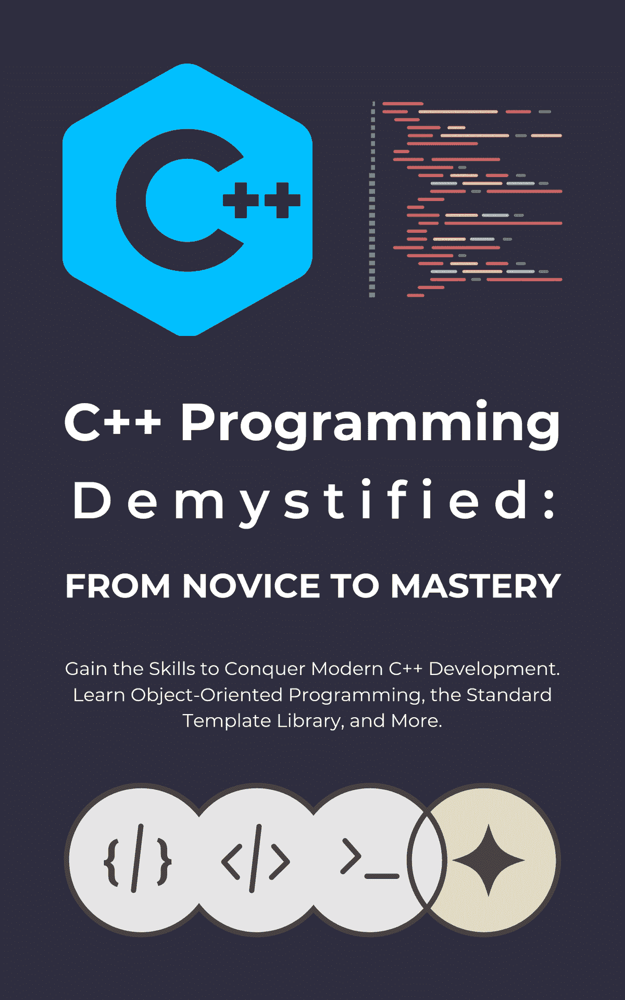

# C++ 编程揭秘：从新手到精通：掌握开发现代 C++ 的技能。学习面向对象编程、标准模板库及更多内容。




## 附录
* 录 A：C++ 语法速查表
* 录 B：C++ 最佳实践与风格指南
* 录 C：常见 C++ 错误解决方法
* 录 D：学习 C++ 的额外资源

~ 结

# 欢迎与你将学到的

欢迎阅读《C++ 编程揭秘：从新手到精通》！无论你是刚刚踏入编程世界，还是希望为自己的工具箱增加一种强大语言的资深编码员，本书都旨在引导你开启通往 C++ 精通的旅程。

### 为什么选择 C++？

C++ 不仅仅是另一门编程语言。它是现代软件开发的基石，以其性能、灵性和多功能而闻名。以下是为什么掌握 C++ 可以成为你编程生涯的转折点：

* **性能**：C++ 允许你编写运行极快且高效的代码，使其成为游戏开发、高频交易系统和科学模拟等高需求应用的理想选择。
* **控制**：C++ 让你对计算机资源进行细粒度的控制，允许你优化代码以实现最大速度和内存利用。
* **灵活性**：C++ 支持多种编程范式，包括过程化、面向对象和泛型编程。这种多活性允许你为任何特定问题选择最佳方法。
* **行业相关性**：C++ 广泛应用于从金融、医疗保健到游戏和航空航天的等众多行业。学习 C++ 将为你开启多种职业机会的大门。

### 你将在本书中学学到什么

本书是你成为一名精通 C++ 程序员的全面指南。以下是你将获得的技能和知识概览：

* **建立你的 C++ 基础**：我们将从基础开始，从安装开发环境到理解核心的 C++ 语法和概念。
* **掌握 C++ 核心概念**：你将深入 C++ 的基本构建块，包括变量、数据类型、运算符、表达式和语句。
* **流程控制与函数**：你将学习如何使用条件语句和循环控制程序的流程，并用函数编写可重用的代码。
* **指针与内存管理**：我们将应对 C++ 强大但有时棘手的内存管理功能，帮助你理解指针并避开常见陷阱。
* **面向对象编程 (OOP)**：你将发现 OOP、类、继承和多态的力量。
* **标准模板库 (STL)**：你将探索 STL，一个算法和容器的宝库。
* **超越基础**：你将尝试高级主题，如异常处理、文件输入输出、智能指针甚至是线程并发。

### 本书适合谁

本书适合任何想学习 C++ 的人，无论你之前的经验如何：

* **初学者**：我们将带你过最初的学习曲线。
* **中级程序员**：我们将巩固你对基础的理解。
* **资深编码员**：你将发现提升你编程技能的新特性和技术。

### 我们开始吧！

准备好开启你的 C++ 冒险了吗？翻页，让我们开始吧！

## 第一部分：建立你的 C++ 基础

### C++ 简介及其重要性

### 大纲
* 什么是 C++？
* C++ 简史
* C++ 的流行与应用
* C++ 的核心特性
* 为什么要学习 C++？
* C++ 与其他语言的对比
* 你的 C++ 之旅开始
* 章节总结

* *

### 什么是 C++？

C++ 是一种多功能且强大的编程语言，因其性能、灵活性和广泛的应用而受到赞誉。它被认为是一种通用语言，意味着它可以用于构建各种用途的软件，从操作系统、游戏引擎到财务系统和医学成像软件。

C++ 的一个关键特性是它能够弥合高层抽象与底层细节之间的鸿沟。

* **高层抽象**：C++ 支持面向对象编程 (OOP)，这种范式允许你使用类和对象对现实世界的问题进行建模。这使得你的代码更有组织、可重用且易于维护。
* **底层细节**：同时，C++ 提供了对内存和硬件的直接访问，让你对代码如何与计算机交互进行细粒度的控制。这种控制对于性能至关重要的应用非常关键。

这种高层组织与底层控制的独特结合，使得 C++ 成为对速度和可维护性都有高要求的项目的热门选择。

这里有一个简单的类比可以帮助你理解：

想象你正在盖一房子。C++ 为你提供了设计具有定义良好的房间（对象）和蓝图（类）房子的工具，但它也允许你进入施工的细节，根据需要调整地基（内存管理）和电线（硬件交互）。

### C++ 简史

C++ 诞生于 20 世纪 80 年初，是贝尔实验室比雅尼·斯特鲁普（Bjarne Stroustrup）的结晶。Stroustrup 寻找一种结合了 C 的效率和 Simula（一种模拟语言）高级特性的语言，于是创建了“带类的 C”，最终演变为 C++。

#### C++ 演进的关键里程碑

* 1979：Stroustrup 开始研究“带类的 C”。


# C++ 历史

- **1983**: “C with Classes”被重命名为 `C++`，其中 `++` 运算符表示 `C` 中的自增。
- **1985**: 第个 `C++` 商业版本发布。
- **1998**: 发布第一个官方 C++ 标准（`C++98`），固化了语言的语法和特性。
- **2003**: 发布了小版本更新 `C++03`。
- **2011**: `C++11` 引入了大量新特性，包括 lambda 表达式、智能指针和基于范围的 for 循环。
- **2014**: `C14` 在 `C11` 的基础上进一步增强。
- **2017**: `C++17` 增加了更多特性，重点关注语言的可用性和库的改进。
- **2020**: `C++20` 引入了概念（concepts）、模块（modules）和协程（coroutines），标志着该语言的重大演进。
- **进行中**: `C++` 标准委员会继续完善和扩展该语言，并规划了未来的新版本。

## C++ 的持久遗产

`C++` 已从其最初的起步成长为现代软件开发的基石。它处理低层系统编程和高层应用开发的能力，使其成为全球范围内无数项目使用的多功能工具。该语言丰富的历史和持续的演进证明了其持久的生命力和适应性。

## C++ 的流行性与应用

`C++` 以速度、效率和控制力闻名，使其在广泛的行业和应用领域无处不在。它的多功能性使其在资源受限的环境和对高性能的高要求的场景中都能表现出色。以下是 `C++` 多元世界的一览：

### 软件与系统

- **操作系统**: `C++` 在 `Microsoft Windows` 和 `macOS` 部分等主流操作系统的开发中起着至关重要的作用，处理内存管理、设备驱动和内核级操作等关键任务。
- **游戏引擎**: 游戏行业高度依赖 `C++` 来构建如 `Unreal Engine` 和 `Unity` 等强大且高效的游戏引擎。这些引擎利用 `C++` 渲染复杂的图形、模拟物理并管理游戏逻辑。
- **网络浏览器**: 即使是 `Google Chrome` 和 `Mozilla Firefox` 这样的浏览器也使用 `C++` 处理性能关键型组件，例如渲染引擎和 JavaScript 解释器。

### 金融科技

- **高频交易 (HFT)**: `C++` 是 `HFT` 系统的首选语言，在这些系统中微秒至关重要。它的速度和直接操作硬件的能力使其成为闪电般执行复杂算法的理想选择。
- **风险管理系统**: `C++` 用于为金融机构构建复杂的风险模型和模拟，帮助他们有效地评估和管理风险。

### 医学与科学计算

- **医学成像**: `C++` 在开发医学成像软件（包括 `MRI` 和 `CT` 扫描仪）方面发挥作用。它的性能实现了医学图像的实时处理和可视化。
- **科学模拟**: `C++` 驱动着复杂的科学模拟，范围从气候建模到粒子物理实验。它处理大型数据集和执行复杂计算的能力使其成为研究人员的宝贵工具。

### 嵌入式系统

- **汽车软件**: `C++` 被嵌入在现代汽车中，用于控制发动机管理系统、安全功能和信息娱乐系统。
- **工业自动化**: `C++` 驱动工业机器人、制造设备和过程控制系统，确保了精和和可靠。
- **IoT 设备**: 许多物联网 (`IoT`) 设备依赖 `C++` 的高效资源利用率，这允许它们在有限的硬件上运行复杂任务。

除了这些示例，`C++` 还存在于许多其他领域：

- **数据库系统**: `C++` 用于开发如 `MySQL` 和 `MongoDB` 等数据库引擎。
- **电信**: `C++` 支撑着电信基础设施，包括网络协议和路由系统。
- **图形与多媒体**: `C++` 用于图像和视频处理、3D 建模以及动画软件。

`C++` 在当今科技领域图谱中的无处不在，是其多功能性和持久力量的证明。无论你是否有兴趣构建下一代操作系统、创建沉浸式游戏，还是开发尖端的科学模拟，`C++` 都是一种能够赋能你将想法变为现实的语言。

## C++ 的核心特性

### 性能

`C++` 被誉为高性能语言，通过多种有助于其极快速度和效率的因素共同赢得了声誉：

1. **低级内存操作**: `C++` 赋予开发者直接访问内存的权限，允许对数据的存储和访问方式进行精确控制。这消除了自动管理内存的高层语言相关的开销，从而导致更快的执行速度。
2. **零成本抽象（Zero-Cost Abstractions）**: `C++` 的设计哲学是“零成本抽象”。这意味着像 `classes` 和 `templates` 等高级特性生成的代码与你在低层手动编写的代码一样高效。你在获得组织性和可读性优势的同时，无需牺牲性能。
3. **手动内存管理（可选）**: 虽然 `C++` 允许自动内存管理，但它也提供了手动管理内存的选项。这种细粒度的控制允许你优化内存使用并避免不必要的开销，在经验丰富的开发者手中能产生更快的代码。
4. **编译器优化**: `C++` 编译器非常先进，能够对你的代码进行大量优化。这些优化包括函数内联、消除冗余计算以及重新排序指令以获得更好的性能。
5. **硬件访问**: `C++` 提供了直接与硬件资源交互的机制。这对于设备驱动、嵌入式系统和游戏引擎等需要与特定硬件通信的应用程序至关重要。

#### 为什么性能很重要

在许多真实世界应用中，性能不仅仅是锦上添花，而是必需。以下是 `C++` 的速度优势改变游戏规则的一些场景：

- **游戏开发**: 快速渲染、物理模拟和 AI 计算对于创建沉浸式游戏体验至关重要。`C++` 的性能允许游戏突破图形和玩法的边界。
- **高频交易 (HFT)**: 在金融世界，即使是微秒也会产生差异。`HFT` 系统依赖 `C++` 以闪电般的速度执行复杂的交易算法，获得竞争优势。
- **科学模拟**: 模拟天气模式、蛋白质折叠或核反应等复杂现象需要巨大的计算能力。`C++` 的效率让科学家能够在合理的时间范围内运行这些模拟。
- **嵌入式系统**: 像传感器和控制器等资源受限的设备需要既快速又节省内存的软件。`C++` 完美契合需求，允许这些设备在不耗尽电池的情况下执行任务。

通过利用 `C++` 的力量，开发者可以创建出不仅运行极佳，而且提供应对各种挑战性问题所需的活性和控制的软件。

### 面向对象编程 (OOP)

面向对象编程（OOP）是一种强大的编程范式，它彻底改变了软件开发。OOP 的核心是用软件“对象”对现实世界的问题进行建模。将对象视为自包含的单元，它们结合了数据（属性）和可以在该数据上执行的操作（方法）。

#### OOP 的核心原则

- **封装**: 对象封装它们的数据和内部工作机制，向外部隐藏实现细节。这保护了数据的完整性并简化了代码交互。


- **继承**：类（对象的蓝图）可以继承其他类的属性和行为，从而促进代码复用并在对象之间建立层级关系。
- **多态**：对象可以被视为其父类的实例，允许灵活且动态的行为。这使得代码能够在不进行大量修改的情况下适应不同的对象类型。

# C++ 中的 OOP

C++ 为面向对象编程（OOP）提供了强有的支持，提供了如类、对象、继承、多态等特性。以下是 OOP 如何增强 C++ 开发的：

1. **模块化**：OOP 将复杂问题拆解为可管理的对象，每个对象都有其定义良好的职责。这种模块化使得代码更容易理解、测试和维护。
2. **可重用性**：类可以重复使用以创建多个对象，而继承允许你扩展现有类来创建新类，最大限度地减少冗余代码。
3. **真实世界建模**：OOP 允许你在代码中模拟现实世界的实体和关系。例如，一个汽车对象可以拥有颜色和速度等属性，以及 `accelerate`（加速）和 `brake`（刹车）等方法。
4. **可维护性**：OOP 的封装原则有助于隔离更改，使得修改代码时更不容易产生意外的副作用。
5. **灵活性**：多态使代码能够无缝地与不同类的对象工作，提升了软件的灵性和适应性。

## 示例：银行账户

在 C++ 中，你可以创建一个 `BankAccount` 类来表示银行账户。该类将拥有 `accountNumber`（账号）、`balance`（余额）和 `ownerName`（所有者姓名）等属性。它还会有 `deposit`（存款）、`withdraw`（取款）和 `checkBalance`（查询余额）等方法。然后你可以创建多个 `BankAccount` 对象来表示不同的账户。

通过利用 OOP，你可以构建由相互作用的对象组成的软件系统，这些对象模拟了现实世界或抽象概念。OOP 对模块化、重用性和维护使其成为现代软件开发的无价工具，而 C++ 为实现 OOP 原则提供了强大的平台。

## 标准模板库 (STL)

标准模板库 (STL) 是 C++ 的基石，提供了丰富的现用数据结构和算法，可以显著简化你的开发流程。将 STL 视为一个装满高质量、预构建组件的工具箱，你可以轻松地将其整合到 C++ 项目中。

### STL 工具箱里有什么什么？

1. **容器**：STL 提供了各种容器来存储和组织你的数据。常用容器包括：
    - **Vectors**：可以根据需要增长或收缩的动态数组。
    - **Lists**：用于高效插入和删除的双向链表。
    - **Maps**：存储键值对的关联数组。
    - **Sets**：唯一元素的集合。
    - **Dequ**（deque）：双端队列，允许在两端进行高效的插入和删除。
    - **Stacks**（栈）：后进先出（LIFO）数据结构。
    - **Queues**（队列）：先进先出（FIFO）数据结构。

2. **算法**：STL 提供了一套用于处理容器内数据的算法。一些常用算法包括：
    - **Sorting**（排序）：按特定顺序排列元素。
    - **Searching**（查找）：在容器内寻找特定元素。
    - **Transforming**（转换）：根据某些标准修改元素。
    - **Counting**（计数）：确定满足特定条件的元素数量。
    - **Accumulating**（累加）：计算元素的累加值（例如和、乘积）。

3. **Iterators**（迭代器）：迭代器是允许你遍历和访问 STL 容器内元素的对象。它们提供了一种处理不同类型容器的一致方法。

### 为什么使用 STL？

- **效率**：STL 容器和算法为优化性能而设计，通常优于自定义实现。
- **可靠性**：STL 经过了彻底测试并广泛使用，最大限度地减少了 Bug 和错误的风险。
- **可读性**：使用 STL 组件可以让你的代码更加简洁、富有表现力。
- **生产力**：STL 让你从重复造轮子中解放出来，让你能够专注于应用程序的核心逻辑。

### 示例：排序 Vector

```cpp
#include <iostream>
#include <vector>
#include <algorithm>

int main() {
    std::vector<int> numbers = {5, 2, 8, 1, 9};

    // 使用 STL sort 算法排序 vector
    std::sort(numbers.begin(), numbers.end());

    // 输出排序后的 vector
    for (int num : numbers) {
        std::cout << num << " ";
    }

    std::cout << std::endl;

    return 0;
}
```

在这个示例中，我们使用 STL 中的 `std::sort` 算法对整数 vector 进行排序。这比从头写自己的排序算法简单得多。

通过掌握 STL，你将获得一个强大的工具包，将你的 C++ 编程效率和生产力提升到新的高度。STL 的多功能性和性能使其成为任何 C++ 开发者的必备资产。

### 泛型编程

泛型编程是 C++ 中一种强大的范式，允许你编写可以适用于多种数据类型的代码而无需重复。将其理解为为函数或类创建一个蓝图，该蓝图可以适应不同的材料（数据类型）。

### 模板 (Templates)：泛型编程的核心

C++ 模板是使泛型编程可能的机制。模板是创建类或函数的蓝图或模式。你可以定义一个函数模板，它可以处理整数、浮点数、字符串或任何其他数据类型。

### 模板如何工作

当你使用模板时，编译器会为你提供的特定数据类型生成代码。这个过程被称为模板实例化。模板的美之处在于你只写一次代码，但编译器会创建多个版本，每个版本都为不同的数据类型量身定制。

### 示例：泛型交换函数

```cpp
template <typename T> // 'T' 是任何数据类型的占位符
void swap(T& a, T& b) {
    T temp = a;
    a = b;
    b = temp;
}

int main() {
    int x = 5, y = 10;
    swap(x, y);  // 编译器为 'swap(int&, int&)' 生成代码

    double p = 3.14, q = 2.71;
    swap(p, q); // 编译器为 'swap(double&, double&)' 生成代码
}
```

在这个示例中，`swap` 函数被定义为模板。它接受两个类型为 `T` 的参数并交换它们的值。`main` 函数演示了同一个 `swap` 函数如何用于整数和双精度浮。

### 泛型编程的好处

- **代码重用性**：编写一次代码并在不同的数据类型上使用，减少冗余。
- **类型安全**：编译器确保类型被正确使用，防止错误。
- **性能**：泛型代码通常与为特定数据类型编写的代码一样高效。
- **灵活性**：在不进行重大修改的情况下，轻松调整你的代码以适应新的数据类型。

泛型编程是现代 C++ 开发的基石。通过掌握模板，你将在项目中解锁代码重用性、灵活性效率的新境界。STL 本身大量构建在模板之上，展示了泛型编程在实践中的威力。

## 为什么学习 C++？

### 职业机会

- **软件工程师**：软件工程师在各个领域设计、开发和维护软件应用程序。在金融、医疗保健和企业软件等领域，构建健壮、高性能的应用对 C++ 技能的需求非常高。


- **游戏开发人员**：游戏行业因 `C++` 的高性能和与硬件交互的能力而蓬勃发展。作为游戏开发人员，你可以从事游戏引擎、图形学、物理模拟、人工智能和游戏系统的开发工作。
- **嵌入式系统工程师**：嵌入式系统是大型设备内部的专用计算机（例如汽车、医疗设备、工业机器人）。由于其高效率和低级控制能力，`C++` 对于这些这些系统至关重要。
- **量化分析师 (Quant)**：在金融领域，量化师为交易、风险管理和衍生品定价开发复杂的数学模型和算法。`C++` 的速度和数值处理能力使其成为这些任务的首选语言。
- **高性能计算 (HPC) 工程师**：`HPC` 涉及使用强大的计算资源解决科学、工程和金融领域的复杂问题。由于其性能和代码并行化能力，`C++` 常用于开发 `HPC` 系统的软件。
- **系统软件工程师**：系统软件工程师负责运行操作系统、设备驱动程序和其他低级组件的核心软件。由于对硬件资源的控制力，`C++` 是系统级编程的常见选择。
- **网络工程师**：网络工程师设计、实施和维护计算机网络。`C++` 可用于开发网络协议、路由算法和其他网络相关的软件。
- **DevOps 工程师**：DevOps 工程师弥合了软件开发与 IT 运营之间的差距。`C++` 技能对于自动化部署流程、构建监控工具和优化系统性能具有价值。
- **研究科学家**：在机器人技术、人工智能和计算机视觉等研究领域，`C++` 常用于实现算法和新技术的原型。

### 额外机会

- **自由职业 C++ 开发人员**：许多企业和个人会为特定项目聘用自由 `C++` 开发人员。
- **技术顾问**：`C++` 专业知识可以让你获得咨询类职位，帮助公司解决复杂的技术问题并优化其软件开发流程。
- **创业者**：如果你有一个绝佳的主意，你的 `C++` 技能可以成为建立自己的软件公司或产品的基础。

学习 `C++` 不仅能让你具备宝贵的编程技能，还为你开启了通往各种兴奋且回报丰厚的职业道路的大门。无论你是热衷于构建下一大作游戏、开发尖端金融算法，还是为科学研究做出贡献，`C++` 都能成为你通往充实且影响力职业的门票。

### 解决问题的能力

学习 `C++` 不仅仅是为了掌握一种编程语言；更是为了开发一套强大的问题解决工具，并以逻辑化、结构化的思维应对挑战。这种技能不仅在编程领域，在几乎任何技术领域都是无价的。以下是学习 `C++` 如何提升你的解决问题能力：

1. **拆解复杂问题**：`C++` 鼓励你将复杂问题分解为更小、更易管理的组件。这种分治法帮助你识别核心问题并制定出逐步的解决方案。
2. **算法思维**：编写 `C++` 代码涉及设计算法，算法是解决特定问题的指令集。这个过程磨练了你的算法思维能力，能够识别模式、优化步骤并寻找高效的解决方案。
3. **逻辑推理**：`C++` 程序依赖于精确的逻辑。在你编写和调试代码时，你将加强逻辑思维能力，跟踪执行路径并识别推理中的错误或不一致之处。
4. **调试与故障排除**：调试是任何程序员的基本技能。`C++` 教会你如何系统地分析代码、定位错误并制定解决方案。这些调试技能可以转移到其他技术领域，在那些领域可能需要排除硬件故障或解决网络问题。
5. **注重细节**：`C++` 是一种严谨的语言。即使是一个微小的拼写错误也可能导致代码失败。在学习 `C++` 时，你会培养对细节的敏锐观察力，这对于确保任何技术领域工作的准确性和可靠性至关重要。
6. **坚持与韧性**：编程可能具有挑战性，遇到错误是过程的一部分。学习 `C++` 教会你接受挑战，在挫折中坚持并不断完善你的解决方案。在任何你会面对复杂问题的职业中，这种韧性都是一种宝贵的资产。

### 编程之外的可迁移技能

你通过 `C++` 磨练的解决问题能力远超代码领域。它们可以应用于各种技术领域，例如：

- **工程**：分析系统设计、优化流程和排除技术问题。
- **数据科学**：为数据分析、机器学习和统计建模开发算法。
- **金融**：构建金融模型、分析市场趋势和开发交易策略。
- **研究**：设计实验、分析数据并根据证据得出结论。

通过学习 `C++`，你不仅是在获得一种编程语言；你是在投资一套心理工具箱，它将使你在所选择的任何技术领域中都能以信心和创造力应对复杂问题。

### 社区与资源

开启 `C++` 之旅绝非孤单一人的事。你会发现自己被一个充满活力且相互支持的同学习者、经验丰富的开发者和热情的爱好者所包围。这个社区结合丰富的在线资源，提供了一个强大的支持网络，引导你走过学习过程的每一步。

#### C++ 社区

- **在线论坛与社区**：像 `Stack Overflow`、`Reddit` 的 `r/cpp` 以及 `C++` 子版等平台是活跃的枢纽，你可以在那里提问、寻求建议、分享知识并与其它 `C++` 程序员建立联系。
- **会议与聚会**：`C++` 会议、工作讨会和本地聚会提供了向专家学习、与同行建立人脉以及跟进语言最新动态的机会。
- **开源项目**：为开源 `C++` 项目贡献是获得实践经验、与他人协作以及回馈社区极佳方式。

#### 在线资源

- **C++ 官方网站**：`C++` 网站 (`isocpp.org`) 是信息的宝库，包括最新的语言标准、教程、文章以及指向其他价值资源的链接。
- **C++ 参考网站**：如 `cppreference.com` 等网站提供了关于 `C++` 语法、库和最佳实践的全面文档。
- **在线课程与教程**：`Coursera`、`Udemy`、`edX` 和 `YouTube` 等平台提供大量的 `C++` 课程和教程，满足所有水平的学习。
- **书籍与电子书**：有很多优秀的 `C++` 书籍和电子书，涵盖了基础概念和高级技巧。寻找 `Bjarne Stroustrup`、`Scott Meyers` 和 `Herb Sutter` 等受尊敬作者的作品。
- **代码示例与项目**：`GitHub` 和 `GitLab` 等网站托管了大量的 `C++` 代码示例和开源项目，你可以从中学习并做出贡献。
- **博客与文章**：许多 `C++` 专家和爱好者通过博客和文章分享他们的知识和见解。这些可以是获取技巧、窍门和教程的绝佳来源。

`C++` 社区以及线上丰富的资源为你的学习旅程提供了坚实的基础。不要犹豫，去联系、提问并与他人互动。在正确的支持和触手可及的知识下，你将很快能够精通 `C++` 并实现你的编程目标。


`C++`, `Python`, `Java` 和 `C#` 都是流行的编程语言，它们各有各的优缺点。理解这些差异可以帮助你为工作选择合适的工具。

| 特性 | C++ | Python | Java | C# |
| :--- | :--- | :--- | :--- | :--- |
| 性能 | 高：直接内存操作，零开销抽象 | 较低：解释型语言，动态类型 | 中等：即时编译 (JIT)，自动内存管理 | 中等：与 Java 相似，但通常略快 |
| 灵活性 | 高：支持多种范式（面向对象、过程式、泛型） | 高：动态类型，鸭子类型 | 中等：强类型，专注于面向对象 | 中等：强类型，专注于面向对象，但比 C++ 灵活灵活 |
| 易用性 | 较低：学习曲线陡峭，手动内存管理（可选） | 高：语法简洁，标准库丰富 | 中等：语法冗长，标准库丰富 | 中等：与 Java 相似，但某些功能更精简 |
| 应用领域 | 系统编程、游戏开发、高性能计算 | 数据科学、机器学习、Web 开发、脚本编写 | 企业级应用、Android 开发 | 企业级应用、游戏开发 (Unity)、Web 开发 |
| 内存管理 | 手动（可选）或通过智能指针自动 | 自动垃圾回收 | 自动垃圾回收 | 自动垃圾回收 |
| 类型 | 静态 | 动态 | 静态 | 静态 |

## 优点与缺点

- **C++**:
    - 优点：无与伦比的性能、细粒控制、灵活性、应用广泛。
    - 缺点：学习曲线陡峭、存在内存管理错误的风险、语法较冗长。
- **Python**:
    - 优点：易于学习、语法简洁、数据科学和机器学习有丰富的库。
    - 缺点：比编译语言慢、不适合对性能要求高或内存限制的应用。
- **Java**:
    - 优点：平台无关（一次编写，随处运行）、社区强大、库和框架生态庞大。
    - 缺点：比 Python 或 C# 冗长，在某些场景下比 C++ 慢。
- **C#**:
    - 优点：与 Java 相似但具有一些现代特性、与 `.NET` 框架深度集成、广泛用于 `Unity` 游戏开发。
    - 缺点：不如 C++ 灵活、主要绑定微软生态系统。

## 选择合适的语言

最适合你的语言取决于你的需求和目标。考虑以下因素：

- **项目需求**：你正在构建什么样的应用程序？性能至关重要吗？
- **你的经验**：你是新手还是经验丰富的程序员？
- **社区与生态系统**：大型社区和现成库有多重要？

如果你追求原生性能、控制力以及构建广泛应用的能力，`C++` 是极佳的选择。然而，如果易用性和快速开发是首位，`Python` 或 `C#` 可能更合适。`Java` 是企业级应用和 Android 开发的可靠选择。

## 开启 C++ 之之旅

恭喜你！你刚刚迈向掌握世界上最强大且多功能的编程语言之一的第一步。无论是梦想构建下一款突破性的游戏、破解复杂的金融算法，还是为科学突破做出贡献，`C++` 潜力将你的愿望变为现实。

在你开启这段激动的旅程时，请记住，学习 `C++` 不仅仅是背记语法或掌握复杂的细节。它关乎培养一种全新的思维方式，一种逻辑且结构化的解决问题方法，这种方法将在个人和职业发展上让你受益匪浅。

这本书是你在这场冒险中信赖的伙伴。我们将引导你探索 `C++` 的复杂之处，从基础知识逐渐过渡到高级技巧。我们将以清晰易于理解的方式解释复杂概念，提供大量的实战示例，并在过程中提供挑战来测试你的理解。

但最重要的是，我们让你知道你并不孤单。充满活力的 `C++` 社区拥有丰富的资源和支持你的成员，他们在这里为你加油并帮助你取得成功。不要犹豫提问、寻求指导并与他人合作。

那么，准备好释放你体内的编程忍者魂了吗？让我们潜入 `C++` 的世界，发现等待着你的无限可能吧！

### 章节总结

在本章中，我们探索了 `C++` 的精髓，从它的起源和关键特征到其广泛的应用领域和职业机会。我们学到 `C++` 是一种高性能语言，弥补了高层抽象与低层控制之间的鸿沟，使其适用于各种项目。

我们深入探讨了 `C++` 丰富的历史，追溯了它从“带类的 C”演变为今天这种功能丰富的语言的过程。我们还讨论了它在软件开发、游戏、金融、医疗保健和嵌入式系统等行业的广泛使用。

本章的核心要点：

- `C++` 是一种多功能的通用语言：它可以被用于从构建操作系统到开发高频交易算法的任何领域。
- **性能是核心优势**：`C++` 直接操作内存和硬件的能力使其成为对速度至关重要的应用的理想选择。
- **面向对象编程 (OOP)**：`C++` 支持 `OOP`，这促进了软件开发中的模块化、可重用和可维护性。
- **标准模板库 (STL)**：`STL` 提供了丰富的即用数据结构和算法，简化了开发过程。
- **泛型编程**：`C++` 模板能够创建适用于不同数据类型的可重用代码。
- **职业机会**：精通 `C++` 为软件工程、游戏开发、金融等领域化且丰厚的职业路径开启了大门。
- **解决问题的能力**：学习 `C++` 增强了你的解决问题能力和逻辑思维，在任何技术领域都是宝贵的资产。
- **社区与资源**：充满活力的社区以及丰富的在线和本地资源将支持你的 `C++` 之旅。

在对本章涵盖的基础知识有了坚实理解后，你现在准备好开启 `C++` 冒险的下一个阶段了。在接下来的章节中，我们将深入研究该语言，探索它的语法、核心概念和高级技巧。那么，让我们卷起袖子开始编程吧！

# 开始你的 C++ 开发环境

### 提纲

- 选择合适的工具
- 安装 C++ 编译器 (`GCC`, `Clang` 或 `MSVC`)
- 安装集成开发环境 (IDE)
- 编译你的第一个 C++ 程序
- 调试你的 C++ 代码
- 额外提示
- 章节总结

***

### 选择合适的工具

在你开始编写第一行 `C++` 代码之前，建立一个舒适且高效的开发环境至关重要。这个环境通常由两个主要部分组成：

1. **编译器**：编译器是一种软件工具，将你人类可读的 `C++` 代码翻译成计算机可以执行的机器指令。把它想象成一个翻译官，将你的 `C++` “句子”转换为你的计算机理解的语言。
2. **集成开发环境 (IDE)**：`IDE` 是一种提供用于编写、编辑、调试和管理你的 `C++` 项目的全套工具的软件应用程序。它就像一个强大的工具箱，包含了你构建 `C++` 杰作所需的一切东西。

#### 流行的 C++ 编译器

- `GCC` (GNU 编译器集)：`GCC` 是一个免费且开源的编译器套件，支持多种编程语言，包括 `C++`。由于其多功能性和在各种平台上的可用性，它是开发者之间的热门选择。


- **Clang**: `Clang` 是另一个免费开源的编译器，以编译速度快和错误信息清晰而闻名。它通常与 `LLVM` 编译器基础设施配合使用。
- **MSVC (Microsoft Visual C++)**: `MSVC` 是微软的专有 C++ 编译器，主要用于 Windows 平台。它随 `Visual Studio` 一捆提供，这是一款强大的 IDE，为 C++ 开发提供了丰富的丰富的工具集。

## 流行的 C++ IDE

- **Visual Studio Code (VS Code)**: `VS Code` 是一个轻量级的跨平台代码编辑器，可以通过 C++ 扩展进行扩展，以提供功能完整的 IDE 体验。它以其自定义选项和丰富的插件生态系统而闻名。
- **Code::Blocks**: `Code::Blocks` 是一个专为 C++ 开发设计的免费开源 IDE。它是初学者以及偏于更简单、更高效界面的人的流行选择。
- **CLion**: `CLion` 是 JetBrains 开发的一款商业 IDE，为 C++ 开发提供了一套强大的工具，包括智能代码补全、重构和调试。
- **Xcode**: `Xcode` 是 Apple 为 macOS 开发的 IDE，主要用于开发 iOS 和 macOS 等 Apple 平台的应用程序。它包含一个 C++ 编译器和一套完整的 C++ 开发工具。

## 选择你的工具

最适合你的工具将取决于你的操作系统、个人偏好和项目需求。

- **操作系统**: 如果你使用 Windows，`MSVC` 是自然选择，因为它与 `Visual Studio` 无缝集成。在 macOS 上，`Xcode` 是默认的 IDE。对于 Linux 用户，`GCC` 或 `Clang` 是流行的选择。
- **个人偏好**: 一些开发者偏偏于像 `VS Code` 这样轻量级的编辑器，而另一些人则喜欢 `CLion` 或 `Visual Studio` 这样功能强大的 IDE。尝试不同的工具来找到适合你工作流和偏好的工具。
- **项目需求**: 考虑项目的特定需求。如果你正在从事大型项目，具有强大项目管理功能的 IDE 可能会有帮助。对于小型项目或快速实验，简单的编辑器和编译器设置可能足够了。

在本书中，我们将主要关注使用 `GCC` 和 `Visual Studio Code`，因为它们广泛可用，大多数读者都能获取。然而，你学到的概念和技术可以很容易应用到其他的编译器和 IDE 中。

## 安装 C++ 编译器 (GCC, Clang, 或 MSVC)

让我们让你的 C++ 编译器运行起来。请根据你的操作系统遵循以下说明：

### Windows (MSVC):

1. **安装 Visual Studio**: 从微软官方网站下载并安装 `Visual Studio`。在安装过程中，请确保选择“使用 C++ 的桌面开发”工作负载。这将包含 `MSVC` 编译器和其他基本工具。
2. **验证安装**: 打开 `Visual Studio` 的“开发者命令提示符”。输入 `cl` 并按回车。你应该能看到指示编译器版本的输出，这确认安装成功。

### macOS (Clang):

1. **安装 Xcode**: `Xcode` 是 Apple 的集成开发环境 (IDE)，它包含 `Clang` 作为其默认编译器。从 App Store 下载并安装 `Xcode`。
2. **验证安装**: 打开 `Terminal` 应用程序并输入 `clang --version`。你应该看到 `Clang` 的版本信息，表示安装成功。

### Linux (GCC 或 Clang):

1. **检查现有安装**: 许多 Linux 发行版都预装了 `GCC`。打开 `Terminal` 并输入 `g++ --version` 或 `clang --version` 来检查是否已经可用。如果没有，请继续执行下一步。
2. **安装 GCC/Clang**: 使用你发行版的包管理器安装 `GCC` 或 `Clang`。例如，在 Ubuntu 或 Debian 上，可以使用以下命令：

```bash
sudo apt update
sudo apt install build-essential  # 安装 GCC
# 或
sudo apt install clang  # 安装 Clang
```
3. **验证安装**: 安装后，在 `Terminal` 中输入 `g++ --version` 或 `clang --version` 以确认安装成功。

## 验证安装（所有操作系统）

为了确保你的编译器工作正常，创建一个名为 `hello.cpp` 的简单 C++ 文件，包含如下代码：

```cpp
#include <iostream>

int main() {
    std::cout << "Hello, C++ World!" << std::endl;
    return 0;
}
```

然后，编译并运行程序：

- **Windows (MSVC)**: 打开开发者命令提示符，输入 `cl hello.cpp`，然后输入 `.\hello`。
- **macOS (Clang)/Linux (GCC/Clang)**: 打开 `Terminal`，输入 `g++ hello.cpp -o hello`（或 `clang hello.cpp -o hello`），然后输入 `./hello`。

如果你在终端或命令提示符中看到输出“Hello, C++ World!”，说明你的编译器已设置就绪！

**故障排除**: 如果在安装过程中遇到任何问题，请参考你所选编译器的官方文档或在线寻求帮助。常见问题包括环境变量设置错误或缺少依赖项。

## 安装集成开发环境 (IDE)

虽然可以使用简单的文本编辑器和命令行编写并编译 C++ 代码，但集成开发环境 (IDE) 提供了许多功能，可以简化开发过程并提高效率。让我们探索两个流行的 IDE 以及如何安装它们：

### Visual Studio Code (VS Code)

`VS Code` 是一个深受各种语言开发者喜爱的多功能轻量级代码编辑器。通过正确的扩展，它可以变成一个强大的 C++ IDE。以下是设置方法：

1. **下载并安装**:
   - 从官方网站 (`code.visualstudio.com`) 下载适用于你操作系统的 `VS Code` 安装程序。
   - 按照屏幕上的指令完成安装。
2. **安装 C/C++ 扩展**:
   - 打开 `VS Code` 并点击侧边栏上的扩展图标。
   - 搜索微软提供的“C/C++”并点击“安装”。此扩展提供了代码格式化、IntelliSense（代码补全）和调试等基本功能。
3. **为你的编译器配置**:
   - 打开命令面板 (`Ctrl+Shift+P` 或 `Cmd+Shift+P`) 并搜索“C/C++: Edit configurations (JSON)”。
   - 配置 `compilerPath` 设置以指向你 C++ 编译器的位置（例如 `g++` 或 `clang++` 的路径）。

### Code::Blocks

`Code::Blocks` 是一个专为 C++ 开发设计的免费开源 IDE。它提供了传统的 IDE 体验，具有项目管理、代码导航和内置调试器等功能。

1. **下载并安装**:
   - 访问 Code::Blocks  (`codeblocks.org`) 并下载适用于你操作系统的安装程序。确保选择包含编译器的版本（例如 Windows 下的 `codeblocks-20.03mingw-setup.exe`）。
   - 按照屏幕上的指令完成安装。

## 使用 IDE 的优势

IDE 提供了许多优势，使其成为 C++ 开发中不可或少的工具：

- **代码编辑**: 语法高亮、代码补全和自动格式化等功能使代码更易读，并帮助你尽早发现错误。
- **项目管理**: IDE 帮助你组织项目、管理构建配置并与版本控制系统（例如 `Git`）集成。
- **调试**: IDE 提供了强大的调试工具，允许你单步执行、检查变量并识别错误的根源。
- **重构**: 许多 IDE 支持重构，重构涉及在不改变功能的情况下重组代码以改进设计。
- **与其他工具集成**: IDE 通常与静态分析器、代码格式化程序和文档生成器等工具集成，进一步增强你的工作流。

## 选择哪个 IDE？

最适合你的 IDE 将取决于你的个人偏好和所需的特定功能。

- 如果你偏好轻量级、可自定义且注重代码的编辑器，`Visual Studio Code` 可能是非常棒的选择。
- 如果你偏好专注于 C++ 的更传统的 IDE 体验，`Code::Blocks` 是一个不错的选择，特别是对初学者而言。


尝试使用两者，看看你觉得哪一个最顺手。最终，IDE 应该是一个能够帮助你更高效地编写更好的 C++ 代码的工具。

## 编译你的第一个 C++ 程序

让我们通过编写和编译经典的“Hello, World!”程序来开启你的 C++ 之旅。这个简单的程序将在你的控制台上打印出“Hello, C++ World!”信息，标志着你向 C++ 编码的首次成功尝试。

### 理解 C++ 程序结构

每个 C++ 程序都遵循一个基础结构：

1. `#include` 指令：这一行告诉编译器包含 `iostream` 头文件，该文件为你的程序提供了必要的输入/输出（I/O）功能。它就像是邀请一位知道如何与外部世界交流的朋友。
2. `main` 函数：`main` 函数是你的 C++ 程序的核心。它是执行开始的起点。你将在此函数内编写所有的代码。
3. `Statements`（语句）：在 `main` 函数内部，你将编写定义程序将执行的动作的语句。
4. `Return Statement`（返回语句）：`return 0;` 语句表示你的程序已成功执行。

### 编写“Hello, World!”程序

打开你选择的编辑器或 IDE，创建一个名为 `hello.cpp` 的新文件。然后输入以下代码：

```cpp
#include <iostream> // 输入/输出库

int main() {      // main 函数

    std::cout << "Hello, C++ World!" << std::endl; // 打印消息

    return 0;    // 表示成功执行
}
```

### 编译程序（命令行）

1. 打开你的终端（macOS/Linux）或开发者命令提示符（Windows）：导航到你保存 `hello.cpp` 的目录。
2. 使用 `g++` 编译（macOS/Linux）：输入以下命令并按回车：
```bash
g++ hello.cpp -o hello
```
此命令告诉 `g++` 编译器编译 `hello.cpp` 并创建一个名为 `hello` 的可执行文件。
3. 使用 `clang++` 编译（macOS/Linux）：输入以下命令并按回车：
```bash
clang++ hello.cpp -o hello
```
此命令告诉 `clang++` 编译器编译 `hello.cpp` 并创建一个名为 `hello` 的可执行文件。
4. 使用 `cl` 编译（Windows）：输入以下命令并按回车：
```bash
cl hello.cpp
```
此命令告诉 Microsoft Visual C++ 编译器 (`cl`) 编译 `hello.cpp` 并创建一个名为 `hello.exe` 的可执行文件。

### 编译程序（IDE）

大多数 IDE 都有内置的构建或运行按钮（通常是一个绿色播放图标），它可以自动编译并执行你的代码。点击此按钮编译并运行你的“Hello, World!”程序。

### 运行程序

一旦程序编译完成，你可以在终端或命令提示符中输入以下命令来运行它：

```bash
./hello  (macOS/Linux)
.\hello (Windows)
```

你应该看到输出：
Hello, C++ World!

恭喜你！你刚刚编译并运行了第一个 C++ 程序。虽然它很简单，但它标志着你 C++ 之旅中的一个重要里程碑。随着学习的深入，你将在在此基础上，学习如何创建更复杂、更强大的程序。

## 调试你的 C++ 代码

调试是任何程序员的一项必不可少的技能，C++ 也不例外。即使是最经验丰富的开发者也会犯错，而错误（又称 bug）是编码过程中不可避免的一部分。调试是系统地识别和修复这些错误的艺术，确保你的代码按预期工作。

### 调试的重要性

Bug 可能会以各种形式出现，从产生错误结果的细微逻辑错误到导致程序停止执行的崩溃。调试允许你：

- 识别错误：准确定错误发生的特定代码行。
- 理解行为：深入了解你的代码在运行时是如何的，帮助你追溯问题的根源。
- 修复问题：纠正错误并确保你的代码运行正常。
- 提高代码质量：调试通常会让你对代码有更深层次的理解，允许你在未来编写出更健壮、更抗错误的程序。

### 使用 IDE 调试器

大多数现代 IDE（包括 Visual Studio Code 和 Code::Blocks）都提供了强大的调试工具来协助这一过程。以下是有效使用它们的方法：

1. 设置断点（Breakpoints）：断点是你放置在代码中的标记，用于在特定点暂停执行。这允许你检查程序在该刻的状态（变量值、调用堆栈等）。
2. 逐行执行代码（Step Through Code）：一旦程序遇到断点，你就可以使用调试器逐行执行代码。这让你看到每条语句如何影响程序的状态。
3. 检查变量（Inspect Variables）：调试器允许你在执行期间的任何一点检查变量的值。对于追踪错误值或意外行为至关重要。
5. 监视表达式（Watch Expressions）：你可以设置监视表达式，在程序运行时监控特定的变量或表达式。这有助于你跟踪它们的值随时间的变化。
6. 分析调用堆栈（Analyze the Call Stack）：调用堆栈显示了通往代码中当前点的函数调用序列。这对于理解程序的流程以及识别错误可能源于何有用。

### 常见的调试技术

除了使用 IDE 调试器外，你还有其他可以采用的技术：

- 打印语句（Print Statements）：在代码的策略位置插入打印语句（`std::cout`），允许你输出变量值并追踪程序的执行流。
- 错误分析（Error Analysis）：仔细阅读编译器错误信息和运行时报告。它们通常提供了关于错误的性质和位置的价值线索。
- 代码审查（Code Review）：让同事或导师审查你的代码。新的视角往往能发现你遗漏的错误。
- 单元测试（Unit Testing）：编写验证单个组件行为的单元测试。这可以帮助你在开发早期发现错误。

### 有效调试的技巧

- 尽早开始：不要等到代码完全写完才开始调试。在较小的块中寻找和修复错误更容易。
- 重现 Bug（Reproduce the Bug）：尝试创建一组能够持续重现错误的步骤。这有助于你隔离问题并验证修复方案。
- 逻辑思考：用逻辑思维方法调试。考虑错误的所有可能原因并逐个排除它们。
- 不要放弃：调试可能会令人沮丧，但坚持是关键。不断尝试不同的方法直到找到解决方案。

记住，调试是开发过程中的正常部分。通过掌握调试技术并利用 IDE 提供的工具，你将成为更高效、更有信心的 C++ 程序员。

## 其他提示

除了编译器和 IDE 等基础工具外，还有一些额外的工具和实践可以进一步增强你的 C++ 开发体验：

### 选择编辑器（如果不使用 IDE）

如果你更倾向于极简的方法，或者在没有完整 IDE 的系统上工作，可以考虑使用文本编辑器编写 C++ 代码。流行的选项包括：

- Sublime Text：以速度、可定制性和丰富的插件生态系统著称。
- Atom：一种现代的开源编辑器，拥有强大的社区和许多用于 C++ 开发的包。
- Notepad++：适用于 Windows 的简单而强大的文本编辑器，通常因其轻量化和快速启动而受到青睐。

这些编辑器通常提供语法高亮、代码格式化和基础代码补全等功能，即使在没有完整 IDE 的情况下也能提升编码体验。

### 使用 Git 进行版本控制

版本控制系统（如 Git）是极价值的工具，用于跟踪代码更改、与他人协作并在需要时回滚之前的版本。Git 允许你在项目的不同阶段创建“快照”，使实验、协作和管理代码库变得简单。


考虑使用如 GitHub 或 GitLab 等 Git 托管服务来远程存储你的 C++ 项目并与其他进行协作。

### 在线 C++ 编译器

Repl.it、OnlineGDB 和 Wandbox 等在线 C++ 编译器提供了一种直接在网页浏览器中编写、编译和运行 C++ 代码的便捷方法。这些工具非常适合：

● 快速实验：无需设置本地环境即可测试小型代码段。
● 学习：初学者可以使用在线编译器来感受 C++ 语法和基本概念。
● 协作：轻松地与他人共享代码进行审查或调试。

虽然在线编译器不适合大型项目，但它们对于学习和实验来说是非常宝价值的资源。

### 你的个性化环境

记住，你的开发环境是一个个人空间。根据你的喜好和需求对其进行定制。尝试不同的编辑器、主题和插件，创建一个让你感到高效且舒适的配置。一个配置良好的环境会显著影响你的学习体验和对 C++ 编程的整体乐趣。

随着本书的深入，你将获得知识和技能来微调并自定义环境，以适应你特定的工作流。通过投入时间建立一个高效且愉快的工作空间，你将为通往成功且充满回报的 C++ 之旅奠下坚实的基础。

### 章节总结

在本章中，你为创建 C++ 开发环境迈出了关键一步，这个环境就是你编写代码的工作坊。我们涵盖了以下关键点：

● 选择工具：你学习了 C++ 开发环境的核心组成部分：翻译代码的编译器（如 `GCC`、`Clang` 或 `MSVC`），以及为编码、调试和项目管理提供全面工具集的集成开发环境（IDE），如 `Visual Studio Code` 或 `Code::Blocks`。
● 安装编译器：你获得了在 Windows、macOS 或 Linux 上安装所需编译器的步骤说明。你还验证了安装情况，以确保顺畅的编码体验。
● 设置你的 IDE：如果你选择了 IDE，你学习了如何安装和配置 `Visual Studio Code` 或 `Code::Blocks`，为你的 C++ 项目配备了一个强大的控制中心。
● “Hello, World!”：你编写、编译并运行了你的第一个 C++ 程序——一个经典的“Hello, World!”，它在控制台打印了问候语。这个简单的程序向你介绍了 C++ 代码的基本结构和编译过程。
● 调试你的代码：你学习了调试的重要性，以及如何使用 IDE 的调试器来识别并修复代码中的错误。你还探索了打印语句和代码审查等替代调试技术。
● 其他工具和资源：我们讨论了作为 IDE 替代方案的文本编辑器、`Git` 等版本控制系统的价值，以及在线编译器用于快速实验的便利性。还收到了进一步学习资源的建议，以加深你的 C++ 知识。

通过完成本章，你已经为 C++ 之之旅奠定了基础。随着开发环境的就绪，你现在准备好探索该语言的语法、核心概念和高级技巧了。在继续学习的过程中，请记住开发环境是个性化的空间——根据你的喜好和需求调整它，创建一个能够促进生产力和乐趣的工作空间。

# C++ 核心构建模块

### 目录

● 变量与数据类型
● 运算符与表达式
● 输入与输出
● C++ 中的注释
● 章节总结

***

## 变量与数据类型

在 C++ 世界中，变量是你的数字存储容器。它们存储了程序处理的数据，无论是数字、文本还是逻辑值。将它们想象成带有标签的盒子，你可以在其中存储不同类型的物品。

### 数据类型：盒子里装的是什么？

就像你不会把面粉存在鱼缸里一样，C++ 要求你指定变量将存储的数据类型。这就是数据类型的用处。每个数据类型定义了变量可以存储的特定值集合，以及对这些值执行的操作。

以下是你会经常使用的一些基础 C++ 数据类型：

● `int`（整数）：用于存储整数（正数、负或零），例如 `5`、`-12` 或 `0`。
● `float` 和 `double`（浮点数）：用于存储带有小数点的数字，如 `3.14`、`-2.5` 或 `0.0`。`double` 比 `float` 提供更高的精度。
● `char`（字符）：用于存储单个字符，如 'A'、'b' 或 '$'。
● `bool`（布尔值）：用于存储逻辑值，即 `true` 或 `false`。这些对于代码中的决策至关重要。

### 变量的声明与初始化

在 C++ 中声明变量就像创建一个空盒子并给它贴标签。语法如下：

```
dataType variableName;
```

例如：

```cpp
int age;       // 声明一个名为 'age' 的整数变量
double price;  // 声明一个名为 'price' 的双精度变量
char grade;    // 声明一个名为 'grade' 的字符变量
bool is_valid; // 声明一个名为 'is_valid' 的布尔变量
```

声明变量后，你可以使用赋值运算符 (`=`) 为其赋值。这被称为初始化：

```cpp
age = 25;       // 用值 25 初始化 'age'
price = 9.99;    // 用值 9.99 初始化 'price'
grade = 'A';     // 用字符 'A' 初始化 'grade'
is_valid = true; // 用值 true 初始化 'is_valid'
```

你也可以一步完成声明和初始化：

```cpp
int score = 85;      // 将 'score' 声明为整数并初始化为 85
double pi = 3.14159; // 将 'pi' 声明为双并初始化为 3.14159
```

### 使用 auto 进行类型推断

C++11 引入了 `auto` 关键字，允许编译器根据变量的初始值自动推断数据类型。这可以让你的代码更加简洁：

```cpp
auto result = 42;     // 'result' 被自动推断为 int
auto name = "Alice"; // 'name' 被自动推断为字符串
```

### 选择正确的数据类型

为变量选择合适的数据类型对于内存效率和程序的正确行为至关重要。例如，使用 `int` 来存储一个大小数会导致精度丢失。

在选择数据类型时，考虑以下因素：

● 你需要存储的数据类型：数字（整数或小数）、字符还是逻辑值？
● 数据可能取的值范围：数字可能有多大或多小？
● 所要求的精度：浮点数需要多少位小数？

通过仔细考虑这些因素并理解可用的数据类型，你可以确保你的 C++ 程序准确且高效地处理数据。

## 运算符与表达式

运算符是 C++ 中允许你对数据执行操作的特殊符号。它们的作用类似于数学符号（例如 `+`、`-`、`*`）或逻辑连接符（例如 `and`、`or`、`not`）。表达式将运算符和操作数（变量、字面量或函数调用）结合起来产生结果。让我们深入 C++ 运算符和表达式的世界。

### 运算符类型

C++ 为各种任务提供了丰富的运算符集合：

● 算术运算符：
○ `+`（加法）：将两个操作数相加。
○ `-`（减法）：从第一个操作数减去第二个操作数。
○ `*`（乘法）：两个操作数相乘。
○ `/`（除法）：将第一个操作数除以第二个操作数。
○ `%`（取模）：返回除法的余数（例如 `10 % 3 = 1`）。

● 关系运算符：
○ `<`（小于）：检查第一个操作数是否小于第二个。
○ `>`（大于）：检查第一个操作数是否大于第二个。
○ `<=`（小于或等于）：检查第一个操作数是否小于或等于第二个。


- `>=` (大于等于)：检查第一个操作数是否大于或等于第二个操作数。
- `==` (等于)：检查两个操作数是否相等。
- `!=` (不等于)：检查两个操作数是否不相等。

## 逻辑运算符

- `&&` (逻辑与)：如果两个操作数都为 `true`，则返回 `true`。
- `||` (逻辑或)：如果至少有一个操作数为 `true`，则返回 `true`。
- `!` (逻辑非)：反转操作数的逻辑状态（`true`  变为 `false`，反之亦然）。

## 赋值运算符

- `=` (赋值)：给变量赋值（例如，`x = 5;`）。

## 运算符优先级和结合性

在包含多个运算符的复杂表达式中，求值顺序非常重要。C++ 遵循一组被称为运算符优先级和结合性的规则来确定这种顺序。

- **优先级**：决定哪个运算符先求值。例如，乘法（`*`）的优先级高于加法（`+`）。因此，在表达式 `2 + 3 * 4` 中，先执行乘法，结果为 `14`，然后加上 `2`。
- **结合性**：决定具有相同优先级的运算符的求值顺序。大多数运算符从左到结合。因此，在表达式 `10 / 2 * 5` 中，先执行除法（`10 / 2 = 5`），然后执行乘法（`5 * 5 = 25`）。

你可以在本书的附录 A 中找到运算符优先级和结合性的完整列表。

## 构建表达式

表达式是运算符、操作数和括号的组合。以下是一些示例：

```cpp
int sum = 5 + 3;  // 算术表达式
bool is_greater = x > y; // 关系表达式
bool is_valid = (age >= 18) && (has_license == true); // 逻辑表达式
```

### 提示

- **使用括号**：为了控制求值顺序，请使用括号。括号内的操作始终最先求值。
- **注意整数除法**：在 C++ 中，两个整数相除的结果是整数（例如，`5 / 2 = 2`）。如果你需要小数结果，请使用浮点类型（`float` 或 `double`）。
- **检查优先级**：注意运算符优先级规则以避免意外结果。

通过理解运算符、表达式、优先级和结合性，你将能够编写清晰、简洁且准确的 C++ 代码，有效地执行计算和决策。

## 输入与输出

任何程序最基础的方面之一都是与用户交互的能力。在 C++ 中，这种交互主要通过输入输出操作来实现。`iostream` 库中的标准输入 (`std::cin`) 和标准输出 (`std::cout`)）对象为这种通信提供了必要的工具。

### std::cout: 显示输出

`std::cout` 是程序与用户交流的方式。它允许你在控制台（运行程序的文本界面）上显示文本、数字和其他数据。

插入运算符（`<<`）用于将数据发送到 `std::cout`：

```cpp
std::cout << "Hello, World!";  // 在控制台打印 "Hello, World!"
std::cout << 42;               // 打印数字 42
std::cout << 3.14159;           // 打印浮点数 3.14159
```

你可以链式多个插入：

```cpp
int age = 25;
std::cout << "Your age is: " << age << std::endl; // 打印 "Your age is: 25" 并换行
```

`std::endl` 操纵符插入一个换行符，将光标移动到控制台的下一行。

### std::cin: 读取输入

`std::cin` 是程序监听用户的方式。它允许你从键盘读取用户输入的数据。

提取运算符（`>>`）用于从 `std::cin` 提取数据并存储在变量中：

```cpp
int age;
std::cout << "Enter your age: ";
std::cin >> age;  // 读取用户的输入并存储在变量 'age' 中
```

你可以在单行内读取多个值：

```cpp
int length, width;
std::cout << "Enter length and width: ";
std::cin >> length >> width; // 从用户读取两个数字
```

### 格式化输出

C++ 提供了多种格式化输出的方法：

- **转义序列**：表示不可打印字符的特殊字符组合（例如 `\n` 表示换行，`\t` 表示制表）。
- **操纵符**：修改输出流行为的函数（例如 `std::endl` 用于换行，`std::setw` 用于字段宽）。
- **I/O 操纵符库**：用于格式化数字、日期和其他数据类型的额外操纵符。

### 示例：交互式计算

```cpp
#include <iostream>

int main() {
    double num1, num2;
    char operation;
    std::cout << "Enter first number: ";
    std::cin >> num1;
    std::cout << "Enter operator (+, -, *, /): ";
    std::cin >> operation;
    std::cout << "Enter second number: ";
    std::cin >> num2;
    double result;
    switch (operation) {
        case '+':
            std::cout << "Result: " << num1 + num2 << std::endl;
            break;
        case '-':
            std::cout << "Result: " << num1 - num2 << std::endl;
            break;
        case '*':
            std::cout << "Result: " << num1 * num2 << std::endl;
            break;
        case '/':
            if (num2 != 0) {
                std::cout << "Result: " << num1 / num2 << std::endl;
            } else {
                std::cout << "Error: Division by zero" << std::endl;
            }
            break;
        default:
            std::cout << "Invalid operator" << std::endl;
            return 1;
    }
    return 0;
}
```

## 注释

想象读一本没有章节或段落的书，那是一种令人困惑且痛苦的体验。

### 什么是注释

注释是代码中编译器忽略的文本。它们仅供人类阅读。

### 为什么要使用注释

- **可读性**：注释让你的代码更容易阅读和理解，无论是你自己还是以后可能维护代码的人。
- **文档**：注释作为代码的文档，提供了背景信息。
- **调试**：注释可以临时禁用某些代码段，帮助你隔离错误。

### C++ 注释类型

C++ 提供了两种注释：

1. **单行注释**：以双斜杠（`//`）开头。同一行中斜杠之后的内容都被视为注释。
   ```cpp
   // 这是一个单行注释
   int x = 5; // 初始化 x 为 5
   ```
2. **多行注释**：位于 `/*` 和 `*/` 之间。这两个符号之间的所有内容（即使跨越多行）都被注释。
   ```cpp
   /*
   这是一个多行注释。
   它可以跨越多行。
   */
   double radius = 3.5;
   double area = 3.14159 * radius * radius; // 计算圆的面积
   ```

### 写注释的最佳实践

- **清晰简洁**：编写易懂且直击主题的注释。避免歧义或不必要的术语。
- **解释“为什么”，而不是“是什么”**：不要只复述代码做了什么；要解释你选择背后的逻辑以及特定代码段的作用。
- **策略性地使用注释**：不要过度注释。专注于解释代码中显而易见的部分或为复杂算法提供高层总结。
- **保持注释更新**：当你修改代码时，确保更新任何相关的注释以反映变化。

### 示例：注释良好的代码

```cpp
#include <iostream>

// 计算数字阶乘的函数
int factorial(int n) {
    if (n == 0) {
        return 1; // 边界情况：0! = 1
    } else {
        return n * factorial(n - 1); // 递归步骤
    }
}

int main() {
    int num;
    std::cout << "Enter a non-negative integer: ";
}
```


```cpp
std::cin >> num;

if (num < 0) {
    std::cout << "Invalid input. Please enter a non-negative integer." << std::endl;
} else {
    int fact = factorial(num);
    std::cout << "The factorial of " << num << " is: " << fact << std::endl;
}

return 0;
}
```

在这个示例中，注释用于：

● 解释 `factorial` 函数的作用。
● 明确函数中的基本情况（base case）和递归步骤。
● 引导用户输入要求。
● 针对无效输入提供反馈。

通过在你的 C++ 代码中加入清晰简洁的注释，你将使其从一个晦涩的谜题转变为文档完备且易于理解的叙述。这种做法不仅有利于可能处理你代码的其他员，也能帮助你（即作者）更好地理解自己的创作，并从长远来看更有效地维护它们。因此，请养成写注释的习惯，见证你的 C++ 代码变得更加优雅、易于维护且具有协作性。

### 章节总结

在本章中，我们通过探索语言的基本构建模块，为你的 C++ 之旅奠定了基础：

● 变量与数据类型：你学习了变量是用于存储数据的命名容器，并探索了基础 C++ 数据类型，如 `int`、`float`、`double`、`char` 和 `bool`。你还发现了如何声明和初始化变量，以及使用 `auto` 关键字进行类型推导。
● 运算符与表达式：我们介绍了 C++ 提供的各种运算符，包括算术、关系、逻辑和赋值运算符。你学习了运算符优先级和结合性，以及如何组合运算符和操作数形成表达式。
● 输入与输出：你学习了如何使用 `std::cin` 读取用户输入并使用 `std::cout` 向控制台输出与 C++ 程序进行通信。我们还涉及了基本的输出格式化技术。
● 注释：我们讨论了注释对代码可读性和文档的重要性。你学习了单行（//）和多行（/* ... */）注释，以及如何有效地使用它们。

通过理解这些核心概念，你在编写功能性 C++ 代码方面迈出了重要一步。你现在已经有能力创建简单的程序，来存储数据、执行计算、与用户交互，并记录你的代码以确保清晰性和维护性。

在接下来的章节中，我们将在此基础上进一步探索控制流、函数、指针以及更高级的主题。通过每一步，你将对 C++ 及其功能有更深入的理解，让你能够创建日益复杂和强大的程序。

## 第二 节：掌握 C++ 核心概念

# C++ 中的流程控制：决策与循环

### 提纲

● 流控制的重要性
● 条件语句：`if`、`else` 和 `else if`
● Switch 语句
● 循环：`while`、`do-while` 和 `for`
● 嵌套循环
● `Break` 和 `Continue` 语句
● 流控制的最佳实践
● 章节总结

***

## 流控制的重要性

想象一辆没有方向盘或刹车的汽车。它将是一场疯狂、不可预测的旅程，无法转弯也无法在交叉路口停下。同样，没有流程控制的计算机程序将是一个僵化的、线性的指令序列，无法适应不同的情况或响应用户输入。

流程控制语句是你 C++ 程序的方向盘和刹车。它们赋予你的代码以下能力：

● 做出决策：根据某些条件，你的程序可以选择遵循哪条路径。例如，如果用户输入了正确的密码，则允许访问；否则显示错误信息。
● 重复动作：循环允许你的程序多次执行同一组指令，无论是为了固定次数的迭代，还是直到满足特定条件。这对于处理数据列表、遍历字符串中的字符或重复游戏循环直到玩家退出等任务至关重要。
● 响应事件：流程控制使你的程序能够对用户输入、传感器读取值或网络消息等事件做出反应。这种交互性是创建引人入胜的用户体验和构建响应应用程序的关键。

### 流控制：动态程序的关键

没有流程控制，程序将局限于单一的预定义的执行路径。它们将无法适应不断变化的情况或响应用户输入，变得静态且灵活。流程控制语句为你的代码注入了动态特性，使其能够：

● 处理不同场景：你的程序可以预测并处理不同的场景，例如有效和无效的用户输入、不同的数据值或不同的系统配置。
● 创建交互体验：流程控制使你能够创建参与用户、响应其操作并提供定制化反馈的程序。
● 适应变化的环境：你的程序可以根据实时数据、用户偏好或其他环境因素调整行为。

### 日常应用中的流程控制

流程控制在软件中无处不在。考虑这些例子：

 文字处理器：当你点击“保存”按钮时，程序会检查文档自上次保存以来是否被修改过。如果是，它会在覆盖现有文件之前提示你确认。
● Web 浏览器：当你输入一个 URL 时，浏览器会检查该网站是否可以访问。如果没有，它会显示错误页面。它还使用循环持续检查更新或新消息。
● 视频游戏：在游戏中，程序不断检查用户输入（例如按键按下、鼠标移动）并相应地更新游戏状态。它还使用循环来渲染图形、模拟物理并执行 AI 计算。

如你所见，流程控制是几乎每种软件的骨干。它让程序变得智能、响应迅速，并能够处理现实世界的复杂性。

## 掌握流程控制

在本章中，我们将深入 C++ 流程控制的世界。你将学习到：

● 条件语句：`if`、`else` 和 `else if`，它们允许你的程序根据条件做出决策。
● Switch 语句：一种基于表达式值处理多种选择的替代方法。
● 循环：`while`、`do-while` 和 `for`，它们允许你的程序重复动作。
● 嵌套循环：如何在循环内部使用循环以进行更复杂的迭代。
● `Break` 和 `Continue` 语句：如何用这些语句控制循环的流程。

通过掌握这些流程控制工具，你将获得创建动态、交互和智能 C++ 程序的能力，这些程序可以应对各种挑战并提供引人入胜的用户体验。那么，让我们深入其中并探索流程控制的世界吧！

## 条件语句：if, else, and else if

### if 语句

在 C++ 领域中，`if` 语句充当你代码的明智判官。它评估一个条件，并根据结果（真或假）决定是否执行特定的代码块。这个简单而强大的结构是你程序中决策逻辑的基石。

## 语法

`if` 语句具有直接的语法：

```cpp
if (condition) {
    // 如果条件为真则执行的代码
}
```

让我们来拆解它：

● `if` 关键字：标记条件语句的开始。
● `condition`：一个被求值为 `true` 或 `false` 的表达式。
● 大括号 `{}`：包围仅在条件为 `true` 时才会执行的代码块。

#### 使用 if 决策

`if` 语句赋予你的代码响应各种场景的能力：

1. 数值比较：

```cpp
int score = 85;
if (score >= 90) {
    std::cout << "Excellent!" << std::endl;
}
```

这段代码检查 `score` 是否大于或等于 90。如果是，它会打印“Excellent！”；否则，什么都不做。

2. 逻辑条件：


```cpp
bool is_raining = true;

bool is_weekend = false;

if (is_raining && is_weekend) {
    std::cout << "Perfect day for a movie!" << std::endl;
}
```
这段代码检查是否既在下雨（`is_raining`）又是周末（`is_weekend`）。如果两个条件都为真，它将打印出“看电影的好日子！”；否则，它什么都不做。

### 3. 函数返回值

```cpp
bool is_prime(int num) {
  // ... (检查 num 是否为质数的代码)
}

int number = 17;

if (is_prime(number)) {
    std::cout << number << " is a prime number." << std::endl;
}
```
这段代码使用函数 `is_prime` 来检查一个数字是否为质数。如果函数返回 `true`，代码将打印该数字是质数。

### 需记忆的关键点

- 条件必须包含在圆括号内。
- 如果只有一个要执行的语句，大括号是可选的，但通常建议为了清晰和防止错误而使用大括号。
- 你可以在条件中使用各种运算符，包括比较运算符（`==`、`!=`、`<`、`>`、`<=`、`>=`）、逻辑运算符（`&&`、`||`、`!`）以及其他运算符。
- 你可以嵌套复杂的决策结构。

`if` 语句是 C++ 编程的基础构建块。通过掌握它的用法，你将能够创建能够智能响应不同条件和数据的程序，使你的代码更具通用性且强大。

### else 语句

`else` 语句就像 `if` 语句的可靠助手。当 `if` 条件被证明为假时，它为你的代码提供了一条备选路径。将其想象为当“计划 A”不奏效时启动的“计划 B”。

## 语法

`else` 语句始终跟在 `if` 语句之后，并具有简单的语法：

```cpp
if (condition) {
    // 如果条件为真则执行的代码
} else {
    // 如果条件为假则执行的代码
}
```

让我们来拆解它：

- `else` 关键字：标记备选代码块的开始。
- 大括号 `{}`：包围只有在 `if` 条件为 `false` 时才会执行的块块。

### 工作原理

1. 程序评估 `if` 语句中的条件。
2. 如果条件为 `true`，则执行 `if` 块内部的代码，并跳过 `else` 块。
3. 如果条件为 `false`，则跳过 `if` 块，并执行 `else` 块内部的代码。

### 示例

1. **检查成绩：**

```cpp
int score = 75;

if (score >= 60) {
    std::cout << "You passed!" << std::endl;
} else {
    std::cout << "You did not pass." << std::endl;
}
```
在这个示例中，如果 `score` 达到 60 或更高，则打印消息“你通过了！”。否则打印消息“你没有通过。”。

2. **验证输入：**

```cpp
int age;
std::cout << "Enter your age: ";
std::cin >> age;

if (age >= 18) {
    std::cout << "You are an adult." << std::endl;
} else {
    std::cout << "You are a minor." << std::endl;
}
```
这段代码读取用户的年龄，如果年龄为 18 岁或以上，打印“你是一个成年人”，否则打印“你是一个未成年人”。

### 需记忆的关键点

- `else` 语句是可选的。如果你只想在条件为真时执行代码，可以使用不带 `else` 的 `if` 语句。
- 每个 `if` 语句只能有一个 `else` 语句。
- 只有当相应的 `if` 条件为假时，才会执行 `else` 块内容。

通过结合 `if` 和 `else` 语句，你可以在 C++ 程序中创建更全面的决策结构，使程序能够处理更广泛的场景，并对不同条件做出恰当响应。

### else if 语句

`else if` 语句就像在你代码的决策过程的梯子上添加了额外的踏板。它允许你将多个条件链接在一起，创建一个系列检查，程序将按顺序一个一个评估它们，直到找到一个为真的条件。

## 语法

你可以在初始 `if` 语句之后使用任意数量的 `else if` 语句：

```cpp
if (condition1) {
    // 如果 condition1 为真则执行的代码
} else if (condition2) {
    // 如果 condition1 为假且 condition2 为真则执行的代码
} else if (condition3) {
    // 如果 condition1 和 condition2 为假且 condition3 为真则执行的代码
} else {
    // 如果以上条件均为假则执行的代码
}
```

### 工作原理

1. 程序评估 `condition1`。如果它为真，则执行相应的代码块，并跳过链的剩余部分。
2. 如果 `condition1` 为假，程序移动到 `condition2`。如果 `condition2` 为真，则执行其代码块。
3. 该过程沿链继续继续，直到找到真的条件或到达最后的 `else` 块（如果存在）。

#### else if 的用例

`else if` 语句非常多功能，适用于各种场景：

1. **数据分类：**

```cpp
int grade = 87;

if (grade >= 90) {
    std::cout << "Grade: A" << std::endl;
} else if (grade >= 80) {
    std::cout << "Grade: B" << std::endl;
} else if (grade >= 70) {
    std::cout << "Grade: C" << std::endl;
} else if (grade >= 60) {
    std::cout << "Grade: D" << std::endl;
} else {
    std::cout << "Grade: F" << std::endl;
}
```
这段代码根据数字分数分配字母等级。

2. **处理用户输入：**

```cpp
char choice;
std::cout << "Choose an option (a, b, or c): ";
std::cin >> choice;

if (choice == 'a') {
    // 处理选项 a
} else if (choice == 'b') {
    // 处理选项 b
} else if (choice == 'c') {
    // 处理选项 c
} else {
    std::cout << "Invalid choice" << std::endl;
}
```
这段代码处理选项 a、b 或 c，并在均不匹配时提供错误提示。

3. **复杂决策树：**
你可以使用 `else if` 构建取决于多个条件的复杂决策树。

### 需记忆的关键点

- `else if` 语句的顺序很重要，因为它们是顺序评估的。
- `if-else if-else` 链只会执行一个代码块。
- `else` 块是可选的，作为兜底。

## switch 语句

在 C++ 中，`switch` 语句提供了根据表达式值处理多种选择性方法。对于某些场景，`switch` 语句提供了更简洁的解决方案。

## 语法

`switch` 的通用结构如下：

```cpp
switch (expression) {
    case constant1:
        // 如果表达式匹配 constant1 则执行的代码
        break;
    case constant2:
        // 如果表达式匹配 constant2 则执行的代码
        break;
    // ... 更多情况
    default:
        // 如果表达式不匹配任何情况则执行的代码
}
```

让我们来拆解组件：

- `switch` 关键字：引入 `switch` 语句。
- `expression`：该表达式的值与 `case` 常量进行比较。
- `case` 标签：每个 `case` 标签代表表达式可能的数值。
- `break` 语句：可选但通常至关重要。它在找到匹配项并执行代码后结束 `switch` 块的执行。
- `default` 标签：可选。作为没有任何 `case` 常量匹配表达式时的处理。

### 工作原理

1. 评估 `expression`。
2. 将表达式的值顺序比较每个 `case` 常量。
3. 如果找到了匹配项，执行与该 `case` 关联的代码。
4. 如果没有找到匹配项且存在 `default` 情况，则执行其代码。
5. 如果没有找到匹配项且没有 `default` 情况，`switch` 语句将结束且不执行任何代码。

示例：星期


```cpp
int dayOfWeek = 3;  // 1 = Monday, 2 = Tuesday, ..., 7 = Sunday

switch (dayOfWeek) {
    case 1:
        std::cout << "Monday" << std::endl;
        break;
    case 2:
        std::cout << "Tuesday" << std::endl;
        break;
    // ... (cases for other days of the week)
    case 7:
        std::cout << "Sunday" << std::endl;
        break;
    default:
        std::cout << "Invalid day number" << std::endl;
}
```

## switch 对比 if-else if-else

| 特性 | switch | if-else if-else |
| :--- | :--- | :--- |
| 简洁性 | 在处理针对单个表达式的多个精确匹配时，更加简洁。 | 可能会更加冗长，特别是当条件较多时。 |
| 可读性 | 当选项清晰且基于单一值时，通常更具可读性。 | 当逻辑复杂或条件不直观时，可能难以追踪。 |
| 灵活性 | 仅限于将表达式与常量值进行比较。 | 更灵活，可以处理复杂的逻辑表达式和组合。 |
| 穿透行为 | 需要显式的 `break` 语句来防止意外的穿透。 | 无穿透行为；仅执行第一个匹配条件的块。 |

## 何时使用 switch

- 当你有多个具有精确值比较的用例时（例如：菜单选择、星期几）。
- 当你想用一种视觉上更清晰的方式表示一组不同的选项时。
- 当逻辑相对简单且基于单一值时。

## 何时使用 if-else if-else

- 当条件更复杂并涉及范围、逻辑组合或函数调用时。
- 当条件数量很大或可变时。
- 当你需要更灵活地控制执行流时。

## 循环：while, do-while 和 for

### while 循环

在 C++ 中，当你需要在特定条件保持为真时重复执行一段代码块时，`while` 循环是你的首选工具。把它想象成一个不知疲倦的工人，只要你不告诉他们停止，他们就会一直执行任务。

## 语法

`while` 循环具有简单而强大的语法：

```cpp
while (condition) {
    // 只要条件为真，就会重复执行此处代码
}
```

让我们拆解它：

- `while` 关键字：标记循环的开始。
- `condition`：在循环每次迭代之前进行求值的表达式。如果为 `true`，则执行循环体；如果为 `false`，则循环结束。
- 大括号 `{}`：包围将重复执行的代码块。

### 工作原理

1. 评估 `condition`。
2. 如果 `condition` 为 `true`，则执行大括号内的代码。
3. 程序跳回步骤 1 重新评估 `condition`。
4. 这种循环一直持续，直到 `condition` 变为 `false`，此时循环终止。

### 示例：倒计时

```cpp
int countdown = 10;

while (countdown > 0) {
    std::cout << countdown << "..." << std::endl;
    countdown--; // 计数器减 1
}

std::cout << "Blastoff!" << std::endl;
```

这段代码从 10 倒数到 1，然后打印“Blastoff!”。

### 避免死循环

确保循环条件最终变为 `false` 是至关重要的。否则，你的程序将陷入死循环，无止境地重复相同的代码。这可能导致程序无响应甚至系统崩溃。

以下是避免死循环的一些技巧：

- **更新变量**：确保循环内有一条修改条件的语句，最终使其变为 `false`。在倒计时示例中，`countdown--` 语句在每次迭代中都会减少 `countdown` 变量。
- **检查输入**：如果你的循环依赖用户输入，请仔细对其进行验证，以防止导致循环无限持续的意外值。
- **使用断点调试**：使用 IDE 的调试器在循环内部设置断点，并检查变量值以诊断死循环。

### 需要记住的关键点

- `while` 循环适用于预先不知道确切迭代次数的情况。
- 始终确保循环条件最终变为 `false`，以避免死循环。
- 使用有意义的变量名和注释，使你的 `while` 循环更易理解。

通过掌握 `while` 循环，你将获得一个强大的工具，用于创建灵活且动态的程序，能够适应变化条件并高效地重复任务。

### do-while 循环

`do-while` 循环就像是 `while` 循环执着的兄弟。它们具有相同的目标（重复执行代码块），但有一个细微而重要的区别：`do-while` 循环保证块内的代码至少执行一次，无论条件如何。

## 语法

`do-while` 循环的结构与 `while` 循环略有不同：

```cpp
do {
    // 至少执行一次的代码
} while (condition);
```

拆解如下：

- `do` 关键字：标记循环的开始。
- 大括号 `{}`：包围要执行的代码。
- `while` 关键字：标记条件。
- `condition`：在每次迭代后进行求值的表达式。如果为 `true`，循环继续；如果为 `false`，循环结束。

### 工作原理

1. 执行一次大括号内的代码。
2. 评估 `condition`。
3. 如果 `condition` 为 `true`，程序跳回步骤 1。
4. 如果 `condition` 为 `false`，循环终止。

### 示例：菜单验证

```cpp
int choice;
do {
    std::cout << "Menu:" << std::endl;
    std::cout << "1. Option A" << std::endl;
    std::cout << "2. Option B" << std::endl;
    std::cout << "3. Exit" << std::endl;
    std::cout << "Enter your choice: ";
    std::cin >> choice;
} while (choice < 1 || choice > 3); // 直到输入有效选择为止循环
```

### 何时使用 do-while

`do-while` 循环在以下情况下特别有用：

- **验证输入**：确保在继续之前用户提供了有效输入。
- **重复操作直到满足条件**：反复执行某项任务，直到特定条件变为真。
- **保证执行**：确保即使初始条件为假，代码块也至少执行一次。

### 需要记住的关键点

- `do-while` 循环保证代码块至少执行一次。
- 条件在循环的每次迭代后进行检查。
- 特别注意 `while` 条件后面分号的放置。

通过理解 `do-while` 循环及其独特特性，你将为你的 C++ 工具库增添另一个强大的工具，能够创建更健壮、更易于的程序。

### for 循环

`for` 循环是 C++ 中一种通用且广泛使用的循环。它擅长迭代固定次数或遍历集合（如数组或字符串）中的元素。其紧凑的语法和内置的控制机制使其成为 C++ 程序员的喜爱。

## 语法

`for` 循环具有以下结构：

```cpp
for (initialization; condition; update) {
    // 只要条件为真，就会重复执行此处代码
}
```

让我们分析它的组件：

- `Initialization`：该部分在循环开始时仅执行一次。通常用于初始化一个跟踪循环进的计数器变量。
- `condition`：该表达式在每次迭代之前进行求值。如果为 `true`，则执行循环体；如果为 `false`，则循环结束。
- `update`：该部分在每次迭代结束时执行。它通常用于修改计数器变量，使其更接近最终终止循环的条件。

### 工作原理


1. **初始化**：初始化表达式执行一次。
2. **条件检查**：评估条件。如果为 `false`，循环立即结束。
3. **执行循环体**：如果条件为 `true`，则执行大括号内的代码。
4. **更新**：执行更新表达式。
5. **重复**：程序跳转回第 2 步重新评估条件。

### 示例

### 1. 计数循环
```cpp
for (int i = 0; i < 5; i++) {
    std::cout << i << " ";  // 输出: 0 1 2 3 4
}
```
该循环将 `i` 初始化为 `0`，只要 `i` 小于 `5` 就会继续，并在每次迭代后将 `i` 加 `1`。

### 2. 遍历数组
```cpp
int numbers[] = {10, 20, 30, 40, 50};
for (int i = 0; i < 5; i++) {
    std::cout << numbers[i] << " "; // 输出: 10 20 30 40 50
}
```
该循环处理 `numbers` 数组的每个元素。

### 3. 遍历字符串
```cpp
std::string greeting = "Hello";
for (int i = 0; i < greeting.length(); i++) {
    std::cout << greeting[i] << std::endl; // 输出: H, e, l, l, o
}
```
该循环逐行打印 `greeting` 字符串的每个字符。

### 4. 基于范围的 for 循环（C++11 及后续版本）
```cpp
std::vector<int> data = {1, 2, 3, 4, 5};
for (int element : data) {
    std::cout << element << " "; // 输出: 1 2 3 4 5
}
```
该循环简化了对 `vectors` 等容器的迭代，自动处理初始化和更新步骤。

### 需记忆的关键点
- `for` 循环适用于提前知道迭代次数或想要遍历集合中元素的情况。
- 如果不需要这三个部分（初始化、条件、更新），可以省略其中任何一个，但必须保留分号。
- 使用基于范围的 `for` 循环可以用更简洁、更易读的方式遍历容器。

通过掌握 `for` 循环，你将能够编写高效处理数据的 C++ 代码，精确地重复操作并优雅地处理重复任务。

## 嵌套循环

嵌套循环是循环中的循环，就像俄罗斯套娃一样。它们允许你在多个维度或数据层级上执行重复操作。这一强大的概念允许你处理涉及重复模式、多维数组或对多组数据进行操作的复杂问题。

### 理解嵌套循环
想象你有一个由行和列组成的网格。嵌套循环允许你系统地访问网格中的每个单元格，每次处理一行，然后移动到该行的下一列。外层循环控制行，内层循环处理列。

## 语法
以下是 C++ 中嵌套循环的基本结构：
```cpp
for (/* 外层循环初始化 */ ; /* 外层循环条件 */ ; /* 外层循环更新 */) {
    for (/* 内层循环初始化 */ ; /* 内层循环条件 */ ; /* 内层循环更新 */) {
        // 在内层循环的每次迭代中执行的代码
    }
    // 在内层循环每次迭代后执行的代码（但在外层循环内）
}
```

### 示例

#### 1. 模式打印
```cpp
for (int i = 1; i <= 5; ++i) { // 外层循环：控制行
    for (int j = 1; j <= i; ++j) { // 内层循环：控制列（每行的星号数）
        std::cout << "*";
    }
    std::cout << std::endl; // 每行结束后移动到下一行
}
```
这段代码会产生一个星号组成的直角三角形：
```
*
* *
* * *
* * * *
* * * *
```

#### 2. 遍历多维数组
```cpp
int matrix[3][4] = {
    {1, 2, 3, 4},
    {5, 6, 7, 8},
    {9, 10, 11, 12}
};
for (int i = 0; i < 3; i++) { // 外层循环：行
    for (int j = 0; j < 4; j++) { // 内层循环：列
        std::cout << matrix[i][j] << " ";
    }
    std::cout << std::endl;
}
```
这段代码按行打印一个 3x4 矩阵。

#### 3. 处理多组数据
```cpp
std::vector<std::string> names = {"Alice", "Bob", "Charlie"};
std::vector<int> ages = {25, 30, 35};
for (int i = 0; i < names.size(); i++) {
    std::cout << names[i] << " is " << ages[i] << " years old." << std::endl;
}
```
这段代码同时遍历两个向量（`names` 和 `ages`），打印每个人的名字和年龄。

### 需记忆的关键点
- 外层循环的每次迭代中，内层循环都会完成其所有的迭代。
- 你可以拥有多层嵌套（例如循环嵌套循环嵌套另一个循环）。
- 嵌套循环的计算开销可能很大，因此请谨慎使用。
- 仔细考虑内层和外层循环的退出条件，以避免死循环。

通过掌握嵌套循环，你获得了一个强大的工具，用于解决涉及重复模式、多维数据结构以及多组数据同步操作的更复杂的问题。

## break 和 continue 语句

想象你正在进行一次公路旅行，行驶在有各种景点的风景路线上。有时你可能想在某个地点停下并提前结束旅程（就像到达目的地）。其他时候，你可能想跳过一个不那么有趣的景点继续前往下一个。C++ 中的 `break` 和 `continue` 语句让你对循环有类似的控制力。

### break 语句：提前退出
`break` 语句充当循环的紧急出口。当在循环体内遇到它时，它会立即终止循环，无论循环条件如何。控制权随后转移到循环之后的后续语句。
```cpp
for (int i = 1; i <= 10; i++) {
    if (i == 5) {
        break; // 当 i 达到 5 时退出循环
    }
    std::cout << i << " ";
}
std::cout << std::endl; // 输出: 1 2 3 4
```
在这个示例中，循环打印从 1 到 4 的数字。当 `i` 变为 `5` 时，触发了 `break` 语句，导致循环提前结束。

**`break` 用例**：
- 输入验证：如果用户输入无效数据，退出循环。
- 搜索：当找到目标元素时，终止搜索循环。
- 错误处理：如果检测到错误条件，退出循环。

### continue 语句：跳过
`continue` 语句允许你跳过循环当前迭代的剩余部分并直接跳转到下一次迭代。
```cpp
for (int i = 1; i <= 10; i++) {
    if (i % 2 == 0) { // 检查 i 是否为偶数
        continue; // 跳过偶数
    }
    std::cout << i << " ";
}
std::cout << std::endl; // 输出: 1 3 5 7 9
```
在这个示例中，循环打印 1 到 10 之间的奇数。当 `i` 为偶数时，执行 `continue` 语句，跳过 `std::cout` 语句并进入下一次迭代。

**`continue` 用例**：
- 数据过滤：跳过不符合某些标准的元素。
- 条件处理：根据条件对某些迭代执行特定操作。
- 循环优化：如果条件不满足，避免执行循环内不必要的处理。

### 使用 break 和 continue 的注意事项
虽然 `break` 和 `continue` 是强大的工具，但过度使用会降低代码的可读性并难以维护。请谨慎使用它们，仅在它们确实能简化逻辑或提高性能时使用。过度使用会导致面条代码，使执行流变得复杂且难以追踪。

通过理解 `break` 和 `continue` 的作用并策略性地使用它们，你可以增强对 C++ 循环的灵活性和控制力，从而创建出更具活力和适应性的程序。


流程控制语句是 C++ 程序的骨架，但如果不仔细编写，它们可能会迅速变得错综复杂难以理解。通过遵循这些最佳实践，你可以确保你的流程控制代码整洁、可读且易于维护的：

### 1. 有意义的名字和缩进

- **变量名**：为变量选择反映其用途的描述性名称。不要使用 `x` 或 `temp`，而是使用 `counter`、`isValid` 或 `studentName` 等名称。
- **缩进**：使用一致的缩进（通常是空格或制表符）来在视觉上构建你的代码结构。这有助于观察控制结构的嵌套情况和执行流。

```cpp
// 良好的缩进：
if (age >= 18) {
    std::cout << "You are eligible to vote." << std::endl;
} else {
    std::cout << "You are not eligible to vote yet." << std::endl;
}
```

### 2. 短小且专注的代码块

- **单一职责**：循环或条件语句中的每个代码块理想情况下应该有一个单一且明确的目的。避免将单个代码块中塞入过多逻辑。
- **提取函数**：如果一个代码块变得过长或复杂，考虑将其重构为单独的函数。这提高了可读性并使你的代码更模块化。

```cpp
// 更好：
void printEligibility(int age) {
    if (age >= 18) {
        std::cout << "You are eligible to vote." << std::endl;
    } else {
        std::cout << "You are not eligible to vote yet." << std::endl;
    }
}

int main() {
    // ...
    printEligibility(age); // 调用函数处理逻辑
    // ...
}
```

### 3. 避免过度嵌套

深度嵌套的 `if-else` 链或循环会迅速变得难以追踪。目标是将最大嵌套深度控制在 2-3 层。

- **提前返回或继续**：考虑在满足特定条件时，使用 `return` 或 `continue` 语句提前退出函数或循环。这有助于扁平化嵌套结构。
- **使用函数重构**：将复杂的嵌套逻辑提取到单独函数中。

```cpp
// 避免：
if (condition1) {
    if (condition2) {
        // ... (深度嵌套代码)
    } else {
        // ...
    }
} else {
    // ...
}

// 更好：
if (!condition1) {
    return; // 如果 condition1 为假，则提前退出
}

if (condition2) {
    // ...
} else {
    // ...
}
```

### 4. 注释清晰性

使用注释来解释复杂逻辑、明确代码块的目的，并记录假设或局限性。

- **行内注释**：使用单行注释 (`//`) 在特定代码行旁进行简要说明。
- **块注释**：使用多行注释 (`/* ... */`) 进行更详细的解释，或记录函数和类。

### 5. 备用流程控制结构

C++ 提供了多种流程控制结构。根据你的具体场景选择最合适的一种：

- **Switch 语句**：在处理多个精确值的比较时（例如菜单选项、枚举类型），优先使用 `switch` 语句而非 `if-else` 链。
- **基于范围的 for 循环**：使用基于范围的 `for` 循环（C++11 及更高版本）对容器进行简洁的迭代。
- **三元运算符**：对于简单的条件赋值考虑三元运算符 (`?:`)（例如 `max = (x > y) ? x : y;`）。

### 额外提示

- **拆解复杂问题**：将复杂逻辑分解更小、易于管理的函数。
- **彻底测试**：编写单元测试以验证流程控制逻辑的正确性。
- **定期重构**：随着代码的演进，定期对其进行重构以保持清晰度和可读性。

通过遵循这些最佳实践，你将创建出不仅功能完备而且优雅、于理解且长期维护的 C++ 代码。清晰且结构良好的代码对于你自己的心智以及与其他开发者的协作都是宝贵的资产。

### 章节总结

在本章中，你深入学习了 C++ 流程控制的世界。你现在拥有了知识和工具，可以将你的代码从僵硬的指令序列转变为动态的决策中心。以下是关键要点的回顾：

- **流程控制的重要性**：我们探索了为什么流程控制对于创建适应性、交互性和响应迅速的程序至关重要。它允许你的代码做出决策、重复操作并对变化的情况做出反应。
- **条件语句**：你学习了 `if`、`else` 和 `else if` 语句，它们让程序能够根据特定条件选择不同的路径。无论是比较数字、评估逻辑表达式还是响应函数的返回值，条件语句赋予了代码做出智能选择的能力。
- **Switch 语句**：我们引入了 `switch` 语句作为基于单一值的多个选择的替代方案。你看到与冗长的 `if-else` 链相比，`switch` 可以提供更简洁、易读的解决方案。
- **循环**：我们探索了三个强大的循环：`while`、`do-while` 和 `for`。你学习了如何根据条件重复操作、对集合进行迭代以及执行固定次数的任务。我们还讨论了通过确保循环条件最终变为为假来避免死循环的重要性。
- **嵌套循环**：你发现了如何在循环之间嵌套循环，以处理更复杂的问题，如模式生成、多维数组遍历以及多个数据集上的同步操作。
- **Break 和 Continue 语句**：我们引入了 `break` 和 `continue` 语句，它们对循环提供了更精细的控制。你学习了如何提前退出循环 (break) 或跳到下一次迭代 (continue)，在管理程序流时提供了更大的灵活性。
- **最佳实践**：我们提供了编写整洁、可读且易于维护的流程控制代码的指导，强调了有意义的名字、适当的缩进、短代码块和清晰注释的重要性。我们还探索了 `switch` 和基于范围的 `for` 循环等替代流程控制结构，鼓励你为特定任务选择正确的工具。

通过掌握这些流程控制技术，你开启了编程熟练的新水平。你的 C++ 程序不再局限于线性路径；它们现在可以做出决策、适应变化条件，并让用户参与交互式体验。

在你继续你的 C++ 之旅时，请记住流程控制是动态编程的心脏。通过实践和实验，你将越来越熟练地运用这些工具来创建优雅、高效且解决现实问题的应用程序。

## 函数：为了重用性组织你的代码


### 为什么要使用函数？

- **封装 (Encapsulation)**：函数封装了一组指令，将其实现细节从代码的其他部分隐藏起来。这允许你在不需要了解其内部工作原理的情况下使用函数。你只需要提供必要的输入，函数就会完成工作并返回结果（如果适用）。
- **可重用 (Reusability)**：函数最大的优势之一是可重用。一旦定义了函数，你就可以在程序的不同部分多次调用它。这避免了重复编写相同的代码，减少了冗余并使你的代码更加简洁。
- **模块化 (Modularity)**：函数是软件的构建块。你可以将多个函数组合在一起创建复杂的程序，就像通过组合引擎、轮子和变速箱等部件来制造汽车一样。
- **抽象 (Abstraction)**：函数提供了一个抽象层，允许你从更高的层次思考代码。与其关注每个操作的低级细节，你不如根据每个函数执行的任务来思考。这使得你的代码更容易理解和推理。

### 类比：餐厅厨房

想象一家餐厅厨房。每位厨师都专长准备特定的菜肴（函数）。他们获取原材料（输入），遵循食谱（函数体），并产出美味的食物（输出）。主厨（你的主程序）协调整个过程，根据需要调用不同的厨师（函数）准备各种菜肴。这种模块化的方法确保了效率、组织性和极佳的用餐体验（运行良好的程序）。

### 函数的实际示例

- **数学函数**：如 `calculateAverage()` 或 `findMax()` 等函数对一组数字进行计算。
- **字符串处理函数**：如 `reverseString()` 或 `countWords()` 等函数处理文本字符串。
- **输入/输出函数**：如 `readFromFile()` 或 `displayMenu()` 等函数处理从文件中读取数据或向用户显示信息。
- **自定义函数**：你可以定义自己的函数来执行对程序有意义的任何任务，根据你的特定需求进行定制。

通过利用函数的力量，你将能够编写更清洁、更有组织且易于维护的 C++ 代码。这种模块化方法不仅会让你的编程之旅变得更容易，还能为将来未来应对更大、更复杂的软件项目做好准备。

### 1. 可重用性：DRY 原则（不要重复自己”）

想象一下在整个代码中多次编写相同的指令。这将是枯燥、容易出错且维护上的噩梦。函数消除了这种重复。一旦你定义了一个执行特定任务的函数，就可以在任何需要执行该任务时调用它。这不仅节省了打字时间，还确保了一致性并降低了引入错误的风险。

例如，如果你需要在代码的多个地方计算圆的面积，可以写一次函数 `calculateCircleArea()`，然后在需要的地方调用它：

```cpp
double calculateCircleArea(double radius) {
    return 3.14159 * radius * radius;
}

// ... 在你的代码后部分

double area1 = calculateCircleArea(5.0);
double area2 = calculateCircleArea(7.5);
```

### 2. 模块化：驯服复杂怪兽

随着程序规模和复杂性的增加，追踪一切变得越来越具有挑战性。函数帮助你分治。通过将代码分解为更小的、自包含的具有特定目的的函数，你创建了一个模块化的结构。

这种模块化提供了几个优势：
- **更容易理解**：每个函数都可以孤立地理解，使得程序的整体逻辑更加清晰。
- **简化测试**：你可以单独测试每个函数，确保在将其集成到大系统之前的正确性。
- **高效维护**：如果出现错误或你需要修改代码，通常可以快速定位到相关函数并进行更改，而不影响程序的其他部分。

### 3. 抽象：关注大局

抽象是隐藏不必要的细节并关注问题本质层面的艺术。函数是抽象的大师。当你调用一个函数时，不需要担心它内部是如何工作的。你只需要提供输入，并信任函数会交付所需的输出。

这种抽象允许你从更高的层次进行思考，关注程序的整体目标，而不是纠结于实现的细微细节。

### 4. 可读性：让你的代码成为一种阅读的乐趣

具有描述性名称的编写良好的函数就像书中的章节标题，引导读者理解你的代码叙述。它们使你的代码更具自留文档性，减少了对大量注释的需求。当你或另一个程序员以后查看代码时，理解其目的和流程将变得简单得多。

通过接受函数的力量，你将走上编写更清洁、更有组织且易于维护的 C++ 代码的道路。函数不仅是一种便利工具，它是良好软件工程的基本原则，让你能够以优雅且高效的方式应对复杂的挑战。

## C++ 函数的结构

在 C++ 中，函数就像大程序中的一个微型程序。它是一个旨在执行特定任务的自包含代码块。把它想象成一份带有制作特定菜肴指令的食谱。

为了理解 C++ 函数的结构，让我们剖析它的关键组成：

1. **返回值 (Return Type)**：
   - 它指定了函数返回（return）给调用它的代码部分的数据类型。
   - 常见的返回类型包括 `int`（整数）、`double`（浮点数）、`bool`（真/假值）和 `string`（文本）。
   - 如果函数不返回任何内容，其返回类型为 `void`。

2. **函数名 (Function Name)**：
   - 这是你给函数起的名称，就像食谱的标签。
   - 选择一个描述性的名称，清楚地指示函数的目的（例如：`calculateSum`、`displayMenu`、`validateInput`）。

3. **参数列表（Parameter List，可选）**：
   - 参数就像食谱中的原料。它们是函数工作所需的输入值。
   - 每个参数都有数据类型和名称。例如，一个计算矩形面积的函数可能有两个参数：`length`（类型为 `double`）和 `width`（类型为 `double`）。
   - 如果函数不需要任何输入，可以留空参数列表。

4. **函数体 (Function Body)**：
   - 这就是“食谱”本身，即函数被调用时执行的一组指令。
   - 函数体被包含在大括号 `{}` 之中。
   - 在体内部，你可以使用变量、执行计算、调用其他函数并执行完成函数任务所需的任何操作。

### 示例：计算两个数之和

```cpp
#include <iostream>

// 函数定义
int calculateSum(int a, int b) { // 返回类型: int, 名字: calculateSum, 参数: a 和 b (均为 int)
    int sum = a + b;             // 函数体：计算总和
    return sum;                  // 返回结果
}

int main() {
    int x = 5;
    int y = 8;
    // 函数调用
    int result = calculateSum(x, y); // 将参数 x 和 y 传递给函数
    std::cout << "The sum of " << x << " and " << y << " is: " << result << std::endl;
    return 0;
}
```

在此示例中：
- `calculateSum` 接收两个整数参数（`a` 和 `b`）。
- 它计算它们的和并存储在 `sum` 变量中。


- 它使用 `return` 语句将 `sum` 的值返回给调用者。
- 在 `main` 中，使用参数 `x` 和 `y` 调用该函数。
- 返回值存储在变量 `result` 中，并打印到控制台。

## 关键点

- 函数定义充当蓝图，而函数调用则使其付诸行动。
- 参数是作为参数传递给函数的值的占位符。
- 返回类型决定了函数返回的数据类型。
- 函数体包含了执行该函数任务的实际代码。

理解 C++ 函数的解剖结构对于编写结构良好、模块化且可重用的代码至关重要。通过将代码拆分为函数，你可以使其更容易管理、测试和维护，从而为更复杂、更高级的 C++ 项目奠定基础。

## 函数参数与参数

在 C++ 函数的世界中，参数和参数对数据在函数进出的流动方式起着至关重要的作用。让我们明确这两个术语之间的区别，并探索数据如何在它们之间传递。

### 参数：蓝图中的占位符

将参数想象成函数声明中的空槽。它们充当你实际调用函数时打算提供的数据占位符。参数定义了函数期望接收值的类型和（可选的）名称。

```cpp
int calculateSum(int a, int b); // a 和 b 是参数
```

在这个示例中，`a` 和 `b` 是整数参数。它们还没有持有任何实际值；它们仅仅是等待填充的占位符。

### 参数：实际值

实参是在调用函数时提供给函数的具体值。它们是插入到参数槽中的“原料”，用于使函数运行。

```cpp
int result = calculateSum(5, 8); // 5 和 8 是实参
```

在这里，`5` 和 `8` 是传递给 `calculateSum` 函数的实参。它们分别填充了 `a` 和 `b` 参数槽。

### 按值传递：创建副本

默认情况下，C++ 按值传递函数参数。这意味着会创建参数值的一个副本并将其传递给函数。你在函数内部对参数进行的任何更改只会影响副本，而不会影响调用代码中的原始变量。

```cpp
void modifyValue(int x) {
    x = x * 2;  // 修改的是 x 的副本，而不是原始值
}

int main() {
    int num = 10;
    modifyValue(num);  // num 保持不变
    std::cout << num << std::endl;  // 输出: 10
}
```

### 按引用传递：修改原始值

如果你希望函数修改作为参数传递的原始变量，可以通过引用传递它。要这样做，请在参数声明中的数据类型后添加 ampersand (`&`）。

```cpp
void doubleValue(int& x) {  // x 按引用传递
    x = x * 2;  // 修改了原始 x
}

int main() {
    int num = 10;
    doubleValue(num);  // num 翻倍
    std::cout << num << std::endl;  // 输出: 20
}
```

 选择正确的方法

- **按值传递**：当你想保护原始数据不被函数修改时，使用此方法。
- **按引用传递**：当你想让函数直接修改原始数据，或者传递大型对象以避免复制开销时，使用此方法。

通过理解参数和实参的区别，以及按值传递和按引用传递的机制，你将精确控制数据在 C++ 函数中的进出流动，让你能够创建更灵活、高效的代码。

## 返回值

C++ 中的函数不仅仅是接收数据；它们还可以返回某些东西。这个“东西”被称为返回值。它是函数工作的结果，是它交付给调用它的代码部分的数据。

### return 语句：信使

`return` 语句是函数向其调用者发送消息的方式。当遇到 `return` 语句时，函数的执行停止，`return` 之后指定的值会被发送回调用代码。

### 选择正确的返回类型

函数的返回类型在名称之前声明，决定了它可以返回的数据类型。根据函数产生的数据性质选择合适的返回类型至关重要。以下是一些常见场景：

- **返回数字**：如果你的函数对数值数据进行计算或操作，你通常会返回数值类型，如 `int`、`double` 或 `float`。

```cpp
int calculateSum(int a, int b) {
    return a + b; // 返回整数结果
}
```

- **返回布尔值**：检查条件或验证数据的函数通常返回 `bool` 值（`true` 或 `false`）以指示成功或失败。

```cpp
bool isEven(int num) {
    return (num % 2 == 0); // 如果 'num' 是偶数则返回 true，否则返回 false
}
```

- **返回字符串**：如果你的函数处理文本或生成文本输出，你可以返回 `std::string`。

```cpp
std::string greet(std::string name) {
    return "Hello, " + name + "!"; // 返回欢迎字符串
}
```

- **返回对象**：函数还可以返回自定义对象，允许你创建复杂的数据结构并通过函数对其进行操作。

```cpp
Person getOldestPerson(const std::vector<Person>& people) {
    // ... (寻找最年者的代码)
    return oldestPerson; // 返回一个 Person 对象
}
```

- **void 返回类型**：如果函数不需要返回任何特定值，其返回类型为 `void`。此类函数通常执行打印输出或修改按引用传递的数据的操作。

```cpp
void printMessage(const std::string& message) {
    std::cout << message << std::endl; // 无返回值
}
```

### 示例：不同返回类型的函数

| 函数名 | 返回类型 | 目的 |
| :--- | :--- | :--- |
| `calculateArea(double radius)` | double | 给给定半径计算圆的面积。 |
| `isLeapYear(int year)` | bool | 判断给定年份是否为闰年。 |
| `reverseString(std::string text)` | std::string | 反转字符串中字符的顺序。 |
| `findMax(int a, int b, int c)` | int | 返回三个整数中的最大值。 |
| `displayGreeting()` | void | 在控制台打印欢迎消息。 |

### 需要记忆的关键点

- `return` 语句终止函数的执行并将值（如果有）发送给调用者。
- 函数的返回类型必须与它返回的数据类型匹配。
- 函数可以返回多种数据类型，包括数字、布尔值、字符串和对象。
- 如果函数不返回值，其返回类型为 `void`。

通过学会有效地使用返回值，你将释放 C++ 程序中函数的全部潜力。它们将不再仅仅是孤立的代码块；它们将转变为产生、处理和返回数据的强大工具，使你的程序更加模块化、可重用且高效。

## 函数重载

想象有一个名叫 Alex 的朋友，能够无缝地适应不同的社交场合。在工作会议期间他们可以严肃专注，在派对上可以放松幽默，在你需要倾听时可以充满同理心并支持。C++ 函数也可以具有类似的适应能力，这得益于名为“函数重载”的功能。

### 函数重载的概念

函数重载允许你创建多个名称相同但参数列表不同的函数。这些函数可以具有不同的返回类型或执行完全不同的操作，但它们共享同一个名称。

这初看起来看起来可能违背直觉，但它是增强代码灵活性可读性的强大工具。

### 编译器如何解析重载函数

当你调用重载函数时，C++ 编译器会根据以下因素决定执行哪个版本：


## 1. 参数数量
编译器首先查看你在函数调用中提供的参数数量。它会尝试将其与参数数量相同的函数进行匹配。

## 2. 参数类型
如果多个函数具有相同数量的参数，编译器会检查你提供的参数的数据类型。它会选择参数类型与参数类型匹配最紧密的函数。

## 3. 参数顺序
如果在考虑了参数数量和类型后仍然存在歧义，编译器会考虑参数的顺序。它会选择参数与你的参数顺序匹配的函数。

### 示例：重载的 print 函数

```cpp
#include <iostream>
#include <string>

void print(int value) {
    std::cout << "Integer: " << value << std::endl;
}

void print(double value) {
    std::cout << "Double: " << value << std::endl;
}

void print(const std::string& value) {
    std::cout << "String: " << value << std::endl;
}

int main() {
    print(10);         // 调用 print(int)
    print(3.14159);      // 调用 print(double)
    print("Hello");      // 调用 print(const std::string&)
    return 0;
}
```

在这个示例中，我们有三个名为 `print` 的重载函数，每个函数旨在处理不同的数据类型（`int`、`double` 和 `string`）。编译器根据函数调用传递的参数类型自动选择正确的函数。

### 函数重载的优势
- **灵活性**：你可以编写处理不同数据类型的函数，使你的代码更具通用。
- **可读性**：重载函数可以拥有更直观的名称反映其用途，即使它们处理不同的数据类型。
- **代码复用**：你可以避免编写多个名称略有不同的函数来处理不同的数据类型。

### 注意事项
- **歧义**：避免创建参数过于相似的重载函数，因为这可能导致编译器的歧义和困惑。
- **可维护性**：虽然重载可以使代码更方便，但过度重载会增加理解和维护的难度。请谨慎使用。

通过理解函数重载，你为自己的 C++ 工具箱增加了另一个强大的工具。它使你能够编写出更灵活、更可读的代码，适应不同的数据类型和情况，最终导致更健壮且易维护的软件。

## 变量的作用域与生命周期
在 C++ 中，变量不仅仅是名称和值；它们还有空间时间概念。这由它们的作用域（访问位置）和生命周期（在内存中存在多长时间）决定。理解这些概念对于编写组织良好、无错误的代码至关重要。

### 作用域：变量的领土
变量的作用域定义了代码中变量可见可访问的区域。将其视为变量的地理领土。C++ 中有两种主要的作用域：

1. **局部作用域**：
   - 在函数（包括块）内部定义的变量具有局部作用域。它们只在函数执行期间存在。
   - 示例：
     ```cpp
     void myFunction() {
         int localVar = 5; // localVar 仅在此可见
     }
     ```

2. **全局作用域**：
   - 在任何函数之外定义的变量具有全局作用域。可以从程序的任何地方访问。
   - 示例：
     ```cpp
     int globalVar = 10; // 处处可用
     void func() {
         std::cout << globalVar;
     }
     ```

### 生命周期：变量的寿命
变量的寿命决定了它在内存中保留多长时间。
- **局部变量**：通常在程序进入其作用域时创建，在离开时销毁。
- **全局变量**：通常在程序启动时创建，程序终止时销毁。

### 为什么要限制作用域？
- **歧义**：限制作用域可以防止代码不同部分之间的命名冲突。
- **封装**：将变量局部化可以防止程序其他部分的意外修改。
- **内存管理**：局部变量在不再需要时会自动释放内存。

## 最佳实践
- **优先使用局部变量**：在尽可能的作用域内声明变量。
- **减少全局变量**：谨慎使用全局变量，仅在真正需要时使用。
- **选择描述性名称**：使用清晰且意义的名称来提高代码清晰度。

通过理解变量的作用域和生命周期，你能够编写出结构良好、易维护且不易错误的 C++ 代码。

## 默认参数
在 C++ 中，默认参数让你能够使函数更具适应性。它们提供了一种为参数指定初始值的方法，允许调用者省略它们。

### 如何定义默认参数
要给参数一个默认值，只需在函数声明中为其赋值一个值即可。如果调用者没有提供参数，则将使用该值。

```cpp
void greet(std::string name = "friend") {
    std::cout << "Hello, " << name << "!" << std::endl;
}
```

在这个示例中，`name` 参数有一个默认值 "friend"。你现在可以用两种方式调用此函数：
- `greet();` // 输出：Hello, friend!
- `greet("Alice");` // 输出：Hello, Alice!

### 默认参数的位置
默认参数必须从右向左指定。除非该参数右侧的所有参数都有默认值，否则你不能为该参数提供默认值。

- 有效：`void printDetails(int age, std::string city = "Ludhiana", std::string country = "India");`
- 无效：`void printDetails(int age = 30, std::string city, std::string country = "India");`


```cpp
double amount1 = calculateInterest(10000);         // Uses default rate and years
double amount2 = calculateInterest(10000, 0.08);    // Uses custom rate, default years
double amount3 = calculateInterest(10000, 0.08, 5); // Uses custom rate and years
```

在这个示例中，`calculateInterest` 函数为 `rate` 和 `years` 参数提供了默认值。这允许你使用不同的参数组合来计算利。

### 需要记忆的关键点

- 默认参数在参数列表中从右到左指定。
- 当你想要为函数用户提供灵活性和便利时，使用默认参数。
- 避免过度使用默认参数，因为它们有时会使代码更难理解。

通过利用默认参数，你可以创建出更适应不同场景的 C++ 函数，使你的代码更加优雅、可重用且易于使用。

# 递归函数

递归是编程中一个迷人的概念，其中函数通过调用自身并带有稍微修改的输入来解决问题。它就像一组俄罗斯套娃，每一个都比上一个小，共同工作以创建一个完整的画面。在 C++ 中，递归函数为解决某些类型的问题提供了一种优雅且强大的方法。

### 递归的本质

递归函数通常包含两个部分：

1. **基准情况 (Base Case)**：这是一个简单的场景，函数直接知道答案并返回，而不进行进一步递归。它充当了“最小的娃娃”，阻止递归无限持续。
2. **递归步骤 (Recursive Step)**：在这一步中，函数将问题分解为更小的子问题，并调用自己来解决该子问题。然后它将子问题的结果与自己的计算相结合，得出最终解决方案。

### 示例：计算阶乘

递归的一个经典例子是计算阶乘。非负整数 `n` 的阶乘（用 `n!` 表示）小于或等于 `n` 的所有正整数的乘积。

```cpp
int factorial(int n) {
    if (n == 0) {               // 基准情况：0! = 1
        return 1;
    } else {                    // 递归步骤
        return n * factorial(n - 1);
    }
}
```

让我们看看它是如何计算 `5!` 的：

1. 调用了 `factorial(5)`。由于 `5` 不是 `0`，我们移动到递归步骤。
2. 函数返回 `5 * factorial(4)`。
3. 调用了 `factorial(4)`，它返回 `4 * factorial(3)`。
4. 这直持续到调用了 `factorial(0)`，它命中了基准情况并返回 `1`。
5. 递归展开，相乘结果：`5 * 4 * 3 * 2 * 1 = 120`。

### 无限递归的危险

递归函数可以是优雅的，但它们也带来一个潜在的陷阱：无限递归。如果你不定义合适的基准情况，或者你的递归步骤没有向基准情况移动，函数将不断地调用自己，消耗内存并最终导致程序崩溃。

### 何时使用递归

递归特别适用于可以自然分解为更小的、自相似子问题的问题。以下是一些常见的用例：

- **树形遍历**：探索树等分层数据结构。
- **快速排序和合并排序**：实现高效的排序算法。
- **分形生成**：创建具有重复结构的复杂图案。
- **数学计算**：计算阶乘、斐波那契数列和其他递归序列。

### 递归 vs 迭代解决方案

许多可以用递归解决的问题也可以使用循环（迭代）来解决。然而，递归通常可以产生更简洁、优雅的代码，特别是在处理具有自然递归结构的问题时。

### 需要记忆的关键点

- 每一个递归函数必须有一个定义良好的基准情况，以防止无限递归。
- 递归步骤每次调用都必须让问题更接近基准情况。
- 递归可以是一个强大的工具，但应该谨慎地使用，特别是在对性能至关重要的情况下。

通过理解递归及其细微差别，你将对 C++ 的优雅和力量有更深入的体会。这个概念开启了解决问题的新途径，允许你用简洁直观的代码处理复杂任务。

## 内联函数

在 C++ 世界中，速度和效率往往是至关重要的。内联函数提供了一种消除与普通函数调用相关的开销来潜在提升代码性能的方法。让我们深入了解它们的工作原理以及何时使用它们。

### 什么是内联函数？

通常，当调用一个函数时，会有一定的开销。程序需要跳转到函数在内存中的位置、设置参数、执行函数代码，然后返回到调用点。这个过程虽然很快，但如果函数被频繁调用，开销就会累积。

内联函数提供了一种规避这种开销的方法。当编译器遇到内联函数调用时，它可以选择在调用处直接用函数的实际代码替换调用。这消除了对函数调用的需求，并可能导致更快的执行速度。

### 如何定义内联函数

要将函数声明为内联，只需在其返回类型之前添加 `inline` 关键字：

```cpp
inline int square(int x) {
    return x * x;
}
```

在这个示例中，`square` 函数被标记为 `inline`。现在，当编译器看到对 `square` 的调用时，它可能会决定内联代码，直接在调用代码用 `x * x` 替换调用。

### 权衡：内联函数 vs 普通函数

| 特性 | 内联函数 | 普通函数 |
| :--- | :--- | :--- |
| 性能 | 由于消除了函数调用开销，可能更快。 | 产生函数调用开销，对于简单函数来说这种开销可以忽略不计。 |
| 代码大小 | 如果函数很大或被调用多次，可能会增加代码大小。 | 通常代码较小。 |
| 灵活性 | 灵活性较低；对函数的更改需要重新编译所有调用代码。 | 灵活性更高；更改只影响函数本身。 |
| 编译器控制 | 编译器最终决定是否内联函数。 | 始终被视为独立的函数调用。 |

### 何时使用内联函数

内联函数在以下情况下最有效：

- 函数很小：内联大会会会增加代码大小，并可能由于指令缓存缺失增加而损害性能。
- 函数被频繁调用：当函数被调用多次时，消除函数调用开销带来的性能收益会变得更加显著。
- 你正在为了速度进行优化：内联函数主要是一种性能优化技术。

### 注意事项

- **过度使用**：过度使用内联函数可能会导致代码膨胀，如果内联代码变得太大，可能会降低性能。
- **编译器决策**：记住，编译器对函数是否实际被内联具有最终决定权。如果它认为函数太复杂，或者不预期有显著的性能提升，它可能会选择不内联函数。

通过理解内联函数的细微差别，你可以就何时要在你的 C++ 代码中使用它们做出明智的决策。它们是优化特定场景下性能的宝贵工具，但应该谨慎使用，并在理解其权衡的基础上使用。

# 编写函数的最佳实践

编写结构良好且可维护的函数是良好的 C++ 编程的基石。精心设计的函数不仅让你的代码更容易理解和修改，还有助于程序的整体健壮性和效率。在 C++ 中编写函数时，请遵循以下最佳实践：

1. **保持函数短小且专注**：


- **单职责原则**：每个函数理想情况下应该只有一个单一且定义明确的目的。如果一个函数开始变得过长或复杂，请考虑将其拆分为更小、更集中的函数。
- **认知负荷**：较短的函数更容易理解和推理，减少作者和任何其他阅读代码者的认知负荷。
- **可测试性**：较小的函数更容易进行独立测试，从而产生更可靠的代码。

### 2. 使用描述性名称：

- **清晰性**：选择能够清晰、准确描述函数所执行操作的函数名称。避免模糊或具有误导性的名称。
- **动词-名词规范**：常见的做法是使用动词+名词的组合（例如 `calculateArea`、`validateInput`、`displayMessage`）。
- **一致性**：在整个项目中遵循一致的命名规范。

### 3. 限制参数数量：

- **复杂度**：参数过多的函数可能会变得笨拙且难以使用。尽量将参数数量控制在 3-4 个以内。
- **替代结构**：如果你需要传递大量数据，考虑使用结构体、类或容器来将相关参数分组。
- **默认参数**：利用默认参数为参数提供可选值，使函数更加灵活。

### 4. 编写清晰的注释：

- **文档说明**：编写简洁且信息丰富的注释，解释函数的目的、其参数、返回值以及实现中任何复杂或不显而易见的方面。
- **可维护性**：注释有助于你（以及他人）在未来理解代码，使其更容易进行修改或修复错误。
- **Doxygen**：考虑使用如 `Doxygen` 这样的文档生成器根据你的注释创建专业的文档。

### 5. 在适当的情况下使用 `const`：

- **不可变性**：如果函数不需要修改传递给它的数据，将相应的参数标记为 `const`。这可以防止意外修改并提高代码安全性。
- **编译器优化**：`const` 关键字有时可以让编译器执行优化，从而产生运行稍快的代码。

### 示例

```cpp
double calculateDistance(const Point& p1, const Point& p2) {
    // ... (计算 p1 和 p2 之间的距离)
}
```

在这个示例中，`Point` 对象 `p1` 和 `p2` 是通过 `const` 引用传递的，确保它们在 `calculateDistance` 函数内部无法被修改。

#### 额外提示：

- **错误处理**：考虑你的函数如何处理错误或无效输入。你可能会返回一个特殊值、抛出异常或记录错误消息。
- **测试你的函数**：编写单元测试以验证你的函数在各种输入下都能正常工作。
- **重构以改进**：随着代码库的增长，不要犹豫重新审并重构你的函数，以改进其设计或性能。

通过遵循这些最佳实践，你将创建不仅具有功能性而且优雅、可维护且易于使用的 C++ 函数。编写良好的函数是一门需要实践的艺术，但当你构建更复杂、更精密的 C++ 项目时，这项技能将长期带来丰厚回报。

## 函数示例

让我们探索一些额外的 C++ 函数示例，展示了你可以利用它们力量的不同方式：

### 1. 字符串处理：

```cpp
#include <iostream>
#include <string>
#include <cctype> // 用于字符处理函数

// 将单词首字母大写的函数
std::string capitalizeWord(const std::string& word) {
    std::string result = word;
    if (!result.empty()) {
        result[0] = std::toupper(result[0]); // 将首字母转换为大写
    }
    return result;
}

// 统计字符串中特定字符出现次数的函数
int countCharacters(const std::string& text, char target) {
    int count = 0;
    for (char c : text) {
        if (c == target) {
            count++;
        }
    }
    return count;
}

int main() {
    std::string sentence = "c++ is a powerful language.";
    std::cout << capitalizeWord(sentence) << std::endl; // 输出: C++ is a powerful language.
    char targetChar = 'a';
    int charCount = countCharacters(sentence, targetChar);
    std::cout << "Number of '" << targetChar << "' characters: " << charCount << std::endl; // 输出: Number of 'a' characters: 3
    return 0;
}
```

### 2. 数组计算：

```cpp
#include <iostream>
#include <vector> // 使用 std::vector 作为动态数组

// 计算数组元素平均值的函数
double calculateAverage(const std::vector<int>& arr) {
    if (arr.empty()) {
        return 0.0; // 处理空数组
    }
    int sum = 0;
    for (int num : arr) {
        sum += num;
    }
    return static_cast<double>(sum) / arr.size();
}

int main() {
    std::vector<int> numbers = {85, 92, 78, 64, 95};
    double avg = calculateAverage(numbers);
    std::cout << "Average: " << avg << std::endl;
    return 0;
}
```

### 3. 文件交互：

```cpp
#include <iostream>
#include <fstream>
#include <string>

// 从文件中读取行的函数
void readFile(const std::string& filename) {
    std::ifstream file(filename);
    if (!file.is_open()) {
        std::cerr << "Could not open file " << filename << std::endl;
        return;
    }
    std::string line;
    while (std::getline(file, line)) {
        std::cout << line << std::endl; // 打印每一行
    }
    file.close();
}

int main() {
    std::string filename = "data.txt";
    readFile(filename);
    return 0;
}
```

#### 解释：

- **字符串处理**：`capitalizeWord` 展示了如何修改字符串，而 `countCharacters` 展示了对其字符进行迭代。
- **数组计算**：`calculateAverage` 通过操作 `vector` 计算其元素的平均值。
- **文件交互**：`readFile` 打开文件、逐行读取并打印。

### 章节总结

在本章中，你深入学习了函数世界，这是结构良好的 C++ 编程的基石。你学习了如何：

- **定义函数**：你现在熟悉函数的解剖：返回类型、名称、参数列表和函数体。你学习了如何编写接收输入、执行操作并可选返回结果的函数。
- **传递数据**：我们探索了参数（占位符）和实（实际值）之间的区别。你学习了如何按值传递（创建副本）和按引用传递（修改原始）。
- **返回值**：你理解了如何使用 `return` 语句向调用者发送数据。我们讨论了各种场景的返回类型，从数字、布尔值到字符串和对象。
- **重载函数**：你发现了函数重载的力量，允许你创建同名但参数不同的函数，提供了灵活性和可读性。
- **管理作用域和生命周期**：我们深入了作用域（变量可见范围）和生命周期（变量存在多久）的概念。你了解了局部变量和全局变量的区别，以及限制作用域的重要性。
- **使用默认参数**：你学习了如何为函数参数提供默认。
- **探索递归**：我们介绍了递归，这是一种函数调用自身来解决更小问题的技术。你看到了如何实现递归函数并理解其潜在的陷阱。
- **使用内联函数优化**：你学习了内联函数，这在特定情况下可以通过消除函数调用开销来潜在地提高性能。


● 遵循最佳实践：我们讨论了编写整洁、可读且可维护的函数指南，强调了短函数、描述性名称、限制参数、清晰注释以及使用 `const` 来实现不可变性。

● 应用函数：我们提供了用于字符串处理、数组计算和文件交互的函数示例，说明了函数在各种场景中的多功能性。

通过应用这些概念和最佳实践，你将能够胜任编写模块化、重用且组织良好的 C++ 代码。函数不仅是一种方便工具，它们还是现代软件开发的基石之一。通过实践和实验，你将变得越来越熟练，运用函数来应对复杂挑战并创建优雅、高效且强大的 C++ 程序。

# C++ 中的指针与内存管理

### 提纲
- 理解计算机内存
- 指针简介
- 指针的声明与初始化
- 指针引用
- 指针算术
- 指针与数组
- 指针与字符串
- 二级指针
- 动态内存分配
- 常见陷阱与最佳实践
- 指针与函数
- 章节总结

***

## 理解计算机内存

将计算机内存想象成一个装满了微小存储箱的巨大仓库。每个盒子都是一个字节（byte），内存的基本单位，可以存储一小部分信息，如数字或字符。每个字节都有唯一的地址，就像街道上的每栋房子都有唯一的号码一样。

这些地址对于访问和操作存储在内存中的数据至关重要。它们允许你的计算机定位特定的字节并检索或修改其内容。

### 变量是如何存储在内存中的

当你在 C++ 程序中声明变量时，你本质上是在内存仓库中预留了一组盒子（字节）并给它命名。预留空间的大小取决于变量的数据类型。

例如：
- 一个 `int` 变量通常占用 4 字节内存。
- 一个 `double` 变量可能使用 8 字节。
- 一个 `char` 变量占用 1 字节。

计算机为为变量分配的第一个字节分配一个唯一的地址。该地址是访问变量值的起始点。

### 指针：地址的守护者

指针是 C++ 中存储内存地址的特殊变量。将它们想象成带有箭头的标签，指向你内存仓库中的特定盒子。

```cpp
int age = 25; // 声明一个整数变量
int* ptr = &age; // 声明一个指向整数的指针并用 age 的地址对其初始化
```

在这个示例中：
- `age` 是一个存储值 25 的整数变量。
- `ptr` 是一个指针变量，持有 `age` 的内存地址。使用 `&`（取地址）运算符来获取 `age` 的地址。

### 为什么指针很重要

指针对 C++ 至关重要，原因如下：
- **间接访问**：指针允许你间接访问和操作存储在内存中的数据。对于处理数组、字符串和动态分配内存等任务至关重要。
- **效率**：将指针传递给函数比通过值传递大型对象更高效，因为避免了复制数据的开销。
- **动态内存分配**：指针对于动态内存分配至关重要，它允许你在运行时创建和管理数据结构，适应程序的需求。
- **低级控制**：指针让你能够直接与内存和硬件交互，这对于系统级编程和性能优化非常重要。

### 类比：寻宝游戏

想象你正在参加一场寻宝游戏。你有一张地图（你的 C++ 程序），上面有线索（变量名）。每个线索都指向一个位置（内存地址），那里藏着宝藏的一部分。指针就像是你用来在特定位置挖掘宝藏的工具。

通过掌握指针并理解变量是如何存储在内存中的，你将对 C++ 的底层原理有更深入的理解。这些知识将使你能够编写更高效、灵活且强大的代码。

## 指针简介

在 C++ 的世界里，指针是你可靠的向导，引导你发现计算机内存中隐藏的宝藏。它们是存储其他变量或数据结构地址的特殊变量，允许你间接访问和操作存储在这些地址上的值。将指针想象是指向你前往信息所在精确位置的路标。

### 什么是内存地址？

要理解指针，你首先需要掌握内存地址的概念。正如你在上一节中学到的，计算机内存是字节的巨大集合，每个字节都有唯一的地址。这些地址就像街道上的门牌，提供了一种定位和识别特定数据的方法。

### 指针作为变量

指针本身就是一个变量，但它存储的不是数字或字符等传统值，而是内存地址。该地址作为内存中存储实际数据的另一个位置的引用。

### 为什么指针很重要

指针在 C++ 编程中起着至关重要的作用，原因如下：
- **动态内存分配**：指针对于处理动态内存至关重要，允许你在运行时分配和释放内存。这种活性对于创建链表、树和图等数据结构非常关键，因为这些数据的大小无法预知。
- **高效的数据传递**：在将大型数据结构传递给函数时，传递数据的指针比制作拷贝更高效。这可以显著提高性能，特别是在处理大型数组或复杂对象时。
- **间接修改数据**：指针允许你间接修改变量的值，即使这些变量在当前作用域内无法直接访问。这在从函数返回数据或操作数组内元素等场景中非常。
- **低级控制**：指针让你能够直接与内存和硬件交互，这对于系统级编程和性能优化是必要的。

### 间接访问的力量

通过指针进行间接访问的概念是 C++ 的一个核心特性。你不是直接操作数据，而是操作指向数据的指针。这种间接性提供了一个抽象层，在各种编程场景中可以变得极其强大。

### 类比：遥控器

想象你有一个电视遥控器。遥控器上的按钮并不直接改变频道或音量；它们向电视发送信号，然后由电视执行所需的操作。同样，指针不包含数据本身；它包含数据的地址，允许你间接地操纵它。

### 释放潜力

指针是 C++ 中的一个基础概念，掌握它们开启了无限可能的世界。通过理解指针的工作原理，你将能够：
- 管理动态内存：创建并操作随需要增长或缩小的数据结构。
- 编写更高效的代码：在不进行不拷贝的情况下将数据传递给函数。
- 深入洞察 C++ 的工作原理：理解变量、内存和数据操作之间的关系。

虽然指针初看起来可能很难理解，但掌握它们的回报是巨大的。通过利用指针的力量，你将走上成为一名更熟练、多才的 C++ 程序员的道路。

## 指针的声明与初始化

现在你已经理解了指针的概念，让我们深入研究如何在 C++ 代码中声明和初始化它们的实际细节。

### 声明指针

声明指针的语法非常简单：

```cpp
dataType* pointerName;
```


## 简介

- `dataType`: 指定指针将指向的数据类型。这可以是任何有效的 C++ 数据类型，例如 `int`、`double`、`char`，甚至是自定义类。
- `*`: 星号符号表示你正在声明一个指针，而不是一个普通变量。
- `pointerName`: 你为指针变量选择的名称。

以下是一些示例：

```cpp
int* intPtr;      // 指向整数的指针
double* doublePtr; // 指向 double 的指针
char* charPtr;  // 指向字符的指针
```

## 初始化指针

在声明指针后，你需要用一个有效的内存地址对它进行初始化。`&`（取地址符）运算符用于获取变量的地址：

```cpp
int num = 42;      // 声明一个整数变量
int* ptr = &num;  // 声明一个指针并用 'num' 的地址初始化它
```

在这个示例中：
- `num` 是一个存储值 `42` 的整数变量。
- `ptr` 是一个指向整数的指针。它被 `num` 的地址初始化，这意味着它现在指向内存中存储 `num` 的位置。

### 不同数据类型的示例

```cpp
double pi = 3.14159;
double* piPtr = &pi; // 指向 double 的指针

char letter = 'A';
char* letterPtr = &letter; // 指向 char 的指针

std::string message = "Hello";
std::string* msgPtr = &message; // 指向 std::string 的指针

// 指向自定义类的指针（假设定义了一个名为 'Person' 的类）
Person person;
Person* personPtr = &person;
```

### 空指针

使用一个名为 `nullptr`（或旧版本的 `NULL`）的特殊值来表示指针没有指向任何有效的内存位置。它通常用于在分配有效地址之前初始化指针。

```cpp
int* myPtr = nullptr; // 将指针初始化为 nullptr
```

### 需要记住的要点
- 星号 `*` 用于指针的声明，而不是在你使用它来访问它所指向的值时。
- 在使用指针之前始终初始化它们，以避免未定义行为。
- 取地址符 `&` 用于获取变量的地址。
- 为你指向的数据类型使用正确的指针类型（例如，整数使用 `int*`，double 使用 `double*`）。

通过掌握指针的声明和初始化，你正在向着在 C++ 程序中利用它们的力量迈出了重要的一步。记住，指针是你导航计算机内存复杂格局的工具，使你能够操作数据、构建复杂结构并优化性能。

## 指针解引用 (Dereferencing)

你已经学会了指针存储内存地址，就像数据位置的路标。但你如何实际获取隐藏在这些位置的宝藏呢？这就是解引用的作用。

### 解引用运算符 (*)

星号 `*` 符号与指针配合使用时在 C++ 中扮演着双重角色。在声明中，它将变量标记为指针。但与已声明的指针配合时，它变成了解引用运算符。

解引用运算符允许你访问并操作存储在指针所持内存地址上的值。把它想象成开启宝箱的钥匙。

## 语法
```
*pointerName
```

### 工作原理
1. 指针 `pointerName` 包含变量的地址。
2. 对指针应用 `*` 运算符将获取存储在该地址上的值。
3. 你可以像使用原始变量一样使用解引用后的值。

### 示例

1. **访问值**：
```cpp
int age = 30;
int* agePtr = &age; // agePtr 现在指向 'age' 的位置
std::cout << *agePtr << std::endl;  // 输出: 30 ('age' 的值)
```

2. **修改值**：
```cpp
int score = 85;
int* scorePtr = &score;
*scorePtr = 95; // 修改 scorePtr 所持地址处的值
std::cout << score << std::endl;  // 输出: 95 (原始 'score' 现在已改变)
```

3. **在表达式中使用解引用值**：
```cpp
double price = 19.99;
double* pricePtr = &price;
double total = *pricePtr * 1.08; // 计算销售税总额
std::cout << "Total: " << total << std::endl;
```

### 注意事项
- **未初始化的指针**：永远不要解引用未初始化的指针。它指向随机的内存位置，访问它可能会导致不可预测的行为和崩溃。始终将指针初始化为 `nullptr` 或有效地址。
- **空指针解引用**：尝试解引用空指针 (`nullptr`) 将导致运行时错误（段错误）。在解引用之前，始终检查指针是否有效。

```cpp
int* ptr = nullptr;
if (ptr != nullptr) {
    *ptr = 10; // 安全解引用
} else {
    std::cout << "Error: Pointer is null!" << std::endl;
}
```

### 需要记住的要点
- 解引用运算符 `*` 是你访问指针所指向值的钥匙。
- 你可以通过解引用指针来修改内存地址处的值。

在解引用之前确保指针是有效的。

## 指针运算 (Pointer Arithmetic)

你已经学会了指针存储内存地址，就像指向数据位置的路标。但你如何实际获取隐藏在这些位置的宝藏呢？这就是解引用的作用。

### 解引用运算符 (*)

星号 `*` 符号与指针配合使用时在 C++ 中扮演着双重角色。在声明中，它将变量标记为指针。但与已声明的指针配合时，它变成了解引用运算符。

解引用运算符允许你访问并操作存储在指针所持内存地址上的值。把它想象成开启宝箱的钥匙。

## 语法
```
*pointerName
```

### 工作原理
1. 指针 `pointerName` 包含变量的地址。
2. 对指针应用 `*` 运算符将获取存储在该地址上的值。
3. 你可以像使用原始变量一样使用解引用后的值。

### 示例

1. **访问值**：
```cpp
int age = 30;
int* agePtr = &age; // agePtr 现在指向 'age' 的位置
std::cout << *agePtr << std::endl;  // 输出: 30 ('age' 的值)
```

2. **修改值**：
```cpp
int score = 85;
int* scorePtr = &score;
*scorePtr = 95; // 修改 scorePtr 所持地址处的值
std::cout << score << std::endl;  // 输出: 95 (原始 'score' 现在已改变)
```

3. **在表达式中使用解引用值**：
```cpp
double price = 19.99;
double* pricePtr = &price;
double total = *pricePtr * 1.08; // 计算销售税总额
std::cout << "Total: " << total << std::endl;
```

### 注意事项
- **未初始化的指针**：永远不要解引用未初始化的指针。它指向随机的内存位置，访问它可能会导致不可预测的行为和崩溃。始终将指针初始化为 `nullptr` 或有效地址。
- **空指针解引用**：尝试解引用空指针 (`nullptr`) 将导致运行时错误（段错误）。在解引用之前，始终检查指针是否有效。

```cpp
int* ptr = nullptr;
if (ptr != nullptr) {
    *ptr = 10; // 安全解引用
} else {
    std::cout << "Error: Pointer is null!" << std::endl;
}
```

### 需要记住的要点
- 解引用运算符 `*` 是你访问指针所指向值的钥匙。
- 你可以通过解引用指针来修改内存地址处的值。

在解引用之前确保指针是有效的。

## 指针运算 (Pointer Arithmetic)

在 C++ 中，指针不仅仅是静态的地址，它们是多功能的工具。指针运算允许在内存中移动，特别是对于数组。

### 指针的加减整数

你可以对指针加或减一个整数。指针运算允许移动指针。通过一个示例来说明：

```cpp
int numbers[] = {10, 20, 30, 40, 50};
int* ptr = numbers; // ptr 指向第一个元素 (numbers[0])
ptr = ptr + 2; // 指针向前移动两个元素
std::cout << *ptr << std::endl; // 输出: 30
```

在这种情况下，由于 `ptr` 是指向整数的指针 (`int*`)，加 2 并不是增加 2 个字节，而是移动两个元素。

### 数据类型缩放

指针运算的缩放因子由指针的数据类型决定。以下是它的工作方式：
- `char*`：增加 1 会向前移动 1 字节。
- `int*`：增加 1 会向前移动 4 字节（假设整数为 4 字节）。
- `double*`：增加 1 会向前移动 8 字节（假设 double 为 8 字节）。

这种缩放确保了指针运算与底层数据结构对齐。

### 其他指针运算

除了加减，你还可以进行其他操作：
- **递增 (`++`) 和递减 (`--`)**：这些运算符分别将指针向前或向后移动元素。
- **指针相减**：两个相同类型的指针相减得到它们之间的元素个数。

```cpp
int numbers[] = {10, 20, 30, 40, 50};
int* startPtr = numbers;
int* endPtr = &numbers[4]; // 指向最后一个元素
int numElements = endPtr - startPtr; // numElements = 4
```

### 注意与最佳实践
- **数组边界**：在执行指针运算时要小心不要超出数组边界。访问范围之外的内存可能会导致未定义行为和崩溃。
- **指针有效性**：在对指针执行算术操作之前始终确保指针是有效的（非空）。
- **可读性**：虽然指针运算可以非常高效，但它也可能让代码可读性降低。在清晰度优先时，请谨慎使用，并考虑数组索引或迭代器等替代方案。

### 需要记住的要点
- 指针运算涉及根据所引用数据类型的大小在内存中移动指针。


- 保持在数组边界内并确保指针有效性至关重要。
- 使用指针算术时，请考虑性能提升与代码可读性之间的平衡。

通过理解指针算术，你获得了一个操作内存数据的强大工具。在处理数组、字符串和动态内存时，这种知识特别有价值，因为指针提供了遍历和修改数据结构的高方法。

## 指针与数组

在 C++ 中，指针和数组之间存在紧密的关系，这种动态组合可以极大增强你处理数据集合的能力。让我们揭开这种关系，并探索你如何在代码中利用它。

### 数组（几乎）就是指针

在许多方面，C++ 中的数组名就像指针。具体而言，数组名会退化指向其第一个元素的指针。这意味着你可以直接在指针算术中使用数组名，或将其传递给期望指针的函数。

```cpp
int numbers[] = {10, 20, 30, 40, 50};

std::cout << numbers << std::endl;  // 输出: 第一个元素的内存地址 (numbers[0])
std::cout << *numbers << std::endl;  // 输出: 10 (第一个元素的值)
```

在这个示例中，`numbers` 的行为类似于指向第一个元素 (10) 的指针。当你打印 `numbers` 时，得到它的内存地址。当你打印 `*numbers` 时，你引用指针并获取它所指向的值。

### 数组索引 vs 指针算术

你可以使用以下两种方式访问数组元素：

- 数组索引：`numbers[i]` 访问索引为 `i` 的元素。
- 指针算术：`*(numbers + i)` 执行相同的操作。

```cpp
std::cout << numbers[2] << std::endl;      // 输出: 30
std::cout << *(numbers + 2) << std::endl; // 输出: 30
```

两种方法实现相同的结果。然而，指针算术提供了更大的灵活性，因为你可以操作指针本身。

### 使用指针遍历数组

你可以使用指针和指针算术来遍历数组：

```cpp
int numbers[] = {10, 20, 30, 40, 50};
int* ptr = numbers; // 指向第一个元素

for (int i = 0; i < 5; i++) {
    std::cout << *ptr << " "; // 打印所指向的值
    ptr++;                   // 移动到下一个元素
}
std::cout << std::endl; // 输出: 10 20 30 40 50
```

### 注意事项

- 数组名不是可修改的指针：虽然数组名像指针，但你不能改变它们指向的地址。例如，`numbers = numbers + 1;` 是无效的。
- 指针安全：小心不要使用指针算术访问数组边界外的内存。这可能导致未定义行为和崩溃。

字体 将指针与数组使用的用处

- 效率：在某些情况下，指针比数组索引更高效，特别是在处理大型数组时。
- 灵活性：指针在访问和操作数组元素方面提供了更大的灵活性。
- 兼容性：许多 C++ 函数期望指针作为参数，因此理解如何将指针和数组结合使用至关重要。

通过掌握指针和数组之间的相互作用，你解锁了在 C++ 中进行高效数据操作和遍历的强大组合。在你整个 C++ 之旅中，当你处理字符串、动态数组和更复杂的数据结构时，这些知识将证明是无价的。

## 指针与字符串

在 C++ 中，字符串不是像整数或字符那样的基本数据类型。相反，它们被表示为由特殊空字符（`\0`）终止的字符数组。这个空字符充当哨兵，标记字符串的结束。

### C 风格字符串（字符数组）

C 风格字符串仅仅是字符数组：

```cpp
char greeting[] = "Hello";
```

这声明了一个名为 `greeting` 的字符数组，它可以容纳 6 个字符：‘H’‘e’‘l’‘l’‘o’ 和空终止符。

### 指针与字符串操作

你可以使用指针访问并操作 C 风格字符串中的单个字符：

```cpp
char* ptr = greeting; // ptr 现在指向第一个字符 ('H')
std::cout << *ptr << std::endl; // 输出: H
ptr++; // 移动到下一个字符
std::cout << *ptr << std::endl; // 输出: e
```

通过递增指针，你可以逐字符地遍历整个字符串。

### 字符串函数与指针

`<cstring>` 库中的许多字符串处理函数与 C 风格字符串的指针工作：

- `strlen(char* str)`：返回字符串长度（不包括空终止符）。
- `strcpy(char* dest, const char* src)`：将源字符串 (`src`) 拷贝到目标字符串 (`dest`)。
- `strcat(char* dest, const char* src)`：将源字符串 (`src`) 追加到目标字符串 (`dest`) 的末尾。
- `strcmp(const char* str1, const char* str2)`：按字典顺序比较两个字符串。

### 示例：反转字符串

```cpp
#include <iostream>
#include <cstring>

void reverseString(char* str) {
    int length = strlen(str);
    int start = 0;
    int end = length - 1;
    while (start < end) {
        char temp = str[start];
        str[start] = str[end];
        str[end] = temp;
        start++;
        end--;
    }
}

int main() {
    char str[] = "Hello";
    reverseString(str);
    std::cout << str << std::endl;
    return 0;
}
```


2. `(*ptr2)`（或简写为 `ptr2`）解引用上一步获得的值，得到存储在 `num` 中的值（即 42）。

## 二级指针的用例

二级指针通常用于以下场景：

● **在函数内部修改指针**：当你想让一个函数修改指针本身（而不仅仅修改它指向的数据）时，你需要传递一个指向指针的指针。
● **动态分配的指针数组**：在需要一个编译时未知大小数组的情况下，你可以动态分配一个指针数组，每个指针指向一个独立的对象。
● **链表和树结构**：二级指针经常用于链表和树等数据结构，在这些结构中节点包含指向其他节点的指针。

### 示例：在函数内部修改指针

```cpp
void allocateAndAssign(int** ptr) {
    *ptr = new int(100); // 分配内存并赋值
}

int main() {
    int* numPtr = nullptr;
    allocateAndAssign(&numPtr); // 传递 numPtr 的地址
    std::cout << *numPtr << std::endl; // 输出: 100
    delete numPtr; // 不要忘记释放已分配的内存
    return 0;
}
```

在这个示例中，`allocateAndAssign` 函数接收一个指向整数指针的指针。它动态分配了一个整数，将其赋值为 100，然后修改原始指针 (`numPtr`) 使其指向新分配的内存。

### 需要记忆的关键点

● 二级指针引入了多级间接性。
● 使用双解引用运算符（`**`）来访问二级指针指向的值。
● 在处理二级指针时要小心，以避免悬挂指针和内存泄漏等错误。

通过理解二级指针，你将更深入地理解 C++ 中如何引用和操作内存。这些知识为处理复杂数据结构和动态内存分配开启了新的途径，最终扩展你的 C++ 编程能力。

## 动态内存分配

在 C++ 领域中，动态内存分配就像拥有一个灵活的存储空间，可以适应程序不断变化的需求。与在编译时分配且大小固定的静态内存不同，动态内存允许你在程序运行时请求和释放内存。这种灵活性对于创建无法预先确定大小的数据结构来说是具有游戏规则改变意义的。

### `new` 运算符：按需创建空间

`new` 运算符是你从堆（一个为动态分配设计的内存区域）请求内存的工具。当你使用 `new` 时，你指定所需的空间数据类型，该运算符返回指向分配内存块起始位置的指针。

```cpp
int* numPtr = new int;    // 为整数分配内存
double* doublePtr = new double; // 为双精度浮点数分配内存
```

### `delete` 运算符：清理

完成动态分配内存块后，使用 `delete` 运算符将其释放堆是非常关重要的。这可以防止内存泄漏——即程序随时间推移消耗越来越多的内存，可能导致崩溃。

```cpp
delete numPtr;     // 释放 numPtr 指向的内存
delete doublePtr;  // 释放 doublePtr 指向的内存
```

### 为什么动态内存分配很重要

动态内存分配是 C++ 编程的基础。它允许你：

● **创建灵活的数据结构**：构建链表、树和图等数据结构，元素数量可以在程序执行期间动态变化。
● **处理大型数据集**：处理无法在编译时确定大小或可能随程序运行而改变的数据集。
● **优化内存使用**：仅在需要时分配内存，并在不再需要时释放，防止不必要的内存消耗。

### 示例：动态分配数组

```cpp
#include <iostream>

int main() {
    int size;
    std::cout << "输入数组的大小：";
    std::cin >> size;
    int* dynamicArray = new int[size]; // 分配指定大小的数组
    // ... (使用数组)
    delete[] dynamicArray; // 释放数组
    return 0;
}
```

在这个示例中，数组的大小是由运行时用户输入决定的。动态内存分配允许你创建一个合适大小的数组。

### 动态数据结构：链表和树

动态内存分配对于构建动态数据结构至关重要：

● **链表**：链表中的每个节点都是动态分配的，可以在运行时添加或删除节点。
● **树**：与链表类似，树节点是动态分配的，允许树根据需要增长和收缩。

这些数据结构非常多能，广泛应用于各种领域，从数据库数据管理到人工智能中的算法实现。

### 需要记忆的关键点

● 动态内存分配为运行时管理内存提供了灵活性。
● 使用 `new` 运算符分配内存，使用 `delete` 释放内存。
● 在不再需要内存时务必释放内存以防止内存泄漏。
● 动态内存分配对于创建链表和树等灵活数据结构至关重要。

通过掌握动态内存分配，你将解锁 C++ 程序中更高层次的控制和灵活性。你能够创建适应算法需求的数据结构并处理任何大小的数据集，为解决复杂问题和构建高效软件开启无限可能。

## 常见陷阱与最佳实践

指针是 C++ 中强大的工具，但如果不小心，它们也可能成为痛苦和错误的来源。让我们探索一些与指针相关的陷阱，并讨论帮助你避免它们的最佳实践。

### 1. 空指针解引用：崩溃课程

最常见的指针错误之一是尝试解引用空指针（未指向有效内存位置的指针）。这几乎总是会导致崩溃，通常伴随着可怕的“段错误”（segmentation fault）错误信息。

```cpp
int* ptr = nullptr;
*ptr = 10; // 崩溃！尝试解引用空指针
```

**最佳实践：** 在使用指针之前，始终将其初始化为 `nullptr` 或有效地址。在解引用之前，检查指针是否有效（不为空）。

### 2. 悬挂指针：僵尸威胁

悬挂指针是指指向已释放或不再有效的内存的指针。如果你删除了动态分配的对象但忘记更新指针，就会发生这种情况。解引用悬挂指针会导致不可预知的行为和崩溃。

```cpp
int* ptr = new int(5);
delete ptr;
*ptr = 10; // 崩溃！ptr 现在是悬挂指针
```

**最佳实践：** 在删除动态分配的对象后，立即将指针设置为 `nullptr`。这可以清楚地表示该指针不再有效。

### 3. 内存泄漏：无声的资源掠夺者

当你使用 `new` 分配内存但忘记使用 `delete` 将其释放时，就会发生内存泄漏。随着时间的推移，这可能导致你的程序消耗越来越多的内存，可能导致性能下降甚至崩溃。

```cpp
int* ptr = new int(5); // 分配内存
// ... (忘记 delete ptr)
```

**最佳实践：** 始终确保每个 `new` 都有对应一个 `delete`，以确保在不再需要时释放内存。考虑使用智能指针，它们会自动管理内存释放（我们将在稍后的章节中介绍）。

### 4. 未初始化指针

未初始化的指针持有随机的内存地址，使用它会导致不可预知的结果。始终将指针初始化为有效地址或 `nullptr`。

### 操作指针的最佳实践

● **初始化**：始终将指针初始化为 `nullptr` 或有效地址。


- **智能指针**：尽可能使用智能指针（`std::unique_ptr`、`std::shared_ptr`、`std::weak_ptr`）。它们会自动处理内存释放，极大降低了内存泄漏的风险。
- **作用域与生命周期**：注意指针的作用域和生命周期。避免从函数返回局部变量的指针，因为这些变量在函数结束时会被销毁。
- **指针算术**：谨慎使用指针算术，并确保你处于有效内存边界内。在许多情况下，考虑使用迭代器或数组索引作为更安全的替代方案。
- **常量正确性**：使用 `const` 关键字保护数据免受通过指针意外修改。

### 示例：最佳实践的应用

```cpp
#include <iostream>

#include <memory> // 用于智能指针

void processData(const int* dataPtr) { // 使用 const 防止修改

    // ... (处理 dataPtr 指向的数据)
}

int main() {

    std::unique_ptr<int> ptr = std::make_unique<int>(42); // 使用智能指针

    processData(ptr.get()); // 将原始指针传递给函数

    return 0; // 当 ptr 作用域时，内存会自动释放
}
```

在这个示例中，我们使用智能指针（`std::unique_ptr`）来管理动态分配的内存。我们将原始指针（`ptr.get()`）传递给 `processData` 函数，该函数被标记为 `const` 以确保不会修改数据。

通过遵循这些最佳实践并意识到潜在的陷阱，你可以编写安全、可靠且高效的 C++ 代码，利用指针的力量而不落入陷阱。记住，实践和关注细节是精通 C++ 指针和内存管理的关键。

## 指针与函数

指针和函数在 C++ 中是黄金搭档，允许你通过引用传递数据、间接修改变量，并为函数创建灵活的接口。让我们深入探讨这种协作是如何工作的，以及它为什么如此重要。

### 将指针作为函数参数

将指针传递给函数就像是给某人一个地址，而不是给他们房屋的副本。函数接收内存中原始数据的引用，并可以直接对其进行修改。

以下是将指针作为参数传递的方法：

```cpp
void modifyValue(int* ptr) {
    *ptr = *ptr * 2;  // 修改 ptr 指向地址的值
}

int main() {

    int num = 10;

    modifyValue(&num);  // 将 'num' 的地址传递给函数
    std::cout << num << std::endl;  // 输出: 20 (num 被修改了)

    return 0;
}
```

在这个示例中，`modifyValue` 函数接收整数指针作为输入。在函数内部，`*ptr` 表达式解引用指针，允许你修改原始的 `num` 变量。

### 从函数返回指针

函数也可以返回指针。当你需要返回一个新创建的对象或者你想让调用者访问函数内部的数据时，这非常有用。

```cpp
int* createArray(int size) {
    int* arr = new int[size];
    // ... (初始化数组)
    return arr;
}

int main() {

    int* myArray = createArray(5); // 获取新数组的指针
    // ... (使用数组)
    delete[] myArray; // 释放数组
    return 0;
}
```

在这个示例中，`createArray` 函数动态分配了一个数组并返回指向其第一个元素的指针。调用者随后可以使用该指针访问并修改数组。

### 修改通过引用传递的值（使用指针）

你可以通过向函数传递指针来实现与通过引用传递（在前一节中讨论过）相同的效果。这是因为传递指针实际上是传递了原始数据的地址，允许函数间接地修改它。

```cpp
void swap(int* a, int* b) {
    int temp = *a;
    *a = *b;
    *b = temp;
}

int main() {

    int x = 5;
    int y = 10;
    swap(&x, &y); // 传递 x 和 y 的指针
    std::cout << x << " " << y << std::endl;  // 输出: 10 5

    return 0;
}
```

在这个示例中，`swap` 函数接收两个整数的指针，通过操作指针所持地址的数据来交换它们的值。

### 注意事项

- **所有权**：从函数返回指针时，要清楚谁拥有返回的内存的所有权。是调用者负责释放它，还是函数管理其生命周期？
- **空指针**：在处理指针时始终要保持小心。确保它们被初始化为有效地址，并优雅地处理潜在的空指针情况。
- **常量正确性**：使用 `const` 指明指针何时不应用于修改它所指向的数据。

### 需记住的关键点

- 指针可以作为参数传递给函数，允许函数修改原始数据。
- 函数可以返回指向其创建或管理的数据的指针。
- 传递指针比通过值传递大型对象更高效。
- 使用 `const` 保护数据免受通过指针修改。

通过利用指针和函数的力量，你可以创建更灵活、高效且模块化的 C++ 代码。这种组合允许你间接地操纵数据，创建动态数据结构，并编写与计算机底层内存无缝交互的函数。

## 本章总结

在本章中，你开启了一段进入 C++ 核心的之旅，探索了指针与内存管理之间复杂的关系。以下是关键要点的回顾：

- **理解计算机内存**：你深入了计算机内存的内部工作机制，将其可视化为一个巨大的字节仓库，每个字节都有唯一的地址。你学习了变量如何在内存中存储，以及指针如何如何用于访问它们的地址。
- **作为指南的指针**：我们介绍了指针作为存储内存地址的特殊变量，充当数据位置的路标。你发现了指针如何实现对数据的间接访问，允许你在不直接操作它们的情况下修改变量和结构体。
- **声明和初始化指针**：你学习了使用 `*` 声明指针的语法，并使用 `&`（地址运算符）通过变量地址对其进行初始化。我们探索了声明各种数据类型指针的示例。
- **指针解引用**：你掌握了解引用技巧，使用 `*` 运算符访问并修改存储在指针所持内存地址处的值。
- **指针算术**：我们探索了如何使用算术操作处理指针，允许你根据指针所指向的数据类型的大小在内存中移动它们。
- **指针与数组**：你发现了指针与数组之间的紧密关系，学习了数组名可以作为指向第一个元素的指针，以及如何使用指针算术遍历数组。
- **指针与字符串**：我们讨论了 C 风格字符串如何表示为空字符结尾的字符数组，以及如何使用指针对它们进行操作。
- **二级指针**：你进入了二级指针的领域，理解了它们如何提供多层间接性，以及它们在函数内修改指针和构建复杂数据结构中的应用。
- **动态内存分配**：我们探索了动态内存分配的力量，使用 `new` 和 `delete` 运算符在运行时管理内存。你学习了这种灵活性对于创建链表和树等数据结构至关重要。
- **常见陷阱与最佳实践**：我们讨论了常见的指针错误，如空指针解引用、悬挂指针和内存泄漏。你学习了初始化指针、使用智能指针以及注意作用域和生命期的最佳实践。


**指针与函数**：你已经学会了如何将指针传递给函数，允许函数间接地修改数据，以及函数如何返回指向动态分配内存或其他数据的指针。

通过掌握这些概念和技术，你已经对 C++ 中的指针和内存管理有了深入的理解。现在，你已经准备好应对更高级的话题、构建复杂的数据结构并编写高效、高性能的 C++ 代码。记住，在指针的世界里，实践和对细节的关注是你的盟友，请继续探索、实验并突破你 C++ 知识的边界。

# 数组与字符串：处理数据集合

### 提纲

- 数组
- 数组的声明与初始化
- 访问数组元素
- 遍历数组
- 常见的数组操作
- 多维数组
- 字符串（字符数组）
- 字符串操作
- 标准库字符串 (std::string)
- 章节总结

***

## 数组

想象你是一个老师，教教室里满满了学生。每个学生都有一个名字，你需要一种方法来记录他们。你可以把每个名字写在单独的纸上，但那样很快就会变得难以管理。更好的解决方案是创建一个班级名单，一个以组织的方式存储所有名字的单一列表。

在 C++ 世界中，数组起着类似的作用。它们是基础数据结构，设计用于在连续内存块中存储相同数据类型的元素集合。将数组想象成一排整齐的盒子，每个盒子装有一个一个相同类型的值。

### 为什么要使用数组？

数组在管理数据集合方面有几个优势：

- **组织**：数组将相关的数据元素放在一起，使代码更有结构且更容易理解。
- **效率**：访问数组中的元素很快，因为它们在内存中顺序存储。
- **索引**：你可以通过数字位置（索引）轻松访问数组中的单个元素。这允许你检索、修改或分析集合中的特定值。
- **遍历**：数组为高效遍历而设计，允许你循环所有元素并对其执行操作。

### 类比：邮箱

将数组想象成建筑里的一排邮箱。每个邮箱都有唯一的编号（索引），并且可以容纳一封信（数据元素）。建筑的地址代表数组的名字，邮箱号就是用于访问单个信件的索引。

### 核心概念

- **元素 (Elements)**：存储在数组中的单个值称为元素。
- **索引 (Index)**：元素在数组中的数字位置称为其索引。在 C++ 中，数组索引从零开始。
- **数据类型 (Data Type)**：数组中的所有元素必须是相同的数据类型。你可以拥有整数、双精度、字符甚至是自定义对象的数组。
- **大小 (Size)**：数组可以容的元素数量在创建时是固定的。

通过理解数组的基础知识，你正在为在 C++ 中处理更复杂的数据结构和算法奠基础。数组为组织和操作数据集合提供了基础，使你能够有效地解决各种编程问题。

## 数组的声明与初始化

在 C++ 中声明和初始化数组就像设置一排容器，每个容器都准备好盛纳特定类型的物品。你需要指定数组将包含的物品类型以及你需要多少个容器（元素）。

### 声明数组

在 C++ 中声明数组的语法非常直观：

`dataType arrayName[arraySize];`

- `dataType`：数组中每个元素将存储的数据类型（例如 `int`、`double`、`char`）。
- `arrayName`：你选择的标识数组的名字。
- `arraySize`：数组将包含的元素数量。这必须是编译时已知的常量表达式。一旦声明数组，你就无法更改数组的大小。

这里是一些示例：

```cpp
int scores[5];      // 存储 5 个整数的数组
double prices[10];  // 存储 10 个双精度数的数组
char letters[26];   // 存储 26 个字符的数组
```

### 初始化数组

你可以在声明时用值初始化数组：

```cpp
int numbers[5] = {1, 2, 3, 4, 5};  // 使用列表初始化
char vowels[] = {'a', 'e', 'i', 'o', 'u'}; // 初始化字符数组（大小自动确定）
```

如果你提供的值少于数组的大小，剩余元素对于数值类型将初始化为零，对于字符数组初始化为空字符（`\0`）。

你也可以使用循环初始化数组：

```cpp
int squares[10];
for (int i = 0; i < 10; i++) {
    squares[i] = i * i; // 计算并存储每个索引的平方
}
```

### 注意事项：

- **常量大小**：`arraySize` 必须是一个常量表达式，这意味着它必须在编译时已知。在标准数组声明中，你不能使用变量指定数组的大小。
- **初始化（可选）**：如果你没有显式初始化数组，它的元素将包含垃圾值（随机数据）。
- **零索引索引**：在 C++ 中，数组索引从零开始。第一个元素位于索引 0，第二个位于索引 1，以此此类推。
- **越界访问**：小心不要访问有效索引范围（0 到 `arraySize - 1`）之外的元素。这可能导致未定义行为和潜在的崩溃。

### 示例：学生成绩

```cpp
#include <iostream>

int main() {
    const int numStudents = 5;
    int grades[numStudents] = {85, 92, 78, 64, 95};
    for (int i = 0; i < numStudents; i++) {
        std::cout << "Student " << i + 1 << ": " << grades[i] << std::endl;
    }
    return 0;
}
```

这段代码声明了一个数组 `grades` 来存储 5 个学生的成绩。数组被用值进行了初始化，然后使用 `for` 循环打印每个学生的成绩。

通过理解如何声明和初始化数组，你将能够创建结构化的数据集合，你的 C++ 程序可以高效地处理和操作这些集合。这是构建更复杂应用程序和数据结构的关键步骤。

## 访问数组元素

现在你已经像一排整齐的盒子一样设置好了数组，让我们学习如何打开特定的盒子并检索里面的物品（读取）或用新物品替换它们（写入）。在 C++ 中，你通过索引访问数组中的单个元素。

### 索引：箱号

将数组索引想象成我们之前提到的邮箱编号。数组中的每个元素都有唯一的索引，该索引用于精确定位它的位置。

**重要**：在 C++ 中，数组索引始终从零开始。这意味着数组中的第一个元素位于索引 0，第二个元素位于索引 1，第三个元素位于索引 2，以此此类推。

### 访问元素：`[]` 运算符

要访问数组元素，你使用数组名后跟包含在方括号（`[]`）中的索引。

```cpp
int numbers[5] = {10, 20, 30, 40, 50};
std::cout << numbers[0] << std::endl;  // 输出: 10 (第一个元素)
std::cout << numbers[3] << std::endl;  // 输出: 40 (第四个元素)
```

### 读取数组元素

你可以在赋值语句的右侧使用 `[]` 运算符来读取数组元素的值：

```cpp
int firstNumber = numbers[0]; // firstNumber 现在持有值 10
```

### 写入数组元素

你也可以在赋值语句的左侧使用 `[]` 运算符来修改数组元素的值：

```cpp
numbers[2] = 99; // 将第三个元素改为 99
```

### 示例：修改学生成绩

```cpp
int grades[5] = {85, 92, 78, 64, 95};
// 通过给每个成绩增加 5 分来进行调分
for (int i = 0; i < 5; i++) {
    grades[i] += 5;
}
```

### 越界错误：保持在限制


在访问元素时，保持在数组范围内是非常关重要的。尝试访问负数索引或大于或等于数组大小的索引会导致未定义行为。你的程序可能会崩溃、产生错误结果，或者更糟糕——带有隐藏的错误继续运行。

```
int numbers[5] = {10, 20, 30, 40, 50};

std::cout << numbers[5] << std::endl; // ERROR: 越界（有效索引为 0 到 4）
```

### 需要记住的关键点

- 数组的索引从 0 开始。
- 使用 `[]` 运算符访问数组元素。
- 注意不要访问有效索引范围之外的元素。

通过理解如何使用索引访问数组元素，你获得了在数据集合中检索、修改和分析单个值的能力。这是在 C++ 中有效处理数组的基础技能，为广泛的数据操纵和处理任务开启了大门。

## 遍历数组

遍历数组意味着以系统的方式访问数组中的每个元素。C++ 提供了几种强大的工具来实现这一点，每种工具都有自己的优势和适用场景。让我们仔细观察这些最常见的方法：

### 1. 传统的 for 循环：经典方法

`for` 循环是 C++ 中多功能的得力工具。你可以通过维护一个跟踪在数组中位置的索引变量来遍历数组。

```
int numbers[] = {10, 20, 30, 40, 50};

for (int i = 0; i < 5; i++) { // 从索引 0 开始，只要 i < 5 就继续，每次迭代后 i 加 1

    std::cout << numbers[i] << " "; // 访问索引 i 处的元素
}

std::cout << std::endl; // 输出: 10 20 30 40 50
```

此循环将索引变量 `i` 初始化为 0，只要 `i` 小于数组的大小（在这种情况下为 5），就会重复执行代码块。在每次迭代中，它打印索引 `i` 处的元素，然后将 `i` 加 1。

### 2. 基于范围的 for 循环 (C++11 及后续)：现代方法

在 C++11 中引入的范围 `for` 循环为遍历数组（以及其他迭代数据结构如 vector）提供了一种更简洁、直观的方法。

```
int numbers[] = {10, 20, 30, 40, 50};

for (int num : numbers) { // 对于数组 'numbers' 中的每个元素 'num'

    std::cout << num << " ";
}

std::cout << std::endl; // 输出: 10 20 30 40 50
```

此循环自动遍历 `numbers` 数组中的所有元素，依次将每个值赋值给变量 `num`。它消除了管理显式索引变量的需求，使你的代码更整洁且更不容易出错。

### 3. 指针和指针算术：灵活方法

正如你在上一节中学到的，数组名会退化指向其第一个元素的指针。这意味着你可以使用指针算术来遍历数组。

```
int numbers[] = {10, 20, 30, 40, 50};
int* ptr = numbers; // 指向第一个元素

while (ptr < numbers + 5) { // 循环直到到达数组末尾

    std::cout << *ptr << " "; // 打印 ptr 指向的值

    ptr++; // 移动到下一个元素
}

std::cout << std::endl; // 输出: 10 20 30 40 50
```

此循环从指向 `numbers` 第一个元素的指针 `ptr` 开始。在每次迭代中，它打印 `ptr` 指向的值，然后增加 `ptr` 以指向下一个元素。循环一直持续，直到 `ptr` 到达数组末尾之外的内存地址。

### 选择循环

- **传统的 for 循环**：当你需要对迭代过程进行细粒度控制，或需要显式访问索引（例如用于并行数组）时是最好的。
- **基于范围的 for 循环**：对于只需要每个元素值的简单迭代，最方便。
- **指针**：提供了更大的灵活性，允许你在遍历时修改数组，但需要更加小心以避免越界错误。

### 示例：寻找最大值

```
int numbers[] = {5, 2, 8, 1, 9};
int max = numbers[0]; // 假设第一个元素是最大值

for (int num : numbers) {

    if (num > max) {
        max = num;
    }
}

std::cout << "Maximum value: " << max << std::endl; // 输出: Maximum value: 9
```

这段代码使用基于范围的 `for` 循环寻找数组中的最大值。

无论你选择哪种方法，掌握数组遍历的艺术将使你能够高效地处理和操纵数据集。

## 常用数组操作

数组不仅仅是存储容器；它们是处理和分析数据的动态工具。让我们探索一些你在 C++ 中经常对数组执行的常用操作。

### 1. 获取数组的长度

知道数组中的元素数量对于正确处理它通常至关重要。虽然 C++ 没有直接提供获取数组长度的函数，但你可以轻松地使用 `sizeof` 运算符计算它。

```
int numbers[] = {10, 20, 30, 40, 50};
int length = sizeof(numbers) / sizeof(numbers[0]); // 数组的字节数 / 每个元素的大小

std::cout << "Length of the array: " << length << std::endl; // 输出: Length of the array: 5
```

`sizeof` 运算符返回数组占用的总字节。通过将其除以单个元素的大小（你也可以使用 `sizeof` 获取），你可以得到数组中的元素个数。

**重要说明**：此方法适用于大小在编译时已知的数组。它不适用于动态分配数组或传递给函数的数组，因为它们会变成指针。

### 2. 排序数组

排序数组意味着按照特定的顺序（升序或降序）排列元素。C++ 标准模板库（STL）提供了一个方便的 `std::sort` 算法来实现此。

```cpp
#include <iostream>
#include <algorithm> // 用于 std::sort

int main() {
    int numbers[] = {5, 2, 8, 1, 9};
    std::sort(numbers, numbers + 5); // 升序排序

    for (int num : numbers) {
        std::cout << num << " ";
    }

    std::cout << std::endl; // 输出: 1 2 5 8 9

    return 0;
}
```

在这个示例中，`std::sort` 接收两个标记数组开始和结束的迭代器（指针）。它默认将该范围内的元素按升序重新排列。我们将在后的章节中探索 STL 中更高级的排序选项。

### 3. 搜索元素

STL 还提供了一个 `std::find` 算法用于在数组中搜索特定元素。该算法返回指向第一个匹配元素的迭代器，如果未找到元素，则返回结束迭代器。

```cpp
#include <iostream>
#include <algorithm> // 用于 std::find
#include <vector>

int main() {
    std::vector<int> numbers = {5, 2, 8, 1, 9};
    int target = 8;
    auto it = std::find(numbers.begin(), numbers.end(), target);

    if (it != numbers.end()) {
        std::cout << "Found " << *it << " at index " << std::distance(numbers.begin(), it) << std::endl; // 输出: Found 8 at index 2
    } else {
        std::cout << "Target not found." << std::endl;
    }
}
```

在这个示例中，我们在整数向量中搜索数字 8。`std::find` 算法在索引 2 处找到了它。我们将在随后的章节中深入研究 `std::find` 和其他强大的 STL 算法。

这些只是你在 C++ 中会遇到的一些常用数组操作。随着学习的深入，你将发现更多操纵、分析和转换存储在数组中数据的方法，释放这一基础数据结构的全部潜力。

## 多维数组

虽然单维数组（如我们目前为止涵盖的）非常适合线性数据列表，但许多现实世界的问题涉及多维度的数据。想象一个具有行和列的电子表格、带有坐标的地图，或者带有空间点的 3D 模型。C++ 提供了多维数组来有效处理此类数据。

### 数组的数组


本质上，多维数组是一个元素本身也是数组的数组。这允许你创建如矩阵（二维数组）、网格，甚至更高维度的数据表示结构。

### 声明多维数组

在 C++ 中声明多维数组的语法与一维数组相似，但为每个维度添加了额外的尺寸指定符：

`dataType arrayName[size1][size2]...[sizeN];`

以下是如何声明一个具有 3 行 4 列的二维数组（矩阵）：

```cpp
int matrix[3][4]; // 3 行，4 列
```

### 初始化多维数组

你可以在声明时使用嵌套括号来初始化多维数组：

```cpp
int matrix[3][4] = {
    {1, 2, 3, 4},    // 行 0
    {5, 6, 7, 8},    // 行 1
    {9, 10, 11, 12}   // 行 2
};
```

每一组内部的大括号代表一行，括号内的元素是该行的值。

### 访问多维数组中的元素

要访问多维数组中的元素，你需要为每个维度指定一个索引。例如，要访问上述 `matrix` 中第二行第三列的元素，你应该使用：

```cpp
std::cout << matrix[1][2] << std::endl; // 输出: 7
```

记住索引从零开始，所以第一行是 `matrix[0]`，该行中的第一列是 `matrix[0][0]`。

### 操控元素

你可以像操作一维数组一样修改多维数组中的元素：

```cpp
matrix[1][2] = 15; // 将第 1 行第 2 列的元素改为 15
```

### 遍历多维数组

通常使用嵌套循环来遍历多维数组：

```cpp
for (int i = 0; i < 3; i++) {  // 遍历行
    for (int j = 0; j < 4; j++) { // 遍历每行中的列
        std::cout << matrix[i][j] << " ";
    }
    std::cout << std::endl; // 每行结束后移动到下一行
}
```

### 示例：井字棋盘

```cpp
char board[3][3] = { // 初始化一个 3x3 的井字棋盘
    {' ', ' ', ' '},
    {' ', ' ', ' '},
    {' ', ' ', ' ' }
};
```

随后可以使用这个 `board` 数组来表示井字棋游戏，随着玩家的移动将元素更新为‘X’或‘O’。

### 需要记住的关键点

- 多维数组是数组的数组，提供了一种多维度组织数据的方法。
- 使用多个索引访问多维数组中的元素。
- 嵌套循环通常用于遍历多维数组。
- 当你的数据自然符合网格或矩阵状结构时，请使用多维数组。

通过掌握多维数组，你扩展了在 C++ 程序中表示和处理复杂数据集的能力。这为模拟现实场景和创建更复杂的应用程序开启了新的可能性。

## 字符串（字符数组）

字符串是编程的基础组成部分，用于表示代码中的文本和单词。在 C++ 中，字符串本质上是一个字符数组，但带有一个特殊之处：它以空字符（`\0`）结尾。这个空字符充当标记标记，向计算机指示字符串的结束。

### C 风格字符串（字符数组）

C++ 从 C 语言继承了字符串表示法。在这种 C 风格方法中，字符串存储为字符数组：

```cpp
char greeting[6] = {'H', 'e', 'l', 'l', 'o', '\0'};
```

以下是该声明的详细说明：

- `char`: 表明数组将存储字符。
- `greeting`: 你为字符串（字符数组）选择的名字。
- `[6]`: 指定数组的大小，它必须比字符串中的字符数多一，以容纳空终止符。
- `{'H', 'e', 'l', 'l', 'o', '\0'}`：用字符串的字符初始化数组，随后是空终止符。

### 替代初始化方法

C++ 提供了一种更简洁的方法，使用双引号初始化字符串：

```cpp
char greeting[] = "Hello";
```

这与之前的示例作用相同，但它会自动添加空终止符。

在使用这种方法时，你可以省略尺寸：

```cpp
char greeting[] = "Hello"; // 尺寸自动计算（在这种情况下为 6）
```

### 需要记住的关键点

- **空终止**：每个 C 风格字符串必须以空字符（`\0`）结尾。这对于计算机知道字符串何时结束至关重要。
- **尺寸很重要**：在为字符串声明字符数组时，确保它足够容纳所有字符加上空终止符。
- **双引号**：初始化字符串简单的方法是使用双引号，它会自动添加空终止符。

### 示例：名称数组

```cpp
char name[20] = "Alice"; // 数组足够大，可以存储更长的名字
```

在这个示例中，`name` 是一个可以存储最多 19 个字符的字符数组（为空终止符留出一个空间）。

### 处理字符串

你可以使用数组索引操作 C 风格字符串中的单个字符：

```cpp
std::cout << name[0] << std::endl; // 输出: A（第一个字符）
name[4] = 'a'; // 将最后一个字符改为 'a'
```

修改字符串时要小心，因为你需要确保空终止符仍然留在原位。

虽然 C 风格字符串是基础性的，但现代 C++ 提供了 `std::string` 类，它提供了一种更方便更安全的方法来处理字符串。我们将很快对此探讨。

### 字符串操作

C 风格字符串（字符数组）提供了在 C++ 中处理文本的基本方法，`<cstring>` 库提供了一组常用字符串操作的函数。让我们探索一些最常用的：

### 1. 计算字符串长度：`strlen`

`strlen` 函数确定 C 风格字符串的长度，不包括空终止符。

```cpp
#include <iostream>
#include <cstring> // 用于 strlen

int main() {
    char message[] = "Hello, C++!";
    int length = strlen(message);
    std::cout << "String length: " << length << std::endl; // 输出: String length: 10
    return 0;
}
```

### 2. 拼接字符串：`strcat`

`strcat` 函数将一个字符串的内容附加另一个字符串的末尾。

```cpp
char str1[] = "Hello, ";
char str2[] = "world!";
strcat(str1, str2); // 将 str2 追加到 str1
std::cout << str1 << std::endl; // 输出: Hello, world!
```

**重要**：确保目标字符串有足够的容量容纳拼接后的结果，包括空终止符。

### 3. 比较字符串：`strcmp`

`strcmp` 函数按字典序比较两个字符串（基于 ASCII 表中的字符顺序）。

```cpp
char word1[] = "apple";
char word2[] = "banana";
int result = strcmp(word1, word2);

if (result < 0) {
    std::cout << "apple comes before banana" << std::endl;
} else if (result > 0) {
    std::cout << "apple comes after banana" << std::endl;
} else {
    std::cout << "apple and banana are the same" << std::endl;
} // 输出: apple comes before banana
```

- 如果字符串相同，`strcmp` 返回 0。
- 如果 `str1` 在 `str2` 之前，它返回负值。
- 如果 `str1` 在 `str2` 之后，它返回正值。

### 4. 复制字符串：`strcpy`

`strcpy` 函数将源字符串复制到目标字符串。

```cpp
char original[] = "Hello";
char copy[6]; // 确保有足够的空间拷贝和空终止符
strcpy(copy, original);
std::cout << copy << std::endl; // 输出: Hello
```

**重要**：确保目标字符串（`copy`）足够大存储源字符串（`original`）和空终止符。

### C 风格字符串函数的注意事项

如果不小心使用，C 风格字符串函数很容易出现缓冲区溢出等错误。始终确保你的目标字符串有足够的容量，并在处理用户输入时注意潜在的安全漏洞。

### 现代替代方案：`std::string`


虽然这些 C 风格的函数仍然可用，但在现代 C++ 中，通常建议使用 `std::string` 类进行更安全、更方便的字符串操作。`std::string` 会自动处理内存管理，并为各种字符串操作提供了一系列功能丰富的成员函数。

通过理解这些常见的字符串操作，你将能够胜任在你的 C++ 程序中处理和操作文本数据。无论你是使用 C 风格字符串还是现代的 `std::string` 类，你现在都拥有了有效比较、复制、拼接和分析字符串的工具。

## 标准库字符串 (std::string)

虽然 C 风格字符串（字符数组）有其用武之地，但现代 C++ 开发通常更倾向于使用 `std::string` 类。它是 C++ 标准库的一部分，为处理字符串提供了一种更强大、灵活且更安全的方法。

### `std::string` 的优势

- **自动内存管理**：最大的优势是 `std::string` 会为你自动处理内存的分配和释放。这消除了缓冲区溢出和内存泄漏的风险，而这些是 C 风格字符串的常见陷阱。
- **动态尺寸**：你不需要担心为字符串预留一个固定大小。`std::string` 对象可以根据需要动态增长或收缩，使其更具通用性。
- **功能丰富**：`std::string` 类自带大量的内置函数（成员函数），用于常见的字符串操作，如拼接、比较、搜索、替换和子字符串提取。

### 创建和初始化 `std::string` 对象

```cpp
#include <iostream>
#include <string>

int main() {
    std::string message1 = "Hello";         // 使用字符串字面量初始化
    std::string message2("World");           // 另一种初始化方式
    std::string message3(5, '!');           // 使用 5 个感叹号初始化
    std::cout << message1 << std::endl; // 输出: Hello
    std::cout << message2 << std::endl; // 输出: World
    std::cout << message3 << std::endl; // 输出: !!!!!
    return 0;
}
```

### 常见的 `std::string` 操作

| 操作 | 示例 | 描述 |
| :--- | :--- | :--- |
| 拼接 | `message1 += " " + message2;` (或 `message1.append(message2);`) | 将一个字符串附加另一个字符串的末尾。 |
| 长度 | `int length = message1.length();` | 返回字符串中的字符数。 |
| 比较 | `if (message1 == message2)` | 比较两个字符串是否相等。 |
| 子字符串 | `std::string sub = message1.substr(1, 4);` | 提取从索引 1 开始长度为 4 的子字符串。 |
| 查找 | `size_t pos = message1.find("lo");` | 在字符串中找到第一次出现的“lo”并返回其索引，如果找到则返回 `std::string::npos`。 |
| 替换 | `message1.replace(0, 5, "Hi");` | 将前 5 个字符替换为“Hi”。 |
| 访问字符 | `char firstChar = message1[0];` | 访问特定索引（从 0 开始）的字符。 |

### 示例：处理用户输入

```cpp
std::string name;
std::cout << "Enter your name: ";
std::getline(std::cin, name); // 读取整行输入（包括空格）
std::cout << "Your name is: " << name << std::endl;
```

### 记忆要点

- `std::string` 是一个类，而不是基本数据类型。
- 你需要包含 `<string>` 头文件来使用它。
- 它提供了自动内存管理和用于字符串操作的丰富功能 set。
- 对于大多数应用，它通常优于 C 风格字符串。

通过拥抱 `std::string` 类，你将拥有一个在 C++ 程序中处理文本的强大且现代的工具。它提供了一种更安全、更方便、更高效处理字符串的方法，使其成为你 C++ 工具箱中不可或缺的一部分。

### 章节总结

在本章中，你向精练处理 C++ 数据集合迈出了重要的一步。以下是我们涵盖的核心概念的回顾：

### 数组
- **理解数组**：我们首先将数组介绍为基础数据结构，用于在连续内存位置中存储多个相同类型的元素。我们讨论了使用数组的优点，例如组织性、高效访问、索引和迭代。
- **声明和初始化数组**：你学习了通过指定元素类型和大小来声明数组。你探索了初始化数组的各种方法，包括使用值列表或循环。
- **访问和修改元素**：我们涵盖了如何使用索引（从零开始）访问单个数组元素，以及如何修改它们的值。你看到了保持在数组边界内以避免错误的重要性。
- **遍历数组**：我们探索了遍历数组的各种技术，包括传统的 `for` 循环、基于范围的 `for` 循环（适用于 C++1 及更高版本）以及指针算术。每种方法根据你的特定需求提供自己的优势。
- **常见数组操作**：你学习了如何计算数组长度、使用 `std::sort` 对元素进行排序，以及使用 `std::find` 执行基本搜索。

### 多维数组
- **数组的数组**：我们引入了多维数组的概念，即数组的数组，允许你在多个维度上表示数据，例如矩阵或网格。
- **声明、初始化和访问**：你学习了如何声明、初始化并访问多维数组。

### 字符串（字符数组）
- **空终止字符数组**：我们解释了 C 风格字符串本质上是以 `\0` 终止的字符数组。
- **声明和初始化字符串**：你学习了如何使用引号声明并初始化字符串。
- **字符串操作**：我们探索了常见的字符串操作，如长度（strlen）、拼接（strcat）、比较（strcmp）和复制（strcpy）。

### 标准库字符串 (std::string)
- **现代替代方案**：我们引入了 `std::string` 类作为处理字符串的更灵活、安全的替代方案。
- **优势**：你看到了 `std::string` 的优势，包括自动内存管理、动态尺寸和丰富的字符串操作功能。

通过掌握这些概念，你极大地扩展了自己在 C++ 中处理和操作数据的工具箱。数组和字符串是许多应用程序的基础组件。当你继续深入 C++ 编程之旅时，对这些工具的掌握将是非常价值的。

## 引用：处理数据的另一种方式

### 目录
- 什么是引用？
- 创建和使用引用
- 引用与指针的区别
- 通过引用传递参数
- 从函数返回引用
- 常量引用
- 引用的使用场景
- 使用引用的最佳实践
- 章节总结

***

## 什么是引用？

在 C++ 的世界里，引用就像是变量的别名。它们是你用来引用底层数据的替代名称。可以这样理解：如果你的变量是一个名为“Alice”的人，你可以给她起绰号如“Ally”或“Ace”。原名和绰号都指向同一个人，你可以交替使用任何一个。

同样，在 C++ 中，引用是现有变量的另一个名称。你可以使用原始变量名或引用来访问并修改内存中的同一个值。

### 引用的关键特性：
- **别名**：引用是变量的别名。它们不是数据的单独副本，只是提供了访问数据的另一种方式。
- **初始化**：与可以声明后初始化的指针不同，引用在创建时必须初始化。这意味着你从开始就必须将它们赋值给现有的变量。


- **不可重新赋值**：一旦初始化了引用，它就不能改变以指向不同的变量。它就像一个固定的昵号——你不能在对话中途突然决定把 Alice 称为“Bob”。

### 声明引用

以下是声明引用的语法：

```
dataType& referenceName = variableName;
```

- `dataType`：你正在创建引用的变量的数据类型。
- `&`：取地址符号表示你正在声明一个引用。
- `referenceName`：你为引用选择的名字。
- `variableName`：你希望引用指向的现有变量名。

示例：

```cpp
int age = 25; 
int& refAge = age; // 'refAge' 现在是 'age' 的引用

std::cout << age << std::endl;  // 输出: 25
std::cout << refAge << std::endl; // 输出: 25
```

在这个示例中，`refAge` 是变量 `age` 的引用。两个名称现在都指向同一个内存位置，通过任何一个名称进行的任何更改都会影响相同的底层数据。

### 引用的用处：

- **可读性**：通过为变量提供更具描述性或方便的名字，引用可以使你的代码更易读。
- **参数传递**：引用常用于向函数传递参数，允许函数修改原始数据（更多内容将在下一节中介绍）。
- **效率**：通过引用传递对象可以避免创建副本的开销，对于大型对象来说，这种开销是巨大的。

### 重要提示：

虽然引用在可读性和效率方面具有优势，但理解它们的局限性至关重要。它们不能为空，且一旦初始化，就不能重新赋值。这意味着在使用引用时需要小心，并确保它们所引用的变量在整个生命周期内保持有效。

## 创建和使用引用

让我们深入探讨在 C++ 中使用引用的实际操作。我们将探索如何创建引用、如何用各种数据类型的变量初始化它们，然后使用这些引用来访问和修改原始数据。

### 声明引用

如前所述，符号符号（`&`）是声明引用的关键。以下是基本语法：

```
dataType& referenceName = variableName;
```

- `dataType`：你希望引用指向的变量类型。
- `referenceName`：你为引用选择的名字。
- `variableName`：你希望引用作为别名的现有变量名。

让我们来看一些例子：

```cpp
int score = 85;
int& scoreRef = score;      // 整数引用

double price = 19.99;
double& priceRef = price;  // 双精度引用

char grade = 'A';
char& gradeRef = grade;      // 字符引用

std::string message = "Hello";
std::string& msgRef = message; // 字符串引用
```

注意引用声明中数据类型符号后的 `&` 符号。这把引用与普通变量区分开来。

### 使用引用

一旦有了引用，你就可以像使用它所指向的原始变量一样使用它：

```cpp
std::cout << scoreRef << std::endl;  // 输出: 85
std::cout << priceRef << std::endl;  // 输出: 19.99
std::cout << gradeRef << std::endl;  // 输出: A
std::cout << msgRef << std::endl;     // 输出: Hello

scoreRef = 90; // 通过引用修改值
std::cout << score << std::endl;    // 输出: 90 (原始的 'score' 现在已更改)
```

**重要提示**：记住引用不是数据的独立副本。它们是别名，提供了一种访问相同底层值的替代方式。因此，通过引用修改值也会修改原始变量。

### 示例性示例：

```cpp
#include <iostream>

void doubleValue(int& x) {
    x *= 2; // 将原始变量的值翻倍
}

int main() {
    int num = 7;
    int& numRef = num;
    std::cout << "Original num: " << num << std::endl;  // 输出: Original num: 7
    doubleValue(numRef); // 通过其引用修改 num
    std::cout << "Modified num: " << num << std::endl; // 输出: Modified num: 14
    std::cout << "Modified numRef: " << numRef << std::endl; // 输出: Modified numRef: 14
    return 0;
}
```

在这个示例中，`doubleValue` 函数接收一个整数的引用。它通过 `numRef` 引用间接地将原始变量 `num` 的值翻倍。

通过精通引用，你能够编写更简洁、更高效的 C++ 代码，利用这种强大的机制来处理数据。

## 引用 vs 指针

引用和指针都是 C++ 中间接处理数据的强大机制，但它们具有不同的特性和用例。让我们对比一下它们，帮助你为特定任务选择正确的工具。

| 特性 | 引用 | 指针 |
| :--- | :--- | :--- |
| 语法 | 使用 `&` 声明（例如 `int& ref = num;`） | 使用 `*` 声明（例如 `int* ptr = &num;`） |
| 空值 | 不能不能为空；必须始终引用一个对象。 | 可以为空 (`nullptr`)。 |
| 重新赋值 | 不能重新赋值给不同的对象。 | 可以重新赋值指向不同的对象。 |
| 用途 | 用于参数和返回值。 | 用于动态内存分配等。 |
| 安全性 | 通常更安全，因为它们不能为空。 | 需要更多小心（指针解引用）。 |
| 效率 | 传递对象时通常更高效。 | 通过指针传递大型对象可能更高效。 |

### 深度比较

- **语法**：与指针 (`*`) 相比，引用的语法 (`&`) 更易于阅读和编写。
- **空值**：引用提供了有效性保证，因为它们不能为空。
- **重新赋值**：初始化后作为变量的常量别名。指针可以指向内存的不同位置。
- **用法**：由于安全且简单，引用常用于函数参数。

**类比**：
将引用想象成租来的公寓。你可以装饰和使用公寓（修改数据），但你不能更改地址（重新赋值引用）。指针就像拥有自己的房子。你可以装修它（修改数据），也可以卖掉它搬到另一个房子（重新赋值指针）。

### 何选择引用

- 当你想在不创建副本的情况下向函数传递参数时。- 当你需要从函数返回一个值时。 当你想为变量创建一个别名以提高可读性。

### 何选择指针

- 当你需要动态分配内存（`new` 和 `delete`）时。- 在处理数组和字符串时。- 在实现链表、树或图等数据结构时。- 当你需要重新赋值或空值的灵活性时。

### 示例：交换值

```cpp
void swapByReference(int& a, int& b) { // 使用引用
    int temp = a;
    a = b;
    b = temp;
}

void swapByPointer(int* a, int* b) { // 使用指针
    int temp = *a;
    *a = *b;
    *b = temp;
}
```

这两个函数实现了相同的结果（交换值），但引用版本稍微简洁直观。通过理解引用和指针的细微差别，你将为每种情况选择最合适的工具，编写既高效又易于理解的 C++ 代码。


在 C++ 中通过引用传递参数就像是给某人汽车的钥匙，而不仅仅是一张照片。他们不仅可以查看（访问数据），还可以驾驶它（修改数据）。引用提供了一条通往原始数据的直接通道，使函数能够修改它而无需创建必要的拷贝。

## 语法

要通过引用传递参数，只需在函数参数列表的数据类型后添加一个取地址符号 (`&`) 即可：

```cpp
void modifyValue(int& x) { // 参数 x 是对 int 的引用
    x = x * 2;  // 这修改了作为参数传递的原始变量
}
```

## 引用传递的益处

1. **避免拷贝**：当你按值传递大型对象（如结构体或类）时，会创建对象的完整拷贝并传递给函数。这可能是低效的，特别是对于复杂的数据结构。通过引用传递消除了这种开销，因为函数直接在原始对象上进行操作。
2. **修改参数**：引用传递允许函数修改原始数据，使你能够编写除返回值之外具有副作用的函数。这通常用于输入输出操作、排序算法以及其他需要在原地更改数据的场景。

### 示例

1. **交换值**：
```cpp
void swap(int& a, int& b) {
    int temp = a;
    a = b;
    b = temp;
}
// ...
int x = 5;
int y = 10;
swap(x, y); // x 和 y 被交换了
```

2. **递增值**：
```cpp
void increment(int& num) {
    num++;
}
// ...
int counter = 0;
increment(counter); // counter 现在是 1
```

3. **读取输入**：
```cpp
void readInput(std::string& name, int& age) {
    std::cout << "Enter your name: ";
    std::getline(std::cin, name);
    std::cout << "Enter your age: ";
    std::cin >> age;
}
// ...
std::string personName;
int personAge;
readInput(personName, personAge);
```

## 何时使用引用

- **修改参数**：当你需要函数修改传递给它的原始数据时。
- **大型对象**：当将大型对象传递给函数以避免拷贝开销时。
- **输入/输出**：当从变量读取数据或向变量写入数据时。

### 注意事项

- **清晰性**：在函数的文档或注释中，明确该函数会修改通过引用传递的参数。
- **常量正确性 (Const Correctness)**：如果函数不应该修改其参数，请考虑通过 `const` 引用传递。这可以防止意外修改并提高代码安全性。

通过理解如何通过引用传递参数，你解锁了一个操作数据并创建更灵活、高效的 C++ 函数的强大工具。引用允许你直接处理原始数据，使函数与代码的其他部分能够进行广泛交互。

## 从函数返回引用

虽然从函数返回引用是一种提高效率和直接操作数据的强大技术，但也带来了需要仔细考虑的潜在陷阱。

### 函数如何返回引用

就像你可以向函数传递引用一样，你也可以从函数返回引用。这意味着函数返回的数据的拷贝，而是原始变量的引用（别名）。这在某些情况下是有优势的。

```cpp
int& getMax(int& x, int& y) {
    if (x > y) {
        return x; // 返回 x 的引用
    } else {
        return y; // 返回 y 的引用
    }
}
```

在这个示例中，`getMax` 函数返回 `x` 或 `y` 的引用，取决于哪个较大。这允许你直接修改原始变量：

```cpp
int a = 5, b = 8;
getMax(a, b) = 15; // 修改 b 的值为 15
```

### 悬空引用的危险

然而，有一个陷阱！在返回函数内部声明的局部变量引用时必须极其小心。局部变量的生命周期有限——它们只存在于函数的作用范围内。一旦函数结束，它们的内存就会被释放，任何对它们的引用都会变成悬空引用，指向无效的内存位置。

```cpp
int& getInvalidReference() {
    int localVariable = 10;
    return localVariable; // 危险！返回局部变量的引用
}

int main() {
    int& danglingRef = getInvalidReference(); // 这是一个悬空引用
    std::cout << danglingRef << std::endl;   // 未定义行为
    return 0;
}
```

在这个示例中，一旦 `getInvalidReference()` 完成，`danglingRef` 就会变成悬空引用，访问它会导致未定义行为（可能导致崩溃）。

### 如何避免悬空引用

- **返回全局变量或生命周期更长的对象的引用**：如果你返回函数外部声明的变量（全局变量）或动态分配对象的引用，即使函数结束后，该引用依然有效。
- **返回常量引用**：如果调用者不应该修改返回的数据，请返回 `const` 引用。这可以防止意外修改，并通知调用者返回的数据是只读的。
- **按值返回（通常更安全）**：在大多数情况下，返回数据的拷贝（按值）比返回引用更安全。这避免了悬空引用的风险，并为调用者提供了可以操作的副本。

### 需要记住的关键点

- 返回引用可以高效，但你必须注意被引用变量的生命周期。
- 避免返回局部变量的引用；优先使用全局变量、动态分配的对象或 `const` 引用。
- 在大多数情况下，按值返回是更安全且推荐的方法。

通过理解从函数返回引用的细微差别，你将能够利用它们的优势同时避免陷阱。这将使你能够编写不仅高效而且安全可靠的 C++ 代码。

### 常量引用

在 C++ 的世界中，常量引用是一种结合了引用传递的效率与防止数据意外修改的安全性的强大工具。它们允许你将大型对象传递给函数而不产生拷贝的开销，同时确保原始数据保持完好。

### 声明常量引用

要声明常量引用，只需在引用类型之前添加 `const` 关键字即可：

```cpp
const dataType& referenceName = variableName;
```

例如：

```cpp
const std::string& messageRef = "Hello";
```

### 常量引用如何工作

常量引用充当变量的别名，就像普通引用一样。但你不能通过它修改所引用变量的值。任何此类尝试都会导致编译错误。

```cpp
messageRef[0] = 'J'; // 错误！不能通过常量引用修改
```

### 常量引用的益处

1. **效率**：通过常量引用传递大型对象（如结构体或类）避免了拷贝整个对象的昂贵过程。这可以显著提高性能，特别是当函数只需要读取对象的数据而不是修改它时。
2. **数据完整性**：常量引用保护原始数据不被函数内部意外修改，确保了其完整性。
3. **可读性**：使用常量引用可以让编译器和其他程序员都清楚地看出，该函数并不打算修改它收到的数据。

### 示例：传递大型对象

```cpp
struct Customer {
    std::string name;
    int age;
    // ... 其他数据成员
};

void printCustomerDetails(const Customer& customer) { // 按常量引用传递
    std::cout << "Name: " << customer.name << std::endl;
    std::cout << "Age: " << customer.age << std::endl;
}

// ...
Customer myCustomer = {"Alice", 30};
printCustomerDetails(myCustomer);
```


在这个示例中，`printCustomerDetails` 函数通过常量引用接收一个 `Customer` 对象。这避免了对整个 `Customer` 拷贝，从而提高了效率。此外，`const` 关键字保证了函数不会意外地修改 `myCustomer` 对象。

### 需要记忆的关键点

- 常量引用提供了一种将大型对象传递给函数的既安全又高效的方法。
- 它们保护原始数据免受意外修改。
- 每当一个函数只需要读取数据而不需要修改它时，请始终使用 `const` 引用。

通过理解常量引用的优点和正确用法，你可以编写出不仅性能更高，而且更可靠且易于维护的 C++ 代码。它们是你编写专业级 C++ 应用程序工具箱中宝贵的补充。

## 引用的用用场景

虽然指针是 C++ 中一种强大的工具，但引用提供了一种更专门且通常更安全的方式来间接处理数据。让我们探索一些引用大放异彩的场景：

#### 1. 函数参数：效率与意图

通过引用传递对象是 C++ 中的一种常见做法。在处理大型对象或复杂数据结构时，这种做法特别具有优势，因为它消除了创建昂贵数据拷贝的需要。

- **效率**：通过引用传递避免了拷贝对象的开销，导致更快的函数调用并减少内存占用。
- **修改意图**：当你想让函数修改原始对象时，通过引用传递可以清晰地传达这种意图。调用者知道该对象可能会被函数更改。
- **常量正确性**：如果函数不应该修改对象，你可以使用 `const` 引用，同时提供效率和数据完整性。

```cpp
void processData(const std::vector<int>& data) { // 针对大型数据使用常量引用

    // ... (在不修改数据的情况下处理数据)
}
```

#### 2. 函数返回值：直接访问与效率

在某些情况下，从函数返回引用比返回拷贝更高效，特别是对于大型对象。它允许调用者直接处理原始数据，从而可能节省内存并提高性能。

```cpp
const std::string& findLongestString(const std::vector<std::string>& strings) {
    // ... (寻找最长字符串)
    return longestString; // 返回最长字符串的引用
}
```

**重要提示**：在返回引用时，要小心返回局部变量的引用，因为它们在函数结束时会被销毁，导致悬空引用。（在上一节中讨论过）。

### 3. 别名：可读性与便利性

引用可以用于创建变量的别名，为其提供更具描述性或方便使用的替代名称。

```cpp
int originalValue = 42;
int& alias = originalValue; // 为 originalValue 创建别名

std::cout << alias << std::endl; // 输出: 42
```

这可以使你的代码更可读性，特别是在处理复杂数据结构或你想在特定上下文中为变量提供更有意义的名称时。

### 需要记忆的关键点

- **引用不是指针**：虽然两者都提供了数据的间接访问，但引用的规则更严格，且通常更安全。
- **效率**：在将大型对象传递给函数时，通常优先使用引用以避免不必要的拷贝。
- **可读性**：引用通过为变量提供别名可以提高代码的可读性。
- **数据完整性**：在将对象传递给函数时，使用 `const` 引用防止意外修改。

通过理解何时以及如何有效地使用引用，你将增强你的 C++ 编码技能，并能够编写出更整洁、高效且易于维护的代码。引用如果使用当，是 C++ 中处理数据的宝贵工具。

## 使用引用的最佳实践

引用是 C++ 中一种宝贵的工具，但像任何工具一样，在正确使用时它们最有效。在使用引用时，请遵循以下最佳实践：

#### 1. 优先使用引用而非指针（可能的情况下）

在许多场景中，引用是指针更安全、更直观的选择。它们提供了：

- **保证有效性**：引用不能为空，减少了空指针错误的的风险。
- **不可重新赋值**：引用始终引用同一个对象，消除了意外重新赋值的可能性。
- **更简单的语法**：引用的语法比指针简洁，使你的代码更具可读性。

```cpp
void printValue(const int& num) { // 在不修改值时优先使用常量引用

    std::cout << num << std::endl;
}
```

**异常**：当你需要动态内存分配 (`new`) 或当你需要显式使用 `nullptr` 表示对象的缺失时，请使用指针。

#### 2. 避免悬空引用：僵尸末日

悬空引用是指指向不再存在的对象的引用。这通常发生在从函数返回局部变量的引用时。一旦函数结束，局部变量就会销毁，引用就会变得无效。

```cpp
int& getInvalidReference() {
    int localNum = 10;
    return localNum; // 危险：localNum 在函数返回时被销毁
}
```

为了避免悬空引用：
- **按值返回**：如果调用者不需要修改数据，请返回值的拷贝（按值返回）而不是引用。
- **返回动态分配内存的引用**：如果数据需要生命周期长于函数，请使用 `new` 动态分配它并返回其引用。（记住使用智能指针进行安全的内存管理。）
- **返回静态变量的引用**：静态变量的生命周期持续到函数范围之外，因此对它们的引用保持有效。（谨慎使用，因为这可能会降低你代码的灵活性。）

#### 3. 使用 `const` 确保安全：数据守护者

在将不应修改的对象传递给函数时，使用 `const` 引用。这提供了效率，同时保证函数不会意外更改数据。

```cpp
void printPerson(const Person& person) { // 常量引用保护数据

    // ... (打印个人信息，但不修改 person 对象)
}
```

#### 4. 理解生命周期：注意过期日期

始终注意引用所引变量的生命周期。如果原始变量被销毁（例如超出范围或被显式删除），引用将失效。确保引用在其在使用期间保持有效。

```cpp
{ // 新范围
    int num = 42;
    int& ref = num;
    // ... (在此处 ref 有效)
} // 范围结束 - num 被销毁，ref 变为悬空引用

std::cout << ref << std::endl; // 错误：使用悬空引用

### 总结

通过遵循这些最佳实践，你将在利用引用力量的同时减少与其相关的风险。记住：

- 可能的情况下优先使用引用。
- 通过按值返回、使用动态内存或引用生命周期长的对象来避免悬空引用。
- 使用 `const` 引用防止数据的意外修改。
- 注意引用所引变量的生命周期。

通过对引用及其正确用法的深入理解，你将能够编写出整洁、安全且高效的 C++ 代码。

### 章节总结

在本章中，你对引用有了全面的理解，它是你 C++ 编程之旅中强大的盟友。让我们回顾一下我们涵盖的关键概念：

- **什么是引用**：我们从将引用定义为现有变量的别名开始，允许你间接访问和操作数据。你学习了引用在声明时必须初始化且不能重新赋值，这将其与指针区分开来。


- **创建与使用引用**：我们探索了使用 `&` 符号声明引用的语法，并演示了如何用不同数据类型的变量初始化它们。你看到了引用如何提供访问和修改其所引原始变量值的替代方式。
- **引用 vs 指针**：我们对比并区分了引用和指针，强调了它们在语法、空值处理、重新赋值能力以及典型用例方面的差异。你学到，出于安全和简单考虑，通常优先使用引用，而指针为动态内存分配等任务提供了更大的灵活性。
- **按引用传递参数**：我们讨论了按引用传递参数的优点，例如避免不必要的复制，并允许函数修改原始数据。你看到了使用引用来更改参数值的函数示例。
- **从函数返回引用**：我们解释了函数如何返回引用，从而提供数据的直接访问并可能提高效率。然而，我们也警告了返回局部变量引用的危险性，并讨论了避免悬空引用的方法。
- **常量引用**：我们引入了常量引用，作为一种在不拷贝对象的情况下向函数传递大型对象的方法，同时确保了数据完整性。你看到了 `const` 引用如何防止意外修改，并传递了数据不应被更改的意图。
- **引用的用例**：我们探索了引用优于指针的常见场景，例如向函数传递参数、返回值以及为变量创建方便的别名。
- **最佳实践**：我们对有效使用引用的最佳实践进行了总结，强调了在可能选择引用而非指针的重要性、避免悬空引用、使用 `const` 为了安全以及理解变量的生命周期。

通过精通引用并理解它们的细微差别，你为自己的 C++ 工具库增加了一项价值巨大的工具。你现在可以利用它们的效率、可读性和安全性优势来编写更整洁、更易维护且更健壮的代码。引用如果使用得，可以将你的 C++ 编程提升到新的高度。

## 第 3 节：拥抱面向对象编程 (OOP)

# OOP 简介：核心原理与优势

### 大纲
- 面对象编程 (OOP) 的必要性
- OOP 的核心原理
- OOP 的优势
- 章节总结

## 面对象编程 (OOP) 的必要性

在编程早期，主导范式是过程式编程。这种方法侧重于编写过程（函数）来处理数据。虽然过程式编程在小型项目上运行良好，但在处理复杂的软件系统时，它就开始显现其局限性。

### 过程式编程的局限性
1. **缺乏模块化**：过程式程序通常由大型代码块组成，使其难以理解、测试和维护。代码某部分的更改很容易对其他部分产生意料之外的后果。
2. **数据脆弱性**：数据通常是全局的或在多个函数之间共享，使其容易受到意外修改，并导致难以追踪的 bug。
3. **代码重复**：对于不同的数据类型或对象，可能需要编写相似的过程，导致代码冗余，并在需求变化时使代码更新变得更加困难。
4. **难以为现实问题建模**：过程式编程没有提供自然的方式来对现实世界的对象及其关系进行建模，使得对于复杂问题领域来说不够直观。

### 引入面向对象编程 (OOP)
面向对象编程 (OOP) 作为这些挑战的解决方案应生。它通过引入一种思考代码组织和数据交互的新方式，彻底改变了软件开发。

### OOP 如何解决这些局限性
1. **模块化**：OOP 将程序分解为自包含的对象，每个对象都封装了自己的自己的数据和操作这些数据的功能。这种模块化改进了代码组织，使其更易理解、测试和维护。
2. **数据保护**：OOP 中的封装限制了对对象数据的访问，保护其免受意外修改，并确保仅通过定义良好的方法对其进行操作。
3. **代码复用**：继承允许你创建新类，这些类继承现有类的属性和行为。这促进了代码复用，减少了冗余，并使功能扩展变得更容易。
4. **现实世界建模**：OOP 提供了一种自然的方式对现实世界的对象及其交互进行建模。这使得代码更加直观且易于理解，对于复杂系统尤其如此。

### 类比：使用高积木构建
将过程式编程想象为使用单个积木构建结构。你必须手动管理每一个细节，而且在不影响其他部分的情况下进行更改是非常困难的。

相反，OOP 就像使用高积木套装构建。每个套件都是一个具有特定功能的自包含模块。你可以组合这些套件来构建更大的结构，并且修改一个套件并不一定会影响其他。

### 现实世界中的 OOP
许多现代软件应用都是使用 OOP 原则构建的。想象一个带有按钮、窗口和菜单的图形用户界面 (GUI)。这些每一个元素都可以被建模为具有自身属性和行为的对象。OOP 使得创建、组织和维护此类复杂系统变得更容易。

通过拥抱 OOP，C++ 开发者可以更有信心地处理更大规模、更复杂的软件项目。OOP 对模块化、数据保护、代码复用和现实世界建模的关注，使你能够编写出更整洁、更可靠且更具扩展的代码。

在接下来的章节中，我们将深入探讨 OOP 的核心原理，探索抽象、封装、继承和多态等概念。你将学习这些原理如何协同工作，为构建健壮且易于维护的软件创建一个强大的框架。那么，让我们开始吧，解锁 C++ 中面向对象编程的全部潜力！

## OOP 的核心原理

### 抽象
想象你正在开车。你通过与方向盘、油门和刹车的交互来控制汽车的移动。你不需要知道引擎燃烧过程的复杂细节，或控制防锁刹车系统的复杂电子设备。你只需要关注汽车的核心功能以及如何使用它们。

这就是抽象的本质——通过关注其基本特征并隐藏不必要的细节来简化复杂的过程。在面向对象编程 (OOP) 世界中，抽象是一个允许你在代码中建模现实对象和概念的核心原理。

### OOP 中的抽象
在 OOP 中，抽象通过类和对象实现。

- **类**：类就像对象的蓝图。它定义了对象的属性（数据成员）和行为（成员函数）。
- **对象**：对象是类的实例。它代表程序中的一个特定实体，拥有自己的状态（属性的值）和执行操作的能力（调用其方法）。

想象一个 `Car` 类。它可能有 `color`、`model` 和 `speed` 等属性，以及 `accelerate`、`brake` 和 `turn` 等方法。当你创建一个 `Car` 类的对象时（例如 `myCar`），你是在创建一个特定的汽车实例，它有自己的颜色、型号和当前速度。

#### 关注“是什么”而不是“如何做”


抽象鼓励你从对象“做什么”而不是“如何做”来思考问题。例如，当你调用 `myCar` 对象上的 `accelerate` 方法时，你不需要担心引擎或变速箱的内部工作原理。你只需要信任汽车会按照预期加速即可。

这种对“做什么”的关注允许你编写出更简洁、更模块化的代码，使其更容易理解和维护。它还促进了代码的可重用，因为你可以创建同一类的多个对象，每个对象都有自己独特的状态，但它们共享同一组行为。

## 抽象的实践

让我们考虑另一个例子：`BankAccount` 类。它可能拥有 `accountNumber`、`balance` 和 `ownerName` 等属性。它还会有 `deposit`、`withdraw` 和 `checkBalance` 等方法。

当你创建一个 `BankAccount` 类的对象（例如 `myAccount`）时，你本质上是在代码中创建了一个真实银行账户的表示。你可以通过调用它的方法（如 `deposit(500)` 或 `withdraw(200)`）与该账户进行交互，而无需担心银行管理账户和交易的底层细节。

## 关键点

- 抽象通过关注核心功能并隐藏实现细节来简化复杂性。
- 类和对象是面向对象编程（OOP）中抽象的主要工具。
- 抽象促进了模块化、代码重用和可维护性。

通过拥抱抽象，你将编写出更直观、更容易理解且更关注你正在尝试解决问题的 C++ 代码。这一原则是 OOP 的基石，使你能够构建强大且可维护的复杂软件系统。

## 封装

想象银行里的保险箱。它存放着价值资产（数据），只有授权人员（函数）才能访问并修改这些资产。面向对象编程（OOP）中的封装基于类似的原理。它是将数据（属性或成员变量）和操作这些数据的函数（成员函数或方法）打包成单个单元（对象）的过程。

### 数据隐藏：保护屏障

封装就像对象数据的保护屏障，防止未经授权的访问和修改。这是通过将对象的数据成员声明为 `private` 实现的，这意味着它们只能由对象自身的成员函数访问和修改。

可以这样想：

- **私有数据成员**：锁在保险箱内的珍贵物品。
- **公共成员函数**：拥有钥匙并知道如何安全处理物品的授权人员。

### 封装在 C++ 中如何工作

在 C++ 中，你使用访问修符来实现封装：

- `private`：声明为 `private` 的成员只能在类内部访问。
- `public`：声明为 `public` 的成员可以从代码的任何地方访问。
- `protected`：声明为 `protected` 的成员可以在类及其派类中访问（我们将在稍后的章节讨论继承）。

这是一个简单的示例：

```cpp
class BankAccount {
private:
    double balance;  // 私有数据成员
public:
    void deposit(double amount) {
        balance += amount;  // 修改余额的成员函数
    }
    double getBalance() const {
        return balance;   // 访问余额的成员函数
    }
};
```

在这个示例中，`balance` 变量是 `private` 的，因此你不能从 `BankAccount` 类外部直接访问。相反，你必须使用 `deposit` 和 `getBalance` 函数，它们是 `public` 的并提供了对 `balance` 的受控访问。

### 封装的好处

- **数据保护**：封装保护数据免受来自对象外部意外或故意的修改。
- **模块化**：封装通过将数据和处理该数据的函数放在一起促进了模块化。这使得代码更容易理解、测试和维护。
- **信息隐藏**：通过隐藏实现细节，封装使得更改对象的内部工作原理而不影响代码的其他部分变得更容易。这允许你改进或优化实现，而不破坏程序的其他部分。
- **灵活性**：封装允许你更改对象方法的实现而不影响对象的使用方式。这赋予了你随着时间推移更新和改进代码的灵活性。

### 示例：温控器

想想家里的温控器。温度设置（数据）封装在温控器内部。你使用按钮或触摸屏（公共成员函数）与其交互以调整温度。你不需要知道温控器的内部电路；你只需要知道如何使用它提供的接口。

封装是 OOP 的基石，对于编写结构良好、可维护且健壮的 C++ 代码至关重要。通过将数据和行为封装在对象中，你创建了清晰的职责分离，使代码更有组织、更容易理解且更不容易出错。

# 继承

想象你正在设计一种新汽车。与其从零开始不如取一个现有的汽车模型并进行修改以符合你的愿景。你可能会保留基础框架和引擎，但改变车身样式、添加新功能或升级内饰。这就是面向对象编程（OOP）继承的精髓。

在 C++ 中，继承允许你创建新类（称为派类或子类），这些类从现有类（称为基类或父类）继承属性（数据成员）和行为（成员函数）。这种继承关系形成了一个层次结构，派类是基类的特化版本。

### “是一个”关系

继承在类之间建立了“是一个”（is-a）的关系。例如：

- `Car` 类可以是一个基类，`SportsCar` 类可以派生自它。
- 这意味着 `SportsCar` 是 `Car` 的一种，继承了汽车的所有基本特征（轮子、引擎、座椅），同时增加了专门的功能（尾翼、运动调悬挂）。

### 继承如何工作

在 C++ 中，你使用冒号 `:` 后跟 `public` 关键字来表示继承：

```cpp
class Car { // 基类
public:
    int numWheels = 4;
    std::string color;
    void accelerate() {
        // ... (加速的代码)
    }
};

class SportsCar : public Car { // 派生类
public:
    bool hasSpoiler = true;
    void turboBoost() {
        // ... (启动涡轮增压的代码)
    }
};
```

在这个示例中：

- `SportsCar` 继承了 `Car` 的所有公共成员，包括 `numWheels`、`color` 和 `accelerate` 方法。
- `SportsCar` 增加了自己的成员 (`hasSpoiler`) 和方法 (`turboBoost`)。

### 继承的好处

- **代码重用**：你不需要为常见功能重写代码；派类会自动从基类获取这些功能。
- **可扩展性**：你可以轻松在派类中添加新功能或特化行为，而无需修改基类。
- **可维护性**：基类的更改会自动传播到派类，使代码维护更加容易。
- **层次结构与组织**：继承帮助你在代码中对层次层次关系，使代码更有组织、更容易理解。

### 示例：动物层次结构

```cpp
class Animal { // 基类
public:
    void eat() { std::cout << "Animal is eating" << std::endl; }
    void sleep() { std::cout << "Animal is sleeping" << std::endl; }
};

class Dog : public Animal { // 派生类
public:
    void bark() { std::cout << "Dog is barking" << std::endl; }
};

class Cat : public Animal { // 派生类
public:
    void meow() { std::cout << "Cat is meowing" << std::endl; }
};
```

在这个示例中，`Dog` 和 `Cat` 都继承了 `Animal` 类的共同行为，但它们也有自己独特的动作。

需要记住的关键点


# 继承

- 继承是代码组织和复用的强大工具。
- 派生类从其基类继承成员（包括数据和函数）。
- 使用继承来模拟代码中对象之间的“是一个”（is-a）关系。
- 在设计类层次结构时，请注意成员的可见性（公共、受保护、私有）。

通过掌握继承，你能够编写出更整洁、更高效且组织良好的 C++ 代码。这些代码利用了对象之间的层次关系，使你的软件更加健壮，并能适应未来的变化。

# 多态

多态是面向对象编程（OOP）的基石，它允许不同类的对象以其独特的方式响应相同的消息（或函数调用）。你可以将其想象成一只变变色龙，它可以融入不同的环境，在改变外貌的同时，从根本上仍然保持是同一种生物。

## 多态的力量

多态为你的 C++ 代码带来了多许多优势：

- 灵活性：你可以编写能够适用于多种对象类型的代码，而无需提前知道它们的具体类名。
- 可扩展性：你可以轻松地向代码中添加新类，而无需修改与基类对象交互的现有代码。
- 可维护性：多态代码通常更容易维护，因为它们与特定对象类型的耦合度较低。

### 虚函数：多态的关键

在 C++ 中，多态主要通过虚函数实现。虚函数是基类中的一种成员函数，你期望该函数在派生类中被重写（重定义）。`virtual` 关键字用于标记一个函数为虚函数。

这是一个简化的示例：

```cpp
class Animal { // 基类

public:
    virtual void makeSound() {
        std::cout << "Generic animal sound" << std::endl;
    }
};

class Dog : public Animal { // 派生类

public:
    void makeSound() override { // 重写基类的虚函数
        std::cout << "Woof!" << std::endl;
    }
};

class Cat : public Animal { // 派生类

public:
    void makeSound() override { // 重写基类的虚函数
        std::cout << "Meow!" << std::endl;
    }
};
```

在这个示例中，`Animal` 类中的 `makeSound` 函数被声明为 `virtual`。随后 `Dog` 和 `Cat` 类通过它们自己的特定实现重写了该函数。

### 多态如何工作

1. 指针或引用：你通常使用指向基类的指针或引用来以多态的方式处理派生类对象。
2. 动态分发：当你通过基类指针或引用调用虚函数时，程序会在运行时确定对象的实际类型并调用相应的重写函数。
3. 灵活性：这种动态分发机制允许你的代码与不同类的对象无缝工作，即使这些类在编写代码时还未知的。

```cpp
Animal* animal1 = new Dog();
Animal* animal2 = new Cat();

animal1->makeSound(); // 输出: Woof!
animal2->makeSound(); // 输出: Meow!
```

在这个示例中，尽管 `animal1` 和 `animal2` 被声明为 `Animal` 指针，但程序会根据对象的实际类型（`Dog` 或 `Cat`）调用正确的 `makeSound` 函数。

### 需要记住的关键点

- 多态允许不同类的对象被视为像共同基类对象一样对待。
- 虚函数是 C++ 中实现多态行为的机制。
- 多态为你的代码提供了灵活性、可扩展性和可维护性。

通过理解和使用多态，你能够编写出更通用、适应性强的 C++ 代码，无缝处理各种对象类型，使你的程序更加健壮且更容易扩展。

# OOP 的优势

## 模块化

想象一下你正在尝试拼一块所有碎片颜色和形状都相同的拼图。这将是一项令人敬畏且沮丧的任务。现在，想象拼图被分成几个部分，每个部分都有自己独特的图案和颜色。突然，任务变得容易处理得多了。

这就是软件开发中模块化的精髓。它是将一个大型、复杂的系统分解为较小的、自包含的模块，每个模块负责特定的功能。在面向对象编程（OOP）的世界中，这些模块由对象表示，对象封装了它们的数据以及操作这些数据的方法（函数）。

### OOP 与模块化

OOP 从设计上促进了模块化。每个对象都像一个微程序，拥有自己的内部状态和一组定义良好的接口（公共方法），用于与外部交互。这种封装允许你独立地考虑每个对象，关注它在整个系统中的特定角色。

以下是 OOP 如何增强模块化的方式：

1. 清晰的边界：对象在代码的不同部分之间定义了清晰的边界。这种关注点分离使得理解每个对象如何贡献程序的整体功能变得更容易。
2. 松耦合：对象通过定义良好的接口相互作用，减少了依赖性，并更容易修改或替换单个对象而不影响系统的其他部分。
3. 更易于测试：每个对象都可以独立进行测试，从而更容易隔离和修复错误。
4. 改进组织：将代码组织成对象自然会导致更具结构化、更有逻辑性的程序设计。

### 类比：汽车装配线

想象汽车装配线。线上的每个站负责组装汽车的特定部分（例如：发动机、底盘、内饰）。每个站就像一个模块，而汽车本身是他们协作的最终产品。如果汽车的某部分有问题，你可以在相应的站点进行修理，而不需要拆解整个辆车。

同样，在 OOP 程序中，每个对象都像装配线上的一个站。它们共同创建最终的软件产品。如果一个对象中有错误，你可以修复它，而无需重写整个程序。

### 模块化的优势

模块化为你的 C++ 项目带来了许多优势：

- 改进代码组织：代码更易于阅读、理解和导航。
- 增加重用性：对象可以在程序的不同部分甚至不同的项目中被重用，节省开发时间和精力。
- 增强可维护性：对一个对象的更改不太可能影响代码的其他部分，使得维护和更新变得更容易。
- 更好的协作：模块化代码允许不同的开发者同时处理系统的不同部分，而不会互相干扰。
- 简化测试：每个模块都可以独立进行测试，从而更容易识别和修复错误。

通过 OOP 拥抱模块化，你能够更有效地应对复杂的软件项目。你的代码将更有组织性、更易维护，并更能适应未来的变化。这种方法不仅对你作为开发者有益，也有助于提高软件的整体质量和可靠性。

## 重用性

想象你正在盖一栋房子，但你必须从零开始创建每一个组件——砖块、窗户、门，所有东西。这将是一项艰巨的任务。幸运的是，在现实世界中，我们可以重用现有组件，例如预制墙或标准门框，来加速施工并降低成本。


在面向对象编程（OOP）的世界中，继承提供了类似的优势。它允许你创建新类（派生类），这些类继承现有类（基类）的属性和行为。这意味着你不需要为创建的每一个类重新发明轮子。相反，你可以通过在现有基础的基础上构建来利用已经完成的工作。

## 实践中的继承

让我们回顾一下汽车的类比。你有一个 `Car` 类，它定义了如 `numWheels`、`color` 以及 `accelerate` 等方法。现在，你想创建一个 `SportsCar` 类。与其重写所有常用功能，不如直接从 `Car` 派生 `SportsCar`。通过这种方式，`SportsCar` 自动继承 `Car` 的属性和方法，你只需要添加特定跑车的特性，如 `spoiler` 或 `turboBoost` 方法。

```
class SportsCar : public Car { // SportsCar 继承 Car

public:
    bool hasSpoiler = true;

    void turboBoost() {
        // ...在这个例子中，`SportsCar` 免费获得了 `Car` 的所有功能，包括 `numWheels`、`color` 以及 `accelerate` 和 `brake` 方法。
    }
};
```

在这个例子中，通过复用现有代码，你节省了时间和精力，现在可以专注于添加跑车的独特特性。

## 减少冗余，加速开发

继承的主要优势是代码的可重用性。通过继承现有类，你消除了编写冗余代码的需求，使程序更加简洁且易于维护。这也加速了开发，因为你可以快速创建构建在现有功能之上的类。

### 示例：员工层次

```
class Employee { // 基类

public:
    std::string name;
    double salary;

    void work() {
        std::cout << name << " is working." << std::endl;
    }
};

class Manager : public Employee { // 派生类

public:
    std::string department;

    void manage() {
        std::cout << name << " is managing " << department << std::endl;
    }
};
```

在这个例子中，`Manager` 类继承了 `Employee` 类的 `name`、`salary` 和 `work` 成员。它随后添加了自己的特定属性 `department` 和 `manage` 方法。

## 层次结构的力量

继承还允许你在类之间建立层次关系，反映了现实世界的联系。例如，`Vehicle` 类可以是 `Car`、`Truck` 和 `Motorcycle` 的基类。这创建了一个自然的层次结构，每个派生类专门化父类的行为。

通过掌握继承，你能够利用代码复用的力量，创建出更加结构化、可维护且可扩展的 C++ 程序。继承是 OOP 的基石。

## 可维护性

想象一台拥有数千个相互连接部件的复杂机器。如果某个组件故障，诊断和修理将是一场噩梦，可能需要拆解整个机器。现在，想象机器是模块化的，每个组件都易于访问和替换。维护变得简单得多且破坏性小。

在软件世界中，可维护性指的是程序被容易修改、更新或修复而不引入新错误或破坏现有功能。面向对象编程（OOP）在这方面表现出色，受益于它的封装和模块化原则。

### 封装：保护代码内部机制

正如你所学的，封装是将数据和函数封装在对象内部。这为对象的内部状态创建了一个保护屏障，允许仅通过定义良好的接口（公共方法）对其进行修改。

这种数据隐藏对于可维护性至关重要。它防止代码的其他部分直接访问和破坏对象的数据，减少了意外副作用的风险。如果你需要更改对象数据的存储或处理方式，可以在对象内部进行而不影响代码库。

### 模块化：独立的功能单元

模块化是可维护性的另一个关键因素。OOP 鼓励将代码分解为自包含的对象，每个对象负责特定的任务。这些对象通过定义良好的接口相互作用，尽量减少依赖并使它们更加独立。

这种独立性对于维护至关重要。如果你需要修复 Bug 或添加新功能，通常可以关注相关的对象，而担心它如何影响代码的其他部分。这使得更改风险降低且更容易实现。

### 类比：良好的工具箱

将你的代码想象成装满不同工具（对象）的工具箱。每个工具都有特定的用途，并设计为独立工作。如果你需要更换扳手，只需将其换掉，而不会影响其他工具。

同样，在 OOP 程序中，每个对象都像工具箱中的工具一样。它们可以被修改、替换甚至移除，而不会破坏整个系统。这种模块化使你的代码更具维护性并能适应变化。

### 维护的优势

OOP 中的封装和模块化为代码维护提供了多项优势：

- **更容易修复 Bug**：错误可以隔离到特定对象中，使其更容易识别和修复。
- **更简单的更新**：可以通过创建新对象或修改现有对象来添加新功能，而不影响无关代码。
- **降低回归风险**：更改不太可能在代码的其他部分引入新 Bug。
- **提高可读性**：模块化的代码更容易理解，让新开发者更容易上手并为项目做出贡献。

### 现实案例：软件更新

想想你手机的软件更新。这些更新通常引入新功能或修复特定应用中的 Bug。得益于 OOP 的模块化，开发者可以更新单个应用，而无需重写整个操作系统。

通过拥抱 OOP 的封装和模块化原则，你将能够编写出不仅更容易维护，而且更加健壮、适应性强且不易错误的 C++ 代码。这对于需要随时间演变和适应的长期项目至关重要。

## 可扩展性

面向对象编程（OOP）不仅仅是为了组织代码，它还是一种让软件随着项目增长而优雅地适应和扩展的策略。OOP 内有的的模块化层次结构使其非常适合创建可扩展的应用程序。

### 模块化：独立构建块

在 OOP 中，代码被划分为自包含的对象，每个对象负责特定的功能。这种模块化设计意味着你可以修改或替换单个对象而不影响系统。这种独立性允许你的软件有机地演变。

### 继承：轻松扩展功能

继承是 OOP 可扩展性的秘诀。当你创建一个继承自现有类（基类）的新类（派生类）时，你立即获得了基类的所有属性和行为。这意味着你可以在现有代码的基础上进行构建，添加新功能或专门的功能，而无需从头重写。

这就像盖房子：你从基础（基类）开始，然后根据需要添加房间、楼层甚至整个侧翼（派生类）。每一步添加都是在现有结构的基础上构建的，使得扩大房屋变得简单，而无需完全重建。


# 示例：动物园管理系统的扩展

想象你正在构建一个管理动物园的软件系统。你从一个基础的 `Animal` 类开始，定义了 `name`、`species` 和 `diet` 等通用属性。然后你创建了派生类，如 `Mammal`（哺乳动物）、`Bird`（鸟类）和 `Reptile`（爬行动动物），它们都继承自 `Animal` 并添加了自己的特定特性。

```
Animal (base class)
|
+-- Mammal (derived)
|      |
|      +-- Lion (derived)
|      +-- Elephant (derived)
|
+-- Bird (derived)
|      |
|      +-- Parrot (derived)
|      +-- Eagle (derived)
|
+-- Reptile (derived)
|      |
|      +-- Snake (derived)
|      +-- Crocodile (derived)
```

随着你动物园的扩大和新动物的引入，你可以通过继承适当的基类轻松地添加如 `Monkey`（猴子）、`Penguin`（企鹅）或 `Turtle`（龟）等新类。每个新类都会自动获得其父类的共同特征，同时允许你添加独特的属性和行为。

## 可扩展性的优势

- **适应性**：你的软件可以轻松地适应新需求或问题领域的变化。
- **缩短开发时间**：通过继承实现代码复用可以加快开发速度，因为你不需要为每个新类重写通用功能。
- **提高可维护性**：模块化设计和继承使得更容易隔离和修复错误、添加新功能以及重构代码，而不会影响整个系统。
- **灵活性**：你可以轻松地更换或修改单个组件（对象），以针对不同需求定制你的软件。

通过采用面向对象编程（OOP）的模块化和层次化结构，你不仅仅是在构建软件；你在构建一个用于增长和演变的框架。你的代码库变成了一个有机体，能够适应新挑战并扩展以满足用户或业务不断变化的需求。

## 现实世界建模

面向对象编程（OOP）让你能够弥合现实世界与数字领域之间的差距。它允许你直接在代码中对现实世界的对象、概念和关系进行建模，使其更加直观、更容易理解，并更接近你试图解决的问题。

### 现实世界建模的本质

在 OOP 中，你创建代表问题领域中实体（对象）的类。这些类定义了对象的属性（特征）和它们可以执行的操作（方法）。通过定义类及其关系，你在代码中创建了一个现实世界的虚拟模型。

### 示例：图书馆管理系统

假设你正在构建一个图书馆管理系统。你可以创建如下类：

- `Book`（书）：属性：`title`、`author`、`ISBN`、`availability`。方法：`checkOut()`、`returnBook()`。
- `Member`（成员）：属性：`name`、`membershipID`、`borrowedBooks`。方法：`borrowBook()`、`returnBook()`。
- `Librarian`（管理员）：属性：`name`、`staffID`。方法：`addBook()`、`removeBook()`、`issueFine()`。

这些每一个每一个都代表了图书馆背景下的现实世界实体。这些类之间的关系反映了现实世界的关系：

- `Member` 可以借阅一本 `Book`。
- `Librarian` 可以从图书馆收藏中添加或删除 `Book` 对象。

通过在代码中对这些实体和关系进行建模，你创建了一个更直观、更容易维护的系统。你本质上是在使用问题领域的语言，这使得对代码进行推理并将需求转换为工作软件变得更容易。

### 现实世界建模的优势

1. **改进通信**：当你的代码反映现实世界时，它变成了一种技术和非技术利益相关者都能理解的通用语言。这促进了开发者、设计师和领域专家之间的通信与协作。
2. **更容易解决问题**：通过对问题领域进行建模，你对问题本身有了更深入的理解，从而产生更有效且创意的解决方案。
3. **增加可维护性**：现实世界的变化可以轻松转换为相应的代码更改。这使得你的软件更有适应性，随着时间的推移更容易维护。
4. **更好的测试**：当你的代码镜像了现实场景时，编写测试来验证系统在各种条件下的行为变得更加简单。

## 不仅仅是对象

OOP 允许你不仅建模单个对象，还建模它们之间的交互和关系。你可以表示以下概念：

- **组合（Composition）**：汽车由发动机、轮子和其他部分组成。
- **聚合（Aggregation）**：图书馆包含一个书集。
- **关联（Association）**：客户与他们的订单相关。

这些关系可以使用各种 OOP 机制（如组合、聚合和关联）进行建模，允许你创建现实世界系统丰富且准确的表示。

### 需要记住的关键点

- OOP 允许你在代码中对现实世界对象及其关系进行建模。
- 这使得你的代码更加直观、易于理解且易于维护。
- 现实世界建模弥合了问题领域与软件解决方案之间的差距，带来了更好的通信和问题解决。

通过精通 C++ 中的现实世界建模，你把自己的编程技能提升到超越编码的高度。你将成为一名软件架构师，设计并构建系统。

### 总结

在本章中，我们深入了面向对象编程（OOP）的基本原理和迷人的优势。我们探索了 OOP 如何革新软件开发。

1. **OOP 的需求**：我们讨论了过程化编程在处理大型复杂项目时的局限性。OOP 通过促进模块化、数据保护、代码复用和现实世界建模解决了这些局限性。
2. **OOP 的核心原理**：
   - **抽象（Abstraction）**：通过关注本质特征并隐藏实现细节来简化复杂性。
   - **封装（Encapsulation）**：将数据和函数封装到对象中，保护数据完整性并促进信息隐藏。
   - **继承（Inheritance）**：在类之间创建层次关系，实现代码复用和扩展性。
   - **多态（Polymorphism）**：允许不同类的对象以自己的方式响应同一消息，提升了灵活性。
3. **OOP 的优势**：
   - **模块化（Modularity）**：将代码拆分为自包含的对象，以提高组织性、测试性和可维护性。
   - **可复用（Reusability）**：利用继承复用现有代码。
   - **可维护性（Maintainability）**：封装和模块化使得代码更容易更新和修改而不会引入错误。
   - **可扩展性（Scalability）**：OOP 的模块化和层次化使得软件能够增长和适应。
   - **现实世界建模**：OOP 允许你在代码中表示现实世界的对象和关系，使其更加直观且易于理解。


-   成员函数（方法）
-   对象：类的实例
-   创建对象
-   使用点运算符 (.) 访问成员
-   现实实例：“矩形”类
-   章节总结

***

## 类作为蓝图

在面向对象编程 (OOP) 领域，类（class）充当创建对象的蓝图或模板。它就像建筑师为房屋设计的详细图纸，规定了布局、材料和特征。正如蓝图定义了房屋的结构，类也定义了对象的结构。

### 类定义了什么

类概述了对象的以下几个方面：

1. **属性（数据成员）：** 这些是描述对象的特征或属性。对于 `Car` 类，属性可能包括 `color`（颜色）、`model`（型号）和 `year`（年份）。
2. **行为（成员函数）：** 这些是对象可以执行的操作。在我们的 `Car` 示例中，行为可能包括 `accelerate()`（加速）、`brake()`（刹车）和 `turn()`（转向）。

将类比比一个饼干模具。它定义了你切出的每个饼干（对象）的形状和特征。使用同一个模具创建的所有饼干都具有相同的基本形状，但每个饼干都可以有自己独特的装饰或口味（即对象属性的值）。

### 类与对象

区分类和对象至关重要：

- **类：** 类是一个模板，是对对象将变成什么样的描述。它只存在于你的代码中。
- **对象：** 对象是类的具体实例，在运行时创建于内存中。它代表程序中的特定实体，其属性拥有一组独特的值。

例如，你可能有一个 `Person` 类，定义了 `name`（姓名）和 `age`（年龄）等属性。然后你可以从这个类创建多个对象，每个对象代表不同的人：

```cpp
Person alice; // 代表 Alice 的对象
Person bob;    // 代表 Bob 的对象
```

这些对象每个都将有自己独特的 `name` 和 `age`。

### 为什么要使用类？

类是 OOP 的基础。它们提供了多处好处：

- **组织：** 类通过将相关的相关数据和函数分组来帮助你组织代码。
- **抽象：** 类允许你关注对象的本质特征，而无需陷入实现细节中。
- **封装：** 类隐藏了对象的内部工作机制，保护其数据并使你的代码更健壮。
- **继承：** 类可以继承其他类的属性和行为，促进代码复用并创建层次关系。
- **多态：** 类允许不同类型的对象通过公共接口进行交换处理，为你的代码提供灵活性。

### 示例：类类

```cpp
class Dog {
public:
    std::string name;      // 属性
    std::string breed;     // 属性
    int age;               // 属性
    void bark() {           // 行为
        std::cout << "Woof!" << std::endl;
    }
    void wagTail() {       // 行为
        std::cout << "*tail wagging*" << std::endl;
    }
};
```

在这个示例中：

- `Dog` 是类（蓝图）
- `name`、`breed`、`age` 是类的属性（狗的特征）
- `bark()`、`wagTail()` 是类的方法（狗可以做的事）

通过掌握类的概念，你将能够在 C++ 程序中对现实世界进行建模。你可以为从简单的几何形状到复杂的金融工具的任何事物创建类，为你的代码提供处理现实问题所需的结构和组织。

## 在 C++ 中定义类

在 C++ 中定义类就像是为自定义对象创建一个蓝图。你指定了对象的名称、它的特征（数据成员）以及它可以执行的操作（成员函数）。该蓝图用作创建多个对象实例的模板，每个实例都有其自己独特的数据集。

## 语法

在 C++ 中定义类的语法如下：

```cpp
class ClassName {
public:
    // 公有成员（可以从任何地方访问）
private:
    // 私有成员（仅在类内部访问）
protected:
    // 保护成员（在类内部及其派生类中访问）
}; // 别忘记分号！
```

让我们拆解每个组件：

- `class` 关键字：该关键字标志着类定义的开始。它告诉编译器你正准备定义一个新类型的对象。
- `ClassName`：这是你给类起的名称。它应该是一个描述性且有意义的名字，反映类的用途。选择一个符合 C++ 命名规范的名字（例如，以大字母开头，多个单词使用驼峰命名法）。常见示例包括 `Car`、`BankAccount`、`Person` 或 `Product`。
- 大括号 `{}`：大括号包围了类体。在大括号内部，你定义类的成员，这些可以是数据成员，也可以是成员函数。
- 分号 `;`：结束大括号后的分号是至关重要的。它告诉编译器你已经完成了类的定义。

### 示例：简单的圆形类

```cpp
class Circle {
public:
    double radius;  // 数据成员
    double calculateArea() { // 成员函数
        return 3.14159 * radius * radius;
    }
};
```

在这个示例中，我们定义了一个 `Circle` 类，包含一个公有数据成员（`radius`）代表圆的半径，和一个计算面积的公有成员函数（`calculateArea()`）。

### 需要记住的关键点

- 类本身不会创建任何对象；它仅仅定义了对象将拥有的结构。
- 你可以在单个 C++ 文件中或跨文件定义多个类。
- 在类内部声明成员的顺序通常并不重要，但将相关的成员组合在一起是一个良好的习惯（例如，先写所有数据成员，然后是成员函数）。

通过理解类定义的语法和组件，你正在向精通 C++ OOP 迈出关键一步。你将能够创建模拟现实对象和概念的自定义类，为构建更复杂、组织性更好的程序奠基础。

## 访问修饰符：public、private 和 protected

在 C++ 中，访问修饰符是类的门卫。它们决定了谁有权访问和修改对象内部的数据成员和成员函数。将它们想象成建筑的安保，控制谁可以进入哪些房间。

C++ 提供了三个级别的访问控制：

1. **public（公有）：**
- **开放访问：** 在 `public` 下声明的成员可以从代码的任何地方访问，包括类内部以及使用该类对象的外部代码。
- **热情的迎客的大堂：** 想象建筑里的一个公共大堂，对所有人开放。同样，公有成员是对象的“正门”，提供了一个良好的交互接口。

2. **private（私有）：**
- **受限访问：** 在 `private` 下声明的成员对类外部人员严格限制。它们只能由类自身的成员函数访问和修改。
- **安全保险库：** 将私有成员想象成银行的金库。只有授权人员（类的方法）才能访问内部的财宝。

3. **protected（保护）：**
- **家庭访问：** 在 `protected` 下声明的成员可以在类内部以及继承自它的任何派生类（子类）中访问。（我们将在后的后的章节详细讨论继承。）
- **家庭休息室：** 想象一个私人家庭室，只允许家庭成员进入。同样，保护成员在相关类的“家族”之间共享。


访问修符的使用是封装的一个方面，封装是面向对象编程（OOP）的基本原则之一。封装是将数据以及操作这些数据的函数封装在单个单元（对象）中，并控制对这些数据的访问。

通过将数据成员设为私有（`private`），你可以保护它们免受对象外部无意或故修改。这确保了数据的完整性，并使你的代码更加健壮。它还促进了信息隐藏，允许你更改类的内部实现而不而不影响使用该类的代码。

### 示例：重温银行账户

```cpp
class BankAccount {
private: // 安全保险库
    double balance; // 仅在类内部访问
public: // 欢迎大堂
    void deposit(double amount) {
        balance += amount;
    }
    double getBalance() const {
        return balance;
    }
};
```

在这个示例中，`balance` 变量被保持为私有，确保了它无法从外部直接操纵。你必须使用公共方法 `deposit` 和 `getBalance` 以受控制且安全的方式与账户余额进行交互。

### 需要记住的关键点
- 访问修符（`public`、`private`、`protected`）控制类成员的可见性和访问权限。
- 封装是将数据和函数封装在一起并控制对这些数据的访问实践。
- 私有成员对于保护数据完整性和促进信息隐藏至关重要。

通过精通访问修符并采用封装，你将能够编写出组织良好、安全且易于维护的 C++ 类。你的代码将变得更加模块化、可重用且健壮，为构建复杂且可靠的软件系统奠定基础。

## 成员函数（方法）

在面向对象编程（OOP）领域，成员函数是赋予你的对象行动能力的“动词”。它们定义了对象可以执行的行为和动作，就像现实世界中的对象可以采取动作一样。如果说类是蓝图，那么成员函数就是告诉对象如何运行的指令。

### 是动作，而不仅仅是数据
虽然数据成员（属性）描述了对象的特征，但成员函数让这些特征活了起来。它们允许对象与其环境交互、修改其状态、执行计算或与其他对象通信。

### 矩形示例
让我们考虑一个 `Rectangle` 类。它可能具有以下成员函数：
- `calculateArea()`：此函数将根据矩形的宽度和高度计算并返回矩形的面积。
- `getPerimeter()`：此函数将计算并返回矩形的周长。
- `setWidth(double w)`：此函数将矩形的宽度设置为指定值。
- `setHeight(double h)`：此函数将设置矩形的高度。

```cpp
class Rectangle {
private:
    double width;
    double height;
public:
    // 构造函数（将在后面的章节介绍）
    Rectangle(double w, double h) : width(w), height(h) {}
    double calculateArea() const { // const 表示此函数不会修改对象的数据
        return width * height;
    }
    double getPerimeter() const {
        return 2 * (width + height);
    }
    void setWidth(double w) {
        width = w;
    }
    void setHeight(double h) {
        height = h;
    }
};
```

### 关于成员函数的关键点：
- **访问权限**：成员函数可以是公共的、私有的或保护的，就像数据成员一样。公共函数是类接口的一部分，可以被类外部的代码访问。私有函数仅供内部使用。
- **this 指针**：在成员函数内部，特殊的 `this` 指针指向调用该函数的对象。这允许函数访问并修改对象的数据成员。（我们稍后会详细介绍。）
- **常量正确性（Const Correctness）**：如果成员函数不修改对象的数据，将其标记为 `const` 是一种良好的做法。这有助于防止意外更改并提高代码的可读性。
- **重载**：你可以像重载普通函数一样重载成员函数，通过创建具有不同参数列表的多个版本来实现。
- **构造函数和析构函数**：用于创建和销毁对象的特殊成员函数。（将在后面的章节详细介绍。）

### 成员函数的威力
成员函数是驱动对象行为的引擎。它们允许你的对象之间相互交互、响应外部事件、执行计算，并在通常情况下让你的代码活起来。

通过仔细设计和实现成员函数，你可以创建出行为良好、可重用且适应性的对象，它们构成了健壮且强大的 C++ 程序的基础。

## 对象：类的实例

在面向对象编程（OOP）领域，类仅仅是一个蓝图——关于对象可能是什么样子的详细计划。但只有对象本身真正体现了类的设计，它是类在程序执行期间存在于计算机内存中的实体实例。

### 对象：真实存在物
将类类比为建筑师为房屋精心制作的蓝图。它概述了建造所需的尺寸、布局和材料。然而，蓝图本身本身并不是房子；它只是一个计划。另一方面，对象是根据该蓝图建造的实际房屋。它是一个具体的表现，高高地立着，并准备好供居住。

同样，在 C++ 中，对象是类的具体实例。它占用内存空间，并为类中定义的数据成员（属性）持有特定值。就像从同一份蓝图可以建造多个房屋一样，你可以从同一个类创建多个对象，每个对象都有自己独特的状态。

### 仔细观察对象
让我们回顾一下之前的 `Rectangle` 类：

```cpp 
class Rectangle {
    // ... (数据成员和成员函数)
};
```

现在，让我们创建两个 `Rectangle` 对象：
```cpp
Rectangle kitchen(10.5, 8.2); // 宽度 = 10.5, 高度 = 8.2
Rectangle bedroom(12.0, 9.5); // 宽度 = 12.0, 高度 = 9.5
```

在这种情况下，`kitchen` 和 `bedroom` 是 `Rectangle` 类的两个不同对象。它们各自对 `width` 和 `height` 数据成员拥有其独立的值。你可以将它们看作是从同一份蓝图建造的两个独立房屋，每个房屋都有自己的尺寸。

### 独特性与共同特征
你从类创建的每个对象都有其自己的身份和属性的一组唯一值。这正是对象如此强大的原因——它们允许你建模具有自身独特特征和行为的现实世界实体。

同时，同一类的所有对象共享一组共同的成员函数（方法）。这些函数定义了该类所有对象可以执行的动作，确保了所有实例之间一致的接口和行为。

### 为什么对象很重要
对象是 OOP 的核心。它们提供了一种将数据和行为封装进可重用和模块化单元的方法。通过操作对象，你可以：
- **建模现实世界**：在代码中表示现实世界的实体及其相互作用。
- **组织你的代码**：将相关的数据和函数分组在一起，以获得更好的清晰性和维护性。
- **重用代码**：从同一个类创建多个对象，每个对象都有自己的状态，但共享共同的行为。
- **提高灵活性**：设计对象能够以灵活动态的方式相互交互的系统。

通过理解类和对象之间的关系，你正在开启 OOP 的真正力量。你将能够创建更直观、更有表现力且易于维护的代码，准确地反映现实世界的复杂性。

## 创建对象


一旦你定义了一个类，下一步就是通过创建对象来让它运行起来。创建对象被称为实例化（instantiation）。这就像拿着建筑蓝图并实际建造一座房子。让我们看看在 C++ 中如何实现。

### 创建对象的语法

在 C++ 中创建对象出奇地简单。你只需要类名，后面跟着你想要给它的对象名称：

```cpp
ClassName objectName;
```

把它想象成在选择完品种后给新宠物命名。这里有一个例子：

```cpp
Rectangle myRect; // 创建一个名为 'myRect' 的 Rectangle 对象
```

这单行代码在背后完成了大量工作：

1. **内存分配**：C++ 运行时系统会分配内存来存储对象的数据成员。所需的内存量取决于类中定义的数据成员的大小。
2. **初始化**：如果该类有构造函数（constructor，一种用于初始化对象的特殊成员函数），它会在此时被自动调用。构造函数会为对象的数据成员设置初始值。

## 使用构造函数初始化

通常在创建对象时，你可以使用构造函数为对象的数据成员提供初始值。我们将在后面的章节中深入探讨构造函数，但这里有一个快速预览：

```cpp
Rectangle myRect(5.0, 3.0); // 创建一个宽度为 5.0 高度为 3.0 的 Rectangle 对象
```

在这个示例中，我们正在使用构造函数创建一个具有指定宽度和高度的 `Rectangle` 对象。

## 对象变量 vs 对象引用

我们目前为止看到的语法创建的是**对象变量**。这意味着对象本身直接存储在变量中。或者，你可以创建一个**对象引用**，它是存储在内存中其他位置对象的别名。

```cpp
Rectangle myRect;  // 对象变量
Rectangle& rectRef = myRect; // 对象引用
```

现在，`myRect` 和 `rectRef` 都可以用来引用同一个底层 `Rectangle` 对象。

### 需记忆的关键点

- 创建对象被称为实例化。
- 你使用类名后对象名称来创建对象。
- 对象创建涉及内存分配和数据成员的初始化（通常通过构造函数）。
- 你可以创建对象变量和对象引用。

## 示例：创建多个对象

```cpp
Rectangle room1(12.5, 10.0);
Rectangle room2(8.0, 6.5);
Rectangle room3(15.3, 12.8);

std::cout << "Area of room1: " << room1.calculateArea() << std::endl;
std::cout << "Perimeter of room2: " << room2.getPerimeter() << std::endl;
```

在这个示例中，我们创建了三个 `Rectangle` 对象，每个都有不同的尺寸。然后我们调用它们的成员函数来计算并显示它们的面积和周长。

通过掌握对象创建，你将让你的类蓝图变为现实，程序中填充各种对象，这些对象通过交互和协作来实现所需的功能。这是构建模拟现实场景和解决问题的面向对象应用的关键步骤。

## 使用点 (.) 运算符访问成员

一旦你在 C++ 中创建了对象，点 `.` 运算符就成为解锁其全部潜能钥匙。它像一座桥梁，允许你访问对象的数据成员（属性）并调用它的成员函数（方法）。把它想象成与现实物体交互的方式——你可能会打开一扇门（方法）或调整一个设置（数据成员）。

### 访问数据成员

要访问对象的数据成员，使用以下语法：

```cpp
objectName.dataMemberName
```

让我们用我们的 `Rectangle` 类作为示例：

```cpp
Rectangle myRect(5.0, 3.0); // 创建一个 Rectangle 对象
std::cout << myRect.width << std::endl; // 输出: 5
```

在这里，`myRect.width` 访问了 `myRect` 对象的 `width` 数据成员。

### 修改数据成员

你也可以使用点运算符修改数据成员的值：

```cpp
myRect.height = 4.5; // 修改矩形的高度
```

### 调用成员函数

要调用对象的成员函数，使用类似的语法：

```cpp
objectName.functionName(arguments);
```

以下是如何调用 `myRect` 对象的 `calculateArea()` 函数：

```cpp
double area = myRect.calculateArea();
std::cout << "Area: " << area << std::endl;
```

### 示例：使用点运算符

```cpp
Rectangle myRect(5.0, 3.0);

// 访问并打印数据成员
std::cout << "Width: " << myRect.width << std::endl;  // 输出: Width: 5
std::cout << "Height: " << myRect.height << std::endl; // 输出: Height: 3

// 调用成员函数
double area = myRect.calculateArea();
double perimeter = myRect.getPerimeter();
std::cout << "Area: " << area << std::endl;           // 输出: Area: 15
std::cout << "Perimeter: " << perimeter << std::endl; // 输出: Perimeter: 16

// 修改数据成员
myRect.width = 7.2;
myRect.height = 6.8;
std::cout << "New Area: " << myRect.calculateArea() << std::endl;  // 输出: New Area: 48.96
```

## 定义 Rectangle 类

```cpp
#include <iostream>

class Rectangle {
private: // 数据成员
    double width;
    double height;

public: // 成员函数
    Rectangle(double w = 0.0, double h = 0.0) : width(w), height(h) {}

    // 设置器 (Mutators)
    void setWidth(double w) {
        if (w >= 0) {
            width = w;
        } else {
            std::cerr << "Error: Width cannot be negative." << std::endl;
        }
    }

    void setHeight(double h) {
        if (h >= 0) {
            height = h;
        } else {
            std::cerr << "Error: Height cannot be negative." << std::endl;
        }
    }

    // 访问器 (Accessors)
    double getWidth() const {
        return width;
    }

    double getHeight() const {
        return height;
    }

    // 计算函数
    double calculateArea() const {
        return width * height;
    }

    double getPerimeter() const {
        return 2 * (width + height);
    }
};
```

**解释：**

- **私有数据成员**：`width` 和 `height` 被声明为 `private`，以防止外部直接访问。这通过强制仅通过类的成员函数进行访问，确保了数据的完整性。
- **公共成员函数**：该类提供了公共函数来与对象交互：
    - **构造函数**：初始化一个新的 `Rectangle` 对象，可选地接收初始宽度和高度值（如果不提供，则默认为 0）。
    - **设置器**：`setWidth` 和 `setHeight` 允许你修改宽度和高度，并带有验证以确保值非负。
    - **访问器**：`getWidth` 和 `getHeight` 提供对宽度和高度的只读访问。
    - **计算函数**：`calculateArea()` 和 `getPerimeter()` 分别计算并返回矩形的面积和周长。

使用 Rectangle 类

```cpp
int main() {
    // 创建一个 Rectangle 对象
    Rectangle myRect(4.0, 6.0);
}
```


```cpp    std::cout << "Original Dimensions:" << std::endl;
    std::cout << "Width: " << myRect.getWidth() << ", Height: " << myRect.getHeight() << std::endl;
    std::cout << "Area: " << myRect.calculateArea() << ", Perimeter: " << myRect.getPerimeter() << std::endl;

    // Modify dimensions
    myRect.setWidth(7.5);
    myRect.setHeight(5.2);
    std::cout << "\nModified Dimensions:" << std::endl;
    std::cout << "Width: " << myRect.getWidth() << ", Height: " << myRect.getHeight() << std::endl;
    std::cout << "Area: " << myRect.calculateArea() << ", Perimeter: " << myRect.getPerimeter() << std::endl;

    return 0;
}
```

在这个示例中，我们创建了一个 `Rectangle` 对象，访问它的尺寸，修改它们，然后计算并打印更新后的面积和周长。注意我们是如何通过成员函数与对象数据进行交互的，这遵循了封装的原则。

### 章节总结

在本章中，你通过探索基础构建模块：类和对象，向面向对象编程 (OOP) 的世界迈出了巨大的一步。让我们回顾一下核心概念：

*   **类作为蓝图**：你学习了类充当模板的角色，定义了对象的结构和行为。它们指定了该类对象将拥有的属性（数据成员）和动作（成员函数）。
*   **定义类**：我们涵盖了 C++ 中创建类的语法，包括 `class` 关键字、类名以及使用大括号包围类体。
*   **访问修饰符**：你发现了 `public`、`private` 和 `protected` 访问修饰符如何控制类成员的可见性和可访问性，从而强制执行封装和数据保护。
*   **成员函数（方法）**：我们解释了成员函数定义了类对象可以执行的动作。你看到了 `Rectangle` 类成员函数的示例，展示了它们是如何操作对象数据的。
*   **对象作为实例**：你学习到对象是类的具体实例，在运行时创建于内存中。每个对象都有其数据成员的一组独特值值，尽管它们共享由类定义的相同蓝图。
*   **创建对象**：我们演示了如何使用类名后跟对象名来创建对象。这一过程为对象分配内存并初始化其数据成员，通常使用构造函数。
*   **访问成员**：你学习了如何使用点运算符 `.` 访问和修改对象的数据成员，并调用其成员函数。我们通过 `Rectangle` 类的示例阐说明了这一点。
*   **真实世界示例**：我们通过构建一个完整的 `Rectangle` 类巩固了这些概念，该类具有私有数据成员（`width` 和 `height`）以及用于设置尺寸、计算面积和查找周长的公共成员函数。你看到了如何创建 `Rectangle` 对象、与它们交互并修改它们的属性。

通过精通类和对象，你已经为编写真正面向对象的 C++ 代码奠定了基础。你现在理解了如何将真实世界的实体建模为软件对象，封装它们的数据并定义它们的行为。随着你继续开启 C++ 的兴奋之旅，这些新学知识将使你能够以更有组织、更清晰、更高效的方式应对复杂的编程挑战。

# 构造函数与析构函数：管理对象生命周期

### 大纲

*   什么是构造函数？
*   构造函数的类型
*   构造函数重载
*   默认构造函数
*   构造函数初始化列表
*   什么是析构函数？
*   默认析构函数
*   示例：BankAccount 类
*   章节总结

***

## 什么是构造函数？

在面向对象编程 (OOP) 领域中，构造函数是类类的“接产士”。它们是特殊的成员函数，每当该类的新对象诞生时，就会被自动调用。它们的首要任务是确保新生对象是健康且经过适当初始化的，准备好面对程序的世界。

### 命名规范：双胞胎

构造函数具有独特的命名规范：它们与父类的名称完全相同。这使得它们很容易识别，因为它们在其他成员函数中脱颖而出。

### 无返回只需初始化

与其他可能返回整数或字符串等值的函数不同，构造函数没有返回类型。它们甚至不使用 `void` 关键字。它们的唯一目的是设置对象的初始状态，确保其所有数据成员（属性）都被分配了有意义的值。

### 为什么初始化很重要

想象一个新生婴儿。它需要喂养、穿衣服和照顾才能茁壮成长。同样，对象需要用有效数据进行适当初始化才能在你的程序中正常运行。未初始化的对象就像一块白板——它的数据成员可能被分配默认值，但这些值可能不符合对象的预期用途。

构造函数赋予了你自定义此初始化过程的力量。你可以设置数据成员的初始值，根据需要分配内存，打开文件或执行任何其他为该对象在程序中承担的角色做准备的动作。

### 比喻：工厂装配线

想象一家生产汽车的工厂。每辆汽车最初都是装配线上光裸的底盘。随着它沿着流水线移动，会添加各种组件——引擎、轮子、座椅等。当它到达流水线末端时，它已经变成了一辆功能完备可以驾驶的汽车。

构造函数就像是你对象的装配线。它接收原始对象（分配的内存）并添加必要的组件（数据成员）以创建一个完整的、可以的对象。

### 核心要点

*   构造函数是在创建对象时初始化的特殊成员函数。
*   它们与类同名，且没有返回类型。
*   初始化对于确保对象从创建起就处于有效状态至关重要。
*   构造函数允许你自定义初始化过程，设置数据成员的初始值并执行其他准备工作。

通过理解构造函数的作用，你获得了对对象生成的控制。你可以确保它们配置恰当，并准备在你的 C++ 程序中履行其职责。

## 构造函数的类型

### 默认构造函数

在 C++ 构造函数中，默认构造函数是最基础、最直接的。它们就像普通的白色 T 恤——简单、必要且随处可用。

#### 什么是默认构造函数？

默认构造函数是具有独特特征的成员函数：它们不接受参数。它们的任务是用默认值初始化对象。

#### 编译器的帮助

默认构造函数的有趣之处在于你并不总是显式定义它们。如果你没有为类编写构造函数，C++ 编译器会介入并为你提供一个默认构造函数。

这个编译器生成的默认构造函数会对你的对象数据成员进行基础初始化。它为：

*   数值数据成员（如 `int`、`double`、`float`）分配 `0`。
*   为字符数组（C 风格字符串）分配空字符（`'\0'`）。
*   为 `std::string` 对象分配空字符串。
*   为其他对象分配其数据类型的默认值。

## 语法

用户自定义的默认构造函数看起来如下：

```cpp
class MyClass {
public:
    MyClass() {
        // 初始化代码（如果需要）
    }
    // ... 其他成员
};
```

这里的关键是空的括号 `()`，表示该构造函数不接受参数。

 什么时候你需要定义自己的？


虽然编译器生成的默认构造函数非常方便，但在某些情况下，你可能需要编写自己的构造函数：

- **自定义初始化**：如果你需要为数据成员设置与默认值不同的特定初始值，则需要提供自己的构造函数。
- **资源分配**：如果你的类管理着内存或文件等资源，你可能需要一个构造函数在对象创建时分配这些资源。
- **验证**：你可能想要一个构造函数来验证创建对象时使用的输入值，确保它们在对象完全构造之前符合某些标准。

### 示例：`Person` 类

```cpp
class Person {
public:
    std::string name;
    int age;
    Person() { // Default constructor
        name = "Unknown"; // Set a default name
        age = 0;          // Set a default age
    }
};

// ...

Person p1; // 使用默认构造函数, name = "Unknown", age = 0
```

在这个示例中，我们定义了一个 `Person` 类，它带有一个默认构造函数，将 `name` 设置为“Unknown”，并将 `age` 设置为 0。

### 需要记住的关键点

- 默认构造函数是不带参数的构造函数。
- 如果你不提供默认构造函数，编译器会自动生成一个。
- 你可以编写自己的默认构造函数，以进行自定义初始化或资源管理。
- 默认构造函数是创建具有初始值对象的的一种简单且重要的工具。

### 参数化构造函数

参数化构造函数就像默认构造函数的“礼物盒版”版本。它们提供了选项——在创建对象时，将初始值传递给对象的数据成员的能力。这让你对对象在程序世界中的起始方式具有更大的控制力。

#### 什么是参数化构造函数？

与不带参数的默认构造函数不同，参数化构造函数在声明中有一个参数列表。这些参数充当要分配给对象数据成员的初始值的占位符。

## 语法

这是参数化构造函数的基本语法：

```cpp
class ClassName {
public:
    ClassName(dataType1 param1, dataType2 param2, ...) { // Constructor parameters
        // 使用 param1, param2 等进行初始化代码
    }
    // ... other members
};
```

#### 它们是如何工作的

当你使用参数化构造函数创建对象时，你会在括号内提供初始值作为参数。这些值随后会在构造函数内部使用。

### 示例

1. **初始化一个 `Point` 对象**：
```cpp
class Point {
public:
    Point(int x, int y) {
        // 使用 x, y 的初始化代码
    }
};

// 使用
Point p1(10, 20);
```

2. **初始化一个 `BankAccount` 对象**：
```cpp
class BankAccount {
public:
    BankAccount(std::string accNo, double bal) {
        // 使用 accNo, bal 进行初始化代码
    }
};

// 使用
BankAccount bAccount1("1234567890", 5000.0);
```

#### 多个构造函数的灵活性

你可以在类中拥有多个构造函数，这允许你定制你的对象。

```cpp
class Person {
public:
    std::string name;
    int age;
    Person() {} // Default
    Person(std::string n, int a) : name(n), age(a) {} // Parameterized
};
```

### 拷贝构造函数

拷贝构造函数是一种特殊的构造函数，它从一个现有对象创建一个新对象。它接收一个被拷贝对象的引用。

#### 什么是拷贝构造函数？

拷贝构造函数用于复制对象。当你想要复制数据成员时，这特别有用。

## 语法

拷贝构造函数的语法为：

```cpp
class ClassName {
public:
    ClassName(const ClassName& other) {
        // 使用 other 进行初始化代码
    }
};
```

#### 什么时候调用拷贝构造函数？

拷贝构造函数在以下场景下自动调用：
1. **初始化**：`ClassName obj2 = obj1;`
2. **按值传递对象**：`func(ClassName obj);`
3. **按值返回对象**：`return obj;`

#### 示例：拷贝一个 `Person` 对象

```cpp
class Person {
public:
    std::string name;
    int age;
    Person(const std::string n, int a) : name(n), age(a) {}
    Person(const Person& other) : name(other.name), age(other.age) {
        std::cout << "Copy constructor called." << std::endl;
    }
};

// 使用
Person p1("Alice", 30);
Person p2 = p1; // 调用拷贝构造函数
```

### 构造函数重载

就像 C++ 中的函数一样，构造函数也可以重载。这意味着你可以在类中拥有多个构造函数，每个构造函数都有不同的参数列表。这种灵活性允许你以各种方式创建对象。

#### 示例：`Point` 类的重载构造函数

```cpp
class Point {
public:
    int x, y;
    // 构造函数
    Point() : x(0), y(0) {}
    // 带坐标的构造函数
    Point(int x, int y) : x(x), y(y) {}
};
```


```cpp
    Point(int xVal, int yVal) : x(xVal), y(yVal) {}

    // 使用另一个 Point 对象的构造函数

    Point(const Point& other) : x(other.x), y(other.y) {} // 拷贝构造函数
};

// 使用

```cpp
Point p1;            // 调用默认构造函数 (x = 0, y = 0)
Point p2(3, 5);      // 调用带坐标的构造函数 (x = 3, y = 5)
Point p3 = p2;       // 调用拷贝构造函数 (x = 3)
```

在这个示例中，`Point` 类有三个构造函数：

1. 默认构造函数，将 `x` 和 `y` 初始化为 0。
2. 参数化构造函数，接收 `x` 和 `y` 值并对其进行相应初始化。
3. 拷贝构造函数，通过复制另一个 `Point` 对象的值来创建一个新的 `Point` 对象。

### 构造函数重载的优势

- **灵活性**：你可以提供多种初始化对象的方式，以适应不同的用例和偏好。
- **便利性**：你可以根据对象创建时提供的特定信息来定制初始化过程。
- **可读性**：你可以使用描述性的构造函数名称（例如 `Point`、`Point2D`、`Point3D`）来指示正在创建的对象类型。

### 选择合适的构造函数

编译器将根据你提供的参数自动选择合适的构造函数。然而，你需要确保重载的构造函数具有不同的参数列表以避免歧义。

#### 示例：歧义的构造函数调用

```cpp
class MyClass {
public:
    MyClass(int x) {}
    MyClass(double x) {}
};

// ...

MyClass obj(5); // 歧义：可以是 int 是 double
```

在这种情况下，调用 `MyClass obj(5)` 是歧义的，因为 `5` 可以被解释为 `int` 或 `double`。你需要显式地对参数进行类型转换以解决歧义（例如 `MyClass obj(static_cast<double>(5));`）。

通过利用构造函数重载，你可以让你的 C++ 类更加通用且适应性强，为用户提供多种创建和初始化对象的选项，以最符合他们需求的方式。

### 默认构造函数：

在 C++ 中，即使你没有显式地为类定义任何构造函数，你也并非一无。编译器会作为一个沉默的助手，在后台提供一个默认构造函数。这个构造函数在初始化对象时起着至关重要的作用，即使你没有为它编写任何代码。

#### 默认构造函数做了什么？

编译器生成的默认构造函数会对对象的数据成员进行基础初始化。其工作原理如下：

- **数值类型**（例如 `int`、`double`、`float`）：初始化为零 (0)。
- **布尔类型** (`bool`）：初始化为 `false`。
- **指针**：初始化为 `nullptr`（空指针）。
- **字符** (`char`）：初始化为空字符 (`\0` )。
- **std::string** 对象：初始化为空字符串。
- **其他对象**：如果你的类包含其他类的对象作为成员，则会调用这些对象的默认构造函数来初始化它们。

#### 示例：默认初始化

```cpp
class Person {
public:
    std::string name;
    int age;
    double height;
};

int main() {
    Person person; // 调用默认构造函数
    std::cout << person.name << std::endl;   // 输出: (空字符串)
    std::cout << person.age << std::endl;     // 输出: 0
    std::cout << person.height << std::endl; // 输出: 0.0
    return 0;
}
```

在这个示例中，尽管我们没有为 `Person` 类定义任何构造函数，编译器也提供了一个默认构造函数。当我们创建一个 `Person` 对象 (`person`) 时，默认构造函数会将其成员初始化为它们的默认值。

#### 何时默认构造函数不够用？

虽然编译器生成的默认构造函数很方便，但在现实场景中通常是不够的。你可能需要：

- **特定的初始值**：如果你想将数据成员初始化为默认值以外的值，你需要编写自己的构造函数。
- **资源管理**：如果你的类使用了动态内存（通过 `new` 分配），你应该定义一个构造函数来分配内存，并定义一个析构函数来释放内存。
- **验证**：在某些情况下，你可能想验证用于创建对象的输入值。自定义构造函数可以在对象完全初始化之前执行此验证。

### 需要记住的关键点

- 默认构造函数是不带参数的构造函数。
- 如果你没有定义任何构造函数，编译器会生成一个默认构造函数。
- 默认构造函数将数据成员初始化为它们的默认值。
- 当你需要自定义初始化、资源管理或输入验证时，你应该定义自己的构造函数。

理解默认构造函数是精通 C++ 对象创建的关键步骤。它提供了一个安全网，确保即使你没有显式定义构造函数，你的对象也会以一种可预测的方式进行初始化。

### 构造函数初始化列表

C++ 中的构造函数初始化列表提供了一种更简洁且通常更高效的方式来初始化对象的数据成员。与其在构造函数体内进行赋值，不如直接在构造函数的头部进行，甚至在函数体开始执行之前完成。

## 语法

构造函数初始化列表的基本语法如下：
`ClassName(parameters) : dataMember1(value1), dataMember2(value2), ... {}`

- `:`（冒号）：构造函数参数列表后的冒号标志着初始化列表的开始。
- `dataMember1(value1)`：每个数据成员都用括号中的对应值进行初始化。你可以通过逗号分隔来初始化多个数据成员。

### 工作原理

当对象被创建时，构造函数的初始化列表会首先执行。它会使用提供的值直接初始化数据成员，甚至在构造函数体内的任何代码执行之前完成。

#### 为什么要使用初始化列表？

1. **效率**：对于某些数据类型（如 `const` 和引用），初始化必须在对象创建时直接发生。你不能在构造函数体中之后为它们赋值。
2. **性能**：初始化列表可能更高效，特别是对于复杂数据成员或需要避免默认初始化后赋值的情况。
3. **清晰性**：初始化列表清晰地显示了每个数据成员是如何初始化的，使你的代码更具可读且自文档。

#### 示例：初始化 Person 对象

```cpp
class Person {
private:
    const std::string name; // 常量成员
    int& ageRef;           // 引用成员
    std::string city;

public:
    Person(const std::string& n, int& a, const std::string& c)
        : name(n), ageRef(a), city(c) {} // 初始化列表
};

// ...

int someAge = 30;
Person person("Alice", someAge, "New York");
```

在这个示例中：

- `name` (常量) 和 `ageRef` (引用) 成员必须在初始化列表中初始化。
- `city` 成员可以在列表或体内初始化，但为了一致性和潜在的性能提升，推荐列表。

### 需要记住的关键点

- 构造函数初始化列表提供了初始化数据成员直接且高效的方式。
- 对于 `const` 和引用成员是强制性的。
- 考虑对其他数据成员使用它们，特别是对于复杂对象或性能敏感的场景。
- 顺序很重要！数据成员按照它们在类中的声明顺序进行初始化，而不是它们在初始化列表中出现的顺序。

通过掌握构造函数初始化列表，你将更深入地理解 C++ 对象创建，并能够编写出更高效、可读且健壮的代码。

## 什么是析构函数？


如果说构造函数负责将对象引入世界，那么析构函数就是它们的对等物，确保对象优雅地退出。析构函数是特殊的成员函数，在对象生命结束时被自动调用。它们的主要作用是清理对象所使用的任何资源，保持您的系统整洁并防止内存泄漏。

## 命名与签名

析构函数具有独特的命名规范：

- 命名：它们与类具有相同的名称。
- 波浪号 (`~`)：在类名前面带有一个波浪号 (`~`) 字符。
- 无参数或返回类型：析构函数没有参数，也没有返回值（即使是 `void`也不行）。

以下是基本语法：

```cpp
class MyClass {
public:
    // ... 其他成员

    ~MyClass() { // 析构函数
        // 清理代码
    }
};
```

## 析构函数何时被调用？

析构函数在以下场景中发挥作用：

1. 对象超出作用域：当局部对象（在函数内部声明）到达其作用域的末尾（例如函数的末尾）时，其析构函数会被调用。
2. `delete` 操作符：当使用 `new` 动态分配一个对象时，你负责使用 `delete` 释放其内存。对对象调用 `delete` 会触发其析构函数。
3. 程序终止：当程序结束时，析构函数将按照创建顺序的反序对所有剩余对象调用。

## 为什么析构函数很重要？

析构函数对于资源管理至关重要。如果你的类使用了以下资源：

- 动态分配内存：析构函数必须 `delete` 内存以防止泄漏。
- 文件：析构函数应该关闭任何打开的文件。
- 网络连接：析构函数应该关闭任何打开的连接。
- 其他资源：析构函数应该释放对象可能持有的任何其他系统资源。

## 示例：文件处理

```cpp
class FileProcessor {
private:
    std::ifstream file; // 输入文件流

public:
    FileProcessor(const std::string& filename) {
        file.open(filename);
    }

    ~FileProcessor() { // 析构函数
        if (file.is_open()) {
            file.close(); // 关闭文件
        }
    }
    // ... 其他成员函数
};
```

在这个示例中，`FileProcessor` 析构函数确保了在对象销毁时文件被正确关闭。

### 需要记住的关键点

- 析构函数负责清理对象所使用的资源。
- 它们在对象销毁时被自动调用。
- 你不需要显式调用析构函数；编译器会处理它。
- 如果你的类使用了需要释放的资源，请务必定义析构函数。
- 析构函数的主要目的是防止资源泄漏并确保程序正常终止。

通过理解并有效使用析构函数，你将能够编写负责任管理资源的 C++ 代码，避免内存泄漏并确保程序平稳关闭。

## 默认析构函数

与默认构造函数类似，C++ 提供了默认析构函数的形式为对象销毁提供了一个安全网。如果你没有为类编写析构函数，编译器会静默地为你生成一个。

#### 空操作默认析构函数

这个编译器生成的默认析构函数本质上是一个“无操作”（no-op）函数。它什么都不做——它不释放任何内存，不关闭文件，也不执行任何其他清理任务。

为什么编译器要提供这样一个看似没用的析构函数呢？在很多情况下，它是完全足够的。如果你的类没有使用任何需要显式清理的资源，那么默认析构函数就足够了。它仅仅标记了对象生命的结束，而没有任何额外的操作。

#### 动态内存的危险

当你的类使用动态内存分配（`new`）时，默认析构函数就会变成负担。当你动态分配内存时，你有责任使用 `delete` 操作符释放它。如果你不这样做，内会在对象销毁后仍保持已分配状态，导致内存泄漏。

想象一个持续滴水的漏水水龙头。即使是微小的泄漏，随着时间的推移也会浪费大量水。同样，程序中的内存泄漏会逐渐消耗越来越多的内存，最终导致性能下降甚至崩溃。

#### 自定义析构函数的救救

为了防止使用动态内存的类中发生内存泄漏，你需要定义自己的自定义析构函数。析构函数的任务是显式对对象拥有的任何动态分配内存调用 `delete`。

```cpp
class DynamicArray {
private:
    int* data;
    int size;
public:
    // ... (构造函数，其他成员函数)
    ~DynamicArray() { // 析构函数
        delete[] data; // 释放动态分配的内存
    }
};
```

在这个示例中，`DynamicArray` 类有一个析构函数，它调用 `delete[] data` 在对象销毁时释放为数组分配的内存。

### 需要记住的关键点

- 默认析构函数是一个什么都不做的空操作函数。
- 如果你没有定义自己的，编译器会自动生成它。
- 对于不管理任何资源的类，它是足够的。
- 如果你的类使用动态内存，你必须定义自定义析构函数来释放内存。
- 未这样做将导致内存泄漏。

通过理解默认析构函数的作用以及为管理资源的类编写自定义析构函数的重要性，你将能够编写出不仅功能完备而且内存安全可靠的 C++ 代码。

## 示例：BankAccount 类

让我们构建一个 `BankAccount` 类，在实际场景中展示构造函数和析构函数。

```cpp
#include <iostream>
#include <string>

class BankAccount {
private:
    std::string accountNumber;
    double balance;
    std::string* ownerName; // 动态分配以演示析构

public:
    // 默认构造函数
    BankAccount() : accountNumber("XXXXXXXXX"), balance(0.0), ownerName(new std::string("Unknown")) {
        std::cout << "默认构造函数调用。" << std::endl;
    }

    // 参数构造函数
    BankAccount(const std::string& accNo, double initialBalance, const std::string& name)
        : accountNumber(accNo), balance(initialBalance), ownerName(new std::string(name)) {
        std::cout << "参数构造函数调用。" << std::endl;
    }

    // 拷贝构造函数
    BankAccount(const BankAccount& other)
        : accountNumber(other.accountNumber), balance(other.balance), ownerName(new std::string(*other.ownerName)) {
        std::cout << "拷贝构造函数调用。" << std::endl;
    }

    // 析构函数
    ~BankAccount() {
        std::cout << "账户 " << accountNumber << " 的析构函数调用。" << std::endl;
        delete ownerName; // 释放动态分配的内存
    }

    // 成员函数（存款、取款等）将在此处添加...
};

int main() {
    BankAccount account1; // 默认构造函数
    BankAccount account2("123456789", 1000.0, "John Doe"); // 参数构造函数
    BankAccount account3 = account2; // 拷贝构造函数

    return 0; // account1, account2 和 account3 的析构函数在此处调用
}
```

### 解析

- **数据成员**：
    - `accountNumber`: 存储账户账号（string）。
    - `balance`: 存储账户余额（double）。
    - `ownerName`: 指向存储所有者姓名的动态分配内存指针（string）。用于演示析构函数的内存清理作用。
- **构造函数**：
    - **默认构造函数**：初始化账号为默认值（XXXXXXXXX），余额为零，所有名为“Unknown”。
    - **参数构造函数**：允许在创建对象时指定账号、初始余额和所有者姓名。它为 `ownerName` 动态分配内存并将提供的名称复制其中。
    - **拷贝构造函数**：创建对象的深拷贝，确保为 `ownerName` 分配新内存以避免双重释放问题。


- `Copy Constructor`: 拷贝构造函数：创建一个现有对象的副本的新 `BankAccount` 对象。它还为新对象中的 `ownerName` 动态分配内存。
- `Destructor`: 析构函数：
    - 当 `BankAccount` 对象被销毁时，会调用析构函数。
    - 它会打印一条消息，指示哪个账户正在销毁。
    - 重要的是，它使用 `delete` 运算符释放为 `ownerName` 字符串动态分配的内存。这可以防止内存泄漏。

## 关键点

- **对象创建**: `main` 函数演示了如何使用不同的构造函数来创建 `BankAccount` 对象。
- **拷贝构造函数**: 拷贝构造函数确保了深拷贝，即新对象拥有它自己的 `ownerName` 字符串拷贝。
- **析构函数与内存管理**: 析构函数负责清理与 `ownerName` 指针相关的动态分配内存。
- **其他成员函数**: 在实际的 `BankAccount` 类中，你会添加如 `deposit()`、`withdraw()` 和 `getBalance()` 等成员函数，以提供银行账户的功能。

### 章节总结

在本章中，你深入研究了 C++ 对象创建和销毁的机制，学习了如何使用构造函数和析构函数来控制它们的生命周期：

- **构造函数**: 你发现了构造函数如何作为特殊的成员函数，在对象创建时用适当的值初始化对象。我们探索了不同类型的构造函数：
    - **默认构造函数**: 在不提供任何参数时提供基础初始化。
    - **参数化构造函数**: 允许你使用特定值来自定义初始化。
    - **拷贝构造函数**: 通过拷贝现有对象来创建新对象。
    - **重载构造函数**: 你可以拥有多个不同参数列表的构造函数，为对象创建提供灵活性。
- **析构函数**: 你学习了析构函数是在对象销毁时被调用的，这提供了清理对象正在使用的任何资源的机会。我们强调了为管理动态内存的类编写析构函数的重要性，以防止内存泄漏。
- **默认析构函数**: 我们讨论了编译器生成的默认析构函数，这是一个空操作，除非你的类使用了动态内存，否则它什么都不做。
- **构造函数初始化列表**: 你发现了如何使用初始化列表在构造函数的头部中直接初始化数据成员，这通常提供了更高的效率和清晰度。
- **示例：BankAccount 类**: 我们通过构建一个具有多个构造函数和一个析构函数的 `BankAccount` 类，巩固了这些概念。这个示例演示了如何创建对象、用不同的值初始化它们，并使用析构函数确保适当的内存管理。

通过掌握构造函数和析构函数，你已经获得了管理 C++ 对象整个生命周期（从出生到最终消亡）的能力。你现在可以放心地信心地创建对象，因为你知道它们将被正确初始化，并确保在资源不再需要时释放它们使用的任何资源。这些知识对于编写健壮、可靠且避免内存泄漏和其他常见陷阱的 C++ 代码至关重要。

## 封装：保护数据和行为

### 提纲

- 封装概述
- 访问修饰符：公共 (Public) 与 私有 (Private)
- Getter 和 Setter：受控访问
- 封装的优势
- 现实世界类比：汽车引擎
- 章节总结

### 封装概述

封装是面向对象编程 (OOP) 的基石，是将数据以及操作这些数据的函数封装在一个名为“对象”的自包含单元中的做法。把它想象成一个保护胶囊，保护对象的内部工作机制免受外界的影响。

#### 数据与行为的对组合

本质上，一个对象就像一个带有两个主要组件的小型机器：

1. **数据（属性或成员变量）**: 这是对象存储的信息，代表它的状态或特征。例如，一个 `Person` 对象可能有关于 `name`、`age` 和 `address` 的数据成员。
2. **函数（方法）**: 这些是对象可以对其数据执行的动作或操作。一个 `Person` 对象可能有 `setName()`、`getAge()` 和 `setAddress()` 等方法。

封装将这两个组件结合在一起，创建了一个内心的单元，其中数据和操纵它的函数紧密耦合的。

#### 数据隐藏：核心秘诀

封装最关键的优势是数据隐藏。默认情况下，类的数据成员被声明为 `private`（私有），这意味着类外部的代码无法访问它们。这就像给对象的内部数据上了一把锁，防止了未经授权的访问，并确保它只能通过定义良好的通道进行修改。

#### 受控访问：门门

要与对象的数据交互，你使用它的公共成员函数，通常称为 getter 和 setter。

- **Getters（访问器）**: 这些函数提供了一种读取私有数据成员值的安全方法。例如，一个 `Person` 对象可能有一个 `getAge()` 方法来返回人的年龄。
- **Setters（修改器）**: 这些函数允许你更改私有数据成员的值，但是以受控的方式。例如，一个 `Person` 对象可能有一个 `setAge()` 方法，在设置新年龄之前对其进行有效验证。

#### 为什么封装很重要

封装不仅仅是为了安全，它关乎良好的软件设计：

- **数据保护**: 防止对对象数据的意外或恶意修改。
- **模块化**: 鼓励关注点的清晰分离，使代码更有组织、更于维护。
- **灵活性**: 你可以更改对象的内部实现，而不影响使用它的代码。
- **代码复用**: 封装的对象可以很容易地复用在程序的不同部分，甚至在不同的项目中。

#### 类比：胶囊

把对象想象成一个药胶囊。内部的药物（数据）受胶囊的外壳保护。你只能通过吞下胶囊（调用对象的方法）来获取药物。这确保了药物以正确的方式服用，并防止了意外误用。

通过采用封装，你不仅是在编写代码，你是在构建健壮可靠的软件系统，在这些系统中数据受到保护，行为被明确定义，对象的内部工作机制免受意外干扰。

## 访问修饰符：公共 (Public) 与 私有 (Private)

### 公共成员

在面向对象编程 (OOP) 领域，类的公共成员就像房子的正门。它们向世界开放，欢迎交互，并为你的代码的其他部分与对象通信提供了一种清晰定义的边界。

#### 可访问性

公共成员可以在你的 C++ 程序中的任何地方被访问：

- **在类内部**: 类内部的成员函数可以自由地访问和修改其他公共成员。
- **在类外部**: 代码的其他部分（例如其他类中的函数、`main` 函数）也可以使用点运算符 (`.`) 访问并修改公共成员。

#### 对象的接口

公共成员是对象接口的构建基石。它们定义了对象可以执行的动作集，以及它愿意与外界共享的数据。这种接口是对象与使用它的代码之间的契约。

例如，`BankAccount` 类可能有以下公共成员：

- `getBalance()`: 获取账户余额的函数。
- `deposit(amount)`: 向账户增加资金的函数。
- `withdraw(amount)`: 从账户取款的函数。

这些公共函数提供了一种与银行账户交互的受控方式。它们定义了允许的操作，并防止了直接访问账户的内部数据（如实际余额）。


```cpp
#include <iostream>
#include <string>

class Car {
public:
    std::string model;
    int year;
    void startEngine() {
        std::cout << "Engine started!" << std::endl;
    }
};

int main() {
    Car myCar;
    myCar.model = "Toyota Camry";
    myCar.year = 2023;
    std::cout << "Car model: " << myCar.model << std::endl;
    std::cout << "Year: " << myCar.year << std::endl;
    myCar.startEngine(); // Call the public member function
    return 0;
}
```

在这个示例中：

● `model` 和 `year` 是公共数据成员，可以在类内部和类外部访问。
● `startEngine()` 是一个公共成员函数，可以在 `main` 函数中调用。

### 需要记住的关键点

● 公共成员是对象的“脸面”，定义了对象如何与代码的其他部分进行交互。
● 它们为使用对象提供了一个清晰的接口，而无需暴露其内部实现细节。
● 公共成员应该仔细设计，因为它们是类合约的一部分，不应被随意更改。
● 一种良好的做法是尽量减少公共成员的数量，并将大多数数据成员设为私有，以促进封装和数据保护。

通过掌握公共成员的使用，你可以为你的 C++ 对象创建定义良好的接口，使它们更容易被使用、理解和集成到更大的软件系统中。

## 私有成员

在面向对象编程 (OOP) 世界中，私有成员就像手表的内部构造。它们被隐藏在视线之外，只有制表师（类本身）可以访问，且制表师知道如何小心地处理它们。

### 可访问性

私有成员对类外部的任何人都是严格禁止的。这意味着：

● **外部代码**：程序的其他部分（包括其他类中的函数或 `main` 函数）不能直接访问或修改私有成员。
● **派生类（继承）**：即使是继承自包含私有成员的类也不能直接访问它们。

这种限制初看起来似乎是有限性的，但它是封装的一个关键方面，确保了对象的内部状态受到保护，并且只能通过受控的通道进行修改。

### 数据完整性与安全

将数据成员设为私有的主要原因是为了维护数据完整性。通过防止外部世界的直接访问，你可以确保数据仅通过类的成员函数进行修改，这些函数可以执行验证规则并保持一致性。

例如，考虑一个带有私有 `balance` 成员的 `BankAccount` 类。如果 `balance` 是公共的，代码的任何部分都可以直接修改它，这可能导致负余额等无效状态。通过将 `balance` 设为私有并提供 `deposit()` 和 `withdraw()` 等公共方法，你可以确保余额始终正确更新并保持在接受范围内。

### 示例

```cpp
class BankAccount {
private:
    double balance; // 私有数据成员

public:
    // ... (其他公共成员)
    void deposit(double amount) {
        if (amount > 0) {
            balance += amount;
        }
    }
    bool withdraw(double amount) {
        if (amount > 0 && amount <= balance) {
            balance -= amount;
            return true; // 取款成功
        } else {
            return false;
        }
    }
};
```

## Getter（访问器）

Getter 是提供对私有数据只读访问的公共成员函数。它们通常遵循以“get”开头的命名规范。让我们来看使用 `Person` 的一些示例：

```cpp
class Person {
private:
    std::string name;
    int age;

public:
    std::string getName() const {
        return name;
    }
    int getAge() const {
        return age;
    }
};
```

### 为什么要使用 Getter？

● **数据保护**：通过保持数据成员为私有，你可以防止意外或未经授权的修改。Getter 允许你访问这些数据。
● **控制访问**：你可以在 Getter 中添加验证或过滤逻辑，以确保返回有效的数据。例如，`getAge()` 函数可以检查年龄是否合理范围内。
● **信息隐藏**：Getter 允许你更改数据的内部表示，而不影响使用该对象的代码。例如，你可以更改存储出生日期的方式，而不会破坏任何依赖 `getAge()` 函数的代码。

### 示例：使用 Getter

```cpp
Person person("Alice", 30);
std::string personName = person.getName();
int personAge = person.getAge();

std::cout << "Name: " << personName << std::endl; // 输出: Alice
std::cout << "Age: " << personAge << std::endl; // 输出: Age: 30
```

### 需要记住的关键点

● Getter 是提供对私有数据只读访问的公共成员函数。
● 它们通常遵循以“get”开头的命名规范。
● Getter 对于封装和数据保护至关重要。
● 它们为访问对象的内部状态提供了受控的接口。

### Setter（修改器）

将 Setter 想象成对象私有数据成员的守卫。Getter 提供了只读视图，而 Setter 则允许你修改对象的内部状态，但只能通过受控且定义良好的接口进行。


Setter（设置器）通常遵循一种命名约定，以“set”开头，后接它们要修改的数据成员名称。以下是通用语法：

```cpp
void setDataMemberName(dataType newValue) {
    // 验证逻辑（如果需要）
    dataMemberName = newValue; // 修改私有数据成员
}
```

### 示例：Person 类

```cpp
class Person {
private:
    std::string name;
    int age;
public:
    // ... (其他成员)
    void setName(const std::string& newName) {
        name = newName;
    }
    void setAge(int newAge) {
        if (newAge >= 0) { // 验证年龄
            age = newAge;
        } else {
            std::cerr << "Error: Age cannot be negative." << std::endl;
        }
    }
};
```

在这个示例中，`setName()` 和 `setAge()` 函数是 setter。它们允许你更改 `Person` 对象的 `name` 和 `age`。`setAge()` 函数还包含验证，以确保年龄不为负数。

### 为什么要使用 Setter？

1. **数据验证**：Setter 可以包含验证逻辑，以确保只有有效数据被分配给私有成员。这有助于维护对象状态的完整性。
2. **受控修改**：通过 setter 强制执行数据修改，可以防止对对象内部数据的意外或未经授权的更改。
3. **封装**：Setter 是封装的关键部分，隐藏了数据在对象内部存储和修改的实现细节。

### 示例：使用 Setter

```cpp
Person person("Alice", 30);
person.setName("Bob");   // 更改名称
person.setAge(-5);       // 这将触发验证错误
std::cout << "Name: " << person.getName() << std::endl; // 输出: Name: Bob
std::cout << "Age: " << person.getAge() << std::endl;     // 输出: Age: 30 (由于输入无效，年龄保持不变)
```

### 需记住的关键点

- Setter 是公成员函数，允许对私有数据成员进行受控的修改。
- 它们通常遵循以“set”开头的命名约定。
- Setter 通常包含验证逻辑，以确保数据完整性。
- Setter 与 getter 一起对于封装和维护对象的完整性至关重要。

通过使用 setter，你为修改对象数据创建了一个安全且受控的环境，防止意外更改，并确保你的 C++ 程序行为可预测且可靠。

## 封装的益处

封装不仅仅是面向对象编程中的一个华丽术语；它是一项基本原则，为你的 C++ 项目带来许多益处。让我们深入探讨封装带来的主要优势：

#### 1. 数据隐藏：保护你的宝藏

封装就像在你的对象数据成员周围建造一座堡垒，保护它们免受意外或未经授权的访问。通过将数据成员声明为 `private`，你可以确保它们只能通过对象自身精心设计的成员函数（getter 和 setter）进行修改。

可以这样想：你不会把贵重物品随手丢在敞阔的地方，对吧？你会把它们锁在保险箱里，只有你才有钥匙。同样，私有成员是对象的贵重物品，而封装就是让它们安全的保险箱。

#### 2. 模块化：分而治之

封装促进了模块化的编程方法。每个对象都变成一个自包含的单元，拥有自己的数据和操作这些数据的函数。这种模块化具有几个优势：

- **组织**：代码被整齐地组织在逻辑单元中，使其更容易理解、导航和维护。
- **可重用性**：封装的对象可以轻松重用在程序的不同部分，甚至完全不同的项目中。
- **可测试性**：你可以独立测试每个对象，从而更容易隔离和修复错误。

#### 3. 灵活性：适应变化

封装最强大的方面之一是它提供的灵活性。你可以更改对象的内部实现，而不影响使用该对象的代码。这意味着你可以优化、改进甚至完全重新设计对象的内部工作机制，而不会破坏程序的其他部分。

想象你正在升级汽车的引擎。只要外部控制装置（方向盘、踏板等）保持不变，你就可以更换旧引擎为更新、更高效的引擎，而不会影响驾驶员的体验。同样，通过封装，你可以更新对象的内部实现，而不会破坏依赖于其公共接口的代码。

#### 4. 代码重用性：构建效率的基石

封装的对象就像可重用的 LEGO 积木。一旦你构建了一个设计良好的类，就可以用它来创建多个对象，每个对象都有自己的状态和行为。你还可以在其他项目中重用你的类，节省时间和精力的。

例如，如果你为图形用户界面（GUI）应用程序创建一个 `Button` 类，你可以重用它来创建具有不同标签和操作的多个按钮。这种重用性不仅加速了开发，还确保了一致性并减少了错误风险。

### 总结

封装是面向对象编程的一个基本原则，提供了许多益处：

- **数据隐藏**：保护对象的内部状态免受未经授权的访问。
- **模块化**：鼓励更有组织性、更于维护的代码结构。
- **灵活性**：允许在不破坏外部代码的情况下更改实现。
- **代码重用性**：促进可重用组件的创建。

通过采用封装，你将走上编写更清洁、更健壮且可扩展的 C++ 代码的道路。这是一个核心概念，使你能够创建结构良好、易于维护，且能够适应变化并随时间演化的软件系统。

## 现实类比：汽车引擎

让我们通过一个熟悉的现实对象——汽车引擎来更好地理解封装的概念。

### 内部构造：私有成员

汽车引擎是一台复杂的机器，拥有无数复杂的组件：活塞、阀门、火花塞、凸轴等。这些组件被隐藏在视线之外，封装在气缸体内。开车时，你不需要理解这些部件的精确原理。在 OOP 术语中，这些内部组件类比类的私有数据成员。它们是引擎的内部状态，防止驾驶员的直接操作。

### 驾驶员的接口：公共成员函数

你通过定义良好的接口与引擎交互：油门、刹车踏板、方向盘、挡位杆等。这些控制装置允许你加速、减速、转向和换挡，而无需深究引擎内部构造的复杂性。在 OOP 中，这些控制装置就像类的公共成员函数。它们提供了一种与对象交互的安全且受控的方式。

### 信息隐藏：无需机械学位即可驾驶

你不需要机械工程学位就能开车。你只需要知道如何使用这些控制装置。引擎的复杂性对你隐藏了，让你能够专注于驾驶任务。同样，在 OOP 中，封装隐藏了对象的实现细节，让你可以在不理解其内部复杂性的情况下使用对象。

### 技师的访问：受控修改

虽然你作为驾驶员不需要访问引擎的内部零件，但技师（拥有专业知识的人）需要。他们可以打开引擎，诊断问题并根据需要进行维修。在 OOP 中，类自身的成员函数就像技师。它们对私有数据成员拥有特权，并能以受控且安全的方式对其修改。

### 总结

汽车引擎的类比说明了封装在实践中是如何工作的：


- **私有成员**：引擎的内部组件，对驱动员隐藏。
- **公共成员函数**：汽车的控制装置，为交互提供安全的接口。
- **信息隐藏**：驱动员不需要知道引擎的工作原理即可使用它。
- **受控访问**：技师可以访问内部组件以进行修理和维护。

通过在你的 `C++` 类中应用封装，你可以实现类似的组织、保护和控制水平。你创建了易于使用、维护和修改的对象，从而编写出更健壮、可靠的软件。

### 章节总结

在本章中，你对封装有了坚实的理解，封装是 `C++` 面向对象编程的基石。让我们回顾一下涵盖的关键要点：

- **简述封装**：我们将封装定义将数据和函数封装在一起的实践，创建自给自足的单元来保护其内部状态。
- **访问修饰符**：你学习了如何使用 `public` 和 `private` 关键字控制对类成员的访问。`public` 成员构成对象的接口，可以从随处访问，而 `private` 成员对外部世界隐藏。
- **Getter 和 Setter**：你探索了 `getters`（访问器）如何提供私有数据的只读访问，而 `setters`（修改器）允许受控修改。这些函数对于维护数据完整性和防止未经的访问至关重要。
- **封装的好处**：我们讨论了封装的许多优势，包括数据隐藏、模块化、灵活性和代码重用。封装不仅让你的代码更有组织且易于维护，还提高了其健壮性和可靠性。
- **汽车引擎类比**：我们使用汽车引擎的类比来说明封装原理。引擎的内部运作是隐藏的（`private`），而驱动员通过定义良好的接口（`public` 成员函数）与其交互。

通过在你的 `C++` 程序中应用封装，你可以：

- **保护你的数据**：防止意外或无意修改对象的内部状态。
- **组织你的代码**：创建模块化、自给自足的对象，使其更容易理解和维护。
- **增强灵活性**：在不影响使用该对象的代码的情况下更改对象的内部实现。
- **促进代码重用**：构建可重用的组件，可以将其轻松集成到程序的不同部分或其他项目中。

牢牢掌握封装后，你已经在了成为更熟练的 `C++` 程序员的道路，能够编写出结构良好、易于维护且可靠的代码。当你继续你的 `OOP` 之旅时，你会发现封装如何与继承和多态等其他原理协同工作，创建强大且优雅的软件解决方案。

# 继承：类的重用与扩展

### 提纲

- 继承的力量
- 基类与派生类
- 继承的语法
- 访问基类成员
- 构造函数与继承
- 重写基类函数
- 继承的类型
- 示例：员工管理系统
- 何时使用继承（以及不使用）
- 章节总结

***

## 继承的力量

继承是面向对象编程 (`OOP`) 的基石，它为代码的重用、组织和扩展开启了无限可能。想象你是一个正在建造新房子的建筑师。你不需要从每一块砖和每一根梁重新开始，而是利用现有的设计和结构，对它们进行调整和扩展以创建新东西。`C++` 中的继承工作方式也如此。

### 什么是继承？

继承是一种机制，允许你创建新类，称为`派生类`（或子类），它们继承自现有类，称为`基类`（或父类）的属性和行为。本质上，`派生类`是`基类`的特化版本，它继承了其核心特征，同时添加或修改功能以适应特定需求。

把它想象成家族树：孩子继承父母的特征，而父母反过来继承了他们自己父母的特征。同样，`派生类`从它的`基类` 继承成员（数据和函数），而该基类可能从它自己的基类继承了成员，依此类推。这创建了一个类的层次结构，每一层都以前一层的特征的基础上进行构建。

### 代码重用：DRY 原则（不要重复自己”）

继承最重大的优势之一是重用代码的能力。当`派生类`继承自`基类`时，它会自动获得对基类 `public` 和 `protected` 成员（数据和函数）的访问权限。这意味着你不需要为常用功能重写代码；`派生类`只需继承它们。

#### 示例：车辆

考虑一种场景，你正在创建各种车辆的模拟。你可以从一个名为 `Vehicle` 的基类开始，它定义了通用属性如 `numWheels`、`color` 以及方法如 `startEngine()` 和 `stopEngine()`。然后，你可以为特定类型的车辆创建派生类：

```cpp
class Car : public Vehicle { // Car 继承自 Vehicle

    // ... 额外的汽车特定成员（例如，numDoors, trunkSize）
};

class Motorcycle : public Vehicle { // Motorcycle 继承自 Vehicle

    // ... 额外的摩托车特定成员（例如，engineDisplacement）
};
```

`Car` 和 `Motorcycle` 都继承了 `Vehicle` 类中定义的通用属性和行为，减少了冗余并使你的代码更加简洁。

### 减少冗余，增强可维护性

通过消除重写通用功能代码的需求，继承不仅节省了时间，还提高了你代码的可维护性。如果你需要对一个被多个派生类继承的功能进行更改，你只需要在`基类`中更新它，更改会自动传播到所有派生类。

#### 层次关系：建模世界

继承允许你对现实世界中存在的层次关系进行建模。例如，一个 `Shape` 类可以是各种形状（如 `Circle`、`Rectangle` 和 `Triangle`）的基类。每个派生形状都会继承 `color` 和 `area` 等通用属性，同时添加其特定的面积计算方法。

这种层次化的组织让你的代码更加直观且易于理解。它反映了我们思考现实世界中对象的方式，其中类别和子类别自然而然出现。

## 基类与派生类

`C++` 中的继承围绕着两种类之间的关系展开：`基类`和`派生类`。这种关系形成了一个层次结构，类在其先驱特征的基础上进行构建，创建了一种表示对象及其特征的结构化、有序的方法。

### 基类（父类）：基础

`基类`也称为`父类`或`超类`是其他类的基础。它定义了一组多个相关类共享的通用属性（数据成员）和行为（成员函数）。将其视为一个通用的蓝图，概述了一组对象的本质特征。

### 派生类（子类）：专家

`派生类`也称为`子类`或`subclass`，是`基类`的特化版本。它继承基类的所有属性和行为，但也可以添加自己的独特特征或修改现有的特征以适应其特定需求。


派生类（也称为子类或子类）是从现有的基类创建的。它继承了基类所有的公共和保护成员（数据和函数），并可以添加自己独特的成员以特化或扩展功能。

将其视为一个在基类基础上构建的更具体的蓝图，通过添加或修改特性来创建更定制的设计。

# 继承层次结构：家族树

继承在类之间建立了一种层级关系，类似于家族树。基类位于层次结构的顶端，代表最通用的对象类型。派生类从基类分支出来，每个类代表一种更特化的对象类型，继承了父类的特征。

### 车辆（基类）

```
/      \
/        \
Car      Motorcycle (派生类)
```

在这个示例中：
* `Vehicle` 是基类，代表车辆的通用概念，具有 `numWheels`、`color` 等共同属性，以及 `startEngine()` 和 `stopEngine()` 等方法。
* `Car` 和 `Motorcycle` 是继承自 `Vehicle` 的派生类。它们共享车辆的共同特征，但也有自己特有的属性和方法。例如，`Car` 可能有 `numDoors` 属性，而 `Motorcycle` 可能会有 `engineDisplacement` 属性。

## “是”关系

派生类与其基类之间的关系通常被描述为“是”（is-a）关系。这意味着派生类的对象也可以被视为基类的实例。例如，`Car` 是一种 `Vehicle`，而 `Motorcycle` 也是一种 `Vehicle`。

## 为什么继承很重要

继承是面向对象编程（OOP）的基石，提供了几个至关重要的优势：

* **代码复用**：派生类自动获得其基类的特性，消除了重写代码的需求。
* **可扩展性**：你可以通过创建派生类并添加新功能，轻松地扩展现有类的功能。
* **可维护性**：基类的更改会自动反映在派生类中，简化了代码维护。
* **层次结构与组织**：继承帮助你模拟现实世界的关系，并创建结构良好且易理解的代码。

通过理解基类和派生类之间的关系以及继承层次结构的概念，你将在 C++ 项目中充分利用这一基础 OOP 原则的力量。

# 继承语法

在 C++ 中，继承通过一种简单而强大的语法建立派生类与其基类之间的连接。这种语法定义了派生类如何继承父类的特征和行为。

## 继承语法

声明派生类的核心语法是：

```cpp
class DerivedClass : access-specifier BaseClass {
    // ... 生类成员
};
```

让我们拆解每个元素：
* `class`：此关键字表示你正在定义一个新的类。
* `DerivedClass`：你为将继承基类的新类选择的名字。
* `: `（冒号）：此符号表示继承关系，将派生类与其父类连接起来。
* `access-specifier`（访问修符）：此关键字决定了派生类对基类成员（数据和函数）的访问级别。最常用的访问修符是 `public`。我们将在本节稍后的部分探索其他选项（`protected` 和 `private`）。
* `BaseClass`：派生类继承的现有类的名称。

### 公共继承：默认选择

在大多数情况下，你会使用 `public` 继承。这意味着派生类以相同的访问级别继承基类所有的公共和保护成员。换句话说：
* **公共成员**：在派生类中保持为公共。
* **保护成员**：在派生类中保持为保护。
* **私有成员**：对基类保持私有，派生类无法访问。

这是最直观且常用的继承形式，因为它允许派生类无缝地扩展基类的功能。

### 保护和私有继承：限制访问

虽然 `public` 继承是常态，但 C++ 也提供了 `protected` 和 `private` 继承。

* **保护继承**：基类的公共成员在派生类中变为保护成员。这意味着它们在派生类以及任何进一步的派生类中是可以访问的，但无法从类层次结构的外部访问。
* **私有继承**：基类的公共和保护成员在派生类中都变为私有。这将其它们的访问限制在派生类内部。

保护继承和私有继承的使用频率较低，通常有特定的用例，例如当你想更严格地控制对基类成员的访问，或者你想重用实现细节而不向其公开时。

### 示例：公共继承

```cpp
class Animal { // 基类
public:
    void eat() { std::cout << "Animal is eating" << std::endl; }
};

class Dog : public Animal { // 派生类
public:
    void bark() { std::cout << "Woof!" << std::endl; }
};
```

在这个示例中：
* `Dog` 类公共继承自 `Animal` 类。
* `eat()` 方法在 `Animal` 中是公共的，在 `Dog` 中也保持公共，因此你可以调用 `myDog.eat()`。

## 选择正确的访问修符

访问修符的选择取决于你想要在基类和派生类之间建立什么样的关系。
* 如果你想让派生类扩展基类的公共接口，请使用 `public` 继承。
* 如果你想在重用基类实现的同时限制外部外部访问，请使用 `protected` 或 `private` 继承。

通过理解继承的语法和细差别，你将能够创建结构良好的类层次结构，利用代码复用、促进模块化，并模拟 C++ 程序中对象之间的现实世界关系。

# 访问基类成员

当派生类继承自基类时，它会自动获得一份宝贵的遗产：其父类的公共和保护成员（数据和函数）。将其想象为孩子继承家族传产——它们获得了访问价值物品的机会，无需从头开始创建。

### 公共和保护继承

继承的类型（公共、保护或私有）决定了派生类如何访问这些继承的成员：
* **公共继承**：派生类可以直接访问和使用基类的公共和保护成员。
* **保护继承**：派生类可以访问基类的保护成员（但不能访问私有的）。
* **私有继承**：派生类不能直接访问任何基类成员。

### 使用点运算符访问成员

要在派生类内部访问继承的成员，你使用与访问任何对象成员时相同的点 `.` 运算符。

### 示例：继承的 `eat()` 方法

```cpp
class Animal { // 基类
public:
    void eat() { std::cout << "Animal is eating" << std::endl; }
};

class Dog : public Animal { // 派生类
public:
    void bark() {
        std::cout << "Woof!" << std::endl;
        eat(); // 调用继承的 eat() 方法
    }
};

int main() {
    Dog myDog;
    myDog.bark(); // 输出: Woof!
    myDog.eat(); // 输出: Animal is eating (直接调用继承的方法)
    return 0;
}
```

在这个示例中：
* `Dog` 类公共继承自 `Animal` 类。
* 在 `Dog` 的 `bark()` 方法内部，我们可以使用 `eat();` 直接调用继承的 `eat()` 方法。
* 在 `main()` 函数中，我们也可以通过 `myDog.eat();` 直接在 `Dog` 对象上调用继承的 `eat()` 方法。

## 访问公共和保护数据成员


你也可以以相同的方式访问继承的公共和保护数据成员：

```cpp
class Animal {
public:
    std::string name;
};

class Dog : public Animal {
public:
    void printName() {
        std::cout << "Dog's name: " << name << std::endl; // 继承的 name 成员
    }
};
```

### 注意事项

- **私有成员 (Private Members)**：请记住，基类的私有成员派生类无法直接访问的。它们旨在被封装并对外部隐藏。
- **命名冲突 (Name Conflicts)**：如果派生类定义了一个与基类成员同名的成员，你将需要使用作用域运算符（`::`）来消除歧，明确指的是哪一个。（我们将在稍后详细介绍这一点。）

通过理解如何访问继承的成员，你可以在 C++ 程序中充分利用继承的力量。它允许你在此现有代码的基础上进行构建、扩展功能，并在类之间建立层次关系，从而实现更高效、更有组织性的软件开发。

## 构造函数与继承 (Constructors and Inheritance)

在 C++ 中处理继承时，构造函数在设置基类和派生类对象方面起着至关重要的作用。初始化过程遵循严格顺序，以确保对象的所有成员（无论是继承的还是新定义的）在对象可以使用之前都已正确设置。

### 构造函数调用的顺序

当你创建一个派生类对象时，会发生以下顺序事件：

1. **基类构造函数**：首先调用基类的构造函数。它负责初始化来自基类的继承数据成员。
2. **派生类构造函数**：在基类构造函数完成后，将调用派生类的构造函数。该构造函数初始化派生类特有的数据成员。

将其想象成一场接力赛：基类构造函数将接棒（部分初始的对象）传给派生类构造函数，然后由后者完成初始化过程。

### 为什么这个顺序很重要

这个顺序至关重要，因为派生类可能依赖于基类成员被正确初始化。例如，一个 `Car` 对象可能需要在 `Car` 构造函数对其进行任何有意义的操作之前，将其 `numWheels` 属性（继承自 `Vehicle`）设置为 4。

### 向基类构造函数传递参数

在构造派生类时，你通常想向基类构造函数传递初始值。你可以使用**构造函数初始化列表**来实现这一点，这是在构造函数头部直接初始化数据成员的一种简洁且高效的方法。

```cpp
class Vehicle { // 基类
public:
    int numWheels;
    std::string color;
    Vehicle(int wheels, const std::string& c) : numWheels(wheels), color(c) {}
};

class Car : public Vehicle { // 派生类
public:
    int numDoors;
    Car(int wheels, const std::string& c, int doors) : Vehicle(wheels, c), numDoors(doors) {}
};
```

在此示例中：

- `Car` 构造函数接受三个参数：`wheels`、`c`（颜色）和 `doors`。
- 初始化列表的 `Vehicle(wheels, c)` 部分将 `wheels` 和 `c` 参数传递给基类构造函数，确保继承的成员 `numWheels` 和 `color` 被正确初始化。
- 初始化列表的剩余部分 `numDoors(doors)` 初始化了 `Car` 类的 `numDoors` 成员。

### 必须记住的关键点

- 基类构造函数始终在派生类构造函数之前调用。
- 使用构造函数初始化列表向基类构造函数传递参数。
- 确保在派生类构造函数开始工作之前，基类成员已正确初始化。
- 构造函数初始化列表比在构造函数体内赋值值更高效。

通过理解构造函数如何与继承交互，你能够在 C++ 程序中创建结构良好且初始化正确的对象。这对于构建健壮且可维护的面向对象系统至关重要，类在层次结构中无缝缝工作。

## 重写基类函数 (Overriding Base Class Functions)

继承允许你重用来自基类的现有代码，但如果你想为派生类修改或特化特定函数的行为呢？这就是函数重写（Function Overriding）用用场。

### 什么是函数重写？

函数重写是在派生类中重新定义继承自基类的函数的过程。它允许派生类提供该函数的自己的实现，从而有效地替换基类的版本。

### 为什么要重写函数？

- **定制化 (Customization)**：你可以根据派生类的特定需求来定制函数的行为。例如，`Animal` 类中的 `makeSound()` 函数可能有一个通用的实现，但你可能希望 `Dog` 类重写它以产生“Woof!”的声音。
- **多态 (Polymorphism)**：函数重写是多态的基础，它是面向对象编程的核心原则。它允许你通过通基类接口交换地处理不同派生类的对象。
- **可扩展性 (Extensibility)**：重写允许你在不修改基类的情况下扩展和完善现有代码的功能。

### `override` 关键字（C++11 及更高版本）

C++11 引入了 `override` 关键字，你将其放置在派生类中函数声明之后。它具有两个重要作用：

1. **显式意图**：它让编译器和其他程序员明确知道你意图要重写基类函数。
2. **编译器检查**：编译器会检查被重写的函数是否在基类中确实存在。

## 语法

```cpp
class BaseClass {
public:
    virtual void myFunction() { // 基类中的虚函数
        // 基类实现
    }
};

class DerivedClass : public BaseClass {
public:
    void myFunction() override { // 派生类中的重写函数
        // 派生类实现
    }
};
```

重要说明：为了使函数被重写，它必须在基类中声明为 `virtual`。虚函数启用了动态派发，这种机制根据实际对象类型在运行时确定要调用的正确函数。

### 示例：动物声音

```cpp
class Animal {
public:
    virtual void makeSound() {
        std::cout << "Generic animal sound" << std::endl;
    }
};

class Dog : public Animal {
public:
    void makeSound() override {
        std::cout << "Woof!" << std::endl;
    }
};

class Cat : public Animal {
public:
    void makeSound() override {
        std::cout << "Meow!" << std::endl;
    }
};

int main() {
    Animal* animalPtr; // 指向基类的指针
    animalPtr = new Dog();
    animalPtr->makeSound(); // 输出: Woof!

    animalPtr = new Cat();
    animalPtr->makeSound(); // 输出: Meow!

###delete animalPtr; // 清理内存
    return 0;
}
```

在此示例中：

- 派生类（`Dog` 和 `Cat`）重写了继承自 `Animal` 基类的 `makeSound()` 函数。
- 通过 `animalPtr` 指针调用 `makeSound()` 时，将根据运行时实际的对象类型执行正确的函数版本（多态）。

通过理解和使用函数重写，你能够创建更灵活、可定制且可扩展的 C++ 程序，利用多态和继承的力量。


单继承是 C++ 中简单且最常见的继承形式。它涉及一种直接的线性关系，其中派生类从单个基类继承属性和行为。可以将其想象为孩子从一个父母继承特质。

## 结构

在单继承中，你拥有：
- 一个基类（Base Class）：为派生类提供基础的父类。
- 一个派生类（Derived Class）：继承基类并扩展其功能的子类。

基类
```
+-- 派生类
```

## 示例：员工与经理

```cpp
class Employee { // Base Class
public:
    std::string name;
    double salary;
    void work() {
        std::cout << name << " is working." << std::endl;
    }
};

class Manager : public Employee { // Derived Class
public:
    std::string department;
    void conductMeeting() {
        std::cout << name << " is conducting a meeting for the " << department << " department." << std::endl;
    }
};
```

在这个示例中：
- `Employee` 是基类，代表具有 `name` 和 `salary` 等属性以及 `work()` 方法的通用员工。
- `Manager` 是派生类，继承了 `Employee` 的所有成员，并添加了自己特定的属性（`department`）和方法（`conductMeeting()`）。

## 优点
- 简单性：单继承易于理解和实现。
- 代码复用：派生类可以重用基类的代码，减少冗余。
- 可扩展性：你可以在派生类中添加新功能或特化行为，而无需修改基类。
- 层次结构清晰：基类和派生类之间的“是一个（*is-a*）”关系非常直观。

## 使用

单继承用于许多具有特定特征的清晰类层次结构的场景：
- 动物：`Animal`（基类） -> `Mammal`（哺乳动物）、`Bird`（鸟类）、`Fish`（鱼类）（派生类）
- 形状：`Shape`（基类） -> `Circle`（圆形）、`Rectangle`（矩形）、`Triangle`（三角形）（派生类）
- 车辆：`Vehicle`（基类） -> `Car`（汽车）、`Truck`（卡车）、`Motorcycle`（摩托车）（派生类）
- 用户界面：`Widget`（基类） -> `Button`（按钮）、`Label`（标签）、`TextBox`（文本框）（派生类）

通过掌握单继承，你能够创建更有组织、可复用且可扩展的 C++ 代码，准确地反映你问题领域中的层次关系。它是面向对象编程（OOP）的基础概念，也是构建复杂软件系统的强大工具。

## 多继承

多继承就像孩子从两个父母那里继承特征。在 C++ 中，它允许派生类继承两个或多个基类，将它们的特征和行为合并到一个实体中。虽然这种活性非常强大，但也带来了需要仔细考虑的复杂性。

### 结构

在多继承中，你拥有：
- 多个基类：两个或多个向派生类贡献其成员的父类。
- 一个派生类：继承自所有基类的子类。

```
基类 1      基类 2
               /
              /
             /
            /
    派生类
```

### 优点
- 特性结合：多继承允许你创建无缝融合多个源特征的类。例如，一个 `FlyingCar` 类可以同时继承 `Car` 和 `Airplane` 类，获得既能开车又能飞行的能力。
- 代码复用：你可以重用来自多个基类的代码，可能减少开发的时间和精力。
- 灵活性：多继承为类与之间复杂关系的建模提供了更大的灵活性。

### 复杂性
- 菱形问题（Diamond Problem）：当一个派生类继承自两个或多个基类，而这些基类本身又共享一个共同祖先时，就会出现菱形问题。如果同一个成员（例如函数或数据成员）从多个路径继承，可能会导致歧义。

```
  Animal
 /     \
/      \
Dog     Cat
 \      /
 \    /
Beagle
```

在这个示例中，如果 `Dog` 和 `Cat` 都有一个 `makeSound()` 方法，`Beagle` 类将继承两次它，导致关于应该使用哪个版本的歧义。
- 歧义：如果多个基类具有同名的成员，多继承可能会导致命名冲突。你需要使用作用域解析运算符（`::`）来消除此类的歧义。

```cpp
class Beagle : public Dog, public Cat {
public:
    void makeSound() {
        Dog::makeSound(); // 调用 Dog 类中的 makeSound() 方法
    }
};
```

### 示例：智能设备

```cpp
class Display { /* ... */ };
class Battery { /* ... */ };
class Camera { /* ... */ };
class SmartPhone : public Display, public Battery, public Camera { /* ... */ };
```

`SmartPhone` 类继承了多个基类的特征，允许它将显示、电池和摄像头功能合并到单一设备中。

## 何时使用（以及何时不使用）多继承

由于潜在的复杂性，应该谨慎使用多继承。以下是一些指南：
- 明确的需求：仅当有明确且合理的理由结合来自多个类的特征时，才使用多继承。
- “是一个”关系：确保派生类与每个基类之间都存在有效的“是一个”关系。
- 处理歧义：准备好解决由菱形问题或命名冲突引起的潜在歧义。
- 替代方案：在许多情况下，考虑使用组合（composition）或接口（纯虚类）作为多继承的替代方案。

通过理解多继承的优点和挑战，你可以就在 C++ 项目中何时以及如何有效地使用它做出明智决策。虽然它可以是一个强大的工具，但谨慎使用它以避免潜在的复杂问题。

## 层次继承

层次继承就像一个从单一祖先分出多个分支的家族树。在 C++ 中，它涉及一个作为父类的共同基类以及多个继承自它的派生类，每个派生类代表一种特殊的对象类型。这创建了一个树形结构，基类位于根部，派生类形成分支。

### 结构

在层次继承中，你拥有：
- 一个基类：为所有派生类提供基础的父类。
- 多个派生类：两个或多个子类，每个子类都继承自同一个基类。

```
      Vehicle (基类)
     /      \
    /        \
  Car      Motorcycle (派生类)
```

## 示例：形状层次结构

```cpp
class Shape { // Base Class
public:
    std::string color;
    virtual double calculateArea() const = 0; // 纯虚函数
};

class Circle : public Shape { // Derived Class
private:
    double radius;
public:
    Circle(double r) : radius(r) {}
    double calculateArea() const override {
        return 3.14159 * radius * radius;
    }
};

class Rectangle : public Shape { // Derived Class
private:
    double width;
    double height;
public:
    Rectangle(double w, double h) : width(w), height(h) {}
    double calculateArea() const override {
        return width * height;
    }
};
```

在这个示例中：
- `Shape` 是基类，代表形状的通用概念，具有 `color` 属性和一个纯虚函数 `calculateArea()`。
- `Circle` 和 `Rectangle` 是派生类，各自继承 `color` 属性并重写 `calculateArea()` 函数以提供它们特定的实现。

### 优点
- 代码复用：派生类可以重用基类的代码，减少冗余。
- 可扩展性：你可以通过继承 `Shape` 基类来轻松添加新的形状类型（例如 `Triangle`、`Square`）。
- 多态：基类指针（`Shape*`）可以用于指向不同派生类的对象，允许你编写适用于任何形状类型的通用代码。

```cpp
Shape* shape1 = new Circle(5.0);
Shape* shape2 = new Rectangle(4.0, 6.0);
```


```cpp
std::cout << "Area of circle: " << shape1->calculateArea() << std::endl;
std::cout << "Area of rectangle: " << shape2->calculateArea() << std::endl;
```

# 何时使用层级继承

当你有一组共享共同属性和行为的相关的类时，层级继承是一个很好的选择。它可以帮助你以清晰且直观的方式组织代码，反映了问题领域中对象之间的“是一个”（is-a）关系。

通过理解层级继承，你将能够创建更具结构化且易于维护的 C++ 程序，这些程序可以轻松扩展以适应新的对象类型。

## 多级继承

多级继承就像家族谱，特征从祖父母传递给父母，再传递给孩子。在 C++ 世界中，它涉及到继承链：一个派生类（子类）继承另一个派生类（父类），而后者又继承自基类（祖父）。

### 结构

在多级继承中，你拥有：

*   一个基类：形成层次结构根节点的原始类。
*   多个派生类：两个或多个子类，每个子类都继承自其层次结构中上类。

祖父（基类）
|
|
父母（派生类 1）
|
|
孩子（派生类 2）

### 示例：车辆、汽车和电动汽车

```cpp
class Vehicle { // 基类
public:
    int numWheels;
    std::string color;
    void start() {
        std::cout << "Vehicle started." << std::endl;
    }
};

class Car : public Vehicle { // 派生类 1
public:
    int numDoors;
    void honk() {
        std::cout << "Car honks!" << std::endl;
    }
};

class ElectricCar : public Car { // 派生类 2
public:
    int batteryCapacity;
    void charge() {
        std::cout << "Electric car is charging." << std::endl;
    }
};
```

在此示例中：

*   `Vehicle` 是基类，代表车辆的通用概念。
*   `Car` 继承自 `Vehicle`，增加了汽车特有的功能（例如 `numDoors`）。
*   `ElectricCar` 继承自 `Car`，通过 `batteryCapacity` 等属性和 `charge()` 等方法进一步特化化。

### 优势

*   **代码复用**：每个派生类都继承自其上方类的功能，最大化了代码复用并最小化了冗余。
*   **可扩展性**：你可以通过添加更多专门的类（例如继承自 `Car` 的 `HybridCar`）来轻松扩展层次结构。
*   **细粒度专门化**：多级继承允许对类进行细粒度的专门化，每一层都可以添加特定的属性或行为。
*   **多态**：基类指针（`Vehicle*`）可以引用任何派生类的对象，实现多态行为。

```cpp
Vehicle* myVehicle = new ElectricCar();
myVehicle->start();  // 调用 Vehicle::start()
dynamic_cast<ElectricCar*>(myVehicle)->charge(); // 调用 ElectricCar::charge()
```

### 何时使用多级继承

多级继承在以下情况下是合适的：

*   **层级关系**：你的类表现出清晰的层级结构，一个类是另一个类的专门化版本。
*   **代码复用**：你想复用层次结构中多个层级的代码以避免重复。
*   **渐进专门化**：你需要随着层次结构的向下移动，逐渐添加特定的功能和行为。

### 需要记忆的关键点

*   多级继承涉及继承链，每个派生类都继承自其上方的类。
*   它促进了代码复用、可扩展性和细粒度专门化。
*   注意由于多级继承可能带来的潜在复杂性，例如类之间耦合的增加以及虚函数的潜在歧义。

通过理解多级继承，你将能够设计出更复杂的类层次结构，准确地反映问题领域中对象之间的关系。这个强大的工具允许你创建灵活且可维护的 C++ 代码，以演进并适应不断变化的需求。

## 示例：员工管理系统

让我们使用继承构建一个简单的员工管理系统，来说这些概念是如何结合在一起的。

### 类

```cpp
#include <iostream>
#include <string>

class Employee { // 基类
protected:
    std::string name;
    double salary;
public:
    Employee(const std::string& n, double s) : name(n), salary(s) {}
    virtual void work() const { // 等待重写的虚函数
        std::cout << name << " is working." << std::endl;
    }
    double getSalary() const {
        return salary;
    }
    virtual double getBonus() const { // 用于潜在奖金的虚函数
        return 0;
    }
};

class Manager : public Employee {
public:
    Manager(const std::string& n, double s) : Employee(n, s) {}
    void work() const override {
        std::cout << name << " is managing a team." << std::endl;
    }
    double getBonus() const override {
        return 0.1 * salary; // 10% 奖金
    }
};

class Developer : public Employee {
public:
    Developer(const std::string& n, double s) : Employee(n, s) {}
    void work() const override {
        std::cout << name << " is coding." << std::endl;
    }
};
```

### 演示多态

```cpp
int main() {
    Employee* employee1 = new Manager("Alice", 60000);
    Employee* employee2 = new Developer("Bob", 50000);

    employee1->work(); // 输出: Alice is managing a team.
    std::cout << employee1->getSalary() << std::endl; // 输出: 60000
    std::cout << employee1->getBonus() << std::endl; // 输出: 6000

    employee2->work(); // 输出: Bob is coding.
    std::cout << employee2->getSalary() << std::endl; // 输出: 50000
    std::cout << employee2->getBonus() << std::endl; // 输出: 0

    delete employee1;
    delete employee2;
    return 0;
}
```

### 多态说明

*   我们创建了指向基类 `Employee` 的指针，但将它们赋值给派生类 `Manager` 和 `Developer` 的对象。
*   当我们在这些指针上调用 `work()` 时，会根据实际对象的类型执行函数的正确版本（动态分发）。
*   同样，会调用相应的 `getBonus()` 函数，展示了不同员工类型如何有不同的奖金计算方式。

## 关键点

*   继承创建了员工类型的层级结构。
*   多态允许我们通过基类指针统一地处理不同的员工，同时执行它们的特定行为。
*   虚函数对于在这种场景下实现多态至关重要。

## 何时使用继承（以及何时不使用）

继承是你 C++ 武器库中一种强大的工具，但像任何工具一样，它在正确的情况下使用最有效。让我们探索一些指南，帮助你明智地决定何时采用继承，何时考虑替代方案。

### 何时使用继承

1.  **清晰的“是一个”关系**：

最基本的准则是，只有当类之间存在清晰的“是一个”关系时才使用继承。问自己：“一个 `[派生类]` 是 `[基类]` 的一种吗？”如果答案是肯定的“是”，那么继承可能是一个很好的选择。

有效的“是一个”关系示例：

*   `Dog` 是一个 `Mammal`


- `Car` 是一个 `Vehicle`
- `SavingsAccount` 是一个 `BankAccount`

### 2. 代码复用
当你有想要多个类之间共享的公共属性或行为时，继承的优势就显而易出了。通过在基类中定义这些共性并让派生类继承它们，你可以避免代码重复并提高可用性。这使得你的代码更加简洁、易于维护，并且更不容易出错。

### 3. 可扩展性
继承提供了一种扩展现有类功能的自然方式。如果你需要创建基于基类能力的特化类，继承是完美的工具。它允许你添加新功能或修改现有的行为，而无需重写整个基类。

### 4. 多态性
继承对于实现多态性至关重要，多态是指不同类的对象能够以它们自己的方式响应同一消息的能力。当你设计需要与各种类型的对象相互替换的系统时，这种灵活性是无价的。

## 何时不使用继承

### 1. “拥有”关系 (Has-A)
如果两个类之间的关系更像是“拥有”关系（例如，一个 `Car` 拥有一个 `Engine`），那么组合（一个类包含另一个类的对象）可能比继承更好的选择。

### 2. 无关的类
避免在没有逻辑上存在“是”（is-a）关系的类之间强制使用继承。这会导致代码复杂，并让你的程序更难理解。

### 3. 过度嵌套
深层的继承层次结构（祖父、父、子、孙等）可能会变得难以管理和理解。如果你的层次结构太深，请考虑重构你的设计或使用组合等替代方法。

### 4. 紧耦合
过度使用继承会类类之间产生紧耦合，使得你的代码灵活性降低且难以更改。请注意基类中的变化如何影响派生类。

## 示例：过度使用继承

```cpp
class Animal { /* ... */ };

class Mammal : public Animal { /* ... */ };

class Dog : public Mammal { /* ... */ };

class GoldenRetriever : public Dog { /* ... */ };

// ... 以此类推
```

对于一个只需要模拟几个犬的品种的简单程序来说，这个层次结构可能过于复杂了。

## 继承的替代方案
- **组合 (Composition)**：当一个类与另一个类存在“拥有”关系时，使用组合。
- **接口 (Interfaces)**：使用接口（C++ 中的纯虚类）来定义多个类可以独立实现的公共行为。
- **委托 (Delegation)**：将特定任务委托给其他对象，而不是继承它们。

## 做出正确的选择
在继承和其他方法之间做出选择是一项设计决策，需要仔细考虑你的特定问题领域以及类之间的关系。通过遵循上述指南并审慎地评估你的选项，你可以利用继承的力量来创建结构良好、易于维护且可扩展的 C++ 程序。

### 章节总结
在本章中，你开启了继承世界的之旅，这是 C++ 面向对象编程的基石之一。让我们回顾一下我们涵盖的核心概念：

- **继承的力量**：我们引入了继承，一种创建从基类继承属性和行为的派生类的机制。你学习了继承如何促进代码复用、减少冗余，并能够在类之间建立层次级关系。
- **基类与派生类**：我们定义了“基类”（父类）和“派生类”（子类）术语，并探索了它们在继承层次结构中的关系。你看到了派生类如何从其基类继承成员（数据和函数），形成树状结构。
- **继承的语法**：我们讨论了使用冒号（`:`）后跟访问限定符（通常是 `public`）和基类名称来声明派生类的语法。你学习了访问限定符的选择如何影响派生类中基类成员的可访问性。
- **访问基类成员**：你发现了派生类如何自动从其基类继承公共和保护成员。我们演示了如何使用点运算符（`.`）访问这些继承的成员。
- **构造函数与继承**：我们解释了继承场景中构造函数调用的顺序，基类构造函数在派生类构造函数之前执行。你学习了如何使用初始化列表将参数从派生类构造函数传递给其基类构造函数。
- **重写基类函数**：我们引入了函数重写的概念，即派生类为继承的函数提供自己的实现。你学习了如何使用 `override` 关键字（C++11 及更高版本）来显式指示重写，并从编译检查中受益。
- **继承的类型**：我们探索了不同类型的继承：
    - **单继承**：派生类继承自单一基类。
    - **多重继承**：派生类继承自两个或多个基类（请谨慎使用！）。
    - **层级继承**：多个派生类继承自同一个公共基类。
    - **多级继承**：派生类继承自另一个派生类，形成继承链。
- **示例：员工管理系统**：我们通过一个员工管理系统的实际示例巩固了理解。我们定义了如 `Employee`、`Manager` 和 `Developer` 等类，展示了继承和多态的实际应用。
- **何时使用继承（以及何时不使用）**：我们讨论了有效使用继承的指南，强调了清晰的“是”关系、代码复用、可扩展性和多态性的重要性。我们还警告不要过度使用继承，并探索了组合和接口等替代方法。

通过掌握这些概念并应用最佳实践，你获得了一个设计和构建可扩展、易于维护且灵活的 C++ 程序的强大工具。继承是 OOP 的基石，你新获得的知识将使你能够创建出能够进化并适应现实世界不断变化的需求的软件。

# 多态性：通过虚函数实现灵活性

### 大纲
- 什么是多态性？
- 虚函数的力量
- 重写虚函数
- 抽象类与纯虚函数
- C++ 中的接口
- 切与多态性
- 动态绑定与静态绑定
- 多态性的常见用例
- 多态性的最佳实践
- 章节总结

***

## 什么是多态性？
在面向对象编程 (OOP) 世界中，多态性就像一只变色龙，在保持核心身份的同时根据不同情况调整其行为。它是属于不同类的对象以它们自己独特的方式响应同一消息（函数调用）的能力。

这样想：你可以要求不同的动物“发出声音”。狗可能会汪叫，猫可能会喵喵叫，鸟可能会啾叫。它们都理解同一个请求（“发出声音”），但它们以特定于自身类型的方式做出响应。这就是多态性的应用。

### C++ 代码中的多态性
在 C++ 中，多态性是通过继承和虚函数的结合实现的。让我们来拆解它：

1. **继承**：你创建了一个类层次结构，其中派生类继承自一个公共基类。这个基类定义了一组公共行为（成员函数），你期望派生类以它们自己的特化方式来实现这些行为。


## 2. 虚函数
这些是基类中被你标记为 `virtual` 的函数。此 `virtual` 关键字告诉编译器，这些函数旨在派生类中被重写（重定义）。

## 3. 动态分发
当你通过基类指针或引用在对象上调用虚函数时，程序在编译时并不知道对象的精确类型。相反，它会在运行时确定对象的类型，并根据该类型调用相应的重写函数。这就是动态分发的的魔力，也是实现多态的机制。

### 为什么多态化重要
多态提供了显著的优势：

- **灵活性**：你可以编写适用于多种对象类型的代码，而无需显式地检查它们的类型。这使得你的代码更具自适应性且易于扩展。
- **可扩展性**：你可以向层级结构中添加新类，而不会破坏现有代码。只要新类遵循基类定义的接口，你的代码就能与它们无缝地工作。
- **可维护性**：多态代码通常更容易维护，因为它们与特定对象类型的耦合较少。你可以修改或替换对象，而无需重写使用它们的代码。

### 类比：工具箱
想象你有一个包含各种工具的工具箱：锤子、螺丝刀、扳手等。每个工具都是为特定任务设计的，但它们都共享一个通用接口——你把它们握在手里并施力。同样，在多态的 C++ 代码中，你拥有不同类的对象（工具），但你可以通过通用接口（基类）与它们交互。发生的特定动作（工具的功能）取决于你正在处理的对象类型（特定工具）。

通过拥抱多态，你将解锁 C++ 程序中更高水平的灵活性和力量。你能够编写更易适应、扩展和维护的代码，为构建健壮且可扩展的软件系统铺平道路。

## 虚函数的力量
在 C++ 世界中，虚函数是实现多态的秘诀。它们充当了基类定义的通用接口与派生类提供的专门实现之间的桥梁。让我们揭开虚函数的魔力，以及它们是如何驱动代码中动态行为的。

### `virtual` 关键字：重写的承诺
虚函数是基类中用 `virtual` 关键字声明的成员函数。该关键字是编译器的一个信号，表示该函数旨在派生类中被重写（重定义）。本质上，你是在告诉编译器：“嘿，这个函数的行为在我的子类中可能会发生，所以请做好准备。”

### 重写：定制行为
派生类随后可以为虚函数提供它们自己的专门实现。这被称为重写（Overriding）。当你重写虚函数时，你本质上是用更符合派生类独特行为的特定实现替换了基类的实现。

#### 示例：动物叫
```cpp
class Animal {
public:
    virtual void makeSound() const {
        std::cout << "Generic animal sound" << std::endl;
    }
};

class Dog : public Animal {
public:
    void makeSound() const override {
        std::cout << "Woof!" << std::endl;
    }
};

class Cat : public Animal {
public:
    void makeSound() const override {
        std::cout << "Meow!" << std::endl;
    }
};
```
在这个示例中，基类 `Animal` 中的 `makeSound()` 函数被声明为 `virtual`。派生类 `Dog` 和 `Cat` 随后用它们特定的声音重写了这个函数。

### 动态分发：运行时的决策
现在，魔力发生了。当你通过基类指针或引用在对象上调用虚函数时，程序不会立即知道要执行哪个版本的函数。它需要在运行时确定对象的实际类型，这个过程称为动态分发。

```cpp
Animal* animal1 = new Dog();
Animal* animal2 = new Cat();
animal1->makeSound();
animal2->makeSound();
```

### Vtable：幕后机制
动态分发后的机制涉及一个称为虚函数表（vtable）的隐藏结构。每个带有虚函数的类都有一个 vtable，存储了指向这些函数的指针。当调用虚函数时，程序会查找该函数的地址。

### 需要记住的关键点
- **虚函数**：多态的关键。在基类中声明它们。
- **override 关键字**：（可选，但推荐）使用 `override` 显式地指示你正在重写基类函数。
- **动态分发**：在运行时确定要调用哪个函数的机制。
- **灵活性**：虚函数允许你编写可以可以处理一系列对象的代码。

## 重写虚函数
虽然重写虚函数对于多态至关重要，但如果不小心，很容易无意引入错误。C++11 引入了一个非常有用的工具：`override`。这个关键字放在派生类中函数声明之后，带来了清晰性和安全性。

## 语法
以下是使用 `override` 关键字的方法：
```cpp
class BaseClass {
public:
    virtual void myFunction(); // 基类中的虚函数
};

class DerivedClass : public BaseClass {
public:
    void myFunction() override; // 派生类中的重写函数
};
```

### 工作原理
1. **声明**：当你在派生类中声明一个与基类中虚函数相同名称和签名（返回类型和参数）的函数，并添加 `override` 关键字时，编译器知道你意图重写该特定函数。
2. **编译器检查**：编译器随后执行一个至关重要的检查。它会验证基类是否确实具有签名完全相同的虚函数。如果存在不匹配（例如：函数名错误、参数不同），编译器将引发错误。

### 使用 `override` 的优势
- **清晰性**：`override` 使你的代码更加显式且具有自文档性。它向其他程序员明确表明你正在有意重写基类函数。
- **类型安全**：编译器确保重写函数与基类函数的签名匹配，防止可能发生的微妙错误。
- **重构安全**：如果你将来重命名基类函数，编译器会自动在派生类中标记错误，提醒你同样更新重写的函数。

#### 示例：形状面积计算
```cpp
class Shape {
public:
    virtual double calculateArea() const = 0; // 纯虚函数（抽象类）
};

class Rectangle : public Shape {
public:
    Rectangle(double w, double h) : width(w), height(h) {}
    double calculateArea() const override {
        return width * height;
    }
private:
    double width, height;
};
```


```cpp
double calculateArea() const override {
    return width * height;
}
private:
    double width, height;
};
```

在这个示例中：
- `Shape` 是一个抽象基类，包含一个纯虚函数 `calculateArea()`。
- `Rectangle` 继承自 `Shape` 并提供了其对 `calculateArea()` 自己的实现。
- `override` 关键字用于显式标记此函数为重写，确保编译器能够验证签名的正确性。

### 需要记忆的关键点

- `override` 关键字是可选的，但为了代码的清晰性和类型安全，强烈建议使用。
- 它应该仅在派生类中重写虚函数时使用。
- 编译器将强制要求重写的函数具有与基类函数相同的签名。

通过采用 `override` 关键字，你将增强 C++ 代码的健壮性和可维护性，使其更易推理并减少出错的概率。在代码中添加这一简单的改动可以为你节省数小时的调试和挫败感，让你专注于构建更复杂、更可靠的应用程序。

## 抽象类与纯虚函数

想象你正在设计一个棋游。你有一个“玩家”的通用概念，他们可以轮流行动并移动，但你还不想为每种类型的玩家定义具体的规则。你需要一个蓝图，概述玩家必须能够执行的基本动作，但你希望稍后为特定类型的玩家填充这些动作的细节。

在 C++ 中，抽象类就起到了这种作用。它们充当派生类的蓝图，定义了所有派生类都必须遵守的通用接口（一组虚函数）。然而，与普通类不同，你不能直接创建抽象类的对象（实例）。

### 纯虚函数：契约

抽象类的关键特征是存在至少一个纯虚函数。纯虚函数是在基类中没有实现的虚函数。它在函数原型声明后使用 `= 0` 语法进行声明：

`virtual returnType functionName(parameters) = 0;`

这个 `= 0` 充当占位符，表示派生类必须提供该函数的自己的具体实现。这就像在棋游规则中留出一个空白，每种类型的玩家必须用其特定的动作来填充它。

### 示例：形状层次结构

```cpp
class Shape { // 抽象基类

public:
    virtual double calculateArea() const = 0; // 纯虚函数
    virtual void draw() const = 0; // 纯虚函数
};

class Circle : public Shape {
public:
    // ... (圆形的 calculateArea() 和 draw() 的实现)
};

class Rectangle : public Shape {
public:
    // ... (矩形的 calculateArea() 和 draw() 的实现)
};
```

在这个示例中：
- `Shape` 是一个抽象类，因为它拥有纯虚函数。
- 你不能直接创建 `Shape` 对象，因为它对 `calculateArea()` 和 `draw()` 没有实现。
- `Circle` 和 `Rectangle` 是具体类，它们继承自 `Shape` 并提供了纯虚函数的自己的实现。

### 抽象类和纯虚函数的优势

- **强制通用接口**：抽象类确保所有派生类都遵循通用接口。当你处理一组需要相互处理的相关对象时，这一点至关重要。例如，在绘图程序中，你可能有各种形状（圆形、矩形、三角形），但你可以将它们都视为通用的 `Shape` 对象并调用它们的 `draw()` 函数，并信信将根据实际形状类型执行正确的实现。
- **防止对象创建**：抽象类不能被实例化，防止了你创建缺乏基本行为的对象。这确保了程序中的所有对象都是定义良好的并且具有必要的功能。
- **多态**：纯虚函数是多态的基础，允许你编写通用代码，通过通用的基类接口与各种派生类对象协同工作。

### 需要记忆的关键点

- 抽象类不能被实例化；它们旨在作为其他类的基类。
- 纯虚函数在基类中没有实现，必须在派生类中被重写。
- 抽象类和纯虚函数是定义接口和确保相关类族之间行为一致的强大工具。

通过理解抽象类和纯虚函数，你将能够设计出更灵活、可扩展的 C++ 程序，利用多态的力量创建优雅且可维护的代码。

## C++ 中的接口

在软件设计领域，接口就像是你代码不同组件之间的契约。它们定义了关于这些组件如何相互作用的一系列规则或预期。在 C++ 中，仅包含纯虚函数的抽象类是创建这些契约的一种方式，促进了程序的灵活性、模块化和松耦合。

### 抽象类作为接口

C++ 中的接口本质上是一个只包含纯虚函数的抽象类。这些函数充当占位符，规定了任何实现接口的类都必须提供的方法签名（名称、参数和返回类型）。

```cpp
class IShape { // 接口（抽象类）

public:
    virtual double calculateArea() const = 0;
    virtual void draw() const = 0;
};
```

在这个示例中，`IShape` 是一个接口，定义了两个纯虚函数：`calculateArea()` 和 `draw()`。任何想要被视为“形状”的类都必须实现这些函数。

### 实现接口

在 C++ 中实现接口，你使用公有继承：

```cpp
class Circle : public IShape {
public:
    // ... (圆形的 calculateArea() 和 draw() 的实现)
};
```

`Circle` 类现在“符合” `IShape` 接口，因为它为所有虚函数提供了具体实现。

### 松耦合与灵活性

接口促进了代码中组件之间的松耦合。这意味着一个组件（类或函数）不需要了解另一个组件的内部工作原理。它只需要知道另一个组件履行了接口定义的契约。

这种松耦合使得你的代码更加灵活且易于维护。你可以交换接口的某种实现，而不影响代码的其他部分，只要新实现遵循相同的接口。

### 示例：排序算法接口

```cpp
class ISorter { // 接口

public:
    virtual void sort(std::vector<int>& data) const = 0;
};

class QuickSorter : public ISorter {
public:
    void sort(std::vector<int>& data) const override {
        // ... (快速排序算法实现)
    }
};

class MergeSorter : public ISorter {
public:
    void sort(std::vector<int>& data) const override {
        // ... (合并排序算法实现)
    }
};
```

在这个示例中，你可以创建一个接收 `ISorter` 指针的 `Sorter` 类，然后可以使用不同的算法对输入数据进行排序。

### 接口的优势

- **清晰的契约**：接口定义了对象行为的清晰预期。
- **松耦合**：减少了组件之间的依赖，使代码更灵活且易于更改。
- **多重继承**：一个类可以实现多个接口，继承不同的行为集。
- **测试与模拟**：接口更容易为了测试目的创建模拟（mock，创建伪实现）。


通过在 C++ 设计中采用接口，你可以创建一个更具模块化、灵活且适应性强的代码库。这种方法允许你构建随时间推移而更容易维护和扩展的系统，确保你的软件在不断变化的需求面前保持健壮和可扩展性。

## 切片与多态（Slicing and Polymorphism）

在 C++ 多态的世界中，**对象切片（object slicing）**是一种导致对象独特特性丢失的现象。这就像试图将正方形木钉插入圆孔中——你可能成功地将其挤进去，但你丢失了让正方形变得独特的角和边缘。

### 什么是对象切片？

当你将派生类对象赋值给其基类对象时，就会发生对象切片。派生类对象被“切片”以适应基类，从而丢失任何特定于派生类的额外成员（数据或函数）。

```cpp
class Animal {
public:
    std::string name;
};

class Dog : public Animal {
public:
    std::string breed;
};

// ...

Dog myDog = {"Buddy", "Golden Retriever"};
Animal genericAnimal = myDog; // 在此处发生切片
```

在此示例中：
* `myDog` 是一个同时拥有 `name` 和 `breed` 成员的 `Dog` 对象。
* 当 `myDog` 被赋值给 `genericAnimal`（一个 `Animal` 对象）时，发生了切片。
* `genericAnimal` 现在只有 `name` 成员，丢失了 `breed` 信息。

### 为什么会发生切片

切片的发生是因为基类对象没有足够的足够的内存来存储派生类的额外成员。编译器只拷贝在基类和派生类中都存在的数据成员。

### 切片的问题

切片是有问题的，因为它会导致代码中出现意料之外的行为，特别是在处理多态时。如果你打算通过基类指针或引用以多态的方式使用派生类对象，切片将阻碍你访问派生类的特定特性。

```cpp
Animal* animalPtr = &myDog;
// animalPtr->breed; // 错误！breed 不是 Animal 的成员
```

即使 `animalPtr` 指向一个 `Dog` 对象，由于切片的存在，你也无法访问 `breed` 成员。

### 避免切片：拥抱指针和引用

为了防止切片并保留对象的完整身份，在处理多态时，请使用基类的指针或引用。

```cpp
Animal* animalPtr = &myDog; // 指向基类的指针
animalPtr->makeSound();    // 虚函数调用正确解析

Dog* dogPtr = &myDog;      // 指向派生类的指针
dogPtr->breed = "Labrador"; // 访问派生类成员
```

通过指向基类的指针，你可以通过指针访问基类和派生类的成员。这确保了调用了正确的虚函数（多态），并且你可以访问派生类对象的所有成员。

### 需要记住的关键点
* 当你将派生类对象赋值给基类对象时，会发生对象切片。
* 切片会导致派生类特定成员的丢失。
* 为了避免切片，在处理多态时请使用指向基类的指针或引用。

通过理解对象切片及其影响，你可以编写出更健壮、更可靠的 C++ 代码，正确利用多态和继承的力量。

## 动态绑定与静态绑定（Dynamic and Static Binding）

在 C++ 多态的世界中，动态绑定和静态绑定之间的选择决定了何时做出关键决策：调用哪种函数实现。这种看似细微的区别对你代码的灵活性行为具有深远影响。

### 静态绑定（早期绑定）

静态绑定（也称为早期绑定）发生在编译阶段。当编译器遇到函数调用时，它根据函数被调用的对象（或指针/引用）的声明类型来确定要执行的精确函数。这个决定是固定的，在程序运行期间不会改变。

```cpp
class Animal {
public:
    void makeSound() {
        std::cout << "Generic animal sound" << std::endl;
    }
};

class Dog : public Animal {
public:
    void makeSound() { // 不是虚函数
        std::cout << "Woof!" << std::endl;
    }
};

// ...

Animal* animal = new Dog();
animal->makeSound(); // 调用 Animal::makeSound()（静态绑定）
```

在此示例中，尽管对象实际上是 `Dog`，编译器也将 `makeSound()` 的调用绑定到基类（`Animal`）版本，因为 `makeSound()` 在基类中没有被声明为 `virtual`。

### 动态绑定（后期绑定）

动态绑定（后期绑定）是态的基石。它发生在运行时。当通过基类指针或引用调用虚函数时，程序并不知道要执行哪个版本的函数。相反，它在运行时确定对象的实际类型，然后调用派生类中相应的重写函数。

```cpp
// ... （与上方类定义相同，但 makeSound 现在是虚函数）

Animal* animal = new Dog();
animal->makeSound(); // 调用 Dog::makeSound()（动态绑定）
```

现在，因为 `makeSound()` 是 `virtual`，程序动态地将调用分发到 `Dog` 类版本的 `makeSound()`，从而产生正确的“Woof!”输出。

### 动态绑定的力量

动态绑定赋予了多态灵活性。它允许你编写可以处理各种类型对象的代码，而不需要在编译时知道它们的具体类。

例如，你可以创建一个 `Animal` 对象的列表，其中一些是 `Dog` 对象，另一些是 `Cat` 对象。当你遍历列表并对每个对象调用 `makeSound()` 时，将根据动物的实际类型产生正确的声音，尽管你是通过通用的 `Animal` 指针与它们交互。

### 需要记住的关键点
* 静态绑定：发生在编译阶段，基于对象的声明类型。
* 动态绑定：发生在运行时，基于对象的实际类型。
* 虚函数：实现动态绑定和多态的机制。
* 灵活性：动态绑定允许你编写适应不同对象类型的代码，使程序更具扩展性和可维护性。

通过理解动态绑定和静态绑定的区别，你将更深入地体会 C++ 中多态的力量。

## 多态的常见用例

多态不仅仅是一个理论概念；它是一个实用的工具，可以释放 C++ 程序中巨大的灵活性力量。让我们探索一些多态大显异手的现实场景：

1. **异质集合：对象的方舟**

假设你正在构建一个动物园模拟。你有各种动物类型：狮子、老虎、熊……通过多态，你可以创建一个单一集合（例如 `std::vector`）来存放这些所有不同类型的对象。

```cpp
std::vector<Animal*> animals;
animals.push_back(new Lion());
animals.push_back(new Tiger());
animals.push_back(new Bear());

// ...

for (Animal* animal : animals) {
    animal->makeSound(); // 每个动物发出自己独特的声音
}
```

在此示例中，`animals` 向量可以持有任何派自 `Animal` 的类的指针。当你对每个动物调用 `makeSound()` 时，将根据动物的实际类型执行正确的版本（狮子咆哮，老虎低吼，熊……嗯，你懂意思的）。

2. **图形用户界面（GUI）：优雅地处理事件**

现代 GUI 是建立在事件驱动编程基础。用户交互（点击、拖拽、键盘输入）会触发应用程序需要响应的事件。多态允许你编写通用的事件处理程序，这些程序可以处理各种 UI 元素（按钮、文本框、滑块等）。

```cpp
class Widget {
public:
```


```cpp
virtual void handleEvent(const Event& event) = 0; // Abstract 基类

};

class Button : public Widget { /* ... */ };

class TextBox : public Widget { /* ... */ };

// ...

std::vector<Widget*> widgets;

// ... 向 widgets 向量中添加按钮、文本框等

// 事件处理循环

for (Widget* widget : widgets) {
    widget->handleEvent(event); // 为每种 widget 类型调用相应的处理器
}
```

在这个简化的示例中，所有的 widget 都继承自一个 `Widget` 基类并实现了 `handleEvent()` 函数。这允许你编写一个单一的事件循环，用以处理任何类型 widget 的事件。

## 3. 插件与框架：构建可扩展系统

多态是插件架构和软件框架背后的基本原理。它允许你创建一种系统，可以在不修改核心代码的情况下添加新组件（插件）。

核心系统定义了接口（通常表现为抽象类），插件必须遵守这些接口。这些接口规定了插件需要实现的方法。核心系统随后可以通过这些接口与插件交互，在运行时动态加载并调用它们的函数。

这种设计模式被广泛应用于领域：

*   **游戏开发**：新的游戏关卡、角色或武器可以作为插件添加。
*   **图像编辑软件**：新的过滤器或效果可以作为插件实现。
*   **网络浏览器**：浏览器扩展本质上是为浏览器添加功能的插件。

### 其他用例

多态在以下领域也很有价值：

*   **继承层次结构**：建模现实世界的关系，使不同类型的对象共享共同的行为。
*   **策略模式**：根据特定条件在运行时选择算法。
*   **工厂模式**：以通用的方式创建不同类型的对象。

### 需要记忆的关键点

*   多态为你的代码提供了灵活性和可扩展性。
*   虚函数和抽象类是实现多态的本质工具。
*   常见用例包括异构集合、GUI 事件处理和插件架构。
*   多态允许你编写更通用、更具可用性的代码，使你的程序更具适应性且易于维护。

通过在 C++ 项目中理解并应用多态，你将开启软件设计的新境界，让你的代码变得更加模块化、自适应且面向未来。这是一个关键概念，赋予你构建能够轻松进化和增长复杂系统的能力。

## 多态的最佳实践

多态是一项强大的工具，但与任何工具一样，需要明智地使用。让我们深入探讨一些最佳实践，以帮助你在 C++ 程序中充分利用多态的潜力，同时避免常见的陷阱：

### 1. 为继承而设计

*   **规划你的层次结构**：在开始编写代码之前，仔细考虑类之间的关系。识别可以放置在基类中的共同属性和行为，并思考派生类将如何特化或扩展这些功能。
*   **优选组合而非继承**：如果两个类之间的关系更倾向于“拥有”（has-a）关系（例如 `Car` 拥有 `Engine`）而不是“是”（is-a）关系，考虑使用组合而不是继承。
*   **保持简单**：避免创建复杂的继承层次结构。深层层次可能难以理解和维护。努力在重用性和简单性之间寻求平衡。

### 2. 虚析构函数：至关重要的清理小组

*   **多态删除**：如果你通过基类指针或引用删除对象，请确保基类的析构函数被声明为 `virtual`。这确保了在删除对象时会调用正确的析构函数（来自派生类），防止内存泄漏和未定义行为。

```cpp
class Animal {
public:
    virtual ~Animal() { // 虚析构函数
        std::cout << "Animal destructor called." << std::endl;
    }
};

class Dog : public Animal {
public:
    ~Dog() override { // 重写析构函数
        std::cout << "Dog destructor called." << std::endl;
    }
};
```

### 3. 抽象基类：契约执行者

*   **定义接口**：使用抽象基类（至少包含一个纯虚函数的类）为一组相关类定义接口。这确保了所有派生类都提供了所需函数的实现，促进一致性并防止创建不完整的对象。
*   **纯虚函数**：当函数在基类中没有意义的实现，但对于派生类提供至关重要时，将其声明为纯虚（`= 0`）。

```cpp
class Shape { // 抽象基类
public:
    virtual double calculateArea() const = 0;
    virtual void draw() const = 0;
};
```

在这个示例中，`Shape` 类为所有形状类定义了接口。所有派生类必须为自己的形状重写 `calculateArea()` 和 `draw()` 方法。

### 4. 避免切片：保留完整对象

*   **指针与引用**：在处理多态时，始终使用基类的指针或引用。这可以防止对象切片（object slicing），即派生类对象在赋值或传递给基类对象时被截断。

```cpp
Dog myDog;
Animal* animalPtr = &myDog; // 正确：无切片
Animal animal = myDog;      // 错误：发生了切片
```

通过遵循这些最佳实践，你将走在利用 C++ 多态力量的道路上。你将创建灵活、可扩展且可维护的代码，能够优雅地处理各种对象类型和场景。记住，多态不仅仅是一个特性，它是一种思维，赋予你设计优雅且自适应软件解决方案的能力。

### 章节总结

在本章中，你已经进入了多态的核心，发现了它如何赋予你的 C++ 程序灵活性和适应性。以下是我们涵盖的关键概念的简要总结：

*   **什么是多态？**：我们将多态定义为不同类的对象以其独特的方式响应相同消息（函数调用）的能力，这允许你编写与各种类型对象无缝协作的代码。
*   **虚函数：引擎**：你学习了在基类中标记为 `virtual` 并在派生类中重写的虚函数，是实现多态的机制。我们解释了动态分发的概念，即根据实际对象类型在运行时选择正确的函数。
*   **使用 `override` 关键字重写**：我们讨论了 `override` 关键字（C++11 及更高版本）如何通过显式表示重写虚函数的意图来提高代码的清晰度和类型安全。
*   **抽象类与纯虚函数**：我们引入了抽象类作为派生类的蓝图，它们通常包含派生类必须实现的纯虚函数（声明为 `= 0`）。你已经直观地看到了抽象类如何为一组相关类定义共同接口。
*   **C++ 中的接口**：你发现了仅包含纯虚函数的抽象类可以在 C++ 中充当接口，促进代码的松耦合和灵活性。
*   **切片与多态**：我们探索了对象切片问题，这可能当派生类对象赋值给基类对象时发生，导致特定成员的丢失。你学习了如何通过指向基类的指针或引用来避免切片。
*   **动态绑定与静态绑定**：我们澄清了动态绑定（晚期绑定，通过虚函数在运行时发生）与静态绑定（早期绑定，在编译时发生）之间的区别。你看到了动态绑定对于多态的灵活性至关重要。


- 常见用例：我们讨论了多态发挥优势的常见场景，包括异构集合（例如包含不同动物类型的 `vector`）、GUI 事件处理以及插件架构。
- 最佳实践：我们总结了有效使用多态的最佳实践，强调了为继承进行设计、使用虚析构函数、抽象基类以及避免对象切片的重要性。

通过理解和应用多态，你已经为你的 C++ 工具箱增加了一项强大的工具。你现在可以编写更具适应性、可扩展且可维护性的代码，让你的程序能够优雅地处理各种对象类型和场景。

当你在自己的项目中遇到多态代码或探索更高级的 C++ 主题时，请随时回顾本章节。随着经验的增长，你将发现更多创造性的方法来在软件设计中利用多态的力量。

# 高级 OOP 概念：运算符重载、友元函数等

### 提纲
- 运算符重载
- 友元函数
- 嵌套类
- 静态成员（类成员）
- 章节总结

***

## 运算符重载

在 C++ 领域中，运算符重载允许你在自定义类对象使用标准运算符（`+`、`-`、`*`、`/` 等）时重新定义它们的行为。这就像教老狗新技巧，允许你扭曲算术和逻辑规则以适应你的特定需求。这可以产生更直观、更有表现力的代码，并与你所工作的领域保持一致。

### 为什么要重载运算符？
- 直观的语法：运算符重载允许你使用熟悉的运算符对对象进行操作，使你的代码更易读、易理解。
- 自然的表达：你可以使用简洁的运算符表达式表示复杂的操作，镜像了你处理内置类型的方式。
- 领域特定语义：你可以根据问题领域的特定上下文来定制运算符的含义，从而生成更具意义的代码。

### 常用的用于重载的运算符

以下是你可以重载的常用运算符表格：

| 运算符类型 | 运算符 | 示例用例 |
| :--- | :--- | :--- |
| 算术 | `+`, `-`, `*`, `/`, `%`, `+=`, `-=`, `*=`, `/=`, `%=`, `++`, `--` | 加或减两个复数，在自定义类中增加计数器 |
| 比较 | `==`, `!=`, `<`, `>`, `>=`, `<=` | 根据自定义标准比较对象（例如，根据薪水比较员工） |
| 流（I/O） | `<<`, `>>` | 将复杂对象输出到流（如 `std::cout`）或从输入读取它们 |
| 赋值 | `=` | 将一个对象的状态拷贝到另一个对象 |
| 其他 | `[]`, `()`, `->`, `!`, `&`, `|`, `^`, `~` | 像数组一样的下标访问、函数调用运算符、逻辑取反、位运算 |

### 运算符重载的语法

C++ 提供了两种重载运算符的方法：
1. 成员函数：定义在类内部，可以对象的私有成员。
2. 非成员函数：定义在类外部，通常声明为 `friend` 函数以访问私有成员。

```cpp
class Complex { // 复数类
private:
    double real;
    double imag;
public:
    // ... (构造函数，其他成员)
    // 针对运算符 + 的成员函数
    Complex operator+(const Complex& other) const {
        return Complex(real + other.real, imag + other.imag);
    }
    // 针对运算符 << 的友元函数
    friend std::ostream& operator<<(std::ostream& os, const Complex& c) {
        os << c.real << " + " << c.imag << "i";
        return os;
    }
};
```

## 最佳实践
- 保留自然含义：在重载运算符时，尽量保持它们直观的含义。例如，`+` 通常应该意味着加法，而不是完全不同的东西。
- 对称性：如果你重载了二进制运算符（如 `+`、`-`、`*`、`/`），考虑同时重载成员版本和非成员版本，以允许表达式的灵活性（例如，`obj1 + obj2` 和 `5 + obj1`）。
- 返回值：注意重载运算符的返回类型。它们通常应该与运算符的预期行为一致。
- 错误处理：考虑你的重载运算符将如何处理错误或无效输入。你可能会抛出异常、返回特殊值或提供清晰的错误信息。

通过理解和应用运算符重载，你可以让你的 C++ 代码更具表现力、直观且具有领域特定性。它允许你创建行为像内置类型一样的自定义类型，从而创建更整洁、易读且强大的程序。

## 友元函数

在 C++ 类的世界中，友元函数就像信任的密友。它们不是类的正式成员，但它们被授予了访问类最私密秘密——私有和保护成员的特殊权限。这种特权允许它们以普通函数无法的方式与类的内部数据和功能交互。

### 声明与定义

要在类中声明友元函数，你只需使用 `friend` 关键字后跟函数的原型即可：

```cpp
class MyClass {
    // ... 私有和保护的成员 ...
public:
    // ... 其他成员 ...
    friend void myFriendFunction(MyClass& obj); // 声明友元函数
};

// ... 类外 ...
void myFriendFunction(MyClass& obj) { // 定义友元函数
    // 访问私有和保护的成员
}
```

在这个示例中：
1. 我们在类定义内部将 `myFriendFunction` 声明为 `MyClass` 的友元。
2. 我们在类外部定义了 `myFriendFunction`，它现在可以访问私有和保护成员。

### 使用友元函数的理由

友元函数看起来像违反了封装，但它们具有很有价值的作用：
- 运算符重载的对称性：重载如 `+` 或 `<<` 等运算符通常需要访问两个操作数的私有成员。友元函数允许你在类外定义这些运算符，同时拥有必要的访问权限。
- 相关类：有时，两个类需要紧密工作，让其中一个类访问另一个类的私有成员是合理的。将一个类的函数设为另一个类的友元可以提供这种访问权限。
- 辅助函数：你可能有一些需要处理类内部工作但不适合作为成员函数的工具函数。将它们声明为友元可以是实现这一点的简洁方法。

### 示例：重载 << 运算符

```cpp
class Point {
private:
    int x, y;
public:
    // ... 构造函数等 ...
    friend std::ostream& operator<<(std::ostream& os, const Point& p);
};

std::ostream& operator<<(std::ostream& os, const Point& p) { // 友元函数
    os << "(" << p.x << ", " << p.y << ")";
    return os;
}

// ...
Point p(3, 5);
std::cout << p << std::endl; // 输出: (3, 5)
```

在这里，`operator<<` 被重载为友元函数，以便它可以访问 `Point` 类的私有成员 `x` 和 `y`。

### 使用友元的注意事项

虽然友元函数有用，但要谨慎使用。过度使用会破坏封装并使代码更难以维护。只有在有明确且充分理由的情况下才将函数声明为友元。

### 需要记住的要点
- 友元函数不是类的成员，但可以访问其私有和保护成员。
- 它们在类内部使用 `friend` 关键字声明。
- 友元函数对于运算符重载、促进相关类之间的交互以及实现辅助函数很有用。
- 谨慎使用友元函数以避免破坏封装。


通过理解友元函数的作用并谨慎地使用它们，你将获得另一种编写优雅且具表现力的 C++ 代码的工具。当对你的设计有益时，它们提供了一种受控的方式来绕过访问修符的严格限制。

## 嵌套类

在面向对象编程（OOP）领域，嵌套类（也称为内部类）就像大房子内部的房间。它们是在另一个类的作用范围内声明的类，创建了一种层次结构，这种结构可以增强代码组织、封装和命名空间管理。

### 声明嵌套类

要声明嵌套类，你只需在另一个类的体中定义它：

```cpp
class OuterClass {
public:
    // ... OuterClass members ...
    class NestedClass { // 嵌套类声明
    public:
        // ... NestedClass members ...
    };
};
```

在这个示例中，`NestedClass` 是在 `OuterClass` 内部声明的嵌套类。

### 访问嵌套类

要从嵌套类的外部访问嵌套类，你需要使用作用域运算符 (::)：

```cpp
OuterClass::NestedClass nestedObject; // 创建嵌套类的对象
```

### 嵌套类的优势

1. **逻辑分组**：嵌套类允许你将相关的类组合。这改进了代码组织，并使得类之间的关系更容易理解。
2. **增强封装性**：嵌套类可以访问其外层类的私有成员，但它们自身的成员可以对外部类隐藏。这提供了额外的一层封装，允许你更精确地控制对嵌套类成员的访问。
3. **命名空间管理**：嵌套类有助于避免与项目中其它类发生命名冲突。通过将类嵌套在更大的作用域中，你为嵌套类创建了一个命名空间，使其名称在该语境下是唯一的。

### 嵌套类的示例

1. **链表中的节点**：

```cpp
class LinkedList {
public:
    // ...
private:
    class Node {  // 表示链表中节点的嵌套类
    public:
        int data;
        Node* next;
        // ... (构造函数，等)
    };
    Node* head; // 指向链表第一个节点的指针
};
```

在这种情况下，`Node` 类被定义在 `LinkedList` 类内部，因为它是与链表实现紧密耦合的概念。

2. **容器的迭代器**：

```cpp
template <typename T>
class MyContainer {
public:
    // ...
    class Iterator { // 嵌套迭代器类
    public:
        // ... (遍历容器的方法)
    };
    Iterator begin(); // 获取指向起始的迭代器
    Iterator end();   // 获取指向结束的迭代器
};
```

在这里，`Iterator` 类专门用于 `MyContainer` 类。这允许你为你的容器定义自定义迭代器，该迭代器可以访问其内部结构。

3. **辅助类**：

```cpp
class DatabaseConnection {
public:
    // ...
private:
    class ConnectionPool { // 管理连接的嵌套类
    public:
        // ... (获取/释放连接的方法)
    };
};
```

在这种情况下，`ConnectionPool` 是一个辅助类，它只在 `DatabaseConnection` 的语文中有意义，不需要向全局暴露。

### 需要记住的关键点

* 嵌套类提供了一种逻辑分组相关类并增加封装性的方法。
* 它们可以用于各种场景，例如表示数据结构中的节点、容器的迭代器或辅助类。
* 谨慎地使用嵌套类，以避免使代码过于复杂，并确保它们在外层类的语文中是真正需要的。

通过理解和应用嵌套类的概念，你可以在 C++ 项目中创建更有组织性、模块化且可重用的代码。它们提供了管理复杂性和创建更具表现力设计的强大工具。

## 静态成员（类成员）

在 C++ 中，类不仅仅是为了创建单个对象。它们还可以拥有与类本身相关的成员，而不是与任何特定实例绑定。这些被称为静态成员，它们提供了一种在类的所有对象之间共享数据或函数的方法。

### 理解静态成员

将静态成员视为类内部的公共财产。而不是每个对象都有自己的拷贝，类的所有对象都共享静态成员的同一个实例。这种共享性质使得它们非常有用：

* **计数器**：跟踪创建了多少个类对象。
* **工具函数**：定义对类本身或其数据的操作，而不是对单个对象的操作。
* **类特定数据**：存储适用于整个类而非仅适用于特定实例的信息。

### 声明静态成员

要声明静态成员（数据成员或成员函数），你需要在类定义中使用 `static` 关键字：

```cpp
class MyClass {
public:
    static int objectCount; // 静态数据成员
    static void displayCount() { // 静态成员函数
        std::cout << "Number of objects created: " << objectCount << std::endl;
    }
    // ... 其他成员
};

// 在类定义外初始化静态成员
int MyClass::objectCount = 0;
```

### 访问静态成员

你可以使用类名和作用域运算符 (::) 来访问静态成员：

```cpp
MyClass::displayCount(); // 调用静态函数
std::cout << MyClass::objectCount << std::endl; // 访问静态数据成员
```

### 静态成员使用的示例

1. **对象计数器**：

```cpp
class Counter {
public:
    static int count;
    Counter() {
        count++;
    }
};

int Counter::count = 0; // 初始化

int main() {
    Counter c1, c2, c3;
    std::cout << Counter::count << std::endl; // 输出: 3
    return 0;
}
```

在这个示例中，`count` 每当创建一个新的 `Counter` 对象时就会递增，并跟踪对象的数量。

2. **工具函数**：

```cpp
class MathUtils {
public:
    static int square(int x) {
        return x * x;
    }
};

// ...
int result = MathUtils::square(5); // 调用静态函数
```

在这种情况下，`MathUtils` 类没有存储任何与对象相关的数据，而是定义了可以在无需创建类实例的情况下独立使用的工具函数。

3. **类特定数据**：

```cpp
class Car {
public:
    static std::string brandName; // 所有汽车共享的品牌名称
    // ... 其他成员
};

std::string Car::brandName = "Toyota"; // 初始化

// ...
std::cout << Car::brandName << std::endl; // 输出: Toyota
```

### 需要记住的关键点

* 静态成员属于类本身，而不是属于单个对象。
* 它们在类的所有对象之间共享。
* 你可以使用类名和作用域运算符 (::) 访问静态成员。
* 静态成员对于计数器、工具函数和存储类特定数据非常有用。

通过理解和利用静态成员，你将能够创建具有共享资源和行为的 C++ 类。这不仅会使你的代码更高效、更有组织，还将为建模复杂的系统和对象之间的关系开启新的可能性。

### 章节总结

在本章中，你深入研究了 C++ 中更高级的面向对象编程（OOP）概念，扩展了你构建复杂且具表现力软件的工具箱：

* **运算符重载**：你学习了当应用于自定义类的对象时，如何赋予熟悉的运算符（如 `+`, `-`, `*`, `/`）新的含义。这允许你创建直观的语法和自然的表达式，镜像了你处理内置类型的方式。


- **友函数**：我们探索了友函数，它们不是类的成员，但被授予了访问其私有和受保护成员的特权。你已经看到友函数在运算符重载、促进相关类之间的交互以及实现辅助函数方面是非常实用的。
- **嵌套类**：你发现了如何在其他类的作用域内定义类，创建出一种层次结构，这有助于逻辑分组、增强封装和命名空间管理。我们讨论了嵌套类的常见用例，例如表示数据结构中的节点、容器的迭代器以及辅助类。
- **静态成员**：你学习了静态成员（包括数据成员和成员函数），它们与类本身相关而不是与单个对象相关。我们讨论了它们在计数器、工具函数以及存储类特定信息中的。

通过掌握这些高级技术，你对 C++ 中面向对象编程（OOP）的力量和灵活性有了更深入的理解。你现在可以编写更具表现力、可重用且符合你特定需求的代码。这些概念对于基础编程来说并非必需，但对于构建复杂系统、创建自定义数据类型以及扩展 C++ 功能以匹配你的独特问题领域，它们是无价的。

记住，巩固理解的最佳方法是通过实践。在你自己的项目中尝试这些高级 OOP 概念，你将发现它们在构建优雅、高效且可维护的代码方面的真正潜力。

在你继续你的 C++ 之旅时，不要害怕进一步探索并突破你通过面向对象编程所能达到的边界。凭借你新学到的知识，你完全有能力应对即使是最挑战性的软件开发任务。

# 第 4 节：标准模板库 (STL) 的威力

## STL 简介：算法与容器的宝库

### 提纲
- STL：你的秘密武器
- 为什么使用 STL？
- STL 的组件
- 头文件与命名空间
- 领略 STL 的威力
- 本章总结

***

## STL：你的秘密武器

想象你有一个工具箱，里面装满了高质量、经过测试的工具，它们可以轻而易举地处理大量任务。这正是标准模板库（STL）为 C++ 程序员提供的。它是一个包含即用数据结构和算法的宝库，经过精心设计和优化，以简化你的开发流程。

### 什么是 STL？
STL 并不是一个你需要下载或安装的独立库；它是 C++ 标准库不可分割的一部分，这意味着它随每个标准 C++ 编译器一起发布。这意味着无论你的操作系统或开发环境如何，你都可以立即开始使用它。

### 为什么 STL 是你的秘密武器？
1. **效率**：STL 的组件为了最佳性能而精心制作。它们通常使用低级优化实现，性能往往远优于自定义构建的数据结构或算法。
2. **可靠性**：作为 C++ 标准的一部分，STL 经过了严格的测试和审查，确保了它的可靠性和正确性。你可以信任 STL 组件在不同的平台和编译器上都能按预期工作。
3. **可读性**：STL 强调代码的清晰简洁。它的算法和容器具有直观的名称和定义良好的接口，使你的代码更具表现力且更容易理解。这与手动实现数据结构时往往晦涩的语法和容易出错的本质形成了鲜明对比。
4. **生产力**：当你拥有一整个车库的高性能车辆可用时，为什么要重复发明轮子呢？STL 消除了花费数小时设计和实现基础数据结构及算法的需求。相反，你可以将精力放在应用程序的核心逻辑上，提高你的生产力并让你更快地交付结果。

### 类比：专业厨房
将 STL 想象成一个配备了各种烹饪工具和器具的专业厨房。你不需要创建自己的锅、盆或烤箱——它们已经在那里了，随时待用。这让你能够专注于创造美味佳肴（你的 C++ 应用程序），而无需从零开始搭建厨房。

### STL 武器库的概览
STL 分为三个主要组件：
- **容器 (Containers)**：多功能数据结构，如 `arrays`、`vectors`、`lists`、`maps` 和 `sets`，可以高效地存储和组织数据。
- **算法 (Algorithms)**：对容器执行常用操作的通用函数，如排序、搜索、转换等。
- **迭代器 (Iterators)**：用于遍历和访问容器内元素的强大机制。

通过采用 STL，你将获得一把秘密武器，将你的 C++ 代码的效率、可靠性和维护性提升到新的高度。这是每个渴望成为 C++ 大师的人应该自信使用的工具，为构建高性能且优雅的软件解决方案开启了可能的世界。

### 为什么使用 STL？

虽然不使用标准模板库（STL）编写 C++ 代码是完全可能的，但拥抱这个强大的工具集可以显著增强你的开发体验和软件质量。以下是为什么 STL 是你 C++ 工具箱中必不可少的原因：

### 1. 效率：释放优化的力量
STL 是性能的引擎。它的容器和算法经过 C++ 社区专家多年来的精心设计和优化。它们通常采用复杂的技术，如移动语义、模板元编程和缓存友型数据布局，以榨出每一分性能。

在许多情况下，与手工实现相比，使用 STL 组件可以带来运行更快且更节省内存的代码。这对于 `trees`、`hash tables` 和优先级队列等复杂数据结构尤其如此，STL 的优化实现可能比朴素方法快几个数量级。

### 2. 可靠性：C++ 的金标准
STL 是 C++ 标准不可分割的一部分，意味着它有严格标准化流程和庞大专家社区的支持。这确保了 STL 组件经过了充分测试、文档齐全且高度可靠。你可以信任它们在不同的平台、编译器和 C++ 版本上表现一致。

通过使用 STL，你受益于 C++ 社区的集体智慧和经验，减少了在代码中引入细微 bug 或错误的风险。

### 3. 可读性：优雅与表现力
STL 强调清晰且表现力编码风格。它的算法和容器具有直观的名称，能够清晰地传达用途。这使得你的代码更具可读性、自文档性，对于你自己以及未来可能处理你代码的其他开发者更容易理解。

例如，比较以下代码段：

```cpp
// 未使用 STL（手动排序）
void sortArray(int* arr, int size) {
    // ... (排序算法的实现)
}
```

```cpp
// 使用 STL
std::sort(numbers.begin(), numbers.end());
```

STL 版本要简洁得多，并清晰地传达了意图：对 `numbers` 向量进行排序。

### 4. 生产力：关注重点
当 STL 已经提供了高质量、现用的组件时，为什么要浪费宝的时间和精力去重复发明轮子呢？通过利用 STL，你可以专注于应用程序的独特方面，而不是陷入基础数据结构和算法的实现细节中。

这种生产力的提高让你能够更快地交付结果、更快速地迭代，并构建更复杂、更先进的软件系统。


# 现实类比：专业摄影师的装备

将 `STL` 想象成专业摄影师使用的设备。他们并不自己制造相机、镜头或三脚架——而是依赖于随着时间推移而不断完善的可靠工具。这使他们能够专注于自己的艺术愿景并捕捉惊人的照片，而无需担心构建相机器材的细节细节。

同样地，`STL` 让你能够专注于软件开发的艺术性，构建出优雅且高效的 C++ 程序，而无需承担从从零开始构建基础工具的负担。

通过拥抱 `STL`，你将开启一个功能强大的工具宝库，这些工具将把你的 C++ 代码提升到效率、可靠性、可读性和生产力的新水平。这是一个让你在整个 C++ 旅程中都会受益的决定，使你能够应对更复杂的问题，并创建更健壮的软件解决方案。

## STL 的组件

### 容器 (Containers)

容器是 `STL` 的骨干，提供了丰富的数据结构，可以高效地存储和组织你的数据。每个容器都有独特的特性和性能权衡，允许你根据特定需求选择最合适的项。

#### 序列容器：线性集合 (Sequence Containers: Linear Collections)
序列容器以线性顺序存储元素，每个元素在容器内都有特定的位置。常见的序列容器包括：

- `vector`：一种动态数组，可以根据需要增长或缩小。它提供了对元素的快速随机访问以及在末尾进行高效的插入/删除。
- `deque`（双端队列）：与 `vector` 类似，但也允许在开头进行高效的插入/删除。
- `list`：双向链表，针对任何位置的插入和删除进行了优化。
- `array`：固定大小数组，类似于 C 风格数组，但增加了一些额外好处，如边界检查。
- `forward_list`：单向链表，是 `list` 这种一种更节省内存的替代方案，当你不需要双向遍历时。

#### 关联容器：键值对 (Associative Containers: Key-Value Pairs)
关联容器以键值对的形式存储元素，每个唯一的键都关联着对应的值。它们针对基于键的快速查找进行了优化。关联容器的主要类型有：

- `set`：存储一组唯一的键，并按特定顺序排序。
- `multiset`：类似于 `set`，但允许重复的键。
- `map`：存储键值对，其中键是唯一的且排序的。
- `multimap`：类似于 `map`，但允许重复键。

#### 无序关联容器：哈希表 (Unordered Associative Containers: Hash Tables)
无序关联容器与关联容器类似，但使用哈希表来存储和检索元素。这通常会导致更快的查找，但不保证元素的顺序。常见的无序关联容器有：

- `unordered_set`：以无特定顺序存储唯一的键。
- `unordered_multiset`：类似于 `unordered_set`，但允许重复键。
- `unordered_map`：以无特定顺序存储具有唯一键的键值对。
- `unordered_multimap`：类似于 `unordered_map`，但允许重复键。

#### 容器适配器：特殊接口 (Container Adaptors: Specialized Interfaces)
容器适配器为底层容器提供了不同的接口，提供专门的行为。它们包括：

- `stack`（栈）：提供后进先出（LIFO）的行为。
- `queue`（队列）：提供先进先出（FIFO）的行为。
- `priority_queue`（优先级队列）：提供基于优先级的访问。

#### 选择合适的容器 (Choosing the Right Container)
选择合适的容器取决于你的具体需求：

- **访问模式**：如果你需要随机访问，选择 `vector` 或 `array`。
- **插入/删除**：如果你需要在任何位置频繁插入/删除，选择 `list`。
- **排序需求**：如果你需要元素自动排序，选择 `set` 或 `map`。
- **查找速度**：如果你需要极快的查找且不在乎顺序，选择 `unordered` 系列容器。


在 C++ 的世界里，迭代器是你导航 STL 容器多样景观的导游。它们是指针概念的泛化，提供了一种标准化的方法来访问和访问各种容器中的元素。将迭代器想象成多功能的交通工具，无论你正在探索什么特定的地形（容器），它们都能带你在数据世界中开启一段平畅的旅程。

## 迭代器的作用

迭代器提供了几项关键功能：

1. 遍历：它们允许你顺序遍历容器中的元素，一次移动一个元素。
2. 访问：它们提供了一种获取当前指向元素之值的方法。
3. 修改（可选）：某些迭代器还允许你修改它们所指向的元素。

## 迭代器的类型

STL 提供了不同类型的迭代器，每种类型都有不同的能力：

- 输入迭代器（Input Iterators）：只能用于顺序读取元素。
- 输出迭代器（Output Iterators）：只能用于顺序写入元素。
- 前向迭代器（Forward Iterators）：可以顺序读写元素。
- 双向迭代器（Bidirectional Iterators）：可以在元素中同时向前和向后移动。
- 随机访问迭代器（Random Access Iterators）：提供了最大的灵活性，允许对元素进行随机访问（类似于使用数组索引）。

## 如何获取迭代器

大多数 STL 容器提供了成员函数来获取迭代器：

- `begin()`：返回指向第一个元素的迭代器。
- `end()`：返回一个指向最后一个元素之后位置迭代器（哨兵值）。

## 使用迭代器

```cpp
std::vector<int> numbers = {10, 20, 30, 40, 50};

for (std::vector<int>::iterator it = numbers.begin(); it != numbers.end(); ++it) {
    std::cout << *it << " "; // 打印每个元素
}

std::cout << std::endl; // 输出: 10 20 30 40 50
```

（注：使用 `auto` 会让代码更加简洁：`for (auto it = numbers.begin(); it != numbers.end(); ++it)`）

在此示例中：

1. `numbers.begin()` 返回一个指向第一个元素 (10) 的迭代器。
2. `for` 循环持续迭代直到迭代器 `it` 到达 `numbers.end()`。
3. 在每次迭代中，`*it` 对迭代器进行解引用以访问元素的值，然后将其打印。
4. `++it` 增加迭代器以移动到下一个元素。

## 迭代器的美之处

- 统一性：迭代器提供了一种处理不同类型容器（vector、list、map 等）的一致方法，使你的代码更具通用性和可用性。
- 灵活性：你可以使用迭代器对容器执行各种操作，包括排序、搜索、过滤和转换元素。
- 抽象性：迭代器抽象了容器的底层实现细节，使你能够关注算法的逻辑。

通过掌握迭代器，你获得了一个强大的工具，用于在 STL 提供的大量容器中导航和操作数据。它们是 STL 的组成部分，也是现代 C++ 编程的基石。

## 头文件与命名空间

要利用 STL 的力量，你需要理解两个关键概念：头文件（headers）和命名空间（namespaces）。这些是允许你访问 STL 提供的海容器、算法和迭代器的门径。

### 头文件：包含通行证

在 C++ 中，头文件充当使用库的入口点。每个 STL 组件（例如 `vector`、`sort`、`cout`）都定义在特定的头文件中。要一个组件，你需要使用 `#include` 指令包含其对应的头文件。

这里是一些常用的 STL 头文件：

- `<vector>`：用于 `vector` 容器。
- `<list>`：用于 `list` 容器。
- `<map>`：用于 `map` 和 `multimap` 容器。
- `<set>`：用于 `set` 和 `multiset` 容器。
- `<unordered_map>`：用于 `unordered_map` 和 `unordered_multimap` 容器。
- `<unordered_set>`：用于 `unordered_set` 和 `unordered_multiset` 容器。
- `<algorithm>`：用于各种算法（例如 `sort`、`find`、`transform`）。
- `<iostream>`：用于输入/输出操作（`cin`、`cout`、`cerr`、`clog`）。
- `<string>`：用于 `std::string` 类。

### 命名空间：组织库

C++ 中的命名空间就像工具箱中的隔层。它们帮助组织代码并防止命名冲突。STL 组件定义在 `std` 命名空间中。这意味着你需要使用作用域解析运算符（::`）或 `using` 声明来访问它们。

- 作用域解析运算符：你可以使用带有 `std::` 前缀的 STL 组件全名：
```cpp
std::vector<int> numbers;
std::cout << "Hello, World!" << std::endl;
```
- using 声明：你可以将特定的组件或整个 `std` 命名空间引入作用域：
```cpp
using std::vector; // 将 vector 引入当前作用域
using namespace std; // 将 std 命名空间中的所有组件引入当前作用域
vector<int> numbers;
cout << "Hello, World!" << endl;
```

## 最佳实践

- 仅包含你需要的：不要包含必要的头文件，因为这会增加编译时间。
- 优先使用 `std::`：显式使用 `std::` 前缀可以明确你正在使用 STL 组件，并避免潜在的命名冲突。
- 限制 `using` 声明：使用 `using namespace std;` 指令可能会污染全局命名空间，因此在较大的项目中通常最好避免使用它。

通过理解头文件和命名空间，你开启了 STL 提供的巨大工具库的大门。现在你可以包含适当的头文件并使用 `std::` 前缀来访问容器、算法和迭代器，这些将赋予你编写更高效、可靠且表达丰富的 C++ 代码。

## 体验 STL 的威力

让我们通过一个简单的示例来看看 STL 的运作，该示例演示了如何创建一个 vector、添加元素、排序然后显示排序后的结果。

```cpp
#include <iostream>
#include <vector>
#include <algorithm> // 用于 std::sort

int main() {
    // 创建一个存储整数的 vector
    std::vector<int> numbers;

    // 向 vector 添加元素
    numbers.push_back(5);
    numbers.push_back(2);
    numbers.push_back(8);
    numbers.push_back(1);
    numbers.push_back(9);

    // 按升序排序 vector
    std::sort(numbers.begin(), numbers.end());

    // 使用范围 for 循环打印排序后的 vector
    std::cout << "Sorted numbers: ";
    for (int num : numbers) {
        std::cout << num << " ";
    }

    std::cout << std::endl; // 输出: Sorted numbers: 1 2 5 8 9

    return 0;
}
```

解释：

1. 头文件：我们包含了 `<iostream>`、`<vector>` 和 `<algorithm>` 头文件。
   - `<iostream>` 提供了输入输出功能（`std::cout`）。
   - `<vector>` 为我们提供了存储整数的 `std::vector` 容器。
   - `<algorithm>` 包含了 `std::sort` 算法。
2. 创建 vector：`std::vector<int> numbers;` 创建了一个名为 `numbers` 的空 vector，可以存储整数。
3. 添加元素 (push_back)：`numbers.push_back(value);` 将每个 `value` 添加到 vector 的末尾，根据需要动态调整大小。
4. 排序 vector：`std::sort(numbers.begin(), numbers.end());` 调用 `std::sort` 算法，它高效地对 vector 中的元素进行升序排序。
5. 打印排序后的 vector：我们使用范围 for 循环遍历 `numbers` vector 中的每个元素 (`num`) 并将其打印到控制台。`std::endl` 在打印排序后的数字后添加一个换行符。

关键要点：

- 便利性：STL 提供了一种简单直观的方法来处理数据集合。
- 效率：`std::sort` 算法经过了高度优化，可能比你自己编写的任何排序代码都要快。
- 可读性：范围 for 循环使代码简洁且易于理解。


这个示例仅仅触及了 STL 能力的皮角。在接下来的章节中，我们将探索 STL 容器和算法的完整谱系，为你提供强大的工具，以便在 C++ 程序中高效地管理和操作数据。

## 本章总结

在本章中，你已经向标准模板库（STL）这一广阔的世界迈出了第一步，发现了它改变你 C++ 编程的潜力。让我们回顾一下关键要点：

- **STL：你的秘密武器**：我们介绍了 `STL`，它是一组随 C++ 编译器自带的强大、预构建的数据结构和算法的集合。你学习了它如何显著提高你的工作效率和代码质量。
- **为什么使用 STL？**：我们探索了采用 `STL` 的有力理由，强调了它的效率、可靠性、可读性以及它所提供的生产力提升。你看到了 `STL` 如何帮助你编写更快速、更整洁且更可靠的代码。
- **STL 的组件**：我们介绍了 `STL` 的三个主要支柱：
     ** **容器 (Containers)**：用于存储和组织数据的多功能数据结构（例如，`vectors`、`lists`、`maps`、`sets`）。
    - **算法 (Algorithms)**：用于操作容器内数据的通用函数（例如，`sorting`、`searching`、`transforming`）。
    - **迭代器 (Iterators)**：允许你遍历和访问容器内元素的对象。
- **头文件和命名空间**：你学习了如何包含必要的头文件并使用 `std` 命名空间在代码中访问 `STL` 组件。
- **感受 STL 的力量**：我们通过一个简单的示例演示了 `STL` 的威力，展示了如何创建一个 `vector`、添加元素、使用 `std::sort` 高效地进行排序，然后打印排序后的结果。

通过理解 `STL` 的基础，你已经开启了海量工具库的大门，这些工具可以让你的 C++ 编程变得更加愉快和高效。在接下来的章节中，我们将深入研究 `STL` 的每个组件，为你提供知识和技能，以便在自己的项目中充分利用它的潜力。

## STL 容器：Vectors、Lists、Maps、Sets 及更多

### 大纲

- 什么是 STL 容器？
- 序列容器
- 关联容器
- 无序关联容器
- 容器适配器
- 本章总结

***

## 什么是 STL 容器？

想象有一组多功能的存储箱，它们可以完美容纳你拥有的任何物品，无论是书籍、衣服、工具，甚至是你的稀有黑胶唱片收藏。这就是 `STL`（标准模板库）容器在 C++ 中提供的灵活性和便利性。

`STL` 容器是强大的数据结构，旨在存储和管理元素集合。它们就像特殊的架子、抽屉和柜子，每个都专门设计以以组织的方式存放特定类型的物品。

### 模板：一种通用（数据类型）

STL 容器最显著的特征之一是它们的通用性。它们使用模板构建，这是一种强大的 C++ 机制，允许你编写适用于各种数据类型的代码，而无需重复编写。

这意味着你可以使用同一个容器类（例如 `vector`）来存储 `int`、`doubles`、`strings`，甚至是像 `Employee` 或 `Product` 这样的复杂对象。容器会自动适应你正在处理的数据类型，确保类型安全，并消除为每种数据类型编写自定义容器类的需要。

### 为什么选择 STL 容器？

`STL` 容器提供了许多优势，使其成为现代 C++ 编程的基石：

- **效率**：`STL` 容器的设计考虑了性能。它们通常使用低级优化和复杂的算法实现，使得它们在速度和内存使用方面都极其高效。
- **类型安全**：与 C 风格的数组不同（C 风格数组很容易导致越界错误和类型不匹配），`STL` 容器在编译时强制类型安全。这意味着编译器会尽早发现错误，防止程序因数据类型错误而崩溃。
- **灵活性**：`STL` 容器可以动态增长或缩小以适应你的数据。你不需要担心预分配固定数量的内存。这种灵活性使其成为无法预知数据量场景的理想选择。
- **标准化**：作为 C++ 标准库的一部分，`STL` 容器在所有主要平台和编译器上可用。这确保了可移植性，意味着你的代码可以在不同环境中无缝运行而无需修改。

### 类比：厨房储藏室

将 `STL` 容器想象成厨房储藏室里组织良好的架子和抽屉。你为不同类型的食物准备了不同的容器：装香料的罐子、装面粉和糖的桶、装水果的篮子等等。每个容器都设计为高效存储特定类型的物品，并保持你的储藏室整洁。

同样，`STL` 容器提供了各种专门的数据结构，每种都针对特定的用例进行了优化。你有用于动态数组的 `vectors`、用于高效插入和删除的 `lists`、用于存储键值对的 `maps`、用于维护唯一元素的 `sets` 等等。通过为你的数据选择合适的容器，你可以确保你的 C++ 程序不仅高效，而且有条理且易于维护。

## 序列容器

序列容器是 `STL` 的骨干，提供了以线性顺序存储和管理元素的各种方式，其中每个元素都有特定的位置或索引。让我们深入最常见的序列容器，探索它们独特的特性和用例。

### 1. vector：动态动力源

`vector` 是 C++ 中多功能且使用最广泛的序列容器。将其看作一个可以根据需要增长或缩小的动态数组，它兼顾了两者的优点：

- **随机访问**：你可以索引访问 `vector` 中的任何元素，时间复杂度为常数 (`O(1)`)，就像普通数组一样。
 ** **高效追加**：向 `vector` 末尾添加元素通常非常快（摊还常数时间）。

代码示例：

```cpp
#include <iostream>
#include <vector>

int main() {
    std::vector<int> numbers; // 创建一个 vector
    numbers.push_back(10);  // 添加元素
    numbers.push_back(25);
    numbers.push_back(5);
    std::cout << numbers[1] << std::endl; // 访问元素：输出 25
    for (int num : numbers) { // 迭代（范围循环）
        std::cout << num << " ";
    }
    std::cout << std::endl; // 输出 10 25 5
    return 0;
}
```

用例：

- 存储和操作数据列表。
- 实现动态数组。
- 构建其他数据结构（例如，栈、队列）。

性能：

- 对于随机访问和追加元素非常优秀。
- 在中间插入/删除可能开销很大（最坏情况下为 `O(n)`）。

### 2. deque：双端动力

`deque`（双端队列）类似于 `vector`，但在头部和末尾都提供了高效的插入和删除操作。它就像一列火车，你可以从任何一端添加或移除车厢。

代码示例：

```cpp
#include <deque>
#include <string>

std::deque<std::string> names;
names.push_back("Alice");
names.push_front("Bob"); // 在开头插入
names.pop_back();        // 从末尾移除
```

用例：

- 实现队列或栈。
- 需要在序列两端频繁插入/删除的场景。

性能：

- 随机访问良好。
- 两端的插入/删除效率高（摊还常数时间）。

### 3. list：灵活链

`list` 是双向链表，这意味着每个元素都存储了指向前一个和后一个元素的指针。这种结构允许在任何位置进行高效的插入和删除。

代码示例：

```cpp
#include <list>
std::list<char> letters;
letters.push_back('A');
letters.push_front('B');
auto it = letters.begin();
it++; // 移动到第二个元素
```


```cpp
letters.insert(it, 'C'); // 在 'B' 后插入 'C'
```

### 用场景：
- 实现列表或其他需要在中间频繁插入/删除的数据结构。
- 元素顺序重要的场景。

### 性能：
- 对于任何位置的插入/删除都非常优秀（常数时间）。
- 随机访问效率低（线性时间）。

## 4. array: 定制大小的实干家

`array` 容器是 C++ 对传统固定大小数组的封装。它的大小在编译时确定且不能更改。

### 代码示例：
```cpp
std::array<int, 5> numbers = {1, 2, 3, 4, 5}; // 使用 5 个元素初始化
```

### 用场景：
- 当你提前知道数组的大小且它不会改变时。
- 当你需要为固定大小数组追求极致的性能时。

### 性能：
- 极快的随机访问（常数时间）。
- 无法调整大小。

## 5. forward_list: 轻量级链表

`forward_list` 是单向链表，这意味着每个元素只存储指向下一个元素的指针。它比 `list` 更节省内存，但你只能向一个方向（向前）遍历它。

### 代码示例：
```cpp
std::forward_list<double> values;
values.push_front(3.14);
values.emplace_front(2.718); // 在开头插入
```

### 用场景：
- 当你需要链表且对内存使用有所关注时。
- 当你只需要单向遍历列表时。

### 性能：
- 在插入/删除方面与 `list` 相似。
- 比 `list` 略快且更节省内存。

通过理解这些序列容器的细微差别，你可以做出明智的决策，选择哪一个最适合你的特定用例，确保你的 C++ 代码既高效又有条理。

## 关联容器 (Associative Containers)

关联容器是 STL 中的“福尔摩·摩斯”。它们以键值对的形式存储元素，允许你根据关联的键快速查找和检索值。将它们想象成一个高度组织化的图书馆，每每书（值）都通过其索书号（键）唯一标识。

### 关联容器的主要特征特征
- **键值对 (Key-Value Pairs)**：关联容器中的每个元素由两部分组成：键和一个值。键用于标识元素，而值是与键关联的数据。
- **唯一键（`multiset` 和 `multimap` 除外）**：在大多数关联容器（`set` 和 `map`）中，键必须是唯一的。这意味着不能有两个具有相同的键。然而，`multiset` 和 `multimap` 允许重复键。
- **排序（对于有序容器）**：有序关联容器（`set`、`multiset`、`map` 和 `multimap`）会自动根据键进行排序。这对于查找值范围或按特定顺序打印元素的任务非常有用。

### 1. set: 唯一键集合

`set` 是一种存储唯一键集合的关联容器。将它想象成一份 VIP 客客名单，每个名字（键）只出现一次。

```cpp
#include <iostream>
#include <set>

int main() {
    std::set<int> uniqueNumbers = {5, 2, 8, 2, 1}; // 重复项自动删除
    uniqueNumbers.insert(9);  // 插入新元素
    uniqueNumbers.erase(8);    // 删除元素
    for (int num : uniqueNumbers) { // 使用基于范围的 for 循环迭代
        std::cout << num << " ";
    }
    std::cout << std::endl; // 输出: 1 2 5 9 (有序)
    return 0;
}
```

### 复杂度复杂度：
- **插入/删除/查找**：由于底层的树结构，平均和最坏情况的时间复杂度均为 O(log n)。

### 2. multiset: 允许重复

`multiset` 与 `set` 类似，但它允许存储多个具有相同键的元素。

```cpp
std::multiset<std::string> words = {"hello", "world", "hello"}; // 允许重复
```

### 复杂度复杂度：
- **插入/删除/查找**：平均和最坏情况的时间复杂度均为 O(log n)，与 `set` 相似。

### 3. map: 将值与键关联

`map` 是一种存储键值对的关联容器。将它想象成字典字典，每个单词（键）都有对应的定义（值）。

```cpp
#include <iostream>
#include <map>

int main() {
    std::map<std::string, int> ages = {{"Alice", 25}, {"Bob", 30}, {"Charlie", 35}};
    ages["David"] = 40;      // 插入新的键值对
    ages.erase("Bob");       // 通过键删除元素
    for (const auto& pair : ages) { // 使用基于范围的 for 循环迭代
        std::cout << pair.first << ": " << pair.second << std::endl;
    }
    // 输出: Alice: 25
    // Charlie: 35
    // David: 40 (有序)
    return 0;
}
```

### 复杂度复杂度：
- **插入/删除/查找**：平均和最坏情况的时间复杂度均为 O(log n)。

### 4. multimap: 具有重复键的映射

`multimap` 类似于 `map`，但它允许多个元素具有相同的键。

```cpp
std::multimap<int, std::string> scores = {{95, "Alice"}, {95, "Bob"}, {88, "Charlie"}}; // 允许重复
```

### 复杂度复杂度：
- **插入/删除/查找**：平均和最坏情况的时间复杂度均为 O(log n)。

### 迭代器: 导航工具

迭代器提供了一种遍历关联容器内元素的方法。你可以使用 `begin()` 和 `end()` 成员函数获取迭代器。

### 选择正确的关联容器
- **唯一性**：如果你需要唯一的键，选择 `set` 或 `map`。否则，使用 `multiset` 或 `multimap`。
- **顺序**：如果你需要有序，选择有序容器。如果顺序不重要且你优先考虑速度，请考虑无序版本。

通过理解关联容器的能力和权衡，你能够很好地选择最适合特定任务的数据结构，优化你的 C++ 代码效率和组织。

## 无序关联容器 (Unordered Associative Containers)

无序关联容器就像超市的快速结账通道。它们优先速度而非严格顺序。

### 哈希表的力量

### 哈希表

通过哈希函数将键映射到唯一的索引（哈希值）。这允许平均范围内接近常数时间 (O(1)) 的查找、插入和删除操作。虽然最坏情况复杂度为 O(n)，但在良好的哈希函数情况下这种情况罕见。

### 1. unordered_set: 快速集合

`unordered_set` 与 `set` 相似，但它不维护有序顺序，而是使用哈希表确保唯一性并极速访问。

```cpp
#include <iostream>
#include <unordered_set>

int main() {
    std::unordered_set<std::string> uniqueWords = {"apple", "banana", "orange", "apple"}; // 重复项删除
    uniqueWords.insert("grape");  // 插入新元素
    uniqueWords.erase("banana");   // 删除元素
    for (const std::string& word : uniqueWords) { // 迭代（不保证顺序）
        std::cout << word << " ";
    }
    std::cout << std::endl; // 输出: orange apple grape (顺序可能不同)
    return 0;
}
```

### 复杂度复杂度：
- **插入/删除/查找**：平均: O(1)，最坏情况: O(n)

### 2. unordered_multiset: 快速的重复键

`unordered_multiset` 镜像了 `multiset` 的功能，允许重复键但利用哈希表进行高效操作。

```cpp
std::unordered_multiset<int> numbers = {3, 1, 4, 1, 5, 9, 2, 6, 5, 3, 5}; // 允许重复
```

### 复杂度复杂度：
- **插入/删除/查找**：平均情况: O(1)，最坏情况: O(n)

### 3. unordered_map: 快速键值检索

`unordered_map` 是 `map` 的无序对应版本。它存储键值对并允许根据键快速访问值。

```cpp
#include <iostream>
#include <unordered_map>

int main() {
```


```cpp
std::unordered_map<std::string, int> phonebook = {{"Alice", 12345}, {"Bob", 98765}};

    phonebook["Eve"] = 54321;   // 插入新的键值对

    phonebook.erase("Alice");   // 通过键删除元素

    for (const auto& entry : phonebook) {
        std::cout << entry.first << ": " << entry.second << std::endl;
    }
    // 输出: Bob: 98765
    //         Eve: 54321 (顺序可能不同)
```

### 时间复杂度：
- 插入/删除/查找：平均情况：`O(1)`，最坏情况：`O(n)`

## 4. unordered_multimap: 具有重复键的快速访问

`unordered_multimap` 允许具有相同键的多个元素，利用哈希表提高效率。

```cpp
std::unordered_multimap<char, std::string> grades = {{'A', "Alice"}, {'A', "Bob"}, {'B', "Charlie"}}; // 允许重复
```

### 时间复杂度：
- 插入/删除/查找：平均情况：`O(1)`，最坏情况：`O(n)`

## 选择合适的无序容器

- **唯一性**：如果你需要唯一的键，请使用 `unordered_set` 或 `unordered_map`。如果需要重复，请选择 `unordered_multiset` 或 `unordered_multimap`。
- **性能与顺序**：如果查找速度是最关键的且元素顺序不重要，无序关联容器通常是最佳选择。然而，如果你需要维护特定顺序，请使用对应的有序容器。

当你在 C++ 程序中优先考虑快速查找和检索时，无序关联容器是非常な工具。通过理解它们的特性和权衡，你可以明智地决定何时使用它们，从而优化代码的速度和效率。

## 容器适配器

容器适配器（Container adaptors）是 STL（标准模板库）中的专家。它们为底层容器提供了修改后的接口，提供了特定的访问和操作元素的方法，以适应特定的用例。可以将它们想象为特殊工具，你可以根据特定任务塑造你的数据结构。

STL 提供了三种主要的容器适配器：

### 1. stack: LIFO 组织器

栈（stack）是一种后进先出（LIFO）数据结构，类似于一堆盘子。你只能从栈顶添加或删除元素。STL `stack` 适配器提供了三个主要操作：

- `push(element)`：将元素添加到栈顶。
- `pop()`：移除栈顶元素。
- `top()`：返回栈顶元素的引用（而不移除它）。

```cpp
#include <iostream>
#include <stack>

int main() {
    std::stack<int> numberStack;
    numberStack.push(10);  // 栈: 10
    numberStack.push(25);  // 栈: 25, 10
    numberStack.push(5);   // 栈: 5, 25, 10
    std::cout << "Top element: " << numberStack.top() << std::endl; // 输出: 5
    numberStack.pop();      // 栈: 25, 10
    std::cout << "New top element: " << numberStack.top() << std::endl; // 输出: 25
    return 0;
}
```

内部，`stack` 适配器可以使用 `vector`、`deque` 或 `list` 等不同容器实现。你可以根据性能需求选择底层容器。

```cpp
std::stack<int, std::deque<int>> myStack; // 使用 deque 作为底层容器
```

### 2. queue: FIFO 协调器

队列（queue）是一种先进先出（FIFO）数据结构，类似于等待服务的队队。你在队尾添加元素，并从队头部移除元素。STL `queue` 适配器提供了这些操作：

- `push(element)`：将元素添加到队尾。
- `pop()`：移除队列头部的元素。
- `front()`：返回头部元素的引用（而不移除它）。
- `back()`：返回队尾元素的引用（而不移除它）。

```cpp
#include <iostream>
#include <queue>

int main() {
    std::queue<std::string> taskQueue;
    taskQueue.push("Task 1");
    taskQueue.push("Task 2");
    taskQueue.push("Task 3");
    while (!taskQueue.empty()) {
        std::cout << "Processing: " <<taskQueue.front() << std::endl;
        taskQueue.pop();
    }
    return 0;
}
```

与 `stack` 类似，`queue` 适配器可以使用 `vector`、`deque` 或 `list` 作为其底层容器。

```cpp
std::queue<std::string, std::list<std::string>> myQueue; // 使用 list 作为底层容器
```

### 3. priority_queue: 优先级组织器

优先级队列（priority queue）是一种类似于队列的结构，元素根据它们的优先级排序。高优先级元素会在低优先级元素之前取出。

```cpp
#include <iostream>
#include <queue>

int main() {
    std::priority_queue<int> pq; // 默认为最大堆（最大元素在顶端）
    pq.push(5);
    pq.push(10);
    pq.push(3);
    while (!pq.empty()) {
        std::cout << pq.top() << " "; // 输出: 10 5 3
        pq.pop();
    }
    std::cout << std::endl;
    return 0;
}
```

默认情况下，`priority_queue` 使用最大堆，确保最大元素始终位于顶端。你可以自定义比较标准来创建最小堆或使用自定义优先级。

### 需要记忆的关键点

- 容器适配器为特定用例提供了专门的接口。
- `stack`：LIFO 结构（`push`, `pop`, `top`）
- `queue`：FIFO 结构（`push`, `pop`, `front`, `back`）
- `priority_queue`：基于优先级的队列（`push`, `pop`, `top`）
- 你可以根据需求为 `stack` 和 `queue` 适配器选择底层容器。

容器适配器是强大的工具，允许你在 C++ 程序中轻松实现常见的数据结构。通过理解它们的功能并决定何时使用它们，从而优化代码的速度和效率。

### 章节总结

在本章中，你开启了一段探索标准模板库（STL）所提供的各种容器之旅。这些多功能数据结构为 C++ 提供了高效且灵活的存储方式。以下是核心要点的回顾：

- **什么是 STL 容器？** 我们介绍了作为元素集合的 STL 容器。它们是类型安全的、高效的、灵活地适应你的数据需求。
- **序列容器**：你学习了序列容器，它们按线性顺序存储元素。我们探索了五种常见类型：
    - `vector`：适用于随机访问和追加元素的动态数组。
    - `deque`：适用于在两端插入或删除元素的双端队列。
    - `list`：双向链表，适用于任何位置的插入和删除。
    - `array`：已知大小的性能最佳数组。
    - `forward_list`：单链表，比 `list` 更节省内存。
- **关联容器**：我们深入研究了关联容器，它们存储键值对并擅长根据键进行快速查找。你发现了四种类型：
    - `set`：按顺序存储唯一的键。
    - `multiset`：允许重复键。
    - `map`：按顺序存储唯一的键值对。
    - `multimap`：允许重复键。
- **无序关联容器**：我们探索了由于使用哈希表而具有更快平均查找速度。你学习了四种类型：
    - `unordered_set`：按无顺序存储唯一的键。
    - `unordered_multiset`：允许重复键。
    - `unordered_map`：按无顺序存储唯一的键值对。
    - `unordered_multimap`：允许重复键。
- **容器适配器**：你发现了容器适配器如何为底层容器提供专门的接口，提供特定的行为。我们讨论了三种类型：
    - `stack`：后进先出（LIFO）结构。
    - `queue`：先进先出（FIFO）结构。
    - `priority_queue`：基于优先级的队列。


通过理解每个容器的特性和权衡，你现在已经能够为在 C++ 项目中使用哪种容器做出明智的决策。无论你需要动态数组、链表、类似字典的 map，还是专门的队列，STL 均提供了丰富的工具选择，以满足你的数据存储和操作需求。

在你继续你的 C++ 之旅时，请记住，选择合适的容器对于实现最优性能和可维护的代码至关重要。不要犹豫，尝试不同的容器并探索它们独特的能力。STL 是一个庞大且强大的库，精通它的容器是成为熟练 C++ 开发者的一大步。

# STL 算法：排序、搜索、转换及其他

### 提纲

- STL 算法的力量
- 排序算法
- 搜索算法
- 非修改序列操作
- 修改序列操作
- 数值算法
- 堆算法
- 最小/最大值及比较算法
- 额外的算法类别
- 章节总结

***

## STL 算法的力量

在 C++ 的领域中，标准模板库（STL）算法是无名英雄，它们能将你的代码转化为一台运行良好、高性能的机器。这些泛型函数就像一组精雕细琢的工具，旨在在各种容器（vector、list、array 等）上操作，并以卓越的效率和可靠性完成常见任务。

将它们想象成在你的汽车引擎下工作的专家技师团队，确保一切运行顺畅且最优。有了 STL 算法，你不需要为排序、搜索或转换数据等任务苦苦地设计自己的工具。相反，你可以利用 C++ 社区的专业知识，他们花费多年时间将这些算法完善到完美。

### 为什么 STL 算法是规则改变者

### 1. 效率：速度与优化

STL 算法是 C++ 世界中最顶尖的人才经过无数小时优化的结果。它们旨在榨取代码的每一分性能，通常利用了复杂的技术，如：

- 移动语义（Move Semantics）：高效地转移数据所有权而无需不必要的拷贝。
- 模板元编程（Template Metaprogramming）：根据特定的类型和值在编译时生成优化后的代码。
- 缓存友好设计（Cache-Friendly Design）：在内存中排列数据，以最大化缓存命中并最小化昂贵的内存访问。

这些优化可以带来显著的性能提升，特别是在处理大型数据集或复杂操作时。在许多情况下，STL 算法的性能甚至可以超过精心手工编写的实现。

### 2. 灵活性：一种算法，多种容器

STL 算法最强大的特性之一是它们的泛型本质。它们不绑定于特定的容器类型。相反，它们通过迭代器（iterators）工作，迭代器提供了一种统一的方法来访问和遍历各种容器中的元素。这意味着你可以使用相同的算法（例如 `std::sort`）对 `vector`、`list`、`deque` 甚至数组进行排序，而对代码的极小。

这种灵活性促进了代码重用，并消除了为使用的每个容器类型编写自定义排序算法的需求。这就像拥有一把可以适应各种螺母和螺栓的通用扳手。

### 3. 可读性：清晰地表达你的意图

STL 算法的设计具有表达力且易理解。它们的名称通常反映了用途（例如 `sort`、`find`、`transform`），且其函数签名清晰简洁。这使得你的代码更具自文档性，更容易让他人（或你未来的自己）理解。

考虑这个例子：

```cpp
// 不使用 STL（手动求和）
int sum = 0;
for (int i = 0; i < numbers.size(); ++i) {
    sum += numbers[i];
}

// 使用 STL
int sum = std::accumulate(numbers.begin(), numbers.end(), 0);
```

STL 版本（`std::accumulate`）更加简洁，并清晰地传达了意图：计算 `numbers` vector 中元素的和。

通过使用 STL 算法，你可以编写出不仅更高效可靠，而且优雅且富有表现力的代码。这是一个胜出的组合，将你的 C++ 编程推向新的高度。

## 排序算法

排序是计算机科学中的一项基础操作，应用于几乎可以想象的每一个领域。无论是按字母顺序组织姓名列表、按相关性对搜索结果进行排名，还是优化数据库查询，排序都是理解数据的关键。

STL 提供了一组排序算法，每种算法都有其自己的优势和权衡。让我们探索三个最常用的算法：

### 1. std::sort()：多能排序器

`std::sort` 是大多数排序任务的首选算法。它是一种通用排序算法，通常实现为快速排序、堆排序和插入排序的混合体，在各种场景下提供卓越的性能。

默认情况下，`std::sort` 按升序排列元素。你为其提供一个由两个迭代器（`begin` 和 `end`）定义的元素范围，它将根据元素的自然顺序（或如果你提供了自定义比较函数则函数）重新排列该范围内的元素。

**示例：排序 Vector**

```cpp
#include <iostream>
#include <vector>
#include <algorithm>

int main() {
    std::vector<int> numbers = {5, 2, 8, 1, 9};
    std::sort(numbers.begin(), numbers.end());
    std::cout << "Sorted numbers: ";
    for (int num : numbers) {
        std::cout << num << " ";
    }
    std::cout << std::endl; // 输出: 1 2 5 8 9
    return 0;
}
```

自定义排序（降序）：
```cpp
std::sort(numbers.begin(), numbers.end(), std::greater<int>());
```
通过将 `std::greater<int>()` 作为第三参数传递给 `std::sort()`，我们可以轻松地反转排序顺序。

### 2. std::stable_sort()：带性的排序

`std::stable_sort` 与 `std::sort` 类似，但它保证了相等元素的相对顺序会被保留。当你与元素关联附加信息并希望在排序后维护这些信息时，这非常重要。

**示例：按成绩对学生排序（稳定排序）**

```cpp
struct Student {
    std::string name;
    int grade;
};

bool compareStudents(const Student& s1, const Student& s2) {
    return s1.grade < s2.grade; // 按成绩排序（升序）
}

// ...
std::vector<Student> students = { /* ... };
std::stable_sort(students.begin(), students.end(), compareStudents);
```

在这个示例中，`std::stable_sort` 将根据成绩对学生排序，但如果两个学生的成绩相同，它们的原始顺序（在未排序 vector 中的顺序）将保持不变。

### 3. std::partial_sort()：Top-K 排序器

`std::partial_sort` 用于你只需要找到范围内的 k 个最小（或最大）元素时。如果你只关心数据的一部分，它比排序整个范围更有效率。

```cpp
std::vector<int> numbers = {5, 2, 8, 1, 9};
std::partial_sort(numbers.begin(), numbers.begin() + 3, numbers.end()); // 获取最小的 3 个元素

std::cout << "Top 3 numbers: ";
for (int i = 0; i < 3; i++) {
    std::cout << numbers[i] << " ";
}
std::cout << std::endl; // 输出: 1 2 5
```

关键要点

- 排序是组织和分析数据的基础操作。
- STL 提供了多种排序算法，每种适用于不同的场景。
- `std::sort` 是一种通用算法，通常是最佳选择。
- `std::stable_sort` 保留相等元素的相对顺序。
- `std::partial_sort` 在只需要前几个元素时效率更高。
- 你可以通过提供比较函数来自定义排序顺序。


通过掌握这些排序算法，你将在处理 C++ 数据时获得一个非常有价值的工具。无论你是需要组织数字列表、根据特定标准排序对象，还是在数据集中找到表现最好的项目，STL 的排序算法都能提供高效且可靠的解决方案。

## 搜索算法

高效搜索是数据处理的基石。无论你是在在线目录中查找特定产品、在电话录中查找朋友联系，还是在 DNA 数据库中查找基因序列，快速定位所需信息的能力至关重要。STL 为你提供了一系列化的搜索算法，每种算法旨在以最优的速度和准确性处理不同的场景。

### 为什么高效搜索至关重要

- **速度**：在大数据集中，线性搜索（逐个检查每个元素）可能会非常非常缓慢。像二分查找这样的高效搜索算法可以极大缩短搜索时间。
- **资源优化**：更快的搜索意味着更少的计算开销和资源资源消耗，使你的程序更高效。
- **用户体验**：在交互式应用程序中，快速的搜索结果意味着更流畅、响应更迅速的用户体验。

### 1. `std::find()`：简单的查找者

`std::find()` 是 STL 中最简单的搜索算法。它顺序扫描元素范围，寻找特定值的第一次出现的位置。

```cpp
#include <iostream>
#include <vector>
#include <algorithm>

int main() {
    std::vector<int> numbers = {3, 7, 1, 9, 4};
    auto it = std::find(numbers.begin(), numbers.end(), 9);
    if (it != numbers.end()) { //Check if the value was found.
        std::cout << "Found 9 at index: " << std::distance(numbers.begin(), it) << std::endl;
    } else {
        std::cout << "9 not found." << std::endl;
    }
    return 0;
}
```

如果找到了元素，`find` 返回指向元素的迭代器。否则，它返回指向 `numbers.end()` 的迭代器，表示未找到该元素。

### 2. `std::search()`：子序列侦探

`std::search()` 超越了单个元素，允许你在较大的序列中找到一个子序列（较小的序列）。

```cpp
std::vector<char> text = {'a', 'b', 'c', 'd', 'e', 'f', 'g'};
std::vector<char> pattern = {'d', 'e', 'f'};
auto it = std::search(text.begin(), text.end(), pattern.begin(), pattern.end());
if (it != text.end()) {
    std::cout << "Subsequence found at index: " << std::distance(text.begin(), it) << std::endl;
} else {
    std::cout << "Subsequence not found." << std::endl;
}
```

### 3. `std::lower_bound()` 和 `std::upper_bound()`：范围查找器

这些算法是为排序范围设计的。

- `std::lower_bound(begin, end, value)`：返回指向第一个不小于 `value` 的元素的迭代器。
- `std::upper_bound(begin, end, value)`：返回指向第一个大于 `value` 的元素的迭代器。

它们可以结合使用，在排序集合中找到匹配给定值的元素范围。

### 4. `std::binary_search()`：速度之王

`std::binary_search()` 是排序范围的最快搜索算法。它通过反复将搜索区间折半来工作，对于大数据集，比线性搜索高效得多。

```cpp
std::vector<int> numbers = {1, 2, 3, 4, 5, 6, 7, 8, 9, 10};
if (std::binary_search(numbers.begin(), numbers.end(), 6)) {
    std::cout << "6 found in the vector." << std::endl;
} else {
    std::cout << "6 not found." << std::endl;
}
```

#### 核心要点：

- `std::find()` - 基础线性搜索
- `std::search()` - 在范围内查找子序列
- `std::lower_bound()` / `std::upper_bound()` - 返回排序范围内特定值所在位置的迭代器，或者当该值不存在时其应所在的位置。
- `std::binary_search()` - 排序范围的最快搜索算法。

通过掌握这些搜索算法，你可以高效地在 C++ 程序中定位数据。记住，选择正确的算法取决于数据是否已排序以及你需要执行的搜索类型。有了 STL，你拥有了一个强大的工具箱，可以准确找到你所需要的内容，无论你的数据“大海捞”有多大。

## 非修改序列操作

STL 提供了一系列作为你数据观察者的算法。它们可以分析、检查并从容器中提取信息，而不改变底层元素。这些非修改序列操作是过滤、计数和比较数据等任务的宝贵工具。

### 1. `std::for_each()`：对每个元素应用函数

`std::for_each()` 是一种多功能算法，它将给定的函数应用于范围内的每个元素。它就像拥有一个私人助手，对列表中的每个项目执行特定的任务。

```cpp
#include <iostream>
#include <vector>
#include <algorithm>

void printElement(int num) {
    std::cout << num << " ";
}

int main() {
    std::vector<int> numbers = {1, 2, 3, 4, 5};
    std::cout << "Numbers: ";
    std::for_each(numbers.begin(), numbers.end(), printElement);
    std::cout << std::endl; // Output: Numbers: 1 2 3 4 5
    return 0;
}
```

在这个示例中，`for_each` 为 `numbers` 向量中的每个元素调用 `printElement` 函数，有效地将每个元素打印到控制台。

### 2. `std::find_if()`：查找第一个匹配项

`std::find_if()` 搜索元素范围并返回第一个满足给定条件的元素的迭代器。它就像在图书馆中寻找符合你标准的特定书籍。

```cpp
bool isEven(int num) {
    return num % 2 == 0;
}
// ...
auto it = std::find_if(numbers.begin(), numbers.end(), isEven);
if (it != numbers.end()) {
    std::cout << "First even number: " << *it << std::endl;
}
```

在这里，`find_if` 使用 `isEven` 谓词函数在 `numbers` 向量中找到第一个偶数。

### 3. `std::count()`：计算出现次数

`std::count()` 确定特定值在范围内出现了多少次。它就像计算一篮水果里有多少个苹果。

```cpp
int target = 5;
int occurrences = std::count(numbers.begin(), numbers.end(), target);
std::cout << "Number of occurrences of " << target << ": " << occurrences << std::endl;
```

### 4. `std::mismatch()`：发现差异

`std::mismatch()` 逐元素比较两个范围，并返回指向元素差异位置的迭代器对。它就像比较两个版本的文档以找到第一个变化。

```cpp
std::vector<int> numbers1 = {1, 2, 3, 4, 5};
std::vector<int> numbers2 = {1, 2, 8, 4, 5};
auto pair = std::mismatch(numbers1.begin(), numbers1.end(), numbers2.begin());
if (pair.first != numbers1.end()) {
    std::cout << "Mismatch at index: " << std::distance(numbers1.begin(), pair.first) << std::endl;
    std::cout << "Values: " << *pair.first << " and " << *pair.second << std::endl;
}
```

在这种情况下，`std::mismatch()` 找到了两个向量之间的第一个差异并显示不匹配的元素。

#### 记忆要点

- 非修改算法分析和检查数据而不改变它。
- 它们是执行过滤、计数和比较任务的多功能工具。
- 在应用修改操作之前，使用它们来获取对数据的洞察。

## 修改序列操作

虽然非修改算法提供了观察数据的方法，但修改序列操作赋予了你转换和重塑数据的能力。这些算法直接作用于容器的内容，允许你执行复制、过滤、替换和生成新值等操作。


# 1. std::copy(): 复制你的数据

`std::copy()` 是你创建数据副本的首选工具。它可以高效地将元素从一个范围（源））复制到另一个范围（目标）。

```cpp
#include <iostream>
#include <vector>
#include <algorithm>

int main() {
    std::vector<int> original = {1, 2, 3, 4, 5};
    std::vector<int> copy(5); // 创建一个大小相同的目标 vector
    std::copy(original.begin(), original.end(), copy.begin());
    std::cout << "Original: ";
    for (int num : original) {
        std::cout << num << " ";
    }
    std::cout << std::endl; // 输出: Original: 1 2 3 4 5
    std::cout << "Copy: ";
    for (int num : copy) {
        std::cout << num << " ";
    }
    std::cout << std::endl; // 输出: Copy: 1 2 3 4 5
}
```

在这个示例中，来自 `original` vector 的元素被复制到 `copy` vector 中。

# 2. std::transform(): 应用变换

`std::transform()` 是一个强大的工具，用于根据特定规则或函数修改范围内的元素。你提供一个源范围、一个目标范围（可选）以及一个应用于每个元素的函数。函数的执行将存储在目标范围内。

```cpp
std::vector<int> numbers = {1, 2, 3, 4, 5};
std::vector<int> doubled(5); // 创建一个目标 vector
std::transform(numbers.begin(), numbers.end(), doubled.begin(), [](int num) { return num * 2; });
```

在这个示例中，`std::transform()` 将每个元素乘以二，并将结果存储在 `doubled` vector 中。

# 3. std::remove(), std::remove_if(): 清理数据

这些算法根据值（`std::remove()`）或条件（`std::remove_if()`）从范围中移除元素。

```cpp
std::vector<int> numbers = {1, 2, 3, 4, 5};
auto newEnd = std::remove(numbers.begin(), numbers.end(), 3); // 移除所有 3 3
numbers.erase(newEnd, numbers.end()); // 删除末尾未使用的空间
```

# 4. std::replace(), std::replace_if(): 进行替换

与 remove 算法类似，这些算法根据值（`std::replace()`）或条件（`std::replace_if()`）将范围内的元素替换为新值。

# 5. std::fill(): 填充值

`std::fill()` 为范围内的所有元素分配特定的值。它就像用单色漆刷墙。

```cpp
int data[5];
std::fill(data, data + 5, 0); // 用 0 填充数组
```

# 6. std::generate(): 创建序列

`std::generate()` 用生成器函数产生的值填充范围。它就像一个生产系列定制化产品的工厂。

```cpp
int nextValue = 1; 
std::generate(numbers.begin(), numbers.end(), [&nextValue]() { return nextValue++; });
```

### 核心要点：

- 直接修改序列的操作会直接更改容器的内容。
- 它们是处理复制、变换、移除、替换和生成数据等任务灵活工具。
- 使用它们可以高效地操作和重构你的数据集合。

通过掌握这些修改序列的操作，你将能够充分利用 STL 的力量，以无数方式转换你的数据。这些算法为创建复杂的数据处理流水提供了构建块，让你能够轻松提取见解、清理数据并生成新序列。

## 数值算法

除了排序、搜索和修改的核心操作外，STL 还提供了一系列专为数值操作设计的算法。在处理容器内涉及数字的计算时，这些算法可以为你节省大量精力。

### 1. std::accumulate(): 求和

`std::accumulate()` 是计算范围内元素之和的方便工具。它接收两个定义范围的迭代器（`begin` 和 `end`）以及用于累加的初始值。

```cpp
#include <iostream>
#include <vector>
#include <numeric> // 用于 std::accumulate

int main() {
    std::vector<int> numbers = {1, 2, 3, 4, 5};
    int sum = std::accumulate(numbers.begin(), numbers.end(), 0); // 初始值为 0
    std::cout << "Sum: " << sum << std::endl; // 输出: Sum: 15
    return 0;
}
```

你也可以通过提供二元操作函数（例如用于乘法或其他自定义计算）来自定义 `accumulate` 执行的操作。

### 2. std::inner_product(): 点积利器

如果你正在处理数字 vector 或数组，`std::inner_product()` 算法将是非常价值的资产。它计算两个范围的内积（也称为点积），即对应元素乘积之和。

```cpp
std::vector<int> v1 = {1, 2, 3};
std::vector<int> v2 = {4, 5, 6};
int dotProduct = std::inner_product(v1.begin(), v1.end(), v2.begin(), 0);
std::cout << "Dot product: " << dotProduct << std::endl; // 输出: Dot product: 32 (1*4 + 2*5 + 3*6)
```

与 `std::accumulate()` 类似，`std::inner_product()` 允许通过传递二元操作和初始值来自定义执行的操作。

### 3. std::partial_sum(): 累计结果

`std::partial_sum()` 生成一个新的范围，其中每个元素都是原始范围内直到该点的元素累加和。

```cpp
std::vector<int> numbers = {1, 2, 3, 4, 5};
std::vector<int> partialSums(5);
std::partial_sum(numbers.begin(), numbers.end(), partialSums.begin());
```

### 需要记忆的关键点

- 数值算法是针对特定操作优化的。
- `std::accumulate()` 计算范围内元素的和。
- `std::inner_product()` 计算两个范围的内积。
- `std::partial_sum()` 计算累计和。

通过将这些数值算法整合到你的 C++ 工具箱中，你可以简化计算并提高代码效率。这只是几个例子，STL 还提供了许多用于相邻差值、iota 填充和查找数值序列的数值算法。

## 堆算法

堆算法是 STL 中用于处理堆（heap）数据结构的专门工具。虽然堆听起来像是一堆随机对象，但它们实际上是具有特定属性的结构，在各种应用程序中非常有用。

### 什么是堆？

堆是一种基于二叉树的数据结构，满足堆属性：

字体 最大堆（Max-Heap）：在最大堆中，每个节点的值大于或等于它的孩子。最大元素始终位于根节点。
- 最小堆（Min-Heap）：在最小堆中，每个节点的值小于或等于它的孩子。最小元素始终位于根节点。

堆通常使用数组实现，父子关系通过它们的索引确定。

### STL 堆算法

STL 提供了几种用于处理堆的算法：

- `std::make_heap()`：将元素范围转换为堆。
- `std::push_heap()`：向现有堆中添加新元素，并对其进行重排以维护堆属性。
- `std::pop_heap()`：从堆中移除最大（或最小，取决于堆的类型）元素并对其进行重排以维护堆属性。

### 示例：使用最大堆

```cpp
#include <iostream>
#include <vector>
#include <algorithm>

int main() {
    std::vector<int> numbers = {3, 1, 4, 1, 5, 9, 2};
    std::make_heap(numbers.begin(), numbers.end()); // 创建一个最大堆
    std::cout << "Max element: " << numbers.front() << std::endl; // 输出: 9
    numbers.push_back(8);
    std::push_heap(numbers.begin(), numbers.end()); // 添加 8 并重新堆化
    std::cout << "New max element: " << numbers.front() << std::endl; // 输出: 9
    std::pop_heap(numbers.begin(), numbers.end()); // 移除最大元素（但它仍在 vector 中）
    numbers.pop_back(); // 从 vector 中真正删除它
}
```


```cpp
    std::cout << "Max element after pop: " << numbers.front() << std::endl; // Output: 8

    return 0;
}
```

# 堆的应用

堆被应用于许多领域，包括：

-   **优先级队列**：堆是优先级队列的底层数据结构，用于调度算法、事件驱动模拟以及 Dijkstra 最短路径算法等图算法。
-   **顺序统计**：堆可以高效地找到集合中第 k 小或第大的元素。
-   **哈夫曼编码**：堆被用于数据压缩的哈夫曼编码，其中频率较高的字符会被分配更短的编码。
-   **排序（堆排序）**：堆排序算法利用堆在 O(n log n) 时间复杂度内对元素进行排序。

### 需要记住的关键点

- 堆是基于二叉树的数据结构，维护着特定的顺序属性（最大堆或最小堆）。
- `STL` 提供了创建堆、插入和从堆中删除元素的算法。
- 堆用于各种应用，包括优先级队列、顺序统计、哈夫曼编码和排序。

通过理解堆算法，你将能够在你的 C++ 程序中利用这种多功能数据结构的力量。无论你是在构建调度器、实现排序算法，还是创建数据压缩工具，堆都为管理基于优先级的数据提供了高效且优雅的解决方案。

## 最小/最大及比较算法

`STL` 提供了一组专门用于在范围内查找最小值和最大值，以及比较不同范围元素的算法。这些算法简化了许多任务，例如识别数据集中的最佳或最差性能、检查序列之间的相等性，或确定字符串的字典序。

### 1. 寻找最小和最大元素

-   `std::min_element(begin, end)`：返回指向由迭代器 `begin` 和 `end` 定义的范围内最小最小元素的迭代器。
-   `std::max_element(begin, end)`：返回指向该范围内最大元素的迭代器。

```cpp
#include <iostream>
#include <vector>
#include <algorithm>

int main() {
    std::vector<int> numbers = {3, 7, 1, 9, 4};

    auto minIt = std::min_element(numbers.begin(), numbers.end());
    auto maxIt = std::max_element(numbers.begin(), numbers.end());

    std::cout << "Min: " << *minIt << ", Max: " << *maxIt << std::endl; // Output: Min: 1, Max: 9

    return 0;
}
```

在这个示例中，`min_element` 和 `max_element` 找到了 `numbers` 向量中最小和最大的元素。

**自定义比较：**
如果你想根据自然顺序以外的准则比较元素，可以为这些算法提供自定义比较函数。

### 2. 比较范围

-   `std::equal(begin1, end1, begin2)`：检查两个范围是否具有相同的元素。如果范围 `[begin1, end1)` 内的元素与从 `begin2` 开始的范围内的元素相等，则返回 `true`否则返回 `false`。
-   `std::lexicographical_compare(begin1, end1, begin2, end2)`：字典序比较两个范围（类似于比较字典中的单词）。如果第一个范围的字典序小于第二个范围，则返回 `true`。

```cpp
std::vector<int> numbers1 = {1, 2, 3, 4};
std::vector<int> numbers2 = {1, 2, 3, 4};
std::vector<int> numbers3 = {1, 2, 5, 4};

bool isEqual = std::equal(numbers1.begin(), numbers1.end(), numbers2.begin()); // true
bool isLess = std::lexicographical_compare(numbers1.begin(), numbers1.end(), numbers3.begin(), numbers3.end()); // true
```

**核心收获：**

-   `min_element()` 和 `max_element()`：高效地找到范围内最小和最大的元素。
-   `equal()`：检查两个范围是否具有相同顺序的元素。
-   `lexicographical_compare()`：字典序比较两个范围，就像按字母顺序比较单词一样。通过利用这些最小/最大和比较算法，你可以轻松地在 C++ 程序中分析和比较数据。它们提供了一种寻找极值、检查相等性或确定序列相对顺序方便方法，节省了编写自定义比较逻辑的精力。

## 额外的算法分类

`STL` 除了我们所探索的基础排序、搜索和修改操作外，还提供了丰富的算法库。让我们简要介绍一些额外的分类，这些分类可以解锁更强大的方式来处理和分析你的数据：

-   **集合操作**：这些算法执行模拟数学集合论的操作。它们可以找到两个排序范围之间的并集、交集、差集或对称差。
-   **排列算法**：这些算法重新排列范围内的元素，以生成这些元素的所有可能的排列（顺序）。
-   **分区和子范围算法**：这一类包括根据条件划分范围、旋转范围内的元素以及查找子序列的算法。
-   **其他专门算法**：`STL` 还提供了用于以下任务的算法：
    -   **堆操作**：操作堆数据结构（例如 `make_heap`, `push_heap`, `pop_heap`）。
    -   **数值操作**：对数值数据进行计算（例如 `accumulate`, `inner_product`）。
    -   **最小/最大操作**：寻找范围内的最小和最大元素（例如 `min_element`, `max_element`）。

### 进一步探索的资源

为了深入探索 STL 算法的世界，请考虑以下资源：

-   `cppreference.com`：这是一个全面的参考网站，提供了所有算法的详细文档，包括它们的语法、用法示例和复杂度分析。
-   Scott Meyers 编写的《Effective STL》：这本经典书籍提供了如何使用 `STL` 的深度见解和实用建议。
-   Nicolai M. Josuttis 编写的《The C++ Standard Library: A Tutorial and Reference》：这本书提供了整个 C++ 标准库（包括 `STL`）的全面概述。
-   在线课程和教程：Coursera, Udemy 和 Pluralsight 等平台提供了各种涵盖 `STL` 的 C++ 课程。

记住，`STL` 是一个巨大的库，本章只是冰山一角。通过探索这些额外的算法分类并参考上述的资源，你将开启大量的工具来应对 C++ 程序中即使是最复杂的数据任务。

### 章节总结

在本章中，你穿行了标准模板库（`STL`）算法的广阔领域，发现了它们极大提升 C++ 代码性能的潜力。以下是所涵盖的要点的回顾：

-   **STL 算法的力量**：你学习了 `STL` 算法是如何作为泛型函数，在各种容器上操作以高效可靠地执行常见任务的。我们强调了它们在效率、灵活性可读性方面的优势。
-   **排序算法**：我们探索了基本的排序算法，如 `std::sort`、`std::stable_sort` 和 `std::partial_sort`，并提供了如何配合不同容器使用它们以及自定义行为的示例。你现在拥有了各种方式为数据排序的工具。
-   **搜索算法**：我们讨论了高效搜索的重要性，并引入了 `std::find`、`std::search`、`std::lower_bound`、`std::upper_bound` 以及高性能的 `std::binary_search` 等算法。你现在能够快速在数据集合中定位元素。
-   **非修改序列操作**：你探索了在不修改数据的情况下分析和检查数据的算法，包括 `std::for_each`、`std::find_if`、`std::count` 和 `std::mismatch`。这些工具允许你在应用转换之前获取数据的洞察。


-   修改序列操作：我们涵盖了就地修改容器内容的算法，例如 `std::copy`、`std::transform`、`std::remove`、`std::replace`、`std::fill` 和 `std::generate`。现在你能够轻松地重塑和操作你的数据了。
-   数值算法：我们简要介绍了为数值操作设计的算法，例如用于求和的 `std::accumulate`、用于计算内积的 `std::inner_product` 以及用于生成部分和的 `std::partial_sum`。
-   堆算法：我们介绍了堆的概念，并讨论了如何使用 STL 算法如 `std::make_heap`、`std::push_heap` 和 `std::pop_heap` 来管理基于优先级的数据。
-   极值与比较算法：你学习了寻找最小值和最大值的算法（`std::min_element`、`std::max_element`）以及比较范围的算法（`std::equal`、`lex_compare`）。这些算法简化了识别异常值、检查相等性和比较序列等任务。
-   其他算法分类：我们简要提到了其他算法分类，如集合操作、排列算法以及用于分区和子范围的算法，为进一步探索提供了资源。

通过掌握这些强大的算法，你为自己的 C++ 军库增加了一个功能多备的工具箱。你现在可以从容地对数据进行排序、搜索、转换和分析。STL 算法是你应对复杂数据处理任务的盟友，使你编写的代码不仅更高效，而且更具表现力且易于维护。记住探索 STL 中提供的丰富算法，并尝试它们以发现它们的全部潜力。

# 迭代器：STL 容器的导航员

### 目录
-   迭代器：你的 STL 导游
-   迭代器的类型
-   迭代器操作
-   常见的迭代器用例
-   高级迭代器（可选）
-   使用迭代器的最佳实践
-   章节总结

## 迭代器：你的 STL 导游
想象你正在计划一次多城市之旅。你将访问具有独特景观和体验的各个景点。为了在这些多化的地点之间导航，你需要一个多能的导游——一个能够适应不同环境并为你提供无缝探索每座城市之方法的人。在标准模板库（STL）领域，迭代器就扮演了这一关键角色。

### 什么是迭代器？
迭代器就像是你 STL 容器的专业导游。它们是泛化指针概念的对象，允许你以统一且标准化的方式遍历和访问各种容器类型（vector、list、map 等）中的元素。

你可以将迭代器想象成一个类似指针的对象，它知道如何导航特定类型的容器。它“指向”容器内的一个元素，并提供移动到下一个或上一个元素、访问元素值、有时甚至修改元素值的操作。

### 抽象的力量
迭代器最大的优势之一是它们提供的抽象。每个 STL 容器都有其内部的内部结构（例如，vector 使用数组，list 使用链表，map 使用树）。迭代器隐藏了这些实现细节，为你提供了一个与元素交互的一致接口。这种抽象是一个游戏规则改变者。它允许你编写通用算法，这些算法可以在各种容器上运行，而无需担心容器存储和访问数据的具体细节。这就像拥有一个通用适配器。

### 比喻：旅游大巴
想象每个 STL 容器都是一个不同的城市。迭代器就像带你从一个城市去往另一个城市的旅游大巴。大巴（`iterator`）知道每个城市（`container`）的特定路线和地标，并为你提供了一种舒适且标准的探索方式。

### 迭代器的主要优势：
-   **泛编程**：迭代器允许你编写可以在不同容器类型上运行的通用算法。
-   **灵活性**：你可以使用迭代器对容器执行广泛的操作，包括排序、搜索和转换元素。
-   **效率**：迭代器通常针对性能进行了优化，允许高效的遍历和处理。

### 示例：一次观光之旅
```cpp
std::vector<std::string> cities = {"New York", "London", "Tokyo"};
// 使用迭代器访问每个城市
for (auto it = cities.begin(); it != cities.end(); ++it) {
    std::cout << "Visiting: " << *it << std::endl;
}
```
在例例中：
- `cities.begin()` 返回一个指向第一个城市的迭代器。
- `for` 循环使用迭代器 `it` 遍历 vector。
- 在每次迭代中，使用 `*it` 访问城市名称，然后将其打印。
- `++it` 将迭代器移动到下一个城市。

通过掌握迭代器，你将能够轻松、自信地穿越 STL 容器的广阔天地。这个强大的工具将解锁你的 C++ 代码中灵活性、效率和表现力的新水平。

## 迭代器的类型
STL 中的迭代器有多种口味，每种都为特定任务设计，并提供不同程度的灵活性。理解这些类型对于为你的用例选择正确的迭代器并确保你的代码高效正确地运行至关重要。

### 1. 输入迭代器：单行道
输入迭代器是最基本的迭代器类型。它们允许你从容器中顺序读取元素，一次一个，但不能返回。将它们想象成一条单行道——你只能向前移动。
-   **能力**：
    -   读取其指向元素的值（`*it`）。
    -   移动到下一个元素（`++it`）。
    -   比较相等性（`it1 == it2`）。
-   **限制**：
    -   不能修改元素。
    -   不能递减或向后移动。
-   **支持的容器**：所有标准 STL 容器。

### 2. 输出迭代器：只写笔
输出迭代器是输入迭代器的相反。它们设计用于顺序向容器写入元素。你不能读取元素或向后移动。
-   **能力**：
    -   向其指向的元素写入一个值（`*it = value`）。
    -   移动到下一个元素（`++it`）。
-   **限制**：
    -   不能读取元素。
    -   不能递减或向后移动。
-   **支持的容器**：某些算法产生输出迭代器（例如，`std::copy`）。

### 3. 前进迭代器：具有编辑权限的单行道
前进迭代器结合了输入和输出迭代器的能力。它们允许你顺序地读取和写入元素。
-   **能力**：
    -   读取（`*it`）和写入（`*it = value`）元素。
    -   移动到下一个元素（`++it`）。
    -   比较相等性（`it1 == it2`）。
-   **限制**：
    -   不能递减或向后移动。
-   **支持的容器**：所有标准 STL 容器。

### 4. 双向迭代器：双向道
双向迭代器更进一步，允许你在容器中向前和向后移动。
-   **能力**：
    -   读取（`*it`）和写入（`*it = value`）元素。
    -   前进（`++it`）和返回（`--it`）。
    -   比较相等性（`it1 == it2`）。
-   **限制**：
    -   不能跳转到任意位置。
-   **支持的容器**：`list`、`set`、`multiset`、`map`、`multimap`。

### 5. 随机访问迭代器：传送
随机访问迭代器是最强大的类型。它们提供了双向迭代器的所有能力，外加上常数时间 (O(1)) 跳到任何元素的能力，就像你访问数组中的元素一样。
-   **能力**：


- 双向迭代器的所有能力。
- 使用 `[]` 进行随机访问（例如 `it[3]`）。
- 算术运算（例如 `it + 5`、`it - 2`）。
- **限制：**
    - 在迭代器的语境内没有限制。
- **支持的容器：** `vector`、`deque`、`array` 和字符串。

# 选择合适的迭代器

你需要的迭代器类型取决于你想要执行的操作以及你正在使用的容器。

| 操作 | 输入 | 输出 | 前向 | 双向 | 随机访问 |
| :--- | :---: | :---: | :---: | :---: | :---: |
| 读取 | ✅ | ❌ | ✅ | ✅ | ✅ |
| 写入 | ❌ | ✅ | ✅ | ✅ | ✅ |
| 递增 (++) | ✅ | ✅ | ✅ | ✅ | ✅ |
| 递减 (–) | ❌ | ❌ | ❌ | ✅ | ✅ |
| 随机访问 ([]) | ❌ | ❌ | ❌ | ❌ | ✅ |

通过理解不同类型的迭代器及其能力，你将能够精确地遍历 STL 容器，并为每个任务选择正确的工具，确保代码的高效和可靠。

# 迭代器操作

迭代器是你遍历 STL 容器世界的可靠向导。它们配备了一系列标准操作，允许你遍历、访问有时甚至修改容器内的元素。让我们探索这些操作，并看看它们如何应用于不同的迭代器类型。

### 1. 解引用：发现值

当 `*` 操作应用于迭代器时，会对其解引用，揭示迭代器当前指向的元素的值。这就像用钥匙打开宝箱并窥视内部。

```cpp
std::vector<int> numbers = {10, 20, 30, 40};
std::vector<int>::iterator it = numbers.begin(); // 指向第一个元素 (10) 的迭代器
std::cout << *it << std::endl;  // 输出: 10
```

### 2. 递增：向前移动

递增运算符 `++` 用于将迭代器移动到容器中的下一个元素。想象这沿着路径向前迈一步。

```cpp
++it; // 移动到下一个元素 (20)
std::cout << *it << std::endl; // 输出: 20
```

### 3. 递减：后退一步（仅限双向/随机访问）

递减运算符 `--` 将迭代器移动到上一个元素。此操作对于双向和随机访问迭代器有效，因为输入、输出和前向迭代器不允许后移动。

```cpp
std::list<char> letters = {'a', 'b', 'c', 'd'};
std::list<char>::iterator it = letters.end(); // 指向最后一个元素之后
--it; // 移动到最后一个元素 ('d')
std::cout << *it << std::endl; // 输出: d
```

### 4. 比较：检查相等性

你可以使用比较运算符 `==` 和 `!=` 来检查两个迭代器是否指向容器内的同一个元素。

```cpp
std::vector<int>::iterator it1 = numbers.begin(); // 指向 10
std::vector<int>::iterator it2 = numbers.begin() + 2; // 指向 30
if (it1 == it2) {
    std::cout << "Iterators point to the same element." << std::endl;
} else {
    std::cout << "Iterators point to different elements." << std::endl;
} // 输出: Iterators point to different elements.
```

## 不同迭代器类型的示例

- **输入迭代器：**
```cpp
std::istream_iterator<std::string> input(std::cin); // 从 cin 读取字符串的迭代器
std::cout << *input << std::endl;  // 从输入读取并打印一个单词
```
- **输出迭代器：**
```cpp
std::ostream_iterator<int> output(std::cout, " "); // 向 cout 写入整数并用空格分隔的迭代器
*output = 42; // 将 42 写入 cout
```
- **向前迭代器：**
```cpp
std::forward_list<double> values = {1.1, 2.2, 3.3};
for (double value : values) {  // 使用基于范围的循环进行方便迭代
    std::cout << value << " ";
}
```
- **双向迭代器：**
```cpp
std::list<std::string> words = {"hello", "world"};
auto it = words.begin();
++it; // 移动到第二个元素 ("world")
std::cout << *it << std::endl; // 输出: world
--it; // 回到第一个元素 ("hello")
```
- **随机访问迭代器：**
```cpp
std::vector<int> data = {5, 10, 15, 20};
std::vector<int>::iterator it = data.begin() + 2; // 指向 15
std::cout << it[1] << std::endl; // 访问 it + 1 处的元素 (20)
```

通过理解这些迭代器操作以及如何应用于不同的迭代器类型，你将完全有胜应对 STL 容器丰富的景观，并在你的 C++ 程序中充分利用它们的威力。

# 常见的迭代器用例

迭代器就像你 C++ 工具箱中的多功能工具。它们允许你对 STL 容器执行广泛的操作，使你的代码更加灵活、有表现力且更高效。让我们探索一些迭代器不可或缺的常见场景：

### 1. 遍历容器：引导式游

迭代器是你遍历容器元素的主要手段。它们允许你依次访问每个元素，执行任何所需的操作。

```cpp
#include <iostream>
#include <vector>

int main() {
    std::vector<std::string> fruits = {"apple", "banana", "orange"};
    for (std::vector<std::string>::iterator it = fruits.begin(); it != fruits.end(); ++it) {
        std::cout << *it << std::endl;
    }
    // 输出: apple, banana, orange
}
```
在这个示例中，我们使用迭代器遍历字符串的 `vector`。

### 2. STL 算法：泛型化的威力

许多 STL 算法（如 `sort`、`find` 和 `transform`）都在迭代器定义的范围上操作。

```cpp
#include <iostream>
#include <vector>
#include <algorithm>

int main() {
    std::vector<int> numbers = {3, 7, 1, 9, 4};
    auto it = std::find(numbers.begin(), numbers.end(), 9);
    if (it != numbers.end()) {
        std::cout << "Found 9 at index: " << (it - numbers.begin()) << std::endl;
    } else {
        std::cout << "9 not found." << std::endl;
    }
    return 0;
}
```
在代码中，`std::find` 在 `numbers` 中搜索 9，从 `numbers.begin()` 开始到 `numbers.end()` 。

### 3. 自定义算法：编写一次，随处使用

迭代器允许你编写适用于任何容器的自定义算法。

```cpp
template <typename Iterator>
void printRange(Iterator begin, Iterator end) {
    for (Iterator it = begin; it != end; ++it) {
        std::cout << *it << " ";
    }
    std::cout << std::endl;
}
```
这个 `printRange` 函数可以打印任何提供迭代器的容器元素。

### 4. 修改元素：动态变化

迭代器不仅仅用于读取数据；你还可以用它们来修改元素、插入新元素或从容器中删除现有元素。

```cpp
std::list<std::string> names = {"Alice", "Bob", "Charlie"};
// 在开头插入 "David"
names.insert(names.begin(), "David");
// 删除 "Bob"
auto it = std::find(names.begin(), names.end(), "Bob");
if (it != names.end()) {
    names.erase(it);
}
```
在这个示例中，我们使用迭代器对 `list` 进行插入和删除。

### 需要记住的关键点

- 迭代器对于遍历和操作 STL 容器至关重要。
- 它们为处理不同类型的容器提供了统一的接口。
- 迭代器广泛用于 STL 算法。
- 你可以编写使用迭代器的自定义算法来增强代码的可复用。
- 在遍历时修改容器要小心，因为某些操作会导致迭代器失效。

通过掌握迭代器，你释放了 STL 的全部潜力，能够编写出通用、灵活且高效的 C++ 代码，并无缝地与各种数据结构交互。


虽然基础的迭代器操作涵盖了大多数用例，但 STL 提供了多种专门的迭代器，用于解决特定场景并优化某些操作。让我们简要介绍一下其中一些高级迭代器：

### 1. 插入迭代器（Insert Iterators）：简化插入
插入迭代器是一种特殊的迭代器类型，它们不是指向容器内已有的元素，而是作为插入点使用。它们通常与 `std::copy` 或 `std::transform` 等算法一起使用，在操作过程中高效地将元素插入容器中。

### 2. 反向迭代器（Reverse Iterators）：反向遍历
反向迭代器允许你反向遍历容器。

### 3. 移动迭代器（Move Iterators）：高效移动数据
移动迭代器设计用于在算法中移动元素而不是拷贝它们，这在处理具有移动语义的对象时可以显著提高性能。

### 4. 智能迭代器（Smart Iterators）：自动管理
智能迭代器（如 `std::back_insert_iterator`, `std::front_insert_iterator` 等）会自动处理容器的操作，例如在插入元素时自动调用 `push_back` 或 `push_front`。

## 使用迭代器的最佳实践
迭代器是强大的工具，但正如任何工具一样，都需要妥善使用以避免意外。

### 1. 选择正确的类型：合适的工具
并不是所有迭代器都是平等的。根据你的需求选择迭代器类型：

```cpp
// 示例：使用随机访问迭代器
std::vector<int> numbers = {1, 2, 3, 4, 5};

std::vector<int>::iterator it = numbers.begin() + 2; // 指向第三个元素 (3)

*it = 10; // 修改元素
```

### 2. 检查有效性：越界
在解引用迭代器之前始终检查其有效性。无效迭代器（例如指向容器的迭代器）会导致未定义行为，通常会导致崩溃或产生不可预测的结果。

```cpp
std::vector<int>::iterator it = numbers.end(); // 指向最后一个元素之后

if (it != numbers.end()) {
    std::cout << *it << std::endl; // 此情况下不会执行
} else {
    std::cout << "迭代器无效。" << std::endl; // 将打印这个
}
```

### 3. 避免失效：注意变化
注意，容器的某些操作（如插入或删除元素）可能会使现有迭代器失效。这意味着迭代器可能不再指向有效的元素，使用它们会导致错误。

```cpp
std::vector<int> numbers = {1, 2, 3, 4, 5};

std::vector<int>::iterator it = numbers.begin() + 2; // 指向第三个元素

numbers.insert(it, 100); // 这里可能发生失效
```

### 4. 常量迭代器：只读
如果你只需要读取元素，使用 `const_iterator`。

```cpp
std::vector<int> numbers = {1, 2, 3, 4, 5};

for (std::vector<int>::const_iterator it = numbers.cbegin(); it != numbers.cend(); ++it) {
    std::cout << *it; // 只读访问
}
```

### 5. 基于范围的循环：更简洁的路径
尽可能优先使用基于范围的循环。它们更加简洁。

```cpp
std::vector<int> numbers = {1, 2, 3, 4, 5};

for (int num : numbers) {
    std::cout << num;
}
```

### 总结
通过理解并利用这些高级迭代器，你可以进一步提升你的 C++ 编程技能，并为特定的数据处理任务创建更优化、更专门的代码。


标准模板库（STL）是一个充满了强大算法的宝库，但它并非一成不变的解决方案。有时，你可能会遇到内置算法无法完全满足你特定要求的场景。也许你需要以独特的顺序对元素进行排序、根据自定义标准过滤数据，或者使用特殊函数转换元素。

这正是 STL 真正大放异之处之处它的灵活性允许你自定义其行为以匹配你的确切需求。实现这种自定义的两个主要工具是函数对象（functors）和 lambda 表达式。这些强大的机制允许你将自己的逻辑注入到 STL 算法中，使其能够精确地执行你所期望的动作。

你可以这样想：STL 为你提供了一个设备完备、摆满工具（算法）的车间，但有时你需要创建一个自定义工具（函数对象或 lambda 表达式）来处理特定任务。函数对象和 lambda 表达式赋予了你即时制作这些特殊工具的能力，扩展了 STL 已经非常强大的功能。

在接下来的章节中，我们将深入探讨函数对象和 lambda 表达式的世界，探索它们的语法、用法以及它们如何让你随心所欲地自定义 STL 算法。通过掌握这些技术，你将在 C++ 代码中解锁更高层次的控制和灵活性，让你能够轻松解决最独特且最具挑战性的问题。

## 函数对象 (Functors)

函数对象，被亲切地称为 functors，是像函数一样的对象。它们 C++ 中的一个强大概念，允许你将行为和数据封装在对象中，并可以像普通函数一样进行传递和调用。

### 函数对象的剖析

函数对象的核心是重载了函数调用运算符（`operator()`）的类。该运算符允许类对象像函数一样被调用。

```cpp
class Adder {
public:
    int offset;
    Adder(int offset) : offset(offset) {}
    int operator()(int num) const {
        return num + offset;
    }
};
```

在这个示例中，`Adder` 类就是一个函数对象。它有一个数据成员 `offset` 用于存储要加的值，并重载了 `operator()` 来将此偏移量加到输入数字上。

### 与普通函数的优势

1. **状态保持**：与普通函数不同，函数对象可以在调用之间保持状态。这意味着它们可以存储跨越多次调用的数据。
2. **灵活性**：你可以轻松创建不同的函数对象来封装各种行为。这允许你更精确地定制你的算法。
3. **自定义**：你可以将函数对象作为参数传递给 STL 算法，提供了一种超出默认实现范围自定义行为的方法。

### 示例：用于排序的自定义比较器

```cpp
class StringLengthComparator {
public:
    bool operator()(const std::string& a, const std::string& b) const {
        return a.length() < b.length(); // 按长度比较字符串
    }
};

// ...

std::vector<std::string> words = {"apple", "banana", "kiwi", "mango"};
std::sort(words.begin(), words.end(), StringLengthComparator()); // 按长度排序
```

在这个示例中，`StringLengthComparator` 函数对象用于按长度对字符串向量进行排序，而不是按字母顺序。

### 示例：加上常数值

```cpp
std::vector<int> numbers = {1, 2, 3, 4, 5};
Adder add5(5);
std::transform(numbers.begin(), numbers.end(), numbers.begin(), add5); // 为每个元素加 5
```

在这里，函数对象 `add5` 被用于为向量 `numbers` 的每个元素加 5。

### 需要记忆的要点

- 函数对象（functors）是行为像函数一样的对象。
- 它们实现为重载了 `operator()` 的类。
- 函数对象可以在调用之间保持状态，并提供比普通函数更大的灵活性。
- 它们通常用于自定义 STL 算法的行为。
- 在现代 C++ 中，lambda 表达式（下一节介绍）提供了一种定义和使用函数对象的更简洁的方法。

通过理解和使用函数对象，你可以将你的 C++ 代码提升到精致和表现力的新水平。你将能够创建封装复杂行为的可重组件，根据你的特定需求定制算法，并编写出既优雅又强大的代码。

## Lambda 表达式的力量

Lambda 表达式是 C++11 引入的一项强大功能，它将函数对象（functors）的概念推向了高度。它允许你在需要的地方联定义匿名函数，而无需创建单独的类或函数。这使得你的代码更加简洁、更具表现力且更容易阅读。

## 语法

lambda 表达式的语法初看起来可能有点晦涩，但一旦拆解，其实非常简单：

`[capture clause] (parameter list) -> returnType { function body }`

- **捕获列表 `[]`**：这部分指定了 lambda 可以访问周围作用域中的哪些变量。详细信息见下文。
- **参数列表 `()`**：这是 lambda 函数接受的参数列表，就像普通函数一样。如果 lambda 不接受参数，它可以为空。
- **箭头 (`->`) 和返回类型（可选）**：如果你的 lambda 需要返回值，则使用箭头（`->`）后跟返回类型。如果没有返回值（或返回类型可以推断），可以省略此部分。
- **函数体 `{}`**：这是你编写 lambda 代码的地方。

### 捕获模式：从外部世界访问变量

捕获列表是 lambda 表达式最独特之处。它决定了 lambda 如何访问周围作用域中的变量：

- **空捕获 `[]`**：lambda 无法访问外部作用域的任何变量。
- **值捕获 `[=]`**：lambda 对从周围作用域中使用的所有变量进行拷贝。
- **引用捕获 `[&]`**：lambda 通过引用访问外部作用域的变量。在 lambda 中对这些变量进行的任何更改都会影响原始变量。
- **混合捕获**：你可以结合值捕获和引用捕获，指定每种模式下捕获的单个变量。

```cpp
int factor = 3;
factor { return num * factor; }; // 值捕获 factor
&factor { factor *= 2; return num * factor; }; // 引用捕获 factor
```

### 与 STL 算法的 lambda 表达式

lambda 表达式在与 STL 算法配合时表现出色。它允许你在调用算法的地方联定义自定义操作，使你的代码更加简洁易读。

```cpp
#include <iostream>
#include <vector>
#include <algorithm>

int main() {
    std::vector<int> numbers = {1, 2, 3, 4, 5};
    // 使用 lambda 使每个元素翻倍
    std::transform(numbers.begin(), numbers.end(), numbers.begin(), [](int num) { return num * 2; });
    // 使用 lambda 打印每个元素
    std::for_each(numbers.begin(), numbers.end(), [](int num) { std::cout << num << " "; });
    std::cout << std::endl; // 输出: 2 4 6 8 10
}
```

在这个示例中：
- 第一行 `transform` 使得 `numbers` 向量中的每个元素翻倍。
- `for_each` 行打印每个元素。

### 灵活性与表现力

lambda 表达式为你的代码提供了惊人的灵活性和表现力。它允许你以简洁易读的方式在需要的地方封装复杂行为。这使得你的代码更加直观且更容易维护。

通过掌握 lambda 表达式，你将能够编写出更整洁、高效且强大的 C++ 代码，充分利用 STL 的潜力和函数式编程技术。


STL 算法是强大的工具，但它们真正的魔在于其灵活性。你可以通过提供自定义函数来随心所欲，这些函数决定了算法如何比较、过滤或转换你的数据。让我们探索如何使用函数对象（functors）和 lambda 表达式来根据你的特定需求定制 STL 算法。

### 自定义比较器：带有新花样的排序

默认情况下，像 `std::sort` 这样的算法按升序排列元素。但如果你需要不同的顺序呢？你可以提供一个自定义的比较器函数来定义排序标准。

```cpp
#include <iostream>
#include <vector>
#include <algorithm>

// 用于降序排序的函数对象
struct CompareDescending {
    bool operator()(int a, int b) const {
        return a > b;
    }
};

int main() {
    std::vector<int> numbers = {5, 2, 8, 1, 9};
    // 使用函数对象进行降序排序
    std::sort(numbers.begin(), numbers.end(), CompareDescending());
    // 输出排序后的 vector
    for (int num : numbers) {
        std::cout << num << " ";
    }
    std::cout << std::endl; // 输出: 9 8 5 2 1
    return 0;
}
```

在这个示例中，`CompareDescending` 函数对象规定了应该按降序进行排序。

#### 用于自定义比较器的 Lambda 表达式

Lambda 表达式提供了一种更简洁的方式来定义自定义比较器：

```cpp
std::sort(numbers.begin(), numbers.end(), [](int a, int b) { return a > b; });
```

这个 lambda 表达式的作用与 `CompareDescending` 函数对象相同，但它是内联的，这使得代码更加紧凑。

### 谓词：过滤你的数据

谓词是返回布尔值（`true` 或 `false`）的函数（或函数对象/lambda）。你可以将谓词与 `std::find_if` 或 `std::remove_if` 等算法一起，根据特定条件过滤元素。

```cpp
std::vector<int> numbers = {1, 2, 3, 4, 5, 6};
std::vector<int> evenNumbers;
// 使用 lambda 谓词仅拷贝偶数
std::copy_if(numbers.begin(), numbers.end(), std::back_inserter(evenNumbers), [](int num) { return num % 2 == 0; });
```

在这个示例中，`std::copy_if` 使用一个检查数字是否能被 2 整除的 lambda 谓词，仅从 `numbers` 中将偶数拷贝到 `evenNumbers`。

### 其他自定义示例

- **转换数据**：使用 `std::transform` 配合 lambda 修改范围内的元素（例如，每个元素的平方）。
- **计数元素**：使用 `std::count_if` 配合谓词统计满足条件的元素（例如，统计大于 5 的数字）。

### 需要记住的关键点

- 自定义比较器和谓词让你对 STL 算法的操作方式进行精细粒度的控制。
- 函数对象和 lambda 表达式为定义这些自定义函数提供了灵活的方法。
- 利用这种自定义能力，根据你的特定需求和数据类型来定制算法。

通过利用自定义 STL 算法的能力，你开启了全新的可能性维度。你现在可以调整这些强大的工具来处理独特的排序标准、根据复杂条件过滤数据并以创新的方式转换元素，让你的 C++ 代码更具表达力和能力。

## 实际示例

让我们深入研究一些实际示例，来说明使用函数对象（functors）和 lambda 表达式自定义 STL 算法的力量和灵活性。

#### 1. 自定义排序：按工资对员工进行排序

假设你有一个 `Employee` 对象的 vector，你想根据他们的工资对它们进行降序排序。STL 的 `std::sort` 函数可以利用自定义的 lambda 表达式作为比较器轻松地实现这一点。

```cpp
#include <iostream>
#include <vector>
#include <algorithm>
#include <string>

struct Employee {
    std::string name;
    double salary;
};

int main() {
    std::vector<Employee> employees = {
        {"Alice", 55000},
        {"Bob", 62000},
        {"Charlie", 58000}
    };
    // 使用 lambda 表达式按工资（降序）排序员工
    std::sort(employees.begin(), employees.end(),
              [](const Employee& a, const Employee& b) { return a.salary > b.salary; });
    // 打印排序后的员工
    std::cout << "按工资排序（降序）的员工:\n";
    for (const Employee& emp : employees) {
        std::cout << emp.name << ": $" << emp.salary << std::endl;
    }
}
```

在这个示例中，lambda 表达式 `[](const Employee& a, const Employee& b) { return a.salary > b.salary; }` 定义了一个自定义比较标准，工资高的员工排在前面。

#### 2. 过滤数据：提取偶数

假设你有一个数字列表，你想创建一个只包含偶数的新列表。你可以使用 `std::copy_if` 和函数对象来过滤数据。

```cpp
#include <iostream>
#include <list>
#include <vector>
#include <algorithm>

// 检查数字是否为偶数的函数对象
struct IsEven {
    bool operator()(int num) const {
        return num % 2 == 0;
    }
};

int main() {
    std::list<int> numbers = {1, 2, 3, 4, 5, 6, 7, 8};
    std::vector<int> evenNumbers;
    // 使用函数对象过滤偶数
    std::copy_if(numbers.begin(), numbers.end(), std::back_inserter(evenNumbers), IsEven());
    // 打印偶数
    std::cout << "偶数: ";
    for (int num : evenNumbers) {
        std::cout << num << " ";
    }
    std::cout << std::endl;
    return 0;
}
```

`IsEven` 函数对象封装了判断数字是否为偶数的逻辑，`std::copy_if` 使用它选择性地将元素拷贝到 `evenNumbers`。

#### 3. 转换数据：数字平方

假设你有一个整数 vector，你想创建一个新的 vector，其中每个元素都是原始元素的平方。

```cpp
#include <iostream>
#include <vector>
#include <algorithm>

int main() {
    std::vector<int> numbers = {1, 2, 3, 4, 5};
    std::vector<int> squares(numbers.size());
    // 使用 lambda 计算每个元素的平方
    std::transform(numbers.begin(), numbers.end(), squares.begin(), [](int num) { return num * num; });
    // 打印平方结果
    std::cout << "平方: ";
    for (int num : squares) {
        std::cout << num << " ";
    }
    std::cout << std::endl;
    return 0;
}
```

lambda 表达式 `[](int num) { return num * num; }` 执行了每个元素的平方操作。

### 自定义的魅力

这些示例展示了函数对象和 lambda 表达式如何让你能够充分利用 STL 的力量，同时使其适应你的精确需求。你不再局限于默认行为；你可以定义自定义比较标准、过滤规则和转换函数，使 STL 成为数据处理中极其强大的工具箱。

### 章节总结

在本章中，我们超越了 STL 算法的标准功能，探索了如何通过自定义来随心所欲。以下是核心要点的总结：

- 超越基础：你学到，虽然 STL 提供了丰富的算法，但它们并不总是能完美契合你独特的问题场景。通过函数对象和 lambda 表达式自定义行为是释放其全部潜的关键。
- 函数对象（Functors）：我们引入了函数对象，即行为像函数一样的对象。它们通常实现为重载了 `operator()`（调用运算符）的类。你看到函数对象可以在调用之间保持状态，为定义自定义行为提供了灵活性，并使你能够根据特定需求定制 STL 算法。


-   **Lambda 表达式的力量**：你发现了 Lambda 表达式，这是一种在内联定义匿名函数的简洁方式，随用随用。我们探索了它们的语法，包括捕获列表、参数列表和函数体。你学习了不同的捕获模式（`[]`、`[&]`、`[=]`）以及它们如何控制 lambda 访问作用域内的变量。
-   **自定义 STL 算法**：你了解了如何将函数对象或 Lambda 表达式传递给 `sort`、`find_if` 和 `transform` 等 STL 算法，以自定义它们的行为。我们提供了使用自定义比较器进行排序（例如降序排序）以及使用谓词进行过滤（例如，仅保留偶数）的示例。
-   **实际示例**：我们通过具体的示例巩固了你的理解，展示了对员工记录进行自定义排序、偶数过滤，以及通过平方每个元素来对数字 `vector` 进行转换等。这些示例说明了通过自定义 STL 算法你所获得的灵活性和威力。

通过掌握函数对象和 Lambda 表达式，你为自己的 C++ 工具箱增加了一个新维度。你现在可以调整 `STL` 以适应你的独特需求，创建更具表现力、灵活且高效的代码。这种随心所欲定制 `STL` 的能力为解决复杂问题和构建优雅的软件解决方案开启了无限可能。

随着你在 C++ 之路上的不断进步，不要犹豫去尝试自定义。尝试不同的仿函数和 Lambda 表达式，看看你如何塑造 `STL` 算法使其完全按照你的需求执行。通过这样做，你将解锁 `STL` 的全部潜力，并成为现代 C++ 开发的真正大师。

# 第 5 节：超越基础：高级 C++ 技术

## 模板：编写泛型代码

### 提纲
- 泛型代码的需求
- 函数模板
- 类模板
- 模板特化化
- 变参数模板模板
- 模板元编程（可选）
- 模板的最佳实践
- 本章总结

### 泛型代码的需求

想象你是一个需要切菜的厨师。你有一把切胡萝卜效果完美的刀，但对切洋葱或土豆来说并不理想。你可以为每种蔬菜买一把专用的刀，但那样既昂贵又低效。更好的解决方案是拥有一把可以处理任何类型蔬菜的多功能刀。

同样，在编程世界中，编写能够与多种数据类型工作而无需重复的代码是一个常见的挑战。这正是泛型编程大显身场。

### 什么是泛型编程？
泛型编程是一种范式，允许你编写可以在多种数据类型上运行的算法和数据结构，而不限于任何特定类型。它是关于创建灵活、可重用且适应不同场景的代码。

将泛型代码想象成一份没有指定具体配料的食谱。它概述了准备一道菜所需的步骤和技术，但你可以选择使用具体的蔬菜、肉类或香料。

#### 函数重载的局限性
你在之前的章节中学习的函数重载是通往泛型编程的一步。它允许你创建多个同相同但参数列表不同的函数，使它们能够处理不同的数据类型。然而，函数重载也有其局限性：

- 限于特定类型：你需要为想要支持的每种数据类型显式定义重载函数。这会导致代码重复和维护开销。
- 并非真正的泛型：重载函数仍然绑定到特定类型。你无法编写一个适用于任意数据类型的单一函数。

### 模板：泛型编程的关键
C++ 模板为实现真正的泛型编程提供了强大的机制。模板是创建函数或类的蓝图或模式。它允许你在不指定将使用的具体数据类型的情况下定义代码的结构。

当你结合特定数据类型使用模板时，编译器会为该类型生成一个专门的代码版本。这个过程被称为模板实例化。模板的优之处在于你只需要编写一次代码，但编译器会创建它的多个版本，每个版本都为不同的数据类型身定制。

#### 示例：泛型 `findMax()` 函数
```cpp
#include <iostream>

template <typename T> // T 是一个模板类型参数

T findMax(T a, T b) {
    return (a > b) ? a : b;
}

int main() {
    int x = 5, y = 10;
    std::cout << findMax(x, y) << std::endl;  // 输出: 10
    double p = 3.14, q = 2.71;
    std::cout << findMax(p, q) << std::endl;  // 输出: 3.14
    return 0;
}
```
在此示例中，`findMax` 函数是一个模板，可以处理任何支持 `>` 运算符的类型类型。在这种情况下，编译器会自动为 `int` 和 `double` 生成不同版本的 `findMax`。

#### 使用模板进行泛型编程的用处
- 代码重用性：编写一次代码并在多个数据类型上使用，减少冗余并提高可维护性。
- 类型安全：编译器确保与泛型代码一起使用的类型是兼容的，在编译时防止错误。
- 性能：泛型代码通常可以达到与为特定类型编写的代码相同的性能水平。
- 灵活性：你可以轻松地调整代码以适应新的数据类型，而无需进行重大修改。

通过采用泛型编程并掌握 C++ 模板，你将能够编写更灵活、可重用的代码。

## 函数模板
函数模板是 C++ 中编写多功能代码的门票。它们充当可以在不同类型上运行的函数的蓝图或模式，而无需编写单独的版本。将它们想象成多功能工具，就像瑞士军刀。

## 语法
定义函数模板的语法非常简单：

```cpp
template <typename T> // 或 template <class T>

returnType functionName(T parameter1, T parameter2, ...) {
    // 函数体
}
```
让我们拆解这个语法：
- `template` 关键字：此关键字告诉编译器你正在定义一个模板。
- `<typename T>` 或 `<class T>`：引入一个名为 `T` 的模板参数。这个 `T` 充当模板实例化时将使用的任何数据类型的占位符（即当你使用特定类型调用函数时）。你在这里可以使用 `typename` 或 `class`；它们是互换的。
- `returnType`：函数返回的值的类型类型。
- `functionName`：你为模板函数选择的名字。
- `parameter1`, `parameter2`, ...:：函数接受的参数列表。这些参数也可以根据需要是 `T` 类型或其他类型。
- 函数体：定义函数作用的代码。这段代码通常会以泛型的方式对类型为 `T` 的参数进行操作。

### 编译器如何生成特化函数
当你使用特定数据类型调用函数模板时，编译器会为这些类型生成该函数的特化版本。这个过程被称为模板实例化。编译器本质上在后台创建一个新函数，将模板参数 `T` 替换为你提供的实际数据类型。

### 示例
1. 寻找最大值：
```cpp
template <typename T>
T findMax(T a, T b) {
    return (a > b) ? a : b;
}

// ...

int maxInt = findMax(5, 10);  // T 被推导出为 int
```


```cpp
double maxDouble = findMax(3.14, 2.71);  // T is deduced as double
```

在这里，编译器会生成两个函数 `int findMax(int a, int b)` 和 `double findMax(double a, double b)`，并调用合适的一个。

### 2. 交换值

```cpp
template <typename T>
void swap(T& a, T& b) {
    T temp = a;
    a = b;
    b = temp;
}
```

### 3. 计算绝对值

```cpp
template <typename T>
T absoluteValue(T num) {
    return (num < 0) ? -num : num;
}
```

## 关键点

- 函数模板提供了一种编写泛型函数的方法，使其适用于不同的数据类型。
- 使用`template`关键字和模板参数（`<typename T>`）来定义模板。
- 编译器会自动为模板模板使用的每种数据类型生成特化函数。

通过掌握函数模板，你将能够在 C++ 中编写更简洁、可重用且类型安全的代码。这一强大的工具将帮助你消除代码重复，提高可维护性，并使你的程序能够适应不同的数据类型和场景。

## 类模板

在上一节中，你已经看到函数模板如何让你能够创建泛型函数。类模板将这一概念提升了一个层次，允许你为整个类设计蓝图，使其能够与各种数据类型无缝操作。

## 语法

定义类模板的语法与函数模板相似：

```cpp
template <typename T> // 或 template <class T>
class ClassName {
public:
    // 使用 T 的类成员（数据成员和成员函数）
private:
    // ...
};
```

模板参数 `T`（或你选择的任何名称）充当类型占位符，该类型将在使用模板创建特定类时被指定。

### 示例

#### 1. Pair 类

```cpp
template <typename T1, typename T2> // 两个模板参数
class Pair {
public:
    T1 first;
    T2 second;
    Pair(const T1& a, const T2& b) : first(a), second(b) {}
    // ... 其他成员函数 ...
};
```

这个 `Pair` 类可以存储两个可能不同类型的值。

#### 2. Stack 类

```cpp
template <typename T>
class Stack {
private:
    std::vector<T> elements;
public:
    void push(const T& value) { elements.push_back(value); }
    void pop() { elements.pop_back(); }
    T top() const { return elements.back(); }
    bool empty() const { return elements.empty(); }
    // ... 其他栈操作 ...
};
```

这个 `Stack` 类提供了一个通用的栈实现，允许你创建整数、双、字符串或任何其他数据类型的栈。

#### 3. BinaryTree 类

```cpp
template <typename T>
class BinaryTree {
public:
    // ...
private:
    struct Node {
        T data;
        Node* left;
        Node* right;
    };
    Node* root;
};
```

这个 `BinaryTree` 类可以用于创建存储任意类型数据的二叉树。

### 类模板如何工作

当你使用特定类型使用类模板时，编译器会在后台生成一个新类。这个新类是模板的特化版本，其中模板参数 `T`（或其他参数）被替换为你提供的实际类型。

```cpp
Pair<int, std::string> myPair(5, "hello");  // 创建一个存储整数和字符串的 Pair 对象
Stack<double> numberStack;                 // 创建一个双精度栈
BinaryTree<char> characterTree;           // 创建一个字符二叉树
```

### 可重用优势

类模板让你能够编写一次代码并在多种数据类型上使用它。这显著减少了代码重复，提高了可维护性，并促进了更通用、灵活的编程方法。

通过掌握类模板，你将能够创建适应各种数据类型的可重用组件和库，使你的 C++ 代码更加高效。

## 模板特化

模板在编写泛型代码时非常强大，但有时你可能需要特定数据类型定制模板的行为。这就是模板特化的大显用场。它允许你为函数或类模板提供自定义实现，该实现仅在模板用特定类型实例化时才被使用。

### 为什么要特化模板？

你可能想要特化模板有几个原因：

- **优化**：某些数据类型可能具有特殊的属性或要求，可以利用它们获得更好的性能。例如，你可能为整数编写一个比通用类型更高效的排序算法。
- **特殊情况**：某些类型与通用情况相比可能需要不同的逻辑或处理。例如，你可能希望以特定的格式显示复数，这种格式与其他数值类型的显示方式不同。
- **约束**：你可能想限制模板用于某些类型，或者防止其与不兼容的类型使用。

### 函数模板特化

要特化函数模板，你需要为想要特化的特定数据类型提供该函数的一个单独的定义。

```cpp
// 通用函数模板
template <typename T>
void print(T value) {
    std::cout << value << std::endl;
}

// 针对 std::string 特化
template <>
void print<std::string>(std::string value) {
    std::cout << "String: " << value << std::endl; // 字符串的自定义输出
}
```

在这个示例中，通用的 `print()` 函数只是打印值。然而，针对 `std::string` 的特化在输出中添加了前缀 `"String: "`。

### 类模板特化

特化类模板遵循相似的模式：

```cpp
// 通用类模板
template <typename T>
class Storage {
public:
    void store(T value) { /* ... */ }
};

// 针对 bool 特化
template <>
class Storage<bool> {
public:
    void store(bool value) {
        // ... (针对布尔值的特化存储逻辑)
    }
};
```

在这里，`Storage<bool>` 特化可能与通用 `Storage` 类具有不同的存储逻辑。

### 全特化与部分特化

- **全特化**：你指定了所有的模板参数。例如，`Storage<bool>` 就是全特化。
- **部分特化**：你指定了部分但不是全部模板参数。当你想要为一组相关类型提供特化时，这种方法非常有用。

```cpp
// 针对指针的部分特化
template <typename T>
class Storage<T*> { // 针对任何类型 T 指针的特化
public:
    void store(T* value) {
        // ... (针对指针的特化存储逻辑)
    }
};
```

### 特化示例

- **优化排序**：特化 `std::sort` 算法，以便为整数使用更高效的排序算法（例如基数排序）。
- **自定义格式**：特化 `std::ostream` 运算符（`<<`），为特定类（例如复数）提供自定义的输出格式。
- **类型限制**：使用特化来限制模板仅与特定类型工作，或为某些类型提供备用实现。

### 需要记住的关键点

- 模板特化允许你针对特定类型定制模板的行为。
- 当你想要为特定类型提供完整的替代实现时，使用全特化。
- 当你想要为一组相关类型定制模板时，使用部分特化。
- 特化是优化、处理特殊情况和强制约束的强大工具。

通过掌握模板特化，你可以使用 C++ 模板创建更高效、灵活且定制的解决方案。这种技术允许你在泛型代码和针对特定场景的优化实现之间取得完美平衡。

## 变长模板


想象你正在举办一场聚餐晚餐，但你不知道会有多少位客人参加，也不知道他们会带什么菜。你需要一种灵活的方式来适应任何数量的贡献，无论它们的类型如何。在 C++ 领域，变长模板（variadic templates）提供了类似的灵活性，允许你创建可以处理任意数量参数的函数和类，且每个参数都可能是不同的类型。

## 参数包的魔法

变长模板通过使用一种名为参数包（parameter pack）的特殊类型来工作。参数包本质上是零或多个模板参数的集合。它在模板声明中用省略号 `...` 表示。

```cpp
template <typename... Args>  // 变长模板声明

void myFunction(Args... args) {  // 名为 'args' 的参数包

    // ... 函数体 ...
}
```

在这个示例中，`Args... args` 代表一个可以接受任意数量、任意类型参数的参数包。

## 解包参数包

要处理参数包中的单个参数，你需要使用一种称为包展开（pack expansion）的技术。这涉及递归地解包参数包，一次处理一个参数。

C++17 引入了折叠表达式（fold expressions），这使得处理参数包变得更加方便。

### 示例

### 1. 变长函数：简单打印

```cpp
#include <iostream>

template <typename... Args>
void print(Args... args) {
    (std::cout << ... << args) << std::endl; // 用于打印的折叠表达式
}

int main() {
    print(1, 3.14, "Hello");   // 输出: 1 3.14 Hello
    return 0;
}
```

在此示例中，`print` 函数可以接受任意数量的参数并使用折叠表达式将其打印到控制台。

### 2. 变长类构造函数

```cpp
#include <iostream>
#include <vector>

template <typename... Args>
class MyContainer {
public:
    MyContainer(Args... args) { // 变长构造函数
        data = {args...};     // 使用包展开初始化 vector
    }
    // ... 其他成员函数 ...

private:
    std::vector<int> data;  // 假设我们在容器中存储整数
};

int main() {
    MyContainer<int> container(1, 2, 3, 4, 5);
    // ...
    return 0;
}
```

在此示例中，`MyContainer` 类的变长构造函数接受数量变化的整数来初始化内部的 `vector`。

### 需要记忆的关键点

- 变长模板允许你创建接受不同类型变数量参数的函数和类。
- 参数包用于捕获变数量参数。
- 包展开用于从参数包中解出单个参数。
- 折叠表达式（C++17 及更高版本）为处理参数包提供了简洁的语法。
- 变长模板是创建灵活且适应性代码的强大工具。

通过理解和使用变长模板，你将能够编写更多用途的 C++ 代码，处理各种输入场景，从变长参数列表到具有动态大小的复杂数据结构。

## 模板元编程（可选）

对于那些寻求推向 C++ 边界的人来说，模板元编程（TMP）提供了一种迷人强大的技术。虽然它被认为是一个高级课题，对初学者来说并非必学，但 TMP 为在编译时进行计算开启了一个可能领域，可能导致高度优化且高效的代码。

### 什么是模板元编程？

简而言之，TMP 是使用 C++ 模板的艺术，不仅用于泛编程（如你已经看到的），还将其作为一种图灵完备的函数语言语言在编译过程中执行计算。这意味着你可以编写在编译时执行的模板代码，生成新代码、计算值，甚至根据类型和常量做出决策。

### 为什么要进行编译时计算？

- **优化**：TMP 可以通过在编译时执行计算并生成专门化的代码来优化代码。这可以消除运行时开销并导致更快的执行。
- **代码生成**：你可以使用 TMP 自动生成样板代码，节省你的精力和。
- **类型安全**：TMP 计算是类型安全的，这意味着编译器可以在程序运行之前捕获错误。
- **领域特定语言 (DSLs)**：TMP 可用于在 C++ 内部创建嵌入 DSL，允许你以更简洁、更符合领域的方式表达复杂逻辑。

### 示例：在编译时计算阶乘

```cpp
template <int N>
struct Factorial {
    static constexpr int value = N * Factorial<N - 1>::value;
};

template <>
struct Factorial {
    static constexpr int value = 1;
};

// ...

int main() {
    std::cout << Factorial::value << std::endl; // 输出: 120 (在编译时计算)
    return 0;
}
```

在此示例中，`Factorial` 是一个递归计算阶乘的类模板。模板参数 `N` 决定了计算哪个阶乘。`N = 0` 的特化定义了基本情况，而通用情况递归计算阶乘。得于 `constexpr` 关键字，计算完全在编译时完成。

### 挑战与考量

TMP 是一种强大的技术，但也带来了一些挑战：

- **复杂性**：由于大量使用模板和递归，TMP 代码可能非常晦涩且难以理解。
- **错误信息**：TMP 代码中的编译器错误以极度晦涩和难以解读而闻名。
- **编译时间**：过度使用 TMP 会显著增加编译时间。

### 你应该学习 TMP 吗？

虽然 TMP 对于大多数 C++ 项目来说不是必须的，但对于需要压榨每一分性能或创建高度专门化库的高级用户来说，它可以是一个非常有价值的工具。如果你对元编程的想法感兴趣，并喜欢推向 C++ 能力的极限，那么 TMP 可能值得一试。

### 需要记忆的关键点

- 模板元编程允许使用模板进行编译时计算。
- 它可用于优化、代码生成和实现复杂算法。
- TMP 是一项需要仔细考虑和理解的高级技术。
- 谨慎使用它以避免不必要的复杂性和过长的编译时间。

如果你决定深入模板元编程的世界，请准备好迎接充满挑战但富有回报的旅程。可能性是巨大的，你可能会对自己如何以富有创意和创新的方式将这种强大的技术应用于 C++ 代码中感到惊讶。

## 模板的最佳实践

模板是 C++ 中的一把双刃剑。它们提供了无与伦比的力量和灵活性，但如果不谨慎使用，也可能导致代码复杂且难以维护。通过遵循这些最佳实践，你可以在保持代码整洁、可读和健壮的同时利用模板的优势。

### 1. 保持简单：不要从一开始就让你的模板变得复杂。从解决你当前需求的简单、直观的设计开始。随着你对模板的理解加深和需求的演变，你可以逐渐增加复杂度。记住，目标是让你的代码更具可读性和可维护性，而不是创建一个模板细节的迷宫。

### 2. 选择描述性名称：就像变量和函数一样，为模板参数和函数选择清晰且有意义的名称至关重要。避免使用 `T`、`U` 或 `foo()` 这样的通用名称。相反，使用反映模板目的和性质的名称，例如 `ValueType`、`KeyType`、`compare()` 或 `transform()`。这使得你的代码自成文档，并让他人（以及未来的你）更容易理解。

### 3. 详尽文档：


模板通常非常难理解，特别是对于那些不熟悉代码库的人来说。请花时间编写详尽的文档，解释模板的用途、它接受的参数类型，以及任何使用限制或假设。考虑使用 `Doxygen` 等工具从你的注释生成看起来专业的文档。

### 4. 分离头文件和实现文件

在处理模板时，将模板的声明（接口）与其定义（实现）分离通常是一种良好的做法。请在头文件（`.h` 或 `.hpp`）中声明你的模板，并在单独的源文件（`.cpp`）中提供它们的实现。

这种分离有两个主要优点：

- **提高编译速度**：它防止了编译器在每次配合不同类型使用模板时都必须重新编译整个模板代码。
- **更整洁的代码结构**：它将接口（模板做什么）与实现（模板怎么做）分开，使你的代码更具模块化且更容易导航。

### 5. 错误处理

模板在与不兼容的类型实例化时，有时会导致意外的错误。为了让这些错误更易管理，请提供清晰且信息丰富的错误消息，指导用户如何正确使用你的模板。

```cpp
template <typename T>
T divide(T a, T b) {
    static_assert(std::is_arithmetic<T>::value, "Error: Division requires arithmetic types.");
    if (b == 0) {
        throw std::runtime_error("Error: Division by zero.");
    }
    return a / b;
}
```

在这个示例中，`static_assert` 检查模板参数 `T` 是否为算术类型。如果不是，该断言将在编译时失败并显示消息“Error: Division requires arithmetic types.”。此外，如果参数 `b` 等于零，函数将抛异常，用户可以捕获并处理该异常。

#### 额外提示

- 使用 `concepts`（C++20 及更高版本）：Concepts 提供了一种指定对模板参数要求的方法，使你的模板更具表现力，并带来更好的错误信息。
- 考虑 `SFINAE`：替换失败不是错误（SFINAE）是一种用于控制模板实例化和重载解析的强大技术。
- 从 `STL` 中学习：研究 `STL` 容器和算法的实现，看看专家如何应用模板技术来创建高效且健壮的代码。

通过遵循这些最佳实践并投入时间学习高级模板技术，你将能够编写出不仅通用且可重用，而且整洁、可维护且不易出错的 C++ 代码。模板是你 C++ 兵器库中一种强大的工具，掌握它们将显著提升你的编程水平。

### 章节总结

在这一章中，你通过模板的力量进入了 C++ 泛型编程的核心。以下是你所学核心概念的回顾：

- **泛型代码的需求**：我们讨论了函数重载的局限性，以及模板如何为编写可以与各种数据类型工作而无需重复的代码提供了优优解决方案。
- **函数模板**：你学习了如何使用 `template` 关键字和角括号来指定模板参数以定义函数模板。我们提供了寻找最大值、交换值和计算绝对值等任务的通用函数示例。
- **类模板**：你探索了如何使用类模板为通用类创建蓝图。你看到了如 `Pair`、`Stack` 和 `BinaryTree` 等泛型类的示例，展示了模板如何实现可重用的数据结构。
- **模板特化**：你发现了模板特化如何允许你为特定数据类型提供自定义实现，提供了优化机会并处理特殊情况。
- **变长模板**：我们引入了变长模板，它可以接受可数量的参数，使你的函数和类更加灵活。
- **模板元编程（可选）**：我们触及了模板元编程的高级概念，在其中你可以使用模板在编译时进行计算，可能导致高度优化的代码。
- **最佳实践**：我们提供了编写有效且可维护的模板代码的指南，强调了简单性、清晰的命名、完善的文档、头与实现的分离以及错误处理。

通过理解和应用模板，你解锁了一个强大的工具，用于创建与各种数据类型无缝工作的通用代码。这不仅让你的代码更具重用和活性，还提高了它的维护性和健壮性。

# 异常处理：优雅地处理错误

### 提纲

- 异常处理的需求
- C++ 中的异常
- 抛出异常
- 捕获异常
- 异常层次结构
- 多个 catch 块
- 通用捕获块 (Catch-All Block)
- 栈回溯与异常安全
- 异常处理的最佳实践
- 何时（以及何时不）使用异常
- 章节总结

***

## 异常处理的需求

在理想的世界中，我们的 C++ 程序将完美无缺地执行，每一行代码都像优秀的管弦团一样和谐地工作。然而，软件开发的现实往往并不完美。错误、意外输入或资源失败可能会给工作带来障碍，导致我们的程序踉跄并崩溃。

这就是异常处理大显身场的地方。它允许你优雅地处理这些意外事件的机制，防止程序突然停止，并提供恢复或报告错误的方法。

### 传统错误处理的局限性

过去，C++ 中的错误处理通常依赖于函数返回错误代码或使用全局错误标志。虽然这些方法在简单场景下有效，但随着程序复杂性的增加，它们变得繁琐且容易出错。

以下是传统错误处理可能失效的原因：

1. **代码杂乱**：错误处理代码通常与程序的主逻辑交织在一起，使其难以阅读和维护。你最终会在代码中散布着大量的 `if-else` 语句或 `switch` 分支，掩盖了核心功能。
2. **遗漏错误**：错误代码很容易在混乱中丢失，特别是在涉及多个函数时。一个函数可能会返回错误代码，但调用它的函数可能会忘记检查它，导致未检测到的错误，这些错误可能会在程序的后部分造成破坏。
3. **信息有限**：错误代码提供的关于错误性质的信息通常有限。这可能使调试变成一个令人沮丧的猜谜。

### 异常处理来救援

C++ 中的异常处理提供了一种更优雅、更健壮的方式来处理错误。与其依赖错误代码或标志，你可以在发生错误时 `throw` 一个异常。此异常是一个封装了错误信息的对象，例如错误消息或错误代码。

异常异常会沿着调用栈向上传播，直到它被 `catch` 块捕获。该 `catch` 块可以恰当地处理错误，例如记录错误、显示用户友好的消息或尝试从错误中恢复。

### 异常处理的好处

- **整洁的代码**：异常处理代码与主逻辑分离，使你的代码更具可读性且更容易维护。
- **保证错误处理**：异常无法被忽略。如果抛出了异常，它必须在某处被捕获，确保错误不会被忽视。
- **丰富的错误信息**：异常对象可以携带有关错误的详细信息，辅助调试。
- **灵活性**：你可以定义自己的自定义异常类型来表示应用程序中的特定错误。


# 示例：除以零

```cpp
#include <iostream>
#include <stdexcept> // 用于 std::runtime_error

double divide(double a, double b) {
    if (b == 0) {
        throw std::runtime_error("Error: Division by zero.");
    }
    return a / b;
}

int main() {
    try {
        double result = divide(10, 0);
    } catch (const std::runtime_error& e) {
        std::cerr << e.what() << std::endl; // 输出: Error: Division by zero.
    }
    return 0;
}
```

在这个示例中，如果除数为零，`divide` 函数将抛出一个 `std::runtime_error` 异常。`main` 函数将对 `divide` 的调用封装在 `try` 块中并在 `catch` 块中捕获该异常，将错误消息打印到控制台。

通过在 C++ 中采用异常处理，你可以编写出更健壮、可靠的代码，能够优雅地处理意外情况。这种强大的机制允许你将错误处理代码与程序的正常流程分离，使你的代码更简洁、更易维护且更容易理解。

## C++ 中的异常

在 C++ 的世界里，异常是像求救信号的对象。当程序执行期间发生意外情况时——错误、无效输入或资源失败——异常就会被抛出（引发）。就像向天空发射的信号弹一样，异常会中断程序的正常流，并警你当前面临的问题。

### try-throw-catch 机制

C++ 提供了一种使用以下关键字处理异常的结构化方法：

1. `try`: `try` 块是起点。它包含了你怀疑可能会抛出异常的代码段。这就像是在说：“留意这个区域可能出现的麻烦。”
2. `throw`: `throw` 语句用于 `try` 块内部，用来信号异常的发生。你抛出一个异常对象，该对象可以携带有关错误的信息（如错误消息或代码）。这就像点燃信号弹。
3. `catch`: `catch` 块紧随 `try` 块之后，充当清理小组。每个 `catch` 块指定了它能够处理的特定类型的异常。当异常被抛出时，程序会寻找匹配的 `catch` 块。如果找到，就会执行该块内的代码来处理错误。这就像救援队对信号弹做出响应。

### 内置异常类型

C++ 标准库提供了几个内置异常类来表示常见的错误场景：

* `std::runtime_error`: 用于程序执行期间发生的错误，例如除以零、无效参数或范围错误。
* `std::logic_error`: 用于由于代码中的逻辑缺陷导致的错误，例如无效输入或错误的假设。
* `std::out_of_range`: `std::logic_error` 的一种特定类型，表示访问了有效范围之外的元素。

### 示例

#### 1. 抛出并捕获 `std::runtime_error`：

```cpp
#include <iostream>
#include <stdexcept>

double divide(double a, double b) {
    if (b == 0) {
        throw std::runtime_error("Error: Division by zero."); // 抛出异常
    }
    return a / b;
}

int main() {
    try { // try 块开始
        double result = divide(10, 0);
        std::cout << "Result: " << result << std::endl; // 如果抛出异常，此行将不会执行
    } catch (const std::runtime_error& e) { // catch 块开始
        std::cerr << e.what() << std::endl; // 输出: Error: Division by zero.
    }
    return 0;
}
```

#### 2. 抛出并捕获 `std::out_of_range`：

```cpp
#include <iostream>
#include <stdexcept>
#include <vector>

int main() {
    std::vector<int> data = {1, 2, 3};
    try {
        int value = data.at(5); // 这将抛出 out_of_range
    } catch (const std::out_of_range& e) {
        std::cerr << e.what() << std::endl; // 输出: vector::_range_check: n (which is 5) >= size() (which is 3)
    }
    return 0;
}
```
在这个示例中，由于我们尝试访问一个只有 3 个元素的向量中的第 5 个元素，因此抛出了 `std::out_of_range` 异常。

**重点：**
* 异常是指示错误或异常状态的对象。
* `try` 块包含可能抛出异常的代码。
* `throw` 语句用于抛出异常。
* `catch` 块处理特定类型的异常。

通过理解异常和 `try-throw-catch` 机制，你将能够优雅地处理错误并编写出健壮的代码。

## 抛出异常

当你的 C++ 代码遇到错误或异常情况时，是时候拉响报警了。这时 `throw` 语句派上用场了。它就像是大喊“火灾！”来提醒大家出问题了并需要关注。

### 如何抛出异常

抛出异常的语法非常简单：
`throw exceptionObject;`

其中 `exceptionObject` 是异常类的对象。该对象就像一个携带错误信息的包。

### 异常对象：信息载体

异常对象通常属于派自 `std::exception` 基类的类。这种层次结构允许对不同类型的异常进行分类和适当处理。

以下是创建并抛出 `std::runtime_error` 异常的方法：

```cpp
#include <stdexcept>
#include <string>

// ...函数内部
if (/* 错误条件 */ {
    std::string errorMessage = "无效无效!";
    throw std::runtime_error(errorMessage);
}
```

在示例中：
1. 我们包含了 `<stdexcept>` 头文件以访问 `std::runtime_error` 类。
2. 我们创建了一个字符串 `errorMessage` 来描述错误。
3. 我们构造了一个 `std::runtime_error` 对象，将 `errorMessage` 传递给它的构造函数。
4. 我们使用 `throw` 关键字抛出这个异常对象。

### 异常对象中的信息

异常对象可以存储各种信息：
* **错误消息**：描述错误的易读字符串。
* **错误代码**：用于程序化处理错误的数值代码。
* **其他相关数据**：取决于具体的异常类，你可能存储额外信息，如文件名、行号甚至堆栈跟踪。

### 从异常对象获取信息

`what()` 成员函数是获取异常对象中存储的错误消息的常用方法。

```cpp
try {
    // ... 可能抛出异常的代码 ...
} catch (const std::exception& e) {
    std::cerr << "捕获到异常: " << e.what() << std::endl; // 打印错误消息
}
```

### 内置异常类型

* `std::runtime_error`: 只能在运行时检测到的异常的基类（例如除以零、越界访问）。
* `std::logic_error`: 由代码中的逻辑错误引起的异常的基类（例如无效参数、域错误）。
* `std::exception`: 异常层次结构的根类，为所有异常提供了通用接口。

**需要记住的重点：**
* `throw` 语句用于引发异常。
* 异常对象携带有关错误的信息。
* `what()` 成员函数可用于获取错误消息。
* 使用适当的异常类型对错误进行分类，并使代码更具信息量。

通过学会有效地抛出异常，你为你的 C++ 程序赋予了信号错误并向代码中负责处理这些错误的部分传递价值信息的能力。

## 捕获异常

抛出异常就像发出求救信号。捕获异常则是对该信号做出响应并采取适当行动的行为。在 C++ 中，你使用紧随 `try` 块之后的 `catch` 块来捕获异常。

### try-catch 块结构

```cpp
try {
    // 可能抛出异常的代码
} catch (ExceptionType1& e1) {
    // 处理 ExceptionType1 的代码
} catch (ExceptionType2& e2) {
```


```cpp
// Code to handle ExceptionType2

} // ... more catch blocks

catch (...) { // Catch-all block (optional)

    // Code to handle any other exception

}
```

让我们来拆解一下：

1. `try` 块：你在这里放置你认为可能会抛出异常的代码。这就像是在潜在的危险区域周围搭建了一个安全网。
2. `catch` 块：这些块紧跟在 `try` 块之后，负责处理特定类型的异常。每个 `catch` 块都指定了它能够处理的异常类型。
3. **异常对象 (Exception Object)**：当抛出异常时，程序会搜索与异常对象类型匹配的 `catch` 块。如果找到了匹配的块，异常对象将作为参数传递给该块。
4. **全捕获块 (可选)**：`catch(...)` 块（带有省略号）是一个特殊的 `catch` 块，可以处理任何类型的异常。它通常被用作最后的手段来捕获意外错误。

### 如何选择正确的 `catch` 块

编译器按照 `catch` 块出现的顺序进行检查。第一个异常类型与抛出的异常类型匹配（或是其基类）的 `catch` 块将被执行。

### 示例

1. 捕获 `std::runtime_error`：

```cpp
try {
    int result = divide(10, 0); // 抛出 std::runtime_error
} catch (const std::runtime_error& e) {
    std::cerr << "Runtime error: " << e.what() << std::endl;
}
```

2. 捕获 `std::out_of_range`：

```cpp
try {
    std::vector<int> data = {1, 2, 3};
    int value = data.at(5); // 抛出 std::out_of_range
} catch (const std::out_of_range& e) {
    std::cerr << "Out of range error: " << e.what() << std::endl;
}
```

3. 多个 `catch` 块：

```cpp
try {
    // 可能会抛出不同异常的代码
} catch (const std::runtime_error& e) {
    // 处理 runtime_error
} catch (const std::logic_error& e) {
    // 处理 logic_error
} catch (const std::exception& e) {
    // 处理任何其他派生自 std::exception 的异常
} catch (...) { // 全捕获块
    std::cerr << "Unknown exception caught!" << std::endl;
}
```

在这个示例中，多个 `catch` 块处理不同类型的异常，为每种情况提供了特定的错误处理。注意，`catch` 块的顺序很重要，因为如果顺序反过来，派生类异常（如 `std::runtime_error`）将会被基类（`std::exception`）捕获。

通过掌握捕获异常的艺术，你将能够创建更健壮、更可靠的 C++ 程序，这些程序能够优雅地处理错误和意外情况。这是构建不仅功能完备而且用户友好且具有韧性的软件的关键一步。

## 异常层次结构

想象一个按流派和子流派排列书籍的图书馆。这种分类让你更容易找到正在寻找的书籍类型。同样，C++ 异常按层次结构组织，这使得更容易分类和处理不同类型的错误。

### 异常类家族树

C++ 异常层次结构的根是 `std::exception` 类。该类为所有异常提供了一个通用接口，提供了一个 `what()` 方法来获取错误消息。

从这个基类开始，衍生出了两个主要分支：

1. `std::runtime_error`：代表通常在程序执行（运行时）检测到的错误。示例包括：
    - `std::range_error`：当你尝试访问容器有效范围之外的元素时抛出。
    - `std::overflow_error`：当数值计算超过数据类型的限制时抛出。
    - `std::underflow_error`：当数值计算产生的值太小而无法表示时抛出。
2. `std::logic_error`：代表由于程序逻辑缺陷或无效输入引起的错误。示例包括：
    - `std::invalid_argument`：当函数接收到的类型或值错误的参数时抛出。
    - `std::domain_error`：当数学函数被应用于其有效定义域之外的参数时（例如对负数求平方根）抛出。
    - `std::length_error`：当尝试创建一个超过其最大允许尺寸的对象时抛出。

这种层次结构进一步扩展，专门的异常类派生自这些基类，以表示更具体的错误类型。

### 层次化异常体系的优势

1. **组织性**：层次结构提供了一种逻辑方法来对相关异常进行分组。这让你的代码更有组织性且易于理解。
2. **通用 `catch` 块**：你可以通过单个 `catch` 块捕获广泛的相关错误。例如，`catch (const std::runtime_error& e)` 块将捕获任何派生自 `std::runtime_error` 的异常。
3. **灵活性**：你可以定义派生自标准异常类的自定义异常类，根据应用程序的特定需求定制层次结构。

### 示例：捕获范围错误

```cpp
#include <iostream>
#include <vector>

int main() {
    std::vector<int> data = {1, 2, 3};
    try {
        std::cout << data.at(5) << std::endl; // 抛出 std::out_of_range
    } catch (const std::exception& e) {      // 捕获任何派生自 std::exception 的异常
        std::cerr << "Exception: " << e.what() << std::endl;
    }
    return 0;
}
```

在这个示例中，`catch` 块可以处理 `std::out_of_range` 异常，因为 `std::out_of_range` 派生自 `std::exception`。

通过理解异常层次结构，你可以为你的 C++ 程序设计结构良好且有效的错误处理策略。这将使你的代码健壮、可维护且于调试。

## 多个 `catch` 块

在现实世界中，紧急情况以各种形式出现：小火灾、大地震，甚至是医疗急救。同样，你的 C++ 程序可能会遇到不同类型的异常。多个 `catch` 块允许你针对每种特定异常类型定制响应，确保你能够优雅且适当地处理错误。

### 排序 `catch` 块的艺术

将你的 `catch` 块想象成一系列过滤器，每个过滤器用于捕获特定类型的异常。关键是将它们按照从具体到通用的顺序进行排列。为什么呢？因为 C++ 解析执行哪个 `catch` 块的方式如此。

当抛出异常时，程序从第一个 `catch` 块开始检查。如果匹配，则执行该块内的代码。如果不匹配，则移动到下一个 `catch` 块，依此类推。第一个匹配的 `catch` 块获胜。

### 示例：多个 `catch` 块

```cpp
#include <iostream>
#include <vector>
#include <stdexcept>

void processInput(int index, std::vector<int>& data) {
    if (index < 0 || index >= data.size()) {
        throw std::out_of_range("Index of bounds");
    }
    // ... 处理 data[index] ...
}

int main() {
    std::vector<int> data = {1, 2, 3};
    try {
        processInput(5, data); // 可能抛出 std::out_of_range
        // ... 其他可能会抛出不同异常的代码 ...
    } catch (const std::out_of_range& e) {
        std::cerr << "Range Error: " << e.what() << std::endl;
    } catch (const std::exception& e) {
        std::cerr << "General Exception: " << e.what() << std::endl;
    }
    // ... 继续程序的其余部分 ...
}
```

在这个示例中：

1. `processInput` 函数检查索引是否有效。如果无效，它会抛出一个 `std::out_of_range` 异常。
2. `main` 函数有两个 `catch` 块。第一个专门处理 `std::out_of_range` 异常。第二个是更通用的 `std::exception` 捕获块，它可以处理任何其他派生自 `std::exception` 的标准异常。


# 为什么顺序很重要

如果你反转 `catch` 块的顺序，代码将无法按预期工作。由于 `std::out_of_range` 派自 `std::exception`，通用的 `std::exception` 块会首先捕获它，而特定的 `std::out_of_range` 块将永远无法到达。

### 需要记忆的关键点

- 使用多个 `catch` 块来处理不同的异常类型。
- 将 `catch` 块从最具体到最通用进行排序，以确保对派生异常进行正确处理。
- 如果你使用通用捕获块（`catch(...)`），请务必将其放在最后。
- 你可以根据需要编写数量的 `catch` 块来处理代码可能抛出的不同异常。

通过掌握多个 `catch` 块并理解其重要性，你将能够编写出更健壮、错误性更高的 C++ 程序。你将能够处理各种异常，针对每个特定的错误状况定制响应措施，并确保程序能够优雅地恢复或向用户提供信息丰富的反馈。

## 通用捕获块 (Catch-All Block)

想象你正在空中抛接几个球。你专注于在每个球落下时接住它们，但如果一阵意想不到的大风让一个球偏离了轨道呢？你需要一个安全网来防止它落地。在 C++ 异常处理中，`catch(...)` 块就充当了这个安全网，准备好捕获可能出现的任何意外错误。

## 语法

通用捕获块使用省略号 `(...)` 代替特定的异常类型进行声明：

```cpp
try {
    // 可能会抛出异常的代码
} catch (const std::exception& e) {
    // 处理特定的 std::exception 派生异常
} catch (...) { // 通用捕获块
    std::cerr << "Unknown exception caught!" << std::endl;
    // ... 额外的错误处理或日志 ...
}
```

### 工作原理

通用捕获块是一个通配符。它将捕获任何未被更具体的 `catch` 块捕获的异常。这包括：

- **标准异常**：任何派自 `std::exception` 类但未被之前的 `catch` 块显式捕获的异常。
- **非标准异常**：由库或外部代码抛出且未派自 `std::exception` 的异常。
- **意外错误**：你未预料或未为其编写特定处理程序的错误。

### 作为安全网的作用

通用捕获块起到安全网的作用，确保没有异常不被处理。如果没有它，未捕获的异常将突然终止你的程序。通用捕获块允许你：

- **记录错误**：记录意外异常的详情，例如其类型和错误消息。
- **优雅关闭**：在结束程序之前执行必要的清理任务。
- **通知用户**：向用户显示错误消息，提供关于出错的信息。

### 注意事项

- **最后手段**：通用捕获块应该是你的最后防线。通常情况下，尽可能捕获特定异常更好，因为这允许进行更有针对性和信息丰富的错误处理。
- **未知错误**：由于通用捕获块可以捕获任何类型的异常，你可能没有关于错误的详细信息。这可能会使调试变得更加困难。
- **过度使用**：过度依赖通用捕获块可能会掩盖代码中的底层问题。努力实现全面的异常处理是很重要的，即预判并捕获特定的异常。

### 需要记忆的关键点

- `catch(...)` 块可以处理任何类型的异常。
- 它充当捕获意外错误的安全网。
- 在捕获特定异常后将其作为最后手段使用。
- 在通用捕获块中包含错误日志、清理和用户通知。

通过审慎使用通用捕获块，你可以确保你的 C++ 程序更加健壮，并能够处理更广泛的错误状况。它提供了防止意外崩溃的最后防护，允许你的代码在面对意外情况时优雅退出。

# 栈展开与异常安全

当 C++ 中抛出异常时，程序的执行并不是简单跳转到最近的 `catch` 块。相反，它会经历一个精心协调的过程，称为栈展开（stack unwinding）。这个过程确保资源被正确清理，并确保程序能够从错误中优雅地恢复（或退出）。

### 理解栈展开

1. **异常传播**：抛出异常时，程序开始寻找匹配的 `catch` 块。它从当前函数开始，一次一个函数向上调用栈移动。
2. **局部对象的析构**：随着栈的展开，任何局部对象（在调用栈函数内部创建的对象）的析构函数会被调用。这对于释放这些对象可能持有的内存、文件和网络连接等资源至关重要。
3. **异常处理**：一旦找到匹配的 `catch` 块，异常将被处理，程序可以恢复执行（如果可能）或优雅退出。

### 示例：运行中的栈展开

```cpp
void functionC() {
    // ... 一些代码 ...
    throw std::runtime_error("Error in functionC");
}

void functionB() {
    // ... 一些代码 ...
    functionC();
    // ... 更多代码（如果抛出异常，将不会执行） ...
}

void functionA() {
    // ... 一些代码 ...
    functionB();
    // ... 更多代码（如果抛出异常，将不会执行） ...
}

int main() {
    try {
        functionA();
    } catch (const std::runtime_error& e) {
        std::cerr << e.what() << std::endl;
    }
    return 0;
}
```

在此示例中：
1. 如果在 `functionC()` 中抛出异常，它不会在那里被捕获。
2. 栈将展开，`functionC()` 将终止，`functionB()` 也会终止。
3. 异常将在 `main()` 的 `catch` 块中捕获。

## 异常安全：不留任何烂子

异常安全（exception safety）是确保即使发生异常，你的代码行为也是可预测的，并且资源处于一致状态的概念。这对于防止崩溃、数据损坏和其他不良后果至关重要。

异常安全有几个级别：

- **无安全（No Safety）**：如果抛出异常，程序可能会泄漏资源或让对象处于无效状态。
- **基本保证（Basic Guarantee）**：如果抛出异常，资源不会泄漏，但对象可能处于一个未定义但有效的状态。
- **强保证（Strong Guarantee）**：如果抛出异常，程序状态将回滚到异常发生之前的状态，就像操作从未发生过一样。
- **不抛出保证（Nothrow Guarantee）**：保证操作不会抛出异常。

### 异常安全的最佳实践

- **RAII（资源获取初始化）**：使用智能指针和其他 RAII 技术确保在析构函数中自动清理资源。
- **类事务语义**：如果可能，设计你的操作，使其要么成功完成，要么在发生异常时将对象恢复原始状态。
- **最小化状态更改**：在确定操作将成功之前，避免对对象状态进行不必要的更改。
- **异常安全函数**：确保你在 `try` 块中调用的函数本身是异常安全的。通过理解栈展开并追求异常安全，你将能够编写出更健壮的 C++ 代码，能够优雅地处理错误并从意外情况中恢复。你的程序将更加可靠、预测，并且不容易崩溃或数据损坏。

## 异常处理最佳实践

异常处理是 C++ 中一个强大的工具，但像任何工具一样，它在精确和谨慎使用时最有效。通过遵循这些最佳实践，你可以利用异常的优势，同时避免常见的陷阱并编写健壮、可靠的代码。

1. **针对异常情况抛出异常**：


异常是为异常情况设计的，而不是用于日常控制流。避免使用异常来处理那些在程序正常流程中可以合理预期并处理的常规错误。将异常留给真正意料之外的或无法恢复的事件，例如：

- **资源失败**：无法打开文件、网络连接错误或内存溢出情况。
- **无效输入**：违反了你的程序假设或要求的用户输入。
- **逻辑错误**：你的代码遇到内部不一致或无法实现状态的情况。

### 2. 捕获特定异常

在捕获异常时，力求尽可能具体。除非绝对必要，否则避免使用万能捕获块 `catch(...)`。通过捕获特定异常，你可以提供针对性的错误处理，并向用户提供更丰富的信息反馈，或者在日志中记录更详细的错误信息。

```cpp
// 良好实践
try {
    // ...
} catch (const std::out_of_range& e) {
    std::cerr << "Error: Out of range access. " << e.what() << std::endl;
} catch (const std::runtime_error& e) {
    std::cerr << "Runtime Error: " << e.what() << std::endl;
}

// 糟糕实践（万能捕获）
catch (...) {
    std::cerr << "Something went wrong!" << std::endl; // 没什么帮助
}
```

### 3. 提供丰富的信息

当你抛出异常时，请包含一个清晰且描述性强的错误消息，解释发生了什么。这会让调试变得容易得多，并帮助用户理解问题。

```cpp
if (age < 0) {
    throw std::invalid_argument("Age cannot be negative."); // 丰富的信息
}
```

### 4. 清理资源 (RAII)

如果你的对象获取了资源（内存、文件、锁等），请确保它们的析构函数即使在抛出异常也能正确地释放这些资源。这通过使用“资源获取初始化”（RAII）惯用法最佳实现。

```cpp
class File {
public:
    File(const std::string& filename) {
        // ... (打开文件) ...
    }
    ~File() { // 析构函数
        // ... (关闭文件) ...
    }
};
```

在这个示例中，当 `File` 对象被销毁时，文件被保证关闭，无论是由于正常程序流程还是异常。

### 5. 考虑异常安全

设计你的函数使其具有异常安全性。这意味着它们应该：

- **无泄漏**：如果抛出异常，不泄露资源。
- **数据一致性**：在异常发生后让对象处于有效状态。
- **原子性**：要么成功完成整个操作，要么在发生异常时回滚所做的任何更改。

通过遵循这些最佳实践，你可以利用异常的力量创建更健壮、更可靠的 C++ 程序。记住，异常不仅仅是为了捕获错误；它们是设计优雅且可维护的错误处理策略的工具，能使你的代码对意外事件更有韧性。

## 何时（以及何时不使用）异常

异常是你 C++ 错误处理武器库中非常有用的工具，但它们并不是每种情况下的最佳选择。让我们探索异常大放异场的场景，以及什么时候替代错误处理机制可能更好。

### 何时使用异常

1. **异常情况**：异常是为真正异常、破坏你程序正常流程的意外事件设计的。这包括：
    - **系统错误**：资源分配失败、文件系统错误、网络连接问题。
    - **无效输入**：违反你程序假设的意外用户输入。
    - **逻辑错误**：代码内部的不一致性或无法实现的状态。
2. **不可恢复的错误**：如果发生了程序无法合理恢复的错误，抛出异常是信号某些问题发生了严重错误的恰当方式。这允许调用代码（或用户）以最合适的方式处理错误，例如记录错误、优雅地终止程序或显示错误消息。
3. **复杂的错误处理**：当错误处理逻辑复杂并涉及多层函数调用时，异常可以提供一种更简洁、更易维护的方式在调用栈中上传递错误。与其通过多个函数返回值传递错误代码或标志，你可以抛出一个异常并让它向上传播，直到在合适的级别被捕获。
4. **库设计**：如果你正在设计一个库，使用异常可以提供一种一致的方法向库的用户报告错误。这允许用户以与他们自己的错误处理策略相结合的方式捕获并处理异常。

### 何时不使用异常

1. **预期错误**：对于那些在程序正常流程中可以合理预期并处理的错误，返回错误代码或使用可选值可能是更好的选择。例如，一个在列表中搜索项的函数在未找到项时可能会返回 `nullptr`。
2. **性能关键型代码**：异常处理会引入一些开销，因此在你代码中对性能极其敏感的区域，你可能希望避免使用异常，并选择对执行速度影响最小的替代性错误处理机制。
3. **简单接口**：如果你正在设计一个简单的接口或 API，返回错误代码或使用可选值可能对用户理解和处理来说更直接。

#### 示例：可选值（C++17 及后续版本）

```cpp
#include <iostream>
#include <optional> // 用于 std::optional
std::optional<int> findElement(const std::vector<int>& data, int target) {
    for (int i = 0; i < data.size(); i++) {
        if (data[i] == target) {
            return i; // 返回封装在可选中的索引
        }
    }
    return std::nullopt; // 未找到
}
```

在这个示例中，`findElement` 在找到目标时返回索引，否则返回 `std::nullopt`。调用者随后可以检查可选值是否有值再进行使用。

### 选择正确的方法

选择方法取决于具体的上下文、错误的性质以及代码的性能需求。考虑以下因素：

- **错误的严重性**：它是可恢复的错误还是致命故障？
- **预期性**：错误是常见发生还是罕见异常？
- **性能影响**：代码是否对性能敏感？
- **易用性**：哪种方法对你和其他开发者来说更容易理解和维护？

通过仔细权衡这些因素，你可以为每种情况选择合适的错误处理机制，确保你的 C++ 程序不仅功能完备，而且可靠易维护。

### 章节总结

在本章中，你深入学习了 C++ 异常处理，学习了如何让你的程序能够优雅地处理错误和异常情况。以下是关键点的回顾：

- **异常处理的必要**：我们讨论了传统错误处理机制（如错误代码和标志）的局限性。你看到了异常处理提供了一种更简洁、更可靠且信息丰富的方法。
- **C++ 中的异常**：你学习了 `try-throw-catch` 机制，其中 `try` 块识别可能抛出异常的代码，`throw` 语句引发异常，`catch` 块处理异常。我们还探索了常见的内置异常类型，如 `std::runtime_error`、`std::logic_error` 和 `std::out_of_range`。
- **抛出异常**：我们解释了如何使用 `throw` 关键字抛出异常，后面跟着带有错误信息（如错误消息或代码）的异常对象。
- **捕获异常**：你学习了如何使用 `catch` 块捕获异常，这些块指定了它们处理的异常类型。我们讨论了按 `catch` 块从具体到通用排序的重要性。


### 总结
- **异常层级结构**：你探索了 C++ 中异常的层次级结构，包括 `std::exception`、`std::runtime_error` 和 `std::logic_error` 等基类，以及用于更特定错误的派生类。这种层次结构有助于组织错误，并允许更通用的 catch 块。
- **多个 catch 块**：我们演示了如何使用多个 `catch` 块来处理不同类型的异常，并强调了它们顺序的重要性。
- **全能捕获块（Catch-All Block）**：你学习了 `catch(...)` 块，它可以处理任何类型的异常，并作为捕获意外错误的安全网。
- **栈回溯与异常安全**：我们讨论了栈回溯，即在抛出异常时清理资源和销毁对象的过程。你学习了异常安全性，以及确保代码在异常发生后不会让资源处于不一致状态的重要性。
- **最佳实践**：我们提供了有效使用异常的指南，例如仅在异常情况下抛出异常、捕获特定异常、提供信息详尽的消息、清理资源以及设计异常安全的函数。
- **何时（以及何时不）使用异常**：我们讨论了异常异常场景（例如：不可恢复的错误、复杂的错误处理）以及何时替代机制（如错误码或可选值）可能更优（例如：预期的错误、性能敏感代码）。

通过掌握 C++ 中的异常处理，你已经为自己配备了编写健壮且可靠软件的强大工具。你现在可以优雅地处理错误、防止崩溃并向用户提供有意义的反馈，确保你的 C++ 程序不仅功能完备，而且能够应对意外的挑战。

# 文件输入/输出 (I/O)：在磁盘上处理数据

### 大纲
- 文件 I/O 的重要性
- C++ 中的文件流
- 打开和关闭文件
- 写入文件
- 从文件读取
- 文件 I/O 中的错误处理
- 二进制文件 vs 文本文件
- 实际示例
- 总结

***

## 文件 I/O 的重要性
想象一下，如果你正在使用一个计算器，它一关就会忘记你所有的计算结果。这至少是非常令人沮丧的！同样，计算机程序需要一种方法在内存的临时限制之外持久化地存储数据。这就是文件输入/输出 (I/O) 发挥作用的地方。

### 文件作为持久化存储
文件就像程序的外部硬盘。它们允许你将数据存储在计算机磁盘（或其他存储媒体）上，这些数据在程序终止后仍然存在。这种持久化存储对于大多数现实应用至关重要，因为它使程序能够：

- **保存和加载数据**：程序可以将其状态、用户偏好、配置设置或其他重要数据保存到文件中，并在程序重启后将其加载回来。
- **处理大型数据集**：文件可以存储无法完全放入内存的海量数据。程序可以分块读取和写入文件，高效地处理数据。
- **交换数据**：文件为不同程序或系统之间的数据交换提供了通用格式。例如，你可能将报告保存为 CSV 文件，可以在电子表格程序中打开。

### 文件 I/O 的常见用例
文件 I/O 在现代软件应用中无处不在。以下只是几个例子：
- **文本编辑器和文字处理器**：保存和加载文档。
- **图像和视频编辑器**：读取和写入图像/视频文件。
- **浏览器**：缓存网页并存储下载的文件。
- **数据库**：存储和检索结构化数据。
- **游戏**：保存游戏进度和加载存档游戏。
- **日志系统**：记录事件和错误以便分析。
- **配置文件**：存储设置和偏好。
- **数据分析和科学计算**：读取和写入大型数据集以便处理和可视化。

本质上，文件 I/O 是你的程序内部世界与数据存储外部世界之间的桥梁。它允许你的程序与更广泛的世界交互，保存和加载信息，处理大型数据集并与其他系统交换数据。

通过掌握 C++ 中的文件 I/O，你将能够构建可以持久化存储数据、与用户交互并与其他软件工具集成的现实世界应用程序。在接下来的章节中，我们将深入探讨 C++ 文件 I/O 实现的工作原理，探索不同的文件流类、操作模式以及错误处理的最佳实践。

## C++ 中的文件流
将 C++ 中的文件流想象成一根连接你的程序与计算机磁盘上文件的管道。这根管道允许数据在文件中进出，使你能够对其进行读取或写入。C++ 提供了一组充当这些管道的类，使得文件输入/输出 (I/O) 变得轻而易举。

### 文件流家族
C++ 中的核心文件流类是：
- `std::ofstream`（输出文件流）：该类用于向文件写入数据。它像是一个单向管道，将数据从你的程序发送到文件。
- `std::ifstream`（输入文件流）：该类设计用于从文件中读取数据。它像是一个单向管道，将数据从文件带入你的程序。
- `std::fstream`（文件流）：该类是 `ofstream` 和 `ifstream` 的组合。它可以同时用于读取和写入文件，提供双向通信通道。

### 继承层级：家族事务
文件流类继承自一个共同的祖先 `std::ios` 类。这个基类为处理流提供了基本功能，包括错误处理、格式化和缓冲区管理。

```
std::ios
    |
    +-- std::fstream
       /        \
      /            \
std::ifstream   std::ofstream
```

`std::fstream` 类又继承自 `std::iostream`，后者为字符流的输入输出操作提供了额外的功能。

### 使用文件流
要使用文件流，你通常会创建相应类的对象，然后使用 `open()` 方法将其与文件关联。一旦文件打开，你就可以使用熟悉的 `>>`（提取）和 `<<`（插入）运算符分别进行读取或写入。

```cpp
#include <iostream>
#include <fstream> // 用于文件流
#include <string>

int main() {
    // 写入文件
    std::ofstream outFile("output.txt"); // 创建一个 ofstream 对象并打开文件 "output.txt"

    if (outFile.is_open()) { // 检查文件是否成功打开
        outFile << "Hello, file!\n";
        outFile << 42 << std::endl;
        outFile.close(); // 关闭文件
    } else {
        std::cerr << "Unable to open file for writing." << std::endl;
    }

    // 从文件读取
    std::ifstream inFile("input.txt"); // 创建一个 ifstream 对象并打开文件 "input.txt"
    std::string line;
    if (inFile.is_open()) {
        while (std::getline(inFile, line)) { // 逐行读取文件
            std::cout << line << std::endl;
        }
        inFile.close();
    } else {
        std::cerr << "Unable to open file for reading." << std::endl;
    }

    return 0;
}
```

在这个示例中：
- 我们使用 `std::ofstream` 创建了一个名为“output.txt”的输出文件，并将“Hello, file!”和数字 42 写入文件。
- 随后我们使用 `std::ifstream` 以读取模式打开同一个文件（“output.txt），并将内容打印回控制台。

通过理解文件流以及代表它们的类层级，你将能够胜任在 C++ 程序中读取和写入文件。


在上一节中，你已经了解了文件流，它是你的 C++ 程序与磁盘上文件通信的通道。现在，让我们深入探讨打开和关闭文件的机制，这是任何文件 I/O 操作中至关重要的第一和最后一步。

## 打开文件：`open()` 方法

要在你的文件流对象与物理文件之间建立连接，你需要使用 `open()` 方法。该方法接受文件名（字符串格式）作为主要参数，并且你还可以指定指定一个模式来决定文件如何被打开和访问。

```cpp
std::ofstream outfile("data.txt");  // 创建一个 ofstream 对象并打开 "data.txt" 用于写入
std::ifstream infile("data.txt");  // 创建一个 ifstream 对象并打开 "data.txt" 用于读取
```

如果文件不存在，对于 `std::ifstream`，它会抛出一个错误；而对于 `std::ofstream`，将创建一个新文件。

### 文件打开模式

C++ 提供了几种文件打开模式，使用 `std::ios` 类中的常量来指定：

- `std::ios::in`: 以读取模式打开文件（`ifstream` 的默认值）。
- `std::ios::out`: 以写入模式打开文件（`ofstream` 的默认值）。
- `std::ios::app`: 以追加模式打开文件（在末尾添加新内容）。
- `std::ios::ate`: 打开文件并将输出位置移动到末尾（与 `std::ios::out` 或 `std::ios::in` 使用）。
- `std::ios::trunc`: 如果文件已存在，则截断（丢弃现有内容）（与 `std::ios::out` 使用）。
- `std::ios::binary`: 以二进制模式打开文件（非文本文件至关重要）。

你可以使用位按位或运算符（`|`）组合多个模式。例如：

```cpp
std::fstream file("data.txt", std::ios::in | std::ios::out | std::ios::app); // 用于读取、写入和追加
```

### 使用 `is_open()` 验证成功

在调用 `open()` 之后，检查文件是否成功打开至关重要。文件流对象的 `is_open()` 方法在文件打开时返回 `true`，否则返回 `false`。

```cpp
std::ifstream infile("nonexistent_file.txt");

if (infile.is_open()) {
    // 文件打开成功
} else {
    std::cerr << "Error: Unable to open file" << std::endl;
}
```

这段代码尝试打开一个名为“nonexistent_file.txt”的文件，该文件可能不存在。在这种情况下，它将打印一条错误信息。

## 关闭文件：`close()` 方法

当你完成文件操作后，务始终记住使用 `close()` 方法关闭它。这会释放文件句柄和任何相关的系统资源，确保其他程序可以访问该文件并防止潜在的数据损坏。

```cpp
outfile.close();
infile.close();
```

### 为什么关闭文件很重要

未关闭文件会导致：

- **资源泄漏**：你的程序将不必要地持有系统资源（文件句柄），可能会限制其他程序可以打开的文件数量。
- **数据损坏**：在某些情况下，数据在文件关闭之前可能不会写入磁盘。如果程序在关闭文件之前崩溃，数据可能会丢失。

### 需要记住的关键点

- 使用 `open()` 方法将文件流对象与物理文件关联。
- 指定适当的文件打开模式（`std::ios::in`、`std::ios::out` 等）。
- 始终使用 `is_open()` 检查文件是否成功打开。
- 完成操作后使用 `close()` 关闭文件，以释放资源并防止数据损坏。

通过理解如何正确打开和关闭文件，你正在为 C++ 程序中高效可靠的文件 I/O 奠定基础。在接下来的章节中，我们将探索如何读写文件，以及错误处理技术，以确保你的代码是健壮的并能够优雅地处理意外情况。

## 写入文件

在上一节中，你学习了如何使用 `std::ofstream` 打开文件进行写入。现在，让我们探索如何实际上将数据放入该文件中，将其转变为你信息的数字画布。C++ 通过利用你已经用于输出到控制台的熟悉的 `<<` 运算符（插入运算符），使过程变得异常简单。

### 使用插入运算符 (<<) 写入

使用 `ofstream` 对象，你可以使用 `<<` 运算符将各种类型的数据直接写入文件。

```cpp
#include <iostream>
#include <fstream>
#include <string>

int main() {
    std::ofstream outfile("output.txt");
    if (outFile.is_open()) {
        outFile << "Hello, file!" << std::endl;   // 写入字符串
        outFile << 42 << std::endl;               // 写入整数
        outFile << 3.14159 << std::endl;          // 写入双精度
        outFile << true << std::endl;             // 写入布尔值
        std::string message = "This is a string.";
        outFile << message << std::endl;         // 写入字符串变量
        // ... (你也可以写入其他数据类型)
    } else {
        std::cerr << "Unable to open file for writing." << std::endl;
    }
    outfile.close();
    return 0;
}
```

在这个示例中，我们向 `output.txt` 文件写入了各种数据类型（字符串、整数、浮点数、布尔以及字符串变量）。

### 格式化输出：操作符的助力

你可以使用操作符来控制文件中输出的格式，操作符是修改输出行为的特殊对象。常用的操作符包括：

- `std::endl`：插入换行符并刷新输出缓冲区，确保数据立即写入文件。
- `std::setw(width)`：设置下一个输出字段的宽度。
- `std::left`、`std::right`、`std::internal`：控制文本对齐方式。
- `std::setprecision(precision)`：设置浮点数的精度位数。
- `std::fixed`、`std::scientific`：控制浮点数的格式。

```cpp
#include <iomanip> // 用于 std::setw 和 std::setprecision

// ...（在 if (outfile.is_open()) 块内）...
outFile << "Formatted output:" << std::endl;
outFile << std::setw(10) << std::left << "Name" << std::setw(5) << std::right << "Age" << std::endl;
outFile << std::setw(10) << std::left << "Alice" << std::setw(5) << std::right << 30 << std::endl;
outFile << std::fixed << std::setprecision(2); // 格式化浮点数
outFile << "Pi: " << 3.14159 << std::endl;    // 输出：Pi: 3.14
```

在这种情况下，我们添加了头文件 `iomanip`。该头文件提供了我们在示例中使用的 `std::setw` 和 `std::setprecision` 功能。

### 将对象写入文件

你也可以将自定义对象写入文件，但这需要定义对象在文件中如何表示。这通常通过一种称为“序列化”的技术来实现，涉及将对象的数据转换为适用于存储的格式。我们将在书的后续部分详细介绍对象序列化。

### 需要记住的关键点

- 使用 `ofstream` 对象配合 `<<` 运算符将数据写入文件。
- 你可以写入各种数据类型，包括数字、字符串以及（通过适当的序列化）自定义对象。
- 使用操作符来控制文件中输出的格式。


通过 `ifstream` 对象，你可以使用 `>>` 运算符从文件中读取各种数据类型。它的工作原理与从键盘读取输入相似，但它不是等待用户输入，而是直接从文件中提取数据。

```cpp
#include <iostream>
#include <fstream>
#include <string>

int main() {
    std::ifstream infile("input.txt");
    if (infile.is_open()) {
        int num;
        double price;
        std::string word;
        infile >> num;               // 读取一个整数
        infile >> price;            // 读取一个双
        infile >> word;             // 读取一个字符串（直到下一个空白字符）
        std::cout << num << std::endl;  
        std::cout << price << std::endl;
        std::cout << word << std::endl;  
        // ... (你可以根据需要读取更多数据)
    } else {
        std::cerr << "Unable to open file for reading." << std::endl;
    }
    infile.close();
    return 0;
}
```

在这个示例中，代码尝试从名为 `input.txt` 的文件中读取一个整数 (`num`)、一个双精度浮 (`price`) 和一个字符串 (`word`)。如果文件成功打开，提取出的值将打印到控制台。

### 按行读取：`std::getline()`

如果你需要从文件中读取一整行文本（包括空格），`std::getline()` 函数是你的好伙伴。它从输入流中读取字符，直到遇到换行符（`\n`）。

```cpp
std::string line;
while (std::getline(infile, line)) { 
    std::cout << line << std::endl;  
}
```

在这个示例中，只要 `std::getline()` 成功从文件中读取到一行，`while` 循环就会继续执行。每行随后会被打印到控制台。

### 处理文件结束 (EOF)：`eof()` 方法

当你到达文件末尾时，`std::getline()`（以及其他提取操作）将会失败。你可以使用 `eof()` 方法来检查是否已到达文件末尾：

```cpp
if (infile.eof()) {
    std::cout << "End of file reached." << std::endl;
}
```

### 检查 EOF 的其他方法：

*   `while (infile >> num)`：只要输入操作成功，该循环就会继续。如果到达文件末尾或在读取文件时发生错误，它将停止。
*   `while (!infile.fail())`：只要读取文件时没有错误（例如遇到错误类型的数据），该循环就会继续。如果到达文件末尾或发生错误，它将停止。
*   `while (infile)`：只要流处于良好状态，该循环就会继续，这意味着它没有遇到文件末尾或错误。此条件等同于 `!inFile.fail()`。

### 需要记住的关键点

*   使用配合 `ifstream` 对象的 `>>` 运算符从文件中读取数据。
*   你可以读取各种数据类型，但要注意空白字符是如何处理的。
*   使用 `std::getline()` 读取一整行文本，包括空格。
*   始终使用 `eof()` 或通过检查提取操作的成功与来检查文件末尾 (EOF) 条件。

通过掌握这些技术，你将能够从文件中提取有价值的信息，使你的 C++ 程序能够分析数据、处理输入并加载配置设置。文件读取是与程序内存之外的世界交互的关键技能，为数据驱动的应用开启了无限可能。

## 文件 I/O 中的错误处理

文件输入/输出 (I/O) 操作并不总是一帆风顺的。你可能会遇到各种错误情况：

*   **未找到文件**：你尝试打开的文件不存在。
*   **权限问题**：你没有读取或写入该文件的必要权限。
*   **磁盘满**：存储设备已满，无法容纳你的数据。
*   **读写错误**：硬件故障或其他问题导致数据无法正确读取或写入。

这些只是可能发生的许多问题中的几个。如果没有适当错误处理，你的程序可能会崩溃、产生错误结果或让文件处于不一致状态。

### 为什么错误处理至关重要

健壮的错误处理对于构建可靠且用户 friendly C++ 应用至关重要。它允许你的程序：

*   **检测错误**：识别文件操作期间何时出现问题。
*   **恢复（如果可能）**：尝试从错误中恢复或采取替代措施。
*   **通知用户**：向用户提供清晰且信息丰富的错误消息。
*   **记录错误**：记录错误详情以供以后分析和调试。
*   **防止崩溃**：优雅地处理错误，而不是突然终止程序。

### 检测错误

C++ 文件流提供了几种检测错误的机制：

1.  `is_open()` 方法：始终始终使用 `is_open()` 检查文件是否成功打开。如果返回 `false`，则无法打开文件。
2.  **错误状态标志**：文件流对象具有内部标志，指示不同的错误状态：
    *   `eof()`：如果到达文件末尾，则返回 `true`。
    *   `fail()`：如果发生非致命错误（例如在期望数字时尝试读取字符串），则返回 `true`。
    *   `bad()`：如果发生更严重的错误（例如磁盘故障），则返回 `true`。
3.  **异常**：C++ 文件流也可以抛出异常。

### 示例：使用状态标志进行错误处理

```cpp
#include <iostream>
#include <fstream>
#include <string>

int main() {
    std::ifstream infile("input.txt");
    if (!infile.is_open()) {
        std::cerr << "Unable to open file for reading." << std::endl;
        return 1;
    }

    int num;
    while (infile >> num) {
        // process num...
    }

    if (infile.eof()) {
        std::cout << "End of file reached." << std::endl;
    } else if (infile.fail()) {
        std::cerr << "Error reading data." << std::endl;
    } else if (infile.bad()) {
        std::cerr << "Fatal error occurred." << std::endl;
    }

    infile.close();
    return 0;
}
```

在这个示例中，我们使用 `is_open()` 和 `eof()` 来检查文件打开和文件结束错误。

### 示例：使用异常进行错误处理

```cpp
try {
    std::ifstream infile("input.txt");
    infile.exceptions(std::ifstream::failbit | std::ifstream::badbit);
    // ... read from file ...
} catch (const std::ifstream::failure& e) {
    std::cerr << "Exception: " << e.what() << std::endl;
}
```

在这个示例中，我们为 `failbit` 和 `badbit` 错误状态启用异常。如果发生其中任何一个错误，就会抛出 `std::ifstream::failure` 异常，我们会捕获并处理它。


- **平台独立性**：二进制文件通常是平台无关的，这意味着在一个系统上创建的二进制文件可以在另一个系统上读取而无需修改。

## 文本文件：人类可读的选择

文本文件以人类可读的格式存储数据，通常使用 `ASCII` 或 `UTF-8` 等字符编码。它们最适用于：

- **结构化数据**：逗号分隔值 (CSV)、制表符分隔文件、配置文件、日志文件以及其他可以在文本编辑器中轻松查看和编辑的数据。
- **源代码**：你的 C++ 程序本身就存储在文本文件中。

### 文本文件的关键特性：

- **换行符转换**：文本文件将换行符（`\n`）解释为行终止，便于在文本编辑器中查看和编辑。
- **平台依赖**：换行符在不同的操作系统上的表示可能不同（例如，Windows 上的 `\r\n`，macOS 和 Linux 上的 `\n`），这在平台之间传输文本文件时会导致问题。

## 打开和处理二进制文件

要以二进制模式打开文件，你需要在打开文件流时包含 `std::ios::binary` 标志。

```cpp
std::ofstream outfile("data.bin", std::ios::binary); // 以二进制模式打开
```

在读取或写入二进制文件时，你通常直接处理数据的原始字节。例如，你可能使用 `read()` 和 `write()` 成员函数来读取或写入字节块。

```cpp
char buffer[1024];
infile.read(buffer, sizeof(buffer)); // 读取最多 1024 字节
```

## 在二进制和文本之间选择

选择二进制还是文本文件取决于数据的性质以及你打算如何使用它。

- **二进制**：用于非文本数据、序列化对象，或者当你对数据格式需要最大的性能或控制时。
- **文本**：用于需要人类可读且易于编辑的结构化数据。

通过理解二进制和文本文件的区别以及如何在 C++ 中处理它们，你将能够为数据选择正确的格式，并确保你的程序无论内容或目的如何都能无缝地读写文件。

## 实际示例

让我们深入研究一些实际示例，展示 C++ 文件 I/O 的强大之处。

### 1. 读取 CSV 文件并将数据存储在结构体 Vector 中

```cpp
#include <iostream>
#include <fstream>
#include <sstream>
#include <string>
#include <vector>

struct Product {
    std::string name;
    double price;
    int quantity;
};

int main() {
    std::ifstream file("products.csv");
    if (!file.is_open()) {
        std::cerr << "Error opening file." << std::endl;
        return 1;
    }
    std::vector<Product> products;
    std::string line;
    while (std::getline(file, line)) {
        std::stringstream ss(line);
        Product p;
        std::getline(ss, p.name, ',');
        ss >> p.price;
        ss.ignore(); // 忽略逗号
        ss >> p.quantity;
        products.push_back(p);
    }
    file.close();
    // 显示产品
    for (const Product& p : products) {
        std::cout << p.name << " - $" << p.price << " (" << p.quantity << " in stock)" << std::endl;
    }
    return 0;
}
```

**解释：**
- 我们定义了一个 `Product` 结构体来存储产品数据。
- 我们打开 CSV 文件并逐行读取。
- 我们使用 `std::stringstream` 解析每行并提取名称、价格和数量。
- 提取的数据存储在 `Product` 结构体中，然后添加到 `products` 向量中。
- 最后，我们打印产品信息。

### 2. 写入日志文件

```cpp
#include <iostream>
#include <fstream>
#include <ctime> // 用于时间相关函数
void logEvent(const std::string& message) {
    std::ofstream logFile("log.txt", std::ios::app); // 以追加模式打开
    std::time_t now = std::time(nullptr); // 获取当前时间
    char* timeStr = std::ctime(&now);
    logFile << timeStr << " - " << message << std::endl; // 为消息添加时间戳
    logFile.close();
}

int main() {
    // ... 你的程序逻辑 ...
    logEvent("Program started.");
    // ... 更多逻辑 ...
    logEvent("Error encountered.");
    // ... 更多逻辑 ...
    logEvent("Program finished.");
    return 0;
}
```

**解释：**
- 我们定义了一个 `logEvent` 函数，它接收消息并将时间戳连追加到日志文件（`log.txt`）中。
- 在主函数中，我们在不同点调用 `logEvent` 来记录程序事件。

### 3. 对象序列化（简化版示例）

```cpp
#include <iostream>
#include <fstream>
#include <string>
class Person {
public:
    std::string name;
    int age;
};

int main() {
    Person person = {"Alice", 30};
    // 将对象写入二进制文件
    std::ofstream outfile("person.bin", std::ios::binary);
    outfile.write(reinterpret_cast<char*>(&person), sizeof(Person));
    outfile.close();

    // 从二进制文件读取对象
    Person loadedPerson;
    std::ifstream infile("person.bin", std::ios::binary);
    infile.read(reinterpret_cast<char*>(&loadedPerson), sizeof(Person));
    infile.close();

    std::cout << loadedPerson.name << " " << loadedPerson.age << std::endl; // 输出: Alice 30
}
```

**注意**：复杂对象的序列化通常需要更复杂的库，如 `Boost.Serialization` 或 `Cereal`。

### 4. 从文本文件读取配置设置

```cpp
#include <iostream>
#include <fstream>
#include <string>
#include <map>

int main() {
    std::map<std::string, std::string> settings;
    std::ifstream configFile("config.txt");
    std::string key, value;
    while (configFile >> key >> value) {
        settings[key] = value;
    }
    configFile.close();
    // 访问设置
    std::cout << "Server address: " << settings["server_address"] << std::endl;
    std::cout << "Port: " << settings["port"] << std::endl;
}
```

**解释：**
- 我们使用 `std::map` 来存储表示配置设置的键对。
- 我们读取配置文件（`config.txt`），提取键和值，并将它们存储在 map 中。
- 稍后，我们使用键访问设置。

这些示例展示了在 C++ 程序中利用 I/O 的几种方法。这种可能性是巨大的，通过精通这些技术，你将能够创建与外部世界交互的应用程序，并存储数据供以后使用。


5. 从文件读取：我们探索了如何使用 `>>` 运算符（提取操作符）或 `std::getline()` 函数从文件中提取数据或读取文本行。你学习了如何处理文件结束（EOF）条件，并确保代码能够正确读取数据。

6. 文件 I/O 中的错误处理：我们强调了文件操作中错误处理的重要性，并演示了如何检查常见错误，如文件未找到、权限问题以及读/写失败。你学习了如何使用错误状态标志（`eof()`、`fail()`、`bad()`）和异常处理来优雅地管理这些错误。

7. 二进制文件 vs 文本文件：我们讨论了二进制文件（存储原始数据）与文本文件（存储人类可读文本）之间的关键区别。你学习了如何使用 `ios::binary` 模式打开并处理二进制文件。

8. 实际示例：我们通过具体的示例巩固了你的理解，展示了如何读取 CSV 文件、写入日志文件、序列化对象以及读取配置设置。

通过掌握这些概念和技术，你已经解锁了与磁盘文件无缝交互的能力，使你的 C++ 程序能够在各种应用程序中读取、写入和处理数据。这项新技能为构建强大且实用的软件解决方案开启了无限可能。

# 智能指针：简化内存管理

### 目录

- 手动内存管理的挑战
- 引入智能指针
- 智能指针的类型
- 使用智能指针
- 智能指针与异常
- 自定义删除器
- 何时使用智能指针
-章节总结

## 手动内存管理的挑战

在第 6 章中，我们探索了动态内存分配的概念，这是一个强大的功能，允许你的 C++ 程序在运行时使用 `new` 和 `delete` 运算符请求和释放内存。虽然这种灵活性对于创建动态数据结构和高效管理至关重要，但也带来了一系列挑战。

### 手动内存管理：一场微妙的舞蹈

将动态内存分配想象成一场高风险的平衡动作。你必须细致地跟踪获取的每一块内存，并确保它们在正确的时间释放。未能这样做可能会导致一系列问题，从令人恼的 bug 到灾难性的崩溃不等。

以下是手动内存管理的一些常见陷阱：

1. **内存泄漏：沉默的资源消耗者**
   当你使用 `new` 分配内存但忘记使用 `delete` 释放它时，就会发生内存泄漏。起初这可能是无害的，但随着时间的推移，程序运行并分配更多内存，泄漏的内存会累积。这会逐渐降低性能，并最终在系统可用内存耗时导致崩溃。
   想象一个不断滴水的水龙头。即使是微小的泄漏，随着时间增加也会浪费大量的水。同样，如果不加检查，即使是微小的内存泄漏也会对程序的健康产生灾难性的影响。

2. **悬挂指针：僵尸引用**
   悬挂指针是指指向已释放或不再有效的内存位置的指针。如果你 `delete` 了一个动态分配的对象，但忘记更新任何指向它的对象的指针，就会发生这种情况。
   使用悬挂指针就像试图进入一个已经被拆除的房子。地址可能在地图上存在，但那里已经空无一物了。解引用悬挂指针会导致不可预测的行为、数据损坏或崩溃。

3. **双释放：致命错误**
   双释放是另一个危险的陷阱。它在你尝试两次 `delete` 同一个内存位置时发生。这通常是由由于多个指针指向同一个对象，然后尝试通过每个指针来删除它引起的。
   这就像尝试两次拆除同一栋房子。第一次尝试可能成功，但第二次尝试无疑会导致混乱。双释放会导致未定义行为，这种行为可能表现为崩溃、数据损坏甚至安全漏洞。

4. **内存损坏：数据破坏者**
   内存损坏是一个广义术，指的是内存内容被意外更改或覆盖的情况。如果你不小心写了超出数组边界的数据，或者使用悬挂指针修改了已释放的内存，就会发生内存损坏。
   内存损坏是最难调试的错误之一，，因为它可能会产生无法立即看到的深远影响。你的程序在一段时间内可能运行正常，但损坏的数据最终可能导致细微的错误、意外之外的行为或崩溃。

### 手动内存管理的代价

手动内存管理的挑战不仅仅是理论上的；它们具有现实世界的后果。许多臭名的软件 bug 和安全漏洞都是由内存错误引起的。这些错误可能导致：

- **程序崩溃**：当你的程序尝试访问无效内存时，通常会崩溃。这会让用户感到非常沮丧，并且如果程序正在保存某些内容，可能会导致数据丢失。
- **数据损坏**：内存错误会损坏数据，导致结果错误、不可预测的行为或数据丢失。
- **安全漏洞**：在某些情况下，攻击者可以利用内存错误获取对系统的未授权访问或执行恶意代码。

结论是，虽然手动内存管理提供了精粒度的控制，但它充满了风险。内存泄漏、悬挂指针、双释放和内存损坏只是你需要应对的风险中的几项。这些问题极其难以追踪和修复，是 C++ 开发者头疼的主要根源之一。幸运的是，C++ 提供了一种更安全、更方便的解决方案：智能指针。

## 引入智能指针

想象你正在抛耍几个脆弱的对象。跟踪所有对象并确保它们不掉落是一项具有挑战性的任务。现在，想象你有一组机械臂，它们会在正确的时间自动捕捉并释放每个对象，从你的肩上减轻负担。这就是智能指针在 C++ 中扮演的角色。

智能指针是 C++ 类，作为原始指针的智能封装器。它们不仅像普通指针一样存储内存地址，还承担了管理其所指向对象生命期的责任。这意味着智能指针在内存不再需要时会自动释放内存，让你从手动的 `delete` 舞蹈中解放出来，并显著减少了内存泄漏和其他相关错误的风险。

### 所有权与责任

理解智能指针的关键是“所有权”的概念。当智能指针指向一个对象时，它本质上拥有该对象。它负责跟踪有多少其他智能指针在共享所有权，并在不再需要时释放该对象的内存。

这种所有权模型消除了原始指针的歧义性，在原始指针中，通常不清楚谁负责释放内存。使用智能指针，所有权是明确且定义良好的，使得你的代码更安全、更可预测。

### 自动资源管理

智能指针利用 C++ 构造函数和析构函数的威力提供自动资源管理。当智能指针离开作用域或被销毁时，它的析构函数会被调用，并自动释放它拥有的内存。

```cpp
{ // 新作用域
    std::unique_ptr<int> ptr = std::make_unique<int>(42);
    // ...
} // ptr 离开作用域，内存自动释放
```


在例例中，`ptr` 是一个 `unique_ptr`（智能指针的一种）。当代码块结束时，`ptr` 离开作用域，触发 `unique_ptr` 对象的析构，从而调用动态分配的整数的析构函数，释放内存。

# 代码的安全网

智能指针充当安全网的角色，在潜在的内存管理错误引起问题之前将其捕获。它们可以帮助你避免：

- **内存泄漏**：通过自动释放内存，它们防止内存丢失或被不必要的持有。
- **悬空指针**：它们确保指针始终有效，指向活跃对象或 `nullptr`。
- **重复删除**：它们管理所有权，确保即使有多个智能指针指向同一个对象，该对象也只会被删除一次

# C++ 内存管理的未来

智能指针已成为现代 C++ 中管理动态内存的推荐方式。它们提供了原始指针无法比拟的安全性和便利性。通过拥抱智能指针，你编写的代码不仅更加可靠、健壮，而且更易理解和维护。

在接下来的章节中，我们将更深入地探讨不同类型的智能指针以及如何在你的 C++ 项目中有效使用它们。你将发现这些强大的工具如何简化你的内存管理任务，并帮助你避免困扰 C++ 程序员几十年的各种陷阱。

## 智能指针的类型

C++ 标准库提供了三种主要的智能指针类型，每种都为特定的所有权场景定制。让我们详细探索它们：

### 1. `std::unique_ptr`：唯一所有者

`unique_ptr` 代表对动态分配对象的独占所有权。将其想象为金库的唯一钥匙持有者。在任何时刻，只能有一个 `unique_ptr` 指向该对象，并且负责在不再需要时删除该对象（例如当 `unique_ptr` 离开作用域时）。

- **核心特性**：
    - **独占所有权**：同一时间只有一个 `unique_ptr` 拥有一个对象。
    - **不可拷贝**：你不能拷贝 `unique_ptr`；只能使用 `std::move` 转移所有权。
    - **自动删除**：当拥有对象的 `unique_ptr` 被析构时，对象会被自动删除。
- **使用场景**：
    - 管理应该拥有单一所有者的资源（例如文件句柄、硬件资源）。
    - 在自定义类中实现唯一所有权。

### 2. `std::shared_ptr`：共享守护者

`shared_ptr` 代表对对象的共享所有权。多个 `shared_ptr` 可以指向同一个对象，只有当指向该对象的最后一个 `shared_ptr` 被析构时，对象才会被删除。这就像拥有同一个金库的多把钥匙——只要至少存在一把钥匙，金库就保持开启状态（对象依然存在）。

- **核心特性**：
    - **共享所有权**：多个 `shared_ptr` 可以指向同一个对象。
    - **引用计数**：跟踪有多少个 `shared_ptr` 指向一个对象。
    - **自动删除**：当对象的引用计数归零时（即没有更多 `shared_ptr` 指向它时），对象会被删除。
- **使用场景**：
    - 管理可以在代码多个部分共享的资源。
    - 实现多个组件需要访问相同数据的缓存机制。
    - 创建节点可以被多个边引用的图形结构。

### 3. `std::weak_ptr`：敏锐的旁观者

`weak_ptr` 是由 `shared_ptr` 管理的对象的非所有权观察者。它不参与引用计数，因此不会保持对象的存活。将其想象为一个可以透过窗户观察金库，但没有钥匙打开它的人。

- **核心特性**：
    - **非所有权**：不影响对象的生命周期。
    - **观察共享对象**：可以检查 `shared_ptr` 指向的对象仍然存在。
    - **避免循环引用**：防止对象之间的循环依赖，否则这种依赖会导致内存泄漏。
- **使用场景**：
    - 在两个或多个对象互相持有 `shared_ptr` 的场景下打破循环依赖。
    - 实现缓存机制，在此时你希望持有一个对象的引用，但又不希望在它在其他地方不再需要时阻止其被删除。

# 选择合适的智能指针

| 场景 | 推荐的智能指针 |
| :--- | :--- |
| 独占所有权 | `unique_ptr` |
| 共享所有权 | `shared_ptr` |
| 在无所有权的情况下观察对象 | `weak_ptr` |

通过理解不同类型的智能指针及其特定的使用场景，你可以对如何管理 C++ 程序中的内存做出明智决策。它们为处理动态内存分配提供了一种强大且安全的方法，让你从手动内存管理的负担中释放出来，编写出更健壮可靠的代码。

## 使用智能指针

让我们通过实际的代码示例让智能指针活跃起来，演示如何创建、使用和操作它们。

### 1. 创建 `unique_ptr` 和 `shared_ptr`

创建智能指针的推荐方式是使用 `std::make_unique` 和 `std::make_shared`。这些函数安全地处理内存分配和对象构造，降低了错误的风险。

```cpp
#include <iostream>
#include <memory> // 用于智能指针

int main() {
    // 创建指向 int 的 unique_ptr
    std::unique_ptr<int> uniquePtr = std::make_unique<int>(42);
    std::cout << *uniquePtr << std::endl; // 输出: 42

    // 创建指向 string 的 shared_ptr
    std::shared_ptr<std::string> sharedPtr = std::make_shared<std::string>("Hello");
    std::cout << *sharedPtr << std::endl; // 输出: Hello

    return 0;
}
```

### 2. 底层指针 (`get()`)

有时，你需要将原始指针传递给一个并非为处理智能指针设计的函数。在这种情况下，你可以使用 `get()` 成员函数来获取智能指针持有的原始指针。

```cpp
void printAddress(int* ptr) {
    std::cout << "Address: " << ptr << std::endl;
}

// ...

printAddress(uniquePtr.get());
printAddress(sharedPtr.get());
```

**注意**：使用 `get()` 时要小心。一旦获取了原始指针，你就负责负责在智能指针仍然存在的同时不要意外删除它所指向的对象。

### 3. 转移 `unique_ptr` 的所有权 (`std::move()`)

`unique_ptr` 强制执行独占所有权，意味着你不能拷贝它们。但是，你可以使用 `std::move()` 转移所有权。

```cpp
std::unique_ptr<int> ptr1 = std::make_unique<int>(10);
std::unique_ptr<int> ptr2 = std::move(ptr1); // ptr1 现在不拥有任何内容，ptr2 拥有整数 10
std::cout << *ptr2 << std::endl;  // 输出: 10
// std::cout << *ptr1 << std::endl;  // 错误！ptr1 不有效。
```

### 4. 检查 `weak_ptr` 的有效性 (`lock()` 和 `expired()`)

`weak_ptr` 是非所有权的观察者。使用 `lock()` 在对象仍然存在时尝试获取指向对象的 `shared_ptr`。

```cpp
std::shared_ptr<int> sharedPtr = std::make_shared<int>(100);
std::weak_ptr<int> weakPtr = sharedPtr;

if (auto spt = weakPtr.lock()) { // 检查对象是否存在
    std::cout << *spt << std::endl;
} else {
    std::cout << "The object has been deleted." << std::endl;
}

// ... 之后，sharedPtr 离开作用域，对象被删除
if (weakPtr.expired()) {
    std::cout << "The object has been deleted." << std::endl;
}
```

在此例中，`weak_ptr` 用于检查对象是否仍然存活。它能正确报告对象何时被删除。

通过使用这些技术，你可以有效地管理 C++ 程序中动态分配对象的生命周期。智能指针提供了原始指针缺乏的安全性和便利性，使你的代码更加健壮且易于维护。记住，在现代 C++ 中，智能指针是处理动态内存的首选！


智能指针最强大的方面之一是它们能够优雅地处理异常，从而防止内存泄漏，并确保你的 C++ 程序在面对意外错误时依然保持健壮。

## 原始指针与异常的问题

想象你正在编写一个为对象动态分配内存的函数。如果在该函数内部，在你有机会 `delete` 该对象之前抛出了异常，那么分配的内存就会变成泄漏。它在广阔的内存海洋中丢失，无法访问也无法使用。

```cpp
void processData() {
    int* ptr = new int(10);
    // ... 可能会抛出异常的代码 ...
    delete ptr; // 如果抛出异常，此行可能不会被执行
}
```

在这个示例中，如果在执行 `delete ptr;` 行之前发生异常，为整数分配的内存将永远不会被释放，导致内存泄漏。

## 智能指针救场

智能指针通过提供自动资源管理解决了这个问题。当智能指针超出作用范围时（例如在函数末尾或代码块执行完毕时），它的析构函数会被自动调用。该析构函数负责释放智能指针拥有的资源，包括任何动态分配的内存。

关键点在于，即使抛出异常，析构函数也保证会被调用。这意味着如果在使用智能指针的函数内部发生异常，它们管理的内存仍会在栈回溯（stack unwinding）期间被正确释放。

### 示例：`unique_ptr` 的异常安全

```cpp
#include <iostream>
#include <memory>
#include <stdexcept>

void processData() {
    std::unique_ptr<int> ptr = std::make_unique<int>(10);
    // ... 可能会抛出异常的代码 ...
    // 这里不需要显式删除 ptr
}

int main() {
    try {
        processData();
    } catch (const std::exception& e) {
        std::cerr << "捕到异常: " << e.what() << std::endl;
    }
    return 0; // ptr 在此处销毁，调用其析构函数释放内存
}
```

在这个改进后的示例中，我们使用 `unique_ptr` 来管理动态分配的整数。如果在 `processData` 内部抛出异常，`unique_ptr` 在函数结束超出作用范围时或在栈回溯期间仍会被销毁。它的析构函数会自动对整数执行 `delete`，从而防止内存泄漏。

## 异常安全保证

智能指针提供了基本的异常安全保证。这意味着如果抛出了异常：

1. 没有资源泄露。
2. 程序保持在有效状态（尽管某些对象可能处于部分构造或修改状态）。

通过使用智能指针，你可以编写出不仅更容易阅读和维护的 C++ 代码，而且更加健壮且对错误具有韧性。这在处理复杂系统或库时尤为重要，因为异常可能从代码的各个部分抛出。

## 定义删除器 (Custom Deleters)

虽然智能指针在管理动态分配内存方面表现出色，但它们也可以处理其他类型的资源。通过提供自定义删除器，你可以定制智能指针销毁时执行的清理操作。这对于资源不是简单的内存块，而是像文件句柄、网络连接或数据库游标之类的场景来说特别有用。

### 自定义删除器如何工作

自定义删除器本质上是你传递给智能指针构造函数的函数（或函数对象/lambda）。当智能指针超出作用范围或被销毁时，它将调用此删除器函数，而不是默认的 `delete` 运算符。

```cpp
#include <iostream>
#include <memory>

void closeFile(FILE* fp) {
    std::cout << "正在关闭文件..." << std::endl;
    fclose(fp);
}

int main() {
    std::unique_ptr<FILE, decltype(&closeFile)> filePtr(fopen("data.txt", "r"), closeFile); // 自定义删除器
    // ... 使用文件 ...
} // filePtr 被销毁，closeFile 被自动调用
```

在这个示例中：
* `closeFile` 是一个自定义删除器函数，它接收一个 `FILE*`（文件指针）并关闭文件。
* `unique_ptr` 的第二个模板参数（`decltype(&closeFile)`）指定了删除器的类型。

### 何时使用自定义删除器

自定义删除器在以下场景中有用：

* **非内存资源**：当你需要管理文件句柄、网络套接字或数据库连接等资源时。
* **特殊清理**：当默认的 `delete` 操作对于清理你的资源不足或不合适时。
* **灵活性**：当你想要对资源清理期间执行的精确操作拥有更多控制权时。

通过使用自定义删除器，你扩展了智能指针的力量和多功能性，使其成为管理你 C++ 程序中各种资源的宝贵工具，而不仅仅是内存。

## 何时使用智能指针

智能指针彻底改变了 C++ 中的内存管理。它们提供了原始指针无法比拟的安全性、便利性和可靠性。以下是你应该选择智能指针而不是原始指针的关键场景：

1. **动态内存分配**：现代 C++ 的黄金法则是：如果你使用 `new`，就请使用智能指针。这包括任何分配内存的情况，无论是为了单个对象还是对象数组。
   ```cpp
   // 良好实践
   std::unique_ptr<int> ptr = std::make_unique<int>(42); // 用于独占所有
   std::shared_ptr<std::vector<int>> vecPtr = std::make_shared<std::vector<int>>(10); // 用于共享所有
   ```
2. **所有权转移**：当你需要在代码的不同部分之间转移动态分配对象的所有权时，智能指针提供了清晰且安全的机制。
   * `unique_ptr`：当所有权应该是独占的时使用它。使用 `std::move()` 转移所有权。这确保了任何时候只有一个 `unique_ptr` 拥有该对象。
   * `shared_ptr`：当所有权需要在多个组件之间共享时使用它。当指向该对象的最后一个 `shared_ptr` 超出作用范围时，对象将被自动删除。
3. **观察共享对象**：如果你需要跟踪由 `shared_ptr` 拥有的对象，但不想影响它的生命周期，请使用 `weak_ptr`。这允许你检查对象仍然存在，而不会防止它在不再不再需要时被删除。
4. **异常安全**：在异常安全方面，智能指针是你的最好朋友。它们的自动资源管理确保了即使抛出异常，内存也会被正确释放，防止内存泄漏。
   ```cpp
   void processData() {
       std::unique_ptr<MyClass> obj = std::make_unique<MyClass>();
       // ... 可能会抛出异常的代码 ...
   } // 即使发生异常，obj 在此处自动删除
   ```
5. **RAII (资源获取初始化)**：智能指针是 C++ 中 RAII 范式的关键推动者。RAII 是一种强大的技术，你在构造函数中获取资源（内存、文件、锁等），并在析构函数中释放它。智能指针无缝地融入了这种范式，确保资源在不再需要时自动释放。

## 原始指针可能仍有用之处

在少数情况下，原始指针可能仍然适用：

* **与 C 库接口**：某些 C 库出于兼容性考虑可能需要原始指针。
* **性能优化（罕见情况）**：在对性能极其敏感的代码中，你可能会仔细地使用原始指针进行非常特定的优化，除非你对内存管理和性能分析工具有深入理解，否则通常不建议这样做。

## 要点总结

* 智能指针 = 安全：它们提供了自动内存管理和所有权语义，防止内存泄漏和悬空指针。


- 选择正确的类型：使用 `unique_ptr` 用于独占所有权，`shared_ptr` 用于共享所有权，以及 `weak_ptr` 用于观察。
- 优先使用 `make_unique` 和 `make_shared`：与直接使用 `new` 相比，这些函数提供了更安全的对象创建方式。
- 现代 C++ 实践：智能指针是 C++ 中管理动态内存的现代且推荐的方法。

通过拥抱智能指针，你不仅是在编写代码，还在为你的 C++ 程序构建一座安全且可靠的防御堡垒。它们是你对抗内存管理错误战斗中的可靠盟友，使你能够创建健壮、高效且易于维护的软件。

### 章节总结

在本章中，你解锁了一个攻克 C++ 内存管理复杂性的强大工具：智能指针。这些对原始指针的智能封装承担了自动管理动态分配对象生命周期的责任，使你的代码更安全、更可靠且更不容易出错。

以下是我们所涵盖的要点的回顾：

- 手动内存管理的挑战：我们重新审视了使用原始指针和 `new`/`delete` 操作符的潜在陷阱，例如内存泄漏、悬挂指针、双释放和内存损坏。你看到了这些错误如何导致崩溃、数据损坏甚至安全漏洞。
- 智能指针的救救：你学习了智能指针如何充当守护者，在内存不再需要时自动释放。它们提供了一层抽象，隐藏了内存管理的复杂性，使你的代码更整洁、更于推理。
- 智能指针的类型：我们探索了三种主要的智能指针类型：
    - `unique_ptr`：提供独占所有权，确保只有一个智能指针控制对象的生命周期。
    - `shared_ptr`：实现共享所有权，多个智能指针指向同一个对象，只有当最后一个指针被销毁时对象才会被删除。
    - `weak_ptr`：作为 `shared_ptr` 管理对象的非所有权观察者，允许你在不影响其生命周期的情况下检查它们的有效性。
- 使用智能指针：你看到了如何使用 `make_unique` 和 `make_shared` 函数创建 `unique_ptr` 和 `shared_ptr`，如何使用 `get()` 访问底层原始指针，如何使用 `std::move()` 转移 `unique_ptr` 的所有权，以及如何检查 `weak_ptr` 的有效性。
- 异常安全：我们讨论了智能指针如何通过析构函数中的自动资源管理，在出现异常时为内存泄漏提供关重要的安全网。
- 自定义删除器：我们简要提到了使用自定义删除器函数自定义智能指针删除行为的能力，扩展了它们在基础内存管理之外的功能。
- 何时使用智能指针：你学到了智能指针应该是管理动态内存的默认选择。我们讨论了每种智能指针最适合的特定场景。

# 线程并发：C++ 并行编程（可选）

### 提纲

- 什么是并发？
- 进程 vs 线程
- 引入 C++ 线程
- 创建与管理线程
- 线程同步与通信
- 并发带来的挑战

## 什么是并发？

在快速发展的计算世界中，并发是同时处理多件事的艺术。它就像厨房里有多个厨师同时工作，每个人同时准备菜肴。

## 并发 vs 并行：并不相同

虽然经常互换使用，但并发和并行之间存在微妙的区别：

- 并发：程序在逻辑上处理多个任务的能力，即使它们在物理上并非同时执行。
- 并行：任务在单独的处理器或核心上实际同时执行。

## 并发的优势

并发在 C++ 中可以提供多项优势：

- 提高性能：通过利用多个核心，并发程序可以实现显著的性能提升。
- 响应能力：并发程序在执行其他任务的同时，可以对用户输入或外部事件保持响应。
- 资源利用率：并发可以通过重叠不同的操作来帮助最大化系统资源的利用率。

## 并发的挑战

并发并非没有挑战。当多个线程同时运行时，它们通常需要共享数据，这可能会导致冲突。常见的挑战包括：

- 竞态条件：当线程同时访问数据时发生。
- 死锁：两个或多个线程被阻塞的情况，每个都在等待另一个释放资源，导致僵局。
- 数据竞态：当线程在没有妥当同步的情况下访问同一内存位置时发生，导致未定义行为。
- 复杂性：推理并发程序可能是困难的，因为不同线程的执行顺序通常是非确定性的。

## C++ 中的并发机制

C++ 提供了几种实现并发的机制：

- 进程：程序的独立实例，每个进程都有自己的内存空间。
- 线程：进程内部的轻级执行单元，共享相同的内存空间。
- 异步操作：已启动但不阻塞程序执行的操作。
- 协程（C++20）：可以挂和恢复的函数泛化，实现了更灵活的并发模式。

## 同步与协调

为了解决并发挑战，C++ 提供了各种同步机制：

- 互斥锁（Mutexes）：确保只有一个线程在同一时间可以访问共享资源。
- 条件变量：允许线程在继续执行之前等待特定条件变为真。
- 原子操作：对共享数据提供不可分割的操作，防止竞态条件。

在本章中，我们将主要关注作为实现并发手段的线程。我们将深入 C++ 中创建、管理和同步线程的细节，让你能够编写利用并行执行能力的程序，同时避免陷阱。

## 进程 vs 线程

在并发编程领域，进程和线程是基础构建块。它们代表了代码执行和资源管理的不同粒度级别。理解它们的区别是为你的并发需求选择正确工具的关键。

### 进程：重量级冠军

将进程想象为运行在操作系统中的完全独立的程序。每个进程都有自己的：

- 内存空间：进程拥有自己的私有内存空间，与其他进程隔离。这意味着在没有显式通信机制的情况下，无法直接访问或修改彼此的数据。
- 资源：进程拥有文件句柄、网络连接和打开的窗口等资源。


- **执行上下文**：每个进程都有自己的一组寄存器、程序计数器和栈，代表了其独特的执行状态。

进程就像大楼中独立的公寓——每个公寓都有自己的入口、房间和设施，居民之间无法轻易访问彼此的物品。

## 线程：轻量级短跑者

相反，线程是单个进程内更粒度的执行单元。它们与父进程共享相同的内存空间和资源。这使得它们能够更容易进行通信和协作。

将线程想象成共享公寓里的室友。他们都可以使用同一个厨房、客厅和浴室。他们可以轻松地共享信息并协调各自的活动。

### 为什么通常偏于线程

在实现并发方面，线程比进程具有多个优势：

- **更轻量**：与创建和切换进程相比，创建和切换线程通常更快，消耗的资源也更少。
- **共享内存**：线程可以轻松地通过共享内存共享数据并相互通信，简化了协调和同步。
- **高效**：线程可以比进程更有效地利用多核或处理器，因为它们与上下文切换相关的开销较小。

## 何时使用进程

虽然在单个应用程序内部通常首选线程并发，但进程在某些场景下仍然很有价值：

- **隔离性**：进程在代码的不同部分之间提供了强有力的隔离。这对于安全考虑或当你想要确保程序的一个部分不会导致整个应用程序崩溃非常有用。
- **跨机器并行**：进程对于分布式计算至关重要，你需要在多个机器上并行运行任务。

### 示例：Web 浏览器

如 Google Chrome 等现代网络浏览器广泛地使用了进程和线程：

- **进程**：每个标签页或扩展程序通常运行在自己的进程中，提供隔离并防止一个网站导致整个浏览器崩溃。
- **线程**：在每个进程内部，多个线程处理不同的任务，如渲染网页、执行 JavaScript 代码和管理网络请求。

### 核心要点：

- **进程**：拥有独立内存和资源的独立程序。
- **线程**：进程内更小的执行单元，共享内存和资源。
- 由于线程的轻量级特性和共享内存，在单个应用程序内通常首选线程并发。
- 进程适用于隔离和分布式计算。

通过理解进程和线程的区别，你将能够为你的 C++ 程序实现并发选择最合适的机制。无论你需要进程的隔离性，还是线程的效率和共享内存，C++ 都为你提供了工具来利用并行执行的力量。

## 介绍 C++ 线程

随着 C11 的出现，`std::thread` 类应运而出，成为 C++ 程序中创建和管理线程的一种强大且标准的方法。正如你所学到的，线程是轻量级执行单元，允许你的程序并发执行多个任务。`std::thread` 类为处理线程提供了一个整洁且直观的接口，使得在应用程序中利用并行能力变得更加简单。

### 使用 std::thread 创建线程

使用 `std::thread` 创建新线程只需构造该类的对象并为它提供一个要执行的函数或可调用对象（例如，函数指针、函数对象或 lambda 表达式）。

```cpp
#include <iostream>
#include <thread>
#include <chrono> // 用于 std::this_thread::sleep_for

void myFunction() {
    std::cout << "Hello from a new thread!" << std::endl;
    std::this_thread::sleep_for(std::chrono::seconds(2)); // 睡眠 2 秒
    std::cout << "Still running in the new thread." << std::endl;
}

int main() {
    std::thread myThread(myFunction); // 创建一个执行 myFunction 的新线程
    // 在主线程中执行操作（例如，打印消息）
    std::cout << "Hello from the main thread!" << std::endl;
    myThread.join(); // 等待新线程完成
    return 0;
}
```

在此示例中：

- 我们定义了一个名为 `myFunction` 的函数，它将在单独线程中执行。它只是打印消息然后睡眠 2 秒。
- 在 `main` 中，我们创建了一个 `std::thread` 对象 (`myThread`) 并传递要执行的 `myFunction` 。
- 主线程打印一条消息，然后使用 `myThread.join()` 在程序退出前等待新线程完成。

### 关于 std::thread 的关键点

- **构造函数**：你通过构造 `std::thread` 对象并提供一个可调用实体来创建线程。
- **join()**：此方法会阻塞调用线程（例如主线程），直到你加入的线程完成执行。
- **detach()**：此方法允许线程独立于主线程运行。一旦分离，即使主线程退出，线程也将继续运行。请谨慎使用，因为你将不再对已分离的线程具有直接控制权。

### 创建线程的灵活方式

你可以使用各种类型的可调用对象创建线程：

- **函数指针**：`std::thread(myFunction)`
- **仿函数（函数对象）**：`std::thread(MyFunctor())`
- **Lambda 表达式**：`std::thread([]() { /* code */ })`
- **成员函数**：`std::thread(&MyClass::myMethod, myObject)`

这种灵活性允许你根据特定的需求和设计模式来定制线程创建。

### 线程管理的重要性

适当的线程管理对于确保你的并发程序运行正确且不遭受竞态条件或死锁等问题至关重要。将在接下来的章节中深入探讨这些挑战以及解决它们的技术。

通过理解 `std::thread` 类的基础以及如何创建线程，你已经迈向开启 C++ 程序并发力量的第一步。

## 创建和管理线程

让我们深入研究使用 `std::thread` 类创建和管理线程的实际方面。C++ 提供了了几种灵活的方式来定义线程将执行的工作，允许你根据特定需求定制线程创建。

### 1. 函数指针：经典方法

创建线程最直接的方法是将函数指针传递给 `std::thread` 构造函数。

```cpp
#include <iostream>
#include <thread>

void task1() {
    std::cout << "Task 1 executing" << std::endl;
    // ... task 1 逻辑 ...
}

int main() {
    std::thread t1(task1); // 创建一个线程执行 task1
    // ...
        t1.join(); // 等待 t1 完成
    // ...
    return 0;
}
```

在此示例中，`task1` 函数在单独的线程中执行。调用 `join()` 方法使主线程等待 `t1` 完成后继续执行。

### 2. Lambda 表达式：内联线程逻辑

Lambda 表达式提供了一种简洁的方式，可以直接在 `std::thread` 构造函数内部定义线程将执行的代码。

```cpp
std::thread t2([]() {
    std::cout << "Task 2 executing" << std::endl;
    // ... task 2 逻辑 ...
});
t2.join(); // 等待 t2 完成
```

### 3. 仿函数（函数对象）：封装行为

仿函数是行为像函数一样的对象。它们通常用于封装更复杂的线程逻辑，包括用于存储状态或配置信息的成员变量。

```cpp
class Task {
public:
    void operator()() {
        std::cout << "Task executing" << std::endl;
        // ... task 逻辑 ...
    }
};

// ...

Task task3;
std::thread t3(task3); // 使用仿函数对象创建线程
t3.join();
```

### 4. 成员函数：线程对象操作

你甚至可以在单独的线程中运行类的成员函数。

```cpp
class MyClass {
public:
```


```cpp
void memberFunction() {
    std::cout << "Executing member function in a thread" << std::endl;
}
};

// ...

MyClass obj;

std::thread t4(&MyClass::memberFunction, &obj); // 在新线程中执行 obj 的成员函数

t4.join();
```

## 线程的合并与分离

- `join()`：此方法会阻塞调用线程，直到目标线程完成其执行。对于那些需要确保在继续后续操作之前任务已完成的场景，该方法至关重要。
- `detach()`：此方法允许线程独立运行。即使主线程退出，分离的线程也会继续执行。请谨慎使用，因为你将失去对分离线程的直接控制。

```cpp
if (t1.joinable()) { // 检查线程是否可以合并
    t1.join();      // 等待 t1 完成
}

t2.detach(); // 让 t2 独立运行
```

## 阱与注意事项

- **生命周期管理**：在合并或分离线程时要小心。如果你没有合并线程，且它在完成任务之前离开了作用域，程序可能会发生意外终止。
- **数据竞态**：多个线程并发访问并修改同一数据会导致竞态条件（不正确或不可预测的结果）。使用互斥（ `mutexes`）或原子变量 `atomic variables variables）等同步机制来保护共享数据。
- **死锁**：如果两个或多个线程互相等待对方释放资源，可能会导致死锁，程序卡死。

通过理解这些创建和管理线程的不同方法，并留意潜在的陷阱，你可以编写出并发 C++ 代码，在利用并行能力的同时确保程序的正确性和可靠性。

## 线程同步与通信

想象有一组人试图同时编辑一份共享文档。如果没有协调，他们可能会覆盖对方的更改，导致文档混乱且无法使用。同样，当 C++ 程序中的多个线程并发访问共享数据时，可能会导致竞态条件，最终结果取决于线程执行的不可预测的时机。这可能导致数据损坏、崩溃或难以复制和修复的细微错误（bug）。

### 同步：交通警察

为了防止竞态条件并确保有序访问共享数据，我们需要同步机制。将同步想象成在路口引导车流的交通警察。正如交通警察通过一次只允许一辆车通过来防止碰撞一样，同步机制控制线程对共享资源的访问，确保同一时间只有一个线程可以修改数据。

### 2. 互斥锁（Mutexes）：经典的锁

`mutex`（互斥锁）就像线程在访问共享资源之前可以获取的锁。当一个线程持有该锁时，其他线程会被阻塞并必须等待锁被释放。这确保了排他访问并防止了竞态条件。

```cpp
#include <iostream>
#include <thread>
#include <mutex>

std::mutex dataMutex; // 共享互斥锁
int sharedData = 0;

void increment(int times) {
    for (int i = 0; i < times; ++i) {
        std::lock_guard<std::mutex> lock(dataMutex); // 获取锁
        sharedData++;
    }
}

int main() {
    std::thread t1(increment, 10000);
    std::thread t2(increment, 10000);
    t1.join();
    t2.join();
    std::cout << "Final value of sharedData: " << sharedData << std::endl;
    return 0;
}
```

在这个示例中，`dataMutex` 保护了 `sharedData` 变量。每个线程在增加 `sharedData` 之前都会获取锁，确保增加操作是原子的并防止了竞态条件。

### 2. 锁（Locks）：现代升级

锁是 C++17 引入的比互斥锁更灵活、方便的替代方案。它们提供了类似的互斥保证，但具有更直观的接口和额外的功能。

```cpp
#include <iostream>
#include <thread>
#include <mutex>

std::mutex dataMutex;
int sharedData = 0;

void increment(int times) {
    for (int i = 0; i < times; ++i) {
        std::scoped_lock lock(dataMutex); // 使用 std::scoped_lock (C++17) 获取锁
        sharedData++;
    }
}

int main() {
    // ...（与互斥锁示例相同）
}
```

这个示例与互斥锁示例几乎相同，只有一个关键变化：它使用 C++17 的 `std::scoped_lock` 来获取互斥锁。`std::scoped_lock` 在离开作用域时会自动释放互斥锁，使代码更加整洁且不易出错。

### 3. 条件变量（Condition Variables）：等待绿灯

条件变量允许线程在继续执行之前等待特定条件变为。它们与互斥锁配合使用，为线程之间的同步和通信提供了强大的机制。

```cpp
#include <iostream>
#include <thread>
#include <mutex>
#include <condition_variable>

std::mutex dataMutex;
std::condition_variable dataCond;
bool dataReady = false;

void producer() {
    // ... 产生一些数据 ...
    {
        std::lock_guard<std::mutex> lock(dataMutex);
        dataReady = true;
    }
    dataCond.notify_one(); // 通知一个等待的线程
}

void consumer() {
    std::unique_lock<std::mutex> lock(dataMutex);
    dataCond.wait(lock, [](){ return dataReady; }); // 等待 dataReady 为真
    // ... 消费数据 ...
}

int main() {
    std::thread t1(producer);
    std::thread t2(consumer);
    t1.join();
    t2.join();
    return 0;
}
```

在这个示例中，消费者线程在 `dataCond` 条件变量上等待，直到生产者线程将 `dataReady` 标志置为 `true`。这防止了消费者在数据准备好之前尝试访问数据。

### 4. 原子操作（Atomic Operations）：不可分割的操作

原子操作是硬件保证以不可分割的方式执行的特殊操作。这意味着在原子操作进行期间，没有其他线程可以中断它，从而确保数据一致性。C++ 提供了原子类型（`std::atomic<T>`）和操作（`std::atomic_fetch_add` 等）用于对变量执行原子操作。

通过采用这些同步和通信机制，你可以有效地治理 C++ 程序中并发的“西部西部”。记住，能力越大，责任越大！始终要留意并发的潜在陷阱，并谨慎地使用这些工具，以确保你的多线程应用程序正确且可靠。


- **数据分区**：将数据划分为独立的块，允许不同线程进行访问而不产生冲突。
- **无锁算法**：设计完全避免使用锁的算法，使用原子操作或比较并交换（compare-and-swap）等技术。

## 2. 死锁：交通拥堵

死锁就像交通拥堵，两辆（或多辆）车被阻塞，每辆都在等待对方先。在并发编程中，当两个或多个线程卡住，且每个线程都在等待另一个线程持有的资源时，死锁就会发生。

```cpp
std::mutex mutex1, mutex2;

void thread1() {
    std::lock_guard<std::mutex> lock1(mutex1);
    // ... 执行一些工作 ...
    std::lock_guard<std::mutex> lock2(mutex2); // 如果 thread2 已持有 mutex2，则可能发生死锁
    // ... 执行更多工作 ...
}

void thread2() {
    std::lock_guard<std::mutex> lock2(mutex2);
    // ... 执行一些工作 ...
    std::lock_guard<std::mutex> lock1(mutex1); // 如果 thread1 已持有 mutex1，则可能发生死锁
    // ... 执行更多工作 ...
}
```

在这个示例中，如果 `thread1` 同时锁定了 `mutex1` 而 `thread2` 锁定了 `mutex2`，就可能发生潜在死锁。两个线程将无限等待对方释放另一个互斥锁。

### 如何避免死锁：

- **锁排序**：如果你需要获取多个锁，务必按照一致的顺序获取它们，以防止循环依赖。
- **超时**：为获取锁设置超时时间，防止线程无限等待。
- **死锁检测与恢复**：实现相应的机制，在死锁发生时检测并打破它们。

## 3. 活锁：无休止的舞蹈

活锁与死锁类似，但线程并没有被完全阻塞，而是不断改变状态但无法取得进展。当两个线程都在礼貌地尝试避开对方，却陷入了“您先”场景的无限循环时，就会发生。

### 如何避免活锁：

- **随机性**：在线程对竞争的反应中引入程度的随机性，防止它们陷入同步模式。
- **退避机制**：当线程遇到竞争时，在短时间延迟后退避并重试。

## 4. 饥饿：被忽视的线程

饥饿发生在一个线程被永久拒绝访问资源，因为其他线程在不断抢夺资源。这可能导致某个线程无限卡住，无法进展。

### 如何避免饥饿：

- **公平调度**：使用能够确保所有线程都能公平访问资源的调度算法。
- **优先级反转**：注意优先级反转问题，即低优先级任务间接阻塞了高优先级任务。

## 核心要点

- 并发带来了竞态条件、死锁、活锁和饥饿等挑战。
- 线程之间仔细的同步和通信至关重要。
- 使用互斥锁（mutexes）、锁（locks）、条件变量和原子操作等工具来同步对共享数据的访问。
- 在设计算法和数据结构时考虑并发性。
- 注意潜在的陷阱，并使用最佳实践来避免它们。

通过理解这些挑战并采用合理的设计原则，你可以在 C++ 程序中利用并发的力量，同时确保它们的正确性、可靠性和性能。

### 章节总结

在本章中，你开启了对 C++ 并发的探索，重点关注线程作为实现并行执行的主要机制。你还了解了并发的潜在陷阱以及克服它们的策略。以下是所涵盖关键要点的回顾：

- **并发及其优势**：我们首先定义了并发是程序同时执行多个任务的能力，无论是逻辑上的（通过时间分片）还是物理上的（通过多核并行化）。你学习了并发如何增强性能、响应能力和资源利用率。
- **进程 vs 线程**：我们澄清了进程（拥有独立内存空间的独立程序）与线程（进程内的轻量级执行单元）之间的区别。你发现了为什么在单个应用程序内部通常更优选择线程。
- **引入 C++ 线程**：我们引入了 `std::thread` 类，这是你在 C++ 中创建和管理线程的主要工具。你学习了如何使用各种技术创建线程，包括函数指针、Lambda 表达式、函数对象和成员函数。
- **线程管理**：你探索了如 `join()`（等待线程完成）和 `detach()`（允许线程独立运行）等方法。我们讨论了仔细线程管理的重要性，以避免程序意外终止等问题。
- **线程同步与通信**：我们深入了并发的挑战，例如竞态条件（多个线程同时访问共享数据）以及对同步的需求。你学习了常见的同步机制，如互斥锁、锁、条件变量和原子操作，它们充当交通警察的角色来控制对共享资源的访问。
- **并发的挑战**：我们讨论了并发的负面影响，包括竞态条件、死锁（线程互相等待而卡住）、活锁（线程不断旋转）和饥饿（线程被拒绝访问资源）。你学习了避免这些陷阱的策略，强调了线程之间仔细同步和设计良好的通信的重要性。

通过理解本章介绍的概念和工具，你已经在掌握 C++ 并发方面迈出了重要的一步。你现在拥有了编写多线程程序的知识，既能利用并行执行的力量，又能避开常见的陷阱。记住，并发是一个复杂的课题，练习是掌握它的关键。尝试不同的技术，探索广泛的同步工具，并时刻时刻关注并发编程带来的潜在挑战。

## Boost 库简介（可选）

### 提纲

- Boost：扩展你的 C++ 武器库
- 为什么选择 Boost？
- 流行的 Boost 库
- 安装与使用 Boost
- 示例：使用 Boost.Filesystem
- 基础之外：探索 Boost
- 章节总结

***

## Boost：扩展你的 C++ 武器库

想象你已经掌握了木工基础，并拥有一套构建基本结构的工具箱。现在，想象你发现了一个仓库，里面充满了制作精美家具、设计复杂结构甚至建造房屋的专用工具！这就是 Boost C++ 库为你的 C++ 武器库带来的扩展能力。

### 什么是 Boost？

Boost 不仅仅是一个库，它是一个大量免费、经过评审且可移植的 C++ 库集合。你可以将其看作 C++ 标准库的扩展，提供了许多基础之外工具和功能。这些库旨在解决广泛的现实问题，使你的 C++ 开发更加高效、灵活且强大。

### 工具宇宙

Boost 涵盖了广泛的领域，包括：

- **算法**：用于排序、搜索、图操作等高级算法。
- **数据结构**：特殊的容器和数据结构，如环形缓冲区、多索引容器和属性树。
- **函数对象与高阶编程**：用于将函数作为对象处理并在 C++ 中应用函数式编程方法的工具。
- **并发**：用于多线程、同步和异步编程的库。
- **日期与时间**：用于日期、时间、时区和持续时间的全面工具。
- **文件系统**：处理文件和目录的强大库。
- **输入/输出**：流实用程序、文本处理工具和序列化库。


- **进程间通信**：用于进程间通信的库。
- **数学与数值**：用于线性代数、随机数生成、特殊函数等广泛的数学库。
- **网络**：使用各种协议构建网络应用程序的库。
- **字符串与文本处理**：用于正则表达式、文本格式化和解析的高级工具。
- **实用程序**：广泛的实用函数，用于类型特性（type traits）、智能指针和程序选项等任务。

## 不仅仅是库

Boost 不仅仅是代码的集合；它还是由充满热情的 C++ 开发者组成的社区，他们对这些库进行贡献、维护和改进。Boost 库通常作为新想法和技术的孵化器，其中一些特性最终被采纳到 C++ 标准库中。

## 为什么选择 Boost？

- **质量**：Boost 库以其高质量、健壮性以及遵循现代 C++ 最佳实践而闻名。它们经过同行评审并经过了广泛测试，使其成为专业项目的可靠选择。
- **性能**：许多 Boost 库都针对性能进行了高度优化，比原始实现提供了显著的提提升。
- **可移植性**：Boost 库设计为跨不同平台和编译器的可移植性，确保你的代码可以在各种环境中无缝运行。
- **可扩展性**：Boost 提供了模块化的架构，允许你轻松地将其库集成到项目中，并根据需要扩展其功能。

通过将 Boost 纳入你的 C++ 工具箱，你将开启一个全新的可能世界。你将拥有海量工具来解决现实世界的问题，从简单的日期/时间计算到复杂的网络应用程序。所以，让我们进入 Boost 的世界，发现它如何为你的 C++ 开发提供动力！

## 为什么选择 Boost？

Boost C++ 库在开发者中享有极盛誉，这并非偶然。它们结合了质量、性能、可移植性和创新，这种组合在其他地方很难找到。让我们探索一下许多 C++ 开发者选择将 Boost 加入其工具箱的这些理由。

### 1. 质量：卓越的传承

Boost 并不是普通的代码库；它是一个精心策划的库集合，经过了严格的同行评审和广泛的测试。这种细致的过程确保了 Boost 代码的：

- **健壮**：库的设计能够优雅地处理边界情况和意外输入。
- **可靠**：广泛的测试降低了遇到 Bug 或意外行为的概率。
- **可维护性**：代码结构良好、文档齐全，并遵循现代 C++ 最佳实践，使其更容易理解、修改和扩展。

结果是了一组你可以信赖的可靠且可靠的库，即使在严苛的生产环境中也是如此。

### 2. 性能：对速度的需求

在 C++ 世界中，性能往往占据统治地位。Boost 不让你失望。它的许多库都经过高度优化，利用先进的技术和算法来榨取每一分速度。

无论你是在处理数值计算、字符串操作还是复杂的数据结构，Boost 提供的性能通常比手写的解决方案或不成熟的库更具优势。这对于速度是关键因素的应用至关重要，例如游戏引擎、高频交易系统或科学模拟。

### 3. 可移植性：一次编写，随处运行

Boost 库在设计时考虑了可移植性。它们努力遵循 C++ 标准并避免平台特定的依赖项，这使得编写可以在不同操作系统和架构上无缝运行的代码变得更容易。

这种可移植性对于需要部署在各种平台上的项目是无值的，例如跨平台桌面应用程序、移动端 App 或嵌入式系统。有了 Boost，你可以编写一次代码并部署到各种环境中，而无需担心兼容性问题。

### 4. 创新：C++ 的前沿

Boost 在推向 C++ 边界方面悠久。许多现在 C++ 标准库的特性都源自 Boost。例如，智能指针（`shared_ptr`, `unique_ptr`）、Lambda 表达式以及 `filesystem` 库最初都是 Boost 内部开发和完善的。

通过使用 Boost，你可以提前访问创新功能和技术，这些功能可能在你的编译器标准库实现中尚未可用。这允许你编写更现代、更有表现力的 C++ 代码，利用语言的最新进展。

### 5. 社区：丰富的知识与支持

Boost 拥有庞大且活跃的开发者社区，他们对库进行贡献、维护和支持。这个社区是一个宝贵的资源，提供了：

- **文档**：丰富的文档、教程和示例，帮助你有效地学习和使用这些库。
- **论坛和邮件列表**：你可以在这些在线论坛和邮件列表中提问、寻求问题帮助并与他人分享知识。
- **代码审查和反馈**：有机会让经验丰富的开发者审查你的代码，并获得宝贵的反馈。

这种协作环境培养了学习和创新的文化，确保 Boost 始终是 C++ 开发充满活力且不断进化的生态系统。

## Boost 的优势

总结来说，Boost C++ 库提供了被广泛采用的信服理由：

- 经证明的质量和可靠性。
- 针对高需求应用的性能优化。
- 用于扩大范围的跨平台可移植性。
- 提前访问创新功能和技术。
- 提供支持和知识共享的活跃开发者社区。

通过将 Boost 纳入你的项目，你不仅仅是增加了另一个库；你获得了一个经过证明的强大引擎，它可以将你的 C++ 代码的质量、性能和可维护性提升到新的高度。

## 热门 Boost 库

Boost 提供了大量的库集合，但某些因其通用性和实用性而脱颖而出。让我们深入研究这些强大的工具，并探索它们如何提升你的 C++ 项目：

### 1. Boost.Asio：让异步网络编程变得简单

Boost.Asio 是 C++ 网络编程的基石。它提供了一个异步（非阻塞）I/O 操作框架，使其成为构建可扩展且响应迅速的网络应用程序的理想选择。

- **关键特性**：
    - 异步 TCP、UDP 和 ICMP 套接字。
    - 用于计时器、信号和异步操作的高级抽象。
    - 用于安全通信的 SSL/TLS 支持。
- **用例**：
    - 构建高性能 Web 服务器和客户端。
    - 开发聊天应用程序、多人游戏和其他实时系统。
    - 实现网络协议和数据传输机制。

### 2. Boost.Filesystem：文件文件系统导航

Boost.Filesystem 是一个多功能库，简化了对文件和目录的操作。它提供了一个可移植的抽象层，允许你编写在不同操作系统上无缝运行的代码。

- **关键特性**：
    - 对路径、文件和目录的操作（例如：创建、复制、移动、删除）。
    - 文件类型检测和元数据访问。
    - 遍历目录内容。
- **用例**：
    - 实现文件和目录管理工具。
    - 构建备份系统、文件同步工具或安装程序。
    - 以平台无关的方式处理文件路径。

### 3. Boost.Thread：释放并发性

虽然 C++11 引入了 `std::thread` 库，但 Boost.Thread 在提供高级线程能力方面历史悠久。它为线程管理、同步和通信提供了额外的工具。

- **关键特性**：


- 线程的创建、合并和分离。
- 同步原语（例如：互斥锁、条件变量）。
- 线程本地存储。
- 高级功能，如线程中断和线程池。

### 用例
- 实现并发算法和并行任务。
- 构建多线程应用程序。

## 4. Boost.DateTime: 精通时间处理

Boost.DateTime 为 C++ 提供了处理日期、时间和持续时间的全面工具。它处理了时区转换、日历计算以及日期/时间的解析与格式化。

### 核心特性
- `ptime` (时间点)：表示特定的时间点。
- `time_duration`：表示时间间隔或持续时间。
- `date`：表示不包含时间部分的日期。
- `gregorian`, `posix_time`:用于计算和转换的日历系统。

### 用例
- 构建涉及调度、日志记录或时间敏感操作的应用程序。
- 处理来自不同来源或时区的日期和时间。

## 5. Boost.Regex: 模式匹配的力量

Boost.Regex 是用于正则表达式模式匹配强大库。它允许你根据复杂模式对文本进行搜索、验证和处理。

### 核心特性
- 支持多种正则表达式语法风格（例如：Perl，POSIX）。
- 搜索、匹配和替换操作。
- 高效的正则表达式编译与执行。

### 用例
- 文本验证（例如：电子邮件地址、电话号码）。
- 日志文件的解析与分析。
- 编辑器或 IDE 中的搜索与替换操作。

## 6. Boost.Test: 确保代码质量

Boost.Test 是一个单元测试框架，帮助你编写测试来验证 C++ 代码的正确性。它促进测试驱动开发 (TDD) 并帮助你在开发周期早期发现错误。

### 核心特性
- 测试用例、测试套件和固定件。
- 用于检查预期的断言。
- 测试运行器和报告机制。

### 用例
- 为 C++ 库和应用程序编写单元测试。
- 确保代码质量并进行回归测试。

## 7. Boost.Graph: 数据图化

Boost.Graph 是一个处理图数据结构和算法的全面库。它提供了各种图类型（有向图、无向图、加权图）的实现，以及用于图遍历、最短路径计算等算法。

### 核心特性
- 使用邻接列表、矩阵或边来表示图。
- 广度优先搜索 (BFS)、深度优先搜索 (DFS)、Dijkstra 算法等算法。
- 对图属性（如连通性、环和生成树）的支持。

### 用例
- 网络拓扑结构的建模与分析。
- 实现路由算法。
- 解决与依赖图或社交网络相关的问题。

这些只是 Boost 提供的许多强大库中的几个。通过探索 Boost 生态系统，你将发现丰富的工具可以简化你的开发流程，提高代码性能，并使你能够应对更广泛的 C++ 编程挑战。

## 安装与使用 Boost

虽然 Boost 提供了宝库般的工具，但起初在项目中设置它可能看起来很复杂。别担心！Boost 的安装和使用相对简单，有适用于不同偏好和需求的选项。

### 安装选项

安装 Boost 有两种主要方法：

1. **包管理器**：
对于大多数用户来说，这是最简单方便的方法。如果你使用的是 Ubuntu 或 Debian 等 Linux 发行版，可以使用 `apt` 软件包管理器：

```bash
sudo apt-get update
sudo apt-get install libboost-all-dev # 安装所有 Boost 库
```

对于使用 Homebrew 的 macOS 用户，同样同样：

```bash
brew install boost
```

这些命令将自动为你下载、构建并安装 Boost 库。

2. **源码编译**：
这种方法提供了更大的灵活性，如果你需要特定的配置选项或想自定义构建过程，则推荐此方法。以下是涉及步骤的简述：

- 下载 Boost：从官方网站 ([www.boost.org](http://www.boost.org)) 获取最新版本的 Boost。
- 解压存档：将下载的存档解压到合适的位置。
- 运行 Bootstrap：进入 Boost 目录并执行 `bootstrap.sh`（Windows 上为 `bootstrap.bat`）脚本。这会为 Boost 的编译做好准备。
- 编译并安装：运行 `./b2`（Windows 上为 `b2.exe`）来编译库。你可以为构建指定各种选项，例如构建哪些库、安装目录以及使用的工具 set。

### 仅头文件库 (Header-Only)：即插即用

许多 Boost 库是仅头文件的，这意味着你不需要单独编译它们。你只需要在 C++ 代码中包含适当的头文件，编译器会在编译期间自动包含必要的代码。

```cpp
#include <boost/algorithm/string.hpp> //  Boost.Algorithm 字符串函数

// ... 在代码中使用字符串函数 ...
```

### 源码编译：自定义的力量

从源码编译 Boost 可以让你对构建过程进行更精细的控制。你可以：

- 选择构建哪些库：如果你只需要少数特定的库，可以通过只构建这些库来节省磁盘空间和编译时间。
- 自定义构建选项：你可以启用或禁用特定功能，设置优化级别，或选择不同的编译器或构建系统。
- 静态或动态链接库：你可以选择库链接到项目的方式，即静态（包含在执行文件中）或动态（在运行时加载）。

## 开始使用 Boost

一旦安装了 Boost，在 C++ 中使用它只需包含相关文件即可简单。Boost 文档为每个库提供了指南和示例。

#### 示例：使用 Boost.Filesystem

```cpp
#include <boost/filesystem.hpp>
#include <iostream>

namespace fs = boost::filesystem; // 命名空间别名

int main() {
    fs::path filePath("/home/user/data.txt"); // 替换为实际路径
    if (fs::exists(filePath)) { // 检查文件是否存在
        std::cout << "File exists!" << std::endl;
        if (fs::is_directory(filePath)) { // 检查是否为目录
            std::cout << "It's a directory." << std::endl;
            for (auto& entry : fs::directory_iterator(filePath)) { // 遍历内容
                std::cout << entry.path() << std::endl; // 打印每个文件/目录的路径
            }
        } else if (fs::is_regular_file(filePath)) { // 检查是否为普通文件
            std::cout << "It's a regular file." << std::endl;
            std::cout << "File size: " << fs::file_size(filePath) << " bytes" << std::endl;
            std::cout << "Last modified: " << fs::last_write_time(filePath) << std::endl;
        }
    } else {
        std::cout << "File does not exist." << std::endl;
    }
    return 0;
}
```

**解释：**

1. **命名空间别名**：我们为 `boost::filesystem` 创建了命名空间别名 `fs`，以避免重复输入完整的命名空间名称。


2. **路径对象**：我们创建一个 `fs::path` 对象，代表我们想要操作的文件或目录。请将占位符替换为系统上文件或目录的实际路径。

3. `fs::exists()`：检查路径是否存在。

4. `fs::is_directory()` 和 `fs::is_regular_file()`：判断路径是目录还是普通文件。

5. **目录迭代**：如果它是一个目录，我们使用 `fs::directory_iterator` 遍历其内容。迭代器中的每个 `entry` 代表指定目录内的一个文件或目录。

6. **文件信息**：如果它是一个普通文件，我们使用 `fs::file_size()` 获取以字节为单位的大小，并使用 `fs::last_write_time()` 获取最后修改时间。

### 核心要点：

- **可移植性**：Boost.Filesystem 为跨平台提供了一致的文件和目录处理方法，消除了对特定特定平台代码的需求。
- **直观性**：该库为常见的文件操作（如检查存在性、类型、大小和修改时间）提供了方便的函数。
- **多功能**：Boost.Filesystem 可用于各种任务，从简单的文件操作到复杂的文件系统遍历和管理。
- **异常安全**：该库通过抛出异常来指示错误，允许你优雅地处理这些错误。

通过掌握 Boost.Filesystem，你获得了一个在 C++ 程序中与文件系统交互的强大工具。这对于配置管理、数据处理以及构建需要操作文件目录的应用程序具有巨大的价值。

## 基础之外：探索 Boost

在这一章中，我们仅仅触及了 Boost 巨大能力的冰角。将 Boost 想象成一个庞大的 C++ 库大都市吧，每个区域都有自己独特的社区和等待发现的隐藏瑰藏。

Boost 不仅仅是为了解决晦涩的编程问题；它是为了使你能够更有效地构建真实世界的应用程序。无论你是使用 `Boost.Asio` 开发高性能网络服务器、使用 `Boost.MultiIndex` 管理复杂的数据结构，还是使用 `Boost.Math` 进行数值计算，很可能有一个 Boost 库可以让你作为 C++ 开发者的工作变得更轻松。

### 释放你的好奇心

探索 Boost 的最佳方法是投入并开始实验。以下是一些帮助你起步建议：

1. **访问 Boost 网站**：Boost 官方网站 ([www.boost.org](http://www.boost.org)) 是你所有 Boost 相关事务的核心枢纽。它提供了全面的文档、教程、示例以及所有可用库的列表。
2. **查看文档**：每个 Boost 库都有自己的详细文档，解释了它们的功能、用法和示例。不要害怕深入文档并探索各种可能性。
3. **从基础开始**：从与你当前项目或兴趣最相关的库开始。例如，如果你对网络感兴趣，就从 `Boost.Asio` 开始。如果你在处理文件和目录，请尝试一用 `Boost.Filesystem`。
4. **加入社区**：Boost 社区是一个活力且欢迎的地方，可以在那里提问、分享想法并寻求解决问题的帮助。加入邮件列表或论坛，与其他 Boost 用户和专家建立联系。
5. **不要害怕实验**：Boost 库设计成模块化，易于集成到你的项目中。不要犹豫，尝试不同的库，看看它们如何增强你的代码。

### 提升你的 C++ 超能力

通过拥抱 Boost 的力量，你不仅仅是在工具箱中添加了另一个库；你获得了一整套全新的超能力。你将能够：

- **更高效地解决复杂问题**：Boost 为各种挑战提供了经过实战检验的。
- **编写更简洁、更有表现力的代码**：与标准库相比，许多 Boost 库提供了更直观、更现代的接口。
- **保持领先**：Boost 经常在特性成为 C++ 标准的一部分之前就引入了创新性功能，允许你编写前沿代码。
- **挖掘丰富的知识**：Boost 社区是学习、故障排除和保持最新进展的宝贵资源。

Boost 不仅仅是一个库；它是一种心态。它是关于拥抱代码复用、可扩展性并推 C++ 边界的哲学。所以，让你的好奇心引导你进入 Boost 这一广阔而令人兴奋的世界吧。谁知道你用这些强大的工具可以创造出什么惊不起的事情呢！

### 章节总结

在这一章中，你接触了 Boost C++ 库，这是一个扩展了 C++ 标准库能力的工具宝。以下是要点的总结：

- **扩展你的 C++ 军火库**：Boost 提供了大量免费、经过同行评审且可移植的 C++ 库，涵盖了从日期/时间处理、网络到线程和正则表达式的各种任务。
- **Boost 的优势**：我们讨论了 C++ 开发者选择 Boost 的过人理由：
    - **质量**：Boost 库经过了精心设计和彻底测试。
    - **性能**：许多 Boost 库都针对速度和效率进行了优化。
    - **可移植性**：Boost 代码设计为可以在平台间无缝运行。
    - **创新**：Boost 经常在特性成为标准库的一部分之前引入尖端功能。
    - **社区**：Boost 拥有一个庞大且支持良好的开发者社区。
- **流行的 Boost 库**：我们强调了一些最流行的 Boost 库，包括：
    - `Boost.Asio`：用于异步网络和 I/O 操作。
    - `Boost.Filesystem`：用于处理文件和目录。
    - `Boost.Thread`：用于多线程和同步。
    - `Boost.DateTime`：用于日期处理。
    - `Boost.Regex`：用于正则表达式模式匹配。
    - `Boost.Test`：用于单元测试。
    - `Boost.Graph`：用于图算法和数据结构。
- **安装和使用 Boost**：我们提供了如何使用包管理器或通过源码编译安装 Boost 的概述。你了解到许多 Boost 库是仅头文件的（header-only），不需要单独编译。
- **示例：Boost.Filesystem**：我们演示了一个使用 `Boost.Filesystem` 处理文件和目录的实际示例，强调了其直观的接口和跨平台兼容性。
- **基础之外**：我们鼓励你探索 Boost 库的广阔领域，提供了官方 Boost 网站和文档等资源来指导你的旅程。

通过理解 Boost 的力量和多功能性，你开启了增强 C++ 项目的可能世界。无论你需要高性能的网络能力、高级的字符串处理，还是稳健的测试框架，Boost 都能为你提供支持。当你继续你的 C++ 冒险时，不要犹豫利用这个工具宝库，将你的代码提升到精细和效率的新水平。

# 使用 C++ 进行网络编程（可选）

### 大纲

- 网络化应用世界
- 网络基础
- 客户端-服务器模型
- 套接字：网络通信的基础
- TCP vs UDP
- 创建 TCP 服务器
- 创建 TCP 客户端
- UDP 通信
- 错误处理与安全
- 章节总结


- **通信**：它实现了个人和群体之间的实时通信，促进了跨距离的协作与连接。
- **数据交换**：它促进了信息的传输，从简单的文本消息、电子邮件到大文件和多媒体内容。
- **资源共享**：允许计算机共享打印机、文件和处理能力等资源，提高了效率和生产力。
- **远程访问**：它让你能够远程访问并控制计算机或设备，提供了灵活性和便利性。
- **分布式计算**：它让你能够构建复杂的系统，让多台计算机协作解决大规模问题。

# 网络应用的无处不在

网络化应用随处可见：

- **网页浏览器**：你现在用来阅读这本书的工具就依赖于网络编程，从全球的服务器检索网页、图像和其他内容。
- **邮件客户端**：电子邮件构建在网络协议之上，这些协议允许在互联网上可靠地发送和接收消息。
- **聊天应用程序**：实时聊天应用使用网络编程在用户之间瞬间传输消息。
- **在线游戏**：多人在线游戏依赖网络通信来同步游戏状态、处理玩家交互并提供沉浸式体验。
- **云服务**：云存储、文件共享和软件即服务（SaaS）都依赖网络编程来通过互联网提供其服务。
- **社交媒体**：社交网络利用网络来连接人们、分享更新并交换媒体。
- **电子商务**：在线购物平台依赖安全的网络通信来处理交易和传输敏感数据。

# C++ 在网络编程中的优势

C++ 是一种强大的网络编程语言，归功于它的：

- **性能**：C++ 允许你编写高性能代码，能够处理实时网络通信的需求。
- **控制**：C++ 赋予你对网络操作的细粒度控制，允许你根据特定需求优化代码。
- **灵活性**：C++ 支持各种网络库和框架，为你提供了为项目选择最佳工具的灵活性。
- **可移植性**：C++ 代码可以为不同的平台进行编译，使得创建运行在各种设备和操作系统上的网络化应用变得更加容易。

在接下来的章节中，我们将深入探讨 C++ 网络编程的基础知识，探索构建自己的网络化应用所需的概念、协议和工具。无论你是有兴趣创建一个简单的聊天客户端还是复杂的分布式系统，C++ 都能为你构建稳健、可靠且高效的网络软件提供基础。

## 网络基础

在深入研究 C++ 网络编程的细节之前，让我们巩固你对支撑跨网络设备通信的基础概念的理解。

### 1. IP 地址与端口：地址与房号

将计算机网络想象成一个拥有众多建筑（设备）的庞大城市。每栋建筑都需要一个唯一的地址以确保邮件（数据包）被正确送达。在数字世界中，这个地址就是 `IP address`（互联网协议地址）。每个连接到网络的设备都有一个标识它的唯一 `IP address`。

但如果多个人（应用程序）住在同一栋建筑里呢？你需要一种方法来区分它们。这就是端口用用场。运行在设备上的每个应用程序或服务都被分配一个唯一的 `port number`。这个 `port number` 结合 `IP address` 形成了网络通信的完整端点。

可以想：

- `IP Address`：建筑的街道地址。
- `Port`：建筑内的公寓号或套房号。

### 2. 协议：网络的语言

就像人类使用语言进行通信一样，计算机使用协议在网络上交换信息。协议是一组规定数据如何格式化、传输和解释的规则与约定。

两种最常见的网络协议是：

- **TCP (传输控制协议)**：这是一种面向连接的协议，意味着在传输数据之前会在两个设备之间建立一个可靠的连接。它确保数据按正确的顺序到达且没有错误，适用于文件传输、电子邮件和网页浏览等应用。
- **UDP (用户数据报协议)**：这是一种无连接的协议，意味着它在发送数据之前不建立正式连接。它比 `TCP` 快，但不保证交付或顺序，适用于视频流或在线游戏等实时应用。

### 3. 网络层：通信栈

网络通信涉及多个抽象层，每层都处理过程的特定方面。网络栈的四个主要层是：

- **应用层**：网页浏览器或邮件客户端等应用程序与网络交互的地方。
- **传输层**：负责不同主机上应用程序之间的可靠数据传输（例如 `TCP` 或 `UDP`）。
- **网络层**：处理数据包在网络中的路由。
- **链路层**：处理数据在网络硬件上的物理层传输。

这种分层结构允许每一层层都专注于其特定任务，使整个系统更具模块化且易于管理。

#### 记忆要点

- `IP Addresses`：网络上设备的唯一标识符。
- `Ports`：运行在设备上的服务的数值标识符。
- `Protocols`：管理网络通信的规则集。
- `TCP`：可靠的、面向连接的协议。
- `UDP`：不可靠的、无连接的协议。
- `Network Layers`：处理网络通信不同方面的栈。

通过理解这些网络基础，你将更好地掌握 C++ 网络编程涉及的概念和技术。你将能够编写与其他设备有效通信、可靠地发送接收数据的代码，并构建无缝集成到构成现代数字世界的庞大联网系统的应用程序。

## 客户端-服务器模型

想象一家繁忙的餐厅。顾客（客户端）到达，浏览菜单，并为特定的菜肴下订单（请求）。厨房工作人员（服务器）随之准备食物并将其送给顾客（响应）。这种一方请求服务而另一方履行服务的交互，是网络编程中客户端-服务器模型的精髓。

### 角色与职责

在这个模型中，定义了两个不同的角色：

- **客户端 (Client)**：客户端是发起者。它是一个从服务器请求服务或资源的程序或设备。客户端通常向服务器发送一条消息，指定它需要什么（例如网页、电子邮件、文件）。
- **服务器 (Server)**：服务器是提供者。它是一个监听来自客户端的传入请求、处理请求并返回适当响应的程序或计算机。可能会可能会数据库中检索数据、执行计算或执行其他操作以满足客户端的请求。

### 通信流程

客户端与服务器之间的交互通常遵循以下模式：

1. **建立连接（可选）**：在某些情况下，客户端和服务器首先建立连接以确保通信的可靠。这在 `TCP` 等协议中很常见。
2. **请求（Request）**：客户端向服务器发送请求消息。请求可能包含满足请求所需的数据或参数。
3. **处理（Processing）**：服务器接收请求、对其进行处理并执行必要的操作（例如检索数据、执行计算）。


## 4. 响应：服务器向客户端发回响应消息。此响应可能包含请求的数据、指示成功或失败的状态码，或其他信息。

## 客户端-服务器模型的普遍性

客户端-服务器模型是我们日常使用的无数网络化应用程序的基础：

● 网页浏览：你的网络浏览器（客户端）从 Web 服务器请求网页，服务器随后发回 HTML、CSS 和 JavaScript 代码以在你的浏览器中渲染页面。
● 电子邮件：你的电子邮件客户端（客户端）将电子邮件发送到邮件服务器，然后将其将其转发给收件人的邮件服务器。
● 在线购物：电子商务网站（服务器）处理来自你浏览器（客户端）的请求，用于显示产品、处理订单和管理交易。
● 云存储：云存储服务（服务器）存储你的文件，并允许你从各种设备（客户端）访问它们。

## 客户端-服务器模型的优势

客户端-服务器模型具有多个优势：

● 集中控制：服务器可以高效地管理资源、执行安全策略并维护数据一致性。
● 可扩展性：相对容易添加更多服务器来处理增加的负载，或在多个服务器之间分配不同的任务。
● 专业化：客户端可以为特定任务（例如网页浏览、电子邮件）而设计，而服务器可以专注于提供其核心服务。

通过理解客户端-服务器模型，你将更深入地理解网络化应用程序的工作原理。当我们探索如何使用 sockets 和网络协议在 C++ 中实现客户端和服务器细节时，这些知识将是无价的。

## 套字 (Sockets)：网络对话的大门

想象你想给朋友寄一封信。你需要他们的地址（IP 地址），如果他们住在一栋大楼里，可能还需要房间号（端口）。你还需要一种封装信件（数据）并通过邮政系统（网络）发送的方法。在计算机网络世界中，套字就像是这些地址和邮箱的结合。它们是网络通信的基本构建块，为程序之间的相互连接和数据交换提供了标准化方式。

### 什么是套字？

从技术上讲，套字是运行在网络上的两个程序之间双向通信链路的端点。它就像连接两个想要对话的人的电话线。在 C++（以及许多其他编程语言）中，你将套字视为对象来操作，它们提供了一组用于建立连接、发送数据、接收数据和管理通信过程的方法。

### 套字的结构

套字通过以下组合来标识：

● IP 地址：这是设备在网络上的唯一地址。
● 端口号：这是一个区分同一设备上运行的不同服务或应用程序的数值标识符。

将 IP 地址视为房屋的街道地址，将端口号视为房屋内的房间号。它们共同组成了数据包的完整地址。

### 套字类型

C++ 支持不同类型的套字，每种适用于特定的网络协议：

● 流式套字 (Stream Sockets)：这些套字使用 `TCP`（传输控制协议）提供可靠的、面向连接的通信。它们非常适用于需要按正确顺序保证交付数据的应用程序，例如文件传输、电子邮件和网页浏览。
● 数据报文套字 (Datagram Sockets)：这些套字使用 `UDP`（用户数据报文协议）进行无连接通信。它们比流式套字快，但不能保证交付或顺序，因此适用于视频流媒体或在线游戏等实时应用。
● 原始套字 (Raw Sockets)：这些低级套字提供了对网络协议的直接访问，允许你构建自定义数据包并实现特种通信机制。

### 套字操作

套字提供了一系列管理网络通信的操作：

● `Bind`：将套字与特定的 IP 地址和端口关联。
● `Listen`：将服务器套字于监听模式，等待客户端的接入连接。
● `Accept`：创建一个新的套字来处理来自客户端的连接。
● `Connect`：发起从客户端套字到服务器套字的连接。
● `Send`：通过网络传输数据。
● `Receive`：从网络接收数据。
● `Close`：终止连接并释放套字。

### 套字 API

C++ 提供了套字 API（应用程序编程接口），允许你执行这些操作。该 API 通常使用 Berkeley sockets 接口实现，该接口是许多操作系统的标准。

### 基础之外

除了基本的套字操作外，C++ 网络编程还涉及各种概念，如：

● 网络字节序：数据在不同系统的内存中的表示方式。
● 阻塞与非阻塞套字：套字如何处理等待数据的情况。
● 套字选项：配置套字行为（例如超时、缓冲区大小）。
● 多路复用：高效地处理多个连接。

## TCP vs UDP

当两台计算机想要通过网络进行通信时，它们需要一种共同的语言——协议。网络领域中最基础的两个协议是 `TCP`（传输控制协议）和 `UDP`（用户数据报文协议）。理解它们的区别是为你的特定应用选择正确协议的关键。

### TCP：可靠的对话者

TCP 就像两个人之间的正式对话。它建立连接，确保双方都在倾听，并保证消息按正确顺序且无错误地递送。

● 面向连接：`TCP` 在数据传输之前在发送方和接收方之间建立连接。这涉及一个握手过程，双方对序列号和确认等参数达成一致。
● 可靠交付：`TCP` 使用确认和重传来确保所有数据包到达目的地。如果丢丢失，发送方将重传它，直到收到确认。
● 有序交付：`TCP` 保证数据包的到达顺序与发送顺序相同。这对于数据顺序重要的应用程序（如文件传输或网页浏览）至关重要。

TCP 的用例：

● 文件传输：确保文件完整无误地下载或上传。
● 网页浏览：按正确顺序交付网页及其相关资源（图像、脚本等）。
● 电子邮件：确保电子邮件的可靠交付。
● 远程登录 (SSH)：为远程访问计算机提供安全可靠的连接。

### UDP：快速而狂野的信使

UDP 就像寄明信片。你写下信息，写上地址，然后投入信箱。无法保证明信片一定会到达，它甚至可能乱序到达，但它是发送信息的一种快速快捷的方法。

● 无连接：`UDP` 在发送数据之前不建立正式连接。这使得它比 `TCP` 快，但也意味着无法保证数据一定交付，也无法按正确顺序到达。
● 不可靠交付：`UDP` 没有错误检测或重传机制。如果丢失了数据包，它就永远消失了。
● 尽力而为 (Best-Effort Delivery)：`UDP` 只管发送数据包并听天命。任何潜在的数据丢失或顺序问题由应用程序处理。

UDP 的用例：

● 视频流媒体：速度优于可靠性。某些丢包丢失不会显著影响观影体验。
● 在线游戏：需要实时通信，轻微的延迟也比等待丢失的数据包重传要好。
● DNS（域名系统）：用于将域名解析为 IP 地址，在这种情况下，快速响应比绝对可靠性更重要。


- 语音过 IP (`VoIP`)：优先考虑实时通信，可以容忍一定的丢包，而不会显著影响对话质量。

## 权衡：TCP vs UDP

| 特性 | TCP | UDP |
| :--- | :--- | :--- |
| 可靠性 | 高（保证交付，有序传输） | 低（无保证） |
| 连接性 | 面向连接 | 无连接 |
| 开销 | 较高 | 较低 |
| 速度 | 较慢 | 较快 |
| 应用场景 | 文件传输、网页浏览、电子邮件 | 视频流媒体、在线游戏、DNS |

## 选择合适的协议

`TCP` 和 `UDP` 之间的选择取决于你的应用程序需求：

- 需要可靠、有序的交付？选择 `TCP`。
- 优先考虑速度并能容忍数据丢失？选择 `UDP`。

在许多情况下，可能会结合使用两种协议。例如，视频流应用可能使用 `TCP` 下载视频文件，但使用 `UDP` 实时传输音频和视频数据。

通过理解 `TCP` 和 `UDP` 的优缺点，你将能够为你的 C++ 网络编程项目做出明智的决策。

## 创建 TCP 服务器

让我们详细介绍如何使用 `Boost.Asio` 和原生套字（native sockets）创建一个简单的 TCP 服务器，以便进行跨平台理解。

### Boost.Asio：现代方法

`Boost.Asio` 是一个强大的网络库，它简化了网络编程的复杂性，包括创建 TCP 服务器。

```cpp
#include <iostream>
#include <boost/asio.hpp>

using boost::asio::ip::tcp;

int main() {
    try {
        boost::asio::io_context io_context;
        // 1. 创建套接接受器（监听连接）
        tcp::acceptor acceptor(io_context, tcp::endpoint(tcp::v4(), 12345)); // Port 12345
        std::cout << "Server is listening on port 12345..." << std::endl;
        // 2. 接受连接
        tcp::socket socket(io_context);
        acceptor.accept(socket);
        std::cout << "Client connected!" << std::endl;
        // 3. 向客户端发送消息
        std::string message = "Hello from the server!";
        boost::asio::write(socket, boost::asio::buffer(message));
        // 4. 从客户端接收消息
        char data[1024];
        boost::asio::read(socket, boost::asio::buffer(data));
        std::cout << "Client: " << data << std::endl;
    } catch (std::exception& e) {
        std::cerr << e.what() << std::endl;
    }
    return 0;
}
```

### 原生套接字（跨平台考虑）

以下代码概述了使用原生套接字的步骤，并突出了 Windows 和类 Unix 系统之间的差异。

```cpp
#include <iostream>
#include <string>

#ifdef _WIN32  // 用于 Windows
#define WIN32_LEAN_AND_MEAN
#include <windows.h>
#include <winsock2.h>
#include <ws2tcpip.h>
#else         // 用于 macOS/Linux
#include <sys/types.h>
#include <sys/socket.h>
#include <netinet/in.h>
#include <arpa/inet.h>
#include <unistd.h>
#endif

int main() {
    // 1. 创建套接字
#ifdef _WIN32
    WSADATA wsaData;
    if (WSAStartup(MAKEWORD(2, 2), &wsaData) != 0) {
        std::cerr << "Error initializing Winsock." << std::endl;
        return 1;
    }
    SOCKET serverSocket = socket(AF_INET, SOCK_STREAM, 0);
#else
    int serverSocket = socket(AF_INET, SOCK_STREAM, 0);
#endif

    if (serverSocket < 0) {
        std::cerr << "Error creating socket." << std::endl;
        return 1;
    }
    // 2. 将套接字绑定到地址和端口
    sockaddr_in serverAddr;
    serverAddr.sin_family = AF_INET;
    serverAddr.sin_port = htons(12345);
    serverAddr.sin_addr.s_addr = INADDR_ANY;
    if (bind(serverSocket, (struct sockaddr*)&serverAddr, sizeof(serverAddr)) < 0) {
        std::cerr << "Error binding socket." << std::endl;
        return 1;
    }
    // 3. 监听入站连接
    listen(serverSocket, 5); // 允许最多 5 个等待连接
    std::cout << "Server is listening on port 12345..." << std::endl;
    // 4. 接受连接
#ifdef _WIN32
    SOCKET clientSocket = accept(serverSocket, NULL, NULL);
#else
    int clientSocket = accept(serverSocket, NULL, NULL);
#endif
    if (clientSocket < 0) {
        std::cerr << "Error accepting connection." << std::endl;
        return 1;
    }
}
```


```cpp
        return 1;

    }

    SOCKET clientSocket = socket(AF_INET, SOCK_STREAM, 0);
#else
    int clientSocket = socket(AF_INET, SOCK_STREAM, 0);
#endif

    if (clientSocket < 0) {
        std::cerr << "Error creating socket." << std::endl;
        return 1;
    }
    // 2. Connect to the server

    sockaddr_in serverAddr;
    serverAddr.sin_family = AF_INET;
    serverAddr.sin_port = htons(12345);  // Server port
    inet_pton(AF_INET, "127.0.0.1", &serverAddr.sin_addr);  // Server IP (localhost)
    if (connect(clientSocket, (struct sockaddr*)&serverAddr, sizeof(serverAddr)) < 0) {
        std::cerr << "Error connecting to server." << std::endl;
        return 1;
    }
    std::cout << "Connected to server!" << std::endl;
    // 3. Send a message to the server

    std::string message = "Hello from the client!";
    send(clientSocket, message.c_str(), message.size(), 0);
    // 4. Receive a message from the server

    char buffer[1024];
    recv(clientSocket, buffer, sizeof(buffer), 0);
    std::cout << "Server: " << buffer << std::endl;
    // 5. Close sockets
#ifdef _WIN32
    closesocket(clientSocket);
    WSACleanup();
#else
    close(clientSocket);
#endif

    return 0;
}
```

### 关键步骤详解：

1. **创建套接字 (Socket)**：
   - 与服务器示例相同。
   - Windows 上仍然需要初始化 Winsock。
2. **连接 (Connecting)**：
   - `connect()` 初始化到服务器 IP 地址和端口的连接。
3. **发送/接收数据**：
   - 使用服务器示例相同的函数。
4. **关闭 (Closing)**：
   - 使用 `close()` 或 `closesocket()`（Windows 上）关闭套接字。使用 `WSACleanup()` 完成 Winsock 清理。

**注意**：在这些示例中，“127.0.0.1”用于服务器的 IP 地址（本地主机），但你可以更改它以连接到不同的服务器。

确保在指定的端口上运行着 TCP 服务器，以便这些客户端示例正常工作。此外，请记住在生产代码中包含错误处理和安全措施！

## UDP 通信

虽然 TCP 是网络世界可靠的中坚，但 UDP（用户数据报协议）则是快速敏捷的信使。它优先考虑速度和效率而非保证交付，这使其对于实时通信至关重要且允许少量消息丢失或乱序的应用的理想选择。

### 数据报：轻量级数据

在 UDP 世界中，数据以称为“数据报”（datagrams）的自包含单元传输。将它们想象成通过邮寄发送的明片。每个数据报携带一条消息、目标地址（IP 地址和端口）以及回地址（发送者的 IP 地址和端口）。与通过挂号信发送的信（TCP）不同，明片（数据报）交付时不需要签名或回执。它们只需被发送出去，发送者寄希望它们能到达目的地。

### 无连接通信

UDP 是一种无连接协议。这意味着发送者和接收者之间没有初始握手或持续对话。每个数据报都是独立的实体，无法保证它一定到达目的地，也无法保证它与其他数据报以相同的顺序到达。

### UDP 的主要特性

- **速度**：UDP 显著快于 TCP，因为其没有建立和维护连接或确保可靠交付的开销。
- **简单性**：UDP 是比 TCP 更简单的协议，更容易实现和使用。
- **效率**：UDP 数据报比 TCP 数据包更小，且开销更少，使其在传输少量量数据时更高效。
- **广播与组播**：UDP 支持广播（向网络上的所有设备发送消息）和组播（向特定设备组发送消息），而 TCP 是不支持这些操作的。

### 发送和接收数据报

要发送数据报，你使用 `sendto()` 函数，该函数接受套接字、要发送的数据、目标地址和数据报大小作为参数。要接收数据报，使用 `recvfrom()` 函数，它会将接收到的数据填充到缓冲区并返回发送者的地址。

#### 示例：一个简单的 UDP 回显服务器

```cpp
#include <iostream>
#include <boost/asio.hpp>

using boost::asio::ip::udp;

int main() {
    try {
        boost::asio::io_context io_context;
        // 创建一个 UDP 套接字
        udp::socket socket(io_context, udp::endpoint(udp::v4(), 12345));
        std::cout << "UDP server listening on port 12345..." << std::endl;
        while (true) {
            char buffer[1024];
            udp::endpoint remote_endpoint;
            size_t len = socket.recv_from(boost::asio::buffer(buffer), remote_endpoint);
            std::cout << "Received: " << std::string(buffer, len) << std::endl;
            socket.send_to(boost::asio::buffer(buffer, len), remote_endpoint);
        }
    } catch (std::exception& e) {
        std::cerr << "Exception: " << e.what() << std::endl;
    }
    return 0;
}
```


2. **异常 (Boost.Asio):** `Boost.Asio` 使用异常来信号错误。你可以使用 `try-catch` 块来处理这些异常并提供有意义的错误信息。

3. **日志：** 将详细的日志消息写入文件或控制台，以记录错误、警告和其他相关事件。这对于调试和监控应用程序的行为具有极高的价值。

```cpp
// Error handling with Boost.Asio (using exceptions)
try {
    // ... network operation ...
} catch (const boost::system::system_error& e) {
    std::cerr << "Error: " << e.what() << std::endl;
}
```

### 安全考虑

虽然对网络安全进行全面讨论超出了本书的范范围，但以下是一些需要考虑的要方面：

- **加密**：使用加密（例如 `SSL/TLS`）来保护传输中的敏感数据。
- **身份验证**：实现身份验证机制（例如用户名和密码、令牌）以验证客户端的身份。
- **输入验证**：始终验证用户输入，以防止注入攻击和其他漏洞。
- **防火墙**：使用防火墙控制入站流量，保护你的系统免受未经授权的访问。
- **定期更新**：保持软件和库更新，以解决任何已知的安全漏洞。

### 核心要点

- 错误处理和安全是网络编程至关重要的方面。
- 常见错误包括连接失败、超时数据损坏。
- 使用错误代码、异常和日志来有效处理错误。
- 考虑加密、身份验证和输入验证等安全措施。
- 关注最新的安全威胁和漏洞，以确保你的应用程序安全。

通过在你的 C++ 网络编程项目中整合健壮的错误处理和安全实践，你将构建出不仅功能齐全而且可靠、安全且能够适应网络环境不可预测性的应用程序。

### 章节总结

在本章中，你已经开启了 C++ 网络编程的精彩世界之旅。你学习了如何连接设备、跨互联网进行通信，以及构建能够与更广泛数字生态系统交互的应用程序。让我们回顾一下关键点：

1. **网络应用世界**：我们首先探索了网络编程在现代软件开发中的意义，讨论了它如何实现通信、协作和数据交换。我们强调了网络应用在日常生活中的无处不在，从网页浏览、电子邮件到在线游戏和云服务。
2. **网络基础**：我们通过涵盖基本的网络概念奠定了基础，例如 IP 地址、端口、协议（`TCP` 和 `UDP`）以及网络栈的分层结构。这些基础对于理解数据如何在网络中传输以及应用程序如何通信至关重要。
3. **客户端-服务器模型**：你学习了客户端-服务器模型，这是网络编程中的核心架构模式。我们讨论了客户端如何发起服务或资源的请求，以及服务器如何响应这些请求。该模型是许多网络应用（从 Web 服务器到在线游戏）的基础。
4. **套接字：基础**：介绍了套接字作为网络节点之间通信通道的端点。我们讨论了如何使用套接字建立连接、发送接收数据以及管理网络交互。
5. **TCP vs UDP**：我们对比了两种基础传输层协议：
   - `TCP`：可靠的、面向连接的协议，确保数据交付。
   - `UDP`：更快的、无连接的协议，适用于容忍数据丢失的实时应用。
6. **创建 TCP 客户端和服务器**：我们引导你学习了使用 `Boost.Asio`（一个现代且强大的 C++ 网络库）或原生套接字创建 TCP 服务器和客户端的步骤。你学习了如何建立连接、发送接收数据以及处理连接关闭。
7. **UDP 通信**：我们简要介绍了 UDP 通信，解释了数据报的概念以及 `UDP` 与 `TCP` 之间的主要区别。你学习了如何使用 UDP 套接字发送接收数据报。
8. **错误处理与安全**：我们强调了网络编程中健壮错误处理的重要性，讨论了连接失败、超时数据损坏等常见错误。你学习了使用错误代码、异常和日志来优雅地管理错误。我们还提到了安全考虑，如加密、身份验证和输入验证，以确保你的网络应用程序的安全。

通过掌握这些概念和技术，你向成为精通的 C++ 网络程序员迈出了重要一步。你现在拥有了构建能够跨互联网通信、访问远程资源并参与塑造我们现代世界的庞大互联系统的知识。

## 附录

### 附录 A：C++ 语法速查表

此快速参考指南提供了基本 C++ 语法元素的简洁概述，使其成为你编写和阅读 C++ 代码时的得力伙伴。

### 基础语法

- **注释**：
  - `//` 单行注释
  - `/* ... */` 多行注释
- **语句**：
  - 以分号（`;`）结尾
  - 可以跨越多行
- **代码块**：
  - 包在大括号（`{}`）中
  - 定义变量的作用域和控制流
- **空白**：
  - 编译器通常忽略
  - 使用空白（空格、制表符、换行）提高代码可读性

### 数据类型

- **整数**：`int`, `short`, `long`, `long long`
- **浮点数**：`float`, `double`, `long double`
- **字符**：`char`, `wchar_t`
- **布尔值**：`bool`
- **空**：`void`（用于没有返回值的函数）
- **字符串**：`std::string`（来自 `<string>` 头文件）

### 变量

- **声明**：`dataType variableName;`
- **初始化**：`dataType variableName = value;`
- **赋值**：`variableName = value;`
- **常量**：`const dataType variableName = value;`

### 运算符

- **算术**：`+`, `-`, `*`, `/`, `%`
- **比较**：`==`, `!=`, `<`, `>`, `<=`, `>=`
- **逻辑**：`&&` (与), `||` (或), `!` (非)
- **位运算**：`&` (与), `|` (或), `^` (异或), `~` (反), `<<` (左移), `>>` (右移)
- **赋值**：`=`, `+=`, `-=`, `*=`, `/=`, `%=`, `&=`, `|=`, `^=`, `<<=`, `>>=`
- **其他**：`?` (三元), `.` (成员访问), `::` (作用域解析)

### 控制流

- **if 语句**：
```cpp
if (condition) {
    // 如果条件为真则执行的代码
}
```
- **if-else 语句**：
```cpp
if (condition) {
    // 如果条件为真则执行的代码
} else {
    // 如果条件为假则执行的代码
}
```
- **else if 语句**：
```cpp
if (condition1) {
    // ...
} else if (condition2) {
    // ...
} else {
    // ...
}
```
- **switch 语句**：
```cpp
switch (expression) {
    case value1:
        // ...
        break;
    case value2:
        // ...
        break;
    default:
        // ...
}
```
- **while 循环**：
```cpp
while (condition) {
    // 只要条件为真就重复执行的代码
}
```
- **do-while 循环**：
```cpp
do {
    // 至少执行一次，然后在条件为真时重复执行
} while (condition);
```
- **for 循环**：
```cpp
for (initialization; condition; update) {
    // 只要条件为真就重复执行的代码
}
```
- **break 语句**：立即退出循环或 switch 语句。
- **continue 语句**：跳过当前迭代剩余部分并进入下一次。

### 函数

- **声明**：`returnType functionName(parameterList);`
- **定义**：
```cpp
returnType functionName(parameterList) {
    // 函数体
}
```
- **调用**：
  - `functionName(arguments);`

### 类与对象

- **类定义**：
```cpp
class ClassName {
public:
    // 公有成员
private:
    // 私有成员
};
```


```cpp
protected:
    // Protected members
};
```

### 对象创建
- `ClassName objectName;`
- `ClassName objectName(arguments);`

### 成员访问
- `objectName.memberName`

此备查表并非详尽无，但它涵盖了你在 C++ 中最频繁遇到的基础语法元素。请参考本书中的相关章节获取对每个概念更深入的解释。

**提示**：在编写和练习 C++ 代码时，随手保留此备查表。它是快速查找语法和刷新关键概念记忆的价值参考。

# 附录 B：C++ 最佳实践与风格指南

本附录概述了一系列建议，帮助你编写整洁、可维护且高效的 C++ 代码。这些不是硬性的的规则，而是促进良好编程实践并增强代码质量的指南。

### 命名规范

- **变量与函数**：使用能够清晰反映变量或函数用途的有意义名称。
  - 示例：`numberOfStudents`, `calculateAverage()`。
- **类与结构体**：使用大写字母开头的名词，多个单词使用 `camelCase`（驼峰命名法）。
  - 示例：`BankAccount`, `StudentRecord`。
- **常量**：使用全大写字母并用下线分隔单词。
  - 示例：`MAX_VALUE`, `PI`。

### 代码格式

- **缩进**：使用一致的缩进（空格或制表符）在视觉上结构化你的代码。这更容易阅读和理解。
- **行长度**：保持合理的行长度（约 80 个字符）。长行难以阅读，并且可能在所有编辑器中无法正常显示。
- **大括号**：将左大括号放在其所属语句的同一行（例如：`if`, `for`, `while`）。

```cpp
// Good practice
if (condition) {
    // ...
}

// Bad practice
if (condition)
{
    // ...
}
```

- **空格**：在运算符周围和逗号后使用空格以提高可读性。

## 注释

- **目的**：使用注释解释代码的用途，记录非直观的逻辑并澄清假设。
- **类型**：使用 `//` 进行单行注释，使用 `/* ... */` 进行多行注释。
- **清晰性**：编写清晰简洁的注释提供意义的信息。避免重复显而易见的内容。

### 类与对象

- **访问修符**：使用 `public`、`private` 和 `protected` 访问修符来强制封装并控制对类成员的访问。
- **构造函数与析构函数**：提供构造函数初始化对象，提供析构函数清理资源。
- **Getter 和 Setter**：使用 getter 和 setter 以受控的方式访问和修改私有数据成员。
- **常量正确 (Const Correctness)**：使用 `const` 关键字标记不修改对象状态的成员函数，并保护数据免受意外修改。

### 函数

- **单职责原则 (SRP)**：设计函数执行单一、定义良好的任务。
- **内聚性**：将相关的代码保持在同一个函数内部。
- **参数传递**：在传递对象时，优先使用常量引用（`const T&`）以提高效率。
- **返回值**：当函数不需要返回值时使用 `void`，并为产生结果函数选择合适的返回类型。

### 内存管理

- **智能指针**：优先使用智能指针（`std::unique_ptr`, `std::shared_ptr`, `std::weak_ptr`）而非原始指针，以避免内存泄漏和其他问题。
- **RAII（资源获取初始化）**：使用 RAII 确保资源以预测且安全的方式获取和释放。

### 错误处理

- **异常**：使用异常处理破坏程序正常流程的异常（意外）错误。
- **错误代码**：考虑使用错误代码或可选值处理可以在正常程序流中恢复的预期错误。

### 额外提示

- **三/五/零规则**：在设计管理资源的类时注意三、五、零规则。
- **避免全局变量**：尽量减少全局变量的使用，因为它们会使代码更难理解和维护。
- **使用 STL**：利用标准模板库（STL）实现高效可靠的数据结构和算法。

**注意**：这只是一个简要概述。请参考标准的 C++ 风格指南和最佳实践获取更全面的指南。

# 附录 C：常见的 C++ 及其解决方法

C++ 凭借其强大和灵活性，有时是一门难以精会的语言。即使是经验丰富的程序员也会遇到错误和 bug。本附录旨在帮助你诊断并修复在 C++ 之路上可能遇到的一些常见问题。

## 1. 编译器错误

- **语法错误**：拼写错误、缺少分号、括号不匹配或错误的关键字是常见的元凶。
  - 解决方案：仔细阅读错误信息，它通常指向错误的行数和类型。使用带有语法高亮和自动补全功能的良好代码编辑器或 IDE 可以在输入时捕捉错误。
- **类型不匹配**：尝试分配不兼容的类型或使用错误的参数调用函数会导致类型错误。
  - 解决方案：双检你的变量类型、函数签名，并确保对所涉及的数据类型使用了正确的运算符。
- **未定义符号**：当编译器找不到你尝试使用的函数或变量的定义时发生此错误。
  - 解决方案：确保已包含必要的头文件，链接了所需的库，并正确拼写了函数和变量名称。
- **链接错误**：这些错误发生在将对象文件链接到可执行文件时，通常由于缺少函数定义或符号重复引起。
  - 解决方案：确保所有函数已定义，并且你没有多次链接同一个库。

## 2. 运行时错误

- **段错误 (SIGSEGV)**：这是一个臭名的错误，发生在你的程序尝试访问未被允许的内存时，例如解引用空指针或访问越界数组。
  - 解决方案：使用调试器在崩溃发生处检查指针和变量的值。仔细检查代码中潜在的内存访问违规行为。
- **栈溢出**：当函数递归调用自身次数过多或当你在栈上分配了过多内存时发生。
  - 解决方案：如果可能，重写递归函数以使用迭代（循环）。如果必须使用递归，确保有适当的基例来终止递归。优化代码以使用更少的栈空间。
- **未初始化变量**：使用未初始化的变量可能会导致不可预测的行为。
  - 解决方案：在使用变量之前，始终用适当的值对其进行初始化。
- **除以零**：除以零将导致运行时错误。
  - 解决方案：在代码中添加检查，确保除数永远不为零。

## 3. 逻辑错误

- **死循环**：由于条件不正确导致循环永不终止会让程序挂起。
  - 解决方案：仔细检查循环条件，确保循环有结束的方法。
- **计算错误**：代码中的数学或逻辑错误会导致错误的结果。
  - 解决方案：使用各种输入对代码进行彻底测试，并将结果与预期值进行比较。使用调试器单步执行代码并检查中间值。
- **差一错误 (Off-by-One Errors)**：这些通常发生在循环或数组索引中，当你的迭代次数多一次或少一次时。
  - 解决方案：密切关注循环和数组索引中的边界条件。

### 调试通用技巧

- **使用调试器**：调试器是检查程序执行期间状态的无价工具。学习如何使用断点、单步执行代码以及检查变量值。


- **打印语句（针对简单情况）：** 在简单情况下，插入打印语句（`std::cout`）可以帮助你追踪执行流并识别问题出在哪里。
- **代码审查：** 请同事或导师审查你的代码。新鲜的视角往往能发现你可能遗漏的错误。
- **编写测试：** 开发单元测试，自动检查你代码中特定部分的正确性。
- **咨询资源：** 遇到特定错误时，不要犹豫，搜索在线论坛、文档或查阅此本书来寻求帮助。

通过养成良好的编码习惯、仔细测试你的代码并利用调试工具，你将能够很好地应对 C++ 编程中不可避免的错误和漏洞。记住，每个错误都是一个学习机会，通过修复它们，你将成为一名更熟练、更有自信的 C++ 开发者。

# 附录 D：学习 C++ 的额外资源

你通往 C++ 精通之路并不会随着本书结束。C++ 的世界广阔且不断演变，有丰富的资源可以加深你的知识和技能。以下是一份精选的书籍、网站、课程和社区列表，可以帮助你继续你的学习之旅：

## 书籍

- 《Programming: Principles and Practice Using C++》（第 2 版）作者 Bjarne Stroustrup：由 C++ 创始人编写的全面指南，适用于初学者和经验程序员。
- 《C++ Primer》（第 5 版）作者 Stanley B. Lippman, Josée Lajoie 和 Barbara E. Moo：一本涵盖了核心语言和标准库的详尽参考书。
- 《Effective Modern C++》作者 Scott Meyers：关于编写现代、地道 C++ 代码的宝贵见解和最佳实践。
- 《More Effective C++》作者 Scott Meyers：作为《Effective C++》的续作，包含了额外的技巧和技术。
- 《Exceptional C++》和《More Exceptional C++》作者 Herb Sutter：深入探讨了 C++ 异常处理和其他高级主题。

## 网站和在线资源

- `cppreference.com`：C++ 语言和库特性的权威参考。
- `LearnCpp.com`：一个交互式教程网站，拥有清晰的解释和练习。
- `cplusplus.com`：另一个带有示例和参考材料的流行教程网站。
- C++ FAQ：关于 C++ 常见问题的全面集合。
- Meeting C++ Blog：获取最新的 C++ 新闻和见解。

## 在线课程和教程

- `Coursera`：提供来自顶尖大学和机构的各种 C++ 课程。
- `Udemy`：提供丰富的 C++ 课程，从初级到高级不等。
- `edX`：提供关于 C++ 及相关主题的大学级课程。
- `Pluralsight`：面向职业发展的深度 C++ 课程和学习路径。
- `YouTube`：在“The Cherno”和“CppCon”等 YouTube 频道有很多 C++ 教程和演讲。

#### C++ 社区

- `Stack Overflow`：提问 C++问题的首平台。
- `Reddit`：查看 `r/cpp` 和 `r/cpp_questions` 等子版。
- C++ 用户组：寻找本地或在线的 C++ 用户组，与同行的程序员建立联系。

## 额外建议

- **练习、练习、练习：** 学习 C++ 的最好方法就是写代码。尝试不同的功能，构建小型项目，并解决挑战性的编程问题。
- **阅读代码：** 在 `GitHub` 等平台探索开源 C++ 项目。阅读编写良好的代码是从经验丰富的开发者那里学习极极方法。
- **为社区做贡献：**在 `Stack Overflow` 上回答问题，在论坛分享你的知识，或为开源项目做出贡献。
- **跟进潮流：** C++ 是一门不断进化的语言。保持对最新语言特性标准的关注。

# 结论

祝贺你！你完成了一场跨越 C++ 编程世界的全面之旅。这本书让你掌握了该语言核心概念的坚实基础，从变量和流程控制的基础，到面向对象编程的复杂性、标准模板库 (`STL`) 的威力，甚至还有模板和异常处理等高级技术。

你学习了如何：

- 编写高效且优雅的代码：通过掌握 C++ 语法、数据类型、操作符和控制流。
- 有效地组织代码：使用函数、类和对象创建模块化且可重用的软件。
- 安全地管理内存：利用指针和智能指针处理动态内存分配并防止错误。
- 使用数据结构：利用数组和 `STL` 容器高效地存储、组织和处理数据。
- 运用算法：将 `STL` 算法应用于排序、搜索和转换数据的任务。
- 应对高级概念：探索用于泛型编程的模板、用于优雅错误管理的异常处理，以及用于与外部交互的文件 I/O。

但记住，这只是你冒险的开始。C++ 是一门广博且不断发展的语言，总有更多的需要学习。

# 你的未来之路

当你继续精通 C++ 之旅，请考虑以下建议：

- **坚持练习：**巩固技能的关键在于持续练习。每天写代码，尝试新概念，并构建挑战你的项目。
- **探索高级主题：**深入研究关于并发、`Boost` 库和网络编程的可选章节。这些主题可以为你的 C++ 项目开启更多可能。
- **阅读与学习：**探索其他 C++ 书籍、在线资源和教程，扩展你的知识并从其他专家的那里获得见解。
- **加入社区：**在在线或线下与其他 C++ 开发者建立联系。分享你的知识，向他人学习，并协作项目。

C++ 的世界任你开拓。通过奉献、练习和对知识的渴望，你可以在这门强大且多功能的语言中达到精通。

我希望这本书为你揭开了 C++ 的神秘面纱，并给了你征服现代 C++ 开发的信心和工具。祝你的代码整洁、高效且无 bug！编码愉快！

