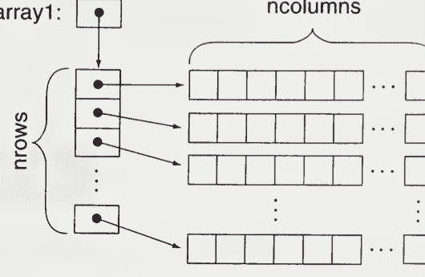
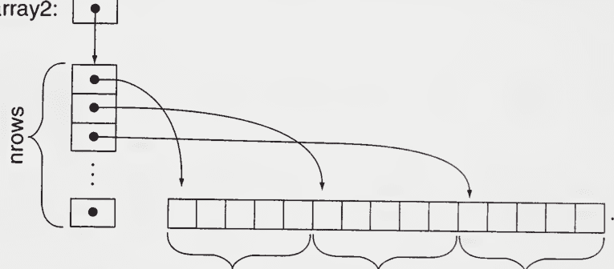

# C 语言常见问题集

## 常见问题

STEVE SUMMIT

## 版权信息

Thomas J. Bate 图书馆
特伦大学
安大略省彼得伯堡

Steve Summit 著
版次：1 2 3 4 5 6 7 8 9 10—CRW—99 98 97 96 95

> 本书献给各地的 C 程序员。

在线版本：https://archive.org/details/cprogrammingfaqs0000summ

---

## 目录摘录

### 2. 结构体、联合体与枚举

- 2.8 为什么不能使用内置的 `==` 和 `!=` 运算符对结构体进行比较？
- 2.10 我该如何创建无名的、即时的常量结构体值？
- 2.15 我如何在运行时通过名称访问结构体字段？
- 2.19 结构体和联合体之间有什么区别？

### 3. 表达式

- 3.3 代码 `int i = 3; i = i++;` 怎么可能得到 7？
- 3.5 但 `&&` 和 `||` 运算符呢？
- 3.7 为什么 `printf("%d", f1(), f2());` 先调用了 `f2`？
- 3.15 为什么 `degC = 5 / 9 * (degF - 32);` 始终给我结果 0？

### 4. 指针

- 4.5 我想用字符指针跳过一些 int。为什么 `(int *)p++;` 不起作用？

### 5. 指针作为函数参数

- 4.10 我有一个接受 int 指针的函数。我该如何给它传递类似 5 的值？
- 5.9 我可以“按引用”传递 `void *` 指针吗，即作为 `void **`？
- 5.13 数据指针和函数指针的总通用指针类型是什么？

### 6. 数组与指针

- 5.2 `"char *p; *p = malloc(10);"` 哪里有问题？
- 6.2 数组和指针到底有什么区别？
- 6.6 为什么数组名在某些上下文中会被当作指针处理？
- 6.8 为什么 `sizeof` 报告数组的大小，但传递给函数时却退化为指针？
- 6.12 如何声明指向数组的指针？
- 6.17 函数与多维数组如何交互？
- 6.18 如何向函数传递二维数组？

### 7. 内存分配

- 7.7 为什么有些代码仔细地将 `malloc` 返回的值转换为正在分配的指针类型？
- 7.10 `"char *p; *p = malloc(10);"` 哪里有问题？
- 7.14 我听过某些操作系统在程序尝试使用内存之前，并不会分配通过 `malloc` 获取的内存。这合法吗？

### 13. 库函数

#### 字符串处理

- 13.4 如何将字符串转换为全大写或小写？
- 13.5 为什么某些版本的 `atoi` 在遇到大写字母时表现异常？
- 13.6 为什么有些代码会调用 `atoi`？
- 13.7 如何将字符串拆分为由空白字符分隔的字段？
- 13.8 哪里可以找到用于正则表达式和通配符匹配的代码？

#### 排序

- 13.9 我正尝试用 `qsort` 对字符串数组进行排序，使用 `strcmp` 作为比较函数，但不起作用。为什么？
- 13.10 如何对链表进行排序？
- 13.11 如何对超过内存容量的数据排序？

#### 日期和时间

- 13.12 如何在程序中获取当天一天的时间？
- 13.13 如何将 `struct tm` 或字符串转换为 `time_t`？
- 13.14 如何进行日历操作？

#### 随机数

- 13.15 如何生成随机数？
- 13.16 如何获取特定范围内的随机整数？
- 13.17 我每次运行程序时，从 `rand` 返回的数字序列都是一样的。为什么？
- 13.18 我需要返回一个不重复的随机数序列。
- 13.19 我如何返回一个真/假值，我只是用了 `rand() % 2`，但它在交替出现 0, 1, 0...为什么？
- 13.20 如何生成符合正态分布（高斯分布）的随机数？
- 13.21 `rand48` 是什么？

#### 其他库函数

- 13.22 `exit(status)` 真的等同于从 `main` 返回相同的状态吗？
- 13.23 `memcpy` 和 `memmove` 有什么区别？
- 13.24 我正尝试移植这个程序。为什么某些库函数会产生 "undefined external"（未定义的外部）错误？
- 13.25 尽管我包含了所有的头文件，但一直因为库函数未定义而报错。为什么？
- 13.26 尽管我请求了正确的库，但仍然得到由于库函数未定义的错误。
- 13.27 为什么我的简单程序编译出的可执行文件这么大？
- 13.28 链接器说 `_end` 未定义是什么意思？

### 14. 浮点数

- 14.1 当我将 `float` 变量设置为 3.1 时，为什么 `printf` 打印出来是 3.099999？
- 14.2 为什么 `sqrt` 给我的数字是疯狂的？
- 14.3 为什么链接器抱怨像 `sin` 和 `cos` 等函数未定义？
- 14.4 我的浮点数计算行为异常，并且在不同的机器上给出不同的答案。为什么？
- 14.5 检查浮点数“足够相等”的好方法是什么？
- 14.6 如何对数字进行四舍五入？
- 14.7 C 语言的幂运算符在哪里？
- 14.8 `<math.h>` 中似乎缺少了预定义常量 `M_PI`。它不应该在那儿吗？
- 14.9 我如何为 IEEE NaN 和其他特殊值设置变量？
- 14.10 我如何优雅地处理浮点异常？
- 14.11 在 C 中实现复数的良好方法是什么？
- 14.12 哪里可以找到数学库代码？
- 14.13 我的 Turbo C 程序出现问题，它会崩溃并显示 "floating point formats are not linked."（未链接浮点格式）。我漏掉了什么？

### 15. 变长参数列表

#### 调用变参函数

- 15.1 我听说调用 `printf` 之前必须包含 `<stdio.h>`。为什么？
- 15.2 `%f` 如何在 `printf` 中用于 `float` 和 `double` 参数？
- 15.3 为什么函数原型不能防止 `printf` 中的不匹配？

#### 实现变参函数

- 15.4 如何编写一个接收可变数量参数的函数？
- 15.5 如何编写一个像 `printf` 一样接收参数的函数？
- 15.6 如何编写一个调用 `scanf` 并处理可变数量参数的函数？
- 15.7 如果我没有 `<stdarg.h>`，该怎么办？

#### 提取变长参数

- 15.8 如何发现传递了多少参数？
- 15.9 为什么我不能声明一个接受可变数量参数的函数？
- 15.10 `va_arg(arg, float)` 为什么不起作用？
- 15.11 如何获取指针类型的参数？
- 15.12 如何编写一个带有运行时参数的函数？
- 15.13 如何调用一个具有运行时参数的函数？

### 16. 奇怪的问题

- 16.1 为什么这个循环总是执行一次？
- 16.2 我在第一个声明处遇到语法错误，但它看起来没问题。
- 16.3 这个程序在运行前就崩溃了。为什么？
- 16.4 我的程序在某台机器上运行完美，但在另一台机器上得到奇怪的结果。奇怪的是，添加或删除打印语句改变了症状。出了什么问题？
- 16.5 为什么 `char *p = "hello, world"; p[0] = 'H';` 会崩溃？
- 16.6 我有一段代码尝试解包结构体，但报错说“未对齐访问（unaligned access）”。这意味着什么？
- 16.7 内存访问违规（memory-access violation）是什么意思？

### 17. 风格

- 17.1 源文件之间布局的最佳风格是什么？
- 17.2 函数 `if(!strcmp(s1, s2))` 这种写法好吗？
- 17.3 `if(0 == x)` 而不是 `if(x == 0)` 这种写法好吗？
- 17.4 为什么有些人写 `if (x == 0)`？
- 17.5 我看到有些代码在每次调用 `printf` 前加上 `(void)` 强制转换。为什么？
- 17.6 如果 `NULL` 和 0 作为指针常量是等价的，我应该用哪一个？
- 17.7 我应该使用符号名称（如 TRUE 和 FALSE）表示布尔常量，还是直接用 1 和 0？
- 17.8 什么是“匈牙利命名（Hungarian notation）”？它值得吗？
- 17.9 哪里可以获得“Indian Hill 风格指南”和其他编码标准？
- 17.10 有人说 `goto` 是恶魔，我不应该永远使用它们。这太极端了吗？
- 17.11 效率考量使得在风格上做出妥协。

### 18. 工具与资源

#### 工具

- 18.1 我正在寻找 C 开发工具（交叉引用生成器、代码格式化工具等）。哪里可以找到它们？
- 18.2 我该如何追踪到这些讨厌的 `malloc` 问题？
- 18.3 有什么免费或廉价的 C 编译器可以用吗？

#### lint

- 18.4 我刚刚输入了这段程序，但它的运行很奇怪。可能哪里出问题了？
- 18.5 我该如何关闭 `lint` 在每次调用 `malloc` 时给出的“warning: possible pointer alignment problem”信息？
- 18.6 我可以把 `main` 声明为 `void` 来关掉那个烦人的“main returns value”消息吗？
- 18.7 我可以在哪里获得一个兼容 ANSI 的 `lint`？
- 18.8 ANSI 函数原型不是让 `lint` 变得过时了？

#### 资源

- 18.9 互联网上是否有任何 C 语言教程或其他资源可用？
- 18.10 学习 C 有什么好书推荐？
- 18.11 我可以在哪里找到 K&R 中练习题的答案？
- 18.12 有人知道在哪里可以找到流行书籍的源代码吗？
- 18.13 我可以在哪里找到标准 C 库的源码？
- 18.14 我需要用于解析和计算表达式的代码。我可以在哪里找到？
- 18.15 我可以在哪里获取 C 的 BNF 或 YACC 语法文件？
- 18.16 我可以在哪里以及如何获得所有这些分发程序的副本？
- 18.17 本书的在线版本在哪里？

### 19. 系统依赖性

#### 键盘与屏幕 I/O

- 19.1 我如何在不等待回车键的情况下从键盘读取单个字符？
- 19.2 我该如何发现有多少个字符可读，或者如何进行非阻塞读取？
- 19.3 我该如何显示一个可以原地更新的百分比指示，或者显示“旋转接棒”进度指示之一？
- 19.4 我该如何清除屏幕、以反色视频模式打印内容或移动光标？
- 19.5 我该如何读取箭头键？功能键呢？

#### 其他 I/O

- 19.6 我该如何读取鼠标？
- 19.7 我如何进行串口（“comm”）端口 I/O？
- 19.8 我该如何将输出重定向到打印机？
- 19.9 我该如何发送转义序列来控制终端或其他设备？
- 19.10 我该如何进行图形处理？

#### 文件与目录

- 19.11 如何检查文件是否存在？
- 19.12 我该如何在读取文件之前知道它的大小？
- 19.13 如何在不完全清空或重写文件的情况下缩短文件？
- 19.14 如何在文件的中间插入或删除一行？
- 19.15 给定已打开的流或文件描述符，我该如何恢复文件名？
- 19.16 我该如何删除文件？
- 19.17 调用 `fopen("c:\\newdir\\file.dat", "r")` 哪里出了问题？
- 19.18 我该如何增加允许同时打开的文件数？
- 19.19 我如何发现磁盘上还有多少可用空间？
- 19.20 我该如何在 C 程序中读取目录？
- 19.21 我如何创建目录？我如何删除目录（及其内容）？

#### 访问原始内存

- 19.22 我该如何发现有多少可用内存？
- 19.23 如何分配大于 64K 的数组或结构？
- 19.24 错误信息“DGROUP exceeds 64K”是什么意思？
- 19.25 如何访问位于特定地址的内存？
- 19.26 如何访问位于机器位置 0 处中断向量？

#### “系统”命令

- 19.27 我该如何在 C 程序中调用另一个程序或命令？
- 19.28 当执行命令的参数在运行时未知时，我该如何调用 `system`？
- 19.29 我如何在 MS-DOS 上从 `system` 获取准确的状态返回？
- 19.30 我该如何调用另一个程序并捕获它的输出？

#### 进程环境

- 19.31 我的程序如何发现调用它的可执行文件的完整路径？
- 19.32 我如何自动定位与可执行文件在同一目录下的程序配置文件？
- 19.33 进程如何更改其调用者的环境变量？
- 19.34 我如何打开命令行中提到的文件并解析选项标记？
- 19.35 `exit(status)` 真的等同于从 `main` 返回相同的状态吗？
- 19.36 我如何读入对象文件并跳转到其中的例程？

#### 其他系统相关操作

- 19.37 我如何实现延迟或以亚秒级精度对用户响应进行计时？
- 19.38 我如何捕获或忽略像控制-C 这样的键盘中断？
- 19.39 我如何优雅地处理浮点异常？
- 19.40 我如何使用套接字？网络编程？客户端/服务器应用程序？

#### 回顾

- 19.41 但我不能使用所有非标准的、依赖系统的函数，因为我的程序必须兼容 ANSI！
- 19.42 为什么这些内容没有在 C 中被标准化？

### 20. 杂记

#### 杂记技巧

- 20.1 我如何从一个函数返回多个值？
- 20.2 用于文本编辑器或排序程序存储文本行用什么好的数据结构？
- 20.3 我如何打开命令行中提到的文件并解析标记？
- 20.4 使用 `errno` 的正确方法是什么？
- 20.5 我如何写入可以在具有不同格式的其他机器上读取的数据？
- 20.6 在给定字符串形式名称的情况下，我如何调用函数？

#### 位与字节

- 20.7 我如何操作单个位？
- 20.8 如何实现集合或数组？
- 20.9 如何判断机器的字节序是大端序还是小端序？
- 20.10 如何将整数转换为二进制或十六进制？
- 20.11 我可以使用 2 进制常量（类似 `0b1010` 之类的）吗？有二进制打印格式吗？

#### 效率

- 20.12 统计值中已置位个数最高效的方法是什么？
- 20.13 我如何提高代码效率？
- 20.14 数组比函数调用快？
- 20.15 移位比乘除法快吗？

#### switch 语句

- 20.16 `switch` 语句还是 `if/else` 链更高效？
- 20.17 有没有方法对字符串进行 `switch`？
- 20.18 括号在语句中是可选的吗？

#### 杂记特性

- 20.19 注释是必要的吗？
- 20.20 字符串内可以嵌套吗？
- 20.21 C 的运算符集真的完整吗？
- 20.22 赋值运算符是更好的选择吗？
- 20.23 C 有嵌套函数吗？

#### 其他语言

- 20.24 我可以从 C 调用 Pascal、LISP 吗？
- 20.25 有转换方法吗？
- 20.26 C 和 C++ 的区别是什么？
- 20.27 我可以使用 C++ 编译器？

#### 算法

- 20.28 如何比较两个字符串？
- 20.29 什么是哈希？
- 20.30 如何生成随机数？
- 20.31 如何给定日期找到星期几？
- 20.32 2000 年是闰年吗？
- 20.33 `tm_sec` 在 `tm` 结构中的范围是多少？

#### 趣闻

- 20.34 如何写一个产生自身源代码的程序？
- 20.35 什么是“Duff's Device”？
- 20.37 K&R 中提到了什么关键字？
- 20.38 “C”这个名字是从哪里来的？
- 20.39 如何发音“char”？
- 20.40 本书的在线版本在哪里？

---

## 前言

在 1979 年的某个时候，我听到很多人在讨论这种相对新的语言 C，以及一本新出的关于它的书。我买了一本 Brian Kernighan 和 Dennis Ritchie 写的《C 程序设计语言》（K&R），但它在我的书架上放了一会儿，因为我当时并没有需要（而且我那时还是个大一学生）。事实证明这是一次明智的购买，当我终于拿起它时，再也没有放下过。

在 1983 年，我发现了 Usenet 新组 net.lang.c（它的继任者 comp.lang.c 仍然是）学习大量 C 的绝佳场所，了解大家在忙什么，并发现你可能并不了解 C 的全部。看来 C 尽管表面上简单，但有很多非显而易见的方面，而且某些问题反复出现。这本书就是这些问题的集合，答案基于我从 1990 年 5 月开始在 comp.lang.c 上发布的常见问题解答（FAQ）列表。

然而，我必须说明的是，这本书的目的并不是对 C 语言进行批判或“恶意攻击”。人们很容易把用户在使用时遇到的困难归咎于语言（或任何工具），或者声称一个设计良好的工具“应该”防止用户误用它。因此，很容易把像这本列满了各种误用情况的书看作是该语言有缺陷。

我永远无法学到能够写出这本书的程度，如果我不认为 C 是一门伟大的语言，或者如果我不喜欢用它编程，我就不会试图通过写这本书来让其他人使用得更愉快。这本书代表了我所学到的一些：这些问题无疑是人们遇到困扰最多的地方，而答案经过了多年的提炼，旨在确保人们在处理这些问题时不会有太大困扰。


如果这些答案中存在任何错误，读者无疑会遇到麻烦。尽管审查者和我已经努力消除这些错误，但从大型手稿中消除最后一个错误，就像从程序中消除最后一个 bug 一样困难。如果您能通过出版商或文内提供的电子邮箱地址向我发送任何更正或建议，我将不胜感激，并愿意向第一个发现错误的人提供惯例 1.00 美元的奖励。如果您可以访问互联网，可以在问题 20.40 中提到的 FTP 和 HTTP 地址查看勘误列表（以及发现者的记分表）。

正如我希望已经说明的那样，这本书并不是对 C 编程语言的批判，也不是对我最初学习 C 语言的那本书或该书作者的批判。我并不是从 K&R 学会 C 语言；我也学到了很多关于编程的知识。当我思考自己对 C 语言文献的贡献时，我唯一的遗憾是这本书没有达到 K&R 第二版中提到的一个很妙的观察，即“C”并不是一种庞大的语言，大书并不适合描述它。我希望那些最深切欣赏 C 的简洁与精准（以及 K&R 的这种风格）的人，不会因为这本书用三种略微不同的方式反复陈述某些内容而感到被冒犯。

尽管我的名字在封面上，但这本书的背后有许多人的支持，很难知道从何处开始致谢。从某种意义上说，comp.lang.c 的每一位读者（目前估计有 320,000 人）都是贡献者：这本书最初是为 comp.lang.c 编写的 FAQ 列表，而这本书也保留了良好的 comp.lang.c 讨论的韵味。

我希望这本书也保留了我从开始阅读 net.lang.c 时就开始的“正确 C”的哲学。因此，我将首先感谢那些在我的哲学中脱颖而出的帖者：Doug Gwyn, Guy Harris, Karl Heuer, Henry Spencer 和 Chris Torek。这些先生们在多年来表现出了非人的耐心，用慷慨和智慧回答了无无尽的问题。我是那个挺身而出开始写下这些常见问题的人，但我必须给人留这种答案在某种程度上是我的印象。我曾经是一个学生（我相信是 Guy 问了我关于 5.10 那个最具挑战性的问题），我对先前的大师们欠下了真正的人情。这本书既属于他们，也属于我，尽管我对自己陈述中可能出现的任何不足或错误保留全部所有权。

原先的在线 FAQ 列表在变成这本书的过程中增长了三倍，其增长有时显得有些快速且有些笨拙。

xxxiii

Mark Brader, Vinit Carpenter, Stephen Clamage, Jutta Degener, Doug Glyn, Karl Heuer, Joseph Kent 和 George Leach 阅读了提议或完整草稿，并帮助控制了这一过程；感谢他们许多细致的建议和纠正。他们的努力源于对编程社区理解 C 的共同渴望。感谢他们的投入。

其中三位审查者也是在线 FAQ 列表的长期贡献者。感谢 Jutta Degener 和 Karl Heuer 多年来的帮助，我特别感谢 Mark Brader，自从五年前我开始发布 comp.lang.c FAQ 列表以来，他一直是我最执着的批评者。我不知道他如何有精力提出这么多建议和纠正，并克服我持续固执地拒绝同意其中某些建议（尽管我最终理解了它们确实是改进）。我可以感谢 Mark 塑造了书中许多解释的表达，并将其中任何解释的伪造错误归咎于我。

额外感谢：Susan Cyr 提供的代码艺术；Bob Dinesh 和 Eskimo North 提供了对于像这类项目至关重要的网络访问；Bob Holland 提供了我完成大部分写作的计算机；Pete Kehler 提供的 Alpha 文本编辑器；华盛顿大学数学研究与工程图书馆允许我查阅他们的藏书；以及华盛顿大学海洋学系允许我借用他们的磁带驱动器来访问我那些尘封的 Usenet 发布存档。

感谢 Tammoy Bhattachararya 提供了问题 11.10 的示例，Arjan Kent 提供了问题 13.7 的代码，Tomohiko Sakamoto 提供了问题 20.31 的代码，以及 Roger Miller 提供了问题 11.35 的代码行。

感谢全世界所有以各种方式通过建议、纠正、建设性批评或其他支持为 FAQ 列表做出贡献的人们：Jamshid Afshar, David Anderson, Tanner Andrews, Sudheer Aite, Joseph Arceneaux, Randall Atkinson, Rick Beek, Peter Bennett, Wayne Berke, Dan Bernstein, John Bickers, Gary Blaine, Yuan Bo, Dave Boutecher, Michael Bresnahan, Vincent Broman, Stan Brown, Joe Bueheler, Kimberly Burchett, Gordon Burditt, Burkhard Burrow, Conor P. Cahill, D'Arcy J.M. Cain, Christopher Cableas, Ian Cargill, Paul Carter, Michael Chambers, Billy Changeless, Franklin Chen, Jonathan Ray, Michael Chen, Cheng Cheun, Corb, Ian Cott, Russ Cox, Jonathan Coxhead, Lee Crawford, Steve Dahmer, Andrew David, James Davies, John E. Davis, Ken Delong, Norm Diamond, Jeff Dunlop, Ray Dunn, Stephen M. Dunn, Michael J. E, Scott Ehrlich, Arno Eigenwillig, David Eisen, Bjorn Engsid, David Evans, Claire D.W. Feather, Dominic Fee, Simao Ferraz, Chris Flatters, Rod Flores, Alexander Forest, Steve Fosdick, Jeff Francis, Tom Gambill, Dave Gillespie, Samuel Goldstein, Tim Goodwin, Alasdair Grant, Ron Guillemette, Michael Hafner, Tony Hansen, Elliotte Rusty Hardy, Joe Harrington, Des Herriott, John Hascall, Ger Bobbelt, Walter Holland & Co., Jos Horsmeier, Blair Boughton, James C. Hu, Chin Huang, David Hurt, Ein Eridason, Vladimir Ivanovic, Jon Jagger, Ke Jin, Kirk Johnson, Larry Jones, James Kew, Kirby Ricci, Ki-ichi Kitano, the kittyc, Peter Klausler, Andrew Koenig, Tom Koenig, Adam Kola, Jukka Korpela, Ajay Krishnan T, Markus Kuhn, Deepak Kulkarni, Oliver Baumann, John Lau, Felix Lee, Mike Lee, Timothy J. Lee, Tony Lee, Marty Lisner, Don Libes, Brian Liedtke, Philip Lindstead, Keith Yen-Wei Liu, Paul Long, Christopher Loft, Tim Love, Tim McDaniel, Kevin McMahon, Stuart Martin, John R. Macmillan。最后，我要感谢我在 Addison-Wesley 的编辑 Debbie Lafferty，她有一天拍了拍我的电子肩膀，问我是否有兴趣写这本书。现在你拥有了它，我希望它能让 C 编程对我来说一样愉快。

Steve Summit

西雅图 华州

summit@aw.com 1995

# 引言

你可能有过这样一种经历：在酒吧或派对上，你输了一场赌，赌注你能否完成某个看似简单的任务，但结果根据人体的特殊特性或物理定律，该任务实际上是不可能完成的。下赌的人知道，他挑战的人越多，他获胜的概率就越大，因为这些特殊特性和定律即使很冷门，也是相当固定且可预测的。

与此类似，如果你聚集大量的人并让他们去处理某些复杂任务（例如学习 C 语言），他们中的许多人会遇到完全相同的问题并产生完全相同的问题。这些问题和问题在任务最初设计时可能是可预测的，也可能不可预测，而答案在事后看来似乎是显而易见的，但人们会不断遇到一些相同的问题，同样的问题也会接踵而至。这些问题和疑问并不意味着该任务是不可能的，仅仅说明它足够困难，很有趣味。

并不意外，这些问题和疑问在互联网上经常出现，特别是在名为 Usenet 的交互式讨论新闻组中。一个显而易见的想法是收集常见问题，即 FAQ 列表。FAQ 列表并不总是能达到减少常见问题发生频率的预期目的，但如果答案确实是一致的，那么它们被提问的频率足以被选入 FAQ 列表，这一事实表明它们可能与你或本书的其他读者所问的问题相匹配。

# 关于本书

大多数书籍（关于 C 或任何其他主题）都是从作者的角度编写的。它们讨论了作者认为你应该了解的话题，并以作者认为合理的方式进行呈现。如果这种方式对你来说不合逻辑（在某种程度上，它确实不合逻辑，因为作者可能已经熟悉了这些材料，而你可能还不熟悉），你可能会留下许多深层次的未被解答的问题。

然而，这本书围绕着 400 个这类问题组织，所有问题都基于真实尝试学习或使用 C 语言编程的人所提出的真实问题。这本书针对的不仅仅是作者认为重要的话题，而是根据真实读者提出的问题，针对他们认为重要的话题。很有可能的是，如果你正在学习或使用 C，并且你有一个关于 C 的问题在你查过的其他任何书中都没有得到解答，那么你可以在任何地方找到它。

本书无法保证回答你在 C 语言编程时会遇到的每一个问题，因为你在编程中遇到的许多问题将与你的问题领域有关，而本书涵盖的是 C 语言本身。由于无法涵盖任何人可能尝试用 C 解决问题的每一个方面，本书无法涵盖任何人可能尝试为每个操作系统编写的 C 程序的每一个方面，也无法涵盖任何人可能尝试在 C 中实现的每个算法的所有方面。特定问题、特定操作系统和通用算法在针对这些主题开发的书籍或其他材料中得到了适当讨论。尽管如此，涉及操作系统和算法的问题非常频繁，因此第 19 章和第 20 章对其中一些问题提供了简短的介绍性回答，但请不要期待处理是完整的。

书中的问题是人们读完介绍性教科书或上完 C 语言课程后通常会的问题。因此，本书不会教你，也不会讨论任何 C 语言教科书应该涵盖的基础性问题。此外，本书的答案很大程度上旨在确保绝对正确，并避免误解的传播。因此，某些答案比可能认为所需的要详尽得多：它们为你提供了完整的图景，而不是过度简化或遗漏重要的细节。（毕竟，本书问答所解决的许多误解，其背后正是过度简化或遗漏的细节。）在详尽的答案中，你会在必要的地方找到捷径和简化，在词表中，你会发现准确解释通常所需的精确术语定义。这些捷径和简化当然是安全的：它们不会导致后来的误解。

书中的问题是人们在读完介绍性教科书或参加过 C 语言编程课程后通常会的问题。因此，本书不会教你，也不会讨论任何 C 语言教科书应该涵盖的基础性问题。

# 问题格式

本书大部分由问题问答对组成。这些问题是按标题排列的。许多问题是以以下缩写形式引用的：

- `[ANSI] Standard, X3.159-1989`
- `[CT&P] Traps and Pitfalls by Andrew Koenig`
- `[H&S] Harbison and Steele, C: Reference Manual, Fourth Edition`
- `[ISO] Standard, ISO 8990`
- `[K&R1] Kernighan and Ritchie, The C Language, First Edition`
- `[K&R2] Kernighan and Ritchie, The C Language, Second Edition`
- `[PCS] Portable Software by Mark Horton`
- `[Rationale] The Rationale for the ANSI Standard, X3.159-1989`

其他引用以全称出现。

等宽字体用于指示 C 语法（函数名、变量名等），也指示一些操作系统命令。`tty(4)` 表示 UNIX 程序员手册中的第 4 节“tty”。

# 代码示例

由于这这是一本关于 C 的书，因此许多小代码段是用 C 编写的。示例主要是为了解释而编写的。它们并不总是以最高效的方式编写；让它们“更快”往往会使它们变得模糊。（有关代码效率的更多信息请参见 20.13。）

作者和出版社邀请你在自己的程序中使用并修改这些代码片段，但如果你这样做我们将不胜感激。（某些片段来自其他来源并已注明；如果你使用了这些代码，请予以感谢。）较大示例的源代码可以通过 aw.com 的匿名 ftp 获取 `csn/authors/summit/cfaq`（另见 18.12）。

为了强调某些观点，我们不得不包含一些作为反面教材的代码片段。在答案中，此类代码片段会被标记 `/* WRONG */` 注释，提醒你不要模仿。（问题中的代码片段通常没有标记；问题中的代码片段显然是有疑的，因为问题通常是“为什么这行不行？”）

# 引言

它们应该拥有自己的章节；第 2 章讨论了它们如何被声明和使用。

程序的大部分工作由表达式语句完成，这是第 3 章的主题。

第 4 到第 7 章讨论了许多 C 初级程序员的噩梦：指针。第 4 章涵盖了通用指针知识，第 5 章重点关注空指针的特殊情况，第 6 章描述了指针与数组之间的关系，第 7 章探索了当指针出现异常时通常的真实问题：底层的内存分配，但这些类型……

几乎所有的 C 程序都会操作字符和字符串，但这些是由语言在低层实现的。程序员通常负责正确地管理这些类型；在执行此过程中出现的一些问题被收集在第 8 章中。同样，C 没有正式的布尔类型；第 9 章简要讨论了 C 的布尔表达式，以及在需要时实现用户定义布尔类型的恰当方法。

C 预处理器（编译器中负责处理 `#include` 和 `#define` 指令的部分，实际上是所有以 `#` 开头的行）是独特的，以至于几乎代表了一门独立的语言，并包含在它自己的章节——第 10 章中。

ANSI 标准委员会（X3J1）在澄清 C 的定义并使其被世界接受的过程中，引入了许多新功能并进行了一些重大更改。针对 ANSI/ISO 标准 C 的特定问题收集在第 11 章中。如果你有预 ANSI C（也称为“K&R”或“经典”C）的经验，你会发现第 11 章是对差异的有用介绍。另一方面，如果你熟练地使用 ANSI C，预 ANSI 和 ANSI 特性之间的区别可能并不有趣。无论如何，第 11 章中的所有问题也与其他主题相关（声明、C 预处理器、库函数等），这些主题也出现在其他章节中或从其他章节进行交叉引用。

C 的定义相对稀疏，部分是因为许多功能并不是内置语言的，而是通过库函数访问的。其中重要的是“标准输入输出”和 `stdio` 函数，它们在第 12 章中讨论。其他库函数涵盖在第 13 章。

第 14 章和第 15 章讨论了两个更高级主题：浮点和变长参数列表。无论你使用什么系统或语言，浮点计算都可能是棘手的；第 14 章概述了一些通用的浮点问题以及一些 C 特有的问题。函数可以接受数量数量参数的可能性（虽然这可能被认为是不必要的或危险的）有时是非常方便的，并且是 C 的 `printf` 函数的核心；处理变长参数列表的技术在第 15 章中讨论。


# 引言

第 16 章隐藏了一些如果你已经熟练掌握了上述大部分内容，可能想先跳转过去的问题：它们涉及程序中偶尔出现的奇怪问题和神秘 Bug，追踪这些问题可能会让人感到极其痛苦和沮丧。

当存在两种或两种同样“正确”的程序编写方法时（通常如此），基于主观标准，可能会有更优的选择，这些标准不仅仅取决于代码是否简单地编译和正确运行。第 17 章讨论了编程风格的这些瞬即性问题。

你不能孤立地构建 C 程序：你需要编译器、源代码或工具。第 18 章讨论了一些可用的工具和资源，包括 `lint`，这是一个几乎被遗忘但曾经是检查程序正确性和可移植性必不可少的工具。

如前所述，C 语言并没有规定让一个真实程序运行所需要的一切。诸如“如何在不等待回车键的情况下读取字符？”以及“如何找到文件大小？”等方面非常常见，但 C 并没有定义答案；这些操作取决于底层操作系统提供的设施。第 19 章展示了许多这类问题，并给出了流行操作系统的简短答案。

最后，第 20 章收集了不属于任何其他地方的杂问题：位操作、效率、算法、C 与其他语言的关系，以及一些琐碎问题。（第 20 章的引言对其不同的内容有稍微详细一点的分解。）

为了结束这段引言，这里有两个初步问题，与其说是关于 C 的，不如说是关于这本书的：

**问题：** 如果在互联网上可以免费获取，我为什么应该买这本书？

**答案：** 这本书包含的内容比发布在 comp.lang.c 的版本多出三倍，尽管电子文档有其优势，但以印刷形式处理这么多信息确实可能更容易。（你会花费大量时间从网上下载这么多内容并打印，而且排版也不会那么漂亮。）

**问题：** 你如何读音“FAQ”？

**答案：** 我把它读作“eff ay kyoo”，我相信这是 FAQ 列表首次被“发明”时的原始发音。现在许多人把它读作“fack”，这能很好地联想起“fact”这个词。我会读复数形式，就像书名中一样，读作“eff ay kyooze”，但很多人读起来像“fax”。这些读法在严格来说没有对错之；“FAQ”是一个新术语，流行用法在塑造任何术语的演变中起着某种作用。

（顺便说，同样值得考虑的是，“FAQ”是指问题本身，还是指问题加答案，还是整个问答列表。）

但现在，回到真正的问题上！

# 声明与初始化


# C 的声明语法

C 的声明语法本身实际上就是一个小小的编程语言。一个声明由几个部分组成（尽管并非所有都是必须的）：存储类、基本类型、类型限定符，最后是声明符（其中可能也包含初始化器）。每个声明符不仅声明了一个新的标识符，还可能指示该标识符是一个数组、指针、函数或某种任意复杂的组合。其核心思想是声明模仿了标识符的最终使用。（问题 1.21 讨论了这种“声明模仿使用”的关系。）

## 基本类型

有些程序员惊讶地发现，尽管 C 是一门相当底级的语言，但其类型系统仍然相当抽象；基本类型的尺寸和表示并没有由语言精确定义。

### 1.1 我应该决定使用哪种整数类型？

如果你可能大值（大于 32767 或小于 -32767），使用 `long`。否则，如果空间非常重要（例如有大型数组），使用 `short`。否则，使用 `int`。如果定义的溢出特性很重要且不需要负值，或者你在操作位或字节时想要符号扩展问题，使用相应的无符号类型。（在表达式中混合符号和无符号值时要注意。）

虽然字符类型（尤其是 `unsigned char`）可以作为“微型”，但这样做往往得不偿。编译器必须生成额外的代码在 `char` 和 `int` 之间进行转换（导致可执行文件变大），意外的符号扩展可能会带来麻烦。（使用 `unsigned char` 有帮助；相关问题见问题 12.1。）

在决定 `float` 和 `double` 之间也存在类似的空间权衡。（许多编译器在求值期间会将 `float` 值转换为 `double`。）如果获取变量的地址且必须具有特定类型，则上述规则都不适用。

误认为 C 的类型被定义为特定的、精确的尺寸。事实上，保证的是：

- `char` 类型存储的值高达 127；
- `short int` 和 `int` 类型存储的值高达 32767；
- `long int` 类型存储的值高达 2147483647；以及
- 尺寸遵循明显的递增：

```
sizeof(char) <= sizeof(short) <= sizeof(int) <= sizeof(long)
```

这些值意味着 `int` 至少是 8 位，`short` 和 `int` 至少是 16 位，`int` 至少是 32 位。（每个类型的符号和无符号版本保证尺寸相同。）在 ANSI C 下，特定机器的最大值最小值可以在头文件 `<limits.h>` 中找到，并如下表所示：

| 基本类型 | 最小尺寸（位） | 最小值（符号） | 最大值（符号） | 最大值（无符号） |
|---|---|---|---|---|
| char | 8 | -127 | 127 | 255 |
| short | 16 | -32767 | 32767 | 65535 |
| int | 16 | -32767 | 32767 | 65535 |
| long | 32 | -2147483647 | 2147483647 | 4294967295 |

表中的值是标准保证的最小值。许多实现允许更大的值，但可移植的程序不应依赖于此。

如果[for]某些原因，你需要声明一个具有精确大小的内容，请确保将该选择封装在适当的 `typedef` 之后。通常需要精确大小的唯一正理由是尝试符合某些外部强制的存储布局。另见问题 1.3 和 20.5。

参考文献：K&R1 §2.2 p. 34；K&R2 §2.2 p. 36, §A4.2 pp. 195–6, §B11 p. 257；ANSI §2.2.4.2,1, §3.1.2.5；ISO §5.2.4.2,1, §6.1.2.5；H&S §5.1, §5.2 pp. 110–4

### 1.2 为什么标准类型的尺寸没有被精确定义？

尽管 C 在高级语言中被认为是相对低层的，但它确实认为对象的精确大小（即以位 bit 为单位）是一个实现细节。（C 唯一允许你指定位大小的地方是结构体中的位域字段；见问题 2.25 和 2.26。）大多数程序并不需要对这些尺寸进行精确控制；许多尝试实现这种控制的程序，如果不这样做，效果反而会更好。

类型 `int` 应该代表代表机器的自然字长，并且是用于大多数整数变量的正确类型。其他准则请参见问题 1.1；另见问题 12.42 和 20.5。

### 1.3 我一直在使用诸如 `int16` 和 `int32` 这样的 `typedef`。这应该解决所有问题，对吧？

如果你确实需要控制精确的类型尺寸，这是正确的方法。然而，你应该意识到以下几点：

- 精确匹配可能不可能（例如，在偶尔出现的 36 位机器上）。
- 一个像 `int16` 或 `int32` 这样的 `typedef` 无法起到任何作用；它的本意含义是“至少”指定的尺寸，因为 `int` 和 `long` 类型本质上已经被定义为“至少 16 位”和“至少 32 位”。
- `typedefs` 永远无法解决字节序问题（例如，如果你正在尝试交换数据或符合外部强制的存储层）。

另见问题 10.16 和 20.5。

### 1.4 在新的 64 位机器上，64 位类型应该是什么？

这是一个棘手的问题。你可以从至少三个方式来看待它：

1. 在现有的 16 位和 32 位系统上，两种整数类型（`short` 和普通的 `int`，或者普通的 `int` 和 `long`）尺寸通常是相同的。64 位机器提供了一个让所有三种类型具有不同尺寸的机会。因此，某些厂商支持 64 位 `long int`。
2. 遗憾的是，很多现有代码都假设 `int` 和 `long` 的尺寸是相同的，或者其中另一个恰好是 32 位。为了不冒破坏此类代码的风险，某些厂商引入了一种新的、非标准的 64 位 `long long`（或 `__longlong` 或 `__very long`）类型。
3. 最后，可以认为在 64 位机器上，普通的 `int` 应该是 64 位，因为 `int` 传统上反映了“机器的自然字长”。

因此，致力于编写可移植代码的程序员应该将任何对 64 位类型的使用封装在适当的 `typedef` 之后（并且在将此类代码移植到 16 位或 32 位环境时，必须手动提供 64 位支持）。感到有必要引入新的、更长的整数类型的厂商应该对其进行说明；它并不是 64 位的。

## 声明与初始化

### 指针声明

尽管标准并没有完全要求（最重要的是第一个声明包含 `static`），但规则是让 `static` 在定义和所有声明中保持一致的出现是最安全的。

参考：ANSI §3.1.2.2；ISO §6.1.2.2；原理 §3.1.2.2；H&S §4.3 p. 75

### 1.11 在函数声明中，`extern` 是什么意思？

存储类 `extern` 仅对数据声明具有重要意义。在函数声明中，它可以作为一种风格提示，指示函数的定义可能在另一个源文件中，但以下两者之间没有正式区别：

```
extern int f();
```

和

```
int f();
```

另见问题 1.10。

参考：ANSI §3.1.2.2, §3.5.1；ISO §6.1.2.2, §6.5.1；原理 §3.1.2.2；H&S §4.3, §4.3.1 pp. 75-66

### 1.12 `auto` 关键字有什么用？

没用；它是过时的。（它是 C 语言的无类型前身语言 B 的遗留，B 语言缺乏 `int` 等关键字，并且要求每个声明都有一个存储类。）另见问题 20.37。

参考：K&R1 §8.1 p. 193；ANSI §3.1.2.4, §3.5.1；ISO §6.1.2.4, §6.5.1；H&S §4.3 p. 75, §4.3.1 p.

### Typedef

虽然 `typedef` 关键字在语法上属于存储类，但正如其名所示，它涉及定义新的类型名，而不是新的函数或变量。

#### 1.13 对于用户定义类型，使用 `typedef` 或预处理器宏之间有什么区别？

通常情况下更倾向于使用 `typedef`，部分原因是它们可以正确编码指针类型。例如，考虑以下声明：

```
typedef char *String_t;
#define String_d char *
String_t s1, s2;
String_d s3, s4;
```

在这些声明中，`s1`、`s2` 和 `s3` 都声明为 `char *`，但 `s4` 被声明为 `char`，这可能不是本意。（另见问题 10.15。）

预处理器宏确实优势在于 `#ifdef` 可以作用于它们（另见问题 10.15）。另一方面，`typedef` 的优势是它们遵守作用域规则（它们可以声明为函数或块局部）。

另见问题 1.17, 2.22, 11.11 和 15.11。

参考：K&R1 §6.9 p. 141；K&R2 §6.7 pp. 146–7；CT&P §6.4 pp. 83–4

#### 1.14 我似乎无法成功地声明一个链表。

我尝试了这种声明，但编译器给了我错误信息。

```
typedef struct {
    char *item;
    NODEPTR next;
} *NODEPTR;
```

C 语言中的结构体不能包含指向自身的指针吗？

C 中的结构体完全可以包含指向自身的指针；K&R 第 6.5 节的讨论和示例说明了这一点。

示例的问题在于 `typedef`。`typedef` 为类型定义了一个新名称，在*简单的情况下*，你可以同时定义一个新的结构体类型及其对应的 `typedef`，但在这种情况下不行。`typedef` 声明在定义之前是无法使用的，在给出的片段中，在声明下一个字段时，它尚未定义。

要修复这个问题，首先为结构体指定一个标签（"struct node"）。然后将 `next` 字段声明为简单的 `struct node *`，或者将 `typedef` 声明与结构定义解耦，或者两者都要。一个修正后的版本是：

```
typedef struct node {
    char *item;
    struct node *next;
} *NODEPTR;
```

你也可以在结构声明之前加上 `typedef`，在这种情况下，你在声明 `next` 字段时就可以使用 `NODEPTR` 类型了，毕竟：

```
typedef struct node {
    char *item;
    NODEPTR next;
};
```

在这种情况下，你定义了一个涉及 `struct node` 的新 `typedef` 名称，尽管 `struct node` 尚未被完全定义；这是被允许的。

> *在简单示例 `typedef struct { int i; } simplest;` 中，结构体及其 typedef 名称是同时定义的；注意这里没有结构标签。*

最后，这里有一个结合了这两个建议的重新安排：

```
struct node {
    char *item;
    struct node *next;
};
typedef struct node *NODEPTR;
```

偏好哪种方法是一个风格问题；参见第 17 章。

另见问题 1.15 和 2.1。

参考：K&R1 §6.5 p. 101；K&R2 §6.5 p. 139；ANSI §3.5.2, §3.5.2.3, examples；ISO §6.5.2, §6.5.2.3；H&S §5.6.1 pp. 132–3

#### 1.15 我如何定义一对相互引用的结构体？

我尝试了：

```
typedef struct {
    int field;
    b pointer;
} *a;
```

```
typedef struct {
    int field;
    a *pointer;
} *b;
```

但编译器在第一次声明中使用 `a` 时并不知道 `a`。

回答：与问题 1.14 一样，问题不在于结构体而在于 `typedef`。首先，给两个结构体加上标签，并在不使用 `typedef` 的情况下定义指针：

```
struct a {
    int field;
    struct b *pointer;
};

struct b {
    int field;
    struct a *pointer;
};
```

编译器可以接受 `a` 内部的 `struct b *pointer`，尽管它还没有听说过 `struct b`（在这一点上它是“不完整”的）。偶尔，有必要在此之前加上行：

```
struct b;
```

这个空声明隐藏了该结构体对（如果在内部作用域内）外部作用域中不同的 `struct b`。在声明带有标签的两个结构体后，你可以单独声明 `typedef`：

```
typedef struct a *a;
typedef struct b *b;
```

或者，你可以在结构定义之前定义 `typedef`，在这种情况下你可以在声明字段时使用它们：

```
typedef struct a *a;
typedef struct b *b;
struct a {
    int field;
    b *pointer;
};

struct b {
    int field;
    a *pointer;
};
```

另见问题 1.14。

参考：K&R2 §6.5 p. 140；ANSI §3.5.2.3；ISO §6.5.2.3；H&S §5.6.1 p. 132

#### 1.16 这两种声明之间有什么区别？

```
struct x1 { ... };
typedef struct { ... } x2;
```

回答：参见问题 2.1。

#### 1.17 `typedef int (*funcptr)();` 是什么意思？

它定义了一个类型 `funcptr`，这是一个指向函数（接受未知参数）的指针。它可以用于声明一个或多个指针：

```
funcptr pf1, pf2;
```

这种声明等同于更难理解的：

```
int (*pf1), (*pf2)();
```

另见 2.21, 4.12 以及 5.11。

参考：K&R1 §6.9 p. 141；K&R2 §6.7 p. 147

### const 限定符

声明的另一个方面是类型限定，它是 ANSI C 中引入的。关于限定符的问题收集在第 11 章。

#### 1.18 我得到了这些声明：

```
typedef char *char;
const p;
```

为什么 `p` 变成了 `const` 而不是指向字符？

回答：参见问题 1.11。

#### 1.19 为什么我不能像这样在初始化和数组维度中使用 `const` 值？

```
const int n = 5;
int a[n];
```

回答：参见问题 11.8。

#### 1.20 `const char *p`、`char const *p` 和 `char * const` 有什么区别？

回答：参见问题 11.9 和 5.21。

### 复杂声明

C 的声明可以任意复杂。一旦你学会了它们，就可以理解即使是最复杂的，尽管真正令人困惑的声明通常是不必要的。如果你不想让程序充斥着如 `(*a[N]))()` 这样晦涩的声明符，可以使用 `typedef` 来澄清，正如问题 1.21 选项 2 所示。

#### 1.21 我如何声明一个指向返回指针的返回指针函数的指针数组，或者理解类似的复杂声明？

问题的第一部分至少有三种回答方法：

1. `char *(*a[N]) ()();`

2. 使用 `typedef` 逐步构建声明：

```
typedef char *pc;               /* 指向字符的指针 */
typedef pc fpc();              /* 返回字符指针的函数 */
typedef fpc *fpfc();            /* 指向上述内容的指针 */
typedef fpfc fpfc();            /* 返回上述内容的函数 */
typedef fpfc *pfpfc;             /* 指向上述内容的指针 */
pfpfppc a[N];                  /* 上述内容的数组 */
```

3. 使用 `cdecl`，它可以将英语转换为 C，反之亦然。提供你所需的类型的长描述，`cdecl` 返回等效的 C 声明：

```
cdecl> declare a as array of pointer to function returning
pointer to function returning pointer to char
```

```
char *(*a[])) ()();
```

`cdecl` 程序还可以解释复杂的声明（给它复杂的声明，它返回英语描述）、帮助转换并指示参数放在哪一组括号中（对于复杂的函数定义，例如此处）。`cdecl` 的版本位于 comp.sources.unix 第 14 卷（见问题 18.16）和 K&R2。

### 1.22 C 语言的声明可能会让人困惑

C 语言的声明可能会让人困惑，因为它们由两部分组成：基础类型和声明符（declarator），后者包含了被声明的标识符（或名称）。声明符还可能包含字符 `*`、`[]` 和 `()`，用于表示该名称是基础类型的指针、数组、还是返回基础类型的函数，或者是它们的某种组合。例如，在

```c
char *pc;
```

基础类型是 `char`，标识符是 `pc`，声明符是 `*pc;` 这告诉我们 `*pc` 是一个 `char`（这就是“声明模仿使用”的含义）。


理解复杂的 C 声明的一种方法是“从内向外”读取它们，记住 `[]` 和 `()` 的绑定优先级比 `*` 更紧。例如，给定

```c
char (*pfpc) ();
```

我们可以看到 `pfpc` 是一个指针（内部的 `*`），指向一个函数（`()`），该函数返回一个 `char`。当我们以后使用 `pfpc` 时，表达式 `(*pfpc) ()`（由 `pfpc` 指向的函数的返回值指向的值）将是一个 `char`。

分析这些声明的另一种方法是在组合描述的同时分解声明符，保持“声明模仿使用”的关系：

- `(*pfpc) ()` 是一个 `char`
- `(*pfpc) ()` 是一个指向 `char` 的指针
- `(*pfpc)` 是一个返回 `char` 指针的函数
- `pfpc` 是一个指向返回 `char` 指针的指针

如果你想在声明此类复杂类型时让更清晰，可以使用 `typedef` 链来使分析显式化，如前面的选项 2 所示。

这些示例中的指向函数声明没有包含参数类型信息。当参数具有复杂类型时，声明会变得非常混乱。（现代版本的 `cdecl` 可以在这里有所帮助。）

参考文献：K&R2 $5.12 p. 122

ANSI $3.5f（尤其是 $3.5.4）

ISO $6.5f（尤其是 $6.5.4）

H&S $4.5 pp. 85–92, $5.10.1 pp. 149–50

此外，存储类限定（`static`、`register`、`volatile`）可能与基础类型一起出现，修饰符（`const`、`volatile`）可能散落在类型和声明符之间。参见问题 11.9。

### 问题：如何声明一个返回指向自身类型函数指针的函数？

我正在构建一个状态机，每个状态有一个函数，每个函数返回指向下一个状态函数的指针。但我找不到声明这些函数的方法——我似乎需要一个返回指向函数指针的返回指向函数指针的函数……无限循环。

**答案**：你无法直接做到。一种方法是让函数返回一个通用的函数指针（见问题 4.13），并带有一些明智的转换以在指针传递时调整类型：

```c
typedef int (*funcptr)();      /* 通用函数指针 */
typedef funcptr (*ptrfuncptr)();   /* 返回 g.f.p. 的函数指针 */
```

```c
funcptr start(), stop();
funcptr statel(), state2(), state3();
```

```c
statemachine() {
    ptrfuncptr state = start;

    while(state != stop)
        state = (ptrfuncptr)(*state)();

    return 0;
}
```

```c
funcptr start()
{
    return (funcptr)statel;
}
```

第二个 `ptrfuncptr` `typedef` 隐藏了一些特别晦涩的语法，如果没有它，状态变量必须被声明为 `funcptr (*state)()`，且调用将包含一个形式令人困惑的转换 `(funcptr (*) ()) (*state))`。

# 声明与初始化

另一种方法（由 Paul Eggert、Eugene Ressler、Chris Volpe 以及可能的其他人建议）是让每个函数返回一个结构体，其中仅包含指向返回该结构体的指针：

```c
struct funcchunk {
    struct funcchunk (*func)();
};
```

```c
struct funcchunk start(), stop();
struct funcchunk state1(), state2(), state3();
```

```c
statemachine() {
    struct funcchunk state = {start};

    while(state.func != stop) {
        state = (*state.func)();
    }
}
```

```c
struct funcchunk start() {
    struct funcchunk ret;
    ret.func = state1;
    return ret;
}
```

注意，这些示例使用了较旧的显式通过函数指针调风格；参见问题 4.12。另见问题 1.17。

## 数组大小

### 1.23

**问题**：我可以声明一个局部数组（或参数数组），其大小与传入的数组或另一个参数设置的大小相同？

**答案**：遗憾的是，你不能。参见问题 6.15 和 6.19。

## 第1 章

**问题**：我在一个文件中定义了一个 `extern` 数组并在另一个文件中使用它：

```c
file1.c:
int array[] = {1, 2, 3};

file2.c:
extern int array[];
```

为什么 `sizeof` 在 `file2.c` 的数组上不起作用？

**答案**：未指定大小的数组是一个不完全类型；你不能对它应用 `sizeof`，因为 `sizeof` 在编译时运行，无法获取在另一个文件中定义的数组的大小。你有三个选择：

1. 声明一个伴随变量，在定义数组的地方初始化它：

```c
file1.c:
int array[] = {1, 2, 3};
int array_size = sizeof(array);

file2.c
extern int array_size;
int array[array_size];
```

2. 使用宏定义来指定大小：

```c
file1.c:
#define ARRAY_SIZE 3
int array[] = {1, 2, 3};

file2.c:
extern int array[ARRAY_SIZE];
```

3. 使用哨兵值（通常是 0 或 -1）来结束数组：

```c
file1.c
int array[] = {1, 2, 3, -1};

file2.c
extern int array[];
// 在循环中检查 -1
```

以下是引用 ANSI §4.1.2.1 (ISO §7.1.3) 的转规则：

- 规则 1。所有以下划线开头、后跟大写字母或另一个下划线的标识符均为保留（所有作用域、命名空间）。
- 规则 2。所有以下划线开头的标识符保留用于具有文件作用域的普通标识符（函数、变量、typedef、枚举常量）。
- 规则 3。在标准头文件中定义的宏名称，如果包含了其定义的头文件，则为任何用途而保留。
- 规则 4。所有具有外部链接的标准库标识符（即函数名）始终被保留并具有外部链接。
- 规则 5。在标准头文件中定义的具有文件作用域的 typedef 和 tag 名称，如果包含了相应的头文件，则保留（在同一命名空间内）。（标准实际上说是“每个具有文件作用域的标识符”，但未被规则 4 覆盖的标准标识符只有 typedef 和 tag 名称。）

规则 3 和 4 进一步复杂之处在于，几组宏名称和标准库标识符被留给“未来方向”；也就是说，标准的后续修订可能会定义匹配某些模式的新名称。下表列出了每当包含给标准头文件时，为“未来方向”保留的模式：

| 头文件 | 未来方向模式 |
| --- | --- |
| `<ctype.h>` | `is[a-z]*`, `to[a-z]*` (functions) |
| `<errno.h>` | `E[0-9]*`, `E[A-Z]*` (macros) |
| `<locale.h>` | `LC_[A-Z]*` (macros) |
| `<math.h>` | `cosf`, `sinf`, `sqrtf`, etc. `cos1`, `sin1`, `sqrt1`, etc. (all functions) |
| `<signal.h>` | `SIG[A-Z]*`, `SIG_[A-Z]*` (macros) |
| `<stdlib.h>` | `str[a-z]*` (functions) |
| `<string.h>` | `mem[a-z]*`, `str[a-z]*`, `wcs[a-z]*` (functions) |

符号 `[A-Z]` 意味着“任何大写字母”；同样，`[0-9]` 表示小写字母和数字。符号 `*` 意味着“任何内容”。例如，如果你包含了 `<stdlib.h>`，所有以字母 str 开头后跟一个小写字母的外部标识符都将被保留。

# 声明与初始化

这五条规则到底意味着什么？如果你想稳妥起见：

1, 2. 不要使用以下划线开头的任何命名。
3. 不要使用与标准宏匹配的名称（包括“未来方向”模式）。
4. 不要给任何函数或全局变量命名为标准库中的函数或变量占用的名称，或与任何“未来方向”模式匹配的名称。（严格来说，“匹配”是指在前六个字符中匹配，且不区分大小写；参见问题 11.27。）
5. 不要重新定义 typedef 或 tag 名称。

事实上，上述的列表过于保守了。如果你愿意，可以记住以下例外：

1, 2. 你可以使用由下划线后跟数字或小写字母组成的标识符作为标签以及结构体/联合体成员，并用于函数、块或原型作用域。
3. 如果你没有包含定义它们的头文件，你可以可以使用匹配标准宏名称的名称。
4. 你可以使用标准库函数的名称作为静态或局部变量（严格来说，作为具有内部链接或无链接的标识符）。
5. 如果你没有包含声明它们的头文件，可以使用标准的 typedef 和 tag 名称。

然而，依赖任何这些例外时，要意识到某些是相当有风险的（特别是 3 和 5，因为你可能在之后不小心包含了相关的头文件，可能是通过嵌套的 `#include` 文件链引入）。其他例外，特别是规则 1, 2，代表了用户命名空间与为实现保留的命名空间之间的“无人区”。

提供这些例外的原因之一是允许各种插件库的实现者声明他们内部的或“隐藏的”标识符。如果你使用了任何例外，你将不会与标准定义的任何标识符冲突，但你可能会与正在使用的第三方库中定义的内容冲突。（另一方面，如果你是你是插件库的实现者，在必要且你足够仔细的情况下，欢迎使用这些例外。）

利用例外 4 为函数参数或局部变量命名为匹配标准库函数或“未来方向”模式的通常是安全的。例如，“string”是一个常见且合法的参数或局部变量名称。

## 26 第1 章

引用：ANSI $3.1.2.1, $3.1.2.2, $3.1.2.3, $4.1.2.1, $4.13

ISO $6.1.2.1, $6.1.2.2, $6.1.2.3, $7.1.3, $5.13

原理 $4.1.2.1

H&S $2.5 pp. 21–23, $4.2.1 p. 67, $4.2.4 pp. 69–70, $4.2.7 p. 78, $10.1

## 初始化

变量可以在声明时初始化，也可以在之后初始化。如果变量在声明时没有初始化，它可能包含垃圾值。

**问题**：为什么这段代码无法编译？

```c
f()
{
    char a[] = "Hello, world!";
}
```

**答案**：也许你使用的是一个预 ANSI 时代的编译器，它不允许对自动聚合体进行初始化。

**问题**：这些初始化之间有什么区别？

`char a[] = "string literal";`

`char *p = "string literal";`

如果我尝试给 `p[i]` 分配新值，我的程序就会崩溃。

**答案**：字符串字面量（string literal——C 源码中双引号字符串的正式术语）可以用两种不同的方式：

1. 作为 `char` 数组的初始化器，如声明 `char a[]` 所示，它指定了数组中字符的初始值，并在必要时指定了其的大小。
2. 在任何其他地方，它会变成一个无名的静态字符数组，这个无名数组可能存储在只读内存中，这就是为什么你不能安全地修改它。在表达式上下文中，数组会被转换为指针，一次是常规转换（参见第 6 章），因此第二个声明将 `p` 指向该无名数组的第一个元素。

某些编译器有一个切换开关来控制字符串是否可写，并可能有选项将字符串字面量正式处理为 `const char` 数组（以便进行更好的错误检测）。

**问题**：如果上述条件都不成立，你必须在调用函数时通过 `strcpy` 手动初始化数组：

```c
f()
{
    char a[14];
    strcpy(a, "Hello, world!");
}
```

### 1.33

**问题**：`char a[3] = "abc";` 是法的吗？

**答案**：是的。请参见问题 11.22。

### 1.34

**问题**：我终于弄明白了声明函数指针的语法，但现在如何初始化它呢？

**答案**：使用类似下面的代码：

```c
extern int func();
int (*fp)() = func;
```

当函数名出现在这样的表达式中时，它会“退化”为指针（也就是说，它的地址被隐式获取了），就像数组名一样。通常需要对函数进行显式声明，如所示，因为在这种情况下不会发生隐式的外部函数声明（因为初始化语句中的函数名并不是函数调用的一部分）。

另见问题 4.12。

### 1.35

**问题**：我可以初始化联合体（unions）吗？

**答案**：请参见问题 2.20。

# 结构体、联合体和枚举

结构体、联合体和枚举的相似之处在于它们都允许你定义新的数据类型。首先，你通过声明结构体和联合体的成员或字段，或构成枚举的常量来定义新类型。同时，你可以可选地为新类型赋予一个标签（*tag*），以后可以通过它来引用该类型。定义新类型后，你可以声明它的实例，可以在定义类型的同时声明，也可以在稍后声明（使用标签）。

为了使情况变得复杂，你还可以使用 `typedef` 为用户定义类型定义新的类型名称，就像你可以对所有类型这样做一样。不过，如果你这样做了，你需要意识到 `typedef` 名称与标签（如果有的话）没有任何关系。

本章的问题安排如下：问题 2.1 到 2.18 涵盖结构体，2.19 和 2.20 涵盖联合体，2.22 到 2.24 涵盖枚举，2.25 和 2.26 涵盖位域字段。

## 结构体声明

**问题**：这两种声明之间有什么区别？

```
struct x1 { ... };
typedef struct { ... } x2;
```

**答案**：第一种形式声明了一个结构体标签；第二种形式声明了一个 `typedef`。主要区别是第二种声明的是一种稍微抽象的类型——它的用户不一定知道它是一个结构体，而且在声明实例时不需要使用 `struct` 关键字：

- `x2 b;`

另一方面，使用标签声明的结构体必须用以下形式定义：

```
struct x1 a;
```

*（也可以双向使用：

```
typedef struct x3 { ... } x3;
```

对标签和 `typedef` 使用相同的名称是合法的，尽管可能晦涩，因为它们位于不同的命名空间。请参见问题 1.29。）*

**问题**：为什么这不起作用？

```
struct x { ... };
struct x thestruct;
```

**答案**：C 不是 C++。结构体标签不会自动生成 `typedef` 名称。在 C 中，实际的结构体是用 `struct` 关键字声明的：

```
struct x thestruct;
```

> *值得提到的是，这种区别在 C++ 中是不存在的，可能在某些伪装成 C 编译器的 C++ 编译器中也没有。在 C++ 中，结构体标签本质上会自动声明为 typedef。*

如果你愿意，可以在声明结构体时声明一个 `typedef`，并使用该 `typedef` 名称来声明实际的结构体：

```c
typedef struct { ... } tx;

tx thestruct;
```

另见问题 2.1。

### 2.3

**问题**：结构体可以包含指向自己的指针吗？

**答案**：完全可以。如果你尝试使用 `typedef`，可能会出现问题；请参见问题 1.14 和 1.15。

### 2.4

**问题**：在 C 中实现透明（抽象）数据类型的最佳方法是什么？

**答案**：一种很好的方法是让客户端使用结构指针（可能额外隐藏在 `typedef` 之后），指向指向未公开定义的结构体类型。换句话说，客户端使用结构指针（并调用接受和返回结构指针的函数），而完全不知道结构体字段的任何信息。只要不需要结构体的细节——只要使用了 `->` 和 `sizeof` 运算符——C 实际上就可以处理指向不完全类型结构体的指针。只有在实现抽象数据类型的源文件中，才存在实际作用范围内的结构体的完整声明。

另见问题 11.5。

### 2.5

**问题**：为什么这个声明

```
extern f(struct x *p);
```

会给我返回一个晦涩的警告信息（"struct x introduced in prototype scope" 或 "struct x declared inside parameter list"）？

**答案**：请参见问题 11.5。

### 2.6

**问题**：我看到了一些像这样声明结构代码：

```c
struct name {
    int namelen;
    char namestr[1];
};
```

然后进行了一些巧妙的分配，使得 `namestr` 数组表现得像有多个元素，而数量由 `namelen` 记录。这是如何工作的？它是合法的或可移植的吗？

**答案**：不清楚是否合法或可移植，但它相当流行。这种技术的实现可能像这样：

```c
#include <stdlib.h>
#include <string.h>

struct name *classname(char *newname)
{
    struct name *ret =
        malloc(sizeof(struct name)-1 + strlen(newname)+1);
        /* -1 用于初始的 [1]; +1 用于 \0 */
    if(ret != NULL) {
        ret->namelen = strlen(newname);
        strcpy(ret->namestr, newname);
    }
    return ret;
}
```

此函数分配了一个 `name` 结构体的实例，调整了大小，使得 `namestr` 字段可以容请求的名称（而不只是结构体声明所建议的单个字符）。

# 第 2 章


尽管这种技术很流行，但也有些臭名昭著：丹尼斯·里奇（Dennis Ritchie）称之为“与 C 实现的不当亲热”，官方解释认为它并不严格符合 C 标准。（关于该技术合法性的争论的详尽讨论超出了本书的范围。）它似乎可以移植到所有已知的实现。（检查数组边界的编译器可能会发出警告。）

另一种可能性是将变长元素声明得很大，而不是很小。前面的例子可以重写为：

```c
#include <stdlib.h>
#include <string.h>

#define MAX 100

struct name {
    int namelen;
    char namestr[MAX];
}

struct name *makename(char *newname)
{
    struct name *ret =
        malloc(sizeof(struct name)-MAX+strlen(newname)+1); /* +1 用于 \0 */
if(ret != NULL) {
    ret->namelen = strlen(newname);
    strcpy(ret->namestr, newname);
}
    return ret;
```

这里的 `MAX` 应该比任何要存储的名称都大。然而，这种技术似乎也不被标准的严格解释允许。

当然，真正安全的正确做法是使用字符指针而不是数组：

```c
#include <stdlib.h>
#include <string.h>

struct name {
    int namelen;
    char *namep;
}

struct name *makename(char *newname) {
    struct name *ret = malloc(sizeof(struct name));
    if (ret != NULL) {
        ret->namelen = strlen(newname);
        ret->namep = malloc(ret->namelen + 1);
        if (ret->namep == NULL) {
            free(ret);
            return NULL;
        }
        strcpy(ret->namep, newname);
    }
    return ret;
}
```

显然，将长度和字符串存储在同一个块中的“便利性”已经消失，释放这些实例需要两次调用。

当存储的数据类型是字符时（如前面的示例所示），将两次 `malloc` 调用合并为一个是简单的，以保持连续性（并恢复使用单调的能力）：

```c
struct name *makename(char *newname) {
    char *buf = malloc(sizeof(struct name) + strlen(newname) + 1);
    struct name *ret = (struct name *)buf;
    ret->namelen = strlen(newname);
    ret->namep = buf + sizeof(struct name);
    strcpy(ret->namep, newname);
    return ret;
}
```

引用：ANSI §2.2.3

ISO §5.2.3

## 2.10

**问题：** 我如何将常量值传递给接受结构体参数的函数？我如何创建无名的、即时的、常量结构体值？

**答案：** C 语言没有生成匿名结构体值的方法。你必须使用临时结构体变量或一个简单的结构体构建函数；示例参见问题 14.11。（GNU C 编译器以扩展的形式提供了结构体常量，该机制可能会被添加到 C 标准的未来版本中。）另见问题 4.10。

## 2.11

**问题：** 我如何对数据文件读写结构体？

**答案：** 使用 `fwrite` 写出结构体相对简单的：

```
fwrite(&somstruct, sizeof somstruct, 1, fp);
```

并可以使用相应的 `fread` 调用来将其读回。这里发生的情况是 `fwrite` 接收一个指向结构体的指针，并将结构体的内存映像作为字节流写入（或由 `fread` 入）。`sizeof` 操作符决定了结构体占用的字节数。

只要 `fwrite` 的原型在作用范围内，这种对 `fwrite` 的调用在 ANSI 编译器下是正确的，通常是因为包含了 `<stdio.h>`。在预 ANSI C 下，需要对第一个参数进行类型转换：

```
fwrite((char *)somstruct, sizeof somstruct, 1, fp);
```

重要的是 `fwrite` 接收的是一个字节指针，而不是结构体指针。

然而，使用 `fwrite` 以内存映像形式写入的数据文件是**不**具有可移植性的，特别是当它们包含浮点字段或指针时。结构体的内存布局取决于机器和编译器。不同的编译器可能使用不同数量的填充（padding），而且基本类型的大小和字节顺序在不同机器上不同。因此，作为内存映像写入的结构体不一定能在运行在其他机器上的程序（即使由其他编译器编译）中被读回，如果你写入的数据文件将来会在机器之间交换，这是一个重要的问题。

## 结构体、联合体与枚举

另见问题 2.12 和 20.5。

还要注意，如果结构体包含任何指针（`char *` 字符串或指向其他结构体的指针），则只会写入指针值，而这些值在读回时极有可能是无效的。最后，注意为了广泛的可移植性，打开文件时必须使用 "b" 标志；参见问题 12.38。

一种更可移植的解决方案（尽管最初的工作量较大）是编写一对函数，按字段以一种可移植的（甚至是人类可读的）方式写入和读入结构体。

引用：H&S §15.13 p. 381

## 结构体填充


**问题：** 为什么我的编译器在结构体中留下了空隙，浪费空间并阻止了到外部数据文件的“二进制”I/O？我可以关闭填充或其他方式控制结构体字段的对齐吗？

**答案：** 许多机器在值恰当对齐时访问内存中的值效率最高。例如，在字节寻址的机器上，大小为 2 的 `short int` 可能会被放在偶数地址，大小为 4 的 `long int` 可能被放在 4 的倍数地址上。某些机器根本无法执行未对齐访问，并要求所有数据恰当对齐。

假设你声明了这样一个结构体：

```
struct {
    char c;
    int i;
};
```

编译器通常会在 `char` 和 `int` 字段之间留下一个未命名的、未使用的空隙，以确保 `int` 字段正确对齐。（基于第一个字段对第二个字段的增量对齐依赖于结构体本身总是正确对齐的，具有最保守的对齐要求。编译器保证其分配的结构体具有这种对齐，`malloc` 也是。）

你的编译器可能提供一种扩展来控制结构体的紧凑（即是否填充），也许可以使用 `#pragma`（参见问题 11.20），但没有标准方法。

如果你担心浪费空间，可以通过从大到小的顺序排列结构体的成员来减少填充的影响。你可以通过位域（bitfields）获得对大小和对齐的更多控制，尽管它们有自己的缺点（参见问题 26）。

另见问题 16.7 和 20.5。

引用：K&R2 §6.4 p. 138 H&S §5.6

## 2.13

**问题：** 为什么 `sizeof` 对结构体类型报告的大小比预期的大，就像结尾有填充一样？

**答案：** 结构体可能会有这种填充，以便在分配连续结构体数组时保持对齐属性。即使结构体不是数组的一部分，结尾填充仍然存在，以便 `sizeof` 始终返回一致的大小。参见问题 2.12。

引用：H&S §5.6.7 pp. 139–40

## 访问成员

### 2.14

**问题：** 如何确定结构体内字段的字节偏移？

**答案：** ANSI C 定义了 `offsetof()` 宏，如果可用 `<stddef.h>` 则应使用它。如果你的编译器没有定义这个宏，一种实现方式是：

```
#define offsetof(type, mem) ((size_t) ((char*)((type*) 0)->mem - (char*)((type*) 0))
```

这种实现并不是 100% 可移植的；某些编译器可能会拒绝接受。

（定义的复杂性需要一些解释。空指针的相减是为了确保计算出简单的字节偏移，即使空指针的内部表示不是 0。转换为 `(char *)` 安排了计算出的偏移是字节偏移。非可移植性在于假装，由于该实例未被引用，不太可能发生访问冲突。）

参见问题 15 的用法提示。

引用：ANSI §4.1.5

ISO §7.1.6

Rationale §3.5.4.2

H&CS §11.1 pp. 292–3

## 2.15

**问题：** 如何在运行时通过名称访问结构体字段？

**答案：** 使用 `offsetof()` 宏建立名称偏移表。`struct a` 中字段 `b` 的偏移为：

```
offsetb = offsetof(struct a, b)
```

如果 `structp` 指向该结构体实例的指针，且字段 `b` 是 `int`（在此处计算了偏移），可以间接设置 `b` 的值：

```
* (int *) ((char *)structp + offsetb) = value;
```

## 2.16

**问题：** C 有等于 Pascal 的 `with` 语句吗？

**答案：** 参见问题 20.23。

## 杂项结构体问题

## 2.17

**问题：** 如果数组名像数组基指针，为什么结构体不是如此？

**答案：** （参见问题 6.3）导致数组退化为指针的规则是适用于数组的特殊情况，反映了它们在 C 中的“二类”状态。（类似的规则适用于函数。）然而，结构体是一类对象：当你提到一个结构体时，你得到整个结构体。

## 2.18

**问题：** 这个程序运行正常，但在结束后发生了转储（dump core）。为什么？

```
struct list {
    char *item;
    struct list *next;
}

/* 这里是主程序。 */

main(argc, argv)
    { ... }
```

**答案：** 结构体声明结尾缺少分号导致 `main` 被声明为返回结构体。（由于中间有注释，这种联系很难看出。）由于返回结构值的函数是通过添加一个隐藏的指针实现的（参见问题 2.9），生成的 `main()` 代码尝试接受三个参数，尽管通过 C 启动代码传递了两个。另见问题 10.9 和 16.4。

引用：CT&P §2.3 pp. 21–22

## 联合体

## 2.19

**问题：** 结构体和联合体之间的区别是什么？

**答案：** 联合体本质上是一个所有字段都相互重叠的结构体；你一次只能使用一个字段。（你也可以“作弊”，通过向一个字段写入从另一个字段读取，来检查类型的位模式或以不同的方式解释它们，但这显然取决于机器）。联合体的大小是其各个成员大小中的最大值，而结构体的大小是其成员大小之和。（在这两种情况下，大小可能会因为填充而增加；参见问题 2.12 和 2.13。）

引用：ANSI §3.5.2.1

ISO §6.5.2.1

H&S §5.7 pp. 140–5 esp. §5.7.4

## 2.20

**问题：** 有初始化联合体的方法吗？

**答案：** ANSI/ISO C 标准允许对联合体的第一个成员使用初始化器。没有标准方法来初始化其他成员。（在预 ANSI 编译器下，通常没有初始化联合体的方法。）

已经提出了许多提案允许更灵活的联合体初始化，但还没有被采纳。（GNU 编译器以扩展的形式提供了联合体成员初始化，该功能可能会进入 C 标准的未来版本中。）如果你非常绝望，有时可以定义同一个类型的多个变体副本，成员顺序不同，这样你可以声明并初始化具有相应第一个成员的那个。（这些变体保证以兼容的方式实现，因此通过初始化一个并使用另一个来“混用”是可以的。）

引用：K&R2 §6.8 pp. 148–9

ANSI §3.5.7

ISO §6.5.7

H&S §4.6.7 p. 100

## 2.21

**问题：** 是否有自动的方法来跟踪联合体（union）中哪个字段正在使用？

**答案：** 没有。你可以自己实现一个显式的“标记”联合体：

```c
struct taggedunion {
    enum {UNKNOWN, INT, LONG, DOUBLE, POINTER} code;
    union {
        int i;
        long l;
        double d;
        void *p;
    };
};
```

你必须确保在向联合体写入数据时 `code` 字段始终被正确设置；编译器不会自动为你完成这些操作。（C语言的联合体不像 Pascal 的变体记录 variant records。）

参考：H&S §5.7.3 p. 143

## 枚举（Enumerations）

## 2.22

**问题：** 枚举与一组预处理器 `#define` 之间有什么区别？

**答案：** 目前，两者之间区别不大。C 标准规定枚举具有整型类型，且枚举常量的类型为 `int`，因此两者都可以自由地与其他整型混合使用，而不会产生错误。（如果不允许在没有显式类型转换的情况下进行这种混合，那么明智地使用枚举可以发现某些编程错误。）

枚举的一些优点是数值会自动赋值，调试器在检查枚举变量时可能能够显示其符号化值，并且它们具有块级作用域。（当枚举和整数无差别地混合时，编译器可能会生成非致命警告，因为这样做被认为是不良风格，尽管它并不严格违法。）一个缺点是程序员对这些非致命警告的控制有限；一些程序员还对无法控制枚举变量的大小感到反感。

引文（References）：K&R2 §2.3 p. 39, §4.2 p. 196

ANSI §3.1.2, §3.5, §3.5.2, Appendix E

ISO §6.1.2, §6.5.2, §6.5.2, Annex F

H&S §5.5 pp. 127–9, §5.11.2 p. 153

## 2.23

**问题：** 枚举是可移植的吗？

**答案：** 枚举是语言中较晚加入的特性（它们在 K&R1 中还没有），但它们现在明确是语言的一部分；它们包含在 C 标准中，且所有现代编译器都支持它们。它们是非常可移植的，尽管历史上对其精确定义的存在不确定性，导致它们在标准中的规范相当薄弱（参见问题 2.22）。

## 2.24

**问题：** 是否有简单的方法以符号化的方式打印枚举值？

**答案：** 没有。你可以写一个很小的函数（每个枚举对应一个），通过使用 `switch` 语句或搜索数组将枚举常量映射为字符串。（如果你只担心调试，一个良好的调试器应该能够自动以符号化的方式打印枚举常量。）

## 位域（Bitfields）

## 2.25

**问题：** 在某些结构体声明中，这些冒号和数字意味着什么？

```c
struct record {
    char *name;
    int refcount : 4;
    unsigned dirty : 1;
};
```

**答案：** 它们是位域；数字给出了字段的精确大小，单位是位（bits）（详情请参任何关于 C 语言的著作。）位域可以用于在多个二进制标志或其他小字段的结构体中节省空间。它们也可以用于尝试符合外部强制的存储布局。（它们在后任务上的成功受到影响，因为位域在某些机器上是从左到右分配，而在另一些机器上是从右到左分配的。）

注意，指定字段位大小的冒号表示*仅*在结构体（以及联合体）中有效；你不能使用这种机制来指定任意变量的大小。（参见问题 1.2 和 1.3。）

引文（References）：K&R1 §6.7 pp. 136–8

K&R2 §6.9 pp. 149–50

ANSI §3.5.2.1

ISO §6.5.2.1

H&S §5.6.5 pp. 136–8

## 2.26

**问题：** 为什么人们频繁使用显式掩码和位操作代码，而不是声明位域？

**答案：** 位域被认为是不可移植的，尽管它们的可移植性并不比语言的其他部分差。你不知道它们可以有多大，但对于 `int` 类型的值也是如此。你默认不知道它们是有符号的还是无符号的，但对于 `char` 类型也是如此。你不知道它们在内存中是从左到右还是从右到左布局的，但对于*所有*类型的字节来说这也是如此，而且只有在你尝试符合外部强制的存储布局时，这才重要。（这样做总是不可移植的；另见问题 2.12 和 20.5。）

当你还想能够整体操作某些位集合时（可能为了复制一组标志），位域就变得不方便了。你不能创建位域数组；另见问题 20.8。许多程序员怀疑编译器不会为位域生成良好的代码；在历史上，这有时是事实。

使用位域的直观代码确实比等效的掩码指令清晰；遗憾的是位域不能更频繁地使用。

## 表达式（Expressions）

C 的设计目标之一是高效实现——让 C 编译器保持较小且易于编写，并生成良好的代码。这一目标对实现有重大影响

## 求值顺序（Evaluation Order）

编译器在选择表达式中各个子表达式求值顺序时具有相对自由度，除非表达式包含多个副作用或被修改并检查

## 3.1

**问题：** 为什么这段代码不起？

```c
a[i] = i++;
```

**答案：** `i++` 会产生副作用——它会修改 `i` 的值——这导致了未定义行为。唯一的保证是更新会在下一个“序列点”（sequence point，ANSI 的术语）之前执行（参见问题 3.8）。

引文（References）：K&R1 §2.12 p. 50

K&R2 §2.12 p. 54

ANSI §3.3

ISO §6.3

## 3.2

**问题：** 在我的编译器下，这段代码打印 4：

```c
int i = 7;
printf("%d\n", i * i++);
```

无论求值顺序如何，它应该打印 56 吗？

**答案：** 在示例中，编译器选择了先乘旧值后再执行自增。


# 第 3 章

包含多个副作用的代码行为始终是未定义的。一个表达式不应该对同一个对象进行两次修改，或者既修改又检查。不要试图弄清楚它们在各种机器上是如何实现的（正如许多 C 教书中错误的练习那样）；正如 Kernighan 和 Ritchie 指出的，“如果你不知道是如何实现的，这种无知可能有助于保护你。”另见问题 3.8、3.11 和 11.33。

- 引文：
  - K&R1 §2.12 p. 50
  - K&R2 §2.12 p. 54
  - ANSI §3.3
  - ISO §6.3
  - CTP §3.7 p. 47
  - PCS §9.5 pp. 120–1

## 3.3

**问题：** 我在几个编译器上实验了代码：

```c
int i = 3;
i = i++;
```

我们给 `i` 赋值 3，有些给了 4，但有一个给了 7。我知道这种行为是未定义的，但它怎么能给 7 呢？

**答案：** 未定义行为意味着任何都可能发生。参见问题 3.9 和 11.33。（此外，注意 `i++ ++i` 等同于 `i+1`。如果你想增加 `i`，请使用 `i=i+1` 或 `i++`，而不是某种组合。另见问题 3.12。）

## 3.4

**问题：** 我可以使用显式括号来强制我想要的求值顺序并控制这些副作用吗？即使我不这样做，优先级不就决定它吗？

**答案：** 一般情况下不是。运算符优先级和显式括号仅对表达式的求值施加部分偏序。在表达式 `f() + g() * h()` 中，我们知道乘法会先发生在加法之前，但我们不知道三个函数中哪一个会被先调用。换句话说，优先级部分地规定了求值顺序，而“部分地”这一点明确指出并不涵盖操作数的求值。

括号告诉编译器哪些操作数对应哪些运算符，但并不强制编译器先求值括号内的所有内容。对前面的表达式添加显式括号变为：

```c
f() + (g()) * h())
```

不会对函数调用的顺序产生任何影响。同样，对问题 3.2 中的表达式添加显式括号也无济于事，因为 `++` 的优先级已经高于 `(*)`：

```c
((i)) * ((i))    / 错误 /
```

无论是否加括号，该表达式都是未定义的。

当你需要确保子表达式的求值顺序时，你可能需要使用显式的临时变量和单独语句。

参考文献：
- K&R1 §2.12 p. 49, §A.7 p. 185
- K&R2 §2.12 pp. 52–3, §A.7 p. 200

## 3.5

**问题：** 那 `&&` 和 `||` 运算符呢？我看到过类似 `while (c = getchar()) != EOF && c != '\n'))` 这样的代码。

**答案：** 这些运算符以及 `? :` 运算符享有一个特殊例外：*保证从左到右求值*。参见问题 3.6 和 3.8。

参考文献：
- K&R1 §2.6 p. 38, §A7.11–12 pp. 190–1
- K&R2 §2.6 p. 41, §A7.14–5 pp. 207–88
- ANSI §3.3.13, §3.3.14, §3.3.15
- ISO §6.3.13, §6.3.14, §6.3.15
- H&S §7.7 pp. 217–8, §7.8 pp. 218–20, §7.12.1 p. 229
- CT&P §3.7 pp. 46–7

*逗号运算符也保证从左到右求值以及中间序列点；参见问题 3.7。

## 3.6

**问题：** 假设如果 `&&` 或 `||` 运算符的左侧决定了结果，右侧就不会被求值是安全的吗？

**答案：** 是的。类似于

```c
if(d != 0 && n / d > 0)
    { /* 平均值大于 0 */ }
```

以及

```c
if(p == NULL || p == '\0')
    { /* 无字符串 */ }
```

这种用法在 C 中非常常见，并且取决于这种所谓的短路行为。在第一个例子中，如果没有短路行为，当 `d` 等于 0，右侧将除以 0——并导致崩溃。在第二个例子中，如果 `p` 是空指针，右侧将尝试引用不存在的内存——并导致崩溃。

参考文献：
- ANSI §3.3.13, §3.3.14
- ISO §6.3.13, §6.3.14
- H&S §7.7 pp. 217–8

## 3.7

**问题：** 为什么

```c
printf("%*d %d", f(1), f(2));
```

调用了 e2？我以为逗号运算符保证了从左到右求值。

**答案：** 逗号运算符确实保证从左到右求值，但函数调用中分隔参数的逗号并不是运算符。函数调用参数的求值顺序是*未指定的*。（参见问题 11.33。）

*如果函数调用中分隔参数的逗号是逗号运算符，没有任何函数可以接收多个参数！

参考文献：
- K&R1 §3.5, p. 59
- K&R2 §3.5, p. 63
- ANSI §3.3.2.2
- ISO §6.3.2.2
- H&S §7.10 p. 224

## 3.8

**问题：** 我如何理解本章中复杂的表达式并避免编写未定义的表达式？什么是“序列点”？

**答案：** 序列点是一个尘埃落定、且目前为止看到的所有副作用都保证已完成的点。C 标准中列出的序列点有：

- 在完整表达式的结束（一个表达式语句或任何不是更大表达式中的子表达式的表达式）；
- 在 `|`、`&&`、`?` 和逗号运算符处；
- 在函数调用处（在所有参数求值之后，实际调用之前）。

标准规定：

> 在表达式求值后的上一个和下一个序列点之间，对象的存储值最多被该表达式修改一次。此外，访问先前的的值仅用于确定要存储的值。

这几句相当晦涩的句子说明了几层意思。首先，它们提到了由“上一个和下一个序列点”限制的操作；这些操作通常对应完整表达式。在表达式语句中，“下一个序列点”通常位于终止的分号处，“上一个序列点”位于上一个语句的结束。表达式还可能包含之前列出的中间序列点。

第二句的意思是：当一个未定义的表达式具有（显然）两种可能的解释时。标准并不要求编译器做出显而易见的选择，某些编译器也没有这样做。在这种情况下，我们不仅不知道是写入了 `a[i]` 还是 `a[i+1]`，而且可能写入数组中完全无关的单元（或内存的任何随机部分），而且无法预测 `i` 将获得什么最终值。

（注：原文此后存在大量重复的句子段落，翻译时已去重。）

那些未定义的也是如此。（当然，“显而易见”对于不同的人有不同的含义。只要你同意 `a[i] = i++` 和 `i = i++` 不是“显而易见”的，这个答案就成立。）

为了更精确，这里有一些简单的规则，它们比标准中的规则稍微保守，但有助于确保你的代码是“显而易见”的，并且对于编译器和你的程序员来说同样易懂：

1. 确保每个表达式最多修改一个对象：一个简单的变量、数组的一个单元格，或者指针指向的位置（例如 `*p`）。“修改”是指使用 `=` 运算符的简单赋值；使用运算符 `+=`、`-=` 或 `*=` 的复合赋值；使用 `++` 或 `--` 的递增或减（无论是前置还是后置形式）。
2. 如果一个对象（如上述定义）在一个表达式中出现多次，且该对象在表达式中被修改，请确保所有获取其值的对象出现都参与了要存储的新值的计算。该规则允许表达式 `i = i + 1` 出现，尽管对象 `i` 出现了两次且被修改，但其出现（在右侧）获取的 `i` 的旧值用于计算 `i` 的新值。
3. 如果你想打破规则 1，请确保被修改的几个对象是明显不同的。此外，尝试将修改限制在两次或最多三次，并且风格与以下示例匹配（确保对每个被修改的对象继续遵循规则 2）。

在该规则下，表达式 `c = *p++` 是允许的，因为修改的两个对象（`c` 和 `p`）是不同的。表达式 `*p++ = c` 也是允许的，因为 `p` 和 `*p`（即 `p` 本身及其指向的内容）被修改了，但它们几乎肯定是不同的。同样，`c = a[i++]` 和 `a[i++] = c` 都是允许的，因为 `c`、`i` 和 `a[i]` 通常都是不同的。最后，如果修改了三个或更多内容——例如 `*p++ = *q++` 中的 `p`、`q` 和 `*p`，以及 `a[i++] = b[j++]`——只要所有三个对象都是不同的（即只使用了两个不同的指针 `p` 和 `q` 或两个不同的数组索引 `i` 和 `j`），就是允许的。

4. 如果在两次修改之间，或者在修改与访问之间，插入了一个定义的序列点运算符，你也可以打破前两个规则。这个表达式（常见于用于读取行的 `while` 循环中）是合法的，因为变量 `c` 的第二次访问发生在 `&&` 隐含的序列点之后：

```c
(c = getchar()) != EOF && c != '\n'
```

如果没有序列点，该表达式将是非法的，因为在右侧与 `'\n'` 比较时对 `c` 的访问并不能“确定左侧要存储的值”。

## 其他关于表达式的问题

C 语言对于出现在同一表达式中的不同类型操作数的提升有一套相当简单的规则。通常，这些规则足够简单了，但问题 3.14 和 3.15 描述了两种会导致意外结果的情况。除了转换带来的意外外，本节的问题涉及自动递增运算符和条件（或“三元”）运算符 `? :`。

**问题：** 如果我不使用表达式的值，我应该使用 `i++` 还是 `++i` 来增加变量？

**答案：** 这没有区别。`i++` 和 `++i` 的唯一区别在于传递给包含它的表达式的值。当没有包含表达式时（即当它们作为*完整表达式*独立存在时），两种形式是等价的，因为它们仅仅是递增 `i`。（它们放弃的是旧值还是递增后的值并不重要，因为值没有被使用。）

值得注意的是，作为完整表达式，`i += 1` 和 `i = i + 1` 形式也是等价的，它们相互之间以及与 `i++`、`++i` 都等价。参见问题 3.3。

参考文献：
- K&R1 §2.8 p. 43
- K&R2 §2.8 p. 47
- ANSI §3.3.2.4, §3.3.3.1
- ISO §6.3.2.4, §6.3.3.1
- H&S §7.4.4 pp. 192–3, §7.5.8 pp. 199–200

## 3.13

**问题：** 我需要检查一个数字是否在两个数字之间。为什么 `if(a < b < c)` 不起作用？

**答案：** 关系运算符（如 `<`）都是二元的；它们比较两个操作数并返回一个真或假（1 或 0）结果。因此，表达式 `a < b < c` 先比较 `a` 和 `b`，然后检查得到的 `1` 或 `0` 是否小于 `c`。（为了看得更清楚，想象一下它在被编译器解释时被写成了 `(a < b) < c`，因为编译器是这样解释它的。）要检查一个数字是否在另外两个数字之间，请使用这样的代码：

```c
if (a < b && b < c)
```

参考文献：
- K&R1 §2.6 pp. 38
- K&R2 §2.6 pp. 41–2
- ANSI §3.3.8, §3.3.9
- ISO §6.3.8, §6.3.9
- H&S §7.6, §7.6.5

## 3.14

**问题：** 为什么这段代码给了我 0？

```c
int a = 100, b = 3;
double c;
c = a / b;
```

**答案：** 根据 C 的提升规则，如果运算符的操作数都是整数，操作将使用整数算术，结果在赋值之前会被截断。对其中一个操作数使用类型转换：

```c
c = (double)a / b;
```

或者

```c
c = a / (double)b;
```

参考文献：
- K&R1 §2.7 p. 44
- K&R2 §2.7 p. 44
- ANSI §3.2.1
- ISO §6.3.1
- H&S §6.4 p. 176

## 3.15

**问题：** 为什么这段代码给了我 0？

```c
double c, f;
c = 5 / 9;
```

**答案：** 如果运算符的操作数都是整数，C 执行整数除法，产生 0。为了得到浮点结果，使用浮点常量：

```c
c = 5.0 / 9;
```

或者

```c
c = 5 / 9.0;
```

参考文献：
- K&R1 §2.7 p. 49
- K&R2 §2.7 p. 49
- ANSI §3.3.9
- ISO §6.3.9
- H&S §3.9 pp. 50

## 3.16

**问题：** 我需要根据条件将一个复杂的表达式赋值给两个变量之一。可以使用这样的代码吗？

```c
((condition) ? a : b) = complicated_expression;
```

**答案：** 不。`?` 运算符像大多数运算符一样产生一个值，而你不能对值进行赋值。（换句话说，`?` 不产生左值）。如果你真的想这样做，可以尝试这样的写法：

```c
* ((condition) ? &a : &b) = complicated_expression;
```

（诚然这不漂亮。）

参考文献：
- ANSI §3.3.15
- ISO §6.3.15
- H&S §7.1 pp. 179–80

## 3.17

**问题：** 我的代码中包含类似这样的表达式

```c
a ? b = c : d
```

有些编译器接受它，但有些不接受。为什么？

**答案：** 在语言的原始定义中，`=` 的优先级低于 `?`；因此早期编译器在处理这类表达式时往往出错，尝试将其解析为像这样的形式：

```
(a ? b) = (c : d)
```

但由于这没有意义，后来的编译器允许了该表达式并将其解释为隐含了内层括号：

```c
a ? (b = c) : d
```

在这里，`=` 的左操作数仅仅是 `b`，而不是无效的 `a ? b`。

像问题中的那种表达式对于 ANSI 编译器来说是完全可以的，但如果你以后必须在旧版本的编译器下编译它，你可以始终添加显式的内层括号。

参考文献：
- K&R1 §2.12 p. 49
- ANSI §3.3.15
- ISO §6.3.15
- 原理说明 §3.3.15

## 留存规则

“用于不同类型操作数提升的简单规则集”在经典 C 和 ANSI/ISO C 之间发生了细微变化；这些问题讨论了这种变化。

## 3.18

**问题：** 警告“ANSI C 中‘>’的语义发生变化”是什么意思？

**回答：** 这条信息代表某些（可能是过度热心的）编译器试图警告你，某些代码在 ANSI C“值保留”（value preserving）规则下的执行结果，可能与旧的“无符号保留”（unsigned preserving）规则下不同。

（如果你认为你的表达式中没有使用任何无符号值，那么最可能的祸首是 `strlen`。在标准 C 中，`strlen` 返回 `size_t`，这是一种无符号类型。）

参见问题 3.19。

## 3.19

**问题：** “无符号保留”规则和“值保留”规则之间有什么区别？

在“无符号保留”（也称为“符号保留”）规则下，提升后的类型总是无符号的。这条规则的优点是简单，但它可能会导致意外（参见随后的第一个示例）。

在“值保留”规则下，转换取决于原始类型和提升后类型的实际大小。如果提升后的类型确实更大——这意味着它可以用符号值表示原始无符号类型的所有值——那么提升后的类型就是符号的。如果两个类型实际上相同，则提升后的类型是无符号的（与无符号保留规则一致）。

由于在判断时使用了类型的实际大小，结果会因机器而异。在某些机器上，`short` 比 `int` 小，但在另一些机器上，它们的大小相同。在某些机器上，`int` 比 `long int` 小，但在另一些机器上，它们的大小相同。

在实践中，无符号保留和值保留规则之间的差异最常见的情况是：二元运算符的一个操作数是 `int`（或提升为 `int`），而另一个操作数根据提升规则可能会被转换为该类型——如果其值为负数，这极可能导致不预期的结果（再次参见随后的第一个示例）。在建立 ANSI C 标准时，选择了值保留规则，以减少出现这些意外结果的情况。（另一方面，值保留规则也减少了可预测情况的数量，因为可移植程序不能依赖机器的类型大小，因此无法知道值保留规则将倾向于哪种结果）。

## 表达式

这是一个人为构造的示例，展示了在无符号保留规则下可能发生的意外情况：

```c
unsigned short us = 10;
int i = -5;
if(i > us)
    printf("whoops!\n");
```

重要问题是表达式 `i > us` 是如何求值的。在无符号保留规则下（以及在 `short` 和普通整数大小相同的机器上的值保留规则下），`us` 被提升为 `unsigned int`。通常的整数转换规定，类型 `int` 和 `int` 在二元运算符处相遇时，两个操作数都转换为无符号，因此 `i` 也被转换为 `unsigned int`。`i` 的值 `-5` 被转换为一个很大的无符号值（在 16 位机器上为 65531）。这个转换后的值大于 10，因此代码打印 "whoops!"。

在值保留规则下，在普通整数比 `short` 整数大的机器上，`us` 被转换为普通 `int`（并保留其值 10），而 `i` 保持为普通 `int`。该表达式不为真，代码不输出任何内容。（要明白为什么只有当符号类型更大时才能保留值，请记住像 40,000 这样的值可以表示为无符号 16 位整数，但不能表示为符号整数。）

遗憾的是，值保留规则并防止所有的意外。刚刚介绍的示例在 `short` 和普通整数大小相同的机器上仍然会打印 "whoops"。值保留规则也可能引入一些它们自己的意外——考虑以下代码：

```c
unsigned char uc = 0x80;
unsigned long ul = 0;
ul = uc << 8;
printf("0x%lx\n", ul);
```


在左移之前，`uc` 被提升了。在无符号保留规则下，代码如预期地打印 `0x8000`。但在值保留规则下，`uc` 被提升为符号 `int`（只要 `int` 比 `char` 大，通常情况下是如此）。中间结果 `uc << 8` 接着与 `ul` 相遇，`ul` 是 `unsigned long`。因此，符号的中间结果也必须被提升，如果 `int` 比 `long` 小，中间结果会被符号扩展，在具有 32 位 `long` 的机器上，它将变为 `0xffff8000`。在这样的机器上，代码打印 `0xffff8000`，这可能不是预期的结果。（在 `int` 和 `long` 大相同的机器上，无论哪种规则，代码都会打印 `0x8000`。）

为了避免意外（无论是在哪一组规则下，还是由于规则的意外变化），最好避免在同一个表达式中混合使用符号和无符号类型，尽管如果你这样做了，如果以后必须在旧版本的编译器下编译它，你可以始终添加显式的内层括号。

参考文献：K&R1 §2.12 p. 49

ANSI §3.3.15

ISO §6.3.15

原理说明 §3.3.15

## 第3章 指针

指针无疑 C 语言最强大的特性之一，但它们也是许多人的噩梦。

### 基本用法

问题：指针到底有什么用？

回答：它们用于很多地方，包括：

- 动态分配的数组
- 结构体
- 遍历数组
- 解析字符串
- 树和链表（注意这并不是完整的！）

参见 6.14, 7.1。

### 4.2

问题：我尝试声明一个指针并为其分配空间。这段代码有问题：

```
char *p;
*p = malloc(10);
```

回答：你声明的是指针 `p`，而不是 `*p`。要给指针赋值，使用指针的名字：

```
p = malloc(10);
```

当你将初始化指针拆分为声明和赋值时，必须去掉 `*`。总结来说，在表达式中，`*p` 是指针所指向的值，而 `p` 是指针本身。

### 4.3

**问题：** `*p++` 增加的是 `p` 还是它指向的值？

**回答：** 一元运算符（如 `*`、`++` 和 `--`）从右向左结合。因此，`*p++` 增加 `p`（并返回增加之前的值）。要增加 `p` 所指向的值，使用 `(*p)++` 或 `++*p`（如果副作用的顺序不重要的话）。

### 4.4

**问题：** 我尝试使用指针操作一个 `int` 数组。这段代码有问题：

```
int array[5], i, *ip;
for(i = 0; i < 5; i++) array[i] = i;
ip = array;
printf("%d\n", *(ip + 3 * sizeof(int)));
```

我预期最后一行会打印 3，但它打印了垃圾值。

**回答：** 你做的工作比需要或应该做的多。C 语言中的指针算术会自动根据指向对象的大小进行缩放。你想表达的简单应该是：

```
printf("%d\n", *(ip + 3)); /* * 或 ip[3] - 参见问题 6.3 */
```

这会打印数组的第三个元素。在这样的代码中，你不需要担心按指向元素的大小进行缩放；通过显式地这样做，你无意中访问了一个不存在的元素，超出了数组末尾（可能是 `array[6]` 或 `array[12]`，取决于你机器上 `sizeof(int)` 的大小）。

参考文献：K&R1 §5.3 p. 94

K&R2 §5.4 p. 103

ANSI §3.3.6

ISO §6.3.6

H&S §7.6.2 p. 204

### 4.5

问题：我有一个 `char *` 指针，它恰好指向一些整数，我想让它跳过这些整数。为什么这段代码不起作用？

```
((int *)p)++;
```

答案：在 C 语言中，类型转换运算符并不意味着“假装这些位具有不同的类型并据此处理”；它是一个转换运算符，根据定义，它产生一个右值（rvalue），右值不能被赋值或自增 `++`。（在旧编译器中这是一种异常，在 gcc 的扩展中，这种表达式是被接受的）。请写出你的意图：

```
p = (char *) ((int *)p + 1);
```

或者，由于 `p` 是一个 `char *`，直接使用：

```
p += sizeof(int);
```

为了更加显式，你可以使用：

```
int *ip = (int *)p;
p = (char *) (ip + 1);
```

只要可能，你首先应该选择合适的指针类型，而不是尝试将一种类型视为另一种类型。

另见问题 16.7。

参考文献：K&R2 §A7.5 p. 205

ANSI §3.3.4 (尤其是脚注 14)

ISO §6.3.4

原理 §3.3.2.4

H&S §7.1 pp. 179–80

问题：为什么我不能对一个 `void *` 指针进行算术运算？

答案：参见问题 11.24。

问题：我有一段代码尝试解包外部结构，但它崩溃并了关于“未对齐访问”（unaligned access）的消息。这意味着什么？

答案：参见问题 16.7。

### 作为函数参数的指针

问题：我有一个函数接受并本应该初始化一个指针：

```
void f(ip)
int *ip;
{
    static int dummy = 5;
    ip = &dummy;
}
```

但当我这样调用它时：

```
int *ip;
f(ip);
```

调用者中的指针仍然保持不变。

答案：你确定函数初始化了你认为它初始化的内容吗？记住，C 语言中的参数是值传递的。在前面的代码中，被调函数只修改了传递的指针副本。为了让它按你预期工作，你可以传递指针的地址；函数最终接收一个指向指针的指针：

```
void f(ipp)
int **ipp;
{
    static int dummy = 5;
    *ipp = &dummy;
}
...
int *ip;
f(&ip);
```

在这种情况下，我们本质上是在模拟引用传递。另一种解决方案是让函数返回指针：

```
int *f()
{
    static int dummy = 5;
    return &dummy;
}
...
int *ip = f();
```

另见问题 4.9 和 4.11。

### 4.9

```
void f(void **);
double *dp;
f((void **)&dp);
```

**答案：** 值得注意的是，这样的代码可能有效，且有时是推荐的，但它依赖于所有指针具有相同的内部表示（这很常见但并非通用；请参见问题 5.17）。

C 语言没有通用的指向指针的类型。`void *` 类型的值之所以能作为通用指针，是因为当将其他指针类型赋值给 `void *` 或从 `void *` 取值时会自动应用转换；如果尝试对指向非 `void *` 的 `void **` 值进行间接操作，这种转换是无法执行的。当你使用 `void **`（指向）时，编译器不知道该 `void *` 值（例如，当你使用 `*` 运算符访问 `void **` 指向的 `void *` 值时）在从另一种指针类型 `*` 转换后是否仅仅是一个 `void *`。相反，编译器必须假设它仅仅是如此，并且它无法执行隐式转换。

换句话说，你操作的任何 `void **` 值必须是某处实际 `void *` 的地址。`(void **)` 尽管它们可以让编译器闭嘴，但它们是不可移植的，甚至可能无法实现你想要的效果；另见 13.9。如果 `void` 指向的指针不是 `void` 类型，且它的大小或表示与 `void *` 不同，编译器将无法正确访问。

为了让前面的代码片段生效，你需要使用一个中间 `void *` 变量：

```
double *dp;
void *vp = dp;
f(&vp);
dp = vp;
```

对 `vp` 的赋值操作为编译器提供了在必要时执行任何转换的机会。

再次，到目前的讨论假设不同的指针类型可能有不同的大小或表示，这在今天很罕见，但并非未听说过。为了更清楚地理解 `void **` 的问题，可以将此情况与涉及 `int` 和 `double` 类型的类似情况进行比较，它们可能有不同的大小，且肯定有不同的表示。假设我们有一个函数：

```
void incme(double *p)
{
    *p += 1;
}
```

我们可以这样做：

```
int i = 1;
double d = i;
incme(&d);
i = d;
```

显而易见的结果是 `i` 增加了 1。（这类似于涉及辅助变量 `vp` 的正确 `void **` 代码。）相反，假设我们尝试这样的操作：

```
int i = 1;
incme((double*)&i); /* 错误 */
```

这段代码等同于问题中的片段，并且几乎肯定不起作用。

### 4.10

问题：我有一个函数

```
extern int f(int *);
```

它接受指向 `int` 的指针。我如何通过引用传递一个常量？像这样的调用

```
f(&5);
```

似乎不起作用。

答案：你不能直接这样做。你必须声明一个临时变量，然后将其地址传递给函数：

```
int five = 5;
f(&five);
```

在 C 语言中，一个接受值指针而非简单接受值的函数，可能想要修改所指向的值，因此传递指向常量的指针可能是一个坏主意。事实上，如果 `f` 实际上被声明为 `int *`，那么当你向它传递常量指针时会产生诊断（如果函数声明为接受 `const int` 则承诺不修改）。

另见问题 10、4.8 和 20.1。

### 4.11

问题：C 甚至有“引用传递”吗？

答案：并不真正。严格来说，C 始终使用值传递。C 在两种情况下似乎有引用传递：你可以通过定义接受指针的函数并在调用时使用 `&` 运算符来模拟；当你向函数传递数组时，编译器实际上为你模拟了。正式地说，C 没有真正等同于引用传递。（然而，函数式宏提供了一种“按名调用”。）另见问题 4.8、7.9、12.27 和 20.1。

参考文献：K&R1 §1.8 pp. 24–5, §5.2 pp. 91–3

K&R2 §1.8 pp. 27–8, §5.2 pp. 91–3

ANSI §3.3.2.2, 尤其是脚注 39

ISO §6.3.2.2

H&S §9.5 pp. 273–4

### 指针杂用

#### 4.12

问题：我看到通过不同的方法调用函数。这是怎么回事？

答案：最初，指向函数的指针必须先通过 `*` 运算符转换为“真实的”函数才能调用：

```
int r, (*fp)(), func();
fp = func;
r = (*fp)();
```

最后行的解释很清楚：`fp` 是一个指向函数的指针，所以 `*fp` 是该函数。加上参数列表（并给 `fp` 加括号以获得正确的优先级），你就得到了一个函数调用。

也可以认为函数总是通过指针调用的，并且“真实的”函数在表达式中总是隐式退化为指针，正如在初始化中一样；参见问题 1.34。这种推理被普及并采用 ANSI 标准意味着 `r = fp()` 是合法的，无论 `fp` 是函数名还是指向函数的指针。（这种用法一直是不歧义的；对于函数指针，后面跟着参数列表所能做的只有调用所指向的函数。）如果对旧编译器的移植性很重要，显式的 `*` 仍然是被允许且推荐的。

参考文献：K&R1 §5.12 p. 116

K&R2 §5.11 p. 120

ANSI §3.3.2.2

ISO §6.3.2.2

原理 §3.3.2.2

H&C §5.8 p. 147, §7.4.3 p. 190

#### 4.13

**问题：** 什么是总的通用指针类型？当我尝试将函数指针存入一个 `void *` 类型时，我的编译器报错了。

**答案：** 并没有所谓的“总的通用指针类型”。`void *` 保证只持有对象（即数据）指针；将函数指针转换为 `void *` 类型是不可移植的。（在某些机器上，函数地址可能非常大——大于任何数据指针）。

然而，可以保证，只要在调用之前将它们转换回适当的类型，所有的函数指针都可以相互转换。因此，你可以任选任意一种函数类型（通常是 `int (*)()` 或 `void (*)()`，即指向未指定参数并返回 `int` 或 `void` 的函数指针）作为通用函数指针。当你需要一个可以交替存放两类函数指针的区域时，可移植的解决方案是使用 `void *` 和通用指针（取决于你选择哪种类型）的联合体（union）。

另见 1.22 和 5.8。

参考文献：ANSI §3.1.2.3, §3.2.2.3, §3.3.4

ISO §6.1.2.5, §6.2.2.3, §6.3.4

Rationale §3.2.2.3

H&S §5.3.3 p. 123

#### 4.14

**问题：** 整数是如何与指针之间转换的？我可以临时将一个整数存入指针中，或者反之亦然吗？

**答案：** 曾经，可以保证指针可以转换为整数（尽管人们永远不知道需要 `int` 还是 `long`），整数可以转换为指针，指针在转换为（足够大的）整数并转换回来时保持不变，并且这些转换（以及任何映射）的意图是“让那些了解机器地址寻址结构的人感到惊讶”。换句话说，整数/指针之间的转换具有某些先例和支持，但它们一直是取决于机器的且不可移植的。这总是需要显式的强制转换（尽管早期的编译器如果你漏掉它们，它们很少会报错）。

ANSI/ISO C 标准为了确保 C 被广泛实现，削弱了那些早期的保证。指针到整数和整数到指针的转换是实现定义的（见问题 11.33），并且不再保证指针可以转换为整数并转换回而不发生变化。

强制将指针转换为整数或将整数转换为指针从来不是良好的做法。当你需要一个可以容纳这两类数据的通用槽位时，联合体（union）是一个好得多的想法。

另见问题 5.18 和 19.25。

参考文献：K&R1 §A14.4 p. 210

K&R2 §A6.6 p. 199

ANSI §3.3.4

ISO §6.3.4

Rationale §3.3.4

H&S §6.2.3 p. 170, §6.2.7 pp. 171–2

## 第5章 空指针

对于每种指针类型，C 都定义了一个特殊的指针值，即空指针（null pointer），它保证不会指向该类型的任何对象或函数。（空指针类似于 Pascal 和 LISP 中的 `nil` 指针。）C 程序员经常对空指针的正确用法以及它们的内部表示感到困惑（尽管内部表示对大多数程序员来说并不重要）。用于表示空指针的空指针常量涉及整数 `0`，许多机器在内部将空指针表示为全零的字，但后者并不是语言所保证的。

由于对空指针的困惑非常普遍，本章详尽地讨论了它们（问题 5.13–17 是回顾）。如果你足够幸运，没有产生许多误解，或者觉得讨论太累，可以跳到问题 5.15。

### 空指针与空指针常量

前三个问题涵盖了空指针在语言中的基本定义。

#### 5.1

**问题：** 所谓的空指针到底是什么？

**答案：** 语言定义规定，对于每种指针类型，有一个特殊值——“空指针”，它与所有其他指针值区分来，并且保证不等于任何对象或函数的地址。也就是说，空指针指向任何地方；地址运算符 `&` 永远不会产生空指针，`malloc` 的成功调用也不会产生空指针。（当 `malloc` 失败时返回空指针，这是一种特殊的指针值，含义通常为“未分配”。）

空指针在概念上不同于未初始化的指针。空指针已知不指向任何对象或函数；未初始化的指针可能会指向任何地方。另见问题 1.30、7.1 和 7.31。

每种指针类型都有空指针，不同类型的空指针的内部值可能不同。虽然程序员不需要知道内部值，但编译器必须告知哪种类型的空指针，以便在需要时进行区分（见问题 5.2）。

参考文献：K&R1 §5.4 pp. 97–8

K&R2 §5.4 p. 102

ANSI §3.2.2.3

ISO §6.2.2.3

Rationale §3.2.2.3

H&S §5.3.2 pp. 121–36

> 成功的 `malloc(0)` 可以产生空指针；见问题 11.26。

#### 5.2

**问题：** 我如何在程序中获取空指针？

**答案：** 使用空指针常量。根据语言定义，指针上下文中的值为 0 的“整型表达式”在编译时转换为空指针。也就是说，当初始化、赋值或比较的一侧是指针类型的变量或表达式时，编译器可以判断另一侧的常量 0 请求的是空指针并生成正确类型的空指针值。因此，以下片段是完全合法的：

```
char *p = 0;
if (p != 0)
```

另见 5.3。

然而，传递函数的参数并不一定被识别为指针上下文，编译器可能无法判断未修饰的 0 “意味着”指针。例如，系统调用 `exec1` 接受变长参数列表，正确调用方式如下：

```
exec1("/bin/sh", "sh", "-c", "date", (char *)0);
```

如果省略了最后一个参数的 `(char *)` 转换，编译器将不知道传递指针而传递整数。（注意，许多 UNIX 手册的例子是错误的；见问题 5.11）。当原型存在时，参数传递变成了“赋值上下文”，大多数转换可以安全省略，因为原型告诉了编译器需要什么类型的指针。在函数调用中正确转换所有指针常量是最安全的：防止没有原型的函数，允许临时使用非 ANSI 编译器，并证明你清楚自己在做什么。（顺便说，这也是记住的简单规则。）

### 空指针常量使用规则总结

以下是空指针常量单独使用以及需要显式转换的规则总结：

| 无修饰时允许 | 需要显式转换 |
|---|---|
| 初始化 | 函数调用，原型不存在 |
| 赋值 | 变参函数调用中的变参数 |
| 比较 | |
| 函数调用，原型存在 | |

参考文献：K&R1 §7.7 p. 190, §A7.14 p. 192

K&R2 §A7.10 p. 207, §A7.17 p. 209

ANSI §3.2.2.3

ISO §6.2.2.3

H&S §4.6.3 p. 95, §6.2.27 p. 171

### 空指针 (NULL POINTERS)

这是一个比较上下文，因此编译器可以判断（隐式的）0 是一个空指针常量，并使用正确的空指针值。这里涉及了一些技巧；编译器会完成这项工作，并为这两种结构生成相同的代码。空指针的内部表示并不重要。逻辑非运算符 `!` 可以被描述如下：


## 逻辑非运算符 `!expr`

这本质上等同于

```c
(expr) ? 0 : 1
```

或者

```c
((expr) == 0)
```

这得出的结论是

```c
if (!p)
```

等同于

```c
if (p == 0)
```

像 `if (p)` 这样的“缩写”是完全合法的，但某些人认为这是糟糕的风格（另一些人认为是良好的风格；见问题 17.10）。另见问题 9.2。

参考文献：K&R2 A7.4.7 p. 204

ANSI §3.3.3, §3.3.9, §3.3.13, §3.3.14, §3.3.15, §3.6.4.1, §3.6.5

ISO §6.3.3, §6.3.9, §6.3.13, §6.3.14, §6.3.15, §6.6.4.1, §6.6.5

H&S §5.3.2 p. 122

## NULL 宏 (The Null Macro)

为了让程序空指针更加显式，定义了一个标准预处理器宏 `NULL`，其值为一个空指针常量。遗憾的是，尽管它本意是澄清问题，但额外的抽象层有时会引入额外的困惑。

## 5.4

**问题：** NULL 是什么？它是如何定义的？

**回答：** 从风格上来说，许多程序员倾向于不使用未修饰的 0——某些代表数字，某些代表指针——预处理器宏 `NULL` 分散在他们的程序中，包括 `<stdio.h>` 和 `<stddef.h>`，其值为 0，可能被强制转换为 `(void *)`（见问题 5.6）。想要显式区分 0 和空指针常量的程序员，可以在需要空指针时随时使用 `NULL`。

使用 `NULL` 仅是一种风格习惯；预处理器会将 `NULL` 转回 0，然后编译器在指针上下文中像以前一样识别它。特别是，在函数参数中，在 `NULL` 之前（如之前的 0 一样）可能仍然需要强制转换。问题 5.2 中的表格适用于 `NULL` 和 0（未修饰的 `NULL` 等同于未修饰的 0）。

`NULL` 应*仅用于指针*；见问题 5.9。

- 参考文献：K&R1 §5.4 pp. 97-8
- K&R2 §5.4 p. 102
- ANSI §4.1.5, §3.2.2.3
- ISO §7.1.6, §6.2.2.3
- Rationale §4.1.5
- R&S §5.3.2 p. 122, §11.1 p. 292

## 5.5

**问题：** 在一个使用非零位模式作为空指针内部表示的机器上，应该如何定义 `NULL`？

**回答：** 与任何其他机器一样：定义为 0 或 `((void *) 0)`。

当程序员通过编写“0”或“NULL”请求空指针时，编译器的责任是生成机器用于该空指针的任何位模式。（再次，当未修饰的 0 处于指针上下文中时，编译器可以判断它请求的是一个空指针；见问题 5.2。）因此，在内部空指针为非零的机器上将 `NULL` 定义为 0 是在任何其他机器上一样有效的：编译器必须始终能够响应在指针上下文中看到的未修饰的 0，生成机器正确的空指针。常量 0 是空指针常量；`NULL` 只是它为了一个方便的别名（另见问题 5.13）。

C 标准第 4.1.5 节规定 `NULL` “展开为由实现定义的空指针常量”，这意味着实现可以选择使用哪种形式的 0 以及是否使用 `void *` 强制转换；见问题 3.6 和 5.7。这里的“实现定义”并不意味着 `NULL` 可能被定义为匹配特定实现的内部空指针值。

另见问题 5.2, 5.10 和 5.17。

参考文献：ANSI §4.1.5
- ISO §7.1.6
- Rationale §4.1.5


## 5.6

**问题：** 如果 `NULL` 如下定义：

```c
#define NULL ((char*)0)
```

那么传递未强制转换的 `NULL` 的函数调用不就能工作了吗？

**回答：** 通常情况下不会。问题在于某些机器对指向不同类型数据的指针使用不同的内部表示。建议的定义将使期望字符指针的函数的未强制转换的 `NULL` 参数能够正常工作，但其他类型的指针参数仍然需要显式的强制转换。此外，诸如 `FILE = NULL;` 这样合法的构造可能会失败。

尽管如此，ANSI C 允许这种替代定义：

```c
#define NULL ((void*)0)
```

这会使那些使用未强制转换的 `NULL` 的程序工作（但仅在指针上下文中，见问题 5.9）。习惯于平坦内存架构的程序员可能会发现“不同类型的指针”的概念难以接受。见问题 5.17。

参考：Rationale §4.1.5

> *由于指针的赋值属性，`fp = NULL;` 是有效的（如果 NULL 定义为 void *）。*

## 5.7

**问题：** NULL 定义为 0L 是为什么？

**回答：** 某些程序尝试在非指针上下文中通过宏来生成空指针。是否宽容错误的程序是值得讨论的；见 17。

参考文献：Rationale §4.1.5
- H&S §5.3.2

## 5.8

**问题：** NULL 对指针有效吗？

**回答：** 有效（但见 4.13）。

参考文献：ANSI §3.2.2.3
- ISO §6.2

## 5.9

**问题：** 如果 `NULL` 和 0 作为空指针是等价的，我应该用哪一个？

**回答：** 许多程序员认为在所有指针上下文中都应该使用 `NULL`，作为涉及指针的提醒。另一些人认为隐藏在宏后面只会加剧 `NULL` 和 0 之间的混乱，倾向于使用未修饰的 0。没有标准答案。（另见 9.4 和 17.10。）C 程序员必须理解在指针上下文中 `NULL` 和 0 是互换的，未修饰的 0 是完全可以的。

只有在指针上下文中 `NULL` 和 0 才是等价的。当需要另一种 0 时，不应使用 `NULL`，即使它可能工作，因为这样做传递了错误的风格信息。特别是，当需要 ASCII 空字符时，不要使用 `NULL`。如果你想为空字符提供一个符号常量，请提供你自己的定义：

```c
#define NUL '\0'
```

参考文献：K&R1 §5.4 pp. 97-8
- K&R2 §5.4 p. 102

## 5.10

**问题：** 但为了防止 `NULL` 的值变化（例如在具有非零内部空指针的机器上），使用 `NULL` 而不是 0 会不会更好吗？

**回答：** 不会。（使用 `NULL` 可能更优，但不是因为这个原因。）虽然符号常量常代替数字，因为数字可能会变化，但这并不是使用 `NULL` 代替 0 的原因。再次，语言保证了源代码中的 0（在指针上下文中）会生成空指针。`NULL` 仅作为风格习惯使用。见问题 5.5 和 9.4。

## 5.11

**问题：** 我曾经用过一个不使用 `NULL` 就无法运行的编译器。

**回答：** 除非所编译的代码是非移植的，否则那个编译器可能是坏的。也许代码使用了类似问题 5.2 中示例的这种非移植版本：

```c
execl("/bin/sh", "sh", "-c", "date", NULL); /* 错误 */
```

# 86 第 5 章

在一个将 `NULL` 定义为 `((void *) 0)` 的编译器下（见问题 5.6），这段代码恰好可以正常工作。然而，如果指针和整数的大小或表示方式不同，以下（错误的）代码可能无法工作：

```c
execl("/bin/sh", "sh", "-c", "date",);/* 错误 */
```

正确且可移植的代码使用显式类型转换：

```c
execl("/bin/sh", "sh", "-c", "date", (char *)NULL);
```

使用类型转换后，无论机器的整数和指针表示方式如何，无论编译器选择了何种形式的空指针常量作为 `NULL` 的定义，代码都能正常工作。（问题 5.2 中的代码片段使用了 `0` 而不是 `NULL`，这同样是正确的；另见问题 5.9。）

## 5.12

**问题：** 我使用预处理器宏

```c
#define Nullptr(type) (type *)0
```

来帮助我构建正确类型的空指针。

**答案：** 这个技巧虽然流行且表面上很有吸引力，但并不可行。在赋值和比较中并不需要它；见问题 5.2。它甚至不能节省击键次数。它的使用可能会让读者认为程序的作者对空指针这一主题并不熟悉，导致需要对宏的定义、其调用以及所有其他指针用法进行检查。另见问题 9.1 和 10.2。

## 回顾

在某些圈子里，关于空指针的误解非常普遍。这五个问题探讨了其中的一些原因。

> *使用 `(void *) 0` 伪装成 NULL 而不是 `(char *) 0` 之所以恰恰有效，仅仅是因为对 `void *` 指针和 `char *` 指针的表示有一项特殊保证。*

## 5.13

**问题：** 这很奇怪；`NULL` 保证是 0，但空指针不是吗？

**答案：** 当随口使用“null”或“NULL”一词时，可能指的是几种情况之一：

1. 概念上的空指针，即问题 5.1 中定义的抽象语言概念。它是通过 ... 实现的。
2. 空指针的内部或运行时表示，它可能全部是零，也可能不是，并且对于不同的指针类型可能不同。实际值仅应由编译器编写者关心。C 程序的作者永远看不到它们，因为他们使用 ...
3. 空指针常量，它是一个常量整数 0（见问题 5.2）。它通常隐藏在 ... 之后。
4. `NULL` 宏，它被定义为 0 或 `((void *)0)`（见问题 5.4）。最后，作为红色头文件，我们有 ...
5. ASCII 空字符（`NUL`），它的所有位均为 0，但在名称和 ... 之外，与空指针没有关系。
6. “空字符串”（null string），它是空字符串（`""`）的另一种名称。在 C 中使用“null string”一词可能会引起混淆，因为空字符串涉及一个空字符（`'\0'`）但本身并不是一个空指针，这让我们又绕回了一圈。

换句话说，用仿写白衣骑士在《镜中奇游》中对他的歌的描述来形容：空指针的名字是“0”，但空指针的名字被称为“NULL”（而我们并不确定空指针到底是什么）。

本书对意义 1 使用短语“null pointer”（小写），对意义 3 使用字符“0”或短语“null pointer constant”，对意义 4 使用大写的单词“NULL”。†

参考文献：H&S 1.3 p. 325
《镜中奇游》第八章。

> *更准确地说，空指针是一个值为 0 的整数常量表达式，该表达式可能被强制转换为 `void *`。要说得非常精确，名词“null”一词仅指意义 5，而“NULL”仅指意义 4；其他所有用法都是将“null”用作形容词，（无关的）术语“null statement”（空语句）也是如此。这些诚然是细微的差别。*

## 5.14

**问题：** 为什么围绕空指针有这么多困惑？为什么这些问题会频繁出现？

**答案：** C 程序员传统上喜欢了解比他们需要的更多的底层实现信息。空指针在源代码中和在大多数机器的内部都被表示为 0，这一事实引发了毫无根据的假设。使用预处理器宏（`NULL`）似乎暗示该值可能在某天或某些奇怪的机器上发生变化。结构 `if (p == 0)` 很容易被误读为在比较之前将 `p` 转换为整型，而不是将 `0` 转换为指针类型。“null”一词的几种用法（列在问题 5.13 中）之间的区别经常被忽视。

跳出这片困惑的一种好方法是想象 C 使用一个关键字（可能像 Pascal 一样用 `nil`）作为空指针常量。编译器可以在能够从源代码中确定类型时将 `nil` 转换为正确的指针类型，或者在无法确定时报错。事实上，在 C 中，空指针常量的关键字不是 `nil` 而是 `0`，它的作用几乎一样，区别在于在非指针上下文中，未转换的 `0` 会生成一个整数而不是错误消息；而且如果未转换的 `0` 暴露为空指针常量，代码可能无法工作。

## 5.15

**问题：** 有没有更简单的方法来理解所有关于空指针的内容？

**答案：** 遵循以下两个简单规则：

1. 当你在源代码需要空指针常量时，使用 `"0"` 或 `"NULL"`。
2. 如果在函数调用中使用 `"0"` 或 `"NULL"` 作为参数，将其转换为被调用函数预期的指针类型。

本章其余部分关于他人的误解、空指针的内部表示（你不需要知道）以及 ANSI C 的改进。如果你理解问题 5.1、5.2 和 5.4，并考虑问题 5.3、5.9、13 和 5.14，就可以了。

## 5.16

**问题：** 考虑到围绕空指针的所有困惑，让它们在内部表示为零难道不是更简单吗？

**答案：** 某些实现通过特殊的非零位模式表示空指针，特别是当无意中使用这些值触发硬件异常时。要求空指针在内部表示为 0——从而不允许使用特殊的非零值——是一个不幸的倒退，因为捕获错误是件好事。此外，这种要求到底能实现什么？正确理解空指针不需要知道内部表示，无论是零还是非零。假设内部为零并不会让任何代码编写变得更容易（除了某些不当的调用，见问题 7.31）。如果像问题 5.14 中提到的使用 `nil` 来请求空指针，假设内部为零的冲动就不会产生。

## 5.17

**问题：** 说真的，真的有任何机器对不同类型的指针使用了非零空指针或不同的表示吗？

**答案：** Prime 50 系列使用段 `0777`、偏移 `0` 表示空指针，至少对于 PLI。后期型号在 C 中使用段 `0`、偏移 `0` 表示空指针，需要新的指令，如 TCNP（测试空指针）。

Data General 的 Eclipse 系列有三种架构支持的格式（字、字节和位），其中两种被 C 使用：`char *` 和 `void *` 使用字节指针，其他所有类型使用字指针。

某些 Honeywell-Bull 主机使用位模式 `0600`。

CDC Cyber 180 拥有 48 位指针，由环、段和偏移组成。大多数用户（在环 11 中）拥有 `0xB000000000` 的空指针。在旧的反码机器上，使用全 1 位字作为各种数据的特殊标记很常见。

旧的 HP 3000 系列对地址和字地址使用不同的寻址方案；因此，与之前的机器一样，它们对 `char *` 和 `void *` 的表示与其他指针不同。

Symbolics Lisp 机器是一种标记架构，它确实使用对 `<NIL, 0>`（基本上是不存在的 `<object, offset>` 句柄）作为 C 空指针。

取决于所使用的“内存模型”，8086 系列处理器（PC 兼容机）可能使用 16 位数据指针和 32 位函数指针，反之亦然。

某些 64 位 Cray 机器在字的低 48 位表示 `int *`；`char *` 额外使用高 16 位来指示字内的字节地址。

参考文献：K&R1 §14.4 p. 211

## 地址 0 处到底是什么？

空指针不应被认为指向地址 0，但如果你发现自己正在访问地址 0（无论是无意还是故意的），空指针可能参与其中。


**问题：** 运行时整数值 0 强制转换为指针，保证是空指针吗？

**答案：** 不是。只有值为 0 的常量整数表达式保证指示空指针。另见问题 4.14、5.2 和 5.19。

## 5.19

**问题：** 我如何访问位于机器地址 0 处的中断向量？如果我将指针设置为 0，编译器可能会将其翻译为一个非零的内部空指针值。

**答案：** 由于位置 0 处的任何内容显然取决于机器，因此你可以自由地使用任何有效的、取决于机器的技巧来到达那里。请阅读你供应商的文档（并参阅第 19 章）。访问位置 0 对你来说可能是有意义的，系统会设置好以便让你方便地做到这一点。一些可能性包括：

- 简单地将指针设置为 0。（这种方法不一定有效，但如果它有意义，可能就会有效。）
- 将整数 0 赋值给 `int` 变量，并将该 `int` 转换为指针。（这同样不能保证有效，但可能有效。）
- 使用联合体（union）将指针变量的位设置为 0：

```c
union {
    int *u_p;
    int u_i;      /* 假设 sizeof(int) >= sizeof(int *) */
}
p.u_i = 0;
```

- 使用 `memset` 将指针变量的位设置为 0：

```c
memset((void *)&p, 0, sizeof(p));
```

- 声明一个外部变量或数组：

```c
extern int location0;
```

然后使用汇编文件或特殊的链接器调用来安排该符号指向（即该变量放置在）地址 0。

另参阅问题 4.14 和 19.25。

参考文献：K&R1 §A14.4 p. 210
K&R2 §A6.6 p. 199
ANSI §3.3.4
ISO §6.3.4
Rationale §3.3.3
H&CS §6.2.7 pp. 171-2

## 5.20

**问题：** 运行时“空指针赋值”错误意味着什么？我该如何追踪它？


**答案：** 此消息通常出现在 MS-DOS 编译器中（因此，请参阅第 19 章），意味着你通过一个空指针（可能是因为未初始化）写入了位置 0。（另参阅问题 16.8。）

调试器可能允许你在位置 0 上设置数据断点、观察点或类似操作。或者，你可以编写少量代码存储位置 0 处约 20 字节的副本，并定期检查位置 0 的内存没有发生变化。

## 数组与指针

C 语言的一个优势是它对数组和指针的统一。指针可以方便地访问数组并模拟动态分配的数组。然而，数组和指针之间所谓的等价性如此紧密，以至于程序员有时会忽略两者之间剩余的本质区别，认为它们是相同的，或者假设它们之间存在各种无意义的相似性或等同性。

C语言中数组和指针“等价性”的基石是：大多数数组引用都会退化为指向数组第一个元素的指针，如问题 6.3 所示。因此，数组是C语言中的“二等公民”：你永远无法整体地操作数组（即复制它或将其传递给函数），因为每当你提到它的名字时，得到的都是一个指针而不是整个数组。由于数组会退化为指针，数组下标运算符 `[]` 始终在底层对指针进行操作。事实上，下标表达式 `[i]` 是根据等价的指针表达式 `*((a) + (i))` 定义的。

本章的部分内容（特别是“回顾性”问题 6.8–6.10）可能看起来是重复的——人们对数组和指针有许多困惑的思考方式，本章试图尽力消除这些。如果你发现对重复感到无聊，请停止阅读并继续。但如果你感到困惑或事情不通，请继续阅读直到它们迎刃解。

## 数组与指针的基本关系

### 6.1

问题：我在一个源文件中定义了 `char a[6]`，在另一个文件中声明了 `extern char *a`。为什么不起作用？

答案：`extern char *a` 声明并没有声明一个数组，因此与实际定义不匹配。指向类型 T 的指针与类型 T 的数组不同。请使用 `extern char a[]`。

- 参考文献：ANSI 3.5.4.2
- ISO 6.5.4.2
- CT&P 3.3 pp. 33–4, 4.5 pp. 64–55

### 6.2

问题：但我听过 `char a[]` 与 `char *a` 是等同的。这是真的吗？

答案：完全不是。（你听到的是关于函数的形式参数的；请参见问题 6.4。）数组不是指针，尽管它们关系密切（参见问题 6.3）并且可以以类似的方式使用（参见问题 4.1, 6.8, 6.10 和 6.14）。

数组声明 `char a[6]` 请求留出六个字符的空间，并命名为 `a`。也就是说，有一个名为 `a` 的位置可以存放六个字符。另一方面，指针声明 `char *p` 请求一个存放指针的地方，并命名为 `p`。指针可以指向几乎任何地方：任何 `char`、任何连续的 `char` 数组，或无处指引。

### 6.3

问题：什么是所谓的“数组和指针等价性”？

答案：所谓的等价性是指：在值上下文中，数组名会退化为指向其第一个元素的指针。因此，当数组名出现在表达式中时，它实际上被当作指针处理。

### 6.4

问题：那么，既然数组会退化为指针，为什么数组声明可以作为形式参数声明，并且看起来像是函数接收了一个数组？

答案：当函数参数声明看起来像数组时（例如 `f(char a[])`），编译器会将其隐式地转换为指针声明（`f(char *a)`）。这正是函数实际接收到的内容（一个指针）。这种转换仅发生在函数形式参数声明中。

通过将相应的参数声明为数组来阐明该参数：

```
f(char a[])
{ }
```

从字面意思来说，这种声明没有任何用，因此编译器会转过弯来假装你写了一个指针声明，因为这正是函数实际上接收到的内容：

```
f(char *a)
{ }
```

如果一个函数传统上用于操作数组，或者该参数在函数内部被自然地视为数组，那么将该函数看作是“接收”了一个数组并没有特别的问题。

这种将数组声明符重写为指针的方法仅在形式参数声明中有效，在其他地方都不行。如果重写的数组长度声明让你感到困扰，你并不被强制使用它们；许多人得出结论，它们造成的混乱远大于让声明“看起来像”调用或函数内部使用的带来的微小优势。（注意，转换只发生一次；类似 `char a2[][]` 的写法是不行的。参见问题 6.18 和 6.19。）

另见问题 6.211。

参考文献：K&R1 §5.3 p. 95, §A10.1 p. 205
K&R2 §5.3 p. 100, §8.6.3 p. 218, §A10.1 p. 226
ANSI §6.5.4.3, §3.7.1, §3.9.6
ISO §6.5.4.3, §6.7.1, §6.9.6
H&S §9.3 p. 271
CT&P §5.3 pp. 33–4
Ritchie, “The Development of the C Language”

### 6.5

问：为什么我不能做类似这样的操作？

```
extern char *getpass();
char str[10];
str = getpass("Enter password: ");
```

答：数组在 C语言中是“二等公民”；结果之一是你不能向它们赋值（另见问题 6.7）。当你需要将一个数组的内容拷贝到另一个数组时，必须显式地进行。对于 char 数组，通常使用 `strcpy` 函数是合适的：

```
strcpy(str, getpass("Enter password: "));
```

当你想要通过拷贝数组来传递数组时，可以使用指针和简单的赋值。参见问题 4.1 和 8.2。

参考文献：ANSI §3.2.2.1
ISO §6.2.2.1
H&S §7.9.1 pp. 221–2

### 6.6

问：如果我不能给数组赋值，那么这段代码是如何工作的？

```
int f(char str[])
{
    if(str[0] == '\0')
        str = "none";
    ...
}
```

答：在这段代码中，`str` 是一个函数参数，因此它的声明被编译器按照问题 6.4 的描述进行了重写。换句话说，`str` 是一个指针（类型为 `char *`），向它赋值是合法的。

### 数组不能赋值

如果数组出现在赋值语句的右侧，则只复制它退化后的指针，而不是整个数组。此外，数组不能出现在赋值语句的左侧（部分是因为，根据上句话，永远不会有一个完整的数组供它接收）。

### 6.7

**问**：如果我不能给数组赋值，数组怎么能是一个左值（lvalue）？

**答**：*lvalue* 这个词并不完全意味着“你可以赋值的东西”；更好的定义是“具有位置（在内存中）的东西”。ANSI/ISO C 标准似乎定义了“可修改的左值”；数组不是可修改的左值。另见问题 6.5。

- 参考文献：ANSI §3.2.2.1
- ISO §6.2.2.1
- Rationale §3.2.2.1
- H&S §7.1 p. 179

## 回顾

由于数组和指针之间的基本关系偶尔会产生很多混乱，这里有关于这些混乱的几个问题。

### 6.8

**问**：从实践上来说，数组和指针之间的区别是什么？

**答**：数组是一个单一的、预分配的连续元素块（所有元素类型相同），大小和位置固定。指针是对任何地方任何（特定类型的）数据元素的引用。指针必须被赋值指向别处分配的空间，但它可以随时重新赋值（并且来自 `malloc` 的空间可以调整大小）。指针可以指向数组并模拟（配合 `malloc`）动态分配的数组，但指针是一种更通用的数据结构（参见问题 4.1）。

由于所谓的数组和指针的等效性（参见问题 6.3），数组和指针经常看起来是可以互换的；特别是指向由 `malloc` 分配的内存块的指针，经常被视为（并且可以使用 `[]` 恰好像真正的数组一样进行引用）。参见问题 6.14 和 6.16。（小心 `sizeof`；参见问题 7.28。）

另见问题 1.3。

### 6.9

**问**：有人告诉我数组只是指针。这准确吗？

**答**：那个解释有点过于简化了。数组不是指针，因为你不能向它赋值。

### 6.10

**问**：我还是很困。数组是一种指针吗？

**答**：也许有三种思考方式：

1. 数组是一个连续的内存块。
2. 在表达式中，数组名退化为指向首元素的指针。
3. 数组不是可修改的左值，不能整体赋值。

### 6.11

**问**：既然数组会退化为指针，那么数组是一种指针吗？

**答**：不是。退化发生在表达式求值时，数组对象本身在内存中是连续存储的元素集合，不包含指针元数据。

### 6.12

**问**：既然数组会退化为指针，那么 `array` 和 `&array` 之间的区别是什么——如果 `array` 是一个数组？

**答**：类型。在标准 C 中，`&array` 产生一个指向整个数组的指针。在所有 C 编译器中，对数组的简单引用（没有显式的 `&`）产生一个指向数组第一个元素的指针。

对于简单的数组，例如：

```
int a[10];
```

对 `a` 的引用类型为“指向 int”，而 `&a` 是“指向 int[10] 的指针”。

### 6.13

**问**：我如何声明指向数组的指针？

**答**：使用类似 `int (*ap)[N];` 的语法，其中 N 是数组的大小。（另请参见问题 1.21。）如果数组的大小未知，可以省略维度 N，但生成的类型“指向未知大小数组的指针”用处有限。

### 指向数组的指针

由于数组通常退化为指针，特别容易与指向整个数组的指针（而不是指向其第一个元素的指针）混淆。下标运算符本身作用于指针；显然，`a[i][j]` 与 `a[j][i]` 通常情况下是不同的。

无论是下标还是递增，跳过整个数组的操作通常只在处理数组的数组时才有用，*如果真有的话*。（另请参见问题 6.18。）

如果你确实需要声明一个指向整个数组的指针，请使用类似 `int (*ap)[N];` 的这种语法，其中 N 是数组的大小。（另请参见问题 1.21。）如果数组的大小未知，可以省略维度 N，但生成的类型“指向未知大小数组的指针”是无用的。

这里是一个示例，展示了简单指针与数组指针之间的区别。给定声明如下：

```
int al[3] = {0, 1, 2};
int a[2][3] = {{3, 4, 5}, {6, 7, 8}};
int *ip; /* 指向 int 的指针 */
int (*ap)[3]; /* 指向 int 数组 [3] 的指针 */
```

你可以使用简单的 int 指针 `ip` 来访问一维数组：

```
ip = al;
printf("%d ", *ip);
ip++;
printf("%d\n", *ip);
```

这段代码将打印：

```
0
1
```

尝试在 `al` 上使用指向数组的指针 `ap`：

```
ap = &al;
printf("%d\n", *ap);      /* 错误 */
ap++;                        /* 未定义 */
printf("%d\n", *ap);
```

这会在第一行打印 0，在第二行打印未定义的内容（并可能导致崩溃）。数组指针仅在访问数组的数组时（例如 `a`）才有用：


```
ap = a2;
printf("%d %d\n", (*ap)[0], (*ap)[1]);
ap++;                        /* 跳过整个（子）数组 */
printf("%d %d\n", (*ap)[0], (*ap)[1]);
```

此讨论也适用于三维或更多维的数组。

# 第 6 章

最后这段代码将打印：

3 4

6 7

另请参见问题 6.12。

参考文献：ANSI §3.2.2.1

ISO §6.2.2.1

## 动态数组分配

数组与指针之间的紧密关系使得使用指向动态分配内存的指针来模拟运行时确定大小的数组变得简单。

## 6.14

问题：我如何在运行时设置数组的大小？如何避免固定大小的数组？

答案：数组与指针之间的等效性（参见问题 6.3）允许使用从 `malloc` 获取的内存指针来有效地模拟数组。在执行：

```
#include <stdlib.h>
int *dynamicarray = (int *)malloc(10 * sizeof(int));
```

（如果 `malloc` 调用成功），你就可以直接引用 `dynamicarray[i]`（对于 `i` 从 0 到 9），就像 `dynamicarray` 是一个传统的静态分配数组（`int a[10]`）一样。另请参阅问题 6.16、7.28 和 7.29。

## 6.15

问题：我如何声明一个与传入数组大小匹配的局部数组？

答案：在 C 语言中做不到。数组的维度必须是编译时常量。（GNU 编译器提供了参数化数组作为扩展。）你必须使用 `malloc`，并记住在函数返回之前调用 `free`。另请参阅问题 6.14、6.16、6.19、7.22，可能还有 7.32。

参考文献：ANSI §3.4, §3.5.4.2

ISO §6.4, §6.5.4.2

## 6.16

问题：我如何动态分配一个多维数组？

答案：通常最好的方法是分配一个指向指针的数组，然后将每个指针初始化为动态分配的“行”。这是一个二维示例：

```
#include <stdlib.h>

int **array1 = (int **)malloc(nrows * sizeof(int *));
for(i = 0; i < nrows; i++)
    array1[i] = (int *)malloc(ncolumns * sizeof(int));
```

在代码中，当然会对所有的 `malloc` 返回值进行检查。

通过一些显式的指针算术，你可以保持数组内容的连续性，同时让以后重新分配单行变得困难。

```
int **array2 = (int **)malloc(nrows * sizeof(int *));
array2[0] = (int *)malloc(nrows * ncolumns * sizeof(int));
for(i = 1; i < nrows; i++)
    array2[i] = array2[0] + i * ncolumns;
```

在任何一种情况下（即对于 `array1` 或 `array2`），都可以使用看起来普通的数组下标访问动态数组的元素：`array[i][j]`（对于 $0 ≤ i < NROWS$ 和 $0 ≤ j < COLUMNS$）。第 106 页的示意图显示了 `array1` 和 `array2` 的布局。

严格来说，这些不是数组，而是像数组一样使用的对象；另请参见问题 6.14。

array1:



array2:



## 6.18

问题：当我将一个二维数组传递给一个期望指向指针的指针的函数时，编译器报错了。为什么？

回答：数组退化为指针的规则（参见问题 6.3）并不是递归应用的。数组的数组（即 C 语言中的二维数组）会退化为指向数组的指针，而不是指向指针的指针。指向数组的指针可能会令人困惑，必须小心处理；此外，请参见问题 6.13。（由于错误编译器的存在，这种困惑被加剧，包括一些旧版本的 pcc 和基于 pcc 派生的 lint 工具，它们会不恰当地接受将多维数组赋值给多级指针。）

如果你正在将一个二维数组传递给函数：

```c
int array[NROWS][NCOLUMNS];
f(array);
```

那么函数声明必须匹配：

```c
f(int a[][NCOLUMNS])
{ }
```

或者

```c
f(int (*ap)[NCOLUMNS])      /* ap 是一个指向数组的指针 */
{ ... }
```

在第一种声明中，编译器执行了通常的隐式参数重写，将“数组的数组”转换为“指向数组的指针”（参见问题 6.3 和 6.4）；在第二种形式中，指针声明是显式的。由于被调函数没有为数组分配空间，因此不需要知道整体大小，所以行数 NROWS 可以省略。数组的“形状”仍然重要，因此列维度 NCOLUMNS（对于三维或更多维数组，中间的维度）必须保留。

如果一个函数已经声明为接受指向指针的指针，那么直接将二维数组传递给它可能是没有意义的。在尝试用二维数组调用它时，必须使用一个中间指针：

```c
extern g(int **ipp);

int *ip = &array[0][0];
g(&ip);                /* 可能是错误的 */
```

然而，这种用法是误导性的，而且几乎肯定是错误的，因为数组已经被“扁平化”了（它的形状已经丢失）。

另见问题 6.12 和 6.15。

参考文献：K&R1 §5.10 p. 110

K&R2 §5.9 p. 113

H&S §5.4.3 p. 126

## 6.19

问题：当“宽度”在编译时未知，我该如何编写接受二维数组的函数？

回答：这并不容易。一种方法是传递指向 `[0][0]` 元素的指针连同两个维度，并“手动”模拟数组下标：

```c
f2(aryp, nrows, ncolumns)
int *aryp;
int nrows, ncolumns;
{ /* 访问 array[i][j] 是通过 aryp[i * ncolumns + j] 实现的 ... */ }
```

注意，手动下标的正确表达式涉及 `ncolumns`（每行的“宽度”），而不是 `nrows`（行数）；很容易弄反这两个概念。

可以使用问题 6.18 中的数组如下这样调用该函数：

```c
f2(&array[0][0], NROWS, NCOLUMNS);
```

但是，必须指出，一个以这种方式“手动”执行多维数组下标的程序并不严格符合 ANSI C 标准；根据官方解释，访问 `(&array[0][0])[x]` 的行为在 `x >= NCOLUMNS` 时是未定义的。

GNU C 编译器允许声明局部数组具有由函数参数指定的尺寸，但这是一种非标准扩展。

当你想要在各种尺寸的多维数组上使用函数时，一种解决方案是像问题 6.16 那样动态模拟所有数组。

另见问题 6.15, 6.18 和 6.20。

参考文献：ANSI §3.3.6

ISO §6.3.6

## 数组与指针

## 6.20

问题：在将多维数组传递给函数时，我如何能够交替使用静态分配和动态分配的多维数组？

回答：没有单一完美的方法。给定声明：

```c
int array[NROWS][NCOLUMNS];
int **array1;           /* 锯齿数组 */
int *array2;            /* 连续数组 */
int *array3;            /* “扁平化”数组 */
int (*array4)[NCOLUMNS];
int (*array5)[NCOLUMNS];
```

按照问题 6.16 中代码片段所示初始化指针，并声明如下函数：

```c
f1(int a[][NCOLUMNS], int nrows, int ncolumns);
f2(int *aryp, int nrows, int ncolumns);
f3(int **pp, int nrows, int ncolumns);
```

其中 `f1` 接受传统的二维数组，`f2` 接受“扁平化”的二维数组，`f3` 接受指向指针的模拟数组（另见问题 6.18 和 6.19），以下调用应该按预期工作：

```c
f1(array, NROWS, NCOLUMNS);
f1(array4, nrows, NCOLUMNS);
f1(*array5, NROWS, NCOLUMNS);
f2(&array[0][0], NROWS, NCOLUMNS);
f2(*array2, nrows, NCOLUMNS);
f2(array3, nrows, ncolumns);
```


# 数组与指针

## 6.18

回答：数组退化为指针的规则（参见问题 6.3）并不是递归应用的。数组的数组（即 C 语言中的二维数组）会退化为指向数组的指针，而不是指向指针的指针。指向数组的指针可能会令人困惑，必须小心处理；此外，请参见问题 6.13。（由于错误编译器的存在，这种困惑被加剧，包括一些旧版本的 `pec` 和基于 `pec` 派生的 `lint` 工具，它们会不恰当地接受将多维数组赋值给多级指针。）

如果你正在将一个二维数组传递给函数：

```c
int array[NROWS][NCOLUMNS];
f(array);
```

那么函数声明必须匹配：

```c
f(int a[][NCOLUMNS])
{ }
```

或者

```c
f(int (*ap)[NCOLUMNS])      /* ap 是一个指向数组的指针 */
{ ... }
```

在第一种声明中，编译器执行了通常的隐式参数重写，将“数组的数组”转换为“指向数组的指针”（参见问题 6.3 和 6.4）；在第二种形式中，指针声明是显式的。由于被调函数没有为数组分配空间，因此不需要知道整体大小，所以行数 `NROWS` 可以省略。数组的“形状”仍然非常重要，因此列维度 `NCOLUMNS`（对于三维或更多维数组，中间的维度）必须保留。

如果一个函数已经声明为接受指向指针的指针，那么直接将二维数组传递给它可能是没有意义的。在尝试用二维数组调用它时，必须使用一个中间指针：

```c
extern g(int **ipp);

int *ip = &array[0][0];
g(&ip);                /* 可能是错误的 */
```

然而，这种用法是误导性的，而且几乎是错误的，因为数组已经被“扁平化”了（它的形状已经丢失）。

另见问题 6.12 和 6.15。

参考文献：K&R1 §5.10 p. 110

K&R2 §5.9 p. 113

H&S §5.4.3 p. 126

## 6.19

问题：当“宽度”在编译时未知，我该如何编写接受二维数组的函数？

回答：这并不容易。一种方法是传递指向 `[0][0]` 元素的指针连同两个维度，并“手动”模拟数组下标：

```c
f2(aryp, nrows, ncolumns)
int *aryp;
int nrows, ncolumns;
{ 访问 array[i][j] 是通过 ayp[i * ncolumns + j] 实现的 ... }
```

注意，手动下标的正确表达式涉及 `ncolumns`（每行的“宽度”），而不是 `nrows`（行数）；很容易弄反这两个概念。

可以使用问题 6.18 中的数组如下这样调用该函数：

```c
f2(&array[0][0], NROWS, NCOLUMNS);
```

但是，必须指出，一个以这种方式“手动”执行多维数组下标的程序并不严格符合 ANSI C 标准；根据官方解释，访问 `(&array[0][0])[x]` 的行为在 `x >= NCOLUMNS` 时是未定义的。

GNU C 编译器允许声明局部数组具有由函数参数指定的尺寸，但这是一种非标准扩展。

当你想要在各种尺寸的多维数组上使用函数时，一种解决方案是像问题 6.16 那样动态模拟所有数组。

另见问题 6.15, 6.18 和 6.20。

参考文献：ANSI §3.3.6

ISO §6.3.6

## 6.20

问题：在将多维数组传递给函数时，我如何能够交替使用静态分配和动态分配的多维数组？

回答：没有单一完美的方法。给定声明：

```c
int array[NROWS][NCOLUMNS];
int **array1;           /* 锯齿数组 */
int *array2;            /* 连续数组 */
int *array3;            /* “扁平化”数组 */
int (*array4)[NCOLUMNS];
int (*array5)[NCOLUMNS];
```

按照问题 6.16 中代码片段所示初始化指针，并声明如下函数：

```c
f1(int a[NCOLUMNS], int nrows, int ncolumns);
f2(int *ayp, int nrows, int ncolumns);
f3(int **pp, int nrows, int ncolumns);
```

其中 `f1` 接受传统的二维数组，`f2` 接受“扁平化”的二维数组，`f3` 接受指向指针的模拟数组（另见问题 6.18 和 6.19），以下调用应该按预期工作：

```c
f1(array, NROWS, NCOLUMNS);
f1(array4, nrows, NCOLUMNS);
f1(*array5, NROWS, NCOLUMNS);
f2(&array[0][0], NROWS, NCOLUMNS);
f2(*array2, nrows, NCOLUMNS);
f2(array3, nrows, ncolumns);
```

# 第 7 章

## 7.2

**问题：** 为什么我无法让 `strcat` 工作？我尝试了：

```c
char *s1 = "Hello, ";
char *s2 = "world!";
char *s3 = strcat(s1, s2);
```

但我得到了奇怪的结果。

**答案：** 与问题 7.1 一样，这里的主要问题是为拼接后的结果没有正确分配空间。C 语言不提供自动管理的字符串类型。编译器只为源代码中显式提到的对象分配内存（对于“字符串”而言），这包括字符数组和字符串字面量。程序员必须为运行时操作（如字符串拼接）的结果安排足够的空间，通常通过声明数组或调用 `malloc` 来实现。

`strcat` 函数不执行任何分配；它将第二个字符串附加到第一个字符串上，且就地操作。第一个（目标）字符串必须是可写的，并且有足够的空间容纳拼接后的结果。因此，一种修复方法是将第一个字符串声明为数组：

```c
char s1[20] = "Hello, ";
```

在生产代码中，我们避免使用像 "20" 这样的魔数字；我们会使用更健壮的机制来保证足够的空间。

由于 `strcat` 返回其第一个参数的值（在这种情况下为 `s1`），上述问题中的变量 `s3` 是多余的。

问题中对 `strcat` 的原始调用实际上有两个问题：不仅 `s1` 指向的字符串字面量不足以容纳任何拼接后的文本，而且它一定不可写。参见问题 1.32。

参考文献：CT&P §3.2 p. 32

## 7.3

**问题：** 但 `strcat` 的文档说它接受两个 `char` 指针作为参数。我该如何知道要分配空间呢？

**答案：** 一般来说，在使用指针时始终必须考虑内存分配，至少要确保编译器正在为你完成工作。如果库函数的文档没有显式提到分配，这通常是调用者的责任。

UNIX 风格的手册页或 ANSI 标准顶部的 `Synopsis` 摘要部分可能具有误导性。那里展示的代码片段更接近实现者所使用的函数定义，而不是调用者的调用。特别是许多接受指针的函数（例如指向结构体或字符串的指针）通常是用对象的地址调用的（结构体或数组——参见问题 6.3 和 6.4）。其他常见例子还有时间（参见问题 13.12）和 `stat`。

## 7.4

问题：我正在用以下代码从文件中读取行到数组中：

```c
char linebuf[80];
char *lines[100];
int i;

for(i = 0; i < 100; i++) {
    char *p = fgets(linebuf, 80, fp);
    if(p == NULL) break;
    lines[i] = p;
}
```

为什么所有的行最后都包含了最后一行的副本？

答案：你只为了一行分配了内存：`linebuf`。你每次调用 `fgets` 时，之前的行都会被覆盖。`fgets` 不分配任何内存：除非它到达文件结束符（EOF）或遇到错误，否则它返回的指针是你作为第一个参数传递给它的同一个指针（在这种情况下，指向单个 `linebuf` 数组的指针）。

为了让这段代码工作，你需要为每一行分配内存。参见问题 20.2 的示例。

## 7.5

**问题：** 我有一个本应该返回字符串的函数，但函数返回调用者时，返回的字符串是垃圾内容。为什么？

**答案：** 只要函数返回指针，就要确保指向的内存已正确分配。返回的指针应该是静态分配的缓冲区、通过调用者传入的缓冲区，或者通过 `malloc` 获取的内存，而不是局部（自动）数组。换句话说，永远不要做这样的操作：

```c
#include <stdio.h>

char *itoa(int n)
{
    char retbuf[20];                /* 错误 */
    sprintf(retbuf, "%d", n); /* 错误 */
    return retbuf;
}
```

当函数返回时，它的自动局部变量会被丢弃，因此在这种情况下返回的指针是无效的（它指向一个已不再存在的数组）。

一种修复方法是将返回缓冲区声明为 `static char retbuf[20];`。

这种修复并不完美，因为使用静态数据的函数不是重入的。此外，对该版本的连续调用会不断覆盖同一个缓冲区。调用者将无法多次调用它并同时保留所有的返回值。

另一种修复方法是让调用者传递结果所需的空间：

```c
char *itoa(int n, char *retbuf)
{
    sprintf(retbuf, "%d", n);
    return retbuf;
}
```

```c
char str[20];
itoa(123, str);
```

第三种选择是使用 `malloc`：

```c
#include <stdlib.h>

char *itoa(int n)
{
    char *retbuf = malloc(20);
    if (retbuf != NULL)
        sprintf(retbuf, "%d", n);
    return retbuf;
}
...
char *str = itoa(123);
```

在这种情况下，调用者必须记住在不再需要返回指针时将其 `free` 掉。参见问题 12.21 和 20.1。

参考文献：ANSI §3.1.2

ISO §6.1.4

## 调用 malloc

当你需要比静态分配更灵活的内存时，是时候该使用 `malloc` 了。本节涵盖了 `malloc` 的基本用法。

## 7.6

**问题：** 为什么我要对 `malloc` 返回的值进行强制类型转换？

**答案：** 你是否包含了 `<stdlib.h>` 或其他正确声明了 `malloc`？

在 ANSI/ISO 标准下，这些转换是不必要的。事实上，这些转换可能会掩盖在没有正确声明的情况下会产生的重要警告（例如赋值不兼容类型时）。

另一方面，有些程序员倾向于显式转换，以提高对预 ANSI 编译器的可读性。（顺便提一下，第 6.5 和 7.8 节的 K&R2 认为这些强制转换是“过度热的”。）

你是否使用这些强制转换取决于风格；参见第 17 章。

参考文献：H&S §4.7 p. 101

## 7.8

**问题：** 我看到类似这样的代码：

```c
char *p = malloc(strlen(s) + 1);
strcpy(p, s);
```

难道应该是 `malloc((strlen(s) + 1) * sizeof(char))` 吗？

**答案：** 乘以 `sizeof(char)` 是没有必要的，因为它在定义上恰好等于 1。（另一方面，乘以 `sizeof(char)` 没有坏处，并且通过表达式中引入 `size_t` 有帮助；参见问题 7.15。）另见问题 8.9 和 8.10。

## 7.9

**问题：** 我写了这个 `malloc` 的小包装函数。为什么它不起工作？

```c
#include <stdio.h>
#include <stdlib.h>

mymalloc(void *retp, size_t size);
{
    retp = malloc(size);
    if (retp == NULL) {
        fprintf(stderr, "out of memory\n");
        exit(EXIT_FAILURE);
    }
}
```

**答案：** 参见问题 4.8。（在这种情况下，你会希望 `mymalloc` 返回分配的指针。）

## 7.10

**问题：** 我正尝试声明一个指针并为它分配空间，但不起工作。这段代码有什么问题？

```c
char *p;
*p = malloc(10);
```

**答案：** 参见问题 4.2。

## 7.11

问题：我如何动态分配数组？

答案：请参见问题 6.14 和 6.16。

## 7.12

问题：我如何找出可用内存量？

答案：请参见问题 19.22。

## 7.13

问题：`malloc(0)` 应该做什么：返回空指针还是返回指向 0 字节的指针？

答案：请参见问题 11.26。

## 7.14

问题：我听说某些操作系统在程序尝试使用内存之前，并不会分配通过 `malloc` 获取的内存。这合法吗？

答案：这很难说。标准没有规定系统可以这样运行，但也没有明确规定它们不可以这样做。（这种“延迟失败”的实现似乎并不符合标准的隐含要求。）

显而易见的问题是，等程序尝试使用内存时，可能已经没有内存了。在这种情况下，程序通常必须由操作系统杀死，因为 C 语言的语义没有提供补救措施。（显然，如果没有内存，`malloc` 应该返回空指针，这样程序只要检查了 `malloc` 的返回值，就永远不会尝试使用超过可用的内存。）

执行这种“延迟分配”的系统通常会提供额外的信号来指示内存极低，但可移植或天真的程序不会捕获这些信号。某些提供延迟分配的系统还提供了一种按进程或按用户将其关闭（恢复传统的 `malloc` 语义）的方法，但细节因系统而异。

引用：ANSI §4.10.3

ISO §7.10.3

## malloc 的问题

## 7.15

**问题：** 为什么 `malloc` 返回了疯狂的指针值？我确实读过问题 7.6，并且我在调用它之前已经包含了声明 `extern void *malloc();`。

**答案：** `malloc` 的参数是一个 `size_t` 类型的值，它可能被定义为无符号长型。如果你传递的是 `int`（甚至是 `unsigned int`），`malloc` 可能会接收到垃圾数据（或者类似地，如果你传递的是 `long` 但 `size_t` 是 `int`）。

通常情况下，通过包含适当的头文件来声明标准库函数，比自己输入 `extern` 声明要安全得多。也参见问题 7.16。

一个相关问题是打印 `size_t` 值是不安全的。

引用：ANSI §4.1.5, §4.1.6

ISO §7.1.6, §7.1.7

## 7.16

**问题：** 我正在为某些数值工作分配一个大数组，使用了这一行：

```c
double *array = malloc(256 * 256 * sizeof(double));
```

尽管 `malloc` 没有返回 `NULL`，但程序的行为很奇怪，好像它在覆盖内存或者 `malloc` 没有按我请求的量分配。为什么？

**答案：** 注意 256 × 256 是 65536，即使在你乘以 `sizeof(double)` 之前，它无法放入 16 位的 `int` 中。如果你需要分配这么多内存，你必须小心。如果 `size_t`（`malloc` 接受的类型）在你的机器上是 32 位类型而不是 16 位，你可能可以通过编写 `256 * (256 * sizeof(double))` 来解决（参见问题 3.14）。否则，你必须将数据结构拆分成更小的块，使用 32 位机器，或使用某些非标准的内存分配程序。也参见问题 7.15 和 19.23。

## 7.17

问题：我的电脑有 8 MB 内存。为什么 `malloc` 似乎只分配了 640K 左右？

答案：在 PC 兼容机的分段架构下，以任何透明度使用超过 640K 的内存都是困难的。参见问题 19.23。

## 7.18

问题：我的应用程序高度依赖数据结构节点的动态分配，`malloc/free` 的开销正在成为瓶颈。我该怎么办？

答案：一种改进（特别是当所有节点大小相同时）是将未使用的节点放在你自己的空闲列表中，而不是实际释放它们。（这种方法在一种类型的数据结构主导程序内存使用时效果良好，但如果大量内存被绑定在未使用的节点列表中导致无法用于其他用途，它就会引起很多问题。）

## 7.19

**问题：** 我的程序崩溃了，显然发生在 `malloc` 内部，尽管我看不出它有什么问题。怎么了？

**答案：** 遗憾的是，很容易损坏 `malloc` 的内部数据结构，产生的问题可能非常顽固。问题的常见来源是向 `malloc` 区域写入的内容超过了它的分配容量；一个特别常见的 bug 是调用 `malloc(strlen(s))` 而不是 `strlen(s) + 1`。其他问题涉及指向已释放存储的指针（参见问题 7.20）、分配 0 大小的对象（参见问题 11.26）、重新分配空指针（参见问题 7.30）以及释放并非从 `malloc` 获取的、为 `NULL` 或已经释放的指针。（其中一些错误是标准允许的：在与 ANSI 兼容的系统上，你可以安全地分配 0 大小的对象并重新分配空指针，尽管旧的实现通常会有问题。）这些错误中任何一个后果都可能在实际错误发生很久之后以及在代码中无关的部分出现，使得诊断变得非常困难。

大多数 `malloc` 的实现对这些问题特别敏感，因为它们将关键的内部信息直接存储在返回的内存块相邻的位置，使其容易成为散乱用户指针的猎物。

参见问题 7.15, 7.26, 16.8 和 18.2。

## 释放内存

使用 `malloc` 分配的内存可以持续存在直到你需要它。它永远不会自动释放（除非你的程序退出时；参见问题 7.24）。当你的程序临时使用内存时，它可以并且应该通过调用 `free` 来回收它。


> *一个更微妙的 bug 是 `malloc(strlen(s + 1))`；另一个常见问题是 `p = malloc (sizeof(p))`。*

## 7.20

**问题：** 动态分配的内存释放后不能使用，对吧？

答案：不能。早期关于 `malloc` 的某些文档说明释放内存的内容会被“保持封不动”，但这种不明智的保证从未通用，且 C 标准也没有要求这样做。

很少有程序员会刻意使用释放内存的内容，但即使是不小心这样做也很难。请考虑以下释放单链链的（正确）代码：

```c
struct *listp, *nextp;
for(listp = base; listp != NULL; listp = nextp) {
    nextp = listp->next;
    free ((void *)listp);
}
```

注意，如果代码使用了更明显的循环迭代表达式 `listp = listp->next`（不使用临时 `next` 指针），它将尝试从已释放的内存中获取 `listp->next`。

-   引用：K&R2 $7.8.5 p. 167
-   ANSI $4.10.3
-   ISO $7.10.3
-   Rationale $4.10.3.2
-   H&S $16.2 p. 387
-   CT&P $7.10 p. 95

## 7.21

**问题：** 为什么调用 `free` 后指针不是 `NULL`？在释放后使用（赋值、比较）指针值有多不安全？

答案：当你调用 `free` 时，所指向的内存被释放，但调用者中的指针值保持不变，因为 C 的值传递意味着函数不会改变参数的值。（也参见问题 4.8。）

已释放的指针值在严格来说是无效的，*任何*对它的使用（即使没有解引用，例如简单的赋值或比较）理论上都可能导致问题。可以假设这取决于实现质量，大多数实现不会特意产生异常，这在某些系统架构下是很自然的当指针在程序中反复分配和释放时，释放后立即将其设置为 `NULL` 通常很有用，以记录它们的存储。

引用：
-   ANSI $4.10.3
-   ISO $7.10.3
-   Rationale $3.2.2

# 内存分配

## 7.22

**问题：** 当调用 `malloc` 为局部指针分配内存时，我必须显式释放它吗？

答案：是的。记住指针与它指向的内容是不同的。局部变量*在函数返回时会被释放，但在指针变量的情况下，这意味着指针被释放了，而不是它所指向的内容。使用 `malloc` 分配的内存一直持续直到你显式释放它。（如果内存块的唯一指针是局部指针且该指针消失，则该块将无法被释放。）通常，对于每次 `malloc` 调用，应该有一个对应的 `free` 调用。

## 7.23

**问题：** 我正在分配包含其他动态分配对象的结构。当我释放一个结构时，我必须释放每个子指针吗？

答案：是的。`malloc` 和 `free` 函数对结构声明或分配内存的内容一无所知；它们尤其不知道分配的内存是否包含指向其他分配内存的指针。通常，你必须安排每个从 `malloc` 返回的指针都被单独传递给 `free`，且仅一次（如果被释放的话）。

*严格来说，是自动变量在函数返回时被释放。

一个好的经验法则是：对于程序中的每次 `malloc` 调用，你都应该能够指向对应的 `free` 调用，该调用负责释放由该 `malloc` 调用所分配的内存。

另见问题 7.24。

## 7.24

**问题：** 在程序退出之前，我必须释放分配的内存吗？

答案：你不必这样做。在程序退出时回收内存是操作系统的职责；系统无法让内存的完整性取决于随机程序的随心所欲。（严格来说，将内存归给操作系统甚至不是 `free` 的工作；另见问题 7.25。）尽管如此，某些个人电脑据说除非在退出前释放了内存，否则无法可靠地恢复，从 ANSI/ISO C 标准中能推断出的，这个问题属于“实现质量”问题。

在任何情况下，显式释放所有内存都可以被视为良好的做法——例如，以程序可能会重写为多次执行其主任务（可能在图形用户界面下）。另一方面，某些程序（如解释器）在退出之前不知道哪些内存已经使用完毕（即哪些内存可以释放），由于所有内存都应该在退出时释放，对于程序来说，显式释放所有内存将是一次多余、可能昂贵且易出错的尝试。

参考文献：
-   ANSI §4.10.3.2
-   ISO §7.10.3.2

## 7.25

**问题：** 我有一个程序分配并随后释放了大量内存，但内存使用量并没有下降。为什么？

答案：大多数 `malloc/free` 的实现并没有将内存归给操作系统（如果存在的话），而是仅仅使其在同一个程序内的后续 `malloc` 调用中可用。

-   此外，除非程序释放了它所知道的所有内存，否则通过“泄漏检查”工具检测到真实的内存泄漏将要困难得多（另见问题 18.2）。

## 分配内存块的大小

每个由 `malloc` 分配的每个内存块显然都有已知的、固定的大小，但一旦分配完成，你就无法询问 `malloc` 软件包该尺寸有多大。（首先，如果你可以询问，它是应该告诉你你请求的大小，还是告诉它实际给你的那个可能更大的尺寸？）

## 7.26

**问题：** `free()` 如何知道要释放多少字节？

答案：`malloc/free` 的实现记录了每个分配和返回的块的大小，因此在释放时没有必要提醒它大小。（通常，大小存储在分配块的相邻区域，这就是为什么如果分配块的边界稍微越界，程序通常会严重崩溃；另见问题 7.19。）

## 7.27

**问题：** 那么我可以查询 `malloc` 软件包来查找分配的块有多大吗？

答案：无法以可移植的方式。如果你需要知道，你必须自己跟踪它。

## 7.28

**问题：** 为什么 `sizeof` 不能告诉我指针所指向的内存块的大小？

答案：`sizeof` 运算符不知道已使用 `malloc` 来分配指针；`sizeof` 告诉你是指针本身的大小。没有可移植的方法可以找到由 `malloc` 分配的块的大小。

## 其他分配函数

大多数动态内存分配涉及 `malloc` 和 `free`，但标准函数集包括 `realloc` 和 `calloc`。

## 7.29

**问题：** 在动态分配一个数组后（如问题 6.14 所示），我可以改变它的大小吗？

**答案：** 可以。这正是 `realloc` 的作用。要更改动态分配数组的大小（例如问题 6.14 中的 `dynarray`），使用如下代码：

```c
dynarray = (int *)realloc((void *)dynarray, 20 * sizeof(int));
```

注意，`realloc` 并不总是原地扩大内存区域。当它能够这样做时，它只是返回你传给它的同一个指针，但如果它必须去内存的其他部分寻找连续空间，它将返回一个不同的指针，而之前的值将变得不可用。

如果 `realloc` 完全无法找到足够的空间，它会返回空指针并保留之前的区域分配状态。因此，你通常不想立即将新指针赋值给旧变量。相反，使用一个临时指针：

```c
#include <stdio.h>
#include <stdlib.h>

int *newarray =
    (int *)realloc((void *)dynarray, 20 * sizeof(int));
if(newarray != NULL)
    dynarray = newarray;
else {
    printf(stderr, "Can't allocate memory\n");
    /* dynarray 保持分配状态 */
}
```

*同样，`realloc` 并不总是能够原地缩小区域。

† 但要小心，某些 ANSI 之前的实现在 `realloc` 失败时并不总是能够保留之前的区域。

在重新分配内存时，如果有其他指针指向同一块内存（“别名”），请小心：如果 `realloc` 必须在其他处定位新区域，那些其他指针也必须进行调整。这里有一个刻意的例子（它忽略了 `malloc` 的返回值）：

```c
#include <stdio.h>
#include <stdlib.h>
#include <string.h>

char *p, *p2, *newp;
int tmpoffset;

p = malloc(10);
strcpy(p, "Hello, ");
p2 = p;

tmpoffset = p2 - p;
newp = realloc(p, 20);
if(newp != NULL) {
    p = newp;
}
strcpy(p2, "world!");

printf("%s\n", p);
```

向 `realloc` 传递空指针是安全的；另见问题 7.21。

参考文献：
-   ANSI §4.10.3.2
-   ISO §7.10.3.2

## 7.30

**问题：** `calloc` 和 `malloc` 有什么区别？我应该用哪个？利用 `calloc` 的零填充是安全的吗？`free` 可以处理用 `calloc` 分配的内存吗，还是你需要 `cfree`？

**答案：** 对 `calloc(m, n)` 的调用等同于

```c
p = malloc(m * n);
memset(p, 0, m * n);
```

使用任何方便的方法。不要过度依赖 `calloc` 的零填充；通常最好自己初始化数据结构，逐字段地，特别是当存在指针字段时。由于 `calloc` 的零填充是全位零，它是2b27505702f89a0fc85dc6e5851a2984_176_0.png

> * 有人认为 `calloc` 的 0-填充保证了尽早（延迟）分配；另见问题 7.14。

是的，`free` 被正确用于释放由 `calloc` 分配的内存；C 中没有标准的 `cfree` 函数。

`malloc` 和 `calloc` 之间一个并不显著的区别是分配的是单个元素还是一个元素数组。尽管 `calloc` 的双参数调用约定暗示它应该用于分配一个大小为 `n` 的项数组，但并没有这种要求；使用 `calloc` 分配一个项（通过传递 `1` 作为一个参数）是完全允许的，或者使用 `malloc` 分配一个数组（通过你自己进行乘法；例如，参见问题 6.14 中的代码片段）也是可以的。（结构体填充暂不涉及此问题；为了使结构体数组正常工作所需的任何填充始终由编译器处理，并反映在 `sizeof` 中。参见问题 2.13。）

参考文献：
-   ANSI $4.10.3 to 4.10.3.2
-   ISO $7.10.3 to 7.10.3.2
-   HSX $16.1 p. 386, $16.2 p. 386
-   PCS $11 pp. 141–2

## 7.32

**问题：** `alloca` 是什么？为什么不建议使用它？

**答案：** 非标准的 `alloca` 函数分配的内会在调用 `alloca` 的函数返回时自动释放。也就是说，用 `alloca` 分配的内对于特定函数的“栈帧”或上下文是局部的。

实现 `alloca` 是困难的，特别是在没有传统堆栈的机器上。*当它的返回值直接传递给另一个函数时，是有问题的（例如在 `gets(alloca (100), 100, stain)` 中），在基于栈的机器上显而易见的实现会失败。† 因此，`alloca` 不是标准的，不能在必须具有广泛可移植性的程序中使用。

参见问题 7.22。

参考文献：Rationale 4.10.3

> * 公共领域中存在一个“几乎可移植”的 `alloca` 实现，其作者意图将其作为权宜措施，并建议不要在新代码中使用 `alloca`。

> † 如果对 `alloca` 的调用在准备另一个函数调用（本例中为 `gets`）的参数列表的过程中，尝试在同一个栈上在栈中间分配某些内存，则参数列表可能会被扰乱。

# 字符与字符串

C 没有内置的字符串类型；按照惯，字符串表示为以 `'\0'` 终止的字符数组。此外，C 几乎没有字符类型；字符通过其在机器字符集中的整数值表示。由于这些表示方式是裸露的且对 C 程序可见，因此程序对字符和字符串的操作方式具有极大的控制权。缺点是，在某种程度上，程序*必须*施加这种控制：程序员必须记住一个较小的整数是被解释为数值值还是字符（参见问题 8.6），并且必须记住正确地维护包含字符串的数组（以及分配的内存块）。

参见问题 13.1 到 13.7，这些问题涵盖了用于字符串处理的库函数。

## 8.1

**问题：** 为什么 `strcat(string, '!')` 不起作用？

**答案：** 字符和字符串是完全不同的，而 `strcat` 用于拼接字符串。

像 `'!'` 这样的常量表示单个字符。双引号之间的字符串字面量通常表示多个字符。虽然像 `"!"` 这样的字符串字面量似乎表示单个字符，但它包含两个：你请求的 `!` 以及终止 C 中所有字符串的 `\0`。

C 中的字符由对应于其字符集取值的较小整数表示（同样参见问题 8.6）。字符串由字符数组表示；你通常操作数组的第一个字符。在期望其中一种时使用另一种是永远不正确的。要在字符串末尾添加 `!`，请使用

```c
strcat(string, "!");
```

参见问题 1.32, 7.2 和 16.6。

> 参考文献：CT&P $1.5 pp. 9–10

## 8.2

**问题：** 我正在检查一个字符串以查看它是否匹配某个特定值。为什么这段代码不起作用？

```c
char *string;
...
if(string == "value") {
    /* string 匹配 "value" */
...
}
```

**答案：** 字符和字符串是完全不同的，而 `strcat` 用于拼接字符串。

字符与字符串

为了比较两个字符串，通常使用 `strcmp`：

```c
if (strcmp(string, "value") == 0) {
    /* string 匹配 "value" */
}
```

## 8.3

**问题：** 如果我可以说

```c
char a[] = "Hello!";
```

为什么不能

**答案：** 字符串是数组，你不能直接赋值。使用 `strcpy` 代替：

```c
strcpy(a, "world!");
```

参见问题 1.32, 4.2, 6.5 和 7.2。

## 8.4

**问题：** 如果我尝试

```c
char *s1 = "Hello ";
char *s2 = "world!";
strcat(s1, s2);
```

为什么不起作用？

**答案：** 参见问题 7.2。

## 8.5

**问题：** 之间的

```c
char a[] = "string";
char *p = "string";
```

区别是什么？

**答案：** 参见问题 8.3。

## 8.6

**问题：** 如何获取字符的数值值（即 ASCII）？

```c
int c1 = 'A';
int c2 = 65;
printf("%d %d", c1, c2);
```

**答案：** 参见问题 8.2。

## 8.7

**问题：** C 有类似 "substr" 的功能吗？

**答案：** 参见问题 13.3。

## 8.8

**问题：** 我正在从用户处读取字符串到数组中，为什么没有处理当？

**答案：** 参见问题 12.4 以及 7.6。

## 8.9

**问题：** 我注意到 `sizeof('a')` 是 2 而不是 1。我的编译器出问题了吗？

**答案：** 令人惊讶的是，C 中的字符常量是 `int` 类型（尽管在 C++ 中不同）。参见问题 7.8。

## 8.10

**问题：** 我开始考虑多字节字符集。我应该担心让 `sizeof(char)` 为 2 以便表示 16 位字符集带来的影响吗？

**答案：** 如果类型 `char` 被变为 16 位，`sizeof(char)` 仍然是 1，且 `<limits.h>` 中的 `CHAR_BIT` 将变为 16，并将无法声明（通过 `malloc` 分配）单个 8 位对象。

第 8 章

传统上，字节（byte）并不一定是 8 位，而仅仅是一个小的内存区域，通常适用于存储一个字符。C 标准遵循这种用法，因此 `malloc` 和 `sizeof` 使用的字节可以大于 8 位（标准不允许它们小于 8 位）。

为了在不扩展 `char` 类型的情况下允许多字节字符集，ANSI/ISO C 定义了宽字符类型 `wchar_t` 以及相应的宽字符常量和字符串字面量，以及用于处理和转换宽字符串的函数。

参见问题 7.8。

# 布尔表达式与变量

C 语言没有提供正式的内置的布尔类型。布尔值只是整数（尽管范围大大缩小了！），因此可以存储在任何整数类型中。C 将零值解释为“假”，将任何非零值解释为“真”。关系运算符和逻辑运算符（如 `==`、`!=`、 `<`, `>=`, `&&` 和 `||`）返回值 1 表示“真”，因此作为真值时，1 比其他非零值更具区分度（但请参见问题 9.2）。

## 9.1

**问题：** 在 C 中用于布尔值应该使用哪种类型？为什么它不是一个标准类型？我应该使用 `#define` 还是 `enum` 来定义真和假值？

**答案：** C 并没有提供标准的布尔类型，部分原因是因为这涉及到空间/时间的权衡，这种权衡最好由程序员决定。（使用 `int` 可能会更快，而 `char` 可能会节省数据空间。* 较小的类型可能会导致生成的代码更大或更慢，尽管它们可能在与 `int` 之间进行大量转换。）

*位域（Bitfields）可能更加紧凑；另请参见问题 2.26。需要一个无符号位域；1 位的有符号位域无法容值 +1。

对于真/假值，在 `#define` 和枚举常量之间进行选择是随机的，并不特别有趣（另请参见问题 2.22 和 17.10）。如果你不想使用原始的 1 和 0，可以使用以下任何一种：

```c
#define TRUE 1
#define YES 1
#define FALSE 0
#define NO 0;
```

```c
enum bool {false, true};
enum bool {no, yes};
```

（然而，请尽量在一个程序或项目内保持一致。）如果你的调试器在检查变量时显示枚举常量的名称，那么使用枚举可能更好。

你可能还想使用 `typedef`：

```c
typedef int bool;
```

或者

```c
typedef char bool;
```

或者


```c
typedef enum {false, true} bool;
```

有些人偏喜欢这样的变体：

```c
#define TRUE (1==1)
#define FALSE (!TRUE)
```

或者“辅助”宏，例如：

```c
#define Istrue(e) ((e) != 0)
```

这些并没有带来任何好处（参见问题 9.2；另请参见问题 5.12 和 10.2）。

## 9.2

**问题**：将 `TRUE` 定义为 1 是不是危险的，因为在 C 中任何非零值都被视为“真”。如果内置的逻辑运算符或关系运算符“返回”了除 1 以外的其他值怎么办？

**答案**：尽管在 C 中任何非零值都被视为真，但这仅适用于“输入”，即期望布尔值的地方。当布尔值由内置运算符（如 `==`、`!=` 和 `<=`）生成时，它保证是 1 或 0。因此，像如下的测试：

```c
if (a == b) == TRUE
```

将按预期工作（只要 `TRUE` 是 1），但这显然是愚蠢的。通常，针对 `TRUE` 和 `FALSE` 的显式测试是不恰当的。特别是与内置运算符不同，某些库函数（特别是 `is`、`isalpha` 等）在成功时返回一个不一定是 1 的非零值，因此将它们的返回值与单个值（如 `TRUE`）比较是非常危险的，并且很可能不起作用。

（此外，如果你认为

```c
if (a == b) == TRUE
```

比

```c
if ((a == b) == b)
```

优越，为什么何止于此呢？为什么不使用

```c
if (((a == b) == TRUE) == TRUE)
```

或者甚至

```c
if (((a == b) == TRUE) == TRUE) == TRUE)
```

请看刘易斯·卡罗尔（Lewis Carroll）的文章《乌龟对阿喀琉斯说的话》。）

鉴于 `if(a == b)` 是一个完全合法的条件判断，那么这个也是合法的：

```c
#include <ctype.h>

if(isupper(c))
  { ... }
```

原因是 `isupper` 归认为对于假/真返回零/非零值。同样地，不应该回避使用这样的代码：

```c
int isvegetable;              /* 实际上是 bool */
...
if(isvegetable)
  { ... }
```

或者

```c
extern int fileexists(char *);  /* 返回真/假 */
...
if(fileexists(outfile))
  { ... }
```

**答案**：这是你的选择。这类预处理器宏用于提高代码可读性，而不是因为底层值可能会改变。使用符号名称还是原始的 1/0 值是一个风格问题，而不是正确性问题。（同样的理由也适用于 `NULL` 宏。另请参见问题 5.10 和 17.10。）

一方面，使用符号名称（例如 `TRUE` 或 `FALSE`）可以提醒读者涉及了布尔值。另一方面，布尔值和定义显然可能会引起困惑，一些程序员认为 `TRUE` 和 `FALSE` 宏只会加剧困惑。（另请参见问题 5.9。）

## 9.5

**问题**：我刚开始使用的第三方头文件正在定义它自己的 `TRUE` 和 `FALSE` 值，与我已经开发的代码不兼容。该怎么办？

**答案**：参见问题 10.10。

# 10 C 预处理器

C 的预处理器为许多软件工程和配置管理问题提供了合理的解决方案，尽管它的语法在几个方面与 C 的其他部分不同。正如其名称所示，预处理器在正式解析和编译*之前*运行。由于它不了解代码的结构，因此无法进行任何与类型有关的处理。

本章的第一部分围绕主要的预处理器指令展开：`#define`（10.1 到 10.5）、`#include`（10.6 到 10.11）以及 `#if`（10.12 到 10.19）。问题 10.20 到 10.25 涵盖了宏替换，最后涵盖了关于预处理器不支持变长宏参数列表的问题。

## 宏定义

## 10.1

**问题**：我正尝试定义一些简单的函数宏，例如：

```c
#define square(x) x * x
```

但它们不起作用。为什么？

**答案**：宏展开是纯文本的。为了避免意外，请记住函数宏的三个规则：

1. 宏展开必须始终括号，以受到周围表达式低优先级运算符的影响。
2. 在宏定义内部，所有参数出现的地方都必须括号，以保护实际参数中的低优先级运算符。
3. 如果参数在展开中出现多次，如果实际参数是带有副作用的表达式，宏可能无法正常工作。

给定上述错误的 `square()` 宏，调用

```c
1 / n
```

将展开为

```c
1 / n
```

计算结果为 (1 / n)。然而，你想要的是

```c
1 / (n)
```

在这种情况下，问题是结合性而非优先级。

符合规则 1 和 2 的 `square(x) ((x)) (*)` 的正确定义是：

```c
#define square(x) ((x)) (*)
```

符合规则 3 更困难。有时，利用 `&&`、`||` 运算符的短路行为（参见问题 3.6）可以安排出现多次的参数只被计算一次。有时，宏只是被标记为是不安全的，调用者必须记住不要在带有副作用的参数上使用它。其他时候，如果无法使其变得安全，可能建议不要编写函数宏。

作为一种风格习惯，宏通常定义为大写或全大写名称，以明显它们是宏。如果一个函数宏确实积累了函数的功能，那么用小写名称定义它是可以接受的，但前提是它符合所有这些规则。由于我们一直在讨论的平方宏并不符合这些规则，因此即使要使用，也应该定义如下所示：

```c
#define Square(x) ((x)) (*)  /* 不安全 */
```

## 10.2

**问题**：这里有一些可爱的预处理器宏：

```c
#define begin {
#define end }
```

有了这些，我可以编写看起来更像 Pascal 的 C 代码。

**回答**：使用此类宏虽然在表面上可能很有吸引力；但在严重的情况下，这种做法被称为“滥用预处理器”。通过重新定义语言语法来迎合你的偏好或为了匹配另一种语言，几乎无济于事。你的偏好不太可能被代码的后续读者或维护者所认同，而且对另一种语言的任何模拟都不可能是完美的（因此，任何所谓的便利性或实用性都可能被记住这些不完美之处带来的困扰所抵消）。

总的来说，如果宏的使用遵循 C 语言的语法，那是好主意。不带参数的宏看起来应该像变量或其他标识符；带参数的宏看起来应该像函数调用。问问自己：“如果我以某种方式在不通过预处理器的情况下将这段代码交给编译器，我会得到多少个语法错误？”（当然，你会得到大量的未定义符号和非常量数组维度，但那些不是语法错误。）这条规则使得 C 代码（加上宏）看起来仍然像代码。因此，毫无意义的宏，如 `begin and or CTRL (D)`（见问题 10.21），会让 C 看起来像堆乱码（见问题 20.36）。这很大程度上是一个风格问题；另见第 17 章。

## 10.3

**问题**：如何编写一个泛型宏来交换两个值？

**回答**：这个问题没有好的答案。如果值是整数，也许可以使用异或（XOR）的常用技巧，但它对浮点值、指针或当两个值相同时将不起作用。如果该宏旨在用于任意类型的值（通常的目标），那么任何涉及临时变量的解决方案都是问题的，因为：

- 很难选定一个不会与任何内容冲突的临时名称。你选择的任何名称都可能是两个正在交换的变量之一的实际名称。如果你尝试使用 `##` 拼接两个实际参数的名字以确保它不匹配其中任何一个，但如果拼接后的名称超过 31 个字符，它可能仍然不是唯一的，而且它将无法让你交换那些不是简单标识符的内容（例如 `a[i]`）。

> *此外，对于整数类型的“显而易见”超压缩实现 `a^b=b^a=b` 由于存在多个副作用，是非合法的；见第 3.2 节。

> †C 标准并不要求编译器查看标识符前 31 个字符之后的内容。

你可能可以在用户命名空间和实现命名空间之间的“无人区”中使用类似 `_tmp` 的名称；问题 1.29。

- 这里的临时变量可能无法用正确的类型声明（因为标准 C 不提供 `typeof` 运算符），或者（如果按字节拷贝对象，可能使用 `mem` 拷贝到由 `sizeof` 定义大小的临时数组中），该宏无法用于声明为 `register` 的操作数。

最好的通用解决方案可能是忘记使用宏，除非你愿意将类型作为第三个参数传入。（此外，如果你尝试交换整个结构体或数组，你可能更想交换指针。）

如果你被一劳永逸解决问题的强烈渴望所占据，请重新考虑；有更值得你投入精力的问题。

## 10.4

**问题**：编写多语句宏的最佳方法是什么？

**回答**：通常的目标是能够像调用一个由函数调用组成的表达式语句一样来调用该宏：

```c
MACRO(arg1, arg2);
```

这意味着“调用者”将提供最后的分号，因此宏体不应该包含。因此，宏体不能是一个简单的大括号括起来复合语句，因为宏可能被用作带有显式 `else` 子句的 `if/else` 分支：

```c
if (cond)
    MACRO(arg1, arg2);
    else /* 其他代码 */
```

如果宏展开为简单的复合语句，最后由调用者提供的分号将是一个语法错误：

```c
if (cond)
    {stmt1; stmt2};
    else /* 其他代码 */
```

因此，传统的解决方案是使用：

```c
#define MACRO(arg1, arg2) do {
    /* 声明 */
    smt1;
    smt2;
    /* ... */
} while(0) /* (末尾没有 ; ) */
```

当调用者附加分号时，这种展开无论在什么上下文中都会变成单一语句。（优化编译器会移除针对常量条件 0 的任何“死代码”测试或分支，尽管 lint 可能会抱怨。）另一种可能性是

```c
#define MACRO(arg1, arg2) if(1) {
    smt1;
    smt2;
} else {
```

然而，这种方法较差，因为如果调用者在调用时意外忘记附加分号，它会默默地破坏周围的代码。如果缩进宏中的所有语句都是简单的表达式，没有声明或循环，另一种技术是使用一个或多个逗号运算符编写一个带括号的单一表达式：

```c
#define FUNC(arg1, arg2) (expr1, expr2, expr3)
```

示例，请参见问题 10.26 中的第一个 `DEBUG()` 宏。这种技术还允许（在此情况下为 `expr3`）被“返回”。

某些编译器（例如 gcc）也能够自动或根据程序员的请求内联展开紧凑函数。

## 10.5

**问题**：编写多语句宏的最佳方法是什么？

**回答**：（重复 10.4 的内容）

## 10.6

**问题**：我应该在头文件中放入什么？

**回答**：总的来说，你应该在 .h 中放入：

- 宏定义
- 结构体、联合体和枚举
- typedef 声明
- 全局变量

## 10.7

**问题**：一个头文件包含另一个头文件可以吗？

**回答**：这是一个风格问题，因此引发了巨大的争议。许多人认为应该避免“嵌套 #include”；著名的 Indian Hill 风格指南（见问题 17.9）贬低它们；它们会让查找定义变得困难，如果文件被包含两次会导致重复定义错误，并且让 Makefile 维护变得非常困难。

另一方面，嵌套 #include 文件可以用模块化的方式使用（头文件可以包含它需要的内容，而不是要求每个包含者都这样做）。像 grep 这样的工具（或 tags 文件）可以轻松找到定义。每个头文件可以使用一种流行的技巧使其具有幂等性：

```c
#ifndef FILENAME_USED
#define FILENAME_USED
...头文件内容...
#endif
```

（当然，每个头文件使用不同的宏名称。）最后，自动化 Makefile 维护工具（大型项目中虚拟必须；见问题 18.1）可以轻松处理嵌套 #include 文件的依赖生成。

## 10.8

**问题**：头文件（include 文件）在哪里被搜索？

**回答**：确切的行为由实现定义（这意味着它应该是被记录的；见问题 11.33）。通常，使用 <> 语法的头文件将在一个或多个标准位置搜索。使用 "" 语法的头文件首先在“当前目录”中搜索。

*严格来说，<> 头文件并不一定以文件的形式存在。<> 语法通常留给系统定义的头文件。

然后（如果未找到）在相同的标准位置查找。（这最后一条规则，即对 `""` 文件的搜索如同对 `<>` 文件一样进行额外搜索，是标准中指定的唯一规则。）

另一个区别是 `""` 文件的“当前目录”的定义。传统上（特别是在 UNIX 编译器下），当前目录被认为是包含 `#include` 指令的文件的所在目录。然而，在其他编译器下，当前目录是最初调用编译器时所在的目录。（当然，运行在没有“当前目录”概念的系统上的编译器可能会使用不同的规则。）

通常有一种方法（通常是涉及大写字母 `I` 的命令行选项，或者可能是环境变量）将额外的目录添加到标准搜索位置的列表中。请检查你的编译器文档。

参考文献：K&R2 $A.12.4 p. 231

ANSI $3.8.2

ISO $6.8.2

H&S $3.4 p. 55

## 10.9

**问题**：为什么我在文件中第一个声明处会遇到奇怪的语法错误？

**回答**：也许是因为你包含的最后一个头文件的最后一个声明末尾缺少了一个分号。另见问题 2.18、11.29 和 16.1。

## 10.10

**问题**：我正在使用两个不同第三方库附带头文件，它们“热心肠”地了公共宏，如 `TRUE`、`FALSE`、`Min()` 和 `Max()`，但这些定义相互冲突，并与我自己的头文件中定义的定义也发生冲突。我该怎么办？

**回答**：这确实是一个令人恼的情况。这是一个经典的命名空间问题；参见问题 1.9 和 1.29。理想情况下，第三方供应商在定义符号（包括预处理器宏和全局变量及函数名）时应该是尽心的，以确保不会发生命名冲突。最佳解决方案是让供应商修复他们的头文件。作为通变方法，你有时可以在冲突的 `#include` 指令之间 `undef` 或重新定义引起冲突的宏。

## 10.11

**问题**：我似乎丢失了系统头文件 `<tty.h>`。我可以在哪里获取副本？

**回答**：标准头文件的存在部分是为了提供适用于你的编译器、操作系统和处理器的定义。你不能随便拿他人的头文件副本并期望它能工作，除非那个人使用的是完全相同的环境。询问你的编译器为什么没有提供该文件，或者请求提供一个替换副本。

在非标准头文件的情况下，情况要复杂一些。某些头文件（例如 `<dos.h>`）是完全特定于系统或编译器的。其他（例如与特定的插件库相关的）可能具有相当的可移植性。如果你有一个插件库但缺少了它的头文件，请在你获取库的地方查找头文件。如果你有一些源代码，需要一个你并不拥有的 `add-header`，那么你可能也没有那个库，你需要其中两者（参见问题 13.25）。像 `archie` 之类的工具可能帮助你找到正在寻找的内容；参见问题 18.16。

参考文献：K&R2 $4.11.3 p. 91

ANSI $3.8.1

ISO $6.8.1

H&S $7.11.1 p. 225

## 10.13

**问题**：`sizeof` 运算符可以在预处理器 `#if` 指令中工作吗？

**回答**：不能。预处理发生在编译更早的阶段，在类型名被解析之前。与其使用 `sizeof`，不如考虑使用 ANSI `<limits.h>` 中的预定义（如果适用），或者可能使用“configure” 脚本。（更好的做法是尝试编写从本质上对类型大小敏感的代码。）

参考文献：ANSI $2.1.1.2, $3.8.1 脚注 83

ISO $5.1.1.2, $6.8.1

H&S $7.11.1 p. 225

## 10.14

**问题**：我可以在 `#define` 行中使用 `#ifdef` 来以不同的方式定义内容吗，例如：

```
#define a b \
#ifdef whatever
c d
else
e f g
#endif
```

**回答**：不能。通俗地说，你不能“让预处理器运行自身”。你能做的是使用两个完全独立的 `#define` 行之一，取决于 `#ifdef` 的设置：

```
#define whatever
#define a b c d
else
#define a b e f g
#endif
```

参考文献：ANSI $3.8.3, $3.8.3.4

ISO $6.8.3, $6.8.3.4

H&S $3.2 pp. 40–1

## 10.15

**问题**：是否存在类似于用于 `typedef` 的 `#ifdef` 的东西？

**回答**：遗憾的是，没有。（不可能，因为类型和 `typedef` 在预处理阶段尚未被解析。）另见问题 1.13 和 10.13。

参考文献：ANSI $2.1.1.2, $3.8.1 脚注 83 ISO $5.1.1.2, $6.8.1 H&S $7.11.1 p. 225

## 10.16

**问题**：我如何使用预处理器 `#if` 表达式？

**回答**：如何使用预处理器 `#if` 表达式来判断机器是大端序还是小端序？通常，检测端序的方法涉及指针或联合体，但 `#if` 并不是这样工作的。此外，预处理器处理对类型大小是不敏感的。询问你的编译器为什么没有提供该文件，或者请求一个替换副本。

参考文献：ANSI $3.8.1 ISO $6.8.1 H&S $7.11.1 p. 225

## 10.17

**问题**：为什么我在文件中第一个声明处会遇到奇怪的语法错误？

**回答**：也许是因为你包含的最后一个头文件的最后一个声明末尾缺少了一个分号。另见问题 2.18、11.29 和 16.1。

## 10.18

**问题**：我正在使用两个不同第三方库附带的头文件，它们“热心肠”地定义了公共宏，如 `TRUE`、`FALSE`、`Min()` 和 `Max()`，但这些定义相互冲突，并与我自己的头文件中定义的定义发生冲突。我该怎么办？


## 回答

这确实是一个令人恼火的情况。这是一个经典的命名空间问题；参见问题 1.9 和 1.29。理想情况下，第三方供应商在定义符号时（包括预处理器宏和全局变量及函数名）应该是尽心的，以确保不太可能发生命名冲突。最佳解决方案是让供应商修复他们的头文件。作为通用方法，你有时可以在冲突的 `#include` 指令之间 `undef` 或重新定义引起冲突的宏。

## 10.19

**问题**：我似乎丢失了系统头文件 `<tty.h>`。我可以在哪里获取副本？

**回答**：标准头文件的存在部分是为了提供适用于你的编译器、操作系统和处理器的定义。你不能随便拿他人的头文件副本并期望它能工作，除非那个人使用的是完全相同的环境。询问你的编译器为什么没有提供该文件，或者请求一个替换副本。

在非标准头文件的情况下，情况要复杂一些。某些头文件（例如 `<dos.h>`）是完全特定于系统或编译器的。其他（例如与特定的插件库相关的）可能具有相当的可移植性。如果你有一个插件库但缺少了它的头文件，请在你获取库的地方查找头文件。如果你有一些源代码，需要一个你并不拥有的 `add-header`，那么你可能也没有那个库，你需要其中两者（参见问题 13.25）。像 `archie` 之类的工具可能帮助你找到正在寻找的内容；参见问题 18.16。

参考文献：K&R2 §4.11.3 p. 91

ANSI §3.8.1

ISO §6.8.1

H&S §7.11.1 p. 225

## 10.13

**问题**：`sizeof` 运算符可以在预处理器 `#if` 指令中工作吗？

**回答**：不能。预处理发生在编译更早的阶段，在类型名被解析之前。与其使用 `sizeof`，不如考虑使用 ANSI `<limits.h>` 中的预定义常量（如果适用），或者可能使用“configure” 脚本。（更好的做法是尝试编写从本质上对类型大小不敏感的代码。）

参考文献：ANSI §2.1.1.2, §3.8.1 脚注 83

ISO §5.1.1.2, §6.8.1

H&S §7.11.1 p. 225

## 10.14

**问题**：我可以在 `#define` 行中使用 `#ifdef` 来以不同的方式定义内容吗，例如：

```c
#define a b \
#ifdef whatever
c d
else
e f g
#endif
```

**回答**：不能。通俗地说，你不能“让预处理器运行自身”。你能做的是使用两个完全独立的 `#define` 行之一，取决于 `#ifdef` 的设置：

```c
#ifdef whatever
#define a b c d
#else
#define a b e f g
#endif
```

参考文献：ANSI §3.8.3, §3.8.3.4

ISO §6.8.3, §6.8.3.4

H&S §3.2 pp. 40–1

## 10.15

**问题**：是否存在类似于用于 `typedef` 的 `#ifdef` 的东西？

**回答**：遗憾的是，没有。（这可能是因为类型和 `typedef` 在预处理阶段尚未被解析。）另见问题 1.13 和 10.13。

参考文献：ANSI §2.1.1.2, §3.8.1 脚注 83 ISO §5.1.1.2, §6.8.1 H&S §7.11.1 p. 225

## 10.16

**问题**：我如何使用预处理器 `#if` 表达式来判断机器是大端序还是小端序？

**回答**：通常，检测端序的方法涉及指针或联合体，但 `#if` 并不是这样工作的。此外，预处理器处理对类型大小是不敏感的。

参考文献：ANSI §3.8.1 ISO §6.8.1 H&S §7.11.1 p. 225

## 10.17

**问题**：为什么我在文件中第一个声明处会遇到奇怪的语法错误？

**回答**：也许是因为你包含的最后一个头文件的最后一个声明末尾缺少了一个分号。另见问题 2.18、11.29 和 16.1。

## 10.18

**问题**：我正在使用两个不同第三方库附带的头文件，它们“热心肠”地定义了公共宏，如 `TRUE`、`FALSE`、`Min()` 和 `Max()`，但这些定义相互冲突，并与我自己的头文件中定义的定义也发生冲突。我该怎么办？

**回答**：这确实是一个令人恼火的情况。这是一个经典的命名空间问题；参见问题 1.9 和 1.29。理想情况下，第三方供应商在定义符号（包括预处理器宏和全局变量及函数名）时应该是尽心的，以确保不太可能发生命名冲突。最佳解决方案是让供应商修复他们的头文件。作为通用方法，你有时可以在冲突的 `#include` 指令之间 `undef` 或重新定义引起冲突的宏。

## 10.19

**问题**：我似乎丢失了系统头文件 `<tty.h>`。我可以在哪里获取副本？

**回答**：标准头文件的存在部分是为了提供适用于你的编译器、操作系统和处理器的定义。你不能随便拿他人的头文件副本并期望它能工作，除非那个人使用的是完全相同的环境。询问你的编译器为什么没有提供该文件，或者请求一个替换副本。

在非标准头文件的情况下，情况要复杂一些。某些头文件（例如 `<dos.h>`）是完全特定于系统或编译器的。其他（例如与特定的插件库相关的）可能具有相当的可移植性。如果你有一个插件库但缺少了它的头文件，请在你获取库的地方查找头文件。如果你有一些源代码，需要一个你并不拥有的 `add-header`，那么你可能也没有那个库，你需要其中两者（参见问题 13.25）。像 `archie` 之类的工具可能帮助你找到正在寻找的内容；参见问题 18.16。

## 10.20

**问题**：我有一个旧宏

```c
#define a b##c
```

但它似乎不再工作了。为什么？

**回答**：这种宏是早期编译器的偶然特性。ANSI 引入了定义良好的标记拼接运算符 `##`，可以这样使用：

```c
#define Paste(a, b) a##b
```

这里是另一种使用标记拼接的方法：

```c
#define XPaste(s) s
#define Paste(a, b) XPaste(a)
```

参见问题 10.2。

## 10.23

**问题**：我如何在宏展开中在字符串字面量内部使用宏参数？

**回答**：参见问题 11.18。

## 10.24

**问题**：我正尝试使用 ANSI 的“字符串化”预处理器运算符 `#` 将符号常量的值插入到消息中，但它一直在对宏的名字进行字符串化，而不是它的值。为什么？

**回答**：参见问题 11.17。

## 10.25

**问题**：我该如何进行这种非常棘手的预处理？

**回答**：C 的预处理器并不是设计用来当通用工具的。（另外请注意，它并不保证能作为一个独立的程序可用）。与其强迫预处理器去做不恰当的事情，你可能希望编写自己的小型特殊用途预处理工具。你可以轻松地使用像 `make` 这样的实用程序来为你自动运行它。

如果你正尝试对 C 以外的内容进行预处理，请考虑使用通用预处理器。（大多数 UNIX 系统上可用的一个旧版本是 `m4`。）

# 带有变长参数列表的宏

函数接受变数量的参数有时是有充分理由的（经典的例子是 `printf`；另见第 15 章）。出于同样的原因，有时希望类函数的宏也能接受变数量的参数；一种特别常见的愿望是编写一种类似于 `printf` 的通用 `DEBUG()` 宏。

## 10.26

**问题**：我如何编写一个接受变数量参数的宏，或者使用预处理器来“关闭”带有变数量参数的函数调用？

**回答**：一种流行的技巧是定义并使用单个带括号的“参数”来调用该宏，在宏展开时，它会将整个参数列表（包括括号）展开给像 `printf` 这样的函数：

```c
#define DEBUG(args) (printf("DEBUG: "), printf(args))

if(n != 0) DEBUG(("n is %d\n", n));
```

显而易见的缺点是调用者必须始终记住额外的括号。另一个问题是宏展开无法插入任何额外的参数（也就是说，`DEBUG()` 不能展开为类似 `printf(fd, ...)` 的内容）。

GNU C 编译器有一个允许类函数宏接受变数量参数的扩展，但这不是标准。其他可能的解决方案是：

- 根据参数的数量使用不同的宏（DEBUG1, DEBUG2 等）。
- 玩这种技巧：

```c
#define DEBUG(args) (printf("DEBUG: "), printf(args))
#define _ ,

DEBUG("i = %d", _ i)
```

- 玩括号不匹配的技巧：

```c
#define DEBUG fprintf(stderr,

DEBUG("%d", x);
```

（这些都需要用户方面非常小心，而且它们都相当难看）

通常使用真正的函数会更好，它可以以一种定义良好的方式接受变数量的参数。参见问题 15.4 和 15.5。

当你想要关闭调试打印输出时，可以使用调试宏的另一个版本：

```c
#define DEBUG(args) /* 空内容 */
```

或者，如果你使用的是真实的函数调用，你仍然可以使用更多的预处理器技巧来移除函数调用但保留参数，例如：

```c
#define DEBUG (void)
```

或者

```c
#define DEBUG if(1) {} else printf
```

或者

```c
#define DEBUG 1 ? 0 : (void)
```

这些技巧基于这样一个假设：良好的优化器会移除任何“死代码”的 `printf` 调用或退化的转 void 括号逗号表达式。另见问题 10.14。

## 10.27

**问题**：我如何在通用调试宏中包含 `__FILE__` 和 `__LINE__` 宏的展开？

**回答**：这个问题往往等同于问题 10.26。一种解决方案是使用变长参数函数（varargs）（参见问题 15.4 和 15.5）编写调试宏，并使用辅助函数将 `__FILE__` 和 `__LINE__` 的值存储在静态变量中，如下：

```c
#include <stdio.h>
#include <stdarg.h>

void debug(char *fmt, ...);
void dbginfo(int, char *);
#define DEBUG dbginfo(__LINE__, __FILE__), debug
```

```c
static char *dbgfile;
static int dbgline;
```

```c
void dbginfo(int line, char *file)
{
  dbgfile = file;
  dbgline = line;
}
```

```c
void debug(char *fmt, ...)
{
  va_list argp;
  fprintf(stderr, "DEBUG: %s%d: ",
  dbgfile, dbgline);
  va_start(argp, fmt);
  vfprintf(stderr, fmt, argp);
  va_end(argp);
  fprintf(stderr, "\n");
}
```

有了这些机制后，调用

```c
DEBUG("i is %d", i);
```

将展开为

```c
dbginfo(__LINE__, __FILE__), debug("i is %d", i);
```

并打印类似的内容：

```
DEBUG: x.c 10: i is 42
```

一种巧妙的改进是让存储函数返回一个指向变长函数的指针：

```c
void debug(char *fmt, ...);
void (*dbginfo(int line, char *file))(char *, ...);
#define DEBUG (dbginfo(__LINE__, __FILE__))
```

```c
void (*dbginfo(int line, char *file))(char *, ...)
{
  dbgfile = file;
  dbgline = line;
  return debug;
}
```

有了这些定义，`DEBUG("i is %d", i);` 会被展开为：

```c
(*dbginfo(__LINE__, __FILE__))("i is %d", i);
```

另一种可能更简单的方法可能仅仅是：

```c
#define DEBUG printf("DEBUG: %s%d: ", \
    __FILE__, __LINE__), printf
```

现在，`DEBUG("i is %d", i);` 简单地展开为：

```c
printf("DEBUG: %s%d: ",
    __FILE__, __LINE__), printf("i is %d", i);
```

# 11 ANSI/ISO 标准 C

ANSI C 标准（X3.159-1989）于 1990 年发布，标志着 C 语言的一大步。ANSI C 标准澄清了语言中的许多歧义，但也引入了一些有时引起问题的特性和定义（大多来自 C++）。ANSI C 标准还形式化了 C 运行时库。

ANSI C 可以以多种方式引用。它最初是在美国国家标准协会（ANSI）赞助下由 X3J11 编写的，因此通常被称为“ANSI C”。更最近，该标准被国际标准化组织（ISO）采纳为国际标准，ISO/IEC 9899:1990，该版本在美国范围内也取代了早期的 X3.159。其章节编号不同（简而言，ISO 章节 5 到 7 大致对应旧的 ANSI 章节 2 到 4）。作为 ISO 标准，它通过发布技术修正和规范补充进行持续修订。

在 1994 年，技术修正 1 对标准进行了约 40 处修改，大部分是纠正或澄清。最近，规范补充 1 添加了约 50 页的新内容，主要规定了用于国际化的新库函数。技术修正的产生是一个持续过程，预计在 1995 年底会有第二份。此外，ANSI 和 ISO 都要求对其标准进行定期审查。这一过程从 1995 年开始，并可能导致一个完全修订的标准（绰号为“C9X”），前提是在 1999 年前完成。

原始 ANSI 标准包含一个“理由”，解释了它的许多决定并讨论了其中的子集，包括这里涵盖的几个点。（该理由“不是 ANSI 标准 X3.159-1989 的一部分，仅供参考”，未包含在 ISO 标准中。）

# 标准

## 11.1

**问题**：什么是“ANSI 标准”？

**回答**：1983 年，美国国家标准协会（ANSI）委托委员会 X3J11 对 C 语言进行标准化。经过长而艰巨的过程（包括广泛的审查），委员会的工作最终于 1989 年 12 月 14 日批准为 ANSI X3.159-1989，并于 1990 年春季发布。在大多数方面，ANSI C 标准化了现有做法，增加了一些来自 C++ 的特性（特别是函数原型和对多语言字符集的支持）。ANSI 标准还形式化了 C 运行时库函数。

最近，该标准被采纳为国际标准 ISO/IEC 9899:1990，该版本在美国范围内也取代了早期的 X3.159。其章节编号不同（简而言，ISO 章节 5 到 7 大致对应旧的 ANSI 章节 2 到 4）。作为 ISO 标准，它通过发布技术修正和规范补充进行持续修订。

1994 年，技术修正 1 对标准进行了约 40 处修改，大部分是纠正或澄清。最近，规范补充 1 添加了约 50 页的新内容，主要规定了用于国际化的新库函数。技术修正的产生是一个持续过程，预计在 1995 年底会有第二份。此外，ANSI 和 ISO 都要求对其标准进行定期审查。这一过程从 1995 年开始，并可能导致一个完全修订的标准（绰号为“C9X”），前提是在 1999 年前完成。

ANSI C 可以以多种方式引用。它最初是在美国国家标准协会（ANSI）赞助下由 X3J11 编写的，因此通常被称为“ANSI C”。更最近，该标准被国际标准化组织（ISO）采纳为国际标准，ISO/IEC 9899:1990，因此它通常被称为“ISO C”。在 ISO 版本的原始 ANSI 标准表述上，这些术语之间没有重要区别，除非你对 ISO 对原始 ANSI 标准修改做出区分，否则简单称为“C 标准”或“标准 C”是正确的。（在讨论中，C 是隐含的，通常经常单独使用大写字母的“标准”一词。）

## 11.2

**问题**：我如何获取该标准的副本？

**回答**：在美国可以通过以下处获取副本：

- 美国国家标准协会 (American National Standards Institute)

  11 W. 42nd St., 13th floor

  New York, NY 10036

  (212) 642-4900

- 全球工程文档 (Global Engineering Documents)

  15 Inverness Way E

  Englewood, CO 80112

  (303) 397-2715 或 (800) 854-7179（美国和加拿大）

在其他国家，请联系相应的国家标准机构或位于日内瓦的 ISO：

- ISO 销售 (ISO Sales)

  Case Postale 56

  CH-1211 Geneve

  Switzerland

在编写时，ANSI 的价格为 $130.00，Global 的价格为 $410.00。原始 X3.159（包含原理说明）的副本可能仍可在 ANSI 以 $205.00 或在 Global 以 $162.50 获得。请注意，ANSI 通过销售打印版标准来支持其运营，因此不提供电子版。

在美国，可能从以下处获取原始 X3.159（包含原理说明）的“FIPS PUB 160”：

- 国家技术信息服务中心 (NTIS)

  美国商务部

  Springfield, VA 22161

  (703) 487-4650

由 Herbert Schildt 编写注释的*注释版 ANSI C 标准*（Annotated ANSI C Standard）包含了 ISO 9899 的大部分文本；由 Osborne/McGraw-Hill 出版，ISBN 0-07-881952-0。遗憾的是，书中包含许多错误和遗漏，主要在注释中，且标准本身还缺失了几页。互联网上的许多人建议完全忽略注释。


## 第 11 章

Clive Feather 对注释（“注释的注释”）的审查可以在网上找到：<http://www.lysator.liu.se/c/schildt.html>。

原理说明文本（而非完整标准）可以匿名从 `ftp.uu.net` 获取（参见问题 18.16），目录为 `doc/standards/ansi/X3.159-1989`，并且也可以在网上找到：<http://www.lysator.liu.se/c/rat/title.html>。原理说明还由 Silicon Press 出版，ISBN 0-929306-07-4。

## 函数原型

ANSI C 中最重大的引入是函数原型（借自 C++），它允许声明函数的参数类型。为了保持后兼容性，非原型声明仍然是可以接受的，这使得原型的规则变得有些复杂。

## 11.3

**问题：** 为什么我的 ANSI 编译器在看到以下内容时会报错不匹配：

```
extern int func(float);

int func(x)
float x;
{ ... }
```

**答案：** 你将新式的原型函数声明 `extern int func(float);` 与旧式的非原型定义 `int func(x)` 混合在一起了。混合两种样式通常是安全的（参见问题 11.4），但在这种情况下不是。

旧 C（以及在没有原型和可变参数列表的情况下的 ANSI C；参见问题 15.2）在将参数传递给函数时会“扩展”某些参数：`float` 提升为 `double`，`char` 和 `short int` 提升为 `int`。（对于旧式函数定义，如果在函数内部声明了这些类型，则值在被调用的函数体内会自动转换回对应的较窄类型。）因此，问题中的旧式定义实际上说是 `func` 接收一个 `double`（该值在函数内部将转换为 `float`）。

此问题可以通过两种方式解决。一种是在定义中一致使用新式语法：

```
int func(float x) { ... }
```

或者，你可以将新式的原型声明更改以匹配旧式定义：

> *在这种情况下，将旧式定义也改为 `double` 可能是最清晰的。* 完全避免使用“窄”（`char`、`short int` 和 `float`）函数参数和返回值可能更安全。

参见问题 1.25。

-   参考文献：K&R1 §A7.1 p. 186
-   K&R2 §A7.3.2 p. 202
-   ANSI §3.3.2.2, §3.5.4.3
-   ISO §6.3.2.2, §6.5.4.3
-   Rationale §3.3.2.2, §3.5.4.3
-   H&S §9.2 pp. 265–7, §9.4 pp. 272–3


**问题：** 是否可以混合旧式和新式的函数语法？

**答案：** 这样做是完全合法的，并且对于后兼容性很有用，只要你足够小心（特别是问题 11.3）。但注意，旧式语法被标记为过时，因此其官方支持某天可能会移除。

-   参考文献：ANSI §3.7.1, §3.9.5
-   ISO §6.7.1, §6.9.5
-   H&S §9.2.2 pp. 265–7, §9.25 pp. 269–70

> *如果获取了该参数的地址且必须具有特定类型，更改参数类型可能需要额外的更改。*

## 11.5

**问题：** 为什么声明

```
extern f(struct x *p);
```

会给我给出一个关于“在原型作用域中引入 struct x”或“在参数列表中声明 struct x”的模糊警告信息？

**答案：** 在 C 正常块作用域规则的一个特殊情况下，在函数原型中的首次出现无法与同一源文件中定义的其他结构兼容。问题是该结构和标签在原型结束时离开了作用域；参见问题 1.29。

要解决这个问题，你可能应该重新安排顺序，使得结构的实际声明位于使用它的函数原型之前。（通常，原型和结构声明最终都将位于同一个头文件中，这样它们所引用的就是同一个结构。）如果你必须在原型中提到一个此前未见的结构，请在原型之前加上这一行：

```
struct x;
```

这个看起来空空的声明将 `struct x` 的（不完整）声明置于文件作用域，因此所有后续涉及 `struct x` 的声明至少可以确定 `struct x` 的。

参考文献：ANSI §3.1.2.1, §3.1.2.6, §3.5.2.3
ISO §6.1.2.1, §6.1.2.6, §6.5.2.3

## 11.6

**问题：** 我遇到过一个令人沮丧的问题，结果是由这一行代码引起的

```
printf("%d", n);
```

其中 `n` 实际上是一个 `long int`。ANSI 原型不是应该防止这种参数类型不匹配吗？

**答案：** 参见问题 15.1。

**问题：** 我听说调用 `printf` 之前必须包含 `<stdio.h>`。

**答案：** 参见问题 15.3。

## const 限定符

C++ 的另一个引入是类型系统的一个额外维度：类型限定符。类型限定符可以以几种方式修改指针类型（影响指针本身或影响对象）。

**问题：** 为什么我不能在数组维度中使用 `const`，例如：

```
const int n = 5;
int a[n];
```

**答案：** `const` 限定符实际上意味着“只读”；被限定的对象（通常情况下）不能被赋值。被 `const` 限定的对象的值在完全意义上不是常量表达式，且不能用于数组。当你需要一个真正的编译时常量时，请使用 `#define`。

参考文献：ANSI §3.4
ISO §6.4
H&S §§7.11.2,7.11.3 pp. 226–7

## 11.9

**问题：** `const char *p`、`char const *p` 和 `char * const p` 之间有什么区别？

**答案：** 前者是可互换的；它们声明了一个指向常量字符的指针（这意味着你不能更改字符）。另一方面，`char * const p` 声明了一个指向（可变）字符的常量指针（即你不能更改指针本身）。从内向外地读取这些声明以理解它们；参见问题 1.21。

-   参考文献：ANSI §3.5.4.1 示例
-   ISO §6.5.4.1
-   Rationale §3.5.4.1
-   H&S §4.4.4 p. 81

## 11.10

**问题：** 为什么我不能将 `char **` 传递给期望 `const char **` 的函数？

**答案：** 你可以在期望指向 `const T` 的地方使用指向 `T` 的指针（任意 T）。然而，允许限定指针类型细微差异的规则（一个显式异常）并不是递归应用的，而是仅适用于顶层。（由于 `const char **` 是指向指向常量的指针，因此异常不适用。）

你不能将 `char **` 值赋值给 `const char **` 指针的原因是模糊的。既然 `const` 限定符存在，编译器将希望帮助你遵守不修改常量值的承诺。这就是为什么你可以将 `char *` 赋值给 `const char *` 但反之不行：对简单指针“添加”常量性显然是安全的，但将其移除则是危险的。但是，假设你执行了以下更复杂的赋值序列：

```
const char c = 'x';       /* 1 */
char *p1;               /* 2 */
const char **p2 = &p1;  /* 3 */
*p2 = &c;                /* 4 */
*p1 = 'X';               /* 5 */
```

# ANSI/ISO 标准 C 175

在第 3 行中，我们将一个 `char **` 赋值给一个 `const char **`。（编译器应该报错。）在第 4 行中，我们将一个 `const char *` 赋值给一个 `const char *`；这显然是合法的。在第 5 行中，我们修改了 `char *` 指向的内容——这本应该是合法的。然而，`p1` 最后指向了 `c`，而 `c` 是 `const` 的。这是发生在第 4 行，因为 `*p2` 实际上就是 `p1`。这是在第 3 行设置的，那是一种被禁止的赋值形式，这正是第 3 行被禁止的原因。

将 `char **` 赋值给一个 `const char **`（如第 3 行和问题中所示）不会立即产生危险。它建立了一种局面，使得 `p2` 的承诺——即最终指向的值不会被修改——无法维持。当你仍然想进行此类赋值时，你必须使用显式类型转换（例如在本例中用 `(const char **)`），否则在第一层间接引用处具有限定符不匹配的指针。

参考文献：

- ANSI §3.1.2.6, §3.3.16.1, §3.5.3
- ISO §6.1.2.6, §6.3.16.1, §6.5.3
- H&S §7.9.1 pp. 221–2


**问题：** 我得到了如下声明：

```
typedef char *charp;
const charp p;
```

为什么 `p` 变成了 `const` 而不是它所指向的字符？

**答案：** `typedef` 替换并不是纯文本的替换。（这是 `typedef` 的优势之一；参见问题 1.13。）在声明中：

```
const charp p;
```

`p` 变为 `const` 的原因与 `const int` 声明 `i` 为 `const` 的原因相同。`p` 的声明并没有“查看内部” `typedef` 来发现其中涉及指针。

引用：H&S §4.4.4 pp. 81–2

> *C 对于赋值带有 `const` 限定符的指针有更复杂的规则，允许你进行更多类型的赋值而不产生警告，但仍然能防止无意修改 `const` 值的尝试。C++ 仍然不允许将 `char **` 赋值给 `const char **`，但它允许你将 `char **` 赋值给 `const char * const *`。*

# 第 11 章

# 使用 main()

尽管每个 C 程序根据定义必须提供一个名为 `main` 的函数，但 `main` 的声明是独特的，因为它有两个接受的参数列表，而声明的其他部分（特别是返回类型）是由程序控制之外的因素决定的，即实际调用 `main` 的启动代码。


**问题：** 我可以把 `main` 声明为 `void` 来关闭这些关于 `main` 没有返回值的警告吗？

**答案：** 不；`main` 必须声明为返回 `int`，并且接受零或两个适当类型的参数。换句话说，只有两种有效的声明：

```
int main(void)
int main(int argc, char **argv)
```

然而，这些声明可以用多种方式书写。第二个参数可以声明为 `char *argv[]`（参见问题 6.4），你可以为这两个参数使用任何名称，并且可以使用旧式语法：

```
int main(argc, argv)
int argc; char **argv;
```

最后，返回值可以省略，因为 `int` 是默认类型（参见问题 1.25）。

如果你调用了 `exit` 但仍然收到警告，你可能需要插入一个冗余的 `return` 语句，或者使用某种“不可到达”的指令（如果可用）。

将函数声明为 `void` 不仅仅是关闭或重新排列警告；它可能导致不同的函数调用/返回序列，这与调用者（对于 `main` 来说是 C 运行时启动代码）所期望不兼容。也就是说，如果 `void` 值和 `int` 值函数的调用序列不同，启动代码将使用特定的

# ANSI/ISO 标准 C 177

`int` 值约定来调用 `main`。如果 `main` 被错误声明为 `void`，它可能无法工作。（另见问题 2.18。）

（注意，对 `main` 的这些讨论仅适用于“托管（hosted）”实现，而不适用于“独立（freestanding）”实现，后者可能没有 `main`。然而，独立实现相对稀少，如果你正在使用其中一种，你可能知道。如果你从未听说过这种区别，你可能正在使用托管实现，这些规则均适用。）

参考文献：

- ANSI §2.1.2.2.1, §E5.1
- ISO §5.1.2.2.1, §G.5.1
- H&S §20.1 p. 416
- CT&P §3.10 pp. 30–31

## 11.13

**问题：** `main` 的第三个参数 `envp` 是怎么的？

**答案：** 它是一个非标准的（尽管很常见）扩展。不过，如果你确实需要以超出标准 `getenv` 函数提供范围的方式访问环境，全局变量 `environ` 可能是更好的途径（尽管它同样是非标准的）。

参考文献：

- ANSI §E.5.1
- ISO §G.5.1
- H&S §20.1 pp. 416–77

## 11.14

**问题：** 我认为声明 `void main()` 不会失败，因为我调用的是 `exit` 而不是返回。无论如何，我的操作系统会忽略程序的退出/返回状态。

**答案：** `main` 是否返回并不重要，或者是否有人查看状态也不重要；问题在于当 `main` 被错误声明时，它的调用者（运行时启动代码）可能甚至无法 `call` 它（由于调用约定的潜在冲突；参见问题 11.12）。

确实，声明 `void main()` 在许多系统上似乎是起作用。如果你觉得它方便并且并不那么在意可移植性，没人阻止你使用它。

## 11.15

**问题：** 但为什么我所有的书都把 `main` 声明为 `void`？

**答案：** 它们是错了，或者它们假设所有人都在恰好可以运行的系统上编写代码。

## 11.16

**问题：** `exit(status)` 真的等同于返回吗？

**答案：** 是也是不是。标准规定从 `main` 返回等同于调用 `exit`。然而，一些旧的、符合标准的系统在一种形式上可能会出现问题。此外，如果在递归调用 `main` 时需要数据，这种形式是不可预期的。（参见问题 16.4。）

- 引用：K&R2 §7.6 pp. 163–4
- ANSI §2.1.2.2.3
- ISO §5.1.2.3

## 预处理器特性

ANSI 为 C 预处理器引入了一些新功能，包括“字符串化（stringizing）”和“标记粘贴（token pasting）”运算符以及 `#pragma` 指令。

## 11.17

**问题：** 我正尝试使用 ANSI “字符串化”运算符 `#` 来在消息中插入符号常量的值，但它一直在字符串化宏的名字而不是它的值。为什么？

**答案：** `#` 的定义规定它应该立即字符串化宏参数，而不进一步展开（如果参数恰好是宏的名字）。你可以使用下面的双步过程来强制宏被展开并字符串化：

```
#define Str(x) #x
#define Xstr(x) Str(x)
#define OP plus
char *opname = Xstr(OP);
```

这段代码将 `opname` 设置为 "plus" 而不是 "OP"（因为 `Xstr()` 宏展开了它的参数，然后 `Str()` 将其字符串化。）当需要连接宏的值（而不是名称）时，需要使用标记粘贴运算符 `##`。

注意， `#` 和 `##` 只在预处理器宏展开期间运行。你不能在普通源代码中使用它们，只能在宏定义中使用。

参考文献：

- ANSI §3.8.3.2, §3.8.3.5 示例
- ISO §6.8.3.2, §6.8.3.5


**问题：** 信息“字符串字面量中的宏替换”是什么意思？

**答案：** 一些在 ANSI 之前的编译器/预处理器解释如下宏定义：

```
#define TRACE(var, fmt) printf("TRACE: var = %fmt\n", var)
```

使得 `TRACE(i, %d);` 展开为

```
printf("TRACE: i = %d\n", i);
```

换句话说，宏参数甚至在字符串字面量和字符常量内部被展开。这种解释可能是早期实现的意外，但对于这样的宏可能非常有用。

K&R 或 C 标准并没有这样定义宏展开。（这可能是危险且令人困惑的；参见问题 10.22。）当你确实想要将宏参数转换为字符串，你可以使用新的 `#` 预处理运算符，配合字符串字面量拼接（另一个 ANSI 新特性）：

```
#define TRACE(var, fmt) \
  printf("TRACE: "#var = "#fmt \n", var, fmt);
```

参见问题 11.17。

参考：H&S §3.3.8 p. 51

## 11.19

**问题：** 为什么我在用 `#ifdef` 禁用的代码行内部会遇到奇怪的语法错误？

**答案：** 根据 ANSI C，处于“关闭”状态的 `#if`、`#ifdef` 或 `#ifndef` 内部的文本必须由“有效的预处理标记”组成。这意味着引号内部不能有换行符，且不能有未终止的注释或引号。（特别需要注意，缩写词中的撇号看起来像字符常量的开始。）因此，自然语言编写的注释和伪代码应该始终写在“官方”的注释定界符 `/*` 和 `*/` 之间。（但请参阅问题 20.20 以及问题 10.25）。

- 参考文献：ANSI §2.1.1.2, §3.1
- ISO §5.1.1.2, §6.1
- H&S §3.2 p. 40

## 11.20

**问题：** `#pragma` 指令是什么？它有什么用？

**答案：** `#pragma` 指令提供了一个单一且定义良好的“逃逸机制”，可用于各种特定实现的控制和扩展：源列表控制、结构体对齐、抑制警告（例如 lint 中旧的 `/* NOTREACHED */` 注释）等。

- 参考文献：ANSI §3.8.6
- ISO §6.8.6
- H&S §3.7.1.2, p. 61

# ANSI/ISO 标准C语言

## 11.21

**问题：** `#pragma once` 是什么意思？我在一些头文件中发现过它。


# 其他 ANSI C 问题

## 11.22

**问题：** `char a[3] = "abc";` 合法吗？它意味着什么？

**答案：** 这在 ANSI C 中是合法的（可能在少数非 ANSI 之前的系统中也是如此），但仅在极少数情况下有用。它声明了一个大小为 3 的数组，并用三个字符 `'a'`、`'b'` 和 `'c'` 初始化，而没有通常的终止符 `'\0'`。因此，该数组不是一个 C 字符串，不能用于 `strcpy`、`printf %s` 格式等。

在大多数情况下，你应该初始化数组时让编译器计算初始化列表的大小（当然，在初始化为 `"abc"` 的情况下，计算结果将为 4）。

参考文献：ANSI C §3.5.7

H&S §4.6.4, p. 98

ISO §6.5.7

## 11.23

**问题：** 既然数组引用会退化为指针，如果 `array` 是数组，那么 `array` 和 `&array` 有什么区别？

**答案：** 参见问题 6.12。

## 11.24

**问题：** 为什么我不能对 `void *` 指针进行算术运算？

**答案：** 编译器不知道所指向对象的大小。（记住，指针算术总是基于所指向对象的大小；另请参见问题 4.4。）因此，不允许对 `void *` 进行算术运算（尽管某些编译器将其作为扩展允许这样做）。在执行算术运算之前，请将指针转换为 `char *` 或你尝试操作的指针类型（但另请参阅问题 4.5 和 16.7）。

参考文献：ANSI §3.1.2.5, §3.3.6

ISO §6.1.2.5, §6.3.6

H&S §7.6.2 p. 204

## 11.25

**问题：** `memcpy` 和 `memmove` 之间有什么区别？

**答案：** 如果源参数和目的参数指向的内存区域重叠，`memmove` 提供保证的行为；而 `memcpy` 不作此类保证，因此实现起来可能更高效。当不确定时，使用 `memmove` 更安全。

实现 `memmove` 似乎足够简单；重叠保证只需要一个额外的测试：

```c
void *memmove(void *dest, void const *src, size_t n)
{
    register char *dp = dest;
    register char const *sp = src;
    if (dp < sp) {
        while (n-- > 0)
            *dp++ = *sp++;
    } else {
        dp += n; sp += n;
        while (n-- > 0)
            *--dp = *--sp;
    }
    return dest;
}
```

这段代码的问题在于那个额外的测试；指针比较 `(dp < sp)` 并不完全可移植（它比较的是两个不一定指向同一个对象内的指针），并且开销可能没有看起来那么廉价。在某些机器上，特别是分段架构上，实现这种操作可能会非常棘手且效率显著低很多*。

*例如，在分段架构下，正确的测试可能需要指针归一化。

参考文献：K&R2 §3 p. 250

ANSI §4.11.2.1, §4.11.2.2

ISO §7.11.2.1, §7.11.2.2

Rationale §4.11.2

H&S §14.3 pp. 341–2

PCS §11 pp. 165–6

## 11.26

**问题：** `malloc(0)` 应该做什么：返回空指针还是返回指向 0 字节的指针？

**答案：** ANSI/ISO C 标准说它可以任选其一；其行为取决于实现（参见问题 11.33）。可移植代码必须确保不调用 `malloc(0)`，要么做好可能返回空指针的准备。

参考文献：ANSI §4.10.3

ISO §7.10.3

PCS §16.1 p. 386

## 11.27

**问题：** 为什么 ANSI 标准不保证外部标识符具有六个以上不区分大小写字符的显著性？

**答案：** 问题在于旧的链接器，在拥有这些链接器的系统中，它们既不受 ANSI/ISO 标准也不受 C 编译器开发者的控制。限制仅在于标识符在前六个字符中是有效的，而不是将其长度限制为六个字符。这种限制令人烦恼，但绝对不可接受，并且被标记为“过时”，即未来的修订可能会放宽这一限制。

对当前限制性链接器的这种妥协确实是必要的，理由（Rationale）注释中提到保留它是“最痛苦的”。已经提出了一些技巧，可以使背负有外部标识符具有更多显著性外观的编译器；X3.159 理由中措辞极佳的 §3.1.2 节（参见问题 11.1）讨论了这些方案以及为什么不能强制执行它们。如果你需要将此类代码移植到更严格的环境中，可以依靠更长或混合大小写标识符的唯一性，或者做好额外工作的准备。

参考文献：ANSI §3.1.2, §3.9.1

ISO §6.1.2, §6.9.1

Rationale §3.1.2

H&S §2.5 pp. 22–3

## 11.28

**问题：** `noalias` 是什么？它后来怎么了？

**答案：** `noalias` 类型限定符（与 `const` 和 `volatile` 属于同一语法类）旨在断言一个对象没有被其他指针指向（别名）。其主要应用可能是用于对大型数组进行计算函数的形式参数。除非能够确保源目标数组不重叠，否则编译器通常无法利用向量化或其他并行硬件（在具有这些技术的超级计算机上）。

由于批评以及良好定义 `noalias` 的困难，委员会拒绝采用它，尽管它具有表面上的吸引力。（在编写标准时，不能引入功能；必须理解其完整集成和所有影响。）支持非重叠操作的显式机制的需求尚未解决，尽管针对该问题正在工作。

参考文献：ANSI §3.9.6

ISO §6.9.6

# 旧非标准编译器

尽管 ANSI C 在很大程度上标准化了现有做法，但它引入了足够的新功能，使得 ANSI 代码不一定被旧编译器接受。此外，任何编译器都提供非标准扩展，或者接受（并似乎认可）可疑的代码。

## 11.29

**问题：** 为什么我的编译器拒绝最简单的测试程序，并出现各种语法错误？它在抱怨这一行代码：

```c
main(int argc, char **argv)
{
    return 0;
}
```

**答案：** 也许它是一个预 ANSI 编译器，无法接受函数原型及类似内容。另请参见问题 1.31、10.9 和 11.30。

如果你无法使用 ANSI 编译器，并且需要转换较新的代码（例如书中的代码）以便进行编译，请执行以下步骤：

1. 从函数原型声明中移除参数类型信息，并将原型风格的函数定义转换为旧式。新式的声明：

```c
extern int f1(void);
extern int f2(int);
int main(int argc, char **argv) { ... }
int f3(void) { ... }
```

将会被重写为：

```c
extern int f1();
extern int f2();
int main(argc, argv) int argc; char **argv; { ... }
f3() { ... }
```

（注意带有“窄”类型的参数；请参见问题 11.3。）

2. 将 `void *` 替换为 `char *`。

3. 或许在转换“通用”指针（`void *`，你刚刚将其替换为了 `char *`）与其他指针类型之间插入显式强制转换（例如，在调用 `malloc` 和 `free` 以及 `qsort` 比较函数中；参见问题 7.7 和 13.9）。

4. 在将“错误的”数值类型作为函数参数传递时插入强制转换，例如 `sqrt((double)i)`。

5. 移除 `const` 和 `volatile` 修饰符。

6. 修改任何初始化的自动聚合体（参见问题 1.31）。

7. 使用较旧的库函数（参见问题 13.24）。

8. 重新处理任何涉及 `#` 或 `##` 的预处理器宏（参见问题 10.20、10.21 和 11.18）。

9. 从 `<stdarg.h>` 的功能转换到 `<varargs.h>`（参见问题 15.7）。

10. 祈你好运。（换句话说，这里列出的步骤并不总是充分；可能需要更复杂的更改，而这些任何食谱版本都没有涵盖。）

另见问题 11.31。

## 11.30

**问题：** 为什么某些 ANSI/ISO 标准库函数显示为未定义，尽管我用的是 ANSI 编译器？

**回答：** 可能存在一个接受 ANSI 语法的编译器，但没有安装 ANSI 兼容的头文件或运行时库。（事实上，这种情况在使用非厂商提供的编译器（如 `gcc`）时是相当常见的。） 另见问题 11.29、13.25 和 13.26。

## 11.31

**问题：** 是否有人有工具可以将旧式 C 程序转换为 ANSI C，或者反之，或者用于自动生成原型？

**回答：** 有两个程序，`protoze` 和 `unprotoze`，可以在带原型的和旧式的函数定义与声明之间来转换。（这些程序并不处理“经典”C 和 ANSI C 之间的完全翻译。）这些程序是 FSF 的 GNU C 编译器分发的一部分；参见问题 18.3。

`unproto` 程序（位于 `ftp.win-tue.nl` 的 `pub/unix/proto5.shar.z`）是一个位于预处理器和下一个编译器之间的过滤器，它能即时将大部分 ANSI C 转换为传统的 C。

GNU GhostScript 软件包带有一个名为 `ansi2kr` 的小程序。

在将 ANSI C 转换回旧式之前，请注意这种转换无法安全且自动地进行。ANSI 引入了 K&R C 中不具备的新功能和复杂性。你特别需要小心带原型的函数调用；你可能需要插入显式强制转换。另见问题 11.3 和 11.29。

存在多个原型生成器，许多是 `lint` 的修改版。一个名为 `CPROTO` 的程序于 1992 年 3 月发布在 `comp.sources.misc`。另一个名为“cextract”的程序。许多供应商会随其编译器提供简单的实用程序。另见问题 18.16。（但在为带有“窄”参数的旧函数生成原型时要小心；参见问题 11.3。）

最后，你确定你真的需要这样做吗？

## 11.32

**问题：** 为什么尽管我有 ANSI 编译器，某些 ANSI 标准库函数显示为未定义？

**回答：** 可能存在一个接受 ANSI 语法的编译器，但没有安装 ANSI 兼容的头文件或运行时库。（事实上，这种情况在使用非厂商提供的编译器（如 `gcc`）时是相当常见的。） 另见问题 11.29、13.25 和 13.26。

## 11.33

**问题：** 是否有人有工具可以将旧式 C 程序转换为 ANSI C，或者反之，或者用于自动生成原型？

**回答：** 有两个程序，`protoze` 和 `unprotoze`，可以在带原型的和旧式的函数定义与声明之间来转换。（这些程序并不处理“经典”C 和 ANSI C 之间的完全翻译。）这些程序是 FSF 的 GNU C 编译器分发的一部分；参见问题 18.3。

## 11.34

**问题：** 为什么尽管我有 ANSI 编译器，某些 ANSI 标准库函数显示为未定义？

**回答：** 可能存在一个接受 ANSI 语法的编译器，但没有安装 ANSI 兼容的头文件或运行时库。（事实上，这种情况在使用非厂商提供的编译器（如 `gcc`）时是相当常见的。） 另见问题 11.29、13.25 和 13.26。

## 11.35

**问题：** 人们总是说 `i = i++` 的行为是未定义的，但我刚刚在一个符合 ANSI 的编译器上尝试了它，并得到了预期的结果。它真的是未定义的吗？


# 第 11 章

1. 从函数原型声明中移除参数类型信息，并将原型风格的函数定义转换为旧式。新式的声明：

```
extern int f1(void);
extern int f2(int);
int main(int argc, char **argv) { ... }
int f3(void) { ... }
```

将会被重写为：

```
extern int f1();
extern int f2();
int main(argc, argv) int argc; char **argv; { ... }
f3() { ...
```

（注意带有“窄”类型的参数；请参见问题 11.3。）

2. 将 `void *` 替换为 `char *`。

3. 或许在转换“通用”指针（`void *`，你刚刚将其替换为了 `char *`）与其他指针类型之间插入显式强制转换（例如，在调用 `malloc` 和 `free` 以及 `qsort` 比较函数中；参见问题 7.7 和 13.9）。

4. 在将“错误的”数值类型作为函数参数传递时插入强制转换，例如 `sqrt((double)i)`。

5. 移除 `const` 和 `volatile` 修饰符。

6. 修改任何初始化的自动聚合体（参见问题 1.31）。

7. 使用较旧的库函数（参见问题 13.24）。

8. 重新处理任何涉及 `#` 或 `##` 的预处理器宏（参见问题 10.20、10.21 和 11.18）。

9. 从 `<stdarg.h>` 的功能转换到 `<varargs.h>`（参见问题 15.7）。

10. 祈你好运。（换句话说，这里列出的步骤并不总是充分；可能需要更复杂的更改，而任何食谱版本都没有涵盖。）

另见问题 11.31。

## 11.30

问题：为什么某些 ANSI/ISO 标准库函数显示为未定义，尽管我用的是 ANSI 编译器？

回答：可能存在一个接受 ANSI 语法的编译器，但没有安装 ANSI 兼容的头文件或运行时库。（事实上，这种情况在使用非厂商提供的编译器（如 `gcc`）时是相当常见的。）另见问题 11.29、13.25 和 13.26。

## 11.31

问题：是否有人有工具可以将旧式 C 程序转换为 ANSI C，或者反之，或者用于自动生成原型？

回答：有两个程序，`protoze` 和 `unprotoze`，可以在带原型的和旧式的函数定义与声明之间来转换。（这些程序并不处理“经典”C 和 ANSI C 之间的完全翻译。）这些程序是 FSF 的 GNU C 编译器分发的一部分；参见问题 18.3。

`unproto` 程序（位于 `ftp.win-tue.nl` 的 `pub/unix/proto5.shar.z`）是一个位于预处理器和下一个编译器之间的过滤器，它能即时将大部分 ANSI C 转换为传统的 C。

GNU GhostScript 软件包带有一个名为 `ansi2kr` 的小程序。

在将 ANSI C 转换回旧式之前，请注意这种转换无法安全且自动地进行。ANSI 引入了 K&R C 中不具备的新功能和复杂性。你特别需要小心带原型的函数调用；你可能需要插入显式强制转换。另见问题 11.3 和 11.29。

存在多个原型生成器，许多是 `lint` 的修改版。一个名为 `CPROTO` 的程序于 1992 年 3 月发布在 `comp.sources.misc`。另一个名为“cextract”的程序。许多供应商会随其编译器提供简单的实用程序。另见问题 18.16。（但在为带有“窄”参数的旧函数生成原型时要小心；参见问题 11.3。）

最后，你确定你真的需要这样做吗？

## 11.32

问题：为什么尽管我有 ANSI 编译器，某些 ANSI 标准库函数显示为未定义？

回答：可能存在一个接受 ANSI 语法的编译器，但没有安装 ANSI 兼容的头文件或运行时库。（事实上，这种情况在使用非厂商提供的编译器（如 `gcc`）时是相当常见的。）另见问题 11.29、13.25 和 13.26。

## 11.33

问题：是否有人有工具可以将旧式 C 程序转换为 ANSI C，或者反之，或者用于自动生成原型？

回答：有两个程序，`protoze` 和 `unprotoze`，可以在带原型的和旧式的函数定义与声明之间来转换。（这些程序并不处理“经典”C 和 ANSI C 之间的完全翻译。）这些程序是 FSF 的 GNU C 编译器分发的一部分；参见问题 18.3。

## 11.34

问题：为什么尽管我有 ANSI 编译器，某些 ANSI 标准库函数显示为未定义？

回答：可能存在一个接受 ANSI 语法的编译器，但没有安装 ANSI 兼容的头文件或运行时库。（事实上，这种情况在使用非厂商提供的编译器（如 `gcc`）时是相当常见的。）另见问题 11.29、13.25 和 13.26。

## 11.35

问题：人们总是说 `i = i++` 的行为是未定义的，但我刚刚在一个符合 ANSI 的编译器上尝试了它，并得到了预期的结果。它真的是未定义的吗？

# 第 12 章 标准 I/O 库

如果你不能告诉程序要做什么，而它不能告诉你它做了什么，那么程序就没什么用处。因此，几乎任何程序都必须执行一些 I/O。C 语言的 I/O 是通过库函数实现的——即标准 I/O 库，或“stdio”库——因此这些函数是 C 语言库中最常用的函数之一。

遵循 C 语言极简主义的哲学，`stdio` 函数假设了一个非常底层的、最小公约数意义的 I/O 模型。你可以打开、读取和写入文件。文件被视为顺序字符流，尽管可以进行寻址。如果有意义，你可以区分文本文件和二进制文件。你通过一个表示任意文件名或路径的字符串来命名文件；其解释取决于底层的操作系统。除了嵌入在路径名中外，这里没有目录的概念，而且没有标准的方法来创建或列出目录（见第 19 章）。你的程序会隐式地被打开三个预定义的 I/O 流：你可以从 `stdin` 读取内容（它通常是交互式键盘），并向 `stdout` 或 `stderr` 写入内容，这两者通常都是用户的屏幕。

> *当我们提到“stdio 库”时，我们实际上是指“标准 C 运行时库中的 stdio 函数”，或者是指“由 `<stdio.h>` 描述的函数”。*

然而，关于键盘和屏幕细节的定义功能非常少（再次，请见第 19 章）。

本章的大部分内容涉及 `printf`（问题 12.6 到 12.11）和 `scanf`（问题 12.12 到 12.20）。问题 12.21 到 12.26 涵盖了其他 `stdio` 函数。当你需要访问特定文件时，既可以使用 `fopen` 打开它（问题 12.27 到 12.32），也可以将标准流重定向到该文件（问题 12.33 到 12.36）。如果你不满足于进行文本 I/O，可以求助于“二进制”流（问题 12.37 到 12.42）。不过，在深入研究这些细节之前，这里有几个简单的介绍性 I/O 问题。

## 基础 I/O

## 12.1

问题：这段代码有什么问题？

```
char c;
while((c = getchar()) != EOF) ...
```

答案：首先，用于保存 `getchar` 返回值的变量必须是 `int`。`EOF` 是 `getchar` 返回的一个“带外”的返回值，它与 `getchar` 可能返回的所有可能的 `char` 值都不同。在现代系统中，它并不反映文件中存储的任何实际文件结束符；它是一个表示没有更多可用字符的信号。由 `getchar` 返回的值必须存储在比 `char` 更大的变量中，以便它能够容纳所有可能的 `char` 值和 `EOF`。

如果像前面的片段一样，将 `getchar` 的返回值赋值给 `char`，可能会出现两种失败模式。

1. 如果类型 `char` 是有符号的且 `EOF` 被（如通常所示）定义为 -1，那么十进制值为 255 的字符（在 C 中表示为 `'\337'` 或 `'\xff'`）将会被符号扩展并与 `EOF` 相等，从而导致输入过早终止。

> *值 255 假设类型 `char` 是 8 位。在某些系统上 `char` 更大，但类似的失败模式仍然存在。*

2. 如果类型 `char` 是无符号的，`EOF` 值将被截断（通过丢弃高位，可能导致变为 255 或 0xff），且不会被识别为 `EOF`，导致无限输入。

然而，如果 `char` 是有符号的且输入全是 7 位字符，这个 bug 可能会长时间无法被发现。（普通的 `char` 是有符号的还是无符号的取决于输入例程序的实现。）

参考文献：K&R1 §1.5 p. 14

K&R2 §1.5.1 p. 16

ANSI §3.1.2.5, §4.9.1, §4.9.7.5

ISO §6.1.2.5, §7.9.1, §7.9.7.5

H&S §5.1.3 p. 116, §15.1 pp. 345–6, §15.6 pp. 354–5

CT&P §5.1 p. 70

PCS §11 p. 157

## 12.2

问题：为什么简单的行复制循环

```
while (!feof(inp)) {
  fgets(buf, MAXLINE, inp);
  fputs(buf, outf);
}
```

会复制最后一行两次？

答案：在 C 语言中，只有在输入 I/O 例程尝试读取并到达文件末尾后，才会指示 `EOF`。（换句话说，C 语言的 I/O 不像 Pascal）。通常，你只需要检查输入例程序的返回值：

```
while (fgets(buf, MAXLINE, inp) != NULL)
  fputs(buf, outf);
```

通常情况下，你完全不需要使用 `feof`。（偶尔在 `stdio` 调用返回 `EOF` 或 `NULL` 之后，`feof` 或其伴侣 `ferror` 是有用的，用来区分文件结束状态和读取错误。）

参考文献：K&R2 §7.6 p. 164

ANSI §4.9.3, §4.9.7.1, §4.9.10.2

ISO §7.9.3, §7.9.1, §7.9.7.2

H&S §15.14 p. 382

## 12.3

问题：使用 `fgets` 读取行时，为什么 `feof` 检查是错的？

答案：在 C 语言中，`EOF` 只有在输入 I/O 例程尝试读取并到达文件末尾后才会指示。（见问题 12.2。）

## 12.4

问题：为什么 `printf` 的输出有时不会显示在屏幕上？

答案：当 `stdout` 缓冲输出时，使用 `fflush(stdout)` 是最好的，特别是当 `stdout` 是交互式终端时。（见问题 12.24。）

参考文献：ANSI §4.9.5

ISO §7.9.5

## 12.5

问题：如何不等待就读取一个字符？

答案：见问题 19.1。

## printf 格式

## 12.6

问题：如何在 `printf` 格式字符串中打印 '%' 字符？我尝试了 `\%` 但无效。

答案：只需双写百分号：`%%`。

`printf` 看到 `%` 时预期后面跟着一个告诉它要执行的字符。双字符序列 `%%` 被定义为打印单个 `%`。

要理解为什么 `\` 不行，请记住 `\` 是编译器的转义字符，控制编译器在编译时解释源码。在这种情况下，我们想要控制 `printf` 在运行时解释字符串。对于编译器而言，`\%` 序列是未定义的，即使 `printf` 准备好了处理它。另见问题 8.8 和 19.17。

参考文献：K&R1 §7.3 p. 147

K&R2 §7.2 p. 134

ANSI §4.9.6.1

ISO §7.9.6.1

## 12.7

问题：为什么这段代码不起作用？

```
long int n = 123456;
printf("%d\n", n);
```

答案：每当你打印 `long int` 时，必须在 `printf` 格式中使用 `l`（小写字母 ell）修饰（例如 `%ld`）。由于 `printf` 无法知道传递给它的参数类型，你必须通过正确的格式符让它知道。

## 12.8

问题：ANSI 函数原型不应该防止参数类型不匹配吗？

答案：见问题 15.3。

## 12.9

问题：有人告诉我我在 `printf` 中使用 `%lf` 是错误的。`printf` 如何用 `%f` 处理 `double` 类型？

答案：`printf` 的 `%f` 格式符同时适用于 `float` 和 `double` 参数是正确的。由于“默认参数提升”（也适用于变长参数列表，如 `printf`，无论原型是否在作用域内），`float` 类型的值会被提升为 `double`，因此 `printf` 只能看到 `double`。另见问题 15.2。

这种情况在 `scanf` 中完全不同，因为它接受的是不适用提升的指针。存储到 `float`（通过指针）与存储到 `double` 非常不同，因此 `scanf` 区分了 `%f` 和 `%lf`。

下表列出了 `printf` 各种格式符所预期的参数类型。

> *这里提到的所有内容同样适用于 `%e` 和 `%g` 对应的 `scanf` 格式 `%le` 和 `%lg`。事实上，默认参数提升仅适用于变长参数列表的变长部分；见第 15 章。*

### 标准 I/O 格式对照表

| Format | printf | scanf |
| --- | --- | --- |
| %c | int | char * |
| %d, %i | int | int * |
| %o, %u, %x | unsigned int | unsigned int * |
| %ld, %li | long int | long int * |
| %lo, %lu, %lx | unsigned long int | unsigned long int * |
| %hd, %hi | int | short int * |
| %ho, %hu, %hx | unsigned int | unsigned short int * |
| %e, %f, %g | double | float * |
| %le, %lf, %lg | n/a | double * |
| %s | char * | char * |
| %[...] | n/a | char * |
| %p | void * | void ** |
| %n | int * | int * |

(严格来说，`%lf` 在 `printf` 下是未定义的，尽管许多系统可能接受它。为了确保可移植性，请始终使用 `%f`。)

参见问题 12.13。

参考文献：K&R1 §7.3 pp. 145–7, §7.4 pp. 147–50

K&R2 §7.2 pp. 153–4, §7.4 pp. 157–9

ANSI §4.9.6.1, §4.9.6.2

ISO §7.9.6.1, §7.9.6.2

H&S §15.8 pp. 357–64, §15.11 pp. 366–378

CT&P §A.1 pp. 121–33

## 12.10

问题：我如何用 `printf` 实现可变宽度？也就是说，我不想使用像 `%8d` 这样的格式，我想在运行时指定宽度。

答案：使用 `printf("%*d", width, n)`。格式说明符中的星号表示将使用参数列表中的一个 `int` 值作为字段宽度。（注意，在参数列表中，宽度位于要打印的值之前。）参见问题 12.15。

参考文献：K&R2 §7.2 p. 154

ANSI §4.9.6.1

ISO §7.9.6.1

H&S §15.11.4 pp. 370

CT&P §A.1 pp. 123–32

## 12.11

问题：我如何打印用逗号分隔千位的数字？货币格式数字怎么办？

答案：`<locale.h>` 中的函数开始为这些操作提供一些支持，但还没有标准函数可以完成其中任一任务。（`printf` 响应自定义 locale 设置所做的唯一事情是更改其小数点字符。）

这是一个用于格式化逗号分隔数字的小函数，它使用了 locale 的千位分隔符（如果可用）：

```c
#include <locale.h>
char *commaprint(unsigned long n)
{
    static int comma = '\0';
    static char retbuf[30];
    char *p = &retbuf[sizeof(retbuf)-1];
    int i = 0;

    if(comma == '\0') {
        struct lconv *lcp = localeconv();
        if(lcp != NULL) {
            if (lcp->thousands_sep != NULL &&
                *lcp->thousands_sep != '\0')
                comma = *lcp->thousands_sep;
            else comma = ',';
        }
    }

    *p = '\0';
    do {
        if(i%3 == 0 && i != 0)
            *--p = comma;
        *--p = '0' + n % 10;
        n /= 10;
        i++;
    } while(n != 0);
    return p;
}
```


更好的实现应该使用 `lconv` 结构体的分组字段，而不是假设每三位数字一组。`retbuf` 更安全的尺寸可能是 `4* (sizeof (long) *CHAR_BIT+2)/3/3+1`。参见问题 12.21。

- References: ANSI $4.4, ISO $7.4, HH&S $11.6 pp. 301–4

## scanf 格式

问题：为什么调用 `scanf("%d", &i)` 不起作用？

答案：传递给 `scanf` 的参数必须始终是指针。对于每个转换的值，`scanf` 会通过填充你传递指针的其中一个位置来“返回”它。（参见问题 20.1。）要修复前面的代码段，请将其更改为 `scanf("%d", &i)`。

## 12.12

问题：为什么这段代码不起作用？

```c
double d;
scanf("%f", &d);
```

答案：与 `printf` 不同，`scanf` 对 `double` 类型的值使用 `%lf`，对 `float` 类型使用 `%f`。`%f` 格式告诉 `scanf` 期望得到一个指向 `float` 的指针，而不是你给它的指向 `double` 的指针。要么使用 `%lf`，要么将接收的变量声明为 `float`。参见问题 12.9。

## 12.13

*这里所描述的所有内容对于 `%e` 和 `%g` 及其对应的格式 `%le` 和 `%lg` 都是同样的。*

## 12.14

问题：为什么这段代码不起作用？

```c
short int s;
scanf("%d", &s);
```

答案：转换 `%d` 时，`scanf` 期望一个指向 `int` 的指针。要转换 `short int`，使用 `%hd`。（参见问题 12.9 中的表格。）

## 12.15

问题：如何在 `scanf` 格式中指定变量宽度？

答案：你不能这样做；`scanf` 格式中的星号表示抑制赋值。你可能可以使用 ANSI 格式和字符串拼接来基于预处理器宏构造常量格式符：

```c
#define WIDTH 3

#define Str(x) #x
#define Xstr(x) Str(x)    /** 参见问题 11.17 */

scanf("%" Xstr(WIDTH) "d", &n);
```

如果宽度是运行时变量，你需要在运行时构建格式符：

```c
char fmt[10];
sprintf(fmt, "%d", width);
scanf(fmt, &n);
```

（从标准输入读取时，这种 `scanf` 格式不太可能，但 `fscanf` 或 `sscanf` 可能会有用。）

参见问题 11.17 和 12.10。

## 12.16

问题：我如何使用特定格式从文件中读取数据？如何在不使用 10 次 `%f` 格式的情况下从文件中读取 10 个浮点数？如何从一行中读取任意数量的字段？

答案：通常，有三种解析行的主要方法：

- 使用带有适当格式字符串的 `fscanf` 或 `sscanf`。尽管本章提到了局限性（参见问题 12.20），`scanf` 系列非常强大。虽然空白分隔的字段总是容易处理，但列格式字符串也可以用于更紧凑的列式数据。例如，行

```
1234ABC.678
```

可以使用 `"%d$f"` 读取。（参见问题 12.19 中的最后一个示例）。

- 使用 `strtok` 或等方法将行按空白（或其他分隔符）分割（参见问题 13.6）；然后单独处理每个字段，例如使用 `atoi` 和 `atof`。（一旦行被分割，处理 `argv` 数组的代码与 `main()` 中的传统代码相似；参见问题 20.3。）这种方法对于从一行中读取任意（即预未知）数量的字段特别有用。

这是一个简单的示例，将一行至多 10 个浮点数（用空白分隔）复制到数组中：

```c
#include <stdlib.h>
#define MAXARGS 10

char *av[MAXARGS];
int ac, i;
double array[MAXARGS];

ac = makeargv(line, av, MAXARGS);
for (i = 0; i < ac; i++)
    array[i] = atof(av[i]);
```

（参见问题 13.6 关于 `makeargv` 的定义。）

- 使用任何方便的库函数解析行。(`strtol` 和 `strtod` 函数特别有用，因为它们返回指示停止读取位置的指针。)这显然是最通用的方法，但是最困难且容易出错的：

尽管它是 `printf` 的明显补充，但 `scanf` 有许多基本局限，导致某些程序员建议避免使用。

## 12.17

问题：当我用 `scanf` 和 `"%d\n"` 格式从键盘读取数字时，如下：

```c
int n;
scanf("%d\n", &n);
printf("you typed %d\n", n);
```

它似乎一直挂起直到我多输入一行。为什么？

答案：可能令人惊讶，`scanf` 格式字符串中的 `\n` 并不意味着期望换行，而是只要每个字符都是空白字符，就读取并丢弃它们。（事实上，`scanf` 格式字符串中的任何空白字符都意味着读取并丢弃空白。此外，像 `%d` 这样的格式也会丢弃领先空白，所以你通常不需要在 `scanf` 格式字符串中使用式空白。）

`"%d\n"` 中的 `\n` 会导致 `scanf` 读取字符直到找到非空白字符，它在找到该非空白字符之前可能需要读取另一行。在这种情况下，修复方法是使用不带 `\n` 的 `"%d"`（尽管你的程序可能需要跳过未读取的换行符；参见问题 12.18）。

# scanf 问题

`scanf` 函数为自由格式输入设计，这在从键盘读取时通常不是你想要的。通过“自由格式”，我们的意思是 `scanf` 不将换行符视为其他空白。格式 `"%d %d %d"` 可以同样读取输入：

- 1 2 3

或

- 1
  2
  3

（作为对比，C、Pascal 和 LISP 等语言的源代码是自由格式的，而传统的 BASIC 和 FORTRAN 则不是。）

如果你坚持，可以告诉 `scanf` 匹配换行符，使用扫描集指令：

```c
scanf("%d*[\n]", &n);
```

扫描集虽然强大，但不能解决所有的 `scanf` 问题。这也参见问题 12.20。

References: K&R2 $B1.3 pp. 245–6

ANSI $4.9.6.2

ISO $7.9.6.2

H&S $15.8 pp. 357–64

## 12.18

问题：我用 `scanf` 和 `%d` 读取一个数字，然后用 `gets()` 读取字符串：

```c
int n;
char str[80];

printf("enter a number: ");
```

但编译器似乎跳过了对 `gets()` 的调用！为什么？

# 第 12 章

答案：如果响应问题中的程序，你输入了以下两行：

42

aa string

`scanf` 将读取 42，但不会读取其随随其后的换行符。该换行符将残留在输入流中，它会立即满足 `gets()` 的读取，因此看起来像是读取了一个空行。第二行“a string”将完全不会被读取。

如果你在同一行输入了数字和字符串：

42 string

那么代码将大程度上按预期工作。

作为一条一般规则，你不应该尝试将 `scanf` 的调用与 `gets()` 或任何输入例程的调用结合；`scanf` 对换行符的特殊处理几乎会导致问题。使用 `scanf` 要么读取全部内容，要么什么都不读。另请参见问题 12.20 和 12.23。

> 引用：ANSI $4.9.6.2
>
> ISO $7.9.6.2
>
> H&S $15.8 pp. 357–364

## 12.19

问题：我想如果我通过检查 `scanf` 的返回值来确保用户输入了我预期的数值，也许就可以更安全地使用 `scanf`：

```c
int n;

while(1) {
    printf("enter a number: ");
    if (scanf("%d", &n) == 1) {
        break;
    }
    printf("try again: ");
}
printf("you typed %d\n", n);
```

但有时看起来它进入了无限循环。*为什么？

*除非你拥有可用的控制-C 功能或愿意重启，否则不要尝试问题中的代码段。

# 标准 I/O 库

# 205 页

答案：当 `scanf` 尝试转换数字时，它遇到的任何非数字字符都会终止转换并留在输入流中。因此，除非采取其他措施，否则意外之外的非数字输入会反复“阻塞” `scanf`；如果用户在响应前面的代码时输入了如 'x' 等字符，`scanf` 会跳过这些坏字符，代码将无限打印“try again”，但它不会给用户再次尝试的机会。

你可能会奇怪，为什么 `scanf` 会将无法匹配的字符留在输入流中。假设你有一个紧凑的数据文件，其中每行由一个数字和一个字母数字字符串组成，且中间没有空格：

```
123CODE
```

你可能想用 `scanf` 使用格式字符串 `"%d%s"` 来解析这个数据文件。但如果 `%d` 转换没有将未匹配的字符留在输入流中，`%s` 将错误地读取 "ODE" 而不是 "CODE"。（问题在于，对于扫描长度的数字常量或字母数字标识符，在你读取“过头”之前，你永远不知道它何时结束。这就是 `unget` 存在的原因之一。）另请参见问题 12.20。

引用：ANSI $4.9.6.2

ISO $7.9.6.2

H&S $15.8 pp. 357–364


问题：为什么大家都说不要使用 `scanf`？我应该用什么代替？

答案：如问题 12.17、12.18 和 12.19 所示，`scanf` 有很多问题。此外，由于 `%s` 格式与 `gets()` 具有相同的问题（参见问题 12.23）——很难保证接收缓冲区不会溢出。*

*显式的字段宽度（如 `%20s`）可能会有帮助；另请参见问题 12.15。

# 第 12 章

更通地说，`scanf` 是为了结构化程度较高的、格式化的输入而设计的（它的名字实际上源于“scan formatted”，即格式化扫描）。它的返回值可以告诉你成功了还是失败了，但它只能告诉你大约在哪里失败了，而完全没有说明如何或为什么。你几乎没有机会进行任何错误恢复。

然而，交互式用户输入是最低结构程度的输入。一个良好的用户界面将允许用户输入任何内容——不仅是在预期数字时输入字母或标点符号，还包括比预期的多或少的字符、完全不输入字符（即只按了回车键）、过早的 EOF 或任何内容。在使用 `scanf` 时，几乎无法优雅地处理所有这些潜在问题；更容易的方法读取整行（使用 `fgets` 或类似函数），然后使用 `sscanf` 或 `atoi` 等技术进行解释。（函数如 `strtok` 和 `atoi`，请参见示例 12.16 和 13.6。）如果你确实使用了 `scanf`，不要忘记检查返回值以确保找到了预期的项目数量。

顺便说一下，对 `scanf` 的批评并不意味着是对 `scanf` 的指控。`scanf` 隐式读取的标准输入通常是交互式键盘，因此约束最少，导致了最多的问题。另一方面，当文件具有已知格式时，使用 `scanf` 读取它可能是合适的。用 `scanf` 解析字符串也是完全恰当的（只要检查返回值），因为非常容易重新获得控制、重新扫描、在不匹配时丢弃输入等。

引用：K&R2 §7.4 p. 159

# 其他 stdio 函数

## 12.21

问题：我该如何判断为 `sprintf` 需要预留多大的空间？我该如何避免缓冲区溢出？答案：当格式字符串已知且相对简单时，通常可以以某种方式预测缓冲区大小。如果格式字符串更复杂，甚至在运行时未知，预测缓冲区大小就会变得困难且容易出错。有时建议的最后手段是使用 `fprintf` 将文本打印到临时文件，然后查看文件大小（参见问题 19.12）。承认在此类应用中使用临时文件是笨拙且不优雅的，但除了编写整个 `sprintf` 解释器之外，这是唯一的解决方案解决方案。如果你的系统提供，可以使用空设备或“黑洞”设备（如 `/dev/null` 或 `NUL`）代替临时文件。

# 标准 I/O 库

# 207

如果缓冲区可能不足，你不想在没有保证缓冲区溢出并覆盖内存其他部分的情况下调用 `sprintf`。多个 `stdio` 版本（包括 GNU 和 4.4bsd 中的）提供了明显的 `snprintf` 函数，可以这样使用：

```c
snprintf(buf, bufsize, "You typed %s", answer);
```

我们希望 ANSI/ISO C 标准的未来版本将包含这个函数。（它是极其需要的，而且实现起来比 `sprintf` 本身并不困难。）对于最初计算缓冲区大小，`sprintf` 可能会扩展为接受一个空指针参数，安全地返回正确的大小而不存储任何内容。

## 12.22

问题：`sprintf` 的返回值到底是怎么回事？它是 `int` 还是 `char *`？

答案：标准规定它返回一个 `int`（写入的字符数，与 `printf` 和 `fprintf` 一样）。过去在某些库中，`sprintf` 返回其第一个参数的 `char *` 值，指向完成的结果（即类似于 `strcpy` 的返回值）。

引用：ANSI $4.9.6.5

ISO $7.9.6.5

PCS $11 p. 175

## 12.23

问题：为什么大家都说不要使用 `gets()`？答案：与 `gets()` 不同，`gets()` 无法告知要读取的缓冲区大小，因此当输入行比预期长时，无法防止其溢出缓冲区——墨菲定律说或

# 标准 I/O 库

稍后可能会出现比预期更长的输入行。作为一般规则，始终使用 `fgets()`。（你可能会说服自己由于某种或其他原因，超过特定最大值的输入行是不可能的，但你也可能出错，¹而且在任何情况下，使用 `gets()` 同样容易。）

`fgets()` 和 `gets()` 之间的另一个区别是 `fgets()` 保留了 `'\n'`，但很容易将其删除。请参见问题 7.1 中关于用 `fgets()` 替换 `gets()` 的代码片段。

参考文献：Rationale $4.9.7.2

H&S $15.7 p. 356


问题：我想在了一长串 `printf` 调用后检查 `errno`，看看是否有任何一个失败了：

```
errno = 0;
printf("This\n");
printf("is\n");
printf("a\n");
printf("test.\n");
if (errno != 0)
    printf(stderr, "printf failed: %s\n", strerror(errno));
```

当我将输出重定向到文件时，为什么它打印出类似“printf failed: Not a typewriter”的奇怪内容呢？

> *在讨论 `gets()` 的缺点时，习惯上指出1988 年的“互联网蠕虫”利用 UNIX 守护进程中的 `gets()` 调用作为其攻击方法之一。它通过精心构造的二进制数据溢出 `gets` 的缓冲区，覆盖栈上的返回地址，导致控制流转移到二进制数据中。*
>
> ¹你可能认为操作系统对键盘输入行施加了最大长度，但如果输入是从文件重定向的呢？

准确来说，`errno` 只有在发生错误并设置了 `errno` 的库函数返回错误代码后才有意义）。

通常情况下，最好的方法是通过检查函数的返回值来检测错误。要检查在了一长串 `stdio` 操作后任何累积的错误，可以使用 `ferror`。另见问题 12.2 和 20.4。

参考文献：ANSI $4.1.3, $4.9.10.3

ISO $7.1.4, $7.9.10.3

CT&P $5.4 p. 73

PCS $14 p. 254

## 12.25

**问题：** `fgetpos/fsetpos` 与 `ftell/fseek` 之间有什么区别？`fgetpos` 和 `fsetpos` 有什么用？

**答案：** 新的 `fgetpos` 和 `fsetpos` 函数使用特殊的类型 `fpos_t` 来表示文件中的偏移量（位置）。该类型的底层类型选择得当，可以表示任意大的偏移量，允许 `fgetpos` 和 `fsetpos` 用于极其巨大的文件。相比之下，`ftell` 和 `fseek` 使用 `long int`，限于 `long int` 能表示的偏移量。(`long int` 类型不保证能持有大于 $2^{31}-1$ 的值，这限制了最大偏移量为 2 GB)。另见问题 12.4。

参考文献：K&R2 $B1.6 p. 248

ANSI $4.9.1, $4.9.9.1, $4.9.9.3

ISO $7.9.1, $7.9.9.1, $7.9.9.3

H&S $15.5 p. 252

## 12.26

**问题：** 我如何刷新悬挂的输入，以便用户的预输入不会在下次提示时被读取？`fflush(stdin)` 有用吗？

**答案：** 在标准 C 中，`fflush` 仅用于输出流。它对“刷新”的定义是完成缓冲字符的写入（而不是丢弃它们），对于输入流来说，丢弃未读输入并不是一个类似的含义。

没有标准方法可以从 `stdio` 输入流中丢弃未读字符。某些厂商实现了 `fflush` 使得 `fflush` 丢弃未读字符，但可移植程序不能依赖此。（某些版本的 `stdio` 库实现了具有相同功能的 `fpurge` 或 `fabort` 调用，但这些也不是标准的）。同时注意，刷新 `stdio` 输入缓冲区并不一定足够；未读字符也可能堆积在其他操作系统级别的输入缓冲区中。

# 打开和操作文件


**问题：** 我写了这个函数，它可以打开文件：

```c
myfopen(char *filename, FILE *fp)
{
    fp = fopen(filename, "r");
}
```

当我这样调用它时：

```c
FILE *infp;
myfopen("filename.dat", infp);
```

**调用者中的 `infp` 变量**没有被正确设置。为什么？

**答案：** C 语言中的函数总是接收参数的副本，因此函数无法通过赋值参数来向调用者“返回”值。参见问题 4.8。

对于这个例子，一种解决方法是让 `myfopen` 返回 `FILE *`：


```c
FILE *myfopen(char *filename)
{
    FILE *fp = fopen(filename, "r");
    return fp;
}
```

并像这样调用：

```c
FILE *infp;
infp = myfopen("filename.dat");
```

或者，让 `myfopen` 接受一个指向 `FILE *` 的指针（即指针的指针）：

```c
void myfopen(char *filename, FILE **fpp)
{
    *fpp = fopen(filename, "r");
}
```

并像这样调用：

```c
FILE *infp;
myfopen("filename.dat", &infp);
```

## 12.28

**问题：** 为什么简单的 `fopen` 调用不起作用？

```c
FILE *fp = fopen(filename, 'r');
```

问题在于 `fopen` 的模式参数必须是字符串，而不是字符 (`'r'`)。参见问题 8.1。

## 12.29

**问题：** 为什么我不能通过显式路径打开文件？这个调用失败了：

```c
fopen("c:\newdir\file.dat", "r")
```

**答案：** 你可能需要双反斜杠。参见问题 19.17。

## 12.30

**问题：** 我正尝试使用 `r+` 模式原地更新文件，读取某些字符并写回修改后的字符，但不起作用。为什么？

**答案：** 在写入之前确保调用 `fseek` 回到你尝试覆盖的字符串开头，因为在读写模式下，总是需要 `fseek`。此外记住，你只能覆盖相同数量的字符；没有办法原地插入或删除字符（参见问题 19.14）。参考文献：ANSI §4.9.5.3，ISO §7.9.5.3。

## 12.31

**问题：** 如何在文件中间插入或删除一行（或一条记录）？

**答案：** 参见问题 19.14。

## 12.32

**问题：** 给定已打开的流如何恢复文件名？

**答案：** 参见问题 19.15。

## 重定向 stdin 和 stdout

**问题：** 如何在程序内部将 stdin 或 stdout 重定向到文件？

**答案：** 使用 `freopen`。如果你希望一个通常写入 `stdout` 的函数 `f()` 将其输出发送到文件，而你没有重写 `f` 的选项，可以使用这样的序列：

```c
freopen(file, "w", stdout);
```

参考文献：ANSI §4.9.5，ISO §7.9.5，H&S §15.2 p. 347。

**问题：** 使用了 `freopen` 后，我如何找回原始的 `stdout` (`stdin`)？

**答案：** 没有好的方法。如果你需要切换回来，最好的解决方案是从根本不使用 `freopen`。在调用打开另一个流之前保存流的信息是几乎可能的，但这些方法涉及特定系统的调用（如 `dup`），或者检查 `FILE` 结构的内容，这是极不可移植且不可靠的。标准 I/O 库

你可能会想是否可以跳过 `freopen` 并执行类似的操作：

```c
FILE *savdevout = stdout;
stdout = fopen(file, "w");
```

通过以下操作恢复 `stdout` 是没用的：

```c
stdout = savdevout;
```

这种代码可能不起作用，因为 `stdout`（以及 `stdin` 和 `stderr`）通常是常量，无法重新赋值（这就是为什么存在 `freopen` 的原因）。

在某些系统中，你可以显式打开控制终端（参见问题 12.36），但这并不一定是你想要的，因为原始的输入或输出（即在你调用 `freopen` 之前的 `stdin` 或 `stdout`）可能从命令行重定向了。

如果你尝试捕捉程序执行的结果，`freopen` 可能不起作用；请参见问题 19.30。

**问题：** 我如何判断输入或输出是否被重定向，即在调用命令行上是否使用了 `<` 或 `>`？

**答案：** 你无法直接判断，但通常可以观察其他几件事来做出所需的决策。如果你希望程序在没有给出输入文件时从 `stdin` 获取输入，当 `argv` 没有提到任何输入文件（参见问题 20.3）或者可能给的是一个占位符（例如 `"-"`）而不是文件名时，你可以这样做。如果你希望在输入不是来自交互式终端时抑制提示，在某些系统（例如 UNIX 和通常是 MS-DOS）上，你可以使用 `isatty(0)` 或 `isatty(fileno(stdin))` 来做出判断。

## 12.36

**问题：** 我正在尝试写一个“更高级”的程序。如果 stdin 被重定向了，该如何回到交互式键盘？

**答案：** 没有通用的方法可以实现这一点。在 UNIX 下，你可以打开特殊文件 `/dev/tty`。在 MS-DOS 下，你可以尝试打开“文件” CON，或者使用例程或 BIOS 调用（例如 `getch`），无论输入是否被重定向，这些调用都可能直接通往键盘。

## “二进制”I/O

假设普通流由可打印的文本组成，并可能会经过某些翻译以匹配底层操作系统的约定。当你想要精确地读写任意字节且不经过任何翻译时，你就需要“二进制”I/O。

## 12.37

**问题：** 我想在文件和内存之间直接按字节读取和写入数字，而不是像 `fprintf` 和 `fscanf` 那样以格式化字符的形式进行读写。我该如何做到？

**答案：** 你正在尝试的操作通常被称为“二进制”I/O。首先，确保你在调用 `fopen` 时带有“b”修饰符（“rb”、“wb”等；见问题 12.38）。然后使用 `&` 和 `sizeof` 运算符来获取你尝试传输的字节序列的地址。通常，`fread` 和 `fwrite` 函数是你想要使用的；示例见问题 2.11。

但注意，`fread` 和 `fwrite` 并不意味着二进制 I/O。如果你以二进制模式打开文件，可以对其使用任何 I/O 调用（例如，见问题 12.42 中的示例）；如果你以文本模式打开，如果方便的话，可以使用 `fread` 或 `fwrite`。

最后，注意，二进制数据文件并不具有良好的移植性；见问题 20.5。另见问题 12.40。

## 12.38

**问题：** 如何才能正确地读取二进制数据文件？我偶尔会看到 0x0a 和 0x0d 值错乱，而且如果数据包含值 0x1a，似乎会提前遇到 EOF（文件结束符）。

**答案：** 当你读取二进制数据文件时，应该在调用 `fopen` 时指定 "rb" 模式，以确保不会发生文本文件翻译。同样，在写入二进制数据文件时，使用 "wb"。（在 UNIX 等不区分文本和二进制文件的操作系统上，"b" 可能不是必需，但它是无害的）。注意，文本/二进制的区别是在打开文件时确定的。一旦文件打开，你使用哪种 I/O 调用都无所谓。见问题 12.40, 12.42 和 20.5。

- 参考文献：ANSI §4.9.5.3
- ISO §7.9.5.3
- H&S §15.2.1 p. 348

## 12.39

**问题：** 我正在为二进制文件写一个“过滤器”，但 stdin 和 stdout 已经作为文本流预打开了。我该如何将它们的模式改为二进制？

**答案：** 没有标准方法可以做到。类 UNIX 系统没有文本/二进制之分，因此没有需要更改模式。某些 MS-DOS 编译器提供了 `setmode` 调用。否则，你只能自求其路。

## 12.40

**问题：** 文本 I/O 和二进制 I/O 有什么区别？

**答案：** 在文本模式下，文件被认为由行可打印字符（可能包括制表符）组成。stdio 库中的例程（`getc`, `putchar` 等等）会翻译底层系统的行尾表示以及 C 程序中使用的单个 `\n`。因此，仅仅读写文本的 C 程序不需要担心底层的

> *某些系统可能将文本文件中的行表示为用空格填充的记录。在这些系统上，当以文本模式读取行时，末尾空格会被强制修剪，因此任何显式写入的末尾空格都会丢失。*

## 12.42

**问题：** 我如何编写代码来符合这些旧的二进制数据格式？

**答案：** 由于字长大小和字节序差异、浮点格式以及结构体填充，这是困难的。为了对这些细节获得你所需的控制，你可能必须按字节读写内容，并在过程中进行洗牌和重新排列。（这并不总是听起来那么糟糕，而且它同时给你提供了移植性和完全的控制。）

例如，假设你想从流 `fp` 读取一个包含一个字符、一个 32 位整数和一个 16 位整数的数据结构，到 C 结构体中：

```c
struct mystruct {
    char c;
    long int i32;
    int i16;
};
```

你可能使用像这样的代码：

```c
s.c = getc(fp);

s.i32 = (long)getc(fp) << 24;
s.i32 |= (long)getc(fp) << 16;
s.i32 |= (unsigned)getc(fp) << 8;
s.i32 |= getc(fp);

s.i16 = getc(fp) << 8;
s.i16 |= getc(fp);
```

这段代码假设 `getc` 读取的是 8 位字符，且数据是以最高位优先（大端序）存储的。到 `(long)` 的强制转换确保了 16 位和 24 位的移动是在 long 值上进行的，而到 `(unsigned)` 的强制转换防止了符号扩展。（通常情况下，在编写此类代码时，使用所有的无符号类型更安全，但见问题 3.19。）

写入该结构的对应代码可能像：

```c
putc(s.c, fp);

putc((unsigned)((s.i32 >> 24) & 0xff), fp);
putc((unsigned)((s.i32 >> 16) & 0xff), fp);
putc((unsigned)((s.i32 >> 8) & 0xff), fp);
putc((unsigned)(s.i32 & 0xff), fp);

putc((s.i16 >> 8) & 0xff, fp);
putc(s.i16 & 0xff, fp);
```

另见问题 2.12, 12.38, 16.7 和 20.5。

# 第 13 章 库函数

从几何时，特定的运行时库并不是 C 语言的正式部分。随着 ANSI/ISO 标准 C 的出现，许多传统的运行时库（包括第 12 章中的 stdio 函数）也变成了标准。

某些特别重要的库函数有它们自己的章节；关于处理内存分配的函数（`malloc`, `free` 等）请参见第 7 章，关于 `<stdio.h>` 中描述的“标准 I/O”函数请参见第 12 章。

- 字符串函数 13.1–13.7
- 排序 13.8–13.11
- 日期与时间 13.12–13.14
- 随机数 13.15–13.21
- 其他库函数 13.22–13.28

最后几个问题（13.25 到 13.28）涉及链接过程中出现的问题（例如，“未定义的外部”错误）。

## 字符串函数

### 13.1

**问题：** 我如何将数字转换为字符串（`atoi` 的相反）？有 `itoa` 吗？

**答案：** 直接使用 `sprintf`：

```c
sprintf(string, "%d", number);
```

`sprintf` 也可以转换长整型或浮点数（使用 `%ld` 或 `%f`）；换句话说，`sprintf` 可以被视为 `atol`。此外，你拥有相当大的控制权。另见 7.5 和 12.21。

- K&R 提供了一个示例实现。
- 你需要担心缓冲区分配；见问题 7.5。
- 一个幼稚的实现不能正确处理大多数负整数（-32,768 或 -2,147,483,648）。

另见 12.21 和 20.10。

参考文献：K&R §3.6 p. 60, p. 64。

### 13.2

**问题：** 为什么 `strncpy` 并不总是向目标字符串中放置 `\0` 终止符？

**答案：** 由于它最初的设计是为了处理已经过时的数据结构——固定长度但不一定以 `\0` 终止的“字符串”，`strncpy` 在其他上下文中使用有点麻烦；你必须手动向目标字符串附加 `\0`。你可以通过 `strcat` 代替 `strncpy` 来绕过这个问题。如果目标字符串是空的，`strcat` 实现了你可能想要 `strncpy` 做的事：

```c
*dest = '\0';
strcat(dest, source, n);
```

这段代码拷贝最多 n 个字符并总是附加 `\0`。

另一种可能性是：

```c
sprintf(dest, "%.*s", n, source);
```

但严格来说，这仅在 n ≤ 509 时保证有效。

> *例如，早期 C 编译器在符号表中使用 8 字符固定字符串，许多版本的 UNIX 仍然使用 14 字符文件名。`strncpy` 的一个相关特性是它会用多个 `\0` 填充字符串到指定的长度；这允许更高效的字符串比较，因为它们可以盲目地比较 n 个字节，而无需寻找 `\0`。*

### 13.3

**问题：** 如何从字符串中提取子字符串？

**答案：** 并不如此。（其中一个原因是正如问题 7.2 和第 8 章提到的，C 没有托管字符串类型。）

要从字符串的索引 `POS` 提取长度为 `LEN` 的子字符串，可以使用类似：

```c
char dest[LEN+1];
strncpy(dest, &source[POS], LEN);
dest[LEN] = '\0';      /* 确保 \0 终止 */
```

或者使用问题 13.2 中技巧的变体：

```c
char dest[LEN+1] = "";
strcat(dest, &source[POS], LEN);
```

你也可以使用指针代替数组表示法：

```c
strcat(dest, source + POS, LEN);
```

（根据定义，表达式 `source + POS` 等同于 `&source[POS]`；另参见第 6 章。）

### 13.4

**问题：** 如何将字符串转换为全大写或全小写？

**答案：** 某些库拥有 `strupr`、`strlwr`、`toupper` 和 `strtolower` 函数，但这些并不是标准的或可移植的。利用 `<ctype.h>` 中的 `toupper` 和 `tolower` 宏来编写大/小写函数是一个很简单的练习；参见问题 13.5。（棘手的地方在于，该函数要么必须原地修改字符串，要么必须处理返回新字符串的问题；参见问题 7.5。）

（同样注意，当使用多国字符集时，将字符和字符串转换为大小写要复杂得多。）

参考文献：K&R1 §2.7 p. 40，K&R2 §2.7 p. 43，PCS §11 p. 178。

### 13.5

**问题：** 为什么某些版本的 `toupper` 在接收大写字母时表现异常？为什么某些代码会在调用 `toupper` 之前调用 `islower`？

**答案：** 在早期，`toupper` 是一个类函数的预处理器宏，定义为只作用于小写字母；如果应用于数字、标点符号或已经是大写的字母，它会表现异常。同样，`tolower` 只作用于大写字母。因此，旧代码（或为了良好的移植性编写的代码）倾向于在 `toupper` 之前调用 `islower`，在 `tolower` 之前调用 `isupper`。

然而，C 标准规定 `toupper` 和 `tolower` 必须对所有字符正常工作，即不需要更改的字符将保持不变。

参考文献：ANSI §4.3.2，ISO §7.3.2，H&S §12.9 pp. 320–1，PCS §11 p. 182。

### 13.6

**问题：** 如何将字符串拆分为由空白分隔的字段？如何复制 `main()` 接收 `argc` 和 `argv` 的过程？

**答案：** 用于这种“分词”的唯一标准函数是 `strtok`，虽然它使用起来*比较复杂*，并且可能无法实现你的所有需求。（例如，它不处理引号）。这是一个用法示例，简单地打印它提取的每个字段：

```c
#include <string.h>
char string[] = "this is a test"; /* not char * */;
char *p;
for(p = strtok(string, " \t\n"); p != NULL; p = strtok(NULL, " \t\n")) {
    printf("%s\n", p);
}
```

作为替代方案，这里有一个我用于一次性构建 `argv` 的函数：

```c
#include <ctype.h>

int makeargv(char *string, char *argv[], int argsize)
{
    char *p = string;
    int i;
    int argc = 0;
    for(i = 0; i < argsize; i++) {
        /* 跳过前空白 */
        while(isspace(*p))
            p++;

        if(*p != '\0')
            argv[argc++] = p;
        else {
            argv[argc] = 0;
            break;
        }

        /* 扫描 arg */
        while(*p != '\0' && !isspace(*p))
            p++;
        /* 终止 arg: */
        if(*p != '\0' && i < argsize-1)
            *p++ = '\0';
    }
    return argc;
}
```

> *此外，`strtok` 在一系列调用期间依赖于某些内部状态，因此不是重入的。*

调用 `makeargv` 非常简单：

```c
char *av[10];
int i, ac = makeargv(string, av, 10);
for(i = 0; i < ac; i++)
    printf("%s\n", av[i]);
```


如果你希望每个分隔符字符都有意义——例如，如果你想让连续两个制表符表示缺失的字段——那么使用 `strchr` 可能会更直接：

```c
#include <string.h>

char *p = string;

while(1) {
    /* 在中间中断 */
    char *p2 = strchr(p, '\t');
    if(p2 != NULL)
        *p2 = '\0';
    printf("%s\n", p);
    if(p2 == NULL)
        break;
    p = p2 + 1;
}
```

这里展示的所有代码片段都通过插入 0 来结束每个字段来修改输入字符串。如果你之后需要原始字符串，请在拆分之前对其进行拷贝。

参考文献：
- K&R2 §3 p. 250
- ANSI §4.11.5.8
- ISO §7.11.5.8
- H&S §13.7 pp. 333–4
- PCS §11 p. 178

## 13.7

**问题：** 哪里可以获得一些用于正则表达式和通配符匹配的代码？

**答案：** 确保你识别以下者的区别：

- 正则表达式，用于许多如 `grep` 的 UNIX 工具。点 (`.`) 匹配任何字符，星号 (`*`) 匹配任何字符串。
- 文件名通配符，被许多系统使用。`?` 匹配任何单个字符，`*` 匹配任何字符串。

有关正则表达式和通配符匹配的更多详细信息——它们如何被调用以及必须如何声明——参见问题 13.9。

## 13.8

**问题：** 我正尝试用 `qsort` 排序一个字符串数组，使用 `strcmp` 作为比较函数，但它不起作用。为什么呢？

**答案：** 如果说“字符串数组”，你可能是指“字符指针数组”。`qsort` 比较函数的参数是指向排序对象的指针——在这种情况下是指向字符的指针。然而 `strcmp` 接收简单的指针，因此不能直接使用。编写一个这样的中间函数：

```c
/* 通过指针比较字符串 */
int strcmp_wrapper(const void *p1, const void *p2) {
    return strcmp(*(char const **)p1, *(char const **)p2);
}
```

**问题：** 现在我正尝试用 `qsort` 排序一个结构体数组。我的比较函数接收结构体的指针，但编译器抱怨函数类型错误。我如何转换函数指针以关闭警告？

**答案：** 必须使用在问题 13.8 中讨论过的“泛型指针”（`const void *`）。转换必须在比较函数内部进行。假设你有这样一个假设的日期结构体：

```c
struct mystruct {
    int year, month, day;
};
```

比较函数可能看起来像：

```c
int mystructcmp(const void *p1, const void *p2) {
    const struct mystruct *sp1 = p1;
    const struct mystruct *sp2 = p2;
    if (sp1->year < sp2->year) return -1;
    else if (sp1->year > sp2->year) return 1;
    else if (sp1->month < sp2->month) return -1;
    else if (sp1->month > sp2->month) return 1;
    else if (sp1->day < sp2->day) return -1;
    else if (sp1->day > sp2->day) return 1;
    else return 0;
}
```

（从通用指针到结构体的转换发生在初始化 `sp1 = p1` 和 `sp2 = p2` 中；编译器会隐式执行这些转换，因为 `p1` 和 `p2` 是 void 指针。在预-ANSI 之前的编译器下，需要显式的强制转换和 `char *` 指针。另见问题 7.7。）

对于这个版本的 `mystructcmp`，`qsort` 的调用可能如下：

```c
#include <stdlib.h>

struct mystruct dates[NDATES];
int ndates;

/* 对 dates[] 中的 ndates 个日期进行排序 */
qsort(dates, ndates, sizeof(struct mystruct), mystructcmp);
```

相反，如果你正在对结构体指针进行排序，你需要在问题 13.8 中进行重定向。比较函数将起始于：

```c
int myptrstructcmp(const void *p1, const void *p2) {
    const struct mystruct *sp1 = *(struct mystruct * const *)p1;
    const struct mystruct *sp2 = *(struct mystruct * const *)p2;
```

> *这个版本的 `mystructcmp` 使用显式比较而不是更直观的减法来决定返回负值、零还是正值。通常情况下，这样编写比较函数更安全：当非常大的正数与一个非常大的负数比较时，减法很容易溢出（并导致中止或静默的错误答案）。（当然，在这个例子中，在任何情况下溢出都是可能的。）*

## 库函数

调用将如下：

```c
struct mystruct *dateptrs[NDATES];
qsort(dateptrs, ndates, sizeof(struct mystruct *), myptrstructcmp);
```

为了理解为什么 `qsort` 比较函数中奇特的指针转换是必要的（以及为什么在调用 `qsort` 时对函数指针进行强制转换没有帮助），思考 `qsort` 的工作原理很有帮助：它并不知道待排序数据的类型或表示方式；它只是在不断移动内存块。（它对这些内存块唯一知道的就是其大小，这是你在 `qsort` 的第三个参数中指定的。）为了确定哪些内存块需要交换，`qsort` 会调用你的比较函数。（为了交换它们，它使用了等同于 `memcpy` 的操作）

由于 `qsort` 以通用的方式处理未知类型的内存块，它使用通用指针（`void *`）来引用它们。当 `qsort` 调用你的比较函数时，它将两个指向待比较块的通用指针作为参数传递。由于它传递的是通用指针，你的比较函数必须接受通用指针，并且在操作它们之前（即在执行比较之前），必须将指针转换回适当的类型。`void` 指针不等同于结构体指针；在某些机器上，它们可能会有不同的大小或表示方式（这就是为什么为了正确性需要这些强制转换）。

假设你正在对一个结构体数组排序，并且有一个接受结构体指针的比较函数：

```c
int mywrongstructcmp(struct mystruct *, struct mystruct *);
```

如果你这样调用 `qsort`：

```c
qsort(dates, ndates, sizeof(struct mystruct),
      (int (*)(const void *, const void *))mywrongstructcmp);
/* 错误 */
```

那么强制转换 `(int (*)(const void *, const void *))` 什么都没做，可能只是静默了编译器向你发送该比较函数可能无法与 `qsort` 工作的提示信息。在你调用 `qsort` 时使用的任何强制转换的影响，在 `qsort` 轮到调用你的比较函数时已经被遗忘了：它将使用 `const void *` 参数调用它们，因此你的函数必须接受这种参数。

不存在任何原型机制可以在 `qsort` 内部在调用 `mywrongstructcmp` 之前将 `void` 指针转换为 `struct mystruct` 指针。

通常情况下，为了“闭编译器的嘴”而插入强制转换是个坏主意。编译器警告通常在试图告诉你某些信息，除非你真的知道自己在做什么，否则忽略或封住它们将让你自负风险。另见问题 4.9。

参考文献：
- ANSI §4.10, 5.2
- ISO §7.10, 5.2
- H&S §20.5 p. 419

## 13.10

**问题：** 我该如何对链表排序？

**回答：** 有时候，在构建列表时保持其顺序更容易（或者可能使用树代替）。插入排序和合并排序等算法非常适合用于链表。如果你想使用标准库函数，可以分配一个临时指针数组，用指向所有列表节点的指针填充它，调用 `qsort`，最后根据排序后的数组重构列表指针。

参考文献：Knuth Vol. 3 §5.2.1 pp. 80–102, §5.2.4 pp. 159

## 13.11

**问题：** 我该如何对超出内存限制的数据进行排序？

**回答：** 你可以尝试“外部排序”，基本想法是使用磁盘文件作为临时存储，将数据分块读入内存排序后再归并。

参考文献：
- Knuth Vol. 3 §5.4 pp. 247
- Sedgewick pp. 87

# 日期与时间

## 13.12

**问题：** 我该如何获取日期或时间？

**回答：** 只需要使用 `time`，将 `time_t` 转换为拆分的 `struct tm`，而 `ctime` 将 `time_t` 转换为可打印字符串。这里有一个简单的例子：

```c
#include <stdio.h>
#include <time.h>

int main(void) {
    time_t now;
    time(&now);
    printf("现在时间是 %s\n", ctime(&now));
    return 0;
}
```

调用 `localtime` 如下：

```c
struct tm *tmp = localtime(&now);
char fmbuf[30];
printf("时间是 %02d:%02d\n", tmp->tm_hour, tmp->tm_min);
strftime(fmbuf, sizeof(fmbuf), "%A, %B %d, %Y", tmp);
```

> *注意，ANSI `time` 可能会返回 (-1)。*

参考文献：
- ANSI §12
- H&S §18.3 p. 399, §18.4 p. 401, §18.6 p. 403

## 13.13

**问题：** 我知道库函数 `localtime` 将 `time_t` 转换为拆分的 `struct tm`，而 `ctime` 将 `time_t` 转换为字符串。我该如何通过将 `struct tm` 或字符串转换为 `time_t` 来执行反向操作？

**回答：** ANSI C 指定了一个库函数 `mktime`，可以将 `struct tm` 转换为 `time_t`。将字符串转换为 `time_t` 更困难，因为会遇到各种日期和时间格式。某些系统提供了 `strptime` 函数，它基本上是 `strftime` 的反向操作。其他流行的函数还有 `partime`（随 RCS 包分发）和 `getdate`（以及来自 C 分发的其他几个）。见问题 18.16。

参考文献：
- ANSI §4.12.2.3
- ISO §7.12.2.3

**问题：** 我该如何给日期增加 n 天？我该如何计算两个日期之间的差？

**回答：** ANSI/ISO 标准 C 的 `mktime` 和 `difftime` 函数为这两个问题提供了支持。`mktime` 接受非归一化的数据，可以直接取一个填充好的 `struct tm`，或者从 `tm_mday` 字段中减去，然后调用 `mktime` 来归一化年、月、日字段，顺便转换为 `time_t` 值）。`difftime` 函数计算两个 `time_t` 值之间的差（秒）；可以使用 `mktime` 计算用于相减的日期的 `time_t` 值。

这些解决方案仅对于可以表示为 `time_t` 的范围内的日期保证有效。`tm_mday` 字段是一个 `int`，因此偏移量超过 32,736 可能会溢出。还要注意夏令时间切换，本地一天不是 24 小时，所以如果你尝试除以 86,400 秒/天，请务必小心。

以下是一段 `mktime` 代码片段，用于计算 1994 年 10 月 24 日之后 90 天的日期：

```c
#include <stdio.h>
#include <time.h>

struct tm tml;
tml.tm_mon = 10 - 1;
tml.tm_mday = 24;
tml.tm_year = 1994 - 1900;
tml.tm_hour = tml.tm_min = tml.tm_sec = 0;
tml.tm_isdst = -1;
tml.tm_mday += 90;

if(mktime(&tml) == -1)
    fprintf(stderr, "mktime failed\n");
else
    printf("%d/%d/%d\n", tml.tm_mon+1, tml.tm_mday, tml.tm_year+1900);
```

（将 `tm_isdst` 设置为 -1 有助于防止夏令时间异常；将 `tm_hour` 设置为 12 也是如此。）

这是一段代码用于计算 2000 年 2 月 28 日和 3 月 1 日之间的天数：

```c
struct tm tm1, tm2;
time_t t1, t2;

tm1.tm_mon = 2 - 1;
tm1.tm_mday = 28;
tm1.tm_year = 2000 - 1900;
tm1.tm_hour = tm1.tm_min = tm1.tm_sec = 0;
tm1.tm_isdst = -1;

tm2.tm_mon = 3 - 1;
tm2.tm_mday = 1;
tm2.tm_year = 2000 - 1900;
tm2.tm_hour = tm2.tm_min = tm2.tm_sec = 0;
tm2.tm_isdst = -1;

t1 = mktime(&tm1);
t2 = mktime(&tm2);

if(t1 == -1 || t2 == -1)
    fprintf(stderr, "mktime failed\n");
else {
    long d = (difftime(t2, t1) + 86400L/2) / 86400L;
    printf("%ld\n", d);
}
```

（加上 86400L/2 将差值舍入到最近的一天；另参见问题 14.6。）

解决这两个问题的另一种方法是使用“儒略日数，或自公元前 4013 年 1 月 1 日以来的天数”。声明一对儒略日转换函数是方便的：

```c
/* 返回月、日、年的儒略日数 */
long ToJul(int month, int day, int year);

/* 根据儒略日返回月、日、年 */
void FromJul(long jul, int *monthp, int *dayp, int *yearp);
```

向日期增加 n 天可以实现为：

```c
int n = 90;
int month, day, year;
FromJul(ToJul(10, 24, 1994) + n, &month, &day, &year);
```

两个日期之间的天数是：

```c
ToJul(3, 1, 2000) - ToJul(2, 28, 2000);
```

儒略日转换函数的实现可以在 Simtel/Oakland 存档中的 `JULCAL10.ZIP` 文件（参见问题 18.16）以及 Burki 的“日期转换”文章中找到。

参见问题 13.13、20.31 和 20.32。

参考文献：
- K&R2 §B10 p. 256
- ANSI §4.12.2.2, §4.12.2.3
- ISO §7.12.2.2, §7.12.2.3
- H&S §18.4, §18.5 pp. 401–2
- Burki, “Date Conversions”

> *具体而言，自该日期 GMT 中午开始。请注意，儒略日数与数据处理中偶尔使用的“儒略日期”不同，且两者都与儒略历中的日期无关。*

# 随机数

## 13.15

**问题：** 我如何生成随机数？

**回答：** 标准 C 库包含一个随机数生成器：`rand`。你所在系统上的实现可能并不完美，但编写一个更好的也不一定容易。

如果你发现自己需要实现自己的随机数生成器，那里有很多文献可供参考；参见参考文献。此外，互联网上还有许多包可供；寻找 r250、RANLIB 和 FSULTRA（参见问题 18.16）。

这里是 Park 和 Miller 建议的“最小标准”生成器的可移植 C 语言实现：

```c
#define a 16807
#define m 2147483647
#define q (m / a)
#define r (m % a)

static long int seed = 1;

long int PMrand(void) {
    long int hi = seed / q;
    long int lo = seed % q;
    long int test = a * lo - r * hi;
    if(test > 0)
        seed = test;
    else
        seed = test + m;
    return seed;
}
```

（“最小标准”足够好了；它是“应该对其他器进行判断的”，并且推荐使用，“除非可以使用已知更好的随机数生成器。”）

这段代码实现了生成器：

```
X ← (aX + c) (mod m)
```


对于 $a = 16807, m = 2147483647$（即 $2^{31}-1$），且 $c = 0$。（由于模数是质数，这个生成器没有问题 13.18 中描述的问题。）乘法是通过 Schrage 技术完成的，确保中间结果 $aX$ 不溢出。之前的实现返回范围在 $[1,2]$ 内的长整值。

...被写入时，低位 $n$ 位以 $2$ 为周期进行循环。由于这个原因，最好使用高位位：请参见问题 13.16。

参考：Knuth 3.2.1.1 第 12–14 页

## 13.19

问题：我该如何返回一个完全不重复的随机数序列？

答案：你正在寻找通常被称为“随机排列”（random permutation）或“洗牌”（shuffle）的一种方法是初始化一个包含要洗牌数值的数组，然后随机将每个单元格与数组后面的另一个单元格进行交换：

```c
int a[10], i, nvalues = 10;

for(i = 0; i < nvalues; i++)
  a[i] = i + 1;

for(i = 0; i < nvalues-1; i++) {
  int c = randrange(nvalues-i);
  int t = a[i]; a[i] = a[i+c]; a[i+c] = t; /* swap */
}
```

在这里，`randrange(N)` 是 `rand() / (RAND_MAX/ (N) + 1)` 或问题 13.16 中的其他表达式之一。

参考：Knuth 3.4.2 第 13–8 页

## 13.20

问题：我该如何生成符合正态分布（或高斯分布）的随机数？

答案：你可以通过至少三种方式来实现：

1. 利用中心极限定理（大数定律）并将几个均匀分布的随机数相加：

```c
#include <stdlib.h>
#include <math.h>

#define NSUM 25

double gaussrand()
{
    double x = 0;
    int i;
    for(i = 0; i < NSUM; i++)
        x += (double)rand() / RAND_MAX;
    x -= NSUM / 2.0;
    x /= sqrt(NSUM / 12.0);
    return x;
}
```

（不要忽略 `sqrt (NSUM / 12. )` 修正，尽管这很容易不经意漏掉，尤其是当 `NSUM` 为 12 时。）

2. 使用 Abramowitz 和 Stegun 的方法：

```c
#include <stdlib.h>
#include <math.h>

#define PI 3.141592654

double gaussrand()
{
    static double U, V;
    static int phase = 0;
    double Z;
    if(phase == 0) {
        U = (rand() + 1.) / (RAND_MAX + 2.);
        V = rand() / (RAND_MAX + 1.);
        Z = sqrt(-2 * log(U)) * sin(2 * PI * V);
    } else {
        Z = sqrt(-2 * log(U)) * cos(2 * PI * V);
    }
    phase = 1 - phase;
    return Z;
}
```

3. 使用 Box 和 Muller 并在 Knuth 中讨论的方法：

```c
#include <stdlib.h>
#include <math.h>

double gaussrand() {
    static double V1, V2, S;
    static int phase = 0;
    double X;
    if(phase == 0) {
        double U1 = (double)rand() / RAND_MAX;
        double U2 = (double)rand() / RAND_MAX;
        V1 = 2 * U1 - 1;
        V2 = 2 * U2 - 1;
        S = V1 * V1 + V2 * V2;
    } while (S >= 1 || S == 0);
        X = V1 * sqrt(-2 * log(S) / S);
    } else {
        X = V2 * sqrt(-2 * log(S) / S);
    }
    phase = 1 - phase;
    return X;
}
```

这些方法生成的都是均值为 0、标准差为 1 的通用数字。（要调整为其他分布，请乘以标准差并加上均值。）方法 1 在“尾部”表现较差（当 `NSUM` 较小时），但方法 2 和 3 性能非常好。更多信息请参考参考文献。

参考：Knuth Vol. 2 §3.4.1 p. 117
Box and Muller, "A Note on the Generation of Random Normal Deviates"
Marsaglia and Bray, "A Convenient Method for Generating Normal Variables"
Abramowitz and Stegun, Handbook of Mathematical Functions
Press et al., Numerical Recipes in C §7.2 pp. 288–90

## 13.21

问题：我正在迁移一个程序，它调用了函数 `drand48`，我的库里没有这个函数。它是什么？

答案：UNIX System V 函数 `drand48` 返回半开区间 `[0, 1)` 内的浮点随机数（假设有 48 位精度）。它的对应种子函数是 `rand48`；两者都不在 C 标准中。编写一个低精度的替代品很容易：

```c
#include <stdlib.h>

double drand48()
{
    return rand() / (RAND_MAX + 1);
}
```

为了准确模拟 `drand48`，可以写如下代码：

```c
#include <stdlib.h>

double drand48()
{
    double x = 0;
    int i;
    double denom = RAND_MAX + 1;
    for(i = 0; i < 48; i++) {
        x += (double)rand() / denom;
    }
    return x;
}
```

## 14 浮点数

浮点数计算往往显得有些困扰和神秘，而在 C 语言中问题变得更加糟糕，因为它在传统上并不是针对大量使用浮点数的程序设计的。

## 14.1

**问题：** 当我将一个 `float` 变量设置为例如 3.1 时，为什么 `printf` 打印的是 3.09999997？

**答案：** 大多数计算机对浮点数和整数都使用二进制（基），就像十进制一样，并不是所有的分数都能在二进制中精确表示。众所周知，在十进制中，像 1/3 = 0.333333... 这样的分数是无限循环的。事实证明，在二进制中，$1/1010_2（即十进制的 1/10）也是一个无限循环分数：它的二进制表示为 0.000110011011.... 根据你的编译器的二进制/十进制转换程序（如 `printf` 使用的程序）编写得有多仔细，当你赋值、读取并打印在二进制中无法精确表示的数字（尤其是低精度的 `float`）时（即从十进制转为二进制再转回来），你可能会看到差异。* 另参见问题 14.4 和 14.6。

> *在不产生差异的情况下将二进制浮点数与十进制相互转换是一个有趣的问题；参考文献中提到了 Clinger、Steele 和 White 关于该主题的两篇优秀论文。

## 14.2

**问题：** 我正尝试计算一些平方根，我已经将代码简化为：

```c
main()
{
    printf("%f\n", sqrt(144.0));
}
```


但我仍然得到一些疯狂的数字。为什么？

**答案：** 确保你已经包含了 `<math.h>` 并正确声明了其他返回 `double` 的函数。（另一个需要注意的库函数是 `atof`，它声明在 `<stdlib.h>` 中。）另参见问题 1.25、14.3 和 14.4。

参考：CT&P §4.5 pp. 65–6

## 14.3

**问题：** 我正尝试做一些简单的三角运算，并且包含了 `<math.h>`，但链接器一直抱怨像 `sin` 和 `cos` 等函数未定义。为什么？

**答案：** 确保你确实链接了数学库。例如，在 UNIX 下，编译/链接时通常需要在命令行的末尾使用 `-lm` 选项。另参见问题 13.25 和 13.26。

## 14.4

**问题：** 我的浮点数计算行为很奇怪，在不同的机器上给出不同的答案。为什么？

**答案：** 首先，参见问题 14.2。
如果问题并不简单，请记住数字计算机通常使用浮点数格式，这些格式提供了对实数算术的接近但绝非精确的模拟。此外，结合律和分配律并不完全成立；也就是说，运算顺序可能很重要，且重复加法并不等同于乘法。下溢、累积精度损失和其他异常情况通常会带来困扰。

不要假设浮点数结果是精确的，特别是不要假设浮点数值可以进行等价比较。（也不要随意丢入“模糊因子”(fuzz factors)；另参见问题 14.5。）注意，机器在浮点计算寄存器中提供的精度比存储在内存中的 `double` 值高，这可能在两个值看似相等的情况下导致浮点数不等式。

这些问题在 C 语言中并不比任何其他计算机语言更糟糕。浮点数的某些方面通常被定义为“取决于处理器如何处理”（另参见问题 11.33 和 11.34）；否则，一个没有“正确”模型的机器编译器将不得不进行极其昂贵的模拟。

本书无法开始列举所有与浮点数工作相关的陷阱以及适当的规避方法。良好的数值编程教材应该涵盖基础知识；另参见参考文献。（但要注意，微妙的问题可能会占据数值分析师多年。）

参考文献：Kernighan and Pauger, *The Elements of Programming Style* $6 pp. 115–8
Knuth, Volume 2 chapter 4
Goldberg, "What Every Computer Scientist Should Know about Floating-Point Arithmetic"

## 14.5

**问题：** 检查浮点数是否“足够相等”的良好方法是什么？

**答案：** 由于浮点数值的绝对准确性根据定义随其大小而变化，因此比较两个浮点值的最佳方法是使用相对于数值大小的精度阈值。而不是：

```c
double a, b;

...

if (a == b)      /* 错误 */
```

而是使用类似下面的：

```c
#include <math.h>

if(fabs(a - b) <= epsilon * a)
```

这需要适当处理：`epsilon` 的适当值可能仍需根据机器的浮点精度来选择，或者它可能非常小，且仅当所比较的数字本身不精确，或者是跨多个步骤累积了精度损失的计算链结果时才相关。（此外，你可能需要让阈值成为 $b$ 或 $a$ 和 $b$ 的函数。）

一种明显较逊劣的、通常不推荐的方法是使用绝对阈值：

```c
if (fabs(a - b) < 0.001)                /* 糟糕 */
```

Doug Gwyn 建议使用以下“相对差异”函数。如果数字相等则返回 0.0；否则返回差异与两者较大值的比值：

```c
#define Abs(x)       ((x) < 0 ? -(x) : (x))

#define Max(a, b) ((a) > (b) ? (a) : (b))

double RelDiff(double a, double b)
{
    if (a == b) return 0.0;
    return Abs(a - b) / Max(a, b);
}
```

## 14.6

**问题：** 如何四舍五入？

**答案：** 将浮点转换为整数时，C 会截断小数部分。要四舍五入到整数，你可以使用：

```c
int x = (int)(f + 0.5);
```

处理负数稍微复杂。如果不小心，使用：

```c
int x = (f >= 0) ? (int)(f + 0.5) : (int)(f - 0.5);
```

## 14.7

**问题：** 为什么 C 没有幂运算符？

**答案：** 一个原因可能是很少处理器有内置指令。C 有用于执行幂运算的 `pow` 函数（在 math 中声明），对于较小的指数，显式乘法通常更好。特别是，当两个参数都是整数时，并不是所有的 `pow` 实现都能产生预期的结果。另参见问题 14.6。

## 14.8

**问题：** 预定义常量 `M_PI` 似乎在我的 `<math.h>` 中缺失。它应该在那里吗？

**答案：** 这里的考虑到命名空间污染；另参见问题 1.29。

## 14.9

**答案：** 另一种可能性是使用 `sprintf` 格式化问题的值：在许多系统中，它会生成 "NaN" 和 "Inf" 字符串，你可以在急用时比较。

## 14.10

**问题：** 如何优雅地处理浮点异常？

**答案：** 参见问题 19.39。

## 14.11

**问题：** 在 C 中实现复数的良好方法是什么？

**答案：** 定义一个简单的结构和一些处理它们的算术函数是直接的。这是一个微小的示例，可以让你有个感觉：

```c
typedef struct {
    double real;
    double imag;
} complex;
```

> *显然，这种操作在 C++ 中会更加直接。*

```c
#define Real(c) (c).real
#define Imag(c) (c).imag
```

```c
complex cpx_make(double real, double imag)
{
    complex ret;
    ret.real = real;
    ret.imag = imag;
    return ret;
}
```

```c
complex cpx_add(complex a, complex b)
{
    return cpx_make(Real(a) + Real(b), Imag(a) + Imag(b));
}
```

你可以像下面一样使用这些函数：

```c
complex a = cpx_make(1, 2);
complex b = cpx_make(3, 4);
complex c = cpx_add(a, b);
```

或者，更简单：

```c
complex c = cpx_add(cpx_make(1, 2), cpx_make(3, 4));
```

另参见问题 2.7、2.10 和 14.12。

## 14.12

**问题：** 在哪里可以找到用于快速傅里叶变换 (FFTs)、矩阵运算（乘法、求逆等）以及复数算术的代码？

**答案：** Ajay Shah 维护了一个免费数值软件索引；该索引定期发布，可以在本书的在线版本存档处找到（参见问题 20.40）。另参见问题 18.16。

## 14.13

**问题：** 我在 Turbo C 程序上遇到了麻烦，程序崩溃并显示了类似“浮点格式未链接（floating point formats not linked）”的错误。我漏掉了什么？

**答案：** 某些针对小型机器的编译器（包括 Borland 的以及 Ritchie 原始的 PDP-11 编译器）如果看起来不需要，就会省略某些浮点支持。特别来说，`printf` 和 `scanf` 的非浮点版本通过不包含处理 `%e`、`%f` 和 `%g` 的代码来节省空间。恰恰是，Borland 判断程序是否使用浮点的启发式方法是不够的，程序员有时必须插入一个额外的、显式的对浮点库函数调用，以强制加载浮点支持。（任何此类变通方法都应该在手册中说明；如果没有，请投诉！Borland 技术备记 #645 认为解决了这个问题。）

一个部分相关的问题可以在某些 MS-DOS 编译器下发生，当链接了错误的浮点库变体时，产生类似的错误消息（“浮点未加载 not loaded”）。请检查你的编译器手册中对各种浮点库的描述。

## 15 变长参数列表

C 提供了一种并不被广泛理解的机制，允许函数接受任意数量的参数。变长参数列表相对少见，但在 C 的 `printf` 函数及相关情况下至关重要。（变长参数列表特别棘手，因为对它们的正式支持直到 ANSI C 标准才出现——在那个标准之前，严格来说，它们是未定义的。）

操纵变长参数列表涉及三个步骤。首先，声明一个类型为 `va_list` 的特殊“指针”变量，并通过调用 `va_start` 将其初始化为指向参数列表的开头。接下来，通过调用 `va_arg` 从变长参数列表中检索参数，这需要参数 `va_list` 指针和对正在检索的参数类型的指示。最后，当处理完成后，调用 `va_end` 来执行任何清理工作。（此处将 `va_list` 类型称为引号中的“指针”，是因为它不一定是真正的指针；`va_list` 是一个隐藏了所用实际数据结构细节的 typedef。）

Varargs 函数可能使用特殊的调用机制，这与用于固定参数函数使用的机制不同。因此，在调用 varargs 之前，必须有一个原型在作用域内（参见问题 15.1）。然而，原型显然无法指定变长参数的数量和类型。因此，变长参数接收“默认参数提升”（参见问题 15.2），且无法进行类型检查（参见问题 15.3）。

## 15.1 调用 Varargs 函数

**问题：** 我听说在调用 `printf` 之前必须包含 `<stdio.h>`。为什么？

**答案：** 为了让 `printf` 的正确原型位于作用域内。

编译器可能对接受变长参数列表的函数使用不同的调用序列。（如果调用变长参数列表比使用固定长度的效率低，它可能会这样做）。因此，每当调用 varargs 函数时，原型（使用省略号“...”表示参数列表是变长的）都必须在作用域内，以便编译器知道使用 varargs 调用机制。

引用：
ANSI $3.3.2.2, $4.1.6
ISO $6.3.2.2, $7.1.7
Rationale $3.3.2.2, $4.1.6
H&S $9.2.4 pp. 268–9, $9.6 pp. 275–6

## 15.2 变长参数列表

**问题：** `%f` 如何在 `printf` 中用于 `float` 和 `double` 参数？它们不是不同的类型吗？

**答案：** 在变长参数列表的变长部分，“默认参数提升”适用：类型 `char` 和 `short` 提升为 `int`，`float` 提升为 `double`。（这些是适用于变长参数列表的相同提升；参见 15.1。）

## 15.3

**问题：** 我遇到了一个令人沮丧的问题，结果发现是那一行——

**答案：** 非浮点版本的 `printf` 和 `scanf` 通过不包含处理 `%e`、`%f` 和 `%g` 的代码来节省空间。恰恰是，Borland 判断程序是否使用浮点的启发式方法是不够的，程序员有时必须插入一个额外的、显式的对浮点库函数调用，以强制加载浮点支持。（任何此类变通方法都应该在手册中说明；如果没有，请投诉！Borland 技术备记 #645 认为解决了这个问题。）

一个部分相关的问题可以在某些 MS-DOS 编译器下发生，当链接了错误的浮点库变体时，产生类似的错误消息（“浮点未加载 not loaded”）。

## 15.4 实现 Varargs 函数

**问题：** 我可以如何写一个接受任意数量参数的函数？

**答案：** 使用 `<stdarg.h>` 的功能。这里有一个将任意数量字符串连接到动态分配内存的函数：

（此处称为引号中的“指针”，是因为它不一定是真正的指针；`va_list` 是一个隐藏了所用实际数据结构细节的 typedef。）

Varargs 函数可能使用特殊的调用机制，这与用于传统的、固定参数函数使用的机制不同。因此，在调用 varargs 之前，必须有一个原型在作用域内（参见问题 15.1）。然而，原型显然无法指定变长参数的数量和类型。因此，变长参数接收“默认参数提升”（参见问题 15.2），且无法进行类型检查（参见问题 15.3）。

```c
#include <stdlib.h> // 用于 malloc, size_t
#include <stdarg.h> // 用于 va_list
#include <string.h> // 用于 strcat 等.

char *vstrcat(char *first, ...)
{
    size_t len;
    char *retbuf;
    va_list argp;
    char *p;

    if(first == NULL)
        return NULL;

    len = strlen(first);
    va_start(argp, first);

    while(p = va_arg(argp, char *) != NULL)
        len += strlen(p);

    va_end(argp);

    retbuf = malloc(len + 1); // +1 用于 \0
    if(retbuf == NULL)
        return NULL;

    (void)strcpy(retbuf, first);
    va_start(argp, first); // 为了重新扫描

    while(p = va_arg(argp, char *) != NULL)
        (void)strcat(retbuf, p);

    va_end(argp);

    return retbuf;
}
```

（注意，当第二次处理参数列表时，需要再次调用 `va_start`。注意对 `va_end` 的调用：它们对于移植性很重要，即使它们看起来什么都没做。）`vstrcat` 的调用像这样：

```c
char *str = vstrcat("Hello, "world!", (char *)NULL);
```

注意最后一个参数；参见问题 5.2 和 15.3。（同样注意调用者负责释放分配的内存。）

前面的示例是一个接受任意数量参数的函数，所有类型均为 `char *`。这里是一个接受不同类型任意数量参数的示例；它是熟悉的 `printf` 函数的简化版。注意每次调用 `va_arg()` 都指定了从参数列表中检索的参数类型。
（这里的 `printf` 函数使用了问题 20.10 中的 `baseconv` 来格式化数字。它有一个很大的缺陷，即它通常无法正确打印最小整数 `INT_MIN`。）

```c
va_start(argp, fmt);
for(p = fmt; *p != '\0'; p++) {
  if(*p != '\8') {
    putchar(*p);
    continue;
  }

  switch(*p++) {
  case 'c':
    i = va_arg(argp, int);
    /* not va_arg(argp, char); see Q 15.10 */
    putchar(i);
    break;
  case 'd':
    i = va_arg(argp, int);
    if(i < 0) {
      /* XXX won't handle INT_MIN */
      i = -i;
      putchar('-');
    }
    fputs(baseconv(i, 10), stdout);
    break;
  case 'o':
    u = va_arg(argp, unsigned int);
    fputs(baseconv(u, 8), stdout);
    break;
  case 's':
    s = va_arg(argp, char *);
    fputs(s, stdout);
    break;
  case 'u':
    u = va_arg(argp, unsigned int);
    fputs(baseconv(u, 10), stdout);
    break;
  case 'x':
    u = va_arg(argp, unsigned int);
    fputs(baseconv(u, 16), stdout);
    break;
  case '%':
    putchar('%');
    break;
  }
}
va_end(argp);
```


参见 K&R §7.3 问题 15.7。

+ 参考：K&R2 §7.3 p. 155, §B7 p. 254
ANSI §4.8
ISO §7.8
Rationale §4.8
H&S §11.4 pp. 296–9
CT&P §A.3 pp. 139–41
PCS §11 pp. 184–5, §13 p. 242

## 15.5

**问题：** 我该如何写一个像 `printf` 一样的函数，接收一个格式字符串和数量数量参数，并将它们传递给 `printf` 来完成大部分工作？

**答案：** 使用 `vprintf`、`vfprintf` 或 `vsprintf`。这些函数与其对应的 `printf`、`fprintf` 和 `sprintf` 类似，不同之处在于接收的不是变长参数列表，而是一个 `va_list` 指针。

例如，这里是一个错误函数，它打印一条错误消息，前面带有字符串 "error: "，并以换行符结束：

另见问题 15.7。

参考：K&R2 §8.3 p. 174, §B1.2 p. 245 ANSI §4.9.6.7, 4.9.6.8, 4.9.6.9 ISO §7.9.6.7, §7.9.6.8, §7.9.6.9 H&S §15.12 pp. 379–80 PCS §11 pp. 186–7

## 15.6

**问题：** 我该如何写一个类似于 `scanf` 的函数，即接收相似的参数，并调用 `scanf` 来完成大部分工作？

**答案：** 遗憾的是，`vscanf` 及其类似函数并不是标准。你得自己想办法。

## 15.7

**问题：** 我有一个前 ANSI 编译器，没有 `<stdarg.h>`。我该怎么办？

**答案：** 一个旧的头文件 `<varargs.h>` 提供了几乎相同的功能。这里是问题 15.4 中的 `vstrcat` 函数，使用 `<varargs.h>` 重写后的版本：

```c
#include <stdio.h>
#include <varargs.h>
#include <string.h>

extern char *malloc();

char *vstrcat(va_list)    /* 无分号 */
{
    int len = 0;
    char *retbuf;
    va_list argp;
    char *p;

    va_start(argp);

    while((p = va_arg(argp, char *)) != NULL)
        len += strlen(p);

    va_end(argp);

    retbuf = malloc(len + 1); /* 为结尾的 \0 留出 +1 */

    if (retbuf == NULL)
        return NULL; /* 错误 */

    retbuf[0] = '\0';

    va_start(argp); /* 为第二次扫描重启 */

    while((p = va_arg(argp, char *)) != NULL)
        strcat(retbuf, p);

    va_end(argp);

    return retbuf;
}
```

（注意 `va_dcl` 后面没有分号，在这种情况下，不需要对第一个参数进行特殊处理。）你可能还需要手动声明字符串函数，而不是使用 `<string.h>`。如果你能找到一个有 `vprintf` 但没有 `<stdarg.h>` 的系统，以下是使用 `<varargs.h>` 的错误函数（来自问题 15.5）的版本。

```c
#include <stdio.h>
#include <varargs.h>

void error(va_list)
va_dcl      /* 无分号 */
{
    char *fmt;
    va_list argp;

    va_start(argp);
    fmt = va_arg(argp, char *);
    fprintf(stderr, "error: ");
    vfprintf(stderr, fmt, argp);
    va_end(argp);
    fprintf(stderr, "\n");
}
```

（注意与 `<stdarg.h>` 不同，在 `<varargs.h>` 下所有参数都是变长的。）
参考：H&S §11.4 pp. 296–9
CT&P §A.2 pp. 134–9
PCS §11 pp. 184–5, §13 pp. 250

## 提取变长参数

问题：如何发现调用了多少个参数？

答案：这种信息对于可移植程序是不可用的。一些旧系统提供了非标准的 `nargs` 函数，但其使用是有疑问的，因为它返回的是传递的字数，而不是参数的数量。（结构体、长整数和浮点值通常作为多个字传递。）

任何接收变数参数的函数必须能够从参数中确定数量。例如，`printf` 函数通过查找格式字符串中的说明符（如 `%d`）来实现这一点。另一种常用技术（当所有参数类型相同时适用）是在列表末尾使用哨兵（通常是 `0`、`-1` 或适当转换的空指针）。最后，如果它们的类型是可预测的，可以传递变参数的数量计数（尽管这对调用者来说是个麻烦）。

参考：PCS §11 pp. 167–8

## 15.9

**问题：** 我的编译器不让我声明这样一个函数：
```c
int f(...)
{}
```
即接收数量参数但完全没有固定参数。为什么？

**答案：** 标准 C 要求至少有一个固定参数，以便你将其传递给 `va_start`。（在任何情况下，你通常需要一个固定参数来确定变参数的数量和类型。）
参考：ANSI §3.5.4, §3.5.4.3, §4.8.1.1
ISO §6.5.4, §6.5.4.3, §7.8.1.1
H&S §9.2 p. 263

## 15.10

**问题：** 我有一个接收 `float` 参数的 varargs 函数。为什么 `va_arg(argp, float)` 调用没有正确提取它？

**答案：** 在变参数列表的变长部分，适用于旧的“默认参数提升”：`float` 类型参数会被提升为 `double`，而 `char` 和 `short` 类型提升为 `int`。因此，调用 `va_arg(argp, float)` 永远是不正确的。同样，你应该始终使用 `va_arg(argp, int)` 来检索原始为 `char`、`short` 或 `int` 的参数。另见问题 11.3 和 15.2。

参考：ANSI §3.3.2.2
Rationale §4.8.1.2
ISO §6.3.2.2
H&S §11.4 p. 297

## 15.11

**问题：** 我无法让 `va_arg` 获取指针类型的参数。为什么？

**答案：** 尝试对函数指针类型使用 `typedef`。`va_arg` 宏的类型重写游戏通常会被复杂的类型（如函数指针）困住。为了说明，`va_arg` 的一个简化实现如下：

```c
#define va_arg(argp, type) \
    (*(type *)) (((argp) += sizeof(type)) - sizeof(type))
```

其中 `argp` 的类型 (`va_list`) 是 `char *`。当尝试调用 `va_arg(argp, int ())` 时，展开为：

```c
(*int (*)()) ((argp) += sizeof(int (*) ())) - sizeof(int (*) ())
```

然而，这种展开是一个语法错误（第一个转换 `(int ()*)` 没有意义）。但是，如果你对函数指针类型使用 `typedef`，一切都会顺利。给定：

```c
typedef int (*funcptr)();
```

那么 `va_arg(argp, funcptr)` 的展开为：

```c
(*(funcptr *)) (((argp) += sizeof(funcptr)) - sizeof(funcptr))
```

这种展开工作正常。另见问题 1.13, 1.17 和 12.21。

参考：ANSI §4.8.1.2
ISO §7.8.1.2
Rationale §4.8.1.2

*“正确”的展开应该是 `(*(int (**))()) ((argp) += sizeof(int (*) ())) - sizeof(int (*) ()))`*

# 变长参数列表

正如我们所看到的，你可以在运行时拆解变参数列表。但你只能在编译时创建它们。（我们可以说，严格来说，没有真正的变长列表；每个实际参数列表都有固定数量的参数。varargs 函数仅仅具有每次调用时接收不同长度参数列表的能力。）如果你想用运行时动态创建的参数列表来调用函数，你无法可移植地这样做。

## 15.12

**问题：** 我该如何写一个接收变数参数的函数，并将它们传递给另一个（也接收变数参数）函数？

**答案：** 通常情况下，不行。理想情况下，你应该为另一个函数提供一个接收 `va_list` 指针的版本。

假设你想写一个 `faterror` 函数，打印致命错误消息然后退出。你可能想根据问题 15.5 中的 `error` 函数来编写它：

```c
void faterror(char *fmt, ...)
{
    error(fmt, 这里填什么？);
    exit(EXIT_FAILURE);
}
```

```c
#include <stdio.h>
#include <stdarg.h>

void verror(char *fmt, va_list argp)
{
    fprintf(stderr, "error: ");
    vfprintf(stderr, fmt, argp);
    fprintf(stderr, "\n");
}
```

```c
void error(char *fmt, ...)
{
    va_list argp;
    va_start(argp, fmt);
    verror(fmt, argp);
    va_end(argp);
}
```

你也可以写一个 `faterror` 并让它调用 `verror`：

```c
#include <stdlib.h>

void faterror(char *fmt, ...)
{
    va_list argp;
    va_start(argp, fmt);
    verror(fmt, argp);
    va_end(argp);
    exit(EXIT_FAILURE);
}
```

注意，`error` 和 `verror` 之间的关系与 `printf` 和 `vprintf` 之间的关系完全一致。事实上，正如 Chris Torek 所观察到的，每当你发现自己正在写一个可变参数函数时，编写两个版本是一个好主意：一个（如 `verror`）接受 `va_list` 并执行工作，另一个（如修改后的 `error`）是一个简单的包装器。这种技术唯一的真实限制是函数 `verror` 只能扫描一次参数；它没有办法调用 `va_start`。

如果你没有重写底层函数（在本例中为 `error`）以接受 `va_list` 的选项，导致你发现需要将一个函数（例如 `faterror`）接收到的可变参数作为实际参数传递给另一个函数，那么没有可移植的解决方案。（这个问题或许可以通过求助于特定机器汇编语言来解决。）

一种*不起作用*的方法类似于：

```c
void faterror(char *fmt, ...)
{
    va_list argp;
    va_start(argp, fmt);
    error(fmt, argp);      /* 错误 */
    va_end(argp);
    exit(EXIT_FAILURE);
}
```

`va_list` 本身*并不是*变长参数列表；它实际上更像是指向它的指针。也就是说，接受 `va_list` 的函数本身不是可变参数函数，反之亦然。

另一种有时会被使用且有时有效的权宜之计是大量的 `int` 参数（虽然这极度不可移植），寄希望有足够的参数，并且它们能以某种方式传递指针、浮点和其他参数，如下：

```c
void faterror(fmt, a1, a2, a3, a4, a5, a6)
char *fmt;
int a1, a2, a3, a4, a5, a6;
{
    error(fmt, a1, a2, a3, a4, a5, a6); /* 非常错误 */
    exit(EXIT_FAILURE);
}
```

给出这个示例的唯一目的是为了敦促你*不要*使用它；请不要仅仅因为在这里看到了它就去尝试。

## 15.13

**问题：** 我如何调用一个带有运行时构建的参数列表的函数？

**回答：** 没有保证或可移植的方法可以做到。与其使用传统的参数列表，你可能考虑传递一个通用 `(void *)` 指针数组。被调用的函数可以遍历该数组，就像 `main()` 遍历 `argv` 一样。（显然，这只有在你控制所有被调用的函数时才有效。）

参见问题 19.36。

# 怪异的问题

甚至不值得问这个修辞性问题：你是否遇到过一个完全无法追踪的怪异 Bug？你当然有过；每个人都有。C 语言有许多奇妙的“陷阱”等待着不留心的人；本章讨论了其中几个。（事实上，任何强大到足以流行的语言可能都有此类惊喜。）

## 16.1

**问题：** 为什么这个循环总是只执行一次？

```c
for(i = start; i < end; i++)
{
    printf("%d\n", i);
}
```

**回答：** 在包含 `for` 循环的行末尾，一个意外隐藏的额外分号构成了一个空语句——对于编译器来说，这就是循环体。接下来的大括号括起来的块在你认为（且缩进也暗示了这一点）是循环体，实际上是下一条语句，无论循环迭代多少次，它都只被遍历一次。

另见问题 2.18。

参考：CT&P §2.3 pp. 20–1

## 16.2

**问题：** 我在文件中的第一个声明处遇到了奇怪的语法错误，但它看起来没问题。

**回答：** 参见问题 10.9。

## 16.3

**问题：** 这个程序在运行之前就崩溃了！（当用调试器单步执行时，它在 `main` 的第一条语句之前就死了。）

**回答：** 你可能有一个或多个非常大的（几 KB 或更多）局部数组。许多系统具有固定大小的栈，而执行动态栈分配的系统（例如 UNIX）当栈试图在栈处增长一大块内存时可能会感到困惑。

## 16.4

**问题：** 这个程序在某台机器上运行完美，但在另一台机器上得到奇怪的结果。可能出什么问题了？

**回答：** 可能有很多地方出了问题。

## 16.6

**问题：** 为什么这段代码会崩溃？

```c
char *p = "hello, world!";
p[0] = 'H';
```

**回答：** 字符串常量实际上是常量。编译器可能会将它们放在不可写的存储区中，因此修改它们是不安全的。当你需要可写的字符串时，必须为它们分配可写的内存，无论是通过声明数组还是通过调用 `malloc`。尝试：

```c
char a[] = "hello, world!";
```

同样的理由，旧版 UNIX `mktemp` 函数的典型调用：

```c
char *tmpfile = mktemp("/tmp/tmpXXXXXX");
```

是不可移植的。正确的用法是：

```c
char tmpfile[] = "/tmp/tmpXXXXXX";
mktemp(tmpfile);
```


另见问题 1.32。

参考文献：
- ANSI §3.1.4
- ISO §6.1.4
- H&S §2.7.4 第 31–32 页

## 16.7

**问题：** 我有一段代码试图解包外部结构体，但由于出现“未对齐访问（unaligned access）”的消息而崩溃。这是什么意思？代码如下：

```c
struct mystruc {
  char c;
  long int i32;
  int i16;
};

char buf[7], *p;
read(buf, 7, 1, fp);
p = buf;
s.c = *p++;
s.i32 = *(long int *)p;
p += 4;
s.i16 = *(int *)p;
```

**答案：** 问题所在于你对指针的使用太随意了。某些机器要求数据值必须存储在适当对齐的地址上。例如，2 字节的短型整数可能被限制在偶数地址，而 4 字节的长型整数可能限制在 4 的倍数上。（参见问题 2.12。）通过将 `char *`（可以指向任何字节）转换为 `int *` 或 `long int *` 并对其进行间接引用，你可能会导致处理器从一个未对齐的地址获取多字节值，而处理器是不愿意这么做的。

解包外部结构体的更好方法是使用如下代码：

```c
unsigned char *p = buf;
s.c = *p++;
s.i32 = (long)p++ << 24;
s.i32 = (long)p++ << 16;
s.i32 |= (unsigned)p++ << 8;
s.i32 |= *p++;
```

这段代码还让你对字节序有了控制权。（不过，这个示例假设 `char` 是 8 位，且从“外部结构”中解包的 `long int` 和 `int` 分别 32 位和 16 位。）参见问题 12.42（其中包含一些类似的代码）获取一些解释和注意事项。

另见问题 4.5。

参考文献：
- ANSI §3.3.3.2, §3.3.4
- ISO §6.3.3.2, §6.3.3.4
- H&S §6.1.13 第 164–5 页

## 16.8

**问题：** “段错误（segmentation violation）”和“总线错误（bus error）”是什么意思？什么是“核心转储（core dump）”？

**答案：** 这些症状（以及任何与内存访问违规或保护故障相关的消息）通常意味着你的程序尝试访问它不应该访问的内存，这总是是因为指针使用不当。可能的原因包括：

- 无意使用空指针（见问题 5.2 和 5.20）
- 未初始化、未对齐或其他分配不当的指针（参见问题 7.1, 7.2 和 16.7）
- 对已重定位内存的过期别名（参见问题 7.29）
- `malloc` 区域的损坏（参见问题 7.19）
- 尝试修改只读值（声明为 `const` 的值以及字符串字面量——参见问题 1.32）
- 函数参数不匹配，特别是涉及指针时；两种可能性（参见问题 12.12）以及 `fprintf`（确保它接收了第一个 `FILE *` 参数）

在 UNIX 下，这些任何一个问题几乎总是会导致“核心转储”：在当前目录下创建一个名为 `core` 的文件，其中包含崩溃进程的内存映像，用于调试。

“总线错误”和“段错误”之间的区别可能并不显著；不同的 UNIX 版本在不同的情况下产生这些信号。粗略来说，段错误意味着尝试访问不存在的内存；总线错误意味着以非法方式访问内存（可能是指针未对齐；参见问题 16.7）。

另见问题 16.3 和 16.4。

> “core”这个名字最终源于旧的内存（memory）。

## 17 风格

计算机程序的编写不仅是为了让计算机处理，也是为了让程序员阅读。在使程序具有可读性（易维护且不易出错）的同时，必须考虑除编译器接受以外的因素。风格是编程中最客观的方面之一：关于代码风格的观点像宗教一样可以无休止地争论。良好的风格是一个值得的目标并且通常可以识别。然而，缺乏客观标准，甚至行业对于什么是良好风格缺乏共识，并不意味着程序员应该放弃编写可读的代码。

### 17.1

**问题：** 代码布局的最佳风格是什么？

**答案：** Kernighan 和 Ritchie 虽然提供了示例，但也为忽略它提供了理由：我们有几种流行的风格。选择一种适合你的风格，然后坚持使用。布局的一致性（与自身或附近的代码）比“完美”更重要。如果你的编码环境（即本地习惯或公司政策）没有建议某种风格，而你不想发明自己的，就复制 K&R 的即可。每种流行的风格都有其优缺点。将大括号单独占一行会浪费空间；将其与下一行合并会很不方便；将其与上一行合并可以防止大括号对齐，但可能更难看。每层缩进八个列是最常见的，但经常会让你超出右边界（如果缩进不是八个列，你在要求别人阅读你的代码）。良好的“良好风格”这种难以捉摸的质量涉及代码布局多得多；不要花时间在格式上而忽略了实质性的代码问题。

另见问题 17.2。

参考文献：
- K&R1 §1.2 第 10 页
- K&R2 §1.2 第 10 页

### 17.2

**问题：** 函数应该如何在源文件之间分配？

**答案：** 通常，相关的函数放在一个文件中。有时（例如在开发库时），每个独立函数对应一个源文件（相应对应一个对象模块）是合适的。在其他时候，特别是对于某些程序员来说，许多源文件可能很麻烦，可能会倾向将程序的大部分或全部放在几个源文件中。当通过 `static` 关键字限制某些函数或全局变量的作用域时，源文件布局变得更加受限：静态函数和访问它们的函数必须在同一个文件中。换句话说，存在许多权衡，因此很难给出通用规则。另见问题 1.7, 1.9, 10.6 和 10.7。

### 17.3

**问题：** 这是一个检查两个字符串是否相等的巧妙技巧：

```c
if(!strcmp(s1, s2))
```

这是良好的风格吗？

**答案：** 这不是特别好的风格，尽管它是常见的惯用法。如果字符串相等，测试成功，但 `!` 的使用暗示它在测试不相等。更好的选择是定义一个宏：

```c
#define Streq(s1, s2) (strcmp(s1, s2) == 0)
```

然后你可以这样使用：

```c
if(Streq(s1, s2))
```

另一种可能性（接近对预处理器的滥用；参见问题 10.2）是定义：

```c
#define StrRel(s1, op, s2) (strcmp(s1, s2) op)
```

之后你可以这样写：

```c
if(StrRel(s1, ==, s2)) ...
if(StrRel(s1, !=, s2)) ...
if(StrRel(s1, >=, s2)) ...
```

另见问题 17.10。

### 17.4

**问题：** 为什么有些人写 `if (0 == x)` 而不是 `if (x == 0)`？

**答案：** 这是一个为了防止编写以下常见错误的技巧：

```c
if(0 = x)
```

如果你习惯在 `==` 之前写常量，如果你不小心打成：

```c
if(0 = x)
```


编译器就会报错。

显然，记住反转测试比记住输入双等号要更容易。（要确定，不小心用 `=` 代替 `==` 是一个即使是最经验丰富的程序员也会犯的拼写错误）。

另一方面，有些人认为反转测试难看或让人分心，并认为编译器应该对 `if (x = 0)` 警告。（事实上，许多编译器确实会对条件语句中的赋值发出警告，你总是可以写 `if (x = expression)` 如果你真的是那样的意思。）

参考文献：H&S $7.6.5$ 第 209–10 页

## 17.5

**问题：** 我看到有些代码在每次调用 `printf` 之前加了 `(void)` 转换。为什么？

**答案：** 虽然 `printf` 确实返回值（打印的字符数或错误代码），但很少程序检查每次调用的返回值。由于某些编译器（和 lint）会对丢弃的返回值发出警告，显式转换为 `(void)` 是为了表示：“是的，我决定忽略这次调用的返回值，但请继续警告我其他（可能是无意忽略的）返回值。”在调用 `strcpy` 和 `stret` 时使用 void 转换也是常见的，因为返回值从意料之外。

参考文献：K&R2 $A6.7$ 第 199 页
Rationale $3.3.4$
H&S $6.2.9$ 第 172 页, $7.13$ 第 229–30 页

## 17.6

**问题：** 如果 `NULL` 和 `0` 作为空指针常量是等价，我应该用哪个？

**答案：** 参见问题 5.9。

*注意，反转测试的约定是不够的，因为它无法捕获 `if (a = b)`。*

## 17.7

**问题：** 布尔常量我应该使用像 TRUE 和 FALSE 这样的符号名称，还是使用简单的 1 和 0？

**答案：** 请参见问题 9.4。

## 17.8

**问题：** 什么是“匈牙利命名法”？它值得吗？

**答案：** 匈牙利命名法是由 Charles Simonyi 发明的命名规范，它在变量名称中编码了关于变量类型（可能还有预期用途）的信息。它在某些圈子里很受欢迎，但在另一些圈子里却饱受批评。它的主要优势是可以从名称一眼看出变量的类型或意图；它的主要缺点是，类型信息并不一定值得在变量名称中携带。

参考资料：Simonyi way Heller，“匈牙利革命”

## 17.9

**问题：** 我可以在哪里找到“Indian Hill 风格指南”和其他编码标准？

**答案：** 可以通过以下站点通过匿名 FTP 访问各种文档：

| 站点 | 文件或目录 |
|---|---|
| cs.washington.edu | pub/style.tar.Z（更新后的 Indian Hill 指南） doc/programming（包括 Henry Spencer 的） |
| ftp.cs.toronto.edu | ‐ C 程序员戒律 |
| ftp.cs.umd.edu | pub/style-guide |

## 第 17 章

(Indian Hill 指南也可以从 SSC 获取：P.O. Box 55549, Seattle, WA 98155, (206) 782-7733, sales@ssc.com )

你可能对《The Elements of Programming Style》、《Plum Hall Programming Guidelines》以及《C Style: Standards and Guidelines》等书籍感兴趣；请参见参考文献。（《Standards and Guidelines》一书实际上并不是风格指南，而是关于选择和创建风格指南的指南。）

## 17.10

**问题：** 有些人人说 goto 语句是邪恶的，我应该永远不要使用它们。这会不会太极端了？

**答案：** 编程风格就像写作风格，在是一门艺术，不能通过僵化的规则来规范，尽管关于风格的讨论往往完全集中在这些规则上。

在 goto 语句的情况下，长期以来人们观察到，无限制使用 goto 会导致难以维护的“意大利面代码”。然而，简单且不加思考地禁止 goto 语句并不一定能立即带来优美的编程：无结构编程完全可以在没有 goto 的情况下构建出复杂的拜占庭式错综结构（可能用嵌套循环和布尔控制变量来代替）。许多程序员采取了温和的立场，认为在少数限制良好的情况下，必要时通常可以使用 goto：例如：多级 break 语句，用于合并 switch 语句内部的共同操作，或者通过多个错误返回来清理任务。

关于编程风格的大多数观察或“规则”（结构化编程是好的，goto 是坏的，函数应该适合一页纸等）通常作为指南比作为规则效果更好，而且如果程序员理解这些指南试图实现什么目标，效果会好得多。盲目地避免某些构造结构或在不理解规则的情况下遵循规则，可能会导致的问题与这些规则本应避免的问题一样多。

此外，关于编程风格的许多观点仅仅是观点。它们可能会引发激烈的争论，而且争论非常激烈；它们可能有看似真实的证据和论点支持，但相反的观点可能同样具有强烈的感受、支持和争论。卷入“风格争大战”通常是徒劳的，因为在某些问题上（如问题 5.3, 5.9, 9.4 和 10.7 中提到的），对手似乎永远无法达成共识、不同或停止争论。

最后，正如 William Strunk 所写（引用自 Strunk 和 White 的经典著作《Elements of Style》引言）：

> 这是一个老的观察，最好的作家有时会忽视修辞规则。然而，当他们这样做时，读者通常会在句子中发现某种补偿性的优点，这种优点是以违反规则为代价获得的。除非他确定自己能做得很好，否则最好还是遵循规则。

参考文献：Dijkstra, "Go To Statement Considered Harmful"
Knuth, "Structured Programming with goto Statements"

## 17.11

**问题：** 人们总是说良好的风格很重要，但当他们费力使用清晰的技术并使程序具有可读性时，他们似乎得到的程序效率更低。既然效率如此重要，难道没有必要牺牲一些风格和可读性吗？

**答案：** 极度低效的程序确实是一个问题，但许多程序员盲目追求效率的热热也是一个问题。笨拙、晦涩的编程技巧不仅会破坏可读性和可维护性，而且带来的长期效率提升可能不如恰当的设计或算法选择。通过细心，可以设计出既整洁高效的代码。
另见问题 20.13。

# 工具与资源

你不能坐在扶手椅上进行实用的编程；你显然需要一个编译器，某些其他工具也会非常有用。本章讨论了几个工具，重点是 `lint`，并谈到了其他一些资源。

这里提到的几个工具和资源可以在网上找到。请注意，站点名称和文件位置可能会发生；此处打印的地址在写作时是正确的，但在你尝试时可能已经失效。（需帮助请参见问题 18.16。）

## 工具

## 18.1

**问题：** 我可以在哪里找到：

**答案：** 寻找名为以下的程序（另参见问题 18.16）：

- 一个 C 交叉引用生成器？
- 一个 C 格式化/美化打印程序？
- cflow, cxref, calls, cscope, xcope, 或 ixfw
- cb, indent, GNU indent 或 vgrind。
- 一个版本控制或配置管理工具？（RCS 或 SCCS。）
- 一个 C 源代码混淆器（shrouder)？（obfus, shroud, 或 opqcp。）
- 一个“make”依赖生成器？（makedepend，或尝试 `cc -M` 或 `cpp -M`。）
- 计算代码指标的工具？（ccount, Metre, lcount, 或 csize，或者查看 URL http://www.qucis.queensu.ca:1999/SoftwareEngineering/Cmetrics.html；还有一个由 McCabe and Associates 销售的包。）
- 一个 C 源码行计数器？（可以使用标准的 UNIX 工具 `wc` 非常粗略地完成，使用 `grep -c` 好得多。）
- 一个原型生成器？（参见问题 11.31。）
- 一个追踪 malloc 问题的工具？（参见问题 18.2。）
- 一个“选择性”C 处理器？（参见问题 10.7。）
- 语言翻译工具？（参见问题 20.6。）
- C 验证器 (int)？（参见问题 18。）
- 一个 C 编译器？（参见问题 18。）

## 18.2

**问题：** 我如何追踪 malloc 问题？

**答案：** 许多调试包可以帮助追踪问题；其中流行的是“leak”，发布在 Usenet 新组 comp.debug，可以从 `ftp.cs.princeton.edu` 的 `pub/leak/` 获取；其他的“memcheck”可在 Valgrind 集中获取 (`valgrind.org/memcheck.html`)。"mass" 也可 Valgrind 集中获取 (`valgrind.org/mass.html`)。

## 18.3

**问题：** 有什么我可以使用的免费或廉价 C 编译器？

**答案：** 流行且高质量的免费 C 编译器是 FSF 的 GNU C 编译器 gcc，可以通过 `prep.ai.mit.edu` 等多个 FSF 存档点的 `pub/gnu` 目录匿名 FTP 获取。MS-DOS 移植版 digpp 同样可用；可以在 Simtel 和 Auckland 存档以及许多其他地方找到，通常位于 `pub/msdos/digpp/` 或 `sim/msdos/digpp/` 等目录。

共享软件编译器 PCC 以 `PCC12C.ZIP` 的提供。

非常廉价的 MS-DOS 编译器是 Mix Software 的 Power C，1132 Commerce Drive, Richardson, TX 75801 (214) 783-6001。

另一个最近开发的编译器是 lcc，可以通过 `ftp.cs.princeton.edu` 的 `pub/lcc/` 匿名 获取。

与 Usenet 新组 comp.compilers 相关的存档包含了大量关于可用编译器、解释器、语法等（针对许多语言）的信息。comp.compilers 存档（包括一份 FAQ 列表）由版主 John R. Levine 维护，地址为 `iecc.com` 。可用编译器及相关资源列表由 Mark Hopkins、Steven Robenalt 和 David Muir Sharnoff 维护，位于 `ftp.idiom.com` 的 `pub/compilers-list/` 目录下。

参见问题 18.16。

## lint

C 语言是随着 UNIX 操作系统开发的，共享了“每个工具都应该只做一件事并把它做好”的哲学。传统上，C 编译器的工作是从源代码生成机器代码，而不是警告程序员每种可能的错误或不建议的技术。这项任务被留给一个名为 lint 的独立程序（名称源于它据称从程序中捡出的“线絮”般的杂屑）。尽管多年来 lint 的重要性有所下降，但新的编译器并不总是能接替其相同的诊断任务，在明智程序员的工具箱中，它可能仍有一席之地。

## 18.4

**问题：** 我刚刚输入了这段程序，但它的运行很奇怪。可能出了什么问题？

**答案：** 看看你是否可以先运行 lint（可能带有 `-a`, `-c`, `-h`, `-p`或其他选项*）。许多编译器实际上只是“半编译器”，它们的态度是：如果你没有说出你的本意，或者你所说的内容注定无法运行，那不是它们的问题。（但也请看看你的编译器是否有可以可选请求的额外警告层级。）

参见问题 16.5 和 16.8。

参考：Darwin, Checking Programs with lint

> *注意，在某些版本的 lint 下，这些选项会请求额外的检查，而在另一些版本中会禁用检查。*

## 18.5

**问题：** 我该如何关闭 lint 在每次调用 malloc 时给出的“warning: possible pointer alignment problem”（警告：可能的指针对齐问题）消息？

**答案：** 问题在于传统的 lint 版本不知道也无法告知 malloc “返回一个适用于任何类型对象存储的对齐的空间指针”。可以通过在 `#ifdef lint` 内部使用 `#define` 提供 malloc 的伪实现，这可以有效地关闭此警告，但一个简单头脑脑的定义也会抑制关于真正错误调用的有意义信息。忽略该消息可能会更容易，例如通过 `grep -v` 以自动方式进行。（但不要养成忽略过多 lint 消息的习惯；否则，某天你会漏掉一个重要的信息。）

## 18.6

**问题：** 我可以将 main 声明为 void 来关闭这些烦人的“main returns no value”（main 返回无值）消息吗？

**答案：** 参见问题 11.12。

## 18.7

**问题：** 我可以在哪里获取 ANSI 兼容的 lint？

**答案：** 名为 PC-Lint 和 FlexeLint 的产品（以“隐藏源代码”形式提供）可以在几乎任何系统上编译，从 Gimpel Software（Hogarth Ln., 3270, Collegeville, PA 19426-610）或 UNIX Support Labs 或零售商处获取。对于 UNIX System V release 4，可重新分发的 ANSI 兼容 lint 可能会从 `ftp.eskimo.com` 的 `u/ss/ansilint` 获取。

另一种 ANSI 兼容的 lint（可以执行更高级别的形式验证）是 LCLint，通过 `ftp.lcs.mit.edu` 的 `pub/larch/lint/` 获取。

在没有 lint 的情况下，许多现代编译器尝试诊断与 lint 同样的问题。

## 18.8

**问题：ANSI 函数原型会让 lint 过时吗？**

**答案：并不如此。** 只有在存在且正确时才起作用；无意错误的原型比没有原型更糟。此外，lint 检查多个文件的一致性并检查数据声明和函数。最后，像 lint 这样的独立程序在强制完整、可移植的代码实践方面，可能比任何特定的、充满扩展的编译器都要严格。如果你想用函数原型 lint 进行跨文件一致检查，请确保在头文件中正确设置了原型。参见问题 1.7 和 10.6。

# 资源

再次提醒，互联网始终处于变化中，因此当你阅读本节时，列出的地址可能已经更改。

## 18.9

**问题：互联网上是否有 C 教程或其他资源？**

**答案：** 是的，有几个：

Christopher Sawtell 写的“Notes for C”可以从 `svr.eng.cam.ac.uk` 的 `misc/sawtell_C` 和 `garbo.uwasa.fi` 的 `/pc/c-lang/` 获取。

Tim Love 的“C for Programmers”指南可以从 `svr.eng.cam.ac.uk` 的 `misc` 目录 `sawtell_C.zip` 获取。其超文本版本位于 http://club.eng.ac.uk/help/languages/C/teaching_C.html。

Coronado Enterprises 的教程可以在 Simtel 的 mirrors `pub/msdsos/` 获取。

Rick Rowe 有一个教程可以从 `ftp.net.com` 的 `pub/rowture.zip` 或 `ftp.wustl.edu` 的 `pub/MSDS_UPLOADS/programming/c_language/ctutorde.zip` 获取。

显然在 http://www.strath.ac.uk/CC/Courses/CCourse/ 有基于网络的课程。（免责声明：我没有审查过这些教程；我听说其中包含许多错误。此外，信息过时很快；当你阅读这些时，这些地址可能已失效。）

这些教程中的一些以及关于 C 的大量其他信息，可以通过 http://www.lysator.liu.se/c/index.html 获取。Vint Carpenter 维护一份学习 C 和 C++ 的资源列表；发布在 comp.lang.c 和 comp.lang.c++ 归档中（参见问题 20.40）。超文本版本位于 http://vinny.csd.mu.edu/。

参见问题 18.10。

## 18.10

**问题：学习 C 的好书是什么？**

**答案：** 关于 C 的书太多了，无法列出；无法对它们进行评价。许多人认为最好的应该是 Brian Kernighan 和 Dennis Ritchie 写的《The C Language》（“K&R”，现在是第二版）。对于 K&R 作为入门教材的适用性，观点不一：我们许多人从中学会了 C 并学得很好；有些人认为对于没有多少编程背景的人来说，它太生硬了。

优秀的参考手册是 Samuel P. Harbison 和 Guy L. Steele 写的《C: A Reference Manual》，现在是第四版。

Mitch Wright 维护一份 C 和 UNIX 书的注释书目；可以通过 `ftp.rahul.net` 的 `pub/mitch/YABL` 获取。

参见问题 18.9。

## 18.11

**问题：我可以在哪里找到 K&R 中练习题的答案？**

**答案：** 它们被写在《The C Answer Book》中；参见参考文献。

## 18.12

**问题：有人知道像《Numerical Recipes in C》、Pflauer 的《The Standard C Library》或 Kernighan 和 Pike 的《The UNIX Programming Environment》等书籍的源代码可以在网上找到吗？**

**答案：** 包含大量潜在有用源代码的书（包括问题中提到的）通常会明确说明可用性。《Numerical Recipes》的部分内容已发布到公共领域；查看 `ftp.std.com` 的 `Public-Domain`。

本书中的代码虽然受版权保护，但明确允许以任何方式使用。（当然，如果你注明此书为来源，作者和出版商将不胜。）更大的代码片段以及相关材料可以在 `aw.com` 的 `cseng/summit/cfaq` 找到。

## 18.13

**问题：我可以在哪里找到标准库的源码？**

**答案：** 一个来源（尽管不是公共领域）是 P.J. Lauger 写的《The Standard C Library》（参见参考文献）。C 库全部或部分的实现已经编写，并作为 netBSD 和 GNU 项目的一部分提供。参见问题 18.16。

## 18.14

**问题：我需要解析和评估表达式的代码。我可以在哪里找到？**

**答案：** 两个可用的包是“defunc”（通过 `sunsite.unc.edu` 的 `pub/packages/development/libraries/defunc-1.3.tar.Z` 获取）和“parse”（位于 `lamont.ldgo.columbia.edu`）。其他选项包括 S-Lang 解释器（从 `amy.tch.harvard.edu` 的 `pub/slang` 获取）以及共享软件 Cmm（“C-minus-minus”）。

## 18.15

**问题：我可以在哪里获取 C 的 BNF 或 YACC 语法？**

**答案：** 确定性的语法无疑是 ANSI 标准中的那个；参见问题 11.2。Jim Roskind 提供的另一种语法（以及一个 C++ 的语法）位于 `ics.uci.edu`。一个 ANSI 语法的完善实例（由 Jeff Lee 提供）位于 `ftp.uu.net`（参见问题 18.16）的 `usenet/net.sources/ansi.c.grammar.Z`（包含一个配套的词法分析器）。FSF 的 GNU C 编译器包含一个语法，K&CR2 的附录也是如此。

comp.compilers 存档中包含更多关于语法的信息；请参见 18.3。

参考文献：
K&R1 $A18 pp. 214–9
K&R2 $A13 pp. 234–9
ANSI $A.2
ISO $B.2
H&S pp. 423–35 录 B

## 18.16

**问题：我可以在哪里以及如何获取所有这些免费分发程序的副本？**

**答案：** 随着可用程序数量、公开访问的存档站点数量以及尝试访问它们的人数的不断增长，这个问题变得越来越容易回答，也变得越来越困难。

已经建立了几个大型的公益性存档站点，例如 `ftp.uu.net`、`archive.umich.edu`、`oak.oakland.edu`、`sumex-aim.stanford.edu` 和 `waarchive.wust.edu`；这些站点拥有大量的软件和其他信息，且均供免费获取。对于 FSF 的 GNU 项目，中心分发站点是 `prep.ai.mit.edu`。这些知名站点通常非常繁忙且难以访问，但也有许多“镜像”站点试图分担负载。

在连接的互联网上，从存档站点检索文件的传统方法是使用匿名 ftp。由于没有运行通过邮件发送（ftp-by-mail）服务器，也有几个通过邮件发送的服务用于公告、索引甚至传输大型数据文件。万维网（WWW）正被用于访问，可能还会有更新的访问方法。

这些都是问题中容易回答的部分。困难的部分在于细节——本书无法详尽列出所有可用站点或所有访问它们的各种方法。如果你可以访问互联网，你可能获得的关于活动站点和有用访问方法的最新信息比这本书提供的要多得多。

问题的另一个既易又难的方面，自然是找到哪个站点拥有你所需的内容。该领域正在进行大量工作，每天可能都有新的索引服务出现。其中最早的之一是“archie”对于互联网上的任何程序或资源，只要你知道它的名称，存档服务器通常会告诉你哪些匿名 ftp 站点拥有它。你的系统可能有 `archive` 命令，或者你可以向地址 `archie@archie.cs.mcgill.ca` 发送邮件“help”以获取信息。

如果你可以访问 Usenet，请查看新闻组 comp.sources.unix 和 comp.sources.misc 中的定期帖子，这些帖子描述了这些组的存档策略以及如何访问它们的存档。comp.archives 包含许多关于各种物品匿名 ftp 可性的公告。最后，comp.sources.wanted 有一个 FAQ 列表“如何找到源码”，其中有更多信息。

另见问题 14.12。

## 18.17

**问题：这本书的在线版本在哪里？**

**答案：** 参见问题 20.40。

# 系统依赖

C 是一种编程语言，而不是操作系统。没有一种编程语言规定了程序可能与其环境进行的每一次交互的所有细节，但对于一个试图执行特定系统任务的程序员来说，询问在特定语言背景下如何执行该任务是自然的。真实程序经常需要执行此类任务，例如逐个字符输入、光标控制的全屏输出、窗口管理器接口（包括菜单和对话框）、鼠标输入、图形、串口通信、打印机支持、与各种外围 I/O 设备接口、网络等。然而，C 的定义对这些均未规定。

执行这些任务所需的特定技术在今天流行的机器和操作系统之间差异巨大，因此无法为每个组合给出完整的答案。本章中的问题列表是你在可移植 C 中无法做的事的清单：大多数答案都归结为“这取决于系统”。（当本章中的简短答案证明不足时，你可能需要寻找你正在使用的系统的特定详细文档。）

在某个层面上，交互式键盘输入通常被逐个收集并提交给请求的程序。这给了操作系统一个以一致的方式支持输入行编辑（backspace/delete/rubout）的机会，而不需要将其内置。

这三个函数的实现是针对 curses 的：

```c
```


#include <curses.h>

int tty_break() {

    initscr();

    cbreak();

    return 0;

}

int tty_getchar() {

    return getch();

}

int tty_fix() {

    endwin();

    return 0;

}

以下是“经典” (V7, BSD) UNIX 代码：

```c
#include <stdio.h>
#include <sgtyb.h>

static struct sgtyb savemodes;
static int havemodes = 0;

int tty_break() {
    struct sgtyb modmodes;
    if (ioctl(fileno(stdin), TIOCGETP, &savemodes) < 0) {
        return -1;
    }
    havemodes = 1;
    modmodes = savemodes;
    modmodes.sg_flags |= CBREAK;
    return ioctl(fileno(stdin), TIOCSETN, &modmodes);
}
```

```c
int tty_getchar() {
    return getchar();
}
```

```c
int tty_fix() {
    if (!havemodes)
        return 0;
    return ioctl(fileno(stdin), TIOCSETN, &savemodes);
}
```

System V UNIX 的代码类似：

```c
#include <stdio.h>
#include <termio.h>

static struct termio savemodes;
static int havemodes = 0;
```

```c
int tty_break() {
    struct termio modmodes;
    if (ioctl(fileno(stdin), TCGETA, &savemodes) < 0)
        return -1;
    havemodes = 1;
    modmodes = savemodes;
    modmodes.c_lflag &= -ICANON;
    modmodes.c_cc[VMIN] = 1;
    modmodes.c_cc[VTIME] = 0;
    return ioctl(fileno(stdin), TCSETAW, &modmodes);
}
```

```c
int tty_getchar() {
    return getchar();
}
```

```c
int tty_fix() {
    if (!havemodes)
        return 0;
    return ioctl(fileno(stdin), TCSETAW, &savemodes);
}
```

最后，这里是 MS-DOS 的实现：

```c
int tty_break() { return 0; }

int tty_getchar() {
    return getche();
}

int tty_fix() { return 0; }
```

关闭回显（echo）留给读者自行练习。关于终端（键盘和屏幕）I/O 编程的详细信息，请参阅 FAQ 列表、书籍或特定您操作系统的文档集。（注意，可能还有更多细节需要处理，例如要禁用的特殊字符以及更多需要切换的模式位，比文中提到的多。）
另见问题 19.2。

参考文献：PCS $10 pp. 128–9, $10.1 pp. 130–1
POSIX $7

### 问题：我如何知道是否有字符可读（如果有的话，有多少个）？或者，我如何进行一个在没有字符可用时不会阻塞的读取？

**答案：** 这些也完全取决于操作系统。`curses` 的某些版本有一个 `nodelay` 函数。根据你的系统，你可能还可以使用“非阻塞 I/O”，例如名为 `select` 或 `poll` 的系统调用、`FIONREAD` ioctl、`c_cc[TIME]`、`kbhit`、`rdchk` 或通过 `fcntl` 使用 `O_NDELAY` 选项。你也可以尝试使用 `alarm` 让读取在一定间隔后超时（在 UNIX 下查看 `alarm`、`signal` 和 `setimer`）。
如果你正尝试从多个源读取输入，你将需要使用某种 `select` 调用，因为忙等待循环在多任务系统中效率极低。
另见问题 19.1。

## 19.3

### 问题：我如何显示一个原地更新的百分比指示或显示进度条？

**答案：** 这些简单操作，至少可以做到。打印字符 `\r` 通常会给你一个回车而不换行，这样你可以覆盖当前行。字符 `\b` 是退格键，通常会将光标位置向左移动。使用这些字符，你可以打印百分比指示：

```c
for(i = 0; i < lotsa; i++) {
    printf("\r%3d%%", (int)(100L * i / lotsa));
    fflush(stdout);
    do_work();
}
printf("done.\n");
```

或者进度条：

```c
printf("working: ");
for(i = 0; i < lotsa; i++) {
    printf("%c", "|");
    fflush(stdout);
    do_work();
}
printf("\ndone.\n");
```

另见问题 12.4。

参考文献：ANSI $2.2
ISO $5.2

## 19.4

### 问题：我如何清屏？我如何打印反色内容？我如何将光标移动到特定的 x, y 位置？

**答案：** 这些取决于你使用的终端类型（或显示器）。你将需要使用 `termcap`、`terminfo` 或 `curses` 或某些特定系统的程序来执行这些操作。
MS-DOS 库通常有名为 `gotoxy` 和 `lscr` 的函数；你也可以使用 `ANSI.SYS` 驱动或低级中断。在 `termcap` 或 `terminfo` 下，使用 `getstr` 来检索如 `cl`、`sc` 和 `em` 等字符串，用于清屏、反色模式和光标移动；
某些终端还需要注意“特性”。我们知道旧终端可能不支持所需的特性。
对于清屏，一种半可移植方案是打印分页字符 `\f`，这将导致某些显示清屏。更好的移植性是打印足够的换行。作为最后手段，你可以使用 `system`（问题 19.27）调用操作系统的清屏命令。

参考文献：PCS $5.1.4 pp. 54–60, $5.1.5 pp. 60–2

+ Strange, Programming with curses
Strange, Mui, and O’Reilly, termcap & terminfo


### 问题：我如何如何方向键？功能键呢？

**答案：** `Terminfo`、某些版本的 `termcap` 以及某些版本的 `curses` 支持这些非 ASCII 键。通常，特殊键有一个多字符序列（通常以 ESC `\033` 开头）；解析这些序列可能很复杂。如果调用 `curses` 库将为你完成解析。
参考文献：PCS $5.1.4 pp. 56–7

## 其他 I/O

### 问题：我如何读取鼠标？

**答案：** 请咨询你的系统。在 MS-DOS、Macintosh 以及其他所有系统中，鼠标的处理完全不同。
参考文献：PCS $5.5 pp. 78–80

### 问题：我如何进行串口（comm）端口 I/O？

**答案：** 这取决于系统。在 UNIX 下，你通常打开、读取和写入 `/dev` 中的设备文件，并使用终端驱动调整其特性。（另见问题 19.1 和 19.2。）在 MS-DOS 下，你可以使用预定义的 `stdaux`、如 `COM1` 的特殊文件、一些原始中断，或者（如果你需要高性能）任何数量的中断驱动串口 I/O。
参考文献：PCS $5.3 pp. 72–4

## 问题

### 问题：我如何发送转义序列来控制终端或其他设备？

**答案：** 如果你能弄清楚如何向设备发送字符（见问题 19.8），发送转义序列就足够简单。在 ASCII 中，ESC 代码是 033（十进制 27），所以像这样的代码

```c
printf(ofp, "\033[J");
```

发送序列 `[ J`。某些程序员喜欢像这样参数化 ESC 代码：

```c
#define ESC 033
```

```c
printf(ofp, "%c[J", ESC);
```

### 问题：我如何做图形？

**答案：** 曾经，UNIX 有一套非常好的设备无关绘图程序，描述在 `plot(3)` 和 `plot(5)` 中，但它们很大程度上被废弃了。

如果你是为 MS-DOS 编程，你可能想使用符合 VESA 或 BGI 标准的库。

如果你试图与特定的绘图仪通信，让它绘图通常是发送适当的转义序列的问题；另见问题 19.9。供应商可能会提供一个 C 可调用的库，或者你可以在互联网上找到一个。

如果你是为特定的窗口系统（Macintosh、X Windows、Microsoft Windows）编程，你将使用其设施；请查看相关文档或新闻组或 FAQ 列表。

参考文献：PCS $5.4 pp.75–7

## 文件与目录

## 19.11

### 问题：我如何检查文件是否存在？如果请求的输入文件缺失，我想警告用户。

**答案：** 要可靠且可移植地做出这种判断其实出乎意料地困难。在你进行测试和尝试打开文件之间，如果文件被创建或删除（例如通过某个进程），那么你所做的任何测试都会失效。三种可能的例程是 `stat`、`access` 和 `fopen`。（要用 `fopen` 进行近似的存在性测试，只需打开读取并立即关闭。）在这些方法中，只有 `fopen` 是可移植的，如果程序使用 UNIX，则必须小心使用 `access`。与其尝试预测如打开文件等操作是否会成功，往往不如尝试执行它，检查返回值，如果失败则报错报错。（显然，如果你正尝试避免覆盖现有文件，这种方法不起作用，除非你使用了诸如 `O_EXCL` 这样的选项，它可以实现你想要的功能。）

参考文献：PCS §12 pp. 189, 213 POSIX §5.3.1, §5.6.2, §5.6.3

## 19.12

### 问题：我如何在读取文件之前知道“文件大小”？

**答案：** 如果“文件大小”是指你在 C 中能够从文件中读取的字符数（或由之前的程序写入文件的字符数），那么要准确确定这个数字是困难或不可能的（除非读取整个文件）。在 UNIX 下，`stat` 调用（特别是结构体中的 `st_size` 字段）将给你一个准确的答案。其他几个系统提供了类 UNIX 的 `stat` 调用，但除非有进程正在写入该文件，否则文本文件报告的大小可能是近似的（由于换行符表示不同；见问题 12.40）。你可以打开文件并使用 `fstat`，或者使用 `fseek` 跳到文件末尾并使用 `ftell`，但这些方法往往存在相同的问题：`fstat` 不可移植，且通常提供的信息与 `stat` 相同；`ftell` 除了二进制文件外，不保证能返回字节计数。由于某些系统提供了 `filesize` 或 `filelength`，但这些并不是可移植的。

你确定必须提前确定文件大小吗？由于 C 程序确定文件大小最准确的方法是打开并读取文件，也许你可以重新安排代码，在读取时获取大小。（通常情况下，如果读取的字符数与之前的预期不符，你的程序应该优雅地处理，因为任何预先确的大小可能是近似的。）见问题 7.29 和 20.2。

参考文献：ANSI §4.9.9.4 ISO §7.9.9.4 H&S §15.5.1 pp. 352–3 PCS §12 p. 213 POSIX §5.6.2

## 19.13

### 问题：如何在不完全清除或重写文件的情况下缩小文件？

**答案：** BSD 系统提供了 `ftrunc`，其他几个系统提供了 `fsize`，少数系统可能提供（可能是未记录的）`fcntl` 选项 `F_FREESP`。在 MS-DOS 下，你有时可以使用 `write(fd, "", 0)`。然而，没有可移植的解决方案或删除开头块的方法。见问题 19.14。

## 19.14

### 问题：我如何在文件的中间插入或删除一行（或一条记录）？

**答案：** 通常情况下，没有方法可以做到这一点。通常的解决方案是直接重写文件。如果你的操作系统提供非顺序的、面向记录的文件，它可能具有插入/删除操作，但 C 并没有提供特殊支持。

当你发现需要向现有文件插入数据时，这里有一些你可以尝试的替代方案：
- 重新排列数据文件，以便可以在末尾追加新信息。
- 将信息放在第二个文件中。
- 在第一次写入文件时留出一些空白空间（例如 80 个空格的行或像 `000000000` 这样的字段），稍后用最终信息覆盖它（见问题 12.30）。

与其删除记录，你可能考虑只将它们标记为已删除。（顺便提一下，头文件指令中提到的反斜杠不是字符串字量，所以你可能不需要担心那里的反斜杠。）

## 19.15

### 问题：如何删除文件？

**答案：** 在 UNIX 下，使用 `unlink` 调用删除文件。在其他系统中，没有等效函数。

## 19.16

### 问题：如何重命名文件？

**答案：** 在 UNIX 下，`rename` 调用可以移动文件。在其他系统中，你可能必须复制文件然后删除原始文件。

## 19.17

### 问题：如何更改文件的权限？

**答案：** 在 UNIX 下，可以使用 `chmod` 调用。在其他系统中，可能没有等效操作。

## 19.18

### 问题：我收到一个错误：“打开的文件过多（Too many open files）”。我该如何增加允许的打开文件数量？

**答案：** 打开文件数量至少受到两个资源限制：操作系统中可用的低级“文件描述符”或“文件句柄”的数量，以及 stdio 库中可用的 `FILE` 结构数量。两者都必须足够。在 MS-DOS 系统下，你可以通过 CONFIG.SYS 中的某行来控制操作系统文件句柄的数量。某些编译器带有增加 `FILE` 结构数量的说明（可能还有两个源文件）。

## 19.19

### 问题：我如何发现磁盘上有多少可用空间？

**答案：** 没有可移植的方法。在某些版本的 UNIX 下，你可以调用 `stat`。在 MS-DOS 下，使用中断 0x21 子功能 0x36，或者使用诸如 `diskfree` 的函数。另一种可能性是使用管道（见问题 19.30）来调用并读取“磁盘空闲”命令的输出（例如 UNIX 上的 `df`）。注意，磁盘上显然可用的可用空间可能与你能存储的最大文件大小不匹配。）

## 19.20

### 问题：我如何在 C 程序中读取目录？

**答案：** 查看你是否可以使用 `opendir` 和 `readdir` 函数，这些函数是 POSIX 标准的一部分，在大多数 UNIX 变体中可用。MS-DOS、VMS 和其他系统也有实现。（MS-DOS 也有 `FINDFIRST` 和 `FINDNEXT` 例程，本质上相同。）`readdir` 函数只返回文件名；如果你需要关于文件的更多信息，请调用 `stat`。要将文件名与某些通配符模式匹配，见问题 13.7。

这是一个列出当前目录下文件的简单示例：

```c
#include <stdio.h>
#include <sys/types.h>
#include <dirent.h>

main() {
    struct dirent *dp;
    DIR *dfd = opendir(".");
    if(dfd != NULL) {
        while ((dp = readdir(dp)) != NULL) {
            printf("%s\n", dp->d_name);
        }
        closedir(dfd);
    }
    return 0;
}
```


在较旧系统中，要包含的头文件可能是 `<direct.h>` 或 `<dir.h>`，且 `readdir` 返回的指针可能是一个 `struct direct *`。此示例假设 `.` 是当前目录的别名。

在紧急情况下，你可以使用 `popen`（参见问题 19.30）来调用操作系统的列目录程序并读取其输出。（如果你只需要向用户显示文件名，理论上你可以使用 `system`；参见问题 19.27。）

参考文献：K&R2 §8.6 pp. 179–84
PCS §13 pp. 230–1
POSIX §5.1
Schumacher, Software Solutions in C §8


### 问题：我如何创建一个目录？我如何删除一个目录（及其内容）？

**答案：** 如果你的操作系统支持这些服务，它们可能会通过 C 语言中名为 `mkdir` 和 `rmdir` 的函数提供。同时删除目录的内容还需要列出它们（参见问题 19.20）并调用 `remove`（另见问题 19.16）。如果你没有这些 C 函数可用，请尝试使用 `system`（参见问题 19.27）配合操作系统的删除命令。

参考文献：PCS §12 pp. 203–4
POSIX §§5.4.1, 5.5.2

## 访问原始内存

### 19.22

**问题：** 我如何知道有多少可用内存？

**答案：** 你的操作系统可能提供一个返回此类信息的函数，但这很大程度上取决于系统。（此外，数量可能会随时间变化。）如果你试图预测是否能够分配特定数量的内存，直接尝试即可——调用 `malloc`（请求该数量）并检查返回值。

### 19.23

**问题：** 我如何分配大于 64K 的数组或结构体？

**答案：** 一台合理的计算机应该让你透明地访问所有可用内存。如果你没那么幸运，你必须重新考虑你的程序对内存的使用，或者使用各种特定于系统的技术。

尽管如此，64K（仍然）是一块很大的内存。无论你的计算机有多少可用内存，要求能够连续地分配如此大量的内存也是一个很高的要求。（C 标准并不保证单个对象可以大于 32K。）通常，使用不需要要求所有内存连续的数据结构是一个好主意。对于动态多维数组，你可以使用指针的指针，如问题 6.16 和 20.02 所示。与其使用大型结构体数组，不如使用链表或结构体指针数组。

如果你正在兼容 PC（基于 8086）的系统上，并针对 640K 限制运行，考虑 "huge" 内存模型、扩展或扩展内存、`malloc` 变体如 `halloc` 或 `farmalloc`、32 位 "flat" 编译器（例如 `djgpp`；参见问题 18.3）、某种 DOS 扩展或另一个操作系统。

参考文献：ANSI §2.2.4.1
ISO §5.2.4.1

### 19.24

**问题：** 错误信息“group allocation exceeds 64K”是什么意思，我该怎么办？我以为使用大模型可以使用超过 64K 的数据！

**答案：** 即使在大内存模型中，MS-DOS 编译器显然也将某些数据（字符串、初始化的全局或静态变量）放在默认数据段，而该段溢出了。要么少用全局数据，或者如果你已经限制在合理范围内（如果问题出于字符串数量），你可能可以设置编译器不使用默认数据段。某些编译器仅将 "small" 数据放在默认数据段，并提供一种方法（例如微软编译器下的 `/Gt` 选项）来配置 "small"。

### 19.25

**问题：** 我如何访问特定地址的内存（内存映射设备或图形内存）？在 C 中如何进行 PEEK 和 POKE？

**答案：** 将适当类型的指针设置为适当的数值地址（使用显式强制转换以确保编译器你想这样做）：

```c
unsigned int *magicloc = (unsigned int *) 0x12345678;
```

然后，`*magicloc` 指向的位置。（如果你想引用特定地址的字节而不是字，请使用 `unsigned char *`）。

在 MS-DOS 下，你可能会发现用于处理段和偏移的宏。如 Gary 所建议，你还可以使用数组表示法访问内存。例如，在 80 列文本的 MS-DOS 机器上，给定声明

```c
unsigned short (far *videem[80]) = 0;
```

你可以通过 `videem[i][j]` 访问 i 行 j 列的字符和属性字节。

许多操作系统在保护模式下运行用户程序，直接访问 I/O 设备（或运行进程之外的任何地址）是不可能的。在这种情况下，必须要求操作系统执行 I/O 操作。另见问题 14 和 5。

参考文献：K&R §4.4 p. 210
ISO §6.3.4
K&R §6.6 p. 199
ANSI §3.3.4
H&S §6.2.7 pp. 171–192

**问题：** 我如何访问位于位置 0 的中断向量？如果我将指针设置为 0，编译器可能会将其转换为非零值。

**答案：** 参见问题 5。

## "System" 命令

**问题：** 如何在 C 程序内部调用另一个程序（独立的可执行文件或操作系统命令）？

**答案：** 使用库函数 `system`，它正是为此设计的。某些系统还提供一组 `spawn` 例程来实现相同的功能。这些不像 ANSI C 标准要求的 `system` 那样可移植，尽管对命令字符串的解释以及接受的命令集会有巨大差异。

`system` 函数以子程序的方式调用命令，控制最终返回调用程序。如果你想用另一个程序覆盖调用程序（即“链”操作），你需要特定系统的例程，例如 UNIX 上的 `execl` 族。注意 `system` 的返回值是命令的退出状态，与命令的输出无关。另见问题 19.28 和 19.30。

参考文献：K&R §7.9, p. 157
K&R §7.8.4, p. 167
ANSI §4.10.4,5
ISO §7.10.4,5
H&S §19.2, p. 407
PCS §11, p. 179

### 19.28

**问题：** 当执行命令的参数（文件名等）直到运行时未知时，我如何调用 `system`？

**答案：** 只需使用 `sprintf`（可能是 `strcpy`）在缓冲区中构建命令字符串；然后使用该缓冲区调用 `system`。（确保缓冲区分配了足够的空间；见问题 7.2 和 12.2。）

这是一个人为设计的示例，暗示了你如何构建数据文件，然后对其排序（假设存在 `sort` 工具以及 UNIX 或 MS-DOS 风格的输入输出重定向）：

```c
char *datafile = "file.dat";
char *sortedfile = "file.sort";
char cmdbuf[50];
FILE *fp = fopen(datafile, "w");
/* ...写入 fp 以构建数据文件... */
fclose(fp);
sprintf(cmdbuf, "sort %s %s", datafile, sortedfile);
system(cmdbuf);
fp = fopen(sortedfile, "r");
/* ...现在从 fp 读取排序后的数据... */
```

### 19.29

**问题：** 我如何从 MS-DOS 上的 `system` 获取准确的状态返回？

**答案：** 你不能；`COMMAND.COM` 通常不提供这种返回。如果你不需要 `COMMAND.COM` 服务（例如，如果你只是试图调用一个简单的程序，没有 I/O 重定向等），请尝试 `spawn` 例程。

### 19.30

**问题：** 我如何调用另一个程序或命令并捕获其输出？

**答案：** UNIX 和某些其他系统提供 `popen` 函数，它在连接到运行命令的管道上设置 stdin 流，以便调用程序可以读取输出（或者相反提供输入）。使用 `popen`，问题 19.28 中的最后一个示例将如下：

```c
extern FILE *popen();
sprintf(cmdbuf, "sort < %s", datafile);
fp = popen(cmdbuf, "r");
/* ...现在从 fp 读取排序后的数据... */
```

（务必如所示调用 `pclose`；漏掉它起初看起来有效，但最终可能会耗尽进程。）

如果你无法使用 `popen`，你可能可以使用 `system`，将输出重定向到文件，然后打开并读取，正如问题 19.28 中的代码所做的那样。

如果你使用 UNIX 且 `popen` 不够，你可以学习 `pipe`、`dup`、`fork` 和 `exec`。

（顺便说一下，一种可能不起作用的方法是使用 `freopen`。）

参考：PCS §11 p. 169

## 环境

### 19.31

**问题：** 我的程序如何能够发现调用它的可执行文件的完整路径？

**答案：** `argv[0]` 中的字符串可能代表路径的全部或部分，也可能是空的。如果 `argv[0]` 中的名称存在但并不完整，你可能可以通过复制命令语言解释器的搜索路径逻辑来定位该可执行文件。然而，并没有保证性的解决方案。

- K&R1 §5.11 p. 111
- K&R2 §5.10 p. 115
- ANSI §2.1.2.2.1
- ISO §5.1.2.2.1
- H&S §20.1 p. 416

### 19.32

**问题：** 我如何自动定位与可执行文件相同目录下的程序配置文件？

**答案：** 通常情况下，这很困难；它等同于问题 19.31 中的问题。即使你找到了一种可行的方法，你可能还会考虑让程序的辅助（库）目录变得可配置，或许可以使用环境变量。（当程序被多个人使用时，例如在多用户系统上，允许程序的配置文件的变位置放置尤为重要。）

### 19.33

**问题：** 进程如何能够改变其调用者中的环境变量？

**答案：** 这完全可能做到，也可能无法。不同的操作系统以不同的方式实现全局名称/值功能。正在运行的程序是否能够有效地修改“环境”——如果可以，该如何修改——取决于系统。

在 UNIX 下，一个进程可以修改它自己的环境（某些系统提供了 `setenv` 或 `putenv` 函数用于此目的），并且修改后的环境通常会传递给子进程，但不会回传给父进程。（只有当父进程被显式设置为监听某种类型的更改请求时，才能修改父进程的环境。）

### 19.34

**问题：** 我如何能够打开命令行中提到的文件并解析选项标志？

**答案：** 见问题 20.3。

### 19.35

**问题：** `exit(status)` 真的等同于从 `main` 返回相同的状态吗？

**答案：** 见问题 11.16。

### 19.36

**问题：** 我如何能够读入对象文件并跳转到其中的函数？

**答案：** 你需要一个动态链接器或加载器。分配一些内存并读入对象文件可能是可能的，但你必须非常了解对象文件格式、重定位等，而且如果代码和数据位于不同的地址空间中，或者代码具有其他特权，那么这种方法就无法工作。

## 其他系统相关操作

### 19.37

**问题：** 我如何能够实现延迟或以亚秒分辨率对用户的响应进行计时？

**答案：** 遗憾的是，没有可移植的方法。V7 UNIX 及其衍生系统提供了一个相当有用的 `ftime` 例程，分辨率可达毫秒，但它已从 System V 和 POSIX 中消失。你可能为你的系统寻找的其他程序包括 `clock`、`delay`、`gettimeofday`、`msleep`、`nap`、`napms`、`setitimer`、`sleep` 和 `usleep`。（不过，名为 `wait` 的程序至少在 UNIX 下——尽管这不是你想要的。）`select` 和 `poll` 调用（如果可用）可以用来实现简单的延迟。在 MS-DOS 机器上，可以重新编程系统定时器和定时器中断。

在这些程序中，只有 `clock` 是 ANSI 标准的一部分。两次调用 `clock` 的差值给出过去的执行时间，如果 `CLOCKS_PER_SEC` 大于 1，则差值将具有二级分辨率。然而，`clock` 显示的是当前程序使用的经过处理器的时间，在多任务系统中可能与实际时间有很大差异。

如果你正尝试实现延迟，而你手头只有一个时间报告函数，你可以实现一个 CPU 密集型的忙等（busy-wait），但这只在单用户、单任务机器上是一个选项，因为这对任何其他进程来说都是极度反社交的。在多任务操作系统下，务必使用让你的进程睡眠持续时间的调用，例如使用 `sleep` 或 `select`，或者结合 `alarm` 或 `setitimer` 使用 `pause`。

对于非常短的延迟，使用空循环是很诱人的：

```c
long int i;
for (i = 0; i < 1000000; i++)
    ;
```

但如果可能，请抵制这种诱惑！一方面，你精心设计的延迟循环在下个月当更快的处理器出来时就会停止工作。也许，一个聪明的编译器可能会注意到循环无所事事并将其完全优化掉。

参考文献：HCS §18.1 pp. 398–9
PCS §12 pp. 197–215–6
POSIX §4.5.2

### 19.38

**问题：** 我如何能够捕获或忽略像控制-C 这样的键盘中断？

**答案：** 基本步骤是调用 `signal`，如下：

```c
#include <signal.h>
signal(SIGINT, SIG_IGN);
```

用于忽略中断信号，或者如下：

```c
extern void func(int);
signal(SIGINT, func);
```

以便在接收到中断信号时将控制转移到函数 `func`。
在 UNIX 这样的多任务系统中，最好使用稍微复杂一点：

```c
extern void func(int);
if (signal(SIGINT, SIG_IGN) != SIG_IGN)
    signal(SIGINT, func);
```

> 实际上，在某些系统上，键盘中断是绑定的。MS-DOS 系统也有 `Break`，通常是由 SIGINT 产生的。（在带有作业控制的 UNIX 系统上，键盘中断是任何）。在某些系统上，键盘中断处理是终端输入子系统的功能，见 19.1。

- ANSI §4.7
- ISO §7.7
- H&S §19.6 pp. 411–3
- PCS §12 pp. 210–2
- POSIX §3.3.1

### 19.39

**问题：** 我如何能够处理浮点异常？

**答案：** 在许多系统中，你可以定义一个处理器来捕获浮点错误，例如 SIGFPE。另见问题 14.9。

参考：Rationale 4.5.1

### 19.40

**问题：** 我如何使用套接字编写客户端/服务器应用程序？

**答案：** 这些问题超本书的范围，与 C 没有太大关系。关于该方面的书籍有 Douglas Comer 的三卷《Unix 网络编程》（在使用作业控制的现代 UNIX 系统上，后台进程在独立的进程组中，因此不会接收中断，但任何使用 TCP/IP）。

## 回顾

### 19.41

**问题：** 但我不能使用这些非标准的、系统相关的函数，因为我的程序必须兼容 ANSI 标准！

**答案：** 你运气不好。要么是你误解了你的要求，要么这是不可能的。ANSI/ISO 标准没有定义这些方法。（POSIX 定义了一些）。程序的大部分是 ANSI 兼容的是理想的，将系统相关的功能留给一些为每个系统重写的文件；见 19.1 中的一个示例。另见问题 19.42。

如果标准试图定义访问键盘和显示器等设备的标准机制，这对于程序员来说似乎是一个巨大的便利。但这将是一项艰巨的任务；已经存在许多种显示设备，而且通常访问这些设备的操作系统之间也存在巨大的差异。我们不能假设未来几年还会提供任何多样性。

曾几何时，C 程序的常用输出设备是电打字机（Teletype）；后来是“哑”终端（dumb terminal），之后是“智能”VT100 或其他兼容 ANSI X3.64 的终端，这些终端在今天可能被称为“哑”终端。今天，它可能是一个位图彩色显示屏。五年后会变成什么？那个时代的操作系统将如何处理它的功能？

另见问题 11.34。

- 杂杂技巧 20.1–20.6
- 位与字节 20.7–20.12
- 效率 20.12–20.16
- switch 语句 20.16–20.18

## 杂杂

- 杂杂特性 20.19–24
- 其他语言 20.25–27
- 算法 20.28–33
- 冷知识 20.34–40

## 杂杂技巧 20.1

**问题：** 如何从函数返回多个值？

**答案：** 有几种方法可以（这些示例展示了极坐标到直角坐标的转换函数，必须同时返回 x 和 y 坐标。）

- 向函数可以填充的多个位置传递指针：

```c
#include <math.h>

polar_to_rectangular(double rho, double theta, double *xp, double *yp) {
    *xp = rho * cos(theta);
    *yp = rho * sin(theta);
}

...

double x, y;
polar_to_rectangular(3.14, &x, &y);
```

- 让函数返回一个包含所需值的结构体：

```c
struct xcoord { double x, y; };

struct xcoord polar_to_rectangular(double rho, double theta) {
    struct xcoord ret;
    ret.x = rho * cos(theta);
    ret.y = rho * sin(theta);
    return ret;
}

...

struct xcoord c = polar_to_rectangular(3.14);
```

- 使用混合方法：让函数接受一个结构体指针并对其进行填充：

```c
polar_to_rectangular(double rho, double theta, struct xcoord *cp) {
    cp->x = rho * cos(theta);
    cp->y = rho * sin(theta);
}

...

struct xcoord c;
polar_to_rectangular(3.14, &c);
```


（这种技术的另一个例子是系统调用。在紧急情况下，可以使用全局变量（尽管这通常不是好主意）。另见问题 2.7、4.8 和 7.5。）

## 20.2

问题：存储文本行有什么好的数据结构？我开始使用固定大小的 `char` 数组数组，但它们的限制性太强了。

答案：实现此的一种好方法是使用一个指针（模拟数组）指向一组 `char` 指针（每个模拟一个数组）。这种数据结构有时被称为“锯齿数组”，看起来如下：

| t | h | i | s | \0 |
|---|---|---|---|---|
| i | s | \0 |
| a | \0 |
| t | e | t | \0 |

你可以通过简单的声明来设置图中那个微数组：

```c
char *a[4] = {"this", "is", "a", "test"};
char **p = a;
```

其中 `p` 是指向 `char` 的指针，`a` 是用于分配四个 `char` 指针的中间数组。若要真正进行动态分配，你自然需要调用 `malloc`：

```c
#include <stdlib.h>

char **p = malloc(4 * sizeof(char *));

if(p != NULL) {
    p[0] = malloc(5);
    p[1] = malloc(3);
    p[2] = malloc(2);
    p[3] = malloc(5);
}
```

```c
if(p[0] && p[1] && p[2] && p[3]) {
    strcpy(p[0], "this");
    strcpy(p[1], "is");
    strcpy(p[2], "a");
    strcpy(p[3], "test");
}
```

（某些库有一个 `strdup` 函数，可以简化 `malloc` 和 `strcpy` 调用。它不是标准函数，但实现这样的东西显然轻而易举。）

这是一个使用相同锯齿数组将整个文件读取到内存的代码片段。该代码基于问题 7.30 中的 `agetline` 函数编写的。

```c
#include <stdio.h>
#include <stdlib.h>

extern char *agetline(FILE);

FILE *ifp;

/* 假设 ifp 已打开输入文件 */

char **lines = NULL;
size_t nalloc = 0;
size_t nlines = 0;
char *p;

while ((p = agetline(ifp)) != NULL) {
    if (nlines >= nalloc) {
        nalloc += 50;
        lines = realloc(lines, nalloc * sizeof(char *));
        if (lines == NULL) {
            fprintf(stderr, "out of memory");
            exit(1);
        }
    }
    lines[nlines++] = p;
}
```

（见问题 7.30 中的重新分配策略。）另见问题 6.16。

## 20.3

问题：如何打开命令行上提到的文件并解析选项？

答案：这是一个实现传统风格 `argv` 解析、处理以 `-` 开头的选项以及可选文件的框架。（此示例接受的选项是 `-a` 和 `-b`；`-b` 需要参数。）

```c
#include <stdio.h>
#include <string.h>
#include <errno.h>

main(int argc, char *argv[]) {
    int argi;
    int aflag = 0;
    char *bval = NULL;

    for(argi = 1; argi < argc && argv[argi][0] == '-'; argi++) {
        char *p;
        for(p = argv[argi][1]; *p != '\0'; p++) {
            switch(*p) {
                case 'a':
                    aflag = 1;
                    printf("-a seen\n");
                    break;
                case 'b':
                    bval = argv[++argi];
                    printf("-b seen %s\n", bval);
                    break;
                default:
                    fprintf(stderr, "unknown option %c\n", *p);
            }
        }
    }
    if(argi >= argc) {
        /* 无文件名；处理 stdin */
        printf("processing standard input\n");
    } else {
        /* 处理文件名 */
        for(; argi < argc; argi++) {
            FILE *ifp = fopen(argv[argi], "r");
            if(ifp == NULL) {
                fprintf(stderr, "can't open %s: %s\n", argv[argi], strerror(errno));
                continue;
            }
            printf("processing %s\n", argv[argi]);
            fclose(ifp);
        }
    }
    return 0;
}
```

（此代码假设 `fopen` 失败时会设置 `errno`，这并不保证但通常有效且使错误信息有用。另见问题 20.4。）有几种内置函数可以标准地解析行；最流行的是 `getopt`（另见问题 18.16）。这里是重写为使用 `getopt` 的之前的示例：

```c
extern char *optarg;
extern int optind;

main(int argc, char *argv[]) {
    int aflag = 0;
    char *bval = NULL;
    int c;

    while((c = getopt(argc, argv, "ab:")) != -1) {
        switch (c) {
            case 'a':
                aflag = 1;
                printf("-a seen\n");
                break;
            case 'b':
                bval = optarg;
                printf("-b seen %s\n", bval);
                break;
        }
    }
    if(optind >= argc) {
        /* 无文件名；处理 stdin */
        printf("processing standard input\n");
    } else {
        /* 处理文件名 */
        for(; optind < argc; optind++) {
            FILE *ifp = fopen(argv[optind], "r");
            if(ifp == NULL) {
                fprintf(stderr, "can't open %s: %s\n", argv[optind], strerror(errno));
                continue;
            }
            printf("processing %s\n", argv[optind]);
            fclose(ifp);
        }
    }
    return 0;
}
```

前面的示例忽略了许多细微差别：单独的 `-` 通常被理解为“读取标准输入”；标记 `--` 通常表示选项的结束（正确版本的 `getopt` 会处理这一点）；当使用不当或缺失参数调用命令时，打印用法信息是传统做法。如果你好奇 `argv` 在内存中是如何布局的，它是一个“锯齿数组”；见问题 20.2 中的图片。

## 20.4

问题：使用 `errno` 的正确方法是什么？

答案：通常情况下，你应该通过检查返回值来检测错误，并仅使用 `errno` 来区分错误的各种原因，例如“未找到文件”或“权限拒绝”（通常，你会使用 `perror` 或 `strerror` 来打印这些具有区分性的错误信息）。只有当函数没有唯一的、无歧的带外返回项时，才有必要用 `errno` 检测错误（即，因为它的所有可能的返回值都是有效的；在这些情况下（且仅在这些情况下；一个例子是 `atoi`）；检查文档以确定函数是否允许这样做），你可以通过设置 `errno` 检测错误。（首先将 `errno` 设置为 0 是重要的，因为没有库函数会为你这样做。）为了让错误信息有用，它们应该包含所有相关信息。除了来自 `errno` 的文本外，打印程序名称、失败的操作名称（最好使用对用户有意义的术语）、失败的文件名以及如果正在读取某些输入文件（脚本或源文件），该文件的名称和当前行号也是合适的。

另见问题 12.24。

# 杂类 335

文件太大，或者读写速度太慢。这不仅是因为效率在实践中通常是可以接受的，而且能够在机器之间轻松交换它们以及使用标准工具对其进行操作的优势是巨大的。

如果你必须使用二进制格式，可以通过使用标准化格式来提高移植性，并可能利用预先写的 I/O 库，例如 Sun 的 XOR (RFC 1014)、OSI 的 ASN.1（引用自 CCITT X.409 和 ISO 8825“基本编码规则”中）、CDF、netCDF 或 HDF。另参见问题 2.12、12.38 和 12.42。

参考：PCS §6 pp. 86. 88

## 20.6

问题：如果我有一个指向函数名的 `char *` 变量，我该如何调用该函数？如下代码：

```c
extern int func();
char *funcname = "func";
int r = (*funcname)();
```

或者

```c
r = (*int (int (()) funcname);
```

似乎不起作用。

答案：当程序运行时，关于其函数和变量名称的信息（“符号表”）不再被需要，因此可能不可用。因此，最直接的方法是由自己自己维护这些信息，建立一个名称和函数指针的对应表：

```c
int func(), otherfunc();

struct { char *name; int (*funcptr)(); } symtab[] = {
    "func",
    func,
    "anotherfunc",
    anotherfunc,
};
```

# 第 20 章

然后，在表中查找该名称并通过关联的函数指针进行调用，代码如下所示：

```c
#include <stddef.h>
#include <string.h>

int (*findfunc(char *name))()
{
    int i;

    for(i = 0; i<sizeof(symtab) / sizeof(symtab[0]); i++) {
        if(strcmp(name, symtab[i].name) == 0)
            return symtab[i].funcptr;
    }

    return NULL;
}

char *funcname = "func";
int (*funcp) = findfunc(funcname);
if(funcp != NULL)
    (*funcp)();
```

可调用函数应该都具有兼容的参数和返回类型。

（理想情况下，函数指针也应该指定参数类型。）

如果符号表仍然存在，程序有时读取自己的符号表，但它必须首先能够找到自己的可执行文件（参见问题 19.31），并且必须知道如何解释符号表（某些 UNIX C 库提供了 `nlist` 函数用于此目的）。另参见问题 2.15 和 19.36。

参考：PCS $11 p. 168

## 位与字节

问题：我该如何操作单个位？

答案：位操作在 C 中是直观且常见的。要提取（测试）一个位，使用位按与 (`&`) 运算符，配合一个表示你感兴趣的位的掩码：

`value & 0x04`

要设置一个位，使用位按或 (`|` 或 `|=`) 运算符：

`value |= 0x04`

要清除一个位，使用位取反 (`~`) 和位按与 (`&` 或 `&=`) 运算符：

`value &= ~0x04`

（上述三个示例都操作最低低第三位，即 $2^2$ 位，表示为常量位掩码 0x04。）

要操作任意位，使用左移运算符 (`<<`) 生成你需要的掩码：

```c
value & (1 << bitnumber)
value |= (1 << bitnumber)
value &= ~(1 << bitnumber)
```

或者，你可能希望预计算一个掩码数组：

```c
unsigned int masks[] =
(0x01, 0x02, 0x04, 0x08, 0x10, 0x20, 0x40, 0x80);
```

```c
value & masks[bitnumber]
value |= masks[bitnumber]
value &= ~masks[bitnumber]
```

为了避免涉及符号位的意外，在操作位和字节中使用无符号类型是一个好主意。参见问题 9.2 和 20.8。

参考：K& $2.9 pp. 44–5
K& $2.9 pp. 48–9
ANSI $3.3.3, $3.3.7, $3.3.10, $3.3.12
ISO $6.3.3, $6.3.7, $6.3.10, $6.3.12
H& $7.5.5 p. 197, $7.6.3 pp. 205–6

# 20.8

问题：如何实现位数组？

答案：使用 `char` 或 `int` 数组配合几个宏来访问数组中的位。以下是一些用于 `char` 数组的简单宏：

```c
#include <limits.h>

/* 用于 CHAR_BIT */

#define BITMASK(b) (1 << ((b) % CHAR_BIT))
#define BITSLOT(b) ((b) / CHAR_BIT)
#define BITSET(a, b) ((a)[BITSLOT(b)] |= BITMASK(b))
#define BITCLEAR(a, b) ((a)[BITSLOT(b)] &= ~BITMASK(b))
#define BITTEST(a, b) ((a)[BITSLOT(b)] & BITMASK(b))
#define BITNSLOT(nb) ((nb + CHAR_BIT) - 1) / CHAR_BIT)
```

（如果没有 `<limits.h>`，尝试使用 8 作为 CHAR_BIT）。是一些示例：

- 声明一个 47 位的“数组”：
  `char bitarray[BITNSLOT(47)];`

- 设置第 23 位：
  `BITSET(bitarray, 23);`

- 测试第 35 位：
  `if (BITTEST(bitarray, 35)) ...`

- 计算两个位数组的并集并放入第三个数组（均已声明）：
  ```c
  for(i = 0; i < BITNSLOT(47); i++)
    array3[i] = array1[i] | array2[i];
  ```

- 计算交集，使用 `&` 代替 `|`。

作为一个真实的例子，这里有一个计算质数的埃拉斯筛法的快速实现：

```c
#include <stdio.h>
#include <string.h>

#define MAX 100

main()
{
    char bitarray[BITNSLOT(MAX)];
    int i, j;

    memset(bitarray, 0, BITNSLOT(MAX));

    for(i = 2; i < MAX; i++) {
        if(BITTEST(bitarray, i)) {
            printf("%d\n", i);
            for(j = i; j < MAX; j++)
                BITSET(bitarray, j);
        }
    }
    return 0;
}
```

另参见问题 20.7。参考：H&S $7.6.7 pp. 211–6

# 20.9

问题：如何确定机器的字节序是大端还是还是小端？

答案：通常的技术是使用指针：

```c
int x = 1;
if(*(char*)&x == 1)
    printf("little-endian\n");
else
    printf("big-endian\n");
```

或者使用联合体（union）：

```c
union {
    int i;
    char c[sizeof(int)];
} x;
x.i = 1;

if(x.c[0] == 1)
    printf("little-endian\n");
else
    printf("big-endian\n");
```

另参见问题 10.16。参考：H&S $6.1.2 pp. 163–4

# 20.10

问题：我如何将整数转换为二进制或十六进制？


答案：确保你真的知道你在问什么。整数在内部以二进制存储，尽管对于大多数目的，将它们认为是八进制、十进制或任何方便的格式是不错误的。表示数字的基数只取决于该数字是从外部世界读取还是写入的，是以源代码常量的形式还是 I/O 的形式。在源代码中，非十进制基数通过开头的 `0` 或 `0x`（分别为八进制或十六进制）指示。在 I/O 期间，格式化数字的基数通过 `printf` 和 `scanf` 系列函数的格式说明符的选择（`%d`、`%o`、`%x` 等）控制，通过 `strtol` 和 `strtoll` 函数的第三个参数控制。然而，在二进制 I/O 期间，基数再次变得无关紧要：如果数字是逐字节读取或写入的，基数就不重要了。

如果你需要格式化的二进制转换，这很容易。这里有一个简单的函数：

```c
char *
baseconv(unsigned int num, int base)
{
    static char retbuf[33];
    char *p;

    if(base < 2 || base > 16)
        return NULL;

    p = &retbuf[sizeof(retbuf)-1];
    *p = '\0';

    do {
        *--p = "0123456789abcdef"[num % base];
        num /= base;
    } while (num != 0);

    return p;
}
```

注意此函数返回指向静态数据的指针，因此一次只能使用一个返回值；参见问题 7.5。`retbuf` 数组更好的大小应该是 `sizeof(int)*CHAR_BIT+1`；参见问题 12.21。

关于“二进制”I/O 的更多信息，参见问题 2.11、12.37 和 12.42。另参见问题 8.6 和 13.1。

参考：ANSI §4.10.1.5, 4.10.1.6
ISO §7.10.1.5, 7.10.1.6

# 20.11

问题：我可以使用二进制常量（类似于 `0b10101`）吗？有二进制的 `printf` 格式吗？

答案：两者都不行。你可以使用 `strtol` 将二进制字符串表示转换为整数。如果你需要以二进制打印数字，参见问题 20.10 中的示例代码。

## 效率

# 20.12

问题：计算数值中设置位最高有效的方法是什么？

答案：许多位操作问题可以使用查找表来加速和简化（但参见问题 20.13）。下一页有一个每次处理 4 位的计算数值中位数的小函数。

```c
static int bitcounts[] = {0, 1, 1, 2, 1, 2, 2, 3, 1, 2, 2, 3, 2, 3, 3, 4};
```

```c
int bitcount (unsigned int u)
{
    int n = 0;
    for(; u != 0; u >>= 4)
        n += bitcounts[u & 0x0f];
    return n;
}
```

## 20.13

**问题：** 我如何让我的代码更高效？

**回答：** 效率虽然是一个非常热门的话题，但它的重要性远没有人们想象的那么高。大多数程序中的大多数代码都不是时间敏感的；当它们不是时间敏感时，编写得清晰且具有可移植性要重要得多。（请记住，计算机运行得非常非常快，即使是“低效”的代码运行起来也不会有明显的延迟）。

预测程序中的“热点”在哪里是出了名的困难。当考虑效率时，重要的是使用性能分析软件（profiling software）来确定程序的哪些部分值得关注。通常，通过使用缓冲和缓存技术可以加快计算时间。

即使对于时间敏感的代码，“优化”编码细节也并不那么重要。许多被频繁建议的“高效编码技巧”实际上是由简单的编译器自动完成的。过度的优化尝试可能会导致代码变得非常臃肿，从而通过增加缺页错误（page faults）或导致指令缓存或流水线溢出而实际上导致性能下降。此外，优化技巧很少具有可移植性（即它们可能在某台机器上加快速度，但在另一台机器上却会变慢）。在任何情况下，微调代码通常只能带来至少线性的性能提升；巨大的收益来自于更好的算法。

如果你的代码性能如此重要，以至于你愿意投入编程时间进行源码级优化，请务必确保你正在使用你能负担得起的最优优化编译器。（编译器，即使是平庸的，也可以执行在源码层面无法实现的优化。）

当效率确实重要，且已经选择了最佳算法，甚至连编码细节也至关重要时，以下建议可能会很有用。（提及这些仅仅是因为该问题很常见；出现在这里并不一定意味着作者的认可。注意，这些技术中的几项是双刃剑，可能会让情况变糟。）

- 在代码中使用大量针对常用变量的寄存器声明；如果适用，将它们放在内层块中。（另一方面，大多数现代编译器会忽略寄存器声明，假设它们可以比程序员做得更好进行寄存器分析和分配。）
- 仔细检查算法。尽可能利用对称性来减少显式情况的数量。
- 检查控制流：确保常见情况首先被检查并易于处理。如果涉及 `&&` 或 `||` 的表达式某侧通常能决定结果，尽可能将该部分放在左侧。（另见问题 3.6。）
- 在适当的情况下，使用 `memcpy` 代替 `memmove`（参见问题 11.25）。
- 使用特定机器和厂商的程序和 `#pragmas`。
- 手动将公共子表达式放在临时变量中。（良好的编译器会为你完成这一点。）
- 将关键的内循环代码移出函数和宏或使用内联函数（如果是不变的，则移出循环）。如果循环的终止条件是一个复杂的循环不变表达式，预先计算它并将其放在临时变量中。（良好的编译器会为你完成这些。）
- 如果可能，将递归改为迭代。
- 展开小循环。
- 发现你的编译器下 `while`、`for` 还是 `do/while` 循环产生效果最好，以及增加或减少循环控制变量是否有效。
- 移除 `goto` 语句——某些编译器在存在这些的情况下无法进行良好的优化。
- 使用指针而非数组下标来遍历数组（但参见问题 20.14）。
- 降低精度。（使用 `float` 代替 `double` 可能会更快。）

## 20.14

**问题：** 指针真的比数组快吗？函数调用会慢多少？`++i` 比 `i + 1` 快吗？

**回答：** 这些以及许多类似问题的精确答案取决于处理器和编译器。如果你真的想知道，就必须仔细对程序进行计时。（通常，这些差异微小到需要数十万次才能看到。）检查编译器的汇编输出（如果可用），以查看两种方案是否相等。

使用指针遍历大数组通常比使用下标快，但在某些处理器上，情况反相反。（良好的编译器无论你使用哪种表示法都会生成良好的代码）函数调用虽然明显比内联代码慢，但它们对模块化和代码清晰性的贡献巨大，因此很少有理由避免使用。

在重组诸如 `i = i + 1` 这样的表达式之前，记住你面对的是编译器，而不是按键编程的计算器。任何好的编译器都会为 `++i`、`i += 1` 和 `i = i + 1` 生成相同的代码。使用 `++i` 或 `i += 1` 代替 `i = i + 1` 的原因在于风格，而非效率。（另见问题 3.12。）

## 20.15

**问题：** 用位移替换乘除法值得吗？

**回答：** 这是一个潜在风险且通常不需要优化的极佳例子。任何称得上标准的编译器可以将常量幂的乘法替换为左移，将无符号数的除法替换为右移（Ritchie 的原始 PDP-11 编译器虽然在少于 64K 的内存中运行并省略了现在被认为是强制性的功能，但它执行了这两种优化，甚至开启其可选的优化通过。）此外，编译器只有在这些优化正确时才会进行这些优化；许多程序员忽略了事实，即将负值右移*并不*等同于除法。（因此，当你需要确保执行这些优化时，你可能需要将相关变量声明为无符号。）

> *如果它很难测量，可能意味着你根本不需要担心这种差异。*

## switch 语句

## 20.16

**问题：** switch 语句或 if/else 链更高效？

**答案：** 如果有差异，也可能很微小。switch 语句的设计初衷是为了便于实现，尽管如果 case 标签分布很稀疏，编译器可能会使用等效的 if/else 链（而不是紧凑的跳转表）。

在可以使用的情况下使用 `switch`：它显然更整洁，可能更高效（而且绝不应该是更*低*效率）。

另见问题 20.17 和 20.18。

## 20.17

**问题：** 有办法对字符串进行 switch 操作吗？

**答案：** 不直接。有时，使用一个单独的函数将字符串映射到整数代码，然后对这些代码进行 switch 是合适的。

```c
#define CODE_APPLE    1
#define CODE_ORANGE   2
#define CODE_NONE     0
```

```c
switch(classifyfunc(string)) {
    case CODE_APPLE:
    ...
    case CODE_ORANGE:
    ...
    case CODE_NONE:
    ...
}
```

`classifyfunc` 函数看起来如下：

```c
static struct lookuptab {
    char *string;
    int code;
} tab[] = {
    {"apple", CODE_APPLE},
    {"orange", CODE_ORANGE},
};

classifyfunc(char *string) {
    int i;
    for (i = 0; i < sizeof(tab) / sizeof(tab[0]); i++)
        if (strcmp(tab[i].string, string) == 0)
            return tab[i].code;

    return CODE_NONE;
}
```

当然，你也可以退回到传统的 if/else 链：

```c
if (strcmp(string, "apple") == 0) {
    ...
} else if (strcmp(string, "orange") == 0) {
    ...
}
```

（像问题 17.3 中的 `Streq()` 这样的宏可以让这些比较变得方便一点。）

另见问题 10.12, 20.16, 20.18 和 20.29。

## 20.18

**问题：** 有办法使用非常量的 case 标签（例如范围或任意表达式）吗？

**答案：** 不。switch 语句最初的设计是为了让编译器非常容易翻译；case 标签仅限于单个、常量、整数表达式。你可以为同一个语句附加多个 case 标签，如果你不介意显式列出所有情况，这将让你覆盖一个较小的范围。如果你想对任意范围或非常量表达式进行选择，你必须使用 if/else 链。

另见问题 20.16 和 20.17。

参考文献：

- K&R1 §3.4 p. 55
- K&R2 §3.4 p. 58
- ANSI §3.6.4.2
- ISO §6.6.4.2
- Rationale §3.6.4.2
- H&S §8.7 p. 248

## 语言杂特性

## 20.19

**问题：** return 语句中的外部括号真的是可选的吗？

**答案：** 是的。

在很久以前的 C 早期，它们是强制要求的，由于当时学习 C 的人足够多，且编写的代码仍在流传，以至于这种可能仍然是强制要求的观念非常普遍。

（事实上，`sizeof` 运算符的括号也是可选的，只要其操作数是变量或单目表达式。）

参考文献：

- K&R1 §A8.3 p. 218
- ANSI §3.3.3, §3.6.6
- ISO §6.3.3, §6.6
- H&S §8.9 p. 254

## 杂项

## 20.20

**问题：** 为什么注释不能嵌套？在字符串内写注释是合法的吗？

**答案：** C 注释不能嵌套，主要是因为它们源自 PL/I，后者的注释是不嵌套的。因此，通常最好使用 `#ifdef` 或 `#if 0` 来“注释掉”可能包含注释的大段代码（见 11.19）。

`/*` 和 `*/` 字符序列在双引号字符串内不是特殊的，也不会引入注释，因为程序（特别是生成输出的程序）可能会打印它们。很难想象有人会想要在字符串内放置注释。注意，像 C++ 那样的 `//` 注释在 C 中是非法的，所以使用它们不是一个好主意。

参考文献：

- K&R1 §2.1 p. 179
- K&R2 §2.2 p. 192
- ANSI §3.1.9 (esp. footnote 26), Appendix E
- ISO §6.1.9, Annex F
- Rationale §3.1.9
- H&S §2.2 pp. 18–19
- PCS §10 p. 130

## 20.21

**问题：** 为什么 C 的运算符是不完整的？缺失了一些运算符如 `^^`、`&&=` 和 `||=`。

**答案：** 一个逻辑异或运算符（假设性的 `^^`）可能会很好，但它可能无法像 `&&` 和 `||` 那样产生短路行为（见 3.6）。同样，不清楚短路行为如何应用于假设的运算符 `&&=` 和 `||=`。（不清楚这些需要多频繁。）

虽然 `p = p->next` 是一种常见的用法，但 `->` 并不是二元算术运算符。因此假设的 `->=` 并不符合其他赋值运算符的模式——它对代码的整洁性或完整性并没有太大贡献。

**问题：** 如果赋值运算符是 `:=`，写出类似 `if (a = b)` 的错误会不会更难？

**答案：** 是的，但输入典型程序包含的所有赋值语句也会很麻烦。

```c
#define XOR(a, b) ((a) && (b)) /* 1 */
#define XOR(a, b) ((!(a)) (b)) /* 2 */
#define XOR(a, b) ((a) != (b)) /* 3 */
#define XOR(a, b) ((a) ^ (b)) /* 4 */
#define XOR(a, b) ((a) || (b)) /* 5 */
#define XOR(a, b) ((a) ? (b)) /* 6 */
```

第一个直接的实现很差，因为它多次求了操作数（见 10.1）。第二和第三通过取反操作数来“归一化”；第四和第五基于布尔代数的初等恒等式，即 `a ⊕ b = a`（其中 `⊕` 是异或，上方表示取反）。最后，Lawrence Kirby 和 Dan Pop 建议的这种使用 `?:` 来保证两者之间的顺序，就像 `&&` `||` 一样。

如果 `XOR` 宏要模拟 C 中其他运算符的操作，那么归一化是重要的，即操作数的真/假解释基于它们是否为非零（见问题 9.2）。无论如何，现在考虑这类事情真的太晚了。赋值 `=` 和比较 `==` 的选择是在二十多年前做出的，无论对错，都不可能改变。（对于该问题，许多编译器和 lint 版本会对 `if (a = b)` 和类似的表达式警告；另见问题 17.4。）从历史兴趣来说，这些选择是基于赋值比比较更频繁，因此应该更少的击键。事实上，在 C 及其前身 B 中使用 `=` 作为赋值代表了对 B 的前身 BCPL 的改变，BCPL 使用 `:=` 作为赋值。（另见问题 20.38。）

## 20.23

**问题：** C 有等于 Pascal 的 `with` 语句吗？

**答案：** 没有。C 中快速方便访问结构体字段的方法是声明一个小的结构体指针变量（必须承认，这在符号上不如 `with` 语句方便，也没有节省多少击键，但可能更安全）。也就是说，如果你有像这样的复杂的结构：


```c
structarray[complex_expression].a =
structarray[complex_expression].b +
structarray[complex_expression].c;
```

你可以将其替换为：

```c
struct *p = &structarray[complex_expression];
p->a = p->b + p->c;
```

# 第 20 章

## 20.24

**问题：** 为什么 C 没有嵌套函数？

**答案：** 实现嵌套函数使其能够正确访问包含函数中的局部变量并非易事，因此为了简化，特意地从 C 中删除了。（然而，`gcc` 允许它们，作为一种扩展。）对于嵌套函数的许多潜在用途（例如，`qsort` 比较函数），一个足够但略显繁琐的解决方案是使用一个带有静态声明的相邻函数，必要时通过几个静态变量进行通信。（当此类函数必须相互通信时，更整洁的解决方案是传递一个包含必要上下文的结构体的指针。）

## 其他语言

## 20.25

**提问：** 我如何从 C 语言调用 FORTRAN（C++, BASIC, Pascal, Ada, LISP）函数？（反之亦然？）

**回答：** 答案完全取决于机器类型以及所使用的各种编译器的特定调用序列，而且可能完全无法实现。请仔细阅读你的编译器文档；有时会有一个“混合语言编程指南”，尽管传递参数和确保正确的运行时启动的技巧通常非常深奥。本书的在线版本（参见问题 20.40）包含了指向关于跨语言调用的更多信息的指引。

在 C++ 中，在外部函数声明中的 `"C"` 修饰符表示该函数将使用 C 调用约定进行调用。

**参考资料：** H&S $4.9.8 pp. 106-7

## 20.26

**提问：** 是否有将 Pascal 或 FORTRAN 转换为 C 的程序？

**回答：** 是的。互联网上有很多可以从 FORTRAN 和 Pascal 翻译成 C 的程序，几家商业公司也为这些语言及其他语言提供翻译工具和服务。很难提供一个详尽且更新的所有可用翻译列表；最常提到的三个是 `p2c`、`ptoc` 和 `f2c`。与本书相关的电子 FAQ 列表包含更多信息。请参见问题 18.16 和 20.40。

## 20.27

**提问：** C++ 是 C 的超集吗？C 和 C++ 之间有什么区别？我能使用 C++ 编译器来编译 C 代码吗？

**回答：** C++ 派生自 C 并在很大程度上基于它，但某些合法的 C 结构在 C++ 中是不合法的。相反，ANSI C 继承了 C++ 的几个特性，包括原型和 `const`，因此这两种语言都不是对方的真正子集或超集。

C++ 中 C 没有的最重要特性，当然是被称为“类”（`class`）的扩展结构，加上运算符重载，这使得面向对象的编程变得方便。还有其他几个区别和新特性：变量可以在块中的任何地方声明；`const` 变量可以是真正的编译时常量；结构标记被隐式地定义为 `typedef`；`&` 参数声明请求按引用传递；以及新的 `delete` 运算符连同每个对象的构造函数和析构函数，简化了动态数据结构的管理。类和面向对象编程引入了一系列新机制：继承、友元（`friends`）、虚函数、模板等。（此 C++ 特性列表并不意味着完整；C++ 程序员会注意到许多遗漏。）

C++ 的某些使其没有成为 C 严格子集（即让 C 程序不一定能被 C++ 编译器接受）的特性是：`main` 可以被递归调用，字符常量的类型为 `int`，不需要原型，且 `void *` 会隐式转换为其他指针类型。此外，C++ 中每个不是 C 关键字的关键字在 C 中都可以作为标识符使用；使用 `class` 和 `friend` 等作为普通标识符的 C 程序会被 C++ 编译器拒绝。

尽管存在这些差异，许多 C 程序在 C++ 环境下可以正确编译，并且许多最近的编译器同时提供 C 和 C++ 编译模式。

## 算法

## 20.28

**提问：** 我需要一种“近似”的 `strcmp` 例程，用于比较两个字符串是否接近但不一定完全相等。有什么好的方法可以实现吗？

**回答：** 一些关于近似字符串匹配的优秀信息和算法。

**参考资料：** Knuth Vol 3 $6 pp. 391–2

Wu and Manber, “AGREP—A Fast Approximate Pattern-Matching Tool”

## 20.29

**提问：** 什么是哈希（Hashing）？

**回答：** 哈希是将字符串映射到通常较小范围内的整数的过程。一个“哈希函数”将字符串（或其他结构）映射到一个边界的数字（“哈桶”），该数字可以更容易地作为数组索引或用于比较。（显然，从巨大的字符串集合到小的整数集的映射是不唯一的。因此任何使用哈希的算法都必须处理“冲突”。）已经有了许多哈希函数和相关算法；详细讨论超出了本书范围。对于字符串的一种极其简单的哈希函数是累加所有字符的值：

```c
unsigned hash(char *str)
{
    unsigned int h = 0;
    while (*str != '\0')
        h += *str++;
    return h % NBUCKETS;
}
```

稍微好一点的哈希函数是：

```c
unsigned hash(char *str)
{
    unsigned int h = 0;
    while (*str != '\0')
        h = (256 * h + *str++) % NBUCKETS;
    return h;
}
```

在这里，输入字符串被视为一个大的二进制数（长度为 `8 * strlen(str)` 位，假设字符为 8 位），并通过 Horner 规则对 `NBUCKETS` 取模。（在这里 `NBUCKETS` 是素数很重要。为了移除字符为 8 位的假设，使用 `UCHAR_MAX+1` 代替 256；该“大二进制数”的长度为 `CHAR_BIT * strlen(str)` 位。`UCHAR_MAX` 和 `CHAR_BIT` 在 `<limits.h>` 中定义）。提前知道字符串集合，还可以设计无冲突的“完美”哈希函数。

**参考资料：** K&R2 $6.6 pp. 143–55

Knuth Vol. 3 $6.4 pp. 506–49

Sedgewick $16 pp. 231–44

## 20.30

**提问：** 如何生成正态（或高斯）分布的随机数？

**回答：** 参见问题 13.20。

## 20.31

**提问：** 给定日期如何找到星期几？

**回答：** 三种方法：

1.  使用 `mktime` 或 `localtime`（参见问题 13.13）。这里是计算 2000 年 2 月 29 日星期几的代码片段：

    ```c
    #include <stdio.h>
    #include <time.h>

    char *wday[] = {"Sunday", "Monday", "Tuesday", "Wednesday",
                    "Thursday", "Friday", "Saturday"};

    struct tm tm;

    tm.tm_mon = 2 - 1;
    tm.tm_mday = 29;
    tm.tm_year = 2000 - 1900;
    tm.tm_hour = tm.tm_min = tm.tm_sec = 0;
    tm.tm_isdst = -1;

    if (mktime(&tm) != -1)
        printf("%s\n", wday[tm.tm_wday]);
    ```

    在使用这样的 `mktime` 时，通常需要将 `tm_isdst` 设置为 -1（特别是当 `tm_hour` 为 0 时）；否则夏令时间修正可能会导致错误。

2.  勒勒公式（Zeller's congruence），其中 $J$ 是世纪（即 `year / 100`），$K$ 是世纪内的年份（即 `year % 100`），$q$ 是日期，$h$ 是星期（其中 0 = 周日），对于格里哥日历，$h$ 是和 $q + 26(m + 1) / 10 + K/4 + J/4$ 除以 7 的余数。翻译成 C 是直接的：

    ```c
    h = (q + 26 * (m + 1) / 10 + K/4 + J/4 - 2*J) % 7;
    ```

3.  使用 Tomohiko Sakamoto 的优雅代码：

    ```c
    dayweek(y, m, d)           /* 0 = 周日 */
    int y, m, d;               /* 1 <= m <= 12 */
    {
        static int t[] = {0, 3, 2, 5, 0, 3, 5, 1, 4, 6, 2, 4};
        y -= m < 3;
        return (y + y/4 - y/100 + y/400 + t[m-1] + d) % 7;
    }
    ```

（这里我们使用 $+5*J$ 代替 $-2J$ 以确保模运算符的两个操作数都是正数，模 7）。

- 另见问题 13.14 和 20.32。

- **参考资料：** ANSI $4.12.2.3

ISO $7.12.2.3

Zeller, "Kalender-Formeln"

## 20.32

**提问：** 2000 年是闰年吗？`(year % 4 == 0)` 是准确的闰年测试吗？

**回答：** 分别是和否。目前的格里哥日历规则规定闰年每四年发生一次，但不是每百年一次，*除非*它们每四百年也发生一次，毕竟。在 C 语言中，这些规则可以表示为：

```c
year % 4 == 0 && (year % 100 != 0 || year % 400 == 0)
```

实际上，感兴趣的范围是有限的（受到 `time_t` 范围的限制），以至于它包含的世纪年只有 2000 年，该表达式

```c
(year % 4 == 0)      /* 仅限 1901-2099 */
```

是准确的，但健壮性较差。

> *确保你检查良好的参考资料；某些在日历规则上是错误的，或者提到了尚未被采用的 4000 年规则，尽管这在未来 2000 年内并不需要。*

如果你信任 C 标准库的实现者，可以使用 `mktime` 来判断给定的年份是否为闰年；请参见问题 13.14 或 20.31 中的代码段获取提示。

还要注意，从儒略历到格列哥利历的转换涉及调整几天来弥补累积的误差。（这种转换最早于 1582 年 10 月在教皇格列哥利十三世统治下的天主教国家进行，涉及了 10 天。在英国帝国，1752 年 9 月采用格列哥利历时，删除了 11 天。少数国家直到 20 世纪才转换。）因此，处理历史日期的日历代码必须格外小心。

## 20.33

**问题：** 为什么 `tm` 结构中的 `tm_sec` 范围可以是 0 到 61，这暗示一分钟可能有 62 秒？

**答案：** 那实际上是标准中的一个笔误。在闰秒期间，一分钟可以有 61 秒。一年中可能出现两个闰秒，但事实证明，它们绝不会发生在同一天内（更不用说同一分钟了）。

## 趣味性

## 20.34

**问题：** 这里有一个很好的谜题：如何编写一个程序，使其能产生它自身的源代码作为输出？

**答案：** 编写一个真正可移植的自我复制程序是非常困难的，特别是由于引号嵌套（quoting）和字符集带来的复杂性。

这里有一个经典的例子（它通常以单行呈现，尽管它在第一次运行时会“修复”自己）：

```c
char *s = "char *s=%c%s%c; main() { printf(s, 34, s, 34); }";
main() { printf(s, 34, s, 34); }
```

（这个程序与许多此类类型的程序一样，假设双引号字符 `"` 的值为 34，在 ASCII 中确实如此。）

## 20.36

**问题：** 下一次国际混淆 C 语言大赛（IOCCC）何时举行？我该如何提交参赛？今年的 IOCCC 冠军是谁？我如何获取当前及往届获奖作品的副本？

**答案：** 竞赛日程与宣布获奖者的 USENIX 会议日期挂钩。在写作时，预计年度竞赛将在 10 月开启。要获取当前规则和指南的副本，请发送主题为“send rules”的邮件至 `judges@to.com`。（注意，这不是提交参赛作品的地址。）

规则、指南和时间表每年都会变化。请确保在提交作品前已获得本届竞赛的公告。

竞赛获奖者将在 1 月的冬季 USENIX 会议上公布，并在之后的某个时候发布到网上。往届的获奖作品（追溯到 1984 年）存档在 `ftp.uu.net`（参见问题 18.16）的 `pub/ioocc/` 目录下。

作为最后手段，可以通过向 `judges` 地址发送邮件，并在主题行中使用字符串“send year winners”来获取往届获奖者，其中 `year` 是单个四位年份、年份范围或单词“all”。

> **参考文献：** Libes, *Obfuscated C and Other Mysteries*

## 20.37

**问题：** K&CR1 中提到的 `entry` 关键字是什么？

**答案：** 它被预留出来，以允许函数具有多个、不同命名的入口点，就像 FORTRAN 一样。据任何人所知，它从未被实现过（也没有人记得曾构想过它是什么样的语法）。它已被撤销，不是 ANSI C 中的关键字。（另见问题 1.12。）

> **参考文献：** K&R2，第 19 页

## 20.38

**问题：** C 的名字从哪里来？

**答案：** C 源于 Ken Thompson 的实验性语言 B。曾推测 C 的继承者可能会命名为 D，但最终变成了 C++。这指的是字母表中排在 B 之后的那个字母。

> **参考文献：** Ritchie and Kernighan, *C Language*

## 20.39

**问题：** `char` 如何读音？

**答案：** 在英语中，它的读音类似于 `chart`（不带 t）。在其他国家，读作“cha-ar”。标准没有规定发音，但这是最常用的用法。

## 20.40

**问题：** 哪里可以找到这本书的在线版本？

**答案：** 网上有一个文本版本。该版本将进行更新以纠正错误，并可能包含更多问答。文本版本的 URL 为 `http://www.aw.com/cseng/summit/cfaq.html`。

# 术语表

这些是书中使用的定义。某些术语有更正式、略有不同的定义；本术语表并非权威字典。

**aggregate** n. 数组、结构体或联合体类型。adj. 指此类类型。

**actual argument** n. 参见 argument。

**alias** n. 对对象的引用（通常以指针形式存在），该对象通过其他方式（即它自己的名称或其他指针）也被访问。vt. 创建这种引用。

**ANSI** n. 国家标准协会。adj. 非正式地指代标准 C；参见问题 11.1。

**argument** n. 在函数调用或函数宏调用期间放在参数列表中的值。通常强调为“实际参数”。参见 parameter。

**argv** n. 在调用 C 程序时传递给 `main()` 的命令行参数数组（向量）的传统名称；参见问题 11.12 和 20.3。

**arithmetic** adj. 指可以进行常规算术运算的类型或值。C 中的算术类型是整数类型和浮点类型（`float`、`double` 和 `long double`）。

**ASCII** n., adj. 美国信息交换标准，ANSI X3.4-86。

**assignment context** n. 识别赋值源或已知目标类型的表达式上下文。C 中的赋值上下文包括初始化、赋值表达式的右侧、强制转换、返回语句以及存在原型情况下的函数参数。

**automatic** adj.（通常作为“自动存储期”。）指的是在进入函数（或嵌套块）时分配存储，并在从函数返回（或退出块）时释放存储的对象。换句话说，指的是局部非静态变量（相对于全局变量或无论在函数内部的静态变量）。参见 static，意义 1。参见问题 1.30。

**big-endian** adj. 指多字节数量的存储方式，其最高有效字节存储在最低地址。另参见字节序（byte order）。

**binary** adj. 1. 二进制。2. 指按字节或按位的方式进行输入/输出（I/O），不进行格式化或解释，即在内部内存和外部存储之间的直接复制操作。3. 指将被解释为字节序列的文件，其中可以出现任何字节值。与文本（text）进行比较。见问题 12.38、12.40 和 20.5。4. 指一个接受两个操作数的运算符。与一元操作符（unary）进行比较。

**bind** vt, vi. 非正式地，指“粘住”或“结合在一起”；通常用于根据优先级规则指示哪些操作数与哪个运算符关联。

**bitmask** n. 适合存储单个字符的存储单元。参见字节组（octet）。见问题 8.10。

**byte order** n. 多字节数量在内存、磁盘或网络字节流中的特征排序（通常是整数）。两种常见的字节序（最高有效和最低有效）通常被称为大端序（big-endian）和小端序（little-endian）。

**canonical mode** n. 终端驱动的一种模式，一次收集一行输入，允许用户使用退格/删除或其他键纠正错误。见问题 19.1。

**cfile** n. 源文件。2.（见问题 1.7 和 10.6。）

**cast** n. 语法：

```
( type-name )
```

其中 `type-name` 是如 `int` 或 `char *` 等类型，用于指示将值显式转换为另一种类型。vt. 使用强制转换值。

**conforming** adj. 1. 指接受任何严格规范程序的实现（编译器或其他语言处理器）。2. 指符合规范的实现。（见 ANSI §1.7 或 ISO §4。）

**cpp** n. 实现 C 预处理器的传统名称。

**decay** n. 1. 一般而言，描述一个或多个变量、函数、结构体或枚举类型的语法元素。2. 更具体地说，一个在其他处定义的变量或函数。见问题 1.7。

**declarator** n. C 声明的“后半部分”，由标识符以及可选的 `*`、`[]` 或 `()` 组成，指示这是一个指针、数组或某种组合。见问题 21。


# 术语表

## 定义（definition）
n.
1. 变量或函数的声明，分配并可选地初始化存储（变量）或提供函数体（函数）。这种意义上的定义与声明（`declaration`）相反。见问题 1.7。
2. 结构体或枚举类型的声明（通常分配一个标签），但不一定定义了该类型的变量。
3. 预处理器指令 `#define`。

## 解引用（dereference）
nt. 查找被引用的值。通常，“被引用的值”是指针所指向的值，因此“解引用指针”意味着获取它指向的内容（在 C 中，通过 `*` 运算符或下标运算符 `[]`）。偶尔也指获取任何变量的值。也是间接的（`indirect`）。

## 深度向量（depth vector）
n. 一个由指向其他数组的指针组成的数组（或指针模拟数组）。也是参差的（`ragged`）。见问题 6.16 和 20.2。

## 字节序（endianness）
n. 字节序。

## 扩展（ext）
n. 被引用但未在源文件（或模块）定义的函数或变量。当找不到定义时，链接器通常会在错误消息中显示“未定义（`undefined`）”。

## 字段（field）
n.
1. 结构体或联合体的成员（无歧成员）。
2. 具体来说是一个区域（见问题 25）。

## 形式参数（formal parameter）
n. 参见参数（`parameter`）。

## 独立的（freestanding）
n. 不支持 C 标准库的 C 环境；用于嵌入式应用及类似场景。与托管环境（`hosted environment`）比较。（见 ANSI $1.7 或 ISO $4。）

## FSF
n. 自由软件基金会（Free Software Foundation）。

## FTP
1. n. 文件传输协议。
2. vt. 通过 FTP 传输文件。

## 完整表达式（full expression）
n. 构成语句的完整表达式；`if`、`switch`、`while` 或 `for` 语句的控制之一。完整表达式不是更大表达式的一部分。（见 ANSI $3.6 或 ISO $6.6。）

## 函数指针（function pointer）
n. 指向任何函数的指针。与对象指针（`object pointer`）比较。

## gcc
n. FSF 的编译器。

## gnu
n. FSF 的 GNU。

## 头文件
一个包含声明但不包含函数体或全局变量定义的文件，在预处理期间通过 `#include` 指令合并到翻译单元。参见源文件。见问题 10.6。

## H&S C
Samuel P. Harbour 和 Guy L. Steele, Jr. 编写的参考手册。

## 托管环境（hosted environment）
一种同样支持 C 标准库的 C 环境。

## 独立的环境（freestanding environment）

## 幂等的（idempotent）
*adj. 恰好执行一次；重复应用是无害的。在 C 中，通常指头文件。

## ISO
n. 国际标准化组织（International Organization for Standardization）或 Organisation de Normalisation。

## K&R
n.
1. 书籍《C程序语言》（参见参考文献以获取完整引用）。
2. 该书的作者 Brian Kernighan 和 Dennis Ritchie。
adj. 参见书籍第一版（“K&R1”）中描述的 C 早期版本。

## 左值（lhs）
n. 左侧，通常指赋值语句的左侧，更广泛地指任何二元运算符的左侧。

## lint
n. Steve Johnson 编写的 PC 配套程序，用于执行跨文件和其他 C 编译器通常不执行的错误检查。该名称据认为源于它从程序中挑碎片。
vt. 使用 lint 检查程序。

## 小端序（little-endian）
adj. 指多字节数量的存储方式，其最低有效字节存储在最低地址。另参见字节序（`byte order`）。

## 左值（Ivalue）
n. 原本是指一个可以出现在赋值运算符左侧的表达式；因此，是一个可能可以被赋值的东西。更精确地说，是一个具有位置的东西，而不是瞬态值。在赋值语句中：

```
a = b;
```

`a` 是一个左值，不被读取而是被写入。与右值（`rvalue`）比较。另参见字节组（`octet`）。

## 掩码（mask）
1. 一个位运算整数值。
2. vt. 使用位掩码选择某些位（特别是 1 或 0）。使用位运算（`bitwise`）。

## 标识符（identifier）
n. 一个在特定命名空间内定义的名称。在 C 中有多个。

## 实现（implementation）
n. 编译器或其他语言处理器，它可以接受任何严格规范程序。见问题 29。

## 实现定义的（implementation-defined）
*adj. 指标准未完全指定的行为。例如 3.3。

## 不完全文件（incomplete file）
n. 一个包含声明的文件的文件：

```
#include
```

## 不完全类型（incomplete type）
n. 一个未完全指定的但仍可以使用的类型。例如结构体或联合体（见 2.5）。

## 带内的（in-band）
adj. 指一种非唯一的哨兵值。与带外的（`out-of-band`）进行比较。

## 间接（indirect）
vi. 应用一个间接层。例如，“间接指针”意味着追踪指针指向的内容（而不是仅仅指针的值）。另参见解引用（`dereference`）。

## int
n. 一种匹配机器字宽的整数类型，通常用于表示整数。

## 整数（integer）
n. 具有某种尺寸的整数（可能是短或长），不一定是 `int`。

## 整数的（integral）
*adj. 指可以表示整数的类型。C 中的整数类型有三种尺寸（short、plain 和 long），以及这些类型的符号变体和枚举。

## 成员（member）
n. 结构体或联合体的组成部分。

## 命名空间（namespace）
n. 可以定义名称（标识符）的上下文。C 中有多个；例如普通标识符可以与结构体标签同名而不产生歧义。见问题 29。

## 窄的（narrow）
adj. 指在默认提升下会被宽大的类型：`char`、`short`。

## 重入
adj. 指使用静态内存或将全局结构体留在不一致状态的代码，导致在另一个实例激活时无法安全地调用。（也就是说，它的代码可能会被中断。）

## 未处理的（notreated）
interj. 指 lint 或其他程序检查器的指令，指示控制流无法到达特定点，因此某些警告（例如“控制从函数结束处落下”）应该被忽略。见问题 11.12。

## 空指针（null pointer）
n. 一个不是任何对象或函数的特殊指针值。见问题 5.1。

## 空指针常量（null pointer constant）
n. 一个值为 0 的整数常量表达式（或强制转换为使用 `*` 的表达式），应请求空指针。见问题 5.2。

## 求值顺序 (order of evaluation)
n. 处理器实际执行表达式所蕴含的操作的顺序。比较优先级（`precedence`）。参见问题 3.4。

## 带外 (out-of-band)
adj. 指一种哨兵值或其他异常值，该值与在某些语文中可能出现的所有正常值都不同（例如，在一组函数返回值的集合中）。比较带内（`in-band`）。示例：EOF（参见问题 12.1）。

## 参数 (parameter)
n. 在函数定义、类函数宏定义或函数原型声明中的标识符，代表将要传递的实际参数。通常强调为“形式参数（`formal parameter`）”。比较实参（`argument`）。

```
main()
{
    f(5);
    return 0;
}

f(int i);
{
}
```

`f` 的形式参数是 `i`，实际参数是 `5`。

在代码片段中：

```
extern int g(int apple);
int orange = 5;
orange);
```

`g` 的形式参数是 `apple`，实际参数是 `orange`。

## 按引用传递 (pass by reference)
n. 一种参数传递机制，函数接收实际参数的引用，如果函数修改了它，则会修改调用者中的值。在 C 中不可用（参见问题 4.11）。

## 按值传递 (pass by value)
n. 一种参数传递机制，函数接收实际参数的副本，如果函数修改了它，则仅修改其自己的副本（不影响调用者中的值）。用于 C 语言。参见问题 4.8、4.11 和 7.21。

## pcc
n. Steve Johnson 编写的可移植 C 编译器（Portable C Compiler），首次于 1978 年左右为 PDP-11 （作为 Dennis Ritchie 之 cc 的替代品）。后来重定向到 VAX、32V 和 BSD 项目，pcc 得到了非常广泛的发行并作为大量 C 编译器的基础。与 K&R1 一样，它在多年里一直是 C 语言事实上的定义，直到 X3J1 开始工作。（注意：问题 18.3 中提到的 PCC 可能与之没有关系）。

## 优先级 (precedence)
n. 运算符的“强度”，指示在解析过程中它与其操作数结合的紧密程度，特别是与邻近的其他运算符相比时。结合结合性（`associativity`）和显式括号，优先级决定了表达式如何被解析：哪些运算符应用于哪些操作数，以及哪些表达式是哪些运算符的操作数。优先级并不一定对求值顺序说明任何信息；参见问题 3.4。

## 预处理器 (preprocessor)
n. 编译器的部分（传统上是一个独立的程序；因此得有此名），它负责处理 `#include`、`#define`、`#ifdef` 及相关指令，并对程序其余部分的已定义宏进行替换。

## 指针 (pointer)
n. 需要一个使其可以被识别为指针值的表达式上下文。C 语言中的指针上下文有：

- 任何目标操作（左侧）为指针类型的赋值上下文；
- 任何 `==` 或 `!=` 比较，其中一侧为指针类型；
- `?:` 运算符的第二个第三个操作数，当其中一个为指针类型时；
- 指针上下文的操作数，例如 `(char *)` 或 `(void *)`。

参见问题 5.2。

## 类型转换 (punt)
将一个对象视为具有不同类型的对象，通常通过使用 `union` 或形式为 `*(othertype)&object` 的表达式来实现。

## 锯齿数组 (ragged array)
n. 一数组，通常用指针模拟，其行长度不一定相同。也称为垃圾向量（`dope vector`）。参见问题 16.6 和 20.2。

## 可重入 (reentrant)
adj. 指可以安全地从中断调用，或在可能另一个代码实例同时活跃的情况下运行的代码。可重入代码必须非常小心地处理数据的方式：

## RFC
一种互联网请求注释（Internet Request For Comments）文档，可以通过 `ds.internet` 和许多其他网站的匿名 ftp 获取。

## 右值 (rhs)
n. 赋值语句的右侧，或更泛地说，任何二元运算符的右侧。

## 值 (value)
n. 最初是指赋值运算符右侧的表达式。更泛地说，任何可以参与表达式或被赋值给其他变量的值。在赋值语句中：

```
a = b;
```

`b` 是一个右值（`rvalue`），其值被取出。比较左值（`lvalue`）。参见 ANSI $3.2.2.1（特别是脚注 31）或 ISO #6.2.2.1。另见问题 3.16 和 4.5。

## 范围 (scope)
n. 声明有效的区域。adj. “在范围内”：可见。参见问题 1.29。

## 语义 (semantics)
程序背后的含义：编译器（或其他翻译器）对各种源代码构造的解释。比较语法（`syntax`）。

## 短路 (short circuit)
v. 当结果确定时提前终止表达式的求值。C 语言中的短路运算符是 `&&`、`||` 和 `?`。在 `&&` 和 `||` 的情况下，如果第一个操作数决定了结果（`&&` 为零，或 `||` 为非零），则第二个（右侧）操作数不求值。在 `?` 的情况下，根据第一个操作数的值，只计算第二个或第三个操作数。参见问题 3.6。

## 副作用 (side effect)
n. 表达式或子表达式求值时发生的事，除了产生一个值之外的事。典型的副作用有：修改变量，打印内容。参见 ANSI 2.1.2.3 或 ISO 5.1.2.3。

## 符号保留 (sign preserving)
adj. 无符号（`unsigned`）

## 源文件 (source file)
n. 任何包含 C 源代码的文件。更具体地说，以 `.c` 结尾的文件，包含函数和全局变量定义（可能还有声明）。


# pcc

**pcc** n. Steve Johnson 编写的可移植 C 编译器（Portable C Compiler），首次于 1978 年左右为 PDP-11（作为 Dennis Ritchie 之 cc 的替代品）。后来重定向到 VAX、32V 和 BSD 项目，pcc 得到了非常广泛的发行并作为大量 C 编译器的基础。与 K&R1 一样，它在多年里一直是 C 语言事实上的定义，直到 X3J1 开始工作。（注意：问题 18.3 中提到的 PCC 可能与之没有关系）。

# 术语表 (GLOSSARY)

## 优先级 (precedence)

**优先级 (precedence)** n. 运算符的“强度”，指示在解析过程中它与其操作数结合的紧密程度，特别是与邻近的其他运算符相比时。结合结合性（associativity）和显式括号，优先级决定了表达式如何被解析：哪些运算符应用于哪些操作数以及哪些表达式是哪些运算符的操作数。优先级并不一定对求值顺序说明任何信息；参见问题 3.4。

## 预处理器 (preprocessor)

**预处理器 (preprocessor)** n. 编译器的部分（传统上是一个独立的程序；因此得有此名），它负责处理 `#include`、`#define`、`#ifdef` 及相关指令，并对程序其余部分的已定义宏进行替换。

## 指针 (pointer)

**指针 (pointer)** n. 需要一个使其可以被识别为指针值的表达式上下文。C 语言中的指针上下文有：

- 任何目标（左侧）为指针类型的赋值上下文；
- 任何 `==` 或 `!=` 比较，其中一侧为指针类型；
- `?:` 运算符的第二个第三个操作数，当其中一个为指针类型时；
- 指针上下文的操作数，例如 `(char *)` 或 `(void *)`。

参见问题 5.2。

## 类型转换 (punt)

**类型转换 (punt)**. 将一个对象视为具有不同类型的对象，通常通过使用 `union` 或形式为 `*(othertype)&object` 的表达式来实现。

## 锯齿数组 (ragged array)

**锯齿数组 (ragged array)** n. 一数组，通常用指针模拟，其行长度不一定相同。也称为垃圾向量（dope vector）。参见问题 16.6 和 20.2。

## 可重入 (reentrant)

**可重入 (reentrant)** adj. 指可以安全地从中断调用，或在另一个代码实例同时活跃的情况下运行的代码。可重入代码必须非常小心地处理数据的方式：

## RFC

**RFC** 一种互联网请求注释（Internet Request For Comments）文档，可以通过 `ds.internet` 和许多其他网站获取。

## 右值 (rhs)

**右值 (rhs)** n. 赋值语句的右侧，或更泛地说，任何二元运算符的右侧。

## 值 (value)

**值 (value)** n. 最初是指赋值运算符右侧的表达式。更泛地说，任何可以参与表达式或被赋值给其他变量的值。在赋值语句中：

- `a = b;`

`b` 是一个右值（rvalue），其值被取出。比较左值（lvalue）。参见 ANSI $3.2.2.1（特别是脚注 31）或 ISO #6.2.2.1。另见问题 3.16 和 4.5。

## 范围 (scope)

**范围 (scope)** n. 声明有效的区域。adj. “在范围内”：可见。参见问题 1.29。

## 语义 (semantics)

**语义 (semantics)**. 程序背后的含义：编译器（或其他翻译器）对各种源代码构造的解释。比较语法（syntax）。

## 短路 (short circuit)

**短路 (short circuit)** v. 当结果确定时提前终止表达式的求值。C 语言中的短路运算符是 `&&`、`||` 和 `?`。在 `&&` 和 `||` 的情况下，如果第一个操作数决定了结果（`&&` 为零，或 `||` 为非零），则第二个（右侧）操作数不求值。在 `?` 的情况下，根据第一个操作数的值，只计算第二个或第三个操作数。参见问题 3.6。

## 副作用 (side effect)

**副作用 (side effect)** n. 表达式或子表达式求值时发生的事，除了产生一个值之外的事。典型的副作用有：修改变量，打印内容。参见 ANSI 2.1.2.3 或 ISO 5.1.2.3。

## 符号保留 (sign preserving)

**符号保留 (sign preserving)** adj. 无符号（unsigned）源文件的另一个名称。

## 源文件 (source file)

**源文件 (source file)** n. 任何包含 C 源代码的文件。更具体地说，以 `.c` 结尾的文件，包含函数和全局变量定义（可能还有声明）。

## 参数 (parameter)

**参数 (parameter)** n. 在函数定义、类函数宏定义或函数原型声明中的标识符，代表将要传递的实际参数。通常强调为“形式参数（formal parameter）”。比较实参（argument）。

`g` 的形式参数是 `apple`，实际参数是 `orange`。

## 按引用传递 (pass by reference)

**按引用传递 (pass by reference)** n. 一种参数传递机制，函数接收实际参数的引用，如果函数修改了它，则会修改调用者中的值。在 C 中不可用（参见问题 4.11）。

## 按值传递 (pass by value)

**按值传递 (pass by value)** n. 一种参数传递机制，函数接收实际参数的副本，如果函数修改了它，则仅修改其自己的副本（不影响调用者中的值）。用于 C 语言。参见问题 4.8、4.11 和 7.21。


# 术语表 (GLOSSARY)

## 短路 (short circuit)
v. 当结果确定时提前终止表达式的求值。C 语言中的短路运算符是 `&&`、`||` 和 `?`。在 `&&` 和 `||` 的情况下，如果第一个操作数决定了结果（`&&` 为零，或 `||` 为非零），则第二个（右侧）操作数不求值。在 `?` 的情况下，根据第一个操作数的值，只计算第二个或第三个操作数。参见问题 3.6。

## 副作用 (side effect)
n. 表达式或子表达式求值时发生的事，除了产生一个值之外的事。典型的副作用有：修改变量，打印内容。参见 ANSI 2.1.2.3 或 ISO 5.1.2.3。

## 符号保留 (sign preserving)
adj. 无符号（`unsigned`）源文件的另一个名称。

## 源文件 (source file)
n. 任何包含 C 源代码的文件。更具体地说，以 `.c` 结尾的文件，包含函数和全局变量定义（可能还有声明）。

## 参数 (parameter)
n. 在函数定义、类函数宏定义或函数原型声明中的标识符，代表将要传递的实际参数。通常强调为“形式参数（formal parameter）”。比较实参（argument）。

> （此处代码块已在示例中处理，翻译文保持逻辑不变）

`g` 的形式参数是 `apple`，实际参数是 `orange`。

## 按引用传递 (pass by reference)
n. 一种参数传递机制，函数接收实际参数的引用，如果函数修改了它，则会修改调用者中的值。在 C 中不可用（参见问题 4.11）。

## 按值传递 (pass by value)
n. 一种参数传递机制，函数接收实际参数的副本，如果函数修改了它，则仅修改其自己的副本（不影响调用者中的值）。用于 C 语言。参见问题 4.8、4.11 和 7.21。

## pcc
n. Steve Johnson 编写的可移植 C 编译器（Portable C Compiler），首次于 1978 年左右为 PDP-11（作为 Dennis Ritchie 之 `cc` 的替代品）。后来重定向到 VAX、32V 和 BSD 项目，`pcc` 得到了非常广泛的发行并作为大量 C 编译器的基础。与 K&R1 一样，它在多年里一直是 C 语言事实上的定义，直到 X3J1 开始工作。（注意：问题 18.3 中提到的 PCC 可能与之没有关系）。

---

## 优先级 (precedence)
n. 运算符的“强度”，指示在解析过程中它与其操作数结合的紧密程度，特别是与邻近的其他运算符相比时。结合结合性（associativity）和显式括号，优先级决定了表达式如何被解析：哪些运算符应用于哪些操作数以及哪些表达式是哪些运算符的操作数。优先级并不一定对求值顺序说明任何信息；参见问题 3.4。

## 预处理器 (preprocessor)
n. 编译器的部分（传统上是一个独立的程序；因此得有此名），它负责处理 `#include`、`#define`、`#ifdef` 及相关指令，并对程序其余部分的已定义宏进行替换。

## 指针 (pointer)
n. 需要一个使其可以被识别为指针值的表达式上下文。C 语言中的指针上下文有：

- 任何目标（左侧）为指针类型的赋值上下文；
- 任何 `==` 或 `!=` 比较，其中一侧为指针类型；
- `?:` 运算符的第二个第三个操作数，当其中一个为指针类型时；
- 指针上下文的操作数，例如 `(char *)` 或 `(void *)`。

参见问题 5.2。

## 类型转换 (punt)
v. 将一个对象视为具有不同类型的对象，通常通过使用 `union` 或形式为 `*(othertype)&object` 的表达式来实现。

## 锯齿数组 (ragged array)
n. 一数组，通常用指针模拟，其行长度不一定相同。也称为垃圾向量（dope vector）。参见问题 16.6 和 20.2。

## 可重入 (reentrant)
adj. 指可以安全地从中断调用，或在另一个代码实例同时活跃的情况下运行的代码。可重入代码必须非常小心地处理数据的方式：

## RFC
n. 一种互联网请求注释（Internet Request For Comments）文档，可以通过 `ds.internet` 和许多其他网站获取。

## 右值 (rhs)
n. 赋值语句的右侧，或更泛地说，任何二元运算符的右侧。

## 值 (value)
n. 最初是指赋值运算符右侧的表达式。更泛地说，任何可以参与表达式或被赋值给其他变量的值。在赋值语句中：

```
a = b;
```

`b` 是一个右值（rvalue），其值被取出。比较左值（lvalue）。参见 ANSI $3.2.2.1（特别是脚注 31）或 ISO #6.2.2.1。另见问题 3.16 和 4.5。

## 范围 (scope)
n. 声明有效的区域。adj. “在范围内”：可见。参见问题 1.29。

## 语义 (semantics)
n. 程序背后的含义：编译器（或其他翻译器）对各种源代码构造的解释。比较语法（syntax）。


# 术语表 (GLOSSARY)

## 优先级 (precedence)
n. 运算符的“强度”，指示在解析过程中它与其操作数结合的紧密程度，特别是与邻近的其他运算符相比时。结合结合性（associativity）和显式括号，优先级决定了表达式如何被解析：哪些运算符应用于哪些操作数以及哪些表达式是哪些运算符的操作数。优先级并不一定对求值顺序说明任何信息；参见问题 3.4。

## 预处理器 (preprocessor)
n. 编译器的部分（传统上是一个独立的程序；因此得有此名），它负责处理 `#include`、`#define`、`#ifdef` 及相关指令，并对程序其余部分的已定义宏进行替换。

## 指针 (pointer)
n. 需要一个使其可以被识别为指针值的表达式上下文。C 语言中的指针上下文有：

- 任何目标（左侧）为指针类型的赋值上下文；
- 任何 `==` 或 `!=` 比较，其中一侧为指针类型；
- `?:` 运算符的第二个第三个操作数，当其中一个为指针类型时；
- 指针上下文的操作数，例如 `(char *)` 或 `(void *)`。

参见问题 5.2。

## 类型转换 (punt)
将一个对象视为具有不同类型的对象，通常通过使用 `union` 或形式为 `*(othertype)&object` 的表达式来实现。

## 锯齿数组 (ragged array)
n. 一数组，通常用指针模拟，其行长度不一定相同。也称为垃圾向量（dope vector）。参见问题 16.6 和 20.2。

## 可重入 (reentrant)
adj. 指可以安全地从中断调用，或在另一个代码实例同时活跃的情况下运行的代码。可重入代码必须非常小心地处理数据的方式：

## RFC
一种互联网请求注释（Internet Request For Comments）文档，可以通过 `ds.internet` 和许多其他网站获取。

## 右值 (rhs)
n. 赋值语句的右侧，或更泛地说，任何二元运算符的右侧。

## 值 (value)
n. 最初是指赋值运算符右侧的表达式。更泛地说，任何可以参与表达式或被赋值给其他变量的值。在赋值语句中：

```
a = b;
```

`b` 是一个右值（rvalue），其值被取出。比较左值（lvalue）。参见 ANSI $3.2.2.1（特别是脚注 31）或 ISO #6.2.2.1。另见问题 3.16 和 4.5。

## 范围 (scope)
n. 声明有效的区域。adj. “在范围内”：可见。参见问题 1.29。

## 语义 (semantics)
程序背后的含义：编译器（或其他翻译器）对各种源代码构造的解释。比较语法（syntax）。

## 短路 (short circuit)
v. 当结果确定时提前终止表达式的求值。C 语言中的短路运算符是 `&&`、`||` 和 `?`。在 `&&` 和 `||` 的情况下，如果第一个操作数决定了结果（`&&` 为零，或 `||` 为非零），则第二个（右侧）操作数不求值。在 `?` 的情况下，根据第一个操作数的值，只计算第二个或第三个操作数。参见问题 3.6。

## 副作用 (side effect)
n. 表达式或子表达式求值时发生的事，除了产生一个值之外的事。典型的副作用有：修改变量，打印内容。参见 ANSI 2.1.2.3 或 ISO 5.1.2.3。

## 符号保留 (sign preserving)
adj. 无符号（unsigned）源文件的另一个名称。

## 源文件 (source file)
n. 任何包含 C 源代码的文件。更具体地说，以 `.c` 结尾的文件，包含函数和全局变量定义（可能还有声明）。

## 参数 (parameter)
n. 在函数定义、类函数宏定义或函数原型声明中的标识符，代表将要传递的实际参数。通常强调为“形式参数（formal parameter）”。比较实参（argument）。

`g` 的形式参数是 `apple`，实际参数是 `orange`。

## 按引用传递 (pass by reference)
n. 一种参数传递机制，函数接收实际参数的引用，如果函数修改了它，则会修改调用者中的值。在 C 中不可用（参见问题 4.11）。

## 按值传递 (pass by value)
n. 一种参数传递机制，函数接收实际参数的副本，如果函数修改了它，则仅修改其自己的副本（不影响调用者中的值）。用于 C 语言。参见问题 4.8、4.11 和 7.21。

## pcc
n. Steve Johnson 编写的可移植 C 编译器（Portable C Compiler），首次于 1978 年左右为 PDP-11（作为 Dennis Ritchie 之 cc 的替代品）。后来重定向到 VAX、32V 和 BSD 项目，pcc 得到了非常广泛的发行并作为大量 C 编译器的基础。与 K&R1 一样，它在多年里一直是 C 语言事实上的定义，直到 X3J1 开始工作。（注意：问题 18.3 中提到的 PCC 可能与之没有关系）。


# 术语表 (GLOSSARY)

## 按值传递 (pass by value)
一种参数传递机制，函数接收实际参数的副本，如果函数修改了它，则仅修改其自己的副本（不影响调用者中的值）。用于 C 语言。参见问题 4.8、4.11 和 7.21。

## pcc
Steve Johnson 编写的可移植 C 编译器（Portable C Compiler），首次于 1978 年左右为 PDP-11（作为 Dennis Ritchie 之 `cc` 的替代品）。后来重定向到 VAX、32V 和 BSD 项目，`pcc` 得到了非常广泛的发行并作为大量 C 编译器的基础。与 K&R1 一样，它在多年里一直是 C 语言事实上的定义，直到 X3J1 开始工作。（注意：问题 18.3 中提到的 PCC 可能与之没有关系）。

## 优先级 (precedence)
运算符的“强度”，指示在解析过程中它与其操作数结合的紧密程度，特别是与邻近的其他运算符相比时。结合结合性（associativity）和显式括号，优先级决定了表达式如何被解析：哪些运算符应用于哪些操作数以及哪些表达式是哪些运算符的操作数。优先级并不对对求值顺序说明任何信息；参见问题 3.4。

## 预处理器 (preprocessor)
编译器的部分（传统上是一个独立的程序；因此得有此名），它负责处理 `#include`、`#define`、`#ifdef` 及相关指令，并对程序其余部分的已定义宏进行替换。

## 指针 (pointer)
需要一个使其可以被识别为指针值的表达式上下文。C 语言中的指针上下文有：

- 任何目标（左侧）为指针类型的赋值上下文；
- 任何 `==` 或 `!=` 比较，其中一侧为指针类型；
- `?:` 运算符的第二个第三个操作数，当其中一个为指针类型时；
- 指针上下文的操作数，例如 `(char *)` 或 `(void *)`。

参见问题 5.2。

## 类型转换 (punt)
将一个对象视为具有不同类型的对象，通常通过使用 `union` 或形式为 `*(othertype)&object` 的表达式来实现。

## 锯齿数组 (ragged array)
一数组，通常用指针模拟，其行长度不一定相同。也称为垃圾向量（dope vector）。参见问题 16.6 和 20.2。

## 可重入 (reentrant)
指可以安全地从中断调用，或在另一个代码实例同时活跃的情况下运行的代码。可重入代码必须非常小心地处理数据的方式：

## RFC
一种互联网请求注释（Internet Request For Comments）文档，可以通过 `ds.internet` 和许多其他网站获取。

## 右值 (rhs)
赋值语句的右侧，或更泛地说，任何二元运算符的右侧。

## 值 (value)
最初是指赋值运算符右侧的表达式。更泛地说，任何可以参与表达式或被赋值给其他变量的值。在赋值语句中：

- `a = b;`

`b` 是一个右值（rvalue），其值被取出。比较左值（lvalue）。参见 ANSI $3.2.2.1（特别是脚注 31）或 ISO #6.2.2.1。另见问题 3.16 和 4.5。

## 范围 (scope)
声明有效的区域。adj. “在范围内”：可见。参见问题 1.29。

## 语义 (semantics)
程序背后的含义：编译器（或其他翻译器）对各种源代码构造的解释。比较语法（syntax）。

## 短路 (short circuit)
当结果确定时提前终止表达式的求值。C 语言中的短路运算符是 `&&`、`||` 和 `?`。在 `&&` 和 `||` 的情况下，如果第一个操作数决定了结果（`&&` 为零，或 `||` 为非零），则第二个（右侧）操作数不求值。在 `?` 的情况下，根据第一个操作数的值，只计算第二个或第三个操作数。参见问题 3.6。

## 副作用 (side effect)
表达式或子表达式求值时发生的事，除了产生一个值之外的事。典型的副作用有：修改变量，打印内容。参见 ANSI 2.1.2.3 或 ISO 5.1.2.3。

## 符号保留 (sign preserving)
无符号（unsigned）源文件的另一个名称。

## 源文件 (source file)
任何包含 C 源代码的文件。更具体地说，以 `.c` 结尾的文件，包含函数和全局变量定义（可能还有声明）。

## 参数 (parameter)
在函数定义、类函数宏定义或函数原型声明中的标识符，代表将要传递的实际参数。通常强调为“形式参数（formal parameter）”。比较实参（argument）。

`g` 的形式参数是 `apple`，实际参数是 `orange`。

## 按引用传递 (pass by reference)
一种参数传递机制，函数接收实际参数的引用，如果函数修改了它，则会修改调用者中的值。在 C 中不可用（参见问题 4.11）。


# 语义 (semantics)

程序背后的含义：编译器（或其他翻译器）对各种源代码构造的解释。比较语法（syntax）。

# 术语表 (GLOSSARY)

## 短路 (short circuit)

v. 当结果确定时提前终止表达式的求值。C 语言中的短路运算符是 `&&`、`||` 和 `?`。在 `&&` 和 `||` 的情况下，如果第一个操作数决定了结果（`&&` 为零，或 `||` 为非零），则第二个（右侧）操作数不求值。在 `?` 的情况下，根据第一个操作数的值，只计算第二个或第三个操作数。参见问题 3.6。

## 副作用 (side effect)

n. 表达式或子表达式求值时发生的事，除了产生一个值之外的事。典型的副作用有：修改变量，打印内容。参见 ANSI 2.1.2.3 或 ISO 5.1.2.3。

## 符号保留 (sign preserving)

adj. 无符号（unsigned）源文件的另一个名称。

## 源文件 (source file)

n. 任何包含 C 源代码的文件。更具体地说，以 `.c` 结尾的文件，包含函数和全局变量定义（可能还有声明）。

## 参数 (parameter)

n. 在函数定义、类函数宏定义或函数原型声明中的标识符，代表将要传递的实际参数。通常强调为“形式参数（formal parameter）”。比较实参（argument）。

`g` 的形式参数是 `apple`，实际参数是 `orange`。

## 按引用传递 (pass by reference)

n. 一种参数传递机制，函数接收实际参数的引用，如果函数修改了它，则会修改调用者中的值。在 C 中不可用（参见问题 4.11）。

## 按值传递 (pass by value)

n. 一种参数传递机制，函数接收实际参数的副本，如果函数修改了它，则仅修改其自己的副本（不影响调用者中的值）。用于 C 语言。参见问题 4.8、4.11 和 7.21。

## pcc

n. Steve Johnson 编写的可移植 C 编译器（Portable C Compiler），首次于 1978 年左右为 PDP-11（作为 Dennis Ritchie 之 cc 的替代品）。后来重定向到 VAX、32V 和 BSD 项目，pcc 得到了非常广泛的发行并作为大量 C 编译器的基础。与 K&R1 一样，它在多年里一直是 C 语言事实上的定义，直到 X3J1 开始工作。（注意：问题 18.3 中提到的 PCC 可能与之没有关系）。

## 优先级 (precedence)

n. 运算符的“强度”，指示在解析过程中它与其操作数结合的紧密程度，特别是与邻近的其他运算符相比时。结合结合性（associativity）和显式括号，优先级决定了表达式如何被解析：哪些运算符应用于哪些操作数以及哪些表达式是哪些运算符的操作数。优先级并不对对求值顺序说明任何信息；参见问题 3.4。

## 预处理器 (preprocessor)

n. 编译器的部分（传统上是一个独立的程序；因此得有此名），它负责处理 `#include`、`#define`、`#ifdef` 及相关指令，并对程序其余部分的已定义宏进行替换。

## 指针 (pointer)

n. 需要一个使其可以被识别为指针值的表达式上下文。C 语言中的指针上下文有：

- 任何目标（左侧）为指针类型的赋值上下文；
- 任何 `==` 或 `!=` 比较，其中一侧为指针类型；
- `?:` 运算符的第二个第三个操作数，当其中一个为指针类型时；
- 指针上下文的操作数，例如 `(char *)` 或 `(void *)`。

参见问题 5.2。

## 类型转换 (punt)

. 将一个对象视为具有不同类型的对象，通常通过使用 `union` 或形式为 `*(othertype)&object` 的表达式来实现。

## 锯齿数组 (ragged array)

n. 一数组，通常用指针模拟，其行长度不一定相同。也称为垃圾向量（dope vector）。参见问题 16.6 和 20.2。

## 可重入 (reentrant)

adj. 指可以安全地从中断调用，或在另一个代码实例同时活跃的情况下运行的代码。可重入代码必须非常小心地处理数据的方式：

## RFC

一种互联网请求注释（Internet Request For Comments）文档，可以通过 `ds.internet` 和许多其他网站获取。

## 右值 (rhs)

n. 赋值语句的右侧，或更泛地说，任何二元运算符的右侧。

## 值 (value)

n. 最初是指赋值运算符右侧的表达式。更泛地说，任何可以参与表达式或被赋值给其他变量的值。在赋值语句中：

```
a = b;
```

`b` 是一个右值（rvalue），其值被取出。比较左值（lvalue）。参见 ANSI $3.2.2.1（特别是脚注 31）或 ISO #6.2.2.1。另见问题 3.16 和 4.5。

## 范围 (scope)

n. 声明有效的区域。adj. “在范围内”：可见。参见问题 1.29。

# 参考文献

在各个问题的参考文献章节中，使用了以下缩写：

- ANSI：美国国家标准协会，信息系统—编程语言—C 美国国家标准
- CT&P：Andrew Koenig，《C 陷阱与错误》(C Traps and Pitfalls)
- H&S：Harbison and Steele，《C：参考手册》(C: A Reference Manual)
- ISO：国际标准组织，ISO 9899:1990
- K&R1：Kernighan and Ritchie，《C 语言语言》，第一版
- K&R2：Kernighan and Ritchie，《C 语言语言》，第二版
- PCS：Mark Horton，《可移植 C 软件》(Portable C Software)
- Rationale：美国国家标准协会，信息系统—编程语言—C 标准的依据

Abramowitz, Milton, and Irene A. Stegun. *数学函数手册：包含公式、图表和数学表*(Handbook of Mathematical Functions, with Formulas, Graphs, and Mathematical Tables), 第十版，美国政府出版局, 1972, ISBN 0-16-000202-8. (由 Dover 重印，1964, ISBN 0-486-61272-4.)

- Rationale：美国国家标准协会。信息系统—编程语言—C 美国国家标准，ANSI X3.1599-1988 (见问题 11.2)。 [ANSI]

Bentley, Jon. 《编程珍珠》(Programming Pearls), Addison-Wesley, 1986, ISBN 0-201-10331-1.

- 《更多编程明珠》(More Programming Pearls), Addison-Wesley, 1988, ISBN 0-201-11889-0.

《编写高效程序》(Writing Efficient Programs), Prentice-Hall, 1982, ISBN 0-13-970244-X.

Box, G.E.P., and Mervin E. Muller. “关于随机模型数据的生成的说明”(A Note on the Generation of Random Model Diates), Annals of Mathematical Statistics, Vol. 29 #2, 1958年6月, pp. 610–1.

Burki, David. “日期转换”(Date Conversions), The C Users Journal, 1993年2月, pp. 29–34.

Carroll, Lewis. 《爱丽丝镜镜镜》(Through the Looking-Glass). “乌龟对阿基勒的话”(What the Tortoise Said to Achilles), Mind, n.s., Vol. 4, 1895, pp. 278–80. (收于《霍夫施塔特、哥德尔、埃舍、巴赫》，1979, pp. 43–5).

Cline, Marshall P., and Greg A. Loom策略C++ FAQ：常见问题》(C++ FAQs: Frequently Asked Questions), Addison-Wesley, 1995, ISBN 0-201-58958-3.

Clinger, William D. “如何准确读取浮点数”(How to Read Floating-Point Numbers Accurately), SIGPLAN Notices, Vol. 25 #6, 1990年6月.

Dwan, Ian F. 《使用 lint 检查 C 程序》(Checking C Programs with lint), O’Reilly, 1988, ISBN 0-937175-30-7.

Dijkstra, E. “goto 语句被认为是有害的”(Go To Statement Considered Harmful), Communications of the ACM, Vol. 11 #3, 1968年3月, pp. 147–8.

Goldberg, David. “每个计算机科学家都应该了解浮点算术”(What Every Computer Scientist Should Know about Floating-Point Arithmetic), ACM Computing Surveys, Vol. 23 #1, 1991年3月, pp. 5–48.

Harbison, Samuel P., and Guy L. Steen, Jr. 《C 参考手册》(C A Reference Manual), 第四版, Prentice-Hall, 1995, ISBN 0-13-326224-3. [H&S]

Horton, Mark R. 《可移植 C 软件》(Portable C Software), Prentice-Hall, 1990, ISBN 0-13-868050-7. [PCS]

电气电子工程师学会. 可移植操作系统接口 (POSIX)—第1部分：系统应用程序接口 (API) [C语言], IEEE Std. 1003.1, ISO/IEC 99945-1.

国际标准组织. 编程语言—C, ISO/IEC 9899:1990 (见问题 11.2)。 [ISO]

Kernighan, Brian W., and P.J. Plaugh. 《编程风格之道》(The Elements of Programming Style), 第二版, McGraw-Hill, 1978, ISBN 0-07-03207-5.


# 参考文献

Kernighan, Brian W., and Dennis M. Ritchie. 《C 语言》(The C Programming Language), Prentice-Hall, 1978, ISBN 0-13-110163-3. [K&R]

《编程语言》(The Programming Language), 第二版, Prentice-Hall, 1988, ISBN 0-13-10362-8, 0-13-110370-9. [K&R2]

Knuth, Donald E. 《计算机程序设计》(The Art of Computer Programming). 第1卷：基础算法，第二版, Addison-Wesley, 1973, ISBN 0-201-03809-9. 第2卷：半数值算法，第二版, Addison-Wesley, 1981, ISBN 0-201-03822-6. 第3卷：排序与检索，Addison-Wesley, 1973, ISBN 0-201-03803-9. [Knuth]

“带有 goto语句的结构化编程”(Structured Programming with goto Statements), ACM Computing Surveys, Vol. 6 #4, 1975年12月, pp. 261–301.

Koenig, Andrew. 《C 陷阱与错误》(C Traps and Pitfalls), Addison-Wesley, 1989, ISBN 0-201-17928-8. [CT&P]

Libes, Don. 《混淆 C 之谜》(Obfuscated C Mysteries), Wiley, 1993, ISBN 0-476-57805-3.

Marsaglia, G., and T.A. Bray. “生成正态变量的方便方法”(A Convenient Method for Generating Normal Variables), SIAM Review, Vol. 6 #3, 1964.

Park, Stephen K., and Keith W. Miller. “随机数生成器：好的很难寻找”(Random Number Generators: Good Ones are Hard to Find), Communications of the ACM, Vol. 31 #10, 1988, pp. 1192–01 (以及 1993, 1020–4).

Plauger, PJ. 《标准 C 》(The Standard C Library), Prentice-Hall, 1992, ISBN 0-13-13109-9.

Plum, Thomas. 《C 编程指南》(C Programming Guidelines), 第二版, Hall, 1989, ISBN 0-911537-0.

Press, William H., Saul A. Teuksky, Vetterling, and Brian P. Flannery. 《C 数值算法》(Numerical Recipes in C), 第二版, Cambridge Press, 1992, ISBN 0-521-43108-5.

Ritchie, Dennis M. “C 语言的发展”(The Development of the C Language), ACM Conference, 1993.

Schumacher, Dale. 《C 语言软件解决方案》(Software Solutions in C), Professional, 1994, ISBN 0-126-3260-3.

Sedgewick, Robert. 《C 算法》(Algorithms in C), Addison-Wesley, 1990, ISBN 0-201-51425-7.

Simonyi, Charles, and Martin Heller. “匈牙利革命”(The Hungarian Revolution), Byte, 1991年8月, pp. 131–8.

Steele, Guy L., Jr., and Jon L. White. “如何准确打印浮点数”(How to Print Floating-Point Numbers), SIGPLAN Notices, Vol. 25 #6, 1990年6月.

Strak, Dennis. 《C 风格：标准与指南》(C Style: Standards and Guidelines), Prentice-Hall, ISBN 0-13-11689-3.

Strang, John. 《使用 Curses 编程》(Programming with Curses), O’Reilly, 1986, ISBN 0-937175-02-1.

Strang, John, Linda Muir, and Tom O’Reilly. 《Termcap & Terminfo》( O’Reilly, 1988, ISBN 0-937175-22-6.

Strunk, William Jr., and E.W. White. 《风格要素》(The Elements of Style), 第三版, Macmillan, 1979, ISBN 0-02-41822-0.

Sun Systems, Inc., “XDR：外部数据表示”(XDR: External Data Representation), Internet RFC 1014, 1987.

Tondo, Clovis L., and Scott E. Gimpel. 《C 答案》(The C Answer Book), 第二版, Prentice-Hall, 1989, ISBN 0-13-109653-2.

美国海军天文台海文办公室. 《1994年天文年》(The Astronomical Almanac for the year 1994).

Wu, Sun, and Udi Manber. “AGREP——一种快速近似匹配工具”(AGREP—A Fast Approximate Pattern-Matching Tool), US Conference Proceedings, Winter 1992, pp. 153–62.

Zeller, Chr. “历法”(Kalender-Formeln), Acta Mathematica, Vol. 9, 1886年11月.

修订后的 Indian Hill 风格指南中还有参考文献（见问题 17.9）。另见问题 18.10。

# 索引

- `%` 运算符 178–9, 180
- `&&` 字符，以及 `printf` 195
- `&&` 运算符 51, 52
- `&=` 运算符 333, 349–50
- `<<` 运算符 337
- `++` 运算符 49
- `->` 运算符，假设的 349–50
- `==` 运算符 61
- `[]` 运算符 93
- `?` 运算符: 70
- `||` 运算符 337
- `||` 运算符 51, 52
- `||` 运算符 349
- Ada 352
- `ALB` 288
- `alarm` 函数 303, 321
- `arg` 215, 225–7, 330–363
- `ASCII` 138, 363
- `atof` 函数 222
- `atoi` 函数 201, 206, 222
- `auto` 类 9
- `automatic` 363
- `aw.com` 293
- `baseaconv` 261, 350
- `BCPL` 351, 369
- `BGI` 307
- `BIT*` 宏 338
- `bzero` 函数 245
- `calloc` 函数 27, 133–4
- `cbreak` 函数 299
- `cdecimal` 函数 16
- `cfree` 函数 313
- `char *` 174
- `char const *` 174
- `clock` 函数 321
- `CLOCK_SEC` 321
- `const` 138
- `const char **` 174
- `const char **` 175–7, 258
- `cpp` 222
- `cpx_add` 函数 255
- `cpx_make` 函数 255
- `CREMAKE` 模式 290, 301
- `CRAS` 219, 338
- `ctime` 函数 233, 234
- `CTRL()` 宏 160–1
- `day.week` 函数 356
- `dmalloc` 287
- `debug` 函数 165
- `DEBUG()` 宏 163–6
- `getline` 函数 132–3, 330
- `sprintoc` 206–8
- `type.h` 224–5
- `XDR` 1014
- 聚合 363
- 自动，初始化对齐 276–7, 290
- 算术 363
- 复数算术 255
- 矩阵算术 255
- 数组
  - 地址 102
  - 返回 118–9
  - 以及函数 108–12
  - 非常量大小 104
  - 求值 51
  - 动态数组 104
  - 105–7, 131
  - 效率的 124
  - 大 22, 273–5
  - 本地化 118
  - 相对于值 99
  - “二等公民” 93
  - `sizeof` 113
- 数组的，尝试 (of arrays, attempted) 98
- 赋值上下文 363
- `aotex` 函数 274
- 聚合集成 27–8
- 变量，初始
- 可用内存 314
- `+`   B 351, 反斜杠冲突 (backslash clash) 139, 195, 311
- 退格中心 (backspace center) 340
- 退格键 (backspace key) 298, 364, 整数常量 (base of integers constants) 340
- 两个常量 341, 两个, 转换 340–1
- `+`   BASIC BASIC, 基础编码规则 (Basic Encoding Rules) 335
- 篮球 190, 比赛 (batlon), 植物学, 以下 245
- 信标函数 (beacon function) 245
- 美丽的 286
- 行为，未定义的 50, 138–9, 190
- Bhattacharya, Namyam xxxiii
- 大端序 (big-endian) 339, 364
- 数据文件 338, 355
- I/O 216–20, 217–340
- 另参见 base bind 绑定 204, 位 (bit)
- 位桶 (bit bucket) 208
- 位操作 (bit-twiddling) 341
- vs. 字段 46
- 位计数函数 (bitcount function) 342
- 位域 (bitfields) 46–7
- 以及布尔类型 141
- 可移植性 46
- 位掩码 (bitmask) 337, 364
- 位数组 338–9
- 计数 341–2
- 操作 337, 315
- 块级作用域 26, 172
- BNF 语法 294–302
- 源码可用性 293
- 类布尔 141–42
- 概念上的 144
- 布尔值 142–45
- 以及内置运算符 143
- 调用树 286
- 调用机制 177, 258
- 以及数组 134
- 以及延迟加载 (and lazy location) 133
- 调用程序 (calls programs)
- 规范节点 (canonical node) 364
- Carpenter, Vinnxxx, 292, 回车 (carriage return) 304
- case 标签
  - 全路径沿 359
  - 嵌套的 359
  - 非常量 348
  - 范围 348
- 类型转换 (casts) 64, 显式 186, 187, 230, 259, 315, 浮点 59
- 长型 58–9
- 空指针 79
- 指针 120, void 282
- 警告，静默 232
- 符合存储布局 312–319, 270–276
- 以及数组导入 314
- vs. `#define` 173
- 初始化 173
- 以及指针 174–5
- `typedef` 175
- 所有修饰符 192
- 常量表达式 173
- 字符 353
- 通过引用 72–73
- 结构 383
- 控制流 343
- 解包 272–273
- control–C 322
- control–Z 217, 386
- 约定，命名 148
- 283
- 转换
  - 日期和时间 355–358
  - 浮点 252
  - 点 75–90, 315–6
  - 整数基数 340–1
  - 来自 ANSI/C 185, 187
- 版权 293
- 缓存 342, 344
- ahill, Conor P. 287, 计算 234–6, 357–8
- 格里高利的 356, 357, 儒利亚 358
- `+`   C, C 的名称 361, c 文件 364, C+ 168, 175, 294, 392, 361, 与 C 335, C9X 168, C: 参考手册 293, 362–372, C 问答手册 293, 374, 编程语言，参见 339
- 字符代码 353
- 字符常量 353
- 大小 139
- 宽 140
- 字符代码 多语言 139–40, 168, 224, 可用的 303
- clear 5
- 客户端/服务器应用程序 323–4
- closed 313
- 注释掉 349
- 禁用 180, 349
- 布局 270–286
- 指标 287
- CodeCenter 288
- 标准 283–44
- 类型类型 270–89
- 冲突 354
- 列，在结构中
- 声明 46
- 端口 306
- 逗号，在参数中 52–554
- 分隔符 198–99
- 逗号运算符 52–53
- 命令行 310
- COMMAND.CMD 318
- 命令，调用 316–319
- comprint
- 注释
  - C++ 349
  - 空，在宏 160
  - 自然语言 180
  - 嵌套 349
  - 以及字符串 349
- 通用模型 7
- 子进程消除 343
- 编译器 287, 288,
- 语言.cxxi 361
- 比较
  - vs. 赋值 281
  - 浮点 250–1
  - 重叠 281–2
  - 字符串 136–37
  - 近似 354
- 连接，字符串 116, 180, 200
- 概念布尔类型 144
- 条件编译 156–9
- 配置文件，定位
- 配置管理 287
- 符合 364
- 声明 152, 364
- 数组 94
- 复杂的 14, 16–7, 174
- 条件 156–9
- 特性 27–8, 185
- 阶段， 157, 158
- 可用性 288–99
- 实验 188, 190
- 优化 343
- Ritchie's original 36, 256, 348
- 复合算术 254–5
- 复合结构 254
- 合规 188
- 外部 178
- 无效 221
- 结构， 42
- 声明, 1, 117, 364
- 递减 49, 57
- 默认参数 206, 170, 196, 259, 267
- `#define` 147–51
- 条件 142
- vs. const 173
- 以及 `#idef` 157
- `typedef` 10
- 预处理器
- 核心转储 277–8
- Corrado Enterprises 292
- 的, malloc, 125
- 结束 273–4
- 预期 42, 277, 289
- 交叉引用生成器 286
- 作用域 286
- 定义 152, 365
- 声明 6–7
- 延迟，子类 154–5
- ley 321–2
- 删除提示 310–1
- define/记录 309–10
- echo, 键盘 298, 299–300, 303
- 效率 181, 182, 189, 341–6
- 数组指针 345
- 更好的算法 342
- 数据空间
- datacourse 34–4
- 动态分配 124
- 函数调用 345
- 大 22–23, 124, 275, 314–5
- 行 328–30
- 日期和时间 236, 65–358
- 计算 63–
- 转换 234, 358
- 历史 358
- 星期 355
- 夏令时 234
- 箭头键 308
- 参数提升，默认 170, 196, 259, 267
- 参数，变量，实际数量 266–
- 运算符 49, 57


# 索引

## 声明
- 152, 364
- 1, 117, 364

## 数组
- 94

## 复杂的
- 14, 16–7, 174

## 条件
- 156–9
- 142

## 特性
- 27–8, 185

## 阶段
- 157, 158

## 可用性
- 288–99

## 实验
- 188, 190

## 优化
- 343

## Ritchie's original
- 36, 256, 348

## 复合算术
- 254–5

## 复合结构
- 254

## 合规
- 188

## 外部
- 178

## 无效
- 221

## 结构
- 42

## 递减
- 49, 57

## 默认参数
- 206, 170, 196, 259, 267

## #define
- 147–51

## vs. const
- 173

## 以及 #idef
- 157

## typedef
- 10

## 预处理器

## 核心转储
- 277–8

## Corrado Enterprises
- 292

## 的, malloc
- 125

## cpp
- 222

## cpx_add 函数
- 255

## cpx_make 函数
- 255

## 结束
- 273–4

## 预期
- 42, 277, 289

## 交叉引用生成器
- 286

## 作用域
- 286

---

## 文件（续）
- 插入/删除记录 309–10
- 同时打开数量 312
- 从命令行打开 330–
- 大小 218, 208–9
- 测试扩展名 308
- 截断
- 更新 213, 209–10

## 文件/目录
- `fread` 函数 38, 216
- 释放内存，确定数量 314
- 磁盘空闲空间 312
- 自由格式导入 203
- `free` 函数 127–8, 274 以及 `calloc` 134
- 内存块大小和所有指针的知识 125, 126–7
- 另见：
    - 释放内存与系统释放

## generic
- 75

## 初始化
- 29

## 以及 NULL 宏
- 84

## 递归
- 18–9

## 以及 _arg
- 268

## 以及 void
- 75

## 原型
- 168, 170–3, 275

## 使用
- 712

## uint
- 291

## 返回多个值
- 327

## 返回非整数
- 21, 247–5

## 未来方向
- 24

## fuzz 工厂
- 250, 251

## fwrite 函数
- 38, 216

## UNIX
- 308, 310, 311, 312

## MS
- 309, 312

## POSIX
- 312

## VMS
- 312

## 过滤器，二进制
- 217

## findunction
- 336

## FINDNEXT
- 336

## float 类型
- 2

## 相比 double
- 344

## 以及 printf
- 196–247, 258

## 高斯分布
- 241–3

## gaussrand 函数
- 242–3

## gcc
- 38, 64, 104, 110, 151, 163, 187, 188, 258, 294, 351, 365

## pedantic
- 188

## 另见：GNU, IF

## 通用指针
- 71–222, 231

## 在原型中
- 170–1

## 以及 scan
- 199

## 以及 vs_arg
- 267

## 比较
- 250–1

## 期望
- 323

## 格式，数据类型
- 334

## 以及十六进制
- 254

## 零，值
- 16

## 转换为整数
- 252

## 库
- 249, 256

## 精度
- 248, 251

## 四舍五入
- 9

## 特殊常量
- 253–4

## 意外结果
- 248,

## 输出
- 194

## 输入
- 210–1

## ofopen 函数
- 332

## 层级结构
- 212, 313

## 以及参数
- 212, 217

## 以及路径
- 313

## get 函数
- 216, 299

## get 函数
- 300

## getchar
- 298, 299

## getche 函数
- 300, 303

## getenv
- 177

## getopt 函数
- 332, 333

## getpass
- 299

## gets 函数
- 115, 208–9

## 相比 for_arg
- 28

## 以及 scan
- 203–4

## 封装
- 212

## 格式
- 311

## 形式属性
- 365

## 格式说明符：
- `printf` 196
- `scan` 199
- 变量 `printf`, 217
- 变量宽度, `scan` 200

## 格式化数字：
- 货币 198–9
- 各种进制 340

## FORTRAN
- 201, 352, 360

## fs_type
- 210

## printf 函数
- 278

## 小数重复
- 248

## Gimple Software
- 290

## Global Engineering Documents
- 169

## 全局变量
- 6, 328

## 初始值
- 266

## 通配符
- 352

## GNU
- 227, 288, 294, 321, 36

## 另见：GFS

## 哎呀！
- 271

## goto 语句
- 284, 343

## getopt 函数
- 305

## 句法，AAC
- 294–5

## 图形
- 307

## 图形内存
- 315–6

## 公历历
- 356, 357, 358

## 格列高利三世
- 358

## grep
- 227, 280, 290

## Gwyn, xxxx, xxxii, 251

## hfe
- 152, 365

## H&S
- 293, 365, 372

## hallalloc 函数
- 314

## Harbison, Samuel P.
- 293, 365

## ftime 函数
- 321

## ftype
- 295, 362

## truncate 函数
- 309

## 全量表达式
- 33, 365

## key 函数
- 104

## ktring
- 305

## 属性以及 free 函数：
- 分配源文件 280
- 调用机制 73, 177, 258
- 以及调用指针 74
- 调用，效用 345
- 声明 211, 274
- 声明，旧式风格 170–1, 186–217
- 缺失/定义 187 以及 246, 249
- 以及多维数组 108–12
- 嵌套 351–2
- 其他语言 342
- 另见：指向... 14, 29, 74, 84, 365

## Harris, Guy xxxii

## hash 函数
- 354–5

## 哈希
- 354–5

## 头文件
- 7, 152–5, 365

## 库
- 246, 247

## 缺失
- 153

## 非标准
- 155

## 搜索规则
- 153–4

## 系统特定的
- 153

## 漂移
- 354–5

## 另见：#include

## Henry, Karl xxxiii

## 十六进制，命令
- 340–1

## 高亮
- 365

## 以及 sizeof
- 157

## 以及字符串
- 156

## if/else, switch
- 346

## 以及 typedef
- 10

## 重命名
- 159

## 以及句法
- 180

## 虚构数字
- 254–5

## 实现
- 366

## 基于定义的
- 188–9, 366

## 隐式地址
- 42

## 隐式声明
- 21, 274

## 隐式指针
- 38, 230

## INT_MIN
- 261

## 位大小常量，进制
- 340

## 转换为进制
- 340–1

## 转换为浮点数
- 252

## 转换为点
- 73–6, 90, 315–4

## 以及指针
- 75–6, 90, 315–4

## 大小
- 2, 3–4

## 大小，数据
- 334

## 交换，数据
- 315

## 交叉，scan
- 254

## 国际代码标准
- 169

## C 历史
- 361

## Hopkins, Mark
- 288

## 托管环境
- 177,

## 巨大模型
- 314

## IO VI
- 199–207

## 二进制
- 299, 300, 301, 303, 306, 307

## 每次一个字符
- 298–303

## 确格式导入
- 201–220

## 关键字
- 298–303

## 非阻塞
- 203–

## 不完整类型：
- `#include` 152–
- 文件 366
- 嵌套文件 153
- 以及库 246, 207
- 另见：头文件
- 不完整类型 13, 20, 32, 172, 366

## 增量运算符
- 50

## 缩进风格
- 279–80

## 索引函数
- 245

## 印度风格指南

## 目录
- 276, 366

## 无限分数初始值：
- 分配内存 27, 274
- 初始 264
- 迭代 26–9
- 以及块 226
- 通过调用 133
- 局部数组 7–28
- 变量 26–

## 幂等的
- 153, 861

## 299, 301, 302, 303

## isalpha 函数
- 143

## islower 函数
- 224

## isan 函数
- 253

## ISO C 标准
- 168, 373

## isdigit() 类
- 142

## isupper
- 143, 224–5

## itoa 函数
- 118, 222,

## 结构
- 38–9, 219–20

## 终端
- 203–5

## 文本，二进制
- 217–218

## 无缓冲
- 298–303

## 未格式化
- 216

## VMs
- 300

## 预留
- 23–6

## 显著长度
- 149, 183–4

## IEEE 打印
- 253–4

## #include.h
- 253

## #if 指令以及顺序
- 158

## 业控制
- 323

## Johnson, Steve
- 366, 368

## 儒略历
- 358

## 儒略日
- 236

## K&R
- xxii, 36, 49, 50, 120, 292, 294, 360, 368, 373

## kbhit+ 函数
- 300

## Kele-Keleher, Pete xxxiii

## Kenter, Adrian xxxiii, 228

## Kernighan, Brian xxxi, 50, 292, 293, 366

## 键盘中断
- 293–3

## 键盘中断
- 322–3

## keypad 函数
- 305

## 键
- 305

## Kirby, Lawrence
- 350

## Lafferty, Bex xxxiv

## 释放
- 118

## 初始值
- 26

## <locale.h>
- 198–9

## 声明
- 119–

## Levin, Robin
- 288

## long int
- 2, 4, 58–9

## long 类型
- 4

## 循环，总是
- 273

## 大
- 123,

## 行缓冲区
- 117,

## 释放
- 118

## 布局
- 279–80

## 改进
- 210

## 释放
- 118

## 源代码布局
- 278

## 懒性分配
- 122

## calloc 函数
- 133

## malloc 函数
- 314

## 局部数组
- 7–28

## 局部数据分配
- 274

## 局部指针

## 局部变量

## 匹配函数
- 182–3, 245, 333

## 匹配
- 354

## 通配符
- 278

## 内存版本控制
- 182–3, 245, 333

## MEMEDBUG
- 278

## 布尔类型
- 142

## 定义
- 47–51

## 声明
- 119–

## 声明
- 42, 176, 273, 274

## 退出返回
- 178

## 扩展
- 314

## 空内容
- 160

## 释放
- 118

## 释放
- 148

## 展开
- 160

## 之间
- 147

## 预定义
- 148

## 意外
- 161

## 多语句
- 150–1

## 命名规范
- 148

## 参数声明
- 275

## 括号
- 147

## 安全
- 148

## 愚蠢
- 148–9

## 风格
- 83

## Linux
- 294

## LISP
- 352

## 链表，见链表

## 字面量
- 27, 28, 275–6, 370

## 字面量
- 140

## 小端序
- 339, 366

## <math.h>
- 249, 253, 323

## 数学库
- 255

## math
- 323

## 矩阵运算
- 255

## memcp
- 367

## memcmp 函数
- 245

## memcopy 函数
- 182–3, 223,

## MEMEDBUG
- 278

## 内存版本控制
- 182–3, 245, 333

## 绝对身份
- 315–6

## 访问冲突
- 277–8

## 访问，MS-DOS
- 315

## 分配，MO-DS
- 314–5

## 可用量
- 314

## 布局，字段
- 46

## 扩展/扩展
- 314

## im, I/O 作为
- 216

## 交换
- 149–50

## 句法
- 141, 169

## 可变参数
- 16.3–4

## main() 函数
- 176–8, 225–7

## 声明
- 42, 176, 273, 274

## 退出返回
- 178

## 以及递归
- 178, 353

## 以及 void
- 176–178,

## make 工具
- 162

---

# 索引

## 383

## 完整性，以及操作系统
- 128

## 大型数据结构
- 315

## 模型
- 90, 314

## 合并函数
- 245

## MS-DOS
- 文件/目录 309, 312
- I/O 300, 305, 306, 307
- 内存访问 315
- 内存分配 314–5

## 空指针
- 78, 87, 284, 367

## 赋值
- 92

## 类型转换
- 88

## 关于……的困惑
- 88, 89

## 显式类型转换
- 79

## 释放
- 125, 126–

## 不恰当的
- 89, 92, 277

## 消息
- "访问" 277–8
- "总线错误" 277–8
- "核心转储" 277–8
- "DGROUP EXCLUDED" 645

## 初始值
- 26

## 内部值
- 82–3, 85, 87, 89–90

## 命名
- 87

## 非零
- 90

## 以及实
- 125, 131–313

## 未链接的浮点数格式
- 256

## "浮点已加载"
- 256

## "字符串字面量中的宏替换"
- 179–80

## 海军陆军返回
- 172

## 简单规则
- 88

## 测试
- 80–1

## 空语句
- 87, 272

## 空字符串
- 283

## "不是打字机"
- 209–10

## "空指针赋值"
- 92

## "指针赋值作为类型转换"
- 119–92

## "可能的对齐问题"
- 290

## Mervin, Euler
- 243

## 多条语句宏
- 150–1

## 多维数组
- 105–7

## 作为函数
- 109–12

## 以及函数
- 108–12

## 静态与动态
- 211–2

## 国际字符集
- 327

## 空宏
- 61–4, 85

## 以及函数指针
- 84

## im-定义
- 83

## 特殊值
- 82–3, 4

## 叠加使用
- 85–66

## 多重副作用
- 50, 53, 139–40, 168, 224

## 多重返回值
- 327

## 乘法对比左移
- 343–6

## "保护故障 277–8 段违规"
- 277

## 语义学
- 62

## "在参数列表中声明的 struct"
- 172

## "在原型作用域中引入的 struct"
- 172

## 打开文件过多
- 312

## "未对齐访问"
- 276

## myopen 函数
- 211–2

## myylalloc 函数
- 121

## mystruct 函数
- 250

## 面向对象编程
- 353

## 目标
- 9, 171, 360

## 库函数
- 245

## 输出

## 结构字段偏移
- 41–4

## 代码
- 287

## 微量化
- 342

## Miller, Robert xxxiii, 190

## Miller, Keith
- 237

## 声明中的字典
- 241

## "最小标准" 随机数生成器
- 237

## 打印
- 226

## 与其他限定符不匹配
- 174–5

## 缺失的库函数
- 187, 245, 246

## 名字
- 82, 236

## 保留
- 8

## 临时
- 149

## 另参见：标识符，符号

## 内存访问
- 22, 155, 159, 253, 257

## 命名规范
- 148, 3

## O(n)
- 346

## _EXCL
- 308

## 混淆 C
- 360

## 混淆器，代码
- 287

## 对象代码
- 364

## 对象文件，加载
- 320–1

## NaN
- 253, 4

## <can.h>
- 253

## nargs 函数
- 266

## 箭头类型
- 367

## 在原型中
- 170–1

## 自然语言注释
- 180

## out147,

## Cod，转换为
- 178

## 在线列表
- 361–2

## apeque 类型
- 367

## opendir 函数
- 312, 313

## 操作
- 349, 350

## NaN
- 253, 4

## 嵌套递减
- 349

## 嵌套嵌套函数
- 351–2

## lang.c xcci

## 网络协议
- 334

## 网络织网
- 381–2

## 换行
- 305

## 以及 sizeof
- 202–44

## 《C语言数值解》
- 378

## 无限定符
- 188, 45

## 归一化
- 350

## 正态分布随机数
- 241–3

## 运算符，二进制
- 337

## 操作，传递
- 349–50

## 级别顺序
- 32

## 模式，值
- 304–5

## 对象，元素
- 280

## 更多程序
- 216

## 鼠标
- 306

## 移动函数
- 305

## Normative Orderline
- 168

## treached
- 176, 180, 367

## 类类技术
- 288

## 空宏
- 85

## 空字符
- 85

## 以及 strnpy
- 222–5

## 空指针常量
- 79–84, 5–87, 367

## void *
- 83

## 选项标志，传递
- 330–3

## 求值顺序
- 368

## 优先级
- 50–1

## 其他语言
- 352–3

## 输出
- 延迟 194
- 转义序列 307
- 刷新 194
- 打印机 306
- 屏幕 304-5

## 子进程，触发
- 318-9

## 溢出
- 缓冲区 206-8, 275
- 整数 58-97, 224

## 动态分配
- 124

## 函数
- 345

## 重叠
- 182

## 字符
- 304

## 文件
- 213,309

## 填充
- 文件 218
- 结构 39-40, 134, 219

## 并行化
- 184

## 参数
- 368

## 数组
- 104-5, 110

## aff, 以及
- 112

## 宏，之间的队列
- 160-1, 179-80

## ParaCorp
- 208

## 括号
- 以及宏， 147
- 求值 50-1
- 以及返回 338
- 以及 sizeof 348


# 索引

- 命令行 330-3
- 日期和时间 234
- 表达式 294
- 部分顺序 50
- `partime` 函数 234
- Pascal, 44, 148, 193, 351, 352
- 引用传递 368
- 值传递 37, 368
- `Paste` 宏 160
- 标记 169, 171
- 路径名 191
- 实现 319
- 显式 311
- 以及打开函数 213
- 暂停函数 321
- `c` 74, 366
- `nchoose` 函数 318
- `PEEK` 315-6
- 百分比，以及打印 195
- 细节 304
- 随机 241
- 函数 334
- `pfi` 141
- 编译阶段 157, 158
- `pi` 253
- Pike, Rob 293
- Plauger, J., 293, 294
- 绘图 307
- 指针上下文 369
- 指针 65-6, 174
- 访问 95
- 对齐 27-6, 290
- 对齐 115, 116, 126, 127, 277
- 作为参数，备注 278
- 算术 67-8, 108, 131, 182
- 数组 94–95, 104 102–104, 339
- 差异 99
- 类型转换 68, 120, 72, 120, 276
- 常量，对比 数组 100 90, 315-6
- 声明 5, 10, 96
- 效率定义 345
- 释放 125
- 参数 69–72, 327
- 通用 71, 75, 229, 231
- 异构 72–89, 90, 231
- 隐式概念 353
- 递增 67
- 初始化 69–70, 277
- 以及整数 75–6, 310, 89–90
- 内部表示 局部 127
- 指针 105, 109, 329
- 区分通用 71
- 限定的，不匹配 174-5
- 引用 71
- 结构 42, 351
- 结构 36, 37, 39, 127-8
- 结构内部，以及 `malloc`/`free` 127-88
- 未初始化 115
- `POKE` 315-6
- `polar_to_rectangular` 327-8
- Pop, Dan 350
- 示例 306, 312, 318
- 可移植性 189
- 位域 46
- 数据文件 334-5
- 举举 45
- 文件/目录 312
- `IO/O` 299
- 功率 252
- `#pragma` 40, 180
- `#pragma once` 181
- 优先级 369
- 宏展开 147
- 求值顺序
- 精度浮点数 248, 249-50, 251
- `duced` 344
- 前缀宏 159
- `premif` 217
- `ance` 742
- 用户 149
- 以及布尔类型 142
- 风格 85
- 规则 62-4
- 对象和省略号 258, 267
- 随机真/假 240–1
- 范围检查，数字 358
- 非阻塞 303
- 读取任意值 278
- 读取函数 299
- 规则，提升 37, 58–
- 规则，符号值 62–4
- 值 369
- Saber-C. 288
- Samoto, Tomohiko
- Sawell, Christoph 199–206, 268, 312
- 失败 209–4, 264
- `addr` 函数 312, 313
- `realoc` 函数 130–1
- 分配策略 133
- 调整，解码挂起 202–3
- 交叉 34
- 阻塞 245
- 问题 203–6
- 扫描器 203
- 短整型 200
- 宽字段值 200–4
- `recs` 343
- 以及主函数 178, 353
- 递归函数指针 18–9
- 重定向，`OI` 214–6
- 探测 215
- 重入性 37, 325, 369
- 以及静态数据块 369
- Schlage, 238
- 清理 304–5
- 结果 304
- 屏幕管理 (`SMG`)
- 寄存存储类 343
- 正则表达式，匹配
- 删除函数 310
- 移动 31–3
- 保留数字 8, 323
- 过程 300
- 屏幕内存 359
- 分段内存和 `malloc` 124
- 溢出 315
- 指针比较 88
- 缓冲区，边缘 118
- 返回 298–303
- 返回语句对比 退出 177, 178
- 括号 348
- 以及变长参数列表 258, 259
- 参见：原型
- 伪随机数 237–44, 250
- 参见：随机数
- `peudosodes`, 180
- `punning` 33, 339, 362
- Software 288
- Purify 228
- `putven` 函数 320
- 多重 327–8
- 返回指针 116
- 聚合 118–9
- 数组 118
- 指针 118
- 字符串 116–9
- `SQio` 服务 300
- `qsort` 函数 228
- 以及 `stremp` 228–9
- 结构 229–32
- 限定符 173–5
- 以及指针 174–5
- 限定符 358–9
- 测试 281–2
- RFC 369
- `rhs` 369
- Richlin, Martin 361
- `rindex` 函数 245
- `nitchie`, Ennis 34, 36, 25, 256, 292–333, 366, 388
- 基数 558
- 锯齿数组 105, 329 333, 369
- 随机函数 237, 238–9
- `RAND`, 239
- 随机数 237–
- 线性概念 240
- “最小标准” 237
- 随机数 237–44
- 某些范围 238–99
- 非重复 241
- 正态分布 241–3
- 不足够的随机 240–1
- 随机变异 241
- `rmd` 313
- Robenberg, Steven 289
- Roskind, 294
- Ross, Graham 16
- 舍入 252
- 错误 248 251–351
- Rowke, 292
- `rout` 298, 364
- 序列 49, 53–4
- 串口 `I/O` 306
- `setbuf` 函数 194, 274, 300
- `setenv` 函数 320
- `setbuf` 函数 194, 274, 300
- `sgetty._h` 155, 299
- Shah, Ajay 235

Sharnoff, David Muir 289

shell 转义 (`shell escape`) 316–37

筛选 (`sifts`), 与乘法/除法对比 345–46

`short int` 类型 22

以及 `scanf` 200

以及 `va_arg` 267

短路逻辑 (`short-circuiting`) 52, 349

`shrouder` 277

副作用 (`side effects`) 49, 50, 370

以及求值顺序 (`and evaluation order`) 49

多个 (`multiple`), 53, 56

埃拉托尼筛法 (`sieve of Eratosthenes`) 338

`SIGDANGER` 123

`SIGINT` 352

`SIGINT` 322

符号扩展 (`sign extension`) 62–4, 370

符号保留 (`sign preserving`) 303, 322

信号 (`signal`) 225

位域的符号符号 (`signed`, of bitfields) 46

`lilly` 宏 148

Simonly, Charles 383

`sin` 函数 349

`size` 275

`ist/long` 123, 124

以及 `malloc` 123

以及 `printf` 123

`sizeof` 运算符 216

以及分配内存大小 (`and allocated memory size`) 129

以及数组 (`and arrays and`) 20–112, 113

以及 `char` 120–1, 139–40

以及字符 (`and character`) 139

以及 `#if` 157

以及 `malloc` 125

以及括号 (`and parentheses`) 348

以及结构 (`and structures`) 40

枚举的大小 (`sizes of enumerations`) 45

文件的大小 (`of files`) 218, 309–8

整数类型的大小 (`of integer types`) 2, 334

文件内数据的大小 (`of data in files`) 354

类型的大小 (`of types`) 3

`union`的大小 (`of unions`) 43

`sleep` 函数 321

`SLOCP` 287

`snprintf` 函数 208

套接 (`sockets`) 323–44

排序顺序 (`sort ordering`) 228–32

通过减法比较 (`comparing by subtracting`) 230

数据文件 (`data files`) 317, 318

大型数据集 (`large datasets`) 232

列出的链接 (`listed links`) 191

字符串 (`strings`) 228–9

结构 (`structures`) 229–32

算法 (`algorithm`) 354

源文件管理 (`source files, management of`) 6–7, 152, 280, 291

源行计数 (`source lines, counting`) 287

缓冲区源 (`source of buffer`) 287

源可用性 (`sources, availability`) 225

`xxsum` 255, 293, 294, 298–6

磁盘可用空间 (`space available on disks`) 312

`spawn` 318

特殊字符 (`special characters`) 303, 304, 324

Spensky, Henry xxii, 227, 283

字符串拆分为 (`splitting string into`) 225

`sprintf` 206–8, 822, 223, 275, 317

以及缓冲区 (`and buffer`) 206–8

返回值 (`return value`) 208

`sqrt` 函数 249

平方 (`square square`) 249

`square()` 147–8

`srand` 函数 244

`sand fraction` 250

`scansf` 206

栈 (`stack`) 118, 234, 273

以及 `alloca` 154

标准 (`Standard`) 168, 370

完整性 (`completeness of`), 190

`STANDARD`, ISO C 168 294, 372, 353

可用性 (`availability`) 169–70

以及依赖系统 (`and system-dependent`) 324–5

标准库 (`Standard Library`) 293, 294, 374

常量 (`constants`), 283–4

静态 (`static`) 117, 308, 312, 328

状态机 (`state machine`) 18

语句 (`statements, in`)

宏 (`macro`) 150–1

静态数据以及重入性 (`static data, and reentry`) 118

静态存储 (`static storage`) 8–9

静态变量值 (`static variables, values`) 216

退出状态 (`status, exit`) 177–178

`dharg` 260–6

流 (`stream`) 306

`stderr` 191

流 (`stream`), 191, 300

二进制模式 (`binary mode`) 217

以及 `fflush` (`and fflush`) 210–

编码 (`encoding`) 216

`<stdio.h>`, 以及 `printf` 258

`<stdlib.h>` 249

流 (`stream`) 191

二进制模式 (`binary mode`) 217

识别 (`identifying`) 214

跨流 (`span stream`) 306

Steely, G.L. 293, 365

Stegun, Irene A 242

存储作用域 (`storage class`) 8–9

外部强制的存储布局 (`storage laid, externally imposed`) 4, 39–40, 219–20, 276–7

`struct` 116, 232, 282, 281

`strchr` 226, 245

`stomp` 137, 371

以及 `i2:` 228–9

`strpcpy` 137, 282

`strduf` 329

`strstr` 191, 298

最小数量 (`minimum number of`) 312

重构名称 (`reforming name`) 310

`streag` 281, 347

`strftime` 234, 235

`strlicting` 常见冲突 (`strlicting commonly`) 370

字符串化 (`stringizing`) 161, 178–9, 200, 370

宏与值 (`macro vs. value`) 178–9

字符串 (`strings`), 181, 220

分配 (`allocation of`) 115, 216, 117, 118–9

近似注释 (`approximate comment`) 354

赋值 (`assigning`) 73

以及注释 (`and comments`) 349

连接 (`concatenating`) 116, 180

常量 (`constant`) 275, 268

数字转换 (`converting numbers`) 222

转换为大写/小写 (`converting to upper/lower case`) 224

提取子字符串 (`extracting substrings`) 223–4

到函数名 (`function names, to`)

函数指针 (`function pointers`) 335–6

初始化器退出大小 (`initializers, exit size`) 181

字面量 (`literal`), 27, 275–6, 370

以及初始化 (`and initializes`) 17–25

修改 (`modifying`) 275–6, 278

宽字符 (`wide`) 140

管理 (`managing`) 216

返回 (`returning`) 118–9

设置 (`setting`) 228

订阅 (`subscribing`) 101

以及 `switch` (`and switch`) 346–7

可写的 (`writable`) 275

`strlen`, 以及 (`strlen, and`)

`malloc` 125

`strcat` 函数 (`strcat function`) 222–3

`strnpy` 函数 (`strnpy function`) 234

`strftime` 234

`strchr` 函数 (`strchr function`) 245

`strtod` 函数 (`strtod function`) 201

`strtok` 函数 (`strtok function`) 201, 206, 225

`strtol` 函数 (`strtol function`) 202, 206, 340, 341, 387

`strutfoul` 8 错误 (`strutfoul`) 340

`struct` 技巧 (`struct hack`) 33–6

语法重定义 (`syntax, redefining`) 149

语法错误 (`syntax errors`) 154, 180, 183–6

`TRUE` 宏 (`TRUE macro`) 142, 144–5, 154

截断 (`trunc`)

对齐 (`alignment`) 39–40

赋值 (`assignment`) 36

比较 (`comparison`) 37

System V–244, 290

`I/O` 299, 302

依赖系统的任务以及 ANSI 标准 (`system-dependent tasks, and the ANSI Standard`)

除法 59

文件 (`files`) 309

浮点数 (`floating point`) 252

常量 (`constant`) 38

声明 (`declarations`) 42

以及列 (`and columns`) 46

不完全地 (`incompletely`) 172

系统函数 (`system-function`) 316, 317

`tty_break` 函数 (`tty_break function`) 301–3

示例 (`examples`) 300, 305, 314, 372

以及原型 (`and prototypes`) 172

字段构造 (`fields, making`) 41, 355

字段偏移 (`fields, offset of`) 40–1

路由输出 (`routing output`) 318–9

Turbo C 256

双维数组 (`two-dimensional array`)

多维数组 (`multidimensional array`)

限定符类型 (`qualifier types`) 145

另见限定符 (`see also, qualifiers`) 173

隐式地址 (`implicit addresses`) 42

类型以及定义 (`type, and typedef`) 311

以及常量 (`and const`) 175

枚举 (`enumeration`), 32 44

以及 `#ifdef` (`and #ifdef`) 158

以及限定符 (`and qualifiers`) 175

互斥引用 (`mutually reference`) 121

临时运算符 (`temporary operator`) 60

测试 (`tests`) 298–6

文本 (`text`) 371

文本作为数据 (`text as data`) 334

文本 `I/O` (`text I/O`) 217

未缓冲输入 (`unbuffered input`) 299


# 索引

- 未初始化的 (uninitialized) 274
- 变体 (variant) 363
- 变体类型 (variant types) 142
- 变体的大小 (variant of) 338
- 变体定义 (variant defined) 321
- 变体函数 (variant functions) 187
- 变体库 (variant library) 290
- 变体系统 (variant system) 344
- 变体错误 (variant error) 270
- 变体类型 (variant type) 355
- 变体 (variant) 32–4
- 变体 (variant) 375
- 变体 (variant) 310
- 变体 (variant) 311
- 变体 (variant) 371
- 变体 体类型 (volatile_type) 71–2
- 变 ( () 2

# 相关书籍

选自 Addison-Wesley

- Barton/Nackman, 《科学与工程 C++：高级技术与示例简介》, © 1994
- Brooks, 《人月神话：软件工程论文纪念版》, © 1996
- Carroll/Ellis, 《可重用 C++ 的设计与编码》, © 1995
- Cline/Lowlow, 《C++ 常见问题解答》, © 1994
- Ellis/Stroustrup, 《带注释的 C++ 参考手册》, © 1990
- Kelley/Pohl, 《C 语言》第三版, © 1995
- Kelley/Pohl, 《剖析 C：C 编程要要》第二版, © 1992
- Koenig, 《C 语言陷阱与递归》, © 1989
- Lippman, 《C++ 教程》第二版, © 1991
- Sedgewwick, 《C 语言算法》, © 1990
- Stroustrup, 《C++ 语言》第二版, © 1991
- Stroustrup, 《C++ 的设计与演变》, © 1994
- Teale, 《C++ IO流手册》, © 1993
- Winston, 《进入 C 语言》, © 1994

| 三月 | 四月 | 五月 | 六月 | 七月 | 八月 | 九月 | 十月 | 十一月 | 十二月 |
|---|---|---|---|---|---|---|---|---|---|
| 3月1日 | 4月3日 2000 | 5月17日 2000 | 1月9日 2002 | | | | 10月18日 2001 | | |
| 3月2日 | | 5月16日 2000 | 1月21日 2002 | | | | | | |
| | | | 6月10日 2000 | 1月7日 2004 | | | | | |
| | | | 10月11日 2000 | 1月6日 2004 | | | | | |
| | | | | 10月5日 2000 | 8月1日 2001 | | | | | |
| 6月 | | | | | 11月8日 2000 | 2月2日 2004 | | | |
| 6 | | | | | 11月28日 2000 | 12月2日 2004 | | | |
| | | | | | | 11月29日 2000 | 12月23日 2004 | | | |
| 7月 | | | | | 8月2日 2001 | | | | | |

# C 语言编程常见问题解答

STEVE SUMMIT

Summit 为你提供了 C 语言中最常见问题的解答。该书在其互联网上广的 FAQ 的基础上进行了大量修订，涵盖了 400 多个问题，并配有详尽的示例以说明关键点，为程序员提供实用的指南。《C 语言编程常见问题解答》是所有 C 程序员欢迎的参考书，提供了准确的答案、深刻的见解，并并通过大量的代码示例对细节进行了澄清。

# 内容亮点

- 以实用的、基础的方式涵盖了 C 语言的操作手册
- 对 400 多个常见问题给出了简洁且绝对正确的回答
- 描述了在编写实际程序时出现的真实问题
- 澄清了被广泛误解的问题：微妙的可移植性问题、正确的语言用法、特定系统的问题

Steve Summit 毕业于马萨诸塞理工学院，已从事 C 语言编程 14 年。他是 Usenet/互联网上 com.lang.c 新闻组 C FAQ 领域受尊敬的发言者和主持人。他目前正在教，并参与多种 C 和 UNIX 项目，重点是强可移植性代码和接口设计。

源代码可通过匿名 ftp 免费获取：

`ftp://ftp.aw.com/authors/summit/cfaq`

有关 Addison-Wesley 书籍的最新信息请访问互联网 gopher 站点或我们的万维网首页：

`gopher aw.com`

`http://www.aw.com/cseng/`


Addison-Wesley Publishing Company

ISBN 0-201-84519-9
