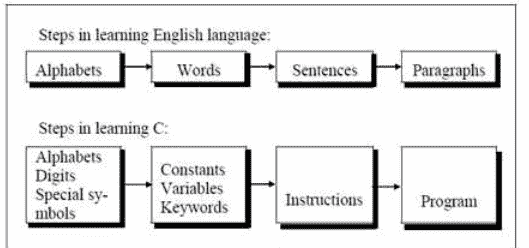

# C 语言入门指南：掌握 C 编程基础的步步指南指南

# 引言

C 语言是 1972 年在美国 AT & T 公司的贝尔实验室开发的一种编程语言。它由一位名叫丹尼斯·里奇（Dennis Ritchie）的人设计并编写。20 世纪 70 年代后期，C 开始取代 PL/I、ALGOL 等当时更熟悉的语言。

ANSI C 标准出现在 20 世纪 80 年代初，本书分为两个标题：原版仍称为《C 语言编程》(Programming in C)，而涵盖 ANSI C 的标题称为《ANSI C 编程》(Programming in ANSI C)。这是因为编译器供应商需要几年时间来发布他们的 ANSI C 编译器并使其变得无处不在。它最初设计用于为 UNIX 操作系统编程。现在，软件工具以及 C 编译器都是用 C 语言编写。Windows、UNIX、Linux 等流行操作系统的主要部分仍然用 C 编写。这是因为即使在今天，在性能（执行速度）方面，没有什么能超越 C。此外，如果要扩展操作系统与新设备协作，就需要编写设备驱动程序。这些程序都是用 C 语言编写的。它看起来如此流行是因为它可靠、简单且易用。今天经常听到的是——“C 已经被 C++、C# 和 Java 等语言取代。”

学习英语和学习 C 语言之间有密切的类比。学习英语的经典方法是首先学习该语言使用的字母，然后学习将这些字母组合成单词，单词再组合成句子，句子组合成段落。学习 C 语言相似且更容易。我们不需要直接学习如何编写程序，必须首先知道 C 中使用了哪些字母、数字和特殊符号，然后使用它们构建常量、变量和关键字，最后了解这些是如何组合成指令的。一组指令之后会组合成程序。所以



计算机程序只是解决特定问题所需指令的集合。计算机系统的基本操作形成了所谓的计算机指令集。用于解决问题的方法或手段被称为算法。

因此，就编程语言而言，分为两类：

1) 低级语言
2) 高级语言

## 低级语言

低级语言是机器级和汇编级语言。在机器级中，计算机只识别数字，即 0 和 1 的形式。因此，给计算机的指令是以二进制位的形式的，在二进制代码中实现指令非常困难。这种类型的程序不具有移植性，难以维护且容易出错。另一方面，汇编语言是机器语言的修改版本。其中指令以如 `ADD`、`SUM`、`MOV` 等英语单词给出。它易于编写和理解，但机器无法理解。因此，这里使用的翻译器是汇编器，将其翻译成机器级。虽然语言稍微简单一点，但程序员必须了解与低级语言相关的底层细节。在汇编级语言中，数据存储在计算机寄存器中，这随不同的计算机而异。因此它不具有可移植性。

## 高级语言

这些语言与机器无关，意味着它们具有可移植性。这一类别的语言包括 Pascal、Cobol、Fortran 等。高级语言可以被机器理解。因此需要通过翻译器翻译成机器级。翻译器是一种软件，用于将高级语言以及低级语言翻译成机器级语言。

有三种翻译器：

### 编译器
### 解释器
### 汇编器

编译器和解释器用于将高级语言转换为机器级语言。用高级语言编写的程序称为源程序，相应的机器级语言程序称为目标程序。编译器和解释器执行相同的任务，但它们的工作方式不同。编译器一次读取整个程序并搜索错误。如果程序没有错误，它就会被转换为程序。而解释器只读取一行源代码并转换为目标代码，因此需要更多时间。

## 集成开发环境

编辑、编译、运行和调试程序的过程通常由单一应用程序管理，称为集成开发环境，简称为 IDE。IDE 是一个基于 Windows 的程序，允许我们轻松地管理大型软件程序、在窗口中编辑文件并编译、运行和调试程序。在 Mac OS 上，CodeWarrior 和 Xcode 是许多程序员使用的 IDE。在 Windows 下，Microsoft Visual Studio 是流行 IDE 的一个示例。Eclipse 是 Linux 下开发应用的流行 IDE。

# C 语言程序结构

- 1 ) 注释行
- 2) 预处理器指令
- 3 ) 全局变量
- 4) `main` 函数( )
  {
  局部变量；语句；
  }
用户定义函数
}

## 注释行

它指示程序的目的。它的表示形式为

```
/*....................*/
```

注释行用于提高程序的可读性。它对于解释程序很有用，通常用于文档说明。它封装在界定符之间。注释可以是单行或多行，但不应嵌套。它可以出现在程序的任何地方，字符串常量和字符常量除外。

`main()` 函数可以位于程序的任何位置，但在习惯上，它通常被放在第一位置。

语法：`main()`

```c
{
......
......
......
}
```

当 `main()` 函数声明为数据类型 `int main()` 时，它的返回值为

```c
{
    return 0
}
```

当使用 `void`（意味着空/无）作为 `void main(void)` 或 `void main()` 时，main 函数不返回任何值。

```c
{
    printf("C language");
}
```

输出：C language

程序的执行从左大括号开始，以右大括号结束。

两个大括号之间包含了声明部分和可执行部分。在每一行的末尾都有一个分号，表示语句的结束。

```c
/*带有返回语句的第一个C程序*/
#include <stdio.h>
int main (void)
{
printf("welcome to c Programming language.\n"); return 0;
}
```

输出：welcome to c programming language.

## 编译和执行程序的步骤

编译器是一种软件程序，它分析用特定计算机语言开发的程序，然后将其翻译成适用于特定计算机系统执行的形式。下图显示了用 C 语言开发的计算机程序在输入、编译和执行过程中涉及的步骤，以及从命令行输入的典型 Unix 命令。

步骤 1：首先将要编译的程序输入到计算机系统的一个文件中。文件命名有多种约定，通常只要最后两个字符是 ".c" 或扩展名为 .c 的文件，可以使用任何名称均可。因此，文件名 `prog1.c` 可能是 C 程序的有效文件名。通常使用文本编辑器将 C 程序输入到文件中。例如，`vi` 是 Unix 系统上常用的文本编辑器。输入到文件的程序被称为源程序，因为它代表了用 C 语言表示的程序的原始形式。

步骤 2：将源程序输入文件后，即可进行编译。编译过程通过在系统上输入特殊命令来启动。当输入此命令时，必须同时指定包含源程序的文件的名称。例如，在 Unix 下，启动程序编译的命令称为 `cc`。如果我们正在使用流行的 GNU C 编译器，我们使用的命令是 `gcc`。

输入该行：

```
gcc prog1.c or cc prog1.c
```

在编译过程的第一步中，编译器会检查源程序中包含的每个程序语句，并检查确保其符合语言的语法和语义。如果编译器在此阶段发现任何错误，会将错误报告给用户，编译过程到此结束。然后必须在源程序中（使用编辑器）纠正错误，并重新启动编译过程。编译此阶段报告的典型错误可能是由于表达式的括号不平衡引起（语法错误），或由于使用了未“定义”的变量（语义错误）。

步骤 3：当程序中所有的语法和语义错误都被删除后，编译器将处理程序的每个语句，并将其翻译成一种“低级”形式，该形式等于执行相同任务所需的汇编语言程序。

步骤 4：程序翻译后，编译过程的下一步是将汇编语句翻译成实际的机器指令。汇编器获取每个汇编语句并将其转换为名为对象代码的二进制格式，然后将其写入系统中的另一个文件中。在 Unix 下，该文件的名称与源文件相同，但最后一个字母是为“o”（代表 object，对象）而不是“c”。

步骤 5：程序翻译成对象代码后，就可以进行链接了。每当在 Unix 下发布 `cc` 或 `gcc` 命令时，此过程就会再次自动执行。链接阶段的目的是获得程序的最终形式，以便在计算机上执行。

如果程序使用了之前由编译器处理过的其他程序，那么在此阶段会将这些程序链接在一起。系统程序库中使用的程序在此阶段也会搜索并与对象程序链接在一起。

编译和链接程序的过程通常被称为“构建”（building）。

最终链接的文件是可执行对象代码格式，存储在系统的另一个文件中，准备好运行或执行。在 Unix 下，该文件默认名为 `a.out`。在 Windows 下，可执行文件通常与源文件名相同，但将 c 扩展名替换为 exe 扩展名。

步骤 6：为了后续执行程序，命令 `a.out` 的是将名为 `a.out` 的程序加载到计算机内存并启动其执行。

当程序执行时，程序的每个语句将按顺序执行。如果程序向用户请求任何数据（称为输入），程序将临时暂停执行以便输入数据。

![img/7e3561298395bbff5c2970_33_0.png]

```c
/*两个数字相和的简单程序 */
#include <stdio.h>
int main (void)
{
    int v1, v2, sum; //v1,v2,sum是
    变量和int数据类型 v1
    = 150;
    v2 = 25;
    sum = v1 + v2;
    printf("The sum of %i and %i is= %i\n",
    v1, v2, sum);
    return 0;
}
```

输出：
The sum of 150 and 25 is=175

## 字符集

字符表示表示信息的任何字母、数字或特殊符号。C语言允许的有效字母、数字和特殊符号有：

| 类别 | 字符 |
| :--- | :--- |
| 字母 | A, B, ..., Y, Z, a, b, ..., y, z |
| 数字 | 0, 1, 2, 3, 4, 5, 6, 7, 8, 9 |
| 特殊符号 | ~!@#%^&*( ) _-+= \ {}[]\|:'"'<>,.? |

`extern`, `register`, `enum`, `case`, `goto`,
`struct`, `char`, `auto`, `const` 等。

## 数据类型

数据类型是指在在使用之前用于声明不同类型的变量或函数的广泛系统。变量的类型决定了它在存储器中占据空间的大小，以及存储的位模式如何被解释。变量的值可以随时更改。

C 有以下 4 种数据类型：
- 基础内置数据类型：`int`, `float`, `double`, `char`
- 枚举数据类型：`enum`
- 派生数据类型：指针、数组、结构体、联合体
- 空类型：`void`

声明为 `int` 类型的变量仅能包含整数值——即不包含小数的值。声明为 `float` 类型的变量可用于存储浮点数（包含小数的值）。`double` 类型与 `float` 类型相同，但精度大约是其两倍。`char` 数据类型可以用于存储单个字符，例如字母 a、数字字符 6 或类似的分号。声明为 `char` 的变量只能存储字符类型的值。

C 中有两种类型的修饰符：
- 尺寸修饰符：`short`, `long`
- 符号修饰符：`signed`, `unsigned`

当使用 `unsigned` 修饰符时，数字始终为正数；当使用 `signed` 时，数字可能是正也可能是负。如果没有提到符号修饰符，则默认假设为符号修饰符。符号数据类型的值范围小于无符号类型。因为在符号类型中，最左位用于表示符号，而在无符号类型中，该位也用于表示值。16 位机器上不同数据类型的尺寸和范围如下所示：

| 基础数据类型 | 带有修饰符的数据类型 | 尺寸（字节） | 范围 |
| :--- | :--- | :--- | :--- |
| char | signed char | 1 | -128 to 127 |
| char | unsigned char | 1 | 0 to 255 |
| int | signed int | 2 | -32768 to 32767 |
| int | unsigned int | 2 | 0 to 65535 |
| short | signed short | 2 | -32768 to 32767 |
| short | unsigned short | 2 | 0 to 65535 |
| long | signed long | 4 | -2147483648 to 2147483647 |
| long | unsigned long | 4 | 0 to 4294967295 |
| float | float | 4 | -3.4E-38 to 3.4E+38 |
| double | double | 8 | -1.7E-308 to 1.7E+308 |
| Long double | long double | 10 | -3.4E-492 to 1.1E+492 |

## 常量

常量是在执行过程中不能更改的数值。在 C 中，任何数字、单字符或字符字符串都被称为常量。常量是不改变的实体，而变量是可以改变的实体。例如，数字 5 代表一个常量值。在 C语言中编程是有趣的。C 常量可以分为大类：

### 初级常量

这些常量进一步分为：
- 数值常量
- 字符常量
- 字符串常量

### 数值常量

数值常量由数字组成。它要求最小 2 字节，最大 4 字节。它可以是正的或负的，但默认符号始终为正。数值常量内部不允许逗号或空格，且必须至少有一个数字。整数常量的允许范围是 -32768 到 32767。严格来说，范围取决于编译器。对于像 Turbo C 或 C++ 等 16 位编译器，范围甚至更大。对于 32 位编译器，整数常量的范围更大。整数常量是没有小数点的整数。整数常量的类型有：
- 十进制常量：0-9（10 进制）
- 八进制常量：0-7（8 进制）
- 六进制常量：0-9, A-F（16 进制）

十进制常量的第一位不应为零，而八进制常量的第一位必须为零（如 07），十六进制常量的第一位应该是 0x 或 0X（如 0x24）。默认情况下，整数常量的类型是 `integer`，但如果整数常量的值超过了范围，则 `integer` 类型表示的值将通过后缀 `L` 和 `u/U` 变为无符号整数或长整数。

**实数常量**也称为浮点常量。要构造实数常量，必须遵循以下规则：
- 实数常量至少有一个数字。
- 它必须有一个小数点。
- 它可以是正的或负的。
- 默认符号为正。
- 实数常量内部不允许逗号或空格。例如：32.34, 42.0

为了表示小/大实数指数，使用科学计数法，其中数字写在尾数部分，指数部分用 e/E 隔开。指数可以是正负整数，但尾数可以是实数/整数类型，例如 3.6*10^5=3.6e+5。默认情况下，浮点常量的类型是 `double`，也可以通过后缀 `f/F` 显式定义。

### 字符常量

字符常量表示为包含在单引号内的单个字符。这些可以是单个数字、单个特殊符号或空格，如 '9'、'c'、'$'、' ' 等。每个字符常量在机器字符码中都有唯一的整数值，机器使用 ASCII（美国信息交换标准代码）。与每个大写和小写字母以及十进制整数相关的某些数值为：
- A-Z ASCII 值 (65-90)
- a-z ASCII 值 (97-122)
- 0-9 ASCII 值 (48-57)
- ; ASCII 值 (59)

### 字符串常量

一组字符被称为字符串，当字符序列包含在双引号内（它可能是各种符号的组合）时，它就是一个字符串常量。字符串常量有零、一个或多个字符，编译器会自动在字符串末尾放置空字符 (\0)。一些示例有 "saratina"、"908"、"3"、"A" 等。在 C 中，虽然相同的字符包含在单引号和双引号中，但它们代表不同的含义，例如 "A" 和 'A' 是不同的，因为第一个是末尾带有空字符的字符串，而第二个是其对应的 ASCII 值为 65 的字符常量。

### 符号常量

符号常量是用于替换字符序列的名称，这些字符可以是数值、字符或字符串常量。这些常量通常在程序的开头定义，如下：

```
#define name value
```

这里name 通常使用大写字母，例如：
```
#define MAX 10
#define CH B
#define NAME "sony"
```

## 变量

变量是用于存储某些数据值或程序计算和结果的符号名称。变量的值在执行过程中可以更改。变量的命名规则与标识符相同。在程序中使用之前必须声明。变量声明指定了名称、数据类型，变量可以存储的值范围取决于数据类型。

语法：
```
int a;
char c;
float f;
```

## 变量初始化

在声明期间为变量分配任何初始值被称为变量初始化。当变量声明但包含未定义的值时，称为垃圾值。使用赋值运算符初始化变量，例如：

数据类型 变量名=常量;

示例：`int a;`
`a=20;`

## 表达式

表达式是变量、常量、运算符和函数调组合。它可以是算术、逻辑和关系的表达式，例如：

```
int z= x+y // 算术表达式
a>b // 关系表达式
a==b // 逻辑
funcc(a, b) // 函数调用
```

完全由常量值组成的表达式被称为常量表达式。因此，表达式

```
121 + 17 - 110
```


是一个常量表达式，因为该表达式的每一个项都是常量值。但如果 `i` 将被声明为一个整数变量，那么表达式

`180 + 2 - j`

将不再表示一个常量表达式。

## 运算符

这是一个用于对变量、操作数或常量执行某些操作的符号。某些运算符需要2个操作数来执行操作，而某些只需要单次操作。

有多种运算符，包括：算术运算符、赋值、递增、递减、逻辑、条件、逗号、`sizeof`、位运算等。

### 1. 算术运算符

该运算符用于数值计算。它们分为一元算术运算符和二元算术运算符。一元算术运算符只需要一个操作数，例如 `+-`, `++`, `--`, `!` 等。这些运算符是加法、减法、乘法、除法。另一方面，二元算术运算符需要两个操作数，其运算符为 `+`（加法）、`-`（减法）、`*`、 `/`（除法）、`%`（取模）。但取模不能应用于浮点数操作数，而且 C 中没有幂运算符。

一元加 `+` 和一元减 `-` 与加法和减法不同。

当两个操作数都是整数时，它称为整数算术，结果始终是整数。当两个操作数都是浮点数时，称为浮点算术；当操作数是整数和浮点数时，则称为混合类型或混合模式算术。结果为 `float` 类型。

### 2. 赋值运算符

可以使用赋值运算符在变量中存储值。赋值运算符 `=` 用于赋值语句和赋值表达式。左侧的操作数应该是变量，右侧的操作数应该是变量、常量或任何表达式。当左侧的变量出现在右侧时，我们可以通过编写复合语句来避免。例如，

```
int x= y;
```

```
int Sum=x+y+z;
```

### 3. 递增和递减

一元运算符 `++` 和 `--` 用于递增和递减，作用于单个操作数。递增运算符将变量的值加1。同样，递减运算符将变量的值减1。这些运算符只能与变量使用，不能用于表达式和常量，例如 `++6` 或 `++(x+y+z)`。

它又分为前缀和后置。在前缀中，变量的值先加1，然后使用新值；而在后置中，运算符写在操作数之后（如 `m++`, `m--`）。

#### 示例

```
let y=12; z= ++y; y= y+1; z= y;
```

同样，后置递增和递减运算符用于操作。然后执行递增和递减。

#### 示例

```
let x= 5; y= x++; y=x;
```

```
x = x+1;
```

### 4. 关系运算符

用于根据它们的关系比较两个表达式的值。

包含关系运算符的表达式称为关系表达式。

在这里，根据真或假值进行赋值。
a.`(a>=b) || (b>20)`

b.`(b>a) && (e>b)`

c. `0(b!=7)`

### 5. 条件运算符

它有时被称为三元运算符。因为它需要三个表达式作为操作数，并表示为 `? , :`。

#### 语法

```
exp1 ? exp2 :exp3
```

在这里首先求值 `exp1`。如果为真，则返回 `exp2`。如果为假，则返回 `exp3`。

#### 示例

```
void main()
{
    int a=10, b=2
    int s=(a>b) ? a:b;
    printf("value is:%d");
}
```

输出：

Value is:10

### 6. 逗号运算符

逗号运算符允许不同的表达式在只能使用一个表达式的情况下出现。所有表达式都用逗号分隔，并从左到右求值。

示例

```
int i, j, k, l;
for(i=1,j=2;i<=5;j<=10;i++;j++)
```

### 7. Sizeof 运算符

`sizeof`运算符是一个一元运算符，它给出操作数在内存中所占用的字节大小。操作数可以是变量、常量或数据类型限定符。

通常它被用于制作可移植程序（可以在不同机器上运行的程序）。当程序员不知道大大，它用于确定实体、数组和结构的长度。它还用于在程序执行期间动态分配内存大小。

#### 示例

```
main( )
```

```
{
int sum; float f;
printf("%d%d", sizeof(f), size of (sum)
);
printf("%d%d", size of(235 L), size of(A));
}
```

### 8. 位运算符

位运算符允许程序员在位位上访问和操作数据。

列出的各种位运算符有：

按取反 `~`

位与 `&`

位或 `|`

位异或 `^`

左移 `<<`

右移 `>>`

这些运算符可以操作整数和字符值，但不能操作浮点数和双精度浮点数。在位运算符中，`showbits()` 函数用于显示任何整数或字符值的二进制表示。

在按取反中，所有的 0 变为 1，所有的 1 变为 0。在位或中，其值通过 0 到 2 位获得。

位或运算符用于设置数字中的特定位。位与与逻辑与相同。

它作用于两个操作数，并按位逐位比较。因此，两个操作数必须相同类型。

### 逻辑或布尔运算符

用于一个或多个操作数，并返回值 0（假）或 1（真）。操作数可以是常量、变量或表达式。组合两个或多个表达式的表达式称为逻辑表达式。C 具有三个逻辑运算符：

运算符

`&&`: 与

`||`: 或

`!`: 非

其中逻辑非是一个一元运算符，另外两个是二元运算符。逻辑与在两个条件都为真时给出真假的结果，否则结果为假。逻辑或在两个条件都为假时结果为假，否则结果为真。

### 运算符的优先级和结合性

| 运算符 | 描述 | 优先级 | 结合性 |
|---|---|---|---|
| 0 | 函数调用 | 1 | 从左到右 |
| [] | 数组下标 | | |
| → | 箭头运算符点运算符 | | |
| + | 一元加 | 2 | 从右到左 |
| - | 一元减 | | |
| ++ | 递增 | | |
| -- | 递减 | | |
| ! | 逻辑非 | | |
| * | 按取反 | | |
| & | 取地址符 | | |
| (data type) | 类型转换字节 | | |
| * | 乘法 | 3 | 从左到右 |
| / | 除法 | | |
| % | 取模 | | |
| + | 加法 | 4 | 从左到右 |

## 控制语句

通常 C 程序的语句按照它们在程序中出现的顺序执行。但有时我们使用判断条件来执行程序的一部分，这就是控制语句。控制语句定义了控制如何从程序的一部分转移到另一个部分。有几种控制语句，如 `if...else`, `switch`, `while`, `do. while`, `for loop`, `break`, `continue`, `goto` 等。

## C 中的循环

循环：它是一个执行一组指令的语句块。在循环中重复程序的特定部分，直到指定的次数或直到满足某个特定条件。

C 中三种循环：

- 1. While 循环
- 2. do while 循环
- 3. for 循环

### While 循环

语法：

```
while(condition)
{
  Statement 1;
  Statement 2;
}
或 while(test condition)
  Statement;
```

测试条件可以是任何表达式。当我们想要固定次数执行某些操作，但不知道迭代次数时，在程序中使用 `while` 循环。

在这里首先检查条件，如果为真，则执行循环体；否则，如果条件为假，控制将跳循环。

示例：

```
/* wap 打印 5 次 welcome to C */
#include<stdio.h>
void main()
{
int p=1;
While(p<=5)
{
printf("Welcome to C\n");
P=p+1;
}
}
```

输出：Welcome to C

欢迎来到 C

欢迎来到 C

欢迎来到 C

欢迎来到 C

所以，只要条件为真，`while` 循环体内的语句就会反复执行。

### do while 循环

这种（`do while` 循环）语句也用于循环。该循环体可以包含单个语句或语句块。该语句的语法格式如下：

语法:-

```
do
{
  Statement;
}
while(condition);
```

示例:-
`#include<stdio.h>`

`void main()`
`{`
  `int X=4;`
  `do`
  `{`
    `printf("%d",X);`
    `X=X+1;`
  `} while(X<=10);`
  `printf(" ");`
`}`

Output: 4 5 6 7 8 9 10

在这里，首先执行体内的语句，然后检查条件。如果条件为真，则再次执行循环体，此过程一直持续，直到条件变为假。与 `while` 循环不同，分号放在 `while` 的末尾。

`while` 循环和 `do while` 循环之间存在细差异：`while` 循环在执行循环的任何语句之前测试条件。而 `do while` 循环在循环内至少执行一次语句后才测试条件。

如果初始条件为假，`while` 循环将不执行其语句；另一方面，即使条件在第一次失败，`do while` 循环也会至少执行一次语句。这意味着 `do while` 循环始终至少执行一次。注意：

当我们想要至少执行一次循环时，很少使用 `do while` 循环。

### for 循环

在程序中，当预先知道迭代次数时，通常使用 `for` 循环。循环体可以是单个语句，也可以是多个语句。

其语法格式为：

语法:-

```
for(exp1;exp2;exp3)
{
  Statement;
}
```

或者

```
for(initialized counter; test counter; update counter)
{
  Statement;
}
```

在这里，`exp1` 是初始化表达式，`exp2` 是测试表达式或条件，`exp3` 是更新表达式。表达式 1 仅在循环开始时执行一次，用于初始化循环变量。条件表达式通常使用关系运算符和逻辑运算符。而更新部分仅在循环体执行完毕后执行。

示例:-
```c
void main()
{
  int i; for(i=1;i<10;i++)
  {
    printf(" %d ", i);
  }
}
```

Output:- 1 2 3 4 5 6 7 8 9

### 循环嵌套

当一个循环写在另一个循环的体内部时，它被称为循环嵌套。任何类型的循环都可以嵌套在任何类型的循环中，例如 `while`、`do while`、`for`。例如，`for` 循环的嵌套可以表示为：

```c
void main()
{
  int i,j; 
  for(i=0;i<2;i++) 
    for(j=0;j<5;j++) 
      printf("%d %d", i, j);
}
```

Output: 
i=0 j=0 1 2 3 4
i=1 j=0 1 2 3 4

## break 语句

有时即使在循环条件变为假之前需要跳出循环，这时就会 `break` 语句。`break` 语句用于循环和 `switch` 语句内部。它会导致立即退出它所在的循环，并且通常与条件配合使用。它使用关键字 `break` 编写。当遇到 `break` 语句时，循环终止，控制转移到循环紧后的语句，即我们想要立即跳出循环，而不需要等待回到条件状态。

当在任何循环内部遇到 `break` 时，控制会自动传递到循环后的第一个语句。此 `break` 语句通常与 `if` 语句相关。

示例 :

```c
void main()
{
  int j=0;
  for(;j<6;j++)
    if(j==4) break;
}
```

Output: 0 1 2 3

### continue 语句

`continue` 语句用于在跳过循环的某些语句后继续循环的下一次迭代。遇到时，控制会自动传递到循环的开头。它通常与 `if` 语句相关，当我们想要继续程序而不执行某些部分时非常有用。

`break` 和 `continue` 的区别是：遇到 `break` 时，循环终止并转移到下一个语句；而遇到 `continue` 时，控制回到起始位置。在 `while` 和 `do while` 循环中，`continue` 后控制转移到测试条件；而在 `for` 循环中，`continue` 后控制转移到更新表达式并测试条件。

示例:-
```c
void main()
{
  int n;
  for(n=2; n<=9; n++) {
    if(n==4) continue;
    printf("%d", n);
  }
}
```

Output: 2 3 5 6 7 8 9

## if 语句

该语句仅在条件为真时执行。如果 `if` 语句体包含多个语句，那么在条件为假的情况下，将跳过 `if` 块内的语句，其语法为：

```c
if (condition)
{
  Statement;
}
else
{
  Statement;
}
```

示例:-
```c
/* 检查一个数字是偶数还是奇数 */
void main()
{
  int n;
  printf("enter a number:");
  scanf("%d", &n);
  if (n%2==0)
    printf("even number");
  else
    printf("odd number");
}
```

Output: enter a number:1 odd number

### if ...else 嵌套

当 `if` 块或 `else` 块中还有另一个 `if else` 语句时，则被称为 `if-else` 语句嵌套。语法为 :-

```
if (condition)
{
  if (condition)
    Statement1;
  else
    Statement2;
}
else
  Statement3;
```

### If....else 阶梯

在这种嵌套类型中，除了最后部分外的每个部分都有 `else` 语句。如果条件为假，控制传递到块，在块中使用其 `if` 语句再次检查条件。

语法为 :-

```
if (condition)
  Statement1;
else if (condition)
  statement2;
else if (condition)
  statement3;
else
  statement4;
```

此过程一直持续到最后一个块没有 `if` 语句。如果某个条件满足，嵌套的 `else if` 将不会执行。但它相比 `if` 语句的缺点在于：在 `if` 语句中，一旦条件为，其他条件就不会被检查；在这种情况下，所有条件都会被检查。

## 数组

数组是相同类型的集合，或者是存储在连续内存位置中的相同实体集合。字符数组是字符串。数组中的每个数据项称为元素。每个元素都是唯一的并位于独立的内存位置。数组的每个元素共享一个变量名，但每个元素都有不同的索引号，称为下标。

数组可以是单维的也可以是多维的，下标的数量决定了它的维度。下标始终从零开始。一维数组被称为向量，二维数组被称为矩阵。

优点：数组变量可以同时存储多个值，而其他变量一次只能存储一个值。

示例：
```c
int arr[100];
int mark[100];
```

数组声明：

其语法为：

数据类型 数组名 [大小];

```
int arr[100];
int mark[100];
int a[5]={10,20,30,100,5}
```

数组声明告诉编译器数据类型、数组名称、数组大小以及每个元素占据的内存空间。像 `int` 数据类型，它每个元素占用 2 字节，对于 `float`，它每个元素占用 4 字节等。数组的大小决定数组中可以存储的元素数量，它可以是一个 `int` 常数或常量 `int` 表达式。

我们可以将单个数组表示为：`: int ar[5];`

`ar[0]`, `ar[1]`, `ar[2]`, `ar[3]`, `ar[4];`

符号常量也可以用于指定数组的大小，例如：`#define SIZE 10`

## 数组的初始化：

声明后，局部数组的元素具有垃圾值。如果是全局或静态数组，它们将被自动初始化为零。也可以显式地初始化为：

数据类型 数组名 [size] = {value1, value2, value3...}

示例：

```c
int ar[5]={20,60,90, 100,120}
```

数组下标始终从零开始，这被称为下界，上限值被称为上界，最后一个下标值比数组的大小减1。下标可以是一个表达式，即整数值。它可以是任何整数、整数常量、整数变量、整数表达式或产生整数值的函数调用返回值。

因此，如果 `i & j` 不是变量，那么有效的下标为为 `ar`：

```
ar[i*7],ar[i*],ar[i++],ar[3];
```

数组元素连续存储在内存位置中，存储元素所需的存储空间取决于其的大小和类型。

1D数组的总字节数（byte）为：

总字节数 = (数据类型的大小) * 数组的大小。

示例：如果声明数组为：`int ar[20];`

总字节数 = 2 * 20 = 40 字节。

## 数组的访问

### 元素：

```c
/*编写一个程序向数组输入值
并显示这些值*/
#include<stdio.h>
int main()
{
    int arr[5],i; 
    for(i=0;i<5;i++)
    {
        printf("enter a value for arr[%d] \n",i);
        scanf("%d",&arr[i]);
    }
    printf("the array elements are: \n"); 
    for(i=0;i<5;i++)
    {
        printf("%d\t",arr[i]);
    }
    return 0;
}
```


输出：

Enter a value for `arr[0]` = 12
Enter a value for `arr[1]` = 45
Enter a value for `arr[2]` = 59
Enter a value for `arr[3]` = 98
Enter a value for `arr[4]` = 21

the array elements are 12 45 59 98 21

示例：从上面的示例中，存储在数组中的值分别占用其内存地址 2000, 2002, 2004, 2006, 2008。

`a[0]`=12, `a[1]`=45, `a[2]`=59, `a[3]`=98, `a[4]`=21

| `ar[0]` | `ar[1]` | `ar[2]` | `ar[3]` | `ar[4]` |
| --- | --- | --- | --- | --- |
| 12 | 45 | 59 | 98 | 21 |
| 2000 | 2002 | 2004 | 2006 | 2008 |
