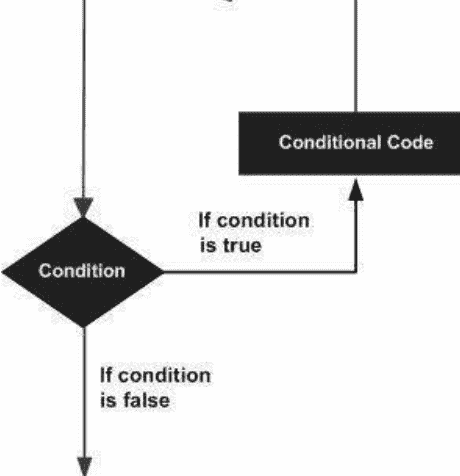
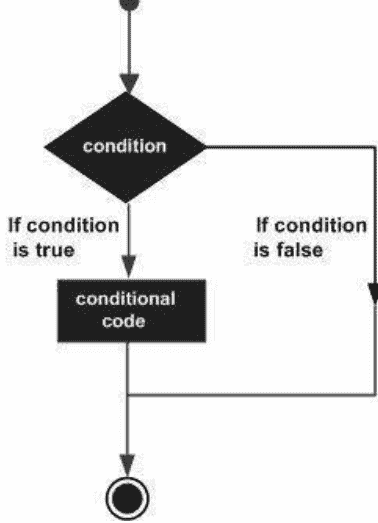
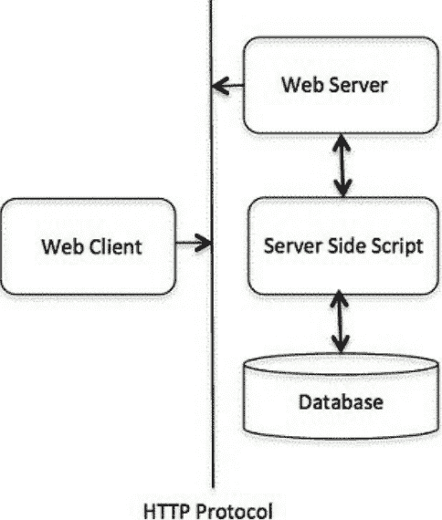

# C++ 编程初学者指南：面向对象的语言

## 序言

C++ 是一门由 Bjarne Stroustrup 从 1979 年开始在贝尔实验室开发的中级编程语言。C++ 运行在多种平台上，例如 Windows、Mac OS 以及各种版本的 UNIX。本 C++ 教程采用简单且实用的方法，为从初学者到高级软件工程师的读者群介绍 C++ 的概念。

## 为什么要学习 C++

对于想要成为一名优秀软件工程师的学生和职场专业人士来说，学习 C++ 是**必不可少的**。我将列出学习 C++ 的一些关键优势：

- C++ 非常接近硬件，因此你有机会在底层工作，这让你在内存管理方面获得巨大的控制权，获得更好的性能，并实现健壮的软件开发。
- C++ 编程让你对面向对象编程有清晰的理解。当你实现虚表和虚指针或动态类型识别时，你将理解多态的底层实现。
- C++ 是长青的编程语言之一，深受数百万软件开发者的喜爱。如果你是一名优秀的 C++ 程序员，你永远不会无事可做，更重要的是，你的工作将获得高薪回报。
- C++ 是应用和系统编程中最广泛使用的编程语言之一。因此，你可以选择感兴趣的软件开发领域。
- C++ 真正教会了你编译器、链接器和加载器之间的区别，不同的数据类型、存储类、变量类型及其作用域等。

学习 C++ 编程有数千个良好的理由。但有一点肯定的，学习任何编程语言（不仅仅是 C++），你只需要编写代码、编写代码并不断编写代码，直到你成为专家。

## 使用 C++ Hello World

为了让你对 C++ 编程产生一点兴趣，我将给你展示一个小型的传统的 C++ Hello World 程序，你可以通过 Demo 链接尝试它。

C++ 是 C 语言的超集，增加了对面向对象概念的实现。

```cpp
#include <iostream>
using namespace std;

// main() 是程序执行开始。
int main() {
    cout << "Hello World"; // 打印 Hello World
    return 0;
}
```

有很多 C++ 编译器可用，你可以使用它们来编译和运行上述程序：

- Apple C++. Xcode
- Bloodshed Dev-C++
- Clang C++
- Cygwin (GNU C++)
- Mentor Graphics
- MINGW - "Minimalist GNU for Windows"
- GNU CC 源码
- IBM C++
- Intel C++
- Microsoft Visual C++
- Oracle C++
- HP C++

要列出所有可用编译器的完整列表是不可能的。C++ 的世界太大了，新事物层出不穷。

## C++ 编程的应用

如前所述，C++ 是最广泛使用的编程语言之一。它几乎存在于软件开发的每一个领域。我将在这里列出其中几个：

- **应用软件开发** - C++ 编程已用于开发几乎所有主要的操作系统，如 Windows、Mac OSX 和 Linux。除了操作系统之外，Mozilla Firefox 和 Chrome 等许多浏览器的核心部分也是使用 C++ 编写的，C++ 还用于开发了名为 MySQL 的流行数据库系统。
- **编程语言开发** - C++ 已广泛用于开发新的编程语言，如 C#、Java、JavaScript、Perl、UNIX 的 C Shell、PHP、Python 以及 Verilog 等。
- **计算编程** - 由于运行速度快且计算效率高，C++ 是科学家们的好朋友。
- **游戏开发** - C++ 速度极快，允许程序员对 CPU 密集型函数进行过程化编程，并对硬件提供更强的控制，因此它被广泛应用于游戏引擎的开发。
- **嵌入式系统** - C++ 被大量用于开发医疗和工程应用，例如 MRI 机器的软件、高端 CAD/CAM 系统等。

这个列表还将继续下去，在许多领域，软件开发者都在愉快地使用 C++。我强烈建议你学习 C++ 并为社区做出贡献。

## C++ 概述

C++ 是一门静态类型、编译型、通用、区分大小写的、自由格式语言，支持过程化、面向对象和泛型编程。C++ 被视为一种中级语言，因为它结合了高级和低级语言特征。C++ 由 Bjarne Stroustrup 从 1979 年开始在纽西的贝尔实验室开发，最初作为 C 语言的增强并名为 C with Classes，后来在 1983 年更名为 C++。C++ 是 C 语言的超集，几乎任何合法的 C 程序都是合法的 C++ 程序。

### 面向对象编程

C++ 完全支持面向对象编程，包括面向对象开发的四大支柱：

- 封装
- 数据隐藏
- 继承
- 多态

### 标准库

标准 C++ 由三部分组成：

- 核心语言提供了变量、数据类型和字面量等构建块。
- C++ 标准库提供了丰富的操作文件的函数。
- 标准模板库（STL）提供了丰富的操作数据结构的方法。

### ANSI 标准

ANSI 是确保 C++ 移植性的一种尝试；为微软编译器编写的代码可以在 Mac、UNIX、Windows 电脑或 Alpha 上的编译器上无错误地编译。ANSI 标准已经稳定了一段时间，所有主要的 C++ 编译器厂商都支持 ANSI 标准。

### 学习 C++

学习 C++ 时最重要的事情是关注概念。学习编程语言的目的是成为一名更好的程序员；即能够更有效地设计和实现新系统，并维护旧系统。

### C++ 的用途

C++ 被数十万程序员应用于几乎每一个应用领域。C++ 被高度地用于编写设备驱动程序和其他依赖于在实时限制下直接操作硬件的软件。C++ 广泛用于教学和研究，因为它足够简洁，可以成功教授基础概念。任何使用过 Apple Macintosh 或运行 Windows 的 PC 的人都间接使用过 C++，因为这些系统的主要用户界面是用 C++ 编写的。

### C++ 环境搭建

#### 本地环境搭建

如果你仍然决定为 C++ 配置环境，你需要在电脑上安装以下两个软件。

##### 文本编辑器

这用于编写你的程序。一些编辑器的示例包括 Windows 记事本（Notepad）、OS Edit 命令、Brief、Epsilon、EMACS 以及 vim 或 vi。

文本编辑器的名称和版本在不同的操作系统上可能不同。例如，Windows 上将使用记事本，而 vim 或 vi 也可以用于 Windows、Linux 或 UNIX 系统。

你用编辑器创建的文件称为源文件，对于 C++ 来说，它们通常以 `.cpp`、`.cp` 或 `.c` 作为扩展名。

你需要准备好文本编辑器来开始你的 C++ 编程。

##### C++ 编译器

这是一个真正的 C++ 编译器，用于将你的源代码编译成最终的可执行程序。

大多数 C++ 编译器并不在意你给源代码命名什么扩展名，但除非另有指定，许多编译器默认会使用 `.cpp`。

最常用且免费的编译器是 GNU C/C++ 编译器，否则如果你有相应的操作系统，也可以使用来自 HP 或 Solaris 的编译器。

###### 安装 GNU/C++ 编译器

####### UNIX/Linux 安装

如果你正在使用 Linux 或 UNIX，请通过命令行输入以下命令来检查系统是否安装了 GCC：

```bash
$ g++ -v
```

如果你已经安装了 GCC，它应该打印出如下的消息：

```
Using built-in specs.
Target: i386-redhat-linux
Configured with: ../configure --prefix=/usr ......
Thread model: posix
gcc version 4.1.2 20080704 (Red Hat 4.1.2-46)
```

如果未安装 GCC，你必须使用 `https://gcc.gnu.org/install/` 提供的详细说明自行安装。

####### Mac OS 安装

如果你使用 Mac OS X，获取 GCC 的简单方法是从 Apple 官网下载 Xcode 开发环境，并按照简单的安装说明操作。

Xcode 目前可以在 `developer.apple.com/technologies/tools/` 找到。

####### Windows 安装

要在 Windows 上安装 GCC，你需要安装 MinGW。要安装 MinGW，请访问 MinGW 主页 `www.mingw.org`，并点击链接下载 MinGW 安装程序，该文件名通常为 `MinGW-<version>.exe`。

在安装 MinGW 时，至少必须安装 `gcc-core`、`gcc-g++`、`binutils` 和 MinGW 运行时，但你可能希望安装更多。

将你的 MinGW 安装下的 `bin` 子目录添加到系统的 `PATH` 环境变量中，这样你就可以通过简单的名称在命令行中指定这些工具。

安装完成后，你可以在 Windows 命令行运行 `gcc`、`g++`、`ar`、`ranlib`、`dlltool` 以及其他几个 GNU 工具。

## C++ 语法

当我们考虑一个 C++ 程序时，它可以被定义为一组对象，这些对象通过调用彼此的方法进行通信。现在让我们简单了解一下类、对象、方法和实例变量的含义。

- **对象 (Object)**：对象具有状态和行为。例如：狗有状态——颜色、名字、品种，以及行为——摇尾巴、吠叫、吃。对象是类的实例。
- **类 (Class)**：类可以被定义为模板/蓝图，描述了该类型对象所支持的行为/状态。
- **方法 (Methods)**：方法本质上是一种行为。类可以包含许多方法。逻辑编写、数据处理以及所有操作的执行都在方法中完成。
- **实例变量 (Instance Variables)**：每个对象都有其独特的实例变量集。对象的状态是通过赋值给这些实例变量的值创建的。

## C++ 程序结构

让我们来看一段可以打印 *Hello World.* 字样的简单代码。

```cpp
#include <iostream>
using namespace std;

// main() 是程序执行开始的地方。
int main() {
    cout << "Hello World"; // prints Hello World
    return 0;
}
```

让我们来看上述程序的各个部分——

- C++ 语言定义了几个头文件，它们包含了对你的程序必要或有用的信息，需要 `<iostream>` 头文件。
- `using namespace std;` 这一行告诉编译器使用 `std` 命名空间。
- `main()` 函数是程序执行起点。
- `cout << "Hello World";` 打印 Hello World。
- `return 0;` 终止程序。
- `{ }` 大括号包围了一个逻辑块。
- 分号 (`;`) 表示语句的结束。
- `//` 是单行注释。
- 使用了 `.cpp` 文件扩展名。
- 使用 `g++` 命令编译并运行代码。
- `.out` 是可执行文件。
- 输入输出需要 `iostream` 头文件。

另一个并使编译器能够识别语句中的一个元素（如 `int`）何时结束，下一个元素何时开始。

### 语句 1

```cpp
int age;
```

在上述语句中，`int` 和 `age` 之间必须至少有一个空白字符（通常是空格），以便编译器能够区分它们。

### 语句 2

```cpp
fruit = apples + oranges; // 获取水果总数
```

在上述语句 2 中，`fruit` 和 `=` 之间、或者 `=` 和 `apples` 之间不需要空白字符，尽管为了可读性，你也可以自由包含一些。

## C++ 中的注释

程序注释是你可以包含在 C++ 代码中的解释性语句。这些注释有助于任何阅读源代码的人。所有的编程语言都允许某种形式的注释。

C++ 支持单行注释和多行注释。任何注释内部的所有可用字符都会被 C++ 编译器忽略。

C++ 注释以 `/*` 开始，以 `*/` 结束。例如：

```cpp
/* 这是一个注释 */

/* C++ 注释也可以
 * 跨跨多行 */
```

注释也可以以 `//` 开始，延伸到行尾。例如：

```cpp
#include <iostream>
using namespace std;

main() {
    cout << "Hello World"; // prints Hello World
    return 0;
}
```

当编译上述代码时，它将忽略 `// prints Hello World`，最终的可执行文件将产生以下结果：

```
Hello World
```

在 `/*` 和 `*/` 注释中，`//` 字符没有特殊意义。在 `//` 注释中，`/*` 和 `*/` 没有特殊意义。因此，你可以在另一种注释中“嵌套”另一种注释。例如：

```cpp
/* 注释掉打印 Hello World：

cout << "Hello World"; // prints Hello World

*/
```

## C++ 类型

在使用任何语言编写程序时，你需要使用各种变量来存储各种信息。变量只是用于存储值的预留内存位置。这意味着当你创建一个变量时，你在内存中预留了一些空间。

你可能想要存储各种数据类型的信息，如字符、宽字符、整数、浮点、双精度浮点、布尔值等。根据变量的数据类型，操作系统会分配内存并决定在预留内存中可以存储什么。

### 原生内置类型

C++ 为程序员提供了丰富的内置类型以及用户定义数据类型组合。下表列出了七种基础 C++ 数据类型：

| Type | 关键字 |
| --- | --- |
| Boolean | `bool` |
| Character | `char` |
| Integer | `int` |
| Floating point | `float` |
| Double floating point | `double` |
| Valueless | `void` |
| Wide character | `wchar_t` |

几种基本类型可以使用这些一个或多个修饰符进行修改：

- `signed`
- `unsigned`
- `short`
- `long`

下表显示了变量类型、在内存中存储该值所占的内存大小，以及此类类型变量中可以存储的最大值和最小值。

| 类型 | 典型位宽 | 典型范围 |
| --- | --- | --- |
| `char` | 1byte | -127 to 127 或 0 to 255 |
| `unsigned char` | 1byte | 0 to 255 |
| `signed char` | 1byte | -127 to 127 |
| `int` | 4bytes | -2147483648 to 2147483647 |
| `unsigned int` | 4bytes | 0 to 4294967295 |
| `signed int` | 4bytes | -2147483648 to 2147483647 |
| `short int` | 2bytes | -32768 to 32767 |
| `unsigned short int` | 2bytes | 0 to 65,535 |
| `signed short int` | 2bytes | -32768 to 32767 |
| `long int` | 8bytes | -2,147,483,648 to 2,147,483,647 |
| `signed long int` | 8bytes | same as long int |
| `unsigned long int` | 8bytes | 0 to 4,294,967,295 |
| `long long int` | 8bytes | -(2^63) to (2^63)-1 |
| `unsigned long long int` | 8bytes | 0 to 18,446,744,073,709,551,615 |
| `float` | 4bytes | |
| `double` | 8bytes | |
| `long double` | 12bytes | |
| `wchar_t` | 2 or 4 bytes | 1 宽字符 |

变量的大小可能与上表所示不同，取决于你使用的编译器和计算机。

以下是一个示例，它将在你的计算机上产生各种数据类型的正确大小。

```cpp
#include <iostream>
using namespace std;

int main() {
    cout << "Size of char : " << sizeof(char) << endl;
    cout << "Size of int : " << sizeof(int) << endl;
    cout << "Size of short int : " << sizeof(short int) << endl;
    cout << "Size of long int : " << sizeof(long int) << endl;
    cout << "Size of float : " << sizeof(float) << endl;
    cout << "Size of double : " << sizeof(double) << endl;
    cout << "Size of wchar_t : " << sizeof(wchar_t) << endl;

    return 0;
}
```

`char x = 'x';` // 变量 x 的值为 'x'。

对于没有初始化器的定义：变量被隐式初始化为 NULL（所有字节值均为 0）；所有其他变量的初始值未定义。

## C++ 中的变量声明

变量声明向编译器保证存在一个具有给定类型和名称的变量，这样编译器就可以在不需要变量完整细节的情况下继续后续编译。变量声明在编译时具有意义，而编译器在程序链接时需要实际的变量定义。

当你在使用多个文件并在其中一个文件中定义变量，且该变量在程序链接时是可用的时，变量声明就变得很有用。你可以使用 `extern` 关键字在任何地方声明变量。虽然你可以在 C++ 程序中多次声明变量，但在一个文件、一个函数或代码块中只能定义一次。

### 示例

尝试以下示例，变量在顶部声明，但在 `main` 函数内部进行定义——


```cpp
#include <iostream>
using namespace std;

// 变量声明:
extern int a, b;
extern int c;
extern float f;

int main() {
  // 变量定义:
  int a, b;
  int c;
  float f;
  // 实际初始化
  a = 10;
  b = 20;
  c = a + b;

  cout << c << endl;

  f = 70.0/3.0;
  cout << f << endl;

  return 0;
}
```

当上述代码被编译并执行时，它产生以下结果：

```
30
23.3333
```

相同的概念适用于函数声明，你在声明时提供一个函数名，而其实际定义可以在其他地方给出。例如——

```cpp
// 函数声明
int func();
int main() {
    // 函数调用
    i = func();
}
```

```cpp
// 函数定义
int func() {
    return 0;
}
```

# 左值 (Lvalues) 和 右值 (Rvalues)

C++ 中有两种表达式：

- **左值（lvalue）**：引用内存位置的表达式称为“值”表达式。左值可以出现在赋值的左侧或右侧。
- **右值（rvalue）**：右值术语指的是存储在内存某些地址上的数据值。右值是一个不能被赋值的表达式，这意味着右值可以出现在赋值的右侧，但不能出现在左侧。

变量是左值，因此可以出现在赋值的左侧。数字字面量是右值，因此不能被赋值且不能出现在左侧。以下是一个有效的语句——

```cpp
int g = 20;
```

但以下不是有效的语句，并且会产生编译时错误——

```cpp
10 = 20;
```

# C++ 中的变量作用域

作用域是程序的一个区域，广义上，变量可以在三个地方声明：

- 在函数或块内部，称为**局部变量**；
- 在函数参数的定义中，称为**形式参变量**；
- 在所有函数外部，称为**全局变量**。

我们将在随后的章节中学习什么是函数以及它的参数。在这里，让我们解释什么是局部变量和全局变量。

## 局部变量

在函数或块内部声明的变量是局部变量。它们只能被该函数或代码块内部的语句使用。局部变量对外部函数是不可知的。以下是使用局部变量的示例——

```cpp
#include <iostream>
using namespace std;

int main () {
    // 局部变量声明:
    int a, b;
    int c;

    // 实际初始化
    a = 10;
    b = 20;
    c = a + b;

    cout << c;

    return 0;
}
```

## 全局变量

全局变量定义在所有函数外部，通常位于程序的顶部。全局变量在整个程序生命周期内保持其值。

任何函数都可以访问全局变量。也就是说，全局变量在声明后在整个程序中都是可用的。以下是使用全局和局部变量的示例——

```cpp
#include <iostream>
using namespace std;

// 全局变量声明:
int g;

int main () {
    // 局部变量声明:
    int a, b;

    // 实际初始化
    a = 10;
    b = 20;
    g = a + b;

    cout << g;
    return 0;
}
```

程序可以为局部和全局变量使用相同的名称，但函数内部局部变量的值具有优先。例如——

```cpp
#include <iostream>
using namespace std;

// 全局变量声明:
int g = 20;

int main () {
    // 局部变量声明:
    int g = 10;

    cout << g;

    return 0;
}
```

当上述代码被编译并执行时，它产生以下结果：

```
10
```

# 初始化局部和全局变量

当定义局部变量时，系统不会对其进行初始化，你必须手动初始化它。全局变量在定义时由系统自动初始化，如下：

| 数据类型 | 初始化器 |
|---|---|
| int | 0 |
| char | 0 |
| float | 0 |
| double | 0 |
| pointer | NULL |

妥善初始化是一个良好的习惯，否则程序将产生意外的结果。

# C++ 常量

常量是指固定值，分为整数字面量、浮点字面量、字符串和布尔值。

## 整数字面量

整数字面量可以是十进制、八进制或十六进制。前缀指定进制：十六进制使用 `0x` 或 `0X`，八进制使用 `0`，十进制为空。

整数字面量还可以带有后缀，该后缀是 `U` 和 `L` 的组合，分别表示无符号和长型。后缀可以是大写也可以是小写。

以下是一些整数字面量的示例：

```
22      // 合法
25u     // 合法
0xFeeL  // 合法
078     // 不法: 8 不是八进制
032UU   // 不法: 不能重复后缀
```

以下是整数字面量的其他示例：

```
5       // 十进制
013     // 八进制
04b     // 十六进制
30      // int
30u     // unsigned int
301     // long
30ul    // unsigned long
```

## 浮点字面量

浮点字面量有一个整数部分、小数点、小数部分和一个指数部分。你可以用十进制形式或指数形式表示浮点字面量。

当使用十进制形式表示时，必须包含小数点、指数或两者；当使用指数形式表示时，必须包含整数部分、小数部分或两者。带符号的指数由 `e` 或 `E` 引入。

以下是浮点字面量的示例：

```cpp
3.14159   // 合法
314159E-5L // 合法
510E      // 不法: 指数不完整
210f      // 不法: 无小数或指数
.e55      // 不法: 缺少整数或小数
```

## 布尔字面量

有两种布尔字面量，它们是标准 C++ 关键字的一部分：

- 代表真的 `true` 值。
- 代表假的 `false` 值。

你不应该认为 `true` 的值等于 1，`false` 的值等于 0。

## 字符字面量

字符字面量用单引号括起来。如果字面量以 `L` 开头（仅大写），它是宽字符字面量（例如 `L'x'`），应存储在 `wchar_t` 类型变量中。否则，它是窄字符字面量（例如 `'x'`），可以存储在 `char` 类型变量中。

字符字面量可以是普通字符（例如 `'x'`）、转义序列（例如 `'\t'`）或通用字符（例如 `'\u02C0'`）。

C++ 中的某些字符在前面加一个反斜杠时将具有特殊含义，用于表示换行（`\n`）或制表符（`\t`）。以下是此类转义序列代码列表：

| 转义序列 | 含义 |
|---|---|
| `\\` | `\` 字符 |
| `\'` | `'` 字符 |
| `\"` | `"` 字符 |
| `\?` | `?` 字符 |
| `\a` | 警报或铃声 |
| `\b` | 退格 |
| `\f` | 换页 |
| `\n` | 换行 |
| `\r` | 回车 |
| `\t` | 水平制表 |
| `\v` | 垂直制表 |
| `\ooo` | 一到三位的八进制数 |
| `\xhhh...` | 一个或多个位的十六进制数 |

以下是几个转义序列字符的示例：

```cpp
#include <iostream>
using namespace std;

int main() {
    cout << "Hello\tWorld\n\n";
    return 0;
}
```

当上述代码被编译并执行时，会产生以下结果：

```
Hello World
```

字符串字面量包含在双引号中。字符串包含与字符字面量类似的字符：普通字符、转义序列和通用字符。

你可以使用字符串字面量将长行拆分为多行，并使用空格将其分隔。

这里是一些字符串字面量的示例。这三种形式是相同的字符串。

```
"hello, \""
"hello, \" "d" "ear"
```

## 定义常量

在 C++ 中定义常量有两种简单的方法：

- 使用 `#define` 预处理器。
- 使用 `const` 关键字。

### #define 预处理器

以下是使用 `#define` 预处理器定义常量的格式：

```
#define 标识符 值
```

下面的示例详细解释了这一点：

```cpp
#include <iostream>
using namespace std;
#define LENGTH 10
#define WIDTH 5
#define NEWLINE '\n'

int main() {
    int area;

    area = LENGTH * WIDTH;
    cout << NEWLINE;
    return 0;
}
```

当上述代码被编译并执行时，会产生以下结果：

```
50
```

### const 关键字

你可以使用 `const` 前缀来声明具有特定类型的常量，如下所示：

```
const 类型 变量 = 值;
```

下面的示例详细解释了这一点：

```cpp
#include <iostream>
using namespace std;

int main() {
    const int LENGTH = 10;
    const int WIDTH = 5;
    const char NEWLINE = '\n';
    int area;

    area = LENGTH * WIDTH;
    cout << NEWLINE;
    return 0;
}
```

当上述代码被编译并执行时，会产生以下结果：

```
50
```

注意，用大写字母定义常量是良好的编程习惯。

## C++ 修饰符类型

C++ 允许在 `char`、`int` 和 `double` 数据类型之前加上修饰符。修饰符用于更改基类型的含义，以能够精确地符合各种情况的需求。

数据类型修饰符列举在此处：

- `signed`（有符号）
- `unsigned`（无符号）
- `long`（长型）
- `short`（短型）

修饰符 `signed`、`unsigned`、`long` 和 `short` 可以应用于整数基类型。此外，`signed` 和 `unsigned` 可以应用于 `char`，而 `long` 可以应用于 `double`。

修饰符 `signed` 和 `unsigned` 也可以作为 `long` 或 `short` 修饰符的前缀。例如，`unsigned long int`。

C++ 允许声明无符号、短或长整数的简写符号。你可以直接使用 `unsigned`、`short` 或 `long`，而无需 `int`。它会自动隐含 `int`。例如，以下两个语句都声明了无符号整数变量：

```cpp
unsigned x;
unsigned int y;
```

为了理解 C++ 如何解释有符号和无符号整数修饰符之间的区别，你应该运行以下程序：

```cpp
#include <iostream>
using namespace std;

/* 此程序展示了
 * 有符号和无符号整数之间的区别。
 */
int main() {
    short int i; // 一个有符号短整数
    short unsigned int j; // 一个无符号短整数

    j = 50000;

    i = j;
    cout << i << " " << j;

    return 0;
}
```

当上述代码被编译并执行时，会产生以下结果：

```
-15536 50000
```

注意，用大写字母定义常量是良好的编程习惯。

## C++ 中的类型限定符

类型限定符提供了关于变量的额外信息。

| 序号 | 限定符 | 含义 |
|---|---|---|
| 1 | `const` | 对象不能被更改。 |
| 2 | `volatile` | 对象可能会被程序更改。 |
| 3 | `restrict` | 告诉指针是访问数据的唯一方式。 |

## C++ 中的存储类

存储类定义了变量的作用域和生命周期。

- `auto`
- `static`
- `extern`
- `mutable`

`auto` 存储类是局部变量的默认类型。

`static` 存储类允许变量在函数调用之间保持其值。

`extern` 存储类用于对其他文件中可见的全局变量提供引用。

## Live演示

```cpp
#include <iostream>
// 函数声明
void func(void);
static int count = 10; // 全局变量

main() {
    while(count--) {
        func();
    }
    return 0;
}

// 函数定义
void func(void) {
    static int i = 5; // 局部静态变量
    i++;
    std::cout << "i is " << i;
    std::cout << " and count is " << count << std::endl;
}
```

当上述代码被编译并执行时，会产生以下结果：

```
i is 6 and count is 9
i is 7 and count is 8
i is 8 and count is 7
i is 9 and count is 6
i is 10 and count is 5
i is 11 and count is 4
i is 12 and count is 3
i is 13 and count is 2
i is 14 and count is 1
i is 15 and count is 0
```

在这里，使用 `extern` 关键字在另一个文件中声明 `count`。现在按照以下方式编译这两个文件：

```bash
g++ main.cpp support.cpp -o write
```

这将生成一个名为 `write` 的可执行程序，请尝试执行 `write` 并按如下检查结果：

```bash
./write
```

# 可变存储类 (mutable Storage Class)

`mutable` 修饰符仅适用于类对象，我们将在本教程稍后讨论它们。它允许对象的成员覆盖 `const` 成员函数。也就是说，`mutable` 成员可以被 `const` 成员函数修改。

# C++ 中的运算符

运算符是告诉编译器执行特定数学运算或逻辑操作的符号。C++ 拥有丰富的内建运算符，并提供了以下类型的运算符：

- 算术运算符
- 关系运算符
- 逻辑运算符
- 位运算符
- 赋值运算符
- 杂项运算符

本章将逐一检查算术、关系、逻辑、位运算、赋值和其他运算符。

### 算术运算符

C++ 语言支持以下算术运算符——假设变量 `A` 存储 10，变量 `B` 存储 20，则——

| 运算符 | 说明 | 示例 |
| --- | --- | --- |
| `+` | 两个操作数加 | `A + B` 将得到 30 |
| `-` | 从第一个操作数中减去第二个操作数 | `A - B` 将得到 -10 |
| `*` | 两个操作数相乘 | `A * B` 将得到 200 |
| `/` | 被除数除以除数 | `B / A` 将得到 2 |
| `%` | 取模运算符，取整数后的余数 | `B % A` 将得到 0 |
| `++` | 递增运算符，将整数值加 1 | `A++` 将得到 11 |
| `--` | 递减运算符，将整数值减 1 | `A--` 将得到 9 |

## 关系运算符

C++ 语言支持以下关系运算符。假设 `A` 存储 10，变量 `B` 存储 20，则——

| 运算符 | 说明 | 示例 |
| --- | --- | --- |
| `==` | 检查两个操作数的值是否相等，如果是，则条件变为真。 | `(A == B)` 为假。 |
| `!=` | 检查两个操作数的值是否相等，如果值不等，则条件变为真。 | `(A != B)` 为真。 |
| `>` | 检查左操作数的值是否大于右操作数的值，如果是，则条件变为真。 | `(A > B)` 为假。 |
| `<` | 检查左操作数的值是否小于右操作数的值，如果是，则条件变为真。 | `(A < B)` 为真。 |
| `>=` | 检查左操作数的值是否大于或等于右操作数的值，如果是则条件变为真。 | `(A >= B)` 为假。 |
| `<=` | 检查左操作数的值是否小于或等于右操作数的值，如果是，则条件变为真。 | `(A <= B)` 为真。 |

## 逻辑运算符

C++ 语言支持以下逻辑运算符。假设变量 `A` 存储 1，变量 `B` 存储 0，则——

| 运算符 | 说明 | 示例 |
| --- | --- | --- |
| `&&` | 逻辑与运算符。如果两个操作数都非零，则条件变为真。 | `(A && B)` 为假。 |
| `||` | 逻辑或运算符。如果两个操作数中任一非零，则条件变为真。 | `(A || B)` 为真。 |
| `!` | 逻辑非运算符。用于反转其操作数的逻辑状态。如果条件为真，逻辑非运算符将使其为假。 | `!(A && B)` 为真。 |

## 位运算符

位运算符作用于位，并执行逐位操作。`&`、`|` 和 `^` 的真表如下——

| p | q | p & q | p \| q | p ^ q |
| --- | --- | --- | --- | --- |
| 0 | 0 | 0 | 0 | 0 |
| 0 | 1 | 0 | 1 | 1 |
| 1 | 1 | 1 | 1 | 0 |
| 1 | 0 | 0 | 1 | 1 |

假设 `A = 10`；且 `B = 20`；现在它们在二进制格式下如下——

```
A = 0010
B = 1010
A&B = 0000
A|B = 1010
A^B = 1010
~A = 1101
```

C++ 语言支持的位运算符如表所示。

| 运算符 | 说明 | 示例 |


# C++ 运算符

## 位运算符

| 运算符 | 说明 | 示例 |
| --- | --- | --- |
| `&` | 二进制与运算符，如果两个操作数中都存在该位，则将其复制到结果中。 | `(A & B)` 将得到 `0000` |
| `\|` | 二进制或运算符，如果在任一操作数中存在该位，则将其复制到结果中。 | `(A \| B)` 将得到 `1010` |
| `^` | 二进制异或运算符，如果在其中一个操作数中设置而非两个，则将其复制到结果中。 | `(A ^ B)` 将得到 `1010` |
| `~` | 二进制反码运算符，是一元运算符，由于符号数的作用具有“翻转”位的效果。 | `(~A)` 将得到 `1101` |
| `<<` | 二进制左移运算符。左操作数的值按指定的位数移动。 | |
| `>>` | 二进制右移运算符。左操作数的值按指定的位数移动。 | |

## 赋值运算符

C++ 语言支持的赋值运算符如下：

| 运算符 | 说明 | 示例 |
| --- | --- | --- |
| `=` | 简单赋值运算符，将右侧的值赋值给左操作数。 | |
| `+=` | 加赋值运算符，将右操作数加到左操作数并赋值给左操作数。 | |
| `-=` | 减赋值运算符，从左操作数中减去右操作数并赋值给左操作数。 | |
| `*=` | 乘赋值运算符，将左操作数乘以右操作数并赋值给左操作数。 | |
| `/=` | 除赋值运算符，将左操作数除以右操作数并赋值给左操作数。 | |
| `%=` | 取模赋值运算符，使用两个操作数取模并赋值给左操作数。 | |
| `<<=` | 左移赋值运算符。 | |
| `>>=` | 右移赋值运算符。 | |
| `&=` | 位与赋值运算符。 | |
| `^=` | 位异或赋值运算符。 | |
| `\|=` | 位或赋值运算符。 | |

## 杂项运算符

下表列出了 C++ 支持的一些其他运算符。

| 序号 | 运算符 & 说明 |
| --- | --- |
| 1 | `sizeof`：`sizeof` 运算符返回变量的大小。例如，`sizeof(a)`，其中 `a` 是整数，将返回 `4`。 |
| 2 | `Condition ? X : Y`：条件运算符 (`?`)。如果 `Condition` 为真则返回 `X` 的值，否则返回 `Y` 的值。 |
| 3 | `,`：逗号运算符导致一系列操作。逗号表达式的值为最后一个表达式的值。 |
| 4 | `.` (点) 和 `->` (箭头)：成员运算符用于类、结构体和联合体的单个成员。 |
| 5 | `Cast`：转换运算符将一种数据类型转换为另一种。例如，`int(2.2000)` 将返回 `2`。 |
| 6 | `&`：指针运算符 `&` 返回变量的地址。例如，`&a` 将给出变量的实际地址。 |
| 7 | `*`：指针运算符 `*` 是指向变量的指针。例如，`*var` 指向变量 `var`。 |

## C++ 中的运算符优先级

运算符优先级决定了表达式中项分组。某些运算符的优先级高于其他运算符；例如，乘法运算符的优先级高于加法运算符——

例如 `x = 7 + 3 * 2`；在这里，`x` 被赋值为 `13` 而不是 `20`，因为运算符 `*` 的优先级高于 `+`，所以它先计算 `3*2`，然后加 `7`。

在这里，优先级最高的运算符出现在表格顶部，优先级最低的运算符出现在底部。在表达式中，优先级较高的运算符将先执行。

| 类别 | 运算符 | 结合性 |
| --- | --- | --- |
| 后置 | `()` `[]` `->` `.` `++` `--` | 从左到右 |
| 一元 | `+` `-` `!` `~` `++` `--` `(type)*` `&` `sizeof` | 从右到左 |
| 乘法 | `*` `/` `%` | 从左到右 |
| 加法 | `+` `-` | 从左到右 |
| 移位 | `<<` `>>` | 从左到右 |
| 关系 | `<` `<=` `>` `>=` | 从左到右 |
| 等于 | `==` `!=` | 从左到右 |
| 按位与 | `&` | 从左到右 |
| 按位异或 | `^` | 从左到右 |
| 按位或 | `\|` | 从左到右 |
| 逻辑与 | `&&` | 从左到右 |
| 逻辑或 | `\|\|` | 从左到右 |
| 条件运算符 | `?:` | 从右到左 |
| 赋值 | `=` `+=` `-=` `*=` `/=` `%=` `>>=` `<<=` `&=` `^=` `\|=` | 从右到左 |
| 逗号 | `,` | 从左到右 |

# C++ 循环类型

在某些情况下，你可能需要多次执行某块代码。通常情况下，语句是顺序执行的：函数中的第一个语句首先执行，然后是第二个语句，依此类推。

编程语言提供了各种控制结构，允许实现更复杂的执行路径。

循环语句允许我们多次执行一个语句或一组语句，以下是编程语言中循环语句的一般形式——



C++ 编程语言提供了以下类型的循环来处理循环需求。

| 序号 | 循环类型与描述 |
| --- | --- |
| 1 | **while 循环**：当给定条件为真时重复执行语句或语句组。它在执行循环体之前会测试条件。 |
| 2 | **for 循环**：多次执行序列语句，并缩短管理循环变量的代码。 |
| 3 | **do...while 循环**：与 `while` 语句类似，区别在于它在循环体结束时测试条件。 |
| 4 | **嵌套循环**：你可以在任何其他 `while`、`for` 或 `do..while` 循环内部使用一个或多个循环。 |

## 循环控制语句

循环控制语句会改变正常的执行序列。当执行离开作用域时，在该作用域内创建的所有自动对象都会被销毁。

C++ 支持以下控制语句。

| 序号 | 控制语句与描述 |
| --- | --- |
| 1 | **break 语句**：终止循环或 `switch` 语句，并将执行转移到紧随循环或 `switch` 的语句。 |
| 2 | **continue 语句**：导致循环跳过体的剩余部分，并立即在下次迭代前重新测试其条件。 |
| 3 | **goto 语句**：将控制转移到标记语句。虽然不建议在程序中使用 `goto` 语句。 |

## 无限循环

如果条件永远不会变为假，循环就会变成无限循环。

`for` 循环传统上用于此目的。由于构成 `for` 循环的三个表达式都不是强制要求的，你可以通过留空条件表达式来创建一个无限循环。

```cpp
#include <iostream>
using namespace std;

int main () {
    for(;;) {
        printf("This loop will run forever.\n");
    }
    return 0;
}
```

当条件表达式缺失时，假设它为真。你可以有一个初始化和递增表达式，但 C++ 程序员更常用 `for(;;)` 结构来表示无限循环。

**注意** – 你可以通过按下 `Ctrl + C` 键来终止无限循环。

# C++ 决策语句

决策结构要求程序员指定一个或多个供程序评估或测试的条件，以及当条件被确定为真时要执行的一个或多个语句，可选地，还有当条件被确定为假时要执行的其他语句。

以下是大多数编程语言中典型的决策结构的一般形式——



C++ 编程语言提供了以下类型的决策语句。

| 序号 | 语句与描述 |
| --- | --- |
| 1 | **if 语句**：`if` 语句由一个布尔表达式后跟一个或多个语句组成。 |
| 2 | **if...else 语句**：`if` 语句可以后跟一个可选的 `else` 语句，该语句在布尔表达式为假时执行。 |
| 3 | **switch 语句**：`switch` 语句允许对变量与一组值进行等值性测试。 |
| 4 | **嵌套 if 语句**：你可以在另一个 `if` 或 `else if` 语句内部使用一个 `if` 或 `else if` 语句。 |
| 5 | **嵌套 switch 语句**：你可以在另一个 `switch` 语句内部使用一个 `switch` 语句。 |

## ? : 运算符

我们在上一个章节中涵盖了条件运算符 `? :`，它可以用于替换 `if...else` 语句。它具有以下一般形式——

`Exp1 ? Exp2 : Exp3;`

`Exp1`、`Exp2` 和 `Exp3` 都是表达式。注意冒号的使用和位置。

`？` 表达式的值确定方式如下：评估 `Exp1`。如果它为真，则评估 `Exp2`，其值成为整个 `？` 表达式的值。如果 `Exp1` 为假，则评估 `Exp3`，其值成为该表达式的值。

# C++ 函数

函数是一组共同执行某项任务的语句。每个 C++ 程序至少有一个函数，即 `main()`，且所有最简单的程序都可以定义额外的函数。

你可以将代码划分为不同的函数。如何将代码划分为不同的函数取决于你，但逻辑上每个函数执行一个特定的任务。

函数**声明**告诉编译器函数的名称、返回类型和参数。函数**定义**提供了函数的实际体。

C++ 标准库提供了许多程序可以调用的内置函数。例如，`strcat()` 用于连接字符串，`memcpy()` 用于从一个内存位置拷贝到另一个位置以及更多函数。

函数也被称为方法、子程序过程等。

## 定义函数

C++ 函数定义的通用形式如下：

```cpp
返回类型 函数名( 参数列表 ) {
  函数体
}
```

C++ 函数定义由函数头和函数体组成。这里是函数的所有部分——

- **返回类型**：函数可能会返回一个值。**返回类型**是函数返回的数据类型。某些函数执行所需的操作但不返回。在这种情况下，返回类型是关键字 `void`。
- **函数名**：这是函数的实际名称。函数名和参数列表共同构成函数签名。
- **参数**：参数就像占位符。当调用函数时，你将值传递给参数。这个值被称为实际参数或参数。参数列表指的是函数参数的类型、顺序和数量。参数是可选的；也就是说，函数可以包含任何参数。
- **函数体**：函数体包含一组定义函数所做什么的语句。

## 示例

以下是函数 `max()` 的源代码。该函数接收两个参数 `num1` 和 `num2` 并返回两者中的较大值——

```cpp
// 返回两个数字最大值的函数
int max(int num1, int num2) {
  // 局部变量声明
  int result;

  if (num1 > num2)
    result = num1;
  else
    result = num2;

  return result;
}
```

## 函数声明

函数声明告诉编译器函数的名称以及如何调用该函数。函数的实际体可以单独定义。

函数声明具有以下部分——

`返回类型 函数名( 参数列表 );`

对于上述定义的函数 `max()`，函数声明如下：

`int max(int num1, int num2);`

参数名称在函数声明中并不重要，只需要它们的类型，因此以下内容也是有效的声明——

`int max(int, int);`

当你在一个源文件中定义函数时，需要函数声明……文件并在另一个文件中调用该函数。在这种情况下，你应该在调用该函数的文件的顶部声明该函数。

## 调用函数

在创建一个 C++ 函数时，你为该函数必须执行的操作提供了一个定义。要使用一个函数，你必须调用或触发该函数。

当程序调用函数时，程序的控制权会转移到被调用的函数。被调用的函数执行定义的任务，当执行其 `return` 语句或到达函数结束的右大括号 `}` 时，它会将程序控制权交回主程序。

要调用函数，你只需要连同函数名传递所需的参数，如果它有返回值，那么你可以存储该返回的值。例如——

```cpp
#include <iostream>
using namespace std;

// 函数声明
int max(int num1, int num2);

int main() {
  // 局部变量声明：
  int a = 100;
  int b = 200;
  int ret;

  // 调用函数获取最大值。
  ret = max(a, b);
  cout << "Max value is : " << ret << endl;

  return 0;
}

// 返回两个数之间最大值的函数
int max(int num1, int num2) {
  // 局部变量声明
  int result;

  if (num1 > num2)
    result = num1;
  else
    result = num2;

  return result;
}
```

我保留了 `max()` 函数和 `main()` 函数并编译了源代码。运行最终的可执行文件时，它将产生以下结果：

```text
Max value is : 200
```

## 函数参数

如果一个函数要使用参数，它必须声明接收参数值的变量。这些变量被称为函数的形参（formal parameters）。

形参的行为类似于函数内部的其他局部变量，它们在进入函数时创建并在退出函数时销毁。在调用函数时，有两种方式可以将参数传递给函数——

| 序号 | 调用类型与描述 |
| :--- | :--- |
| 1 | **值传递 (Call by Value)**：此方法将参数的实际值复制到函数的形参中。在这种情况下，函数内部对参数的修改对实际参数没有影响。 |
| 2 | **指针传递 (Call by Pointer)**：此方法将参数的地址复制到形参中。在函数内部，使用该地址来访问调用时使用的实际参数。这意味着对参数的修改会影响实际参数。 |

## 引用传递 (Call by Reference)

此方法将参数的引用复制到形参中。在函数内部，使用该引用来访问调用时使用的实际参数。这意味着对参数的修改会影响实际参数。

默认情况下，C++ 使用值传递来传递参数。通常情况下，这意味着函数内部的代码无法更改调用时使用的参数，调用 `max()` 函数也使用了相同的方法。

## 参数的默认值

当你定义一个函数时，可以为最后一个参数中的每一个指定一个默认值。当调用函数时如果对应的参数留空，则将使用该值。

这是通过使用赋值运算符并在函数定义中为参数赋值来实现的。如果在调用函数时没有传递参数的值，则将使用给定的默认值；但如果指定了值，则忽略此默认值并转而使用传递的值。考虑以下示例——


```cpp
#include <iostream>
using namespace std;

int sum(int a, int b = 20) {
    int result;
    result = a + b;
    return (result);
}

int main () {
    // 局部变量声明：
    int a = 100;
    int b = 200;
    int result;

    // 调用函数相加值。
    result = sum(a, b);
    cout << "Total value is :" << result << endl;

    // 再次调用函数如下。
    result = sum(a);
    cout << "Total value is :" << result << endl;

    return 0;
}
```

当上述代码被编译并执行时，它产生以下结果——

```text
Total value is : 300
Total value is : 120
```

# C++ 中的数字

通常，当我们处理数字时，我们使用基本数据类型，如 `int`、`short`、`long`、`float` 和 `double` 等。数字数据类型、它们的可能值和范围在讨论 C++ 数据类型时已经解释过。

## 在 C++ 中定义数字

你已经在之前的章节提供的各种示例中定义了数字。这里是另一个在 C++ 中定义各种类型数字的综合示例——


```cpp
#include <iostream>
using namespace std;

int main () {
    // 数字定义：
    short s;
    int i;
    long l;
    float f;
    double d;

    // 数字赋值；
    s = 10;
    i = 1000;
    l = 1000000;
    f = 230.47;
    d = 30949.374;

    // 数字打印；
    cout << "short s :" << s << endl;
    cout << "int i :" << i << endl;
    cout << "long l :" << l << endl;
    cout << "float f :" << f << endl;
    cout << "double d :" << d << endl;

    return 0;
}
```

当上述代码被编译并执行时，产生如下结果：

```text
short s : 10
int i : 1000
long l : 1000000
float f : 230.47
double d : 30949.374
```

## C++ 中的数学运算

C++ 提供了丰富的数学运算。以下列出了常用的函数：

| 序号 | 函数 & 描述 |
| :--- | :--- |
| 1 | `cos(double)`：此函数接收角度（弧度）并返回余弦。 |
| 2 | `sin(double)`：此函数接收角度（弧度）并返回正弦。 |
| 3 | `tan(double)`：此函数接收角度（弧度）并返回正切。 |
| 4 | `log(double)`：此函数接收一个数字并返回其自然对数。 |
| 5 | `pow(double, double)`：第一个参数是你想要计算的数字，第二个参数是幂。 |


| 序号 | 函数 | 说明 |
| :--- | :--- | :--- |
| 6 | `hypot(double, double)` | 如果你向此函数传递直角三角形的两条边，它将返回斜边。 |
| 7 | `sqrt(double)` | 你向此函数传递一个数字，它返回平方根。 |
| 8 | `abs(int)` | 此函数返回传入整数的绝对值。 |
| 9 | `fabs(double)` | 此函数返回传入小数的绝对值。 |
| 10 | `floor(double)` | 找到小于或等于参数的整数。 |

```cpp
#include <iostream>
#include <cmath>
using namespace std;

int main () {
    short s = 10;
    int i = -1000;
    long l = 100000;
    float f = 230.47;
    double d = 200.374;

    // 数学运算
    cout << "sin(d) :" << sin(d) << endl;
    cout << "abs(i) :" << abs(i) << endl;
    cout << "floor(d) :" << floor(d) << endl;
    cout << "sqrt(f) :" << sqrt(f) << endl;
    cout << "pow(d, 2) :" << pow(d, 2) << endl;

    return 0;
}
```

当上述代码被编译并执行时，产生如下结果：

```
sin(d) : -0.634939
abs(i) : 1000
floor(d) : 200
sqrt(f) : 15.1812
pow(d, 2) : 40149.7
```

## C++ 中的随机数

在很多情况下，你会希望生成随机数。实际上你需要的两个关于随机数生成的函数。第一个是 `rand()`，它只会返回一个伪随机数。修复这个问题的方法是先调用 `srand()` 函数。

以下是生成几个随机数的示例。该示例利用 `time()` 函数来获取系统时间上的秒数，以此随机播种 `rand()` 函数——

```cpp
#include <iostream>
#include <ctime>
#include <cstdlib>

using namespace std;

int main () {
    int i, j;

    // 设置种子
    srand((unsigned)time(NULL));

    /* 生成10个随机数。 */
    for (i = 0; i < 10; i++) {
        // 生成实际随机数
        j = rand();
        cout << "Random Number : " << j << endl;
    }

    return 0;
}
```

当上述代码被编译并执行时，它产生如下结果：

```
Random Number : 1748144778
Random Number : 630873888
Random Number : 2134504646
Random Number : 219404170
Random Number : 902129458
Random Number : 920445370
Random Number : 1319072661
Random Number : 257938873
Random Number : 1256201011
Random Number : 580322989
```

# C++ 数组

C++ 提供了一种数据结构，**数组**，它存储了相同类型元素的固定大小顺序集合。数组被用于存储一组数据，但将数组视为一组相同类型变量的集合通常更有用。

与其声明单独的变量（如 `number0`, `number1`, ..., 和 `number99`），不如声明一个名为 `numbers` 的数组变量，并使用 `numbers[0]`、`numbers[1]` 和 ..., `numbers[99]` 来表示单个变量。数组中的特定元素通过索引来访问。

所有数组都由连续的内存位置组成。最低地址对应于第一个元素，最高地址对应最后一个元素。

## 声明数组

在 C++ 中声明数组，程序员按照如下方式指定元素的类型和数组所需的元素数量 – `type arrayName[arraySize];`

这被称为单维数组。**arraySize** 必须是一个大于 0 的整数常数，而 **type** 可以是任何有效的 C++ 数据类型。例如，要声明一个类型为 `double` 且名为 `balance` 的 10 元素数组，使用此语句 –

```cpp
double balance[10];
```

## 数组初始化

你可以通过逐一初始化或使用如下单个语句来初始化 C++ 数组元素 –

```cpp
double balance[5] = {1000.0, 2.0, 3.4, 17.0, 50.0};
```

大括号 `{ }` 之间的值数量不能大于我们在方括号 `[ ]` 中为数组声明的元素数量。以下是为数组单个元素的示例 –

如果你省略了数组的大小，将创建一个刚好足够容纳初始化值的数组。因此，如果你写下 –

```cpp
double balance[] = {1000.0, 2.0, 3.4, 17.0, 50.0};
```

你将创建一个与上一个示例完全相同的数组。

```cpp
balance[4] = 50.0;
```

上述语句将数组中第 5 个元素赋值为 50.0。索引为 4 的元素将是第 5 个，即最后一个元素，因为所有数组的第一个元素的索引都是 0，这也被称为基索引。下面是上面讨论的同一个数组的图示表示 –

| 索引 | 0 | 1 | 2 | 3 | 4 |
| :--- | :--- | :--- | :--- | :--- | :--- |
| balance | 1000.0 | 2.0 | 3.4 | 17.0 | 50.0 |

## 访问数组元素

通过索引数组访问元素。这是通过在数组名称后放置索引来实现的。例如 –

```cpp
double salary = balance[9];
```

上述语句将从数组中取出第 10 个元素并赋值给变量 `salary`。以下示例将使用上述三个概念：声明、赋值和访问数组 –

```cpp
#include <iostream>
using namespace std;

#include <iomanip>
using std::setw;

int main() {
    int n[10]; // n是一个10个整数的数组

    // 初始化n的元素为0
    for (int i = 0; i < 10; i++) {
        n[i] = i + 100; // 将位置 i 的元素设置为 i+100
    }

    cout << "Element" << setw(13) << "Value" << endl;

    // 输出每个元素的值
    for (int j = 0; j < 10; j++) {
        cout << setw(7) << j << setw(10) << n[j] << endl;
    }
    return 0;
}
```

此程序使用 `setw()` 函数来格式化输出。当上述代码被编译并执行时，产生如下结果 –

| Element | Value |
| :--- | :--- |
| 0 | 100 |
| 1 | 101 |
| 2 | 102 |
| 3 | 103 |
| 4 | 104 |
| 5 | 105 |
| 6 | 106 |
| 7 | 107 |
| 8 | 108 |
| 9 | 109 |

## C++ 中的数组详解

数组对 C++ 非常重要，有很多细节。以下是 C++ 程序员应该理解的重要概念 –

| 序号 | 说明 |
| :--- | :--- |
| 1 | 多维数组：C++ 支持多维数组。多维数组最简单的形式是二维数组。 |
| 2 | 数组指针：可以通过简单指定数组名称生成指向第一个元素的指针。 |
| 3 | 将数组传递给函数：可以通过指定数组名称向函数传递数组指针。 |
| 4 | 函数返回数组：C++ 允许函数返回数组。 |

# C++ 字符串

C++ 提供以下类型的字符串表示 –

- C 风格字符串
- 标准引入的 `string` 类型

## C 风格字符串

C 风格字符串源于 C 语言并在 C++ 中继续支持。这种字符串实际上是以空字符 `'\0'` 终止的一维字符数组。因此，下面的声明和初始化创建一个单词 "Hello" 的字符串。为了在数组末尾保留空字符，字符数组的大小是单词 "Hello" 中的字符数。

```cpp
char greeting[6] = {'H', 'e', 'l', 'l', 'o', '\0'};
```

如果你遵循数组初始化规则，可以如下编写上述语句 –

```cpp
char greeting[] = "Hello";
```

下面是 C++ 中上述字符串的内存表示 –

| 索引 | 0 | 1 | 2 | 3 | 4 | 5 |
| :--- | :--- | :--- | :--- | :--- | :--- | :--- |
| 变量 | H | e | l | l | o | \0 |
| 地址 | 0x23451 | 0x23452 | 0x23453 | 0x23454 | 0x23455 | 0x23456 |

实际上，你不需要在字符串常量末尾放置空字符。C++ 编译器在初始化数组时会在字符串末尾放置 `'\0'`。让我们尝试打印上述字符串 –

```cpp
#include <iostream>

using namespace std;

int main() {
    char greeting[6] = {'H', 'e', 'l', 'l', 'o', '\0'};

    cout << "Greeting message: ";
    cout << greeting << endl;

    return 0;
}
```

当上述代码被编译并执行时，它产生结果：

```
Greeting message: Hello
```

C++ 支持广泛的处理空终止字符串的函数 –

| 序号 | 函数与用途 |
| :--- | :--- |
| 1 | `strcpy(s1, s2);` 将 s2 复制到字符串 s1。 |
| 2 | `strcat(s1, s2);` 将 s2 拼接到字符串 s1 的末尾。 |
| 3 | `strlen(s1);` 返回字符串 s1 的长度。 |
| 4 | `strcmp(s1, s2);` 如果 s1 和 s2 相同则返回 0；如果 s1 < s2 则小于 0；如果 s1 > s2 则大于 0。 |
| 5 | `strchr(s1, ch);` 返回字符 ch 在字符串 s1 中首次出现位置的指针。 |
| 6 | `strstr(s1, s2);` 返回字符串 s2 在字符串 s1 中首次出现位置的指针。 |

下面的示例使用了上述的一些函数 –

```cpp
#include <iostream>
#include <cstring>

using namespace std;

int main() {
    char str1[10] = "Hello";
    char str2[10] = "World";
    char str3[10];
    int len;

    // 将 str1 复制到 str3
    strcpy(str3, str1);
    cout << "str3 : " << str3 << endl;

    // 拼接 str1 和 str2
    strcat(str1, str2);
    cout << "strcat(str1, str2): : " << str1 << endl;

    // 拼接后 str1 的总长度
    len = strlen(str1);
    cout << "strlen(str1) : " << len << endl;

    return 0;
}
```

当上述代码被编译并执行时，它产生如下结果 –

```
str3 : Hello
strcat(str1, str2): : HelloWorld
strlen(str1) : 10
```

## C++ string 类

标准 C++ 库提供了 `string` 类型，支持上述所有操作，此外还有更多功能。让我们检查下面的示例 –

```cpp
#include <iostream>
#include <string>

using namespace std;

int main() {
    string str1 = "Hello";
    string str2 = "World";
    string str3;
    int len;

    // 将 str1 复制到 str3
    str3 = str1;
    cout << "str3 : " << str3 << endl;

    // 拼接 str1 和 str2
    str3 = str1 + str2;
    cout << "str1 + str2 : " << str3 << endl;

    // 拼接后 str3 的总长度
    len = str3.size();
    cout << "str3.size() : " << len << endl;

    return 0;
}
```

输出结果：

```
str3 : Hello
str1 + str2 : HelloWorld
str3.size() : 10
```

# C++ 指针

C++ 指针的学习既简单又有趣。某些 C++ 任务可以通过指针轻松完成，而其他 C++ 任务（如动态内存分配）如果没有指针则是无法实现的。

如你所知，每个变量都是内存位置，每个内存位置都有定义的地址，可以使用取地址运算符 `&` 来访问，该符号表示内存中的地址。考虑以下代码，它将打印定义的变量地址：

```cpp
#include <iostream>
using namespace std;

int main() {
    int var1;
    char var2[10];

    cout << "Address of var1 variable: ";
    cout << &var1 << endl;

    cout << "Address of var2 variable: ";
    cout << &var2 << endl;

    return 0;
}
```

当上述代码编译并执行时，它会产生以下结果：

```
Address of var1 variable: 0xfebbd5c0
Address of var2 variable: 0xfebbd5b6
```

### 什么是指针？

指针是一个其值为另一个变量地址的变量。与任何变量或常量一样，你必须在使用它之前对其声明指针。指针变量声明的通用形式为 – `type *var-name;`

在这里，`type` 是指针的基类型；它必须是一个有效的 C++ 类型，`var-name` 是指针变量的名称。你用于声明指针的星号与你用于乘法的星号是同一个。然而，在该语句中，星号被用来将变量指定为指针。以下是有效的指针声明：

```cpp
int *ip;    // 指向整数的指针
double *dp; // 指向双精度数的指针
float *fp;  // 指向浮点数的指针
char *ch;   // 指向字符的指针
```

所有指针值的实际数据类型（无论是整数、浮点数、字符或其他）都是相同的，都是一个表示内存地址的长十六进制数。不同数据类型指针之间的唯一区别在于指针所指向的变量或常量的数据类型。

## 在 C++ 中使用指针

有几个重要的操作，我们将频繁地使用指针执行：**(a)** 我们定义一个指针变量。**(b)** 将变量的地址赋值给指针。**(c)** 最后访问指针变量可用地址处的值。这是通过使用一元运算符 `*` 实现的，它返回位于其操作数指定地址的变量的值。下面的示例使用了这些操作：

```cpp
#include <iostream>

using namespace std;

int main() {
    int var = 20; // 实际变量声明
    int *ip;      // 指针变量
    ip = &var;    // 将 var 的地址存储在指针变量中

    cout << "Value of var variable: ";
    cout << var << endl;

    // 存储在 ip 指针变量中的地址
    cout << "Address stored in ip variable: ";
    cout << ip << endl;

    // 访问指针可用处的值
    cout << "Value of *ip variable: ";
    cout << *ip << endl;

    return 0;
}
```

当上述代码编译并执行时，它产生的结果如下所示：

```
Value of var variable: 20
Address stored in ip variable: 0xbfc601ac
Value of *ip variable: 20
```

## C++ 指针详解

指针有很多简单的概念，并且对 C++ 编程非常重要。以下是 C++ 程序员应该明确的重要指针概念：

| 序号 | 概念与描述 |
| :--- | :--- |
| 1 | 空指针：C++ 支持空指针，它是若干个标准库中定义的值为零的常量。 |
| 2 | 指针算术：有四个可以用于指针的算术运算符：`++`, `--`, `+`, `-` |
| 3 | 指针与数组：指针与数组之间存在紧密的关系。 |
| 4 | 指针数组：你可以定义数组来存放多个指针。 |
| 5 | 指针的指针：C++ 允许你拥有一个指向指针的指针。 |
| 6 | 将指针传递给函数：C++ 允许将指针传递给函数。 |


| 7 | 从函数返回：你可以像返回其他数据类型一样从 C++ 函数中返回指针。 |

## C++ 引用

引用是现有变量的别名。一旦初始化引用，它不能更改为引用另一个变量。

引用和指针的主要区别：

- 引用不能为空 (`NULL`)。
- 引用在创建时必须初始化。
- 引用不能重新赋值以指向另一个变量。
- 访问引用不需要特殊的运算符。

### 在 C++ 中创建引用

```cpp
#include <iostream>
using namespace std;

int main() {
    int i;
    double d;

    // 声明引用
    int& r = i;
    double& s = d;

    i = 5;
    cout << "Value of i : " << i << endl;
    cout << "Value of i reference: " << r << endl;

    d = 11.7;
    cout << "Value of d : " << d << endl;
    cout << "Value of d reference: " << s << endl;

    return 0;
}
```

当上述代码编译并执行时，它产生以下结果：

```
Value of i : 5
Value of i reference: 5
Value of d : 11.7
Value of d reference: 11.7
```

### 引用参数

C++ 支持将引用作为函数参数，这比传递指针更安全，因为引用不能为空。

### 从函数返回

你可以像返回其他数据类型一样从 C++ 函数返回引用。

# C++ 日期与时间

C++ 标准库没有提供标准的日期类型。C++ 从 C 继承了用于日期和时间的结构。要访问日期相关的函数和结构，你需要在 C++ 程序中包含 `<ctime>` 头文件。

有四个相关的类型：`clock_t`、`time_t`、`size_t` 和 `tm`。`clock_t`、`size_t` 和 `time_t` 类型能够以某种整数的形式表示系统时间和日期。

结构体类型 `tm` 以 C 结构体的形式持有日期和时间，包含以下元素：

```cpp
struct tm {
    int tm_sec;   // 每 0 到 61 秒
    int tm_min;   // 每 0 到 59 分
    int tm_hour;  // 每天 0 到 24 小时
    int tm_mday;  // 每月的 1 到 31 日
    int tm_mon;   // 每年 0 到 11 月
    int tm_year;  // 自 1900 年以来的年份
    int tm_wday;  // 自周日开始计算的天数
    int tm_yday;  // 自 1 月 1 日开始计算的天数
    int tm_isdst; // 夏令时小时
};
```

以下是我们在 C 或 C++ 中处理日期和时间时使用的重要函数。这些函数都是标准 C 和 C++ 库的一部分，你可以通过下面的 C++ 标准库引用检查它们的详细信息。

| Sr.No | 函数与用途 |
| :--- | :--- |
| 1 | `time_t time(time_t *time);` 该函数返回自 1970 年 1 月 1 日以来经过的秒数系统日历时间。如果系统没有时间，则返回 -1。 |
| 2 | `char *ctime(const time_t *time);` 这返回一个指向字符串的指针，格式为：日 月 年 时:分:秒 年\n\0。 |
| 3 | `struct tm *localtime(const time_t *time);` 这返回一个指向表示本地时间的 `tm` 结构体的指针。 |
| 4 | `clock_t clock(void);` 这返回一个近似调用程序运行时间的值。如果时间不可用，则返回 -1。 |
| 5 | `char *asctime (const struct tm * time);` 这返回一个指向字符串的指针，该字符串包含 `time` 指向的结构体中存储的信息，并转换为格式：日 月 日 时:分:秒 年\n\0。 |
| 6 | `struct tm *gmtime(const time_t *time);` 这返回一个以 `tm` 结构体形式表示指针。该时间以协调世界时 (UTC) 表示，这本质上是格林尼治标准时间 (GMT)。 |
| 7 | `time_t mktime(struct tm *time);` 这返回 `time` 指向的结构体中时间的日历时间等效值。 |
| 8 | `double difftime ( time_t time2, time_t time1 )` 此函数计算 `time1` 和 `time2` 之间的秒数差。 |
| 9 | `size_t strftime();` 此函数可用于按特定格式格式化日期时间。 |

## 当前日期和时间

假设你想获取当前的系统日期和时间，无论是作为本地时间还是协调世界时 (UTC)。以下是实现该功能的示例——

当上述代码编译并执行时，它产生以下结果：

```
本地日期和时间为：Sat Jan 8 20:07:41 2011
UTC 日期和时间为：Sun Jan 9 03:07:41 2011
```

### 使用 tm struct 格式化时间

在 C 或 C++ 中处理日期时间时，`tm` 结构体非常重要。该结构体以上述 C 结构体的形式持有日期时间。大多数与时间相关的函数都使用了 `tm` 结构体。以下是一个使用了各种日期时间相关函数和 `tm` 结构体的示例——

在本章中使用结构体时，我假设你对 C 结构体有基础了解，并知道如何使用箭头运算符 `->` 访问结构成员。

```cpp
#include <iostream>
#include <ctime>

using namespace std;

int main() {
    // 基于当前系统的当前日期/时间
    time_t now = time(0);

    cout << "Number of sec since January 1,1970 is:" << now << endl;

    tm *ltm = localtime(&now);

    // 打印 tm 结构体的各个组件
    cout << "Year:" << 1900 + ltm->tm_year << endl;
    cout << "Month:" << 1 + ltm->tm_mon << endl;
    cout << "Day:" << ltm->tm_mday << endl;
    cout << "Time:" << 5 + ltm->tm_hour << ":";
    cout << 30 + ltm->tm_min << ":";
    cout << ltm->tm_sec << endl;
}
```

当上述代码编译并执行时，它产生以下结果——

```
Number of sec since January 1,1970 is:: 1588485717
Year:2020
Month: 5
Day: 3
Time: 11:31:57
```

# C++ 基础输入输出

C++ 标准库提供了一系列丰富的输入输出功能，我们将在后续章节中看到。本章将讨论 C++ 编程所需的非常基础且最常见的 I/O 操作。

C++ I/O 发生在流中，这些流可以是键盘、显示器、磁盘驱动器或网络连接。这些是输入输出操作。

### I/O 头文件

C++ I/O 需要以下头文件：

| 序号 | 头文件 | 说明 |
|---|---|---|
| 1 | `<iostream>` | 定义了 `cin`、`cout`、`cerr` 和 `clog` 等标准流。 |
| 2 | `<iomanip>` | 提供了格式化输出操纵符，如 `setw` 和 `setprecision`。 |
| 3 | `<fstream>` | 提供了用于文件处理的类。 |

### 标准输出流 (cout)

预定义的对象 `cout` 是 `ostream` 类的实例。`cout` 对象指向标准输出设备（通常是显示器）。`cout` 与插入运算符 `<<` 配合，如下所示：

```cpp
#include <iostream>
using namespace std;

int main() {
    char str[] = "Hello C++";

    cout << "Value of str is " << str << endl;
}
```

当上述代码编译并执行时，它会将字符串输出到显示器。

### 标准输入流 (cin)

预定义的对象 `cin` 是 `istream` 类的实例。`cin` 对象指向标准输入设备（通常是键盘）。`cin` 与提取运算符 `>>` 配合，如下所示：

```cpp
#include <iostream>
using namespace std;

int main() {
    char name[50];

    cout << "Please enter name: ";
    cin >> name;
    cout << "Your name is " << name << endl;
}
```

当上述代码编译并执行时，它会提示你输入一个名字。要请求多个数据，你可以使用如下：

```cpp
cin >> name >> age;
```

这等同于以下两条语句：

```cpp
cin >> name;
cin >> age;
```

### 标准错误流 (cerr)

预定义的对象 `cerr` 是 `ostream` 类的实例。`cerr` 对象指向标准错误设备（通常也是显示器），但 `cerr` 是不缓冲的，每次向 `cerr` 插入内容都会导致输出立即出现。

`cerr` 与插入运算符 `<<` 配合，如下所示：

```cpp
#include <iostream>
using namespace std;

int main() {
    char str[] = "Unable to read....";

    cerr << "Error message : " << str << endl;
}
```

当上述代码编译并执行时，它产生以下结果：

```
Error message : Unable to read....
```

### 标准日志流 (clog)

预定义的对象 `clog` 是 `ostream` 类的实例。`clog` 对象指向标准错误设备（通常也是显示器），但对象 `clog` 是缓冲的。这意味着每次向 `clog` 插入内容都会存在缓冲区中，直到缓冲区填满或缓冲区被刷新。

`clog` 与插入运算符 `<<` 配合，如下所示：

```cpp
#include <iostream>
using namespace std;

int main() {
    char str[] = "Unable to read....";

    clog << "Error message : " << str << endl;
}
```

当上述代码编译并执行时，它产生以下结果：

```
Error message : Unable to read....
```

# C++ 数据结构

C/C++ 数组允许你定义组合多个相同类型数据项的变量，但**结构体** 是另一种用户定义的数据类型，它允许你组合不同类型的数据项。

结构体用于表示记录，假设你想跟踪图书馆中的书籍。你可能想跟踪每本书书的以下属性——

- 标题
- 作者
- 主题
- 图书 ID

### 定义结构体

要定义一个结构体，你**必须**使用 `struct` 语句。`struct` 语句为你的程序定义了一个具有多个成员的新数据类型。`struct` 语句的格式为——

```
struct [structure tag] {
  member definition;
  member definition;
  ...
  member definition;
} [one or more structure variables];
```

**结构体标签**是可选的，每个成员定义都是一个普通的变量定义，例如 `int;` 或 `float f;` 或任何其他有效的变量定义。在结构体定义的末尾，最后一个分号之前，你可以指定一个或多个结构体变量，这是可选的。以下是声明 `Book` 结构体的方式——

```
struct Books {
  char title[50];
  char author[50];
  char subject[100];
  int book_id;
} book;
```

## 访问结构体成员

要访问结构体的任何成员，我们使用成员访问运算符 (`.`)。成员访问运算符编码为结构体变量名和我们想要访问的结构体成员之间的点。你会使用 `struct` 关键字来定义结构体类型的变量。以下是解释结构体用法的示例——

```cpp
#include <iostream>
#include <cstring>

using namespace std;

struct Books {
    char title[50];
    char author[50];
    char subject[100];
    int book_id;
};

int main() {
    struct Books Book1; // 声明类型为 Book 的 Book1
    struct Books Book2; // 声明类型为 Book 的 Book2

    // book 1 specification
    strcpy(Book1.title, "Learn C++ Programming");
    strcpy(Book1.author, "Chand Miyan");
    strcpy(Book1.subject, "C++ Programming");
    Book1.book_id = 6495407;

    // book 2 specification
    strcpy(Book2.title, "Telecom Billing");
    strcpy(Book2.author, "Yakit Singha");
    strcpy(Book2.subject, "Telecom");
    Book2.book_id = 6495700;

    // Print Book1 info
    cout << "Book 1 title : " << Book1.title << endl;
    cout << "Book 1 author : " << Book1.author << endl;
    cout << "Book 1 subject : " << Book1.subject << endl;
    cout << "Book 1 id : " << Book1.book_id << endl;

    // Print Book2 info
    cout << "Book 2 title : " << Book2.title << endl;
    cout << "Book 2 author : " << Book2.author << endl;
    cout << "Book 2 subject : " << Book2.subject << endl;
    cout << "Book 2 id : " << Book2.book_id << endl;

    return 0;
}
```

当上述代码被编译并执行时，它会产生以下结果——

```
Book 1 title : Learn C++ Programming
Book 1 author : Chand Miyan
Book 1 subject : C++ Programming
Book 1 id : 6495407
Book 2 title : Telecom Billing
Book 2 author : Yakit Singha
Book 2 subject : Telecom
Book 2 id : 6495700
```

### 结构体作为函数参数

你可以以传递任何其他变量或指针非常相似的方式将结构体作为函数参数传递。你将以在上面示例中类似的方式访问结构体变量——

```cpp
#include <iostream>
#include <string>

using namespace std;

void printBook(struct Books book);

struct Books {
    char title[50];
    char author[50];
    char subject[100];
    int book_id;
};

int main() {
    struct Books Book1; // 声明类型为 Book 的 Book1
    struct Books Book2; // 声明类型为 Book 的 Book2

    // book 1 specification
    strcpy(Book1.title, "Learn C++ Programming");
    strcpy(Book1.author, "Chand Miyan");
    strcpy(Book1.subject, "C++ Programming");
    Book1.book_id = 6495407;

    // book 2 specification
    strcpy(Book2.title, "Telecom Billing");
    strcpy(Book2.author, "Yakit Singha");
    strcpy(Book2.subject, "Telecom");
    Book2.book_id = 6495700;

    // Print Book1 info
    printBook(Book1);

    // Print Book2 info
    printBook(Book2);

    return 0;
}

void printBook(struct Books book) {
    cout << "Book title : " << book.title << endl;
}
```


```cpp
cout << "Book author : " << book.author << endl;

cout << "Book subject : " << book.subject << endl;

cout << "Book id : " << book.book_id << endl;

}
```

当上述代码被编译并执行时，它产生以下结果——

Book title : Learn C++ Programming
Book author : Chand Miyan
Book subject : C++ Programming
Book id : 6495407
Book title : Telecom Billing
Book author : Yakit Singha
Book subject : Telecom

`Box Box1;` // 声明类型为 `Box` 的 `Box1`
`Box Box2;` // 声明类型为 `Box` 的 `Box2`

对象 `Box1` 和 `Box2` 都拥有它们自己的数据成员拷贝。

## 访问数据成员

类对象的公共数据成员可以使用成员访问运算符 (`.`) 来访问。让我们尝试下面的示例来清楚这一点——

```cpp
#include <iostream>

using namespace std;

class Box {

public:

    double length; // 箱子的长度

    double breadth; // 箱子的宽度

    double height; // 箱子的高度

};

int main() {

    Box Box1; // 声明类型为 Box 的 Box1

    Box Box2; // 声明类型为 Box 的 Box2

    double volume = 0.0; // 在此处存储箱子的体积

    // box 1 规格

    Box1.height = 5.0;

    Box1.length = 6.0;

    Box1.breadth = 7.0;

    // box 2 规格

    Box2.height = 10.0;

    Box2.length = 12.0;

    Box2.breadth = 13.0;

    // box 1 的体积

    volume = Box1.height * Box1.length * Box1.breadth;

    cout << "Volume of Box1 : " << volume << endl;

    // box 2 的体积

    volume = Box2.height * Box2.length * Box2.breadth;

    cout << "Volume of Box2 : " << volume << endl;

    return 0;

}
```

当上述代码编译并执行时，它会产生以下结果：

Volume of Box1 : 210
Volume of Box2 : 1560

需要注意的是，私有和保护成员不能直接使用成员访问运算符 (`.`) 进行访问。我们将学习如何访问私有和保护成员。

## 类与对象的详细介绍

到为止，你已经对 C++ 类和对象有了非常基础的了解。我们还有与 C++ 类和对象相关的其他概念，我们将在下面列出的各个子章节中讨论它们——

| 序号 | 概念与描述 |
| :--- | :--- |
| 1 | 类成员函数：类的成员是一个函数，它与其他变量一样，在类定义内部具有其定义或原型。 |
| 2 | 类访问修饰符：类成员可以定义为公共(`public`)、私有(`private`)或保护(`protected`)。默认情况下成员被假设为私有。 |
| 3 | 构造函数与析构函数：类构造函数是类中的特殊函数，在创建类的新对象时被调用。析构函数也是在对象被删除时调用的特殊函数。 |
| 4 | 拷贝构造函数：拷贝构造函数是通过使用之前创建的同类对象初始化来创建对象的构造函数。 |
| 5 | 友函数：友函数允许对类的私有和保护成员具有完全访问权限。 |
| 6 | 内联函数：对于内联函数，编译器尝试直接在函数体内展开代码以代替函数调用。 |
| 7 | `this` 指针：每个对象都有一个特殊的指针 `this`，它指向对象本身。 |
| 8 | C++ 类的指针：指向类的指针的操作方式与结构体指针完全相同。事实上，类实际上只是一个包含函数的结构体。 |
| 9 | 类的静态成员：类的数据成员和函数成员都可以声明为静态(`static`)。 |

## C++ 继承

面向对象编程中最重要的概念之一是继承。继承允许我们根据另一个类来定义一个类，这使得创建和维护应用程序变得更容易。这也提供了重用代码功能和快速实现时间的机会。

在创建类时，程序员不需要编写完全新的数据成员成员函数，而是可以指定新类应该继承现有类的成员。这个现有类被称为基类（`base class`），新类被称为派生类（`derived class`）。

继承的概念实现了“是一个...（is-a）”的关系。例如，哺乳动物是动物，狗是哺乳动物，因此狗也是动物，以此类推。

## 基类与派生类

一个类可以派生自多个类，这意味着它可以从多个基类继承数据和函数。要定义派生类，我们使用类派生列表来指定基类。类派生列表列出一个或多个基类，格式如下——

`derived-class: access-specifier base-class`

其中 `access-specifier` 是 `public`、`protected` 或 `private` 之一，`base-class` 是之前定义的类名。如果不使用访问修饰符，则使用默认值。

考虑基类 `Shape` 和其派生类 `Rectangle` 如下：

```cpp
#include <iostream>

using namespace std;

// 基类

class Shape {

public:

    void setWidth(int w) {

        width = w;

    }

    void setHeight(int h) {

        height = h;

    }

protected:

    int width;

    int height;

};

// 派生类

class Rectangle: public Shape {

public:

    int getArea() {

        return (width * height);

    }

};

int main() {

    Rectangle Rect;

    Rect.setWidth(5);

    Rect.setHeight(7);

    // 打印对象的面积。

    cout << "Total area: " << Rect.getArea() << endl;

    return 0;

}
```

## 访问控制与继承

派生类可以访问基类的非私有成员。因此，我们可以根据谁可以访问总结访问类型：

| 访问 | 公共 (`public`) | 保护 (`protected`) | 私有 (`private`) |
| :--- | :--- | :--- | :--- |
| 同一类 | 是 | 是 | 是 |
| 派生类 | 是 | 是 | 否 |
| 外部类 | 否 | 否 | 否 |

- 构造函数、析构函数和拷贝构造函数。
- 重载运算符。
- 友函数。

## 继承类型

当从基类派生类时，通过访问修饰符指定继承类型（`public`、`protected` 或 `private`）。如上所述，我们通常使用公共继承。在使用不同的继承类型时，规则如下：

- **公共继承**：从公共基类派生类时，基类的公共成员成为派生类的公共成员，基类的保护成员成为派生类的保护成员。基类的私有成员无法从派生类直接访问，但可以通过基类的公共和保护成员进行访问。
- **保护继承**：从保护基类派生类时，基类的公共和保护成员都成为派生类的保护成员。
- **私有继承**：从私有基类派生类时，基类的公共和保护成员都成为派生类的私有成员。

## 多重继承

C++ 类可以从多个类继承成员，扩展语法如下：

`class derived-class: access baseA, access baseB`

其中 `access` 是 `public`、`protected` 或 `private` 之一，并为每个基类提供，它们将如上面所示用逗号分隔。让我们尝试下面的示例——

```cpp
#include <iostream>

using namespace std;

// 基类 Shape

class Shape {

public:

    void setWidth(int w) {

        width = w;

    }

    void setHeight(int h) {

        height = h;

    }

protected:

    int width;

    int height;

};

// 基类 PaintCost

class PaintCost {

public:

    int getCost(int area) {

        return area * 70;

    }

};

// 派生类

class Rectangle: public Shape, public PaintCost {

public:

    int getArea() {

        return (width * height);

    }

};

int main() {

    Rectangle Rect;

    Rect.setWidth(5);

    Rect.setHeight(7);

    cout << "Total area: " << Rect.getArea() << endl;

    cout << "Total cost: " << Rect.getCost(Rect.getArea()) << endl;

    return 0;

}
```

```cpp
};

int main(void) {

    Rectangle Rect;

    int area;

    Rect.setWidth(5);

    Rect.setHeight(7);

    area = Rect.getArea();

    // Print the area of the object.

    cout << "Total area: " << Rect.getArea() << endl;

    // Print the total cost of painting

    cout << "Total paint cost: $" << Rect.getCost(area) << endl;

    return 0;

}
```

当上述代码编译并执行时，它会产生以下结果——

Total area: 35
Total paint cost: $2450

# C++ 重载（运算符与函数）

C++ 允许你在同一作用域内为同一个函数名或运算符指定多个定义，这分别被称为函数重载和运算符重载。

重载声明是指在相同作用域内声明具有相同名称的声明，唯一的不同之处在于这两个声明都具有不同的参数，且显然具有不同的定义（实现）。

当你调用重载函数或运算符时，编译器会通过比较你调用该函数或运算符时使用的参数类型与定义中指定的参数类型，来确定使用最合适的定义。选择最合适的重载函数或运算符的过程称为重载解析。

## C++ 中的函数重载

你可以在同一个作用域内对同一个函数名拥有多个定义。函数的定义必须在参数列表的类型和/或参数数量上有所不同。你不能重载仅在返回类型上不同的函数声明。

以下是一个使用同一个函数 `print()` 打印不同数据类型的示例——


```cpp
#include <iostream>

using namespace std;

class printData {

public:

    void print(int i) {

        cout << "Printing int: " << i << endl;

    }

    void print(double f) {

        cout << "Printing float: " << f << endl;

    }

    void print(char* c) {

        cout << "Printing character: " << c << endl;

    }

}
```

```cpp
}

};

int main(void) {

    printData pd;

    // 调用 print 打印整数

    pd.print(5);

    // 调用 print 打印浮点数

    pd.print(500.263);

    // 调用 print 打印字符

    pd.print("Hello C++");

    return 0;

}
```

当上述代码编译并执行时，会产生以下结果 -
Printing int: 5
Printing float: 500.263
Printing character: Hello C++

你可以重新定义或重载 C++ 中提供的大多数内置运算符。因此，程序员也可以对用户定义的类型使用运算符。

重载运算符是具有特殊名称的函数：关键字 "`operator`" 后面跟着要定义的运算符的符号。像任何其他函数一样，重载运算符有返回类型和参数列表。

`Box operator+(const Box&);`
声明了加法运算符，它可以用于相两个 `Box` 对象并返回最终的 `Box` 对象。大多数重载运算符可以定义为普通的非成员函数或类成员函数。如果我们将上述函数定义为类的非成员函数，则我们必须为每个操作数传递两个参数，如下所示 –n`Box operator+(const Box&, const Box&);`

以下是一个使用成员函数展示运算符重载概念的示例。在这里，对象作为参数传递，其属性将通过该对象进行访问，调用此运算符的对象可以通过该运算符访问，如下文所示 -

```cpp
#include <iostream>

using namespace std;

class Box {

public:

    double getVolume(void) {

        return length * breadth;

    }

    void setLength(double len) {

        length = len;

    }

    void setBreadth(double bre) {

        breadth = bre;

    }

    void setHeight(double hei) {

        height = hei;

    }

    // 重载 + 运算符以相两个 Box 对象。

    Box operator+(const Box& b) {

        Box box;

        box.length = this->length + b.length;

        box.breadth = this->breadth + b.breadth;

        box.height = this->height + b.height;

        return box;

    }

private:

    double length; // 盒子的长度

    double breadth; // 盒子的宽度

    double height; // 盒子的高度

};
```

```cpp
// 程序的主函数

int main() {

    Box Box1;      // 声明类型为 Box 的 Box1

    Box Box2;      // 声明类型为 Box 的 Box2

    Box Box3;      // 声明类型为 Box 的 Box3

    double volume = 0.0; // 在此处存储盒子的体积

    // box 1 规格

    Box1.setLength(6.0);

    Box1.setBreadth(7.0);

    Box1.setHeight(5.0);

    // box 2 规格

    Box2.setLength(12.0);

    Box2.setBreadth(13.0);

    Box2.setHeight(10.0);

    // box 1 的体积

    volume = Box1.getVolume();

    cout << "Volume of Box1 : " << volume << endl;

    // box 2 的体积

    volume = Box2.getVolume();

    cout << "Volume of Box2 : " << volume << endl;

    // box 3 的体积

    volume = Box3.getVolume();

    cout << "Volume of Box3 : " << volume << endl;

    return 0;

}
```


## 运算符重载示例

这里是各种运算符重载示例，帮助你理解这一概念。

| Sr.No | Operators |
|---|---|
| 1 | 一元运算符重载 |
| 2 | 二元运算符重载 |
| 3 | 关系运算符重载 |
| 4 | 输入输出运算符重载 |
| 5 | `++` `--` 运算符重载 |
| 6 | 赋值运算符重载 |
| 7 | 函数调用 `()` 运算符重载 |
| 8 | 下标 `[]` 运算符重载 |
| 9 | 类成员访问 `->` 运算符重载 |
| 10 | 指针 `*` 运算符重载 |
| 11 | 运算符重载 |
| 12 | 运算符重载 |
| 13 | 赋值运算符重载 |
| 14 | 逗号运算符重载 |
| 15 | 逻辑运算符重载 |
| 16 | 内存访问运算符重载 |
| 17 | 三目运算符重载 |
| 18 | 位移运算符重载 |
| 19 | 异或运算符重载 |
| 20 | 取反运算符重载 |

# C++ 中的多态

多态一词意味着多种形式。通常，多态发生在存在类层次且它们通过继承相关时。

C++ 多态意味着调用成员函数时将根据调用函数的对象类型执行不同的函数。

考虑以下基类被另外两个类派生的示例：

```cpp
#include <iostream>

using namespace std;

class Shape {
protected:
    int width, height;
public:
    Shape(int a = 0, int b = 0) {
        width = a;
        height = b;
    }
    int area() {
        cout << "Parent class area:" << endl;
        return 0;
    }
};

class Rectangle: public Shape {
public:
    Rectangle(int a = 0, int b = 0): Shape(a, b) { }
    int area() {
        cout << "Rectangle class area:" << endl;
        return (width * height);
    }
};

class Triangle: public Shape {
public:
    Triangle(int a = 0, int b = 0): Shape(a, b) { }
    int area() {
        cout << "Triangle class area :" << endl;
        return (width * height / 2);
    }
};
```

```cpp
// 程序的主函数
int main() {
    Shape *shape;
    Rectangle rec(10, 7);
    Triangle tri(10, 5);

    // 存储 Rectangle 的地址
    shape = &rec;
    // 调用 rectangle area
    shape->area();

    // 存储 Triangle 的地址
    shape = &tri;
    // 调用 triangle area
    shape->area();

    return 0;
}
```

当上述代码编译并执行时，它会产生以下结果——

```
Parent class area:
Parent class area:
```

产生错误输出的原因是 `area()` 函数调用被编译器一次性设置为基类中定义的版本。这被称为函数调用的静态解析，或静态链接——函数调用在程序执行之前就已经确定。这有时被称为早期绑定，因为 `area()` 函数是在程序编译期间设置的。

现在，让我们对程序进行轻微修改，在 `Shape` 类的 `area()` 声明之前加上 `virtual` 关键字，使其看起来如下所示：

```cpp
class Shape {
protected:
    int width, height;
public:
    Shape(int a = 0, int b = 0) {
        width = a;
        height = b;
    }
    virtual int area() {
        cout << "Parent class area:" << endl;
        return 0;
    }
};
```

在此处修改之后，当之前的示例代码被编译并执行时，它产生如下结果：

```
Rectangle class area
Triangle class area
```

这一次，编译器查看的是指针的内容而不是它的类型。因此，由于 `tri` 和 `rec` 类对象的地址存储在 `*shape` 中，将调用相应的 `area()` 函数。

如你所见，每个子类对 `area()` 函数都有独立的实现。这通常是多态的使用方式。你拥有具有相同名称函数、甚至相同参数的不同类，但具有不同的实现。

## 虚函数

虚函数是基类中用使用 `virtual` 关键字声明的函数。在基类中定义一个虚函数，并在派生类中定义另一个版本，是告诉编译器我们不希望该函数使用静态链接。

我们真正想要的是，在程序的任何给定点，调用的函数选择基于被调用的对象类型。这种操作被称为动态链接，或晚期绑定。

### 纯虚函数

你可能希望在基类中包含一个虚函数，它可以在派生类中被重定义以适应该类的对象，但在基类中无法为该函数提供有意义的定义。

我们可以将基类中的虚函数 `area()` 修改为如下：

```cpp
class Shape {
protected:
    int width, height;
public:
    Shape(int a = 0, int b = 0) {
        width = a;
        height = b;
    }
    // 纯虚函数
    virtual int area() = 0;
};
```

`= 0` 告诉编译器该函数没有函数体，上面的虚函数将被视为纯虚函数。

## C++ 中的数据抽象

数据抽象是指向外部世界提供本质信息，并隐藏其背景细节，即在程序中表示所需的信息而不展示细节。

数据抽象是一种依赖于接口与实现分离的编程（及设计）技术。

让我们以电视机作为一个现实生活的例子，你可以开启和关闭、切换频道、调整音量并添加外部组件（如扬声器、VCR 和 DVD 器），但你不知道它是如何通过电缆从空中接收信号的，它是如何翻译这些信号的，最后是如何显示在屏幕上的。

因此，我们可以说电视清楚地将其内部实现与其外部接口分离，你可以操作电源按钮、频道调节器和音量控制等接口，而无需了解其内部结构。

在 C++ 中，类提供了很高级别的数据抽象。它们为外部世界提供了足够的公共方法来操作对象的功能并操纵对象数据（即状态），而无需实际上知道类在内部是如何实现的。

例如，你的程序可以调用 `sort()` 函数，而无需知道算法实际上使用什么来对给定值进行排序。事实上，排序功能的底层实现可以在库的不同版本之间发生变化，只要接口保持不变，你的函数调用仍然有效。

在 C++ 中，我们使用类来定义我们的抽象数据类型 (ADT)。你可以使用类的 `cout` 对象将数据流到标准输出，如下：

```cpp
#include <iostream>
using namespace std;

int main() {
    cout << "Hello C++" << endl;
    return 0;
}
```

在这里，你不需要理解 `cout` 如何在用户的屏幕上显示文本。你只需要知道公共接口，而 `cout` 的底层实现是可以更改的。

## 访问标签强制抽象

在 C++ 中，我们使用访问标签来定义类的抽象接口。一个类可以包含零或多个访问标签：

- 使用 `public` 标签定义的成员对程序的所有部分都是可访问的。类型的数据抽象视图由其公共成员定义。
- 使用 `private` 标签定义的成员对使用该类的代码是不可见的。私有部分从使用该类型的代码隐藏了实现。

对访问标签出现的次数没有限制。每个访问标签都指定后续成员定义的访问级别。指定的访问级别将一直有效，直到遇到下一个访问标签或看到类体的结束右括号。

## 数据抽象的优势

数据抽象提供了两个重要优势：

- 类内部受到不受无意的用户级错误的保护，这些错误可能会破坏对象的状态。
- 类实现可以随着时间的推移响应变化的需求或错误报告而演进，而不需要更改用户级代码。

通过仅在类的私有部分定义数据成员，类作者可以自由地更改数据。如果实现发生变化，只需要检查类代码即可。

## 数据抽象示例

```cpp
#include <iostream>
using namespace std;

class Adder {
public:
    // 构造函数
    Adder(int i = 0) {
        total = i;
    }
    // 外部世界的接口
    void addNum(int number) {
        total += number;
    }
    // 外部世界的接口
    int getTotal() {
        return total;
    }
private:
    // 向外部世界隐藏的数据
    int total;
};

int main() {
    Adder a;
    a.addNum(10);
    a.addNum(20);
    a.addNum(30);
    cout << "Total " << a.getTotal() << endl;
    return 0;
}
```

当上述代码被编译并执行时，它产生如下结果：

```
Total 60
```

上面的类将数字相加并返回和。公共成员 `addNum` 和 `getTotal` 是外部世界的接口，用户需要知道它们。私有成员 `total` 是用户不需要知道的，但对于类的正常运行是所需要的。

## 设计策略

抽象将代码分为接口和实现。因此，在设计组件时，你必须保持接口与实现独立，这样当你更改实现时，接口将保持完整。

在这种情况下，使用这些接口的任何程序都不会受到影响，只需要使用最新的实现重新编译即可。

程序），你必须在 `public` 关键字之后声明它们。所有在 `public` 修饰符之后定义的变量或函数都可以被程序中的所有其他函数访问。

将一个类设为另一个类的友元会暴露实现细节并减少封装性。理想的情况是尽可能让每个类的尽可能多细节对所有其他类隐藏。

## 数据封装示例

任何实现了带有 `public` 和 `private` 成员的类的 C++ 程序都是数据封装和数据抽象的示例。请考虑以下用例——

```cpp
#include <iostream>
using namespace std;

class Adder {
public:
    // 构造函数
    Adder(int i = 0) {
        total = i;
    }
    // 与外部世界交互的接口
    void addNum(int number) {
        total += number;
    }
    // 与外部世界交互的接口
    int getTotal() {
        return total;
    }
private:
    // 对外部世界隐藏的数据
    int total;
};
```

```cpp
int main() {
    Adder a;
    a.addNum(10);
    a.addNum(20);
    a.addNum(30);
    cout << "Total " << a.getTotal() << endl;
}
```

当上述代码被编译并执行时，它会产生以下结果：

```
Total 60
```

上述类将数字相加并返回总和。公共成员 `addNum` 和 `getTotal` 是与外部世界交互的接口，用户需要知道它们才能使用该类。私有成员 `total` 是对外部世界隐藏的内容，但它是类正常运行所必需的。

## 设计策略

我们大多数人已经学会了默认将类成员设为 `private`，除非我们确实需要暴露它们。这正是良好的封装。

这最频繁地应用于数据成员，但它同样适用于所有成员，包括虚函数。

## C++ 中的接口（抽象类）

接口描述了 C++ 类的行为或能力，而不提交于该类的特定实现。

C++ 接口是通过抽象类实现的，这些抽象类不应与数据抽象混淆，数据抽象是一个将实现细节与关联数据分离开的概念。

通过将类的至少一个函数声明为纯虚函数，该类就变为抽象类。纯虚函数通过在其声明中放置 `=0` 来指定，如下：

```cpp
class Box {
public:
    // 纯虚函数
    virtual double getVolume() = 0;
private:
    double length; // 盒子的长度
    double breadth; // 盒子的宽度
    double height; // 盒子的高度
};
```

抽象类（通常称为 ABC）的目的是提供一个合适的基类，其他类可以从其处继承。抽象类不能用于实例化对象，仅作为接口。尝试实例化抽象类的对象会导致编译错误。

因此，如果需要实例化 ABC 的子类，它必须实现每个虚函数，这意味着它支持 ABC 声明的接口。如果由于在派生类中未能重写纯虚函数，然后尝试实例化该类的对象，将会导致编译错误。

可以用于实例化对象的类被称为具体类。

### 抽象类示例

考虑以下用例，父类为基类提供了一个接口来实现一个名为 `getArea()` 的函数——

```cpp
#include <iostream>
using namespace std;

// 基类
class Shape {
public:
    // 提供接口框架的纯虚函数
    virtual int getArea() = 0;
    void setWidth(int w) {
        width = w;
    }
    void setHeight(int h) {
        height = h;
    }
protected:
    int width;
    int height;
};

// 派生类
class Rectangle: public Shape {
public:
    int getArea() {
        return (width * height);
    }
};

class Triangle: public Shape {
public:
    int getArea() {
        return (width * height) / 2;
    }
};
```

```cpp
int main(void) {
    Rectangle Rect;
    Triangle Tri;
    Rect.setWidth(5);
    Rect.setHeight(7);
    // 打印对象的面积
    cout << "Total Rectangle area: " << Rect.getArea() << endl;
    Tri.setWidth(5);
    Tri.setHeight(7);
    // 打印对象的面积
    cout << "Total Triangle area: " << Tri.getArea() << endl;
    return 0;
}
```

当上述代码被编译并执行时，它会产生以下结果——

```
Total Rectangle area: 35
Total Triangle area: 17
```

你可以看到抽象类如何通过 `getArea` 定义了一个接口，而另外两个类实现了相同的函数，但使用了不同的算法来计算特定形状的面积。

## 设计策略

面向对象的系统可能会使用抽象基类来为所有外部应用程序提供一个通用且标准的接口。然后，通过从该抽象基类继承，形成操作方式相似的派生类。

外部应用程序提供的能力（即公共函数）以纯虚函数的形式在抽象基类中提供。这些纯虚函数的实现在对应特定应用程序类型的派生类中提供。

这种架构还允许在系统定义后，轻松地向系统中添加新应用程序。

# C++ 文件与流

到目前为止，我们一直在使用 `iostream`，它提供了输入和输出。本教程将教你如何处理文件。

| 序号 | 数据类型 | 描述 |
| :--- | :--- | :--- |
| 1 | `ios::app` | 追加模式。输出将追加到末尾。 |
| 2 | `ios::ate` | 打开文件并将读写控制移动到文件末尾。 |
| 3 | `ios::in` | 用于读取的文件。 |
| 4 | `ios::out` | 用于写入的文件。 |
| 5 | `ios::trunc` | 如果文件已存在，其内容将被截断。 |

你可以通过按位或（OR）组合这些值。例如，如果你想以写入模式打开文件并在存在时将其截断，语法如下：

```cpp
ofstream outfile;
outfile.open("file.dat", ios::out | ios::trunc);
```

类似地，你可以如下打开一个读写文件：

```cpp
fstream file;
file.open("file.dat", ios::out | ios::in);
```


## 打开文件

在读取或写入文件之前必须打开它。可以使用 `ofstream` 或 `fstream` 打开文件。以下是 `open()` 函数的标准语法，它是 `fstream`、`ifstream` 和 `ofstream` 对象的成员。

```cpp
void open(const char *filename, ios::openmode mode);
```

这里，第一个参数指定要打开的文件和位置，第二个参数定义打开文件的模式。

## 关闭文件

当 C++ 程序终止时，会自动刷新所有流、释放分配的内存并关闭所有打开的文件。但在程序终止之前关闭所有打开的文件是一个良好的习惯。

以下是 `close()` 函数的标准语法，它是 `fstream`、`ifstream` 和 `ofstream` 对象的成员。

```cpp
void close();
```

## 写入文件

在进行 C++ 编程时，你使用插入运算符 `<<` 将信息写入文件，就像你使用该运算符向屏幕输出信息一样。区别在于你使用 `ofstream` 或 `fstream` 对象代替 `cout` 对象。

## 读取文件

你使用提取运算符 `>>` 从文件中读取信息到程序中，就像你使用该运算符从键盘输入信息一样。区别在于你使用 `ifstream` 或 `fstream` 对象代替 `cin` 对象。

### 读写示例

以下是一个 C++ 程序，它以读写模式打开文件。在将用户输入的信息写入名为 `file.dat` 的文件后，程序从文件中读取信息并将其输出到屏幕上。

```cpp
#include <fstream>
#include <iostream>

using namespace std;

int main() {
    char data[100];

    // 以写入模式打开文件。
    ofstream outfile;
    outfile.open("afile.dat");

    cout << "Writing to the file" << endl;
    cout << "Enter your name: ";
    cin.getline(data, 100);

    // write inputted data into the file.
    outfile << data << endl;

    cout << "Enter your age: ";
    cin >> data;
    cin.ignore();

    // again write inputted data into the file.
    outfile << data << endl;

    // close the opened file.
    outfile.close();

    // open a file in read mode.
    ifstream infile;
    infile.open("afile.dat");

    cout << "Reading from the file" << endl;
    infile >> data;

    // write the data at the screen.
    cout << data << endl;

    // again read the data from the file and display it.
    infile >> data;
    cout << data << endl;

    // close the opened file.
    infile.close();

    return 0;
}
```

当上述代码编译并执行时，它产生以下输出：

```
$ ../a.out
Writing to the file
Enter your name: Zara
Enter your age: 9
Reading from the file
Zara
9
```

上面的示例使用了 `cin` 对象的额外函数，例如 `getline()` 函数用于从外部读取整行，以及 `ignore()` 函数用于忽略之前的读取语句留下的额外字符。

## 文件位置

`istream` 和 `ostream` 都提供了用于重新定位文件位置指针的成员函数。这些成员函数分别是用于 `istream` 的 `seekg` ("seek get") 和用于 `ostream` 的 `seekp` ("seek put")。

`seekg` 和 `seekp` 的参数通常是一个长整型整数。可以指定第二个参数来指示跳转方向。跳转方向可以是 `ios::beg`（默认值），表示相对于流起始位置的定位；`ios::curr` 表示相对于流中当前位置的定位，或 `ios::end` 表示相对于流末尾的定位。

文件位置指针是一个整数值，它通过从文件起始位置计算的字节数来指定文件中的位置。以下是定位“获取”文件位置指针的一些示例——

```cpp
// 定位于 fileObject 的第 n 个字节（假设使用 ios::beg）
fileObject.seekg(n);
```

```cpp
// 在 fileObject 中向前移动 n 位
fileObject.seekg(n, ios::cur);
```

```cpp
// 从 fileObject 的末尾向移动 n 位
fileObject.seekg(n, ios::end);
```

```cpp
// 定位于 fileObject 的末尾
fileObject.seekg(0, ios::end);
```

# C++ 异常处理

异常是程序执行过程中出现的问题。C++ 异常是对程序运行时出现的异常情况的响应，例如尝试除以零。

异常提供了一种从程序某部分将控制转移到另一部分的方法。C++ 异常处理基于三个关键字：`try`、`catch` 和 `throw`。

- **throw** – 当出现问题时，程序会抛出一个异常。这是通过使用 `throw` 关键字实现的。
- **catch** – 程序在代码中想要处理问题的地方使用异常处理器来捕获异常。`catch` 关键字表示对异常的捕获。
- **try** – `try` 块标识了一个可能会激活特定异常的代码块。它后面紧跟着一个或多个 `catch` 块。

假设某个块将抛出异常，方法通过结合 `try` 和 `catch` 关键字来捕获异常。`try/catch` 块放置在可能生成异常的代码周围。`try/catch` 块中的代码被称为受保护代码，使用 `try/catch` 块的语法如下——

```cpp
try {
    // protected code
} catch(ExceptionName e1) {
    // 捕获块
} catch(ExceptionName e2) {
    // 捕获块
} catch(ExceptionName eN) {
    // 捕获块
}
```

你可以列出多个 `catch` 语句来捕获不同类型的异常，以防你的 `try` 块在不同情况下抛出多个异常。

异常可以使用 `throw` 语句在代码块中的任何地方抛出。`throw` 语句的操作数决定了异常的类型，可以是任何表达式，表达式结果的类型决定了抛出的异常类型。

以下是发生除以零条件时抛出异常的示例——

```cpp
double division(int a, int b) {
    if (b == 0) {
        throw "Division by zero condition!";
    }
    return (a / b);
}
```

## 捕获异常

`try` 块之后的 `catch` 块捕获任何异常。你可以指定想要捕获的异常类型，这由关键字 `catch` 后面括号中的异常声明来决定。

```cpp
try {
    // protected code
} catch(ExceptionName e) {
    // 处理 ExceptionName 异常的代码
}
```

上述代码将捕获 `ExceptionName` 类型的异常。如果你想指定 `catch` 块处理 `try` 块中抛出的任何类型的异常，你必须在包含异常声明的括号之间放入省略号 `...`，如下：

```cpp
try {
    // protected code
} catch(...) {
    // 处理任何异常的代码
}
```

以下是一个示例，它抛出了除以零的异常并在 `catch` 块中捕获了它。

```cpp
#include <iostream>

using namespace std;

double division(int a, int b) {
    if (b == 0) {
        throw "Division by zero condition!";
    }
    return (a / b);
}

int main() {
    int x = 50;
    int y = 0;
    double z = 0;

    try {
        z = division(x, y);
        cout << z << endl;
    } catch (const char* msg) {
        cerr << msg << endl;
    }

    return 0;
}
```

由于我们抛出的是 `char*` 类型的异常，所以捕获它时必须使用 `char*`。如果我们编译并运行上述代码，将产生以下结果——

```
Division by zero!
```

C++ 提供了在 `<exception>` 中定义的标准异常列表，我们可以使用它们。它们排列如下——

| 序号 | 异常 | 说明 |
|---|---|---|
| 1 | `exception` | 异常以及所有标准异常的父类。 |
| 2 | `bad_alloc` | 可以由 `new` 抛出。 |
| 3 | `bad_cast` | 可以由 `dynamic_cast` 抛出。 |
| 4 | `bad_exception` | 用于处理 C++ 程序中的意外异常。 |
| 5 | `bad_typeid` | 可以由 `typeid` 抛出。 |
| 6 | `logic_error` | 理论上可以通过读取代码检测到的异常。 |
| 7 | `domain_error` | 在使用数学上无效的域时抛出。 |
| 8 | `invalid_argument` | 由于无效参数抛出。 |
| 9 | `length_error` | 在创建过大的 `std::string` 时抛出。 |
| 10 | `out_of_range` | 可以由 `at` 方法抛出，例如 `std::vector` 和 `std::bitset<>::operator[]`。 |
| 11 | `runtime_error` | 理论上无法通过读取代码检测到的。 |

### overflow_error
当发生数学溢出时抛出。

### range_error
当您尝试存储超出范围的值时发生。

### underflow_error
当发生数学欠溢时抛出。

## 定义新异常

你可以通过继承和重写异常类功能来定义你自己的异常。以下是一个示例，展示了你如何使用 `std::exception` 类以标准方式实现你自己的异常——

```cpp
#include <iostream>
#include <exception>

using namespace std;

struct MyException : public exception {
    const char* what() const throw() {
        return "C++ Exception";
    }
};

int main() {
    try {
        throw MyException();
    } catch (MyException& e) {
        std::cout << "Exception caught" << std::endl;
        std::cout << e.what() << std::endl;
    } catch (std::exception& e) {
        // 其他错误
    }

    return 0;
}
```

这将产生以下结果——

```
MyException caught
C++ Exception
```

在这里，`what()` 是异常类提供的一个公共方法，它已被所有子异常类重写。该方法返回异常产生的原因。

# C++ 动态内存

深入理解 C++ 中动态内存实际上是如何运作的，对于成为一名优秀的 C++ 程序员至关重要。你 C++ 程序中的内存分为两个部分：

- **栈** – 所有在函数内部声明的变量将占用栈内存。
- **堆** – 这是程序中未使用的内存，可以在程序运行时动态分配内存。

很多时候，你无法预先知道在定义变量中存储特定信息需要多少内存，所需内存的大小可以在运行时确定。

你可以在 C++ 中使用特殊运算符在运行时堆中为给定类型的变量分配内存，该运算符返回分配内存的地址。这个运算符被称为 `new` 运算符。

如果你不再需要动态分配的内存，可以使用 `delete` 运算符，它可以释放之前由 `new` 运算符分配的内存。

## new 和 delete 运算符

以下是使用 `new` 运算符为任何数据类型动态分配内存的通用语法。

```cpp
new data-type;
```

在这里，`data-type` 可以是任意内置数据类型（包括数组）或任何用户自定义类型（包括类或结构体）。让我们从内置数据类型开始。例如，我们可以定义一个指向 `double` 类型的指针，并请求在执行时分配内存。我们可以使用以下语句通过 `new` 运算符来实现：

```cpp
double* pvalue = NULL; // 指针初始化为空
pvalue = new double;   // 为变量请求内存
```

如果空闲存储已用尽，内存可能没有分配成功。因此，良好的做法是检查 `new` 运算符是否返回空指针，并采取如下适当操作：

```cpp
double* pvalue = NULL;
if (!(pvalue = new double)) {
    cout << "Error: out of memory." << endl;
    exit(1);
}
```

C 语言的 `malloc()` 函数在 C++ 中仍然存在，但建议避免使用 `malloc()` 函数。`new` 相比于 `malloc()` 的主要优势是 `new` 不仅仅是分配内存，它还会构造对象，这是 C++ 的主要目的。

在任何时候，当你觉得一个动态分配的变量不再需要时，你可以使用 `delete` 运算符释放它在空闲存储中占用的内存，如下：

```cpp
delete pvalue; // 释放 pvalue 指向的内存
```

```cpp
#include <iostream>

using namespace std;

int main() {
    double* pvalue = NULL; // 指针初始化为空
    pvalue = new double;   // 为变量请求内存
    *pvalue = 29499;       // 在分配地址存储值

    cout << "Value of pvalue: " << *pvalue << endl;

    delete pvalue; // 释放内存
    return 0;
}
```

如果我们编译并运行上述代码，将产生以下结果：

```
Value of pvalue : 29499
```

## 数组的动态内存分配

假设你想为一个字符数组（即 20 个字符的字符串）分配内存。使用与上面相同的语法，我们可以如下所示动态分配内存：

```cpp
char* pvalue = NULL;      // 指针初始化为空
pvalue = new char[20];    // 为变量请求内存
```

要删除我们刚刚创建的数组，语句将如下：

```cpp
delete[] pvalue; // 删除 pvalue 指向的数组
```

遵循 `new` 运算符的通用语法，你可以为多维数组分配内存：

```cpp
double** pvalue = NULL;      // 指针初始化为空
pvalue = new double[3][4];   // 为 3x4 数组分配内存
```

然而，释放多维数组内存的语法仍保持相同：

```cpp
delete[] pvalue; // 删除 pvalue 指向的数组
```

## 对象的动态内存分配

对象与简单数据类型没有区别。例如，以下代码我们将使用对象数组来阐明这一概念：

```cpp
#include <iostream>

using namespace std;

class Box {
public:
    Box() {
        cout << "Constructor called!" << endl;
    }
    ~Box() {
        cout << "Destructor called!" << endl;
    }
};

int main() {
    Box* myBoxArray = new Box[4];
    delete[] myBoxArray; // 删除数组
    return 0;
}
```


如果你分配了四个 `Box` 对象的数组，默认构造函数将被调用四次，同样在删除这些对象时，析构函数也会被调用相同次数。

如果我们编译并运行上述代码，将产生以下结果——

```
Constructor called!
Constructor called!
Constructor called!
Destructor called!
Destructor called!
Destructor called!
Destructor called!
```

# C++ 中的命名空间

考虑一种情况：在同一个类中有两个同名为 Zara 的人。每当我们需要区分他们时，必须在他们的名字旁边使用一些额外信息，比如母亲或父亲。类似的情况也会出现在 C++ 应用程序中。例如，你可能正在编写具有相似函数、类、变量的代码。命名空间的设计是为了克服这种困难。

## 定义命名空间

命名空间的定义以关键字开始，后跟命名空间名称：

```cpp
namespace namespace_name {
    // 代码声明
}
```

调用命名空间的函数或变量，加上 `::` 命名空间名称：

`namespace_name::code;`

让我们看看命名空间作用实体：

```cpp
#include <iostream>

using namespace std;

// 第一个命名空间
namespace first_space {
    void func() {
        cout << "Inside first_space" << endl;
    }
}

// 第二个命名空间
namespace second_space {
    void func() {
        cout << "Inside second_space" << endl;
    }
}

int main() {
    // 调用第一个命名空间的函数
    first_space::func();

    // 调用第二个命名空间的函数
    second_space::func();

    return 0;
}
```

如果我们编译并运行上述代码，将产生以下结果：

```
Inside first_space
Inside second_space
```

## using 指令

你也可以通过 `using` 指令来避免使用命名空间前缀。该指令告诉编译器随后的代码使用了指定命名空间中的名称。对于以下代码，命名空间是隐含的：

```cpp
#include <iostream>

using namespace std;

// 第一个命名空间
namespace first_space {
    void func() {
        cout << "Inside first_space" << endl;
    }
}

using namespace first_space;

int main() {
    // 这调用第一个命名空间的函数
    func();
    return 0;
}
```

`using` 指令也可以用于引用命名空间中的特定项。例如，如果你只想使用 `std` 命名空间中的 `cout`，你可以这样引用它——

`using std::cout;`

随后的代码可以引用 `cout` 而无需重复命名空间，但 `std` 命名空间其他项仍需要显式指定：

```cpp
#include <iostream>

using std::cout;

int main() {
    cout << "std::endl is used with std!" << std::endl;
    return 0;
}
```

如果我们编译并运行上述代码，将产生以下结果：
`std::endl is used with std!`

在 `using` 指令中引入的名称遵循正常的作用域规则。名称从 `using` 指令所在到该作用域结束都是可见的。在外层作用域中定义的相同名称实体会被隐藏。

## 不连续命名空间

命名空间可以分部分定义，因此命名空间是由其分别定义的部分之和。命名空间的不同部分可以分布在多个文件中。

所以，如果命名空间的一个部分需要另一个文件中定义的名称，该名称仍然必须声明。编写如下命名空间定义定义了一个新命名空间，要么向现有命名空间添加了新元素——

```cpp
namespace namespace_name {
    // 代码声明
}
```

## 嵌套命名空间

命名空间可以嵌套，你可以如下在一个命名空间内部定义另一个命名空间——

```cpp
namespace namespace_name1 {
    // 代码声明
    namespace namespace_name2 {
        // 代码声明
    }
}
```

你可以使用解析运算符如下所示访问嵌套命名空间的成员——

```cpp
// 访问 namespace_name2 的成员
using namespace namespace_name1::namespace_name2;
```

```cpp
// 访问 namespace_name1 的成员
using namespace namespace_name1;
```

在上述语句中，如果你在使用 `namespace_name1`，它将使 `namespace_name2` 的元素在作用域内可用如下——

```cpp
#include <iostream>

using namespace std;

// 第一个命名空间
namespace first_space {
    void func() {
        cout << "Inside first_space" << endl;
    }

    // 第二个命名空间
    namespace second_space {
        void func() {
            cout << "Inside second_space" << endl;
        }
    }
}

using namespace first_space::second_space;

int main() {
    // 这调用了第二个命名空间的函数。
    func();
    return 0;
}
```

如果我们编译并运行上述代码，将产生以下结果：
`Inside second_space`

# C++ 模板

模板是泛型编程的基础，泛型编程涉及编写与任何特定类型无关的代码。

模板是创建泛型类或函数的蓝图或公式。像迭代器和算法这样的库容器是泛型编程的示例，它们是使用模板概念开发的。

每个容器都有唯一的定义，例如 `vector`，但我们可以定义许多不同类型的 `vector`，例如 `vector<int>` 或 `vector<string>`

你可以使用模板来定义函数，也可以定义类，让我们看看它们是如何工作的——

## 函数模板

模板函数定义的通用形式所示——`template <class> ret-type func-name(parameter list) // 函数体`

在这里，有一个用于函数定义中用数据类型的占位符名称。该名称可以在函数定义中使用。

下面是一个返回两个值中最大值的函数模板示例——

```cpp
#include <iostream>
#include <string>

using namespace std;

template <typename T>
inline T const& Max(T const& a, T const& b) {
    return a < b ? b : a;
}

int main() {
    int i = 39;
    int j = 20;
    cout << "Max(i, j): " << Max(i, j) << endl;

    double f1 = 13.5;
    double f2 = 20.7;
    cout << "Max(f1, f2): " << Max(f1, f2) << endl;

    string s1 = "Hello";
    string s2 = "World";
    cout << "Max(s1, s2): " << Max(s1, s2) << endl;

    return 0;
}
```

如果我们编译并运行上述代码，将产生以下结果：
```
Max(i, j): 39
Max(f1, f2): 20.7
Max(s1, s2): World
```

## 类模板

正如我们定义函数模板一样，也可以定义类模板。泛型类声明的通用形式所示——

```cpp
template <class type> class-name {
    // ...
}
```

在这里，`type` 是占位符类型名称，它将在类实例化时指定。你可以通过使用逗号分隔的列表定义多个泛型数据类型。

下面是定义类 `Stack<>` 并实现泛型方法以从栈推入和弹出元素的示例——

```cpp
#include <iostream>
#include <vector>
#include <cstdlib>
#include <string>
#include <stdexcept>

using namespace std;

template <class T>
class Stack {
private:
    vector<T> elems; // 元素
public:
    void push(T const&); // 推入元素
    void pop(); // 弹出元素
    T top() const; // 返回顶部元素
    bool empty() const { // 如果为空则返回 true。
        return elems.empty();
    }
};
```

```cpp
template <class T>
void Stack<T>::push(T const& elem) {
    // 添加传递的元素的拷贝
    elems.push_back(elem);
}
```

```cpp
template <class T>
void Stack<T>::pop() {
    if (elems.empty()) {
        throw out_of_range("Stack is empty");
    }
    elems.pop_back();
}
```

```cpp
template <class T>
T Stack<T>::top() const {
    if (elems.empty()) {
        throw out_of_range("Stack is empty");
    }
    return elems.back();
}
```

# C++ 预处理器

预处理器是指令，在编译开始前给编译器提供信息。

所有预处理器指令都以 `#` 开头，且在行指令之前只出现空白字符。预处理器指令不是 C++ 语句，它们不以分号（;）结尾。

你已经在所有示例中看到了 `#include` 指令。这个宏用于将头文件包含到源文件中。C++ 支持许多预处理器指令，如 `#include`、`#define`、`#if`、`#else`、`#line`。让我们看看重要的。

## define 预处理器

`#define` 预处理器创建符号常量。符号常量被称为宏，其通用形式为 `#define macro-name replacement-text`

当该行出现在文件中时，文件中后续出现的所有 `macro-name` 都会被 `replacement-text` 替换。例如：

```cpp
#include <iostream>

using namespace std;

#define PI 3.14159

int main() {
    cout << "Value of PI:" << PI << endl;
    return 0;
}
```

现在，让我们对这段代码进行处理以查看结果，假设我们有源文件。所以让我们使用 `-E` 选项编译并将结果重定向到 `test.p`。现在，如果你检查 `test.p`，

```bash
gcc -E test.cpp > test.p
```

它将包含大量信息，在底部你会发现替换如下——

```cpp
int main() {
    cout << "Value of PI : 3.14159" << endl;
    return 0;
}
```

## 函数类宏

你可以使用 `#define` 定义一个如下带有参数的宏：

```cpp
#include <iostream>

using namespace std;

#define MIN(a,b) ((a)<(b)) ? a : b

int main() {
    int i, j;
    i = 100;
    j = 30;
    cout << "The minimum is " << MIN(i, j) << endl;
    return 0;
}
```

## 条件编译

有若干指令可以用于编译程序源代码的选择性部分。这一过程被称为条件编译。

条件预处理器结构非常像 `if` 选择结构。考虑以下预处理器代码：

```cpp
#ifndef NULL
#define NULL 0
#endif
```

你可以为了调试目的编译程序。你也可以使用以下单个宏来开启或关闭调试：

```cpp
#ifdef DEBUG
cerr << "Variable x = " << x << endl;
#endif
```

如果在 `#ifdef DEBUG` 指令之前定义了符号常量 `DEBUG`，则 `cerr` 语句会被编译进程序中。你可以使用 `#if 0` 语句来注释掉部分程序，如下所示：

```cpp
#if 0
    code prevented from compiling
#endif
```

让我们尝试下面的示例：

```cpp
#include <iostream>

using namespace std;

#define DEBUG
#define MIN(a,b) ((a)<(b)) ? a : b

int main() {
    int i, j;
    i = 100;
    j = 30;

    #ifdef DEBUG
        cerr << "Trace: Inside main function" << endl;
    #endif

    #if 0
        /* This is commented part */
        cout << MKSTR(HELLO C++) << endl;
    #endif

    cout << "The minimum is " << MIN(i, j) << endl;

    #ifdef DEBUG
        cerr << "Trace: Coming out of main function" << endl;
    #endif

    return 0;
}
```

如果我们编译并运行上述代码，将产生以下结果：
```
The minimum is 30
Trace: Inside main function
Trace: Coming out of main function
```

## # 和 ## 运算符

`#` 和 `##` 预处理器运算符在 C++ 和 ANSI/ISO C 中均可用。
`#` 运算符会将替换文本标记转换为由引号括起来的字符串。

考虑以下宏定义：

```cpp
#include <iostream>

using namespace std;

#define MKSTR(x) #x

int main() {
    cout << MKSTR(HELLO C++) << endl;
    return 0;
}
```

如果我们编译并运行上述代码，将产生以下结果：
`HELLO C++`

让我们看看它是如何工作的。很容易理解，C++ 预处理器会将这一行转换：
`cout << MKSTR(HELLO C++) << endl;`
上述行将被转换为以下行：
`cout << "HELLO C++" << endl;`

`##` 运算符用于连接两个标记。这是一个示例：

```cpp
#define CONCAT(x, y) x ## y
```

当 `CONCAT` 在程序中时，它的参数会被连接以替换该宏。例如，`CONCAT(HELLO, C++)` 在程序中被替换为 "HELLO C++"，如下：

```cpp
#include <iostream>

using namespace std;

#define concat(a, b) a ## b

int main() {
    int xy = 100;
    cout << concat(x, y);
    return 0;
}
```


如果我们编译并运行上述代码，将产生以下结果：

```
100
```

让我们看看它是如何工作的。很容易理解，C++ 预处理器转换——

`cout << concat(x, y);`

上述行将被转换为以下行：

`cout << xy;`

## C++ 预定义宏

C++ 提供了下面提到的预定义宏：

| 序号 | 宏与描述 |
|---|---|
| 1 | `__LINE__` | 该宏包含程序编译时的当前行号。 |
| 2 | `__FILE__` | 该宏包含程序编译时的当前文件名。 |
| 3 | `__DATE__` | 包含一个格式为月/日/年的字符串，即源文件翻译成目标代码的日期。 |
| 4 | `__TIME__` | 包含一个格式为时:分:秒的字符串，即程序编译的时间。 |

让我们看一个上述宏的示例：

```cpp
#include <iostream>

using namespace std;

int main() {

    cout << "Value of __LINE__ : " << __LINE__ << endl;

    cout << "Value of __FILE__ : " << __FILE__ << endl;

    cout << "Value of __DATE__ : " << __DATE__ << endl;

    cout << "Value of __TIME__ : " << __TIME__ << endl;

    return 0;

}
```

如果我们编译并运行上述代码，将产生以下结果：

```
Value of __LINE__ : 6
Value of __FILE__ : test.cpp
Value of __DATE__ : Feb 28 2011
Value of __TIME__ : 18:52:48
```

# C++ 信号处理

信号（Signals）是操作系统传递给进程的中断，可能会导致程序提前终止。你可以在 UNIX、LINUX、Mac OS X 或 Windows 系统上通过按下 `Ctrl+C` 中断。

有些信号是程序无法捕获的，但下面列表中的信号可以在你的程序中被捕获，并根据信号采取适当的行动。这些信号定义在 C++ 头文件 `<csignal>` 中。

| 序号 | 信号与描述 |
| --- | --- |
| 1 | `SIGABRT` 程序的异常终止，例如调用 `abort`。 |
| 2 | `SIGFPE` | 错误的算术操作，例如除以零或导致溢出的操作。 |
| 3 | `SIGILL` | 检测到非法指令。 |
| 4 | `SIGINT` | 中断信号。 |
| 5 | `SIGSEGV` | 无效访问。 |
| 6 | `SIGTERM` | 终止请求。 |

## signal() 函数

`signal()` 函数用于为特定信号注册处理程序。语法如下：

```cpp
void signal(int sig, void (*func)(int));
```

这是一个示例：

```cpp
#include <iostream>
#include <csignal>

using namespace std;

void signalHandler(int signum) {
    cout << "Interrupt signal (" << signum << ") received.\n";
}

int main () {
    int i = 0;
    // register SIGINT
    signal(SIGINT, signalHandler);

    while(++i) {
        cout << "Going to sleep..." << endl;
        if( i == 3) {
            raise(SIGINT);
        }
        sleep(1);
    }
    return 0;
}
```

## raise() 函数

`raise()` 函数用于发送信号。语法如下：

```cpp
int raise(int sig);
```

在这里，`sig` 是要发送的信号号。

# C++ 多线程

多线程是多任务的一种特殊形式，多任务允许你的计算机并发运行两个或多个程序。通常，多任务有两种类型：基于进程和基于线程。

基于进程的任务处理程序的并发执行。基于线程的任务处理同一程序不同部分的并发执行。

C++ 没有内置对多线程应用程序的支持。它完全依赖于操作系统提供此功能。

## 创建线程

以下程序用于创建 POSIX 线程 (Pthreads)：

```cpp
#include <pthread.h>
pthread_create(thread, attr, start_routine, arg)
```

在这里，`pthread_create` 创建一个新的线程并使其可执行。以下是参数的描述：

| 序号 | 参数与描述 |
|---|---|
| 1 | `thread` | 由子程序返回的新线程的不透明唯一标识符。 |
| 2 | `attr` | 新线程的属性。 |
| 3 | `start_routine` | 新线程执行的函数。 |
| 4 | `arg` | 传递给 `start_routine` 的参数。 |

一个不透明的属性对象，用于设置线程属性。你可以指定一个线程属性对象，或使用 `NULL` 默认值。

### start_routine

线程在创建后将执行的 C++ 例程。

### arg

一个可以传递给 `start_routine` 的单个参数。它必须以 `void` 类型的指针强制转换的形式通过引用传递。如果不传递任何参数，可以使用 `NULL`。

一个进程可以创建的最大线程数取决于实现。线程一旦创建，它们之间是平等的，并且可以创建其他线程。线程之间没有隐含的层级关系或依赖关系。

## 终止线程

我们使用以下例程来终止 POSIX 线程：

```cpp
#include <pthread.h>
pthread_exit(status)
```

在这里，`pthread_exit` 用于显式退出线程。通常，`pthread_exit()` 例程在线程完成其工作且不再需要存在时调用。

如果 `main()` 在其创建的线程完成之前结束，并使用 `pthread_exit()` 退出，其他线程将继续执行。否则，它们将在 `main()` 结束时自动终止。

## 示例

这个简单的示例代码使用 `pthread_create` 例程创建 5 个线程。每个线程打印一条“Hello World!”消息，然后通过调用 `pthread_exit()` 终止。

```cpp
#include <iostream>
#include <cstdlib>
#include <pthread.h>

using namespace std;

#define NUM_THREADS 5

void *PrintHello(void *threadid) {
    long tid;
    tid = (long)threadid;
    cout << "Hello World! Thread ID, " << tid << endl;
    pthread_exit(NULL);
}

int main () {
    pthread_t threads[NUM_THREADS];
    int rc;
    int i;
    for(i = 0; i < NUM_THREADS; i++) {
        cout << "main() : creating thread, " << i << endl;
        rc = pthread_create(&threads[i], NULL, PrintHello, (void*)i);
        if (rc) {
            cout << "Error:unable to create thread," << rc << endl;
            exit(-1);
        }
    }
    pthread_exit(NULL);
}
```

使用 `-lpthread` 库如下所示编译以下程序：

```
$ gcc test.cpp -lpthread
```

现在执行你的程序，得到以下输出：

```
main() : creating thread, 0
main() : creating thread, 1
main() : creating thread, 2
main() : creating thread, 3
main() : creating thread, 4
Hello World! Thread ID, 0
Hello World! Thread ID, 1
Hello World! Thread ID, 2
Hello World! Thread ID, 3
Hello World! Thread ID, 4
```

## 向线程传递参数

此示例展示了如何通过结构体传递多个参数。正如接下来的示例所示，你可以在线程回调中传递任何数据类型，因为它指向 `void`——

```cpp
#include <iostream>
#include <cstdlib>
#include <pthread.h>

using namespace std;

#define NUM_THREADS 5

struct thread_data {
    int thread_id;
    char *message;
};

void *PrintHello(void *threadarg) {
    struct thread_data *my_data;
    my_data = (struct thread_data *)threadarg;
    cout << "Thread ID : " << my_data->thread_id << endl;
    cout << " Message : " << my_data->message << endl;
    pthread_exit(NULL);
}

int main () {
    pthread_t threads[NUM_THREADS];
    struct thread_data td[NUM_THREADS];
    int rc;
    int i;
    for(i = 0; i < NUM_THREADS; i++) {
        cout << "main() : creating thread, " << i << endl;
        td[i].thread_id = i;
        td[i].message = "This is message";
        rc = pthread_create(&threads[i], NULL, PrintHello, (void*)&td[i]);
        if (rc) {
            cout << "Error:unable to create thread," << rc << endl;
            exit(-1);
        }
    }
    pthread_exit(NULL);
}
```

当上面的代码被编译并执行时，它产生以下结果：

```
main() : creating thread, 0
main() : creating thread, 1
main() : creating thread, 2
main() : creating thread, 3
main() : creating thread, 4
Thread ID : 3 Message : This is message
Thread ID : 2 Message : This is message
Thread ID : 0 Message : This is message
Thread ID : 1 Message : This is message
Thread ID : 4 Message : This is message
```

## 合并与分离线程

我们可以使用以下两个例程来合并或分离线程：

- `pthread_join(threadid, status)`
- `pthread_detach(threadid)`

`pthread_join()` 子例程会阻塞调用线程，直到指定的 `threadid` 线程终止。当线程被创建时，其属性之一定义了它是可合并的（joinable）还是分离的（detached）。只有当被创建为可合并的线程才能被合并。如果线程被创建为分离的，则它永远无法被合并。

此示例演示了如何使用 Pthread join 例程等待线程完成。

```cpp
#include <iostream>
#include <cstdlib>
#include <pthread.h>
#include <unistd.h>

using namespace std;

#define NUM_THREADS 5

void *wait(void *t) {
    long tid;
    tid = (long)t;
    sleep(1);
    cout << "Sleeping in thread " << tid << endl;
    pthread_exit(NULL);
}

int main () {
    pthread_t threads[NUM_THREADS];
    pthread_attr_t attr;
    int rc;
    int i;
    void *status;
    pthread_attr_init(&attr);
    pthread_attr_setcreatestate(&attr, PTHREAD_JOINABLE);
    for(i = 0; i < NUM_THREADS; i++) {
        cout << "main() : creating thread, " << i << endl;
        rc = pthread_create(&threads[i], &attr, wait, (void*)i);
        if (rc) {
            cout << "Error:unable to create thread," << rc << endl;
            exit(-1);
        }
    }
    pthread_attr_destroy(&attr);
    for(i = 0; i < NUM_THREADS; i++) {
        rc = pthread_join(threads[i], &status);
        if (rc) {
            cout << "Error:unable to join," << rc << endl;
            exit(-1);
        }
        cout << "Main: completed thread :" << i << " with status :" << status << endl;
    }
}
```


当上面的代码被编译并执行时，它产生以下输出：

```
main() : creating thread, 0
main() : creating thread, 1
main() : creating thread, 2
main() : creating thread, 3
main() : creating thread, 4
Sleeping in thread 0
Sleeping in thread 1
Sleeping in thread 2
Sleeping in thread 3
Sleeping in thread 4
Main: completed thread : 0 with status : (nil)
Main: completed thread : 1 with status : (nil)
Main: completed thread : 2 with status : (nil)
Main: completed thread : 3 with status : (nil)
Main: completed thread : 4 with status : (nil)
```

# C++ Web 编程

## 什么是 CGI?

- 通用网关接口（CGI）是一套定义 Web 服务器与自定义脚本之间交换信息的标准。
- CGI 规范目前由 NCSA 维护，NCSA 定义 CGI 为：通用网关接口（CGI）是外部程序与信息服务器（如 HTTP 服务器）接口的标准。
- 当前版本为 CGI/1.1，CGI/1.2 正在进行中。

## Web 浏览

为了理解 CGI，让我们看看点击链接浏览特定网页或 URL 时发生了什么。

- 你的浏览器连接 HTTP Web 服务器并请求 URL 即文件名。
- Web 服务器解析 URL 并查找文件名。如果找到了请求的文件，Web 服务器会将该文件发送回浏览器，否则发送指示你请求了错误文件的错误消息。
- Web 浏览器接收 Web 服务器的响应，根据响应显示收到的文件或错误消息。

然而，可以设置 HTTP 服务器，使得当请求某个目录下的某个文件时，该文件不会被发送回，而是作为程序执行，程序产生的输出将作为发送回你的浏览器进行显示。

通用网关接口（CGI）是一种允许应用程序（称为 CGI 程序或 CGI 脚本）与 Web 服务器以及客户端交互的标准协议。这些 CGI 程序可以用 Python、PERL、Shell、C 或 C++ 等编写。

## CGI 架构图

以下简单程序展示了 CGI 的简单架构——



## Web 服务器配置

在继续 CGI 编程之前，请确保你的 Web 服务器支持 CGI 并已配置为处理 CGI 程序。所有由 HTTP 服务器执行的 CGI 程序都保存在预先配置的目录中。该目录被称为 CGI 目录，按照习惯命名为 `/var/www/cgi-bin`。按照习惯，CGI 文件的扩展名为 `cgi`，尽管它们实际上是 C++ 可执行文件。

默认情况下，Apache Web 服务器配置在 `/var/www/cgi-bin` 中运行 CGI 程序。如果你想指定其他目录来运行你的 CGI 脚本，可以修改 `httpd.conf` 文件中的以下部分：

```
<Directory "/var/www/cgi-bin">
AllowOverride None
Options ExecCGI
Order allow,deny
Allow from all
</Directory>

<Directory "/var/www/cgi-bin">
Options All
</Directory>
```

在这里，我假设你已经成功启动并运行了 Web 服务器，并且能够运行任何 Perl 或 Shell 等 CGI 程序。

## 第一个 CGI 程序

考虑以下 C++ 程序内容——

```cpp
#include <iostream>

using namespace std;

int main () {
    cout << "Content-type:text/html\r\n\n";
    cout << "<html>\n";
    cout << "<head>\n";
    cout << "<title>Hello World - First CGI Program</title>\n";
    cout << "</head>\n";
    cout << "<body>\n";
    cout << "<h2>Hello World! This is my first CGI program</h2>\n";
    cout << "</body>\n";
    cout << "</html>\n";
    return 0;
}
```

编译上述代码并将可执行文件命名为 `cplplus.cgi`。该文件存放在 `/var/www/cgi-bin` 目录下。在运行你的 CGI 程序之前，请确保你已使用 UNIX 命令 `chmod 755 cplplus.cgi` 更改了文件权限以使文件可执行。

## 我的第一个 CGI 程序

上面的 C++ 程序是一个简单的程序，它将其输出写入到 STDOUT 文件（即屏幕）中。有一个重要且额外的功能可用，即第一行打印的 `Content-type:text/html\r\n\n`。这一行被发送回浏览器，并指定在浏览器屏幕上显示的内容类型。现在你一定已经理解了 CGI 的基本概念，并可以使用 Python 编写许多复杂的 CGI 程序。C++ CGI 程序可以与任何其他外部系统（如 RDBMS）交互以交换信息。

## HTTP 头部

`Content-type:text/html\r\n\r\n` 行是 HTTP 头部的一部分，发送到浏览器以理解内容。所有的 HTTP 头部将如下所示：

`HTTP 字段名：字段内容`

例如：
`Content-type: text/html\r\n\r\n`

还有其他重要的 HTTP 头部，你将在 CGI 编程中频繁使用它们。

| 序号 | 头部与描述 |
| :--- | :--- |
| 1 | `Content-type:` 定义返回文件格式的 MIME 字符串。例如 `Content-type:text/html`。 |
| 2 | `Expires: Date` 日期信息失效。浏览器应使用它来决定何时需要刷新页面。有效的日期字符串格式应为 `01 Jan 1998 12:00:00 GMT`。 |
| 3 | `Location: URL` 代替请求的 URL 返回的 URL？你可以使用此字段将请求重定向到任何文件。 |
| 4 | `Last-modified: Date` 资源最后修改的日期。 |
| 5 | `Content-length: N` 返回数据的长度（字节为字节）。浏览器使用此值来报告文件的估计下载时间。 |
| 6 | `Set-Cookie: String` 设置通过 `string` 的 cookie。 |

## CGI 环境变量

所有的 CGI 程序都将访问以下环境变量。这些变量在编写任何 CGI 程序时起着重要作用。

| 序号 | 变量名与描述 |
| :--- | :--- |
| 1 | `CONTENT_TYPE` 内容的数据类型，当客户端向服务器发送附加内容时使用（例如文件上传等）。 |
| 2 | `CONTENT_LENGTH` 查询信息的长度，仅适用于 POST 请求。 |
| 3 | `HTTP_COOKIE` 以键值对的形式返回已设置的 cookie。 |
| 4 | `HTTP_USER_AGENT` User-agent-header 字段包含关于发起请求的用户代理信息。它是网络浏览器的名称。 |
| 5 | `PATH_INFO` CGI 脚本的路径。 |
| 6 | `QUERY_STRING` 使用 GET 方法请求发送的 URL 编码信息。 |
| 7 | `REMOTE_ADDR` 发起请求的远程主机 IP 地址。这对于日志记录或身份验证有用。 |
| 8 | `REMOTE_HOST` 发起请求的主机的完全域名。 |
| 9 | `REQUEST_METHOD` 用于请求的方法（GET 或 POST）。 |
| 10 | `SCRIPT_FILENAME` CGI 脚本的路径。 |
| 11 | `SCRIPT_NAME` CGI 脚本的。 |
| 12 | `SERVER_NAME` Web 服务器名称。 |
| 13 | `SERVER_SOFTWARE` 运行服务器的软件版本。 |

```cpp
form_iterator fi = formData.getElement("first_name");

if(!fi->isEmpty() && fi != (*formData).end()) {
    cout << "First name: " << fi << endl;
} else {
    cout << "No text entered for first name" << endl;
}
```

```cpp
cout << "br/>\n";
fi = formData.getElement("last_name");

if(!fi->isEmpty() && fi != (*formData).end()) {
    cout << "Last name: " << fi << endl;
} else {
    cout << "No text entered for last name" << endl;
}
```

```cpp
cout << "br/>\n";
out << "</body>\n";
out << "</html>\n";
return 0;
```

现在，按照以下方式编译程序：
`g++ -o cpp_get.cgi cpp_get.cpp -lgcgic`

生成 `cpp_get.cgi` 并将其放入你的 CGI 目录，然后尝试使用以下链接访问：
`/cgi-bin/cpp_get.cgi?first_name=ZARA&last_name=ALI`

这将生成如下结果：
First name: ZARA
Last name: ALI

### 简单的 FORM 表单示例：GET 方法

这是一个简单的示例，它使用 HTML 表单和提交按钮传递两个值。我们将使用相同的 CGI 脚本 `cpp_get.cgi` 来处理此输入。

```html
<form action="/cgi-bin/cpp_get.cgi" method="get">
First Name:<input type="text" name="first_name"><br />
Last Name: <input type="text" name="last_name" />
<input type="submit" value="Submit" />
</form>
```

这里是上述表单的实际输出。你输入名和姓，然后点击提交按钮查看结果。

First Name: [] Last Name: [] Submit

## 使用 POST 方法传递信息

向 CGI 程序传递信息的一种通常更可靠的方法是 POST 方法。它以与 GET 方法完全相同的方式封装信息，但它不是将其作为 URL 中 `?` 之后的字符串发送，而是作为一个单独的消息发送。该消息以标准输入的形式进入 CGI 脚本中。

`cpp_get.cgi` 程序也将处理 POST 方法。让我们看看上面的一个例子，它使用 HTML 表单和提交按钮通过此 POST 方法传递两个值如下：

```html
<form action="/cgi-bin/cpp_get.cgi" method="post">
First Name: <input type="text" name="first_name"><br />
Last Name: <input type="text" name="last_name" />
<input type="submit" value="Submit" />
</form>
```

这里是上述表单的实际输出。你输入名和姓，然后点击提交按钮查看结果。

First Name: [] Last Name: [] Submit

## 向 CGI 程序传递复选框数据

当需要选择多个选项时，会使用复选框。以下是几个复选框的示例 HTML 代码：

```html
<form action="/cgi-bin/cpp_checkbox.cgi" method="POST" target="_blank">
<input type="checkbox" name="maths" value="on" /> Maths
<input type="checkbox" name="physics" value="on" /> Physics
<input type="submit" value="Select Subject" />
</form>
```

此代码的结果是如下表单：

| | |
|---|---|
| Physics | <select>Select Subject</select> |

下面是 C++ 程序，它将生成 `cpp_checkbox.cgi` 脚本，用于通过复选框按钮处理浏览器的输入。

```cpp
#include <iostream>
#include <vector>
#include <string>
#include <stdlib.h>
#include <cgic/CgiDefs.h>
#include <cgic/Cgic.h>
#include <cgic/HTTPHTMLHeader.h>
#include <cgic/HTMLClasses.h>

using namespace std;
using namespace cgic;

int main () {
    Cgic formData;
    bool maths_flag, physics_flag;
    cout << "Content-type:text/html\r\n\r\n";
    cout << "<html>\n";
    cout << "<head>\n";
    cout << "<title>Checkbox Data to CGI</title>\n";
    cout << "</head>\n";
    cout << "<body>\n";
    maths_flag = formData.queryCheckbox("maths");
    if(maths_flag) {
        cout << "Maths Flag: ON " << endl;
    } else {
        cout << "Maths Flag: OFF " << endl;
    }
    cout << "<br/>\n";
    physics_flag = formData.queryCheckbox("physics");
    if (physics_flag) {
        cout << "Physics Flag: ON " << endl;
    } else {
        cout << "Physics Flag: OFF " << endl;
    }
    cout << "<br/>\n";
    cout << "</body>\n";
    cout << "</html>\n";
    return 0;
}
```

## 向 CGI 程序传递单选按钮数据

单选按钮在只需要选择一个选项时使用。以下是一个带有两个单选按钮的表单示例 HTML 代码：

```html
<form action="cgi-bin/cpp_radiobutton.cgi" method="post" target="_blank">
    <input type="radio" name="subject" value="maths" checked="checked"/> Maths
    <input type="radio" name="subject" value="physics" /> Physics
    <input type="submit" value="Select Subject" />
</form>
```

此代码的结果是如下表单：

| | |
|---|---|
| Maths | |

下面是 C++ 程序，它将生成 `cpp_radiobutton.cgi` 脚本，用于通过单选按钮处理浏览器的输入。

```cpp
#include <iostream>
#include <vector>
#include <string>
#include <stdlib.h>
#include <cgic/CgiDefs.h>
#include <cgic/Cgic.h>
#include <cgic/HTTPHTMLHeader.h>
#include <cgic/HTMLClasses.h>

using namespace std;
using namespace cgic;

int main () {
    Cgic formData;
    cout << "Content-type:text/html\r\n\r\n";
    cout << "<html>\n";
    cout << "<head>\n";
    cout << "<title>Radio Button to CGI</title>\n";
    cout << "</head>\n";
    cout << "<body>\n";
    form_iterator fi = formData.getElement("subject");
    if(!fi->isEmpty() && fi != formData.end()) {
```


## 向 CGI 程序传递多行文本数据

当需要传递多行文本时，使用 `TEXTAREA` 元素。

以下是 `textarea` 的示例 HTML 代码：

```html
<form action="/cgi-bin/cpp_textarea.cgi" method="post" target="_blank">
<textarea name="content" cols="40" rows="4">
Type your text here...
</textarea>
<input type="submit" value="Submit" />
</form>
```

此代码的结果是如下表单 –

下面是 C++ 程序，它将生成 `textarea` 脚本，通过文本框处理输入。

```cpp
#include <iostream>
#include <vector>
#include <string>
#include <stdio.h>
#include <stdlib.h>
#include <cgicc/CgiDefs.h>
#include <cgicc/Cgicc.h>
#include <cgicc/HTTPHTMLHeader.h>
#include <cgicc/HTMLClasses.h>

using namespace std;
using namespace cgicc;

int main() {
  Cgicc formData;

  cout << "Content-type:text/html\r\n\r\n";
  cout << "<html>\n";
  cout << "<head>\n";
  cout << "<title>Text Area to CGI</title>\n";
  cout << "</head>\n";
  cout << "<body>\n";

  form_iterator fi = formData.getElement("content");

  if(!fi->isEmpty() && fi != formData.end()) {
    cout << "Text Content: " << **fi << endl;
  } else {
    cout << "No text entered" << endl;
  }

  cout << "<br/>\n";
  cout << "</body>\n";
  cout << "</html>\n";

  return 0;
}
```

## 向 CGI 程序传递下拉框数据

下拉框在有很多可用选项但只需选择其中一个时使用。

以下是带有下拉框的表单示例 HTML 代码：

```html
<form action="/cgi-bin/cpp_dropdown.cgi" method="post" target="_blank">
<select name="dropdown">
    <option value="Maths">Maths</option>
    <option value="Physics">Physics</option>
</select>
<input type="submit" value="Submit"/>
</form>
```

此代码的结果如下 –

| Maths | Submit |
|---|---|

下面是 C++ 程序，它将生成 `cpp_dropdown.cgi` 脚本，通过下拉框处理浏览器的输入。

```cpp
#include <iostream>
#include <vector>
#include <string>
#include <stdio.h>
#include <stdlib.h>
#include <cgicc/CgiDefs.h>
#include <cgicc/Cgicc.h>
#include <cgicc/HTTPHTMLHeader.h>
#include <cgicc/HTMLClasses.h>

using namespace std;
using namespace cgicc;

int main () {
  Cgicc formData;

  cout << "Content-type:text/html\r\n\r\n";
  cout << "<html>\r\n";
  cout << "<head>\r\n";
  cout << "<title> Drop Box Data to CGI</title>\r\n";
  cout << "</head>\r\n";
  cout << "<body>\r\n";

  form_iterator fi = formData.getElement("dropdown");

  if (!fi->isEmpty() && fi != formData.end()) {
    cout << "Value Selected: " << **fi << endl;
  }

  cout << "<br/>\r\n";
  cout << "</body>\r\n";
  cout << "</html>\r\n";

  return 0;
}
```

## 在 CGI 中使用 Cookies

HTTP 协议是一个无状态协议。但对于商业网站来说，需要在不同页面之间维护会话信息。例如，用户注册在完成多个页面后结束。但如何在所有页面之间维护用户的会话信息呢？

在许多情况下，使用 cookie 是记录和跟踪偏好、购买记录、佣金以及为了更好的访问体验或网站统计所需的其他信息的最有效方法。

### 工作原理

您的服务器以 cookie 的形式向访问者的浏览器发送一些数据。浏览器可能会接受该 cookie。如果接受了，它将作为纯文本记录存储在访问者的硬盘上。现在，当访问者到达您网站的另一个页面时，该 cookie 就可以被检索到。一旦检索到，您的服务器就知道/记住了存储了什么内容。

Cookie 是一个包含 5 个变长度字段的纯文本记录——

- **Expires（过期时间）** – 显示 cookie 过期的日期。如果为空，cookie 将在访问者退出浏览器时过期。
- **Domain（域名）** – 显示您网站的域名。
- **Path（路径）** – 显示设置 cookie 的目录或网页的路径。如果您想从任何目录或页面检索 cookie，此字段可能为空。
- **Secure（安全）** – 如果此字段包含“secure”单词，则 cookie 只能通过安全服务器检索。如果此字段为空，则没有此类限制。
- **Name = Value（名称 = 值）** – Cookie 以键值对的形式进行设置和检索。

### 设置 Cookie

向浏览器发送 cookie 非常简单。这些 cookie 将在 `Content-type` 字段之前随 HTTP Header 一起发送。假设您想将 `UserID` 和 `Password` 设置为 cookie。Cookie 的设置将如下所示：

```cpp
#include <iostream>

using namespace std;

int main () {
    cout << "Set-Cookie:UserID = XYZ;\r\n";
    cout << "Set-Cookie:Password = XYZ123;\r\n";
    cout << "Set-Cookie:Domain = www.tutorialspoint.com;\r\n";
    cout << "Set-Cookie:Path = /perl;\r\n";
    cout << "Content-type:text/html\r\n\r\n";
    cout << "<html>\n";
    cout << "<head>\n";
    cout << "<title>Cookies in CGI</title>\n";
    cout << "</head>\n";
    cout << "<body>\n";
    cout << "Setting cookies" << endl;
    cout << "<br/>\n";
    cout << "</body>\n";
    cout << "</html>\n";
    return 0;
}
```

从这个示例中，您一定已经明白了如何设置 cookie。我们使用 `Set-Cookie` HTTP header 来设置 cookie。

编译上面的程序生成 `setcookies.cgi`，并尝试使用以下链接设置 cookie。它将在您的计算机上设置四个 cookie – `/cgi-bin/setcookies.cgi`

### 检索 Cookie

检索所有已设置的 cookie 很容易。Cookie 存储在 CGI 环境变量 `HTTP_COOKIE` 中，它们将具有以下形式：`key1 = value1; key2 = value2; key3 = value3....`

这里是如何检索 cookie 的示例。

```cpp
#include <iostream>
#include <vector>
#include <string>
#include <stdio.h>
#include <stdlib.h>
#include <cgicc/CgiDefs.h>
#include <cgicc/Cgicc.h>
#include <cgicc/HTTPHTMLHeader.h>
#include <cgicc/HTMLClasses.h>

using namespace std;
using namespace cgicc;

int main() {
    Cgicc cgi;
    const_cookie_iterator cci;

    cout << "Content-type:text/html\r\n";
    cout << "<html>\r\n";
    cout << "<head>\r\n";
    cout << "<title>Cookies in CGI</title>\r\n";
    cout << "</head>\r\n";
    cout << "<body>\r\n";
    cout << "<table border=\"0\" cellspacing=\"2\">";
    cout << "<tr><td>Name</td><td>Value</td></tr>\r\n";

    const CgiEnvironment& env = cgi.getEnvironment();
    for (cci = env.getCookieList().begin(); cci != env.getCookieList().end(); ++cci) {
        cout << "<tr><td>" << cci->getName() << "</td><td>" << cci->getValue() << "</td></tr>\r\n";
    }

    cout << "</table>\r\n";
    cout << "</body>\r\n";
    cout << "</html>\r\n";
    return 0;
}
```

现在，编译上面的程序生成 `getcookies.cgi`，并尝试获取计算机上所有可用 cookie 的列表 – `/cgi-bin/getcookies.cgi`

这将产生上一节中设置的所有 cookie 以及您计算机上设置的所有其他 cookie 列表：

- UserID XYZ
- Password XYZ123
- Domain www.tutorialspoint.com
- Path /perl

### 文件上传示例

要上传文件，HTML 表单必须将 `enctype` 属性设置为 `multipart/form-data`。带有文件类型的 `input` 标签将创建一个“浏览”按钮。

```html
<html>
  <body>
  <form enctype="multipart/form-data" action="/cgi-bin/cpp_uploadfile.cgi" method="post">
    <p>File: <input type="file" name="userfile" /></p>
    <p><input type="submit" value="Upload" /></p>
  </form>
  </body>
</html>
```

此代码的结果是如下表单 –

File:


注意 – 上述示例已特意禁用，以防止人们向我们的服务器上传文件。但您可以在自己的服务器上尝试上述代码。这里是处理文件上传的脚本 `cpp_uploadfile.cpp` –

```cpp
#include <iostream>
#include <vector>
#include <string>
#include <stdio.h>
#include <stdlib.h>
#include <cgicc/CgiDefs.h>
#include <cgicc/Cgicc.h>
#include <cgicc/HTTPHTMLHeader.h>
#include <cgicc/HTMLClasses.h>

using namespace std;
using namespace cgicc;

int main () {
    cout << "Content-type:text/html\r\n\r\n";
    cout << "<html>\n";
    cout << "<head>\n";
    cout << "<title>File Upload in CGI</title>\n";
    cout << "</head>\n";
    cout << "<body>\n";

    // 获取要上传的文件列表
    const_file_iterator file = cgi.getFile("userfile");

    if(file != cgi.getFiles().end()) {
        // 将数据类型发送到 cout。
        cout << HTTPContentHeader(file->getDataType());
        // 将内容写入 cout。
        file->writeToStream(cout);
    }

    cout << "<File uploaded successfully>\n";
    cout << "</body>\n";
    cout << "</html>\n";

    return 0;
}
```

上面的示例用于将内容写入 `cout` 流，但您可以打开自己的文件流，并将上传文件的内容保存到所需位置的文件中。
