# 初学者的 C# 编程 1 天学会

## 第1章：什么是 .NET Framework

.Net 框架是由 Microsoft 开发的软件开发平台。该框架用于创建可在 Windows 平台上运行的应用程序。.Net 框架的第一个版本于 2000 年发布。

该版本称为 .Net framework 1.0。.Net 框架此后发展迅速，当前版本为 4.6.1。

.Net 框架可用于创建 **基于窗体** 和 **基于 Web** 的应用程序。Web 服务也可以使用 .Net 框架开发。

该框架还支持多种编程语言，如 Visual Basic 和 C#。因此开发人员可以选择语言来开发所需的应用程序。在本章中，您将学习 .Net 框架的一些基础知识。

### .NET 框架架构

.Net 框架的基本架构如下所示。

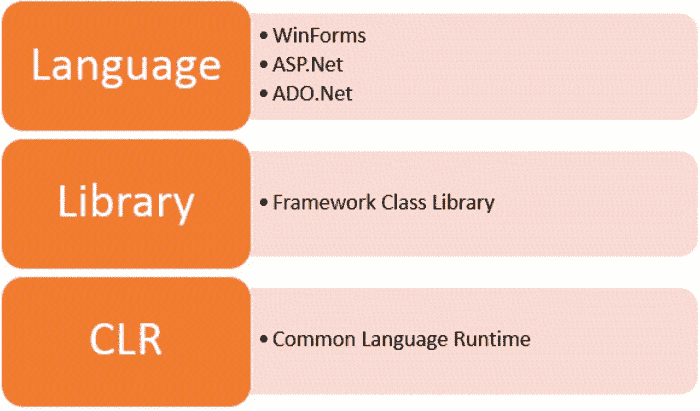

.Net 框架的架构基于以下关键组件；

- 1. **通用语言运行时** - “通用语言基础结构”或 CLI 是 .Net 程序执行的平台。

CLI 具有以下主要功能：

- **异常处理** - 异常是在应用程序执行时发生的错误。

异常的示例有：
- 如果应用程序尝试在本地计算机上打开文件，但文件不存在。
- 如果应用程序尝试从数据库获取一些记录，但数据库连接无效。

- **垃圾回收** - 垃圾回收是在不再需要时删除不需要资源的过程。

垃圾回收的示例有：
- 不再需要的 File handle。如果应用程序已完成对文件的全部操作，则可能不再需要文件句柄。
- 不再需要的数据库连接。如果应用程序已完成对数据库的全部操作，则可能不再需要数据库连接。

### 使用各种编程语言

如前一节所述，开发人员可以使用多种 .Net 编程语言开发应用程序。

- 1. **语言** - 第一层是编程语言本身，最常见的是 VB.Net 和 C#。
- 2. **编译器** – 每个编程语言都有单独的编译器。因此在 VB.Net 语言下，将有一个单独的 VB.Net 编译器。同样对于 C#，您将有另一个编译器。
- 3. **通用语言解释器** – 这是 .Net 中的最后一层，用于运行使用任何编程语言开发的 .net 程序。因此后续编译器会将程序发送到 CLI 层以运行 .Net 应用程序。

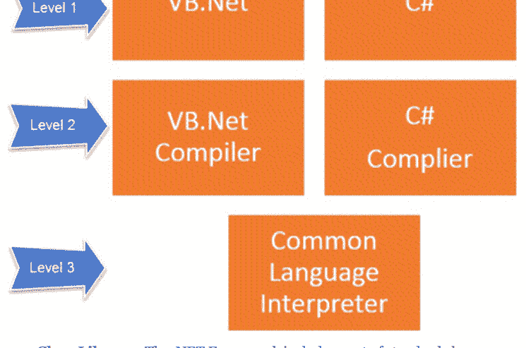

- 2. **类库** - .NET Framework 包含一组标准类库。类库是可用于核心目的的方法和函数集合。

例如，有一个类库包含处理所有文件级操作的方法。因此有一个方法可用于从文件中读取文本。同样，还有一个方法可用于向文件写入文本。

大多数方法分为 System.* 或 Microsoft.* 命名空间。（星号 * 仅表示对属于 System 或 Microsoft 命名空间下所有方法的引用）

命名空间是对方法的逻辑分离。我们将在后续章节中更详细地学习这些命名空间。

- 3. **语言** - 可在 .Net 框架中构建的应用程序类型大致分为以下几类。

- **WinForms** – 用于开发基于窗体的应用程序，这些应用程序将在终端用户机器上运行。记事本是客户端应用程序的示例。
- **ASP.Net** – 用于开发基于 Web 的应用程序，这些应用程序可在 Internet Explorer、Chrome 或 Firefox 等任何浏览器上运行。
  - Web 应用程序将在服务器上处理，该服务器已安装 Internet Information Services。
  - Internet Information Services 或 IIS 是用于执行 ASP.net 应用程序的 Microsoft 组件。
  - 执行结果随后发送到客户端机器，并在浏览器中显示输出。
- **ADO.Net** – 该技术用于开发与 Oracle 或 Microsoft SQL Server 等数据库交互的应用程序。

### .NET 框架的不同版本

下面是已发布其发布日期的 .Net 框架版本的表格。每个版本对框架都有相关更改。

例如，在 framework 3.5 及以后，发布了一个名为 **Entity framework** 的关键框架。该框架用于改变在处理数据库时开发应用程序的方法。

| 版本号 | CLR 版本 | 发布日期 |
|---|---|---|
| 1.0 | 1.0 | 2002-02-13 |
| 1.1 | 1.1 | 2003-04-24 |
| 2.0 | 2.0 | 2005-11-07 |
| 3.0 | 2.0 | 2006-11-06 |
| 3.5 | 2.0 | 2007-11-19 |
| 4.0 | 4 | 2010-04-12 |
| 4.5 | 4 | 2012-08-15 |
| 4.5.1 | 4 | 2013-10-17 |
| 4.5.2 | 4 | 2014-05-05 |
| 4.6 | 4 | 2015-07-20 |
| 4.6.1 | 4 | 2015-11-17 |

.Net 框架的最大优势在于它支持 Windows 平台。几乎每个人都使用 Windows 机器。

Microsoft 始终确保 .Net 框架符合所有受支持的 Windows 操作系统。

以下 .Net 框架的设计原则使其非常适合创建基于 .Net 的应用程序。

- 1. **互操作性** - .Net 框架提供大量向后兼容支持。假设您有一个基于较旧版本的 .Net 框架构建的应用程序，例如 2.0。如果您尝试在安装了更高版本 .Net 框架的机器上运行同一应用程序，例如 3.5。应用程序仍然可以工作。这是因为在每次发布时，Microsoft 都确保旧框架版本与最新版本良好兼容。
- 2. **可移植性** - 基于 .Net 框架构建的应用程序可以使其在任何 Windows 平台上工作。而在最近，Microsoft 也设想让 Microsoft 产品在其他平台上运行，例如 iOS 和 Linux。


3. **安全** - .NET Framework 具有良好的安全机制。内置的安全机制有助于应用程序的验证和校验。每个应用程序都可以明确定义其安全机制。每个安全机制都用于授予用户访问代码或正在运行程序的权限。

4. **内存管理** - 公共语言运行时负责所有内存管理工作。.Net 框架具有查看正在运行的程序未使用的资源的能力。然后它会相应地释放这些资源。这是通过名为“Garbage Collector”的程序完成的，该程序作为 .Net 框架的一部分运行。垃圾回收器定期运行，并不断检查哪些系统资源未被利用，并相应地释放它们。

5. **简化部署** - .Net 框架还具有工具，可用于打包基于 .Net 框架构建的应用程序。然后可以将这些包分发到客户端机器。这些包将自动安装应用程序。

### 摘要

- .Net 是由 Microsoft 开发的编程语言。它旨在构建可在 Windows 平台上运行的应用程序。
- .Net 编程语言可用于开发基于 Forms 的应用程序、基于 Web 的应用程序和 Web 服务。
- 开发人员可以从 .Net 平台上提供的各种编程语言中进行选择。最常见的是 VB.Net 和 C#。

## 第2章：下载和安装 Visual Studio

Microsoft Visual Studio 是来自 Microsoft 的集成开发环境（IDE）。它用于为 Microsoft Windows 开发计算机程序。Visual Studio 是构建在 .Net 平台上的所有应用程序的一站式商店。可以使用 Visual Studio 开发、调试和运行应用程序。

既可以设计也可以开发基于 Forms 和基于 Web 的应用程序使用此 IDE。Visual Studio 具有以下所述功能

- 1. **在任何 .Net 语言中创建应用程序** – Visual Studio IDE 可用于在任何 .Net 语言中创建应用程序。因此，开发人员可以使用 C#、VB.Net 甚至 F# 来开发应用程序。
- 2. **创建任何类型的应用程序** – Visual Studio IDE 可用于创建任何类型的应用程序。（基于 Web 的应用程序或 Windows Forms 基于的应用程序）。
- 3. **即时调试应用程序** – 应用程序可以在构建过程中进行测试。IDE 允许在开发过程的任何时间运行程序。因此，开发人员可以在开发阶段本身检查任何错误。
- 4. **扩展** – IDE 具有安装第三方扩展的功能。例如可以是 Subversion，它用于源代码存储库管理。Subversion 用于将代码上传到中央存储库。这样做是为了确保代码的副本始终存在。Visual Studio 具有从 IDE 本身集成此类软件的功能。因此，开发人员可以从 IDE 本身使用代码存储库。

让我们查看此 IDE 的安装，以便在后续章节中创建程序。Visual Studio 可以从以下链接下载 - https://www.visualstudio.com/en-us/downloads/download-visual-studio-vs.aspx

一旦您拥有 Visual Studio 安装程序，您可以使用以下所述步骤进行安装

**步骤 1)** 第一步涉及选择安装位置。在此步骤中，还必须接受许可条款和条件。

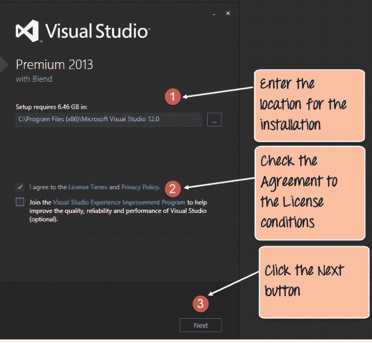

- 1. 选择 Visual Studio 应安装的位置。确保您的机器上为设置有足够的硬盘空间。
- 2. 同意许可条款和隐私政策。
- 3. 点击下一步按钮继续。

**步骤 2)** 下一步涉及在安装过程中选择所需的组件。

### Visual Studio Premium 2013
with Blend

可选功能安装：

- Blend for Visual Studio
- LightSwitch
- Microsoft Foundation Classes for C++
- Microsoft Office Developer Tools
- Microsoft SQL Server Data Tools
- Microsoft Web Developer Tools
- Tools for Maintaining Store apps for Windows 8
- Silverlight Development Kit
- Windows Phone 8.0 SDK

安装需要 C 盘 6.04 GB：

选择所需的组件

点击安装按钮。

1. 仅选择所需的组件。这可以节省安装所需的空间。以下是应安装的重要组件

- Microsoft Foundation Classes for C++
- Microsoft SQL Server Data Tools
- Microsoft Web Developer Tools

2. 之后，点击安装按钮开始安装。

安装完成后，您将看到以下显示安装成功的屏幕

### Visual Studio Premium 2013 with Blend 安装成功！

所有指定的组件均已成功安装。

LAUNCH

## 第3章：数据类型

C# 是 Microsoft 提供的用于操作 .Net 的语言之一。该语言包含丰富的特性集，可用于开发不同类型的应用程序。

C# 是一种面向对象的编程语言，并在多个方面类似于 C++ 语言。在本教程中，我们将了解如何开发我们的第一个应用程序。

这将是一个基本的控制台应用程序，然后我们将探索 C# 语言中可用的不同数据类型以及控制流语句。

### 构建第一个控制台应用程序

控制台应用程序是在 Windows 命令提示符中运行的应用程序。对于 .Net 的任何初学者来说，构建控制台应用程序理想上是开始的第一步。

在我们的示例中，我们将使用 Visual Studio 创建一个控制台类型项目。接下来，我们将使用控制台应用程序显示消息“Welcome to .Net”。然后我们将了解如何构建和运行控制台应用程序。

让我们按照以下所述步骤来实现此示例。

**步骤 1)** 第一步涉及在 Visual Studio 中创建新项目。为此，在启动 Visual Studio 后，您需要选择菜单选项 New->Project。

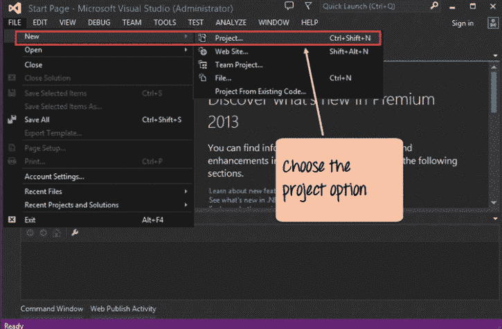

**步骤 2)** 下一步是选择项目类型为控制台应用程序。在这里，我们还需要提及项目的名称和位置。

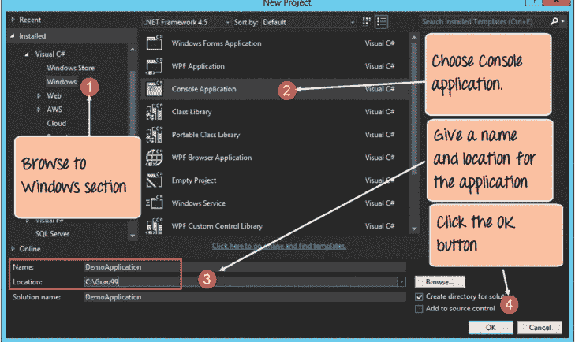

- 1. 在项目对话框中，我们可以看到在 Visual Studio 中创建不同类型项目的各种选项。点击左侧的 Windows 选项。
- 2. 当我们在上一步点击 Windows 选项时，我们将能够看到控制台应用程序的选项。点击此选项。
- 3. 然后我们为应用程序命名，在我们的例子中是 DemoApplication。我们还需要提供一个位置来存储我们的应用程序。
- 4. 最后，我们点击“确定”按钮让 Visual Studio 创建我们的项目。

如果按照上述步骤操作，您将在 Visual Studio 中得到以下输出。

**输出:-**

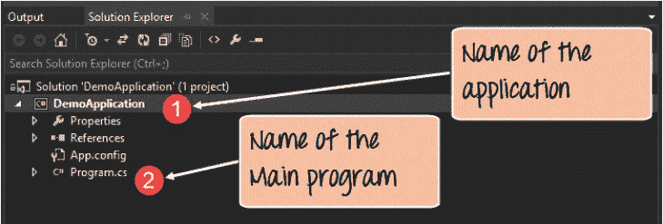

- 1. Visual Studio 中将创建一个名为“DemoApplication”的项目。此项目将包含运行控制台应用程序所需的所有必要工件。
- 2. 主程序 Program.cs 是一个默认代码文件，当在 Visual Studio 中创建新应用程序时创建。此代码将包含我们控制台应用程序所需的代码。

**步骤 3)** 现在让我们编写代码，该代码将用于在控制台应用程序中显示字符串“Welcome to .Net”。

以下所有代码都需要输入到 Program.cs 文件中。当控制台应用程序运行时，该代码将用于写入“Welcome to .Net”。

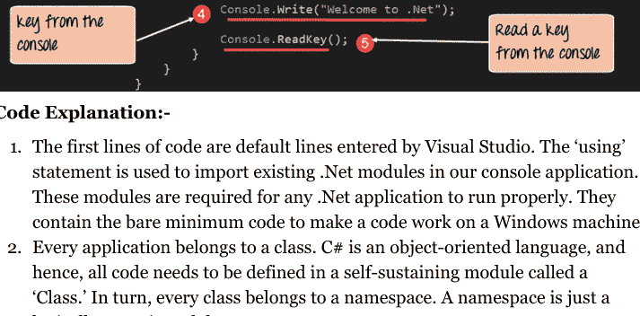

**代码说明:-**

- 1. 代码的第一行是 Visual Studio 输入的默认行。‘using’ 语句用于在我们的控制台应用程序中导入现有的 .Net 模块。这些模块是任何 .Net 应用程序正常运行所必需的。它们包含使代码在 Windows 机器上工作的最基本代码。
- 2. 每个应用程序都属于一个类。C# 是一种面向对象的语言，因此所有代码都需要定义在一个称为“类”的自包含模块中。反过来，每个类都属于一个命名空间。命名空间只是一个类的逻辑分组。
- 3. Main 函数是一个特殊函数，当控制台应用程序运行时会自动调用。在这里，您需要确保输入在控制台应用程序中显示所需字符串所需的代码。
- 4. .Net 中提供了 Console 类，允许用户操作控制台应用程序。在这里，我们使用名为“Write”的内置方法在控制台中写入字符串“Welcome to .Net”。


### 步骤 4) 运行你的 .NET 程序。

运行任何程序，你需要在 Visual Studio 中点击开始按钮。

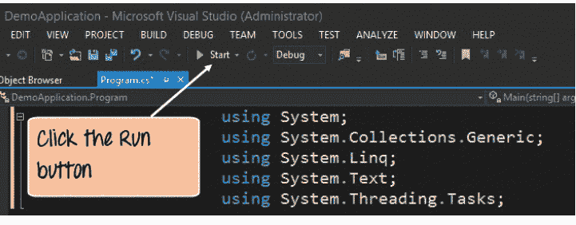

如果上述代码输入正确并且程序成功执行，将显示以下输出。

### 输出：

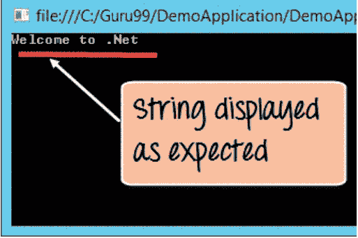

从输出中，你可以清楚地看到字符串“Welcome to .Net”已正确显示。这是因为 Console.Write 语句导致该字符串被发送到控制台。

### C# 数据类型

C# 语言附带一组基本数据类型。这些数据类型用于构建在应用程序中使用的值。让我们探索 C# 中可用的基本数据类型。对于每个示例，我们将仅修改 Program.cs 文件中的 main 函数。

- 1. **Integer** – **Integer** 数据类型用于处理数字。在这种情况下，数字是像 10、20 或 30 这样的整数。在 C# 中，数据类型由 **Int32 关键字** 表示。下面是此数据类型如何使用的示例。在我们的示例中，我们将定义一个名为 num 的 Int32 变量。然后我们将为变量分配一个 Integer 值并相应地显示它。

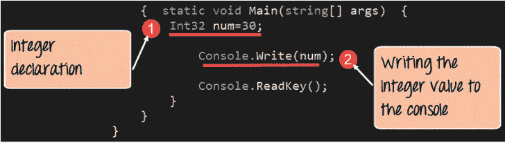

### 代码解释：

- 1. 指定 Int32 数据类型以声明一个名为 num 的 Integer 变量。然后变量被赋值为 30。
- 2. 最后使用 Console.Write 函数将数字显示到控制台。

如果上述代码输入正确并且程序成功执行，将显示以下输出。

### 输出：

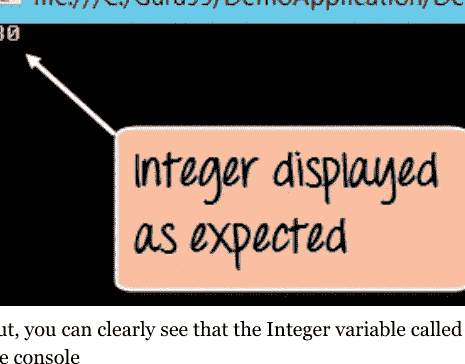

从输出中，你可以清楚地看到名为 num 的 Integer 变量已在控制台中显示。

- 2. **Double** - double 数据类型用于处理小数。在这种情况下，数字是像 10.11、20.22 或 30.33 这样的整数。在 C# 中，数据类型由关键字“**Double**”表示。下面是此数据类型的示例。

在我们的示例中，我们将定义一个名为 num 的 double 变量。然后我们将为变量分配一个 Double 值并相应地显示它。

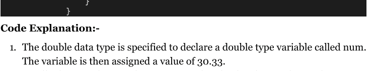

### 代码解释：

- 1. 指定 double 数据类型以声明一个名为 num 的 double 类型变量。然后变量被赋值为 30.33。
- 2. 最后使用 Console.Write 函数将数字显示到控制台。

如果上述代码输入正确并且程序成功执行，将显示以下输出。

### 输出：

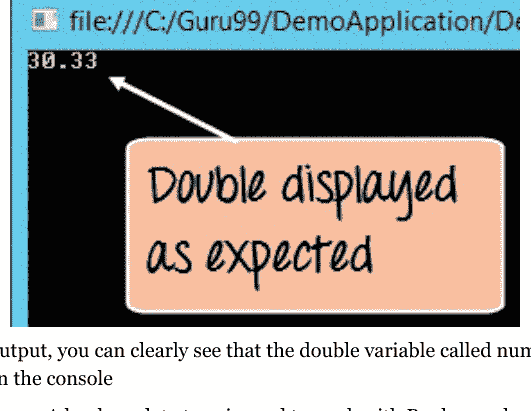

从输出中，你可以清楚地看到名为 num 的 double 变量已在控制台中显示。

- 3. **Boolean** - boolean 数据类型用于处理 **true and false** 的 Boolean 值。在 C# 中，数据类型由 Boolean 关键字表示。下面是此数据类型如何使用的示例。

在我们的示例中，我们将定义一个名为‘status’的 Boolean 变量。然后我们将为变量分配一个 boolean 值并相应地显示它。


### 代码解释：

- 1. 指定 boolean 数据类型以声明一个名为‘status’的 Boolean 变量。然后变量被赋值为 true/false。
- 2. 最后使用 Console.Write 函数将 Boolean 值显示到控制台。

如果上述代码输入正确并且程序成功执行，将显示输出。

### 输出：

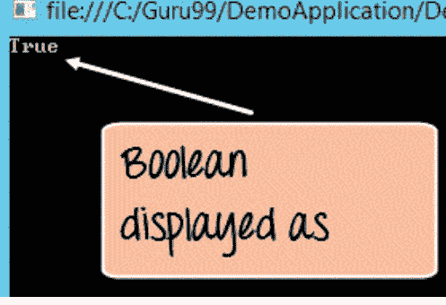

从输出中，你可以清楚地看到等于 true 的 Boolean 变量已在控制台中显示。

- 4. **String** - String 数据类型用于处理 String 值。在 C# 中，数据类型由关键字‘String’表示。下面是此数据类型的示例。

在我们的示例中，我们将定义一个名为‘message’的 String 变量。然后我们将为变量分配一个 String 值并相应地显示它。

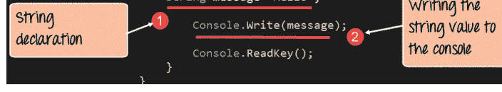

### 代码解释：

- 1. 指定 String 数据类型以声明一个名为 message 的 string 变量。然后变量被赋值为“Hello”。
- 2. 最后，使用 Console.Write 函数将 string 值显示到控制台。

如果上述代码输入正确并且程序成功执行，将显示输出。

### 输出：

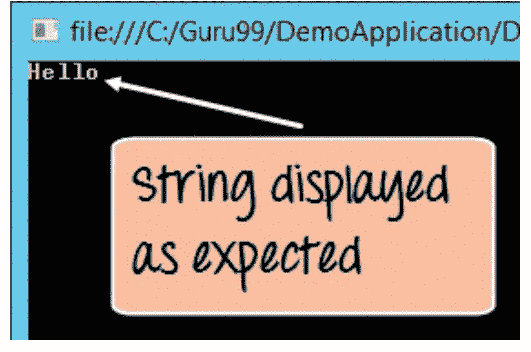

从输出中，你可以清楚地看到名为 message 的 String 变量已在控制台中显示。

### C# 枚举

枚举在任何编程语言中都用于定义一组常量值。例如，一周中的天数可以定义为枚举并在程序中的任何地方使用。在 C# 中，枚举是借助关键字‘enum’定义的。

让我们看一个如何使用‘enum’关键字的示例。

在我们的示例中，我们将定义一个名为 days 的枚举，用于存储一周中的天数。对于每个示例，我们将仅修改 Program.cs 文件中的 main 函数。

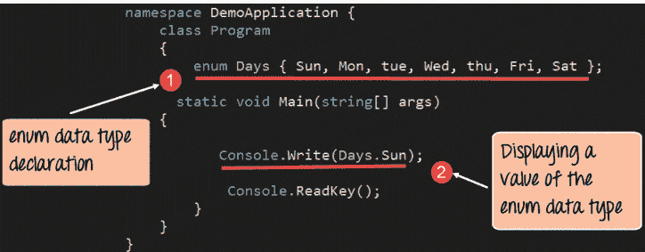

### 代码解释：

- 1. 指定‘enum’数据类型以声明一个枚举。枚举的名称为 Days。所有一周中的天数都被指定为枚举的值。
- 2. 最后使用 Console.Write 函数显示枚举的一个值。

如果上述代码输入正确并且程序成功执行，将显示以下输出。

### 输出：

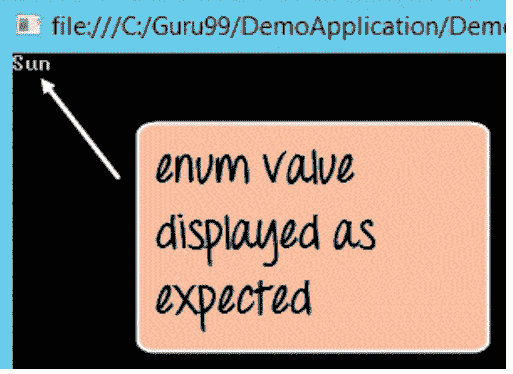

从输出中，你可以清楚地看到枚举的‘Sun’值已在控制台中显示。

### C# 运算符和变量

变量是赋予存储区域的名称，该存储区域用于存储各种数据类型的数值。C# 中的每个变量都需要有一个特定的类型，该类型决定了变量内存的大小和布局。

例如，变量可以是 String 类型，这意味着它将用于存储字符串值。基于数据类型，可以对变量执行特定操作。

例如，如果我们有一个 Integer 变量，那么可以对该变量执行加法和减法等操作。可以在程序中声明多个变量。

让我们看一个关于声明不同数据类型的多个变量的快速示例。

在我们的示例中，我们将定义 2 个变量，一个是‘string’类型，另一个是‘Integer’类型。然后我们将把这些变量的值显示到控制台。对于每个示例，我们将仅修改 Program.cs 文件中的 main 函数。

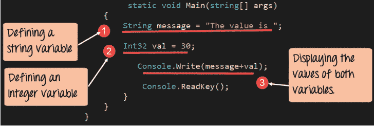

```csharp
static void Main(string[] args)
{
    String message = "The value is ";
    Int32 val = 30;
    Console.Write(message+val);
    Console.ReadKey();
}
```

### 代码解释：

- 1. 声明了一个 String 数据类型的变量。变量的名称是‘message’。变量的值是 "The value is "。
- 2. 声明了一个 Integer (Int32) 数据类型的变量。变量的名称是‘val’。变量的值是 30。
- 3. 最后使用 Console.Write 语句输出 String 和 Integer 变量的值。

如果上述代码输入正确并且程序成功执行，将显示以下输出。

### 输出：

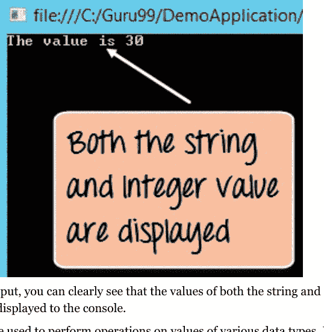

从输出中，你可以清楚地看到 string 和 integer 变量的值都已显示到控制台。

运算符用于对各种数据类型的数值执行操作。例如，要执行 2 个数字的加法，使用 + 运算符。

让我们看看各种数据类型可用的运算符表。

- 1. **Arithmetic Operators** – 这些是用于对数字执行数学运算的运算符。下面是 C# 中可用的运算符列表。

| 运算符 | 描述 |
|---|---|
| + | 将两个操作数相加 |
| - | 从第一个操作数中减去第二个操作数 |
| * | 将两个操作数相乘 |
| / | 用分母除分子 |
| % | 取模运算符和整数除法后的余数 |
| ++ | 自增运算符将整数值增加一 |
| -- | 自减运算符将整数值减少一 |


### 2. 关系运算符

这些是用于对数字执行关系运算的运算符。下面是 C# 中可用的关系运算符列表。

| 运算符 | 描述 |
|---|---|
| == | 检查两个操作数的值是否相等，如果相等则条件为真。 |
| != | 检查两个操作数的值是否不相等，如果值不相等则条件为真。 |
| > | 检查左操作数的值是否大于右操作数的值，如果是则条件为真。 |
| < | 检查左操作数的值是否小于右操作数的值，如果是则条件为真。 |
| >= | 检查左操作数的值是否大于或等于右操作数的值，如果是则条件为真。 |
| <= | 检查左操作数的值是否小于或等于右操作数的值，如果是则条件为真。 |

### 3. 逻辑运算符

这些是用于对值执行逻辑运算的运算符。下面是 C# 中可用的运算符列表。

| 运算符 | 描述 |
|---|---|
| && | 这是逻辑与运算符。如果两个操作数都为真，则条件为真。 |
| || | 这是逻辑或运算符。如果任一操作数为真，则条件为真。 |
| ! | 这是逻辑非运算符。 |

让我们看一个快速示例，了解这些运算符如何在 .Net 中使用。

在我们的示例中，我们将定义 2 个整数变量和一个布尔变量。然后我们将执行以下操作


### 代码说明:-

- 1. 定义了两个整数变量，一个是 val1，另一个是 val2。它们将用于展示关系运算和算术运算。还定义了一个布尔变量以展示逻辑运算。
- 2. 展示了算术运算的示例，其中对 val1 和 val2 执行了加法运算符。结果写入控制台。
- 3. 展示了关系运算的示例，其中对 val1 和 val2 执行了小于运算符。结果写入控制台。
- 4. 展示了逻辑运算的示例，其中逻辑运算符 (!) 应用于 status 变量。逻辑非运算符会反转任何布尔值的当前值。因此，如果布尔值为‘true’，逻辑非将返回值为‘false’，反之亦然。在我们的例子中，由于 status 变量的值为‘true’，结果将显示‘false’。结果写入控制台。

如果上述代码正确输入并且程序成功执行，则会显示输出。

### 输出：


### 流程控制和条件语句

流程控制和条件语句在任何编程语言中都可用，以改变程序的流程。

例如，如果某人希望根据某种特定逻辑仅执行一组特定的语句，则流程控制和条件语句将很有用。

在我们介绍 C# 中可用的各种语句时，您将获得更好的理解。

请注意，下面所有的代码都写入 Program.cs 文件。

- 1. **If 语句** – if 语句用于在执行一组语句之前评估布尔表达式。如果表达式求值为 true，则运行一组语句，否则运行另一组语句。

在下面的示例中，对名为 value 的变量进行了比较。如果变量的值小于 10 ，则它将运行一条语句，否则将运行另一条语句。

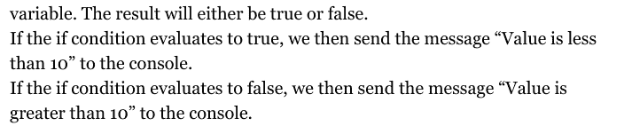

### 代码说明:-

- 1. 我们首先定义一个名为 value 的变量并将其设置为 11。
- 2. 然后我们使用 ‘if’ 语句检查变量的值是否小于 10。结果将为 true 或 false。
- 3. 如果 if 条件求值为 true，我们则向控制台发送消息“Value is less than 10”。
- 4. 如果 if 条件求值为 false，我们则向控制台发送消息“Value is greater than 10”。

如果上述代码正确输入并且程序成功执行，将显示以下输出。

### 输出：

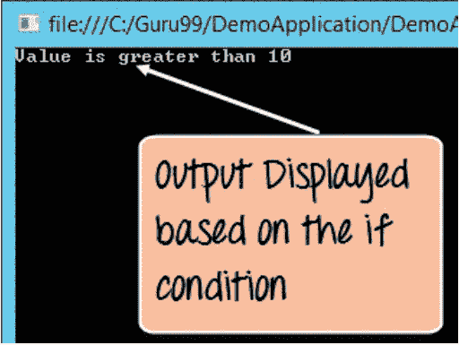

我们可以清楚地看到 ‘if’ 语句被求值为 false。因此消息“Value is greater than 10”被发送到控制台。

- 2. **Switch 语句** – switch 语句是对 ‘if’ 语句的增强。如果您有多个需要在一次评估的表达式，那么编写多个 ‘if’ 语句就会成为问题。

switch 语句用于评估表达式并根据表达式的结果运行不同的语句。如果一个条件未求值为 true，switch 语句将然后移动到下一个条件，依此类推。

让我们通过下面的示例看看这是如何工作的。这里，我们再次比较名为 ‘value’ 的变量的值。我们然后检查该值是否等于 1，或 2，或完全不同的值。

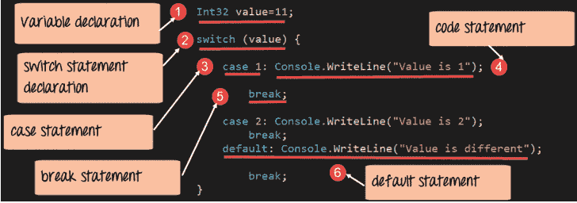

### 代码说明:-

- 1. 我们首先定义一个名为 ‘value’ 的变量并将其设置为 11。
- 2. 然后我们使用 ‘switch’ 语句检查变量 ‘value’ 的值。
- 3. Case 语句用于设置不同的条件。根据条件，可以执行一组语句。switch 语句可以有多个 case 条件。第一个 case 语句检查变量的值是否等于 1。
- 4. 如果第一个 case 语句为真，则消息“Value is 1”写入控制台。
- 5. break 语句用于在条件为真后退出整个 switch 语句。
- 6. default 条件是一个特殊条件。这只是意味着如果没有 case 表达式求值为真，则运行 default 条件的一组语句。

如果上述代码正确输入并且程序成功执行，将显示以下输出。输出打印默认值“Value is different”，因为没有条件得到满足。

### 输出：

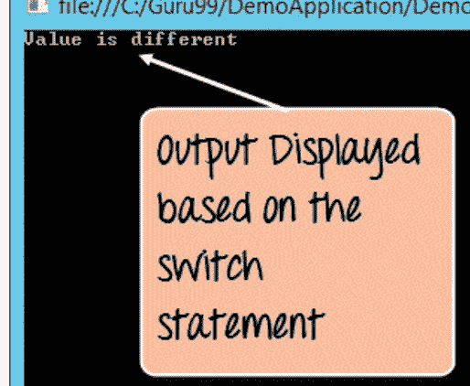

- 3. **While 循环** – while 循环用于迭代目的。假设如果您想重复执行一组语句特定次数，则使用 while 循环。

在下面的示例中，我们使用 while 语句显示变量 ‘i’ 的值。while 语句用于显示该值 3 次。

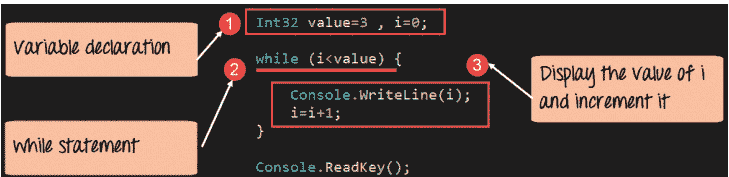

### 代码说明:-

- 1. 定义了两个整数变量，一个是 value，另一个是 ‘i’。value 变量用作我们 while 语句迭代的上界。而 ‘i’ 是在迭代过程中处理的变量。
- 2. 在 while 语句中，‘i’ 的值会不断与上界进行比较。
- 3. 在这里我们将 ‘i’ 的值显示到控制台。我们还递增 ‘i’ 的值。

如果上述代码正确输入并且程序成功执行，将显示以下输出。

### 输出：

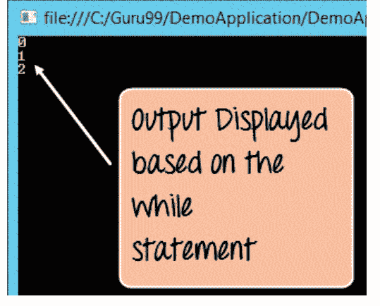

在这里您可以看到 while 语句执行了 3 次并同时递增。并且每次都显示变量 ‘i’ 的当前值。

- 4. For 循环 - ‘for’ 循环也用于迭代目的。假设如果您想重复执行一组语句特定次数，则使用 for 循环。

在下面的示例中，我们使用 ‘for’ 语句显示变量 ‘i’ 的值。‘for’ 语句用于显示该值 3 次。

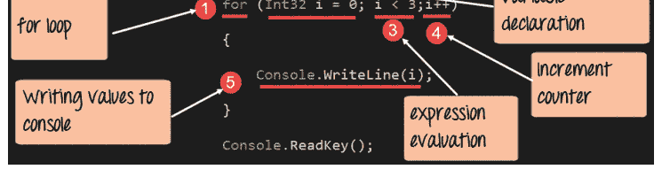

### 代码说明:-

- 1. ‘for’ 关键字用于开始 ‘for loop’ 语句。


- 2. 在 ‘for 循环’ 中，我们定义了 3 件事。第一件事是初始化一个变量的值，该变量将在 ‘for 循环’ 中使用。
- 3. 第二件事是将 ‘i’ 的值与一个上限进行比较。在我们的例子中，上限的值为 3 (i<3)。
- 4. 最后，我们相应地递增 ‘i’ 的值。
- 5. 在这里我们将 ‘i’ 的值显示到控制台。

如果上述代码正确输入并且程序成功执行，将显示以下输出。

### 输出：

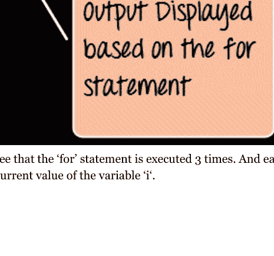

这里可以看到 ‘for’ 语句被执行了 3 次。每次都会显示变量 ‘i’ 的当前值。

### C# 数组

数组用于存储一组或一系列元素。这些元素将是相同类型的。

例如，如果你有一个 Integer 值数组，该数组可以是 [1, 2, 3, 4] 这样的值集合。这里数组中的元素数量为 4。

当你想要存储相同类型的值集合时，数组很有用。因此，不必为每个元素声明一个变量，你只需声明一个变量即可。

这个变量将指向一个数组或元素列表，该数组/列表负责存储数组的元素。

让我们看看如何在 C# 中使用数组。在我们的示例中，我们将声明一个 Integers 数组并相应地使用它们。

请注意，下面所有的代码都添加到 Program.cs 文件中。

### Step 1) 声明数组 – 第一步是声明一个数组。让我们通过下面的代码示例看看如何实现这一点。

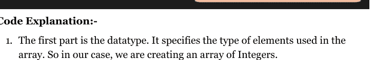

### 代码解释：

- 1. 第一部分是数据类型。它指定了数组中使用的元素的类型。因此，在我们的例子中，我们正在创建一个 Integers 数组。
- 2. 第二部分 []，它指定了数组的秩。（秩是一个占位符，指定数组将包含的元素数量）
- 3. 接下来是数组的名称，在我们的例子中是 ‘values’。请注意你会看到一条绿色波浪下划线，不用担心。那只是 .Net 在告诉你你声明了一个数组，但没有在任何地方使用它。

### Step 2) 下一步是初始化数组。在这里我们将指定数组将保存的值的数量。我们还将为数组的每个元素分配值。

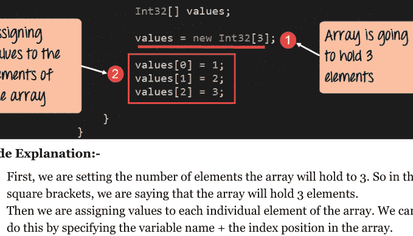

### 代码解释：

- 1. 首先，我们将数组将保存的元素数量设置为 3。因此在方括号中，我们表示数组将保存 3 个元素。
- 2. 然后我们为数组的每个单独元素分配值。我们可以通过指定变量名 + 数组中的索引位置来实现这一点。

因此 values[0] 表示我们将一个值存储在数组的第一个位置。类似地，要访问第二个位置，我们使用 values[1] 的表示法，以此类推。

注意：在数组中，索引位置从 0 开始。

### Step 3) 现在让我们在控制台中显示数组的各个元素。

让我们添加下面的代码来实现这一点。

```csharp
values = new Int32[3];

values[0] = 1;
values[1] = 2;
values[2] = 3;

Console.WriteLine(values[0]);
Console.WriteLine(values[1]);
Console.WriteLine(values[2]);

Console.ReadKey();
```

> 使用 Console.WriteLine 将每个元素值发送到控制台

### 代码解释：

这是简单部分，我们只需使用 Console.Write 方法将每个元素的值发送到控制台。

请注意，我们再次借助数组变量名以及索引位置来访问每个元素。

如果上述代码正确输入并且程序执行，下列输出将被显示。

### 输出：


从输出中，你可以看到数组的所有值都显示在控制台中。

### 摘要

- 控制台应用程序是可以让它在 Windows 机器上的命令提示符下运行的应用程序。
- Console.Write 方法可用于向控制台写入内容。
- C# 中可用的基本数据类型是 Integer、Double、Boolean 和 String。
- 枚举用于声明一组常量值。在 C# 中，枚举使用 enum 关键字声明。
- C# 中可用的各种运算符大致分为算术、关系和逻辑运算符几类。
- 变量用于指向包含特定数据类型值的内存位置。
- 数组用于存储相同类型的元素。数组的各个元素可以被赋予值。

## 第4章：类和对象

C# 基于 C++ 编程语言。因此，C# 编程语言内置了对类和对象的支持。类只不过是对属性和方法的一种封装，这些属性和方法用于表示实时实体。

例如，如果你想在一个特定应用程序中处理员工数据。

员工的属性将是员工的 ID 和姓名。方法将包括员工数据的录入和修改。

所有这些操作都可以用 C# 中的一个类来表示。在本章中，我们将更详细地了解如何在 C# 中使用类和对象。

### 什么是类和对象

让我们先从类开始。

正如我们之前讨论的，类是对 **数据属性** 和 **数据方法** 的封装。

- 属性用于描述类将保存的数据。
- 方法说明可以在数据上执行哪些操作。

为了更好地理解类和对象，让我们看一下下面一个类的示例。

类的名称是 “Tutorial”。该类具有以下属性

- 1. **Tutorial ID** – 这将用于存储一个唯一数字，该数字代表教程。
- 2. **Tutorial Name** – 这将用于将教程名称存储为字符串。

类还包含方法。我们的类具有以下方法，

- 1. **SetTutorial** – 此方法将用于设置教程的 ID 和名称。例如，如果我们想为 .Net 创建一个教程，我们可能会为此创建一个对象。该对象的 ID 设为 1。其次，我们将把 “.Net” 指定为教程的名称。ID 值 1 和名称 “.Net” 将作为对象的属性存储。
- 2. **GetTutorial** - 此方法将用于获取特定教程的详细信息。因此，如果我们想获取教程的名称，此方法将返回字符串 “.Net”。

### Tutorial 类

- 属性
  - TutorialID
  - TutorialName
- 方法
  - SetTutorial
  - GetTutorial

下面是我们的 Tutorial 类中一个对象可能的样子。我们有 3 个对象，每个对象都有各自的 TutorialID 和 TutorialName。

| TutorialObject1 | TutorialObject2 | TutorialObject3 |
| --- | --- | --- |
| TutorialID = 1<br>TutorialName = C# | TutorialID = 2<br>TutorialName = ASP.Net | TutorialID = 3<br>TutorialName = VB.Net |

现在让我们进入 Visual Studio 创建我们的类。我们将基于我们在上一章中创建的现有控制台应用程序进行构建。我们将在 Visual Studio 中为当前应用程序创建一个类。

让我们按照下面提到的步骤来实现此示例。

### Step 1)

第一步涉及在现有应用程序内创建一个新类。这借助 Visual Studio 完成。

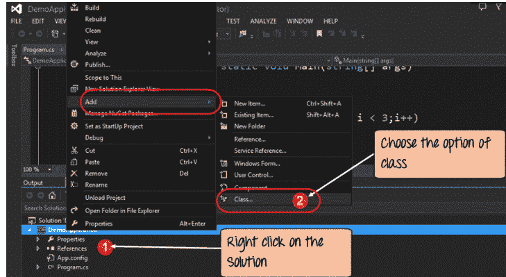

- 1. 第一步是在解决方案上右键单击，在我们的例子中是 ‘DemoApplication’。这将弹出一个包含选项列表的上下文菜单。
- 2. 从上下文菜单中选择 Add->Class 选项。这将提供向现有项目添加类的选项。

### Step 2)

下一步是为类提供名称并将其添加到我们的解决方案中。

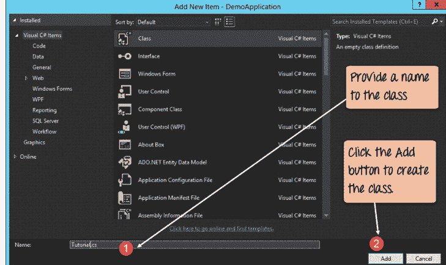


- 1. 在项目对话框中，我们首先需要为我们的类提供一个名称。让我们为我们的类提供名称 Tutorial.cs 为我们的类。请注意，文件名应以 .cs 结尾，以确保它被视为一个正确的类文件。
- 2. 当我们点击“添加”按钮时，该类将被添加到我们的解决方案中。

如果按照上述步骤操作，您将在 Visual Studio 中得到以下输出。

### Output

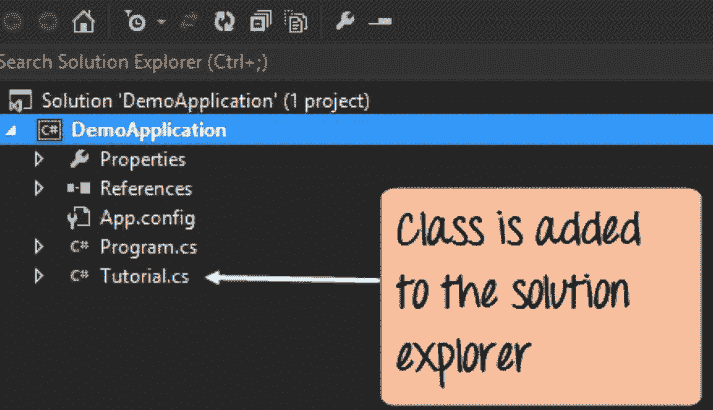

类名 Tutorial.cs 将被添加到解决方案中。如果打开该文件，您会发现以下代码已添加到类文件中。

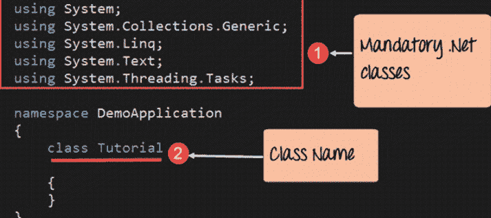

### Code Explanation

- 1. 第 1 部分包含 Visual Studio 添加到任何 .Net 文件的强制性模块。这些模块始终是必需的，以确保任何 .Net 程序在 Windows 环境中运行。
- 2. 第 2 部分是添加到文件中的类。在我们的例子中，类名是‘Tutorial’。这是添加类到解决方案时指定的名称。

目前，我们的类文件没有任何作用。在以下主题中，我们将更详细地了解如何使用该类。

### Fields and methods

我们已经在之前的主题中了解了如何在类中定义字段和方法。

对于我们的 Tutorial 类，我们可以具有以下属性。

- 1. Tutorial ID – 这将用于存储代表教程的唯一数字。
- 2. Tutorial Name – 这将用于将教程名称存储为字符串。

我们的 Tutorial 类也可以具有下面提到的以下方法。

- 1. SetTutorial – 此方法将用于设置教程的 ID 和名称。
- 2. GetTutorial – 此方法将用于获取特定教程的详细信息。

现在让我们看看如何在代码中加入字段和方法。

**Step 1)** 第一步是确保 Tutorial 类具有正确的字段和方法定义。在此步骤中，我们将以下代码添加到 Tutorial.cs 文件中。

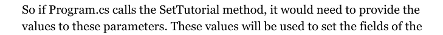

### Code Explanation

- 1. 第一步是将 TutorialID 和 TutorialName 字段添加到类文件中。由于 TutorialID 字段将是一个数字，我们将其定义为 Integer，而 TutorialName 将定义为 string。
- 2. 接下来，我们定义 SetTutorial 方法。此方法接受 2 个参数。因此，如果 Program.cs 调用 SetTutorial 方法，则需要为这些参数提供值。这些值将用于设置 Tutorial 对象的字段。
  
  **Note:** 让我们举一个例子并假设我们的 Program.cs 文件使用参数“1”和“.Net”调用 SetTutorial。由此将执行以下步骤：
  
  - a. pID 的值将变为 1。
  - b. pName 的值将为 .Net。
  - c. 在 SetTutorial 方法中，这些值随后将被传递给 TutorialID 和 TutorialName。
  - d. 因此现在 TutorialID 的值将为 1，TutorialName 的值将为“.Net”。
- 3. 在这里我们将 Tutorial 类的字段相应地设置为参数。因此我们将 TutorialID 设置为 pID，将 TutorialName 设置为 pName。
- 4. 然后我们定义 GetTutorial 方法以返回类型为“String”的值。此方法将用于将 TutorialName 返回给调用程序。同样，您也可以使用方法 `int GetTutorial` 获取教程 ID。
- 5. 在这里我们将 TutorialName 字段的值返回给调用程序。

**Step 2)** 现在让我们向 Program.cs 添加代码，这是我们的控制台应用程序。

控制台应用程序将用于创建“Tutorial class”的对象并相应地调用 SetTutorial 和 GetTutorial 方法。

(**Note:** 对象是任何给定时间类的一个实例。类与对象之间的区别在于对象实际上包含属性的值。)

```csharp
static void Main(string[] args)
{
    Tutorial pTutor = new Tutorial();
    pTutor.SetTutorial(1, ".Net");
    Console.WriteLine(pTutor.GetTutorial());
    Console.ReadKey();
}
```

### Code Explanation

- 1. 第一步是为 Tutorial 类创建对象。请注意，这是通过使用关键字‘new’完成的。‘new’关键字用于在 C# 中从类创建对象。然后对象被分配给 pTutor 变量。
- 2. 然后调用 SetTutorial 方法。参数 1 和“.Net”被传递给 SetTutorial 方法。然后这些参数将用于相应地设置类的“TutorialID”和“TutorialName”字段。
- 3. 然后我们使用 Tutorial 类的 GetTutorial 方法获取 TutorialName。然后通过 Console.WriteLine 方法将其显示到控制台。

如果正确输入上述代码并运行程序，将显示以下输出。

### Output

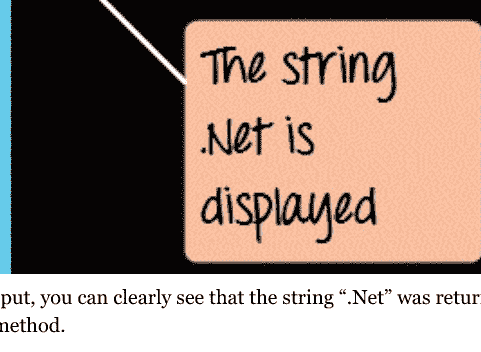

从输出中，您可以清楚地看到字符串“.Net”是由 GetTutorial 方法返回的。

### Access Modifiers

访问修饰符用于定义类属性或方法的可见性。有时您可能不希望其他程序看到类的属性或方法。在这种情况下，C# 提供了在类属性和方法上放置修饰符的能力。类修饰符能够限制访问，以使其他程序无法看到类的属性或方法。

通常有 3 种类型的访问修饰符。它们在下面进行解释。

- 1. **Private** – 当此访问修饰符附加到属性或方法时，表示这些成员无法从任何外部程序访问。
  
  让我们举一个例子，看看使用 private 访问修饰符时会发生什么。
  
  让我们修改 Tutorial.cs 文件中的当前代码。在 SetTutorial 方法中，让我们将 public 关键字更改为 private。
  
  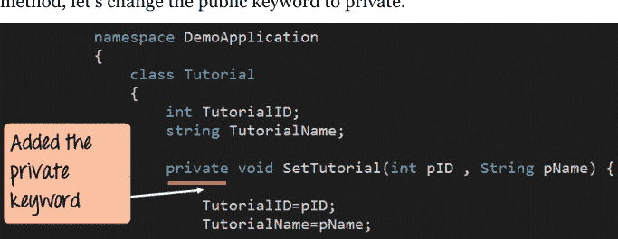
  
  现在让我们切换到 Program.cs 文件。您会注意到 SetTutorial 方法下方有一条红色波浪线。
  
  由于我们现在已在 Tutorial 类中将 SetTutorial 方法声明为 private，Visual Studio 已检测到这一点。它通过突出显示告诉用户，现在此方法将无法从 Program.cs 文件中使用。
  
  ```csharp
  {
      static void Main(string[] args)
      {
          Tutorial pTutor = new Tutorial();
          pTutor.SetTutorial(1, ".Net");
          Console.WriteLine(pTutor.GetTutorial());
          Console.ReadKey();
      }
  }
  ```
- 2. **Public** – 当此访问修饰符附加到属性或方法时，表示这些成员可以从任何外部程序访问。我们在之前的示例中已经看到过这一点。
  
  ```csharp
  int TutorialID;
  string TutorialName;
  
  public void SetTutorial(int pID , String pName) {
      TutorialID=pID;
      TutorialName=pName;
  }
  public String GetTutorial()
  {
  ```
  
  由于我们在 Tutorial 类中将方法定义为 public，因此它们可以从 Program.cs 文件中访问。
- 3. **Protected** – 当此访问修饰符附加到属性或方法时，表示这些成员只能由从当前类继承的类访问。这将在继承类中更详细地解释。

### C# Constructor

构造函数用于在创建相应对象时初始化类字段的值。构造函数是一个与类同名的方法。如果在类中定义了构造函数，那么它将在创建对象时被调用的第一个方法。假设我们有一个名为 Employee 的类。构造函数方法也将命名为 Employee()。

关于构造函数方法需要注意以下关键事项：

- 1. 构造函数的访问修饰符需要设为 public。
- 2. 构造函数方法不应有返回类型。

现在让我们看看如何在代码中加入构造函数的用法。我们将使用构造函数在创建对象时将 TutorialID 和 TutorialName 字段初始化为一些默认值。

**Step 1)** 第一步是为我们的 Tutorial 类创建构造函数。在此步骤中，我们将以下代码添加到 Tutorial.cs 文件中。

```csharp
namespace DemoApplication
{
    public class Tutorial
    {
        int TutorialID;
        string TutorialName;
        public Tutorial() {
            TutorialID = 0;
            TutorialName = "Default";
        }
        public void SetTutorial(int pID , String pName) {
            TutorialID=pID;
            TutorialName=pName;
        }
    }
}
```

### Code Explanation

- 1. 我们首先添加一个与类同名的新方法。因为它与类同名，所以 C# 将其视为构造函数方法。因此，现在每当调用方法创建此类的对象时，此方法将默认被调用。


2. 在 Tutorial 构造函数中，我们将 TutorialID 的值设置为 0，将 TutorialName 设置为“Default”。因此，每当创建对象时，这些字段将始终具有这些默认值。

现在让我们切换到 Program.cs 文件，并删除调用 SetTutorial 方法的那一行。这是因为我们只想看看构造函数的工作方式。

```csharp
static void Main(string[] args)
{
    Tutorial pTutor = new Tutorial();
    Console.WriteLine(pTutor.GetTutorial());
    Console.ReadKey();
}
```

### 代码说明:-

- 1. 第一步是为 Tutorial 类创建对象。这是通过 ‘new’ 关键字完成的。
- 2. 我们使用 Tutorial 类的 GetTutorial 方法获取 TutorialName。然后通过 Console.WriteLine 方法将其显示到控制台。

如果上述代码正确输入并执行程序，将显示以下输出。

### 输出：


从输出中，我们可以看到构造函数确实被调用了，并且 TutorialName 的值被设置为“Default”。

**注意：** 这里的值“default”是从构造函数获取的。

### C# 继承

继承是 C# 中的一个重要概念。继承是一个概念，其中你定义父类和子类。

子类继承父类的方法和属性，但同时，如果需要，它们也可以修改方法的行为。子类如果需要也可以定义自己的方法。

如果你看到这个操作，你会更好地理解。

现在让我们看看如何在代码中体现继承的概念。

步骤 1) 第一步是更改我们的 Tutorial 类的代码。在此步骤中，我们将以下代码添加到 Tutorial.cs 文件中。

```csharp
namespace DemoApplication
{
    public class Tutorial
    {
        protected int TutorialID;
        protected string TutorialName;

        public void SetTutorial(int pID , String pName) {
            TutorialID=pID;
            TutorialName=pName;
        }
    }
}
```

将字段标记为 protected。

请注意，我们现在需要将 ‘protected’ 访问修饰符添加到 TutorialID 和 TutorialName 字段。

请记住我们在《访问修饰符》章节中提到过这个访问修饰符。嗯，在这里你可以看到它的用途。只有当你拥有这个访问修饰符（protected）时，子类才能使用父类的字段。

步骤 2) 第二步是添加我们的新子类。此类的名称将为“Guru99Tutorial”。在此步骤中，我们将以下代码添加到 Tutorial.cs 文件中。代码应放在 Tutorial 类定义之后。

```csharp
public class Guru99Tutorial : Tutorial
{
    public void RenameTutorial(String pNewName)
    {
        TutorialName = pNewName;
    }
}
```

定义子类

子类方法

将字段 TutorialName 设置为新名称

### 代码说明:-

- 1. 第一步是创建 Guru99Tutorial 子类。我们还需要说明这个类将是 Tutorial 类的子类。这是通过 ':' 关键字完成的。
- 2. 接下来，我们定义一个名为 RenameTutorial 的方法。它将用于重命名 TutorialName 字段。该方法接受一个字符串变量，其中包含 Tutorial 的新名称。
- 3. 然后我们将参数 pNewName 分配给 TutorialName 字段。

注意：- 即使我们在“Guru99Tutorial”类中没有定义 TutorialName 字段，我们仍然可以访问此字段。这是因为“Guru99Tutorial”是 Tutorial 类的子类。而且因为我们将 Tutorial 类的字段设为 protected，所以该类可以访问它们。

步骤 3) 最后一步是修改我们的主 Program.cs 文件。在我们的控制台应用程序中，我们将创建一个 Guru99Tutorial 类的对象。通过此对象，我们将调用 RenameTutorial 方法。然后我们将借助 GetTutorial 方法显示 TutorialName 字段。

```csharp
class Program
{
    static void Main(string[] args)
    {
        Guru99Tutorial pTutor = new Guru99Tutorial();
        pTutor.RenameTutorial(".Net by Guru99");
        Console.WriteLine(pTutor.GetTutorial());
        Console.ReadKey();
    }
}
```

### 代码说明:-

- 1. 第一步是为 Guru99Tutorial 类创建对象。这是通过 'new' 关键字完成的。请注意，这次我们没有创建 Tutorial 类的对象。
- 2. 我们使用 Guru99Tutorial 类的 RenameTutorial 方法来更改 TutorialName 字段。我们将字符串“.Net by Guru99”传递给 RenameTutorial 方法。
- 3. 然后我们调用 GetTutorial 方法。请注意，即使此方法未在 Guru99Tutorial 类中定义，我们仍然可以访问此方法。然后通过 Console.WriteLine 方法将 GetTutorial 方法的输出显示到控制台。

如果上述代码正确输入并且程序成功执行，将显示以下输出。

### 输出：

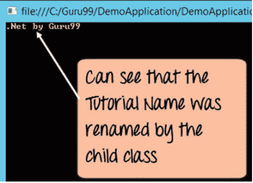

从输出中，我们可以清楚地看到 TutorialName 字段已被重命名为“.Net by Guru99”。这是由子类调用的 RenameTutorial 方法实现的。

### C# 多态

多态是一个概念，其中方法可以被定义多次。但每次，函数都会有不同的参数集传递给它。

如果你看到这个操作，你会更好地理解。

现在让我们看看，如何在代码中体现多态的概念。

**步骤 1)** 第一步是更改我们的 Tutorial 类的代码。在此步骤中，我们将以下代码添加到 Tutorial.cs 文件中。

```csharp
public void SetTutorial(int pID, String pName)
{
    TutorialID = pID;
    TutorialName = pName;
}

public void SetTutorial(String pName)
{
    TutorialName = pName;
}
```

### 代码说明:-

1 & 2) 第一步与我们之前的示例相同。我们保持 SetTutorial 方法的定义不变。

3) 此方法根据参数 pID 和 pName 设置 TutorialID 和 TutorialName。

4) 这是我们对类进行更改的地方，其中我们添加了一个名为 SetTutorial 的新方法。只有这次我们只传递一个参数，即 pName。在此方法中，我们只是将 TutorialName 字段设置为 pName。

**步骤 2)** 最后一步是修改我们的主 Program.cs 文件。在我们的控制台应用程序中，我们将创建一个 Guru99Tutorial 类的对象。

```csharp
static void Main(string[] args)
{
    Tutorial pTutor = new Tutorial();

    pTutor.SetTutorial(1, "First Tutorial");
    Console.WriteLine(pTutor.GetTutorial());

    pTutor.SetTutorial("Second Tutorial");
    Console.WriteLine(pTutor.GetTutorial());

    Console.ReadKey();
}
```

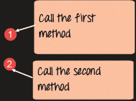

### 代码说明:-

- 1. 在第一步中，我们使用带有 2 个参数的 SetTutorial 方法。我们将 TutorialID 和 TutorialName 都传递给此方法。
- 2. 在第二步中，我们现在使用只有一个参数调用 SetTutorial 方法。我们只是将 TutorialName 传递给此方法。

如果上述代码正确输入并且程序运行，将显示以下输出。如果您还想同时获取 Tutorial ID 和 Tutorial Name，您应按照以下步骤操作

- 1. 创建一个单独的方法，名为 public int GetTutorialID
- 2. 在该方法中写入代码行“return TutorialID.”。这可用于将 TutorialID 返回给调用程序。

### 输出：

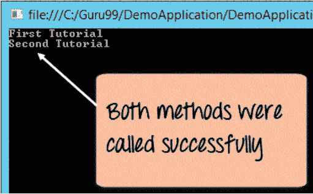

从输出中，我们可以清楚地看到两个方法都成功调用了。因此，字符串“First Tutorial”和“Second Tutorial”被发送到控制台。


### C# 抽象类

抽象类用于定义所谓的基类。基类是对某一特定需求具有最基本定义的类。

下面给出了抽象类的一个典型示例。下面是一个名为“Animal”的类的定义。在定义“Animal”类时，关于这种动物是什么（是狗还是猫）一无所知。名为 description 的方法只是为该类定义的通用方法。

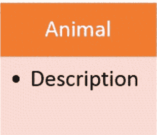

现在，当确切知道 Animal 将是什么时，我们创建另一个继承该基类的类。如果我们知道这种动物实际上是 Dog，就创建继承主基类的 Dog 类。这里的关键区别在于，Dog 类不能更改 Animal 类的 Description 方法的定义。它必须定义自己的名为 Dog-Description 的方法。这就是抽象类的基本概念。

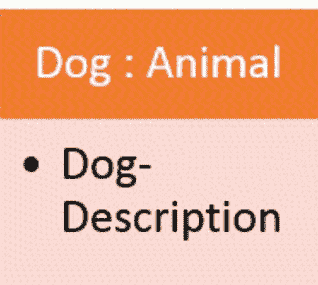

让我们看看如何修改代码以包含抽象类。请注意，我们不会运行代码，因为抽象类没有任何可运行的内容。

**步骤 1)** 第一步，让我们创建一个抽象类。该类将名为 Tutorial，并且只有一个方法。所有代码都需要写在 Program.cs 文件中。

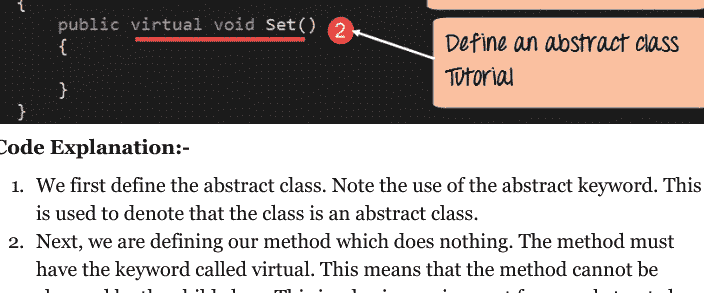

### 代码解释：-

- 1. 我们首先定义抽象类。注意 `abstract` 关键字的使用。它用于表示该类是抽象类。
- 2. 接下来，我们定义一个不执行任何操作的方法。该方法必须带有 `virtual` 关键字。这意味着该方法不能被其子类更改。这是任何抽象类的基本要求。

**步骤 2)** 现在让我们添加子类。此代码添加到 Program.cs 文件中。


这段代码没有什么特别之处。我们只是定义了一个名为“Guru99Tutorial”的类，它继承抽象类 Tutorial。然后，我们定义与之前一直使用的相同的方法。

**注意：** 这里我们不能更改在 Tutorial 类中定义的 Set 方法的定义。在 Tutorial 类中，我们定义了一个名为“Set”的方法（public virtual void Set()）。由于该方法属于抽象类，因此不允许在 Guru99Tutorial 类中再次定义 Set 方法。

### C# 接口

接口与类一起使用，用于定义所谓的契约。契约是关于类将向应用程序提供什么的约定。

接口声明属性和方法。方法具体做什么由类来决定。

让我们通过修改控制台应用程序中的类来看一个接口示例。请注意，我们不会运行代码，因为接口没有任何可运行的内容。

让我们创建一个接口类。该类将名为“Guru99Interface”。然后我们的主类将扩展已定义的接口。所有代码都需要写在 Program.cs 文件中。

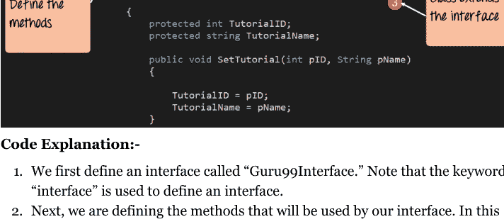

### 代码解释：-

- 1. 我们首先定义一个名为“Guru99Interface”的接口。注意，关键字“interface”用于定义接口。
- 2. 接下来，我们定义接口将使用的方法。在这个例子中，我们定义的方法与之前所有示例中使用的方法相同。注意，接口只声明方法，不定义方法中的代码。
- 3. 然后，我们让 Guru99Tutorial 类扩展该接口。这里我们实际编写代码来定义接口中声明的各种方法。这种编码方式实现了以下目的

- 它确保类 Guru99Tutorial 只添加“SetTutorial”和“GetTutorial”方法所必需的代码，而不添加其他内容。
- 它还确保接口像契约一样起作用。类必须遵守该契约。因此，如果契约规定它应该有两个名为“SetTutorial”和“GetTutorial”的方法，那么它就应该这样。

### 摘要

- 类是对数据属性和方法的封装。属性用于定义类中的数据类型。方法定义可以对数据执行的操作。
- 构造函数用于在创建对象时初始化类的字段。
- 构造函数是一个与类本身同名的方 法。
- 继承是指子类继承父类的字段和方法。然后子类还可以定义自己的方法。
- 多态是指一个方法可以被多次定义的概念。唯一的区别是传递给该方法的参数数量。
- 抽象类是一个基类，它包含类应该是什么样子的最基本要求。子类不可能继承基类的方法。
- 接口定义了一个契约，类将遵守该契约。接口定义了类可以执行哪些操作。

## 第5章：C# 集合

在上一章中，我们学习了如何在 C# 中使用数组。让我们快速回顾一下：编程中的数组用于将一组相关对象分组。因此，可以创建一个整数数组或整数集合，并可以通过一个变量名访问它。

集合与数组类似，它提供了一种更灵活地处理一组对象的方式。

在数组中，你会注意到需要事先定义数组中的元素数量。这必须在声明数组时完成。

但在集合中，你不需要事先定义集合的大小。你可以在任何时候向集合中添加元素，甚至从集合中删除元素。本章将重点介绍如何使用 C# 中可用的不同集合。

### C# ArrayList

ArrayList 集合类似于 C# 中的 Arrays 数据类型。最大的区别是数组列表集合的动态特性。

对于数组，你需要在声明数组时定义数组可以容纳的元素数量。但对于 Array List 集合，不需要事先这样做。实际上可以在任何时候向 Array List 集合中添加或删除元素。让我们更详细地了解数组列表集合可用的操作。

- 1. **声明数组列表** – 下面提供了 ArrayList 的声明。数组列表是借助 ArrayList 数据类型创建的。“new”关键字用于创建 ArrayList 对象。然后将该对象赋给变量 a1。因此，现在变量 a1 将用于访问数组列表的不同元素。
- 2. **向数组添加元素** – add 方法用于向 ArrayList 添加元素。add 方法可用于向数组列表添加任何数据类型的元素。因此，你可以向数组列表添加整数、字符串甚至布尔值。添加方法的一般语法如下

```
ArrayList a1 = new ArrayList()
```

```
ArrayList.add(element)
```

下面是“add”方法如何使用的一些示例。add 方法可用于向 Array List 集合添加各种数据类型。

下面你可以看到如何向 Array List 集合添加整数、字符串甚至布尔值的示例。

- a1.add(1) – 这将向集合中添加一个整数值
- a1.add("Example") – 这将向集合中添加一个字符串值
- a1.add(true) – 这将向集合中添加一个布尔值

现在让我们在代码层面看看它是如何工作的。下面提到的所有代码都将写入我们的控制台应用程序。代码将写入我们的 Program.cs 文件。

在下面的程序中，我们将编写代码来创建一个新的数组列表。我们还将展示如何添加元素以及如何显示数组列表的元素。


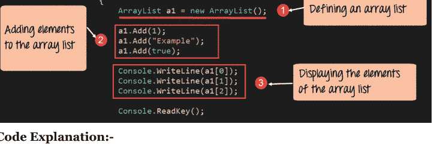

### 代码说明：-

- 1. 第一步用于声明我们的数组列表（Array List）。这里我们将 a1 声明为一个变量，用于保存数组列表的元素。
- 2. 然后我们使用 add 关键字将数字 1、字符串“Example”和布尔值“true”添加到数组列表中。
- 3. 然后我们使用 Console.WriteLine 方法将每个数组列表元素的值显示到控制台。你会注意到，就像数组一样，我们可以通过索引位置访问元素。因此，要访问数组列表的第一个位置，我们使用 [0] 索引位置。依此类推。

如果正确输入上述代码并运行程序，将显示以下输出。

### 输出：

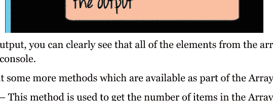

从输出中，你可以清楚地看到数组列表中的所有元素都已发送到控制台。

让我们看看 ArrayList 中可用的更多方法。

- - **Count** – 此方法用于获取 ArrayList 集合中的项数。下面是此语句的通用语法。ArrayList.Count() –
此方法将返回数组列表包含的元素数量。

- - **Contains** - 此方法用于查看元素是否存在于 ArrayList 集合中。下面是此语句的通用语法
  `ArrayList.Contains(element)` – 如果元素存在于列表中，此方法将返回 true，否则将返回 false。

- - **RemoveAt** - 此方法用于移除 ArrayList 集合中特定位置的元素。下面是此语句的通用语法

`ArrayList.RemoveAt(index)` – 此方法将从数组列表的特定位置移除一个元素。

现在让我们在代码层面看看它的工作方式。下面提到的所有代码都将写入我们的控制台应用程序。代码将写入我们的 Program.cs 文件。

在下面的程序中，我们将编写代码来看看如何使用上述方法。

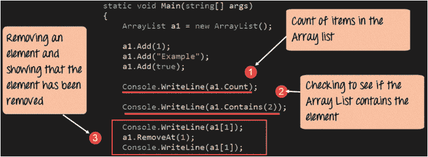

### 代码说明：-

- 1. 所以我们看到的第一个属性是 Count 属性。我们获取数组列表 a1 的 Count 属性，然后将其写入控制台。
- 2. 在第二部分中，我们使用 Contains 方法查看数组列表 a1 是否包含元素 2。然后我们通过 Writeline 命令将结果写入控制台。
- 3. 最后，为了展示 Remove 元素方法，我们执行以下步骤，
  - a. 首先，我们将数组列表索引位置 1 处元素的值写入控制台。
  - b. 然后我们移除数组列表索引位置 1 处的元素。
- c. 最后，我们再次将数组列表索引位置 1 处元素的值写入控制台。这组步骤将很好地说明 remove 方法是否会按预期工作。

如果正确输入上述代码并运行程序，将显示以下输出。

### 输出：

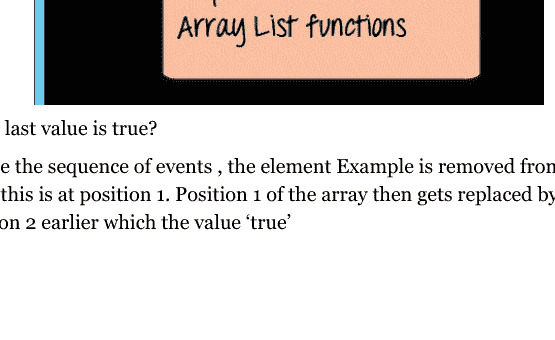

为什么最后一个值是 true？

如果你查看事件顺序，元素 Example 从数组中移除，因为它位于位置 1。然后数组的位置 1 被之前位于位置 2 的内容替换，即值“true”。

### C# 堆栈

堆栈是一种特殊情况集合，表示后进先出（LIFO）概念。为了首先理解 LIFO，让我们举个例子。想象一摞书，每本书都放在另一本书上面。

在书籍的情况下，后进先出的概念意味着只能从书堆中移除最上面的书。不可能从中间移除一本书，因为那样会破坏堆栈的设置。

因此，在 C# 中，堆栈也以相同的方式工作。元素被添加到堆栈中，一个在另一个上面。向堆栈添加元素的过程称为 push 操作。要从堆栈中移除元素，你也可以移除堆栈的最顶层元素。此操作称为 pop。

让我们更详细地查看 Stack 集合可用的操作。

- - **堆栈的声明** – 堆栈是在 Stack 数据类型的帮助下创建的。关键字“new”用于创建 Stack 的对象。然后将该对象分配给变量 st。`Stack st = new Stack()`
- - **向堆栈添加元素** – push 方法用于将元素添加到堆栈上。该语句的通用语法如下所示。`Stack.push(element)`
- - **从堆栈中移除元素** – pop 方法用于从堆栈中移除元素。pop 操作将返回堆栈的最顶层元素。该语句的通用语法如下所示 `Stack.pop()`
- - **Count** – 此属性用于获取 Stack 中的项数。下面是此语句的通用语法。`Stack.Count`
- - **Contains** - 此方法用于查看元素是否存在于 Stack 中。下面是此语句的通用语法。如果元素存在，该语句将返回 true，否则将返回值 false。`Stack.Contains(element)`

现在让我们在代码层面看看它的工作方式。下面提到的所有代码都将写入我们的控制台应用程序。代码将写入我们的 Program.cs 文件。在下面的程序中，我们将编写代码来看看如何使用上述方法。

在此示例中，我们将看到

- - 堆栈如何创建。
- - 如何显示堆栈的元素，以及使用 Count 和 Contains 方法。

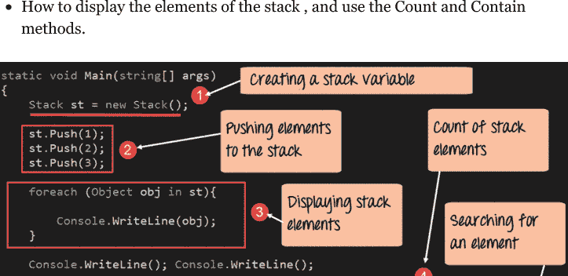

### 代码说明：-

- 1. 第一步用于声明 Stack。这里我们将“st”声明为一个变量，用于保存堆栈的元素。
- 2. 接下来，我们向堆栈添加 3 个元素。每个元素都通过 Push 方法添加。
- 3. 现在，由于堆栈元素不能像数组列表那样通过索引位置访问，我们需要使用不同的方法来显示堆栈的元素。Object (obj) 是一个临时变量，声明用于保存堆栈的每个元素。然后我们使用 foreach 语句遍历堆栈的每个元素。对于每个堆栈元素，该值被赋给 obj 变量。然后我们使用 Console.Writeline 命令将值显示到控制台。
- 4. 我们使用 Count 属性（**st.count**）获取堆栈中的项数。此属性将返回一个数字。然后我们将此值显示到
控制台。
- 5. 然后我们使用 Contains 方法查看值 3 是否存在于我们的堆栈中。这将返回 true 或 false 值。然后我们将此返回值显示到控制台。

如果正确输入上述代码并运行程序，将显示以下输出。

### 输出：

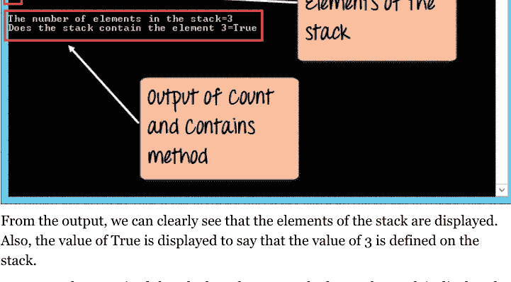

从输出中，我们可以清楚地看到堆栈的元素已显示。此外，还显示了 True 值，表示值 3 在堆栈中已定义。

注意：你已经注意到，最后推入堆栈的元素会先显示。这是堆栈的最顶层元素。输出中还显示了堆栈元素的计数。

现在让我们看看“移除”功能。我们将看到从堆栈中移除最顶层元素所需的代码。


### 代码说明：-

- 1. 这里我们只是发出 pop 方法，该方法用于从堆栈中移除元素。

如果正确输入上述代码并运行程序，将显示以下输出。

### 输出：


输出显示元素 3 已从堆栈中弹出

我们可以看到元素 3 已从堆栈中移除。

### C# 队列

队列是一种特殊情况集合，表示先进先出概念。想象一群人在等公交车。通常，第一个进入队列的人将是第一个上公交车的人。同样，最后一个进入队列的人将是最后一个上公交车的人。元素被添加到堆栈中，一个在另一个上面。

向队列添加元素的过程是 enqueue 操作。要从队列中移除元素，你可以使用 dequeue 操作。队列中的操作与我们之前看到的堆栈类似。

让我们更详细地查看 Queue 集合可用的操作。

- - **队列的声明** – 队列的声明如下所示。队列是在 Queue 数据类型的帮助下创建的。关键字“new”用于创建 Queue 的对象。然后将该对象分配给变量 qt。
- - **向队列添加元素** – enqueue 方法用于将元素添加到队列中。该语句的通用语法如下所示。
- - **从队列中移除元素** – dequeue 方法用于从队列中移除元素。dequeue 操作将返回队列的最后一个元素。该语句的通用语法如下所示
- - **Count** – 此属性用于获取队列中的项数。下面是此语句的通用语法。
- - **Contains** - 此方法用于查看元素是否存在于 Queue 中。下面是此语句的通用语法。如果元素存在，该语句将返回 true，否则将返回值 false。

```
Queue qt = new Queue()
```

```
Queue.enqueue(element)
```

```
Queue.pop()
```

```
Queue.Count
```

```
Queue.Contains(element)
```

现在，让我们在代码层面看看它的工作方式。下面提到的所有代码都将写入我们的控制台应用程序。


The code will be written to our Program.cs file. In the below program, we will write the code to see how we can use the above-mentioned methods.

In this example, we will see how a queue gets created. Next, we will see how to display the elements of the queue, and use the Count and Contains methods.


### 代码说明

- 1. 第一步用于声明 Queue。这里我们声明 qt 作为变量来保存我们的 Queue 的元素。
- 2. 接下来，我们向 Queue 添加 3 个元素。每个元素都通过“enqueue”方法添加。
- 3. 现在关于 Queue 需要注意的一点是，元素不能像 array list 那样通过索引位置访问。我们需要使用不同的方法来显示 Queue 的元素。下面就是我们显示队列元素的方式。
  - 我们首先声明一个名为 obj 的临时变量。它将用于保存 Queue 的每个元素。
  - 然后我们使用 foreach 语句遍历 Queue 的每个元素。
  - 对于每个 Queue 元素，其值会被赋给 obj 变量。
  - 然后我们使用 Console.WriteLine 命令将值显示到控制台。
- 4. 我们使用“Count”属性来获取 Queue 中项目的数量。该属性将返回一个数字。然后我们将此值显示到控制台。
- 5. 然后我们使用“Contains”方法来查看值 3 是否存在于我们的 Queue 中。这将返回 true 或 false 值。然后我们将此返回值显示到控制台。

如果上述代码正确输入并运行程序，将显示以下输出。

### 输出


从输出中，我们可以清楚地看到 Queue 的元素被显示出来。注意，与 stack 不同，在 queue 中，首先推入队列的第一个元素会首先显示。输出中也显示了队列元素的计数。此外，还显示了 True 值，表示值 3 已定义在队列上。

现在让我们来看一下删除功能。我们将看到从队列中删除第一个元素所需的代码。

```csharp
static void Main(string[] args)
{
    Queue qt = new Queue();
    qt.Enqueue(1);
    qt.Enqueue(2);
    qt.Enqueue(3);
    qt.Dequeue();
    foreach (Object obj in qt)
    {
        Console.WriteLine(obj);
    }
}
```

### 代码说明

- 1. 这里我们只是调用“dequeue”方法，该方法用于从队列中删除元素。此方法将删除队列的第一个元素。

如果上述代码正确输入并运行程序，将显示以下输出。

### 输出


output shows that the first element was removed from the queue

从输出中，我们可以看到添加到队列中的第一个元素，即元素 1，已从队列中移除。

### C# 哈希表

哈希表是一种特殊的集合，用于存储键值项。因此，与 stack、array list 和 queue 只存储一个值不同，哈希表存储 2 个值。这 2 个值构成哈希表的一个元素。

以下是哈希表的值可能出现的一些示例。

```csharp
{ "001", ".Net" }
{ "002", "C#" }
{ "003", "ASP.Net" }
```

上面我们有 3 个键值对。每个元素的键分别是 001、002 和 003。每个键值对的值分别是“.Net”、“C#”和“ASP.Net”。

让我们更详细地了解 Hashtable 集合可用的操作。

- **Hashtable 的声明** – 下面展示了 Hashtable 的声明。Hashtable 是借助 Hashtable 数据类型创建的。使用“new”关键字创建 Hashtable 的对象。然后将该对象分配给变量 ht。
  
  `Hashtable ht = new Hashtable();`
- **向 Hashtable 添加元素** – Add 方法用于向哈希表添加元素。下面给出了该语句的一般语法
  
  `Hashtable.Add("key", "value");`

请记住，哈希表的每个元素都包含 2 个值，一个是键，另一个是值。

现在，让我们在代码层面看看它的运行情况。以下所有提到的代码都将写入我们的控制台应用程序。

The code will be written to our Program.cs file. In the below program, we will write the code to see how we can use the above-mentioned methods.

For now in our example, we will just look at how we can create a hashtable, add elements to the hashtable and display them accordingly.


### 代码说明

- 1. 首先，我们使用 Hashtable 数据类型并使用“new”关键字声明哈希表变量。定义的变量名为‘ht’。
- 2. 然后我们使用 Add 方法向哈希表添加元素。请记住，在向哈希表添加内容时，需要同时添加键和值元素。
- 3. 没有直接显示哈希表元素的方法。
  - 为了显示哈希表，我们首先需要从哈希表中获取键的列表（001、002 和 003）。
  - 这是通过 ICollection 接口完成的。这是一种特殊的数据类型，可用于存储哈希表集合的键。然后我们将哈希表集合的键分配给变量‘keys’。
- 4. 接下来，对于每个键值，我们通过使用语句 ht[k] 获取哈希表中关联的值。

如果上述代码正确输入并运行程序，将显示以下输出。

### 输出


让我们再看看哈希表可用的一些其他方法。

- **ContainsKey** - 此方法用于查看键是否存在于 Hashtable 中。下面是该语句的一般语法。如果键存在，该语句将返回 true，否则将返回 false 值。
  
  ```csharp
  Hashtable.ContainsKey(key);
  ```
- **ContainsValue** - 此方法用于查看值是否存在于 Hashtable 中。下面是该语句的一般语法。如果值存在，该语句将返回 true，否则将返回 false 值。
  
  ```csharp
  Hashtable.ContainsValue(value);
  ```

让我们更改控制台应用程序中的代码，以展示如何使用“ContainsKey”和“ContainsValue”方法。

```csharp
static void Main(string[] args)
{
    Hashtable ht = new Hashtable();

    ht.Add("001", ".Net");
    ht.Add("002", "C#");
    ht.Add("003", "ASP.Net");

    Console.WriteLine(ht.ContainsKey("001")); // searching for a key
    Console.WriteLine(ht.ContainsValue("C#")); // searching for a value

    Console.ReadKey();
}
```

### 代码说明

- 1. 首先，我们使用 ContainsKey 方法来查看键是否存在于哈希表中。如果键存在于哈希表中，此方法将返回 true。由于该键确实存在于哈希表中，此方法应返回 true。
- 2. 然后我们使用 ContainsValue 方法来查看值是否存在于哈希表中。由于该值确实存在于哈希表中，此方法将返回‘true’。

如果上述代码正确输入并运行程序，将显示以下输出。

### 输出


从输出中，你可以清楚地看到正在搜索的键和值都存在于哈希表中。

### 总结

- Array List 集合用于存储一组元素。Array list 集合的优点在于其动态性。您可以即时向 array list 集合添加和删除元素。
- Stack 基于后进先出概念。向栈添加元素的操作称为 push 操作。从栈中删除元素的操作称为 pop 操作。
- Queue 基于先进先出概念。向队列添加元素的操作称为 enqueue 操作。从队列中删除元素的操作称为 dequeue 操作。
- Hashtable 用于存储由键值对组成的元素。要访问元素的值，您需要知道该元素的键。


## 第6章：Windows Forms 应用程序

到目前为止，我们已经了解如何使用 C# 创建基于控制台的应用程序。但在实际场景中，团队通常使用 Visual Studio 和 C# 创建 Windows Forms 或基于 Web 的应用程序。

Windows Forms 应用程序是任何设计用于在计算机上运行的应用程序。它不会在 Web 浏览器中运行，因为那样它就变成了 Web 应用程序。

本章将重点介绍如何创建基于 Windows 的应用程序。我们还将学习有关如何使用 Windows 应用程序的各种元素的基础知识。

### Windows Forms 基础

Windows Forms 应用程序是在桌面计算机上运行的应用程序。Windows Forms 应用程序通常会有一组控件，例如标签、文本框、列表框等。

下面是一个简单的 Windows 窗体应用程序的示例。它显示了一个简单的登录屏幕，用户可以访问。用户将输入所需的凭据，然后单击登录按钮继续。


上述应用程序中可用控件的示例

- 1. 这是一组标签控件，通常用于描述相邻的控件。因此，在我们的例子中，我们有 2 个文本框，标签用于告诉用户一个文本框用于输入用户名，另一个用于输入密码。
- 2. 这 2 个文本框用于保存用户将输入的用户名和密码。
- 3. 最后，我们有按钮控件。按钮控件通常会附加一些代码来执行一组特定的操作。例如，在上述情况下，我们可以让按钮执行验证用户输入的用户名和密码的操作。

### C# Hello World

现在让我们看一个如何在 Visual Studio 中实现简单的“hello world”应用程序的示例。为此，我们需要实现以下步骤

**步骤 1)** 第一步涉及在 Visual Studio 中创建新项目。启动 Visual Studio 后，您需要选择菜单选项 新建->项目。


**步骤 2)** 下一步是选择项目类型为 Windows Forms 应用程序。在这里我们还需要提及项目的名称和位置。


- 1. 在项目对话框中，我们可以看到在 Visual Studio 中创建不同类型项目的各种选项。单击左侧的 Windows 选项。
- 2. 当我们在上一步中单击 Windows 选项时，我们将能够看到 Windows 窗体应用程序 的选项。单击此选项。
- 3. 然后我们为应用程序命名，在我们的例子中是 DemoApplication。我们还需要提供一个位置来存储我们的应用程序。
- 4. 最后，我们单击“确定”按钮，让 Visual Studio 创建我们的项目。

如果按照上述步骤操作，您将在 Visual Studio 中得到以下输出。

### 输出:-


您将看到表单设计器出现

您实际上会在 Visual Studio 中看到 Form Designer 的显示。您将在此 Form Designer 上开始构建 Windows Forms 应用程序。


表单组件

主程序名称

在解决方案资源管理器中，您还将能够看到 DemoApplication 解决方案。此解决方案将包含以下 2 个项目文件

- 1. 一个名为 Forms1.cs 的窗体应用程序。此文件将包含 Windows 窗体应用程序的所有代码。
- 2. 主程序 Program.cs 是在 Visual Studio 中创建新应用程序时创建的默认代码文件。此代码将包含整个应用程序的启动代码。

在 Visual Studio 的右侧，您还将看到一个工具箱。工具箱包含可以添加到 Windows 窗体的所有控件。文本框或标签等控件只是可以添加到 Windows 窗体的一些控件。

下面是工具箱外观的屏幕截图。

### 工具箱

搜索工具箱

- **所有 Windows 窗体**
- Pointer
- BackgroundWorker
- BindingNavigator
- BindingSource
- Button
- CheckBox
- CheckedListBox
- ColorDialog
- ComboBox
- ContextMenuStrip
- DataGridView
- DataSet
- DateTimePicker
- DirectoryEntry
- DirectorySearcher
- DomainUpDown
- ErrorProvider
- EventLog
- FileSystemWatcher
- FlowLayoutPanel
- FolderBrowserDialog
- FontDialog
- GroupBox
- HelpProvider
- HScrollBar

包含所有控件的工具箱

步骤 3) 在此步骤中，我们现在将向窗体添加一个标签以显示“Hello World”。从工具箱中，您需要选择 Label 控件并将其简单地拖放到窗体上。

### 工具箱

搜索工具箱

- ComboBox
- ContextMenuStrip
- DataGridView
- DataSet
- DateTimePicker
- DirectoryEntry
- DirectorySearcher
- DomainUpDown
- ErrorProvider
- EventLog
- FileSystemWatcher
- FlowLayoutPanel
- FolderBrowserDialog
- FontDialog
- GroupBox
- HelpProvider
- HScrollBar
- ImageList
- Label
- LinkLabel
- ListBox

> > 拖动标签控件

一旦您将标签拖到窗体上，您实际上可以看到标签已嵌入到窗体中，如下所示。


步骤 4) 下一步是实际进入控件的属性并将文本更改为“Hello World”。

若要进入控件的属性，您需要右键单击控件并选择属性菜单选项


选择属性菜单选项

- 属性面板也在 Visual Studio 中显示。因此，对于标签控件，在属性控件中，转到文本部分并输入“Hello World”。
- 每个控件都有一组描述该控件的属性。


如果您按照上述所有步骤操作并在 Visual Studio 中运行程序，您将得到以下输出

### 输出:-


在输出中，您可以清楚地看到 Windows 窗体已显示。您还可以看到“Hello World”显示在窗体上。

### 向窗体添加控件

我们已经在前面部分添加标签控件以显示“Hello World”时，了解了如何向窗体添加控件。

让我们看看 Windows 窗体可用的其他控件，并查看它们的一些常见属性。

在我们的示例中，我们将创建一个窗体，具有以下功能。

- 1. 用户输入姓名和地址的能力。
- 2. 选择用户居住城市的选项
- 3. 用户输入性别选项的能力。
- 4. 选择用户想要学习的课程的选项。会有 C# 和 ASP.Net 的选择

因此，让我们详细查看每个控件并将其添加到构建具有上述功能的窗体中。

**组框** – 组框用于将逻辑控件分组到一个部分中。

举个例子，如果您有一组控件用于输入个人姓名和地址等详细信息。理想情况下，这些是个人详细信息，因此您希望将这些详细信息放在窗体上的单独部分中。为此，您可以使用组框。让我们通过下面的示例看看如何实现

**步骤 1)** 第一步是从工具箱将 Groupbox 控件拖到 Windows 窗体上，如下所示

### 工具箱

搜索工具箱

- ComboBox
- ContextMenuStrip
- DataGridView
- DataSet
- DateTimePicker
- DirectoryEntry
- DirectorySearcher
- DomainUpDown
- ErrorProvider
- EventLog
- FileSystemWatcher
- FlowLayoutPanel
- FolderBrowserDialog
- FontDialog
- GroupBox
- HelpProvider
- HScrollBar
- ImageList

项目 DemoApplication

组框控件

步骤 2) 一旦添加了组框，通过单击组框控件进入属性窗口。在属性窗口中，转到 Text 属性并将其更改为“User Details”。


完成上述更改后，你将看到以下输出

### 输出：-


在输出中，你可以清楚地看到 Groupbox（分组框）已添加到窗体中。你还可以看到分组框的文本已更改为“用户详细信息。”

### 标签控件
接下来是标签控件。标签控件用于在窗体上向用户显示文本或消息。标签控件通常与其他控件一起使用。常见的例子是将标签与文本框控件一起添加。

标签向用户指示应在文本框中填写什么内容。让我们通过下面的示例来看看如何实现这一点。我们将添加 2 个标签，一个称为“姓名”，另一个称为“地址”。它们将与稍后部分添加的文本框控件配合使用。

**步骤 1）** 第一步是从工具箱中将标签控件拖到 Windows 窗体上，如下所示。确保将标签控件拖动 2 次，以便一个用于“姓名”，另一个用于“地址”。


**步骤 2）** 添加标签后，单击标签控件转到属性窗口。在属性窗口中，转到每个标签控件的 Text 属性。


完成上述更改后，你将看到以下输出

### 输出：-


你实际上可以看到标签控件已添加到窗体中。

### 文本框
文本框用于允许用户在窗体应用程序中输入一些文本。让我们通过下面的示例来看看如何实现这一点。我们将向窗体添加 2 个文本框，一个用于姓名，另一个用于用户要输入的地址

**步骤 1）** 第一步是从工具箱中将文本框控件拖到 Windows 窗体上，如下所示


**步骤 2）** 添加文本框后，单击文本框控件转到属性窗口。在属性窗口中，转到 Name 属性，并为每个文本框添加一个有意义的名称。例如，将用户的文本框命名为 txtUser，将地址的文本框命名为 txtAddress。应为控件制定命名约定和标准，因为这样会更容易向这些控件添加额外功能，我们稍后会看到。


完成上述更改后，你将看到以下输出

### 输出：-


在输出中，你可以清楚地看到文本框已添加到窗体中。

### 列表框
列表框用于在 Windows 窗体上展示项目列表。

让我们通过下面的示例来看看如何实现这一点。我们将向窗体添加一个列表框，以存储一些城市位置。

**步骤 1）** 第一步是从工具箱中将列表框控件拖到 Windows 窗体上，如下所示


**步骤 2）** 添加列表框后，单击列表框控件转到属性窗口。


- 1. 首先，更改 Listbox 控件的属性，在我们的示例中已将其更改为 lstCity
- 2. 单击 Items 属性。这将允许你添加可在列表框中显示的不同项目。在我们的示例中，我们选择了“collection（集合）”项。
- 3. 在弹出的字符串集合编辑器中，输入城市名称。在我们的示例中，我们输入了“孟买”“班加罗尔”和“海得拉巴”。
- 4. 最后，单击“确定”按钮。

完成上述更改后，你将看到以下输出

### 输出：-


在输出中，你可以清楚地看到列表框已添加到窗体中。你还可以看到列表框已填充城市值。

### 单选按钮
单选按钮用于展示一组项目，用户可以从中选择一个。让我们通过下面的示例来看看如何实现这一点。我们将为男性/女性选项添加单选按钮。

**步骤 1）** 第一步是从工具箱中将“单选按钮”控件拖到 Windows 窗体上，如下所示。


**步骤 2）** 添加单选按钮后，单击单选按钮控件转到属性窗口。


- 1. 首先，你需要更改两个单选控件的文本属性。转到属性窗口，将一个单选按钮的文本更改为“男”，将另一个的文本更改为“女”。
- 2. 同样，更改两个单选控件的名称属性。转到属性窗口，将一个单选按钮的名称更改为“rdMale”，将另一个的名称更改为“rdfemale”。

完成上述更改后，你将看到以下输出

### 输出：-


你将看到单选按钮已添加到 Windows 窗体中。

### 复选框
复选框用于提供一组选项，用户可以在其中选择多个选项。让我们通过下面的示例来看看如何实现这一点。我们将向 Windows 窗体添加 2 个复选框。这些复选框将为用户提供一个选项，让他们选择要学习 C# 还是 ASP.Net。

**步骤 1）** 第一步是从工具箱中将复选框控件拖到 Windows 窗体上，如下所示


**步骤 2）** 添加复选框后，单击复选框控件转到属性窗口。


在属性窗口中，

- 1. 首先，你需要更改两个复选框控件的文本属性。转到属性窗口，将文本更改为 C# 和 ASP.Net。
- 2. 同样，更改两个复选框控件的名称属性。转到属性窗口，将一个复选框的名称更改为 chkC，将另一个的名称更改为 chkASP。

完成上述更改后，你将看到以下输出

### 输出：-


### 按钮
按钮用于允许用户单击按钮，随后启动窗体的处理。让我们通过下面的示例来看看如何实现这一点。我们将添加一个名为“提交”的简单按钮，用于提交窗体上的所有信息。

**步骤 1）** 第一步是从工具箱中将按钮控件拖到 Windows 窗体上，如下所示


**步骤 2）** 添加按钮后，单击按钮控件转到属性窗口。


- 1. 首先，你需要更改按钮控件的文本属性。转到属性窗口，将文本更改为“提交”。
- 2. 同样，更改控件的名称属性。转到属性窗口，将名称更改为“btnSubmit”。

完成上述更改后，你将看到以下输出

### 输出：-


恭喜，你现在已经拥有了第一个基本的 Windows 窗体。现在让我们进入下一个主题，看看如何为控件进行事件处理。

### 控件的 C# 事件处理

使用 Windows 窗体时，你可以向控件添加事件。事件是在执行某个操作时发生的事情。最常见的操作可能是单击窗体上的按钮。在 Windows 窗体中，你可以添加代码，以便在窗体上的按钮被按下时执行某些操作。

通常，当窗体上的按钮被按下时，意味着应进行一些处理。

在进入按钮事件场景之前，让我们先看一个事件以及如何处理它。

下面的示例将展示列表框控件的一个事件。因此，每当在列表框控件中选择一个项目时，应弹出一个消息框，显示所选择的项目。让我们执行以下步骤来实现这一点。

**步骤 1）** 在窗体设计器中双击列表框。执行此操作后，Visual Studio 将自动打开窗体的代码文件。并且它会自动向代码中添加一个事件方法。每当列表框中的任何项目被选中时，就会触发此事件方法。

```csharp
private void lstCity_SelectedIndexChanged(object sender, EventArgs e)
{
}
```

上面是当你在窗体上双击列表框控件时，Visual Studio 自动添加的代码片段。现在，让我们将下面这段代码添加到此代码片段中，以便为列表框事件添加所需功能。

```csharp
private void lstCity_SelectedIndexChanged(object sender, EventArgs e)
{
    string text = lstCity.GetItemText(lstCity.SelectedItem);
    MessageBox.Show(text);
}
```


- 1. 这是事件处理方法，当你在 Visual Studio 中双击 Listbox 控件时会自动创建。你不需要担心方法名称的复杂性或传递给该方法的参数。
- 2. 这里我们通过 lstCity.SelectedItem 属性获取 SelectedItem。请记住 lstCity 是我们 Listbox 控件的名称。然后我们使用 GetItemText 方法获取所选项目的实际值。然后我们将此值赋给 text 变量。
- 3. 最后，我们使用 MessageBox 方法向用户显示 text 变量的值。

在 Visual Studio 中进行上述更改并运行程序后，你将看到以下输出。

### Output


从输出中，你可以清楚地看到，当从 Listbox 中选择任何项目时，会弹出一个消息框。这将显示来自 Listbox 的所选项目。

现在让我们来看最后一个控件，即按钮点击方法。同样，这遵循相同的理念。只需在窗体设计器中双击按钮，它就会自动添加按钮事件处理程序的方法。然后你只需要添加下面的代码。


- 1. 这是事件处理方法，当你在 Visual Studio 中双击按钮控件时会自动创建。你不需要担心方法名称的复杂性或传递给该方法的参数。
- 2. 这里我们获取在姓名和地址文本框中输入的值。值可以从文本框的 text 属性中获取。然后我们将值分别赋给 2 个变量 name 和 address。
- 3. 最后，我们使用 MessageBox 方法向用户显示姓名和地址值。

在 Visual Studio 中进行上述更改并运行程序后，你将看到以下输出。

### Output


- 1. 首先，在姓名和地址字段中输入一个值。
- 2. 然后点击 Submit 按钮。

一旦你点击 Submit 按钮，会弹出一个消息框，并且它会正确显示你在用户详细信息部分输入的内容。

### 其他控件

我们还可以查看另外 2 个控件，一个是‘Tree Control’，另一个是‘Image control’。让我们看看如何实现这些控件的示例。

- **TreeControl** – 树控件用于以树状形式列出项目。最好的例子可能是当我们看到 Windows Explorer 本身时。Windows Explorer 中的文件夹结构就像树状结构。

让我们通过下面的示例看看如何实现它。

### 第 1 步)

第一步是从工具箱将 Tree 控件拖到 Windows 窗体上，如下所示。


### 第 2 步)

下一步是开始向树集合添加节点，以便它能在树中相应显示。首先，让我们按照下面的子步骤向树集合添加根节点。


- 1. 转到 TreeView 控件的属性工具箱。点击 Nodes 属性。这将打开 TreeNode 编辑器。
- 2. 在 TreeNode 编辑器中点击 Add Root 按钮以向树集合添加根节点。
- 3. 接下来，更改 Root 节点的文本并将文本提供为 Root，然后点击 'OK' 按钮。这将添加 Root 节点。

### 第 3 步)

下一步是开始向树集合添加子节点。让我们按照下面的子步骤向树集合添加子节点。


- 1. 首先，点击 Add child 按钮。这将允许你向树集合添加子节点。
- 2. 对于每个子节点，更改 text 属性。继续重复上一步和这一步并添加另外 2 个节点。最后，你将拥有如上图所示的 3 个节点，其文本分别为 Label、Button 和 Checkbox。
- 3. 点击 OK 按钮。

在你完成上述更改后，你将看到以下输出。

### Output


你实际上可以看到 TreeView 已添加到窗体中。当你运行 Windows 窗体应用程序时，你可以展开根节点并在列表中查看子节点。

- **PictureBox Control** – 此控件用于向 Windows 窗体添加图像。让我们通过下面的示例看看如何实现它。

### 第 1 步)

第一步是从工具箱将 PictureBox 控件拖到 Windows 窗体上，如下所示。

### 第 2 步)

下一步是实际将图像附加到 PictureBox 控件。这可以通过以下步骤完成。


- 1. 首先，点击 PictureBox 控件的 Image 属性。会弹出一个新窗口。
- 2. 在此窗口中，点击 Import 按钮。这将用于将图像附加到 PictureBox 控件。
- 3. 会弹出一个对话框，在其中你可以选择要附加到 PictureBox 的图像。
- 4. 点击 OK 按钮。

在你完成上述更改后，你将看到以下输出。

### Output


从输出中，你可以清楚地看到窗体上显示了图像。

### 摘要

- Windows 窗体应用程序是在计算机桌面上运行的应用程序。Visual Studio 配合 C# 可用于创建 Windows 窗体应用程序。
- 可以通过 Visual Studio 中的工具箱将控件添加到 Windows 窗体。标签、复选框、单选按钮等控件可通过工具箱添加到窗体中。
- 还可以使用高级控件，如 TreeView 控件和 PictureBox 控件。
- 事件处理程序用于响应控件生成的事件。其中最常见的是为按钮点击事件添加的处理程序。

## 第7章：数据库访问

从数据库访问数据是任何编程语言的重要方面之一。任何编程语言都必须具备与数据库一起工作的能力。C# 也不例外。

它能够与不同类型的数据库一起工作。它可以与最常见的数据库一起工作，例如 Oracle 和 Microsoft SQL Server。

它还能够与新型数据库一起工作，例如 MongoDB 和 MySQL。

### 数据库连接基础

C# 和 .NET 能够与大多数数据库一起工作，最常见的是 Oracle 和 Microsoft SQL Server。但对于每个数据库来说，处理它们背后的逻辑大多是相同的。

在我们的示例中，我们将以 Microsoft SQL Server 作为数据库进行操作。出于学习目的，可以下载并使用 **Microsoft SQL Server Express Edition**，这是一款由 Microsoft 提供的免费数据库软件。

在处理数据库时，以下概念在所有数据库中都是通用的。

- 1. **Connection** – 要处理数据库中的数据，第一步显然是连接。数据库连接通常由以下提及的参数组成。
  - a. **Database name or Data Source** – 第一个重要参数是要建立连接的数据库名称。每个连接一次只能处理一个数据库。
  - b. **Credentials** – 下一个重要方面是用于建立数据库连接的用户名和密码。它确保用户名和密码具有连接数据库所需的权限。
  - c. **Optional parameters** - 对于每种数据库类型，你可以指定可选参数以提供有关 .NET 如何处理数据库连接的更多信息。例如，可以指定一个参数来确定连接应保持活动多长时间。如果在特定时间内未执行任何操作，则该参数将决定是否需要关闭连接。

- 2. **Selecting data from the database** – 一旦建立了连接，下一个重要方面是从数据库中获取数据。C# 能够执行‘SQL’ select 命令针对数据库。‘SQL’ 语句可用于从数据库中的特定表中获取数据。

- 3. **Inserting data into the database** – C# 也可用于向数据库中插入记录。可以在 C# 中为需要插入数据库的每一行指定值。

- 4. **Updating data into the database** – C# 也可用于更新数据库中现有的记录。可以在 C# 中为每个


需要更新到数据库中的行。

- 5. **从数据库中删除数据** – C# 也可用于从数据库中删除记录。可在 C# 中指定删除命令，以指明需要删除哪些行。

好了，既然我们已经了解了每种操作的理论，接下来就进入后续章节，看看如何在 C# 中执行数据库操作。

### .NET 中的连接

现在让我们看看创建数据库连接所需保留到位的代码。在我们的示例中，我们将连接到一个名为 Demodb 的数据库。用于连接该数据库的凭据如下

- **用户名 – sa**
- **密码 – demo123**

我们将看到一个用于处理数据库的简单 Windows 窗体应用程序。我们会有一个名为“Connect”的简单按钮，用于连接数据库。

因此，让我们按照以下步骤来实现这一点

**步骤 1）** 第一步涉及在 Visual Studio 中创建新项目。启动 Visual Studio 后，需要选择菜单选项“新建”->“项目”。


**步骤 2）** 下一步是将项目类型选择为 Windows 窗体应用程序。这里，我们还需要指定项目的名称和位置。


- 1. 在项目对话框中，我们可以看到在 Visual Studio 中创建不同类型项目的各种选项。单击左侧的 Windows 选项。
- 2. 在上一步中单击 Windows 选项后，我们将能够看到“Windows 窗体应用程序”选项。单击此选项。
- 3. 然后我们为应用程序命名，在本例中为“DemoApplication”。我们还需要提供一个位置来存储应用程序。
- 4. 最后，我们单击“OK”按钮，让 Visual Studio 创建我们的项目。

步骤 3）现在从工具箱向 Windows 窗体添加一个按钮。将按钮的 Text 属性设置为 Connect。其外观如下


步骤 4）现在双击窗体，以便在代码中为按钮单击事件添加事件处理程序。在事件处理程序中，添加以下代码。

```
private void button1_Click(object sender, EventArgs e)
{
    string connectionString;
    SqlConnection cnn ;
    connectionString = @"Data Source=WIN-5O GP3OFGO75;Initial Catalog=Demodb;User ID=sa;Password=demo123";
    cnn = new SqlConnection(connectionString);
    cnn.Open();
    MessageBox.Show ("Connection Open ! ");
    cnn.Close();
}
```

### 代码说明：-

- 1. 第一步是创建变量，这些变量将用于创建连接字符串以及与 SQL Server 数据库的连接。
- 2. 下一步是实际创建连接字符串。为了让 C# 理解连接字符串，需要以正确的方式指定连接字符串。连接字符串由以下部分组成
  - a. Data Source – 这是数据库所在服务器的名称。在我们的示例中，它位于名为 WIN- 5O GP3OFGO75 的计算机上。
  - b. Initial Catalog 用于指定数据库的名称
- c. UserID 和 Password 是连接数据库所需的凭据。
- 3. 接下来，我们将连接字符串分配给变量 cnn。cnn 变量的类型为 SqlConnection，实际上用于建立与数据库的连接。
- 4. 接下来，我们使用 cnn 变量的 Open 方法打开与数据库的连接。然后我们仅向用户显示一条消息，表明连接已建立。
- 5. 操作成功完成后，我们关闭与数据库的连接。如果无需对数据库执行其他操作，关闭数据库连接始终是一种好做法。

设置好上述代码并使用 Visual Studio 执行项目后，你将得到以下输出。窗体显示后，单击 Connect 按钮。

### 输出：-


当你单击“connect”按钮时，从输出中可以清楚地看到数据库连接已建立。因此，消息框已显示。

### 访问数据

为了展示如何使用 C# 访问数据，假设我们的数据库中有以下对象。

- 1. 一个名为 demotb 的表。该表将用于存储各种教程的 ID 和名称。
- 2. 该表将有 2 列，一列名为“TutorialID”，另一列名为“TutorialName”。
- 3. 目前，该表将包含如下所示的 2 行。

| TutorialID | TutorialName |
|---|---|
| 1 | C# |
| 2 | ASP.Net |

让我们更改窗体中的代码，以便可以查询这些数据并通过 MessageBox 显示信息。请注意，下面输入的所有代码都是上一节中为数据连接编写的代码的延续。

步骤 1）让我们将代码分成 2 部分，以便用户容易理解。

- 第一部分将构造我们的“select”语句，该语句将用于从数据库读取数据。
- 然后，我们将针对数据库执行“select”语句，并相应地获取所有表行。


### 代码说明：-

- 1. 第一步是创建以下变量
  - a. SQLCommand – ‘SQLCommand’ 是 C# 中定义的类。该类用于执行向数据库读写数据的操作。因此，第一步是确保创建该类的变量类型。然后，该变量将用于从数据库读取数据的后续步骤中。
  - b. datareader 对象用于获取 SQL 查询指定的所有数据。然后，我们可以使用数据读取器逐行读取所有表行。
  - c. 然后我们定义 2 个字符串变量，一个是“SQL”，用于保存我们的 SQL 命令字符串。下一个是“Output”，它将包含所有表值。
- 2. 下一步是实际定义将针对数据库使用的 SQL 语句。在我们的示例中，它是“Select TutorialID, TutorialName from demotb”。这将从 demotb 表中获取所有行。
- 3. 接下来，我们创建命令对象，用于针对数据库执行 SQL 语句。在 SQL 命令中，必须传入连接对象和 SQL 字符串。
- 4. 接下来，我们将执行数据读取器命令，该命令将从 demotb 表中获取所有行。
- 5. 现在我们已经拥有表中的所有行，需要一种逐行访问的机制。为此，我们将使用 while 语句。while 语句将用于一次从数据读取器中访问一行。然后我们使用 GetValue 方法获取 TutorialID 和 TutorialName 的值。

步骤 2）在最后一步中，我们只需向用户显示输出，并关闭与数据库操作相关的所有对象。


### 代码说明：-

- 1. 我们将通过使用 MessageBox 显示 Output 变量的值来继续我们的代码。Output 变量将包含 demotb 表中的所有值。
- 2. 最后，我们关闭与数据库操作相关的所有对象。请记住，这始终是一种好做法。

设置好上述代码并使用 Visual Studio 运行项目后，你将得到以下输出。窗体显示后，单击 Connect 按钮。

### 输出：-


从输出中可以清楚地看到，程序能够从数据库中获取值。然后，数据会显示在消息框中。

### C# 插入数据库

与访问数据一样，C# 也能够向数据库中插入记录。为了展示如何向我们的数据库插入记录，让我们采用上面使用的相同表结构。

| TutorialID | TutorialName |
|---|---|
| 1 | C# |
| 2 | ASP.Net |

让我们更改窗体中的代码，以便可以将以下行插入表中

| TutorialID | TutorialName |
|---|---|
| 3 | VB.Net |

因此，让我们将以下代码添加到程序中。下面的代码片段将用于在数据库中插入一条现有记录。


### 代码说明：-

- 1. 第一步是创建以下变量
  - a. SQLCommand -- 此数据类型用于定义对象，这些对象用于针对数据库执行 SQL 操作。此对象将保存将针对我们的 SQL Server 数据库运行的 SQL 命令。
  - b. dataadapter 对象用于执行特定的 SQL 操作，例如 insert、delete 和 update 命令。
  - c. 然后我们定义一个字符串变量“SQL”，用于保存我们的 SQL 命令字符串。


- 2. 下一步是实际定义将用于我们数据库的 SQL 语句。在我们的例子中，我们发出一条 insert 语句，该语句将插入 TutorialID=1 且 TutorialName=VB.Net 的记录
- 3. 接下来，我们创建用于对数据库执行 SQL 语句的 command 对象。在 SQL command 中，你必须传递 connection 对象和 SQL 字符串
- 4. 在我们的数据适配器命令中，我们现在将 insert SQL 命令关联到我们的适配器。我们还发出 ExecuteNonQuery 方法，该方法用于对数据库执行 Insert 语句。‘ExecuteNonQuery’ 方法在 C# 中用于向数据库发出任何 DML 语句。所谓 DML 语句，我们指的是 insert、delete 和 update 操作。在 C# 中，如果你想对表发出这些语句中的任何一个，你需要使用 ExecuteNonQuery 方法。
- 5. 我们最后关闭与数据库操作相关的所有对象。记住这始终是一个良好的实践。

当上述代码设置好后，使用 Visual Studio 执行项目时，你将得到下面的输出。表单显示后，点击 Connect 按钮。

### Output

**登录**

连接

点击 连接 按钮

如果你实际进入 SQL Server Express 并查看 demotb 表中的行，你会看到插入的行如下所示

|  | TutorialName | TutorialID |
|---|---|---|
| 1 | C# | 1 |
| 2 | ASP.Net | 2 |
| 3 | VB.Net | 3 |

行已添加

### C# 更新数据库

就像访问数据一样，C# 也有能力更新数据库中已有的记录。为了展示如何更新我们数据库中的记录，让我们使用上面使用过的相同表结构。

| TutorialID | TutorialName |
|---|---|
| 1 | C# |
| 2 | ASP.Net |
| 3 | VB.Net |

让我们更改表单中的代码，以便我们可以更新以下行。旧行的值为 TutorialID 为“3”且 Tutorial Name 为“VB.Net”。我们将把它更新为“VB.Net complete”，而 Tutorial ID 的行值保持不变。

### 旧行

| TutorialID | TutorialName |
|---|---|
| 3 | VB.Net |

### 新行

| TutorialID | TutorialName |
|---|---|
| 3 | VB.Net complete |

所以让我们向我们的程序添加以下代码。下面的代码片段将用于更新数据库中已有的记录。

```csharp
SqlCommand command;
SqlDataAdapter adapter = new SqlDataAdapter();
String sql="";

sql = "Update demotb set TutorialName='"+"VB.Net Complete"+"' where TutorialID=3";

command = new SqlCommand(sql, cnn);

adapter.UpdateCommand = new SqlCommand(sql, cnn);
adapter.UpdateCommand.ExecuteNonQuery();

command.Dispose();
cnn.Close();
```

### 代码说明

- 1. 第一步是创建以下变量
  - a. SQLCommand – 此数据类型用于定义用于对数据库执行 SQL 操作的对象。此对象将保存将对我们的 SQL Server 数据库运行的 SQL 命令。
  - b. dataadapter 对象用于执行特定的 SQL 操作，例如 insert、delete 和 update 命令。
  - c. 然后我们定义一个字符串变量，即 SQL，用于保存我们的 SQL 命令字符串。
- 2. 下一步是实际定义将用于我们数据库的 SQL 语句。在我们的例子中我们发出一条 update 语句，这将把 Tutorial 名称更新为“VB.Net Complete”，而 TutorialID 保持不变为 3。
- 3. 接下来，我们将创建 command 对象，该对象用于对数据库执行 SQL 语句。在 SQL command 中，你已传递了 connection 对象和 SQL 字符串。
- 4. 在我们的数据适配器命令中，我们现在将 insert SQL 命令关联到我们的适配器。我们还发出 ExecuteNonQuery 方法，该方法用于对数据库执行 Update 语句。
- 5. 我们最后关闭与数据库操作相关的所有对象。记住这始终是一个良好的实践。

当上述代码设置好后，使用 Visual Studio 执行项目时，你将得到下面的输出。表单显示后，点击 Connect 按钮。

### Output


如果你实际进入 SQL Server Express 并查看 demotb 表中的行，你会看到行已成功更新如下所示。


### 删除记录

就像访问数据一样，C# 也有能力从数据库中删除已有的记录。为了展示如何删除我们数据库中的记录，让我们使用上面使用过的相同表结构。

| TutorialID | TutorialName |
|---|---|
| 1 | C# |
| 2 | ASP.Net |
| 3 | VB.Net complete |

让我们更改表单中的代码，以便我们可以删除以下行

| TutorialID | TutorialName |
|---|---|
| 3 | VB.Net complete |

所以让我们向我们的程序添加以下代码。下面的代码片段将用于删除数据库中已有的记录。

```csharp
SqlCommand command;
SqlDataAdapter adapter = new SqlDataAdapter();
String sql="";

sql = "Delete demotb where TutorialID=3";

command = new SqlCommand(sql, cnn);

adapter.DeleteCommand = new SqlCommand(sql, cnn);
adapter.DeleteCommand.ExecuteNonQuery();

command.Dispose();
cnn.Close();
}
```

### 代码说明

- 1. 此代码的关键区别在于我们现在发出 delete SQL 语句。delete 语句用于删除 demotb 表中 TutorialID 值为 3 的行。
- 2. 在我们的数据适配器命令中，我们现在将 insert SQL 命令关联到我们的适配器。我们还发出 ExecuteNonQuery 方法，该方法用于对数据库执行 Delete 语句。

当上述代码设置好后，使用 Visual Studio 执行项目时，你将得到下面的输出。表单显示后，点击 Connect 按钮。

### Output


如果你实际进入 SQL Server Express 并查看 demotb 表中的行，你会看到行已成功删除如下所示。


### 将控件连接到数据

在之前的章节中，我们已经看到如何使用 C# 命令如 SQLCommand 和 SQLReader 从数据库获取数据。我们还看到了如何读取表的每一行并使用 messagebox 将表的内容显示给用户。

但显然，用户不想通过 message box 查看数据，而是希望有更好的控件来显示数据。让我们看下面表中的数据结构

| TutorialID | TutorialName |
|---|---|
| 1 | C# |
| 2 | ASP.Net |
| 3 | VB.Net complete |

从上述数据结构来看，用户理想情况下希望在 textbox 中看到 TutorialID 和 Tutorial Name。其次，他们可能希望有某种按钮控件，可以让他们在表中移动到下一条记录或上一条记录。这需要开发人员做一些额外的编码。

好消息是 C# 通过允许控件与数据绑定来减少额外的编码工作。这意味着 C# 可以根据表的特定字段自动填充 textbox 的值。

因此，你可以在 windows form 中有 2 个 textbox。然后你可以将一个 text box 链接到 TutorialID 字段，另一个 textbox 链接到 TutorialName 字段。这种链接是在 Visual Studio 设计器中完成的，你不需要为此编写额外的代码。

Visual Studio 将确保它实际上为你编写代码以确保链接正常工作。然后当你运行应用程序时，textbox 控件将自动连接到数据库，获取数据并在 textbox 控件中显示。开发人员无需编码即可实现这一点。

让我们看一个代码示例，了解如何实现控件绑定。

在我们的示例中，我们将在 windows form 上创建 2 个 textbox。它们将分别代表 Tutorial ID 和 Tutorial Name。它们将相应地绑定到数据库的 Tutorial ID 和 TutorialName 字段。

让我们按照下面提到的步骤来实现这一点。


### 步骤 1) 构建基本窗体。
在窗体中，拖放 2 个组件——标签和文本框。然后执行以下子步骤：

- 1. 将第一个标签的文本值设置为 TutorialID
- 2. 将第二个标签的文本值设置为 TutorialName
- 3. 将第一个文本框的 Name 属性设置为 txtID
- 4. 将第二个文本框的 Name 属性设置为 txtName

完成上述步骤后，窗体如下所示。


### 步骤 2) 下一步是向窗体添加绑定导航器。
绑定导航器控件能够自动浏览表中的每一行。要添加绑定导航器，只需转到工具箱并将其拖动到窗体中。


### 步骤 3) 下一步是实际向数据库添加绑定。
可以通过转到任意 Textbox 控件并单击 DataBindings->Text 属性来完成此操作。绑定导航器用于建立应用程序与数据库之间的连接。

执行此步骤时，Visual Studio 会自动向应用程序添加所需的代码，以确保应用程序已连接到数据库。在 Visual Studio 中，数据库通常称为项目数据源（Project Data Source）。因此，为确保应用程序与数据库之间建立连接，第一步是创建项目数据源。

此时将显示以下界面。单击链接“Add Project Data Source”。单击项目数据源后，系统将显示一个向导，你可以使用该向导定义数据库连接。


### 步骤 4) 单击 Add Project Data Source 链接后，
系统将显示一个向导，该向导用于创建与 Demodb 数据库的连接。以下步骤详细说明了在向导的每个步骤中需要配置的内容。

- 1. 在弹出的界面中，将数据源类型选择为 Database，然后单击 Next 按钮。


- 2. 在下一个界面中，需要开始创建与数据库的连接字符串。应用程序需要连接字符串来建立与数据库的连接。连接字符串包含服务器名称、数据库名称和驱动程序名称等参数。

  - 1. 单击 New connection 按钮
  - 2. 将 Data Source 选择为 Microsoft SQL Server
  - 3. 单击 Continue 按钮。


- 3. 接下来，需要添加用于连接数据库的凭据。

  - a. 选择 SQL Server 所在的服务器名称
  - b. 输入连接数据库所需的用户 ID 和密码
  - c. 将数据库选择为 Demodb
  - d. 单击“OK”按钮。

### 添加连接
输入用于连接所选数据源的信息，或单击“Change”选择其他数据源和/或提供程序。

数据源：Microsoft SQL Server (SqlClient)  
服务器名称：WIN-50GP30FG075  
登录到服务器  
使用 Windows 身份验证  
使用 SQL Server 身份验证  
用户名：sa  
密码：********  
保存我的密码  
连接到数据库  
选择或输入数据库名称：Demodb  
附加数据库文件：  
逻辑名称：  
测试连接  确定  取消  高级...

选择服务器名称

输入用户名和密码

选择数据库

单击“确定”

- 4. 在此界面中，我们将确认之前界面中完成的所有设置。

  - a. 选择“Yes”选项，将敏感数据包含在连接字符串中
  - b. 单击“Next”按钮。

### 数据源配置向导
### 选择数据连接
应用程序应使用哪个数据连接来连接数据库？

WIN-50GP30FG075.Demodb.dbo

新建连接...

此连接字符串似乎包含连接数据库所需的敏感数据（例如密码）。但是，将敏感数据存储在连接字符串中可能会带来安全风险。是否要将这些敏感数据包含在连接字符串中？

否，从连接字符串中排除敏感数据。我将在应用程序代码中设置此信息。

是，将敏感数据包含在连接字符串中。

将在应用程序中保存的连接字符串（展开以查看详细信息）

选择“是”

单击“下一步”

< 上一步

下一步 >

完成

取消

- 5. 在下一个界面中，单击“Next”按钮以确认创建连接字符串。

### 数据源配置向导
### 将连接字符串保存到应用程序配置文件
将连接字符串存储在应用程序配置文件中可以简化维护和部署。要将连接字符串保存到应用程序配置文件中，请在文本框中输入名称，然后单击“Next”。

是否要将连接字符串保存到应用程序配置文件中？

是，将连接字符串保存为：DemodbConnectionString

单击“Next”

- 6. 在此步骤中：

  - 1. 选择 Demotb 表，该表将在下一个界面中显示。
  - 2. 此表现在将成为 C# 项目中的可用数据源。


单击 **“Finish”** 按钮后，Visual Studio 将确保应用程序能够查询 Demotb 表中的所有行。

### 步骤 5) 现在已经定义了数据源，
接下来需要将 TutorialID 和 TutorialName 文本框连接到 Demotb 表。当你单击 TutorialID 或 TutorialName 文本框的 Text 属性时，现在可以看到 Demotb 的绑定源可用。

对于第一个文本框，选择 Tutorial ID。对第二个文本框重复此步骤，并将字段选择为 TutorialName。以下步骤说明了如何导航到每个控件并相应地更改绑定。

- 1. 单击 Tutorial ID 控件。


单击 TutorialID 文本框

- 2. 在 Properties 窗口中，可以看到 TutorialID 文本框的属性。转到 Text 属性，然后单击向下箭头按钮。


转到 Text 属性并单击箭头按钮

- 3. 单击向下箭头按钮后，将看到 DemotbBindingSource 选项。在该选项下，可以看到 TutorialName 和 TutorialID 选项。选择 Tutorial ID。


对 Tutorial Name 文本框重复上述 3 个步骤。

- 1. 单击 Tutorial Name 文本框
- 2. 转到属性窗口
- 3. 选择 Text 属性
- 4. 在 DemotbBindingSource 下选择 TutorialName 选项

### 步骤 6) 接下来需要更改 BindingNavigator 的 Binding Source 属性，使其指向 Demotb 数据源。
这样做的原因是，Binding Navigator 也需要知道它应引用哪个表。

Binding Navigator 用于选择表中的下一条或上一条记录。因此，尽管数据源已作为整体添加到项目中，并且已添加到文本框控件中，我们仍然需要确保 Binding Navigator 也已连接到数据源。为此，需要单击 Binding navigator 对象，转到 Binding Source 属性，然后选择可用的绑定源。


接下来，需要转到 Properties 窗口，以便更改 Binding Source 属性。


成功执行上述所有步骤后，将得到以下输出。

### 输出：


数据已自动加载

现在启动项目后，可以看到文本框会自动获取表中的值。


单击“Next”按钮

数据更改

单击导航器上的 Next 按钮后，它会自动转到表中的下一条记录。下一条记录的值也会自动显示在文本框中。


### 使用数据网格

数据网格用于以网格格式显示表中的数据。当用户查看表数据时，他们通常希望一次性看到所有表行。这可以通过在表单上以网格形式显示数据来实现。

C# 和 Visual Studio 具有内置的数据网格，可用于显示数据。让我们看一个示例。在我们的示例中，我们将有一个数据网格，用于从 demotb 表中显示 Tutorial ID 和 Tutorial Name 值。

**步骤 1)** 从工具箱将 DataGridView 控件拖到 Visual Studio 中的窗体。DataGridView 控件用于在 Visual Studio 中以网格形式显示表的行。


**步骤 2)** 在下一步中，我们需要将数据网格连接到数据库。在上一节中，我们创建了项目数据源。让我们在示例中使用相同的数据源。

- 1. 首先，您需要选择网格并单击网格中的箭头。这将调出网格配置选项。
- 2. 在配置选项中，只需将数据源选择为 demotbBindingSource，即在上一节中创建的数据源。


选择数据网格

选择数据源

如果按所示执行以上所有步骤，您将获得下面提到的输出。

### 输出:-


带有值的 数据网格

从输出中，您可以清楚地看到网格已由数据库中的值填充。

### 摘要

- - C# 能够与 Oracle 和 Microsoft SQL Server 等数据库一起工作。
- - C# 具有与数据库一起工作所需的所有命令。这涉及建立与数据库的连接。您可以使用 C# 中的命令执行 select、update、insert 和 delete 等操作。
- - C# 中的 datareader 对象用于保存数据库返回的所有数据。C# 中的 While 循环可用于一次读取一行数据。
- - 数据适配器对象用于对数据库执行 insert、delete 和 update 等 SQL 操作。
- - C# 能够将控件绑定到表中的各个字段。它们通过在 C# 中定义数据源来绑定。数据源用于从数据库中提取数据并将其填充到控件中。
- - 绑定导航器用于自动在表中的行之间导航。
- - C# 中的数据网格能够连接到数据库并以网格形式显示表中的所有值。

## 第8章：文件操作

C# 具有广泛的文件操作。这些操作包括打开文件、读取或写入文件。

有时您可能希望直接处理文件，在这种情况下，您将使用 C# 中可用的文件操作。

下面提到了一些基本文件操作。

- 1. 读取 – 此操作是基本读取操作，其中数据从文件中读取。
- 2. 写入 - 此操作是基本写入操作，其中数据写入文件。默认情况下，文件中的所有现有内容将被删除，并写入新内容。
- 1. 追加 – 此操作也涉及向文件写入信息。唯一的区别是文件中的现有数据不会被覆盖。待写入的新数据将添加到文件末尾。

本教程重点介绍如何在 C# 中处理文件。

### 基本文件 I/O 命令

C# 和 .NET 借助多个文件 I/O 命令能够处理文件。让我们看一下其中一些命令。对于我们的示例，我们假设 D 驱动器中有一个名为 Example.txt 的文件。

该文件将是一个简单的文本文件，如下所示包含 2 行

- - Guru99 - .Net
- - Guru99 - C#

对于我们的示例，我们将创建一个简单的控制台应用程序并使用我们的文件 I/O 命令。控制台应用程序是在前几章中创建的基本应用程序。在控制台应用程序中，所有代码都写入 Program.cs 文件。

- 1. **File.Exists** – File.Exists 方法用于检查特定文件是否存在。现在让我们看看可以用来检查我们的 Example.txt 文件是否实际存在的代码。在 program.cs 文件中输入以下代码。


### 代码说明:-

- 1. 首先，我们设置一个字符串变量，其中包含我们 Example.txt 文件的路径。
- 2. 接下来，我们使用 File.Exists 方法检查文件是否真的存在。如果文件存在，将返回 true 值。
- 3. 如果我们得到 true 值并且文件确实存在，那么我们将消息“File Exists”写入控制台。

当设置上述代码并使用 Visual Studio 执行项目时，您将获得以下输出。

### 输出:-


从上述输出中，您可以清楚地看到 File.Exists 命令已成功执行，并且在控制台窗口中显示了正确的消息。

- 2. **File.ReadAllLines** – 该方法用于逐行读取文件中的所有行。然后将这些行存储在字符串数组变量中。让我们看一个示例。在 program.cs 文件中输入以下代码。


### 代码说明:-

- 1. 首先，我们声明一个字符串数组变量。这将用于存储 File.ReadAllLines 方法返回的结果。
- 2. 接下来，我们使用 File.ReadAllLines 方法从文本文件中读取所有行。然后将结果传递给 lines 变量。

- 3. 由于我们知道文件仅包含 2 行，因此我们可以通过 lines[0] 和 lines[1] 命令访问数组变量的值。

当设置上述代码并使用 Visual Studio 运行项目时，您将获得以下输出。

### 输出:-


从输出中，您可以清楚地看到 File.ReadAllLines 命令返回了我们文件 Example.txt 中的两行

- 3. File.ReadAllText – 此方法用于一次读取文件中的所有行。然后将这些行存储在字符串变量中。让我们看一个示例。在 program.cs 文件中输入以下代码。


### 代码说明:-

- 1. 首先，我们声明一个名为 Lines 的字符串变量。这将用于存储 File.ReadAllText 方法返回的结果。
- 2. 接下来，我们使用 File.ReadAllText 方法从文本文件中读取所有行。然后将结果传递给 lines 变量。
- 3. 我们可以直接使用 Console.Writeline 方法显示 Lines 变量的值。

当设置上述代码并使用 Visual Studio 运行项目时，您将获得以下输出。

### 输出:-


从输出中，您可以清楚地看到 File.ReadAllText 命令返回了我们文件 Example.txt 中的两行

- 4. **File.Copy** – 该方法用于复制现有文件。让我们看一个示例。在 program.cs 文件中输入以下代码。

```csharp
class Program
{
    static void Main(string[] args)
    {
        string path = @"D:\Example.txt";
        string copypath = @"D:\ExampleNew.txt";
        File.Copy(path, copypath);
        Console.ReadKey();
    }
}
```

### 代码说明:-

- 1. 首先，我们声明一个名为 path 的字符串变量。这将是我们 Example.txt 文件的位置。此文件将用作复制操作的源文件。
- 2. 接下来，我们声明一个名为 copypath 的字符串变量。这将是名为 ExampleNew.txt 的新文件的位置。这将是目标文件，其中内容将从源文件 Example.txt 写入。
- 3. 然后我们调用 File.Copy 方法将文件 Example.txt 复制到文件 ExampleNew.txt。

当设置上述代码并使用 Visual Studio 运行项目时，文件 Example.txt 将被复制到 ExampleNew.txt。

### 5. **File.Delete** – 该方法用于删除现有文件。让我们看一个示例。在 program.cs 文件中输入以下代码。


```csharp
class Program
{
    static void Main(string[] args)
    {
        string path = @"D:\Example.txt";
        File.Delete(path);
        Console.ReadKey();
    }
}
```

### 代码说明:-

- 1. 首先，我们声明一个名为 path 的字符串变量。这将是我们 Example.txt 文件的位置。这是要删除的文件。
- 2. 接下来，我们调用 File.Delete 方法删除文件。

当设置上述代码并使用 Visual Studio 运行项目时，文件 Example.txt 将从 D 驱动器中删除。


### 流——读取和写入文件

在 C# 文件操作中，通常使用流来读取和写入文件。流是创建于应用程序与文件之间的附加层。流用于确保文件能够顺利执行读写操作。

读取大型文件中的数据时，通常会使用流。通过使用流，大型文件中的数据会被分割成小块，并发送到流中。然后，应用程序可以从流中读取这些数据块。

之所以将数据分割成小块，是因为一次性读取大文件会对性能造成影响。如果一次性读取一个大小为 100 MB 的文件，应用程序可能会卡住并变得不稳定。因此，最佳做法是使用流将文件分割成易于处理的数据块。

因此，当对文件执行写入操作时，要写入的数据首先会被写入流中，然后再由流写入文件。读取操作也是如此。在读取操作中，数据首先从文件传输到流中，然后应用程序通过流读取数据。下面来看一个如何使用流进行读写的示例。

在本示例中，我们假设 D 盘中有一个名为 Example.txt 的文件。该文件是一个简单的文本文件，其中包含如下所示的 2 行内容。

```
Guru99 - .Net
Guru99 - C#
```

在本示例中，我们将创建一个简单的控制台应用程序，并使用文件流进行操作。

### 1. 流读取器

流读取器用于使用流从文件中读取数据。文件中的数据首先会被读入流中，然后应用程序再从流中读取数据。

下面来看一个如何使用流从文件中读取数据的示例。将以下代码输入到 program.cs 文件中。

```
string path = @"D:\Example.txt";

using (StreamReader sr = File.OpenText(path)){
    string s = "";
    while ((s = sr.ReadLine()) != null)
    {
        Console.WriteLine(s);
    }
}
Console.ReadKey();
```

- 定义流读取器
- 定义临时字符串
- 读取流中的每一行

### 代码说明：

- 1. 首先，我们声明一个流读取器对象。在 C# 中，流读取器对象用于定义从文件到应用程序的流。每当从文件中读取数据时，数据就会从文件推送到流中。File.OpenText 用于以只读模式打开“Example.txt”文件，然后将文件处理程序发送给流读取器对象。
- 2. 接下来，我们定义一个临时变量“s”，用于读取文件中的所有数据。
- 3. 然后，我们使用流读取器的 ReadLine 方法，从流缓冲区中读取每一行。当执行此操作时，每一行会先从文件传输到缓冲区，然后字符串行会从缓冲区传输到变量“s”。随后，我们将字符串“s”的内容写入控制台。

设置好上述代码并使用 Visual Studio 运行项目后，将得到以下输出。

### 输出：


从输出中可以清楚地看到，流读取器读取了文件中的两行内容。最后，从流中读取的字符串行被发送到了控制台。

### 2. 流写入器

流写入器用于使用流将数据写入文件。应用程序中的数据首先会被写入流中，然后由流将数据写入文件。下面来看一个如何使用流将数据写入文件的示例。将以下代码输入到 program.cs 文件中。


### 代码说明：

- 1. 首先，我们声明一个流写入器对象。在 C# 中，流写入器对象用于定义流，然后使用该流将应用程序中的数据写入文件。每当需要写入数据时，数据就会从应用程序推送到流中。File.AppendText 命令用于以追加模式打开“Example.txt”文件，然后将文件处理程序发送给流写入器对象。
- 2. 我们使用流写入器的 WriteLine 方法，将“Guru99 – ASP.Net”这一行写入流中。随后，该行会通过流写入文件。
- 3. 写入文件后，我们关闭流写入器。当文件不再需要执行写入操作时，通常建议关闭文件处理程序。
- 4. 最后，我们再次读取文件内容，并将其写入控制台日志，以检查该行是否确实已写入文件。

设置好上述代码并使用 Visual Studio 运行项目后，将得到以下输出。

### 输出：


从输出中可以看到，“Guru99 – ASP.Net”这一行已成功添加到文件中。控制台中可以清楚地看到全部 3 行文本。

### C# 序列化

每当需要将对象相关的数据从一个应用程序发送到另一个应用程序时，就会使用序列化和反序列化的概念。序列化用于将应用程序数据导出到文件中。目标应用程序随后使用反序列化从文件中提取数据，以便进一步使用。

序列化是指将 C# 类对象写入文件或进行序列化的概念。假设有一个名为 Tutorial 的 C# 类，该类包含 ID 和 Tutorial 名称这 2 个属性。

序列化可以用于直接将 Tutorial 类的数据属性写入文件。反序列化则用于从文件中读取数据，并重新构造 Tutorial 对象。

下面来看一个如何实现这一过程的示例。

在本示例中，我们将在代码中执行以下高级步骤。

- 1. 创建一个名为 Tutorial 的类，该类包含 2 个属性，即 ID 和 Name。
- 2. 然后从该类创建一个对象，并为 ID 属性赋值“1”，为名称属性赋值“.Net”。
- 3. 接着使用序列化，将上述对象序列化到名为 Example.txt 的文件中。
- 4. 最后，使用反序列化从文件中反序列化对象，并在控制台中显示这些值。

将以下代码输入到控制台应用程序的 program.cs 文件中。

### 步骤 1）第一步是添加用于序列化的类


### 代码说明：

- 1. 需要进行序列化的类必须具有 [Serializable] 属性。这是 C# 中的一个关键字。该关键字随后会附加到 Tutorial 类上。如果不声明此属性，尝试序列化该类时就会收到错误。
- 2. 接下来是将要进行序列化的类的定义。这里定义了一个名为“Tutorial”的类，并提供了 2 个属性，一个是“ID”，另一个是“Name”。

### 步骤 2）在此步骤中，我们首先创建 Tutorial 类的对象，并将其序列化到名为 Example.txt 的文件中


### 代码说明：

- 1. 首先，我们创建一个 Tutorial 类的对象，然后将“1”赋值给 ID，将“.net”赋值给名称属性。
- 2. 接着使用 formatter 类，该类用于将对象序列化或转换为二进制格式。序列化后的文件数据采用二进制格式。然后，我们创建一个文件流对象。文件流对象用于打开 Example.txt 文件，以便执行写入操作。使用 FileMode.Create 和 FileAccess.Write 关键字，可以明确指定文件应以写入模式打开。
- 3. 最后，我们使用 Serialize 方法将二进制数据传输到文件中。由于写入操作已经完成，因此关闭流。

### 步骤 3）最后，为确保数据存在于文件中，我们使用反序列化从文件中反序列化对象。


### 代码说明

- 1. 我们创建对象“stream”，以只读模式打开文件 Example.txt。
- 2. 然后，我们使用格式化程序类对存储在 Example.txt 文件中的对象进行反序列化。返回的对象被赋值给对象 objnew。
- 3. 最后，我们使用“ID”和“name”属性，将对象“objnew”的属性显示到控制台。

设置上述代码后，使用 Visual Studio 运行项目，你将得到以下输出。

### 输出


你可以从以上输出中看到，文件中的值已被正确反序列化并显示在控制台中。

### 总结

- C# 有许多可对文件执行的文件操作。其中大多数操作都是 File 类的一部分。
- 如果要从文件中读取数据，可以使用 File.ReadAllText 或 File.ReadAllLines 方法。
- 流用作应用程序与文件之间的中间层。
  - 每当需要从文件读取数据时，就使用 StreamReader。
  - 每当需要将数据写入文件时，就使用 StreamWriter。
- 序列化用于将类对象写入文件。反序列化用于从文件中恢复对象。

