# C++ 编程入门指南：从零开始创建健壮程序的逐步指令

## 引言

这本书非常适合编程初学者，也适合想要学习更多后端编程知识的人。尽管 `C++` 有时被看作过去的幽灵，但这门语言仍然充满活力且运行良好，并且在我们今天使用的一些最重要的技术中仍然发挥着巨大的作用。在过去，它是世界上最重要的语言之一。它不会消失，学习它将开启你的世界。

`C++` 经常用作大数据的后端语言，因为它处理数据的时间非常短。你很快就会发现为什么 Spotify、Adobe、YouTube 和 Amazon 等公司使用 `C++` 来运行它们的后端，而且你也会开始理解其中的原因。

`C++` 也用于制作强大的游戏引擎。游戏引擎让程序员无需从零开始编写一切即可制作游戏。它们还让游戏内容的展示更容易。运行在 `C++` 之上的游戏引擎有 Unity 游戏引擎或 Unreal Engine。

这就是为什么 `C++` 是一门美丽且高效的语言：它具有良好的硬件性能比。对于它提供的功能，它消耗的硬件非常少。人们热爱它是因为他们学会了如何使用它。这就是为什么……

在书中，我们将涵盖以下主题：

- 编程术语与编程原理
- 设置 `C++` 环境
- 入门：语法、数据类型与变量
- `C++` 的力量：操作符、循环、分支与决策判断
- 在 `C++` 中创建自定义函数

你还可以在书末找到一个实用的术语表，这样当你开始学习后，就可以将其作为参考。

## 第一章：设置 C++ 开发环境

从最本质上说，编程是用代码编写一系列机器可以理解的指令列表。代码存在于可执行文件中。这些文件带有扩展名，告诉编译器文件中的是哪种语言。这些扩展名就是你经常在文件末看到的后缀，例如 `.js`、`.cpp` 或 `.hpp`。

要编写代码并将其保存到可执行文件中，你需要以下物品：

- 文本编辑器：这将允许你编写和编辑代码。
- 语言编译器：该程序将你编写的代码翻译成计算机可以理解并执行的机器语言。

所有的编程语言都是这样工作的，HTML、CSS 和 JavaScript 除外——这些程序由浏览器解释并执行（“Introduction,” n.d.）。这意味着像 JavaScript 等浏览器语言是基于软件的，而 `C++` 被编译后直接运行在你的机器上，而不是在软件环境中运行。

这意味着 `C++` 是一种汇编语言。汇编语言是低级编程语言，需要编译器才能在机器上运行（Lithmee, 2018）。在这种语境下，“低级”一词并不带有负面含义；它是一种描述性的，意味着这种语言更接近机器，或者与机器仅一步之遥。

正如你可能猜到的，`C++` 是一门通用语言，几乎可以在任何地方运行。这意味着它可以以几种不同的方式进行汇编和编译。这很大程度上取决于你的操作系统和你正在使用的创建工具。

我们的 `C++` 练习将在在线 IDE 上编译。IDE 代表集成开发环境，用于编辑和编译代码。我打赌你觉得这个描述听起来熟悉。是的，IDE 是文本编辑器的一个例子，但它与普通的文本编辑器不同，它具有额外的功能。

```cpp
#include <iostream>
#include <string>

using namespace std;

int main() {
    int n = 5;
    int result = 0;
    for (int i = 0; i < n; i++)
        result += i;
    cout << result;
    return 0;
}
```

尽管这两个程序具备某些能力，但它们缺乏语法高亮等关键的文本编辑器功能。你可能认为这没什么大碍，但事实如此：代码中相同的单词因为其出现的方式和时间可能具有不同的含义，因此高亮有助于我们区分它们所指的内容。所以，如果一切都是纯黑白的，你就必须花费更多精力来理解某段代码指的是什么。现在听起来很复杂，但一旦你开始编写代码，这就会变得明显且必要。

Notepad++（不要与 Windows 的“记事本”混淆）具有高亮功能，但你必须按照如下方式激活：

### C++ 语法的 Notepad++ 截图

Notepad++ 是免费的，正如名称所示，它是用 `C++` 编写的。这张截图说明了如何启用语言语法。可以通过进入语言（language）> “C++” 并导航到 `C++` 来专门启用 `C++` 语法。Notepad++ 仅适用于 Windows 平台（Orin, n.d.）。

Bluefish 是更高级的文本编辑器，带有更多功能（“Bluefish Editor: Features,” n.d.）。与 Notepad++ 不同，Bluefish 可适用于 Windows 以外的多个平台。我不向初学者推荐 Bluefish，因为它有很多功能会让完全的初学者感到无所适从。如果你不是编程的新手，可以尝试一下；你会发现它具有许多 IDE 编辑器典型的 GUI 功能。

进入文本编辑器后，你必须选择一个编译器。现在让我向你展示如何在 Windows、Linux 和 Mac 三个平台上设置你的本地环境。

### Windows IDE 安装与设置

你只需要安装一个 IDE。只需记住，它内部必须包含一个文本编辑器和一个编译器。Code::Blocks 是一个为 `C++` 制作的实用开源 IDE，它可以轻松适配各种编译器，包括微软的 Visual C++。安装 Code::Blocks 非常简单。你只需要访问他们的下载页面 `http://www.codeblocks.org/downloads/26` 并选择最新版本即可。

### Code::Blocks 下载页面

截至本文编写，Code::Blocks 有适用于 Windows 和 Linux 发行版的 20.03 版本。页面还包含了有助于安装的注释。

程序安装完成后，你就准备好了。你可以用它来编写 `C++` 程序。要这样做，你需要遵循三个步骤：创建文件、编译程序和运行程序。

创建新文件稍微微妙一些。你需要执行的是：

- 点击 File（文件）> New（新建）。
- 选择“Create an empty file”（创建一个空文件）并输入你的代码。
- 以 `.cpp` 扩展名保存文件。
- 不用说，在运行程序之前必须先编译。你可以通过进入菜单中的 Build（编译）> “Build and Run”（编译并运行）来实现。

### Code::Blocks 中的“Hello World”截图

这是我们在 Code::Blocks 中运行的“Hello World”程序的实时截图。此程序运行后，代码的编译消息（Build Messages）中会显示错误。Code::Blocks 高亮了第 6 行的错误。根据你之前一节学到的 `C++` 语法知识，你应该知道如何修复代码。我们该如何修复代码呢？

顺便说一下，对于它允许完成的工作量，这个程序非常轻量。Code::Blocks 适用于 Windows 和 Linux，但没有 Mac 版本。

### Mac OS IDE 安装与设置

对于 Mac，你需要获取 Xcode。它是适用于 macOS 的免费 IDE 软件开发套件。你可以在 App Store 获取它。Xcode 支持 Java、Python 和 Ruby 等多种语言。

它是面向 macOS 操作系统的开发；它可以用于 tvOS、watchOS 和 iPad（“What’s New in Xcode 9,” n.d.）。Xcode 为不同的 macOS 平台提供了各种开发包（SDK）。

“Hello World”及其返回值（Patel, 2017）。

如果你是一名认为自己会在 Apple 设备上工作的程序员，那么在 Xcode 中工作和练习是一项很好的投资。例如，Apple 在流媒体服务和设备等各种消费品和服务市场中占据着巨大的份额。尽管如此，你应该记住，`C++` 主要用作服务端语言。服务端编程是用于控制内容如何传输到 YouTube 这样的动态网站的代码。大多数服务端编程是在 Linux 机器上完成的。

### Linux 编译器安装

Linux 是一个基于控制台的操作系统，因此它不需要文本编辑器。相反，我们将专注于安装和设置编程编译器。Mac 和 Windows 会在 IDE 中自动初始化编译器，但在 Linux 中，需要更具实践性的方法。你将被要求执行后端初始化。这看起来可能工作量很大，但从大局来看，它让那些使用 Linux 的人员对开发过程拥有完全控制权，并释放更多的计算能力。

由于 Linux 是一个使用控制台界面的操作系统，对于初学者或任何习惯 Windows 或 Mac 的人来说会很奇怪。这是因为用户习惯了 GUI（图形用户界面）。Linux 的无 GUI 特性允许更多的计算能力释放给编程——GUI 的产生和维护需要一些计算能力。这就是为什么许多服务器和其他编程环境具有控制台界面的原因。此外，许多人使用 Linux 发行版。

Linux 发行版（distro）是基于 Linux 内核的软件集合和用于安装额外软件的软件包系统的操作系统。

以下是安装和初始化编译器的指令。这将针对 Ubuntu，这是一个受初学者欢迎的 Linux 发行版。这些安装过程在你将使用的任何 Linux 发行版中都是相似的。

注意：有很多 Linux 发行版提供了许多用户喜爱的 GUI 桌面体验。其中大多数都是开源且免费下载安装的。你可以探索这些发行版并创建控制台界面进行练习。一个值得考虑的免费发行版是 CentOS，它是基于 Red Hat 服务器管理的（“Centos-faq | Open Source Community,” n.d.）。红帽企业 Linux（RHEL）用于许多服务器管理设置且不是免费的。然而，CentOS 使用了它的许多组件，是准备在红帽环境中工作的极佳发行版。

在示例中，我们将使用 Linux 上的 GNU 集合编译器（GCC）。GNU 集合编译器是一个基于 Linux 的编译器，支持 `C++` 以及 Fortran、Ada 和 Java 等各种语言（“GCC 7 Release Series—Changes, New Features, and Fixes—GNU Project—Free Software Foundation (FSF),” n.d.）。要安装 GNU GCC，请遵循以下步骤。

在控制台中，输入以下命令。

首先通过输入此命令检查机器是否已经安装了版本：

```bash
gcc -v
```

#### A. 在 Ubuntu 控制台中检查 GNU GCC

你应该检查你的系统是否存在 GCC 副本。此截图显示了一个已经安装了 GCC 的系统（Patel, 2014）。使用命令后，如果你的系统中没有 GCC 副本，将缺少这一行。如果存在副本，它将有一行类似的内容。你的版本可能是更新的。

以下命令将在你的系统上安装 GCC（Agarwal, 2017b）：

```bash
sudo apt-get update
```

```bash
sudo apt-get install GCC
```

```bash
sudo apt-get update
sudo apt-get install gcc gfortran -program-suffix=.f90 -enable-shared-included --enable-threads -with-gcc include-dev /usr/include/c++-libstdc++-dev-libg1-dev-ag -version target=x86_64-linux-gnu --multilib -ntarget=x86_64-linux-gnu-buildbuild-x86_64-linux-gnu gcc-x86_64-linux-gnu gfortran-x86_64-linux-gnu
```

#### A. 在 Ubuntu 控制台中安装 GNU GCC

在截图中，已经存在 GCC。如果系统中不存在 GCC，运行高亮的命令将在你的系统上安装 GNU GCC（Patel, 2014）。控制台等待-等待-等待-等待-等待-等待-等待-等待-等待。使用命令后，如果你的系统中没有 GCC 副本，将缺少这一行。如果存在副本，它将有一行类似的内容。你的版本可能是更新的。

以下命令将在你的系统上安装 GCC（Agarwal, 2017b）：

```bash
sudo apt-get update
sudo apt-get install GCC
```

```bash
sudo apt-get update
sudo apt-get install gcc gfortran -program-suffix=.f90 -enable-shared-included --enable-threads -with-gcc include-dev /usr/include/c++-libstdc++-dev-libg1-dev-ag -version target=x86_64-linux-gnu --multilib -ntarget=x86_64-linux-gnu-buildbuild-x86_64-linux-gnu gcc-x86_64-linux-gnu gfortran-x86_64-linux-gnu
```

#### A. 在 Ubuntu 控制台中安装 GNU GCC

在截图中，已经存在 GCC。运行高亮的命令——如果系统中不存在，则将在你的系统上安装 GNU GCC（Patel, 2014）。控制台等待-等待-等待-等待-等待-等待-等待-等待-等待。使用命令后，如果你的系统中没有 GCC 副本，将缺少这一行。如果存在副本，它将有一行类似的内容。你的版本可能是更新的。

以下命令将在你的系统上安装 GCC（Agarwal, 2017b）：

```bash
sudo apt-get update
sudo apt-get install GCC
```

```bash
sudo apt-get update
sudo apt-get install gcc gfortran -program-suffix=.f90 -enable-shared-included --enable-threads -with-gcc include-dev /usr/include/c++-libstdc++-dev-libg1-dev-ag -version target=x86_64-linux-gnu --multilib -ntarget=x86_64-linux-gnu-buildbuild-x86_64-linux-gnu gcc-x86_64-linux-gnu gfortran-x86_64-linux-gnu
```

#### A. 在 Ubuntu 控制台中安装 GNU GCC

（注：由于原文存在大量 OCR 错误导致的重复内容，此处已根据“不要重复输出原文”的要求进行去重处理，保留核心翻译逻辑）

在截图中，已经存在 GCC。运行高亮的命令——如果系统中不存在，则将在你的系统上安装 GNU GCC（Patel, 2014）。控制台等待-等待-等待-等待-等待-等待-等待-等待-等待。使用命令后，如果你的系统中没有 GCC 副本，将缺少这一行。如果存在副本，它将有一行类似的内容。你的版本可能是更新的。

以下命令将在你的系统上安装 GCC（Agarwal, 2017b）：

```bash
sudo apt-get update
sudo apt-get install GCC
```

```bash
sudo apt-get update
sudo apt-get install gcc gfortran -program-suffix=.f90 -enable-shared-included --enable-threads -with-gcc include-dev /usr/include/c++-libstdc++-dev-libg1-dev-ag -version target=x86_64-linux-gnu --multilib -ntarget=x86_64-linux-gnu-buildbuild-x86_64-linux-gnu gcc-x86_64-linux-gnu gfortran-x86_64-linux-gnu
```

## 第二章：C++ 基础与编程原理

与任何其他语言一样，编程语言具有结构、语法和一套规则，使得它们易于学习和使用。为了成为一个优秀的人，你需要了解另一种语言的词汇。了解如何使用这些词汇以及它们在那种语言中如何运作，是良好交流的重要部分。它们的工作方式相同，但它们关注的通信是人与机器之间的通信。尽管机器不像我们现在这样聪明或强大，但它们仍然有许多我们无法理解的学习能力。我们可以以我们无法实现的速度和方式完成这些。所有的编程都是一组步骤。在这些步骤中，我们可以是规则、你想要机器执行的动作，或其他任何内容。换句话说，我们能够相互通信是因为我们遵循了编程语言的规则。

编程规则（或语法）是一组用于通信程序中函数和变量等内容的符号。这些符号被称为分隔符（delimiters），因此代码的外观对于编译器来说非常重要。它告诉编译器向机器发出什么指令。


在我们开始之前，请记住这些点：`C++`不像`Python`或其他高级编程语言那样容易理解。高级语言如`JS`、`Python`和`C#`之所以这样设计，是因为这使得它们更容易阅读和管理。这就是它们被这样设计的原因。`C++`尽管也是如此，但它对机器更容易理解，因为它没有那么抽象。这就是原因。当你使用`C++`时，你只需要编译器和文本编辑器，而像`Python`这样的语言需要设置自己的环境。

## 编程原理

`C++`有许多方法完成相同的任务。就像人类语言一样，有许多方式表达相同的意思，但某些方式适用于特定的场合，而有时并不适用。`C++`也是如此；某些方法非常好，因为它们减少了程序的开销。许多开发者希望它能提高整个应用程序的性能，这就是编程的第一原则：用尽可能少的函数完成任务。不要让事情变得比需要的更复杂。在大多数情况下，这意味着节约地使用循环或`switch`语句。

做到此点的最佳方法是首先理解问题的本质以及如何最好实现解决方案。换句话说，你需要编写一个算法——一组你希望机器遵循以解决问题的指令列表。

你的设计应该始终从你想让程序做的事情开始。这也将包括你的算法，或者至少是算法将解决的问题。算法始终看起来像这样：

- 输入：传来的数据、来源
- 处理：对数据执行的操作以及变量的声明
- 输出：结果，或你执行的操作。

这是一个显示“Hello World”的`C++`程序的冗长示例。这是为了说明`C++`程序是如何组成的：

```cpp
// Simple C++ program to display "Hello World"
// Header file for input and output functions
#include<iostream>
using namespace std;
// main function -
// where the execution of program begins
int main()
{
    // prints hello world
    cout << "Hello World";
    return 0;
}
```

这是其结构：

- 调用输入输出函数的文件
- 调用执行发生的`main`函数
- 打印“Hello World”
- 指示机器状态的终止语句

我们可以看到`C++`是多冗长，因为大多数步骤都涉及执行代码所需的`C++`后端方面，例如调用库文件。在大多数情况下，你的算法不需要非常详细。

尽管很简单，但这个算法说明了开发者如何获取任务并将其转换为代码。在下一章中，我们将使用这个算法来编写我们的程序。

正如你在示例中所注意到的，代码中有注释解释了代码每个部分的作用。这些注释以`//`开头。编译器不会读取任何以`//`开头的代码行，因为它们不起任何作用，只是帮助其他编写代码的人阅读代码的功能。在你的代码中包含注释是一个良好的习惯，这样人们就知道每行代码的作用了。

## C++语法概述

我们讨论过语法对编译器的重要性，但理解编程语言的语法同样重要，因为它允许你调试代码。就像人类语言一样，如果你了解语言的规则，当你出错时可以很容易纠正。

调试（Debugging）是发现并移除代码中错误和异常的过程，也被称为“bugs”（What is Debugging? n.d.）。这是一个修正的过程。

IDE拥有调试工具可以高亮代码中发生的错误，但这些功能并不总是可靠。例如，漏掉分号来结束代码行是一个常见错误，但调试器会高亮`.h`文件而不是程序文件`.cpp`。大多数调试器并不智能到能检测出某些缺失，并在未终止的行违反库规则时抛出冗长的错误。然而，程序员在发现某一行缺少红色分号分隔符时，就能发现这个错误。

> Geeksforeks IDE中的“Hello World”程序  
> 此截图显示了缺少分隔符的 Hello World

我们可以看到`C++`是多冗长，因为大多数步骤都涉及执行代码所需的`C++`后端方面，例如调用库文件。在大多数情况下，你的算法不需要非常详细。

尽管很简单，但这个算法说明了开发者如何获取任务并将其转换为代码。在下一章中，我们将使用这个算法来编写我们的程序。

函数：这是封装指令的代码。它可能接受输入并输出结果。每一个函数的写法如下：`[function_name]()`后跟着大括号`{}`。大括号内的任何内容都是将执行的指令集。在我们的示例中，`main()`是初始化通过`cout<<`输出`"HelloWorld"`指令的函数。在`cpp`程序中，`int main()`必须出现，程序才能运行。

你可以通过访问以下网址来练习并探索此程序：https://www.geeksforgeeks.org/cpp-programming-language/

GeeksforGeeks：这些是变量和其他类型的数据函数和语句。在 GeeksforGeeks IDE中，它们被高亮为蓝色。

此截图展示了“Hello World”的成功运行以及运行程序所使用的内存。此 IDE具有基础的语法高亮，主要关注注释、语句和操作数数据。与 GeeksforGeeks文章中嵌入的代码相比，它们的嵌入代码要详细得多（“Writing first C++ program,” 2017）。右侧的两个截图展示了文章中相同代码的“浅色模式”和“深色模式”视图。这些视图更加详细，高亮了注释、函数并区分了不同的语句。例如，数据类型用不同的颜色与`using namespace`等其他语句区分来。此外，嵌入视图与 IDE不同，它能区分字符串与其他数据。这是语法高亮如何在不同平台之间变化的完美范例。

之前我们看到了一个带有错误的 Code::Block示例。下面是：

### Code::Block中的 Hello World代码与 GeeksforGeeks IDE的对比

此截图并排对比了上一个示例，即将“Hello very same code”与修正后的代码放在一起。你立刻就能开始欣赏语法以及 Code::Block示例中哪里出了问题。

我必须承认，在这样的几行代码中它并不那么印象深刻，但能够发现并解释错误是程序员最重要的技能之一。此时，你不必担心自己是否能做到这一点。你编写代码越多、学习得越多，发现和修复错误的能力就越强。软件和网络开发是一个失败率高的行业。要成为一名成功的开发者，你需要快速解决问题、更高效地找到`bug`并修复它们。这同样适用于管理端，因为发现、修复和解释`bug`是桌面服务水平协议（SLA）的重要组成部分。

在技术领域，服务水平协议（SLAs）是服务提供商与客户之间的协议。他们就服务的某些方面达成一致，如支持、质量、可用性和责任（Wieder, Butler, Theilmann和Yahyapov，2011）。全面的 SLA提供调试简报，每个错误都会被记录并列出其原因、通变方法和解决方案。这是技术管理公司和开发阶段处理此类工作的最佳方式。然而，管理员比开发者本身拥有更多资源投入到调试。他们的薪酬也更高。例如，美国网络开发人员年薪约为60,000美元；而负责 SLA的网络管理员年薪高出1/3，达到90,000美元（“15-1199.03—Web Administrators,” n.d.）。这种专业水平非常有价值，因为它理解编译器是如何翻译`C++`的。

### 第一个程序：输出和基础字符串

“Hello World”是每种编程语言程序的基础语法及其运行方式。随着你学习更多语言，你将编写许多“Hello World”程序。在上一节中，我们用它来探索算法、语法和`C++`编程环境等主题。在本节中，我们将更进一步：我们将操作代码。

`C++`使用来自`iostream`库的`cout`对象。对象是计算机用于管理数据的方法。在我们的示例中，使用`cout`是告诉编译器通过`>>`运算符打印“Hello World”。不要惊慌；目前，理解编译器将`cout`读取为特定指令就足够，因为它是我们声明的`iostream`库中定义的。

现在，让我们通过更改输出内容来看“Hello World”和`cout`对象。这里的原始代码供你参考：https://ide.geeksforgeeks.org/ea8ZMEKiDO

### GeeksforGeeks IDE中的 “Hello World”程序

此截图是“Hello World”在分屏模式下的成功运行。当我们开始使用 IDE进行编码练习时，请注意输入框和输出框。虽然此程序不需要输入，但当下方输出程序提示时，你将数据输入到标记为“Input Goes Here...”的顶部框中。

你可以在此处的已保存 IDE中访问此程序：https://ide.geeksforgeeks.org/eA8A8MEKiDoQ。你也可以在索引中查看代码副本。

### 使用`Cout`

`cout`对象使用`<<`运算符打印值和文本，我们可以根据需要使用任意数量的。在浏览器中使用 IDE，将代码更改为打印：

```text
Hello World

Am learning C++
```

（注：后续重复的 Using cout、Adding cout以及 Sequences等章节已省略，内容完全一致）

`showpos`/`noshowpos`

- `":"`：控制是否使用`"+"`号来表示非负数。
- `"uppercase/nouppercase"`：控制在特定输出格式中大写字母的使用。
- `ends`：输出`"\0"`。
- `flush`：刷新输出流。
- `endl`：输出`"\n"`并刷新输出流。
- `get_money`：接收一个作为货币值的输入。
- `put_money`：格式化并输出货币值。
- `get_time`：按照指定的格式接收作为日期/时间值的输入。
- `put_time`：按照指定的格式接收作为日期/时间值的输入。

注意：回想我们关于`C++11`和`C++14`的对话。在编写本文时，大多数编程 IDE都使用它们的默认版本。`get/put...`函数都位于`C++11`中。如果你在尝试使用这些操纵符时遇到错误，检查你的设置是否在使用`C++11`。

此外，`quoted`是一个仅在`C++14`中使用的操纵符。该操纵符允许你插入和提取带有嵌入空格的引号字符串（“输入/输出操纵符—Cppreference.com,” n.d.）。

### 省略命名空间

我们已经讨论过使用命名空间语句。我们说过它有助于全局声明字符串，但对于像“Hello World!”这样的小程序来说，这并不重要。对于使用多个函数的大型程序，使用该语句单独声明每个字符串是一个良好的做法。这可以节省编译器的内存空间，或者当你发现编译器被不必要地拖累，必须加载整个字符串命名空间库来打印代码。单独声明每个字符串可能会让你的代码更冗长，但它会减少编译开销，并聚焦你的指令。`std`命名空间有多个对象和定义，这使得计算机难以找到处理和定义字符串的适当方法。当你有会被多个程序调用的函数时，命名空间的约定更为重要。因此，不必要地将其放在那里可能会导致你的函数定义不当，并引起它们之间的识别错误。

让我们通过从代码中移除命名空间来让代码更加高效。

## 测试稳定性：使用注释移除`using namespace`

此截图是带有命名空间的“Hello World”程序运行失败的。你可以通过以下 URL访问此保存的 IDE空间：https://ide.geeksforgeeks.org/VgobOAOdix。

“注释掉”代码行是测试代码稳定性的非常高效的方法。你可以删除双斜杠来移除注释，并随时恢复该代码行。这允许你在不破坏代码的情况下进行测试。一旦你完成测试，删除任何不需要的代码行是一个良好的做法。在测试期间，你可以随时通过上面的 URL返回此保存的实例。你还可以在 index中访问原始代码。

当你移除`namespace std`时，会发生以下错误：

```text
prog.cpp: In function 'int main()':
prog.cpp:13:2: error: 'cout' was not declared in this scope cout<<"World!" << endl;
^
prog.cpp:13:2: note: suggested alternative: In file included from prog.cpp:4:0:
/usr/include/c++/5/iostream:61:18: note: 'std::cout' extern oostream cout; /// Linked to standard output
^
prog.cpp:13:26: error: 'endl' was not declared in this scope cout<<"World!" << endl;
^
prog.cpp:13:26: note: suggested alternative:
In file included from /usr/include/c++/5/iostream:39:0,from prog.cpp:4:
/usr/include/c++/5/ostream:590:5: note: 'std::endl'

ndl(basic_ostream<_CharT, _Traits>&______os)
^
```

仔细观察，编译器告诉我们我们需要声明`cout`和`endl`。它甚至给出了建议，例如将它们声明为`std`。让我们按照编译器要求的去做，看看会发生什么。

### 声明`iostream`对象和操纵符

此截图是使用命名空间（已移除）运行“Hello World”程序的成功测试结果。一旦`iostream`对象和操纵符被成功声明，多余的行就被删除了。

如果你想练习，可以使用此 URL：https://ide.geeksforgeeks.org/VgobOAOQdiX

**注意：如果你在练习过程中遇到多个错误，我们始终会提供程序的保存 IDE工作空间来帮助你排除故障。要开始排除故障阶段，请打开另一个窗口并导航到成功运行的版本。将你当前的工作空间与成功运行的工作空间进行比较。你可以在此链接找到“声明 iostream对象和操纵符”的成功运行：https://ide.geeksforgeeks.org/a5zOdSWoQU。**

## 第3章：变量与数据类型

我们讨论过高级语言非常接近机器语言，状态改变因为我们有很多变量。这是在处理图像时导致像素失真和变形的原因。高级语言如`Python`不需要根据数据类型命名变量。你可以看到`Python`，其环境让我们了解变量及其数据类型。`C++`可以以这种方式编写，以清楚它们是什么以及如何工作。有不同类型的数据。数据类型告诉编译器如何处理它。数学中的向量帮助我们更好地理解数据类型。整数告诉我们成本，而向量告诉我们空间有多大。因为向量与整数不同，它们不是同一种东西。属性这些用于 Photoshop等程序，以帮助视觉效果。

等等，变量因为它们非常重要。它们也被编译型语言，因为它们被转换为机器语言。高级语言如`Python`不需要以这种方式编写。当我们讨论高级语言时，不需要根据数据类型来命名变量。你可以看到`Python`，其环境让我们了解变量及其数据类型。`C++`可以以这种方式编写，以清楚它们是什么以及如何工作。

注意：基于向量的图像在处理时不会丢失质量。这是因为像`.jpeg`或`.png`这样的文件是网格上的图像位置。向量文件如`svg`或`.pdf`使用向量来描述它们的像素位置。因此，当图像放大时，向量会指示颜色如何扩展，而普通的图像文件则不会。这就是在处理非向量图像文件时导致像素失真和变形的原因。

## 输入与输出：声明变量

在上一章中，我们在学习使用`cout`时声明了一些内容。在本节中，我们将查看数据类型的示例以及它们的声明方式。以下是变量声明的示例及其含义：

- `int`：关键字是`integer`的缩写，存储整数，不带小数。该关键字包括正整数负整数。
- `double`：存储带小数的数字，包括正数和负数。
- `char`：关键字是`character`的缩写，存储单个字符，无论其大小写如何。字符值使用单引号。
- `bool`：是`Boolean`（布尔）的缩写，存储具有两种状态的值：真或假。如之前讨论过的，这些值可以表示为`0/1`或`false/true`。

在下一节中，我们将详细讨论它们。现在让我们来看一些相关的示例。要创建一个变量，你需要在`=`运算符之后为其赋值一个值。它们的语法为`[Datatype][Variable_name] = [value];`。

注意：每个`[Variable_name]`在你的函数中必须是唯一的。否则，会导致错误。

现在让我们创建一个名为`myNum`的变量，数据类型为`int`，值为`10`，然后我们运行我们的程序它：

### 声明`int`类型数字

这张截图是`myNum`程序的成功测试运行。你可以通过以下 URL访问保存的 IDE工作空间：https://ide.geeksforgeeks.org/t4p6qCVfkg。

这段代码使用了`namespace std;`，因为这是最佳实践。你应该练习使用命名空间成功实现相同的代码。记住，你可以使用 URL重置工作空间。

我们在代码中分享了一些`cout`示例。让我们使用右上角的输入框和`cin`对象，我们的程序通过它来接收输入并对其进行操作。

我们可以通过编写接收两个数字并将它们相加的程序来实现这一点。要做到这一点，我们必须声明两个变量来存储程序的输入，以便程序进行操作。

我们将声明多个变量：

- 两个名为`x`和`y`的`int`变量
- 一个名为`sum`的`int`变量

我们还可以告诉程序提示用户两个两个。

注意：在我们的 IDE中，我们必须在运行程序之前输入内容。每个输入应该单独占一行。

### 求加输入并打印结果

这张截图是我们的“Summing”（求和）程序的成功测试运行。你可以通过以下 URL访问保存的 IDE工作空间：https://ide.geeksforgeeks.org/XDXaHjutDO。此练习针对我们 IDE的输入系统进行了修改。因此，我们包含了额外的代码行来确认我们的输入。

这段代码使用了`namespace std;`，因为这是最佳实践。你应该练习使用命名空间成功实现相同的代码。记住，你可以使用 URL将工作空间重置为成功状态。

### `cout`

## 数据类型


数据类型指定了存储在变量中的信息的大小和类型。每种类型都有自己的关键字和相关的大小（“C++ Data Types”，n.d）：

- `int`：是“integer”（整数）的缩写，存储整数。大小为 4 字节。
- `float`：存储具有 7 位小数的数字。大小为 4 字节。
- `double`：存储具有 15 位小数的数字。大小为 8 字节。
- `char`：是“character”（字符）的缩写，并存储单个字符，不区分大小写。大小为 1 字节。
- `bool`：是“boolean”（布尔）的缩写，存储状态为真或假的值。大小为 1 字节。

注意：回想`string`数据类型。我们处理过这种特殊数据类型。字符串值的大小可以不同。由于它们在`iostream`库中被处理，以对文本处理提供更大的灵活性。我们将在下一节回到字符串并讨论一些高级主题。

这些大小对于数据处理非常重要。例如，当你将`int`与`float`/`double`使用时，所有数字都将转换为`int`。这是因为编译器使用 4 字节来计算整数，而没有为小数分配空间。程序仍会运行，但你的计算将是不准确的。让我们通过修改程序并查看结果来进一步探索这一点。我们将使用一个长小数（圆周率）：

```
22
7
= 3.142857142857142
```

这测试了`float`和`double`的限制。

### 在 float 或 double 使用 int

这张截图是成功的测试运行。你可以通过以下 URL 访问保存的 IDE 工作空间：https://ide.geeksforgeeks.org/XDXaHjutDO。此练习针对我们 IDE 的输入系统进行了修改。因此，我们包含了额外的代码行来确认我们的输入。

### 比较 float 和 double

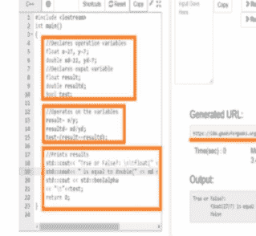

## C++ 的力量：高级字符串

我们将查看的另一个数据类型是字符串。字符串是字符序列。将它们想象成句子可能会帮助，但并不是每个句子都代表字符串。为了操作它们，我们需要这些库。这些库提供了方法和功能允许操作。

### 操作：字符串拼接

字符串拼接是将不同的字符串组合成一个字符串。它是组合字符串。例如，当你在网站输入名字，屏幕向你问候“Hello, [your_name]!”时，程序使用了拼接来完成操作。在 C++ 中，字符串拼接通过`+`运算符执行。让我们通过创建一个程序来查看其实际效果。除了包含

```
<iostream> ，还要包含 <string>
```

库

省略`using namespace std;`

移除`int main(){}`内部当前的填充代码

声明并设置变量

```
firstName = "John" 和 lastName = "Doe"
```

## 通过`+`运算符将`firstName`和`lastName`得到`fullName`打印结果为 "Hello Doe."它看起来应该是这样的：

https://ide.geeksforgeeks.org/glPmsIdDwF7/ 注释这些声明，尝试添加字符串以自己亲眼查看错误。该错误非常长且冗长，因为它在`<iostream>`和`<string>`库之间存在冲突。

### 字符串对象：Length() 属性

我们从现实世界的经验知道字符串

`[string_name].length()` 

让我们回到程序并获取`fullName`的长度。我们需要通过添加上述语法的一行新代码和另一个`cout`来修改代码，如下所示：

### 打印 fullName.Length()

此截图是我们修改后的字符串拼接程序的成功测试运行。我们鼓励你在此 URL 修改程序：https://ide.geeksforgeeks.org/B7XErpIJ9OE。

一旦你修改了程序，你可以在通过在另一个窗口中打开它，并与此成功的测试运行进行比较。你可以通过以下 URL 访问此保存的 IDE 窗口：https://ide.geeksforgeeks.org/xbjO6Pg3Nh。

### 字符串索引与数组

回想我们关于对象的对话。向量数组也是一种特殊的数学现象，它们有自己的特殊属性。数组是对象的有序排列——通常是行、列或矩阵——其中每个对象都有其特定的位置。字符串存储在由字符组成的数组中。因此，字符串数组是字符的有序排列，字符串中的每个字符都在自己的位置上被索引。使用`[ ]`访问数组以查找字符或其他项。让我们通过更改程序使其打印`fullName`中的第 3 个字符来观察这一实际操作。

注意：

记住索引从`[0]`开始。因此，字符串数组中的第 3 个字符位于`[2]`，而不是 3。

我们将使用这种语法来执行操作：

```
fullName [ x ]
```

`x`代表我们想要打印的字符的索引。记住也要编辑代码以正确地打印该字母。你还需要使用转义序列，例如：

### 访问 fullName 字符串数组

此截图是我们修改后的字符串属性程序的成功测试运行。我们鼓励你在此 URL 修改程序：https://ide.geeksforgeeks.org/xbjO6Pg3Nh。

一旦你修改了程序，你可以在通过在另一个窗口中打开它，并与此成功的测试运行进行比较。你可以通过以下 URL 访问此保存的 IDE 窗口：https://ide.geeksforgeeks.org/JWSG7HB2Ms。

在我们的示例中依赖了`cout`功能，但正如我提到的，程序员还使用其他字符串处理功能从不同来源获取内容。这些是`cin`对象和`getline()`函数。

### Cin 和 getline() 函数

在上一章节的示例中，我们使用了`cin`。与`cout`一样，`cin`是`<iostream>`库中的一个对象，允许程序使用`>>`运算符接收输入。与`cout`一样，`cin`对象必须用`std`数据类型定义。让我们修改我们的拼接程序，使其接收“John Doe”的输入。你可以使用你的名字，因为这样做可能很有趣。你需要遵循这些指令：

1. 导航到以下 URL 的字符串拼接程序：https://ide.geeksforgeeks.org/B7XErpl9OE
2. 声明变量
3. 提示用户输入姓名
4. `fullName = firstName + " " + lastName`
5. 使用以下代码段计算操作：
6. 打印结果

如果你发现自己卡住了，这里是它应该的样子：

### 使用 cin 进行字符串拼接

此截图是我们使用`cin`修改后的字符串拼接程序的成功测试运行。我们鼓励你在另一个窗口中打开此程序，并与你的程序进行比较。你可以通过此 URL 访问成功运行：https://ide.geeksforgeeks.org/KyuLgBoicaA。

> **注意：** 确保对你的代码进行注释。你可以简写指令并将它们作为即时算法来注释你的代码。这将帮助你保持程序有序。

`cin`程序只有当用户分别输入名和姓时才能工作。但大多数人的“名字”是存储或存入单个字符串的。让我们更改程序，以便在用户输入全名时问候他们。你需要遵循以下步骤：

1. 如果尚未，或如果你需要重置工作空间，前往以下 URL 的之前的工作空间：https://ide.geeksforgeeks.org/KyuLgBoicaA
2. 仅声明变量`fullName`
3. 使用`cin`提示用户输入全名
4. 使用`cout`和输入`fullName`问候用户

### 使用 cin 进行字符串终止

此截图是我们使用`cin`修改后的字符串拼接程序的成功测试运行。我们鼓励你在另一个窗口中打开此程序，并与你的程序进行比较。你可以通过此 URL 访问成功运行：https://ide.geeksforgeeks.org/KyuLgBoicaA。

注意：

`cin`程序只有当用户分别输入名和姓时才能工作。但大多数人的“名字”是存储或存入单个字符串的。让我们更改程序，以便在用户输入全名时问候他们。你需要遵循以下步骤：

1. 如果尚未，或如果你需要重置工作空间，前往以下 URL 的之前的工作空间：https://ide.geeksforgeeks.org/KyuLgBoicaA
2. 仅声明变量`fullName`
3. 使用`cin`提示用户输入全名
4. 使用`cout`和输入`fullName`问候用户

`cin`程序只有当用户分别输入名和姓时才能工作。但大多数人的“名字”是存储或存入单个字符串的。让我们更改程序，以便在用户输入全名时问候他们。你需要遵循以下步骤：

https://ide.geeksforgeeks.org/glPmsIdDwF7/ 注释这些声明，尝试添加字符串以自己亲眼查看错误。该错误非常长且冗长，因为它在`<iostream>`和`<string>`库之间存在冲突。

### 字符串对象：Length() 属性

我们从现实世界的经验知道字符串

`[string_name].length()` 

让我们回到程序并获取`fullName`的长度。我们需要通过添加上述语法的一行新代码和另一个`cout`来修改代码，如下所示：

### 打印 fullName.Length()

此截图是我们修改后的字符串拼接程序的成功测试运行。我们鼓励你在此 URL 修改程序：https://ide.geeksforgeeks.org/B7XErpIJ9OE。

一旦你修改了程序，你可以在通过在另一个窗口中打开它，并与此成功的测试运行进行比较。你可以通过以下 URL 访问此保存的 IDE 窗口：https://ide.geeksforgeeks.org/xbjO6Pg3Nh。

### 字符串索引与数组

回想我们关于对象的对话。向量数组也是一种特殊的数学现象，它们有自己的特殊属性。数组是对象的有序排列——通常是行、列或矩阵——其中每个对象都有其特定的位置。字符串存储在由字符组成的数组中。因此，字符串数组是字符的有序排列，字符串中的每个字符都在自己的位置上被索引。使用`[ ]`访问数组以查找字符或其他项。让我们通过更改程序使其打印`fullName`中的第 3 个字符来观察这一实际操作。

注意：

记住索引从`[0]`开始。因此，字符串数组中的第 3 个字符位于`[2]`，而不是 3。

我们将使用这种语法来执行操作：

```
fullName [ x ]
```

`x`代表我们想要打印的字符的索引。记住也要编辑代码以正确地打印该字母。你还需要使用转义序列，例如：

### 访问 fullName 字符串数组

此截图是我们修改后的字符串属性程序的成功测试运行。我们鼓励你在此 URL 修改程序：https://ide.geeksforgeeks.org/xbjO6Pg3Nh。

一旦你修改了程序，你可以在通过在另一个窗口中打开它，并与此成功的测试运行进行比较。你可以通过以下 URL 访问此保存的 IDE 窗口：https://ide.geeksforgeeks.org/JWSG7HB2Ms。

在我们的示例中依赖了`cout`功能，但正如我提到的，程序员还使用其他字符串处理功能从不同来源获取内容。这些是`cin`对象和`getline()`函数。

### Cin 和 getline() 函数

在上一章节的示例中，我们使用了`cin`。与`cout`一样，`cin`是`<iostream>`库中的一个对象，允许程序使用`>>`运算符接收输入。与`cout`一样，`cin`对象必须用`std`数据类型定义。让我们修改我们的拼接程序，使其接收“John Doe”的输入。你可以使用你的名字，因为这样做可能很有趣。你需要遵循这些指令：

1. 导航到以下 URL 的字符串拼接程序：https://ide.geeksforgeeks.org/B7XErpl9OE
2. 声明变量
3. 提示用户输入姓名
4. `fullName = firstName + " " + lastName`
5. 使用以下代码段计算操作：
6. 打印结果

如果你发现自己卡住了，这里是它应该的样子：

### 使用 cin 进行字符串拼接

此截图是我们使用`cin`修改后的字符串拼接程序的成功测试运行。我们鼓励你在另一个窗口中打开此程序，并与你的程序进行比较。你可以通过此 URL 访问成功运行：https://ide.geeksforgeeks.org/KyuLgBoicaA。

> **注意：** 确保对你的代码进行注释。你可以简写指令并将它们作为即时算法来注释你的代码。这将帮助你保持程序有序。

`cin`程序只有当用户分别输入名和姓时才能工作。但大多数人的“名字”是存储或存入单个字符串的。让我们更改程序，以便在用户输入全名时问候他们。你需要遵循以下步骤：

1. 如果尚未，或如果你需要重置工作空间，前往以下 URL 的之前的工作空间：https://ide.geeksforgeeks.org/KyuLgBoicaA
2. 仅声明变量`fullName`
3. 使用`cin`提示用户输入全名
4. 使用`cout`和输入`fullName`问候用户

### 使用 cin 进行字符串终止

此截图是我们使用`cin`修改后的字符串拼接程序的成功测试运行。我们鼓励你在另一个窗口中打开此程序，并与你的程序进行比较。你可以通过此 URL 访问成功运行：https://ide.geeksforgeeks.org/KyuLgBoicaA。

此表列出了操作符符号，并根据 (1) 它们一次接受多少操作数 (2) 它们实现的操作类型进行分类。例如，大多数算术运算符一次对两个操作数进行操作。

所有操作符的特征在于它们一次可以操作多少个操作数以及它们可以执行的操作类型。它们分为三类：

- **一元运算符 (Unary)** - 一次只接受 1 个操作数的操作符
- **二元运算符 (Binary)** - 一次只接受 2 个操作数的操作符
- **三元运算符 (Ternary)** - 接受超过 2 个操作数的运算符，或带有多个参数的条件运算符

它们进一步分为 6 类：

- 算术运算符
- 关系运算符
- 逻辑运算符
- 位运算运算符
- 赋值运算符
- 其他运算符，如条件运算符、地址和重定向运算符

在本章中，我们将查看 5 种操作符及其功能。

**注意：** 操作符具有优先级，就像数学方程一样。例如，用于调用函数的括号优先级高于加法或减法。然而，你应该尽量保持你的代码行尽可能简单。这使得你的程序更容易编辑和调试。整洁、复杂的代码可以避免错误。

## 二元运算符

二元运算符是 C++ 中找到的大多数操作数。它们包含了 6 种运算符中的 5 种。这使得它们成为完美的起点。正如名称所示，二元运算符比较两个操作数。它们是决策和控制开关的完美选择。

### 算术运算符

它们所有运算符中最常见且易理解的，因为即使在编程之外我们也使用它们，它们主要是数学性的。我们使用它们来执行数学运算。

注意：在字符串拼接示例中，用于拼接的`+`并不是算术函数。相反，它是处理拼接的字符串库函数。

此类分类中的大多数运算符都需要两个操作数。唯一的异常是用于在循环中增加或减少数值的一元`++`和`--`运算符。二元运算符 (Jaggi, 2015a)：

- `+`: 加法运算符，将两个操作数相加
- `-`: 减法运算符，从一个操作数减去另一个
- `*`: 乘法运算符，将两个操作数相乘
- `/`: 除法“斜杠”运算符，将第一个操作数除以第二个
- `%`: 取模运算符，返回第一个操作数除以第二个时的余数

让我们创建一个`cout`程序来演示所有 5 种算术操作数。在 IDE 中创建一个新的 C++ 工作空间并遵循这些指令：

```
a = 25 and b = 10 Declare two variables as integers
result Declare a variable,
and b Print the variables
and b Add and print the result
a and b Subtract and print the result
a and b Multiply and print the result
a and b Divide and print the result
```

计算除法的余数并打印结果。这里是它的样子。

### 算术例程程序

这张截图是算术例程程序的成功运行。你可以在索引中访问原始代码副本。

如果你遇到错误，我鼓励你使用我们的成功运行结果来排查你的工作区。

打开它来比较代码。在这里可以找到它：

https://ide.geeksforgeeks.org/vDcCH7f5EQ

> `==` : “等于”运算符，检查两个操作数是否相等。如果操作数相等，它返回一个布尔值“true”；否则，返回 false。
> `!=` : “不等于”运算符，也检查两个给定的操作数是否相等。然而，如果操作数不相等，该运算符返回布尔值 true；如果操作数相等，则返回 false。

正如我们处理算术运算符时做的那样：

注意：

`if ( ) else`语句是对大小写敏感的。"if" 和 "else" 必须都用小写。此外，虽然`if()`可以在没有`else`的情况下执行，但如果代码为假，缺失的语句会导致错误。`else`语句也无法在没有`if()`语句的情况下实现。我们将在稍后的章节中更详细地描述`if().else`语句。

为了创建我们的程序，我们必须遵循以下步骤。

使用此 URL 打开并编辑算术例程程序：

https://ide.geeksforgeeks.org/vDcCCH7f5EQ

在算术例程中使用相同的变量。确保清理代码中任何不需要的变量。

打印程序的解释

测试`if(a > b)`并打印结果

创建一个`if`语句，在大于`b`时打印结果

创建一个嵌套的`else`语句，在为假时打印结果

**注意：** 对于`if()...else`，你将不得不为所有可能性创建一个`cout`。对于我们的简单程序，每个语句只有两种可能。

测试`if(a >= b)`并打印结果

测试`if(a < b)`测试并打印结果

测试`if(a <= b)`并打印结果

测试`if(a == b)`并打印结果

测试`if(a != b)`并打印结果

### 关系例程程序


这张截图是关系例程程序的成功运行。你可以在索引中访问原始代码副本。在这里：https://ide.geeksforgeeks.org/vDcCH7f5EQ

这张截图是关系例程程序的成功运行。你可以在索引中访问原始代码副本。如果你遇到错误，我鼓励你使用我们的成功运行结果来排查你的工作区。打开它来比较代码。在这里可以找到它：

https://ide.geeksforgeeks.org/vDcCH7f5EQ

这张截图是关系例程程序的成功运行。你可以在索引中访问原始代码副本。如果你遇到错误，我鼓励你使用我们的成功运行结果来排查你的工作区。打开它来比较代码。在这里可以找到它：

https://ide.geeksforgeeks.org/vDcCH7f5EQ

> `==` : “等于”运算符，检查两个操作数是否相等。如果操作数相等，它返回一个布尔值`true`；否则，返回`false`。

> `!=` : “不等于”运算符，也检查两个给定的操作数是否相等。然而，如果操作数不相等，该运算符返回布尔值`true`；如果操作数相等，则返回`false`。

正如我们处理算术运算符时做的那样：

注意：

`if ( ) else` 语句是对大小写敏感的。`if` 和 `else` 必须都用小写。此外，虽然`if()`可以在没有`else`的情况下执行，但如果代码为假，缺失的语句会导致错误。`else`语句也无法在没有`if()`语句的情况下实现。我们将在稍后的章节中更详细地描述`if().else`语句。

为了创建我们的程序，我们必须遵循以下步骤。

使用此 URL 打开并编辑算术例程程序：

https://ide.geeksforgeeks.org/vDcCH7f5EQ

在算术例程中使用相同的变量。确保清理代码中任何不需要的变量。

打印程序的解释

测试`if(a > b)`并打印结果

创建一个`if`语句，在大于时打印结果

创建一个嵌套的`else`语句，在为假时打印结果

**注意：** `if()...else`你将不得不为所有可能性创建一个`cout`。对于我们的简单程序，每个语句只有两种可能。

测试`if(a >= b)`并打印结果

测试`if(a < b)`测试并打印结果

测试`if(a <= b)`并打印结果

测试`if(a == b)`并打印结果

测试`if(a != b)`并打印结果


### 关系例程程序

这张截图是关系例程程序的成功运行。你可以在索引中访问原始代码副本。如果你遇到错误，我鼓励你使用我们的成功运行结果来排查你的工作区。打开它来比较代码。在这里可以找到它：

> `==` : “等于”运算符，检查两个操作数是否相等。如果操作数相等，它返回一个布尔值`true`；否则，返回`false`。

> `!=` : “不等于”运算符，也检查两个给定的操作数是否相等。然而，如果操作数不相等，该运算符返回布尔值`true`；如果操作数相等，返回`false`。

正如我们处理算术运算符时做的那样：

注意：

`if ( ) else` 语句是对大小写敏感的。`if` 和 `else` 必须都用小写。此外，虽然`if()`可以在没有`else`的情况下执行，但如果代码为假，缺失的语句会导致错误。`else`语句也无法在没有`if()`语句的情况下实现。我们将在稍后的章节中更详细地描述`if().else`语句。

为了创建我们的程序，我们必须遵循以下步骤。

使用此 URL 打开并编辑算术例程程序：

https://ide.geeksforgeeks.org/vDcCH7f5EQ

在算术例程中使用相同的变量。确保清理代码中任何不需要的变量。

打印程序的解释

测试`if(a > b)`并打印结果

创建一个`if`语句，在大于时打印结果

创建一个嵌套的`else`语句，在为假时打印结果

**注意：** `if()...else`你将不得不为所有可能性创建一个`cout`。对于我们的简单程序，每个语句只有两种可能。

测试`if(a >= b)`并打印结果

测试`if(a < b)`测试并打印结果

测试`if(a <= b)`并打印结果

测试`if(a == b)`并打印结果

测试`if(a != b)`并打印结果

### 关系例程程序

这张截图是关系例程程序的成功运行。你可以在索引中访问原始代码副本。如果你遇到错误，我鼓励你使用我们的成功运行结果来排查你的工作区。打开它来比较代码。在这里可以找到它：

https://ide.geeksforgeeks.org/vDcCH7f5EQ

> `==` : “等于”运算符，检查两个操作数是否相等。如果操作数相等，它返回一个布尔值`true`；否则，返回`false`。

> `!=` : “不等于”运算符，也检查两个给定的操作数是否相等。然而，如果操作数不相等，该运算符返回布尔值`true`；如果操作数相等，返回`false`。

正如我们处理算术运算符时做的那样：

注意：

`if ( ) else` 语句是对大小写敏感的。`if` 和 `else` 必须都用小写。此外，虽然`if()`可以在没有`else`的情况下执行，但如果代码为假，缺失的语句会导致错误。`else`语句也无法在没有`if()`语句的情况下实现。我们将在稍后的章节中更详细地描述`if().else`语句。

为了创建我们的程序，我们必须遵循以下步骤。

使用此 URL 打开并编辑算术例程程序：

https://ide.geeksforgeeks.org/vDcCH7f5EQ

在算术例程中使用相同的变量。确保清理代码中任何不需要的变量。

打印程序的解释

测试`if(a > b)`并打印结果

创建一个`if`语句，在大于时打印结果

创建一个嵌套的`else`语句，在为假时打印结果

**注意：** `if()...else`你将不得不为所有可能性创建一个`cout`。对于我们的简单程序，每个语句只有两种可能。

测试`if(a >= b)`并打印结果

测试`if(a < b)`测试并打印结果

测试`if(a <= b)`并打印结果

测试`if(a == b)`并打印结果

测试`if(a != b)`并打印结果

### 关系例程程序

这张截图是关系例程程序的成功运行。你可以在索引中访问原始代码副本。如果你遇到错误，我鼓励你使用我们的成功运行结果来排查你的工作区。打开它来比较代码。在这里可以找到它：

https://ide.geeksforgeeks.org/vDcCH7f5EQ

### 逻辑运算符

逻辑运算符增加了关系运算符的复杂性。它们与关系运算符结合使用，组合两个或多个条件。三个运算符 (Jaggi, 2015b)：

- AND: 逻辑“AND”运算符在两个条件都满足时返回布尔值`true`。如果其中一个不满足，则返回`false`。

- OR: 逻辑“OR”运算符在一个（或两个）条件都满足时返回布尔值`true`。如果所有条件都不满足，它返回`false`。

- NOT: 逻辑“NOT”运算符在条件不满足时返回布尔值`true`。如果其中一个条件为真，它返回`false`。

逻辑运算符用于机器。想象安全系统中的一个“NOT”运算符。假设锁定的门为“0”，而未锁的门保持安全。但在火灾时，这些门应该打开，“NOT”信号将返回打开门。

让我们通过构建程序来探索逻辑运算符。遵循这些指令：

使用此 URL 打开并编辑关系例程程序：

https://ide.geeksforgeeks.org/vDcCH7f5EQ

```
a = 5,b = 0,c = 12,d = 24
```

测试逻辑运算符的变量：

打印程序的解释

测试`if(a > b && c==d)`并打印结果

创建一个`if`语句，在大于时打印结果

测试`(a>b || c==d)`并打印结果

测试`(!b)`并打印结果

清理代码中任何不必要的行。这里是它的样子：


`if()...else`语句产生假值

任何关系表达式为假都会产生虚假的 AND。然而，可以通过嵌套另一个`()...else`来修复程序以产生准确答案。

## if().else

### 逻辑例程程序

这张截图是逻辑例程程序的成功运行，展示了所有逻辑函数的示例。你可以通过此 URL 访问此工作区：https://ide.geeksforgeeks.org/x9ixjUYDBG

正如你所看到的，“AND”函数可能很难仅通过一个语句进行打印。修改此练习，创建一个可以更好地解释自身的程序！

提示：你只需要一条额外的语句。你可以通过此 URL 与我们的结果进行对比：https://ide.geeksforgeeks.org/nh8yYV9Kjy.

让我们暂时离开日常操作，探索我们使用逻辑运算符的其他方法。逻辑运算符基于机器逻辑，特别是逻辑门。逻辑门是具有一个或多个输入和一个输出的电子电路。逻辑门的功能与逻辑运算符相同。“与门（AND）”仅在所有输入都为“1”时才通过“1”；或门（OR）”在接收到任何一个输入的“1”时通过“1”；“非门（NOT）”在接收到“0”作为输入时通过“1”。

逻辑门可以控制电路中的数据流，这与条件语句结合使用时的逻辑操作是相同的。在逻辑运算符中，这被称为**条件短路**。

AND 运算符和 OR 运算符具有短路特性。回想一下 AND 如何在两个关系运算符在条件下都为真时才返回真。此外，关系运算符是按照它们在条件语句中出现的顺序进行评估的——如果第一个为假，则第二个将不会被评估，它发生了短路逻辑。

OR 运算符的处理方式不同。只需要一个关系运算符返回其真布尔值即可。因此，如果第一个关系运算符返回真，它就不会检查下一个。

这非常有用，因为我们可以向程序提供更复杂的指令，关于在什么情况下如何行为。OR 和 AND 的短路是相反的。让我们利用这一点来编写一个程序，告诉我们何时发生 AND 和 OR 门的短路。

遵循以下指令：

```
打开一个新的 IDE
**a = 10,b** 声明两个变量：
```

打印程序的解释

此程序将测试当`a`等于`b`时，OR 门或 AND 门是否短路。

打印`a`和`b`的当前值

```cpp
bool声明并计算两个变量
resAND = ((a == b) && std::cout << "OR circuit shorted")
resOR = ((a == b) || std::cout << "AND circuit shorted") 这看起来是这样的：
```

```java
import java.*;

public class Main {
    public static void main(String[] args) {
        int a = 5;
        int b = 10;
        if (a < b) {
            System.out.println("a is less than b");
        } else {
            System.out.println("a is not less than b");
        }
    }
}
```

### 短路检测程序

此截图是我们短路检测程序的成功运行。利用我们对逻辑 AND、逻辑 OR 以及它们之间关系的知识，我们开发出了一种检测短路的方法。可以通过此 URL 访问工作空间：https://ide.geeksforgeeks.org/uBLgLtBnnY

尝试不同的值，看看你是否可以触发不同的“电路”。

- 考虑一个短路检测程序。我们在现实世界中会如何使用它？我提到过这类系统在银行安全中起着作用。问题是它如何实现这些功能的？你可以告诉程序如果某个条件不满足（“非”），则拒绝访问，例如密码不匹配。

理解逻辑运算符可以让我们很好机器和系统是如何做出决策的。关系运算符和逻辑运算符让我们对程序中发生的情况以及它与周围一切事物的关系有了更多的控制。我们通过各种库、语句和对象来实现这一点。到目前为止我们写了一些小型程序，但在更大的程序中，使用这类对象控制会给编译器带来开销。这在编程环境以及游戏引擎、内容分发等行业中有明显的影响。想想 YouTube 上每秒必须传输数 GB 数据的服务器，以及需要实时渲染的游戏引擎：它们必须在利用这些控制特性的同时减少开销。坦率地说，这可以通过使用位运算符来实现。

## 位运算符

在电路层面，机器通过使用 AND 和 OR 门进行通信。这让它们在单比特数据层面上具备了决策能力。位运算符使用这些微观层计算来访问机器层面的过程，绕过了对象编程。换句话说，它们是在二进制位上对数字操作的逻辑运算符。

$5 \times 10^2 + 3 \times 10^1 + 4 \times 10^0 = 534_{10}$

人类使用十进制数字来概念化数字，也称为十进制制。例如，数字 543 被理解为五百、四十和三个。在 10 进制中它看起来是这样：

在二进制中，同一个数字看起来像这样 `0b1000010110` —— “0b10-2”，它们只是看起来不同。这是一个二进制数。二进制数以位流的形式呈现，可以是两种状态之一：0 或 1。在10 进制中，数字的位置决定了它的值。

$2^9 + 2^4 + 2^2 + 2^1 = 534_{10}$ 示例显示了一个二进制数是如何 10 位的。仔细观察 534 流，我们可以看到第 $2^{nd}$、$3^{rd}$、$4^{th}$ 和第 $10^{th}$ 位是开启的（从右向左），所有其他位都是关闭的（1 为开启，0 为关闭）。在 2 进制中，我们这样计算它：

对我们来说计算它并不容易，但这就是计算机通信的方式，通过数据位流进行通信。它们识别和计数这些数字就像人类识别 10 进制数字一样容易。因此，使用运行在计算机自然水平上的位运算符可以提高速度和性能，因为它们跳过了从对象编程到机器语言的翻译。

### 寄存器 C 中的 a

计算位取反操作：

```
c = ~a;// 61 = 11000011
```

在 C 中打印结果和寄存器：

### 寄存器 C 中的 a

打印一个比较寄存器：

这将有助于与位移位操作进行比较。

### 寄存器 C 中的 a << 2

计算位左移操作：

```
c = a << 2;//240 = 11110000
```

在 C 中打印结果和寄存器：

### 寄存器 C 中的 a >> 2

计算位右移操作：

```
c = a >> 2;//15 = 00001111
```

在 C 中打印结果和寄存器：

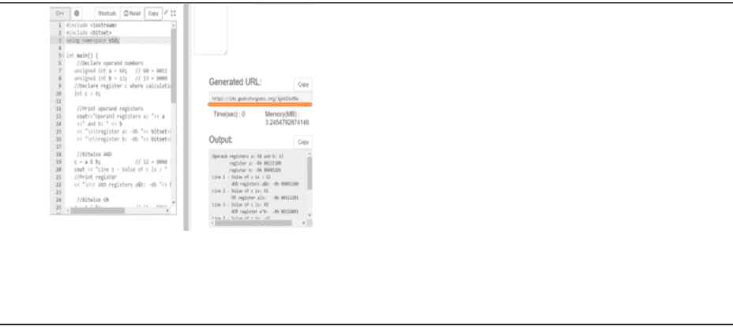

### 带寄存器打印的位运算程序

此截图是我们位运算例程序的成功运行结果。

输出包含了寄存器数组的可视化内容。这将让你看到位运算是如何计算的，以及它是如何改变寄存器的。这是一个输出非常长的程序。要完整学习它，可以通过此 URL 在我们的保存工作区中访问：https://ide.geeksforgeeks.org/JgnAlVwOnE

## C

注意：

此程序使用了 `namespace std;` 来简化程序。良好的做法是省略命名空间并单独声明每个 `cout` 和位对象。

我们将讨论的最后一个二元运算符是赋值运算符。赋值运算符用于赋值和动态更改值。在编程原理中，我们讨论过程序需要尽可能高效，同时使用尽可能少的指令。高级赋值运算符将每次赋值和其他操作相结合，以减少代码行数。它们都是原子操作，意味着允许程序员操作变量内部的存储值并重新赋值。以下是常见的赋值运算符列表（Prabhu, 2018）：

- `=`: 等于赋值运算符，将右侧的值赋给左侧变量。

- `+=`: 原子加法运算符，用于结合 `+` 和 `=` 运算符。该运算符将左侧变量的值加上右侧的值，然后将结果保存到左侧变量中。

### x

```cpp
+= y 是 x = x + y 的简短写法
```

例如，无需使用独立的算术运算符。

- `-=`: 该运算符从右侧的值中减去左侧变量的值，然后将结果保存到左侧变量中。

- `*=`: 原子乘法运算符，用于结合 `*` 和 `=` 运算符。该运算符将左侧变量乘以右侧的值，并将结果保存到左侧变量中。

例如，`x *= y` 是 `x = x * y` 的简短写法，无需使用独立的算术运算符。

注意：还有一些位赋值操作：`&=`、`|=` 和 `^=`。我们目前将重点关注算术原子的函数。

让我们创建一个赋值运算符例程序，看看这些赋值操作是如何运作的。遵循以下步骤：

- 打开一个新的 IDE 工作区

- 声明并初始化变量 `int a = 10;`

- 打印打印程序的说明和初始值

- 注意：在编写打印类的程序时，务必让它们易读！确保你的程序能够自我解释。

- 原子地加 10 并打印结果

- 从你的变量中原子地减去 10 并打印结果

- 原子地乘以 10 并打印结果

- 原子地将我们的变量除以 10 并打印结果

它的样子如下：

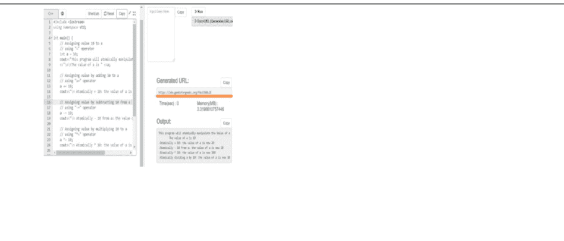

### 赋值程序

此截图是我们赋值例程序的成功运行结果。该程序具有顺序输出特性，这意味着每条指令都会影响下一条指令的结果。这意味着如果我们改变应用于变量的原子操作顺序，输出将会有不同。要学习它，您可以通过此 URL 在保存的工作区中访问：https://ide.geeksforgeeks.org/Fbc63b0u1E

这些二元赋值运算符将赋值和算术函数相结合。它们在控制循环和条件语句时也运行良好。原子赋值运算符与一元算术运算符密切相关。两者都经常用于控制循环。让我们来看看一元操作。

### 一元操作

在讨论一元操作之前，让我们看看使用它们的代码。

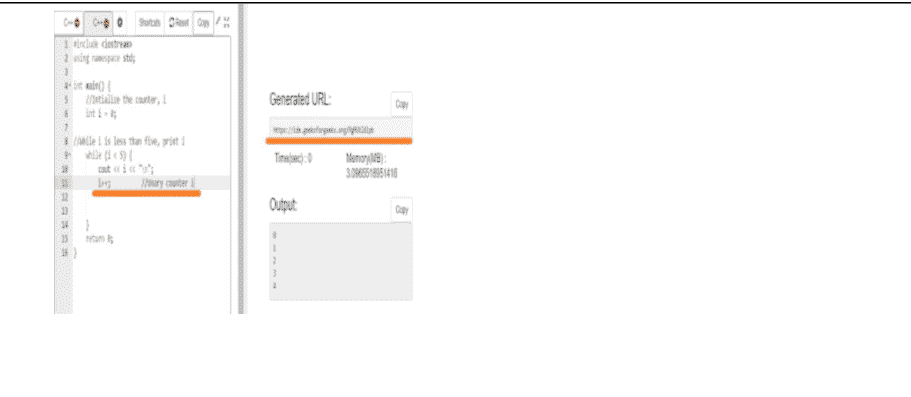

# 使用一元运算符的 While 

- `j++`: 一元操作在每次迭代时执行 `j = 1 + i`，直到 `i = 5` 且 while 结束。

此截图是一个打印计数器（Counter）值的简单 while 。没有 `i++`，while 将无法进展。我们将在决策章节中详细讨论循环。要完整学习它，可以通过此 URL 在我们的保存工作区中访问：https://ide.geeksforgeeks.org/MgMUtZdlpbb


`i = 1 + i` 与 `i++` 相同。使用一元形式使代码更整洁，因为它排除了 `+` 算术运算符和 `=` 赋值运算符。我们也可以使用原子加法运算符来完成代码：`i+=1` 等于 `i++`。但这种格式需要编译器存储并操作额外的操作数。

一元运算符的作用是通过仅有一个操作数来简化代码。记住，一元运算符是那些使用一个操作数的运算符。以下是一元运算符的其他一些例子（Kumar, 2017）：

- `++`：递增运算符，用于将整数的值加 1。它可以放在变量前面以立即增加值，或放在后面在递增前临时保存该值。
- `--`：递减运算符，用于将整数的值减 1。与递增运算符类似，程序员也可以实现前递减和后递减指令。
- `-`：一元运算符，用于更改变量或参数的符号。在负整数上执行一元操作将使其变为正数，反之亦然。
- `!`：如果变量的布尔值为 `false`，则 `!x` 将为 `true`：非逻辑用于反转操作数的布尔逻辑状态。
- `&`：地址运算符，用于指向变量的地址。

让我们创建一个一元运算符例程序，看看前置和后置指令是如何工作的。遵循以下指令：

- 打开一个新的 IDE 工作区。
- 声明并初始化你的变量和缓冲区：`int a = 10, buf;`
- 打印打印程序的说明和初始值。
- 计算等于缓冲区的后递增并打印结果。
- 计算等于缓冲区的后递减并打印结果。
- 计算等于缓冲区的前递增并打印结果。
- 计算等于缓冲区的前递减并打印结果。


### 带后置和前置操作的一元运算符程序

此截图是一个的一元运算符程序。要完整学习它，可以通过此 URL 在我们的保存工作区访问：https://ide.geeksforgeeks.org/mvcYtkyC4

程序对 `a` 进行操作并在计算时将其存储在 `a` 中观察。对比 `a` 和缓冲区，后置操作延迟更改 `a` 的值；相反，前置操作会立即更改。

在这一切之上，我们还有 `sizeof()` 运算符。它看起来像一个函数，但被归类为运算符。它检查对象的大小并返回字节数。

回顾我们关于位流的对话。我没说的是它们通常被分成 8 位。一个字节是一个单字节流，可以表示 255 个数字。在我们的位运算中，我们的寄存器是 1 字节长，是因为我们处理的数字小于 255。

让我们写一个使用 `sizeof()` 获取数组大小的程序。我们开始吧：

打开一个新的 C++ IDE 工作区。

```cpp
int arr[] = {1,2,3,4,7,98,0,12,35,99,14};
```

声明并初始化我们的数组。

打印打印程序的说明和数组。

注意：要打印数组你必须为它创建一个循环。我们将在下一章节讨论循环。现在，只需使用这些行代码即可：

```cpp
for(const auto e:arr) {
    cout << "[" << e << "]";
}
```

```cpp
int size = sizeof(arr)/sizeof(arr[0]); // 计算数组的大小
```

打印数组的大小。

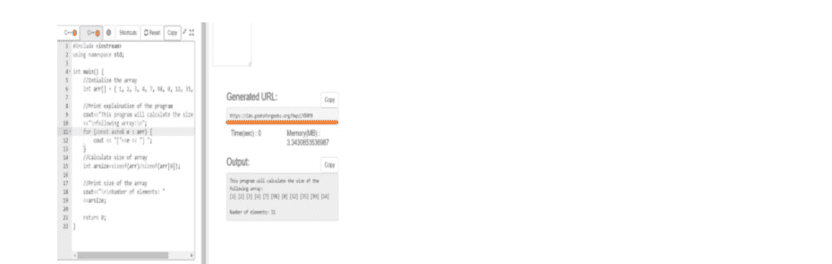

### 数组大小报告程序

截图显示的是我们的数组大小报告程序。我们鼓励你将你的结果与我们的进行对比。为了充分学习，你可以通过此 URL 访问我们保存的工作区：https://ide.geeksforgeeks.org/HwpcLYB4P0。

这是一个关于两个单元操作的很好的例子：`sizeof()` 和地址指针 `&`。我们用于打印数组的 `for()` 循环是通过拷贝构造函数调用的。拷贝构造函数调用包含一个带有索引变量的 `for()` 循环、地址运算符（Addressof operator）和一个带有索引的容器对象。拷贝构造函数通过地址指针自动推断 `[arr 的大小]` 并打印其内容，从而设置 `[0] : [arr 的大小]`。简单来说，拷贝构造函数使用地址运算符来减少程序的大小。

`sizeof()` 运算符是一个客观函数，它使用单个操作数，即数组对象。这两者都有优缺点。`sizeof()` 运算符使用一个操作数，且不需要晦涩的寄存器。调用组合必须使用额外的对象（`e`）来打印数组，但它会有更少的递增运算符。我们将在下一章更详细地讨论 C++ 的循环和决策功能。现在，让我们关注三元运算符上。

### 三元运算符

C++ 只有一个三元运算符。三元运算符，也称为条件运算符，接受 3 个或更多操作数——它们是基于布尔逻辑的运算符。结果取决于第一个表达式是否为真，如果是，则评估第二个表达式；如果第一个表达式为假，则评估第三个表达式。如果你记得我们在关系程序例程中的 `if().else` 语句，它包含三个部分：函数评估的初始表达式、当初始表达式为真时评估的表达式，以及当初始表达式为假时评估的语句。条件运算符与 `if().else` 语句具有相同的组件，只是更加紧凑。

让我们编写一个程序来展示这些相似之处：

- 打开一个新的 IDE C++ 工作空间。
- 要使用条件运算符，你需要调用：

```cpp
<bits/stdc++.h>
```

- 打印关于条件运算符的解释。
- 此程序将使用两种方法选取最大值：条件运算符和语句。

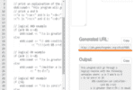

我们期望结果为 5。

声明变量并执行条件运算符：`int arrsize=sizeof(arr)/sizeof(arr[0]);`

### 打印 `elseif(2 > 5)` 的解释，然后打印 2 然后打印 5

```cpp
#include <iostream>
using namespace std;
int main() {
    if (5 > 3)
        cout << "this program will pick the greatest\ngest element of the array." << endl;
    else if (2 > 5)
        cout << "base expression using if\nvalue of 2" << endl;
    else
        cout << "base expression using if else\nvalue of 5" << endl;
    return 0;
}
```

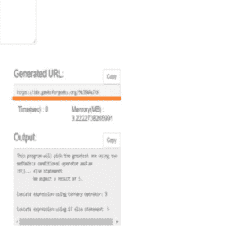

### 条件操作演示

此截图是我们的条件操作演示。该程序没有实际的实用功能。然而，对于我们的目的，它确实展示了条件运算符和语句之间的相似结构。为了充分学习，我们建议你通过 URL 访问我们保存的工作区的副本：https://ide.geeksforgeeks.org/9kJJBAAgqItK。

在本章中，我们查看了三种类型的运算符：单元、二元和三元。正如你所看到的，这些运算符允许程序员应用 C++ 的强大方面。例如，二元运算符允许机器做出逻辑决策、计算值并通过改变函数来控制过程。单元函数帮助我们收缩和简化复杂的代码。三元运算符允许我们的代码更加简洁。它们都是 C++ 中决策和切换的核心。

## 第 5 章：C++ 中的决策


在这一课中，我们将讨论决策工具。这些工具就像 `if-else` 循环。在第 4 章中，我们看到了运算符如何用于逻辑表达式。当我们做决策时，我们使用这些表达式来帮助我们思考。人们为机器编写程序，让机器根据他们想要它们做的事情做出决策。决策函数和逻辑表达式使成为可能。

这是第 4 章发生的情况。我们在拷贝构造函数中使用 `for()` 循环来填充数组并打印所有索引。为了让 `for()` 循环工作，我们使用了带有 `auto` 数据类型的单元运算符地址运算符。这意味着我们不需要为循环创建一个单独的计数器。如果你还没有自己手动启动和结束循环，拷贝构造函数的

## 循环

程序员花费大量时间自动执行重复性任务。例如，循环被用于遍历数组。循环有两种类型：入部控制和退出控制。入口控制循环只要条件为真一直使用。退出控制循环一直使用直到满足特定条件。这是一个循环的示例：

打开一个新的 IDE C++ 工作空间：https://ide.geeksforgeeks.org/HwpcLYB4P0。

此程序将选取最大值。

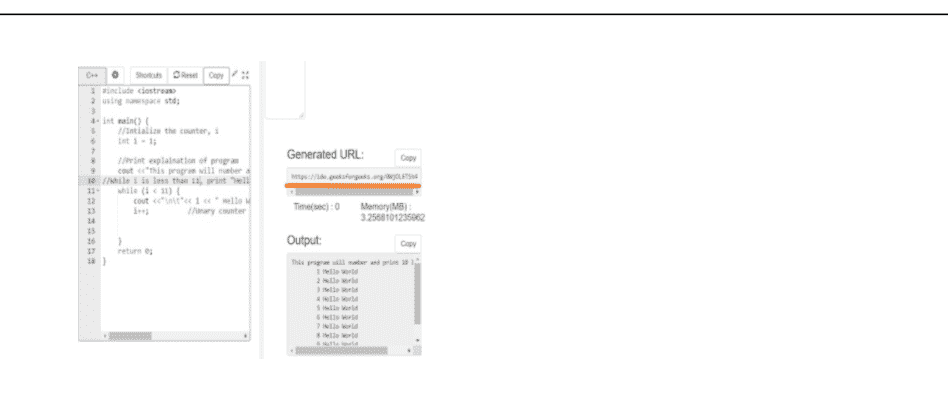

### `while` 循环演示

此截图是我们的循环演示。你可以通过 URL 访问我们保存的工作区：https://ide.geeksforgeeks.org/9kJJBAAgqItK。

此程序展示了它们是如何工作的：

```cpp
int i = 0;
while (i < 10) {
    cout << "value of: " << i << endl;
    i++;
}
```

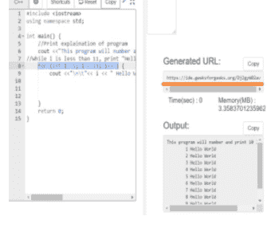

### `for` 循环演示

此截图是我们的循环演示。你可以通过 URL 访问我们保存的工作区：https://ide.geeksforgeeks.org/9kJJBAAgqItK。

等等，文本重复了。此截图是我们的循环演示。你可以通过 URL 访问我们保存的工作区：https://ide.geeksforgeeks.org/9kJJBAAgqItK。

这是一个 `for` 循环的示例：

```cpp
for(int i = 0; i < arrsize; i++) {
    cout << "value of: " << arr[i] << endl;
}
```

此程序将使用两种方法选取数组中的最大元素。


只要未检测到火，门将保持关闭状态。`do{}.while()` 循环对于许多故障关闭（fail-close）系统非常有用。其他应用包括服务器中的修正，当检测到错误时运行纠正程序。让我们通过修改 `while()` 程序来编写第一个 `do-while` 循环。遵循以下指令：

- 打开以下 IDE C++ 工作空间：https://ide.geeksforgeeks.org/WJL6TSSh4。
- 将计数器初始化为 `int i = 11;`。
- 实现 `do{}` 代码块。
- 设置 `while(i < 11);`。
- 清理数据中任何不需要的代码和注释。

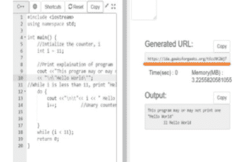

> 在程序运行期间 `< 11` 始终为假，`do{}`。

检查结果。

### 展示退出控制循环的 Do While Loop

此截图是我们的 do-while 循环演示。你应该注意到，尽管代码块被执行了。这是因为该循环是一个退出控制循环：条件是在代码块执行后进行测试的。代码具有执行的潜力。你可以使用 URL 访问我们保存的工作空间的副本：

https://ide.geeksforgeeks.org/t6zcNK2Wj7。

查看尽管条件为假，消息是如何被打印的。你可以将其应用于数据流中的数据修正。许多错误检测服务会暂停数据流并发送重传请求。`do{}while` 循环将允许数据流继续，直到检测到错误为止。这些是 YouTube 在服务器缓冲区中使用的程序类型。它们在控制数据方面是多么用。对于单次切换，我们将使用 `if()...else`。

### `If()...Else`

到目前为止，我们在示例中使用了 `if()...else` 函数。它们易于理解，结构也相当自于易懂。`if()...else` 语句测试条件并根据结果执行其中一个代码块或另一个。它们是两个独立的不同语句的组合。

你可以单独执行 `if()` 函数，但编译器期望一个 `else` 语句。`else` 语句包含随 `if()` 表达式一起的代码。没有 `if()` 语句，`else` 语句永远不会执行。

`else if()` 语句指定了另一个要测试的条件。它创建了一个名为嵌套 if-else 语句的语句链。如果你正在测试很多条件，最好使用 `switch`，我们将在下一节讨论。让我们编写第一个嵌套 `if-else` 语句。遵循这些指令（“C++ | Nested Ternary Operator,” 2018）：

- 打开一个新的 IDE C++ 工作空间。
- 打印条件运算符的解释。
- 此程序将遍历 2 到 4 的顺序数字列表，并使用嵌套的 `if().else` 语句选择最大的一个。
- 我们预期结果为 4。

```text
Implement a nested if-else if(2 > 3) then print 2
```

```text
elif(3 > 4) then print 3
```

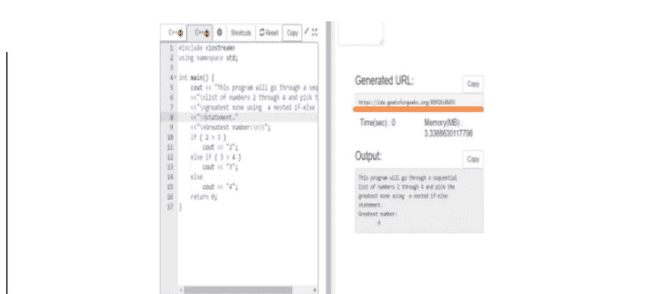

`if()...else` 语句。尽管我们已经知道了答案，`if()...else else` 打印。

### 嵌套 If-Else 演示

此截图是我们的嵌套 if-else 演示。就像我们的其他演示一样，这个程序没有功能。然而，对于我们的目的来说，这是一个实现和理解的极佳练习，仍然为每个语句需要代码块。代码块还应该与条件对应，以创建一个满足其设定目的的功能性程序。你可以使用此 URL 访问我们保存的工作空间的副本：https://ide.geeksforgeeks.org/89MINvRWWYU。

让我们进一步检查这个练习。`if-else` 可以分为两部分：包含条件和执行代码的 `if()` 和 `else` 语句。你注意到代码块在逻辑上遵循了程序的目标，即找到最大的数字。以防我们更改条件语句，按升序打印数字是有意义的。`if()` 语句中的条件以及它们包含的代码块的排列方式允许程序流向答案。例如，`if (2 > 3)` 被硬编码为下一个嵌套语句。该结构刻意遵循了嵌套三元运算符。

### 嵌套三元运算符（Nested Ternary If Else）

在上一章中，我们讨论了条件运算符，即测试条件并根据结果执行操作的三元运算符。我们说它类似于 `if()...else` 语句，但更简洁。例如，`if()` 语句测试条件并根据测试结果执行两个代码块之一。`if()...else` 语句可以嵌套，条件运算符也可以嵌套。让我们比较一下两者的结构。遵循以下步骤参与（“C++ | Nested Ternary Operator,” 2018）：

- 如果你有了嵌套 if-else 演示程序，请在此 URL 打开已保存的 IDE C++ 程序：https://ide.geeksforgeeks.org/89MINvRWWYU。
- 打印程序的解释。
- 此程序将遍历 2 到 4 的顺序数字列表，并使用两种方法选择最大的一个：条件运算符和嵌套的 `if()...else` 语句。
- 我们预期结果为 4。
- 为嵌套 if-else 添加一个打印通知。
- 添加条件运算符代码：声明变量并执行条件运算符。

`int a = 2>3?2:3>4?3:4;`

### 清理代码中不必要的注释

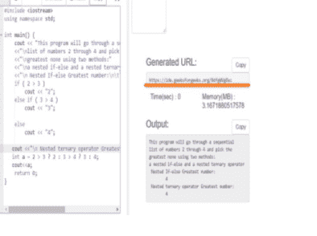

## If-Else 与三元运算符对比

此截图是我们的修改后的 if-else 演示。我们通过实现三元运算符对演示进行了修改。正如你所体验的，三元运算符要简单得多。你可以使用 URL 访问工作空间副本：https://geeksforgeeks.org/Bdfuc。

让我们谈谈我们所做的。在之前的讨论中，我们将 `if-else` 语句拆分为它的组成部分。即使“2”和“3”是任意值，`if-else` 语句也必须列所有可能的结果以确保良好的功能。

```text
var = (expression)1?[resulttrue]1expression2?[resultfalse]2
```

为了查看 if-else 三元运算符，我们必须仔细观察该运算符。语法如下：`Var` 是打印结果的变量。运算符中 `?` 标识之前的表达式。第二个表达式在第一个表达式为假时执行，对应于嵌套 if-else 中的 `else if ()`。

你已经可以看到三元运算符紧凑性的优势，但根据其本质，三元运算符不适用于代码块。当有三个或更多表达式时，都会变得混乱，因此我们需要其他东西来处理多个表达式：`switch` 语句。

## Switch

正如我所说的，程序员需要追求高效、易于理解的代码。这让你和你其他人的工作变得更容易。使用 `switch` 代替 `if(). else` 是实现这一点的一种方法，特别是在我们处理大量表达式的情况下。三元运算符减少了代码行，正因如此，它们不适用于代码需要跨多行的情况。语法如下（Awasthi, n.d.）：

```c
{ case1//codetobeecutedifn = 1;
break;case2//codetobeecutedifn = 2;
```

```c
break;
default://codetobeecutedifndoes'tmatchanycases
}
```

注意：`switch` 只能对整数进行 case。要添加条件部分，你必须通过操作更改变量。运算符必须产生整数。

让我们创建一个 switch 演示来练习 switch 的组件：

- 打开一个新的 IDE C++ 工作空间。
- `int x = 2;` 初始化变量。
- 打印程序的解释。

### `switch(x)` 初始化 `switch`

- 对于 case 1，打印“Choice is 1”。
- 对于 case 2，打印“Choice is 2”。
- 对于 case 3，打印“Choice is 3”。
- 对于默认情况，打印“Program Event”。

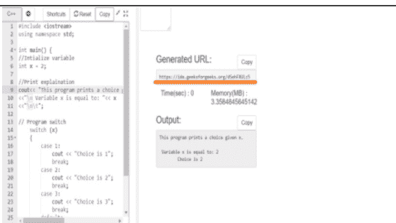

### Switch Demo


这是我们 `switch` 演示截图。你可以通过此 URL 访问我们保存的工作区副本：`https://ide.geeksforgeeks.org/dSehFXULz.5`。我们强烈建议使用这个演示将我们之前的某个练习转换为 `switch`。一个非常棒的候选对象是我们的关系例程序程序。它有 6 个 `if(...)`。这产生了 12 种不同的场景。你如何将其转换为 `switch` 呢？提示：考虑使用 `inputfunction` 为每个关系例程序创建一个菜单。你可以通过这个 URL 亲自学习关系例程序：`https://ide.geeksforgeeks.org/dFD3cEk85y`。

现在我们已经了解了决策函数是什么以及它们如何工作，让我们转向函数及其在编程中的作用吧。

# 第 6 章：创建函数


```
//statements
[datatype]function_name(arguments)
```

这是一种找出问题所在以及确定你的代码如何帮助修复问题的方法。算法获取输入，执行操作，然后给出一个改变状态的结果。函数是可以多次使用而无需重新编写的代码。代码通常是执行它应该做的事情并可以反复使用的。函数由头和主体组成。以下是函数的语法格式：

```
return 0;
}
```

正如你所看到的，以及许多其他编程语言一样，C++ 基本上是一系列函数、语句和运算符，中间穿插着对象和数据存储元素。我们目前为止编写的所有内容都使用了 `main()` 函数，其语法与上面类似。因此函数对你来说并不陌生。

每个函数必须返回一个数据类型，就像 `main()` 函数返回 `int 0` 一样。如果函数不这样做，则使用 `(void)` 作为参数返回类型。正如你可能猜到的，`return` 是终止函数的语句。

函数接收的输入被称为参数（arguments）。并不是所有函数都使用它们（正如我们在 `main()` 中看到那样），尽管如此，你仍然可以将参数传递给函数使其运行。这就是库将对象传递给 `main()` 的方式。

## 创建并调用函数

要开始调用函数，你必须在 `main()` 之前对其进行声明和定义。这是因为 C++ 是顺序执行的。C++ 实践中函数优先。这就是为什么你必须在 `main()` 之前声明它们以便调用它们。它们也被这样称为，因为它们让代码更有组织。一旦声明了函数，我们可以在 `main()` 之外任何地方定义它。

让我们写一个简单的打印函数以便更好地理解它们。

遵循以下指令：

1. 打开一个新的 IDE C++ 工作区
2. 声明你的函数 `void myFunction();`
3. 在 `main()` 中调用你的函数 `myFunction()`

### 在 main 之外定义你的函数

```
{ cout << "I just got executed!"; }
```

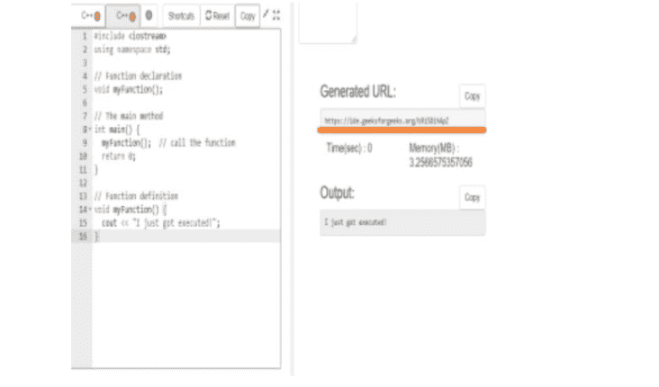

### Function Demo

这是我们函数演示的截图。你可以在这里访问我们保存的工作区副本。

打开一个新的 IDE C++ 工作区

### 声明你的函数 `int(int x, int y)`

在 `main()` 中调用你的函数

### 初始化两个实际变量

```
int a = 10, b = 20;
```

- 初始化变量并调用函数 `int m = max(a, b);`
- 打印结果
- 结束 `main()`
- 在 `main` 之外定义你的函数

此函数应该使用 `if()` 语句来检查 `x` 是否大于 `y`。

如果 `x` 大于 `y`，则返回 `x`。

否则，返回 `y`。

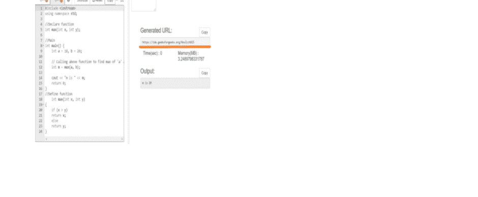

### 带参数传递的函数

这是我们函数演示的截图。你可以通过此 URL 访问我们保存的工作区副本：`https://ide.geeksforgeeks.org/NnsZczhX15`。如果你想更多练习，我们建议使用此练习作为模板，将你过去的某个练习转换为函数！考虑我们使用并向其传递参数的练习。我们将在节讨论如何传递参数，但先自己尝试将帮助你掌握这一概念。

在我们的示例中，我们很好地使用了值传递。用于 `main` 的变量 `(a,b)` 与用于 `max()` 使用的变量 `(x, y)` 位于不同的位置。你可以看到这在 `main()` 中可能发生多个复杂计算的大型程序中是非常有用的。优先传递值，因为这确保实际变量在函数被调用之前一直存在。

### 函数重载

所有函数可以有相同的名称，只要它们的参数不同。你不能定义两次函数，否则将抛出错误。这被称为函数重载。为什么？因为它简化了代码并使其更容易阅读。这在函数返回数据类型的情况下更好。请看以下代码：

```
public class Main {
    public static void main(String[] args) {
        add(10, 20);
        add(5.5, 2.3);
    }
    static void add(int a, int b) {
        System.out.println("Sum: " + (a + b));
    }
    static void add(double a, double b) {
        System.out.println("Sum: " + (a + b));
    }
}
```

### 无函数重载程序

上面的程序声明了两个执行相似计算的独立函数。在大型程序中，这是空间的浪费且低效的。它也让编辑代码变得困难，因为在大型程序中，这两个函数不太可能位于同一个地方。为了提高效率，我们应该将这些函数合并到一个名称下，并“堆叠”数据类型。你可以这样做：

在以下 URL 打开保存的 IDE 工作区：`https://ide.geeksforgeeks.org/qkpHHZg5`

将 `double plusFuncdouble...` 改为 `double plusFunc...`

在调用处用 `double plusFunc...` 替换 `double plusFuncdouble...`


### 函数重载程序

你可以通过此 URL 访问我们保存的工作区副本：`https://ide.geeksforgeeks.org/e1QLzi3aGo`。我们将函数保留在文件顶部以便于编辑。你将使用此文件进行函数重载练习。记住，如果你的代码损坏，你可以随时返回原始工作区。

当你合并相似的函数时，你就清理了代码。这非常重要，尤其是当你需要调试代码时，因为当发生错误时，编译器可能会指向函数。编译器这样做是因为它在 C++ 代码中指向了多个库。合并和重载函数可以确保你的编译器需要引用的函数更少，从而让你更易调试。请记住，C++ 正在不断更新，以便工作变得更加容易。新功能不断被添加，库也被精简和进一步组织。因此，C++7 中的错误看起来会与 C++14 中的错误不同。更新带来了执行平庸任务的新简单方法。例如，拷贝构造函数的调用组合被认为是数组等容器索引的更具现代的方法。要跟上潮流并享受 C++ 带来的益处，你必须不断练习、测试自我并不断提问。

# 结论与最后说明

学习编程是一场心理之旅，可能是有趣的、令人兴奋的，有时也是令人沮丧的。在本书的最后，我们应该回顾学习到的一些重要内容。正如此，我们还将提供一些最后的想法和建议，旨在帮助你在这一领域继续成长。

## 扩展你的实践：准备你的编码环境

我们使用在线 IDE 来确保每个人都有相同的体验，这样我们都可以编写代码。使用 `Run+URL` 按钮将你的工作保存到不同的地方。你也可以通过使用保存的 IDE 工作空间和书中的 URL 将这些内容留作以后使用。将它们作为指南或修复糟糕的代码。我尝试在所进行的所有练习中向你展示编码的最佳方法。利用 C++ 中处理问题的许多方法，不要害怕尝试新事物并学习如何做你想做的事情。在我的书中，对于任何问题都没有确定的答案。编程没有那种东西。来吧，通过这本书寻求帮助并查看实现某事的其他方法。书开头列出了我们的代码列表，你可以快速找到它们。

有许多 C++ 编程环境和文本编辑器可以支持多个版本的 C++。C++17 的电脑无法在 C++14 的电脑上运行。使用 C++14 的人可以更多地理解它的特性，因为它们更容易理解。这个版本的 C++ 比前一个版本更容易让人们理解，这种趋势可能会持续下去。C++11 是大多数人在大多数编程环境中可以找到的最旧 C++ 版本。

我想让你设置你自己的 IDE 并在上面工作。它将帮助你更快地成长并适应现实情况，从而让你学得更快。我们讨论过 Code::。在图中有 Microsoft 和 Mac 的 Xcode 模块。如果你有 Linux，在所有这些系统中都有通用的选项。Linux 是一个基于控制台的环境，在软件开发者中非常受欢迎，因为基于控制台的环境有很多与程序配合的内置功能。

你可以找到许多基于 GUI 的桌面发行版（distros），许多人更喜欢它们。它们大多数是开源的，这意味着可以免费下载和安装。CentOS 是一个免费的 Linux 发行版，可用于管理服务器。红帽企业 Linux (RHEL) 的几个部分被 CentOS 使用。它是学习如何与红帽服务器工作的最好方法。

## 编码最佳实践：学习的所有权与协作

在我们相处的时间里，我们学习了许多软件开发的技巧和最佳实践。在第一章中，我们讨论了程序应该如何尽可能用少的代码完成任务。坦率地说，随着 C++ 每个新版本的发布，增加了更多实现此点的方法。大多数初级编程课程教授了旧的、效率较低的方法来实现编程任务，如解析数组、条件语句和调用函数。你会发现这些技术大部分在实际编程场景中从未被使用。大多数初级课程侧重于让初学者牢掌握基础——这是你知识的基石。随着你的进步，你会发现更多解决问题的高效方法。如果你想作为程序员有所提高，你必须掌握学习的所有权。学习这些开发工具，就像你可以尝试的那样。绘图（Diagramming）对于视觉化学习者来说是好的。无论你选择什么，只要是开发工具，都是重要的。

回到算法，更详细的算法将解释所有数据类型、输入、输出。算法的优势在于你可以使用它们作为简写。你也可以标注和管理你的代码。这些习惯将帮助你的代码保持连贯。这些实践将帮助你观察和思考。

软件开发者在团队中工作，同时处理同一段代码。标注你的代码的重要性在这些情况下变得显而易见。

此外，与他人协作将加速你的成长。当你与他人协作时，你从他们的经验中学习。正如我们所说，C++ 有各种对象、语句和其他工具，因为有许多方法可以做同样的事情。修复问题的方法取决于你看到的有效方法。但最终，所有编程和软件开发都是创造性的。与他人协作将增加你的编程词汇量——你将从他们那里学习如何创造性地修复问题，并发现你自己在过程中的见解。你应该始终记住，每个人都可以贡献一些东西，这很大程度上取决于他们的经验。即使你对 C++ 还是新手，你仍然有独特的解决办法，因为你的思考方式不同。这本身对于任何团队都是有价值，特别是如果你能很好地交流想法。我强烈建议你使用词汇表来帮助你清晰交流。

除了标注之外，让代码尽可能简洁是一种良好的实践。我演示了如何通过注释代码来防止编辑期间出现错误。在你的练习中，修复代码之外，你可以随时从保存的 IDE 重新开始或者简单地刷新浏览器（这取决于你运行和生成的代码）。只有当你需要保存代码时才生成 URL。

我们还强调了代码结构的重要性。例如，我们讨论了声明和定义函数的重要性：最佳实践是将它们放在顶部并放在 `main()` 函数之后。

格式化代码可以减少错误的可能性。格式化是你的代码。你团队中的其他程序员能够实现你的代码，甚至改进它，并且他们会留下注释。但这些实践不仅对你有处。随着世界的发展，它变得越来越复杂，所以程序能够解释自己是好的。如果你的程序有输出，让我们看看在书中是如何实现的。使用转义序列如 `\n` 来换行，使用 `\t` 创建水平制表符，以便你的代码有足够的空白。

逻辑数学运算，如 AND、OR、NOT。所有其他基于对象的 C++ 函数都必须由编译器翻译成机器语言。但位运算函数更快，因为它们跳过了这一步，直接与机器通信。它们通常被部署在竞争性编程中，以创建高度敏捷的程序和例。在竞争性编程之外，位运算函数在管理大数据方面也有一些功能。

位运算函数的挑战在于它们对人类来说很难理解，因为它们是二进制的。为了看到计算机看到的内容，我们上了一节关于二进制和二进制数学的计算机科学课。我们用位运算程序创建了一个“字节大小”的寄存器流，并创建了动态缓冲区来存储位运算的位。这些虚拟缓冲区和寄存器就是服务器管理 TB 数据的方式。想一下：我们的缓冲区和寄存器都只有一个字节长，但一个 TB 比我们的缓冲区大出 $10^{12}$ 倍：1,000,000,000 字节。

对于像 YouTube 这样的网站来说，这些数字很小，它的后端计算基于 C++。YouTube 处理的数据是天文数字的（2018 年达到了 5.25 泽字节 $10^{21}$ 字节）。它提供了超过 32.5 亿小时的内容（“How much data YouTube store? - Quora,” n.d.）。位运算函数赋予这些服务器在不中断或无大规模延迟的情况下处理负载的能力。这是 C++ 力量及其处理大型复杂系统能力的最佳示例之一。对于程序员来说，这是一门非常有用的语言。如果你能将这些数据流可视化为具有 8 个槽位的数组，你将更容易理解许多位运算符，特别是移位运算符。

除了二进制编程外，我们还处理了不同类型的数据，并探索了对象编程的不同方面。例如，我们做了大量处理字符串的练习。事实上，我们在每一项练习中都使用并部署了字符串。我们看到字符串也是数据数组，可以使用 `<string>` 库中的各种对象进行解析。想想我们用过的拷贝构造函数调用组合。要解析任何类型的容器（vector 或数组），你需要一个带有元素地址运算符（Addressoof）的 `for` 循环。该任务在 `<string>` 库中有一个专门的函数，你只需要正在解析的项的索引。如果说从这本书你应该中学到一点什么，那就是精通处理字符串：转义序列、通过数组索引处理字符串以及将字符串传递给不同的函数。

我们还学习并讨论了功能和设计考虑。例如，我们讨论了如何以及何时使用循环。我们的银行安全示例通过我们在故障关闭（fail-close）系统中的退出控制循环示例得到了最好的说明。正如我们所说的，银行应该始终锁好并关闭门；它们是故障关闭的。银行的大多数事件都需要门和出口故障关闭，唯一应该打开的时候是火灾发生。系统应该保持一切受控，在例程之后测试条件。退出控制循环在其他领域也有用，例如数据控制。YouTube 将数据修正作为正常操作的辅助例程。这确保了系统始终运行，不会被重发数据请求所阻塞。

由于 C++ 是一种后端语言，它必须处理并操作多种类型的数据。当我们讨论基于 vector 的图像作为对象类及其其他对象属性时，我们进行了简短讨论。像 Photoshop 这样的图像处理软件是用 C++ 编写的，图像处理等方面充分利用程序的程序。矢量允许在不损失质量的情况下进行图像处理，而 `.jpg` 或 `.png` 是像素数组。像 `.svg` 或 `.pdf` 使用矢量容器来描述它们的像素位置，这在 C++ 中具有更多的类特征，允许保留图像。

这本书也旨在作为参考，因此我鼓励你使用术语表和索引来复习主题。术语表列出了所有粗体术语以及我们看过的代码片段。它还包含了更详细讨论术语的章节。

# 术语表 (GLOSSARY)

| 术语 | 定义 | 章节 |
|---|---|---|
| `"+"` | 二进制算术运算，汇总两个变量。也用于 `<string>` 库中拼接字符串 | 操作：字符串拼接 |
| `"++"` | 递增运算符，用于将整数的值加 1。这个一元运算符常用于增加循环内变量的值。 | 一元运算符 |
| `"--"` | 一元运算符，用于减少循环内变量的值。这个一元运算符常用于增加循环内变量的值。 | 一元运算符 |
| 算术运算符 `"-"` | 二元运算符，从一个操作数中减去另一个操作数 | 算术运算符 |
| 一元运算符 `"-"` | 一元负运算符，用于更改变量或参数的符号。对对负整数执行一元负操作将使其变为正数，反之亦然。 | 一元运算符 |
| `"-="` | 用于结合 `'-'` 和 `'='` 运算符的原子减法。该运算符首先从右侧的值减去左侧变量当前值，然后将结果赋值给左侧变量。例如，`x-=y` 是 `x=x-y` 的简写，无需使用单独的算术运算符。 | 赋值运算符 |
| 二元运算符 `!=` | 二元逻辑“非”运算符，如果考虑的条件不满足则返回逻辑布尔真。如果一个一个为真，则返回布尔假。 | 逻辑运算符 |
| `"!"` | 非运算符用于反转操作数的布尔状态。例如，如果变量的值为假，`!x` 将为真。 | 逻辑运算符 |
| `!=` | “不等”运算符，也检查操作数是否相等。如果操作数不相等则返回布尔真，如果相等则返回布尔假。 | 关系运算符 |
| `"*"` | 乘以两个操作数的二元运算符。操作数的顺序无关。 | 算术运算符 |
| `"*="` | 用于结合 `'*'` 和 `'='` 运算符的原子乘法。该运算符首先将左侧变量当前值乘以右侧的值，然后将结果赋值给左侧变量。 | 赋值运算符 |
| `"/"` | 将第一个操作数除以第二个二元运算符。 | 算术运算符 |
| `"/="` | 用于结合 `'/'` 和 `'='` 运算符的原子除法。该运算符首先将左侧变量当前值除以第二个操作数，然后将结果赋值给左侧变量。 | 赋值运算符 |
| `"&"` | 用于指向变量地址的地址运算符。 | 一元运算符 |
| `"&"` | 位与，接收两个数字作为操作数并对两个数字流中的每个位进行与运算。与结果流仅在两个位都为 1 时为 1。 | 位运算符 |
| `"&&"` | 二元逻辑“与”运算符在考虑的条件都满足时返回真。否则返回假。 | 逻辑运算符 |
| `"%%"` | 二进制模运算符，返回第一个操作数除以第二个操作数的余数。 | 算术运算符 |
| `"^"` | 位异或，接收两个数字作为操作数并对两个数字流中的每个位进行异或运算。异或结果流在两个位不同时为 1。 | 位运算符 |


| `+=` | 原子加法运算符，用于结合 `+` 和 `=` 运算符。该运算符首先将左侧变量当前值加上右侧的值，然后将结果赋值给左侧变量。 | 赋值运算符 |

将右侧的值。然后它将结果存储在左侧的变量中。例如，`x+=y` 是编写 `x=x+y` 的简写方式，而无需使用单独的算术运算符。

- `<` 小于运算符，检查第一个操作数是否小于第二个操作数。如果是，该运算符返回布尔值 `true`。否则，它返回 `false`。（关系运算符）
- `<<` 左移运算符，接收两个数字并将第一个操作数的位向左移动。第二个操作数用于确定移动的位数。（位运算运算符）
- `<=` 小于等于运算符，检查第一个操作数是否小于或等于第二个操作数。如果是，该运算符返回布尔值 `true`。否则，它返回 `false`。（关系运算符）
- `>>` 右移运算符，接收两个数字并将第一个操作数的位向右移动。第二个操作数用于确定移动的位数。（位运算运算符）

| `==` | “等于”运算符，检查两个操作数是否相等。如果操作数相等，它返回布尔值“true”；否则返回 `false`。 | 关系运算符 |
|---|---|---|
| `>` | “大于”运算符，检查第一个操作数是否大于第二个操作数。如果是，该运算符返回布尔值 `true`。否则，它返回 `false`。 | 关系运算符 |
| `>=` | “大于等于”运算符，检查第一个操作数是否大于或等于第二个操作数。如果是，该运算符返回布尔值 `true`。否则，它返回 `false`。 | 关系运算符 |
| `= =` | 赋值运算符，用于将右侧的值赋值给左侧的变量。 | 赋值运算符 |

| 位或 | 接收两个数字作为操作数，并对两个数字流中的每一位进行或逻辑运算。如果两个位中任何一个为 1，则结果流为 1。 | 位运算运算符 |
|---|---|---|
| 二进制逻辑“或”运算符 | 当考虑的条件中有一个（或两个）被满足时，返回布尔值 `true`。如果没有任何条件被满足，则返回 `false`。 | 逻辑运算符 |
| 位非 | 运算符，接收一个数字并反转所有所有位的状态（1 变 0，0 变 1）。 | 位运算运算符 |

## `bool` 关键字

“Boolean”的缩写数据类型关键字。

## 基本数据类型

| 名称 | 描述 | 分类 |
|---|---|---|
| `bool` | 存储具有两种状态的值：`true` 或 `false`。大小为 1 字节，这些值可以通过操纵符表示为 "0/1" 或 "false/true"。 | |
| `"boolalpha/noboolalpha"` 操纵符 | 输入输出操纵符，在布尔值的 "0/1" 与 "false/true" 之间切换。 | `endl`：输入输出操纵符 |
| `"char"` 关键字 | “character”的缩写数据类型关键字，无论大小写均存储单个字符。大小为 1 字节。字符值用单引号括起来。 | 基本数据类型 |
| `"cout"` 对象 | `<iostream>` 库中的 C++ 编程对象，允许程序使用 `<<` 运算符打印值和文本。此对象必须用数据类型定义，通常为 `"std"`。 | 使用 `Cout` |
| `"double"` 关键字 | 用于存储带有 15 位小数的数字的数据类型关键字。大小为 8 字节。此数据类型可以容纳更多小数，是数学计算的首选。 | 基本数据类型 |
| `else` | 语句用于在其关联的 `if()` 表达式为假时指定代码。`else` 在没有 `if()` 的情况下使用。 | 循环 |
| `endl` | 操纵符。输出 `"\n"` 并刷新输出流的输入输出操纵符。 | 使用 `endl`：输入输出操纵符 |
| `ends` | 操纵符。输出 `"0"` [零] 的输入输出操纵符。 | 使用 `endl`：输入输出操纵符 |
| `float` | 关键字。存储 7 位小数的关键字数据类型。大小为 4 字节。此数据类型优用于存储货币数字。 | 基本数据类型 |
| `flush` | 操纵符。刷新输出流的输入输出操纵符。 | 使用 `endl`：输入输出操纵符 |
| `"get_money"` 操纵符 | 接收货币值作为输入的输入输出操纵符。此操纵符仅适用于 C++11，在过时的 C++ 编程环境中可能会导致错误。 | 使用 `Endl`：输入输出操纵符 |
| `"get_time"` 操纵符 | 根据指定格式接收日期/时间值输入的输入输出操纵符。此操纵符仅适用于 C++11，在过时的 C++ 编程环境中可能会导致错误。 | 使用 `Endl`：输入输出操纵符 |
| `"int"` 关键字 | “integer”的缩写数据类型关键字，存储整数。大小为 4 字节。该关键字包括正整数负整数。 | 基本数据类型 |
| `"put_money"` 操纵符 | 格式化并输出货币值的输入输出操纵符。此操纵符仅适用于 C++11，在过时的 C++ 编程环境中可能会导致错误。 | 使用 `Endl`：输入输出操纵符 |
| `"put_time"` 操纵符 | 根据指定格式接收日期/时间值输入的输入输出操纵符。此操纵符仅适用于 C++11，在过时的 C++ 编程环境中可能会导致错误。 | 使用 `endl`：输入输出操纵符 |
| `"quoted"` 操纵符 | 允许插入和提取带引号字符串的输入输出操纵符。此操纵符仅适用于 C++11。 | 使用 `endl`：输入输出操纵符 |
| `"showbase/noshowbase"` 操纵符 | 特别用于数学输出的输入输出操纵符，控制是否使用前缀表示进制。 | 使用 `endl`：输入输出操纵符 |
| `"showpos/noshowpos"` | 控制是否使用 `"+"` 号表示负数的输入输出操纵符。 | 使用 `endl`：输入输出 |
| `"uppercase/lowercase"` 操纵符 | 控制在某些输出格式中使用大写字母的输入输出操纵符。 | 使用 `Endl`：输入输出操纵符 |
| `"using namespace std;"` 语句 | 用于声明 `"std"` 库对象和操纵符的代码行。这种单独声明使代码更易读。但在实践中不建议这样做，因为它会影响字符串处理，导致难以解决的错误。书中的练习将避免使用此语句。 | 省略命名空间 |
| `[string_name].length()` 属性 | 调用 `"length"` 字符串属性的编码语法。 | 字符串对象：长度属性 |
| 实际参数 | 进入定义函数的参数。 | 参数传递 |

动态网站的开发。

## 字节（Byte）

由 8 位组成的数据测量。一个字节可以表示最多 `$2^8$` 个数字（`0b 11111111`）。

## 一元运算符

### C++14

C++ 的高级版本，使得该版本对人类编程来说稍微易于理解。“标准 C++”通常指 C++11，也称为 C++0x。

## 第 1 章：搭建 C++ 开发环境

### CentOS

一种免费的、社区支持的 Linux 发行版，功能上与红帽企业级 Linux（RHEL）兼容。

### Linux 编译器安装

代码。

### 查看可执行文件

第 1 章：搭建 C++ 开发环境。

### Code::Blocks

一个专为 C++ 设计的免费开源 IDE。该 IDE 支持许多 C++ 编译器，包括 GCC、Clang 和微软的 Visual C++。此 IDE 可以使用 C++、C 和 Fortran 进行编程。

### Windows IDE 安装

| 名称 | 描述 | 分类 |
|---|---|---|
| 命令行界面（CLI） | 用户与计算机程序交互的方法，用户通过输入代码行来控制程序。 | 设置文本编辑器 |
| 注释 | 编译器忽略的代码行，在 C++ 中以行首的双斜杠表示。注释用于解释代码并留记，以指导其他程序员研究你的代码。 | |
| 编译型语言 | 参见低级语言。 | 第 3 章 |
| 拼接，字符串 | 一种常见的编程功能，允许程序员通过从源字段内容并在程序中提供服务来动态拼接文本。在 C++ 中，字符串拼接是通过算术运算符 `"+"` 完成的。 | 操作：字符串拼接 |
| 条件运算符 | 一种基于三个操作数表达式的布尔逻辑运算符。条件运算符的结果取决于第一个表达式。 | 三元运算符 |
| 条件短路 | 当程序开发者使用逻辑运算符和条件语句来控制程序的行为方式时。 | 逻辑运算符 |
| 拷贝构造函数调用 | 搜索和打印索引的方法。 | 一元运算符 |
| | 由带有取地址运算符的索引变量的 `for()` 循环，以及带有索引的容器对象（如数组）组成。 | |
| 计数器 | 一种任意变量，与算术一元运算符结合使用，增量循环指定的表达式。 | 循环 |
| 数据 | 函数和语句所操作的操作数或各种类型的数据。 | 语法概述 |
| 数据类型 | 变量的属性，告诉编译器或解释器程序员意图如何使用数据。常见的数据类型包括实数、整数和“真/假”布尔变量。 | 第 3 章 |
| 调试 | 定位和移除计算机程序错误和异常的过程，也称为“bug”。通常情况下，通过调用函数的较小、模块化的代码比大文件更容易调试。 | |
| 十进制 | 参见 Base-10。 | 位运算运算符 |
| `do {}...while()` 循环 | 一种退出控制的循环，它测试单个条件并循环代码块，直到满足条件。 | 循环 |
| `else if()` | 用于嵌套循环条件 `if()`.. `else` 语句的条件语句组合。如果有许多条件需要测试，建议程序员使用 `switch`。 | |
| 转义序列 | 字符串中的特殊字符组合，用于在字符串和字符流中表示某些特殊字符。转义序列允许程序员在字符串中包含符号而不会混淆编译器。 | 使用转义序列 |
| 可执行文件 | 用于执行程序操作的指令列表。 | 第 1 章 |
| 文件后缀 | 告知代码编译器可执行文件是什么语言的文件后缀。C++ 语言由 `.cpp` 或 `.hpp` 后缀名指示。 | 第 1 章 |
| 第一性原理 | 程序必须设计为以尽可能少的函数完成任务。这一原则减少了开销并提高了程序的性能。 | 编程原理 |
| `for()` 循环 | 一种入口控制的循环，有三个输入：初始化表达式、测试表达式和更新表达式。`for` 循环会在测试表达式报告为假之前执行其代码块。 | 循环 |
| 形参数 | 在传递实际参数之前定义参数的变量。 | 参数传递 |
| 函数 | 一个接收输入并在调用时执行操作的代码块。 | 第 6 章：创建... |
| 函数重载 | 通过将多种数据类型堆叠到一个函数上的编程技术。 | 函数重载 |
| 功能性 | 在代码中实现特定结果的功能和工具。 | C++ 中的操作 |
| 函数 | 封装了接受输入并输出结果的代码块。每个函数 `[函数名]()`（其中 `[函数名]` 是任意函数）后面总是跟着大括号 `{}`，大括号内的每个显式指令都由编译器执行。 | 语法概述 |
| Gedit | 免费、开源的通用文本编辑器，包含编辑源码和标记语言等结构化文本的工具。 | Linux 编译器安装 |
| `getline()` 函数 | `<string>` 库中的 C++ 函数，从输入字符串提取所有字符到字符串数组。 | Cin 和 `getline()` |
| GNU 编译器（GCC） | 由 GNU 项目支持多种编程语言的开源编译器系统。GCC 是 GNU 工具链的关键组件，也是大多数 Linux 项目的标准编译器。 | Linux 安装 |
| 图形界面（GUI） | 用户与计算机程序交互的方法，允许通过图形图标和视觉指示而不是输入命令进行交互。 | 设置文本 |
| 头文件 | 以井号 `#` 开头的行，用于编译器调用库函数。 | 语法概述 |
| `if() else` 语句 | 条件语句组合，测试单个条件并根据测试结果执行显式说明的代码块。 | 循环 |
| `if(). else` 语句 | 一种嵌套函数，在满足指定条件时执行其大括号 `{}` 内的所有指令。否则，它执行包含的 `else {}` 语句中的项。这些语句始终部署关系操作数来测试条件。 | 关系运算符 |
| 集成开发环境（IDE） | 用于编写代码、测试错误和翻译程序的编程环境。 | 第 1 章 |
| Linux 发版（distro） | 基于 Linux 内核的软件集合和用于安装额外软件的包管理系统的操作系统。 | Linux 安装 |
| `architecture` | 语言中的命令或函数与处理器指令紧密对应。这减少了运行程序的开销，因为编译器将低级语言翻译成机器码时所需的资源较少。 | |
| `Machine Language` | 直接由 CPU 编译并执行的编码语言。参见 `"AssemblerLanguage"`。 | 第 1 章 |
| `Manipulator, Input/Output` | C++ `iostream` 库中的辅助函数，允许使用 `<<` 运算符或 `>>` 运算符来控制输入输出流。 | Using Endl! Input/Output Manipulators |
| `Notepad ++` | 用于 Microsoft Windows 的文本编辑器和源代码编辑器。 | Setting up Text |
| `Object` | 一种通用计算术语，描述计算机用于管理数据的方法。 | 第一个程序：输出和基础字符串 |
| `Operand` | 操作组件，描述注意：操作数……即被操作的值、对象或变量。 | |
| `Operations` | 在 C++ 程序中实现决策的功能，例如控制循环。 | 第 4 章：Operations in |
| `Operator` | 操作组件，描述注意：操作数……一个指明正在执行的操作类型的符号。运算符根据它们同时可以操作多少个操作数来描述：一元、二元和三元。 | |
| `Organization Identifier` | Apple 专有的命名规范，用于在各种 Apple 数据库中创建唯一 ID：Apple 开发者网站、iCloud 容器以及 App Store 中的 iTunes Connect 门户。组织标识用作“反转域名”的参数，确保所有开发的项目都能精简整合到专有的 macOS 框架中。 | |
| `Parameter Pass Reference` | 实际参数和形式参数均指向相同的参数传递位置。因此，`main()` 函数内部进行的任何更改都会影响所传递的实际参数。 | |
| `Parameter Pass by Value` | 实际参数的值被复制到参数传递并存储在函数的形式参数中。在 `main()` 中进行的任何更改都不会影响所传递的实际参数。 | |
| `Red Hat Enterprise Linux (RHEL)` | 红帽公司为商业市场开发的商业 Linux 发行版。Linux 安装> 注意：有许多发行版…… | |
| `Register` | 二进制存储数组，其中每个比特位在数组中都有自己的位置。寄存器用于计算位运算符。 | Bitwise Operators |
| `Relational Operators` | 用于比较两个值的二元运算符，并返回布尔响应。 | |
| `Script` | 由某些程序或脚本引擎执行的补充命令列表。 | 第 6 章：Creating... |
| `See Base-2` | 机器用于计算的数字系统。也称为二进制数系统。二进制数表示为比特流，其中每个单独比特可以是两种状态之一：1 或 0。流中 1 位的位置决定了数字的值。 | Bitwise Operators |
| `Server-side programming` | 编写代码向动态或更改的网站协商并交付 Mac IDE 安装内容。C++ 主要是一门服务器端语言。 | |
| `Service Level Agreement (SLA)` | IT 管理中的术语，描述技术管理员（服务提供者）与客户之间的承诺。 | Overview of Syntax |
| `sizeof()` | 查询对象大小并交付其字节（bytes）大小的一元运算符。 | Unary Operators |
| `Software Development Kit(SDK)` | 硬件软件供应商提供的用于开发应用程序的工具集。 | Mac IDE Installation |
| `Statements` | 描述代码起始行的通用术语，带有编译器在函数之外识别的特定指令。这些语句在语言语法环境中的显示方式取决于语句的类型和编程环境的规范。 | Overview of Syntax |
| `String Array` | 字符的有序排列，字符串索引，其中字符串的每个字符按其自身的数值位置进行数组索引。 | |
| `Strings` | 一种计算机编程数据类型，字符串表示字符序列，可以是字面量常量或某种变量。 | |
| `switch () Statement` | 多分支语句，用于根据评估表达式的值执行不同的代码块。 | |
| `Ternary Operator` | 运算符的分类，三元运算符接受 2 个以上的操作数，或带有多个参数的条件运算符。 | |
| `Text Editor` | 允许编辑代码的程序。 | 第 1 章 |
| `Unary Operator` | 运算符的分类，一元运算符与单个操作数执行。 | |
| `Variables` | 借自数学的概念，描述其关联值可以更改和操作的符号值。变量通过操作函数控制程序。 | 第 3 章 |
| `while() Loop` | 入口控制循环，测试单个条件并循环执行代码块直到满足条件。 | Loops |
| `Xcode` | 适用于 macOS 的免费 IDE 开发套件。此 IDE 具有用于开发面向 macOS 操作系统的 C++ 程序的工具，如用于 Apple TV 的 tvOS、用于 Apple Watch 的 watchOS 和用于 iPad 平板的 iPadOS。 | Mac IDE Installation |
