# C++ 初学者编程指南：自学掌握 C++ 的速成课程

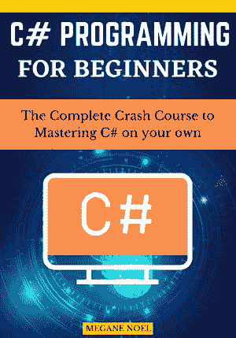


# 介绍

欢迎学习 C# 编程，感谢你选择本书！

无论你是经验丰富的程序员还是完全的新手，这本书的编写都是为了帮助你快速学习 C# 编程。

读完本书后，你应该能够毫无问题地编写自己的 C# 程序。事实上，我们将在书末的项目中一起编写一个简单的薪资管理软件。准备好起飞了吗？

大多数人害怕学习新的编码语言。他们知道这会为他们使用电脑开启许多大门，但他们担心纯编程本身对他们来说太难学习和掌握。如果你不花时间学习新的编程语言，整个编程过程可能会变得非常困难。但在寻找一种可以帮助你编写几乎任何你想要的代码语言时，是时候看看 C# 编程语言了。本书将带你了解使用 C# 编码语言的基础知识，让你能够开始使用它。

## C# 的特殊之处

在涉及到编码语言时，你可能首先想要了解的是为什么 C# 如此特别，以及为什么你甚至想要学习这种特定的编程语言。有很多不同的编码语言可以选择，它们的工作方式也不相同，但你会发现使用 C# 有许多优势，我们将在本指南中涵盖其中一些。即使你只是初学者，这也是一种非常棒的编程语言，它将让你设计许多自己的程序。虽然在你想开始学习编程时有很多选择，但没有哪一种能像 C# 好。用 C# 代替其他编程语言的一些优势包括：

### 可以使用大型库

作为初学者，代码中有很多部分是不容易学习的。你会在边学边用，但你可以配合 C# 使用的库是一项巨大的资源，对你非常有帮助。你可以不费吹灰地使用它，甚至可以进行修改使其按你想要的方式运行。

### 自动删除函数

当你使用其他语言时，你必须检查并删除项目。这会花费时间，如果你漏掉了一些，就会很困难。使用 C# 会完成这一切让事情变得简单。

### 易于学习

C# 被广泛认为最容易学习的编程语言之一。虽然某些部分比其他部分复杂，但它们并不难，随着你的学习你会熟悉它们。

### 兼容 Windows 及其他

这种编程语言最初是为了在 Windows 上运行而创建，但只要你安装了 `.NET`，它在 Mac 和 Linux 等操作系统上也运行良好。

### 它与 .NET 工作

你会发现 C# 与 `.NET` 工作，这使其在其他系统中可用。

# 第 1 章：C# 的解剖

## C# 简介

欢迎学习 C# 编程，感谢你选择本书！无论你是经验丰富的程序员还是完全的新手，这本书的编写都是为了帮助你快速学习 C# 编程。读完本书后，你应该能够毫无问题地编写自己的 C# 程序。事实上，我们将在书末的项目中一起编写一个简单的薪资管理软件。准备好起飞了吗？

大多数人害怕学习新的编码语言。他们知道这会为他们使用电脑开启许多大门，但他们担心纯粹编程本身对他们来说太难学习和掌握。如果你不花时间学习新的编程语言，整个编程过程可能会变得非常困难。但在寻找一种可以帮助你编写几乎任何你想要的代码语言时，是时候看看 C# 编程语言了。本书将带你了解使用 C# 编码语言的基础知识，让你能够开始使用它。

## C# 的特殊之处

在涉及到编码语言时，你可能首先想要了解的是为什么 C# 如此特别，以及你甚至想要学习这种特定的编程语言。有很多不同的编码语言可以选择，它们的工作方式也不相同，但你会发现使用 C# 有许多优势，我们将在本指南中涵盖其中一些。即使你只是初学者，这也是一种非常棒的编程语言，它将让你设计许多自己的程序。虽然在你想开始学习编程时有很多选择，但没有哪一种能像 C# 好。用 C# 代替其他编程语言的一些优势包括：

### 可以使用大型库

作为初学者，代码中有很多部分是不容易学习的。你会在边学边用，但你可以配合 C# 使用的库是一项巨大的资源，对你非常有帮助。你可以不费吹灰地使用它，甚至可以进行修改使其按你想要的方式运行。

### 自动删除函数

当你使用其他语言时，你必须检查并删除项目。这会花费时间，如果你漏掉了一些，就会很困难。使用 C# 会完成这一切让事情变得简单。

### 易于学习

C# 被广泛认为最容易学习的编程语言之一。虽然某些部分比其他部分复杂，但它们并不难，随着你的学习你会熟悉它们。

### 兼容 Windows 及其他

这种编程语言最初是为了在 Windows 上运行而创建的，但只要你安装了 `.NET`，它在 Mac 和 Linux 等操作系统上也运行良好。

### 它与 .NET 工作

你会发现 C# 与 `.NET` 工作，这使其在其他系统中可用。

当我们使用 `C#` 时，我们会发现从视觉上看，它为我们提供了一个高级代码编辑器以及一些更方便的 UI 设计器、一个集成调试器以及其他工具，这些工具将确保基于该语言开发我们的应用程序变得更容易。

`C#` 的酷之处在于，它不仅表达能力很强，能够帮助我们处理许多复杂的代码，而且非常易于学习且简单。`C#` 语法中的大括号看起来很熟悉，特别是如果你过去用过 `Java`、`C++` 和 `C` 的话。擅于这些语言的开发者会发现，由于相似性，学习 `C#` 不会花费长时间。

`C#` 很有用，因为它能够简化 `C++` 中出现的某些问题，并为我们提供一些高级功能，包括可空值类型、委托、枚举、lambda 表达式和直接内存访问。这些功能在 `Java` 等语言中都是不可用的。

此外，你会发现 `C#` 语言支持一些泛型方法和类型，这有助于我们让类型更安全、更高效。它包含了若干迭代器，使集合类的实现者能够定义自定义的迭代行为，供客户端代码轻松使用。

由于这种语言属于面向对象的范畴，它能够处理许多该范畴的主题和选项，我们稍后将详细探索这些，包括多态、继承和封装。我们使用的所有方法和变量都包含在这些类定义中。一个类可以直接继承一个父类，但可以配置实现任意数量的接口。

该语言中的方法可以掩盖随机定义。在使用 `C#` 工作时，其结构类似于轻量级类。这意味着它是一个分配类型，可以加载并实现接口，但不能帮助我们支持继承。

除了我们刚刚看到的一些基本原则外，你会发现 `C#` 通过一些构造使得创建软件组件变得更容易，这些构造包括：

- 它可以使用 `delegates`（委托）传递并封装我们的一些方法签名。这些将开启所需的某些类型安全事件通知。

- `Properties`（属性）可以作为私有成员变量的访问器。

- `Attributes`（特性）有助于在程序运行时提供关于不同类型的声明性元数据。

- `LINQ` 代表集成语言查询。这非常有用，因为无论我们处理的是什么数据源，它都能为我们提供内置的查询能力。

当我们开始使用 `C#` 并使其满足我们的某些需求时，我们可以看到许多优势。它是一种面向对象的语言，易于组织和将内容整合在一起；当我们可以使用正确的 IDE 以及我们即将讨论的 `.NET` 平台时，我们能够用它来构建所需的健壮程序，而没有其他类似语言中功能缺失的复杂性。

# IDE C#

在详细介绍如何编码以及我们用 `C#` 做什么之前，我们需要更好地理解什么是 `IDE` 以及为什么它是我想要进行的任何编码中如此重要的部分。首先，`IDE` 是一个集成开发环境，即我们可以用来辅助应用程序开发的程序。通常情况下，它是一个图形用户界面，旨在让任何开发者更轻松地创建应用程序。很多时候，它们会有更多所需的工具。大多数常用功能，如查看数据、版本控制甚至调试，将帮助开发者完成工作，而无需在工作的不同应用程序之间切换。这有助于最大化生产力，因为我们可以为相关组件提供相似的界面，并缩短学习新语言所需的时间。此外，取决于你选择的 `IDE` 类型，它可能只支持一种语言，而在其他时候它可以支持多种语言。

`IDE` 背后的概念是从当时并不实用的命令式软件演变而来的。一些现代 `IDEs` 更多地用于视觉编程语境，而其中的应用程序将通过移动代码编程构建块来快速高效地开发。这些代码可以根据你希望从过程中获得的结果来进行编译或解释。花时间选择一个良好的 `IDE` 是重要的，在我们使用它时，有一些需要考虑的因素。例如，需要花时间查看语言支持、操作系统需求和成本。有时我们想使用的 `IDE` 是免费的，但有时它们是有限制的。目前有一些可用的支持 `C#` 的良好 `IDE`。进行一些研究并了解它们是如何工作的，以及哪些具有你想要的特性以获得最佳结果是至关重要的。当你能做到这一点时，编写你想要的代码将变得容易得多。

## 如何在 Linux 和 Mac 上使用 C#

尽管 `C#` 被认为是一种 Windows 语言，但我们可以在 Linux 和 Mac 计算机上运行并使用它工作。我们可能需要采取一些额外的步骤，并且 Windows 中使用的某些功能将会消失，但在其他操作系统上使用此选项时，我们仍然会看到许多优势。

对于 Linux 上的 `IDE Mono`（它是 Mono 项目的一部分），它应该正是你在 Linux PC 上开发 `C#` 代码所需的。最简单的安装方法是使用专为 Ubuntu 开发的 Mono 包。有时建议使用 `WinForms` 工具包，但这个工具可能并不高效也不易于使用。

我们也可以让这种语言在 Mac 上运行。第一步是下载 `IDE`，`Visual Studio Code` 通常是这里的最佳选择，因为它在 Mac 上运行良好，在提供你所需功能的同时仍保持简单易用。只需访问 Visual Studio 网站，然后点击按钮下载到你的 Mac。这应该以 zip 文件的格式下载你需要的内容。一旦设置好，你就可以解压文件并将其拖到 Applications（应用程序）文件夹。你应该从那里下载它。下一步是检查并下载 `C#` 扩展。你可以进入 `Visual Studio Code` 并打开运行此功能所需的扩展。现在当你通过这个过程时，你会发现扩展视图（Extensions view）顶部有一个搜索栏。在这里输入 "C#"。你需要的是来自 Microsoft 的那个，所以务必点击它。点击安装即可完成。

然而，请记住，这个过程是因为 `C#` 是为了在 Windows 上运行得最好而开发的。因此，如果你使用 Windows，这种语言可能更容易使用，你在编码中寻找的所有功能和特性可能就在它们该放置的位置。

这并不意味着你完全不能在 Mac 上运行它。它意味着你需要采取一些额外的步骤来设置，并且执行你想做的某些事情可能没有那么简单。

C# 有多种编译器选项可以让初学者的学习变得更加轻松顺畅；对于本书，我们将使用 Visual Studio 2010 附带的 C# 4.0 版本。不过，也可以使用较新或较旧的版本。大多数示例都可以无问题地编译并运行。

如果我们无法获得 Visual Studio 2019 的专业版，社区版（Community edition，以前称为 Express 版）是一个更好的选择。该版本是免费的，可以直接从网上下载；您只需要完成一份简短调查即可。要免费下载 C# Studio 编译器（社区版），您可以访问门户网站。下载编译器后我们就可以进行安装；此任务与安装任何其他程序非常相似，但不要忘记在 30 天内进行注册。

安装完成后，您可以通过 Windows 菜单中选择该程序来运行。您将看到一个显示应用程序界面的窗口。界面分为两个部分：左侧是一个名为“打开最近”（Open Recent）的搜索栏，通过输入关键词我们可以找到最新项目或解决方案的链接。在页面右侧，我们将看到“创建新项目”、“打开文件夹”、“打开项目或解决方案”以及标题为“克隆”（Clone）或“检查代码”（Check Code）的存储库选项。我们也可以在界面的相同部分接收使用 C# 进行开发的公告和新闻，但在浏览不同页面时会有不同的区域。这些编辑区域允许我们编辑程序代码、编辑用户界面和其他资源。

编辑程序代码是一项非常简单的活动，如果我们知道如何使用 Microsoft Word 或记事本等任何类型的文字处理器，就不必担心，然后就可以编辑程序代码。其他编辑器也非常易用，但我们不需要它们来遵循书中的示例。

在右侧我们有一个名为“解决方案管理器”（Solution Explorer）的窗口，在同一区域还有其他窗口，提供有关我们正在开发的项目的信息。我们将在本书稍后的部分看到其中一些窗口显示的详细信息。

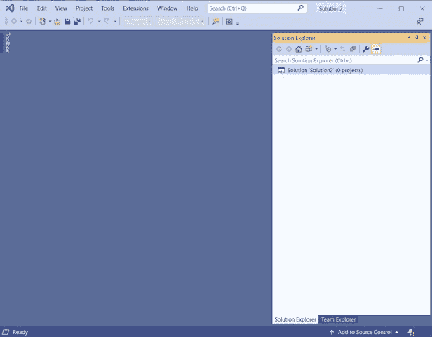

在底部我们找到了另一个窗口；在该区域通常有编译器用于与我们通信的部分。例如，我们将看到一个指示程序存在错误的窗口；在窗口顶部我们将看到菜单和工具栏。如果由于某种原因关闭了源代码编辑器或它没有在我们的 UI 中显示，找到它的最简单方法是使用解决方案管理器。只需导航到代表您的源代码的文档并双击它，源代码编辑器窗口就会出现。

# 如何创建我们的第一个应用程序

为了更好地理解 C# Visual Studio Express，最好创建并处理您的第一个项目。我们将创建一个小型程序，它将在控制台中向我们发送消息，然后我们将添加更多元素，以便探索不同的 UI。在 Visual Studio 2019 中创建新项目有几种主要方法。第一种简单地点击 Visual Studio 主界面右下角的“新项目”（New Project）。然后在搜索框中输入并选择“应用程序 (.NET)”，然后点击“下一步”（Next），如图所示。

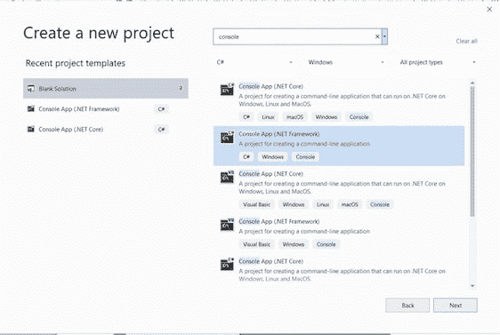

然后配置您的新项目名称和位置，并点击“创建”。一旦设置，Visual Studio 会立即为您创建一个新项目。或者，要创建一个项目，我们可以选择“文件”（File）菜单，然后我们需要点击下方所示的“新项目”选项，通过这样我们将看到一个显示相关选项的对话框。

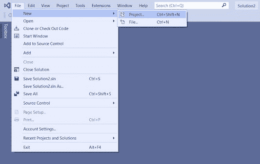

对话框的右部分列出了我们可以创建的不同类型的项目；对于此示例，我们必须选择由控制台应用程序（console application）指示的项目并点击“下一步”。注意：如果由于某种原因关闭了源代码编辑器或它没有在我们的 UI 中显示，找到它的最简单方法是使用解决方案管理器。只需导航到代表您的源代码的文档并双击它，源代码编辑器窗口就会出现。

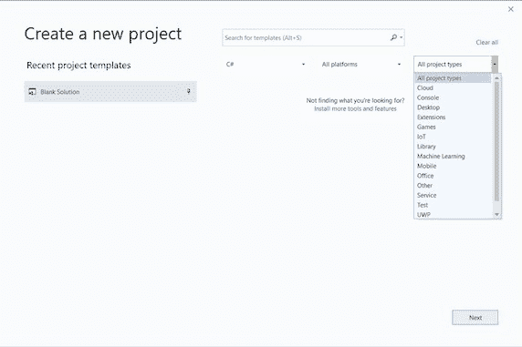

在左侧我们将编写项目名称，在这种情况下为 `MyProject`。我们创建的每个新项目将有一个名称；然后只需点击“创建”按钮。

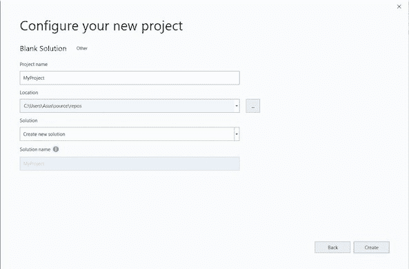

几秒钟内，C# Express 就为我们创建一个项目。Visual Studio 和社区版使用解决方案（solutions）和项目（projects），一个解决方案可以包含多个项目，例如，Office 有 Word、Excel 和 PowerPoint 等不同产品。Office 是解决方案，每个产品是一个项目。项目可以是一个独立的程序或库，并包含一个或多个文档，这些文档可以是源代码和额外资源。

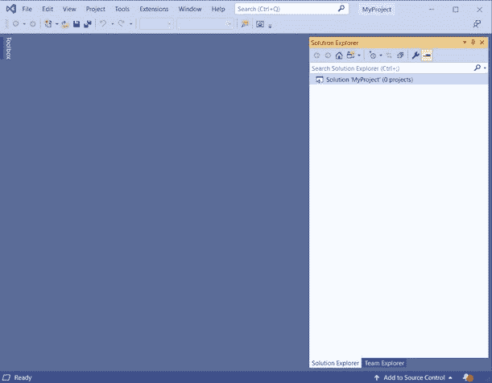

我们可以看到我们的 UI 发生了一些变化，窗口已经在向我们显示信息，我们还可以看到程序的骨架显示在编辑框中。

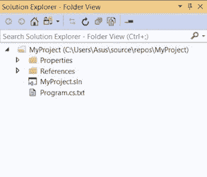

解决方案管理器以逻辑方式向我们展示有关解决方案的信息，如果我们观察它，它像一小树。在底部，我们找到了一个解决方案；解决方案中的每个项目都将是一个分支，每个项目也有它自己的划分。在我们的情况下，我们看到了三个元素；其中两个项是文件夹；在其中一个保留项目属性，在另一个中保留引用（我们不会使用这些）。第四个是代表源代码的文档。我们使用的程序扩展名是 `.cs`。

在编辑区域，我们需要理解命名空间（namespace）的概念：它是相关代码的分组。使用命名空间有助于避免命名冲突，因为只要在不同的命名空间中，你就可以有同名的类。例如，你可以在一个命名空间拥有名为 `Customer` 的类，在另一个命名空间拥有另一个名为 `Customer` 的类。用于定义命名空间的关键字是 `namespace`。

```csharp
namespace MyProject
{
    class Program
    {
        static void Main(string[] args)
        {

        }
    }
}
```

所有的程序都需要一个起点，一个指示程序执行开始位置的地方。在 C# 中，与其他语言一样，起点是 `Main()` 函数；该函数也有它自有的代码块。作为此项功能的一部分，我们通常会将应用程序的主代码放在这里，尽管也可以包含更多的功能、方法和类。函数的各个部分特性可以在本书的第 5 章中找到。

现在是时候创建我们的第一个应用程序了。我们将按照所示修改函数代码。当我们在 `Main()` 内部添加指令时，必须注意它是在放置点之后立即发生的。

### 应用程序编译

一旦写完程序，我们就可以编译之前学的内容；这将生成一个程序集，并在执行后供运行时使用。

要编译应用程序，我们必须选择 `Build` 菜单，然后选择 `Build Solution`，或直接按 `F6` 键。编译器将开始运行，我们将在状态栏看到解决方案已成功编译。

### 运行应用程序

编译成功后，我们就可以运行程序并查看它的工作原理。为此，我们有两个选择：带调试启动和不调试执行。在 Express 版本中只有带调试执行，但我们可以使用 `CTRL + F5` 使用非调试执行，或者通过 `tools` 菜单添加它。

调试器是一个帮助我们修复运行时错误以及逻辑错误的程序。最好使用不带调试器的执行，仅在需要时才使用带调试的执行。现在我们将运行应用程序；为此，请按 `CTRL + F5` 键。

当程序执行时，会出现一个我们称为控制台的窗口，显示程序的执行情况。通过这种方式，我们可以读取我们在示例中放置的消息。

由于这是一本 C# 编程的入门书籍，我们将在控制台上运行所有程序。当你理解了核心概念后，就可以学习在 C# 中编写形状、表单和图形界面。这种编程并不困难，但需要对面向对象编程有基本的理解。

### 如何检测程序中的错误？

有时我们会写错程序；在这种情况下，应用程序无法编译或执行；如果发生这种情况，我们必须更改错误之处。

让我们故意写一个错误，以便观察编译器的行为。

在程序中，我们将 `Console` 改为 `Consoli` 并更改了 `namespace` 和 `HelloWorld` 的顺序，这会导致错误；现在我们可以尝试再次编译查看会发生什么。

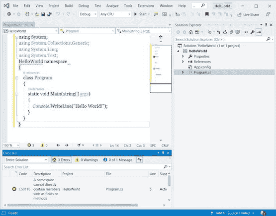

正如我们所知，用户界面底部出现的窗口是编译器用于通信的；我们看到出现了一个带有错误列表的窗口。我们将在下一本书中学习如何使用它；目前，我们只需要知道列表中的第一个问题总是必要的，而且我们可以通过双击它直接进入错误。

# 类视图 (Class view)


现在检查类视图。在此视图中，我们可以获取有关正在创建的解决方案的信息，但与解决方案管理器（`Solution Explorer`）不同，信息是按逻辑排列的。

通过此视图，我们可以快速找到解决方案的命名空间以及它们包含的类；如果我们需要，还可以查看每个类中的方法。此视图不仅允许我们观察逻辑信息，还赋予我们快速导航代码的能力。

社区版（`Community edition`）没有预配置选项，因此需要在`View`菜单中添加命令。

要查看类视图，我们必须进入`View`菜单并选择`Class View`，或直接按`Ctrl + W, C`，UI 中就会出现一个窗口。

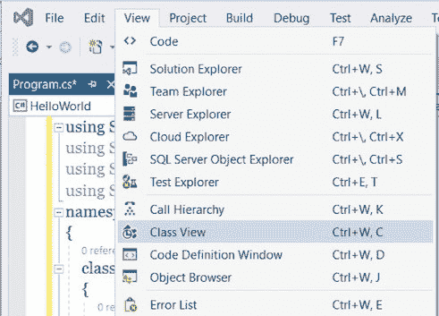

类视图窗口分为两个部分；顶部部分显示元素的逻辑和层级关系，底部部分显示组成特定类的方法。

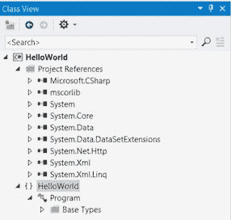

在底部我们找到了设计；它将包含必要的引用和`HelloWorld`命名空间。如果有更多，它们会在我们打开`HelloWorld`命名空间并找到被占用的类时出现。在这种情况下，我们只有一个`Program`类；如果我们选择它，将在底部看到在内部声明的项。在我们的示例中，我们有`Main()`方法。

如果此时我们双击任何一个项，将自动跳转到定义它的代码中。由于我们的程序非常小，我们可能看不到它的用处，但在具有数千行的程序中，这种导航能力是极好的。

## 编译器菜单配置 (Compiler menu configuration)

要向菜单添加所需的选项，需要遵循一系列非常简单的步骤。首先，进入`Tools`菜单并选择`Customize`。将弹出一个对话框，我们需要选择`Commands`；在此部分，我们可以选择想要从中添加命令的菜单，例如`View`菜单。

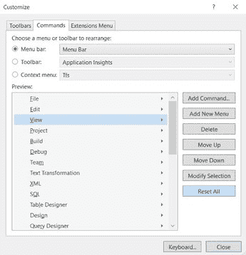

显示当前的命令（注：原文为 current commands are displayed），点击我们想要插入新命令的区域并按`Add`按钮。这将弹出一个新对话框，显示分类后我们可以添加的所有可能的命令。在类别中选择`View`，在命令中选择`Class`，该命令就是允许我们拥有类的那个。`Start Debugging`命令位于`Debugging`类别。


到此为止，我们已经拥有理解 .NET 需要的最重要的基本概念。我们将从下一章开始，学习编程和 C# 语言。C# 主函数

# C# 主函数

C# 是一种全新的、面向对象的编程语言，允许开发者基于 .NET 平台快速编写各种应用程序。.NET 提供了一系列工具和服务，最大化地促进了计算和通信领域的开发和使用。凭借 C# 卓越的面向对象设计，它是构建各种组件的理想解决方案——无论是高层业务应用还是系统级应用程序。C# 语言的特性主要体现在以下方面：

- 设计应用程序。

- 自定义 Windows 库。

- 应用程序设计。

- 为智能设备设计应用程序。

- 设计 .NET Web 应用程序。

- 设计 .NET Web 服务。

- 设计 .NET 移动 Web 应用程序。

- 自定义 Web 库。

.NET 是基于 C# 开发的控制和标记。在中间语言领域，C# 是最亲和的语言，它具有 C 和 Java 的主要特征、强大的函数库以及方便的模板，是当今的理想语言之一。

## C# 几乎结合了今天的高级语言的优点，并具有以下主要特征。

### 简洁的语法

C# 语言像 Java 语言一样使用统一的运算符，消除了 C++ 中复杂的表达式和伪关键字，并以最简单、最常见的形式描述。

### 卓越的面向对象设计

C# 语言是以面向对象为核心进行设计的，因此它拥有面向对象语言应该的所有特征，即封装、继承和多态。

C# 仅允许单继承，这意味着一个类不会有多个基类，从而避免了类型定义中的混淆。在 C# 中，每个类型都是对象，因此没有全局函数、全局变量和全局常量的概念。所有的常量、变量、属性、方法、索引、事件等必须封装在类中，这增加了代码的可读性并减少了命名冲突的可能性。

### 与网络的密切集成

在 C# 中，复杂的 Web 及其他网络编程更像处理本地对象，这简化了大规模和深层次的分布式开发。C# 内置的组件可以方便地支持 Web，并可以被互联网上运行在任何操作系统上的任何语言调用。

## 安全性与错误处理

语言安全性和错误处理能力是衡量一种语言是否完美的重要基础。C# 可以消除许多常见的软件开发缺陷，并提供全面的安全性性能，包括类型安全。

默认情况下，从互联网和局域网下载的代码无法访问任何本地文件和资源。C# 不允许未初始化的变量，并提供了方便的溢出检查和检查等功能。内存管理中的垃圾回收机制极大减轻了开发者的内存管理负担。

### 处理技术版本

C# 具有内置的版本控制功能，例如支持特性重载和异常（例外）、特性支持等，以便方便地开发和更新复杂软件。

### 灵活性与兼容性

在托管状态下，C# 不能使用指针，而是使用`Delegate`来模拟指针函数。如果你需要在类或类方法中使用指针，只需要将内容声明为`unsafe`。此外，虽然 C# 不支持多类继承，但可以通过接口继承来实现。

兼容性意味着 C# 允许与必须传递指针类型参数的 C/C++ 类型 API 进行互操作，并实现了 C# 组件与其他语言组件之间的互操作。

### 业务流程与软件实现之间更好的对应

如果一家公司的业务计划要付诸实践，抽象的业务流程与实际软件实现之间必须存在密切的关系。这在大多数语言中是非常的。

C# 允许定义扩展的元数据。这些元数据可以应用于任何对象。项目生成器可以定义特定领域的属性并将其应用于任何语言元素，例如类和接口。

简而言之，C# 是一种现代的面向对象的语言，允许开发者基于 Microsoft .NET 平台快速方便地创建解决方案。该框架允许 C# 组件轻松转换为 XML Web 服务，以便于任何平台上的应用程序都能通过互联网调用它们。C# 提高了开发者的生产力。同时，它试图消除导致严重后果的编程错误。C# 让 C/C++ 开发者能够在快速扩展网络的同时，仍然保持开发者所需的强度和灵活性。

因此，我们通过各种示例对 C# 的意义和用途进行了简要介绍。在本书的下一章中，我们将讨论构建信息完善的 C# 窗口应用程序所需的 C# 开发环境。请继续阅读以了解更多信息。

# 第 2 章：数据类型

在编程中，数据类型是指用于声明特定数据变量或函数的结构。变量的类型决定了它所占内存的大小以及它使用存储其中的位模式的方式。数据的主要分类如下：

基础类型：这些是数字，由以下两种类型组成：(a) 整数和 (b) 浮点。

计算类型：这些是数值类型，用于描述必须在整个系统中分配的变量。

Void 类型：`void`关键字表示无法分配任何值。

派生类型：包含 (a) 数组、(b) 指针、(c) 结构和 (e) 函数。

数组和结构数据也被称为聚合。函数的类型决定了函数将返回什么类型的值。我们将涵盖基础数据。

## 整数类型

以下是此类类别中出现的数据类型列表。为了参考，还给出了它们占用的空间及其范围。

`char`：分配内存：1 字节，范围：-128 到 127 或 0 到 255

`signed char`：分配内存：1 字节，范围：-128 到 127

`unsigned char`：分配内存：1 字节，范围：0 到 255

`int`：分配内存：2 或 4 字节，范围：-32768 到 32767 或 -2147483648 到 2147483647

`short`：分配内存：2 字节，范围：-32768 到 32767

`unsigned short`：分配内存：2 字节，范围：0 到 65535

`unsigned int`：分配内存：2 或 4 字节，范围：0 到 65535 或 0 到 4,294,967,295

`long`：分配内存：4 字节，范围：-2,147,483,648 到 2,147,483,647

`unsigned long`：分配内存：4 字节，范围：0 到 4,294,967,295

你可以使用`sizeof`运算符来获取变量或类型的精确大小。`sizeof(<type>)`声明返回以字节字节的数据或变量的大小。以下是一个说明下文概念的示例：

```c
#include <limits.h>
#include <stdio.h>
int main () {
    printf("char type (size in bytes):%d \n", sizeof(char));
    return 0;
}
```

在编译并执行此代码后，你需要得到以下输出：char type (size in bytes): 1

### 浮点数据类型

以下是此类类别中出现的数据类型列表。同时还规定了它们占用的磁盘空间、范围和精度值供参考。

`float`：分配内存：4 字节，范围从 1.2e-38 到 3.4e+38，精度：6 位小数

`double`：分配内存：8 字节，范围：2.3e-308 到 1.7e+308，精度：15 位小数

`long double`：分配内存：10 字节，范围：3.4e-4932 到 1.1e+4932，精度：19 位小数

以下将帮助找到以字节计算的精确分配内存。

```c
#include <float.h>
#include <stdio.h>
int main () {
    printf("allocated memory for float:%d \n", sizeof(float));
    printf("precision:%d \n", FLT_DIG); 
    printf("maximum range:%e \n", FLT_MAX);
    printf("minimum range:%e \n", FLT_MIN);
    return 0;
}
```

在编译并执行此代码后，你需要得到以下输出：allocated memory for float: 4, precision: 6, maximum range: 3.402823e+38, minimum range: -3.402823e-38

### Void 类型

`void`数据类型表示没有可用值。它用于以下三种情况之一：

函数的返回类型。你一定已经注意过`void`作为返回类型的使用。如果没有，你很快就会看到。`void`数据类型意味着函数不返回任何内容。

函数参数。有许多函数不验证任何参数。没有参数的函数可以被认为是无效的。

```c
void print (int);
int print (void);
```

变量来说来说分配给内存区域的名称。我们的程序能够操作这个存储区域。每个 C 变量都关联到一个类型，该类型指定了分配给该变量的内存量。它决定了可以应用于变量的操作类型。例如，你不能相乘字符串变量。

## 变量声明

在变量声明中使用以下语法：

```
<data_type> <variable_list>;
```

上述语法中的`Data_type`必须是有效的 C 数据类型，例如`int`、`String`、`float`等。`VariableList`可以是多个用逗号分隔的变量名。

以下是有效的变量声明示例：`int a, b, c;` `mark c, d;` `float x, salary;` `double y;`

变量可以在声明时进行初始化。例如：`int x = 40;`

## 变量初始化

变量初始化是指给变量赋值的过程。它是通过一个等号后跟一个常量表达式来实现。这里是初始化的通用语法：`variable_name = value;`。正如我们之前提到的，变量可以在声明期间初始化。这里是更多示例：

```c
int x = 1, y = 6; /* x 和 y 初始化。 */
byte f = 22; /* 初始化 f。 */
double pi = 3.14159; /* 声明 pi 的近似值。 */
char a = 'a'; /* 变量 a 的值为 'a'。 */
```

变量初始化应该正确完成；否则程序可能会产生意外的结果。

例如： 

```csharp
using System;
namespace VariableDeclaration {
    class MyProgram {
        static void Main (string [] args) {
            short x; int y; double with; /* 变量的实际初始化 */
            x = 5; y = 10; z = x + y; 
            Console.WriteLine ("x = {0}, y = {1}, z = {2}", x, y, z); 
            Console.ReadLine (); 
        }
    }
}
```

代码返回如下：

`x = 5, y = 10, z = 15`

## 获取用户输入

`System`命名空间下的`Console`类有一个名为`ReadLine()`的方法，允许我们从用户处获取输入。用户输入被读取并存储在变量中。下面的示例展示了如何使用此方法：

```csharp
using System;
namespace UserInputApp {
    class MyProgram {
        static void Main (string [] args) {
            name = "Santa"; string name = "Samuel"; 
            Console.WriteLine ("Your first name is:" + firstname + "" + lastname); 
            Console.WriteLine ("Please enter and various first Name:");
            FirstName = Console.ReadLine ();
            Console.WriteLine ("Your new name is:" + firstName + "" + lastName); 
            Console.ReadLine ();
        }
    }
}
```

当提示输入第一个新值时，执行操作你的名字就改变了。

## 运算符

运算符是指示编译器执行逻辑或算术操作的符号。C 有多种运算符。让我们讨论它们。

### 算术运算符

它们用于执行各种算术操作。它们可以像下面的示例所示：

```csharp
using System;
namespace ArithmeticOperatorsApp {
    class MyProgram {
        static void Main (string [] args) {
            int x = 3; int y = 10; int with;
            z = x + y; Console.WriteLine ("1 - {0}", z);
            z -= y; Console.WriteLine ("2 - {0}", z);
            z = x * y; Console.WriteLine ("3 - {0}", z);
            z = x / y; Console.WriteLine ("4 - {0}", z);
            z = x % y; Console.WriteLine ("5 - {0}", z);
            z = x ++; Console.WriteLine ("6 - {0}", z);
            z = x; Console.WriteLine ("7 - {0}", z); 
            Console.ReadLine ();
        }
    }
}
```

上述大多数运算符都是广为人知的，除了其中几个。`++`是递增运算符，每次迭代都会将变量的值加 1。`-=`是递减运算符，每次迭代后都会将变量的值减 1。`%`被称为模运算符，返回除法后的余数。代码返回下面的输出：

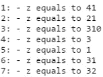

### 逻辑运算符

C 也有许多逻辑运算符。让我们简要讨论一下它们：

- 逻辑与 (`&&`)：如果两个操作数都不零，则条件为真。

- 逻辑或 (`||`))：如果任何一个操作数非零，则条件为真。

- 逻辑非 (`!`)：该运算符反转操作数的逻辑状态。如果条件为真，此运算符将改变它。

下面的示例展示了如何使用上述运算符：


```csharp
using System;
namespace LogicalOperatorsApplication {
    class MyProgram {
        static void Main (string [] args) {
            bool x = true; bool y = true;
            if (x && y) {
                Console.WriteLine ("1: The condition is true");
            }
            if (x || y) {
                Console.WriteLine ("2; The condition is true");
            }
            /* 改变 x 和 y 的值 */
            x = false; y = true;
            if (x && y) {
                Console.WriteLine ("3: The condition is true");
            } else {
                Console.WriteLine ("3: The condition is not true");
            }
            if (! (x && y)) {
                Console.WriteLine ("4: The condition is true");
            }
            Console.ReadLine ();
        }
    }
}
```

代码返回以下输出：

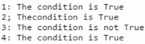

## 赋值运算符

C 赋值运算符可以像下面的示例所示：

```csharp
class MyProgram {
    static void Main (string [] args) {
        int x = 3; int with; z = x; Console.WriteLine ("1: value of z = {0}", z);
        z += x; Console.WriteLine ("2: + = {0}", z);
        z -= x; Console.WriteLine ("3: - = {0}", z);
        z *= x; Console.WriteLine ("4: * = {0}", z);
        z /= x; Console.WriteLine ("5: / = {0}", z);
        z = 100; z %= x; Console.WriteLine ("6: % = {0}", z);
        z <<= 2; Console.WriteLine ("7: << = {0}", z);
        z >>= 2; Console.WriteLine ("8: >> = {0}", z);
        z &= 2; Console.WriteLine ("9: & = {0}", z);
        z ^= 2; Console.WriteLine ("10: ^ = {0}", z);
        z |= 2; Console.WriteLine ("11: | = {0}", z);
        Console.ReadLine ();
    }
}
```

# 第 4 章：序列与列表

`List<T>` 是一个常用的集合类，其主要特点是可以通过索引访问元素。正如前面提到的，`List` 属于 `System.Collections.Generic`。`List` 提供了许多操作列表的方法，其中一些是搜索、排序等。它可以用于创建不同类型的集合。可以是整数、字符串等。对于引用类型，`List` 允许将 `null` 作为元素。也可以在 `List` 集合中插入重复值。该类可以同时使用排序和相等比较。数组与列表相似，但列表可以动态调整大小。

## 字符串

C# 中的 `string` 类型是一种表示文本并处理文本变量的类型。这是一个字符数组。声明字符串数据类型使用 `string` 关键字来完成。当使用 `string` 关键字时，意味着它指向 `System.String` 类。许多扩展方法可以用于某些字符串变量。其中最流行的包括 `Concat`——即连接两个字符串，`Contains`——确定字符串是否包含作为参数传递的给定字符串，`Equals`——确定两个字符串是否具有相同的值等。默认字符串类型是空字符串。

# 第 5 章：语法

## 循环结构语句

在现实生活中，我们经常重复说同样的话。例如，在眼操运动的第四轮揉眼睛时，你会重复揉眼睛的动作。当你打乒乓球时，你会重复挥拍动作等等。C 语言有一种指令可以多次执行同一块代码，被称为循环指令。循环语句分为三种类型：`while` 语句、`do...while` 语句和 `for` 语句。

`while` 语句与上一节中提到的条件判断语句相似，它也是根据条件判断来决定是否在 `{}` 上执行执行语句。区别在于，`while` 语句会多次评估条件。只要条件为真，`{}` 中的语句就会一直执行，直到条件为假且 `while` 循环终止。

`while` 语句具有以下语法结构：

```
while (cyclic condition) 
{
    // follow the instructions
    …
}
```

在上述语法结构中，`{}` 中的执行语句被称为循环体，循环体是否执行取决于循环条件。当循环条件为真时，将执行循环体。当循环体执行完毕后，它将继续评估循环的状态。如果条件仍然为真，它将继续执行，直到循环条件为假，整个循环过程才会完成。

然后使用 `case`（此处应为循环）如示例所示打印自然数 1 到 4。

### 示例程序

Program11.cs

```csharp
public class Program11
{
    public static void 
    {
        // Here you need to enter your logic
        int firstSample = 1; // define a variable 'firstSample' with an initial value of 1
        while (firstSample <= 4) // cyclic condition
        {
            Console.WriteLine("firstSample =" + firstSample);
            // If condition is true, print FirstSample. 
            firstSample++; // firstSample for self-incrementing
        }
        Console.ReadKey();
    }
}
```

运行结果将显示在计算机屏幕上。例如，起始值 `x` 为 1，如果循环条件 `x <= 4` 为真，则循环将重复执行，打印 `x` 的值且 `x` 会自动增加。因此，打印结果中的 `x` 值分别为 1、2、3 和 4。示例中第 9 行的代码用于在每次循环更改变量 `x` 的值，从而最终实现改变循环条件的目标。如果没有那行代码，整个循环将变成死循环且不会结束。

### Do-while 语句

`do-while` 语句的功能与 `while` 语句相似。两者的区别在于，语句必须先评估循环条件，然后根据循环的结果决定是否执行 `{}` 中的代码。相比之下，`do-while` 语句在评估循环条件之前必须执行一次 `{}` 中的代码。

它的语法如下：

```
do
{
    // follow the instructions…
} while (cyclic condition);
```

在上述语法中，关键字 `do` 之后 `{}` 中的执行语句是循环体。`do-while` 语句将循环条件放在循环体之后。这意味着循环将无条件地执行一次，然后根据循环条件决定是否继续执行。

然后使用 `do-while` 语句重写示例，如下方的 Program12.cs 所示：

```csharp
class classicprogram
{
    public static void
    {
        // We usually enter options here
        int secondInstance = 1; // define a variable 'secondInstance' with a starting value of 1 to
        do
        {
            Console.WriteLine("first instance =" + secondInstance); // write the value of the "first"
            secondInstance++; // increase the value of "priority" by itself
        } while (secondInstance <= 4); // cyclic conditions
        Console.Scan();
    }
}
```

运行结果将显示在计算机屏幕上。上述示例具有相同的结果，说明 `do-while` 循环和 `while` 循环可以实现相同的功能。然而，两者在程序运行过程中存在差异。如果在循环语句开始时不满足循环条件，`while` 循环体将不会执行一次，但 `do-while` 循环体仍会执行一次。如果此示例中的循环条件 `x <= 4` 更改为 `x < 1`，示例 2-12 将打印 `x = 1`，而示例 2-11 则不输出任何。

### For 语句

上一节解释了 `while` 循环和 `do-while` 循环。程序开发中经常使用的另一种类型的循环语句是 `for` 语句，它通常用于循环次数已知的情况，其语法格式如下：

```
for (initialization expression, circulation conditions, operation expression)
{
    // follow the instructions…
}
```

在上述语法中，`for` 关键字后的字符包含三个部分：初始化表达式、循环条件和操作表达式。在语句之间，`{}` 中的执行语句是循环体。然后，初始化表达式、循环条件、操作表达式和循环体分别由 1 表示。

```
for (int i = 1; i <= 4; i++)
{
}
```

然后如示例所示对自然数 1 到 4 求和。Program13.cs 示例：

```csharp
class classicprogram
{
    public static void
    {
        // We usually enter options here
        int secondInstance = 1; // define a variable 'secondInstance' with a starting value of 1 to
        for (int first = 1; first <= 4; first++) // the first will change from 1 to 4
        {
            sum += first; // realize the accumulation of the sum own
        }
    }
}
```

例如，变量 `i` 的初始值为 1，如果评估 `i <= 4` 为真，则将执行循环累加 `+= I`。当表达式完成后，将执行操作表达式 `i++`，`i` 的值变为 2。然后继续评估条件并启动下次循环，直到 `i = 5` 且条件 `i <= 4` 为假，退出循环，执行 `for` 循环后的代码，并打印 "sum = 10"。

# 第 6 章：类

在 C# 编程语言中，每个组件都与类和对象相关，它们代表了基本的面向对象概念。类类似于原型，用户从原型创建对象。类代表一个具有其所有成员、属性和功能的唯一实体。

## 类

类代表了任何面向对象软件中唯一的编程组件。类由访问修饰符、`class` 关键字和唯一名称定义。某些类可以包含许多元素，如字段、属性和方法。类的默认访问修饰符是 `internal`。这意味着如果没有指定访问修饰符，该类将被视为 `internal`。类的示例类的所示：

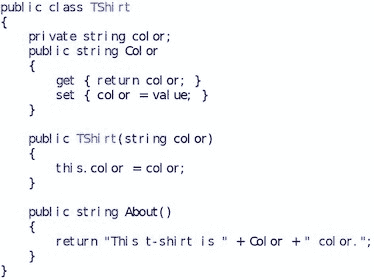

该类有其访问修饰符 `public`，包含 `class` 关键字；有一个唯一名称 `TShirt`。在此类内部定义了许多成员。有一个 `private` 字段 `color`、一个 `public` 属性 `color`、一个定义的构造函数（带一个参数）以及一个 `public` 方法 `About`。

除了普通类之外，还有一种特殊的类 - **抽象类**。抽象类是一种特殊的类，无法对其进行实例化。抽象类最常用于定义层次结构中的基类，也被称为不完全类。抽象类通常表示一个基类，其设计用于包含实现抽象定义的派生类。在抽象类中，可以有抽象方法，也可以有非抽象方法。抽象方法以及任何标记为 `abstract` 的元素都必须在派生类中实现。标记有 `abstract` 关键字的类旨在为派生类提供原型。抽象类可以实现一个构造函数。

![Image image-16)

在给出的示例中，我们有一个名为 `Animal` 的抽象类。该类中只有一个成员，即抽象方法 `void Sound()`。将一个方法设为抽象意味着任何派生自该类的类（在本例中为 `Animal` 类）都必须重写其实现。在抽象类下面，有两个被称为“普通”的类。这两个类都重写了 `Animal` 类中 `Sound()` 方法的实现。这是因为 `Elephant` 和 `Pig` 类都继承自 `Animal`。继承将在下一章详细解释，但目前 `Elephant` 和 `Pig` 旁边的符号意味着它们继承自 `Animal`。在这种情况下，意味着它们必须拥有来自基类的抽象方法的实现。在 `Program` 类的 `Main` 方法中，声明了一个类型为 `Animal` 的名为 `animal` 的变量。

没有 `Animal` 类的实例，因为这是可能的，原因是 `Animal` 是抽象类 - 所以无法创建。在下一行，程序在变量 `animal` 中创建了一个 `Elephant` 对象的实例。这是允许的，因为 `Animal` 是 `Elephant` 类的基类。随后通过变量 `animal` 调用了 `Sound()` 方法。此外，由于 `animal` 实例是 `Elephant` 类型，此调用执行了 `Elephant` 类的 `Sound()` 方法。下一步是实例化 `Pig` 对象并将其赋值给同一个 `animal` 变量。这导致再次从 `animal` 对象调用 `Sound()` 方法。这次使用了来自 `Pig` 类的 `Sound` 实现。

![Image image-17)

## 对象

C# 中的对象代表系统中的真实实体，具有所有的特性和类类型函数。它们存在于内存中的某处，并对内存有引用。每当使用 `new` 关键字时，内存中就会创建一个对象。对象必须是类类型。用 C# 语言编写的每个类都继承自 `System.Object`（继承将在后面的章节中解释）。这意味着 C# 中有一个内置的 `Object` 类，任何类型的对象都继承自该类。每个创建的对象除了具有自己的功能外，还具有其父类 `Object` 可用的方法。这些方法是：`Equals`、`ToString`、`Finalize` 和 `HashCode`。可以通过一个示例来检查：

![Image image-18)

此示例使用了之前在“类”节中所示 `TShirt` 类。在 `Main` 方法中创建了一个 `TShirt` 类类型的对象。该对象由变量 `tshirt` 引用。在第二行中，你可以看到在 `tshirt` 对象上可以执行的可用方法和属性。除了属于 `TShirt` 部分的 `Color` 属性和 `About` 方法外，还存在来自父类 `Object` 的四个方法（`Equals`、`HashCode`、`GetType`、`ToString`）。

## 接口

面向对象编程的另一个重要部分是**接口**。接口表示函数的多个声明。一个类可以实现一个或多个接口，但只能继承一个类或抽象类。这是 C# 编程的另一个特性 - 它不支持多继承。实现接口的类必须包含所有成员的完整定义。接口中没有访问修饰符，因为所有成员都是 `public`。如果一个类需要实现接口成员，这意味着这些成员必须是公共的，以便它们被其他类实现。接口是一个具有声明的对象组件。如果你尝试向接口中插入实现，将得到错误。接口可以包含属性和方法 - 即实现可以有的任何内容。它不能拥有字段和构造函数，因为它不是类且无法创建。实现接口时，类必须实现所有成员。如所述，C# 不支持继承，但可以通过接口实现，因为类可以实现多个接口。示例：接口可以包含属性和方法 - 实现可以有的任何内容。

![Image image-19)

在这里我们定义了一个接口。它内部三个属性。实现此接口的类必须具有所有这些接口元素的定义。


现在运行程序：


语言集成查询（俗称 LINQ）代表了 C# 编程语言中的查询语法，用于获取和过滤各种对象源。LINQ 为不同类型的对象和变量创建了单一查询接口。这种查询语法与 C# 编程语言以及 Visual Basic 集成。为了更好地理解，我们将提供一个示例来详细解释它。因此，你有`SQL`作为你的结构化查询语言。`SQL`用于在数据库中检索和保存数据。它是一种设计为与数据库紧密工作的语言。

与`SQL`类似，LINQ 用于检索和过滤各种数据源，如集合、数据集等。LINQ 有多种使用方式；通过实现实际接口查询对象集合、ADO.NET 数据集、XML 文档、Entity Framework 数据集、SQL 数据库以及不同的数据源。LINQ 就像程序中数据和变量之间的桥梁。每个 LINQ 查询都返回对象作为结果。这很好，因为允许对数据集使用面向对象的方法。使用 LINQ 时，你不需要担心将这些配置与数据项转换。LINQ 提供了一种从任何来源查询数据的方法。它支持编译时语法检查，因此如果你在编码 LINQ 时出错，编译器会立即通知你。

LINQ 允许你查询任何集合，如`List`、`Array`、`IEnumerable`类等。

现在来看示例：

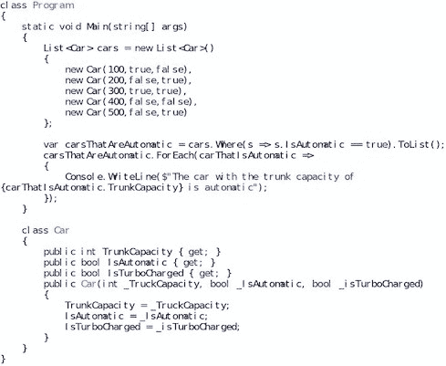

在这个示例中，我们有一个名为`Car`的类。`Car`类中有三个属性：`TrunkCapacity`、`IsAutomatic`和`IsTurboCharged`。每个属性代表一个只读属性，它们的初始状态在`Car`类的构造函数中设置。构造函数接受三个参数并将它们的值分配给上述属性。在`Main`方法中，我们创建了一个`Car`对象列表。该列表在声明部分被填充，创建了五个`TrunkCapacity`、`IsAutomatic`和`IsTurboCharged`属性值不同的`Car`对象。然后我们将过滤列表，只保留自动挡箱的汽车。这将通过 LINQ 查询完成。我们创建一个名为`carsThatAreAutomatic`的对象，并从 LINQ 过滤汽车列表。然后我们执行`Where`LINQ 扩展方法来获取我们需要的对象。它是如何工作的？在`Where`方法中，我们声明了一个迭代变量，用于过滤条件。

此示例中的变量是`s`。现在过滤器的作用是：对于汽车列表中的每个`s`对象，它将返回一个`s.IsAutomatic`属性为 true 的对象。这反过来创建一个过滤后的`IEnumerable`列表。为了使此列表具有显式类型，我们将在过滤后的`IEnumerable`列表上应用简单的`ToList()`方法。这将创建一个`List<Car>`对象并将其分配给`carsThatAreAutomatic`。现在我们拥有了需要的数据。最后，我们将遍历新创建的`Car`对象集合，并将消息打印到控制台。对于列表上的每个对象，我们将打印“容量为 {specified capacity} 的汽车是自动挡”。我们之所以知道这一点是因为我们过滤了汽车并只取了那些具有自动挡的汽车。

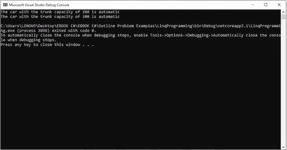

如你所示，有两辆自动变速箱汽车，它们的容量分别为 100 和 300。你可以在创建汽车列表之初检查这一点，因为第一辆和第三辆汽车传递的对象中`IsAutomatic`属性为 true。另一个示例见下所示：

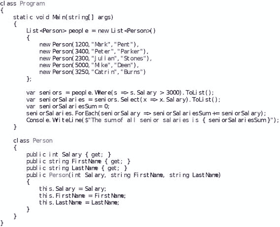

在这个示例中，我们有一个名为`Person`的类。该类拥有属性`Salary`、`FirstName`和`LastName`。每个`Person`类代表一个带有基本信息的员工。对象属性在构造函数中分配。`Main`方法创建了一个带有`Person`类对象的列表。我们添加了五个`Person`对象，每个都有不同的工资金额和姓名。经理想要过滤出所有工资大于 3000 的人，这些人将被标记为`seniors`（资深人员）。我们将通过 LINQ 查询来实现此。与上一个示例一样，我们使用`Where`扩展方法过滤人员。在此方法中，我们声明我们只需要工资大于 3000 的`Person`对象。下载完成后，`ToList()`方法将过滤后的`IEnumerable`列表转换为`Person`对象列表。现在我们有了该项，这是一个`Person`类型的列表，仅包含工资大于 3000 的人员。该变量被称为`seniors`。现在经理要求他计算资深人员工资的总额。接下来，我们将通过创建一个资深人员工资列表，然后将所有这些值加到一个变量中，并将其写入标准输出。创建`seniorsSalaries`列表将使用`Select`LINQ 扩展方法。当需要从对象集合中获取特定属性值时，使用`Select`方法。在这种情况下，我们需要资深人员列表中每个属性的`Salary`值。`Select`方法执行后续操作：对于资深列表中的每个对象`x`，获取`x.Salary`。这创建了一个可枚举值列表。执行`ToList()`方法后，我们成功创建一个包含资深人员工资元素的`List<int>`对象。然后我们创建了一个变量来存储所有资深人员工资的总和——`seniorSalariesSum`变量。此之后，我们还有一条语句将完成工作。`ForEach`方法在`seniorsSalaries`列表上执行，它将收集并汇总所有工资到一个变量`SalariesSum`中。最后，程序将结果写入标准输出——`seniorSalaries`：


执行`Where`方法后，接着执行`Select`。这将给你完全相同的结果。为了让你理解，这个长语句被拆分成了几个短语句。让我们用最后一个示例结束这个 LINQ 章节：

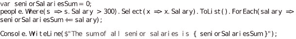

如你所示，有两辆自动变速箱汽车，它们的容量分别为 100 和 300。你可以在创建汽车列表之初检查这一点，因为第一辆和第三辆汽车传递的对象中`IsAutomatic`属性为 true。

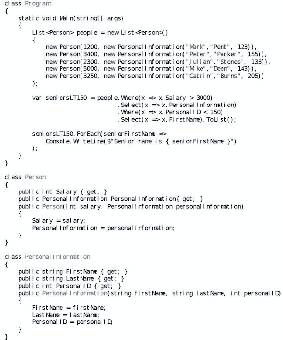

对于每一个人，我们都创建一个`PersonalInformation`对象来正确地实例化`Person`对象。每个`PersonalInformation`对象都包含一个传递给其实例的`firstName`、`lastName`和`personalID`。通过这种方式，我们创建了一个稍微复杂的对象，它内部包含了另一个类对象。好了，我们准备好了。

经理要求我们找到所有被认为是资深员工且 ID 卡号小于 150 的员工姓名。根据之前的示例，我们决定资深员工是指`Salary`超过 3000 (3000) 的`Person`。我们正在执行与上一个示例类似的操作，但这次`Person`类发生了变化。它的结构与之前的示例不同。因此，我们首先需要分析类结构，然后创建解决方案。

第一步是从人员列表中筛选出`salary`大于 3000 的`Person`对象。接下来，我们需要从每个`Person`对象中获取`PersonalInformation`对象，以找到所有资深人员的姓名。然后，当收集了`PersonalInformation`对象后，我们必须对它们进行过滤，只保留`personalID`小于 150 的对象。完成这项任务后，我们最终可以选择所有资深人员的`firstName`属性，基于其创建一个列表，遍历该列表并打印`firstName`值。这一切都是通过一个低复杂度的 LINQ 查询完成的，我们通过该查询创建了一个列表变量`seniorsLT150`。

第一个`Where`方法创建了一个`IEnumerable`seniors 列表。然后，`Select`方法从 seniors 列表中获取`PersonalInformation`对象，并创建一个包含资深人员`PersonalInformation`对象的`IEnumerable`列表。第二个`Where`方法作用于之前创建的`IEnumerable`列表中的`PersonalInformation`对象，我们将过滤出`personalID`小于 150 的`PersonalInformation`对象。然后我们执行`Select`方法，收集每个`personalID`小于 150 的资深人员`PersonalInformation`对象的`firstName`属性值。最后，我们在创建的最终`IEnumerable`上执行方法的`ToList()`方法，其结果是一个包含每个个人标识符小于 150 的资深人员姓名的字符串列表。唯一符合这些标准的资深人员是 Mike Dean，他的名字将打印在标准输出上。该程序的控制台输出如下：

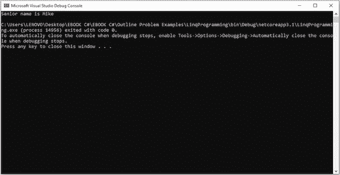

# 第 8 章：决策程序

## 决策

并不是所有问题都是线性解决的，有时在条件为真时需要做出决策或采取某些动作，而在其他时候则不需要。假设我们的问题是保持桶水的温度。为此我们可以添加热水或冷水。在这个问题中，我们必须决定添加什么水。同样，有很多问题我们需要知道如何解决。C 语言很容易实现，因为语言为我们提供了各种工具来处理。我们将不得不使用所需的表达式。在这些情况下，我们将根据这种情况的结果使用所需的条件表达式和逻辑表达式。让我们从了解我们需要的表达式开始。

## 做出决策

在 C 中，我们需要花费一些时间处理控制语句或条件语句。这些代码可以从用户获取输入，将其与代码中设置的条件进行比较，然后根据两者做出决策。有时你输入了内容，并希望这个程序能自己处理决策。你可以选择编写代码，使得代码中可以找到条件，然后代码可以根据用户输入做出响应。好消息是，有几种条件语句供你选择。每种语句的工作方式都不同，取决于你希望从程序中得到什么以及你希望它如何对不同的输入做出响应。通过学习不同的选项，你将更好地理解每种语句的工作原理，以及为什么在过程中进行选择是很有意义。让我们看看 C 中可用的条件语句。

### If 语句

我们想要查看的第一种条件语句是`if`语句。在我们将审查的所有条件语句中，这是最基础的。它省略了一些我们在其他语句中看到的特性，但它帮助我们学习更多关于条件语句的知识，并在某些情况下有用，因此学习它是重要的。当你处理这个`if`语句时，你会发现当运行它时，只有当用户提供的输入符合代码设置的条件时，代码才会对我们响应。当这种情况发生时，代码将执行，通常会显示某种消息，取决于开发者在代码中编写了什么。有时你也会设置它来执行其他操作。然而，如果用户输入了不符合我们设置的条件的数据，屏幕上什么都不会出现。这可能会导致问题，因此`if`语句可能不像其他某些选项那样被频繁使用。这一切的好消息是，即使是初学者，也会发现这些语句也很很容易设置和使用。让我们看看下面的编码，看看我们如何为了自己的目的在 C 中创建一个这样的`if`语句：

```c
if (x > 0)
{
    Console.Write("The value is positive.");
}
```

在上述示例中，某些事情必须发生。如果用户输入的值大于零，则程序设置为打印“Value is positive”。然而，如果表达式为假或输入小于零，程序将忽略`Console.Write`之后的所有语句。我将进一步详细说明。

### If Else 语句

我们可以很快地发现，在处理`if`语句时，会有很多情况这些`if`语句无法帮助我们按照想要的方式完成任务。你不想编写不足以处理你想要的工作的代码。创建一个让用户可以插入内容然后程序直接退出或挂起的代码绝不是一个好主意。在这里我们来看一种名为`if-else`语句的新条件语句。

`if-else`语句处理起来会很有趣，因为它为我们编写的代码增加了许多功能，同时允许我们添加多个选项并处理用户添加的几乎任何内容。

为了彻底理解这个问题，我们需要查看`if-else`语句的语法，以便更好地理解它在 C# 中如何工作。下面是一个很好的语法示例：

```csharp
If (logical expression)
{
    // 如果结果为真，则运行这些指令
}
Else
{
    // 如果结果为假，则运行这些指令；
}
```

如你所见，在这种情况下，`if-else`语句提供了更大的功能。这是`if-else`语句的基本选项，但你可以添加更多行来提高其有效性。对于这些`if-else`语句，如果答案为假，你的代码将跳转到语句的下一个部分来检查是否为真。如果选项超过两个，它将一直遍历`if-else`语句，直到答案为真，然后它将执行并显示出现的消息。

既然我们已经花时间讨论了它，现在是时候看看它是如何工作的示例了，这样你就可以代码中使用它：

```csharp
If (x > 0)
{
    Console.Write ("This value will be positive.");
}
Else
{
    Console.Write ("The value is less than or equal to zero.")
}
```

你会发现，当我们处理上述示例时，在`logical expression`为假之前，`else`子句是有效的，或者至少是隐藏的。当过程需要`else`语句时，它就在那里。但如果我们最终得到一个真值，第一个语句将是下一个语句，因此我们完全不需要`else`语句。

### 什么是嵌套条件语句

每当我们回顾 C# 随附的一些新代码时，你应该发现使用我们上面提到的两个语句会更简单，或者你也可以将它们组合起来为某些代码创建嵌套条件。在嵌套条件语句的情况下，我们将采用上述类型条件语句之一并将其放入另一个语句中。此目的是增加我们想要看到的编码工作的复杂性，并在我们需要时确实能为我们提供一系列条件。

在处理嵌套条件语句时，我们需要关注的重点是，如果编写语句出现任何错误，将导致整个部分出错，并且可能需要一些时间来修复。这使得它们在处理和操作过程中变得有些困难，所以要小心。

然而，它们酷酷之处，以及让它们非常有吸引力的地方在于，它们允许我们添加任意数量的层级。尽管如此，该语言的大多数专家仍建议嵌套语句保持在三层或以下，以免它们在处理过程中变得过于混乱。如果你在处理这些语句时超过了第三层，你可能会得到一个不受控且不按照你想要的方式运行的结果，甚至可能无法运行。作为初学者，请坚持三层，并随着编码技巧的熟练而不断进步。你可以编写许多基于这些条件语句的代码。它们有助于加固代码，并确保我们能够处理用户提供我们的某些输入，即使我们无法预测用户将向程序添加什么响应。他们可能会根据我们设置的任何术语对输入进行处理，并确保程序以我们倾向的方式运行。这使得我们更容易看到结果并确保程序按照我们想要的方式工作。

# 第 9 章：网络

## .NET Framework

在类框架下编写的程序能够在软件环境中运行，而不是名为`CLR`（或公共语言运行时）的硬件环境中运行。`CLR`是一个应用程序虚拟机，将帮助我们提供各种服务，包括安全、异常处理和内存管理。由于这个原因，用此框架编写的代码是托管代码。我们讨论过的`CLR`和`BCL`共同构建了 .NET framework。

首先，`BCL`是有效的。它为我们提供了部分用户界面、数据访问、应用开发、算法、网络通信等内容。开发者可以通过将源代码与 .NET 平台和其他可用库打包来创建软件。这是一个旨在与我们在 Windows 平台上想要创建的大多数新应用程序协同工作的框架。此外，微软还打算创建一个专用于 .NET 软件的 IDE，称为 Visual Studio。在 .NET framework 方面，有很多工作可以做。某些方法的开发不仅可以在 Windows 上运行，还可以在 Linux 和 Mac 等其他操作系统上运行。而且它可以帮助我们使用不同的语言，特别是 C#，在编写代码时具有可移植性、高效性并擅于管理内存。

为了能够在 C# 中有效编程，你需要的关于所谓 .NET framework 的理论知识很少。这就是为什么 .NET framework 是此书不可或缺的一部分。在我们更深入参与 .NET 平台之前，重要的是它是 .NET 技术不可或缺的一部分。运行时（runtime）的工作本质上是执行用适当编程语言开发的代码。然而在过去，你必须为每种编程语言提供单独运行时库（runtime library）——每个版本也一个——以便执行相应的程序。例如，C++ 的`MSVCRT.DLL`，以及 Visual Basic 6 中的`MSVBVM60.DLL`。交付的运行时的概念在过去和现在从根本上是不同的。多语言支持提供了 .NET framework 的关键优势：

- 只需要一个框架。

- 根据你的知识水平和个人偏好，可以使用不同的（且非常不同的）编程语言。

- 对于所有编程语言，恰有一个运行时环境。

从这些优势中可以得出进一步的结论：

- **跨语言集成**：跨语言异常处理（异常处理是指程序在发生通常不预料的事件（如错误）时应如何响应）。

- **更高的安全性**：（你可以将安全性控制到方法级）

- **简化的版本控制**：（多个版本可以并存存在）

由于 .NET framework 提供了多语言运行环境，它确保了不同编程语言组件之间的相互作用和最佳协作。你已经知道 .NET framework 是 .NET 技术的一部分以及它的作用。.NET framework 再次由三个部分组成：

1. 通用语言运行时 (Common Language Runtime) - 多语言运行时

2. 库 (Libraries)(稍后学习类和库)

3. ASP.NET - 用于万维网的服务器应用程序


我们将在书中详细讨论这三个元素。通用语言运行时和库将在书中反复出现，在网络服务的背景下的 `ASP.NET` 也是如此。`.NET Framework` 的两个组件——通用语言运行时和库也被称为基础框架（base framework）。

## 发现 .NET

`.NET Framework` 是所有与应用程序开发相关问题的解决方案，不仅为开发者带来了巨大的利益，对开发过程也是如此。首先 `.NET` 允许我们处理现有代码；我们可以使用 `COM` 组件，甚至在需要使用 `Windows API` 的情况下。一旦 `.NET` 准备就绪，在客户端机器上安装变得简单得多，因为它具有强大的跨语言集成能力。

一个 `AC` 开发者可以轻松理解 `Visual Basic .NET` 开发者的代码，他们都可以使用自己最擅长的语言进行编程。这是因为所有使用 `.NET` 的语言都共享 `.NET` 库，因此无论我们使用什么语言进行编程，我们都可以在任何语言中识别出它。接下来，我们将学习 `.NET` 的不同组件：公共语言运行时（`CLR`）、程序集（Assembly）和公共中间语言（`CIL`）。

## CLR

我们将学习的第一个组件是公共语言运行时，也称为 `CLR`。它是所有语言通用的可执行程序。该程序负责读取编译器生成的代码并启动执行。无论程序是用 `C#`、`Visual Basic .NET` 还是其他 `.NET` 语言编写的，`CLR` 都会读取并执行它。

### Installation

当我们写了一个用 `.NET` 编写的程序并编译它时，会生成一个程序集。该程序包包含了编译程序中的 `CIL`，还包含了程序中使用的所有类型的信息。

## CIL

`.NET` 程序不会直接编译成机器汇编代码；而是编译成名为 `CIL` 的中间语言。这种语言由运行时读取并执行。使用 `CIL` 和运行时为 `.NET` 提供了极大的活性和跨平台能力。

`.NET` 框架共享公共语言或 `CLS` 规范。这些规范是你想要使用的每种语言为了与运行时协作而必须满足的指南。其中一个优势是，如果我们的代码符合 `CLS` 标准，我们就可以与其他语言具有互操作性，例如，我们可以在 `C#` 中创建一个库，`Visual Basic .NET` 开发者可以毫无问题地使用它。

这些指南的亮点之一是 `CTS` 或公共类型系统。在编程语言中，当我们想要写入信息时，它会被放入变量中，变量将根据要写入的信息具有类型，例如，一个类型可以是整数，另一个类型用于写入小数，另一个用于写入短语或单词。问题是每种语言存储信息的方式不同。某些语言使用 16 位内存存储整数，而另一些使用 32 位内存；甚至像 `C` 和 `C++` 这样的语言没有存储字符串或短语的类型。

为了解决这个问题，`.NET` 框架通过 `CTS` 定义了类型在它们环境中如何运行。任何与 `.NET` 的语言都必须使用 `CTS` 中指定的类型。现在我们已经了基本概念，并可以看到它们是如何结合在一起的。

## 如何创建 .NET 应用程序

我们可以使用编程语言创建 `.NET` 应用程序。为此，我们将使用 `C#`；通过这种编程语言，我们可以创建程序的源代码（告诉程序应该做什么的指令）。

当我们完成源代码的编写后，我们必须使用编译器。编译器获取源代码并为我们创建一个程序集。该程序集将具有我们代码等效的内容，但是用 `CIL` 编写的，这导致了 `.NET` 的另一个优势——编译器针对我们将使用该程序的平台对代码进行优化，这意味着同一个程序可以针对设备、普通 PC 或服务器进行优化，而无需对其进行任何更改。`.NET` 框架可以运行在多个平台上，而不仅仅是 `Windows`。这意味着我们可以在特定平台上进行开发，如果另一个平台有运行时，我们的程序就可以毫无问题地运行。在 `Windows` 上开发的 `.NET` 程序只要有适当的运行时就可以运行。

当我们想要运行程序时，运行时读取程序集并为我们创建环境。运行时从程序集中开始读取 `CIL` 指令，并在读取的过程中将其编译为供运行该程序的计算机处理器执行的代码；这被称为 `JIT` 或即时编译。这就是程序执行的方式，并且这一切对用户来说都是透明的。`JIT` 编译器也称为 `JIT`。它是运行时的一部分，如果程序需要它已经编译的代码，它的效率非常高，从而提高了用户的性能。

对于运行程序，`.NET` 框架提供了内存管理和垃圾回收服务。在 `C` 和 `C++` 等托管语言中，开发者负责内存管理。在大型程序中，这是一项复杂的任务，可能会导致执行期间出现错误。坦率地说，像 `C#` 这样的托管语言让程序员不再负责内存使用。垃圾回收器负责在对象不再使用时移除不再需要的对象，它收集并删除对象。这释放了内存和资源。垃圾回收器自动为我们工作，并帮助消除 `Win32` 需要的所有内存和资源管理。在某些特殊情况下，例如文件、数据库或网络连接，我们必须明确指示何时销毁资源。

# 第 10 章：ENUM 和 Struct

### Calculation

枚举（代表枚举类型）是一种特殊的数据类型，允许开发者为一组整数常量提供有意义的名称。

要声明一个枚举，我们使用 `enum` 关键字后跟枚举名称。枚举元素包含在大括号中，并用逗号分隔。下例所示：

```csharp
calculation of the days of the week
{
Sun, Mon, Tue, Wed, Thu, Fri, Sat
}
```

注意，我们不在最后一个元素后面加分号。

在声明 `DaysOfWeek` 枚举后，我们可以如下所示声明并初始化变量 `DaysOfWeek`：

```csharp
DaysOfWeek myDaysOfWeek = DaysOfWeek.Mon;
```

变量名是 `myDaysOfWeek`。如果我们写 `Console.WriteLine(myDaysOfWeek);`，我们将得到 `Mon`。

默认情况下，枚举中的每个成员都被分配从零开始的整数。这意味着在示例中 `Sun` 被分配为 0，`Mon` 分为 1，以此类推。由于枚举项是整数，我们可以将它们强制转换为 `int`。例如 `Console.WriteLine((int)myDaysOfWeek);` 给了我们 1。如果你想分配一组不同的整数，可以这样做：

```csharp
enum DaysOfWeek
{
Sun = 5, Mon = 10, Tue, Wed, Fri, Sat
}
```

因为字节的范围是 0 到 255。

使用枚举有两个主要原因。第一个是提高代码的可读性。`myDays = Mon;` 比 `myDays = 1;` 更明显。第二个原因是变量可以取的值的限制。如果我们有一个存储星期几的变量，我们可能会无意地给它赋值为 10。通过使用枚举可以防止这种情况，因为我们只能向变量分配预定义的枚举项。

```csharp
11 myClаss = nеw АnothеrClаss (); 12 myClаss.numbеr = а;
x = b;
y = c;
myDаys = DаysMon; 16}

//Method
public void PrintStаtеmеnt () 20 {
21 Console.WritеLinе ("x = {0}, y = {1}, myDаys = {2}", x, y, myDаys);
22}

24 struct Anotherclass {
26 public int number;
28}

30 enum Dаys {Mon, Tuе }
```

`struct` 定义从第 1 行到第 23 行。第 4 行，为该 `struct` 声明了两个私有字段。第 5 行，声明了另一个名为 `myClаss` 的私有字段。该字段是 `Anotherclass` 类的实例。第 6 行，声明了 `myDаys` 枚举变量。本示例特别包含了两个字段（`myClаss` 和 `myDаys`），用于演示我们如何将类实例和枚举变量作为字段包含。`struct` 和类可以包含声明的变量以及其他 `struct` 和类的实例作为字段。

在声明字段后，为 `struct` 声明了一个构造函数（第 9 到 16 行），然后声明了一个显示 `x`、`y` 和 `myDаys` 值的方法（第 19 到 22 行）。

在声明 `struct` 后，在第 25 至 28 行声明了 `Anotherclass`，并在第 30 行声明了 `Dаys` 枚举。在本示例中，类和枚举被声明在 `myStruct` 外部。然而，我们可以在 `struct` 内部声明枚举或类。你可以将枚举、`struct` 或类嵌套在另一个 `struct` 或类中。我们将在处理项目时，查看一个在类中声明的示例。

要使用上述 `struct`，我们可以在 `Main()` 方法中添加以下代码：

```csharp
example MyStruct = new MyStruct (2, 3, 5); example.PrintStatement ();
```

如果运行这段代码，我们将得到 `x = 3`，`y = 5`，`myDаys = Mon`。

`struct` 和类之间有两个主要区别。首先，`struct` 类型不支持继承。因此，你无法从一个 `struct` 派生另一个。然而，框架可以实现接口。这种方法与类类的方法相同。更多信息请参阅第 8 章。

`struct` 和类之间的第二个区别是 `struct` 是值类型，而类是引用类型。

关于 `struct` 和类之间差异的完整列表，请访问以下页面：[`msdn.microsoft.com/en-us/library/saxz13w4.aspx`](https://msdn.microsoft.com/en-us/library/saxz13w4.aspx)

# 第 11 章：常见错误以及如何避免它们

本指南花费了一些时间来梳理为了使用 C 语言编写代码而需要的所有不同部分。在学习这种语言时，有许多不同的方面需要牢记，但当我们成功将它们整合在一起时，我们会发现可以在这段时间内创建出出色的代码和程序。尽管许多现代编程语言的设计是为了让初学者更容易编程，但一旦你开始，仍然会出现很多挑战。

初学者在这一过程中必须记住的一点是，他必须通过练习并从自己的错误以及编码过程中出现的一些问题中学习。即使是短暂的休息通常也对你有帮助，并确保你在之后的过程中不会感到疲竭或遇到困难。

需要避免的一些错误是：

### 练习不足

本指南中有大量的代码、建议和需要学习的内容，但如果你不打开 C 编译器并尝试其中的一些内容，你永远无法获得让它们运行起来所需的技能。因此，我们拥有的第一条规则是：多玩一玩代码，并尽可能多地练习。对于我们想要在任何编程学习中探索和学习的每个新主题，我们越早开始动手实践并玩代码，就能越快学到一些概念。你不能只是走花水读读信息就指望记住并在程序中使用代码。你必须拆解代码并观察它是如何运行的。现在你会发现，运用这个技巧最好的方法就是简单的打开编译器并开始编码。从本指南中选取几个示例并进行少量实验。只需将它们放入编译器开始就是朝着正确方向的一步，并为我们提供练习。然后你可以通过工作和搜索来获得正确的结果。

### 忽视基础

虽然有时觉得基础知识太简单而难以上手，你可能觉得应该不加思考地直接运行它们，但花时间学习它们本身仍然很重要，因为它们在工作中非常重要。我们越能掌握这些基础知识，我们开始掌握之后出现的某些高级内容就越容易。那些试图潜入编程然后匆忙跳过介绍部分、不在基础知识上花费足够时间的人，在需要转向后来的高级材料时将陷入困。因此，在我们错过这里需要的一些初始活动并跳过所有重要的基础知识之前，请确保你已经学习了基础知识以及我们可以用它们做什么，然后开始编程，打开编译器并开始编码。虽然这是一种方法，但有时尝试不同的方法并思考而不是一直打字，将是帮助我们完成任务的技巧。

### 我不是在写这些

想要开始编程、打开编译器并开始编码是很正常的。带支笔和一张纸来写代码会很有帮助。计算领域有许多高级知识，使用它有很多益处。但有时学习新事物的最好方法是将其写下来并在那里操作。无论你选择使用草稿纸、笔记本、黑板还是其他选项，手动编写所有代码都会花费更多时间。你所尝试写的每一行代码都要求更加仔细、精确，甚至投入。你在编写代码时也无法像在计算机上那样检查代码，这迫使你投入更多。这种方法在需要做事情时会花费更多时间且非常耗时。但它将是帮助我们进步并成为更好开发者的绝佳方法。如果你计划在大学或新工作中中使用它，能够写下你使用的代码并将其用于你的需求将对你的成功至关重要，你也会发现。你投入到写代码的时间和练习越多，你就能越好地理解它以及用它做什么。这迫使开发者慢下来并专注于代码的作用。

### 不寻求帮助

当我们第一次这样开始编码时，很有可能对运行方式有很棒的想法，并可以将其作为发现自己错误的方法，并学习哪些有效，哪些无效。在我们想要的工作中产生最大的误解之一是，我们假设编码时完全不需要任何帮助。虽然自己用任何语言（即使是 `C`）开始编码很有趣，但我们必须面对现实，并记住当我们拥有正确的相互反馈和导师帮助我们时，我们会学得更快、更高效。

无论你是在线寻求帮助，还是能够找到可以面对面向你提供建议的人，都永远不要害怕向别人寻求帮助。

现在所有更高级的程序员都曾处于过你现在的境地。大多数开发者都会非常乐意有有机会重写他们的代码，并且非常愿意帮助你解决你遇到困难的代码。

当然，我们必须对此谨慎，不要在整个过程中以任何方式滥用这一点。要遵循的最好规则是：不要花费超过 20 分钟的时间寻找某人帮助你理解你的代码。

而且，在寻求帮助之前，你应该至少花 20 分钟时间尝试弄清楚它是如何工作的，以及你可以做些什么。

### 不要休息

会有这样的时候：你正在编写想用 `C#` 实现的代码，然后被困在了某个问题上。你花了一些时间处理，但只让情况变得更糟。你不断钻研、不断钻研，实际上让问题变得更严重，或者根本找不到问题，挫败感也不断增加。

你想解决问题并继续编写代码，但你只是变得越来越愤怒，代码也变得越来越混乱。当这种情况发生时（这可能发生在任何人身上），我们需要花时间休息一下。这可能是我们在处理 `C#` 和我们的某些代码时最不希望考虑的事情，但它能让我们从问题中解脱出来呼吸新鲜空气，或者至少暂时做些别的事。通常，当你休息一下再回来处理时，你会发现起初看起来无法解决的问题其实非常容易修复。当在这个过程中投入了这么多精力和精力后，没有人想要放弃，但从长远来看，这可以减少挫败感，并确保你能迅速修复代码。

### 忽略 C# 社区

当我们开始编写 `C#` 及其他语言的代码时，会发现酷的事情之一是：沿途中有一个由不同开发者组成的大型社区，他们随时准备帮助你。这些社区包含许多经历过整个过程各个阶段的开发者。有些是初学者，有些已经入行很久了，而有些则更高级。

这对你来说是一个极好的消息，因为它让我们能够不断进步并学习很多东西。我们可以向社区中的人们提问。我们可以找到许多需要的代码来帮助我们开发不同的程序并学习新知识。通过在过程中提出很多问题，我们能够与他人讨论编程语言并结识优秀的人。提前确保你真的能找到一个适合自己的社区是一个好主意。网上有无数这样的社区，我们只需要确保找到最适合我们的一个。当你的代码出现问题，或者当你想学习某些不能良好运行的内容来帮助你编写代码时，这是一个极佳的参考去处。

### 未能使用提供的示例代码

虽然本指南花了一些时间通过代码示例向你展示所有不同类型的编码应该是如何工作的，但仅通过查看代码来获取更深入的知识是不够的。为了建立真正的理解，你需要花时间运行和捣弄代码，看看它能做什么。你能在代码上花费的时间越长，你的方法就越好。

当你添加说明和注释等内容时，你所处理的示例代码是以读者易理解的方式封装的。但你会发现，有时从零开始重建是困难的。阅读并不等同于理解，亲自经历编写代码并运行它的过程将帮助你理解。

你在代码上花费的时间越长，你的方法就越好。当你添加说明和注释等内容时，你所处理的示例代码是以读者易理解的方式封装的。但你会发现，有时从零开始重建是困难的。阅读并不等同于理解，亲自经历编写代码并运行它的过程将帮助你理解。
