# C++ 初学者指南

如何在一周内学会 C++。

从新手到高级程序员的终极分步完整课程

## 2.2：你的第一个程序

C++ 包含了具有多种处理输入输出方法的库。在 C++ 中，输入和输出被描述为一系列字节，通常被称为流，或者更广泛被接受的基于流的处理。`Cin` 和 `Cout` 在命令行和面向对象的应用程序通信中非常常见，因为从命令行接收信息和向命令行输出数据是非常普遍的操作。

程序：

```cpp
//A Simple Program
#include <iostream> //头文件
using namespace std;

int main(){
    cout << "This is my first C++ Program!";
    //displays "This is my first C++ program!"
    return 0;
}
```

输出：

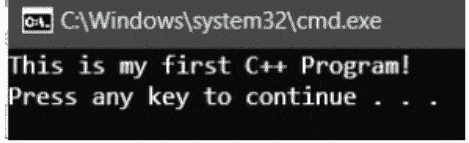

每一行以 `#` 开头的行被称为指令；预处理器处理这些指令以供编译器调用。

它是一个头文件，`iostream` 指输入输出流，用于输入和输出函数。

`using namespace std;`

此语句在每次输入和输出之前将 `std` 命名空间导入程序中，因此为了方便起见，它是首选的。

`int main(){...}`

这一行声明了一个名为 `main` 的函数，返回整数类型的结果。函数是一组旨在执行赋值的语句。传统模型是任何以此关键特征开头的 C++ 程序，即使它并不在开头。如果没有 `main()` 特性，大括号 `}` 表示 `main` 函数的开始和结束。

```cpp
cout << "..."
```

此语句将引号之间的任何内容显示在屏幕上，供用户查看。

## 缩进

如你所见，`cout` 和 `return` 语句被缩进或向右页面移动。这提高了代码的可读性。在类类软件中这可能看起来并不相关，但当应用程序变得复杂时，它允许代码更易于理解且更不容易出错。因此，必须使用缩进和注释来使代码更易于理解。

## 2.3：输入与输出

C++ 拥有包含多种执行输入输出方法的库。在 C++ 中，输入和输出被描述为一系列字节，通常被称为流。

输入流是一种名为 `input` 的方法，如果字节流是从计算机（例如键盘）到主内存的。

输出流机制命名为 `output`，如果字节流方向相反，即：从主内存到显示器（显示屏幕）。

在 C++ 中进行输入输出操作需要以下头文件：

- `iostream`：`iostream` 是普通输入输出流的缩写。此头文件包含了 `cin`、`cout`、`cerr` 等属性的规范。

- `fstream`：此头文件详细定义了文件流。此头文件管理从文件名解释为输入的数据或作为输出插入到文件的数据。

- `iomanip`：`iomanip` 是输入输出操纵符的缩写。使用这些文件中声明的方法对流进行操作。此文件包含了 `setprecision`、`setw` 以及其他术语的含义。

C++ 关键字 `cout` 和 `cin` 经常用于打印输出和获取输入。在 C++ 中，这些可能是接受输入和显示数据最基本的方式。要使用 `cout` 和 `cin`，需要包含头文件 `iostream`。

使用 `cout` 和 `cin`：

```cpp
//输入输出
#include <iostream>
using namespace std;

int main(){
    cout << "This is my first C++ Program!";
    //displays "This is my first C++ program!"
    return 0;
}
```

输出：


## 2.4：修饰符与数据类型

后续页面中的信息被广泛认为是事实的真实、准确描述，因此，读者对相关信息的任何疏忽、使用或误用将导致任何产生的后果由其自行承担。在任何情况下，本书的出版者或原作者均对在采取本文此处描述的信息后可能发生的任何困难或损害不承担责任。

此外，后续页面中的信息仅供参考，因此应被认为是通用的。根据其性质，其呈现不保证其长期有效性或中间质量。文中提到的商标是在未获得书面许可的情况下使用的，不能以任何方式视为商标持有者的背书。

### 原始数据类型

这些数据类型是预定义的，用户可以使用。以下是 C++ 中的类型：

- 整数
- `void`
- 宽字符
- 字符
- 布尔
- 双精度浮点
- 宽字符

### 派生类型

这些是从内置数据类型派生的类型，例如 `int`：

- 函数
- 指针
- 引用
- 数组

### 用户定义数据

用户选择的数据类型。在 C++ 中，你可以定义一个类或结构。

- 枚举
- 类
- 联合体
- 结构
- 类型定义

### 原始数据类型

**整数 (`int`)**：`int` 用于整数数据类。整数通常占用 4 字节空间，范围从 -2147483648 到 2147483647。

**字符 (`char`)**：字符数据形式用于存储字符。数据类型形式由 `char` 表示。字符通常占用一个字节的空间，从 -128 到 127 或到 255。

**布尔 (`bool`)**：布尔数据形式用于存储真或假值。布尔数据的布尔变量为 `bool`。

**浮点 (`float`)**：浮点存储形式存储小数的浮点值。浮点数据的单词是 `float`。浮点变量通常占用 4 字节内存。

**双精度浮点 (`double`)**：双精度浮点数据形式用于存储双精度小数的浮点值。使用 `double` 来描述数据类型。双精度变量通常占用 8 字节存储。

**空 (`void`)**：`void` 指没有意义的东西。数据类型表示无意义的对象。`void` 数据形式用于不返回任何结果或值的函数。

**宽字符 (`wchar_t`)**：这种数据形式比标准的 8 位数据类型更大的字符类型。`wchar_t` 表示宽字符，长度为 2 或 4 字节。

### 数据类型修饰符

数据类型修饰符改变特定数据类型可以携带的数据的大小。

C++ 中总共有 4 种类型：

- 短（`short`）
- 长（`long`）
- 无符号（`unsigned`）
- 有符号（`signed`）

有符号有符号有符号有符号有符号

有符号有符号有符号

...（省略）

范围和大小取决于你的编译器。

要检查所选编译器上数据类型的大小，可以使用一个显示数据类型大小的内置函数；你将使用的内置函数称为 `sizeof()`。

```cpp
//显示数据类型大小的程序
#include <iostream>
using namespace std;
int main(){
```

//不带引号写下函数，并在括号内

```cpp
cout<<"Size of integer: "<<sizeof(int) << endl;
cout<<"Size of character: "<<sizeof(char) << endl;
cout<<"Size of short integer: "<<sizeof(short) << endl;
cout<<"Size of long integer: "<<sizeof(long) << endl;
```

```cpp
cout<<"Size of wide character: "<<sizeof(wchar_t) << endl;
cout<<"Size of long integer: "<<sizeof(long) << endl;
cout<<"Size of unsigned long integer: "<<sizeof(unsigned long) << endl;
cout<<"Size of float: "<<sizeof(float) << endl;
cout<<"Size of double: "<<sizeof(double) << endl;
cout<<"Size of boolean: "<<sizeof(bool) << endl;
/* 使用不带引号的 'endl' 或带引号的 '\n' 来换行 */
}
```

输出：

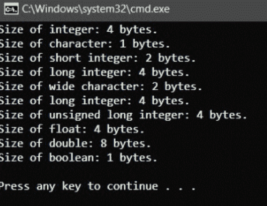

## 2.5：变量

赋予内存位置的值被称为变量。它是程序的基本存储设备。

变量的属性包括：

- 在软件执行期间，变量包含的值可能会被修改。
- 变量只是分配给内存位置的定义；对变量执行的操作都会影响该变量内存位置。
- C++ 中的变量在被包含之前必须先声明。

```cpp
int var1;
```

`var1` 是一个整数类型的变量。这一行定义了该变量。`var1` 的值可以在程序中的任何点被更改。变量名之间不能有任何空格（例如 `var 1`）。如果需要空格，你可以写成 `var_1`。

变量声明是在变量首次使用之前初始声明或添加的部分。

变量描述是为变量指定存储位置和值的部分。变量声明和定义通常是配合进行的。

### 局部变量

局部变量指定在块、函数或函数对象内部。

这些变量在到达块或调用函数时生成，并在退出块或调用从函数返回时被丢弃。

此类变量的定义被限于它们被声明的帧（frame）中。也就是说，你只能在该块内部修改这些变量。

### 全局变量

全局变量可以在程序的任何地方使用，因为它不在任何代码块或特定函数中。它可以在任何地方被操纵和使用。

例如：

```cpp
//声明变量的程序
#include <iostream>
using namespace std;
int variable_1;//全局变量
int main(){
```

```cpp
int variable_2;//局部变量
}
```

## 2.6：常数

常量是在整个程序运行过程中不能更改的值的术语，一个固定值。有各种类型的常量，如整数、八进制、浮点数、字符、字符串等。每个常数的范围取决于该常量的数据类型。

关键字 `const` 用于此。

定义常数：

```cpp
'const' 关键字
'#define' 预处理器指令
```

### 字面量

任何赋予每个常量变量的值都被视为字面量。

例如 `const float var1=3`

在这里，该语句是一个常量表达式，其中 `3` 是一个常量整数字面量。

### const

```cpp
const (数据类型)(变量名)=(要被赋值的值);
```

```cpp
//声明变量的程序

#include <iostream>
using namespace std;

int main(){

const int variable=10;

cout << variable;
variable=variable+2;//错误。如果你尝试更改常量的值
}
```

### #define

当你需要为已存在值声明一个备用术语时，可以使用这种指令。

```cpp
//声明变量的程序
#include <iostream>
```

```cpp
using namespace std;
#define val_1 3
#define val_2 'A'
#define val_3 3.142
int main(){
cout << val_1;
}
```

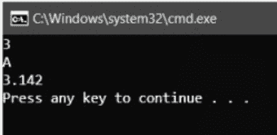

# 第3章：基本规则与应用

## 3.1：算术与逻辑运算

### 算术运算符

运算符是每种编程语言的构建块

因此，即使不使用运算符，C++ 编程语言的兼容性也可以描述为允许我们对操作数进行特定数学或逻辑计算的标识符。换句话说，运算符控制操作数。

算术运算符有两种：

- 一元运算符：这些通过使用一个操作数运行的运算符（例如 `--`, `++`）。
- 二元运算符：在 2 个操作数上运行的运算符（例如 `*`, `+`, `/`, `*`）。

```cpp
//执行算术运算的程序
#include <iostream>
using namespace std;
int main(){
int sum=0;
float val_1=23, val_2=56;
//一元运算符
cout<<++val_1<< " ";
//二元运算符
sum=val_1+val_2;
cout<<sum;
cout<<val_1;
int diff;
```

```cpp
diff=val_1-val_1;
cout<<diff;
cout<<0;
}
```

输出

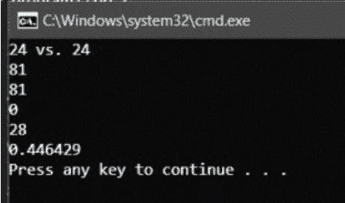

### 关系运算符

当需要比较两个变量时使用。你通常在使用决策语句或循环等时候比较两个或多个变量。

（例如：`==` 等于，`>=` 大于等于，`<=` 小于等于。）

### 逻辑运算符

逻辑运算符用于合并两个或更多情况，或补充初始状态的分析。逻辑运算符操作的结果是一个布尔值，非真即假。例如，逻辑与运算符（定义为 `&&`）在评估下的所有要求都满足时返回真。否则，它返回假。因此，如果 A 和 B 都为真（即高电平），`a &&` 返回真。

## 3.2：决策语句

在日常生活中，我们有时必须做出选择并决定下一步去哪里，这取决于这些决策。代码中也存在类似的情况，我们必须做出选择，然后根据这些选择实现下一段代码。

这用于实现不同的条件。你可以使用的决策语句有：

- `If...else` 语句
- `Switch` 语句
- 跳转语句

### If 语句

`if` 语句是最简单的决策方法。

它用于确定特定的语句或命令集合是否可以执行（例如，如果某个要求有效，则执行一组代码；否则不。）

在 C++ 中，如果 A 存在，则执行 B；否则执行 C。

条件的结果可能是 1 或 0。C++ 中的 `if` 语句识别布尔值——如果含义有效，则执行其下方的系列代码；否则不执行。如果你在 `if(条件)` 之后没有使用大括号 `{` 和 `}`，则 `if` 声明将直接位于下方的第一条语句包含在其组内。

```cpp
#include <iostream>
using namespace std;
int main(){
if (/* 条件 */)
{
/* 代码 */
}
}
```

```cpp
#include <iostream>
using namespace std;
int main(){
float val1, val2;
cout<<"输入一个数字： ";
```

```cpp
cin>>val1;
cout<<"输入另一个数字： ";
cin>>val2;
if (val1>val2)
{
cout<<val1;
} else if(val1<val2)
{
cout<<val2;
} else//在任何其他情况下：
{
cout<<val1;
}
}
```

嵌套 `if`：在 C++ 中，嵌套 `if` 是另一个 `if` 命令的目标。嵌套 `if` 命令是嵌套另一个 `if` 参数内部的命令。C++ 允许你在另一个 `if` 语句内部编写语句（例如，你可以将一个 `if` 语句放在另一个 `if` 语句内部）。

```cpp
#include <iostream>
using namespace std;
int main(){
int x=5;
int y=12;
```

```cpp
if (x)
{
  cout << "\nx is lesser than y";
}

if (x!=y)//nested if
{
    cout << "\nx=";
    if (x+1!=y)//2nd nested if
    {
        cout;
    }
}
```

Output:

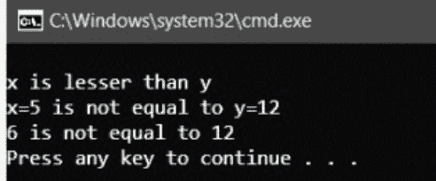

### Switch Case 语句

将属性等于多个整数值的冗长 `if` 语句被 `switch-case` 语句取代。

`switch` 命令是多分支语句的一个示例。它允许你根据输入的值轻松地将执行流路由到不同的代码段。

`switch` 语句是一种控制命令，需要一个值来转移执行控制。

```cpp
#include <iostream>
using namespace std;
```

```cpp
int main(){

    int val1;

}
```

```cpp
cout<<"Enter a number: ";

cin>>val1;//针对 val1 表达式的 switch语句

switch (val1)//switch case 为 o:
{

    case o;//当 val1 为 o 时:

    cout<<"value is o";

    break;//break 语句结束 case o 的代码块

    case 5:

    cout<<"value is 5";

    break;

    default//当没有其他 case 匹配时执行默认情况

    cout<<"value is not o or 5";

    break;
}
```


`switch` 中的短语必须返回一个常量值；否则它是无效的。

不允许重复的 `Case` 属性。

`default` 命令不是必须。

如果 `switch case` 语句没有 `default` 命令，它也将正常工作。

要结束一个语句集，请在切换内部使用 `break` 关键字。当遇到 `break` 命令时，跳转终止，命令转移到 `switch` 命令之后的一行。

`break` 命令不是必须。如果此字段留空，执行将继续到下一个事件。在触及 `break` 之前，可以在以下情况对控制进行处理。

`Switch` 命令可以被嵌套，这意味着它们可以被包含在另一个 `switch` 参数内部。另一方面，应该避免嵌套 `switch` 语句，因为它们会使软件更具动态性且更难以理解。

### 跳转语句

C++ `continue`：这种循环控制语句（将在 3.3 中进一步解释循环）的工作原理与 `break` 语句相同。`continue` 参数是 `break` 命令的反面，因为它导致循环执行下一次迭代而不是结束它。

正如名称所示，`continue` 语句导致循环继续或执行其下一次迭代。每当在循环内部执行 `continue` 语句时，随 `continue` 语句的程序将被跳过，因此循环的前一个迭代将开始。

```
continue;
```

C++ `break`：C++ 中的这种循环控制命令用于结束循环。当循环内部发现 `break` 语句时，循环迭代结束，影响从循环返回到循环后的第一条命令。

```
break;
```

`goto` 语句：在 C++ 中，它通常被称为任意跳转命令，可以将控制从代码块中的位置转移到另一个位置。

```cpp
repeat:
cout<< "Enter a number: ";
cin>>val; goto repeat;
```

```
goto (identifierName);
```

`Return` 语句：C++ 中的 `return` 语句将函数调用的移动带回其定义的地方。此外，它不需要任何条件语句。一旦语句执行，代码进度就会自动停止。对于每个非 `void` 函数，必须返回一个返回值，无论它是什么。函数将在 3.5 中详细解释。

```cpp
return /*value*/;
```

## 3.3: 循环

当你需要重复大量命令时，可以在代码中使用循环。

在执行某项操作（如检索和修改数据）后，会检查状态，例如计数器是否已达到预定值（即当用户输入特定值时循环结束）。

如果计数器没有超过目标值，程序的下一个语句将跳回程序的第一条语句并重复它。

如果满足条件，下一个语句将“落下”到下一个连续语句，或者跳转到远超循环的地方。

循环可以分为两类：

- **入口控制循环**：在进入循环代码之前检查测试状态。入口循环（如 `For` 循环和 `While` 循环）是入口控制循环。
- **退出控制循环**：在循环体结束后检查或验证测试状态。结果，无论测试状态有效还是错误，循环程序都可以至少运行一次。退出控制循环被称为 `do-while` 循环。

### For 循环

这种循环是一种重复控制系统，有助于创建一个运行特定次数的循环。循环允许在单线程中执行任意数量的步骤。

初始化语句：你必须在这行代码中将循环计数设置为数量。例如 `int i=0;`。

测试语句：你将在语句中测试条件。如果条件为真，将执行循环内的代码块，并继续到更新后的语句；否则，循环将终止。

更新表达式：此语句在程序员执行循环体后，按任何数量增加/减少循环计数器。例如 `i++;`。

现在 `i` 的值变为 `i=11`，将其移动到下一次迭代。

`For` 循环的格式如下：

```cpp
#include <iostream>
using namespace std;
int main(){
for (datatype variable_name = 0; variable_name < count; variable_name) // 初始化语句、测试语句和更新表达式
{
/* 要重复的代码 */
}
}
```

在示例中：

```cpp
#include <iostream>
using namespace std;
int main(){
int val1;
cout<<"Enter a value you wish to increase by 5, 5 times: ";
cin>>val1;
for (int i = 0; i < 5; i++)循环开始.
// 从计数 i=0 到 i=4
{
val1=val1+5;//增加 5
cout<<"\n loop "<<val1<<endl<<"\nprint_updated_value=" <<val1;
}//当 i=5 时结束循环
}
```

Output:

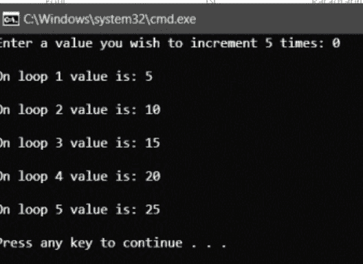

就像嵌套 `if` 语句一样，你也可以嵌套循环。

### While 循环

在研究循环时，你发现迭代次数是提前预知的（即循环体必须重复的次数）。然而，循环也被用于无法提前预知精确迭代次数的情况。根据测试方法，循环操作被停止。

此循环的格式如下：

```cpp
#include <iostream>
using namespace std;
int main(){
  while (/* condition */)
{
/* 代码 */
//更新表达式语句
}
}
```

在示例中：

```cpp
#include <iostream>
#include <cmath>//这是一个头文件，允许程序员使用与数学相关的函数，例如执行变量的幂运算等。
int main(){
int count=0;//将跟踪次数
float val=0;//初始给定 0 以让程序进入循环
float area;
while (val!= -1)//当 val 不等于 -1 时，执行:
{
cout<<"\nEnter the length of a square to find its area. enter -1 to
cin>>val;
area=pow(val,2);//pow() 是内置函数，函数将在书中进一步详细解释
cout<<"\nArea of "<<area;
count++;增加 count 的值. 也可以写为 count++
}//结束 while 循环
cout<<"\nThis while loop was repeated "<<count<<" times.";
}
```

Output:

```
C:\Windows\system32\cmd.exe
Enter the length of a square to find its area. enter -1 to exit:
2
Area of 2 = 4cm^2
Enter the length of a square to find its area. enter -1 to exit:
3
Area of 3 = 9cm^2
Enter the length of a square to find its area. enter -1 to exit:
7
Area of 7 = 49cm^2
Enter the length of a square to find its area. enter -1 to exit:
5
Area of 5 = 25cm^2
Enter the length of a square to find its area. enter -1 to exit:
-1
Area of -1 = 1cm^2
This while loop was repeated 5 times.
Press any key to continue . . .
```

如你所示，`while` 循环重复了 5 次，包括用户输入 `-1` 的时候。这是因为输入是在循环内部获取的，紧接着显示了计算后的面积。因此，如果你希望在向以下内容输入 `-1` 时立即确保循环结束：

```cpp
#include <iostream>
using namespace std;
#include <cmath>
int main(){
int count=0;
float val;
```

```cpp
float area;
// 在开始处也输入，以便进入循环，否则将无法
cout<<"\nEnter正方形的长度以计算面积。输入 -1 以 ";
cin>>val;
while(val!=-1)//当 val 不等于 -1 时，执行：
{
    area=pow(val,2);
    cout<<"\nArea = " << area << "\n";
    count++;
    cout<<"\nEnter正方形的长度以计算面积。输入 -1 以 ";
    cin>>val;//将输入放在末尾将使循环进行检查
}
cout<<"\n此 while 循环重复了 " << count << "\n";
```

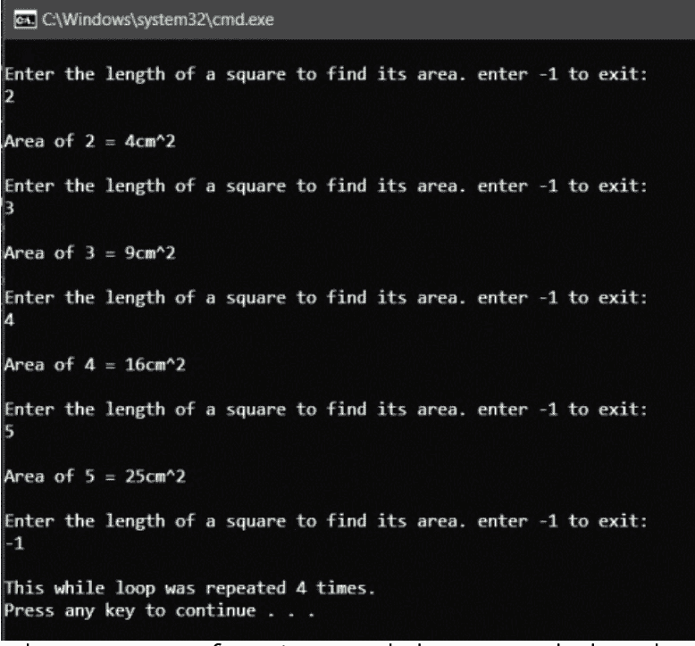

现在，`count` 显示为四次，并且没有为 `-1` 计算面积。

### Do-while 循环

`do-while` 循环是一种后置循环。`do-while` 循环的执行通常是基于条件语句的。`do-while` 循环与 `while` 循环最大的区别在于，`do-while` 循环的情况是在代码结束时测量的，而另外两个循环是进入调节的循环。

该循环的格式如下：

```cpp
int main(){
do
{{/* 代码 */}
} while (/* 条件 */);
}
```

在示例中，你可以执行与之前相同的代码，它的功能将保持相同，因为我们修改了 `while` 循环，使其运行得像 `do-while` 循环。

```cpp
#include <iostream>
#include <cmath>
using namespace std;
int main(){
    int area;
    int count=0;
    int val;
    cout<<"\nEnter正方形的边长以计算面积，";
    cin>>val;
    do{
        area=pow(val,2);
        cout<<"\nArea=" << area << "\n";
        cout<<"\nEnter正方形的边长以计算面积，";
        cin>>val;
    } while (val!=-1);
}
```

输出：

```
C:\Windows\system32\cmd.exe
Enter the length of a side of a square to find its area, enter -1 to exit: -1
Area= 1 cm^2
Enter the length of a side of a square to find its area, enter -1 to exit: -1
Press any key to continue . . .
```

除非你在开始时输入 `-1`，否则它仍然会输出长度为 `-1` 的正方形面积，而由于后置条件，`while` 循环则不会。这意味着无论代价如何，它必须至少运行一次。

## 3.4: 数组

数组是位于连续内存地址的相同数据元素的集合，在 C++ 中可以使用数组索引进行公共访问。它们可以被用于存储某种类型的原始数据类型的列表，如 `double`、`char`、`int`、`float` 等。

与其为每个值定义单独的变量，不如使用数组来在一个变量中存储多个值。

对于数组声明，从开始定义变量的数据类型，然后是数组名，最后使用方括号 `[` 和 `]` 定义数组的大小并加上分号。

当项目数量很少时，你可以使用变量（`var1`、`var2`、`var3` 等），因此当你需要持有大量实例时，变量被证明是难以的。

### 基础数组

在示例中：

```cpp
#include <iostream>
using namespace std;
int main(){
    int hall[4];//声明一个名为 hall 的具有 4 个内存空间的数组
    // 数组的内存位置始终从 0 开始。
    // 所以电影从 hall[0] 开始到 hall[3]。
    hall[0]=1;//将 1 存储在 hall 的第二个位置。
    hall[1]=2;
    hall[2]=3;
    hall[3]=4;
    cout<<"Movie 1 in hall = " << hall[0] << "\n";
    float price[4] = {15.99, 21.5, 32, 13.5};//你也可以开始时初始化值，或者
    cout<<"ticket 1: " << price[0] << "\nticket 2: " << price[1] << "\nticket 3: " << price[2] << "\nticket 4: " << price[3];
}
```

输出：

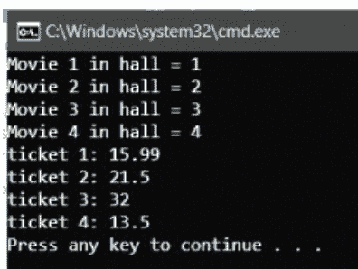

你也可以像这样使用变量作为数组的大小：

```cpp
int size=4;
int hall[size] = {1,2,3,4];//声明一个名为 hall 的具有 'size' 个内存空间的数组
```

以下是在 C++ 中使用数组的一些优点：

- 数组索引允许对对象进行随机访问。
- 因为它生成了若干组件的标准列表，所以它需要更少的代码行。
- 所有组件都易于访问。

使用一个循环，遍历数组变得非常直观。

由于可以使用更少的代码行来完成，数据的排序变得简单了。

在 C/C++ 中使用数组的缺点如下：

- 允许在声明时刻输入预定义数量的元素。C++ 中的数组不是动态的。
- 因为元素必须按照当前的内存分配进行处理，因此添加和删除元素可能是代价昂贵的。

### 使用循环访问大型数组

如果你有一个大小为 50 的数组，当然，为这 50 个内存位置中的每一个获取输入是很困难的。为此你可以可以使用循环来大量输入。由于数组的大小通常是预定义的，你可以像这样使用 `for` 循环：

```cpp
#include <iostream>
using namespace std;
int main(){
    int size=10;
    int hall[size];
    for (int i = 0; i < size; i++) {
        cout<<"Enter the movie played in hall number " << i << ": ";
        cin>>hall[i];//i 获取当前当前计数的输入
        cout << "Hall " << i << " has " << hall[i] << " movies";
    }
}
```

输出：

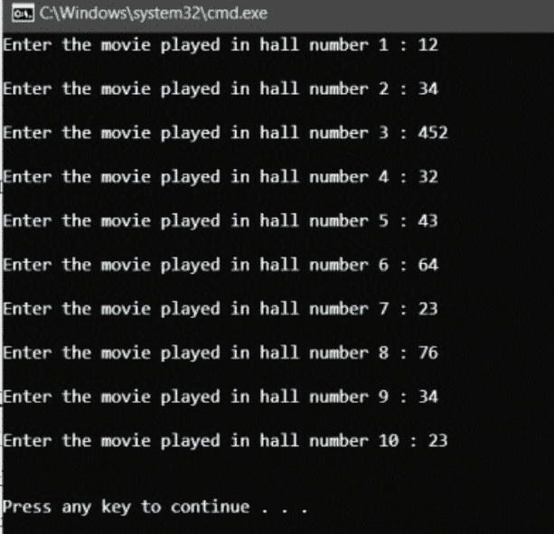

通过这种方法，你可以对数组变量执行许多计算。你还可以通过初始声明一个大数组尺寸，然后只使用用户输入的尺寸来获取数组大小。

### 二维（二维）数组

或者，你可以在 C++ 中使用数组表示法处理二维数组，描述数组的数组，例如“数组数组的二维数组”。表格被用于存储多维数组中的数据（按行主序顺序）。

在示例中，显示二维数组的元素：

```cpp
#include <iostream>
using namespace std;
int main()
{
    // 3行2列的数组。
    int y[3][2] = {{23,12}, {32,21}, {41,51}};
    // 输出每个数组元素的
    for (int i = 0; i < 3; i++)
    {
        for (int j = 0; j < 2; j++)
        {
            cout << "Value at x[" << i << "][" << j << "] = ";
            cout << y[i][j] << "\n";
        }
    }
}
```

输出：

```
C:\Windows\system32\cmd.exe
Value at x[0][0]: 23
Value at x[0][1]: 12
Value at x[1][0]: 32
Value at x[1][1]: 21
Value at x[2][0]: 41
Value at x[2][1]: 51
Press any key to continue . . .
```

示例 2，乘一个 2x4 和 4x3 矩阵，结果在 2x3 矩阵中

```cpp
#include <iostream>
using namespace std;
int main() {
    float m1[2][4] = { 0 }, m2[4][3] = { 0 }, ans[2][3] = { 0 };
    cout << "For the first matrix." << endl;
    for (int row = 0; row < 2; row++) {
        for (int column = 0; column < 4; column++) {
            cout << "Enter value of a" << row + 1 << column + 1 << ": ";
            cin >> m1[row][column];
        }
    }
}
```

```cpp
cout << "For the second matrix:" << endl;
for (int row = 0; row < 4; row++) {
    for (int column = 0; column < 3; column++) {
```


```cpp
cout << "Enter value of a" << row + 1 << " " << column + 1 << ": ";
cin >> m2[row][column];
```

```cpp
for (int i = 0; i < 2; i++) { //2行
    for (int j = 0; j < 3; j++) { //3列
        for (int k = 0; k < 4; k++) { //4列
            ans[i][j] = (m1[i][k] * m2[k][j]) + ans[i][j];
        }
    }
}
```

```cpp
cout << "the result of matrix 1 into 2 is " << endl;
for (int i = 0; i < 2; i++) {
    for (int j = 0; j < 3; j++) {
        cout << ans[i][j] << " ";
        if (j == 2)
            cout << endl;
    }
}
```

输出：

```
C:\Windows\system32\cmd.exe
For the first matrix.
Enter value of a11: 4
Enter value of a12: 6
Enter value of a13: 3
Enter value of a14: 2
Enter value of a21: 2
Enter value of a22: 4
Enter value of a23: 3
Enter value of a24: 1
For the second matrix:
Enter value of a11: 3
Enter value of a12: 3
Enter value of a13: 8
Enter value of a21: 0
Enter value of a22: 9
Enter value of a23: 5
Enter value of a31: 1
Enter value of a32: 3
Enter value of a33: 5
Enter value of a41: 2
Enter value of a42: 4
Enter value of a43: 7
the result of matrix 1 into 2 is 
19 83 91 
11 55 58 
```

编程，或者你可以尝试用你独特的想法并排运行每个概念的程序。哪种方式对你有帮助就好。《初学者计算机编程：C++》使用了简单易懂的语言，因此你不需要像其他书籍那样浪费时间去分析任何文本。这本 C++ 编程指南解释了每个概念，然后提供格式/语法，最后将每个主题应用于现实生活中的场景。它告诉了你开始 C++ 编程所需的所有知识。最重要的规则是：享受其中，并尽可能让你的创造力流动。所以你还在等什么呢？开始初级 C++ 编程吧。在你的编程实践中保持一致，并祝你好运！

## 3.5: 函数

函数是一段输出或副作用具有良好定义行为的代码。

假设你需要创建一个程序，要求绘制一个三角形并对其上色。为了处理这种情况场景，你也可以构建两个函数：

- 函数 1：一个绘制三角形的机制。
- 函数 2：应用于三角形的着色功能。

通过将问题分解为更小、更容易处理的组件，你的软件将更具可读性和可重用性。

可以用两种不同的方式描述函数：

- 库函数：C++ 中按照惯例指定的带有标准函数的库。
- 用户定义函数：程序员构建的匿名自定义功能。

### 库函数

集成到 C++ 编程中的函数是标准库函数。程序员不需要重复编写反复使用的代码块，而是可以直接通过调用库函数来使用。C++ 中的大多数标准库函数具有以下形式：`abs()`、`sqrt()`、`isdigit()` 等。

要使用库函数，你需要使用指定这些函数的头文件；例如使用 `pow(variable, power)`，你通过编写 `#include <cmath>` 包含了头文件。大多数算术操作如 `sqrt()` 和 `abs()` 都是通过使用头文件 `cmath` 的。

```cpp
示例：

#include <iostream> // 输入输出操作的头文件
using namespace std;
#include <string> // 头文件允许你使用 string 类型

int main() {
    string s1; //使用 string 类型
    cout << "enter first name: ";
    cin >> s1;
}
```

输出：

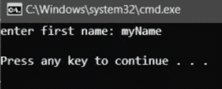

以下是你可以在程序中使用的许多头文件中几个重要的头文件：

注意：以 `.h` 结尾的头文件名称被认为是“旧式”头文件，这些文件已被 C++ 标准库头文件过时。

这里是你可以用于标准库函数的某些内置函数：

### 用户定义函数

程序员可以在 C++ 中描述他们的函数。用户定义功能是一组执行特定目的并被分配了名称（函数标识符）的代码集合集。当从程序代码的任何地方调用函数时，它会执行函数体中指定的任何程序。

如下所示：

```cpp
#include <iostream>
using namespace std;

//这里是函数的定义：
void my_Function_identifier(/*你想要传递的任何参数*/)
{
    cout << "This is my function and it has been called.";
    //函数定义在此结束
    //void 意味着此函数没有返回类型，它可以是任何类型。
}

int main(){
    my_Function_identifier(); //这是正在被调用的函数。
}
```

输出：

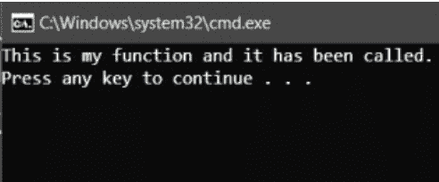

你需要在 `int main()` 之前声明函数定义，因为 `int main` 无法调用尚未定义的函数，或者其函数定义位于被调用函数的下方。

或者，如果你想在 `int main` 下方定义函数，可以创建一个函数原型。如下所示：

```cpp
#include <iostream>
using namespace std;

void my_Function_identifier(); //这是原型的声明。

int main(){
    my_Function_identifier(); //这是正在被调用的函数。
}

//这里是函数的定义：
void my_Function_identifier(/*你想要传递的任何参数*/)
{
    cout << "This is my function and it has been called.";
} //函数定义在此结束
```

```cpp
//void 代表函数的返回类型，它可以是任何类型。
```

函数的返回类型可以是任何数据类型。当使用返回类型而不是 `void` 时，使用 `return` 关键字是常见的。

如下所示：

```cpp
#include <iostream>
using namespace std;
#include <string>

string my_Function_identifier(); //这是原型的声明。

int main(){
    cout << my_Function_identifier();
}

//这里是函数的定义：
string my_Function_identifier(/*你想要传递的任何参数*/)
{
    string string1;
    cout << "This is my function and it has been called. This is a string ";
    getline(cin, string1); //这是一个用于存储字符串的内置函数，其中
    return string1; //返回与返回类型相同的数据类型的变量
    //如果你尝试返回一个与返回类型不同的变量
} //函数定义在此结束
```

输出：

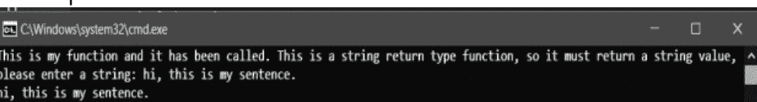

### 传递参数

参数是传递给函数以执行进一步计算的参数；例如，在上面的示例中，大括号之间的空间是空的。这意味着没有传递参数。

传递参数有两种方法：

### 按值传递 (Pass by Value)：

原始参数值被复制到函数的参数中，两种参数都存储在不同的内存位置。这意味着对函数内部变量进行的任何更改都不会影响原始函数。

### 按引用传递 (Pass by Reference)

原始值和函数的参数存储在相同的内存位置。因此，对函数内部进行了任何更改，与按值传递不同，它将影响原始值。

如果你希望像上一个示例那样传递参数。在 C++ 中，参数是按值传递的：

```cpp
#include <iostream>
using namespace std;
#include <string>

void my_Function_identifier(string my_string); //这是原型的声明

int main(){
    string string1; //在 main 中定义 string，以便将 string 作为参数传递
    cout << "This is my function and it has been called. This is a string ";
    getline(cin, string1);
    my_Function_identifier(string1); //这是正在被调用的函数
    //由于函数没有返回类型（是 void），我无法使用 return 语句
}

//这里是函数的定义：
void my_Function_identifier(string my_string)
{
    //string my_string 将 string 值存储到 my_string 中。你可以使用它
    cout << my_string;
}
```

输出：

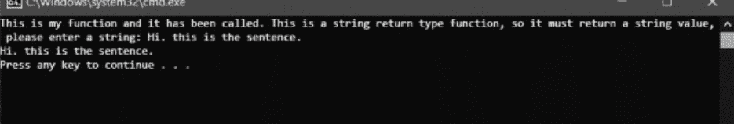

要按引用传递值，你需要使用一种更复杂的概念，称为指针。

## 3.6: 结构体和枚举

结构体和枚举是 C++ 中的用户定义数据类型。

### 结构体 (Structures)

这种用户定义数据类型在公共类型下创建一组不同类型的变量。使用的关键字是 `struct`。你可以在定义处声明结构体、在 `main` 外部声明，或者在 `main` 内部声明（如 `int`、`float` 等）。

这是格式：

```cpp
#include <iostream>
using namespace std;

struct my_datatype_identifier //这是结构体的定义
{
    /* data */
} variable1; //在 } 之后放置分号是执行块的强制要求的
//在 } ; 之间写入变量名可以声明一个新变量

int main(){
    my_datatype_identifier variable2; //这里正在声明一个类型为 length 的变量2
}

my_datatype_identifier variable3; //这是在 main 函数之外声明的变量3
```

在示例中，创建了一个名为 `length` 的结构体：

```cpp
#include <iostream>
using namespace std;

struct length //这是带有标识符 length 的结构体定义
{
    //structure mm,cm,km; //这里声明了一组 float 类型的变量
    char length_known = 'n'; //你可以根据需要声明任意数量的变量
    length length1[] = {
        {25.5, 2.1, 0.215, 'y'} //在 } 之后放置 ; 是执行该块的强制要求的
    };
    //{} 括号按照声明顺序存储 length 1 的数据
    //在 } ; 之间写入变量名可以声明一个新变量
    length length3[3]; //这里声明了一个 length 类型的结构体数组
};

int main(){
    //显示 length 1 数据：
    cout << "Length 1 data: \n\tLength known? " 
         << length1.mm << " mm, " << length1.cm << " cm, " << length1.km << " km";
    //获取 length 2 数据
    cout << "Length 2 data: \n\tls length 2 known? (enter y or n)\n";
    cin >> length2.length_known;
    if (length2.length_known == 'y')
    {
        cout << "\n\tEnter length 2 in millimeters: ";
        cin >> length2.mm;
        cout << "\n\tEnter length 2 in centimeters: ";
        cin >> length2.cm; //使用 '.' 点运算符访问结构体内部的变量
        cout << "\n\tEnter length 2 in kilometers: ";
        cin >> length2.km;
    }
    else
    {
        cout << "\nLength 2 data unavailable.\n";
    }
    //获取 length 3 结构体数组数据
    cout << "Length 3 data:\n\t";
    length3[0].length_known = 'y'; //访问数组的第一个内存位置
    length3[1].length_known = 'y'; //访问数组的第二个内存位置
    for (int i = 0; i < 3; i++) { //对每一个 length 执行：
        cout << "\n\t at " << i << ": ";
        if (length3[i].length_known == 'y')
        //检查长度是否已知，如果是：
        cout << "\n\tEnter length 3 in millimeters: ";
        cin >> length3[i].mm;
        cout << "\n\tEnter length 3 in centimeters: ";
        cin >> length3[i].cm; //使用 '.' 点运算符访问结构体内部的变量
        cout << "\n\tEnter length 3 in kilometers: ";
        cin >> length3[i].km;
    }
    else
    {
        cout << "\nLength 3 at " << i << " is unavailable";
    }
}
```

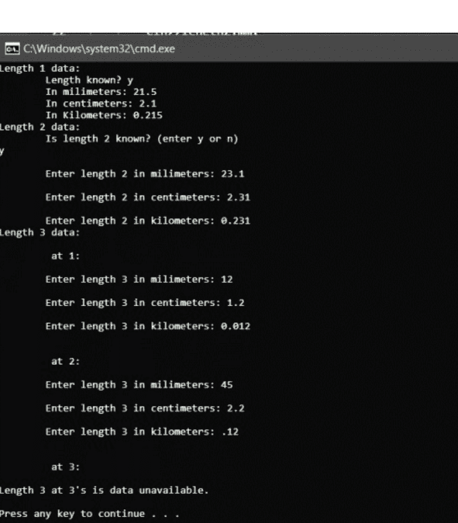

### 枚举 (Enumerations)

枚举是一种用户定义的数据类型，通常用于定义指向整数常量的标识符。这使得程序的维护变得简单且高效。使用的关键字是 `enum`。

使用的格式如下：

```cpp
#include <iostream>
using namespace std;

enum enum_variable_name {monday};
enum enum_variable_name Day; //这是为该变量创建的对象
Day = monday; //这在 Day 中存储了 0

int main(){
    cout << Day;
}
```

输出：

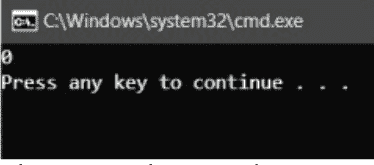

你可以通过在定义时初始化来更改每个枚举器中存储的值。如下所示：

```cpp
#include <iostream>
using namespace std;

enum enum_variable_name {monday = 1, tuesday, wednesday, thursday};

int main(){
    enum enum_variable_name Day[4]; //这是一个类型为 Day 的对象数组
    Day[0] = monday; //这在 Day 中存储 1，因为 monday 被初始化为 1：
    cout << Day[0];
    Day[1] = tuesday; //tuesday 自动存储前一个项的值
    cout << Day[1];
    Day[2] = friday; //存储 5
    cout << Day[2];
    Day[3] = saturday; //存储 6，因为它是 friday 的前一个项。
    cout << Day[3];
}
```

输出：

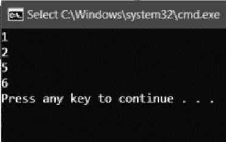

# 第 4 章：编写你自己的 C++ 程序

这个冗长的 C++ 程序旨在通过用户选择的交互部分，通过提供他们感兴趣的太空主题，让他们对外层太空产生洞察。例如，用户可以购买自己喜欢的望远镜并进行计算。


用户可以选择任何他们感兴趣的话题；然后，用户可以对所选主题查找信息或进行自我测试。如果用户希望购买望远镜，他们可以这样做，程序将使用你学过的所有概念生成账单。用户在完成当前章节后可以随时选择不同的主题。将此程序粘贴到你选择的编译器中，以完全理解这段代码的概念。

## 头文件与常量

```cpp
#include <iostream>
#include <windows.h>
#include <string>
#include <math.h>

#ifdef _WIN32

// 为每个颜色声明一个常量变量
const int GREEN = 10;
const int BLUE = 11;
const int RED = 12;
const int PURPLE = 13;
const int YELLOW = 14;
const int WHITE = 15;

#endif

using namespace std;
```

## 函数原型

```cpp
void Main();
void Telescopes();
void EqMotion();
void clearScreen(int characterLength);
void changeColour(int colour);
void showLoadingScreen();
void TypeWriter(string msg1, unsigned int millis_per_char);
void DrawLine();
void calculate();
```

## 清除屏幕内容

```cpp
void clearScreen(int characterLength) {
    /* 从屏幕上删除之前的数据 */

    HANDLE hConsole;
    hConsole = GetStdHandle(STD_OUTPUT_HANDLE);

    for (int i = 0; i < characterLength; i++) {
        cout << "\b";
    }
}
```

## 更改文本颜色

```cpp
void changeColour(int colour) {
    // 更改文本颜色的函数

    HANDLE hConsole;
    hConsole = GetStdHandle(STD_OUTPUT_HANDLE);

    SetConsoleTextAttribute(hConsole, colour);
}
```

## 显示加载界面

```cpp
void showLoadingScreen() {
    // 用于提供加载界面的函数

    int i;
    string open = "*";
    int colour[] = {RED, GREEN, BLUE};

    for (i = 0; i < 5; i++) {
        Sleep(700);
        clearScreen(5);
        changeColour(colour[i]);
        cout << open;

        Sleep(700);
        clearScreen(5);
        changeColour(WHITE);
        cout << open;
    }

    clearScreen(5);
}
```

## 打字机效果

```cpp
void TypeWriter(string msg1, unsigned int millis_per_char) {
    // 打字机效果

    for (int i = 0; i < msg1.length(); i++) {
        // 对每个字符执行
        cout << msg1[i];
        Sleep(millis_per_char);
    }
}
```

## 绘制直线

```cpp
void DrawLine() {
    // 绘制直线
    cout << "--------------------------------------------------\n";
}
```

## 计算函数

```cpp
void calculate() {
    // 计算
}
```


## 望远镜规格与信息

```cpp
double priceRs; /* priceUS */

// Specs bv
string bv = "最适合观测： ";
string bi = "最适合成像： ";
string ul = "用户级别： ";
string od = "光学设计： ";
string mr = "倍率范围： ";
};

SpecsAndInfo items[5];
```

## 望远镜类型

```cpp
// functions:
void TeleScopes();

void TypesOfTelescops() {
    int select;
    string back;

    string typesMenu =
        "\n \t我们目录中的望远镜类型和伽马射线望远镜\n"
        "\t5. 折反射镜望远镜\n"
        "\t[0]. (主菜单): ";

    cout << "*";
    "(按下键盘上的 '空格' 键跳过打字动画)*"
    "(请使用全屏模式以获得更好的体验)*"
        << endl
        << ' ';

    TypeWriter(typesMenu, 50);
    cin >> select;

    switch (select) {
        case 0: {
            system("cls");
            Telescopes();
        }

        case 1: {
            changeColour(GREEN);
            DrawLineThicc();

            TypeWriter(
                "\nIACT 指的是成像大气切伦科夫TAPD 切伦科夫望远镜 (FACT)\n"
                "\t4. 高能辐射 I"
            );

            cout << endl << "你想返回上次吗？yes or no: ";
            cin >> back;

            if (back == "yes" || back == "YES" || back == "Yes") {
                system("cls");
                DrawLineThicc();
                TypesOfTelescopes();
            } else if (
                back != "yes" ||
                back != "Yes" ||
                back != "YES"
            ) {
                cout << endl << "感谢您的光临" << endl;
            }

            break;
        }

        case 2: {
            changeColour(BLUE);
            DrawLineThicc();

            TypeWriter("\n红外望远镜是一种使用红外线的...");

            cout << endl << "你想返回上次吗？yes or no: ";
            cin >> back;

            if (back == "yes" || back == "YES" || back == "Yes") {
                system("cls");
                DrawLineThicc();
                TypesOfTelescopes();
            } else if (
                back != "yes" ||
                back != "Yes" ||
                back != "YES"
            ) {
                cout << endl << "感谢您的光临" << endl;
            }

            break;
        }

        case 3: {
            changeColour(YELLOW);
            DrawLineThicc();

            TypeWriter("\n射电望远镜是一种特殊的天线和");

            cout << endl << "你想返回上次吗？yes or no: ";
            cin >> back;

            if (back == "yes" || back == "YES" || back == "Yes") {
                system("cls");
                DrawLineThicc();
                TypesOfTelescopes();
            } else if (
                back != "yes" ||
                back != "Yes" ||
                back != "YES"
            ) {
                cout << endl << "感谢您的光临" << endl;
            }

            break;
        }

        case 4: {
            changeColour(RED);
            DrawLineThicc();

            TypeWriter(
                "\n像射电望远镜一样，X射线和伽马射线望远镜使用太阳天体发出的射线，"
                "超新射线望远镜探测伽马射线暴发，有助于确认每条射线，"
                "伽马射线望远镜用在更高海拔的地方，因此不用担心"
            );

            cout << endl << "你想返回上次吗？yes or no: ";
            cin >> back;

            if (back == "yes" || back == "YES" || back == "Yes") {
                system("cls");
                DrawLineThicc();
                TypesOfTelescopes();
            } else if (
                back != "yes" ||
                back != "Yes" ||
                back != "YES"
            ) {
                cout << endl << "感谢您的光临" << endl;
            }

            break;
        }

        case 5: {
            changeColour(PURPLE);
            DrawLineThickc();

            TypeWriter("\n折反射镜是一种基于...的混合方案");

            cout << endl << "你想返回上次吗？yes or no: ";
            cin >> back;

            if (back == "yes" || back == "YES" || back == "Yes") {
                system("cls");
                DrawLineThickc();
                TypesOfTelescopes();
            } else if (
                back != "yes" ||
                back != "Yes" ||
                back != "YES"
            ) {
                cout << endl << "感谢您的光临" << endl;
            }

            break;
        }

        default: {
            cout << "\n请从给定选项中选择： ";
            system("cls");
            TypesOfTelescopes();
        }

        break;
    }
}
```

## 望远镜库存

```cpp
void ItemInventory() {
    items[0].name = "\t[Orion ED66 CF 碳纤维";
    items[0].priceRs = 105000.65;

    // specs:
    /*
    items[0].bv = "最适合观测： ";
    items[0].od = "最适合成像： ";
    items[0].ul = "用户级别： ";
    items[0].od = "光学设计： ";
    items[0].mr = "倍率范围： ";
    */

    items[1].name = "Orion EON 115mm ED 三片消色望远镜";
    items[1].priceRs = 255000.20;

    items[2].name = "Orion SkyQuest XX14g GoTo 桁架式";
    items[2].priceRs = 449000.99;

    items[3].name = "Orion GiantView BT-70 45度";
    items[4].name = "Orion GiantView BT-70 45度双筒望远镜";
}
```

## 望远镜商店

```cpp
void TelescopeShop() {
    // 用于望远镜商店

    int key;
    double userMoney;

    changeColour(BLUE);

    string shopMenu =
        "\t目前有五种望远镜可用\n\n70 45度\n"
        "\t. Orion Giant View BT-70 45度双筒望远镜\n"
        "\n(按回车退出)\n"
        "\t\n输入y5): ";

    string PKR = "卢比";
    string ans, con, bi, toStr, back;

    system("cls");
    ItemInventory();

again:
    TypeWriter(shopMenu, 30);
    cin >> key;

    switch (key) {
        case 0: {
            system("cls");
            Telescopes();
        }

        case 1: {
            system("cls");

            // ... (后续逻辑保持结构不变，仅翻译字符串)
        }
    }
}
```

```cpp
{
    system("cls");
    DrawLineThicc();
    TelescopeShop();
} else if (
    back != "yes" ||
    back != "Yes" ||
    back != "YES"
) {
    cout << endl << "感谢您的光临" << endl;
}

break;

case 4: {
    system("cls");
    TypeWriter(items[3].name, 50);
    changeColour(RED);

    cout << endl << "当前缺货!";
    cout << endl << endl << "您想返回吗？ yes or no";

    cin >> back;

    if (back == "yes" || back == "YES" || back == "Yes") {
        system("cls");
        DrawLineThicc();
        TelescopeShop();
    } else if (
        back != "yes" ||
        back != "Yes" ||
        back != "YES"
    ) {
        cout << endl << "感谢您的光临" << endl;
    }
}
```

```cpp
case 5: {
    system("cls");
    TypeWriter(items[4].name, 50);
    changeColour(PURPLE);

    cout << endl << "即将上线！；";
    cout << endl << "您想返回吗？ yes or no";
    cin >> back;

    if (back == "yes" || back == "YES" || back == "Yes") {
        system("cls");
        DrawLineThicc();
        TelescopeShop();
    } else if (
        back != "yes" ||
        back != "Yes" ||
        back != "YES"
    ) {
        cout << endl << "感谢您的光临" << endl;
    }
}

default: {
    cout << "\n请从给定选项中选择!";
    system("cls");
    TelescopeShop();
}
```

```cpp
}
break;
}
}
```

## 望远镜主函数

```cpp
void Telescopes() {
    int select;

    string menuItem =
        "\n\t1. 望远镜类型\n"
        "\t2. Telescop";

    changeColour(PURPLE); // 调用更改颜色函数
    cout << "欢迎来到望远镜区域" << endl;

    changeColour(PURPLE);
    TypeWriter(mainMenu, 50);

    changeColour(PURPLE);
    cout << "\n请从上方菜单选择： ";

again:
    changeColour(BLUE);
    cin >> select;

    switch (select) {
        case 1:
            system("cls");
            DrawLineThicc();
            TypesOfTelescops();
            break;

        case 2:
            system("cls");
            showLoadingScreen();
            TelescopeShop();
            break;

        case 3:
            system("cls");
            Main();
            break;

        default: {
            cout << "\n请从上方菜单选择： ";
            goto again;
        }

        break;
    }
}
```

望远镜部分结束于此 ↑

## 主函数

```cpp
void Main() {
    char choice;

    changeColor(BLUE);

    cout << " (按下键盘上的 '空格' 键可跳过打字动画) "
            "(请使用全屏模式获得更好的体验)"
         << endl
         << "-\n";
}
```

```cpp
changeColor(PURPLE);

TypeWriter(
    "欢迎来到太空计划。在这里，我们的目标是让您深入了解 |"
);

changeColor(BLUE);

TypeWriter("\ta. 望远镜区域\n\tb. 公式区域\n", 30);

invalidInput:
cin >> choice;
```

```cpp
switch (choice) {
    case 'a':
        system("cls");
        showLoadingScreen();
        TeleScopes();
        break;

    case 'b':
        system("cls");
        showLoadingScreen();
        FORMULAS();
        break;

    case '1':
        TypeWriter("\n感谢您的光临，希望您喜欢。\n");
```


```cpp
break;

default:
    cout << "输入无效，请重试。";
    goto invalidInput;
    break;
}

int main() {
    Main();
}
```

## 程序输出

（按下键盘上的“空格”键可跳过打字动画）  
（请使用全屏模式获得更好的体验）

欢迎来到太空计划。在这里，我们的目标是通过您的互动环节让您深入了解外层太空，通过选择与太空相关的话题。

继续，请输入您想要深入的板块对应的字母。输入“1”退出。

- a. 望远镜区域
- b. 公式区域

选择您想使用的方程类型（输入 1 退出）：

- a. 运动方程
- b. 重力方程
- c. 振动方程

输入对应的运动方程数字。输入“-1”退出。

1. `V = V0 + at`
2. `S = So + Vot + (1/2)at^2`
3. `V^2 = V0^2 + 2a(S - So)`
4. `V' = (1/2)(V + Vo)`

输入初速度（`Vo`）。

末速度（`V`）：5

平均速度（`V'`）= 0m/s

输入对应的运动方程数字。输入“-1”退出。

1. `V = V0 + at`
2. `S = So + Vot + (1/2)at^2`
3. `V^2 = V0^2 + 2a(S - So)`
4. `V' = (1/2)(V + Vo)`

## 程序输出

（按下键盘上的“空格”键可跳过打字动画）  
（请使用全屏模式获得更好的体验）

欢迎来到太空计划。在这里，我们的目标是通过您的互动环节让您深入了解外层太空，通过选择与太空相关的话题。

继续，请输入您想要深入的板块对应的字母。输入“1”退出。

- a. 望远镜区域
- b. 公式区域

选择您想使用的方程类型（输入 1 退出）：

- a. 运动方程
- b. 重力方程
- c. 振动方程

输入对应的运动方程数字。输入“-1”退出。

1. `V = V0 + at`
2. `S = So + Vot + (1/2)at^2`
3. `V^2 = V0^2 + 2a(S - So)`
4. `V' = (1/2)(V + Vo)`

输入初速度（`Vo`）。

末速度（`V`）：5

平均速度（`V'`）= 0m/s

输入对应的运动方程数字。输入“-1”退出。

1. `V = V0 + at`
2. `S = So + Vot + (1/2)at^2`
3. `V^2 = V0^2 + 2a(S - So)`
4. `V' = (1/2)(V + Vo)`

## 编程语言的要求

- 编程语言的性能必须足够强大，以便将其快速翻译成计算机代码并以最小的内存占用实现。
- 编程语言必须经过良好的设计和记录，以便适用于应用程序的创建。
- 编程语言必须具备软件创建、调试、检查和修复所需的资源。
- 编程语言应该提供集成开发环境（`IDE`）。
- 编程语言的语法和语义应趋保持一致性。

在这本《初学者计算机编程》一书中，你将特别关注一种特定的编程语言，即 `C++`。

## 1.2：为什么要编程

版本控制对于让机器学会学习命令行等技能，以及在开发中建立良好的规范至关重要。

编写计算机程序（也称为“编码”）涉及创建一组告诉计算机如何执行任务的指令。这些命令是用被称为“机器语言”的技术语言编写的，这些语言学习起来可能具有挑战性。

幸运的是，你不需要完美掌握它们就能发挥生产力；你只需要进行足够的练习直到达到游刃有余的程度。

编程的目标是创造新事物。语言、计算机、编译器和解释器都是画家的工具，就像颜料一样。这是一项除周末外每天都要投入的工作计划。虽然它更类似于训练神经网络，但它仍然是软件。编程（编码）的电子等主要用于自动化流程和促进协作。但这是因为我们目前的方法（编程语言）太原始了。在由开发驱动的机构中，正在进行大量的人工智能工作。在所有可用事实背景下的解释就是真理。没有编程，我们就没有互联网，互联网为用户提供了一个极其易用的工具，他们可以在那里学习一切、比较信息、评估证据，并在迷言和虚假信息的泥潭中发现闪光的真理。真理最终会获胜。编程进一步促进了和平。过程平衡的存在是可能的；你会找到宁静。如果你只关注寻找问题的根源，你永远没有时间处理副作用。当一切都被看作失衡时，程序员可以通过对整体进行数学运算来使其达到平等和平衡。如果全球领导人能拥有计算机工程师的能力，世界将很快实现和平。在计算机中重现等同于对现实事物进行计算机模拟。最终，你将更了解空间的结构，而这种理解使得结构变得预测。

## 1.3：C++ 简介

对于新手和经验较少的程序员来说，学习语法、在文本编辑器中编写软件并在 `C++` 编译器/集成开发环境中保存它的过程非常简单，但要让一个使用 `C++` 的程序成功运行起来是很困难的。

虽然“Hello, World”软件是掌握的最基础编程语言，但它也为程序员接触编程提供了一个阶石。

`C++` 被设计为 `C` 语言的补充，让程序员拥抱面向对象编程。它是强制且经过编译的；这两者对于大规模的增长至关重要。

高级语言和低级语言的优势，例如原生或更高级引擎提供的优势，以及设备内核提供的优势（游戏、`GUI`、桌面应用等）。虽然 `C` 和 `C++` 的语法和语义不同，但它们的词汇、整体语法和代码布局是相似的。

- **简单**：它的代码直观，软件可以分解为模块并供他人组合，它还对各种数据形式有广泛的支持。
- **依赖平台但与机器无关**：基于其运行的平台，`C++` 的执行代码可以在每个受支持的框架上运行。
- **中级语言**：适用于中等到日常面向用户的系统（例如图形驱动程序，但通常用于创建大规模面向用户的软件（图片、多人游戏，甚至包括包括 Web 浏览器在内的未来客户端替代，如 Photoshop、媒体播放器、游戏引擎等））。
- **丰富的库支持**：强大的丰富的库提供帮助（例如，能够执行复杂且快速的算法），并拥有其代码（全部内置）和第三方（`Boost`）结构（可用于快速且强大的实现）。
- **执行速度**：`C++` 系统在执行速度上具有显著优势。因为它是编译型语言，它可以轻松地完成许多过程化任务。由于程序是从零开始设计的，它们引入了额外的默认函数和独特属性。这导致应用程序整体速度的变慢。`C++` 中没有额外的计算开销，允许编译后的程序运行极快。
- **直接和指针内存访问**：可以使用指针访问查看或更改数据项的地址，也可以存储或查找它们。它可能协助需要控制变量存储的小型任务。
- **面向对象**：`C` 的区分特征是该语言的关键方面之一；`C++` 中面向对象编程的概念允许进行可维护和灵活性的设计与实现。换句话说，可以构建大规模实现。随着复杂性的增加，管理和维护过程化代码的难度也会增加。由于 `C++` 编译机器码（包括创建可执行计算机代码的过程），它是更快的语言。`C++` 应用于操作系统和编程等不同领域的能力具有多样化的用途。例如：
  - 基于 `Linux` 的操作系统（例如 `Ubuntu` 等）
  - 浏览与切换（`Chrome` 和 `Firefox`）
  - 创意和生成艺术品及游戏代码（`Photoshop`、`Blender`、`Unreal-Engine`）
  - 软件数据库引擎（`MySQL`、`MongoDB`、`Redis` 等）
  - 云端和分布式系统

## 1.4：为什么选择 C++

`C++` 的命名反映了其语言的发展，特别是相对于 `C` 语言的改进。通常表示为 `++`、`plus` 和 `one plus`。

许多特定产品的功能是使用 `C++` 实现的，以扩大语言的市场吸引力，因为其他语言无法处理此类实现，因此此类产品很少接触。

以下列表是 `C++` 的一些主要应用的汇总。

- **应用程序**：对于现代 `C++` 程序的增长，扩展为当前语言增加了功能。经常用于图形用户界面（现已标准）的设计应用包括 Adobe Photoshop 等。Adobe 程序经常使用 `C++` 编程语言设计，例如图形工具，以及如 Premiere、Illustrator 等视频编辑工具，且 Adobe 软件工程师在 `C++` 组中具有影响力。
- **游戏**：此代码可用于创建各种其他游戏。如果你想深入研究 3D 游戏，`C++` 是必经之路。它有助于资源优化。使用更多的资本可以提高效率。如果你设置了多人选项，它将适合网络连接。`C++` 的若干过程化编程任务已转移到更计算密集型的任务中。它们使得这些任务可以更直接地处理，从而对于用于许多类型游戏的引擎非常有用。`C++` 常用于设计用于游戏的引擎工具。
- **动画**：有可使用 `C++` 开发的工具，这些工具使用专有的 3D 技术进行动画处理。三维动画、建模、模拟和渲染应用是宝贵且高效的工具。`C++` 在移动传感器类应用、图形建模和图像处理中特别有益；其他典型应用包括实时或真实世界的模拟。虚拟现实系统（`V.R.`）在娱乐行业正变得比其现实世界的对应物（`RDoCs`）更常见。

### O.S.（操作系统）

除了操作系统之外，它还用于设计微软的大部分软件，并作为苹果公司少数产品的基础。`Symbian` 操作系统以及微软 `Windows 95`、`98`、`2000`、`XP`、`NWS` 和 `Internet Explorer`（网景浏览器）都主要使用相同的编程语言——`C++`。

### 视频和音频播放器开发

`C++` 的这种用途被用于制作视频播放器、音频播放器以及媒体文件。例如，名为 `Winamp` 的媒体播放器就是用 `C++` 创建的，这使得我们能够享受音乐并访问和分享视频。额外功能提供了音频和视觉流传输能力，例如音乐流传输和图片流传输。对于额外功能，它还允许你访问互联网广播电台。

### C++ 编译器

一些主要的计算机编程语言主要利用用 `C++` 编写的源码编译器来处理其他语言，如 `C#`、`Java` 等。它通常被用于创建这些框架，而且由于它在 `C++` 中具有平台无关性，这使得能够创建许多不同的程序。

### 数据库访问

虽然语言和程序可以对数据库有所帮助，但它主要用于构建应用程序或开发开源数据库应用程序。“`MySQL`”是最广泛使用的数据库管理系统（`DBMS`）之一。该系统在企业和公司被广泛使用。此外，它有助于减少时间、资源和软件成本，并支持市场扩张策略。其他基于数据库引擎程序的软件如 `Wikipedia`、`YouTube` 和 `Yahoo!`。另一个巨大的优势是 `RDBMS` 允许向股东提供当前和历史财务数据。世界经济金融领域的几乎所有新文章都通过数据访问或产生，而 `C++` 公司被快速且准确地使用。

### 扫描仪

扫描仪或数字相机扫描仪（或两者兼有）是用 `C++` 语言构建的。它作为文档发布的一部分，并增强 PDF 文本，使目录编制和打印变得简单。

### 地图与文件系统

地图通过多种方式缩小。某些程序通过 `C++` 操纵数据，这意味着地图以各种方式执行不同的任务。另一方面，某些程序通过文件系统处理大量的集群数据。其他客户端程序如 Mozilla 的邮件客户端 `Mozilla Thunderbird` 甚至是用 `C++` 编写的。此外，Mozilla 和 Google 的开源程序 `C++` 也包含在专有和开源应用程序中。

### 其他用途

它被用于医疗和工业设备的处理，以及机器空调。在这些及类似的用途中，这些成像方法通常用于诊所、市政当局、州和其他制造机构，但也可能用于采矿、土木工程、资产管理和环境监测。由于 `C++` 用于设计大多数性能关键的软件，它通常是应用程序编程语言偏好的首选。

`C++` 的流行归功于其广泛的可用性；它经常出现在机器编程和嵌入式应用中。在此背景下，“机器编程”指的是设计用于与硬件通信的操作系统（`O.S.`）或驱动程序。嵌入式系统指的是安装在汽车、机器人和其他设备机械设备内部的对象。当开发者文化及其资源都非常丰富时，这是一个非常棒的社区。在网络平台和应用程序上招聘开发者的过程更加简单。

由于许多安全保护措施和独特的功能，`C++` 与“最安全的代码”联系在一起。它是开发者专家开始研究的第一种方言（语言）。你需要做的就是学习语法概念和语法，这使其变得简单且基础。它具有基础语法，而且相对简单，因此我们可以轻松地为它编写代码或程序。在学习其他编程语言之前，开发者通常会经历一个学习 `C++` 的阶段。由于其广泛的使用，`C++` 是大多数计算机程序员的首选语言。

# 第 2 章：C++ 如何工作

## 2.1：入门

### 设置编译器


你可以使用各种 `C++` 编译器进行编程，如 Visual Studio、Dev C++、Visual Studio、在线编译器等，我们在书中常用 `VS Code`。

要设置你的 `IDE`（集成开发环境），只需访问 `VS Code` 的官方网站。在 `VS Code` 中，你可以在搜索栏输入 `C++` 来安装所有需要的扩展。确保你的控制台程序可以运行并输出，你就可以了！

你的控制台看起来像这样：


- 点击“打开文件夹”。
- 创建新文件夹并选择。
- 选择后，点击“新建文件”，并命名你的第一个 `C++` 程序。确保文件扩展名为 `.cpp`，否则它将无法工作。
- 点击回车。

只要是最新版本，你可以使用任何编译器，这样你就不会受困于旧且有 bug 的版本。

### 注释

良好的编程标准认为格式良好的程序是至关重要的。代码的扩展可以帮助软件更易理解，修复错误也会变得简单得多。在代码中添加注释是妥当文档的重要部分。注释是源代码中供程序员解释的文本，与仅供用户或外部人员理解的文本相反。某些短语不会被编译器或解释器编译或解释。

你可以这样添加注释：

```cpp
// 这是一个注释，它不会影响整体代码。使用双斜杠添加单句话的文本。

/*
但如果你想添加一个段落，请在你的文本两侧添加一个反斜杠和星号 '*'
*/
```

我们在整本书中使用这些注释来解释代码段。
