# 商业 C 编程。第一卷：C 语言问题解决入门指南

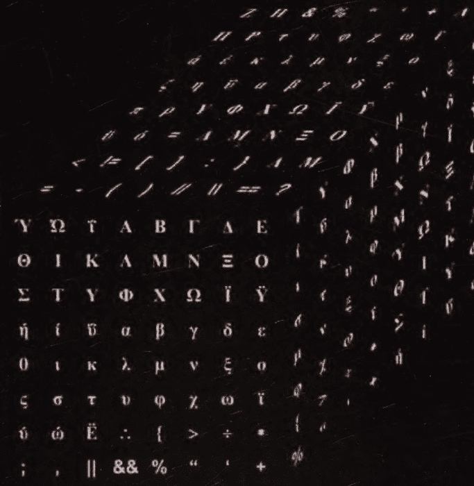


# 献辞

致 Anna Maguire, Brian Downey 以及都柏林职业教育委员会 (VEC)

# 致谢

致 Choice Publishing 的全体员工

## 第一章 - 引言

保存 C 程序

输出空白屏幕的程序

我的第一个程序

行号编号

错误纠正

遗漏的分号

代码的位置

代码注释

## 保存 C 程序

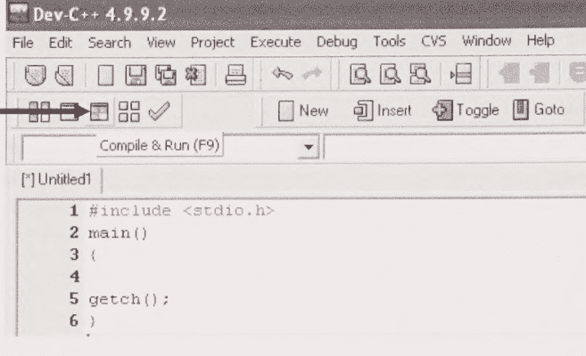

点击“编译并运行”图标

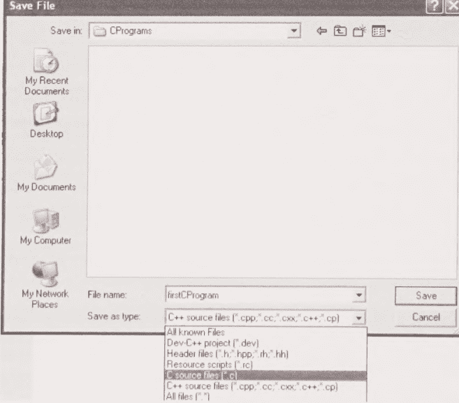

- 赋予一个合适的名称并确保其被保存为 `.c` 文件。
- “编译并运行”图标也用于运行已保存的程序。

# 第一章 - 引言

所有章节中讨论的所有程序至少包含以下代码。

```c
#include <stdio.h>
main()
{
  getch();
}
```

## 输出空白屏幕的程序

屏幕输入输出程序

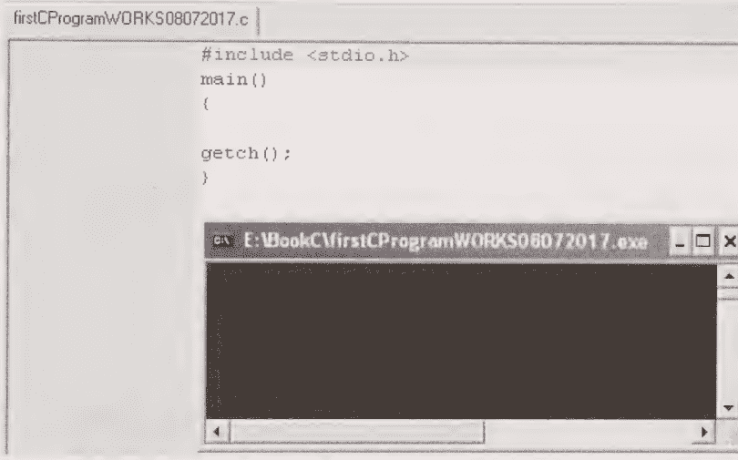

评注

第一行由一个井号 `#` 开始，紧接着是单词 `include`。然后是一个空格。然后是左、右角括号，里面是小写的字母 `stdio.h`。这一行代码实际上的意思是包含标准输入输出库文件——这是 C 的下载包中包含的一个文件。如果不包含此头文件，程序将无法运行。重要的是，不要将角括号与括号、方括号或大括号混淆，以确保程序正确运行。

代码的第二行包含小写的短语 `main()`。左、右圆括号即圆括号结束了这个短句。`main` 指的是程序的主体，该部分将紧跟在 `main()` 下方的大括号内部。通过按下键盘上的 Enter 键可以从一行移动到下一行。

紧接 `main()` 这一行之后，是左、右大括号，即花括号，短语为 `getch()`，其中 `getch` 表示“字符”，且是小写的。`getch()` 紧后的左、右圆括号之后是一个分号。几乎所有在 C 中运行的程序都需要 `getch();`。这行代码通常位于程序代码的末尾，它是程序的一部分，并且始终位于最后一个大括号之前。虽然 C 程序可以在没有 `getch` 的情况下运行，但输出并不总是打印到屏幕上。分号结束了上方程序 `main()` 部分中的 `getch();` 语句。分号对于结束许多行代码至关重要。遗漏分号会导致语法错误。因此，代码需要纠正。

## 我的第一个程序

```c
#include <stdio.h>
main()
{
    printf("Hi");
    getch();
}
```

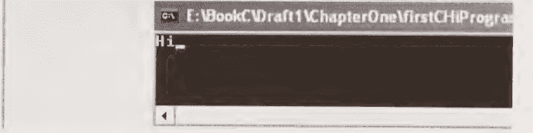

## 评注

在上面的示例中，第4行包含了打印到屏幕上的内容。在这种情况下是 `"Hi"`。在这一特定的第4行中，引号内包含什么并不重要；它可以是 `"Hi world!"`。引号内的内容将打印到屏幕上，前提是所有其他行代码都是准确且顺序正确的。第3行和第6行由左、右大括号组成。注意它们的位置。它们在各自的行中处于相同的位置，即垂直对应。这使得代码易于阅读。

## 行号编号

行号使得代码易于阅读。要启用行号，选择工具 (Tools)– 显示 (Display)– 开启行号。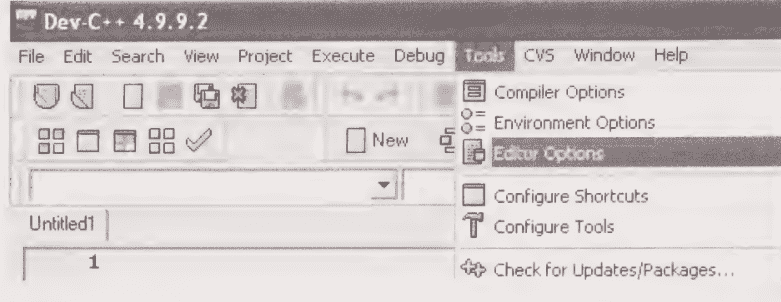

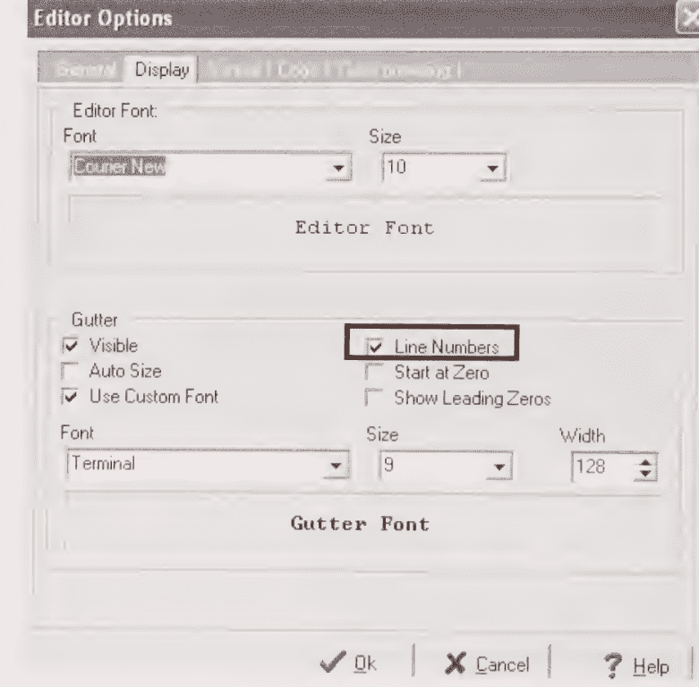

程序现在看起来如下：

```c
firstProgram08072017.c
1 #include <stdio.h>
2 main()
3 (
4     printf("Hi");
5     getch();
6 )
```

## 错误纠正

遗漏分号会遇到错误。以下代码在运行时包含一个错误。

```c
firstProgram.c
1 #include <stdio.h>
2 main()
3 (
4     printf("Hi")
5     getch();
6 )
```

| 编译器 | 资源 | 编译日志 | 调试 | 结果 |

| :--- | :--- | :--- | :--- | :--- |

| 行 | 文件 | 消息 | | |

| | E:\BookC\Draft1\ChapterOne\First... | 在函数 'main' 中 | | |

| 5 | E:\BookC\Draft1\ChapterOne\First... | "getch" 之前的语法错误 | | |

第5行被高亮。在下方语句中，`"getch"` 之前有错误。在其左侧是数字 5。该语句告诉我们在 `getch();` 之前存在语法错误。仔细观察，我们发现第4行缺少了分号。在第4行的 `printf("Hi");` 之后输入分号将修复错误并使程序正常运行。

## 代码的位置

代码的位置需要两个项目。反斜杠和 t，`\t`，以及反斜杠和 n，`\n`。所有的制进和换行对于演示和打印到屏幕都非常重要。

```c
firstProgram08072017.c
1 #include <stdio.h>
2 main()
3 (
4 printf("\tHi");
5     getch();
6 )
7 ?
```

```c
firstProgram08072017.c
1 #include <stdio.h>
2 main()
3 (
4 printf("\nHi");
5     getch();
6 )
7 ?
```

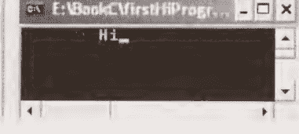

# 第一章 - 引言

## 注释代码

代码可以被注释。这些内容不会被计算机读取。要进行注释，在注释行的开头放置两个正斜杠 `//`。该行正斜杠右侧的所有内容在编译期间会被忽略。如果注释跨越多行，每行都可以使用两个正斜杠。或者，可以使用一个正斜杠和一个星号 `/*` 来开始注释，然后用一个星号和一个正斜杠 `*/` 结束。

示例

`//此行代码不会被读取，但对程序员可见。`

`/*此部分代码不会被读取，但对程序员可见。它允许程序员输入注释来解释代码。例如，某段代码的开始、结束，另一段代码的开始和结束。当代码长达几页时，这会让程序员的工作更容易。*/`

```c
firstCHProgramWithComments.c
1 //My first C Program
2 #include <stdio.h>
3 main(
4 (
5     printf("Hi");
6     getch();
7 )
8
9     /*My first C program
10 has been a
11 success*/
```

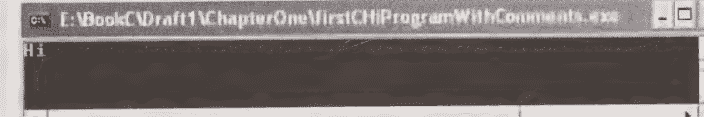

# 第二章 - 数据类型

## 变量声明

C语言编程中最常用的数据类型是整数、浮点数和字符。整数声明为 `int`。整数声明可以是一个字母字符或一组字母字符，例如 `int a` 或 `int alpha`。整数是一个全整数。声明为 `int 4Xeros` 的整数是错误的，因为它以数字开头。

## 整数声明与键盘输入

屏幕输入输出程序

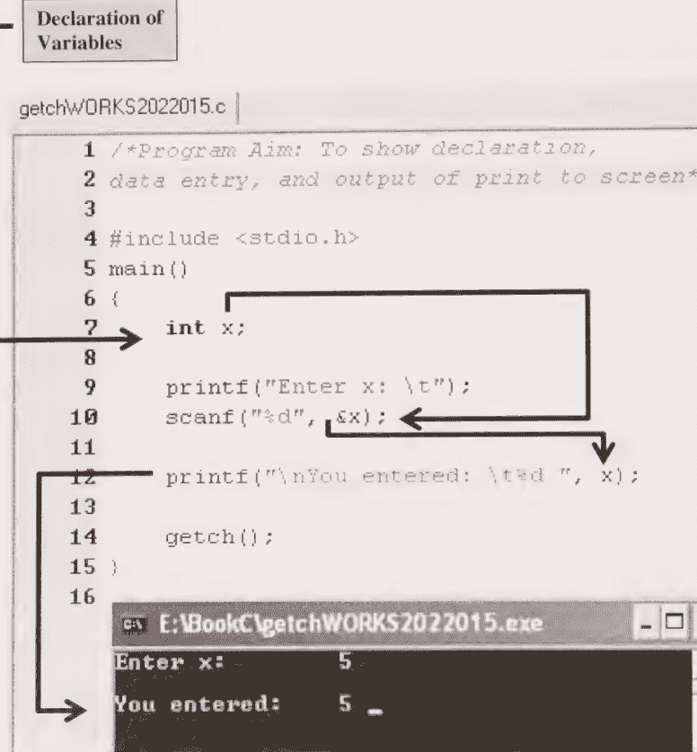

# 第二章 – 数据类型

# 代码

```c
1: /*程序目的: 演示声明、
2:   数据输入以及打印输出到屏幕*/
3:
4: #include <stdio.h>
5: main()
6:
7:   int x;
8:
9:   printf("Enter x: \t");
10:  scanf("%d", &x);
11:
12:  printf("\nYou entered: \t%d", x);
13:
14:  getch();
15: }
```

## 注释

当运行上述程序时，数据输入者会被提示输入 `x` 的值（代码第9行）。这里的 `printf` 语句后面跟着双引号内的文本行，包含在括号内并以分号结束，这告诉了我们这一点。所有元素都必须存在——`printf`、左括号和右括号、左双引号和右双引号，以及分号——程序才能执行到这一阶段。代码第10行允许输入者输入一个值。如果输入5并按回车，则执行第12行。第12行在屏幕上打印 `You entered: 5`。然而，此程序只有在代码设计正确的情况下才会运行。例如，第10行必须非常准确——双引号内的 `%d` 告诉我们要从键盘扫描一个整数。`&` 允许该整数被扫描。如果缺少符号 `&`，程序将不会按预期运行，且不会提示输入 `x` 的值。

所有符号及其使用方法都非常重要。`&` 符号和百分号 `%` 符号在随后的章节中用于额外任务，即条件语句和数值处理。在特定情况下理解这些符号是非常关重要的。

# 第二章 – 数据类型

显示整数声明和数据处理的示例

```c
getch2702215.c
1 *程序目的: 演示整数
2 的声明和数据处理
3
4 #include <stdio.h>
5 main() {
6 {
7 int x, y, z = 0;
8
9
10
11 printf("Enter x: \t");
12 scanf("%d", &x);
13
14
15
16 printf("Enter y: \t");
17 scanf("%d", &y);
18
19
20
21 z = x + y;
22
23
24
25 printf("z is: \t%d", z);
26
27 getch();
28 }
```

从键盘扫描

到内存

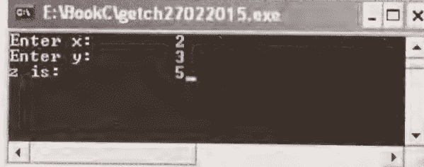

# 第二章 – 数据类型

# 代码

```c
1: /*程序目的: 演示
2: 第25行错误使用 am & 符号的影响*/
3:
4: #include <stdio.h>
5: main()
6:
7: int x, y, z = 0;
8:
9:
10:
11: printf("Enter x: \t");
12: scanf("%d", &x);
13:
14:
15:
16: printf("Enter y: \t");
17: scanf("%d", &y);
18:
19:
20:
21: z = x + y;
22:
23:
24:
25: printf("z is: \t%d", z);
26:
27: getch();
28: }
```

## 注释

第11行提示用户输入一个整数

在第21行中，`z = x + y;` `z` 是 `x` 和 `y` 的和。第25行在屏幕上打印第21行计算的结果。`%d` 代表整数。但在右侧只有 `z` 而没有 `&`。`&` 用于从键盘输入的数值数据。但处理过程产生的输出不包含 `&`。

此外，第7行将 `z` 声明为 `z = 0`。这意味着 `z` 初始化为零。经过处理的变量必须初始化。许多计算机程序员建议初始化所有变量，而不仅仅是处理结果的变量。初始化为零这样的值意味着内存中的值不会导致错误的输出。

在上面的示例中，如果第7行按如下输入（假设整数 `x`、`y` 和 `z` 已经声明），即缺失了 `= 0`（等于零），那么到屏幕的输出可能是一个内存地址，而不是我们正在寻找的答案，即 `x` 和 `y` 的和。

## 在多行声明的整数变量

getch27022015.c

```c
1 /*程序目的：展示整数的
2  声明和数据操作*/
3
4 #include <stdio.h>
5 main(
6  
7      int x;
8      int y;
9      int z = 0;
10 
11     printf("Enter x: \t");
12     scanf("%d", &x);
13 
14     printf("Enter y: \t");
15     scanf("%d", &y);
16 
17     z = x + y;
18 
19     printf("z is: \t\t%d", z);
20 
21     getch();
22 )
```

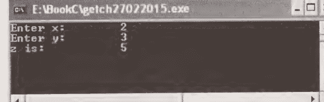

# 第二章 – 数据类型

Q2.1 下面程序第 25 行有什么错误？

`printf("z is: %%d", &z);`

```c
getch27022015.c
1  /*程序目的：展示第 25 行
2  错误使用取地址符 &的效果*/
3
4  #include <stdio.h>
5 main()
6 {
7      int x, y, z = 0;
8
9
10
11     printf("Enter x: \t");
12     scanf("%d", &x);
13
14
15
16     printf("Enter y: \t");
17     scanf("%d", &y);
18
19
20
21     z = x + y;
22
23
24
25     printf("z is: \t\t%d", &z);
26
27     getch();
28 }
29
```

| Enter x: | 2 |

| Enter y: | 3 |

| z is: | 2359148 |

18

# 第二章 — 数据类型

在第 17 行中正确使用与错误使用取地址符的区别

| 27022015.c | 27022015.c |

|--- |--- |

| 1 /*程序目的：展示声明 | 1 /*程序目的：展示声明 |

| 2 整数和数据操作的 | 2 整数和数据操作的 |

| 3 | 3 |

| 4 #include <stdio.h> | 4 #include <stdio.h> |

| 5 main() | 5 main() |

| 6 ( | 6 ( |

| 7 int x, y, z = 0; | 7 int x, y, z = 0; |

| 8 | 8 |

| 9 printf("Enter x: \x\t"); | 9 printf("Enter x: \x\t"); |

| 10 scanf("%d", x); | 10 scanf("%d", x); |

| 11 | 11 |

| 12 printf("Enter y: \y\t"); | 12 printf("Enter y: \y\t"); |

| 13 scanf("%d", y); | 13 scanf("%d", y); |

| 14 | 14 |

| 15 z = x + y; | 15 z = x + y; |

| 16 | 16 |

| 17 printf("z is: \t\t%d", z); | 17 printf("z is: \t\t%d", z); |

| 18 | 18 |

| 19 get(); | 19 get(); |

| 20 ) | 20 ) |

| 21 | 21 |

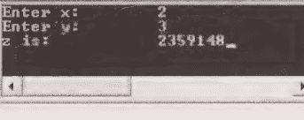

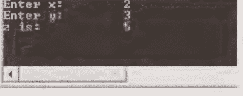

由于第 17 行使用了 `&z`，导致 `z` 的值为内存地址；而第 17 行不包含取地址符 `&` 时，`z` 的值为结果。

除了上述第 7 行声明了 `z = 0` 之外，第 15 行包含公式 `z = x + y;`。重要的是第 15 行的内容必须位于 `x` 和 `y` 输入之后（在本例中为第 10 行和 13 行之后）。如果省略第 15 行并让第 7 行包含 `z = x + y` 而不是 `z = 0`，程序将运行错误。

19

# 第二章 – 数据类型

## 错误

getch27022015.c


```c
1 /*程序目的：展示整数的
2 声明和数据操作*/

4 #include <stdio.h>
5 main()
6 (
7     int x, y, z = 0;

          printf("Enter x: \t");
    scanf("%d", &x);

    printf("Enter y: \t");
    scanf("%d", &y);

    z = x + y;

    printf("z is: \t%d", z);

    getch();
)
```

| 行 | 文件 | 消息 |

|---|---|---|

| 7 | `E:\getch27022015.c` | `"z"` 之前的语法错误 |

| 15 | `E:\getch27022015.c` | 未定义的标识符（函数中首次使用） |

每个未定义的标识符在每个函数中只报告一次。 # 注释

上述出现了两个错误。消息显示第 15 行的 `z` 未定义。此外，在第 7 行 `z` 之前出现了语法错误。然而，第 7 行似乎已经声明了 `z`。经过调查，在第 17 行 `y` 之后、`z` 之前缺少逗号会导致计算机将 `y` 和 `z` 视为独立的整数。如果缺少逗号，第 15 行的 '`z`' 未定义错误也会消失。必须在程序早期进行声明，原因有二：首先，这使得代码易读；其次，在声明之前无法处理 `y` 和 `z`。上述错误导致计算机无法以预期方式处理。例如，缺少逗号或分号可能导致文件保存错误。熟悉小型程序中的错误有助于识别和修正大型程序中的错误。

## 整数的数据操作

`getch27022015.c`

```c
1 /*程序目的：展示整数的
2 声明和数据操作*/
4 #include <stdio.h>
5 main()
6 {
     int x, y, z = 0;
8

    printf("Enter x: \t");
  scanf("%d", &x);

  printf("Enter y: \t");
  scanf("%d", &y);

  z = x + y;

  printf("z is: %d + %d = \t%d", x, y, z);

  getch();
}
```

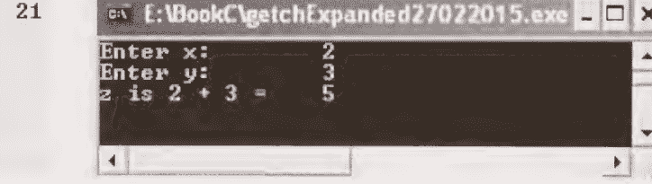

## 注释

第 17 行比之前的示例行包含更多细节，`%d` 出现了三次——表示三个整数。在该行的右侧，`x` `y` 和 `z` 意味着打印到屏幕时，整数顺序为 `x`、`y` 和 `z`，即 `x+y=z`。

上面的第 17 行可以按如下方式编写：

# 第二章 – 数据类型

```c
15      z = x + y;
16

      printf("z is: %d + %d = %d",
      x, y, z);
19

      getch();
21 }
```

当在 `printf` 语句中使用多个变量进行屏幕输出时，这将非常有用。由于行长度较短，代码对易友好。

| 15 z = x + y; | 15 z = x + y; |

| 16 | 16 |

| 17 printf("z is: %d + %d = %d", x, y, z); | 17 printf("z is: %d + %d = %d", |

| 18 | 18 x, y, z); |

| 19 | 19 |

| 20 | 20 getch(); |

| 21 | 21 |

单行 `printf` 语句。

双行 `printf` 语句。

# 第二章 – 数据类型

## 整数的间距

程序和屏幕输入输出

```c
## [spaceBetweenAlha1202017.c]
#include <stdio.h>
int main() {
    int i, j, k;
    printf("Enter int 1: ");
    scanf("%d", &i);
    printf("Enter int 2: ");
    scanf("%d", &j);
    printf("Enter int 3: ");
    scanf("%d", &k);
    printf("integer with 2 spaces: %02d\n", i);
    printf("integer with 4 spaces: %04d\n", j);
    printf("integer with 6 spaces: %06d\n", k);
    return 0;
}
```

```c
spaceBetweenAlha1202017.c
#include <stdio.h>
int main() {
    int i, j, k;
    printf("Enter int 1: ");
    scanf("%d", &i);
    printf("Enter int 2: ");
    scanf("%d", &j);
    printf("Enter int 3: ");
    scanf("%d", &k);
    printf("integer with 2 spaces: %02d\n", i);
    printf("integer with 4 spaces: %04d\n", j);
    printf("integer with 6 spaces: %06d\n", k);
}
```

```
spaceBetweenAlha1202017.
Enter int 1:
Enter int 2:
Enter int 3:
```

```
spaceBetweenAlha1202017.
Enter int 1:
Enter int 2:
Enter int 3:
```

```
integer with 2 spaces:
integer with 4 spaces:
integer with 6 spaces:
```

```
integer with 2 spaces:
integer with 4 spaces:
integer with 6 spaces:
```

| Lines 16, 17 and 18 allow for 2, 4 and 6 spaces for integers respectively. Although lines 16 and 17 allow for less spacing than the input requires, data is printed accurately. | Lines 16, 17 and 18 allow for 2, 4 and 6 spaces for integers respectively. Should the integer data input less allowed for, input aligned right. |

# 第二章 – 数据类型

# 代码

```
1: /*程序目的：展示整数的声明
2: 及其数据操作*/
3:
4: #include <stdio.h>
5: main(
6: {
7: float x, y, z = 0;
8:
9:
10:
11: printf("Enter x: \t\t");
12: scanf("%f", &x);
13:
14:
15:
16: printf("Enter y: \t\t");
17: scanf("%f", &y);
18:
19:
20:
21: z = x + y;
22:
23:
24:
25: printf("z is: \t\t%f", z);
26:
27: getch();
28: }
```

## 注释

第 7 行包含的是 `float` 而不是 `int`。第 12、17 和 25 行包含 `%f` 而不是 `%d`。屏幕上的最终输出结果为 `z`，小数点后有六位。

## 第二章 – 数据类型

## 整数与浮点数的比较

| 整数使用 %d | 浮点数使用 %f |

|---|---|

| getch2702015.c | getch2702015.c |

| 1 /* 整数：展示声明 | 1 /* 浮点：展示声明 |

| 2 及其数据操作* */ | 2 浮点及其数据操作* */ |

| 3 | 3 |

| 4 #include <stdio.h> | 4 #include <stdio.h> |

| 5 main() { | 5 main() { |

| 6 | 6 |

| 7 int x |

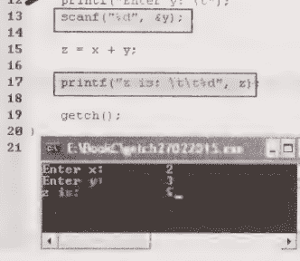

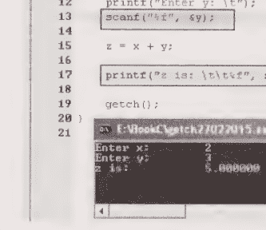

| 使用的整数 | 使用的浮点数 |

|---|---|

| 第 7 行包含 int。 | 第 7 行包含 float。 |

| 第 10、13 和 17 行包含 %d | 第 10、13 和 17 行包含 %f。 |

使用浮点数而非整数的优缺点如下：

- *浮点数在小数点后提供多位数字——这在计算小数位数值时非常有价值。*

- 整数会进行截断而不进行四舍五入。将它们声明为整数时，十一除以三的结果是三。四会是一个更准确的答案，因为 3.6666667 更加精确。

- 浮点数可能会因为舍入导致速度较慢。

- 如果使用余数（即模运算运算符 `%`），整数比浮点数更有优势，因为浮点数无法计算余数。

## 第二章 – 数据类型

## 整数相对于浮点数的缺点

Q2.2 为什么在下面的示例中 `w` 是 0？它应该是 20，即输入的 `u` 和 `v` 的值 4 乘以 5。

```
1 "程序目的：展示变量声明和数据输出"
2 #include <stdio.h>
3 main(){
4 (
5 int x, y, z = 0;
6 float u, v, w = 0;
7

9 printf("Enter integer x: %d\t", x);
10 printf("Enter integer y: %d\t", y);
11 scanf("%d", &y);
12

13 printf("\nnEnter float u: %f\t", u);
14 scanf("%f", &u);
15 printf("\nter float v: %f\t", v);
16 scanf("%f", &v);
17

18 z = x * y;
19 w = u * v;
20

21 printf("\ninteger z is: %d\t\n", z);
22 printf("\nfloat w is: %f\t\n", w);
23

25 ) getch();
26
```

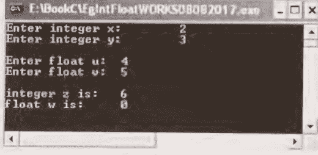

## 第二章 – 数据类型

## 整数相对于浮点数的缺点

### 屏幕输入输出与程序

```
1 /*程序目的 - 展示浮点数相对于整数的优势*/
2 #include <stdio.h>
3 main()
4 (
5     int x, y, z = 0;
6     float u, v, w = 0;
7

    // 输入了整数
    printf("Enter x: \t");
   scanf("%d", &x);
   printf("Enter y: \t");
   scanf("%d", &y);

   // 输入了浮点数
   printf("\nEnter u: \t");
   scanf("%f", &u);
   printf("Enter v: \t");
   scanf("%f", &w);

   z = x / y;
   v = u / v;

   printf("\nz is: %d\n", z);
   printf("\nw is: %f\n", w);

getch();
)
```

> 变量的声明、处理和输出比整数提供更准确的答案

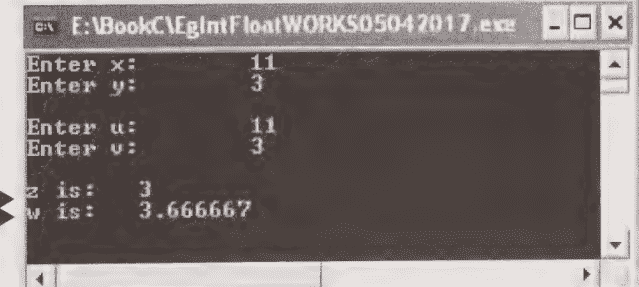

## 第二章 – 数据类型

# 代码

```
1: /程序目的 - 展示浮点数相对于整数的优势/
2: #include <stdio.h>
3: main() {
4: int x, y, z = 0;
5: float u, v, w = 0;
6: 
7: // 输入了整数
8: printf("Enter x: \t\t");
9: scanf("%d", &x);
10: printf("Enter y: \t\t");
11: scanf("%d", &y);
12: // 输入了浮点数
13: printf("Enter u: \t\t");
14: scanf("%f", &u);
15: printf("Enter v: \t\t");
16: scanf("%f", &v);
17: 
18: z = x / y;
19: w = u / v;
20: 
21: printf("\nz is: %d\n", z);
22: printf("\nw is: %f\n", w);
23: 
24: getch();
25: }
```

## 注释

整数会截断，即向下取整，尽管除数是九。默认情况下，浮点数保留六位小数。这在 `printf` 语句中使用 `%f` 或 `%f` 可以实现。这并不意味着整数相对于浮点数没有优势。将秒转换为小时、分钟以及判断是否为闰年或判断是否为质数的程序都依赖于整数。`switch` 语句也依赖整数。

## 第二章 – 数据类型

## 模运算

### 屏幕输入输出与程序

```
1 /*演示除法*/
2 #include <stdio.h>
3 main()
4 {
5     int x, y, z = 0;
6

8     printf("Enter Numerator x: ");
9     scanf("%d", &x);
10    printf("Denominator y: ");
11    scanf("%d", &y);
12

13    z = x % y;
14    printf("\nz = %d\n", // 为了进行模运算，变量必须声明为整数。
15 }
```

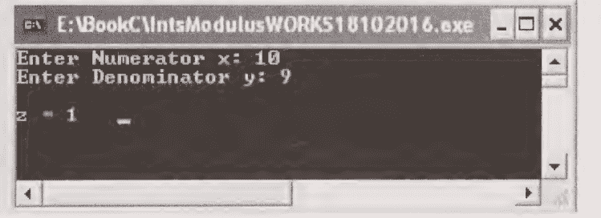

## 注释

使用模运算符 `%` 可以计算余数。十除以九余数为一。模运算对于将秒转换为小时、分钟以及判断闰年有用。这些程序必须使用整数而不是浮点数。虽然浮点数在除法中提供小数，但不适用于计算模运算。

| 目标 | 使用的数据类型 |

|---|---|

| 模运算 | int |

| 除法 | float |

## 浮点数舍入

## 屏幕输入输出程序

```
1 /*程序目的：展示浮点数与整数的区别*/
2 #include <stdio.h>
3 main ()
4 {
5     int x, y, z = 0;
6     float u, v, w = 0, c, b, a = 0;
7     printf("Enter integer x: \t");
8     scanf("%d", &x);
9     printf("Enter integer y: \t");
10    scanf("%d", &y);
11

   printf("Enter float u: \t");
   scanf("%f", &u);

   printf("Enter float v: \t");
   scanf("%f", &v);

   printf("Enter float b: \t");
   scanf("%f", &b);
   printf("Enter float c: \t");
   scanf("%f", &c);

   z = x/y;
   w = u/v;
   a = b/c;

   printf("\nInteger z is: \t%d\n", z);
   printf("\nFloat w is: \t%0.2f\n", w);
   printf("\nFloat a is: \t%2.7f\n", a);
   getch();
}
```

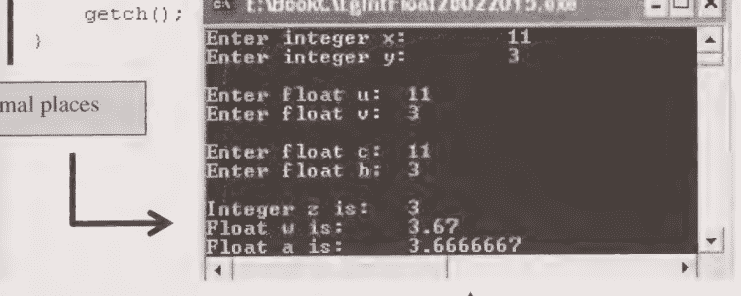

# 代码


# 第二章 – 数据类型

## 程序示例：浮点数与整数的区别

```c
/*程序目的：展示浮点数与整数的区别*/
#include <stdio.h>
main ()
{
    int x, y, z = 0;
    float u, v, w = 0, c, b, a = 0;
    printf("Enter integer x: \t");
    scanf("%d", &x);
    printf("Enter integer y: \t");
    scanf("%d", &y);

    printf("Enter float u: \t");
    scanf("%f", &u);

    printf("Enter float v: \t");
    scanf("%f", &v);

    printf("Enter float b: \t");
    scanf("%f", &b);
    printf("Enter float c: \t");
    scanf("%f", &c);

    z = x/y;
    w = u/v;
    a = b/c;

    printf("\nInteger z is: \t%d\n", z);
    printf("\nFloat w is: \t%0.2f\n", w);
    printf("\nFloat a is: \t%2.7f\n", a);
    getch();
}
```

## 其他数据类型

除了声明 `int` 或 `float` 数据类型外，还可以按照如下方式声明：

| 数据类型 | 内存占用（字节） | 显示 | 数值范围 |
| --- | --- | --- | --- |
| long int | 4 | `%d` 或 `%i` | -2,147,483,648 到 2,147,483,647 |
| long | 4 | `%ld` | -2,147,483,648 到 2,147,483,647 |
| short int | 2 |  | -32,768 到 32,767 |
| short | 2 |  | -32,768 到 32,767 |
| unsigned long | 4 | 不允许负值，但正数范围增加 | 0 – 4,294,967,295 |
| unsigned int | 4 | 不允许负值，但正数范围增加 | 0 到 65,535 |
| float | 4 | `%f.` | 属性未指定 |
| double | 8 | `%lf` | 属性未指定 |
| char | 1 | `%s` | 一个或一系列字母值 |

`double` 允许浮点小数比 `float` 和整数更精确，但需要更大的内存存储。其余的数据类型可在特定情况下使用。员工工号或工作证号可以声明为 `unsigned long`。

## 示例：程序中的屏幕输入与输出

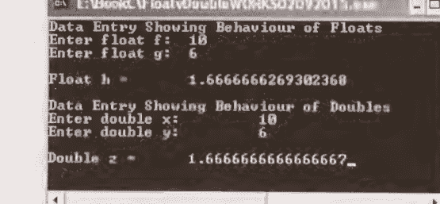

```c
/*Program Aim: Show the Difference of Floats and Doubles*/
#include <stdio.h>
void main() {

float f, g, h=0;
double x, y, z=0;

printf("Data Entry Showing Behaviour of Floats\n");
printf("\nEnter float: %f\t");
scanf("%f", &f);
printf("Enter float g: \t");
scanf("%f", &g);

h = f/g;
printf("\nFloat h = \t%0.16f", h);

printf("\nData Entry Showing Behaviour of Doubles");
printf("\nEnter double x: \t");
scanf("%lf", &x);
printf("\nEnter double y: \t");
scanf("%lf", &y);

z = x/y;
printf("\nDouble z = \t%0.16f", z);

getch();

}
```

在上述代码中，第 15 行和第 24 行通过代码 `%0.16f` 和 `%0.16lf` 允许浮点数保留十六位小数。然而，是 `z` 在十六位小数上更为精确。`float h` 在八位小数处就会丢失精度，而 `double z` 在十六位小数处仍能保持精确。

任何需要处理不超过七位小数数据的程序都应该使用 `float` 而不是 `double`，因为消耗的内存更少。

### Q2.3

虽然下面的代码看起来运行正常，但平均值 `a` 的计算是错误的。为什么？

```c
/*Program Aim: To show problems in
inaccurate design*/

#include <stdio.h>
main()
{
float x, y, z, a = 0;

printf("Enter x: \t");
scanf("%f", &x);

printf("Enter y: \t");
scanf("%f", &y);

printf("Enter z: \t");
scanf("%f", &z);
a = (x + y + z)/3;

printf("average is: \t%f", a);
getch();
}
```


## 运算符函数

| 运算符 | 功能 | 示例 |
| --- | --- | --- |
| `+` | 加法 | `x + y = z; 2 + 3 = 5` |
| `-` | 减法 | `c = b - a; 15 - 5 = 10` |
| `*` | 乘法 | `d * c = f; 3 * 4 = 12` |
| `/` | 除法 | `g = h / j; 12 / 4 = 3` |
| `%` | 取模 | `k = m % n; 19 % 8 = 3` |
| `pow` | 幂 | `p = pow(a, b); pow(2, 4) = 16` |
| `exp(log)` | 根 | `k = exp(log(i) / j); 8 rooted 4 = 3` |

## 幂输入输出程序

```c
/*Program Aim: To Show Powers In*/
#include <stdio.h>
main()
{
    int i, j, k = 0;
    printf("Enter i: \t\t");
    scanf("%d", &i);
    printf("Enter j: \t\t");
    scanf("%d", &j);
    k = pow(i, j);
    printf("to the power of %d is: %d", i, k);
    getch();
}
```


### 解析

在上面的代码中，第 13 行允许计算 `i` 的 `j` 次幂。这通常写作 `k=i^j=2×2×2×2 = 16`。

结果：16，即值 `k`。在 C 语言中实现此操作的公式是 `k = pow(i, j)=pow(2, 4)`；

其中 `i` 是底，`j` 是指数。

第 7 行和第 10 行提示输入 `i` 和 `j` 的值，第 8 行和第 11 行允许将这些值扫描到内存中。第 15 行到第 16 行打印输入的值以及第 13 行计算出的答案。

## 赌博场景中的幂函数

### 赌博场景

连续掷六点

屏幕输入输出程序 `1402017.c`


### 代码

```c
/*Program Aim: compute probability of
getting maximum in Casino*/
#include <stdio.h>
main()
{
    int noOfDice
printf("nProbability of getting %ds is %d to one",
noOfDice, noOfSidesDice, probabilityOfWinning);

printf("\Program End");
getch();
}
```

### 解析

上述显示，如果赌徒需要掷两个骰子得到六点（每个骰子六面），那么获胜概率是 36 分之一。通过在第 9 行和第 12 行输入数据，可以发现掷四个骰子时的概率。

## 整数、浮点数和双数的精度

屏幕输入输出 `10^7`

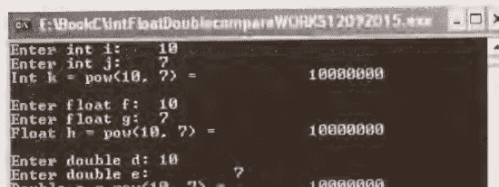

屏幕输入输出 `10^8`

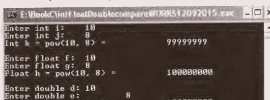

屏幕输入输出 `10^11`

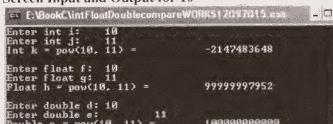

屏幕输入输出 `10^40`

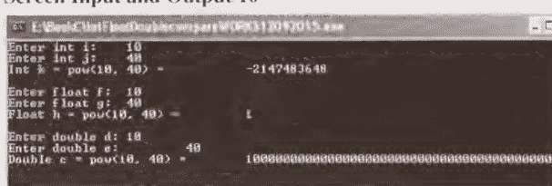

## 程序：平均值计算

```c
/*Program Aim: To show advantages of doubles, floats
and ints over each other in whole number situations*/
#include <stdio.h>
main()
{
float x, y, z, a=0;
printf("Enter x: \t");
scanf("%f", &x);

printf("Enter y: \t");
scanf("%f", &y);

printf("Enter z: \t");
scanf("%f", &z);

a = (x+y+z)/3;
printf("average is: \t%f", a);
getch();
}
```

## 平方根与立方

```c
/*Program Aim: To Show Roots In*/
#include <stdio.h>
main()
{
    int i, j, k = 0;
    printf("Enter i: \t\t");
    scanf("%d", &i);
    printf("Enter j: \t\t");
    scanf("%d", &j);
   k = exp(log(i) / j);
   printf("%d rooted to %d is: \t%d\n", i, j, k);

   getch();
}
```

### 解析

在上述代码中，第 13 行允许计算 `i` 的 `j` 次幂。这通常写作 `k=i^j=2×2×2×2 = 16`。

结果：16，即值 `k`。在 C 语言中实现此操作的公式是 `k = pow(i, j)=pow(2, 4)`；

其中 `i` 是底，`j` 是指数。

第 7 行和第 10 行提示输入 `i` 和 `j` 的值，第 8 行和第 11 行允许将这些值扫描到内存中。第 15 行到第 16 行打印输入的值以及第 13 行计算出的答案。

## 幂与根的对比


`k = pow(i, j)`:

`k = exp(log(i)/j)`:

上述两个程序完全相同，只有第 13 行和第 15 行不同。在第一个程序中，计算的是幂；在第二个程序中，计算的是根。

## 业务中的幂函数 - 投资金额计算

屏幕输入与程序 `CompinterestPow/ORKS151012016.c`

```c
/*程序目的：根据给定的本金复利利率和年限
计算金额*/
#include <stdio.h>
main()
{
    float amount = 0, principal, years, rate;

    printf("Enter Principal: \t\t", &principal);
    printf("%f", &principal);
    printf("Enter Interest Rate percent: \t", &rate);
    scanf("%f", &rate);
    printf("Enter years: \t\t", &years);
    scanf("%f", &years);

    amount = principal * pow((100+rate)/100, years);
    //amount = principal * pow((1+rate/100), years);

    printf("\nAmount is: \t\t%0.2f", amount);
getch();
}
```

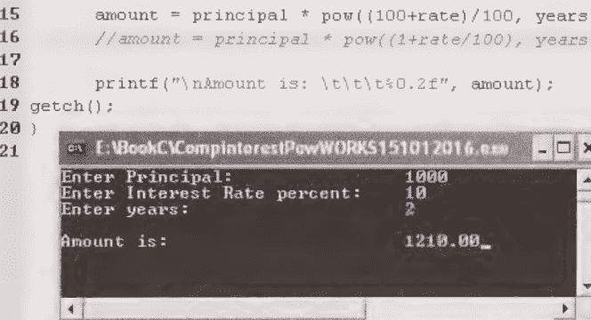

### 代码

```c
/*程序目的：根据给定的本金复利利率和年限
计算金额*/
#include <stdio.h>
main()
{
    float amount = 0, principal, years, rate;

    printf("Enter Principal: \t\t", &principal);
    scanf("%f", &principal);
    printf("Enter Interest Rate percent: \t", &rate);
    scanf("%f", &rate);
    printf("Enter years: \t\t", &years);
    scanf("%f", &years);

    amount = principal * pow((100+rate)/100, years);
    //amount = principal * pow((1+rate/100), years);

    printf("\nAmount is: \t\t%0.2f", amount);
: getch();
: }
```

### 注释

第15行和第16行均有效。每行都展示了将第11行的百分比率输入转换为小数的略有不同的方法。这样做是为了计算 `1.10^2`。

| 第15行 | 第16行 |
| --- | --- |
| `amount = 1000 * ((100 + 10)/100)^2` | `amount = 1000 * (1 + (10/100))^2` |

## 使用 pow 和 exp 计算复利

屏幕输入输出程序

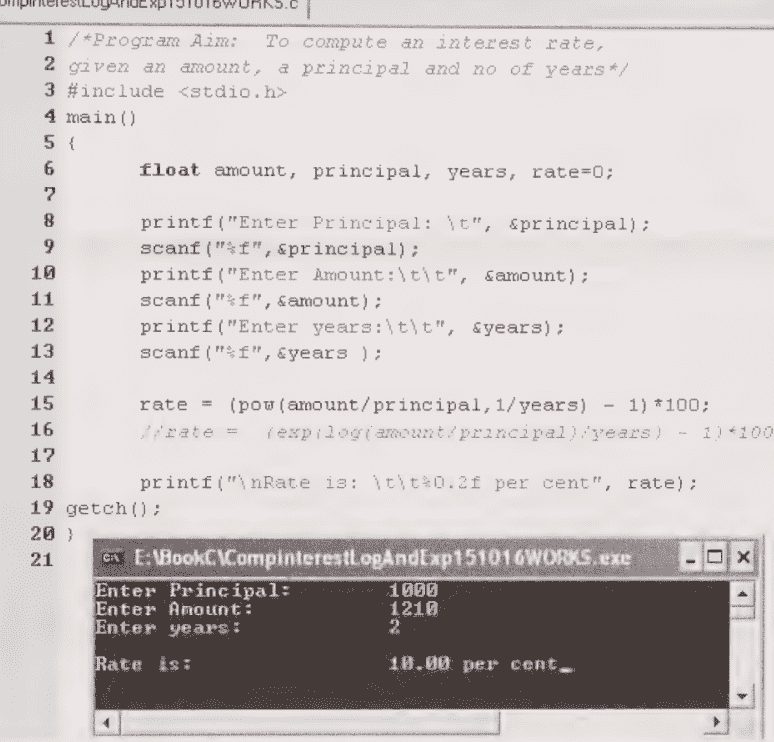

### 注释

该程序在输入本金、金额和年限时计算利率。金额是本金加上若干年后获得的复利。以10%的利率投资1000欧元，两年后金额为1210欧元。

在第16行使用 `exp log` 函数实现的效果与第15行完全相同。任何公式均可用。通常，`pow` 用于幂运算，而 `explog` 用于立方根。

| 数学语言 | C 语言 |
|--- |--- |
| power | `amount = principal * ((100+r)/100)^f;` | `amount = principal * pow(1+r/100,n);` |

## 使用 Pow 和 Exp(Log) 计算本金

`CompinterestLogAndExp/WORKS16102016.c`

```c
/*程序目的：根据金额、本金和年限
计算利率*/
given an amount
```

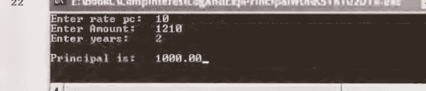

### 代码


```c
1: /程序目的：根据金额、本金和年限
2: 计算利率/
3: #include <stdio.h>
4: main()
5:
6: float amount, principal, years, rate=0;
7:
8: printf("Enter Principal: \t\t", principal);
9: scanf("%f", &principal);
10: printf("Enter Amount: \t\t", amount);
11: scanf("%f", &amount);
12: printf("Enter years: \t\t", years);
13: scanf("%d", &years);
14:
15: rate = (pow(amount/principal,1/years) - 1)*100;
16:
17: //rate = (exp(log(amount/principal)/years) - 1)*100;
18:
19: printf("nRate is: \t\t%f cent", rate);
```

## 注释

`log` 和 `pow` 对于使用 C 解决复杂问题至关重要。结合循环使用，power 和指数 `log` 函数可以快速解决许多业务问题，例如预测、现金流、年金价值、折旧和回收。

# 第二章 – 数据类型

## 整数和浮点数

整数和浮点数结合时并不总是产生准确的输出。

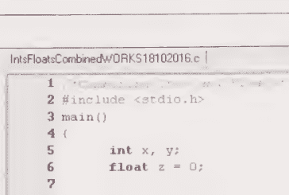

```c
1 #include <stdio.h>
2 
3 main() {
4 
5     int x, y;
6     float z = 0;
7 
8     printf("Enter x: ");
9     scanf("%d", &x);
10     printf("Enter y: ");
11     scanf("%d", &y);
12 
13     z = x/y;
14     printf("nz = %f\n", z);
15 }
```

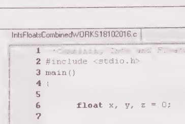

```c
1 #include <stdio.h>
2 
3 main() {
4 
5     float x, y, z = 0;
6 
7     printf("Enter x: ");
8     scanf("%f", &x);
9     printf("Enter y: ");
10    scanf("%f", &y);
11 
12     z = x/y;
13     printf("nz = %f\n", z);
14 }
15 getch();
```

```
Enter x: 2
Enter y: 3
z = 0.000000
```

```
Enter x: 2
Enter y: 3
z = 0.666667
```

## 错误的输出

由于 `x` 和 `y` 是整数 – 第5行 - `float z` 可能不准确。

## 正确的输出

由于 `x` 和 `y` 是浮点数 – 第6行 - `float z` 是准确的。

# 第二章 – 数据类型

## 强制转换

强制转换是在程序运行时更改数据类型的过程。

## 示例

## 无强制转换 | 强制转换 |
| IntFloatCombined/DRAS19102016.c | IntFloatCasting/DRAS19102016.c |
|---|---|
| 1 / /*结合整数和浮点数*/ | 1 / /*显示强制转换的程序*/ |
| 2 #include <stdio.h> | 2 #include <stdio.h> |
| 3 main() | 3 main() |
| 4 | 4 |
| 5 int x, y; | 5 int x, y; |
| 6 float z = 0; | 6 float z = 0; |
| 7 | 7 |
| 8 printf("Enter x: "); | 8 printf("Enter x: "); |
| 9 scanf("%d", &x); | 9 scanf("%d", &x); |
| 10 printf("Enter y: "); | 10 printf("Enter y: "); |
| 11 scanf("%d", &y); | 11 scanf("%d", &y); |
| 12 | 12 |
| 13 z = x/y; | 13 z = (float)x/y; |
| 14 | 14 |
| 15 printf("nz = %f\n", x, z); | 15 printf("nz = %f\n", x, z); |
| 16 getch(); | 16 getch(); |
| 17 | 17 |
| 18 | 18 |

第13行 `z = x/y;`

数据类型 `x` 仅为了第13行的除法目的更改为 `float`。如果 `x` 除以 `y`，在程序稍后的第13行，这将导致结果。

# 第二章 - 数据类型

## 输入和输出


```
Enter x: 2
Enter y: 3
z = 0.000000
```

```
Enter x: 2
Enter y: 3
z = 0.666667
```

## 强制转换的细节

```c
1 #include <stdio.h>
2 
3 main() {
4 
5     int x, y;
6     float z = 0;
7 
8     printf("Enter x: ");
9     scanf("%d", &x);
10     printf("Enter y: ");
11     scanf("%d", &y);
12 
13     z = x/y;
14     printf("nz = %f\n", z);
15 }
```

# 第三章 - 处理

- 第三章 – 处理 ................................................................................60
- Bomdas 规则....................................................................................................................60
- 数据操作示例...............................................................................................60
- 使用 Bomdas 处理的数据...............................................................................................61
- 优先级规则与变量声明......................................................................63
- 模取与除法................................................................................................64
- 模取与乘法...............................................................................66
- 一系列除数...........................................................................................67
- 加法和减法的规则...............................................................................68
- 圆形的处理属性..................................................................69
- 程序计算木块体积.....................................................................................72
- 程序计算三角形面积...............................................................................................73
- 业务中的处理...............................................................................................................75
- 利润所得税......................................................................................75
- 薪资所得税...........................................................................................75
- 损益平衡点...............................................................................................76

## 第三章 – 处理

## Bomdas 规则

- 括号 (Brackets)
- 顺序 (Order)
- 乘法 (Multiplication)
- 除法 (Division)
- 加法 (Addition)
- 减法 (Subtraction)

*Bomdas* 助记法有时被称为 *Bodmas*。这条规则规定先处理*括号*，然后按照顺序进行*乘除*，最后才是*加减*法运算。计算机和计算器会遵循这些规则。但如果手动计算，可能会出现问题。例如

9 / 3 * 6

是 9 除以 3 得到的 3 乘以 6，答案为 18。还是 3 乘以 6 得到的 18 除以 9 得到 2*？虽然计算机或计算器会正确处理，但解决方案并不总是直观的。**Bomdas** 建议先除后乘。但 **Bomdas** 也建议先乘后除。使用这两种助记法会得到不同的答案。

规则是：除法和乘法被同等对待。解决时，乘法和除法应从左到右进行。在上面的示例中，9 除以 3，得到的 3 乘以 6。

## 数据操作示例

| 9/3 * 6 = | 9/3 * 6 = | 9/(3 * 6) = |
| :--- | :--- | :--- |
| 18 | 0.5 | 0.5 |
| ☑ | ☑ | ☑ |
| 2 + 3 * 4 = | 2 + 3 * 4 = | (2 + 3) * 4 = |
| :--- | :--- | :--- |
| 14 | 20 | 20 |
| ☑ | ☑ | ☑ |

# 第三章 - 处理

这一切对于在 C 语言中设计解决问题的方程至关重要。一个方程看起来没问题，但实际上可能有问题。

## 使用 Bomdas 处理的数据
程序和屏幕输入输出

```
abcdefghijkWORKS14092016.c

3 main() {
4     (
5      float a, b, c, d, e, f, g, h, j, k = 0;
7      printf("Enter a: ");
8      scanf("%f", &a);
9      printf("Enter b: ");
10     scanf("%f", &b);
11     printf("Enter c: ");
12     scanf("%f", &c);
13     printf("Enter d: ");
14     scanf("%f", &d);
15     printf("Enter e: ");
16     scanf("%f", &e);
17     printf("Enter f: ");
18     scanf("%f", &f);
19     printf("Enter g: ");
20     scanf("%f", &g);
21     printf("Enter h: ");
22     scanf("%f", &h);
23     printf("Enter j: ");
24     scanf("%f", &j);
25
26     k = a + b * c - d / e + f * g - h / j;
28     printf("K is: %f\n", k);
29
30 getch();
31 }
```


## 注释

对于不熟悉处理规则的人来说，求解时可能会给出 4。编译器屏幕输出的正确答案是：

```
k = a + b * c - d / e + f * g - h / j;
= 1 + 2 * 3 - 4 / 5 + 6 * 7 - 8 / 9
= 1 + 6 - 0.8 + 42 - 0.888
= 47.311
```

还有一点需要注意：计算 `$k$` 的公式必须在所有 `$k$` 公式中的变量输入后定义。如果公式在第 5 行而不是第 26 行，输出将是错误的。

## 优先级规则与变量声明

程序和屏幕输入输出

```
1 /*程序显示优先级
2 和变量声明的重要性**/
3 #include <stdio.h>
4 main()
5 {
6     int x, y, z, a = 0;
7 
8     printf("Enter x: ");
9     scanf("%d", &x);
10    printf("Enter y: ");
11    scanf("%d", &y);
12
13    printf("Enter z: ");
14    scanf("%d", &z);
15
16    a = x / y * z;
17
18    printf("a is: %d\n", a);
19    getch();
20 }
```

注释

由于编译器从左到右处理，`x` 除以 `y`。由于这些被声明为整数，9 除以 10 等于零。如果变量声明为浮点型...

# 第三章 - 处理

## 模取与除法

程序和屏幕输入输出

```
1 /*程序目的：显示模取和除法
2 #include <stdio.h>
3 main()
4 {
5     int u, v, w, z;
6
7     printf("Enter u: ");
8     scanf("%d", &u);
9
10     printf("Enter v: ");
11     scanf("%d", &v);
12
13     printf("Enter w: ");
14     scanf("%d", &w);
15
16     z = u % v * w;
17
18     printf("\nz is: %d\n", z);
19
20     getch();
21 }
```


注释

从左到右顺序适用于模取。20 除以 3 的结果为 0。

# 第三章 - 处理

## 模取与乘法

屏幕输入输出


注释

20 除以 9 得到 2。9 除以 4...

# 第三章 - 处理

## 模取与乘法

程序和屏幕输入输出

```
WORKS3217.c
1 /*程序目的：显示模取和乘法
2 #include <stdio.h>
3 main()
4 {
5     int u, v, w, z;
6
7     printf("Enter u: ");
8     scanf("%d", &u);
9
10     printf("Enter v: ");
11     scanf("%d", &v);
12
13     printf("Enter w: ");
14     scanf("%d", &w);
15
16     z = u % v * w;
17
18     printf("\nz is: %d\n", z);
19
20     getch();
21 }
```


注释

从左到右也适用于模取和乘法。500 除以 12 得到...

# 第三章 - 处理

## 一系列除数

屏幕输入输出和程序

```
DivisorsuvwxyzWORKS.c
1 /*程序目的：显示除数中的*/
2 #include <stdio.h>
3 main()
4 (
5     float v, w, x, y, z = 0;
6
7     printf("Enter v: ");
8     scanf("%f", &v);
9
10     printf("Enter w: ");
11     scanf("%f", &w);
12
13     printf("Enter x: ");
14     scanf("%f", &x);
15
16     printf("Enter y: ");
17     scanf("%f", &y);
18
19     z = v / w / x / y;
20
```


21     `printf("z = v / w / x / y = %f", z);`

22

23     `printf("\n\nProgram End");`

24

25     `getch();`

26 )

```


# 第三章 - 处理

## 注释

第 19 行的 `z = v / w / x / y;` 与以下不同：

`v / w * y / x;` 或 `(v / w) / (x);`

在求解时，编译器从左向右移动。如果编译器从左向右求解上述，会将 20 除以 10，得到 0.5。0.5 除以 30 得到 60。最后，60 除以 40 得到 0.666667。这又是一个独立且错误的答案。

在除法运算中，C 语言从左到右移动。在上述示例中，40 被除以 30。得到的 1.33333 再除以 10。然后 0.13333 再除以 20，得到 0.06667 的答案。只有像如下使用括号时：

`z = (v / w) / (x / y);`

才会输出 2.66667 的答案，这是 `z` 的第三个可能值。这个例子展示了设计和使用括号的重要性。

## 加减法规则

虽然看起来非常简单，但优先级规则在加法和减法中至关重要。例如，在设计一个涉及所得税和 PRSI 的简单工资单程序时。你如何设计？例如：

```c
netPay = grossPay - incomeTax - prsi;
```

等同于

```c
netPay = grossPay - (incomeTax + prsi);
```

在第一个公式中，减法应该从右向左移动，`prsi` 从 `incomeTax` 中扣除，留下的可从总薪中扣除的金额少于第二个公式中的 `(incomeTax + prsi)`。一旦建立了 Bodmas、Bomdas、从左到右和从右到左的规则，设计和测试就是至关重要的。

## 圆的处理属性

### 屏幕输入与输出

```
E:\Book\circleSphereWORKS31032017.exe

输入单位（cm）的圆/球半径: 10

半径为 10.00 cm 的圆/球

直径: 20.00 cm

周长: 62.84 cm

圆面积: 314.20 cm

球表面积: 1256.80 cm sqd

球体积: 314.20 cm cubed

程序结束
```

## 程序

`circleSphereWDRKS31032017.c`

```c
1 /*程序目标：计算圆和球的属性*/
2 #include <stdio.h>
3 main() {
4 (
5     float pi = 3.1415
```

# 代码

```c
1 /*程序目标：计算圆和球的属性*/
2 #include <stdio.h>
3 main() {
4 
5 float pi = 3.1415, radius, circleDiameter = 0,
6 circleCircumference = 0, circleArea = 0,
7 sphereArea = 0, sphereVolume = 0;

9 printf("输入单位（cm）的圆/球半径: ");
10    scanf("%f", &radius);
```

```c
12: circleDiameter = 2 * radius;
13: circleCircumference = 2 * pi * radius;
14: circleArea = pi * pow(radius, 2);
15: sphereSurfaceArea = 4 * pi * pow(radius, 2);
16: sphereVolume = 4/3 * pi * pow(radius, 3);
17:

18: printf("\nA circle/sphere with radius of %.02f cm",
```

## 注释

第 5 到 7 行将所有值声明为 `float`。这意味着圆的属性不是计算为向下取整的整数，而是计算到一系列的小数。
第 9 行在程序运行时提示用户输入半径。第 10 行允许将此值扫描到内存中。第 12 到 16 行包含了在输入半径后计算各种数值的公式。这些行位于半径输入值和随后的公式之后非常重要。`pi` 已初始化为值 3.142。所有经过处理的 `float` 均已初始化为零，以便打印屏幕值而不是内存地址。

第 22 到 31 行根据半径输入和随后的公式在屏幕上显示结果。

## 计算木块体积的程序

### 程序与屏幕输入输出

```c
VolumeBlockOfWood/WORKS31032017.c
1  "*程序目标：计算木块的体积："
2  #include <stdio.h>
3  main()
4  (
5      int length, breadth, depth, volume = 0;

7      printf("输入长度 <cm>: \t");
8      scanf("%d", &length);

10     printf("输入宽度 <cm>: \t");
11     scanf("%d", &breadth);

13     printf("输入深度 <cm>: \t");
14     scanf("%d", &depth);

16     volume = length * breadth * depth;

18     printf("体积为: \t%d cubic cm", volume);

20     getch();
21 )
```


## 计算三角形面积的程序

### 程序面积/屏幕输入输出

`triangleAreaDRKS12072017.c`

```c
1 /*程序目标 - 计算三角形面积*/
2 #include <stdio.h>
3 main(){
4 
5      float base
```

# 代码

```c
1: /*程序目标 - 计算三角形面积*/
2: #include <stdio.h>
3: main()
4: 
5: float base, perpendicularHeight, area = 0;
6: 
7: printf("输入三角形底边 <cm>: ");
8: scanf("%f", &base);
9: 
10: printf("输入三角形高 <cm>: ");
11: scanf("%f", &perpendicularHeight);
12: 
13: area = base * perpendicularHeight/2;
14: 
15: printf("Triangle area is: %.2f", area);
16: 
17: getch();
18: 
```

## 注释

在计算三角形面积时，第 13 到 15 行根据底边输入和随后的公式在屏幕上显示结果。 (注：此处原文代码逻辑略有断层，已按原文结构翻译)

## 第四章 – 流程控制

第四章 - 流程控制 .....................................................................80
运算符...............................................................................................80
if 语句 - 程序与屏幕输入输出..................................................82
if else 语句 - 比较一个整数是否大于另一个的程序...............................84
if, else if, else 语句 - 检查一个整数是否等于另一个................................86
不等于关系运算符 ..........................................................................92
if else 语句在就业决策中的应用................................................................96
与 && 与或 || 的优先级 ............................................................................98
组合运算符 ................................................................................100
成绩示例 ......................................................................................101
错误地使用 if 而非 else if 语句.........................................................103
小时、分钟和秒......................................................................105
24 小时钟 – 屏幕输入输出与程序...............................105
闰年 – 屏幕输入输出与程序.........................................108
闰年的替代程序 ................................................110
两个分母的取模运算......................................................................112
使用整数的 Switch 语句 - 星期...............................114
简化 Switch 语句...............................................................117
Switch – 字符类型..................................................119
Switch 程序设计一个简单计算器...............................120
直角三角形..................................................124
Switch 和 if, else If, else 的总结........................................128
确定最大或最小值...............................129
四个整数的 if, Else If, Else 语句程序................132

## 条件运算符

| 运算符 | 描述 |
|---|---|
| `<` | 小于 |
| `>` | 大于 |
| `==` | 等（两个等号，中间无空格） |
| `<=` | 小于等于 |
| `>=` | 大于等于 |
| `!=` | 不等于。一个感叹号和一个等号。 |

## if 语句

### 程序与屏幕输入输出

```c
#include <stdio.h>
main() {
    int a = 5, b = 6;
    if (a < b)
    {
        printf("a is less than b");
    }
}
getch();
```

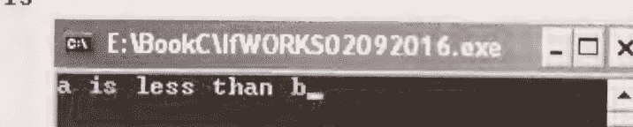

# 代码

```c
1: #include <stdio.h>
2: main()
3: {
4:  int a = 5, b = 6;
5: 
6: if (a < b)
7: {
8:  printf("a is less than b");
9: }
10:
11: getch();
12: }
13: } // 修正后的
```

## 注释

上面的代码展示了使用 `<` 符号的 `if` 语句的用法。`a` 和 `b` 的值位于第四行。运行该程序时，没有数据输入提示。用户输入代码并保存为 C 语言。可以通过允许键盘操作员输入 `a` 和 `b` 的值来使代码更加详尽。

## if 语句 - 程序与屏幕输入输出

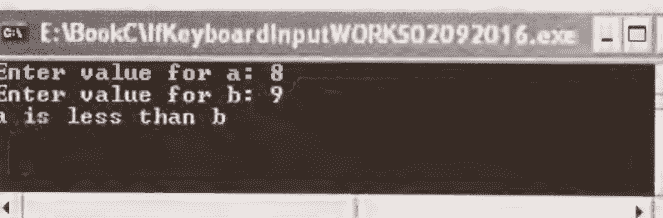

```c
1: #include <stdio.h>
2: main()
4: int a, b;

6: printf("Enter value for a: ");
7: scanf("%d", &a);
8: printf("Enter value for b: ");
9: scanf("%d", &b);

11: if (a < b) {
13: printf("a is less than b\n");
14: }
17: getch();
18: }
```

## 注释

第 6 到 9 行允许通过键盘输入 `a` 和 `b` 的值。第 11 行的语句表示，如果 `a` 小于 `b`，则打印第 13 行的语句“a is less than b”。由于这一特定语句的作用，如果 `a` 小于 `b`，就会打印到屏幕上。如果 `a` 大于或等于 `b`，则什么都不会发生。这段代码非常有限。因此，有扩展的需要。

## if else 语句 - 比较一个整数大于另一个的程序

### 程序与屏幕输入输出

```c
#include <stdio.h>
int main() {
    int a, b;
    printf("Enter value for a: ");
    scanf("%d", &a);
    printf("Enter value for b: ");
    scanf("%d", &b);
    if (a < b) {
        printf("a is less than b");
    } else {
        printf("a is not than b");
    }
    getch();
    return 0;
}
```

```
Enter value for a: 8
Enter value for b: 7
a is not than b
```

# 代码

```c
1: #include <stdio.h>
2: main()
3: {
4:  int a, b;
5:
6:  printf("Enter value for a: ");
7: scanf("%d", &a);
8:  printf("Enter value for b: ");
9: scanf("%d", &b);
10:
11: if (a < b)
12: {
13:  printf("a is less than b");
14: }
15: else
16: {
17:  printf("a is not than b");
18: }
19:
20: getch();
21: }
22:
```

## 注释

在上面的代码中，第 16 行表示如果 `a` 小于 `b`，则打印第 13 行的内容。此代码可以进一步扩展以处理 `a` 等的情况。

## if, else if, else 语句 - 检查一个整数是否等于另一个

### 程序与屏幕输入输出

```c
1 #include <stdio.h>
2 main()
3 {
4     int a, b;

6     printf("Enter value for a: ");
7     scanf("%d", &a);
8     printf("Enter value for b: ");
9     scanf("%d", &b);

11     if (a < b)
12     {
13         printf("a is less than b");
14     }

16     else if (a > b)
17     {
18         printf("a is greater than b");
19     }

21     else
22     {
23         printf("a equals b");
24     }

26     printf("\n\nProgram End");
27     getch();
28 }
```

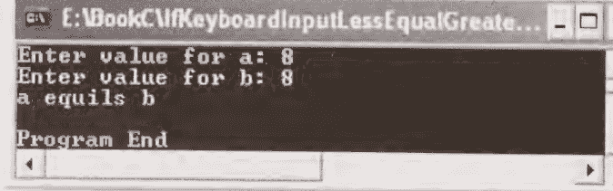

# 代码

```c
1: #include <stdio.h>
2: main()
3: {
4:  int a, b;
5:
6:  printf("Enter value for a: %d");
7: scanf("%d", &a);
8:  printf("Enter value for b: %d");
9: scanf("%d", &b);
10:
11: if (a < b)
12: {
13:  printf("a is less than b");
14: }
15:
16: else if (a > b)
17: {
18:  printf("a is greater than b");
19: }
20:
21: else
22: {
23:  printf("a equals b");
24: }
25:
```


```c
26:  printf("\n\nProgram End");

27: getch();

28: }
```

## 注释

在上面的代码中，扩展允许处理 `a` 小于 `b`、大于 `b` 或等于 `b` 的，并体现在第 11 到 24 行。不是在第 16 行使用 `if` 语句，而是使用了 `else if` 语句。第 21 行的 `else` 语句结束了这一 `if`, `else if`, `else` 代码块。如果在第 16 行使用 `if` 而非 `else if`，输出将不准确。如果在第 21 行使用 `if` 而非 `else`，打印到屏幕的输出也将不准确。

关系运算符可以组合。例如，小于等于 `<=`，或大于等于 `>=`。

# 第四章 流程控制

## 屏幕输入输出程序

```c
#include <stdio.h>

main() 
{
    int a, b;
    printf("Enter Value for a: ");
    scanf("%d", &a);
    printf("Enter value for b: ");
    scanf("%d", &b);
    if (a <= b) {
        printf("a is less than or equal to b");
    } else {
        printf("a is not less than or equal to b");
    }
    getch();
}
```

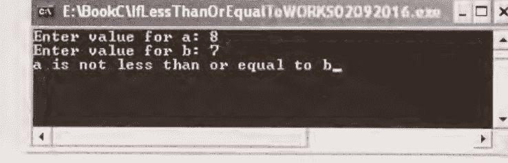

```c
else
{
    printf("a is not less than or equal to b");
    getch();
}
```

## 注释

上面的代码展示了一个用于小于等于 `<=` 操作的 `if` 语句。代码也可以写成包含大于等于 `>=` 的值，而不是小于等于 `<=`。

到目前为止，所有代码都是关于小于、大于、小于等于或大于等于的。等等的代码略有不同。它不是使用一个等号 `=`，而是必须使用两个等号 `==`，且之间没有空格。

### 屏幕输入输出与程序

```c
#include <stdio.h>
void main() {
    int a, b;
    printf("Enter a: ");
    scanf("%d", &a);
    printf("Enter b: ");
    scanf("%d", &b);
    if (a == b) {
        printf("a equals b");
    } else {
        printf("a is not equal to b");
    }
    getch();
}
```

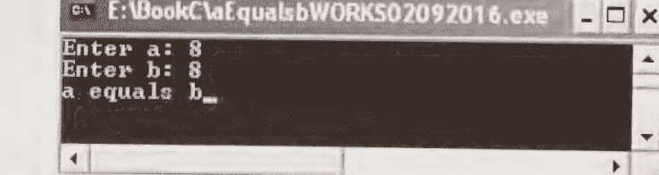

代码
```c
#include <stdio.h>
main()
int a, b;
printf("Enter a: ");
scanf("%d", &a);
printf("Enter b: ");
scanf("%d", &b);
if (a == b)
{
    printf("a equals b");
}
else
{
    printf("a is not equal to b");
}
getch();
}
```

## 注释

第 11 行展示了等号运算符的操作。需要使用两个等号 `==`（中间没有空格）来比较两个变量是否。

# 第四章 - 流程控制

## 不等于关系运算符

### 程序与屏幕输入输出

```c
// //程序目标 - 展示 != 的操作
#include <stdio.h>
main ()
(
    int a, b;
    printf("Enter value for a: ");
    scanf("%d", &a);
    printf("Enter value for b: ");
    scanf("%d", &b);
    if (a != b)
    {
        printf("a is not equal to b");
    }
    else
    {
        printf("a equals b");
    }
    printf("\n\nProgram End");
    getch();
)
```

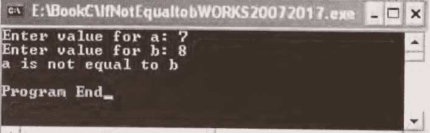

92

# 代码

```c
// //程序目标 - 展示 != 的操作
#include <stdio.h>
main()
{
    int a, b;
    printf("Enter value for a: ");
    scanf("%d", &a);
    printf("Enter value for b: ");
    scanf("%d", &b);
    if (a != b)
    {
        printf("a is not equal to b");
    }
    else
    {
        printf("a equals b");
    }
    printf("\n\nProgram End");
    getch();
}
}
```

## 注释

不等于 `!=` 关系运算符在游戏设计中非常重要。一个不等于条件

```c
if (a != b)
{
    printf("a is not equal to b");
}
```

比下面更容易写：

```c
if (a < b || a > b)
{
    printf("a is not equal to b");
}
```

第五章展示了循环相对于 `if`, `else` 条件的优势。

## 在同一条件语句中使用多个关系运算符

### 屏幕输入输出与程序

关系运算符可能包含 `&&`，例如，如果路程超过 10 英里且员工开车上班，则有差津贴。

```c
/* 程序目标: 展示两个运算符的操作 */
#include <stdio.h>
main()
(
    int drive
```

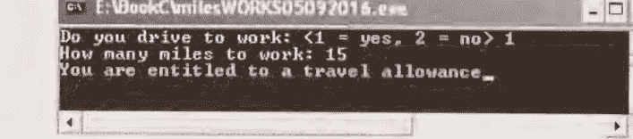

代码
```c
/* 程序目标: 展示两个运算符的操作*/
#include <stdio.h>
main()
(
    int drive, miles, qualifyingMiles = 10;
    printf("Do you drive to work: <1 = yes, 2 = no ");
    scanf("%d", &drive);
    printf("How many miles to work: %d");
    scanf("%d", &miles);
    if (drive >= qualifyingMiles)
    {
        printf("You are entitled to a allowance");
    }
    else
    {
        printf("Sorry. You do not qualify.");
    }
    getch();
}
```

## 注释

第 12 行包含一个 `if` 语句，规定了获得差旅津贴所需的条件。决定一个人是否符合条件的整数变量在第 5 行声明。第 17 行到 20 行的 `else` 语句跟在 `if` 语句之后。程序显示，如果一个人开车上班且路程大于等于 10 英里，他们就符合差旅津贴的标准。双符号 `&&` 意味着“和”。

```c
/* 程序目标: 在 语句中演示“或”*/
#include <stdio.h>
main() {
    int age;
    printf("Enter age: \t");
    scanf("%d", &age);
    if (age < 16 || age > 65)
    {
        printf("a is not equal to b");
    }
    else
    {
        printf("a equals b");
    }
    printf("\n\nProgram End");
    getch();
}
```

代码
```c
/* 程序目标: 在 else 语句中演示“或”*/
#include <stdio.h>
main()
{
    int age;
    printf("Enter age: \t");
    scanf("%d", &age);
    if (age < 16 || age > 65)
    {
        printf("a is not equal to b");
    }
    else
    {
        printf("a equals b");
    }
    printf("\n\nProgram End");
    getch();
}
```


## 注释

`&&` 表示“和”，`||` 表示“或”。上面的例子展示了如何在一个逻辑判断中使用这些运算符。

```c
age < 16 || age > 65
```

## 注释

`age < 16 || age > 65` 表示年龄小于 16 岁或大于 65 岁。

### 屏幕输入输出与程序

关系运算符可能包含 `&&`，例如...


```c
/* 程序目标: 展示两个运算符的操作*/
#include <stdio.h>
main()
(
    int drive, miles, qualifyingMiles = 10;
    printf("Do you drive to work: <1 = yes, 2 = no ");
    scanf("%d", &drive);
    printf("How many miles to work: %d");
    scanf("%d", &miles);
    if (drive >= qualifyingMiles)
    {
        printf("You are entitled to a allowance");
    }
    else
    {
        printf("Sorry. You do not qualify.");
    }
    getch();
}
```

## 注释

第 12 行包含一个 `if` 语句，规定了获得差旅津贴所需的条件。决定一个人是否符合条件的整数变量在第 5 行声明。第 17 行到 20 行的 `else` 语句跟在 `if` 语句之后。程序显示，如果一个人开车上班且路程大于等于 10 英里，他们就符合差旅津贴的标准。双符号 `&&` 意味着“和”。

```c
/* 程序目标: 在 else 语句中演示“或”*/
#include <stdio.h>
main() {
    int age;

    printf("Enter age: \t");
    scanf("%d", &age);

    if (age < 16 || age > 65)
    {
        printf("a is not equal to b");
    }

    else
    {
        printf("a equals b");
    }
    printf("\n\nProgram End");
    getch();
}
```

代码

```c
/* 程序目标: 在 else 语句中演示“或”*/
#include <stdio.h>
main()
{
    int age;

    printf("Enter age: \t");
    scanf("%d", &age);

    if (age < 16 || age > 65)
    {
        printf("a is not equal to b");
    }

    else
    {
        printf("a equals b");
    }
    printf("\n\nProgram End");
    getch();
}
```


# 第四章 流程控制

## 注释

`&&` 表示“和”，`||` 表示“或”。上面的例子展示了如何在一个逻辑判断中使用这些运算符。

---

### 屏幕输入输出与程序

关系运算符可能包含 `&&`，例如...

## 第四章 – 流程控制

## If, Else If, Else 条件语句

`If`, `Else` 语句可以根据需要扩展扩展为 `If`, `Else If`, `Else`。这允许在编程中包含一系列条件。

## 成绩示例

### 屏幕输入输出与程序

```c
1 //程序目的：展示成绩程序的正确设计
2 #include <stdio.h>
3 main()
4 (
5
6 int mark;
7 printf("Enter mark: \t");
8 scanf("%d", &mark);
9
10 if (mark <= 20)
11 printf("\nGrade 'G'");
12
13 else if (mark <= 30)
14 printf("\nGrade 'F'");
15
16 else if (mark <= 40)
17 printf("\nGrade 'E'");
18
19 else if (mark <= 50)
20 printf("\nGrade 'D'");
21
22 else if (mark <= 60)
23 printf("\nGrade 'C'");
24
25 else if (mark <= 70)
26 printf("\nGrade 'B'");
27
28 else (printf("\nGrade 'A'"));
29
30 printf("is grade for a mark of %d \n", mark);
31 getch();
32 )
```

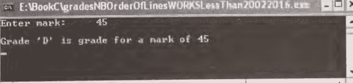

## 第四章 – 流程控制

# 代码

```c
1: //程序目的：展示成绩程序的正确设计。
2: #include <stdio.h>
3: main()
4: {
5:     int mark;
6:     printf("Enter mark: \t");
7:     scanf("%d",&mark);
8: 
9:     if (mark <= 20)
10:    printf("\nGrade 'G'");
11:
12:    else if (mark <= 30)
13:    printf("\nGrade 'F'");
14:
15:    else if (mark <= 40)
16:    printf("\nGrade 'E'");
17:
18:    else if (mark <= 50)
19:    printf("\nGrade 'D'");
20:
21:    else if (mark <= 60)
22:    printf("\nGrade 'C'");
23:
24:    else if (mark <= 70)
25:    printf("\nGrade 'B'");
26:
27:    else printf("\nGrade 'A'");
28:
29:    printf("is grade for a mark of %d \n", mark);
30:    getch();
31: 
32: }
```

## 注释

上述展示了 `if`, `else if`, `else` 语句的正确用法。第 12、15、18、21 行使用 `if` 语句而非 `else if` 是错误的设计。

102

## 错误地使用 if 而非 else if

### 程序与屏幕输入输出

```c
//程序目的：展示错误的设计
#include <stdio.h>
int main()
{
    int mark;
    printf("Enter mark: \t");
    scanf("%d", &mark);

    if (mark < 20)
        printf("\n G");

    if (mark <= 30)
        printf("\n F");

    if (mark <= 40)
        printf("\n E");

    if (mark <= 50)
        printf("\n D");

    if (mark <= 60)
        printf("\n C");

    if (mark <= 70)
        printf("\n B");

    else
        printf("\n A' is grade for a mark of %d \n", mark);

    getch();
}
```

```c
//程序目的：展示错误的设计
#include <stdio.h>
int main()
{
    int mark;
6: printf("Enter mark: \t");
7: scanf("%d",&mark);
8:
9: if (mark <= 20)
10: printf("\nGrade 'G'");
11:
12: if (mark <= 30)
13: printf("\nGrade 'F'");
14:
15: if (mark <= 40)
16: printf("\nGrade 'E'");
17:
18: if (mark <= 50)
19: printf("\nGrade 'D'");
20:
21: if (mark <= 60)
22: printf("\nGrade 'C'");
23:
24: if (mark <= 70)
25: printf("\nGrade 'B'");
26:
27: else printf("'A' ");
28:
29: printf("is grade for a mark of %d \n",mark);
30: getch();
31:
32:
```

## 注释

在上述代码中，12 到 25 行使用了 `if` 语句而非 `else if`。这导致输出不符合预期。虽然分数小于 20、30、40、50、60 或 70，但程序的目的是从分值段内获得一个等级。因此，正确使用 `if`, `else if` 和 `else` 语句对于实现程序目的、正确的处理和输出至关重要。在上述代码中错误使用 `if` 语句导致屏幕上出现了额外的行。这并不是预期的。编译器识别第一个正确的输出行后，`if` 语句继续读取并继续输出。使用 `if`, `else if`, `else` 语句可以让选项相互互斥。这意味着只会选择一个选项。这个示例展示了准确使用 `if`, `else if` 和 `else` 语句的重要性。

## 第四章 — 流程控制

## 小时 分钟 秒
### 屏幕输入输出与程序

```c

1 /*程序目的：将秒转换为小时、分钟*/

2 #include <stdio.h>

3 main() {

4 

5     int hours = 0, mins = 0, secs = 0;

6 

7     printf("Enter Seconds: \t");

8     scanf("%d", &secs);

9 

10    hours = secs/(60*60);

11    mins = ((secs/60)%60);

12    seconds = secs%60;

13 

14    printf("The no of hours mins secs are: \t%d:%d:%d ",

15    hours, mins, seconds);

16 

17    printf("\n\nProgram End");

18 

19    getch();

20 }

```

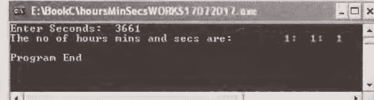

```c

1 /*程序目的：将秒转换为小时、分钟*/

2 #include <stdio.h>

3 main() {

4 

5     int hours = 0, mins = 0, secs = 0;

6 

7     printf("Enter Seconds: \t");

8     scanf("%d", &secs);

9 

10    hours = secs/(60*60);

11    mins = ((secs/60)%60);

12    seconds = secs%60;

13 

14    printf("The no of hours mins secs are: \t%d:%d:%d ",

15    hours, mins, seconds);

16 

17    printf("\n\nProgram End");

18 

19    getch();

20 }

```

## 24 小时制
### 屏幕输入输出与程序

105

# 第四章 - 流程控制

```c

1 //程序目的：将24 小时制转换为12 小时制

2 #include <stdio.h>

3 main() {

4 

5     int time, hours, mins;

6     char timeday;

7

8     printf("Enter Hours 24 hour clock: \t");

9     scanf("%d", &hours);

10

11    printf("Enter Mins 24 hour clock: \t");

12    scanf("%d", &mins);

13

14    printf("Time is: \t\t");

15

16    //Condition for Minutes 0 to 9

17    if (mins < 10)

18    {

19        printf("%d:0d",hours,mins);

20    }

21

22    //Condition for Minutes 10 to 59

23    else

24    {

25        printf("%d : %d",hours,mins);

26    }

27

28    //Condition for hours pm

29    if (hours > 12)

30    {

31        printf(" pm");

32    }

33

34    //Condition for hours am

35    else

36    {

37        printf(" am");

38    }

39    getch();

40

41}

```

## 注释
第 19 行允许在分钟小于10时在前面放置零。结果是屏幕上显示为 11:09 而非 11:9。如果分钟大于 10，零就消失了（第 23-26 行）。此外，第 23-26 行为 24 小时制中小时大于12 的情况提供了提醒。输入 2 或 14 小时（第 9 行），通过取模运算结果为 2（第 25 行）。额外的 `if`, `else` 语句使得会在时间后打印 `am` 或 `pm`。缺少换行符会导致 `am` 和 `pm` 与时间同一行打印。

# 第四章 - 流程控制

## 闰年 - 屏幕输入输出与程序

```c

1 /*程序目的：判断某年份是否为闰年*/

2 #include <stdio.h>

3 main()

4 {

5     int year = 0;

6     printf("Enter mark: \t");

7     scanf("%d", &year);

8

9     if ((year%4 == 0 && year%100 != 0) || (year%400 == 0))

10         printf("\nGrade 'G'");

11

12     else if (mark <= 30)

13     printf("\nGrade 'F'");

14

15     else if (mark <= 40)

16     printf("\nGrade 'E'");

17

18     else if (mark <= 50)

19     printf("\nGrade 'D'");

20

21     else if (mark <= 60)

22     printf("\nGrade 'C'");

23

24     else if (mark <= 70)

25     printf("\nGrade 'B'");

26

27     else (printf("\nGrade 'A'"));

28

29     printf("is grade for a mark of %d \n", mark);

30     getch();

31 )

```

```

此示例展示了一个包含关系运算符组合的 `if` 语句。第9行结合了 `等于`、`不等于` 以及 `或` 和 `或` 来进行比较。如果输入的年份除以4没有余数，`且` 该年份除以100有余数，`或者` 该年份除以400没有余数。第9行末尾的 `or` 条件实际上是替代了前两个条件的组合，而不是二选一。使用括号以及正确的设计和测试是非常重要的。

# 第四章 - 流程控制

## 闰年的替代程序

屏幕输入输出与程序

```c
leapyear/WORKS24062017.c
1 /*程序目标：判断某一年是否为闰年*/
2 #include <stdio.h>
3 main() {
4 (
5     int year = 0;
6     printf("enter year: ");
7     scanf("%d", &year);
8 
9     if (year % 400 == 0)
10    {
11        printf("%d is a leap year", year);
12    }
13 
14    else if (year % 100 == 0)
15    {
16        printf("%d is not a leap year", year);
17    }
18 
19    else if (year % 4 == 0)
20    {
21        printf("%d is a leap year", year);
22    }
23 
24    else
25    {\
26        printf("The year %d is not a leap year", year);
27    }
28 
29    printf("\n\nProgram End");
30  getch();
31 
32 }
```

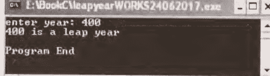

代码


```c
1: /*程序目标：判断某一年是否为闰年*/
2: #include <stdio.h>
3: main()
4: {
5:     int year = 0;
6:     printf("enter year: %");
7:     scanf("%d", &year);
8: 
9:     if (year % 400 == 0)
10:    {
11:        printf("%d is a leap year,\n", year);
12:    }
13: 
14:    } else if (year % 100 == 0)
15:    {
16:        printf("%d is not a leap year,\n", year);
17:    }
18: 
19:    } else if (year % 4 == 0)
20:    {
21:        printf("%d is a leap year,\n", year);
22:    }
23: 
24:    } else
25:    {
26:        printf("The %d is not a leap year,\n", year);
27:    }
28: 
29:    printf("\n\nProgram End\n");
30:    getchar();
31: }
32: 
```

## 注释

由于上述代码的结构，它比上一个示例更容易理解。使用 `else ifs` 以及稍微多一点代码可能会使程序对读者更友好。

# 第四章 - 流程控制

## 两个分数的取模运算

`Division80r6wORKS24102016.c` |

```c
/*程序目标：展示取模运算的用法 */
#include <stdio.h>
int main() {
    int x = 0;
    printf("Enter a value for integer x: ");
    scanf("%d", &x);
    if (x % 5 == 0) {
        printf("\nThis divides evenly by 5\n");
    } else if (x % 6 == 0) {
        printf("\nThis divides evenly by 6\n");
    } else if (x % 5 == 0) {
        printf("\nThis divides evenly by 5\n");
    } else {
        printf("\nThis does not divide evenly by 5 or 6\n");
    }
    getch();
}
```

## 代码

```c
/*程序目标：展示取模运算的用法 */
#include <stdio.h>
int main() {
    int x = 0;
    printf("Enter a value for integer x: ");
    scanf("%d", &x);
    if (x % 5 == 0 && x % 6 == 0)
12: {
13: printf("\nThis divides evenly by 5 and 6");
14: )
15:
16: else if (x % 6 == 0)
17: {
18: printf("\nThis divides evenly by 6");
19: )
20:
21: else if (x % 5 == 0)
22: {
23: printf("\nThis divides evenly by 5");
24: }
25: else
26: {
27: printf("\nThis does not divide evenly by 5 or 6");
28: }
29:
30: getch();
31: }
32: 
```

## 注释

上述是使用 `else`, `if`, `else` 语句的另一个示例。如果整数能被 5 和 6 整除，则将打印第 13 行，而不是第 18 行。

# 第四章 - 流程控制

## 使用整数的 switch 语句 - 星期

屏幕输入输出与 `SwitchDaysOfWeek2016.c`

```c
1 程序目标：展示 switch 语句的用法
2 #include <stdio.h>
3 main()
4 {
5      int no;
6      printf("Enter a no: ");
7      scanf("%d", &no);
8      printf("You chose ");
9
10     switch (no)
11     {
12         case 1:
13             printf("Mon");
14             break;
15
16         case 2:
17             printf("Tue");
18             break;
19
20         case 3:
21             printf("Wed");
22             break;
23
24         case 4:
25             printf("Thur");
26             break;
27
28         case 5:
29             printf("Fri");
30             break;
31
32         case 6:
33             printf("Sat");
34             break;
35
36         default:
37             printf("Incorrect Entry");
38     }
39     getch();
```

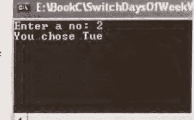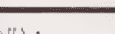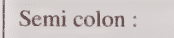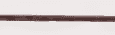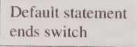

## 第四章 – 流程控制

## 星期的 switch 代码

```c
//程序目标：展示 switch 语句的用法
#include <stdio.h>
int main() {
    int no;
    printf("Enter a no: ");
    scanf("%d", &no)
```

## 注释

当有很多备选方案且每个方案都是整数值时，推荐使用 `switch` 代替 `If Else If` 语句。例如一、二、三代表星期中的特定几天。由于一周有七天，每天都可以由特定的数字表示，因此推荐使用 `switch` 语句。只有两个结果，推荐使用简单的 `If`, `Else`。如果结果源于值的范围（例如成绩 A 在 60 到 70 之间），则使用 `If`, `Else`, `Else` 语句。在特定情况下使用 `Switch` 代替 `if`, `else else` 的另一个原因是呈现方式。`Switch` 语句对读者非常友好。

## 第四章 — 流程控制

编译器读取代码的方式 `switch` 不同于 `if`, `else if`, `else` 语句。当输入特定的 `case` 时（例如代表周二的 2），编译器直接跳转到 `case 2`，而不读取前面的或后面的 `case`。在 `If`, `Else If`, `Else` 语句中，编译器读取的代码比 `switch` 语句多。因此，对于运行数百行代码并包含许多选择的程序，`switch` 语句将导致更快的数据处理。

编写代码涉及对 `switch` 中单双引号、分号和冒号的谨慎使用。`switch` 语句中的每个 `case` 语句都以冒号结束：

`switch` 语句由 `#include <stdio.h>` 跟着 `main()`，然后是左括号（第 11 行）和右括号（第 38 行），中间是代码。`Switch (no)` – 第 10 行没有结束冒号或分号。变量紧接 `main()` 之后的大括号进行声明。第 5 行声明了整数 `no`。`switch` 语句本身从第 10 行开始到第 38 行结束。第 12 到 34 行内的几乎所有代码部分都是相似的。

```c
case ...:
printf("...");
break;
```

上述三个短语中的 `printf` 和 `break` 都是小写。`case` 行以冒号 `:` 结束而不是分号 `;`。包含 `printf` 和 `break` 语句的行以分号结束。这三行出现在所有的 `switch` 语句 `case` 中。一系列 `switch` 语句应该以 `default` 语句结束。第 37 和第 38 行通过以下行展示了这一点：

```c
default:
printf("Incorrect Entry");
```

`default` 行 与 `case` 行一样以冒号结束。`default` 语句结束了 `switch` – 第 36 行 - 在用户选择了不可用的选项时告知用户。

## 简化的 switch 语句

星期 2

`SwitchDaysOfWeek223122014.c`

```c
1 //程序目标：展示替代的 switch
2
#include <stdio.h>
3 main()
4 {
5     int no;
6     printf("Enter a no 1 - 7 : ");
7     scanf("%d", &no);
8
9     printf("\nYou chose ");
10
11    switch (no)
12    {
13        case 1:
14        case 2:
15        case 3:
16        case 4:
17        case 5:
18            printf("a weekday");
19            break;
20
21        case 6:
22        case 7:
23            printf("a weekend");
24            break;
25
26        default:
27            printf("incorrectly");
28    }
29
30    getch();
31 }}
```

## 第四章 –流程控制

## 注释

在上述代码中，不需要为每周的每天编写 *case* 语句。*Case* 可以根据需要打印到屏幕的内容进行简化。如果是特定的某天，例如周一或周二，则 `switch` 代码会更详细。相反，如果只需要选择一个工作日或周末，则代码可以简化。第 14 行到 19 行展示了如何编写具有相同输出的各种选择。这对于工作日和周末都效果良好。

如果所需的输出是根据分数得出的成绩等级，那么使用 *If, else if, else* 语句更好。一个处理从 0 到 100 分的 101 个分数以及由此产生的 6 种等级的 `switch` 语句将包含过多代码，且在 *switch* 中难以阅读。因此，在根据分数范围确定等级的成绩情况下，*If, Else If, Else* 看起来更好。

## Switch – 字符类型

`SwitchColoursChar23122014.c`

```
1 //程序目标：展示带有 char 数据类型的 switch
2
3 #include <stdio.h>
4 main ()
5 {
6     char colour;
7     printf("Please enter a letter - R, G or B: ");
8     scanf("%c", &colour);
9     switch (colour)
10 {
11         case 'R':
12         case 'r':
13             printf("You chose Red");
14             break;
15         case 'B':
16         case 'b':
17             printf("You chose Blue");
18             break;
19         case 'G':
20         case 'g':
21             printf("You chose Green");
22             break;
23         default:
24             printf("You chose incorrectly");
25     }
26     getch();
27 }
```

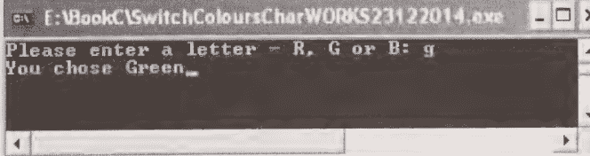

代码

1: //程序目标：展示带有 char 数据类型的 switch

2:

3: #include <stdio.h>

# 第四章 - 流程控制

```
4: main ()
5: {
6:   char colour;
7:   printf("Please enter a letter - R, G or B: ");
8:   scanf("%c",&colour);
9: 
10:  switch (colour)
11: {
12:     case 'R':
13:     case 'r':
14:      printf("You chose Red");
15:      break;
16:
17:     case 'B':
18:     case 'b':
19:      printf("You chose Blue");
20:      break;
21:
22:     case 'G':
23:     case 'g':
24:      printf("You chose Green");
25:      break;
26:
27:     default:
28:      printf("You chose incorrectly");
29: }
30:   getch();
31: }
32: }
```

## 注释

`Switch` 同样适用于单个字母字符。第 6 行显示，这些可以不是整数声明，而是字符类型，`char`。第 8 行 `scanf("%c",&colour);` 意味着 `%c` 允许编译器读取单个字母字符 `colour`。

每个 `switch` 选择（此示例中的每个字母选项）的 `case` 状态必须括在单引号的开始和结束引号中。第 12、13、17、18、22 和 23 行说明了这一点。例如，在第 12 行中，`case 'R':` 是正确的。如果省略了单引号使该行变为 `case R:`，程序将无法运行。

`case` 选择也是区分大小写的。通过将 `cases` 同时包含大写和小写（例如第 12 行和第 13 行），可以确保红色这一选项可以通过输入大写的 R 或小写的 r 作为选项进行选择。

## Switch 程序设计一个简单计算器

### 屏幕输入与输出

120

## 第四章 – 流程控制

```
E:\BookC\calculatorSimpleSwitchWORKS14072017.exe
Enter no1: 12
Enter no2: 14
Choose process:
+
-
/
  
12.000000 divided by 14.000000 is: 0.857143
```

# 第四章 - 流程控制

## 程序


# 第四章 - 流程控制

## 程序

```c
/* calculatorSimpleSwitch/ORKS14072017.c |
1 //程序目标：实现 Switch Case - 简单计算器
2 #include <stdio.h>
3 int main()
4 {
5     float no1, no2, ans = 0;
6     char process;
7     printf("Enter number 1: %f");
8     scanf("%f", &no1);
9     printf("Enter number 2: %f");
10    scanf("%f", &no2);
11
12    printf("Choose process: + - * /
");
13    printf("%c\n", &process);
14    printf("\n");
15
16    switch (process)
17    {
18        case '+':
19            ans = no1 + no2;
20            printf("%f added to %f is: %f\n", no1, ans);
21            break;
22
23        case '-':
24            ans = no1 - no2;
25            printf("%f subtracted from %f is: %f\n", no1, ans);
26            break;
27
28        case '*':
29            ans = no1 * no2;
30            printf("%f multiplied by %f is: %f\n", no1, ans);
31            break;
32
33        case '/':
34            ans = no1 / no2;
35            printf("%f divided by %f is: %f\n", no1, ans);
36            break;
37
38        default:
39            printf("You chose incorrectly");
40            break;
41    }
42 }
```

`getch();`

```c
1: //程序目标：展示带有 char 数据类型的 switch
2:
3: #include <stdio.h>
4: main ()
5: {
6:     char colour;
7:     printf("Please enter a letter - R, G or B: ");
8:     scanf("%c", &colour);
9:     switch (colour)
10: {
11:         case 'R':
12:         case 'r':
13:             printf("You chose Red");
14:             break;
15:         case 'B':
16:         case 'b':
17:             printf("You chose Blue");
18:             break;
19:         case 'G':
20:         case 'g':
21:             printf("You chose Green");
22:             break;
23:         default:
24:             printf("You chose incorrectly");
25:     }
26:     getch();
27: }
```


## 注释

`Switch` 同样适用于单个字母字符。第 6 行显示，这些可以不是整数声明，而是字符类型，`char`。第 8 行 `scanf("%c",&colour);` 意味着 `%c` 允许编译器读取单个字母字符 `colour`。

每个 `switch` 选择（此示例中的每个字母选项）的 `case` 状态必须括在单引号的开始和结束引号中。第 12、13、17、18、22 和 23 行说明了这一点。例如，在第 12 行中，`case 'R':` 是正确的。如果省略了单引号使该行变为 `case R:`，程序将无法运行。

`case` 选择也是区分大小写的。通过将 `cases` 同时包含大写和小写（例如第 12 行和第 13 行），可以确保红色这一选项可以通过输入大写的 `R` 或小写的 `r` 作为选项进行选择。

## Switch 程序设计一个简单计算器

### 屏幕输入与输出

```
E:\BookC\calculatorSimpleSwitchWORKS14072017.exe
Enter no1: 12
Enter no2: 14
Choose process:
+
-
/
  
12.000000 divided by 14.000000 is: 0.857143
```

代码

```c
4: main ()
5: {
6:   char colour;
7:   printf("Please enter a letter - R, G or B: ");
8:   scanf("%c",&colour);
9: 
10:  switch (colour)
11: {
12:     case 'R':
13:     case 'r':
14:      printf("You chose Red");
15:      break;
16:
17:     case 'B':
18:     case 'b':
19:      printf("You chose Blue");
20:      break;
21:
22:     case 'G':
23:     case 'g':
24:      printf("You chose Green");
25:      break;
26:
27:     default:
28:      printf("You chose incorrectly");
29: }
30:   getch();
31: }
32: }
```


## 第四章 – 流程控制

### 注释
在上述代码中，不需要为每周的每一都编写 `case` 语句。`case` 可以根据需要打印到屏幕的内容进行简化。如果是特定的某天，例如周一或周二，则 `switch` 代码会更详细。相反，如果只需要选择一个工作日或周末，则代码可以简化。第 14 行到 19 行展示了如何编写具有相同输出的各种选择。这对于工作日和周末都效果良好。

如果所需的输出是根据分数得出的成绩等级，那么使用 `If, else if, else` 语句更好。一个处理从 0 到 100 分的 101 个分数以及由此产生的 6 种等级的 `switch` 语句将包含过多代码，且在 `switch` 中难以阅读。因此，在根据分数范围确定等级的成绩情况下，`If, Else If, Else` 看起来更好。

### Switch – 字符类型

`SwitchColoursChar23122014.c`

```
1 //程序目标：展示带有 char 数据类型的 switch

2

3 #include <stdio.h>

4 main ()

5 {

6     char colour;

7     printf("Please enter a letter - R, G or B: ");
8     scanf("%c", &colour);
9     switch (colour)
10 {
11         case 'R':
12         case 'r':
13             printf("You chose Red");
14             break;
15         case 'B':
16         case 'b':
17             printf("You chose Blue");
18             break;
19         case 'G':
20         case 'g':
21             printf("You chose Green");
22             break;
23         default:
24             printf("You chose incorrectly");
25     }
26     getch();
27 }
```


代码
1: //程序目标：展示带有 char 数据类型的 switch
2:
3: #include <stdio.h>

```
4: main ()
5: {
6:   char colour;
7:   printf("Please enter a letter - R, G or B: ");
8:   scanf("%c",&colour);
9: 
10:  switch (colour)
11: {
12:     case 'R':
13:     case 'r':
14:      printf("You chose Red");
15:      break;
16:
17:     case 'B':
18:     case 'b':
19:      printf("You chose Blue");
20:      break;
21:
22:     case 'G':
23:     case 'g':
24:      printf("You chose Green");
25:      break;
26:
27:     default:
28:      printf("You chose incorrectly");
29: }
30:   getch();
31: }
32: }
```

### 注释
`Switch` 同样适用于单个字母字符。第 6 行显示，这些可以不是整数声明，而是字符类型，`char`。第 8 行 `scanf("%c",&colour);` 意味着 `%c` 允许编译器读取单个字母字符 `colour`。

每个 `switch` 选择（此示例中的每个字母选项）的 `case` 状态必须括在单引号的开始和结束引号中。第 12、13、17、18、22 和 23 行说明了这一点。例如，在第 12 行中，`case 'R':` 是正确的。如果省略了单引号使该行变为 `case R:`，程序将无法运行。

`case` 选择也是区分大小写的。通过将 `cases` 同时包含大写和小写（例如第 12 行和第 13 行），可以确保红色这一选项可以通过输入大写的 `R` 或小写的 `r` 作为选项进行选择。

### Switch 程序设计一个简单计算器

#### 屏幕输入与输出

120

```
E:\BookC\calculatorSimpleSwitchWORKS14072017.exe

Enter no1: 12

Enter no2: 14

Choose process:

+

-

/

12.000000 divided by 14.000000 is: 0.857143
```

#### 程序

```
/* calculatorSimpleSwitch/ORKS14072017.c |
1 //程序目标：实现 Switch Case - 简单计算器
2 #include <stdio.h>
3 int main()
4 {
5     float no1, no2, ans = 0;
6     char process;
7     printf("Enter number 1: %f");
8     scanf("%f", &no1);
9     printf("Enter number 2: %f");
10    scanf("%f", &no2);

12    printf("Choose process: + - * /
");
13    printf("%c\n", &process);
14    printf("\n");

16    switch (process)
17    {
18        case '+':
19            ans = no1 + no2;
20            printf("%f added to %f is: %f\n", no1, ans);
21            break;

23        case '-':
24            ans = no1 - no2;
25            printf("%f subtracted from %f is: %f\n", no1, ans);
26            break;

28        case '*':
29            ans = no1 * no2;
30            printf("%f multiplied by %f is: %f\n", no1, ans);
31            break;

33        case '/':
34            ans = no1 / no2;
35            printf("%f divided by %f is: %f\n", no1, ans);
36            break;

38        default:
39            printf("You chose incorrectly");
40            break;
41    }
42 }
```

### 确定最大值或最小值

输入输出

```
E:\BookCVW\ForLoopAges\WORKS27062017.exe

请输入三个互不相同的年龄：

Enter age1: 5
Enter age2: 2
Enter age3: 6

age2 2 is lowest

Program End_
```

程序

```
1: /* /程序目的：确定三个整数的最小值
2: 并打印到屏幕上。每个输入决定了
3: 三个整数中每一个的值，但不决定数量
```

```
23: printf("age1 of %d is lowest", age1);
24:

25:

26: else if (age2 < age1 && age2 < age3)
27:

28: printf("age2 %d is lowest", age2);
29:

30:

31: else
32:

33: printf("age3 %d is lowest", age3);
34:

35:

36: printf("\n\nProgram End\");
37: getch();
38:

39:

```

### 注释
上面的代码是上一个示例的详细扩展。该程序并不是设计用于计算两个整数的最大值，而是使用第 21 到 34 行的 `if`、`else if`、`else` 语句来确定三个整数的最小值。为了使此示例生效，输入的所有整数应该互不相同。虽然这段代码的设计是为了展示如何使用 `if`、`else if` 和 `else` 语句，但它表明，在确定三个整数的最小值时，代码会变得越来越臃肿。因此，如果在给定输入整数数量和每个值的情况下计算三个以上整数的最大值或最小值，则应该使用数组（第六章 数组简介）。数组可以实现代码简化并允许更强大的数据处理。

### 针对四个整数的 If, Else If, Else 语句程序

```c
// ForLoopAge/WORKS29032017.c
/* 程序目的：确定四个整数的最小值
 并打印到屏幕上。数据输入者决定
四个整数的值，但不决定数量，即四个 */
#include <stdio.h>
int main() {
    int age1, age2, age3, age4;
    printf("Enter age1: ");
    scanf("%d", &age1);
    printf("Enter age2: ");
    scanf("%d", &age2);
    printf("Enter age3: ");
    scanf("%d", &age3);
    printf("Enter age4: ");
    scanf("%d", &age4);
    if (age1 < age2 && age1 < age3 && age1 < age4) {
        printf("age1 %d is lowest,", age1);
    }
    else if (age2 < age1 && age2 < age3 && age2 < age4) {
        printf("age2 %d is lowest,", age2);
    }
    else if (age3 < age1 && age3 < age2 && age3 < age4) {
        printf("age3 %d is lowest,", age3);
    }
    else {
        printf("age4 %d is lowest,", age4);
    }
    return 0;
}
```

注释
对于从输入的三个整数中确定最小值，需要 34 行代码，包括 14 行的 `if`、`else if`、`else` 语句（上一个示例）。对于四个整数的最小值，需要 39 行，包括 18 行的 `if`、`else if`、`else` 语句代码。比较的整数越多，在这种情况下需要的代码就越大且越难以管理。这说明了数组的必要性。

许多程序员可能更倾向于编写如下带有额外括号的 `if`、`else if`、`else` 语句：

```
19    if ((age1 < age2) && (age1 < age3) && (age1 < age4))
20{
21        printf("age of %d is lowest", age1);
22}

24    else if ((age2 < age1) && (age2 < age3) && (age2 < age4))
25{
26        printf("age2 %d is lowest", age2);
27}

29    else if ((age3 < age1) && (age3 < age2) && (age3 < age4))
30{
31        printf("age3 %d is lowest", age3);
32}

34    else
35{
36        printf("age4 %d is lowest", age4);
37}

39getch();
40
```

第 19、24 和 29 行有四个左括号和四个右括号，可能表示更好的设计。紧之前的示例在每个条件行中只有一个左括号和一个右括号。

Q4.1 下面程序是否存在错误？


## 第五章 - 循环

第五章 - 循环简介

### For 循环

输入输出和程序

```
/* 程序目的：展示 for 循环的作用 */
#include <stdio.h>
main() {
    int i = 0;
    for (i = 0; i < 5; i++) {
        printf("%d", i);
    }
    getch();}
```

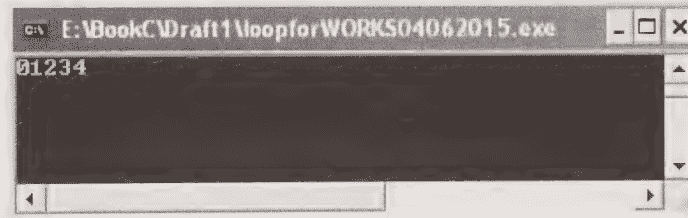

上面的代码展示了一个 `for循环` 的执行过程。第 8 行的具体循环

```
for (i = 0; i < 5; i++)
```

告知编译器循环中值的范围以及是否发生递增或递减。循环通过语句 `i=0` 从零开始。循环将继续迭代，直到语句 `i < 5`（即 4）使得 `i` 不小于五。通过语句 `i++` 每次递增一。第 6 行的语句 `int i = 0` 将变量 `i` 声明为整数。第 10 行 `printf("%d", i);` 的结果是输出到屏幕的整数 01234。

该代码在 `"%d"` 部分包含有限的格式化。如果在第 10 行的 `%d` 之前添加一个反斜杠和 `t`，

```
printf("%d", i);
```

将其改为：

```
printf("\t%d", i);
```

屏幕上的呈现将如下所示。

### 屏幕输入输出与程序 – 制表

```
1 /* 程序目标：展示 for 循环的执行 */
2
3 #include <stdio.h>
4 main()
5 (
6     int i = 0;
7
8     for (i = 0; i < 5; i++)
9     {
10        printf("\t%d", i);
11    }
12
13    getch();
14 )
```

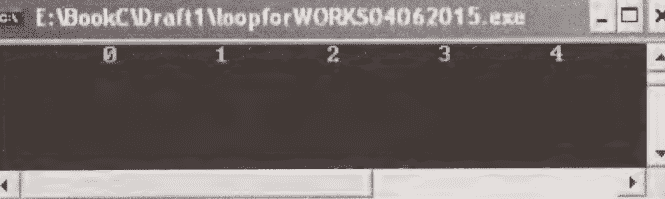

第 10 行中的 `\t` 在打印到屏幕的循环每个整数之间放置了一个制表符。如果将 `\t` 改为 `\n`（即反斜杠和 `n`），屏幕输出将再次变为：

### 换行 – 屏幕输入输出与程序

```
1 /* 程序目标：展示 for 循环的执行 */
2
3 #include <stdio.h>
4 main()
5 {
6     int i = 0;
7
8     for (i = 0; i < 5; i++)
9
10    printf("\n%d", i);
11    }
12
13    getch();
14}
15
```

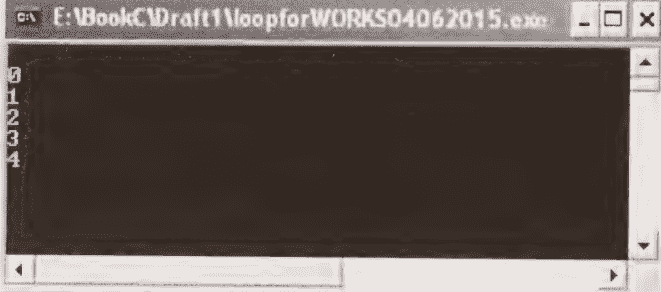

```
1: /* 程序目标：展示 for 循环的执行 */
2:
3: #include <stdio.h>
4: main()
5: {
6:     int i = 0;
7:
8:     for (i = 0; i < 5; i++)
9:
10:    printf("\n%d", i);
11:    }
12:
13:    getch();
14:}
15:
```

字符 `\n` 创建换行，即在循环每个整数之间创建一个新行。

反斜杠字符 `\` 位于大多数电脑键盘的左下角 – 靠近 Z 键。它不能与位于大多数键盘右下角、句号旁的正斜杠 `/` 混淆。正斜杠和反斜杠字符执行不同的功能。正斜杠向右上方倾斜。反斜杠向左倾斜。

**Q5.1.** 在上面的示例中，第 10 行没有出现与符号 `&`。如果包含一个与符号会发生什么？

### for 循环扩展

```
ForloopExtended-31012015.c
1 /**程序目标：展示 for 循环的开发*/
2
3 #include <stdio.h>
4 main()
5 {
6     int i = 0;
7 
8     for (i = 0; i < 5; i++)
9
     {
10        printf("\n%d\t%d", i, i*2);
11   }
12
13   getch();
14 }
15
```


代码

```
1: "*程序目标：展示 for 循环的开发*/

2:

3: #include <stdio.h>

4: main()

5: {

6:     int i = 0;

7:

8:     for (i = 0; i < 5; i++)

9:

10:        printf("\n%d\t%d", i, i*2);

11:

12:

13:   getch();

14: }

15:
```

注释

在上面，更改了一行代码。第 10 行包含了一个额外的的 `\t`。这意味着一个制表符后跟有另一个整数的位置。此外，在第 10 行的右侧是 `i*1`，它是打印到屏幕时第二个整数的位置。这告诉我们将会有一个额外的整数。该整数将等于第一列整数乘以 2。当程序运行时，屏幕上的输出证实了这一点。

**Q5.2.** 扩展代码以具有第三列，其内容为第一列的内容乘以 3。

## 键盘输入 - 扫描

`for` 循环可以扩展以允许用户在循环内输入。这是通过在第 6 行添加一个整数 `n` 实现的。添加了两行代码：第 8 行包含

```
printf("Enter a no: \t");
```

第 9 行包含

```
scanf("%d", &n);
```

第 11 行的循环执行变为

```
for (i=0; i<n; i++)
```

作为 `n` 的结果。

# 第五章 循环

### Forloopwithin301215.c

```
1  程序目标：展示 for 循环执行
2 用户决定循环数量
3 #include <stdio.h>
4 main()
5 {
6     int i = 0, n = 0;

8     printf("Enter a no: \t");
9     scanf("%d", &n);

11     for (i = 0; i < n; i++)
12     {
13         printf("\n%d", i);
14     }

16     getch();
17 }
```

 代码

```
1: /*程序目标：展示 for 循环执行
2: 用户决定循环数量
3: #include <stdio.h>
4: main()
5: {
6:     int i = 0, n = 0;
7:
8:     printf("Enter a no: \t");
9:     scanf("%d", &n);
10:
11: for (i = 0; i < n; i++)
12: {
13:     printf("\n%d", i);
14: }
15:
16:     getch();
17: }
```

# 第五章 循环

### 比较 for Loops

| loopfor/WORKS04615.c | Forloopthn301015.c | loopfor/WORKS04615.c | Forloopthn301015.c |
|---|---|---|---|
| 1 | /* 程序目标：展示 for 循环 | | 1 | /* 程序目标：展示 for 循环 |
| 2 | | | 2 用户决定循环数量 |
| 3 | #include <stdio.h> | | 3 | #include <stdio.h> |
| 4 | main() | | 4 | main() |
| 5 | { | | 5 | { |
| 6 | int i = 0; | | 6 | int i = 0, n = 0; |
| 7 | | | 7 | |
| 8 | | | 8 | printf("Enter a no: \t") |
| 9 | | | 9 | scanf("%d", &n); |
| 10 | for (i = 0; i < 5; i++) { | | 10 | for (i = 0; i < n; i++) { |
| 11 | | | 11 | |
| 12 | | | 12 | } |
| 13 | printf("\n%d", i); | | 13 | printf("\n%d", i); |
| 14 | } | | 14 | } |
| 15 | | | 15 | |
| 16 | getch(); | | 16 | getch(); |
| 17 | } | | 17 | } |

 额外的代码允许用户输入 `n` 值，从而对数据输入数量提供了更大的控制。第 6 行添加了整数 `n`。第 8 行和第 9 行允许用户输入 `n`。第 11 行是 `i < n;` 而不是 `i < 5`。

**Q5.3.** 下面代码有什么错误？

```
1  /*程序目标：展示 for 循环执行
2  用户决定循环数量*/
3  #include <stdio.h>
4  main(int i = 0, n = 0;printf
      ("Enter for a no: \t");scanf("%d"
      &n);for (i =
  0; i <
  n
9

10 ; i
11 ++) printf("\n%d",
12 }
13

14 : )getch();
```

**Q5.4.** 创建一个 `for` 循环，允许用户确定零到十的数值范围，以及直到五的乘法表。

# 第五章 循环

### For 循环输入矩形面积

## 屏幕输入输出程序

```
/* 计算矩形面积的程序。
用户决定矩形的数量和尺寸 */
#include <stdio.h>
int main() {
    int width, height, n, i = 0;
    printf("Enter no of rectangles: \t");
    scanf("%d", &n);
    //For 循环允许用户为特定数量的矩形输入
    for (i = 0; i < n; i++) {
        printf("Enter width of cm: \t\t", i);
        scanf("%d", &width);
        printf("Enter height of cm: \t\t", i);
        scanf("%d", &height);
        volume = width * height;
        printf("Volume of Rectangle %d is: \t\t%d squared\n", i, volume);
    }
    printf("\n");
    printf("\nProgram End");
}
getch();
```

| Enter no of rectangles: | 2 |
| Enter width of cm: | 10 |
| Enter height of cm: | 20 |
| Volume of Rectangle 1 is: | 200 squared |
| Enter width of cm: | 30 |
| Enter height of cm: | 40 |
| Volume of Rectangle 2 is: | 1200 squared |

# 第五章 循环

上述是计算二维对象的面积。第 13 行到 27 行的输入是一个 `for` 循环。这意味着一旦对矩形数量进行了声明（第 7 行）并进行了输入（第 10 行），就可以计算多个矩形（面积而不是一个。

**Q5.5.** 创建一个程序计算三维对象的体积，例如木块。该程序允许数据输入者选择木块的数量以及它们的各种尺寸（宽度、高度和深度）。屏幕输出将包含数据输入和每个对象的体积。这个问题扩展了上面的示例以包含另一个维度。

**Q5.6.** 创建一个程序，提示用户输入若干圆的半径（厘米）。程序然后根据这些半径计算这些圆的直径、面积和周长。

## 公式

圆周 = 2 * Pi * r。

圆面积 = Pi * r²。

直径 = 半径 * 2。

# 第五章 - 循环

## 递减 for 循环
`for` 循环也可以递减。对于单行代码，其公式略有不同。

ForLoopDecrement04062015.c

```c
1 /*程序目的：演示循环递减*/

3 #include <stdio.h>
4 main()

6 {
7   int x = 0, n = 0;

9   printf("Enter an int: ");
10  scanf("%d", &n);

12  for (x = n; x >= 0; x--)
13  {
14    printf("\n%d", x);
15  }

17  getch();
18 )
```


# 代码

## 递增与递减公式对比表。

| 递减 for 循环 | 递增 for 循环 |
|---|---|
| ForloopDecrement0462015.c | ForloopIncrementing0462015.c |
| 1 | 1 |
| 2 | 2 |
| 3 #include <stdio.h> | 3 #include <stdio.h> |
| 4 main() { | 4 main() { |
| 5 | 5 |
| 6 | 6 |
| 7 int x=n, n=0; | 7 int x=0, n=0; |
| 8 | 8 |
| 9 printf("Enter an int: "); | 9 printf("Enter an int: ");
| 10 scanf("%d", &n); | 10 scanf("%d", &n); |
| 11 | 11 |
| 12 for (x=n; x>=0; x--) | 12 for (x=0; x<=n; x++) |
| 13 | 13 |
| 14 printf("\n%d", x); | 14 printf("\n%d", x); |
| 15 | 15 |
| 16 | 16 |
| 17 getch(); | 17 getch(); |
| 18 | 18 |
| 19 ) | 19 ) |

第 12 行 `for (x=n; x>=0; x--)`

第 12 行 `for (x=0; x<=n; x++)`

## 释

区别在于上面的第 12 行。其他所有行均相同。

## 同时递增和递减的 for 循环
屏幕输入输出程序

```c
[] loopsInvertedWORKS20082016.c
1 /*/程序目的 - 演示循环同时递增和递减
2 运行效果*/
3 #include <stdio.h>
4 main()
5 (
6    int i, j, n;
7    printf("Enter n: ");
8    scanf("%d", &n);

10   printf("\nni \tj");

12   for (i = 1, j = n; i <= n, j >= 1; i++, j--)
13   (
14      printf("\n%d \t%d", i, j);
15   )

17 getch();

19
```


## 释

上述添加了另一个变量 `j`。创建了一个 *for* 循环，使得当 *i* 递增时，*j* 正在递减。第 12 行至关重要，它包含了将 *i* 和 *j* 值设置为 *n* 的 *for* 循环。*n* 是程序运行时用户在第 8 行输入的值。第 12 行通过 *i++* 将 *i* 值从 1 递增到 *n*，并通过 *j--* 将 *j* 值从 *n* 递减到 1。

## 在循环中两个两个值产生第三值
屏幕输入

```c
#include <stdio.h>
int main()
{
    int i
```
上述代码通过 `i` 和 `j` 的值相乘来创建一个新值 `k`。从 1 开始递增的 `i` 乘以从 5 开始递减的 `j`，从而产生 `k` 的值。上述第 12 行的 `i * j` 可以通过少量额外代码修改为 `k = i * j`。结果如下。

## 在 for 循环中两个两个值产生第三值
屏幕输入与程序

```c
#include <stdio.h>
int main() {
    int i, j, k, n;
    printf("Enter n: ");
    scanf("%d", &n);
    for (i = 1, j = n; i <= n, j >= 1; i++, j--) {
        k = i*j;
        printf("\n%d\t%d\t%d\t", i, j, k);
    }
    getch();
    return 0;
}
```

## 释

第 13 行处有微调。此外，第 12 行引入了新行代码。上述两者均相同。

## 对比

第 12 行有 `i * j`。不需要在第 4 行声明变量 `k`。第 10 行的 `for` 循环包含了 `k = i * j；` 第 12 行在第 13 行结束。作为结果，`k` 必须在第 4 行声明。上述示例中，计算 `i * j` 可能会变得复杂。例如，`k = a+b*c-d/e+f*g` 在第 12 行编写更为整洁——与上面类似——`k` 在第 12 行出现。额外的 `for` 循环可以提高可读性。**Q57.** 朋友们，完成 10 次。创建一个打印到屏幕的程序。

## 双精度、浮点型和整数
屏幕输入输出

```c
int i = 0;
float f = 2.0;
double d = 2.0;
int power = 32;
```

| int | float | double | ans |
|---|---|---|---|
| 1 | 2.0 | 2.0 | 2 |
| 2 | 2.0 | 2.0 | 4 |
| 3 | 2.0 | 2.0 | 8 |
| 4 | 2.0 | 2.0 | 16 |
| 5 | 2.0 | 2.0 | 32 |
| 6 | 2.0 | 2.0 | 64 |
| 7 | 2.0 | 2.0 | 128 |
| 8 | 2.0 | 2.0 | 256 |
| 9 | 2.0 | 2.0 | 512 |
| 10 | 2.0 | 2.0 | 1024 |
| 11 | 2.0 | 2.0 | 2048 |
| 12 | 2.0 | 2.0 | 4096 |
| 13 | 2.0 | 2.0 | 8192 |
| 14 | 2.0 | 2.0 | 16384 |
| 15 | 2.0 | 2.0 | 32768 |
| 16 | 2.0 | 2.0 | 65536 |
| 17 | 2.0 | 2.0 | 131072 |
| 18 | 2.0 | 2.0 | 262144 |
| 19 | 2.0 | 2.0 | 524288 |
| 20 | 2.0 | 2.0 | 1048576 |
| 21 | 2.0 | 2.0 | 2097152 |
| 22 | 2.0 | 2.0 | 4194304 |
| 23 | 2.0 | 2.0 | 8388608 |
| 24 | 2.0 | 2.0 | 16777216 |
| 25 | 2.0 | 2.0 | 33554432 |
| 26 | 2.0 | 2.0 | 67108864 |
| 27 | 2.0 | 2.0 | 134217728 |
| 28 | 2.0 | 2.0 | 268435456 |

# 第五章 - 循环

```
23: ansint = pow(i, n);
24: ansfloat = pow(f, n);
25: ansdouble = pow(d, n);
26: printf("%d\t%.0f\t%.0f\t%10d\t%10.0f\t%10.01f",
27: i, f, d, n, ansint, ansfloat, ansdouble);
28:

30: getch();

32:
```

## 注释

上述内容包含一个从 0 次到 30 次 2 的幂的 `for` 循环。取整数 `i`（第 5 行）、浮点型 `f`（第 6 行）和双精度型 `d`（第 7 行）。这三个声明中的每一个都根据第 5 行声明了 0 到 30 次的 2。整数在 $2^{30}$ 后会丢失数值，而浮点型和双精度型则不会。`for` 循环的设计（第 21 到 28 行）在屏幕上生成了表格信息。第 14 行和 26 行的 `f` 都是字母。`l`（在杂志读作 Elle）不是数字。`lf` 表示长浮点型（long float）。

# 显示双精度与浮点型相互比较精度的循环


# 第五章 - 循环

## 程序

powerFloatDoubleTable/DRKS12092015.c

```
//程序目标：展示浮点型和双精度型作为整体数值的比较，
以及 %21.0f 和 %21.0d 如何改进屏幕打印对齐*/
#include <stdio.h>
main() {
5 (
      int n
```


进入`/path/to/xxx`目录，找到`xxx.json`。

在表达式`cvar = avar + bvar`中，加法运算符（`+`）将`avar`与`bvar`相加，得到它们的和`cvar`

在`List.of(arg0, arg1, arg2)`中，`List`接口的工厂方法`of()`接受一系列的元素，返回包含它们的只读列表。

之后我们这样调用`cmd`命令：`cmd arg0 arg1 arg2`。

```
if (condVar > someVal) {console.log("xxx")}
```

## 注释

在上述中，值为 10 的浮点型和值为 10 的双精度型都已计算到幂值。幂范围从 0 到 20。循环显示浮点型在 `$10^{10}$` 后丢失精度。双精度型在 `$10^{20}$` 之后保持准确。上述程序采用了之前的示例，比较了浮点型和双精度型。排除了整数。已对第 18、19、23、26 和 27 行进行了修改，以从表格信息中排除整数。

# 第五章 - 循环

## 显示双精度与浮点型在进制精度的循环

屏幕输入与输出


## 程序

### 代码

```
/*程序目标：展示浮点型和双精度型作为小数的比较，
   以及 0.20f 和 0.20d 如何改进屏幕打印对齐*/

#include <stdio.h>

int main() {
    int n, root;
    float f, ansfloat = 0;
    double d, ansouble = 0;
    printf("Enter float f: \t\t");
    scanf("%f", &f);
    printf("Enter double d: \t\t");
    scanf("%lf", &d);
    printf("Enter int root: \t\t");
    scanf("%d", &root);
    printf("\nfloatdouble\tRoot");
    printf("\t\tAns Float \t\tAns Double");
    for (n = 0; n <= root; n++) {
        ansfloat = 1 / pow(f, n);
    }
```

```
23: ansdouble = 1 / pow(d, n);
24:
25: printf("\n%0.0f \t%0.0f \t%2d \t%0.0f \t%0.0f",
26: f, d, ansfloat, ansdouble); // 对齐
27:
28:
29: getch();
30:
31: }
```

## 注释

随着小数位的增加，双精度型往往更准确。为了打印到屏幕，这些必须程序化为 `%0.0lf`。记住 `lf` 都是字符。`l` 不是数字。双精度型被声明为长浮点型（long floats）。结果是它们包含更多数据。第 25 行的 `%0.0lf` 意味着小数。

# 第五章 - 循环

## 使用整数和取模计算质数的 for 循环

屏幕输入与输出和程序

```
1 #include <stdio.h>
2 main()
3 {
     int n, divisor, i;
4     printf("Enter n: ");
5     scanf("%d", &n);
6     printf("\n%d is divisible by the following: \n", n);
8
9     for (divisor = n/2; divisor >= 2; divisor--)
10    {
11        if (n % divisor == 0)
12        {
13            printf("\n%d", divisor);
14        }
15    }
16 getch();
17 }
```
(img/d6aad4cacf55cccf946a_172_0.png)

### 代码

```
1: #include <stdio.h>
2: main()
3: {
4: int n, divisor, i;
5: printf("Enter n: ");
6: scanf("%d", &n);
7: printf("\n%d is divisible by the following: \n", n);
8: 
9: for (divisor = n/2; divisor >= 2; divisor--)
10: {
11: if (n % divisor == 0)
12: {
13:     printf("\n%d", divisor);
14: }
15: 
16: getch();
17: }
```

该程序设计用于寻找数值 `n` 的因数。如果 `n` 可被小于 `n/2`（一半）且大于 2 的任何值整除（无余数），则它不是质数。第 9 行设置 `for` 循环的值从输入的值（即 `divisor / n`）运行到 2（即 `divisor >= 2`）。通过 `divisor--` 执行递减。如果第 5 行提示的 `n` 值在第 6 行扫描到内存中，被第 11 到 14 行的任何循环值整除（无余数），则第 9 行的 `if` 语句结果将打印到屏幕上。

# 第五章 - 循环

## 使用 +=

下面的代码显示了如何循环并累加循环的内容。输入一个整数时，会创建一个循环并将循环中的整数和打印到屏幕上。

```
ForloopAndSumWORKS02022015.c
#include <stdio.h>
int main() {
    int x = 0, n = 0, sum = 0;
    printf("Enter an int: \t");
    scanf("%d", &n);
    for (x = n; x > 0; x--) {
        printf("\n%d", x);
        sum += x;
    }
    printf("\nSum of %d decremented to one: \t%d\n", n, sum);
    printf("\nnProgram End\n");
    getch();
    return 0;
}
```
(img/d6aad4cacf55cccf946a_174_0.png)

## 注释

`sum` 必须初始化为零（第 7 行）。该值包含在第 15 行的计算中。初始化为其他值将产生不准确的输出。第 15 行的 `sum += x` 必须包含在 `for` 循环内。

# 第五章 - 循环

## 在循环中使用 *=

屏幕输入输出和程序

```
FactorialAndSumWORKS19072017.c
1 /*程序目标：展示 for 循环的作用
2 并计算 n 的阶乘*/
3
4 #include <stdio.h>
5 main()
6 {
7 int x = 0
```
(img/d6aad4cacf55cccf946a_176_0.png)

## 注释

在上述示例中使用 `*=` 创建了输入值 `n` 的阶乘。与之前的示例相比，有两个主要修改：第 15 行是 `*=` 而不是 `+=`，第 7 行将阶乘声明并初始化为 1 而不是 0。在使用 `*=` 时，将阶乘初始化为 1（上述第 7 行）非常重要。如果阶乘未初始化，程序运行时将返回一个内存地址。将阶乘初始化为 0，程序运行将不准确并产生值 0。第 12 行包含 `for x > 0` 也是重要的，否则循环将递减到 0，所有变量在乘以彼此时结果都将为 0。零是……

# 第五章 - 循环

## += 和 *= 的比较

`*=` 和阶乘的实际价值在累加投注（例如赛马中的三串彩）中显而易见。

## 累加

屏幕输入输出和程序

yankee222017.c

```
1 /程序目标：设计一个累加投注*/
2 #include <stdio.h>
3 main() {
4 (
      int noOfHorses = 0
```

### 代码

```
1: include <stdio.h>
2: main()
3: {
```

# 第五章 - 循环

```
4: 
5: int noOfHorses = 0, i = 0,
6: oddsWinning = 0, accumulator = 1;
7:
8: printf("Enter number of horses, eg 3: ");
9: scanf("%d",&noOfHorses);
10: printf("\n");
11:
12: for (i = 1; i <= noOfHorses; i++) {
13:
14: printf("Enter odds of horse %d winning: % ", i);
15: scanf("%d",&oddsWinning);
16: accumulator *= oddsWinning;
17:
18: printf("\nA $1 bet will yield $%d\n", accumulator);
19: }
20:
21: printf("\n\nProg End");
22:
23: getch();
24: }
```

## 注释

在上述中，玩家被提示输入累加中使用的马数。在这种情况下，是三。输入三并按下回车。随后玩家被提示输入第一只马获胜的赔率，然后是第二只和第三只。通过 `*=`，计算了第 12 到 17 行 1 美元投注的总收益。重要的是 `accumulator`（第 6 行）初始化为 1 而不是 0，程序才能正常工作。该程序是关于为博彩游戏编程的说明，而不是推荐博彩。对于任何想要获得 C 语言如何用于该系列的全面视角的人——本系列的第三本——业务中的数组——包含了一个以彩票游戏作为示例的博彩章节。然而，读者需要循环和概率理论的深厚知识。

# 第五章 - 循环

## += 的实际示例：银行账户

### 屏幕输入输出与程序

```c
BankAccountWORKS20272017.c
1 //*程序目标：设计一个简单的储蓄账户程序*/
2 #include <stdio.h>
3 main() {
4 
5     int noOfDeposits = 0
```


注释程序显示了一个简单的储蓄账户程序。用户被提示输入存款金额。在第 15 行使用 `+=` 计算总和。第 17 行和第 18 行将结果打印到屏幕上。在这种情况下，将 `total`（第 5 行）初始化为零对于准确处理和输出至关重要的。

| 初始化规则 | | |
|---|---|---|
| `+=` | 将总和初始化为 0 |
| `*=` | 将阶乘初始化为 1 |

173

# 第五章 - 循环

## while 循环

### 循环输入输出程序


```c
/*程序目标：显示 while 循环的优势*/
#include <stdio.h>
int main() {
    int x;
    printf("Input value greater than 10 for x: ");
    scanf("%d", &x);
    while (x <= 10) {
        printf("Must be greater than 10. Reenter: ");
        scanf("%d", &x);
    }
    printf("\ny entered %d as value for x\n", x);
    getch();
}
```

代码

```c
/*程序目标：显示 while 循环的优势*/
#include <stdio.h>
int main() {
    int x;
    printf("Input value greater than 10 for x: ");
    scanf("%d", &x);
    while (x <= 10) {
        printf("Must be greater than 10. Reenter: ");
        scanf("%d", &x);
    }
    printf("\ny entered %d as value for x\n", x);
    getch();
}
```

174

# 第五章 - 循环

## 注释

如果在第 7 行对 `x` 扫描不当的值，随后的 `while` 循环将导致重新输入 `x` 的值（第 12 行）。如果第二次输入的 `x` 仍然不当，数据输入者将再次被提示进行准确输入。编译器从第 12 行返回第 9 行并拒绝退出。如果继续为 `x` 输入错误的值，此 `while` 循环将继续执行。在这里，`x` 的接受值必须大于 10。一旦输入了大于 10 的值，程序的剩余部分将执行，即第 15 行。第 9 行的 `while` 条件导致在输入错误的 `x` 值时执行 `while` 循环条件。正确设计 `while` 循环有助于准确的数据输入。

175

## 防止除零规则

## 屏幕输入输出程序

DivideByZeroWhileLoop.16062015.c

```c
1 //程序目标：防止除零
2 #include <stdio.h>
3 void main() {
4 (
5     int numerator, denominator, ans = 0;
6
7     printf("Enter numerator: \t");
8     scanf("%d", &numerator);
9
10    printf("Enter denominator: \t");
11    scanf("%d", &denominator);
12
13    while (denominator == 0)
14    {
15        printf("\nCannot divide by zero.");
16        printf("\nEnter denominator: \t");
17        scanf("%d", &denominator);
18    }
19
20
21    ans = numerator/denominator;
22
23    printf("\nd divided by %d equals: %t%d",
24    numerator, denominator, ans);
25    printf("\nProgram End.");
26    getch();
27}
```


### 代码

```c
1: //程序目标：防止除零/
2: #include <stdio.h>
3: main() {
4: (
5: int numerator, denominator, ans = 0;
6:
7: printf("Enter numerator: \t");
8: scanf("%d", &numerator);
9:
10: printf("Enter denominator: \t");
11: scanf("%d", &numerator);
12:
13: while (denominator == 0)
14:
15: printf("\nCannot divide by zero.");
16: printf("\nReenter denominator: \t");
17: scanf("%d", &numerator);
18: }
19:
20:
21: ans = numerator/denominator;
22:
23: printf("\n%d divided by %d equals: %td",
24: numerator, denominator, ans);
25: printf("\nProgram End.");
26: getch();
27: }
```

## 注释

`while` 循环确保不会发生除零操作，并允许用户重新输入分母。传统上，除零会导致计算机崩溃。今天，程序会错误运行。因此该条件仍然必要的。在第 13 行可以使用 `if` 条件代替 `while`。然而，如果分母输入为 0，循环将只执行一次。如果第二次输入分母为 0，循环将不会按预期执行。然而，使用 `while` 循环在分母为 0 时持续执行，这种情况更为合适。

# 第五章 - 循环

## while 输入输出与程序

```c
whileloopWORKS3102015.c
/*程序目标：显示 while 循环的作用*/
#include <stdio.h>
int main() {
    int no = 0;
    printf("Program showing while loop in action. ");
    printf("To discontinue, enter 0 and press enter: ");
    printf("\nEnter another no: \n");
    scanf("%d", &no);
    while (no != 0) {
        printf("Enter another no: \n");
        scanf("%d", &no);
    }
    printf("\nProgram End");
    getch();
    return 0;
}
```


注释 在上面的 `while` 循环中，第 9 行提示输入一个数字。第 11 行将输入的数字扫描到内存中。第 13 行规定只要数字不等于 0，就执行括号内的内容，即“输入另一个数字”。输入 0 以外的任何数字都会执行 `while` 循环——第 13 到 17 行。此类循环的目标是允许输入整数直到输入 0 为止`while` 循环停止。此代码可用于访问文件的保护，例如银行账户的密码。


`printf("nPlease enter your pin\n");`

`scanf("%d", &pin);`

`while (pin != 0) {`

`    printf("Incorrect pin entered. Re-enter pin\n");`

`    scanf("%d", &pin);`

`}`

要成功运行，需要在更早的地方声明 `pin`。

**Q5.8.** 修改上述程序，在 `while` 循环停止后产生所有数字的*总量*。

# 第五章 - 循环

## while 循环相对于 if 语句的优势

### 屏幕输入输出与程序

```c
1 #程序目标：显示错误使用 if 语句
2 #include <stdio.h>
3 main()
4 (
     int guess;
```


代码

# 第五章 - 循环

## 注释

第 10 行包含不当的设计。运行程序时，用户会认为他们通过 7 第二次选择了正确数字。事实并非如此。正确数字是 9（第 5 行）。正确的设计意味着使用 `while` 循环而不是 `if` 条件（第 10 行）。本程序显示了 `while` 循环相对于 `if` 的优势。`while` 循环包含迭代控制流；`if` 则没有。使用 `if` 时，当第一次猜错数字时，会执行 `if` 语句的内容，即第 12 行和第 13 行。第二次猜测源于第 13 行的 `scanf`。这次猜测之后，无论是否猜中了正确数字，程序都会移动到第 17 行。如果使用了 `while` 循环而不是 `if` 条件，循环将返回第 8 行。

# 第五章 - 循环

## if 与 while 的比较总结


`while` 允许持续循环直到猜中正确数字。使用 `if`，当第二次猜错数字时，控制从第 13 行移动到第 16 行，而不是返回第 10 行。

# while 循环在猜数字游戏中继续嵌套的 if

### 屏幕输入与程序

`guessANoWithIf/ORKS22072017.c`

```c
1 /*程序目标：使用 while 循环进行猜数字游戏
2 包含两个嵌套的 if*/
3 #include <stdio.h>
4 main()
5 (
6 int noGuessed, winningNo = 9;
7 \n
8 printf("Guess a No: ");
9 scanf("%d", &noGuessed);
10
11 while (noGuessed != winningNo)
12 {
13 if (noGuessed < winningNo)
14 {
15 printf("Too low. Guess Again: ");
16 }
17
18 if (noGuessed > winningNo)
19 {
20 printf("Too high. Guess Again: ");
21 }
22 scanf("%d", &noGuessed);
23 }
24
25 printf("\nCorrect %d is the winning No \n", noGuessed);
26 printf("\n\nProgram End");
27 getch();
28 )
```


# 第五章 - 循环

# 代码

```c
1: /*程序目标：使用 while 循环编写猜数字游戏
2:    包含两个嵌套的 if */
3: #include <stdio.h>
4: int main()
5: {
6: int noGuessed, winningNo = 9;
7: 
8:     printf("Guess a No: ");
9:     scanf("%d", &noGuessed);
10: 
11:     while (noGuessed != winningNo)
12:     {
13:         if (noGuessed < winningNo)
14:         {
15:             printf("太小了。再试一次: ");
16:         }
17: 
18:         if (noGuessed > winningNo)
19:         {
20:             printf("太高了。再试一次: ");
21:             scanf("%d", &noGuessed);
22:         }
23:     }
24: 
25:     printf("\n正确，%d 是中奖数字 ", noGuessed);
26:     printf("\n\n程序结束");
27:     getchar();
28: }
```

## 注释

猜数字游戏通过额外的代码进一步扩展。第 11 到 23 行的 `while` 循环包含两个嵌套的 `if`。这些判断告诉玩家猜的数字是太小还是太大。这些额外信息允许玩家更快地猜中目标数字。

## 使用 rand 函数生成随机数的屏幕输入输出

屏幕输入输出与程序
猜数字随机随机15082017.c |

```c
/*猜 1 到 10 之间的数字游戏。
中奖数字是随机生成的*/
#include <stdlib.h>
#include <stdio.h>
int main() {
  int randomNo
```
```

E:\Books\GuessANoRandomNoRandomWORKS15082017.exe

猜一个数字: 5

太高了。再试一次: 1

太小了。再试一次: 3

太高了。再试一次: 2

是的。你猜对了。

程序结束

```

# 代码

```c
1: /*猜 1 到 10 之间的数字游戏。
2: 中奖数字是随机生成的*/
3: #include <stdlib.h>
4: #include <stdio.h>
5: int main()
6: {
7:     int randomNo, winningNo, guessedNo;
8:
9:     randomNo = rand() % 10;
10:    winningNo = randomNo + 1;
11: 
12:     printf("猜一个数字: ");
13:     scanf("%d", &guessedNo);
14: 
15:     while (guessedNo != winningNo)
16:     {
17:         if (winningNo > guessedNo)
18: 
19:             printf("太小了。再试一次: ");
20:             scanf("%d", &guessedNo);
21:         }
22: 
23:         if (winningNo < guessedNo)
24:         {
25:             printf("太高了。再试一次: ");
26:             scanf("%d", &guessedNo);
27:         }
28: 
29:     printf("是的。你猜对了。 \n");
30: 
31:     printf("\n程序结束 ");
32:     getch();
33: }
34: }
```

## 注释

从 15 到 28 行的循环允许持续猜数字。这意味着通过第 9 行的 `rand()` 函数，中奖数字被随机设置为计算机处理器设置（而不是当前时间）。`%10` 意味着随机数范围是从 0 到 9，因为 `%10` 将计算机生成的随机数设置为小于 10 的余数。如果第 8 行的 `%10` 语句是 `%1000`，那么随机数范围将是 0 到 999。第 10 行的 `+1` 意味着中奖数字的范围是 1 到 10（包含边界值），而不是 0 到 9。

循环通过第 12 行的 `printf` 语句提示玩家输入一个数字。第 13 行的 `scanf` 允许玩家从计算机键盘输入数字。第 17 行和 27 行让玩家知道猜的数字太小还是太大。由于在此阶段还没有猜中目标数字，因此第 15 到 28 行的 `while` 循环不会退出。相反，玩家会被提示再次猜测。由于第 15 行的结果会扫描另一个猜测。玩家将一直猜，直到选中目标数字为止。然后第 15 到 28 行的 `while` 循环退出，控制流转到第 29 行，该行让玩家知道猜中了。

第 3 行添加了另一个库，包含：

```c
3: #include <stdlib.h>
```

这意味着包含了一个标准库头文件。这提供了额外的处理功能。

## 对随机数生成的批判

上述随机数生成器在每次打开和运行程序时都会产生相同的随机数。随机数是由计算机处理器决定的。因此，玩家一旦熟悉了这个程序，就会熟悉每次玩游戏时生成的数字。这意味着 `rand()` 函数需要修改。可以通过在每次玩游戏时将随机数设置为时间（而不是计算机确定的时间）来实现。

## 随机数设置为当前时间 屏幕输入输出与程序
猜数字随机随机设置时间12017WORKS.c

```c
1: //猜 1 到 10 之间的数字游戏。
2: 中奖数字随机设置为当前时间：
3: #include <stdio.h>
4: #include <stdlib.h>
5: main() {
6:     int randomNo, guessedNo;
7:     time_t t;
8: //随机数生成器初始化
9:     srand((unsigned)time(NULL));
10:    randomNo = rand() % 10;
11:    winningNo = randomNo + 1;
12:     printf("猜一个数字: ");
13:     scanf("%d", &guessedNo);
14: 
15:     while (guessedNo != winningNo)
16:     {
17:         if (winningNo > guessedNo)
18:         {
19:             printf("太小了。再试一次: ");
20:             scanf("%d", &guessedNo);
21:         }
22: 
23:         if (winningNo < guessedNo)
24:         {
25:             printf("太高了。再试一次: ");
26:             scanf("%d", &guessedNo);
27:         }
28:     }
29:     printf("\n正确，%d 是中奖数字 \n", winningNo);
30:     printf("\n程序结束");
31:     getchar();
32: }
```

# 代码

```c
1: /*猜 1 到 10 之间的数字游戏。
2: 中奖数字是随机生成的*/
3: #include <stdio.h>
4: #include <stdlib.h>
5: int main()
6: {
7:     int randomNo, winningNo, guessedNo;
8:     time_t tt;
9: 
10: //随机数生成器初始化
11:     srand((unsigned)time(NULL));
12:     randomNo = rand() % 10;
13:     winningNo = randomNo + 1;
14: 
15:     printf("猜一个数字: ");
16:     scanf("%d", &guessedNo);
17: 
18:     while (guessedNo != winningNo)
19:     {
20:         if (winningNo > guessedNo)
21:         {
22:             printf("太小了。再试一次: ");
23:             scanf("%d", &guessedNo);
24:         }
25: 
26:         if (winningNo < guessedNo)
27:         {
28:             printf("太高了。再试一次: ");
29:             scanf("%d", &guessedNo);
30:         }
31:     }
32:     printf("\n是的。你猜对了。 \n");
33:     printf("\n程序结束 ");
34:     getch();
35: }
```

## 注释

在上面的代码中，每次打开并运行程序，生成的随机数都是不同的。这是因为 `time_tt`（当前行，第8和11行）在每次打开程序时都是不同的。`srand` 替换了 `rand`（第11行）。这意味着随机数被“种子化”，这是随机数生成中的一个表达式。这确保了每次玩游戏时数字都是确定的。连续两次使用 `rand` 将看到相同的目标数字。使用 `srand` 后，每次目标数字都会不同。因此，玩家无法预测目标数字。

## 使用 while 循环进行多选题屏幕输入输出

```

E:\C\WhileLoopTwice147WORK505.c

选择以下数字之一：

历史上最大的 147 是：

1 John Parrot 在 1974 年对 Steve Davis。

2 Steve Davis 在 1982 年对 John Spencer。

3 Cliff Thorburn 在 1983 年对 Terry Griffiths。

4 Jimmy White 在 1947 年对 Jimmy White。

5 Jimmy White 完成 147 仅用 7 分 41 秒

6 在 2014 年7月14日凌晨 1:47 在 147 Club。

7 Steven Henry 在 1995 年对 Jimmy White。

8 John Higgins 在 2007 年对 Dennis Taylor。

9 Ding Junhui 在 2011 年 PFB 公开赛中的第二次 147。

10 Marco Fo 在 2015 年大师赛中的 147。

11 Ronnie O'Sullivan 在 147 Club 完成的 147。

12 美美的 Virgin's 147 路通过了

13 J S Bach 的 BMW 147，马力为 127。

```

# 第五章 - 循环

## 程序

```c
 //程序目标：在多选题中使用 while 循环。
#include <stdio.h>
int main() {
    int guess;
    printf("Choose one of the following numbers : \n\n");
    printf("The greatest 147 of all time is: \n\n");
    printf("John Parrot's 1974 against Steve Davis.\n");
    printf("Steve Davis's 1982 against John Spencer.\n");
    printf("Cliff Thorne's 1983 against Terry Griffiths.\n");
    printf("White's 147 in 1984 against Jimmy White.\n");
    printf("Jimmy White's 147 completed in 7 41 secs \n");
    printf("John Higgins's 2000 against Dennis Taylor.\n");
    printf("at 1.27am on 14 July 2014 at the 147 Club.\n");
    printf("Steve Henry's 1995 against Jimmy White.\n");
    printf("Ding Junhui's 147 at the 2015 FFB Open\n");
    printf("Marco O'Sullivan's 147 at the 147 Club.\n");
    printf("The R147 Dublin to Cavan Road that leads through:\n");
    printf("  the beautiful Virginia Lake district.\n");
    printf("J S Bach's BWV 147 of 1716.\n\n");
    int guess = 1;
    scanf("%d", &guess);
}
```

## 工资条单设计中的迭代流控制

关系运算符可以与循环结合使用。例如，在处理工资单时，当存在最低时费率（例如每小时 5 美元），且存在防止过度金额的保护措施（例如每小时 20 美元）。

## 工资程序

### 屏幕输入输出与程序

```c
1 /程序目标：展示两个等值运算符的作用"
2 #include <stdio.h>
3 main()
4 {
5     int ratePerHour, noOfHours, minimumRate = 5,
```


```c
6     maximumRate = 20, payment = 0;

7 

8     printf("Enter no of hours worked: ");

9     scanf("%d", &noOfHours);

10    printf("Enter rate per hour: ");

11    scanf("%d", &ratePerHour);

12 

13    while (ratePerHour < minimumRate || ratePerHour > maximumRate)

14 {

15         printf("Wage breached. Reenter rate per hour: ");

16         scanf("%d", &ratePerHour);

17     }

18 

19     payment = ratePerHour * noOfHours;

20     printf("\nPayment is: %d\n", payment);

21 }
```


```c
1 /程序目标：展示两个等值运算符的作用"
2 #include <stdio.h>
3 main()
4 {
5     int ratePerHour, noOfHours, minimumRate = 5,
6     maximumRate = 20, payment = 0;
7:
8: printf("Enter no of hours worked: ");
```

## 注释

第 13 到 17 行的 `while` 确保了输入的时薪率过低或过高，该金额必须重新输入。第 13 行 `while` 循环的开头使用了关系运算符的组合。管道符号 `||` 表示“或”。如果时薪率小于 5 或大于 20，则必须重新输入该金额。五和二十的极值包含在第 5 和 6 行的变量声明中。本示例使用了 `while` 循环而不是 `if` 条件，因为 `if` 不允许发生连续循环。

例如，输入并重新输入 90 作为时薪率会导致 `while` 循环不断要求准确输入。而 `if` 条件则不会。如果用 `if` 代替 `while` 并输入了错误数据，`if` 条件只会提示重新输入数据。这意味着如果第二次输入的仍然错误数据，将不会提示重新输入准确的数据。因此，在这种情况下，必须使用 `while` 循环而不是 `if` 条件。`while` 循环确保程序按预期运行。

## Do While 循环

`Do While` 循环无论指定的条件如何都会至少执行一次。

## 不当使用 Do While 循环

DivideByZeroDoWhileLoop_WORKS16062015.c

```c
/*程序目标：展示 Do While 循环的错误用法 */
#include <stdio.h>
int main()
{
    int numerator, denominator, ans = 0;
    printf("Enter numerator: \t");
    scanf("%d", &numerator);
    printf("Enter denominator: \t");
    scanf("%d", &denominator);
    do
    {
        printf("\nCannot divide by zero.");
        printf("\nReenter denominator: \t");
        scanf("%d", &denominator);
    } while (denominator == 0);
    ans = numerator/denominator;
    printf("\n%d divided by %d equals: \t%d", numerator, denominator, ans);
    printf("\nProgram End.");
    getch();
}
```


## 注释

在上面的 `do` 循环中，无论输入如何都会执行循环。显然，输入分母为二，这应该是六除以二得到三。然而，当程序第一次运行时，尽管分母不是零，我们得到了“不能除以零”的输出。这是 `do while` 循环的结果。第 19 行末尾的 `while` 语句在循环执行一次后才读取。在这种情况下，`do while` 循环是不适当的。对于分母不能为零的特定示例，只有 `while` 是有效的。这两个程序的区别在于第 13 和 19 行。注意，`do while` 的 `while` 行以分号结束，而 `while` 循环的行不是。每个问题在继续之前都必须正确回答。一旦两个问题回答正确，程序将打印 Program End。

## 除法循环总结

## while 和 do while 总结

| while | do while |
| :--- | :--- |
| while (x < 10) | do |
| { | { |
| printf(Re-enter for x); | printf("Re-enter for x"); |
| } | } |
| | while (x < 10); |

`while` 循环的开头是 `do while` 的结束行。`do` 的行以分号结束。

## 显示不当使用 while 循环的表格

## do while 循环

```c
// kbjZero/whileLoop/whileLoopORKS062015.c
1 /*程序展示不当使用 while 循环
2 #include <stdio.h>
3 void main() {
4 
5 int numerator, denominator, ans = 0;
6 
7 printf("Enter numerator: \t");
8 scanf("%d", &numerator);
9 
10 printf("Enter denominator: \t");
11 scanf("%d", &denominator);
12 
13 while (denominator == 0) {
14 
15 printf("cannot divide by zero.\n");
16 printf("enter denominator: \t");
17 scanf("%d", &denominator);
18 }
19 
20 ans = numerator / denominator;
21 
22 printf("%d divided by %d equals %d\n",
23 numerator, denominator, ans);
24 printf("Program End.\n");
25 
26 getch();
27 }
```

```c
// kbjZero/whileLoop/whileLoopORKS062015.c
1 /*程序展示不当使用 do-while 循环
2 #include <stdio.h>
3 void main() {
4 
5 int numerator
```


| 不当的循环导致 |
| :--- |
| 混乱的输出。 |

## Q510. 以下代码是否有错误？

DivideByZeroWhileLoopWORKS1062015.c

```c
/*程序目标：展示不当使用 Do While
#include <stdio.h>
int main(){
{
    int numerator, denominator, ans = 0;
    printf("Enter numerator: \t");
    scanf("%d", &numerator);
    printf("Enter denominator: \t");
    scanf("%d", &denominator);
    while (denominator == 0)
    {
        printf("\nCannot divide by zero.");
        printf("\nReenter denominator: \t");
        scanf("%d", &denominator);
    }
    ans = numerator/denominator;
    printf("\n%d divided by %d equals: \t%d", numerator, denominator, ans);
    printf("\nProgram End. ");
    getch();
}
```


## 九法表 - 屏幕目标：输入与输出


```c
// 程序目标：T -> 创建乘法表
#include <stdio.h>
int main() {
    int i
```

## 九法表代码

```c
1: //程序目标：创建乘法表
2:
3: #include <stdio.h>
4: main() {
5:
6: int i, j, down, across;
7:
8: printf("Enter Across: \t");
9: scanf("%d", &across);
10:
11: printf("Enter down: \t\t");
12: scanf("%d", &down);
13:
14: printf("\n-----------------------------\n");
15: printf("%d Times %d across, down", down, across);
16:
17: //用于横向的循环
18: for (i = 0; i < across; i++) {
19:
20: printf("%d\t", i);			t\t;
21: }
22: printf("\n-----------------------------\n");
23:
24: //用于垂直的循环
25: for (i = 0; i < down; i++) {
26:
27: printf("\n%d\t", i);
28:
29: //循环中的循环，乘以横向乘以纵向
30: for (j = 0; j <= across; j++) {
31:
32: printf("%d\t", i * j);
33: }
34: }
35:
36: printf("\n\nProgram End");
37: getch();
38: 
```

# 第五章 循环

## 九九法表 - 使用整数间隔而非制表

屏幕输入与输出

```
E:\BookCV.oop TimesTablesSpacesDisplay.line WORKSO0170915.exe

Enter Ma No Across: 12
Enter Ma No down:    12
12 ~ 12 Tables      0 1 2 3 4 5 6 7 8 9 10 11 12
0               0 0 0 0 0 0 0 0 0 0 0 0
1               0 1 2 6 8 10 12 14 16 18 20 24
2               0 2 4 6 9 12 16 20 24 28 32 44 48
3               0 3 6 9 12 15 18 21 24 27 30 33 36
4               0 4 8 12  20 24 28 32 36 40 44 48
5               0 5 10 15 20 25 30 35 40 45 50 55 60
6               0 6 12 18 24 30 36 42 48 54 60 66 72
7               0 7 14 21 28 35 42 49 56 63 70 77 84
8               0 8 16 24 32 30 48 48 56 64 72 88 88 96 99 90 19 18 27 36 40 55 54 63 72 81 90 99 108
10              0 10 20 30 40 50 50 60 70 80 90 100 110 120
11              0 11 22 33 44 55 66 77 88 99 110 121 132
12              0 12 24 36 48 60 72 72 84 96 108 120 132 144
Program End_
```

程序

```c
 // 程序目标：创建九九法表
#include <stdio.h>
int main() {
    int i
```

## 评析

这里没有使用 `\v` 进行制表，而第 19 行和第 37 行使用了 `%d`。`%d` 为每个输出项创建四个空格，即输出表格中的每个整数答案。第 24 行到第 27 行包含一个 `for` 循环，该循环根据下划线字符创建行。这仅用于演示，即使没有这个特定循环程序也能运行。它的优点是减少了输入数据人员按下下划线键的次数。结果，这个键盘字符就不容易磨损。多年来，由于重复使用，键盘字符并不总是能正常工作。

# 数组

- 第 6 章 – 数组简介 ................................................................206
- 计算机提前决定输入的整数数量 ...................................................207
- 数组用于寻找最小值、最大值、总和和平均值 ........................................210
- 用户决定数量 ................................................................................................211
- 按输入顺序和逆输入顺序打印数组 ...................................................213
- 显示可用的数据操作的数组 ............................................................217
- 错误 ....................................................................................................................220
- 数组下标声明不准确导致的错误示例 ........................................................221
- 冒泡排序 ............................................................................................................222
- 冒泡排序评析 .......................................................................................224
- 字符数组 .......................................................................................................227
- 字符数组操作 ................................................................................229
- 包含一系列名称的数组 ................................................................230
- 字符与数值数组结合..................................................................233

# 第 6 章 – 数组简介

## 不使用数组的缺点

```c
1 #include <stdio.h>
2 #include <stdlib.h>
3 int main() {
4 :
5     int no1, no2, no3, no4, no5;
6     printf("Enter no1: %d");
7     scanf("%d", &no1);
8     printf("Enter no2: %d");
9     scanf("%d", &no2);
10    printf("Enter no3: %d");
11    scanf("%d", &no3);
12    printf("Enter no4: %d");
13    scanf("%d", &no4);
14    printf("Enter no5: %d");
15    scanf("%d", &no5);
16
17    // 计算最大值
18
19    if (no1 > no2 && no1 > no3 && no1 > no4 && no1 > no4)
20        printf("%d is greatest,\n", no1);
21
```


```c
22    else if (no2 > no1 && no2 > no3 && no2 > no4 && no2 > no5)
23        printf("%d is greatest,\n", no2);
24
25    else if (no3 > no1 && no3 > no2 && no3 > no4 && no3 > no5)
26        printf("%d is greatest,\n", no3);
27
28    else if (no4 > no1 && no4 > no2 && no4 > no3 && no4 > no5)
29        printf("%d is greatest,\n", no4);
30
31    else // (no5 > no1 && no5 > no2 && no5 > no3 && no5 > no4)
32        printf("%d is greatest,\n", no5);
33
34    printf("\nProgram End");
35    return 0;
36}
```

## 评析

计算五个整数的最大值和最小值需要 31 行代码。如果输入超过五个整数，这项任务将几乎无法完成。数组让任务变得简单。

### 计算机提前决定输入的整数数量

屏幕输入与输出

# 数组

## 程序

```c
/* 程序目标：对输入的五个整数进行数据操作 */
#include <stdio.h>
#define quantity 5
int main() {
    int heights[quantity];
    int totalHeights = 0;
    int smallest = 0;
    int largest = 0;
    for (int i = 0; i < quantity; i++) {
        printf("Enter height of Person %d: ", i + 1);
        scanf("%d", &heights[i]);
        totalHeights += heights[i];
        if (i == 0) {
            smallest = heights[i];
            largest = heights[i];
        } else {
            if (heights[i] < smallest) {
                smallest = heights[i];
            }
            if (heights[i] > largest) {
                largest = heights[i];
            }
        }
    }
    printf("\nSmallest is %d\n", smallest);
    printf("Largest is %d\n", largest);
    printf("Total heights is %d\n", totalHeights);
    printf("Average height is %d\n", totalHeights / quantity);
    return 0;
}
```

# 数组

## 用户决定数量程序
`ArrayOIHeightSortDecidesWORKS03082017.c`

```c
/*程序目的：展示如何对从键盘扫描的高度数组（整数型）数据进行操作。
用户决定数量 */
#include <stdio.h>
main() {
{
  int quantity = 100;
  int heights[quantity];
  int i = 0, total = 0, smallest = 0, largest = 0;
  printf("输入高度数量: %d");
  scanf("%d", &quantity);
  printf("输入 %d 个人的身高: \n\n", quantity);
  for (i = 0; i < quantity; i++) {
    printf("输入第 %d 个人的身高: ", i + 1);
    scanf("%d", &heights[i]);
    total += heights[i];
  }
  smallest = heights[quantity];
  largest = heights[quantity];
  for (i = 0; i < quantity; i++) {
    if (heights[i] > largest) {
      largest = heights[i];
    }
    if (heights[i] < smallest) {
      smallest = heights[i];
    }
  }
  printf("\n最小是 %d", smallest);
  printf("\n最大是 %d", largest);
  printf("\n总计是 %d", total);
  printf("\n平均是 %d", total/quantity);
  printf("\n\n程序结束\n");
  getchar();
}
```

## 注释

变量 `quantity` 已从第 6 行移动到第 8 行，并位于程序的主部分，即 `main()` 之后。这同样可行，并为数据输入者提供了选择数量的选项，而不是由计算机决定。在第 17 行开始的输入循环中，在输入每个代表个人年龄的 `i` 值之前，必须声明数值数量 `i quantity`。

## 按照输入顺序和逆输入顺序打印数组

### 屏幕输入与输出

```
E:\BookC\ArrayReversed010822017.exe
输入要输入的年龄数量: 5
输入 5 个年龄，每个输入后按回车：
输入年龄 1: 20
输入年龄 2: 60
输入年龄 3: 40
输入年龄 4: 80
输入年龄 5: 100
输入顺序为 ...
20
60
40
80
100
逆序输入为 ...
100
80
40
60
20
年龄总计 300
平均年龄为 60
程序结束
```

```c
ArrayReversed01082017.c |
// 输入年龄数组的程序
int integers[100]; // 用户描述数量
```

# 数组

## 注释

上述代码允许对系列年龄使用 `for` 循环，用户决定年龄数量 —— 第 12 和第 13 行。第 20 到 25 行的 `for` 循环允许输入一系列年龄。第 29 到 32 行的 `for` 循环按输入顺序打印这一系列年龄。第三个 `for` 循环 —— 第 37 到 40 行允许对此输入进行逆序。这段代码展示了数组的优势。使用传统的循环而非数组，将永远无法以相同的代码效率实现逆序打印输入。

第 29 行的 `for` 与第 37 行的 `for` 循环几乎相同。唯一的区别是一个循环递增的，另一个是递减的。

第 29 行是递减。

另一个优势是数组允许处理从均值计算标准差所需的计算。要计算标准差，必须知道总数和平均值数字。在输入所有值之前，平均值是未知的。数组允许对每个输入值进行计算 $x - mean$（即：输入值减去平均值），以确定输入值与均值之间的差异。该差异对于计算方差然后计算标准差是必须的。

# 数组

## 显示可用数据操作的数组

### 屏幕输入与输出

```
E:\BookCll1stiddevArrayOffFloats4DPBestOnebWORKS31072...
输入样本数量: 5
输入 5 个数字，每个输入后按回车
输入值 1: .02 int i 值（循环）
输入值 2: .04 声明 x, mean,
输入值 3: .06 方差, stdDeviation
输入值 4: .08 以及 cv 作为浮点数意味着
输入值 5: .1 float x 值输入
这些值可以作为浮点数输入和处理。
均值 x-mean <x-mean>Sqd
0.02 0.06 -0.04 0.0016
0.04 0.06 -0.02 0.0004
0.06 0.06 0.00 0.0000
0.08 0.06 0.02 0.0004
0.10 0.06 0.04 0.0016
所有数字总和 0.30
所有数字平均值 0.06
偏差平方和 Sqd <x-mean>Sqd 0.0040
方差（偏差平方和的平均值）0.0008
标准差 0.0283
变异系数 47.1405
程序结束
```

# 数组

## 程序目的：展示数组处理。输入一系列 x 值，即和 = 输入值，值与均值之间的差异，平方和 (x-mean)^2 除以 n，偏差，是 sqrt(方差)，变异系数，是标准差 * 100 / 均值。`i` 和 `quantity` 必须声明为整数，因为它们是后续循环循环的值。

```c
#include <stdio.h>
int main() {
  int i = 0, quantity = 0, variance = 0;
  float x(quantity), mean = 0, sum = 0, cv = 0;
  printf("输入样本数量: ");
  scanf("%d", &quantity);
  for (i = 0; i < quantity; i++) {
    scanf("%f", &x[i]);
    sum += x[i];
  }
  mean = sum / quantity;
  for (i = 0; i < quantity; i++) {
    variance += (x[i] - mean) * (x[i] - mean);
  }
  // (此处由于原文存在大量OCR重复，已按逻辑整合)
```

# 数组下标声明不准确导致的错误示例

| 行号 | 文件 | 消息 |
|---|---|---|
| | E:\BookC\stddevArraySortAndOrder.c | 在函数 'main' 中: |
| 17 | E:\BookC\stddevArraySortAndOrder.c | 数组下标不是整数 |

# 数组

## 泡排序

屏幕输入与输出


222

# 数组

## 泡排序程序

```c
/* Arraybubblesortnetwork:17082017.c */
1 /* 程序 Ai: 使用泡排序代码对整数进行升序 */
2 #include <stdio.h>
4 int main(){
5 {
    int array[100]
```

## 泡排序代码

```c
1 /* 程序 Ai: 使用泡排序代码对整数进行升序 */
2 #include <stdio.h>
4 int main(){
5 {
int array[100], quantity, numEntered, precedingValue, swap;
printf("Enter quantity of integers: ");
    scanf("%d", &quantity);
printf("Enter %d integers\n", quantity);
for (numEntered = 0; numEntered < quantity; numEntered++)
{
    scanf("%d", &array[numEntered]);
}
```

# 数组

```c
17:
18: for (numEntered = 0; numEntered < (quantity - 1); numEntered++)
19:
20: for (precedingValue = 0; precedingValue < (quantity - numEntered - 1); precedingValue++)
21:
22:
23: if (array[precedingValue] > array[precedingValue+1]) {
24:
25: swap = array[precedingValue];
26: array[precedingValue] = array[precedingValue+1];
27: array[precedingValue+1] = swap;
28: }
29:
30: {
31: 
32: printf("\nSorted list in ascending order:\n");
33: for (numEntered = 0; numEntered < quantity; numEntered++)
34: {
35: printf("%d\n", array[numEntered]);
36: }
37: }
38:
39: printf("\nProgram End");
40: getch();
41:
```

## 泡排序注释

泡排序是一种将输入值按升序排序的方法。

程序包含三个 `for` 循环。第 20 到 30 行包含一个嵌套的 `for` 循环以及在该嵌套 `for` 循环内部的嵌套 `if` 语句。这种循环组合将输入按升序排序。处理了要扫描到内存的值数量。第 24 到 29 行的 `if` 语句执行了一系列迭代，并询问：`numEntered` 的值是否大于它的后续值？如果大于，则进行交换。这意味着当比较两个值时，两个值中较的一个会被放在前面。

第 18 行的循环将迭代五次，而第 20 行到 30 行的嵌套 `for` 循环将在第 18 行 `for` 的每次迭代中迭代四次。结果是，总共发生了 20 次迭代。在这 20 次迭代中的每一次中，都会发生一次将 `numEntered` 的值与其后续值的比较，并在必要时进行交换。

这五个 `numEntered` 的值是：

- 6, 4, 2, 10, 8

当比较前两个值时（即 6 和 4），由于 6 大于 4，会发生交换。现在的序列为：

4, 6, 2, 10, 8

第一个嵌套 `for` 迭代完成。将发生第二次嵌套 `for` 迭代。这将比较第二个和第三个值（即 6 和 2）。6 大于 2，所以发生了交换。现在的序列为：

4, 2, 6, 10, 8

第二个 `for` 迭代完成。开始第三次迭代。比较第三个值的值，6 小于 10，所以不发生交换。序列仍然是：

4, 2, 6, 10, 8。

当第三次迭代完成后，现在将进行第四次迭代。比较第四个和第五个值。10 大于 8，但不发生交换。现在的序列为：

4, 2, 6, 8, 10

尽管每个输入值都与其后续值进行了比较，但输入值可能尚未按升序排列。必须重复此过程。`4, 2, 6, 8, 10` 最新的排名现在将经历同样的相同的过程——第 18 行 `for` 循环的第二次迭代将开始。这涉及嵌套 `for`（第 20 行）的四次迭代。4 与 2 比较。发生了交换。现在的序列为：

2, 4, 6, 8, 10

第 18 行第二次迭代内部的第 20 行嵌套的第一次迭代完成。4 与 6 比较，不交换。6 与 8 比较，不交换。8 与 10 比较，不交换。第 18 行第二次迭代内部的第 20 行嵌套的第一次迭代完成。第 18 行第二次迭代内部的第 20 行嵌套的第二次迭代将开始。2 与 4 比较，发生了交换。现在的序列为 2, 4, 6, 8, 10。此过程将持续直到数组排序完成。

## 程序

`ArrayName.hArrayName[i]/ORKS0212026.c`

```c
1 /*程序目的：用于姓名列表的字符数组*
2 #include <stdio.h>
3 main() {
4 
5     int i
```

```c
1: /*程序目的：用于姓名列表的字符数组*
2: #include <stdio.h>
3: main() {
4:
5: int i
```

```c
16: scanf("%s %s %s", &firstName[i], &middleName[i], &lastName[i]);
17:
19: printf("\n按以下顺序输入了 %d 个 ...");
20: for (i = 1; i <= no; i++)
21:
22: printf("\n%s %s %s", &firstName[i], &middleName[i], &lastName[i]);
23:
24:
25: printf("\n反向顺序是这些 %d ...");
26: for (i = no; i > 1; i--)
27:
28: printf("\n%s %s %s", &firstName[i], &middleName[i], &lastName[i]);
29:
30:
31: printf("\n为了归档，姓名将按照输入顺序索引{\\
```

## 注释

上述内容结合了二维数组和 for 循环。第 16、22、28 和 36 行的 scanf 和 printf 语句被封装在 for 循环中。由于增加了一个下标，数组已从一维数组变为二维数组。之前声明为：

```
firstName[10];
```

现在变为：

```
firstName[10][no] (第 6 行)
```

之前的

```
firstName
```


`printf`语句现在变为

`firstName[i]`

其中`i`是范围从`1`到`no`的值，允许在屏幕上打印一系列输入的姓名。

在第`5`行声明这些额外的整数变量意味着程序构建了之前的示例。

## 字符数组与数值数组结合

屏幕输入与输出


### 数组 (ARRAYS)

# 数组

`AmayCha:NamesIndexAndEarnings_10082017.c`

```c
1 // 第一个循环：除最后一个的所有数组元素
2 // 第二个循环：除第一个的所有数组元素
3 #include <stdio.h>
4 main()
5 {
6     int n = 1
```

# 代码

```c
1: //程序目的：用于姓名列表的字符数组
2: 包含图书销售数量和每单书销售价格*/
3: #include <stdio.h>
4 main()
5 {
```

```c
6: int n = 3, i=3, no = 100, qty[no], salesPrice[no];
7: char firstName[10][no], middleName[10][no], lastName[10][no];
8:
9: printf("输入员工人数: %d");
10: scanf("%d", &no);
11: printf("\n员工详情\n");
12: printf("\n姓名\t中间名\t姓\t数量\t价格\n");
13:
14: for (i = 1; i <= no; i++)
15:
16: scanf("%s %s %s %d",
17: &firstName[i], &middleName[i], &lastName[i],
18: &qty[i], &salesPrice[i]);
19:
20:
21: printf("\n你输入了以下顺序 ...\n");
22: for (i = 1; i <= no; i++)
23:
24: printf("\n%s %s %s", &firstName[i], &middleName[i], &lastName[i]);
25: &qty[i], &salesPrice[i]);
26:
27:
28: printf("\n反向顺序是这些...\n");
29: for (i = no; i >= 1; i--)
30:
31: printf("\n%s %s %s", &firstName[i], &middleName[i], &lastName[i]);
32: &qty[i], &salesPrice[i]);
33:
34:
35: printf("\n为了归档，姓名将按顺序索引...\n");
36:
37: printf("\n姓名\t中间名\t姓\t数量\t总价\n");
38: for (i = 1; i <= no; i++)
39:
40: printf("\n%s %s %s\t%d\t%d", &lastName[i], &firstName[i],
41: &qty[i], salesPrice[i], qty[i] * salesPrice[i]);
42:
43: printf("\n程序结束\n");
44: getch();
```

在上述代码中，第`44`行允许对数值数据进行处理并放在人员之后。字符数组对于单据准备至关重要，因为名字和姓氏会出现在单据上。

## 数组案例研究 - 图书销员

案例研究：图书销员

屏幕输入与输出


```c
#include <stdio.h>
int main() {
    int noAuthors = 10;
    char firstName[noAuthors][20];
    char lastName[noAuthors][20];
    float salesPrice[noAuthors];
    int i;
    float maxSales = 0, totalSales = 0;
    printf("输入作者人数: ");
    scanf("%d", &noAuthors);
    printf("输入详情: \n姓名\t姓\t价格\n");
    for (i = 0; i < noAuthors; i++) {
        scanf("%s\t%s\tf", firstName[i], lastName[i], &salesPrice[i]);
        if (salesPrice[i] > maxSales) {
            maxSales = salesPrice[i];
        }
        totalSales += salesPrice[i];
    }
    printf("总销售额: %.2f\n", totalSales);
    printf("最大销售额: %.2f\n", maxSales);
    for (i = 0; i < noAuthors; i++) {
        if (salesPrice[i] == maxSales) {
            printf("%s\t%s\t%.2f\n", firstName[i], lastName[i], salesPrice[i]);
        }
    }
    return 0;
}
```

第`7`到`9`行需要声明并初始化下标值。`for`循环允许数据扫描到内存中。计算总销售额。循环打印畅销作者的详情。

## 图书销员代码

```c
1: "程序目的：用于处理姓名的字符数组
2: 包含图书销售数量和每单价格"
3: #include <stdio.h>
4: main()
5: {
6: int author = 0, noOfAuthors = 99;
7: int qty[noOfAuthors], salesPrice[noOfAuthors], salesValue[noOfAuthors];
8: maximumSales = 0, totalSales = 0;
9: char firstName[10][noOfAuthors], lastName[10][noOfAuthors];
10:
11: printf("输入作者人数: ");
12: scanf("%d", &noOfAuthors);
13: printf("输入作者详情: ");
14: printf("\n姓名\t姓\t数量\t价格\n");
15:
16: for (author = 1; author <= noOfAuthors; author++)
17: {
18: scanf("%s %s %d",
19: &firstName[author], &lastName[author],
20: &qty[author], &salesPrice[author]);
21: }
22:
23: printf("\n按以下顺序输入值 ... \n");
24: for (author = 1; author <= noOfAuthors; author++)
25: {
26: printf("\n%s \t%s \t%d \t%d",
27: &firstName[author], &lastName[author],
28: qty[author], salesPrice[author]);
29: }
30:
31: printf("\n为了归档，姓名将按顺序索引 \n");
32: printf("\n姓名\t数量\t价格\t总价\n");
33: for (author = 1; author <= noOfAuthors; author++)
34: {
35: salesValue[author] = qty[author] * salesPrice[author];
36:
37: printf("\n%s \t%s \t%d \t%d",
38: &lastName[author], &firstName[author],
39: qty[author], salesPrice[author], salesValue[author]);
40: }
41: totalSales += salesValue[author];
42:
43: printf("\n总销售额: \t%d", totalSales);
44:
45: //计算最大销售额的循环
46: for (author = 1; author <= noOfAuthors; author++)
47: {
48: if (salesValue[author] > maximumSales)
49: maximumSales = salesValue[author];
50: }
51:
52: printf("\n价值最高的畅销作者: \t%s \t%s \t%d \t%d",
53: &lastName[author], &firstName[author], salesPrice[author], salesValue[author]);
```

## 数组案例研究 - 书籍销售

将会导致结果。如果`noOfAuthors`初始化为`0`或小于第`12`行扫描的值，输出也将是不准确的。

第`7`行中三个带有下标的整数值，即`qty[noOfAuthors]`、`salesPrice[noOfAuthors]`、`salesValue[noOfAuthors]`无法初始化，因为`qty`、`salesPrice`和`salesValue`是每个作者都不同的值。初始化这些值将导致程序声明“变变大小对象不可初始化”的错误。

# 函数

第七章 – 函数简介 ................................................................238

确定三个数值最大值的函数 ................................................238

使用函数与不使用函数的比较 ................................................241

一个程序中的两个函数 .......................................................................242

# 第七章 – 函数简介

确定三个数值最大值的函数


# 函数

## 程序

## FunctionMaxOf3ValueWORKS26072017.c

```c
1 /*Program Aim: Show how a function
2 ascertains maximum of 3 numbers*/
3 #include <stdio.h>
4 main() {
5 
6     int max(int not1, int not2, int not3);
7     int val1, val2, val3, max_val;
8 
//Read in 3 Numbers
10 printf("Program to find maximum of 3 numbers\n\n");
11 printf("\nEnter number 1: \t");
12 scanf("%d", &val1);
13 printf("Enter number 2: \t");
14 scanf("%d", &val2);
15 printf("Enter number 3: \t");
16 scanf("%d", &val3);
//Invoking (calling) Function to find max
19 max_val = max(val1, val2, val3);
20 printf("Max of %d, %d and %d is: %d\n", val1, val2, val3, max_val);
21 
22 printf("\nProgram End\n\n");
23 getch();
24 }
//Function to compute maximum
27 int max(int not1, int not2, int not3)
28 {
29 if ((not1 > not2) && (not1 > not3))
30 return (not1);
32 else if ((not2 > not1) && (not2 > not3))
33 return (not2);
35 else return (not3);
36 }
```

# 代码

```c
1 /*Program Aim: Show how a function
2 ascertains maximum of 3 numbers*/
3 #include <stdio.h>
4 main() {
5 
6 int max(int not1, int not2, int not3);
7 int val1, val2, val3, max_val;
//Read in 3 Numbers
10 printf("Program to find maximum of 3 numbers\n\n");
11 printf("\nEnter number 1: \t");
12 scanf("%d", &val1);
13 printf("Enter number 2: \t");
14 scanf("%d", &val2);
15 printf("Enter number 3: \t");
16:   scanf("%d", &val3);
17:
18:   //Invoking (Calling) Function to find max
19:   max_val = max(val1, val2, val3);
20:   printf("\nMax of %d, %d and %d is: \t%d",
21:     val1, val2, val3, max_val);
22:
23:   printf("\n\nProgram End\n");
24:   getch();
25:}
26: 
27:   //Function to compute maximum
28:   int max(int no1, int no2, int no3)
29:   {
30:     if ((no1 > no2) && (no1 > no3))
31:       return (no1);
33:     else if ((no2 > no1) && (no2 > no3))
34:       return (no2);
35:
36:     else return (no3);
37:   }
38: }
```

## 注释

第`27`行到`37`行包含一个函数。第`19`行到`21`行调用了此函数。函数在第`6`行声明。

## 使用函数与不使用函数的比较

```c
[FunctionMaxAndNotFunction32767e.c]
1 // Compute maximum of 3 numbers
2 int status=0;
3 void main() {
4
5     int no1, no2, no3;
6
7     printf("Program to find maximum of 3 numbers:\n\n");
8     scanf("%d %d %d", &no1, &no2, &no3);
9     printf("Maximum number 1: %d\n", no1);
10    printf("Maximum number 2: %d\n", no2);
11    printf("Maximum number 3: %d\n", no3);
12
13    if (no1 > no2) && (no1 > no3)
14        printf("max is %d\n", no1);
15    else if (no2 > no1) && (no2 > no3))
16        printf("max is %d\n", no2);
17    else printf("max is %d\n", no3);
18
19    printf("Program End\n");
20    getch();
21}
```

| 无函数 | 函数 |
| :--- | :--- |
| 在上面使用了函数。在很多情况下，没有函数意味着代码更少。 | 在上面，函数在第`28`到`37`行声明并在第`19`到`21`行调用。虽然函数看起来需要更多代码，但程序员觉得数据管理更有结构化。 |
| 两个程序都实现了相同的目标：从键盘确定三个整数的最大值。 | 创建函数来确定两个整数... |

## 一个程序中的两个函数

## 输入和输出

```c
1 /*Program Aim: Show how two functions
2 ascertain minimum and maximum of 3 numbers*/
2 #include <stdio.h>
3 main()
4 {
5     int max(int no1, int no2, int no3);
6     int min(int no1, int no2, int no3);
7     int val1, val2, max_val, min_val;
```


# 函数

代码

```c
1: /*/Program Aim: Show two functions
2: ascertain minimum and maximum of 3 numbers*/
3: #include <stdio.h>
4: int main()
5: {
6:     int max(int no1, int no2, int no3);
7:     int min(int no1, int no2, int no3);
8:     int val1, val2, max_val, min_val;
9:     
10:    ///Read 3 Numbers
11:    printf("Program to find maximum of 3 numbers\n\n");
12:    printf("\n\nEnter number 1: \t", &val1);
13:    scanf("%d", &val1);
14:    printf("Enter number 2: \t",
15:    scanf("%d", &val2);
16:    printf("Enter number 3: \t",
17:    scanf("%d", &val3);
18:
19:
20:    //find max
21:    max_val = max(val1, val2, val3);
22:    printf("maximum of %d, %d and %d is: %d\n",
23:    val1, val2, val3, max_val);
24:
25:    //find min
26:    min_val = min(val1, val2, val3);
27:    printf("minimum of %d, %d and %d is: %d\n",
28:    val1, val2, val3, min_val);
29:    getch();
30: }
31:
32:   //Function to compute maximum
33:   int max(int no1, int no2, int no3)
34:   {
35:     if ((no1 > no2) && (no1 > no3))
36:        return (no1);
37:
38:     else if ((no2 > no1) && (no2 > no3))
39:        return (no2);
40:     else return (no3);
41:   }
42:
43:   //Function to compute minimum
44:   int min(int no1, int no2, int no3)
45:   {
46:     if ((no1 < no2) && (no1 < no3))
47:        return (no1);
48:
49:     else if ((no2 < no1) && (no2 < no3))
50:        return (no2);
51:
52:     else return (no3);
53:   }
```

# 代码

```c
1: //程序目标 - 使用函数计算圆的属性/
2: #include <stdio.h>
3: 
4:
5: main()
6: {
7: getRadius();
8: 
9: printf("\nProgram End\n");
10: getch();
11: }
12:
13: getRadius()
14: {
15:     int radius;
16:     float pi = 3.1412;
17:     printf("Enter a radius: \t");
18:     scanf("%d", &radius);
19:
20: //函数的调用与执行
21:     printf("Radius of %d. Diameter is %d cm\n",
22:     radius, diameter(radius));
23:
24:     printf("Radius of %d. Circumference is %d cm\n",
25:     radius, circumference(radius));
26: }
27:
28: // 直径函数
29: int diameter(int radius)
30: {
31: return (2 * radius);
32: }
33:
34: // 周函数
35: int circumference(int radius)
36: {
37:     float pi = 3.142;
38:     return (2 * pi * radius);
39: }
40:
41: // 函数结束
42:
```

## 注释

存在两个函数，一个用于计算圆直径，另一个用于计算周 - 第 28 到 39 行。直径和周的整数变量在每个函数内部声明（第 29 和 35 行）。整数半径在第 15 行声明并在第 18 行扫描到内存。函数在第 13 到 26 行被调用，并从第 28 到 39 行返回。

Q7.2. 扩展上述程序，创建一个计算圆面积的函数。

# 结语

如果读者从第一书中获得了乐趣或获益，他们可能想考虑《商务 C 语言编程》系列中的第二或第三本书。

# 第二册

第二册侧重于将大部分内容应用于业务问题。但读者应该熟悉一些商务数学、统计学和财务。编程应用的领域包括预测、财务管理、人力资源管理、简单的损益表和比率、折旧方法、概率论和游戏。第一书中关于循环、数据类型和处理的知识是至关重要的。

其中一个章节展示了如何使用 `for` 循环计算和比较直线折旧、余额余额折旧和数字数字和折旧。用户输入资产成本和预期寿命（年）。结果是 C 程序通过各种折旧方法计算每年的折旧额。

一个专门预测的章节包含了循环和嵌套循环。首先从 `while` 开始，然后进展到使用 `for` 来保护数据输入。例如，`for` 循环确保输入的数据项数量符合预期，`while` 循环确保数据值在相关范围内。直线图（例如 y = mx + c 或 y = a + bx）和多项式（例如 a = bx²）公式应用于业务场景。更复杂的公式用于计算预测所需的 b、a 和 r 值 - 这些值是业务顾问使用和理解的。需要一些相关性和回归的知识。

一个章节采用了表格循环，并进一步开发这些以计算折扣值和年金价值。在此，一个章节专门介绍资本投资评估。循环用于根据用户输入的指定的折扣因子（一个百分比）计算折扣值。折扣值与相应的估计现金流相乘，然后得出用于决策的净现值。程序开始于用户输入所有值（年份、估计现金流和来自他们提供的纸质表格的折扣值）。然后进展到用户编写自己的折扣表程序。将这些值输入到相应年份的现金流中。程序进一步开发为在 `for` 循环内自动计算折扣值，允许仅输入现金流。用户输入折扣值 - 一个百分比 - 然后是现金流。程序计算其他所有内容，包括内部收益率。`while` 循环允许用户更改折扣因子以插值得到更准确的内部收益率。还研究了售后回租和预期值的计算。这需要预先具备现金流折现模型的知识。

一个关于自动售卖机的案例研究展示了如何计算硬币数量。循环允许处理硬币投入和找零发放。提供了管理报告，管理层可以访问这些信息，例如各种硬币的库存、咖啡库存、重新订单数量等。程序将循环与字母数字密码保护相结合，引入了 `Strcmp`。

设计了存储在永久内存和临时内存中的数据库。研究了存储在临时内存中的人力资源数据库中的结构，使用了密码保护并结合了多种数据类型：`char`、`int`、`DATE`，用于根据裁员法根据 1967-2003 年《裁员付款法案》的计算计算裁员金。存储在永久内存中的电子电话簿将循环与 `switch` 语句相结合，向读者介绍了指针和文件创建。

正态分布和泊松分布以及学习曲线理论应用数据类型、处理和循环的知识。工资单通过所得税类型和税率的组合进行处理。

著名的火柴游戏从工厂食堂带到了电脑。玩家可以在一个涉及 17 根数字火柴的游戏中与电脑斗智。玩家和电脑轮流挑选 1 到 3 根火柴，从而减少可用火柴的数量。挑选最后一根火柴的人输。

# 第三册

第三册致力于业务中的数组以及第一、二书中未涵盖的问题，读者应该熟悉第一书的所有内容以及商务财务中的热门话题。研究了仅靠循环不足以解决的领域，例如评估投资风险。需要第一书中引入的数组、资本投资评估和标准差知识。第三册将第一、二册中的循环和数组结合到现金流中，其中可以使用表格格式打印汇总数据来评估一系列项目。预期值被写为一系列现金流，并查看相关的的结果，其中计算了标准差、变异和变异系数。这对业务顾问来说是无价的数据。

讨论了变动成本法。用户可以指定产品线的数量，输入每个产品的销售值和变动成本。然后是固定成本。程序设计用于计算每个产品范围的盈亏平衡点、贡献率和安全边际。读者必须熟悉数组、`for` 循环、变动成本法和盈亏平衡分析。

工资单的准备扩展到包括字符数组和一组循环，用于生成用户确定数量的工资单，包含名、姓和各种税率范围。结合了第一、二书中讨论的示例。结果是，工资单准备包含了用于员工姓名的字符数组、用于数据输入准确性以及针对特定人数员工的 `while` 循环。

一个章节将数组应用于图形内容，在屏幕上打印水平条形图以视觉化方式呈现数据。编写了使用二项分布解决问题的程序。

猜数字游戏得到了扩展。一个案例研究详细查看了早期不完善彩票设计的陷阱、随机数是如何生成的以及如何避免重复。循环和数组与 C 语言的一些高级领域相结合，以实现正确的程序设计。为了对玩家公平，该章节扩展涵盖了使用循环、数组和概率论计算中奖的概率。出于本性，程序员通过程序设计中内置的安全措施来防止过度利用赌者的弱点，允许赌徒进行有限次数的游戏并设有最大投注限制。彩票游戏从整体上进行了研究，这在编程历史上任何语言中都是未包含过的。

# 附录一 – 答案

A2.1. 第 25 行错误。它应该是 `z` 而不是 `&x`。向屏幕输出数据时不应有 `&` 符号。

A2.2. 第 22 行错误。它应该是 `%f` 而不是 `%d`。`%f` 用于浮点数，`%d` 用于整数，w 在第 6 行中已声明为浮点型。

A2.3. 第 16 行应该是 `z` 而不是 `&x`。由于设计不当导致。

# 附录一 - 答案

## A3.1. density1.c

```c
1 程序目标 - 计算密度密度、质量和体积
2 #include <stdio.h>
3 main() {
4
5     float mass, volume, density = 0;
6
7     printf("Enter mass <grams>: ");
8     scanf("%f", &mass);
9
10    printf("Enter volume <cubic cm>: ");
11    scanf("%f", &volume);
12
13    density = mass / volume;
14
15    printf("\nDensity is %0.2f gram per cubic cm", density);
16
17    printf("\nProgram End\n");
18}
19
20 getch();
```

# 附录一 - 答案

## A3.2 incomeTaxAW/DRKS21082017c

```c
1 /*显示计算个人所得税的程序
2 for 针对个体工商户*/
3 #include <stdio.h>
4 main(){
5 
6
7 // 声明变量
8 float profitBeforeTax, incomeTaxRate,
9 incomeTaxAmount = 0, profitAfterTax = 0;
10
11 // 输入
12 printf("Enter profit before tax: %f");
13 scanf("%f", &profitBeforeTax);
14
15 printf("Enter income tax rate percent: %f");
16 scanf("%f", &incomeTaxRate);
17
18 // 计算个人所得税
19 incomeTaxAmount = profitBeforeTax * incomeTaxRate / 100;
20
21 // 计算税后利润
22 profitAfterTax = profitBeforeTax - incomeTaxAmount;
23
24 // 输出
25 printf("\nProfit before tax: %0.2f", profitBeforeTax);
26 printf("\nIncome tax is: %0.2f", incomeTaxAmount);
27 printf("\nProfit after tax is: %0.2f", profitAfterTax);
28 printf("\nProgram End\n");
29
30 get();
31 }
```

# 代码

```c
1: /*显示计算个人所得税的程序
2: for 针对个体工商户*/
3: #include <stdio.h>
4: main(){
5:
6: // 声明变量
7: float profitBeforeTax, incomeTaxRate,
8: incomeTaxAmount = 0, profitAfterTax = 0;
9:
10: // 输入
11: printf("Enter profit before tax: %f");
12: scanf("%f", &profitBeforeTax);
13:
14: printf("Enter income tax rate percent: %f");
15: scanf("%f", &incomeTaxRate);
16:
17: // 计算个人所得税
18: incomeTaxAmount = profitBeforeTax * incomeTaxRate/100;
19:
20: // 计算税后利润
21: profitAfterTax = profitBeforeTax - incomeTaxAmount;
22:
23: printf("\nScreen Output");
24: printf("\nProfit before tax: \t%0.2f", profitBeforeTax);
25: printf("\nIncome tax is: \t%0.2f", incomeTaxAmount);
26:
27: printf("\nProfit after tax is: \t%0.2f", profitAfterTax);
28:
29: printf("\n\nProgram End!");
30: getch();
31:
32: }
```

# 附录一 - 答案

## Q3.3. 屏幕输入输出程序

```c
#include <stdio.h>
int main() {
```


```c
    float gross, taxAllowance, incomeTaxRate,

    incomeTaxAmount, takeHome = 0;

    printf("\enter gross: %f", &gross);

    scanf("%f", &gross);

    printf("\enter income tax rate percent: %f", &incomeTaxRate);

    scanf("%f", &incomeTaxRate);

    if (gross > 5000) {

        incomeTaxAmount = (gross - 5000) * incomeTaxRate/100;

        takeHome = gross - incomeTaxAmount;

    }

    printf("\gross: \t%.2f,\n", gross);

    printf("\income Tax: \t%.2f,\n", incomeTaxAmount);

    printf("\takehome: \t%.2f,\n", takeHome);

    return 0;

}
```


```c
1: #include <stdio.h>
2: main()
3: {
4: float gross, taxAllowance, incomeTaxRate,
5: incomeTaxAmount, takeHome = 0;
6
7: printf("\enter gross: %f", &gross);
8: scanf("%f", &gross);
9
10: printf("\enter income tax rate percent: %f", &incomeTaxRate);
11: scanf("%f", &incomeTaxRate);
12:
13: if (gross > 5000) {
14:     incomeTaxAmount = (gross - 5000) * incomeTaxRate/100;
15:     takeHome = gross - incomeTaxAmount;
16: }
17: else
18: {
19:     takeHome = gross;
20:     incomeTaxAmount = 0;
21: }
22: 
23: printf("\nGross: \t%0.2f", gross);
24: printf("\nIncome Tax: \t%0.2f", incomeTaxAmount);
25:
26: printf("\nProfit after tax is: \t%0.2f", profitAfterTax);
27:
28: printf("\n\nProgram End!");
29: getch();
30:
31: }
```

# 附录一 - 答案

## Q3.3. 屏幕输入输出程序

```c
#include <stdio.h>
int main() {
    float gross, taxAllowance, incomeTaxRate,
    incomeTaxAmount, takeHome = 0;
    printf("\enter gross: %f", &gross);
    scanf("%f", &gross);
    printf("\enter income tax rate percent: %f", &incomeTaxRate);
    scanf("%f", &incomeTaxRate);
    if (gross > 5000) {
        incomeTaxAmount = (gross - 5000) * incomeTaxRate/100;
        takeHome = gross - incomeTaxAmount;
    }
    printf("\gross: \t%.2f,\n", gross);
    printf("\income Tax: \t%.2f,\n", incomeTaxAmount);
    printf("\takehome: \t%.2f,\n", takeHome);
    return 0;
}
```


```c
1: #include <stdio.h>
2: main()
3: {
4: float gross, taxAllowance, incomeTaxRate,
5: incomeTaxAmount, takeHome = 0;
6
7: printf("\enter gross: %f", &gross);
8: scanf("%f", &gross);
9
10: printf("\enter income tax rate percent: %f", &incomeTaxRate);
11: scanf("%f", &incomeTaxRate);
12
13: if (gross > 5000) {
14:     incomeTaxAmount = (gross - 5000) * incomeTaxRate/100;
15:     takeHome = gross - incomeTaxAmount;
16: }
17: else
18: {
19:     takeHome = gross;
20:     incomeTaxAmount = 0;
21: }
22: 
23: printf("\nGross: \t%0.2f", gross);
24: printf("\nIncome Tax: \t%0.2f", incomeTaxAmount);
25:
26: printf("\nProfit after tax is: \t%0.2f", profitAfterTax);
27:
28: printf("\n\nProgram End!");
29: getch();
30:
31: }
```

# 附录一 - 答案

## A3.1. density1.c

```c
1 程序目标 - 计算密度密度、质量和体积
2 #include <stdio.h>
3 main() {
4
5     float mass, volume, density = 0;
6
7     printf("Enter mass <grams>: ");
8     scanf("%f", &mass);
9
10    printf("Enter volume <cubic cm>: ");
11    scanf("%f", &volume);
12
13    density = mass / volume;
14
15    printf("\nDensity is %0.2f gram per cubic cm", density);
16
17    printf("\nProgram End\n");
18}
19
20 getch();
```


# 附录一 - 答案

## A3.2 incomeTaxAW/DRKS21082017c

```c
1 /*显示计算个人所得税的程序
2 for 针对个体工商户*/
3 #include <stdio.h>
4 main(){
5 
6
7 // 声明变量
8 float profitBeforeTax, incomeTaxRate,
9 incomeTaxAmount = 0, profitAfterTax = 0;
10
11 // 输入
12 printf("Enter profit before tax: %f");
13 scanf("%f", &profitBeforeTax);
14
15 printf("Enter income tax rate percent: %f");
16 scanf("%f", &incomeTaxRate);
17
18 // 计算个人所得税
19 incomeTaxAmount = profitBeforeTax * incomeTaxRate / 100;
20
21 // 计算税后利润
22 profitAfterTax = profitBeforeTax - incomeTaxAmount;
23
24 // 输出
25 printf("\nProfit before tax: %0.2f", profitBeforeTax);
26 printf("\nIncome tax is: %0.2f", incomeTaxAmount);
27 printf("\nProfit after tax is: %0.2f", profitAfterTax);
28 printf("\nProgram End\n");
29
30 get();
31 }
```


# 代码

```c
1: /*显示计算个人所得税的程序
2: for 针对个体工商户*/
3: #include <stdio.h>
4: main(){
5:
6: // 声明变量
7: float profitBeforeTax, incomeTaxRate,
8: incomeTaxAmount = 0, profitAfterTax = 0;
9:
10: // 输入
11: printf("Enter profit before tax: %f");
12: scanf("%f", &profitBeforeTax);
13:
14: printf("Enter income tax rate percent: %f");
15: scanf("%f", &incomeTaxRate);
16:
17: // 计算个人所得税
18: incomeTaxAmount = profitBeforeTax * incomeTaxRate/100;
19:
20: // 计算税后利润
21: profitAfterTax = profitBeforeTax - incomeTaxAmount;
22:
23: printf("\nScreen Output");
24: printf("\nProfit before tax: \t%0.2f", profitBeforeTax);
25: printf("\nIncome tax is: \t%0.2f", incomeTaxAmount);
26:
27: printf("\nProfit after tax is: \t%0.2f", profitAfterTax);
28:
29: printf("\n\nProgram End!");
30: getch();
31:
32: }
```

# 附录一 - 答案

## Q3.3. 屏幕输入输出程序

```c
#include <stdio.h>
int main() {
    float gross, taxAllowance, incomeTaxRate,
    incomeTaxAmount, takeHome = 0;
    printf("\enter gross: %f", &gross);
    scanf("%f", &gross);
    printf("\enter income tax rate percent: %f", &incomeTaxRate);
    scanf("%f", &incomeTaxRate);
    if (gross > 5000) {
        incomeTaxAmount = (gross - 5000) * incomeTaxRate/100;
        takeHome = gross - incomeTaxAmount;
    }
    printf("\gross: \t%.2f,\n", gross);
    printf("\income Tax: \t%.2f,\n", incomeTaxAmount);
    printf("\takehome: \t%.2f,\n", takeHome);
    return 0;
}
```


# 附录一 - 答案

## 程序

```c
#include <stdio.h>
main()
{(
    int answer, guess;
    printf("\nWelcome to the book quiz");
    printf("\nYou have two questions to answer");
    printf("\nWhich book did Barbara Taylor Bradford write");
    printf("\n1 Act of Will");
    printf("\n2 C Programming For Business");
    printf("\n3 Voice of the Heart");
    printf("\n4 Angel");
    scanf("%d", &guess);
    while (guess != 1)
    {
        printf("\nIncorrect, guess again");
        scanf("%d", &guess);
    }
    printf("\nCorrect.  She did not write 2");
    printf("\nWhich book did CWS not write");
    printf("\n1 Florence Nightingale");
    printf("\n2 Digital Marketing");
    printf("\n3 Reason Why");
    printf("\n4 Queen Victoria");
    scanf("%d", &guess);
    while (guess != 2)
    {
        printf("\nIncorrect, guess again");
        scanf("%d", &guess);
    }
    printf("\nCorrect.  She did not write 2");
    printf("\nCongratulations.  You completed the quiz ");
    printf("\nProgram End");
    getch();
}
```

# 代码

```c
#include <stdio.h>
main()
{
    int answer, guess;
    printf("\nwelcome to the book quiz");
    printf("\nYou have two questions to answer");
    printf("\nWhich book did Barbara Taylor Bradford not write");
    printf("\n1 Act of Will");
```

A5.10. 分号结束了第 13 行。while 循环后面不应该以分号结尾。只有 do while 可以这样。

# 附录 E - 答案

# A8.2.
屏幕输入、输出与程序

| 头文件中的函数 圆浮点 答案 工作 19082017.c | | |

```c
"Program Aim - Compute various functions"
#include <stdio.h>
void main() {
    int radius;
    float pi = 3.142;
    printf("Enter a radius: ");
    scanf("%d", &radius);
    // 计算直径和周长
    printf("Diameter is %d cm\n", 2*radius);
    printf("Circumference is %.2f cm\n", 2*pi*radius);
    // 计算面积
    printf("Area of %d is %.2f cm squared\n", radius, pi*radius*radius);
}
int diameter(int radius) {
    return (2 * radius);
}
int circumference(int radius) {
    float pi = 3.142;
    return (2 * pi * radius);
}
```


```c
int area(int radius) {

    float pi = 3.142;

    return (pi * pow(radius, 2));

}
```

# 附录二 – 下载 C语言

# 下载 C
`http://www.bloodshed.net/devcpp.html`


# Dev-C++ 4

Dev-C++ 4.9.9 仍然可用。这里有下载内容：
共享：
- Dev-C++ 4.9.9 更新版（4.9.9 以下版本）
- Dev-C++ 4.9.9（包含 MinGW 编译器和详情）
- Setup-creator 需要的 Dev-C++ 4.9.9（下载后安装全部！）

安装代码：

可执行文件应出现在屏幕左下角，并在五分钟内打开。

| sourceforge | | | | 博客 | 文章 | 交易 | 创建 | 登录 | 加入 |
|---|---|---|---|---|---|---|---|---|---|
| 公告板中心 | 资源 | 时事通讯 | 云存储提供商 | 商业 VIP 提供商 | 互联网速度测试 | 猫咪中心提供商 |


# 安装程序语言


# Dev-C++ 5 beta 9 发布版 (4.9.9.2)

许可协议
在安装 Dev-C++ 5 beta 9 发布版 (4.9.9.2) 之前请审阅许可条款。

按向下翻键查看协议的剩余部分。
Bloodshed Dev-C++ 根据 GNU 通用公共许可证分发。
在使用 Dev-C++ 之前请务必阅读该协议。

GNU 通用公共许可证
版本 2，1991年6月
版权所有 (C) 1989, 1991 Free Software Foundation, Inc.
675 Mass Ave, Cambridge, MA 02139, USA
许可任何人复制并分发本许可文件的逐字副本，但不允许对其进行修改。

如果您接受协议条款，请点击“我同意”继续。您必须接受协议才能安装 Dev-C++ 5 beta 9 发布版 (4.9.9.2)。


# 附录二 – 下载 C语言


# 附录二 - 下载 C语言


# 附录二 – 下载 C语言


# 附录二 – 下载 C语言


# 附录二 – 下载 C语言

# Dev-C++ 首次配置

| 文件 | 编辑 | 搜索 |
|---|---|---|
| Dev-C++ 已成功配置，现在可以点击 OK 继续。 | | |
| 如果你需要帮助 Dev-C++,请参考菜单中的 Dev-C++ 帮助。在遇到问题时，阅读这一点非常重要。 | | |
| 你还可以下载包（如工具）与 Dev-C++ 使用，并从工具菜单中查找更新。 | | |
| `#include <` | | |
| `/* Decl` | | |
| RESULT | | |
| char Make | | |
| int WINAPI | | |


# 今日提示

| 下一个提示 | 上一个提示 | 关闭 |
|---|---|---|
| 你知道吗... | ...禁用这些提示吗？ | |
| 如果你禁用它们并想在以后查看它们，请选择“帮助 / 今日提示”... | | |
| 不在启动时显示提示 | | |

# 附录二 – 下载 C语言

选择文件 – 新文件


# 附录二 – 下载 C语言


# 附录二 – 下载 C语言


# 附录二 – 下载 C语言


# 附录二 – 下载 C语言


# 第一章 - 引言

# 索引

- 双精度型和浮点型，137, 160, 162
- 整数、浮点型和双精度型，44
- 审美吸引，264
- 金额，11, 49, 52
- 操作数，16, 94
- 操作数，13
- 问题答案，255
- 附录，253
- 按输入顺序数组，206, 214
- 用于寻找最小值的数组，206, 211
- 数组，131, 206, 228, 234
- 业务数组，172, 253
- 平均值，38, 211, 216
- 二项分布，254
- 运算优先级，60, 68
- 运算优先级，59, 60, 61, 68, 100
- 盈亏平衡分析，253
- 盈亏平衡点，59, 75, 76
- 盈亏平衡点，253
- 冒泡排序，206, 223, 224, 225
- 商业财务，255
- 计算器，221
- 资本评估，253
- 现金流，53, 221, 250
- 字符数组，217
- 注释，9
- 组合运算符，253
- `if if else`，72, 79, 86, 87, 93, 102, 115, 128, 131, 132
- 销售贡献，253
- 随机数生成的批判，138
- 数据处理，11, 54, 206, 218
- 数据类型，12
- 数据库，251
- 小数点，26, 27, 34, 35, 46, 54, 57, 71, 77, 164
- 递减，137, 140, 152
- 解引用，55
- 折现和年金，251
- 折现现金流，251
- 分布，251
- 除以零，91
- `do while` 循环，138, 195
- 下载 C语言，271
- 错误，5, 20
- 错误，11, 20, 206, 222
- 期望值，253
- 阶乘，170
- 财务管理，250
- 固定成本，253
- 浮点型，22, 25, 27, 30, 31, 46, 54, 57, 71, 77, 164
- 流程控制，100
- 扩展 for 循环，144
- `for` 循环，139, 148, 160
- 预测，53
- 函数调用，247
- 函数，239
- 游戏，93, 188, 250
- 示例，79, 101
- 大于等于，83, 87, 89, 95
- 猜测数字，254
- 水平条形图，253
- 小时分秒，79, 105
- `if if else`，72, 79, 86, 87, 93, 102, 115, 128, 131, 132
- 设计不当，254
- 所得税，59, 75, 258
- 错误地使用 `if` 而非 `else if`，79, 103
- 递增，137, 140, 152
- 初始化，15, 71, 168, 172, 173
- 浮点型和字符，12
- 迭代，138, 193
- 键盘输入，137, 145
- 闰年，79, 108, 110
- 小于等于，89, 87, 89, 95
- 行号，6
- 循环，139

# 第一章 - 引绪

- 乐票程序，254
- 游戏边际/利润，253
- 匹配游戏，252
- 最大值， 79, 129, 238, 239
- 平均值， 30, 95, 182, 196, 217, 220, 221, 222
- 最小值， 79, 129, 194
- 取模，27, 30, 31, 64, 66, 107, 112
- 嵌套，137, 184
- 正态，251
- 运算符，80, 87, 94, 100, 109, 193, 194
- 密码保护，251
- 工资单准备，253
- 百分比符号，13
- 永久内存和临时内存，251
- 永久内存，251
- 周周，150
- 指针和文件创建，251
- 泊松分布，251
- `pow`，11, 39, 40, 43, 46, 48, 49, 50, 51, 52, 53, 71, 126, 160, 164, 220, 221
- Pow 和 ExpLog，11, 52
- 幂函数，11, 42, 49
- 幂，11, 39, 40, 48
- 主金，11, 49, 52
- `printf`，139, 140, 142, 144, 145, 146, 150, 152, 153, 154, 159, 160, 163, 164, 165, 166, 172, 175, 178, 180, 181, 185, 187, 190, 194, 201
- 概率，42, 172, 250, 254
- `rand`，137, 186, 187, 188, 190
- 随机数设置为当前时间，138, 189
- 随机数，188, 254
- 随机数，137, 186
- 1967-2003 年冗余付款法案，259
- 关系，77, 87, 92, 94, 193
- 优先级逆序，206, 214
- 根，11, 39, 48
- 优先级规则，59, 63
- 保存 C 程序，1, 2
- 扫描，137, 145
- 平方和立方根，11, 47
- `srand`，190
- 标准差，217, 220, 221, 253
- 标准差，253
- 直线图，250
- 下标，206, 222
- 求和，15, 16, 167, 168, 170, 173, 220, 221, 250
- Switch，115
- 税率范围，253
- 时间表，201
- `time_t`，190
- 截断，27
- 一个程序中的两个函数，238, 243
- 变动成本计算，253
- 变动成本，75, 253
- 方差，217, 220, 221
- 工资，59, 75, 193
- `while` 循环，137, 175, 181

# 商业 C 编程

## 智者的建议

为了充分利用此本书，读者需要接触 C 编程语言。
C 并不是 C++、C#、C Sharp、Visual C、Objective C 或 Python。

在出版时，可以在运行 Windows XP、Windows 7 和 Windows 8 的笔记本上从 `http://www.bloodshed.net/dev/devcpp.html` 免费下载 C。

在购买书籍之前，您应该在 C 中运行以下程序（全小写）：

```c
#include <stdio.h>

main()

{

    printf("Hi");

    getch();

}
```

涵盖的主题包括：

- 变量声明与处理
- 包含条件语句的流 - `If`, `Else If`, `Else` 和 `Switch`
- 包含循环的迭代流 - `For`, `While`, `Do-while`
- 数组简介——标准差的计算
- 函数简介

通过以下方式联系作者：

- `https://www.facebook.com/WilliamKane2017`
- `https://twitter.com/williamkane2017`
- `WilliamKane2017@gmail.com`
