# C 编程傻瓜书 第二版

## 引言

上学时，我会翻开一本新的数学教材，翻到最后看那些题目，并惊叹不已。我当时想，总有一天，我会把所有这些乱七八糟的东西都弄懂。

现在你就应该对这本书做同样的事：把它翻到最后一章中的某一章。看看其中的 C 编程代码，然后对自己说：“很快，这一切对我来说就会变得完全说得通了。”

向 *《C 编程达人迷》* 第2版说一声“Hello, world”吧，这本书会带你走上成为程序员之路。程序员曾经是被鄙视的害虫，被赶到地下服务器机房，还饱受个人卫生不佳之苦；如今，他们已是受重视的社会成员，并为社会做出贡献。有些程序员还是亿万富翁。而他们所有人的职业生涯，都是从学习编程开始的。

C 语言让你能够掌控许多电子小装置。你可以编写自己的程序，向计算机、平板电脑和手机发号施令，让它们满足你的每一个奇思妙想和愿望。这些电子设备会乖乖服从。借助本书提供的信息，你可以通过那门编程课、让朋友刮目相看、受到好莱坞的赏识，甚至创办自己的软件公司。说真的，学习编程是对你时间的一项值得的投资。

本书帮助你把学习编程这件事变得易懂又有趣。你不需要任何编程经验——甚至不需要购买新软件。你只需要有用 C 语言编程的愿望，以及在编程过程中享受乐趣的能力。

### 为什么是 C 语言？

每隔几年，就会冒出一种论调：学 C 语言是死路一条。现在有更新、更好的编程语言，学它们远比浪费时间学 C 语言强得多。

胡说八道。

C 语言继续在“最佳、最有用编程语言”榜单上占据主导地位，常常击败那些很酷的程序员所用的更新语言。此外，C 语言就像计算机语言中的拉丁语：几乎每一种新近出现的编程语言都使用 C 语法。C 语言关键字甚至某些函数，也进入了其他流行语言，从 C++ 到 Java，再到 Python，再到任何最新、最时髦的语言。

我的意思是，一旦你学会了 C 编程，所有其他编程语言都会变得容易。事实上，许多讲授其他编程语言的书，常常假定你在开始之前已经懂一点 C。对初学者来说，这种假定很令人沮丧——但如果你已经会 C，就不会如此了。

所以，别理会那些高谈阔论的专家和自命不凡的权威。C 语言仍然很重要。微控制器、操作系统和大型软件包的编程，仍然是用经典的 C 语言完成的。你没有浪费时间。

## 《C 编程傻瓜书》的方法

作为一名程序员，我啃过许多编程书。我知道自己真正不喜欢看到什么，而遗憾的是，我经常看到——那就是，作者写出长达数页的代码，或者吹嘘自己懂多少，以此打动同好，却并没有真正教任何东西。这类训练太多了，这大概也是你拿起这本书的原因。

我在这里的方法很简单：短程序。直击要点的演示。大量示例。充足练习。

学习某事的最佳方式就是动手去做。本书介绍的每个概念都配有示例代码。这些代码清单足够短，你可以很快把它们输入进去——我建议你这样做。然后你可以构建并运行代码，看看它是如何工作的。这种即时反馈不仅令人满足，也是一种极好的学习工具。

示例程序之后是练习，你可以自己尝试，检验技能并扩展知识。练习的参考答案和所有源代码都可以在本书的配套网站上找到：

```
https://c-for-dummies.com/cprog
```

## 本书如何运作

本书讲授 C 编程语言。它一开始假定你对编程几乎一无所知，最后则涵盖一些更高级的 C 操作。

要用 C 编程，你需要一台计算机。本书对你选择的计算机不作任何假定：它可以是 Windows PC、Macintosh 或 Linux 系统。你可以选择使用集成开发环境（IDE），例如 Code::Blocks，也可以在命令提示符下编译并运行示例程序。

本书也不浪费时间，第 1 章就会让你立刻上手。任何内容在介绍之前都会先给出完整解释。由于编程本身的性质，我做了几处例外；这些例外在文中都有仔细说明。除此之外，本书从前到后顺畅展开，这也是阅读本书的最佳方式。

C 语言关键字和函数以斜体显示，如 printf() 和 break。有些关键字，如 for 和 if，可能会让句子读起来很怪，所以这些词以斜体显示。

文件名和变量名以等宽字体显示，如 program.exe 和 loop。

如果你需要输入某些内容，该文本会以粗体显示。例如，“键入 blorfus 命令”的意思是，你应该在键盘上键入 blorfus。书中会指示你何时按 Enter 键（如果需要按的话）。

在处理编号步骤时，要输入的文本以常规（正体）字体显示：

3. 键入 exit 并按 Enter 键。

你键入单词 exit，然后按 Enter 键。

程序示例会以页面上的代码片段形式展示，类似下面这个：

```
if( i == 1)
    printf("eye won");
```

除非书中指示你这样做，否则你不需要输入示例。

完整的程序清单会在每一章中展示并编号；例如：

### Code::Blocks 骨架

```
#include <stdio.h>
#include <stdlib.h>

int main()
{
    printf("Hello world!\n");
    return(0);
}
```

由于本书页边距的限制，清单中的文本偶尔可能会换行，从一行延伸到下一行。你不需要以类似方式拆分代码，每当出现这种情况时，我都会提醒你。

本书中的清单不包含行号，但你的文本编辑器可能会有。本书通过行号来引用示例代码清单，你也可以在编辑器中使用这些行号来检查代码。

练习按章编号，然后按顺序编号。因此，第 13 章中的第三个练习是练习 13-3。文中会指示你做一个练习。下面是一个例子：

**练习 1-1：** 将清单 1-1 中的源代码键入你的编辑器。以文件名 ex0101.c 保存。构建并运行。

所有练习的答案都可以在网上找到：

```
https://c-for-dummies.com/cprog
```

如果你想复制并粘贴源代码，也可以访问这个网页。

## 本书使用的图标


这个图标标记的是值得记住的信息。虽然我建议你尽可能多记，但这些图标标记的是你绝对不能忘的内容。

- **提示**：提示是一种建议、特殊技巧，或者某种能帮到你的非常巧妙的东西。
- **警告**：此图标标记你需要避免的事情。这类建议本也可以用提示或记忆图标来标记，但如果忽视，后果会很严重。
- **技术内容**：面对现实吧：编程全都是技术性的。我把这个图标留给特别技术性的小知识、题外话和轶事。就叫它“书呆子内容”吧。

## 临别寄语

我喜欢编程。它是一种爱好，我觉得它令人无比放松、令人沮丧，也很有回报。我猜你也有同感，不过你也可能是一名正在苦苦挣扎的学生，或者是一个想要开启职业生涯的人。无论如何，享受编程吧。如果你能想象出自己想要写在屏幕上的程序，你就能让它成真。它可能不会像你希望的那样快实现，但它可以实现。

请做本书中的练习。自己尝试一些练习，对同一主题做各种变化。继续钻研问题，直到解决它们。编程的奇妙之处在于，做一件事并不存在唯一绝对正确的方法。每当你尝试时，你都在学习。

如果可能的话，找一位能帮助你的编程朋友。不要让他们替你做事，也不要让他们解释事情如何运行，而是把他们当作一种资源来依靠。编程可以是独自进行的事，但偶尔与其他同样用 C——或任何语言——编程的人互相倾诉，也是件好事。

本书有几个配套网站。主要网站在这里：https://c-for-dummies.com/cprog

你也可以看看我的 C 编程博客，它每周六更新新课程，并提供每月练习挑战：https://c-for-dummies.com/blog

出版商也有一个配套网站，我在这里有义务提一下，尽管它不像我自己的网站更新得那么频繁。访问 www.dummies.com，在搜索框中输入 C programming，就能找到本书的支持页面和其他好东西。


如需更多帮助，或只是想打个招呼，可以给我发电子邮件至

```
dan@c-for-dummies.com
```

我很乐意收到你的来信，不过我不会为你写代码。我也无法解释大学作业。（我不做 B 树。没人做。）如果你有关于本书的任何具体问题——尤其是任何错误或拼写错误——请随时转告我。

祝你 C 编程愉快！

## 第 1 部分：C 语言入门

### 本部分内容

-   开始 C 编码
-   完成你的第一个程序
-   了解编程如何运作
-   认识 C 语言的组成部分
-   搭建基本的 C 骨架

### 本章内容

-   检查软件需求
-   在命令提示符下编程
-   使用 IDE
-   创建命令提示符程序
-   在 Code::Blocks 中工作
-   编译程序

### 第 1 章：给性急者的快速入门

你很可能迫不及待想开始 C 编程。我可不会浪费你的时间。


如果你已经安装好编译器或 IDE 并准备就绪，请跳到第 2 章。

### 编程需要什么

开始编程冒险最重要的两样东西是：

-   一台电脑
-   互联网访问

电脑是编写和编译代码的主要工具。是的，即使你为 Xbox 编写游戏，也需要一台能运行 Windows 或 Macintosh 的电脑。该电脑可以运行 Windows 或 Linux。

需要互联网访问来获取编程软件。你需要文本编辑器编写代码，需要编译器将代码翻译成程序。编译器通常附带其他所需工具，如链接器和调试器。所有这些工具都可以在互联网上免费找到。

这些软件工具提供两种编程方式：命令行和 IDE。

如果你想像我当年在黑暗时代那样学习 C 编程，就使用终端窗口和传统命令行工具：编辑器、编译器和链接器。这个过程很快，但很复杂，因为你使用的是文本模式命令。不过，它让你与那些奠定计算机工业基础的人产生一种精神上的联系。

然而，编写代码最常见的方式是获取集成开发环境——时髦的人称之为 IDE。它把所有编程所需工具组合成一个紧凑、可怕且令人生畏的单元。

别慌！术语 compiler、linker、debugger 和 terrifying 都在第 2 章中定义。

### 命令行编程

要重现 C 语言诞生的环境，请使用运行 bash 等 shell 程序的 Unix 或 Linux 终端窗口。所有主流计算平台都提供此环境，所用编程工具可靠且文档齐全。在命令提示符下编程能为你赢得极客徽章和同行的钦佩。

对于 Windows 10，打开 Microsoft Store 应用并安装 Ubuntu，这是一个免费的 Linux shell。请务必按照说明安装适用于 Linux 的 Windows 子系统（Windows Subsystem for Linux），这一步你可能会漏掉。

对于 Linux，你已经准备好了：打开终端窗口访问 shell。

对于 Mac OS X，使用 Terminal 应用。我还建议获取 Homebrew 包管理器。访问 https://brew.sh 获取说明。Homebrew 允许你安装 OS X 无法获得的编程工具。

编辑器方面，你可以使用命令提示符下任何可用的文本模式编辑器，如 vi 或 emacs。你也可以“混搭”，使用基于窗口的编辑器。我喜欢一边在 Ubuntu 终端窗口的命令提示符下工作，一边使用 Windows 版 VIM 编辑器。

Unix/Linux 命令提示符自带 C 编译器。标准版本是 cc 或 gcc，但我建议你使用 shell 的包管理器获取 LLVM clang 编译器。在 Windows 10 的 Ubuntu Linux 中，输入以下命令安装 clang：

```
sudo apt-get install clang
```

输入账户密码启动该过程。要验证安装，输入

```
clang --version
```

各种 Linux 发行版提供类似的包管理器，你可以用它们获取编辑器和 clang 编译器。


-   VIM 编辑器可从 vim.org 获取。
-   选择使用命令提示符意味着你在编程时要应对额外一层复杂性。我觉得它快速且有趣，但如果你认为这太复杂，尤其是在初学 C 语言时，请改用 IDE，下一节会介绍。

### IDE 编程

有许多编程 IDE 可供你进行 C 编码。在 Mac 上，使用 Xcode，可从 App Store 安装。对于 Windows 和 Linux，我建议获取 Code::Blocks IDE，网址是 codeblocks.org。你可以选择任何其他喜欢的 IDE，但 Windows 版 Code::Blocks 相当稳定，并自带所需的一切——前提是你安装了正确的版本。

### 安装 Code::Blocks

Code::Blocks 网站无疑会随时间改变，因此请遵循以下通用步骤安装该 IDE 并确认 C 编译器可访问：

1. **在 Code::Blocks 网站主页上，点击 Downloads 链接。**
2. **点击二进制发行版链接。**
   “二进制发行版”意味着你安装的是可运行程序，而不是源代码或同样奇怪的东西。
3. **为你的计算机操作系统选择正确的安装程序。**
   对于 Windows 10，我建议选择文件名后附带 *mingw-setup* 文本的安装程序。例如：
   ```
   codeblocks-20.03mingw-setup.exe
   ```
   文件名中的 20.03 部分是发行号，将来会变化。*mingw-setup* 选项意味着你同时下载 IDE 和 MinGW 编译器。
   对于 Linux，点击链接安装适合你的发行版的版本，但请记住，使用 Linux GUI 包/软件管理器可能更容易获取 Code::Blocks。
4. **打开下载的压缩包，提取 Code::Blocks IDE 安装程序。**
   在 Windows 中，打开压缩包时会看到用户账户控制警告。点击“是”继续安装。
5. **运行安装程序。**
   执行默认安装；无需自定义任何内容。
6. **选择运行 Code::Blocks：点击“是”按钮。**
   Code::Blocks 出现，显示启动画面。现在不要开始编码。而是确认编译器安装：
7. **选择 Settings、Compiler。**
   出现 Compiler Settings 对话框。
8. **在左侧选中 Global Compiler Settings 后，点击对话框右侧的 Toolchain Executables 选项卡。**
9. **确保 Compiler's Installation Directory 文本框已填写。**
   在默认配置中，列出以下路径名：
   ```
   C:\Program Files (x86)\CodeBlocks\MinGW
   ```
   如果文本框为空，使用 Browse 按钮（文本框右侧的三个点）定位 MinGW 安装目录。
10. **确认 Compiler 文本框中已设置 gcc.exe。**
    如果没有，点击 Browse 按钮（三个点）定位 gcc.exe 程序，默认安装在 MinGW\bin 目录中。
11. **关闭 Compiler Settings 对话框；点击 OK。**

安装完成。我建议你关闭 Code::Blocks 窗口。也完成安装程序。

### 浏览 Code::Blocks 工作区

图 1-1 展示了 Code::Blocks 工作区，这是屏幕上排列的由窗口和工具栏组成的大拼图的正式名称。

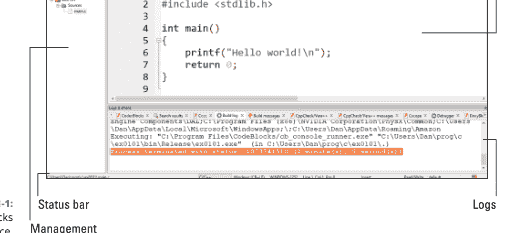

**图 1-1：** Code::Blocks 工作区。

在你的电脑上，以及图 1-1 中，找到工作区的以下部分：

-   **工具栏：** 这些杂乱的长条装饰着各种命令按钮，附着在 Code::Blocks 窗口顶部。工具栏可以重新排列或隐藏，所以在熟悉界面之前不要乱动它们。
-   **管理：** 工作区左侧窗格有四个选项卡，不过你可能不会同时看到全部四个。该窗口方便地总览你的编程工作。
-   **状态栏：** 在屏幕底部，你可以看到有关项目、编辑器以及 Code::Blocks 中发生的其他活动的信息。
-   **编辑器：** 屏幕中右区域的大窗口是你输入代码的地方。
-   **日志：** 屏幕底部有一个窗口，包含许多选项卡，显示编程过程的各种信息。最常用的选项卡名为 Build Log。

View 菜单控制窗口中显示的每一项的可见性。从 View 菜单中选择窗格名称（如 Manager）来显示或隐藏该项。使用 View、Toolbars 子菜单控制工具栏。


-   最大化 Code::Blocks 程序窗口，使其填满屏幕。你需要那么大的空间。
-   除了为文本着色外，Code::Blocks 编辑器还提供自动完成功能。必须成对输入的项目（如引号、括号等）会自动为你生成。某些 C 语言关键字和函数会自动显示，并附带其参数和选项的提示。
-   编辑器采用选项卡式界面，让你可以同时处理多个源代码文件。

### 你的第一个程序

为任何编程语言编写的传统第一个程序都叫 Hello World。它很无聊，就像所有传统一样。


## 代码清单 1-1 Code::Blocks 骨架

```c
#include <stdio.h>
#include <stdlib.h>

int main()
{
    printf("Hello world!\n");
    return 0;
}
```

无论你使用命令提示符还是 IDE，编程过程都是一样的：

- 1. 使用编辑器编写源代码。
- 2. 将源代码编译并链接成程序。
- 3. 运行程序，看看它是否能正常工作。

第 2 章会详细讲解这些步骤，但我猜你时间比较紧。下面几节将介绍命令提示符和 IDE 环境的具体操作。

使用文本编辑器创建一个新文件，并输入代码清单 1-1 中给出的文本。这段代码和本书中的所有源代码一样，都可以在配套网站 https://c-for-dummies.com/cprog 上找到。

将源代码文件保存为 ex0101.c。文件名必须以 .c（点 C）结尾，编译器才会将其识别为 C 源代码文件。

在 Unix 终端窗口（例如 Windows 10 中的 Ubuntu bash shell）中，将源代码编译并链接（也就是“构建”）成程序文件。在保存源代码文件的同一文件夹/目录中，输入以下命令：

```sh
clang -Wall ex0101.c
```

编译器程序的名称是 clang。 -Wall 参数会启用所有警告消息。最后一个参数是源代码文件的名称，在本例中是 ex0101.c。

如果成功，你不会看到任何输出。如果看到警告或错误消息，可能是源代码输入有误。请重试：重新编辑并编译。

要运行程序，请输入默认的程序文件名 a.out。在终端窗口中，程序名必须加上 ./（点斜杠）前缀，以指示命令解释器在当前目录中查找：

```
./a.out
```

你会看到终端窗口中输出消息 Hello, world!。现在可以略读第 2 章，了解刚才发生了什么。

## 新建 Code::Blocks 项目

在 Code::Blocks 中，可以使用两种方法来构建本书展示的示例代码。你可以为每个练习构建一个项目，也可以使用空文件来编写代码。

### 创建项目

若要创建项目，请按以下步骤操作：

- 1. 选择 File、New、Project。
- 2. 选择 Console Application，然后单击 Go 按钮。
- 3. 选择 C 作为编程语言，然后单击 Next 按钮。
- C 与 C++ 有很大不同——在一种语言中能做的事情，在另一种语言中可能不被允许。
- 4. 输入项目标题。
- 本书中的代码练习遵循一种命名模式，你可以将其用于项目标题：ex 后跟 2 位章节号和 2 位顺序号。对于代码清单 1-1 中给出的示例代码，项目标题是 ex0101。
- 设置项目标题时，项目的文件名会自动填入。
- 5. 单击标题为 Folder to Create Project In 的文本框右侧的 ...（Browse）按钮。

我建议你为本书中的所有项目创建并使用一个专用文件夹。位置设定后，以后就可以跳过此步骤。

6. 单击 Next 按钮。

下一个屏幕（最后一个屏幕）允许你选择编译器，并选择创建代码的 Debug 版本还是 Release 版本，或者两者都创建。

编译器的选择没有问题；GNU GCC Compiler（或窗口中显示的任何选项）就是你需要的。

7. 取消勾选 Create Debug Configuration。

只有当你需要调试或解决令你困惑的编程难题时，才创建此配置。参见第 25 章。

8. 单击 Finish 按钮。

Code::Blocks 会为你的项目构建一个骨架，其中的代码与代码清单 1-1 所示相同。请略读后面的“构建并运行”一节。

### 创建空文件

处理本书练习的一种更简单的方法是，将源代码输入一个空项目文件。在 Code::Blocks IDE 中，请按以下步骤操作：

- 1. 选择 File、New、Empty File。
- 2. 在编辑器中输入源代码。
- 你也可以将配套网站上的源代码复制并粘贴到编辑器中。有关配套网站的详细信息，请参阅引言。
- 如果你希望看到编辑器对文本进行颜色标记，请保存文件！按 Ctrl+S，并选择你计划存放本书所有编程项目的文件夹。按照本书的约定命名文件：ex 后跟 2 位章节号和 2 位项目号。文件名以 .c（点 C）结尾，以标识它是 C 源代码文件。
- 3. 保存源代码文件。
- 如果文件已经保存，请按 Ctrl+S。否则，请按照步骤 2 中的命名约定操作。

创建空文件后，你就可以构建并运行程序，就像你经历了启动 Code::Blocks 项目这一繁琐过程一样。

如果你已从配套网站获取源代码文件，也可以直接在 Code::Blocks 中打开它：使用 Open 命令打开文件。此时，你可以构建并运行、修改代码，或者随心所欲地做任何事。

## 构建并运行

在 Code::Blocks 中，编译和链接 C 语言源代码的过程通过一个称为 Build 的步骤完成。

要构建项目，请单击工具栏上的 Build 按钮，如页边所示，并在图 1-1 中展示。任何编译器警告或错误都会出现在窗口底部的 Build Log 选项卡上。对于代码清单 1-1，只要代码输入完全正确，就不应生成任何警告或错误。

要试运行程序，请单击 Run 按钮，如页边所示，并在图 1-2 中展示。输出会出现在终端窗口中，如图 1-2 所示。

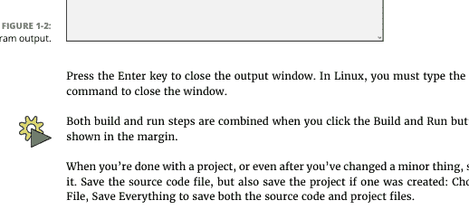

按 Enter 键关闭输出窗口。在 Linux 中，必须输入 exit 命令才能关闭窗口。

单击页边所示的 Build and Run 按钮时，构建和运行两个步骤会合并执行。

完成一个项目后，甚至在你做了一点小改动之后，都要保存它。保存源代码文件，如果创建了项目，也要保存项目。选择 File、Save Everything，以同时保存源代码文件和项目文件。

- 构建和运行代码的命令也可以在 Build 菜单中找到。
- Build、Run 和 Build and Run 的键盘快捷键分别是 Ctrl+F9、Ctrl+F10 和 F9。无需记住这些快捷键；它们都列在菜单中。

## 本章内容

- » 理解编程历史
- » 回顾编程过程
- » 创建源代码
- » 构建程序
- » 测试最终程序

### 第 2 章：编程这件事

### 编程这件事

它被称为*编程*，不过时髦的人称之为*编码*——在这个过程中，人类写下类似隐晦英语的信息，然后以某种方式将其转换为给电子小装置的指令。最终，这门安静而孤独的艺术赋予个人控制电子设备的能力。这很重要。这就是编程这件事。

### 编程的历史

很少有关于编程的书能不描述编程历史中每分钟都充满刺激的戏剧性。作为一名程序员，我很难不写它，更别说在鸡尾酒会上控制自己的热情了。所以，可以把这一节当作可选阅读，不过回顾编程的过去和现在，可能有助于你更好地理解这种艺术形式。

简而言之，*编程*就是告诉小装置该做什么的过程。那个小装置是*硬件*；程序是*软件*。

### 回顾早期编程历史

已知第一台可编程的机器是查尔斯·巴贝奇（Charles Babbage）的分析机，时间可追溯到 1822 年。编程是通过物理方式改变一列齿轮所代表的值来完成的。这台机器计算某个枯燥而复杂的数学方程的结果。

20 世纪 40 年代，早期电子计算机的编程方式与巴贝奇的分析机类似。一个主要区别是，指令不是重新排列物理齿轮，而是直接硬连线到电路之中。“编程”几乎就意味着“重新布线”。

随着时间的推移，重新布线的工作被成排的开关取代。计算机指令通过以特定方式扳动开关来输入。

约翰·冯·诺依曼（John von Neumann）教授在 20 世纪 50 年代开创了现代计算机编程方法。他将决策引入这一过程，使计算机可以做出 if-then 选择。冯·诺依曼教授还提出了重复循环和子程序的概念。

正是格蕾丝·霍珀（Grace Hopper）海军少将开发了编译器，也就是一种创建其他程序的程序。她的编译器会接收英语单词和短语，并将其翻译成计算机代码。于是，编程语言诞生了。

第一种重要的编程语言是 FORTRAN，诞生于 20 世纪 50 年代。它的名字来自 formula translator（公式翻译器）。这一时期的其他编程语言还有 COBOL、Algol、Pascal 和 BASIC。


无论形式如何，无论是重新布线电路、扳动开关，还是编写编程语言，结果都是一样的：告诉硬件去做某事。

### 介绍 C 语言

C 语言由丹尼斯·里奇（Dennis Ritchie）于 1972 年在 AT&T 贝尔实验室开发。它结合了 B 和 BCPL 编程语言的特点，还混入了一点 Pascal 语言的元素。里奇先生与布莱恩·柯林汉（Brian Kernighan）一起使用 C 语言创建了 Unix 操作系统。从那时起，C 编译器就一直是该操作系统的一部分。

20 世纪 80 年代初，本贾尼·斯特劳斯特鲁普（Bjarne Stroustrup）以 C 为基础，开发了面向对象的 C++ 编程语言。名字中的 ++（加加）部分有点内部玩笑的意味，读完第 11 章后你会更好地理解。斯特劳斯特鲁普先生希望 C++ 成为 C 的继任者。在很多方面确实如此，但 C 仍然是最受欢迎的编程语言之一。


- B 编程语言是 C 语言的基础，其名称源自贝尔实验室（Bell Labs）中的字母 B。
- BCPL 是基础组合编程语言（Basic Combined Programming Language）的缩写。
- C++ 编程语言与 C 非常相似，但它不仅仅是 C 的扩展或附加功能。如果你已经了解 C，学习 C++ 会更容易，但在两种语言之间切换并不容易。
- 确实存在一种 D 编程语言。它于 21 世纪初开发，如今不如 Python 和 Java 等其他主流语言流行。
- 遗憾的是，我不知道该如何发音“Bjarne Stroustrup”。

## 编程过程

无论使用哪种语言，编程过程中的某些步骤是共通的。从这个角度来看，学习编程就像学习烹饪：无论最终成品是焦糖布丁还是一团冒着烟的蛋糊，你都必须按一定的顺序操作。

### 理解编程

编程的目标是创建一个程序。语言是 C，工具是编辑器、编译器和链接器——或者是集成了所有功能的 IDE。最终结果是让硬件执行某个操作的程序。该硬件可以是计算机、平板电脑、手机、微控制器或其他设备。

编程过程逐步进行如下：

1. 编写源代码。
2. 编译并链接，或将源代码构建成程序。
3. 运行并测试程序。

人类（你）编写源代码。源代码通过两个步骤构建为程序：先将其编译成目标代码，然后将目标代码与 C 库链接以构建程序。最后，运行该程序。

实际情况更像是这样：

1. 编写源代码。
2. 将源代码编译成目标代码。
3. 修复警告并重复步骤 1 和 2。
4. 将目标代码与库链接以构建程序。
5. 修复错误并重复步骤 1 到 4。
6. 运行并测试程序。
7. 通过重复整个过程来修复错误。

或者，更常见的情况是，程序运行正常，但你想要添加功能或优化某个元素。然后你就要重复所有步骤。

希望步骤 3、5 和 7 不要经常发生。不过，在编程循环中，你确实要做大量的修复工作。

好消息是，编译器会忠实地报告错误，甚至显示错误所在的位置。这比在早期 ENIAC 时代那数英里长的线路中追踪错误要好得多。

> - 尽管“构建”被视为单个步骤，但编译器仍然会生成目标代码，链接器会将目标代码链接到程序中。如果你严重出错，链接过程甚至不会发生，必须在进行下一步之前修复编译器警告。
> - 我的一位专业程序员朋友曾说，这门艺术形式应该叫“调试”，而不是“编程”。
> - 传说第一个计算机“bug”是一只蛾子，格蕾丝·赫柏（Grace Hopper）在一台早期计算机的线路中发现了它。这个传说有些可疑，因为自莎士比亚时代以来，“*bug*”一词就用来形容古怪或异常的事物。


### 编写源代码

*源代码*代表过程中包含编程语言本身的部分。你使用文本编辑器来编写源代码文件。

在本书中，源代码以程序清单的形式展示，例如清单 2-1 中的示例。

**清单 2-1：标准“Hello World”程序**

```c
#include <stdio.h>

int main()
{
    puts("Greetings, human.");
    return 0;
}
```

本书的清单中不显示行号。它们不是代码的一部分，在这里显示会造成混淆。文本编辑器可能会显示行号以供参考。

在本书中，你会被指示输入清单中的源代码作为练习的一部分。例如：

**练习 2-1：** 在 Code::Blocks 中新建一个名为 ex0201 的项目。或者使用你的文本编辑器创建源代码文件 ex0201.c，以便在命令提示符下编译和链接。

动手做：完成练习 2-1，可以在 Code::Blocks 中、终端窗口的命令提示符下，或使用其他 C 语言 IDE（如 Mac 上的 Xcode）进行。

1. **在编辑器中编写源代码，从清单 2-1 复制。**
   
   或者，你可以从配套网站复制粘贴代码，或使用从网站下载的清单源代码文件。详情请参阅本书的引言。
   
   如果你正在创建 Code::Blocks 项目，请删除提供的骨架代码，并用清单 2-1 中显示的代码替换。
2. **保存源代码文件。**

好了。你刚刚完成了编程过程中的第一步——编写源代码。下一节将继续你的编译器之旅。


- 所有 C 源代码文件都以 .c（“点 C”）文件扩展名结尾。
- 在 Windows 中，我建议你设置文件夹显示选项，使文件扩展名可见。
- C++ 源代码文件的扩展名为 .cpp（“点 C-P-P”）。我在此就不写幼稚的玩笑话了。

> 源代码文件的命名规则与计算机上的任何文件相同。传统上，小程序与最终程序同名（但不含扩展名）。如果你的程序名为 puzzle，那么源代码文件很可能名为 puzzle.c。

### 编译和链接

传统上，编译器读取源代码文件中的文本，并将该文本——一种编程语言——翻译成所谓的目标代码。然后链接器创建最终程序。它将目标代码文件与 C 语言库链接以创建程序。整个过程完全按描述进行——除非中途出现警告或错误。

你可以在 IDE 或命令提示符下分别进行编译和链接。幸运的是，现代编译器将这两个步骤合并为一个名为“构建”的过程。

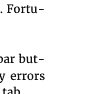

要在 Code::Blocks 中构建清单 2-1 的项目，请单击“构建”工具栏按钮（见页边）或从菜单中选择 Build > Build。任何错误都会显示在“构建日志”选项卡以及“构建消息”选项卡上。

```
clang -c -Wall ex0201.c
```

首先是编译器名称 clang，然后是用于报告所有警告的 -Wall 开关。最后是源代码文件名。成功后，你不会看到任何反馈；否则，警告和错误信息会像翻倒的苹果车里的水果一样洒满屏幕。

（运行程序文件将在下一节介绍。）

> 目标代码文件与源代码文件同名，但以 .o（“点 O”）结尾。如果源代码文件名为 ex0201.c，则目标代码文件名为 ex0201.o。现代构建过程会删除此文件，除非你明确指示编译器生成并保留目标代码文件。

当编译器将你的 C 代码翻译为目标代码时，它会检查常见错误、遗漏和其他问题。如果出现问题，编译器会显示警告列表。要修复它们，你需要重新编辑源代码并再次尝试编译。

链接器引入 C 语言库，这就是最终程序构建的方式。库中包含实际指令，告诉计算机（或任何设备）该做什么。这些指令根据目标代码中的简化指令执行。

链接器发现的任何错误都称为错误。当出现错误时，程序不会被创建；错误是致命的。

根据程序的功能，某些 C 程序会链接多个库。除了标准 C 库之外，你还可以链接用于处理图形、网络、声音等的库。随着你对编程的深入学习，你会发现如何选择并链接各种库。第 24 章提供了详细信息。

### 运行和测试

构建完成后下一步是运行结果。运行是必要的，主要是为了证明程序能够按照你的意图和期望的方式工作。

当程序无法正常工作时，你必须返回修复源代码并再次尝试。是的，完全有可能构建一个程序并看到没有警告或错误，但结果却发现它不起作用。这种情况经常发生。

继续练习 2-1：运行程序。

在 Code::Blocks 中，选择 Build > Run 或单击“运行”工具栏按钮（见页边）。

在命令提示符下，输入带有当前目录前缀的程序名：

```
./a.out
```

## 预处理器指令

除了源代码，C 编译器还会处理称为预处理器指令的特殊指令。例如，清单 2-1 显示了以下预处理器指令：

```c
#include <stdio.h>
```

include 指令指示编译器定位头文件 stdio.h。该文件的内容在编译时被插入源代码中。两个文件一起被转换为目标代码。


a.out 这个名称是默认的 C 程序文件名。你可以在构建时指定 -o（“小写 o”）开关，并在其后跟上所需的输出文件名，以此重新设置该名称。例如：

```
clang -Wall ex0201.c -o ex0201
```

上述命令使用 ex0201.c 中的源代码构建一个名为 ex0201 的程序。必须像运行 a.out 一样，在命令提示符下运行它：

```
./ex0201
```

程序运行并输出文本，在你输入程序名后，这些文本会出现在下一行：

```
Greetings, human.
```

在 Code::Blocks 中，输出会显示在终端窗口中。按 Enter 键可关闭窗口。对于 Linux 中的 Code::Blocks，请输入 exit 命令来关闭输出终端窗口。

像 ex0201 这样的程序不需要太多测试就能确保其正常工作。随着你的编程技能逐渐成熟，测试、重写、编译和调试会成为整个流程中的标准环节。不要气馁；所有程序员都是这样学会这门技艺的。

> 运行程序的机制由设备的操作系统执行：操作系统将程序加载到内存中，处理器或 CPU 在那里执行代码。这是对程序如何工作的粗略描述。


> 在 Windows 中，程序名以 exe（代表可执行文件）扩展名结尾，如 ex0201.exe。在 Mac OS X、Linux 和 Unix 中，程序名没有扩展名：ex0201。此外，在这些操作系统中，文件权限被设置为使该文件可作为可执行文件运行。

### 本章内容

- 回顾 C 语言的各部分
- 理解关键字和函数
- 探索运算符、变量和值
- 学习注释
- 构建基本的 C 语言骨架
- 打印一个数学问题

### 第 3 章：C 语言剖析

所有编程语言都由告诉计算机或其他电子设备该做什么的指令组成。尽管基本编程概念保持不变，但每种语言都不同，它们被创造出来是为了满足特定需求，或者让新一批大学新生感到挫败。C 语言同时符合这两个条件：灵活且令人望而生畏。要以友好、积极的方式开始与 C 建立关系，就要了解这门语言及其运作方式。


在深入本书第 2 部分后，你可能会想重读本章。

### C 语言的组成部分

与人类语言不同，C 没有词形变化或格。你不会遇到阳性、阴性或中性。你也永远不需要知道“过去完成虚拟语气”这些词是什么意思。你确实必须理解一些行话、语法和其他麻烦事。本节概述 C 语言中的各种内容。


### 编程语言层次

这几乎是一种传统。随着时间的推移，已经开发出数百种编程语言。许多逐渐消失，但每年都有新的语言涌现。这种多样性可以用不同语言满足特定需求来解释。

一般来说，编程语言分为三个层次：

- **高级语言**最容易阅读，使用人类语言（主要是英语）中的单词和短语。这些语言学习起来很快，但灵活性往往有限。
- **低级语言**最晦涩，通常很少包含甚至不包含可识别的人类语言单词。这类语言（如汇编语言）直接访问硬件，因此速度极快。缺点是开发时间慢，因为几乎所有事情都必须从零开始做。
- **中级语言**结合了高级语言和低级语言的特点。因此，这类语言非常通用，程序可以设计来做几乎任何事情。C 是中级编程语言的典型例子。

### 关键字

忘掉名词、动词、形容词和副词吧。C 语言有*关键字*。与人类语言不同——在人类语言中你至少需要认识 2000 个左右的单词才算勉强识字——C 语言的词汇量少得可怜：只有少数几个关键字，而且你可能永远用不到全部。表 3-1 列出了 C 语言的 44 个关键字。

**表 3-1 C 语言关键字**

|  |  |  |  |
|---|---|---|---|
| `_Alignas` | `break` | `float` | `signed` |
| `_Alignof` | `case` | `for` | `sizeof` |
| `_Atomic` | `char` | `goto` | `static` |
| `_Bool` | `const` | `if` | `struct` |
| `_Complex` | `continue` | `inline` | `switch` |
| `_Generic` | `default` | `int` | `typedef` |
| `_Imaginary` | `do` | `long` | `union` |
| `_Noreturn` | `double` | `register` | `unsigned` |
| `_Static_assert` | `else` | `restrict` | `void` |
| `_Thread_local` | `enum` | `return` | `volatile` |
| `auto` | `extern` | `short` | `while` |

表 3-1 中显示的关键字代表 C 语言的基本命令。这些简单的指令以各种有趣的方式组合起来，完成奇妙的事情。但这门语言并不止于关键字；请继续阅读下一节。


> 不必费心记住关键字列表。虽然我仍然记得英语中的 23 个“to be”单词（而且顺序与我八年级英语课本中指定的一样），但我从未记住过 C 语言关键字。
>
> 关键字都区分大小写，如表 3-1 所示。
>
> 在这 44 个关键字中，32 个是 C 语言原有的关键字。C99 更新（1999 年）新增了 5 个，而最近的 C11（2011 年）更新新增了 7 个。大多数较新的关键字以下划线开头，如 _Alignas。
>
> 关键字也称为保留字，这意味着你不能将函数或变量命名为与关键字相同。当你尝试这样做时，编译器会像喝醉的、有党派立场的政治博主一样抱怨。

### 函数

虽然你只找到 44 个关键字，但 C 语言中有数百个（甚至数千个）函数，包括你自己编写的函数。把函数想象成完成任务的编程机器。确实，函数是 C 语言的主力军。

函数的明显标志是出现圆括号，例如用于“put string”函数的 puts()，它显示文本。String 是编程行话，指长度超过单个字符的文本。

函数有多种使用方式。例如，beep() 函数可能会让计算机扬声器发出蜂鸣声：

```
beep();
```

有些函数会接收传入的值，例如

```
puts("Greetings, human.");
```

这里，字符串 Greetings, human.（包括句点）被发送给 puts() 函数，该函数将字符串发送到标准输出（显示在屏幕上）。双引号用于定义字符串；它们不会被发送到标准输出。括号中的信息被称为函数的参数或值。它们被传递给函数。

函数也可以生成或返回信息：

```
value = rand();
```

rand() 函数生成一个随机数，该数从函数返回并存储在名为 value 的变量中。C 语言中的函数一次只返回一个值。它们也可以不返回任何值。函数的文档说明了该函数返回什么。

函数也可以接收信息并返回某些内容：

```
result = sqrt(256);
```

sqrt() 函数接收值 256。然后它计算该值的平方根。返回的计算结果存储在 result 变量中。


- 关于变量是什么的讨论，请参阅后面的“变量和值”一节。
- C 语言中的函数必须先定义后使用。该定义称为原型。编译器需要它来理解你的代码是否正确使用了该函数。
- 所有 C 语言函数的列表和文档都可以在网上找到，即所谓的 C 库参考。
- 库函数原型保存在头文件中，这些头文件必须包含在你的源代码中。请参阅后面的“添加函数”一节。
- 函数的机制存储在 C 语言库中。库是函数及执行这些函数的代码的集合。当你链接程序时，链接器会将函数的目标代码合并到最终程序中。
- 与关键字一样，函数名区分大小写。


## 运算符

与函数和关键字混合在一起的是各种符号，统称为运算符。其中大部分源于数学，包括加号（+）、减号（−）和等号（=）等传统符号。

运算符与函数、关键字以及 C 语言的其他部分一起出现，例如：

```
result = sqrt(value) + 5;
```

在这里，= 和 + 运算符被用来完成某种数学上的“花招”。

并非所有 C 语言运算符都执行数学运算。附录 C 列出了全部运算符。


## 变量与值

程序通过操作存储在变量中的信息来工作。变量是一个容器，你可以把值、字符或其他形式的信息塞进去。程序还可以操作特定的、不变的值，我称之为即时值：

```
result = sqrt(value) + 5;
```

在这个例子中，result 和 value 是变量；仅看代码无法知道它们的内容，并且内容会随着程序的运行而改变。数字 5 是一个即时值。

C 语言拥有不同类型的变量，每种变量都设计用于保存特定的值或数据类型。第 6 章会更详细地解释变量和值。

## 语句与结构

与人类语言一样，编程语言具有语法——它是各部分组合在一起的方式。与英语不同（英语的语法可以像掷骰子一样随意），C 语言组合关键字、函数、运算符、变量和值的方式非常严格。

C 语言的核心是语句，它类似于英语中的句子。语句是一个动作，是程序给硬件的一条指令。所有语句都以分号结尾，分号相当于 C 语言中的句号：

```
beep();
```

这里，单独的函数 beep() 就是一个语句。它可以如此简单。事实上，一行中单独的一个分号也可以是一个语句：

```
;
```

上面的语句什么都不做。

C 语言中的语句一个接一个地执行，从源代码的顶部开始，一直执行到底部。在程序运行时，存在改变这种顺序的方法，本书其他地方会介绍。

C 语言的段落级语法涉及块。块是通过将语句括在一对花括号中来定义的：

```
{
    if( money < 0 ) get_job();
    party();
    sleep(24);
}
```

这三个语句构成一个块，放在花括号内，表示它们属于一起。它们要么是函数的一部分，要么是循环或其他类似结构的一部分。无论如何，它们都组合在一起，并一个接一个地执行。

你会注意到，块内的语句缩进了一个制表位。这是 C 语言的传统，但不是必需的。术语“空白”用于指代制表符、空行以及源代码中的其他空白部分。

通常，C 编译器会忽略空白，而只寻找分号和花括号。例如，你可以将清单 2-1 中的源代码编辑为：

```
#include <stdio.h>
int main(){puts("Greetings, human.");return 0;}
```

这是两行源代码，而之前你看到的是好几行。`include` 指令必须单独占一行，但 C 代码可以全部挤在一起，不留空白。该代码可以成功编译。

值得庆幸的是，大多数程序员使用空白来使代码更具可读性。


> C 语言初学者常犯的一个错误是忘记在语句后放置分号。这也是经验丰富的程序员常犯的错误！
>
> 编译器是发现缺失分号的工具。这是因为当你忘记分号时，编译器会假定两个语句实际上是同一个语句。结果是编译器变得困惑，因此，在恐慌中，它会用警告或错误标记那些源代码行。

## 注释

C 语言源代码中的某些内容既不是语言的一部分，也不是结构的一部分。这些是注释，它们可以是关于程序的信息、给你自己的备注，甚至是粗俗的打油诗。

传统的 C 注释以 `/*` 字符开头，以 `*/` 字符结尾。编译器会忽略这两个标记之间的所有文本，链接器也会避开它们，最终的程序中也不会包含它们。

清单 3-1 显示了项目 ex0201 中代码的更新版本，其中大量添加了注释。

### 清单 3-1：过度注释的源代码

```c
/* Author: Dan Gookin */
/* This program displays text on the screen */

#include <stdio.h>  /* Required for puts() */

int main()
{
    puts("Greetings, human.");  /* Displays text */
    return 0;
}
```

清单 3-1 中的注释单独占一行，或者出现在一行的末尾。前两行可以合并为多行注释，如清单 3-2 所示。

### 清单 3-2：多行注释

```c
/* Author: Dan Gookin
   This program displays text on the screen */

#include <stdio.h>    /* Required for puts() */

int main()
{
    puts("Greetings, human.");  /* Displays text */
    return 0;
}
```

`/*` 和 `*/` 之间的所有文本都会被忽略。一些源代码编辑器（例如 Code::Blocks 中的编辑器）会以独特的颜色显示注释文本，这进一步证实了编译器如何看待并忽略注释文本。如果你愿意，可以将清单 3-2 中的源代码输入到文本编辑器中，看看注释是如何工作的，以及它们是否被高亮显示。

第二种注释风格使用双斜杠（`//`）字符，这种风格起源于 C++ 语言，但在 C 语言中也可用。这种注释只影响一行中的文本，从 `//` 字符到行尾，如清单 3-3 所示。

### 清单 3-3：双斜杠注释

```c
#include <stdio.h>

int main()
{
    puts("Greetings, human.");  // Displays text
    return 0;
}
```

现阶段不要担心在文本中添加注释的问题，除非你所在的大学有教授对此极其严格。注释是为你——程序员——服务的，帮助你理解代码并记住你的意图。当你日后查看代码却不完全理解自己在做什么时，它们就会派上用场。这种情况经常发生。

## 纵观典型 C 程序

所有 C 程序都有一个基本结构，通过查看 Code::Blocks 用于启动新项目的 C 源代码骨架，可以很容易地展示这一点，如清单 3-4 所示。

### 清单 3-4：Code::Blocks C 骨架

```c
#include <stdio.h>
#include <stdlib.h>

int main()
{
    printf("Hello world!\n");
    return 0;
}
```

这个清单并不是最简形式，但它给出了基本 C 程序的粗略概念。


> 就像你阅读页面上的文本一样，C 源代码自上而下流动。程序从第一行开始执行，然后是下一行，一直执行到源代码文件的末尾。这种顺序的例外包括决策结构和循环，但大多数情况下代码是自上而下运行的。
>
> 决策结构在第 8 章中介绍；循环在第 9 章中引入。

### 理解 C 程序结构

为了更好地理解 C 程序是如何形成的，你可以创建最简单、最无用的 C 程序类型。

**练习 3-1：** 按照本节中的步骤创建一个新的源代码文件，命名为 ex0301.c。你可以使用 Code::Blocks 创建新项目，也可以使用文本编辑器并在终端窗口的命令提示符下构建项目。

具体步骤如下：

- **1. 将源代码编辑为与清单 3-5 一致。**  
  这不是打印错误。源代码是空白的，空的。如果你使用 Code::Blocks，请擦除提供的骨架。
- **2. 保存源代码。**
- **3. 构建。**  
  什么都不会发生，或者你会看到链接器错误消息。

### 清单 3-5：什么都不做的简单程序

因为源代码是空的，所以不会生成目标代码。即使创建了程序，它也是空的，什么都不做。这就是你告诉编译器要做的，而由此产生的程序完美地做到了这一点。

### 设置 main() 函数

所有 C 程序都有一个 main() 函数。它是程序启动时运行的第一个函数。作为一个函数，它需要括号来包含参数，还需要花括号将函数的语句包含在一个块中，如清单 3-6 所示。

**继续练习 3-1：** 重建源代码 `ex0301.c`，如清单 3-6 所示。保存项目。构建并运行。

### 清单 3-6：main() 函数

```
main() {}
```

你可能会看到一个警告，因为 main() 函数缺少数据类型。这没关系。否则，程序不会产生任何输出——这很棒！你没有让代码做任何事，它也确实什么都没做。你现在看到的是最简 C 程序。它也被称为“哑程序”。


> main 不是关键字；它是一个函数。它是所有 C 语言源代码中必需的第一个函数。
> 
> 与其他函数不同，main() 不需要原型声明。然而，它确实使用特定的参数，这将在第 15 章中介绍。

### 向操作系统返回内容

正确的协议要求程序退出时向操作系统提供一个值。把它看作是一种尊重的象征。该值是一个整数（整数），通常为零，但有时会根据程序的行为和操作系统的期望使用其他值。

继续练习 3-1：将 ex0301.c 的源代码更新为《清单 3-7》所示的更改。

### 清单 3-7：添加 return 语句

```c
int main()
{
    return(1);
}
```

首先，main() 函数被声明为整数函数。int 关键字告诉编译器该函数返回或生成一个整数值。

return 语句将值 1 发送回操作系统，从而有效地结束 main() 函数，进而结束程序。

继续练习 3-1：保存、构建并运行项目。

结果与上一次运行类似，但如果您使用 Code::Blocks IDE，您会在摘要文本中看到返回值为 1 的说明：

```
Process returned 1 (0x1)
```

如果愿意，您可以再次编辑代码并将返回值更改为其他值——比如 5。运行项目时，该值会出现在 Code::Blocks 的输出中。

在继续之前，请注意源代码中的以下两项重要内容：

确保您按原样输入 include 指令：

```c
#include <stdio.h>
```

该指令告诉预处理器获取头文件 stdio.h。使用 printf() 函数需要该头文件。

确保您按原样输入 printf() 语句：

printf() 函数将格式化的文本发送到标准输出设备：显示器。它还包含一个数学问题 4*5。计算机计算该等式的結果，然后在格式化文本中显示：

```c
printf("4 times 5 is %d\n",4*5);
```

您会在 printf() 语句中找到许多重要项，每一项都是必需的：引号、逗号和分号。不要遗漏任何内容！

后续章节会更详细地介绍 printf() 函数，因此如果您现在还无法完全理解，也不用担心。

最后，我已将返回值从 1 改为 0，这是传回操作系统的传统值。

**继续练习 3-1：保存项目的源代码。构建并运行。**

如果出现错误，请仔细检查源代码。否则，结果会出现在终端窗口中，大致如下：

```
4 times 5 is 20
```

本节介绍的基本 C 程序是在过去几节中逐步构建的。您使用的函数会发生变化，随着您探索 C 语言，您将学会事物的工作原理并变得更加熟练。

### 文件在哪里？

C 编程项目需要的不仅仅是源代码：它还包括头文件和库。头文件是通过使用 #include 指令引入的；库由链接器引入。您不必担心这些文件，因为编译器和链接器会为您处理细节。

由于 C 源自 Unix 背景，因此使用了传统的头文件和库文件位置。头文件位于 /usr/include 目录（文件夹）中。库文件位于 /usr/lib 目录中。这些是系统文件夹，因此可以查看但不要触碰其内容。我经常查阅头文件以寻找提示或 C 语言文档中可能不明显的信息。（头文件是纯文本；库文件是数据。）

如果您使用的是类 Unix 操作系统，您可以访问这些目录并浏览其中的大量文件。在 Windows 系统上，这些文件通常与编译器一起保存在相对于编译器位置的 include 和 lib 文件夹中。

## 第 2 部分：C 编程 101

## C 编程 101

- 修复编译器和链接器错误
- 在程序中处理值
- 探索变量和存储
- 获取输入并创建输出
- 控制程序流程并做出决策
- 使用循环语句重复代码块
- 构建自己的函数

### 本章内容

- 向屏幕打印文本
- 使用注释禁用语句
- 修复编译器错误
- 使用 printf() 函数
- 享受转义序列
- 修复链接错误

### 第 4 章：试错

计算机编程的一大优点是反馈是即时的。当出现问题时，编译器、链接器或程序未按预期运行会立即通知您。信不信由你，这就是每个人编程的方式！错误会发生，即使是最有经验的程序员也预料到它们。

### 在屏幕上显示内容

### 显示幽默信息

计算机被称为严肃的设备，为什么不加点轻松呢？

练习 4-1：仔细将清单 4-1 中的代码输入编辑器。构建并运行。

### **清单 4-1：** 另一个幽默示例

```c
#include <stdio.h>

int main()
{
    puts("Don't bother me now. I'm busy.");
    return(0);
}
```

如果遇到任何警告或错误，请修复它们。它们可能是拼写错误或缺少项目。编辑器中看到的一切必须与清单 4-1 中显示的代码完全一致。

成功后，程序运行。其输出如下所示：

```
Don't bother me now. I'm busy.
```

尽量控制住你的笑声。

**练习 4-2：** 修改清单 4-1 的源代码，使消息显示为“我喜欢显示文本！”


所有练习的解决方案都可以在网上找到：

```
www.c-for-dummies.com/begc4d/exercises
```

### 介绍 puts() 函数

*puts()* 函数将文本字符串流式传输到标准输出设备。

*这到底是什么意思？*

目前，请将 *puts()* 函数视为在屏幕上单独一行显示文本。格式如下：

```c
#include <stdio.h>

int puts(const char *s);
```

因为这个官方格式在书的早期看起来令人困惑，所以我提供这个非官方格式：

```c
puts("text");
```

text 部分是一个文本字符串——基本上是双引号之间的任何内容。它也可以是一个变量，这是一个概念，您在第 7 章之前不必担心。

puts() 函数要求源代码包含 stdio.h 头文件。该头文件包含函数的原型。头文件是通过使用 include 指令添加到源代码中的，如此处所示，并在本章的各个示例中展示。

> C 语言以流的方式处理文本，这可能与您认为计算机通常处理文本的方式不同。第 13 章对此概念进行了详细讨论。
> 
> 标准输出设备通常是计算机的显示器。输出可以在操作系统级别重定向；例如，到文件或其他设备，如打印机。这就是为什么 puts() 函数的技术定义指的是标准输出而不是显示器的原因。

### 添加更多文本

当您需要显示另一行文本时，如清单 4-2 所示，在源代码中再创建一个 puts() 函数。

### 显示两行文本

```c
#include <stdio.h>

int main()
{
    puts("Hickory, dickory, dock,");
    puts("The mouse ran up the clock.");
    return(0);
}
```

第二个 puts() 函数与第一个做同样的事情。此外，由于第一个 puts() 函数需要 stdio.h 头文件，因此无需再次包含此行；一个引用即可满足任何需要相同头文件的函数。

**练习 4-3：** 将清单 4-2 的源代码输入编辑器。保存、编译并运行。

输出显示在两行上：

```
Hickory, dickory, dock,
The mouse ran up the clock.
```

只要您使用 puts() 函数并用双引号括起文本，结果程序就会输出该文本并在屏幕上显示它。好吧，puts() 将文本发送到标准输出设备。（大学二年级的学生感觉好点了吗？）


- 包含适当的头文件以原型化函数。puts() 函数需要 stdio.h 头文件。
- include 预处理器指令将指定的头文件插入到您的源代码中。其格式如下：

    ```c
    #include <file.h>
    ```

- 在源代码文件中无需多次包含同一个头文件。

在此行中，file 表示头文件的名称。所有头文件都带有 .h 扩展名，必须在尖括号中与头文件名一起指定。

**练习 4-4：** 修改清单 4-2，以便显示完整的童谣。

以下是完整文本：

Hickory, dickory, dock,
The mouse ran up the clock.
The clock struck one,
The mouse ran down,
Hickory, dickory, dock.

嗯，它其实并不押韵，所以作为奖励，请更改输出的第四行，使其押韵！


## 注释掉语句

注释不仅用于向源代码添加信息、备注和描述，还可以用来禁用语句，如清单 4-3 所示。

### 清单 4-3：禁用一条语句

```c
#include <stdio.h>

int main()
{
    puts("The secret password is:");
    /* puts("Spatula."); */
    return(0);
}
```

练习 4-5：输入清单 4-3 所示的源代码。在第 6 行的开头输入 `/*`，然后按 Tab 键将该语句缩进到与上一行相同的制表位。在第 6 行的末尾、添加结束注释标记 `*/` 之前按 Tab 键。保存。构建。运行。

只有第 5 行的第一个 `puts()` 函数会执行，显示以下文本：

```
The secret password is:
```

第 6 行的第二个 `puts()` 函数已被“注释掉”，因此不会被编译。

练习 4-6：在你对练习 4-5 的解决方案中取消对第二个 `puts()` 语句的注释，然后运行程序查看结果。

练习 4-7：使用 `//` 注释字符注释掉第一个 `puts()` 函数。再次构建并运行。

## 故意制造错误

如果你还没有在输入源代码时犯过错误，那么现在正是时候。

练习 4-8：仔细输入清单 4-4 所示的源代码。如果你一直保持专注，很可能能发现其中的错误。（提示：看看第五行。）先不要修复它们——还不是时候。

### 清单 4-4：这个程序会“爆炸”

```c
#include <stdio.h>

int main()
{
    puts("This program goes BOOM!")
    return(0);
}
```

我承认，使用像 Code::Blocks 中那样的智能编辑器，很难漏掉双引号。不过，还是让你的源代码看起来像清单 4-4 那样。我想向你展示错误是什么样子，以便将来你能修复它们。

构建该程序。你会看到类似这样的警告和错误：

```
ex0408.c: In function 'main':
ex0408.c:5:10: warning: missing terminating " character
    puts("This program goes BOOM!)
          ^~~~~~~~~~~~~~~~~~~~~~~~
ex0408.c:5:10: error: missing terminating " character
    puts("This program goes BOOM!)
          ^~~~~~~~~~~~~~~~~~~~~~~~
ex0408.c:6:5: error: expected expression before 'return'
    return(0);
          ^~~~~~
ex0408.c:7:1: error: expected ';' before '}' token
}
^
```

错误和警告通过源代码中的行号来引用。它们可能会多次出现，这取决于错误的严重程度以及编译器的“受冒犯”程度。

以下列表中的数字引用清单 4-4 中的行号，以及刚才显示的输出：

- **第 5 行：警告：缺少终止 " 字符**
  
  第一个警告是由于缺少双引号字符引起的。之所以是警告，是因为编译器也可能会弄错。
- **第 5 行：错误：缺少终止 " 字符**
  
  不，编译器没有弄错：双引号确实缺失了。这被视为一个完全的错误，比警告更严重。
- **第 6 行：错误：在 'return' 之前应为表达式**
  
  这个错误仍然与第 5 行有关，但在第 6 行被捕获。同样，还是缺少双引号，这在 return 语句之前是应有的。
- **第 7 行：错误：在 '}' 标记之前应为 ';'**
  
  最后一个错误依旧由第 5 行引起，即缺少分号。这个错误直到第 7 行（右花括号处）才被捕获。

当存在错误时，程序无法编译；你必须解决问题。警告则可以存在，代码仍然能够编译——甚至可能生成程序。但程序能否正确运行，就值得怀疑了。


- 警告是编译器发现的可疑之处，但也可能是按你预期工作的情况。
- 错误是程序中的致命缺陷。当错误发生时，编译器不会生成目标代码，或者链接器无法构建程序。无论哪种情况，你都需要修复问题。
- 警告和错误消息中引用的行号只是一个近似值。有时，问题确实出现在所指示的行上，但也可能存在于代码更早的位置。
- 可以调整编译器对警告的敏感程度。事实上，现代编译器有几十个选项，用于开启或关闭各种编译条件。我建议激活所有警告——这是 Code::Blocks 中的默认设置，在命令行提示符下可以通过使用 `-Wall` 开关来实现。

练习 4-9：修复练习 4-8 中的代码，添加缺少的双引号。编译以查看错误消息的差异。

练习 4-10：再次修复代码，添加缺少的分号。

## 更多文本输出琐事

`puts()` 函数只是众多向标准输出设备发送文本的函数之一。另一个更流行且多功能的函数是 `printf()`。它同样向标准输出设备显示信息，但附带了更多功能。

### 使用 printf() 显示文本

从表面上看，`printf()` 函数在外观和工作方式上都与 `puts()` 很相似，都是向屏幕显示文本。但 `printf()` 要强大得多，你可能会在 C 代码中将它作为主要的文本输出函数，如清单 4-5 所示。

### 清单 4-5：使用 printf 显示文本

```c
#include <stdio.h>

int main()
{
    printf("I have been a stranger in a strange land.");
    return(0);
}
```

练习 4-11：热切地输入清单 4-5 所示的源代码。仔细检查你的输入，因为你正在使用一个新函数 `printf()` 来显示文本。保存。构建。运行。

输出应该看起来熟悉且符合预期，尽管有一个微小的差异。如果你能发现它，就能获得一个“傻瓜”加分点。（暂时不用担心修复问题。）如果你发现不了差异，直接继续练习 4-12。

练习 4-12：编辑你对练习 4-4 的解决方案，将源代码更新为使用 `printf()` 函数而不是 `puts()`。

如果你对练习 4-12 的解决方案的输出看起来不正确，不用担心。我将在后面的“使用转义序列”一节中解释如何修复它。

### 介绍 printf() 函数

`printf()` 函数将一个格式化的文本字符串流式传输到标准输出设备。其官方格式有点令人难以招架：

```c
#include <stdio.h>

int printf(const char *restrict format, ...);
```

别让你的眼球掉出来。相反，参考一下我的简化格式，它基本上描述了 `printf()` 在本章中的用法：

```
printf("text");
```

在这个定义中，text 是夹在双引号之间的文本字符串。

`printf()` 函数需要包含 stdio.h 头文件。

`printf()` 这个名字意为 print formatted（格式化打印），该函数在显示格式化输出时确实展现出了强大的威力。你可以在第 13 章看到这一特性的演示。名字中的 print 部分可以追溯到 C 程序主要将输出发送到打印机而不是视频显示器的时代。


### 理解换行符

与 `puts()` 函数不同，`printf()` 函数不会在其输出末尾添加换行符。换行符是结束一行文本并将终端后续文本显示到下一行（即“新”行）的字符。

下面的 `puts()` 函数会将文本 Goodbye, cruel world 单独输出在一行上：

```
puts("Goodbye, cruel world");
```

下面的 `printf()` 函数会显示文本 Goodbye, cruel world：

```
printf("Goodbye, cruel world");
```

显示文本后，光标会停留在 world 中 d 后面的空格处。任何随后显示的文本都会出现在同一行上——这就是你在练习 4-12 的输出中看到的情况：

```
Hickory, dickory, dock,The mouse ran up the clock.The clock struck one,The mouse ran down,Hickory, dickory, dock.
```

代码确实按你编程的方式执行了，尽管你对 `printf()` 的工作原理并不完全了解。结果很可能并非你的本意。

要让 `printf()` 函数将文本单独显示在一行上，请在文本字符串末尾添加换行符。不必费心在键盘上寻找换行符；不，它不是 Enter 键。你必须使用 C 语言的转义序列来输入换行符。请继续阅读下一节。


### 使用转义序列

为了引用源代码中无法键入的某些字符，C 语言使用一种称为转义序列的东西。转义序列允许你指示编译器暂时暂停对你正在键入内容的接受，转而解释特殊字符和代码。

标准转义序列使用反斜杠字符后跟第二个字符；例如：

```text
\n
```

这是换行字符的转义序列。编译器将反斜杠及其后面的字符一起读取为单个字符，将其解释为键盘上无法键入的字符，例如 Tab 键或 Enter 键，或可能破坏源代码的字符，例如双引号。

表 4-1 列出了标准 C 语言转义序列。

### 表 4-1：转义序列

| 转义序列 | 生成的字符 |
|---|---|
| `\a` | 铃声（"嘟！"） |
| `\b` | 退格，非擦除 |
| `\f` | 换页或清屏 |
| `\n` | 换行 |
| `\r` | 回车 |
| `\t` | 制表符 |
| `\v` | 垂直制表符 |
| `\\` | 反斜杠字符 |
| `\?` | 问号 |
| `\'` | 单引号 |
| `\"` | 双引号 |
| `\xnn` | 十六进制字符代码 nn |
| `\onn` | 八进制字符代码 nn |
| `\nnn` | 八进制字符代码 nnn |

**练习 4-13：** 重新编辑练习 4-12 解决方案的源代码，在每个 printf() 文本字符串末尾添加换行字符。

> printf("What!");

转义序列只有在你在字符串中需要一个字符且无法以其他方式键入时才需要。例如，如果你想使用语句 printf("What!"); 就不需要转义感叹号字符，因为它不会破坏文本。然而，你需要转义换行、制表符或双引号字符。

**练习 4-14：** 创建使用 printf() 函数显示以下文本行的源代码：

> "Hey," said the snail, "I said no salt!";

**练习 4-15：** 修改练习 4-14 的源代码，使其使用 puts() 函数而不是 printf() 来显示相同的文本。

### 故意搞砸再次

“故意搞砸” 一节在本书本章前面介绍了编译器错误。编译器并不是程序创建过程的唯一部分。另一主要部分是链接，是的，你会发现链接器也能检测到错误，如列表 4-6 所示。

### 列表 4-6：又一次糟糕的错误

```c
#include <stdio.h>

int main()
{
    writeln("Another horrible mistake.");
    return(0);
}
```

**练习 4-16：** 将列表 4-6 的源代码输入编辑器。保存。构建。并且...

编译器对第 5 行生成警告：

```text
implicit declaration of function 'writeln' is invalid in C99
```

这只是一个警告，因为 writeln() 函数没有原型——也就是说，它未在 stdio.h 头文件中找到。编译器仍然生成目标代码并将代码传递给链接器。

另一方面，链接器却很不满意。以下是我在屏幕上看到的链接器错误（仅显示文本的相关部分）：

```text
/tmp/ex0416-0eala6.o: In function 'main':
ex0416.c:(.text+0x1c): undefined reference to 'writeln'
clang: error: linker command failed with exit code 1 (use -v to see invocation)
```

链接器的任务是引入 C 语言库，并具体地链接 writeln() 函数的代码。但不存在 writeln() 函数，也不在标准 C 库中。因此，程序未被创建，并报告“未定义引用”错误。

- 要修复代码，将 writeln() 改为 puts()。
- 这类错误最常在你定义自己的函数时发生。本主题在第 10 章中介绍。

### 本章内容

- 处理值
- 使用 printf() 显示值
- 格式化浮点输出
- 让程序进行计算
- 处理整数和浮点数学

### 第 5 章：值与简单数学

在过去的日子里，大多数人把计算机看作数学工具。计算机计算火箭轨迹、进行人口普查，并搞砸电话账单。它们是可怕的技术事物，而编程计算机的人简直就是天才。

哈！骗过所有人。

程序员只需写下方程并输入几个数字，然后计算机就进行计算。这就是天才之处。输入错误数字就是非天才之处。在此之前，你必须了解一些关于值和变量的知识，以及 C 编程语言如何处理它们。

### 各种值的场所

计算机同时处理数字和文本。文本以单个字符或串联成字符串的一串字符的形式出现。数字基本上就是数字，直到你遇到巨大的值和分数。只要你正确地告知程序哪些值是什么，计算机就能理解一切。

### 理解值

你可能一生都在处理数字，在求学期间几乎被它们折磨。你可能记得诸如 *整数*、*分数*、*实数* 和 *虚数* 这样的术语。忽略它们！这些术语在计算机编程中毫无意义。

在 C 编程中，你只使用两种数字类型：

- 整数
- 浮点数

一个 *整数* 是整数——没有小数部分。它可以是正数。可以是负数。可以是零、单个数字，或像美国政府一周花费的金额这样巨大的值（不含分）。所有这些数字在计算机编程术语中都是整数。

一个 *浮点数* 是具有小数部分——小数点的数字。它可以是非常、非常小的数字，比如质子的宽度。它也可以是非常、非常大的数字，比如木星的行星帽尺寸。


- 整数示例：-13、0、4 和 234792。
- 在编程中，你不会在大数值里输入逗号。
- 浮点数示例是 3.14、0.1 和 6.023e23。最后一个数字以科学计数法书写，这意味着它的值是 6.023 × 10²³——一个巨大的数字。（它是阿伏伽德罗 *常数*，这是你可能在学校忘记的另一个术语。）
- 整数和浮点数可以是正数也可以是负数。
- 整数按其大小判断，浮点数也是如此。大小在你为程序中的数字创建存储位置时起作用。第 6 章涵盖了细节。
- 术语 *float* 是 *floating point* 的缩写。它指的是在现代电子设备的二进制计数系统中存储大数和分数的方法。

### 是否使用浮点数

虽然在程序中使用所有浮点数（*floats*）似乎合乎逻辑，但问题是它们不精确。事实上，浮点值由其 *精度* 定义，或数字中真正准确的位数。

例如，具有单精度精度的浮点值可能显示数字中六到九位有效数字。值中其余的数字毫无意义。这看起来很粗糙，但对于非常大或非常小的数字来说已经足够。当不够好时，可以使用双精度，但此类计算需要更多的处理器功率。

换句话说，用七位有效数字或单精度表示的 π 值足以定义土星轨道大小的圆，精确到毫米。

### 使用 *printf()* 显示值

在第 4 章介绍的 *printf()* 函数非常适合显示文本字符串和值。要实现这一点，你在函数的格式化字符串中使用 *转换字符*。与其用描述来让你厌烦，不如考虑练习 5-1。

**练习 5-1：** 输入列表 5-1 所示的源代码。保存文件。构建它。运行它。

### 列表 5-1：显示各种值

```c
#include <stdio.h>

int main()
{
    printf("The value %d is an integer.\n",986);
    printf("The value %f is a float.\n",98.6);
    return(0);
}
```

练习 5-1 的输出看起来像这样：

```text
The value 986 is an integer.
The value 98.600000 is a float.
```

你可能会惊讶，输出看起来并不是这样：

```
The value %d is an integer.
The value %f is a float.
```

事实并非如此，因为 `printf()` 函数中包含的文本不仅仅是文本——它是一个格式化字符串。

`printf()` 函数的格式化字符串可以包含纯文本、转义序列和转换字符，例如第5行中的 %d 和第6行中的 %f。这些转换字符充当格式化字符串后面的值和变量（参数）的占位符。

对于 %d 占位符，整数值 986 会被替换进去。%d 转换字符表示十进制整数值。

对于 %f 占位符，浮点值 98.6 会被替换进去。%f 转换字符表示浮点值。当然，显示出来的并不是 98.6。相反，你看到的是 98.600000。这个问题将在后面的“注意多余的零”一节中讨论。

%d 和 %f 只是 `printf()` 函数格式化字符串众多占位符中的两个。其余占位符将在第7章中介绍。

## 练习5-2：创建一个项目，在 `printf()` 函数中使用合适的转换字符（%d 或 %f），以显示以下值：

- 127
- 3.1415926535
- 122013
- 0.00008


在 C 语言源代码中指定值时，不要键入逗号。

键入较小的浮点值时，记得在小数点前加一个零，就像刚才显示的 0.00008 那样。同样，键入没有小数部分的浮点值时，也要键入小数点和零：

```
1000000.0
```

## 注意多余的零

当你为练习5-1编写代码时，你可能期望程序输出显示 98.6，就像它写的那样。问题在于你指示 `printf()` 函数以默认方式输出那个数字。98.600000。事实上，根据编译器的不同，你可能会看到更多或更少的零。

值 98.600000 是一个浮点数，它很可能表示该值在计算机内部的存储方式。具体来说，该值使用八位数字存储，但人类通常不会在数字后面写末尾零。计算机呢？它们会写尽可能多的零，以填满八位数字（不算小数点）。

要修正输出，需要指示 `printf` 函数格式化这个浮点数。这需要使用更复杂的 %f 占位符版本，你将在第7章中接触到。具体来说，将 %f 占位符改为 %.2f。下面是代码清单5-1中新的那一行。

```
printf("The value %.2f is a float.\n",98.6);
```

通过在 % 和 f 之间塞入 .2，你指示 `printf()` 将输出格式化为小数点右侧两位数字。

练习5-3：修改你在练习5-2中的源代码，使值 3.1415926535 使用 %.1f 占位符显示，值 0.00008 使用 %.1f 占位符显示。

## 计算机来做数学

计算机能做数学，这应该不足为奇。事实上，我敢打赌，你的计算机现在更渴望解决一些数学谜题，而不是希望你去访问 Facebook。本章前面展示的更多数学谜题只是让处理器感到无聊。是时候让它工作起来了！

C 源代码中的数学运算由 +、-、* 和 / 运算符提供。这些是基本的数学符号，* 和 / 例外，主要是因为典型的计算机键盘上找不到 × 和 + 字符。作为参考，表5-1列出了基本的 C 语言数学运算符。

## 表5-1：基本数学运算符

| 运算符 | 功能 |
|---|---|
| + | 加法 |
| - | 减法 |
| * | 乘法 |
| / | 除法 |

还有更多 C 数学运算符，以及大量数学函数。第11章帮助你继续探索数学编程潜力。目前，基础内容就够了。

C 中的计算是通过将值放在数学运算符两侧来完成的，就像你在整个学业中所做的那样，但好处是计算机来执行计算。代码清单5-2提供了一个示例。

## 代码清单5-2：计算机来做数学

```c
#include <stdio.h>

int main()
{
    puts("Values 8 and 2:");
    printf("Addition is %d\n",8+2);
    printf("Subtraction is %d\n",8-2);
    printf("Multiplication is %d\n",8*2);
    printf("Division is %d\n",8/2);
    return(0);
}
```

练习5-4：输入代码清单5-2中所示的源代码。保存。构建。运行。

输出看起来像这样：

值为 8 和 2：
加法是 10
减法是 6
乘法是 16
除法是 4

你在这段代码中看到的是即时计算。也就是说，计算出的值（结果）不会被存储。相反，程序进行数学运算并处理结果，结果被塞入 `printf()` 函数格式化文本中的 %d 转换字符。

**练习5-5：** 创建一个程序，显示 456.98 和 213.4 相加的结果。

**练习5-6：** 创建一个程序，显示值 8、14 和 25 相乘的结果。

**练习5-7：** 创建一个程序，解决 Facebook 上那些愚蠢谜题之一：0+50*1-60-60*0+10 的结果是什么？在运行程序查看计算机的结果之前，先自己解这个方程。参阅第11章，了解结果为什么会不同。

## 回顾浮点数与整数的问题

立即值是浮点数还是 int，区别在于你在程序中如何指定它。考虑代码清单5-3。

## 代码清单5-3：另一个即时数学问题

```
#include <stdio.h>

int main()
{
    printf("The total is %d\n",16+17);
    return(0);
}
```

值 16 和 17 是整数；它们没有小数部分。

**练习5-8：** 创建、构建并运行由代码清单5-3中的源代码创建的程序。

构建该项目会得到答案，答案也是整数：

```
The total is 33
```

```
printf("The total is %d\n",16+17);
```

加上那个点零不会改变值。相反，它会改变数字的存储方式。它现在是一个浮点数。

在源代码中保存更改。构建并运行。

根据你的编译器是否配置，你可能会看到显示一条警告。该警告说明 %d 占位符被用于显示浮点值。你甚至可能看到建议使用 %f 而不是 %d。无论如何，运行程序。以下是我看到的结果：

> 总和是 -90871768

你可能会看到另一个值。无论如何，显示的结果是不正确的。这是因为当计算包含浮点数时却使用了 %d 整数占位符。将浮点数加入任何计算都会导致编译器将结果表示为浮点数。再次更改第5行，像这样指定 %f 占位符：

```
printf("The total is %f\n",16+17);
```

构建并运行。结果现在看起来像这样：

> 总和是 33.000000

这个答案是正确的。

> 任何时候在计算中使用浮点数，结果都是浮点数。可以采用各种技巧来避免这个问题，但眼下可以认为这一点是可靠的。

## 把整数当作浮点数

当你尝试用整数值做数学运算，但结果不是整数时，会发生什么？想都别想！只需欣赏代码清单5-4中的代码：

## 代码清单5-4：整数冒险之处

```
#include <stdio.h>

int main()
{
    printf("%d/%d=%d\n",2,5,2/5);
    return(0);
}
```

`printf()` 语句中使用了三个 %d（整数）占位符。每个占位符对应函数中的一个整数值参数：2、5，然后是表达式 2/5。格式字符串中的占位符必须与参数数量以及每个参数所表示的值类型匹配，如图5-1所示。

### 练习5-11：将代码清单5-4中的源代码输入编辑器。构建并运行，看看疯狂的结果。

## 图5-1：匹配 `printf()` 转换字符和参数。

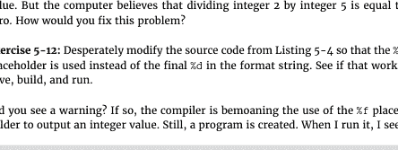

公平地说，在我的计算器上，2/5 的结果等于 0.4，这是一个浮点值。但计算机认为整数 2 除以整数 5 等于零。你会如何解决这个问题？

### 练习5-12：拼命修改代码清单5-4中的源代码，使格式字符串中最后一个 %d 改为使用 %f 占位符。看看这样是否可行。保存、构建并运行。

你看到警告了吗？如果看到了，编译器正在抱怨使用 %f 占位符输出整数值。尽管如此，程序还是创建了。当我运行它时，我看到：

```
2/5=0.000000
```

又是零。

这里的问题与本 chapter 前面添加浮点数和整数值时展示的问题不同。相反，问题在于数学本身：当你必须除

两个整数值，除非你运气好，否则结果是浮点数——一个带有小数部分的值。解决方案是确保使用的值是浮点数——即使它们是整数。

## 练习 5-13：重写代码清单 5-4 中的源代码，使最终计算使用立即浮点值，而不是整数。

在 C 语言学习之旅的后期，你将学到一种对计算进行类型转换的技巧，这是一种更通用的编写代码的方式，用于必须将整数值指定为浮点数的情况。该主题将在第 16 章中介绍。

- 理解变量
- 创建特定数据类型
- 在代码中声明变量
- 使用有符号或无符号整数
- 一次快速创建多个变量
- 同时声明和赋值
- 让变量发挥作用
- 创建常量

### 第 6 章：存放东西的地方

### 存放东西的地方

自从伊甸园里亚当把一颗葡萄藏进他的肚脐眼以来，人类就一直痴迷于储存东西。这就引出了一个问题：亚当为什么会有肚脐眼？但这不是我的重点。我的重点是，人们喜欢储存东西，并创造一些地方——盒子、壁橱、车库和地下掩体——来存放东西。

C 程序使用三种类型的值：立即值、常量和变量。立即值是你在源代码中指定的值——即你键入的值。常量将在本章后面讨论。变量是值的存储容器，其内容可以改变。它们的内容可以变化——因此得名。

### 设置一个快速示例

> 谁喜欢在尝试某件事之前先阅读大量相关内容？我不喜欢！

练习 6-1：键入代码清单 6-1 中所示的源代码。它使用单个变量 x，这是《圣经》中提到的首批计算机变量名之一。

```c
#include <stdio.h>
int main()
{
    int x;
    x = 5;
    printf("The value of variable x is %d.\n",x);
    return(0);
}
```

以下是代码清单 6-1 中所发生情况的分解：

第 5 行包含变量的声明：

```
int x;
```

所有 C 语言变量都声明为特定的数据类型并分配一个名称。代码清单 6-1 中的变量被声明为整数（int）数据类型，并被赋予名称 x。

第 7 行将值 5 赋给变量 x：

```
x = 5;
```

值位于等号右侧。变量位于左侧。

第 8 行在 printf() 语句中使用变量的值：

```
printf("The value of variable x is %d.\n",x)
```

使用 %d 转换字符是因为变量的数据类型是整数。转换字符必须与数据类型匹配。

构建并运行代码。输出如下所示：

```
The value of variable x is 5.
```

以下各节将进一步详细描述创建和使用变量的机制。

### 介绍数据类型

C 语言变量旨在保存特定类型的数据。如果 C 是一种生物编程语言，猫和狗会被归入动物数据类型，而树木和蕨类植物会被归入植物数据类型。C 语言变量也按这种方式工作，将特定的值分配给匹配的数据类型。

常见的 C 语言数据类型列于表 6-1。

表 6-1 基本 C 语言变量类型

| 数据类型 | 描述 |
|---|---|
| char | 单字符变量；存储一个字符的信息 |
| int | 整数变量；存储整数（整数值） |
| float | 浮点变量；存储实数 |
| double | 浮点变量；存储非常大或非常小的实数 |
| void | 无数据类型 |

当需要存储整数值时，你使用整数（int）数据类型的变量。同样，如果要存储字母表中的一个字母，则使用字符（char）数据类型的变量。程序的需求决定了其变量需要哪些数据类型。

> > char 和 int 数据类型存储整数值。char 数据类型的范围较短，主要用于存储字符——字母表中的字母、数字和符号——但也可用于存储小整数值。
> 
> > float 和 double 数据类型都是浮点变量，可以存储极小或极大的值，或任何带有小数部分的值。

> 一种较新的数据类型 _Bool 存储二进制值 1 或 0，通常分别称为 TRUE 和 FALSE。_Bool 是借自 C++ 的单词，必须以下划线字符开头并大写 B。你可能不会在许多 C 程序源代码清单中发现 _Bool 的使用——最可能是为了保持代码与旧版编译器兼容。

### 使用变量

你未来大多数（如果不是全部）C 语言程序都将使用变量。本章前面，代码清单 6-1 说明了在 C 语言中使用变量的基本三个步骤：

- 1. 声明变量，为其指定数据类型和名称。
- 2. 初始化变量（为其赋值）。
- 3. 使用变量。

在代码中使用变量需要完成所有三个步骤，并且必须按此顺序完成这些步骤。

要声明变量，请将语句放在函数（例如每个 C 程序中的 main() 函数）开头附近。将声明放在初始花括号之后。（参见代码清单 6-1。）声明是单独一行的语句，以分号结尾：

```
type name;
```

type 是数据类型：char、int 及其他类型将在本章中介绍。

name 是变量的名称。该名称不能是 C 语言关键字的名称，也不能是之前已声明的任何其他变量名。名称区分大小写——不过，传统上，C 语言变量名用小写字母书写。如果你想别出心裁，可以在变量名中添加数字或下划线，但变量名始终要以字母开头。

等号运算符将值赋给变量。格式非常具体：

```
variable = value;
```

将此表达式读作：“变量 variable 的值等于 value。”

variable 是变量的名称。它必须在源代码中较早声明。

value 可以是立即值、常量、表达式、另一个变量或函数返回的值。语句执行后，变量将保存指定的值。

为变量赋值满足使用变量的第二步。第三步是对变量执行某些操作。变量可以在源代码中任何原本可以直接指定值的地方使用。

在代码清单 6-2 中，声明了四种变量类型，为它们赋值，并在单独的 printf() 语句中使用。

### 处理变量

```c
#include <stdio.h>

int main()
{
    char c;
    int i;
    float f;
    double d;

    c = 'a';
    i = 1;
    f = 19.0;
    d = 20000.000;

    printf("%c\n", c);
    printf("%d\n", i);
    printf("%f\n", f);
    printf("%f\n", d);

    return(0);
}
```

练习 6-2：将代码清单 6-2 的源代码键入编辑器。构建并运行。

```
a
1
19.000000
20000.000000
```

你的代码输出不必与这里显示的内容完全相同。

> » 变量不必在函数开头声明。有些程序员在首次使用变量的前一行声明变量。这种策略可行，但不传统，可能导致混淆。大多数 C 程序员期望在函数开头找到所有变量声明。
> 
> » 变量名可以以下划线开头，编译器认为下划线是字母。即便如此，以下划线开头的变量名在 C 语言内部使用。我建议避免这种命名约定。

### 变量也疯狂！

我希望你已经掌握了变量的要领。如果没有，请回顾本章第一部分。变量确实是任何编程语言的核心，它让你能在程序中编写灵活性，并让程序完成惊人的事情。

### 使用更具体的数据类型

C 语言提供的数据类型比表 6-1 中显示的更多。根据存储的信息，你可能想使用这些更详细的变量声明之一。表 6-2 列出了丰富的 C 语言数据类型以及这些类型可以存储的值的范围。

值范围列指定了可以在变量中存储的数字大小，以及是否允许负数。当你将不正确的值赋给变量类型时，编译器可能并不总是标记警告。因此，在声明变量时要确保正确！

例如，如果需要存储值 -10，则使用 short int、int 或 long 变量。不能使用 unsigned int，如代码清单 6-3 中的源代码所示。


### 表 6-2：更多 C 语言数据类型

| 类型 | 值范围 | printf() 转换字符 |
|------|-------------|-------------------------------|
| _Bool | 0 到 1 | %d |
| char | -128 到 127 | %c |
| unsigned char | 0 到 255 | %u |
| short int | -32,768 到 32,767 | %d |
| unsigned short int | 0 到 65,535 | %u |
| int | -2,147,483,648 到 2,147,483,647 | %d |
| unsigned int | 0 到 4,294,967,295 | %u |
| long int | -2,147,483,648 到 2,147,483,647 | %ld |
| unsigned long int | 0 到 4,294,967,295 | %lu |
| float | 1.17×10⁻³⁸ 到 3.40×10³⁸ | %f |
| double | 2.22×10⁻³⁰⁸ 到 1.79×10³⁰⁸ | %f |

### LISTING 6-3：哦，不——一个无符号 int！

```c
#include <stdio.h>

int main()
{
    unsigned int ono;

    ono = -10;
    printf("The value of ono is %u.\n",ono);
    return(0);
}
```

练习 6-6：使用列表 6-3 中显示的源代码创建一个项目。注意 %u 转换字符用于无符号 int 值。构建并运行。

以下是输出：

ono 的值是 4294967286。

故事的寓意：如果你的整数变量存储负数，就不能使用无符号变量类型。

- 在某些编译器上，int 的范围可能与 short int 的范围相同。遇到疑问时，使用 long。
- 有些编译器支持 long long 整数类型，也称为“double long”。其值范围为有符号的 -9,223,372,036,854,775,808 到 9,223,372,036,854,775,807，以及无符号的 0 到 18,446,744,073,709,551,615。
- 在声明 short、unsigned 或 long 整数值时，指定 int 关键字不是必要的。
- signed 关键字可以在任何整数变量类型前使用，如 signed short int，但仅 short 就足够了。
- void 数据类型主要用于声明不返回值的函数。尽管如此，它仍是一种有效的变量类型，最常在处理指针和内存缓冲区时出现。有关 void 函数的信息，请参阅第 10 章；指针直到本书第 4 部分才被涉及。


## 使用多个变量

我找不到任何规则禁止以练习开始一个章节，所以这里就是：

**练习 6-7：** 创建一个程序，使用三个整数变量 shadrach、meshach 和 abednego。为每个变量分配整数值，并显示结果。

这里是练习 6-7 生成的程序的输出副本。这是我的项目版本：

```
Shadrach is 701
Meshach is 709
Abednego is 719
```

你的代码可以生成不同的文本，但底层项目应该能正常工作。如果你的答案与我的答案一致，就给自己加个奖励，该答案在列表 6-4 中给出。

### LISTING 6-4：练习 6-7 的答案

```c
#include <stdio.h>

int main()
{
    int shadrach, meshach, abednego;

    shadrach = 701;
    meshach = 709;
    abednego = 719;
    printf("Shadrach is %d\nMeshach is %d\nAbednego is %d\n",shadrach,
    meshach,abednego);
    return(0);
}
```

在声明同一类型的多个变量时，你可以在同一行指定所有变量，如列表 6-4（第 5 行）所示。你甚至不必在每个名称后加空格；该行完全可以写成

```
int shadrach,meshach,abednego;
```


C 编译器不在乎空格——具体来说，是双引号括起的内容之外的空白字符。

我还把结果堆叠在一个单一的、长的 printf() 语句中。列表 6-4 中的行因本书的页面宽度而换行，在你的编辑器中也可能换行。当代码换行时，不要按 Enter 键开始新行。


你可以在 C 中通过在行尾转义 Enter 键按下操作来拆分长语句。在此上下文中，转义并不意味着你在逃避危险（除了冒犯编译器之外）；相反，你使用反斜杠（转义字符）来读取 Enter 键，而不会破坏代码中的语句。具体如下：

```c
printf("Shad is %d\nMesh is %d\nAbed is %d\n",\
    shadrach,meshach,abednego);
```

我缩短了格式字符串中的名称，以便文本能在一页上的一行中显示。在 printf() 的格式字符串和参数列表之间，在第一个逗号之后，我键入了反斜杠然后按下了 Enter 键。其效果是该行在视觉上被拆分，但编译器仍然将其视为单个语句。

## 创建时赋值

在列表 6-5 中，整数变量 start 在创建时被创建并赋值为 0。这种组合节省了键入另一行代码来将 0 分配给 start 变量的工作。

### LISTING 6-5：声明变量并赋值

```c
#include <stdio.h>

int main()
{
    int start = 0;

    printf("The starting value is %d.\n",start);
    return(0);
}
```

练习 6-8：使用列表 6-5 中显示的源代码构建一个程序。

练习 6-9：修改练习 6-7 的源代码，使三个变量在声明变量的同一行上被赋予其值。对于此练习可能存在两种解决方案。

## 重用变量

变量各不相同，因此其内容可以在程序中的任何时间更改。本章其他地方显示的示例仅使用一次变量并且不更改其值。这基本上与常量（本章后面会介绍）相同，这使它们成为学习的好例子，但对现实的描述却不佳。

在你的编程之旅中，变量被声明，然后它们的值可能是，嗯，任何值。不仅如此；重复使用变量是完全可能的——不会有任何危害。这是一个容易展示的例子，如列表 6-6 所示。

```c
#include <stdio.h>

int main()
{
    int prime;

    prime = 701;
    printf("Shadrach is %d\n",prime);
    prime = 709;
    printf("Meshach is %d\n",prime);
    prime = 719;
    printf("Abednego is %d\n",prime);
    return(0);
}
```

练习 6-10：根据列表 6-6 创建新的源代码。如你所见，变量 prime 被反复使用，每次都更改其值。被分配的新值会替换任何现有值。构建并运行项目。

练习 6-10 的输出与练习 6-9 相同。

列表 6-7 说明了变量如何相互作用。

```c
#include <stdio.h>

int main()
{
    int a,b,c;

    a = 5;
    b = 7;
    c = a + b;
    printf("Variable c=%d\n",c);
    return(0);
}
```

第 9 行需要注意：

> c = a + b;

变量 c 的值被赋值为变量 a 和 b 的总和。此计算在程序运行时进行，然后结果——无论是什么奇怪的值——都会被显示。

练习 6-11：使用列表 6-7 中的源代码创建一个项目。你能猜出输出吗？

练习 6-12：以列表 6-7 为起点创建一个新的源代码文件。声明三个 float 变量并为其中两个赋值。通过用第二个变量除第一个变量来为第三个变量赋值。输出结果。

## 常量始终相同

计算机及其电子兄弟喜欢做重复性任务。事实上，计算机上要求你反复做某事的任何事情都需要更快、更简单的解决方案在手边。通常，你的任务只是找到合适的工具来实现目标。

### 反复使用相同的值

在你的 C 编程生涯中，现在可能还为时过早去真正思考一个重复的程序；循环的主题在第 9 章中介绍。但这并不意味着你不能编写反复使用值的程序。

练习 6-13：使用列表 6-8 中显示的源代码创建一个新程序。保存它，构建它，运行它。

### LISTING 6-8：这是一个魔术数字

```c
#include <stdio.h>

int main()
{
    printf("The value is %d\n",3);
    printf("And %d is the value\n",3);
    printf("It's not %d\n",3+1);
    printf("And it's not %d\n",3-1);
    printf("No, the value is %d\n",3);
    return(0);
}
```


代码在每一行都使用值 3。以下是输出：

```
The value is 3
And 3 is the value
It's not 4
And it's not 2
No, the value is 3
```

### 练习 6-14：编辑代码将值替换为 5。编译并运行。

你可能会觉得练习 6-14 很残酷且需要大量工作（除非你的源代码编辑器具有方便的搜索并替换命令），但在编程中此类更改经常发生。例如，我写了一个程序来显示添加到数据库中的最近三项。但后来我想更改列表，使其显示前五项。正如你在练习 6-14 中所做的那样，我不得不费力地在整个源代码中搜索并替换，小心地挑出所有对 3 的引用并替换为 5。

一定有更好的方法。

### 代码中的常量

处理练习 6-13 和 6-14 中出现的问题的一种解决方案是使用变量。然而，因为变量的值在 main() 函数中不会改变，所以你也可以使用常量。

与变量一样，常量是在函数中使用的命名值。把它想象成一个替代品，你可以在一个地方快速更改它并产生广泛的影响。

常量像变量一样创建，但数据类型的关键字前面加上 const：

```
const type name = value;
```

type 是数据类型，与变量相同。它可以是 int、char、double 或任何有效的 C 语言数据类型；请参阅表 6-2。

name 是常量的名称，就像变量一样，具有相同的命名限制、规则等等。

值必须在代码中声明常量时分配，全部在一行上。这是因为，一旦常量被声明，其值在代码的其他地方就不能被更改。例如：

```c
const char apple = 'a';
```

常量 `apple` 就像 `char` 变量一样使用，尽管其值——小写字母 `a`——永远不会改变：

```c
printf("Start with letter %c.",apple);
```

前面的语句输出以下文本：

```
Start with letter a.
```

如果代码尝试更改常量，编译器会生成错误消息，程序不会被创建。这个错误是编译器为 const 关键字提供的保护：常量不能被更改。

- 常量必须在声明它们的同一行上赋予值。
- 你可以定义任何数据类型的常量。
- 与变量不同，你不能重新分配常量的值。否则，它在代码中像任何其他变量一样使用。
- 与变量声明一样，常量声明仅在创建它的函数内有效。当常量需要在多个函数中使用时，使用第 10 章中介绍的 `#define` 预处理器指令。

### 将常量付诸使用

只要你的代码反复使用同一个值（例如表格中的行数或你可以放入购物车中的最大项目数等重要内容），就将该值声明为常量。

**练习 6-15：** 重写列表 6-8 的源代码。使用常量 `v` 表示在各种 `printf()` 语句中使用的值 `3`。

请记住，常量像变量一样声明，只是语句以 `const` 关键字开头。如有必要，请回顾前面的部分。

因为我没那么邪恶，列表 6-9 显示了我对练习 6-15 的解决方案。

### 列表 6-9：为常量更新做准备

```c
#include <stdio.h>

int main()
{
    const int v = 3;

    printf("The value is %d\n",v);
    printf("And %d is the value\n",v);
    printf("It's not %d\n",v+1);
    printf("And it's not %d\n",v-1);
    printf("No, the value is %d\n",v);
    return(0);
}
```

整数常量 v 在第 5 行声明，设为值 3。常量 v 在 printf() 语句中被使用，就像它是一个变量一样，但替换了直接值 3。当你处理练习 6-16 时，这种方法的优势就会变得明显。

### 练习 6-16

更新你对练习 6-15 的解决方案（参考列表 6-9），将变量 v 的值更改为 5。（这是对练习 6-14 的更新。）

练习 6-14 和练习 6-16 之间的区别在于，对于后者，你只需在源代码文件中做一次更改。

### 练习 6-17

修改列表 6-7 中的源代码，使变量 a 和 b 成为常量。


你可以先创建常量。但根据我的经验，常量往往会演变：随着你解决问题的进展和代码的完善，常量的需求变得明显。利用它们！如果你发现自己在代码中一致地使用某个值，甚至是一个值不改变的变量，就声明一个常量。

### 本章内容

- » 使用标准输入和输出
- » 读写字符
- » 理解 getchar() 和 putchar()
- » 探索 char 变量类型
- » 使用 scanf() 读取输入
- » 使用 fgets() 获取字符串

### 第 7 章：输入和输出

任何计算设备的最基本功能，如果不是最基本的功能，就是输入和输出。旧的 I/O（读作“eye oh”）也是几乎每个程序的目标。输入被接收并处理，然后生成输出。处理使程序有用。否则，你只有输入和输出，这本质上与管道相同。

### 字符 I/O

最简单的输入和输出类型发生在字符级别：一个字符进入；一个字符出来。当然，到达那一点需要一点编程。

### 理解输入和输出设备

C 语言诞生于 Unix 操作系统。因此，在输入和输出方面，它遵循该操作系统的许多规则。这些规则相当可靠：

- » 输入来自标准输入设备 stdin。
- » 输出发送到标准输出设备 stdout。

在计算机上，标准输入设备 stdin 是键盘。输入也可以由操作系统重定向，因此它可以来自另一个设备，如调制解调器或文件。

标准输出设备 stdout 是显示器。输出可以被重定向，使其转到另一个设备，例如打印机或文件。


处理输入和输出的 C 语言函数访问 stdin 和 stdout 设备。它们不会直接从键盘读取或输出到屏幕。当然，除非你编写程序使其如此。（本书不涵盖此类编码。）

底线：虽然你的程序可以从键盘获取输入并向显示器发送输出，但你需要以 stdin 和 stdout 设备的方式思考 C 语言 I/O。如果忘记这一点，你可能会遇到麻烦，而我很乐意在本章后面演示这一点。

### 使用 getchar() 获取字符

是时候让你的代码变得更具交互性了。考虑列表 7-1 中的源代码，它使用了 getchar() 函数。此函数获取（读取）标准输入中的一个字符。

### 列表 7-1：它吃字符

```c
#include <stdio.h>

int main()
{
    int c;

    printf("I'm waiting for a character: ");
    c = getchar();
    printf("I waited for the '%c' character.\n",c);
    return(0);
}
```

列表 7-1 中的代码在第 8 行使用 getchar() 函数从标准输入获取一个字符。getchar() 返回的字符存储在 c 整数变量中。

第 9 行显示存储在 c 中的字符。printf() 函数使用 %c 占位符来显示单个字符。

### 练习 7-1：使用列表 7-1 中的源代码创建一个新程序。构建并运行。

getchar() 函数在 stdio.h 头文件中原型化，必须包含在源代码中。在列表 7-1 中，它已包含在 printf() 函数的定义中。getchar() 函数的格式是

```
int getchar(void);
```

该函数没有参数，这就是为什么在函数定义中为其参数设置关键字 void。在使用时，括号始终为空。

getchar() 函数返回一个整数值——不是 char 值，尽管它是一个字符 I/O 函数。返回的整数包含一个字符，这就是它的工作原理。

### 练习 7-2：编辑列表 7-1 源代码中的第 9 行，使其使用 %d 占位符代替 %c。构建并运行。

运行练习 7-2 的解决方案时显示的值是字符的 ASCII 代码值。%d 显示该值，因为计算机内部将所有信息视为值。只有当信息以字符形式显示时，它看起来才像文本。

附录 A 列出了 ASCII 代码值。


根据编译器的实现方式，getchar() 可能是宏，而不是函数。宏是基于另一个函数的快捷方式。例如，从标准输入获取字符的实际函数可能是 getc()；具体来说，当像这样使用时：

```
c = getc(stdin);
```

在此示例中，getc() 从标准输入设备 stdin 读取，该设备在 stdio.h 头文件中定义。函数返回一个整数值，存储在变量 c 中。

### 练习 7-3：重写列表 7-1 的源代码，将 getchar() 语句替换为刚才显示的 getc() 示例。

### 练习 7-4：编写一个程序提示输入三个字符；例如：

```
I'm waiting for three characters:
```


编写三个连续的 `getchar()` 函数来读取字符。按如下格式输出结果：

这三个字符是 'a'、'b' 和 'c'

其中这些字符——a、b 和 c——将被程序的输入替换。


你在练习 7-4 中创建的程序会等待三个字符。回车键也是一个字符，所以如果你输入 A、回车、B、回车，那么这三个字符就是 A、回车键字符和 B。这样的输入是有效的，但你大概想输入的其实是类似 ABC、PIE 或 LOL 这样的内容，然后再按回车键。


标准输入是面向流的。正如我在本章前面提到的，不要指望你的 C 程序具有交互性。练习 7-4 就是流输入工作方式的一个例子；回车键并不会结束流输入，它只是像其他字符一样在流中一同传输。

## 使用 putchar() 函数

与 `getchar()` 对应的输出函数是 `putchar()` 函数。它同样在 `stdio.h` 头文件中声明。该函数的作用是向标准输出发送单个字符。其格式如下：

```c
int putchar(int c);
```

如前面那行代码所示，函数唯一的参数是一个整数值。该参数可以是变量，也可以是字符字面量，例如：

```c
putchar('v');
```

该函数返回所输出字符的整数值，不过在简单的字符输出中无需检查这个返回值，如清单 7-2 所示。

### 让 putchar() 发挥作用

```c
#include <stdio.h>

int main()
{
    int ch;
    putchar('A');
    putchar('B');
    putchar('C');
    putchar('\n');
    return 0;
}
```

```c
printf("Press Enter: ");
getchar();
ch = 'H';
putchar(ch);
ch = 'i';
putchar(ch);
putchar('!');
return(0);
}
```

这段代码使用 `getchar()` 函数在第 8 行暂停程序。接收到的输入不会被存储；也没有必要存储。当你没有保留 `getchar()` 函数（或任何函数）返回的值时，编译器不会发出抱怨。

在第 9 到第 12 行中，单个字符值被赋给 `ch` 变量，即使 `ch` 是一个整型变量，这样做也是可行的。然后 `putchar()` 函数显示变量 `ch` 不断变化的值。

在第 13 行，`putchar()` 显示一个字符字面量，即感叹号字符。同样，该字符必须用单引号括起来。

- **练习 7-5：** 使用清单 7-2 中显示的代码创建一个新的源文件。构建并运行该程序。

输出中有一个奇怪的地方：最后一个字符后面没有换行符。这种输出在文本显示上可能看起来很不协调，因此：

- **练习 7-6：** 修改练习 7-5 中的源代码，使换行符在 ! 字符之后输出。

## 使用字符变量

*`getchar()` 和 `putchar()` 函数处理的是整数，但这并不意味着你必须回避字符变量。在代码中处理字符时，请使用 `char` 数据类型来存储它们，如清单 7-3 所示。*

**清单 7-3：字符变量疯狂**

```c
#include <stdio.h>

int main()
{
    char a,b,c,d;

    a = 'W';
    b = a + 24;
    c = b + 8;
    d = '\n';
    printf("%c%c%c%c",a,b,c,d);
    return(0);
}
```

- **练习 7-7：** 使用清单 7-3 中的代码创建一个新的源代码文件。构建并运行该程序。

这段代码在第 5 行声明了四个 *char* 变量。这些变量在第 7 到第 10 行被赋值。第 7 行相当直白。第 8 行通过数学运算将变量 *b* 的值设为某个特定字符，第 9 行对变量 *c* 也是如此。（使用附录 A 查找字符的 ASCII 码值。）第 10 行使用转义序列设置一个字符的值，这是你无法在键盘上直接输入的。

所有这些 `%c` 占位符都被塞进了 *printf()* 语句中，但输出嘛，嗯，令人惊讶。

- **练习 7-8：** 修改清单 7-3 中的代码，使变量 *b* 和 *c* 直接使用放在单引号中的字符字面量来赋值。
- **练习 7-9：** 再次修改源代码，使用 *putchar()* 而不是 *printf()* 来生成输出。

## 文本 I/O，但主要是 I

当字符 I/O 更上一层楼时，就变成了文本 I/O。主要的文本输出函数是 *puts()* 和 *printf()*。在 I/O 的 I 这一侧，文本输入函数主要是 *scanf()* 和 *fgets()*。

### 存储字符串

当程序需要文本输入时，有必要创建一个地方来存储该文本。你可能会立刻说：“哎呀！那不就是字符串变量嘛。”如果你这样回答，我很欣赏你的想法。你是依据你所知道的：在 C 编程中，文本被称为字符串。

可惜，你错了。

C 语言没有字符串变量类型。不过，它确实有字符变量。把足够多的字符变量排好队，你就得到了一个字符串。或者用编程术语来说，你拥有了一个字符变量数组。

数组是一个大主题，将在第 12 章中介绍。现在，请对数组和字符串保持开放的心态，好好领会清单 7-4 的妙处。

**清单 7-4：将字符串填入 char 数组**

```c
#include <stdio.h>

int main()
{
    char prompt[] = "Press Enter to explode:";
    printf("%s",prompt);
    getchar();
    return(0);
}
```

第 5 行创建了一个 char 变量数组。数组是一种把一堆相同数据类型连续存储在一起的小装置。这个 char 数组名为 prompt，后面紧跟一对空方括号。这是表明该结构是一个数组的重要线索。该数组通过等号被初始化为双引号中的文本。

第 7 行的 `printf()` 语句显示存储在 prompt 数组中的字符串。`%s` 转换字符表示一个字符串。

在第 8 行，`getchar()` 会暂停程序，等待按下回车键。程序并不会真的引爆什么，这个任务就留待你将来某一天去编写代码实现。

- **练习 7-10：** 使用清单 7-4 中的源代码创建一个新程序。构建并运行。
- **练习 7-11：** 修改清单 7-4 中的源代码，使一个字符串变量容纳两行文本；例如：

  ```
  Program to Destroy the World
  Press Enter to explode:
  ```

  提示：请参阅第 4 章中的表 4-1。

- C 语言中的字符串“变量”实际上是一个字符数组。
- 你可以在创建 char 数组时用字符串对其进行初始化，这与创建任何变量时初始化它的方式类似。其格式如下：

  ```c
  char string[] = "text";
  ```

  在前一行中，string 是 char 数组的名称，text 是赋给该数组的字符串。
- 你不能在后面的代码中通过直接语句重新赋值或更改字符数组的内容，例如：

  ```c
  prompt = "This is just wrong.";
  ```

  在 C 中更改字符串是可行的，但在尝试之前，你需要更多地了解数组、字符串函数，尤其是指针。本书后面的章节会介绍这些主题。
- 有关基本 C 语言数据类型的介绍，请参阅第 6 章。C 语言数据类型的完整列表见附录 D。

### 初识 scanf() 函数

对于特定数据类型的输入，`scanf()` 函数会很有用。它不是一个通用的输入函数，而且有一些限制，但它非常适合测试代码或获取值。

从某种程度上说，你可以认为 `scanf()` 是 `printf()` 函数的输入版本。例如，它使用相同的转换字符（那些 `%` 占位符之类的东西）。正因为如此，`scanf()` 对文本的输入方式相当挑剔。

`scanf()` 函数在 `stdio.h` 头文件中声明。其格式如下：

```c
int scanf(const char *restrict format, ...);
```

很吓人，是吧？现在先忽略它。下面是我给出的不那么吓人的格式版本：

```c
scanf("placeholder", variable);
```

在这个版本中，占位符是一个转换字符，变量是一个与转换字符数据类型相匹配的变量。除非变量是一个字符串（char 数组），否则它前面要加上 `&` 运算符。

下面是一些 `scanf()` 示例：

```c
scanf("%d", &highscore);
```

前面的语句从标准输入读取一个整数值到变量 highscore（一个 `int` 变量）中。

```c
scanf("%f", &temperature);
```

前面的 `scanf()` 语句等待输入一个浮点值，该值将存储在 temperature 变量中。

```c
scanf("%c", &key);
```

在前面的语句中，`scanf()` 接受从标准输入读取的第一个字符，并将其存储在 key 变量中。

```c
scanf("%s", firstname);
```


`%s` 占位符用于读取文本，但只读到遇到的第一个空白字符为止。因此，空格、制表符或回车键都会终止字符串。另外，firstname 是一个 char 数组，所以它不需要加 `&` 运算符。

### 使用 scanf() 读取字符串

很少使用 `scanf()` 函数来读取字符串，因为输入在第一个空白字符处就会终止。不过，还是值得一试。

要使用 `scanf()` 函数读取一段文本，需要使用 `%s` 转换字符——就像在 `printf()` 中一样，只不过这次是输入而非输出，如清单 7-5 所示。


## LISTING 7-5: scanf() 吞掉一个字符串

```c
#include <stdio.h>

int main()
{
  char firstname[15];

  printf("Type your first name: ");
  scanf("%s", firstname);
  printf("Pleased to meet you, %s.\n", firstname);

  return(0);
}
```

### 练习 7-12

Type the source code from Listing 7-5 into your editor. Save, build, and run.

Line 5 declares a char array — a buffer to store a string — named firstname. The number in the brackets indicates the size of the array, or the total number of characters that can be stored there. The array isn’t assigned a value, so it’s created empty. Basically, the statement at Line 5 sets aside storage for up to 15 characters.

The scanf() function in Line 8 reads a string from standard input and stores it in the firstname array. The %s conversion character directs scanf() to look for a string as input, just as %s is a placeholder for strings in printf()’s output.

### 练习 7-13

Modify the source code from Listing 7-5 so that a second string is declared for the person’s last name. Prompt the user for their last name as well, and then display both names by using a single printf() function.

- The number in the brackets (refer to Line 5 in Listing 7-5) gives the size of the char array, or the length of the string, minus one. A 15-character array holds a string up to 14 characters long.
- The reason for a char array of size n holding n-1 characters is that all strings in C end with the null character, which is written as escape sequence \0. In C, as well as in other programming languages, the null character terminates a string. For strings obtained from standard input or those you create, you must remember to save one character of storage for the null character.
- The null character is not the same as the NULL pointer constant. Part 4 of this book covers pointers.

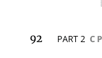

## 警告

The scanf() function as used in this chapter is considered insecure by modern coding standards. These exercises are good for learning C and practicing your coding. In the real world, however, programmers avoid using the scanf() function for input, because it can easily be exploited.

## 使用 scanf() 读取值

The scanf() function can do more than read strings. It can read in any value specified by a conversion character, as demonstrated in Listing 7-6.

## LISTING 7-6: scanf() 吃掉一个整数

```c
#include <stdio.h>

int main()
{
    int fav;

    printf("What is your favorite number: ");
    scanf("%d",&fav);
    printf("%d is my favorite number, too!\n",fav);
    return(0);
}
```

In Listing 7-6, the scanf() function reads an integer value from standard input. The %d conversion character is used, just like printf() — indeed, it's used again in Line 9. This character directs scanf() to look for an int value for variable fav.

### 练习 7-14

Write new source code using Listing 7-6. Build and run. Test the program by typing various integer values, positive and negative.

The ampersand (&) operator is used to prefix the second argument in the scanf() function. The & is the address-of operator. It's one of the advanced features in C, related to pointers. I avoid the topic of pointers until Chapter 18, but for now, know that an ampersand must prefix any variable specified in the scanf() function. The exception is an array, such as the firstname char array in Listing 7-5.

Try running the program again, but specify a decimal value, such as 41.9, or type text instead of a number.

The reason you see incorrect output is that scanf() is very specific. It fetches only the variable type specified by the conversion character. So if you want a floating-point value, you must specify a float variable and use the appropriate conversion character; %f, in this case.

### 练习 7-15

Modify the source code from Listing 7-6 so that a floating-point number is requested, input, and displayed.


- You don't need to prefix a char array variable with an ampersand in the scanf() function; when using scanf() to read in a string, just specify the string variable name.
- The scanf() function stops reading text input at the first whitespace character, space, tab, or Enter key.

## 使用 fgets() 进行文本输入

For a general-purpose text input function, one that reads beyond the first whitespace character, I recommend the fgets() function. Like most of the other text I/O functions, it's prototyped in the stdio.h header file. Here's the format:

```
char * fgets(char *restrict s, int n, FILE *restrict stream);
```

Frightening, no? The fgets() function is a file function, which reads text from a file, as in “file get string.” That’s how programmers talk after an all-nighter.

File functions are covered in Chapter 22, but because the operating system considers standard input like a file, you can use fgets() to read text from the keyboard.

Here's a simplified version of the fgets() function as it applies to reading text input:

```
fgets(string,size,stdin);
```

In this example, string is the name of a char array, a string variable; size is the number of characters to input plus one for the null character. Effectively, the size value is the same size as the char array. The final argument is the stdin constant, the name of the standard input device as defined in the stdio.h header file.

Listing 7-7 shows code that uses the fgets() function to read input.

## LISTING 7-7: fgets() 函数读取一个字符串

```c
#include <stdio.h>

int main()
{
    char name[10];

    printf("Who are you? ");
    fgets(name,10,stdin);
    printf("Glad to meet you, %s.\n",name);
    return(0);
}
```

### 练习 7-16

Type the source code from Listing 7-7 into your editor. Build and run.

The fgets() function in Line 8 reads text from standard input. The text is stored in the name array, which is set to a maximum of ten characters in Line 5. The value 10 is used as the second argument in the fgets() function to ensure that only nine characters are read, one less than the number specified. The final character in the name buffer is the null character, \0, which terminates the string.

The last argument in the fgets() function is stdin, the standard input device. This is the "file" from which input is read.


The char array must have one extra character reserved for the \0 at the end of a string. Its size must equal the size of input you need — plus one.

Here's how the program runs on my screen:

```
Who are you? Danny Gookin
Glad to meet you, Danny Goo.
```

Only the first nine characters of the text I typed in the first line are displayed. Why only nine? Because the tenth character must be the null character, \0, terminating the string. If the fgets() function were to read in ten characters instead of nine, the array would overflow and the program could malfunction.

If you type fewer than ten characters, you see that the Enter character is also stored in the string. This effect causes the period at the end of the printf() statement to appear alone on the following line:

```
Who are you? Danny
Glad to meet you, Danny
.
```

### 练习 7-17

Change the array size in the source code from Listing 7-7 to a constant value. Set the constant to allow only three characters input.

### 练习 7-18

Redo your solution for Exercise 7-13 so that fgets() rather than scanf() is used to read in the two strings.

You can read more about the reason fgets() is a preferred text input function in the nearby sidebar, “Avoid fgets()’s evil sibling gets().”


- The fgets() function as presented in this section reads text from the standard input device, not from the keyboard directly.
- The value returned by fgets() is the string that was input. In this book's sample code, this return value isn't used, although upon success, the string returned is identical to the information stored in the fgets() function's first argument, the char array variable.
- Chapter 13 offers more information about strings in C.


## 避免 fgets() 的邪恶兄弟 gets()

The original C language string-input function was gets(), for get-string. It took only a single argument, the character buffer or array into which text input was stored. The problem? No limit was set on this input, which means the buffer could easily overflow and wreak havoc in the computer. In fact, many early computer viruses were written specifically to exploit this weakness in the gets() function.

The gets() function is still available in the C library, though the compiler scolds you heavily for using it. Further, many compilers add warning text to any program created with the gets() function included in the code.

Bottom line: Don’t use gets() — use fgets() instead.


## 本章内容

-   使用 if 比较条件
-   使用比较运算符
-   为决策添加 else
-   创建 if-else-if-else 结构
-   进行逻辑决策
-   使用 switch-case 结构
-   体会三元运算符

### 第 8 章：决策

决策是编程中让你觉得计算机很聪明的部分。当然，它并不聪明，但你可以通过编写代码，让程序根据特定条件或比较来执行指令，从而骗过任何人。这个过程本身容易理解，但要从 C 程序中那种古怪的外观里获得这种理解，正是本章存在的必要原因。

### 假如？

所有人类戏剧都建立在违抗之上。无论规则如何，无论准则多么严格，总有个捣蛋鬼挣脱束缚，剩下的就成了有趣的故事。这段冒险始于“假如”这个简单的人类概念。程序中的决策也使用同一个概念，只不过在这种情况下只需要 if 这个词。

### 进行简单比较

你一直在做比较。你早上要穿什么？你是否应该避开比尔的办公室，因为玛乔丽说他今天“脾气暴躁”？你还要拖延多久才去看牙医？计算机也没什么不同，尽管它所做的比较使用的是值，而不是抽象概念，如清单 8-1 所示。

### 清单 8-1：一个简单比较

```c
#include <stdio.h>
int main()
{
    int a,b;
    a = 6;
    b = a - 2;
    if (a > b)
    {
        printf("%d is greater than %d\n",a,b);
    }
    return(0);
}
```

### 练习 8-1

使用清单 8-1 中所示的源代码创建一个新程序。构建并运行。你应该看到如下输出：

> 6 is greater than 4

快速又听话，计算机就是这样。代码的工作方式如下：

第 5 行声明两个整型变量：a 和 b。这些变量在第 7 行和第 8 行被赋值；变量 b 的值被赋为变量 a 的值减去 2。

第 10 行进行比较：

```c
if (a > b)
```

程序员把这行读作：“如果 a 大于 b。”或者在教 C 语言时，他们会说：“如果变量 a 大于变量 b。”而且，不，他们不会把括号念出来。

第 11 到 13 行组成一个属于 if 语句的块。夹在中间的核心是第 12 行；花括号并不起决策作用，只是把第 12 行的语句包起来。当第 10 行的 if 表达式为真时，第 12 行的语句被执行。否则，该块中的所有语句都会被跳过。

### 练习 8-2

修改清单 8-1 的源代码，使第 8 行执行加法而不是减法。你能解释程序的输出吗？

### 介绍 if 关键字

if 关键字用于根据简单比较在代码中做出决策。基本格式如下：

```c
if(expression)
{
    statement;
}
```

表达式可以是一个比较、一次数学运算、一个函数的结果或其他某种条件。当表达式为真时，花括号内的一条或多条语句会被执行；否则，它们会被跳过。

if 语句的表达式不必是数学表达式。例如，它可以是一个返回真值或假值的函数：

```c
if( ready() )
```

这条语句会求 ready() 函数的返回值。如果该函数返回真值，则属于 if 的语句会被执行。

在 C 中，任何非零值都被视为真。零被视为假。所以下面这条语句为真：

```c
if(1)
```

而下面这条语句始终为假：

```c
if(0)
```

你可以通过阅读函数的文档来了解它返回真值还是假值，也可以在编写自己的函数时设置真值或假值返回值。

不能使用 if 比较来比较字符串。相反，你要使用专门的字符串比较函数，第 13 章会介绍这些内容。

当 if 比较只对应一条语句时，花括号是可选的。


### 练习 8-3

重写清单 8-1 中的代码，删除第 12 行前后的花括号。构建并运行，确保它仍然可以工作。

### 以多种方式比较值

C 语言提供了一小组数学比较运算符。我把它们汇总在表 8-1 中，供你查阅。

### 表 8-1：C 语言比较运算符

| 运算符 | 读法 | 示例 | 为真时 |
|----------|---------------|---------|-----------|
| != | 不等于 | a != b | a 不等于 b |
| < | 小于 | a < b | a 小于 b |
| <= | 小于或等于 | a <= b | a 小于或等于 b |
| == | 等于 | a == b | a 等于 b |
| > | 大于 | a > b | a 大于 b |
| >= | 大于或等于 | a >= b | a 大于或等于 b |

C 中的比较从左到右读，所以你把 a >= b 读作“a 大于或等于 b”。另外，顺序很重要：>= 和 <= 都必须按这个顺序写，!=（不等于）运算符也必须如此。== 运算符则两种写法都可以。

### 清单 8-2：比较值

```c
#include <stdio.h>

int main()
{
    int first,second;
    printf("Input the first value: ");
    scanf("%d",&first);
    printf("Input the second value: ");
    scanf("%d",&second);
    puts("Evaluating...");
    if(first<second)
    {
        printf("%d is less than %d\n",first,second);
    }
    if(first>second)
    {
        printf("%d is greater than %d\n",first,second);
    }
    return(0);
}
```

### 练习 8-4

使用清单 8-2 中所示的源代码创建一个新项目。构建并运行。

if 检查的最常见表达式大概就是双等号。它在你看来可能有些奇怪。== 运算符与 = 运算符不同。= 运算符是赋值运算符，用于设置值。== 运算符是比较运算符，用于检查两个值是否相等。

> 我把 == 读作“等于”。

### 练习 8-5

向清单 8-2 的源代码中添加一个新部分，对两个变量是否彼此相等作出最终判断。

### 练习 8-6

将清单 8-3 中的源代码输入一个新的源代码文件。构建并运行。

### 清单 8-3：把“等于”记牢

```c
#include <stdio.h>

int main()
{
    const int secret = 17;
    int guess;
    printf("Can you guess the secret number: ");
    scanf("%d",&guess);
    if(guess==secret)
    {
        puts("You guessed it!");
        return(0);
    }
    if(guess!=secret)
    {
        puts("Wrong!");
        return(1);
    }
}
```

注意程序返回的值——正确答案为 0，错误答案为 1。如果你使用的是 Code::Blocks 或其他 IDE，可以在输出窗口中看到这个值。

### 了解 = 与 == 的区别

每一位 C 语言程序员——无论初学者还是高手——最常犯的错误之一，就是在 if 表达式中使用单等号而不是双等号。为此，我给出清单 8-4。

### 清单 8-4：永远为真

```c
#include <stdio.h>

int main()
{
    int a;

    a = 5;

    if(a=-3)
    {
        printf("%d equals %d\n",a,-3);
    }
    return(0);
}
```

### 练习 8-7

使用清单 8-4 中所示的源代码创建一个新程序。忽略任何警告并运行该程序。

输出可能会让你困惑。我看到的是：

```
-3 equals -3
```

这是真的，不是吗？但发生了什么？

第 9 行中，变量 a 被赋值为 -3。因为这个表达式位于括号内，所以它会先被求值。在 C 中，对于任何非零值，变量赋值的结果始终为真。

### 练习 8-8

修改清单 8-4 的源代码，使 if 比较中使用双等号，也就是“等于”，而不是单等号。

### 忘记把分号放在哪里

清单 8-5 基于清单 8-4，利用了这样一个事实：C 并不要求属于 if 比较的单条语句被花括号包裹成块。

### 清单 8-5：分号小失误

```c
#include <stdio.h>

int main()
{
    int a,b;

    a = 5;
    b = -3;

    if(a==b);
        printf("%d equals %d\n",a,b);
    return(0);
}
```

### 练习 8-9

仔细输入清单 8-5 中的源代码。特别注意第 10 行。确保完全照原样输入，行末带分号。忽略任何警告。构建并运行该程序。

我看到的是如下输出：

```
5 equals -3
```


这里的问题很常见，几乎每个 C 程序员都会犯这个错误：代码清单 8-5（第 10 行）末尾的分号告诉程序，当条件为真时，if 语句什么都不做。这是因为在 C 中，单个分号就是一个完整的语句，尽管它是一个空语句。也就是说：

```
if(condition)
    ;
```

这种写法基本上与代码清单 8-5 中的第 10 行相同。注意不要犯同样的错误——尤其是在你经常输入代码、习惯用分号结束一行的时候。

## 多个决策

并非每个决策都是清晰明确的“是或否”命题。例外情况随时都会发生。C 提供了几种处理这些例外情况的方法，让你能够编写根据多种可能性执行不同操作的代码。

## 做出更复杂的决策

对于二选一类型的比较，if 关键字有一个搭档——else。它们一起工作，如下所示：

```
if(expression)
{
    statement(s);
}
else
{
    statement(s);
}
```

在 if-else 结构中，当表达式为真时，执行属于 if 的语句；否则，执行属于 else 的语句。这是一种二选一的决策。

代码清单 8-6 算是对代码清单 8-1 中所示代码的一种更新。原来的单个 if 结构已被 if-else 取代。当 if 比较为假时，执行属于 else 的语句。

## **代码清单 8-6：** if-else 比较

```c
#include <stdio.h>

int main()
{
    int a,b;

    a = 6;
    b = a - 2;

    if( a > b)
    {
        printf("%d is greater than %d\n",a,b);
    }
    else
    {
        printf("%d is not greater than %d\n",a,b);
    }
    return(0);
}
```

**练习 8-10：** 将代码清单 8-6 的源代码输入一个新项目。编译并运行。

**练习 8-11：** 修改源代码，让用户能够输入变量 b 的值。

**练习 8-12：** 修改代码清单 8-3 中的源代码，用 if-else 结构替换那个丑陋的 if-if 写法。（*提示：* 最佳解决方案只改一行代码。）

### 添加第三种选项

程序中的决策并非都是二选一。有时，你会需要“非此即彼、或者再或者”之类的结构。英语中没有词能描述这种结构，但 C 中存在这种结构。它看起来像这样：

```c
if(expression)
{
    statement(s);
}
else if(expression)
{
    statement(s);
}
else
{
    statement(s);
}
```

当第一个表达式为假时，else if 语句会再进行一次测试。如果该表达式为真，则执行它的语句。当两个条件都不为真时，执行属于最后 else 的语句。

**练习 8-13：** 以代码清单 8-2 中的源代码为基础，创建一个处理三种条件的 if-if-else-else 结构。前两个条件已在代码清单 8-2 中指定，你需要使用类似本节所示的结构来添加最后一种可能性。

对于 if 决策过程可以添加多少个 else if 语句，C 没有限制。你的代码可以是一个 if，后面跟三个 else-if 条件，最后跟一个 else。这种过程可行，尽管可能不是最佳方法。要了解更好的方式，请参见后面的“做出多项选择”一节。

## 使用逻辑进行多重比较

有些比较比前面表 8-1 中所示的简单运算符所呈现的比较更复杂。例如，考虑下面这个数学式：

```
-5 <= x <= 5
```

用英语来说，这个语句表示 x 代表一个介于 -5 和 5 之间（含两端）的值。这并不是 C 语言中的 if 比较，但当你使用逻辑运算符时，它可以成为 if 比较。

## 构建逻辑比较

## 代码清单 8-7：逻辑是一只叽叽喳喳的鸟

```c
#include <stdio.h>

int main()
{
    int coordinate;

    printf("Input target coordinate: ");
    scanf("%d",&coordinate);
    if( coordinate >= -5 && coordinate <= 5 )
    {
        puts("Close enough!");
    }
    else
    {
        puts("Target is out of range!");
    }
    return(0);
}
```

第 9 行的 if 语句条件进行了两次比较。该语句读起来是这样的：“如果变量 coordinate 的值大于或等于 −5，并且小于或等于 5。”

**练习 8-14：** 使用代码清单 8-7 中的源代码创建一个新项目。构建程序。多次运行代码，测试它运行得如何。

## 添加一些逻辑运算符

C 语言的逻辑比较运算符如表 8-2 所示。当必须满足两个或更多条件时，可以在 if 表达式中使用这些运算符。

## 表 8-2 逻辑比较运算符

| 运算符 | 名称 | 为真的条件 |
|---|---|---|
| && | 与 | 两个比较都为真 |
| || | 或 | 任一比较为真 |
| ! | 非 | 该项为假 |

代码清单 8-7 使用 && 运算符作为逻辑 AND 比较。必须两个指定条件都为真，*if* 语句才会认为括号中的所有内容为真。

**练习 8-15：** 修改代码清单 8-7 中的源代码，使逻辑 OR 运算在变量 *coordinate* 的值小于 –5 或大于 5 时使条件为真。

**练习 8-16：** 为一个程序创建源代码，该程序提出那个常见问题：“Do you want to continue (Y/N)?” 处理单字符输入，测试 Y 或 N，无论大写还是小写。确保当输入既不是 Y 也不是 N 时，程序能正确响应。

-   逻辑运算通常用全大写来指代：AND、OR。这样可以将它们与普通单词 *and* 和 *or* 区分开。
-   逻辑 AND 由两个和号表示：&&。读作“and”。
-   逻辑 OR 由两个竖线（或垂直条）字符表示：||。读作“or”。
-   逻辑 NOT 由单个感叹号表示：!。读作“not!”
-   逻辑 NOT 放在一个值或括号中的表达式前面，以反转结果，将 False 变为 True，将 True 变为 False。

### 老式的 switch case 技巧

堆叠一大堆 *if* 和 *if-else* 语句可能有效，但它并不是处理某些多项选择决策的最佳方式。C 语言提供的一种替代方案称为 *switch-case* 结构。

### 做出多项选择

*switch-case* 结构允许你在 C 程序中基于单个值编写决策代码。它就是多项选择语句，如代码清单 8-8 所示。

## 代码清单 8-8：多项选择

```c
#include <stdio.h>

int main()
{
    int code;

    printf("Enter the error code (1-3): ");
    scanf("%d",&code);
    switch(code)
    {
        case 1:
            puts("Drive Fault, not your fault.");
            break;
        case 2:
            puts("Illegal format, call a lawyer.");
            break;
        case 3:
            puts("Bad filename, spank it.");
            break;
        default:
            puts("That's not 1, 2, or 3");
    }
    return(0);
}
```

**练习 8-17：** 使用代码清单 8-8 中的代码创建一个新程序。直接把它输入进去；我稍后会描述它。构建它。多次运行它，尝试各种值，看看它如何响应。

在编辑器中查看源代码，你可以参照下面段落中提到的行号。

switch-case 结构从第 9 行的 switch 语句开始。它要评估的项括在括号中。与 if 语句不同，switch 只接受单个值，而不是比较。在第 9 行中，这个值是用户输入的整数（在第 8 行读取）。

结构的 case 部分括在花括号中，位于第 10 行到第 22 行之间。case 语句显示单个值，例如第 11 行中的 1。该值后面跟一个冒号。

每个 case 语句指定的值都会与 switch 语句中指定的项进行比较。如果值相等，则执行属于 case 的语句。如果不相等，则跳过它们，并比较下一个 case 值。

break 关键字会停止程序流通过 switch-case 结构。程序流会在 switch-case 结构的最后一个花括号之后恢复，也就是代码清单 8-8 中的第 23 行。

在最后一次比较之后，switch-case 结构使用一个 default 项，如第 20 行所示。当没有任何 case 比较匹配时，会执行该项的语句。default 项不必指定，不过在代码清单 8-8 中它处理超出范围的值。

练习 8-18：使用类似代码清单 8-8 的源代码构建一个程序，但让输入为字母 A、B 和 C。你可能想复习第 7 章，了解在 C 语言中如何指定单个字符。


-   在 switch-case 结构中所做的比较，是在 switch 的括号中指定的值与每个 case 关键字后面的值之间进行的。当比较为真，即两个值彼此相等时，执行属于 case 的语句。
-   break 关键字会打断程序流。它也可以用在 if 结构中，但大多数情况下出现在循环中。参见第 9 章。
-   在 case 比较的语句之后指定 break，以便不会执行结构的其余部分。参见后面的“不执行 break”一节。

## 理解 switch-case 结构

现在——介绍 C 中最复杂的东西。说真的，在 switch-case 中你会发现的规则和结构比 C 中几乎任何其他构造都多。下面是它的骨架：

```
switch(expression)
{
    case value1:
        statement(s);
        break;
    case value2:
        statement(s);
        break;
    case value3:
        statement(s);
}
```


```
break;
default:
statement(s);
}
```

switch 项引入该结构，该结构紧随其后并由一组花括号括起来。该结构必须至少包含一个 case 语句，不过要让其发挥作用，需要多个 case 语句。

switch 语句在圆括号中包含一个表达式。该表达式必须求值为单个值。它可以是变量、函数返回的值，或数学运算。

case 语句后面紧跟一个立即值，然后是一个冒号。该语句之后是一条或多条语句。当 case 后面的立即值与 switch 语句的表达式匹配时，这些语句会被执行。否则，这些语句会被跳过，并计算下一个 case 语句。

break 关键字用于跳出 switch-case 结构。否则，程序执行会贯穿该结构继续向下执行。

default 项结束 switch-case 结构。它包含的语句会在没有任何 case 语句匹配时执行。如果没有剩下要做的事，你可以从 switch-case 结构中省略 default 项。

switch-case 结构中的 case 部分不进行求值。如果代码需要多次比较，请改用多重 if-else 类型的结构。

## 不设 break

可以构造一个没有 break 语句的 switch-case 结构。在某些特殊情况下，这种做法甚至可能有用，如清单 8-9 所示。

### 清单 8-9：膳食计划决策

```
#include <stdio.h>
int main()
{
char choice;
puts("Meal Plans:");
puts("A - Breakfast, Lunch, and Dinner");
puts("B - Lunch and Dinner only");
puts("C - Dinner only");
printf("Your choice: ");
scanf("%c",&choice);

printf("You've opted for ");
switch(choice)
{
    case 'A':
        printf("Breakfast, ");
    case 'B':
        printf("Lunch and ");
    case 'C':
        printf("Dinner ");
    default:
        printf("as your meal plan.\n");
}
return(0);
}
```

**练习 8-19：** 使用清单 8-9 中的源代码创建一个新程序。构建并运行。

**练习 8-20：** 如果你理解 *case* 语句如何贯穿（fall through），请修改练习 8-19，使 *switch-case* 结构同时判断大写和小写字母。

## 奇怪的 ?: 决策工具


在这个漫长而充满决策的章节里，我还有最后一个古怪的决策工具要抛给你。它或许是 C 语言中最隐晦的决策工具，深受喜欢把代码写得晦涩难懂的程序员喜爱。请看清单 8-10。

### 清单 8-10：然后事情变得奇怪了

```c
#include <stdio.h>

int main()
{
  int a,b,larger;

  printf("Enter value A : ");
  scanf("%d",&a);
  printf("Enter different value B : ");
  scanf("%d",&b);

  larger = (a > b) ? a : b;
  printf("Value %d is larger.\n",larger);
  return(0);
}
```

具体来说，你要看第 12 行；我把它单独列在这里，尽管它在清单 8-10 里已经够难看了：

```
larger = (a > b) ? a : b;
```

> 练习 8-21：使用清单 8-10 中的源代码创建一个项目。构建并运行，以证明这个奇怪的 ?: 工具确实有效。

正式来说，?: 被称为三元运算符。它由三部分组成：一个比较，然后是“为真时的值”和“为假时的值”。用直白的黑客英语来写，该语句看起来像这样：

```
result = expression ? if_true : if_false;
```

该语句以一个表达式开头。凡是可以放进 if 语句括号里的内容都行，所有数学和逻辑运算符也一样。我通常会把表达式括在圆括号里，不过这不是必需的。

当表达式为真时，会计算语句中 if_true 部分，并将其值存入 result 变量。否则，存入 if_false 的结果。哦，result 不必是变量；三元运算符生成的值也可以立即用在函数中。

> 练习 8-22：使用 if-else 结构重写清单 8-10 中的源代码，以完成第 12 行 ?: 三元运算符所做的判断并得到结果。

## 本章内容

- 理解循环
- 探索 for 循环
- 创建嵌套 for 循环
- 使用 while 循环
- 使用 do while 循环
- 避免无限循环

### 第 9 章：循环，循环，循环

### 循环，循环，循环

程序喜欢一遍又一遍地做事，而且乐在其中。它们从不抱怨，也从不疲倦。事实上，除非你正确编写了停止指令，否则它们会永远重复下去。确实，循环是一个基本的编程概念。做好它。做好它。做好它。

### 一点似曾相识

循环是一段重复执行的代码。重复多少次？这取决于你如何编写循环。概括来说，一个循环涉及三件事：

- 初始化
- 一条或多条重复执行的语句
- 一个退出条件

初始化用于设置循环，通常指定循环开始或激活所依据的条件。例如，“将计数器从 1 开始”。

重复执行的语句作为一个块包含在花括号中。它们会一条接一条地继续执行，直到满足退出条件。

退出条件决定循环何时停止。它可以是满足某个条件，例如“当计数器等于 10 时停止”，也可以是遇到 break 语句时停止。程序执行会继续执行循环最后一个花括号之后的下一条语句。


拥有退出条件也许是循环最重要的部分。没有它，循环会永远重复，这种情况称为无限循环。参见后面“无限循环”一节。

C 语言有两个循环关键字：for 和 while。辅助 while 关键字的是 do 关键字。goto 关键字也可以用于循环，不过它很不受欢迎。

### for 循环的乐趣

循环是一组重复执行的语句。你可以选择固定的迭代次数，也可以让重复次数基于某个值。无论哪种方式，for 关键字都能帮助建立一种基本类型的循环。

### 执行某操作 x 次

编写源代码将同一行文本显示十次是完全可能的，甚至是一种有效方案。你可以复制粘贴一条 printf() 语句来完成这件事。这很简单，但它不是循环，如清单 9-1 所示。

### 清单 9-1：把它写十遍！

```
#include <stdio.h>

int main()
{
    int x;

    for(x=0; x<10; x=x+1)
    {
        puts("Sore shoulder surgery");
    }
    return(0);
}
```

练习 9-1：使用清单 9-1 中的源代码创建一个新程序。仔细输入所有内容，尤其是第 7 行。构建并运行。

作为输出，程序会吐出十遍绕口令“Sore shoulder surgery”，共十行文本。关键当然在第 7 行，也就是 for 语句。该语句指示程序将花括号中的语句总共重复十次。

练习 9-2：再次使用清单 9-1 中的源代码，将第 7 行中的值 10 替换为值 20。构建并运行。

### 介绍 for 循环

for 循环通常是学习编程时遇到的第一种循环。它看起来复杂，但那是因为它在单条语句中完成了循环所需的一切：

```
for(initialization; exit_condition; repeat_each)
```

它是这样工作的：

initialization 是在循环开始时求值的 C 语言表达式。最常见的情况是，在这里初始化用于统计循环迭代次数的变量。

exit_condition 是决定循环停止的测试。在 for 循环中，语句会继续重复，直到退出条件为真。用于 exit_condition 的表达式通常是一个比较，就像你在 if 语句中看到的那样。

repeat_each 是每次迭代执行一次的表达式。它通常是对 for 语句第一部分中的初始化变量进行操作。

for 语句后面跟着一个由一个或多个语句组成的块，这些语句放在花括号中：

```
for(x=0; x<10; x=x+1)
{
    puts("Sore shoulder surgery");
}
```


你可以在只指定一个语句时省略括号：

```
for(x=0; x<10; x=x+1)
    puts("Sore shoulder surgery");
```

在此 for 语句中，以及在列表 9-1 中，第一个表达式是初始化：

```
x=0
```

int 变量 x 的值被设为 0。在 C 编程中，你从 0 开始计数，而不是从 1 开始。这样做的好处在本书各处都有介绍。

第二个表达式设置循环的退出条件：

```
x<10
```

只要变量 x 的值小于 10，循环就会重复。一旦该表达式为假，循环就会停止。结果是循环重复十次。这是因为 x 从 0 开始，而不是从 1 开始。

最后，第三个表达式在循环的每次迭代中重复：

```
x=x+1
```

每次执行循环的语句时，变量 x 的值都会增加 1。前面的语句读作：“变量 x 等于变量 x 的值，加上 1。”因为 C 先计算等式的右边，所以不会出错。因此如果当前 x 的值为 5，则 x 的新值将为 6。

总的来说，我这样读这个表达式：

```
for(x=0; x<10; x=x+1)
```

> “对于 x 从 0 开始，当 x 小于 10 时，给 x 加 1。”

列表 9-2 显示了另一个简单的 for 循环示例。它显示从 −5 到 5 的值。

### 列表 9-2：用循环计数

```c
#include <stdio.h>

int main()
{
    int count;

    for(count=-5; count<6; count=count+1)
    {
        printf("%d\n",count);
    }
    return(0);
}
```

**练习 9-3：** 将列表 9-2 中的源代码输入编辑器。保存、构建并运行。

**练习 9-4：** 使用列表 9-2 中的源代码作为起点创建一个新项目。显示从 11 到 19 的值。用制表符字符 \t 分隔每个值。使用 <= 符号作为结束循环的比较。在循环结束时添加一个最终的换行符以清理显示。


- for 语句使用两个分号，而不是逗号，来分隔每个项目。即使如此：
- 可以通过使用逗号在 for 语句中指定两个条件。这种设置相当罕见，所以不要让它困扰你。有关详细信息，请参阅后面的章节“添加多个 for 循环条件”。

## 用 for 语句计数

在你的编程之旅中，你会相当频繁地使用 for 语句。列表 9-3 显示了另一种计数变体。

### 列表 9-3：每次计数两个

```c
#include <stdio.h>

int main()
{
    int duo;

    for(duo=2;duo<=100;duo=duo+2)
    {
        printf("%d\t",duo);
    }
    putchar('\n');
    return(0);
}
```

练习 9-5：使用列表 9-3 作为源代码创建一个新项目。编译并运行。

程序的输出显示从 2 到 100 的偶数值。值 100 会被显示出来，因为 for 语句中的“while true”条件使用了 <=（小于或等于）。变量 duo 因为以下表达式而每次增加两个：

```
duo=duo+2
```

在第 9 行，printf() 函数使用 \t 来显示制表符（尽管数字在 80 列显示上可能无法完美对齐）。此外，putchar() 函数在第 11 行插入一个换行符。

练习 9-6：修改列表 9-3 中的源代码，使输出从数字 3 开始并一直显示到 100 的 3 的倍数。

练习 9-7：创建一个程序，从 25 倒数到 0。

## 循环字母

列表 9-4 显示了使用 for 循环“计数”的另一种方法。

### 列表 9-4：按字母计数

```c
#include <stdio.h>

int main()
{
    char alphabet;

    for(alphabet='A';alphabet<='Z';alphabet=alphabet+1)
    {
        printf("%c",alphabet);
    }
    putchar('\n');
    return(0);
}
```

在输入列表 9-4 的源代码之前，你能猜出输出可能是什么吗？这对你有意义吗？

**练习 9-8：** 使用列表 9-4 的源代码创建一个新程序。构建并运行。

**练习 9-9：** 修改练习 9-8 的解决方案，将第 9 行的 printf() 函数中的占位符从 %c 改为 %d。


计算机将字符视为数字。只有当数字被显示并且落在字符的 ASCII 代码范围内时，字符才会出现。（请参阅附录 A 获取 ASCII 字符代码列表。）

**练习 9-10：** 以列表 9-4 为灵感，编写一个 for 循环，从 z（小写 Z）倒数到 a（小写 A）。

## 嵌套 for 循环

你可以放入 for 循环内部的东西之一是另一个 for 循环。在循环中嵌套循环似乎很疯狂，但这是一种常见做法。官方术语是嵌套循环。列表 9-5 显示了一个示例。

三重嵌套循环包含三个 for 语句，这延续了列表 9-5 中显示的级联。只要你能将花括号与每个 for 语句匹配起来（多亏了现代文本编辑器，这很容易），你就可以相当轻松地完成它。

练习 9-12：编写一个 3 字母缩写生成程序。程序的输出列出从 AAA 到 ZZZ 的所有 3 字母组合，每行输出一个。


我在我的第一个编程项目之一中编写了一个类似练习 9-12 解决方案的程序。当时的计算机如此缓慢，以至于输出大约需要十秒钟才能运行。在今天的计算机上，输出几乎是即时的。

## while 循环的乐趣

C 中另一个流行的循环关键字是 while。它有一个伴侣 do，所以程序员将这种类型的循环称为 while 或 do while。C 语言缺少 do-whacka-do 类型的循环。

### 构建 while 循环

C 语言的 while 循环看起来比 for 循环容易得多，但它涉及更仔细的设置和准备。基本上，它是这样的：

```
while(expression)
{
    statement(s);
}
```

表达式是一个值、一个比较或许多其他导致真/假条件的东西，就像你在 if 语句中找到的那样。表达式在循环每次重复时都会被求值。只要它是真的（“while”它是真的），循环就会旋转，其语句继续执行。


因为表达式在循环开始时求值，所以循环必须在 while 语句之前初始化，如列表 9-6 所示。

那么 while 循环如何结束？终止必须在循环的语句内触发。通常，其中一个语句会影响被求值的表达式，使其变为假。while 循环完成后，程序执行将继续执行最后一个花括号之后的下一条语句。

当 while 循环只有一个语句时，也可以省略花括号：

```
while(expression)
statement;
```

### 列表 9-6：列表 9-1 的 while 版本

```c
#include <stdio.h>
int main()
{
    int x;
    x=0;
    while(x<10)
    {
        puts("Sore shoulder surgery");
        x=x+1;
    }
    return(0);
}
```

列表 9-6 中演示的 while 循环有三个部分：

- 初始化发生在第 7 行，变量 x 被设为等于 0。
- 循环的退出条件包含在 while 语句的括号内，如第 8 行所示。
- 迭代循环的项目在第 11 行找到，变量 x 的值在那里增加。

练习 9-13：使用列表 9-6 的源代码创建一个新程序。构建并运行。

练习 9-14：更改源代码中的第 7 行，使变量 x 被赋值为 13。构建并运行。你能解释输出吗？

练习 9-15：编写一个程序，使用 while 循环输出从 -5 到 5 的值，增量为 0.5。

### 使用 do while 循环

do while 循环可以描述为倒置的 while 循环。这个描述是正确的，尤其是在你查看其结构时：

```
do
{
    statement(s);
} while (condition);
```

与 while 循环一样，初始化必须在进入循环之前进行，并且循环的其中一个语句应影响条件以使循环退出。然而，while 语句出现在最后一个花括号之后。do 语句开始该结构。

由于其反向结构，while 循环和 do while 循环之间的主要区别在于 do while 循环至少执行一次。因此，当你需要确保语句执行时，最适合使用这种类型的循环。同样，当你不希望语句在条件为真之前执行时，避免使用 do while。列表 9-7 显示了一个有趣的 do while 循环。

### 列表 9-7：斐波那契数列

```c
#include <stdio.h>

int main()
{
    int fibo,nacci;

    fibo=0;
    nacci=1;

    do
    {
        printf("%d ",fibo);
        fibo=fibo+nacci;
        printf("%d ",nacci);
        nacci=nacci+fibo;
    } while( nacci < 300 );

    putchar('\n');
    return(0);
}
```


**练习 9-16：** 把代码清单 9-7 的源代码输入编辑器。注意输入！最后的 *while* 语句（参见第 16 行）必须以分号结尾；否则，编译器就会对你大发雷霆。

以下是输出：

```
0 1 1 2 3 5 8 13 21 34 55 89 144 233
```

循环从第 7 行和第 8 行开始，变量在这里初始化。

第 12 行到第 15 行计算斐波那契值。两个 *print()* 函数显示这些值。

循环在第 16 行结束，*while* 语句在这里进行求值。只要变量 `nacci` 小于 300，循环就会重复。你可以把这个值调高，让程序输出更多斐波那契数。

在第 18 行，*putchar()* 语句通过添加换行符来整理输出。

**练习 9-17：** 把你的练习 9-14 的解法改写成 *do while* 循环。

## 循环那些事儿

我可以整天没完没了地讲循环，无限重复自己！不过，在继续之前，我想先过一遍几个循环技巧和陷阱。在你拿到正式的 *For Dummies* 循环程序员证书之前，这些是你应该知道的事情。

### 无限循环

当心无限循环！


当程序进入无限循环时，它要么无休止地一遍遍输出，要么卡在那里一动不动。嗯，它其实是在做你命令它做的事，也就是永远转下去。有时这种设置是故意的，但大多数情况下是程序员的错误造成的。而且以 C 语言中循环的设置方式，很容易无意中 *无止境地* 循环下去。

代码清单 9-8 展示了一个常见的无限循环，这是编程错误，不是语法错误。

### 代码清单 9-8：制造无限循环的常见方法

```c
#include <stdio.h>

int main()
{
    int x;
    for(x=0;x=10;x=x+1)
    {
        puts("What are you lookin' at?");
    }
    return(0);
}
```

代码清单 9-8 中代码的问题在于，for 语句的退出条件始终为真：x=10。如果你第一次没看出来，就再读一遍，或者直接做练习 9-18。

**练习 9-18：** 输入代码清单 9-8 的源代码。保存并构建，忽略任何警告。运行。

程序会运行——无限地运行。


- 要跳出无限循环，请在键盘上按 Ctrl+C。这个技巧只适用于控制台程序，而且可能并不总是有效。如果无效，你需要终止失控的进程，这件事我没时间在本书里解释。
- 无限循环也称为 *无限循环*。

## 有意为之的无限循环

偶尔，程序需要无限循环。例如，微控制器可能加载一个程序，只要设备开着就一直运行。在 C 中有意设置这样的循环时，会使用以下两种语句之一：

```c
for(;;)
```

我把这条语句读作“for ever（永远）”。括号里没有任何内容，但仍然保留必需的两个分号，for 循环就会永远重复——直到奶牛回家之后也不会停。下面是等价的 while 循环：

```
while(1)
```

括号里的值不一定是 1；任何为真或非零的值都可以。不过，当循环是有意无限时，大多数程序员会把值设为 1，只是为了自我说明他们清楚自己在做什么。

你可以在下一节看到一个有意为之的无限循环示例。

## 跳出循环

任何循环都可以立即终止——包括无限循环——只要在循环重复执行的语句组中使用 break 语句即可。遇到 break 时，循环停止，程序执行从循环最后一个花括号之后的下一语句继续。代码清单 9-9 演示了这个过程。

### 代码清单 9-9：让我出去！

```c
#include <stdio.h>

int main()
{
    int count;

    count = 0;
    while(1)
    {
        printf("%d ",count);
        count = count+1;
        if( count > 50)
            break;
    }
    putchar('\n');
    return(0);
}
```

第 8 行的 while 循环被配置为永远运行，但第 12 行的 if 测试可以停止它：当 count 的值大于 50 时，break 语句（参见第 13 行）被执行，循环停止。

**练习 9-19：** 使用代码清单 9-9 的源代码构建并运行一个新项目。

**练习 9-20：** 重写代码清单 9-9 的源代码，改用无限 for 循环代替无限 while 循环。


你不需要构造无限循环才能使用 break 语句。你可以跳出任何循环。跳出后，执行会从循环最后一个花括号之后的第一个语句继续。

## 为 for 循环添加多个条件

for 循环中一个常见错误是用逗号而不是分号来分隔各部分。但 for 循环的括号中允许使用逗号，只是不能用它替代分号。相反，逗号用于指定多个初始化操作以及多个循环条件。代码清单 9-10 展示了如何在 for 语句中疯狂使用逗号。

### 代码清单 9-10：这里太挤了

```c
#include <stdio.h>

int main()
{
    int a;
    char c;

    for( a=1,c='Z'; a<5; a+=1,c-=1 )
        printf("%d%c\n",a,c);
    return(0);
}
```

第 8 行展示了一个 for 语句，它有两个初始化以及两个每次循环重复时都会执行的表达式。这两对都用逗号分隔。分号仍然把 for 循环的三个部分各自分组。

首先，变量 a 初始化为 1，变量 c 初始化为字母 Z。只要变量 a 的值小于 5，循环就会继续。并且每次语句重复后，变量 a 的值增加 1，变量 c 的值减少 1。

**练习 9-21：** 把代码清单 9-10 的源代码输入编辑器。构建并运行。

## 把循环搞砸

我知道两种常见的搞砸循环的方式。这些麻烦点对新手和老手都会出现。避免这些问题的唯一方法是保持敏锐的眼光，以便快速发现它们。

第一个错误是指定一个永远无法满足的条件；例如：

```
for(x=1;x==10;x=x+1)
```

在前一行中，退出条件在循环第一次执行之前就为假，所以循环根本不会执行。这个错误几乎和用赋值运算符（单个等号）代替“等于”运算符（如刚才所示）一样隐蔽。

另一个常见错误是把分号放错位置，如下所示：

```
for(x=1;x<14;x=x+1);
{
    puts("Sore shoulder surgery");
}
```

因为第一行（for 语句）以分号结尾，所以这一行就是整个循环。空代码重复 13 次，这正是 for 语句所要求的。然后 puts() 语句执行一次。


游离的分号可能令人沮丧！

while 循环的问题更糟，因为 do while 结构要求在最后的 while 语句之后加分号。事实上，忘记那个特定的分号也是烦恼的来源。对于传统的 while 循环，你不应该这样做：

```
while(x<14);
{
    puts("Sore shoulder surgery");
}
```

大多数编译器会用警告捕获这些游离分号问题。不过，还是要留意，正如代码清单 9-11 所演示的那样。

### 代码清单 9-11：没有循环体的 for 循环

```c
#include <stdio.h>

int main()
{
    int x;
    for(x=0;x<10;x=x+1,printf("%d\n",x));
    ;
    return(0);
}
```

在代码清单 9-11 所示的示例中，分号放在第 8 行 for 语句之后的下一行。这个位置表明是有意为之。

与上一节的示例一样，for 语句的括号中放置了两个表达式，两者用逗号分隔。

**练习 9-22：** 把代码清单 9-11 的源代码输入编辑器。构建并运行。

尽管你可以在 for 语句的括号里塞入多项内容，但这种情况很少见，而且为了可读性并不推荐。

## 避免 GOTO 地狱

第三种循环语句是最令人厌恶、也是 C 语言关键字中最低等的。它就是 goto，读作“go to”而不是“got-to”。它把程序执行引导到源代码中的另一行，也就是由标签标记的行。下面是一个例子：

```
here:
puts("This is a type of loop");
goto here;
```

当这段代码执行时（从上到下），here 标签被忽略。接下来执行 puts() 函数，最后 goto 把程序流重新引导回 here 标签。一切重复。一切正常。但它就是太丑陋了。

大多数聪明的程序员能够以不需要 goto 的方式编写代码。结果更具可读性——这才是关键。包含大量 goto 语句的代码可能难以理解，经验丰富的程序员会把它称为意大利面条式代码。goto 语句鼓励草率的习惯。

goto 可能真正必要的唯一时机是跳出嵌套循环。即使在这种情况下，举例也会显得牵强。所以可以说，你整个编程生涯中，但愿永远都不必在 C 中处理 goto 语句。


## 本章内容
- 创建函数
- 避免原型
- 在函数中处理变量
- 向函数传递参数
- 从函数返回值
- 使用 return 退出函数

### 第10章：与函数同乐
### 与函数同乐
当需要完成工作时，是程序的函数承担了繁重的工作。C 语言附带了充满函数的库，这些库有助于加强语言的基础、关键字、运算符等等。当这些 C 库函数不足时，你就自己设计函数。

### 函数的解剖
制作自己的函数所需的工具很简短。在确定函数用途后，你为其赋予一个唯一的名字，加上一些括号和大括号，就基本完成了。当然，实际情况稍微复杂一些。

### 构造函数
所有函数都以名称命名，该名称必须是唯一的；两个函数不能同名，函数也不能与代码中使用的关键字或变量同名。

名称后面跟着括号，然后是花括号。因此，在最简单的构造中，函数看起来像这样：

```
type function() { }
```

在前面的示例中，type 定义了函数的返回数据类型，与函数返回的值相关。type 的选项包括所有标准 C 数据类型——char、int、float、double——以及 void，用于不返回任何内容的函数。

function 是函数名。其后跟着一对括号，可选择性地包含传递给函数的值。这些值称为参数。并非每个函数都有参数。

函数的核心是其语句，被大括号括起来。这些语句使函数执行其功能。

返回值的函数必须使用 return 关键字。return 语句要么直接结束函数，要么将值传回调用该函数的语句。例如：

```
return;
```

该语句结束函数且不传递值。return 之后函数中的任何语句都会被忽略。

```
return(something);
```

该语句将 something 变量的值传回调用该函数的语句。something 必须与函数的数据类型相同，如 int、float 等。

不返回值的函数声明为 void 类型。这些函数以大括号中最后一条语句结束；不需要 return 语句。

再说一件重要的事！函数必须在代码中原型化。这样编译器才能理解函数并确保你正确使用它。原型描述了返回的值以及函数所需的任何参数。原型必须出现在源代码中，出现在任何语句调用函数之前。列表 10-1 在第 3 行展示了原型示例。


### 列表 10-1：基本函数；无返回值
```
#include <stdio.h>

void prompt();    /* function prototype */

int main()
{
    int loop;
    char input[32];

    loop=0;
    while(loop<5)
    {
        prompt();
        fgets(input,32,stdin);
        loop=loop+1;
    }
    return(0);
}

/* Display prompt */

void prompt(void)
{
    printf("C:\\DOS> ");
}
```

### 练习 10-1：使用列表 10-1 的源代码创建一个新程序。构建并运行。
该程序显示提示五次，允许你输入各种命令。当然，输入命令时不会发生任何事情，不过如果你愿意，后续可以编程实现这些操作。以下是该程序在创建函数方面的运行方式：

第 3 行列出了函数原型。它本质上是函数第一行（来自第 22 行）的副本，但以分号结尾。也可以这样写：

```
void prompt(void);
```

该函数不返回任何值也不需要任何参数，因此其数据类型为 void，且 void 出现在括号中。

第 13 行访问函数。函数作为自己的语句被调用。它不需要任何参数也不返回任何值，并且单独占一行，如列表所示。当程序遇到该语句时，程序执行跳转到函数。函数的语句被执行，然后控制返回到调用函数后代码的下一行。

第 22 行到第 25 行定义了函数本身。函数的 void 数据类型在第 22 行指定，其后是函数名，然后是括号，其中指定 void，因为没有向函数传递参数。

函数的唯一语句被大括号括起来。prompt() 函数使用 printf() 函数输出提示，这使得函数似乎不是必需的，但在许多程序中都可以找到单行函数的许多示例。

**练习 10-2：** 修改列表 10-1 的源代码以添加 busy() 函数，该函数包含 main() 函数中现在的 while 循环。（将第 7 行到第 16 行复制到新函数中。）让 main() 函数调用 busy() 函数。


- C 对函数中可以做什么没有限制。你可以把放入 main() 函数的任何语句放入任何函数中。事实上，main() 只不过是程序中的另一个函数，尽管它是程序的主要函数。
- main() 函数有参数，因此不要被诱惑去编辑其空括号并在其中加入 void 这个词。换句话说，这个构造是错误的：
- 其他编程语言可能将函数称为子程序或过程。

```
int main(void)
```

C 中的 main() 函数有两个参数。如果不打算使用它们，可以通过保持括号为空来避免列出它们。第 15 章讨论使用 main() 函数的参数。

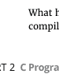

### 原型化（或不）
不原型化会发生什么？与编程中的任何事情一样，编译器或链接器会在你犯错时通过警告或错误消息通知你——或者程序根本运行不正确。这不是世界末日——不，不像编程军事机器人或为新种捕蝇草设计遗传代码。

### 练习 10-3：修改练习 10-1 的源代码。注释掉第 3 行的原型。构建结果。
构建错误是美妙的东西，令人愉快地准确却完全晦涩。以下是我的编译器和链接器生成的警告和错误消息，仅显示每条消息的相关部分：

```
13 warning: implicit declaration of function 'prompt'
22 error: conflicting types for 'prompt'
```

第一个警告出现在我的源代码文件第 13 行，其中在 main() 函数内部使用 prompt() 函数。编译器告诉你一个函数在没有原型的情况下被调用。正如消息所说，你在隐式声明一个函数。这是不允许的，但不是完全的错误；编译器生成目标代码，希望链接器能解析未知函数。

错误发生在 prompt() 函数存在于程序中的位置。在我的源代码中，它在第 22 行。prompt() 函数的数据类型不正确，因为链接器假设未知函数的数据类型为整数。

你可能会得出结论，原型化在你的 C 代码中是绝对必要的。这个假设并不完全正确。你可以通过重新排序源代码中的函数来避免原型化。只要函数在被使用之前列出，就不需要原型。

### 练习 10-4：编辑练习 10-3 的源代码。删除第 3 行被注释掉的函数原型。剪切并粘贴（移动）prompt() 函数，从源代码列表底部移到顶部，main() 函数之上。保存、构建并运行。
列表 10-2 显示了我为练习 10-4 想出的解决方案。

### 列表 10-2：避免函数原型
```
#include <stdio.h>

/* display prompt */

void prompt(void)
```
(continued)


### 清单 10-2：（续）

```c
{
    printf("C:\\DOS> ");
}

int main()
{
    int loop;
    char input[32];

    loop=0;
    while(loop<5)
    {
        prompt();
        fgets(input,32,stdin);
        loop=loop+1;
    }
    return(0);
}
```

在本书中，以及在我自己的程序中，我都会先写 main() 函数，然后再写其他函数。这种方法在 C 语言中是传统的，并且可以提高可读性。你可以自行决定把函数放在前面，以避免编写函数原型。如果你不这样做，请记住其他程序员可能会那样做，所以看到时不要感到惊讶。


编译器消息可能带有括号注释，这些注释指向用于启用检查特定警告的开关，或传统的命令行选项。例如，练习 10-3 的警告消息完整如下：

```
ex1003.c:13:9: warning: implicit declaration of function
'prompt' is invalid in C99 [-Wimplicit-function-declaration]
```

此错误消息对应的具体编译器警告开关是 -Wimplicit-function-declaration。

## 函数与变量

我喜欢说函数得“发挥作用”。也就是说，它们需要做点什么，像一台机器那样以某种方式处理输入或生成输出。要让你的函数发挥作用，你需要知道如何向函数传入变量、从函数传出变量以及在函数内部使用变量。

### 在函数中使用变量

使用变量的函数必须声明这些变量——就像 main() 函数所做的那样。事实上，这几乎是一回事。你必须记住的重大区别是，在函数内声明和使用的变量是该函数的局部变量。或者用通俗的话说，函数内发生的事就留在函数内，如清单 10-3 所示。

### 清单 10-3：函数中的局部变量

```c
#include <stdio.h>

void vegas(void);

int main()
{
    int a;

    a = 365;
    printf("In the main() function, a=%d\n",a);
    vegas();
    printf("In the main() function, a=%d\n",a);
    return(0);
}

void vegas(void)
{
    int a;

    a = -10;
    printf("In the vegas() function, a=%d\n",a);
}
```

main() 和 vegas() 两个函数都声明并使用了 int 变量 a。在 main() 中，第 9 行将该变量赋值为 365。在 vegas() 函数中，第 20 行将变量 a 赋值为 -10。你能预测第 12 行 printf() 函数的程序输出吗？

练习 10-5：使用清单 10-3 中的源代码创建一个新项目。构建并运行。

以下是我看到的输出：

```
In the main() function, a=365
In the vegas() function, a=-10
In the main() function, a=365
```

两个函数中使用了相同的变量名，但它在每个函数中保存的值不同。这是因为 C 语言中的变量是其函数的局部变量：一个函数不能改变另一个函数中变量的值，即使两个变量的类型和名称完全相同。

- 我在本书前面关于不要重复使用变量名的告诫，并不适用于其他函数中的变量。你的代码中可以有 16 个函数，每个函数都使用 alpha 变量。这完全没问题。即便如此：
- 你不必在所有函数中使用相同的变量名。清单 10-3 中的 vegas() 函数本可以将其变量名声明为 pip 或 wambooli。
- 要让多个函数共享一个变量，你需要指定外部变量或全局变量。这个话题要到第 16 章才会涉及。
- 函数局部变量被确定为 auto 存储类。auto 关键字可以放在函数局部变量前面，例如 auto int a，不过这会被认为是过时的写法。


### 向函数发送值

让函数发挥作用的关键方法是给它一些可处理的东西——一些数据。这个过程称为向函数传递参数（argument），其中术语 argument 在 C 编程中用来指代一个选项或一个值。它来自数学中函数变量的术语，所以预计不会有什么争论。

参数在函数的括号中指定。一个例子是 puts() 函数，它接受一个字符串作为参数，例如

```
puts("You probably shouldn't have chosen that option.");
```

fgets() 函数一次吞下三个参数：

```
fgets(buffer,27,stdin);
```

参数可以是变量、常量或字面值，多个参数用逗号分隔。函数所需值的数量和类型必须在编写函数时指定，在函数原型中也要指定。清单 10-4 展示了一个示例。

### 清单 10-4：向函数传递值

```c
#include <stdio.h>

void graph(int count);

int main()
{
    int value;

    value = 2;

    while(value<=64)
    {
        graph(value);
        printf("Value is %d\n",value);
        value = value * 2;
    }
    return(0);
}

void graph(int count)
{
    int x;

    for(x=0;x<count;x=x+1)
        putchar('*');
    putchar('\n');
}
```

当函数使用参数时，你必须明确告诉编译器需要什么类型的参数。在清单 10-4 中，第 3 行的原型和第 20 行 graph() 函数的定义都声明该参数必须是 int。变量 count 被用作 int 参数，然后它又作为函数内部该变量的名称。

graph() 函数在第 13 行、while 循环中间被调用。它是使用 value 变量调用的。这没问题；函数调用中使用的变量名不必与函数内部使用的变量名匹配。只有变量的数据类型必须匹配，而 count 和 value 都是 int 类型。

graph() 函数从第 20 行到第 27 行显示一行星号。该行的长度（以字符数计）由发送给函数的值决定。

**练习 10-6：** 启动编辑器，热切地输入清单 10-4 中的源代码。保存它。构建它。在运行之前，你能猜出输出可能是什么样子吗？

函数不一定需要使用变量。清单 10-4 中的 graph() 函数可以吞下任何 int 值，包括立即值（字面量）或常量。

**练习 10-7：** 编辑练习 10-6 中的源代码，修改第 13 行，使 graph() 函数被传入常量值 64。构建并运行。

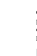

向函数传递字符串是可能的，但在你读过第 12 章关于数组的内容，尤其是第 18 章关于指针的内容之前，我不建议这样做。字符串实际上是一个数组，而将数组传递给函数需要特殊的 C 语言魔法。

### 向函数发送多个值

C 对函数能处理多少个参数没有限制。只要正确地将参数声明为特定的数据类型，并用逗号将它们全部分隔开，你就可以把它们堆叠起来，就像早晨火车上的通勤者一样，类似于这个原型：

```
void railway(int engine, int boxcar, int caboose);
```

在前一行中，为 railway() 函数编写了原型。它需要三个 int 参数：engine、boxcar 和 caboose。该函数必须被传入三个参数，如原型所示。

练习 10-8：修改清单 10-4 中的源代码，使 graph() 函数接受两个参数；第二个参数是要显示的字符。

### 创建返回值的函数

绝大多数 C 语言函数都返回一个值；也就是说，它们会生成某些东西。你的代码可能不使用这些值，但它们仍然会被返回。例如，putchar() 和 printf() 都返回值，而我很少见到程序使用这些值。

清单 10-5 展示了一个函数：它被传入一个值，然后返回另一个值。大多数函数都是这样工作的，不过有些函数在没有接收任何值的情况下也会返回值。例如，getchar() 返回输入，但不需要任何参数。在清单 10-5 中，convert() 函数接受一个华氏温度值，并返回对应的摄氏温度值。

### 清单 10-5：一个返回值的函数

```c
#include <stdio.h>

float convert(float f);

int main()
{
    float temp_f,temp_c;

    printf("Temperature in Fahrenheit: ");
    scanf("%f",&temp_f);
    temp_c = convert(temp_f);
    printf("%.1fF is %.1fC\n",temp_f,temp_c);
    return(0);
}

float convert(float f)
{
    float t;

    t = (f - 32) / 1.8;
    return(t);
}
```


第 3 行在清单 10-5 中声明了 convert() 函数的原型。该函数需要一个浮点值并返回一个浮点值。

convert() 函数在第 11 行被调用。其返回值在同一行被存储到变量 temp_c 中。在第 12 行，printf() 显示原始值和转换结果。占位符 %.1f 将浮点输出限制为小数点右侧一位。（请参阅第 13 章，了解 printf() 函数占位符的完整说明。）

convert() 函数始于第 16 行。它使用了两个变量：f 包含传递给函数的 float 值，即华氏温度。局部变量 t 用于计算摄氏温度值，在第 18 行声明，并在第 20 行的公式中赋值。

第 20 行使用令人害怕的数学运算将 f 华氏值转换为 t 摄氏值。包围 f - 32 的括号指示编译器先执行该部分的计算，然后再将结果除以 1.8。如果省略括号，32 会先被除以 1.8，从而产生错误的结果。请参阅第 11 章，了解运算符优先级的信息，其中描述了 C 如何处理长数学方程。

第 21 行的 return 语句将函数的结果发送回调用者。

### 练习 10-9：在编辑器中输入清单 10-5 的源代码。构建并运行。

返回值的函数可以将该值存储在变量中，如清单 10-5 第 11 行所示，也可立即使用该值。例如：

```c
printf("%.1fF is %.1fC\n", temp_f, convert(temp_f));
```

### 练习 10-10：编辑清单 10-5 的源代码，使 convert() 函数在 printf() 函数中立即使用。提示：这并不是你需要修复的唯一行才能完成更改。

你可能还会注意到 convert() 函数本身有一个冗余项。你真的需要在该函数中使用 t 变量吗？

### 练习 10-11：编辑练习 10-10 的解决方案，这次从 convert() 函数中剔除 t 变量。

老实说，你完全可以彻底消除 convert() 函数，因为它只有一行。尽管如此，像 convert() 这样的函数的优点是你可以从代码中的任何地方调用它。因此，与其一遍遍重复同样的内容，并在某些内容发生变化时编辑这些重复的代码片段，不如创建一个函数。这种做法完全合理，在 C 语言中也很常见。

而且因为我是个好人，同时也是因为本章前面有提及，清单 10-6 显示了我对练习 10-11 的最终结果。

### 清单 10-6：清单 10-5 的更紧凑版本

```c
#include <stdio.h>

float convert(float f);

int main()
{
    float temp_f;

    printf("Temperature in Fahrenheit: ");
    scanf("%f",&temp_f);
    printf("%.1fF is %.1fC\n",temp_f,convert(temp_f));
    return(0);
}

float convert(float f)
{
    return(f - 32) / 1.8;
}
```

convert() 函数的数学运算被压缩到一行，因此不需要临时存储变量（清单 10-5 第 18 行的 t）。

## 提前返回

return 关键字可以在任何时候从函数中“炸”出来，将执行返回到调用该函数的语句。或者，在 main() 函数的情况下，return 会退出程序。即使 return 不返回任何值，该规则仍然成立，这对任何 void 函数都是正确的。请考虑清单 10-7。

### 清单 10-7：使用 return 退出函数

```c
#include <stdio.h>

void limit(int stop);

int main()
{
    int s;

    printf("Enter a stopping value (0-100): ");
    scanf("%d",&s);
    limit(s);
    return(0);
}

void limit(int stop)
{
    int x;

    for(x=0;x<=100;x=x+1)
    {
        printf("%d ",x);
        if(x==stop)
        {
            puts("You won!");
            return;
        }
    }
    puts("I won!");
}
```

清单 10-7 中显示的愚蠢源代码使用第 10 行读取的值调用函数 limit()。函数中的循环输出数字。如果与函数的参数匹配，则 return 语句（参见第 25 行）会退出函数。否则，执行继续，并在循环结束时函数结束。因为没有返回值，所以函数末尾不需要 return 语句。

### 练习 10-12：使用清单 10-7 中显示的源代码创建一个新项目。构建并运行。

## 全局类型的常量

常量在函数中很有用，因为它们让你只需在一个位置更改值，就能在整个函数中体现更改。然而，与任何函数的变量一样，const 类型的常量一次只能在一个函数中有效。与其为每个函数重新创建常量，你可以使用 #define 预处理器指令创建一个全局常量，可供源代码文件中的所有函数使用。

- 使用 const 关键字在函数内部创建常量。
- 请参阅第 6 章，了解有关常量和 const 关键字的更多详细信息。

### 介绍已定义的常量

已定义的常量是一种快捷方式——具体来说，是源代码文件中使用来替代其他东西的东西。此常量在编译器级别运行并影响整个源代码文件。它是通过使用 #define 指令创建的，格式如下：

```c
#define SHORTCUT text
```

SHORTCUT 是一个关键字，通常用大写字母书写。它由编译器创建来表示文本部分。该行不以分号结尾，因为它是一个编译器指令，而不是 C 语言语句。你创建的已定义常量可以在代码的其他地方使用，在任何函数中：关键字 SHORTCUT 会被文本替换。

以下行创建已定义的常量 OCTO，等价于值 8：

```c
#define OCTO 8
```

在其定义之后，你可以在代码中的任何地方使用已定义的常量 OCTO 来表示值 8。例如：

```c
printf("Mr. Octopus has %d legs.",OCTO);
```

前述语句输出以下文本：

```
Mr. Octopus has 8 legs.
```

OCTO 已定义常量在源代码编译时会被文本 8 替换，这转化为值 8。

- **#define 指令**传统上放置在源代码顶部，紧跟在任何 #include 指令之后。参见下一节的示例。
- **你也可以定义字符串：**

  ```c
  #define AUTHOR "Dan Gookin"
  ```

  已定义的字符串包含双引号。已定义常量 AUTHOR 在源代码文件中出现的任何地方，都会被文本 "Dan Gookin" 替换——包括双引号。
- **你甚至可以定义数学计算：**

  ```c
  #define CELLS 24*80
  ```

  已定义常量 CELLS 不执行数学运算，但编译器会在 CELLS 出现在源代码文件中的任何地方用表达式 24*80 替换其文本。

与变量名一样，字符串字面量中指定的已定义常量是字符串的一部分。当已定义常量出现在字符串中时，预处理器不会展开它。

已定义常量由预处理器创建和管理。它是一个搜索并替换操作；不会创建变量“存储容器”，也不会指定数据类型。

### 使用已定义的常量

只要你的代码反复使用同一个值——一些重要的东西，比如表格中的行数或你可以放入购物车中的最大项目数——请考虑使用已定义的常量。因为该值出现在多个函数中，使用 #define 指令比为每个函数创建多个 const 值更有意义。

清单 10-8 显示了一个示例，其中已定义的常量有助于代码的两个函数中。

### 清单 10-8：为常量更新做准备

```c
#include <stdio.h>

#define GRID 3

/* prototypes */
void forward(void);
void backwards(void);

int main()
{
    puts("Grid forward:");
    forward();
    puts("Grid backwards:");
    backwards();
    return(0);
}

void forward(void)
{
    int x,y;

    for(x=0;x<GRID;x++)
    {
        for(y=0;y<GRID;y++)
            printf("%d:%d\t",x,y);
        putchar('\n');
    }
}

void backwards(void)
{
    int x,y;

    for(x=GRID-1;x>=0;x--)
    {
        for(y=GRID-1;y>=0;y--)
            printf("%d:%d\t",x,y);
        putchar('\n');
    }
}
```


## 练习 10-13：使用代码清单 10-8 中的源代码创建一个新程序。构建并运行。

以下是我看到的输出：

网格正向：
0:0 0:1 0:2
1:0 1:1 1:2
2:0 2:1 2:2

网格反向：
2:2 2:1 2:0
1:2 1:1 1:0
0:2 0:1 0:0

两个函数都依赖已定义的常量 GRID 来设定其大小。forward() 函数按从低到高的顺序输出网格；backwards() 函数则相反。

注意 backwards() 函数中 for 循环是如何构造的：

```
for(x=GRID-1; x>=0; x--)
```

变量 x 被初始化为 forward() 函数中语句的结束值。只要变量 x 的值大于或等于零，循环就会继续。两个循环正是以这种方式在网格输出中生成相似的值。

## 练习 10-14：修改练习 10-13 中的源代码，使网格变为每边五项的正方形（5×5）。构建并运行。

现在想象一下，如果你必须在代码中查找并将每一处 3 替换为 5，练习 10-14 会有多难。想象一下，如果值 3 遍布代码各处，而不仅仅出现在与网格相关的位置，那会有多丑陋。正因如此，才使用已定义常量。

## 练习 10-15：修改代码清单 10-7 中的源代码。添加一个新函数 verify()，用于确认输入值是否在 0 到 100 的范围内。如果值在范围内，该函数返回已定义常量 TRUE (1)；否则返回 FALSE (0)。当值超出范围时，程序会显示一条错误消息。


## 基于你所知继续构建

## 本部分内容 . . .

-   了解数学在 C 语言中如何运作
-   通过创建数组扩充变量存储
-   操作和处理文本
-   创建包含变量类型的结构
-   在命令提示符下工作与娱乐
-   探索使用变量的可能性
-   深入钻研并摆弄二进制数

## 本章内容

-   使用 ++ 和 -- 运算符
-   让取模运算发挥作用
-   使用各种运算符快捷写法
-   使用各种数学函数
-   生成随机数
-   理解优先级顺序

### 第 11 章：不可避免的数学章节

## 不可避免的数学章节

我早年回避计算机的原因之一是我害怕数学。最终，我了解到数学在编程中并不扮演核心角色。一方面，你需要懂一些数学，尤其是当程序涉及复杂计算时。另一方面，做数学的是计算机——你只需输入公式。

在编程世界里，数学是必需的，但并不痛苦。大多数程序都涉及某种形式的简单数学。图形编程会使用大量数学。而如果没有随机数，游戏也不会有趣。所有这些内容都是数学。我相信你会发现它比想象中更有趣，而不是更可怕。

## 来自无限之外的数学运算符

在 C 编程中，有两样东西让数学运算得以发生：数学运算符和数学函数。

数学运算符允许你构造数学表达式。表 11-1 中列出了这些运算符。数学函数实现那些键盘上没有对应符号和字符的复杂计算。若要在表格中列出所有这些函数，会占用大量篇幅。

> > 第 5 章介绍了基本数学运算符：+、-、* 和 /。其余运算符理解起来并不太难——甚至包括名字古怪的取模运算符。
> > C 语言比较运算符用于做出决策。列表参见第 8 章。
> > 逻辑运算符也在第 8 章中介绍。
> > 单个等号（=）是运算符，但不是数学运算符。它是赋值运算符，用于把值存入变量。
> > 位运算符操作值中的各个位。第 17 章会介绍它们。
> > 附录 C 列出了所有 C 语言运算符。

| 运算符 | 功能 | 示例 |
|----------|----------|---------|
| + | 加法 | var=a+b |
| - | 减法 | var=a-b |
| * | 乘法 | var=a*b |
| / | 除法 | var=a/b |
| % | 取模 | var=a%b |
| ++ | 递增 | var++ |
| -- | 递减 | var-- |
| + | 一元加 | +var |
| - | 一元减 | -var |

## 递增与递减

这里有一个方便的窍门，尤其适用于代码中的循环：递增和递减运算符。它们极其有用。

要将变量的值加一，请使用 ++，如下所示：

```
var++;
```

执行此语句后，变量 var 的值会增加（递增）1。这与编写以下代码相同：

```
var=var+1;
```

你会发现 ++ 到处都在使用，尤其是在 for 循环中；例如：

```
for (x=0;x<100;x++)
```

这个循环语句重复 100 次。它比编写替代写法干净得多：

```
for (x=0;x<100;x=x+1)
```

## 练习 11-1：编写一个程序，输出这句话十次："Get off my lawn, you kids!" 在 for 循环语句中使用递增运算符 ++。

## 练习 11-2：使用 while 循环重写练习 11-1 的答案。

++ 运算符的对立面是递减运算符 --，它由两个减号组成。此运算符将变量的值减 1；例如：

```
var--;
```

前面的语句等同于

```
var=var-1;
```

## 练习 11-3：编写一个程序，以 1 为增量显示从 -5 到 5，再回到 -5 的值。输出应如下所示：

```
-5 -4 -3 -2 -1 0 1 2 3 4 5 4 3 2 1 0 -1 -2 -3 -4 -5
```

这个程序可能有点棘手，所以与其让你在网上查找我的解答，我不如在代码清单 11-1 中说明它。请先自己尝试解决练习 11-3，然后再往下看。

## 代码清单 11-1：向上和向下计数

```c
#include <stdio.h>

int main()
{
    int c;
    for(c=-5;c<5;c++)
    printf("%d ",c);
    for(;c>=-5;c--)
    printf("%d ",c);
    putchar('\n');
    return(0);
}
```

我想让你看到的关键点出现在代码清单 11-1 的第 9 行，但它也与第 7 行的第一个 for 语句紧密配合。你可能会以为，从 -5 计数到 5 的循环会把值 5 作为停止条件，如下所示：

```
for(c=-5;c<5;c++)
```

这种方法的问题在于，c 的值会递增以触发循环结束，这意味着第一个 for 循环结束时 c 等于 5。如果像第 7 行那样让循环条件保持为 c<5，那么第二个循环开始时 c 会自动为 5。因此，在第 9 行中，for 语句里不需要初始化变量 c。

## 练习 11-4：构造一个程序，显示从 -10 到 10，再降回 -10 的值。像代码清单 11-1 那样以 1 为增量步进，但使用两个 while 循环来显示这些值。

## 将 ++ 和 -- 运算符前置

++ 运算符总是递增变量的值，而 -- 运算符总是递减。了解了这一点，请看以下语句：

```
a=b++;
```

如果变量 b 的值为 16，你知道执行 ++ 运算后它的值会变为 17。那么变量 a 的值是多少——16 还是 17？

通常，C 语言数学等式从左到右读取。（具体细节请参阅后面的“神圣的优先级顺序”一节。）根据这条规则，前面的语句执行后，变量 a 的值是 16，变量 b 的值是 17。对吧？

## 代码清单 11-2：哪个先来——= 还是 ++？

```
#include <stdio.h>
int main()
{
    int a,b;
    b=16;
    printf("Before, a is unassigned and b=%d\n",b);
    a=b++;
    printf("After, a=%d and b=%d\n",a,b);
    return(0);
}
```

## 练习 11-5：输入代码清单 11-2 中的源代码。保存、构建并运行。

当你将 ++ 或 -- 运算符放在变量后面时，分别称为后置递增或后置递减。如果你想在变量被使用之前递增或递减它，就把 ++ 或 -- 放在变量名的左侧。例如：

```
a=++b;
```

在前一行中，b 的值先递增，然后赋给变量 a。

## 练习 11-6：重写代码清单 11-2 中的源代码，使第 9 行的等式在将变量 b 赋给变量 a 之前先递增变量 b 的值。

```
a=++b++;
```

算了！++var++ 这种怪物是错误写法。


## 发现余数（取模）

在所有基本数学运算符符号中，% 很可能是最奇怪的。 不，它不是百分比运算符。 它是取模运算符。 它计算一个数除以另一个数的余数，这是一个比讨论更容易展示的概念。

列表 11-3 编写了一个程序，列出取模 5 以及从 0 到 29 的一堆其他值的结果。 值 5 是一个常量，`value`，你以后可以轻松更改它。

### 列表 11-3：显示取模值

```c
#include <stdio.h>

int main()
{
    const int value = 5;
    int a;

    printf("Modulus %d:\n",value);
    for(a=0;a<30;a++)
        printf("%d %% %d = %d\n",a,value,a%value);
    return(0);
}
```

第 10 行显示取模结果。 %% 占位符（在第 10 行）仅显示 % 字符，所以不要被它迷惑。

练习 11-7：输入列表 11-3 中的源代码。 保存、构建并运行。

现在你可以看到输出，我可以更好地解释取模运算的工作原理。你可以看到它的计算是第一个值除以第二个值的余数。所以 20 % 5 是 0，但 21 % 5 是 1。

练习 11-8：将列表 11-3 中的值常量改为 3。构建并运行。

## 使用赋值运算符节省时间

如果你喜欢 ++ 和 -- 运算符（我当然喜欢），你会喜欢表 11-2 中列出的运算符。它们是数学赋值运算符，和自增自减运算符一样，它们不仅能做有用的事情——在你的代码中看起来也很酷且令人困惑。

### C 数学赋值运算符

| Operator | Function | Shortcut for | Example |
|---|---|---|---|
| += | Addition | x=x+n | x+=n |
| -= | Subtraction | x=x-n | x-=n |
| *= | Multiplication | x=x*n | x*=n |
| /= | Division | x=x/n | x/=n |
| %= | Modulo | x=x%n | x%=n |

数学赋值运算符没有做任何新事物，但它们以特殊的方式工作。在 C 语言中，你经常需要修改变量的值。例如：

```c
alpha=alpha+10;
```

此语句将变量 alpha 的值增加 10。在 C 中，你可以使用赋值运算符按如下方式编写相同的语句：

```c
alpha+=10;
```

这两种版本的语句完成同样的事情，但第二个例子更简洁、更晦涩，这似乎让许多 C 程序员感到高兴。参见列表 11-4。

### 列表 11-4：赋值运算符的天堂

```c
#include <stdio.h>

int main()
{
    float alpha;

    alpha=501;
    printf("alpha = %.1f\n",alpha);
    alpha=alpha+99;
    printf("alpha = %.1f\n",alpha);
    alpha=alpha-250;
    printf("alpha = %.1f\n",alpha);
    alpha=alpha/82;
    printf("alpha = %.1f\n",alpha);
    alpha=alpha*4.3;
    printf("alpha = %.1f\n",alpha);
    return(0);
}
```

练习 11-9：将列表 11-4 的源代码输入到你的文本编辑器中。更改第 9、11、13 和 15 行，使其使用赋值运算符。构建并运行。


TIP

使用赋值运算符时，请记住 = 字符在最后。你可以通过交换运算符轻松记住这个提示；例如：

```c
alpha=-10;
```

此语句将值 -10 分配给变量 alpha。但语句

```c
alpha-=10;
```

将 alpha 的值减少 10。

练习 11-10：编写一个程序，以 5 为增量输出从 5 到 100 的数字。

## 数学函数狂热

当键盘字符和运算符符号用尽时，C 语言会求助于使用各种函数进行数学运算。当你急切地想求一个角度的反正切时，你可以拿出 atan() 函数，然后，就这样。

- 大多数数学函数需要在代码中包含 math.h 头文件。一些函数可能还需要 stdlib.h 头文件，其中 stdlib 表示标准库。
- 如果你在 Linux 的命令行编译，你可能需要在构建程序的命令中包含数学库。例如：

    ```bash
    clang -Wall ex1111.c -lm
    ```

前述命令中使用了 clang 编译器，带有 -Wall 开关（所有警告），后面跟随源代码文件名 ex1111.c。命令末尾，-l（小写 L）开关后面跟着 m，即数学库的名称。此开关指示链接器添加数学库，帮助其合并各种数学函数。

### 探索一些常见的数学函数

并不是每个人都会运用他们的 C 语言编程技能来帮助火箭安全地穿越太空并进入泰坦的轨道。不，更可能的是你会尝试更接地气的事情。无论如何，这项工作很可能通过使用数学函数来完成。我在表 11-3 中列出了一些常见的函数。

### 表 11-3 常见、合理的数学函数

| Function | #include | What It Does |
|---|---|---|
| sqrt() | math.h | Calculates the square root of a floating-point value |
| pow() | math.h | Returns the result of a floating-point value raised to a certain power |
| abs() | stdlib.h | Returns the absolute value (positive value) of an integer |
| ceil() | math.h | Rounds up a floating-point value to the next whole number (nonfractional) value |
| floor() | math.h | Rounds down a floating-point value to the next whole number |

表 11-3 中列出的所有函数，除了 abs() 函数，都处理浮点值。abs() 函数仅适用于整数。


你可以在手册页中查找函数参考，如第 1 章所述。

列表 11-5 散布着来自表 11-3 的一些数学函数。只要你记得在第 2 行包含 math.h 头文件，编译器就会喜欢看到这些函数。

### 列表 11-5：数学狂热混乱

```c
#include <stdio.h>
#include <math.h>

int main()
{
    float result,value;

    printf("Input a float value: ");
    scanf("%f",&value);
    result = sqrt(value);
    printf("The square root of %.2f is %.2f\n",
           value,result);
    result = pow(value,3);
    printf("%.2f to the 3rd power is %.2f\n", value,result);
    result = floor(value);
    printf("The floor of %.2f is %.2f\n", value,result);
    result = ceil(value);
    printf("And the ceiling of %.2f is %.2f\n", value,result);
    return(0);
}
```

我在本书中将列表 11-5 中的长 printf() 语句换行以使其适应页面。你不必在自己的源代码文件中换行长语句。

练习 11-11：将列表 11-5 的源代码输入到你的编辑器中。保存。构建项目。运行它并尝试各种输入值以查看结果。

如果你在 Linux 命令行看到链接器报告任何“未定义引用”错误，请在命令行编译选项中添加 -lm 开关，如本章前面所述。

练习 11-12：编写一个程序，显示 2 的幂，从 2^9 到 2^10。

这些是计算的圣数。

- 表 11-3 中的数学函数列表只是可用种类中的一小部分。
- 如果你的代码需要某种数学运算，请检查 C 库文档、手册页，看看是否存在该特定函数。
- 在 Unix 系统上，输入 man 3 math 以查看 C 库的数学函数列表。
- ceil() 函数的发音是“seal”。它来自 ceiling 这个词，是对 floor() 函数的一种戏仿。

## 忍受三角学

我不会费心向你解释三角学。如果你的代码需要三角函数，你知道为什么。但你可能还不知道的是，C 中的三角函数——事实上，所有编程语言中的三角函数——使用弧度，而不是角度。

### 什么是弧度？

很高兴你问了。弧度是对圆或具体来说是对弧的度量。它使用值 π（pi）而不是角度，其中 π 是一个方便的圆度量。所以圆不是有 360 度，而是 2π 弧度。这相当于圆中有 6.2831（即 2 × 3.1415）弧度。图 11-1 说明了这一概念。

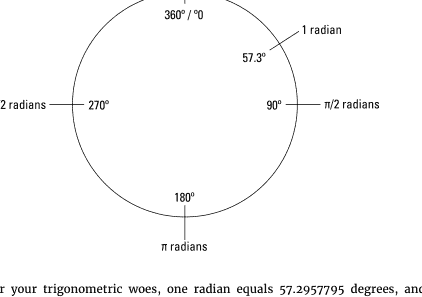

图 11-1：角度和弧度。

对于你的三角困扰，1 弧度等于 57.2957795 度，1 度等于 0.01745329 弧度。所以当你进行角度计算时，你需要在人类角度和 C 语言弧度之间进行转换。请考虑列表 11-6。


## LISTING 11-6: 将度数转换为弧度

```
#include <stdio.h>

int main()
{
    float degrees,radians;

    printf("Enter an angle in degrees: ");
    scanf("%f", &degrees);
    radians = 0.0174532925*degrees;
    printf("%.2f degrees is %.2f radians.\n", degrees,radians);
    return(0);
}
```

第10行在《程序清单11-6》中被拆分，以便在本书的页面上显示。

**Exercise 11-13:** 将《程序清单11-6》中的源代码输入到你的编辑器中。构建并运行。用值180进行测试，它应等于π弧度（3.14）。

**Exercise 11-14:** 编写一个程序，将弧度转换为度数。


尽管C语言有许多三角函数，其中最基本的三个是 sin()、cos() 和 tan()，它们分别计算一个角度的正弦、余弦和正切。请记住，这些角度是以弧度而不是度数来度量的。

哦，并且请记住你需要 math.h 头文件才能让编译器接受使用三角函数。而且你可能需要添加 -lm 开关来链接数学库。你有很多东西需要记住。

展示三角函数的最佳程序在本质上是图形化的。这种类型的代码要在这本书中重现需要好几页，而且即使那样我也必须选择一个代码可以运行的平台（例如Windows）。与其那样做，我制作了《程序清单11-7》供你三角函数娱乐。

## LISTING 11-7: 三角函数的乐趣

```
#include <stdio.h>
#include <math.h>

#ifndef M_PI
#define M_PI 3.14159
#endif

int main()
{
    const float amplitude=70;
    const float wavelength=0.1;
    float graph,s,x;

    for(graph=0;graph<M_PI;graph+=wavelength)
    {
        s = sin(graph);
        for(x=0;x<s*amplitude;x++)
            putchar('*');
        putchar('\n');
    }
    return(0);
}
```

预处理器指令在第4、5和6行测试已定义常量 M_PI 的存在，该常量应驻留在 math.h 头文件中。#ifndef 指令读作“如果未定义”。如果 M_PI 未被定义，下行使用 #define 指令来创建它。#endif 指令结束决策过程。完成后，代码可以使用已定义的 M_PI 常量来表示π的值。

## Exercise 11-15: 将《程序清单11-7》中的源代码输入到你的编辑器中。在构建和运行之前，试着猜测输出可能是什么。

## Exercise 11-16: 修改《程序清单11-7》中的代码，使其显示余弦波。别偷懒！余弦波在从0到2π循环时看起来最好。修改你的代码，使其得到一个良好、尽管是基于字符的曲线表示。

不，练习11-16并不容易。你需要在绘制图形时补偿负的余弦值。

- 一弧度等于57.2957795度，或360/2π。
- 一度等于0.0174532925弧度，或π/180。

## 它完全是随机的

一个相对容易理解的数学函数是 rand() 函数。它生成随机数。虽然这样的任务可能看起来很愚蠢，但它是几乎所有有史以来计算机游戏的基础。随机数在编程中非常重要。


计算机无法生成真正随机的数字。相反，它产生的是所谓的伪随机数。原因是计算机内部的条件可以被复制。因此，严肃的数学家嗤之以鼻，认为计算机称之为随机的任何值都不是真正随机的数字。你能听到他们嗤笑吗？我能。

## 喷出随机数

rand() 函数是C语言随机数函数中最简单的。它需要 stdlib.h 头文件，并吐出一个据称随机的 int 值。《程序清单11-8》演示了示例代码。

## LISTING 11-8: 现在，这就是随机

```
#include <stdio.h>
#include <stdlib.h>

int main()
{
 int r,a,b;

 puts("100 Random Numbers");
 for(a=0;a<20;a++)
 {
   for(b=0;b<5;b++)
   {
     r=rand();
     printf("%d\t",r);
   }
   putchar('\n');
 }
 return(0);
}
```

《程序清单11-8》使用嵌套的 for 循环生成100个随机值。第13行的 rand() 函数生成这些值。第14行的 printf() 函数通过使用 %d 转换字符来显示这些值，该字符输出 int 值。

Exercise 11-17: 将《程序清单11-8》所示的源代码输入到你的编辑器中。保存、构建并运行，以观赏100个随机值。

Exercise 11-18: 修改代码，使显示的所有值都在0到20的范围内。


这里有一个提示，用于练习11-18：使用取模赋值运算符来限制随机数的范围。格式如下：

```
r%=n;
```

r 是从 rand() 函数返回的数字。%= 是取模赋值运算符。n 是范围限制加1。执行前述语句后，返回的值在0到 n-1 的范围内。所以如果你想生成1到100之间的值，你将使用这个公式：

```
value = (r % 100) + 1;
```

## 使数字更随机

为了给那些声称计算机生成伪随机数的傲慢数学家一些认可，运行你从练习11-18生成的程序。观察输出。再运行一次程序。看到任何熟悉的东西吗？

rand() 函数擅长生成大量随机值，但它们是可预测的值。为了使输出更不可预测，你需要为随机数生成器设置种子。这是通过使用 srand() 函数完成的。

与 rand() 函数一样，srand() 函数也需要 stdlib.h 头文件，如《程序清单11-9》第2行所示。该函数需要一个 unsigned int 值 seed，如第6行声明的。scanf() 函数在第10行使用 %u 占位符读取 unsigned 值。然后 srand() 函数在第11行使用 seed 值。

## LISTING 11-9: 更随机的随机性

```
#include <stdio.h>
#include <stdlib.h>

int main()
{
    unsigned seed;
    int r,a,b;

    printf("Input a random number seed: ");
    scanf("%u",&seed);
    srand(seed);
    for(a=0;a<20;a++)
    {
        for(b=0;b<5;b++)
        {
            r=rand();
            printf("%d\t",r);
        }
        putchar('\n');
    }
    return(0);
}
```

第16行使用了 rand() 函数，尽管结果现在基于在程序运行时设置的 seed。

**Exercise 11-19:** 使用《程序清单11-9》所示的源代码创建一个新项目。构建它。运行程序几次，尝试不同的种子值。每次输出都不同。

唉，当你输入相同的种子数字时，生成的随机值仍然是可预测的。事实上，当使用1作为种子时，你会看到与练习11-17中相同的“随机”值，当时你甚至没有使用 srand()！而且你玩过多少游戏要求你为随机数生成器设置种子？没有。

一定有更好的方法。

编写随机数生成器的最佳方法不是要求用户输入种子，而是从其他地方获取种子。在《程序清单11-10》中，种子值是通过使用 time() 函数从系统时钟中提取的。

## LISTING 11-10: 比以往更真正随机

```
#include <stdio.h>
#include <stdlib.h>
#include <time.h>

int main()
{
    int r,a,b;

    srand((unsigned)time(NULL));
    for(a=0;a<20;a++)
    {
        for(b=0;b<5;b++)
        {
            r=rand();
            printf("%d\t",r);
        }
        putchar('\n');
    }
    return(0);
}
```

第21章涵盖了C语言中的时间函数编程。不提前太多，time() 函数返回当天当前时间的信息，一个不断变化的值。NULL 参数有助于解决一些我现在不想深入的问题，但就说 time() 返回的值每秒都在变化就够了。

time() 函数需要包含 time.h 头文件，如第3行所示。

语句中的 (unsigned) 部分确保 time() 函数返回的值是一个无符号整数（不是负数）。这种技术称为类型转换，将在第16章中介绍。

底线是 srand() 函数被传递一个种子值，由 time() 函数提供，其结果是 rand() 函数生成的值比其他情况更随机。

**Exercise 11-20:** 输入《程序清单11-10》中的源代码并构建项目。运行几次以确保数字尽可能随机。


练习 11-21：重写你为练习 8-6（来自第 8 章）编写的解决方案，让程序生成一个随机数，使猜数字游戏更有趣，但也许不完全公平。如果玩家没有猜中，就显示这个随机数。

## 运算优先级的神圣秩序

在你逃离“无可避免的数学章节”的暴政之前，你需要了解优先级顺序。它并不是一个宗教教团，也与预测未来无关。它关乎确保你用 C 语言编写的数学表达式能表达你的真实意图。

### 确保顺序正确

思考下面这个谜题。你能猜出变量 answer 的值吗？

```
answer = 5 + 4 * 3;
```

作为人类，从左到右阅读这个算式，你可能会回答 27：5 + 4 等于 9，再乘以 3 等于 27。对于人类来说，这个答案是正确的。然而，计算机却会回答 17。

计算机没有错——它只是认为乘法比加法更重要。因此，等式中乘法部分会先被计算。对计算机而言，运算顺序基于所使用的运算符。换句话说，乘法的优先级高于加法。


你可以这样记住基本数学运算符的优先级顺序：

- 第一：乘法、除法
- 第二：加法、减法

关于基本优先级顺序的巧妙助记口诀是：“My Dear Aunt Sally。”关于所有 C 语言运算符的优先级顺序的更多细节，请参见附录 G。

练习 11-22：编写一个程序，计算下面的等式并显示结果：

```
20 - 5 * 2 + 42 / 6
```

看看你是否能在程序运行之前猜出输出结果。

练习 11-23：修改练习 11-22 中的代码，让程序计算下面的等式

```
12 / 3 / 2
```

不，这不是日期。它是 12 除以 3 再除以 2。

## 用括号强制指定顺序

使用括号可以打破优先级的顺序。就 C 语言而言，任何等式中出现在括号内的内容都会先被求值。因此，即使你忘记了优先级顺序，你也可以用括号将等式的部分括起来，强制指定计算顺序。

前方数学预警！

练习 11-24：编写下面的等式，使结果等于 14，而不是 2：

```
12 - 5 * 2
```

练习 11-25：编写下面这个等式（来自练习 11-22），让加法和减法先于乘法和除法进行。如果做得正确，结果应为 110：

```
20 * 5 + 2 + 42 / 6
```

- 你编写的代码可能更多处理变量，而非字面值或立即数，因此你必须理解等式以及被求值的内容。例如，如果你需要先将全职和兼职员工的人数相加，再除以总工资额，那么就把前两个值放在括号中。
- 除了优先级之外，括号还能增加代码的可读性，尤其是在长等式中。即使括号并非必需，如果加上括号能让代码更易读，也请考虑添加。
- 附录 G 列出了所有 C 语言运算符的完整优先级顺序。

## 本章内容

- 在数组中存储多个变量
- 创建数组
- 理解字符数组
- 对数组中的值进行排序
- 使用多维数组
- 将数组传递给函数

### 第 12 章：给我数组

## 给我数组

初学编程时，我避开了数组这个话题。对我来说，它们完全说不通。数组变量有自己的一套做派和复杂性，这与使用 C 语言的单变量不同。与其回避这个话题，直接跳到下一章（下一章也不见得更容易），不如把数组当作一个可爱、古怪且有用的工具来拥抱它。

## 看，数组

人类喜欢把事物分组，大多按类型进行：例如，人们收集勺子、硬币或丈夫。这些物品很容易分组，因为它们类型相似。C 语言同样有办法对相似类型的值进行分组，就像队列中的一排变量。C 语言中使用的词是 array（数组）。

## 避开数组

在你编程生涯的某个时刻，数组会不可避免地出现，令人痛苦。举个例子，请看清单 12-1。这段代码会要求输入并显示你的三个最高分，大概来自某个游戏。

## 清单 12-1：最高分，糟糕的版本

```
#include <stdio.h>

int main()
{
    int highscore1,highscore2,highscore3;

    printf("Your highest score: ");
    scanf("%d",&highscore1);
    printf("Your second highest score: ");
    scanf("%d",&highscore2);
    printf("Your third highest score: ");
    scanf("%d",&highscore3);

    puts("Here are your high scores");
    printf("#1 %d\n",highscore1);
    printf("#2 %d\n",highscore2);
    printf("#3 %d\n",highscore3);

    return(0);
}
```

清单 12-1 中的代码要求输入三个整数值。输入存储在第五行声明的三个 int 变量中。第 15 至 17 行输出这些值。很简单。

练习 12-1：将清单 12-1 的源代码输入到编辑器中。编译并运行。

输入那些代码可真是够费劲的，对吧？谢天谢地，只有三个最高分。还是我说得太早了？

练习 12-2：修改清单 12-1 中的源代码，增加第四个最高分。编译并运行。

下一个练习，修改代码以提供十个最高分。不！算了。你还是直接学习数组吧。

## 理解数组

数组是一系列相同类型的变量：十几个 int 变量、两三个 double 变量，或者一串 char 变量。数组并不包含全部相同的值。不，它更像是一系列小隔间，你可以把不同的值放进去。

数组的声明方式与其他变量类似。它有一个数据类型和一个名称，还有一组方括号。下面的语句声明了 `highscore` 数组：

```
int highscore[];
```

这个声明是不完整的；编译器还不知道数组中有多少个项，或者说多少个*元素*。因此，如果 `highscore` 数组要容纳三个元素，它应该这样声明：

```
int highscore[3];
```

这个数组包含三个元素，每个元素都是自己的 `int` 值。元素通过这样的方式访问和赋值：

```
highscore[0] = 750;
highscore[1] = 699;
highscore[2] = 675;
```

数组元素通过方括号中的索引号来引用。第一个项是*索引 0*，这一点你必须记住。在 C 语言中，计数从 0 开始，这有它的优势，所以不要觉得这很傻。


在前面的示例中，第一个数组元素 `highscore[0]` 被赋值为 750；第二个元素为 699；第三个为 675。

初始化之后，数组变量就可以像代码中的其他变量一样使用了：

```
var = highscore[0];
```

这条语句将数组元素 `highscore[0]` 的值存储到 `int` 变量 `var` 中。如果 `highscore[0]` 等于 750，那么执行该语句后 `var` 也等于 750。

**练习 12-3：** 使用本节所述的数组，重写你在练习 12-2 中解决方案的源代码——但要记住，你的数组保存四个值，而不是三个。

练习 12-3 有很多解法。暴力解法是让你逐行逐个填充每个数组变量，类似于清单 12-1 中的源代码。清单 12-2 则提供了一个更好、更有见地的解法。

## 清单 12-2：最高分，更好的版本

```
#include <stdio.h>

int main()
{
    int highscore[4];
    int x;

    for(x=0;x<4;x++)
    {
        printf("Your %d score: ",x+1);
        scanf("%d",&highscore[x]);
    }

    puts("Here are your high scores");
    for(x=0;x<4;x++)
        printf("%d %d\n",x+1,highscore[x]);

    return(0);
}
```

清单 12-2 中的大部分代码你应该都熟悉，除了新的数组表示法。printf() 语句（第 10 行和第 16 行）中的 x+1 参数允许你在循环中使用 x 变量，但从 1 而不是 0 开始输出它的值。虽然 C 语言喜欢从 0 开始编号，但人类仍然更喜欢从 1 开始。

**练习 12-4：** 将清单 12-2 的源代码输入到编辑器中，构建一个新程序。运行它。

尽管程序的输出与练习 12-2 和 12-3 中的输出几乎相同，但这种方法要高效得多，完成练习 12-5 即可证明这一点：

**练习 12-5：** 修改清单 12-2 中的源代码，输入并显示前十名得分。（你知道这个练习会来的。）

想象一下，如果你选择不使用数组，你该如何编写练习 12-5 的答案！


- 数组的第一个元素是 0。
- 声明数组时，要使用完整的元素数量，例如 10 表示十个元素。即使元素的索引是从 0 到 9，声明数组大小的时候仍然必须指定 10。


## 初始化数组

与 C 中任何变量一样，你可以在声明时初始化数组。初始化需要一种特殊格式，类似于以下语句：

```
int highscore[] = { 750, 699, 675 };
```

方括号中的数字在初始化数组时不是必需的，如前例所示。原因是编译器足够智能，可以计数元素并自动分配数组的存储空间。

**练习 12-6：** 编写一个程序，显示过去五天的股市收盘价。使用已初始化的数组 marketclose[] 来保存这些值。输出应如下所示：

```
Stock Market Close
Day 1: 24164.95
Day 2: 24107.08
Day 3: 24643.63
Day 4: 24400.93
Day 5: 23728.53
```

**练习 12-7：** 编写一个程序，使用两个数组。第一个数组初始化为值 10、12、14、15、16、18 和 20。第二个数组大小相同但未初始化。在代码中，用第一个数组中每个值的平方根填充第二个数组。输出结果。

## 操作字符数组（字符串）

你可以使用 C 语言的任何数据类型创建数组。然而，char 数组在作为字符串时有点不同。

与任何数组一样，你可以声明已初始化或未初始化的 char 数组。已初始化 char 数组的格式可以如下所示：

```
char letters[] = { 'c', 'a', 't' };
```

此数组声明是一个包含字母 c、a 和 t 的 3 个元素的字符数组。此示例是字符数组，而不是字符串。

```
char pet[] = "cat";
```

前面的数组声明创建了一个字符串。初始化文本用双引号括起来。此外，由于使用了字符串字面量，编译器会自动添加终止空字符：'\0'。这一添加使数组成为字符串而不是字符集合——这是一个需要理解的重要概念。

以下是将同一字符串声明写成单个字符的形式：

```
char cat[] = { 'c', 'a', 't', '\0' };
```

前一行中每个数组元素都被定义为其自己的 char 值，包括终止字符串的 '\0' 字符。（我相信你会发现使用双引号的方法在声明字符串时更有效。）

列表 12-3 中的代码逐个字符地遍历 char 数组。索引变量用作，嗯，索引。while 循环一直旋转，直到遇到字符串末尾的 '\0' 字符为止。最后的 putchar() 函数（第 14 行）会换行。

### 列表 12-3：显示 char 数组

```
#include <stdio.h>

int main()
{
    char sentence[] = "Random text";
    int index;

    index = 0;
    while(sentence[index] != '\0')
    {
        putchar(sentence[index]);
        index++;
    }
    putchar('\n');
    return(0);
}
```

练习 12-8：把列表 12-3 的源代码输入到你的编辑器中。构建并运行该程序。

列表 12-3 中的 while 循环的工作方式与 C 库中发现的许多字符串显示例程类似。这些函数可能使用指针而不是数组，这是在第 18 章中展开的主题。除了那一点小趣闻之外，你可以用以下行替换代码中的第 8 行到第 14 行

```
puts(sentence);
```

或甚至用这一行：

```
printf("%s\n",sentence);
```


当 char 数组用作函数的参数时，如前一行所示，方括号不是必需的。如果包含它们，编译器会认为你搞砸了。

## 操作空字符数组

正如你可以声明一个空的或未初始化的 float 或 int 数组一样，你也可以创建一个空的 char 数组。然而你必须精确：数组的大小必须比字符串的最大长度多一个字符，以考虑终止空字符。此外，你必须确保填充数组的任何输入都不超过数组的大小。

在列表 12-4 中，第 5 行的 char 数组 firstname 可以容纳 15 个字符，外加字符串末尾的 \0 的 1 个字符。这种 15 字符的限制是程序员做出的假设；大多数名字少于 15 个字符长。

### 列表 12-4：填充 char 数组

```
#include <stdio.h>

int main()
{
    char firstname[16];

    printf("What is your name? ");
    fgets(firstname,16,stdin);
    printf("Pleased to meet you, %s\n",firstname);
    return(0);
}
```

第 8 行的 fgets() 函数读取 firstname 字符串的数据。最大输入大小设置为 16 个字符，这已经考虑了空字符，因为 fgets() 就是这么智能。文本从 stdin（函数的第三个参数）或标准输入中读取。

练习 12-9：使用列表 12-4 的源代码创建一个新程序。构建并运行，使用你的名字作为输入。

再次运行程序，但填满缓冲区：输入超过 15 个字符。你会看到只有前 15 个字符存储在数组中。即使按回车键也不会存储，这在输入少于 15 个字符时本应如此。

练习 12-10：修改练习 12-9 中的源代码，使程序还询问你的姓氏，将此数据存储在另一个数组中。程序随后应使用你的名字和姓氏向你问好。

是的，当你输入少于 15 个字符时，回车键会作为你名字的一部分存储。这就是 fgets() 函数读取输入的方式。如果你的名字是 Dan，数组看起来像这样：


```
firstname[0] == 'D'
firstname[1] == 'a'
firstname[2] == 'n'
firstname[3] == '\n'
firstname[4] == '\0'
```

换行符潜伏在字符串中，因为 C 中的输入是流导向的，而 Enter 键在 fgets() 函数看来是输入流的一部分。你可以通过遵守练习 12-11 来修复这个问题。

练习 12-11：重写练习 12-10 中的源代码，使 scanf() 函数用于读取名字和姓氏字符串。

当然，scanf() 函数的问题在于它不检查输入是否限制在 15 个字符以内——除非你指示它这样做：

练习 12-12：修改练习 12-11 中源代码中的 scanf() 函数，使使用的转换字符写为 %15s。构建并运行。

%15s 转换字符告诉第一个 scanf() 函数只读取输入的前 15 个字符并将其放入 char 数组（字符串）中。任何额外文本随后会被第二个 scanf() 函数读取，之后的多余文本将被丢弃。


当谈到在 C 中读取文本时，了解流输入至关重要。第 13 章提供了有关这一重要主题的额外信息。

## 排序数组

计算机旨在快速而愉快地完成枯燥的任务，例如排序数组。事实上，它们喜欢做得如此之多，以至于“排序”是一个基本计算机概念，许多理论和算法都是基于它编写的。如果你不是 Mentat 或瓦肯星的原住民，这是一个真正的无聊话题。

最简单的排序是冒泡排序，它不仅易于解释和理解，而且名字也很有趣。它还展示了基本的数组排序哲学，即在两个元素之间交换值。

假设你正在对数组进行排序，使最小的值排在前面。如果 array[2] 包含值 20，而 array[3] 包含值 5，这两个元素就需要交换值。为了使其发生，你使用一个临时变量，如下所示：

```
temp=array[2]; /* Save 20 in temp */
array[2]=array[3]; /* Store 5 in array[2] */
array[3]=temp; /* Put 20 in array[3] */
```

在冒泡排序中，每个数组元素都会与每个其他数组元素按有组织的顺序进行比较。当一个值较大（或较小）于另一个值时，值会被交换。否则，比较会继续，遍历数组中每一种可能的比较排列。列表 12-5 演示了这一点。

### 冒泡排序

```
#include <stdio.h>
int main()
{
const int size = 6;
int bubble[] = { 95, 60, 6, 87, 50, 24 };
int inner,outer,temp,x;
/* Display Original array */
puts("Original Array:");
for(x=0;x<size;x++)
printf("%d\t",bubble[x]);
putchar('\n');
/* Bubble sort */
for(outer=0;outer<size-1;outer++)
```


### 清单 12-5：（续）

```
{
    for(inner=outer+1;inner<size;inner++)
    {
        if(bubble[outer] > bubble[inner])
        {
            temp=bubble[outer];
            bubble[outer] = bubble[inner];
            bubble[inner] = temp;
        }
    }

    /* Display sorted array */
    puts("Sorted Array:");
    for(x=0;x<size;x++)
        printf("%d\t",bubble[x]);
    putchar('\n');

    return(0);
}
```

清单12-5很长，但很容易分成三部分，每部分都由一条注释开头：

- 第9行到第13行输出原始数组。
- 第15行到第27行对数组排序。
- 第29行到第33行输出排序后的数组（重复第9行到第13行）。

常量 size 在第5行声明。这个声明让你在以后再次重用这段代码时（你会的）可以轻松更改数组大小。

排序本身涉及嵌套的 for 循环：一个外层循环和一个内层循环。外层循环一次一步地遍历整个数组。内层循环在数组中从高一个元素的位置开始，并逐个扫过每个值。

练习12-13：将清单12-5中的源代码复制到编辑器中，并创建一个新项目 ex1213。构建并运行。

练习12-14：以清单12-5中的源代码为起点，创建一个程序，生成40个范围在1到100之间的随机数，并将这些值存储在一个数组中。显示该数组。对该数组排序。显示结果。

## 改变数组的大小，行吗？

在 C 中声明数组时，其大小就确定了。程序运行后，你既不能添加也不能删除更多元素。因此，如果你编写一个包含10个元素的数组，如下所示

```
int topten[10];
```

你就不能向该数组添加第11个元素。这样做会导致各种各样的灾祸和痛苦。

用书呆子的话说，C 中的数组不是动态的：大小确定后就不能改变大小。其他编程语言允许调整数组大小或重新定义数组维度，但 C 不行。C 中确实存在一种实现动态存储的变通方法，但它涉及使用指针来分配存储空间。这个可怕的主题直到第18章才会涉及。

练习12-15：修改练习12-14中的源代码，使数字按从大到小的逆序排序。

练习12-16：编写一个程序，对21个字符的字符串“C Programming is fun!”中的文本进行排序。

本章第一部分描述的数组称为一维数组：它们基本上是一系列值，一个接一个。这种组织方式适合描述单列行进的项目。当你需要描述第二维或第三维中的项目时，就要召唤出多维类型的数组。

把二维数组想象成由行和列组成的网格会很有帮助。这类数组的一个例子是棋盘——一个八行八列的网格。虽然你可以声明一个包含64个元素的单一数组来表示棋盘，但二维数组效果更好。这样的数组按以下方式声明：

```
int chess[8][8];
```

两个方括号定义了 chess 数组的两个不同维度：八行和八列。位于第一行第一列的方格将引用为 chess[0][0]。该行的最后一个方格是 chess[0][7]，棋盘的最后一个方格是 chess[7][7]。

在清单12-6中，使用一个二维矩阵创建了一个简单的井字棋棋盘：3×3。第9行到第11行填充该矩阵。第12行在中心方格中添加一个 X 字符。

### 清单 12-6：井字棋

```
#include <stdio.h>

int main()
{
    char tictactoe[3][3];
    int x,y;

    /* initialize matrix */
    for(x=0;x<3;x++)
        for(y=0;y<3;y++)
            tictactoe[x][y]='.';
    tictactoe[1][1] = 'X';

    /* display game board */
    puts("Ready to play Tic-Tac-Toe?");
    for(x=0;x<3;x++)
    {
        for(y=0;y<3;y++)
            printf("%c ",tictactoe[x][y]);
        putchar('\n');
    }
    return(0);
}
```

第14行到第21行输出该矩阵。与创建矩阵时一样，矩阵通过嵌套的 for 循环输出。

练习12-17：使用清单12-6中所示的源代码创建一个新项目。构建并运行。

一种相当容易理解的二维数组是字符串数组，如清单12-7所示。

### 清单 12-7：字符串数组

```
#include <stdio.h>

int main()
{
    int const size = 3;
    char caesar[size][9] = {
        "Julius",
        "Augustus",
        "Nero"
    };
    int x, index;

    for(x=0;x<size;x++)
    {
        index = 0;
        while(caesar[x][index] != '\0')
        {
            putchar(caesar[x][index]);
            index++;
        }
        putchar('\n');
    }
    return(0);
}
```

清单12-7中的第6行声明了一个二维 char 数组：caesar。方括号中的第一个值是该数组中项（字符串）的数量，由常量 size 设置。方括号中的第二个值是容纳最长字符串所需的最大大小。最长的字符串是 Augustus，有八个字母，因此需要九个字符来存储，其中包括结尾的 \0 或空字符。

因为数组第二维中的所有项都必须具有相同数量的元素，所以所有字符串都使用九个字符存储。是的，这种配置很浪费，但系统就是这样工作的。图12-1说明了这个概念。

练习12-18：将清单12-7中的源代码输入编辑器；构建并运行该程序。

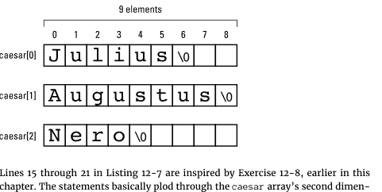

图12-1：
在二维数组中存储字符串。

清单12-7中的第15行到第21行受到本章前面练习12-8的启发。这些语句基本上缓慢遍历 caesar 数组的第二维，一次输出一个字符。

练习12-19：将清单12-7中的第15行到第21行替换为一个 puts() 函数来显示字符串。该语句如下所示：

```
puts(caesar[x]);
```

在二维数组中处理字符串时，字符串仅通过第一维来引用。


练习12-20：修改练习12-19中的源代码，向数组中再添加三位皇帝：Tiberius、Caligula 和 Claudius。

## 玩转三维数组

二维数组在编程领域相当常见。多维就太疯狂了！

好吧，也许并非如此。三维和四维数组自有其用武之地。关键在于，人类大脑很难跟上各种可能的维度。

清单12-8展示了使用三维数组的代码。声明在第5行。第三维就是第三组方括号，这实际上创建了一个三维井字棋游戏棋盘。

### 清单 12-8：进入三维

```
#include <stdio.h>

int main()
{
    char tictactoe[3][3][3];
    int x,y,z;

    /* initialize matrix */
    for(x=0;x<3;x++)
        for(y=0;y<3;y++)
            for(z=0;z<3;z++)
                tictactoe[x][y][z]='-';
    tictactoe[1][1][1] = 'X';

    /* display game board */
    puts("Ready to play 3D Tic-Tac-Toe?");
    for(z=0;z<3;z++)
    {
        printf("Level %d\n",z+1);
        for(x=0;x<3;x++)
        {
            for(y=0;y<3;y++)
                printf("%c ",tictactoe[x][y][z]);
            putchar('\n');
        }
    }
    return(0);
}
```

第8行到第12行使用变量 x、y 和 z 作为三维坐标，用数据填充数组。第13行将字符 X 放在中心立方体中，这让你了解各个元素是如何引用的。

第15行到第26行的其余代码显示该矩阵。

练习12-21：使用清单12-8中的源代码创建一个三维数组程序。构建并运行。

遗憾的是，输出是二维的。如果你愿意编写第三维，那就交给你了。


## 声明已初始化的多维数组

多维数组的一个隐秘真相是：它们实际上并不存在。在内部，编译器将所有内容视为一维——只是一个装满元素的长数组。双重（或三重）方括号表示法用于在编译时计算数组中的正确偏移量。这没什么问题，因为编译器会完成这些工作。

当你声明已初始化的多维数组时，就能看出它们是如何转化为普通老式一维数组的。例如：

```c
int grid[3][4] = {
    5, 4, 4, 5,
    4, 4, 5, 4,
    4, 5, 4, 5
};
```

grid 数组由三行组成，每行四个元素。正如刚才所示，它被声明为一个网格，看起来也像一个网格。这样的声明是可行的，只要最后一个元素后面没有逗号。实际上，你可以把整个数组写成这样：

```c
int grid[3][4] = { 5, 4, 4, 5, 4, 4, 5, 4, 4, 5, 4, 5 };
```

这条语句仍然定义了一个多维数组，但你可以看出它实际上只是一个带双重索引的一维数组。事实上，即使你只给出其中一个维度，编译器也能足够聪明地推断出维度，如下例所示：

```c
int grid[][4] = { 5, 4, 4, 5, 4, 4, 5, 4, 4, 5, 4, 5 };
```

在前一行中，编译器会在数组 grid 中看到 12 个元素，因此它会根据方括号中的 4 自动知道这是一个 3×4 矩阵。或者你也可以这样做：

```c
int grid[][6] = { 5, 4, 4, 5, 4, 4, 5, 4, 4, 5, 4, 5 };
```

在这个例子中，编译器会推断出你有两行、每行六个元素。但下面的例子就是错误的：

```c
int grid[][] = { 5, 4, 4, 5, 4, 4, 5, 4, 4, 5, 4, 5 };
```

编译器可不会自作聪明。在前一行中，它看到的是一维数组声明不当。多余的方括号是不需要的。

**练习12-22：** 改写练习12-17中的代码，使得在声明数组时初始化井字棋棋盘——包括将 X 放在正确的位置上。

## 数组与函数

创建供函数内部使用的数组，与创建供 main() 函数内部使用的数组完全相同：先声明数组，再将其初始化，然后使用其元素。你也可以将数组传递给函数，并从函数中返回数组。

### 向函数传递数组

将数组传给函数是相当直截了当的。函数原型必须将数组指定为其中一个参数。如下所示：

```c
void whatever(int nums[]);
```

这条语句声明了 whatever() 函数的原型。该函数接受一个整数数组作为参数，并在函数内部使用 nums 来表示该数组。整个数组——每一个元素——都会被传递给函数，在函数中供你尽情使用。

当你调用一个以数组为参数的函数时，必须省略方括号：

```c
whatever(values);
```

在前一行中，调用 whatever() 函数时使用了数组 values 作为参数。如果你保留方括号，编译器会认为你只想传递单个元素，而且忘了指定是哪一个。所以这样写是对的：

```c
whatever(values);
```

但这样写就不对了：

```c
whatever(values[]);
```

而这条语句则是向 nice() 函数传递单个元素：

```c
nice(value[x]);
```

本节的主题是传递整个数组，清单12-9中展示的代码使用了 showarray() 函数。它是一个 void 函数，因此不返回任何值，但它可以操作传入的数组。

**清单12-9：函数先生，来认识一下数组先生**

```c
#include <stdio.h>

void showarray(int array[]);

int main()
{
    int n[] = { 2, 3, 5, 7, 11 };

    puts("Here's your array:");
    showarray(n);
    return(0);
}

void showarray(int array[])
{
    int x;

    for(x=0;x<5;x++)
        printf("%d ",array[x]);
    putchar('\n');
}
```


在第 10 行调用了 showarray() 函数。看到 n 数组在传递时没有带方括号了吗？请记住这种格式！

在第 14 行，showarray() 函数在定义时使用方括号指定了数组参数，这与第 3 行的原型完全一致。在函数内部，访问数组的方式与在 main() 函数中相同，你可以从第 19 行看到这一点。

**练习12-23：** 在编辑器中输入清单12-9中的源代码。编译并运行该程序，确保它能正常工作。

**练习12-24：** 为你在练习12-23中的解决方案添加第二个函数 *arrayinc()*。让它成为一个 *void* 函数。该函数将一个数组作为参数，并将数组中的每个值加 1。让 *main()* 函数以数组 *n* 为参数调用 *arrayinc()*。然后再次调用 *showarray()* 函数，以显示数组中修改后的值。

*arrayinc()* 函数无需返回修改后的数组（这一点将在下一节中讨论）。由于 C 中数组的有趣特性，在一个函数中被修改的元素值会影响整个代码中的该数组。

### 从函数返回数组

除了接收数组之外，C 中的函数还可以返回数组。问题在于，数组只能以指针形式返回。这个主题将在第 19 章中介绍。但这还不是最糟糕的部分：

在第 19 章中，你会发现一个惊世骇俗的真相：C 语言中并没有数组——它们只是被巧妙伪装的指针。（很抱歉要把这个真相留到本章末尾才揭晓。）数组表示法确实有它的用武之地，但指针才是真正的关键所在。

**本章内容**

- 检查特定字符
- 转换文本字符
- 操作字符串
- 使用转换字符
- 调整文本输出
- 理解流输入

### 第 13 章：玩转文本

## 玩转文本

字符串是一段文本。它是一个编程概念，但也是人类一切交流的基本组成部分。然而，字符串并非 C 语言中的一种变量类型；不，字符串是 char 变量的数组。这一事实并不会降低它的重要性。大量编程工作都涉及呈现文本和操作字符串。因此，尽管字符串没有被邀请加入 C 语言官方数据类型俱乐部，但在编写程序时，它却很有影响力。

## 字符操作函数

任何文本字符串的核心都是 char 变量。它是一个独特的小隔间，你可以往里面塞入一个从 0 到 255 的整数。这个值在视觉上表现为一个字符——一个符号、一条曲线或某个不知名的小东西，以及你在学会阅读之前就已熟悉的可爱字母表。

### 初识 CTYPE 函数

C 语言提供了一大批用于测试或操作单个字符的函数。这些函数都定义在 ctype.h 头文件中。因此，大多数程序员将这些函数称为 CTYPE 函数，其中 CTYPE 读作“see-type”，而不是“stoor-ye”——后者是俄罗斯本地人的读法。

要使用 CTYPE 函数，必须在源代码中包含 ctype.h 头文件：

```c
#include <ctype.h>
```

我将 CTYPE 函数分为两类：is-测试类和 to-操作类。表 13-1 展示了一些我最钟爱的测试函数；表 13-2 则展示了一些操作函数。

**表 13-1：CTYPE 测试函数**

| 函数 | 当 ch 为以下情况时返回 TRUE |
|---|---|
| isalnum(ch) | 字母（大写或小写）或数字 |
| isalpha(ch) | 字母表中的大写或小写字母 |
| iscntrl(ch) | 控制代码字符，值为 0 到 31 和 127 |
| isdigit(ch) | 0 到 9 的字符 |
| isgraph(ch) | 除空格外任何可打印字符 |
| islower(ch) | 字母表中的小写字母 a 到 z |
| isprint(ch) | 任何可以显示的字符，包括空格 |
| ispunct(ch) | 标点符号 |
| isspace(ch) | 空白字符，例如空格、制表符、换页符或回车符 |
| isupper(ch) | 字母表中的大写字母 A 到 Z |
| isxdigit(ch) | 任何十六进制数字，0 到 9 或 A 到 F（大写或小写） |

**表 13-2：CTYPE 操作函数**

| 函数 | 返回 |
|---|---|
| tolower(ch) | 字符 ch 的小写形式 |
| toupper(ch) | 字符 ch 的大写形式 |

CTYPE 函数是规整的：测试函数以 is 开头，操作函数以 to 开头。

每个 CTYPE 函数都接受一个 int 值作为参数，在表 13-1 和 13-2 中用变量 ch 表示。这些并不是 char 函数！


Every CTYPE function returns an int value. The functions in Table 13-1 return logical TRUE or FALSE values; FALSE is 0, and TRUE is a non-zero value.


CTYPE functions are not real functions. No, they're macros defined in the ctype.h header file. Regardless, they look like functions and are used that way. (I write this note to prevent college sophomores from emailing me such corrections.)

## 测试字符

The CTYPE functions come in most handy when testing input, determining that the proper information was typed, or pulling required information out of junk. The code in Listing 13-1 illustrates how a program can scan text, pluck out certain attributes, and then output a summary of that information.

### LISTING 13-1: 文本统计

```c
#include <stdio.h>
#include <ctype.h>

int main()
{
    char phrase[] = "When in the Course of human events, it becomes necessary for one people to dissolve the political bands which have connected them with another, and to assume among the powers of the earth, the separate and equal station to which the Laws of Nature and of Nature's God entitle them, a decent respect to the opinions of mankind requires that they should declare the causes which impel them to the separation.";

    int index,alpha,space,punct;

    alpha = space = punct = 0;

        /* gather data */
    index = 0;
    while(phrase[index])
    {
        if(isalpha(phrase[index]))
            alpha++;
        if(isspace(phrase[index]))
            space++;
```

### LISTING 13-1: （续）

```c
if(ispunct(phrase[index]))
    punct++;
    index++;
}

    /* print results */
    printf("\"%s\"\n",phrase);
    puts("Statistics:");
    printf("%d alphabetic characters\n",alpha);
    printf("%d spaces\n",space);
    printf("%d punctuation symbols\n",punct);

    return(0);
}
```

Listing 13-1 may seem long, but it's not; the phrase[] string declared at Line 6 can be anything you like — any text, a poem, or a filthy limerick. It should be long enough to have a smattering of interesting characters. Note that though the text wraps and indents in this text, you should just type one long line of text in your code.

This code also does something not yet presented in this book. I call it a gang initialization:

```
alpha = space = punct = 0;
```

Because each of these variables must be set to 0, you use multiple assignment operators on the same line and accomplish the task in one fell swoop.

The meat of the program's operation takes place starting after the gather data comment. A while loop steps through each character in the string. The condition for the while loop is phrase[index]. This evaluation is TRUE for each character in the array except for the last one, the null character, which evaluates to FALSE and stops the loop.

CTYPE functions are used in if statements as each character is evaluated at Lines 16, 18, and 20. I don't use if-else tests because every character must be checked. When a positive or TRUE match is found, a counter variable is incremented.

Exercise 13-1: Type the source code from Listing 13-1 into your editor. Build and run.

Exercise 13-2: Modify the source code from Listing 13-1 so that tests are also made for counting upper- and lowercase letters. Display those results as well.

Exercise 13-3: Add code to your solution to Exercise 13-2 so that a final tally of all characters in the text (the text's length) is displayed as the final statistic.

Many compilers add other is-CTYPE functions to their libraries. These functions are useful, such as isblank() to test for a space or tab, but they might not be available to every C compiler.

## 更改字符

The CTYPE functions begin with to are used to manipulate characters. The most common of these functions (the only two in the standard C library) are toupper() and tolower(), which come in handy when testing input. As an example, consider the typical yarn problem, illustrated in Listing 13-2.

### LISTING 13-2

### 一个 yarn 问题

```c
#include <stdio.h>
#include <ctype.h>

int main()
{
	char answer;

	printf("Would you like to blow up the moon? ");
	scanf("%c",&answer);
	answer = toupper(answer);
	if(answer=='Y')
		puts("BOOM!");
	else
		puts("The moon is safe");
	return(0);
}
```

Yarn is programmer-speak for a yes-or-no situation: The user is asked to type Y for Yes or N for No. Does the person have to type Y or y? Or can they type N or n, or would any non-Y key be considered No?

## 表 13-3 字符串函数

| 函数 | 其作用 |
|---|---|
| `strcat()` | 将一个字符串附加到另一个字符串，形成一个由两个组成的单一字符串。 |
| `strncat()` | 将给定数量的字符从一个字符串附加到另一个字符串的末尾。 |
| `strchr()` | 在字符串中搜索一个字符。函数以指针的形式返回该字符从字符串开头的位置。 |
| `strcmp()` | 以区分大小写的方式比较两个字符串。如果字符串匹配，函数返回 0。 |
| `strncmp()` | 比较两个字符串的前 n 个字符，如果给定数量的字符匹配则返回 0。 |
| `strcpy()` | 复制（重复）一个字符串到另一个字符串。 |
| `strncpy()` | 从一个字符串复制特定数量的字符到另一个字符串。 |
| `strlen()` | 返回字符串的长度，不计字符串末尾的 \0 或 NULL 字符。 |
| `strrchr()` | 在字符串中搜索一个字符，但方向相反。函数以指针的形式返回该字符从字符串末尾的位置。 |
| `strstr()` | 在另一个字符串中搜索一个字符串。如果找到，函数返回指向该字符串位置的指针。 |

All the string functions in Table 13-3 require the `string.h` header file to be included with your source code:

```
#include <string.h>
```


On a Unix system, you can review all the string functions by typing the command `man string` in a terminal window.


Be aware of nonstandard string functions. For example, the `strcasecmp()` function compares strings regardless of text case, though this function isn't part of the standard C library. If you use such a function in your code, it may not compile on another computer system.

## 比较文本

Strings are compared by using the `strcmp()` function and its cousin `strncmp()`.

The string comparison functions return an `int` value based on the result of the comparison: 0 for when the strings are equal, or a higher or lower `int` value based on whether the first string's value is greater than (higher in the alphabet) or less than (lower in the alphabet) the second string. Most of the time, you just check for 0.

Listing 13-3 uses the strcmp() function in Line 13 to compare the initialized string password with whatever text is read at Line 11, which is stored in the input array. The result of this operation is stored in the match variable, which is used in an if-else decision tree at Line 14 to display the results.

### LISTING 13-3: 让我进入

```c
#include <stdio.h>
#include <string.h>

int main()
{
    char password[]="taco";
    char input[15];
    int match;

    printf("Password: ");
    scanf("%s",input);

    match=strcmp(input,password);
    if(match==0)
        puts("Password accepted");
    else
        puts("Invalid password. Alert the authorities.");

    return(0);
}
```

**Exercise 13-7:** Type the source code from Listing 13-3 into your editor. Try out the program a few times to ensure that it accepts only taco as the proper password.

**Exercise 13-8:** Eliminate the match variable from your code in Exercise 13-7 and use the strcmp() function directly in the if comparison. This is the way most programmers do it.

## 构建字符串

The glue that sticks one string onto the end of another is the strcat() function. The term cat is short for concatenate, which means to link together. Here's how it works:

```c
strcat(first,second);
```


After this statement executes, the text from the second string is appended to the first string. Or you can use immediate values:

```
strcat(gerund,"ing");
```

This statement tacks the text ing onto the end of the gerund text array.


It's important that the destination string buffer be large enough to accommodate all the text. The compiler doesn't check for an overflow, which is a security risk. No, it's up to you, the programmer, to confirm that the target char array is large enough.

The code in Listing 13-4 declares two char arrays to hold text. Array first is twice as large as array last because it's the location where the second string's content is copied. The copying takes place at Line 13 with the strcat() function.

### 清单 13-4：介绍

```c
#include <stdio.h>
#include <string.h>

int main()
{
    char first[40];
    char last[20];

    printf("What is your first name?");
    scanf("%s",first);
    printf("What is your last name?");
    scanf("%s",last);
    strcat(first,last);
    printf("Pleased to meet you, %s!\n",first);
    return(0);
}
```

练习 13-9：使用清单 13-4 中的源代码创建一个新程序。运行该程序。

练习 13-10：修改你的源代码，使在最后一个字符串被连接之前，先将一个空格连接到第一个字符串。


虽然我在清单 13-4 中很小心以避免缓冲区溢出，但此代码中使用了 scanf() 函数。该函数用于收集文本输入时很脆弱。fgets() 函数会更好，但它会保留字符串中的换行符，这会为生成干净的输出带来更多问题。

## 使用 printf() 格式化的有趣之处

C 中最受欢迎的输出函数非 printf() 莫属。它是人人喜爱的函数。它是你在 C 中学习的首批函数之一。而且作为最复杂的函数之一，它也是从未有人完全掌握的函数之一。

printf() 的强大之处在于其格式字符串。该字符串可以包含纯文本、转义序列和转换字符，这些小小的百分号东西会将值插入到文本输出中。正是这些转换字符，或占位符，赋予了 printf() 真正的强大功能，它们也是该函数最不为人所理解的方面之一。

- printf() 函数如此受欢迎，以至于几乎每一种当前流行的编程语言都有自己的版本。
- 所有转换字符都列在附录 F 中。

### 格式化浮点数

你可以使用比基本的 %f 转换字符更多的格式来格式化浮点值。事实上，这就是我在 printf() 函数的格式文本中通常使用的格式：

```
%w.pf
```

w 设置整个数字的最大宽度，包括小数点。p 设置小数点后的字符数。例如：

```
printf("%9.2f", 12.45);
```

此语句输出四个空格然后是 12.45。这四个空格加上 12.45（总共五个字符）等于宽度中的 9。因为在 %f 转换字符中使用了 .2，所以小数点右边只显示两位值。

可以在不设置宽度的情况下指定小数位数，但它必须以句点为前缀，如 %.2f（百分号点二 F）。清单 13-5 显示了多种选项。

### 清单 13-5：printf() 浮点数格式化全集

```c
#include <stdio.h>

int main()
{
    float sample1 = 34.5;
    float sample2 = 12.3456789;

    printf("%%9.1f = %9.1f\n",sample1);
    printf("%%8.1f = %8.1f\n",sample1);
    printf("%%7.1f = %7.1f\n",sample1);
    printf("%%6.1f = %6.1f\n",sample1);
    printf("%%5.1f = %5.1f\n",sample1);
    printf("%%4.1f = %4.1f\n",sample1);
    printf("%%3.1f = %3.1f\n",sample1);
    printf("%%2.1f = %2.1f\n",sample1);
    printf("%%1.1f = %1.1f\n",sample1);
    printf("%%9.1f = %9.1f\n",sample2);
    printf("%%9.2f = %9.2f\n",sample2);
    printf("%%9.3f = %9.3f\n",sample2);
    printf("%%9.4f = %9.4f\n",sample2);
    printf("%%9.5f = %9.5f\n",sample2);
    printf("%%9.6f = %9.6f\n",sample2);
    printf("%%9.7f = %9.7f\n",sample2);
    printf("%%9.8f = %9.8f\n",sample2);
    return(0);
}
```

练习 13-11：将清单 13-5 中的源代码输入到你的编辑器中。看起来工作量很大，但你可以通过大量复制粘贴快速创建代码。

练习 13-11 的输出有助于说明 %f 转换字符的宽度和精度部分：

```
%9.1f =     34.5
%8.1f =     34.5
%7.1f =     34.5
%6.1f = 34.5
%5.1f = 34.5
%4.1f = 34.5
%3.1f = 34.5
%2.1f = 34.5
%1.1f = 34.5
%9.1f = 12.3
%9.2f = 12.35
%9.3f = 12.346
%9.4f = 12.3457
%9.5f = 12.34568
%9.6f = 12.345679
%9.7f = 12.3456793
%9.8f = 12.34567928
```

从此输出中，你可以看到宽度值如何“填充”数字的左侧。随着宽度值的减小，填充也会减少。然而，当指定的宽度比原始值更宽时，会显示无意义的内容，如输出的最后两行所示。这是因为宽度超出了单精度的限制。

### 设置输出宽度

w 输出宽度选项适用于所有转换字符，而不仅仅是 %f。宽度是为输出提供的最小空间。当输出小于宽度时，它会右对齐。当输出大于宽度时，宽度值会被忽略。清单 13-6 使用 %s 占位符提供了示例。

### 清单 13-6：调整宽度

```c
#include <stdio.h>

int main()
{
    printf("%%15s = %15s\n","hello");
    printf("%%14s = %14s\n","hello");
    printf("%%13s = %13s\n","hello");
    printf("%%12s = %12s\n","hello");
    printf("%%11s = %11s\n","hello");
    printf("%%10s = %10s\n","hello");
    printf("%%9s = %9s\n","hello");
    printf("%%8s = %8s\n","hello");
    printf("%%7s = %7s\n","hello");
    printf("%%6s = %6s\n","hello");
    printf("%%5s = %5s\n","hello");
    printf("%%4s = %4s\n","hello");
    return(0);
}
```

练习 13-12：将清单 13-6 中的源代码输入到一个新项目中。构建并运行以检查输出，其看起来像这样：

```
%15s =       hello
%14s =       hello
%13s =       hello
%12s =       hello
%11s =       hello
%10s =       hello
%9s =       hello
%8s =       hello
%7s =       hello
%6s =       hello
%5s = hello
%4s = hello
```

与浮点数的宽度选项（参见清单 13-5）一样，当宽度值大于字符串时，左侧会填充空格。但当宽度小于字符串的长度时，仍会输出完整的字符串。

当为整数指定宽度值时，它可用于右对齐输出。例如：

```
printf("%4d",value);
```

此语句确保 value 的输出右对齐且至少宽四个字符。如果 value 的宽度少于四个字符，则左侧会用空格填充。也就是说，除非你在其中加上 0：

```
printf("%04d",value);
```

在这种情况下，printf() 函数用零填充宽度以保持一切宽四个字符。

练习 13-13：修改练习 13-1，使整数值的输出对齐。例如，输出的摘要部分应如下所示：

```
330 alphabetic characters
70 blanks
6 punctuation symbols
```

### 对齐输出

转换字符中的宽度值将输出对齐到右侧，称为右对齐。但并非一切都“正确”。有时，你想要左对齐。要强制填充到输出的右侧，请在 %s 转换字符中的宽度值前插入一个减号。例如：

```
printf("%-15s",string);
```

此语句将数组 string 中的文本左对齐输出。如果 string 短于 15 个字符，则在右侧添加空格。

清单 13-7 中的源代码显示了两个字符串。第一个字符串在不同宽度的范围内左对齐。随着每个递进的 printf() 语句，宽度会变小。

### 清单 13-7：在中间相遇

```c
#include <stdio.h>

int main()
{
    printf("%-9s %9s\n", "meet", "you");
    printf("%-8s %8s\n", "meet", "you");
    printf("%-7s %7s\n", "meet", "you");
    printf("%-6s %6s\n", "meet", "you");
    printf("%-5s %5s\n", "meet", "you");
    printf("%-4s %4s\n", "meet", "you");
    return(0);
}
```

练习 13-14：将清单 13-7 中的代码复制到你的编辑器中。创建程序并运行以查看演示的对齐输出。

练习 13-15：编写一个程序，显示美国前四位总统的姓名和姓氏。你可以将名称表示为字面值 in

printf() 语句。名称需要对齐，以便输出看起来像这样：

```
George Washington
John      Adams
Thomas    Jefferson
James     Madison
```

### 顺流而下

C 中的基本输入/输出函数不是交互式的。它们不会坐在那里等待你在键盘上输入文本，而这正是你期望计算机程序的使用方式。但 C 中的标准输入不是基于字符的，而是基于流的。

使用基于流的输入，程序会把输入看作是从壶里倒出来的一样。所有字符，包括 Enter，依次一个接一个地进入。只有在接收到一段文本后，或输入完全停止后，流才会结束。这个概念对任何初学 C 的程序员来说都可能令人沮丧。

### 演示流输入

请考虑清单 13-8 所示的代码。看起来代码会一直读取输入直到遇到句点。此时，你会认为输入会停止，但这样做并没有预见到流输入。

**清单 13-8：被流输入所挫败**

```
#include <stdio.h>

int main()
{
    int i;

    do
    {
        i = getchar();
        putchar(i);
    } while(i != '.');

    putchar('\n');
    return(0);
}
```

练习 13-16：将清单 13-8 的源代码输入到编辑器中。构建并运行以尝试该程序。输入大量文本和一个句点，看看会发生什么。

这是我电脑上的运行情况，我的输入以粗体显示：

```
This is a test. It's only a test.
This is a test.
```

程序在你输入句点后不会停止输入。前一个示例中的第一行就是流，就像消防水管把字符喷射到程序中一样。程序表现正常，处理流并在遇到句点后停止显示。Enter 键充当流中的中断，程序用它来消化到该点为止的输入。

### 处理流输入

尽管 C 语言具有流导向，但仍然存在创建或多或少交互式程序的方法。你只需接受流输入并相应地处理它。

清单 13-9 中的源代码对你来说应该相当直接。getchar() 函数获取两个字符，然后这些字符在第 11 行显示。

**清单 13-9：在流中捕捉字符**

```
#include <stdio.h>

int main()
{
    int first,second;

    printf("Type your first initial: ");
    first = getchar();
    printf("Type your second initial: ");
    second = getchar();
    printf("Your initials are '%c' and '%c'\n", first,second);
    return(0);
}
```

练习 13-17：将清单 13-9 的源代码输入到你的编辑器中。清单中的第 11 行被拆分以避免换行；你不必在编辑器中拆分该行。使用你的姓名首字母作为输入进行构建和运行。

这是我看到的输出，我的输入以粗体显示：

```
Type your first initial: D
Type your second initial: Your initials are 'D' and '
'
```

就像你一样，我从未有机会输入我的第二个首字母。流中包含了 Enter 键按下，程序将其作为第二个 getchar() 函数的输入接受。该字符 \n 显示在输出的单引号之间。

如何运行该程序？很简单：在第一个提示时输入两个首字母：

```
Type your first initial: DG
Type your second initial: Your initials are 'D' and 'G'
```

当然，这不是代码所要求的。那么如何修复它？你能想出一个使用你当前程序员工具包的解决方案吗？

不要放弃！

我会使用的解决方案是设计一个函数，该函数返回流中的第一个字符，然后吞掉其余字符直到遇到 \n。该函数出现在清单 13-10 中：

**清单 13-10：单字符输入函数 getch()**

```
int getch(void)
{
    int ch;

    ch = getchar();
    while(getchar()!='\n')
    ;
    return(ch);
}
```

为了理解流输入，请考虑清单 13-10 中的 while 循环会遍历流中的所有文本，直到遇到换行符。然后在第 5 行获取的流中的第一个字符将被函数返回。

**练习 13-18：** 修改练习 13-17 中的源代码，使其使用清单 13-10 中所示的 getch() 函数来收集输入。构建并运行以确保输出是用户所预期的。


如果你想要真正交互式的程序，我建议你研究 NCurses 库，它扩展了 C 输出和输入文本的能力。NCurses 让你创建全屏文本程序，这些程序是立即交互的。

- 创建结构
- 声明结构变量
- 为结构变量赋值
- 构建结构数组
- 将一个结构放入另一个结构中

### 第14章：结构，多变量

单个变量非常适合存储单个值。当你需要更多同一种类型的变量时，你声明一个数组。对于由几种不同类型变量组成的数据，你将变量类型塑造成称为结构的东西。这是 C 语言创建变量自助餐的方法。

我更喜欢把 C 语言结构看作多变量，或几个变量合并成一个。你使用结构来存储和访问复杂信息。这样，你就可以把各种 int、char、float 变量，甚至数组，都保存在一个整洁的包中。

有些东西就应该放在一起——比如你的姓名和地址，或你的银行账号和据说在那里的所有钱。你可以在 C 中通过使用并行数组或专门命名的变量来构建这种关系。但这种方法很笨拙。更好的解决方案是使用结构，如清单 14-1 所示。

**清单 14-1：一个变量，多个部分**

```
#include <stdio.h>

int main()
{
    struct player
    {
        char name[32];
        int highscore;
    };
    struct player xbox;

    printf("Enter the player's name: ");
    scanf("%s",xbox.name);
    printf("Enter their high score: ");
    scanf("%d",&xbox.highscore);

    printf("Player %s has a high score of %d\n", xbox.name,xbox.highscore);
    return(0);
}
```

**练习 14-1：** 在甚至不知道到底发生了什么的情况下，将清单 14-1 输入到编辑器中以创建一个新程序。构建并运行。

清单 14-1 中的代码工作原理如下：

- 第 5 行到第 9 行声明 player 结构。该结构有两个成员——一个 char 数组（字符串）和 int——在第 7 行和第 8 行中声明，就像任何其他变量一样。
- 第 10 行为 player 结构声明一个新变量 xbox。
- 第 13 行使用 scanf() 用字符串值填充 xbox 结构变量的 name 成员。
- 第 15 行使用 scanf() 为 xbox 结构中的 highscore 成员赋值。

结构成员值在第 17 行通过使用 printf() 函数显示。该语句在第 17 行和第 18 行之间拆分，printf() 的参数在第 18 行。

### 理解 struct

结构是一个集合。把它想象成一个框架，容纳多种变量类型。在许多方面，结构类似于数据库中的记录。例如：

```
Name
Age
Gambling debt
```

这三项可以是数据库记录中的字段，也可以是结构中的成员：Name 将是字符串；Age 是整数；Gambling Debt 是无符号浮点值。这样的记录在 C 中作为结构看起来如下：

```
struct record
{
    char name[32];
    int age;
    float debt;
};
```

struct 是 C 语言的关键字，用于引入结构。它是一个定义，说明“该结构包含以下数据类型。”

record 是正在创建的新结构的名字。它不是变量——它是一个结构类型。

在大括号内是结构的成员，即包含在命名结构中的变量。record 结构类型包含三个成员变量：一个名为 name 的字符串、一个名为 age 的 int，以及一个名为 debt 的 float 值。

struct 关键字仅定义结构类型，设置其内容。要使用结构，你必须声明你创建的结构类型的结构变量。例如：

```
struct record human;
```

该语句声明了一个新的变量 human，其类型为 record 结构类型。


结构体变量也可以在定义结构体本身时声明。例如：

```c
struct record
{
    char name[32];
    int age;
    float debt;
}
human;
```

这些语句定义了 record 结构体并声明了一个 record 结构体变量 human。也可以创建该结构体类型的多个变量：

```c
struct record
{
    char name[32];
    int age;
    float debt;
}
bill, mary, dan, susie;
```

本例中创建了四个 record 结构体变量。

要访问结构体变量中的成员，使用句点，即成员运算符。它将结构体变量名与成员名连接起来。例如：

```c
printf("Victim: %s\n", bill.name);
```

该语句引用了 bill 结构体变量中的 name 成员。它是一个字符数组，在代码中使用方式与其他字符数组相同。结构体变量中的其他成员也像其各自的对应项一样使用。

```c
dan.age = 32;
```

在此示例中，结构体变量 dan 中的 age 成员被设置为值 32。

练习 14-2：修改《清单 14-1》中的源代码，为 player 结构体添加另一个成员，一个表示游戏时间的 float 值。完善其余代码，使新值能够输入并显示。

## 填充结构体

与其他变量一样，你可以在创建时初始化结构体变量。你首先定义结构体类型，然后声明一个结构体变量并预设其成员值。确保预设值与结构体中定义的成员的顺序和类型相匹配，如《清单 14-2》所示。

### LISTING 14-2 声明已初始化的结构体

```c
#include <stdio.h>

int main()
{
    struct president
    {
        char name[40];
        int year;
    };
    struct president first = {
        "George Washington",
        1789
    };

    printf("The first president was %s\n",first.name);
    printf("He was inaugurated in %d\n",first.year);

    return(0);
}
```

练习 14-3：通过在编辑器中输入《清单 14-2》中的源代码创建一个新程序。构建并运行。

你也可以在一行语句中声明结构体并进行初始化：

```c
struct president
{
    char name[40];
    int year;
} first = {
    "George Washington",
    1789
};
```

### 练习 14-4

修改练习 14-3 中的源代码，使结构体和变量作为一条语句一起声明和初始化。

### 练习 14-5

在代码中添加另一个 president 结构体变量 second，用关于第二任总统 John Adams 的信息初始化该结构体，他于 1797 年就职。显示两个结构体的内容。

## 创建结构体数组

逐个创建单独的结构体变量既无聊又浪费，就像创建一系列任何单独变量类型一样。处理多个结构体的解决方案与处理多个单独变量相同：数组。

结构体数组的声明方式如下：

```c
struct scores player[4];
```

该语句声明了一个 scores 结构体的数组。数组名为 player，其包含四个结构体变量作为元素。

数组中的结构体使用数组和结构体表示法的组合来访问。例如：

```c
player[2].name
```

前一行中的变量访问 player 结构体数组中第三个元素（2）中的 name 成员。是的，那就是第三个元素，因为第一个元素会像这样引用：

```c
player[0].name
```

数组从元素 0 开始编号，而不是元素 1。

> 《清单 14-3》中的第 10 行声明了一个包含四个 scores 结构体的数组。数组名为 player。第 13 行到第 19 行填充数组中的每个结构体。第 21 行到第 27 行显示每个结构体的成员值。

### Listing 14-3：结构体数组

```c
#include <stdio.h>

int main()
{
    struct scores {
        char name[30];
        int score;
    } player[4];

    int i;

    for (i = 0; i < 4; i++) {
        printf("Enter name and score for player %d: ", i);
        scanf("%s %d", player[i].name, &player[i].score);
    }

    printf("\n");

    for (i = 0; i < 4; i++) {
        printf("Player %d: %s %d\n", i, player[i].name, player[i].score);
    }

    return 0;
}
```

```c
{
    struct scores
    {
        char name[32];
        int score;
    };
    struct scores player[4];
    int x;

    for(x=0;x<4;x++)
    {
        printf("Enter player %d: ",x+1);
        scanf("%s",player[x].name);
        printf("Enter their score: ");
        scanf("%d",&player[x].score);
    }

    puts("Player Info");
    printf("\n\tName\tScore\n");
    for(x=0;x<4;x++)
    {
        printf("%d\t%s\t%5d\n",
            x+1,player[x].name,player[x].score);
    }
    return(0);
}
```

练习 14-6：将《清单 14-3》中的源代码输入到编辑器中。构建并运行程序。

练习 14-7：在《清单 14-3》中添加代码，使结构体的显示按最高分在前排序。是的，你可以做到这一点。对结构体数组排序的工作方式与对任何其他数组排序相同。如果突然失去勇气，请复习第 12 章。


这是一个提示，因为我是个好人。我的解决方案的第 28 行看起来像这样：

```c
player[a]=player[b];
```

你可以像交换任何数组元素一样交换结构体数组元素。你不需要交换结构体变量的成员。

## 奇怪的结构体概念

我承认结构体也许是 C 语言中最奇怪的变量类型。创建它们所需的两个步骤很不寻常，但使用点号引用结构体成员的方法总是让初学者感到困惑。如果你认为除了这两个问题之外，结构体不可能更奇怪了，那你就大错特错了。

### 在结构体中放置结构体

结构体确实保存 C 语言变量。结构体也是 C 语言变量。因此，可以推断结构体可以作为成员保存另一个结构体。不要让这种奇怪的想法困扰你。相反，请看《清单 14-4》所示的示例。

### LISTING 14-4：嵌套结构体

```c
#include <stdio.h>
#include <string.h>

int main()
{
    struct date
    {
        int month;
        int day;
        int year;
    };
    struct human
    {
        char name[45];
        struct date birthday;
    };
    struct human president;

    strcpy(president.name,"George Washington");
    president.birthday.month = 2;
    president.birthday.day = 22;
    president.birthday.year = 1732;

    printf("%s was born on %d/%d/%d\n", president.name, president.birthday.month, president.birthday.day, president.birthday.year);

    return(0);
}
```

《清单 14-4》声明了两种结构体类型：第 6 行的 date 和第 12 行的 human。在 human 结构体的声明中，第 15 行你可以看到 date 结构体变量 birthday 的声明。这基本上就是一个结构体在另一个结构体内部诞生的方式。

第 17 行创建了一个 human 结构体变量 president。其余代码用数据填充该结构体的成员。访问嵌套结构体成员的方法在第 20 行到第 22 行中显示。

练习 14-8：将《清单 14-4》中的源代码输入到编辑器中。构建并运行程序。

练习 14-9：从练习 14-8 的解决方案开始，将 human 结构体中的 name 成员替换为嵌套结构体。将该结构体命名为 id，并使其包含两个字符数组成员用于存储个人的名字和姓氏：first 和 last。如果一切正确，总统姓名的引用将是变量 president.name.first 和 president.name.last。确保在代码中为这些变量赋值并显示结果。

### 将结构体传递给函数

作为一种变量类型，函数完全可以接受结构体作为参数并将其作为值返回。然而，这一过程要求结构体在外部声明，作为全局变量。原因是结构体的定义必须对源代码中的所有函数可用。

全局变量的主题直到第 16 章才涉及。它并不复杂，但学习传递和返回结构体可以推迟到那时。


### 第15章：在命令行提示符下生活

在计算机图形化之前，文本屏幕就是计算机的最高科技水平。视觉上，一切都很朴素乏味，最令人兴奋的计算机游戏也涉及大量阅读。如果当时发明了 Facebook，它将全是书而没有脸。

很久以前，计算机生活围绕着命令行提示符展开。指令是键入的，输出是纯文本。C 语言就是在这种环境中诞生的，而且在某种程度上，它至今仍存在于此。

### 调出终端窗口

无论你使用的是 Windows、Mac OS X、Linux 还是 Unix 变种，你仍然可以打开一个终端窗口，在其中见证命令行提示符令人叹为观止的 starkness。这是一个纯文本环境，事实上，你在本書中编写的每一个程序都完全适合于此环境。

### 启动终端窗口

图 15-1 说明了 Windows 10 中的 Ubuntu Linux bash shell。其他平台也有类似的命令行提示符或终端窗口：在 Macintosh 上，启动 Terminal 应用。对于 Linux，启动终端窗口。

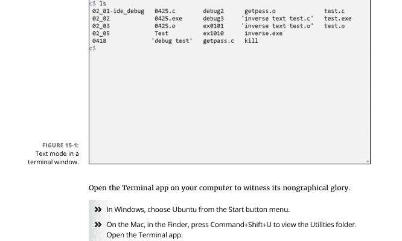

在你的计算机上打开 Terminal 应用，以见证其非图形化的辉煌。

- 在 Windows 中，从“开始”按钮菜单中选择 Ubuntu。
- 在 Mac 上，在 Finder 中按 Command+Shift+U 查看实用工具文件夹。打开 Terminal 应用。
- 在 Linux 或 Unix GUI 环境中，定位并启动 Terminal、Term 或 Xterm 程序。

命令行提示符既神秘又强大。事实上，微软的程序员使用一个名为 PowerShell 的命令行环境来配置 Windows。对于上面列表中提到的配置，你可以编译并运行本书中介绍的所有程序。事实上，你可以使用终端窗口做任何事情：编辑、构建和运行——就像 1980 年代那样！

要关闭命令行提示符或终端窗口，输入 **exit** 命令并按 Enter 键。

> Code::Blocks for Windows 使用旧的 DOS 命令行提示符，即 *cmd* 程序，来输出其文本模式程序。该环境相当有限，这就是我建议获取 Windows 10 的 Ubuntu shell 的原因。

> 在 Windows 10 中使用 Ubuntu shell 不仅仅是从 Microsoft Store 获取应用。你还必须根据提供的说明配置 Windows。 不用担心！ 如果你搞砸了，错误信息会说明该怎么做。


### 在文本模式下运行代码

本书中创建的程序都以文本模式运行。 如果你使用 Code::Blocks，你会看到一个输出窗口，但你也可以直接在 DOS 命令行提示符下运行你的程序。 诀窍在于找到程序，这需要一点命令行技巧。

为什么要这样做？ 因为这是测试访问从命令行提示符获取参数的 main() 函数参数的程序的最佳方式。 请遵循以下说明：

- 1. **打开终端窗口。**

请参考前一节的说明。

命令行提示符或终端窗口打开到你的主文件夹，在文本模式中它被称为 *directory*。 主目录很可能不包含你的 C 程序，因此你必须切换到另一个目录。

- 2. **使用 cd、change directory 命令切换到为存储本书项目而创建的文件夹。**

例如，我将 C 编程项目保存在 prog/c 目录中。 对于本书，源代码文件位于 cprog 子目录中。 我访问此目录时输入的 shell 命令是

```
cd ~/prog/c/cprog
```

在 cd 命令后输入一个空格，然后输入路径名，例如我的 ~/prog/c/cprog（其中 ~ 是你账户主目录的快捷方式）。

在你自己的系统上输入路径名以访问正确的目录。 如果你使用 Code::Blocks，项目文件夹以你保存的项目命名，例如第 14 章最后一个项目的 ex1409。 要运行创建的程序，你必须切换到项目的 bin 文件夹：

```
cd ex1409/bin/release
```

当前目录现在包含项目的可执行程序文件。

- 3. **要运行程序，在命令行提示符下输入其名称。**

例如，cc、gcc 和 clang 编译器的默认输出名称是 a.out。 输入此命令：

```
./a.out
```

./ 指示 shell 在当前目录中查找可执行文件 a.out。 否则，你在 ./ 后跟上程序文件的名称。

按照这些步骤在命令行提示符下运行你创建的任何程序。 在 IDE 中指定参数还有其他方法。 这些方法在本章其他地方有介绍。


### 在 Ubuntu 中查找 Windows 文件

如果你在 Windows 10 中使用 Ubuntu，请注意它使用与 Windows 不同的文件系统。 要访问 Windows 文件系统中的文件，在 bash shell 中你必须使用此命令：

```
cd /mnt/c
```

/mnt/c 文件夹是驱动器 C 的挂载点，Windows 通常安装在那里。 从那里，你可以切换到 Users 目录，然后切换到你的用户配置文件文件夹。 然后你可以切换到存放程序文件的文件夹。

该技术为使用 Linux bash shell 编程提供了一个很好的解决方案，但请注意你不应该反向操作：不要使用 Windows 查找 Ubuntu 文件系统并使用文件资源管理器在那里管理文件。 如果这样做，文件可能无法正确同步，这会导致你不想要的更多问题。

### main() 函数的参数

在过去，程序具有命令行选项或开关。 例如，要编译和链接 C 程序，你输入类似这样的内容：

```
cc ex1501.c -o ex1501
```

cc 命令后的三段文本是选项或开关。 对于 cc 程序，这些文本片段作为 main() 函数的参数访问。 程序可以读取这些参数以执行某些操作。 即使在今天，世界运行图形操作系统时，命令行参数也很重要。 你在代码中需要做的只是检查 main() 函数的参数。

### 读取命令行

假设现在是 1987 年，你正在编写一个程序，它会按姓名向用户说“Hello”。 获取用户姓名的方法是让你的代码吞下在命令行中程序名称后出现的第一个文本块。 该代码可能看起来像清单 15-1。

### LISTING 15-1: 嗨，你好！

```
#include <stdio.h>

int main(int argc, char *argv[])
{
    if(argc>1)
        printf("Greetings, %s!\n",argv[1]);
    return(0);
}
```

清单 15-1 中的第 3 行与本书前面看到的不同。 main() 函数不再为空，现在在括号中显示了它的两个参数——argc 和 *argv[]。

第 5 行使用 int 值 argc 来确定在命令行提示符下程序名称后是否输入了任何额外项目。

第 6 行使用字符串值（`char` 数组）`argv[1]` 来显示命令行提示符下程序名称后的第一个项目。

### **Exercise 15-1:** 将清单 15-1 中的源代码输入到新项目中。 构建并运行。

除非指定了命令行参数，否则程序不显示任何输出。 在命令行提示符下执行此操作：

```
./a.out Jonah
```

程序的名称是 `a.out`。 `./` 前缀指示命令解释器在当前目录中查找文件。 此命令后面跟着一个空格，然后是第一个命令行参数 Jonah。 程序输出此消息：

```
Greetings, Jonah!
```

如果你使用 Code::Blocks，请按照以下步骤设置命令行参数：

- 1. **选择 Project → Set Programs’ Arguments。**

此命令在启动 Code::Blocks 项目时可用。 成功后，你会看到如图 15-2 所示的 Select Target 对话框。

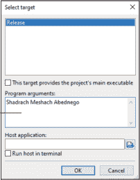

在此处输入命令行参数


2. **在“选择目标”对话框的“程序参数”部分输入命令行文本。**
以图 15-2 为指南。像在命令提示符下输入那样键入参数——包括空格、破折号、点和字母上的小点。
3. **单击“确定”按钮。**
4. **再次运行程序，查看在给定这些命令行参数时的输出。**

如果你在 DOS 命令提示符下编写代码，可以在 DOS 提示符下这样运行程序：

```
ex1501 Shadrach
```

按 Enter 键运行。

清单 15-1 中的代码只使用第一个命令行参数，因此如果你输入更多项，它们会被忽略。例如：

```
ex1501 Shadrach Meshach Abednego
```

在前一行中，输出里只出现 Shadrach 的名字。

## 理解 main() 的参数

如果你不打算让程序接受任何命令行参数，可以将 main() 函数的括号留空。像这样：

```
int main()
```

当代码中使用参数时，必须声明它们。使用它们的形式如下：

```
int main(int argc, char *argv[])
```

argc 是参数计数值。它是一个整数，范围从 1 一直到在命令提示符下程序名之后键入的项数。

- argv[] 是一个 char 指针数组。你可以把它看作字符串数组，在代码中也可以这样使用。

清单 15-2 中的代码只是统计在命令行中键入的参数个数。该值 argc 会被输出。

### 清单 15-2：参数计数器

```
#include <stdio.h>

int main(int argc, char *argv[])
{
    printf("You typed %d arguments.\n",argc);
    return(0);
}
```

练习 15-2：键入前面的源代码。构建并运行，且不键入任何参数。

main() 函数直接从操作系统接收有关命令行参数的信息。命令行会被求值，参数会被计数并引用。计数结果表现为 argc，而引用存储在 argv[] 数组中。

当没有键入任何参数时——在 Code::Blocks 中，这意味着“程序参数”窗口保持为空（参见图 15-2）——你会看到如下输出：

```
You typed 1 arguments.
```

这是因为程序名本身就是第一个参数。你可以通过在代码中添加一行来验证：

```
printf("Argument one is %s.\n",argv[0]);
```

练习 15-3：修改源代码，添加前面这一行，将其插入到第一个 printf() 语句之后。构建并运行。

程序输出现在会显示程序名——很可能是程序的完整路径，这虽然准确，但有点小题大做。

练习 15-4：再次修改代码，这次添加一个 for 循环来遍历所有参数并显示每个参数。例如，输出可能如下所示：

```
bash$ ./ex1504 Shadrach Meshach Abednego
Arg1 = ./ex1504
Arg2 = Shadrach
Arg3 = Meshach
Arg4 = Abednego
```

第一个参数是 argv[] 数组的第零个元素。

## 该退出了

信息可以通过命令行参数进入程序。信息则通过 return 语句返回。这是程序完成时退出的主要方式，但不是唯一方式。

当 main() 函数遇到 return 语句时，程序就会退出。传统上，该语句出现在函数末尾，但它并不一定总需要放在那里。此外，你可以使用 exit() 函数随时离开程序，甚至可以在 main() 以外的函数中这样做。

exit() 函数会优雅地退出程序，处理好所有未了结的事项，把变量安置好，等等。在清单 15-3 中，第 17 行使用该函数在 sub() 函数中离开程序。

```
#include <stdio.h>
#include <stdlib.h>
void sub(void);

int main()
{
    puts("This program quits before it’s done.");
    sub();
    puts("Or was that on purpose?");
    return(0);
}
```

### 清单 15-3：（续）

```
void sub(void)
{
    puts("Which is the plan.");
    exit(0);
}
```

要使用 exit() 函数，必须包含 stdlib.h 头文件；它接受一个 int 值作为退出状态参数，类似于 main() 函数中由 return 传递的值。

练习 15-5：将清单 15-3 中的源代码键入你的编辑器。构建并运行该程序。

## 运行另一个程序

system() 函数指示程序运行另一个程序或发出命令。例如：

```
system("blorf");
```

前面的语句指示操作系统发出 blorf 命令，运行具有该名称的程序，或执行 blorf 命令所规定的任何操作。

运行该命令后，控制权返回到你的程序，程序继续执行 system() 函数之后的语句。

清单 15-4 包含两个 system() 函数；你的代码只需要一个。如果你使用 Windows，请使用第一个 system() 语句；如果你使用其他任何系统，请使用第二个语句。或者，你也可以直接注释掉该语句，而不是删除它。

### 清单 15-4：清理屏幕

```
#include <stdio.h>
#include <stdlib.h>

int main()
{
    printf("Press Enter to clear the screen.");
    getchar();
```

```
system("cls");    /* Windows only */
system("clear");  /* Mac - Unix */
puts("That's better");
return(0);
}
```

第 2 行包含 stdlib.h 头文件，这是 system() 函数正常工作所必需的。确保要运行的命令是用双引号括起来的字符串字面量，或由 char 数组（字符串）表示。

练习 15-6：使用清单 15-4 中所示的源代码创建一个新项目。构建并运行。

## 本章内容

- 更改变量类型
- 使用 typedef 创建新变量
- 创建静态变量
- 创建全局变量
- 使用结构和函数
- 探索枚举常量

### 第 16 章：变量杂谈

## 变量杂谈

关于 C 语言变量，你需要学习的远不止知道 int、char、float 和 double 这些关键字。是的，我把 signed、unsigned、long 以及你可能已经知道的其他内容也算在这个列表里。原因是变量是 C 的重要组成部分。选择正确的数据类型并正确使用它，可能决定程序的成败。

## 变量控制

任何其他名字的变量仍然还是变量。也就是说，除非你在代码中摆弄变量的数据类型，把它变成另一种类型，给它完全不同的新名字，或者为了满足你的需要——无论是否善意——对变量施以咒语。

## 强制类型转换：难以置信

float 变量什么时候不是 float？当然是在它被强制转换为 int 的时候。在 C 中，通过使用类型转换可以实现这个技巧。例如：

```
(int)debt
```

在前一行中，float 变量 debt 被强制转换为 int 值。括号中的 int 指示编译器将 debt 的值视为整数。

为什么会有人想这么做呢？

有时函数需要特定的数据类型，而该类型不可用。与其在一个程序中应付多种数据类型，不如直接将变量强制转换为你想要的数据类型。这个技巧常常是必要的，如清单 16-1 所示。

### 清单 16-1：这样不对

```
#include <stdio.h>

int main()
{
    int a,b;
    float c;

    printf("Input the first value: ");
    scanf("%d",&a);
    printf("Input the second value: ");
    scanf("%d",&b);
    c = a/b;
    printf("%d/%d = %.2f\n",a,b,c);
    return(0);
}
```

练习 16-1：将清单 16-1 中的源代码键入你的编辑器。构建并运行。

下面是一次示例运行，其中我的输入以粗体显示：

```
Input the first value: 3
Input the second value: 2
3/2 = 1.00
```

显然，我认为 3 ÷ 2 会以某种方式得出 1.50 的假设是错误的。如果计算机说是 1.00，那计算机一定是对的。

又或者，计算机只是糊涂了，因为在源代码第 12 行中，两个 int 值相除，结果被赋给一个 float。然而，这个操作并不完全奏效，因为在 C 中，整数除以整数会得到

结果为整数。值 1 是最接近 1.50 的整数值。所以，即使计算机错了，它也只是完全按照被告知的方式去做。

## **练习 16-2：** 修改源代码，将第 12 行改为

```
c = (float)a/(float)b;
```

保存更改。使用刚才显示的相同值构建并运行。新的输出如下：

```
Input the first value: 3
Input the second value: 2
3/2 = 1.50
```

更好了。这是因为你在等式中对变量 a 和 b 进行了*类型转换*，临时允许计算机将它们视为浮点数。因此，结果就是它应该有的样子。

> > » 要对变量进行类型转换，请在它前面加上所需的数据类型，并用括号括起来：
> >
> > ```c
> > (float)boat;
> > ```
> >
> > 在这一行中，整数变量 boat 被类型转换为 *float* 值。
> >
> > » 类型转换不同于 *typedef*，后者将在下一节介绍。

## 使用 *typedef* 创建新事物

使用 *typedef* 关键字可能会给你带来很多麻烦。当心！它很强大。哎呀，它不仅仅是一个关键字——它是一种咒语！它能把正常的 C 语言单词和运算符从它们一贯的本性变成各种捣乱行为。

而且因为我的编辑需要在正文中引用下一个代码示例，请参见代码清单 16-2。

## **代码清单 16-2：** *typedef* 的危险

```
#include <stdio.h>

typedef int stinky;

stinky main()
```
（续）

## 代码清单 16-2：（续）

```
{
    stinky a = 2;

    printf("Everyone knows that ");
    printf("%d + %d = %d\n", a, a, a+a);
    return(0);
}
```

在代码清单 16-2 中，第 3 行的 typedef 语句创建了一个名为 stinky 的新数据类型。它被创建为关键字 int 的同义词。在代码中任何可以使用 int 的地方，都可以改用 stinky 这个词，如第 5 行和第 7 行所示。

**练习 16-3：** 使用代码清单 16-2 中的源代码创建一个新程序，演示 stinky 变量类型与 int 相同。构建并运行。

诚然，代码清单 16-2 中的示例相当愚蠢；没有严肃的程序员会那样设置真实程序。typedef 最常用于定义结构。typedef 语句有助于减少这项活动的笨重感。

例如，练习 14-9（来自第 14 章）要求你声明两个嵌套在第三个结构中的结构。代码清单 16-3 展示了在了解结构（来自第 14 章）的情况下，该操作如何工作：

## 代码清单 16-3：以传统方式创建结构

```
struct id
{
    char first[20];
    char last[20];
};

struct date
{
    int month;
    int day;
    int year;
};

struct human
{
    struct id name;
    struct date birthday;
};
```

代码清单 16-4 展示了如果你使用 typedef 简化结构，声明将如何进行：

## 代码清单 16-4：使用 typedef 定义结构

```
typedef struct id
{
    char first[20];
    char last[20];
} personal;

typedef struct date
{
    int month;
    int day;
    int year;
} calendar;

struct human
{
    personal name;
    calendar birthday;
};
```

在此代码清单中，结构 id 被 typedef 为名称 personal。这不是变量名；这是一个 typedef。这等同于说：“所有对 struct id 的引用现在都与名称 personal 相同。”

同样，结构 date 被 typedef 为 calendar。最后，在结构 human 的声明中，使用了 typedef 名称，而不是更复杂的结构定义。

练习 16-4：修改你在练习 14-9（第 14 章）中创建的项目源代码，以使用 typedef，如代码清单 16-4 所示。构建并运行。

可以说，使用 typedef 并不会比只使用良好的变量名和格式良好的文本让你的代码更清晰。例如，我不使用 typedef，因为我不想必须记住我定义了什么。但你会遇到使用 typedef 的其他代码。别让它吓到你。

要施展 typedef 咒语，请使用以下格式：

`typedef data_type new_type`

在 typedef 关键字后面跟一个现有的 C 数据类型 data_type，然后跟该数据类型的同义词 new_type。为 new_type 定义命名时，使用与命名变量相同的规则。

- >> 将 typedef 与结构一起使用的一个优点是，它可以让你不必多次键入 struct 这个词。
- >> 你在 C 库中遇到的几乎任何数据类型（关键字除外），例如 time_t、size_t 或 st_mode，都很可能是在头文件中声明的 typedef。库文档（man 手册页）解释了底层数据类型，但你应该在代码中使用 typedef 定义的名称来声明任何所需的变量。例如：
- >> 必须知道 typedef 底层数据类型的罕见情况，是在 printf() 语句中使用 typedef 变量时。转换字符必须与实际数据类型匹配。幸运的是，像 clang 这样的现代编译器会报告应使用的正确转换字符。
- >> 程序员在使用 typedef 和结构时遇到麻烦的地方是创建链表时。我在第 20 章中重复这个警告，该章介绍链表。

```
time_t now;
```

前面的语句创建了一个 time_t 数据类型的变量 now，该类型定义在 time.h 头文件中。有关 C 库时间函数的更多信息，请参见第 21 章。


## 创建静态变量

在函数内使用的变量是该函数的局部变量：它们的值被使用，然后在函数完成后被丢弃。代码清单 16-5 演示了这一概念。

## 代码清单 16-5：别给我 static

```
#include <stdio.h>

void proc(void);

int main()
{
    puts("First call");
    proc();
    puts("Second call");
```

```
proc();
return(0);
}

void proc(void)
{
    int a;

    printf("The value of variable a is %d\n",a);
    printf("Enter a new value: ");
    scanf("%d",&a);
}
```

在代码清单 16-5 中，proc() 函数中的变量 a 不会保留其值。该变量仅由第 20 行的 scanf() 函数初始化。否则，该变量包含垃圾信息。

### 练习 16-5：将代码清单 16-5 中的源代码输入编辑器。构建代码。忽略可能出现的“未初始化”警告。运行程序。

在我的计算机上，输出如下所示：

```
First call
The value of variable a is 0
Enter a new value: 6
Second call
The value of variable a is 0
Enter a new value: 6
```

尽管我尝试将 6 赋给变量 a，程序总是忘记。就这样吧。或者并非如此？

### 练习 16-6：修改代码清单 16-5 中的源代码，将第 16 行改为：

```
static int a;
```

构建并运行以测试输出。以下是我看到的结果：

```
First call
The value of variable a is 0
Enter a new value: 6
Second call
The value of variable a is 6
Enter a new value: 5
```

## 变量关键字汇总

C 语言有几个关键字，让初学者和高级用户都感到困惑。以下是各种与变量相关的变量分类符、量词以及其他诸如此类的关键字的概要。

### **auto**

auto 关键字是一个存储类说明符。它是古老 B 编程语言的遗留物，该语言定义了函数中使用的所有非常量或非静态变量。因为这个定义几乎意味着每个变量声明，所以编译器会假定 auto 变量分类，因此不需要这个关键字前缀。

### **const**

const 关键字是一个量词，用于创建常量或不变的值。请参阅第 6 章。

### **enum**

enum 关键字创建一个常量枚举列表。请参见本章后面的“枚举”一节。

### **extern**

与 auto 一样，extern 关键字是一个存储类说明符，引用在函数外部声明的变量。第 24 章会介绍它，不过外部变量的概念在本章其他地方也有介绍。

### **register**

另一个存储类说明符，声明为 register 的变量（后面跟数据类型和变量名）将直接存储在 CPU 寄存器中。现代编译器高度优化，这使得该关键字不再必要。

### **static**

static 关键字声明一种在函数终止时不会被丢弃的存储类。本章其他地方会介绍它。

### **union**

联合（union）是一种复杂的数据结构，类似于结构。与结构不同，联合可以在同一内存空间中保存多种数据类型，不过代码一次只能访问一种类型。联合被认为存在安全风险，因为它们定义了一个数据类型不一致的存储区域。

### **volatile**

这个可怕的关键字是一个量词，通常被称为 const 关键字的对立面。像 register 一样，volatile 曾经用于通过告诉编译器哪些变量会最频繁地变化来优化代码。现代 C 编译器已不再需要这种优化。


因为变量被声明为 *static*，其值在函数调用之间得以保留。

- 作为奖励，*static* 变量声明会被初始化为零。
- 关键字 *static* 定义了一种存储类别。参见附近的侧边栏，“变量关键字汇总”。
- 除非变量的值必须在每次函数调用时保留，否则无需将变量声明为 *static*。这种情况时有发生。另请参阅后面的章节“使用外部变量”。
- 从函数返回的值无需声明为 *static*。当你返回一个值，例如

  ```c
  return(a);
  ```

  只有变量的值被返回，而不是变量本身。这种方法唯一的挑战出现在分配内存作为缓冲区时。缓冲区的数据会被丢弃，如果你希望调用函数能够访问它，则应将其声明为 *static*。参见第19章。

## 到处都是变量

有时，变量必须像蜂窝电话服务一样：无处不在且可从任何函数访问。通常被称为 *global* 变量，在 C 中它正式称为外部变量。

## 使用外部变量

外部变量通过使变量声明对源代码文件中的所有函数可用，从而解决特定问题。任何函数都可以访问该变量。它不必作为参数传递给函数或从函数返回。

Listing 16-6 显示了外部变量是如何声明和使用的。变量 *age* 和 *feet* 是外部的。它们都被源代码中的所有函数使用并操作。

## LISTING 16-6: 到处抛掷你的年龄

```c
#include <stdio.h>

void half(void);
void twice(void);

int age;
float feet;

int main()
{
    printf("How old are you: ");
    scanf("%d",&age);
    printf("How tall are you (in feet): ");
    scanf("%f",&feet);
    printf("You are %d years old and %.1f feet tall.\n", age,feet);
    half();
    twice();
    printf("But you're not really %d years old or %.1f feet tall.\n",age,feet);
    return(0);
}

void half(void)
{
    float a,h;
    a=(float)age/2.0;
    printf("Half your age is %.1f.\n",a);
    h=feet/2.0;
    printf("Half your height is %.1f.\n",h);
}

void twice(void)
{
    age*=2;
    printf("Twice your age is %d.\n",age);
    feet*=2;
    printf("Twice your height is %.1f\n",feet);
}
```

第6行声明外部 int 变量 age，第7行创建外部 float 变量 feet。这些变量在任何函数之外声明，位于 #include、#define 和原型声明区域。变量对每个函数都可用。即使在 twice() 函数中更改了这些值，main() 函数也会使用新值。

请注意 main() 函数中的两个 printf() 语句将其文本用单引号括起来。你不需要在文本编辑器中将这些语句括起来；只需将每一行输入为单行即可。

练习 16-7：将 Listing 16-6 的源代码输入到你的编辑器中，创建一个新程序。构建并运行。

尽管 age 和 feet 变量都是外部的，但 extern 关键字并未用于声明它们。该关键字仅在链接多个源代码文件（模块）时才需要。在这种配置下，该关键字标识在单个源代码文件中可用但未在当前文件中声明的外部变量。第24章详细解释了如何使用 extern 关键字。


> 不要懒于使用全局变量！如果可以把值传递给函数，就这样做！这是正确的做法。太多懒惰的程序员将所有变量声明为外部变量来“解决问题”。这种做法很粗糙也不恰当。
> 
> 全局变量的良好示例包括程序中所有函数必须访问的信息。例如，状态设置、用户信息以及难以传递给每个函数的其他项目，都是外部变量的绝佳候选。
> 
> 在我的编程历史中，很少有代码需要外部变量。只有当我无法想出其他方法使信息可用时，我才会将变量声明为全局。

## 创建外部结构体变量

当向函数传递结构体时，就会出现完全需要外部变量的情况。在这种情况下，你必须在外部声明结构体，以便所有函数都可以访问给定结构体类型的变量。此外，结构体必须在结构体作为参数出现的任何函数原型之前声明。

不要让 Listing 16-7 的庞大长度吓到你！你最终编写的大多数“真实”程序会更长！

## **LISTING 16-7:** 向函数传递结构体

```c
#include <stdio.h>
#include <stdlib.h>
#include <time.h>

struct bot {
    int xpos;
    int ypos;
};

struct bot initialize(struct bot b);

int main()
{
    const int SIZE = 5;
    struct bot robots[SIZE];
    int x;

    srand((unsigned)time(NULL));

    for(x=0;x<SIZE;x++)
    {
        robots[x] = initialize(robots[x]);
        printf("Robot %d: Coordinates: %d,%d\n",
            x+1,robots[x].xpos,robots[x].ypos);
    }
    return(0);
}

struct bot initialize(struct bot b)
{
    int x,y;

    x = rand();
    y = rand();
    x%=20;
    y%=20;
    b.xpos = x;
    b.ypos = y;
    return(b);
}
```

要向函数传递结构体，必须在外部声明结构体，这在 Listing 16-7 的第5行到第8行之间发生。该声明必须在函数原型化之前进行，而原型化在第10行进行。

*initialize()* 函数从第39行运行到第40行。结构体被传递给函数并返回。请注意，结构体变量必须作为参数完全定义。在第29行，结构体在函数内部被赋予变量名 `b`。

第39行的 *return* 语句将结构体传回调用函数。的确，*initialize()* 函数被定义为结构体 `bot` 数据类型。这是它返回的值的类型。

**练习 16-8：** 鼓起勇气，将 Listing 16-7 中的所有源代码行输入到你的编辑器中。构建并运行。

输出演示了结构体数组是如何一次一个元素地传递给函数、在函数中修改，然后返回的。

## 枚举

*enum* 关键字不必让你困惑。相反，每当你必须声明一系列顺序编号的常量时，就沉浸在它的温暖舒适中。Listing 16-8 显示了一个你可能熟悉的示例。

**LISTING 16-8:** 验证输入值

```c
#include <stdio.h>

int verify(int check);

int main()
{
    int s;

    printf("Enter a value (0-100): ");
    scanf("%d",&s);
    if(verify(s))
    {
        printf("%d is in range.\n",s);
    }
    else
{
	printf("%d is out of range!\n",s);
}
return(0);
}

int verify(int check)
{
	enum { false, true };
	if(check < 0 || check > 100)
	return false;
	return true;
}
```

Listing 16-8 中显示的代码是对第10章练习10-15解决方案的修改。enum 关键字在第24行用于声明两个常量值：false 和 true。这些常量被赋值为 0 和 1，在代码中用于表示 TRUE 和 FALSE 条件。

练习 16-9：将 Listing 16-8 的源代码输入到你的编辑器中。保存。构建。运行。

enum 关键字非常适合声明一组顺序常量。在 Listing 16-8 中，它声明了 false 和 true，将零赋给 false 的值，将 1 赋给 true。该关键字节省了多次常量声明的时间。例如。

```c
const int zero = 0;
const int one = 1;
const int two = 2;
const int three = 3;
```

这四条语句可以通过使用单个 enum 语句来表达：

```c
enum { zero, one, two, three };
```

enum 关键字后面跟着一组大括号。它们包含常量声明，以逗号分隔，如刚才所示。第一个常量被赋值为零，每个后续常量的值递增一。该语句可以出现在函数中，如 Listing 16-8 所示，也可以外部声明。


作为奖励，你可以覆盖默认的编号方案。考虑以下语句：

```
enum { jack=11, queen, king };
```

在此语句中，枚举常量 jack 的值设为 11，queen 设为 12，king 设为 13。你可以在大括号中的任何位置使用赋值（=）运算符来设置枚举常量的值。

### 练习 16-10

编写代码，要求用户输入一个 0 到 6 的数字，表示一周中的某一天。使用 switch-case 结构来评估输入并输出星期几的名称。

这是我解决方案的一个示例运行：

```
Enter a weekday number, 0 - 6: 3
Wednesday
```


你经常会发现枚举常量用于 switch-case 结构中，这有助于使代码更易读——如果你善于为枚举常量命名的话。

### 本章内容

- 了解二进制数字
- 显示二进制输出
- 使用按位运算符
- 设置和屏蔽位
- 移位
- 理解十六进制

### 第 17 章：二进制狂热

计算机是数字设备，沐浴在由 1 和 0 组成的二进制水域中。你程序处理的一切——所有文本、图形、音乐、视频等等——都分解为基本数字元素：1-0、真-假、开-关、是-否。当你理解二进制时，你就能更好地理解计算机和所有数字技术。

### 二进制基础

幸运的是，你不必通过编写低级代码、拨动开关或焊接线路来编程任何数字设备。这是因为今天的编程发生在更高层级。但仍然，深处机器内部，那种低级编码仍在继续。你只是被与所有软件升起的 1 和 0 的原始汤隔绝开了。

### 理解二进制

二进制数字，或位，是 1 和 0。单独来看，它们很脆弱；但成组时，它们具有强大的力量。数字存储使用这些位成组，如表 17-1 所示。

**表 17-1** 二进制分组

| 术语 | C 数据类型 | 位数 | 无符号值范围 | 有符号值范围 |
|---|---|---|---|---|
| 位 | `_Bool` | 1 | 0 到 1 | 0 到 1 |
| 字节 | `char` | 8 | 0 到 255 | -128 到 127 |
| 字 | `short int` | 16 | 0 到 65,535 | -32,768 到 32,767 |
| 双字 | `int` | 32 | 0 到 4,294,967,295 | -2,147,483,648 到 2,147,483,647 |
| 长整型 | `long` | 64 | 0 到 18,446,744,073,709,551,615 | -9,223,372,036,854,775,808 到 9,223,372,036,854,775,807 |

将位分组为字节、字等的好处是使它们更容易处理。处理器最好以块的形式处理信息。块如何获得其值是基于 2 的幂，如表 17-2 所示。

在表 17-1 中，你可以看到可以在 8 位或 1 字节中存储的值范围。这与 C 语言 *char* 变量中可以找到的范围相同。事实上，如果你把表 17-2 中的第 2 列相加，你会得到 255，这是一个字节中表示的最高值。

**表 17-2** 2 的幂

| 表达式 | 十进制值 | 二进制值 |
|---|---|---|
| 2<sup>0</sup> | 1 | 1 |
| 2<sup>1</sup> | 2 | 10 |
| 2<sup>2</sup> | 4 | 100 |
| 2<sup>3</sup> | 8 | 1000 |
| 2<sup>4</sup> | 16 | 10000 |
| 2<sup>5</sup> | 32 | 100000 |
| 2<sup>6</sup> | 64 | 1000000 |
| 2<sup>7</sup> | 128 | 10000000 |


一个字节有 256 种可能的值，其中包括全零排列。

图 17-1 说明了 2 的幂如何映射到二进制存储中。就像基数 10 数字中的十进制位以 10 的幂递增一样，二进制数字中的位以 2 的幂递增，从右到左读。

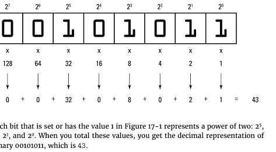

图 17-1 中被设置或值为 1 的每个位代表 2 的一个幂：2⁵、2³、2¹ 和 2⁰。当你把这些值相加时，你得到二进制 00101011 的十进制表示，即 43。

这都很好，但请不要死记硬背！

> - 不必担心将二进制转换为十进制值；计算机一直在为你完成这项工作。这是因为计算机只看到二进制，然后出于对你人类眼睛的礼貌显示十进制数字。但当你操作二进制值时，了解其工作原理会有所帮助。
> - 将位的值更改为 1 被称为设置位。
> - 将位的值更改为 0 被称为重置位。


### 输出二进制值

为了更好地理解 C 语言的二进制操作运算符，看到一个二进制数字在运行中很有帮助。printf() 函数缺乏二进制转换字符，C 库也不托管二进制输出函数。不，查看二进制数字，你必须自己制作一个函数。

列表 17-1 展示了我自创的名为 binbin() 的二进制输出函数。列表 17-1 中第 15 行的 binbin() 函数吞下了一个 unsigned char 值。它的输出是一个字符串，表示该 char 值以二进制数字表示。

### 练习 17-2

修改列表 17-1 中的 binbin() 函数，使其输出 16 位而不是 8 位。16 位值是 short int，应分配以正确解释值。为帮助你，更改以下项目：

- 第 9 行：将文本更改为指定 65535 而不是 255。
- 第 15 行：将 binbin() 函数的参数更改为 unsigned int（只是 unsigned）。
- 第 18 行：修改数组的大小以考虑输出中的 16 个字符加上字符串末尾的 `\0`（空字符）。
- 第 21 行：将代码中的文字值 8 调整为 16，以考虑输出中的全部 16 个字符。
- 第 23 行：用 `0x8000` 替换值 `0x80`。此更改使位域更大，在完成本章后你会更好地理解这一点。

构建练习 17-2。运行几次以查看较大值时的位域是什么样的。

binbin() 函数或其变体在以下各节中用于帮助描述二进制编程。你将经常复制并粘贴该函数，并且可以随意在自己的代码中使用它。

### 位操作

一组 C 语言运算符提供二进制级别的数据操作。这些运算符很容易被忽略，但只有在不欣赏其真正力量和用途时才会如此。

### 使用按位 | 运算符

你熟悉决策逻辑运算符：&& 表示 AND，|| 表示 OR。在 && 评估中，两项都必须为真，语句才会被评估为真；对于 || 评估，只有一项必须为真。

在原子级别，运算符 & 和 | 执行类似的操作，只是按位进行。净效果是你可以使用 & 和 | 运算符来操作单个位。

| 是按位 OR 运算符，也称为包含 OR。

& 是按位 AND 运算符。

列表 17-2 演示了如何使用按位 OR 运算符设置字节中的位。OR 值定义为第 7 行处设置的常量 set。它是二进制 00100000。

### 列表 17-2：OR 设置

```c
#include <stdio.h>

char *binbin(unsigned char n);

int main()
{
    const int set = 32;
    unsigned int bor,result;

    printf("Type a value from 0 to 255: ");
    scanf("%u",&bor);
    result = bor | set;

    printf("\t%s\t%d\n",
        binbin((unsigned char)bor),bor);
    printf("|\t%s\t%d\n",
        binbin((unsigned char)set),set);
    printf("=\t%s\t%d\n",
        binbin((unsigned char)result),result);
    return(0);
}

char *binbin(unsigned char n)
{
    static char bin[9];
    int x;

    for(x=0;x<8;x++)
    {
        bin[x] = n & 0x80 ? '1' : '0';
        n <<= 1;
    }
    bin[x] = '\0';
    return(bin);
}
```

第 12 行计算输入值 bor 与 set 常量之间的按位 OR 操作。结果以三列输出：运算符、二进制字符串和

十进制值。该运算的结果是：在设定值中被置为 1 的位，在结果值中也会被置为 1。

## 练习 17-3：将代码清单 17-2 中的源代码输入编辑器，创建一个新程序。构建并运行该程序。

以下是我为值 65 看到的输出：

输入一个 0 到 255 的值：65
0100001    65
| 0010000  32
= 0110001  97

你可以从二进制输出中看到结果中的第 6 位是如何被置为 1 的。

*这是什么意思？*

按位 |（OR）运算符让你在二进制层面操作值。这种控制对某些数学运算有有趣的影响，如代码清单 17-3 所示。

## 代码清单 17-3：把文本变成大写

```c
#include <stdio.h>

int main()
{
    char input[64];
    int ch;
    int x = 0;

    printf("Type in ALL CAPS: ");
    fgets(input,63,stdin);

    while(input[x] != '\n')
    {
        ch = input[x] | 32;
        putchar(ch);
        x++;
    }
    putchar('\n');

    return(0);
}
```

## 专门使用 XOR 进行运算

XOR 是异或运算符，又一个按位逻辑运算符。回答你最迫切的问题：XOR 读作“zor”。这是糟糕科幻作品里完美的邪恶名字。

XOR 运算有点奇怪，但它确实有魅力。在这种操作中，位会相互比较，就像 & 和 | 运算符一样。当两个位相同时，XOR 会输出 0。当两个位不同时，XOR 会输出 1。像往常一样，一个程序示例有助于解释。

C 语言中的 XOR 运算符是脱字符：^。你可以在代码清单 17-4 的第 14 行看到它的实际运用。

## 代码清单 17-4：这是异或

```c
#include <stdio.h>

char *binbin(unsigned char n);

int main()
{
    int a,x,r;

    a = 73;
    x = 170;

    printf("%s %3d\n",
        binbin((unsigned char)a),a);
    printf("^ %s %3d\n",
        binbin((unsigned char)x),x);
    r = a ^ x;
    printf("= %s %3d\n",
        binbin((unsigned char)r),r);
    return(0);
}

char *binbin(unsigned char n)
{
    static char bin[9];
    int x;

    for(x=0;x<8;x++)
    {
        bin[x] = n & 0x80 ? '1' : '0';
        n <<= 1;
    }
    bin[x] = '\0';
    return(bin);
}
```

## 练习 17-8：将代码清单 17-4 中的源代码输入编辑器。构建并运行，看看 XOR 运算如何影响二进制值。

XOR 运算的迷人之处在于，如果你对一个变量使用相同的 XOR 值，就能得到该变量原来的值。

## 练习 17-9：修改代码清单 17-4 中的源代码，使再多执行一次 XOR 运算。在第 18 行之后插入以下三条语句（两个 `printf()` 语句分别拆成两行）：

```c
printf("^ %s %3d\n",
       bin((unsigned char)x),x);
a = r ^ x;
printf("= %s %3d\n",
       bin((unsigned char)a),a);
```

保存你对代码的更新。构建并运行。输出如下所示：

```
  01001001  73
^ 10101110 170
= 11100011 227
^ 10101110 170
= 01001001  73
```

使用相同的 XOR 值 170，会先将值 73 变成 227，然后再变回 73。


由于 XOR 是异或运算符，一些程序员将标准的按位 OR 运算符称为包含或运算符。

## 理解 ~ 和 ! 运算符

两个不常用的二进制运算符是一元 ~（或一的补码）和 !（或 NOT）。它们没有逻辑按位运算符那样的魅力，但我认为它们自有其用武之地。

一的补码运算符会翻转一个值中的所有位，将 1 变成 0，将 0 变成 1。例如：

```
~01010111 = 10101100
```

!（NOT）运算符影响整个值——所有位。它将任何非零值变为 0，将值 0 变为 1：

```
10101011 = 00000000
10000000 = 00000001
```

> 使用按位 ! 运算符时，可能的结果只有 0 和 1 两种。
> 
> ~ 和 ! 运算符都是一元运算符——在值前面加上运算符即可得到结果。

| 运算符 | 名称 | 类型 | 操作 |
| --- | --- | --- | --- |
| & | AND（与） | 按位 | 掩码位，将某些位重置为 0，其余位保持不变 |
| \| | OR（或） | 按位 | 设置位，将特定位从 0 改为 1 |
| ^ | XOR（异或） | 按位 | 当两个位相同时将位变为 0；否则变为 1 |
| ~ | 1 的补码（按位取反） | 一元 | 反转所有位 |
| ! | NOT（非） | 一元 | 将非零值变为 0；将 0 值变为 1 |

## 移位二进制值

C 语言有两个二元运算符，它们执行相当于“每个人都向左（或向右）移动一步”的操作。<< 和 >> 运算符会移动值中的位，分别将其向左或向右移动。<< 运算符的格式如下：

```
v = int << count;
```

int 是一个整数值。count 是将值的位向左移的位数。该运算的结果存储在变量 v 中。任何被左移超出 int 变量 x 宽度的位都会丢失。从右侧移入的新位始终为 0。

和大多数二进制小把戏一样，看看一个值的位被移位时发生了什么会很有帮助。因此，我给出代码清单 17-5。

## 代码清单 17-5：大家都出池子！

```c
#include <stdio.h>

char *binbin(unsigned char n);

int main()
{
    unsigned bshift,x;

    printf("Type a value 0 to 255: ");
    scanf("%u",&bshift);

    for(x=0;x<8;x++)
    {
        printf("%s\n",
            binbin((unsigned char)bshift));
        bshift = bshift << 1;
    }
    return(0);
}

char *binbin(unsigned char n)
{
    static char bin[9];
    int x;

    for(x=0;x<8;x++)
    {
        bin[x] = n & 0x80 ? '1' : '0';
        n <<= 1;
    }
    bin[x] = '\0';
    return(bin);
}
```

移位操作发生在代码清单 17-5 的第 16 行。变量 `bshift` 中的值向左移一位。

## 练习 17-10：将代码清单 17-5 中的源代码输入编辑器，并构建一个新程序，看看它会做什么。

将一个值左移一位会使其翻倍。这条规则在某种程度上成立：显然，向左移得越远，一些位会丢失，值也不再翻倍。此外，这个技巧最适合无符号值。

## 练习 17-11：修改代码清单 17-5 中的源代码，使第 14 行的 `printf()` 函数也显示 `bshift` 变量的十进制值。你还应修改 `binbin()` 函数，使其显示 16 位而不是 8 位。（16 位 `binbin()` 的解决方案请参考练习 17-2。）

以下是我使用值 12 时看到的输出：

```
Type a value from 0 to 255: 12
000000000001100 12
000000000011000 24
000000000110000 48
000000001100000 96
000000011000000 192
000000110000000 384
000001100000000 768
000011000000000 1536
```

试试值 800,000,000（不要输入逗号），看看随着值不断向左移位，翻倍规则是如何失效的。另请参阅旁边的边栏“负二进制数”。

>> 移位运算符的工作方式与 << 移位运算符类似，只不过值向右移动而不是向左移动。任何从右端移出的位都会被丢弃，只有 0 位从左侧滑入。格式如下：

```
v = int >> count;
```

*int* 是一个整数值，*count* 是将位向右移的位数。结果存储在变量 *v* 中。

## 练习 17-12：修改练习 17-11 中的源代码，使第 15 行使用右移运算符而不是左移。构建该程序。

## 负二进制数

二进制数总是正数，因为一个位的值只能是 1 或 0，而不可能是 –1 和 0。那么计算机如何处理有符号整数呢？很简单：它作弊。

有符号二进制值中最左边的位称为符号位。当该位被设置（等于 1）时，对于有符号 int 来说该值为负数。否则，该值被读作正数。

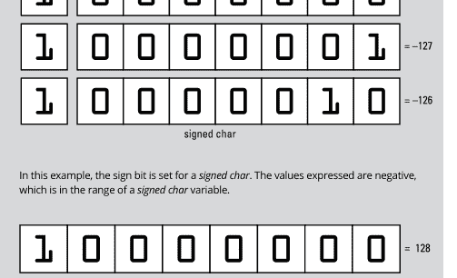

在这个示例中，有符号 char 的符号位被设置。所表示的值为负数，这属于有符号 char 变量的范围。

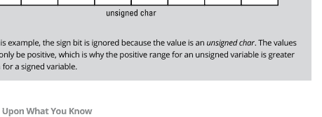

在这个示例中，符号位被忽略，因为该值是无符号 char。值只能是正数，这就是为什么无符号变量的正数范围比有符号变量更大。


```
Type a value from 0 to 255: 128
0000000010000000 128
0000000001000000 64
0000000010100000 32
0000000001010000 16
0000000000101000 8
0000000000010100 4
0000000000001010 2
0000000000000001 1
```

与 << 运算符不同，>> 保证在向右移动一位时始终将值减半。事实上，与使用 /（除法）运算符将值除以 2 相比，>> 运算符在整数值上使用起来要快得多。

看起来像 C 语言的位移运算符 << 和 >> 的运算符，在 C++ 语言中用于输入和输出。C++ 也有位移运算符，它们被视为与 I/O 运算符重载（重复）。

## 解释 binbin() 函数

```
bin[x] = n & 0x80 ? '1' : '0';
n <<= 1;
```

如果您从头到尾阅读了本章，我现在可以合理地解释 binbin() 函数在做什么来将值转换为二进制字符串。两个语句完成了这项工作。

第一个语句对值 n 和十六进制值 0x80 执行 AND 掩码。数字中除最左边的位之外的所有位都被丢弃。如果该位被设置，这使其成为 TRUE 条件，则字符 '1' 存储在数组中；否则，存储字符 '0'。（请参阅第 8 章复习三元运算符 ? : 。）

值 0x80 用十六进制表示法表示，这是一种二进制的简写形式。（参见下一节“十六进制的乐趣”。）十六进制值 0x80 等于二进制 10000000，这就是 AND 掩码。对于更宽的 16 位值，则使用掩码 0x8000。

第二个语句将值 n 中的位向左移动一位。随着循环的运行，处理值 n，值中的另一位被移至最左位置。该位被评估，二进制字符串通过添加 '1' 或 '0' 字符来构建。

## 十六进制的乐趣

面对现实吧：没有人愿意在二进制数中数位。没有人。也许某个地方的某个极客可以告诉你 10110001 实际上是值 177（我查了一下），但大多数程序员做不到。然而，一个优秀的程序员可以做的是将二进制转换为十六进制。

十六进制与哈利·波特无关。它是 hexadecimal 的缩写，即基数 16 的计数系统。这个概念听起来并不那么晦涩，因为在基数 16（十六进制）和二进制之间转换很容易。

例如，值 10110001 转换为十六进制 B1。我可以立刻看出这一点，因为我使用十六进制有一段时间了。这也意味着我接受十六进制数字包含字母 A 到 F，分别代表十进制值 10 到 15。十六进制中的 B 是十进制值 11。字母被使用是因为它们占用一个字符位置。

表 17-4 显示了 16 个十六进制值 0 到 F 以及它们与四位数据的关系。

| 十六进制 | 二进制 | 十进制 | 十六进制 | 二进制 | 十进制 |
|-----|--------|---------|-----|--------|---------|
| 0x0 | 0000 | 0 | 0x8 | 1000 | 8 |
| 0x1 | 0001 | 1 | 0x9 | 1001 | 9 |
| 0x2 | 0010 | 2 | 0xA | 1010 | 10 |
| 0x3 | 0011 | 3 | 0xB | 1011 | 11 |
| 0x4 | 0100 | 4 | 0xC | 1100 | 12 |
| 0x5 | 0101 | 5 | 0xD | 1101 | 13 |
| 0x6 | 0110 | 6 | 0xE | 1110 | 14 |
| 0x7 | 0111 | 7 | 0xF | 1111 | 15 |

表 17-4 中显示的十六进制值前面加上了 0x。此前缀在 C 中使用，尽管其他编程语言可能使用不同的前缀或后缀。

0xF 之后的下一个十六进制值是 0x10。不要把它读作数字十，而应读作“十六进制的一零”。它在十进制（基数 10）中是值 16。此后，十六进制继续计数为 0x11、0x12，一直到 0xFF 及以后。

是的，这一切和学习古埃及计数符号一样有趣，所以它能带你去哪里？

程序员看到二进制值 10110100 时，首先将其拆分为两个 4 位半字节：1011 0100。然后他将其转换为十六进制，0xB4。C 编程语言也可以进行转换，只要使用 %x 或 %X 转换字符，如清单 17-6 所示。

## **清单 17-6：一点点十六进制**

```
```c
#include <stdio.h>

char *binbin(unsigned n);

int main()
{
    unsigned b,x;

    b = 21;

    for(x=0;x<8;x++)
    {
        printf("%s 0x%04X %4d\n",binbin(b),b,b);
        b<<=1;
    }

    return(0);
}

char *binbin(unsigned n)
{
    static char bin[17];
    int x;

    for(x=0;x<16;x++)
    {
        bin[x] = n & 0x8000 ? '1' : '0';
        n <<= 1;
    }
    bin[x] = '\0';
    return(bin);
}
```
```

清单 17-6 中的代码输出二进制、十六进制和十进制值，然后将该值向左移动，重复此过程。第 13 行的 printf() 语句使用 %X 转换字符输出十六进制值。

好吧，实际上占位符是 %04X，它使用大写字母显示十六进制值，宽度为四位，并在必要时在左侧用零填充。转换字符前的 0x 文本仅以标准 C 风格显示输出。

## 练习 17-13：

将清单 17-6 中的代码输入到编辑器中。保存、构建并运行。

## 练习 17-14：

将第 9 行变量 b 的值更改为如下所示：

```
b = 0x11 ;
```

保存此更改，构建并运行。


您可以在代码中直接写入十六进制值。用 0x 为值加上前缀，后跟有效的十六进制数字，其中需要时可以使用大写或小写字母。


## 从前，八进制很流行

C 语言中可用的另一种数字格式是八进制，或基数 8。八进制在 Unix 开发时期非常流行，许多老练的程序员仍然喜欢抛来抛去八进制值并做这做那。C 甚至还有一个八进制转换字符 %o 和八进制前缀 0（零）。

我从未在任何程序中使用过八进制。一些旧代码可能会使用它，有时函数会引用八进制值。所以我的建议是了解八进制，但不必费心去记忆任何东西。


## 高级部分

## 本部分内容 . . .

- 了解变量如何存储和访问
- 访问变量和内存位置
- 用指针替换数组表示法
- 篡改和滥用指针数组
- 使用指针排序字符串
- 构建结构的链表
- 使用 C 中的时间函数

## 本章内容

- 使用 sizeof 运算符
- 获取变量的内存位置
- 创建指针变量
- 查看数据
- 使用指针分配值

### 第 18 章：指针简介

### 指针简介

它被认为是在所有编程中最令人恐惧的话题之一。Boo！

指针吓坏了许多初学 C 的程序员——甚至是其他语言的经验丰富的程序员。我认为恐惧的原因是，没有人愿意以有趣、引人入胜的细节解释指针真正的工作原理。所以清空你的思绪，敲敲你的指关节，准备好拥抱 C 语言最独特和强大的特性之一吧。

### 指针最大的问题

确实，你可以在 C 中编程并避免使用指针。我在开始学习 C 编程时很长时间都是这样做的。数组表示法为指针提供了一个快速而粗糙的变通方法，你可以假装绕过各种指针函数，希望能做对。但这不是你买这本书的原因！

在使用指针一段时间并理解它们带来的痛苦后，我得出了它们引发悲伤的原因：指针命名不当。

> 我可以理解为什么指针被称为指针：它指向某物，内存中的一个位置。这个描述的问题在于，大多数 pedants 解释指针的工作原理时说“A pointer points . . .”这种解释是完全错误的。它混淆了问题。
> 
> 增加名称混淆的事实是，指针有两个个性。一方面是一个保存内存位置、地址的变量。另一方面揭示该地址处的值。这样，指针应该被称为窥视者。本章有助于理清这种混淆。

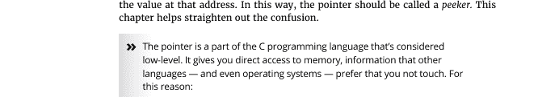

### 评估变量存储

数字存储以字节为单位衡量。内存中存储的所有信息只是一堆数据，位堆在位上，字节堆在字节上。软件负责使其有意义。

### 理解变量存储

在 C 中，数据按存储类型（char、int、float 或 double）分类，并进一步按关键字（long、short、signed 或 unsigned）分类。尽管内存内部混乱不堪，你程序的存储被组织成这些值，准备在你的代码中使用。

在运行的程序中，变量由以下属性描述：

- 名称
- 类型
- 值
- 大小
- 位置


名称是你赋予变量的名称。名称仅在你的代码中使用，而非程序运行时使用。

类型是 C 语言的数据类型之一：char、int、float 或 double。

值在你的程序中赋值。尽管变量存储位置上可能事先存在数据，但它被视为垃圾，并且在被赋值为止，变量被视为未初始化。

大小指的是变量占用的存储字节数。

位置是一个地址，是设备内存内部的一个位置。变量的这一方面无需你指定；程序和操作系统协商信息在内部存储的位置。当程序运行时，它使用该位置来访问变量的数据。

在这些方面，变量的名称、类型和内容你已经知晓。变量的大小和位置也可以获取。不仅如此，位置还可以被操作，这正是指针背后的灵感来源。

## 读取变量的大小

char 有多大？long 有多长？你可以在附录 D 中查阅这些定义，但即使如此，这些值也是通用的。只有你正在编程的设备才知道 C 标准数据类型的确切存储大小。

列表 18-1 使用 sizeof 运算符来确定每种 C 语言数据类型在内存中占用的存储量。该运算符需要括号中的参数，并返回一个 long unsigned int 值，表示参数——数据类型、数组、结构等——在内存中占据的字节数。

### LISTING 18-1: 变量有多大？

```c
#include <stdio.h>

int main()
{
    char c = 'c';
    int i = 123;
    long l = 12345678910;
    float f = 98.6;
    double d = 6.022E23;
    printf("char\t%lu\n",sizeof(c));
    printf("int\t%lu\n",sizeof(i));
    printf("long\t%lu\n",sizeof(l));
    printf("float\t%lu\n",sizeof(f));
    printf("double\t%lu\n",sizeof(d));
    return(0);
}
```

### Exercise 18-1: 将列表 18-1 中的源代码输入到你的编辑器中。构建并运行以查看每种变量类型的大小。

我看到的输出如下：

| char | 1 |
| int | 4 |
| long | 8 |
| float | 4 |
| double | 8 |

sizeof 运算符返回的值被称为 size_t 数据类型。无需我进行冗长的、枯燥的描述，size_t 变量是另一种变量类型的 typedef，例如在现代计算机系统上是 long unsigned int（因此列表 18-1 中使用了 %lu 占位符）。总之，大小表示用于存储运算符参数的字节数。

数组在 C 中也是变量，sizeof 也适用于它们，如列表 18-2 所示。

### LISTING 18-2: 数组有多大？

```c
#include <stdio.h>

int main()
{
    char string[] = "Does this string make me look fat?";
    printf("The string \"%s\" has a size of %u.\n", string,sizeof(string));
    return(0);
}
```

### Exercise 18-2:

输入列表 18-2 中的源代码。构建并运行它以查看 char 数组占用的存储量。

### Exercise 18-3:

编辑你在练习 18-2 中的源代码，添加 strlen() 函数，将其在数组上的结果与 sizeof 运算符的结果进行比较。

如果 strlen() 和 sizeof 返回的值不同，你能解释一下差异吗？

好吧，我来解释：编译器会向任何字符串字面量附加空字符（\0），例如在列表 18-2 第 5 行声明的那一个。sizeof 运算符会计算这个额外的存储字节。strlen() 函数不会计算额外的存储，它返回字符串本身的字符计数。终止空字符是一个分隔符，而不是字符串中的字符。

### Exercise 18-4:

再次编辑练习 18-2 中的源代码，这次创建一个包含五个元素的 int 数组。数组无需赋值，也无需显示。构建并运行。

你能解释输出吗？如果不能，请回顾练习 18-1 的输出。尝试弄清楚发生了什么。

在列表 18-3 中，sizeof 运算符用于结构。

### LISTING 18-3: 结构有多大？

```c
#include <stdio.h>

int main()
{
    struct robot {
        int alive;
        char name[5];
        int xpos;
        int ypos;
        int strength;
    };

    printf("The evil robot struct size is %lu\n", sizeof(struct robot));
    return(0);
}
```

### Exercise 18-5: 使用列表 18-3 创建一个新的源代码文件。构建并运行以确定结构的大小。

sizeof 运算符适用于所有变量类型，但对于结构，请指定结构本身，如第 14 行所示。获取结构大小时避免使用结构变量。

结构的大小是通过汇总其每个成员的存储需求计算得出的。鉴于练习 18-5 的大小输出，你可能会假设四个 int 变量加五个 char 变量会得到 21：4 × 4 + 1 × 5。但事实并非如此。

在我的屏幕上我看到输出：

> The evil robot struct size is 24

你看到的值不是 21 的原因是程序在内存中对齐变量。它不会一个接一个地堆叠起来。如果我猜测，我会说 name 数组末尾填充了 3 个额外字节，以使其与内存中的 8 字节偏移对齐。图 18-1 说明了正在发生的情况。

- sizeof 运算符返回 C 语言变量、数组、缓冲区或结构的大小。
- 你不能使用 sizeof 来确定程序的大小、计算机中的内存量，或除已声明变量或缓冲区之外的任何其他内容的大小。
- 对结构使用 sizeof 时使用其定义，而不是结构变量。如果在将结构写入文件时使用变量的大小（尤其是当它是指针时）而不是结构的定义大小，会出现问题。参见第 22 章。
- 当今大多数编译器将 sizeof 运算符返回的 size_t 值（成员的字节数）typedef 为 unsigned long 整数，占位符为 %lu。你也可以使用 %zd 占位符，其中 z 表示字节大小值，d 表示十进制输出。
- 如果你是个极客，你可以得出结论，%zx 占位符以十六进制输出 size_t 值。
- 用于在内存中对齐变量的 8 字节偏移使 CPU 保持愉快。处理器读取与这些 8 字节偏移对齐的内存的效率要高得多。


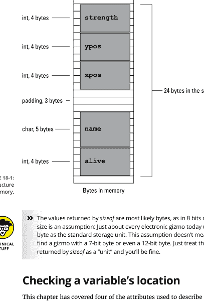

FIGURE 18-1:
结构在内存中的拟合方式。

> TECHNICAL STUFF
> 
> sizeof 返回的值很可能就是字节，即 8 位存储。这个大小是一个假设：几乎所有今天的电子小玩意都使用 8 位字节作为标准存储单元。这个假设并不意味着你找不到使用 7 位字节甚至 12 位字节的小玩意。只需将 sizeof 返回的值视为“单位”即可。

## 检查变量的位置

本章已涵盖用于描述 C 语言变量的四个属性：名称、类型、值和大小。变量的最终描述是其在内存中的位置。你可以通过使用 & 运算符和 %p 占位符来获取此信息，如列表 18-4 所示。

### LISTING 18-4: 变量，你在哪里？

```c
#include <stdio.h>

int main()
{
    char c = 'c';
    int i = 123;
    float f = 98.6;
    double d = 6.022E23;

    printf("Address of 'c' %p\n", &c);
    printf("Address of 'i' %p\n", &i);
    printf("Address of 'f' %p\n", &f);
    printf("Address of 'd' %p\n", &d);

    return(0);
}
```

当 & 运算符前缀一个变量时，它返回一个表示变量地址或其在内存中位置的值。要查看此值，使用 %p 转换字符，如列表 18-4 所示。

Exercise 18-6: 将列表 18-4 中的源代码输入到你的编辑器中。构建并运行。

练习 18-6 生成的程序产生的结果是唯一的，不仅针对每台计算机，而且可能针对每次程序运行。以下是我看到的内容：

| Address of | Value |
|------------|-------|
| 'c' | 0x7ff5fbff8ff |
| 'i' | 0x7fff5fbff8f8 |
| 'f' | 0x7ff5fbff8f14 |
| 'd' | 0x7fff5fbff8e8 |

变量 c 存储在内存位置 0x7ff5fbff8ff——即十进制位置 140,734,799,804,671。当然，这两个值都很平凡；计算机跟踪内存位置，这对我来说完全没问题。图 18-2 提供了刚刚显示结果的内存映射。

我无法解释我的计算机为何将 int 变量放置在该位置，但图 18-2 说明了这些地址在内存中的映射方式。

单个数组元素也有内存位置，如列表 18-5 第 10 行所示。& 运算符前缀特定的元素变量，吐出一个地址。printf() 函数中的 %p 转换字符输出该地址。


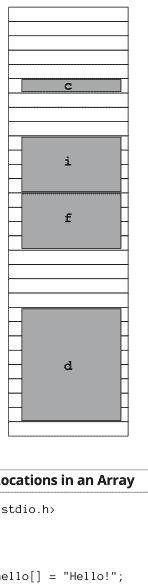

图 18-2：
内存中的变量位置。

## 代码清单 18-5：数组中的内存位置

```
#include <stdio.h>

int main()
{
    char hello[] = "Hello!";
    int i = 0;

    while(hello[i])
    {
        printf("%c at %p\n",hello[i],&hello[i]);
        i++;
    }
    return(0);
}
```

## 练习 18-7：使用代码清单 18-5 中所示的源代码创建一个新程序。构建并运行。

同样，每台计算机输出的内存位置都是唯一的。以下是我看到的结果：

| 字符 | 地址 |
|----------|--------|
| H | 0x7fff5fbff810 |
| e | 0x7fff5fbff811 |
| l | 0x7fff5fbff812 |
| l | 0x7fff5fbff813 |
| o | 0x7fff5fbff814 |
| ! | 0x7fff5fbff815 |

与练习 18-6 中的示例不同，练习 18-7 生成的地址在内存中是连续的，一个字节接一个字节。

## 练习 18-8：编写一个程序，显示 int 数组中的五个值以及每个元素的内存地址。你可以从代码清单 18-5 中获得启发，不过用 for 循环可能更容易编写。

> > 顺便说一下，& 取地址运算符对你来说应该很熟悉。scanf() 函数就使用它，该函数需要变量的地址，而不是变量本身。原因是 scanf() 直接将值放到内存位置中。怎么做到？当然是使用指针！
> 
> > & 运算符也是按位与运算符；不过，编译器足够聪明，能够分辨 & 何时作为变量的前缀，何时是二元数学表达式的一部分。

## 回顾变量存储信息

总结本节内容：C 语言中的变量有名称、类型、值、大小和位置。

- 变量的类型与变量在内存中的大小密切相关，而该大小可通过 sizeof 运算符获得。
- 变量的值在代码中被直接设置或使用。
- 变量的位置借助 & 运算符和 %p 转换字符显示。

当你对变量中的每个元素有了基本了解后，就可以着手处理指针这个极其复杂的主题了。

## 极其复杂的指针主题

请记住这句话：

*指针是一个包含内存位置的变量。*

或者，下面这个故事可能会有所帮助：

从前，一个指针变量遇到了一名选修 C 编程课程的大学生。学生问：“你指向什么？”这个变量回答：“什么都不指向！但我包含一个内存位置。”这名大一新生对此非常满意。

在继续之前，你必须接受指针的疯狂之处。诚然，你可以使用 & 运算符获取变量的内存位置，也就是*地址*，但指针是一种强大得多的猛兽。

### 介绍指针

指针是一种变量。与其他变量一样，它必须在代码中声明。此外，它必须在使用前初始化。最后一点非常重要，但首先，声明采用以下格式：

```
type *name;
```

与声明任何变量时一样，*type* 指明该指针是 *char*、*int*、*float* 等类型。*name* 是指针变量的名称，它必须像任何其他变量名一样唯一。星号将该变量标识为指针，而不是普通变量。

以下语句声明一个 *char* 指针 sidekick：

```
char *sidekick;
```

而以下语句创建一个 *double* 指针：

```
double *rainbow;
```

要初始化指针，你必须像给任何其他变量赋值一样给它赋值。最大的区别在于，指针被初始化为内存位置。这个地址不是内存中的随机位置，而是程序中另一个变量的位置。例如：

```
sidekick = &lead;
```

前一条语句将指针变量 sidekick 初始化为变量 lead 的地址。两个变量都是 char 类型；否则，编译器会像一只湿猫一样咆哮。执行该语句后，sidekick 指针包含 lead 变量的地址。

如果你在读这段文字时只是点头却什么也没理解，那很好！现在该看一个示例了。

我在代码清单 18-6 的源代码中点缀了注释，以帮助说明两行关键代码。这个程序实际上除了证明指针 sidekick 包含变量 lead 的地址（即内存位置）之外，什么也没做。

## 代码清单 18-6：一个示例

```
#include <stdio.h>

int main()
{
    char lead;
    char *sidekick;

    lead = 'A';      /* initialize char variable */
    sidekick = &lead; /* initialize pointer IMPORTANT! */

    printf("About variable 'lead':\n");
    printf("Size\t\t%zd\n",sizeof(lead));
    printf("Contents\t%c\n",lead);
    printf("Location\t%p\n",&lead);
    printf("About variable 'sidekick':\n");
    printf("Contents\t%p\n",sidekick);

    return(0);
}
```

其他需要注意的地方：第 12 行使用了两个制表符转义序列来对齐输出。另外，不要忘记第 14 行中的 &，它用于获取变量的地址。

## 练习 18-9：将代码清单 18-6 中的源代码输入编辑器。构建并运行。

以下是我在屏幕上看到的输出：

```
About variable 'lead':
Size              1
Contents          A
Location          0x7fff5bff8ff
About variable 'sidekick':
Contents          0x7fff5bff8ff
```

（示例中的）地址对每个系统来说都是唯一的，但需要注意的关键是，指针 sidekick 的内容等于变量 lead 的内存位置。这是因为代码第 9 行执行的初始化：

```
sidekick = &lead;
```

指针仅仅包含一个内存地址是没有意义的。指针还可以窥探其地址，并确定存储在那里的值。为此，需要将 * 运算符放在指针变量名的前面。

## 练习 18-10：修改练习 18-9 中的源代码，在第 16 行之后添加以下语句：

```
printf("Peek value\t%c\n",*sidekick);
```

构建并运行。以下是我看到的输出：

```
About variable 'lead':
Size              1
Contents          A
Location          0x7fff5bff8ff
About variable 'sidekick':
Contents          0x7fff5bff8ff
Peek value        A
```

当你在已初始化的指针变量名之前指定 *（星号）时，结果就是该地址的内容。该值会根据指针的类型来解释。在这个示例中，*sidekick 表示存储在 sidekick 变量所保存的内存位置中的 char 值，而该内存位置实际上与变量 lead 的内存位置相同。

换句话说：

- 指针变量包含一个内存位置。
- 指针变量窥探存储在该内存位置中的值。

## 使用指针

指针的强大之处来自它的双重身份，以及它操作其存储的内存位置中的值的能力。

在代码清单 18-7 中，第 5 行声明了三个 char 变量，并在第 8 行将它们全部初始化。（我把它们叠放在一行中，以免代码清单变得太长。）第 6 行创建了一个 char 指针，然后在第 11、13 和 15 行进行初始化。

## 代码清单 18-7：更多指针乐趣

```c
#include <stdio.h>

int main()
{
    char a,b,c;
    char *p;

    a = 'A'; b = 'B'; c = 'C';

    printf("Know your ");

    p = &a;        /* initialize */
    putchar(*p);   /* use * */
    p = &b;        /* initialize */
    putchar(*p);   /* use * */
    p = &c;        /* initialize */
    putchar(*p);   /* use * */
    printf("\n");

    return(0);
}
```

第 11 行和第 12 行设置了代码中的基本操作：首先，指针 p 被初始化为一个 char 变量的地址。其次，*（星号）窥探存储在该地址处的值。*p 变量在 `putchar()` 函数中将该值表示为 `char`。然后对 `char` 变量 `b` 和 `c` 重复此操作。

## 练习 18-11：使用代码清单 18-7 中的源代码创建一个新项目。构建并运行。

图 18-3 试图说明代码运行时指针变量 `p` 的行为。

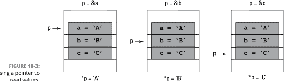

## 练习 18-12：编写一个程序，声明一个 `int` 变量和一个 `int` 指针变量。使用该指针变量显示 `int` 变量存储的值。

正如你可以获取变量的值（如代码清单 18-7 所示），你也可以使用 `*pointer` 运算符设置变量的值。请参阅代码清单 18-8。

### 代码清单 18-8：使用指针赋值

```c
#include <stdio.h>

int main()
{
    char a,b,c;
    char *p;

    p = &a;           /* initialize */
    *p = 'A';         /* assign */
    p = &b;           /* initialize */
    *p = 'B';         /* assign */
```
*（续）*


### **清单 18-8:** *(继续)*

```
    p = &c;            /* initialize */
    *p = 'C';          /* assign */
    printf("Know your %c%c%c\n",a,b,c);
    return(0);
    }
```

第 5 行在清单 18-8 中声明了三个 *char* 变量。这些变量在代码中任何地方都未被直接赋予值。指针 *p* 然而被初始化了三次（第 8、10 和 12 行），指向变量 *a*、*b* 和 *c* 的内存位置。然后 `*p` 变量为这些变量赋值（第 9、11 和 13 行）。结果由第 14 行的 `printf()` 输出。

**练习 18-13：** 将清单 18-8 中的源代码复制到你的编辑器中。构建并运行程序。

**练习 18-14：** 编写代码分别声明一个 *int* 变量和一个 *float* 变量用于你的年龄和体重。使用相应的指针为这些变量赋值。通过使用 *int* 和 *float* 变量而不是指针变量输出这些值。

### 本章内容
- 使用指针显示数组
- 用指针替换数组表示法
- 使用字符串和指针
- 理解指针数组
- 执行字符串排序
- 创建一个吞噬指针的函数

### 第19章：深入指针领域

容易接受指针的作用，麻木地点头，重复那句咒语：“指针是一个包含内存位置的变量。”你甚至可以记住指针变量 p 和指针变量 *p 之间的区别。但要真正了解指针的威力，你必须发现它在 C 语言中是如何被充分利用的。你必须摒弃旧的做法，完全拥抱指针，因为它们所做的神奇巫术。

### 指针与数组

C 语言中的数组不过是一锅谎言！确实，它们并不存在。随着你发现指针的威力，你会接受数组只不过是一个巧妙伪装的指针。做好被背叛的准备。

### 获取数组的地址

数组是 C 中的一种变量类型，你可以检查其大小和地址。第 18 章介绍了在数组上使用 sizeof 运算符。现在你揭开了窥视数组地址的深层黑暗秘密。

清单 19-1 中的源代码展示了一个微小的程序，它声明了一个 int 数组，然后显示该数组在内存中的位置。简单。（好吧，如果你已经完成了第 18 章，它就很简单。）

### **清单 19-1: 数组潜伏之处**

```c
#include <stdio.h>

int main()
{
    int array[5] = { 2, 3, 5, 7, 11 };
    printf("'array' is at address %p\n",&array);
    return(0);
}
```

**练习 19-1：** 将清单 19-1 的源代码输入到你的编辑器中。构建并运行程序。

我看到的输出如下：

```
'array' is at address 0x7fff...733b0
```

**练习 19-2：** 复制代码中的第 7 行以创建新的第 8 行，去掉与号：

```
printf("'array' is at address %p\n",array);
```

旧第 7 行和新第 8 行之间的区别在于缺少前缀数组变量的 &。它能工作吗？编译并运行以确保。

这是新代码的输出：

```
'array' is at address 0x7fffedd9c4c0
'array' is at address 0x7fffedd9c4c0
```

& 前缀是必要的吗？最好弄清楚：

**练习 19-3：** 调出第 18 章练习 18-6 中的源代码。编辑第 10 行到第 14 行，从 printf() 语句中变量名中移除 &。尝试构建程序。

我看到的警告信息重复了四次：

```
Warning: format specifies type 'void *' ...
```

显然，& 对于单个变量很重要。但对于数组来说，它是可选的。但这怎么可能，除非……除非数组真的是一个指针！

### 在数组中进行指针运算

当你递增一个指针时会发生什么？假设指针变量 dave 引用内存地址 0x8000 处的变量。如果是这样，请考虑以下语句：

```
dave++;
```

指针 dave 的新值会是什么？

你的第一反应可能是说 dave 会递增 1，这很正确。但计算结果可能不是 0x8001。这是因为指针变量中存储的地址按一个单位递增，而不是按一位数字递增。

什么是单位？

这取决于指针的数据类型。如果指针 dave 是 char 指针，新的地址确实可能是 0x8001。但如果 dave 是 int 或 float，新的地址将与以下相同

```
0x8000 + sizeof(int)
```

或

```
0x8000 + sizeof(float)
```

在大多数系统上，int 为 4 字节，所以你可能会猜测递增操作后 dave 会是 0x8004。但为什么要猜测呢？不如写代码。

清单 19-2 说明了一个简单的程序，我本可以用不使用指针的方式指导你编写：用 1 到 10 的值填充一个 int 数组，然后显示数组的元素及其值。但在清单 19-2 中，指针被用来填充数组。

### **清单 19-2: 数组与指针运算**

```c
#include <stdio.h>

int main()
{
    int numbers[10];
    int x;
    int *pn;

    pn = numbers;      /* initialize pointer */

    /* Fill array */
    for(x=0;x<10;x++)
    {
        *pn=x+1;
        pn++;
    }

    /* Display array */
    for(x=0;x<10;x++)
        printf("numbers[%d] = %d\n", x, numbers[x]);

    return(0);
}
```

第 7 行声明了指针 pn，第 9 行对其进行初始化。这里不需要 &，因为 numbers 是一个数组，而不是单个变量。此时，指针保存数组的基地址，如图 19-1 所示。请记住，数组是空的。

第 12 行到第 16 行的 for 循环填充 numbers 数组。第一个元素在第 14 行填充，使用指针 pn 的窥视表示法。然后在第 15 行，指针 pn 递增一个单位。它现在指向数组中的下一个元素，如图 19-1 所示，循环重复。

图 19-1:
使用指针填充数组。

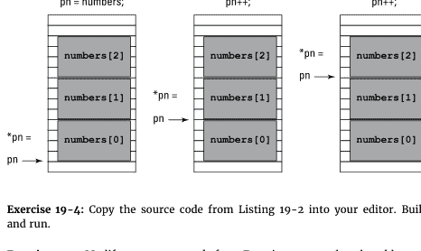

**练习 19-4：** 将清单 19-2 的源代码复制到你的编辑器中。构建并运行。

**练习 19-5：** 修改练习 19-4 中的源代码，使数组中每个元素的地址与其值一起显示。

在练习 19-5 的输出中，你应该会看到每个地址相隔 4 字节（假设你的机器上 int 的大小为 4 字节）。事实上，这些地址可能都以十六进制数字 0、4、8 和 C 结尾。

**练习 19-6：** 通过让第二个 for 循环使用指针变量 pn 的窥视...侧显示数组的值，完成清单 19-2 的转换以及你在练习 19-5 中开始的工作。

**练习 19-7：** 创建一个新项目，使用与清单 19-2 中类似的指针填充一个 26 字符的数组。使用指针表示法用字母 'A' 到 'Z' 填充数组。（构建一个 *char* 数组，而不是字符串。）使用指针表示法输出数组的内容。

这里有一个大提示：

```
*pn=x+'A';
```

事实上，如果你完全迷路了，我已将练习 19-7 的解决方案放在清单 19-3 中。

### **清单 19-3: 我对练习 19-7 的解决方案**

```c
#include <stdio.h>

int main()
{
    char alphabet[26];
    int x;
    char *pa;

    pa = alphabet;          /* initialize pointer */

    /* fill the array */
    for(x=0;x<26;x++)
    {
        *pa=x+'A';
        pa++;
    }

    pa = alphabet;          /* re-initialize pointer */

    /* output the array */
    for(x=0;x<26;x++)
    {
        putchar(*pa);
        pa++;
    }
    putchar('\n');

    return(0);
}
```

清单 19-3 中的源代码应该相当清晰，一步一步地执行每个任务。但请记住，许多 C 程序员喜欢合并语句，而这种合并在指针中经常发生。

**练习 19-8：** 将清单 19-3 中第一个 for 循环中的两个语句合并为一个语句：

```
*pa++=x+'A';
```

确保你正确输入。保存、构建并运行。


输出是一样的。这个丑陋的 *pa++ = x + 'A' 烂摊子到底做了什么，描述如下：

- **x+'A'** 这部分语句最先执行，将变量 x 的值加到字母 A 上。其效果是，随着 x 值的增加，代码会沿着字母表向上移动。
- ***pa** 将 x+ 'A' 的结果放入指针 pa 指定的内存位置。
- **++** 变量 pa 的值——即内存地址——递增一个单位。因为 ++ 出现在变量之后（它是后缀形式），所以该地址处的值写入之后，值才递增。

把两条语句分开写仍然可行，我编写程序时就是这么做的，因为这样以后更容易阅读。但并非每个程序员都这样做！他们中许多人喜欢把指针和递增运算符堆叠在一起。小心点！

## 练习 19-9：修复你在练习 19-8 中的源代码，使第二个 for 循环使用 *pa++ 这个怪物。

希望 *pa++ 这个指针玩意儿能讲得通。如果讲不通，就打个盹，然后回来检查清单 19-4。

## 清单 19-4：令人头昏脑胀的程序

```c
#include <stdio.h>

int main()
{
    char alpha = 'A';
    int x;
    char *pa;

    pa = &alpha;    /* initialize pointer */

    for(x=0;x<26;x++)
        putchar(*(pa++));
    putchar('\n');

    return(0);
}
```

清单 19-4 的源代码处理的是单个 char 变量，而不是数组。因此，第 9 行的指针初始化需要 & 前缀。别忘了它！

这段代码的第 12 行包含那个讨厌的 (*pa)++。它看起来与 *pa++ 相似，但绝对不是。与 *pa++ 先窥探一个值然后递增指针不同，(*pa)++ 构造递增的是被窥探的值；指针的地址不变。

## 练习 19-10：使用清单 19-4 的源代码编辑、构建并运行一个新程序，

(*pa)++ 操作能起作用，多亏了括号。程序先取出 *pa 所表示的值，然后该值递增。指针变量 pa 不受该操作影响；pa 仍然保存着 char 变量 alpha 的地址。

为了帮助避免在这个主题上产生混淆，我给出表 19-1，它解释了各种神秘的指针/取值符表示法小玩意儿。

## 表 19-1 括号内外的指针与取值符

| 表达式 | 地址 p | 值 *p |
|---|---|---|
| *p++ | 读取值后递增 | 不变 |
| *(p++) | 读取值后递增 | 不变 |
| (*p)++ | 不变 | 读取后递增 |
| *++p | 读取值前递增 | 不变 |
| *(++p) | 读取值前递增 | 不变 |
| ++*p | 不变 | 读取前递增 |
| ++(*p) | 不变 | 读取前递增 |

使用表 19-1 来帮助你解读代码，并为你需要对指针做的事情找到正确的格式。如果你看到或想要的指针表示法没有出现在表 19-1 中，那它要么不可能，要么根本不是指针。例如，表达式 p+++ 和 p+++ 可能看起来像是表 19-1 中的内容，但它们不是指针。（事实上，它们在 C 中并未定义为有效表达式。）

## 用指针替代数组表示法

数组表示法一定是个神话，因为它很容易被指针表示法替代。事实上，在程序内部，它很可能就是如此。

考虑表 19-2，它比较了数组表示法和指针表示法。假设指针 a 被初始化为指向数组 alpha。数组和指针是相同的变量类型；表示法不因变量类型而异。char 数组和 int 数组会使用相同的引用，如表 19-2 两列所示。

## 表 19-2 用指针替代数组表示法

| 数组 alpha[] | 指针 a |
|---|---|
| alpha[0] | *a 或 *(a+0) |
| alpha[1] | *(a+1) |
| alpha[2] | *(a+2) |
| alpha[3] | *(a+3) |
| alpha[n] | *(a+n) |

你可以用一个示例程序来测试你对数组到指针表示法的掌握程度，比如清单 19-5 所示的程序。

## 清单 19-5：一个简单的数组程序

```c
#include <stdio.h>

int main()
{
    enum weekdays { mon, tues, wed, thurs, fri };
    float temps[5] = { 18.7, 22.8, 25.0, 23.3, 23.2 };

    printf("The temperature on Tuesday was %.1f\n", temps[tues]);
    printf("The temperature on Friday was %.1f\n", temps[fri]);
    return(0);
}
```

在第 5 行，enum 关键字创建了一个枚举常量列表，用来表示 0 到 4 的值。每个常量对应 temps 数组中的一个元素，对应一周中的一天。这个例子展示了如何使用枚举常量让程序更易读。

## 练习 19-11

重写代码，使清单 19-5 中的两个 printf() 语句使用指针表示法输出这些值。你可以在代码中使用字面值或枚举常量。

## 字符串是指针玩意儿

C 没有字符串数据类型，但它有 char 数组，这实际上是一回事。作为数组，C 中的字符串可以通过指针被完全扭曲、扭弯和滥用。这比摆弄数值数组有趣得多，所以它单独占了一整节。

### 使用指针显示字符串

你很可能熟悉在 C 中显示字符串，大概是通过 puts() 或 printf() 函数。字符串也可以沿着数组慢慢遍历，一次显示一个字符。具体来说，我给出清单 19-6。

```
Hello, String

#include <stdio.h>

int main()
{
	char sample[] = "From whence cometh my help?\n";
	int index = 0;
	while(sample[index] != '\0')
	{
		putchar(sample[index]);
		index++;
	}
	return(0);
}
```

清单 19-6 中所示的代码是完全合法的 C 代码，可以创建一个显示字符串的程序。但它没有使用指针，对吧？

**练习 19-12：** 修改清单 19-6 的源代码，用指针表示法替换数组表示法。删除 `index` 变量。你需要创建并初始化一个指针变量。

可以精简清单 19-6 中 `while` 循环的判断条件。空字符求值为 FALSE。因此判断条件可以改写为

```
while(sample[index])
```

只要 `sample[index]` 引用的数组元素不是空字符，循环就会一直执行。

**练习 19-13：** 编辑你在练习 19-12 中解决方案里的 `while` 循环判断条件，去掉空字符比较。

**练习 19-14：** 继续处理你的代码，这次删除 `while` 循环中的所有语句。把所有操作都放进 `while` 语句的判断条件中。供参考，`putchar()` 函数返回输出的字符。

### 使用指针声明字符串

下面是一个你可以用指针耍出的吓人把戏，它附带一大堆警告。考虑清单 19-7。

**清单 19-7：** 一个指针宣告字符串

```c
#include <stdio.h>

int main()
{
    const char *sample = "From whence cometh my help?\n";

    puts(sample);
    return(0);
}
```

在清单 19-7 中，字符串输出是通过初始化一个指针创建的。这种构造看起来很奇怪，但你在 C 代码中经常见到它，尤其是在处理字符串时。（你不能用这种构造来初始化数值数组。）

**练习 19-15：** 将清单 19-7 的源代码复制到你的编辑器中。构建并运行。

下面就是那一大堆警告：第一，字符串被声明为常量，我强烈建议这样做。原因是这种构造的行为与传统的字符串声明不同，必须避免操作该字符串。

第二，指针的值（它的地址）不应该被改变（例如递增），因为这样做会丢失字符串在内存中的位置。

第三，处理这种类型的字符串声明可能导致意外且不可预测的后果。例如，如果你用指针配合 putchar() 函数输出字符串，空字符可能无法被正确解释。

第四，这种类型的字符串在传递给函数时会出问题，这就是我给出这个警告的原因：


使用指针声明字符串时，不要在代码的其他地方乱动这个指针变量。

解决办法是把字符串声明为数组，然后就这样，不要多此一举。

### 构建指针数组

指针数组就是存放内存位置的数组。这种构造在 C 中经常是必要的，我本可以设计一个极其复杂的演示程序，把你逼疯。但当你意识到指针数组实际上就是字符串数组时，这种情况就不会发生，如清单 19-8 所示。这种方法让主题更容易消化。

**清单 19-8：** 疯狂的指针数组

```c
#include <stdio.h>

int main()
{
    char *fruit[] = {
        "watermelon",
        "banana",


```
        "pear",
        "apple",
        "coconut",
        "grape",
        "blueberry"
    };
    int x;

    for(x=0;x<7;x++)
        puts(fruit[x]);

    return(0);
    }
```

清单 19-8 声明了一个指针数组。它的工作方式与清单 12-7（来自第 12 章）类似，不过在這種构造中，你不需要专门计算各个字符串的长度。这是因为该数组实际上是一个指针数组，也就是内存位置数组。每个字符串都驻留在内存中的某个位置。该数组列出了每个字符串的起始位置。

**练习 19-16：** 将清单 19-8 中的源代码输入编辑器。构建并运行，以确认它能正常工作。

本章讨论指针，那么你认为清单 19-8 的哪一部分可以改进？

**练习 19-17：** 以表 19-2 中的信息为指导，将清单 19-8 第 17 行的数组表示法替换为指针表示法。

你对练习 19-17 的解答之所以有效（假设你做对了），是因为 fruit 数组包含指针。每个元素的值都是另一个指针。但这还不算什么；考虑清单 19-9。

## **清单 19-9：** 指向指针的指针示例

```
    #include <stdio.h>

    int main()
    {
        char *fruit[] = {
            "watermelon",
            "banana",
            "pear",
            "apple",
            "coconut",
            "grape",
            "blueberry"
        };
        int x;
        for(x=0;x<7;x++)
        {
            putchar(**(fruit+x));
            putchar('\n');
        }
        return(0);
    }
```

清单 19-9 的第 18 行包含令人畏惧、害怕、回避且被诅咒的 ** 表示法，也就是双指针表示法。用我偏好的命名法来说，它是一个双窥视器。在开始讨论之前，请做练习 19-18。

**练习 19-18：** 仔细将清单 19-9 中的源代码输入编辑器。编译并运行。

要理解 **(fruit+x) 构造，你必须由内向外分析：

```
fruit+x
```

变量 fruit 包含一个内存地址。它是一个指针！x 是以 1 为单位递增的值。在这种情况下，单位是指针的大小；fruit 数组的所有元素都是指针。

```
*(fruit+x)
```

你已经见过前面的构造。它是地址 fruit+x 的内容。从代码看，fruit 是一个指针数组。所以前面操作的结果是……一个指针！

```
** (fruit+x)
```

最后，你得到的是指向指针的指针——或者更准确地说，是一个窥视器指向另一个窥视器。如果内部的窥视器是一个内存地址，那么外部的窥视器（第一个星号）就是该内存地址的内容。图 19-2 试图阐明这个概念。

## 图 19-2：
** 这个东西是如何工作的。

```
**(fruit+0)
    ↓
*fruit[] → *(fruit+0) → watermelon
          *(fruit+1) → banana
          *(fruit+2) → pear
          *(fruit+3) → apple
          *(fruit+4) → coconut
          *(fruit+5) → grape
          *(fruit+6) → blueberry
```

记住这一点会有帮助：** 运算符几乎总是（但不完全）与指针数组相关；或者，如果你想简单点，也可以说与字符串数组相关。因此，在图 19-2 中，*fruit[] 表示一个指针数组的地址。第二列包含每个地址相对于 fruit 基地址引用时的值。右侧列显示每个地址处的字符串，其中 **(fruit+0) 表达式保存第一个字符串的第一个字符。后续字符串的第一个字符将是 **(fruit+1)、**(fruit+2)，依此类推。

如果你仍然困惑——我不怪你；爱因斯坦读这本书第一版时，读到这里也一头雾水——可以考虑仔细琢磨表 19-3。表中将指针表示法（使用变量 ptr）与等价的数组表示法（使用变量 array）进行了比较。

## 表 19-3  指针表示法和数组表示法

| 指针表示法 | 数组表示法 | 描述 |
|---|---|---|
| **ptr | *array[] | 声明一个指针数组 |
| *ptr | array[0] | 数组中第一个指针的地址；对于字符串数组，就是第一个字符串 |
| *(ptr+0) | array[0] | 与上一项相同 |
| **ptr | array[0][0] | 数组中第一个指针的第一个元素；数组中第一个字符串的第一个字符 |
| **(ptr+1) | array[1][0] | 数组中第二个指针的第一个元素；第二个字符串的第一个字符 |
| *(*(ptr+1)) | array[1][0] | 与上一项相同 |
| *(*(ptr+a)+b) | array[a][b] | 指针 a 的元素 b |

## 看到熟悉的东西了吗？

指针数组对你来说应该有些熟悉。如果你学过第 15 章，可能还记得这个东西：

```c
int main(int argc, char *argv[])
```

`main()` 函数的完整声明将指针数组作为第二个参数。在第 15 章中，你把每一项当作自己的字符串来处理，这正是该构造的工作方式。但实际上，传递给 `main()` 函数的是一个指针数组。

顺便说一下，`main()` 函数的完整声明也可以写成这样：

```c
int main(int argc, char **argv)
```


为了不让你把这个主题理解得太透彻，你只要接受：*array[] 表示法也可以写成 **array。实际上，** 声明指的是指向指针的指针。

练习 19-19：重写你在练习 19-18 中的源代码，使字符串中的每个单独字符通过 putchar() 函数一次显示一个。如果你能把整个 putchar() 操作写成 while 循环的条件，你就能获得十个《达人迷》奖励分。

## 字符串排序

运用你所了解的 C 语言排序知识（从第 12 章收集而来），你大概能编写一个像样的字符串排序程序。或者，至少能解释它是怎么做的。那太好了！但那很费功夫。

在字符串排序方面，更好的做法是根本不排序字符串。不，相反，你排序的是一个指向字符串的指针数组。清单 19-10 展示了一个示例。

## 清单 19-10：字符串排序的初步尝试

```c
#include <stdio.h>

int main()
{
    char *fruit[] = {
        "apricot",
        "banana",
        "pineapple",
        "apple",
        "persimmon",
        "pear",
        "blueberry"
    };
    char *temp;
    int a,b,x;

    for(a=0;a<6;a++)
        for(b=a+1;b<7;b++)
            if(*(fruit+a) > *(fruit+b))
            {
                temp = *(fruit+a);
                *(fruit+a) = *(fruit+b);
                *(fruit+b) = temp;
            }

    for(x=0;x<7;x++)
        puts(fruit[x]);

    return(0);
}
```

**练习 19-20：** 将清单 19-10 中的源代码输入编辑器。构建并运行，以确保字符串被正确排序。

嗯，它可能没起作用。也可能起作用了，但如果列表被排序或以任何方式改变，那都是意外结果，而且绝对不可重复。

问题在第 19 行：你不能使用 > 运算符比较字符串。你可以比较单个字符，然后根据这些字符对列表排序，但大多数人希望按单词的完整长度来排序，而不仅仅按第一个字符。

**练习 19-21：** 修改源代码，使用 strcmp() 函数比较字符串，以确定它们是否需要交换。

## 函数中的指针

指针是一种变量。因此，它可以很容易地传给函数。更令人兴奋的是，指针还可以作为返回值从函数中返回。很多时候，这些技巧是将信息传入函数或从函数传出的唯一方法。

### 将指针传递给函数

将指针传递给函数的一大优势是，被修改的信息会自动返回。这是因为函数引用的是内存地址，而不是直接引用值。通过使用该地址，可以直接操作信息。清单 19-11 演示了这一点。

## **清单 19-11：指向折扣**

```c
#include <stdio.h>

void discount(float *);

int main()
{
    float price = 42.99;

    printf("The item costs $%.2f\n",price);
    discount(&price);
    printf("With the discount, that's $%.2f\n",price);
    return(0);
}

void discount(float *a)
{
    *a *= 0.90;
}
```

在清单 19-11 的第 3 行，*discount()* 函数被声明了原型。它要求一个 *float* 指针变量作为其唯一参数。

第 10 行将 *price* 变量的地址传递给 *discount()* 函数。& 运算符获取 *price* 变量的内存位置。


在函数内部，指针变量 a 访问其内存位置中存储的值。赋值运算符将该值减少 90%。没有返回任何内容，因为该值是在内存中直接修改的。

**练习 19-22：**将清单 19-11 中的源代码输入编辑器。构建并运行程序。

**练习 19-23：**编写代码，让 swap() 函数交换两个整数变量的值。在 main() 函数中，输出交换前后变量的值。swap() 函数不返回任何值；它的数据类型是 void。

## 从函数返回指针

函数以其类型而闻名，例如 int、char，甚至 void。你也可以声明指针函数，它返回一个内存位置作为值。例如：

```
int *monster(void);
```

在这个示例中，monster() 函数不需要参数，但返回一个指向整数值的指针。

大多数返回指针的函数返回缓冲区的内存位置——缓冲区是函数分配的一块存储区域。例如：

```
struct person *fill_data(void);
```

前面的原型声明了 fill_data() 函数，它返回一个 person 结构体的地址。该结构体在函数内部创建（或分配），并返回其内存地址。

下面一行所示的 address() 函数原型返回一个字符串值，要么是函数内声明的静态数组，要么是新分配的 char 缓冲区的地址：

```
char *address(int a, int b);
```

分配内存缓冲区是 malloc() 函数的职责。这个函数，以及许多返回内存位置的函数示例，将在第 20 章中介绍。

## 本章内容

- 使用 *malloc()* 获取一块内存
- 初始化和分配内存
- 调整已分配内存块的大小
- 释放内存
- 为结构体创建空间
- 构建链表
- 编辑链表中的结构体

### 第 20 章：内存块与链表

## 内存块与链表

拥有指针变量的另一个原因，是保存一块新分配内存的地址。这种方法远比创建数组并猜测其大小要好：内存块可以动态指定大小、调整大小并释放。你不能对数组执行这些操作——好吧，至少在文明社会里不行。

紧随着内存分配之后，就是 C 语言游乐园里终极刺激的过山车：链表。它将结构体的神秘与指针的恐惧结合在一起，造出一座令人心跳停止、尖叫连连、头发飞扬的欢乐过山车。请系好游戏椅的安全带，并始终将双手放在键盘上。我们出发吧！

## 给我内存！

别告诉初学者，但在 C 语言中声明变量，实际上是在指示程序向操作系统乞求一些存储空间。如你所知（希望你知道），操作系统是你所编程的计算机或任何电子设备的最高主宰。因此，它会把 RAM 分配给请求它的程序。

当你声明一个变量时，无论是卑微的 short int 还是庞大的字符串缓冲区，你都是在指示程序乞求那么多空间，并打算往里面放入有用的东西。在 C 语言中，你还可以动态分配内存，只要手边有一群指针来保存地址。

### 介绍 malloc() 函数

malloc() 函数分配一块内存；可以联想“内存分配”（memory allocation），malloc。你向它传入一个 size_t（字节）值，它返回所分配内存块的地址——一个指针。当发生糟糕的情况时，它返回 NULL 指针常量。格式如下：

```
p = malloc(size);
```

size 参数是一个 size_t 值，与 sizeof 运算符返回的数据类型相同。非正式地说，它就是一个字节。正式地说，程序员根据想要存储在内存块中的数据类型的大小来设置这个值。稍后会详细说明。

返回的值是一个指针 p，即一个内存位置。否则返回 NULL 常量，必须检查它来确认内存是否已分配。如果没有分配，你的程序就会陷入各种麻烦。


NULL 常量与标记字符串结尾的空字符 \0 不是一回事。NULL 是用于测试未分配内存的指针等价物。空字符是字符代码零，一个字节值。

大多数程序员使用 sizeof 运算符来设置 malloc() 函数的参数。例如，如果你需要空间来存储五个 int 值，可以构造这样的 malloc() 语句：

```
p = malloc( sizeof(int) * 5 );
```

sizeof 运算符获取单个整数值所需的存储空间，再乘以五，从而分配一个可存储 5 个整数的存储缓冲区。

此外，有社交技巧的程序员会对 malloc() 函数进行类型转换，使其返回所分配的数据类型。改进前面的示例：

```c
p = (int *)malloc( sizeof(int) * 5 );
```

int 类型转换包含 *（指针）运算符，以确保分配的内存块属于整数指针数据类型。

最后，你必须在源代码中包含 stdlib.h 头文件，才能让编译器对 malloc() 函数满意。清单 20-1 展示了一个示例。

### 清单 20-1：给我空间

```c
#include <stdio.h>
#include <stdlib.h>

int main()
{
    int *age;

    /* allocate memory */
    age = (int *)malloc(sizeof(int)*1);
    if(age == NULL)
    {
        puts("Unable to allocate memory");
        exit(1);
    }

    /* use the memory */
    printf("How old are you? ");
    scanf("%d",age);
    printf("You are %d years old.\n",*age);

    return(0);
}
```

关于清单 20-1，首先要注意的是，唯一声明的变量是 int 指针 age。这个指针没有被赋予另一个变量的地址，而是用于保存代码后面分配的内存的地址。

第 9 行使用 malloc() 为一个整数预留存储空间。为确保分配了正确数量的存储空间，使用了 sizeof 运算符。为了为一个整数分配空间，将值 1 乘以 sizeof(int) 运算的结果。返回的地址保存在 age 指针中。

第 10 行进行测试，以确保 malloc() 成功。如果没有成功，返回的值是 NULL（stdlib.h 中定义的常量），程序会输出错误消息（第 12 行）并退出（第 13 行）。

第 18 行的 scanf() 函数没有为其第二个参数使用 & 前缀，因为 age 变量本身就是一个内存地址——一个指针。

最后，第 19 行使用解引用表示法来输出输入的值。

**练习 20-1：**使用清单 20-1 中的源代码启动一个新程序。构建并运行。

**练习 20-2：**以清单 20-1 为灵感，编写一个程序，询问当前室外温度，并以浮点值表示。使用 malloc() 为输入值创建存储空间。让程序询问输入的是摄氏度还是华氏度。以开尔文输出结果温度。公式如下：

```
kelvin = celsius + 273.15;

kelvin = (fahrenheit + 459.67) * (5.0/9.0);
```

**练习 20-3：**编写一个程序，为三个 int 值分配空间——即一个数组。完成此任务只需使用一个 malloc() 函数。为每个 int 分别赋值 100、200 和 300，然后显示这三个值。整个代码中都使用指针表示法。

### 创建字符串存储

malloc() 函数常用于创建文本输入缓冲区。这种技术避免了声明空数组并指定其大小。例如，以下写法

```
char input[64];
```

可以替换为以下语句：

```
char *input;
```

缓冲区的大小在代码中通过 malloc() 函数设置。在清单 20-2 中，第 8 行的 malloc() 声明了一个 char 数组——一个存储缓冲区——大小约为 1,024 字节。好吧，也就是一千字节（KB）。我记得当年 1KB 可是件大事。


## 清单20-2：分配输入缓冲区

```c
#include <stdio.h>
#include <stdlib.h>

int main()
{
    char *input;

    /* allocate memory */
    input = (char *)malloc(sizeof(char)*1024);
    if(input==NULL)
    {
        puts("Unable to allocate buffer! Oh no!");
        exit(1);
    }

    /* use the memory */
    puts("Type something long and boring:");
    fgets(input,1024,stdin);
    puts("You wrote:");
    printf("\"%s\"\n",input);

    return(0);
}
```

清单20-2中的第9行到第14行分配一个1K存储缓冲区。第17行到第20行的其余代码接收输入，然后显示输出。

### 练习20-4：使用清单20-2中的源代码快速编写一个新程序。

### 练习20-5：修改清单20-2中的源代码。使用`malloc()`函数创建第二个`char`缓冲区。在`fgets()`函数读取文本后，将文本从第一个缓冲区（清单20-2中的`input`）复制到第二个缓冲区——复制除输入末尾的换行符`\n`之外的所有文本。输出结果。

## 使用calloc()函数

由`malloc()`函数分配的内存是未初始化的。缓冲区创建时，内存中残留的任何垃圾值都会留在那里。因此，你必须始终在使用已分配的缓冲区之前先初始化它。清单20-3展示了一个可能出错的例子。

## 清单20-3：让我看看垃圾值

```c
#include <stdio.h>
#include <stdlib.h>

int main()
{
    unsigned char *junk;
    int x;

    /* allocate memory */
    junk = malloc(64);
    if( junk==NULL )
    {
        puts("Unable to allocate memory");
        exit(1);
    }

    /* output the buffer */
    for(x=0;x<64;x++)
    {
        printf("%02X ",*(junk+x));
        if( (x+1) % 8 == 0 )
            putchar('\n');
    }

    return(0);
}
```

### 练习20-6：在编辑器中复制清单20-3中的源代码。保存、构建并运行。

练习20-6的输出显示，分配的64个字节以两位十六进制值的形式呈现。这些值是不可预测的。内存中可能全是零，也可能是任何其他值。关键在于，这些信息是原始且未初始化的，不应被信任。

当你必须确保内存已分配并初始化时，请使用*calloc()*函数而不是*malloc()*。它的格式需要两个参数：

```
p = calloc(size,type);
```

第一个参数size是请求的内存量。第二个参数type是每个请求项的大小。例如：

```
p = calloc(64,sizeof(char));
```

前面的语句分配一个64字符的内存缓冲区，所有值都初始化为\0，即空字符。

下面的语句为16个整数预留存储空间，所有值都初始化为零：

```
v = calloc(16,sizeof(int));
```

与malloc()函数一样，calloc()函数在stdlib.h头文件中进行了原型声明，该头文件必须包含在源代码文件中，免得编译器不高兴。

### 练习20-7：修改清单20-3中的源代码，使calloc()函数用于分配64个char值。确认输出全为零。

## 获取更多内存

malloc()函数有一个配套函数，本应叫作oops()。计算机科学家却决定把它叫作realloc()。你可能猜到了，这个函数的用途是重新分配内存，根据需要改变缓冲区大小。清单20-4展示了它的工作方式。

## 清单20-4：归还几个字节

```c
#include <stdio.h>
#include <stdlib.h>
#include <string.h>

int main()
{
    char *input;
    int len;

    /* allocate storage */
    input = (char *)malloc(sizeof(char)*1024);
    if(input==NULL)
    {
        puts("Unable to allocate buffer! Oh no!");
        exit(1);
    }
```

## 清单20-4：（续）

```c
/* gather input */
puts("Type something long and boring:");
fgets(input,1023,stdin);

/* resize the buffer */
len = strlen(input);
input = realloc(input,sizeof(char)*(len+1));
if( input==NULL )
{
    puts("Unable to reallocate buffer!");
    exit(1);
}
puts("Memory reallocated.");

/* output results */
puts("You wrote:");
printf("%s",input);

return(0);
}
```

清单20-4中的源代码基于清单20-2，并添加了代码以在第24行容纳realloc()函数。其格式如下：

```
p = realloc(buffer,size);
```

buffer是现有的、已分配的存储区域，由malloc()或类似函数创建。size是新的缓冲区大小，计算方法与malloc()函数的size参数相同。成功后，realloc()返回指向buffer的指针；否则返回NULL。而且，是的，你可以把同一个指针变量同时用作p和buffer，如清单20-4第24行中的变量input所示。

与malloc()一样，realloc()函数需要stdlib.h头文件，如清单20-4第2行所示。

第3行引入了string.h头文件，以满足第23行对strlen()函数的使用。输入字符串的长度被获取并保存在len变量中。

在第24行，realloc()函数将输入缓冲区调整为新的值。新值基于输入字符串的长度加1，以考虑\0字符。这段代码的目的是将输入缓冲区调整为与字符串的精确长度匹配，即len的值加一（用于空字符）。

清单20-4中的代码没有任何意外之处；如果你从头开始学习本章，大部分内容应该都很熟悉。唯一的新内容是第23行的free()函数。

free()函数释放已分配的内存，使其可供malloc()或其他用途使用。它的参数是一个指针，即要释放的内存地址。与malloc()、calloc()和realloc()一样，free()函数在stdlib.h头文件中进行了原型声明。

### 练习20-9：将清单20-4中的源代码输入一个新项目。构建并运行。

你可能已经注意到，本章前面的清单都没有使用free()函数来释放已分配的内存。原因是内存是在main()函数中分配的，而程序退出时操作系统会释放程序的所有内存。即使在清单20-5中，free()函数也是多余的。

free()函数真正至关重要的地方，是在分配临时内存的函数或其他位置。当程序用完该内存后，必须释放它，否则它会累积并占用系统资源。本章后面的清单20-8提供了以这种方式使用free()的示例。

## 链式列表

在结构街和指针广场的交叉口，你会发现一个称为链表的主题。它是一个结构体数组，就像数据库一样。最大的区别在于，每个结构体都是一次从内存中开辟一个，就像凿刻大理石块来建造一座精巧的神庙。这是一个非常极客的话题，也是指针如何发挥作用的绝佳演示。链表考验了malloc()函数。

## 为结构体分配空间

作为一种C语言数据存储玩意儿，结构体可以像任何其他C语言数据类型一样被分配存储空间。malloc()函数使用结构体的定义来分配内存。返回的地址被赋给一个结构体指针变量。操作方式与你预期的一样——只有一点不同：已分配的结构体不使用句点来引用结构体成员，而是使用结构体指针运算符，它看起来像这样：-> 。

例如，结构体变量date有一个整数成员day。要给该成员赋值，请使用以下语句：

```
date.day = 14;
```

当结构体变量date是一个指针时，其day成员像这样访问：

```
date->day = 14;
```

真奇怪。你可能想知道为什么表达式不是*date.day——这类似于C语言远古时期表达式的写法：

```
(*date).day = 14;
```

括号是必需的，以便将*指针运算符绑定到结构体指针变量名date上；否则，.（成员）运算符会优先。但出于某种原因，早期的C程序员讨厌这种格式，于是转而采用->。

清单20-6演示了malloc()函数如何为结构体分配存储空间。stk结构体在第7行定义。stk结构体类型的指针变量invest在第12行声明。在第15行，malloc()为一个stk结构体分配存储空间。结构体的大小通过对其定义使用sizeof运算符来确定，而不是对结构体变量名使用。

## 清单20-6：创建结构化投资组合

```c
#include <stdio.h>
#include <stdlib.h>
#include <string.h>

int main()
{
    struct stk {
        char symbol[5];
        int quantity;
        float price;
    };
    struct stk *invest;

    /* allocate structure */
    invest=(struct stk *)malloc(sizeof(struct stk)*1);
    if(invest==NULL)
```

（续）

### 清单 20-6：（续）

```
{
    puts("Some kind of malloc() error");
    exit(1);
}

/* assign structure data */
strcpy(invest->symbol,"GOOG");
invest->quantity=25;
invest->price=1373.19;

/* output database */
puts("Investment Portfolio");
printf("Symbol\tShares\tPrice\tValue\n");
printf("%-6s\t%5d\t$%2.f\t$%2.f\n",
    invest->symbol,
    invest->quantity,
    invest->price,
    invest->quantity*invest->price);

return(0);
}
```

invest 指针引用从内存中划分出来的新结构体。第 23 行到第 25 行用数据填充结构体。然后第 28 行到第 34 行输出数据。是否注意到 -> 运算符是如何用来引用结构体的成员的？

### 练习 20-10：使用清单 20-6 中的源代码创建一个新程序。构建并运行。

-> 运算符仅在结构体为已分配的指针时使用。对于带有指针成员的普通结构体，仍使用点运算符。如果结构体是指针且带有指针成员，则使用 -> 运算符。


## 创建链表

如果你想在清单 20-5 的源代码中添加第二个结构体，你可能会创建另一个结构体指针，像这样：

```
struct stk *invest2;
```

你可能会将原来的 invest 指针重命名为 invest1 以保持清晰。然后你会说，“你知道，这闻起来像是数组的开始，”于是你创建了一个结构体指针数组，struct stk invest[]。是的，先生，所有这些都可行。

然而，更好的做法是创建链表，即一系列包含指向列表中其他结构体的指针的结构体。为了做出这一改变，在 stk 结构体中添加了一个新成员：指向 stk 结构体的指针。

是的，这个概念很难描述。所以，与其空谈，不如查看清单 20-7。

### 清单 20-7：一个原始链表示例

```c
#include <stdio.h>
#include <stdlib.h>
#include <string.h>

int main()
{
    struct stk {
        char symbol[5];
        int quantity;
        float price;
        struct stk *next;
    };
    struct stk *first;
    struct stk *current;

    /* allocate structure */
    first=(struct stk *)malloc(sizeof(struct stk)*1);
    if(first==NULL)
    {
        puts("Some kind of malloc() error");
        exit(1);
    }
    /* set the base */
    current=first;

    /* assign structure data */
    strcpy(current->symbol,"GOOG");
    current->quantity=26;
    current->price=1373.19;

    /* allocate the next structure */
    current->next=\
```

### 清单 20-7：（续）

```
(struct stk *)malloc(sizeof(struct stk)*1);
if(current->next==NULL)
{
    puts("Another malloc() error");
    exit(1);
}
/* reference the new structure */
current=current->next;
strcpy(current->symbol,"MSFT");
current->quantity=67;
current->price=183.16;
/* cap the end of the list */
current->next=NULL;

/* output database */
puts("Investment Portfolio");
printf("Symbol\tShares\tPrice\tValue\n");
current=first;
while( current )
{
    printf("%-6s\t%5d\t%2f\t%2f\n",
        current->symbol,
        current->quantity,
        current->price,
        current->quantity*current->price);
    current=current->next;
}

    return(0);
}
```

清单 20-7 中显示的源代码很长，但它基于清单 20-6。我只是创建了第二个结构体，并将其链接到第一个结构体。所以不要让源代码的长度吓到你。

链表的关键是三个必需的结构体指针变量：first、current 和 next。

第 13 行和第 14 行声明了两个传统的结构体指针 first 和 current。第三个指针变量 next 在第 11 行被纳入链表结构体中。在继续之前，有几个警告：

WARNING
创建链表时不要使用 typedef 来定义新的结构体变量。我在清单 20-7 中没有使用 typedef，所以这不是代码的问题，但许多 C 程序员在结构体中使用 typedef。小心！

WARNING
第三个传统的链表变量名为 new。我改用 next，因为 new 在 C++ 中是保留字。虽然你可以在 C 代码中使用 new，但最好不要混淆两者。因此，我重写了代码以使用 next 变量名，该名称也是清单 20-7 中显示的链表结构的一部分。

在第 17 行，first 指针被分配。此指针构成链表的基地址，且绝不能被更改，否则整个列表将丢失。因此，在第 24 行，它被赋给 current 指针，后者用于为当前列表结构体赋值。

在第 32 行，current 结构体的 next 成员被分配到内存中的一个新 stk 结构体。（该行被拆分以免破坏本书的版面。）成功后，在第 40 行 current 结构体指针被赋给 current->next，并填充此新结构体的數據。

在第 45 行，链表被封顶。NULL 指针被赋给最后一个结构体的 next 成员。

第 50 行将列表重置为基地址，将指针 current 赋给 first。只要 current 指针不为 NULL，while 循环就会输出列表。此指针在第 58 行被更新。

### 练习 20-11：将清单 20-7 的源代码输入到你的编辑器中，或者直接复制练习 20-10 的源代码并修改它。尽管它很长，但请输入它，因为你稍后需要再次编辑它（如果你到现在还没习惯的话）。构建并运行。

图 20-1 说明了基于清单 20-7 所做的链表概念。

### 图 20-1：
内存中的链表。

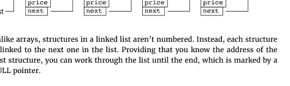

与数组不同，链表中的结构体没有编号。相反，每个结构体都链接到列表中的下一个结构体。只要你知道第一个结构体的地址，你就可以遍历列表直到末尾，末尾由 NULL 指针标记。

清单 20-6 可以做一些清理。函数在我耳边呼喊，所以我会顺应它们的呼声，提供改进版的代码，显示在清单 20-8 中。

### 清单 20-8：更好的链表示例

```c
#include <stdio.h>
#include <stdlib.h>
#include <string.h>

#define ITEMS 5

struct stk {
    char symbol[5];
    int quantity;
    float price;
    struct stk *next;
};

struct stk *make_structure(void);
void fill_structure(struct stk *a,int c);
void show_structure(struct stk *a);

int main()
{
    struct stk *first;
    struct stk *current;
    int x;

    /* create the ITEMS-sized linked list */
    for(x=0;x<ITEMS;x++)
    {
        if(x==0)
        {
            first=make_structure();
            current=first;
        }
        else
        {
            current->next=make_structure();
            current=current->next;
        }
        fill_structure(current,x+1);
    }
    /* cap the list */
    current->next=NULL;

/* output the database */
puts("Investment Portfolio");
printf("Symbol\tShares\tPrice\tValue\n");
current = first;
while(current)
{
    show_structure(current);
    current=current->next;
}

return(0);
}

/* allocate a new structure */
struct stk *make_structure(void)
{
    struct stk *a;

    a=(struct stk *)malloc(sizeof(struct stk)*1);
    if(a==NULL)
    {
        puts("Some kind of malloc() error");
        exit(1);
    }

    return(a);
}

/* fill the structure with data */
void fill_structure(struct stk *a,int c)
{
    printf("Item %3d/%d:\n",c,ITEMS);
    printf("Stock Symbol: ");
    scanf("%s",a->symbol);
    printf("Number of shares: ");
    scanf("%d",&a->quantity);
    printf("Share price: ");
    scanf("%f",&a->price);
}

/* output the structure */
void show_structure(struct stk *a)
```

### 清单 20-8：（续）

```
{
    printf("%-6s\t%5d\t%.2f\t%.2f\n",\
        a->symbol,
        a->quantity,
        a->price,
        a->quantity*a->price);
}
```

大多数链表都是像清单 20-8 所示那样创建的。关键是使用三个结构体变量，显示在第 11 行、第 20 行和第 21 行：

- **next** 是引用列表中下一个结构体的结构体成员。它在程序运行时与新结构体一起分配。此指针在列表末尾用 NULL 常量封顶。
- **first** 始终包含列表中第一个结构体的地址。始终如此。
- **current** 包含正在操作、填充数据或输出的结构体的地址。

第 7 行将 `stk` 结构体声明为全局，以便可以从各个函数中访问。

第 25 行到第 38 行之间的 `for` 循环创建新结构体并将它们链接起来。初始结构体是特殊的，因此其地址在第 29 行被保存。否则，借助 `make_structure()` 函数会分配一个新结构体。

在第 34 行，使用 `current` 结构体的 `next` 指针成员分配一个新结构体。`current` 指针在第 35 行被更新以引用新分配的结构体。

在第 40 行，通过将最后一个结构体中 `current` 指针重置为 `NULL` 来标记链表的末尾。

第 46 行的 `while` 循环输出链表中的所有结构体。循环的条件是 `current` 指针的值。当遇到 `NULL` 时，循环停止。

清单 20-8 中显示的代码其余部分由不言自明的函数组成。如果 `make_structure()` 函数让你担心，因为你认为

变量 a 的值丢失，你说得对。它的值确实丢失了，但函数返回的地址仍然引用着一块已分配的内存。

练习 20-12：将《清单 20-8》中的代码复制到编辑器中。构建并运行。


注意 fill_structure() 函数中的 scanf() 语句。记住 -> 是指针的“窥视”记法。要获取地址，你必须在 scanf() 函数中使用 & 为变量加上前缀。

### 编辑链表

由于链表是通过引用内存位置链接在一起的，因此编辑是通过修改这些内存位置来完成的。例如，在图 20-2 中，如果你想从列表中删除第三项，你可以通过将第二项链接到第四项来绕过它。第三项通过此操作被有效地删除（并丢失）。

同样，你可以通过编辑前一个结构中的 next 指针将项目插入列表，如图 20-3 所示。

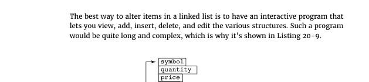

更改链表中项目的最佳方式是拥有一个交互式程序，让你查看、添加、插入、删除和编辑各种结构。这样的程序会相当长且复杂，这就是为什么它显示在清单 20-9 中。

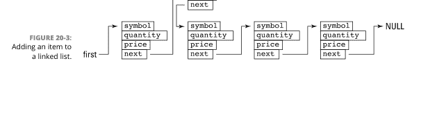

### 清单 20-9：一个交互式链表程序

```c
/* An interactive linked-list program */
/* Dan Gookin, C Programming For Dummies */
#include <stdio.h>
#include <stdlib.h>
#include <ctype.h>

struct lili {
    int value;
    struct lili *next;
};
struct lili *first;
struct lili *current;

int menu(void);
void add(void);
void show(void);
void delrec(void);
struct lili *create(void);

/* the main function works with input only
   everything else is handled by a function */
int main()
{
    /* initialize variables */
    int choice='\0';
    first=NULL;

    while(choice!='Q')
    {
        choice=menu();
        switch (choice)
        {
            case 'S':
                show();
                break;
            case 'A':
                add();
                break;
            case 'R':
                delrec();
                break;
            case 'Q':
                break;
        }
    }

    return(0);
}

/* output the main menu and collect input */
int menu(void)
{
    int ch;

    printf("Show, A)dd, R)emove, Q)uit: ");
    ch=getchar();
    /* delete excess input */
    while(getchar()!='\n')
        ;
    return(toupper(ch));
}

/* add an item to the end of the linked list */
void add(void)
{
    /* special case for the first item */
    if(first==NULL)
    {
        first=create();
        current=first;
    }
    /* otherwise, find the last item */
    else
    {
        current=first;
        /* find the NULL */
        while(current->next)
            current=current->next;
        current->next=create();
        current=current->next;
    }
    printf("Type a value: ");
    scanf("%d",&current->value);
    current->next=NULL;
    /* delete excess input */
    while(getchar()!='\n')
        ;
}

/* output all structures in the linked list */
void show(void)
{
    int count=1;

    /* is the list empty? */
    if(first==NULL)
    {
        puts("Nothing to show");
        return;
    }
    puts("Showing all records:");
    current=first;
    /* loop until current==NULL */
    while(current)
    {
        printf("Record %d: %d\n", count,current->value);
        current=current->next;
        count++;
    }
}

/* delete a record from the list */
void delrec(void)
{
    /* the previous record must be saved */
    struct lili *previous;
    int r,c;

    /* is the list empty? */
    if(first==NULL)
    {
        puts("No records to remove");
        return;
    }

    puts("Choose a record to remove:");
    /* output the list */
    show();
    printf("Record: ");
    scanf("%d",&r);
    /* delete excess input */
    while(getchar()!='\n')
        ;
    c=1;
    /* reset the list */
    current=first;
    /* initialize the previous pointer */
    previous=NULL;
    while(c!=r)
    {
        previous=current;
        current=current->next;
        c++;
        /* bail on the end of the list */
        if(current==NULL)
        {
            puts("Record not found");
            return;
        }
    }
    /* 'current' holds the record to delete */
    /* is it the first record? */
    if(previous==NULL)
        first=current->next;
    /* otherwise, reset the next reference */
    else
        previous->next=current->next;
    printf("Record %d removed.\n",r);
    /* release memory of the current record */
    free(current);
}

/* build an empty structure & return its address */
struct lili *create(void)
{
    struct lili *a;

    a=(struct lili *)malloc(sizeof(struct lili)*1);
    if(a==NULL)
    {
        puts("Some kind of malloc() error");
        exit(1);
    }

    return(a);
}
```

练习 20-13：如果你有时间，请将清单 20-9 的源代码输入到你的编辑器中。我可以说，亲手输入有助于你更好地理解代码。构建并运行几次以熟悉它。

### 保存链表

链表只存在于内存中。虽然你可以将链表中的所有记录保存到文件中，但在从文件读取信息时，每个结构中的 next 指针成员应被丢弃。原因是因为链表可能不会在同一块内存中布局。

请参阅第 22 章，了解有关文件操作的详细信息——具体来说是随机文件访问的主题。

### 本章内容

- 编程时间函数
- 理解 Unix 纪元
- 获取当前时间
- 显示日期和时间
- 暂停程序执行

### 第 21 章：关于时间

## 关于时间

是时候编程了！或者换句话说，是时候编程时间了。C 库充满了各种面向时间的函数，让你不仅可以报告当前时间，还可以显示日期和时间。你甚至可以——有意地——暂停程序的执行，前提是你知道正确的函数。

### 现在几点了？

有人知道现在几点了吗？说真的，有人真的知道现在几点了——或者过去几点了吗？

电子设备都有时钟，但这并不使它们成为最好的计时器。事实上，今天大多数小玩意都会通过使用互联网时间服务器不断更新其内部时钟。否则，你的电脑、手机或平板电脑上的时钟永远不会准确。

当你在 C 中编程时间时，你依赖于所使用的设备准确报告日期和时间。这凸显了围绕时间主题及其如何测量的大量术语和技术。

### 了解日历

数字设备通过计算 1 和 0 来跟踪时间。人类喜欢通过计算秒、分钟、小时、天、周、月和年来跟踪时间。已经开发出各种方案来在两者之间工作。

*儒略历*几个世纪以来都很流行。它由 Julius Caesar 开发并用拉丁语编写，这个日历很长时间内运行良好。

不幸的是，老 Julius 没有考虑到随时间累积的一天的小数部分。在 1500 年，教皇 Gregory 开发了 *格里高利历*，它修正了 Caesar 的疏忽。这个日历也是用拉丁语编写的。

计算机科学家在 1950 年代开发了名为 *改进儒略日 (MJD)* 的东西。他们将公元前 4713 年 1 月 1 日设为第 0 天，并对此后的每一天进行编号。小时以一天的小数部分给出。2014 年 1 月 1 日中午是 2456239.5 MJD。

当 Unix 出现时，两件事诞生了：C 语言和 Unix 纪元。在 1970 年 1 月 1 日午夜，Unix 计算机开始计数秒。*Unix 纪元*自那一刻起以 *time_t* 值衡量，它是 *long unsigned int* 的 *typedef*。该数据类型的范围使 Unix 纪元日历有效期至 2038 年 1 月 19 日凌晨 3:14:07，此时计算机突然认为日期又回到了 1901 年 12 月 13 日。那是一个星期五！

大多数 Unix 计算机已经解决了 2038 年问题，因此与 Y2K 危机不同，2038 年 1 月 19 日之后不会发生任何坏事。然而，Unix 纪元仍在使用 C 函数进行时间编程。

### 在 C 中使用时间

C 语言中的时间函数和相关事项保存在 `time.h` 头文件中。在此文件中，你会找到满足程序及时需求的好东西。这些项目包括 `time_t` 数据类型和 `tm` 结构：

|  |  |
| --- | --- |
| `time_t` | `time_t` 数据类型保存 Unix 纪元的值，或自 1970 年 1 月 1 日以来经过的秒数。在大多数系统上，`time_t` 是 long signed int 的 typedef；使用 `%ld` 或 `%lu` 占位符输出此值。 |
| `struct tm` | `tm` 结构保存用于存储时间戳各个部分的定义。它由 `localtime()` 函数填充。参见后面的章节“切片时间字符串”。 |


同样在`time.h`头文件中还定义了以下时间函数：

| 函数 | 描述 |
| --- | --- |
| *time()* | *time()*函数使用*time_t*变量的地址作为其参数。该函数用当前Unix纪元时间填充*time_t*变量，并返回一个*time_t*值。 |
| *ctime()* | *ctime()*函数接收一个*time_t*变量，并将其转换为可显示的日期时间字符串。 |
| *localtime()* | 该函数根据存储在*time_t*变量中的时间值，将信息填入*tm*结构体。*localtime()*函数返回*tm*结构体的地址，因此它会与结构体、指针以及那个`->`运算符纠缠不清。 |
| *difftime()* | *difftime()*函数比较两个*time_t*值之间的差异，并返回一个*float*值作为秒数差。 |

C语言库通常还带有其他与时间相关的函数，例如*sleep()*和*clock()*。这些函数可能并非在所有系统上都可用——但这不应成为问题，因为你总是可以自己编写时间函数。

## 开始编程

我可以想象，发明了指针和链表的那些编程大神们，本可以用时间编程把你的大脑搅得一团糟。幸运的是，他们没有这么做。虽然了解指针和结构体有助于你掌握门道，但C语言中的时间编程其实直截了当。

### 查看时钟

计算机，或者说你所编程的任何设备，都会在其数字深处的某个地方保存一个时间值。要访问这个值，你需要编写一个使用*time()*函数的程序。它会把当前的时钟滴答值塞进一个*time_t*变量中，如清单21-1所示。

### 清单21-1：哦，原来这就是时间？

```c
#include <stdio.h>
#include <time.h>

int main()
{
    time_t tictoc;

    time(&tictoc);
    printf("The time is now %ld\n",tictoc);
    return(0);
}
```

清单21-1中的第2行引入了time.h头文件，C语言中各种时间函数都需要它。

第6行声明了time_t变量tictoc。第8行的time()函数需要time_t变量的地址作为其参数。时间值被直接放入变量tictoc（在其内存位置）中。

最后，在第9行，结果值——Unix纪元——通过使用%ld转换字符（long int）输出。

- **练习21-1：** 将清单21-1中的源代码输入到你的编辑器中。编译并运行。

- **练习21-2：** 修改练习21-1中的解决方案，将第8行替换为

    ```c
    tictoc=time(NULL);
    ```

    time()函数需要一个内存位置作为参数，但它也会返回一个time_t值。你可以使用上面给出的格式，也可以使用清单21-1中第8行所示的格式，具体取决于&或NULL这两个古怪符号中哪个最让你害怕。

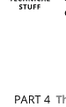

早在20世纪70年代和80年代，BASIC程序员会在代码中编写for循环来暂停程序执行。我记得我那可靠的老式TRS-80需要从1数到100的循环来延迟一秒钟的执行。如今的系统要快得多，不能再依赖这种循环来精确延迟程序执行了。

### time()如何影响随机数

在C语言中生成随机数的最佳方法是给随机数生成器设置种子。在第11章中，我描述了如何使用time()函数来完成这个过程。格式如下：

```c
srand((unsigned)time(NULL));
```

当以NULL值（一个指针）作为参数调用时，time()函数会以Unix纪元格式返回当前时间。为了确保返回的值——Unix纪元——不为负数，它被强制转换为无符号类型。这一步可能并非必需，因为在某些系统上time_t值可能本来就是无符号的。不过，强制转换可以确保该值始终为正。

### 查看时间戳

将当前日期和时间显示为整数不会让你的用户开心。事实上，我甚至不知道有哪个Unix极客能看着一个Unix纪元数字就判断出它是哪个日期。因此，需要进行某种转换。C语言库中承担这一职责的函数是ctime()，即时间转换函数，如清单21-2所示。

### 清单21-2：哦，原来这就是时间！

```c
#include <stdio.h>
#include <time.h>

int main()
{
    time_t tictoc;

    time(&tictoc);
    printf("The time is now %s",ctime(&tictoc));
    return(0);
}
```

ctime()函数接收一个time_t变量的地址。该函数返回一个指向时间戳字符串的指针，这个指针是内存中某个字符数组的地址。该字符串包含一个终止换行符。

- **练习21-3：** 使用清单21-2中的源代码创建一个新程序。别忘了printf()语句中的%s转换字符。编译并运行。输出看起来像这样：

    ```text
    The time is now Mon May 18 13:54:31 2020
    ```

    字符串的后半部分（从Mon开始）是由ctime()函数返回的。

- **练习21-4：** 编写代码，将time_t值94668800传给ctime()函数。输出返回的字符串。

### 解析时间字符串

别担心ctime()返回的字符串，也别担心你的代码需要从中解析才能获得具体的日期或时间信息。这是因为localtime()函数可以与特定的日期或时间值一起使用。这就是为什么localtime()函数可以用来提取当前时间的各个零碎部分。

localtime()函数根据time_t值提取时间和日期信息。它将相关部分填入tm结构体中，该结构体大致如下：

```c
struct tm {
    int tm_sec; /* seconds after the minute [0-60] */
    int tm_min; /* minutes after the hour [0-59] */
    int tm_hour; /* hours since midnight [0-23] */
    int tm_mday; /* day of the month [1-31] */
    int tm_mon; /* months since January [0-11] */
    int tm_year; /* years since 1900 */
    int tm_wday; /* days since Sunday [0-6] */
    int tm_yday; /* days since January 1 [0-365] */
    int tm_isdst; /* Daylight Saving Time flag */
};
```

清单21-3展示了如何使用tm结构体输出可识别的日期和时间格式。

### **清单21-3：** 今天是几号？

```c
#include <stdio.h>
#include <time.h>

int main()
{
    time_t tictoc;
    struct tm *today;

    time(&tictoc);
    today = localtime(&tictoc);
    printf("Today is %d/%d/%d\n",
        today->tm_mon,
        today->tm_mday,
        today->tm_year);
    return(0);
}
```

清单21-3中第9行的*time()*函数获取以Unix纪元滴答数计的当前时间。该值存储在*tictoc*变量中。

在第10行，*localtime()*函数返回**tm**结构体指针*today*。结构体的元素通过*printf()*在几行中输出。由于结构体是一个指针（内存地址），因此使用结构体指针表示法来访问其元素（第12、13和14行）。

- **练习21-5：** 将清单21-3中的源代码输入到你的编辑器中。编译并运行程序以查看当前日期。

    因为图拉真不再是罗马皇帝，而且现在也不是上个月，你必须对代码进行一些调整。参考本节前面给出的结构体定义，你就会明白要输出正确的月份和年份值需要怎样的数学计算。

- **练习21-6：** 修改练习21-5的解决方案，使程序输出当前年份和当前月份。

- **练习21-7：** 编写代码，以`hour:minute:second`的格式输出当前时间。确保分钟和秒的输出为两位数字，并带有前导零。

- **练习21-8：** 修改练习21-7的解决方案，使输出为12小时制，并根据一天中的时间添加A.M.或P.M.后缀。

- **练习21-9：** 编写代码，输出当前星期几的完整名称。

### 睡眠

大多数程序员都希望自己的代码运行得快。偶尔，你会希望代码慢下来，进行一段有节制的暂停，或者营造……悬念！在这些情况下，你可以依靠C语言的时间函数来产生一点点延迟。

sleep()函数是一个常见但非标准的时间函数。它在unistd.h头文件中声明。该函数的参数是暂停程序执行的秒数。

difftime()函数（见清单21-4）在time.h头文件中声明。使用它可以计算代码中now和then这两个time_t值之间的差异。该函数返回一个浮点值，表示经过的秒数。

### 清单21-4：稍等片刻！

```c
#include <stdio.h>
#include <time.h>

int main()
{
    time_t now,then;
    float delay=0.0;

    time(&then);
    puts("Start");
    while(delay < 1)
    {
        time(&now);
        delay = difftime(now,then);
        printf("%f\r",delay);
    }
    puts("\nStop");
    return(0);
}
```

- **练习21-10：** 将清单21-4中的源代码输入到你的编辑器中。编译该程序。运行。


## 5
## 其余部分

## 本部分内容 . . .
- 读写文件信息
- 拼命保存一个链表
- 使用 C 进行文件管理
- 创建更大规模的项目
- 消除代码中的错误

### 第 22 章：永久存储函数
## 永久存储函数

### 本章内容
- 使用文件函数
- 向文件读写文本
- 创建二进制文件
- 使用 fread() 和 fwrite() 函数
- 读写记录
- 构建链表数据库

C 程序天生就使用内存存储。变量被创建，值被设置，位置被映射。这一切几乎是自动的，但程序运行后创建的信息就会丢失。

从长远来看，程序需要访问永久存储，将信息写入文件和从文件读取。C 提供了大量交互式函数，可让你创建、读取、写入和操作文件。这些就是永久存储函数。

信息写入或从文件中读取的最简单方式是顺序的，一个字节接一个字节。文件包含一个长数据流。这些信息从头到尾访问，就像观看广播电视上的电影一样。

### 理解 C 文件访问

C 中的文件访问是另一种形式的 I/O。与其使用标准输入（键盘）或标准输出（显示器），输入或输出作用于文件。听起来很简单。幸运的是，确实如此。

文件是通过使用 fopen() 函数打开的：

```c
handle = fopen(filename,mode);
```

fopen() 函数需要两个参数，都是字符串。第一个是文件名；第二个是模式。模式的选择列在表 22-1 中。fopen() 函数返回一个文件句柄，它是一个用于引用文件的指针。该指针的类型为 FILE，这是一个在 stdio.h 头文件中定义的结构。

**表 22-1：fopen() 函数的访问模式**

| 模式 | 文件打开用途 | 创建文件？ | 注释 |
|------|---------------|--------------|-------|
| "a" | 追加 | 是 | 它会在现有文件末尾添加内容；如果文件不存在则创建文件。 |
| "a+" | 追加并读取 | 是 | 信息会添加到文件末尾。 |
| "r" | 读取 | 否 | 如果文件不存在，fopen() 返回错误。 |
| "r+" | 读取和写入 | 否 | 如果文件不存在，将返回错误。 |
| "w" | 写入 | 是 | 如果使用相同名称，现有文件将被覆盖。 |
| "w+" | 写入和读取 | 是 | 现有文件将被覆盖。 |


模式是一个字符串。即使只指定一个字符，也必须用双引号括起来。

文件打开后，你使用句柄变量在读写时引用文件。许多文件 I/O 函数与标准 I/O 对应函数相似，但带有 f 前缀。要向文件写入，可以使用 fprintf()、fputs()、fputchar() 等函数。从文件读取使用 fscanf()、fgets() 等。

完成所有读写后，使用 fclose() 函数并将文件句柄作为参数来关闭文件。

本章提到的所有文件 I/O 函数都在 stdio.h 头文件中原型声明。

### 向文件写入文本

要向文件写入文本，请遵循以下步骤：
- 1. 打开文件。
- 2. 检查文件是否成功打开。
- 3. 向文件写入数据。
- 4. 关闭文件。

列表 22-1 执行了这些步骤。文件 hello.txt 被创建。它是一个文本文件，内容为 Look what I made!。

### 写入该文件
```c
#include <stdio.h>
#include <stdlib.h>

int main()
{
    FILE *fh;

    /* open the file */
    fh = fopen("hello.txt", "w");
    /* check for errors */
    if (fh == NULL)
    {
        puts("Can't open that file!");
        exit(1);
    }

    /* output text */
    fprintf(fh, "Look what I made!\n");
    /* close the file */
    fclose(fh);
    /* inform the user */
    puts("File written.");
    return(0);
}
```

第 6 行创建文件句柄 fh。它是一个指针。指针存储第 9 行 fopen() 函数的返回值。函数的第一个参数是文件名 hello.txt。第二个参数是 "w"，即写入模式。如果文件存在，它将被覆盖。

第 11 行的 if 语句确认文件是否正确打开。如果没有，fh 的值为 NULL 并采取适当措施。

第 17 行的 fprintf() 函数向文件写入文本。其格式与 printf() 相同，但第一个参数为文件句柄，其后是格式字符串然后是任何变量。

最后，第 19 行使用 fclose() 函数关闭文件。此语句是任何文件访问编程的必需步骤。

**练习 22-1：** 将列表 22-1 的源代码复制到编辑器中。构建并运行程序。

使用计算机的文件浏览器找到创建的文件并打开它。在 bash 提示符下，使用命令 cat hello.txt 查看文件内容。

### 从文件读取文本

要从文件读取文本，你遵循与向文件写入文本相同的规则，但第三步是读取文本。（参见前一节。）熟悉的函数用于访问文件信息，但带有 f 前缀并且函数括号中某个位置有文件句柄参数。

要逐字符从文件读取文本，请使用列表 22-2 所示的 fgetc() 函数。

### 列表 22-2：读取该文件
```c
#include <stdio.h>
#include <stdlib.h>

int main()
{
    FILE *fh;
    int ch;

    /* open the file */
    fh=fopen("hello.txt","r");
    /* check for errors */
    if(fh==NULL)
    {
        puts("Can't open that file!");
        exit(1);
    }

/* loop until the end-of-file */
while( !feof(fh) )
{
  /* read one character */
  ch=fgetc(fh);
  /* end of file? */
  if( ch==EOF )
    break;
  /* output character */
  putchar(ch);
}
/* close the file */
fclose(fh);
return(0);
}
```

列表 22-2 中的第 11 行以只读方式打开文件 hello.txt。文件必须存在；否则会发生错误。

第 18 行的 while 循环基于 feof() 函数的返回值重复。该函数在遇到文件末尾时返回 TRUE。!（非）运算符反转此条件，因此循环重复“当不为真时”，或直到从文件中读取所有信息为止。

第 21 行使用 fgetc() 函数从句柄 fh 标识的文件中读取一个字符。该字符存储在变量 ch 中。

在第 23 行，从文件中读取并存储在变量 ch 中的字符与 EOF，即文件结束常量进行比较。当为 TRUE 时，文件的文本已完全读取，while 循环中断。EOF 是一个整数常量，这就是为什么变量 ch 被声明为 int 值的原因。并且在循环中运行此测试很重要，因为 EOF 可能在此处被遇到，而在第 18 行的 feof() 函数读取它之前。

第 26 行输出从文件中读取的字符。

### 练习 22-2：使用列表 22-2 所示的源代码创建一个新程序。构建并运行。

程序输出练习 22-1 创建的文件内容；否则，你会看到错误消息。

### 练习 22-3：修改练习 22-1 的源代码以向文件写入第二个字符串。在第 17 行后添加以下语句：

```
fputs("My C program wrote this file.\n",fh);
```

与标准输出的 puts() 语句不同，你必须为 fputs() 文件输出指定换行字符。此外，文件句柄参数作为第二个参数出现，这对于 C 语言文件函数来说是不寻常的。

构建并运行练习 22-3，然后重新运行练习 22-2 的解决方案以查看文件内容。

fprintf() 和 fputs() 两个函数顺序地向文件写入文本，一个字符接一个字符。该过程的工作方式与向标准输出发送文本一样，但字符被发送到永久存储中的文件。

fgets() 函数从文件中读取整个文本字符串，就像本书其他地方用于从标准输入（stdin）读取一样。要使其工作，你需要一个输入缓冲区、要读取的字符数以及文件句柄。列表 22-3 显示了一个示例。

### 列表 22-3：吞咽字符串文本
```c
#include <stdio.h>
#include <stdlib.h>

int main()
{
    FILE *fh;
    char buffer[64];
    char *r;

    fh=fopen("hello.txt","r");
    if(fh==NULL)
    {
        puts("Can't open that file!");
        exit(1);
    }
    while (!feof(fh) )
    {
        /* fgets returns (char *)NULL on
           error or EOF */
        r = fgets(buffer,64,fh);
        if( r==NULL )
            break;
```

```
printf("%s",buffer);
}
fclose(fh);
return(0);
}
```

第 20 行的 fgets() 函数读取一行文本（以换行符结束）或 64 个字符，以先到者为准。该函数返回指向所读取字符串的指针，除非发生错误；发生错误时返回 NULL。该值保存在 char 指针变量 s 中，并在第 21 行进行测试。

**练习 22-4：** 将清单 22-3 中的源代码输入编辑器。构建并运行。

## 向文件追加文本

当以 "a" 模式使用 fopen() 函数时，文本会被追加到已存在的文件中。或者当文件不存在时，fopen() 命令会创建一个新文件。在清单 22-4 的第 9 行，"a" 模式打开现有文件 hello.txt 以进行追加。如果该文件不存在，则会创建它。

### 清单 22-4：添加更多文本

```
#include <stdio.h>
#include <stdlib.h>

int main()
{
    FILE *fh;

    /* "a" == append */
    fh=fopen("hello.txt","a");
    if(fh==NULL)
    {
        puts("Can't open that file!");
        exit(1);
    }
    fprintf(fh,"This text was added later\n");
    puts("Text appended");
    fclose(fh);
    return(0);
}
```

标准文件写入函数用于向打开的文件输出文本，如第 15 行所示。

练习 22-5：使用清单 22-4 中所示的源代码创建一个新项目。构建并运行，将文本追加到 hello.txt 文件。使用练习 22-4 中的程序查看该文件的内容。然后再次运行该程序（来自练习 22-5），将文本第二次追加到文件中。查看结果。

完成后，hello.txt 文件包含以下文本：

```
Look what I made!
My C program wrote this file.
This text was added later
This text was added later
```

## 写入二进制数据

本章到目前为止展示的演示程序处理的是纯文本文件。然而，并非每个文件都是文本文件。大多数文件包含人类无法读取的二进制数据。你也可以使用 C 语言处理这些文件。先研究清单 22-5。

### 清单 22-5：写入二进制数据

```c
#include <stdio.h>
#include <stdlib.h>

int main()
{
    FILE *handle;
    int highscore;

    handle = fopen("scores.dat", "w");
    if(!handle)
    {
        puts("File error!");
        exit(1);
    }
    printf("What is your high score? ");
    scanf("%d",&highscore);
    fprintf(handle,"%d",highscore);
    fclose(handle);
    puts("Score saved");
    return(0);
}
```

练习 22-6：将清单 22-5 中的源代码输入一个新项目。构建并运行。

清单 22-5 中发生的几乎所有事情对你来说都很熟悉。问题在哪里？并没有写入二进制数据。相反，第 17 行的 fprintf() 函数将 int 值作为文本字符串写入文件。为了证明这一点，检查 scores.dat 文件的内容，你会看到该值以纯文本形式存储。

## 练习 22-7

将练习 22-6 解决方案代码中的第 17 行替换为以下语句：

```
fwrite(&highscore, sizeof(int), 1, handle);
```

保存更改。构建并运行。现在当你尝试检查 scores.dat 文件的内容时，它不再是纯文本。这是因为借助 fwrite() 函数写入了二进制信息。

以下是 fwrite() 的格式：

```
fwrite(variable_ptr, sizeof(type), count, handle);
```

fwrite() 函数关注的是将信息块写入文件。与 fprintf() 和 fputs() 函数不同，它并不总是写入文本。

当在 fwrite() 函数中指定数组和字符串时，不需要在它们前面加上 & 运算符。

sizeof(type) 是变量的存储大小，取决于变量类型——例如 int、char 和 float。

count 是要写入的项目数。如果要写入一个包含十个 int 值的数组，则将大小指定为 10。

handle 是文件句柄地址，由 fopen() 函数返回。

## 练习 22-8

以清单 22-5 中的源代码为起点，编写一个程序，将包含五个最高分值的数组保存到 scores.dat 文件。（程序覆盖原始的 scores.dat 文件也没关系。）

下一节介绍如何从文件读取二进制数据。


在较早版本的 C 标准中，读取或写入二进制数据时，通常会在 fopen() 函数的模式字符串中添加一个 b。现在不再有这项要求。如果在 fopen() 函数中使用了模式字符串中的 "b"，现代编译器会忽略它。

## 读取二进制数据

当需要从文件读取二进制信息时，fread() 函数就派上用场了。与 fwrite() 函数一样，fread() 接收原始数据并将其存入 C 语言变量中以便进一步检查。清单 22-6 提供了一个演示。该清单中的 scores.dat 文件是在上一节的练习 22-8 中创建的。

### 清单 22-6：查看这些最高分

```c
#include <stdio.h>
#include <stdlib.h>

int main()
{
    FILE *handle;
    int highscore[5];
    int x;

    handle = fopen("scores.dat","r");
    if(!handle)
    {
        puts("File error!");
        exit(1);
    }
    fread(highscore,sizeof(int),5,handle);
    fclose(handle);
    for(x=0;x<5;x++)
        printf("High score %d: %d\n",x+1,highscore[x]);
    return(0);
}
```

在第 16 行，highscore 数组的基地址作为第一个参数传递给 fread()。接下来是要读取的每个元素的大小，即 int 变量的大小。然后是字面值 5，实际上是让 fread() 读入五个值。最后一个参数是文件句柄变量，其名称 handle 容易让人困惑。

**练习 22-9：** 将清单 22-6 中的源代码输入编辑器。构建并运行，查看先前保存到 scores.dat 文件中的五个 int 值。

由于 fread() 可以读取任何文件的数据，你可以用它创建一个文件转储器类型的程序，如清单 22-7 所示。

### 清单 22-7：文件转储器

```
#include <stdio.h>
#include <stdlib.h>

int main()
{
    char filename[255];
    FILE *dumpme;
    int x,c;

    printf("File to dump: ");
    scanf("%s",filename);
    dumpme=fopen(filename,"r");
    if(!dumpme)
    {
        printf("Unable to open '%s'\n",filename);
        exit(1);
    }
    x=0;
    while( (c=fgetc(dumpme)) != EOF)
    {
        printf("%02X ",c);
        x++;
        if(!(x%16))
            putchar('\n');
    }
    putchar('\n');
    fclose(dumpme);
    return(0);
}
```

清单 22-7 中的源代码显示文件中的每个字节。它在第 24 行的 printf() 语句中使用两位十六进制格式 %02X 来表示每个字节。

fgetc() 函数在第 21 行一次读取文件的一个字节。为了防止代码读取超过文件末尾，在第 22 行将该字节与 EOF（文件结束）标记进行比较。

第 26 行的 if 判断使用取模运算符来确定何时已显示 16 个字节。当条件为真时，输出一个换行符，使显示保持整洁。

与本章介绍的其他程序不同，清单 22-7 在第 10 行提示用户输入文件名。因此，很有可能在输入不正确的文件名时看到显示的错误消息。

练习 22-10：将清单 22-7 中的源代码输入编辑器。构建项目。使用你本章前面创建的 scores.dat 文件运行它，或者使用该文件自身的源代码清单作为要查看的文件。

练习 22-11：重写清单 22-7 中的源代码，使文件名也可以在命令提示符处作为程序的第一个参数输入。


- 转储（Dump）是一个古老的编程术语。它是一种不优雅的说法，指在不进行任何处理的情况下将数据从一个地方传输到另一个地方。例如，核心转储（core dump）是操作系统内核（或其他基本组件）从内存传输到文件中的副本。
- 由 fwrite() 保存、由 fread() 读取的信息是二进制的——实际上，就是当你给 int、float 或其他 C 变量类型赋值时存储在内存中的同一信息。
- 只要顺序正确，你就可以使用 fwrite() 和 fread() 将任何数据保存到文件，包括完整数组、结构体以及诸如此类的内容。但如果你不按顺序读取信息，它就会变成乱码。

## 随机文件访问

随机文件访问与随机数毫无关系。相反，可以在任意位置访问文件——这里、那里，甚至更远的地方。这就像观看流媒体视频而不是广播电视：你可以从任意位置开始读取文件，在需要的任何位置获取或放入任何信息。


见证随机文件访问实际运行的最佳方式是当文件中布满相同大小的记录时。记录的概念引出了结构体，它们可以轻松地写入文件，然后单独、选择性地或一次性全部取回。

## 向文件写入结构体

作为一种变量类型，将结构体写入文件是轻而易举的。该过程的工作方式与将任何变量写入文件一样，如清单 22-8 所演示。

### LISTING 22-8: 保存邦德先生

```c
#include <stdio.h>
#include <stdlib.h>
#include <string.h>

int main()
{
    struct agent {
        char actor[32];
        int year;
        char title[32];
    };
    struct agent bond;
    FILE *jbdb;

    strcpy(bond.actor,"Sean Connery");
    bond.year = 1962;
    strcpy(bond.title,"Dr. No");

    jbdb = fopen("bond.db","w");
    if(!jbdb)
    {
        puts("SPECTRE wins!");
        exit(1);
    }
    fwrite(&bond,sizeof(struct agent),1,jbdb);
    fclose(jbdb);
    puts("Record written");

    return(0);
}
```

如果您已完成本章之前的练习，清单 22-8 中的大部分代码应该对您来说很熟悉。

- Exercise 22-12: 将清单 22-8 中的代码复制到您的编辑器中。构建并运行程序以创建 bond.db 文件，并向该文件写入一个结构体。
- Exercise 22-13: 修改清单 22-8 中的代码以创建一个新程序。让该程序向 bond.db 文件再写入两条记录。它们必须附加到任何现有数据之后，而不是覆盖原始文件。使用以下数据：
  - Roger Moore, 1973, Live and Let Die
  - Pierce Brosnan, 1995, GoldenEye

除非您创建代码来读取数据，否则文件中的良好信息对您没有任何用处。清单 22-9 读取写入 bond.db 文件的三个记录，假设您已运行练习 22-12 和 22-13 的程序解决方案。

```c
#include <stdio.h>
#include <stdlib.h>
#include <string.h>

int main()
{
    struct agent {
        char actor[32];
        int year;
        char title[32];
    };
    struct agent bond;
    FILE *jbdb;
    int r;

    jbdb = fopen("bond.db", "r");
    if(!jbdb)
    {
        puts("SPECTRE wins!");
        exit(1);
    }
    while( !feof(jbdb) )
    {
        r = fread(&bond,sizeof(struct agent),1,jbdb);
        if( r==0 )
            break;
        printf("%s\t%d\t%s\n",
            bond.actor,
            bond.year,
            bond.title);
    }
    fclose(jbdb);

    return(0);
}
```

清单 22-9 中的源代码在第 22 行使用 while 循环从 bond.db 文件中读取结构体。代码假设文件是通过使用 fwrite() 函数写入完整大小的 agent 结构体创建的。

fread() 函数返回读取的项目数。如果没有剩余数据可读，则返回 0。该值在第 25 行的变量 r 中进行测试。如果为零，则 while 循环被中断。否则，feof() 函数在第 22 行终止循环。

代码在第 12 行使用结构体变量 bond 从文件读取多个项目。新的项目会覆盖结构体中已有的任何值，就像重用任何变量一样。

- **Exercise 22-14:** 使用清单 22-9 中的源代码创建一个新项目。构建并运行以检查在练习 22-12 和 22-13 中创建的 bond.db 文件。


有效地向文件（如数据库）读写结构体的关键是保持所有结构体一致。这样，它们可以分块读写到文件中。只要同时使用适当的 C 语言文件函数，它们也可以按任何顺序读取或写入。

## 读取和回绕

当您的程序从文件读取数据时，它会跟踪文件中读取数据的位置。维护一个文件位置索引，以便代码在文件内读取或写入的位置不会丢失。

当您首次打开文件时，该索引位置位于文件的开头，即第一个字节。如果您将 40 字节的记录读入内存，文件位置索引将从开头算起 40 字节。如果您一直读到文件末尾，位置索引也会保持该位置。

为了增加混乱，位置索引通常被称为文件指针，尽管它不是指针变量也不是 FILE 类型的指针。它只是文件中读取下一个数据字节的位置。

您可以通过使用 C 中的几个有趣函数来操作文件指针-索引-事物。其中两个是 ftell() 和 rewind()。ftell() 函数以 long int 值返回当前位置。rewind() 函数将文件指针返回到文件的开头。

清单 22-10 两次读取 bond.db 文件中的记录。读取完所有记录后，第 37 行的 rewind() 函数将文件指针重置为文件的开头。第二个 while 循环重复该过程，重新读取所有记录。

ftell() 函数在第 26 行和第 42 行使用，以在代码每次从文件读取记录时输出文件指针的偏移量。

### LISTING 22-10: 告知与回绕

```c
#include <stdio.h>
#include <stdlib.h>
#include <string.h>

int main()
{
    struct agent {
        char actor[32];
        int year;
        char title[32];
    };
    struct agent bond;
    FILE *jbdb;
    int r;

    jbdb = fopen("bond.db","r");
    if(!jbdb)
    {
        puts("SPECTRE wins!");
        exit(1);
    }

    puts("First read-through:");
    while( !feof(jbdb) )
    {
        printf("%ld:\t",ftell(jbdb));
        r = fread(&bond,sizeof(struct agent),1,jbdb);
        if( r==0 )
            break;
        printf("%s\t%d\t%s\n",
            bond.actor,
            bond.year,
            bond.title);
    }

    /* restart! */
    rewind(jbdb);

    puts("Second read-through:");
    while( !feof(jbdb) )
    {
        printf("%ld:\t", ftell(jbdb));
        r = fread(&bond,sizeof(struct agent),1,jbdb);
        if( r==0 )
            break;
        printf("%s\t%d\t%s\n",
            bond.actor,
            bond.year,
            bond.title);
    }

    /* close and exit */
    fclose(jbdb);
    return(0);
}
```

- Exercise 22-15: 将清单 22-10 的源代码输入到您的编辑器中。构建并运行以查看 ftell() 和 rewind() 函数的工作方式。

## 查找特定记录

当文件包含全部相同大小的记录时，例如本章迄今使用的詹姆斯·邦德数据库，您可以使用 fseek() 函数取出任何单个项目。这就是随机文件访问的本质。fseek() 的格式为

```
fseek(handle,offset,whence);
```

handle 是一个文件句柄，表示已打开用于读取的文件的 FILE 指针，offset 是从文件开头、结尾或当前位置开始的字节数。而 whence 是三个常量之一：SEEK_SET、SEEK_CUR 或 SEEK_END，分别表示文件的开头、当前位置或结尾。

前提是数据文件包含恒定大小的记录，您可以使用 fseek() 取出任何特定记录，如清单 22-11 所示。

### LISTING 22-11: 在文件中查找特定记录

```c
#include <stdio.h>
#include <stdlib.h>
#include <string.h>

int main()
{
    struct agent {
        char actor[32];
        int year;
        char title[32];
    };
    struct agent bond;
    FILE *jbdb;

    jbdb = fopen("bond.db", "r");
    if (!jbdb)
    {
        puts("SPECTRE wins!");
        exit(1);
    }
    /* locate the 2nd record based on the
       size of structure agent */
    fseek(jbdb, sizeof(struct agent)*1, SEEK_SET);
    fread(&bond, sizeof(struct agent), 1, jbdb);
    printf("%s\t%d\t%s\n",
           bond.actor,
           bond.year,
           bond.title);
    fclose(jbdb);

    return(0);
}
```

第 21 行的 fseek() 函数设置文件指针-事物位置，以便随后（第 22 行）的 fread() 函数读取数据库内部的特定记录。偏移量是通过将条目结构体的大小相乘计算得出的。与数组一样，将此大小乘以 1 会得到文件中的第二个记录；将该值乘以 0（或直接在函数中指定 0）以读取第一个记录。SEEK_SET 常量确保 fseek() 从文件的开头查找。

- Exercise 22-16: 使用清单 22-11 的源代码创建一个新程序以查看文件中的第二条记录。此练习的成功取决于 bond.db 文件的存在，该文件已在本章中构建。

## 将链表保存到文件

第 20 章探讨了 C 语言中链表这一沉重的主题。在链表讨论中必然会出现的一个问题是如何将此类列表保存到文件中。如果您阅读了过去几节，您已经知道怎么做了：创建文件然后使用 fwrite() 保存所有链表记录。

- Exercise 22-17: 修改练习 20-12（参考第 20 章）的源代码，以便程序检索并将所有记录保存到文件。程序应在启动时自动加载记录。退出时，程序自动保存记录。代码需要两个新函数 load() 和 save()，您可以分别以现有的 create() 和 show() 函数为基础。当然，如往常一样，还需要其他润色。

### 创建练习 22-17 的一些提示 [sic]：

- 保存链表结构不可避免地会保存指针的地址。这样做是可以的——只需在读取结构时丢弃该值，用为链表结构分配的新地址替换它。
- 当代码首次运行时，显然它找不到要加载到内存中的文件。这是可以的；让您的程序创建该文件。
- 与任何复杂编码一样，分步骤处理改进。

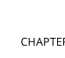


**本章内容**
- 从目录读取文件
- 检查文件类型
- 处理目录层次结构
- 更改文件名
- 复制文件
- 删除文件

### 第23章：文件管理

### 文件管理

C 库提供了许多直接与操作系统交互的函数，让你能够窥探、拨弄并深入探究文件本身的本质。你永远不知道什么时候需要遍历一个目录、重命名一个文件，或删除程序创建的临时文件。这很强大，但这种文件管理完全在 C 程序的能力范围之内。

### 目录也疯狂

目录不过是存储在设备大容量存储系统上的文件数据库。目录也称为文件夹，包含文件列表以及任何子目录。正如你可以操作目录一样，目录也可以被打开、读取，然后关闭。而且，就像你在计算机屏幕上看到的目录列表一样，你可以收集各种文件的信息：它们的大小、类型等。

### 打开目录

C 库的 opendir() 函数会检查指定目录的内容。它的工作方式与 fopen() 函数类似。格式如下：

```
dhandle = opendir(pathname);
```

dhandle 是 DIR 类型的指针，就像文件句柄是 FILE 类型一样。pathname 是要检查的目录名。它可以是完整路径，也可以使用 .（点）表示当前目录，或使用 ..（双点）表示父目录。

一旦目录打开，readdir() 函数就会从其数据库中获取记录，类似于 fread() 函数，不过这些记录描述的是存储在目录中的文件。readdir() 函数的格式如下：

```
*entry = readdir(dhandle);
```

entry 是指向 dirent 结构的指针。成功调用 readdir() 后，该结构会填入目录中某个文件的信息。每次调用 readdir()，它都会指向下一个文件条目，就像从数据库中读取记录一样。当函数返回 NULL 时，表示目录中的最后一个文件已经读完。

最后，程序处理完毕后，必须关闭目录。此操作由 closedir() 函数处理：

```
closedir(dhandle);
```

所有这些目录函数都要求源代码中包含 dirent.h 头文件。

清单 23-1 演示了从当前目录读取单个条目的代码。第 7 行和第 8 行声明了两个必需变量：folder 是 DIR 指针，用作表示所打开目录的句柄；file 是结构体的内存位置，该结构体保存目录中各个文件的信息。

### 清单 23-1：从目录中摘取一个文件

```
#include <stdio.h>
#include <stdlib.h>
#include <dirent.h>

int main()
{
    DIR *folder;
    struct dirent *file;

    folder=opendir(".");
    if(folder==NULL)
    {
        puts("Unable to read directory");
        exit(1);
}
file = readdir(folder);
printf("Found the file '%s'\n",file->d_name);
closedir(folder);
return(0);
}
```

目录在第 10 行打开；单个点表示当前目录。第 11 行至第 15 行处理任何错误，类似于打开任何文件。（参见第 22 章。）

第 16 行读取目录中的第一个条目，然后第 17 行显示信息。dirent 结构的 d_name 成员引用文件名。

第 18 行关闭目录。

**练习 23-1：** 使用清单 23-1 中的源代码创建一个新项目。构建并运行。

当然，目录中最可能被读取的第一个文件就是目录本身，即点条目。真无聊！

**练习 23-2：** 修改清单 23-1 中所示的源代码，以便读取整个目录。可以用 while 循环完成这项工作。


readdir() 函数在从目录中读取最后一个文件条目后返回 NULL。事实上，当目录中的最后一个条目被读取后，表达式 file=readdir(folder) 的求值结果为 NULL。

### 获取更多文件信息

stat() 函数读取文件的各种信息：日期、大小、类型和其他琐碎信息。该函数的格式如下：

```
stat(filename,stat);
```

filename 是字符串值，即要检查的文件名。stat 是 stat 结构的地址。成功调用 stat() 函数后，stat 结构会填入该文件的信息。我完全同意，将函数和结构体都命名为 stat 会导致不必要的困惑。

需要在代码中包含 sys/stat.h 头文件，才能让编译器接受 stat() 函数。

清单 23-2 演示了如何将 stat() 函数纳入目录列表。它从第 5 行包含 sys/stat.h 头文件开始。sys/ 部分指示编译器在该目录中查找 stat.h 文件。（sys 是 include 的子目录，C 头文件存储在那里。）

### 清单 23-2：更出色的文件列表

```
#include <stdio.h>
#include <stdlib.h>
#include <dirent.h>
#include <time.h>
#include <sys/stat.h>

int main()
{
    DIR *folder;
    struct dirent *file;
    struct stat filestat;

    folder=opendir(".");
    if(folder==NULL)
    {
        puts("Unable to read directory");
        exit(1);
    }
    while( (file = readdir(folder)) != NULL )
    {
        stat(file->d_name,&filestat);
        printf("%-14s %5ld %s",
            file->d_name,
            filestat.st_size,
            ctime(&filestat.st_mtime));
    }
    closedir(folder);
    return(0);
}
```

第 11 行创建名为 filestat 的 stat 结构变量。对于目录中找到的每个文件，该结构会在第 21 行被填充；file->d_name 成员提供文件名，作为 stat() 函数的第一个参数。第二个参数是 filestat 结构的地址。

从第 22 行开始的 printf() 函数输出 stat() 函数揭示的信息：第 23 行显示文件名；第 24 行从 filestat 结构中提取文件大小；第 25 行中，ctime() 函数从 filestat 结构的 st_mtime 成员中提取文件的修改时间。（有关 C 时间编程的更多信息，参见第 21 章。）

哦！printf() 语句缺少 \n（换行符），因为 ctime() 函数的输出已经提供了一个换行符。

练习 23-3：将清单 23-2 中的源代码输入编辑器，或直接修改练习 23-2 的解答。构建并运行，以查看更好的目录列表。

### 区分文件与目录

目录中存储的每个文件都按文件类型或模式分类。例如，目录列表中的某些条目是子目录。其他条目可能是符号链接或套接字。要确定哪个文件属于哪种类型，代码可以检查 stat 结构的 st_mode 成员。

st_mode 值是一个位字段——该值中的位会根据应用于文件的各种文件类型属性和权限进行设置。要检查这些位，可以使用 dirent.h 头文件中提供的特殊宏。

例如，当文件的 st_mode 元素表示目录而不是常规文件时，S_ISDIR 宏返回 TRUE。像这样使用 S_ISDIR 宏：

```
S_ISDIR(filestat.st_mode)
```

此表达式对目录求值为 TRUE，否则为 FALSE。

练习 23-4：修改练习 23-3 的解答，使列出的任何子目录都被标记为子目录。由于目录通常没有文件大小，请在程序输出的文件大小字段中指定文本 <DIR>。


如果当前目录没有子目录，请更改第 13 行中的目录名。

在 Windows 中，输入路径时使用两个反斜杠。例如：

```
dhandle = opendir("\\Users\\Dan");
```

Windows 使用反斜杠作为路径名分隔符。C 在字符串中使用反斜杠作为转义字符。要指定单个反斜杠，必须指定两个反斜杠。


## 探索目录树

大多数存储介质都有不止一个目录。主目录是根目录，子目录用于组织介质中的内容。使用 C，你可以创建自己的目录，并像蜜蜂在花间穿梭一样在目录之间切换。C 库提供了各种函数，以满足你探索目录的愿望。以下是一些示例：

| 函数 | 描述 |
|----------|-------------|
| getcwd() | 获取当前工作目录 |
| mkdir() | 创建新目录 |
| chdir() | 切换到指定目录 |
| rmdir() | 删除指定目录 |

getcwd()、chdir() 和 rmdir() 需要 unistd.h 头文件；mkdir() 函数需要 sys/stat.h。

代码清单 23-3 使用了三个目录函数：getcwd()、mkdir() 和 chdir()。

### 创建一个目录

```c
#include <stdio.h>
#include <unistd.h>
#include <sys/stat.h>

int main()
{
    char curdir[255];

    getcwd(curdir,255);
    printf("Current directory is %s\n",curdir);
    mkdir("very_temporary",S_IRWXU);
    puts("New directory created:");
    chdir("very_temporary");
    getcwd(curdir,255);
    printf("Current directory is %s\n",curdir);
    return(0);
}
```

第 9 行的 getcwd() 函数获取当前目录的名称，并将其保存在 curdir 数组中。该目录名——一个完整路径名——在第 10 行输出。

第 11 行创建了一个新目录 very_temporary。已定义的常量 S_IRWXU 是文件创建模式。该常量设置新目录的权限，允许所有者拥有读、写和执行权限。


如果你为 Windows 编译，必须省略第 11 行 mkdir() 函数的第二个参数：

```c
mkdir("very_temporary");
```

目录创建后，第 13 行的 chdir() 函数会切换到该目录，随后第 14 行的 getcwd() 函数会捕获其完整路径名。

程序结束后，其环境会被清除，这意味着程序运行所在的目录会被恢复；程序只在运行期间切换到新目录。

练习 23-5：将代码清单 23-3 中的源代码复制到编辑器中。如果在 Windows 上编译，记得省略第 11 行 mkdir() 的第二个参数。构建并运行该程序。

运行练习 23-5 的程序后，会在程序运行所在的目录中创建一个新目录 very_temporary。你可以随意使用计算机操作系统的目录删除命令删除该目录。


在代码清单 23-3 中，第 7 行留出 255 个字符用于存储当前目录的路径名。我凭空选了这个 255 值；它应该足够大。严谨的程序员会使用为其系统定义的常量。例如，sys/syslimits.h 头文件中定义的 PATH_MAX 就很完美，但它并非在所有系统上都可用。你可以使用 FILENAME_MAX 常量（定义在 stdio.h 中），但它设置的是文件名的大小，而不是完整路径名的大小。作为折中，我选择 255。

## 玩转文件

C 库提供了用于创建新文件、向该文件写入数据以及从任意文件读取数据的函数。此外，还有一套文件操作函数为这些文件 I/O 函数提供支持。它们让你的程序能够重命名、复制和删除文件。这些函数可作用于任何文件，而不仅仅是你创建的文件，所以要小心！

### 重命名文件

rename() 函数不仅命名恰当，而且很容易理解：

```c
x = rename(oldname, newname);
```

oldname 是已存在文件的名称；newname 是文件的新名称。这两个值可以是字面量或变量。成功时返回值为 0，否则为 -1。

rename() 函数在 stdio.h 头文件中进行原型声明。

代码清单 23-4 中展示的源代码创建一个名为 blorfus 的文件，然后将该文件重命名为 wambooli。

**代码清单 23-4：创建并重命名文件**

```c
#include <stdio.h>
#include <stdlib.h>

int main()
{
    FILE *test;

    test=fopen("blorfus","w");
    if(!test)
    {
        puts("Unable to create file");
        exit(1);
    }
    fclose(test);
    puts("File created");
    if(rename("blorfus","wambooli") == -1)
    {
        puts("Unable to rename file");
        exit(1);
    }
    puts("File renamed");
    return(0);
}
```

第 8 行到第 14 行创建文件 blorfus。该文件是空的；没有向其中写入任何内容。

第 16 行的 rename() 函数重命名该文件。返回值会与 -1 比较，以确认操作成功。

练习 23-6：使用代码清单 23-4 中所示的源代码创建一个新程序。构建并运行。

重命名后的文件 wambooli 会在后面的章节中作为示例使用。

### 复制文件

C 库没有提供复制文件的函数。相反，你必须自己编写：编写代码一次读取文件的一块内容，然后将该块内容写入一个副本文件。文件就是这样复制的。

代码清单 23-5 演示如何复制文件。这两个文件在第 9 行和第 10 行指定。事实上，第 9 行使用的是练习文件的名称，也就是代码清单 23-5 的源代码。目标文件（包含副本）使用相同的文件名，但扩展名为 bak。

**代码清单 23-5：复制该文件**

```c
#include <stdio.h>
#include <stdlib.h>

int main()
{
    FILE *original,*copy;
    int c;

    original=fopen("ex2307.c","r");
    copy=fopen("ex2307.bak","w");
    if( !original || !copy)
    {
        puts("File error!");
        exit(1);
    }
    while( (c=fgetc(original)) != EOF)
        fputc(c,copy);
    puts("File duplicated");
    return(0);
}
```

复制工作由第 16 行的 while 循环完成。fgetc() 函数读取一个字符，然后第 17 行的 fputc() 函数立即将其复制到目标文件。循环会一直运行，直到遇到 EOF（文件末尾）。

练习 23-7：将代码清单 23-5 中的源代码复制到编辑器中。将文件保存为 ex2307.c（这是本书的文件命名约定），构建并运行。你需要使用计算机的文件命名系统在文件夹窗口中查看生成的文件。或者，为了获得 For Dummies 附加分，你可以在终端或命令提示符窗口中查看结果。

### 删除文件

程序一直都在删除文件，不过这些文件大多本来就是临时文件。回想过去那些糟糕的日子，我记得自己曾抱怨过程序没有“清理它们留下的烂摊子”。如果你的代码创建了临时文件，记得在程序退出时删除它们。要做到这一点，可以使用 unlink() 函数。

是的，这个函数名叫 unlink，而不是 delete、remove、erase 或你惯用的其他名称。在 Unix 中，终端窗口里使用 unlink 命令来删除文件，不过 rm 命令更常用。

unlink() 函数要求存在 unistd.h 头文件，你可以在代码清单 23-6 的第 3 行看到它。

**代码清单 23-6：文件消失吧！**

```c
#include <stdio.h>
#include <stdlib.h>
#include <unistd.h>

int main()
{
    if(unlink("wambooli") == -1)
    {
        puts("I just can't kill that file");
        exit(1);
    }
    puts("File killed");
    return(0);
}
```

将被删除的文件在第 7 行作为 unlink() 函数的唯一参数列出。它就是之前在练习 23-6 中创建的 wambooli 文件。（在 Code::Blocks 中，你必须将此文件复制到练习 23-8 解决方案对应的正确文件夹中。）

练习 23-8：将代码清单 23-6 中的源代码输入编辑器中。构建并运行。

### 第 24 章：超越普通项目

你编写的 C 程序并非都只有 20 或 30 行代码。大多数程序——那些真正做事的程序——要长得多。长得多，长得多。有些程序会变得非常庞大，以至于将它们拆分成更小的模块（或单独的源代码文件，每个文件可能只有 20 到 60 行代码）是合理的。这些更小的模块不仅使编写和更新代码更容易，而且你还可以在其他项目中复用通用模块，从而缩短开发时间。

### 多模块怪物

C 语言对源代码文件可以有多长不设限制。同样，源代码文件也可以只包含几行——如果你能做到这一点。是否使用多个源代码文件（模块）实际上取决于程序员。也就是你。你想让编写、维护和更新代码的过程变得多轻松？


## 链接两个源代码文件

最基本的多模块大型项目有两个源代码文件。每个文件都是独立的——分别编写、保存和编译——但最终由链接器组合成一个单元。链接器是 Code::Blocks 构建过程的一部分，它负责从多个不同模块创建单个程序。

### 什么是模块？

模块是已编译的目标文件。各种目标文件被链接以构建程序。整个操作从独立的源代码文件开始，首先是清单 24-1。

```c
#include <stdio.h>
#include <stdlib.h>

void second(void);

int main()
{
    printf("Second module, I send you greetings!\n");
    second();
    return 0;
}
```

清单 24-1 展示了 `main.c` 模块。在其中可以看到 `second()` 函数在第 4 行进行了原型声明。这个原型是必需的，因为 `second()` 函数在第 11 行被调用，但它存在于另一个模块中——就像 C 库函数存在于其他地方一样。你不需要为另一个模块中找到的所有函数编写原型，只需要为那些被引用或调用的函数编写原型。

**练习 24-1：** 在 IDE 中启动一个名为 `ex2401` 的新项目。按平时的方式创建项目。按平时的方式将清单 24-1 中的源代码输入编辑器。先不要构建！毕竟，代码引用了 `second()` 函数，而该函数似乎在任何地方都不存在。它已经像代码中使用的任何函数所要求的那样进行了原型声明，但 `second()` 函数位于另一个模块中。要在 Code::Blocks IDE 中创建下一个模块，请按照以下步骤操作：

1. **保存当前项目。**
2. **选择“文件 ▸ 新建 ▸ 空文件”。**
3. **当系统提示将该文件添加到活动项目时，单击“是”按钮。**

   此时会出现“保存文件”对话框。

4. **输入 `alpha.c` 作为文件名，然后单击“保存”按钮。**

   新文件会列在 Code::Blocks 窗口左侧的 Sources 标题下，`main.c` 文件也列在那里。编辑器窗口中会出现一个新选项卡，`alpha.c` 文件已准备好编辑，如图 24-1 所示。

5. **编辑新的源代码文件。**

   如有必要，单击其选项卡。（参见图 24-1。）

6. **将清单 24-2 中的源代码输入 Code::Blocks 中的 `alpha.c` 文件。**
7. **保存项目。**
8. **构建并运行。**

### 第二个源代码文件

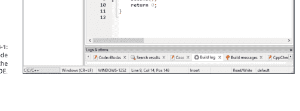

图 24-1：Code::Blocks IDE 中的两个源代码文件。

**清单 24-2：*alpha.c* 源代码文件**

```c
#include <stdio.h>

void second(void)
{
    puts("Glad to be here!");
}
```

*alpha.c* 模块包含从第一个模块调用的 `second()` 函数。由于构建程序时两个模块会被链接在一起，因此在调用该函数时能够找到它。

以下是我在计算机上看到的输出：

```
Second module, I send you greetings!
Glad to be here!
```

编译器并不会把这两个源代码文件“粘合在一起”；每个源代码文件都是单独编译的。会为每个文件创建一个单独的目标代码文件：`main.o` 和 `alpha.o`。然后，正是这两个目标代码文件被链接在一起，并与 C 标准库结合，形成最终程序。

- 多模块 C 程序的主模块传统上命名为 `main.c`。这就是 Code::Blocks 将第一个（而且通常是唯一的）项目源代码文件命名为 `main.c` 的原因。
- 只有包含在同一项目中的源代码文件——如图 24-1 所示，位于 *源文件* 分支下——才会在 Code::Blocks IDE 中一起链接。
- 要在终端窗口中编译并链接源代码文件，请使用以下命令：

    ```
    clang main.c alpha.c -o ex2401
    ```

此命令使用 *clang* 编译器将源代码文件 `main.c` 和 `alpha.c` 构建为一个项目。输出开关（`-o`）将程序文件名设置为 `ex2401`。要运行，请在命令提示符下输入 `./ex2401`。


### 在模块之间共享变量

在大型项目中，在多个函数之间共享变量的最佳方式是使该变量成为 *外部* 变量。（此操作的具体细节见第 16 章。）外部变量也称为全局变量，必须只在一个模块中声明，通常是在主模块中。该变量在任何函数之外声明，通常位于源代码文件顶部，在 `#include` 指令和函数原型之间。它的工作方式与任何变量声明一样：

```
type name;
```

其中 *类型* 是数据类型，*名称* 是指定的名称，后面可选地跟赋值或初始化。要从其他模块访问此外部变量，必须使用 `extern` 关键字。此关键字并不声明变量，而是引用该变量已在其他地方（另一个源代码模块中）声明。以下是 `extern` 关键字的格式：

```
extern type name;
```

清单 24-3 展示了如何声明外部变量的示例，清单 24-4 则说明如何让 `extern` 关键字发挥作用。

**清单 24-3：main.c 的代码和一个全局变量**

```c
#include <stdio.h>
#include <stdlib.h>

void second(void);

int count;

int main()
{
    for(count=0;count<5;count++)
        second();
    return 0;
}
```

外部变量 `count` 在第 6 行声明。它在第 10 行的 `for` 循环中使用，但也在清单 24-4 所示的 `second.c` 源代码文件中使用。

**清单 24-4：second.c 使用全局变量的代码**

```c
#include <stdio.h>

extern int count;

void second(void)
{
    printf("%d\n",count+1);
}
```

`second.c` 源代码文件声明了外部变量 `count`，该变量位于 `main.c` 文件中。为了正确访问此变量，清单 24-4 的第 3 行将其标识为外部 `int`。随后，`count` 变量在 `second()` 函数中使用——具体是在第 7 行。它的值在模块以及使用它的所有函数之间得以保留。

**练习 24-2：** 在 Code::Blocks 中创建一个新项目，其中包含清单 24-3 和 24-4 中显示的两个源代码文件。构建并运行。

要在命令提示符下构建项目：更新练习 24-1 中的两个源代码文件，并按照上一节末尾的说明进行构建。

### 创建自定义头文件

随着多模块项目变得越来越复杂，你会发现每个源代码文件的开头部分越来越长：每个模块都需要更多的原型、更多的常量，以及更多的外部变量、结构体和其他等等内容。与其让源代码文件背负重复内容，不如为项目创建一个头文件。

头文件几乎可以包含你能放入源代码文件的所有内容。具体来说，最好将那些原本每个源代码模块都需要的内容放入头文件。清单 24-5 显示了一个示例头文件。

**清单 24-5：头文件 ex2403.h**

```c
#include <stdio.h>
#include <stdlib.h>

/* structures */
struct thing {
    char name[32];
    int age;
};
typedef struct thing human;

/* prototypes */

void fillstructure(void);
void printstructure(void);

/* defined constants */

/* variables */
```

清单 24-5 中显示的头文件以一些 `#include` 指令开头，当程序中的每个模块都需要这些头文件时，这种做法很有效。

结构体 `thing` 在第 5 行定义，第 8 行指定了一个 `typedef`，以便在代码中可以使用单词 `human`（而不是 `struct thing`）。


结构体必须在使用该结构体的任何函数或原型之前声明。

接下来是第 13 行和第 14 行的两个原型。这些原型省去了为各个模块中引用的每个函数编写原型的麻烦。

清单 24-5 中的头文件缺少已定义的常量和外部变量，而这些内容可以很容易地放在那里。

头文件中其他常见的条目是宏。这些是预处理器指令，也可以帮助简化代码。你可以在我的博客中阅读相关内容：

`c-for-dummies.com/blog/?page_id=2`


传统 C 头文件中找不到的一项内容是函数。将函数放入头文件是 C++ 程序员可能会做的事情，但在 C 中并不常见。请将函数保留在源代码文件中，那里才是它们应在的位置。不要将它们放入头文件。


要使用本地头文件，需要在源代码文件开头指定 #include 预处理指令，就像使用任何其他头文件一样。最大的区别是使用双引号而不是尖括号。例如：

```
#include "ex2403.h"
```

双引号指示编译器在当前目录中查找头文件。如果文件不在该目录中，则必须指定路径名，例如

```
#include "headers/ex2403.h"
```

代码清单 24-6 使用代码清单 24-5 中的头文件。

## 代码清单 24-6：项目 ex2403 的 main.c 源代码

```
#include "ex2403.h"

human person;

int main()
{
    fillstructure();
    printstructure();
    return 0;
}

void fillstructure(void)
{
    printf("Enter your name: ");
    fgets(person.name,31,stdin);
    printf("Enter your age: ");
    scanf("%d",&person.age);
}

void printstructure(void)
{
    printf("You are %s\n",person.name);
    printf("And you are %d years old.\n",person.age);
}
```

代码清单 24-6 所示源代码的第 1 行包含了自定义头文件 ex2403.h。然后在第 3 行使用 typedef human 声明结构体变量 person。就是这样！源代码中不需要其他声明，因为自定义头文件已经处理了这些。

## 练习 24-3

在 Code::Blocks 中创建一个新项目。为该项目编写一个新的头文件 ex2403.h，使用代码清单 24-3 中的代码创建一个新文件，将其命名为 ex2403.h，并添加到当前项目中。将代码清单 24-6 中的源代码复制到 main.c 文件中。构建并运行。

在 Code::Blocks 中构建项目时，确保头文件 ex2403.h 与 main.c 文件位于同一个构建文件夹中。如果不是，编译器会抛出致命错误。

在命令行编译时，不需要指定头文件。构建练习 24-3 的命令是 clang main.c -o main，其中程序输出名为 main。编译器会按照 main.c 源代码文件中的指示，将 ex2403.h 头文件一并加入。

## 练习 24-4

将代码清单 24-6 中的 fillstructure() 和 printstructure() 函数拆分出来，使它们分别出现在各自的源代码模块中，文件名分别为 input.c 和 output.c。构建这个多模块程序。

## 关于拆分代码的思考

我按功能划分大型程序模块。例如，所有输入函数放入 input.c 模块；显示函数放入 display.c 模块。我为初始化例程创建一个 init.c 模块。除此之外，模块数量取决于程序的功能。

将相似函数放入一个模块是个好主意，不过一个模块中只有一个函数也可以。事实上，当你这样做并且该模块能正常工作时，在排查 bug 之类的问题时，你几乎可以把它放到一边。

无论项目规模如何，我都建议创建一个项目头文件。该头文件将所有函数原型、全局变量和常量集中在一处——此外，它还有助于规划整个项目。例如，你可以按模块列出函数原型，或添加注释、开发历史和其他说明。

## 其他要链接的库

在本书中，你的程序一直链接的是标准 C 库。这个过程会自动完成。对于本书中的基础控制台应用程序来说，这已经足够了。不过，当程序需要更复杂的功能时，它们可以链接其他库。

例如，如果你要编写图形化程序，可以链接图形库。或者，如果你要做花哨的控制台（文本）编程，可以链接 NCurses 库。这些库及其包含的函数会极大地增强程序的能力。

函数的文档有助于确定要使用哪些库。例如，在 Linux 中，pow() 函数的手册页开头就有这样一条说明：

```
Link with -lm.
```

这条说明告诉你，在编译器命令行中使用 -l（小写 L）开关，并紧跟 m（小写 M），表示数学库。该开关指示链接器引入数学库；否则，你会看到大量关于未知函数（如 pow()）的错误。

链接库与包含头文件不同。头文件由 #include 指令处理。它包含原型、定义和其他有用信息。但真正包含使函数运转起来的“齿轮”的是库。

所有 C 编译器都会链接名为 c 的标准 C 库。如果需要链接另一个库，则要直接指定它。该库必须可用（位于本地存储系统中），并且在使用 IDE 时你必须知道它的位置。

例如，在 Code::Blocks 中，通过选择 Project-> Build Options 并在 Linker Settings 选项卡中添加库来添加库。要完成此任务，你必须知道库的文件夹和名称。

在命令提示符下，-l（小写 L）开关后面紧跟库名。对于某些编译器，可能需要将该开关指定为最后一个参数。

C 编译器可用的各种库的种类和用途取决于你计划做什么。C 语言库包可以免费找到并从互联网下载。例如，硬件制造商可能会提供一个库，你可以用它为其特定设备编程。


- 只有在创建 Code::Blocks 项目时才会链接库。不能为单个源代码文件链接库。
- 传统上，C 库存储在 /usr/lib 文件夹中，不过下载的库可能会在 /usr/local/lib 或其他位置找到。命令行编译器会自动查找这些位置。
- 可以为命令行编译器指定 -L 开关，指示编译器在特定文件夹中查找库。例如：

```
clang -L/usr/local/share/lib -lcompress main.c
```

上述命令指示 clang 编译器在 /usr/local/share/lib 文件夹中查找 compress 库。

- 插入代码以帮助调试
- 配置项目以进行调试
- 使用 Code::Blocks 的 GNU 调试器
- 单步执行程序
- 检查变量的值
- 编写更好的错误消息

### 第 25 章：滚开，Bug！

## 滚开，Bug！

每个人都会写出有 bug 的代码。当然，不是故意的。即使是最好的程序员也会变得懒惰或马虎，做出愚蠢的事情。多余的分号、放错位置的逗号和缺失的花括号会发生在所有程序员身上。幸运的是，编译器能捕获许多这种糟糕的代码。修复源代码并重新编译，以处理那些烦人的典型 bug。

对于更深层的问题、逻辑缺陷，或者可能不容易发现的代码错误，有一点帮助会很有用。这种帮助来自调试代码，你可以手动进行，也可以借助调试器。目标是查明出了什么问题。

## 解决问题的简单技巧

当我弄不清程序出了什么问题，又懒得用调试器运行它时，我会把 printf() 和 puts() 函数当作我的调试帮手。这些工具可以输出有用的消息和值，帮助我确定代码哪里有问题。

## 记录流程

假设一个函数接收了变量 x，但不知怎么的，变量 x 始终没有出现。它去哪儿了？为了查明原因，我会将以下语句插入代码中：

```
printf("value of 'x' at Line 125: %d\n",x);
```

这条语句可能会出现在多个地方，用于跟踪变量 x 在代码中传递时的值。输出会提示我变量 x 在哪里跑偏了。此外，你可以使用 __LINE__ 宏，而不是硬编码行号：

```
printf("value of 'x' at Line %d: %d\n",__LINE__,x);
```

预处理器会把 __LINE__ 宏（是的，它的前后各有两个下划线）展开为当前源代码行号。通过使用这个技巧，你可以设置一条输出消息，并继续编辑代码，而无需手动更新行号。

当我不跟踪变量，只想知道为什么某段代码没有执行时，我会插入一条 puts() 语句，像这样：

```
puts("You got to here");
```

当我在输出中看到上述文本时，我知道代码正在被执行到附近，但仍然可能没有执行。此时，我会检查附近的代码，寻找常见的 C 语言错误，其中许多错误记录在第 26 章中。

## 把你的代码讲出来

发现程序流程缺陷的一个极好方法，是把你的代码讲出来。需要注意的是，你必须大声讲出来。是的，这个技巧可能会让人尴尬，但它非常有效。

例如，某段代码不工作，而你毫无头绪。假装你正在和一位程序员同行说话。向这个虚构的人解释你的代码在做什么以及如何工作。当你把代码讲出来时，问题可能会突然出现。信不信由你，这个技巧已经在我身上奏效过几十次了。

## 为未来的自己写注释

另一件可以帮助解决不必要烦恼的事情，是使用注释来描述代码中的问题。这种方法现在可能无法解决问题，但对于

未来的你以后再看这段代码时，这会很有帮助；这比重新去发现那个小错误要好得多。

例如：

```
for(y=x+a;y<c;y++)    /* this doesn’t seem to work */
    manipulate(y);    /* Confirm that 'a' is changing */
```

在这个示例中，这条注释提醒未来的我：这些语句并没有按预期发挥作用；此外，它还向未来的我建议在寻找解决方案时应该注意什么。


你也可以用注释向未来的你提出建议：如何改进代码、哪些地方需要收紧，或者你目前没时间添加的新功能。

## 调试器

有许多流行的调试器，这些工具让你在代码运行时逐行检查代码、查看内存，并观察变量如何变化。流行的 GNU 调试器可在命令提示符中使用——前提是你有胆量用它。对于普通人来说，可以考虑使用 Code::Blocks 调试器。

## 调试设置

要调试一个项目，你需要将其目标——即程序——设置为包含调试信息。调试器使用这些信息来帮助处理你的代码，并查看程序如何运行——或者为何不运行。此过程仅适用于 Code::Blocks 项目，并且仅当你为代码创建调试目标构建时才有效。请按以下步骤操作：

- 1. 在 Code::Blocks 中新建一个项目。
  选择“文件”→“新建项目”。
- 2. 选择“控制台应用程序”，然后单击“Go”。
- 3. 选择 C，然后单击“下一步”。
- 4. 输入项目标题，例如为练习 25-1 输入 ex2501。
- 5. 单击“下一步”按钮。

到目前为止，前几步与在 Code::Blocks 中创建任何 C 语言控制台程序相同。

- 6. 勾选“创建‘Debug’配置”选项。

此设置指示 Code::Blocks 在构建程序时包含调试信息。

- 7. 确保也选中“创建‘Release’配置”项。

- 8. 单击“完成”按钮。

新项目会出现在 Code::Blocks 中。

当你为项目启用调试时，除了保留发布配置（参见第 7 步）外，还可以使用编译器工具栏选择要创建哪个版本的代码，如图 25-1 所示。使用“视图→工具栏→编译器”命令来显示或隐藏该工具栏。

调试工具栏
编译器工具栏
选择构建目标

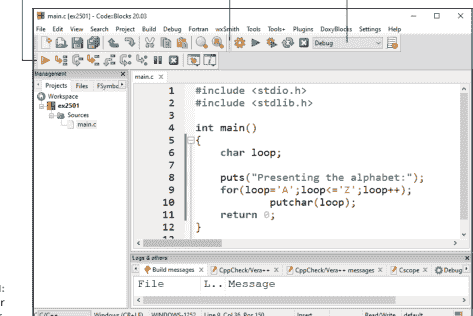

图 25-1：
编译器工具栏。

调试时，请确保选择 Debug 命令作为构建目标。除非最终程序中包含调试信息，否则无法调试代码。


记住

调试完成后要创建最终程序，请从“构建目标”菜单中选择 Release 命令。尽管你也可以发布程序的调试版本，但这些信息会使最终程序更大。

## 使用调试器

调试器通过在代码运行时检查代码来工作，向你展示程序内部发生的情况以及输出。如果你已经创建了一个包含调试信息的新 Code::Blocks 程序（参见上一节），并且有代码需要调试，那么就可以开始了。

我承认，清单 25-1 中展示的代码是故意布满 bug 的。

### 清单 25-1：调试我！

```c
#include <stdio.h>
#include <stdlib.h>

int main()
{
    char loop;

    puts("Presenting the alphabet:");
    for(loop='A';loop<='Z';loop++);
        putchar(loop);
    return 0;
}
```

**练习 25-1：** 在 Code::Blocks 中新建一个项目，并为其创建 Debug 目标构建。将清单 25-1 中的源代码复制到 main.c 文件中。确保完全按原样复制文本，包括你可能会在第 9 行末尾看到的错误。构建并运行。

由于 Code::Blocks 编辑器很智能，其他编程编辑器也是如此，你可能会因为下一行没有自动缩进而发现第 9 行末尾错误的分号。编译器也可能发现这个错误。这些都是重要线索，但也可能是你不会注意到的地方，尤其是当你要查看 200 行代码时。无论如何，程序的输出会告诉你有些不对劲。以下是我看到的内容：

```
Presenting the alphabet:
[
```

当然，字母表没有显示出来。不仅如此，那个 | 字符是干什么用的？该调试了！

使用 Code::Blocks 中的调试器工具栏，帮助你深入代码，看看哪里出了问题。（参见图 25-1。）要显示或隐藏该工具栏，请选择“视图→工具栏→调试器”。

请按以下步骤逐步检查代码，找出问题所在：

- **1. 在代码中，将光标放在 puts() 语句正前方。**
  此位置在第 8 行。
- **2. 单击调试工具栏上的“运行到光标处”按钮。**
  “运行到光标处”按钮如页边所示。
  程序会运行，但只运行到光标所在位置。输出窗口会出现，调试信息会显示在 Code::Blocks 窗口底部的“调试”选项卡上。
- **3. 单击“下一行”按钮。**
  puts() 语句执行，其输出出现在输出窗口中。
- **4. 再次单击“下一行”按钮。**
  for 循环执行它该做的事；没有输出。
- **5. 再次单击“下一行”按钮。**
  putchar() 函数输出循环变量中隐藏的字符。
  由于循环已经遍历了 ASCII 的 A 到 Z，下一个字符是 [。
  这就是输出的字符。
  希望此时你能更仔细地查看代码，并发现第 9 行末尾多余的分号。
- **6. 单击“停止”按钮以停止调试器。**
- **7. 删除第 9 行末尾的分号。**
- **8. 保存并重新构建代码。**
  要确定问题是否已修复，请再次单步执行代码：
- **9. 单击鼠标指针，将光标放在第 9 行 for 语句的正前方。**
- **10. 单击“运行到光标处”按钮。**
- **11. 单击“下一行”按钮两次。**
  输出中出现一个 A。很好。


- 12. 继续单击“下一行”按钮，逐步执行 for 循环。

当你确信代码已经调试完成后：

- 13. 单击“停止”按钮。

修复多余的分号后，程序运行正常。有关调试器如何检查变量值的更多信息，请参阅后面的“监视变量”一节。

## 设置断点

没有人愿意为了找 bug 而单步执行 200 行源代码。很可能你已经很清楚 bug 在哪里：要么是根据程序输出，要么是因为它五分钟前还能运行，而就在那之后你编辑了某个特定部分。如果是这样，你就知道想在哪里窥探运行情况。你就在代码中的那个位置设置调试断点。

断点就像文本中的停止标志。事实上，这正是 Code::Blocks 使用的图标，如图 25-2 所示。要设置断点，请用鼠标单击行号与绿色线之间的位置（如果尚未保存，则为黄色线）。断点图标就会出现。

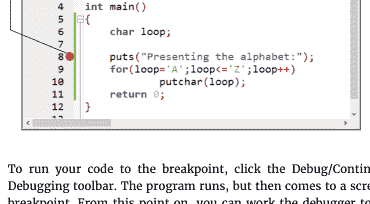

图 25-2：
代码中的一个断点。


要让代码运行到断点，请单击调试工具栏上的“调试/继续”按钮。程序会运行，但随后在断点处戛然而止。从这里开始，你就可以使用调试器查看哪里出了问题。

## 监视变量

有时，你必须深入内存底层，在代码运行时查看某个变量的值。Code::Blocks 调试器允许你监视程序中的任何变量，并在程序运行时显示该变量的内容。清单 25-2 有助于说明这一过程：

### 清单 25-2：变量藏身之处

```c
#include <stdio.h>
#include <stdlib.h>

int main()
{
    int x;
    int *px;

    px=&x;
    for(x=0;x<10;x++)
        printf("%d\n",*px);
    return 0;
}
```

**练习 25-2：** 创建一个启用了调试的 Code::Blocks 新项目 ex25-2。将清单 25-2 中的源代码复制到 main.c 文件中。构建并运行。

代码运行正常，但调试器可以帮助你了解它如何工作。此外，你还可以观察指针在内存中如何工作，这可能有助于你理解指针这一整套概念。无论如何，该调试了！请按以下步骤操作：

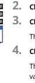

- **1. 单击鼠标，将其放在第 6 行开头，即声明整型变量 x 的位置。**
- **2. 单击调试工具栏上的“运行到光标处”按钮。**
- **3. 单击“调试窗口”按钮。**
  该按钮如页边所示。它实际上是一个菜单，列出了有用的项目。
- **4. 选择“监视”命令。**
  “监视”窗口会出现，类似于图 25-3 所示的窗口。你会看到变量 x 和 px 列在“局部变量”标题下。你可以通过输入变量名来添加更多要监视的变量。


代码中的变量

变量值

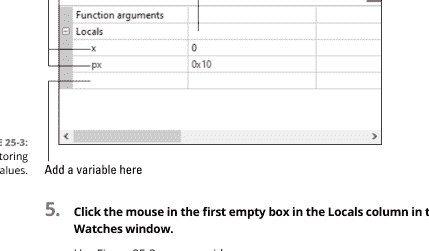

图 25-3

监视变量值。

在此处添加变量

- 5. 在监视窗口的局部变量列的第一个空框中单击鼠标。以图 25-3 为指南。
- 6. 输入 `*px` 以检查指针 px 中存储的内存位置的内容。按回车键。由于指针 px 未赋值，内容列中会出现错误消息。在变量初始化之前，其内容是垃圾数据。
- 7. 单击调试工具栏上的“下一行”按钮，直到光标位于第 10 行，即 for 循环的开始处。由于指针 px 的值被赋给变量 x 的内存位置，请注意监视窗口。立刻，你会看到变量 px 旁边出现一个内存地址，并且看到 `*px` 变量被设置为赋给变量 x 的任何值。指针已经初始化了！
- 8. 反复单击“下一行”按钮，并观察监视窗口中的值。当 for 循环开始时，它会初始化变量 x 的值。你会看到该值在监视窗口中发生变化，`*px` 的值也随之变化。px 的值（变量 x 的地址）不会改变。
- 9. 完成后单击“停止”按钮。

我发现，检查内存中的变量是了解代码运行情况的最佳方式。如果变量的变化不符合预期，你需要检查操作这些变量的语句。

### 改进错误消息

更好地向用户传达程序失误的一种方法是提供更好、更具描述性的错误消息。虽然过多细节会让用户困惑，但错误消息过于简略也会让用户沮丧。例如：

```
Unable to allocate 128K char buffer 'input' at location 0xFE3958
```

在调试代码时，这条错误消息可能很理想，但用户要么忽略它，要么“用谷歌搜索它”来了解如何解决问题。

相反类型的错误消息同样令人沮丧：

```
Error 1202
```

看在老天的份上，不要用数字作为错误消息！即使你提供了文档，也没有用户会喜欢它，尤其是当你完全可以轻松地写成

```
Not enough memory available
```

为了帮助你编写更好的错误消息，许多 C 语言函数——特别是文件访问函数——会在函数失败时提供一组一致的错误值。错误值存储在全局变量 errno 中，你的程序可以检查它。代码清单 25-3 提供了示例源代码。

代码清单 25-3：检查 errno 值

```
#include <stdio.h>
#include <stdlib.h>
#include <errno.h>

int main()
{
    int e;

    e = rename("blorfus", "fragus");
    if (e != 0)
    {
        printf("Error! ");
        switch(errno)
        {
            case EPERM:
                puts("Operation not permitted");
                break;
            case ENOENT:
                puts("File not found");
                break;
            case EACCES:
                puts("Permission denied");
                break;
            case EROFS:
                puts("Read only file");
                break;
            case ENAMETOOLONG:
                puts("Filename is too long");
                break;
            default:
                puts("Too ugly to describe");
        }
        exit(1);
    }
    puts("File renamed");
    return 0;
}
```

要使用 errno 变量，你的代码必须包含 errno.h 头文件，如代码清单 25-3 的第 3 行所示。该头文件将 errno 声明为外部变量。它还包含许多 C 库函数已知的、作为已定义常量的常见错误条件。

第 9 行的 rename() 函数尝试重命名一个文件。我假设文件 blorfus 不可用，因此该函数被设计为生成错误。如果是这样，它会返回 -1，并设置全局变量 errno 来表示遇到的错误条件。

第 13 行的 switch 结构逐一处理重命名文件时可能出现的一些错误。这些已定义常量表示这些错误码，它们在 errno.h 头文件中定义。

练习 25-3：将代码清单 25-3 中的源代码输入到一个新项目中。构建并运行，以查看准确的错误消息。

如果你愿意，可以进一步细化错误消息。我在代码清单 25-3 中保持消息简短，以便文本在本书中不会换行。例如，比“权限被拒绝”更好的消息是“‘blorfus’的权限设置不允许重命名。请考虑重置文件权限并重试。”这条消息具有描述性和信息性，这正是用户所欣赏的：它解释了问题，也提供了解决方案。


- >> 有关 rename() 函数的更多信息，请参阅第 23 章。
- >> 你可以在函数的 man 手册页中找到相关的 errno 已定义常量。在那里查看应检查哪些已定义常量以及它们代表什么。


## 十的篇章

### 本部分内容 . . .

- 了解如何避免十种常见错误和编码错误
- 回顾十条有用的建议、提醒和忠告

### 本章内容

- 条件语句的失误
- == 与 =
- 危险的循环分号
- for 循环中的逗号
- switch 结构中缺少 break
- 缺少圆括号和花括号
- 注意那个警告
- 无限循环
- scanf() 的失误
- 流式输入限制

### 第26章：十种常见错误

## 十种常见错误

编程冒险有其陷阱。其中许多很常见；同样的错误，一次又一次。即使经过数十年的编码，我仍然发现自己会做愚蠢、可笑的事情。大多数情况下，它们是在匆忙中做出的——通常是我没有注意到的简单事情。但万事不都是这样吗？

### 条件语句的失误

当你使用 if 语句或启动 while 或 for 循环时，代码会进行比较。正确表达这种比较是一种艺术，尤其是当你试图同时做多件事时。

我的建议是，在把所有内容加载到括号之前，先拆分代码。例如：

```
while((c=fgetc(dumpme)) != EOF)
```

上一行的代码可以工作，但在达到那一步之前，试试这个：

```
c = 1;          /* initialize c */
while(c != EOF)
    c=fgetc(dumpme);
```

这种改进更具可读性，也更不容易出错。

当你使用逻辑运算符组合条件时，情况会变得更棘手。我强烈建议将表达式限制为仅两个选择：

```
if( a==b || a==c)
```

当变量 a 的值等于变量 b 的值或变量 c 的值时，属于 if 的语句就会执行。很简单。但下面这个呢：

```
if( a==b || a==c && a==d)
```

哎呀。现在优先级顺序起作用了，要使 if 语句为真，a 必须等于 b，或者 a 必须同时等于 c 和 d。这种情况也可以通过使用括号来改进：

```
if( a==b || (a==c && a==d))
```

当你不确定优先级顺序时，请使用括号。

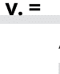

### == 与 =

单个等号是赋值运算符：

```
a=65;
```

双等号用于比较：

```
a==65
```

为了让我的大脑领会这种区别，当我输入两个等号时，我会在脑子里说“等于”。尽管有这个提醒，我仍然会犯错，尤其是在条件语句中。


当你在条件语句中赋值时，通常会创建一个 TRUE 条件，除非赋值结果为零：

```
if(here=there)
```

这个 if 语句会求值为变量 there 的值。如果它为 0，则 if 条件求值为 FALSE；否则为真。无论如何，这很可能不是你想要的结果。大多数编译器（如 clang）会捕获这个错误。

### 危险的循环分号

在输入代码时，你可能会陷入一种习惯：在按回车键结束一行之前，把分号当作前缀。这种做法会产生意想不到的后果！在编写循环时尤其有害：

```
for(x=0;x<10;x++);
```

这个循环可以工作，但它的语句不会重复执行。循环结束后，变量 x 的值为 10。就是这样。

while 循环也存在同样的问题：

```
while(c<255);
```

这个循环可能会无限循环，具体取决于变量 c 的值。如果该值大于或等于 255，则循环不会执行。否则，它会永远执行下去。

这些分号是无意且不需要的。它们也完全合法；编译器不会将它们标记为错误，不过你可能会看到警告——这很有帮助：例如，建议的解决方法是把分号放在下一行：

```
while(putchar(*(ps++)))
;
```

这个单独成行的分号向编译器以及任何阅读代码的程序员大声宣告：这个 while 循环是有意留空的。


## for 循环中的逗号

for 循环圆括号中的三项由分号分隔。这两个分号都是必需的，它们不是逗号。编译器不喜欢下面这条语句：

```c
for(a=0, a<10, a++)
```

因为 for 语句中允许使用逗号，所以编译器只是认为你省略了最后两个必需项。事实上，下面是一个合法的 for 语句：

```c
for(a=0, a<10, a++;)
```

前面的语句将值 0 赋给变量 a，生成一个 TRUE 比较（该比较被忽略），并将 a 的值递增到 1。然后，因为第二项和第三项为空，循环会无休止地重复。（好吧，除非循环中有 break 语句。）

## switch 结构中缺少 break

编写一个 switch 结构，让执行从一个 case 语句贯穿到另一个 case 语句，是完全合法的：

```c
switch(letter)
{
  case 'A':
  case 'E':
  case 'I':
  case 'O':
  case 'U':
    printf("Vowel");
    break;
  default:
    printf("Not a vowel");
}
```

在此示例中，前五个 case 条件捕获同一组语句。然而，当你忘记 break 时，执行会贯穿并进行更多测试，最终到达 default。除非这种控制流正是你想要的，否则记得按需添加 break 语句。

假设你有一个几十行高的 switch 结构。一个 case 条件有多行语句，多到向上滚动并移出屏幕。在这种设置下，当你专注于编写正确的语句时，很容易忘记 break。我知道——我干过。

另一种情况发生在你在 switch 结构内编写循环，并使用 break 跳出该循环时。这个内层 break 只跳出 for 循环：要跳出 switch 结构还需要第二个 break。


许多编辑器，例如 Code::Blocks 中使用的编辑器，允许你折叠和展开代码的某些部分。要让此功能在 switch 结构中生效，必须用花括号将 case 语句括起来。

## 缺少圆括号和花括号

忘记一两个圆括号是最常见的 C 编码错误之一。编译器会捕获它，但通常直到函数末尾才标记该错误。

例如，main() 函数中缺少圆括号会导致错误在函数最后一行被标记。这个警告是缺少圆括号或花括号的良好线索，但它无助于定位。

如今的编辑器擅长匹配圆括号和方括号。例如，Code::Blocks 编辑器在你输入第一个字符时会插入两个字符。此功能有助于保持条理。其他编辑器，如 VIM，在光标悬停于其中一个括号时高亮显示两组括号。输入时利用这些提示确保它们匹配。

另一个编辑器线索是，当你忘记圆括号或方括号时，格式、文本着色和缩进会变得混乱。识别这个提醒的问题在于，人脑会自动假定是编辑器搞砸了。因此，你需要训练自己将编辑器的不正确缩进识别为缺少圆括号或花括号的迹象。

## 不要忽略警告

当编译器生成警告时，程序（或目标代码）仍会被创建。这种情况可能很危险，尤其是在处理指针错误时。问题在于警告可能被忽略；代码无论如何都会编译。

例如，你可能使用 printf() 显示一个你知道是 int 的值，但编译器却坚持认为它是其他值。如果是这样，你可以将变量强制类型转换为 int。例如：

```c
printf("%-14s %5ld %s",
    file->d_name,
    (long)filestat.st_size,
    ctime(&filestat.st_mtime));
```

在此示例中，filestat.st_size 变量是 off_t 数据类型。printf() 函数缺少针对 off_t 的转换字符，因此它已被强制转换为 long int。对于 printf() 缺少转换字符的其他变量类型，也可以进行类似的强制类型转换。但在你滥用这个技巧之前，请检查 printf() 的手册页，以确保该特定数据类型确实缺少转换字符。


- 一个常见警告发生在你尝试使用 %d 占位符显示 long int 值时。发生这种情况时，只需将 %d 编辑为 %ld。
- “value required”警告表示你写了格式错误的方程。该值是左值，即方程左侧的项。它必须存在并且类型正确，以便方程得到正确处理。
- 编译器用警告标记代码的程度可以调整。各种标志用于调整编译器的警告级别。在 Code::Blocks IDE 中，通过选择 Project-> Build Options 命令设置这些标志。Project Build Options 对话框中的 Compiler Flags 选项卡可让你设置和重置各种警告。
- 命令行 C 编译器的“打开所有警告”选项是 -Wall 开关。它看起来像这样：

```bash
clang -Wall source.c
```

- -Wall 代表“warnings, all”（所有警告）。

## 无限循环

总得有办法离开这里，几乎每个循环都是如此。退出条件必须存在。事实上，我强烈建议，当你开始编写循环时，第一件要编写的就是退出条件。只要它有效，你就可以继续编写循环所做其余令人愉快的事情。

意外的无限循环确实会发生。我多次运行代码，结果只盯着空白屏幕看了一会儿。哎呀。


控制台应用程序（如本书中创建的这类程序）可通过在终端窗口中按 Ctrl+C 组合键来停止。此技巧可能并不总是有效，因此你可以尝试关闭窗口。你也可以终止任务，这是一个由每种操作系统以不同方式处理的进程。例如，在 Unix 操作系统中，你可以打开另一个终端窗口，并使用 kill 命令清除在第一个终端窗口中失控运行的程序。

### scanf() 错误

`scanf()` 函数是从标准输入读取特定信息的便捷方式。然而，它并不适合所有形式的输入。

例如，当用户输入的不是所请求的格式时，`scanf()` 无法理解。具体来说，你无法读入完整的文本字符串。这个问题是因为 `scanf()` 会丢弃第一个空白字符之后的字符串任何部分。


尽管 `fgets()` 函数是捕获文本的绝佳替代方案，但请记住，它可能会捕获结束一行文本的换行符。这个字符 `\n` 会成为输入字符串的一部分。

使用 `scanf()` 时要记住的另一件事是，它的第二个参数是地址，即指针。对于标准变量类型——例如 `int`、`float` 和 `double`——必须在变量名前加上 &，即地址运算符：

```c
scanf("%d",&some_int);
```

读取数组时不需要 & 前缀：

```c
scanf("%s", first_name);
```

然而，单个数组元素是内存位置，它们仍然需要 & 前缀：

```c
scanf("%c",&first_name[0]);
```

指针变量不需要 & 前缀，这可能导致意外后果。

## 流式输入限制

C 语言中的基本输入和输出函数不是交互式的。它们作用于流，流是输入或输出的连续流动，仅由文件结束标记或偶尔的换行字符中断。

当你计划从输入中只读取一个字符时，请注意，为处理输入而按下的 Enter 键仍在流中等待被读取。第二个输入函数（例如另一个 getchar()）会立即获取 Enter 键按下（\n 字符）。它不会像交互式输入函数那样等待。


- 如果你想要交互式程序，请获取带有交互式函数的库，例如 NCurses 库。你可以查看我关于 Ncurses 的书，Amazon.com 上有 Kindle 电子书和印刷版。
- 文件结束标记由 EOF 常量表示，该常量定义在 stdio.h 头文件中。
- 换行字符由 \n 转义序列表示。
- 换行字符的 ASCII 值可能因机器而异，因此始终用转义序列 \n 表示换行。


## 本章内容
- 保持良好姿势
- 使用有创意的名称
- 在需要时编写函数
- 一次只做一点代码工作
- 将大型项目拆分为多个模块
- 了解什么是指针
- 在压缩代码前先添加空白
- 知道何时将 if-else 变为 switch-case
- 记住使用赋值运算符
- 卡住时，大声朗读你的代码

### 第 27 章：十条提醒与建议
### 十条提醒与建议

要把提醒和建议的清单浓缩下来并不容易，尤其是对于像编程这样丰富多样的主题。例如，我可以建议如何与其他程序员相处、引用哪些电影台词、玩哪些游戏，甚至吃哪些食物。编程亚文化确实存在——即便在今天也是如此，不过庆幸的是，对职场正装的强调已经减弱了。

除了社交方面的建议外，我确实还有一些事情要提醒你——此外，还有一些通用的 C 语言建议。信不信由你，每个程序员都经历过你所经历过的事情。听听一位久经沙场的编程老兵的建议是件好事。

### 保持良好姿势

我敢肯定，在你生命早期的某个权威人物曾反复强调正确姿势的重要性。忽视他们，后果自负，尤其是当你还年轻，还没到起床就喊“哎哟”的时候。

对许多程序员来说，编码会变成一种痴迷。举个例子，我非常容易连续坐几个小时写代码。这种静止的姿势对身体很不好。所以，每隔几分钟就休息一下。如果做不到，那就安排休息。说真的：下次编译的时候，站起来！看看窗外！走动一下！

工作时，尽量让肩膀后收，手腕抬高。看显示器时不要歪脖子。不要弓着背趴在键盘上。看看窗外，改变一下视线焦点。


我还想补充一点，向他人致意是件令人愉快的事。确实，当你在项目进行中时，很容易对别人哼一声或咆哮一声。请记住，其他人可能无法体会你编码时那种思绪的深度和兴奋感。如果你现在没法做到友善，那就以后道歉吧。

### 使用有创意的名称

我见过的最好的代码读起来像人类语言。要让整个源代码都这样读起来很困难，但对于小片段来说，使用合适的变量名和函数名对写出清晰代码大有裨益。

例如，下面这个表达式是我最喜欢的之一：

```
while(!done)
```

我将这条语句读作“当未完成时”。这很有意义。只要 done 变量的值不是 TRUE，循环就会继续。但在循环内部的某处，当退出条件满足时，done 的值被设置为 TRUE，循环停止。非常清晰。

为函数提供描述性名称也很有帮助。像 `setringervolume()` 这样的名称不错，但 `set_ringer_volume()` 更好。同时，结合上下文来考虑函数也很有帮助。例如：

```
ch=read_next_character();
```

在前一行中，函数 `read_next_character()` 不需要解释——除非它实际上并没有返回下一个字符。

### 编写函数

只要你使用某段代码不止一次，就考虑把它放进一个函数中，即使代码只有一行，或者出现在多个地方，看起来似乎不值得做成函数。

假设你用 `fgets()` 函数读取一个字符串，但随后你又用另一个函数去掉输入缓冲区末尾的换行符。为什么不把这两件事合并成一个自己的函数，比如 `get_input()` 呢？

### 一次只做一点代码工作

你花在编码上的大部分时间是用来修复问题、纠正逻辑缺陷或微调。在进行此类调整时，避免一次做三四项改动的诱惑。一次只处理一个问题。

我这样告诫的原因是，人们很容易在代码中跳来跳去，同时处理多件事情。例如：你需要在 `printf()` 语句的输出中调整间距、调整一个循环，并设置一个新的最大值。一次只做一件事！

当你试图同时做几件事时，你可能会搞砸。但到底是你搞砸了哪件事呢？你必须回去检查所有内容，包括相关的语句和函数，以确保它们能正常工作。在这种情况下，你会认真希望有一台时光机。相反，还是请一次只做一点代码工作吧。

### 将大型项目拆分为多个模块

没有人喜欢滚动浏览 500 行代码。除非你完全沉浸在自己的项目中，能把所有内容都记在脑子里，否则就把函数拆分为模块。

我倾向于把相关的函数分组到相似的文件中。我通常有一个输出文件、一个输入文件、一个初始化文件，等等。每个文件（或模块）被单独编译和链接，以组成代码。好处是文件更小，而且如果它们能编译并运行，你就不再需要去处理它们了。

### 了解什么是指针

指针是一个存储内存地址的变量。它不是魔法，只要你在脑海中牢记这句基本口诀，它就不应该让人困惑：

指针是一个存储内存地址的变量。

指针中存储的内存地址引用另一个变量或缓冲区（如数组）。因此，指针在使用前必须初始化：

指针在使用前必须初始化。

当指针变量带有 *（星号）运算符前缀时，它引用该内存地址处变量的内容。这种双重性当然有些奇怪，但它非常有用，正如第 18 章和第 19 章所展示的那样。

- 使用 * 前缀声明指针变量。
- 使用 & 运算符获取 C 语言中任何变量的地址。
- 数组会自动通过其内存地址被引用，因此你可以直接使用数组名（不带 & 前缀）来获取其地址。
- “地址”和“内存位置”是同一回事。
- 探索指针的一个好方法是使用 Code::Blocks 调试器；特别是“监视”窗口。参见第 25 章。


### 在压缩代码前先添加空白

C 语言程序员喜欢把语句堆在一起，尽可能多地把它们挤进一行。我自己也难免享受这种乐趣，正如本书中的一些例子所示，比如

```c
while(putchar(*(sample++)))
```

承认吧：这样的写法看起来很酷。它让人觉得你真的很懂 C 语言编程。但它也可能成为痛苦的来源。

我的建议：在压缩代码之前，先把代码拆分开。大量使用空白，尤其是在你最初写代码的时候。例如，这行

```c
if( c != '\0' )
```

比这行更容易阅读：

```c
if(c!='\0')
```

当你用空白写完代码——或者用几个语句表达某个东西——之后，你可以压缩、去掉空格，或者做任何你喜欢的事。

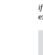

在 C 语言源代码中，空白是为了人眼阅读的便利。我很欣赏那些宁愿使用空白也不把代码挤在一行的程序员，尽管后者看起来很有趣。

### 知道何时将 if-else 变为 switch-case

我是 if-else 决策树的忠实粉丝，但我通常避免堆叠多个 if 语句。对我来说，这通常意味着我的编程逻辑有缺陷。例如：

```c
if(something)
;
else if(something_else)
;
else(finally)
;
```

这种结构没问题，而且处理三部分决策时往往是必要的。但下面的结构——我见过许多初学 C 语言的程序员这样写——可能不是编写决策树的最佳方式：

```c
if(something)
;
else if(something_else_1)
;
else if(something_else_2)
;
else if(something_else_3)
;
else if(something_else_4)
;
else if(finally)
;
```

一般来说，只要你有这么多 else-if 语句，你可能就应该改用 switch-case 结构。事实上，我猜这个例子很可能就是最初启发 switch-case 结构的原因。

更多关于 switch-case 的信息，请参见第 8 章。

### 记住赋值运算符

虽然写出可读的代码很好，但 C 语言中一个方便的工具是赋值运算符。即使你不用它，你也需要能够识别它。

下面的等式在编程中非常常见：

```c
a = a + n;
```

在 C 语言中，你可以使用赋值运算符来缩写这条语句：

```c
a += n;
```


运算符放在等号前面。如果放在后面，它可能会变成一个一元运算符，看起来很奇怪：

```c
a =+ n;
```


所以，变量 a 的值等于正数 n？编译器可能会接受这个说法，但这并非你的本意。

另外，别忘了递增和递减运算符 ++ 和 --，它们在循环中非常常用。

## 遇到困难时，大声读出你的代码

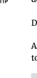

为了帮助你追踪那个 bug，开始大声朗读你的代码。假装一位程序员朋友正坐在你旁边。解释你的代码在做什么以及它是如何工作的。当你一边口述代码时，你会发现问题的所在。如果没有发现，就让你的想象中的朋友在你解释时提问。

别担心会发疯。你是个程序员。你早就疯了。

额外的好处是，口述代码还能帮助你识别哪些部分需要注释，以及注释应该写什么。例如：

```
a++;    /* increment a */
```

在上面这一行，你看到了一个糟糕的注释示例。废话。a 当然是被递增了。下面是这个注释更好的版本：

```
a++;    /* skip the next item to align output */
```

不要仅仅注释代码在做什么——要注释为什么这样做。同样，假想你正在向另一位程序员——或未来的你——解释你的代码。未来的你会感谢现在你所付出的努力。

## 7 附录

## 本部分内容 . . .

- 代码和关键字
- 运算符和数据类型
- 转义序列和转换字符
- 优先级顺序

| 十进制 | 十六进制 | 字符 | 注释 |
|---|---|---|---|
| 22 | 0x16 | ^V |  |
| 23 | 0x17 | ^W |  |
| 24 | 0x18 | ^X |  |
| 25 | 0x19 | ^Y |  |
| 26 | 0x1A | ^Z |  |
| 27 | 0x1B | ^[ | 转义 |
| 28 | 0x1C | ^\ |  |
| 29 | 0x1D | ^] |  |
| 30 | 0x1E | ^^ |  |
| 31 | 0x1F | ^_ |  |
| 32 | 0x20 |  | 空格，可见字符的开始 |
| 33 | 0x21 | ! | 感叹号 |
| 34 | 0x22 | " | 双引号 |
| 35 | 0x23 | # | 井号 |
| 36 | 0x24 | $ | 美元符号 |
| 37 | 0x25 | % | 百分号 |
| 38 | 0x26 | & | 和号 |
| 39 | 0x27 | ' | 撇号 |
| 40 | 0x28 | ( | 左括号 |
| 41 | 0x29 | ) | 右括号 |
| 42 | 0x2A | * | 星号 |
| 43 | 0x2B | + | 加号 |
| 44 | 0x2C | , | 逗号 |
| 45 | 0x2D | - | 连字符，减号 |
| 46 | 0x2E | . | 句点 |
| 47 | 0x2F | / | 斜杠 |
| 48 | 0x30 | 0 | 数字 |
| 49 | 0x31 | 1 |  |
| 50 | 0x32 | 2 |  |
| 51 | 0x33 | 3 |  |
| 52 | 0x34 | 4 |  |
| 53 | 0x35 | 5 |  |
| 54 | 0x36 | 6 |  |
| 55 | 0x37 | 7 |  |
| 56 | 0x38 | 8 |  |
| 57 | 0x39 | 9 |  |
| 58 | 0x3A | : | 冒号 |
| 59 | 0x3B | ; | 分号 |
| 60 | 0x3C | < | 小于号，左尖括号 |
| 61 | 0x3D | = | 等号 |
| 62 | 0x3E | > | 大于号，右尖括号 |
| 63 | 0x3F | ? | 问号 |
| 64 | 0x40 | @ | @符号 |
| 65 | 0x41 | A | 大写字母 |
| 66 | 0x42 | B |  |
| 67 | 0x43 | C |  |
| 68 | 0x44 | D |  |
| 69 | 0x45 | E |  |
| 70 | 0x46 | F |  |
| 71 | 0x47 | G |  |
| 72 | 0x48 | H |  |
| 73 | 0x49 | I |  |
| 74 | 0x4A | J |  |
| 75 | 0x4B | K |  |
| 76 | 0x4C | L |  |
| 77 | 0x4D | M |  |
| 78 | 0x4E | N |  |
| 79 | 0x4F | O |  |
| 80 | 0x50 | P |  |
| 81 | 0x51 | Q |  |
| 82 | 0x52 | R |  |
| 83 | 0x53 | S |  |
| 84 | 0x54 | T |  |
| 85 | 0x55 | U |  |
| 86 | 0x56 | V |  |
| 87 | 0x57 | W |  |
| 88 | 0x58 | X |  |
| 89 | 0x59 | Y |  |
| 90 | 0x5A | Z |  |
| 91 | 0x5B | [ | 左方括号 |
| 92 | 0x5C | \ | 反斜杠 |
| 93 | 0x5D | ] | 右方括号 |
| 94 | 0x5E | ^ | 脱字符 |
| 95 | 0x5F | _ | 下划线 |
| 96 | 0x60 | \` | 反引号，重音符 |
| 97 | 0x61 | a | 小写字母 |
| 98 | 0x62 | b |  |
| 99 | 0x63 | c |  |
| 100 | 0x64 | d |  |
| 101 | 0x65 | e |  |
| 102 | 0x66 | f |  |
| 103 | 0x67 | g |  |
| 104 | 0x68 | h |  |
| 105 | 0x69 | i |  |
| 106 | 0x6A | j |  |
| 107 | 0x6B | k |  |
| 108 | 0x6C | l |  |
| 109 | 0x6D | m |  |
| 110 | 0x6E | n |  |
| 111 | 0x6F | o |  |
| 112 | 0x70 | p |  |
| 113 | 0x71 | q |  |
| 114 | 0x72 | r |  |
| 115 | 0x73 | s |  |
| 116 | 0x74 | t |  |
| 117 | 0x75 | u |  |
| 118 | 0x76 | v |  |
| 119 | 0x77 | w |  |
| 120 | 0x78 | x |  |
| 121 | 0x79 | y |  |
| 122 | 0x7A | z |  |
| 123 | 0x7B | { | 左花括号，左大括号 |
| 124 | 0x7C | \| | 竖线 |
| 125 | 0x7D | } | 右花括号，右大括号 |
| 126 | 0x7E | ~ | 波浪号 |
| 127 | 0x7F |  | 删除 |

- ASCII 0 到 ASCII 31 表示控制代码值。这些字符通过按下键盘上的 Ctrl 键并输入相应的符号或字母键来访问。
- 代码 32 是空格字符的代码。
- 代码 127 是删除字符，它不同于代码 8，退格键。原因是代码 8 被定义为非破坏性的，这意味着它只将光标向后移动一个空格。
- 许多控制代码用于操作屏幕上的文本，例如 Ctrl+I 对应 Tab 键。
- 敏锐的眼睛可以在 ASCII 代码表中发现三处重复。查看代码 0 到 26 以及 64 到 90。还要查看代码 97 到 122。
- 表格中大写和小写字符之间的差值是 32，这是一个计算机的神圣数字。十六进制差值是 0x20。因此，通过简单的数学或位逻辑，你可以在大写和小写之间进行转换。
- 当您从 ASCII 代码值中减去 48（0x30）时，数字 0 到 9 等于值 0 到 9。同样，要将值 0 到 9 转换为其对应的 ASCII 字符，请加上 48 或 0x30。
- 任何 ASCII 字符都可以表示为转义序列。在反斜杠后跟字符的代码值，如 \33 表示感叹号（!）字符。也可以使用十六进制值，如 \x68 表示小写字母 h。

## 附录 B

### 关键字

### C 语言关键字，C17 标准

|  |  |  |  |
|---|---|---|---|
| _Alignas | break | float | signed |
| _Alignof | case | for | sizeof |
| _Atomic | char | goto | static |
| _Bool | const | if | struct |
| _Complex | continue | inline | switch |
| _Generic | default | int | typedef |
| _Imaginary | do | long | union |
| _Noreturn | double | register | unsigned |
| _Static_assert | else | restrict | void |
| _Thread_local | enum | return | volatile |
| auto | extern | short | while |

### 已弃用的 C 语言关键字，不再是标准

|  |  |  |
|---|---|---|
| asm | entry | fortran |

### C++ 语言关键字

|  |  |  |  |  |
|---|---|---|---|---|
| asm | dynamic_cast | new | requires | typeid |
| bool | export | not | static_cast | typename |
| catch | false | operator | template | using |
| class | friend | private | this | virtual |
| concept | inline | protected | throw | xor |
| const_cast | mutable | public | true |  |
| delete | namespace | reinterpret_cast | try |  |

- C17 标准是本书付印时的当前 C 语言标准。该标准于 2017 年制定。
- 你不需要记住 C++ 关键字，而且并非所有关键字都已在此附录中列出。尽管如此，了解它们仍然很重要。我强烈建议你不要在代码中将它们中的任何一个用作函数名或变量名。
- C 程序员最常使用的 C++ 保留字是 new。尽量不要使用它；请改用其他名称，例如 new_item 或 newSomething。
- C++ 中的 bool 关键字实际上与 C 中的 _Bool 关键字相同。

## 附录 C

### 运算符

另请参阅附录 G 了解优先级顺序。

| 运算符 | 类型 | 功能 |
|---|---|---|
| + | 数学 | 加法 |
| - | 数学 | 减法 |
| * | 数学 | 乘法 |
| / | 数学 | 除法 |
| % | 数学 | 取模 |
| ++ | 数学 | 递增 |
| -- | 数学 | 递减 |
| + | 数学 | 一元加 |
| - | 数学 | 一元减 |
| = | 赋值 | 为变量赋值 |
| += | 赋值 | 加法 |
| -= | 赋值 | 减法 |
| *= | 赋值 | 乘法 |
| /= | 赋值 | 除法 |
| %= | 赋值 | 取模 |
| != | 比较 | 不等于 |
| < | 比较 | 小于 |
| <= | 比较 | 小于或等于 |
| == | 比较 | 等于 |
| > | 比较 | 大于 |
| >= | 比较 | 大于或等于 |


| 操作符 | 类型 | 功能 |
|---|---|---|
| ?: | 三元 | 或决策 |
| . | 结构 | 成员 |
| -> | 结构 | 指针结构的成员 |
| && | 逻辑 | 两次比较都为真 |
| \|\| | 逻辑 | 任一次比较为真 |
| ! | 逻辑 | 该项为假 |
| & | 按位 | 掩码位 |
| \| | 按位 | 设置位 |
| ^ | 按位 | 异或 (XOR) |
| << | 按位 | 向左移位 |
| >> | 按位 | 向右移位 |
| ~ | 一元 | 按位取反 |
| ! | 一元 | 非 |
| * | 一元 | 指针（解引用） |

## 附录 D
## 数据类型
## 标准数据类型

| 类型 | 值范围 | 转换字符 |
|---|---|---|
| void | 无 | 无 |
| _Bool | 0 到 1 | %d |
| char | -128 到 127 | %c |
| unsigned char | 0 到 255 | %u |
| short int | -32,768 到 32,767 | %d |
| unsigned short int | 0 到 65,535 | %u |
| int | -2,147,483,648 到 2,147,483,647 | %d |
| unsigned int | 0 到 4,294,967,295 | %u |
| long int | -2,147,483,648 到 2,147,483,647 | %ld |
| unsigned long int | 0 到 4,294,967,295 | %lu |
| long long | -9,223,372,036,854,775,808 到 9,223,372,036,854,775,807 | %lld |
| unsigned long long | 0 到 18,446,744,073,709,551,615 | %llu |
| float | 1.2×10⁻³⁸ 到 3.4×10³⁸ | %e, %f, %g |
| double | 2.3×10⁻³⁰⁸ 到 1.7×10³⁰⁸ | %e, %f, %g |
| long double | 3.4×10⁻⁴⁹³² 到 1.1×10⁴⁹³² | %e, %f, %g |

%i 占位符生成整数输出，与 %d 相同。（想 %i 代表 integer，但 %d 代表 decimal。）

- %x 占位符以十六进制输出整数值。当指定 %X 时，A 到 F 的数字以大写输出。
- %o 占位符以八进制输出整数值。

- int 的大小与 long 的大小之间存在一些重叠。范围取决于这些数据类型在给定系统上的实现方式。
- limits.h 头文件列出了数据类型的大小。
- size_t 定义的数据类型表示内存中的字节。此 typedef 值名义上是一个 char，但使用 size_t 而不是 char（或 unsigned char）。表示此值的占位符是 %zu，尽管 %zu（无符号）和 %zd（十进制输出）也使用。

## 附录 E
## 转义序列

| 字符 | 其表示或显示的内容 |
|---|---|
| \a | 铃声（"嘟！"） |
| \b | 退格，非擦除 |
| \f | 走纸换页或清屏 |
| \n | 换行 |
| \r | 回车 |
| \t | 制表符 |
| \v | 垂直制表符 |
| \\ | 反斜杠字符 |
| \? | 问号 |
| \' | 单引号 |
| \" | 双引号 |
| \xnn | 十六进制字符代码 nn |
| \onn | 八进制字符代码 nn |
| \nn | 八进制字符代码 nn |

## 转换字符

| 转换字符 | 其显示的内容 |
| --- | --- |
| %% | 百分号字符 (%) |
| %c | 单个字符 (char) |
| %d | 整数值 (short, int) |
| %e | 使用小写 e 的科学计数法浮点值 (float, double) |
| %E | 使用大写 E 的科学计数法浮点值 (float, double) |
| %f | 十进制表示的浮点值 (float, double) |
| %g | %f 或 %e 的替代，以较短者为准 (float, double) |
| %G | %f 或 %E 的替代，以较短者为准 (float, double) |
| %i | 整数值 (short, int) |
| %ld | 长整数值 (long int) |
| %o | 无符号八进制值；无前导零 |
| %p | 十六进制内存位置 (*pointer) |
| %s | 字符串 (char *) |
| %u | 无符号整数 (unsigned short, unsigned int, unsigned long) |
| %x | 无符号十六进制值，小写 (short, int, long) |
| %X | 无符号十六进制值，大写字母 (short, int, long) |

## 转换字符格式化

C 中转换字符可用的选项非常多。printf() 手册页列出了其中许多选项，其中一些需要一点试验才能正确。一般来说，典型的转换字符格式如下：

```
%-pw .dn
```

只有第一个和最后一个字符是必需的：% 是前缀所有转换字符的百分号，n 是转换字符。

- 减号；与 w 选项配合使用以右对齐输出。
- p 填充字符，当使用 w 选项时为零或空格。填充字符通常为空格，在这种情况下无需指定 p。然而当 p 为 0 时，值会在左侧用零填充以匹配 w 选项设定的宽度。
- w 宽度选项；设置信息显示的最小位置数。除非使用 – 前缀，否则输出右对齐。左侧填充空格，除非 p 值指定字符 0（零）。
- .d 点，后跟一个值 d，描述在浮点值中小数点后显示多少位数字。如果未指定 d，则仅显示值的小数部分。
- n 转换字符，如本附录表中所示。或者它可以是百分号 (%)，在这种情况下输出中会出现 %。

## 附录 G
## 运算符优先级

- 运算符优先级如表 G-1 所示，可通过使用括号覆盖。C 总是先执行括号内的方程部分，然后再执行其他部分。
- 作为左值（赋给另一个值）递增或递减的变量按从左到右操作。因此，++var 在其值被赋值前递增；var++ 在其值被赋值后递增。（参见表 G-2。）
- 赋值运算符的结合性是从右到左。例如，+= 右侧的操作先发生。
- 运算符优先级也可能被称为运算顺序。

表 G-1 标准运算符优先级

| 运算符 | 类别 | 描述 |
|---|---|---|
| () [] -> . (period) | 表达式 | 函数参数、数组、指针成员 |
| ! ~ - + & ++ -- | 一元 | 逻辑非、按位取反、正号、负号、指针、取地址、递增、递减；操作从右到左 |
| * / % | 数学 | 乘法、除法、取模 |
| + - | 数学 | 加法、减法 |
| << >> | 二进制 | 左移、右移 |
| < > <= >= | 比较 | 小于、大于、小于或等于、大于或等于 |
| == != | 比较 | 等于、不等于 |
| & | 二进制 | 与 |
| ^ | 二进制 | 异或 (XOR) |
| \| | 二进制 | 或 |

## 表 G-1（续）

| 运算符 | 类别 | 描述 |
|---|---|---|
| && | 逻辑 | 与 |
| \|\| | 逻辑 | 或 |
| ?: | 比较 | 三元运算符，结合性从右到左 |
| = | 赋值 | 变量赋值运算符，包括 += 和 -= 以及所有赋值运算符 |
| , (comma) | （无） | 在 for 语句中分隔项目；优先级从左到右 |

## 表 G-2 指针与优先级

| 表达式 | 地址 p | 值 *p |
|---|---|---|
| p | 是 | 否 |
| *p | 否 | 是 |
| *p++ | 读取值后递增 | 不变 |
| *(p++) | 读取值后递增 | 不变 |
| (*p)++ | 不变 | 读取后递增 |
| *++p | 读取值前递增 | 不变 |
| *(++p) | 读取值前递增 | 不变 |
| ++*p | 不变 | 读取前递增 |
| ++(*p) | 不变 | 读取前递增 |

## 索引
## 符号

*/ 字符，35–36
/* 字符，35–36
-> 运算符，316
+ （加法）运算符，61–63，154
++ （加法）运算符，159
& （与号）运算符，93
& （AND）运算符，256，259
&& （and）运算符，107–108
* （星号），指针与，281，282–283，406
-- （递减）运算符，154–157
/ （除法）运算符，61–63，154
/= （除法）运算符，159
// （双斜杠），36
= （等于）号，33，102–103，154
> （大于）运算符，100
>= （大于或等于）运算符，100
++ （递增）运算符，154–157
== （等于）运算符，100–102，102–103
< （小于）运算符，100
<= （小于或等于）运算符，100
- （减号）号，33
% （取模）运算符，154，158
%= （取模）运算符，159
* （乘法）运算符，61–63，154

## A

*= （乘法）运算符，159
! （非）运算符，107–108，259
!= （不等于）运算符，100
~ （按位取反）运算符，259
| （OR）运算符，253–256，259
|| （or）运算符，107–108
+ （加号）号，33
- （减法）运算符，61–63，154
-= （减法）运算符，159
?: （三元）运算符，112–113
- （一元负号）运算符，154
+ （一元正号）运算符，154
abs() 函数，161
添加
函数，40–41
逻辑运算符，107–108
多个 for 循环条件，129
return 语句，39
文本，47–48
加法 (+) 运算符，154
加法 (++ ) 运算符，159
address() 函数，303
地址，获取数组的，285–287
Algol，22

对齐输出，206–207
为结构分配空间，314–316
与号 (&) 运算符，93
分析机，21–22
and (&&) 运算符，107–108
AND (&) 运算符，256，259
追加文本到文件，345–346
参数
定义，32
main() 函数的，225–229
传递给函数，140–143
算术，61–63
arrayinc() 函数，191
数组
关于，89，173–176
避免，173–174
指针的构建，296–300
字符，177–179
从结构创建，216–217
声明多维，188–189
空字符，179–180
函数与，189–191
获取地址，285–287
初始化，177
内存位置，277
多维，183–189
传递给函数，189–191


- 数组（续）
- 数组中的指针运算，287-292
- 数组与指针，285-294
- 读取数组大小，272
- 调整数组大小，183
- 从函数返回数组，191
- 排序数组，181-183
- 用指针替代数组表示法，293-294
- 三维数组，186-187
- 二维数组，183-186
- ASCII 码，85, 121, 413-418
- 创建时赋值，77
- 将值赋给变量，71
- 使用指针赋值，283-284
- 赋值运算符，158-160, 408-409
- 星号（*）与指针，281, 282-283, 406
- 变量属性，270
- auto 关键字，240
- 避免使用数组，173-174

## B
- B 编程语言，22, 23
- 巴贝奇，查尔斯，21-22
- 反斜杠字符，54-55, 76, 363
- backwards() 函数，150
- bash shell 程序，10
- BASIC，22
- 基本组合编程语言（BCPL），22, 23
- beep() 函数，31, 34
- 二进制位（bits）
- !（NOT）运算符，259
- ~（反码）运算符，259
- 概述，249-251
- binbin() 函数，263
- 按位 & 运算符，256
- 按位 | 运算符，253-256
- 定义，250
- 十六进制值，264-266
- 操作二进制位，253-263
- 负二进制数，262
- 输出值，251-253
- 读取位，348-350
- 移位值，259-263
- 写入位，346-348
- XOR 运算符，257-258
- binbin() 函数，251-253, 261, 263
- 位域，363
- 位（二进制位）
- !（NOT）运算符，259
- ~（反码）运算符，259
- 概述，249-251
- binbin() 函数，263
- 按位 & 运算符，256
- 按位 | 运算符，253-256
- 定义，250
- 十六进制值，264-266
- 操作位，253-263
- 负二进制数，262
- 输出值，251-253
- 读取位，348-350
- 移位值，259-263
- 写入位，346-348
- XOR 运算符，257-258
- 按位 & 运算符，256
- 按位 | 运算符，253-256
- 按位运算符，154
- _Bool 数据类型，70, 74
- 花括号，34
- break 关键字，110, 111-112, 128-129, 398-399
- 跳出无限循环，127-129
- 设置断点，387
- 冒泡排序，181-182
- 缺陷
- 概述，381
- 调试器，383-389
- 错误消息，390-392
- 解决问题，381-383
- 构建
- 从结构体构建数组，216-217
- 指针数组，296-300
- Code::Blocks 项目，16-17
- 自定义头文件，374-377
- 空文件，17
- 外部结构体变量，243-245
- 函数，133-136
- 返回值函数，143-145
- 链表，316-323
- 逻辑比较，106-107
- 项目，16-17, 18-19
- 静态变量，238-241
- 字符串存储，308-309
- 字符串，200-202
- 使用 typedef 关键字，235-238
- 字节，250

## C
- C 编译器，11, 76
- C 库参考，19, 32
- % 占位符，88
- C 编程语言
- 概述，22–23, 29
- 注释，35–36
- 组成部分，29–36
- 函数，31–32
- 关键字，30–31
- 运算符，33
- 语句，33–35
- 结构，33–35
- 典型程序，37–41
- 值，33
- 变量，33
- C++ 编程语言，22, 23
- 凯撒，尤利乌斯，330
- 日历，330
- 调用目录，359–361
- calloc() 函数，309–311
- case 语句，109–110
- cc 编译器，11
- ceil() 函数，161, 162
- 更改字符，197–198
- char 数组，89, 92, 94, 95, 178–180
- char 数据类型，69, 70, 74, 81
- 字符数组。见字符串
- 字符 I/O，83–88
- 字符变量，87–88
- 使用 getchar() 函数获取字符，84–86
- chdir() 函数，364–365
- 检查
- 时钟，331–332
- 变量位置，275–278
- clang 编译器，26, 160, 372, 379
- clock() 函数，331
- 时钟检查，331–332
- 关闭
- 命令提示符，223
- 终端窗口，223
- COBOL，22
- 代码
- 代码中的常量，80–81
- 读取代码，409
- 在文本模式下运行，223–224
- 拆分代码，377
- 逐步讲解代码，382
- 处理代码，405

### 代码清单
- %（取模）运算符，158
- --（递减）运算符，156, 157
- =（等号）符号，102, 157
- ++（递增）运算符，156, 157
- ==（等于）运算符，101–102
- |（OR）运算符，254, 255
- ?:（三元）运算符，113
- 添加多个 for 循环条件，129
- 添加 return 语句，39
- 对齐输出，206
- 分配输入缓冲区，309
- 为结构体分配空间，315–316
- 向文件追加文本，345
- 参数计数器，228
- 字符串数组，185
- 数组程序，293
- 数组，176
- 数组与指针运算，288, 290, 291
- 使用指针赋值，283–284
- 赋值运算符，159
- 避免函数原型，137–138
- 基本函数，135
- binbin() 函数，252
- 跳出无限循环，128
- 冒泡排序，181–182
- calloc() 函数，310
- 更改字符，197
- 更改变量，88
- 检查变量位置，276
- Code::Blocks C 骨架，4, 15, 37
- 比较数学运算，100–101
- 计算机值，62
- 常量，149
- 将度转换为弧度，164
- 复制文件，367
- 按字母计数，121
- 按二计数，120
- 使用 for 循环计数，119
- 从结构体创建数组，216–217
- 创建自定义头文件，374–375, 376
- 创建文件转储程序，349
- 创建文件，366
- 创建返回值函数，143, 145
- 创建链表，317–318, 320–322
- 创建静态变量，238–239
- 创建结构体，236
- 调试器，385
- 决策，111-112
- 声明已初始化的结构体，215
- 使用指针声明字符串，295
- 声明变量，77
- 删除文件，368
- 目录，364
- 禁用语句，49
- 显示 char 数组，178
- 显示幽默消息，46
- 使用 printf() 函数显示文本，52
- 显示两行文本，47
- 显示值，59
- 双斜杠注释，36
- do-while 循环，125
- 编辑链表，324-327
- 无限循环，127
- enum 关键字，245-246
- 错误消息，390-391
- 源代码中的错误，50, 55
- 使用 return 退出函数，146
- 外部变量，242
- 使用 getchar() 函数获取字符，84
- fgets() 函数及示例，344-345
- 斐波那契数列，125
- 填充 char 数组，179
- 格式化浮点数，203
- free() 函数，313-314
- fseek() 函数，356
- ftell() 函数，354-355
- 获取数组地址，286
- Hello World 程序，25
- 十六进制数，265
- if-else 比较，105
- 整数，65
- 交互变量，78
- 链接两个源文件，370, 372
- 函数中的局部变量，139
- 逻辑比较，107
- for 循环，116, 130-131
- main() 函数，38
- malloc() 函数，307
- 数学函数，161-162
- 数组中的内存位置，277
- 多行注释，36
- 多项选择，109
- 多变量，112
- 嵌套 for 循环，122
- 嵌套结构体，218-219
- 注释过多的源代码，35
- 将数组传递给函数，190
- 将指针传递给函数，302
- 将结构体传递给函数，244
- 将值传递给函数，141
- 指针数组，296-297, 297-298
- 指针，280, 282
- 为常量更新做准备，82
- 从目录中提取文件，360-361
- 退出程序，229-230
- 随机数，166, 168, 169
- 读取二进制数据，348
- 读取命令行，225
- 读取数组大小，272
- 读取结构体大小，273
- 读取变量大小，271-272
- 使用 fgets() 函数读取字符串，95
- 使用 scanf() 函数读取字符串，92
- 从文件读取文本，342-343
- 使用 scanf() 函数读取值，93
- realloc() 函数，311-312
- 重命名文件，366
- 重用变量，78
- rewind() 函数，354-355
- 分号，103
- 设置输出宽度，204-205
- 在模块之间共享变量，373, 374
- 移位二进制值，260
- 简单比较，98
- 什么都不做的简单程序，38
- 单字符输入函数，209
- 休眠时间，336
- 排序字符串，300-301
- stat() 函数，362
- 存储字符串，89
- strcat() 函数，201
- strcmp() 函数，200
- 流输入，207, 208
- 字符串与指针，294
- system() 函数，230-231


- 测试字符，195–196
- 井字棋盘，184, 187
- time() 函数，332, 335
- 三角学，164–165
- 类型转换，234
- typedef 关键字，235–236, 237
- unsigned int，74
- 使用 putchar() 函数，86
- 值，79
- 变量，68, 71
- 查看时间戳，333
- 监视变量，388
- while 循环，124
- 写入二进制数据，346
- 将结构写入文件，351, 352–353
- 将文本写入文件，341
- XOR 运算符，257–258

- Code::Blocks IDE
  - 关于，11
  - 构建项目，16–17
  - 安装，12–13
  - 骨架代码列表，4, 15
  - 工作区，13–14

- 编码。参见编程

- 命令行
  - 读取，225–227
  - 工具，作为编程的要求，10

- 命令提示符
  - 关于，221
  - main() 函数的参数，225–229
  - 启动终端窗口，221–224
  - 编程，10–11
  - 退出程序，229–230
  - 读取命令行，225–227
  - 运行另一个程序，230–231
  - 在文本模式下运行代码，223–224

- 命令提示符编程，15–16
- 逗号，在 for 循环中，398

- 注释
  - 关于，35–36
  - 语句和，49
  - 编写，382–383

- 比较
  - 条件和，395–397
  - 逻辑，106–108
  - 简单，97–99
  - 文本，199–200
  - 值，100–102

- 比较运算符，100–102
- 编译器消息，138
- 编译器/编译，26–27, 35
- 复杂决策，104–105
- 计算机，作为编程的要求，10
- 条件，395–397
- const 类型，147, 240

- 常量
  - 关于，79, 147
  - 在代码中，80–81
  - 定义，147–150
  - 重用值，79–80
  - 使用，81–82

- 转换字符，59–60, 427–428
- convert() 函数，143–145
- 复制文件，367–368
- cos() 函数，164
- 计数，使用 for 语句，119–120

- 创建
  - 从结构创建数组，216–217
  - 指针数组，296–300
  - Code::Blocks 项目，16–17
  - 自定义头文件，374–377
  - 空文件，17
  - 外部结构变量，243–245
  - 函数，133–136
  - 返回值的函数，143–145
  - 链表，316–323
  - 逻辑比较，106–107
  - 项目，16–17, 18–19
  - 静态变量，238–241
  - 字符串存储，308–309
  - 字符串，200–202
  - 使用 typedef 关键字，235–238

- 创造力，在名称中，404–405
- ctime() 函数，331, 333, 334–336
- CTYPE 函数，193–195
- 花括号，34, 109, 115, 123, 134, 213, 399

## D

- %d 占位符，59, 65, 68
- D 编程语言，23
- 数据类型，69–70, 423–424
- 调试器，383–389

- 决策制定
  - 关于，97
  - 添加逻辑运算符，107–108
  - 添加第三选项，105–106
  - break 语句，111–112
  - 构建逻辑比较，106–107
  - 比较 = 和 ==，102–103
  - 比较值，100–102
  - 复杂，104–105
  - if 关键字，99–100
  - 多个，104–106
  - 使用逻辑进行多个比较，106–108
  - 分号，103–104
  - 简单比较，97–99
  - switch-case 结构，108–112
  - ?: (三元) 运算符，112–113

- 声明
  - 多维数组，188–189
  - 使用指针声明字符串，295–296
  - 变量，70

- decrement (--) 运算符，154–157
- #define 指令，147, 148

- 已定义常量
  - 关于，147–148
  - 使用，148–150

- 删除文件，368
- 设备，输入/输出 (I/O)，83–84
- difftime() 函数，331, 336

- 目录
  - 调用，359–361
  - 将文件与目录分离，363
  - stat() 函数，361–363

- 目录树，364–365
- 禁用语句，49
- discount() 函数，302

- 显示
  - 幽默消息，45–46
  - 使用指针显示字符串，294–295
  - 屏幕上文本，45–51
  - 使用 printf() 函数显示文本，52
  - 使用 printf() 函数显示值，59–60

- division (/) 运算符，154
- division (/=) 运算符，159
- 记录流程，382
- double 数据类型，69, 74
- 双指针表示法，298
- 双斜杠 (//)，36
- double-word，250
- do-while 循环，125–126
- dump，350

## E

- 编辑链表，323–328

- 编辑器
  - Code::Blocks 工作区，14

- 元素，在数组中，175
- else if 语句，105–106
- emacs 文本模式编辑器，11
- 无限循环，126–128, 400–401
- enum 关键字，240, 245–247, 294
- 枚举，245–247
- equal (=) 符号，33, 102–103, 154
- 错误消息，390–392

- 错误
  - 定义，51
  - 在源代码中，49–51, 55–56

- 转义序列
  - 关于，425
  - 使用，54–55

- 转义，76
- ex0201 程序，28
- exit() 函数，229–230
- extern 关键字，240, 243, 373
- 外部变量，241–243

## F

- %f 占位符，59
- feof() 函数，353
- fgetc() 函数，342–343, 350, 367
- fgets() 函数，94–96, 179, 309, 340, 344–345, 401, 405
- Fibonacci 序列，125–126

- 文件
  - 追加文本到，345–346
  - 复制，367–368
  - 创建空，17
  - 删除，368
  - 目录，359–365
  - 头文件，41
  - 库文件，41
  - 链接两个源文件，370–372
  - 从中读取数据，353–355
  - 从中读取文本，342–345
  - 重命名，365–367
  - 在其中倒回数据，353–355
  - 保存链表到，357
  - 与目录分离，363
  - 将结构写入，351–353
  - 将文本写入，341–342

- fill_data() 函数，303
- 填充结构，215–216
- fillstructure() 函数，377

- 查找
  - 特定记录，355–357
  - Ubuntu 中的 Windows 文件，224

- float 数据类型，69, 74
- float 变量，233–234
- 浮点数。参见 floats
- 浮点数。参见 floats

- 浮点数
  - 关于，58
  - 格式化，202–204
  - 与整数比较，62–63
  - 假装整数是，64–65

- floor() 函数，161
- 流程，记录，382
- 文件夹。参见目录
- fopen() 函数，340, 341, 345–346

- for 循环
  - 关于，116, 117–119
  - 添加多个条件，129
  - 逗号，398
  - 计数，119–120
  - 创建结构，322
  - 字母循环，120–121
  - 嵌套，121–123
  - 循环特定次数，116–117
  - for 语句，119–120

- 格式化
  - 浮点数，202–204
  - 使用 printf() 函数，202–207

- FORTRAN 语言，22
- forward() 函数，150
- fprintf() 函数，340, 342, 347
- fputc() 函数，367
- fputchar() 函数，340
- fputs() 函数，340, 344
- fread() 函数，348–349, 350, 353, 357, 360
- free() 函数，313–314
- 释放内存，313–314
- fscanf() 函数，340
- fseek() 函数，355–357
- ftell() 函数，354–355

- 函数
  - 关于，31–32
  - abs()，161
  - 添加，40–41
  - address()，303
  - 解剖，133–138
  - arrayinc()，191
  - 数组和，189–191
  - backwards()，150
  - beep()，31, 34
  - binbin()，251–253, 261, 263
  - calloc()，309–311
  - ceil()，161, 162
  - 字符操作，193–198
  - chdir()，364–365
  - clock()，331
  - 常量，147–150
  - 构造，133–136
  - convert()，143–145
  - cos()，164
  - 创建返回值的，143–145
  - ctime()，331, 333, 334–336
  - CTYPE，193–195
  - difftime()，331, 336
  - discount()，302
  - exit()，229–230
  - feof()，353
  - fgetc()，342–343, 350, 367
  - fgets()，94–96, 179, 309, 340, 344–345, 401, 405
  - fill_data()，303
  - fillstructure()，377
  - floor()，161
  - fopen()，340, 341, 345–346
  - foreground()，150
  - fprintf()，340, 342, 347
  - fputc()，367
  - fputchar()，340
  - fputs()，340, 344
  - fread()，348–349, 350, 353, 357, 360
  - free()，313–314
  - fscanf()，340
  - fseek()，355–357
  - ftell()，354–355
  - fwrite()，347, 350, 357
  - getc()，85
  - getch()，209–210
  - getchar()，84–86, 87, 89, 143, 209
  - getcwd()，364–365
  - gets()，96
  - graph()，142–143
  - initialize()，245
  - isalnum()，194
  - isalpha()，194
  - isblank()，197
  - iscntrl()，194
  - isdigit()，194
  - isgraph()，194
  - islower()，194
  - isprint()，194
  - ispunct()，194
  - isspace()，194
  - isupper()，194
  - isxdigit()，194
  - limit()，146
  - load()，357
  - localtime()，331, 334–336
  - main()
    - 关于，70
    - 参数，136, 225–229
    - 代码列表，38
    - 常量和，80
    - 缺少 main 中的括号，399
    - 将指针传递给函数，303
    - prompt() 函数和，137
    - return 语句和，145
    - 设置，38–39
    - 使用，138
    - 变量，140
  - make_structure()，322–323
  - malloc()，303, 306–309, 311, 312, 314, 315
  - 数学，160–165
  - mkdir()，364–365
  - monster()，303
  - nice()，190
  - opendir()，359–361
  - 传递参数，140–143
  - 传递数组，189–191
  - 传递指针，302
  - 传递结构，219
  - 指针，302–303
  - pow()，161, 378
  - printf()
    - 关于，19, 40–41, 51, 52–53, 72, 85
    - 参数，176, 213
    - 二进制函数和，251, 252
    - 常量，82
    - 转换字符，334, 400
    - 按字母计数，121
    - 每隔一个计数，120
    - 调试，381
    - 使用指针显示字符串，294–295
    - 使用显示文本，52
    - 使用显示值，59–60
    - 外部变量，243
    - 格式化，202–207
    - 嵌套 for 循环，122
    - 换行符和，53
    - prompt() 函数和，136
    - 随机数和，167
    - 返回值，143, 144
    - stat() 函数和，363
    - 存储字符串，89
    - 包装语句，162
  - printstructure()，377
  - proc()，239
  - prompt()，136, 137
  - 原型，134, 136–138
  - putchar()，86–87, 120, 122, 143, 296
  - puts()，31, 32, 46–49, 51, 53, 294–295, 381, 382
  - railway()，142
  - rand()，32, 166–170
  - readdir()，360–361
  - read_next_character()，405
  - realloc()，311–313
  - rename()，365–367, 391
  - 从中返回数组，191
  - 提前返回，145–146
  - 从中返回指针，303
  - rewind()，354–355
  - rmdir()，364–365
  - save()，357
  - scanf()，90–94, 167, 180, 202, 212, 239, 278, 308, 323, 401
  - second()，370, 372
  - 发送值，140–143
  - setringvolume()，405
  - showarray()，190–191
  - sin()，164
  - sleep()，331, 336
  - sqrt()，32, 161
  - srand()，167, 169
  - stat()，361–363
  - 存储，339–357
  - strcat()，199, 200–202
  - strchr()，199
  - strcmp()，199–200
  - strcpy()，199
  - 字符串，198–202
  - strlen()，199, 273
  - strncat()，199
  - strncmp()，199–200
  - strncpy()，199
  - strrchr()，199
  - strstr()，199
  - swap()，303
  - system()，230–231
  - tan()，164
  - time()，168–169, 331–332, 333
  - toascii()，198
  - tolower()，194, 197–198
  - toupper()，194, 197–198
  - 三角函数，163–165
  - unlink()，368
  - 变量和，139–146
  - vegas()，140


## G

## H

## I

verify(), 150
whatever(), 189
writeln(), 56
writing, 405
fwrite() 函数, 347, 350, 357
gcc 编译器, 11
生成
从结构体生成数组, 216-217
指针数组, 296-300
Code::Blocks 项目, 16-17
自定义头文件, 374-377
空文件, 17
外部结构体变量, 243-245
函数, 133-136
返回值的函数, 143-145
链表, 316-323
逻辑比较, 106-107
项目, 16-17, 18-19
静态变量, 238-241
字符串存储, 308-309
字符串, 200-202
使用 typedef 关键字, 235-238
getc() 函数, 85
getch() 函数, 209-210
getchar() 函数, 84-86, 87, 89, 143, 209
getcwd() 函数, 364-365
gets() 函数, 96
goto 关键字, 131

graph() 函数, 142-143
大于 (>) 运算符, 100
大于或等于 (>=) 运算符, 100
二进制分组, 250
头文件, 32, 41, 374-377
Hello World 程序, 14-19, 25
十六进制数, 264-266
高级语言, 30
Homebrew 包管理器, 11
Hopper, Grace, 22
显示幽默信息, 45-46
图标，解释, 4-5
IDE。参见集成开发环境 (IDE)
if 语句
CTYPE 函数和, 196
在简单比较中, 97-99
使用, 99-100
if-else 比较, 104-105, 196, 407-408
立即值, 67
#include 指令, 27, 34, 373
递增 (++) 运算符, 154-157
初始化，循环的, 115, 117
initializer() 函数, 245
初始化

数组, 177
指针, 279-280
输入设备, 83-84
输入/输出 (I/O)
字符, 83-88
使用 getchar() 函数获取字符, 84-86
输入设备, 83-84
输出设备, 83-84
使用 scanf() 函数读取字符串, 91-93
使用 scanf() 函数读取值, 93-94
scanf() 函数, 90-91
存储字符串, 89-90
文本, 88-96
使用 fgets() 函数进行文本输入, 94-96
使用 putchar() 函数, 86-87
使用字符变量, 87-88
安装
clang, 11
Code::Blocks IDE, 12-13
Ubuntu, 10
Xcode, 11
int 数据类型, 69, 70, 74
整数
关于, 58
与浮点数比较, 62-63
假装它们是浮点数, 64-65
集成开发环境 (IDE)
Code::Blocks, 11-14
在其中编程, 11-14
作为编程的要求, 10

互联网访问，作为编程的要求, 10
互联网资源
Code::Blocks IDE, 11
Homebrew 包管理器, 11
VIM 编辑器, 11
等于 (==) 运算符, 100–102, 102–103
isalnum() 函数, 194
isalpha() 函数, 194
isblank() 函数, 197
iscntrl() 函数, 194
isdigit() 函数, 194
isgraph() 函数, 194
islower() 函数, 194
isprint() 函数, 194
ispunct() 函数, 194
isspace() 函数, 194
isupper() 函数, 194
isxdigit() 函数, 194
## J
儒略历, 330
## K
Kernighan, Brian, 22
关键字, 30–31, 419–420
## L
启动终端窗口, 221–224
小于 (<) 运算符, 100
小于或等于 (<=) 运算符, 100
循环字母, 120–121
编程语言的级别, 30

库
定义, 32
文件, 41
链接, 378–379
limit() 函数, 146
行号, 51
链表
关于, 305–306, 314
为结构体分配空间, 314–316
创建, 316–323
编辑, 323–328
保存, 328
保存到文件, 357
链接器, 26
链接
关于, 26–27
库, 378–379
两个源代码文件, 370–372
Linux
Code::Blocks IDE, 11, 12
命令提示符编程, 10
打开终端应用, 222
代码列表
% (取模) 运算符, 158
-- (递减) 运算符, 156, 157
= (等于) 符号, 102, 157
++ (递增) 运算符, 156, 157
== (等于) 运算符, 101–102
| (OR) 运算符, 254, 255
?: (三元) 运算符, 113
添加多个 for 循环条件, 129
添加 return 语句, 39
对齐输出, 206

分配输入缓冲区, 309
为结构体分配空间, 315–316
向文件追加文本, 345
参数计数器, 228
字符串数组, 185
数组程序, 293
数组, 176
数组和指针运算, 288, 290, 291
赋值, 77
使用指针赋值, 283–284
赋值运算符, 159
避免数组, 174
避免函数原型, 137–138
基本函数, 135
binbin() 函数, 252
跳出无限循环, 128
冒泡排序, 181–182
calloc() 函数, 310
更改字符, 197
字符变量, 88
检查变量位置, 276
Code::Blocks C 骨架, 4, 15, 37
比较值, 100–101
计算机数学, 62
常量, 149
将度转换为弧度, 164
复制文件, 367
按字母计数, 121
隔两个计数, 120
使用 for 循环计数, 119
从结构体创建数组, 216–217
- 创建自定义头文件, 374–375, 376
- 创建文件转储程序, 349
- 创建文件, 366
- 创建返回值的函数, 143, 145
- 创建链表, 317–318, 320–322
- 创建静态变量, 238–239
- 创建结构体, 236
- 调试器, 385
- 决策, 111–112
- 声明已初始化的结构体, 215
- 使用指针声明字符串, 295
- 声明变量, 77
- 删除文件, 368
- 目录, 364
- 禁用语句, 49
- 显示字符数组, 178
- 显示幽默信息, 46
- 使用 printf() 函数显示文本, 52
- 显示两行文本, 47
- 显示值, 59
- 双斜杠注释, 36
- do-while 循环, 125
- 编辑链表, 324–327
- 无限循环, 127
- enum 关键字, 245–246
- 错误信息, 390–391
- 源代码中的错误, 50, 55
- 使用 return 退出函数, 146
- 外部变量, 242
- 使用 getchar() 函数获取字符, 84
- fgets() 函数和, 344–345
- Fibonacci 序列, 125
- 填充字符数组, 179
- 格式化浮点数, 203
- free() 函数, 313–314
- fseek() 函数, 356
- ftell() 函数, 354–355
- 获取数组地址, 286
- Hello World 程序, 25
- 十六进制, 265
- if-else 比较, 105
- 整数, 65
- 交互变量, 78
- 链接两个源文件, 370, 372
- 函数中的局部变量, 139
- 逻辑比较, 107
- for 循环, 116, 130–131
- main() 函数, 38
- malloc() 函数, 307
- 数学函数, 161–162
- 数组中的内存位置, 277
- 多行注释, 36
- 多项选择, 109
- 多变量, 212
- 嵌套 for 循环, 122
- 嵌套结构体, 218–219
- 过度注释的源代码, 35
- 向函数传递数组, 190
- 向函数传递指针, 302
- 向函数传递结构体, 244
- 向函数传递值, 141
- 指针数组, 296–297, 297–298
- 指针, 280, 282
- 为常量更新做准备, 82
- 从目录中提取文件, 360–361
- 退出程序, 229–230
- 随机数, 166, 168, 169
- 读取二进制数据, 348
- 读取命令行, 225
- 读取数组大小, 272
- 读取结构体大小, 273
- 读取变量大小, 271–272
- 使用 fgets() 函数读取字符串, 95
- 使用 scanf() 函数读取字符串, 92
- 从文件读取文本, 342–343
- 使用 scanf() 函数读取值, 93
- realloc() 函数, 311–312
- 重命名文件, 366
- 重用变量, 78
- rewind() 函数, 354–355
- 分号, 103
- 设置输出宽度, 204–205
- 在模块之间共享变量, 373, 374
- 移位二进制值, 260
- 简单比较, 98
- 简单的什么都不做的程序, 38

代码列表 (续)
单字符输入函数, 209
休眠时间, 336
排序字符串, 300–301
stat() 函数, 362
存储字符串, 89
strcat() 函数, 201
strcmp() 函数, 200
流输入, 207, 208
字符串和指针, 294
system() 函数, 230–231
测试字符, 195–196
井字棋盘, 184, 187
time() 函数, 332, 335
三角函数, 164–165
类型转换, 234
typedef 关键字, 235–236, 237
unsigned int, 74
使用 putchar() 函数, 86
值, 79
变量, 68, 71
查看时间戳, 333
监视变量, 388
while 循环, 124
写入二进制数据, 346
将结构体写入文件, 351, 352–353
将文本写入文件, 341
XOR 运算符, 257–258
LLVM clang 编译器, 11
load() 函数, 357
localtime() 函数, 331, 334–336
逻辑比较, 106–108
逻辑运算符, 107–108
日志, Code::Blocks 工作区, 14
long, 250
long int 数据类型, 74

循环
for, 116–123, 129
关于, 115–116
跳出, 128–129
无限, 126–128, 400–401
goto, 131
分号和, 397
故障排除, 130–131
while, 123–126
低级语言, 30

## M
Mac
打开终端应用, 222
Xcode, 11
Mac OS X, 命令提示符编程, 11
宏, 85
main() 函数
关于, 70
参数, 136, 225–229
代码列表, 38
常量和, 80
缺少括号, 399
向函数传递指针, 303
prompt() 函数和, 137
return 语句和, 145
设置, 38–39
使用, 138
变量, 140
make_structure() 函数, 322–323
malloc() 函数, 303, 306–309, 311, 312, 314, 315
man 程序, 19
管理面板, Code::Blocks 工作区, 14

操作二进制位 (bits), 253–263
数学
-- 运算符, 156–157
++ 运算符, 156–157
关于, 57, 153
算术, 61–63
赋值运算符, 158–160
递减, 154–156
浮点-整数, 63–64
函数, 160–165
递增, 154–156
整数, 64–66
取模运算符, 158
运算符, 153–160
优先级顺序, 170–171
数组中的指针, 287–292
随机数, 166–170
三角函数, 163–165
数学运算符, 61–63
成员运算符, 214
内存
关于, 305–306
calloc() 函数, 309–311
创建字符串存储, 308–309
释放, 313–314
malloc() 函数, 306–309
重新分配, 311–313
中级语言, 30
减号 (-) 符号, 33
MJD (修正儒略日), 330
mkdir() 函数, 364–365
模式, 340
修正儒略日 (MJD), 330
模块


- 关于, 369
- 进入, 406
- 创建自定义头文件, 374–377
- 定义, 370
- 库, 378–379
- 链接两个源代码文件, 370–372
- 多-, 369–377
- 在...之间共享变量, 372–374
- 模 (%) 运算符, 154, 158
- 模 (%=) 运算符, 159
- monster() 函数, 303
- 多维数组
  - 关于, 183
  - 声明, 188–189
  - 三维, 186–187
  - 二维, 183–186
- 多重决策, 104–106
- 多项选择, 108–110
- 乘法 (*) 运算符, 154
- 乘法 (*=) 运算符, 159
- 多变量, 211–213
- "My Dear Aunt Sally" 助记符, 170
- 名称
  - 创造性, 404–405
  - 变量的, 70
- 负二进制数, 262
- 嵌套 for 循环, 121–123, 167
- 嵌套结构, 218–219
- 换行字符, 53
- nice() 函数, 190
- 不等于 (!=) 运算符, 100
- 非 (!) 运算符, 107–108, 259
- 记法，指针与数组, 299
- NULL 值, 92, 306, 333
- 数字，随机, 166–170, 333
- 目标代码, 26
- 八进制, 266
- OCTAL 常量, 147–148
- 按位取反 (~) 运算符, 259
- 屏幕上，显示文本, 45–51
- Open 命令, 17
- opendir() 函数, 359–361
- 操作系统，返回到..., 39–40
- 运算符。另请参阅特定运算符
  - 关于, 33, 421–422
  - 赋值, 158–160, 408–409
  - 比较, 100–102
  - 逻辑, 107–108
  - 数学, 61–63, 153–160
  - 成员, 214
  - 移位, 259–263
- 或 (||) 运算符, 107–108
- 或 (||) 运算符, 253–256, 259
- 运算符优先级, 170–171, 429–430
- 输出
  - 对齐, 206–207
  - 二进制值的, 251–253
  - 设备, 83–84
  - 设置宽度, 204–206
- 括号
  - 在函数中, 31, 134
  - 缺失, 399
  - 与运算符优先级, 171
  - 与指针, 292
- Pascal, 22
- 传递
  - 向函数传递参数, 140–143
  - 向函数传递数组, 189–191
  - 向函数传递指针, 302
  - 向函数传递结构, 219, 243–245
- 加号 (+), 33
- 指针
  - 关于, 269, 279–282, 406
  - 与数组, 285–294
  - 构建指针数组, 296–300
  - 使用指针声明字符串, 295–296
  - 使用指针显示字符串, 294–295
  - 在函数中, 302–303
  - 获取数组地址, 285–287
  - 数组中的数学运算, 287–292
  - 传递给函数, 302–303
  - 问题, 269–270
  - 从函数返回, 303
  - 排序字符串, 300–301
  - 与字符串, 294–301
  - 代替数组记法, 293–294
  - 变量存储, 270–278
  - 使用, 282–284
- 姿势, 404
- pow() 函数, 161, 378
- 2 的幂, 250
- PowerShell, 222
- 优先级，顺序, 170–171
- 精度, 59
- 预处理器指令, 27
- printf 语句, 65
- printf() 函数
  - 关于, 19, 40–41, 51, 52–53, 72, 85
  - 参数, 176, 213
  - 与二进制函数, 251, 252
  - 常量, 82
  - 转换字符, 334, 400
  - 按字母计数, 121
  - 按二计数, 120
  - 用于调试, 381
  - 使用指针显示字符串, 294–295
  - 使用显示文本, 52
  - 使用显示值, 59–60
  - 外部变量, 243
  - 使用格式化, 202–207
  - 嵌套 for 循环, 122
  - 与换行字符, 53
  - 与 prompt() 函数, 136
  - 与随机数, 167
  - 使用返回值的, 143, 144
  - 与 stat() 函数, 363
  - 存储字符串, 89
  - 包装语句, 162
- printstructure() 函数, 377
- proc() 函数, 239
- 编程
  - 命令提示符, 10–11, 15–16
  - 定义, 21
  - 历史, 21–23
  - 在集成开发环境 (IDE) 中, 11–14
  - 过程, 23–28
  - 要求, 9–10
- 程序
  - 退出, 229–230
  - 运行其他程序, 230–231
- 项目
  - 构建, 18–19
  - 创建, 16–17
  - 运行, 18–19
- prompt() 函数, 136, 137
- 原型, 32
- 原型化函数, 134, 136–138
- 伪随机数, 166
- putchar() 函数, 86–87, 120, 122, 143, 296
- puts() 函数, 31, 32, 46–49, 51, 53, 294–295, 381, 382
## Q
- 退出程序, 229–230
## R
- 弧度, 163–164
- railway() 函数, 142
- rand() 函数, 32, 166–170
- 随机文件访问
  - 关于, 350–351
  - 查找特定记录, 355–357
  - 读取, 353–355
  - 倒回, 353–355
  - 将链表保存到文件, 357
  - 将结构写入文件, 351–353
- 随机数, 166–170, 333
- readdir() 函数, 360–361
- 读取
  - 二进制数据, 348–350
  - 代码, 409
  - 命令行, 225–227
  - 从文件读取数据, 353–355
  - 数组大小, 272
  - 结构大小, 273
  - 变量大小, 271–275
  - 使用 scanf() 函数读取字符串, 91–93
  - 从文件读取文本, 342–345
  - 使用 scanf() 函数读取值, 93–94
- read_next_character() 函数, 405
- realloc() 函数, 311–313
- 重新分配内存, 311–313
- 记录，查找特定, 355–357
- 重新定义数组维度, 183
- register 关键字, 240
- 版本号, 12
- 记住图标, 4
- rename() 函数, 365–367, 391
- 重命名文件, 365–367
- 重复每个条件, 117
- 调整数组大小, 183
- return 语句, 39, 134, 144, 145–146, 245
- 返回
  - 从函数返回数组, 191
  - 从函数返回指针, 303
- 重用
  - 值, 79–80
  - 变量, 77–79
- rewind() 函数, 354–355
- 在文件中倒回数据, 353–355
- Ritchie, Dennis, 22
- rmdir() 函数, 364–365
- 运行按钮, 18
- 运行
  - 关于, 27–28
  - 文本模式中的代码, 223–224
  - 其他程序, 230–231
  - 项目, 18–19
## S
- save() 函数, 357
- 保存链表, 328, 357
- scanf() 函数, 90–94, 167, 180, 202, 212, 239, 278, 308, 323, 401
- second() 函数, 370, 372
- 分号, 34, 103–104, 397
- 向函数发送值, 140–143
- 将文件与目录分离, 363
- 顺序文件访问, 339–350
- setvbuf() 函数, 405
- 设置
  - 断点, 387
  - main() 函数, 38–39
  - 输出宽度, 204–206
- 设置
  - 调试器, 383–384
  - 变量, 68–69
- 在模块之间共享变量, 372–374
- 移位运算符, 259–263
- 移位二进制值, 259–263
- short int 数据类型, 74
- showarray() 函数, 190–191
- 显示
  - 幽默信息, 45–46
  - 使用指针显示字符串, 294–295
  - 屏幕上文本, 45–51
  - 使用 printf() 函数显示文本, 52
  - 使用 printf() 函数显示值, 59–60
- sin() 函数, 164
- 单精度 float 数据类型, 72
- sizeof 运算符, 273–275, 306
- sleep() 函数, 331, 336
- 休眠时间, 336
- 排序
  - 数组, 181–183
  - 字符串, 300–301
- 源代码
  - 定义, 23
  - 错误, 49–51, 55–56
  - 编写, 24–26
- 分割代码, 377
- sqrt() 函数, 32, 161
- 方括号, 175, 177
- srand() 函数, 167, 169
- stat() 函数, 361–363
- 语句
  - 与注释, 49
  - 禁用, 49
  - 关于, 33–35
- static 关键字, 240
- 静态变量, 238–241
- 状态栏，Code::Blocks 工作区, 14
- stdin, 84
- stdout, 84
- 存储
  - 永久存储函数, 339–357
  - 随机文件访问, 350–357
  - 顺序文件访问, 339–350
  - 字符串, 89–90
  - 变量, 270–278
- Stroustrup, Bjarne, 22
- strcat() 函数, 199, 200–202
- strchr() 函数, 199
- strcmp() 函数, 199–200
- strcpy() 函数, 199
- 流输入, 207–210, 402
- 流式输入, 86
- 字符串
  - 关于, 177–179
  - 构建, 200–202
  - 创建存储, 308–309
  - 使用指针声明, 295–296
  - 定义, 31, 193
  - 使用指针显示, 294–295
  - 与指针, 294–301
  - 使用 scanf() 函数读取, 91–93
  - 排序, 300–301
  - 存储, 89–90
  - 时间, 334–336
  - 使用, 177–179
- strlen() 函数, 199, 273
- strncat() 函数, 199
- strncmp() 函数, 199–200
- strncpy() 函数, 199
- strrchr() 函数, 199
- Unix 纪元, 330
- unlink() 函数, 368
- unsigned char 数据类型, 74
- unsigned int 数据类型, 74
- unsigned long int 数据类型, 74
- unsigned short int 数据类型, 74
## V
- 值范围, 73
- 值。另请参阅参数
  - 关于, 33, 57–58, 70–71
  - 创建时赋值, 77
  - 赋给变量, 71
  - 使用指针赋值, 283–284
  - 比较, 100–102
  - 创建返回函数, 143–145
  - 使用 printf() 函数显示, 59–60
  - 浮点, 59
  - 十六进制, 264
  - 输出二进制, 251–253
  - 使用 scanf() 函数读取, 93–94
  - 重用, 79–80
  - 发送到函数, 140–143
  - 变量, 67–73
  - 零, 61
- 变量
  - 关于, 33, 67
  - 创建时赋值, 77
  - 赋值, 71
  - 属性, 270
  - 检查位置, 275–278
  - 控制, 233–241
  - 创建外部结构, 243–245
  - 数据类型, 69–70
  - 声明, 70
  - 枚举, 245–247
  - 外部, 241–243
  - 与函数, 139–146
  - 更具体的 数据类型, 73–75
  - 读取大小, 271–275
  - 重用, 77–79
  - 设置, 68–69
  - 在模块之间共享, 372–374
  - 静态, 238–241
  - 存储, 270–278
  - 类型转换, 233–235
  - typedef 关键字, 235–238
  - 使用, 70–73
  - 监视, 388–389
  - 处理多个, 75–76
- vegas() 函数, 140
- verify() 函数, 150
- 验证
  - 时钟, 331–332
  - 变量位置, 275–278
- vi 文本模式编辑器, 11
- 查看菜单，Code::Blocks 工作区, 14
- 查看时间戳, 333–334
- VIM 编辑器, 11
- void 类型, 69, 75, 134
- volatile 关键字, 240
- von Neumann, John, 22
## W
- 警告图标, 5
- 警告, 50–51, 399–400
- 网站
  - Code::Blocks IDE, 11
  - Homebrew 包管理器, 11
  - VIM 编辑器, 11
- whatever() 函数, 189
- while 循环
  - 关于, 123, 178–179, 196
  - 创建结构, 322
  - do-while 循环, 125–126
  - 与 feof() 函数, 343
  - 结构, 123–124
- 空白字符, 34, 407
- Windows 10
  - Code::Blocks IDE, 11
  - 命令提示符编程, 10
  - 定位文件, 41
  - 打开终端应用, 222
- 词, 250
- 工作区，Code::Blocks IDE, 13–14
- writeln() 函数, 56
- 写入
  - 二进制数据, 346–348
  - 注释, 382–383
  - 函数, 405
  - 源代码, 24–26
  - 将结构写入文件, 351–353
  - 将文本写入文件, 341–342
## X
- Xcode, 11
- XOR 运算符, 257–258, 259
## Z
- 零，额外, 61


## 关于作者

Dan Gookin 近三十年来一直从事科技写作。他将自己对写作的热爱与对小玩意的痴迷结合起来，创作出了信息丰富、引人入胜且不无聊的书籍。迄今已出版超过160部作品，印刷量达1200万册，并被翻译成30多种语言，Dan可以证明他撰写电脑专著的方法似乎是有效的。

也许他最著名的作品是1991年出版的原版 *DOS For Dummies*。它成为世界上最畅销的电脑书籍，曾一度每周销量超过 *New York Times* 排名第一的畅销书（不过作为参考书，它无法被列入《纽约时报》畅销书榜单）。这本书催生了整个 *For Dummies* 系列图书，该系列至今仍是出版界的现象。

Dan 最受欢迎的作品包括 *PCs For Dummies*、*Laptops For Dummies* 和 *Microsoft Word For Dummies*。他还维护着庞大且有用的网站 www.wambooli.com。

Dan 拥有加州大学圣地亚哥分校传播/视觉艺术专业的学位。他居住在太平洋西北地区，在那里他喜欢花时间去烦扰那些活该被烦扰的人。

## 出版社致谢

**采购编辑：** Katie Mohr
**高级项目编辑：** Paul Levesque
**校对编辑：** Becky Whitney

**制作编辑：** Tamilmani Varadharaj
**封面图片：** © kasezo/Getty Images

## WILEY 终端用户许可协议

请访问 www.wiley.com/go/eula 以获取 Wiley 电子书 EULA。
