# 工程师 C 语言编程


# 4 C 语言基础 ................................................................................................................... 51

# 5 运算符 ................................................................................................... 65

# 目录

- 6 标准输入/输出 ... 83
- 7 选择逻辑 ... 93
# 8 重复逻辑 ... 109
- 8.4 死循环 ... 120
    - 8.4.1 无意死循环 ... 122
# 9 数组与字符串 ... 127
- 9.3 多维数组 ... 134
    - 9.3.1 声明与初始化多维数组 ... 135
# 10 函数 ... 141
10.8 库函数 . . . . . . . . . . . . . 160

## 11 文件输入/输出 . . . . . . . . . . . 169

## 12 指针 . . . . . . . . . . . . . . . . . 179

12.8.5 指针的指针 . . . . . . . . . . . . . . . . . . 194

# 结构化数据 199

13.1.6 从函数返回结构体 . . . . 203

## 14 预处理器 219

14.5.2 #error 指令 . . . . . . . . . . . . . . . 225

## 15 工程实践 . . . . . . . . . . . . . . 227

15.4 Hello World . . . . . . . . . . . . . . . 236

# 第一章 计算机与编程

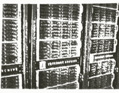

服务器


桌面式电脑/工作站


一体机


笔记本电脑


平板电脑


智能手机

> 图 1.1: 通用计算机

## 关键特性

- **专用功能**：嵌入式系统为特定任务设计，例如控制工业机械、管理智能家电器或运行汽车系统。
- **资源限制**：这些系统通常在有限的资源上运行，包括内存和处理能力，是根据应用的特定需求定制的。
- **实时运行**：许多嵌入式系统必须在严格的时间限制内响应输入并产生输出，这需要实时运行。
- **集成性**：嵌入式系统集成到更大的产品或系统中，在增强功能方面发挥至关重要的作用。
- **极简用户界面**：许多嵌入式系统没有或极少直接的用户界面。相反，它们在后台工作，以确保较大设备的正常运行。

## 嵌入式系统的示例

- **消费电子**：嵌入式系统控制洗衣机、冰箱、咖啡机、智能电视、数字照相机和家庭自动化系统。
- **汽车控制系统**：汽车中的嵌入式计算机管理引擎管理、气囊弹出、安全功能和娱乐系统等功能。

## 1.1. 理解计算机


# 图 1.2: 嵌入式系统的应用

- **医疗设备**：心脏起搏器、胰岛泵和血糖监测仪等设备利用嵌入式系统执行特定的医疗功能。
- **工业自动化**：嵌入式系统控制工厂中的机器，确保操作的精确高效。

### 嵌入式计算机的分类

嵌入式计算机可以根据编程方式进行分类。

#### 上系统 (SoC)

- 上系统（SoC）将一个完整的计算机系统集成到单个芯片上，包含微处理器以及各种外设和接口，但通常不包括主内存。
- 基于 SoC 的单板计算机（如树莓派）允许用户运行各种应用程序，类似于传统的计算机，使其适用于教育和爱好目的。
- 这些系统可以运行如 Linux 等通用操作系统（GPOS），它提供通用的计算环境，也可以设计用于快速响应输入变化的实时操作系统（RTOS）。

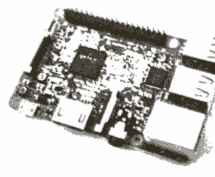

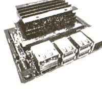

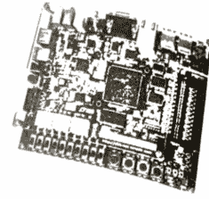

**图 1.3:** UTM 中提供的基于 SoC 的嵌入式计算机

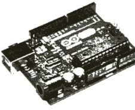

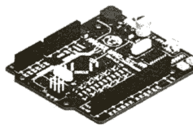

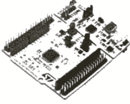

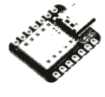

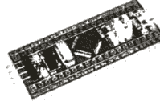

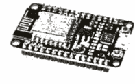

**图 1.4:** 在 UTM 中使用的微控制器板

## 1.2. 计算机架构

### 微控制器

- 微控制器（也称为微控制器单元或 MCU）是一个小型、自一体的计算机系统，在单个芯片上包含了微处理器、内存和输入/输出（I/O）外设。
- 它们也被称为裸机系统（bare-metal systems），因为它们在资源极少的情况下运行，且没有操作系统。
- 裸机系统可以非常紧凑，功耗极低且成本极低，并深埋在计算机鼠标、USB 优盘甚至甚至某些 USB 线内部。

选择 SoC 还是 MCU 取决于应用的特定需求。基于 SoC 的计算机提供了更多的灵性和通用能力，而裸机系统则针对特定任务优先考虑效率和成本效益。

## 1.2 计算机架构

计算机架构指的是计算机系统的设计和组织，包括硬件、固件和软件组件。它使用分层结构组织计算机系统，使得复杂系统的设计、开发和维护变得更容易。每一层都在下一层之上构建，简化了设计过程。

一个计算机系统通常由四层组成：硬件、固件、操作系统和应用程序。

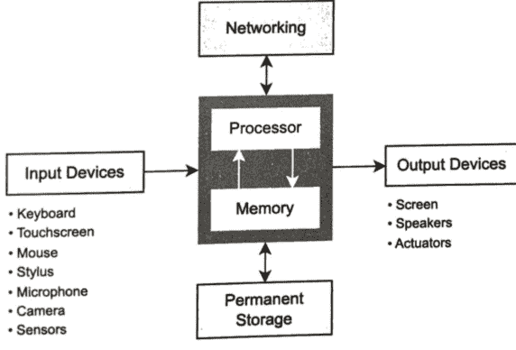

图 1.5: 通用计算机的典型布局

### 硬件层

图 1.5 展示了通用计算机的典型硬件布局。硬件层是计算机系统的基础层，由几个主要组件组成，每个组件都有特定的功能：

- **处理器**：处理器通常称为中央处理单元（CPU），是计算机的大脑。它从内存中提取指令、对其进行解码并执行。
- **内存**：内存为数据和指令提供存储空间。它分为两种类型：主内存和辅助内存（如硬盘或固态硬盘）。主内存存放 CPU 需要访问的数据。
- **输入/输出 (I/O) 设备**：I/O 设备实现与世界的通信和交互。键盘等输入设备提供数据或命令，打印机等输出设备则产生结果。

### 固件层

固件层位于硬件和操作系统之间。它由存储在非易失性内存中的软件组成，用于硬件初始化。嵌入式系统。在 PC 上，这通常被称为 BIOS（基本输入输出系统）。

### 操作系统 (OS) 层

操作系统层提供了更高级别的资源控制，能够管理进程、内存和设备。它是执行程序的平台。通用计算机和复杂的嵌入式系统通常运行操作系统。

### 应用程序层

应用程序层是用户软件所在的顶层。它包括各种应用程序，如文字处理器、电子表格等。这些应用程序运行在操作系统之上，利用其服务和资源。

## 1.3. 计算机编程

| 应用 | 应用 |
|---|---|
| GPOS | GPOS/RTOS |
| 固件 | 固件 |
| 硬件 | 硬件 |

通用计算机 基于 SoC 的嵌入式计算机 裸机嵌入式计算机

图 1.6: 分层下的计算机

如图 1.6 所示，裸机计算机没有操作系统。运行所需的代码存储在固件中，一旦系统启动就会执行。

## 1.3 计算机编程

上一节主要探讨了计算机系统的硬件方面。

### 1.3.1 工程领域对编程技能的需求

编程涉及将复杂问题分解为可管理的部分，规划解决问题的系统方法，逐步实现每个部分的解决方案，并完善这些方案以最佳方式解决问题。学习编程可以培养逻辑和分析思维，对负责数学推理的大脑有益。以下是编程重要的原因：

- **解决问题**：编程为你提供了解决任何问题的逻辑方法。这项技能有助于工程师为各种工程问题思考创新的解决方案。
- **效率与自动化**：通过编程实现的自动化可以简化任务并减少错误。
- **多功能性**：编程技能在不同的工程领域都很有价值，使工程师能够参与项目。
- **创新与适应性**：熟练的程序员可以快速适应新技术，推动工程实践的创新。

对于电气工程师来说，编程特别重要，因为以下：

- 嵌入式系统与固件开发：编程对于开发控制电气系统中硬件组件的固件至关重要。
- 数字信号处理 (DSP)：电信基于编程对数字信号进行处理。
- 控制系统：设计和实现控制算法（特别是在机器人领域）是基于编程的。
- 仿真与建模：编程允许工程师在物理实现之前在虚拟环境中分析和优化电气系统。
- 物联网 (IoT)：编程对于开发连接到物联网系统的软件以及创建或定制物联网设备是必须的。
- 数据分析与可视化：通过编程，对电气系统的数据进行分析和可视化成为可能。
- 跨学科协作：精通编程有助于在跨学科项目中与其他领域的专家进行有效协作。

简而言之，编程技能使电气工程师能够在各种应用中设计、分析和优化系统，从而推动工程领域的领域的创新。

### 1.3.2 编程语言的分类

计算机软件是通过一组被称为*程序*（program）的指令创建的。为了提供精确的指令，使用了*编程语言*，因为像英语这样的自然语言容易产生歧义。

让我们从解释“抽象”（abstraction）这一概念开始。抽象是指通过关注本质部分并隐藏复杂的细节来简化复杂事物的过程。这就像开车，而不需要知道引擎是如何工作的。相反，你只需要理解如何使用刹车、加速油门和方向盘。编程中的抽象通过隐藏不必要的复杂性，帮助代码变得易读和理解。它允许开发者专注于代码的重要方面，而不会陷入技术细节中。

编程语言可以根据不同的抽象层级进行分组，每一层都抽象了底层硬件的某些方面。

- 机器语言：编程的最低级，机器语言使用二进制代码直接与处理器通信。每条指令都有唯一的二进制代码，处理器按顺序执行这些指令以执行特定任务。
- 汇编语言：汇编语言使用助记码代替二进制代码，这使得编程变得更容易，尽管仍然需要硬件知识。程序通过*汇编器*（assembler）翻译成机器码。汇编指令与机器码指令有一一对应的对应关系，因此代码长度和执行速度与机器语言几乎相同。

## 1.3. 计算机编程

### 表 1.1：不同抽象层级的编程语言对比

| 特性 | 机器语言 | 汇编语言 | 高级语言 (HLL) |
|---|---|---|---|
| 抽象层级 | 最低 | 低 | 高 |
| 直接硬件交互 | 是 | 是 | 否 |
| 可读性 | 难以阅读和理解 | 比机器语言更易读 | 易读和理解 |
| 语法 | 二进制代码 (0 和 1) | 助记码和符号 | 类似英语的语句 |
| 可移植性 | 不可移植 | 不可移植 | 可移植 |
| 开发时间 | 长 | 中等 | 短 |
| 易错 | 是 | 是 | 否 |
| 执行速度 | 高 | 低 | 高 |
| 示例 | 针对特定处理器的机器 | 针对特定处理器的汇编代码 | C, C++, Java, Python |

- 高级语言 (HLLs)：高级语言是最用户友好的编程语言，使用高级结构并抽象了具体细节。高级语言通过编译器或解释器翻译成机器码。这些语言的开发是为了抽象硬件的复杂性，专注于提高程序员的生产力和代码可读性。

随着时间的推移，编程语言不断演进，以使软件开发变得更加简单高效。人们创建了新的语言和框架来解决不同的编程需求和范式。

编程语言大致可以分为四种范式或风格：

- 过程化范式 (Procedural Paradigm)：这种方法将问题分解为逐步步进的过程，类似于食谱。每个过程处理特定任务，促进了代码的可重用和组织。想象将一个大型项目组织成可管理的子任务。示例包括 Basic、Fortran、Pascal 和 C。
- 面向对象的范式 (Object-Oriented Paradigm)：这种范式将程序组织为对象的集合。每个对象都有自己的数据和行为。这种方法允许构建模块化的自适应系统。示例包括 Smalltalk、Java 和 C++。
- 函数式范式 (Functional Paradigm)：这种范式将函数视为程序的构建块。函数是自包含的单元，接受输入并产生输出，类似于数学函数。示例包括 Lisp、Scheme、Haskell、ML 和 Erlang。
- 逻辑范式 (Logic-Based Paradigm)：这种方法允许你将问题表示为事实和规则。计算机使用逻辑来解决问题。它对于涉及符号推理和寻找满足特定条件的任务特别有用。Prolog 是该类别中的一个显著示例。

每种范式都提供了独特的优点，以适应不同类型的问题和应用。

编程语言还可以分为编译型语言和解释型语言，它们各自有优缺点。

**编译型语言**（如 C、C++ 和 Rust）会经过编译过程，将源代码转换为针对目标处理器架构的机器码。这产生了一个可以独立运行的独立执行文件。由于其效率高、代码量小且不依赖解释器，编译型语言是高性能应用程序的理想选择。然而，它们需要单独的编译步骤并且依赖于平台，这意味着需要为每个目标平台重新编译。

**解释型语言**（如 Python、Ruby 和 JavaScript）在运行时逐行将源代码翻译成机器码。解释器程序读取、翻译并执行代码。解释型语言具有可移植性、易用性和快速开发等优点。然而，它们的运行速度较慢，且需要更多资源。

一种较新的方法是使用即时编译 (JIT) 编译，用于 Java、C# 以及某些 Python 和 JavaScript 的实现。JIT 编译创建一个由虚拟机执行的字节码。在执行期间，机器会分析并将常用的字节码段转换为机器语言，从而提高性能。这种方法提供了了可移植性（字节码不需要在不同平台上重新编译），并且与传统解释相比性能有所提高。

编译型和解释型语言之间的选择取决于项目的具体需求，每种方法都有其独特的优势和权衡。

### 表 1.2：编译型 vs 解释型语言

| 特性 | 编译型语言 | 解释型语言 |
|---|---|---|
| 翻译 | 在执行前将源代码翻译为机器码。 | 在运行时逐行翻译源代码。 |
| 性能 | 由于经过优化的机器码，执行速度通常更快。 | 由于现场翻译，速度速度较慢。 |
| 开发速度 | 编译步骤为开发周期增加了额外时间。 | 不需要编译步骤，开发周期更快。 |
| 可移植性 | 需要为每个目标平台重新编译。 | 同一份代码在合适的解释器下可以在不同平台上运行。 |
| 资源消耗 | 仅程序本身需要内存 | 解释器需要额外的内存 |
| 示例 | C, C++, Rust | Python, Ruby, JavaScript |
| | | |
|---|---|---|
| 高级语言 | 解释型 | `for i in range(6):`<br>`print(i)` |
| | 编译型 | `main() {`<br>`for (int i=0; i<6; i++)`<br>`printf("%d\n", i);`<br>`}` |
| 低级语言 | 汇编语言 | `12: mov r1, r4`<br>`adds r4, r4, #1`<br>`bl printf`<br>`cmp r4, #6` |
| | 机器语言 | `1011 0101 0000 1000 1111`<br>`0010 0100 0000 0000 0101`<br>`0000 0000 1111 0010 1100`<br>`0000 0000 0101 0010 0010` |
| | 处理器 | |

**图 1.7：按抽象层级分类的编程语言**

# 12

# 第1章 计算机与编程

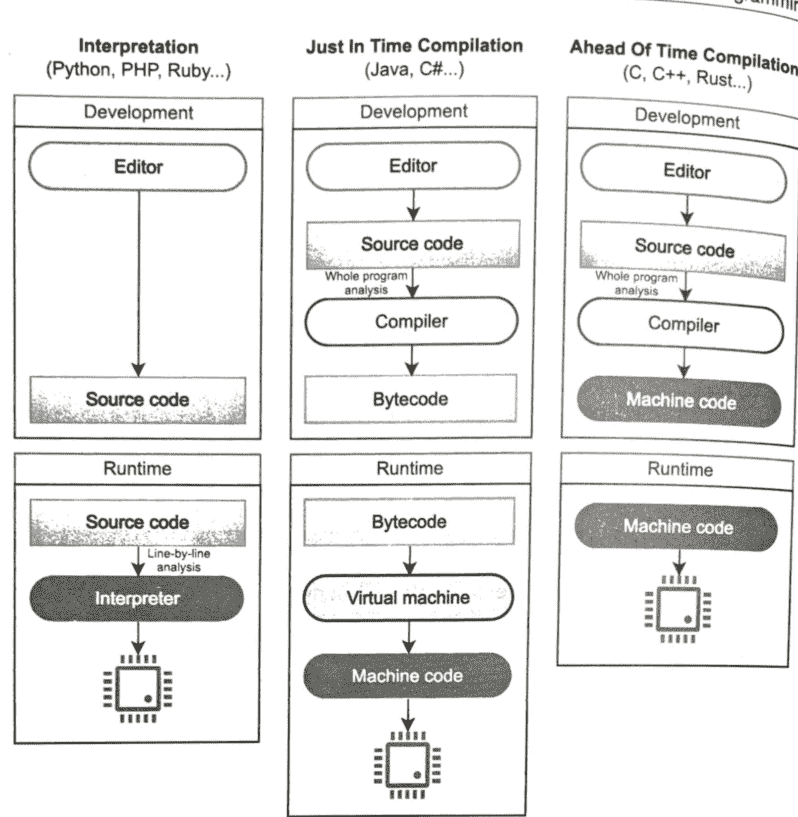

虽然两种类型的编程都有各自的挑战，但通用计算机提供了更高的灵活性和更友好的开发环境，使得对许多程序员来说相对更容易。

## 1.3.4 嵌入式系统编程

如果你是一名计算机科学家，你整个职业生涯可能主要使用通用计算机。然而，作为有志的工程师，你应该准备好处理嵌入式系统的工作。以下因素使得嵌入式系统的编程比通用计算机更复杂、更专业化：

- **资源限制**：嵌入式系统的内存和处理能力有限，因此开发者必须编写高效的代码以最小化资源占用。

## 1.3 计算机编程

- **复杂性**：嵌入式系统涉及底层编程、直接硬件交互和实时性限制。它们必须在特定时间内快速对事件做出响应，这使得调试和故障排除变得困难。
- **缺乏用户友好界面**：嵌入式系统通常缺乏用户友好的输入/输出设备，使得交互和调试更具挑战性。
- **硬件变异性**：嵌入式系统运行在具有不同规格、架构和外围接口的硬件平台上。开发者必须确保软件在不同硬件配置下的兼容性和最佳性能。
- **电源管理**：嵌入式系统通常运行在有限的电源上，例如电池或能量采集设备。开发者必须编写仔细管理功耗的固件。

为了应对这些挑战，嵌入式系统编程有两种主要方法：


- `实时操作系统 (RTOS)`：对于基于 `SoC`（系统级芯片）的嵌入式系统，`RTOS` 优先考虑任务，根据需要进行任务切换，并确保任务按时执行。它们具有实时应用程序的特殊功能，例如时钟和中断通信机制。

- `裸机编程 (Bare-Metal Programming)`：对于基于 `MCU`（微控制器）的嵌入式系统，裸机编程赋予开发者更多的硬件控制权，允许优化资源使用并实现可预测的行为。然而，它要求对硬件有更深入的理解，并且可能更复杂。

虽然某些嵌入式平台（如树莓派）的功能接近通用计算机，但它们可能更贵且耗电更多。对于成本效益和低功耗的应用，通常更倾向于使用微控制器。

## 1.3.5 嵌入式系统编程语言

由于独特的需求和限制，嵌入式系统使用多种编程语言。以下语言在该领域被广泛使用：

- `C`：由于其效率、可移植性和强大的行业支持，`C`语言是嵌入式系统编程的热门选择。它的底层特性允许直接控制硬件资源，使其成为资源受限平台的理想选择。

- `C++` 通过引入面向对象编程 (`OOP`) 特性扩展了 `C` 语言，能够创建模块化和可重用的代码。虽然 `C++` 在代码组织和维护性方面具有优势，但其复杂性和运行时开销可能并不适用于资源受限的系统。

- `Python`：`Python` 的简单性、多功能性和广泛的库支持使其在嵌入式系统中变得越来越流行。它的高级语法简化了编程任务，并且兼容不同的硬件平台。然而，它的动态特性和对解释器的需求可能会引入性能和内存开销。

- `Java`：`Java` 健的平台安全特性和广泛的库支持使其对便携且可靠的嵌入式系统非常有吸引力。基于 `Java` 虚拟机 (`JVM`) 的嵌入式系统提供了统一的运行环境，简化了开发和部署。然而，`Java` 的内存要求和启动时间可能是资源受限环境中的缺点。

- `汇编`：汇编语言提供了对硬件指令的直接控制，通常用于对性能要求极高的任务或与特定硬件外围设备交互。然而，它要求对底层硬件架构有深入的理解，并且与高级语言相比缺乏可移植性。

嵌入式系统中使用的其他语言包括：

- `Rust`：一种强调内存安全和并发的系统编程语言，适用于安全关键型嵌入式系统。

- `Go`：一种通用语言，以其简单、并发支持和跨平台能力而闻名，是嵌入式系统的可行选择。

- `Lua`：一种轻量级解释型语言，因其占用小和易于集成而流行，适用于资源受限的嵌入式系统。

嵌入式系统编程语言的选择取决于具体的需求和限制，需要考虑性能、内存使用、可移植性以及可用的开发工具和资源等因素。

## 1.3.6 C 语言

`C` 语言是一种高级通用语言。它的效率、可移植性和强大的行业支持使其成为嵌入式系统编程的热门选择。它的底层特性允许直接控制硬件资源，使其成为资源受限平台的理想选择。

`C` 语言对硬件接口提供了精确控制，使其成为构建嵌入式系统的理想选择。`C` 语言具有高度的可移植性，意味着它可以在少量修改的情况下运行在各种系统中。它的快速执行速度和高效的内存使用使其成为高性能应用的理想选择。


...通用计算机和嵌入式系统的编程。最后，它讨论了 `C` 语言，该语言常用于嵌入式系统编程。

## 问题

- 1.1 通用计算机和嵌入式系统的区别是什么？

- 1.2 嵌入式系统的特征是什么？

- 1.3 日常生活中常见的嵌入式系统有哪些？

- 1.4 嵌入式系统中常用的输入/输出设备有哪些？

- 1.5 操作系统在嵌入式系统中的作用是什么？

- 1.6 编程通用计算机的优点是什么？编程嵌入式系统的挑战是什么？

- 1.7 为什么编程基于 `SoC` 的嵌入式系统比基于 `MCU` 的系统更容易？

- 1.8 使用机器语言、汇编语言和高级语言的优缺点是什么？

- 1.9 什么是裸机编程（bare-metal programming）？

- 1.10 描述本章讨论的四种编程范式的特征，哪种范式适用于嵌入式系统编程？

- 1.11 嵌入式系统常用的编程语言有哪些？它们的特征和局限性是什么？

- 1.12 你来自计算学院的朋友声称智能手机是一个嵌入式系统，因为它没有键盘和鼠标等常规输入设备。你怎么看？

- 1.13 你叔叔声称树莓派是一个通用计算平台，因为它可以像任何其他 PC 一样使用。你同意他的观点吗？

## 第 2 章

## 解决问题

解决问题是编程中的一项基本技能。它涉及分析给定的问题、设计解决方案并在代码中实现它。有效的解决问题技能对于程序员创建高效且可靠的软件应用程序至关重要。

## 2.1 引言

解决问题是为问题寻找解决方案的过程。在编程中，问题通常是一个需要完成的任务，例如计算一组数字的平均值或生成随机密码。

### 2.1.1 什么是问题？

当当前状况与预期目标或最优结果之间存在差异时，问题就存在。对于我们的目的，编程问题是指任何可能通过算法解决方案和计算机编程来解决的任务或障碍。问题的范围可以从个人挑战到复杂的工程和科学计算需求。

解决问题技能对程序员至关重要，原因有几点：

- 它们使程序员能够创建高效可靠的软件应用程序。

- 它们帮助程序员进行批判性和创造性的性思维。

- 它们允许程序员独立工作或作为团队的一员。

- 它们为程序员应对现实世界的挑战做好准备。

解决问题技能对程序员至关重要，因为它们可以帮助开发高效的软件、促进批判性和创造性思维、支持协作工作并应对现实世界的挑战。

### 2.1.2 良好的问题陈述

清晰地定义问题是关键的第一步。表述良好的问题陈述应该描述：

- 解决问题的预期目标或预期结果

- 任何相关的背景、假设或约束

- 解决问题所需的特定输入

- 预期输出的格式和计算方法

- 任何适用的标准、法规或最佳实践

有了良好的问题陈述，程序员就能准确地理解需要什么才能朝着功能性的解决方案进展。模糊或不完整的问题描述会显著阻碍解决问题的过程。

## 2.2 解决问题的过程

图 2.1 提供了解决问题中最核心步骤的概述。解决问题的过程通常涉及以下步骤：

- `定义问题`：清晰地理解问题陈述，识别需求并确定预期输出。

- `分析问题`：将问题分解为较小的子问题，考虑备选解决方案并选择最合适的一个。

- `开发算法`：使用伪代码或流程图设计分步执行的解决方案。

- `实现解决方案`：使用选定的编程语言将算法翻译成程序。

- `测试和调试程序`：使用各种测试用例测试程序并修复任何错误。

- `评估解决方案`：检查程序是否解决了原始问题，分析效率并识别改进领域。

- `编写程序文档`：编写清晰的文档，解释程序的用途和用法。

### 2.2.1 定义问题

解决问题的第一步是完全理解问题陈述。这包括理解输入需求和预期输出。例如，如果我们目标是帮助孩子计算正方形面积，进一步的询问可能会发现孩子需要一个程序提示她识别正方形的边长，并由程序输出计算面积。

### 2.2.2 分析问题陈述

在定义问题后，进一步分析它以确保清晰性并确定通用需求。这包括：

- `识别输入需求`：确定解决问题所需的数据，无论这些数据来自用户、文件还是数据库。

- `定义预期输出`：指定程序应该产生的解决方案数据。

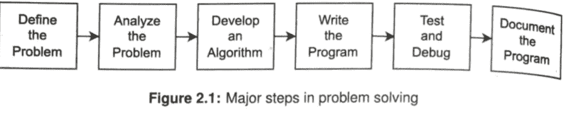

### 2.2 解决问题的过程

图 2.1 提供了解决问题中最核心步骤的概述。解决问题的过程通常涉及以下步骤：

- `定义问题`：清晰地理解问题陈述，识别需求并确定预期输出。

- `分析问题`：将问题分解为较小的子问题，考虑备选解决方案并选择最合适的一个。

- `开发算法`：使用伪代码或流程图设计分步执行的解决方案。

- `实现解决方案`：使用选定的编程语言将算法翻译成程序。

- `测试和调试程序`：使用各种测试用例测试程序并修复任何错误。

- `评估解决方案`：检查程序是否解决了原始问题，分析效率并识别改进领域。

- `编写程序文档`：编写清晰的文档，解释程序的用途和用法。

### 2.2.1 定义问题

解决问题的第一步是完全理解问题陈述。这包括理解输入需求和预期输出。例如，如果我们的目标是帮助孩子计算正方形面积，进一步的询问可能会发现孩子需要一个程序提示她识别正方形的边长，并由程序输出计算面积。

### 2.2.2 分析问题陈述

在定义问题后，进一步分析它以确保清晰性并确定通用需求。这包括：

- `识别输入需求`：确定解决问题所需的数据，无论这些数据来自用户、文件还是数据库。

- `定义预期输出`：指定程序应该产生的解决方案数据。

### 2.2.3 算法设计

算法是一系列指令，当被精确遵循时将解决特定问题。算法思维涉及将问题分解为分步执行的指令。可能有多种解决问题的算法，每种都有优缺点。程序员根据效率等因素选择最佳算法。指令分为三类：

- 输入：向计算机提供数据。

- 处理：处理数据或进行复杂的数学计算。

- 输出：交付结果。

算法设计的目标是编写计算机可以轻松遵循的清晰步骤。选择正确的算法是让程序运行良好的关键。

在创建算法时，考虑程序将使用的数据。数据是程序操作的任何内容。数据可以是数字、单词或程序所需的任何信息，它们都存储在计算机内存中。

变量是内存中存储数据的命名位置。每个变量都有名称和类型，规定了它可以存储的数据类型。例如，整数变量存储整数，而浮点变量存储带小数的数字。变量一次只能有一个值，在使用它们之前必须给它们赋值。

#### 示例

让我们开发一个计算三角形面积的算法。算法如下：

```
要求输入长度
将数字存储在变量 中
要求输入宽度
将数字存储在变量 中
计算 0.5 *  面积
将结果存储在变量 中
打印面积的值
```

为了验证算法的正确性，我们可以进行模拟。这涉及使用示例数据手动执行指令。它可以帮助我们在编写实际程序之前识别任何逻辑错误。在开始程序实现之前，确保算法正确，以避免在错误的方法上浪费时间和精力

### 2.2.4 编写程序

从算法开发计算机程序时，要考虑用户交互和输出设计。程序提示用户输入，计算结果并按特定格式输出。

算法和程序在语言和规则上有所不同。算法可以用非正式语言编写，但程序需要遵守特定编程语言的语法规则。

高级语言程序（如 `C`）被称为源代码。编译将源代码转换为可执行程序，即可执行文件中的目标代码。

#### 示例

下面是一个简单的 `C` 程序，它提示用户输入三角形的长度和宽度并计算面积：

```
#include <stdio.h>

int main() {
    // 声明存储数字的变量
    int length, width, area;

    // 提示用户输入三角形的长度
```

## 2.2. 问题解决过程

```c
printf("\nEnter the length: ");
scanf("%d", &length); // Store in 'length'

// Prompt the user to enter the width of triangle
printf("\nEnter the width: ");
scanf("%d", &width); // Store in 'width'

// Calculate the area based on length and width
area = 0.5 * length * width; // Store in 'area'

// Print the area
printf("\narea of triangle is %d\n", area);

return 0;
```

> 列表 2.1: https://onecompiler.com/c/426sb7h5j

现在，理解代码的每一个并不重要。

程序开始时包含了标准输入输出库 (`<stdio.h>`)，该库提供了输入和输出操作函数。

`main()` 函数是程序的入口点。左括号 `{}` 表示可执行代码的开始。所有可执行代码都应该写在这个函数内部。

当程序运行时，它会提示用户输入两个数字。

输入长度：5

宽度：8

在用户输入数字后，程序会计算它们的和并显示在屏幕上。

三角形面积为 20

最后，程序终止，由 `main()` 函数结束的右括号 `}` 表明。

### 2.2.5 测试与调试

在程序的测试和调试过程中，涉及以下几个步骤：

- `编译 (Compilation)`：编译器将源代码转换为目标代码，在此过程中检测语法错误。

- `链接 (Linking)`: 链接器将对象文件和库组合，识别链接错误。

- `执行 (Execution)`：使用测试数据执行编译后的程序以观察其行为。在此阶段会检测逻辑错误。

- `调试 (Debugging)`：分析并修复在编译、链接或执行期间遇到的错误。

“bug（漏洞）”一词通常指代码中的逻辑错误。解决逻辑错误可能是一个耗时的过程，因为如果代码看起来没有错误，问题可能不会立即显现。调试意味着检测、分析和解决计算机程序中的问题。虽然 bug 可能指的是逻辑错误，但调试包括识别和纠正代码中任何类型的错误或问题，无论逻辑逻辑。调试工具可以帮助开发者识别未使用的变量、无法访问的代码或潜在的内存泄漏。

在测试计算机程序时，会选择特定的数据输入以使测试过程更高效。例如，为了测试一个针对 12 岁以下儿童的程序，我们可以使用 11、12 和 13 作为年龄输入，而不是使用 0 到 99 的所有数字。选择最佳测试输入是一个复杂的课题，我们本学期将不会涵盖！

总之，调试是一个识别、分析和修复错误的迭代过程。在修复初始错误后，该过程可能会发现额外的错误。

### 2.2.6 编写程序文档

完成程序的最后一步是创建文档。文档由面向程序员的技术文档和面向非技术用户的用户用文档组成。

技术文档包括：

- `问题描述 (Statement of the problem)`：清晰定义程序旨在解决的问题。

- `算法 (Algorithm)`：描述解决问题的分步骤程序。

- `程序列表 (Program listing)`：提供程序的代码。

- `测试数据和结果 (Test data and results)`：包括示例输入以及程序产生的相应输出。

用户文档包括：

- `程序使用 (Program usage)`：说明如何将程序加载到计算机中。

- `程序功能 (Program features)`：描述各种功能以及如何使用它们。

- `处理异常情况 (Handling unusual situations)`：提供如何处理在使用程序期间可能发生的意外情况的说明。

技术文档和用户文档对于不同的目的都至关重要。技术文档帮助程序员理解和修改程序，而用户文档使非技术用户能够有效使用程序，而无需深入了解其内部工作原理。

## 2.3 程序开发工具

### 2.3.1 层级图 (Hierarchy Charts)

层级图也称为结构图，提供了软件系统的简要概述。它们将复杂系统拆分为易于管理的各个部分。它们通常用于结构化编程，以树形结构组织模块。

这些图表使用方框表示不同的模块，使用线条描述这些模块之间如何连接和相互作用。这种视觉化表示有助于：

- 快速理解系统的整体结构。

- 识别各个模块之间的依赖关系。

- 通过提供对系统结构的共同理解来改进通信。

虽然层级图在编写代码期间并不直接使用，但它们是程序员规划和可视化复杂软件项目的价值工具。

此外，层级图（如图 2.2 所示）在软件开发之外也有应用，包括组织管理（描述组织的层级结构）和系统工程（阐述复杂的系统架构）等。

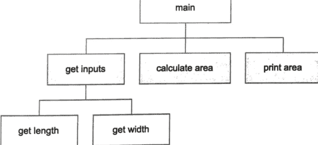

**2.2: 计算三角形面积的程序层级图**

层级图是理解、分析和通信的良好工具，因为它们为系统或组织内部的关系和结构提供了清晰、简单的视觉化表示。

### 2.3.2 伪代码 (Pseudocode)

伪代码是一种简化的、易于理解的语言，表示程序的逻辑，而不包含特定的编程语法。程序员用它来规划、设计和解释算法如何工作，重点关注思想和步骤，而不必担心精确的...

```text
START
  PRINT "Enter the length: "
  READ length
  PRINT "Enter the width: "
  READ width
  area = 0.5 * length * width
  PRINT "area of triangle is ", area
END
```

示例：创建一个计算的程序

```text
START
  PRINT "Enter the length: "
  READ length
  PRINT "Enter the width: "
  READ width
  area = 0.5 * length * width
  PRINT "area of triangle is ", area
END
```

伪代码小技巧：

- 每行只写一条语句

- 关键字大大写：`START`, `END`, `INPUT`, `READ`, `PRINT`, `OUTPUT`, `WHILE`, `IF`, `ELSE`

- 使用缩进显示层级关系：

  - 顺序：语句一个接一个

  - 选择：缩进选择内部语句

  - 重复：缩进重复内部语句

- 结束多行结构：

  - `IF ELSE` 结构以 `ENDIF`

  - `FOR` 结构以 `ENDFOR`

  - `WHILE` 结构以 `ENDWHILE`

  - `DO` 结构以 `END`

伪代码提供了逻辑的清晰简洁表示，而不取决于任何编程语言。它是编写实际代码的蓝图。

## 2.4 控制结构

## 第2章 问题的解决

| | 描述 |

| :--- | :--- |

| 终端 (Terminal) | 表示算法的开始和结束。每个程序只有一个“开始(Start)”和一个“停止(Stop)”终端。函数/子程序的结束终端必须使用“返回(Return)”而不是“停止”。 |

|  (Process) | 显示除输入、输出或选择之外的过程或操作。一个入口和一个出口。 |

| 输入/输出 (Input/Output) | 在任何数据输入（输入）或显示（输出）时使用。一个入口和一个出口。 |

| 决策 (Decision) | 显示选择过程。一个入口和两个出口（标记为“是”和“否”）。 |

| 函数/子程序 (Function/ Subroutine) | 显示在单独流程图（模块）中的操作。一个入口和一个出口。 |


| 页内连接 (On-Page Connector) | 连接同一页上另一点的逻辑路径。一个入口或一个出口。 |

| 页外连接 (Off-Page Connector) | 连接另一页上另一点的逻辑路径。一个入口或一个出口。 |

| 注释 (Comment) | 添加描述或说明。 |

| 流线 (Flowline) | 表示执行步骤的逻辑顺序。 |

图 2.3：流程图符号

### 2.4.1 顺序结构

顺序结构是指按照算法中编写的顺序执行一系列步骤或语句。这种结构允许我们做出决策、重复操作，并控制语句的流。为了使执行顺序清晰明了，可以对单个步骤进行编号。

```
Begin
Statement_1
Statement_2
Statement_3
...
Statement_n
End
```

在这个伪代码段中，语句 `Statement_1`、`Statement_2`、`Statement_3` 直到 `Statement_n` 被分组在 `Begin` 和 `End` 关键字之间。尽管它们是独立的语句，但从执行的角度来看，它们被视为一个语句块。

## 2.4. 控制结构

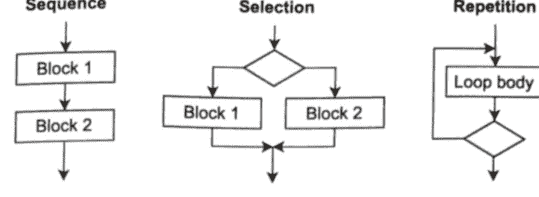

图 2.4：三种基本的结构化编程构建

将相关步骤分组为块可以提高可读性和管理性。在许多编程语言中，使用大括号 (`{}`) 来封装语句块，允许它们在执行期间被视为单个单元。因此，可以通过这种方式共同控制语句，例如调节它们的流、对整个块应用条件，或在循环中重复整个块。

示例：计算三角形面积

该问题可以用伪代码写如下所示：

```
BEGIN
  DECLARE length, width, area
  INPUT length, width
  PROCESS area = 0.5 * length * width
  OUTPUT area
END
```

流程图如图 2.5 所示。最后，给出的 C 程序：

#include <stdio.h>

```c
int main()
{
  int length, width, area; // 声明变量

  printf("Enter length: "); // 输入长度
  scanf("%d", &length);
  printf("Enter width: "); // 输入宽度
  scanf("%d", &width);

  area = 0.5 * length * width;

  printf("Area : %d\n", area); // 输出面积

  return 0;
}
```

列表 2.2: https://onecompiler.com/c/426sbdnsp

### 2.4.2 选择结构

选择结构，也称为条件结构，是一种允许根据某些条件进行决策的编程构建。它提供了根据条件的求值结果为真或为假来执行不同代码块的能力。

计算机只能处理简单的决策，因为它们只理解“真”或“假”。如果需要复杂的决策，则取决于程序员将其拆分为计算机可以处理的更简单的决策。

在该结构中，程序评估条件，如果条件为真，则执行与 `if` 语句相关的代码块。如果条件为假，则执行与 `else` 语句相关的代码块。

```
IF (condition)
  // 如果条件为真则执行的代码块
ELSE
  // 如果条件为假则执行的代码块
ENDIF
```

选择结构是创建能够根据不同输入或情况调整行为的程序的基础。

示例：检查用户是否可以投票

考虑以下伪代码，根据年龄判断用户是否有投票资格：


```
BEGIN
DECLARE age
INPUT age
IF age >= 18 THEN
    OUTPUT "OK to vote"
ELSE
    OUTPUT "Not eligible yet"
ENDIF
END
```

此伪代码检查输入数字是否大于 0、小于 0 或等于 0，并输出相应的消息。流程图如图 2.6 所示。这里是 C 代码：

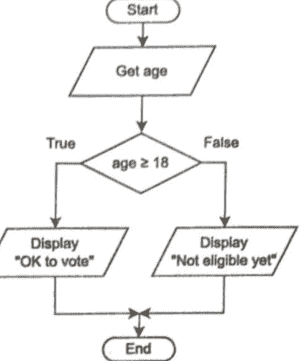

图 2.6：选择结构的流程图

```c
#include <stdio.h>

int main() {
    int age;

    printf("Enter your age: ");
    scanf("%d", &age);

    if (age >= 18) {
        printf("OK to vote\n");
    } else {
        printf("Not eligible yet\n");
    }

    return 0;
}
```

列表 2.3: https://onecompiler.com/c/426sbdnsp

### 2.4.3 重复结构

重复结构，也称为循环结构，是一种允许在特定条件下多次执行代码块的编程构建。它允许程序多次执行相同的操作，直到满足特定的终止条件为止。循环有几种常见的类型：

- `While` 循环：条件为真时重复执行代码。
- `For` 循环：按指定的次数执行代码。
- `Do-While` 循环：先执行代码，后检查条件。

示例：打印数字

考虑以下伪代码来重复打印数字：

```
BEGIN
  DECLARE num
  SET num = 1
  WHILE num <= 5
    OUTPUT num
    INCREMENT num
  ENDILE
END
```

流程图如图 2.7 所示。这里是 C 代码：

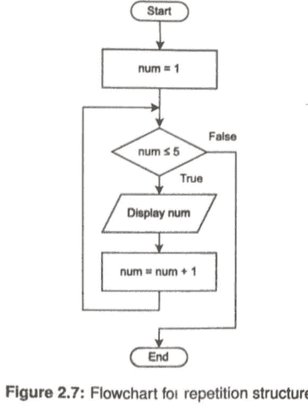

```c
#include <stdio.h>

int main() {
    int num = 1;
    while (num <= 5) {
        printf("%d\n", num);
        num++;
    }
    return 0;
}
```

列表 2.4: https://onecompiler.com/c/426sbuqp

## 2.6. 实现

```c
int a, b;
scanf("%d", &a, &b);      // 获取输入
int sum = add(a, b);               // 带参数的函数调用
printf("The sum is: %d\n", sum); // 显示和
return 0;
```

列表 2.6: https://onecompiler.com/c/426sbxb8u

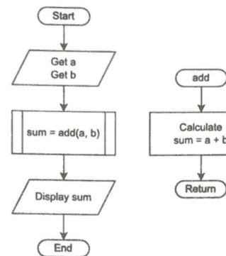

图 2.8: 执行函数的流程图

在这个示例中，`add()` 接受两个整数（`a` 和 `b`）作为输入并返回它们的和。流程如图 2.8 所示。

函数是编程中至关重要的元素，作为可重用的、自包含的代码块来执行特定任务。它们通过将复杂任务分解为更小、独立且易于管理的单元，有助于模块化——这是软件开发中的一项基本原则——从而产生结构良好、可重用且可扩展的代码。

## 2.6 实现

在实现阶段，你将流程图形式的设计转换为初始代码。此草稿可能包含错误，并且不是最终版本。然后，通过迭代审查、调试和优化对代码进行精炼，如图 2.9 所示。

初始代码实现了“设计”中概述的整体逻辑和流程。它可能包含需要以后解决的错误。

初始代码中的常见问题包括在使用前未声明变量，以及对未定义函数或库的引用。要解决此类问题：

- 在使用之前用适当的类型声明变量。
- 通过头文件包含所使用的函数/库。

# 第 2 章 解决问题

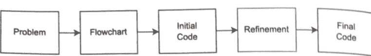

图 2.9: 编程中的实现阶段

代码通过以下迭代过程进行**精炼**：

- 通过编译和运行测试逻辑/运行时错误
- 调试遇到的任何错误
- 优化效率和可读性

此过程将持续持续，直到代码完全准确地反映了设计且没有错误。

图 2.10 展示了如何从流程图生成 C 程序的初始或草稿版本。程序仍然无法运行，因为它还没有完成。如果编译此程序，它将至少有两个未定义符号错误：

- 未声明的变量：发生这种情况是因为变量 `width` 和 `area` 尚未声明。添加变量声明可以解决此错误。
- 未知符号：发生这种情况是因为编译器找不到 `print()`。添加 `#include <stdio.h>` 指令可以通过为编译器提供有关此符号的信息来解决此问题。

此外，可以添加**提示**以告知用户程序在执行期间的状态，并在他们输入值时提供引导。

此阶段的的一些最佳实践包括：

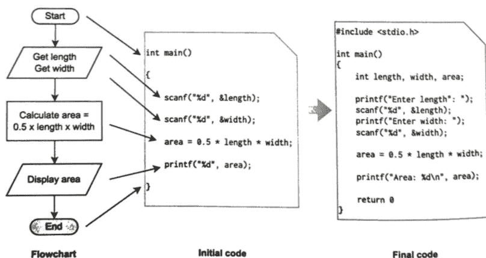

图 2.10: 从设计到最终代码

## 2.6. 实现

- 添加注释解释逻辑
- 插入打印语句用于调试
- 齐洁格式化代码以提高可读性

总之，在实现期间，即使流程图还不完美，也会将其转换为代码。通过修复错误来清理代码，使其运行得更高效，改进组织结构并使其更易阅读。继续工作，直到你拥有准确代表流程图的无错误代码。

## 总结

本章介绍了程序开发的几种工具，包括层次图、伪代码和流程图，这些工具有助于解决问题和设计程序。还涵盖了解决问题的过程，涉及定义和分析程序、设计算法、实现程序、测试、调试和编写文档。此外，本章讨论了控制结构，如顺序、选择结构和循环结构，这些结构对于管理程序流至关重要。最后，本章强调了函数和模块化在组织代码和促进重用方面的重要性。

2.1 编写伪代码或绘制流程图，根据给半径计算圆的周长。

2.2 编写伪代码或绘制流程图，判断一个数字是偶数还是奇数。

2.3 编写伪代码或绘制流程图，判断分数是否低于 60%。如果小于 60，打印“Fail”；否则打印“Pass”。

2.4 编写伪代码或绘制流程图，判断速度是否超过每小时 110 公里。如果是，则将罚款设为 RM300；否则，将罚款设为 0。显示罚款。

2.5 编写伪代码或绘制流程图，判断年龄是否超过 12 岁。如果超过 12 岁，则将票价设为 RM20；否则，将票价设为 RM10。显示最终价格。

2.6 编写伪代码或绘制流程图，该程序接收两个数字。如果第一个数字较大，显示它们的差。如果第二个数字较大，显示它们的和。

2.7 编写伪代码或绘制流程图，输入两个数字。如果第一个数字大于第二个且超过 50，计算并显示它们的和。否则，显示它们的差。

2.8 TNB 家用电价为前 200 kWh 为 RM0.218，接下来的 100 kWh 为 RM0.334，超过部分部分为 RM0.516。对于超过 600 kWh 的消耗将收取 8% 的服务税。编写伪代码和流程图计算最终费用。

2.9 编写伪代码或绘制流程图，编译器将源代码转换为机器码，以打印斐波那契数列。

2.10 编写伪代码或绘制流程图，编译器将语法树转换为指令。

# 第 3 章

## 环境

本章介绍了编程环境的使用。讨论了集成开发环境 (IDE) 和在线编译器，重点是编写、执行和调试 C 程序。

### 3.1 编译过程

编译涉及将源代码转换为机器码。该过程包括四个步骤：

- **预处理**：预处理器获取源代码，移除注释并处理预处理指令（如包含头文件）。它将这些指令替换为实际内容。
- **编译**：预处理后的代码交给编译器，将其转换为汇编代码。
- **汇编**：上一步生成的汇编代码交给汇编器，将其转换为目标代码。目标代码通常具有 .o 或 .obj 扩展名。

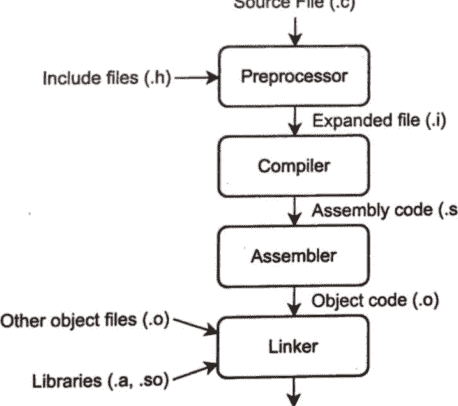

图 3.1: 编译过程

## 3. 环境

4. **链接**：链接器获取汇编器生成的多个目标文件与其他必要的库文件合并。它解析外部函数和符号，执行地址重定位，并生成执行文件。执行文件在 Windows 上可能具有 .exe 扩展名，在 Unix/Linux 上没有扩展名。

图 3.1 展示了编译过程，包括 Unix/Linux 系统常用的文件扩展名。在 Windows 上，汇编代码可能具有 .ASM，目标代码 .OBJ，静态库 .LIB 以及动态库 .DLL。大多数编译器除非程序员特别要求，否则默认不会生成 .i（预处理）和 s（汇编）。

对于好奇的人，编译器本身会经过几个步骤：

- **词法分析**：编译器读取你的代码并将其分解为更小的单元标记。标记可以是关键字（如“if”或“while”）、变量名、数字或符号。
- **语法分析**：编译器检查上一步的标记是否符合语言语法规则。它构建一个名为语法树的树结构来表示代码的结构。
- **语义分析**：编译器验证代码的含义。它检查你使用变量和函数的方式，以及你执行的操作是否有意义。它还能捕获定义前使用变量的错误。
- **代码生成**：编译器将语法树转换为计算机可以理解并执行的指令。它生成机器码或代码的低级表示。
- **代码优化**：编译器尝试提高代码的效率和性能。它应用各种技术使生成的代码更快或占用更少内存。

这些步骤如图 3.2 所示。

## 3.2 IDE 与在线编译器

为了给源代码做编译准备，你需要专门的软件。与其使用像记事本这样的基础文本编辑器，不如考虑使用程序员编辑器或集成开发环境（IDE）。

程序员文本编辑器提供了编写代码的基本功能，例如语法高亮。示例包括 Notepad++、Sublime Text 和 Visual Studio Code。另一方面，IDE 是旨在增强软件开发过程的综合桌面应用程序。它们除了代码编辑之外，还提供了广泛的功能，包括编译、测试和调试。IDE 的特性包括：

- **文本编辑器：** 用于编写和编辑代码的图形化界面。
- **代码补全：** 预测并建议代码补全，减少输入量并尽可能地减少错误。
- **语法高亮：** 视觉上区分不同的代码元素（关键字、变量、注释），以提高可读性。
- **编译器：** 集成编译器或解释器，实现代码的无缝编译和执行。
- **调试器：** 有助于高效识别和纠正错误。

与文本编辑器相比，使用集成开发环境（IDE）的优势：

- **提高生产力：** 简化开发流程。
- **减少语法错误：** 早期错误检测和纠正。
- **自动补全：** 节省时间和精力的。
- **用户友好界面：** 提升整体编程体验。
- **协作：** IDE 支持协作工作，实现高效的团队合作。

通过使用 IDE，你可以显著提高代码效率和整体生产力。

| 编程语言 | IDE |
|---|---|
| Python | PyCharm, Anaconda |
| Java | NetBeans, Eclipse |
| C/C++ | Dev C++, Code Blocks |

然而，IDE 的一个主要局限是它们的资源消耗，特别是在磁盘存储方面。另一方面，在线编译器的优势是不需要本地安装，并提供即时代码执行。它们只需要浏览器和互联网连接，即可在平板电脑和智能手机在各种设备上进行编程。

总之，IDE 提供了一系列改善编程体验的功能，而在线编译器提供了便利性和可访问性，特别是在可以使用互联网连接的情况下。


# 第 3 章 编程环境

本书推荐的在线编译器是 OneCompiler，地址为 https://onecompiler.com/。这是我们从现在起将使用的编程环境。

Windows 推荐的 IDE 是 Dev-C++ 和 Code::Blocks。Dev-C++ 可以在 https://www.bloodshed.net 获取。它是一个适用于 C/C++ 编程语言的全功能 IDE 和代码编辑器。它使用 GCC（GNU Compiler Collection）的 Min端口作为编译器。Code::Blocks 可以在 https://www.codeblocks.org/downloads/ 获取。

如果你使用的是 Mac，请安装 Xcode (https://developer.apple.com/xcode/)。你需要稳定的网络连接，因为最新版本约为 8 GB，会在你的电脑上占用 30 GB。

## 3.3 使用 OneCompiler

### 3.3.1 运行 Hello World 程序

“Hello, World!”是一个用于各种编程语言的简单且传统的介绍性程序。它的主要目的是向用户输出消息“Hello, World”。该程序作为一个基础练习，帮助初学者熟悉基本语法以及在特定编程语言中打印/显示文本。

在 OneCompiler 上运行 Hello World 程序非常简单，因为它是首次启动网站时的默认程序。

1. 点击蓝色按钮确认编程语言确实是 C。
2. 点击红色按钮运行代码。

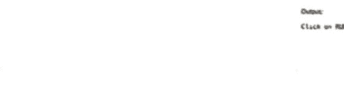

图 3.3：启动在线编译器

恭喜。你刚刚运行了你的第一个 C 程序。你应该在右侧面板看到输出。

```
int main() {
    printf("Hello, World!\n");
    return 0;
}
```

图 3.4：在线编译器上的 Hello World 程序

### 理解代码

我们随后使用经典的“Hello, World!”示例来拆解基础 C 程序的结构。每行代码都将被剖析以揭示其目的。

预处理器指令，指示编译器包含标准输入输出库 (stdio.h)。使用 `printf()` 等函数时需要这个库。

```c
#include <stdio.h>
```

```c
int main()
```

这一行声明了 `main` 函数。在 C 中，每个程序都必须有一个 `main` 函数。`main()` 函数作为执行的入口。`main` 之前的 `int` 表示该函数返回一个整数。

```c
{
```

这个左大括号标记了 `main` 函数的开始。


```c
printf("Hello, World!\n");
```

这一行使用 `printf` 函数将字符串“Hello, World!”打印到控制台。`\n` 代表换行符，导致打印后光标移动到下一行。

```c
}
```

这个右大括号标记了 `main` 函数的结束。

运行代码输出“Hello, World!”消息。

通过完成这个示例，你将获得编译、运行简单 C 程序的实践经验，为后续示例中更高级的编码练习奠基础。

### 3.3.2 在线编译器的其他功能

`OneCompiler` 简单简单，但也提供了一些选项。

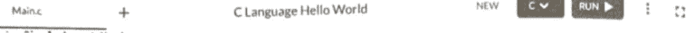

图 3.5：OneCompiler 上的选项

作为一个建议，在创建程序时定期下载你的源代码，以防止任何工作的丢失。要做到这一点，点击三个点（这是倒数第二个项目），然后从出现的选项列表中选择“Download”。此选项不仅允许你下载代码，还提供了自定义一些编辑器设置和清空输出面板的能力。

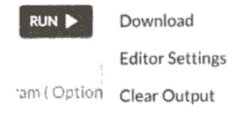

图 3.6：从 OneCompiler 下载

一个不明显的选项是重命名源文件的功能。导航到“Main.c”标签并将其重命名为“main.c”。建议源文件使用全小写字母。编译器可能将文件名默认为“Main.c”，以鼓励将其重命名为更合适的格式。

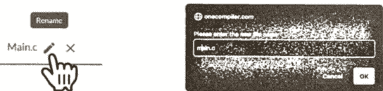

图 3.7：重命名文件

IDE 的最后一项是通过最右侧按钮进入全屏模式。在共享工作时，与其下载源文件并通过电子邮件或社交媒体共享，你只需共享 URL。在大多数浏览器中，按下 `Ctrl-L`（macOS 为 `Command-L`），然后按 `Ctrl-C`。此操作会将你的类似 `https://onecompiler.com/c/423cfnk` 的 URL 复制到剪贴板。将此 URL 分享给你的老师以提交作业！

### 3.3.3 调试练习

为了看看发生什么，让我们故意制造几个错误。

1. 使用删除键删除程序中 `world` 单词后的结束引号 `"`（双引号字符）。现在尝试编译并运行程序。

## 第3章 编程环境

这是一个多行注释。起始 `/*` 和结束 `*/` 之间的任何文本都会被编译器忽略。注释用于在代码中提供人类可读的解释或说明。

```c
int main() {
```

这一行声明了 `main` 函数，它是程序的入口。`main()` 之前的 `int` 表示该函数返回一个整数值。左大括号标记了函数体的开始。在我们的第一个程序中，左大括号单独占一行。

```c
printf("Hello, World!\n"); // prints Hello, World!
```

这一行向标准输出（通常是控制台）打印字符串 Hello, World!。`\n` 是换行符，它在打印完 "Hello, World!" 之后将光标移动到下一行。该字符是可选的，我们的第一个程序中并没有包含它。接下来，`// prints Hello, World!` 是一个单行注释。该序列之后直到行尾的任何文本都会被编译器忽略。

```c
return 0;
```

这一行表示 `main` 函数的最后一个语句，并向操作系统返回整数值 `0`。返回值为 `0` 通常表示执行成功。这一行是可选的，onecompiler 的示例程序中并没有包含它。

```c
}
```

这个右大括号标记了 `main` 函数的结束。

## 3.4 变量与控制流

现在让我们探索 C 中的变量和控制流语句。变量就像计算机内存中的盒子，你可以在其中存储值。你可以将其想象为一个容器，其中存储的信息可以随着程序的运行而更改或处理。控制流语句允许你的程序根据条件做出决策并执行操作。在这个示例中，你将创建一个使用 `if-else` 语句来判断数字是偶数还是奇数的程序。

按照以下步骤完成操作：

- 1. **打开新 C 文件**：首先在在线 C 编译器中创建一个 C 文件。

- 2. **编写代码**：将以下 C 代码输入编辑器，或者使用位于 `https://onlinecompiler.com/423mryxrp` 的在线版本。

```c
#include <stdio.h>
```

```c
int main() {
    // 变量声明
    int num;

    // 输入一个数字
    printf("Enter a number: ");
```

## 3.5. 函数与模块化编程

```c
scanf("%d", &num);

// 检查数字是偶数还是奇数
if (num % 2 == 0) {
    printf("%d is even.\n", num);
} else {
    printf("%d is odd.\n", num);
}

return 0;
```

- 3. **保存并编译**：保存 C 文件并使用编译器的工具编译代码。

- 4. **运行程序**：执行程序并输入不同的数字以观察输出。

说明

在这个示例中，你声明了一个变量 `num` 用来存储用户输入的整数。程序使用 `if-else` 语句来检查输入的数字是偶数还是奇数。`%` 运算符计算除以 2 时的余数，允许你判断数字的奇偶性。

通过完成这个示例，你可以探索其他决策结构，这些结构可以让你的 C 程序更有趣。

## 3.5 函数与模块化编程

现在是时候深入函数世界了。C 语言中的函数允许你对代码进行模块化，使其更有组织、易读且可重用。在这个示例中，你将创建一个使用函数执行特定任务的程序。

按照以下步骤完成示例：

- 1. **打开新 C 文件**：在你的在线 C 编译器中创建一个新的 C 文件。

- 2. **编写代码**：将以下代码输入编辑器，或者使用位于 `https://onecompiler.com/c/423ms4ewn` 的在线版本：

```c
#include <stdio.h>

// 计算数字平方的函数
int square(int x) {
    return x * x;
}

int main() {
    // 变量声明
    int num;
```

```c
// 输入一个数字
printf("Enter a number: ");
scanf("%d", &num);

// 计算并显示输入数字的平方
printf("The square of %d is %d.\n", num, square(num));

return 0;
```

- 3. 运行程序：执行程序并输入不同的数字以观察输出。

说明

在这个示例中，你创建了一个名为 `square` 的函数，它接受一个整数 `(x)` 作为输入并返回其平方。`main` 函数随后调用这个自定义函数来计算并显示用户输入的数字的平方。

程序还使用了两个库函数：`scanf` 和 `printf`。库函数是由编写编译器的人所编写的高度优化的函数。我们应该尽可能尝试使用有的函数，而不是创建自己的。

通过理解和实现函数，你正在向编写模块化和可维护的 C 程序迈出重要的一步。

## 3.6 故障排除与常见问题

在学习编程时，特别是对于初学者来说，遇到错误和挑战是很常见的。本节旨在帮助你解决在使用 C 编译器时出现的问题。

### 3.6.1 编程错误的类型

理解编程中不同类型的错误对于识别和修复代码中的问题非常重要。以下是主要的错误类型及其产生：

- 语法错误（Syntax Errors）：发生在编译期间，当代码违反编程语言的语法规则时。

- 语义错误（Semantic Errors）：当代码语法上正确但没有执行预期操作时发生。

- 运行运行时错误（Runtime Errors）：发生在程序执行期间，例如除以零或无效的内存访问。

- 逻辑错误（Logical Errors）：当程序运行且没有崩溃，但由于逻辑错误产生了错误结果时发生。

## 3.6 故障排除与常见问题

| 错误类型 | 描述 |
| :--- | :--- |
| 语法错误 | 发生在编译期间，代码违反语法规则。 |
| 语义错误 | 当代码语法正确但逻辑缺陷时发生。 |
| 运行时错误 | 发生在程序执行期间，通常会导致程序崩溃。 |
| 逻辑错误 | 程序运行但产生了错误的输出。 |

## 3.6. 故障排除与常见问题

- 缺少分号：分号用于标记语句的结束。在语句末尾缺少分号是一种常见的语法错误，会导致编译错误。

- 括号不匹配：括号用于分组语句和定义代码块（例如使用花括号而不是方括号），或者未闭合括号会导致语法错误。

- 关键字拼写错误：这些是具有特定含义的预留字。拼写错误的关键字会导致语法错误。

- 变量名错误：变量名必须遵循命名规范。使用无效字符或违反命名规则会导致语法错误。

- 标点符号错误：标点符号（如逗号、冒号和引号）用于分隔语句的不同部分。使用错误的标点符号或省略标点符号都会导致语法错误。

- 引号不平衡：在使用字符串或字符时，确保使用匹配的引号（单引号或双引号）来包裹文本是非常重要的。忘记关闭引号或使用不匹配的引号可能会导致语法错误。

### 3.6.4 最佳实践与提示

养成良好的编程习惯并遵循最佳实践对于编写高效、可读且易于维护的 C 代码至关重要。在本节中，我们将探索各种最佳实践和提示，以提高你的 C 编程技能。

- 有意义的变量名：选择能够清楚表示用途和含义的变量名。这使得代码更具读性且更容易理解。

- 使用注释：在代码中添加注释来解释每个部分或代码块的作用。这有助于其他程序员（以及你自己）理解代码逻辑。

- 一致的缩进：使用缩进在视觉上组织代码。这有助于尽早发现 Bug 并其引发问题。

- 测试代码：测试你的代码以确保其按预期工作。

- 从他人学习：阅读经验丰富的程序员编写的代码并学习他们的最佳实践。这可以帮助你提高自己的编码技能。

- 保持简单：不要让代码过于复杂。保持简单直观，以便于理解和维护。

- 经常练习：提高 C 编程技能最好的方法是经常练习。通过完成小项目和挑战来建立信心和经验。

## 总结

在本章中，你开始使用在线编译器或集成开发环境（IDE）学习 C 编程。你尝试了基础代码，并接触了变量、简单决策和函数。你还学习了如何排除常见问题以及遵循编写良好代码的最佳实践。

## 习

- 3.1 画出 3.4 节中程序的流程图。

- 3.2 为 3.4 节中的程序编写伪代码。

- 3.3 画出 3.5 节中程序的流程图。

- 3.4 画出 3.5 节中程序的层次结构图。

- 3.5 C 程序中 `#include` 指令的作用是什么？

- 3.6 C 程序中 `main()` 函数的作用是什么？

- 3.7 找出并修复以下代码中的错误：

```c
#include <stdio.h>

int main() {
    int x = 5
    printf("x = %d\n", x);
    return 0;
}
```

- 3.8 找出并修复以下代码中的错误：

```c
#include <stdio.h>

int main() {
    printf("Hello
```

- 3.9 找出并修复以下代码中的错误：

```c
#include <stdio.h>

int main() {
    printf("Hello
```

- 3.10 找出并修复以下代码中的错误：

```c
#include <stdio.h>

int main() {
    int age = 25;
    printf("My age is %f\n", age);
    return 0;
}
```

## 第 4 章

## C 语言基础

本章为 C 语言编程的核心概念提供了易于入门的概述。涵盖了关键字、变量、标识符和基础数据类型（如整数和字符）。

## 4.1 基础元素

编程语言具有共同元素，例如关键字、程序员定义的标识符、运算符、标点符号和语法。这些组件构成了语言结构的基础，允许开发者编写计算机可以理解并执行的代码。

### 4.1.1 关键字

关键字是 C 编译器赋予特定含义的单词，并专用于此类用途。它们始终以小写形式编写。表 4.1 列出了所有预留关键字。

将预留关键字用标识符会导致编译错误，因为编译器将它们识别为语言语法和功能的一部分。这消除了歧义，并确保编译器正确解释代码。

表 4.1：C 关键字

| auto | break | case | char |
| :--- | :--- | :--- | :--- |
| const | continue | default | do |
| double | else | enum | extern |
| float | | goto | if |
| int | long | register | return |
| short | signed | sizeof | static |
| struct | switch | typedef | union |
| unsigned | void | volatile | while |

### 4.1.2 标识符

标识符是赋予程序元素（如变量和函数）的名称。这些名称用于在代码中识别这些元素并在代码中引用它们。在 C 中，标识符遵循以下指南：

- 可以包含字母（'a' 到 'z' 和 'A' 到 'Z'）、数字（'0' 到 '9'）和下划线字符（'_'）。

- 第一个字符不能是数字。

### 4.1.5 常量

在 C 程序中，常量是在程序执行过程中始终保持不变的值。

以下是在 C 中定义常量的几种不同方式：

- **使用宏（macros）：** `#define` 指令告诉预处理器将宏出现的所有地方都替换为字面量值：

```
#define PI 3.141593
```

这意味着在编译之前，`PI` 的每一个出现处都会被替换为 `3.141593`。宏有一个主要的缺点，即**缺乏类型检查**。然而，由于其灵活性，宏仍然被常用于常量。

- **使用 const 关键字：** `const` 关键字将变量或对象声明为常量。用 `const` 声明的常量在初始化后无法更改。

```c
const double PI = 3.141593;
```

在这里，`PI` 是一个值为 3.141593 的常量变量。使用 `const` 可以确保某些值保持不变且不会意外修改，从而提高代码安全性。

- **使用枚举（enums）：** 枚举（或 enums）定义了一组命名的常量，通过描述性标识符提供自文档化的代码。它们的值可以在一个地方更改，而不是分散在各处的字面量：

```c
enum Days {SUN, MON, TUE, WED, THU, FRI, SAT};
```

每个常量代表一个不同的值，其中 `SUN` 为 0，`MON` 为 1，以此此类推。

命名常量时，请选择具有描述性的名称并使用大写蛇形命名法（screaming snake case）以获得更好的代码可读性。

### 4.1.6 运算符

编程中的运算符是用于处理数据的符号或关键字。一些常见的运算符类型包括：

- **算术运算符（Arithmetic Operators）：** 执行数学运算，如 `+`（加法）、`-`（减法）、`*`（乘法）和 `/`（除法）。

- **赋值运算符（Assignment Operators）：** 给变量赋值。这包括简单的赋值运算符 `=`，以及复合赋值运算符如 `+=`、`-=` 等。

- **比较运算符（Comparison Operators）：** 比较值。这包括如 `==`（等于）、`!=`（不等于）、`<`（小于）、`>`（大于）等运算符。

程序中的示例：

```c
sum = num1 + num2;
num2 += 2;
```

运算符是让我们能够在程序中有效处理数据的基础工具。数据处理运算符将在下一章中进行更详细介绍。

### 4.1.7 注释

在编程中，注释用于向他人解释代码。它们有助于使代码变得清晰易于理解，这对于确保程序正确运行至关重要。注释描述了代码不同部分的功能，并解释了变量是如何使用的。注释不会影响程序的实际运行，因为计算机会忽略它们。

每种编程语言都有自己编写注释的方式。在 C 中，单行注释以 `//` 开始直到行尾。

```c
int length = 12; // 以英寸为单位的长度
int width = 15; // 以英寸为单位的宽度
int area; // 计算面积
```

```c
// 计算矩形面积
area = length * width;
```

多行注释包含 `/*` 和 `*/` 中，例如：它们可以跨越多行。

```c
/*
* 这是一个多行注释 *
*/
```

多行注释也可以用作单行注释

```c
int area; // 计算面积 */
```

我们主要使用单行注释。

### 4.1.8 #include 指令

该指令将另一个文件的内容插入程序中。它实际上是一个预处理器指令，是在编译器实际看到程序之前执行的操作。该指令不是 C 语言的一部分。

```c
#include <stdio.h>
#include <math.h>
```

注意指令末尾没有分号。

### 4.1.9 标点和特殊字符

在 C 编程中，标点和特殊字符用于表示编程语言的各种元素。虽然这些术经常互换使用，但它们的含义和用法上有细微差别。

标点字符是用于组织和结构代码的符号，类似于它们在英语中的用法。标点字符的示例包括：

| 字符 | 名称 | 描述 |
| --- | --- | --- |
| ; | 分号 | 终止语句 |
| , | 逗号 | 分隔列表中的元素 |
| : | 冒号 | 引入语句标签 |
| ? | 问号 | 用于三元条件运算符 |
| . | 句号 | 用于访问结构体成员 |
| -> | 箭头 | 用于访问结构体成员 |

然而，特殊字符是在中具有特定用途的非字母数字字符。它们用于执行算术运算、逻辑运算和控制程序流等任务。某些字符有多个用途。特殊字符的示例包括：

| 字符 | 名称 | 描述 |
| --- | --- | --- |
| // | 双斜杠 | 开始注释 |
| # | 井 | 开始预处理器指令 |
| ' | 单引号 | 包围单个字符 |
| " | 双引号 | 包围字符串序列 |


| & | 取地址符 | 获取变量地址；与（AND） |

| * | 星号 | 指针解引用；声明指针变量；乘法运算 |

标点和特殊字符之间的主要区别在于它们的用法和上下文。标点字符主要用于结构化和组织代码，而特殊字符涵盖了更广泛的符号，通常用于特定任务或表示特定数据。在 C 编程中，这两种字符经常被结合使用。

## 4.2 数字进制

数字可以用不同的基数表示，基数决定了数字。最常见的基数是：

| 进制系统 | 基数 | 数字 |

| --- | --- | --- |

| 十进制 | 10 | 0 到 9 |

| 二进制 | 2 | 0 和 1 |

| 八进制 | 8 | 0 到 7 |

| 六进制 | 16 | 0 到 9 和 A 到 F |

在一个系统中，每个数字的位置决定了它的值。进制通常用下标表示。

- 十进制：$9_{10}$
- 二进制：$101_2$
- 八进制：$11_8$
- 六进制：$5_{16}$

二进制数由于其性质是必要的，每一位可以是 (1) 或 (0)。计算机将位分组为字节，一个字节包含 8 位。从位 0 开始，向左移动值翻倍。为了形成二进制值，根据十进制值。表 4.2：无符号字节 00100001 的解释

| 位 7 | 位 6 | 位 5 | 位 4 | 位 3 | 位 2 | 位 1 | 位 0 |

| --- | --- | --- | --- | --- | --- | --- | --- |

| 2 的幂 | $2^7$ | $2^6$ | $2^5$ | $2^4$ | $2^3$ | $2^2$ | $2^1$ | $2^0$ |

| 十进制值 | 128 | 64 | 32 | 16 | 8 | 4 | 2 | 1 |

| 二进制数 | 0 | 0 | 1 | 0 | 0 | 0 | 0 | 1 |

| 十进制值 | 0 | | 32 | | | |

示例 1：对于值 33，开启位 5 和 0。因为 $2^5 = 32$ 且 $2^0 = 1$，加上这些位得到的模式 00100001于 $33_{10}$。该值也可以写为 $21_{16}$。

在有符号数中，最高位带有负权重，称为符号位。当该位为 0 时，数字为正；当它为 1 时，数字为负。表 4.3：有符号字节 10100001 的解释

| 位 7 | 位 6 | 位 5 | 位 4 | 位 3 | 位 2 | 位 1 | 位 0 |

| --- | --- | --- | --- | --- | --- | --- | --- |

| 2 的幂 | $-2^7$ | $2^6$ | $2^5$ | $2^4$ | $2^3$ | $2^2$ | $2^1$ | $2^0$ |

| 十进制值 | -128 | 64 | 32 | 16 | 8 | 4 | 2 | 1 |

| 二进制数 | 1 | 0 | 1 | 0 | 0 | 0 | 0 | 1 |

| 十进制值 | -128 | | | 32 | | | |

示例 2：要用二进制表示 -95，开启位 7、5 和 0，结果为1010001。这被解释为 $-2^7 + 2^5 + 2^0$，得到 -95。该值也可以写为 $A1_{16}$ 或 $137_8$。

通过理解如何开启特定的位，你可以用二进制格式表示不同的十进制值。负数始终用十进制系统编写。二进制数可能很长且难以处理，特别是处理大值时。八进制和六进制经常作为二进制的简写。八进制系统使用 8 进制表示数字，数字从 0 到 7。表 4.4：八进制系统

| | 0 | 1 | 2 | 3 | 4 | 5 | 6 | 7 |

| --- | --- | --- | --- | --- | --- | --- | --- |

| 二进制 | 000 | 001 | 010 | 011 | 100 | 101 | 110 | 111 |

| 十进制 | 0 | 1 | 2 | 3 | 4 | 5 | 6 | 7 |

六进制使用 16 进制表示数字，数字从 0 到 9 以及 A 到 F（其中 A 代表 10，B 代表 11，以此类推直到 F 代表 15）。六进制与计算机上的字节对齐，每个数字代表 4 位（1 字节 = 8 位，2 个六进制数字 = 1 字节）。表 4.5：六进制系统

| | 8 | 9 | A | B | C | D | E | F |

| --- | --- | --- | --- | --- | --- | --- | --- |

| 二进制 | 1000 | 1001 | 1010 | 1011 | 1100 | 1101 | 1110 | 1111 |

| 十进制 | 8 | 9 | 10 | 11 | 12 | 13 | 14 | 15 |

示例 3：二进制转八进制和六进制

十进制 1000 的二进制表示为 1111101000₂。为了将此数转换为八进制，我们从右开始将位分成三一组（1 111 101 000），然后写出每个 3 位组对应的八进制值。

## 4.3 数据类型

| 二进制 | 1 | 111 | 101 | 000 |

|---|---|---|---|---|

| | ↓ | ↓ | ↓ | |

| 进制 | 1 | 7 | 5 | 0 |

要找到十六进制等效值，将比特位分为四位一组（1 1110 1000），然后找到每个 4 位组的十六进制等效值。

| 二进制 | 11 | 1110 | 1000 |

|---|---|---|---|

| | ↓ | ↓ | |

| 十六进制 | 3 | E | 8 |

### 4.3 数据类型

数据类型是程序设计中的基础，因为它们规定了变量可以存储的数据类型。它们对变量可以存储的数值种类进行了分类。理解数据类型有助于防止错误、优化内存使用并提高代码的可读性。

C 语言提供了多种数据类型，包括字节（byte）、整数（int）、长整（long）、浮点型（float）和双精度（double）等数值类型，以及字符（char）和字符串（string）等字符类型。每种数据类型都有独特的特性和特定的值范围。根据预期的值范围选择合适的数据类型对于优化 C 语言编程效率至关重要。

C 语言中数据的大小取决于底层平台。本节列出的范围适用于个人电脑。然而，在涉及较小处理器的嵌入式系统场景中，尺寸通常更紧凑。表 4.6 列出了 C 数据类型的主要大类。

| 数据类型 | 存储内容 | 示例 |

|---|---|---|

| 整数 | 整数整数 | `int age = 25;` |

| 浮点数 | 分数数字 | `double pi = 3.14159263589793;` |

| 字符 | 字符 | `char initial = 'A';` |

表 4.7 列出了所有 C 数据类型及其以字节为单位的大小以及可以存储的数值范围。

#### 4.3.1 整数数据类型

在 C 语言中，整数数据类型提供了存储整数的选项，每种类型都有自己的大小和范围。

##### 基础类型：int

最常用的类型是 `int`，它在个人电脑上占用 32 位（4 字节），允许范围从 -2,147,483,648 到 2,147,483,647（约 ±20 亿）。`int` 数据类型通常能产生最佳性能，因为它的尺寸与许多计算机架构中的原生数据位大小相对应。

#### 表 4.7：个人电脑上带有大小和范围的 C 数据类型

| 数据类型 | 大小（位） | 大小（字节） | 范围 |

|---|---|---|---|

| char | 8 | 1 | -18 to 127 |

| unsigned char | 8 | 1 | 0 to 255 |

| short int | 16 | 2 | -32768 to 32767 |

| unsigned short int | 16 | 2 | 0 to 65535 |

| int | 32 | 4 | -20 亿到 +20 亿 |

| unsigned int | 32 | 4 | 0 to 40 亿 |

| long int | 64 | 8 | -2⁶³到 +2⁶³ |

| unsigned long int | 64 | 8 | ±3.4 x 10³³ |

| float | 32 | 4 | ±3.4 x 10³⁸ |

| double | 64 | 8 | ±1.8 x 10³⁰⁸⁸ |

| long double | 80 | 10 | ±1.19 x 10⁴³² |

另一种选择是 `unsigned int`，它与 `int` 尺寸相同，但只能存储非负值，范围从 0 到 4,294,967,295（约 40 亿）。这在不需要负数时非常有用。

##### 变体类型

对于较小的范围，可以使用 `short int`，它占用 `int` 一半的大小（16 位或 2 字节），范围从 -32,768 到 32,767。然而，在使用较小类型时需要注意防止溢出。同样，`unsigned short int` 与 `short int` 相似，但它只能存储正数，范围从 0 到 65,535。

当 `int` 不够用时，可以使用 `long int`。具体大小取决于平台，但保证至少为 32 位。在 PC 上，其大小为 64 位，数值可达 ±90 亿（9 × 10¹⁸）。相反，`unsigned long int` 提供了更大的正数范围，从 0 到 1800 亿（1.8 × 10¹⁹）。

在声明 `int` 的变体时，可以省略 `int` 关键字，这对于 `short int`、`unsigned short int`、`unsigned int`、`long int` 和 `unsigned long int` 均有效。

以下是声明和初始化整数变量的方法：

```
int temperature = -32;
unsigned age = 25;
short distance = -3;
unsigned short weight = 100;
long mileage = 300000L;
unsigned long messageID = 1234567890;
```

##### 选择正确的变体

选择正确的数据类型对于我们的程序良好运行和高效使用内存非常重要。

我们需要考虑想要存储的最大内存值。较小的数据类型（如 `short int`）需要的内存较少，但不总是更快。如果我们选择的类型太小，我们可能没有足够的空间来存储数据。如果我们选择的类型太大，内存就会被浪费。

数据的大小通常对性能起着重要作用。常见的字长包括 8、16、32 和 64 位。通常选择与计算机的字长相匹配的数据类型。要确定特定计算机上数据类型的大小，我们可以使用 `sizeof()` 函数。它告诉我们每个类型使用多少内存，在我们处理系统工作时非常有用。

```c
#include <stdio.h>
int main() {
    printf("Size of char = %zu\n", sizeof(char));
    printf("Size of short = %zu\n", sizeof(short));
    printf("Size of int = %zu\n", sizeof(int));
    printf("Size of long = %zu\n", sizeof(long));
    printf("Size of float = %zu\n", sizeof(float));
    printf("Size of double = %zu\n", sizeof(double));
    printf("Size of long double = %zu\n", sizeof(long double));
    return 0;
}
```

*(注：原文代码块中 #include 处可能有笔误，已按要求保留)*

## 4.4 打印变量值

表 4.8: ASCII 字符集

| 位 3-0 | 000 | 001 | 010 | 011 | 100 | 101 | @ | 110 | 111 |

|---|---|---|---|---|---|---|---|---|--|

| 0000 | NUL | DLE | | SP | | | | p | |

| 0001 | SOH | DC1 | | 1 | A | Q | | q | |

| 0010 | STX | DC2 | | 2 | B | R | | r |

| 0011 | ETX | DC3 | | # | C | S | | s |

| 0100 | EOT | DC4 | | $ | D | T | | t |

| 0101 | ENQ | NAK | | % | E | U | | u |

| 0110 | ACK | SYN | | 6 | F | V | | v |

| 0111 | BEL | ETB | | 7 | G | W | | w |

| 1000 | BS | CAN | ( | 8 | H | X | | x |

| 1001 | HT | EM | | 9 | I | Y | | y |

| 1010 | LF | SUB | | : | J | Z | | z |

| 1011 | VT | ESC | | ; | K | | k | | | |

| 1100 | FF | FS | | < | L | | l | | | |

| 1101 | CR | GS | | = | M | | m | } | | |

| 1111 | SI | US | | / | > | n | | n |

使用数组大小声明字符串变量会为指定数量的字符加上空终止符分配足够的空间。例如：

```
char myArray[15]; // 为 14 个字符 + 空终止符创建空间
```

若要初始化字符串，你可以指定数组大小或让编译器自行决定。C 会在需要时自动添加空终止符：

你也可以逐字符地初始化字符串：

```
char name[] = { 'J', 'a', 'n', 'e', '\0' }; // 显式大小（5 字节）
```

理解 `char` 数据类型和字符串意味着你现在能够在 C 中处理文本了。

### 4.4 打印变量的值

到目前为止，我们主要利用 `printf` 用于固定消息。`printf` 的第一个参数被称为格式字符串。当 `printf` 遇到字符串中的格式说明符时，它会将其替换为参数列表中相应的参数。在下面的示例中：

```
int num = 5;
int square = num * num;
printf("The square of %d is %d\n", num, square);
```

当 `printf` 遇到 `%d` 格式说明符时，它期望在执行期间有一个整数参数来替换它。在此例中，`num` 和 `square` 是分别持有值 5 和 25 的整数变量。因此，执行时，`printf` 将第一个 `%d` 替换为 `num` 的值，将第二个 `%d` 替换为 `square` 的值，结果为：

The square of 5 is 25

其他常用的格式说明符包括用于浮点数的 `%f`、用于字符的 `%c`、用于字符串的 `%s` 等等。你可以在第 6 章中找到关于 `printf` 函数的更多细节。

## 总结

在本章中，我们查看了 C 程序的要素元素、C 编程中常用的数制，以及数据类型的核心概念，包括整数、浮点数和字符。本章以打印变量的方法和常量概念概述作为结束。

## 问题

- 4.1 列举 5 个无效和有效的变量示例。
- 4.2 描述驼峰命名法、蛇形命名法。
- 4.3 在 C 中，格式说明符的作用是什么？
- 4.4 在 C 中如何声明变量？
- 4.5 什么是有符号和无符号数据类型？
- 4.6 整数和字符类型的区别？
- 4.7 符号和无符号整数类型的区别？
- 4.8 在 C 中如何声明常量？
- 4.9 在 C 中如何进行赋值？
- 4.10 编写一个交换整数值的程序。
- 4.11 在 C 中，单行注释和多行注释的区别是什么？
- 4.12 在 C 中，如何处理字符串？
- 4.13 在 C 中，`char` 类型的区别是什么？
- 4.14 在 C 中如何递增计数？
- 4.15 在 C 中，如何处理计算结果？
- 4.16 在 C 中，如何处理 `float`？
- 4.17 在 C 中，如何处理 `int`？
- 4.18 在 C 中，`printf` 函数的用法是什么？
- 4.19 在 C 中，如何处理浮点数？
- 4.20 在 C 中，如何打印变量？

# 第 5 章 算术运算符

Arduino C 支持多种基础算术运算符，每种都有特定的用途：

### 5.1 赋值运算符

算术表达式是 C 的基石。

## 赋值运算符

#### 5.1.1 在变量中存储结果

赋值在 C 中用于存储数据。

```
a = 10;
b = 20;
result = a + b; // result 是 30
```

在此例中，`result` 存储了加法的结果。

##### 5.1.2 复合赋值

```
total = 100;
total += 20; // 使用复合赋值
```

在这里，`+=` 运算符将 20 加当前值并更新变量。

##### 5.1.3 多重赋值

该运算符可以将一个值赋值给多个变量：

```
x = y = z = 5;
```

该运算符从右向左关联，因此 `z` 先获得值 5，然后 `y` 获得 `z` 的值，最后 `x` 获得 `y` 的值。

## 5.2 算术运算符

Arduino C 支持多种基础算术运算符，每种都有特定的用途：

- 加法 (`+`)：两个值相加。
- 减法 (`-`)：从左操作数减去右操作数。
- 乘法 (`*`)：两个值相乘。
- 除法 (`/`)：左操作数除以右操作数。
- 取模 (`%`)：返回左操作数除以右操作数的余数。

### 5.2.1 加法和减法

加法 (`+`) 是一种结合两个数值的基础算术运算。在 C 中，这种操作通常用于累加传感器读取值、计算偏移量或确定位置的变化。

例如：

```c
int a = 10;
int b = 5;
int sum = a + b; // sum 是 15
int diff = a - b; // diff 是 5
```


```c
int a = 10;
int b = 20;
int sum = a + b; // 为 30
int difference = b - a; // 为 10
```

### 5.2.2 乘法与除法

乘法 (`*`) 用于计算两个数值的乘积。它应用于缩放传感器读取值、计算面积或确定比例变化等场景。

```c
int length = 5;
int width = 8;
int area = length * width; // 面积为 40
```

除法 (`/`) 将左操作数除以右操作数。它用于缩放、计算平均值或确定速率等任务。

```c
int total = 100;
int count = 5;
int average = total / count; // 平均值为 20
```

C 语言中的 (`%`) 运算符是取模运算符。它给出两个数之间除法运算的余数。例如，`5 % 2` 得到 `'1'`，因为 `5` 除以 `2` 等于 `2` 余数为 `1`。它通常被用于检查一个数是偶数还是奇数、寻找倍数，或在算法中循环遍历值。

```c
int number = 73;
int tens = number / 10; // 十位是 7
int ones = number % 10; // 个位是 3
```

示例：电压传感器在输入电压为 `0V` 时发送数字读取值 `0`，在 `5V` 的参考电压 (`Vref`) 时读取值为 `1023`。当读取值为 `800` 时，输入端 (`Vin`) 的电压是多少？

```c
int reading = 800;
float voltage = 8023 * 5; // approx 3.91V
```

示例：现在是上午 `9` 点。你的手机电池寿命为 `40` 小时。电池耗尽的时间是？

```c
int time_now = 9;
int time_out = (9 + 40) % 24; // 答案是明天或后天的 1 点
```

### 5.2.3 优先级与结合性

在 C 中，运算符具有不同的优先级，决定了表达式中求值的顺序。C 遵循 PEMDAS 原则，优先处理括号、幂、乘法/除法以及加法/减法操作。当运算符的优先级相同时，根据结合性从左到右或从右到左求值。结合性决定了相同优先级级别的运算符的处理顺序。表 5.2 列出了按优先级和结合性排序的 C 运算符。

## 5.2 算术运算符

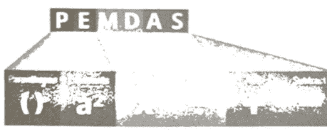

图 5.1：数学中的 PEMDAS 原则

| 优先级 | 运算符 | 描述 | 结合性 |
| --- | --- | --- | --- |
| 1 | () | 括号 | 从左到右 |
| 2 | [] | 数组下标 | 从左到右 |
| 3 | -> | 成员访问 | 从左到右 |
| 4 | ++ -- | 前/后置增/减 | 从左到右 |
| 5 | + - ! | 一元运算符 | 从右到左 |
| (type) | & | 取址与地址 | 从右到左 |
| 6 | * / % | 乘除 | 从左到右 |
| 7 | + - | 加减 | 从左到右 |
| 8 | >> | 移位 | 从左到右 |
| 9 | < <= >= | 关系运算符 | 从左到右 |
| 10 | == != | 等于与不等于 | 从左到右 |
| 11 | & | 位位与 | 从左到右 |
| 12 | ^ | 位位异或 | 从左到右 |
| 13 | \| | 位位或 | 从左到右 |
| 14 | && | 逻辑与 | 从左到右 |
| 15 | || | 逻辑或 | 从左到右 |
| 16 | ? | 条件运算符 | 从左到右 |
| 17 | = += -= *= /= | 赋值运算符 | 从右到左 |
| | % &= \|= ^= &= | | 从右到左 |
| | <<= >>= | | 从左到右 |

算术表达式可以涉及多个运算符来执行复杂的计算。程序员应该注意运算符的优先级和分组以以所需的结果。

```c
int result = a + b * c; // 先乘法后加法
```

## 表 5.3：某些表达式

| 表达式 | 值 |
| --- | --- |
| 3 + 2 * 3 | 9 |
| 9 / 3 - 2 | 1 |
| 5 * 2 - 4 | 11 |
| 4 + 37 % 2 - 2 | 3 |
| 6 / 3 + 3 * 3 | 11 |

## 表 5.4：带括号的某些表达式

| 表达式 | 值 |
| --- | --- |
| (3 + 2) * 3 | 15 |
| 15 / (5 - 2) | 5 |
| (5 + 5) * (4 - 2) | 20 |
| (4 + 7) % 3 - 1 | 1 |
| (8 - 4) * (4 + 12) / 4 | 16 |

算术表达式中的运算顺序至关重要。括号可以用于对操作分组并规定求值顺序。表 5.3 和表 5.4 显示了在算术运算中使用括号和不使用括号的影响。

```c
int result = (a + b) * c; // 先执行加法，然后乘法
```

## 5.2.4 一元表达式

C 中的一元表达式涉及对单个操作数的操作。以下是每个一元表达式的详细说明：

- **递增运算符**：递增运算符 (`++`) 将其操作数的值加 `1`。它可以作为前缀 (`++`) 或后置 (`x++`) 使用。当作为前缀使用时，`x` 的值在表达式之前增加。当作为后置使用时，`x` 的值在表达式之后增加。
- **递减运算符**：与递增运算符类似，递减运算符将其操作数的值减 `1`。它可以作为前缀 (`--`) 或后置 (`x--`) 使用，行为与递增运算符相同。
- **正号运算符**：正号运算符 (`+`) 用于显式指示数值表达式的正号。它不会改变值；将操作数作为正数返回。
- **负号运算符**：相反，负号运算符 (`-`) 用于显式指示数值表达式的负号。它取反操作数的值，使其变为负数。

以下是一个说明一元表达式使用的示例：

```c
#include <stdio.h>
int main() {
    int x = 5;

    // 递增运算符
    printf("Postfix increment: %d\n", x++); // 输出: 5
    printf("After postfix increment: %d\n", x); // 输出: 6

    // 递减运算符
    printf("Prefix decrement: %d\n", --x); // 输出: 5

    // 正号和负号运算符
    int y = 10;
    printf("Positive operator: %d\n", +y); // 输出: 10
    printf("Negative operator: %d\n", -y); // 输出: -10

    return 0;
}
```

## 5.3 位运算符

位运算符对整数数据进行逐位位的操作。通常使用 `unsigned char` 或 `unsigned int` 作为操作数，因为位被视为独立处理的，而不是数值的一部分。表 5.5 列出了 C 位运算符。

表 5.5：位运算符

| A | A&B | A|B | A^B | ~A |
| --- | --- | --- | --- | --- |
| 0 | 0 | 0 | 0 | 1 |
| 0 | 0 | 1 | 0 | 1 |
| 1 | 0 | 1 | 1 | 0 |
| 1 | 1 | 1 | 0 | 0 |

当处理位运算符时，我们通常有一个想要修改的位字节和一个掩码。位运算符是按位工作的。

### 5.3.1 位与运算符

位与运算符 (`&`) 在两个整数类型之间执行位与运算。当两个对应的位都为 `1` 时返回 `1`，否则返回 `0`。

示例：清除数据字节的 `4-7` 位。要清除位，在掩码的对应位上放置 `0`，其余放置 `1`。

```c
unsigned char data = 0xaa; // 1010 1010
unsigned char mask = 0xef; // 1110 1111
unsigned char result;
result = data & mask;      // 1010 0010 (0xa0)
```

### 5.3.2 位或运算符

位或运算符 (`|`) 在两个整数之间执行位或运算。当对应的位中任何一个为 `1` 时返回 `1`，否则返回 `0`。

示例：设置数据字节的 `0-3` 位。要设置位，在掩码的对应位上放置 `1`，其余放置 `0`。

```c
unsigned char data = 0xaa; // 1010 1010
unsigned char mask = 0xef; // 1110 1111
unsigned char result;
result = data | mask;      // 1010 1111 (0xaf)
```

### 5.3.3 位异或运算符

位异或 (`XOR`) 运算符 (`^`) 在两个整数之间执行位异或运算。当对应的位不同时返回 `1`，否则返回 `0`。

示例：翻转数据字节的 `0-3` 位。要翻转位，在掩码的对应位上放置 `1`，其余放置 `0`。

```c
unsigned char data = 0xaa; // 1010 1010
unsigned char mask = 0xef; // 1110 1111
unsigned char result;
result = data ^ mask;      // 1010 0101 (0xa5)
```

### 5.3.4 位取反运算符

位取反运算符 (`~`) 反转或翻转整数的位，将每个 `1` 变为 `0`，每个 `0` 变为 `1`。它称为位非运算符。

示例：翻转数据字节的所有位。

```c
unsigned char data = 0xaa; // 1010 1010
unsigned char result;
result = ~data;           // 0101 0101 (0x55)
```

## 5.3 位运算符

### 5.3.5 位移运算符 << >>

位移运算符 (`<<` 和 `>>`) 将整数的比特位按照指定的位数向左或向右移动。图 5.2 显示了该运算符如何对单比特移位工作。左移会在右侧插入 `0`。右移对符号数和无符号数的处理方式不同。对于无符号数据，右移会在左侧插入 `0`；对于有符号数据，则移动符号位（可能是 `0` 或 `1`）。

```
unsigned char data = 0x93;
unsigned char result;
result = data << 1;
```

```
unsigned char data = 0x93;
unsigned char result;
result = data >> 1;
```

```
char data = 0x93;
char result;
result = data >> 1;
```

图 5.2：移位操作

将值向左移位 `n` 位相当于将操作数乘以 `2ⁿ`。例如，执行 `8 << 1` 的结果与 `8 × 2` 相同。相反，将值向右移一位相当于将操作数除以 `8÷2`。因此，`8 >> 1` 产生相同的结果。以下是一些示例：

```
unsigned char a = 5; // binary: 00000101
unsigned char result1 = a << 2; // binary: 00100100 (20)
unsigned char result2 = a >> 1; // binary: 00000010 (2)
unsigned char b = 164; // binary: 10100100
unsigned char result3 = b << 2; // binary: 10010000 (144)
unsigned char result4 = b >> 1; // binary: 01010010 (82)
char c = 5; // binary: 00000101
char result5 = c << 2; // binary: 00100100 (20)
char result6 = c >> 1; // binary: 00000010 (2)
char d = -92; // binary: 10101100
char result7 = d << 2; // binary: 10001000 (-112)
char result8 = d >> 1; // binary: 11010110 (-46)
```

### 5.3.6 位运算符和移位运算符的应用

位运算符和移位运算符常用于优化整数算术。它们的应用包括用移位代替 `2` 的幂乘法，以及通过移位和加法的组合优化对特定常数的乘法。这些优化显著提高了整数算术性能，特别是在嵌入式系统等资源受限的环境中。

示例：仅使用移位和加操作将数字乘以 `5`。

```
unsigned char data = 5;
result = (data << 2) + data;
```

| n | 0 0 0 0 0 1 0 1 |
| :--- | :--- |
| <<2 | |
| 4n | 0 0 0 1 0 1 0 0 |
| | 0 0 0 0 1 0 0 1 |
| 5n | 0 0 0 1 1 0 0 1 |

示例：将字节中的两位打包 BCD（二进制编码的小数字）数转换为其二进制等效值。图 5.3 显示了该过程。

```
unsigned char bcd = 0x93;
unsigned char tens, ones, bin;

ones = bcd & 0xf;
tens = (bcd & 0xf0) >> 4;
bin = tens * 10 + ones;
```

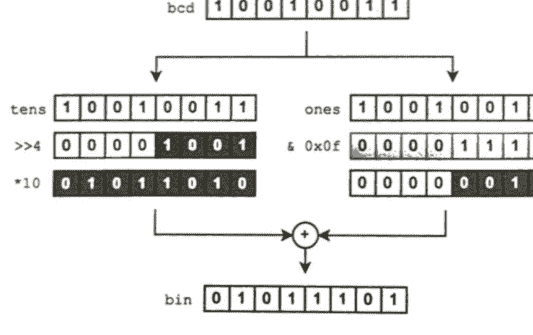

图 5.3：使用掩码、移位和加法进行 BCD 转二进制转换

你可以通过移位和加法代替乘以 `10` 来进一步优化步骤。然而，编译器可能会自动执行这种优化。

为了可读性，最好将步骤保持为独立的表达式，而不是将其合并为一个长表达式。这使得代码更容易阅读和理解。此外，无论如何编写，编译器都会对代码进行优化，因此生成的机器码没有区别。

## 5.4 类型转换

程序运行时，可能会出现需要转换数据类型以执行不同类型之间操作的情况。本节探讨了 C语言中的类型转换和强制转换，这是确保正确处理数据类型的基本概念。

将较小的数据类型转换为较大的类型称为类型提升（`type promotion`）。另一方面，降级（`demotion`）意味着将较大的类型转换为较小的类型。降级必须小心进行，因为它可能会导致数据丢失。请参考图 5.4 数据类型排序。

### 5.4.1 自动类型转换

自动类型转换也称为强制（`coercion`）或隐式类型转换，发生在操作涉及不同类型时。这种转换由编译器处理，编译器在执行操作之前会将一个或多个操作数提升或降级公共类型。编译器遵循特定规则来确定结果数据类型，通常在需要时提升为高精度类型。这些规则包括：

- 1. 如 `char`、`short`、`unsigned short` 等数据类型会自动提升为 `int`。
- 2. 当对不同类型的值进行操作时，较低的类型会被提升为较高的类型。
- 3. 使用赋值运算符 (`=`) 时，右侧表达式的类型被转换为左侧变量的类型。

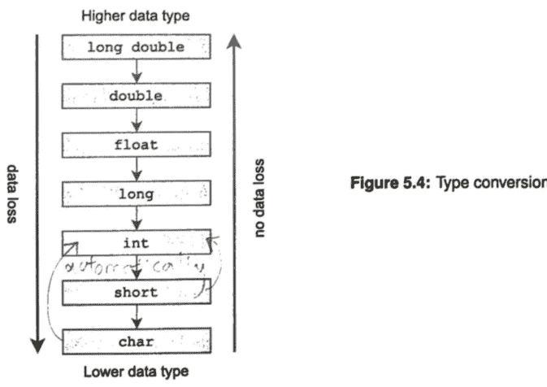

例如，考虑以下代码：

```
int num1 = 7;
float num2 = 2;
float result = num1 / num2;
```

在此示例中，`num1` 在执行除法操作之前自动转换为 `float`。这是因为除法表达式中的两个操作数的类型必须相同。由于 `num2` 是 `float`，`num1` 被隐式强制转换为 `float` 以确保数据类型正确。

自动类型转换试图在 C 程序的计算中保持一致性和准确性。然而，程序员需要注意这些转换以避免意外错误。

### 5.4.2 显式类型转换

显式转换也称为强制转换（`casting`），是将一种类型转换为另一种类型的方法。强制转换的语法如下：

`(type) value`

显式转换在需要指定目标数据类型的情况下非常有用。它允许控制值的转换方式。

考虑以下代码段：

```
int num1 = 5, num2 = 2;
float result = num1 / num2; // answer 2.000
float result = (float)num1 / num2; // answer 2.500
```

在这种情况下，在显式转换为整数时，小数部分被截断。

## 5.5.3 整数特性

C语言中的整数除法与浮点除法不同，可能会导致截断问题。考虑以下示例：

```c
int a = 5 / 2;           // 结果为 2
float b = 5 / 2;       // 结果为 2.0
float c = (float)5 / 2; // 结果为 2.5
float d = 5 / 2;       // 结果为 2.5
float e = 5 / 2;       // 结果为 2.5
```

在上述代码中，表达式 `5 / 2` 执行除法，导致结果赋值给整数变量，商数为 `2`。当将结果赋值给浮点变量（如 `b`）时，这可能是预期的。但在将结果赋值……时可能会令人意料。

当除法结果被强制转换为整数时，会发生截断，丢任何小数部分。在示例中，除法的小数部分被丢弃，因为结果被赋值了一个整数变量。为了获得浮点结果，操作数中至少应有一个是浮点类型。

为了确保浮点除法，操作数中至少必须有一个 `float`。这可以通过在任意数字末尾添加句点或通过将一个操作数显式强制转换为 `(float)` 来实现。

意识到这种行为很重要，以避免在C中执行除法时出现意外结果，特别是在处理混合数据类型时。

## 5.5.4 溢出与下溢

溢出和下溢发生在算术运算中，其结果超过了数据类型能表示的最大或或值。

当发生上溢时，值变得太大，变量无法持有；而当发生下溢时，值变得太小。在这种情况下，变量的值会在可能值的取值范围内“回绕”。

下面是一个演示C语言中溢出和下溢的简化示例：


```c
#include <stdio.h>

int main() {
    char c;

    // 溢出示例
    c = 127;
    printf("Value before increment: %d\n", c);
    c++;
    printf("Value after increment: %d\n", c);

    // 下溢示例
    c = -128;
    printf("Value before decrement: %d\n", c);
    c--;
}
```

## 5.6. 微控制器上的算术挑战

```c
    printf("Value after decrement: %d\n", c);

    return 0;
}
```

代码列表 5.2: https://onecompiler.com/c/426u2cbgs

输出：

Value before increment: 127

Value after increment: -128

Value before decrement: -128

Value after decrement: 127

- `char` 是一个8位有符号类型，范围从 -128 到 127

- 递加 127 会溢出为 -128（回绕）

- 递减 -128 会下溢为 127（反回绕）

这段代码演示了一个常见场景，但在不同的平台上可能不会总是产生相同的结果。程序员必须使用适当的数据类型以避免获得意外的值。

基于微控制器的嵌入式系统的算术运算比个人电脑上更具挑战性。我们通常不会考虑计算机的事情，如数据类型和操作符，变得更加重要并需要特别关注。

### 5.6.1 整数数据类型与操作

在嵌入式系统编程中，整数数据类型至关重要，但它们带来了一些挑战。嵌入式系统中C整数数据类型的一些问题包括：

- 内存和处理能力有限：嵌入式系统通常内存和处理能力有限，限制了整数值的大小和精度。

- 硬件特定限制：某些嵌入式系统具有特定的限制，例如对某些所谓的常用操作（如乘法和除法）支持有限。例如，某些微控制器可能没有硬件加速乘法。

- 整数提升与转换：整数提升和转换可能会导致意外。

嵌入式系统编程中的常用做法是使用固定大小的整数数据类型（`uint8_t`, `uint32_t`）。表 5.6：固定大小整数数据类型

| 数据类型 | 范围 |
| --- | --- |
| uint8_t | 0 到 255 |
| int8_t | -128 到 127 |
| uint16_t | 0 到 65535 |
| int16_t | -32768 到 32767 |
| uint32_t | 0 到 4294967295 |
| int32_t | -2147483648 到 2147483647 |
| uint64_t | 0 到 18446744073709551615 |
| int64_t | -9223372036854775808 到 9223372036854775807 |

- **可预测性**：固定大小类型确保了跨平台的一致性。

- **内存效率**：通过选择最小类型，可以节省内存。

- **可移植性**：固定大小类型在不同的编译器上工作方式相同。

- **安全性**：固定大小类型有助于避免溢出和下溢。

## 表 5.7: 选定微控制器的运算硬件支持

| 开发板 | 微控制器 | 字长 | 整数加/减 | 整数乘法 | 整数除法 | 单精度浮点数 | 双精度浮点数 |
|---|---|---|---|---|---|---|---|
| Arduino Uno R3 | Atmega328P | 8 | | | | | |
| Seeduino XIAO | ARM Cortex-M0+ | 32 | | | | | |
| Seeduino XIAO ESP32C3 | RISC-V (RV32IMC) | 32 | | | | | |
| Blue Pill | ARM Cortex-M3 | 32 | | | | | |
| NodeMCU | ESP8266 | 32 | | | | | |
| Arduino Uno R4 | ARM Cortex-M4F | 32 | | | | | |
| M5Stack | ESP32 | 32 | | | | | |
| Raspberry Pi 5* | ARM Cortex-A76 | 64 | | | | | |

* 不是微控制器；列出仅用于对比

## 总结

在编程中，数据处理表达式用于根据变化的输入来计算值。为了确保代码无 bug，理解变量和数值概念至关重要，特别是在处理嵌入式系统中。本章重点关注 C 算术运算符和位运算符。在决策结构中有用的逻辑运算符和三元运算符将在第 7 章介绍。

## 问题

- 5.1 什么是取模运算？在 C 中如何执行它？

- 5.2 整数除法与浮点除法的效果有什么区别？

- 5.3 编写一个 C 程序，演示算术运算中隐式类型转换为整数的示例。

- 5.4 在 C 中如何将字符转换为整数？

- 5.5 编写一个 C 程序，演示将浮点数转换为整数时的精度损失。

- 5.6 编写一个 C 程序，将华氏度转换为摄氏度。

- 5.7 编写一个 C 程序，提取整数的最低字节（位 0-7）并加上第二个最低字节（位 8-15）的值。

- 5.8 仅使用移位和加法运算符将数字乘以 10。

- 5.9 π 的值可以用 355/113 近似。编写一个 C 程序，仅使用整数根据给定半径计算圆周长。

- 5.10 编写一个 C 程序，故意除以 0。运行时会发生什么？

## 第 6 章

## 标准输入/输出

在本章中，我们将介绍使用标准输入 (`stdin`) 和输出设备 (`stdout`) 进行输入输出的基本 C 函数。我们将介绍如 `printf()` 和 `scanf()` 等常用函数，以及使用 `putchar()` 和 `getchar()` 进行字符级输入输出。这些函数是 C 编程中的重要构建模块，因为它们允许你为程序创建用户界面。

## 6.1 使用 printf 进行输出格式

在本节中，我们将深入研究强大的 `printf` 函数，它的含义是“格式化打印”（print formatted）。该函数允许你以特定的格式在屏幕上显示数据。让我们探索它的语法和各种格式选项。

### 6.1.1 基础语法

`printf` 函数的基本语法为：

```
printf(format_string, arg1, arg2, ...);
```

其中：

- `format_string` 是指定输出格式的字符串。

- `arg1`, `arg2` 等是需要进行格式化并打印的值。变量的数量必须与 `format_string` 中格式占位符的数量匹配。

假设你想分行打印一个人的名字和年龄。以下是你可以使用 `printf` 的方法：

```
int age = 30;
char name[] = "Alice";
printf("Name: %s\nAge: %d\n", name, age);
```

在这里，格式字符串指定了两个占位符：`%s` 用于字符串，`%d` 用于整数。每个格式占位符后的 `\n` 添加了换行符，将 `name` 和 `age` 分在不同行。这些占位符产生了输出：

Name: Alice

Age: 30

### 6.1.2 格式占位符

格式占位符是格式字符串中的占位符，指示对应参数的类型和格式。一些常用的格式占位符包括：

## 第 6 章 标准输入输出

| 格式占位符 | 输出 |
|---|---|
| %% | 百分号 (%) |
| %%c | 字符 |
| %%d, %%i | 有符号整数 |
| %%e, %%f, %%g | 浮点数 |
| %%s | 字符串 |
| %%x, %%X | 十进制 |
| %%o | 八进制 |
| %%p | 指针 |
| %%u | 无符号整数 |
| %%ld, %%lu | 长整数 |

### 6.1.3 宽度和精度

你可以使用以下语法指定输出的宽度和精度：

```
printf("%width.precisionf", value);
```

在这里，`width` 指定最小宽度，`precision` 指定浮点数小数点后的数字位数。

### 6.1.4 标志

标志修改输出格式。一些常用的标志包括：

| 字符 | 目的 |
|---|---|
| - | 输出左对齐 |
| + | 始终显示符号（即使是正数时） |
| 0 | 用零填充空格 |
| : | 控制浮点数的小位数 |
| w | 输出的最小宽度 |

### 6.1.5 转义序列

在 `printf` 中，反斜杠 (`\`) 标记字符串内特殊效果的开始。反斜杠后的字符被称为转义序列，用于触发特定效果。一些常见的转义序列包括：

## 6.2 浮点数

| 转义字符 | 输出 |
|---|---|
| \n | 换行 |
| \t | 水平制表 |
| \r | 回车 |
| \b | 退格 |
| \f | 换页 |
| \" | 双引号 |
| \' | 单引号 |
| \\ | 反斜杠 |
| \theta | 空字符 (ASCII 值 0) |
| \a | 警报/蜂鸣 |
| \v | 垂直制表 |
| \xhh | 十进制 |
| \000 | 八进制 |

### 6.1.6 示例

以下是用 `printf` 格式化输出的一些示例：

```
printf("%d\n", alpha);      // 使用 2 列
printf("%5d\n", alpha);     // 前导 3 个空格
printf("%-5d\n", alpha);    // 尾 3 个空格
printf("%05d\n", alpha);    // 前导 3 个零
```

结果输出：

| 25 |
| 25 |
| 25 |
| 00025 |

## 6.2 打印浮点数

以下是在 C 中打印浮点数的格式占位符：

| 格式占位符 | 目的 |
|---|---|
| %%f | 单精度 |
| %%lf | 双精度 |
| %.n | n 是小数点后的数字位数 |
| %%e 或 %%E | 科学计数法 |
| %.w | w 是字段宽度 |
| %%g | %f 或 %e，取较短的者 |

在 C 中，浮点数可以使用 `float` 或 `double` 类型表示。`float` 通常具有 6-7 位小数精度，而 `double` 具有 15-16 位小数精度。

默认情况下，浮点数是 `double`，除非你添加 'f' 或 'F' 将其变为 `float`。因此，`3.75` 是 `double`，而 `3.75f` 或 `3.75F` 是 `float`。大多数计算通常使用双精度。但如果你需要存储大量数字并容忍较低精度，`float` 可以节省存储。

以下是用两种数据类型存储并打印 π 的方法：

```
float pi_float = 3.141593;
printf("%.f\n", pi_float); // 输出: 3.141593
```

```
double pi_double = 3.141592653589793;
printf("%.15f\n", pi_double); // 输出: 3.141592653589793
```

`%f` 将数字指定为单精度浮点。由于 `float` 只有6-7 位精度，提供更精确的 π 值仍然产生相同的输出。使用 `%E` 会给你相同的精度。`%.15f` 指定以 15 位数字精度打印数字。如果你在打印 `double` 时使用了 `float` 的占位符，输出可能是不可预测的。

`%e` 和 `%E` 格式占位符用于以科学计数法打印浮点数。它以 $mx \times 10^n$ 的形式表示数字，其中 m 和 n 是整数。

```
double num = 1234.56789;
printf("%e", num); // 输出: 1.234568e+03
```

在此示例中，`%e` 用于打印变量 `num`。数字 1234.56789 以科学计数法表示为 1.234568e+03，即 $1.234568 \times 10^3$。

`%g` 占位符用于以 `%f` 或 `%e` 格式打印浮点数，更短且精确。

这里有一个示例：

```
double num = 1234.56789;
printf("%g", num); // 输出: 1234.57
```

在此示例中，`%g` 用于打印变量 `num`。由于数字较大，默认情况下以 `%f` 格式打印 6 位有效数字，导致输出“1234.57”。

## 6.3 使用 scanf 处理输入

`scanf` 函数用于从标准输入设备（通常是键盘）读取输入。它允许程序员捕获用户输入的数据，并将用户输入的值存储到变量中。

### 6.3.1 基础语法

`scanf` 函数的基础语法如下：

```
scanf(format_string, arg1, arg2, ...);
```

其中：

- `format_string` 是一个字符串，用于指定每个变量预期的数据类型，类似于 `printf` 中的占位符。常见示例包括用于整数的 `%d`，用于浮点数的 `%f` 以及用于字符串的 `%s`。

- `arg1`, `arg2` 等，是用于存储读取读取数据的变量。变量的数量必须与 `format_string` 中格式说明符的数量相匹配。

来自格式字符串的参数告诉程序将值存储在何处。为了为变量存储输入内容，我们编写 `&a`，它代表“a 的地址”。请记住，这仅适用于 `scanf` 以指定单个数据项的位置；在代码的其他部分进行普通变量使用时不需要它。数组和字符串也不需要 `&` 运算符。

这里有一个根据边长计算正方形面积的示例：

```c
#include <stdio.h>

int main() {
    int side, area;

    printf("Enter the length of a side: ");
    // 读取用户输入的边长
    scanf("%d", &side);

    // 计算正方形面积
    area = side * side;

    // 打印计算出的面积
    printf("The area of the square with side %d is: %d\n", side, area);

    return 0;
}
```

在此示例中：

- 我们声明了两个变量：`side` 用于存储用户输入的边长，`area` 用于存储计算出的面积。

- `printf` 语句提示用户输入边长。

- `scanf` 函数使用 `%d` 格式说明符读取用户输入的整数，并将其存储在 `side` 变量中。

- 我们使用公式 `side * side` 计算正方形面积，并将结果存储在 `area` 变量中。

- 最后，我们使用 `printf` 打印计算出的面积以及边长。

## 6.3.2 使用 scanf 的注意事项

`scanf` 函数是一个用于获取用户输入的函数，但使用起来可能很复杂。以下是需要注意的列表：

- **多重输入**：`scanf` 可以读取由空白字符（如空格、制表符和换行符）分隔的多个输入。

- **空白字符处理**：默认情况下，`scanf` 在尝试读取输入之前会跳过前导空白字符，这有时会导致意外的结果，特别是在处理字符或字符串输入时。

- **缓冲问题**：`scanf` 从输入流中读取字符并将其存储在内部缓冲区中，直到匹配整个格式。如果发生不匹配，它可能会在输入流中留下字符，从而影响后续的输入。

- **换行符处理**：在用户按下回车键后，`scanf` 在缓冲区中保留一个末尾的换行符。刷新输入流可以确保操作顺畅，并防止残留字符的干扰。

- **返回值**：`scanf` 函数返回成功匹配并赋值的输入项数量。验证此值可以确保输入操作的正确。

虽然 `scanf` 在交互式输入方面非常灵活，但很好地理解它对于避免问题和保持程序顺利运行至关重要。为了降低程序崩溃的风险，请考虑将 `scanf` 配合 *fgets* 使用。

## 6.4 读取字符串

在 C 语言中读取字符串，可以使用带有 `%s` 格式说明符的 `scanf`。然而，请注意，`scanf` 在遇到空白字符时会停止读取字符，因此它每次只读取一个单词。这里有一个简化的示例：

```c
#include <stdio.h>

int main() {
    char str[50]; // 假设字符串最大长度为 49 个字符

    printf("Enter a string: \n");
    scanf("%s", str);

    printf("You entered: %s\n", str);

    return 0;
}
```

在此示例中：

- 我们声明了一个字符数组 `str` 来存储用户输入的字符串。数组的大小（此处为 50）应该足够大，以容纳预期的最大长度，包括空终止符。注意，与输入整数不同，我们不需要在变量名上加上 `&` 修饰符。

- 我们使用 `printf` 提示用户输入字符串。

- 我们使用带有 `%s` 格式说明符的 `scanf` 读取用户输入的字符串。`scanf` 将读取字符直到遇到空白字符（空格、制表符、换行符等）或输入结束。`scanf` 读取的字符串存储在 `str` 数组中。

- 最后，我们使用 `printf` 打印字符串。

在 `scanf` 中使用 `%s` 可能是不安全的，如果没有限制读取字符的数量，输入字符串超过了数组大小，可能会导致缓冲区溢出。为了降低这种风险，请在格式字符串中指定最大字段宽度，例如 `%49`，以便为空终止符留出一个空间。

为了避免潜在问题，最好避免使用 `scanf` 读取字符串。相反，你可以通过结合 `fgets` 和 `scanf` 函数来使用更安全的方法。以下是简要说明：

- `fgets`：此函数将整行用户输入读取到字符缓冲区中，通过将输入大小限制为缓冲区容量来防止缓冲区溢出。

- `scanf`：在捕获输入行后，`scanf` 根据指定的格式说明符对其进行解析，在不直接从 `stdin` 读取的情况下提取所需的数据。

这里有一个简单的代码示例：


```c
#include <stdio.h>

int main() {
    char input[100]; // 假设最大输入长度为 99 个字符
    char str[50]; // 假设字符串最大长度为 49 个字符

    printf("Enter a string: ");
    fgets(input, sizeof(input), stdin); // 读取一行用户输入

    // 使用 sscanf 解析 input 并提取出字符串
    sscanf(input, "%49[^\n]", str); // %[^\n] 读取直到换行符或 EOF，
                                // 限制输入为 49 个字符

    printf("You entered: %s\n", str);

    return 0;
}
```

在此示例中：

- 我们声明了两个字符数组：`input` 用于存储用户的输入行，`str` 用于存储提取出的字符串。
- `fgets` 从用户处读取一行输入，将输入限制为输入数组的大小以防止缓冲区溢出。
- `scanf` 解析存储在 `input` 中的字符串，根据指定的格式字符串 `%49[^^\n]` 提取字符串。该格式说明符读取字符直到遇到换行符或输入结束，但不包括换行符本身。我们将输入限制为 49 个字符，以确保为空终止符留出空间。
- 最后，我们使用 `printf` 打印字符串。

如果你永远不需要输入，这种方法可能显得多此此。在这种情况下，使用 `scanf` 会更合适。

## 6.5 简单的字符串输出

C 语言中的 `puts()` 函数是打印字符串并添加换行符的简单方法。`puts()` 只接受一个参数：指向空终止字符串的指针。它会自动在字符串末尾添加换行符 `\n`，省去了你手动操作的麻烦。

```c
#include <stdio.h>

int main() {
    const char str[] = "Hello World";

    puts(str);

    return 0;
}
```

在此示例中，`puts()` 打印 `"Hello World"` 并跟随一个换行符。它返回 12，即打印的字符数。

当你只需要打印字符串而不进行任何格式化或处理时，该函数是一个实用的选择。事实上，它是无法格式化的。它内置的换行符处理使其在某些情况下比 `printf` 更好。

## 6.6 字符输入与输出

`getchar()` 和 `putchar()` 函数允许对单个字符进行简单的输入输出。

`getchar()` 函数从标准输入流检索单个字符并以整数形式返回其 ASCII 值。可以在循环中使用读取多个字符，直到满足预定义的条件。例如，下面的代码段读取用户的字符直到按下回车键：

```c
int ch;
while ((ch = getchar()) != '\n') {
    // 处理字符
}
```

相反，`putchar()` 函数将单个字符发送到标准输出流（通常是控制台）。它接受一个整数参数，指定要显示的字符的 ASCII 值。例如，下面的代码段在控制台上显示大写写字母表：

```c
int ch;
for (ch = 'A'; ch <= 'Z'; ch++) {
    putchar(ch);
}
```

`getchar()` 和 `putchar()` 都提供了简单且高效的字符级输入输出操作。它们特别适用于处理

# 第 6 章 标准输入/输出

交互式程序或需要对输入和输出流进行精确控制时。

## 总结

在本章中，我们探索了 C 语言中与输入输出相关的核心概念。我们讨论了用于格式化输出的强大函数 `printf` 和用于格式化输入的 `scanf` 函数，使用了它们的语法、格式说明符和转义序列。此外，我们还提到了使用 `putchar` 和 `getchar` 进行基于字符的输入和输出。

## 问题

- 6.1 如何使用 `printf` 打印整数变量 `num` 的值？
- 6.2 `printf` 中格式说明符 `%d` 的作用是什么？
- 6.3 `getchar` 函数的返回类型是什么？
- 6.4 如何使用 `printf` 格式化并打印保留两位小数浮点数 `num`？
- 6.5 如何使用 `printf` 在控制台上显示字符串 `str`？
- 6.6 如何使用 `puts` 在控制台上显示字符串 `str`？
- 6.7 打印字符串时，`printf` 和 `puts` 有什么区别？
- 6.8 如何使用 `printf` 显示带有双引号的字符串 `"Hello"`？
- 6.9 从标准输入读取字符串时，缓冲区 `buffer` 的作用是什么？
- 6.10 下述代码段的输出是什么？请解释原因。

```c
int num = 5;
printf("The value is: %f\n", num);
```

- 6.11 识别以下代码中的问题并修复修复：

```c
char str[10];
scanf("%s", str);
printf("You entered: %s\n", str);
```

- 6.12 为什么这段代码只捕获输入的第一个单词（例如，“Hello World" 变成了 "Hello"）？如何修复它以读取整行？

```c
#include <stdio.h>

int main() {
    char str[50];
    printf("Enter a sentence: ");
    scanf("%s", str);
    printf("You entered: %s\n", str);
    return 0;
}
```

# 第 7 章 选择逻辑

本章侧重于 C 语言编程中的决策。我们将涵盖不同的决策结构、它们的用途以及求值规则，使你能够创建更复杂的决策结构、处理数据并改进程序逻辑。

## 7.1 布尔表达式

布尔表达式（以英国数学家乔治·布尔 George Boole 命名）用于控制程序流。它们通常被用于检查条件。程序可以通过测试条件来决定采取什么操作。最基础的布尔表达式是比较两个值的表达式。表 7.1 列出了 C 语言的关系运算符。

表 7.1：C 关系运算符

| 运算符 | 示例 | 含义 |
| :--- | :--- | :--- |
| == | a == b | 如果 a 等于 b 则为真 |
| != | a != b | 如果 a 不等于 b 则为真 |
| > | a > b | 如果 a 大于 b 则为真 |
| < | a < b | 如果 a 小于 b 则为真 |
| >= | a >= b | 如果 a 大于或等于 b 则为真 |
| <= | a <= b | 如果 a 小于或等于 b 则为真 |

非常重要的一点是，相等性使用双等号。单等号是赋值操作。不要想成“等于”，要想成“相同”，每个词对应一个符号。

关系运算符帮助我们创建基础条件。然而，有时我们需要检查是否一件事为真 **且** 另一件事也为真，或者两个事物中是否有一个为真。对于这些情况，我们使用复合逻辑运算符，如 AND（与）、OR（或）和 NOT（非）。表 7.2 列出了 C 逻辑运算符。

表 7.2：C 逻辑运算符

| 运算符 | 描述 | 示例 | 含义 |
| :--- | :--- | :--- | :--- |
| && | 逻辑与 | a && b | 如果 a 和 b 都为真则为真 |
| || | 逻辑或 | a || b | 如果 a 或 b 其中之一为真则为真 |
| ! | 逻辑非 | !a | 如果 a 为假（取反）则为真 |

C 语言没有专门的布尔数据类型，因此用 1 表示真，0 表示假。C 语言中的逻辑运算符将任何非零值视为真，将零视为假。

# 第 7 章 选择逻辑

表 7.3：关系、逻辑和位运算符运算符的影响

```c
unsigned char a = 6; // 00000110
unsigned char b = 3; // 00000011
unsigned char c = 0; // 00000000
表达式 布尔值 d 的数值值
d = a == b; False 0
d = a = b; True 3
d = a != b; True 1
d = a > b; True 1
d = a < b; False 0
d = a && b; True 1
d = a && c; False 0
d = a || b; True 2
d = a || c; True 1
d = a | b; True 7
d = !a; False 249
d = !c; True 1
d = -c; True 255
```

C 语言中的关系运算符和逻辑运算符用于决策结构并产生布尔结果。虽然逻辑 AND、OR 和 NOT 的符号看起来相似，但它们产生不同的输出。表 7.3 给出了一些示例。表中混入了一些无关的运算符，以验证你对 C 语言的理解！

值得提醒的是，关系运算符和逻辑运算符的输出并不是为了存储在变量中，而是用于如下语句：

```c
if (a == b) {
    printf("a is the same as b");
}
```

图 7.1 总结了所有的决策结构。我们将从最简单的 `if` 结构开始。

## 7.2 if 结构

`if` 语句是一种基本的控制结构，允许程序根据特定条件做出决策。它允许程序仅在指定条件为真时执行代码块。`if` 结构的流程图、语法和伪代码总结在图 7.2 中。语法如下：

```c
if (condition) {
    // 如果真则执行的代码
}
```

图 7.1：C 决策结构

### 7.2. if 结构

`if` 单词和条件周围的括号是必须的。条件必须求值为一个布尔真或假值，这是通过使用 `==`、`!=`、`>`、`<` 等关系运算符比较值来实现的。如果条件为真，大括号括起来的代码块将执行。如果条件为假，则跳过该代码块。虽然当每个块中只有一个语句时可以省略大括号，但建议保留它们以获得更好的可读性并避免潜在错误。例如，如果一个学生的考试成绩是 50 分或以上，他们通过了。在 C 语言中，写法如下：

```c
#include <stdio.h>

int main() {
    int grade;

    // 提示用户输入最近的成绩
    printf("Enter your latest test grade: ");
    scanf("%d", &grade);

    // 检查成绩是否 >= 50
    if (grade >= 50) {
        printf("Congratulations! You pass.\n");
    }
    
    return 0;
}
```

```text
if (condition) {
  // if 代码
}
IF (condition) THEN
  if 代码
ENDIF
```

图 7.2：if-then 控制流

下面是更多演示在条件检查中使用逻辑运算符的示例：

```c
if (a == 6) ... // 如果 a 等于 6 则执行
if (b != 7) ... // 如果 b 不等于 7 则执行
if (c > 50) ... // 如果 c 大于 50 则执行
if (d <= 9) ... // 如果 d 小于等于 9 则执行
```

### 7.2.1 执行语句块

`if` 单词和条件周围的括号是必须的。条件必须求值为一个布尔真或假值，这是通过使用 `==`、`!=`、`>`、`<` 等关系运算符比较值来实现的。如果条件为真，大括号括起来的代码块将执行。如果条件为假，则跳过该代码块。虽然当每个块中只有一个语句时可以省略大括号，但建议保留它们以获得更好的可读性并避免潜在错误。假设我们要确保 a < b。我们要：

```c
if (a < b) { // 如果 a < b
    t = a; // 临时变量
    a = b; // 更新 a
}
```

这是在伪代码中写代码块：

```text
IF <condition> THEN
  <statement1>
  <statement2>
ENDIF
```

在伪代码中，程序员为了方便使用 "endif"，它不是 C 的关键字。

### 7.2.2 复合条件

逻辑运算符如 `&&`（逻辑与）、`||`（逻辑或）和 `!`（逻辑非）用于通过组合简单条件创建复合条件。下面是演示条件检查中使用逻辑运算符的示例：

```c
if (a == 6) && (b != 7) ... // 如果 a 是 6 且 b 不等于 7
if (a == 6) || (b != 7) ... // 如果 a 是 6 或 b 不等于 7
```

## 7.3 if-else 结构

`if-else` 结构允许根据布尔表达式进一步控制程序流。它允许在原始条件为假时执行替代代码。

通常你会希望在条件为真时运行代码，但用不同的代码处理假的情况。这就是 `if-else` 的用用场。`if-else` 语句的基本语法为：

```c
if (condition) {
    // 如果条件为真时执行的代码
} else {
    // 如果条件为假时执行的代码
}
```

如果条件为真，代码块 1 将执行。如果条件为假，程序将跳过块 1 而执行块 2。这提供了一种根据检查条件的真值具有不同代码路径的方法。例如，如果一个学生的考试成绩是 50 分或以上，他们通过了；否则，不及格。在 C 语言中，写法如下：

```c
#include <stdio.h>

int main() {
    int grade;

    // 提示用户输入最近的成绩
    printf("Enter your latest test grade: ");
    scanf("%d", &grade);

    // 检查成绩是否 >= 50
    if (grade >= 50) {
        printf("Congratulations! You pass.\n");
    } else {
        printf("Sorry, you did not pass.\n");
    }

    return 0;
}
```

## 第7章. 选择逻辑

```c
if (condition) {
  // if code
} else {
  // else code
}
```

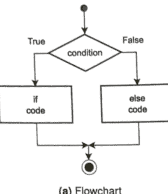

(a) 流程图

(b) 伪代码

图 7.3: if-else 控制流

(b) 语法

```
IF (condition) THEN
  if code
ELSE
  else code
ENDIF
```

等等，我将根据文本流对逻辑进行重新排序：

## 可读性考虑

在使用 if-else 结构时，考虑哪种条件通过两个清晰的选择来增强可读性至关重要。例如，看看以下示例：

```c
if( grade >= 50 )
  printf("You pass\n");
else
  printf("You fail\n");
```

```c
if( grade < 50 )
  printf("You fail\n");
else
  printf("You pass\n");
```

在第一个示例中，条件 `grade >= 50` 关注及格场景，使其更加直观且一眼一目了然。相反，第二个示例突出了条件 `grade < 50` 的场景。

通过以强调预期结果的方式来组织你的条件，你可以增强代码的清晰度。

### 7.4 if-else 阶梯（Ladder）

if-else 阶梯是一种编程结构，允许以结构化和组织化的方式基于多个条件处理决策。

在某些场景下，程序的输出取决于顺序评估几个因素。if-else 阶梯通过使用 if-else 语句链来实现这一点。

以下是它的工作原理：

## 7.4. if-else 阶梯

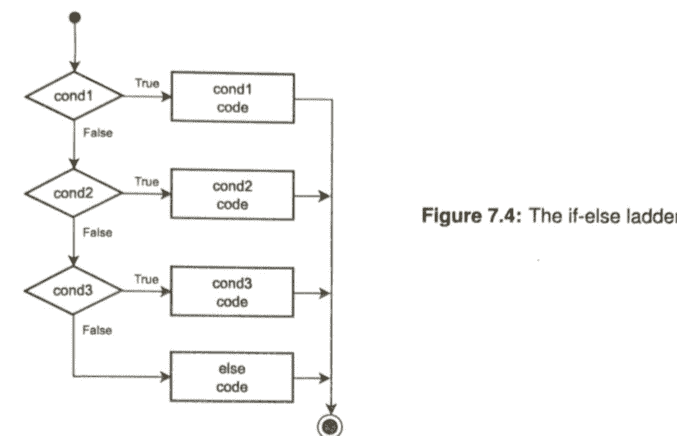

- 1. 使用 `if` 语句检查第一个条件。
- 2. 如果条件为假，则使用 `else if` 语句检查下一个条件。
- 3. 这种 `else if` 语句的链对于每个需要评估的额外条件都会继续。
- 4. 最后，使用 `else` 语句处理最后一种情况，涵盖所有剩余的可能。

例如：

```c
if (temp > 30) {
  // hot case
} else if (temp > 20) {
  // warm case
} else if (temp > 10) {
  // mild case
} else {
  // cold case
}
```

在这个示例中，使用 if-else 阶梯根据温度范围对天气状况进行分类。

在处理多步决策过程时，if-else 阶梯提高了代码的组织性和可读性。条件从上到下逐一评估，直到找到匹配的条件。这种结构允许对复杂的条件逻辑进行逻辑结构化，使代码更易理解和维护。

作为一个额外的示例，考虑使用 if-else 阶梯根据测试分数分配字母等级（A, B, C 和 F）。这演示了 if-else 阶梯如何有效处理多阶段的决策场景。

```c
#include <stdio.h>

int main() {
    int score;

    // 提示用户输入测试分数
    printf("Enter your test score: %d", score);
    scanf("%d", &score);

    // 根据测试分数分配字母等级
    if (score >= 80) {
        printf("Your grade is: A\n");
    } else if (score >= 65) {
        printf("Your grade is: B\n");
    } else if (score >= 50) {
        printf("Your grade is: C\n");
    } else {
        printf("Your grade is: F\n");
    }

    return 0;
}
```


当结果取决于必须顺序评估的`互斥条件`时，就会使用 if-else 阶梯。

## 7.5 嵌套 if 结构

当我们需要根据多个条件做出决策时，会使用嵌套 if-else 语句，其中每个条件依赖于上一个条件的结果。这创建了一个分级结构，if-else 语句嵌套在彼此内部。考虑以下程序：

```c
#include <stdio.h>

int main() {
    int age;

    printf("Enter your age: %d", age);
    scanf("%d", &age);

    if (age >= 18) {
        printf("You are an adult.\n");
        if (age >= 65) {
            printf("You are also a senior citizen.\n");
        }
    } else {
        printf("You are not an adult.\n");
    }

    return 0;
}
```

### 7.5.1 嵌套 if 结构

代码包含一个嵌套 if 语句。外层 if 语句检查用户是否为 18 岁或以上。如果是，则嵌套 if 语句将检查用户年龄是否为 65 岁或以上。

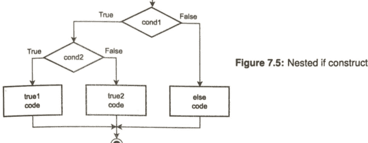

以下程序稍微复杂：

```c
#include <stdio.h>

int main() {
    int a, b, c;

    // 请求用户输入三角形三边的长度
    printf("Enter the lengths of three sides of a triangle: ");
    scanf("%d %d %d", &a, &b, &c);

    if (a + b > c && a + c > b && b + c > a) {
        printf("This is a triangle.\n");
        if (a == b && b == c) {
            printf("It is an equilateral triangle.\n");
        } else if (a == b || b == c || a == c) {
            printf("It is an isosceles triangle.\n");
        } else {
            printf("It is a scalene triangle.\n");
        }
    } else {
        printf("This is not a triangle.\n");
    }

    return 0;
}
```

## 7.6 switch 结构

`switch` 语句用于在多个代码块中执行一个。它是多个 if-else 语句的替代方案。

```c
switch (expression) {
  case value1:
    // code
    break;
  default:
    // code
}
```
在 `switch` 语句中，表达式被评估并与 case 值进行比较。如果找到了匹配项，执行相应的代码块。如果没有找到匹配项，执行 default 代码块（如果包含）。

为了防止意外运行下一个 case，每个 case 都应该以 `break` 语句结束。`default` case 是可选的，在没有匹配时提供备选。

`switch` 语句在有很多可能情况的情况下特别有用，因为它们使代码清晰且易于管理。

以下是 `switch` 和 if-else 的比较：

- `switch` 提供了一种清晰、组织化的方式来处理多个情况，而 if-else 会变得冗长。
- `switch` 直接比较表达式和 case，而 if-else 允许复杂的条件。
- `switch` 适用于整数、字符或枚举，而 if-else 可以处理其他类型。
- `switch` 跳到匹配的 case，而 if-else 逐一评估直到找到匹配或到达 else。

### 7.6.1 switch 结构

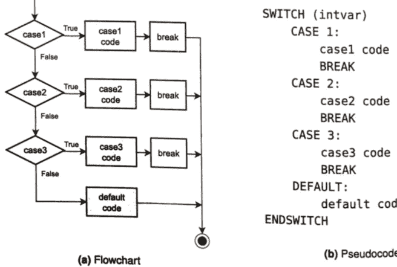

```
SWITCH (var)
  CASE 1:
    case1
    BREAK
  CASE 2:
    case2
    BREAK
  CASE 3:
    case3
    BREAK
  DEFAULT:
    default code
ENDSWITCH
```

(a) 流程图

(b) 伪代码

图 7.6: switch 控制流

```c
#include <stdio.h>

int main() {
    char grade;

    printf("Enter your grade (A, B, C, D, or F): ");
    scanf("%c", &grade);

    switch (grade) {
        case 'A':
            printf("Excellent! You did great!\n");
            break;
        case 'B':
            printf("Very good! Keep up the good work.\n");
            break;
        case 'C':
            printf("Okay, room for improvement.\n");
            break;
        case 'D':
            printf("You need to study more!\n");
            break;
        case 'F':
            printf("Uh oh, better luck next time!\n");
            break;
        default:
            printf("Invalid grade entered.\n");
            break;
    }

    return 0;
}
```

## 第 7 章. 选择逻辑

```c
break;
default:
    printf("Invalid grade. Please enter A, B, C, D, or F.\n");
}
return 0;
```

字体 代码段：车牌解释器

```c
char state;

printf("Enter first character of vehicle registration: ");
scanf("%c", &state);

switch(state) {
    case 'A': printf("Perak\n"); break;
    case 'B': printf("Selangor\n"); break;
    case 'C': printf("Pahang\n"); break;
    case 'D': printf("Kelantan\n"); break;
    case 'J': printf("Johor\n"); break;
    case 'R': printf("Perlis\n"); break;
    case 'W': // W 和 V 都映射到 KL
    case 'V': printf("Kuala Lumpur\n"); break;
    default: printf("Invalid character\n");
}
```

## 7.7 三元运算符

三元运算符，也称为条件运算符，是编写条件表达式的简洁方式。

其语法为：

```c
condition ? value_if_true : value_if_false
```

首先评估条件。如果为真，表达式返回 `value_if_true`；否则，返回 `value_if_false`。

它通常用于简单的赋值，或者使用 `if` 语句会显得过于冗长的表达式。

### 代码段：两个数中的较小

```c
int num1, num2, min;

printf("Enter two numbers: ");
scanf("%d %d", &num1, &num2);

min = (num1 < num2) ? num1 : num2;
printf("Minimum assigns is: %d\n", min);
```

如果 `num1` 小于 `num2`，该表达式将 `num1` 赋值给 `min`；否则，将 `num2` 的值赋值给 `min`。

### 代码段：偶数或奇数

```c
int number;

printf("Enter a number: ");
scanf("%d", &number);
```

使用位与与函数生成选择。任何奇数的最低位均为 1。将数字与 1 进行与运算将得到 0（偶数）或 1（奇数）的结果。

### 代码段：等级赋值

```c
int marks;

printf("Enter marks: ");
scanf("%d", &marks);

printf("Grade is %c\n", (marks > 79) ? 'A' : 
(marks > 64) ? 'B' : 
(marks > 49) ? 'C' : 
(marks > 34) ? 'D' : 'F');
```

在这里，我们将一个 `if-else` 阶梯压缩成了嵌套的三元运算符。

C 语言中的三元运算符适用于单行内紧凑的 `if/else` 表达式。当条件和两个表达式的类型兼容时使用。它非常适合简化代码，但不要过度依赖它，特别是对于复杂逻辑，因为这会让代码更难以阅读。

## 7.8 编写高效的条件语句

高效且可读的代码取决于条件表达式的有效使用。

然而，有一些需要注意的常见陷阱。

### 7.8.1 任何非零均为真

在 C 语言中，条件的评估基于零和非零值。任何非零值都被认为是真。这种知识可以帮助你编写简洁的代码。

考虑以下有效的表达式：

```c
if (a > 3) ... // 正确，注意特殊情况
if (a) ... // 如果 a 为任何非零值则执行
if (a != 0) ... // 与上述相同，典型的新手风格
if (1) ... // 冗余，始终执行
if (0) ... // 无用，永远不执行
if (3 | 6) ... // 冗余，始终执行
if (a = 0) ... // 检查 a 是否为 0
if (!a) ... // 与上述完全相同
if (a = 0) ... // 笔误，某些编译器会转换为 a == 0
if (a == 0) ... // 检查 a 是否为 0 的安全方法
```

为了防止意外的赋值，永远不要在期望条件语句的地方放置赋值语句。

### 7.8.2 测试位

在嵌入式编程中，我们经常必须测试某个位或一组位的值。

```c
if (a & 1) ... // 如果位 0 被设置则执行
if (a & (1<<10)) ... // 如果位 4 被设置则执行
if (a & (1<<4)) ... // 上述的优雅等价
if (a & 5) == 5 ... // 如果位 0 和 2 都被设置则执行
if (a & 7) == 5 ... // 如果位 0-2 包含 5 则执行
if (-a & 1) ... // 如果位 0 被清零则执行
if (-a & (1<<3)) ... // 如果位 3 被清零则执行
if (!(a & (3)) ... // 如果 a 能被 4 整除（位 0-1 清零）则执行
```

### 7.8.3 惰运算符

惰值——也称为短路 way——意味着表达式只有在绝对需要时才会被评估。在逻辑操作中：

- OR（或）：当发现任何条件为真时停止评估
- AND（与）：当发现任何条件为假时停止评估

## 7.9 陷阱与最佳实践

在 C 语言中，条件的评估基于零和非零值。任何非零值都被认为是真。这种知识可以帮助你编写简洁的代码。考虑以下有效的表达式：

```c
#include <stdio.h>

void main(void) {
    int i, j;
    if (i == 3) {
        j = 1;
    } else {
        j = 2;
    }
    printf("i = %d, j = %d\n", i, j);
}
```

（注：7.9 的原文存在碎片化，此处根据上下文进行了重构。）

## 总结

本章全面探讨了 C 中的基础决策结构，`if`、`else` 和 `switch` 语句。深入介绍了每个类型的语法和结构，以及如何使用逻辑运算符组合条件。章节还强调了要避免的陷阱。

## 练习

- 7.1 编写一个程序，获取一个整数，仅在数字大于 10 时对其加 6。打印结果。测试 `num = 5`, `num = 18`。
- 7.2 编写一个程序，使用 `if` 语句检查字符是否为大写字母 (A-Z)。
- 7.3 编写一个程序，检查整数 `num` 是否在闭区间 [1, 10] 内。如果是，打印 "In range"；否则打印 "Out of range"。使用逻辑运算符 (`&&`, `||`) 实现此功能无需嵌套。
- 7.4 编写一个程序，使用嵌套语句判断数字是正偶数、正奇数还是零。测试 `num = -3`, `num = 0`, `num = 4` 和 `num = 7`。
- 7.5 编写一个程序，根据以下规则判断给定年份是否为闰年：
  1. 被 4 整除 → 闰年，除非
  2. 被 100 整除 → 不是闰年，除非
  3. 被 400 整除 → 闰年。
  测试 `year = 2000`（闰年）、`year = 1900`（非闰年）和 `year = 2024`（闰年）。
- 7.6 解释为什么以下代码*无法编译*：

```c
float x = 3.14;
switch (x) {
    case 3.14: printf("Pi"); break;
    default: printf("Not Pi");
}
```

- 7.7 这段代码有问题？

```c
float a = 0.1f;
float b = 0.3f;
if (a == 3 == b)
    printf("Equal");
```

- 7.8 代码包含除以零的操作，但并没有崩溃。为什么？

```c
int x = 0;
if (x != 0 && 10 / x == 2) { ... }
```

# 第8章

# 重复逻辑

循环是强大的工具，可以帮助你自动重复执行任务，这对于高效编程至关重要。本章将深入探讨C语言中的基础循环结构：`while`、`do-while` 和 `for`。

## 8.1 引言

循环，也称为循环或迭代，允许你多次执行一段代码。这对于重复性任务非常有用，并且可以简化你的代码。

在编程中，重复至关重要，原因有以下几点：

- * **效率**：循环自动处理重复任务，使你无需重复编写代码。
- * **灵活性**：循环可以处理变化的条件或数据，使你的代码更具适应性。
- **更简洁的代码**：循环合并了重复的指令，提高了可读性和可维护性。

根据检查循环条件的时间，循环通常分为两类：

- * **前测试循环 (Pre-test Loops)**：这些循环在每次迭代之前检查条件。如果条件评估为真，则执行循环。否则，循环终止。
- * **后测试循环 (Post-test Loops)**：这些循环至少执行一次代码块，然后在之后检查条件。只要条件保持为真，循环就会继续迭代。

C提供了三种主要的循环结构，每种都适用于不同的场景：

- * **while 循环（前测试）**：只要指定的条件为真，该循环就会重复执行代码块。在每次迭代之前都会检查条件。
- * **do-while 循环（后测试）**：该循环确保代码块至少执行一次，然后在之后检查条件。只要条件为真，循环就会继续。
- * **for 循环（前测试）**：该循环通常用于迭代特定的次数或处理序列。它将初始化、条件检查和递增/减步骤合并到一个单一表达式中，以便对循环进行简洁的控制。

选择合适的循环类型取决于你试图解决的特定问题。通过理解前测试和后测试的行为，你可以有效地使用这些循环结构来编写高效的C语言程序。

# 第8.章 重复逻辑

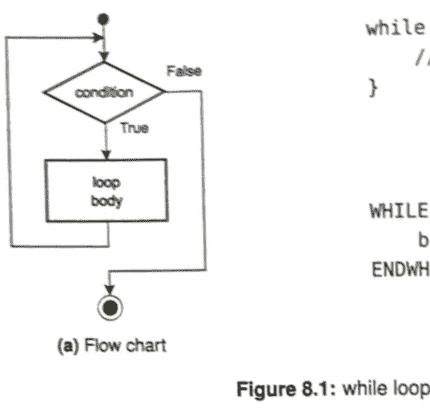

```
while (condition) {
// 循环体
}
```

(b) 语法

WHILE (condition)

循环体

ENDWHILE

(c) 伪代码

## 8.2 while 循环

在C语言中，`while` 循环是一种控制结构，只要给定条件为真，它就会重复执行代码块。当迭代次数未知且循环在条件不再满足时停止时，它非常有用。

### 8.2.1 语法与结构

C语言中 `while` 循环的语法如下：

```
while (condition) {
// 需要重复的代码
// 如果需要，更新条件）
}
```

条件是一个布尔表达式，决定循环是否应该继续运行。如果条件为真，则执行循环内部的代码块。如果条件为假，循环将终止，程序控制将移动到循环后的语句。`while` 循环的流程图如图8.1所示。

### 8.2.2 示例

以下程序使用 `while` 循环打印前10个自然数：

```c
#include <stdio.h>

int main() {
int i = 1;
while (i <= 10) {
printf("%d\n", i);
i++;
}
return 0;
}
```

只要 `i` 小于或等于10，循环就会继续。在每次迭代中，它打印 `i` 的值并将 `i` 加1。当 `i` 大于10时，循环停止。

### 代码片段：数字的阶乘

```c
int n, i, fact = 1;

while (n > 0) {
    fact *= n;
    n--;
}
printf("%d", fact);
```


这个 `while` 循环计算 `n` 的阶乘。只要 `n` 大于0，循环就会继续。在每次迭代中，`fact` 乘以 `n`，然后 `n` 减1。循环结束后，打印 `fact` 的值。

# 代码片段：最大公约数 (GCD)

最大公约数 (GCD) 是能够同时整除两个整数的最大整数。

```c
int a, b, temp;
while (a != b) {
    if (a > b) {
        a = a - b;
    } else {
        b = b - a;
    }
}
printf("GCD is %d", a);
```

此代码使用欧几里得算法计算两个数的最大公约数。

```c
int a = 48, b = 18;
while (a != b) {
    if (a > b) {
        a = a - b;
    } else {
        b = b - a;
    }
}
printf("GCD is %d", a);
```

另一种版本使用了取模运算：

```c
int a = 48, b = 18;
while (b != 0) {
    temp = a % b;
    a = b;
    b = temp;
}
printf("GCD is %d", a);
```

## 8.3 do-while 循环

`do-while` 循环与 `while` 循环相似，但有一个关键区别：它会确保代码块至少执行一次。这在需要先执行后检查的情况下非常有用。

### 8.3.1 语法与结构

`do-while` 循环的语法如下：

```
do {
  // 需要重复的代码
} while (condition);
```

`do-while` 循环的流程图如图8.2所示。

图8.2：do-while 循环

### 8.3.2 示例

以下示例使用 `do-while` 循环来要求用户输入正数：

```c
#include <stdio.h>

int main() {
    int num;
    do {
        printf("输入一个正数: ");
        scanf("%d", &num);
    } while (num <= 0);
    printf("你输入了 %d\n", num);
    return 0;
}
```

在此示例中，`do-while` 循环直到用户输入有效的数字。

## 菜单驱动的程序

在带有菜单的程序中，`do-while` 循环可以反复显示选项并处理用户的选择，直到他们选择退出。

```c
#include <stdio.h>

int main() {
    int choice;
    do {
        printf("菜单:\n");
        printf("1. 选项1\n");
        printf("2. 选项2\n");
        printf("3. 退出\n");
        printf("输入你的选择: ");
        scanf("%d", &choice);

        switch (choice) {
            case 1:
                printf("你选择了选项1。\n");
                break;
            case 2:
                printf("你选择了选项2。\n");
                break;
            case 3:
                printf("正在退出程序。\n");
                break;
            default:
                printf("无效选择，请重试。\n");
                break;
        }
    } while (choice != 3);

    return 0;
}
```

## 8.4 for 循环

在C语言中，`for` 循环是一种灵活且紧的控制结构，用于迭代一系列值或多次执行代码块。它将初始化、条件检查和迭代步骤合并到一行中，使其非常适合具有明确开始和结束条件的循环任务。

### 8.4.1 语法与结构

`for` 循环的语法如下：

```
for (initialization; condition; update) {
  // 重复执行的代码
}
```

- 初始化步骤在进入循环之前初始化循环变量或执行任何必要的设置。
- 条件在每次迭代之前进行评估。如果评估为真，则继续循环；否则，循环终止。
- 更新步骤在每次迭代后更新循环变量或执行任何必要的循环后处理。

### 8.4.2 示例

考虑以下使用 `for` 循环打印从1到5的数字的示例：

```c
#include <stdio.h>

int main() {
    for (int i = 1; i <= 5; i++) {
        printf("%d\n", i);
    }
    return 0;
}
```

### 8.4.3 语法图示

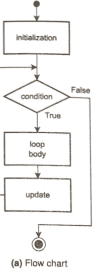

```
for (init; cond; update) {
  // 循环体
}
```

(b) 语法

FOR (init; cond; update)

循环体

ENDFOR

(c) 伪代码

图 8.3: for 循环

```
for (int i = 1; i <= 5; ++i) {
  printf("%d\n", i);
}
return 0;
```

在这个示例中，for 循环将循环控制变量 `i` 初始化为 1，在每次迭代之前检查 `i` 是否小于或等于 5，并在每次迭代后将 `i` 增 1。只要条件 `i <= 5` 为真，循环就会继续，在每次迭代中打印 `i` 的值。

代码段：计算从 1 到 100 的和

```c
int sum = 0;
for (int i = 1; i <= 100; i++) {
  sum += i;
}
printf("Sum: %d\n", sum);
```

代码段：获取字符串长度

```c
char str[] = "Hello";

int len = 0;
for (int i = 0; str[i] != '\0'; i++) {
    len++;
}
printf("String %s\ has %d characters\n", str, len);
```

## 8.5 嵌套循环

嵌套循环被放置放在其他循环内部。这允许通过使用内层循环在外层循环的每次迭代中重复执行一组语句，从而实现更复杂的迭代。

嵌套循环用于：
- 遍历矩阵或嵌套数组等多维数据结构。
- 解决涉及分级结构的问题。
- 创建组合或排列。
- 执行需要多层级迭代的操作。

外层循环控制整体迭代，而内层循环在外层循环的每次迭代中执行一组语句。这种技术在处理分级或多维数据结构时非常常用，因为它允许对数据进行嵌套或顺序迭代。

### 代码段：打印乘法表

以下示例演示了使用嵌套循环打印乘法表：

```c
#include <stdio.h>

int main() {
    for (int i = 1; i <= 5; ++i) {
        for (int j = 1; j <= 5; ++j) {
            printf("%d * %d = %d\n", i, j, i * j);
        }
    }
    return 0;
}
```

在这个示例中，外层循环对乘数 `i` 遍历 1 到 5 的值，而内层循环对乘因子 `j` 遍历相同范围的值。结果得到了一个从 1 到 5 的完整乘法表。

### 代码段：字符模式

此代码段打印行长度长度的星号。

```c
for(int i=0; i<5; i++) {
    for(int j=0; j<=i; j++) {
        printf("*");
    }
    printf("\n");
}
```

输出结果为：

*

**

***

****

在此代码段中，内层循环从 0 迭代到外层循环变量 `i` 的当前值，而外层循环迭代五次（从 0 到 4）。每次内层循环迭代期间都会打印一个星号。在打印每行星号后，外层循环打印字符 `\n` 将光标移动到下一行。

### 代码段：冒泡排序

此代码段实现了冒泡排序算法，这是一种简单的排序算法，它通过反复遍历元素列表并在相邻元素顺序错误时交换它们来工作。

```c
int arr[5] = {3,5,2,1,4};
for(int i=0; i<5; i++) {
  for(int j=i+1; j<5; j++) {
    if(arr[i] > arr[j]) {
      temp = arr[i];
      arr[i] = arr[j];
      arr[j] = temp;
    }
  }
}
```

### 代码段：前 100 个质数

```c
int i, j, isPrime = 1;
while (i <= 100) {
  for (j = 2; j <= i/2; j++) {
    if (i % j == 0) {
      isPrime = 0;
      break;
    }
  }
  if (isPrime) {
    printf("%d ", i);
  }
  i++;
}
```

外层循环迭代检查最多 100 个数字。内层循环通过检查一个数字是否能被 2 到其平方根之间的任何数整除来判断它是否为质数。如果不能整除，就是一个质数，并打印该数字。

## 8.6 循环控制语句

在 C 编程中，循环控制语句是强大的工具，允许人们修改循环的行为。三种常用的循环控制语句是 `break`、`continue` 和 `goto`。

### 8.6.1 break 语句

`break` 语句（见图 8.4）用于提前终止循环。当循环内部遇到 `break` 语句时，循环将立即终止，程序控制权转移到循环之后的语句。该语句通常用于根据某些条件退出循环或实现提前终止逻辑。

```c
while (test expression) {
  if (test expression) {
    break;
  }
}

do {
  if (test expression) {
    break;
  }
} while (test expression);

for (int expression; test expression; update expression) {
  if (test expression) {
    break;
  }
}
```

注：`break` 语句也可以用在 `else` 语句体内部。

图 8.4：break 关键字

考虑以下示例：

```c
#include <stdio.h>

int main() {
    int i;
    // 循环打印 1 到 10 的数字
    for (i = 1; i <= 10; i++) {
        if (i == 5) {
            break; // 当 i 等于 5 时退出循环
        }
        printf("%d\n", i);
    }
}
```

在这个示例中，循环一旦 `i` 的值变为 5 就会结束，跳过了剩余的迭代。

### 8.6.2 continue 语句

`continue` 语句用于跳过当前迭代的剩余部分。当循环中遇到 `continue` 语句时，它会跳转到循环的下次迭代。

```c
while (test expression) {
  if (test expression) {
    continue;
  }
}

do {
  if (test expression) {
    continue;
  }
} while (test expression);

for (int expression; test expression; update expression) {
  if (test expression) {
    continue;
  }
}
```

注：`continue` 语句也可以用在 `else` 语句内部。

图 8.5：continue 关键字

考虑以下示例：

```c
#include <stdio.h>

int main() {
    int i;
    // 打印 1 到 10 的数字
    for (i = 1; i <= 10; i++) {
        if (i % 2 != 0) {
            continue; // 跳过奇数
        }
        printf("%d\n", i);
    }
}
```

在这个示例中，`continue` 语句在 `i` 为奇数时跳过 `printf` 语句，直接进入下一次迭代。

### 8.6.3 goto 语句

`goto` 语句允许你直接跳转到代码中的特定位置。其语法如下：

```
label:
// 要执行的代码
goto label;
```

`label` 以字母数字开头，后跟一个冒号。你可以使用 `goto` 语句跳转到代码中的任何位置。考虑以下使用 `goto` 的循环示例：

```c
#include <stdio.h>

int main() {
    int i, j = 10;
    char ch = 'A';

label:
    for (i = 1; i <= 5; i++) {
        for (j = 1; j <= 5; j++) {
            if (i == 3 && j == 3) {
                goto label; // 跳转到 label，跳过内层循环
            }
        }
        printf("i = %d, j = %d, ch = %c\n", i, j, ch++);
    }
    return 0;
}
```

在此处，当 `i` 和 `j` 都为 3 时，`goto` 跳过内层循环并跳转回 `label`，有效地继续下一次外层循环迭代。`goto` 可以用于代码中的任何地方，而不仅仅是循环。考虑以下示例：

```c
int main() {
    int i = 0;

start:
    printf("%d\n", i);
    i++;

    if (i < 10) {
        goto start;
    }
    return 0;
}
```

在这个示例中，`goto` 语句用于创建一个几乎无限的循环。循环持续执行，直到 `i` 的值大于或等于 10。

## 8.7 无限循环

无限循环是指在没有适当终止条件下持续执行的循环。简单来说，除非程序被强制终止或中断，否则它永远不会结束。

理解无限循环在 C 编程中至关重要，因为管理不当的循环会导致 CPU 占用过高、系统崩溃和程序无响应。然而，当使用正确时，无限循环可以是实时系统和嵌入式应用程序中的强大工具。

无限循环可以分为无意无限循环和有意无限循环。

### 8.7.1 无意无限循环

这些循环由编程错误引起。它们并不是为了永久运行，而是由于代码中的错误导致了这种结果。常见原因包括：
- 缺少递增/减语句：
如果循环变量在循环体内没有进行更新，条件将永远不会改变，导致无限循环。
- 错误的循环条件：
使用错误的赋值类型（例如使用 `=` 代替 `==`）可能会导致循环条件始终为真，阻止循环退出。
- 循环体中的逻辑错误：循环体内的逻辑错误可能导致条件始终为真，从而导致无限执行。

以下示例演示了一个无意的无限循环：

```c
#include <stdio.h>

int main() {
    int i = 0;
    // 缺少递增语句导致无限循环
    while (i < 10) {
        printf("%d\n", i);
        // i++; // 取消此注释以修复无限循环
    }

    return 0;
}
```

> 提示：始终验证你的循环条件定义正确，并且循环变量在循环内部被修改。为了调试无限循环，你可以在循环内部添加打印语句来跟踪变量的变化。一旦问题解决，删除这些调试语句。或者，使用调试器进行更高效的故障排除。

### 8.7.2 有意无限循环

有意的无限循环用于需要持续运行的系统。

以下代码使用无限循环模拟 LED 的无期闪烁：

```c
#include <stdio.h>
// 模拟嵌入式系统中的 LED 闪烁
void blinkLED() {
    while (1) { // 循环条件始终为真
```

```c
// 开启 LED
printf("LED ON\r");
```

```c
// 等待一段时间
for (volatile int i = 0; i < 100000; i++);
```

```c
// 关闭 LED
printf("LED OFF\r");
```

```c
// 等待一段时间
for (volatile int i = 0; i < 100000; i++);
```

```c
}
int main() {
  // 初始化系统
```

```c
// 进入无限循环以闪烁 LED
blinkLED();
```

```c
// 这里的代码永远不会被执行
return 0;
}
```

在此示例中，`blinkLED` 函数通过持续向控制台打印 "LED ON" 和 "LED OFF" 来模拟 LED 闪烁，之间带有延迟以模拟实际 LED 的定时。然而，不建议使用固定循环次数的软件延迟，因为有以下几个缺点：
- 容易产生错误：错误计算循环计时可能会引入错误，并需要额外努力进行调试。
- 依赖硬件：循环次数固定于特定的硬件配置，这意味着必须为不同的系统重新校准延迟。


- 效率低下：忙等循环浪费了可以用于其他任务的 CPU 周期。

在真实的嵌入式系统中，最好使用硬件定时器或中断来产生精确的、非阻塞的。

可以使用 `break` 语句退出无限循环。在中断驱动的嵌入式系统中，硬件中断信号也可以终止循环。

示例：使用 `break` 语句退出无限循环。

```c
for (;;) {
  int input;
  printf("输入 0 退出: ");
  scanf("%d", &input);
  if (input == 0) {
    break;
  }
}
```

## 8.8 常见错误与最佳实践

有效循环的技巧：

- 使用描述性变量名：为循环变量提供描述性名称，特别是在带有多个变量的嵌套循环中。这使得代码更易于读。
- 保持嵌套简洁：深度嵌套的循环可能会令人困惑。尽可能将嵌套简化为较小的部分。
- 避免卡住：错误的终止条件或不当的变量更新会导致无限循环。为了防止这种情况，请确保在循环执行期间最终满足终止条件。
- 考虑性能：如果内部循环不必要地重复，性能可能会糟糕。减少冗余计算以提高效率。
- 初始化循环控制变量：始终从正确初始控制变量开始循环，以防止意外行为。
- 变量更新：忽略更新循环变量可能导致无限循环或差错误。所有循环变量必须在每次迭代中被正确修改。
- 在循环体内修改循环控制变量：在循环体内修改循环控制变量是可能的，这样做可能会导致混乱或意外行为。修改循环控制变量时要谨慎。
- 选择循环类型：根据是否预先知道迭代次数选择合适的循环类型（`for`、`while` 或 `do-while`）。每个类型都有其语义结构，这提高了代码的可读性和维护性。
- 差一错误：当循环计数器或索引变量处理不当时就会发生这些错误，导致多一次或缺少一次迭代。它们会导致微妙的逻辑错误且难以检测。
- 空循环或缺失循环：忘记循环结构或具有空循环体会导致意外行为。验证循环执行了预期的次数并执行了预期的操作。
- 在特定情况下使用 `do-while` 循环：当你需要代码无论初始条件如何至少执行一次时，选择 `do-while` 循环。对于简单的情况，`while` 循环可能更合适。
- 忘记 while 条件后的分号：在 `do-while` 循环的 `while` 条件末尾包含分号，以正确终止语句。

## 常见错误与最佳实践

## 总结

在本章中，我们探索了编程中的重复概念，这允许我们多次执行一组指令。我们讨论了 C 语言中三种重要的循环结构：`while`、`do-while` 和 `for` 循环，每种结构都有自己的特点和用途。

通过各种示例，我们学习了如何有效地应用这些循环结构来解决从简单任务到复杂算法的各种问题。我们还涵盖了嵌套循环、`break`、`continue` 和 `goto` 语句。

## 问题

- 8.1 如果在 `while` 循环中忘记更新控制变量会发生什么？
- 8.2 `for` 循环可以在没有初始化、条件和更新语句的情况下使用吗？
- 8.3 从执行角度来看，`while` 循环和 `do-while` 循环的区别是什么？
- 8.4 写一个 `do-while` 循环，打印 1 到 5 的数字平方。
- 8.5 写一个 `while` 循环，打印到给定限制 n 的斐波那契数列。
- 8.6 创建一个 `while` 循环，计算 1 到 50 之间所有偶数的和。
- 8.7 实现一个只接受数字的 `do-while` 循环。
- 8.8 写一个 `for` 循环，打印 1 到 10，但对于 3 的倍数，打印 "Boo" 而不是数字。
- 8.9 这代码的输出是什么？

```c
int i = 0;
while (i < 10) {
    printf("%d", i);
    i++;
}
```

- 8.101代码的输出是什么？

```c
int i = 0;
do {
    printf("%d", i);
} while (i < 10);
```

- 8.11代码代码的代码？

```c
int;
for ( = 1; i <=  i; i++) {
    printf("%d", i);
}
```

- 8.12 这代码的输出是什么？

```c
int i = 0;
do {
    printf("%d", ++i);
} while (i < 10);
```

- 8.13 这代码的输出是什么？

```c
int i = 0;
for ( i < 5; i++) {
    printf("%d", i);
}
```

- 8.14 这代码的输出是什么？

```c
for (int i = 0; i < 5; i++) {
    printf("%d", i);
    i += 2;
}
```

- 8.15 这代码的输出是什么？

```c
int i;
for (i = 1; i <= 5; i++) {
    if (i == 3) continue;
    printf("%d", i);
}
```

- 8.16 修改此循环以按降序打印：

```c
for (int i = 1; i <= 10; i++) {
    printf("%d", i);
}
```

- 8.17 如果在循环中省略递增语句会发生什么？

```c
for (int i = 0; i < 5; ) {
    printf("%d", i);
}
```

- 8.18 实现一个 `do-while` 循环，反复要求用户猜测数字，直到他们猜对为止。
- 8.19 写一个嵌套循环打印这个 2x2 网格：
- 8.20 写一个嵌套循环打印这个模式：

# 第 9 章

## 数组与字符串

整数、浮点数和字符等变量一次只能存储一个值。数组被称为标量变量。数组允许程序员存储多个相关项；数组用于在单个变量名下存储多个相同数据类型的值，从而能够高效地处理相关数据的集合。

例如，如果一个程序需要跟踪 60 名学生的测试成绩，使用 60 个独立的整数变量是不切实际的。数组通过将所有分数分组到一个数组名称下，提供了一种更有组织性的解决方案，使得数据处理变得更加容易。

## 9.1 引言

在使用数组之前，需要先对它们进行声明和初始化。声明数组指定了数组的数据类型和大小，而初始化数组则是是为其元素分配值。例如，以下代码声明并初始化了一个整数型数组：

```c
int arr[5] = {1, 2, 3, 4, 5};
```

在这个示例中，数组有 5 个 `int` 类型的元素，且每个元素都初始化了一个值。

要访问数组的元素，你需要使用索引，索引是一个表示元素在数组中位置的整数值。在 C 中，索引从 0 开始。例如，要访问数组 `arr` 的第二个元素，你会使用以下代码：

```c
int second_number = arr[1]; // 拷贝到另一个变量
arr[1] = 100;             // 修改新值
```

这段代码获取了 `arr` 第二个元素的值并对其进行了修改。如果你在初始化数组时不指定大小，编译器将根据初始值的数量确定大小：

```c
int arr[] = {1, 2, 3, 4, 5};
```

你也可以声明一个数组而不进行初始化，如下所示：

在这种情况下，在你的程序稍后分配特定值之前，数组包含的是垃圾值。

尝试访问或修改超出数组范围的元素（例如 `arr[5]`）会导致未定义行为，这可能导致不可预测的程序行为，包括产生垃圾值或程序崩溃。C 语言数组是零索引的，这意味着第一个元素的索引为 0，最后一个元素的索引比大小小 1。

## 9.2 数组操作

一维数组由单列和多行组成，通常用于存储数据集合。可以对数组执行各种操作，以有效地处理和分析数据。在本节中，我们将讨论一些基本的数组操作，例如计算和、平均值、最大值最小值。

### 9.2.1 查找表

查找表（Lookup tables）是编程中一种强大的概念，通过将输入值映射到相应的输出值来实现高效的数据检索。它们通常使用数组实现，其中每个元素代表一个键或索引，对应的值存储在该位置。查找表在涉及重复计算或基于已知输入集进行数据查找的场景中表现出色。

以下代码演示了如何使用查找表来确定特定月份的天数。

```c
#include <stdio.h>
int main() {
    const int month_days[12] = {31, 28, 31, 30, 31, 30,
                               31, 31, 30, 31, 30, 31};
    int month = 3; // 访问3 月的查找表
    printf("月份 %d 的天数: %d\n",
           month, month_days[month - 1]);
    return 0;
}
```

该代码定义了一个名为 `month_days` 的常量数组，存储了每年每月的天数。通过访问 `month_days[month - 1]`（其中 `month` 对应所需的月份），代码获取了该月份的天数。例如，`month_days[2]` 对应 3 月，它有 31 天。

以下代码展示了如何使用查找表来计算给定数字二进制表示的低字节（低 4 位）中置位（值为 1 的位）的数量。

```c
#include <stdio.h>
int main() {
    const int bits[16] = {0, 1, 1, 2, 1, 2, 2, 3, 1, 2, 2, 3, 2, 3, 4};
    int nibble = 10; // 访问数字 10 的置位数
    printf("%d 中的置位数量: %d\n",
           nibble, bits[nibble & 0xF]);
    return 0;
}
```

`bits` 数组被定义为一个具有 16 个元素的常量数组，其中每个元素代表从 0 到 15 对应十进制数的置位数计数。通过执行位与操作 `bits[nibble & 0xF]` 来提取 `nibble` 的最低位 4 位，代码使用该结果作为索引来访问查找表中对应的置位数计数。例如，`bits[10 & 0xF]` 对应于 10 的二进制表示中的置位数量，结果为 2。

这些示例说明了使用查找表根据特定输入检索信息的效率和便利性。它们提供了一种直接的方法，最大限度地减少了对复杂计算的需求。

### 9.2.2 遍历数组

遍历数组涉及访问每个元素。通常使用循环来实现此目的。例如，为了计算元素的平均值，你将总和除以元素的总量。

```c
int sum = 0;
for (int i = 0; i < 5; i++) {
    sum += arr[i];
}
double average = (double) sum / 5;
printf("元素的平均值为: %.2f\n", average);
```

要找到数组中的最大值或最小值，你需要遍历数组并记录当前的最大值或最小值。例如，要找到名为 `arr` 的数组的最大值：

```c
int max = arr[0];
for (int i = 1; i < 5; i++) {
    if (arr[i] > max) {
        max = arr[i];
    }
}
```

```c
printf("数组中的最大值为: %d\n", max);
```

在这个示例中，`max` 初始化为第一个元素的值，并与数组其余元素比较以找到最大值。

### 9.2.3 修改数组元素

修改数组元素意味着修改其一个或多个元素的值。这可以通过直接访问索引并分配新值来实现。在使用需要更改内容或更新数组存储数据的算法时，数组元素经常会被修改。以下示例代码向包含 10 个元素的数组填充 0 到 100 之间的随机数：

```c
#include <stdio.h>
#include <stdlib.h>
#include <time.h>
int main() {
    srand(time(NULL));
    int arr[10]; // 声明一个大小为 10 的数组
    for (int i = 0; i < 10; i++) {
        arr[i] = rand() % 101; // 生成 0-100 的随机数
    }
    printf("修改后的数组: % ");
    for (int i = 0; i < 10; i++) {
        printf("%d\n", arr[i]);
    }
    return 0;
}
```

## 9.2 数组操作

```c
}
printf("\n");
return 0;
```

在这个示例中：
- 我们包含了标准输入输出（stdio.h）、随机数生成（stdlib.h）和时间处理（time.h）的头文件。
- 我们使用 `rand(time(NULL))` 为随机数生成器设置了种子，以确保程序在每次运行时都会生成不同的随机数序列。
- 为了存储随机数，我们声明了一个大小为 10 的未初始化数组。
- 我们使用循环遍历数组，并使用 `rand()` 函数和取模运算符（%）为每个元素分配一个 0 到 100 之间的随机数。
- 最后，我们显示了填充了随机数的修改后的数组。

### 9.2.4 数组搜索

数组搜索旨在在数组中查找特定的值或元素。搜索被用于各种应用程序，例如在数据集中查找特定数据、实现查找表以及优化搜索算法。有几种搜索算法可以高效地定位数组中的元素。

- **线性查找**：这种简单的算法按顺序检查数组的每个元素，直到找到目标或到达数组末尾。
- **二分查找**：该算法适用于已排序的数组。它通过将目标元素与数组的中间元素进行比较，反复将搜索空间减半。根据比较结果，将搜索范围缩小到数组的下半部分或上半部分，每一步都排除另一半。

搜索算法的选择取决于数组是否排序以及搜索操作所需的时间复杂度。线性查找更简单，但对于大型数组来说效率较低；而二分查找效率更高，但要求数组是排序的。

下面的示例代码演示了如何在 C 语言数组中执行线性查找：

```c
#include <stdio.h>
int main() {
    int arr[] = {10, 20, 30, 40, 50};
    int n = sizeof(arr) / sizeof(arr[0]); // 计算数组大小
    int key = 30; // 要查找的元素
    int index = -1; // 初始化索引为 -1 表示未找到元素
    for (int i = 0; i < n; i++) {
      if (arr[i] == key) {
        index = i; // 如果找到元素则更新索引
        break; // 一旦找到元素就退出循环
      }
    }
    if (index != -1) {
        printf("Element %d found at index %d\n", key, index);
    } else {
        printf("Element %d not found in the array\n", key);
    }
    return 0;
}
```

这段代码声明了一个包含元素 10, 20, 30, 40, 50 的数组 `arr`，并执行线性查找找到元素 30 的索引。如果找到了元素，将打印它的索引；否则，将打印未找到元素的消息。

我们还可以进行其他数组操作，如查找数组中的最小值或最大值、统计特定范围内元素数量，或对数组进行统计分析（平均值、中位数、标准差等）。

### 9.2.5 数组排序

排序是将按照特定顺序（如升序或降序）排列数组元素的过程。这是编程中常见的操作，因为它有助于组织数据并使其更容易搜索和处理。

有几种排序算法可以对数组进行排序，例如：
- **冒泡排序**：这种简单的算法反复比较相邻元素，如果它们的顺序错误，则交换它们。该过程一直重复，直到整个数组排序完毕。
- **插入排序**：该算法一次构建一个元素构建最终的排序数组。它遍历数组，将每个元素与已排序的部分进行比较，并将其插入到合适的位置。
- **选择排序**：该算法将数组分为两个部分：已排序部分和未排序部分。它反复从未排序部分选择最小的元素，并将其与已排序部分的元素进行交换。
- **快速排序**：该算法使用分治策略。它选择一个基准元素，根据基准将数组划分为两个子数组，并递归地排序子数组。

排序算法的选择取决于多个因素，例如数组的大小、数据分布的方式以及程序的性能需求。某些算法对于小数组效果更好，而另一些对于较大的数组更有效。下面是一个使用冒泡排序算法排序数组 `arr` 的示例，这是最简单的排序方法之一：

冒泡排序是一种简单的排序算法，通过反复遍历列表、比较相邻元素并在顺序错误时交换它们来工作。该算法的名称源于较大元素在每次遍历中都“泡”向列表末尾的方式。

代码从一个数组开始：{64, 34, 25, 12, 22, 90, 11}。数组的大小通过 `sizeof(arr) / sizeof(arr[0])` 计算，得到数组元素的数量。程序然后打印原始数组。代码使用两个循环来排序：

# 第 9 章 数组与字符串

| 64 | 64 |
|---|---|
| 34 | 25 |
| 12 | 12 |
| 22 | 22 |
| 34 | 34 |
| 25 | 25 |
| 12 | 12 |
| 22 | 22 |
| 34 | 34 |

## 9.3 多维数组

多维数组是具有多行多列的数组，非常适合网格数据。

### 9.3.1 声明和初始化多维数组

要声明多维数组，指定数据类型，后接数组名，然后在方括号中指定行和列数。例如，以下代码声明了一个名为 `matrix` 的 3 行 4 列整数二维数组：

```c
int matrix[3][4];
```


可以使用相同的语法初始化多维数组，值用逗号分隔并括在大括号中：

```c
int matrix[3][4] = {
    {1, 2, 3, 4},
    {5, 6, 7, 8},
    {9, 10, 11, 12}
};
```

### 9.3.2 访问数组元素

要访问二维数组中的元素，使用两个索引。第一个索引指定行，第二个索引指定列。例如，要访问矩阵第二行第三列的元素，可以使用以下代码：

```c
int element = matrix[1][2];
```

这段代码将数组 `matrix` 第二行第三列元素的值赋值给变量 `element`。

要修改多维数组中的元素，可以使用相同的索引语法为其赋一个新值。例如，将数组 `matrix` 第二行第三列元素的值更改为 10，可以使用以下代码：

```c
matrix[1][2] = 10;
```

可以使用嵌套循环遍历二维数组，例如以下代码，它求了 3x4 矩阵中所有元素的和：

```c
int sum = 0;
for (int i = 0; i < 3; i++) {
  for (int j = 0; j < 4; j++) {
    sum += matrix[i][j];
  }
}
```

使用多维数组，还可以找到最大元素、转置矩阵并执行矩阵乘法。

## 9.4 字符串

在 C 语言中，字符串存储在字符数组中。字符串的每个单独字符占用数组中的特定位置，从索引 0 开始。为了表示字符串的结束

# 136 第 9 章 数组与字符串

字符串，一个特殊字符 `'\0'`（空字符），被放置在最后一个字符之后。这种约定允许程序确定字符串的结束。

例如，字符串 `"Hello"` 包含 5 个可识别的字符（`'H'`, `'e'`, `'l'`, `'l'`, `'o'`），但它总共使用了 6 字节存储：5 字节用于字符本身，额外的 1 字节用于终止符。

```c
char str2[6] = "Hello";
```

| 'H' | 'e' | 'l' | 'l' | 'o' | '\0' |
|---|---|---|---|---|---|
| 0 | 1 | 2 | 3 | 4 | 5 |

空字符串只包含一个空字符。

```c
char null[1] = "";
```

| '\0' |
|---|
| 0 |

C 语言中的字符串可以使用字符数组进行声明和初始化。例如：

```c
char str1[10]; // 字符数组的声明
char str2[6] = "Hello"; // 字符串的声明与初始化
char str3[7] = {'H', 'e', 'l', 'l', 'o', '\0'}; // 与上述相同
```

当使用双引号 `("")` 包围的字符串字面量初始化字符串时，编译器会自动字符串末尾添加空字符 `'\0'`。

以下示例了如何将字符串作为查找表。

```c
#include <stdio.h>
int main() {
  int num;
  char lookup[] = "0123456789ABCDEF";
  char ascii;
  // 输入 0-15 之间的数字
  do {
    scanf("%d", &num);
  } while(num>15);
  ascii = lookup[num]; // 转换为 ASCII
  // 打印十六进制的 ASCII 
  printf("Hexadecimal number %X in ASCII is '%c (0x%X)\n", 
         num, ascii, ascii);
  return 0;
}
```

这段代码接收一个 0 到 15 之间的数字，使用字符串查找表将其转换为对应的十六进制 ASCII 字符，然后打印该 ASCII 字符及其十六进制等价值。

## 9.4. 字符串

### 9.4.1 字符串的输入与输出

C 语言提供了几个输入输出字符串的函数。`scanf()` 函数可以从标准输入读取字符串，而 `printf()` 函数可以将字符串打印到标准输出。此外，`gets()` 和 `puts()` 函数也可以分别用于字符串的输入和输出。

是一些演示字符串输入输出的代码示例：

在此示例中：

- `scanf()` 函数用于从标准输入 `stdin` 输入字符串并存储在 `str` 数组中。注意 `scanf()` 在遇到空白字符后会停止读取。
- `gets()` 函数用于从 `stdin` 输入字符串并存储在 `str` 数组中。与 `scanf()` 不同，`gets()` 读取整行（包括空白字符），并用空字符终止字符串。
- `printf()` 函数用于输出 `str` 数组中的字符串。
- `puts()` 函数用于输出 `str` 数组中的字符串，并在后续一个换行符。

### 9.4.2 字符串数组

之前，我们写了一个程序使用 `switch` 结构根据数字打印星期名称。现在，我们将演示如何使用数组来存储星期名称。这种方法提供了一种更优雅的解决方案。

# 第 9 章 数组与字符串

| | 0 | 1 | 2 | 3 | 4 | 5 | 6 | 7 | 8 | 9 |
|---|---|---|---|---|---|---|---|---|---|---|
| 0 | 'S' | 'u' | 'n' | 'd' | 'a' | 'y' | '\0' | | | | |
| 1 | 'M' | 'o' | 'n' | 'd' | 'a' | 'y' | '\0' | | | | |
| 2 | 'T' | 'u' | 'e' | 's' | 'd' | 'a' | 'y' | '\0' | | | |
| 3 | 'W' | 'e' | 'd' | 'n' | 'e' | 's' | | 'y' | '\0' | | | |
| 4 | 'T' | 'h' | 'u' | 'r' | 'd' | 'a' | 'y' | '\0' | | | |
| 5 | 'F' | 'r' | 'i' | 'd' | 'a' | 'y' | '\0' | | | | |
| 6 | 'S' | 't' | 'u' | 'r' | 'a' | 'y' | '\0' | | | | |

图 9.2: 二维数组

```c
#include <stdio.h>
int main() {
    int n;
    char dayName[12];
    char day[7][10] = {"Sunday"
```

在此程序中：

- 我们声明了一个二维字符数组 `day`，用于存储星期几的名称。每一行对应一个星期，每一列存储星期名称的字符。
- 我们提示用户输入一个 1 到 7 之间的数字。如果输入无效，我们提示用户重新输入。

## 9.5 常见陷阱

在本节中，我们讨论了在处理字符串时的一些常见错误：

- 使用了错误的索引：访问数组范围外的索引会导致未定义行为。
- 忘记终止符：C 语言中的字符串必须以 `'\0'` 结尾才能被正确识别。
- 缓冲区大小不正确：为字符串分配过小的数组会导致缓冲区溢出。
- 未检查输入长度：未验证用户输入可能会导致程序崩溃。

```c
return_type function_name (parameter_list) {
  // function body
}
```

在此模板中：

- `return_type`: 这表示函数在完成任务后返回的内容类型。
- `function_name`: 它表示函数的名称。
- `parameter_list`: 这些是函数执行任务所需的输入，表示为 `param1`, `param2`, ..., `paramn`。它是可选的，意味着函数可以没有参数。
- Function body `函数体`: 该部分包含了执行函数分配任务的实际代码。这也被称为函数定义。

这是一个示例：

```c
void greet() {
  printf("Hello World");
}
```

在此示例中：

- 函数名称是 `greet()`
- 返回类型是 `void`
- 空括号意味着它没有任何参数
- 函数体写在 `{}` 内部

### 10.2.2 调用函数

在上面的程序中，我们声明了一个名为 `greet()` 的函数。要使用 `greet()` 函数，我们需要调用它。以下是函数调用的方式：

```c
int main() {
  greet(); // 调用函数
}
```

演示函数使用的完整程序在图 10.1 中。

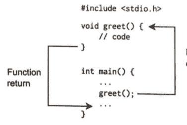

图 10.1：函数的工作原理

## 10.2 用户自定义函数

## 10.2.3 函数参数

函数可以有参数，也称为参数 `arguments`。这是一个示例：

```c
#include <stdio.h>
void printMessage(int count) {
    for (i=0; i<count; i++) {
        printf("Hello World\n");
    }
}
int main() {
    int n = 7;
    printMessage(n);
    return 0;
}
```

在这里，`count` 是 `printMessage` 函数的参数。当从 `main` 调用 `printMessage` 时，一个指定消息打印次数的值作为参数传递。

这是一个带有两个参数的函数的简单示例：

```c
#include <stdio.h>
// 带有两个参数的函数声明
void addNumbers(int a, int b) {
    int sum = a + b;
    printf("The sum of %d and %d is: %d\n", a, b, sum);
}
int main() {
    int num1 = 5;
    int num2 = 7;
    // 使用两个参数调用函数
    addNumbers(num1, num2);
    return 0;
}
```

在此示例中，`addNumbers` 函数接收两个参数 `a` 和 `b`，它们被相加以计算出和。在 `main` 函数内部，我们声明了两个变量 `num1` 和 `num2` 并分别将它们初始化为值 `5` 和 `7`。然后，我们用 `num1` 和 `num2` 作为参数调用 `addNumbers` 函数。该函数相这两个数字并打印和。

总之，参数以参数的形式从调用代码为函数提供输入。这个示例说明了清晰的关注点分离：`main` 准备输入，而 `addNumbers` 仅专注于加法任务。

# 第 10 章 函数

```c
#include <stdio.h>
void addNumbers(int a, int b) {
    // code
}
int main() {
    addNumbers(num1, num2);
    ...
}
```

图 10.2：向函数传递参数

## 10.2.4 Return语句

到目前为止，我们在函数声明中使用 `void`，这表示这些函数不返回任何值。然而，函数也可以向调用代码返回值，提供了一种传递结果或计算值的手段。为了实现这一点，我们需要在函数声明中指定返回类型。

在函数原型中声明的返回类型表示函数将返回的值类型。考虑以下示例：

```c
int addNumbers(int a, int b) {
    return (a + b);
}
```

在此函数中，用 `int` 代替 `void` 作为返回类型。这意味着 `addNumbers` 函数返回一个整数值。代码 `return (a + b);` 将两个参数之和传回调用代码。

注意的是，`return` 语句也标志着函数的结束。`return` 语句之后的任何代码都将被执行。

在接下来的示例中，`main` 函数用值 `5` 和 `7` 调用 `addNumbers` 函数。函数接收两个参数 `a` 和 `b`，并返回它们的和。然后 `main` 函数打印结果。

```c
#include <stdio.h>
// 将两个数相并返回结果的函数
int addNumbers(int a, int b) {
    return a + b;
}
int main() {
    int num1 = 5;
    int num2 = 7;
    // 调用加法函数并将结果存储在变量 sum 中
    int sum = addNumbers(num1, num2);
}
```

## 用户自定义函数

- 打印和
`printf("the sum of %d and %d is: %d\n", num1, num2, sum);`

`return sum;`

虽然一个函数通常只包含一个 `return` 语句，但使用多个 `return` 语句可以提高程序的效率和可读性。

```c
int checkNumber(int num) {
    if (num > 0) {
        return 1;
    } else if (num < 0) {
        return -1;
    } else {
        return 0;
    }
}
```

总之，参数以参数的形式从调用代码为函数提供输入。这个示例说明了清晰的关注点分离：`main` 准备输入，而 `addNumbers` 仅专注于加法任务。

原型在 C 语言编程中关重要，用于在完全定义或使用函数之前声明函数的签名（名称、返回类型和参数）。它们实现了模块化编译，允许编译器捕捉错误，并为正确用法提供文档支持。

# 表 10.1: 变量作用域与存储类型

| 存储类型 | 作用域 | 周期 | 内存分配 |
| --- | --- | --- | --- |
| Auto | 局部 | 函数/块执行 | 栈 |
| register | 局部 | 函数/块执行（如果存储在寄存器中） | CPU 寄存器（如果可用），否则使用栈 |
| static (局部) | 局部 | 贯穿整个函数调用 | 数据段 |
| static (全局) | 全局 | 整个程序执行 | 数据段 |
| extern | 取决于变量的原始声明 | 取决于变量的原始声明 | 取决于变量的原始声明 |

## 局部变量

局部变量局限于特定的函数，并且只能定义它们的代码块中使用。例如，在 `setup` 函数中声明的局部变量在 `loop` 函数中可见也无法使用。

在函数或块内声明的变量被视为该函数或块的局部变量。任何在大括号 `{}` 内部的内容都形成一个块。局部变量只存在于它们所在的块中。

这意味着它们无法在那个块的作用域之外被访问。

```c
// 使用局部变量的错误方法
#include <stdio.h>
void display() {
    int age = 19; // 此变量是 display 函数的局部变量
}
int main() {
    // 编译错误
    printf("Age is: %d\n", age);
    return 0;
}
```

在此代码中：

- `age` 是在 `display` 函数内部声明的局部变量，仅在 `display` 内部可见。
- 尝试从 `main` 访问 `localVar` 将导致编译错误，因为超出了作用域。

## 10.3. 变量作用域与存储类型

以下代码修复了此错误：

```c
#include <stdio.h>
void display() {
    int age = 19; // 此变量是 display 函数的局部变量
    printf("Age is %d\n", age);
}
int main() {
    display();
    return 0;
}
```

变量在任何代码块中都具有作用域，而不仅仅是在函数内部。在接以下程序中，变量 `i` 只存在于循环内部。尝试在循环外部访问 `i` 将导致编译错误。

```c
#include <stdio.h>
int main() {
    int sum = 0;
    for (int i=0; i<5; i++) {
        sum += i;
    }
    printf("i = %d, sum = %d\n", i, sum); // 编译错误
    return 0;
}
```

总结来说，局部变量可以具有块作用域或函数作用域，这意味着它们只在声明它们的块或函数中存在并可以使用。尝试在这些这些块之外访问它们会导致编译错误。

## 全局变量

全局变量顾如其名，可以从程序的任何部分访问。它们声明在所有函数之外。它们在整个程序执行期间都是可用的。

通常不建议过度使用全局变量，因为可能会导致命名冲突、代码段之间的紧耦合，以及程序维护和测试的困难。

```c
// 全局变量声明
int globalVar = 20;
```

```c
void myFunction() {
    printf("%d\n", globalVar);
}
```

```c
int main() {
  display();
  globalVar = 23; // 从 main 中修改全局变量的值
  → function
  display();
  return 0;
}
```


在此程序中，变量 `globalVar` 声明在任何函数之外，使其可以在程序的任何地方访问。

局部变量促进模块化和信息隐藏，使代码更容易理解和维护。全局变量应该谨慎使用，因为它们会引入依赖并使你的代码缺乏灵活性和重用性。

总结，变量作用域和存储类型是 C 语言中两个独立但密切相关的概念。变量作用域决定了变量的可见性，而存储类型决定了它跨函数和块的周期以及行为。理解这些概念对于编写高效、可维护且可移植的 C 代码至关重要。

## 静态变量

静态变量是一种特殊的变量，结合了局部和全局变量的特点。与局部变量一样，它们在整个程序执行期间存在，而是一个函数。与全局变量不同，它们声明在函数内部，将其可见性限制在该函数内（局部作用域）。

静态变量在函数中使用 `static` 关键字定义。静态变量可以实现计数器、维护历史数据以及在函数内部存储持久值。这里有一个演示静态变量的简单 C 代码：

```c
#include <stdio.h>

void incrementCounter() {
  static int counter = 0; // 静态变量初始化
  counter++;              // 每次函数调用增加计数
  printf("Counter: %d\n", counter);
}

int main() {
  // 调用函数来增加并打印计数器
  incrementCounter();
  incrementCounter();
  incrementCounter();
}
```

### 10.4. 函数调用过程中的类型转换

在此示例中，我们定义了一个名为 `incrementCounter` 的函数，它声明并定义了一个静态局部变量 `counter`。第一次调用该函数时，`counter` 变量被初始化为 0，对其值进行增加并打印。当再次调用函数时，由于 `counter` 是静态变量，它保留了之前的值，其值再次被增加并打印。该程序的输出将是：

```
Counter: 1
Counter: 2
Counter: 3
```

这表明 `counter` 在对 `incrementCounter` 的函数调用之间保留了其值。

在 C 中，当参数类型与参数类型不完全匹配时，在函数调用过程中可能会发生类型转换。以下是几个示例：

```c
void print_value(double value) {
    printf("Value: %f\n", value);
}
```

```c
int num = 10;
// 在传递之前将 int 转换为 double
print_value(num);
```

在此示例中，`print_value` 期望一个 `double` 参数，但传递的是 `int` 类型 `num`。这导致 `num` 被转换为 `double`。

```c
void print_value(int value) {
    printf("Value: %d\n", value);
}
```

```c
double another_num = 10.5;
// 在传递之前将 double 转换为 int
print_value(another_num);
```

在此示例中，`print_value` 期望一个 `int` 参数，但传递的是 `double` 类型 `another_num`。这导致 `another_num` 在传递给函数之前被转换为 `int`（截断为 10）。

```c
int calculate_ratio(int a, int b) {
    // 将结果转换为 int
    return (float)a / b;
}
```

```c
int ratio = calculate_ratio(10, 3);
printf("Ratio: %d\n", ratio); // 输出: 3
```

在此示例中，`calculate_ratio` 使用浮点操作数进行除法。然而，结果被隐式转换为 `int`，函数返回类型为 `int`，丢弃了小数部分。结果输出为 3 是因为小数部分被丢弃了。

这些示例演示了 C 如何处理函数调用和返回时的隐式转换。隐式转换可能会导致精度丢失或截断。理解隐式转换对于避免意外行为非常重要。如果需要，可以使用强制转换来执行手动类型转换，而不是依赖隐式转换。

## 10.5 向函数传递数组

C 中的数组用于存储和处理数据集合。当数组传递给函数时，函数只接收第一个元素的指针。多种方法指示数组的大小，例如作为独立参数传递、使用哨兵值或使用第一个元素作为大小指示。

### 10.5.1 作为独立参数传递数组大小

向函数传递数组大小常用的方法是使用独立参数。这显式地指定了数组的大小，并允许函数根据提供的大小遍历元素。

以下是作为独立参数传递大小的示例：

```c
#include <stdio.h>

int sum(int arr[], int size) {
    int sum = 0;
    for (int i = 0; i < size; i++) {
        sum += arr[i];
    }
    return sum;
}
```

```c
int main() {
    int numbers[] = {1, 2, 3, 4, 5};
    int size = sizeof(numbers) / sizeof(numbers[0]);
}
```

```c
printf("Array elements: ");
for (int i = 0; i < size; i++) {
    printf("%d ", numbers[i]);
}
printf("\n");
int arraySum = sumArray(numbers, size);
printf("Sum of array elements: %d\n", arraySum);
return 0;
```

在这个示例中，`sumArray` 函数接受两个参数：一个名为 `arr` 的整数数组和一个名为 `size` 的整数。`size` 参数指定了数组中元素的总数。利用这一大小信息，函数遍历数组元素并对其进行求和。

### 10.5.2 使用第一个元素作为大小指示器

在这种方法中，数组的第一个元素被用来指示大小信息。当数组大小是固定且预先时，这种方法非常有用。以下是一个使用第一个元素作为大小指示器的示例：

```c
#include <stdio.h>

int sumArray(int arr[]) {
    int size = arr[0];
    int sum = 0;
    for (int i = 1; i < size; i++) {
        sum += arr[i];
    }
    return sum;
}

int main() {
    int numbers[] = {5, 1, 2, 3, 4, 5}; // 第一个元素指示大小
    printf("Array elements: ");
    for (int i = 1; i <= numbers[0]; i++) {
        printf("%d ", numbers[i]);
    }
    printf("\n");
    int arraySum = sumArray(numbers);
    printf("Sum of array elements: %d\n", arraySum);
    return 0;
}
```

在这个示例中，`sumArray` 函数接受一个整数数组 `arr` 作为参数。数组的大小由存储在第一个元素（`arr[0]`）中的值决定。函数从这个第一个元素获取大小，然后遍历数组元素并对其进行求和。

当数组大小是预先确定并在整个程序执行过程中保持不变时，使用第一个元素作为大小指示器是有优势的。

### 10.5.3 使用哨兵值

传递数组大小的另一种方法是使用哨兵值。哨兵值是标记数组结束的特殊值。函数遍历数组直到遇到哨兵值，该值表示数组的末尾。

以下是一个使用哨兵值传递数组大小的示例：

```c
#include <stdio.h>
#define SENTINEL -1

int sumArray(int arr[]) {
    int sum = 0;
    int i = 0;
    while (arr[i] != SENTINEL) {
        sum += arr[i];
        i++;
    }
    return sum;
}

int main() {
    int numbers[] = {1, 2, 3, 4, 5, SENTINEL}; // SENTINEL 标记数组的结束
    printf("Array elements: ");
    for (int i = 0; numbers[i] != SENTINEL; i++) {
        printf("%d ", numbers[i]);
    }
}
```

在这个示例中，`sumArray` 函数接受一个参数：名为 `arr` 的整数数组。在函数内部，它遍历数组直到遇到指定的 `SENTINEL` 值，该值表示数组的结束。随后，它计算到哨兵值之前的数组元素之和。

当数组的大小不是明确的或处理动态数据序列时，哨兵值非常有用。但需要注意的是：

### 10.5.4 处理字符串

在这个示例中，`sumArray` 函数接受一个参数：名为 `arr` 的整数数组。在函数内部，它遍历数组直到遇到指定的 `SENTINEL` 值，该值表示数组的结束。随后，它计算到哨兵值之前的数组元素之和。

## 10.7.3 统计二进制表示中的置位

`bitcount()` 函数接收一个整数作为输入，并返回其二进制表示中 1 的个数。算法如下：

- 1. 将变量 `count` 初始化为 0。
- 2. 在循环中，使用位与操作与 1 检查 `n` 的最低位（LSB）是 0 还是 1。
- 3. 如果 LSB 为 1，则计数 `count`。
- 4. 将 `n` 右移 1 位，将下一位移到最低位置。
- 5. 重复步骤 2-4，直到 `n` 变为 0，表示所有位都已计数。
- 6. 返回最终计数结果。

```c
int bitcount(int n) {
    count = 0;
    while(n != 0) {
        if (n&1 != 0) // test last bit
            count++;
        n = n >> 1;
    }
    return count;
}
```

注意，对于 32 位整数，循环可能需要 32 次迭代，但如果所有的 1 位都被移出，循环可以提前结束。
与其在 LSB 为 1 时递增 `count`，你也可以使用 `count = count + (n&1)`；但编译器可能会生成相同的机器代码。

## 10.7.4 一种改进方法：Brian Kernighhan 算法

`popcount` 函数接收一个整数 `n` 作为输入，并返回其二进制表示中 1 的个数。该函数使用了一种称为 Brian Kernighhan 算法的技巧来统计数字中置位（1位）的数量。“popcount” 是 population count（人口计数）的缩写，指的是数字二进制表示中值为 1 的位总数。该算法如下：

- 1. 将变量 `count` 初始化为 0。
- 2. 在循环中，对 `n` 和 `n-1` 执行位与操作，以清除最低位（将其设置为 0），并将结果存回 `n` 中。
- 3. 每次迭代中，最低位被清除，且 `count` 加 1。
- 4. 循环持续到 `n` 变为 0，表示所有位都已清除。
- 5. 返回最终计数结果。

```c
int popcount(int n) {
    count = 0;
    while(n != 0) {
        n = n&&(n-1); // clear last bit
        count++;
    }
    return count;
}
```

这种算法更高效，因为它只遍历数字二进制表示中的置位位，而不是遍历所有位。例如，如果 `n` 的二进制表示为 `1000000000001`，则只需要两次迭代即可完成计数，而使用之前的算法需要 16 次迭代。这说明算法的选择如何极大影响程序的性能。

## 10.7.5 检查数字是否为 2 的幂

`PowerOfTwo()` 函数接收一个整数 `n` 作为输入，如果数字是 2 的幂则返回 1，否则返回 0。它使用以下条件判断一个数字是否为 2 的幂：

- 数字不应为零 `n != 0`。
- 数字应该只有一个位被设置为 1。这个条件通过对 `n` 和 `n-1` 执行位与操作来检查。如果结果为 0，则意味着 `n` 只有一个位设置为 1。
- 数字的最高位位应该是 0。这个条件通过将数字右移 31 位 `n >> 31` 并与 0 比较来检查。

主程序提示用户输入一个整数，使用 `scanf("%d")` 读取输入，然后调用 `isPowerOfTwo()` 函数判断该数字是否为 2 的幂。根据 `isPowerOfTwo` 的返回值打印相应的消息。

```c
int isPowerOfTwo(int n) {
    return n != 0 && (n & (n-1)) == 0 && (n >> 31) == 0;
}

void main(void) {
    int x;
    printf("enter an integer:\n");
    scanf("%d", &x);
    if(isPowerOfTwo(x)) {
        printf("%d is a power of two\n", x);
    } else {
        printf("%d is not a power of two\n", x);
    }
}
```

## 表 10.2：面向初学者的重要库

| 库 | 描述和关键函数 |
|---|---|
| `<stdio.h>` | 标准输入输出库，提供控制台、文件和设备 I/O 操作函数，如 `printf()`、`gets()` 和 `feof()`。 |
| `<stdlib.h>` | 标准库，包含内存分配、转换、排序和实用操作的通用函数，如 `malloc()`、`atoi()`、`rand()` 和 `qsort()`。 |
| `<ctype.h>` | 字符分类库，用于分类字符（字母、数字、大写字母等），函数如 `isalpha()`、`isdigit()` 和 `isspace()`。 |
| `<time.h>` | 时间库，用于处理日期、时间和间隔，提供如 `time()`、`localtime()` 和 `difftime()` 函数。 |
| `<string.h>` | 字符串处理函数，如 `strlen()`、`strcpy()` 和 `strcmp()`。 |
| `<malloc.h>` | 动态内存分配库，提供在运行时分配和释放内存的函数。 |
| `<math.h>` | 数学库，提供数学函数，如 `pow()`、`log()` 和 `sinh()`。 |
| `<stdbool.h>` | 布尔库，定义了 `bool`、`true` 和 `false`。 |

## 10.8 库函数

```c
char destination[20]; // Ensure destination has enough space
strcat(destination, source);
printf("Copied string: %s\n", destination);
return 0;
```

## 字符串连接函数

`strcat()` 函数将一个字符串连接到另一个字符串的末尾。

```c
#include <stdio.h>
#include <string.h>

int main() {
    char str1[] = "Hello, ";
    char str2[] = "World!";
    strcat(str1, str2);
    printf("Concatenated string: %s\n", str1);
    return 0;
}
```


## 字符串比较函数

`strcmp()` 函数比较两个字符串并返回一个指示其字典关系的整数。

这些函数简化了 C 程序中的字符串处理任务。更多细节可以在 https://en.wikibooks.org/wiki/C_Programming/string.h 处找到。

### 10.8.3 标准库

C 语言中的 `stdlib.h` 库提供了内存管理、字符串、数字和文件 I/O 操作的实用函数。它们包括：

- 字符串转换函数，用于将字符串转换为整数和浮点类型反之。
- 随机数生成函数，用于生成伪随机整数。
- 排序和搜索函数，用于大型数组的高效数据操作、排序和搜索。
- 内存管理函数，用于处理动态内存分配。
- 进程控制函数，用于管理外部进程和程序终止。

这些函数有助于开发高效、灵活且安全的 C 程序。

表 10.4：`stdlib.h` 中的常用函数

| 函数 | 描述 |
|---|---|
| `malloc()` | 在堆上动态分配一块内存 |
| `free()` | 释放之前分配的内存 |
| `realloc()` | 重新调整之前分配的内存块的大小 |
| `calloc()` | 为数组分配内存并将其初始化为零 |
| `exit()` | 使用指定的退出退出状态立即终止程序执行 |
| `abort()` | 通过引发信号终止程序执行 |
| `atoi()` | 将字符串转换为整数 |
| `atof()` | 将字符串转换为浮点数 |
| `rand()` | 生成一个伪随机数 |
| `srand()` | 为 `rand()` 使用的随机数生成器种子 |

更多细节可以在 https://en.wikibooks.org/wiki/Programming/stdlib.h 处找到。

## ASCII 转整数

`atoi()` 函数将字符串转换为整数（即 `int`）并返回它。它等同于 `(strtol(s, (char**)NULL, 10))`。如果字符串无法进行任何有效转换，则返回零。

```c
#include <stdio.h>
#include <stdlib.h>
#include <string.h>
int main () {
  int value;
  char str[20];
  strcpy(str, "81310");
  value = atoi(str);
  printf("String = %s, Int value = %d\n", str, value);
  strncpy(str, "UTM Skudai");
  value = atoi(str);
  printf("String = %s, Int value = %d\n", str, value);
  return 0;
}
```

编译程序时，我们将得到如下结果：

String = 81310, Int value = 81310
String = UTM Skudai, Int value = 0

## 随机数生成与排序

`stdlib.h` 中两个对工程师非常有用的函数是 `rand()` 和 `qsort()`。
`rand()` 函数在 C 中生成伪随机整数，用于模拟、随机算法或创建不可预测的行为。通常做法是使用基于当前时间的种子值来使用随机数生成器 `srand()`，以确保每次程序运行时都有不同的随机数序列。

`qsort` 是流行且高效的排序算法的 C 实现。它接受四个参数：数组的指针、元素数量、每个元素的大小以及定义排序顺序的比较函数。比较函数比较两个元素并返回一个指示它们相对顺序的整数。下面是一个演示这两个函数的示例代码。注意使用了 `<time.h>` 以允许使用 `time()` 函数。

```c
#include <stdio.h>
#include <stdlib.h>
#include <time.h>
#define ARRAY_SIZE 10
// Comparison function for qsort
int compare(const void *a, const void *b) {
    return (*(int*)a - *(int*)b);
}
int main() {
    // Seed the random number generator
    srand(time(NULL));
    // Initialize an array of ARRAY_SIZE integers
    int array[ARRAY_SIZE];
    // Fill the array with random values
    for (int i = 0; i < ARRAY_SIZE; i++) {
        array[i] = rand() % 101; // Generate random value between 0 and 100
    }
    // Display the original array
    printf("Original array:\n");
    for (int i = 0; i < ARRAY_SIZE; i++) {
        printf("%d ", array[i]);
    }
    printf("\n\n");
    // Sort the array using qsort
    qsort(array, ARRAY_SIZE, sizeof(int), compare);
    // Display the sorted array
    printf("Sorted array:\n");
    for (int i = 0; i < ARRAY_SIZE; i++) {
        printf("%d ", array[i]);
    }
    printf("\n\n");
    return 0;
}
```

典型的运行产生输出：

Original array: 68 91 40 20 21 78 47 72
Sorted array: 20 21 40 47 68 72 78

该程序使用当前时间初始化随机数生成器，初始化一个0到100之间的随机整数数组，使用 `qsort` 排序并打印原始和排序后的数组。

## 总结

总之，C语言中的函数对于组织代码、使其复用和模块化至关重要。它们提高了可读性，简化了测试，并促进了程序员之间的协作。

## 问题

- 10.1 C 中按值传递和引用传递的区别是什么？
- 10.2 什么是函数，它为什么对编程有用？
- 10.3 函数原型和函数定义的区别是什么？
- 10.4 C 中局部变量和全局变量的区别是什么？
- 10.5 如何在 C 中创建递归函数？
- 10.6 下述函数本返回两个整数之和，但无法编译。识别并修复问题。
```c
#include <stdio.h>
int add(int a, int b) {
    return a + b;
}
int main() {
    printf("%d\n", add(3, 5));
    return 0;
}
```
- 10.7 下述函数旨在返回数的阶乘，但对某些输入产生了错误结果。识别并修正它。
```c
#include <stdio.h>
int factorial(int n) {
    if (n == 0)
        return 1;
    else
        return n * factorial(n - 1);
}
int main() {
    printf("%d\n", factorial(5)); // Expected: 120
    return 0;
}
```
- 10.8 编写一个函数 `celsiusToFahrenheit()` 将摄氏度转换为华氏度。使用-40、0、40和100度测试该函数的准确性。
- 10.9 编写一个程序生成整数数组 `grade[60]`，填充0-100的随机数，然后找到平均值标准差。
- 10.10 修改程序，使每个元素通过添加两个随机数（即 `rand() % 51 + rand() % 51`）定义，并与之前的方法标准差。
- 10.11 编写一个C函数，接收整数数组及其大小，返回一个元素反序排列的新数组。
- 10.12 编写一个程序，定义并调用一个C函数接收整数数组及其长度，返回元素的平均值。
- 10.13 编写一个程序，定义并调用一个C函数接收字符并检查其是元音还是辅音。
- 10.14 编写一个程序，定义并调用一个C函数接收整数数组及其长度，找到数组中的最大值最小值。

## 第10章 函数

- 10.15 编写函数 `rc_time_constant()`，在给定电阻 $R$（欧姆）和电容 $C$（法拉）计算RC电路的时间常数 $\tau$。使用公式：

$\tau = R \times C$

使用以下 `main()` 函数测试：
```c
int main() {
    double R = 1000; // 1 kiloohm
    double C = 0.000001; // 1 microFarad
    printf("Time constant: %lf\n", rc_time_constant(R, C));
    return 0;
}
```
- 10.16 编写函数 `voltage_divider()`，给定输入电压 $V_{in}$、电阻 $R1$ 和电阻 $R2$ 计算电压分压电路的输出电压，使用公式：

$V_{out} = V_{in} \times \frac{R_2}{R_1 + R_2}$

使用以下 `main()` 函数测试：
```c
int main() {
    double Vin = 12.0; // 12V input
    double R1 = 1000; // 1 kiloohm
    double R2 = 2000; // 2 kiloohm
    printf("Output Voltage: %lf\n", voltage_divider(Vin, R1, R2));
    return 0;
}
```
- 10.17 编写一个函数计算：

$\cos \omega t = \frac{e^{j\omega t} + e^{-j\omega t}}{2}$
- 10.18 下述函数本应返回电压读取数组的均方根 (RMS)，但有时会产生错误结果。找到并修复问题。
```c
#include <stdio.h>
#include <math.h>
double rms(int arr[], int size) {
    double sum = 0;
    for (int i = 0; i < size; i++) {
        sum += arr[i] * arr[i];
    }
    return sqrt(sum / size); // Possible issue?
}
```

## 第 11 章

## 文件输入/输出

文件处理是编程中至关重要的一个，它允许程序读取、写入和处理存储在文件中的数据，对于数据管理、软件开发和 Web 应用程序等应用至关重要。

C 语言中的文件输入/输出（I/O）允许程序与硬盘、USB 驱动器和内存卡等外部存储设备交互。这种能力使程序能够存储和检索大量数据，这对许多应用程序都是必不可少的。

与处理键盘、屏幕和其他硬件输入输出的标准 I/O 不同，文件 I/O 专门处理外部存储的访问。在 C 语言中需要文件处理的原因包括：

- **持久化**：通过在程序运行之外保存数据，程序可以维持偏好、保存应用状态并归档历史数据。
- **数据交换**：文件有助于协作、应用程序之间的数据传输以及跨平台兼容性，因为它们允许程序以标准格式共享数据。
- **处理大型数据集**：文件 I/O 通过通过分块读取数据、高效执行操作并增量写入结果，能够处理超过内存限制的海量数据。

注意的是，文件处理依赖于操作系统，因此本章可能与裸机嵌入式系统无关。

## 11.1 打开和关闭文件

- `fopen()`：初始化文件流并返回指向 `FILE` 结构体的指针。它接受两个参数：
  - `filename`：要打开的文件名，以空空结尾字符串的形式提供。
  - `mode`：指定文件模式：
    - `r`: 只读模式。允许从文件中读取数据。
    - `w`: 只写模式。擦除现有内容，或如果文件不存在则创建一个新文件。
    - `a`: 附加模式。将数据添加到文件末尾，而不会覆盖现有内容。

```c
FILE *fp;
fp = fopen("my_file.txt", "w");
```

- `fclose()`：打开文件后，完成后使用 `fclose()` 关闭它是至关重要的。该函数释放与文件相关的系统资源。它接受由之前的 `fopen()` 调用返回的 `FILE` 结构体指针。

```c
fclose(fp);
```

这是一个简单的示例演示了如何打开、写入并关闭文件：
```c
#include <stdio.h>
int main() {
    FILE *fp;
    // 以写入模式打开文件
    fp = fopen("my_file.txt", "w");
    // 检查打开期间的错误
    if (fp == NULL) {
        printf("Error opening file!\n");
        return 1;
    }
    // 将内容写入文件
    fprintf(fp, "This is some text written to the file.\n");
    fprintf(fp, "This is another line of text.\n");
    // 关闭文件
    fclose(fp);
    printf("File written successfully!\n");
    return 0;
}
```

此代码包含了错误检查，并演示了打开文件、写入以及关闭文件。

## 11.2 从文件中读取

### 11.2.1 读取文件的函数

C 提供了几个从文件中读取数据的函数：

- `fscanf()`：从文件中读取格式化数据到变量中。它接受一个文件指针、一个格式字符串和可变参数。
```c
int num;
float price;
sscanf(file, "%d %f", &num, &price);
```
- `fgets()`：从文件中读取一行文本（包括空白符），并将其存储在字符数组中。
```c
char line[100];
fgets(line, sizeof(line), file);
```
- `fread()`：从文件中读取一个数据块到缓冲区。它接受一个缓冲区的指针、每个元素的大小、读取的元素数量以及一个指针。
```c
char buffer[100];
size_t n = fread(buffer, 1, sizeof(buffer), file);
```

### 11.2.2 从文件读取时处理不同数据类型

确保在从文件中读取数据时对不同类型进行正确处理：

- `int`: 使用 `%d` 或 `%i`
- `float`: 使用 `%f` 或 `%e`
- `double`: 使用 `%lf` 或 `%le`
- `char`: 使用 `%c`
- `string`: 使用 `%s`（注意缓冲区溢出）

### 11.2.3 从文件读取时的错误处理

在从文件中读取数据时，检查错误是非常重要的。`feof()` 函数用于检查文件结束条件，而 `ferror()` 则在发生错误时返回非零值。以下是一个示例：
```c
if (fread(data, sizeof(data), 1, fp) != 1) {
    perror("Error reading from file");
    exit(1);
}
```

## 11.5 处理文本文件

### 11.5.1 使用 C 操作文本文件

在 C 中处理文本文件不仅是读取和写入。你还可以对文本文件中的数据进行修改、过滤和清洗。例如，你可以移除不需要的字符、替换文本或根据数据进行计算。以下是从文件中移除所有字符 'x' 的示例：
```c
FILE in = fopen("input.txt", "r");
FILE out = fopen("output.txt", "w");
while (fgets(line, sizeof(line), in)) {
    fputs(str_replace(line, "x", ""), out);
}
```
```c
fclose(in);
fclose(out);
```

### 11.5.2 读取和写入 CSV 文件

逗号分隔值（CSV）文件通常用于存储表格化数据，包括传感器数据。这是一个 CSV 文件的示例：

| 时间戳 | 传感器 ID | 温度 | 湿度 |
| :--- | :--- | :--- | :--- |
| 2024-03-10 08:00:00 | 001 | 25.5 | 60 |
| 2024-03-10 08:05:00 | 002 | 24.8 | 58 |
| 2024-03-10 08:10:00 | 003 | 26.2 | 63 |
| 2024-03-10 08:15:00 | 001 | 26.8 | 62 |

在此 CSV 文件中：

- 行代表一条记录。
- 每条记录中的字段由逗号分隔。
- 第一行包含表头，指示每个字段的含义（时间戳、传感器 ID、温度、湿度）。
- 后续行包含对应表头的传感器数据。

在 C 中，你可以使用之前节介绍的函数读取和写入 CSV 文件。要读取包含时间戳、传感器 ID、温度和湿度的传感器数据的 CSV 文件，请遵循以下步骤：

1. 打开文件进行读取：
- `FILE file = fopen("sensor_data.csv", "r");`
2. 声明变量存储传感器数据并读取文件中的记录数：


```c
char timestamp[20];
char sensor_id[5];
float temperature;
int humidity;
int num_records = 0;
```

### 3. 使用 `fscanf()` 逐行读取文件：

```c
while (fscanf(file, "%[^,],%[^,],%f,%f\n", timestamp, sensor_id, &temperature, &humidity) == 4) {
  // 在此处处理数据，例如存储在数组中、执行计算
  num_records++;
}
```

### 4. 完成读取后关闭文件：

- `fclose(file);`

变量 `timestamp`、`sensor_id`、`temperature` 和 `humidity` 用于存储来自每条记录的数据。`fscanf()` 函数读取 CSV 文件，并使用提供的格式字符串解析每条记录。`fscanf()` 使用格式字符串 `"%[^,],%[^,],%f"` 读取 CSV 文件，通过逗号读取第一列，紧接着是第二列和换行符。

## 11.6 处理二进制文件

二进制文件用于以旨在最小化存储需求的格式存储数据。它们不是人类可读的。嵌入式系统程序使用的二进制文件示例包括可执行文件、对象文件以及图像和声音等二进制数据。

分别使用 `fread()` 和 `fwrite()` 函数来读取和写入二进制文件：

- `fread()`：从文件中读取块数据到缓冲区。

  `size_t fread(void *ptr, size_t size, size_t nmemb, FILE *stream);`

- `fwrite()`：将缓冲区中的块数据写入文件。

  `size_t fwrite(const void *ptr, size_t size, size_t nmemb, FILE *stream);`

对于这两个函数，参数含义如下：

- `ptr`：指向将存储数据或包含要写入数据的缓冲区指针。
- `size`：每个元素的大小（字节）。
- `nmemb`：读取或写入的元素个数。
- `stream`：从中读取数据的文件流。

### 11.6. 处理二进制文件

以下 C 代码演示了如何在二进制文件中存储 5 个温度值。

```c
#include <stdio.h>

int main() {
    float temperatures[5] = { 25.5, 26.8, 24.2, 27.1, 23.9 };

    FILE* fp = fopen("temperatures.bin", "wb");
    if (fp == NULL) {
        printf("打开文件失败。\n");
        return 1;
    }

    fwrite(temperatures, sizeof(float), 5, fp);
    fclose(fp);

    printf("温度已成功存储在 temperatures.bin。\n");
    return 0;
}
```

在这里，我们使用 `fwrite` 将 `temperatures` 数组的内容写入文件。`fwrite` 的参数是要写入的数组 (`temperatures`)、每个元素的大小 (`sizeof(float)`)、写入的元素个数 (5) 以及文件指针 (`fp`)。

接下来，我们从 `temperatures.bin` 文件读取温度值并将其打印到控制台。

```c
#include <stdio.h>

int main() {
    float temperatures[5];

    FILE* fp = fopen("temperatures.bin", "rb");
    if (fp == NULL) {
        printf("打开文件失败。\n");
        return 1;
    }

    fread(temperatures, sizeof(float), 5, fp);
    fclose(fp);

    printf("温度:\n");
    for (int i = 0; i < 5; i++) {
        printf("%.2f\n", temperatures[i]);
    }
    return 0;
}
```

在这里，我们使用 `fread` 从文件中读取 `temperatures` 数组的内容。`fread` 的参数是待读取的数组 (`temperatures`)、每个元素的大小 (`sizeof(float)`)、读取的元素个数 (5) 以及文件指针 (`fp`)。

## 12.1.2 指针的声明与初始化

在 C语言中声明指针，你需要指定指针将指向的数据类型。声明指针的语法如下：

```
data_type *pointer_name;
```

在这里，`data_type` 可以是任何有效的 C 数据类型，例如 `int`、`float`、`char` 或用户定义的结构体（`struct`）。

例如，声明一个整数指针，你可以使用：

```c
int *ptr;
```

一旦声明，你就可以指针初始化为指向特定的内存位置。你可以通过使用地址操作符 (`&`) 将变量的地址赋值给指针来实现这一点：

```c
int num = 5;
int *ptr = &num;
```

在这个示例中，指针 `ptr` 被初始化为保存变量 `num` 的地址，而 `num` 的值为 5。见图 12.1。

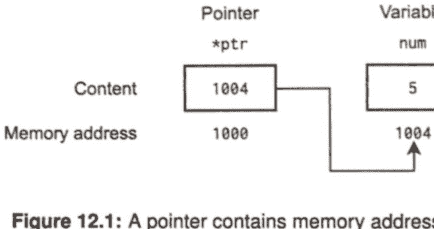

## 12.1.3 理解内存地址

C 程序中的每个变量都占用一个唯一的内存位置，由其内存地址进行标识。指针是一个存储内存地址的变量。我们必须区分指针本身、它持有的内存地址以及该地址上存储的值。

在操作指针时，将变量的地址赋值给指针是有效的，但将变量本身是无效的。例如：

```c
ptr = &num; // 有效，将 num 的地址赋值给 ptr
ptr = num; // 无效，尝试将变量 num 赋值给 ptr
```

如果你感兴趣，可以使用 `printf()` 函数中的 `%p` 格式说明符打印指针中存储的内存地址。当你想要验证指针中存储的内存地址或理解指针在 C 中如何工作时，这用。

## 12.1 指针简介

181

```c
#include <stdio.h>

int main() {
    int num = 5;
    int *ptr = &num;

    printf("Pointer Value: %p\n", ptr);
    return 0;
}
```

在这个示例中，使用 `%p` 格式说明符来打印存储在 `ptr` 指针中的内存地址。此代码的输出将类似于：

Pointer Value: 0x7ffce6501fc

注意，打印的内存地址可能会因机器而异，取决于可用内存和内存分配。在给示例中，地址有 16 位十六进制数字，因为代码是在 64 位机器上运行的。然而，为了简单起见，我们将在本中使用较短的地址作为示例。

## 12.1.4 访问指针地址存储的值

引用（Dereferencing）是访问指针指向的内存位置上存储的值的过程。它是通过引用运算符（或方向操作符）(`*`) 完成的。它允许你间接访问指针目标地址的值。例如：

```c
int num = 5;
int *ptr = &num; // 指针 ptr 指向 num 的内存地址
```

```c
printf("Value of num: %d\n", num);    // 输出: Value of num: 5
printf("Value of ptr: %d\n", *ptr);   // 输出: Value of *ptr: 5
```

在这里，`ptr` 保存 `num` 的内存地址。引用操作符允许你通过 `ptr` 访问 `num` 的值。我们可以把 `*ptr` 读为“ptr 指向的值”。

另一个示例：

```c
int a = 88;
int *ip, b;
ip = &a;
b = *ip; // 引用 ip 以访问 a 的值
```

```c
printf("Value of b: %d\n", b);    // 输出: Value of b: 88
```

在这个示例中，`a` 和 `b` 是整数变量，`ip` 是指向整数的指针。通过引用，我们将 `b` 赋值为存储在 `ip` 指向的内存地址的值，在这种情况下是 88。见图 12.2 以获得更清晰的视图。

# 第12 章 指针

| int a = 88; | int *ip; | ip = &a; | b = *ip; |

| :--- | :--- | :--- | :--- |

| 88 | *ip | a 的地址 | 88 |

图 12.2: 引用指针

a

*ip

ip 指针指向整数

ip 现在指向 a

b

*ip 是 ip 指向的值

## 12.2 指针运算

指针运算是对指针执行算术操作的过程。所指向的数据类型的大小决定了递增或递减的大小。最常用的指针运算涉及递增（`++`）和递减（`--`）运算符。这些运算符根据指针所指向的数据类型的大小增加或减小指针。例如，考虑一个字符串：

```c
char string[] = "Kucing oben";
char *strptr;
```

```c
// 指针 strptr 指向第二个字符：'u'
strptr = &string[1];
```

```c
// 输出：strptr 处的字符：'u'
printf("Character at strptr: %c\n", *strptr);
```

```c
// 递增 strptr 将移动到下一个字符
strptr++;
```

```c
// 输出：增后 strptr 处的字符：'c'
printf("Character at strptr after increment: %c\n", *strptr);
```

在这里，`ptr` 最初指向字符串中的第二个字符。递增指针通过递增运算符将其移动到数组的下一个元素。例如，考虑一个整数数组：

```c
int arr[] = {10, 20, 30, 40, 50};
// 指针 ptr 指向数组的第一个元素
int *ptr = arr;
```

```c
// 输出：ptr 处的值：10
printf("Value at ptr: %d\n", *ptr);
```

```c
// 递增 ptr 将移动到数组的下一个元素
ptr++;
```

## 12.3 指针与数组

```c
// 输出：增后 ptr 处值：20
printf("Value at ptr after increment: %d\n", *ptr);
```

在这里，`ptr` 最初指向数组的第一个元素。递增 `ptr` 到数组的下一个元素，导致它指向值 20。

## 12.4. 指针与字符串

`const char *day[] = {"Sunday", "Monday", "Tuesday", "Wednesday", "Thursday", "Friday", "Saturday"};`

| day[0] | "Sunday" |

| day[1] | "Monday" |

| day[2] | "Tuesday" |

| day[3] | "Wednesday" |

| day[4] | "Thursday" |

| day[5] | "Friday" |

| day[6] | "Saturday" |

图 12.3: 字符串指针数组

```c
#include <stdio.h>
int main() {
    int n;
    const char *day[] = {"Sunday", "Monday", "Tuesday", "Wednesday", "Thursday", "Friday", "Saturday"};

    do {
        printf("Enter a day from 1 to 7: ");
        scanf("%d", &n);

        if (n < 1 || n > 7) {
            printf("Invalid input. Please try again.\n");
        }
    } while (n < 1 || n > 7);

    puts(day[n-1]);

    return 0;
}
```

声明 `const char *day[] = {"Sunday", "Monday", "Tuesday", "Wednesday", "Thursday", "Friday", "Saturday"};` 创建了一个名为 `day` 的数组，其中每个元素都是一个指向字符串的指针。例如，`day[0]` 指向 "Sunday"，`day[1]` 指向 "Monday"，以此此类推。这允许使用数组索引方便地访问星期的名称。

## 12.5 指针与函数

### 1.1 函数指针

指针可以指向函数，允许将函数作为参数传递给其他函数、存储在数据结构中，或在运行时进行动态赋值。这使得诸如回调和实现多态等强大的技术成为可能。例如：

```c
void sayHello() {
    printf("Hello, World!\n");
}

int main() {
    // 不接受参数且返回 void 的函数指针
    void (*ptr)() = sayHello; // 注意语法

    // 将 sayHello 的地址赋值给 ptr
    ptr(); // 通过指针调用函数

    return 0;
}
```

这将输出：Hello, World!

### 1.2 与函数交换数据

指针允许函数接收并处理除标量以外的数据类型。

#### 值传递

C 语言中函数接收数据的基本方法是值传递。在值传递中，会创建参数值的副本并传递给函数。在函数内部的修改不会影响原始变量。这种方法用于整数等简单类型。例如，考虑在不修改原始值的情况下错误交换值：

```c
void swap(int x, int y) { // 错误的交换函数
    int temp = x;
    x = y;
    y = temp;
}

int main() {
    int a = 5, b = 10;
    swap(a, b); // 这里的交换无效
    printf("a: %d, b: %d\n", a, b); // 输出：5, 10 (未改变)
}
```

#### 引用传递

指针允许通过引用传递数据，使能够修改修改数据。在引用传递中，原始变量的内存地址被传递给函数。函数内部的修改会影响原始变量。这种方法用于大型数据结构（如数组），以避免复制。例如，考虑使用指针正确交换值：

```c
void swap(int *x, int *y) { // 正确的交换函数，使用了指针
    int temp = *x;
    *x = *y;
    *y = temp;
}

int main() {
    int a = 5, b = 10;
    swap(&a, &b); // 将地址传递给交换函数
    printf("a: %d, b: %d\n", a, b); // 输出：10, 5 (已交换)
}
```

在值传递和引用传递之间选择时，请考虑数据类型和预期的函数行为。值传递适用于简单数据类型，并且更，因为它避免了对原始数据的意外修改。相比之下，引用传递更适用于大型数据结构，以提高效率并修改原始数据。它避免了大量数据的复制。此外，通过引用传递，可以使用指针来间接地“返回”多个值，因为 C 函数只能返回单个值。

请参见表 12.1 了解值传递与引用传递差异的总结。

#### 表 12.1：值传递与引用传递的比较

| 特性 | 值传递 | 引用传递 |

|---|---|---|

| 传递了什么？ | 值的副本 | 原始变量的内存地址 |

| 函数内部的变化： | 原始变量 | 原始变量 |

| 优点： | 简单数据类型，安全 | 复杂数据类型，高效 |

## 12.6 动态内存分配

动态内存分配允许程序在运行时分配内存，而不是在编译时进行静态内存分配。用于动态内存管理的函数有 `malloc()` 和 `free()`。

- `malloc()`：从堆（heap）区域请求一块内存。分配的字节数作为参数。
- `free()`：将之前分配的块释放回存储区。返回分配块的指针。

例如：

```c
// 为 5 个整数分配内存
int *ptr = malloc(5 * sizeof(int));

// 使用内存
ptr[0] = 1;

// 释放内存
free(ptr);
```

这里，`malloc()` 函数为 5 个整数分配空间。我们可以通过 `ptr` 访问内存。这使得内存需求可以在运行时灵活变化，而不是在编译时固定。


```c
#include <stdio.h>
#include <stdlib.h>
#include <time.h>
#define ARRAY_SIZE 10

int main() {
    int *array;

    // 为数组动态分配内存
    array = (int*)malloc(ARRAY_SIZE * sizeof(int));

    if (array == NULL) {
        printf("内存分配失败!\n");
        return 1;
    }

    // 设置随机数生成的种子
    srand(time(NULL));

    // 用随机数填充数组
    for (int i = 0; i < ARRAY_SIZE; i++) {
        array[i] = rand() % 101; // 生成 0..100 的随机数
    }

    // 打印数组元素
    printf("Array elements: ");
    for (int i = 0; i < ARRAY_SIZE; i++) {
        printf("%d ", array[i]);
    }
    printf("\n");

    // 释放动态分配的内存
    free(array);

    return 0;
}
```

# 12.7 空指针

空指针 `Null pointers` 是不指向任何内存位置的指针。可以通过给指针赋值 `NULL` 值来创建。

```c
type * pointer_name = NULL;
```

以下是空指针的一些常见用途：

- 未初始化的指针：空指针通常用于在分配有效地址之前初始化指针这有助于防止野指针。
- 函数参数：当没有意义的值可以传递时，可以将 `NULL` 作为参数传递给期望指针的函数。
- 动态内存分配：当使用函数 `malloc()` 时，如果内存分配失败，将返回 `NULL`。
- 数据结构：空指针表示树和链表等数据结构的结束。
- 提高可读性：使用空指针可以提高代码的可读性，明确表示指针未意图指向有效的内存位置。

# 第12章 指针

在访问任何指针变量之前检查其是否为 `NULL` 指针是一个良好的习惯，可以避免运行时错误和崩溃。

## 检查指针是否为 NULL

编写程序以避免在使用 `NULL` 指针访问指针值时发生段错误

```c
// C NULL pointer demonstration
#include <stdio.h>

int main() {
    // 声明空指针
    int *ptr = NULL;

    // 仅当指针有值时才进行解引用
    if (ptr == NULL) {
        printf("Pointer does not point to anything");
    } else {
        printf("Value pointed to by pointer: %d", *ptr);
    }
    return 0;
}
```

C语言标准规定了 `NULL` 指针，为程序员提供了一种机制来判断给定的指针是否合法。

## 解引用 NULL 指针

如果我们使用以下 C 代码会发生什么：

```c
// Trying to dereencing a null pointer
#include<stdio.h>
int main() {
    int *ptr = NULL;

    printf("%d",*ptr);
    return 0;
}
```

在某些机器上，上述代码可以编译成功，但在运行时会崩溃。程序在所有机器上的表现并不一致。请在风险风险的情况下尝试该代码！

# 高级指针概念

## 空指针

空指针 `void *` 是 C 语言中的一种特殊指针，它可以指向任何数据类型的对象。它们提供了一种通用的操作方法，可以在不指定特定数据类型的情况下处理内存地址。

空指针类似于通配符指针，可以存储任何数据类型的地址。它使用以下语法定义：

```c
void *pointer_name;
```

通过空指针，我们可以存储和操作内存地址，无需关心所指向数据的实际类型。

示例：

```c
void *ptr;
int x = 10;

ptr = &x; // 将 x 的地址赋值给空指针
```

```c
// 要解引用空指针，
// 需要将其转换为适当的类型
printf("Value of x: %d", *(int*)ptr); // 输出: Value of x: 10
```

空指针不能直接解引用，因为它们缺乏特定的类型。相反，它们在解引用之前需要进行类型转换。示例：

```c
int x = 4;
float y = 5.5;
void *ptr;

// 将 x 的地址赋值给 ptr
ptr = &x;
```

```c
// 将空指针转换为 int 后对其进行解引用
printf("Integer variable is %d", *(int*)ptr);
```

```c
// 现在，将 y 的地址赋值给 ptr
ptr = &y;
// 将空指针转换为 float 后对其进行解引用
printf("Float variable is %f", ((float*)ptr);
```

输出：

Integer variable = 4

Float variable = 5.500000

空指针在 C 编程中具有多种优势：

- 它们通常与 `malloc()` 和 `calloc()` 等内存分配函数一起使用，因为这些函数返回空指针，允许它们为任何数据类型分配内存。
- 空指针能够实现泛型函数，例如用于 `qsort()` 的比较函数，它可以处理不同的数据类型。
- 当与类型为 `void (*) (void)` 的函数指针结合时，可以指向接受任何参数并返回任何值的函数。
- 空指针对于实现动态数据结构（如列表、树和队列）至关重要，在这些结构中数据类型可能会变化。
- 它们还经常用于类型转换，增加了数据操作的灵活性。

### 指针转换

指针转换涉及将指针从一种数据类型转换为另一种类型。它在处理空指针或处理不兼容的指针类型时经常使用。

示例：

```c
float pi = 3.14;
void *voidPtr = &pi; // 指向 pi 的指针

// 将空指针转换为 float 指
float *floatPtr = (float*)voidPtr;

printf("Value of pi: %.2f\n", *floatPtr); // 输出: Value of pi: 3.14
```

### 悬空指针

当指向已释放或不再有效的内存时，就会产生悬空指针。例如，当之前分配给指针的内存被释放，但指针仍然持有该地址时。悬空指针会导致不可预测的行为，例如访问程序未拥有的内存或导致崩溃。

示例：

```c
#include <stdio.h>
#include <stdlib.h>

int main() {
    int *ptr, a = 55;

    ptr = malloc(sizeof(int)); // 分配内存
    *ptr = 33; // 在动态分配的内存中存储数字
    printf("Data at ptr: %d\n", *ptr);
    ptr = &a; // 指向 'a'
    printf("Data at ptr: %d\n", *ptr);
    free(ptr); // 释放内存
    return 0;
}
```

代码首先声明了一个整数指针 `ptr` 和一个整数变量 `a`。然后，使用 `malloc()` 为整数动态分配内存，并将分配的内存地址赋值给 `ptr`。

在分配内存后，代码将数字 33 存储在动态分配的内存中并打印。然后，它将 `ptr` 指向变量 'a' 的地址并打印其值。最后，它调用了 `free(ptr)`，这是有问题的，因为 'a' 是栈变量，而不是堆分配的内存。这产生了一个悬空指针。

为了避免此类问题，请确保仅对通过 `malloc`、`calloc` 或 `realloc` 分配的内存调用 `free`。

## 进阶指针概念

```c
type **pointer_name = &normal_pointer_variable;
```

示例用法：

```c
int var = 10;
int *ptr = &var; // 指向 var 的指针
int **pptr = &ptr; // 指向 ptr 的指针
```

```c
// 输出：通过 pptr 获取 var 的值: 10
printf("Value of var via pptr: %d\n", **pptr);
```

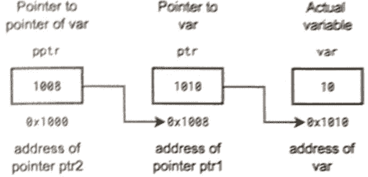

图 12.6：双指针

这是一个演示在 C 中使用双指针的程序：

```c
// 演示指向指针的 C 程序
#include <stdio.h>

int main() {
    int var = 10;
    int *ptr = &var; // 指向 var 的指针
    int **pptr = &ptr; // 指向 ptr 的双级指针

    ptr = &var; // 将 var 的地址存入 ptr
    pptr = &ptr; // 将 ptr 的地址存入 pptr

    // 使用单指针和双指针显示 var 的值
    printf("Value of var: %d\n", var);
    printf("Value of var using single pointer = %d\n", *ptr);
    printf("Value of var using double pointer = %d\n", **pptr);

    // 显示指针地址
    printf("Address of pptr = %p\n", pptr);
    printf("Value of pptr = %p\n", *pptr);
    printf("Address of ptr = %p\n", &ptr);
    printf("Value of pptr = %p\n", ptr);
    printf("Address of val = %p\n", &var);

    return 0;
}
```

典型输出：

```
Value of var = 10
Value of var using single pointer = 10
Value of var using double pointer = 10
Address of pptr = 0x7ffee78f470
Value of pptr = 0x7ffee78f468
Address of pptr = 0x7ffee78f468
Value of pptr = 0x7ffee78f464
Address of val = 0x7ffee78f464
```

具体的地址将取决于程序分配的内存而变化。

双指针在 C 中有多种用途，包括：

- 修改作为参数传递给函数的指针变量中存储的地址。
- 为多维数组动态分配内存。
- 管理分级数据结构，例如树节点或链表。

在 C 中，指针不限于两个层级。我们可以根据需要使用任意层级，但由于复杂性的增加，使用多个层级时应格外谨慎。

## 12.9 树莓派中的硬件访问

树莓派是一种广泛使用的单板计算机，它提供了多种硬件能力，包括通用输入/输出 `GPIO` 引脚。在为树莓派进行 C 编程时，指针对于高效访问和操作这些硬件组件至关重要。

为了演示，让我们考虑控制连接到 `GPIO` 引脚 18 的 `LED`。我们将使用指针直接访问 `GPIO` 寄存器并设置或读取引脚值。

```c
#include <bcm2835.h>

// LED 的 GPIO 引脚号
#define LED_PIN 18

int main() {
    // 初始化 GPIO
    if(!bcm2835_init())
        return 1;

    // 设置 LED 引脚为输出
    bcm2835_gpio_fsel(LED_PIN, BCM2835_GPIO_FSEL_OUTP);

    // 声明指向 GPIO 寄存器基地址的指针
    volatile unsigned *gpio = (volatile unsigned *) BCM2835_GPIO_BASE;

    while(1) {
        // 使用指针向 GPIO 引脚写入 1，开启 LED
        *gpio |= (1<<LED_PIN);

        // 延迟
        delay(1000);

        // 向 GPIO 引脚写入 0 关闭 LED
        *gpio &= ~(1<<LED_PIN);

        // 延迟
        delay(1000);
    }
    return 0;
}
```

在此示例中：

- 我们使用 `bcm2835` 库初始化 `GPIO`。`bcm2835` 库是一个 C 库，用于直接、底层访问树莓派博通 2835 SOC（片上系统）上的 `GPIO`（通用输入/输出）。
- 将 `GPIO` 引脚 18 设置为输出引脚。
- 声明指向 `GPIO` 寄存器基地址的指针。`volatile` 关键字告诉编译器寄存器中的值可能会在程序外部随时更改。
- 在循环内部，我们使用指针直接写入 `GPIO` 寄存器位掩码，并在延迟之间切换 `LED` 的开关状态。

这种直接访问提供了对 `LED` 等硬件组件的控制。指针允许我们直接与物理 `GPIO` 端口交互，便于与树莓派上的外部设备进行实时接口。

## 总结

在本章中，我们涵盖了指针的指针、动态内存分配以及 C 中用于管理内存的一些常用函数。通过理解这些概念，你将能够编写出更高效、更强大的 C 代码，同时避免常见的陷阱和安全风险。

通过练习、耐心和奉献，你将掌握指针和内存管理。

问题

- 12.1 什么是指针的指针？
- 12.2 指针与普通变量有何区别？
- 12.3 如何获取指针指向的值？
- 12.4 取地址运算符 `(&)` 与解引用运算符 `(*)` 有什么区别？
- 12.5 如何将数组作为参数传递给函数？
- 12.6 解释指针算术。如何增加或递减指针？
- 12.7 使用指针时有哪些常见的错误？
- 12.8 使用指针时有哪些常见的错误？
- 12.9 使用指针时有哪些常见的错误？
- 12.10 使用指针时有哪些常见的错误？
- 12.11 使用指针时有哪些常见的错误？
- 12.12 使用指针时有哪些常见的错误？
- 12.13 使用指针时有哪些常见的错误？
- 12.14 使用指针时有哪些常见的错误？
- 12.15 什么是结构体？

# 13. 结构化数据

在编程中，结构体 `struct` 是将不同变量分组到一个名称下以创建自定义类型的基本方法。

## 结构体：语法声明

定义结构体的语法涉及 `struct` 关键字、结构体名称以及在大括号内的成员变量列表。例如：

```c
struct Person {
  char name[10];
  int age;
  float height;
};
```

这段代码定义了一个名为 `person` 的结构体，包含三个成员变量：`name`、`age` 和 `height`。

## 访问结构体成员

访问结构体成员涉及点运算符 `.` 后紧跟成员名称。例如：

```c
#include <stdio.h>

struct Person {
    char name[10];
    int age;
    float height;
};

int main() {
    // 声明并初始化结构体变量
    struct Person person1 = {"Sarah", 20, 1.65f};
    struct Person person2 = {"Adam", 25, 1.80f};

    // 打印第一个结构体数据
    printf("Name: %s\n", person1.name);
    printf("Age: %d\n", person1.age);
    printf("Height: %f\n", person1.height);

### 打印第二个结构体数据
    printf("Name: %s\n", person2.name);
    printf("Age: %d\n", person2.age);
    printf("Height: %f\n", person2.height);

    return 0;
}
```


## 结构体指针

指针也可以指向结构体和联合体，允许对复杂数据结构进行动态分配和操作。声明结构体指针非常简单：

```c
struct Person *ptr;
```

要通过指针访问结构体成员，我们可以使用箭头运算符 `->` 或者通过解引用：

```c
ptr->age = 26;
(*ptr).age = 26;
```

在处理包含指针的结构体（例如链表）时，这个箭头运算符特别有用。

示例代码如下：

```c
#include <stdio.h>

struct Person {
    char name[18];
    int age;
    float height;
};

int main() {
```

// 声明并初始化结构体变量

struct Person person1 = {"Sarah", 20, 1.65f};

struct Person person2 = {"Adam", 25, 1.8f};

// 声明指向结构体的指针

struct Person *ptr;

// 将结构体变量的地址赋值给指针

ptr = &person1;


```
// 使用箭头表示法访问结构体成员
printf("Name: %s\n", ptr->name);
printf("Age: %d\n", ptr->age);
printf("Height: %f\n", ptr->height);
// 将指针指向另一个结构体
ptr = &person2;
// 使用解引用访问结构体成员
printf("Name: %s\n", (*ptr).name);
printf("Age: %d\n", (*ptr).age);
printf("Height: %f\n", (*ptr).height);
```

# 第 13 章 结构化数据

202

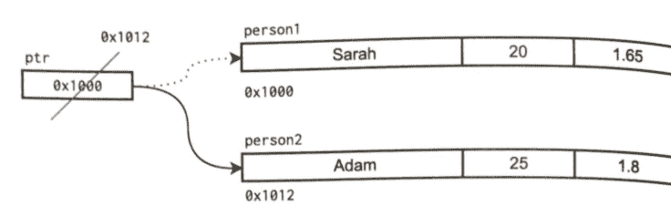

图 13.2：指向结构体的指针

```c
// 使用箭头表示法修改结构体成员
ptr->age = 26;
```

`return 0;`
}

在这个示例中，我们声明了 `ptr`，一个指向结构体的指针。然后我们将 `ptr` 设置指向第一个结构体，通过 `ptr->member` 语法访问结构体成员。接下来，我们将 `ptr` 指向另一个结构体，使用点操作符访问成员。最后，我们使用箭头运算符来修改结构体成员。

### 13.1.4 嵌套结构体

结构体可以嵌套在其他结构体中以表示复杂的数据结构。例如：

```c
struct Address {
    char street[50];
    char city[30];
};

struct Person {
    char name[10];
    int age;
    float height;
    struct Address address;
};
```

在这里，`Person` 结构体包含一个嵌套的 `Address` 结构体，用于表示人的地址。

### 13.1.5 向函数传递结构体

结构体可以通过值传递或引用传递传递给函数。例如：

```c
void printPerson(struct Person p) {
    printf("Name: %s, Age: %d, Height: %f\n", p.name, p.age, p.height);
}

// 按值传递
struct Person p = {"Adam", 25, 1.8};
printPerson(p);
```

### 13.1.6 从函数返回结构体

函数也可以返回结构体。例如：

```c
struct Person createPerson(char name[], int age) {
    struct Person p;
    strcpy(p.name, name);
    p.age = age;
    return p;
}
```

此函数创建并返回一个带有指定名称和年龄的 `Person` 结构体。

## 12.2 联合体（Unions）：一种特殊的结构体

在 C 语言编程中，联合体提供了一种创建唯一类型结构的方法，其中所有成员共享同一块内存。

联合体提供了一种创建唯一类型结构的方法，其中所有成员共享相同的内存。要声明联合体，使用 `union` 关键字后跟名称。例如：

```c
union myList {
    char c;
    int i;
    double d;
};
```

联合体与结构体的区别在于，联合体同一时间只有一个成员是激活的，而结构体的每个成员都有自己的内存空间。联合体的大小由其最大成员的大小决定。

联合体通常用于节省内存。下面是比较结构体和联合体的用法：

```c
#include <stdio.h>

// 使用结构体表示不同数据类型
struct myststruct {
    char c;
    int i;
    double d;
};

// 使用联合体表示不同数据类型
union myunion {
    char c;
    int i;
    double d;
};

int main() {
    union myunion u;
    struct myststruct s;

    printf("结构体的大小: %d\n", sizeof(s));
    printf("联合体的大小: %d\n", sizeof(u));

    u.c = 'a';
    printf("值: %c\n", u.c);
}
```

## 13.3 typedef：简化声明

`typedef` 关键字用于为现有数据类型创建别名，这可以使代码更具读性且易于维护。对于结构体和联合体等复杂类型特别有用。

例如，与其每次都写 `struct Person`，你可以定义一个 `typedef` `Person`。

```c
typedef struct {
    int age;
    float height;
} Person;

Person p1; // 现在可以使用 Person 代替 struct Person
```

`typedef` 也可以用于指针和数组：

```c
typedef int* intPtr;
typedef int intArray[10];
```

## 13.4 枚举（Enums）：提高程序可读性

枚举（enums）是定义命名整数常量的方法。与使用魔数相比，这使得代码更具读性，因为名称提供了清晰的上下文。

要定义枚举，使用 `enum` 关键字后跟名称：

```c
enum Day {
    SUNDAY,
    MONDAY,
    TUESDAY,
    WEDNESDAY,
    // ... (省略)
};
```

默认情况下，第一个常量为 0，随后的每个常量增加 1。你也可以分配特定的值：

```c
enum Status {
    LOW = 1,
    MEDIUM = 2,
    HIGH = 10
};
```

配合 `typedef` 使用枚举允许你在声明变量时避免使用 `enum` 关键字：

```c
typedef enum { SUNDAY, MONDAY, TUESDAY } Day;

Day today = MONDAY;
```

- [费曼学习法](https://wiki.example.org/feynmans_learning_method)的灵感源于诺贝尔物理奖获得者**理查德·费曼**。

1. 运用费曼技巧，你可以在仅需 `20 min` 内深度理解知识点，而且令人记忆深刻且*难以遗忘*。

```
if (condVar > someVal) {console.log("xxx")}
```

## 第13章 结构化数据

212

- 在主函数中：
  - 将头指针初始化为 NULL。
  - 使用 `insert` 插入三个整数值为 1、2 和 3 的节点。
  - 使用 `printList` 打印列表内容。

### 13.6.2 队列

队列是一种遵循先入先出（FIFO）原则的线性数据结构，第一个进入队列的元素是第一个被移除的元素。队列有两个主要操作：入队（enqueue，插入元素）和出队（dequeue，移除元素）。队列主要有两种类型：

- 线性队列：使用数组存储元素，具有固定大小。
- 动态队列：使用链表存储元素，允许动态内存的分配和释放。

队列有一个头部（front）和一个尾部（rear），入队将元素添加到尾部，出队则从头部移除元素。

队列的常用操作包括：

- Enqueue：向队列中插入一个元素。
- Dequeue：从队列中移除一个元素。
- Front：获取队列中的第一个元素。
- Rear：获取队列中的尾部元素。
- IsEmpty：检查队列是否为空。
- IsFull：检查队列是否已满。

队列在各种应用中非常有用，例如操作系统、计算机网络和模拟算法，在这些领域中元素的处理顺序是非常重要的。

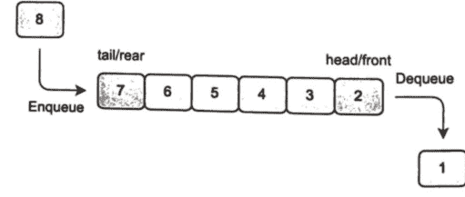

图 13.8：队列数据结构

## 13.6. 数据结构

示例：这里是用 C 语言实现的基于链表的队列的简单实现：

```c
#include <stdio.h>
#include <stdlib.h>

// 定义链表节点结构
struct Node {
    int data;
    struct Node* next;
};

// 定义队列结构
struct Queue {
    struct Node* front;
    struct Node* rear;
};

// 创建新队列
struct Queue* createQueue() {
    struct Queue* queue = (struct Queue*)malloc(sizeof(struct Queue));
    queue->front = queue->rear = NULL;
    return queue;
}

// 检查队列是否为空
int isEmpty(struct Queue* queue) {
    return queue->front == NULL;
}

// 入队（向队列添加元素）
void enqueue(struct Queue* queue, int data) {
    // 创建新节点
    struct Node* new_node = (struct Node*)malloc(sizeof(struct Node));
    new_node->data = data;
    new_node->next = NULL;

    // 如果队列为空，将头部和尾部都指向新节点
    if (isEmpty(queue)) {
        queue->front = queue->rear = new_node;
    } else {
        // 在尾部添加新节点并更新尾部指针
        queue->rear->next = new_node;
        queue->rear = new_node;
    }
}

// 出队（从队列移除元素）
int dequeue(struct Queue* queue) {
    if (isEmpty(queue)) {
        printf("Queue is empty\n");
        return -1; // 或者任何其他错误处理指示
    }

    // 存储要返回的数据和要删除的节点
    int data = queue->front->data;
    struct Node* temp = queue->front;

    // 更新头部指针
    queue->front = queue->front->next;

    // 如果出队后队列为空，将头部和尾部都置为 NULL
    if (queue->front == NULL) {
        queue->rear = NULL;
    }

    // 释放被删除节点的内存
    free(temp);

    return data;
}

// 打印队列中的所有节点
void printQueue(struct Queue* queue) {
    if (isEmpty(queue)) {
        printf("Queue is empty\n");
        return;
    }
    struct Node* temp = queue->front;
    while (temp != NULL) {
        printf("%d ", temp->data);
        temp = temp->next;
    }
    printf("\n");
}

int main() {
    struct Queue* queue = createQueue();

    enqueue(queue, 10);
    enqueue(queue, 20);
    enqueue(queue, 30);

    printf("Queue elements: ");
    printQueue(queue);

    printf("Dequeued: %d\n", dequeue(queue));
    printf("Dequeued: %d\n", dequeue(queue));

    printf("Queue elements: ");
    printQueue(queue);

    return 0;
}
```

这段代码创建了一个空队列，插入了三个带有整数数据的节点，并在每个节点中插入了数据。然后弹出两个节点并再次打印队列的最终状态。

- 我们定义了 `Node` 和 `Queue` 结构。
- `createQueue()` 为新队列分配内存并将其头部和尾部指针初始化为 NULL。
- `isEmpty()` 函数检查头部指针是否为 NULL，这表示队列为空。
- `enqueue()` 函数创建一个新节点，添加数据元素，并通过更新尾部指针将其插入到队列末尾。
- `dequeue()` 函数检查队列是否为空，如果是则返回错误。否则，它存储要删除的数据，更新头部指针并释放被删除节点的内存。
- `main()` 函数演示了创建队列、入队元素以及出队。

### 13.6.3 栈

栈是一种遵循后入先出（LIFO）原则的线性数据结构，这意味着最后加入栈的元素是第一个被移除的元素。栈支持两个主要操作：推栈（push，添加元素）和弹出（pop，移除元素）。栈有两种主要的实现方式：

栈的常用操作包括：

- Push：向栈顶插入一个元素。
- Pop：从栈顶移除一个元素。
- Top：访问栈顶元素而不将其移除。
- IsEmpty：检查栈是否包含元素。
- IsFull：检查栈是否已达到最大容量（针对固定大小）。

# 第 14 章

# 预处理器

C 预处理器是一个宏处理器，在 C 程序的编译之前使用。它被用于在编译之前之前对源代码进行文本替换。预处理器由编译器调用，并在编译过程之前作为一个独立的阶段运行。

# 14.1 引言

预处理发生在 C 程序的实际编译之前。它解释指令和宏，将源代码转换为一个修改后的版本，然后将其传递给编译器。见图 14.1。

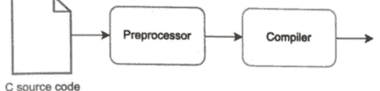

图 14.1：C 预处理器数据流

C 预处理器的主要特性包括：

- **宏定义与替换**：使用 `#define` 定义，宏允许在不改变原始程序的情况下对代码进行定制化。
- **文件包含**：通过 `#include` 管理，该功能包含了带有共享声明的头文件。
- **条件编译**：通过 `#ifdef` 和 `#ifndef` 启用，允许根据宏定义条件性地编译部分代码。它对于特定平台的定制化非常有用。
- **行控制**：使用 `#line`，开发者可以为调试设置行号和文件属性。
- **错误生成**：由 `#error` 触发，该指令在处理期间生成错误消息。

C 预处理器提供了各种指令，允许在预处理阶段进行代码操纵和优化。它们被分为文件包含、宏替换、条件编译和杂项指令。见图 14.2。

# 14.2 文件包含

`#include` 指令用于在 C 程序中导入头文件，通过引入外部代码文件来实现代码复用。它将头文件的内容插入到

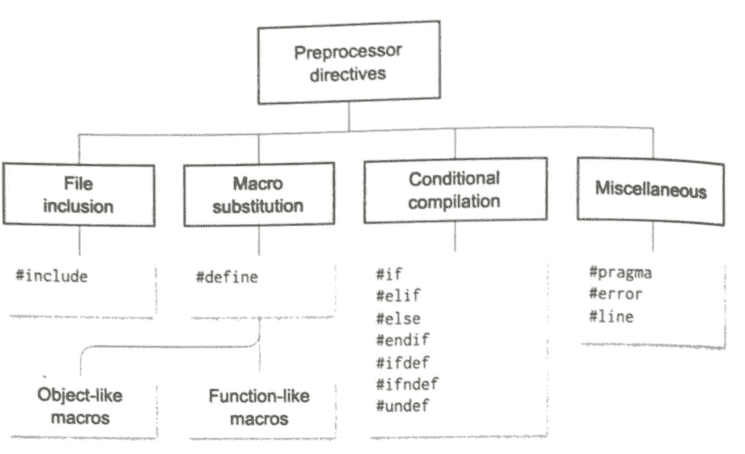

图 14.2：预处理器指令。

源代码中，为适当的编译和执行提供必要的声明和定义。

语法：

```
#include <filename>
```

`<filename>` 语法用于系统头文件，这些文件通常位于标准包含目录中。

示例：

```
#include <stdio.h>
```

另一种地，`#include` 指令也可以使用引号来包含用户定义的头文件。

语法：

```
#include "filename.h"
```

`"filename.h"` 语法用于用户定义的头文件，这些文件通常位于源文件相同的目录中。

示例：

```
#include "myheader.h"
```

文件包含的顺序可能会影响编译过程，因为头文件可能依赖于其他文件。因此，按正确的顺序包含头文件以确保正确编译并避免错误至关重要。

这是一个使用 `#include` 指令的 C 程序示例：

# 14.3 宏替换

```
#include <stdio.h>
#include "myheader.h"

int main() {
    printf("Hello, world!\n");
    my_function();
    return 0;
}
```

在这个示例中，包含了 `stdio.h` 头文件以访问 `printf` 函数，包含了 `myheader.h` 头文件以访问 `my_function` 函数。`main` 函数调用这些函数来打印消息并执行用户定义的功能。

# 14.3 宏替换

C 编程中的宏使用 `#define` 指令定义，用于创建简记法或可重用的代码段。它们通过以下方式简化代码并提高可读性：

- **替换重复代码**：定义一次复杂的表达式或代码块，并在整个程序中使用它的名称。
- **创建符号名称**：为常量赋予有意义的名字以便更好地理解。

语法：

```
#define NAME VALUE
```

预处理器在编译阶段（实际处理代码之前）会将宏 `NAME` 替换为其定义的 `VALUE`。

C 编程中的宏使用 `#define` 指令定义，用于创建简记法或可重用的代码段。它们通过以下方式简化代码并提高可读性：

- **替换重复代码**：定义一次复杂的表达式或代码块，并在整个程序中使用它的名称。
- **创建符号名称**：为常量赋予有意义的名字以便更好地理解。

语法：

```
#define NAME VALUE
```

预处理器在编译阶段（实际处理代码之前）会将宏 `NAME` 替换为其定义的 `VALUE`。


# C 编程中的宏

C 编程中的宏使用 `#define` 指令定义，用于创建简记法或可重用的代码段。它们通过以下方式简化代码并提高可读性：

- **替换重复代码**：定义一次复杂的表达式或代码块，并在整个程序中使用它的名称。
- **创建符号名称**：为常量赋予有意义的名字以便更好地理解。

## 语法

```
#define NAME VALUE
```

预处理器在编译阶段（实际处理代码之前）会将宏 `NAME` 替换为其定义的 `VALUE`。

C 编程中的宏以两种主要形式存在：简单宏和函数形式宏。

- **简单宏**：简单宏用于提供常量的符号化名称。
- **函数形式宏**：函数形式宏看起来像函数调用，但没有返回值。

```
#define PI 3.14159
#define SQUARE(x) (x * x)

int main() {
    double radius = 5;
    printf("Area: %.2f\n", PI * SQUARE(radius));
    return 0;
}
```

## 14.3.3 副作用与陷阱

宏可能会产生副作用，特别是当参数被多次求值时。例如：

```c
#define SQUARE(x) (x * x)

int main() {
    int a = 5;
    printf("%d\n", SQUARE(a++)); // 输出可能是25 或 36
    return 0;
}
```

为了避免这种情况，在宏定义中使用括号：

```
#define SQUARE(x) ((x) * (x))
```

## 14.3.4 权衡宏的使用

虽然宏提供了优点，但也存在缺点。

**优点：**

- **复代码**：为常见任务定义并复用代码段。
- **可读性**：简化表达式或为常量创建符号名称。
- **定制化**：为不同的环境调整代码。

**缺点：**

- **安全性问题**：缺乏类型检查可能会引入错误。
- **不可预测的行为**：未定义的求值顺序会导致意外结果。
- **调试挑战**：由于缺乏调试信息，宏中的错误很难调试。
- **不是函数**：宏缺乏块结构、变量作用域和函数的返回值。

**总结：**

- 由于可能产生错误，请谨慎使用宏。
- 对于复杂逻辑或类型安全性至关重要的情况，考虑使用函数等替代方案。

选择合适的工具。虽然宏提供了便利，但请优先代码的清晰性、可维护性和安全性。

## 14.4 条件编译

条件编译允许根据特定条件控制部分代码。这对于：

- 根据目标平台或配置包含或排除代码
- 启用或禁用调试或测试代码
- 为不同的环境定制代码

`#ifdef`、`#ifndef`、`#else` 和 `#endif` 指令用于条件编译。

```
#ifdef 检查宏是否定义
#ifndef 检查宏是否未定义
#else 提供备选代码段
#endif 标记条件块的结束
```

`#ifdef` 和 `#ifndef` 的语法如下：

```
#ifdef NAME
// 如果 NAME 定义了，则编译代码
#endif
```

```
#ifndef NAME
// 如果 NAME 未定义，则编译代码
#endif
```

## 14.5 杂项预处理器指令

示例：

```c
#ifdef DEBUG
printf("Debug information\n"); // 仅在定义 DEBUG 时编译
#endif
```

`#else` 指令为 `#ifdef` 或 `#ifndef` 检查提供备选代码块。

语法：

```
#ifdef NAME
// 如果 NAME 定义，则编译代码
#else
// 如果 NAME 未定义，则编译代码
#endif
```

条件编译为代码编译提供了灵活性和控制力，允许你根据不同的情况或环境定制你的程序。

## 14.5 杂项预处理器指令

预处理器还提供了其他用于特定任务的指令。

### 14.5.1 pragma 指令

`#pragma` 指令用于向编译器提供额外指令，通常用于控制特定于编译器的行为或启用/禁用某些优化。虽然 `#pragma` 的具体行为在不同编译器之间存在差异，但它们可以用于设置选项、禁用警告或控制代码布局。

```c
示例:
#pragma warning(disable : 4996) // 禁用警告 4996
```

### 14.5.2 #error 指令

`#error` 指令用于生成带有自定义错误信息的编译错误。这在编译期间强制执行特定条件或要求时非常有用。

```c
#ifdef DEBUG
#error "发布版本中不支持调试模式"
#endif
```

### 14.5.3 #line 指令

`#line` 指令用于控制编译期间输出的行号和源代码信息。这对于调试器或性能分析工具将编译后的代码映射回源代码很有帮助。

示例：

```
#line 100 "custom.file.c" // 将行号设置为 100
// 文件名设置为 custom.file.c
```

这些指令在编译的预处理阶段提供了额外的控制和自定义，允许开发者根据其特定需求定制编译过程。

## 总结

预处理器是编译 C 程序的初始阶段，在实际编译之前处理文本操作。预处理的关键特性包括：使用 `#include` 包含文件、使用 `#define` 进行宏替换以实现简化和代码复用，以及使用 `#ifdef` 和 `#ifndef` 根据预定义条件进行选择性编译。此外，`#pragma`、`#error` 和 `#line` 对编译行为和错误处理提供了高级控制。尽管宏和指令提供了灵活性，但应谨慎使用，以防止潜在问题，如未定义行为和调试挑战。

## 问题

- 14.1 C 预处理器的主要功能是什么？
- 14.2 如何在 C 程序中包含像 `stdio.h` 这样的标准库文件？
- 14.3 `#include <header.h>` 和 `#include "header.h"` 有什么区别？
- 14.4 如何使用 `#define` 指令定义常量值？
- 14.5 如何在 C 中创建宏？
- 14.6 宏和函数之间有什么区别？
- 14.7 如何使用 `#ifdef`、`#endif` 和 `#else` 指令进行条件编译？
- 14.8 如何使用 `#undef` 指令取消宏的定义？
- 14.9 `#line` 和 `__LINE__` 之间有什么区别？
- 14.10 预定义宏 `__DATE__` 和 `__TIME__` 的目目的是什么？
- 14.11 什么是条件编译？它为什么有用？如何使用预处理器指令实现？
- 14.12 下一个宏旨在计算数字的平方，但它并不总是产生正确的结果。识别问题并建议修复。

```c
#define SQUARE(x) x * x

int result = SQUARE(3 + 1); // 预期: 16，实际: 7
```

# 第 15 章

## Arduino 上的 C

本主题涵盖了 Arduino 的 C 编程，使用 Arduino 的实现。它适用于具有 C 基础知识的用户。本章重点关注普通 C 和 Arduino C 之间的区别，并在不深入研究硬件接口的情况下探索硬件控制。

## 15.1 你需要什么

为了充分利用本章内容，建议拥有一块 Maker Uno 板，它通过消除对额外连接的需求简化了初学者的学习过程。Maker Uno 板由 Cytron Technologies 提供，是一块基于 ATmega328P 微控制器构建的 Arduino 兼容板。

与只有一个 LED 的 Arduino Uno 不同，Maker Uno 板具有 12 个内置 LED、一个蜂鸣器和一个按钮开关，减少了在基础嵌入式编程实验中对硬件连接的需求。Maker Uno 板具有不同的输入电源，并使用 CH340G USB 转串口芯片。Maker Uno 板的硬件组件如图 15.1 所示。

随着你越来越熟悉微控制器的接口，你可能需要添加面包板、跳线导、几个按钮开关、LED，以及随着进展添加其他组件。你可以在学期结束前提前从 Shopee 或 Lazada 等在线市场购买这些组件。

尽管 Maker Uno 在外观和组件放置上有细微差异，但它的编程软件和引脚定义与 Arduino 完全相同。对于初学者来说，设置 Maker Uno 非常简单。要开始编程和接口，请查看电子书《初学者 学习指南》：`https://bit.ly/3Vjhop`

遗憾的是，该电子书没有包含目录，请查看：


| 课程 | 标题 | 接口 | 编程 |
|---|---|---|---|
| 0 | 设置硬件和软件 | Arduino IDE 和驱动程序 | 无 |
| 1 | 数字输出 | 在内置 LED 上制作图案 | 理解程序结构 |
| 2 | 数字输入 | 使用内置和外部开关 | if-else |
| 3 | 模拟输出 | 控制 LED 亮度 | while 循环 |
| 4 | 旋律音 | 使用内置蜂鸣器创建旋律 | 逻辑表达式 |
| 5 | 模拟输入 | 通过串口发送传感器读取值 | case 语句 |
| 6 | 直流电机 | 控制电机速度 | 预定义函数 |
| 7 | 超声波传感器 | 距离测量 | 全局变量 |

## 第 15 章. Arduino 上的 C

## 15.2 替代 Arduino 板

Maker Uno 不是学习 Arduino C 的唯一板。。还有其他更便宜、更紧凑、更强大或更易使用的选项。

对于预算友好的 Arduino 编程方法，可以考虑 NodeMCU ESP8266，它在网上售价仅为 RM10。然而，与 Uno 不同，它没有内置 LED 和开关，因此你需要自行添加它们。

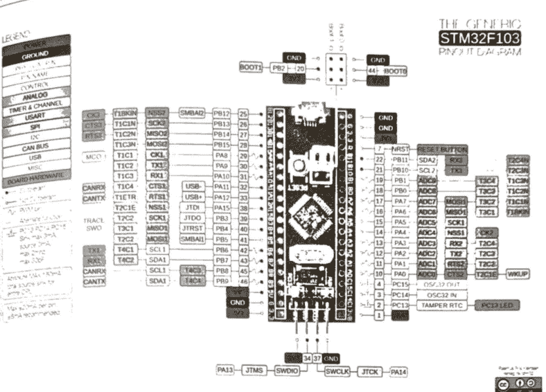

图 15.2：Blue Pill 开发板。

实时信号处理、高速数据采集和多任务处理，使得 Arduino 即使对于复杂的专业级项目也是一个可行的选择。

对于跨平台开发环境，你可以探索 PlatformIO，它运行在 Windows、macOS 和 Linux 上。它支持超过 900 种嵌入式板，包括 STM32、ESP32、AVR (Arduino) 和 Raspberry Pi Pico。PlatformIO 同时支持 Arduino C 和 STM32 HAL，为嵌入式编程提供了一个更先进、更灵活的工作流。

## 15.3 Arduino C 与普通 C

Arduino C 是专为 Arduino 板板编程身定制的 C++ 简化版本。从技术角度来说，它应该被称为 Arduino C/C++。虽然它大量借鉴了 C 和 C++，但在硬件交互方法和易用性方面与它们不同。以下是 Arduino 和普通 C 之间的主要区别：

- **硬件特定设计**：Arduino C 专门为 Arduino 板板设计，这些板板使用 ATmega328 或 ARM Cortex-M 等微控制器。它简化了如从传感器读取数据或控制执行器等硬件特定任务。相比之下，普通 C 是一种通用编程语言，可以用于从嵌入式系统到桌面环境的广泛平台。
- **抽象层次**：Arduino 提供了更高层次的抽象，隐藏了许多底层细节。例如，内存管理和寄存器级操作等任务由内置库处理。这使得 Arduino 对初学者友好。普通 C 提供了更细粒度的控制，要求程序员处理内存分配、硬件寄存器和定时等底层细节。


# 第 15 章 Arduino C 语言

## 语言特性
Arduino C 本质上是 C++ 的一个子集，对面向对象编程的支持有限。虽然它包含了 `String` 类等特性，但省略了继承和多态等更高级的 C++ 特性。普通 C 是过程性的，不具备面向对象的能力，而 Arduino C 所基于的 C++ 完整的面向对象特性。

## 额外数据类型
Arduino 引入了一些适合微控制器环境的额外数据类型，如 `boolean`、`byte` 和 `word`。它还支持二进制字面量 `0b10001001`，以便于表示二进制数据。这些类型和特性简化了微控制器应用程序的编程。

## 程序结构
Arduino C 使用了一种独特的程序结构，以两个函数为核心：`setup()` 和 `loop()`。`setup()` 函数初始化程序并在启动时运行一次，`loop()` 函数持续运行。普通 C 程序围绕 `main()` 函数构建，该函数必须显式管理初始化和重复性任务。

## 内置库和工具
Arduino C 包含了许多为常见微控制器任务设计的库和工具，例如处理数字和模拟 I/O、通信和传感器接口。这些库针对 Arduino 硬件进行了预配置，简化了开发。普通 C 缺乏此类库，通常需要开发者手动编写或包含硬件特定的代码。

## 易用性 vs 灵活性
Arduino C 以简单性为设计目标，使爱好者和初学者能够上手。普通 C 更灵活、强大，但要求对硬件和编程概念有更深入理解。

总之，Arduino C 是一种对初学者友好的语言，旨在简化 Arduino 的编程。它的抽象和内置库使其成为学习和快速原型设计的理想选择。普通 C 虽然更复杂，但提供了更大的灵活性控制力，适用于超出 Arduino 生态系统的应用。高级用户可以在 Arduino 板上使用普通 C，但这通常涉及额外的设置和手动配置。

虽然 Arduino C 在易用性方面表现出色，但其抽象可能会限制更复杂任务的性能和灵活性。对于高度专业化或资源密集型应用，普通 C 或全功能 C++ 可能更合适。

### 15.3.1 Arduino 数据类型
虽然 Arduino 数据类型与标准 C++ 相似，但有几种数据类型是 Arduino 特有的，或在 Arduino 生态中有特定的用法。以下是 Arduino 中一些显著的数据类型：

- `boolean`：该数据类型存储逻辑值（真或假）。它用于 Arduino 编程中的比较和决策制定。
- `byte`：该数据类型存储 8 位无符号整数，范围从 0 到 255。它是普通 C 中 `unsigned char` 的同义词。不使用 'char' 强化了这样一个观点：char 数据类型不仅用于 ASCII 字符，还可以用于任何类型的二进制数据。
- `word`：该数据类型存储 16 位无符号整数，范围从 0 到 65535。
- `double`：该数据类型存储双精度浮点数。
- `String`：用于处理文本的类，提供了各种字符串操作方法。

| 数据类型 | 大小 (字节) | 范围 |
|---|---|---|
| boolean | 1 | true 或 false |
| byte | 1 | 0 to 255 |
| char | 1 | -128 to 127 |
| int | 2 | -32,768 to 32,767 |
| word | 2 | 0 to 65,535 |
| long | 4 | -2,147,483,648 to 2,147,483,647 |
| float | 4 | 浮点值 |
| double | 8 | 双精度浮点 |

## 数字输出
要使用数字输出，你首先需要使用 `pinMode()` 函数将引脚配置为 `OUTPUT`。例如：

```
pinMode(13, OUTPUT); // 设置引脚 13 为输出
digitalWrite(13, HIGH); // 打开引脚 13 (5V)
digitalWrite(13, LOW); // 关闭引脚 13 (0V)
```

数字输出通常用于控制：
- LED：控制视觉指示器
- 继电器：控制电机或灯光等大功率设备
- 蜂鸣器/扬声器：产生简单的音调或音效
- 移位寄存器：扩展数字输出数量
- 晶体管/MOSFET：驱动大电流设备

需要注意的事点：
- 不要让引脚过载：每个 Arduino 板的每个引脚都有最大电流额（通常约为 40mA）。过载引脚可能导致运行不稳定或损坏 Arduino。详细信息请参考开发板文档。
- 更大电流：为了控制电流大于单个引脚所提供的设备（例如高功率 LED、大电机），请使用晶体管、MOSFET 或驱动器。这些组件会放大 Arduino 的信号并有效处理更大的电流。
- 感性负载：电机或电磁铁等设备在关闭时不仅需要大电流，还会产生 EMF（电磁力）。使用续流二极管（也称为自由二极管）来吸收这些电压尖峰。
- 模拟引脚也可以：在某些 Arduino 板上，某些模拟输入引脚（如 A0、A1 等）也可以作为数字输出。

## 数字输入
数字输入意味着引脚处于高电压还是低电压。高电压或低电压通常相对于微控制器电源电压（Vcc）的一半。如果引脚电压高于 Vcc/2，则该引脚被视为高电平。

引脚的状态通过使用 `digitalRead()` 函数确定。该函数接受一个参数，要读取的引脚数量（0-13 或 A0-A5），并将引脚状态作为 1（HIGH）或 0（LOW）返回。

引脚的数字状态取决于它是否被设置为输出。然而，当你读取设置为输出的引脚状态时，你读取的只是定义的输出状态。

```
int pinState; // 定义变量以存储引脚状态
pinState = digitalRead(2); // 读取引脚 2 的状态
```

### 15.3 Arduino 与普通 C 语言
当引脚被设置为输入时，它的电压取决于连接的电路，而不是取决于微控制器。如果电路断开（例如通过开关），引脚的状态将变得不确定，这被称为“浮空”。为了防止这种不确定性，在输入引脚上连接了上拉电阻或下拉电阻。该电阻将输入引脚连接到高电压或地，确保当开关打开时，引脚被拉伸到 HIGH 或 LOW。

### 15.3.3 Arduino 标准 I/O 库
在 Arduino 中，你可以使用标准输入/(I/O）函数通过 PC 上的串口进行通信。Arduino IDE 提供了一个内置的串口监视器（Serial Monitor），用于从板发送和接收数据。你也可以在 PC 上使用 PuTTY 等终端模拟器应用程序与 Arduino 板通信。

标准 I/O 的主要函数有：
- `Serial.begin(baud,rate)`：此函数以指定的波特率初始化串口通信。例如，`Serial.begin(9600);` 将波特率设置为每秒 9600 位。
- `Serial.print(data)`：此函数将指定的数据发送到串口。数据可以是数字、字符串或任何可以转换为字符串的数据类型。
- `Serial.print(x, 3); // 打印浮点数 x，保留3位有效数字`
- `Serial.println(data)`：此函数与 `Serial.print()` 类似，但它会在输出末尾添加一个换行符（`'\n'`）。
- `Serial.available()`：此函数返回串口中可读取的字节数（字符数）。
- `Serial.read()`：此函数从串口读取单个字节（字符）。如果没有可用数据，则返回 -1。
- `Serial.readBytes(buffer, length)`：此函数从串口读取最多 `length` 个字节并将其存储在提供的 `buffer` 数组中。
- `Serial.readBytesUntil(terminator, buffer, length)`：此函数从串口读取，直到遇到指定的终止字符 `terminator`，或者读取了 `length` 个字节。字节存储在 `buffer` 数组中。


这是一个关于如何使用这些函数的示例：

```
// Arduino 代码
void setup() {
  Serial.begin(9600); // 以 9600 波特率初始化串口
}

void loop() {
  if (Serial.available() > 0) { // 检查是否有可用数据
  char input = Serial.read(); // 从串口读取单个字节
  Serial.print("You entered: ");
  Serial.println(input); // 打印输入字符并换行
  }
}
```

## String 对象
构造字符串对象的格式如下：
```
String(val)
String(val, base)
String(val, decimalPlaces)
```
其中
- val：格式化为 String 的变量。允许的数据类型：string, char, byte, int, long, unsigned int, unsigned long, float, double
- base：（可选）格式整数值的进制。
- decimalPlaces：仅当 val 为 float 或 double 时有效。

以下是在 Arduino 中声明和使用 String 的示例：
```
// 使用常量 String
stringOne = "Hello String";
// 将常量转换为 String 对象
stringTwo = String("This is a string");
// 拼接字符串
StringThree = String(stringTwo + " more");
// 使用常量整数
StringFour = String(13);
// 使用整数和进制
stringFive = String(analogRead(0), DEC);
// 使用整数和进制（十六进制）
stringSix = String(45, HEX);
// 使用整数和进制（二进制）
stringSeven = String(255, BIN);
// 使用长整型
stringEight = String(millis(), DEC);
// 使用浮点数和小位数
stringNine = String(5.698, 3);
```

### 15.3.4 Arduino String 类型
String 类型是面向对象的。选择 String 的几个理由：
- String 方法：String 类型提供了内置方法，简化了字符串操作。
- 变长字符串：与字符数组不同，String 的长度可以改变。
- 库兼容性：许多 Arduino 库接受并返回 String 对象。

然而，需要注意的是 String 类型使用动态分配，这会导致内存碎片，特别是在 RAM 内存有限的板上。

## String 方法
在 Arduino 编程中，它们看起来相似，但存在关键区别。函数是执行特定任务的独立代码块。它们有自己的作用域，只能访问自己的变量。而方法是与对象或类的实例化相关联的。它们可以访问并与所属对象的数据和状态进行交互。其他区别：
作用域：函数有自己的作用域，只能访问自己的变量。方法可以访问所属对象的数据。

函数（Invocation Functions）通过名称和任何所需的参数进行调用。
方法（Methods）在对象实例上使用点符号（dot notation）。
返回值：函数可以返回结果，但方法通常修改对象的状态，而不是直接返回结果。

要找到字符串的长度，可以使用 `strlen()` 函数或 `length()` 方法。函数是独立工作的，而方法与 `String` 对象关联，并可以直接访问其内部数据。这里是一个演示此功能的 Arduino 代码示例。


```cpp
#include <Arduino.h>
#include <String.h>
#include <string.h>

void setup() {
  Serial.begin(9600);

  char cString[] = "Hello, World!";
  String arduinoString = "Hello, World!";

  // 使用 strlen() 函数
  int length = strlen(cString);
  Serial.print("String length: ");
  Serial.println(length);

  // 使用 String length() 方法
  length = arduinoString.length();
  Serial.print("String length: ");
  Serial.println(length);
}
```

```cpp
void loop() {
  // 在循环中无须操作
}
```

`<Arduino.h>` 头文件提供了 Arduino 的核心功能。`<String.h>` 头文件提供了用于处理字符串的 Arduino `String` 类。最后，`<string.h>` 头文件提供了 C 标准库字符串函数。C/C++ 中的 `strlen()` 函数和 Arduino `String` 对象中的 `length()` 方法均用于确定字符串长度。

# 15.4 Arduino 中的 Hello World

"Hello, World!" 程序已成为一种传统和编程文化的一部分。它通常是程序员在一种新语言编写的第一个程序。在本节中，我们将使用 Arduino C 编写 "Hello, World!"。

在 Arduino 中，`sketch` 指的是为 Arduino 板板编写的代码。`sketch` 通常使用 Arduino 集成开发环境（IDE）编写，并由两个核心函数组成：`setup()` 和 `loop()`。`setup()` 函数在开始时执行一次，而 `loop()` 函数在循环中持续执行。

让我们来探索 Arduino C 吧！当你打开 Arduino IDE 时，你会看到一个新的 `sketch`，它就像是你程序的空白画布。这个 `sketch` 已经内置了函数：`setup()` 和 `loop()`。它们已准备好供你的代码中使用。

```cpp
void setup() {
  // 将你的设置代码放在这里，运行一次：
}

void loop() {
  // 将你的主代码放在这里，重复运行：
}
```

让我们分析一下我们看到的内容。在普通的 C 语言编程中，我们通常在带有操作系统的通用计算机上执行程序。在这里，程序通过将控制权从操作系统转移到 `main()` 函数开始。当程序结束时，它向操作系统返回一个成功代码（通常为 `return 0;`）。由于这个返回值是一个整数，因此 `main()` 函数本身具有 `int` 数据类型。关键概念是程序最终会终止，控制权返回操作系统。

然而，在像 Arduino 板板这样的嵌入式系统中，工作原理不同。在这里，程序持续运行且永不终止。不需要向操作系统返回整数。相反，嵌入式应用程序通常由两个部分组成：初始化和主循环。

- 初始化 `setup()`：这部分仅在程序启动时执行。它可以包括初始化变量、设置引脚模式、配置通信端口和其他设置任务。
- 主循环 `loop()`：一旦完成设置，控制权就会转移到 `loop()` 函数。该函数在无尽循环中反复运行。此部分通常包含程序的核心功能，例如读取传感器、执行计算、控制执行器以及响应外部事件或输入。

通过将初始化和主循环分离到不同的函数，Arduino 框架简化了嵌入式系统的开发过程。

现在，我们可以继续下面的实际 "Hello, World!" 程序：

```cpp
// Hello, World! Arduino 风格
void setup() {
  Serial.begin(9600); // 以 9600 波特率初始化串口通信
}
void loop() {
  // 向串口监视器发送 "Hello, World!"
  Serial.println("Hello, World!"); // 打印消息
  delay(1000); // 暂停一秒
}
```

## 表 15.4：Arduino C 字符串方法

| 方法 | 描述 |
|---|---|
| `String(val)` | 从提供的值（整数、浮点数、char*）构造 String 对象 |
| `String.c_str()` | 将 String 的内容转换为 C 风格的空终止字符串。 |
| `String.charAt(index)` | 返回指定索引处的字符 |
| `String.compareTo(index)` | 按字典顺序比较两个 String 对象。 |
| `String.concat(str)` | 将指定的字符串连接到 String 的末尾 |
| `String.endsWith(suffix)` | 如果字符串以指定的后缀结尾，则返回 true |
| `String.equals(str)` | 如果字符串与指定的字符串完全相等，则返回 true |
| `String.equalsIgnoreCase(str)` | 如果字符串与指定的字符串相等（忽略大小写），则返回 true |
| `String.getBytes()` | 获取字符串的 ASCII 表示法。 |
| `String.indexOf(val)` | 返回指定值第一次出现的索引 |
| `String.lastIndexOf(val)` | 返回指定值最后一次出现的索引 |
| `String.length()` | 返回字符串的长度 |
| `String.remove()` | 移除字符串的指定部分。 |
| `String.replace(dst, str)` | 将 String 中所有指定的 dst 替换为 str |
| `String.reserve(n)` | 为 String 分配内存。 |
| `String.setCharAt(index, char)` | 修改 String 中指定索引字符 |
| `String.startsWith(prefix)` | 如果字符串以指定的前缀开头，则返回 true |
| `String.substring(from, to)` | 返回从指定索引到指定索引的子字符串 |
| `String.toCharArray()` | 将 String 内容复制到字符数组 |
| `String.toDouble()` | 将字符串转换为双精度浮点数 |
| `String.toFloat()` | 将字符串转换为浮点数 |
| `String.toInt()` | 将字符串转换为整数。 |
| `String.toLowerCase()` | 返回转换为小写的字符串 |
| `String.toUpperCase()` | 返回转换为大写的字符串 |
| `String.trim()` | 返回删除了首尾空白符的字符串 |

### 理解代码

- `Serial.begin(9600)`：此行以 9600 波特率初始化串口通信。由于串口监视器是 Arduino IDE 中允许你与 Arduino 板板通信的工具。
- `Serial.println("Hello, World!")`：此行向串口监视器打印 "Hello, World!" 消息。`println` 函数在打印后会换行。
- `delay(1000)`：此行在连续执行 `loop()` 函数之间引入了 1000 毫秒（1 秒）的延迟，使得消息在串口监视器上是可见的。

# 15.5 Arduino 中的 Blinky 程序

使用 USB 线将 Arduino 板板连接到电脑。在 Arduino IDE 中，从相应的菜单中选择正确的板类型和串口。配置完成后，点击上传按钮将程序传输到 Arduino 板板。

上传后，在 Arduino IDE 中打开串口监视器。如果程序执行正确，你应该看到每隔一段时间（通常是每秒）显示一次 "Hello, World!" 消息。


图 15.4：串口上的 Hello World

恭喜！你刚刚进入了 Arduino 编程的美妙世界。

## 15.5 Arduino C 中的 Blinky 程序

"Blinky" 程序是 "Hello, World!" 的硬件等效物，通常是学习编程微控制器时的第一个程序。它闪烁 Arduino 板板上的内置 LED。

内置 LED 连接到引脚 13。你可以使用数字 13 或常量 `LED_BUILTIN` 来引用它。要控制 LED，请使用 `pinMode()` 和 `digitalWrite()` 函数。

```cpp
// Blinky：闪烁内置 LED

void setup() {
  pinMode(LED_BUILTIN, OUTPUT);
}

void loop() {
  digitalWrite(LED_BUILTIN, HIGH);
  delay(1000);
  digitalWrite(LED_BUILTIN, LOW);
  delay(1000);
}
```

这段代码控制 LED 的开启和关闭，每个状态之间有 1 秒的延迟。让我们来拆解这段代码：

- `setup()` 函数在 Arduino 板板上电时仅执行一次。它用于初始化硬件外设，例如板载 LED。
- `pinMode()` 函数用于将 LED 设置为 Arduino 板板的输出。
- `loop()` 函数会循环执行，永不。
- `digitalWrite()` 函数用于开启和关闭板载 LED。
  - `digitalWrite(LED_PIN, HIGH);` 通过将 `LED_PIN` 设置为 `HIGH` 来开启 LED。这会向引脚发送电源，使 LED 亮起。
  - `digitalWrite(LED_PIN, LOW);` 通过将 `LED_PIN` 设置为 `LOW` 来关闭 LED。这会切断引脚电源，关闭 LED。
  - `delay(1000)` 每次执行时都会暂停程序 1,000 毫秒。

你可以修改定时时间或添加更复杂的逻辑以满足你的需求。

# 15.6 读取开关状态

Maker Uno 内置了一个连接到引脚 2 的按钮开关。要使用此按钮，不需要额外的接口组件。然而，在其他 Arduino 板板上，你可能需要连接一个按钮开关。你可以在网上找到如何连接开关的说明（例如，Google）。

以下程序读取内置开关的状态。当按下开关时，内置 LED 开启，否则关闭。请注意，`digitalRead()` 函数在按下按下时返回 `LOW`。

```cpp
// 回响：按下开关时开启 LED

const byte SWITCH_PIN = 2;

void setup() {
  pinMode(LED_BUILTIN, OUTPUT);
  pinMode(SWITCH_PIN, INPUT_PULLUP);
}

void loop() {
  if (digitalRead(SWITCH_PIN) == LOW)
    digitalWrite(LED_BUILTIN, HIGH);
  else
    digitalWrite(LED_BUILTIN, LOW);
}
```

这段代码演示了如何读取连接到 Arduino 板板引脚 2 的开关状态。在代码设置中，引脚 13 被设置为 LED 的输出，引脚 2 被设置为输入。你必须使用 `INPUT PULLUP` 选项来配置开关。在循环中，使用 `digitalRead()` 检查开关状态。如果按下开关（`LOW` 状态），LED 开启。如果释放开关（`HIGH` 状态），LED 关闭。

以下代码段复复用了上一节的 LED 闪烁代码，但在 LED 闪烁开始之前需要按下内置开关。第一个程序使用轮询循环方法，它充当了屏障。它起到了屏障的作用，在按下开关之前阻止进一步处理。一旦按下开关，程序将进入 `loop()` 函数，在函数中 LED 将开始闪烁。

```cpp
// Blinky2：按下按钮开始 LED 闪烁
// 使用屏障方法

const byte SWITCH_PIN = 2;

void setup() {
    pinMode(SWITCH_PIN, INPUT_PULLUP);
    pinMode(LED_BUILTIN, OUTPUT);
    while(digitalRead(SWITCH_PIN) == HIGH);
}

void loop() {
    digitalWrite(LED_BUILTIN, HIGH);
    delay(500);
    digitalWrite(LED_BUILTIN, LOW);
    delay(500);
}
```

在 `loop` 函数中，LED 被开启，使用 `delay(500)` 延迟 500 毫秒，然后关闭，再次延迟 500 毫秒。

第二个程序利用一个标志变量 `PROCEED` 来跟踪开关是否被按下。初始情况下，`PROCEED` 设置为 `false`。在 `loop` 函数中，检查开关输入，如果按下开关，`PROCEED` 将变为 `true`，从而启用 LED 闪烁。一旦 `PROCEED` 被设置为 `true`，它将保持保持为 `true` 且无法变为 `false`。

```cpp
// Blinky3：按下按钮开始 LED 闪烁
// 使用标志变量方法

const byte SWITCH_PIN = 2;
boolean PROCEED = false; // 标志变量

void setup() {
    pinMode(SWITCH_PIN, INPUT_PULLUP);
    pinMode(LED_BUILTIN, OUTPUT);
}

void loop() {
  if(digitalRead(SWITCH_PIN) == LOW)
    PROCEED = true;
  if(PROCEED) {
      digitalWrite(LED_BUILTIN, HIGH);
      delay(500);
      digitalWrite(LED_BUILTIN, LOW);
      delay(500);
  }
}
```

与第一个程序类似，LED 通过开启、关闭、延迟 500 毫秒、再次关闭并再次延迟 500 毫秒来实现闪烁。然而，只有当 `PROCEED` 为 `true` 时才会发生闪烁，而这发生在开关被按下时。

总之，两个程序都涉及检查开关状态并相应地闪烁 LED。第一个程序在进行 LED 闪烁之前使用轮询循环作为屏障，而第二个程序利用标志变量来判断开关是否已被按下，从而启用 LED 闪烁。

# 15.7 顺序闪烁所有 LED

在本节中，我们的目标是按往复的模式顺序开启 LED 2 到 7，创造出一个趣味的显示效果。以下是完整的代码：

```cpp
// 救光之速：顺序开启内置 LED
int delayTime = 100; // 修改此值可以改变效果速度

void setup() {
  for (int i = 2; i <= 7; i++) {
    pinMode(i, OUTPUT); // 将引脚 2 到 7 设置为输出
    digitalWrite(i, LOW); // 初始化全部关闭
  }
}

void loop() {
  // 从左到右扫描 LED
  for (int i = 2; i <= 7; i++) {
    digitalWrite(i, HIGH); // 开启当前 LED
    delay(delayTime); // 等待一会儿
    digitalWrite(i, LOW); // 关闭当前 LED
  }
  // 从右到左扫描 LED
  for (int i = 6; i > 2; i--) {
    digitalWrite(i, HIGH); // 开启当前 LED
    delay(delayTime); // 等待一会儿
    digitalWrite(i, LOW); // 关闭当前 LED
  }
}
```

## 顺序闪烁所有 LED

让我们拆解这段代码：

- `setup()` 函数将 6 个 LED 配置为输出。
- `digitalWrite(i, LOW)` 初始关闭所有 LED。
- 开启所有 LED。
  - `delay(1000)` 等待一会儿。
  - `digitalWrite(i, HIGH);` 开启当前 LED。
- `for (int i = 2; i <= 7; i++)` 从左到右扫描 LED。
- `digitalWrite(i, LOW);` 关闭当前 LED。
  - 将引脚 2 到 7 设置为输出。
- `for (int i = 6; i > 2; i--)` 从右到左扫描 LED。
  - `delay(delayTime)` 等待一会儿。
  - `digitalWrite(i, HIGH);` 开启当前 LED。
- `setup()` 函数配置了 6 个 LED 作为输出。
- 总之，两个程序都涉及检查开关状态并相应地闪烁 LED。第一个程序在进行 LED 闪烁之前使用轮询循环作为屏障，而第二个程序利用标志变量来判断开关是否已被按下，从而启用 LED 闪烁。
- 总结，我们已经探讨了 LED 闪烁技巧。
- 总结。

# Arduino 编程指南

### 运算符

### 内置函数

基础结构
```cpp
void setup() {
  // 上电或重置后执行
}

void loop() {
  // 持续执行
}
```

函数定义
```cpp
<返回值类型> 函数名(类型1, 类型2, ...);
float circumference(int radius) { return radius * 3.14 * 2; }
```


`void printName(Serial.print(name));`

## 数据类型
```cpp
boolean true

char -128 到 127

int -32768 到 32767

unsigned short 0 到 65535

float

double
```

## 数组
```cpp
int even[] = {2, 4, 6, 8};

int pin[6] = {2, 3, 4, 5, 6, 7};

string str[7] = "索引从 0 到 size-1...";
```

### 控制语句
```cpp
if (x == 0) {
  switch (x) {
    case 1:
      break;
    case 2:
      break;
    default:
      break;
  }
}

while (x < 10) {
  for (int i = 0; i < 10; i++) {
    break;
  }
  // 立即退出循环
  continue; // 进入下一次迭代
}
```

## 算术运算符
- 赋值
- 加法
- 减法
- 乘法
- 取模

## 比较运算符
- `==` 等于
- `!=` 不等于
- `<` 小于
- `>` 大于
- `<=` 小于等于
- `>=` 大于等于

## 字符串
```cpp
char str1[] = {'H', 'e', 'l', 'l', 'o', '\0'};
char str2[] = "Hello";
char str3[] = "Hello World!";
```

## 修符
`static`（在调用之间持久）
`volatile`（在内存中）

## 复合运算符
- `*` 自增
- `*` 自减
- `*` 减
- `*` 乘

## 位运算符
- `&` 与
- `|` 或
- `^` 异或
- `*` 左移
- `*` 右移

欢迎阅读《工程师C语言编程》，这是一本专为工程学生和嵌入式系统设计者定制的创新学习资源。

本书通过解决工程师面临的独特需求和挑战，提供了一种掌握 C 语言编程的新颖方法。与通常面向计算机科学应用的传统 C 语言编程书籍不同，本书侧重于 C 语言编程中直接应用于工程和嵌入式系统设计的实践方面。

考虑到嵌入式系统设计领域的变化，我们刻意淡化了某些领域，如文件 I/O、`printf` 和 `scanf`，这些内容在工程应用中的频率频率较低。相反，我们策略性地强调了与工程师高度相关的话题，包括位操作、资源受限系统的算术运算，以及在学习过程中对 Arduino 的集成。

本模块平衡了理论概念与实践示例，使你掌握编写用于工程应用的高效健壮代码所需的知识和技能。我们的最终目标是赋予你设计并实现自己创新解决方案的能力。请积极参与练习，进一步探索概念，最重要的是，享受编码的过程！

请记住，精通编程需要实践和坚持。我们坚信，《工程师C语言编程》将成为你通往熟练工程师道路上的宝贵资源。

# 电气学院
马来西亚科技大学 (UNIVERSITI TEKNOLOGI MALAYSIA)
