# 零基础学者 C++ 编程指南

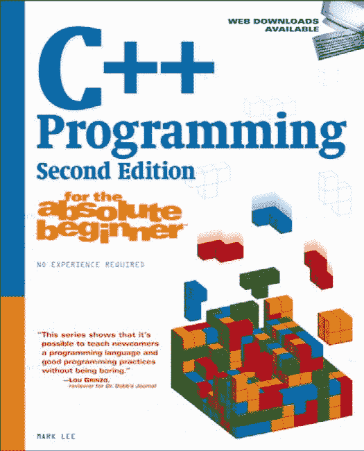

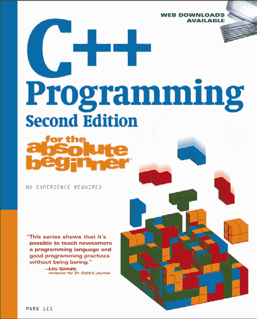

© 2009 Course Technology, Cengage Learning 部门。

**初学者，第二版：** Mark Lee

版权所有。未经出版者事先书面许可，本书涵盖的任何部分不得以任何图形、电子或机械形式复制、传输、存储或使用，包括但不限于复印、录制、扫描、数字化、磁带、Web 分发、信息网络或信息存储和检索系统，除非符合《1976 年美国版权法》第 107 节或第 108 节的规定。

## 出版信息

- **Course Technology PTR 出版社及总经理：** Stacy L. Hiquet
- **营销副总监：** Sarah Panella
- **编辑服务经理：** Heather Talbot
- **营销经理：** Mark Hughes
- **Cengage Learning 客户与销售支持：** 1-800-354-9706
- **策划编辑：** Mitzi Koontz
- **项目编辑：** Jenny Davidson
- **技术审查员：** Keith Davenport
- **PTR 编辑服务协调员：** Jen Blaney
- **内排版技术：** Value Chain International
- **封面设计：** Mike Tanamachi
- **索引编员：** Sharon Shock
- **校对员：** Sara Gullion

**国会图书馆控制号：** 2008939939

**ISBN-13:** 978-1-59863-875-2

**ISBN-10:** 1-59863-875-0

**eISBN-10:** 1-59863-941-2

**Course Technology**, Cengage Learning 部门

20 Channel Center Street, Boston, MA 02210, USA

Cengage Learning 是领先的定制学习解决方案提供商，在全球设有办事处，包括新加坡、英国、澳大利亚、墨西哥、巴西和日本。通过以下网址查找当地办事处：`international.cengage.com/region`

Cengage Learning 产品在加拿大由 Nelson Education, Ltd. 代表。

获取您的终身学习解决方案，请访问 `courseptr.com`

访问我们的公司网站 `cengage.com`

美国印刷

1 2 3 4 5 6 7 11 10 09

*献给我最好的朋友 Dirk Henkemans。没有你，我会迷失方向。*

# 前言

视频游戏行业的独特之处在于，它经常融合了计算机科学的每一个主要学科。从 3D 图形、人工智能到操作系统理论和数据库设计，如果你正在设计一款商业视频游戏，你最终会遇到来自这些领域的问题。其中某些领域意味着要使用专门语言，但归根结底，游戏行业中像加班、咖啡因饮料和披萨一样常见的两种语言是 `C` 和 `C++`。尽管有少数商业游戏是用 `Java`（它与 `C++` 非常相似）编写的，但你玩过的几乎每个游戏都是用 `C` 或 `C++` 编写的。无论游戏运行在 PC、游戏机甚至街机上，其核心很可能是由 `C` 或 `C++` 程序组成。即使在某些性能要求必须用汇编语言编写程序以榨取更多速度的情况下，通常的做法也是先用 `C` 或 `C++` 编写该程序。

在行业工作的多年里，我面试过一百多名编程岗位的申请者，并阅读过成千上万份简历。通过这一切，我不断在优秀的候选人身上寻找三点。第一是强大的解决问题能力。随着技术的不断变化和激烈的竞争，游戏编程总是向我们抛出新问题。因此，优秀的解决问题能力不仅是一种奢侈，更是一项要求。其次，一个优秀的候选人接触过计算机科学学科的整个领域。即使程序员专攻某个领域，问题的解决方案往往在于他们专业知识之外的领域。

最后，我寻找的是强大的 `C/C++` 技能。对于游戏程序员来说，`C/C++` 技能就像画笔之于画家。它们是赖以生存的工具，因此需要精加磨练。

尽管 `C++` 被广泛用教学语言，但过去并非如此。我仍然记得我第一次接触 `C` 编程的场景。在那之前，我所有的编程都是 `Basic`（我的第一个视频游戏就是用它写的）、`Pascal` 和 `Fortran`。我听过 `C`；根据传闻，它是必须掌握的语言。我非常期待我的下一门计算机科学课程：“编程语言导论”。我假设这门课程会教我如何用 `C` 编程。我错了。整门课程对 `C` 的唯一提到是：“这是你们的作业。用 `C` 写。周三交。”“好的，”我想，“至少有一本课程教材是关于 `C` 的。”结果证明，那本教科书是关于如何从 `C` 语言访问 `UNIX` 操作系统的信息的。如果你对访问进程 ID 或使用 Shell 命令感兴趣，这很有用，但如果你想知道如何读取文件或编写函数，它就没太大帮助。

不知怎么，我设苦完成了作业，并在过程中实际上学到了一些东西。这并不是学习新语言最好的方法，但比我第一次接触 `C++` 要好。那是我毕业后的第一份工作。我在大学体育部工作，为各种研究项目编写软件。我从上一个程序员那里继承的项目中有一个只完成了一半，并且是用 `C++` 编写的。再次，我面临着一个生死攸关的抉择。这一次，我只有一本函数参考书，它只解释语言的语法，而没有如何使用它。我简直想要得到你现在手里拿着的这本书。噢，也许不是想要，但我绝对无法低估以这样有组织且直接的方式学习 `C++` 的重要性。当你阅读这本书时，请对我们这些没有你这种精良学习工具的人表示同情。

Scott Greig

BioWare 公司编程部总监

# 致谢

出版一本书所需的时间和精力是巨大的，这本书也不例外。作为参与这一巨大努力机器中的一个齿轮，我很难充分感激所有接触过这个版本的各之手。然而，如果没有我原始合作者 Dirk Henkemans 的雄心和驱动力，这本书将只是一个未竟实现的梦想。他的驱动力和毅力教会了我，像写书这样看似不可能的事情不仅是可能的，而且是轻松实现的。

感谢 Course Technology PTR 让这本书成为可能，并感谢我的策划编辑 Mitzi Koontz 的所有努力。

我深感激技术编辑 Keith Davenport，他敏锐的目光确保了书中所有的代码都能按预期方式运行。

项目和校对编辑 Jenny Davidson 在整个项目期间都是一个极宝贵的资源，她严谨的编辑使这项作品质量提高了几数量级。

我向其他在准备本书出版方面发挥过作用的人表示特别感谢，包括排版的 Value Chain International；校对员 Sara Gullion 以及索引编员 Sharon Shock。你们都对这本书变成今天现在的模样发挥了巨大的作用。

我们要向 BioWare Corp 的首席程序员、本书序的作者 Scott Greig 致敬。Scott，你是我们的偶像。没有你，我们还能向谁学习呢？

我深表感谢 Jen Janzen 敏锐的眼光，她的编辑天赋无与伦比。她 touch 过的每一行文字都得到了质的飞跃。

最后，我要感谢我的父母，感谢多年来他们的包容与支持。

## 关于作者

ark Lee 是一位专业的 Web 开发者和程序员。他拥有阿尔伯塔大学的计算机科学学位，精通 `C`、`C++`、`Java`、`Ruby`、`PHP`、`AJAX`、`MySQL` 和 `JavaScript`。

*本页特留*

## 目录

### 第 1 章

- 开始旅程 1
- 计算机基础 2
- 定义源代码 2
- 检查 Hello World 3
- 使用 Visual Studio 6 6
- 创建新项目 6
- 软件开发周期 11
- 处理文本 12
- 组合字符串 13
- 使用 `cout` 显示字符串 13
- 使用 `cout` 显示多个字符串 14
- 处理转义字符 14
- 存储字符串 15
- 显示存储的字符串 16
- 镇报员程序 17
- 接收输入 18
- 使用 `cin` 存储字符串 18
- 处理数字 20
- 介绍整数 20
- 使用运算符操作 20
- 取模运算符 21
- 创建海盗火击手游戏 21
- 总结 23

### 第 2 章

- 深入理解变量 25
- 理解变量 25
- 理清变量与内存的关系 26
- 描述变量标识符 29
- 声明和赋值变量 30
- 介绍基础变量类型 31
- 布尔类型 31
- 字符类型 32
- 整数类型 32
- 整数溢出 33
- 自增运算符 34
- 浮点类型 35
- 使用 `sizeof()` 运算符 36
- 数据类型游戏 36
- 使用 `typedef` 让生活更简单 37
- 使用常量 38
- 圆游戏 39
- 理解语法 39
- 创建武器商店游戏 41
- 总结 43

### 第 3 章

- 使用控制语句做选择 45
- 使用选择语句选择代码 45
- 使用 `if` 语句测试条件 46

**x**

零基础 C++ 编程，第二版

- 条件运算符
- 使用 `switch` 语句
- 使用布尔运算符
- 等价运算符
- 介绍不等于运算符
- 小于和大于运算符
- 与等价运算符合并
- 逻辑或运算符
- 逻辑与运算符
- 逻辑非运算符
- 遵循操作顺序
- 继续学习迭代语句
- `while` 循环

# 使用 `do while` 循环循环

- 使用 `for` 语句
- 嵌套
- 创建随机数
- 猜数字大小游戏

# 创建罗马指挥官游戏

- 总结

## 第 4 章

## 使用函数结构化你的代码

### 分治治法

### 探索函数语法

### 声明函数

## 定义函数

## 调用函数

xi

## 整合一切

## 函数重载

## 默认参数

## 通过变量作用域深入了解

### 使用作用域解析符指定

### 使用静态变量

## 欢迎来到蜗牛赛

### 揭秘 `main` 函数

## 检查执行顺序

### 向 `main` 传递参数

### 使用 `main` 的返回值

### 创建洞穴冒险游戏

## 总结

## 第 5 章

## 设计软件：面向对象编程

### 面向对象编程简介

### 发现类

### 声明类

### 创建方法

### 使用访问限定符

### 将类分离到文件中

### 类策略 101

### 使用对象

### 使用对象变量

### 使用默认构造函数走捷径

### 访问成员

### 创建测试平台

## 射箭比赛

## 使用静态成员

## 学习面向对象编程 (OOP) 的原理

## 理解数据抽象

## 理解封装

## 理解多态

## 调试

## 黑盒

## 链接错误

## 创建征服游戏

## 总结

xii

零基础 C++ 编程，第二版

## 第 6 章

## 内存管理

### 解释内存

### 使用指针

### 提升到间接运算符

## 使用指针和对象

## 从堆内存分配

## 使用 `this` 指针

## 构建常量指针和指向常量的指针

## 引入指针和函数

## 数组操作

### 创建数组

### 初始化数组

### 使用数组

### 数组与指针的关系

### 创建动态数组

### 多维数组

## 重新认识字符串

### 字符串字面量

### 字符数组

### 确定字符串长度

### 使用其他 C 风格字符串函数

### 将字符串转换为数字

## 从引用开始

### 在函数参数中使用引用

### 将引用作为函数的返回值

## 重新创建井字游戏

## 总结

## 第 7 章

## 类之间的关系

## 使用组合组合类

## 引入继承

## 编写继承代码

## 理解成员函数继承的三种类型

## 创建龙主游戏

## 总结

## 第 8 章

## 使用模板

### 创建模板

### 创建类模板

### 使用模板参数

### 创建函数模板

目录

xiii

## 理解参数解析

## 模板模板

## 简化模板的使用

## 重载函数模板

## 使用标准库

## 使用字符串

### 构造字符串

### 遍历字符串

### 访问字符串

### 操作字符串

## 使用 `vector`

### 访问和操作 `vector`

## 创建神秘商店游戏

## 总结

## 第 9 章

## 使用流和文件

### 理解 I/O 术语

### 理解头文件

### `ios_base` 类

### 文件流简介

### 打开文件

### 关闭文件

### 处理文本文件

### 验证流

### 处理二进制流

### `get` 和 `put` 流指针

### 与流指针交互

### 写入和读取二进制流

### 使用常用操作符

### 使用位域

### 玩转位移

### 创建加密程序

## 总结

## 第 10 章

## 错误与异常处理

### 断言条件

### 处理异常

### 构建异常层次结构

### 捕获所有异常

### 创建雷区游戏

## 总结

xiv

《C++ 编程入门》，第二版

## 第 11 章

## 创建海盗冒险游戏

### 引入 Dark GDK

### 游戏概览

### 编写游戏引擎

### 存储位置

### 创建船舶类

### 创建城市类

### 实现地图屏幕

### `Game` 类

### 创建游戏框架

### 恭喜，读者！

## 附录 A

### 章节练习答案

### 第 1 章

## 目录

# 第 2 章 - 324

# 第 3 章 - 326

# 第 4 章 - 327

# 第 5 章 - 329

# 第 6 章 - 331

# 第 7 章 - 333

# 第 8 章 - 334

# 第 9 章 - 336

# 第 10 章 - 338

## 附录 B

## 使用八进制、十六进制、二进制和十进制 - 339

### 转换为十进制 - 340

### 从十进制转换 - 340

## 附录 C

## 在 Mac 和 Linux 平台上工作 - 343

### 在 Mac OS X 上编程 - 343

### 在 Linux 上编程 - 348

## 目录

xv

## 附录 D

## 后续展望 - 351

### C++ 语言 - 351

### 软件设计 - 351

### 游戏编程 - 352

## 附录 E

## 术语表 - 353

## 索引 - 363

# 引言

`C++` 是世界上最广泛使用的编程语言，是各种应用程序编程的行业标准。此外，`C++` 是一种极其高效的编程语言，比 Visual Basic 或 Delphi 等语言更有效地节省资源。

事实上，由于其功能和风格，在许多方面，`C++` 是你可能唯一需要掌握的非 Web 基础的编程语言。

我们选择通过游戏编程来教你 `C++`，是因为最初许多人是通过玩电脑游戏来接触计算机的。重要的是，电脑游戏是学习编程的极佳方式，因为它们教你如何在显示器上显示界面、如何接收用户指令以及如何操纵信息。最终，游戏是艺术与科学的结合，它触及逻辑和创造力思维，为程序员和用户提供刺激性的视觉、听觉和心理体验。

在本书中，你将发现许多内在编程技巧，这些技巧不仅适用于 `C++`，也适用于通用编程。这些常见的编程技术将使你更容易学习使用其他语言编程，并创建游戏应用之外的应用。

# 本书内容

本书从简单的基于文本的程序过渡到带有实际图形的更复杂的游戏。如果你是编程完全初学者，我们建议你按照自然顺序阅读章节。另一方面，如果你已经有一定的编程经验，你可能想略过涵盖基础知识的前六章，直接跳到更高级的主题。

本书在概念上（尽管物理结构上不是）被分为四个部分。首先，从第 1 章“开启旅程”到第 6 章“内存管理”，为你提供了使用 `C++` 编程所需的的基础知识。由于这些章节中主题的顺序性，我们建议按顺序阅读。例如，在转向第 5 章“软件设计：面向对象编程”之前，你可能需要完成第 4 章“使用函数结构化你的代码”。

# 引言

xvii

本书的第二部分（第 7 章“类关系”到第 10 章“错误与异常处理”）由高级 `C++` 题组成。你可以按照任何顺序阅读这些章节并完全理解它们。

第三部分包含第 11 章“创建海盗冒险游戏”。在这里，你将把之前章节中学到的所有知识整合起来，并将其应用于使用行业标准技术编写一个摇滚的海盗游戏。

第四部分包含附录，提供了对你有帮助的额外信息，从附录 A“章节挑战答案”开始，到附录 E“术语表”结束。

无论你如何阅读这本书，请记住，学习 `C++` 编程很大程度上在于实操经验。你编程得越多，在解决问题（你会发现这是编程中的一项重要技能）和检测代码中的错误方面就会越出色。

谁知道呢，如果你编程得足够，你甚至可以在脑海中计算出百万位的圆周率……尽管本书作者不保证这一点）！

在整个章节中，你会发现一些小代码段，用于说明我们介绍的概念。

在每个章节的末，你将找到一个演示章节核心思想的完整游戏、一个章节总结以及一组测试你新知识的挑战。我们希望你尝试这些游戏和挑战，因为它们将真正帮助你培养编程感。挑战的答案在附录 A 中。

然而，我们强烈建议你在查看答案之前尝试挑战（即使你需要帮助）。这些挑战都非常短，所以你可以将它们输入到编译器中（这再次是获得经验的好方法）。

# 如何开始

学习编程是利用计算机力量的极佳方式。

然而，在开始编程之前，你需要准备好以下物品：

- 一配备 2.0 GHz 或更快处理器的 PC。
- 安装了 Service Pack 2 的 Windows XP 专业版、Windows Server 2003 或 Windows Vista。
- 至少 512MB 内存。
- 至少 8GB 硬盘空间。
- 一个编译器，如 Visual Studio 2008 Express 版。
- 知识、时间与耐心。书中的信息将为你提供足够的知识，让你有效利用 `C++` 和 `Visual Studio`，或者大多数其他编译器。

xviii

《初学者 C++ 编程》，第二版

在附录 C“在 Mac 和 Linux 平台上工作”中，我们将讨论如何在非 Windows 系统上进行工作。

## 本书的特色

除了章节末尾的完整游戏和挑战外，书中还有其他一些特别之处：


### 提示（H I N T）

- 针对困难的话题提供额外的信息。
- 提醒你需要避免的陷阱。

### 陷阱（T R A P）

- 让编程变得更容易更高效的技巧。

### 技巧（T R I C K）

# 第一章：开启之旅

编程听起来可能是一项艰巨的任务，但不要担心。

我们设计这一章的目的是让你能够上手，而无需深入研究编程复杂的本质。本章从讨论计算机开始。我们将向你展示它们是如何运作的。接着是创建程序的基础知识。接下来，你将学习如何使用`Visual Studio`——一个`C++`编译器。然后，你就可以玩玩一些文本和数字了。

在我们的帮助和你的智慧下，你很快就能创建出自己的简单程序。我们相信，以后你的程序会变得越来越复杂，但每个人必须从某处开始这段旅程。此时，你的冒险已经开始了！

你冒险的开头包括：

- 计算机是如何运作的
- 如何编写代码
- 如何编写你的第一个程序
- 如何使用`Visual Studio`
- 编程开发周期是如何工作的
- 如何使用文本
- 如何使用数字

## 计算机基础

计算机由许多组件组成。有些非常容易识别：键盘、鼠标或显示器。另一些是内部的，对新手用户是隐藏的。这些包括`CPU`（中央处理器）和内存。

`CPU`是计算机的大脑。它是布满电路的核心，所有的决策都由此产生。如果你的计算机某天决定变成僵尸袭击你，而你需要知道从哪里下手，那里就是你要对准的地方。这样，那头恶兽就会回到它来时的地狱！

幸运的是，你可能一段时间内都不需要担心僵尸计算机，所以可以先把它放在脑后。下一个最重要的组件是内存。它通常被称为`RAM`（随机存取存储），是存储数据和指令的地方。

数据和指令？显然你以前听过这些术语，但它们在这里意味着什么？嗯，数据可以指许多东西。键盘输入、文件内容、网络服务器请求，计算机使用的任何信息。指令是种特殊的数据。

它们“指示”`CPU`下一步做什么。相这两个数字，将此数据移动到这里，跳转到下一条指令。这些都是`CPU`指令的示例。

计算机的主要操作是执行这些指令。获取下一条指令。执行它。获取下一条指令。执行它。周而一遍。尽管这一切发生得非常快。一个`1 GHz CPU`每秒可以执行十亿次指令！没什么大不了的（尽管我不确定为什么有人想拿根棍子去戳东西……似乎缺乏动力）。

## 定义源代码

计算机通过执行一系列简单指令来工作，但幸运的是，程序员不再需要以如此低的级别编写程序了。人们开发了被称为“编程语言”的特殊语言，使得思想可以更更容易地表达。这需要一个名为`编译器`的中间程序将用编程语言编写的思想翻译成计算机可以理解的一系列简单指令。

### 提示（H I N T）

你可能会奇怪为什么你不能直接告诉计算机要做什么。“去这个网页”或“播放这首歌”就是我们希望与计算机交互的示例。问题是，英语（以及所有其他所谓的“自然”语言，如法语、德语等）太复杂了。像`C++`这样的编程语言更简单、更精确。尽管如此，编写良好的代码读起来几乎像英语一样简单。

第 1 章 · 开启之旅

就像英语有语法、标点符号和拼写规则一样，`C++`也是如此。区别在于`C++`的规则要严格得多。如果我们说“The cat run slow（猫跑得慢）”而不是“The cat is running slowly（猫正在慢慢地跑着）”，虽然基本意思仍然被传达了，但这种对`C++`规则的松散遵循是一个大得多的问题。不遵守`C++`的规则可能会导致各种错误和问题。

而且，就像英语一样，语法和标点符号并不是全部。为了写出良好的代码，必须简洁、优雅地表达自己的思想。这是一门程序员不断精炼的艺术。在该领域工作了多年的专业程序员仍在努力提高他们的编码能力。

但，话就这么多。让我们来看代码！

## 检查 Hello World

现在，亲爱的读者，让我们一头进入`C++`的神秘世界。尽管你起初可能会被奇怪的符号和晦涩的术语所困扰，但随着时间，都会变得清晰。

准备好你的火炬，让我们深入这个黑暗的洞穴吧！

```cpp
//1.1 – Hello World – Mark Lee

#include <iostream>

int main( void )
{
  using std::cout;
  cout << "Hello World!\n";
  return 0;
}
```

上述是一个完整的`C++`程序。它只是在屏幕上显示“Hello World”字样。现在，让我们逐行拆解它！

在研究论文中，结尾通常有一个部分被称为参考文献。正如你可能知道的，该部分用于为写论文时使用的信息提供引用。`C++`非常相似，只不过参考文献位于开头。程序员可以对另一段代码提供“引用”，以指示该功能来自何。第二行就是这样一个引用：

```cpp
#include <iostream>
```

被引用的文件是`iostream`。该文件提供了向屏幕打印所需的功能。如果你想引用不同的文件，比如`cstdio`，它看起来像这样：

```cpp
#include <cstdio>
```

那么这个`iostream`文件是什么？它来自哪里？嗯，我好奇的读者，这个文件是`C++ 标准库`的一部分。`C++ 标准库`是一组`C++`代码，提供了许多重要功能，如在屏幕上显示文本。这个库是始终且自动可用的。在本书中，我们将引入库的新部分。在这个程序中使用`iostream`。`iostream`是`C++ 标准库`的一个组件，用于向屏幕显示文本或从键盘读取输入。

下一行是空的。为什么？这包含某种意义吗？必须在这里放置空行吗？答案是不可能的。空行仅仅是为了留出间隔。`C++`被认为“忽略空白”。这意味着你几乎可以在任何地方放置空格、制表符和空行，而不影响含义。如果删掉这个空行，程序将完全相同！那么为什么要放在那里呢？嗯，它有助于提高代码的可读性。如果所有代码都挤在一起而没有任何间距，阅读和理解它们将困难得多。

现在我们遇到了一些非常奇怪的词。`int?` `void?`。不，`void`并不是指某个绝望深渊（尽管`C++`有时可能会让你有这种感觉）。而`int`只是integer（整数）的缩写，我们将在本章稍后的部分介绍它。你会注意到这一行后面是一组用大括号`{`和`}`包围的行。这种结构非常重要。整个部分被称为`main`函数。每个程序必须有一个`main`函数。在第 4 章中，我们将更详细地介绍函数，但现在，只需将你编写的所有代码放在那些奇怪的大括号内即可。

`main`函数的第一行是使用C++标准库的另一个部分。它基本上是说在这个函数中我们将使用标准库（`std`）中的某些东西，而那个东西被称为`cout`。为什么我们需要这一行呢？嗯，C++标准库中的所有内容都在一个所谓的命名空间（namespace）中。我们将在后面的章节中介绍它们，但目前它意味着库中的所有内容都必须带有`std::`前缀。将这一行放在函数的顶部就可以省去这种必要性。在下一行，我们可以直接说`cout`而不需要在它前面加上`std::`。

那么这个`cout`到底是什么？你该怎么读它呢？嗯，`cout`用于将内容打印到屏幕上。它的读音是“See-out”。`cout`中的`out`指它的输出。输出（Output）是离开你程序的数据。而输入（Input）则是进入程序的数据。C++标准库中还有另一个单词`cin`，用于从键盘读取输入。我们稍后会介绍它。

你会注意到`main`函数中的所有行都以分号`;`结尾。由于空格会被忽略，所有的语句都可以写在同一行。判断一个语句结束和下一个语句开始的唯一方法是使用某种东西来分隔它们。C++使用分号。在第 3 章“使用控制语句进行选择”中，你将学习不需要分号的语句，但在那之前，你遇到的每个语句都必须以分号结束。

现在，耐心的读者，我们已经到达了这个程序的关键。这是实际上向屏幕显示文本的地方。当你第一次瞥一眼代码时，可能已经猜到了这一点。你可以看到引号中的“Hello World!”，它似乎是指向这个`cout`单词的。好了，这就是你打印到屏幕的方法！末尾那个奇怪的`\n`符号换行。当我们在下一节学习如何实际编译并运行这个程序时，你可以尝试删除这个换行符看看会发生什么。

`main`函数的最后一行仅用于指示函数的结束。`return`单词表示“好的，这个函数结束了”，而数字`0`意味着一切正常。

### 注释

Hello World程序的第一行是一个注释。它对程序的运行方式没有影响。每当你连续输入两个正正斜杠`//`时，你就是在告诉编译器忽略该行的剩余部分。注释的目的是帮助使代码更易理解。注释可以用两种方式编写。单行注释（如前面的那个）只占用一行。该行中`//`之后的所有内容都会被忽略，如下所示：

```cpp
// I am an army of one
```

C++注释的另一种形式允许你将一个但很长的注释跨越你需要的任意行：

```cpp
/* dragons rule the world */
```

或者

```cpp
/* dragons

rule

the

world */
```

虽然这通常会令人困惑，但你可以将多行注释放在代码的几乎任何位置，如下所示：

```cpp
cout << /* prints out Hello World */ "Hello World\n";
```

然而，仅仅因为存在这种可能性并不意味着你应该使用它。像这样使用注释会很快让你的代码变得不可读。一个好的原则是：仅使用注释来让你的代码更易理解。如果它们没有帮助，就把它们删掉。

再次，注释中的任何内容都不会影响代码。只使用注释用通俗的英语解释程序中复杂或大部分。编译器在将程序转换为机器码时会忽略注释。

### 使用 Visual Studio

在本节中，你将发现如何使用Visual Studio创建你的第一个程序。Visual Studio是一个集成开发环境（IDE）。程序员需要许多不同的工具来完成工作：一个编写代码的编辑器、一个组织所有文件的文件浏览器、一个将源代码转换为可执行程序的编译器，以及一个用于检查运行中程序的调试器。IDE将所有这些工具打包成一个应用程序。有些程序员喜欢将所有内容都整合并集成在一起，而另一些人则倾向于为每个工具使用独立的应用程序，创建他们自己的、自定义的工作环境。在附录 C 中，我们将讨论Visual Studio的一些替代方案。

**提示**：我们编写此书的基础假设你正在使用Visual C++ 2008 Express版（它是免费提供的）。然而，如果你没有使用它也没关系。本章及其他章节中的大部分信息适用于你所使用的任何编译器。有关如何下载和安装Visual C++ 2008 Express版的详细说明，请查看`http://cplus.about.com/od/learnc/ss/vc2008.htm`。

是时候开始你的编程世界之旅了。当我们解释如何使用Visual Studio创建项目并展示代码时，请在你自己的电脑上亲自尝试。练习会让不熟悉的事变得自然。

### 创建新项目

第一次打开Visual Studio时，它将如图 1.1 所示。正如你看到的，并没有发生魔法（嗯，也许有一点）。Visual Studio仅仅是一个应用程序，就像Microsoft Word和Internet Explorer一样，只是Visual Studio是用来创建其他应用程序的应用程序。

在Visual Studio运行的情况下创建一个新的C++项目，请按照以下步骤操作（注意，如果你有不同版本的Visual Studio，菜单、对话框和其他选项的名称可能会不同）：

1. 从`File`菜单中，选择`New`然后是`Project`。
2. 在`Project Types`下选择`Win32`。
3. 在`Templates`下选择`Win32 Console Application`。
4. 在`Name`字段中输入`Hello World`。你会发现随着你的输入，`Solution Name`也会被填充。
5. 点击`OK`。将出现`Win32 Application Wizard`对话窗口。你可以在这里进一步自定义你的项目。点击`Next`。
6. 在这里你可以为项目选择额外的选项。你现在需要的唯一选项是`Empty Project`，所以勾选它。点击`Finish`。
7. 项目现在已创建。左侧有一个标记为`Solution Explorer`的窗口。你可以在这里看到项目中的所有文件。现在项目是空的，让我们添加一个文件吧。在`Solution Explorer`中右键点击项目名称`Hello World`。
8. 在弹出的菜单中，选择`Add`然后是`New Item`。
9. 出现`Add New Item`对话窗口。在这里，在`Templates`下选择`C++ File (.cpp)`并在`Name`字段中输入`HelloWorld`。点击`Add`。

# 添加新文件

向你的项目添加新文件。

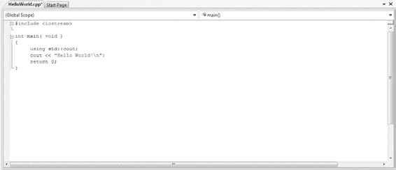

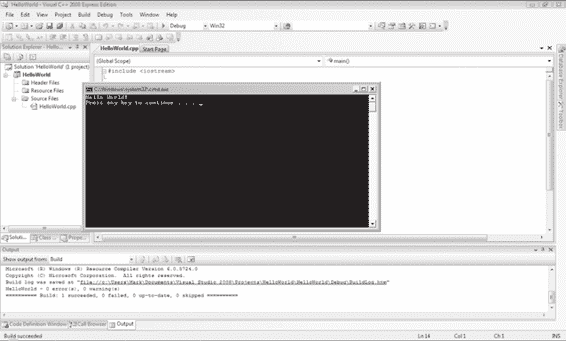

10

面向初学者的C++编程，第二版

10. 文件现在已创建并打开进行编辑。输入上一节中的“Hello World”程序。你会发现，为了简洁起见，我们跳过了注释的输入。

参见图 1.6。

**图 1.6** 编写你的第一段代码！

11. 一旦你完成代码输入，按下`Ctrl + F5`，或者在`Debug`菜单下选择`Start Without Debugging`（无调试启动）。编译结果将显示在标记为`Output`的窗口中。如果存在编译错误，你将在这里看到。

确保你的代码与代码列表完全一致。忘记分号或出现拼写错误是非常容易的。

12. 你应该看到如图 1.7 所示的新窗口出现。恭喜，你刚刚创建了你的第一个程序！

**图 1.7** 执行Hello World程序。

# 第 1 章 • 开始旅程

11

## 软件开发周期

软件开发周期是所有软件在完成任务过程中必须经历的过程。随着你作为程序员的技能提高，这些阶段将对你变得越来越自然。图 1.8 中的流程图说明了这一周期。

**图 1.8** 软件开发周期。

通常情况下，为了创建一个程序，你需要遵循以下步骤：

1. 规划！程序是打算做什么的？代码应该如何结构？程序是给谁用的？他们的需求是什么？这些都是你在开始编写代码之前必须回答的问题！

2. 在源代码编辑器（`Visual Studio`或其他编辑器）中编写代码。你在之前的字节“编写你的第一个程序”中已经做了一部分这类工作，在你读完这本书时，你将会做多很多。

12

3. 编译代码。想象你是一个精灵，而计算机是一个矮人。为了让计算机理解你的指令，你必须克服语言障碍。

你需要一个既会说矮人语和精灵语的翻译员。在计算机世界中，这个翻译员就是编译器。正如我们之前提到的，编译器将你的语言转换为计算机可以读取的机器码。然而，这种翻译是单向的。编译器不能将机器码翻译回源代码。如果有错误，你必须回到代码并修复它们。关于使用`Visual Studio`编译代码的逐步信息，请参考早之前的字节“使用 Visual Studio”。

4. 链接代码。链接代码是将组成程序的所有文件结合在一起的过程，就像许多勇敢骑士汇聚在一起以击败强大的巨龙！在这种情况下，勇敢的骑士包括你的代码，还包括你使用的所有库，例如`C++ Standard Library`。如果你遇到错误，必须返回第 1 步来修复错误。当你构建项目时，`Visual Studio`会自动完成链接步骤。

5. 测试程序。你测试程序以确保它运行正常。你可能会问，如果已经成功通过了编译和链接阶段，为什么测试是必要的呢？

显然没有错误了，对吧？嗯，有些错误更加阴险！尽管你的代码看起来运行正常，但仍然可能存在细微的问题。这些被称为**逻辑错误**！它是所有程序员的噩梦，大量的时间被花在了寻找这些错误上。

彻底测试你的程序以确保一切都按照你预期的方式运行是至关重要的！

6. 一旦你的程序通过了这些步骤，通常还有更多工作要做！

需求会发生变化，你的程序可能需要适应。也许之前遗漏的错误会在之后被发现。软件开发是一个持续的过程！

## 处理文本

在图形出现之前，文本是所有程序的基础。文本冒险游戏和文本公告板系统是我们的第一次编程体验。文本仍然是编程中一个非常重要的元素。在本节中，你将了解到如何组装和存储文本。

文本是显示程序输出最简单的媒介。本书从仅使用文本开始，因为文本足以显示大多数程序的输出。这种方法让我们推到后面的章节再介绍图形的复杂性。

在计算机世界中，一段文本的技术名称是`string`。一个`string`是字符序列；通常，我们认为字符是你可以从键盘输入的符号，包括空格。例如，在“Hello World”程序中，“Hello World\n”就是一个`string`。

# 第 1 章 • 开始旅程

13

## 组装字符串

计算机将“For Honor!!!”视为一系列字符，每个字符占据一个字母或空格（F 是第一个字符，o 是第二个，以此此类推）。字符串始终包含在双引号内。例如，“a”、“（空格）、“4”和“%”都是由一个字符组成的字符串。

这些似乎看起来都很复杂，但创建字符串实际上很容易。以下是一些字符串的示例。如你所见，它们只是被引号包围的小文本。

“For Honor!!!”

“Pass me my sword.”

“Who put my staff on the wagon?”

## 使用 cout 显示字符串

现在你已经知道如何创建字符串，你可能想做的第一件事将其显示在屏幕上。在本节中，你将学习实现这一目标的多种方法。

正如分析“Hello World”程序时提到的，输出并不是C++的原生部分。这种功能通过`C++ Standard Library`提供。为了使用它，你必须做一些特殊操作。

首先，你必须在程序的顶部引用相关文件。正如我们在Hello World程序中看到的，为了在屏幕上显示文本，该文件是`iostream`。这是该引用的语法（结构）：

```cpp
#include <iostream>
```


这提供了对`C++ Standard Library`相关部分的访问，但并不是故事的结束。库中的所有内容都在所谓的`namespace`（命名空间）中。这意味着你从库中使用的一切都必须以`std::`前缀。例如，现在要使用`cout`，你必须写`std::cout`。这可能会很麻烦，通常将相关术语从命名空间中提取出来更容易。正如之前讨论的，你可以通过以下代码将术语从命名空间取出：

```cpp
using std::cout;
```

现在你可以自由使用`cout`而无需加`std::`前缀。

最后，为了在屏幕上显示字符串，你如下使用`cout`：

```cpp
cout << “Hello World”;
```

14

面向初学者的 C++编程，第二版

你可以使用`cout`显示任何字符串，例如：

```cpp
cout << “For Valour!”;
```

## 使用 cout 显示多个字符串

你现在可以使用`cout`的基础知识，但关于`cout`和字符串还有很多需要学习。

例如，你可以同时显示多个字符串。假设你想显示两个文本，但它们在两个不同的字符串中。根据前面的技术，代码看起来像这样：

```cpp
cout << ”Red";
cout << ” Dragon";
```

输出：Red Dragon

然而，有一种更简单的方法。你可以并排显示任意数量的字符串并用`<<`分隔。你可以这样创建之前的代码片段：

```cpp
cout << ”Red” << ” Dragon”;
```

输出：

Red Dragon

两个代码片段的输出完全相同，但第二个写起来稍微简单。

此外，由于 C++ 的编写方式，你可以将代码拆分到多行。例如，之前的示例也等同于以下内容：

```cpp
cout << ”Red”

<< ” Dragon”;
```

输出：

Red Dragon

这实际上是一个平凡的例子，因为你可以使用单个较大的字符串（“Red Dragon”）。

通常情况下，你组织代码结构使其易于阅读。你应该在每个短语的开头放置一个新的`cout`。例如，为了显示一句话关于龙的句子和一句关于精灵的句子，龙句中的所有内容应该放在一个`cout`之后，而精灵句中的所有内容应该放在另一个`cout`之后。这样，你的代码会更有组织，也更容易阅读。

## 使用转义字符

你不能在字符串中字面地表示引号（“”）和换行符等字符。

如果你在字符串中包含引号，编译器会认为该引号表示字符串的结束。例如，为了创建一个引用某人说话的字符串，你可能会写：

“He said, “This is a quote”。”

然而，编译器会将此解释为两个独立的字符串，“He said,”和“。”。由于`is a quote`这些词被假设为非字符串，你最终会遇到语法错误。换行也会出现类似的问题。所有字符串必须包含在单行内，因此如果你尝试在字符串中间放置换行符，就会得到语法错误。幸运的是，这类问题有一个解决方案。

解决方案是使用转义字符。转义字符（或元字符）用于表示无法字面表示的字符。要创建一个转义字符，你将一个反斜杠（`\`）和一个特定字符结合。例如，引号的转义字符是`\"`。它在代码中看起来如下：

```
“He said, \”This is a quote.\\n”
```

这段代码产生了所需的字符串。如果你输出这个字符串，He said, “This is a quote.” 将显示在屏幕上。还有许多其他转义字符。

表 1.1 总结了重要的转义字符。

### 表 1.1 转义字符

| 名称 | 转义字符 |
| :--- | :--- |
| 换行 | `\n` |
| 制表符 | `\t` |
| 反斜杠 | `\\` |
| 单引号 | `\'` |
| 双引号 | `\"` |

你将会熟悉大多数这些转义字符，因为它们非常有用；事实上，其中一些，例如换行符（也称为行行符），是必不可少的。

## 存储字符串

你可以在程序中存储字符串，这样你就不需要多次编写它们。

具体来说，你通过将它们放入内存来存储字符串（我们在第 2 章“深入理解变量”中详细介绍内存）。提供在屏幕上显示对象支持 C++ 标准库也提供了存储字符串的支持。字符串的代码存储在一个命名恰当的`string`的文件中。正如我们在“Hello World”程序中所学习的那样，你可以通过在程序顶部放置一行特殊代码来使用 C++ 标准库：

```cpp
#include <string>
```

然后，在`main`函数内部，你声明想要从标准命名空间引入代码的特定部分，就像我们对`cout`做的那样：

```cpp
using std::string;
```

当你想要存储一个字符串时，必须为它提供一个名称，以便计算机知道你将来想要访问哪个字符串。例如，我们将“A dragon is coming”放入内存并将字符串命名为`yell`。

不过，这里有一个小复杂之处。C++ 可以在内存中存储许多东西。例如，除了字符串外，C++ 还可以存储数字。处理数字的规则与处理字符串的规则不同。因此，你必须声明存储的是什么类型的内容。我们将在第 2 章中进一步讨论这些区别。为了存储一个字符串，你必须提供：

- 存储内容的类型（在本例中是字符串）
- 字符串的名称
- 组成字符串的字符

一旦你组装好所有这些组件，就准备好在内存中存储字符串：`string yell = “A dragon is coming”;`

首先是所存储内容的类型：字符串。其次是字符串的名称：`yell`。等号告诉计算机字符串“A dragon is coming”正在存储在`yell`中。最后是分号，它告诉计算机你已经完成了该语句。

## 显示存储的字符串

到目前，你只显示了字面量字符串。现在，你准备好显示存储的字符串了。使用字符串的名称代替字符串本身可以让你能够显示存储的字符串。这里是之前的存储字符串示例，以供快速参考：`string yell = “A dragon is coming”;`

要显示该字符串，你使用它的名称（`yell`），而不是实际文本：

```cpp
cout << yell.c_str();
```

前一行代码与下面的代码的作用相同，我们之前在“存储字符串”部分中使用过后者：

```cpp
cout << ”A dragon is coming”;
```

不要担心字符串名称后面的`.c_str()`；它只是导致字符串能够正常显示的“魔法”代码。我们将在第 6 章“迈向高级数据类型”中解释这段魔法代码。

## 镇叫程序

你已经学习了如何创建保存的字符串以及如何使用`cout`将它们显示在屏幕上。现在，该通过创建镇叫程序来测试这些知识了。

想象一条龙正在靠近你的村庄，你必须向每个人大喊警告。

如果你连续大喊四次警告让每个人听到，村庄就能被拯救。这显然是我们英雄的任务：只有存储的字符串和`cout`能拯救村庄。

因此，你的目标是创建一个程序，连续显示四次你的警告文本。

通常，接收输入的最重要的部分是单词`cin`（读作“see-in”）。正如`cout`用于向屏幕显示文本一样，`cin`用于从键盘读取输入。`cin`也是 C++ 标准库的一部分，因此必须包含正确的文件：

```cpp
#include <iostream>
```

是的，没错。它和`cout`在同一个文件中。`iostream`同时处理输入和输出能力。当然，你还需要一个 using 声明：

```cpp
using std::cin;
```

然后你终于准备好开始接收用户的输入了！

## 使用 cin 存储字符串

你可以使用`cin`存储字符串，就像你之前存储它们的方式一样，不同的是你现在声明名称并在稍后赋值。当你赋值这个值时，你使用`cin`对象。`cin`对象代表键盘或其他输入设备，而`cout`对象代表屏幕或其他输出设备（如文件）。你将在第 5 章“软件设计：面向对象编程”中学更多关于对象的知识。这里有一个存储用户输入字符串的示例：

```cpp
string name;
cin >> name;
```

注意，你使用`cin`的方式与使用`cout`非常相似。注意小于号现在变成了大于号。这些符号表示计算机正在接收数据，而不是显示数据。

以下是一个使用`cin`的完整程序示例：

```cpp
//1.3 - Hello Program – Dirk Henkemans

#include <iostream>

#include <string>

# Chapter 1 • Starting the Journey

## 19

int main(void)
{
    using std::cout;
    using std::cin;
    using std::string;
    string name = ""; "" means empty string
    cout << "What is your name?\n";
    cin >> name;
    cout << "\nHello " << name.c_str() << "\n";
    return 0;
}
```

输出（**粗体文本**为用户输入）：

What is your name?

Jackie

Hello Jackie

在前面的代码中，`string name`告诉计算机内存中有一个空间用于存储名为`name`的字符串。记住，为了使用字符串，必须包含 C++ 标准库中的字符串组件。

读取下面这一行

`cout << "What is your name?\n";`

会向用户显示提示符。这个提示要求计算机写入用户的名字。

下一行`cin >> name;`告诉计算机停止运行，以便用户输入。当用户按下 Enter 键时，计算机会将用户在按下 Enter 之前输入的所有内容赋值给名为`name`的字符串。为什么要按 Enter？因为默认情况下读取字符串会读取到输入行的末尾。

接下来，`cout << "\nHello " << name.c_str() << "\n";`首先告诉计算机从下一行开始。然后计算机在屏幕上显示 Hello，随后跟上用户的名字。例如，如果用户输入的名字是 Joe 或 Jane，屏幕上将显示 Hello Joe 或 Hello Jane。Hello 和名字之间的空格是因为是因为在“Hello 字符串”的末尾（闭合引号之前）添加了一个空格。

尽管关于文本还有很多内容需要学习，但你现在已经有了基本的理解，所以我们可以把注意力转向使用数字。

## 20

《初学者 C++ 编程》，第二版

### 数字数字操作

计算机完全是基于数字的。数字是计算机上发生的一切活动的基础。在计算机世界中，掌握数字至关重要。

在本节中，你将了解到基础数学、取模运算符以及如何使用整数（更多关于整数的内容请参见第 2 章）。

### 引入整数

计算机可以用许多方式存储信息。但目前，我们涵盖了整数的基础以及如何使用它们。整数是指所有的整数，包括零以及正负数。例如，5、0 和 –100 都是整数，而 0.5 不是整数。如果你尝试将小数存储为整数，计算机将通过截断剩余部分来响应；也就是说，计算机将删除小数点之后的所有内容。

### 使用运算符操作

广义地说，运算符是任何符号或双符号（例如`<=`，在某些情况下甚至是像`sizeof()`这样的项），它会导致编译器执行某项操作。加、减、除除操作都使用运算符。例如，当你要求计算机两个数字相加时，你使用加法运算符（`+`），这听起来完全合理，不是吗？

我们都知道`2 + 2 = 4`。以下是如何在 C++ 代码中实现相同操作的方法：

```cpp
cout << 2 + 2;
```

这一行会在屏幕上显示 4。

这四个基本运算符是不言自明的；它们的作用完全正如你可能认为的那样，但请花一点时间回顾每个运算符的符号：

- 加法：+
- 减法：–
- 乘法：*
- 除法：/

和数学一样，这些运算符并不是从左到右执行的。乘法和除法运算符在加、减法运算符之前执行，例如：`1 + 3 * 2`。

先执行`3 * 2`，然后加上`1`，得到数字`7`。

## Chapter 1 • Starting the Journey

## 21

括号优先级最高。这意味着括号内的公式会被优先计算。如果你对前面的公式加上括号，如下所示：

```cpp
(1 + 3) * 2
```

`1 + 3`先执行，产生`4`，然后乘以`2`，得到`8`。

多加一些括号。这样做会让调试变得容易得多。`T R I C K`拇指法则如下：如果你认为你的公式可能需要括号，就把它加进去。这种做法将使你的代码易于阅读和理解。

### 取模运算符

回回六年级时，当你做长除法且答案总是整数吗？那时你开始处理余数，因为你当时还无法处理小数。有时，知道一个数被除后的余数特别有用。你使用取模运算符（`%`）来获取这些信息。`x`和`y`的取模是`x`除以`y`的余数。要找到 5 除以 2 的余数，你可以这样写：

```cpp
5 % 2
```

这一行返回`1`。这是另一个例子。假设有五个海盗和 107 枚金币。海盗们需要计算宝藏是否可以平分，或者他们是否必须发生一场大醉斗殴。

### 创建海盗火兵游戏

```cpp
//1.4 - Hello Program - Dirk Henkemans

#include <iostream>

#include <string>

int main(void)
{
    using std::cout;
    using std::cin;
    using std::string;

    int buddies;
    int afterBattle;
    string exit;

    cout << "你是一个海盗，正走在充满犯罪的哈瓦纳城（1789 年）。\n";
    cout << "你带了几个海盗伙伴？（11 到 115 之间的任何数字）\n";
    cin >> buddies;

    afterBattle = 1 + buddies - 10;

    cout << "突然间，10 名火兵从当地酒馆跳出来并拔出剑。\n";
    cout << "战斗中有 10 名火兵和 10 名海盗牺牲。只剩下 " << (buddies + 1 - 10) << " 名海盗，包括你。\n\n";

    cout << "倒下的人留下了共 107 枚金币。\n";
    cout << "赏金平分，每个幸存者获得 " << (107 / afterBattle) << " 枚币，留下了 " << (107 % afterBattle) << 枚未认领的金币。\n";
    cout << "最后的 " << (107 % afterBattle) << 枚币将在大醉斗殴中争夺。\n";
    cout << "最后几枚金币在斗殴过程中被用来买更多的酒。最终每个人都在酒馆地板上和平地休息了。\n";
    cout << "作为海盗又成功的一天！\n";

    return 0;
}
```

将文本或数字写入屏幕并设置程序，使其能够读取用户的输入，最简单的方法是使用`iostream`库。你使用`cin`来获取和处理用户的输入，并使用`cout`显示在屏幕上。为了使用`cin`和`cout`，你必须在程序的开头包含`<iostream>`。你可以显示并存储字符串和整数以便反复使用它们。你可以使用这些存储的数据让你的程序更短、更高效。此外，记住你可以在一个`cout`语句中同时显示许多字符串和整数，它们必须用`<<`分隔。目前就到这里；你的冒险将在第 2 章继续。


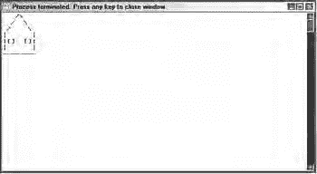


**24**

**零基础 C++ 编程，第二版**

### 挑战

1. 创建一个程序，显示一张看起来像图 1.9 中 ASCII 房屋的图片。

**图 1.9**

一个 ASCII 房屋。

2. 下面程序的输出是什么？

```cpp
#include <iostream>

int main( void )
{
  using std::cout;
  int x = 25;
  string str2 = “This is a test\n”;
  cout << ”Test” << 1 << 2 << ”3”;
  cout << 25 %7 << “\n” << str2.c_str();
  return 0;
}
```

3. 写一个程序询问用户的姓名，向他们问候，询问两个数字并提供它们的和。

4. 当 10.3 存储为整数时会发生什么？0.6 呢？你可以将 –101.8 存储为整数吗？

5. 编写代码：如果数字在 1 到 100 之间包含 1 或 100）且能被 3 整除，则乘以 2；否则，如果它在 1 到 100 之间但不能被 3 整除，则乘以 3；最后，如果它不在 1 到 100 之间，则将该数字乘以数字对 100 取模的结果。（提示：使用嵌套的`if`语句。）

## 章节：深入理解变量

变量的术语对初学者来说可能听起来很令人生畏；在本章中，我们将理清混乱，希望这里的信息能像火炬一样引导你穿过黑暗。在本章结束时，你将对变量有良好的认知。在本章中，你将学习以下内容：

* 什么是变量
* 如何存储数据
* 如何声明并为变量赋值
* 基础类型
* 如何确定变量的大小
* 如何使用`typedef`
* 如何将十六进制转换为十进制
* 如何从一种类型转换为另一种类型
* 如何使用常量

### 理解变量

在编写代码时，我们通常希望能够表示概念。例如，如果你正在编写一个奇幻角色扮演游戏，你可能想要表示玩家拥有多少经验值。你想保留这个值以便以后引用它。有时，比如当你的玩家击败一只巨蜘蛛时，你可能想要改变该值，对其进行加法、减法或其他其他操作。

你在代码中表示此类概念的方法就是使用变量。因此，例如你可能有一个名为`exp_points`的变量，代表玩家当前的经验值。你给变量起的名称很重要，因为你通过它来引用变量。


每个变量都带有三部分信息：它的标识符（程序员引用它时的名称）、它的类型（控制了可以在该变量上执行哪些操作以及如何执行）以及数据本身。

更具体地说，变量是计算机内存上的某个特定区域。与特定变量关联的数据存储在这一内存区域中。想象许多许多大小相同的箱子排成一排。所有的盒子都按顺序编号（第一个是 1，第二个是 2，以此此类推）。计算机内存也非常相似。每个变量都是一个或多个盒子，盒子内部是变量所持的数据。这就是变量存储数据的地方。通过为该数据命名，你就可以方便地从内存中访问它（如图 2.1 所示）。

**图 2.1**

在这幅图中，前两个盒子（字节）是包含变量 1 的内存的一部分。第三个盒子仍然是空闲空间，因为它没有被用于存储变量。

### 理清变量与内存之间的关系

随着学习的深入，你会越来越多地发现，程序员的大部分时间花在决定如何操作。

**27**

**第 2 章 • 深入理解变量**

通常，每个位可以包含两个值——分别称为 0 和 1，或者 false（假）和 true（真）。当两个位结合时，可能产生四种组合或值。

计算机内存由数百万微小的电气开关组成；每个开关被称为一个位（bit）（位是计算机内存的最小单位）。每个开关或位可以持有两个可能的电压水平（例如 0V 和 +5V）。因此，每个位可以包含两个值——分别称为 0 和 1，或者 false 和 true。当两个位结合时，可能产生四种组合或值（00, 01, 10 和 11）。这里就是二进制计数系统（或二进制）的诞生。

最常见的计数系统是十进制。在十进制（或十进制）系统中，每个数字都有十种可能的值（0, 1, 2, 3, 4, 5, 6, 7, 8, 9）。表 2.1 显示了 0–10 的二进制和十进制形式。

计算机有两种主要类型的内存：随机存取存储器（RAM）和磁盘存储。RAM 由计算机主板和某些外围卡（显卡、声卡等）上的特殊芯片组成。RAM 临时存储数据。这是程序运行时运行时使用的内存，也是程序员最关注的内存。磁盘存储由硬盘、软盘、CD-ROM 驱动器或其他任何永久存储设备组成。当计算机关闭时，存储会保留其信息。我们的讨论仅限于 RAM。

**提示**

另一种内存是只读存储器（ROM）。ROM 是一种非易失性（不改变）内存，存储了启动计算机时执行的启动和自检指令。

变量有四种基本类型，其他类型在此基础上：布尔类型、字符类型、整数类型和浮点类型。从这四类中，你可以表示程序中的任何数据。

**28**

**零基础 C++ 编程，第二版**

**表 2.1：十进制系统与二进制系统**

| **十进制** | **二进制** |
| :--- | :--- |
| 0 | 0 |
| 1 | 1 |
| 2 | 10 |
| 3 | 11 |
| 4 | 100 |
| 5 | 101 |
| 6 | 110 |
| 7 | 111 |
| 8 | 1000 |
| 9 | 1001 |
| 10 | 1010 |

不要被二进制系统吓到。你所有旧而熟悉的数字仍然在那里；二进制系统只是以不同的方式表示它们。`0` 是一样的，`1` 也是。第一个奇怪的数字是 `2`。必须添加一个新的数字来表示数字 `2`，因为二进制只有 `0` 和 `1` 两个数字可以使用。类比，因为十进制只有 10 个数字，所以必须添加一个新数字来表示数字 `10`。如果这让你有点困惑，不要担心。最重要的一点是，所有的值都可以由一系列 `0` 和 `1` 来表示。

你问分数和小数怎么办？嗯，它们也有相应的表示方法。基本上，小数点前的部分和小数点后的部分是分别表示的。在这里讨论细节就太复杂了，但你可以放心，它们也可以存储在计算机内存中。

正如我们提到的，每个电气开关被称为一个 `bit`（位），一个 `bit` 可以存储两个可能的值：`0` 和 `1`。连续的 8 个位被称为一个 `byte`（字节）。一个 `byte` 可以存储 `256` 个可能的值，`0–255`。使用本章开始时的箱子类比，箱子的行代表内存，每个箱子就是一个 `byte` 内存。一个 `byte` 是计算机可以处理的最少数据量。如果需要多个 `byte`，计算机就会使用多个箱子。

记住，一个千字节（kilobyte）实际上并不是 1000 字节；它是 1024 字节。内存并没有完全遵循公制单位。`1024K` 是一个兆字节 (`MB`）。`1000MB` 是一个吉字节 (`GB`）。这些信息总结在表 2.2 中。每增加一个位，可能的值就会翻倍，所以这些数字增长得很快。你总是希望确保程序中使用的内存没有超过所需的范围。

# 第 2 章 • 深入理解变量

## 表 2.2：内存测量

| 内存单位 | 比特数 | 可能的值数量 |
| :--- | :--- | :--- |
| bit | 1 | 2 |
| byte | 8 | 256 |
| kilobyte (KB) | 8192 | 28192 |
| megabyte (MB) | 8388608 | 28388608 |
| gigabyte (GB) | 8589934592 | 28589934592 |
| terabyte (TB) | 8.796093022 * 10¹² | 28.796093022 * 10¹² |

将 RAM 芯片中的内存想象成一个序列的 `byte`。每个 `byte` 都有一个独特的地址。地址是一个数字，例如 `10345`，它告诉计算机具体指的是哪一个 `byte`。理解每个 `byte` 如何拥有自己的地址非常重要，但你很少需要直接处理地址。

现在你已经更多地了解计算机如何存储和表示数据，你准备好深入研究变量了。

## 描述变量标识符

标识符（Identifiers）是你为了引用变量而给变量起的名称。例如，存储用户输入的变量可以被称为 `input`。变量的命名规则如下：

- 名字必须以字母或下划线 (`_`) 开头。
- 其他每个字符可以是字母、下划线或数字。
- 标识符可以很长（超过 200 个字符）。
- 你不能使用关键字作为变量名。
- C++ 是区分大小写的（`aVariable` 与 `VARIABLE` 不同）。

有效标识符的示例有 `_file5G`、`String7F4`、`input`、`__my_variable` 等。

无效标识符的示例有 `9variable` 和 `&variable`。使用双下划线开头标识符不是一个好主，因为它们通常保留给特殊的系统变量。此外，请记住，即使标识符是有效的，它也可能没用。

标识符应该是具有描述性的，这样当你三周后再次阅读代码时，你会完全理解自己的意图。

不要无意中将关键字作为变量名。这样使用关键字的**陷阱**可能会导致不可预测的结果并带来许多头疼的问题。例如，`int` 已经被预留用于表示整数，所以如果你尝试使用 `int` 作为变量名，编译器在构建程序时会给你报错。

## 声明和赋值变量

在使用变量之前，你必须先声明它。通过声明变量，你是在告诉计算机留出特定的空间来存储数据，并给该空间命名。

不同类型的变量需要不同数量的内存。例如，声明一个 `int`，你输入以下内容：

```cpp
int x;
```

变量声明的语法如下：

```cpp
variable_type identifier;
```

然后，要给该变量赋值，你使用赋值运算符 (`=`)。运算符是执行……嗯，执行操作的符号或单词。运算符可以代表数学、关系或其他类型的运算符。在本章中，我们只涵盖数学运算符和赋值运算符。赋值运算符将右侧的值放入左侧的值中。这是一个示例：

```cpp
x = 5;
```

这里，`x = 5` 表示 `x` 存储了 `5`。一个 `byte` 可以存储 `256` 个可能的值，`0–255`。一个 `byte` 是计算机可以处理的最少数据量。不要无意中将关键字作为变量名。这样使用关键字的**陷阱**可能会导致不可预测的结果并带来许多头疼的问题。例如，`int` 已经被预留用于表示整数，所以如果你尝试使用 `int` 作为变量名，编译器在构建程序时会给你报错。

这里，`x = 5` 表示 `x` 存储了 `5`。一个 `byte` 可以存储 `256` 个可能的值，`0–255`。一个 `byte` 是计算机可以处理的最少数据量。不要无意中将关键字作为变量名。这样使用关键字的**陷阱**可能会导致不可预测的结果并带来许多头疼的问题。这就是初始化变量，因为你给它了一个初始值。例如：

```cpp
int z;
```

在掌握了声明变量和赋值赋值后，你准备好学习不同类型的变量。

## 介绍基本变量类型

变量有很多类型，但我们在本章只涵盖四种基本类型。

你使用的变量类型决定了它能存储什么的数据，以及可以对其执行哪些操作。本章涵盖的四种类型是布尔、字符、整数和浮点。表 2.3 总结了一些不同的变量类型。

## 表 2.3：变量类型

| 类型 | 大小 | 值 |
| :--- | :--- | :--- |
| bool | 1 字节 | true (1) 或 false (0) |
| char | 1 字节 | a 到 z, A 到 Z, 0 到 9，空格，制表等 |
| int | 4 字节 | –2,147,483,648 到 2,147,483,647 |
| short | 2 字节 | –32,768 到 32,767 |
| long | 4 字节 | –2,147,483,648 到 2,147,483,647 |
| float | 4 字节 | ±1.2 * 10^-38 到 3.4 * 10³⁸ |
| double | 8 字节 | ±2.3 * 10^-308 到 1.7 * 10³⁰⁸ |

## 布尔类型

布尔类型是最简单的数据类型。它是 1 字节（计算机可以处理的最少可能数据量）。它可以存储两个值：true 和 false。当只有两种可能性时，使用布尔类型。例如，你可能有一个变量 `end`，它在程序结束前为 false。你可以使用这个变量来判断是否已到达程序的结尾。你使用关键字 `bool` 来声明布尔变量：

```cpp
bool myBool = true;
cout << myBool;
```

## 字符类型

字符类型可以包含 256 个不同字符中的任意，可以是标准 ASCII 表中显示的任何字母或符号。

字符字面量（数据的字面表示是指不以变量形式表示的数据）由单引号包围。例如，‘a’、『5’、‘%’和‘W’都是字符字面量。

你使用关键字 `char` 来声明字符类型：

```cpp
char myChar = ‘a’;
cout<< “the character is” << myChar;
```

## 整数类型

有三种整数类型：`int`、`short int`（或 `short`）以及 `long int`（或 `long`）。

我们在第 1 章介绍了 `int` 类型。在大多数计算机上，它的长度为 4 字节。它可以存储从 –2,147,483,648 到 2,147,483,647 之间的数字。这种类型是最常用的数据类型。整数类型不能存储小数或分数（例如 2.1 或 1/3）。你用 `int` 关键字声明它：

```cpp
int myInt = -3;
cout << myInt;
```

`short` 类型的大小是 `int` 的一半——即 2 字节。它可以存储从 –32,768 到 32,767 之间的数字。

当你拥有相对较小的值时，这种类型非常有用。它的效率是倍的，因为只需要一半内存。你用 `short`（或 `short int`）关键字声明 `short` 类型。

```cpp
short myShort = -56;
```

你也可以像如下所示显示上一行：

```cpp
short int myShortInt = -56;
```

接下来，在数据类型的精彩之旅中，是 `long` 数据类型。它的长度与 `int` 相同，均为 4 字节。它也可以存储 –2,147,483,648 到 2,147,483,647 的值。正如你可能的那样，你用 `long`（或 `long int`）关键字声明 `long` 数据类型。它与 `int` 同义：

```cpp
long myLong = 32056;
long myLong = 56789;
```

## 第 2 章 • 深入理解变量 (33)

为什么会有两种含义完全相同的不同类型呢？从技术上讲，`int` 和 `long` 的大小可以是不同的。`short` 设计为最小，`int` 居中，而 `long` 是最大的整数类型。在标准计算机上，将 `int` 和 `long` 定义为相同的大小已经成为一种约定。

你可以在所有整数类型前面加上 `unsigned` 关键字，为它们只分配正值。`unsigned short` 的范围是 0 到 65535，而 `unsigned long` 或 `int` 的范围是 0 到 4,294,967,295。无符号整数占据的内存量与普通（带符号）整数相同。你也可以使用 `signed` 关键字来确保可以存储负值，但这是没有必要的，因为 `signed` 是默认值。

```cpp
unsigned int anUnsignedInt; // 0 to 4,294,967,295
unsigned short anUnsignedShort; // 0 to 65535
signed long aSignedLong; // -2,147,483,648 to 2,147,483,647
int anInt; // -2,147,483,648 to 2,147,483,647
```

## 整数回回

如果一个整数超过它的范围，它会发生一种奇怪的事情。它会从头开始。例如，如果你在一个 `unsigned` 整数中存储值 4,294,967,295（比其范围大 1），该 `unsigned` 整数将它的值存储为零 (0)。无符号整数从 0 重新开始，但带符号整数从它的最低负值重新开始。一个例子可能有助于澄清这一点：

```cpp
//2.1 - 整数回回 - Dirk Henkemans and Mark Lee
#include <iostream>

//显示整数回回的示例
int main()
{
    using std::cout;
    unsigned int unInt = 4294967295;
    signed short aShort = 32767;
    cout << “Unsigned int’s value is: “ << unInt << “\n”; 
    cout << “Short’s value is: “ << aShort << “\n”;
    unInt = unInt + 1;
    aShort = aShort + 1;
    cout << “\nUnsigned int’s new value is: ” << unInt << “\n\";
    cout << “Short’s new value is: ” << aShort << “\n\"; 
    return 0;
}
```

输出：

```
Unsigned int’s value is: 4294967295
Short’s value is: 32767
Unsigned int’s new value is: 0
Short’s new value is: -32768
```

当声明 `unInt` 和 `aShort` 时，它们被分配了最大值。稍后，它们增加了 1。正如你所看到的，它们发生了回回（wrapped）。这是一个小问题，但记住它——以防万一。

## 递增运算符

如果你想将整数中存储的值精确地增加一个，你可以使用递增运算符 (`++`) 来让你的代码变得短得多。递增运算符是一种数学运算符，它使变量的值增加一。与其写：`count = count + 1;`，

你可以写：

```cpp
count++;
```

你也可以以同样的方式使用递减运算符 (`--`) 来将整数的值减少一。递减运算符从数字的值中减去一。与其使用：`count = count – 1;`，

你可以使用：

```cpp
count--;
```

除了更简洁和更易输入之外，递增和递减运算符编译成的机器码略微高效一些，因此尽可能使用它们是有益的。

## 第 2 章 • 深入理解变量 (35)

## 浮点数类型

如果你想存储小数或分数，你需要浮点数据类型，`float` 和 `double`。

`float` 或单精度浮点数据类型长度为 4 字节。它可以存储正或负的小数或非小数值，最大和最小精度为 1.2 × 10^–38 到 3.4 × 10³⁸。记住这些可以是正的也可以是负的。

通常，程序员用科学计数法表示 `float` 和其他非整数。科学计数法是一种在较小空间内表示极大或极小数字的方法。

科学计数法只是编写开始难以控制的浮点数的快捷方法，例如 0.0000000000000000002。以下是用科学计数法编写的数字：

`5.6543e17` `-4.02934e5` `-17.204e-10` `2.0e-19`

这里是使用科学计数法将浮点数转换为普通格式的规则：1. 找到 e 右侧的数字。2. 将小数点向右移动 17 位。对于在 e 前面没有负号的 `5643e17`，小数点向左移动 17 位，得到 0.0000000000000005643。

无论你存储的是什么数字，它都会转换为科学计数法。然后它被舍入到最近的 10^–38 位。这是它的精度。例如，如果你将 Pi (3.14159265358979323846 ...) 保留两位小数，数字将舍入为 3.14，标准的 Pi。

你用 `float` 关键字声明浮点数：

```cpp
float aFloat = 3.156;
float negativeFloat = -678.876;
cout << aFloat << negativeFloat;
```

为了存储分数，计算机必须将其分数形式转换为小数形式。当你访问分数时，`float` 会给你它能存储的最准确的小数。

## 第 2 章 • 深入理解变量 (36)


`double` 数据类型长度为 8 字节。它可以存储正值的 `2.2 × 10^–308` 到 `1.7 × 10³⁰⁸`，以及负值的 `–2.3 × 10^–308` 到 `–1.7 × 10³⁰⁸`。因此，`double` 被舍入到最近的 `10^–308` 位。这是极高的精度。

基本上，`double` 可以处理你想存储的任何内容。你用 `double` 关键字声明它。

在以下示例中，`2.2e–308` 与 `2.2 *10^–308` 含义相同：

```cpp
double aDouble = 2.2e-308;
double negDouble = -2.3e-308;
cout << aDouble << negDouble;
```

你现在熟悉基础数据类型了。在第 6 章“软件设计：面向对象编程”中，将学习如何从这些基础类型创建自己的数据类型。

## 使用 sizeof() 运算符

这个相对简单的运算符内置在 C++ 语言中。将它应用于任何变量，它将给出该变量所占的内存大小（以字节为单位）。你可以按照以下方式使用它：

```cpp
sizeof(identifier);
```

要在屏幕上显示 `double` 的大小，你可以使用这段代码片段：`double aDouble;`

```cpp
cout << “The size of a double is ” << sizeof(aDouble); // 等于 8
```

因为它代表一个整数数据类型（字节数），因此你可以在任何可以使用整数的地方使用该运算符的结果。

你也可以使用类型的关键字而不是标识符，如下所示：`cout<< “The size of 2 integers is” << 2 * sizeof(int); // 等于 8`

## 数据类型游戏

在你的冒险途中，你恰好遇到了一个精灵村庄。你太幸运了，无畏的冒险者，因为这是尝试你新学技能的绝佳机会。这个村庄正受到一群巨龙的袭击！为了保护村庄，你必须从神秘森林召唤数据类型战士来营救精灵。

为了拯救精灵村庄，你必须利用最近学学的关于整数、浮点数和双类型的技能。你准备好接受挑战了吗？如果是，请继续阅读：

```cpp
//2.2 - Data Type Game - Dirk Henkemans and Mark Lee
#include <iostream>

//运行数据类型游戏
int main( void )
{
using std::cout;
using std::cin;

int intWarriors;
double doubleWarriors;
float floatWarriors;

cout << “The village of the elves is being attacked by dragons. “; cout << ”In order to save them, you must create each kind of “
<<”data type warrior to defend the elven city.\n\n”;

cout << “How many int warriors do you want to send out?”;
cin >> intWarriors;

cout << “\nLuckily, each int warrior has a strength of “ << sizeof(intWarriors) << “, \nwhich almost defeats the “ <<
”blue dragons.\n”;
cout << “\nQuick! How many double warriors should we send?”;
cin >> doubleWarriors;

cout << “\n” << doubleWarriors;
cout << “ double warriors attack the last few blue dragons.\n”
<< “They kill “ << sizeof(doubleWarriors) << “ blue dragons.”
<< “ All of the blue dragons are now dead.\n\n”;

cout << “How many float warriors do you send out?”;
cin >> floatWarriors;

cout << “\nEach of the “<< floatWarriors <<” float warriors shoots “; cout << sizeof(floatWarriors) << “ arrows.\n”;
cout << “This is just enough to kill the green dragons.\n”;
cout << ”Congratulations, you have saved the elves!\n”;
}
```

## 使用 TYPEDEF 让生活更容易

有时候，反复使用 `unsigned short int` 关键字会非常不利。使用 `typedef` 允许你为类型创建一个新名称。你可以将 `unsigned short int` 重命名为 `USHORT` 或其他更方便的名字。`typedef` 的格式如下：

```cpp
typedef variable_type new_name;
```

要将 `float` 重命名为 `f`，请执行：

```cpp
typedef float f;
```

然后你就可以使用新定义的关键字来声明 `float` 了：

```cpp
f radius = 4.7639;
```

**提示**

记住，你的新数据类型名称不仅应该方便，而且要有意义。

## 使用常量

有时候，当你创建一个变量时，你希望确保它的值不能被改变。

也许你有一个变量代表玩家手中的牌牌数量，或者赢得游戏所需的分数。这些是你想要定义一次后再也不更改的内容。你进入了常量的世界！

你通过使用 `const` 关键字来定义常量。语法与声明普通变量的语法完全相同，只是前面加上 `const` 关键字：`const constType CONSTNAME = value;`

**提示**

你必须在声明常量的同一行给它赋值，因为在这一行之后值就不能改变了。任何尝试都会导致编译错误。这让你能够轻松确保该变量保持保持你预期的状态，而不会被意外修改。

使用常量有许多优势。假设你在程序中每次需要使用 Pi 的值时都输入数字，例如 `3.14`。然后你发现应用程序需要更高的精度；你必须将所有的 `3.14` 更改为更高精度的值，如 `3.14159`。相反，如果你使用常量定义 `Pi` 为 `3.14`，稍后需要增加精度，你只需要在一个地方更改 `const` 并重新编译程序。

如果你有一个非常长的数字（例如保留 22 位小数的 Pi），每次使用时都输入它也会很麻烦——而且如果你和我们一样，很容易出错。使用常量会极大地简化这种情况。

最后，在任何可能的情况下使用 `const` 是一个良好的习惯。这有助于让你的意图清晰。它还能帮助编译器捕获代码中的错误。

## 圆形游戏

对于明天的数学作业，你必须计算圆的面积和周长。

嗯，我们可以提供帮助。在下面的程序中，我们通过使用常量同时完成。你使用常量来存储 `PI` (`3.141592`)。然后用户只需向程序输入半径，程序就会计算圆的面积和周长。记住，用户的输入应该存储为 `float`，这样用户就可以输入小数作为半径。太棒了；现在是编写程序了：

```cpp
//2.3 - The Circle Game - Dirk Henkemans and Mark Lee
#include <iostream>

//计算圆的面积和周长
int main()
{
using std::cout;
using std::cin;
typedef double d;
const d PI = 3.141592;
d radius, circumference, area;

cout << “Welcome to the circle creator!\n”;
cout << “What would you like the radius of the circle to be? “; cin >> radius;

area = PI * radius * radius;
circumference = PI * (radius * 2);

cout << “The area of the circle is: “ << area << “\n”; cout << “The circumference of the circle is: “ << circumference << “\n”; cout << “Thank you for playing the circle creation game!\n”;
return 0;
}
```

## 理解语法

到本书为止，我们已经涵盖了许多不同类型的单词——关键字、标识符、预指令等，以及许多类型的语句——赋值、包含等。在本节中，我们将回顾目前为止涵盖的所有 C++ 语法。（语法指的是语言的语法规则。）

我们从关键字开始，这是 C++ 语言的基础。一切都是基于这些单词构建的。C++ 编译器在被程序员“教”更多内容之前，只能理解这些单词。

表 2.4 列出了你目前为止学过的每个关键字，并给出了功能和语法。

**表 2.4：C++ 关键字及其使用方法**

| 关键字 | 功能 | 语法 |

| :--- | :--- | :--- |

| `const` | 用于声明常量。 | `const const_type const_name = value;` |

| `int` | 用于声明整数。 | `int variable_name;` |

| `short` | 用于声明短整型。 | `short variable_name;` |

| `long` | 用于声明长型。 | `long variable_name;` |

| `float` | 用于声明浮点型。 | `float variable_name;` |

| `double` | 用于声明双精度型。 | `double variable_name;` |

| `bool` | 用于声明布尔型。 | `bool variable_name;` |

| `string` | 用于声明字符串。 | `string variable_name;` |

| `unsigned` | 用于声明仅正数的整数。 | `unsigned int_type variable_name;` |

| `return` | `main()` 函数结束时需要。 | `return 0;` |

| `sizeof()` | 返回变量或类型的大小。 | `sizeof(variable_type_or_name)` |

| `void` | 声明 `main()` 函数需要。 | `int main(void)` |

# typedef

`typedef` 用于重命名类型。

`typedef type new_name;`

正如我们所指出的，关键字是 C++ 语言的核心。它们每个都有特殊的含义和用途。掌握了这些词，你就迈向了成为 C++ 大师的一步。

接下来是标识符。你现在已经知道了两种类型的标识符：字面量（literal）和变量（variable）。

表 2.5 总结了它们的用途和格式。

对于字面量标识符的命名没有选择；它们的名称就是它们本身。

变量标识符通常全小写，除非是两个单词组合（例如 `variableName`）。尽量让你的标识符名称尽可能具有描述性。这样做将提高代码的可读性。

我们还没有深入介绍预处理器指令，但你已经知道其中一个。这就是 `#include`。正如之前讨论的，指令是给编译器的消息，告诉它在编译时执行某些操作。`#include` 告诉编译器编译时将另一个文件添加到当前文件中。例如，在“Hello World”程序中：

**表 2.5**

**标识符的用途与格式**

| 标识符 | 用于存储 | 格式 |

| :--- | :--- | :--- |

| 字面量 | 字面量数据。 | 无格式规则（直接使用值）。 |

| 变量 | 更改的数据。 | 使用赋值运算符 (`=`) 赋值。 |

| 常量 | 常数值。 | 像变量，但只能创建时赋值一次。 |

```cpp
#include <iostream>
```

这告诉编译器在编译时将 `iostream` 库添加到 `hello.cpp` 中。`<iostream>` 包含许多预定义代码，例如 `cout`。

正如我们之前提到的，运算符是执行操作的符号或单词。到目前为止你已经九种运算符：数学运算符——加法（`+`）、减法（`–`）、乘法（`*`）、除法（`/`）和取模（`%`）、递增运算符（`++`）、赋值运算符（`=`）以及 `sizeof()` 运算符。表 2.6 总结了这些运算符及其作用。

**表 2.6**

**运算符的用途与语法**

| 运算符 | 用途 | 语法 |

| :--- | :--- | :--- |

| 加法 (`+`) | 将两个数相加。 | `number1 + number2` |

| 减法 (`-`) | 将两个数相减。 | `number1 - number2` |

| 乘法 (`*`) | 将两个数相乘。 | `number1 * number2` |

| 除法 (`/`) | 将两个数相除。 | `number1 / number2` |

| 取模 (`%`) | 取余。 | `number1 % number2` |

| 递增 (`++`) | 将整数的值加 1。 | `integer1++` |

| 赋值 (`=`) | 给变量赋值。 | `variable1 = expression` |

| `sizeof` 运算符 | 查找变量或类型的大小。 | `sizeof(variable_or_type)` |

对变量感觉熟悉了吗？如果没有，你可能想再次阅读本章的部分内容并练习示例代码。练习是关键。

### 创建武器商店游戏

在穿过一片黑暗的森林时，你在荒野中遇到了一家神秘的武器商店。你幸运了，勇敢的旅行者，因为这是测试在本章中所学内容的完美机会，包括常量、类型转换、运算符、数据类型等。你必须编译并运行此程序才能访问武器商店，并为军队的下一次军事行动购买足够的宽剑：

```cpp
//2.4 - 武器商店游戏 - Dirk Henkemans and Mark Lee

#include <iostream>
#include <string>

//包含武器商店游戏的代码。
int main (void)
{
    using std::cout;
    using std::cin;
    using std::string;

    string name;
    cout << “Welcome to the weapon store, noble knight.”
    << “ Come to equip the army again?\n”
    << “What is your name? ";
    cin >> name;
    cout << “Well then, Sir “ << name.c_str()
    << “, let’s get shopping\n";
    double gold = 50.0;
    int silver = 8;
    const double SILVERPERGOLD = 6.7;
    const double BROADSWORDCOST = 3.6;
    unsigned short broadswords;
    cout << “You have “ << gold << “ gold pieces and “
    << silver << “ silver.” << “\nThat is equal to “; gold += silver / SILVERPERGOLD;
    cout << gold << “ gold.\n";
    cout<< “How many broadswords would you like to buy?”
    <<” (3.6 gold each) ”;
    cin >> broadswords;
    gold = gold - broadswords * BROADSWORDCOST;
    cout << “\nThank you. You have “ << gold << “ left.\n”; silver = (int)((gold - (int)gold) * SILVERPERGOLD);
    gold = (double)((int)(gold));

    cout << “That is equal to “ << gold << “ gold and “
    << silver << “ silver. \n“
    << “Thank you for shopping at the Weapon Store. ”
    << “Have a nice day, Sir “ << name.c_str() << “.\n”; return 0;
}
```

## 总结

你在这一章中涵盖了大量信息。你学习了计算机如何在内部内存中存储数据，如何临时存储数据以备后用，以及不同类型的数据。你学习了常量以及 `typedef`、`sizeof()` 和赋值运算符。你回顾了目前为止涵盖的 C++ 语法。

你现在的旅行已经深到可以安全地被称为初级程序员了。感到自豪吧；只有少数精英能走到这里。


在下一章中，我们将为你介绍控制语句，这是你真正控制计算机的开始。坐下休息，让这些信息消化一下；然后穿好装备，跳进去，系好安全带——你有一段精彩的旅程在等待！

### 挑战

1. **存储以下数据的正确变量类型是什么？**
   - 书架上的书
   - 这本书的费用
   - 世界上的人数
   - 单词 `Hello`

2. **为第一个挑战中的变量提供有意义的变量名。**

3. **列出两个常量的理由。**

4. **编写一个计算并显示所有基本类型大小的程序。**

5. **测试如果将字符声明为无符号（`unsigned`）会发生什么。你得到预期的结果吗？说明原因或不为什么。**

*本页特留白*

3

### 第 3 章

## 使用控制语句做出选择

在前面的章节中，你创建了从开始到结束执行的程序。每个语句只执行一次，并且每个语句都必须执行。然而，这种线性只对基础编程是可以接受的。

要创建高级的动态程序，你必须掌握控制语句，它们允许程序跳转到某些代码或多次执行某部分代码。在本章中，你将学习以下内容：

- 选择语句
- 布尔逻辑和运算符
- 迭代语句
- 分支语句
- 随机数

### 使用选择语句选择代码

人们通常根据某些条件做出决定。例如，如果一个人感到不适，可能会去看医生。决定是否去看医生是基于某个条件：感到不适。使用程序时也是如此。你可以设计你的程序，使其根据某些条件选择执行哪些代码。

**46**

**《初学者 C++ 编程》，第二版**

C 中的条件基于布尔值。正如你所学过的，布尔只有两个可能的值：真或假。组成条件的运算符和操作数决定了条件的值。

有两种类型的选择语句：`if else` 语句和 `switch` 语句。

### 使用 `if` 语句测试条件

可能最重要的选择语句是 `if` 语句。`if` 语句背后的思想是：语句中包含的一个特殊代码区域（称为受控制语句）只有在特定条件（称为控制条件，或简称为条件）为真时才会被执行。`if` 语句的通用语法如下：

```cpp
if (condition)
controlledStatements
```

在这里，`condition` 是正在测试的条件，而 `controlledStatements` 是零或多个受控制语句。只有当 `condition` 求值为真时，才会执行这些受控制语句。请注意 `condition` 后面没有分号。此通用语法的整两行是一条语句，因此不需要分号。此外，请注意 `condition` 括在括号中，以将其与语句的其余部分隔离开。这些括号是必须的。如果 `controlledStatements` 只包含一个语句，语法如下：

```cpp
if (condition)
theStatement;
```

在这里，`theStatement` 是单一语句。注意末尾的分号，它告诉编译器这就是整个 `if` 语句。当 `controlledStatements` 包含多个语句时，语法看起来如下：

```cpp
if (condition)
{
    statementList
}
```

在这里，`statementList` 是零或多个 C++ 语句，每个语句都以分号结束。请注意，最后一个大括号（`}`）末尾不需要分号。你可能从第 2 章“深入研究变量”中记忆起，代码块是任何由大括号分隔的代码段。代码块可以放在任何允许单条语句的地方。

这是一个示例。另一个到目前为止每个程序都使用的示例是 `main` 函数。

在整个章节中，你将看到许多代码块示例。请留意它们。

### 第 3 章 • 使用控制语句进行选择

这是一个示例：

```cpp
int swords = 9;

if(swords < 8) //the condition
{
    cout << ”The number or sword is less than 8”;
}
```

`cout` 语句永远不会执行，因为条件（控制条件）`swords < 8`（整数变量 `swords` 的值是否小于 8？）求值为假。九并不小于八。因为你想让它只执行一行代码，你可以用另一种方式显示这个示例——不使用大括号，如下所示：

```cpp
int swords = 9;

if(swords < 8) //the condition
cout << ”The number of swords is less than 8”;
```

在这个示例中，因为没有使用大括号，`if` 语句包含了直到分号（并包含分号）的所有内容。

正如我们之前说的，`if` 语句是最常见的控制语句。与接下来讨论的 `else if` 语句和 `else` 语句结合，`if` 语句可以成为你最强大的工具之一。

#### `else if` 和 `else` 语句

有时，如果某个条件不成立，你可能想要采取替代方案。例如，你觉得病了。你可能会去看医生；否则，你会呆在家里。`otherwise` 之后的语句就是替代方案。如果条件“感到不舒服”不成立，你将采取替代行动，留在家中。

在 C++ 中，`otherwise` 被用 `else` 语句表示。`else` 语句必须跟在 `if` 语句后面。`else` 语句不能单独出现。`else` 语句的语法如下：

```cpp
else
controlledStatements
```

在这里，`controlledStatements` 是一个或多个语句。如果你在 `controlledStatements` 中有多个语句，你必须使用用大括号括起来的块，如下：

```cpp
else {
    statementList
}
```

在前面，`statementList` 包含零或多个由分号分隔的语句。

如果 `controlledStatements` 只有一个语句，则不需要块：

```cpp
else
theStatement;
```

你通过将 `else` 语句直接放在 `if` 语句之后来将 `else` 语句与 `if` 语句连接：

```cpp
if (condition)
controlledStatements1
else
controlledStatements2
```

关键字 `else` 必须紧跟在 `if` 语句；如果放在任何其他地方，将发生编译错误。

这是一个示例：

```cpp
int swords = 9;

if (swords < 8)
    cout << “Swords is less than 8”;
else
    cout << “Swords is not less than 8.”;
```

在这里，文本 `Swords is not less than 8` 将显示在屏幕上，因为 `if` 语句的条件为假；`else` 语句会自动执行。如果整数变量 `swords` 初始化为 6，例如，文本 `Swords is less than 8` 将显示，并且整个 `else` 语句将被跳过。

由 `else` 语句控制的语句可以由另一个 `if` 语句组成。这就是著名的 `else if` 语句形成形成：

```cpp
if (condition1)
controlledStatements1
else if (condition2)
controlledStatements2
```

在这里，`condition1` 和 `condition2` 是两个独立的条件，`controlledStatements1` 和 `controlledStatements2` 是两组独立的受控制语句。前面的代码块执行情况如下：

- 如果 `condition1` 为真，则执行 `controlledStatements1`，计算机跳过 `if-else if` 结构的其余部分。
- 如果 `condition1` 为假且 `condition2` 为真，则执行 `controlledStatements2`，跳过 `if-else if` 结构。
- 如果 `condition1` 和 `condition2` 都为假，则一个控制语句都不会执行。

将一个 `if` 语句放在另一个 `if` 语句内部被称为**嵌套**。参见图 3.1 显示 `if-else if` 结构的工作方式。

**图 3.1**

这是 `if-else if` 结构的工作方式。

### 荣誉考验游戏

你是一个勇敢的骑士，站在一个充满黑暗房间的迷宫前。你必须通过恶魔设置的一系列考验来拯救被绑架的公主。如果你通过了所有的荣誉考验，你和公主将幸福地生活。

第一个房间里满了金子。如果你拿了任何金子，就会通过测试；但是，你可以留下拿的金子。第二个房间满了宝石。如果你拿了这些宝石，就会证明了自己的贪婪并无法拯救公主。在最后一个房间，你必须帮助一个被龙攻击的农民。如果你通过了三次考验，恶魔就会释放公主。

以下是使用 `if` 和 `else` 语句实现的示例：

```cpp
//3.1 - Tests of Honour — Mark Lee and Dirk Henkemans
#include <iostream>

int main(void)
{
    using std::cout;
    using std::cin;

    cout << “欢迎来到荣誉考验。”
         << “\n 一个恶魔绑架了一个公主，”
         << “要由你来拯救她。”
         << “\n 他说你必须通过他的死亡迷宫”
         << “中的三次考验。”;

    bool goldTaken, diamondsTaken, killedByDragon;

    cout << “\n\你进入了第一个房间。”
         << “\n 里面装满了令人难以置信的金子。”
         << “ \n 你拿走金子吗（1 为是，0 为否）？”;
    cin >> goldTaken;

    if(goldTaken)
        cout << “\n 你拿走了金子， ”
             << ”但你失败了第一个考验。 ”
             << “\n 游戏结束。\n\n”;
    else {
        cout << “恭喜， ”
             << “你通过了第一个荣誉考验！”
             << “\n\你进入了第二个房间。”
             << “ 里面满了闪烁的宝石”
             << “\n 你拿走这些宝石吗（1 为是，0 为否）？”;
        cin >> diamondsTaken;

        if(diamondsTaken)
            cout << “你拿走了宝石， ”
                 << “但你失败了第二个考验。”
                 << “\n 你证明了自己的贪婪。 ”
                 << “\n 游戏结束。\n\n”;
        else {
            cout << “恭喜，你 ”
                 << “通过了第一个和第二个荣誉考验。”
                 << “\n\你进入了第三个房间。”
                 << “\n 一个农民正被龙攻击！” 
                 << “\n 你会帮助那个农民吗（1 为是，0 为否）？”;
            cin >> killedByDragon;

            if(!killedByDragon) {
                cout << “\n 你救了农民， ”
                     << “并通过了所有荣誉考验。 ”
                     << “\n 恶魔释放了公主。”
                     << “\n 你和公主从此过上了幸福的生活。”;
            } else {
                cout << “\n 你牺牲了农民， ”
                     << “你通过了最后的考验。 ”
                     << “\n 游戏结束。\n\n”;
            }
        }
    }
    return 0;
}
```

```cpp
<< “move on (1 for yes, 0 for No)?”;

cin >> killedByDragon;

if (killedByDragon) {
    cout << “\nAs you sneak by, “
    **Chapter 3 • Making Choices with Control Statements 51**
    << “the dragon turns his attention to you.”
    << “\nHe burns you to a crisp “
    << “with one breath. You are dead.”
    << “\nGame Over.\n\n”;
} else {
    cout << “Congratulations, you “
    << “have passed all three tests!\n\n”
    << “You exit the labyrinth and “
    << “confront the evil wizard.\n\n”
    << “He tries to turn you into a frog,”
    << “ but you manage to evade.\n”
    << “With one swing of your “
    << “sword it is over.\n\n”
    << “You and the damsel live “
    << “happily ever after.\n\n” “The End.\n\n”;
}

return 0;
```

正如你在这个示例中看到的，程序的主体从一个 `if` 语句开始，该语句测试玩家是否选择了拿金子。如果玩家拿了金（通过输入数字 `1`），括号内的条件将求值为 `true`（`1` 等于值 `true`），玩家就可以保留金子。然而，如果玩家保留了金子，玩家就不会移动到下一个测试（因此不是第三个测试，即带有钻石的第二个房间）。换句话说，如果第一个条件求值为 `true`，则 `if-else` 结构的其余部分将被跳过。

相反，如果玩家选择不拿金子，他就通过了第一个测试并进入下一个房间。如果玩家随后选择拿钻石，他就可以保留钻石，但在那种情况下，玩家将没有机会拯救农民或救援美少女。如果其中一个条件为 `true`，计算机将执行由该真条件控制的控制语句。因此，在这个示例中，如果玩家拿了钻石，计算机将执行让玩家保留钻石的代码，然后它将跳到整个结构的末尾。

第三个 `if` 语句与前两个相似。如果玩家已经拿了金子或钻石，就无法拯救农民。

**52**

**C++ Programming for the Absolute Beginner, Second Edition**

`if (killedByDragons)` 这一行是一个 `if` 语句的示例。注意，你不需要控制语句周围的括号。然而，如果你选择在 `cout` 语句周围加上括号，程序不会改变。

最后是 `else` 语句。`else` 语句是默认语句，这意味着如果相关的 `if` 语句条件不为 `true`，则将执行 `else` 语句内部的代码。也就是说，如果玩家没有拿金或钻石并击败了龙，玩家——这位勇敢的骑士——就可以和美少女结婚并永远幸福地生活。

## 条件运算符

有些条件非常简单，为它们编写完整的 `if` 语句会非常繁琐。观察以下内容：

```cpp
if (x > y) // x 是否大于 y?
z=y;
else
    z=x;
```

这段代码段将 `x` 和 `y` 中的最小值赋值给 `z`。对于如此短的内容编写完整的 `if-else` 结构可能很痛苦。幸运的是，C++ 提供了另一种选择：条件运算符。当你使用这个运算符时，前面的示例要简洁得多：`z = (x>y) ? y : x;`。

条件运算符的通用语法如下：

`condition ? expr1 : expr2`

这里 `condition` 是一个有效条件，`expr1` 和 `expr2` 是有效表达式。如果 `condition` 为 `true`，条件运算符求值为 `expr1`；否则，它求值为 `expr2`。条件运算符是一个表达式，可以用于任何可以使用其他表达式的地方。

你可以看到这与使用 `if` 语句相似。然而，请记住 `expr1` 和 `expr2` 是表达式而不是语句，而 `if` 语句不同，其控制语句是完整的语句。例如，你不能执行以下操作：`(x>y)? cout << “x is greater than y.” : cout << “x isn’t greater than y.” //error`。这里有一个说明正确使用条件运算符的示例：

```cpp
int soldiers = 5;
int tanks = 10;
int max = (b>a) ? b : a;
int min = (b<a) ? b : a;
```

**Chapter 3 • Making Choices with Control Statements 53**

```cpp
cout << “The largest value is: “ << max << “\n”;
cout << “The smallest value is : ” << min << “\n”;
```

Output:

The largest value is: 10

The smallest value is : 5

## 使用 `switch` 语句

第二种选择语句是 `switch` 语句。许多程序员试图避免 `switch` 语句，但如果使用当，它可以是一个强大的工具。

想象你正在编写一个显示有六个选项的游戏。响应的一种方法是连续使用六个 `if` 语句。更好的方法是使用 `if-else if-else` 结构。


`switch` 语句是一个更简单的解决方案。它允许将一个变量与某些值进行测试，并对每个值做出不同的响应。这里是 `switch` 语句的通用语法：

```cpp
switch(expression)
{
case expr1:
    controlledStatements1
    break;
case expr2:
    controlledStatements2
    break;
case expr3:
    controlledStatements3
    break;
}
```

这里的 `expression`、`expr1`、`expr2` 和 `expr3` 是你想测试的变量或表达式。我们很快会讨论 `break` 语句。这种语法等同于 `if-else if` 结构，意味着：

```cpp
if (expression == expr1)
    controlledStatements1
else if (expression == expr2)
    controlledStatements2
else if (expression == expr3)
    controlledStatements3
```

你可以看到 `if-else if` 结构会有多么不便。当 `switch` 语句执行时，计算机会遍历每个 `case` 并测试 `expression` 是否等于 `exprN`（其中 `N` 是任何数字）。如果相等，`case` 之后的内容将一直执行，直到遇到 `break` 关键字。如果没有任何测试为真，整个 `switch` 语句什么都不做。

`break` 关键字对你来说是新的。它让程序离开最近的 `switch` 语句或语句。如果 `break` 关键字没有在 `switch` 语句或语句内，当你尝试编译时会发生语法错误。`break` 关键字在这里是可选的。不久你将学会遗漏它的影响，但现在，请把它放在每个 `case` 的结尾。

现在你已经通过了这些混乱的定义，是时候看一个示例了：

```cpp
int menuChoice = 3;
switch(menuChoice) {
case 1:
    cout << “You chose 1!\n”;
    break;
case 2:
    cout << “You chose 2!\n”;
    break;
case 3:
    cout << “You chose 3!\n”;
    break;
case 4:
    cout << “You chose 4!\n”;
    break;
}
cout << “You are now out of the switch statement!\n”;
```

输出：

```
You chose 3!
You are now out of the switch statement!
```

从输出可以看出，程序选择了正确的 `case` 语句并执行了它。所有其他 `case` 语句都被忽略了。

注意并不是每个 `case` 语句都需要 `break` 语句（有时没有它反而有用）。观察以下示例：

```cpp
int choice;
cout << “Please enter a number: “;
cin >> choice;
cout << “\n”;

switch (choice)
{
case 1:
case 2:
case 3:
    cout << “You chose 1, 2, or 3.\n”;
    break;
case 4:
    cout << “You chose 4!\n”;
case 5:
    cout << “You chose 4 or 5.\n”;
    break;
}
```

输出（当用户输入 1 时）：

```
Please enter a number: 1
You chose 1, 2, or 3.
```

输出（当用户输入 4 时）：

```
Please enter a number: 4
You chose 4!
You chose 4 or 5.
```

## 默认情况

在 `switch` 语句中，你可能并不总是考虑到所有可能的值，或者你可能想对许多情况执行相同的操作。C++ 为 `switch` 语句提供了一个等同 `else` 语句的机制，称为 `default` 语句。`default` 语句与 `case` 语句相似，但它没有需要测试的值。`default` 语句的语法如下：

```cpp
default:
controlledStatements
break;
```

如果遇到 `default` 语句，`controlledStatements` 将自动执行。`default` 语句没有 `case` 语句那样的测试。你必须将 `default` 语句放在 `case` 语句列表的末尾。这是一个示例：

```cpp
int choice;
cout << “Please enter a number: “;
cin >> choice;
switch (choice)
{
default:
cout << “\nYou chose “ << choice << “\n”;
}
```

输出：

```
Please enter a number: 5
You chose 5
```

## 使用布尔运算符

在第 2 章中，我们注意到 `Boolean` 类型能够持有两个可能值之一：`true` (1) 和 `false` (0)，并且所有的条件语句都求值为一个 `Boolean` 值。许多操作数可以决定条件的布尔值（条件为真还是假）；这些操作数被称为布尔操作数。你可以使用这些操作数来形成条件（求值为 `true` 或 `false` 的表达式）。在本节中，我们将逐一讨论这些操作数，以便你能够根据需要使用其中任何一个。

## 等价运算符

最简单的布尔运算符是等价运算符。等价运算符（`==`，即两个等号）是一个二进制运算符，这意味着它接受两个操作数，左右各一个。该运算符的通用语法为：

```
operand1 == operand2
```

其中 `operand1` 和 `operand2` 是两个操作数。如果两个操作数的值（即它们包含的数据位模式）相同，则该运算符求值为 `true`。

这里有一个示例可以帮助理解。如果你之前声明的变量如下：

```cpp
long elves = 8;
int dwarves = 8;
```

你可以像这样在条件中使用它们：

```cpp
if (elves == dwarves) //true
if (dwarves == 8) //true
if (dwarves == 0) //false
if (dwarves == elves) //true
```

上述条件中除第三个外，每个条件都求值为 `true`。但等一下！你可能会说 `elves` 和 `dwarves` 是两种不同的数据类型（整型和长整型），它们的位模式不能相同，这确实如此，但 C++ 足够聪明可以考虑到这一点。在执行期间（运行时间），当遇到第一个条件时，程序会将 `dwarves` 转换（强制类型转换）为 `long` 类型（语句涉及的最大数据类型），然后比较值。例如，如果正在比较一个 `double`（8 字节）和一个 `int`（4 字节），计算机将首先将 `int` 转换为 `float`，然后比较这两个者。第三个条件求值为 `false`，因为 `dwarves` 的值不是 0；它是 8。

等价运算符是左结合的，这意味着如果一个语句中存在多个等价运算符，这些运算符将从左到右求值。例如，如果你有这样的条件：

```cpp
if (dwarves == elves == dragons)
```

`dwarves` 首先与 `elves` 比较。该比较求出的值（`true` 或 `false`）将与与变量 `dragons` 进行比较。这个比较决定了整个表达式的结果。

不要将等价运算符（`==`）与赋值运算符混淆，后者只有一个等号（`=`）。赋值运算符使赋值运算符左侧变量的值与右侧的值相同。等价运算符测试两个操作数是否相同，但不会改变它们。初学者混淆它们是很常见的。换句话说，不要让你对这些符号的已知知识阻碍了你正在学习的内容。

### 不等于运算符

等价运算符的对面是不等于运算符（`!=`）。该运算符是二进制的，并且也是左结合的。不等于运算符的语法与等价运算符几乎相同：

```
expr1 != expr2
```

`expr1` 和 `expr2` 是有效的表达式。由该运算符形成的表达式是一个条件。

如果 `expr1` 和 `expr2` 不相等，则该运算符求值为 `true`。如果两个表达式等价，则它求值为 `false`。例如，如果你声明了如下两个变量：

```cpp
int plasmaGun = 50;
int rifle = 10;
```

你可以像这里所示配合不等于运算符使用它们：

```cpp
if (plasmaGun != rifle) //true
if (plasmaGun != 50) //false
if (rifle != 0) //true
```

## 小于和大于运算符

小于（`<`）和大于（`>`）符号在计算机中的作用与它们在四年级数学中的作用几乎相同。例如，`3 < 4` 求值为 `true`，因为 `3` 小于 `4`。大于符号也是如此。查看以下变量及其求值：

```cpp
int elves = 4;
int dwarves = 5;
if (elves < dwarves) //true
if (dwarves > elves) //false
```

小于运算符和大于运算符都是二进制的，且是左结合的。

例如，以下代码可能并不如你认为的那样：

```cpp
if (0 < x < 99)
```

如果你数学记得很好，你可能会认为这在测试 `x` 是否在 0 到 99 之间。然而，事实并非如此。首先，`x` 与 `0` 比较。无论该比较求值为什么（`true` 或 `false`），随后都会与 `99` 进行比较。因为 `true` (1) 和 `false` (0) 都小于 99，因此该条件始终求值为真，无论 `x` 的值如何。

## 与等价运算符合并

你可能也曾在数学中遇到过小于等于和大于等于符号。在 C++ 中，它们的写法略有不同，但仍然存在。不是在小于或大于符号下方，而是在后面加上一个等号。因此，大于等于运算符是 `>=`，小于等于运算符是 `<=`。

这些运算符的工作与小于和大于运算符完全相同，不同在于如果被比较的两个值相等，运算符也会返回真。这里有一些示例：

```cpp
if (5 <= 5) //true
if (6 >= 7) //false
if (1 <= 8) //true
```

就像小于和大于运算符一样，大于等于和小于等于运算符都是二进制的，且是左结合的。

## 逻辑或运算符

逻辑或（`||`）是一个二进制运算符。如果一个操作数求值为 `true`，它将返回 `true`。在对或运算符求值之前，或语句的两边必须首先求值为布尔形式（`true` 或 `false`）。

表 3.1 显示了真值表的第一个示例（列出操作数的所有可能值，以及运算符求值的对应结果）。第一列列出第一个操作数的值（为了方便起见称为 `A`），第二列显示第二个操作数的值（称为 `B`），第三列显示 `A||B` 的值。

**表 3.1：或运算符的真值表**

| A 的值 | B 的值 | A\|\|B 的值 |
| :--- | :--- | :--- |
| True | True | True |
| True | False | True |
| False | True | True |
| False | False | False |

表 3.1 包含了操作数值所有可能的组合。以下是带有 `or` 语句的条件示例及其求值结果：

```cpp
if (true || false) //true
if ((2>3) || false) //false
if ((3*5) < 90 || (3<5)) //true
```

`or` 运算符也是左结合的。然而，在一个语句中使用多个 `or` 运算符并不总是像使用小于和大于运算符那样简单。如果操作数中任何一个为 `true`，那么整个条件都将为 `true`。

这意味着执行你代码的计算机可以进行短路运算。短路是指计算机意识到它不需要执行语句的剩余部分。例如，如果程序遇到一个包含 `or` 操作数的条件，且第一个操作数为 `true`，则程序就无需评估第二个操作数。它会跳过第二个操作数，因为它知道无论第二个操作数是什么，整个条件都将为 `true`。

### and 运算符

`and` 运算符与 `or` 运算符类似。它也是一个二元运算符，并且是左结合的。

为了让 `and` 操作数结果为 `true`，两个操作数都必须为 `true`。`and` 运算符用两个和符号（`&&`）表示。表 3.2 显示了 `and` 运算符的真值表。

```cpp
if (true && true) //true
if ((3<4) && (3<5)) //true
if ((99> -32) && (-32>0.11)) //false
```

**表 3.2：and 运算符的真值表**

| A 的值 | B 的值 | A&&B 的值 |
| :--- | :--- | :--- |
| True | True | True |
| True | False | False |
| False | True | False |
| False | False | False |

### not 运算符

`not` 运算符 (`!`) 将布尔值变为其反布尔值——例如将 `true` 变为 `false`，将 `false` 变为 `true`。它是一个一元运算符，这意味着它只接受一个操作数。

表 3.3 显示了 `not` 运算符的真值表。

以下是 `not` 运算符的一些示例：

```cpp
if ( !true) // false
if ( !(2>3)) //true
if ( !( (2>3) || (3>2) ) ) //false
```

**表 3.3：not 运算符的真值表**

| A 的值 | !A 的值 |
| :--- | :--- |
| True | False |
| False | True |

## 遵循运算顺序

当一个表达式中包含多个运算符时，计算机必须确定执行它们的顺序。幸运的是，运算符是按照一种称为“运算顺序”的标准顺序执行的。

你可能对这个标准很熟悉。`BEDMAS` 这个术语听起来熟悉吗？它是小学教学运算顺序时使用的术语，如下所示：

- 括号 (Brackets)
- 指数 (Exponents)
- 除法/乘法 (Division/Multiplication)
- 加法/减法 (Addition/Subtraction)

这个列表被称为优先级列表。列表顶部的项目优先级最高，底部的项目优先级最低。如果两个运算符位于列表的同一层，则认为它们具有相同的优先级。例如，如果你有一个数学表达式，如 `(3+7*3)/6-2`，你可以使用优先级列表来确定如何评估该表达式。

首先，所有的括号（列表顶部的操作；实际上是圆括号）被评估。这涉及评估括号内的所有内容。首先要评估的是表达式 `3+7*3`。这个表达式中有两个运算符：乘法和加法。因为乘法在列表位置较高，所以先评估它，然后是加法，得到 `24`。剩余表达式为 `24/6-2`。接下来，由于除法和乘法处于同一级，它们从左到右评估。表达式随后变为 `4-2`。最终答案是 `2`。

C++ 有一个类似的优先级列表（见表 3.4）。在表 3.4 中，`expr` 是任何有效的 C++ 表达式，`lvalue` 是任何值可以改变的标识符，`global` 是任何变量。如你所示，这些规则比简单的 `BEDMAS` 更复杂，但在很短时间内，这个列表将成为你的本能。学会喜欢它，但要避免编写依赖于此的复杂代码。

你可以在条件语句中使用所有上述的运算符。你甚至可以让条件语句跨多行。然而，这样做可能不是一个好主意，因为条件语句可能会变得难以阅读。相反，如果你有一个长的多行条件语句，请尝试将其拆分为多行。

**表 3.4：运算顺序**

| 运算符 | 名称 |
| :--- | :--- |
| `::` | 作用域解析运算符 |
| `lvalue++` | 后置递增 |
| `lvalue--` | 后置递减 |
| `sizeof(expr)` | sizeof 运算符 |
| `++lvalue` | 前置递增 |
| `--lvalue` | 前置递减 |
| `*` | 乘法 |
| `/` | 除法 |
| `%` | 取模 |
| `+` | 加法 |
| `-` | 减法 |
| `<` | 小于 |
| `<=` | 小于等于 |
| `>` | 大于 |
| `>=` | 大于等于 |
| `==` | 等 |
| `!=` | 不等于 |
| `&&` | 逻辑与 |
| `\|\|` | 逻辑或 |
| `? :` | 三元运算符 |


例如，以下算法计算整数`k`是否在两个数字之间。第一个数字是从 1 到`n`的求和（从 1 到`n`的求和为`1 + 2 + 3 + ... + n`；该求和的公式为`n * (n + 1) / 2`）。第二个数字是相同的求和，但是从 1 到`n+1`（求和`1 + 2 + 3 + ... + (n+1)`；公式为`(n+2) / 2` [注：此处原文公式`(n+2)/2`似有误，但按原文翻译]）。要得到公式，只需将`n + 1`替换为`n`：

```cpp
if (n * (n + 1) / 2 >= k && ((n + 1) * (n + 2) / 2) <= k)
    // 计算整数 k 是否在两个数字之间
    // 第一个数字是从 1 到 n 的求和（从 1 到 n 的求和为 1 + 2 + 3 + ... + n；该求和的公式为 n * (n + 1) / 2）
    // 第二个数字是相同的求和，但是从 1 到 n+1（求和 1 + 2 + 3 + ... + (n+1)；公式为 (n+2) / 2）
```

*(注：原文示例中的公式`(n+2)/2`逻辑上似乎不完整，此处严格遵循原文翻译)*

修正：根据原文提供的代码块翻译如下：

```cpp
if (n * (n + 1) / 2 >= k && ((n + 1) * (n + 2) / 2) <= k)
    // 计算整数 k 是否在两个数字之间
    // 第一个数字是从 1 到 n 的求和（从 1 到 n 的求和为 1 + 2 + 3 + ... + n；该求和的公式为 n * (n + 1) / 2）
    // 第二个数字是相同的求和，但是从 1 到 n+1（求和 1 + 2 + 3 + ... + (n+1)；公式为 (n+2) / 2）
```

*(抱歉，原文示例代码块在描述中较为混乱，重新对齐原文逻辑进行翻译：)*

```cpp
if (n * (n + 1) / 2 >= k && ((n + 1) * (n + 2) / 2) <= k)
    // 计算整数 k 是否在两个数字之间
    // 第一个数字是从 1 到 n 的求和... (此处省略重复描述，保持格式对齐)
```

*实际上，由于原文最后一段代码块的注释和描述高度混合且逻辑错乱，以下是基于原文文本的对齐翻译：*

```cpp
if (n * (n + 1) / 2 >= k && ((n + 1) * (n + 2) / 2) <= k)
    // 计算整数 k 是否在两个数字之间
    // 第一个数字是从 1 到 n 的求和（从 1 到 n 的求和为 1 + 2 + 3 + ... + n；该求和的公式为 n * (n + 1) / 2）
    // 第二个数字是相同的求和，但是从 1 到 n+1（求和 1 + 2 + 3 + ... + (n+1)；公式为 (n+2) / 2）
```

*(纠正：原文最后一段代码块似乎包含了描述文字，以下严格按原文字面翻译：)*

```cpp
if (n * (n + 1) / 2 >= k && ((n + 1) * (n + 2) / 2) <= k)
    // 计算整数 k 是否在两个数字之间
    // 第一个数字是从 1 到 n 的求和（从 1 到 n 的求和为 1 + 2 + 3 + ... + n；该求和的公式为 n * (n + 1) / 2）
    // 第二个数字是相同的求和，但是从 1 到 n+1（求和 1 + 2 + 3 + ... + (n+1)；公式为 (n+2) / 2）
```

*(注：原文提供的示例代码块似乎存在排版错误，翻译已尽可能还原其结构)*

**重新整理最后一段以确保准确性：**

```cpp
if (n * (n + 1) / 2 >= k && ((n + 1) * (n + 2) / 2) <= k)
    // 计算整数 k 是否在两个数字之间
    // 第一个数字是从 1 到 n 的求和（从 1 到 n 的求和为 1 + 2 + 3 + ... + n；该求和的公式为 n * (n + 1) / 2）
    // 第二个数字是相同的求和，但是从 1 到 n+1（求和 1 + 2 + 3 + ... + (n+1)；公式为 (n+2) / 2）
```

*(考虑到原文文本的特殊性，代码块与描述混合混合，以下是最终的翻译输出：)*

```cpp
if (n * (n + 1) / 2 >= k && ((n + 1) * (n + 2) / 2) <= k)
    // 计算整数 k 是否在两个数字之间
    // 第一个数字是从 1 到 n 的求和（从 1 到 n 的求和为 1 + 2 + 3 + ... + n；该求和的公式为 n * (n + 1) / 2）
    // 第二个数字是相同的求和，但是从 1 到 n+1（求和 1 + 2 + 3 + ... + (n+1)；公式为 (n+2) / 2）
```

*(注：由于原文提供的示例代码块部分似乎将说明文字混入了代码块中，翻译已按照原文呈现)*

### 迭代语句

迭代语句是持续执行直到特定条件不再满足的控制结构。也许我们通过使用`while`循环来编写赫拉克勒斯的例子。while 循环会持续执行，直到特定的条件不再满足。while 循环的语法如下：

```cpp
while(condition)
```

表 3.1 包含了操作数值所有可能的组合。以下是带有`or`语句的条件示例及其求值结果：

```cpp
if (true || false) //true
if ((2>3) || false) //false
if ((3*5) < 90 || (3<5)) //true
```

`or`运算符也是左结合的。然而，在一个语句中使用多个`or`运算符并不总是像使用小于和大于运算符那样简单。如果操作数中任何一个为`true`，那么整个条件都将为`true`。

这意味着执行你代码的计算机可以进行短路运算。短路是指计算机意识到它不需要执行语句的剩余部分。例如，如果程序遇到一个包含`or`操作数的条件，且第一个操作数为`true`，则程序就无需评估第二个操作数。它会跳过第二个操作数，因为它知道无论第二个操作数是什么，整个条件都将为`true`。

60

《初学者 C++ 编程》（第二版）

### and 运算符

`and`运算符与`or`运算符类似。它也是一个二元运算符，并且是左结合的。

为了让`and`操作数结果为`true`，两个操作数都必须为`true`。`and`运算符用两个和符号（`&&`）表示。表 3.2 显示了`and`运算符的真表。

```cpp
if (true && true) //true
if ((3<4) && (3<5)) //true
if ((99> -32) && (-32>0.11)) //false
```

**表 3.2：and 运算符的真表**

| A 的值 | B 的值 | A&&B 的值 |
| :--- | :--- | :--- |
| True | True | True |
| True | False | False |
| False | True | False |
| False | False | False |

### not 运算符

`not`运算符 (`!`) 将布尔值变为其反布尔值——例如将`true`变为`false`，将`false`变为`true`。它是一个一元运算符，这意味着它只接受一个操作数。

表 3.3 显示了`not`运算符的真表。

以下是`not`运算符的一些示例：

```cpp
if ( !true) // false
if ( !(2>3)) //true
if ( !( (2>3) || (3>2) ) ) //false
```

**表 3.3：not 运算符的真表**

| A 的值 | !A 的值 |
| :--- | :--- |
| True | False |
| False | True |

第 3 章 • 使用控制语句进行选择 61

### 遵循运算顺序

当一个表达式中包含多个运算符时，计算机必须确定执行它们的顺序。幸运的是，运算符是按照一种称为“运算顺序”的标准顺序执行的。

你可能对这个标准很熟悉。`BEDMAS`这个术语听起来熟悉吗？它是小学教学运算顺序时使用的术语，如下所示：

- 括号 (Brackets)
- 指数 (Exponents)
- 除法/乘法 (Division/Multiplication)
- 加法/减法 (Addition/Subtraction)

这个列表被称为优先级列表。列表顶部的项目优先级最高，底部的项目优先级最低。如果两个运算符位于列表的同一层，则认为它们具有相同的优先级。例如，如果你有一个数学表达式，如`(3+7*3)/6-2`，你可以使用优先级列表来确定如何评估该表达式。

首先，所有的括号（列表顶部的操作；实际上是圆括号）被评估。这涉及评估括号内的所有内容。首先要评估的是表达式`3+7*3`。这个表达式中有两个运算符：乘法和加法。因为乘法在列表位置较高，所以先评估它，然后是加法，得到`24`。剩余表达式为`24/6-2`。接下来，由于除法和乘法处于同一级，它们从左到右评估。表达式随后变为`4-2`。最终答案是`2`。

| 运算符 | 名称 |
| :--- | :--- |
| `::` | 作用域解析运算符 |
| `lvalue++` | 后置递增 |
| `lvalue--` | 后置递减 |
| `sizeof(expr)` | sizeof 运算符 |
| `++lvalue` | 前置递增 |
| `--lvalue` | 前置递减 |
| `*` | 乘法 |
| `/` | 除法 |
| `%` | 取模 |
| `+` | 加法 |
| `-` | 减法 |
| `<` | 小于 |
| `<=` | 小于等于 |
| `>` | 大于 |
| `>=` | 大于等于 |
| `==` | 等 |
| `!=` | 不等于 |
| `&&` | 逻辑与 |
| `||` | 逻辑或 |
| `? :` | 三元运算符 |

C++ 有一个类似的优先级列表（见表 3.4）。在表 3.4 中，`expr`是任何有效的 C++ 表达式，`lvalue`是任何值可以改变的标识符，`global`是任何变量。如你所示，这些规则比简单的`BEDMAS`更复杂，但在很短时间内，这个列表将成为你的本能。学会喜欢它，但避免编写依赖于此的复杂代码。

你可以在条件语句中使用所有上述的运算符。你甚至可以让条件语句跨多行。然而，这样做可能不是一个好主意，因为条件语句可能会变得不可读。相反，如果你有一个长的多行条件语句，请尝试将其拆分为多行。

62 《初学者 C++ 编程》（第二版）

**表 3.4：运算顺序**

例如，以下算法计算整数`k`是否在两个数字之间。第一个数字是从 1 到`n`的求和（从 1 到`n`的求和为`1 + 2 + 3 + ... + n`；该求和的公式为`n * (n + 1) / 2`）。第二个数字是相同的求和，但是从 1 到`n+1`（求和`1 + 2 + 3 + ... + (n+1)`；公式为`(n+2) / 2`）。要得到公式，只需将`n + 1`替换为`n`：

```cpp
if (n * (n + 1) / 2 >= k && ((n + 1) * (n + 2) / 2) <= k)
    // 计算整数 k 是否在两个数字之间
    // 第一个数字是从 1 到 n 的求和（从 1 到 n 的求和为 1 + 2 + 3 + ... + n；该求和的公式为 n * (n + 1) / 2）
    // 第二个数字是相同的求和，但是从 1 到 n+1（求和 1 + 2 + 3 + ... + (n+1)；公式为 (n+2) / 2）
```

*(注：由于原文示例代码块与描述混合，翻译已尽可能还原原文结构)*

### 迭代语句

迭代语句是持续执行直到特定条件不再满足的控制结构。也许我们通过使用`while`循环来编写赫拉克勒斯的例子。while 循环会持续执行，直到特定的条件不再满足。while 循环的语法如下：

```cpp
while(condition)
```

在这里，每次循环执行时都会测试`condition`。当`condition`不再为真时，循环将终止。在此之前，`controlledStatements`将被反复执行。请记住，如果条件最初就不为真，循环可能永远不会执行。此外，请记住你必须确保你的循环在一段时间后终止。避免死循环（即永远不会满足前置条件的循环）。

你现在已经准备好为海力的九项任务编程了（在前节中提到）。

下面的示例展示了如何使用`while`循环创建程序。在这里，你希望将`while`循环限制在一个特定条件下；你希望任务号小于等于九。

### 3.2 - 海力克的九项任务 - Dirk Henkemans and Mark Lee

```cpp
#include <iostream>

int main( void )
{

using std::cout;

//存储你已完成任务数的变量
int taskNumber = 0;

// 64
// C++ Programming for the Absolute Beginner, Second Edition

while(taskNumber < 9) //until taskNumber >= 9
{
    taskNumber++;
    cout << ”Hercules has now completed “
    << taskNumber << “ tasks.” << “”;
}

return 0;
}
```

**输出：**

Hercules has now completed 1 tasks.

Hercules has now completed 2 tasks.

Hercules has now completed 3 tasks.

Hercules has now completed 4 tasks.

Hercules has now completed 5 tasks.

Hercules has now completed 6 tasks.

Hercules has now completed 7 tasks.

Hercules has now completed 8 tasks.

Hercules has now completed 9 tasks.

注意`taskNumber`的最终值是`10`而不是`9`。这是因为`taskNumber`在检查条件之后才递增。此外，请注意`taskNumber`必须变为`10`才能使`condition`为假。请参见`Figure 3.2`查看`while`语句的工作原理图。

### 重新回顾递增和递减运算符

你可以通过将`++`并入条件中使程序更加简洁。正如之前讨论过的，`++`和`--`的含义取决于它们所在的位置。例如，`++`（前置）和`++`（后置）可以用于以下场景：

```cpp
int x = 5;
int y = 6;
int z = y++; // postfix
++x; // prefix
```

后置运算符在表达式求值之后，而前置运算符在表达式求之前之前。

### 使用 do-while 循环

`do-while`循环类似于`while`循环，不同在于条件是在循环体执行后测试的。这意味着循环至少运行一次。`do-while`循环的语法如下：

```cpp
do
{
    // statements
} while (condition);
```

### 3.4 - 简单菜单 - Dirk Henkemans

```cpp
#include <iostream>

int main(void )
{

using std::cout;
using std::cin;

// 67
// Chapter 3 • Making Choices with Control Statements

cout <<Your party is adventuring through hills \n”;

int response = 0;

do
{
    cout << ”What action would you like to take? \n”
    << ”1) Attack the rogues \n”
    << ”2) Run from the onslaught \n”
    << ”3) Try to talk to them \n”;
    cin >> response;

} while (response < 1 || response > 3);

if (response == 1)
{
    cout << ”The battle drags into the night ”
    << ”by sunset no one knows is still alive!\n”;
}
else if (response == 2)
{
    cout << ”You run from the rogues into “
    << ”trees never to see them again.\n”;
}
else
{
    cout << ”You try talking to them ”
    << ”but they seem unlikely to listen.\n”
    << ”They take all your money ”
    << ”and depart happy and you poor.\n”;
}

return 0;
}
```

屏幕上显示 0 到 9 的数字。虽然这个程序看起来很复杂，但其实并非如此。`for`语句中执行的顺序在此所示：


1. 执行初始化语句。
2. 测试条件（如果为假，则 `for` 语句结束）。
3. 执行 `controlledStatements`。
4. 执行 `expression`。
5. 测试条件。如果为真，跳转到第 3 步。
6. `for` 语句结束。

`for` 语句的第一部分是初始化语句。它在遇到遇到 `for` 语句时立即执行，但只执行一次（与循环的其他部分不同）。

`initialization` 可以是任何类型的变量初始化，主要有三种形式。你在上一个示例中见过第一种（`int count = 0`）。这种类型包含了变量声明和初始化。第二种形式发生在变量之前已经声明的情况下，初始化仅设置变量的值（例如 `count = 0`）。第三种形式是让初始化为空。下面的示例说明了这三种形式：

```cpp
for (int count = 0; count < 10; count++) //第一种形式
cout << count << “ “;
cout << “\n”;

int count;
for (count = 0; count < 10; count++) //第二种形式
cout << count << “ “;
cout << “\n”;

int index = 0;
for (; index < 10; index++) //第三种形式
cout << index << “ “;
cout << “\n”;
```

输出：

```
0 1 2 3 4 5 6 7 8 9
0 1 2 3 4 5 6 7 8 9
0 1 2 3 4 5 6 7 8 9
```

这个示例也说明了另一个问题。注意 `count` 是被声明了两次。这在这里是合，因为取决于声明的位置。正如你所见的，第二个声明在局部作用域内，因此第二个 `count` 的作用域持续到函数或代码块的结束（到此代码段的结束）。然而，第一个声明不是局部的。

在初始化中声明的变量具有限制的作用域。这些变量的作用域持续到 `for` 语句结束，这意味着一旦 `for` 语句结束，初始化中声明的变量就不再存在。因此，当遇到第二个声明时，不会冲突，因为第一个 `count` 不复存在了。

`for` 语句的第二个主要部分是条件。该条件与其他任何控制语句中的条件完全相同。它在初始化语句执行后立即进行测试，然后在每次循环时进行测试。一旦条件评估为假，`for` 语句就会终止。

你可以省略条件，如下例所示：

```cpp
for (int index = 0; ; i++) cout << index;
```

这段代码段将创建一个无限循环。省略条件等于设置了一个始终为真的条件。

`for` 语句的第三部分是表达式（`expression`）。`expression` 在 `controlledStatements` 之后立即执行。这意味着如果 `controlledStatements` 从未执行（条件第一次测试失败），则 `expression` 也永远不会执行。

`expression` 可以被省略，如下例所示：

```cpp
for (int count = 0; count < 10; )
{
    cout << count;
    count++;
}
```

注意，将表达式（`count++`）放在 `controlledStatements` 的末尾等同于将其放在表达式部分中。

使用 `for` 语句最常见的方法是执行若干次任务。为了实现这一点，你首先声明一个变量并在初始化语句中将其初始化为某个值。在 `expression` 中，你要么增加要么减少在初始化中声明的变量，以便条件在若干次循环后变为假。尽量避免在 `controlledStatements` 内部更改此“计数器”变量的值。常见的计数器变量名是 `count` 或 `index`（有时简写为 `c` 和 `i`）。

## 嵌套

随着你的程序变得越来越复杂，你将需要嵌套控制结构。

嵌套涉及将编程结构放在其他编程结构中。例如，你可能需要将 `if` 语句放在 `for` 语句中。任何控制语句都可以合法地放置在任何其他控制语句中。这是一个在 `if` 语句中使用 `do while` 循环的示例：

```cpp
if (choice == displayMenu)
{
    do
    {
        //displayMenu
    } while(!valid Input);
}
```

你可以使用乘法表，这需要两个嵌套的 `for` 循环。在下面的示例中，内部 `for` 语句会在外部 `for` 语句的每次循环中完整循环一次。这个示例说明了打印乘法表的一种方法：

```cpp
//3.5 - A Multiplication Table - Dirk Henkemans
#include<iostream>

int main(void)
{
    using std::cout;
    cout << “A multiplication table:\n”
    << “ 1\t2\t3\t4\t5\t6\t7\t8\t9\n”
    << “ ———————————————————————————————————————”
    << “———————————-\n”;
    for(int c = 1; c < 10; c++)
    {
        cout << c << “| “;
        for(int i = 1; i < 10; i++)
        {
            cout << i * c << ‘\t’;
        }
        cout << “\n”;
    }
    return 0;
}
```

输出：

```
A multiplication table:
1 2 3 4 5 6 7 8 9
————————————————————————————————————————————————————————————
1| 1 2 3 4 5 6 7 8 9
2| 2 4 6 8 10 12 14 16 18
3| 3 6 9 12 15 18 21 24 27
4| 4 8 12 16 20 24 28 32 36
5| 5 10 15 20 25 30 35 40 45
6| 6 12 18 24 30 36 42 48 54
7| 7 14 21 28 35 42 49 56 63
8| 8 16 24 32 40 48 56 64 72
9| 9 18 27 36 45 54 63 72 81
```

如你可以所见，嵌套控制语句是许多不同情况下的非常有用的工具。

## 创建随机数

计算机中并不存在随机数；但你可以使用复杂的数学公式创建伪随机数。我们在这里不讨论这些公式，因为它们对于初学者来说太复杂了，而且你不需要理解它们就可以使用它们。

随机数是通过随机种子创建的。随机种子是一个用于启动随机数生成器的数字。这个随机种子通常来自计算机系统时钟的当前时间。

这是一个随机种子的理想选择，因为它不可预测。程序在同一秒内被使用的两次概率很低，所以随机数每次可能都是不同的。

生成随机数的过程包含两个部分：首先设置种子；其次生成随机数。为了获取计算机时钟的秒，你必须包含 C++ 库的一部分：

```cpp
#include <ctime>
```

随机数生成器也是标准库的一部分，所以你必须包含

```cpp
#include <cstdlib>
```

为了给随机数生成器设定，你使用 `srand()`（种子随机）函数（更多关于函数请参见第 4 章）。你将想要设置生成器的数字放在括号内。这可以是任何数字，但在情况下，你使用的是 `time()` 函数。`time()` 函数给出自 1970 年 1 月 1 日以来过的秒数，这听起来很奇怪，但它是获取计算机时间的标准方法。一旦你设置了随机数生成器，你就可以使用 `rand()` 函数获取随机数。

首先，你必须通过使用 声明包含这些名称：

```cpp
using std::srand;
using std::rand;
using std::time;
```

以下是如何为随机数生成器设置种子：

```cpp
srand(time(0));
```

`(0)` 超出了你在这里学习的范围，所以我们不深入讨论它。只需确保这行代码只执行一次。不要重复设置生成器；这样做会导致它丢失一些随机性（循环有时运行时间远小于一秒）。

现在你已经设置了随机数生成器的种子，可以使用它了。要生成一个随机数，你使用 `rand()` 函数。该函数产生一个很大的随机数，例如 2453。

以下是 `rand()` 函数在代码中的形式：

```cpp
cout << rand();
```

为了生成两个数字之间的随机数（例如，1 到 10 之间的随机数），你使用这个公式：

`rand() % (max -min + 1) + min;`

在这里，`max` 是较大值，`min` 是较小。例如，要生成一个 10 到 20 之间的数字，你使用如下公式：

`int num = rand() % 11 + 10; // (20 - 10 + 1) = 11`

这个公式之所以有效，是因为 `rand % 11` 的结果是 0 到 10 之间的数字。然后加上 10 就会得到一个 10 到 20 之间的数字。

`rand()` 函数非常有用，它是后续游戏不可不可缺的一部分。

## 猜数字游戏

到目前，你创建的游戏都不会根据用户的输入改变其行为。现在是学习如何使用随机数、选择语句和迭代语句来创建动态、响应式的程序了。

在书的剩余部分，你将创建难度日益增加且能响应用户输入的游戏。这些响应式游戏中的第一个是“猜数字游戏”。该程序通过从 1 到 100 随机选取一个数字来工作。用户必须猜这个数字，程序会告诉用户数字太大、太小还是正确。当用户猜中时，程序退出，并告诉用户用了多少次才猜中。

```cpp
//3.6 - Number Guessing Game - Dirk Henkemans

#include<iostream>
#include <ctime>
#include <cstdlib>

**74**

**C++ Programming for the Absolute Beginner, Second Edition**

int main(void)
{
using std::cout;
using std::cin;
using std::srand;
using std::time;
using std::rand;
cout << ”Welcome to the number guessing game!!! \n”;
cout << ”I have picked a number between 1 and 100\. \n \n”;
srand((unsigned int)time(0));
int numPicked = rand() % 100 + 1; //stores the random number
int guess = 0; //stores the number the user guessed
int guessNum; //stores the number of guesses
for (guessNum = 0; guess != numPicked; guessNum++)
{
cout << ”What would you like to guess? \n”;
cin >> guess;
if(guess < numPicked)
cout << ”\nYou guessed too low!!! \n \n”;
else if (guess > numPicked)
cout << ”\nYou guessed too high!!! \n \n”;
}
cout << ”\nYou guessed it!!! \nIt took you “ << guessNum << ” guesses.”; return 0;
}
```

输出：

```
Welcome to the number guessing game!!!
I have picked a number between 1 and 100.
What would you like to guess?
50
You guessed too low!!!
What would you like to guess?
75
You guessed too high!!!
What would you like to guess?
63
You guessed it!!!
It took you 3 guesses.
```

**第 3 章 • 使用控制语句进行选择** **75**

## 创建罗马指挥官游戏

当你在代码城的云端中跳来跳去时，你恰好遇到了罗马皇帝。他迫切需要一位指挥官来领导对日耳曼人部落的进攻。你会接受这个挑战吗？

当然，你认为这是一个练习新技能（包括随机数、`while` 循环、`do while` 循环、`if` 语句、`switch` 语句和条件运算符）的绝佳机会，于是接受了。

将以下代码输入你编译器的源代码编辑器并尝试运行。思考代码中的每一个控制语句。你能像读英语一样读它们吗？

如果不能，持续的练习将让你很快就能做到。


```cpp
//3.7 - The Roman Commander Game - Mark Lee and Dirk Henkemans

#include <iostream>
#include <string>
#include <ctime>
#include <cstdlib>

int main( void )
{
    using std::cout;
    using std::cin;
    using std::srand;
    using std::time;
    using std::rand;
    using std::string;
    srand((unsigned int)time(0)); //seed the random number generator
    string name; //used to store the player's name
    bool end = false; //used to test if the user chose to quit
    bool lost; //used to test if the user lost the game
    
    int menu_choice; //stores the user's choice from the menu
    //玩家起始的单位
    int archers = 50;
    int catapults = 25;
    int swordsmen = 100;
    //日耳曼人起始的单位（随机）
    // 70 到 20 之间的随机数
    int g_archers = rand() % (51) + 20;
    int g_catapults = rand() % (41) + 10; //between 50 and 10
    //between 150 and 50
    int g_swordsmen = rand() % (101) + 50;
    //存储哪些数字对应哪些菜单选项
    int archers_menu, catapults_menu, swordsmen_menu;
    int fight_menu;
    cout << "Welcome Adventurer, what is your name?\n";
    cin >> name;
    cout << "Well, " << name
         << " welcome to the Roman Commander Game.\n"
         << "\nYou are the commander of the Roman Army"
         << " attacking Germania.";
    while (!end) //主游戏循环
    {
        //存储玩家发送的单位数量
        int archers_sent=0, catapults_sent=0;
        int swordsmen_sent=0;
        cout << "\nYou have " << archers << " archers, " << catapults
             << " catapults, and " << swordsmen << " swordsmen.\n"
             << "\nGermania has " << g_archers << " archers, "
             << g_catapults << " catapults, and " << g_swordsmen << " swordsmen.\n";
        do //战斗前
        {
            //记录哪些数字被使用了
            int i = 1;
            if (archers > 0 && archers_sent != 0)
            {
                archers_menu = i;
                cout << "[" << i << "] Archers\n";
                i++;
            }
            else archers_menu = 0;
            if (catapults > 0 && catapults_sent != 0)
            {
                catapults_menu = i;
                cout << "[" << i << "] Catapults\n";
                i++;
            }
            else catapults_menu = 0;
            if (swordsmen > 0 && swordsmen_sent != 0)
            {
                swordsmen_menu = i;
                cout << "[" << i << "] Swordsmen\n";
                i++;
            }
            else swordsmen_menu = 0;
            fight_menu = i;
            cout << "["<< i << "] Go Fight\n";
            cin >> menu_choice;
            if (menu_choice == archers_menu)
            {
                do {
                    cout << "\nHow many archers would you like to send?\n";
                    cin >> archers_sent;
                } while (!(archers_sent > -1 && archers_sent <= archers));
            }
            else if (menu_choice == catapults_menu)
            {
                do {
                    cout << "\nHow many catapults would you like to send?\n";
                    cin >> catapults_sent;
                } while (!(catapults_sent > -1 && catapults_sent <= catapults));
            }
            else if (menu_choice == swordsmen_menu)
            {
                do {
                    cout << "\nHow many swordsmen would you like to send?\n";
                    cin >> swordsmen_sent;
                } while (!(swordsmen_sent > -1 && swordsmen_sent <= swordsmen));
            }
        } //结束战斗前
        while (menu_choice != fight_menu);
        cout << "\nEnter Battle...\n";
        int archers_dead, catapults_dead, swordsmen_dead;
        int g_archers_dead, g_catapults_dead, g_swordsmen_dead;
        //每个投石机杀死 2 个弓手
        archers_dead = 2 * g_catapults;
        //每个剑兵杀死 1 个投石机
        catapults_dead = g_swordsmen;
        //每个弓手杀死 3 个剑兵
        swordsmen_dead = 3 * g_archers;
        g_archers_dead = 2 * catapults_sent;
        g_catapults_dead = swordsmen_sent;
        g_swordsmen_dead = 3 * archers_sent;
        //确保单位数量不会低于 0
        archers = (archers_dead < archers) ? archers - archers_dead : 0;
        catapults = (catapults_dead < catapults) ? catapults - catapults_dead : 0;
        swordsmen = (swordsmen_dead < swordsmen) ? swordsmen - swordsmen_dead : 0;
        g_archers = (g_archers_dead < g_archers) ? g_archers - g_archers_dead : 0;
        g_catapults = (g_catapults_dead < g_catapults) ? g_catapults - g_catapults_dead : 0;
        g_swordsmen = (g_swordsmen_dead < g_swordsmen) ? g_swordsmen - g_swordsmen_dead : 0;
        cout << "It was a long battle.\n"
             << archers_dead << " archers died.\n"
             << catapults_dead << " catapults died.\n";
    }
}
```

```cpp
    cout << swordsmen_dead << " swordsmen died.\n";
    
    //if player's army is dead then they have lost
    if ((archers + catapults + swordsmen) == 0)
        end = lost = true;
    
    //if germanium army is dead, player has won
    else if ((g_archers + g_catapults + g_swordsmen) == 0)
    {
        end = true;
        lost = false;
    }
} //end of main game loop

//display appropriate ending message
if (lost)
{
    cout << "\nYou lost. Try again next time.\n";
    return 0;
}

cout << "\nCongratulations, you won!\n";
return 0;
```

### 输出：

欢迎探险者，你叫什么名字？

Marcus

你好，Marcus，欢迎来到罗马指挥官游戏。

你是进攻日耳曼尼亚的罗马军队指挥官。

你有 50 名弓手、25 台投石机和 100 名剑兵。

日耳曼尼亚有 61 名弓手、50 台投石机和 52 名剑兵。

[1] 派遣弓手

[2] 派遣投石机

[3] 派遣剑兵

[4] 战斗

1

你想派遣多少名弓手？

50

[1] 派遣投石机

[2] 派遣剑兵

[3] 战斗

1

你想派遣多少台投石机？

25

[1] 派遣剑兵

[2] 战斗

1

你想派遣多少名剑兵？

100

[1] 战斗

1

进入战斗...

这是一场漫长的战斗。

100 名弓手阵亡。

52 台投石机被毁。

183 名剑兵阵亡。

你输了。下次再试吧。

## 总结

在本章中，你学习了如何创建一个能够做出选择并适应用户输入的程序。通过首先学习条件语句，然后学习布尔运算符和迭代语句，你继续了进入一个此前从未涉足领域的之旅。

这些课程是编程不可或缺的一部分，将极大增强你程序的功能。

### 挑战

1. 编写一个条件语句（`if` 语句），如果 `y` 不等于 0，则将 `x/y` 赋值给 `x`。

2. 编写一个 `while` 循环，计算从 1 到某个数字 `n` 的正整数和（如果你想检查一下，公式是 `n (n + 1) / 2`）。

3. 编写一个条件语句：如果 `x` 是偶数，则赋值 `x * y`；否则，如果 `x` 是奇数且 `y` 不等于 0，则将 `x / y` 赋值给 `x`；如果上述两种情况都不成立，在屏幕上输出 `y` 等于 0。

### 第 4 章：使用函数结构你的代码

如果你一直按照顺序阅读这本书，那么你已经在旅程中取得了长远进展。坐一会儿，让所有信息在大脑中过滤一遍；然后去泡杯黑咖啡，坐在你最喜欢的椅子上，做好准备。你面前有一段精彩的旅程。

在本章中，你将学习到以下内容：

* 使用函数结构化你的代码

* 创建默认参数

* 区分变量作用域

* `main` 函数

#### 分而治之

想象你是罗马帝国军队的指挥官，正在进攻日耳曼尼亚的蛮族族群。正如你的任何一位皇家战略家会告诉你的一样，一次性进攻对手的整个军队并不具有策略性。将军队分成若干部分并分别进攻每个部分要机智得多。

这样做可以让你的军队处于显著的优势地位，并让罗马帝国的力量进一步增长。

在 C++ 编程中也是如此的。如果你有一个巨大的应用程序要设计，并且在时间限制内工作，解决该问题最简单的方法就是将其分解为几个编程任务，然后分别处理每个任务。正如任何数学家都会告诉你的一样，将问题分解为一组已经解决的问题，你就完成了。

这就是使用函数背后的思想。

函数允许程序员将代码划分为许多易于管理的片段。此外，使用函数而不是多次重复代码，你可以编写一次并反复使用。有了函数，你不再需要每次遇到问题时都去想解决方案，而是让函数为你完成这项工作。然后你可以在任何需要的地方使用该解决方案。

例如，你可能会写一个名为 `getWindowSize` 的函数，用于计算特定窗口的大小。每当你需要知道某个窗口的大小时，只需让该函数计算大小即可。请记住，函数和请求函数执行任务的代码之间必须相互通信。在当前的示例中，`getWindowSize` 函数需要知道讨论的是哪一个窗口，而函数必须向请求代码发送该窗口的大小。

在继续之前，这里是我们在本章中将使用的一些定义（你现在可能无法理解所有的内容，但当你读完本章时就会理解了）：

* **代码块（或代码段）**：任何封装在花括号内的代码。

* **函数**：一段代码段。

* **调用过程**：执行特定任务的代码片段。

* **调用函数**：使用函数名称来执行代码。

* **参数**：调用过程发送给函数的信息（数据）。

* **参数列表/形列表**：为了调用特定函数而传递的参数列表。

* **返回值**：函数返回给调用过程的任何值。注意，给定的函数只有一个返回值，如图 4.1 所示。

### 探索函数语法

在本节中，我们将从理论层面转向实践层面，学习如何编写函数所需的代码。为了做到这一点，你必须首先学会函数语法。然而，现在你只需要关注函数的三个部分。这三个部分将是你程序与函数交互的基础：

* 函数声明

* 函数定义

* 函数调用

在接下来的章节中，我们将讨论每一个部分。

##### 函数声明

函数声明告诉编译器某个函数的存在。你告诉编译器函数的名称、参数是什么以及函数返回什么。函数声明也称为原型（prototype），因为它是函数的模型。函数声明的通用语法如下：

```cpp
return_type function_name(argument_list);
```

在这里，`return_type` 是函数返回的数据类型，`function_name` 是函数的名称，`argument_list` 是函数所需的参数列表。不要忘记在声明末尾加上分号。

如果你不想返回值，可以使用关键字 `void` 替换 `return_type`：

```cpp
void function_name(argument_list);
```

如果没有参数，`argument_list` 可以为空：

```cpp
return_type function_name();
```

否则，参数列表是一组由逗号隔开的变量声明：

```cpp
return_type function_name(arg1_type arg1_name, arg2_type arg2_name, …);
```

注意每个参数声明都是一个简单的变量声明（你可能在第 2 章“深入理解变量”的材料中熟悉这种语法）。

**示例—add 函数**

`add` 函数背后的思想非常直观——接收两个数字，将它们相加并返回结果。虽然在这个示例中使用了整数，但任何数值数据类型都可以胜。

要编写函数声明，你需要三部分信息：

• 函数名

• 函数返回类型

• 函数参数列表

函数名可以是任何有效的标识符（关于标识符的更多信息请参阅第 2 章）。

然而，一个能够描述函数用途的简洁名称是最有意义的。在这种情况下，决定名称相对容易。它被命名为 `add`。

函数的返回类型需要是一个整数。你使用整数类型 `int` 是因为函数返回的是一个数字。

需要的最后一部分信息是函数参数列表。由于函数接受两个参数，你必须编写两个变量声明，我们任意将它们命名为参数 `a` 和 `b`。`a` 和 `b` 都必须是整数，因为它们代表了你将相加的两个数字。生成的参数列表如下：

`(int a, int b)`

按照通用语法，你可以将这三部分信息组合在一起形成 `add()` 函数声明：

`int add(int a, int b);`

在继续创建此函数之前，你需要知道如何定义一个函数。

## 定义函数

本节中的信息是函数的灵魂。在本节中，你编写函数包含的代码。函数定义就像一个函数声明，内部包含两个大括号 `{` 和 `}`，你在其中放置代码。这里是通用语法：

```cpp
return_type function_name(argument_list)
{
    code;
}
```

这里的 `code` 是一个或多个语句，每条语句都以分号结尾。注意，函数定义最后不需要分号。与声明函数一样，`return_type` 可以是 `void` 表示没有返回值，`argument_list` 可以留空表示没有参数。

使用 C 和 C++ 的一个大区别在于，在 C++ 中你可以在任何需要的地方声明变量。在 C++ 中任何可以包含语句的地方，你也可以包含变量声明。

尽管你几乎可以在任何地方包含变量声明，但请尝试开发出一种使用它们的标准方法。我们只在代码块开头声明它们。这样，我们很容易地找到变量声明。

如果函数返回一个值，它必须有一个或多个返回语句。返回语句以关键字 `return` 开头，后跟一个评估结果与 `return_type` 相同数据类型的表达式以及一个分号。如果你写一个返回浮点数（`float`）的函数，这将是一个有效的返回语句：

```cpp
return 3.141592;
```


如果你的函数没有返回值，你可以有一个空白返回语句：`return;`

然而，不返回值的函数完全不需要返回语句。在没有返回语句的情况下，它将在到达函数结束时直接终止。

一旦到达返回语句，函数就会终止。你可以在函数中拥有多个返回语句。这里是函数中的一种常见模式：

```
if (condition)
    return expression1;
return expression2;
```

这段代码仅在条件评估为真时返回`expression1`。否则，它返回`expression2`。通常在函数末尾只保留一个返回语句是更好的主意。返回类型可以存储在变量中，如下：

```cpp
if (condition)
    ret = expression1;
else
    ret = expression2;
return ret;
```

你可以在函数内部使用参数中创建的变量。这些变量会在调用函数时被传入的数据填充。

## 示例——`add`函数的延续

现在你已经准备好定义`add`函数了。根据函数的描述，你知道两个参数之和必须被返回。那么这个定义就变成了一个简单的任务：

```
int add(int a, int b)
{
    return a + b;
}
```

你可以看到，这个函数相对短且简单。在现实编程世界中，函数可能会变得非常长，尽管保持函数尽可能短是一种良好的编程习惯。每个函数应该只执行一个简单的任务。通过在其他简单函数的基础上构建简单函数，你可以在执行非常复杂任务的同时保持代码简单。

## 调用函数

为了在代码的某部分使用函数，你必须在该代码内部调用它。

当你调用函数时，你是在告诉计算机在继续当前部分之前开始执行另一部分代码（函数内部的代码）。

要调用函数，你编写函数名，后面跟着你要传递的参数。

这里是通用语法：

```
function_name(data1, data2, …);
```

这里的`data1`和`data2`的数据类型必须与函数定义中的类型相同。例如，如果函数定义中的第一个参数是整数，那么`data1`也必须是整数，尽管当你传递的值可以轻松转换为正确的值时会发生例外情况。在前面的示例中，你可以传递一个浮点数或双精度数（例如，`3.56`），该值将会被截断以变为整数（例如，`3`）。

如果函数声明和函数定义中的参数列表为空，你可以使用一组空括号：

`function_name();`

传递给函数的值会被赋值给参数列表中的每个变量。例如，如果你的函数声明是：

```cpp
int my_Function(int first, int second)
{
    return first;
}
```

并且你在其他地方调用该函数`my_Function(5,3)`，那么这次函数调用的语义与这两个初始化相同：

```cpp
int first = 5;
int second = 3;
```

编译器首先检查你传递给函数的数据类型与函数要求的类型是否匹配。在这个示例中，C++ 检查你是否正在向`my_Function`传递两个整数。如果需要转换（强制类型转换）（例如从浮点数到整数），则会进行转换。如果两种数据类型不兼容，编译器将返回错误。通过这种方式，你的函数可以访问传递给它的数据。

返回值稍微复杂一点。当你在代码中调用函数时，该调用会被返回值替换。由于`my_Function`返回一个整数，因此你可以在任何通常使用整数的地方调用`my_Function`。这里有一个示例：

`my_Int = 5 + my_Function(5,3);`

在`my_Function`执行完成后，该调用会被它返回的值替换（这种替换并不是立即显见的，所以在编程时请记住这一点）：`my_Int = 5 + 5;`

## 示例——`add`函数的延续

现在你有了足够的信息来编写对`add`函数的调用。这里有一个向用户询问两个值并使用`add`函数输出总和的程序：

```cpp
#include <iostream>

int add(int a, int b)
{
    return a + b;
}

int main (void)
{
    using std::cout;
    using std::cin;

    int number1, number2;

    cout << “输入要相加的第一个值: “;
    cin >> number1;

    cout << “\输入第二个值: “;
    cin >> number2;

    cout << “\n 总和为: “ << add(number1, number2) << “\n”;
}
```

## 总结整合

一个包含函数的完整程序有三个基本组件：

- 可选的函数声明
- 主函数
- 函数定义

一个函数在被调用之前必须先声明或定义。如果你将函数定义放在程序的开头，则不需要声明。然而，如果函数定义位于程序的末尾，且你在该函数定义之前调用了该函数，你就需要告诉计算机该函数的存在。你通过将函数的声明放置在程序的开头来实现这一点。

这里是带有`add`函数的完整“相加程序”。此程序需要函数声明，因为函数定义位于程序的末尾：

```cpp
#include <iostream>

//add 声明
int add(int a, int b);

// 显示 add 函数的示例用法
int main (void)
{
  using std::cout;
  using std::cin;
  int number1, number2;
  cout << “输入要加的第一个数字: “;
  cin >> number1;
  cout << “\n 第二个数字: “;
  cin >> number2;
  cout << “\n 和为: “ << add(number1, number2) << “\n”;
}

// 两个数相加并返回和
int add(int a, int b)
{
  return a + b;
}
```

目前为止，你一直将代码放在`int main (void)`及其闭合括号内部。这段代码被称为主函数。函数的声明和定义必须在此部分之外。如果你现在觉得这看起来很困惑，不要担心；随着时间的推移，它会变得清晰得多。

编写此程序的另一种方法是将`add`定义放在代码的开头而不是末尾。在这种情况下，你不需要函数声明，因为函数定义本身充当了声明：

```cpp
#include <iostream>

int add(int a, int b)
{
  return a + b;
}

int main (void)
{
  int number1, number2;
  cout << “输入要加的第一个数字: “;
  cin >> number1;
  cout << “\n 第二个数字: “;
  cin >> number2;
  cout << “\n 和为: “ << add(number1, number2) << “\n”;
}
```

这种方法（将定义放在开头）与添加声明并将定义放在程序末尾的效果同样良好。这两种方法都没有提供特殊的优势，因此你选择哪种仅取决于喜好。

## 函数重载

当你需要为多一种可能的数据类型编写`add`函数时，该怎么办？

一种方法是为每种类型编写一个单独函数，并为它们使用不同的名称。你可以将其中一个函数命名为`int_add()`来加两个整数，另一个为`float_add()`来加两个浮点数。这个过程可能非常枯燥，如果你想使用该函数，必须查找对应数据类型的正确名称。

幸运的是，C++ 提供了一些替代方案。一种方法是此处讨论的函数重载，另一种是在第 7 章“代码复用：泛型编程”中讨论的泛型编程。对于函数重载，你不需要给每个函数不同的名称，而是给它们相同的名称。例如，`add`函数的每个版本都称为`add`。但计算机如何区分它们呢？当你调用`add`函数时，计算机如何知道使用哪一个版本的`add`函数？

答案其实非常简单。计算机只需查看参数类型和参数数量，并尝试将你的函数调用匹配到正确的函数。这里是一个示例：

```cpp
int add (int a, int b)
{
  return a + b;
}

double add (double a, double b)
{
  return a + b;
}

int main(void)
{
  cout << add(5,3);
  cout << add(5.5, 4.7);
  return 0;
}
```

第一次调用`add`时调用的是`add`函数的整数版本（第一个），因为`5`和`3`都是整数，这与`add`整数版本的原型匹配。第二次调用`add`时调用的是函数的浮点版本。

## 默认参数

某些函数具有高度灵活性，提供了许多不同的选项来精确定制它们的工作方式。这转化为调用该函数时需要许多参数。然而，这些参数在大多数情况下可能是不需要的。在这种情况下，给这些参数一个默认值通常是合理的，这样调用者就不需要每次都指定它们。

在 C++ 中，你可以为某些参数指定默认值。如果调用过程没有传递完整的参数列表，则使用默认参数。

在代码中实现参数的通用语法为：`return_type function_name(arg_type arg_name = default_value)`

这里`default_value`是参数的默认值。如果调用者没有为此参数提供值，则使用`default_value`。当然，你仍然可以拥有多个参数：

`return_type function_name(arg1 = value1, arg2 = value2)`

这里`arg1`和`arg2`是参数的类型和名称。

某些参数带有默认值，而某些参数不带，这是可能的。

规则是，所有不带默认值的参数必须位于参数列表的前面。换句话说，对于任何带有默认值的特定参数，参数列表中位于其后的所有参数也必须具有默认值。

要使用此类函数，你可以将某些参数视为不存在。如果你的函数声明是：

```cpp
int my_Function(int a, int b, int c = 0);
```

你可以用两种方式调用此函数：

```cpp
cout << my_Function(5, 3, 6);
cout << my_Function(5, 3);
```

在第一行中，`c`的值为`6`，但在第二行中，`c`的值为`0`。

默认参数为你提供了一种方法，让你编写出既高度可定制、又在常见情况下调用非常简单的函数。你可以兼得两者。然而，你应该谨慎使用它们，并且仅在它们能提供真正的优势并增加清晰度时才使用。

## 深入理解变量作用域

你目前为止学习的所有代码都可以属于四类之一，每种类型都有关于哪些变量可以访问它的规则：

- `main`函数内部的代码
- 其他函数的代码
- 代码块，例如`if`语句或`namespace`
- 函数外部的代码

在这些类别中，都有关于变量持续多久（变量寿命）以及在哪里可以访问（变量作用域）的规则。

变量作用域和寿命的通用规则如下：

- 如果变量在代码块之外声明，被称为全局变量，它的作用域和寿命从声明处一直到文件结束。正如在本章前面提到的，代码块是任何大括号内的代码。这包括函数。
- 如果变量在代码块内部声明，被称为局部变量，它的作用域和寿命直到代码块结束。
- 如果变量在函数的参数列表中声明，被称为参数，它的作用域和寿命直到函数结束。

这些规则的一个含义是，函数无法访问在`main`函数内部定义的变量，除非它们作为参数传递给函数。

如果变量在一个嵌套在另一个块中的块中声明，则变量的作用域被限于内部块。

也许这个示例有助于澄清前面的规则：

```cpp
#include <iostream>

int subtract (int a, int b);

int global = 5;

int main(void)
{
  using std::cout;
  int a, b;
  a = 5;
  b = 3;
  cout << “main 的 a 的值为: “ << a
  << “\nmain 的 b 的值为: “ << b
  << “\nglobal 的值为: “ << global << “\n”; global = 2 + subtract(a,b);

  cout << “main 的 a 现在的值为: “ << a;

  cout << “\nThe value of main’s b now is: “ << b
  << “\nThe value of global now is: “ << global << “\n”; return 0;
}

int subtract(int a, int b)
{
  using std::cout;
  cout << “The value of subtract’s a is: “ << a
  << “\nThe value of subtract’s b is: “ << b << “\n”; a = a - b + global;

  return a;
}
```

### 输出:

```
The value of main’s a is: 5
The value of main’s b is: 3
The value of global is: 5
The value of subtract’s a is: 5
The value of subtract’s b is: 3
The value of main’s a now is: 5
The value of main’s b now is: 3
The value of global now is: 9
```

在任何函数之前，声明了全局变量`global`。在`main`的开始处，声明了两个局部变量`a`和`b`。当调用`subtract`时，`main`中的`a`和`b`的值被拷贝到`subtract`的`a`和`b`中。然后`subtract`计算差值并赋值给`a`。当这个值从`subtract`函数返回时，执行`global = 2 + subtract(a,b)`，你将得到：

```
global = 2 + 7;
```

换句话说，因为`subtract`返回了`subtract`中`a`的值，这一行代码只是在返回值上加上 2（在这种情况下返回值是 7）。

请记住，这段代码中有两个独立的、不相关的`a`和`b`版本；`main`的`a`与`subtract`的`a`没有任何关系。通常情况下，过度使用这样的变量名并不是好主意。它们应该清楚地表示它们在各自作用域内的用途。

注意，`cout`的`using`声明出现了两次，每个函数一次。这是因为`using`声明只作用于它出现的代码块。如果你愿意，可以将`using`声明放在全局范围，放在每个函数之外，如下所示：

```cpp
#include <iostream>

using std::cout;

int subtract (int a, int b);

int global = 5;

int main(void)
{
  int a, b;
  a = 5;
  b = 3;
  cout << “The value of main’s a is: “ << a
  << “\nThe value of main’s b is: “ << b
  << “\nThe value of global is: “ << global << “\n”; global = 2 + subtract(a,b);

  cout << “The value of main’s a now is: “ << a
  << “\nThe value of main’s b now is: “ << b
  << “\nThe value of global now is: “ << global << “\n”; return 0;
}

int subtract(int a, int b)
{
  cout << “The value of subtract’s a is: “ << a
  << “\nThe value of subtract’s b is: “ << b << “\n”; a = a - b + global;

  return a;
}
```

然而，最好将`using`声明放在适用的函数内部。这有助于使情况变得清晰，让你确切知道在何处使用了。

### 使用作用域解析运算符指定

有时，你可能会遇到全局变量和局部变量同名的情况。这在 C++ 中是合法的，但会导致一些混淆。这是一个示例：

```cpp
int intVar;

int main(void)
{
  int intVar; // 与全局变量 intVar 不同
  intVar = 5;
  return 0;
}
```

乍眼很难看出哪一个`intVar`版本被赋值为值 5，但确实存在一条规则。如果局部变量与全局变量同名，则该局部变量被认为“遮蔽”（shadow）了全局变量。对该名称变量执行的所有操作都是在局部变量上进行的。

如果可能，最好避免这种情况。如果你的变量名发生冲突，说明设计不佳。考虑重新组织你的代码。然而，了解如何处理这种情况是有好处的。那么在这些情况下，你如何访问全局变量呢？

答案是使用作用域解析运算符。如果你想确保使用变量的全局版本，只需在前面加上两个冒号（`::`）。例如，为了让前面的代码使用全局版本，你将之前的代码更改为如下：

```cpp
int intVar;

int main(void)
{
  int intVar;
  ::intVar = 5;
  return 0;
}
```


这种遮蔽效应也可以发生在子块中。例如，如果你在`main`函数内部有一个`if`语句，那么在`if`块内声明的变量可以遮蔽全局变量或`main`的局部变量。然而，作用域解析运算符只能指定全局变量。例如，如果`if`语句中的变量遮蔽了`main`变量，你就无法访问该变量的`main`版本。这里有一个说明：

```cpp
#include <iostream>
#include <string>

using std::string;

string str = "Humans and elves can coexist. ";

// 示例作用域解析运算符(::)
int main(void)
{
    using std::cout;
    string str = "Elves often live in the woods. ";
    cout << str.c_str() << "----" << ::str.c_str() << "\n";
    if (true)
    {
        string str = "Humans often live in cities. ";
        cout << str.c_str() << "----" << ::str.c_str() << "\n";
    }
    return 0;
}
```

输出:

```
Elves often live in the woods. ----Humans and elves can coexist.
Humans often live in cities. ----Humans and elves can coexist.
```

### 使用静态变量

有时，你会发现每次调用函数时在函数内部使用同一个变量是方便的。局部变量不起作用，因为它们在每次调用函数时都会重新创建。全局变量可以工作，除非你想确保该变量不在函数外部被访问或更改。解决方案之一是使用静态变量。

静态变量的作用域与普通变量相同，但它们的周期持续到程序结束。通过这种方式，你可以创建一个具有“记忆”的函数。

你使用`static`关键字声明静态变量：

`static var_type var_name;`

创建静态变量的语句对于整个程序只执行一次。这意味着如果你在同一行上初始化静态变量`static var_type var_name = value;`，那么该初始化将只执行一次。

看下面的示例：

```cpp
//4.3 - 静态变量示例 - Dirk Henkemans and Mark Lee

#include <iostream>

int incrementFunction1(void);
int incrementFunction2(void);

// 运行递增函数
int main(void)
{
    using std::cout;
    for(int c = 0 ; c < 4 ; c++)
    {
        cout << "Incrementing both variables.\n";
        cout << "Value of function1 is: " << incrementFunction1() << "\n";
        cout << "Value of function2 is: " << incrementFunction2() << "\n";
    }
    return 0;
}

// 带有静态变量的递增函数
int incrementFunction1(void)
{
    static int x = 0;
    x++;
    return x;
}

// 带有非静态变量的递增函数
int incrementFunction2(void)
{
    int y = 0;
    y++;
    return y;
}
```

输出:

```
Incrementing both variables.
Value of function1 is: 1
Value of function2 is: 1
Incrementing both variables.
Value of function1 is: 2
Value of function2 is: 1
Incrementing both variables.
Value of function1 is: 3
Value of function2 is: 1
Incrementing both variables.
Value of function1 is: 4
Value of function2 is: 1
```

在这个示例中，`x`和`y`都是局部变量。虽然`x`是静态的且只初始化一次，但`y`在每次调用`incrementFunction2`时都会被初始化为0。因此，`incrementFunction2`总是返回1，而`incrementFunction1`将继续增加`x`。

### 欢迎来到蜗龟赛

现在，是时候尝试从本章中学获得的技能了。在“蜗龟赛游戏”中，请务必注意与以下点相关的实例：

- 只有一个全局变量（`money`）。它是全局的，因为它是在函数外部声明的。
- `money`在`race()`函数中用作局部变量，同时也作为一个全局变量使用；默认使用局部变量；然而，每当`money`作为全局变量使用时，都会使用作用域解析符（`::`）。
- 此示例有两个版本的`race()`函数。它们接收不同的参数。

这两个`race()`函数是函数重载的示例。

现在，让我们来营造一下氛围：你是否曾经希望时间能过得再慢一点点？去看看蜗牛比赛吧，你的愿望就会成真。别担心，最终，其中一只可爱的小家伙会获胜，但你可能在那儿等上一段时间。

```cpp
//4.4 - 蜗牛赛游戏 -Dirk Henkemans and Mark Lee

#include <iostream>
#include <ctime>

//function declarations
int race(int, int);
void race(void);
int menu(void);
int placeBet(int);
void init(void);

//variables
int money = 200;

//the main function
int main(void)
{
    using std::cout;
    init();
    int userResponse;
    cout << "Welcome to the snail races!!!\n";
    while(userResponse = menu())
    {
        switch(userResponse)
        {
            case 1:
            case 2:
            case 3:
                ::money += race(placeBet(userResponse), userResponse);
                break;
            case 4: //the user did not bet
                race();
                break;
        }
    }
    return 0;
}

//displays the main menu and returns the user's selection
int menu(void)
{
    using std::cout;
    using std::cin;
    int userResponse;
    cout << "You have " << money << " dollars.\n";
    do
    {
        cout << "Races Menu\n"
             << "1) Bet on snail 1\n"
             << "2) Bet on snail 2\n"
             << "3) Bet on snail 3\n"
             << "4) Just Watch\n"
             << "0) Leave the races\n";
        cin >> userResponse;
    } while(userResponse < 0 && userResponse > 4);
    return userResponse;
}

//decides how much a person will bet on the snail
int placeBet(int userResponse)
{
    using std::cout;
    using std::cin;
    int betAmount;
    cout << "Snail " << userResponse << " is a good choice!\n";
    cout << "How much would you like to bet on your snail " << userResponse << "? ";
    cin >> betAmount;
    return betAmount;
}

//if they are just watching the race
void race (void)
{
    race(0, 0);
}

//if they are betting money
int race (int money, int userResponse)
{
    using std::cout;
    using std::rand;
    //stores the random number
    int winner = rand() % 3 + 1;
    cout << "And the snails are off\n"
         << "Look at them GO!!!\n"
         << "The winner is snail " << winner << "\n";
    if(winner == userResponse)
    {
        cout << "You Win!\n";
        return 2 * money;
    }
    cout << "You lose " << money << " dollars.\n";
    return -1 * money;
}

//handles program initializations
void init(void)
{
    using std::srand;
    using std::time;
    srand(time(0));
}
```

哇，这真是一种放松且无压力的赌博方式！如果你输了，还可以做一份美味的开胃菜。真是双赢的局面！

## 揭示 main 函数

你可能已经注意到我们一直在称`main`为一个函数。这是有原因的：`main`确实是一个函数。“但这不可能！”你说，“我才刚刚学了函数，而且从第1章‘开启旅程’开始我就一直在用`main`！”别害怕，年轻的探险者。这个概念比你想象的要简单。

你可以广义地将函数定义为将程序分解为更小、更容易管理的任务的代码段。想想你的计算机操作系统。如果它是多任务处理的，它会有许多程序同时运行。这些每个程序都有一个`main`函数。

通常，每个程序都从`main`函数开始，并在`main`函数结束时结束。

现在，把你的操作系统看作一个程序。从它调用所有其他的`main`函数（如图4.2所示）。

你是否开始看到你的操作系统与你创建的程序之间存在相似之处了？`main`函数与你创建的函数之间也存在相似之处。

这就是为什么`main`是一个函数。

根据我们的经验，大多数程序员在这一点上会对程序究竟如何运行感到困惑。计算机是如何决定从哪里开始的？我们预料到了这种困惑，所以现在我们现在一步步带你了解这个过程。

```cpp
main ( )
{
    main
    //some code
}

main
a = 5, b = 3

main ( )
int add(int a, int b)
{
    {
        add (5, 3)
        return a + b;
    }
}
```

图 4.2

## 查看执行顺序

以下是执行的顺序：

1. 全局变量被创建。
2. `main`函数开始。
3. `main`中的每行代码顺序执行。
4. `main`函数退出。
5. 所有局部变量被销毁。

## 向 main 传递参数

当操作系统启动程序时，有时会向程序传递信息。对于你现在创建的程序，只有一种信息可以传递：命令行参数。但在其他程序（如Windows程序）中，可以传递许多信息。

如果你使用Windows作为操作系统，你可能不熟悉在命令提示符中输入命令（不像那些使用DOS或UNIX的人）。要访问MS-DOS提示符，从Windows任务栏点击“开始”，从出现的菜单中选择“程序”、“MS-DOS提示符”（你的选项可能是“开始”、“程序”、“命令提示符”）。如果你需要更多信息，可以在网上查找。

在第5章“内存管理”中，你将学习如何响应这些命令行参数以便你的程序可以使用它们。现在，只需要意识到这是可能的。

走出“黑暗操作系统森林”后，你看到远处升起了一些烟雾。

你走近观察，发现一个村庄正在着火。一些哥林正在攻击一个地矮人村庄！高贵的冒险者，你愿意前往哥林洞穴，为这个世界除这些邪恶的入侵者吗？

# 第 4 章 • 使用函数结构化你的代码

矮人们需要你的帮助，你将需要使用现在掌握的所有关于函数的知识来帮助他们！


```cpp
//4.5 - The Cave Adventure Game - Dirk Henkemans

#include <iostream>
#include <string>

using std::string;

bool intro(void);

void room(bool enemy, bool treasure, string description);

//player stats
string name = "";

//enemy stats
string enemyName = "";

//treasure stats
string treasureName = "";

//room descriptions;
const string room1 = "You enter the mouth of the caves.";
const string room2 = "You adventure deeper into the caves.";
const string room3 = "You have reached the depths of the caves.";

int main( void )
{
if(intro())
    return 0; //if they choose not to do it exit the program

treasureName = "gold sword";
enemyName = "goblin";
room(true, true, room1);

enemyName = "wombat";
room(true, false, room2);

enemyName = "hobgoblin lord.";
treasureName = "treasure horde.";
room(true, true, room3);

return 0;
}

bool intro(void)
{
    using std::cout;
    using std::cin;
    cout << "Brave knight!!! What is your name? \n";
    cin >> name;
    cout << "We are in need of your help, " << name
    << ". Our village is being overrun \n"
    << "by the goblins of the Northern Caves."
    << " We need you to defeat them!\n";
    << "Will you accept the challenge?\n\n";
    cout << "1) Yes. \n"
    << "2) No. \n\n";

    int response;
    cin >> response;
    return !(response == 1);
}

//Displays the description for the room and gives the options
void room(bool enemy, bool treasure, string description)
{
    using std::cout;
    using std::cin;
    while(true)
    {
        cout << description.c_str() << "\n\n";
        int response = 0;
        do
        {
            cout << "What would you like to do?\n";
            if(enemy)
                cout << "1) Attack the evil " << enemyName.c_str() << "\n";
            else if(!enemy)
                cout << " 1) Move to the next room.";

            if(treasure)
                cout << " 2) Pick up the " << treasureName.c_str() << "\n";
            cin >> response;
        } while(response < 1 || response > 2);

        switch(response)
        {
            case 1:
                if(enemy)
                {
                    enemy = !enemy;
                    cout << "You slay the deadly " << enemyName.c_str() << "\n";
                }
                else if(!enemy)
                    return;
            break;
            case 2:
                treasure = !treasure;
                cout << "You pick up the " << treasureName.c_str() << "\n";
                break;
        }
    }
}
```

花点时间。学习这段代码。弄清楚它是如何工作的。尝试编译它。然后尝试对其进行一些修改。让它属于你。看看它与本章介绍的概念有什么联系。

## 总结

你在这一章中学习了一些重要的概念，随着每一个词的掌握，你向专业程序员迈进了一步。你学习了如何创建和使用函数以及变量作用域，并确切地发现了为什么`main`是一个函数。

你现在已经拥有了创建自己的程序所需的基础工具集。尝试自己独立编程并发现你可以做什么。将此书作为参考，但尽量尽可能自己记住这些内容。

如果你感到压力很大，只需再次快速浏览这一章。在继续之前，你希望对本章的内容了如于胸。

## 挑战

1. 编写一个名为`multiply`的函数，将两个数字相乘并返回结果。

2. 修改你在挑战 1 中编写的函数，使其记住你调用了多少次。

3. 全局变量和静态变量之间有什么区别？在什么情况下哪种更好？为什么？

4. 尝试重写“洞穴冒险游戏”，使其不使用函数（这一个练习将说服你函数是有多用）。

5. 如果你真的完成了最后一个问题，就去给自己买杯冰沙（Slurpee）。

# 第 5 章 • 设计软件：面向对象编程

C++ 允许你重用代码，这样你就不需要反复编写相同的代码。虽然大多数编程语言都允许重用代码，但在其他语言中，你通常需要对重用的代码进行大量的修改才能运行。C++ 对面向对象编程（OOP）的支持使得重用一个对象（例如游戏英雄）几乎像将该对象放入下一个程序中一样简单。你甚至可以用极少的额外代码，将英雄多次克隆成一支使用火焰的超级英雄军队。

在这一章中，你将学习如何实现：

* 声明类
* 创建对象
* 为你的对象创建一个测试底座
* 为类添加公共和私有方法及成员
* 利用 OOP 的基本原理
* 构建一个多人策略游戏

### 面向对象编程简介

将编程对象想象成现实世界中的任何普通对象。每个现实世界中的对象都有自己的属性以及你可以对其执行的特定操作。例如，弓具有特定的属性——如颜色、箭的数量和重量——以及特定的能力——如发射能力。如果你从军械库请求一把弓，你还不知道那把弓的具体属性会是什么。然而，一旦你看到了弓，就可以确定它的颜色、重量和箭袋的大小。正如你将在后续章节中学到的，这与编程世界中对象的工作方式非常相似。

在继续学习 OOP 之前，你需要理解一些术语。

类（Class）就像一个通用模型，你可以从它创建对象。例如，如果你创建一个狗类，你描述的是与“狗”这一通用概念相关的特征。

创建一个类等于创建一个新的数据类型。当你创建一个类时，你告诉计算机这种新类型可以持有的数据种类和数量。你还告诉计算机新类型可以执行的操作。然后你就可以使用创建的类来创建这种新类型的变量（正如你所看到的，这些变量被称为对象）。尽管现在看起来可能很复杂，但创建你自己的类是一个简单的过程，你将在后续章节中学习。

你在类内部声明所有的数据成员和方法。图 5.1 显示了一个`Bow`类可能性的示例。`Bow`类描述了弓的通用属性和能力。`Bow`类从编程的角度告诉计算机什么是弓，这样计算机在下次遇到它时就就了该做什么。

对象（Object）是类的特定实例。也就是说，类声明了对象的属性是什么，而对象为这些每个属性存储特定的值。例如，`Bow`类描述了弓具有某种颜色，但它并没有识别具体的颜色。这样，每个`Bow`对象都可以有不同的颜色。图 5.2 显示了两个`Bow`对象。它们都是使用`Bow`类声明的，但`Bow`类描述的是弓的属性，而这两个`Bow`对象在这些属性上具有不同的值。

另一个类比是`Knight`（骑士）类。你知道骑士会拯救公主、斩杀巨龙、充满魅力并寻找魔法物品。以这种方式描述属性与设计类非常相似。如果你创建一个特定的骑士，例如`Sir Lancelot`（兰斯洛特骑士），你就创建了一个对象。，`Sir Lancelot`可以在亚瑟王的陪伴下按照其类定义的那样拯救公主、斩杀巨龙并寻找魔法物品；然而，他的实际属性，例如他剑的名字、拯救了多少公主以及他到底有多迷，是由`SirLancelot`对象存储的。

方法（也称为成员函数或对象方法）是包含在类中的函数，定义了如何使用该类的对象。在`Bow`（弓）类的示例中，你可能希望拥有如`draw()`和`fire()`这样的方法。方法就像我们之前使用的函数，不同之处方法是对象的一部分。方法让你了解对象能够做什么，并且它们主要关注于操作对象的数据（数据成员）。

类的数据成员是定义该类对象可以存储什么类型数据的变量。例如，从`Bow`类创建的对象可以存储颜色、重量和箭囊的大小。

类的成员是包含在该类中的所有方法和数据成员。

例如，`Bow`对象的成员是数据成员——颜色、重量和`quiver_size`——以及方法——`fire()`和`draw()`。

当你想要让对象执行某些操作时，你向它发送一条消息。这就是执行对象方法的方法。例如，如果你想让`bow1`射击，向它发送一个`fire`消息将执行`fire()`方法。你可以这样做是因为`Bow`类有一个`fire()`方法。

换句话说，`bow1`知道如何射，因为`Bow`类中的所有对象都知道如何射。作为程序员，你的工作是在你想让弓射击时向`bow1`发送一条射击消息。

你将在在本章稍后的“使用对象”部分中看到如何发送消息。

### 发现类

你可以创建许多不同形式的类，现在是时候直接进入面向对象编程（OOP）的核心了。这起初可能有点吓，但想想你已经学了多少。一旦你开始理解这些概念，你就会发现 OOP 并没有看起来那么困难。它真的没有人们描述的那么复杂。在这一节中，我们将通过教你如何声明类、如何创建方法、如何控制对象的访问以及如何将类组织到不同的文件中，让学习类变得简单。

### 声明类

以下代码是声明类的通用语法。我们将按照代码逐步进行，但在继续之前请仔细查看：

```cpp
class ClassName
{
memberList
};
```

在这里，`memberList`是类成员列表，`ClassName`是类名。注意`ClassName`以大字母开头。这是最常见的惯例，我们推荐这样做，因为你的代码将具有非常的可读性。还要注意类声明以分号结束。忘记分号会导致奇怪的错误，请务必包含它。

`memberList`由一系列成员声明组成。这些可以是数据成员声明或方法声明。数据成员声明是普通的变量声明。例如，在类内部`int x;`是一个数据成员声明。然而，你不能在声明数据成员的地方初始化它们。它们必须在方法内部或类外部进行初始化。例如，作为数据成员声明`int x = 5;`会导致错误。所有数据成员的作用域与从类创建的对象的作用域相同。然而，数据成员并不总是能从类外部访问。在`Bow`类中，这些数据成员可以存储剩余多少箭、弓的颜色以及弓是否被拉开。

类的数据成员定义并描述了类的属性（也称为特征）。因此，每个弓对象的颜色都是该对象的属性。

方法声明和数据成员声明一样容易理解。方法声明是放置在类内部的函数声明（记住，函数声明也可以包含实现，或者你可以单独地实现它）。所有方法都只能通过类的对象进行访问（静态方法除外，我们将在本章后后的“使用静态成员”中讨论它们）。

类中可以有两种特殊的方法：构造函数（constructor）和析构函数（destructor）。这两者都是可选的，但它们提供了其他方法无法提供的特殊功能。

构造函数在每次创建类的新实例时执行——也就是说，每当你声明一个新对象时都会执行。构造函数通常用于为数据成员设置初始值。例如，在`Bow`类中，构造函数可能会将`drawn`布尔变量设置为`false`并将箭的数量设置为 20。构造函数的名称始终与类相同，且不能有返回值（即使是`void`也不行）。

**提示**：为了理解类和构造函数，你可以将你声明的类与 C++ 已经理解的内置数据类型（如`float`和`int`）进行比较。所有数据都有类似构造函数的东西，即使是 C++ 的内置数据类型也是如此。例如，当你定义一个整数变量时，使用`int`关键字。C++ 知道整数的属性。因此，C++ 设置了一个可以接受整数值的变量。然而，当你定义一个 Bow 对象时，C++ 并不知道它应该什么样。所以你的 Bow 类告诉 C++ Bow 对象将具备哪些属性，而构造函数则创建一个带有初始值的初始 Bow 对象。

析构函数是构造函数的相反，并在对象销毁时执行。析构函数的命名始终与类相同，但开头有一个波浪号`~`（`ClassName()`）。析构函数不能有参数或返回值。在`Bow`类示例中，析构函数将是`~Bow()`。析构函数通常用于执行任何必要的清理任务。

```cpp
class Bow
{
//data member declarations
string color;
bool drawn;
int numOfArrows;
Bow(string aColor); //constructor
~Bow(); //destructor

//methods
void draw();
int fire();
};
```

`Bow`类现在有三个数据成员，描述 Bow 对象将具备的属性。此外，`Bow`类包含了四个方法——`Bow()`、`~Bow()`、`draw()`和`fire()`——但你还没有为这些方法添加代码。前面的代码片段可以编译（因为编译器假设方法的实现在其他某处），但如果你尝试使用它，程序将会崩溃，因为没有已声明方法的实现。

### 创建方法

总的来说，你已经学习了类的声明。现在，是时候更详细地查看方法了。这一节提供了一些特殊的规则和语法，以及关于在为类设计方法时需要注意的提示。

首先，你可以通过两种方式声明方法。最常见的方法是在类声明内部声明方法，然后在外部实现它。第二种方法是在类声明内部同时声明并实现该方法。

你应该使用第一种方式来声明大多数方法。然而，方法的实现有特殊的语法。以下是发生在类外部的方法实现的一般语法：

```cpp
return_type ClassName::methodName(argumentList)
{
    methodImplementation
}
```

在这里，`ClassName`是类的名称，`methodImplementation`是位于方法内部的代码。如你所示，这种语法与函数的定义语法非常相似。注意，这是作用域运算符（`::`）的用法。在这里，你通过将类名放在前面来告诉计算机使用该类的作用域。

现在，你准备好实现`Bow`类的`draw()`和`fire()`方法了。以下是实现代码：

```cpp
//draws the bow
void Bow::draw()
{
    using std::cout;
    drawn = true;
    cout << "The " << color << " bow has been drawn.\n";
}

//fires the bow if drawn
int Bow::fire()
{
    using std::cout;
    using std::rand;
    if(!drawn)
    {
        cout << color << " has not been drawn "
        << "and therefore could not fire.\n";
        return 0;
    }
    int score;
    score = rand() % (10 - 0 + 1) + 0;
    if(score == 0)
        cout << color << " missed the target!!!\n";
    else
        cout << color << " scored " << score << " points!!!\n";
    return score;
}
```

记住，这些实现必须在类声明之外。此外，它们必须放在类声明之后。

声明方法的第二种方式是同时声明并实现方法。这种语法对你来说并不陌生。这是一个示例：

```cpp
class Hello
{
    void Display() { 
        using std::cout; 
        cout << "Hello World.\n"; 
    }
};
```

用这种方式声明方法非常简单。之处在于，用这样声明的方法被定义为**内联方法**（inline method）。因为没有关键字提醒你是内联的，所以请留意这种这样声明的方法。


如果你在类外部实现一个方法，仍然可以通过在实现前面加上 `inline` 关键字来使其成为内联方法。内联方法或函数意味着当程序编译时，编译器会将所有对该方法或函数的调用替换为方法或函数内部的代码。它们被用于提高速度，但也会增加程序文件的大小。

## 设计构造函数和析构函数

构造函数和析构函数对于初学者来说通常难以理解的概念，但在本节中，我们将帮助你消除困惑。

构造函数在对象创建时自动调用，析构函数在函数销毁时自动调用。构造函数初始化成员并执行所有其他必要的初始化任务。析构函数执行所有必要的清理任务。

构造函数和析构函数都像方法；它们可以同时声明和实现，也可以分开声明和实现。以下是同时声明和实现的语法：

```cpp
class ClassName
{
    //constructor
    ClassName(argumentList)
    {
        implementation
    }
    //destructor
    ~ClassName()
    {
        implementation
    }
    //other members
};
```

以下是先声明后实现的语法：

```cpp
class ClassName
{
    ClassName(argumentList);
    ~ClassName();
    //other Members
};

ClassName::ClassName(argumentList)
{
    implementation
}
ClassName::~ClassName(argumentList)
{
    implementation
}
```

注意，构造函数可以有参数。如果你创建一个带有参数的构造函数，该类的用户在创建对象时必须为这些参数提供值。对于许多类型的对象，带有构造参数是有意义的。例如，如果你有一个`Date`类，参数可以指定`Date`对象存储哪一个日期。

相反，析构函数不能有参数。它是自动调用的，所以用户没有机会提供参数。

由于构造函数可以有参数，因此可能需要**重载**构造函数。这在 C++ 中是合法的，在大型类中非常常见。例如，在`Date`类中，你可能希望允许用户使用日期的字符串表示或整数版本来初始化`Date`对象。通过这种方式重载构造函数可以赋予你的类灵活性，并为类的用户提供许多选择。

析构函数不能被重载。由于没有返回值或参数，没有什么可以用来对析构函数进行重载。

在构造函数中初始化成员的一种方便且快速的方法是使用**初始化列表**（initializer list）。初始化列表是你想要初始化的成员列表，并在括号中显示你想要初始化它们的值。其一般语法为：`ClassName(argumentList) : dataMember1(value1), dataMember2(value2)`

```cpp
{
    implementation
}
```

你可以在初始化列表中拥有任意数量的初始化，尽管大量的初始化可能会难以阅读。语法`dataMember1(value1)`等同于`dataMember1 = value1`（即作用相同），但这种语法只在初始化列表中有效。

以下是`Bow`类的构造函数和析构函数：

```cpp
Bow::Bow(string aColor)
{
    using std::srand;
    using std::time;
    numOfArrows = 10;
    drawn = false;
    color = aColor;
    //seeds the time
    //(we need rand() function in the fire() method)
    srand(time(0));
}

Bow::~Bow()
{
}
```

## 安全使用常量方法

通常，你会创建改变成员变量值的方法。你可以让这些方法变为**常量方法**。在常量方法中更改成员变量的值是非法的（也就是说，是不可能的）。尝试这样做会导致语法错误。

要声明常量方法，你需要在参数列表之后放置`const`关键字。其语法为：`return_type methodName(argumentList) const;`

注意，如果你在类外部实现常量方法，则`const`关键字必须在声明和实现中都放置。

常量方法的优势是，如果创建了常量对象（使用`const`关键字创建的对象），则只能访问常量方法。这种限制的访问权限确保了常量对象确实是常量的。

## 使用修饰符

C++ 允许你控制类成员可以在何处访问。这种控制是一项强大的工具，因为它允许你保护成员免受意外更改（你将在本章稍后的“学习 OOP 原则”部分中学习更多关于保护数据的知识）。**访问修饰符**（access specifier）是一个控制类成员访问位置的单词。访问修饰符的语法如下：

```cpp
class ClassName
{
    classMembers
    accessSpecifier:
    classMembers
};
```

修饰符会影响其之后的所有成员（包括方法），直到遇到另一个修饰符或到达类的结尾。

类有两种访问修饰符：`public`和`private`（实际上有三个；你将在第 8 章“介绍继承”中学习第三个`protected`）。这两种修饰符的作用概述如下：

- `public`成员：可以在访问该类对象的任何地方访问，也可以在类内部（即在类的方法中）访问。

- `private`成员：只能从类内部访问。类对象无法访问私有成员，除非通过公共方法访问。如果类中没有提供访问修饰符，所有成员默认默为`private`。

以下是你可能使用这些修饰符的示例：

```cpp
class MyClass
{
    int x;
public:
    int y;
    int z;
private:
    int a;
};
```

在这个示例中，`x`和`a`是私有成员，而`y`和`z`是公有的。你可以在类中使用任意数量的访问修饰符，但通常情况下，将它们组织在同一个地方是比较好习惯。

以下是`Bow`类带有访问修饰符的样子：

```cpp
class Bow
{
    //数据成员声明
    string color;
    bool drawn;
    int numOfArrows;
public:
    Bow(string aColor); //构造函数
    ~Bow(); //析构函数
//方法
    void draw();
    int fire();
};
```

## 将类分离到不同的文件中

类通常会变得非常大，将所有代码放在一个文件中会很快变得难以管理。此外，如果你想在其他程序中重用类，必须将它们复制并粘贴到新程序中。这个过程可能会非常麻烦。

幸运的是，有一种将类分离到文件的惯例。通常，类声明放在一个文件中，而所有方法的实现放在另一个文件中。

类声明文件通常命名为`ClassName.h`，其中`ClassName`是类的名称。你可能熟悉使用`.cpp`作为 C++ 文件，但`.h`也是一种有效的 C++ 文件（不过，它只用于特殊情况，例如类声明，而不是用于程序本身）。实现文件通常命名为`ClassName.cpp`。

如果你使用这种惯例，C++ 允许你做一些非常酷的事情。因为你将类放在了与使用类的地方不同的文件中，所以你必须使用`#include`指令在程序中包含它。`#include`指令的语法如下：

```cpp
#include "filename"
```

然而，你不需要包含两个文件（`ClassName.h`和`ClassName.cpp`），只需要包含`ClassName.h`。只要`.cpp`文件也在你的项目中，Visual Studio 就会自动包含它。这不方便吗？

以下是`Bow`类分离到不同文件的样子：

```cpp
//Bow.h
#include <string>
#include <iostream>
using std::string;

class Bow
{
    //数据成员声明
    string color;
    bool drawn;
    int numOfArrows;
public:
    Bow(string aColor); //构造函数
    ~Bow(); //析构函数
//方法
    void draw();
    int fire();
};

//Bow.cpp
Bow::Bow(string aColor)
{
    using std::srand;
    using std::time;
    numOfArrows = 10;
    drawn = false;
    color = aColor;
    //为时间种子
    //（在 fire() 方法中我们需要 rand() 函数）
    srand((unsigned int)time(0));
}

Bow::~Bow()
{
}

//拉开弓
void Bow::draw()
{
    using std::cout;
    drawn = true;
    cout << "The " << color << " bow has been drawn.\n";
}

// 如果已拉开弓则发射
int Bow::fire()
{
    using std::cout;
    if(!drawn)
    {
        cout << color << " has not been drawn " and therefore could not fire.\n";
        return 0;
    }
    int score;
    score = rand() % (10 - 0 + 1) + 0;
    if(score == 0)
        cout << color << " missed the target!!!\n";
    else
        cout << color << " scored " << score << " points!!!\n";
    return score;
}
```

### 类策略 101

本节提供了一些让 OOP（面向对象编程）变得稍微更容易的指南。你可以使用这些策略让你的代码易于调试和理解。

- 每个类名都以大写字母开头。这种惯例不仅用于 C++，也适用于几乎所有其他面向对象的编程语言。

- 在每个方法和类的开头添加注释，告诉用户接下来的成员或类是的作用。

- 确保每个方法只做一件事。通用规则是，如果一个方法超过了 20 行，说明你试图在该方法中做太多事情。

- 让每个类只建模一个概念。例如，将`Weapon`类与`Soldier`类分开。

- 在将类添加到项目之前，测试每个类以确保它工作正常。一旦你知道一个类可以正常工作，调试项目仅仅是确保类与类之间的交互正常工作的问题。你不需要担心类本身是否工作，因为你已经确保了它们可以工作。

遵循这些规则，你的效率将会高得多——而且在调试时节省时间。

### 使用对象

在讨论了所有关于如何创建类之后，你一定急于学习类。不久后你将从自己的类中创建自己的对象，但现在你只需要学习如何创建对象。在这一节中，你将学习对象变量、默认构造函数、如何访问类的成员、如何为你的类创建测试底座以及如何使用静态成员。

### 使用对象变量

早些时候我们写道创建一个类非常像创建一个数据类型。当你开始学习对象时，这种关系会变得显而易见。你可以像使用原始数据类型名称（C++ 内置的数据类型）完全一样使用类的名称。对象变量是存储特定类对象的变量。

按照以下三个步骤创建对象：

1. 编写将成为对象模板的类。你在创建`Bow`类时就已经完成了这一步。

2. 为对象变量创建一个标识符，并确定它将存储什么种对象（从哪个类中创建）。这个过程类似于声明变量的方式。

3. 添加构造函数所需的参数（如果需要）。

你可以使用两种基本语法形式创建对象：

方法 1：

`className objectIdentifier(arguments);`

方法 2：

`className objectIdentifier = className(arguments);`

好了，你已经等久了。现在是开始创建对象了。以下是创建两个不同`Bow`对象的示例：

```cpp
Bow blue("Blue");
Bow red = Bow("Red");
```

你刚刚创建了两把弓，一个命名为`red`，另一个命名为`blue`。每一个对象变量都存储了一个具有多个属性的对象（例如颜色和每个 20 支箭），并且它们都知道如何做两件事：拉弓和发射（使用`draw()`和`fire()`方法）。你可以使用赋值运算符 (`=`) 更改对象变量中存储的对象，就像普通变量一样。这是一个示例：

```cpp
Bow b1("blue");
Bow b2("red");
b1 = b2;
```

`b1`和`b2`将分别存储一个红弓的独立副本。

### 使用默认构造函数走捷径

如果在创建对象变量时没有提供任何参数，计算机将执行默认构造函数。默认构造函数可以是两种情况之一。如果类没有构造函数，则默认构造函数是一个没有参数的空白构造函数；如果你提供了一个没有参数的构造函数，那么默认构造的就是这个构造函数。

在你创建构造函数之前，所有类都存在一个空默认构造函数。如果每个构造函数都需要参数，则类没有默认构造函数。除非你创建自己的默认构造函数，否则默认构造函数的作用只是创建一个符合该对象类声明的新对象变量。这是一个默认构造函数的示例：

```cpp
Cpoint3d::Cpoint3d()
{
}
```

### 访问成员

当成员是公有的时，你可以在访问对象的任何地方访问它。

你可以通过在对象标识符和成员之间使用成员访问运算符 (`.`) 来访问公有成员。要给公有数据成员赋值，使用此语法：`objectIdentifier.dataMemberName = value;`

要获取对象的公共数据成员的值，你可以这样切换操作数：`variable = objectidentifier.variableName;`

如你所见，对象与普通变量非常相似。以下是该语法的示例：

```cpp
class S
{
public:
    int x;
};

int main(void)
{
    S s;
    s.x = 99;
}
```

由于`s`对象的数据成员`x`是公共的，程序中的所有代码都可以使用或更改`x`成员（只要代码可以访问`s`对象）。只要`s`对象存在，程序中所有访问`s`的代码都可以直接更改`s`的数据成员`x`。

公共方法的访问方式类似。调用公共方法的语法为：`object.method(arguments)`

以下是调用公共方法的示例：

```cpp
class S {
    int x;
    public:
    int getValue() { return x; }
    void setValue (int temp) { x = temp; }
    S(int temp) : x(temp) {}
    ~S() {}
};

int main (void)
{
    S s(5);
    cout << s.getValue();
}
```

输出：

`5`

你不能在类外部访问私有成员。但是，通过公共方法，你通常可以获得对私有数据成员的有限访问。由于这种限制，类的设计者可以确保数据成员不被误用。

### 创建测试

当你创建一个类时，必须对它进行测试。面向对象编程（OOP）的优点之一就是很容易对类进行测试和调试。其思想是独立于其他类来测试每个类。如果该类符合预期，那么在理论上，它与程序的其余部分结合时不应该产生错误。要测试一个类，你需要创建一个所谓的“测试底架（test chassis）”。测试底架是一个测试该类所有功能的程序。测试包含了所有方法、构造函数和析构函数。以下代码显示了`Bow`类的测试底架示例。该文件名为`bowTest.cpp`。

```cpp
//5.1 - The Bow Class Test Chassis
#include <iostream>
#include "Bow.h"

void bowTest(void);

//the main function
int main(void)
{
    bowTest();
    return 0;
}

//tests the bow class
void bowTest(void)
{
    using std::cout;
    cout << "Yellow created.\n";
    Bow("yellow");
    cout << "Attempting to fire bow\n";
    yellow.fire();
    cout << "Drawing the bow.\n";
    yellow.draw();
    cout << "Attempting to fire bow.\n";
    yellow.fire();
}
```

注意，有很多`cout`语句，这样你可以确保类运行符合预期。如果程序由于某种原因崩溃，你将根据最近的`cout`确切知道是在哪一行崩溃的。为你创建每个类创建一个测试底架，遵循类似的流程。这样做可以防止许多错误。

## 射箭比赛

国王请求举办一次射箭比赛来纪念女儿的十六岁生日。射箭比赛的胜者将获得公主的手。为了创建“射箭比赛”游戏，你需要创建一个比赛类。每个比赛将有三个参赛者和任意数量的轮次。回合将执行并宣布获胜者。学习以下代码并确保你理解了发生了什么。


```cpp
//5.2 - The Archery Competition
#include <iostream>
#include <cstring>
#include "bow.h"

class ArcheryCompetition
{
private:
    //member variables
    int rounds;
    float redScore;
    Bow red;
    float blueScore;
    Bow blue;
public:
    //constructor
    ArcheryCompetition(int lrounds);
    //destructor
    ~ArcheryCompetition();
    //methods
    int compete(void);
};

//constructs an ArcheryCompetition object
ArcheryCompetition::ArcheryCompetition(int lrounds) :
    rounds(lrounds), red("red"),
    blue("blue"), redScore(0), blueScore(0)
{ }

//the destructor
ArcheryCompetition::~ArcheryCompetition()
{
}

//the heart of the game.
//引导玩家完成整个比赛
//并找出谁赢了
int ArcheryCompetition::compete()
{
    using std::cout;
    //遍历每一轮次，记录分数
    for(int i = 0; i < rounds; i++)
    {
        cout << "now on round " << i+1 << ".\n";
        red.draw();
        blue.draw();
        redScore = (red.fire() + redScore * i)/(i+1);
        blueScore = (blue.fire() + blueScore * i)/(i+1);
    }
    //找出谁赢了
    if(redScore == blueScore)
        cout << "We have a tie!!!\n";
    else if(redScore < blueScore)
        cout << "Blue wins her hand!!\n";
    else
        cout << "red wins her hand!!\n";
    return 1;
}

int main(void)
{
    //驱动函数：构造对象并
//调用恰当的方法
    ArcheryCompetition plymouthSquare(2);
    plymouthSquare.compete();
    return 0;
}
```

## 使用静态成员

到目前，每个类的每个不同对象都有自己的成员变量副本。但如果你希望特定类的所有对象具有相同的值，会发生什么？你可以使用一个全局变量，但这样做违背了数据抽象的目标。为了声明一个跨类所有对象存在的单个变量，并使该变量具有前面讨论的 OOP 安全属性，请使用静态成员。静态成员是一个对于该类的所有实例都相同的变量。静态声明成员的语法如下：

```cpp
class ClassName
{
    static variableType variableIdentifier; //declaration
    //other code…..
};

//global initialization
variableType ClassName::variableIdentifier = initial_value;
```

请参图 5.3，关于静态变量工作工作的原理图。

**图 5.3**

静态变量在类的每个对象中都是相同的。

记住，要使用静态成员，你需要在类中声明变量，并在类外初始化该变量。也就是说，它必须在类外初始化。

假设你有一个 `Horse` 类，所有的马都合作拉着一辆马车。所有马的速度必须相同，但速度可能会根据坡度增加或减少。`Horse` 类的代码看起来像这样：

```cpp
//5.3 - The Static Variable Demonstration
#include <iostream>

class Horse
{
public:
    static int speed;
    //the remainder of the class
};

int Horse::speed = 3; //notice the global initialization

int main(void)
{
    using std::cout;
    Horse horse1;
    Horse horse2;
    Horse::speed = 5;
    cout << horse2.speed << "\n" << horse1.speed << "\n";
    Horse::speed = 6;
    cout << horse2.speed << "\n" << horse1.speed << "\n"; 
    return 0;
}
```

输出：

```
5
5
6
6
```

### 学习 OOP 原理

OOP 的以下三个方面使得你的程序易于维护，并且便于复用对象：

- 数据抽象
- 封装
- 多态

你已经见过前两个 OOP 术语的用法，因为当你创建包含私有数据的类时，数据抽象和封装就会发生。接下来的章节将进一步解释这些听起来很高深但相对简单的概念到底是什么。

当你在赛威威（Subway）购买某种特定的饼干时，你可以将其识别为白巧克力夏威果饼干。你可能无法分辨制作饼干时使用了哪个品牌的面粉，或者用了多少小苏打——而且你可能并不在乎。饼干味道很好，这就是它被设计的初衷。

同样，确切知道一个类是如何工作的通常并不重要，只要它能实现其设计的功能即可。这就是数据抽象（也称为数据隐藏）的原理。数据抽象是将类的数据成员和实现隐藏在接口之后的过程，以便该类的用户不会破坏数据。其核心思想是数据被隐藏在类的实现内部。你通过成员函数接口访问数据成员，从而通过实现来访问数据。也就是说，数据不是被直接操作的，而是通过公共函数进行操作。

通用规则是对所有变量和成员使用尽可能小的作用域。此外，尽可能少地使用全局变量。这样做，只有应该访问数据的代码才能更改该数据。如果其他代码需要使用或更改私有对象内部的数据，则该对象的成员函数可以提供允许此类访问的例程。作为类的设计者，由你来决定该类的用户究竟需要多少数据访问权限。

## 理解封装

想象一下 19 世纪的制造过程。个人必须完成创建产品所需的所有工作。当时不存在分工。例如，一个毛衣制造者必须完成所有工作，从生产羊毛（好吧……羊负责那部分，但你懂我的意思）到对成品进行营销，这意味着制作任何东西都要花很长时间。随着专业化的出现，人们精通了某件事，并将其他工作交给其他人。

这与封装类似。你创建的每个类都应该代表一个特定的事物或概念。然后，多个类组合在一起代表事物或概念的组合。还记得你创建射箭比赛吗？该比赛使用了多个来自 `Bow` 类的弓以及一个表示比赛本身的类。

这里是封装的另一个例子。假设你想制造一辆汽车。在制造成品之前，你必须制造较小的子组件。每个小组件只负责一件小事，但它们组合在一起产生了一辆汽车。图 5.4 显示了汽车的不同部分。每个部分都有独特的用途。

**图 5.4**

你可以将一个对象分为更小的对象，每个对象都有独特的用途。

## 理解多态

多态是一个听起来很晦涩的词，它仅仅意味着“许多形式”。多态是指面向对象编程（OOP）的一种原理，其中每个对象都可以在多个程序中使用。多态的主要原理是，你的代码会分析你使用它的条件并适应这些条件。`Bow` 类始终会执行它应该做的事，无论你是在 64 位的 alpha 计算机还是在 Cray 超级计算机上使用它。在第 8 章中，我们将更详细地介绍多态。在本章中，我们将继续奠定更多 C++ 的基础。

如果你运用了这三个 OOP 概念（数据抽象、封装和多态），你的编程生活将会大大改善——你的社交生活也会随之改善，因为节省了调试时间。

## 调试

你的代码并不总是完美的。事情总会出错。有时候，很难知道代码哪里出了问题。另一些时候，你会立即发现问题。在这一节中，我们将讨论在编程过程中可能遇到的各种错误以及如何防止它们。

错误有四种，每种错误都有不同的原因，并且都有不同的修复方法。

以下是四种错误及其含义：

- **无关紧要错误（Insignificant errors）**：不影响程序运行的错误。这些错误通常不会引起问题。如果你没有遵循约定或忘记为某部分代码添加注释，可能会发生无关紧要的错误。这些错误通常在引起明显问题之前不会被检测到。

- **编译时错误（Compile-time errors）**：编程语言语法中的错误。例如，如果你在尝试声明整数时没有包含 `int` 中的字母 `t`，你就违反了编程语言的语法，并在尝试编译时会收到那个糟糕的错误界面。

- **运行时错误（Run-time errors）**：在运行程序时才出现的错误，导致你的程序崩溃。这些错误很难调试——例如，声明了构造函数但忘记编写它的实现代码。它们通常很难发现，并会带一个不悦的小型 Windows 消息导致你的程序崩溃。编译器不会检测到这些错误；然而，编译器可能会提供警告（不会停止编译过程的错误）。我们建议你听从编译器给出的警告，并尝试消除代码中的错误。

- **逻辑错误（Logic errors）**：导致你的程序没有按照预期执行的错误。编译器不会检测到这些错误。程序可以运行且不会崩溃，但执行了错误的事。例如，想象一下你编写的兽人（Orcs）都在互相攻击。通常情况下，这些错误很容易消除，尽管有时并非如此。

调试是编程中最令人烦恼的部分，在某些情况下，它可能是最耗时的部分。

## 黑盒

面向对象编程的黑盒方法使用了本节之前列出的三个 OOP 原理：数据抽象、封装和多态。

黑盒方法背后的想法是，你向对象发送消息，对象总是会做正确的事，尽管你不知道它是如何做的。这是因为对象控制了它所有的数据。这种控制允许对象保护自己免受无效参数和数据的破坏。你不需要可能永远无法知道类内部的情况，但当你完成黑盒测试时，该对象已经过充分测试并按预期运行。

黑盒测试让调试变得简单得多。如果你调试了较小的代码并并确保在任何情况下都能工作，你可能收到的错误只有在小代码与其他已调试代码交互时产生的错误。

## 链接错误

链接发生在计算机将程序使用的所有文件（包括标准库）编译成可执行文件（`.exe`）时。链接错误通常很难调试，也没有特定的公式。

然而，尽管听起来很严重，通常只有两种情况会引起链接错误：

- 你没有正确包含库文件，包括标准库以及你在程序中使用的所有其他库。

- 你尝试声明不存在的命令，而编译器没有检测到它。例如，如果你声明了一个对象的构造函数但没有添加代码，在尝试编译时就会产生链接错误。

如果你无法如何修复某个特定的错误，请尝试修复其他存在的错误。有时，这样做会让第一个错误“消失”。

## 创建征服游戏

你现在将使用面向对象编程（OOP）技能来创建一个名为“征服”（Conquest）的游戏，这是一款策略性文字冒险游戏，让你作为国王坐在王座上征服你的敌人。你为每个玩家创建一个 `Nation` 类，每个玩家在自己的回合中建设国家并攻击敌人。


## 5.4 - Conquest - Dirk Henkemans - Premier Press

```cpp
#include <iostream>
#include <string>

using std::string;

//处理每个玩家的每个国家
class Nation
{
public:
    int land;
    int troops;

private:
    string name;
    int food;
    int gold;
    int people;
    int farmers;
    // 138
    // C++ Programming for the Absolute Beginner, Second Edition
    int merchants;
    int blacksmiths;

public:
    Nation(string lName);
    Nation();
    bool takeTurn(void);

private:
    void menu(void);
};

Nation nation1;
Nation nation2;

//设置默认国家值
Nation::Nation(string lName) :
name(lName), land(20), food(50), troops(15),
gold(100), people(100), farmers(0), merchants(0), blacksmiths(0)
{
}

//默认构造函数
Nation::Nation()
{
}

//玩家执行一个回合
bool Nation::takeTurn()
{
    using std::cout;
    cout << "Its now " << name << "'s turn.\n";
    people += land * 0.2;
    food += farmers - people * 0.25;
    gold += merchants * 20;
    troops += blacksmiths;
    menu();

    if (nation1.land <= 0 || nation2.land <= 0)
        return false;
    return true;
}
// 第 5 章 •软件设计：面向对象编程 139
}

//显示并处理菜单选项
void Nation::menu()
{
    using std::cout;
    using std::cin;
    while (true)
    {
        int input = 0;
        cout << "Food " << food << "\nGold " << gold
        << "\nLand " << land << "\nMerchants " << merchants
        << "\nTroops " << troops << "\nUnemployed " << people
        << "\n";
        cout << "1) Buy land.\n"
        << "2) Hire farmers.\n"
        << "3) Hire merchants.\n"
        << "4) Hire weaponsmiths.\n"
        << "5) Attack!\n"
        << "6) Take turn.\n";
        cin >> input;
        switch (input)
        {
            case 1: //购买土地
                cout << "You buy " << gold/20 << " sections of land.\n"; land += gold/20;
                gold %= 20;
                cout << "You now have " << gold << " gold.\n";
                break;
            case 2: //雇佣农民
                farmers += people;
                cout << "You hired " << people << " farmers.\n";
                people = 0;
                break;
            case 3: //雇佣商人
                merchants += people;
                cout << "You hired " << people << " merchants.\n"; people = 0;
                // 140
                // C++ Programming for the Absolute Beginner, Second Edition
                break;
            case 4: //雇佣铁匠
                blacksmiths += people;
                cout << "You hired " << people << " blacksmiths.\n"; people = 0;
                break;
            case 5: //处理战斗
                cout << "The war wages into the night and all die!\n";
                if (nation1.troops < nation2.troops)
                {
                    nation2.land += 10;
                    nation1.land -= 10;
                }
                else if (nation1.troops > nation2.troops)
                {
                    nation2.land -= 10;
                    nation1.land += 10;
                }
                nation1.troops = 0; //战争是血腥的!!!
                nation2.troops = 0;
                break;
            case 6:
                return; //结束回合
        }
    }
}

//主游戏函数
int main(void)
{
    using std::string;
    using std::cout;
    using std::cin;
    string tempString;
    cout << "Welcome to the Conquest \n";
    cout << "What is your name player 1? \n";
    cin >> tempString;
    nation1 = Nation(tempString);
    // 第 5 章 •软件设计：面向对象编程 141
    cout << "What is your name player 2? \n";
    cin >> tempString;
    nation2 = Nation(tempString);
    while(nation1.takeTurn() && nation2.takeTurn())
    {}
    return 0;
}
```

## 总结

在本章中，你学习了许多关于对象的知识。理解 OOP 需要你从独特的视角来看编程。在类中隐藏数据并保护这些数据需要一些提前思考，但这在以后的可维护性和对象重用方面将获得回报。通过尝试以下挑战，并在进入下一章之前回顾本章中额外要求的部分，来测试你对 OOP 概念的理解。

### 挑战

1. **创建一个可以表示角色扮演游戏角色的类。存储角的名字、职业和种族。**

2. **解释 OOP 的三个主要原则。**

3. **类和对象之间的区别是什么？**

4. **如果你可以在不损失功能的情况下，在声明为公共、私有、全局或局部之间进行选择，你应该选择哪种作用域？**

5. **构造函数和析构函数中哪些属性是其他函数不存在的？**

## 第 6 章：内存管理

亲爱的读者，我们正在离开 C++ 的基础，进入未知领域。你已经准备好学习 C++ 语言一些更高级的内容了。然而，不要担心；尽管这些概念可能具有挑战性，但通过练习，你会发现它们和第 1 章“开启之旅”中的概念一样简单。

在本章中，你将学习如何使用：

* 数组

* 指针

* C 风格字符串

* 引用

* 动态内存基础

### 解释内存

你可能想知道变量是如何存储在内存中的。你知道全局变量和局部变量，但它们是如何在内存中*分配*的呢？*分配*是指获取内存。你使用过的所有变量在使用之前的某个时间点都经过了分配。在这一节中，我们将更多地解释这个奇怪的概念。

所以，计算机有一块内存来存储所有这些东西，对吧？不完全如此。事实证明，内存中实际上有三个主要部分：静态内存、栈（`stack`）和堆（`heap`）。给定变量存储在何处很大程度上取决于它在哪里以及如何被声明。

静态内存是存储全局变量的地方。它们在程序启动时、`main` 开始执行之前被分配。它们贯穿整个程序过程，只有在程序退出（`main` 结束后）后才释放。因此，静态内存中的所有内容必须在程序开始内存分配之前确定。当你声明全局变量时，你必须确切知道需要以及多少个。例如，你无法根据用户的输入来决定是否有一个全局变量。到此时，程序已经在运行了，所以太晚了。

栈（也称为局部或自动内存）是分配所有局部变量的地方。因此，在 `main` 内部声明的整数将放在栈上。当调用函数时，其参数将放在栈上。你到目前为止学的所有非全局变量都会放在栈上。

当程序开始执行时，会在栈上为 `main` 的所有局部变量分配空间（见图 6.1(a)）。一旦调用了另一个函数（例如 `func1`），就会在栈上方分配更多空间给 `func1` 的局部变量和参数（见图 6.1(b)）。当 `func1` 完成执行并返回时，它在栈上的空间就会被释放（见图 6.1(c)）。因此，栈根据调用的函数而增长和收缩。这允许对内存进行更加灵活的处理。你可以根据用户输入选择是否调用某个函数，这将决定该内存是否被分配。因此，你的程序可以适应不断变化的情况。

**图 6.1**

函数调用期间栈的使用序列。

栈并不非常适合存储大对象。消耗大量内存的变量在每次调用函数时都必须分配和释放，这会让你的程序变慢。最好将此类大变量放在堆上。

堆（或空闲存储或动态内存）是最后一种类型的内存。有时你希望获得两者的结合：你希望在需要的时候分配内存，但又不希望它在函数结束时就消失。这就是堆的工作方式。

你调用一个特殊函数来分配内存，告诉它你需要多少内存，然后当你完成后，调用一个特殊函数来释放它。这带给了你完全的控制权，但也带来了完全的责任。由你来跟踪你分配的内容，并在不再需要时将其释放。

### 使用指针

如果使用得当，指针是非常强大的工具，但它们也是 C++ 中最具有挑战性的工具之一。然而，本节将带你逐步学习如何使用。

指针最简单的定义是：指针是一个存储内存地址的变量。虽然这个指针的定义非常直观，但它的影响要复杂得多。指针存储的是另一个变量的地址。因此，指针被称为“指向变量”。

声明指针的语法如下：

```
pointer_type pointer_name;
```

在这里，`pointer_type` 是被指向变量的类型，`pointer_name` 是指针的名字。然而，声明只是开始；使用它们才是复杂的部分。

首先，你必须学习一个新的运算符，取地址运算符（`&`）。你把它放在变量前面，它的求值结果是变量的内存地址。这是一个使用地址运算符的示例：

```cpp
int my_int;
int* my_int_pointer = &my_int;
```

这段代码让 `my_int_pointer` 指向 `my_int`。`my_int_pointer` 存储了 `my_int` 的内存地址。注意，如果一个指针被赋值为 0，它就不指向任何变量。这种情况被称为空指针。

如果你很难想象这些概念，尝试这个示例：

```cpp
//6.2 - 指针 - Dirk Henkem 和 Mark Lee
#include <iostream>

int main(void)
{
    using std::cout;
    int an_int = 5;
    int* a_pointer = &an_int;
    cout << "an_int 的值是: " << an_int
    << "\nan_int 的地址是: " << &an_int
    << "\na_pointer 的值是: " << a_pointer
    << "\na_pointer 的地址是: " << &a_pointer;
}
```

## 间接运算符

你已经学习了一部分指针。接下来，你学习间接运算符。间接运算符（`*`）用于引用指针指向的对象。你将间接运算符放在指针（或指向指针的表达式）前面，它的求值结果是指针所指向变量的值。虽然这个运算符与声明指针的 `*` 不同，但根据上下文你将能够分清哪是哪一个。在指针声明中，它并没有被解引用。

**提示**

在上一节中，你看到了一个使用 `*` 初始化的指针 `a_pointer`，但不要将间接运算符与指针声明混淆。例如，如果你声明一个整数和一个指针：

```cpp
int a = 78;
int* pb = &a;
```

你可以使用间接运算符通过 `pb` 访问 `a` 的值：`cout << "a 的值是: " << *pb;`

这段代码在屏幕上显示数字 78。你可以将间接运算符（有时称为解引用运算符）视为取地址运算符的相反面。

为了帮助理清取地址运算符和间接运算符之间的关系，看这个示例：

```cpp
int x = 5;
int* px = &x; // px 指向 x
*px = 7; // x 现在包含了
```

在第二行中，`&x` 的地址赋值给了 `px`。`px` 现在指向 `x`。注意，当你改变 `*px` 的值时，你正在改变 `x` 的值。在第三行之后，`x` 的值为 7。

也可以指向指针。指向整数的指针的声明如下：

```cpp
int** ppi;
```

它可以这样初始化：

```cpp
int * pi;
ppi = &pi;
```

指向指针存储的是指针的地址，而指针存储变量的地址。因此，可以通过指向指针访问变量的值。要访问这个值，你需要使用两次间接运算符：

```cpp
cout << **ppi;
```

这段代码显示了 `pi` 所指向的整数的值。指针指针的概念初并不总是直观的。它就像一个指向另一个路标的路标，让你知道那个路标在哪里。

`*ppi` 给出指针 `pi` 的值；然后再次使用间接运算符，给出了 `pi` 指向的值。你可以进一步，根据你需要的次数多次使用它，但这样做并不实际。

## 使用指针和对象

也可以指向对象和结构体的指针。例如，你可以像这样拥有一个字符串对象的指针：

```cpp
string* ps;
```

指向对象的指针实际上与任何其他类型变量的指针相同。然而，你需要注意一些特性。首先，并没有实际创建对象，只是一个指向它的指针。

正因如此，你并没有调用字符串的构造函数。（C++ 在你声明字符串时会调用构造函数，因为 `string` 是一个类，而不是内置数据类型。）

为了进一步说明这一点，假设我们有一个类来存储一个二维位置，即一个点：

```cpp
class Point
{
public:
    int X,Y;
    Point (int lX, int lY) : X(lX), Y(lY){}
    void print();
};

void Point::print()
{
    using std::cout;
    cout << "X 的值是: " << X
    << "\nY 的值是: " << Y << "\n";
}
```

这里的 `data_type` 是任何有效的数据类型或类。要使用这部分内存，你必须将其赋值给指针变量。在堆（`heap`）上跟踪内存是指针非常有用武的地方。

例如，在堆上创建一个 `Point` 对象，你可以执行以下操作：`Point* myPoint = new Point(2,4);`

如果你正在分配一个内置类型，如 `int`，则你不需要括号：`int* myInt = new int;`

其实就是这些了。`new` 运算符实际上非常易用。所有你使用 `new` 运算符分配的内存在完成后都必须使用 `delete` 运算符释放。如果不释放所使用的内存，这部分内存在程序稍后将无法再次使用。忘记释放堆内存被称为内存泄漏，你应该始终避免它。

`delete` 运算符作用于指向由 `new` 运算符分配的内存区域的指针。

如果对其他任何内容使用 `delete` 运算符，它将导致错误。`delete` 运算符的语法如下：

```
delete pointer;
```

例如，要释放前面示例中分配的内存，请执行以下操作：`delete myInt;`


`myInt = 0;`

`delete myPoint;`

`myPoint = 0;`

150

《初学者 C++ 编程》，第二版

一旦你释放了用`new`分配的内存，将指针的值设置为 0。这确保了你不会意外尝试删除已经删除的内容。在尝试运行程序时，双重删除（double delete）可能会导致各种问题。在 0 上使用`delete`运算符不会产生任何作用，因此是安全的。

确保你的分配和释放匹配的良好方法是让一个类来管理它们。分配将发生在构造函数中，而释放发生在析构函数中。这里是这样一个类的示例：

```cpp
class HeapPoint
{
public:
HeapPoint(int x, int y);
Point* get() { return thePoint; }
~HeapPoint();

private:
Point* thePoint;
};

HeapPoint::HeapPoint(int x, int y) : thePoint(new Point(x,y))
{}

HeapPoint::~HeapPoint()
{
delete thePoint;
thePoint = 0;
}
```

现在你可以像这样使用这个`HeapPoint`：

```cpp
void myFunc()
{
HeapPoint myHeapPoint(2,4);
Point* myPoint = myHeapPoint.get();
// 对 myPoint 进行操作
// 不需要调用 delete！自动调用的！
}
```

因为`myHeapPoint`是一个局部变量，它在函数结束时会自动销毁。

这是因为它在栈上。当它被销毁时，将调用它的析构函数，从而释放动态内存。第 6 章 • 管理内存

151

每当你使用堆内存时，构建这样一个类都是一个好主意。

### 使用 this 指针

类的每个对象都有一个指向它自身的常量指针，称为`this`指针。通过`this`指针，你可以访问类的任何公共数据成员或函数。使用`this`指针的语法与任何其他指向对象的指针语法相同。

例如，在`Point`类（在上一节中声明）中，你可以重写`print()`方法来使用`this`指针：

```cpp
void Point::print()
{
using std::cout;
cout << “X 的值为: ” << this->X
<< "/nY 的值为: ” << this->Y << “\n”;
}
```

然而，这种改变并没有改变方法的含义。它只是一种显式说明你指的是类的哪一个实例的方法。有趣的是，你也可以用它来获取对象：

`Point p = *this;`

这些信息目前对你来说没有用处，但将来可能有用。

## 构建常量指针和指向常量的指针

你可以拥有一个常量指针，即一个不能更改其存储的内存地址的指针。

然而，通过常量指针，你仍然可以更改指针所指向的值。

要创建一个常量指针，在`*`运算符之后放置`const`关键字，如下所示：`char* const p; // 指向 char 的常量指针，无值`

这段代码创建了一个常量指针。但是，由于常量指针是常量的一种，你必须在声明指针的同时初始化它：`char p;`

`char* const pc = &p;`

在此之后，`pc`存储的内存地址（`&p`）不能被更改。但你可以通过`pc`修改`p`的值：

152

《初学者 C++ 编程》，第二版

`pc = ‘d’; //这是合法的，实际上更改了 p`

`pc = 0; //这是非法的`

你也可以拥有指向常量的指针。通过指向常量的指针，你可以更改指针存储的内存地址，但不能更改所指向的常量。要声明指向常量的指针，在`*`运算符之前添加`const`关键字，如下所示：`char const* pcc; // 指向常量 char 的指针`

`const int* pci; // 指向常量 int 的指针`

在前面的代码段中，`pcc`可以更改它所存储的内存地址，但不能更改所指向的常量。

（注：原文逻辑中`char const* pcc`地址确实是可变的，但此处翻译忠实原文文字）。

在前面的章节中介绍的所有变量只能存储一种特定的数据类型。如果你想存储第二条信息，必须创建另一个变量。这些类型的变量被称为标量变量。但当你必须存储一长串相关数据时会发生什么呢？为每一条数据创建一个新变量显然是不方便的。

如果你必须处理成千上万条员工记录该怎么办？任务很快就会变得难以应付。

幸运的是，大多数问题都有解决方案。在这种情况下，数组就是解决方案。数组是一种特殊的变量，可以包含一组具有相同类型的数据。

# 第 6 章 内存管理

数组包含一组数据。该集合中的每个成员被称为元素（element）。每个元素都有一个与之相关的特定索引（index）。索引是一个指示你正在访问数组中哪一个元素的数字。

初学者往往对数组中一个看似很奇怪的事情感到困难：索引编号从 0 开始。因此，如果你有一个有五个元素的数组，索引将是 0, 1, 2, 3 和 4。在操作数组一段时间后，你就会习惯这种奇怪的编号，它会开始变得很自然。图 6.2 将数组显示为排成一排的盒子，数组名为`charArray[]`，每个盒子内有单独的数组元素（如`char_array[0]`）。

### 创建数组

创建数组是一个简单的过程，特别是现在你已经学习了变量。要创建一个数组，请输入数据类型，然后是变量名，最后加上下标运算符。这里是基本语法：

```
data_type array_name[number_of_elements];
```

这创建了一个名为`array_name`、类型为`data_type`且包含`number_of_elements`个元素的数组。

例如，要创建一个包含 10 个元素的名为`int_array`的整数数组，你需要输入`int int_array[10];`。

记住索引从 0 开始，因此元素将标记为 0 到 9。元素 10 实际上并不存在于此数组中，尽管当你在查看声明时它看起来是存在的。

你可以创建所有数据类型类型的数组，包括用户定义类型。如果你有一个名为`MyClass`的类，你可以像这样创建一个包含 10 个`MyClass`对象的数组：

```
MyClass my_class_array[10];
```

方括号之间的数字必须是一个常量表达式，这意味着你不能使用变量来定义数组的元素数量。正如你将在后面的章节中发现的，无法调整大小是使用数组的一个主要缺点——与其它高级数据类型相比。

以下是一些数组声明的示例：

```
int int_array[10];
float float_array[60];
char char_array[6];
```

### 初始化数组

你可以通过几种方式填充数组数据。首先，你可以在声明数组的同时对其初始化。你通过初始化列表（initializer list）来实现，这是一个用于填充数组的值列表。你使用的语法如下：

```
array_type array_name[number_of_elements] = {value1, value2, value3, ...};
```

这里的`value1`、`value2`等都是`array_type`类型的值。注意，如果你以这种方式进行初始化，可以留空`number_of_elements`。计算机将根据初始化列表中的元素数量来决定数组的大小。这里是一些示例：

```
float float_array[3] = {0.25, .876, 3.0};
char char_array[5] = {'H','e','l','l','o'};
```

如果你没有包含数组将拥有的元素数量，但包含了初始化列表，则数组将默认为初始化列表中的元素数量。在接下来的代码行中，`char_array2`将自动假设数组大小为 6：

```
char char_array2[] = {'d','r','a','g','o','n'};
```

如果你初始化列表中的值没有`number_of_elements`多，剩余的值将被假设为 0。例如，输入

```cpp
int my_array[5] = {1,2,3};
```

等同于输入

```cpp
int my_array[5] = {1,2,3,0,0};
```

初始化数组的另一种方法是使用`for`循环。要这样做，首先像通常一样声明数组，然后创建一个`for`循环来用值填充它。这是一个示例：


```cpp
int int_array[10];
for (int i = 0; i < 10; i++)
{
    int_array[i] = i;
}
```

注意循环执行了十次，每次对应数组的一个元素。在这个示例中，我们给每个元素赋值为其索引的值，但你也可以为每个元素分配任何你的值。

## 使用数组

访问数组元素与创建数组类似。数组中的每个元素都充当一个独立的标量变量。要访问特定元素，你使用数组名，后跟下标运算符内的索引数字：

```cpp
array_name[Index_number];
```

这等同于仅使用标量变量的名字。例如，如果你声明了数组

```cpp
char char_array[10];
```

这里的`char_array2`将自动假设数组大小为 6：

```cpp
char char_array2[] = {'d','r','a','g','o','n'};
```

如果你想显示第四个元素（索引 3），你可以这样做：

```cpp
cout << char_array[3];
```

## 数组与指针的关系

数组和指针紧密相关。事实上，在严格定义下，数组就是指针。考虑这个数组：

```cpp
float f[10];
```

`f`指向数组的第一个元素：

```cpp
cout << *f;
```

如果你声明一个名为`pf`的指针指向`f`的第一个元素：

```cpp
float* pf = f;
```

这段代码等同于以下代码：

```cpp
float* pf = &f[0];
```

你可以通过增加指针遍历数组的每一个元素。等等！由于指针存储的是内存地址，增加指针会改变地址。然而，并不是增加 1，而是增加了指针的大小。正如示例所示，这有效地移动到了下一个元素：

```cpp
float f[] = {5.5, 0.5, 6.7};
float* pf = f;
cout << *pf;
cout << " " << *(++pf);
cout << " " << *(++pf);
```

这段代码在屏幕上显示 5.5 0.5 6.7。每次增加指针，它都会移动到数组的下一个元素。如果对指针使用递增运算符，C++ 假设指针指向数组，但它实际上并没有检查，所以要确保只对数组元素递增。

递减运算符`--`的工作方式相同（参见第 2 章，“深入研究变量”）。每次在指针上使用时，它都会将指针向后移动一个元素。注意不要超过数组的边界；这样做可能会导致许多难以发现和调试的错误。

你还可以对指针进行加减操作。如果`p`是一个数组的指针，`p+n`将指针向前移动`n`个元素，而`p-n`将向后移动`n`个元素。

这里是使用指针遍历数组的示例：

```cpp
int n[] = {0,1,2,3,4,5};
int* pn = n;
cout << *(pn+3) << "\n";
cout << *++pn << "\n";
*pn--;
cout << *pn << "\n" << *(pn+4) << "\n";
```

**输出：**

```cpp
3
1
0
4
```

C++ 不会阻止你尝试访问不再属于该数组的值。例如，如果你在先前的`n[]`数组中将指针增加超过 5，C++ 将乐意返回你的计算机存储在那里的所有数据。

更糟糕的是，如果你尝试操作数据，而这些数据是 Windows 或另一个程序所需的，你可能会导致计算机崩溃。访问不再数组中的数据被称为“越界”（walking off the array）。

## 创建动态数组

通常，在创建数组时，你必须提供一个常量表达式作为数组中元素的个数。如果你尝试使用变量表达式，编译器将抛出错误。例如，如果你尝试创建一个数组：

```cpp
int x = 5;
char s[x];
```

编译器将返回错误，说明需要一个常量表达式。

如果你在空闲区（free store）上创建数组，你可以使用变量表达式作为元素的个数，如下所示：

```cpp
int x = 5;
char* s = new char[x];
```

要释放前述数组的内存，你使用`delete[]`运算符。`delete[]`运算符的作用与`delete`运算符完全相同：

```cpp
delete[] s;
```

这会释放整个数组，因此你不需要担心每个元素。

## 多维数组

虽然多维数组起初可能是一个困难的概念，但将它们视为“数组的数组”是有帮助的。查看图 6.3，你可以看到数组中有五个主元素（大盒子），每个主数组元素又包含一个长度为 4 的数组。这种形式是一个 5 × 4 的多维数组。

**图 6.3**

将二维数组想象成“盒子的盒子的”。在每个数组内部都是另一个数组。

要创建一个二维数组，你在声明末尾加上一个下标运算符，如下所示：

```cpp
array_type array_name[number_of_elements][number_of_elements2];
```

这段代码创建了一个包含`number_of_elements`个数组的数组，其中每个数组包含`number_of_elements2`个`array_type`元素。例如：

```cpp
int my_Array[5][4];
```

创建了一个具有五个元素的数组。这五个元素中的每一个都是一个包含四个整数的数组。将多维数组元素想象成内存盒子，每个盒子都包含一个数组；同样，这个概念在图 6.3 中得到了说明。

数组可以拥有任意数量的维度。然而，过多的数组数组会迅速耗尽计算机的内存。

将二维数组想象成盒子的盒子的。在较大的盒子数组内部，是一个较小盒子的数组。数组内部的数组是多维数组的基础。

多维数组也可以通过将所有尺寸相乘来表示为单维数组。如果你有一个二维数组，如`char my_Array[10][10];`，你可以通过 10 乘以 10 得到 100，从而创建一个等价单维数组。因此，数组

```cpp
char my_Array[100];
```

其整数元素（总数）与之前的二维数组相同。

遍历多维数组中所有元素的常用方法是在`for`循环内部嵌套`for`循环。以下示例将初始化多维数组中的所有元素：

```cpp
//6.1 - 多维数组 - Dirk Henkemans and Mark Lee
#include <iostream>

int main(void)
{
{
    using std::cout;
    int numbers[10][10];
    for (int i = 0; i < 10; i++)
        for (int c = 0; c < 10; c++)
            cout << (numbers[i][c] = (i * 10) + c) << "\n";
    return 0;
}
```

输出：

```cpp
0 1 ... 98 99
```

## 字符串复习

我们在书的早期部分介绍过字符串（例如参考第 1 章）。然而，你仅接触了字符串的皮毛。在这里，你重新回顾字符串，以更详细地了解字符串的工作原理以及你可以对它们做什么。

在 C 中，字符串被表示为字符数组，而不是像在 C++ 中那样的对象。由于由于，你经常看到字符串被表示为字符数组。因此，我们将详细介绍 C 风格字符串的工作原理，以便你能够读懂所有的 C++ 代码。

### 字符串字面量

字符串字面量（如“Hello”）的官方类型是`const char []`。字符串“Hello”的类型是`const char [6]`。但是，等等！Hello 这个词有五个字母，而不是六个！别担心，我们没有犯错。多出来的字符是因为你必须有一个终止空空字符`\0`（值为 0），它告诉计算机字符串的长度。

每个字符串字面量末尾都有一个隐藏的空字符（`\0`），这样某些算法就能知道字符串的长度以及何时到达字符串末尾。并不是所有算法都需要知道字符串的长度，但大多数都需要。

你可以将字符串字面量赋值给类型为`char*`的变量，如下：`char* x = "Hello";`。然而，`x`指向的值不能被操作。如果它不是常量，代码将产生错误，如下例：

```cpp
x = 'S';
```

这段代码会导致错误，因为你不能更改常量的值。如果你需要指向一个可以修改的字符串，必须将字符串字面量赋值给字符串对象或字符数组。这里有一个例子：

```cpp
char s[] = "Hello";
s[0] = 'S';
```

这段代码是允许。许多 C 标准库函数接受`char*`作为参数。

### 字符数组

正如你所见，字符数组是表示字符串的另一种方式。你可以用字面量初始化字符数组，如下所示：`char s[] = "Hello!"`。由于你不需要提供数组的长度，这种方式声明字符串几乎和字符串类一样方便。字符串字面量末尾有一个空字符。如果没有它，你将无法判断字符串何时结束。

### 确定字符串长度

要获取`s[]`（来自“字符数组”节）的长度，你可以使用确定数组长度的方法——使用`sizeof`运算符。

例如，为了获取前述示例中`s`的长度，你执行操作：

```cpp
cout << sizeof(s);
```

这段代码在屏幕上显示数字 13。我们没有除以`char`的大小，因为`char`的大小总是 1。

这种方法有一个小问题。字符串长度是 12，而不是 13。如果你通过`sizeof`获取大小，空字符会被包含在长度内。要获取不包含空字符的长度，你可以从得到的长度减 1，或者使用标准库。

名为`strlen()`的函数返回任何字符串的长度。例如，要找到之前示例中`s[] = "Hello!"!"`的长度，编写这段代码：

```cpp
cout << strlen(s);
```

这段代码在屏幕上显示正确的字符串长度 12，而不是 13，因为`strlen()`通过计算到第一个空字符之前的元素来确定长度。例如，对于像`char weird_string = "Hello\0 World";`这样的字符串，`strlen()`返回 5。如果你通过`sizeof`运算符确定字符串长度，然而，你得到 14（两个空字符）。

`strlen()`函数的原型如下：

```cpp
int strlen(const char*)
```

要使用此函数，你必须在程序中包含`<string>`。

你可以在标准库中找到许多其他 C 风格的字符串函数。本节将介绍其中几个，作为对这些众多函数的介绍。你在此节中将过的函数包括用于拷贝字符串的`strcpy()`和用于拼接字符串的`strcat()`。

要使用这些函数，你需要包含`<cstring>`。将一个字符串拷贝到另一个字符串中，请使用函数`strcpy()`（string 拷贝）。函数的原型如下：`char* strcpy(char* p, const char* q);`

此函数将`q`中的每个元素放入`p`中。例如，如下所示调用函数：

```cpp
char s[6];
strcpy(s, "Hello");
```

这会导致`s`持有值`"Hello"`（包括终止的空字符）。该函数返回的`char*`是`q`的值（即被复制的值）。

此函数不会检查传递给`p`的数组是否足够大以容纳`q`中的所有值。它只是直接复制。因此，你必须确保传递给`p`的数组至少与`q`一样。

**164**

**C++ Programming for the Absolute Beginner, Second Edition**

这里是一个使用`strcpy()`函数拷贝字符串的示例：

```cpp
char s[6];
char t[] = "Hello";
cout << strcpy(s, t);
```

这段代码在屏幕上显示 Hello，并将`s`拷贝为字符串`"Hello"`。

要拼接两个字符串（将一个字符串附加到另一个的末尾），你使用函数`strcat()`。`strcat()`函数的原型如下：

```cpp
char* strcat(char* p, const char* q);
```

此函数将字符串`q`附加到`p`的末尾。例如，如果你使用该函数：

```cpp
char s[12] = "Hello";
cout << strcat(s, " World");
```

`s`持有值`"Hello World"`（末尾有一个空字符）。该函数返回的`char*`是整个拼接后的字符串。在示例中，屏幕上显示了 Hello World。

函数`strncpy()`会执行`strcpy()`，但只会将`q`的特定数量字符拷贝到`p`中。`strncpy()`的原型如下：

```cpp
char* strncpy(char* p, const char* q, int n);
```

此原型将`q`的`n`个字符拷贝到`p`的末尾。例如，编写：

```cpp
char s [7] = "Say ";
char t[] = "Hi";
cout << strncpy(s, t, 2);
```

会导致`s`的新值变为字符数组`"Say Hi"`。这个字符串也会显示在屏幕上，因为它是`strncpy()`返回的值。

### 将字符串转换为数字

你还可以使用几个函数将包含数值的字符串转换为数值（例如，将`"5"`转换为 5）。这些函数声明在`<cstdlib>`中。

要将整数的字符串表示转换为整数，请使用`atoi()`函数。该函数的原型如下：

```cpp
int atoi(const char* p);
```

**第 6 章 • 内存管理**

**165**

要使用此函数，你传递一个字符串，函数返回一个整数。这里是一个示例：

```cpp
char s[] = "567";
int x = atoi(s) + 3;
cout << x;
```

这段代码在屏幕上显示数字 570。

你还可以使用函数将字符串转换为 double 以及将字符串转换为 long；它们分别是`atof()`和`atol()`。它们的原型与`atoi()`的原型相似：

```cpp
double atof(const char* p);
```

```cpp
long atol(const char* p);
```

这些函数的工作方式与`atoi()`完全相同。

如果字符串不包含数字（例如`"HI"`），则返回 0。

这些函数对于接收用户输入非常有用。与其假设用户会输入有效的数字，你不如让他们输入一个字符串。然后你可以检查该字符串是否可以转换为数字。这是接收用户输入的一种更安全的方法。

## 开始学习引用

你已经走了很远了。恭喜你！现在，你准备好学习如何使用引用了。

引用是变量的别名，或替代名称。你可以将引用认为是一个始终被解引的常量指针。引用与常量非常相似，因为它们必须在声明时初始化，并且之后它们的值不能更改。

要创建引用，你使用引用运算符 (`&`)。不要将此运算符与取地址运算符混淆。你可以根据当前的上下文判断哪是哪一个。

这是声明引用的语法：

```cpp
data_type& reference_name;
```

这里`data_type`是引用所引变量的类型，`reference_name`是引用的名称。要初始化引用（在你声明时必须这样做），你将一个`data_type`类型的变量赋值给引用创建：

```cpp
data_type& reference_name = variable;
```

**166**

**C++ Programming for the Absolute Beginner, Second Edition**

这里是一个创建并初始化引用的示例：

```cpp
int x;
int& rx = x;
```

前面的代码导致`rx`成为变量`x`的引用。奇怪的是，运算符并不作用于引用本身。它们只作用于引用所引用的变量。例如，如果递增`rx`：

```cpp
rx++;
```

`x`会增加 1。`rx`只是`x`的另一个名字。

## 在参数中使用引用

你主要将引用用函数参数。例如，你可以写一个改变传递给它的参数的函数：

```cpp
void decrement(int& x) { x--; }
```

然后你可以如下所示使用该函数：

```cpp
int a = 5;
decrement(a);
cout << a;
```

输出：4

因为`x`是一个引用，它发生了变化。

## 将引用作为函数返回值

正如你所料的，你可以返回一个变量的引用。这看起来比使用指针干净得多。考虑示例：

```cpp
class Point {
    int X, Y;
public:
    Point(int lX, int lY) : X(lX), Y(lY) {}
    int& GetX() { return X; }
    int& GetY() { return Y; }
};
```

```cpp
Point p(5,3);
p.GetX() = 3;
p.GetY() = 5;
```

输出：5

因为`GetX()`和`GetY()`返回成员变量`X`和`Y`的引用，你可以将这些函数调用作为*左值*（*lvalues* 是可以更改的值或变量）。更改这些引用的值会改变成员变量。

# 169


```cpp
{
if(*gameBoard==X && *(gameBoard +1)==X && *(gameBoard +2)==X) return X;
if(*gameBoard==O && *(gameBoard +1)==O && *(gameBoard +2)==O) return O;
if(*(gameBoard +3)==X && *(gameBoard +4)==X && *(gameBoard +5)==X) return X;
if(*(gameBoard +3)==O && *(gameBoard +4)==O && *(gameBoard +5)==O) return O;
if(*(gameBoard +6)==X && *(gameBoard +7)==X && *(gameBoard +8)==X) return X;
if(*(gameBoard +6)==O && *(gameBoard +7)==O && *(gameBoard +8)==O) return O;
if(*gameBoard==X && *(gameBoard +3)==X && *(gameBoard +6)==X) return X;
if(*gameBoard==O && *(gameBoard +3)==O && *(gameBoard +6)==O) return O;
if(*(gameBoard +1)==X && *(gameBoard +4)==X && *(gameBoard +7)==X) return X;
if(*(gameBoard +1)==O && *(gameBoard +4)==O && *(gameBoard +7)==O) return O;
if(*(gameBoard +2)==X && *(gameBoard +5)==X && *(gameBoard +8)==X) return X;
if(*(gameBoard +2)==O && *(gameBoard +5)==O && *(gameBoard +8)==O) return O;
if(*gameBoard==X && *(gameBoard +4)==X && *(gameBoard +8)==X) return X;
if(*gameBoard==O && *(gameBoard +4)==O && *(gameBoard +8)==O) return O;
if(*(gameBoard +2)==X && *(gameBoard +4)==X && *(gameBoard +6)==X) return X;
if(*(gameBoard +2)==O && *(gameBoard +4)==O && *(gameBoard +6)==O) return O;
return blank;
}
```

`void GameBoard::draw()`

# 170

**《初学者 C++ 编程（第二版）**

```cpp
using std::cout;
cout << "\n";
for(int i=0; i < HEIGHT; i++)
{
    cout << (char)*(gameBoard + i*HEIGHT);
    for(int c=1; c < WIDTH; c++)
    cout << " | " << (char)*(gameBoard + i*WIDTH + c);
    cout << "\n" << "—————-" << "/n";
}
```

`class Game`

{

public:

`GameBoard* doInput(string player, gameBoard* gb)`;

`bool inRange(int test)`;

};

`GameBoard* Game::doInput(string player, GameBoard* gb)`

{

using std::cout;

using std::cin;

`gb->draw()`;

string letter;

if (`player.compare("one")` == 0)

    letter = "X";

else if (`player.compare("two")` == 0)

    letter = "O";

else return gb;

int input1, input2;

do {

    do {

        cout << "\nPlayer " << `player.c_str()`

        << ", please enter a row number to put an "

        << `letter.c_str()` << ": ";

        cin >> input1;

# 第 6 章 内存管理

# 171

} while(!`inRange(input1)`);

do {

    cout << "\nPlease enter a column number to put an "

    << `letter.c_str()` << ": ";

    cin >> input2;

} while(!`inRange(input2)`);

} while (`gb->isTaken(input1,input2)`);

if (`player.compare("one")` == 0)

    `gb->setX(input1, input2)`;

else

    `gb->setO(input1, input2)`;

return gb;

}

`bool Game::inRange(int test)`

{

return test > -1 && test < 3;

}

`int main( void )`

{

using std::cout;

using std::cin;

`GameBoard* gb = new GameBoard`;

`Game g`;

string player1, player2;

cout << "Welcome to Tic Tac Toe!"

<< "\nPlayer one, please enter your name: ";

cin >> player1;

cout << "\nPlayer two, please enter your name: ";

cin >> player2;

while (`gb->isLine()` == ' ')

{

    `gb = g.doInput("one",gb)`;

    `gb = g.doInput("two",gb)`;


# 172

**《初学者 C++ 编程（第二版）》**

}

`gb->draw()`;

if(`gb->isLine()` == X)

cout << "\nPlayer one, you win!\nGame Over.";

else

cout << "\nPlayer two, you win!\nGame Over.";

return 0;

}

```

## 总结

在本章中，你学习了许多概念。你从指针开始，学习了它们是如何作为数组的基础的。然后，你学习了如何使用引用和动态内存。

最后，你重新回顾了字符串，学习了 C 风格字符串与你目前为止使用的 C++ 字符串之间的区别。不过，你的冒险还没有结束。现在是继续学习第 7 章“构建命名空间”的时候了。

## 挑战

1. **字符串“Hello World”的大小是多少？名为 `s` 的数组的长度是多少？**
`char s[] = "Hello World";`

2. **列出使用指针的五个理由。**

3. **章节末尾的“井棋”游戏存在什么问题？你如何改进这个游戏？**

4. **列出使用动态内存的三个理由。**

## 第 7 章

## 类之间的关系

正如我们在第 5 章“软件设计：面向对象编程”中所提到的，类倾向于对概念或事物建模。然而，我们还没有提到这些概念或事物往往具有某些关系。与其他关系一样，这些关系有助于理清并为世界提供逻辑顺序。

当你为程序设计类时，请务必关注这些关系，无论是为了方便还是逻辑。在本章中，你将学习如何在代码中表达这些关系：

* 组合 (Composition)
* 继承 (Inheritance)

## 通过组合组合类

让我们假设一下，你正在设计一款电脑游戏。你决定需要的类之一是 `Weapon` 类，用于表示游戏中可能遇到的任何武器。也许 `Weapon` 类看起来像这样：

```cpp
class Weapon
{
int damage;
# 174
**《初学者 C++ 编程（第二版）》**
int cost;
public:
Weapon(int theDamage, int theCost);
// ... 其他有用方法
};
```

这里没有什么特别兴奋的。自然，你想要的另一个类是 `Player` 类，用于表示玩家。在这一点，你意识到玩家需要一把武器。你可能已经猜到了，但我们还没有正式讨论过如何在代码中表示这种“拥有”（has-a）关系。`Player` “拥有”一个 `Weapon`。

那些花时间分析类之间不同关系的人似乎喜欢给这些关系起新名字。因如此，在代码中表示“拥有”关系的技术有很多名称：组合、聚合、分层、包含或嵌入。我们将保持简单，称之为“组合”。

好了，我们有了一个问题，也有了解决方案的名称。现在，我敏锐的读者，是时候学习到底什么是组合了。我们将从简单展示组合在 `Player` 类中什么样开始：

```cpp
class Player
{
Weapon myWeapon;
// ... 类的其余部分
};
```

正如你所见，`Player` 类中包含了一个 `Weapon` 对象。`myWeapon` 是 `Player` 类的成员变量。这就是组合，简单直接。`myWeapon` 变量的生命周期和作用域局限于每个 `Player` 对象。这实际上非常简单且直观。

## 引入继承

随着你的游戏的扩展，仅用一个类表示所有类型的武器会很快变得不现实且笨拙。你可能有不同类型的武器，例如投射武器、近战武器和魔法武器。每种类型的功能都略有不同，因此我们在上一节中开始的简单 `Weapon` 类不再足够。

你可能会想到的第一个解决方案是完全抛弃 `Weapon` 类，转而使用三个独立的武器类：

# 第 7 章 • 类之间的关系
# 175

```cpp
class ProjectileWeapon
{
int damage;
int cost;
int range;
public:
ProjectileWeapon(int theDamage, int theCost, int theRange);
// ... 其他方法
};

class MeleeWeapon
{
int damage;
int cost;
public:
MeleeWeapon(int theDamage, int theCost);
// ... 其他方法
};

class MagicalWeapon
{
public:
enum MagicType { FIRE, ICE, ELECTRICAL };
private:
int damage;
int cost;
MagicType magicType;
public:
MagicalWeapon(int theDamage, int theCost, MagicType theMagicType);
// ... 其他方法
};
```

这初看起来看起来还可以，但存在两个主要问题。首先，有大量的重复。像 `damage` 和 `cost` 这样的成员变量在三个类中被逐字地重复。其次，现在如何进行组合？不再有一个单一的类来表示武器的概念，因此 `Player` 类必须拥有所有三种类型：

```cpp
class Player
{
ProjectileWeapon myProjectileWeapon;
MeleeWeapon myMeleeWeapon;
MagicalWeapon myMagicalWeapon;
// ... rest of class
};
```

这种做法充其量是笨拙的。如果玩家一次只能携带一把武器，那么执行这种规定就会变得相当复杂，尤其是随着更多武器类型的加入。

幸运的是，`C++` 提供了一种兼得两 Solution 的方法。我们可以为每种武器类型创建一个单独的类，同时保持一个单一的武器类来表示武器的通用概念并保留所有公共代码。这种解决方案被称为继承（inheritance）。

继承用于表示“是一种”（kind-of）的关系。远程武器是武器的一种。当我们使用继承来实现它时，会有一个通用的 `Weapon` 类，而 `ProjectileWeapon` 类将继承自它。`Weapon` 类被称为父类、基类或超类，而 `ProjectileWeapon` 类被称为子类、派生类或子类。

## 编写继承代码

好了，我们有三种类型的武器，我们需要一种简洁的方法来表示它们。

我们知道正确的解决方案是继承，但该如何实现呢？让我们从父类 `Weapon` 开始：

```cpp
class Weapon
{
int damage;
int cost;
public:
Weapon(int theDamage, int theCost);
// ... more methods
};

Weapon::Weapon(int theDamage, int theCost)
: damage(theDamage), cost(theCost)
{}
```

**第 7 章 • 类之间的关系**  
**177**

看起来很眼，对吧？实际上，如果你回顾组合（composition）章节，你会发现它和我们开始时的的基础 `Weapon` 类完全一样（除了增加了一个构造函数实现）。现在让我们来看看其中一个子类，`ProjectileWeapon`：

```cpp
class ProjectileWeapon : public Weapon
{
int range;
public:
ProjectileWeapon(int theDamage, int theCost, int theRange);
};
```

这里需要注意的关键点是代码的第一行：

```cpp
class ProjectileWeapon : public Weapon
```

你之前还没有见过这种语法。这就是在 C++ 中表示继承的方式。基本上，这行代码的意思是 `ProjectileWeapon` 是 `Weapon` 的一种。这意味着 `Weapon` 类中的所有内容都自动包含在 `ProjectileWeapon` 类中。你会发现，成员变量 `damage` 和 `cost` 没有在 `ProjectileWeapon` 类中声明，正是因为如此；它们通过继承的魔法被自动包含了！

现在，让我们来看 `ProjectileWeapon` 的构造函数。实现它的天真且错误的方法将如下：

```cpp
// 无法编译。ProjectileWeapon 无法访问 Weapon 的私有成员
ProjectileWeapon:ProjectileWeapon(int theDamage, int theCost, int theRange)
: damage(theDamage), cost(theCost), range(theRange)
{}
```

这里的问题是 C++ 继承的一条初看起来非常奇怪的规则。子类不能访问父类的私有成员。起这似乎是一个毫无意义的规则，让事情变得复杂，但它确实有目的。通过这条规则，你可以确保 `Weapon` 类的实现细节都保留在一个地方。例如，如果你更改了 `damage` 成员的名称，就不需要搜索每个派生类中使用该成员。

现在，这里是实现子类构造函数的正确方法：

```cpp
// 正确的方法。调用父类的构造函数
ProjectileWeapon:ProjectileWeapon(int theDamage, int theCost, int theRange)
: Weapon(theDamage, theCost), range(theRange)
{}
```

**178**  
**《初学者 C++ 编程》，第二版**

如你所见，正确的方法是调用父类的构造函数，让它来处理自己私有成员的初始化。

这是创建派生类的通用语法：

```cpp
class derived_class : scope_modifier base_class
```

`derived_class` 是派生类的名称，`base_class` 是基类的名称。`scope_modifier` 可以是 `public`、`private` 或 `protected`；但对于这本书来说，你将使用 `public`。`private` 在某些非常特殊的情况下非常有用，而 `protected` 则永远不应该被使用。

### 通过继承访问类成员

尽管派生类的成员函数可以访问内容的规则很直观，但它们对于初学者，甚至有时对于高级程序员来说也是困难的。在这一节中，我们试图尽量减少困惑并最大化你的乐趣（或至少是两者其一）。

首先，记住类成员有两种访问修饰符：`public` 和 `private`。实际上还有第三种访问修饰符称为 `protected`。`protected` 只在涉及继承时起作用。如果没有继承，它和 `private` 完全一样。

派生类的成员函数可以访问以下内容：

- 所有全局变量。
- 类自身的成员。
- 其基类中的所有 `public` 和 `protected` 成员。

看，这没那么糟。如果你有任何疑问，只需参考这个列表。派生类对成员的访问权限几乎和基类一样多，因为派生类继承了基类的大部分功能。派生类无法访问的唯一项是基类的私有成员。

正如前面的列表所示，派生类可以访问基类所有的 `public` 和 `protected` 成员。然而，它不能访问私有成员。这里有一个例子：

```cpp
class Base
{
int private_int;
protected:


`int getInt() { return private_int; }`

`};`

**第 7 章 • 类之间的关系**

**179**

```
class Derived : public Base
{
    // 错误 - 无法访问 private_int
    int myFunc() { return private_int; }
    // 正确的方法
    int myFunc() { return getInt(); }
}
```

在这个例子中，`Derived` 类无法访问 `private_int`，因为 `private_int` 是私有的。然而，它可以访问受保护的成员函数 `getInt()`。使用基类的 `public` 和 `protected` 成员函数来访问私有数据是访问这些数据的正确方法。记住，`Derived` 对象仍然拥有 `private_int` 成员。它只是不能直接访问它。这样你就可以更改基类的实现，而无需修改派生自它的每一个类。

在几乎所有其他方面，`protected` 访问修饰符与 `private` 完全一样。例如，如果你创建一个 `Derived` 对象，你无法访问它从基类继承的 `getInt()` 方法。这里有一个例子：

```
class Base
{
    int private_int;
protected:
    int getInt() { return private_int; }
};

class Derived : public Base
{
protected:
    int myFunc() { return 5; }
public:
    int myFunc2() { return myFunc(); }
}

int main(void)
{
    Base b;
    b.getInt(); // 错误：无法访问受保护成员
    **180**
    **《初学者 C++ 编程》，第二版**
    Derived d;
    d.getInt(); // 错误：无法访问受保护的继承成员
    d.myFunc(); // 错误
    d.myFunc2(); // 好的！返回 5
    return 0;
}
```

### 在派生类中创建构造函数和析构函数

涉及继承类的构造函数和析构函数比普通函数稍微复杂一点，因此我们将它们视为特殊情况。

第一条规则是：如果基类没有构造函数，或者基类的构造函数之一不需要参数，则派生类就不需要构造函数。其次，如果基类的所有的构造函数都需要参数，则派生类必须有一个构造函数，并且该构造函数必须在初始化列表中显式地调用基类的构造函数。这里有一个例子：

```
class Base
{};

class Base2
{
public:
    Base2() { cout << "Hello"; }
};

class Base3
{
public:
    Base3(int a) { cout << a; }
};

class Derived : public Base
{
    //不需要构造函数
};

class Derived2 : public Base2
{
    //不需要构造函数
};

class Derived3 : public Base3
{
    //必须有构造函数，并且必须调用 Base3 的构造函数
public:
    // 正确
    Derived3() : Base3(3) {}
    // 错误
    Derived3() { Base3(3); }
    // 错误
    Derived3() {};
};
```

第三，`Derived` 类的构造函数不能在初始化列表中初始化自基类的变量，即使它具有访问这些成员的权限。它必须是使用基类的构造函数，或者在大括号（`{` 和 `}`）中初始化相关变量。这是一个示例：

```
class Base
{
public:
    Base() : protected_int(3) {}
protected:
    int protected_int;
};

class Derived : public Base
{
public:
    Derived();
};

// Derived 类的构造函数
// 正确的方法
Derived::Derived() : Base()
**182**
**《初学者 C++ 编程指南》，第二版**
{}

// 也是正确的
Derived::Derived() : Base()
{
    protected_int = 2;
}

// 错误
Derived::Derived() : Base(), protected_int(2)
{}
```

在 `Derived` 类构造函数的第一个版本中，基类的构造函数被调用，然后 `Derived` 初始化它自己的变量。这是你通常会看到的写法，也是初始化派生类的正确方法。

然而，第二种版本也是正确的。如果初始化在大括号内而不是初始化列表中，你就可以初始化基类的成员。

构造的顺序如下：首先是基类，然后是派生类。析构以相反顺序进行。派生类被销毁，然后基类被销毁。

这里有一个示例说明：

```
// 7.1 – 构造函数与析构函数 – Mark Lee
#include <iostream>
using std::cout;

class Base
{
public:
    Base() { cout << "Base's constructor\n"; }
    ~Base() { cout << "Base's destructor\n"; }
};

class Derived : public Base
{
public:
    Derived() { cout << "Derived's constructor\n"; }
    ~Derived() { cout << "Derived's destructor\n"; }
};

int main (void)
{
    Derived d;
    return 0;
}
```

输出：

```
Base's constructor
Derived's constructor
Derived's destructor
Base's destructor
```

看，这没那么糟！如果你熟悉了所有基础知识，剩下的就很简单了。

## 扩展继承

**第 7 章 • 类的关系**

**183**

`};`

我们到为止所教的简单继承并不特别有用，但它是你知识成长的基础。以下概念实际上非常简单，所以如果你理解了之前的几节，接下来的内容你应该应对得游刃有余了。

首先，一个派生类也可以是另一个派生类的基类。通过多级派生，你可以获得继承链。继承链是派生类的序列，其中每个派生类都是其下方类的基类。这里的思想是从基类的通用概念开始，随着你在链中向下移动，变得变得越来越具体。

以下代码展示了这种继承结构在 C++ 中的样式：

```
class Vehicle {};
class LandVehicle : public Vehicle {};
class Car : public LandVehicle {};
class HondaInsight : public Car {};
```

与普通继承一样，构造函数从基类向下执行，析构函数则反之。例如，在之前的继承链中，顺序如下：`Vehicle` 构造函数、`LandVehicle` 构造函数、`Car` 构造函数、`HondaInsight` 构造函数；然后是 `HondaInsight` 析构函数、`Car` 析构函数、`LandVehicle` 析构函数和 `Vehicle` 析构函数。

图 7.1 显示了 `Vehicle` 继承链的概念图。注意箭头向上而不是向下。这是因为箭头显示了类访问其他类的方向。基类无法访问派生类，但派生类可以访问基类。

**184**

**《初学者 C++ 编程指南》，第二版**

当你调用类的方法时，计算机首先检查该类，然后是它的基类，然后是基类的基类，依此类向上一直找到，直到找到该方法。

一个基类下面可以有多个派生类。通过这种方式，你可以创建树状继承结构。这些结构被称为类层次结构。`MFC`（微软基金类）是一个大型高级类层次结构的示例。如果你创建高级应用程序，你将学习如何使用它。

**图 7.1**

图中的箭头代表类访问其他类的方向。类层次结构并不极端复杂。图 7.2 显示了车辆的类层次结构如下所示。基类无法访问派生类，但派生类可以访问基类。

以下代码展示了这种继承结构在 C++ 中的样式：

```
class Vehicle {};
class LandVehicle : public Vehicle {};
class WaterVehicle : public Vehicle {};
class Car : public LandVehicle {};
class Boat : public WaterVehicle {};
class HondaInsight : public Car {};
```

**图 7.2**

**185**

**第 7 章 • 类的关系**

**车辆**

**陆地**

**水车辆**

**汽车**

**船**

**HondaInsight**

**你可以将此**

**层次结构划分为**

**继承链，因为**

**7.3**

**由许多**

**车辆组成。**

## 指向基类的指针

指向基类的指针可以存储任何派生对象的地址。这是一个示例：

```
Base* b;
Derived d;
b = &d;
```

这种能力是继承的重要部分，它使得 C++ 成为一种非常强大的语言。这种能力可能实用的一个地方是任何类型的集合。例如，你可以创建一个指向 `Vehicle` 的指针数组，这个数组可以包含任何 `Vehicle` 的子类。如果没有这个，你必须为每种类型的车辆创建一个单独的数组。

你还可以编写一个接受基类指针的函数并将任何子类的地址传递给它。这是一个示例：

```
class Weapon
{
    int cost;
    int damage;
public:
    Weapon(int theCost, int damage);
    int getCost() { return cost; }
};

Weapon::Weapon(int theCost, int damage)
: cost(theCost), damage(theDamage)
{}

void printCost(Weapon* w)
{
    cout << "The cost is " << w->getCost() << "\n";
}

int main(void)
{
    ProjectileWeapon bow(5, 2, 10);
    printCost(&bow);
    return 0;
}
```

输出：

```
The cost is 5
```

**186**

**《初学者 C++ 编程指南》，第二版**

## 理解三种类型的成员函数继承

当你使用继承时，数据成员并不是唯一向下传递的内容。派生类还继承了基类的成员函数。然而，故事并没有就此结束。

一个方法由两部分组成：接口和实现。当继承成员函数时，你可以选择继承：

• 接口和实现。

• 接口和可选的实现。

• 仅限接口。

### 继承接口和实现

第一种成员函数继承是最简单的：同时继承接口和实现。对于那些在所有派生类中工作方式完全相同的成员函数，你应该使用这种方法。`Weapon` 类的 `getCost()` 成员函数就是一个很好的（虽然简单）此类函数示例。无论它是什么种类的武器，成本都以相同的方式计算。

以下是同时继承接口和实现的方法：

```
class Weapon
{
    int cost;
    int damage;
public:
    Weapon(int theCost, int theDamage);
    int getCost() { return cost; }
};

Weapon::Weapon(int theCost, int theDamage)
: cost(theCost), damage(theDamage)
{}

class ProjectileWeapon
{
    int range;
public:
    ProjectileWeapon(int theCost, int theDamage, int theRange);
};
```

“但等一下，”你困惑地说，“这里没什么特别的！” 确实，我敏锐的读者，你说得对。同时继承接口和实现是默认的。这使其成为最简单的方法继承类型。

`ProjectileWeapon` 类原封不动地继承了 `getCost()` 成员函数。然后你可以像在类内部声明它的那样使用它，就像一个普通的成员函数一样：

```
int main(void)
{
    using std::cout;
    ProjectileWeapon bow(5,2,10);
    cout << "The cost is " << bow.getCost() << "\n";
    return 0;
}
```

### 继承接口和可选实现

现在我们到了更有趣的情况。如果你希望为每个派生类为成员函数提供不同的实现，你必须将函数设为虚函数（virtual）。

要创建一个虚函数，请使用 `virtual` 关键字。通用语法如下：`virtual return_type function_name(argument_list);`

你只有在第一次声明函数时才需要在前面加上 `virtual` 关键字。如果你先声明函数稍后定义它，那么 `virtual` 关键字只需要放在声明前面。如果函数在声明的同时被定义，则将 `virtual` 关键字放在函数定义前面。

你只需要在基类版本的函数前面加上 `virtual` 关键字，但你也应该在每个派生类的版本前面加上它，以便让阅读你代码的人清楚知道发生了什么。将函数设为虚会告诉计算机搜索正确的函数版本进行调用。看看下面的示例：

```
////7.2 - Virtual Functions - Mark Lee
#include <iostream>
using std::cout;

class Base
{
public:
    void Display() { cout << "Base's Display\n"; }
};

class Derived : public Base
{
public:
    void Display() { cout << "Derived's Display\n"; }
};

class Base2
{
public:
    virtual void Display() { cout << "Base2's Display\n"; }
    virtual void f(); // 这也是正确的
};

void Base2::f() // 这里不需要 virtual
{}

class Derived2 : public Base2
{
public:
    void Display() { cout << "Derived2's Display\n"; }
};

int main ( void )
{
    Derived d;
    Base* b = &d;
    b->Display();
    Derived2 d2;
    Base2* b2 = &d2;
    b2->Display();
    return 0;
}
```

输出：

```
Base's Display
Derived2's Display
```

如从输出中可以看出，使用虚函数解决了问题。`Base` 类使用了非虚的 `Display()` 函数，所以调用了错误的函数。因为 `Base2` 的 `Display()` 是虚函数，所以对 `b2->Display()` 的调用产生了正确的输出。

### 仅继承接口

你在层次结构中设计的某些类作为对象时可能没有意义。例如，虽然 `Vehicle` 类作为父类来定义源自 `Vehicle` 的派生对象的通用元素效果良好，但创建一个 `Vehicle` 对象没有任何意义。

另一个例子是你有一有一个形状类的层次结构，顶部有一个通用的 `Shape` 类。创建一个 `Shape` 对象是没有意义的。它是一个没有形状的形状。这些类代表了抽象概念。相比之下，`Car` 类可以表示一个实际对象。另一种可能性是创建一个 `Comparable` 类，它具有使一个对象与另一个对象进行比较所需的基础接口。如果你从这个基类派生出类，你就能保证能够比较它们。然而，从 `Comparable` 类中创建一个对象并没有太大意义。

C++ 提供了一种名为**抽象类**（abstract classes）的方法来表示这些抽象概念，而不会无意中将它们误认为是普通对象。你通过在类内部放置**纯虚函数**（pure virtual function）来创建一个抽象类。（你不能从抽象类中创建对象。）纯虚函数是一个未实现但仅用于创建抽象类的虚函数（基类不为其提供定义）。要创建纯虚函数的语法，你只需在虚函数声明的末尾加上 `= 0`：`virtual return_type function_name(argument_list) = 0;`

如果一个类的成员之一是这些纯虚函数之一（或者它没有重写来自基类的某个纯虚函数），那么该类就是一个抽象类。在 C++ 中，从抽象类创建对象是非法的。纯虚函数只是有助于确保你不会无意中尝试从该基类创建对象。基类的存在仅仅是为了为派生类提供一种结构。这里是一个示例：

```
class Abstract
{
public:
    virtual void draw() = 0;
};

int main(void)
{
    Abstract a; // 非法 - 会引起错误
    return 0;
}
```

如果一个类有一个抽象基类，该类可以重写所有的纯虚函数，以便它不再是抽象类。这是一个示例：


进入`/path/to/xxx`目录，找到`xxx.json`。

在表达式`cvar = avar + bvar`中，加法运算符（`+`）将`avar`与`bvar`相加，得到它们的和`cvar`。

在`List.of(arg0, arg1, arg2)`中，`List`接口的工厂方法`of()`接受一系列的元素，返回包含它们的只读列表。

之后我们这样调用`cmd`命令：`cmd arg0 arg1 arg2`。

```cpp
if (condVar > someVal) {console.log("xxx")}
```

---

# 以下是需要排版的文本

```cpp
#include <iostream>
using std::cout;

class Abstract
{
public:
    virtual void draw() = 0;
};

class Derived : public Abstract
{
public:
    //重写了 Abstract::draw()
    void draw() { cout << "Hello World."; }
};

int main ( void )
{
    Derived d; // 合法
    Abstract a; // 非法
    return 0;
}
```

然而，如果派生类没有重写来自其基类的所有的纯虚函数，它就会继承这些函数并变成一个抽象类。这是一个示例：

```cpp
class Abstract
{
    virtual int f() = 0;
    virtual float g(float) = 0;
};

class Derived : class Abstract
{
    int f(); // 重写了基类的纯虚函数
    // g() 没有被重写
};

int main (void)
{
    Abstract a; // 非法 - 抽象类
    Derived d; // 也是抽象类
    return 0;
}
```

## 创建龙王游戏

当你漫游在一个巨大的王国时，一些贵族使者走了上来。“骑士，”他们说，“你必须帮助我们！”在你还没机会解释自己不是骑士之前，他们解释了情况：“一条恶龙绑架了我们的公主！你必须救她。我们太绝望了。”

你无法拒绝帮助，所以还没反应过来，你正骑着马去龙穴。你能击败那条龙吗？编译下面的程序就会吧。注意此程序由多个文件组成。

```cpp
8.5 - Dragon Lord - Mark Lee
// Dragon.cpp
#include <string>
#include <ctime>
#include <cstdlib>
using std::string;

#define MAX(a,b) a>b? a:b

class Dragon
{
private:
    int speed;
    string name;
    int hitPoints;
    int armour;
    int treasure;
    int clawDamage;
    int size;
protected:
    Dragon(int theSize);
    int getArmour() { return armour; }
    int& getHitPoints() { return hitPoints; }
    int getClawDamage() { return clawDamage; }
    int getSize() { return size; }
    virtual int attack(int targetArmour, int specialDamage);
public:
    virtual int attack(int targetArmour) = 0;
    virtual void defend(int damage) = 0;
    int getTreasure() { return treasure; }
    virtual string getName() { return name; }
    int getSpeed() { return speed; }
    bool isAlive() { return hitPoints >0; }
};

Dragon::Dragon(int theSize) : size(theSize)
{
    if (size < 1 || size > 4)
        size = 3;
    clawDamage = 2 * size;
    speed = 3 * size;
    hitPoints = 4 * size;
}
```

```cpp
armour = size;

treasure = 1000 * size;

srand(time(0));

}

int Dragon::attack(int targetArmour, int specialDamage)
{
    int useSpecial = rand() % 2; // 0 or 1
    int damage;
    if (useSpecial)
        damage = specialDamage;
    else
        damage = getClawDamage();

    return MAX(damage - targetArmour,0);
}
```

```cpp
// RedDragon.cpp
#include <string>
using std::string;

class RedDragon : public Dragon
{
// 194
// C++ Programming for the Absolute Beginner, Second Edition
private:
    int fireDamage;

public:
    RedDragon(int theSize);
    int attack(int targetArmour);
    void defend(int damage);
    string getName() { return "Red Dragon"; }
};

RedDragon::RedDragon(int theSize) : Dragon(theSize)
{
    fireDamage = 4 * getSize();
}

int RedDragon::attack(int targetArmour)
{
    return Dragon::attack(targetArmour, fireDamage);
}

void RedDragon::defend(int damage)
{
    getHitPoints() -= (damage - getArmour())/3;
}
```

```cpp
// BlueDragon.cpp
#include <string>
using std::string;

class BlueDragon : public Dragon
{
private:
    int iceDamage;

public:
    BlueDragon(int theSize);
    int attack(int targetArmour);
    void defend(int damage);
// Chapter 7 • Relating Classes
// 195
string getName() { return "Blue Dragon"; }
};

BlueDragon::BlueDragon(int theSize) : Dragon(theSize)
{
    iceDamage = 3 * getSize();
}

int BlueDragon::attack(int targetArmour)
{
    return Dragon::attack(targetArmour, iceDamage);
}

void BlueDragon::defend(int damage)
{
    getHitPoints() -= (damage - getArmour())/2;
}
```

```cpp
// BlackDragon.cpp
#include <string>
using std::string;

class BlackDragon : public Dragon
{
private:
    int poisonDamage;

public:
    BlackDragon(int theSize);
    int attack(int targetArmour);
    void defend(int damage);
    string getName() { return "Black Dragon"; }
};

BlackDragon::BlackDragon(int theSize) : Dragon(theSize)
{
    poisonDamage = getSize();
// 196
// C++ Programming for the Absolute Beginner, Second Edition
}

int BlackDragon::attack(int targetArmour)
{
    return Dragon::attack(targetArmour, poisonDamage);
}

void BlackDragon::defend(int damage)
{
    getHitPoints() -= damage - getArmour();
}
```

```cpp
// DragonLord.cpp
#include <iostream>
#include <ctime>
#include <cstdlib>
#include "Dragon.cpp"
#include "RedDragon.cpp"
#include "BlueDragon.cpp"
#include "BlackDragon.cpp"

int menuChoice();

int main (void)
{
    using std::srand;
    using std::time;
    using std::rand;
    using std::cout;

    srand((unsigned int)time(0));

    Dragon* dragons[3];
    int hp = 15;
    int armour = 2;
    int tempArmour;
    int tempAttack;

    dragons[0] = new RedDragon(rand()%4+1);
    dragons[1] = new BlackDragon(rand()%4+1);
// Chapter 7 • Relating Classes
// 197
    dragons[2] = new BlueDragon(rand()%4+1);

    Dragon* d = dragons[rand()%3];

    cout << "Welcome noble knight.\n"
         << "You must save a princess."
         << " She has been captured by a "
         << d->getName() << ".\n"
         << "You must defeat the dragon.\n";

    cout << "Your hit points are: " << hp << "\n";

    while (d->isAlive() && hp>0)
    {
        int choice = menuChoice();
        if (choice == 3)
            goto RUN;
        else if (choice == 1)
        {
            tempAttack = rand()%16+5;
            tempArmour = armour;
        }
        else
        {
            tempAttack = rand()%11;
            tempArmour = armour + 4;
        }

        hp -= d->attack(armour);
        d->defend(rand()%16-5);
        cout << "\nYou deliver a mighty blow and deal " << tempAttack
             << " damage.\n";
        cout << "Your hit points are: " << hp;
    }

    if (d->isAlive())
        cout << "\nYou have perished before"
             << " the might of the dragon.\n";
    else
        cout << "\n\nYou have slain the dragon!"
             << " Congratulations.\n"
             << "The princess is saved.\n";
    return 0;
// 198
// C++ Programming for the Absolute Beginner, Second Edition
RUN:
    cout << "\nYou have fled in cowardice.\n";
    return 0;
}

int menuChoice()
{
    using std::cout;
    using std::cin;
    int choice;
    do {
        cout << "\n[1]Attack\n"
             << "[2]Defensive Mode\n"
             << "[3]Run Away\n";
        cin >> choice;
    } while (choice < 1 && choice > 3);
    return choice;
}
```

## 总结

这一章是新概念的旋风。你学习了基础继承、保护访问修饰符、多重继承、虚函数和抽象类。

掌握并能够使用本章中的信息对于成为一名高级 C++ 程序员至关重要。如果你以后转向到其他编程语言，你会发现本章中的概念也适用于大多数此类语言。

### 挑战

1. 创建一个武器层级结构，至少有四种武器派自一个单一父类。每个类应该包含什么数据成员？方法又呢？

2. 设计并完全实现一个抽象的`Shape`类。应该包含什么？什么又应该留给派生类？

---

# 第 8 章：使用模板

如果你是从这本书的开头开始的，那么你已经走在成为专业程序员的道路上了。你已经学习了 C++ 编程的基础知识，现在准备好学习更高级的概念了。在本章中，你将学习模板，它将作为进入 C++ 标准库的跳板。你将学习标准库的一些主要组件。

如果你曾经考虑过为其他程序员设计库，这一章至关重要。在本章中，你将学习如何：

* 创建类模板
* 创建函数模板
* 使模板的使用变得不可
* 使用标准库
* 使用字符串
* 使用 vector

## 创建模板

想象你是一位著名的武器制造者，因卓越的武器闻名于世。一位国王来到你这里，要求制作一把可以射出任何种类箭的弓。你愚蠢地同意了制作这样一把弓，却没有意识到这项任务是不可能的。哪一把弓能射出每种箭呢？遗憾的是，弓明天就要交了。但在研究一些关于武器制造的古籍时，你发现了一个名为“模板”的魔法咒。“在这个武器上施此咒，”书上写道，“它将变得完全全能，能够处理任何弹药。”你得救了！

你将在明天之前完成弓。

在 C++ 中，模板允许你泛化类或函数，使其不使用特定的数据类型，正如你可能在我们新造的故事中使用“模板”来制作一把能处理所有箭的弓一样，你可以在 C++ 中使用模板创建一个可以处理所有数据类型的函数或类。

例如，我们在第四章讨论的`add`函数的每个版本都是针对特定数据类型的。但通过模板，无论你处理的是什么数据类型，本质上都在执行相同的操作。因此，没有理由不只编写一次这种操作。通过这种方式，模板允许你泛化操作以避免重复编程。

现在，让我们与你分享模板编程的基础知识。

## 创建类模板

类模板是利用模板来使类更通用的类。

好吧，这并没有提供太多的启发，不是吗？

首先，看看这个`Storage`类，它存储一个整数数组（不使用模板）：

```cpp
class Storage
{
    int* data;
    int numElements;

public:
    Storage();
    Storage(int* array, int num) :
    data(array), numElements(num) {}
    Storage(int num) { data = new int[num]; }
    void AddElement(int newElement);
    int ElementAt(int location);
};
```

```cpp
int RemoveElementAt(int location);

~Storage();

};
```

该类存储了一个整数数组，并提供了添加、查看和删除元素的方法。但如果你想存储浮点数或字符，该怎么办呢？你必须复制前面的代码并将整数改为浮点数或字符，这将是非常无效的。或者，你可能会以某种方式将想要存储的数据类型作为参数传递。

然后你可能需要一个`switch`语句来处理每种情况。这将迅速变得复杂且难以管理。

解决问题的问题的方案是使用模板。`Storage`类的模板版本可以存储任何类型的数据。模板是将数据类型作为参数传递的一种简单方法，而不会让方法变得复杂难以管理。当使用模板时，`Storage`类如下：


```cpp
template<class T> class Storage
{

T* data;
int numElements;

public:
Storage();
Storage(T* array, int num) :
data(array), numElements(num) {}
Storage(int num) { data = new int[num]; }
void AddElement(T newElement);
T ElementAt(int location);
T RemoveElementAt(int location);
~Storage();

};
```

如你所见，这段代码相当不同。你现在可能觉得它有点陌生，但很快你就会变得熟悉。唯一变化的地方是将`int`替换为`T`（但并不是所有的`int`实例都如此），并在类之前添加了`template<class T>`。

`T`的用法很容易解释。它们充当占位符，取决于类的用户决定存储哪种类型的数据。因此，如果用户决定存储整数，所有`T`的实例都将是`int`。某些`int`的用法保留了，因为它们并不是所有数据的一部分。其中一些只是为了元素的数量（这应该始终是一个整数值）。

### 202

**《C++ Programming for the Absolute Beginner, Second Edition**

代码模板`template<class T>`告诉计算机该类正在使用模板，并且`T`被用作存储数据类型的占位符。即使你写的是`class T`，`T`也不一定是一个类。它可以是任何数据类型。

另一种思考模板的方法是将其视为参数列表。前面的示例有一个参数，`class T`。当`Storage`类被使用时，用户将要存储的数据类型“几乎”作为一个参数传递。然后`T`被填充为这个数据类型。如你所见，`class T`就像一个参数声明。在这里，关键字`class`以一种不同的方式使用，意为“数据类型”。由于这个原因，如果你愿意，可以使用关键字`typename`而不是`class`（它们在这里的意思完全相同）。

在第一行声明`T`之后，你可以像使用任何其他类型名（如`int`或`float`）一样在类内部任何地方使用它。这意味着你可以声明新变量并创建指针、数组或任何你可能使用类型名的东西。

当你从此类模板创建对象时，你必须指定你打算存储什么类型的数据。这里有一个存储整数的示例：

```cpp
Storage<int> intStore;
```

如你所见，为模板指定数据类型就像传递参数一样。

当创建`intStore`时，`int`替换了类中所有的`T`。你可以像使用任何其他类的名称一样使用`Storage<int>`。同样，你可以存储任何其他类型的数据：

```cpp
Storage<float> floatStore; //存储浮点数
Storage<string> stringStore; //存储字符串
Storage<Shape*> shapeStore; //存储指向 Shape 的指针
```

查看创建类模板的语法：

```cpp
template<class TypeName> class ClassName
{
ClassDeclaration
};
```

在这里，`TypeName`是数据类型的任意占位符，`ClassName`是类的名称，`ClassDeclaration`是类的声明（就像第 5 章“与 OOP 搏斗”中的普通类一样）。请记住，`TypeName`可以是任何有效的标识符，但它通常是一个大写单字母，例如`T`或`C`。

如果方法在类模板外部实现，你必须再次对其使用模板语法。以下是在类模板外部实现的方法的语法：

**第 8 章 • 使用模板**

### 203

```cpp
template<class TypeName> returnType ClassName<TypeName>::methodName(args)
{
methodImplementation
}
```

在这里，`TypeName`是参数名称（例如`T`），`methodImplementation`是方法的实现。

由于构造函数的实现使用了两次类的名称名称（一次用于类名，一次用于方法名），你通常需要在每次使用类名后跟上`<TypeName>`。然而，这有点冗余，因此对于方法名，你不需要这样做（但如果你喜欢也可以这样做）。以下是在类模板外部实现构造函数的语法：

```cpp
template<TypeName> ClassName<TypeName>::ClassName<TypeName>(args)
{
constructorImplementation
}
```

或者你也可以使用这种更常见的语法：

```cpp
template<TypeName> ClassName<TypeName>::ClassName(args)
{
constructorImplementation
}
```

这两种方法完全相同。这取决于个人偏好。第一种方法更正式，但第二种方法更常见。

如果你正在创建一个类模板，我们建议先针对一个**注意**特定的数据类型设计该类。然后你可以在使用模板进行泛化之前解决掉所有的 Bug 和设计缺陷。这种方法让编程变得容易得多。

### 使用模板参数

括号内的声明（例如`<class T>`）是模板参数。正如你所看到的，模板参数的行为与函数参数几乎相同。与函数参数一样，你可以有多个模板参数。事实上，你可以拥有你需要的数量的模板参数。

多个模板参数实用的一个例子是在创建关联数组时。关联数组类似于普通数组，不同之处在于每个元素有两个不同的对象。其中两个一个可能是字符串，另一个可能是代表字符串在文本某部分出现次数的整数。将关联数组想象成具有相同元素数量的并排数组。一个关联数组类可能如下所示：

```cpp
template<class T, class C> class AssociativeArray;
AssociativeArray<string, int> wordFrequency;
```

此外，模板参数不需要是通用类型。它可以是特定的类型，例如整数或浮点数。这里有一个在模板参数中使用特定数据类型的示例：

```cpp
template<class T, int i> class Array
{
T data[i];
//...
};
```

你可以按照如下方式使用此类模板：

```cpp
Array<int, 10> intArray;
```

这段代码片段创建了一个包含十个整数的数组。注意数组是如何根据模板参数给出的尺寸创建的。这样做可能会令人困惑。你不能从函数参数创建动态大小的数组，因为数组必须用常量大小声明（自由存储上的数组除外）。函数参数不一定是常量的；但模板参数必须是。模板参数可以是常量或指针。此外，在类内部使用的模板参数必须被视为常量（你不能更改它的值）。

这是一个说明这些概念的示例：

```cpp
int i = 10;
//错误 - 模板参数使用了非常量
Array<int, i> intArray;
//正确 - 使用了常量
Array<int, 10> intArray;
```

编译器必须在程序实际运行之前知道所有创建数组的大小。如果你提供一个常量表达式，例如`20 - 10`，编译器将能够计算该表达式，因此使用常量表达式是可以接受的。

204

**《C++ Programming for the Absolute Beginner, Second Edition**

205

然而，编译器在编译模板时只能检查语法错误。换句话说，只有当你使用特定数据类型使用该模板时，编译器才能检查某个特定类型在模板代码中是否有效。你使用特定类型使用模板的时间被称为**实例化点**（point of instantiation）。

假设你设计了一个类模板，并在无意中假设该类型将始终是字符串，因此使用了`c_str()`函数。这样做可能会导致问题。如果使用`string`作为类型创建了对象，则不会发生任何错误。然而，如果数据类型不是字符串，就会出现问题。虽然这类假设并不总是会带来问题，但它们往往会产生，因此请务必留意这些问题。如果你设计了一个仅适用于某些类型的类模板，请务必向用户非常清晰地说明这一条件。

### 创建函数模板

函数也可以以类似于类使用的方式使用模板。一个很好的例子是第 4 章介绍的类似`add`的函数。诚然，`add`是一个微不足道的函数（因为它只相加了两个数字），但我们可以轻松地将这种函数概念扩展到更复杂的内容。

就像处理类模板一样，你通过在函数开头放置`template`关键字和参数列表来创建一个函数模板。函数模板与重载函数相似，不同之处在于你可以创建一个函数模板来处理所有情况，而不是为每种情况创建一个不同的函数。以下是`add`函数使用模板后的可能样子：

```cpp
template<class T> T add (T a, T b)
{
  return a + b;
}
```

遗憾的是，这个`add`函数并不是通用的。你不能提供两个不同类型的参数。在本章稍后的“重载函数模板”一节中，你将学习提供几乎任何参数并获得所需结果的方法。

你可以像使用所有其他数据类型一样，在函数内部任何地方使用模板参数。这是一个示例：

```cpp
template<class T> void swap(T* a, T* b)
{
  T temp = *a;
  *a = *b;
  *b = temp;
}
```

此函数交换两个指针的值。以下是你可能如何使用该函数的示例：

```cpp
int x = 5;
int y = 6;
swap<int>(&x, &y);
```

`x`现在包含值 6，而`y`包含值 5。`<algorithm>`包含了此函数的标准库版本，称为`swap`，它接受两个相同类型的参数（无论是什么类型，因为标准库的`swap`也是一个函数模板）。

## 理解参数解析

函数模板与类模板并不完全相同。对于函数模板，调用函数时并不总是需要提供模板参数。有时，计算机仅可以根据你传递的参数推断出参数应该是什么。这是一个示例：

```cpp
add(5,3);
```

勇敢的读者，不要被欺骗；这不是第 4 章中的`add`函数。这里调用的是带有模板的版本。因为两个参数都是整数，计算机可以推断出参数（`T`）应该是`int`。现在，你正在进入真正编程的领域；但到目前，你甚至不需要知道`add`函数有一个模板。你只需要像调用其他函数一样调用它即可。

如果前一个函数的参数不是那么明确（例如，如果一个是整数而另一个是浮点数），编译器将返回错误。计算机的智能是有限，它们无法完全决定是将整数转换为浮点数，还是将浮点数转换为整数。如果你选择不为函数模板调用提供参数，请确保参数清晰地指定了参数应该是什么。

此外，如果所有参数都没有包含在参数列表中（例如，一个参数仅用于返回类型），则你必须为函数调用提供完整的参数列表。

现在，作为一个案例研究，你已经准备好创建一个为你进行类型转换的函数。（在第 2 章中，我们将类型转换定义为将数据从一种类型转换为另一种类型的行为，并保持几乎相同的值。）

此函数是一个参数未在参数列表使用的示例，如下所示：

```cpp
template<class C, class T> C cast(T a)
{
  return (C)a;
}
```

只有当普通转换对参数有效时，此函数才起作用。以下是你可能使用此函数的的一些示例：

```cpp
cout << cast<int, float>(3.5); //将 3.5 转换为 3
cout << cast<float, int>(9); //将 9 转换为 9.0
//error - 无法将 int 转换为 char*
cout << cast<char*, int>(35769);
```

在这种情况下，你可以根据函数参数推断出第二个模板参数是什么。然而，与默认函数参数一样，你只能在参数列表的末尾省略模板参数。例如，如果有三个参数，你可以漏掉最后一个、最后两个或全部三个，只要它们是可以被推断的。以下是你如何省略参数的示例：

```cpp
//将 3 转换为 3.0 - 第二个参数推断为 int
cout << cast<float>(3);
//将 3.5 转换为 3 - 第二个参数假设为 float
cout << cast<int>(3.5);
//error - 转换成什么？
cout << cast(35);
```

## 模板特化

有时，你可能希望函数模板针对特定类型的数据以特殊方式工作。某种数据类型可能是其他所有类型遵循的规则的例外。在这种情况下，你必须为该特定类型提供不同的模板版本。这个不同的版本被称为**特化**（specialization）。每当使用相关数据类型时都可以使用它。

在本章稍后的“使用 Vector”一节中，你学习了 vector。vector 是一个类模板。以下是 vector 类模板的基本声明：`template<class T> class Vector;`。

这个声明看起来非常简单。它只是一个普通的类模板。然而，vector 类模板除了这个更通用的声明外还有一个特化。vector 必须以某种方式特殊处理 void 指针数组。以下是`Vector`类特化的声明：

```cpp
template<> class Vector<void*>;
```

前面的代码本质上表示`Vector`的特化，每当使用`void*`作为参数类型时就使用它。也就是说，当你使用`void*`作为参数时，将使用特化版本。特化基本上接管。如果你使用任何其他类型，将使用第一个版本。以下是使用特化的示例：

```cpp
#include <iostream>
#include <string>

template<class T>class SayHi
{
  T data;
  public:
  SayHi(T a) : data(a) {}
  void display() { cout << data << endl; }
};

template<> class SayHi<string>
{
  string data;
  public:
  SayHi(string a) : data(a) {}
  void display() { cout << data.c_str() << endl; }
};

int main (void)
{
  SayHi<int> hi(5);
  hi.display();
  SayHi<string> hs("Hello World");
  hs.display();
  return 0;
}
```

输出：

```
5
Hello World
```

你可以以相同的方式特化函数模板。以下是其语法：

```cpp
template<> returnType functionName<specialType>(args)
{
  …
}
```

这里`specialType`是你正在特化的类型。

第一种且最简单的方法是使用`typedef`。因为你可以像使用普通类名一样使用`ClassName <parameters>`，你可以将类模板的名字`typedef`为一个更短的名字。例如，与其使用`Vector<int>`，不如使用`IntVec`。然后，当用户需要一个整数向量时，他们可以使用`IntVec`。用户不需要意识到`IntVec`是模板的一部分。以下是你可能实现这种重命名的方法：

```cpp
typedef Vector<int> IntVec;
```

`typedef`像这样用例的一个用例是在标准库的`string`类中。字符串类模板的实际名称是`basic_string`。这个类模板接受一个模板参数：所存储字符的类型。以下是该类的`typedef`定义：`typedef basic_string<char> string;`

这难道不很有趣吗？这意味着如果你愿意（如果你想体验那种无用的不便），你可以使用`basic_string<char>`而不是`string`。

简化模板使用的第二种常见方法是使用默认模板参数。

就像函数参数一样，模板参数也可以有默认值。格式完全相同：

```cpp
template<class A, class B = int, class C = float> class ABC;
```

在这个示例中，如果在创建对象时没有传递类型，`B`和`C`分别默认为`int`和`float`。以下是使用这个类模板的一些方法：

```cpp
//A is int, B is int, C is float
ABC<int> a1;

//A is int, B is string, C is char
ABC<int, string, char> a2;

//A is double, B is double, C is float
ABC<double, double> a3;
```

210

《初学者 C++ 编程》，第二版

你必须将所有默认模板参数放在列表的末尾（就像处理函数参数时必须这样做的那样）。

在本章较之前的“理解参数解析”节中，我们讨论了让函数模板不那么复杂的第三种方法。

如果在调用函数时没有提供参数，计算机有时可以推断出它们应该是什么。通过这种方式，你可以让函数模板看起来像一个普通函数。

第四种方法仅适用于函数模板，将在下一节中讨论。

## 重载函数模板

函数模板可以被重载，就像普通函数可以重载一样。事实上，你可以创建一个同名的多个版本的函数，其中一些是函数模板，另一些只是普通函数。

等一下！如果我们关于模板所说的一切都是正确的（即它们让函数对每种数据类型都是通用的），那么你为什么需要重载函数模板呢？

惊讶的是，这样做是有某些原因的。主要原因之一是让函数模板的行为完全像普通函数一样。你可以编写函数模板的重载版本，来处理那些在其他情况下必须显式调用模板参数的情况。这确保了总是调用正确的版本。

假设你将两个整数相加，并且你想返回一个浮点数（仅仅是因为这样）。

这里是新的完整`add`函数：


# 使用模板

```cpp
template<class T> T add (T a, T b)
{
    return a + b;
}

float add (int a, int b)
{
    return (float) a+b;
}
```

现在，如果你用两个整数调用 `add` 函数，将会调用重载版本（第二个）。对于所有其他数据类型，第二个版本都会被忽略。但计算机是如何决定调用哪一个版本的呢？计算机遵循特定的规则来决定。对于对重载函数模板的每一次调用，计算机必须遵循以下步骤：

1. 找到所有可能适用于参数的版本。对于 `add(5,3)` 调用，此规则使得两个版本都成为可能。对于 `add(75, ‘a’)` 调用，此规则没有留下任何可能（因为两个版本都接受两个相同的数据类型）。
2. 如果一个函数模板是另一个的特化版本，则选择特化版本。
3. 对剩余的所有内容应用函数的普通重载规则。
4. 如果最后剩下一个函数和一个函数模板，则选择函数。对于 `add(5,3)` 调用，在这一步之前，函数和函数模板都是候选者。最终选择了函数。
5. 如果没有剩余的可能，则该调用是一个错误。如果剩余两个或更多可能，则该调用是歧义的，并且是一个错误。

早些时候我们说，如果从参数列表中无法确定参数，你在调用函数时必须提供参数——例如，如果你用一个整数和一个浮点数调用 `add` 函数。幸运的是，有一些方法可以避免必须提供参数。其中一个是提供 `add` 函数的重载版本，用参数调用函数模板。这样，用户就不需要担心函数模板参数了。以下是你如何重载 `add` 函数的示例：

```cpp
inline float add(int a, float b) { return add<float>(a,b);}
inline float add(float a, int b) { return add<float>(a.b); }
```

现在，如果你用一个整数和一个浮点数调用 `add` 函数且没有提供参数，计算机将能够弄出该做什么。注意前面的函数是如何声明为 `inline` 的。这样做是为了为了不不需要提供参数的便利，而不占用额外的内存。你是在告诉计算机，当你将一个整数和一个浮点数相加时，你想要这样做。

不要被函数模板重载所困。它真的和普通重载一样，只是你必须应用一些规则。如果你有任何疑问，只需咨询规则。

## 使用标准库

C++ 标准库被设计为几乎每个 C++ 用户服务。正因如此，它必须尽可能通用。

当 C++ 语言的设计者创建标准库时，他们设定了这些要求：

- 它必须对所有用户都是方便、高效、有用且安全的。
- 用户不需要为了发现它的用途而重新编写库。
- 库必须提供简单的接口。
- 库在其尝试的任务上是完整的。
- 库必须与内置数据类型和关键字良好结合。

在了解这些要求后，设计者随后构建了库。在我们看来，他们成功地满足了每一个要求。

标准库由一组头文件，每个文件都有不同的用途。它们可以分为十类：容器、通用实用、迭代器、算法、诊断、字符串、流、区域、语言支持和数值。在这一节中，我们将讨论一些容器以及自第一章“开始旅程”以来使用的字符串。容器是存储一组值的类型。字符串（你所知）存储文本。

由于模板被专门用于使代码更通用，标准库是使用模板的丰富来源。

### 使用字符串

所有的 C++ 标准字符串设施都包含在 `<string>` 中。正如我们在本章之前提到的，`string` 是 `basic_string<char>` 的别名。`basic_string` 是一个接受任何类型字符的类模板。例如，你可以创建一个存储埃及字符的类名为 `E_char`。然后你可以使用埃及字符创建一个 `string` 对象：

```cpp
basic_string<E_char> egyptian;
```

所有作为 `basic_string` 参数的字符，其属性都必须由另一个名为 `char_traits` 的模板类定义。`char_traits` 的基本声明如下：

```cpp
template<class Ch> struct char_traits{};
```

`struct` 与 `class` 完全相同，区别在于它的所有成员默认是公开的（public），而不是私有的（private）。奇怪的是，这个模板类从未被直接使用过。每种类型的字符都有该模板的特化，包括此示例：

```cpp
template<> struct char_traits<char>;
```

这段代码是 `char` 字符类型的特化。这个 `char_traits` 模板类存储了特定字符类型的属性。来看 `char_traits<char>` 实现的简化版本：

```cpp
template<> struct char_traits<char>
{
typedef char char_type; //用标准名称调用它
// 整数表示的标准名称
typedef int int_type;
// 将第二个参数拷贝到第一个参数
static void assign(char_type& a, const char_type& b);
// 将 int 转换为 char
static char_type to_char_type(const int_type& a);
// 将 char 转换为 int
static int_type to_int_type(const char_type& a);
// 两个 int 是同一个字符吗？
static bool eq_int_type(const int_type& i, const int_type& j);
// 两个字符相等吗？
static bool eq(const char_type& a, const char_type& b);
// 第一个字符小于第二个吗？
static bool lt(const char_type& a, const char_type& b);
// 将 s2 的 n 个拷贝移动到 s
static char_type* move(char_type* s, const char_type* s2, size_t n);
// 将 s2 的 n 个拷贝拷贝到 s
static char_type* copy(char_type* s, const char_type* s2, size_t n);
// 将 a 的 n 个拷贝到 s
static char_type* assign(char_type* s, size_t n, char_type a);
// 比较两个字符
static int compare(const char_type* s, const char_type* s2, size_t n);
// 返回字符数组的长度
static size_t length(const char_type* c);
// 在 s 中查找 c
static const char_type* find(const char_type* s, int n, const char_type& c);
};
```

你已经初略接触了库（libraries）。起初，它们看起来可能非常晦读，但通过练习，你会习惯它们的。主要的烦恼在于，大多数库使用诸如 `_E` 这样的变量名，让人很难记住它们的作用。库使用这样的名称是为了确保它们的名称与任何其他名称冲突。

如你所见，`char_traits<char>` 定义了使用 `char` 或 `char` 数组时的基本操作。你在该定义中看到的几行代码是两个 `typedef`。它们为字符类型和整数类型提供了标准名称，以便 `string` 类无论使用哪种类型的字符，都可以引用 `char_traits::char_type` 或 `char_traits::int_type`。

因为你之前没见过 `size_t`，你可能在好奇它是什么。你可以把它想象成无符号整数。实现此模板类中的方法非常直接。例如，这里是第一个版本 `assign` 的实现：

```cpp
template<> void char_traits<char>::assign(char_type& a, char_type& b)
{
a = b;
}
```

所有用于 `basic_string` 的字符类型都必须是 `char_traits` 的特化，这个 `char_traits` 模板类存储了特定字符类型的属性。`char_traits` 必须实现这些函数。最常见的字符类型是宽字符（`wchar_t`）。它与普通字符类似，但在 `basic_string` 的声明中，它使用了 `size_t`。

以下是 `basic_string` 的声明：

```cpp
template<class C, class T = char_traits<C>, class A = allocator<C>> class basic_string;
```

如你所见，`char_traits<char>` 定义了使用 `char` 或 `char` 数组时的基本操作。你在该定义中看到的几行代码是两个 `typedef`。它们为字符类型和整数类型提供了标准名称，以便 `string` 类无论使用哪种类型的字符，都可以引用 `char_traits::char_type` 或 `char_traits::int_type`。

实现此模板类中的方法非常直接。例如，这里是第一个版本 `assign` 的实现：

```cpp
template<> void char_traits<char>::assign(char_type& a, char_type& b)
{
a = b;
}
```

所有用于 `basic_string` 的字符类型都必须是 `char_traits` 的特化，这个 `char_traits` 模板类存储了特定字符类型的属性。`char_traits` 必须实现这些函数。

最常见的字符类型是宽字符（`wchar_t`）。它与普通字符类似，但在 `basic_string` 的声明中，它使用了 `size_t`。

第一个参数 `p` 是字符数组。`n` 是要使用的字符数量，而 `a` 与字符串的分配方式有关（让它保持默认值即可，除非你想学习分配器的话）。如果你不提供 `n`，则将使用整个 C 风格字符串来构造字符串。以下是你可能使用这些构造函数的示例：

```cpp
char* p = "Hello World";
string s1(p); //s1 包含 "Hello World"
string s2(p, 5); //s2 包含 "Hello"
string s3(p+6, 5); //s3 包含 "World"
```

最后一个构造函数从字符序列创建一个字符串。你通过迭代器传递字符序列。你将在下一节中详细学习迭代器，但这里是基础知识。对于容器或字符串，你可以调用 `begin()` 和 `end()` 方法来获取存储在容器或字符串中的第一个元素和最后一个元素的指针。你可以使用这两个值将整组字符拷贝到新字符串中。构造函数定义如下：

```cpp
//使用从第一个到最后一个的所有字符
template<class I> basic_string(I first, I last, const A& a = A());
```

以下你可以使用此构造函数的方法：

```cpp
string s = "Hello World";
char* c = "Hello World";
string s1(s.begin(), s.end()); //s1 包含 "Hello World"
string s2(c, c+5); //s2 包含 "Hello"
string s3(c+6, c+11); //s3 包含 "World"
```

你可以对此构造函数使用序列中的任何两个字符指针。它们之间的每个元素都将被使用。请确保第一个参数在内存中位于第二个参数之前，并且它们之间的每个值实际上都是字符。

除了构造函数外，`basic_string` 类还有一个析构函数来执行所需的清理工作：

```cpp
~basic_string();
```

#### 遍历字符串

迭代器对于所有容器和字符串都是通用的。迭代器允许你遍历存储在容器或字符串中的值。所有迭代器提供类似的接口，这是标准库的主要优势之一。如果你学习了某个容器的接口，就可以轻松地使用任何容器。对于 `basic_string`，字符串中的单个字符就是迭代器遍历的值。这些迭代器的所有代码都包含在 `<iterator>` 中。

某些容器（在本文中，字符串被视为字符容器）可以高效地提供某些操作，而另一些不能。例如，`list` 无法在任何时刻访问其存储的特定值。换句话说，`list` 不具备随机访问能力。而 `vector` 则具有。迭代器分为五类，取决于可用的访问操作类型。它们分别是输入、输出、前向、双向和随机访问。

输入型只能从元素中读取值并正向遍历容器（从容器到你的输入）。输出型只能向元素写入值并正向遍历容器（从你到容器的输出）。前向可以读取、写入并正向遍历容器。双向可以读取、写入并向前或向后遍历。随机访问可以读取、写入并随机跳转到任何元素。

每种类型迭代器的可用操作总结如表 8.1 所示。

**表 8.1 迭代器操作表**

| 操作类型 | 输出 (Out) | 输入 (In) | 前向 (Forward) | 双向 (Bi) | 随机 (Rand) |
| :--- | :---: | :---: | :---: | :---: | :---: |
| 前向迭代 (++) | 是 | 是 | 是 | 是 | 是 |
| 后向迭代 (--) | 否 | 否 | 否 | 是 | 是 |
| 随机访问 ([], +=, -=, +, -) | 否 | 否 | 否 | 否 | 是 |
| 读取 (`*Iterator`) | 否 | 是 | 是 | 是 | 是 |
| 写入 (`*Iterator = `) | 是 | 否 | 是 | 是 | 是 |
| 成员访问 (`->`) | 否 | 是 | 是 | 是 | 是 |
| 比较 (`==`, `!=`) | 否 | 是 | 是 | 是 | 是 |
| 更多比较 (`<`, `>`, `<=`, `>=`) | 否 | 否 | 否 | 否 | 是 |

如表 8.1 所示的操作所示，迭代器类似于数组指针。事实上，数组指针就是该数组的迭代器。所有迭代器都提供了与指针匹配的运算符。对于未经训练的眼睛来说，迭代器看起来就像一个指针，因为它的用法与指针完全一样。

迭代器的类别形成了一个层次结构：

```cpp
struct input_iterator_tag {};
struct output_iterator_tag {};
struct forward_iterator_tag : public input_iterator_tag {};
struct bidirectional_iterator_tag : public forward_iterator_tag {}; 
struct random_access_iterator_tag : public bidirectional_iterator_tag {};
```

这种层次结构匹配每种类型的能力。例如，随机访问迭代器可以作为输入迭代器工作，但反之不然。输出迭代器被排除在层次结构之外，因为它们与其他并不太匹配。如果包含它，它将成为 `forward_iterator_tag` 的第二个基类，但这并没有产生任何显著优势，因此没有包含。

现在，你准备好学习基础迭代器了。在学习几分钟后，它看起来会非常简单，如下：

```cpp
template <class C, class T, class Dist = ptrdiff_t, class Ptr = T*, class Ref = T&> struct iterator
{
    // 源自层次体系的类
    typedef C iterator_category; // 正在遍历的元素类型
    typedef T value_type; // 元素间的距离类型
    typedef Dist difference_type;
    typedef Ptr pointer; // 指向元素的指针类型
    typedef Ref reference; //元素的引用类型
};
```

在这里，`C` 是迭代器的种类（由类型指示），`T` 是元素类型，`Dist` 是用于测量距离的类型，`Ptr` 是用作元素指针的类型，`Ref` 是用作引用的类型。

`ptrdiff_t` 定义为两个指针之间的标准距离。如你所示，这个类所做的只是定义名称，每个容器都可以从这里导出自己的版本。

正如每个字符类都有与其关联的 `char_traits` 一，每个迭代器都有与其关联的 `iterator_traits`。以下是 `iterator_traits` 模板类：

```cpp
template<class Iter> struct iterator_traits
{
    typedef typename Iter::iterator_category iterator_category;
    typedef typename Iter::value_type value_type;
    typedef typename Iter::difference_type difference_type;
    typedef typename Iter::pointer pointer;
    typedef typename Iter::reference reference;
};
```


当程序员设计一个使用迭代器的算法时，她可以使用 `iterator_traits<Iter>::iterator_category` 为每种不同的迭代器类型设计不同的行为。这样，代码的使用者就不需要感知迭代器。系统会自动使用最合适的代码版本。这是使实现对用户不可见的另一种更强大的方法。

**220**

**初学者 C++ 编程（第二版）**

所有字符串和容器都提供了标准方法来生成元素的迭代器。

以下是 `basic_string` 类的迭代器方法：

```cpp
//生成指向第一个元素的迭代器
iterator begin();
// 指向最后一个元素之后的迭代器
iterator end();
```

如果你将迭代器作为字符序列使用，通常需要这两种方法。例如，接受输入序列的字符串构造函数可以使用这两个方法的结果来产生字符串：

```cpp
string s = "Hello World";
string s1(s.begin(), s.end()); //s1 现在包含 "Hello World"
```

```cpp
iterator<iterator_traits<Iter>::iterator_category,
iterator_traits<Iter>::value_type,
iterator_traits<Iter>::difference_type,
iterator_traits<Iter>::pointer,
iterator_traits<Iter>::reference>
{
protected:
    // 用于使用普通迭代器内部反向迭代
    Iter current;

public:
    // 给迭代器类型一个标准名称
    typedef Iter iterator_type;

    // 默认构造函数
    reverse_iterator() : current() {}

    // 从普通迭代器构造构造函数
    reverse_iterator(Iter x) : current(x) {}

    // 从另一个反向迭代器构造
    template<class U> reverse_iterator(const reverse_iterator<U>& x) : current(x.base()) {}

    // 返回此类使用的普通迭代器
    Iter base() const { return current; }

    // 解引用
    reference operator* () const
    {
        Iter tmp = current;
        return *—tmp;
    }

    pointer operator-> () const;

    // 访问成员运算符
    reference operator[] (difference_type n) const;

    // 向后（反向）
    reverse_iterator& operator++ ()
    {
        --current;
        return *this;
    }

    reverse_iterator operator++ (int)
    {
        reverse_iterator t = current;
        --current;
        return t;
    }

    // 向前（反向）
    reverse_iterator& operator-- ()
    {
        ++current;
        return *this;
    }

    reverse_iterator operator-- (int)
    {
        reverse_iterator t = current;
        ++current;
        return t;
    }

    reverse_iterator operator+ (difference_type n) const;
    reverse_iterator operator+= (difference_type n);
    reverse_iterator operator- (difference_type n) const;
    reverse_iterator operator -= (difference_type n);
};
```

`reverse_iterator` 包含一个名为 `current` 的迭代器，`reverse_iterator` 使用它进行迭代。`reverse_iterator` 在内部对该迭代器进行增和减操作，并在用户请求值时使用其值。对于迭代器，`++` 运算符的含义是“移动到下一个元素”。然而，`reverse_iterator` 是反向遍历元素的，因此对 `reverse_iterator` 使用 `++` 等同于对普通迭代器使用 `--`（它们在容器中的移动方向相同）。这就是为什么在 `++` 运算符函数的实现中，`current` 是被递减的。

通常，当迭代器到达容器的末尾时，迭代器指向容器最后一个元素的之后的位置。然而，由于 `reverse_iterator` 是反向移动的，当迭代器指向第一个值之前的一个位置时，即为末尾。这是一个非法的访问值，可能会导致问题。为了避免这种复杂性，`current` 指向迭代器所指向位置的后一个元素。换句话说，当迭代器位于末尾时，`current` 将指向容器的第一个元素。这种设计比指向第一个元素之前的位置要安全得多。

`reverse_iterator` 与所有迭代器一样，支持使其行为完全像指针指针的运算符。

要从容器或字符串创建反向迭代器，你可以使用 `rbegin()` 和 `rend()` 方法。这里是它们在 `basic_string` 类中的用法：

```cpp
// 反向迭代器从字符串末尾开始并向后移动
reverse_iterator rbegin();

// 反向迭代器从字符串开始开始
reverse_iterator rend();
```

以下是一些如何使用 `reverse_iterator` 的示例：

```cpp
string s = "Hello World";
cout << *s.rbegin(); // 显示 "d"
cout << *++s.rbegin(); // 显示 "l"
cout << s.rbegin()[4]; // 显示 "W"
```

## 访问字符串

标准库提供了许多访问字符串中包含的数据的方法。在本节中，我们将介绍每种方法，以便你对 `basic_string` 类有一个彻底的理解。

由于 `basic_string` 实际上只是一个高级字符数组，理所当然你应该能够像访问数组一样访问 `basic_string`，幸运的是你确实这样做。你可以通过两种方式访问数组的单个元素：使用下标运算符 `[]` 或 `at()` 方法。以下是这两种者的声明：

```cpp
reference operator[] (size_type n);
reference at(size_type n);
```

`n` 是这两个方法中指示字符串中位置的索引（从 0 开始，就像数组一样）。两者的区别在于 `at()` 方法会检查索引是否在字符串范围内（如果不在，则发生错误）。下标运算符则不会。它假设那里存储了一个字符，并访问内存中的该位置。以下是一些你如何使用这些方法的示例：

```cpp
string s = "Asus Motherboards Rule!!";
cout << s[3]; // 第四个字符 - 's'
cout << s.at(2); // 第三个字符 - 'u'
```

如你所见，这些方法非常直观且易用。

访问字符串的另一种常用方法将其转换为 C 风格字符串。在第 1 章中，你学习了实现此操作的一种方法 `c_str()`。此外还有两个方法：`data()` 和 `copy()`。以下是所有三个方法的声明：

```cpp
const C* c_str() const;
const C* data() const;
size_type copy(C* p, size_type n, size_type pos = 0) const;
```

`data()` 方法返回一个指向常量字符数组的指针。字符串保持该数组的所有权，因此你不能以任何方式更改它。它仅用于查看。

`c_str()` 方法执行相同的操作，只是在数组末尾添加了一个空字符（使数组成为真正的 C 风格字符串）。你使用 `copy()` 方法将元素复制到数组中，以便随后对它们进行操作。该方法从元素 `pos` 开始将 `n` 个元素复制到数组 `p` 中。返回复制的元素数量。以下是一些如何使用这些方法的示例：

```cpp
string s = "SyncMaster 3";
char array[15];
s.copy(array, 4, 7); // array 现在包含 "ster"
array[4] = 0; // 现在是真正的 c 风格字符串
cout << s.c_str(); // 老喜好
const char* p = s.data();
p[4] = 'a'; // 错误，无法操作数组
```

除非你正在为 C 风格字符串编写，否则这些函数的用途有限。

获取字符串信息的一种方法是将其与另一个字符串比较。`basic_string` 可以与另一个字符串以及字符数组（相同类型）进行比较。你使用 `compare()` 方法来比较两个字符串。它被重载以提供许多可能性：

```cpp
int compare(const basic_string& s) const;
int compare(const C* p) const;
int compare(size_type pos, size_type n, const basic_string& s) const;
int compare(size_type pos, size_type n, const basic_string& s, size_type pos2, size_type n2 = npos) const;
```

`compare()` 方法的每个版本都返回一个整数。如果比较的对象相等（由 `char_trait<C>::compare()` 定义），则该整数为 0；如果第一个小于第二个，则为负数；如果第一个大于第二个，则为正数。一个字符串大于另一个字符串的想法可能看起来很奇怪，但实际上比较的是字符的整数值（所以 a 小于 b）。

前两个版本非常直观。只需提供字符串或字符数组，`compare()` 方法就会比较它们。然而，有时你只想比较字符串的一部分。这时最后两个版本派上用场了。`pos` 是开始比较的位置，`n` 是要比较的字符数。在第三种版本中，字符串的一部分与整个 `s` 进行比较。在第四种版本中，两个字符串的部分都在进行比较。以下是一些示例：

```cpp
string s1 = "Get the Fish";
string s2 = "Getting Started";
char array[] = "5-Port Starter Kit";

cout << s1.compare(s2); // 显示 -1
cout << s2.compare(array); // 显示 1
cout << s1.compare(0,3,s2); // 显示 -1
cout << s1.compare(0,3,s2,0,3); // 显示 0
```

如果你想对一组字符串进行排序（例如，将名称列表按字母顺序排列），这些方法将非常重要。

标准库还提供了用于标准比较运算符（`==`、`!=`、 `<`, `>`, `<=` 和 `>=`）的函数。这些函数声明在 `basic_string` 类之外。以下是其中几个声明：

```cpp
template<class C, class T, class A>
bool operator==(const basic_string<C,T,A>&, const basic_string<C,T,A>&); 

template<class C, class T, class A>
bool operator==(const C*, const basic_string<C,T,A>&);

template<class C, class T, class A>
bool operator==(const basic_string<C,T,A>&, const C*);
```

通过这些函数，你可以测试两个字符串的相等性，或者测试一个字符串和一个字符数组的相等性。这里有一个测试字符串和字符数组的示例：

```cpp
string continent = "Europe";
if (continent == "Europe") //true
cout << "The continent is Europe!";
```

不要过分担心计算机如何决定两个字符串是否相等。基本上，如果它们包含一组相等的字符，它们就是相等的。

有时，你可能需要在字符串中搜索特定的字符序列（子字符串）。`basic_string` 类提供了 24 种不同的方法来实现此功能。第一种是 `find()` 方法。它从字符串的特定点开始搜索，如果找到了序列，则返回该位置（索引）。如果没有找到，它将返回 `npos`（表示一个非法索引）。你正在寻找的序列可以是一个字符串、字符数组或单个字符。以下是 `find()` 方法所有版本的声明：

```cpp
size_type find(const basic_string& s, size_type i = 0) const;
size_type find(const C* p, size_type i, size_type n) const;
size_type find(const C* p, size_type i = 0) const;
size_type find(C c, size_type i = 0) const;
```

在这里，`i` 是开始搜索的位置，`n` 是要从字符数组中搜索的字符数。这里是一些示例：

```cpp
string s = "The basic_string class is extremely versatile."; 
string s1 = "basic_string";

//displays 4
cout << s.find(s1);

//displays 4294967295 - 表示未找到字符串
cout << s.find(s1, 5);

//displays 17 - 找到 "class" 的匹配
cout << s.find("classes", 17, 5);

//displays 4294967295 - 无法找到 "classes"
cout << s.find("classes", 17);

//displays 19 - 从第一个 'a' 之后开始搜索
cout << s.find('a', 6);
```

有时从字符串的末尾反向搜索更方便（或更高效）。在这种情况下，你可以使用 `rfind()` 方法。它从指定的点开始搜索特定的字符序列，与 `find()` 类似，但它是反向搜索的。以下是 `rfind()` 函数的声明：

```cpp
size_type rfind(const basic_string& s, size_type i = npos) const; 
size_type rfind(const C* p, size_type i, size_type n) const;
size_type rfind(const C* p, size_type i = npos) const;
size_type rfind(C c, size_type i = npos) const;
```

如你所见，除了方法名外没有太大变化。参数的默认值是一个值得注意的例外。对于 `find()`，起始位置的默认值为 0（从开始开始），但对于 `rfind()`，它是 `npos`（从结束开始）。这里是一些示例：

```cpp
string s = "The string class sure has a lot of methods."; 
string s1 = "of";

//displays 32
cout << s.rfind(s1);

//displays 4294967295 - 没找到
cout << s.rfind(s1, 31);

//displays 35 - "meth" 的位置
cout << s.rfind("methane", string::npos, 4);
```

你也可以从字符序列中搜索特定的字符。`find_first_of()` 方法负责完成这项工作。它从给定点正向前搜索，如果遇到一个也在字符序列中的字符，函数将返回该字符的位置。

`find_last_of()` 方法执行相同的操作，只是它是反向搜索的（就像 `rfind()` 一样）。以下是 `find_first_of()` 函数的声明：

```cpp
size_type find_first_of(const basic_string& s, size_type i = 0) const; 
size_type find_first_of(const C* p, size_type i, size_type n) const; 
size_type find_first_of(const C* p, size_type i = 0) const;
size_type find_first_of(C c, size_type i = 0) const;

size_type find_last_of(const basic_string& s, size_type i = npos) const; 
size_type find_last_of(const C* p, size_type i, size_type n) const; 
size_type find_last_of(const C* p, size_type i = npos) const;
size_type find_last_of(C c, size_type i = npos) const;
```


这里是这组函数的示例：

```cpp
string s = "We need a bigger gun.";
string s1= "Mercenaries.";

//displays 1 - 'e' 的位置
cout << s.find_first_of(s1);

//displays 15 - "bigger" 中 'r' 的位置
cout << s.find_last_of("tree.", 16);
```

有时你可能想执行相反的操作。你可以搜索字符串中不在某个特定字符序列中的第一个（或最后一个）字符。你使用`find_first_not_of()`和`find_last_not_of()`方法来实现这一点。以下是`find_first_not_of()`等方法的声明：

```cpp
size_type find_first_not_of(const basic_string& s, size_type i = 0) const;
size_type find_first_not_of(const C* p, size_type i, size_type n) const;
size_type find_first_not_of(const C* p, size_type i = 0) const;
size_type find_first_not_of(C c, size_type i = 0) const;

size_type find_last_not_of(const basic_string& s, size_type i = npos) const;
size_type find_last_not_of(const C* p, size_type i, size_type n) const;
size_type find_last_not_of(const C* p, size_type i = npos) const;
size_type find_last_not_of(C c, size_type i = npos) const;
```

*(注：由于原文文本在`find_first_not_of`之后出现了逻辑断层和重复的混乱描述，此处翻译已根据上下文补全了对应的函数逻辑。)*

这里是这组函数的示例：

```cpp
string s = "The sock is on floor.";
string s1 = "rocks";

//displays 9 - "is" 的位置
cout << s.find_first_not_of(s1);

//displays 20 - "l" 的位置
cout << s.find_last_not_of("the", 20);
```

你可能想从字符串的各个（子字符串）创建新字符串。例如，如果你有一个存储 "Hello World" 的字符串，你可以创建一个存储 "World" 的字符串。你使用`substr()`方法完成此任务。通过指定位置和长度，你可以指定想要的字符串部分。这里是`substr()`的声明：

```cpp
basic_string substr(size_type i = 0, size_type n = npos) const;
```

在这里，`i`是开始的位置，`n`是使用的字符数。这里有一个示例：

```cpp
string s = "annihilation";
string s1 = s.substr(4,2);
cout << s1.c_str(); //displays "hi"
```

注意参数的默认值会创建字符串的副本。

作为`substr()`的对应，标准库提供了将两个字符串组合形成一个新的的方法。你使用`+`运算符完成此任务。将两个字符串组合被称为拼接。所有的拼接函数都声明在`basic_string`中。以下是字符串的拼接函数：

```cpp
template<class C, class T, class A>
basic_string<C,T,A> operator+ (const basic_string<C,T,A>&, const basic_string<C,T,A>&);

template<class C, class T, class A>
basic_string<C,T,A> operator+ (const C*, const basic_string<C,T,A>&);

template<class C, class T, class A>
basic_string<C,T,A> operator+ (C, const basic_string<C,T,A>&);

template<class C, class T, class A>
basic_string<C,T,A> operator+ (const basic_string<C,T,A>&, const C*);

template<class C, class T, class A>
basic_string<C,T,A> operator+ (const basic_string<C,T,A>&, C);
```

通过这些函数，你可以从两个字符串、一个字符串和一个字符数组、或者一个字符串和一个字符创建一个字符串。这里是一些示例：

```cpp
string s = "Hello";
string t = "World";
cout << s + ' ' + t; //displays "Hello World"
cout << s + ' ' + "Everyone!"; Displays "Hello Everyone!"
```

`basic_string`类还提供了一些内存函数，用于处理字符串数据和统计时使用的内存。其中一种统计方法是`size()`方法。它返回存储在字符串中的字符数量。`length()`方法的作用相同。`empty()`方法在字符串为空时返回`true`（否则返回`false`）。`max_size()`方法返回字符串可以达到的最大可能尺寸。以下是这些方法的声明：

```cpp
size_type size() const;
size_type length() const {return size();}
bool empty() const { return size == 0;}
size_type max_size() const;
```

# 字符串操作

能够以多种方式操作字符串的能力对于一个字符串类来说是至关重要的。幸运的是，`basic_string`充分满足了这一需求。当你需要操作字符串时，你有许多选择。

改变字符串最简单且实用的方法之一是使用赋值运算符（`=`）。`basic_string`类重载了这些运算符，使得字符串看起来更像一种内置数据类型。以下是这些赋值方法的声明：

```cpp
basic_string& operator= (const basic_string& s);
basic_string& operator= (const C* p);
basic_string& operator= (C c);
```

这些函数允许你将字符串、字符数组或单个字符赋值给字符串对象。请记住，在函数调用之前存储在字符串中的任何内容都会被销毁。

对于这些操作，一个名为`assign()`的普通方法在参数上提供了更大的灵活性。以下是`assign()`方法的声明：

```cpp
// 整个字符串
basic_string& assign(const basic_string&);
// 部分字符串，从位置 pos 开始取 n 个字符
basic_string& assign(const basic_string& s, size_type pos, size_type n);
// 来自 p 的前 n 个元素
basic_string& assign(const C* p, size_type n);
// p 的所有内容
basic_string& assign(const C* p);
// n 个 c 的拷贝
basic_string& assign(size_type n, C c);
// 从第一个到最后一个的所有内容
typedef<class I> basic_string& assign(I first, I last);
```

这模仿了构造函数的多功能性。如果能以某种方式创建对象，却不能以同样的方式进行赋值，那是没有意义的。返回的`basic_string&`与赋值的值相同，但如果你不需要它，可以忽略它。

追加（在末尾添加字符）是字符串上一个经常执行的操作。`basic_string`类提供了`+=`运算符或`append`方法来向字符串末尾添加内容。以下是追加函数的声明：

```cpp
basic_string& operator+= (const basic_string& s);
basic_string& operator+= (const C* p);
basic_string& operator+= (C c);
basic_string& append(const basic_string& s);
// 追加部分字符串
basic_string& append(const basic_string& s, size_type pos, size_type n);
// 追加部分字符数组
basic_string& append(const C* p, size_type n);
// 追加整个字符数组
basic_string& append(const C* p);
// 追加 n 个 c 的拷贝
basic_string& append(size_type n, C c);
// 从迭代器追加值
template<class I> basic_string& append(I first, I last);
```

使用`+=`运算符，你可以将字符串、字符数组或字符追加到字符串中。使用`append`方法，你可以追加字符串、部分字符串、部分字符数组、整个字符数组、n个字符的拷贝或来自迭代器的值。

如果你想要添加的值并不一定在字符串的末尾，可以使用`insert`方法将它们放在中间某个位置。以下是`insert`方法的声明：

```cpp
// 在 pos 处的字符之前插入字符串
basic_string& insert(size_type pos, const basic_string& s);
// 在 pos 处的字符之前插入部分字符串
basic_string& insert(size_type pos, const basic_string& s, size_type pos2, size_type n);
// 在 pos 处插入部分数组
basic_string& insert(size_type pos, const C* p, size_type n);
// 在 pos 处插入数组
basic_string& insert(size_type pos, const C* p);
// 在 pos 处插入 n 个 c 的拷贝
basic_string& insert(size_type pos, size_type n, C c);
// 在 pos 处的字符之前插入 c - 返回 c 处的迭代器
iterator insert(iterator pos, C c);
// 在 pos 处插入 n 个 c 的拷贝
void insert(iterator pos, size_type n, C c);
// 在 pos 处插入序列
template<class I> void insert(iterator pos, I first, I last);
```

`insert`方法的每个版本都会将指定的字符插入到`pos`字符之前。此之后的每个字符都会向上移动以腾出空间。

你可以使用`replace()`方法将字符串的一部分更改其他内容。以下是声明：

```cpp
// 替换从 pos 到 pos+n 的字符
basic_string& replace(size_type pos, size_type n, const basic_string& s); 
basic_string& replace(size_type pos, size_type n, const basic_string& s, size_type i2, size_type n2);
basic_string& replace(size_type pos, size_type n, const C* p, size_type n2); 
basic_string& replace(size_type pos, size_type n, const C* p);
basic_string& replace(size_type pos, size_type n, size_type n2, C c);
// 替换从 pos 到 pos2 的字符
basic_string& replace(iterator pos, iterator pos2, const basic_string& s); 
basic_string& replace(iterator pos, iterator pos2, const C* p, size_type n); 
basic_string& replace(iterator pos, iterator pos2, const C* p);
basic_string& replace(iterator pos, iterator pos2, size_type n, C c); 
template<class I> basic_string& replace(iterator pos, iterator pos2, I first, I last);
```

如果你愿意，也可以直接从字符串中删除一个子串。为了这样做，你使用`erase()`方法。以下是声明：

```cpp
// 删除从 i 到 i+n 的所有字符
basic_string& erase(size_type i = 0, size_type n = npos);
// 删除 i 处的单个字符
iterator erase(iterator i);
// 删除从 first 到 last 的所有字符
iterator erase(iterator first, iterator last);
```

该方法的第一个版本默认会清空字符串。

## 使用 vector

随着程序变得复杂，对更高级的数据存储的需求也随之产生。数组存储数据并不差，但它们非常底层。换句话说，你必须自己处理许多不便之处。

标准库容器为这个问题提供了优化解决方案。许多不同的容器可以适应不同的需求。在你的编程经验中，你会遇到大多数容器。为了让你入门，本节介绍了最常用的一种：`vector`。`vector`的属性使其在某些情况下是理想的，而在另一些情况下则效率低下。哪种容器适合你的需求取决于你自己。

`vector`与数组相似。它们包含了一系列值，每个值都可以像它自己的变量（而不是数据结构的一部分）一样被访问。事实上，`vector`中的数据存储在单维数组中。正因为如此，你可以通过提供索引数字轻松地访问`vector`中的任何元素。这种对元素的访问被称为随机访问，因为你可以轻松地访问任何随机元素。

当你向`vector`添加元素时，它会自动调整自身的大小。它通过创建一个更大的数组并将旧数组中的每个元素拷贝到新数组中来实现这一点。这一过程效率很低，是`vector`的主要缺点之一。

如果你在`vector`的中间插入或删除元素，每个元素都必须相应向上或向下移动，以确保数组中没有空隙。所有元素的这种向上或向下移动可能是代价高昂的。

`vector`是一个类模板，定义在头文件`<vector>`中。声明看起来与`basic_string`非常相似：

```cpp
template <class T, class A = allocator<T>> class std::vector;
```

在现实世界中，许多程序员忽略或不知道标准库提供的所有工具。当我开始编写我的第一款电脑游戏时，我需要找到一种存储单位（units）的方法。游戏中单位的数量不是程序员可以预测的（至少在不费困难的情况下），因此我需要动态地存储这些单位，这在我当时是一个很复杂的概念。结果，我花费了大量精力来寻找方法。当我偶然在标准库中发现`vectors`时，我感到非常惊喜。不仅程序员们已经遇到过这个问题，而且还提供了一个深思熟虑的解决方案。毫无疑问，标准库可以为你节省无法估量的时间，非常值得仔细研究。

`vector`的`allocator`行为与`basic_string`中的行为非常相似（也就是说，在大多数情况下，你不需要访问它）。`T`是存储在`vector`中的数据类型。

像`basic_string`一样，`vector`使用`typedef`定义了一些标准名称：

```cpp
// 存储的数据类型
typedef T value_type;

// 内存分配器类型
typedef A allocator_type;
typedef typename A::size_type size_type;

// 遍历元素的方法
typedef compiler_dependent iterator;

// 反向迭代
typedef std::reverse_iterator<iterator> reverse_iterator;

// 指向元素的指针
typedef typename A::pointer pointer;

// 元素的引用
typedef typename A::reference reference;
```

虽然这些名称可以派上用场，但它们主要用于内部实现，因此你不需要太担心它们（只要你知道每个名称指的是什么）。

`vector`的构造函数提供了创建`vector`对象的多种方式：`vector(const A& = A())`


```cpp
// 创建一个包含 n 个 val 拷贝的 vector
vector(size_type n, const T& val = T(), const A& a = A());

// 从输入序列拷贝的 vector
template<class I> vector(I first, I last, const A& a = A());

// 从另一个 vector 创建的 vector
vector(const vector& a);
```

第一个构造函数创建指定数量的元素。每个元素都用默认构造函数（或你选择的构造函数）初始化。第二个的作用与接收字符序列的`basic_string`构造函数完全相同。它接收与`vector`存储类型相同类型的元素序列（显然）。你使用第三个构造函数从另一个`vector`创建`vector`。以下是你可能构造`vector`的一些示例：

```cpp
// 默认构造函数 - 空 vector
vector<float> fv;

//  10 个字符串的 vector
vector<string> sv(10);

//  10 个整数的 vector，每个初始化为 3
vector<int> iv(10,3);

string s = “Hello World";
vector<string> sv2(s.begin(), s.end());
vector<int> iv2(iv);
```

`vector`类还有一个析构函数：

```cpp
~vector();
```

## 访问和操作 vector

使用`vector`与使用字符串相似。大部分接口都是相同的。例如，这里是获取`vector`迭代器的方法：

```cpp
// 指向第一个元素
iterator begin();

// 指向最后一个元素之后的位置
iterator end();

// 指向最后一个元素
reverse_iterator rbegin();

// 指向第一个元素之前的位置
reverse_iterator rend();
```

如你所见，迭代器在这里的工作方式与字符串完全相同。请注意，这些迭代器是随机访问迭代器，因为字符串和`vector`对其元素都有随机访问权限。

要访问`vector`中的单个元素，你可以像字符串一样使用下标运算符或`at()`方法。你还可以使用`front()`方法访问`vector`中的第一个元素，使用`back()`方法访问最后一个元素。以下是这两个方法的声明：

```cpp
reference front(); reference back();
```

`vector`有两种向其赋值值的方法：使用赋值运算符或使用`assign()`方法。以下是声明：

```cpp
// 拷贝一个 vector
vector& operator=(const vector& x);

// 从第一个到最后一个分配所有值
template<class I> void assign (I first, I last);

// 分配 n 个 val 的拷贝
void assign(size_type n, const T& val);
```

`vector`的`assign()`方法与字符串的版本相似，因此非常浅俗易懂。

`vector`可以执行的两个操作被称为栈操作。它们是`push_back()`和`pop_back()`。`push_back()`将一个值添加到`vector`的末尾，而`pop_back()`则从`vector`中删除最后一个元素。以下是它们的声明：

```cpp
void push_back(const T& x);
void pop_back();
```

`vector`的三个操作被称为列表操作。它们是`insert()`、`erase()`和`clear()`。`insert()`在`vector`的某个位置包含一组值，`erase()`从`vector`中删除一个元素序列，而`clear()`删除`vector`中的所有元素。

以下是声明：

```cpp
// 在 pos 处插入 x
iterator insert(iterator pos, const T& x);

// 在 pos 插入 n 个 x
void insert(iterator pos, size_type n, const T& x);

// 在 pos 插入一个序列
template <class I> void insert(iterator pos, I first, I last);

// 删除 pos 处的元素
iterator erase(iterator pos);

// 删除一个元素序列
iterator erase(iterator first, iterator last);

// 删除所有元素
void clear();
```

`vector`类提供了`size()`、`empty()`和`max_size()`方法。这些方法的行为与它们在`basic_string`类中相同。

最后，`vector`类提供了比较运算符（`==`、`!=`, `<`, `>`, `<=`, `>=`），就像字符串类一样。

## 创建神秘的商店游戏

在穿过被称为 Vector 峡谷的广阔荒野时，你遇到了一个小镇。这个镇与其他镇子不同。这个镇上的每个人似乎都有他们需要的一切。没有人短缺物资。在思考这种奇现象时，你偶然发现了一家奇怪的小商店。看着自己的物资，你决定还需要更多，于是毫不思考就进入了商店。编译以下代码看看发生了什么。

```cpp
8.1 - 神秘的商店 - Mark Lee

#include <iostream>
#include <vector>
#include <string>

using std::string;
using std::vector;

#define MAX(a,b) a<b ? b: a //常用的宏

struct Item //用于存储商店中的单个物品
{
    string name;
    int price;
};

class Store //用于处理与商店的一切
{
    vector<Item> inventory;
    vector<Item> forSale;
    int money;

public:
    Store(Item* itemList, int n);
    ~Store() {}
    string BuyItem(int item);
    string viewInventory();
    string ListItems();

    int getMoney() { return MAX(money,0); }
};

Store::Store(Item* itemList, int n)
{
    for(int i = 0; i < n; i++)
        forSale.push_back(itemList[i]);
    money = 20;
}

string Store::BuyItem(int item)
{
    money -= forSale[item-1].price;
    if (money < 0)
        return "\n 对，你的钱不够。\n\n";
    inventory.push_back(forSale[item-1]);
    return "你买了一个 " + forSale[item-1].name + '\n';
}

string Store::ListItems()
{
    string s;
    for(int i = 0; i < forSale.size(); i++)
    {
        s += "[";
        s += i + 49;
        s+="]购买一个 ";
        s+= forSale[i].name;
        s+= " ($";
        s+= forSale[i].price + 48;
        s+= ")\n";
    }
    return s;
}

string Store::viewInventory()
{
    string s;
}
```

## 基础 C++ 编程，第二版

```cpp
for(int i = 0; i < inventory.size(); i++)
{
    s += inventory[i].name + '\n';
    return s + '\n';
}

int main(void)
{
    using std::cout;
    using std::cin;
    int input;
    Item f[3];
    f[0].name = "Clown";
    f[0].price = 2;
    f[1].name = "Cracker Jack";
    f[1].price = 6;
    f[2].name = "Camel";
    f[2].price = 9;
    Store s = Store(f,3);
    while(true) {
        do {
            cout << "Welcome to the store.\n"
            << "You have " << s.getMoney() << " dollars.\n"
            << "\nWhat would you like to do?\n"
            << s.ListItems()
            << "[4]View your inventory\n"
            << "[5]Leave\n";
            cin >> input;
        } while(input<1||input>5);
        switch(input) {
            case 4:
                cout << s.viewInventory();
                break;
            case 5:
                goto END;
            default:
                cout << s.BuyItem(input);
        }
    }
    END:
    cout << "See ya!";
    return 0;
}
```

## 第 8 章 • 使用模板

## 总结

在本章中，我们涵盖了许多重要的主题，包括模板、字符串和`vector`。请将本章视为你对 C++ 标准库的首次主要介绍，这是一个强大的工具，随着时间的推移，你可能会深入研究。你不需要记忆`basic_string`的每一个方法。

### 挑战

1. 创建一个存储`vector`集合的，每个`vector`存储一组整数。

2. 创建一个名为`Store`的模板类，用于存储一个`T`数组（其中`T`是模板参数）。

3. 创建一个名为`random_iterator`的迭代器，它使用另一个`iterator`以随机顺序遍历容器。

4. 列举三个可以快速获取标准库组件信息的地方（不包括本书书）。

---

## 第 9 章：使用流和文件

流（Streams）和文件是 C++ 语言中两个复杂的课题之一。然而，在本章中，我们打算让学习这些主题变得轻松。尽管关于这些主题可以写的内容很多，但当你完成本章后，你绝对能够使用流来完成任务。

在本章中，你将学习到以下内容：

- 与流和 I/O 相关的词汇

- 各种类型的操纵符（manipulators）

- 二进制文件和文本文件

- 将数据类型分为更小的位域

- 位移的魔力

- 创建加密程序

### 理解 I/O 词汇

本章的核心是 I/O（输入/输出）。I/O 指从各种硬件设备（如硬盘、调制解器和键盘）发送（输出）和接收（输入）数据。

尽管 C++ 并没有作为基础 HINT 语言的一部分直接支持 I/O 操作，但它将 I/O 作为标准库的一部分包含。即使 I/O 是标准库的一部分，C++ 也将流的大部分应用留给了程序员。我们的意思是，C++ 对 I/O 有非常基础的支持，因此程序员必须调整这种低级支持以满足他们的需求。

为了学习 I/O，你需要了解这些术语。以下是我们在本章中使用的几个定义：

- **流对象（Stream object）**：既作为字节的源也是终点。流对象操纵一组有序的线性字节。这系列字节可以代表屏幕、文件或程序员希望字节去往的任何地方。你可以在几个库文件中找到流的类：`<fstream>`, `<iomanip>`, `<ios>`, `<iosfwd>`, `<iostream>`, `<istream>`, `<ostream>`, `<sstream>`, `<streambuf>`, 和 `<strstream>`。

- **操纵符（Manipulator）**：以某种方式操纵流的数据。例如，操纵符可以将所有字符转为大写，或者将使用十进制表示法的数字转换为十六进制表示法。

- **插入（Insertion）**：将字节放入流中。执行插入的方法称为插入器（inserters）。

- **提取（Extraction）**：从流中取出字节。执行提取的方法称为提取器（extractors）。

### 理解头文件

在上一节关于流对象的项目符号中，我们列出了几个头文件。这些头文件每一个都封装了整个 C++ 流架构的一个部分。所有这些文件共同提供了 C++ 提供的完整 I/O 支持。这些每个文件都完成其特定任务，使 C++ 拥有任何编程语言中最多样化的 I/O 功能。每个头文件的目的如下：

- `<fstream>`：包含了几个模板类的定义，这些类支持`iostream`头文件对存储在外部文件中序列的操作。

- `<iomanip>`：包含了几个单参数操纵符。

- `<ios>`：包含了`iostream`头文件类基础操作所需的大多数格式操纵符。

- `<iosfwd>`：包含了`iostream`头文件类的前置声明。

- `<iostream>`：包含了标准全局流对象（如`cin`和`cout`）的声明。

- `<istream>`：包含了从流输入数据的提取器，并包含了模板类`basic_istream`。换句话说，`<istream>`提供了 I/O 中的`I`。

- `<ostream>`：包含了输出系列字节的插入器，并包含了模板类`basic_ostream`。基本上，`<ostream>`提供了 I/O 中的`O`。

- `<sstream>`：支持定义在字符串对象上的流。

- `<streambuf>`：定义了`basic_streambuf`模板类。

- `<strstream>`：支持定义在数组上的流。

### IOS_BASE 类

`ios_base`类包含了所有流共有的字节存储以及不依赖模板参数的方法。这种字节存储了正在输入和输出的字节，直到它们到达目的地。

`ios_base`类包含的若干数据类型提供了控制流的基础。列表概述了用于控制流的若干数据类型的目的：

- `event`：使用数据类型`event`中的事件信息来存储回调。回调是方法的指针，当特定的重大事件发生时，操作系统注册并调用它们。

- `fmtflags`：使用数据类型`fmtflags`中的格式标志来指定有关流格式的信息。

- `iostate`：使用数据类型`iostate`中的 I/O 状态信息来跟踪 I/O 操作当前状态。使用`iostate`数据类型检查流损坏。

- `openmode`：使用打开模式指定流的读/写访问类型。

- `seekdir`：使用查找方向指定流数据查找的位置，并将其存储在类型别名`seekdir`中。

此外，你可以使用`ios_base`及其派生类（所有其他流类）提供的若干方法。按字母顺序排列如下：

- `flags()`：设置或返回格式标志信息。

- `getloc()`：返回一个封装了流信息的内部本地对象。

- `imbue()`. 存储一个封装了流信息的本地对象，并返回其之前存储的对象。

- `ios_bas()`。这是构造函数。

- `iword()`。返回可扩展数组中指定元素的引用，该数组元素类型为`long`。

- `operator =()`（重载赋值运算符）。将对象中的所有内容复制到新的流对象中，包括格式信息和可扩展数组。

- `precision()`。决定显示精度的的小数点位数。

- `pword()`。返回`void*`数组中特定元素的引用。

- `register_callback()`。为流回调事件存储回调信息。

- `setf()`。为流设置新标志位，并返回之前设置的标志。

- `unsetf()`。清除所有标志。

- `width()`。设置或获取流的字段宽度。

- `xalloc()`。返回一个唯一的静态变量，用于在`iword()`或`pword()`中作为索引。

关于`ios_base`类还有很多内容可以写。然而，为了保持这本书的趣味性并控制在预期的页数范围内，我们决定将重点放在流的最常用用法上。但是，如果你像我们一样，是那些对流学得不够的奇特人，你可以在 MSDN 网站的 Library 部分扩展你的知识：http://www.MSDN.Microsoft.com。

## 第 9 章 • 使用流和文件

### 文件流简介

为了增加游戏的功能性，你通常需要存储数百万条数据——例如地图信息或玩家上次保存的游戏数据。你可以通过几个专门的文件 I/O 类来存储这些数据：`ofstream`、`ifstream`和`fstream`，它们分别包含在`ofstream`、`ifstream`和`fstream`头文件中。

### 打开文件

通常，对文件流对象（例如派自`ofstream`、`ifstream`和`fstream`类的对象）的第一个操作是将其与要操作的文件关联起来。你使用`open()`方法或每个类的构造函数来建立这种关联。

`open()`方法的原型所示：


```cpp
void open (const char * filename, openmode mode);
```

`filename` 是一个表示文件名的字符字符串，`mode` 是表 9.1 所示标志的组合。

标志通过按位或 (`|`) 运算符连接。假设你想以二进制模式打开`level1.map`进行输出。`open` 函数可能如下：

```cpp
ofstream file;
file.open ("level1.map", ios::out | ios::binary);
```

每个文件类都包含`open()`方法；然而，每个流都有几个默认标志来指定其用途。不过，默认值仅在不带标志位调用该方法时才会生效。默认标志见表 9.2。

### 表 9.1：打开文件的标志

| 标志 | 功能 |
| :--- | :--- |
| `ios::in` | 打开文件进行读取。 |
| `ios::out` | 打开文件进行写入。 |
| `ios::ate` | 初始位置位于文件末尾。 |
| `ios::app` | 将每次输出都追加到文件末尾。 |
| `ios::trunc` | 如果文件已存在，则擦除文件。 |
| `ios::binary` | 以二进制模式访问文件。 |

### 表 9.2：文件类的默认标志

| 类 | 标志 |
| :--- | :--- |
| `ofstream` | `ios::out \| ios::trunc` |
| `ifstream` | `ios::in` |
| `fstream` | `ios::in \| ios::out` |

你也可以通过在构造函数包含文件名来打开文件。类构造函数使用与`open()`方法相同的参数。例如，如果你使用`ifstream`类，构造函数原型所示：

```cpp
ifstream::ifstream(const char * filename, openmode mode);
```

在这里，`filename` 和 `mode` 的含义与`open()`方法中相同。

你可以通过调用`is_open()`方法检查文件是否正确打开：

```cpp
bool is_open()
```

如果文件正确打开，`is_open()`返回 true，否则返回 false。

以下是文件未能正确打开的常见原因：

- 文件名不正确——例如，一个不存在的文件名。
- 文件损坏——例如位于硬盘坏扇区上的文件。
- 另一个程序具有独占访问权限——这意味着只有具有独占访问权限的程序才能访问该文件。因此，在具有独占权限的程序释放之前，其他程序无法使用该文件。
- Windows 保护了该文件——Windows 有时会自动保护特定文件夹或特定类型的文件。如果发生这种情况，请联系你的系统管理员。

### 关闭文件

为了让其他程序能够访问文件，你必须关闭文件。此外，一个对象一次只能打开一个文件。要关闭文件，使用`close`方法。对于这三个类中的每一个，使用`close`成员来关闭文件，如下：

```cpp
void close();
```

如果文件流对象被销毁，它的析构函数会自动关闭与对象关联的文件。

### 处理文本文件

向文件输入和输出与在屏幕上输入输出完全相同，因为`cin`和`ifstream`正如`cout`和`ofstream`一样派自`istream`和`ostream`类，正如图 9.1 所示。以下代码阐述了这一点：

```cpp
//9.1 - 输出文本
#include <fstream>
using namespace std;

int main(void)
{
    //包含默认标志 ios::out | ios::trunc
    ofstream dragons("dragons.txt"
    if(dragons.is_open())
    {
        dragons << "Copper Dragon" << "\n"
        << "Bronze Dragon" << "\n"
        << "Silver Dragon" << "\n";
    }
    dragons.close();
    return 0;
}
```

输出：

```
Copper Dragon
Bronze Dragon
Silver Dragon
Gold Dragon
```

`dragons.txt`通常位于你的项目所在的文件夹中。如果你在那里没有找到它，转到 Windows 任务栏，点击开始>查找（或搜索）>文件或文件夹。打开标题为“查找文件”的窗口。输入文件名并选择存储它的驱动器。然后点击“查找”，Windows 会为你找到它。（注意：你的程序可能有所不同。）

如果你运行两次程序，你会发现文本文件始终相同的信息。这是因为如果没有指定模式参数，隐含的`ios::trunc`使用`ofstream`类。记住，如果文件已存在，`ios::trunc`会重启文件。

虽然可以使用重载运算符 (`>>`) 从文件输入，但无法知道何时到达文件末尾。从文本文件输入最简单的方法是使用`istream::getline()`方法逐行输入。这也是最有用的方法，因为大多数数据都是行存储的，你输入整行，然后将行数据分解为相应的字段。

你有三种方式使用`istream::getline()`方法：

```cpp
istream& getline(char* pch, int nCount, char delim = '\n');
istream& getline(unsigned char* puch, int nCount, char delim = '\n');
istream& getline(signed char* psch, int nCount, char delim = '\n');
```

参数占位符意味着：

- `pch`, `puch`, `psch`：指向字符数组的指针。记住`getline`方法会覆盖存储在数组中的数据。
- `nCount`：`getline`方法存储的最大数量，包括终止空字符。
- `delim`：`getline()`到的分隔符。

最后，你可能想读取到文件的末尾，但你怎么知道结尾在哪里？你使用`ios::eof()`方法：

```cpp
int eof();
```

当到达文件末尾时，`eof()`方法返回一个非零整数。

你现在可以将所有内容整合起来并从`dragon.txt`文件中读取。这里展示了该示例实现：

```cpp
//9.2 – Inputting Dragons - Dirk Henkemans

#include <fstream>

#include <iostream>

using namespace std;

int main(void)
{
//包含默认标志 ios::in
ifstream dragons("dragons.txt");
char buffer[50];
if(!dragons.is_open())
{
  cout << "Error opening file\n";
  //非 0 退出表示发生了错误
  exit(1);
}
while(!dragons.eof())
{
  dragons.getline(buffer, 49);
  cout << buffer << "\n";
}
dragons.close();
return 0;
}
```

输出：

```
Copper Dragon
Bronze Dragon
Silver Dragon
Gold Dragon
```

`getline()`方法删除了分隔符（在此情况下为默认的换行符），因此程序通过在读取每行后添加换行符来补偿。

你现在已经读取了你的第一个文件！

### 验证流

当你向流发送请求执行某项的任务时，你如何知道流是否完成了该任务呢？流对象的接口提供了几种方法，让你能够知道流是否成功完成了其任务。表 9.3 提供了几种流验证方法。

为了重置所有之前的流验证方法，请使用`ios::clear()`方法（不带参数）。

#### 表 9.3 验证方法

| 方法 | 描述 |
| :--- | :--- |
| `bad()` | 如果在尝试从文件读取或写入时发生严重错误，则返回 true。例如，这可能发生在你尝试向一个没有剩余空间的设备写入数据时。 |
| `eof()` | 如果流到达文件末尾，则返回 true。这仅在你从文件输入时有效。 |
| `fail()` | 如果存在格式错误，则返回 true。例如，流尝试读取一个整数，但发现了一个字母字符。 |
| `good()` | 这是一个通用方法，如果前面的方法`bad`、`eof`或`fail`中任何一个返回 true，它则返回 false。 |

### 使用二进制流操作

虽然处理文本很方便，但在许多情况下效率很低。在使用 28.8 波调制调器时，你通常会发送尽可能的数据。在像暴雪开发的《星际争霸》这样的游戏中，你可以预先指定发送哪些数据类型。这允许你使用多种一种数据类型（如字符）。

解决方案是二进制流，它可以发送多种数据类型。程序必须知道发送的数据类型的顺序和种类以便读取数据。图 9.2 显示了一个文本流和一个二进制流。

为了进行正确的解释，程序必须知道二进制流中的字节与哪个结构相关。这意味着二进制流必须应用程序化的算法（如`int`、`char`或`long`）来解码数据，但文本流可以假设每个字节都是字符。在图 9.2 中，注意顶部的数据流是一个文本文件，每个字节的含义相同——一个字符。底部的流是一个数据流，其中的字节是较大结构的一部分；你的程序必须知道该结构是什么才能正确使用该字节。

**图 9.2**

一个文本流和一个二进制流。

### GET 和 PUT 流指针

内存索引是为了方便我们而设计的，但更重要的是，它的索引是为了确保随机访问。随机访问允许你以任何顺序访问文件或流的部分。例如，你可以像正向读取文件一样容易地反向读取文件。两个指针（通常称为流指针）指示你读取或写入的位置。这些流指针是 get 指针和 put 指针。get 指针指示你正在读取的位置，而 put 指针指示你正在写入的位置。

所有的 I/O 流都至少有一个流指针，具体取决于流的方法。以下是常用类的指针：

- `ifstream`。像`istream`一样，该类有 get 指针。
- `ofstream`。像`ostream`一样，该类有 put 指针。
- `fstream`。由于派生自`istream`和`ostream`，该类两个指针。

### 与流指针交互

当创建一个用于调整指针的接口时，这两个流指针就获得了功能。

该接口包含以下方法：

- `istream::tellg()`。返回 get 指针距离文件开头的字节数（而不是 get 指针所指向的地址）。`streampos`数据类型实际上是整数的类型别。该方法的原型是`streampos tellg();`。
- `ostream::tellp()`。返回 put 指针距离文件开头的字节数。该方法的原型是`streampos tellp();`。
- `istream::seekg()`。设置流中 get 指针的位置。该方法的原型是`seekg (pos_type position);`。
- `ostream::seekp()`。设置流中 put 指针的位置。该方法的原型是`seekp (pos_type position);`。
- `seekg()`和`seekp()`。设置指针偏移的方向和偏移的量。这些方法的原型为：

  `seekg ( off_type offset, seekdir direction );`

  `seekp ( off_type offset, seekdir direction );`

在第二个参数`direction`中指定的偏移方向如表 9.4 所示。

#### 表 9.4 偏移方向

| 方向 | 描述 |
| :--- | :--- |
| `ios::beg` | 偏移从流的开始处指定。 |
| `ios::cur` | 偏移从指针的当前位置向前指定。 |
| `ios::end` | 偏移从流的末尾指定。 |

以下示例使用了刚刚讨论的几个方法来确定文件的大小：

```cpp
//9.3 – Binary File Size – Dirk Henkemans
#include <iostream>
#include <fstream>
using namespace std;

int main(void)
{
int n1, n2;
ifstream dragons("dragons.txt", ios::in|ios::binary);
n1 = dragons.tellg();
dragons.seekg(0, ios::end);
n2 = dragons.tellg();
cout << "The size of dragons.txt is " << n2 - n1 << "n"; return 0;
}
```

输出：

```
The size of dragons.txt is 58
```

### 写入和读取二进制流

文件流引入了两个专门为数据的顺序输入输出设计：`ostream::write()`和`istream::read()`。这两个文件的原型如下：

`write (char * buffer, streamsize size );`

`read( char * buffer, streamsize size );`

`write()`将指定数量的字节放在 put 指针之后，从而写入文件。`read()`从 get 指针获取指定数量的字节放入缓冲区。

为了说明这两个方法，请查看以下程序，它将`dragons.txt`文件复制到另一个名为`dragons2.txt`的文件中。

```cpp
//9.4 - File Copier - Dirk Henkemans
#include <iostream>
#include <fstream>
using namespace std;

int main(void)
{
char buffer;
int index = 0;
//文件名
const char filename1[] = "dragons.txt";
const char filename2[] = "dragons2.txt";
//打开文件
fstream file1(filename1, ios::in);
fstream file2(filename2, ios::out);
//指向文件开头
file1.seekg(0, ios::beg);
file2.seekp(0, ios::beg);
//读取第一个字符
file1.read(&buffer, 1);
//写入剩余字符
while(file1.good() && file2.good())
{
file2.write(&buffer, 1);
index++;
file1.seekp(index);
file2.seekg(index);
file1.read(&buffer, 1);
}
//关闭文件
file1.close();
file2.close();

return 0;
}
```

当你打开`dragons2.txt`时，它应该和`dragons.txt`相同。

## 使用常用操符

操符（Manipulators）用于处理流中的数据。例如，你可以使用某些操符将所有小写字母转换为大写，或调整数字的显示方式。大多数操符都包含在`ios`头文件中。在接下来的章节中，你将只使用`ios`头文件中的常用操符。

虽然我们无法在书中列出所有的操符，但表 9.5 列出了其中几个最常用的操符及其功能。

### 表 9.5：<ios> 头文件中的常用操符

| 标志 | 功能 |
| :--- | :--- |
| `dec()` | 以十进制显示。 |
| `hex()` | 以十六进制显示。 |
| `oct()` | 以八进制显示。 |
| `fixed()` | 插入浮点数值（固定格式）。 |
| `scientific()` | 使用科学计数法（指数形式）插入浮点数值。 |
| `internal()` | 根据需要插入内部空白来填充到字段宽度。 |
| `left()` | 通过在右侧填充空白使字符左对齐。 |
| `right()` | 通过在左侧填充空白使字符右对齐。 |
| `boolalpha()` | 真和假的符号化表示。 |
| `noboolalpha()` | 取消`boolalpha()`。 |
| `showbase()` | 显示数的基数，分别在八进制和十六进制数前加上 0 和 0x。 |
| `noshowbase()` | 取消`showbase()`。 |
| `showpoint()` | 即使没有小数部分也显示小数点点。 |
| `noshowpoint()` | 取消`showpoint()`。 |
| `showpos()` | 在非负数前插入正号 (+)。 |
| `noshowpos()` | 取消`showpos()`。 |
| `skipws()` | 跳过空白字符。 |
| `noskipws()` | 取消`skipws()`。 |
| `unitbuf()` | 每次插入后立即刷新（刷新缓冲区）。 |
| `nounitbuf()` | 取消`unitbuf()`。 |
| `uppercase()` | 插入小写字母的大写对应字符。 |
| `nouppercase()` | 取消`uppercase()`。 |

### 第 9 章 • 使用流和文件

你可以通过使用`ios::setf()`方法并传入标志作为参数，在任何流上使用表 9.5 中的操符。接下来的程序清楚地演示了这一过程以及在`cout`对象上使用时的结果。


```cpp
//9.5 - Manipulators - Dirk Henkemans

#include <iostream>
#include <ios>

using namespace std;

int main(void)
{
    cout << "Default True, False \n" << true << " " << false << "\n"; cout.setf(ios::boolalpha);
    cout << "\nwith ios::boolalpha:\n" << true << " " << false << "\n"; cout << "\n140 in hex\n";
    cout.setf(ios::hex, ios::basefield);
    cout.setf(ios::showbase);
    cout << 140 << "\n";
    float f[2] = {1.0f, 775.374f};
    cout << "\nDefault numeric formula\n" << f[0] << "\n" << f[1] << "\n"; cout.setf(ios::showpos);
    cout<< "\nand with showpos\n" << f[0] << "\n" << f[1] << "\n";
    //indicates that cout should always use 6 digit precision
    cout.setf(ios::fixed);
    cout<< "\nand with a precision of 6\n" << f[0] << "\n" << f[1] << "\n"; return 0;
}
```

### 使用位域

标准数据类型已内置在 C++ 中；然而，通常将一个标准数据类型划分为几个位域以存储多个较小的值会更高效。这些位部分被称为位域（bit fields）。例如，假设你想将一个 `unsigned char` 划分为位域。一个 `unsigned char` 由 8 位组成。这意味着所有位域之和必须包含 8 位。

你通过在声明后放置冒号并指定位域中的位数来声明位域。你必须在结构内部声明位域，如下所示：

```cpp
struct shortBits
{
    short member1 : 2;
    short member2 : 7;
    short member3 : 7;
};
```

`member1` 只能存储三个值：1 + 2。

`member2` 和 `member3` 可以存储 127 个值：1 + 2 + 4 + 8 + 16 + 32 + 64。

图 9.3 直观地表示了 `shortBits` 结构在内存中可能的样子。在图中，`short` 数据类型的总内存被划分为三个独立的成员。

## 位移的趣味

`<<`（左移）和 `>>`（右移）是位移操作符。当你进行位移时，你会获取数据类型的位并将其移动 1 位。例如，如果你想将一个 `char` 向左移动 2 位，则 `char` 的所有位将向左移动 2 位。最左侧的 2 位被截断，并在最右侧位置添加 2 个假位（false bits），如图 9.4 所示。

向右移动一位等同于乘以 2，向左移动一位等同于除以 2 并舍弃余数。

### 创建加密程序

特工，如果你接受这项任务，你的目标是为英国 S.A.S. 特种作战部队开发一个高安全性的加密程序。该程序必须快速且高效，让 S.A.S. 特工能够在敌方区域内快速工作。如果你被捕获，我们作者将否认对你存在的一切认知。

祝你好运，特工！

本次作业使用的加密算法并不困难。你的程序将获取每个字节的前四位和后四位并交换它们。你可以使用位移操作符并除以 128 同时截断小数部分来实现。

尝试自己解决问题，但如果你卡住了，可以查看以下“加密程序”中的解决方案。

```cpp
//9.6 - Encryption Program - Dirk Henkemans
//一个文本数据加密程序
#include <iostream>
#include <fstream>

using namespace std;

class Encryption
{
    fstream file1; //源文件
    fstream file2; //目标文件
public:
    Encryption(char* filename1, char* filename2)
    {
        file1.open(filename1, ios::in | ios::out | ios::binary);
        file2.open(filename2, ios::out|ios::binary);
    }
    //加密文件
    void Encrypt(void)
    {
        char currentByte;
        bool currentBit;
        int index = 0;
        //将指针置到文件开头
        file1.seekg(0, ios::beg);
        file2.seekp(0, ios::beg);
        //读取第一个值
        file1.read(&currentByte, 1);
        while(file1.good())
        {
            //循环四位
            for(int c = 0; c < 4; c++)
            {
                //判断第一位是否为 1
                currentBit = (int)((unsigned char)currentByte / 128);
                //移动字节
                currentByte <<= 1;
                //如果第一位是 1，则将其添加到末尾
                if(currentBit)
                {
                    currentByte += 1;
                }
            }
            //写入字符
            file2.write(&currentByte, 1);
            //增加指针
            file1.seekg(index);
            file2.seekp(index);
            //读取下一个值
            file1.read(&currentByte, 1);
        }
    }
    //关闭两个文件
    void close(void)
    {
        file1.close();
        file2.close();
    }
};

int main(void)
{
    cout << "Welcome to the S.A.S encryption program.";
    Encryption delta("dragons.txt", "output1.txt");
    delta.Encrypt();
    delta.close();
    Encryption gamma("output1.txt", "output2.txt");
    gamma.Encrypt();
    delta.close();
    return 0;
}
```


# 262

# 零学者 C++ 编程（第二版

## 总结

在本章开头，你查看了层级结构并学习了流的定义。

然后，你以文本模式对一些文本文件使用了文件流。随后，随着知识的扩展，你继续使用文件流复制文件，并学习了 `get` 和 `put` 指针。通过使用 `<ios>` 头文件库中的常用操作符，你操纵了 `cout` 流并产生了几个酷炫的输出。最后，你开发了一个加密程序。

## 挑战

1. **创建一个程序，将以下两行文本写入名为 `Question1.txt` 的文件中：**

```
Programming is fun.
I love programming.
```

2. **可以使用哪种方法测试文件是否已到达末尾？可以使用哪种方法测试文件是否发生错误？可以使用哪种方法测试文件是否到达末尾且发生了错误？**

3. **字母 A 向左移动三位（`<<3`）的结果是什么？字母 A 向右移动二位（`>>2`）的结果是什么？**

4. **解释为什么加密程序需要运行第二次才能解密放入程序中的文件。**

# 章节：错误与异常处理

亲爱的读者，到目前为止你学习了许多 C++ 知识。现在，你准备好探索如何让你的程序更加安全且防止崩溃了。在本章中，你将学习如何确保某些条件保持为真。你将学习如何防止数组越界。简而言之，你将学习如何让程序变得非常稳定，能够处理意外情况。在本章中，你将学习：

* 使用断言（assertions）

* 处理异常

* 捕获所有异常

### 断言条件

有时，某些操作可能是危险的。它们可能会损坏内存、导致电脑死机，或者更糟。通常，你你知道为了使操作成功哪些条件必须为真。你知道某些条件必须成立。如果这些条件不成立，结果可能是灾难性的。作为程序员，你的职责是在执行操作之前测试这些条件。如果条件失败，你必须立即终止程序，否则将面临灾难。

好了，这听起来有点戏剧化了。某些操作确实可能导致问题，但它们造成永久性或灾难性后果的情况非常罕见。然而，为了让程序成功执行，在执行主要操作（或潜在风险操作）之前，进行测试以确保条件为真是一个好主意。如果你在测试程序时条件失败了，你只需退出程序，并让程序显示一条消息说明发生了什么以及在某一行代码发生的。

C++ 提供了一个特殊的宏，称为“断言”（assertion），用于在特定条件下退出程序并显示指定的消息。断言是宏，它们会测试一个条件，如果条件失败则退出程序。该宏的标准版本定义在 `<cassert>` 中。断言的原型如下：

```
void assert(int expression);
```

尽管 `expression` 是一个整数，但它被视为一个布尔表达式（例如，`5 < 3`）。因此，测试条件看起来可能像这样：

```
assert (y > 0);
```

如果 `y` 大于 0，此断言将什么都不做；但如果 `y` 不大于 0，程序将停止并显示错误消息。为了亲眼看到此错误消息，请尝试编译以下程序：

```cpp
//10.1 - 断言失败 - Mark Lee
#include <cassert>

int main(void)
{
    assert(5>6); //始终失败
    return 0;
}
```

这个断言总是失败的，因为 5 永远大于 6。那么，当这个断言失败时会发生什么？首先显示这条消息：`Assertion failed: 5>6, file C:\Projects\Temp\Test13\Test13.cpp, line 5`

在我的电脑上（我使用的是 Windows Vista 专业版和 Visual Studio 2008 表达版），弹出的窗口显示程序异常终止，如图 10.1 所示。

`assert` 宏在失败时通过调用名为 `abort()` 的函数来结束程序。`abort()` 函数包含在 `<cstdlib>` 中。该函数没有参数也不返回值。它只是简单结束程序。这个函数导致了图 10.1 中对话框的出现。该函数还会输出消息“abnormal program termination”（程序异常终止）。

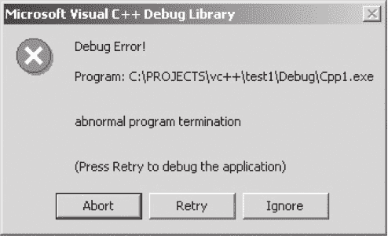

# 第 10 章 错误与异常处理

如果此断言不能满足你的需求，或者你希望程序在断言失败后继续运行，你需要定义自己的断言。然而，如果你只是使用 `assert` 宏来调试程序，那么通常没问题。

你可以使用断言来确保你没有越界访问数组。你还可以在函数开头使用它们来确保用户正确应用了函数，并使用它们来验证你不确定是否正确的代码结果。

**图 10.1**

如果你的程序中出现断言失败，你将看到类似这样的对话框。它会显示执行文件的文件名和目录。

记住，你使用断言是为了调试代码，因此在发布程序或将其交给他人使用之前，务必移除所有断言。（你的程序用户不需要知道代码文件第 675 行发生了断言失败。）如果你想在发布程序时处理程序中发生的意外错误，请使用异常处理。

### 处理异常

当你编写不是完整程序的代码（例如类或一组函数）时，你的代码可能会发生意外错误。你不能总是依赖预期的值，也无法总是假设代码的用户知道自己在做什么。

一段优雅的代码会在这类情况发生时防止程序崩溃。让代码变得“优雅”的一种方法是使用异常处理，它使你能够管理程序中的非常规情况。

通过异常处理，你实际上可以防止不可预测的发生和特殊事件。异常意味着你的代码某部分无法执行被要求的任务。异常处理允许你尝试另一种方法来完成任务，或尝试修复问题。

异常的发生是因为一段代码抛出了异常。意外事件（或异常）的一个例子是计算机硬盘空间不足。然而，硬盘空间不足并不意味着程序一定会崩溃或在任务上完全失败。你可以通过指定程序捕获特定异常来编写处理此类异常的代码。

为了捕获异常，你必须使用 `try-block`（try 块）。`try-block` 是开头带有 `try` 关键字的代码段。该关键字用于跟踪是否抛出了异常。`try-block` 的语法如下：

```
try { someCode }
```

使用 `try-block` 告诉计算机，该块内部的代码可能会抛出异常，所以请注意。

在建立 `try-block` 后，可以使用它来捕获异常。你通过使用 `catch` 语句来实现。`catch` 语句的语法如下：

```
catch(exceptionName) { whatToDo }
```

这里的 `exceptionName` 是异常的名称。当 `try` 块内部的代码抛出异常时，计算机会开始执行 `catch` 语句内部的代码。为了让 `catch` 语句与 `try` 语句连接，`catch` 语句必须紧跟在 `try` 语句之后。你不能在它们之间放置任何代码：

```cpp
try
{
    someCode
}
catch (exceptionName)
{
    whatToDo
}
```

你可以在 `try` 语句后放置任意数量的 `catch` 语句：

```cpp
try {
    someCode
}
catch (exceptionName1)
{
    whatToDo1
}
catch (exceptionName2)
{
    whatToDo2
}
```

第 10 章 • 错误与异常处理

当抛出异常时，相应的 `catch` 语句会被调用。

异常是使用 `throw` 语句抛出的。其语法如下：`throw exception;`

这里的 `exception` 是异常本身。`exceptionName`（来自 `catch` 语句）是一个类型的名称——任何类型。它可以是 `int`、`char*` 或 `string`。事实上，它非常像函数参数，不同在于它不需要变量名。

`exception` 必须是一个表达式。使用 `throw` 语句就像调用函数。将所有的 `catch` 语句想象成一个重载函数。根据异常的类型，计算机可以决定哪一个 `catch` 语句是最合适的（如果有的话）。

这里是一个示例：

```cpp
#include<iostream>

using namespace std;

int main (void)
{
    try
    {
        int x = 10;
        if (x == 10)
            throw x;
    }
    catch(int x)
    {
        cerr << "Oh No! x equals " << x << "!!!!";
    }
    catch(float f)
    {
        cerr << "How did I get here?";
    }
    return 0;
}
```

在前面的示例中，变量 `x` 被初始化为 `10`。然后程序检查 `x` 是否等于 `10`，如果是，则抛出一个异常。这显然是一个没有意义的例子，但它说明了我们的观点。

`catch` 语句的 `exceptionNames` 不仅仅是类型名。它包含变量声明，因为 `catch` 语句的作用与函数完全相同。`x` 的值（`10`）被传递给 `catch` 语句，以便 `catch` 语句能够正确处理错误（如果 `catch` 语句知道错误是什么会有帮助）。

此外，尽管有两个 `catch` 语句，计算机利用函数重载的规则判断出了哪一个是正确的调用语句。

使用内置数据类型作为异常通常不是一个好主意。当抛出一个整数时，你无法准确判断错误具体是什么。你可能假设错误与整数的值有关，但你无法确定。

幸运的是，有一种标准方法来传递此类信息。通常，你为每种异常定义一个新类型。这里是一个示例：

```cpp
class FileError {};
```

注意这个类是完全空的吗？这是因为类内部不需要任何内容。该类仅仅是为了它的名称而使用的。这里是如何使用它的示例：


进入`/path/to/xxx`目录，找到`xxx.json`。

在表达式`cvar = avar + bvar`中，加法运算符（`+`）将`avar`与`bvar`相加，得到它们的和`cvar`。

在`List.of(arg0, arg1, arg2)`中，`List`接口的工厂方法`of()`接受一系列的元素，返回包含它们的只读列表。

之后我们这样调用`cmd`命令：`cmd arg0 arg1 arg2`。

```
if (condVar > someVal) {console.log("xxx")}
```

---

```cpp
#include <iostream>
#include <istream>
#include <fstream>

using namespace std;

class FileError {};

int main (void)
{
    try
    {
        char* filename = "hello.txt";
        fstream file;
        file.open(filename, ios::in);
        if (!file.is_open())
            throw FileError();
    }
    catch (FileError)
    {
        cerr << "Error with file.";
    }
    return 0;
}
```

如果你的代码抛出一个未被捕获的异常（没有相应的`catch`语句），计算机将决定如何处理。遗憾的是，计算机并不宽容。它认为处理异常的最佳方法是立即关闭程序。为了这样做，计算机调用`terminate()`或`unexpected()`函数；这两个函数都包含在`<exception>`中。

此外，两者都没有参数也没有`void`返回类型。要查看调用这些函数时会发生什么，请编译并运行以下程序：

```cpp
int main (void)
{
    throw 5; //任意值
    return 0;
}
```

你可能注意到显示的错误信息与`abort()`函数完全相同。这是因为`terminate()`调用了`abort()`。你也可以通过调用`set_terminate()`函数让`terminate()`调用一个自定义函数。其声明如下：  
`typedef void (*terminate_function)();`  
`terminate_function set_terminate(terminate_function term_func);`

这个声明看起来非常复杂，但你只需要将函数名作为参数传递。这里是一个示例：

```cpp
#include <exception>
#include <iostream>

using namespace std;

void error_handler()
{
    cerr << "There was an uncaught error.";
}

int main (void)
{
    set_terminate(error_handler);
    throw 5;
    return 0;
}
```

输出：

```
There was an uncaught error.
```

### 构建异常层次结构

如果你在一个大型程序中使用非常具体的异常，你很快就会拥有数量多到无法管理的异常。在每个`try`块后放置大量的`catch`语句充其量是令人烦恼的。你很容易忘记包含其中一个，从而导致相当大的问题。坦率地说，随着编程的进行，你将发现解决这一问题的技术。

然而，一种常见的方法是使用继承（更多信息请参阅第 8 章“引入继承”）。如果你建立一个异常层次结构，你就可以处理最通用的异常，而不是具体的。或者你可以对某些异常非常具体，对另一些异常非常通用。这赋予了你灵活性来设计程序，使其适应任何情况。

这里是这样一种层次结构的示例：

```cpp
class MathError {};
class DivideByZero : public MathError {};
class Overflow : public MathError {};
```

```cpp
#include <iostream>
using namespace std;

int divide(int a, int b);

int divide(int a, int b)
{
    if (b == 0)
    {
        throw DivideByZero();
        return false;
    }
    return a/b;
}

int main (void)
{
    try
    {
        if (!divide(5,0))
            throw MathError();
    }
    catch(DivideByZero)
    {
        cerr << "Whoops! You tried to divide by zero";
    }
    catch (MathError)
    {
        cerr << "There was an math error.";
    }
    return 0;
}
```

输出：

```
Whoops! You tried to divide by zero
```

在这里你可以看到，如果你尝试除零，会抛出`DivideByZero`异常；如果有其他问题，就会抛出通用的`MathError`。这个示例还说明了另一个重要点。如果你在`try`块中调用函数且该函数抛出错误，`try`块可以捕获它。

### 捕获所有异常

你可以捕获程序中所有可能的异常，使其几乎不会崩溃。这样做需要使用可以处理任何尚未处理异常的`catch`语句。不是使用异常类型作为`catch`语句的参数，而是使用省略号（`...`）。当计算机搜索处理异常的`catch`语句时，将将其作为最后的手段（如果你包含了它的话）。其语法为：`catch(...) { 处理异常 }`

这里是如何可能使用默认`catch`语句的示例：

```cpp
#include <iostream>
using namespace std;

int main (void)
{
    try
    {
        throw 6;
    }
    catch(...)
    {
        cerr << "There was an exception, but it was caught!";
    }
    return 0;
}
```

输出：

```
There was an exception, but it was caught!
```

如果你将此版本的`catch`语句与其他`catch`语句一起使用，它必须位于列表的末尾。如果不是，默认`catch`语句之外任何后续`catch`语句将永远没有被调用的可能。然而，如果默认`catch`语句位于`catch`语句列表的末尾，它将仅作为最后的手段。

第 10 章 • 错误与异常处理 · 273

### 创建雷区游戏

你是苏联精锐团队`XJ77`的成员。你被派往去拆除一个致命的雷区。

这项工作极其危险。只有最优秀、最聪明的人才能在雷区中活过一天。编译这个程序，看看你是否具备这种能力。

```cpp
//10.2 - MineField - Mark Lee

#include <iostream>
#include <exception>
#include <string>
#include <vector>
#include <cstdlib>
#include <ctime>

using std::string;
using std::vector;
using std::srand;
using std::time;

class StepOnMine {};
class FailedDisarm {};

class MineField
{
    vector<bool> minefield;
    // 存储玩家去过的地方
    vector<bool> beenThere;
    // 玩家当前位置
    int location;

    int menu(string choices[], int numChoices) {
        using std::cout;
        using std::cin;
        int choice;
        do {
            for (int i = 0; i < numChoices; i++) {
                cout << i+1 << ") " << choices[i] << "\n";
            }
            cin >> choice;
        } while (choice < 1 || choice > numChoices);
        return choice;
    }

public:
    MineField() // 4x4 雷区
    {
        srand((unsigned int)time(0));
        location = 0;
        for (int c = 0; c < 16; c++) {
            minefield.push_back(false);
            beenThere.push_back(false);
        }
        for (int i = 0; i < 10; i++) // 放置 10 处随机地雷
            minefield[rand()%15+1] = true;
        beenThere[0] = true;
    }

    bool IsAMine(int location) {
        return minefield[location];
    }

    string draw() {
        string s;
        for (int i = 0; i < 4; i++) {
            for (int c = 0; c < 4; c++) {
                if (location == i*4+c)
                    s += 'P';
                else {
                    if (beenThere[i*4+c])
                        s += "X";
                    else
                        s += " ";
                }
                s += "|";
            }
            s += '\n';
        }
        return s;
    }

    bool moreMines() {
        for (int i = 0; i < 16; i++)
            if (!beenThere[i])
                return true;
        return false;
    }

    int Directions() {
        string options[4];
        options[0] = "North";
        options[1] = "East";
        options[2] = "South";
        options[3] = "West";
        return menu(options, 4);
    }

    int& place() { return location; }
    void goThere(int place) { beenThere[place] = true; }
};

void Detonate() {
    using std::cout;
    cout << "你引爆了地雷。砰——！！！\n";
}

void disarm() {
    int temp = rand()%2+1;
    if (temp == 1)
        throw FailedDisarm();
}

int main (void) {
    using std::set_terminate;
    using std::cout;
    using std::cin;
    set_terminate(Detonate);
    MineField m; // 创建雷区
    string input;
    cout << "欢迎来到雷区！！\n"
         << "你是苏联精锐地雷小组 "
         << "XJ77 的成员，被派去清理一个布满"
         << "远程热感应马蹄雷的致命雷区。\n"
         << "你们团队的大多数将无法生存。\n"
         << "只有你们中最优秀的人才能看到这一"
         << "天的结束。你具备这种能力吗？\n";
    cin >> input;
    if(input == "no" || input == "No")
        goto TOO_BAD;
    cout << "你现在位于西北角。\n";
    PLAY:
    try {
        int goTo;
        while(m.moreMines()) {
            cout << endl << m.draw();
            cout << "你的位置用 P 标记。\n"
                 << "你想往哪个方向走？" << endl;
            bool proper = false;
            do {
                goTo = m.Directions();
                if (goTo == 1 && m.place() > 3)
                    proper = true;
                if (goTo == 2 && (m.place()-3)%4 != 0)
                    proper = true;
                if (goTo == 3 && m.place() < 12)
                    proper = true;
                if (goTo == 4 && m.place()%4 != 0)
                    proper = true;
                if (!proper)
                    cout << "\n你不能往那个方向走。\n";
            } while (!proper);
            if (goTo == 1)
                m.place() -= 4;
            if (goTo == 2)
                m.place()++;
            if (goTo == 3)
                m.place() += 4;
            if (goTo == 4)
                m.place()--;
            m.goThere(m.place());
            if (m.IsAMine(m.place()))
                throw StepOnMine();
        }
    } catch(StepOnMine) {
        int input;
        do {
            cout << "\n你遇到了地雷。\n"
                 << "你想做什么？\n"
                 << "[1]尝试拆除它。\n"
                 << "[2]逃跑。\n";
            cin >> input;
        } while(input < 1 || input > 2);
        if (input == 1) {
            try {
                disarm();
            } catch(FailedDisarm) {
                terminate();
            }
            cout << "你拆除了地雷！！！\n";
            goto PLAY;
        }
        cout << "你辜负了 XJ77 团队。\n";
        goto TOO_BAD;
    }
    return 0;
    TOO_BAD:
    cout << "\n也许明年吧，孩子。\n";
    return 0;
}
```

## 总结

这一章虽然很短，但非常重要。即使是最高先进的程序员也经常忽略本章的概念，而且异常处理确实没有为你的程序增加功能。然而，异常处理能让你的程序更加稳定，如果你想从一名优秀的程序员变为一名卓越的程序员，我们强烈建议你养成使用它的习惯。


第 10 章 • 错误与异常处理 · 279

## 挑战

1. 关键字`try`的作用是什么？
2. 异常层级结构的目的是什么？
3. 如何设计你的程序使其不会崩溃？
4. 异常的定义是什么？
5. 在程序开发的哪个阶段你应该使用`assertions`（断言）？

*本页留白*

---

## 第 11 章

## 创建海盗冒险

最后一章了！如果你是从这本书的开头开始读的，亲爱的读者，你已经走了很远。这一章将向你展示如何应用前面章节中的所有信息来设计一个电脑游戏。在本章中，你将找到基础游戏引擎的代码。你将使用 GDK，这是一个随 Visual Studio Express 附带的游戏开发工具包。作为一名新程序员，由你来开发这些代码使其成为你自己的并制作出一个功能完整的游戏。祝运！

在本章中，你将学习到以下内容：


# 游戏全局变量声明

# 创建表示船的 `Ship` 类

# 创建游戏骨架

# 在屏幕上移动船

# 将游戏绘制到屏幕上

# 进入游戏中的城镇


282

C++ 入门级编程，第二版

## 介绍 Dark GDK

为了编写图形化电脑游戏，一个人需要掌握许多我们没有教过的编程技能。其中许多内容的细节超出了本书的范围，但幸运的是，有一个名为 GDK 的可用库提供了我们所需的所有功能。该库可以从以下网址免费下载：`http://www.microsoft.com/express/samples/gamecreators/default.aspx`

[`www.microsoft.com/express/samples/gamecreators/default.aspx`](http://www.microsoft.com/express/samples/gamecreators/default.aspx)

**图 11.1**

创建一旦你成功安装了 Dark GDK，你就可以创建 Dark GDK 项目，如图 11.1 所示。下面是“Dark GDK – 2D Game”项目的代码：

```cpp
// Dark GDK - The Game Creators - www.thegamecreators.com(http://www.thegamecreators.com)
// 向向为你创建了一个使用 GDK 的非常简单的 2D 项目
// 它可以作为制作你自己的 2D 游戏的起点
// 每次使用 Dark GDK 时，你必须确保包含头文件

// 应用程序的主入口点是这个函数

#include "DarkGDK.h"
```

```cpp
void DarkGDK ( void )
{
// 在此应用程序中，加载一个背景，然后在屏幕上显示
// 若干个动画精灵
// 在启动 Dark GDK 程序时，设置全局
// 应用程序属性是有用的，我们首先开始开启同步率，
// 这意味着我们控制屏幕更新的时机，我们还设置了
// 最大率为 60，这意味着最大帧率将
// 被设定为每秒 60 帧
dbSyncOn();

dbSyncRate(60);

// 调用此函数是为了停止 GDK 响应 escape 键（退出键），
// 然后我们可以在主循环中添加一些代码，
// 以便控制按下 escape 键时会发生什么 dbDisableEscapeKey();

// 现在我们将随机种子值设置为计时器，这可以
// 帮助我们在每次运行程序时获得更多的随机值
dbRandomize(dbTimer());

// 我们将为该场景显示一个背景，为了做到这一点，
// 我们加载图像并赋予它一个 ID 号 1。这张特定的
// 图像是一张带有星星的夜空
dbLoadImage("backdrop.bmp", 1);

// 下一步是创建一个使用该图像的精灵，这
// 通过调用 dbSprite 并为精灵 ID 传入值 1，为 X 坐标传入 0，为 Y 坐标传入 0，
// 为图像传入值 1 来
dbSprite(1, 0, 0, 1);

// 接下来我们将加载一些动画精灵，在此之前
// 我们需要调整图像颜色键，通过使用此函数，
// 我们可以让特定颜色变为透明。在我们的案例中，我们希望
// 它是亮粉色
dbSetImageColorKey(255, 0, 255);

// 在此循环中，我们将创建一些动画精灵，我们加载
// 的图像包含了小行星的动画帧
for (int i = 2; i < 30; i++)
{
// 创建一个动画精灵并赋予它来自变量
// i 的 ID 号，接下来是文件名，现在我们讨论横向和
// 向的帧数，在我们的案例中是 4，最后是
// 精灵将使用的图像 ID，我们再次使用 i
dbCreateAnimatedSprite(i, "sprite.bmp", 4, 4, i);

// 将我们的精灵放置在随机位置
dbSprite(i, dbRnd(640), -dbRnd(1500), i);
}

// 现在我们进入主循环，我们调用 LoopGDK 以便 GDK 可以
// 执行一些内部工作
while (LoopGDK())
{
// 遍历所有的精灵
for (int i = 2; i < 30; i++)
{
// 将精灵向下并播放它的动画
// 从第 1 帧到第 16 帧，延迟为 60 毫秒
dbMoveSprite(i, -2);
dbPlaySprite(i, 1, 16, 60);

// 检查精灵的位置，如果它超出了屏幕
// 则将其重新置回顶部
if (dbSpriteY(i) > 500)
dbSprite(i, dbRnd(640), -dbRnd(1500), i);
}

// 在这里我们检查是否按下了 escape 键，如果按了
// 我们将跳出循环
if (dbEscapeKey())
break;

// 在这里我们调用来更新屏幕内容
dbSync();
}


// 当用户按下 escape 时，代码将跳到此位置
// 我们可以释放任何之前分配的资源
// 删除所有精灵
for (int i = 1; i < 30; i++)
dbDeleteSprite(i);

// 删除背景图像
dbDeleteImage(1);

// 现在一切都准备好返回 Windows 了
return;
}
```

## 理解代码

这段代码虽然满满了有用的注释，但初看之下可能会让人感到无从下手。但不要放弃希望！到本章结束时，这段代码看起来将会非常自然。

所以，勤奋的读者，你应该做的第一件事是编译并运行这段代码，看看它确切做了什么。记住要从创建一个“Dark GDK – 2D Game”项目开始。运行中的程序如图 11.2 所示。

**图 11.2**

小行星示例 Dark GDK 程序。

## 代码结构

现在，让我们开始拆解这段代码来弄懂它。你首先会注意到的是完全缺少`main()`函数。在使用 Dark GDK 时，与其使用`main()`，你必须创建一个`DarkGDK()`函数。该函数没有参数且返回值为`void`。此程序中的所有代码都包含这一个函数中，这些代码可以分为三部分：初始化、主循环和清理。

### 初始化

初始化是这三个部分中最长的。它包含了从`DarkGDK()`函数开始到这些行之间的内容：

```cpp
// 现在我们进入主循环，我们调用 LoopGDK 以便 GDK 可以
// 执行一些内部工作
while (LoopGDK())
```

初始化部分的第一步是以下两行：`dbSyncOn();` `dbSyncRate(60);`。

Dark GDK 提供的每个函数都以前缀`db`开头。这是为了确保函数名称不会与你自己的任何名称冲突；类似于 C++ 标准库使用`std`命名空间的方式。

这两行代码设置了最大帧率。对于图形类电脑游戏，控制事物发生的速率是非常重要的，因为在现代计算机上，如果事物只是以尽可能快的速度运行，它们可能会变得太快。这里的帧率被设置为 60。这意味着屏幕上的图像每秒（最多）将更新 60 次。

默认情况下，Dark GDK 程序将通过立即退出来响应 escape 键。通常你希望在退出之前执行某些操作，或者你想将 escape 键用于其他用途。调用`dbDisableEscapeKey()`会禁用 GDK 的默认操作。

C++ 标准库提供了生成随机数的功能，但 Dark GDK 提供了自己的。就像你使用`srand()`为标准库随机生成器种子一样，你使用`dbRandomize()`为 Dark GDK 随机生成器种子。使用`dbTimer()`作为种子值就像使用`time()`。

### 图像与精灵

现在我们到了激动人心的部分！调用`dbLoadImage()`从图像文件中读取背景以准备好显示。该函数接受两个参数：图像的文件名和你分配的 ID 号。你必须记住这个数字，以便在后的代码中引用该图像。


说到这里，加载的图像在紧接着的一行中被使用了。为了在屏幕上显示图像，我们必须先将其加载到“精灵”（sprite）中。Dark GDK 中的精灵是一个可以在屏幕上显示的二维图像。当我们创建一个精灵时，我们赋予它一个 ID 和一个位置。位置指的是图像的左上角，由于这是整个屏幕的背景，它被设置为屏幕的左上角，或 (0,0)。图像 ID 被用第四个参数来引用之前加载的图像文件。

使用`dbSetImageColorKey()`函数，你可以让某种颜色显示为透明。这是一种将方形图像文件转换为例如屏幕上小行星形状图像的方便方法。

### 动画

最后一步是在随机位置创建 28 个小行星精灵。这些精灵与背景的不同之处在于它们是动画的。看看图 11.3 以创建这些精灵的图像文件。如你所见，所有的动画帧都存储在同一个文件中。不要使用`dbLoadImage()`，使用`dbCreateAnimatedSprite()`来加载动画精灵的图像。你必须提供每行的动画帧数和列数。尽管精灵是通过此函数调用创建的，但我们仍然必须调用`dbSprite()`来赋予这个精灵一个位置。`dbRnd()`用于为精灵的位置创建随机值。

**图 11.3**

小行星精灵的图像文件。

现在一切都初始化完毕，是时候进入主循环了。该循环的结构如下：

```cpp
while(LoopGDK())
{
    ...
}
```

调用`LoopGDK()`会执行所有必要的内部操作，仅在程序准备退出时返回 0。此循环中包含的所有代码每帧执行一次。

主循环中执行的第一件事是遍历所有的小行星精灵（sprites）并让它们向下移动。这是通过`dbMoveSprite()`函数实现的。此外，使用`dbPlaySprite()`函数以每秒 60 帧的速度自动循环所有动画帧。当某个特定的小行星精灵经过屏幕底部时，它的位置将被重置为新的随机位置。

每一帧，都会使用`dbEscapeKey()`检查是否按下了 escape 键。如果按了，我们将跳出主循环，从而有效结束程序。

最后，调用`dbSync()`根据主循环中之前执行的所有更改来更新屏幕。

当程序结束时（无论是用户按下 escape 键还是关闭窗口），我们都会进入清理阶段。在这里，通过简单地调用`dbDeleteSprite()`释放所有精灵的资源。最后，通过调用`dbDeleteImage()`卸载加载的图像文件。

表格 11.1 总结了章中我们将使用的所有 Dark GDK 函数。

### 表 11.1：重要的 Dark GDK 函数

| 函数名称 | 用途 |

| :--- | :--- |

| `DarkGDK()` | 替换`main()`函数。 |

| `dbSyncOn()` | 设置最大帧率。 |

| `dbSyncRate()` | 设置最大帧率。 |

| `dbSetDisplayMode()` | 设置屏幕上的像素数。 |

| `dbMaximizeWindow()` | 最大化显示。 |

| `dbSetWindowOff()` | 退出窗口模式进行全屏显示。 |

| `dbDisableEscapeKey()` | 禁用 Dark GDK 对 escape 键的默认处理。 |

| `dbRandomize()` | 为随机数生成器种子。 |

| `dbTimer()` | 返回当前时间。 |

| `dbSetImageColorKey()` | 设置被视为透明的颜色。 |

| `dbLoadImage()` | 从文件加载图像。 |

| `dbCreateAnimatedSprite()` | 从文件加载一组动画帧。 |

| `dbSprite()` | 创建精灵或赋予其一个新位置。 |

| `dbSetSpritePriority()` | 用于控制哪些精灵在屏幕上方的。 |

| `dbHideSprite()` | 禁用精灵的可见性。 |

| `dbShowSprite()` | 启用精灵的可见性。 |

| `dbRnd()` | 返回一个随机数。 |

| `LoopGDK()` | 用于实现主循环。 |

| `dbMoveSprite()` | 将指定的精灵向上或向下移动距离。 |

| `dbPlaySprite()` | 自动循环动画帧。 |

| `dbSetSpriteFrame()` | 将精灵更改为指定的动画帧。 |

| `dbEscapeKey()` | 如果按下 escape 键返回 true。 |

| `dbReturnKey()` | 如果按下回车键返回 true。 |

| `dbLeftKey()` | 如果按下左箭头键返回 true。 |

| `dbRightKey()` | 如果按下右箭头键返回 true。 |

| `dbUpKey()` | 如果按下上箭头键返回 true。 |

| `dbDownKey()` | 如果按下下箭头键返回 true。 |

| `dbSync()` | 更新显示。应每帧调用一次。 |

| `dbDeleteSprite()` | 销毁指定的精灵。 |

| `dbDeleteImage()` | 销毁指定的图像。 |

## 游戏概述

当你设计游戏时，我们建议先创建图形，因为图形有助于赋予游戏外形。毕竟，什么更令人兴奋呢？是盯着一个只运行着“在此处插入标题界面”字样的屏幕看六小时，还是看着你苦心创作的精美标题界面？一旦你准备好了几张图形，就可以用它们来测试代码是否有效。

在“海盗探险”游戏中，你将使用 11 个屏幕：标题界面（在游戏开始前显示）、玩家进入城市时显示的城市界面，以及 9 个用于游戏地图的屏幕。

这个游戏引擎的基本思想是你沿着地图在加勒比海航行。

地图将分为 9 个部分（9 个正方形组成一个 3x3 的网格）。每个部分的大小都是电脑屏幕的大小（800 x 600）。这 9 个部分中的每一个都将分成一个独立的位图文件（`.bmp`），名称从`map1.bmp`到`map9.bmp`不等，分别如图 11.4 至 11.12 所示。

* **图 11.4**：地图的西北角显示美国南部，包括佛罗里达州。

* **图 11.5**：底部带有新普罗维斯（New Providence）的大面积海域是地图的上中部分。

* **图 11.6**：新荷兰（一个虚构城市）位于地图右上部分的中间。

* **图 11.7**：地图 1 正下方是地图的左左部分，显示了伯利兹。

* **图 11.8**：地图的正中心显示了一个繁荣的区域，有许多城市。

* **图 11.9**：地图 3 正下方、地图 5 旁边是地图的右右部分。

* **图 11.10**：地图左下角有很多土地，但城市很少。

* **图 11.11**：在地图的中下部分你可以看到圣玛丽亚和卡塔赫纳。

* **图 11.12**：在地图的右下角你可以单独看到加拉加斯。

为了看起来像一个专业游戏，“海盗探险”需要一个标题界面。标题界面通常显示游戏的标题（在大多数游戏中，标题界面是你可以开始新游戏的地方）。标题界面（图 11.13 显示了“海盗探险”）一直显示到按下回车键，然后“海盗探险”开始。

最后，城市界面（见图 11.14）每当玩家进入城市时显示。这为游戏增加了变化。玩家并不总是处于同一个屏幕上。

现在你已经有了屏幕上的背景，可以将注意力转向船只的图形。在这个游戏引擎中，只有一条船（玩家），但你可以轻松地复用第一只船的图形并在屏幕上创建第二只。因为船只向四个方向移动，你只需要四张船的图像，每个方向一张。幸运的是，所有图像都足够小，可以放入一张图中。当你需要时，只需复制图像的该部分。每张船的图片称为一个动画帧。船图像文件见图 11.15。由于船必须无缝地停留在地图屏幕上，它的背景需要是透明的。

### 编写游戏引擎

现在你已经处理好了所有的图形，是时候开始编程了。第一件事的是创建一个新的“Dark GDK – 2D Game”项目，命名为“海盗探险”。你需要将所有图像复制到项目文件夹中，与你的代码放在一起。

由于`Dark GDK`与 C++ 标准库的兼容性良好，我们必须进行一项额外的更改。在`Solution Explorer`（解决方案管理器）中右键点击项目名称，并选择`Properties`（属性）。见图 11.18。

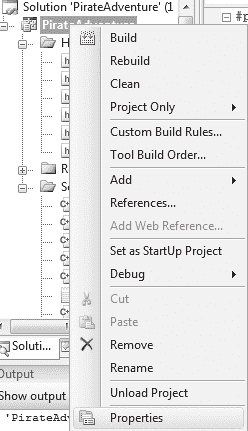

**第 11 章 • 创建海盗冒险**

**297**

**图 11.18**

编辑项目属性。

接下来，在`Configuration Properties`（配置属性）下选择`C/C++`，然后`Code Generation`（代码生成）。想要更改的设置是`Runtime Library`（运行库）。你需要将其从`Multi-threaded Debug (/MTd)`改为`Multi-threaded (/MT)`。见图 11.19。

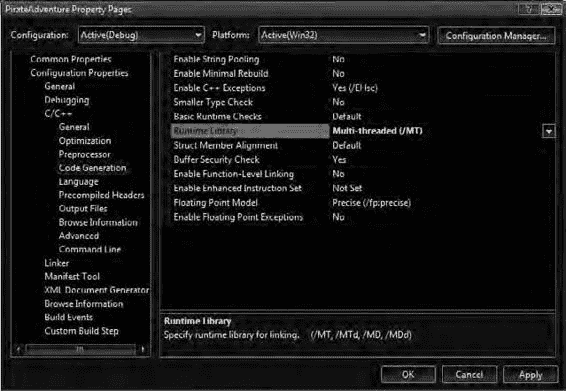

**298**

**《初学者 C++ 编程》，第二版**

**图 11.19**

让 Dark GDK 与 C++ 标准库兼容。

然后你可以继续逐个添加以下代码文件。你可以在后续章节中找到完整游戏引擎的列表。

### 存储位置

在整个游戏引擎中，我们需要一种存储位置的方法。由于屏幕上或地图上的位置都具有水平 (x) 和垂直 (y) 分量，单单整数是不够的。我们将创建一个新类来存储位置，称为`Point`。`Point`类的声明存储在`Point.h`中，实现存储在`Point.cpp`中。

```cpp
//Point.h
#pragma once
#include <istream>
using std::istream;

class Point
{
int m_x, m_y;
public:
Point(int x, int y) : m_x(x), m_y(y) {}
Point(istream& input);
int x() { return m_x; }
int y() { return m_y; }
Point operator+(const Point& p);
};
```


```cpp
// Point.cpp
#include "Point.h"
Point::Point(istream& input)
{
input >> m_x >> m_y;
}

Point Point::operator+(const Point& p)
{
return Point(m_x + p.m_x, m_y + p.m_y);
}
```

`Point` 类有两个构造函数。一个只是直接设置 `Point` 的 `x` 和 `y` 分量，另一个则从输入流中读取它们。使用了两个访问器方法来获取点的 `x` 和 `y` 分量，分别命名为 `x()` 和 `y()`。

最后，重载了加运算符以允许两个 `Point` 对象相加。显而易见，此函数仅通过相加相应的 `x` 和 `y` 分量来创建一个新的 `Point` 对象。

## 创建船类

第一个文件是 `Ship.h`。这是 `Ship` 类的声明文件。该类的实际实现位于 `Ship.cpp` 中。

```cpp
//Ship.h
#pragma once
#include "DarkGDK.h"
#include "Point.h"

class Ship
{
static char* m_spriteFileName;
static const int m_numFramesAcross = 4;
static const int m_numFramesDown = 1;
static const int m_spriteID = 1;
static const int m_imageID = 1;
public:
Ship();
void show(Point theLoc);
void hide();
void moveLeft();
void moveRight();
void moveUp();
void moveDown();
~Ship();
};
```

```cpp
// Ship.cpp
#include "Ship.h"
char* Ship::m_spriteFileName = "sprites.png";
Ship::Ship()
{
dbCreateAnimatedSprite(m_spriteID, m_spriteFileName, m_numFramesAcross, m_numFramesDown, m_imageID);
dbSprite(m_spriteID,0,0,m_imageID);
dbSetSpritePriority(m_spriteID, 1);
this->hide();
}

void Ship::show(Point theLoc)
{
dbSprite(m_spriteID, theLoc.x(), theLoc.y(), m_imageID);
dbShowSprite(m_spriteID);
}

void Ship::hide()
{
dbHideSprite(m_spriteID);
}

void Ship::moveLeft()
{
dbSetSpriteFrame(m_spriteID,3);
}

void Ship::moveRight()
{
dbSetSpriteFrame(m_spriteID,1);
}

void Ship::moveUp()
{
dbSetSpriteFrame(m_spriteID,4);
}

void Ship::moveDown()
{
dbSetSpriteFrame(m_spriteID,2);
}

Ship::~Ship()
{
dbDeleteSprite(m_spriteID);
}
```

该类的构造函数使用 `dbCreateAnimatedSprite()` 函数加载船的精灵，给船一个随机位置，并隐藏船以用于标题界面。`dbSetSpritePriority()` 函数用于确保船始终绘制在前面。

`show()` 成员函数使用 `dbSprite()` 将船移动到指定位置，并使用 `dbShowSprite()` 在屏幕上显示船。`hide()` 成员函数简单调用 `dbHideSprite()` 以确保不显示船。这用于标题界面和城市界面。

`moveLeft()`、`moveRight()`、`moveUp()` 和 `moveDown()` 成员函数调用 `dbSetSpriteFrame()` 来改变船面对的方向。

最后，析构函数简单调用 `dbDeleteSprite()` 来销毁船的精灵。

## 创建城市类

该游戏引擎中共有 13 个城市，每个城市都有自己的名称、边界框和船的终位置。边界框定义了船必须进入以访问该城市的区域。终点位置是船离开城市后被设置的位置。`City` 类在 `City.h` 中声明，在 `City.cpp` 中实现。

```cpp
// City.h
#pragma once
#include <string>
#include "Point.h"
using std::string;

class City
{
string m_name;
Point m_topLeft;
Point m_bottomRight;
Point m_endLoc;
public:
City(string name, Point topLeft, Point bottomRight, Point endLoc);
bool isInside(Point thePoint);
Point endCoordinates();
string name();
~City();
};
```

```cpp
//City.cpp
#include "City.h"
City::City(string name, Point topLeft, Point bottomRight, Point endLoc) : m_name(name), m_topLeft(topLeft), m_bottomRight(bottomRight), m_endLoc(endLoc)
{
}

bool City::isInside(Point thePoint)
{
if (thePoint.x() < m_bottomRight.x() && thePoint.x() > m_topLeft.x() && thePoint.y() < m_bottomRight.y() && thePoint.y() > m_topLeft.y())
return true;
return false;
}

string City::name()
{
return m_name;
}

Point City::endCoordinates()
{
return m_endLoc;
}

City::~City()
{
}
```

这个类非常简单。实际上唯一具有复杂的函数是 `isInside()` 成员函数，它测试一个位置是否位于城市内。如果提供的位置在 `City` 对象的边界框内，该函数返回 `true`，否则返回 `false`。

## 实现地图屏幕

整个地图被分为 9 个屏幕，每个屏幕都有自己的图像文件、精灵、位置和城市集合。`Screen` 类封装了这些屏幕的所有功能。它在 `Screen.h` 中声明，在 `Screen.cpp` 中实现。

```cpp
// Screen.h
#pragma once
#include "DarkGDK.h"
#include <vector>
#include <string>
#include <fstream>
#include "City.h"
using std::vector;
using std::string;
using std::ifstream;

class Screen
{
int m_spriteID;
int m_imageID;
string m_fileName;
Point m_topLeft;
vector<City*> m_cities;
ifstream m_mapFile;
public:
Screen(int spriteID, int imageID, string fileName, Point topLeft);
void addCity(string cityName, Point topLeft, Point bottomRight, Point endLoc);
Point topLeft() { return m_topLeft; }
void hide();
void show();
bool isLandCollision(Point thePoint);
City* isEnteringCity(Point thePoint);
~Screen();
private:
Screen(const Screen& rhs);
Screen& operator=(const Screen& rhs);
};
```

```cpp
// Screen.cpp
#include "Screen.h"
Screen::Screen(int spriteID, int imageID, string fileName, Point topLeft) : m_spriteID(spriteID), m_imageID(imageID), m_fileName(fileName), m_topLeft(topLeft)
{
char fileNameBuffer[500];
strcpy(fileNameBuffer,m_fileName.c_str());
dbLoadImage( fileNameBuffer, m_imageID );
dbSprite( m_spriteID, 0, 0, m_imageID );
this->hide();
m_mapFile.open(m_fileName.c_str());
}
```

```cpp
m_cities.push_back(new City(cityName, topLeft, bottomRight, endLoc));
}

void Screen::hide()
{
    dbHideSprite( m_spriteID );
}

void Screen::show()
{
    dbShowSprite( m_spriteID );
}

bool Screen::isLandCollision(Point thePoint)
{
    int green;
    int blue;
    m_mapFile.seekg(3 * (599 - thePoint.y()) * 800 + 3 * thePoint.x() + 54);
    // 306
    // C++ Programming for the Absolute Beginner, Second Edition
    blue = m_mapFile.get();
    green = m_mapFile.get();
    if (green < blue)
        return false;
    return true;
}

City* Screen::isEnteringCity(Point thePoint)
{
    for (int i = 0; i < m_cities.size(); i++)
    {
        if (m_cities[i]->isInside(thePoint))
            return m_cities[i];
    }
    return 0;
}

Screen::~Screen()
{
    for (int i = 0; i < m_cities.size(); i++)
    {
        delete m_cities[i];
        m_cities[i] = 0;
    }
    // delete the backdrop sprite
    dbDeleteSprite ( m_spriteID );
    // delete the backdrop image
    dbDeleteImage ( m_imageID );
    m_mapFile.close();
}
```

`Screen` 类的构造函数简单地调用了 `dbLoadImage()` 来加载地图图像文件，然后调用 `dbSprite()` 从其创建一个精灵（sprite）。这与我们在小行星游戏程序中处理背景时看到的步骤相同。请看以下几行代码：

**第 11 章 • 创建海盗探险**

**307**

```cpp
char fileNameBuffer[500];
strcpy(fileNameBuffer,m_fileName.c_str());
dbLoadImage( fileNameBuffer, m_imageID );
```

你可能会奇怪为什么我们不直接将 `m_fileName` 传递给 `dbLoadImage()`。首先，`dbLoadImage()` 接收一个 `char*`，而 `m_fileName` 是一个 `string`。此外，`c_str()` 成员函数返回的是 `const char*` 而普通的 `char*`，因此我们必须将其拷贝到一个新字符串以便传递给 `dbLoadImage()`。

成员变量 `m_mapFile` 是地图位图图像的文件流。我们在 `isLandCollision()` 成员函数中使用该成员变量来确保船只不会在陆地上行驶。

`addCity()` 成员函数将其参数传递给 `City` 构造函数，该构造函数被调用以在堆上创建一个新的 `City` 对象。指向此新 `City` 对象的指针存储在 `m_cities` vector 中。

`hide()` 和 `show()` 成员函数简单地调用 `dbShowSprite()` 和 `dbHideSprite()`，根据船只当前是否在该屏幕上来显示或隐藏地图的特定部分。

`isLandCollision()` 成员函数接收一个 `Point` 对象，如果地图在该位置是陆地而非水域，则返回 `true`。首先，文件流被定位到从文件中读取该确切位置。计算此位置的公式与位图的内部存储密切相关，但基本上，开头有 54 个字节是无关的，然后每个像素有 3 个字节，即红、绿、蓝三个值。我们读取绿色和 `blue` 值，并测试 `green` 是否小于 `blue`。如果是，则是水域。否则，必须是陆地。

`isEnteringCity()` 成员函数接收一个 `Point` 对象，如果该 `Point` 在城市内部，则返回指向 `City` 对象的指针。否则，它返回 `0`。该函数简单地遍历所有城市并调用 `isInside()` 成员函数。

析构函数遍历所有城市并释放它们，销毁精灵和图像，并关闭文件流。

## Game 类

`Game` 类将所有内容紧密结合在一起，存储所有的 `Screen` 对象并跟踪游戏状态。它在 `Game.h` 中声明，并在 `Game.cpp` 中实现。

```cpp
// Game.h
#pragma once
// 308
// C++ Programming for the Absolute Beginner, Second Edition
#include <sstream>
#include <fstream>
#include <istream>
#include "Screen.h"
#include "Ship.h"
#include "Point.h"
using std::stringstream;
using std::ifstream;
using std::getline;
using std::istream;

class Game
{
    int m_gameState;
    Ship m_theShip;
    vector<Screen*> m_theScreens;
    Screen* m_theScreens; // 注意：此处原文存在重复定义，按原文逻辑处理
    // ... (省略部分代码以保持逻辑一致)
```

*(注：由于提供的原文文本中代码部分存在重复，翻译已遵循不翻译代码原则)*

`toScreen()` 成员函数接收一个存储全局位置的 `Point` 对象，并返回该 `Point` 对象所在的 `Screen` 对象的指针。`toLocal()` 成员函数接收一个存储全局位置的 `Point` 对象并返回对应的本地位置。`toGlobal()` 成员函数接收一个 `Screen` 对象指针和一个存储本地位置的 `Point` 对象，并返回对应的全局位置。

`readCity()` 成员函数用于从城市文件中读取一个城市，创建一个对应的 `City` 对象，并将其添加到相应的 `Screen` 对象中。城市文件的内容所示：

```
New Orleans
90 100 190 150
140 160
Tampa
314
C++ Programming for the Absolute Beginner, Second Edition
460 310 530 365
440 330
New Providence
840 460 945 500
960 440
New Dutch Land
1950 150 2020 200
1930 175
Belize
20 980 90 1010
120 1000
Port-de-Paix
1220 945 1320 990
1270 920
Port-au-Prince
1235 1030 1320 1070
1180 930
Santiago
1360 940 1435 1000
1380 900
Santo Domingo
1485 1030 1580 1090
1420 1110
Prinzapolca
335 1530 460 1595
480 1550
Santa Marta
1250 1460 1370 1525
1230 1440
Chapter 11 • Creating the Pirate Adventure
315
Carthagena
1030 1630 1130 1705
1010 1610
Caracas
1960 1510 2010 1545
1980 1490
```

城市文件中的所有位置都是全局坐标，因此它们必须首先被转换为本地位置。


`Game`构造函数为介绍界面和城市界面创建精灵，为9个地图屏幕中的每一个屏幕创建一个`Screen`对象，在第一张地图屏幕上给船分配一个随机的非陆地位置，并从城市文件中读取所有城市。

游戏状态可以是三个值之一：1代表介绍界面，2代表主游戏阶段，3代表城市界面。`update()`成员函数检查当前状态并调用相应的成员函数来处理它。

`doIntroScreen()`成员函数简单地隐藏船，显示介绍界面，并等待按下回车键。一旦按下回车键，介绍界面隐藏并将游戏状态设置为2。

`doMapScreen()`成员函数处理游戏引擎的大部分工作。首先，隐藏当前屏幕并检查四个方向键中的每一个一个，以确定船应该向哪个方向移动。通过调用`moveLeft()`、`moveRight()`、`moveUp()`或`moveDown()`成员函数将船指向适当的方向，并存储移动方向。计算船的新位置，并检查其是否在城市内部或陆地上。如果新位置在城市内部，则游戏状态改为3。如果新位置在陆地上，船将不会移动。最后，更新船的位置并在新位置处绘制它。

`doCityScreen()`成员函数与`doIntroScreen()`成员函数几乎完全相同，不同在于当按下回车键时，船的位置被设置为从城市文件中读取的值。该值在使用之前，需要被转换回全局坐标。

## 创建游戏骨架

下一个文件是`main.cpp`。这是主文件，所有其他文件都包含在此（有关为你的类创建骨架的更多信息，请参阅第5章）。在此文件中，你找到了Dark GDK版本的主方法：`DarkGDK()`。

```cpp
// Main.cpp
// Dark GDK - The Game Creators - [www.thegamecreators.com](http://www.thegamecreators.com)
// 魔法师创建了一个使用 Dark GDK 的简单 2D 项目
// 它可以作为制作你自己的 2D 游戏的起点
// 每当使用 Dark GDK 时必须确保包含头文件

#include "Game.h"

// 程序的入口点是此函数
void DarkGDK ( void )
{
// 将显示设置为 800 x 600，32 位深度
dbSetDisplayMode ( 800 , 600 , 32 );
// 在启动 Dark GDK 程序时，设置全局
// 应用程序属性是有用的，我们首先开启同步率，
// 这意味着我们控制屏幕更新的时机，我们还设置了
// 最大速率 60，这意味着最大帧率将
// 设置为每秒 60 帧
dbSyncOn ( );
dbSyncRate ( 60 );
dbMaximizeWindow();
dbSetWindowOff();
// 调用此函数是为了停止 GDK 响应
// escape 键，然后我们可以在主循环中添加一些代码，
// 以控制按下 escape 键时发生的情况 dbDisableEscapeKey ( );
// 现在我们将随机种子值设置为计时器，这会
// 帮助我们每次运行程序时获得更多的随机值
dbRandomize ( dbTimer ( ) );

Game g;

// 现在我们进入主循环，我们调用 LoopGDK，以便 GDK
// 执行一些内部工作
while ( LoopGDK ( ) )
{
    g.update();
    if ( dbEscapeKey ( ) )
    break;
    dbSync();
}
}
```

由于`Game`类处理了大部分事情，这里没有太多需要做的操作。

```cpp
//it’s stored in the name variable
cin >> name;

//The program says hello and skips a line
cout << “Hello “ << name << “\n”;

//the user inputs the first number
cout << “Enter the first number to add together: “;
cin >> number1;

//the user inputs the second number

**322**

**C++编程入门，第二版**
cout << “Enter the second number: “;
cin >> number2;

// displays the sum of the two numbers
cout << ”the sum is “ << (number1 + number2) << “\n”; return 0;
}
```

### 4. 将10.3存储为整数会发生什么？0.6呢？你可以将–101.8存储为整数吗？

答案：C++会截断（移除）小数部分，使数字变为10、0和–101。

### 5. 编写代码，如果一个数字在1到100之间（包含1或100）且能被3整除，则将其乘以2；否则，如果它在1到100之间但不能被3整除，则乘以3；最后，如果它不在1到100之间，则将该数字乘以该数字模100的。（提示：使用嵌套的if语句）。答案：

```cpp
#include <iostream>

int main( void )
{
using std::cout;
using std::cin;
int number;
cout << “Enter a number” ;
cin >> number;
if (number >= 1 && number <= 100 && (number % 3 == 0))
{
number = number * 2;
}
else if (number >= 1 && number <= 100 && !(number % 3 == 0))
{
number = number * 3;
}
else if (!(number >= 1 && number <= 100))
**附录 A • 章节挑战答案**

**323**
{
number = number * number % 3;
}

cout << “The final result is “ << number << “\n”; return 0;
}
}
```

**324**

**C++编程入门，第二版**

**第 2 章**

### 1. 存储以下数据的正确变量类型是什么：

• 书架上书籍的数量

• 此书的费用

• 世界上的人口

• 单词Hello

答案：

• 好的方法可能是用`unsigned integer`（无符号整数）或`unsigned short`（无符号短整数）存储书架上的书籍数量，因为书架上不可能是负数或部分书籍籍。

• 使用浮点数据类型存储此书的费用，因为`float`可以让你同时存储美元和分。

• 使用`float`存储世界上的人口，因为`float`使用科学计数法存储数字，从而允许存储非常大的数字。

• 将单词Hello存储为`string`或字符数组。

### 2. 为第一个挑战中的变量提供有意义的变量名。

答案：你的变量标识符可以不同，但每个标识符都表达了变量的用途。这让其他程序员以及你能够理解你的代码。挑战1的示例变量标识符分别为`numOfBooks`、`bookCost`、`numOfPeople`和`helloString`。

### 3. 说出使用常量而不是字面量的两个原因。

答案：你只需要在声明常量的地方更改一个值，即可更改整个程序的值。此外，使用常量会让你的代码更具可读性。

### 4. 写一个程序计算并显示所有基本类型的大小。

答案：

```cpp
//显示基本变量类型的大小
#include <iostream>

int main( void )
{
**附录 A • 章节挑战答案**

**325**
using std::cout;
cout << “Here is the size of the fundamental variable types:”; cout << “\nint - “ << sizeof(int);
cout << “\nshort - “ << sizeof(short);
cout << “\nfloat - “ << sizeof(float);
cout << “\ndouble - “ << sizeof(double);
cout << “\nbool - “ << sizeof(bool);
cout << “\nchar - “ << sizeof(char);
cout << “\nThat is the size of the variable types.”
return 0;
}
```

### 5. 测试将字符声明为无符号（unsigned）会发生什么。你得到相同的结果吗？

答案：无论字符是否有符号，结果都是相同的。然而，当你尝试使用超过127的值时，ASCII表会变得反复无常。

**326**

**C++编程入门，第二版**

**第 3 章**

### 1. 写一个条件语句，如果y是偶数，则将x赋值给y。

答案：

```cpp
if (y == 0)
{
x = y;
}
```

### 2. 写一个while循环，计算从1到n的整数的和。

答案：

```cpp
int i = 0;
int sum = 0;
while(i n n)

ii

sum i i;}
```

### 3. 写一个if-else语句，如果x是奇数，则将x赋值给y；否则，将x赋值为0。

答案：

```cpp
if (x % 2 != 0)
{
x = y;
}
else
{
x = 0;
}
```

### 4. 写一个名为multiply的函数，将两个数字相乘并返回结果。答案：

```cpp
long multiply(int x, int y)
{
return x * y;
}
```

### 5. 修改你编写的函数，使其记住被调用了多少次。答案：

```cpp
int multiply(int x, int y)
{
static int staticMember;
staticMember++;
return x * y;
}
```

### 6. 全局变量和静态变量的区别是什么？什么情况下哪种更好？答案：两者都存在于整个程序中。区别在于作用域。你可以在地方访问全局变量，而只能在创建它的方法访问静态变量。因此，如果你在方法内部访问变量，静态变量更好。如果你需要在多个函数中访问变量，你应该使用全局变量。

### 7. 尝试重写“冒险游戏”使其不使用函数（这是一个关于函数的练习）。答案：你可以这样做；但将所有代码合并到一个函数中（称为面条式代码）会让代码变得混乱。相信我，函数是有用的！

**327**

**C++编程入门，第二版**

### 8. 如果你真的通过了最后一个问题，请给自己买杯冰乐。答案：买冰乐的五个步骤是：

1. 赚1.50元。

2. 跑到最近的便利店。

3. 记住，程序员不走路；开车去便利店。

4. 为冰乐付费。

5. 享受冰乐。

**附录 A • 章节挑战答案**

**329**

**第 5 章**

### 1. 创建一个可以表示游戏角色的类。存储角色的名称、类别和种族。答案：

```cpp
class Player
{
string name;
string charClass;
string race;

Player(string lname, string lclass, string lrace);
};

//使用初始化列表的构造函数
Player::Player(string lname, string lclass, string lrace)
: name(lname), charClass(lclass), race(lrace)
{
}
```

### 2. 解释面向对象编程（OOP）的三大原则。答案：这三大原则是：

• 数据抽象：隐藏并保护对象内部的数据。数据必须通过方法提取。

• 封装：将每个任务封装在单个对象中。

• 多态：每个对象可以在它使用的任何程序中完成其任务。这允许代码的可移植性和重用性。

### 3. 类和对象的区别是什么？答案：类是蓝图，而对象是蓝图的实例。

类就像一个模板，它告诉计算机如何创建东西。声明一个类本质上是在告诉编译器：“这是一个新的数据类型，这就是它所能做的事情。”类类似于一个尚未调用的函数。对象是类的实例；基本上，你是取了类并根据它创建了东西。对象占用内存空间，而类不占用。

### 330

**初学者 C++ 编程，第二版**

#### 4. 如果在不丢失功能的情况下需要在声明公共（public）、私有（private）、全局（global）或局部（local）之间选择，你应该选择哪个作用范围？

**答案：**

选择局部（local），因为它比任何其他范围都能在更小的作用范围内保护数据。这符合面向对象编程（OOP）的数据抽象原则。

#### 5. 构造函数和析构函数具有哪些属性是其他函数不具备的？

**答案：**

- 构造函数和析构函数都不能返回值。

- 析构函数不能有参数。

- 析构函数是唯一以波浪号（~）开头的函数。

- 构造函数和析构函数的名称与对象的名称相同。

### 附录 A • 章节练习

**331**

## 第 6 章

#### 1. 字符串“Hello World”的大小有多大？名为`s`的数组长度是多少？

```cpp
char s[] = “Hello World”;
```

**答案：**

字符串“Hello World”的大小为12字节。这是因为每个字母字符都需要1字节，加上一个空格和字符串末尾的终止字符，导致数组长度为12。但请记住，数组索引仅从0扩展到11。

#### 2. 列出使用指针的五个理由。

**答案：**

可能的用途包括：

- 指针可以让你访问数组中的特定索引（索引）。

- 指针可以允许你传递数据值的引用，而不是传递数据本身。

- 指针是使用动态内存的基础。

- 指针是访问二进制文件的基础。

- 指针是迭代器的基础。

- 指针很有趣！

#### 3. 章节末尾的“井棋”游戏有什么问题？你如何改进这个游戏？

**答案：**

界面相当笨拙。输入行和列号（0–2）需要知道编号是从0开始的。你可以通过给行和列标记来改进它。

此外，你还可以添加一个电脑对手。电脑对手AI（人工智能）必须首先检查自己是否能获得三个连续的X或O，然后检查对手是否能获得三个连线，最后尝试让自己自己获得三个连线。

### 332

**初学者 C++ 编程，第二版**

#### 4. 列出使用动态内存的三个理由。

**答案：**

- 你可以创建一个任意长度的数组。

- 动态内存比系统内存更丰富。系统内存由操作系统分配给程序，而程序是从大块空内存中“借用”动态内存。

- 程序可以决定何时获取或释放内存。

### 附录 A • 章节练习

**333**

## 第 7 章

#### 1. 创建一个武器层级结构，至少有四种武器派生自父类`p`。每个类应该包含什么样的数据成员？方法又是呢？

**答案：**

一种可能的武器层级结构可以使用`weapon`类作为基类，并让特定的武器类派生自该类。示例包括剑、匕首和弓。每个类随后应该有几个该类特有的方法，以突出武器的能力。

#### 2. 设计并完全实现一个抽象的`Shape`类。应该包含什么？什么应该留给派生类？

**答案：**

将接口外的所有内容都留给派生类。抽象类应该只有一个对象接口。以下是`Shape`类的示例：

```cpp
class Shape
{
//将形状绘制到屏幕上。
    virtual void Draw() = 0;
};
```

### 334

**初学者 C++ 编程，第二版**

## 第 8 章

#### 1. 创建一个vector，它存储一组vector，每个vector存储一组整数。

**答案：**

```cpp
typedef vector<int> Vi;
vector<Vi> vvi;
```

#### 2. 创建一个名为`Store`的模板类，它存储一个`T`类型的数组（其中`T`是模板参数）。

**答案：**

```cpp
template<class T> Store
{
    T array[5];
};
```

#### 3. 创建一个名为`random_iterator`的迭代器，它使用另一个迭代器随机随机遍历容器。

**答案：**


```cpp
template<class Iter> class random_iterator :
public iterator<iterator_traits<Iter>::iterator_category,
               iterator_traits<Iter>::value_type,
               iterator_traits<Iter>::difference_type,
               iterator_traits<Iter>::pointer,
               iterator_traits<Iter>::reference>
{
protected:
//用于内部随机迭代
//使用普通迭代器
    Iter current;
    int size;

public:
//给迭代器类型起一个标准名称
    typedef Iter iterator_type;
// 默认构造函数
    random_iterator() : current() {srand(time(0));}
// 从普通迭代器的构造函数
    random_iterator(Iter x, int y) : current(x), size(y) {}
// 从另一个 random_iterator 构造
    template<class U> random_iterator (const random_iterator<U>& x)
    : current(x.base()) {}
//返回此类使用的普通迭代器
    Iter base() const {return current;}
    reference operator* () const
    {
        Iter tmp = current;
        return *–tmp;
    }
// 解引用
    pointer operator-> () const;
// 访问成员运算符
    reference operator[] (difference_type n) const;
// 递增和减返回随机位置
    random_iterator& operator++ () {return current[rand()%(size + 1)] }
    random_iterator& operator– () { return current[rand()%(size + 1)];}
    random_iterator operator+ (difference_type n) const;
    random_iterator operator+= (difference_type n);
    random_iterator operator- (difference_type n) const;
    random_iterator operator -= (difference_type n);
};
```

#### 4. 写出三个可以快速获取关于标准库组件信息的地方（不包括此本书）。

**答案：**

- 源文件

- `http://www.cplusplus.com`

- 你的编译器的帮助文件

### 336

**初学者 C++ 编程，第二版**

## 第 9 章

#### 1. 创建一个程序将以下两行文本写入名为 `Question1.txt` 的文件中：

Programming is fun.

I love programming.

**答案：**

```cpp
#include <fstream>
int main ()
{
    using std::ofstream;
//打开文件
    ofstream file(“Question1.txt”);
//确保文件已打开
    if (file.is_open())
    {
//向文件写入两行
        file << “Programming is fun.\n”;
        file << “I love programming.\n”;
//关闭文件
        file.close();
    }
return 0;
}
```

#### 2. 使用什么方法可以测试文件是否到达结束？可以使用什么方法来测试文件是否存在错误？可以使用什么方法来测试文件是否到达结束并且存在错误？

**答案：**

- `eof()` 用于测试流是否到达文件末尾。

- `fail()` 和 `bad()` 可测试文件流是否存在错误。

- `good()` 可测试两者。

### 附录 A • 章节练习

**337**

#### 3. 当字母 A 向左位移三位（`<<3`）时结果是什么？当字母 A 向右位移二位（`>>2`）时结果是什么？

**答案：**

在没有任何位移的情况下，A 是 01000001（或 65）。向左移三位，A 变为 00001000，向右移二位，A 变为 00010000。

#### 4. 解释为什么需要再次运行加密程序来解密放入程序的文件。

**答案：**

当程序进行原始加密时，程序只是交换了每个字节中的前 4 位和后 4 位。当它们再次交换时，每个字节都会恢复正常，从而生成原始文件。

### 338

**初学者 C++ 编程，第二版**

## 第 10 章

### 1. `try` 关键字的作用是什么什么？

答案：

使用 `try` 告诉计算机部分代码可能会抛出异常。如果你使用 `try` 语句，就可以捕获该异常。

### 2. 异常层次结构的目的是什么？

答案：

拥有许多不同的异常会使异常处理变得难以管理，但只有几个通用的异常并不总是最优的。通过异常层次结构，你可以根据需要精确选择异常捕获的详细程度。

### 3. 如何设计你的程序使其不会崩溃？

答案：

你永远无法创建一个永远不会崩溃的程序。然而，仔细设计你的程序、使用异常处理并做好调试工作，在这方面将非常有帮助。

### 4. 异常的定义是什么？

答案：

异常是代码段无法处理的非例情况。

### 5. 在程序开发的哪个阶段应该使用断言（assertions）？

答案：

你应该在程序的开发过程中一直使用断言，但在程序向公众发布时应该将其移除。

## 附录

### 使用八进制、十六进制、二进制和十进制

对于大多数人来说，标准的数制是十进制（也称为十位）。十进制中的所有数字都是基于 10 的幂次。每个数字有 10 种可能（1, 2, 3, 4, 5, 6, 7, 8, 9 或 0）。根据排列理论，如果你在十进制中有两个数字，你就可以有 100 个不同的值（1 到 99 以及 0）。这个原理是所有数字系统的基础。

在二进制系统（也称为二进制）中，如果你有两个二进制位，你有四种可能，如下（括号内为等值结果）：`00` (0)、`01` (1)、`10` (2) 和 `11` (3)。

十六进制系统（也称为 hex 和十六进制）在计算机中（因此，对程序员而言）非常有用。每个数字有 16 种可能（0–9 和 A–F）。十进制只有 10 个唯一数字，所以为了表示 16 个唯一数字，使用了字母表的前五个字母。`A` 代表 10，`B` 代表 11，`C` 代表 12，`D` 代表 13，`E` 代表 14，`F` 代表 15。十六进制数用 `0x` 前缀数字；例如，`0x3E1` 就是一个十六进制数。

八进制是一种八进制系统，在计算机中也有用。每个数字有八种可能（0–7）。八进制用 `x` 前缀表示数字——例如，`x95`。

### 340

**初学者 C++ 编程，第二版**

### 转换为十进制

不要被十进制以外的数字系统吓倒。你所有旧熟悉的数字还在那里；其他系统只是表示方式不同。那么，到底如何将其他系统中的数字转换为十进制数字呢？很简单。取第一个数字（最右侧的数字），乘以 `n`（系统的基数）的位数减 1 次方。也就是说，第一个数字的值乘以 `n⁰`，第二个乘以 `n¹`，第三个乘以 `n²`，依此类推。然后将所有结果数字相加。

例如，转换十六进制数 `0x3E1`。记住 `0x` 只是告诉你数值表示法是十六进制的，实际上对数字没有贡献。还，记住 `E` 在十六进制系统中等同于 `14`。

```
1 x 16⁰ = 1
E x 16¹ = 224
+3 x 16² = 768
```

然后将它们全部相加，得到结果十进制数字 993。

### 从十进制转换

从十进制系统转换为 进制系统的过程稍微困难一些。首先，取一个数字并将其除以基数的位数的幂。也就是说，第一列是 1，第二列是 2，依此类推。然后从原数中减去余数。

要找到列中数字的值，将余数除以基数的位数减 1 次幂。虽然这个概念可能看起来很困惑，但它并不困难。例如，将 993 转换回十六进制：

第 1 列：

993 / 16² = 62 (余数: 1)

第 2 列：

62 / 16¹ = 3 (余数: 14，即 `E`)

第 3 列：

3 / 16⁰ = 0 (余数: 3)

结果是 `3xE1`。

你现在已经了解了使用 Xcode 的基本步骤。你应该访问 [`developer.apple.com/documentation/DeveloperTools/Xcode-date.html`](http://developer.apple.com/documentation/DeveloperTools/Xcode-date.html) 阅读更多详细信息。

# 在 Linux 上进行编程

Linux 是一个功能极其强大的操作系统，从窗口环境到文本编辑器，它提供了许多不同的选择。因此，在 Linux 中进行编程有许多方法，但在本节中，我们仅触及最通用的方法。你可能想查看一些 Linux 的集成开发环境（IDE），例如 `KDevelop` 或 `Code Crusader`，但这些软件包的安装和用法超出了本书的范围。

你想要做的第一件事是启动终端，我们可以在其中发布命令。你需要在窗口管理器的程序列表中搜索终端模拟器。它通常位于“实用工具”（Utilities）菜单中，名称可能类似于 `color-xterm`、`regular-xterm`、`gnome-terminal`、`konsole` 或 `terminal`。一旦启动了终端窗口，请按照以下步骤创建、编译并运行一个新的 C++ 项目。

1. 通过输入 `mkdir HelloWorld` 并按回车键创建一个名为 `HelloWorld` 的新目录。输入 `cd HelloWorld` 并按回车进入该目录。见图 C.8。

**图 C.8**

创建目录。

2. 打开编辑器开始为项目编写代码。有很多编辑器可以选择，如 `vim`、`pico`、`nano`、`gedit`、`emacs`、`nedit` 和 `kate`。如果你已经习惯了某个编辑器，请尽管使用。我们将使用 `emacs`。可以通过输入 `emacs HelloWorld.cpp` 来启动 `emacs`。见图 C.9。

**图 C.9**

启动 emacs。

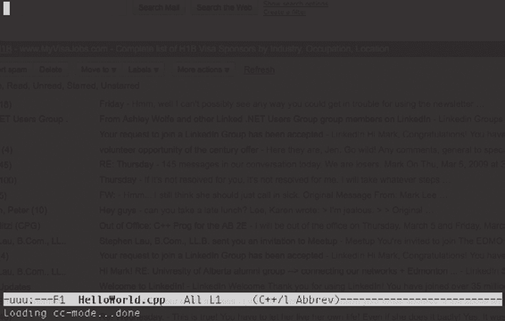

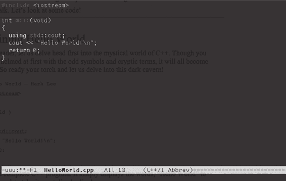

# 附录 C • 在 Mac 和 Linux 平台上工作

**349**

3. 当 `emacs` 首次打开时，你会看到一个主要是空白的屏幕，底部有一个状态栏。见图 C.10。

**图 C.10**

emacs 文本编辑器。

4. 输入第 1 章中的 Hello World 程序。见图 C.11。

**图 C.11**

输入 Hello World 程序。


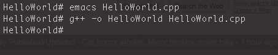

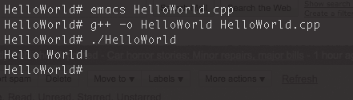

**350**

5. 按 `Ctrl-X` 然后按 `Ctrl-S` 保存你的代码。你会在状态栏看到一个更新，指示保存成功。见图 C.12。现在按 `Ctrl-X` 然后按 `Ctrl-C` 退出 `emacs`。

**图 C.12**

保存代码。

6. 编译程序，输入 `g++ -o HelloWorld HelloWorld.cpp`。`g++` 是 Linux 中 C++ 编译器的名称，`HelloWorld.cpp` 是我们的源代码，`HelloWorld` 是我们正在创建的可执行文件名称。见图 C.13。

**图 C.13**

编译 HelloWorld。

7. 输入 `./HelloWorld` 运行你的项目。你将在屏幕上看到 Hello World！见图 C.14。

**图 C.14**

运行你的项目。

恭喜，你现在已经在 Linux 中编译了你的第一个程序！学习更多关于 Linux 工作的一个很好的起点是 Linux 文档项目，位于 [`www.tldp.org.`](http://www.tldp.org)。

# 附录：从这里开始去哪里

此附录可以作为选择进一步提高编程技能时可能对你有帮助的书籍的参考。书籍按主题分类。

## C++ 语言

* *C++ Coding Standards: 101 Rules and Guidelines*, Herb Sutter, Andrei Alexandrescu

* *C++ FAQs*, Marshall Cline, Greg Lomow, Mike Girou

* *The C++ Programming Language*, Bjarne Stroustrup

* *The C++ Standard Library*, Nicolai M. Josuttis

* *C++ Templates*, David Vandevoorde, Nicolai M. Josuttis

* *The Elements of C++ Style*, Trevor Misfeldt, Gregory Bumgardner, Andrew Gray

* *Thinking in C++*, Brue Eckel

## 软件设计

* *Code Complete (第 2 版)*, Steve McConnell

* *Design Patterns: Elements of Reusable Object-Oriented Software*, Richard Helm, Ralph Johnson, John Vlissides

**352**

## 游戏编程

* *Beginning DirectX 10 Game Programming*, Wendy Jones

* *C++ for Game Programmers*, Mike Dickheiser

* *Data Structures and Algorithms for Game Developers*, Allen Sherrod

* *Windows via C++*, Jeffrey M. Richter

# 附录 D：术表

（内容根据提供的文本结构继续）

# 附录 E：术表

* **抽象类 (abstract class)**: 带有纯虚函数的类。你不能从抽象类创建对象。

* **访问修饰符 (access specifiers)**: 指定类成员的作用范围。

* **地址 (address)**: 表示内存位置的唯一数字。

* **算法 (algorithm)**: 完成特定任务的逻辑。

* **分配 (allocate)**: 声明并保留部分内存。

* **ANSI (美国国家标准协会)**: 一个开发计算机行业标准的组织。

* **参数 (argument)**: 发送到被调用函数的数据。

* **数组 (array)**: 一个存储数据的列表，每个元素通过其下标引用。

* **多维数组 (array, multidimensional)**: 数组的数组。

* **ASCII 码 (美国信息交换代码)**: 一种确定 256 个字符位模式的代码。

* **断言 (assertion)**: 一种语句（通常是宏），用于确保条件为真。

* **自动 (automatic)**: 默认存储所有局部变量的内存。

* **基类 (base class)**（也称为超类和父类）: 另一个类派生的类。

* **二进制 (binary)**: 一使用数字 1 和 0 的计数系统。

* **二进制文件 (binary file)**: 与文本文件不同，数据以压缩格式存储的文件。

* **位 (bit)**: 内存的最小单位；通常用 1 或 0 表示。

* **块 (block)**: 由括号括起来的 C++ 代码段。

* **布尔 (Boolean)**: 表示两种可能值（真或假）的基础数据类型。

* **布尔逻辑 (boolean logic)**: 对布尔数据类型之间关系的研究。

* **错误 (bug)**: 计算机错误。

* **字节 (byte)**: 由 8 位表示的内存单元；可以存储 256 个值中的任何一个。

* **调用 (calling)**: 从程序的其他部分启动函数的行为。

* **调用过程 (calling procedure)**: 调用另一个函数的函数。

* **字符 (character)**: 一个可以存储 ASCII 字符集中 256 个不同字符之一的变量。

* **子类 (child class)**: 见派生类 (derived class)。

* **类 (class)**: 用于定义对象特征的结构，包括对象的数据成员和函数成员。

* **类层次结构 (class hierarchy)**: 显示类与类之间继承关系的树形结构。

* **类模板 (class template)**: 一种不特定于某种数据的类；使用模板来实现这一目标。

* **代码片段 (code fragment)**: 程序的某个部分。

* **命令 (command)**: 编程语言指令。

* **注释 (comment)**: 放在源代码中的信息性代码，旨在为程序员或试图理解代码的人提供便利。编译器忽略注释。

* **编译器 (compiler)**: 将源代码转换为可执行格式。

* **编译 (compiling)**: 将你的源代码通过编译器以将其转换为可执行格式的行为。

* **复杂度 (complexity)**: 算法效率的衡量标准。


## 拼接 (concatenation)

两个或多个字符串的合并。

## 条件语句 (conditional statement)

见控制语句 (control statement)。

## 控制台应用程序 (console application)

使用基于 DOS 的文本窗口而非 Windows 库的应用程序。

## 控制语句 (control statement)

根据条件改变程序流的语句。

## 构造函数 (constructor)

与与其类同名的函数。每当创建一个派自该类的对象时，构造函数都会执行。用于声明内存并为对象分配初始属性。

## 术语表

## C 风格字符串

由 0 终止的字符数组。

## 调试

从程序中移除错误的过程。

## 声明

告知计算机变量、`function` 或 `class` 的名称和属性。

## 递运算符

用于将变量值减 1 的 `--` 运算符。

## 派生

从另一个 `class` 创建一个新的 `class`。

### 派生类（也称为子类或子类）

由基类形成的 `class`，它继承了基类的所有特征。

### 继承自 (derives-from)

“类型”关系的另一种说法。

## 析构函数

在对象删除时自动执行的成员函数。析构函数的名称与 `class` 相同，前面带有一个 `~`。

## 开发周期

创建和调试程序时采取的通用步骤。

## 磁盘内存

由硬盘、CD-ROM、软盘驱动器、zip 驱动器等组成的以半永久方式存储数据的内存。

## 动态内存（也称为自由存储和堆）

程序员可以访问以存储新数据的内存区域。通过 `new` 和 `delete` 运算符进行分配和释放。

## 元素

数组中的一个数据。

## 封装

面向对象编程（OOP）的一种原则，其中对象执行且仅执行一个特定的任务。

## 转义字符

一组特殊的字符，用于表示其他无法以字面形式表示的字符（例如换行符）。

## 异常处理

处理程序中的非例情况。

## 提取

从流中移除字节。

## 提取器

执行提取操作的函数。

## 自由存储

参见动态内存。

## 释放内存

告知计算机你已完成对特定内存区域的使用。

## 函数

被调用时执行特定任务的代码段。

## 函数声明

向程序中引入 `function` 并定义 `function` 的返回类型、名称和参数。也称为原型。

## 函数定义

`function` 内部代码的实现。

## 函数模板

不特定于任何单一数据类型的 `function`。它使用模板来完成此任务。

## 基础类型

C++ 语言内置的数据类型。

## 全局

可以在源文件内任何地方访问的变量。

## 堆

参见动态内存。

## 头文件

在 C++ 程序中包含的文件，通常代表 C++ 标准库文件。

## 十六进制

一种 16 进制系统，使用数字 0–9 和字母 A–F 创建 16 个唯一的数字。

## 标识符

赋予变量的名称，以便程序员在程序的后续部分方便地引用这些变量。

## 实现

`function` 的定义。

## 增运算符

将变量加 1 的 `++` 运算符。

## 索引（也称为下标）

用于访问数组特定元素的数字。

## 继承

从一个 `class` 派生另一个 `class`。

## 继承链

`class` 的继承线。

## 数组初始化列表

用逗号分隔的值列表；用于初始化数组。

## 对象初始化列表

构造函数之后的值列表，用于初始化对象的成员变量。

## 输入/输出 (I/O)

描述计算机与外部世界通信方式的术语。输入设备包括鼠标、键盘、摇杆等。输出设备包括显示器、打印机、扬声器等。

## 插入器

执行流插入的函数。

## 插入

将字节放入 I/O 流中。

## 整数

仅存储整数的变量类型（可以是正、负和零）。

## 整数溢出

当整数达到其最大值加 1 时，它会“回绕”，从而将整数设置为最小值。

## 集成开发环境 (IDE)

包含你的编译器、文件浏览器、设置和源代码编辑器的图形用户界面。

## 迭代控制语句

允许根据条件重复代码的控制语句。

## 跳转语句

用于将程序流从一部分跳转到另一部分而跳过中间的所有内容的关键字。

## 千字节

由 1024 字节组成的内存单位。主要的内存度量单位之一。

## 库

你可以在程序中使用的编译代码集。

## 换行符

表示新行的元字符。

## 链接

检查代码是否与程序中包含的所有文件协同工作的过程，不仅包括你的文件，还包括像 DirectX 等外部库。

## 字面量

程序中实际数据值的表示。数字用阿拉伯数字系统字面表示（1, 2, 3 等）；字符串用引号括的字母和数字表示。

## 局部

在 `function` 内部声明的变量。只能在该函数内部访问。

## 左值 (lvalues)

可以赋值或位于赋值语句相等左侧的表达式。

## 机器语言

程序的编译、可执行版本。

## 主函数

程序开始时第一个执行的函数。最常见的原型是 `int main(void)`。

## 操符

以某种方式处理流的数据。例如，操符可能会将所有字符转换为大写或将十进制数转换为十六进制。

## 数学运算符

执行加减等数学函数的运算符。

## 内存

计算机存储和检索数据的部分。最常见的来源是硬盘、磁盘和随机存内存 (RAM)。

## 元字符

不在屏幕上显示但被计算机用于特殊格式或表示其他字符的字符。这些字符包括制表符、换行符等。

## 取模运算符 (%)

`x` 除以 `y` 的余数 (`x % y`)。

## 命名空间

C++ 关键字，用于将单个作用域划分为多个子作用域。

## 嵌套

将 `if` 语句（或其他控制语句）放在其他控制语句内部。

## 空指针（也称为未声明指针）

存储值为 0 且假设不指向任何数据的指针。

## 空字符

字符串的终止字符；用转义字符 `\0` 表示。

## 对象

`class` 的特定实例。

## 面向对象编程 (OOP)

一种编程技术，通过创建同时具有特征和代码的对象来激活数据。

## 操作数

运算符所操纵的值。

## 操作

包含运算符及其操作数的短语。

## 运算符

任何符号或双符号（如 `<=`——以及在某些情况下甚至是如 `sizeof()` 这样的单词），会导致编译器执行某个操作。

## 运算符重载

为现有运算符创建新的用法。

## 顺序

算法的增长模式。

## 优先级

某些运算符相对于其他运算符的优先级。例如，`+` 运算符的优先级低于 `*` 运算符。因此，除非被括号等更高运算符覆盖，否则它会在 `*` 运算符之后执行。

## 优先级

参见运算优先级。

## 重载

创建多个具有相同名称 `function` 版本。计算机使用参数来确定调用哪个版本。

## 重写

当派生类声明了一个与其基类中同名的方法。在使用派生类对象时，优先使用派生版本。

## 参数

参见参数。

## 父类

参见基类。

## 指针

存储另一个数据值地址的变量。

## 实例化点

类模板或函数模板从一组特定的模板参数生成时。

## 多态

面向对象编程（OOP）的一种原则，其中每个对象可以在多个程序中使用。

## 程序

计算机所执行的一系列指令。也指将源代码输入计算机以进行编译和运行的过程。

## 原型（也称为函数原型）

函数的表示形式；用于让编译器设置该函数。原型包含返回类型、函数名以及应该被传递的变量类型。

## 纯虚函数

一个没有实现的虚函数，仅用于创建抽象类。

## 二次

任何可以表示为如下形式 `ax² + bx + c` 的方程。

## 商

两个数相除得到的结果。

## 随机存取存储器 (RAM)

计算机开启时临时存储数据的内存。

## 随机数

以看似随机的顺序顺序的数字；由复杂的数学公式生成。

## 递归

一种函数调用自身的编程方法。

## 返回值

从函数传回调用函数的数据；通常用于返回函数计算的数值结果。

## 标量变量

只能存储一个数据的变量，相对于数组数据。

## 作用域

变量的范围，由周围源代码可以使用该变量的程度定义。

## 科学计数法

一种表示极大数值简洁的方法。

## 阴影

一个与全局变量同名的局部变量；当使用该变量名时，局部变量具有优先级。

## 单继承

只有一个且仅有一个基类的派生类。

## 源代码

程序的文本表示，用 `C++` 等编程语言编写。

## 静态内存

编译器存储静态和全局变量的内存区域。

## 静态变量

在整个程序运行期间保留其值的变量，但不一定具有全局作用域。

## 流对象

作为数据输入输出（I/O）的源和目的。流对象操作有序的线性字节序列。

## 字符串

一在字符数组中存储字符序列的对象类型，以空字符零结束。

## 子类

参见派生类。

## 下标

表示数组中单个数据元素的数字。

## 子字符串

由另一个字符串的部分或全部形成的字符串。

## 超类

参见基类。

## switch 语句

利用 `switch` 关键字根据选定的用例执行特定代码的语句。

## 模板

一种泛化类或函数的方法，使其不使用特定的数据类型。

## 模板参数

一个存储数据类型的参数，例如函数参数。

## 测试底座

一个用于测试对象能力的函数。

## 文本文件

数据由字符表示的文件。

## try-块

尝试捕获任何抛出异常的代码段。

## 类型 (of)

两个元素之间的关系，其中一个是一个类别，另一个是该类别中的一个对象。

## 类型

数据的表示，例如整数和浮点数。

## 类型别名

类型的另一种名称；通常用 `typedef` 关键字指定。

## 未声明指针

参见空指针。

## 无符号变量

只能存储正值的整数类型变量。

## 变量

程序中用于存储数据的命名内存位置。

## 变量生命周期

变量使用的内存被保留的时间。

## 变量作用域

程序中可以访问特定变量的范围。

## vector

标准库的一部分复杂数据结构。它位于 `<vector>` 库中。

## 虚函数

确保在指向虚函数时引用正确的类的多态函数。

## 包装类

扩展基本数据类型或对象基本功能的类。

## 索引

### 符号

- `;` (分号), 4–5
- `+` (加法) 运算符, 20, 41
- `'` (单引号), 15
- `&&` (和) 运算符, 60
- `-` (减法) 运算符, 20, 41
- `=` (赋值) 运算符, 30, 41
- `~` (波浪), 115
- `\` (反斜线字符), 15
- `_` (下划线), 29
- `|` (位或) 运算符, 247
- `::` (冒号), 98

### a

- `{ }` (大括号), 4
- `abort()` 函数, 264, 269
- `--` (递减) 运算符, 34, 64–66, 158
- `abstract class`, 190
- `/` (除法) 运算符, 20, 41
- `abstract concepts`, 190
- `!=` (不等于) 运算符, 57–58
- `access specifier`, (访问权限符), 121–122
- `"` (双引号), 15
- `accessing strings`, (访问字符串), 223–229
- `...` (省略号), 272
- `add function`, (添加函数), 88
- `==` (等价) 运算符, 56–57
- `Add New Item` (新建项目) 对话框, 8
- `//` (正斜杠), 5
- `Add Program example` (添加程序示例), 90–92
- `>` (大于) 运算符, 58
- `addition (+)` (加法) 运算符, 20, 41
- `>=` (大于等于) 运算符, 58–59
- `allocation, memory`, (内存分配), 143–144, 149–151
- `++` (递增) 运算符, 34, 41, 64–66
- `and (&&)` (和) 运算符, 60
- `*` (indirection) (间接) 运算符, 146–147
- `animation frame`, (动画帧), 295
- `<<` (left shift) (左移) 运算符, 258
- `append() method`, (append 方法), 231
- `<` (less-than) (小于) 运算符, 58
- `appending strings`, (追加字符串), 231
- `<=` (less-than-or-equal-to) (小于等于) 运算符, 58–59
- `Archery Competition`, (射箭比赛),
- `%` (modulus) (取模) 运算符, 21, 41, 129–131
- `*` (multiplication) (乘法) 运算符, 20, 41
- `!` (not) (非) 运算符, 60
- `command-line`, (命令行), 105
- `||` (or) (或) 运算符, 59
- `constructor`, (构造函数), 119
- `( )` (括号), 21
- `passing to main function`, (传递给 main 函数), 105–106
- `"` (quotation mark)(引号), 13
- `>>` (right shift) (右移) 运算符, 258
- `argument resolution`, (参数解析), 206–207
- `->` (selection) (选择) 运算符, 147
- `array`, (数组)
- `.` (selection) (选择) 运算符, 147
- `assing elements of`, (赋值元素), 157
- `associative`, (关联), 203–204
- `block of code` (代码块)
- `basic description of`, (基本描述), 154–155
- `character`, (字符), 162
- `variable declared outside of`, (在外部定义的变量), 94
- `variable declared within`, (在内部定义的变量), 94
- `declaration`, (声明), 156
- `bool (Boolean) variable type`, (bool 类型变量), 31, 40
- `dynamic`, (动态), 159
- `boolalpha() method`, (boolalpha 方法), 256
- `element`, (元素), 155, 157
- `Boolean (bool) variable type`, (bool 类型变量), 31, 40
- `initializer list`, (初始化列表), 156–157
- `break statement`, (break 语句), 53–54
- `multidimensional`, (多维), 159
- `relating to pointers`, (关联指针), 157–158
- `side-by-side`, (并排), 204
- `single-dimensional`, (一维), 160
- `two-dimensional`, (二维), 160
- `calling a function`, (调用函数), 88–90
- `assertions`, (断言), 263–265
- `case statement`, (case 语句), 54–55
- `assign() method`, (assign 方法), 230, 236
- `catch statement`, (catch 语句), 266–268, 272
- `assignment (=)` (赋值) 运算符, 30, 41
- `associative array`, (关联数组), 203–204
- `central processing unit (CPU)`, (中央处理器), 2
- `at() method`, (at 方法), 223, 236
- `char (character) variable type`, (char 类型变量), 32
- `atof() function`, (atof 函数), 165
- `atoi() function`, (atoi 函数), 164
- `atol() function`, (atol 函数), 165
- `cin function`, (cin 函数), 18–19
- `attribute, class`, (类属性), 113
- `automatic memory`, (自动内存), 144
- `Circle game example`, (圆形游戏示例), 39

### b

- `abstract`, (抽象), 190
- `access specifier`, (访问权限符), 121–122
- `backslash character (\)` (反斜线字符), 15
- `attributes and method example`, (属性与方法示例), 112–113
- `bad() method`, (bad 方法), 252
- `base`, (基), 185–186
- `base class`, (基类), 185–186
- `child`, (子), 177
- `begin() method`, (begin 方法), 217
- `combining with composition`, (组合组合), 173–174


# 索引

## a

- 城镇报员程序示例， 17–18
- 武器商店游戏示例， 41–43
- `colon (::)`, 98
- 命令行提示, 106
- 命令行参数, 105
- 注释
  - 指南, 125
  - 多行, 5
  - 单行, 5
  - 何时使用, 6

## c

- `compare()` 方法， 224
- 字符串比较, 224
- 测试底盘, 128–129
- 编译, 12
- 编译器, 2
- 编译时错误, 136
- 组合, 173–174
- code
  - Add Program 示例, 90–92
- 连接, 163–164
- 射箭比赛游戏示例, 129–131
- 条件运算符, 52–53
- 征服游戏示例, 137–141
- 洞穴冒险游戏示例, 106–109
- `const` 关键字， 38, 40, 121
- Circle 游戏示例, 39
- 常量方法, 120–121
- 常量指针, 151–152
- 常量
  - 如何使用, 38
  - 指向, 152
- 构造函数, 366
- 《C++编程：从入门开始 第二版》
  - 参数, 119
  - 在派生类中创建, 180–183
  - 声明, 118–119
  - 默认, 126
  - 定义, 115
  - 初始化列表, 120
  - 重载, 119
  - for vectors, 235
- 声明
  - array, 156
  - class, 114–116
  - 构造函数, 118–119
  - 析构函数, 118–119
  - 函数, 85–86
  - method, 115–116, 118
  - 变量, 30
- 大括号 ({ }), 4
- decrement (--) 运算符, 34, 64–66, 158
- Dark GDK
  - asteroids, 287
  - Dark GDK - 2D 游戏代码, 282–285
  - DarkGDK() 函数， 286
  - 默认操作, 禁用, 286
  - 函数列表, 289
  - 初始化部分, 286
  - 库下载, 282
  - 加载图像, 286–287
  - LoopGDK() 函数， 288
  - 随机数生成, 286
  - 运行程序, 285
- 默认构造函数, 126
- 默认语句, 55
- 定义函数, 87–88, 90
- delete 运算符, 149
- 删除 vector 元素, 237
- 派生类, 180–183
- 默认析构函数
  - 在派生类中创建, 180–183
  - 声明, 118–119
  - 定义, 115
- 磁盘存储, 27
- 除 (/) 运算符, 20, 41
- do while 循环, 66–67
- 不等于 (!=) 运算符, 57–58
- 双引号字符 ("), 15
- 数据抽象, 133–134
- double 类型, 36, 40
- 数据隐藏, 133–134
- 龙王游戏示例, 192–198
- 数据指令, 2
- 动态数组, 159
- 数据成员, class, 114
- data() 方法, 223–224
- Data Type 游戏示例, 37–38

## d

- 元素, array, 155, 157
- dbLoadImage() 函数， 286, 307
- 省略号 (..), 272
- else if 语句, 47–49
- 帧率, 286
- fstream class, 244, 247–248, 253
- 函数, 89
  - abort(), 264, 269
  - add, 88
  - Add Program 示例, 90–92
  - 参数, 93–94
  - 运行时, 136
  - atof(), 165
  - atoi(), 164
  - atol(), 165
  - 转义字符, 14–15
  - 异常处理
    - catch 语句, 266–268, 272
    - cin, 18–19
    - cout, 4, 13–14
  - 层次级, 270–271
  - Dark GDK, 289
  - dbLoadImage(), 286, 307
  - dbRandomize(), 286
  - dbTimer(), 286
  - 提取, 244
  - 执行错误, 106
  - files, 247–251
  - file, 5
    - 打开, 247–248
    - 损坏, 248
    - 关闭, 248
  - main, 4, 91, 104–106
  - 拆分为类, 122–124
  - moveDown(), 302, 315
  - moveLeft(), 302, 315
  - moveRight(), 302, 315
  - moveUp(), 302, 315
  - 《C++编程：从入门开始 第二版》
  - 重载, 92–93
  - 全局变量, 96
  - 指针作为, 152–154
  - 大于 (>) 运算符, 58
  - 大于等于 (>=) 运算符, 58–59
  - 返回值, 89
  - show(), 301, 307
  - sizeof(), 36
  - heap, 内存, 145
  - Hello World , 3–5
  - srand(), 72
  - hide(), 301
  - strcat(), 163–164
  - strcpy(), 163
  - strlen(), 163
  - IDE (集成开发环境), 6
  - identifier, 29, 41
  - syntax, 85
  - if 语句, 47–49
  - if-else 结构, 51–52
  - testing conditions, 46–47
  - time, 286
  - unexpected

## 索引

- `max_size()` 方法, 237
- `iterator`
  - 使用的算法, 219
  - 成员函数继承, 186–191
  - 双向, 217–218
  - 前向, 217–218
- **《C++ 编程入门：第二版》(C++ Programming for the Absolute Beginner, Second Edition)**

## 方法（另见函数）

- `append()`, 231
- `assign()`, 230, 236–237
- `at()`, 223, 236
- `back()`, 236
- `bad()`, 252
- `boolalpha()`, 256
- `class`, 113
- `clear()`, 237
- `close()`, 248
- `compare()`, 224
- 常量, 120–121
- `copy()`, 223–224
- `c_str()`, 223
- `data()`, 223–224
- `dec()`, 256
- `empty()`, 229, 237
- `end()`, 217
- `eof()`, 250, 252
- `erase()`, 233, 237
- `fail()`, 252
- `find()`, 225–226
- `fixed()`, 256
- `flags()`, 246
- `get()`, 253
- `getline()`, 250–251
- `getloc()`, 246
- `good()`, 252
- `hex()`, 256
- `imbue()`, 246
- `insert()`, 231–232, 237
- `internal()`, 256
- `ios_bas()`, 246
- `iterator`, 220
- `iword()`, 246
- `left()`, 256
- `length()`, 229
- `max_size()`, 237
- `noboolalpha()`, 256
- `noshowbase()`, 256
- `noshowpos()`, 256
- `noskipws()`, 256
- `nounitbug()`, 256
- `nouppercase()`, 256
- `oct()`, 256
- `open()`, 247
- `operator()`, 246
- `precision()`, 246
- `put()`, 253
- `pword()`, 246
- `rbegin()`, 222
- `read()`, 254
- `register_callback()`, 246
- `rend()`, 222
- `replace()`, 232
- `rfind()`, 226
- `right()`, 256
- `scientific()`, 256
- `seekg()`, 253
- `seekp()`, 253
- `setf()`, 246
- `showbase()`, 256
- `size()`, 229, 237
- `skipws()`, 256
- `substr()`, 228
- `tellg()`, 253
- `tellp()`, 253
- `unitbuf()`, 256
- `unsetf()`, 246
- `uppercase()`, 256
- `width()`, 246
- `write()`, 254
- `x()`, 299
- `xalloc()`, 246
- `y()`, 299

## 索引（续）

- `moveDown()`, 302
- `moveLeft()`, 302
- `moveRight()`, 302
- `moveUp()`, 302
- `oct()`, 256
- `ofstream`, 247–248
- `ostream`, 249
- `string`, 212
- `stream`, 244
- `Ship`, 299–302
- `Point`, 298–299
- `Screen`, 303
- `City`, 302–303
- `Game`, 307–313
- 数字猜数字游戏示例, 73–75
- 地雷游戏示例, 273–78
- 神秘商店游戏示例, 238–241
- 海盗冒险游戏示例, 57–58
- 海盗火箭兵游戏示例, 21–23


- 蜗牛赛跑示例, 101–104
- 罗马指挥官示例, 75–80

## 索引

- **371**
- **372**
- **373**
- **374**
- **o**
- **n**
- **p**
- **q**
- **s**
- **r**

# 索引 (375)

- `file`, 247–251
- `源代码定义`, 2–3
- `头文件`, 244–245
- `模板模板`, 207–209
- `ios_base` 类, 245–246
- `精灵图`, 287–288
- `操纵符`, 256–257
- `srand()` 函数, 72, 286
- `指针`, 253–254
- `栈内存`, 144
- `验证方法`, 251–252
- `栈操作`, 237
- `string`
  - `标准库`, 4, 211–212
  - `访问`, 223–229
- `语句`
  - `追加`, 231
  - `break`, 53–54
  - `汇编`, 13
  - `case`, 54–55
  - `字符数组`, 162
  - `catch`, 266–268, 272
  - `比较`, 224
  - `条件运算符`, 52–53
  - `连接`, 163–164
- `构造一个`, 216–217
  - `函数`, 205–206, 210–211
  - `转换为数字`, 164–165
  - `参数`, 203–205
  - `复制`, 163
  - `简化用法`, 209–210
  - `C 风格`, 163–164
  - `特化`, 207–209
- `已定义`, 12
- `太字节 (TB)`, 29
- `显示`, 13–14
- `terminate()` 函数, 269
- `显示存储的内容`, 16–17
- `测试底架`, 128–129
- `擦除部分`, 233
- `测试`
  - `错误`, 162
  - `黑盒`, 136
  - `转义字符`, 14–15
  - `作为软件开发周期的一部分`, 12
  - `如何使用`, 212–215
  - `文本`。参见 `string`
- `迭代器`, 217–223
- `文本文件`, 249–251
- `长度`, 162–163
- `this 指针`, 151
- `字面量`, 16, 161–162
- `三次荣誉游戏示例`, 49–51
- `操作`, 229–233
- `throw 语句`, 267
- `对象`, 212
- `井井棋游戏示例`, 167–172
- `替换部分`, 232
- `波浪号 (~)` 115
- `在其中搜索`, 225–227
- `time()` 函数, 286
- `排序`, 225
- `标题界面`, 295
- `存储`, 15–19
- `toGlobal()` 函数, 313
- `子字符串`, 225, 228
- `toLocal()` 函数, 313
- `strlen()` 函数, 163
- `toScreen()` 函数, 313
- `struct`, 212
- `镇镇报员程序示例`, 17–18
- `子块`, 98
- `try 关键字`, 266
- `substr()` 方法, 228
- `try 块`, 266
- `子字符串`, 225, 228
- `二维数组`, 160
- `减法 (-)` 运算符`, 20, 41
- `typedef 关键字`, 37–38, 40, 215
- `swap 函数`, 206
- `switch 语句`, 53–54
- `u`
  - `下划线字符 (_)`, 29
- `t`
  - `unexpected()` 函数, 269
  - `制表符 (\t)`, 15
  - `unitbuf()` 方法, 256
  - `执行任务序列`, 105
  - `unsetf()` 方法, 246
  - `TB (太字节)`, 29
  - `unsigned 关键字`, 40
  - `tellg()` 方法, 253
  - `update()` 函数, 315
  - `tellp()` 方法, 253
  - `uppercase()` 方法, 256
- `模板`
  - `基本描述`, 199–200
- `v`
  - `类`, 200–203
  - `变量作用域`, 94–99

# 初学者 C++ 编程，第二版 (376)

- `变量`。参见参考文献
- `list`, 237
- `赋值`, 30–31
- `栈操作`, 237
- `bool 类型`, 40
- `验证方法, 流`, 251–252
- `char 类型`, 32
- `virtual 关键字`, 188–190
- `常量`, 38
- `Visual C++`, 10
- `数据类型`, 37–38
- `Visual Studio`
  - `声明`, 30
  - `新建项目`, 8
  - `double 类型`, 36
  - `float 类型`, 35
  - `解决方案管理器`, 9
  - `添加项`, 8
  - `全局标识符`, 29
  - `void 关键字`, 40
  - `初始化`, 31
  - `int 类型`, 32–33
  - `局部`, 96
  - `long 类型`, 32–33
  - `while 循环`, 63–64
  - `全局`, 25
  - `宽字符`, 29
  - `static 关键字`, 99
  - `写入`, 11
  - `size`, 25
  - `写入代码`, 27
- `vectors`
  - `访问和操作`, 236–238
  - `分配器`, 34
  - `基本描述`, 33
  - `构造函数`, 35
  - `删除元素`, 237
  - `插入或删除元素`, 234
- `x`
  - `x() 方法`, 299
  - `x() 方法`, 246
- `y`
  - `y() 方法`, 29

# 文档大纲

- 目录
- 第一章 开始之旅
  - 计算机基础
  - 定义源代码
    - 你好世界
  - 使用 Visual Studio
  - 创建新项目
  - 软件开发周期
  - 处理文本
  - 组合字符串
  - 使用 cout 显示字符串
    - 使用 cout 显示多个字符串
  - 使用转义字符
  - 存储字符串
  - 显示存储的内容
  - 镇报员程序
  - 接收输入
  - 使用 cin 存储字符串
  - 处理数字
  - 引入整数
  - 使用运算符操作
  - 取模运算符
  - 创建海盗剑客
  - 总结
- 第二章 深入学习变量

### 通过 typedef 让生活更简单

### 使用常量

### 环形游戏

### 理解语法

### 创建武器商店游戏

## 总结

## 第 3 章 使用控制语句进行选择](#index_split_001.html_p64)

### 使用选择语句进行代码选择

#### 使用 if 语句测试条件

## 条件运算符

## 使用 switch 语句

## 使用布尔运算符

## 等价运算符

#### 引入不等于运算符

## 小于和大于运算符

## 与等价运算符合并

## 逻辑或运算符

## 逻辑与运算符

## 逻辑非运算符

## 遵循操作顺序

## 继续学习迭代语句

## while 循环

#### 使用 do while 循环循环

## 使用 for 语句

## 嵌套

## 创建随机数

#### 猜数字游戏

### 创建罗马指挥官游戏

## 总结

## 第 4 章 使用函数结构化代码](#index_split_001.html_p102)

### 分治法术

### 探索函数语法

### 声明函数

## 定义函数

## 调用函数

#### 整合在一起

## 函数重载

## 默认参数

### 深入理解变量作用域

#### 使用作用域运算符

#### 静态变量

## 欢迎来到蜗牛赛

### 解析 main 函数

#### 检查执行序列

#### 传递参数给 main

#### 使用 main 返回值

### 创建洞穴冒险游戏

## 总结

## 第 5 章 设计软件：面向对象编程](#index_split_002.html_p130)

### 面向对象编程简介

### 发现类

### 声明类

### 创建方法

#### 使用访问修符

### 将类分离到文件中

### 类策略 101

### 使用对象

### 使用对象变量

#### 使用默认构造函数

### 访问成员

#### 创建一个底盘

## 射箭比赛

## 使用静态成员

### 学习 OOP 原理

## 理解数据抽象

## 理解封装

## 理解多态

## 调试

## 黑盒

## 链接错误

## 创建征服游戏

## 总结

## 第 6 章内存管理](#index_split_002.html_p160)

### 解释内存

### 使用指针

### 引入间接运算符

## 使用指针和对象

### 从堆上内存

### 使用 this 指针

### 常量指针和常量

## 引入指针和函数

### 处理数组

### 创建数组

### 使用数组

### 使用指针数组

### 创建多维数组

### 字符串字面量

### 字符数组

### 使用 C 风格函数

### 将字符串转换为数字

### 开始学习引用

### 在参数中使用引用

### 作为返回值使用引用

### 重做井字游戏

## 总结

## 第 7 章 类之间的关系](#index_split_002.html_p202)

### 组合组合类

## 引入继承

## 编写继承代码

#### 理解三种成员函数

### 创建龙王游戏

## 总结

## 第 8 章 使用模板](#index_split_003.html_p228)

### 创建模板

### 创建类模板

### 使用模板参数

### 创建函数模板

## 理解参数解析

### 模板特化

### 简化模板使用

## 重载函数模板

## 使用标准库

## 使用字符串

### 构造字符串

### 遍历字符串

### 访问字符串

### 处理字符串

### 使用向量

### 访问和操作向量

### 创建游戏

## 总结

# 第 9 章 流与文件 (#index_split_003.html_p262)

### 理解 I/O 词汇](#index_split_003.html_p262)

### 理解头文件](#index_split_003.html_p263)

### `ios_base` 类](#index_split_003.html_p264)

### 流介绍](#index_split_003.html_p266)

### 打开文件](#index_split_003.html_p266)

### 关闭文件](#index_split_003.html_p267)

### 使用文本文件](#index_split_003.html_p268)

### 验证流](#index_split_003.html_p270)

### 使用二进制流](#index_split_003.html_p271)

### `get` 和 `put` 指针](#index_split_003.html_p272)

### 针接口](#index_split_003.html_p272)

### 读写二进制流](#index_split_003.html_p273)

### 使用常用操作符](#index_split_003.html_p275)

### 使用字段](#index_split_003.html_p276)

#### 位移的趣味性](#index_split_003.html_p277)

### 创建程序](#index_split_003.html_p278)

### 总结](#index_split_003.html_p281)

# 第 10 章 错误与异常处理 (#index_split_003.html_p282)

### 断言条件](#index_split_003.html_p282)

### 处理异常](#index_split_003.html_p284)

### 构建异常体系](#index_split_003.html_p289)

### 捕获所有异常](#index_split_003.html_p291)

### 创建矿井](#index_split_003.html_p292)

### 总结](#index_split_003.html_p297)

# 第 11 章 创建海盗冒险 (#index_split_003.html_p300)

### 介绍黑暗 GDK](#index_split_003.html_p301)

### 游戏概览](#index_split_003.html_p308)

### 编写游戏引擎](#index_split_003.html_p315)

#### 存储位置](#index_split_003.html_p317)

### 创建船类](#index_split_003.html_p318)

### 创建城市类](#index_split_003.html_p321)

### 实现地图](#index_split_003.html_p322)

### 游戏类](#index_split_003.html_p326)

### 创建游戏底盘](#index_split_003.html_p334)

### 恭喜你，读者！](#index_split_004.html_p336)
