# C++ 编程：从新手到专家的进阶指南

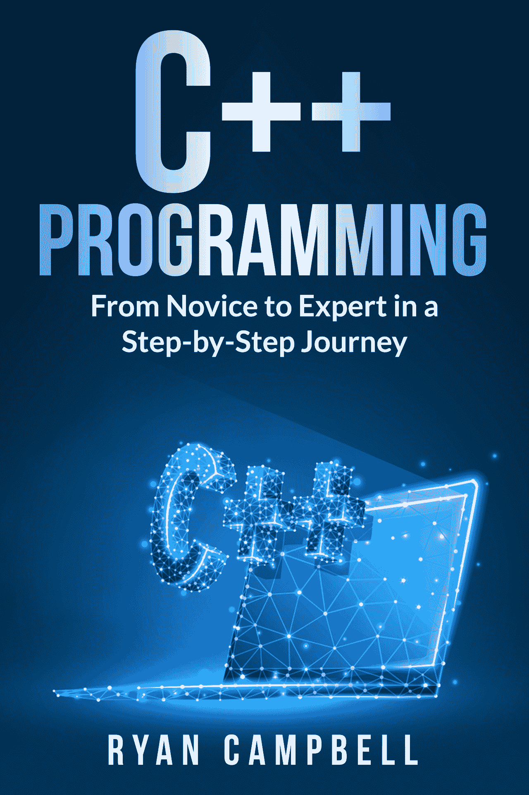

# 引言

你准备好开启一段通往编程世界的惊险旅程了吗？在这里，创意没有边界，创新成为本能。别无他处！欢迎来到 C++ 的沉浸式领域，这门语言被誉为通往数字宇宙无限可能的大门。

在这份全面的指南中，我们将手把手地带领你穿过 `C++` 迷人的风景。无论你是一个完全的新手，还是一个想要提升技能的编程爱好者，这本书都是为你的需求量身定制的。

## 为什么选择 C++？可能的力量

C++ 不仅仅是任何编程语言；它是一个赋强大的工具，赋予你为想法注入灵魂的自由。想象一下，你正在编写复杂的应用程序、构建稳健的软件，甚至在探索游戏开发的迷人领域。有了 `C++`，将梦想变为现实的力量掌握在你的指尖。

## 知识铺就的旅程

每一个伟大的冒险都始于坚实的基础，这正是我们这本书将为你提供的。我们将从对 `C++` 迷人的介绍开始，在那里你将发现它的意义和丰富的历史，让你渴望拥抱令人兴奋的编码世界。

## 开启学习奥德赛

我们相信学习应该是一次充满活力的航行，而不是一项枯燥的任务。这就是为什么我们精心设计了本指南，成为你的可靠伴侣，用清晰的热情引导你走每一步。解开数据类型和变量的奥秘，深入研究控制结构和决策过程，运用函数和模块化编程的力量来创建优雅高效的代码。

## 进军高级领域

随着你专业知识的增长，你的项目复杂性也会随之增加。不要害怕，勇敢的探索者！我们将为你配备指针和内存管理的知识，让你像老练的巫师一样操纵内存。深入面向对象编程的迷人世界，在那里将掌握编写优雅且扩展应用程序的艺术，留下深远的影响。

## 开启创意之门

C++ 不仅仅是一个工具；它是一把能为你最狂野的想法注入灵魂的魔棒。我们将赋予你先进的概念，例如模板和异常处理，这些概念将使你能够推向可能的边界。我们共同释放 `C++` 的全部潜力，让你的创意飞向新的高度。

## 通往现实影响的大门

没有应用的知识有什么用呢？准备好大惊讶吧，我们将展示 `C++` 在不同领域中的现实应用。从金融应用到尖端技术，你将见证你的新学技能在周围真实世界中产生的变革性影响。

## 你的冒险在等待！

所以，你准备好开启这段通往 `C++` 编程核心的精彩奥德赛了吗？无论你是一个好奇的初学者，还是一个有抱的编程大师，这本书都是你开启无限机会世界的钥匙。进入 `C++` 的领域，让编程的魔法点燃你的激情，引导你走向非凡的未来。

你准备好释放你的编程潜力了吗？如果答案是肯定的“是”，那么现在就开始你的冒险吧！`C++` 迷人的世界等待你的到来。

# 第 1 章：理解数据类型与变量

## 基础构建

在计算机编程领域，理解数据类型和变量等于精通语言的语法和词汇。它们构成了所有代码构建和操作的最基础。在本章中，我们将深入研究 `C++` 编程语言中数据类型和变量的基本概念，赋予你编写优雅高效代码所需的本质构建块。

## 编程中数据的本质

在我们沉浸于数据类型和变量的细节之前，让我们首先掌握数据在编程领域的重要性。从核心上说，计算机编程指令机器执行特定任务的艺术。这些任务反过来涉及对数据的处理和操作。数据可以采取各种形式，从简单的整数和字符到复杂的结构和对象。

数据有许多种类，每种都适用于特定的用途。因此，程序员理解不同数据类型的特征以及它们与底层硬件交互的方式至关重要。这种理解将使我们能够优化代码执行、节省内存并确保程序程序的可靠性。

## 基础构建：数据类型

在 `C++` 中，数据类型是定义数据性质并决定可以对其执行的操作的构建块。`C++` 提供了丰富的数据类型，满足多样化的编程需求。让我们探索一些为我们的编码工作奠定基础的数据类型：

### 基础数据类型

1. **整数类型 (`int`)**：代表整数，整数类型涵盖了各种范围。理解整数类型的范围对于计算、避免溢出和优化内存使用至关重要。
2. **浮点类型 (`float`, `double`)**：处理实数，浮点类型提供了适应小数值的精度。程序员必须对浮点精度误差保持小心，因为它们会影响计算的准确性。
3. **字符类型 (`char`)**：负责代表单个字符，字符类型允许操作字符和 ASCII 值，对于处理文本数据至关重要。
4. **布尔类型 (`bool`)**：布尔是二进制数据类型，表示真或假。

### 自定义数据类型

1. **枚举 (`enum`)**：枚举允许创建一个一组命名值的自定义数据类型，增强代码的可读性和组织性。
2. **结构 (`struct`)**：结构允许将相关的变量分组在一个自定义数据类型下，便于处理复杂的数据结构。
3. **类 (`class`)**：在面向对象编程领域，类为创建具有属性（变量）和行为（函数）的对象提供了蓝图。

## 变量：数据的容器

在我们熟悉数据类型之后，让我们探索它们如何通过变量在程序中体现。在 `C++` 中，变量是存储特定数据类型数据的容器。每个变量都与内存地址关联，允许我们访问和操作存储的数据。

## 变量声明与初始化

在 `C++` 中，声明变量涉及指定数据类型和可选的初始值。声明告知编译器变量的存在并为其保留内存。初始化则是在声明时为变量分配初始值。

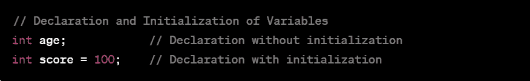

## 变量命名规则

C++ 中的变量命名遵循某些规则。变量名必须以字母（大写或小写）或下划线开头，后面可以跟字母、数字或下划线。它们是区分大小写的，这意味着 `myVar` 和 `myvar` 会被视为不同的变量。

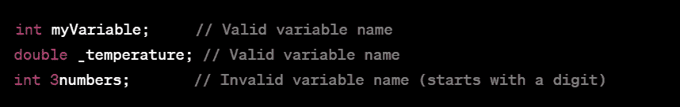

## 常量：不变的数据

除了变量之外，C++ 还允许创建常量，它们是在程序执行过程中不会改变的固定值。常量使用 `const` 关键字声明，并对于使代码更健壮、更易维护起着至关重要的作用。

在本章中，我们探索了 C++ 编程的基本构建块：数据类型和变量。我们已经看到数据类型如何定义数据的性质及其行为，而变量则充当在内存中存储数据的容器。通过对这些概念的坚实理解，你现在拥有了编写代码的工具，可以执行强大的计算、操纵数据，并为更复杂的编程尝试铺平道路。

在下一章中，我们将进一步深入 C++ 的核心，探索控制结构和决策过程，这将使你能够精确且灵活地引导程序的执行流。因此，让我们继续这段掌握 C++ 并解锁计算机编程真正潜力的卓越之旅。

# 第 2 章：控制结构与决策

## 引导你的程序

在计算机编程的世界中，引导执行流的能力区分新手与资深开发者的技能。控制结构和决策过程构成了这种艺术的精髓，使程序员能够创建动态且响应的应用程序。在本章中，我们将开始探索 C++ 编程语言中的控制结构、循环和条件语句。通过理解这些强大的工具，你将获得对程序的控制权，并释放构建复杂高效解决方案的潜力。

## 控制流：控制结构

从本质上说，程序是逐条执行的指令序列。控制结构引入了某种灵活性，允许我们根据特定条件或重复改变执行顺序。在 C++ 中，我们有三种主要的控制结构：条件语句、循环和分支。

### 条件语句

条件语句允许我们在程序中做出决策，根据某些条件引导流向。最常见的条件语句是 `if` 语句，它只在指定的条件为真时执行代码块。

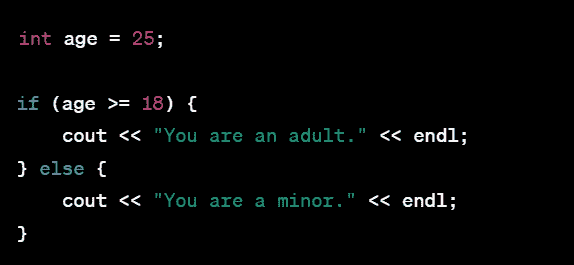

`if` 语句可以通过 `else if` 和 `else` 子句进行扩展以处理多个条件。

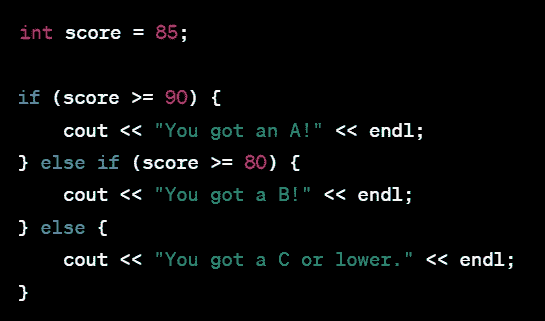

### 循环：重复过程

循环提供了一种机制，重复执行代码块，直到满足指定的条件。在 C++ 中，我们有三种主要的循环结构：`for`、`while` 和 `do-while`。

### for 循环

当我们提前知道迭代次数时，`for` 循环是理想的。

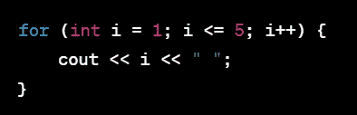

### while 循环

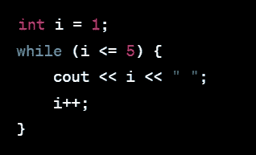

### do-while 循环

`do-while` 循环与 `while` 循环类似，但它保证即使初始条件为假，代码块也会至少执行一次。

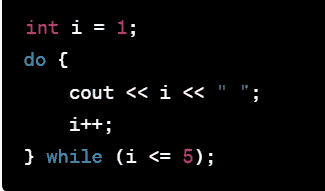

### 分支：break 和 continue

在某些情况下，我们可能需要提前跳出循环，或者跳过当前迭代并进入下一次。C++ 提供了 `break` 和 `continue` 语句用于这些目的。

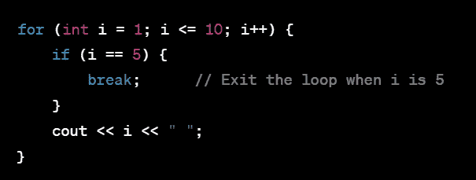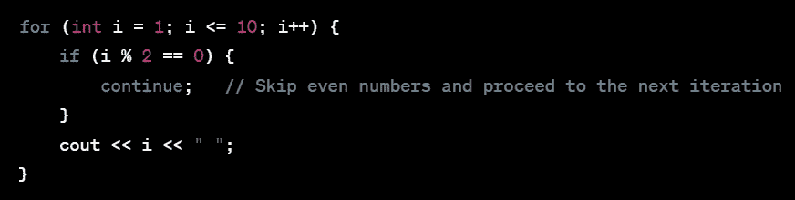

## 做出明智决策：条件运算符

除了 `if` 语句外，C++ 还提供了允许简洁决策过程的条件运算符。这些运算符在赋值或评估表达式时经常使用。

### 三元运算符

三元运算符 `? :` 是表达简单 `if-else` 语句的简洁方式。

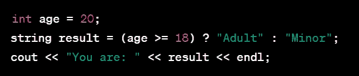

### 逻辑运算符

逻辑运算符，例如 `&&`（与）、`||`（或）

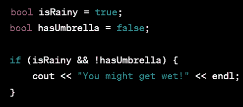

在本章中，我们开启了穿越 C++ 编程中控制结构和决策过程的精彩之旅。我们探索了条件语句的力量，使我们能够在程序中做出明智的选择。此外，我们还学会了如何运用循环的力量，使我们能够高效地重复任务。通过分支的知识，我们可以以更动态、更灵活的方式控制执行流。

在下一章中，我们将深入 C++ 编程的核心，在那里我们将探索函数和模块化编程。这些概念将使你能够创建优雅且可用的代码，解锁你编程造能力的真正潜力。因此，让我们继续这段令人兴奋的冒险，将我们的编程技能提升到新的高度。

# 第 3 章：函数与模块化编程

## 编写高效代码

在计算机编程领域，创建高效且复用代码的能力是资深开发者推崇的艺术形式。函数和模块化编程提供了开启这种精通的关键，使程序员能够将复杂任务分解为更小、易管理的部分。在本章中，我们将开启学习在 C++ 编程语言中创建函数和将代码组织成模块的艺术。在本章结束时，你将拥有编写优雅高效代码的能力，这些代码可以被重复使用和轻松维护。

## 函数的美

模块化编程的核心是函数概念。函数封装了功能，让程序员关注单个组件，而不必担心整个程序的细节。

### 函数声明与定义

在 C++ 中，函数在首次使用之前声明。函数的实际实现被称为定义。

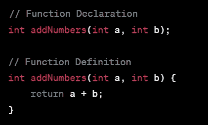

### 函数调用

要使用函数，我们通过其名称调用它，传递所需的参数（如果有）。然后函数执行其代码并返回值（如果指定）。

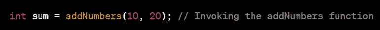

### 返回值与 void 函数

函数可以使用 `return` 语句返回值。如果函数不需要返回值，其返回类型可以声明为 `void`。

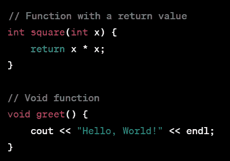

### 函数重载

C++ 允许函数重载，即多个函数可以具有相同的名称但不同的参数列表。这使我们能够为不同数据类型执行相似任务的函数。

## 将代码组织成模块：头文件与实现文件

随着程序复杂性的增加，将所有代码管理在一个文件中变得非常困难。模块化编程通过将代码分解为更小的逻辑单元（模块）提供了解决方案。在 C++ 中，这是通过头文件和实现文件实现的。

头文件

头文件通常包含函数声明、类定义和全局变量声明。它作为其他代码文件的接口，允许这些文件使用其中定义的函数和类。

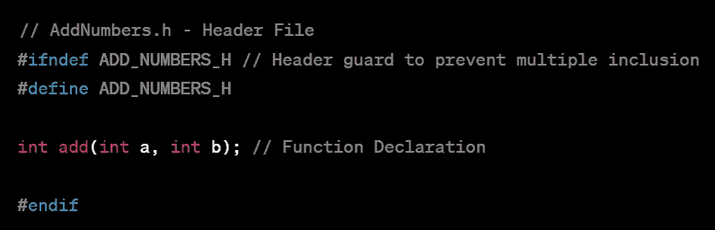

## 实现文件

实现文件（`.cpp`）包含头文件中声明的函数的实际代码。它提供了函数和类的定义。

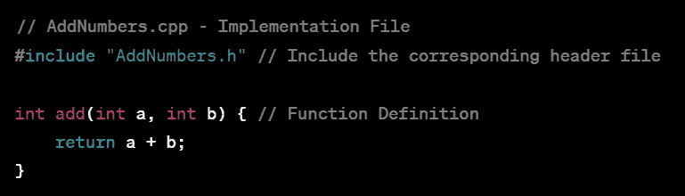

## 模块化编程的益处

模块化编程具有许多优点，包括：

*   代码可重用性：函数和类可以在程序的多个部分或不同的项目中重用，促进高效的开发和维护。
*   增强可读性：将代码拆分为较小的模块可以提高代码的可读性，使其更易理解和调试。
*   易于协作：不同的开发者可以同时处理不同的模块，从而简化协作工作。

## 函数作用域与生命周期

在 C++ 中，函数具有其作用域，作用域定义了函数内部声明的变量的可访问区域。此外，每个变量都有其生命周期，表示它在内存中存在的时间。

### 局部变量

它们只能在函数的代码块内访问，其生命周期限于函数的执行。

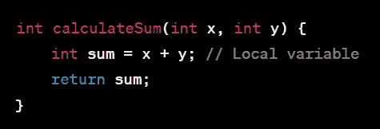

### 全局变量

在任何函数之外、在程序开始处声明的变量被称为全局变量。它们具有全局作用域，使得可以从程序的任何部分访问它们。

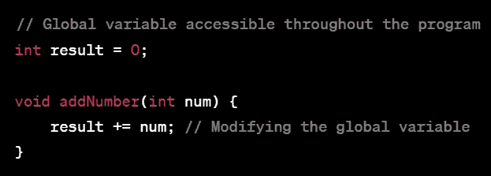

### 静态变量

在函数内部声明的静态变量在函数调用之间保留其值。它的生命周期延伸到函数执行之外。

在本章中，我们探索了 C++ 中函数和模块化编程的强大概念。我们学习了函数如何帮助我们将复杂任务分解为更小、易于管理的单元，从而提高代码的可用性和可维护性。此外，我们深入研究了使用头文件和实现文件将代码组织成模块的艺术，实现了更好的代码组织和协作。

凭借这些新知识，你现在拥有了编写高效且优雅代码的工具，确保你的程序不仅功能完备，而且可扩展且可维护。在下一章中，我们将深入探索 C++ 的核心，研究指针和内存管理，使你能够利用内存和数据操作的真正力量。因此，让我们继续这段令人兴奋的旅行，开启编程能力的新境界。

# 第 4 章：指针与内存管理

## 驾内存的力量

在 C++ 编程的复杂世界中，指针和内存管理的掌握是区分熟练者与新手的决定性技能。指针提供了与底层内存的直接连接，允许程序员以精确且精练的方式操作数据。另一方面，内存管理确保了内存资源的高效分配和释放。在本章中，我们开启了一段旅程，探索 C++ 编程语言中指针和内存管理的深度领域。通过深入研究这些概念，你将拥有执行高级数据操作和编写优化内存使用程序的程序。

## 秘指针：深度解析

这个看似简单的概念开启了通复杂数据操作和动态内存分配的大门。指针使我们能够直接与内存工作，从而实现使用普通变量无法完成的任务。

### 声明和初始化指针

要声明指针，我们我们在变量名之前使用星号 `*` 符号。指针在使用之前必须用变量的内存地址进行初始化。

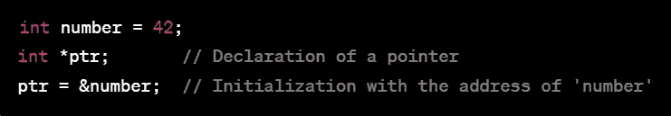

### 解引用指针

这是通过星号 `*` 符号实现的。

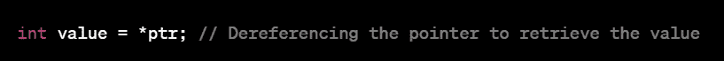

### 指针算术

指针支持算术运算，允许我们遍历内存。当我们对指针进行算术运算时，结果会根据它所指向的数据类型的大小进行调整。

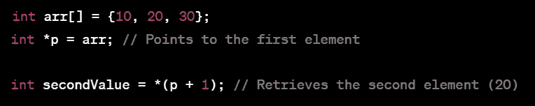

### 空指针与内存安全

指针还可以被赋予特殊值：`nullptr`，它表示指针当前没有指向任何有效的内存地址。妥善处理指针（包括检查空指针）对于确保内存安全和防止崩溃至关重要。

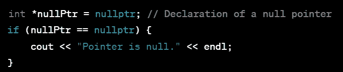

## 动态内存分配：宝贵的资源

普通变量具有固定的内存分配，而动态内存分配提供了在程序执行期间分配和释放内存的能力。在处理不同大小的数据结构或在编译时尚不确切内存需求时，这种灵活性是无价的。

### new 和 delete 运算符

C++ 提供了 `new` 运算符用于在堆上动态分配内存，并提供了 `delete` 运算符用于在不再需要内存时释放已分配的内存。

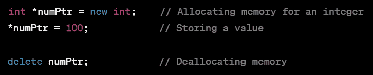

### 动态数组

动态内存分配也扩展到数组，允许创建在运行时确定大小的数组。

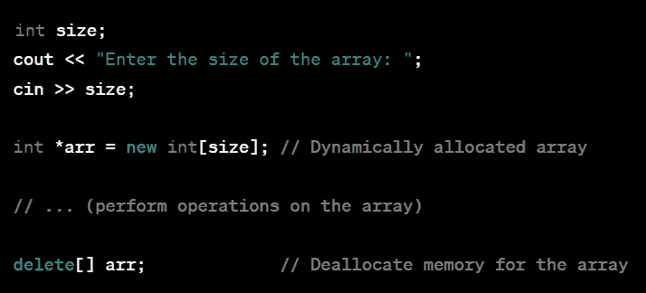

### 内存泄漏与智能指针

不当的内存管理会导致内存泄漏，即分配的内存没有被正确释放，导致内存浪费。`C++11` 中引入的智能指针通过自动管理内存释放，为传统指针提供了一种更安全的替代方案。

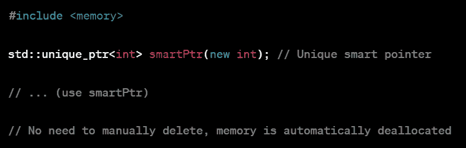

## 使用 RAII 管理内存

资源获取初始化（RAII）是一项基本的 C++ 编程原则，它主张将资源（如内存）的生命周期与对象的生命周期绑定。RAII 确保资源在对象创建时被正确分配，并在对象离开作用域时自动释放。

### RAII 与构造函数/析构函数

RAII 是通过使用构造函数获取资源、使用析构函数释放资源来实现的。当对象创建时，会调用构造函数来分配资源。当对象离开作用域时，会自动调用析构函数，以确保资源的正确释放。

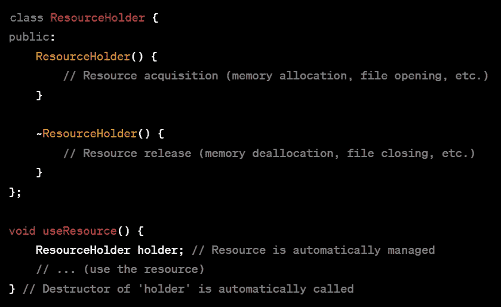

在本章中，我们开启了探索 C++ 编程中指针和内存管理复杂性的旅程。我们探索了指针的力量，它们允许我们直接访问内存并实现高级数据操作。此外，我们深入研究了动态内存分配，这是处理不同大小数据的一项关键技能。

通过

# 第 5 章：面向对象编程

释放全部潜力

各位有志的程序员，大家好！欢迎来到卓越的 C++ 语言中引人入胜的面对象编程（OOP）领域。在本章中，我们将开启一段激动人心的旅程，揭示 OOP 的原则——这种范式使你能够构建出优雅、模块化且可扩展的应用程序。请准备好，我们将一步步深入这个迷人的世界，装备你开发 C++ 真正潜力的工具，并创建出既强大又组织严密的软件。

## 面对象编程的支柱

OOP 的核心是四个基本支柱：封装、继承、多态和抽象。这些支柱构成了现代软件工程的基础，使开发者能够创建出不仅易于理解，而且灵活且可扩展的系统。

## 封装：封装你的数据

`class` 充当创建对象（即 `class` 的实例）的蓝图。封装保护数据免受直接访问，促进了数据完整性和信息隐藏。

### 示例：创建一个类

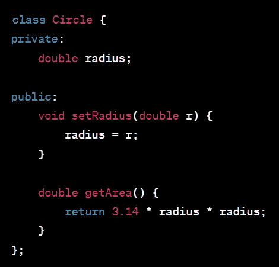

## 继承：扩展蓝图

### 示例：从基类继承

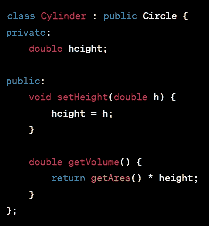

## 多态：多种形式，统一接口

这提高了代码的灵活性，并有助于动态方法绑定。

### 示例：多态行为

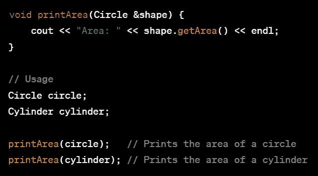

## 抽象：关注核心要素

抽象涉及将现实世界的实体建模为具有简化且相关的属性和方法的 `classes`。它允许你关注高级功能，同时隐藏不必要的细节。

### 示例：抽象银行账户

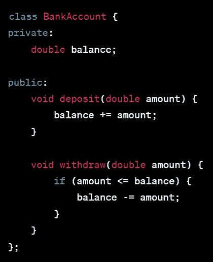

## 构建你的面向对象工具箱

在 OOP 的宏大交响乐中，C++ 提供了一系列工具来释放你的创意。让我们探索一些核心概念，它们将赋予你编写复杂且适应性软件的能力。

### 构造函数和析构函数

构造函数是在对象创建时初始化对象的特殊方法，而析构函数在对象离开作用域时清理资源。

### 示例：构造函数和析构函数

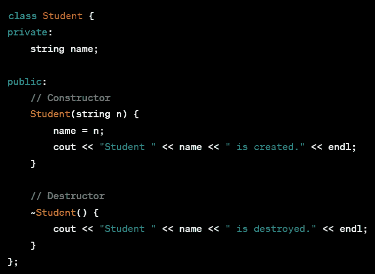

### 成员函数和访问修饰符

成员函数是定义在 `class` 内部的方法。访问修饰符（`public`、`private`、`protected`）控制类成员的可见性。

### 示例：成员函数和访问修饰符

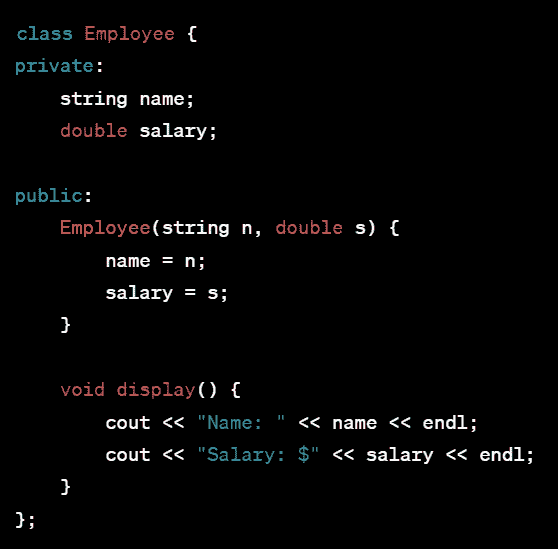

### Getter 和 Setter

Getter 和 Setter 是用于访问和修改 `class` 私有属性的方法，维护数据封装。

### 示例：Getter 和 Setter

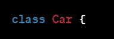

# 第 6 章；高级 C++ 概念

## 突破边界

你好，编程领域的勇敢探险者们！随着我们深入探索 C++ 编程的广阔领域，是时候将我们的技能提升到新的高度了。在本章中，我们将直接进入高级 C++ 概念领域，挖掘强大的工具，使你能够构建健壮、动态且复杂的应用程序。请准备好迎接沉浸式的体验，其中充满了实战示例和实践见解，将赋予你突破编程能力边界的力量。现在，让我们开启通往高级 C++ 世界的惊险探险吧。

## 掌握模板：泛用性的精髓

高级 C++ 的前沿是一个体现了真正泛用精神的概念：模板。模板允许你创建可以无缝处理不同数据类型的函数和类。这一强大功能是现代 C++ 编程的基石，让你能够编写灵活且可重用的代码。

### 函数模板

函数模板允许你创建一个可以在多个数据类型上操作的单一函数。让我们创建一个通用的 `swap` 函数作为示例：

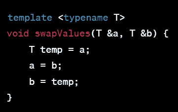

### 使用：

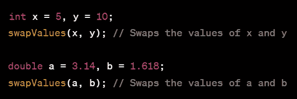

### 类模板

同样，类模板允许你创建可以处理各种数据类型的通用类。让我们构建一个通用的 `Stack` 类：

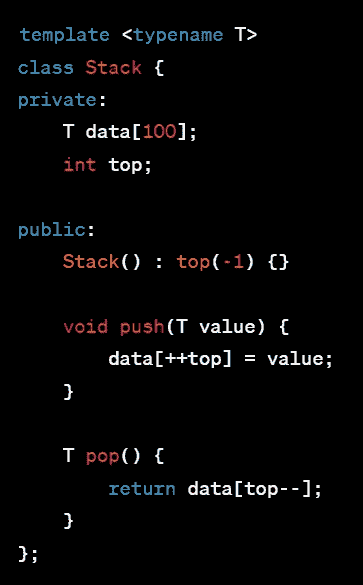

### 使用：

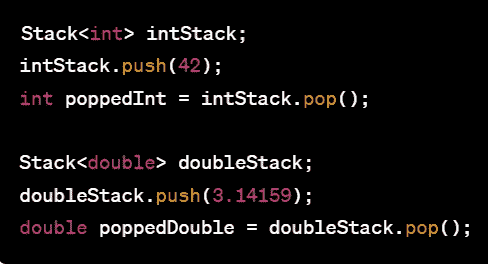

## 处理异常：驯服不可预测性

在不可预测的软件世界中，异常提供了一种优雅处理错误和异常的机制。异常处理允许你检测并响应程序执行过程中可能出现的异常情况。

### 抛出异常

你可以使用 `throw` 关键字抛出异常。让我们创建一个计算数字平方根的函数，并在输入负时抛出异常：

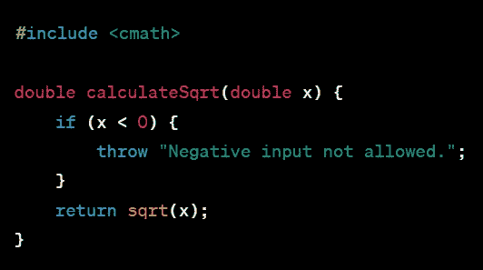

### 使用：

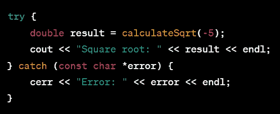

### 捕捉异常

### 自定义异常类

创建自定义异常类允许你提供关于异常性质更详细的信息。让我们用自定义异常类增强我们的平方根示例：

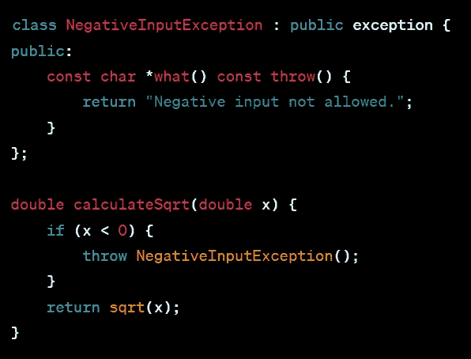

## 掌握文件 I/O：连接数字与现实世界

现代应用程序通常需要与文件交互以读写数据。C++ 提供了一套全面的工具用于高效的文件输入输出操作。

### 写入文件

要向文件写入数据，你需要创建一个输出文件流 (`ofstream`）并使用流的方法写入数据。

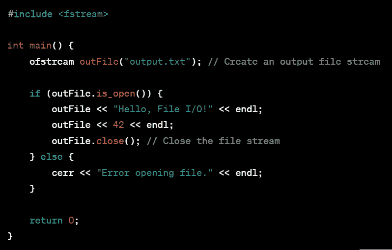

### 从文件读取

要从文件中读取数据，你需要创建一个输入文件流 (`ifstream`）并使用流的方法读取数据。

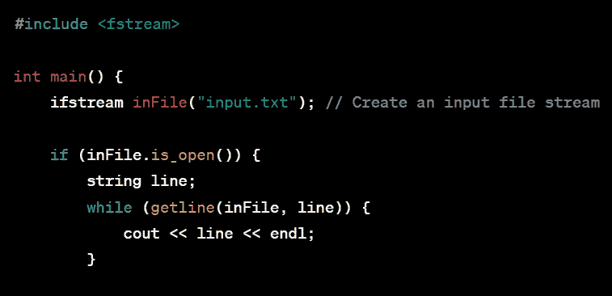

# 第 7 章：现实世界应用

## 将知识付诸实践

恭喜你们，勇敢的学习者们！在穿越了 C++ 编程的深度并获得了了大量知识后，是时候在现实世界中运用新新的新技能了。在本章中，我们将开启一段通过 C++ 在各个领域实际应用的迷人旅程。从软件开发到科学研究，从游戏开发到金融领域，C++ 是一种多功能的语言，赋予你将创意愿景变为现实的能力。在我们展示现实用例时，准备好受到启发，激发你的想象力并激励你以有意义且有影响力的方式释放你的编程能力。

## 构建健壮的软件：从概念到现实

C++ 的核心在于其构建健壮高效软件应用程序的能力。让我们探索一些 C++ 发放异彩的现实场景：

## 游戏开发

C++ 是游戏开发世界的基石，提供了创建沉浸式游戏体验所需的速度和控制。像 `Unreal Engine` 这样的引擎以及 `SFML` 和 `SDL` 等游戏库利用了 C++ 的力量来交付高性能的图形和交互。

在游戏开发的广阔领域中，C++ 作为一个坚实的守护者，凭借其无与伦比的速度和控制力，塑造了沉浸式且迷人的游戏体验。当玩家进入充满奇奇与兴奋的数字世界时，他们往往在不知不觉中穿行于 C++ 程序员亲手打造的景观。从游戏机制的复杂性到图形的视觉盛宴，C++ 在游戏创作的每一个方面都起着关键作用。

## 驱动沉浸式环境
游戏的成功在于沉浸感——创造出一个让玩家沉浸在叙事和互动魔法中的世界。C++ 赋予游戏开发者流畅且精准地打造这些沉浸式环境的能力。语言直接操作硬件资源的能力直接转化为无缝的游戏体验，实现了流畅的动画、栩如真的物理模拟以及响应迅速的用户界面。

## 创意引擎
现代游戏开发的核心是强大的引擎，它们将开发者的愿景变为现实。诸如 Unreal Engine 这样的引擎利用 C++ 的原生力量，为构建规模宏大且视觉惊艳的游戏提供了全面的工具包。这些引擎利用 C++ 的性能优势，交付了令人叹为观止的视觉效果、复杂的关卡设计以及让玩家保持投入的复杂游戏机制。

## 驾驭图形与交互
图形和交互构成了游戏的本质，而 C++ 是实现这些背后的动力。诸如 Simple and Fast Multimedia Library (`SFML`) 和 Simple DirectMedia Layer (`SDL`) 等游戏库都是构建在 C++ 基础之上的，为开发者提供了在游戏中创建高性能图形、处理用户输入和管理音频的方法。

## 跨平台卓越
C++ 的多功能性在跨平台开发领域大放异彩。游戏开发者可以编写在从 PC、主机到移动设备等各种平台上无缝运行的代码。这种在不牺牲性能或质量的情况下为各种设备创建游戏的能力，证明了 C++ 的强大。

## 优化的艺术
在游戏世界中，性能至关重要。玩家要求流畅的帧率、快速的加载时间和流畅的游戏体验。C++ 允许开发者对代码进行精细调整以获得最佳性能，确保最终产品即使在严苛的硬件上也能流畅运行。

## 协作创意
游戏开发通常是一项协作任务，设计师、艺术家和程序员团队和谐工作，创造出统一的体验。C++ 提供了一种连接这些多元才华的通用语言，实现了各种组件的无缝集成，并促进了高效协作。

归根结底，游戏开发领域的魅力很大归功于 C++ 的基石。当玩家沉浸在细节丰富的世界中，开启史诗般的冒险，并参与心跳加速的战斗时，他们对让这一切成为可能的语言感激尽表。因此，无论你是寻求冒险刺激的玩家，还是旨在打造下一部杰作的初级游戏开发者，C++ 的力量都是你通往无限创意和无限乐趣的大门。

## 操作系统
许多操作系统的基础都是用 C++ 构建的，包括 `Windows`、`macOS` 和 `Linux` 的部分。C++ 与硬件交互和管理系统资源的能力使其成为创建稳健高效操作系统的理想选择。

投身科技的核心，你会发现操作系统正在编织硬件与软件交响乐的复杂舞蹈。在 `Windows`、`macOS`、`Linux` 等系统的背后，C++ 作为一个关键架构师出现，利用其精湛的技术构建了这些数字景观的基础。凭借与硬件建立接口和管理系统资源的卓越能力，C++ 是构建驱动我们数字生活的稳健、高效且多功能操作系统的首选语言。

### 硬件接口
操作系统是软件和硬件之间的中介，将高层指令翻译成硬件可以理解的动作。C++ 的低级能力允许操作系统开发者编写直接与硬件组件交互的代码，从管理内存和控制输入/输出设备到调节处理器操作。这种级别的控制确保了操作系统能够高效地管理和优化其所拥有的硬件资源。

### 内核开发
每个操作系统的核心都是内核——这是一部分负责基本任务（如进程管理、内存分配和硬件通信）的软件。C++ 低级控制与高层抽象的结合使其成为开发内核的理想选择。内核开发者利用 C++ 创建复杂的系统，无缝处理多任务、中断处理和内存保护等任务。

### 系统服务与库
除了内核之外，C++ 在构建构成操作系统骨干的系列系统服务和库方面起着关重要的作用。文件系统、网络协议、设备驱动程序和图形界面都是用 C++ 精心打造的，确保了最优性能、稳定性和安全性。

### 可移植性与性能
C++ 的美之处在于它能够平衡可移植性与性能。这一属性在操作系统中尤为关键，因为跨不同硬件架构和设备的兼容性是至关重要的。C++ 允许开发者创建既高效高效又易于移植的代码，使操作系统能够在各种硬件配置上无缝运行。

### 跨平台通用性
操作系统不受限于单一平台；它们需要适应各种硬件和软件环境。C++ 的跨平台能力使其成为开发操作系统的理想选择，使其能够在不同设备之间无缝切换，确保一致且可靠的用户体验。

## 案例分析：Windows
C++ 在操作系统中发挥作用的一个典型例子是微软 Windows。`Windows` 操作系统的很大一部分（包括其核心组件和关键系统服务）都是使用 C++ 构建的。从内核到设备驱动程序再到用户界面，C++ 在这个广泛使用的操作系统架构中扮演着不可或缺的角色。

在操作系统的巨大数字织锦中，C++ 将硬件交互、系统管理和软件编排的复杂线条缝合在一起。当你穿梭于数字世界时，无论是点击桌面上的图标、滑动移动应用，还是探索命令行，请记住，你所享受的无缝体验部分得益于 C++ 在操作系统领域的精湛工艺。

## 软件库
C++ 拥有许多强大且广泛使用的软件库。标准模板库 (`STL`) 提供了数据结构和算法，而 Boost 则提供了从网络到多线程的各种高级功能。

在 C++ 软件库领域的核心，是标准模板库（STL），它是编程中优雅与高效的体现。STL 为开发者提供了一套全面的数据结构和算法，这些内容封装在一系列模板类和函数中。有了 STL，排序、搜索和处理数据等复杂任务变得像组装积木一样简单。

### 示例：使用 STL 的 Vector

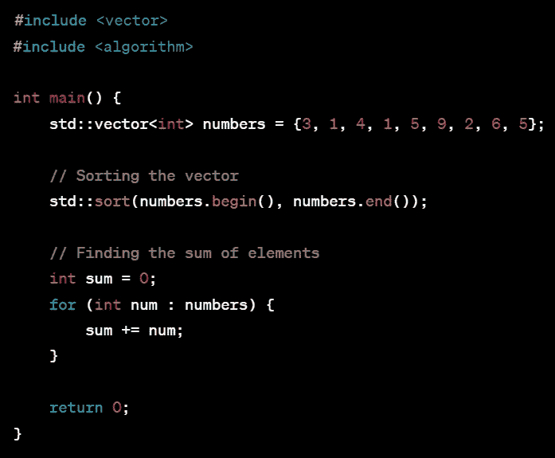

## Boost 库

跨越 STL，你将会遇到 Boost 库——这是一个包含高级功能和工具的宝库，它将 C++ 提升到了新的高度。Boost 提供了极其广泛的功能，从数学计算到多线程和网络编程，应有尽有。通过 Boost，开发者可以轻松地利用复杂的能力，而避免了在处理复杂任务时重复造轮子。

### 示例：使用 Boost 的文件系统库

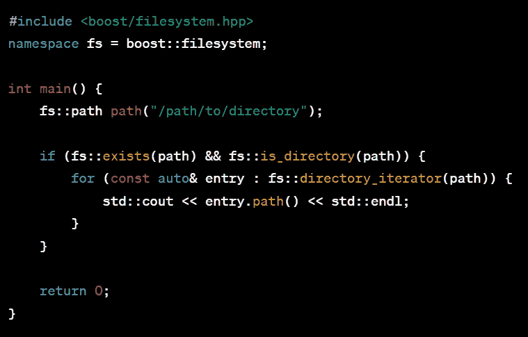

## 充满可能的世界

这些库通过提供经过良好测试和优化的解决方案并将其无缝集成到项目中，为开发者节省了无数小时的时间。

从轻松管理复杂的数据结构到处理复杂的网络协议，C++ 的软件库赋予了开发者应对各种挑战的能力。有了这些工具，你可以将你的创造力投入到构建创新应用中，而不会被实现中的细碎细节所困扰。因此，无论你是在雕刻算法，还是在数字领域中建立连接，请记住，C++ 的软件库宝库是你开启无限可能世界的钥匙。

## 科学计算：宇宙建模

C++ 不局限于软件开发——它还是科学计算和模拟领域的关键角色。

在迷人胜的科学探索世界中，C++ 不仅仅是一种代码语言，更是一种通过计算艺术破解宇宙秘密的强大工具。在软件开发角色之外，C++ 作为科学计算和模拟的关键角色屹立不，促进了对塑造我们现实的复杂现象的建模、分析和理解。从天体物理学到生物信息学，C++ 是科学家跨越知识前沿的通道，揭开宇宙的奥秘，揭开生命本身复杂的织锦。

### 科学与计算的纽带

科学计算是一项多学科的任务，它将科学原理与计算方法融合。它涉及制定数学模型来模拟现实世界的现象，并以计算机程序的形式实现这些模型。科学与计算的融合允许研究人员探索和实验那些在其他情况下可能不切、危险甚至无法直接观察的场景。

### 复杂模拟的交响乐

在科学计算领域，C++ 就像交响乐团的指挥，协调着复杂的模拟。它是理解自然规律的强大工具。研究人员利用 C++ 创建了模拟：

- **天体物理学**：C++ 帮助天体物理学家模拟星系。这些模拟探索了黑洞和引力波。
- **分子动力学**：在生物化学领域，C++ 驱动着分子动力学。这些模拟为理解生物过程提供了见解。
- **气候建模**：C++ 是气候建模的基石，使研究人员能够模拟温度和降水，以评估人类活动的影响。

## C++ 在科学计算中的作用

C++ 提供了独特的特性组合，使其成为不可或缺的工具：

- **性能**：C++ 的效率在科学计算中至关重要，因为模拟涉及海量数据集以及对内存管理的低级控制。
- **可移植性**：C++ 的跨平台特性允许科学家开发运行在各种硬件和操作系统上的模拟。
- **集成**：C++ 与现有库无缝集成，例如 `NumPy` 和插值函数科学库 (`SLATEC`）。

### 案例：粒子物理学

C++ 在科学计算中作用的最具标志性的例子之一是它在粒子物理学中的应用。位于 `CERN` 的大型对子加速器（`LHC`）从粒子碰撞产生海量数据。C++ 在开发软件框架方面起着关键性作用，这些框架用于筛选数据、重建粒子轨迹并识别有助于理解基础单元的稀有事件。

从本质上，C++ 成为了科学家描绘假设、实验和发现的画布。它弥合了抽象数学概念与具体见解之间的鸿沟，允许研究人员跨越未知领域。当你思考宇宙的神秘领域或深入研究生物系统的复杂性时，请记住，C++ 这一科学计算的静默哨兵，是你在这场智力远征上的忠实指南。

# 效率与性能

在数值计算领域，效率是至关重要的。`C++` 具有处理科学仿真所需的巨量计算的性能特性：

*   **低级控制**：`C++` 允许开发者通过优化内存使用、减少开销以及采用针对硬件的优化来精调算法。这种级别的控制确保了数值计算能够以最高效率执行。
*   **并行性**：数值计算的世界依赖于并行处理。`C++` 使开发者能够利用多线程和并行执行的力量，极大地缩短可以并发执行任务的计算时间。

## 案例分析：Eigen 库

`C++` 在数值计算领域实力的一个典范是 `Eigen` 库。`Eigen` 提供了一组用于线性代数运算的 `C++` 模板，研究人员能够无与伦比的速度和准确性执行复杂的矩阵计算。`Eigen` 直观的语法与 `C++` 的无缝集成使其成为科学和工程应用的首选。

## 驱动科学发现

当科学家们探索未知的发现领域时，由 `C++` 驱动的数值计算库为突破性的见解铺平了道路。它们为研究人员提供了工具，用于模拟复杂系统、预测复杂行为以及分析海量数据集。无论是模拟粒子的碰撞，还是解码基因序列的奥秘，`C++` 都赋予了科学家利用数字语言的能力，开启了数学美学与经验现实交汇的大门。

## 物理仿真

研究人员和科学家使用 `C++` 来建模和模拟复杂的物理系统，范围从粒子物理学到流体动力学等。`C++` 的计算效率和处理大型数据集的能力使其成为这些领域中无价之宝工具。

走进物理仿真的领域，宇宙中不可见的力量通过计算的艺术被赋予了生命。这一领域的核心是 `C++`，一种多功能且强大的工具，研究人员和科学家利用它来建模和揭开物理系统错综复杂的织锦。从极微小的亚原子粒子到天体的宏伟壮丽，`C++` 成为一个可靠的伴侣，能够模拟塑造宇宙并主宰自然法则的现象。

### 代码中的宇宙

物理仿真是科学家在各种条件下探究物理世界行为的数字实验室。`C++` 凭借其处理复杂数学方程和计算任务的能力，成为了这些仿真得以成生的媒介。

*   **粒子物理学**：`C++` 赋予研究人员深入量子领域的能力，模拟构成物质基础的粒子的行为。粒子碰撞、相互作用和衰变的仿真为理解支配宇宙的基本力提供了见解。
*   **流体动力学**：从气流的运动到液体的流动，`C++` 仿真破解了流体行为的秘密。这些仿真在气象学、空气动力学和环境科学等领域起着至关重要的作用。
*   **天体物理学**：`C++` 是模拟宏大天体运行的基础，从恒星的诞生到星系的碰撞。这些仿真提供了对在天文时间尺度上展开的宇宙事件的一窥。

### 实践中的计算效率

`C++` 的计算效率是其在物理仿真中表现出色的基石。在科学计算领域，仿真涉及复杂的数学计算和海量数据集，`C++` 作为一种能够处理这些计算的复杂性和规模的工具表现得脱颖而出：

*   **复杂方程**：`C++` 管理复杂数学方程的能力使科学家能够精确地模拟复杂的物理相互作用。描述粒子、波和力行为的方程被翻译成代码，在数字环境中模拟这些现象。
*   **并行性**：物理仿真通常需要同时进行大量计算。`C++` 对并行执行的支持允许研究人员将计算分布到多个处理器核心上，显著加速了仿真时间。

### 案例分析：格点 QCD 仿真

`C++` 在物理仿真中作用的一个典型展示是格点量子色动力学（QCD）领域。在该领域中，研究人员使用 `C++` 模拟夸克和胶子的行为——这些是组成质子、中子和其他强子子的基本粒子。这些仿真为结合原子核的强力提供了见解，对物质的构建部分提供了更深的理解。

## 揭示自然的蓝图

当我们深入探索宇宙并近距离观察自然的复杂性时，`C++` 成为了一盏照亮发现之路的灯塔。它驱动的仿真允许科学家可视化超越人类感官的现象，将复杂的数学理论转化为具体的视觉效果。以 `C++` 为盟友，研究人员开启了揭开现实秘密的旅程，审视空间、时间和物质本身的结构。

## 金融工程：驯服市场

`C++` 是金融工程世界的驱动力，复杂的算法和数据分析被用于做出明智的投资决策。

### 算法交易
高频交易依赖闪电般的算法来分析市场数据并执行交易。`C++` 的速度和控制力使其成为构建交易系统的首选语言。

### 风险管理
金融机构使用 `C++` 开发风险评估和管理系统，分析市场趋势、预测风险并优化投资组合。

## 嵌入式系统：驱动物联网

`C++` 的效率和低级控制使其成为构建嵌入式系统软件的首选。

### IoT 设备
从智能家电到可穿戴技术，`C++` 被用于创建 IoT 设备的软件，使其能够通信、处理数据并与用户交互。

### 汽车系统
现代车辆配备了用于安全、导航和娱乐的复杂嵌入式系统。`C++` 在开发这些系统中发挥着关键作用，确保了无缝集成和可靠性能。

## 结论：将想法变为现实

当我们结束对 `C++` 现实应用的探索时，显而易见可能性是无限的。无论你是在创作沉浸式游戏、深入科学研究、优化金融策略，还是创建新的 IoT 设备，`C++` 都提供了将你的想法变为现实的工具。旅程并未此结束——你对 `C++` 的精通开启了无尽的机会和创造空间。因此，带着信心前进吧，请相信你的 `C++` 技能可以以深刻且有影响的方式塑造世界。

## 进一步探索

当你开启在现实场景中应用 `C++` 的旅程时，考虑探索以下在线平台：

*   [GitHub](https://github.com/)：发现开源 `C++` 项目并向全球编程社区贡献。
*   [Hackerrank](https://www.hackerrank.com/domains/tutorials/10-days-of-javascript)：通过各个领域的挑战和竞赛来练你的编程技能。
*   [LeetCode](https://leetcode.com/)：解决编程问题，提高解决问题的能力，并与活跃的编程社区互动。
*   [Kaggle](https://www.kaggle.com/)：深入研究数据科学和机器学习项目，与全球专家合作。

记住，程序员的旅程是一个不断学习和成长的过程。因此，请抓住每一个机会，拥抱挑战，并在将你的 `C++` 知识应用于动态且不断演变的技术领域时，让你的创造力绽放。

# 结论

当我们为这段穿越 `C++` 世界之旅拉上帷幕时——这是一场代码与创造的交响乐——我们发现自己正处于知识与创新的十字路口。我们所走过的道路是一条发现之路，逻辑与语法之间复杂的交织揭示了理解的新维度。从为每行代码奠定基础的基础概念，到推着我们进入精通境界的高级技术，我们以严谨和好奇的心态探索了 `C++` 的领域。

在这些篇章中，我们曾扮演过学习者、探险者和创造者的角色。我们深入研究了构建算法的艺术，让数据听从指挥，并塑造了为我们的思想注入生命的应用程序。我们拥抱了面向对象的设计原则，揭示了类、`objects` 和抽象的力量。我们利用了内存管理的威力，掌握了 `pointers` 和动态分配的细微差别。随着旅程的不断，我们展开了高级主题的画布，将多线程、图形界面及其他技术的丝线交织在一起。

然而，这本书不仅仅是概念和代码片段的集合——它是一份对终生追求知识与创新的邀请。当我们告别时，请记住，编程世界是不断演变的，是一片充满无尽挑战与机遇的海洋。带着在这些页码中获得的知识，你正站在可能性的边缘，准备好去探索未知的领土，创建开创性的应用程序，并塑造技术的未来。

拥抱挫败的时刻，因为它们通向突破。享受胜利，因为它们点燃你的激情。当你向远方进发时，永远不要忘记旅程的快感——那种掌握一项能够让你创造世界、桥接鸿沟并在数字格局上留下不可磨灭印记的技艺的快感。

当你结束这一章时，请记住旅程并未此结束。`C++` 的世界是广阔无无边际的，你的道路由引领你走到这里的好奇心和决心所照亮。你写下的每一行代码，攻克的每一项挑战以及你设计的每一个解决方案，都在塑造着你自己的叙事轨迹。

所以，前进吧，代码的同路者，拥抱等待着你的挑战、喜悦和无限可能。愿你的努力以创新、协作和对卓越的不懈追求为标志。`C++` 的未来以及它影响的世界，现在交由你来塑造。

一路顺风，愿你的代码继续织就进步与天才的织锦。

# 参考文献

1. Stroustrup, B. (2013). The `C++` Programming Language. Addison-Wesley Professional.
2. Eckel, B. (2000). Thinking in `C++`, Volume 1. Prentice Hall.
3. Lippman, S. B., Lajoie, J., & Moo, B. E. (2012). `C++` Primer. Addison-Wesley Professional.
4. Stroustrup, B. (2014). Programming: Principles and Practice Using `C++`. Addison-Wesley Professional.
5. Schlick, C. (2019). `OpenGL` Insights. CRC Press.
6. Hirschberg, D. S., Sinclair, A. H., & Stockmeyer, L. J. (1987). Parallel construction of range, prefix, and suffix trees. Journal of the ACM (JACM), 37(3), 488-514.
7. Arora, R., & Barak, B. (2009). Computational complexity: A modern approach. Cambridge University Press.
8. `C++` Standard Committee. (2017). ISO/IEC 14882:2017—Programming Languages—`C++`. International Organization for Standardization.
9. Bjarne Stroustrup's Homepage. ([`www.stroustrup.com/`](https://www.stroustrup.com/))
10. Boost `C++` Libraries. ([`www.boost.org/`](https://www.boost.org/))
11. Eigen: `C++` template library for linear algebra. ([`eigen.tuxfamily.org/`](http://eigen.tuxfamily.org/))
12. CERN - The European Organization for Nuclear Research. ([`home.cern/`](https://home.cern/))
13. Numerical Recipes: The Art of Scientific Computing. ([`numerical.recipes/`](http://numerical.recipes/))
14. GitHub - Open source code hosting. ([`github.com/`](https://github.com/))
15. Stack Overflow - Q&A for professional and enthusiast programmers. ([`stackoverflow.com/`](https://stackoverflow.com/))
16. `C++` Reference. ([`www.cplusplus.com/`](http://www.cplusplus.com/))

# 术语表

**Algorithm**：解决问题或执行任务的一系列分步骤的指令，通常表示为一组定义良好的动作序列。

**Compiler**：一种将高级编程代码翻译成机器可读代码的软件工具，使计算机理解并执行程序。

**Data Structure**：在计算机内存中组织和存储数据的方法，旨在便于高效的数据检索和处理。

**Function**：一个执行特定任务或计算的自包含代码块，通常接受输入参数并返回结果。

**Header File**：一个包含声明和定义的文件，用于在程序的多个部分之间共享信息。

**Library**：一组预先编写好的函数、类和数据结构，用于扩展语言的能力。

**Memory Management**：在执行过程中分配和释放计算机内存的过程，以高效管理数据。

**Object-Oriented Programming (OOP)**：一种编程范式，它使用对象（类的实例）来模拟现实世界的实体及其交互。

**Pointer**：存储另一个变量内存地址的变量，能够直接访问和操作它指向的数据。

**Standard Template Library (STL)**：一组 `C++` 模板类和函数，提供了常见的数据结构和算法，简化了编程任务。

**Syntax**：规定语言语句结构和格式的规则集。

**Template**：`C++` 中的一种机制，允许泛型类型和函数用于不同的数据类型。

**Variable**：程序内存中的一个命名存储位置，用于保存一个值，该值在程序运行期间可以变化。

**Vector**：`C++` 中的一种动态数组数据结构，它可以自动调整大小并高效管理内存。

除了文学追求之外，Ryan 是一位热情的教育工作者，他乐于引导有抱的程序员探索代码的错综奥秘。他擅长将复杂的课题拆解为易于理解的部分，其耐心且极具吸引力的教学方法赢得了学生和同事的赞誉。他的研讨会和讲座已经赋予了无数人开启自己编程传奇征程的能力。

当 Ryan 不沉浸在软件和技术世界时，你可以发现他正在探索广阔的大外，从自然界复杂的设计中寻求灵感。他这种学习和创造的整体性方法，使他的工作融入了分析分析能力与想象力才华的独特融合。

作为一名作家、程序员和教育者，Ryan Campbell 负着使命使命：点燃好奇心的火花，赋予个人在编程领域开启属于自己的蜕变之旅。通过写作、教学以及对这项手艺的不懈追求，他邀请读者与他一起，揭开塑造我们数字宇宙的代码织锦。

