# C# 编程：从问题分析到程序设计，第3版


## 前言

《C# 程序设计：从问题分析到程序设计》不要求读者事先具备编程入门知识，只要求具备高中数学的数学基础。本书使用 C# 作为软件开发的编程语言；不过，书中介绍的基本编程概念也可应用于许多其他语言。本书并不侧重于 C# 语言的语法，而是使用 C# 语言来介绍通用编程概念。作者相信，一旦你透彻理解了一种编程语言，就能有效地将这些概念应用到其他编程语言中。

## 为什么选择 C#？

C# 在业界正变得非常流行。C# 是一种真正的面向对象语言，包含丰富的指令语句集。C# 是开发 .NET 大部分内容所用的语言，.NET 是 Microsoft 的编程范式，包含 2,000 多个预定义类，这些类构成了框架类库（FCL）。因此，C# 可以访问大量预定义类，类似于 Java 可用的那些类。C# 提供的工具可以轻松创建图形用户界面——类似于 Visual Basic 程序员多年来一直使用的工具。C# 还提供了 C/C++ 程序员已经习惯的纯粹数据处理能力。但与其他语言不同，C# 是从头设计以适配 Internet 和 Windows 应用程序的。C# 是一种优雅而简单的面向对象语言，允许程序员构建各种应用程序。基于这些原因，本书选择 C# 作为语言。

## 超越传统 CS1 课程

本书面向计算机科学 1（CS1）学生编写，涵盖了计算机科学课程中传统 CS1 基础课程通常涉及的所有基本编程结构。书中包含大量示例和图表来说明基本概念。但本书超越了大多数 CS1 教材的传统内容，并且由于包含许多高级应用，本教材也可用于已经接触过一些编程概念的学生中级课程。

## 高级主题

在建立扎实的编程基础之后，本书介绍快速应用程序开发技术，这些技术可用于构建多种高级类型的应用程序。

本书介绍了泛型、动态数据类型、抽象类、接口以及许多高级面向对象概念。演示了涉及多维数组和其他高级集合类的解决方案。通过说明 Visual Studio 中使用的拖放构建方法，创建 Windows 和 Web 应用程序。向读者介绍事件驱动编程模型，该模型基于在 Windows 和 Web 窗体上以交互方式捕获并响应用户输入。过去，CS1 课程甚至 CS2 课程都不包含这一模型。

对于初次学习编程的读者来说，本书不同寻常地介绍了在 Microsoft Access 等数据库中检索和更新数据的应用程序。书中说明了多种用于连接数据源的视觉开发工具。其他有趣主题包括使用语言集成查询（LINQ）检索数据、开发独立的 .dll 组件（类库），以及为个人数字助理（PDA）和智能手机等移动设备编写应用程序。所有这些高级特性都在读者透彻理解编程语言中的基本组成部分之后才讨论。

## 第三版的变化

《C# 程序设计：从问题分析到程序设计》第三版经过大量修订和更新，以反映 Visual C# 和 .NET 4.0 的最新版本。书中新增了更多高级面向对象概念。所有屏幕截图都更新为 Visual Studio 2010 IDE。新版增加了对开发所用视觉工具的覆盖。更加强调使用 IDE 的拖放技术创建数据绑定应用程序。Windows 应用程序使用 Windows Forms 范式设计，读者还会接触到使用 Windows Presentation Foundation（WPF）构建应用程序。更多 Web 应用程序使用 ASP.NET 母版页和 Visual Studio 中可用的模板设计。除这些变化外，第三版还包括几个新主题。以下概述第三版中的变化。

- 1. 各章新增一节“编码标准”，概述与该章主题相关的可接受约定或指南，通常侧重于风格问题。
- 2. 新增网站资源作为各章参考。
- 3. 第 1 章和第 2 章合并，读者从第 1 章开始就立即开发应用程序。
- 4. 在向读者介绍编写自己的类之前，用完整一章讲述方法和行为。
- 5. 用完整两章讲述集合类。读者首先在第 7 章接触数组基础。第 8 章在此基础上使读者能够创建多维数组、ArrayList，以及哈希表、队列和栈等其他集合。
- 6. 第 9 章包括几个新的 Windows 窗体控件。读者还会在第 10 章接触使用 Windows Presentation Foundation（WPF）创建 Windows 应用程序。
- 7. 第 11 章“高级面向对象编程特性”经过扩展，以说明 C# 4.0 中包含的新动态类型。新增密封类，并扩展了泛型部分。
- 8. 第 14 章还介绍 LINQ 以及一组查询运算符，用于独立于数据源查询和操作数据。介绍隐式类型变量和查询表达式。第 14 章更加强调说明可用于创建显示和更新表数据的应用程序的视觉工具。
- 9. 使用 Visual Studio 2010 设计新的 ASP.NET 网站会创建母版页和级联样式表（CSS）文件。本新版第 15 章对这两种文件类型都进行了说明。
- 10. 附录 A“自定义 Visual Studio 开发环境”已更新，以突出 Visual Studio 2010 中可用的功能。附录 B“代码编辑器工具”包含更多说明和图表。它还突出介绍了类图的使用。

## 方法

本书很早就介绍基于面向对象软件开发的问题求解方法，并在全书中使用。每章末尾给出编程示例，每个示例都遵循一致的方法：分析问题规格、设计解决方案、实现设计，以及验证或确认解决方案结构。

作者认为，学习编程的最佳方式是亲身体验编程。这一假设推动了本教材所呈现的内容。在介绍新概念时，使用图表和插图进行描述。示例在展示和讨论时都与所介绍的概念相关。通过动手实践的学习方法，读者通过完成章末练习来练习和巩固所介绍的概念。全书还鼓励读者探索并利用构成框架类库（FCL）的 2,000 多个类。

每章开头都有目标列表和上一章的简要概述。每章正文辅以图表和表格，帮助视觉学习者掌握所介绍的概念。每章都穿插了关于所介绍概念的有用提示和技巧，并且随着每章新概念的介绍嵌入代码片段。此外，每章都包含完整可运行的程序，展示使用 C# 的应用程序。每章末尾都有“编码标准”一节，概述与该章主题相关的可接受约定或指南，重点在于风格问题。该章涵盖的主要要点摘要和复习练习


包括客观题和主观题两种形式。每章包含10个编程练习，使读者有机会体验编程。

## 将本书用于两门不同课程

尽管本书主要面向入门编程课程，但也适用于中级课程。对于向学生介绍编程的课程，应详细讲授第1章至第8章。根据学生掌握材料的速度，课程可以在第8章之后的任意一章结束。例如，以第9章《Windows 编程简介》结束，会让学生有机会对在后续学期继续编程学习产生兴趣。

对于第一门课程使用不同语言讲授的中级课程，可以阅读第1章最后一部分以及附录A和B，使读者了解如何使用 Visual Studio 运行应用程序。可以鼓励学生浏览第2章至第7章，并更全面地复习第8章。浏览这些章节时，学生可以将 C# 语言的细节与他们已经掌握的编程语言进行比较和对照。

对于第一门课程使用 C# 讲授的中级课程，应复习第4章、第7章和第8章，因为这些章节涵盖的主题——创建自己的类和数组——通常对学生来说更难掌握。中级课程还将包括从第9章开始的本书其余部分。

## 各章概述

第1章简要回顾计算机和编程语言的历史，包括 C# 和 .NET 的演变。本章解释结构化编程与面向对象编程的区别，并介绍本书其余部分使用的软件开发方法。本章描述可使用 C# 开发的各类应用程序。它讨论 C# 程序中的基本元素，并说明如何编译、运行和调试应用程序。

第2章的重点是数据类型和表达式。读者将理解类型、类和对象之间如何关联。他们还将学习如何对数据执行算术过程、如何显示格式化数据，以及如何使用运算符优先级计算表达式。第3章通过介绍数据的方法和行为来扩展对数据的操作。读者学习编写调用方法的语句，并编写自己的类方法。他们学习如何向有返回值的方法和无返回值的方法传递参数。

读者在第4章学习创建自己的类。本章介绍类的组成部分，包括数据成员、属性成员和方法成员。还编写特殊方法，包括构造函数。

第5章和第6章介绍改变顺序执行流程的控制结构。第5章介绍选择控制结构。示例说明用于做出决策的单向、多向、switch 和三元运算符。第6章介绍循环。探讨包括 while、for、do while 和 foreach 在内的丰富迭代运算符。还探讨递归解决方案。

第7章讨论数组。本章描述如何声明数组元素并在编译时初始化数组元素。介绍 Array 类及其许多成员。第8章包括 string 类和 ArrayList 类的方法。第8章还介绍多维数组和其他集合类，包括堆栈、队列和哈希表。

第9章和第10章介绍一种不同的编程方式，它基于对事件的交互式响应。介绍 FCL 中用于创建 Windows 应用程序的若干类。第9章讨论良好设计的要素。第9章还探讨委托。介绍 Visual Studio 的拖放式快速应用程序开发方法，并在这些章节中使用。第10章还介绍 Windows Presentation Foundation (WPF)，作为创建 Windows 应用程序时 Win Forms 的一种替代方法。

第11章的重点是高级面向对象编程特性。读者将接触基于组件的开发，并学习如何创建自己的类库文件。详细讨论继承、接口、抽象类、密封类、泛型类型、分部类和多态编程。第11章还包括重写、重载以及虚方法的使用等高级特性。读者还会在第11章研究静态类型与动态类型。

第12章讨论调试和异常处理技术。本章介绍 Visual Studio 中可用的工具之一——调试器，它可用于观察运行时环境、仔细查看代码并定位逻辑错误。讨论用于处理异常的 try...catch...finally 块。除了讨论 .NET 异常类之外，还设计自定义异常。

第13章介绍创建、打开、关闭、读取和写入文件的基础知识。介绍用于处理文件和目录系统的主要类。第14章介绍若干统称为 ADO.NET 的新命名空间，它由一组托管库类组成，可用于与数据库交互。本章说明如何使用 ADO.NET 类检索和更新数据库中的数据。本章涵盖 Visual Studio 中可用的可视化编程工具和向导，它们可简化数据访问。第14章还介绍语言集成查询 (LINQ)。

第15章的重点是 Web 应用程序。读者将探索基于 Web 的应用程序的设计与 Windows 应用程序有何不同。他们了解静态网页和动态网页之间的区别，以及 HTML 和 Web 服务器控件有何不同。介绍母版页和级联样式表。第15章还包括对移动应用程序的介绍，这些应用程序可在个人数字助理 (PDA) 等小型个人设备上查看。第15章说明如何使用验证控件检查用户的输入值，并展示第14章介绍的 ADO.NET 类如何与 Web 应用程序一起用于访问数据库记录。

附录A提供有关自定义集成开发环境 (IDE) 外观和行为的建议。附录B讨论 Visual Studio 的代码编辑器功能。描述代码片段和重构。这些新功能通过减少输入程序语句所需的击键次数来提高程序员生产力。本附录还说明如何使用类图以可视化方式开发应用程序。附录C列出 Unicode 和 ASCII（美国信息交换标准代码）字符集。附录D显示 C# 运算符的优先级，附录E列出 C# 关键字。

## 特色

本书每章都包含以下特色。这些特色既有利于课堂学习，也能让你按照自己的节奏学习材料。

- 四色内文设计展示准确的 C# 代码及相关注释。
- 学习目标概述本章详细讨论的概念。
- 全书数百幅可视化图表说明难点概念。
- 语法框展示不同类型语句的一般形式。
- 编号示例用相关代码说明关键概念，代码后通常附有示例运行。随后的解释描述最难代码行的功能。
- 注释强调本章所介绍概念的重要事实。
- 包含大量表格，以紧凑方式描述和总结信息，便于查看。
- 新增的“编码标准”部分总结与本章主题相关的可接受约定或指南。
- 列出互联网站点，包括可用于强化概念的教程。
- 编程示例是章末展示的完整程序。这些示例包含准备问题规格说明、分析问题、设计解决方案和编写解决方案代码等不同阶段。
- 快速复习提供本章所涵盖概念的总结。
- 练习进一步巩固学习，并确保学生确实吸收了材料。
- 编程练习要求学生编写具有指定结果的 C# 程序。
- 书末术语表按字母顺序列出所有关键术语及定义，便于参考。


从头到尾，概念的引入速度有利于学习。本书的写作风格简洁直接，与课堂的教学风格相平行。所介绍的概念通过示例和小型程序来描述。

各章节包含两种类型的程序。第一种类型包括作为编号示例一部分的小程序，用于解释关键概念。本书还包含大量名为编程示例的案例研究。这些编程示例放置在章节末尾，用于整合本章中介绍的许多概念。这些程序设计得有条理且可操作。每个编程示例都以问题分析开始，然后是算法设计。算法的每一步随后都用 C# 编码。除了教授问题解决技巧外，这些详细的程序还向用户展示如何在实际的 C# 程序中实现概念。鼓励学生非常仔细地研究编程示例，以便有效学习 C#。

所有源代码和解决方案均已由质量保证部门使用 Visual Studio Professional 2010 编写、编译和测试。

Microsoft® Visual C#® 可与本书捆绑发行。请联系您的 Course Technology 销售代表了解更多信息。

### 示例 4-5

```csharp
public double GetNoOfSqYards( )
{
    return noOfSqYards;
}
```

编号示例用相关代码说明关键概念，代码后面通常会跟随示例运行。随后会给出解释，描述最困难的代码行的功能。


你可以通过仅在 `out` 或 `ref` 的使用上使签名不同来编写重载方法。

注释突出了本章介绍的概念中的重要事实。

### 编程示例：海牛应用

本示例演示了在程序的分析、设计和实现中使用集合。包含 Array 和 `String` 对象。创建了一个应用程序来监测海牛，它们仍处于灭绝危险中，并在某些地区每天进行监测。为了设计此应用程序，使用了许多 `String` 方法。创建了并行数组来存储每次目击事件的位置、日期和数量。该应用程序使用两个类设计，问题规范如图 7–11 所示。

编程示例是本章末尾介绍的完整程序。示例包含准备问题规范、分析问题、设计解决方案和编码解决方案的各个不同阶段。

## 快速回顾

- 1. 数组可以包含任意数量的相同类型变量。
- 2. 一个通用标识符命名整个结构。
- 3. 数组中的单个变量称为数组的元素。

快速回顾提供了本章所涵盖概念的总结。

## 编程练习

- 1. 编写一个程序，将数据读入类型为 `int` 的数组中。有效值范围为 0 到 10。你的程序应确定输入了多少个值。输出不同条目的列表以及该条目出现的次数。
  
  使用以下测试数据：
  
  `1  7  2  4  2  3  8  4  6  4  4  7`

- 2. 编写一个程序，接受任意数量的整数输入值。对值求和。显示一份报告，显示原始输入值及其占总数的百分比。你可以提示用户输入值的数量。

- 3. 编写一个数组类应用程序，其中有一个一维数组作为数据成员。数组存储任意一周的温度。提供用于实例化类的构造函数以及返回最高温度、最低温度、平均温度和排除最低温度后的平均温度的方法。提供一个接受温度作为参数并返回温度低于该值的天数的方法。重写 `ToString()` 方法以返回给定周的温度范围。编写第二个类来测试你的类。

编程练习挑战学生编写具有指定结果的 C# 程序。

## 练习

- 1. 用于指示数组长度的方括号内的值必须是：
  
  - a. `class`
  - b. `double`
  - c. `string`
  - d. integer
  - e. none of the above

- 2. 以下哪一个是存储一周每天最高温度的最佳数组声明？
  
  - a. `int temp1, temp2, temp3, temp4, temp5, temp6, temp7;`
  - b. `int temp [7] = new int [7];`
  - c. `temp int [ ] = new temp[7];`
  - d. `int [ ] temp = new temp [7];`
  - e. `int [ ] temp = new temp [8];`

- 3. 假设声明了一个名为 num 的数组来存储四个元素。以下哪个语句正确地将值 100 分配给每个元素？
  
  - a. `for(x = 0; x < 3; ++x) num [x] = 100;`
  - b. `for(x = 0; x < 4; ++x) num [x] = 100;`
  - c. `for(x = 1; x < 4; ++x) num [x] = 100;`
  - d. `for(x = 1; x < 5; ++x) num [x] = 100;`
  - e. none of the above

练习进一步强化学习并确保学生确实掌握了材料。

## 教师资源

在本书用于课堂教学时，以下补充材料可供使用。

**电子教师手册。** 随本书附带的教师手册包含额外的教学材料，以帮助备课，包括讲座主题建议。教师手册可在教师资源 CD 或文本的配套网站上获得。

**ExamView®。** 本教材附带 ExamView®，这是一款功能强大的测试软件包，允许教师创建和管理印刷版、计算机（局域网）和互联网考试。ExamView® 包含数百道与本教材所涵盖主题相对应的问题，使学生能够生成包含进一步复习页码参考的详细学习指南。这些基于计算机和互联网的测试组件允许学生在计算机上参加考试，并节省教师时间，因为每份考试都会自动评分。ExamView 题库可在教师资源 CD 或文本的配套网站上获得。

**PowerPoint 演示文稿。** 本书为每章提供 Microsoft PowerPoint 幻灯片。这些幻灯片作为课堂教学演示的教学辅助工具，可供学生在网络上查阅章节，或打印用于课堂分发。教师可以为他们向班级介绍的额外主题添加自己的幻灯片。PowerPoint 幻灯片可在教师资源 CD 或文本的配套网站上获得。

**远程学习。** Course Technology 很自豪地在 WebCT 和 Blackboard 中提供题库，以提供最完整和动态的学习体验。题库可在文本的配套网站 *www.cengage.com/course/technology* 上供教师下载。

**示例源代码。** 各章中包含的示例的完整 Visual Studio 项目文件可在 *www.cengage.com/coursetechnology* 获得，也可在教师 CD-ROM 上获得。单个源代码文件以 .cs 扩展名存储在项目子目录中。

**编程练习解决方案文件。** 各章末尾包含的所有编程练习解决方案的完整 Visual Studio 项目文件可在本书的配套网站 *www.cengage.com/coursetechnology* 上获得，也可在教师资源 CD-ROM 上获得。单个源代码文件以 .cs 扩展名存储在项目子目录中。

## 致谢

我谨对完成本书第三版的机会表示感谢。与其他版本一样，这对我来说是一项巨大的工作。特别感谢 Cengage Learning 高级产品经理 Alyssa Pratt 的积极评论、指导和

支持。她再次与本新版合作令人愉快。我很感谢质量保证团队的成员，他们验证了每个示例和练习解答都能正常运行。还要感谢内容经理和校对编辑 Jennifer Feltrin 和 Andrea Schen，他们在项目推进过程中提供了很好的建议。

我非常感谢以下审阅者提出的鼓舞人心评论和改进建议：

- Richard Mowe：St. Cloud State University
- Mike Nerino：Alvernia University
- Beryl Shaw：Baruch College, CUNY
- Gary Smith：Paradise Valley Community College

我希望审阅者们能看到他们许多建议已被采纳。由于他们的贡献，本教材得到了很大改进。

我还要感谢我的家人在我写作期间的理解。感谢我的父母 Howard 和 Alma King，他们一直是鼓励和灵感的来源。最后，特别感谢 David 在本项目完成过程中提供的支持。

# 1 计算与编程导论

**在本章中，您将：**

- 了解计算机的历史
- 学会区分系统软件和应用软件
- 了解软件开发的步骤
- 探索不同的编程方法论
- 了解为何 C# 今日被用于软件开发
- 区分使用 C# 可以创建的不同类型的应用程序
- 探索用 C# 编写的程序
- 检查 C# 程序的基本元素
- 编译、运行、构建和调试应用程序
- 创建一个显示输出的应用程序
- 通过一个编程示例来阐释本章的概念

计算机已渗透到我们社会的方方面面，并极大地简化了许多任务。你能想象自己在电动打字机上打论文吗？你会用橡皮擦来修改吗？你会从头开始来增加或减少页边距或行距吗？你能想象生活在没有电子邮件的时代吗？如果你的社区没有自动取款机（ATM），你会怎么办？

计算机已成为我们生活中不可或缺的一部分，以至于许多功能都被视为理所当然。然而，仅仅几年之前，文字处理、电子邮件和 ATM 还是未知的。计算技术的进步每天都在发生，而加载在你的计算机上的程序变得非常复杂。无线通信技术正在迅速发展。面向可联网手机、掌上电脑和平板电脑、iPod 和个人数字助理（PDA）的移动应用程序需求日益增加。为了达到这种复杂程度，软件开发经历了多个时代，而今天技术进步的积累速度越来越快。未来哪些新型计算机服务和程序将成为我们日常生活不可或缺的一部分？本书专注于创建软件程序。在开始软件开发之旅之前，书中包含了计算的历史视角，以帮助你看到等待你的进步潜力。

### 计算机历史

计算可以追溯到约 5000 年前。许多人认为算盘——如图 1-1 所示——是第一台计算机。算盘被过去和现在的商人用于交易，使用架上滑动的算珠系统进行加法和减法运算。

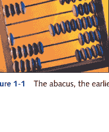

1642 年，又一种计算装置——帕斯卡计算器被创造出来。帕斯卡计算器有八个可移动的轮盘拨号，可计算长达八位数的和。算盘和帕斯卡计算器只能执行加法和减法。直到 1830 年代，第一台通用计算机——分析机才问世。

查尔斯·巴贝奇及其助手奥古斯塔·阿达·拜伦女爵、洛夫莱斯伯爵夫人设计了分析机。尽管按今天的标准来看它非常原始，但它是今天所知的通用计算机的原型。分析机包括输入设备、存储器、允许按任意顺序处理指令的控制单元以及输出设备。


20 世纪 80 年代，美国国防部以洛夫莱斯女爵的名字命名了 Ada 编程语言。她被称为世界上第一位计算机程序员。她的这一称号存在争议。拜伦夫人很可能是第四或第五位编写程序的人。她在查尔斯·巴贝奇的学生时期进行编程，并重新整理了他的一些计算。

许多计算机史学家认为当今是现代计算的第四代或第五代。每个时代都以一项重要进步为特征。20 世纪 40 年代中期，第二次世界大战对其战略类型计算的需求推动了第一代通用机器的发展。这些庞大的第一代计算机以使用真空管为特征。它们编程困难，功能有限。操作指令是为每个特定任务专门定制的。

1956 年晶体管的发明导致了第二代计算机的出现，它们比前辈更小、更快、更可靠、更节能。软件行业在 FORTRAN 和 COBOL 引入的第二代计算机时代诞生。

第三代（1964–1971）见证了计算机变得更小，因为晶体管被压缩到小型硅片（单芯片）上，被称为半导体。今天所知的操作系统，允许机器同时运行许多不同的程序，也首次出现在第三代系统中。

随着时间的推移，芯片不断缩小，能够存储更多晶体管，使计算机更强大、成本更低。1971 年开发的 Intel 4004 芯片将计算机最重要的组件（中央处理器、存储器和输入输出控制）放置在一枚约只有一角硬币一半大小的微小芯片上。许多家用物品，如微波炉、电视机和汽车都受益于第四代计算。图 1-2 显示了一枚 Intel 芯片。

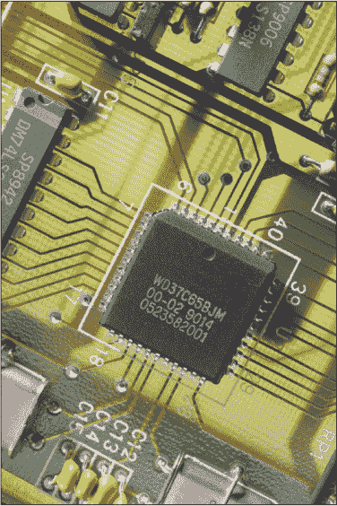

图 1-2  Intel 芯片

在第四代期间，计算机制造商试图将计算带给普通消费者。1981 年，IBM 推出了其个人计算机（PC）。20 世纪 80 年代，随着 IBM PC 的克隆机使个人计算机更加实惠，计算机使用量得以扩展。个人计算机的使用数量从 1981 年的 200 万增加到 1982 年的 550 万，增长了一倍多。十年后，使用中的 PC 已达 6500 万台。

根据美国人口普查局 2007 年 11 月的《现行人口调查》，美国超过 60% 的家庭拥有接入互联网的计算机。十年前，只有 36% 的家庭在家中有计算机，只有 18% 的家庭在家中有接入互联网的计算机。

定义第五代系统有些困难，因为这一代还很年轻。计算机现在可以接受语音指令，通过人工智能模仿人类推理，并通过传输数字媒体与全球各地的设备即时通信。移动应用程序正在增长。通过应用问题解决步骤，专家系统帮助医生进行诊断。医疗专业人员现在在病房中使用手持设备检索和更新病历。使用手持设备，送货卡车司机可以访问全球定位系统（GPS）以核实客户的提货和送货位置。坐在红绿灯前，你可以检查电子邮件、预订航班、远程监控和管理家用电器，并访问你的银行支票和储蓄账户。使用无线局域网（LAN）卡，学生在进入教室时可以访问教授的笔记。

随着集成开发环境（IDE）如 Visual Studio 使为互联网快速开发应用程序变得更容易，软件的重大进步有望实现。由于计算机的可编程性，软件开发者的想象力得以释放，去构想未来的计算功能。

计算机的强大之处在于它们使用的软件程序。了解计算机如何处理数据是理解软件开发过程的基础。下一节讨论计算机处理器。

### 处理器

**中央处理器 (CPU)** 是计算机的大脑。它安装在系统单元内的硅芯片上，是最重要的硬件元素。

CPU 是系统单元内部最小且最昂贵的主要组件。

CPU 有两个主要作用。它对数据执行算术和逻辑比较，并协调系统的操作。尽管它很复杂，但只能执行非常简单的指令，例如加法或将内存中的项目从一个位置移动到另一个位置。系统的很大一部分能力来自处理器执行指令的速度。


CPU。**算术逻辑单元**对数据执行实际的计算和比较。计算机指令周期的基本步骤是取指、译码、执行和存储，如图 1-3 所示。

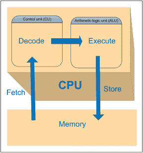

**图 1-3** CPU 的指令周期


**指令周期**包括从内存中取出一条程序指令、对该指令进行译码、执行它，然后将结果存储到内存中。一个周期可能需要一个或两个时钟节拍，其中 1 Hz 等于每秒一个时钟节拍。

计算机的真正能力并不在于硬件，硬件由构成系统的物理组件组成。其功能在于可用于利用硬件的软件。硬件处理由 0 和 1 组成的复杂模式。软件实际上将这些 0 和 1 转换为人们可以阅读的文本、图像和文档。下一节开始讨论软件。

## 系统软件和应用软件

软件由**程序**组成，程序是告诉计算机具体要做什么的指令集合。这些指令可能告诉计算机将一组数字相加、比较两个名称，或根据计算结果做出决策。正如厨师按照一组说明（食谱）来准备一道菜，计算机也按照指令执行有用的任务——不会额外加盐。接下来的几节将介绍软件的两大类别：系统软件和应用软件。

### 系统软件

系统软件在您打开计算机电源时被加载。提到系统软件，大多数人会想到操作系统。诸如 Windows XP、Windows Vista 和 Linux 之类的**操作系统**是监督和协调机器资源的程序类型。其中包括文件系统实用程序，这些小程序的职责是定位文件，并记录文件的名称、大小和创建日期等详细信息。系统软件程序还执行各种其他功能：建立目录；移动、复制和删除文件；将数据从辅助存储器传输到主存储器；格式化介质；以及在屏幕上显示数据。操作系统包含用于连接互联网或连接打印机等输出设备的通信程序。它们包含用于管理系统外观和感觉的用户界面子系统。


操作系统是系统软件的一种。它们是实用程序，能让您更轻松地使用硬件。

另一类系统软件包括编译器、解释器和汇编器。当您开始学习软件开发时，您将使用**编程语言**为计算机编写指令。现代编程语言的设计目标是易于阅读和编写。它们被称为**高级语言**，因为它们使用类似英语的语句编写。您将使用的编程语言是 C#。其他高级计算机编程语言包括 Visual Basic、FORTRAN、Pascal、C、C++ 和 Java。

在计算机能够执行用 C# 等编程语言编写的指令之前，这些指令必须转换为机器可读格式。**编译器**完成这种转换。图 1-4 展示了机器语言指令的样子。

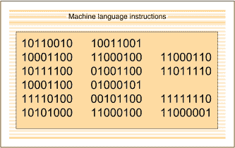

**图 1-4** 一条机器语言指令

正如英语有句子构造规则一样，C# 等编程语言也有一套必须遵循的规则，称为**语法**。在将代码转换为机器可读形式之前，编译器会检查是否有违反规则之处。在移除所有语法错误之前，编译器不会将任何语句转换为机器语言。代码既可以编译，也可以解释。解释器将一条代码语句转换为机器可读形式，然后执行该行。接着它们翻译下一条指令、执行它，依此类推。与查看整段代码的编译器不同，**解释器**逐行检查是否有违反规则之处。如果该行不包含错误，就将其转换为机器语言。解释器通常比编译器慢。许多语言同时提供编译器和解释器，包括 C、BASIC、Python 和 Lisp。**汇编器**将汇编编程语言（一种低级编程语言）转换为机器码。低级编程语言更接近硬件。它们不如高级编程语言那样易于阅读或编写。

### 应用软件

**应用软件**由为执行特定任务而开发的程序组成。您可能玩的游戏或您在互联网上使用的搜索引擎都是应用软件的类型。诸如 Microsoft Word 之类的文字处理器是应用软件的示例。Word 的编写目的是通过包含许多编辑和格式设置选项，帮助用户创建具有专业外观的文档。诸如 Microsoft Excel 之类的电子表格是旨在进行数值计算和生成图表的应用软件类型。诸如 SQL Server、Oracle 或 Microsoft Access 之类的数据库管理系统旨在组织大量数据，以便轻松生成报表。生成工资支票的软件被视为应用软件，帮助您注册课程的软件也是如此。带有数据库驱动购物车的电子商务网站（例如 eBay）是应用软件的形式。银行业使用应用软件来管理您的支票账户和储蓄账户。程序员使用 C# 等编程语言编写应用软件，以执行特定任务或解决特定问题。您为本书编写的程序将是应用软件。

## 软件开发过程

您很快将使用 C# 编写程序。如何开始？许多初学者程序员没有计划，也没有采用任何有组织的步骤顺序，就开始输入代码。这通常会导致开发时间增加，并且解决方案可能无法始终产生准确的结果。

编程是一个解决问题的过程。用 C# 等语言键入程序语句并不是编程中最困难的部分。最困难的部分是制定解决问题的计划。解决计算机相关问题会使用许多不同的方法，或称**方法论**。成功的问题解决者在每个编程项目中都遵循有条理的方法。下一节介绍用于解决本书所呈现问题的有条理的计划或方法论。

### 程序开发过程中的步骤

- **分析问题。** 第一步应着眼于透彻理解问题。准确分析软件应该完成什么。在此阶段，您要审查问题**规格说明**，其中描述程序应该完成什么。规格说明通常包括程序期望的输出，即要显示、保存或打印的内容。如果规格说明含糊不清或需要澄清，您可能需要提出深入的问题。*如果您不知道自己要去哪里，又怎么知道何时到达正确的位置呢？*

> 有时，这个过程中最困难的部分之一是从用户那里获得清晰的规格说明。除非您知道问题是什么，否则您无法解决它。确保您理解问题定义。

程序规格说明可能如图 1-5 所示。

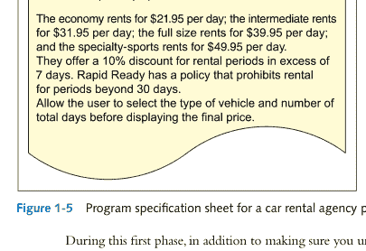

图 1-5 汽车租赁公司问题的程序规格说明表

在第一个阶段，除了确保您理解问题定义之外，您还必须审查程序输入。您应该提出以下类型的问题：

- 有哪些类型的数据可用于输入？
- 每个已识别的数据项中将包含哪些类型的值（例如，整数、字母字符和带小数点的数字）？


- 每个输入项的**域**（值的范围）是什么？
- 程序用户会输入值吗？
- 如果问题解决方案要用于多个数据集，是否存在任何数据项在每个数据集中保持不变，或保持**恒定**？

在你开始设计解决方案之前，应当对问题有透彻的理解。用语言表述问题定义可能会有帮助。查看每个数据项的示例输入也可能有帮助。图1-6说明了在图1-5所示的汽车租赁代理问题的分析过程中，如何确定输入数据项。图1-6显示了每个数据项的标识符（即数据项名称）、类型以及值的域。

| 数据标识符 | 数据类型 | 值的域 |
|---|---|---|
| kindOfVehicle | String（字符） | Economy、Intermediate、Full size、Specialty-sports |
| noOfDays | Integer（整数） | 1...30 |

图1-6  汽车租赁代理的数据

### 2. 设计解决方案。
程序员在设计过程中使用多种途径，即**方法**。过程式和面向对象方法是两种最常用的设计方法。有些项目使用一种方法比使用另一种方法更容易解决。这两种方法将在下一节讨论。在确定方法时，编程语言的选择有时也会产生影响。C# 语言在设计上非常面向对象。

无论项目规模如何，仔细设计总能带来更好的解决方案。此外，仔细设计通常能带来可以在更短时间内产生的解决方案。两种方法都可以使用**分而治之**的方法。顾名思义，当你分而治之地处理一个编程问题时，你会将问题分解为子任务。然后，通过进一步分解每个子任务来攻克它们。这个过程也称为**自顶向下设计**。应当开发详细模型作为后续阶段的输入。

使用**面向对象方法**时，重点在于确定数据特征以及操作这些数据的方法或行为。这些成员（数据和行为）的逻辑分组称为**类**。

这些特征被放入类图中。图1–7包含图1–5中给出的问题规格说明的类图。

图1–7是一个分为三部分的类图，顶部部分标识类的名称。类图的中间部分总是列出数据特征。表示租赁车辆类型和租赁天数的数据对汽车租赁代理很重要。图1–7所示类图的底部部分显示了要对数据项执行哪些操作。`ComputeCharges()` 用于根据车辆类型和租赁天数确定租赁费用。你将在本章后面了解更多关于类图的内容。过程式设计适用于较简单的问题定义，它使用结构图来显示模块的层次结构，并使用流程图或伪代码清单来详细说明每个模块的步骤。

应当为这两种方法开发行为（面向对象）或过程（过程式）的算法。**算法**是清晰、无歧义的逐步解决问题的过程。这些步骤必须表达得完整而精确，以包含所有细节。算法中的指令应当既简单易行，又能够在有限时间内执行完成。盲目遵循这些步骤应当每次都会得到相同的结果。

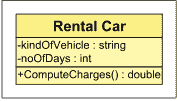

**图1–7**  汽车租赁代理的类图

`ComputeCharges()` 的算法将租赁天数乘以与所租车辆类型相关的费率，以产生租赁费用。算法开发完成后，应当检查设计的正确性。一种方法是使用示例数据，并通过模仿计算机来**桌面检查**算法；换句话说，逐步走查计算机的步骤。精确地遵循每一步，一次一步。如果问题涉及计算，请使用计算器，并严格遵循你的设计语句。进行桌面检查时，重要的是不要添加任何额外步骤，除非你返回并修订算法。

在这个阶段，通过开发原型来规划和设计期望输出的外观也可能有帮助。**原型**是描绘最终输出外观的屏幕模型。

### 3. 编写解决方案的代码。
在完成设计并验证算法正确之后，将设计转换为源代码。**源代码**由使用编程语言（如 C#）编写的程序语句组成。


源代码语句可以使用诸如记事本之类的编辑器，或诸如 Visual Studio 之类的**集成开发环境（IDE）**输入到计算机中。IDE 包含许多有用的开发工具：IntelliSense（带完成选项的弹出窗口）、调试、不同程序部分的颜色编码、联机帮助和文档，以及运行程序的功能。

编写解决方案代码时，必须遵循语言的语法。无论你说英语、西班牙语还是其他语言，你都习惯于遵循语言**语法**或规则。例如，英语语法规定语句以句号结尾，并包含主语和动词。当你用英语写作时，就应当遵循这些规则。当你用 C# 编程语言编写代码时，就应当遵循每条语句应以分号结尾的规则。正是在程序开发过程的第三阶段（编写解决方案代码），你必须关注语言语法。

许多程序员在软件开发过程中使用**迭代方法**。这意味着你可能会发现有必要回到设计阶段进行修改。甚至有时可能需要进行额外的分析。如果在尝试编写解决方案代码之前进行透彻的分析和设计，通常就能开发出更好的程序——一个更易于阅读和修改的程序。

### 4. 实现代码。
在这个阶段，将键入的程序语句（源代码）进行编译，以检查规则违规。诸如 Visual Studio 之类的集成开发环境（IDE）在开发环境中提供编译器。编译器的输出是错误列表以及违规的简要描述。在实现能够继续之前，必须更正所有语法错误。当规则违规被消除后，源代码被转换为 Microsoft **中间语言（IL）**。所有面向 .NET（读作 dot net）平台的语言都会编译成 IL。你将在本书中使用的语言 C#，是作为 .NET 平台一部分引入的语言。与 C# 一样，其他语言（如 Java）也会将代码编译成中间语言，Java 的中间语言称为**字节码**。中间语言有助于使用比直接编译成特定平台机器语言的其他语言更具平台独立性的代码。


如果你使用的是 Visual Studio IDE，你可能不会意识到 IL 的存在。你只需选择选项来编译、生成并执行程序，即可查看输出结果。

IL 代码介于高级源代码和**本机代码**之间，本机代码是特定计算机的机器语言代码。IL 代码不能在任何计算机上直接执行。它不是计算机的语言，这意味着它不绑定到任何特定的 CPU 平台。在查看应用程序的结果之前，还需要第二个步骤。

第二个步骤由 .NET 的**公共语言运行时（CLR）**管理。CLR 将程序使用的预定义 .NET 类加载到内存中，然后执行第二次编译，称为**实时（JIT）编译**。这将 IL 代码转换为平台的本机代码。用于此目的的 CLR 工具是一个称为**JITter**的实时编译器。JITter 读取 IL 并生成在特定平台上运行的机器代码。任何执行该代码的计算机都必须安装 CLR。CLR 包含在 .NET Framework 中。任何使用 .NET 代码的计算机都必须安装 .NET Framework。图1–8说明了执行用 C# 编写的源代码必须执行的步骤。

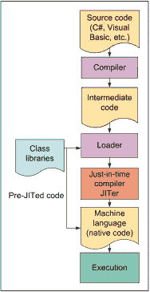

图1-8  .NET 的执行步骤


- 5. **测试与调试。** 即使没有编译器语法错误并且你获得了输出，结果也可能不正确。你必须测试程序以确保获得一致的结果。**测试**阶段常常被敷衍了事。只有经过彻底测试，你才能确定程序运行正确。

规划测试。优秀的程序员常常在分析和设计解决方案的同时构建**测试计划**。该测试计划应包括测试极端值、识别可能出现问题的情形，并确保这些情形得到测试。在消除语法错误并开始产生结果后，你应当执行测试计划，验证结果是否准确。如果应用程序与用户交互以输入数据，则使用计划好的测试值多次运行程序。对于计算，请使用计算器执行相同的运算，就像你在设计阶段对算法进行桌面检查时那样。有一些软件开发方法学是围绕测试开发构建的。例如，**测试驱动开发**（TDD）是一种编程方法学，强调快速、增量式开发，并在编写代码之前先编写测试。采用TDD时，只有在首批测试通过后才会添加额外功能。第一个周期通常处理非常简单的用例。在这些非常简单的测试能够运行之后，你再一点一点地添加更多功能。

在测试期间，常常会发现**逻辑错误**。逻辑错误可能导致程序异常终止，也可能只是产生不正确的结果。这类错误通常比语法错误更难定位和纠正。**运行时错误**是逻辑错误的一种形式。运行时错误通常会导致程序崩溃（停止执行）并报告错误消息。例如，如果你尝试除以零，程序可能会崩溃。更麻烦的是，程序有时在大多数测试数据下能正常运行，但在输入某个特定值时会崩溃。这就是为什么确保彻底测试所有应用程序如此重要。当检测到逻辑错误时，可能有必要回到步骤1，重新分析问题规格，并重新设计解决方案。正如你在图 1–9 中看到的，软件开发过程是迭代式的。当发现错误时，常常有必要回退到前一个阶段或步骤。

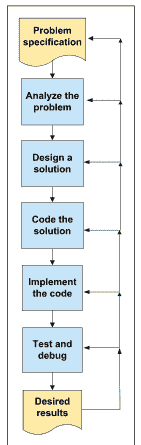

图 1-9 软件开发过程的步骤

## 编程方法学

你如何洗衣服？你如何准备考试？当你思考这些问题时，你很可能有答案，而你的答案会与其他读者的答案不同。但是，你有一些策略、一组步骤，并遵循它们来完成工作。你可以把方法学视为一种策略、一组步骤或一组指示。程序员使用多种不同的编程方法学。两种最流行的编程范式是结构化过程式编程和面向对象编程。本节将讨论这些方法。

### 结构化过程式编程

这种方法出现于20世纪70年代，至今仍在使用。**过程式编程**是面向过程的——关注数据从输入到产生有意义输出所经历的过程。这种方法对小型独立应用程序非常有效。上一节所确定的软件开发五个步骤——分析、设计、编码、实现以及测试与调试——很适合结构化过程式方法。

在设计期间，处理步骤以算法来定义。任何公式或特殊处理步骤都包含在算法中。为了以算法方式思考，程序员使用多种工具。其中一种工具是流程图。图 1–10 展示了构建算法时流程图使用的一些符号。

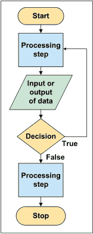

**图 1–10** 流程图符号及其解释

设计期间用于开发算法的另一种工具是**伪代码**。顾名思义，使用伪代码时，步骤以“伪”或近似代码格式编写，看起来像英语语句。重点在于确定并编写产生所需输出所涉及的过程或步骤。使用伪代码时，算法由英语语句和所选编程语言（例如C#）组合编写。

结构化编程与一种称为**自顶向下设计**或**逐步细化**的技术相关联。其基本主题或概念是：给定问题定义，你可以通过分而治之来细化逻辑。问题可以被划分为子问题或过程。然后，每个子问题又被进一步分解。这一过程持续进行，直到你得到足够简单、可以在子问题层面轻松解决的子问题。在较低层次得到解决方案后，再将这些解决方案组合起来解决整个问题。


考虑建造房屋的类比。使用自顶向下设计，这个问题可以分解为平整土地、建造地基、搭建结构框架、安装屋顶、完成室内装修和完成外部工程。然后，每个子问题又可以进一步细分。可以为项目聘请总承包商，然后为每个子问题领域分配分包商。在每个子问题内，还会定义额外问题，并为该领域分配单独的工人。例如，完成室内装修可以进一步划分为墙面、地面等。墙面又可以进一步分解为安装石膏板、处理墙面接缝、准备涂漆、粉刷墙面、粉刷饰条等。同样，这些领域中的每一项都可以分包出去。

使用结构化过程式方法的程序员通常将每个子程序编写为由主控函数或模块调用的独立函数或方法。这有利于分而治之的方法。对于较大的问题，子程序可以由不同的人编写。过程式方法的缺点之一涉及软件维护。当应用程序升级或更改时，使用过程式方法编写的程序更难维护。即使是微小的修改也可能影响多个函数，并需要做出额外修改。与面向对象方法学相比，代码复用的机会也更少。

### 面向对象编程

面向对象编程（OOP）被视为一种较新的软件开发方法，其理念是应用程序可以围绕对象而不是过程来组织。这种方法学包含许多强大的设计策略，有助于构建对现实世界实体进行建模的更复杂系统。C# 语言的设计就是为了利用面向对象方法学的优势。

采用**面向对象分析、设计与编程**时，重点是确定你想要操作的对象，而不是操作数据所需的过程或逻辑。请记住，过程式方法关注的是过程。面向对象方法学的基本假设之一是，世界包含许多可以被识别和描述的实体。**实体**通常被定义为人物、地点或事物。它通常是一个名词。通过抽象出**属性**（数据）和**行为**（对数据的处理过程），你可以将复杂现象划分为可理解的实体。**抽象**只是对实体本质相关属性的描述。例如，通过描述人、学校教职员工、教师、学生、本科生、研究生、交通工具、汽车、书、学校、动物、狗和贵宾犬各自的**特征**或属性以及**行为**或动作，你应该能够轻松地在脑海中想象或概念化这些实体。


考虑一个学生的例子。一个学生具有以下特征或属性：学号、姓名、年龄、平均绩点（GPA）、专业和家乡。通过确定每个属性中可能存在的数据类型，可以进一步描述这些特征。例如，姓名字段中会出现字母字符。年龄字段中会出现不带小数的整数，而平均绩点（GPA）字段中会出现带小数的数字。

除了抽象数据属性之外，你还应该能够思考上一段中识别出的每个实体的某些动作或行为。与一个学生相关的行为包括诸如申请入学、注册为学生、获取最终成绩、更改姓名和确定平均绩点等动作。使用面向对象方法，这些属性和动作（或特征和行为）被**封装**在一起，这意味着它们被组合在一起形成一个类。

**类图**是面向对象程序员使用的主要建模工具之一。图 1–11 使用统一建模语言（UML）表示法展示了 Student 类图。图的上部标明了类的名称，即 Student。中间部分包含数据成员以及每个数据成员中可能出现的数据类型。**信息隐藏**是面向对象编程的重要组成部分。数据成员名称左侧的减号（−）表示该成员是私有的，仅对该类可访问。图 1–11 中图的下部显示了 Student 类的动作或方法。加号（+）表示这些行为在该类外部可用。本书通篇使用这种 UML 表示法来创建类图。

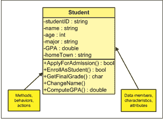

**图 1–11** Student 类图

类就像模板。它类似于房屋的蓝图。即使你在蓝图中定义了房屋的所有特征，除非使用该模板建造出一栋房屋，否则房屋并不存在。可以使用同一模板建造许多房屋。在面向对象术语中，建造出的房屋是蓝图或模板的一个实例（对象）。你通过使用该模板建造房屋来**实例化**蓝图。特定类的许多对象都可以被实例化。因此，**对象是类的一个实例**。

请查看下面这个带有以下数据成员的学生的扩展示例：

- 学号：122223
- 学生姓名：贾斯汀·霍华德
- 年龄：18
- 平均绩点（GPA）：3.80
- 专业：计算机科学（CS）
- 家乡：肯塔基州温彻斯特

当这些数据成员与类关联时，就创建或**构造**了一个对象。通过给其成员赋值，可以从该类实例化第二个对象（例如：228221、伊丽莎白·瑟温斯基、21、4.0、ENG、内华达州里诺）。

面向对象方法便于设计组件，这些组件包含可复用的代码，其方式是将数据类型的属性与该类型的动作一起打包。通过**继承**，可以定义数据对象的子类，这些子类共享父类的一些或全部类特征。这正是代码复用得以实现的原因。例如，你应该能够设想 Student 是 Person 的子集，就像 Teacher 是 Person 的子集一样。使用面向对象设计，你可以抽象出所有人的共同特征，并将它们放入一个超类中。通过继承，Student 和 Teacher 可以使用 Person 的特征，并添加自己独有的成员。

另一个重要的面向对象概念是多态。父类和子类的行为或方法可以具有相同的名称，但提供不同的功能。通过**多态**，你能够在不同类的对象上调用同名方法，并执行正确的方法。例如，你可能会有 `UndergraduateStudent` 和 `GraduateStudent` 的子类。它们都可以从 `Student` **类**继承特征。这两个子类可能都有自己的方法，其中包含关于如何确定其学费成本的详细信息。两个子类都可能将其方法命名为 `DetermineTuitionCosts()`。通过多态，会根据调用该方法的对象来执行正确的方法。当使用 `UndergraduateStudent` **类**的对象时，就使用 UndergraduateStudent **类**的 `DetermineTuitionCosts()` 方法。当使用 `GraduateStudent` **类**的对象时，就使用 GraduateStudent **类**的 `DetermineTuitionCosts()` 方法。你将在后续章节中读到更多关于面向对象特性的内容。

使用 C# 编写软件时，面向对象原则尤为重要。任何程序都不可能不包含至少一个类。使用 C# 语言编写的所有程序语句都放在类中。

无论你使用过程化方法还是面向对象方法，都应遵循程序开发的五个步骤。与过程化方法一样，面向对象的开发——

一些更值得注意的高级编程语言是 C、C++、Visual Basic、Java，以及现在的 C#。C++ 是 C 的扩展，而 C 实际上于 1973 年从 BCPL 和 B 演变而来。丹尼斯·里奇因开发 C 编程语言而闻名；贝尔实验室的本贾尼·斯特劳斯特卢普因其在 20 世纪 80 年代初的设计工作而被认为是 C++ 之父。C++ 包含使程序员能够进行面向对象编程的特性。如今，C++ 在计算机行业中得到大量使用。

Smalltalk 被认为是纯面向对象语言，是在施乐帕洛阿尔托研究中心（PARC）开发的。Visual Basic 于 1991 年推出，源自 BASIC（初学者通用符号代码）编程语言，这是一种 20 世纪 60 年代开发的语言。早期版本的 Visual Basic 并不便于使用面向对象方法进行开发。然而，早期版本的 Visual Basic 确实便于轻松创建基于 Windows 的图形用户界面（GUI）。因此，Visual Basic 已被用于大量应用程序开发。

Java 于 1995 年推出，最初称为 Oak。它最初被设计为一种用于智能消费电子设备（如家电和微波炉）的语言。商业界没有将其用于该目的，而是最广泛地将 Java 用于 Web 应用程序，这是因为字节码的特性，它使语言编译能够独立于机器。由于字节码不针对任何特定计算机平台，并且必须转换为运行应用程序的系统语言，这便于开发可在多种类型计算机上运行的代码。

C# 是较新的编程语言之一。它与 C 和 C++ 高度一致，但许多开发者认为它类似于 Java。这些语言之间有许多相似之处。它具有早期版本 Visual Basic 的快速图形用户界面（GUI）特性、C++ 的增强能力，以及与 Java 类似的面向对象类库。C# 由微软从头设计，以便与新的编程范式 .NET 配合工作，并且是用于开发 .NET Framework 类库最多的语言。C# 可用于开发任何类型的软件组件，包括移动应用程序、动态 Web 页面、数据库访问组件、Windows 桌面应用程序、Web 服务和基于控制台的应用程序。你将在本书中使用 C# 进行软件开发；然而，所介绍的概念可以应用于其他语言。本书的意图是将 C# 语言用作学习如何开发软件的工具，而不是聚焦于 C# 的语法。

## .NET

当你想到 C# 时，也应该理解它与 .NET 的关系。.NET 是程序运行的环境，并且被设计为一种新的编程范式。它不是操作系统，而是操作系统与其他应用程序之间的一层。因此，它提供了一个用于开发和运行易于使用的代码的平台。微软表示，.NET 的愿景是提供一个新的编程平台和一套开发工具。其意图是让开发者能够构建分布式组件应用程序。到 2000 年，当

在微软发布 .NET 之前，许多开发者已经因为微软的大规模营销活动而体验过 .NET。

在 2000 年正式宣布之前，.NET 已开发了三年多。微软在正式发布前分发了多个测试版。**测试版**是一种尚未完全测试的工作版本，可能仍包含 **bug** 或错误。直到 2002 年 2 月，微软才最终发布了 Visual Studio 的第一个版本，该 IDE 用于开发 C# 应用程序。Visual Basic .NET、Visual C++ .NET 和 Visual C# .NET 都使用相同的开发环境。图 1-13 显示了 Visual Studio 运行 C# 程序的情况。程序“Welcome to Programming!”的输出显示在图底部附近的小消息框中。

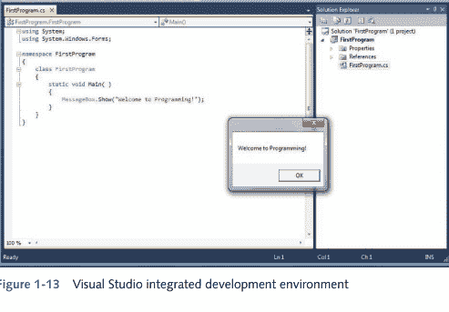

图 1-13 Visual Studio 集成开发环境

微软在 2005 版本中从 Visual Studio 的名称中去掉了 .NET。

Visual Studio 包含用于输入程序语句、编译、执行和调试应用程序的工具。.NET 引入的新概念在以下段落中概述。

**多语言独立性：** .NET 支持使用多种编程语言进行开发：Visual Basic、C#、C++ 以及一些第三方语言。所有语言的代码都可以编译为通用的 Microsoft 中间语言（IL）。

应用程序的一部分可能使用 Visual Basic 开发，另一部分使用 C# 开发。编译后，它们都会翻译成通用的 IL。下面的列表描述了 .NET 支持语言的一些共同特性：

- **新的框架基类：** .NET Framework 拥有一个类库，提供超过 2500 个可重用类型（类）的庞大集合，可供任何 .NET 语言使用。
- **动态 Web 页面和 Web 服务：** .NET 是怀着对互联网的考虑而编写的；因此，通过内联网或互联网部署应用程序成为日常操作。使用新技术 ASP.NET、名为 ADO.NET 的组件集以及 XML 支持，使得访问关系数据库和其他数据源以及通过 Web 导入和导出数据变得更容易。
- **可扩展的组件开发：** .NET 不仅促进面向对象的开发，而且将设计更进一步。有了 .NET，真正的基于组件的开发比过去可以做得更好、更容易。创建为独立实体的代码段可以独立存储、组合并在许多应用程序中重复使用。这就是 .NET 背后的美妙之处——它为客户端程序使用用不同语言构建的组件提供了一种相对无缝的方式。有了 .NET，基于组件的开发可以成为现实。

## 为什么选择 C#？

针对 .NET 平台的编译器可用于 Visual Basic、C++ 和 C# 编程语言。除了微软之外，还有许多第三方厂商也在销售符合 .NET 的语言。它们包括 Alice、APL、COBOL、Pascal、Eiffel、FORTRAN、Haskell、Mercury、ML、Mondrian、Oberon、Perl、Python、RPG、Scheme、Smalltalk 等等。Visual Studio 2010 还包含一种名为 Visual F# 的新编程语言。那么，为什么使用 C# 呢？C# 是为 .NET 创建的语言，并且从头设计用于与 .NET 配合使用。大量类作为 .NET 的一部分包含在内。这些类或模板旨在供任何 .NET 支持的语言重用。它们减少了需要完成的编程量。这些类称为 .NET Framework 类。大多数 .NET Framework 类都是使用 C# 编程语言编写的。

C# 结合 .NET Framework 类，提供了一个令人兴奋的平台来集成和使用新兴的 Web 标准，例如超文本标记语言（HTML）、可扩展标记语言（XML）和简单对象访问协议（SOAP）。如前所述，C# 是怀着对互联网的考虑而设计的。在 .NET 之前开发的大多数编程工具都是在 Web 处于起步阶段时设计的，因此不适合开发 Windows 和 Web 应用程序。

C# 是一种简单、面向对象的语言。通过使用 Visual Studio IDE 和 .NET Framework，C# 提供了创建图形用户界面的简便方法，类似于 Visual Basic 程序员多年来一直使用的界面。C# 还提供了 C 和 C++ 程序员所熟悉的纯数据处理能力。所有循环和选择编程结构都包含在内。C# 使开发人员能够使用以前仅在 Java、通用网关接口（CGI）或 PERL 中才有的许多常见功能，通过互联网发布他们的软件包。

> 有人将 C# 特征化为微软取了 Visual Basic 的优点并加上了 C++，去掉了 C 中一些更晦涩的传统。语法非常接近 Java。

许多人将 C++ 的成功归功于其美国国家标准协会（ANSI）标准化。C# 正在沿着类似的道路走向成功。2001 年 12 月 13 日，欧洲计算机制造商协会（ECMA）大会将 C# 及其通用语言基础结构（CLI）规范批准为国际标准。这一验证证明 C# 不仅仅是一种昙花一现的语言。最初，使用 C# 进行开发仅限于 Windows 平台；C# 现在可用于包括 Linux 在内的其他平台。C# 将会存在一段时间。它代表了下一代语言。

如前几节所述，程序是编写来指导计算机执行特定任务的指令。每条指令必须以特定方式编写。语法——编写这些指令的规则——由程序编写的语言定义。在获得结果之前，这些人类可读的指令，即源代码，必须翻译成机器语言，即计算机的本地代码。翻译是一个两步过程，从编译器开始。在本章中，你将编写第一个 C# 程序，了解它的编译方式，并探索最终输出是如何产生的。

每条指令语句都有语义含义——它应被使用的一种特定方式。本章重点介绍了程序语句在应用程序中出现的目的，因为使用 C# 开发的应用程序中将使用许多这些程序元素。你将首先研究使用 C# 和 .NET 平台可以开发的应用程序类型。

## 使用 C# 开发的应用程序类型

C# 可用于创建几种不同类型的软件应用程序。一些最常见的应用程序是：

- Web 应用程序
- Windows 图形用户界面（GUI）应用程序
- 基于控制台的应用程序

除这些应用程序外，还可以使用 C# 创建类库和独立组件（.dlls）、智能设备应用程序和服务。

### Web 应用程序

C# 是从头开始考虑互联网而构建的。因此，程序员可以使用 C# 快速构建在 Web 上运行的应用程序，供最终用户通过浏览器中立的用户界面（UI）查看。在用 C# 编程时，开发人员可以忽略将执行这些应用程序的平台——Macintosh、Windows 和 Linux——的独特要求，最终用户仍会看到一致的结果。使用 **Web 表单**，它是 ASP.NET 技术的一部分，可以构建可作为 Web 应用程序 UI 的可编程 Web 页面。**ASP.NET** 是一个编程框架，让你创建在 Web 服务器上运行的应用程序，并通过浏览器（如 Microsoft Internet Explorer）提供功能。虽然你可以使用其他语言创建 ASP.NET 应用程序，但 C# 利用了 .NET Framework，通常被公认为 ASP.NET 开发的首选语言。.NET Framework 类库（FCL）的很大一部分是用 C# 编程语言编写的。在你学习一些问题解决技术和 C# 语言的基本特性后，第 15 章将向你介绍 ASP.NET。图 1-14 说明了使用 C# 创建的 ASP.NET Web 页面。


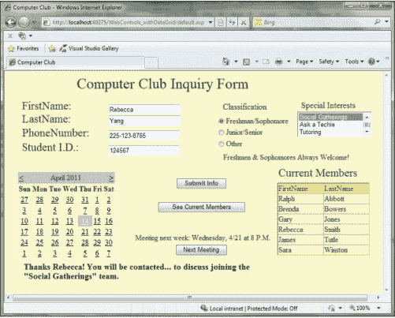

图 1-14  使用 C# 编写的 Web 应用程序

## Windows 应用程序

**Windows 应用程序**是为桌面使用和单一平台设计的。它们像你最喜欢的文字处理程序一样在 PC 桌面上运行。使用 C# 和 `System.Windows.Forms` 命名空间中的类编写代码，可以开发出包含菜单、图片、下拉控件以及你在现代桌面应用程序中已经习以为常的其他控件的应用程序。.NET 使用**命名空间**的概念来对功能相似的类型进行分组。`System.Windows.Forms` 命名空间作为一个总括，用于组织创建 Windows 应用程序所需的类。使用 Visual Studio 的集成开发环境（IDE），可以通过在屏幕上拖放按钮、文本框和标签等控件来开发 GUI。使用 Visual Studio 创建 Web 应用程序时也采用同样的拖放方法。你将从第 9 章开始创建 Windows GUI 应用程序。图 1-15 展示了使用 C# 语言编写的 Windows 应用程序。

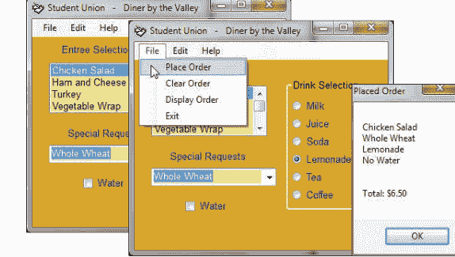

图 1-15 使用 C# 编写的 Windows 应用程序

## 控制台应用程序

控制台应用程序通常向操作系统发送请求，以在命令控制台显示区显示文本，或从键盘获取数据。从初学者的角度来看，控制台应用程序最容易创建，是学习软件开发最简单的方法，因为你不必担心与构建 GUI 相关的枝节问题。可以以极小的开销输入值，输出显示在控制台窗口中，如图 1-16 所示。你将首先开发控制台应用程序，这样你就可以专注于编程和一般问题求解的细节。


图 1-16 示例 1-1 控制台应用程序的输出

## 探索第一个 C# 程序

自 20 世纪 70 年代 C 语言被开发出来以来，在学习一门新语言时，传统上都会在控制台屏幕上显示“Hello World!”作为第一个程序的运行结果。示例 1-1 中的程序演示了一个正是这样做的 C# 程序。接下来的各节将逐行解释构成这个第一个程序的各个元素。

### 示例 1-1

```csharp
Line 1     This is traditionally the first program written.
Line 2     using System;
Line 3     namespace HelloWorldProgram
Line 4     {
Line 5         class HelloWorld
Line 6         {
Line 7             static void Main( )
Line 8             {
Line 9                 Console.WriteLine("Hello World!");
Line 10            }
Line 11        }
Line 12    }
```

可读性很重要。就编译器而言，你实际上可以完全不按 Enter 键而输入整个程序。整个程序可以打成一行，但那样会非常难以阅读，调试起来更具挑战性。示例 1-1 中的风格是一个值得模仿的好风格。注意花括号 { } 是成对匹配的，并且单独出现在不同的行上。语句被分组在一起并缩进。缩进不是必需的，但遵循它是一种好做法，因为它使代码更易于阅读。输入程序时，你应遵循一致且相似的风格。编译和执行该程序所产生的输出如图 1-16 所示。


使用 Visual Studio 格式化代码要简单得多。你可以从**工具**、**选项**菜单中预设文本编辑器首选项。你还可以购买插件，例如 ReSharper，它们会在你输入时为你进行智能代码编辑和格式化。

## C# 程序的组成元素

尽管示例 1-1 中的程序语句构成了使用 C# 可以开发的最小功能程序之一，但它们包含了大多数程序中的所有主要组成部分。理解构成该程序的功能将有助于你为开始开发自己的应用程序做好准备。从第 1 行开始，逐行检查每个片段以分析该程序。

### 注释

示例 1-1 的第一行是一条注释：

```
Line 1  // This is traditionally the first program written.
```

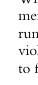

本书中注释以绿色显示。

编写注释就像为你自己或程序的读者做笔记。注释不被视为给计算机的指令，因此对程序的运行没有影响。编译程序时，不会检查注释是否违反规则；相反，编译器会忽略并绕过它们。注释不必遵循任何特定规则——除了它们如何开始和结束。

注释有两个作用：它们使代码更具可读性，并在内部记录程序语句正在做什么。在程序开头，通常会编写注释来标明代码的开发者、开发时间以及编写这些指令的目的。注释还用于记录代码不同部分的用途。你可以将注释放在程序中的任何位置。对于代码中可能难以理解的部分，适合放置一条或多条注释来解释细节。在示例 1-1 中，唯一的注释位于第 1 行。

```
Line 1  // This is traditionally the first program written.
```

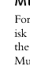

C# 程序员通常不使用行号，但这里添加行号是为了解释各项功能。

在 C# 中，可以向程序添加三种注释语法：内联注释、多行注释和 XML 文档注释。

### 内联注释

示例 1-1 第 1 行出现的注释是内联注释，或单行注释。内联注释由两个正斜杠 // 表示，通常被视为单行注释。斜杠表示同一行中斜杠右侧的所有内容都是注释，应被编译器忽略。结束注释不需要特殊符号。回车键（Enter）会结束注释。

### 多行注释

对于较长的注释，可以使用多行注释。正斜杠后跟星号 /* 表示多行注释的开始，相反的模式 */ 表示结束。注释符号之间出现的所有内容都被视为注释。多行注释也称为块注释。尽管它们被称为多行注释，但它们不必跨越多行。与按下 Enter 键时在当前行末尾终止的单行注释不同，多行注释需要特殊字符 /* 和 */ 来开始和终止注释，即使注释只出现在一行上。示例 1-2 展示了一个多行注释的示例。

### 示例 1-2

```
/* This is the beginning of a multiline (block) comment. It can go on for several lines or just be on a single line. No additional symbols are needed after the beginning two characters. Notice there is no space placed between the two characters. To end the comment, use the following symbols. */
```

C# 不允许嵌套多行注释。换句话说，你不能将一个块注释放在另一个块注释内。最外层注释会与内部注释同时结束——一旦输入第一个 */，注释就结束了。

### XML 文档注释

第三种注释使用三个正斜杠 ///。这是一种用于 XML 样式注释的高级文档技术。XML（可扩展标记语言）是一种标记语言，它提供了一种使用类似于 HTML 标签的标签来描述数据的格式。C# 编译器会读取 XML 文档注释并据此生成 XML 文档。

在本书中你将开发的应用程序里，你将使用内联 // 和多行 /* */ 注释。

### using 指令

示例 1-1 第 2 行中出现的以下语句允许使用 System 命名空间中的类，而无需用单词“System”限定它们。这减少了在没有该指令时所需的输入量。

```
Line 2 using System;
```

使用 .NET 提供了一个显著优势：可以使用 2000 多个类，这些类构成了所谓的框架类库（FCL）。类包含可重用的代码，这使编程更容易、更快捷，因为你不必为常见类型的操作重新发明轮子。框架类可供任何 .NET 支持的语言使用，包括 C#。

本书中，关键字在首次介绍后（例如 class）将以蓝色显示。关键字是系统保留的单词，具有特殊的预定义含义。例如，关键字 class 用于定义或引用 C# 类。


.NET Framework 有数千个类，程序开发者不太可能记住所有类的名称，更不用说类成员的其他名称了。可以想见，你很容易在自己的应用程序中使用一个已经在一个或多个 Framework 类中使用过的名称。另一种可能发生的情况是，这些 Framework 类中的一个或多个可能使用相同的名称。你怎么知道引用的是哪个类呢？.NET 通过使用命名空间消除了这一潜在问题。

## 示例 1-3

假设你有一个名为 Captain 的类。你可以抽象出 Captain 的特征和行为属性。如果你正在为一个橄榄球队开发应用程序，那么这类 Captain 的特征和行为将与为消防部门设计的应用程序中的 Captain 有很大不同。此外，这两组特征也与船只的 Captain 不同。与军事单位（例如海军）相关的 Captain 也会有所不同。对于每种可能的应用程序，你都可以为 Captain 类使用相同的名称。如果你指示程序显示关于某个 Captain 的信息，程序将不知道该显示哪一组特征。为了澄清你指的是船只的 Captain、橄榄球队的 Captain、消防站的 Captain 还是海军的 Captain，你可以在名称前加上其类别来限定该关键字。为此，你可以写 Boat.Captain、Football.Captain、Fireman.Captain 或 Navy.Captain。每次引用 Captain 时，都需要在其前面加上其类别类型。

通过指定应用程序所围绕构建的命名空间，可以不再需要在 Captain 前加上点（.）和命名空间名称。如果你只写“使用 boating 命名空间”，就不必用前缀名限定每条语句。这就是 using 指令所实现的功能。它使你无需通过确定某个类出现在哪个命名空间中来限定每个类。using 指令允许非限定地使用作为命名空间成员的类型。通过键入 using 命名空间指令，给定命名空间中包含的所有类型都会被导入，或者可在特定应用程序中使用。

最重要且最常用的命名空间是 System。System 命名空间包含定义常用类型或类的类。Console 类定义在 System 命名空间内。Console 类使程序员能够向控制台窗口或键盘写入和从中读取。Console 的完全限定名是 System.Console。如果删除第 2 行的 `using System;` 指令，就需要将

```
Line 9     Console.WriteLine("Hello World!");
with
Line 9     System.Console.WriteLine("Hello World!");
```

除了包含 using 指令外，还必须将 System 命名空间包含在使用 Visual Studio 创建的项目的引用中。创建控制台应用程序时，Visual Studio 会自动引用并导入 System 命名空间。

命名空间为组内定义的名称提供作用域或封闭上下文。通过包含 using 指令来指示要使用的命名空间名称，可以避免在类名之前加上类别分组。添加 `using System;` 行后，就可以使用 Console 类名，而无需明确标识它位于 System 命名空间中。

## 命名空间

第 3 行到第 12 行定义了一个名为 HelloWorldProgram 的命名空间。

```
Line 3     namespace HelloWorldProgram
Line 4     {
Line 12    }
```

命名空间的作用只不过是将语义相关的类型归入同一个伞下。示例 1-1 说明了如何创建一个名为 HelloWorldProgram 的命名空间。HelloWorldProgram 是一个标识符，只是用户提供或用户创建的名称。如前所述，使用 C# 编程时你会创建许多名称（标识符）。创建标识符的规则将在第 2 章讨论。你可以定义自己的命名空间，并表明这些是与你的特定应用程序关联的名称。

每个命名空间都必须用花括号 { } 括起来。第 4 行的左花括号（{）标记 HelloWorldProgram 命名空间的开始。左花括号与第 12 行程序末尾的右花括号（}）匹配。在花括号内，编写编程构造。

在示例 1-1 的应用程序中，第 3、4 和 12 行本来可以省略。该程序没有定义任何新的编程构造或名称。它只是使用 Console 类，而 Console 类是 System 命名空间的一部分。添加这个额外的伞不会引入错误，但并非必要。Visual Studio 会自动为使用 IDE 创建的应用程序添加命名空间伞。

## 类定义

第 5 行到第 11 行构成了此应用程序的类定义。

```
Line 5     class HelloWorld
Line 6     {
Line 11    }
```

由于 C# 是一种面向对象的语言，C# 中的一切都围绕类来设计，类是面向对象程序的构建块。C# 不允许在类之外定义任何内容。每个程序必须至少有一个类。类定义对象的类别或类型。.NET Framework 包含许多类。使用 C# 编写的程序可以使用这些预定义的 .NET 类，也可以创建自己的类。

在示例 1–1 中，用户定义的 `class` 名为 `HelloWorld`。该示例还使用了 `Console` `class`，它是 .NET 预定义类之一。每个 `class` 都有名称。传统做法是将包含该 `class` 的文件命名为与 `class` 名称相同的名称，只是文件名会在名称末尾附加 .cs 扩展名。C# 允许单个文件包含多个 `class`；不过，在面向对象开发中，通常的做法是每个文件放置一个用户定义的 `class`。


大多数面向对象的语言（包括 Java）限制一个文件只能有一个 `class`。然而，C# 允许将多个类存储在单个文件中。

类用于定义控件（如按钮和标签），以及事物类型（如 Student、Captain 和 Employee）。`class` 一词是关键字。与命名空间一样，每个 `class` 定义都必须用花括号 `{ }` 括起来。第 6 行的 `{` 是左花括号，它标记 `class` 定义的开始。左花括号与第 11 行 `class` 定义末尾的右花括号匹配。在花括号内，定义 `class` 成员。`class` 成员通常是成员方法（执行 `class` 的某些行为）或数据成员（包含与 `class` 状态关联的值）。

## Main( ) 方法

`Main( )` 方法的定义从第 7 行开始，到第 10 行的右花括号结束。

```
Line 7       static void Main( )
Line 8       {
Line 10      }
```

`Main( )` 方法在 C# 中起着非常重要的作用。它是所有应用程序的“入口点”。程序从这里开始执行。`Main( )` 方法可以放在 `class` 定义内的任何位置。在本示例中，它从第 7 行开始。启动 C# 程序时，执行从 `Main( )` 方法中找到的第一条可执行语句开始，并继续到该方法末尾。如果应用程序有 3000 行，而 `Main( )` 方法从第 2550 行开始，那么应用程序执行的第一条语句就在第 2550 行。


所有可执行应用程序都必须包含一个 `Main( )` 方法。

第 7 行的全部内容是方法的标头。方法是一个或多个语句的组合，用于执行某个操作。方法类似于 C++ 函数。


方法头包含其 **签名**，签名包括方法名称及其参数列表。返回类型和修饰符，例如 `public` 和 `static`，是方法头的一部分，但不被视为签名的一部分。`Main()` 方法的头行以关键字 `static` 开始，这意味着只创建一个方法副本，并且你可以在没有 `class` 对象可用的情况下访问此方法。关于 `static` 的更多细节将在后续章节中讨论。现在请记住，`Main()` 应该在其头中包含 `static` 关键字。

头中的第二个关键字是 `void`。Void 是返回类型。通常，方法会调用另一个方法并可向调用方法返回一个值。请记住，方法是一小段执行操作的代码。作为此操作的结果，可能会返回一个值。如果方法不返回值，则包含 `void` 关键字以表示不返回值。当方法确实返回值时，值的类型作为头的一部分包含在内。第 3 章向你介绍 C# 中的不同数据类型。

`Main()` 是方法的名称。方法通过在括号内发送参数或作为返回值相互通信。有时不发送任何参数，就像括号内什么都没有出现的情况一样。


与 C++ 语言中出现的 lowercase `main()` 方法不同，在 C# 中 `Main()` 必须以大写字母 'M' 开头。

在示例 1-1 中，方法 `Main()` 的主体中只包含一个可执行语句。主体包括用打开和关闭大括号括起来的所有内容。当程序执行时，`Main()` 方法中出现的语句按顺序执行。当遇到关闭大括号时，整个程序结束。

## 方法体—语句

此 `Main()` 方法的主体由第 9 行找到的单个单行语句组成。

```
Line 8       {
Line 9           Console.WriteLine("Hello World!");
Line 10      }
```

请记住，示例 1-1 中程序的目的是在输出屏幕上显示 "Hello World!"。示例 1-1 中的代码行已在本章前几页解释过，是你将要开发的大多数应用程序的常见内容。然而，第 9 行是此应用程序特有的。此方法的主体从第 8 行开始，到第 10 行结束。

`Main()` 方法中的语句是对名为 "`WriteLine()`" 的另一个方法的调用。方法调用与 **方法调用** 相同。像 `Main()` 一样，`WriteLine()` 也有签名。方法头连同方法的完整主体是 **方法的定义**。调用时，`WriteLine()` 将出现在括号内的字符串参数写入标准输出设备，即监视器。显示字符串后，WriteLine() 会推进到下一行，就像按下了 Enter 键一样。

> 注意：一种快速识别方法的方式是查找括号——方法总是与括号 () 一起出现。对任何方法的调用，例如 WriteLine()，总是在方法名称标识符后包含一组括号，方法的签名也是如此。

放在括号内的文本字符串 "Hello World!" 是方法参数。WriteLine() 在 Console 类中定义，并且可以在没有参数的情况下调用。要在标准输出设备上显示空白行，请键入：

```
Console.WriteLine( );  // No string argument is placed inside ( )
```

Console 类包含控制台应用程序的标准输入和输出方法。此类中的方法包括 Read( )、ReadLine( )、Write( ) 和 WriteLine()。Write( ) 方法与 WriteLine( ) 不同之处在于，它在完成时不会自动将回车推进到下一行。以下行会产生与单行 Console.WriteLine("Hello World!"); 相同的结果：

```
Console.Write("Hello");
Console.Write(" ");
Console.WriteLine("World!");
```

随着字符的显示，一个不可见的指针在输出屏幕上移动。随着新字符的显示，它移动到下一个位置，如果发送另一个输出语句，它准备在该位置打印。请注意前述代码中的第二个语句 Console.Write( " " )。这在两个单词之间放置一个空白字符。显示空格后，指针定位并准备显示 "World." 中的 W。前面两个代码段的输出为：


通常，双引号内的字符在使用作为 Write( ) 或 WriteLine( ) 的参数时，会按原样显示。出现异常的情况是包含转义字符时。反斜杠 ( '\' ) 称为转义字符。转义字符与一个或多个字符组合形成特殊的转义序列，例如 '\n' 表示 advance to next line，以及 '\t' 表示制表符缩进。C# 中可以使用多种转义序列。这与 Java 和 C++ 等其他语言中发现的转义字符集相同。表 1-1 列出了可在 C# 字符串中包含的一些更常用的转义字符。

### 表 1-1 转义序列

| 转义序列字符 | 描述 |
|---|---|
| `\n` | 光标 advances to the next line；类似于按下 Enter 键 |
| `\t` | 光标 advances to the next horizontal tab stop |
| `\"` | 打印双引号 |
| `\'` | 打印单引号 |
| `\\` | 打印反斜杠 |
| `\r` | 光标 advances to the beginning of the current line |
| `\a` | 发出警报信号（短促蜂鸣） |

当在双引号内遇到转义序列时，它表示要作为输出生成一个特殊字符。语句的输出：

```
Console.Write("What goes\nup\nmust come\tdown.");
```

是

```
What goes
up
must come        down.
```

请注意在 `Write()` 方法中，括号内的参数有三个转义序列。反斜杠不会被打印。当遇到 `\n` 时，输出会 advanced to the new line。单词 “come” 和 “down” 之间的空格是由于制表符转义序列 (`\t`) 放置在那里。

`Console` 类中的另外两个方法 `Read()` 和 `ReadLine()` 值得解释。视觉上它们与 `WriteLine()` 方法不同，因为它们没有参数——括号内什么都没有放置。`Read()` 和 `ReadLine()` 方法都可以返回值，并用于从标准输入设备（如键盘）接受输入。


请注意在示例 1-1 中，方法主体中的语句以分号结束。但是，在方法头、`class` 定义头或 `namespace` 定义头末尾不放置分号。请注意，分号出现在示例 1-1 的第 2 行和第 9 行。

`Read()` 通常在 C# 程序中使用，以保持输出屏幕显示，直到用户按下键盘上的键。`Read()` 方法接受来自输入设备的任何字符，一旦按下键，控制权就会传递到程序中的下一行。与 `Read()` 方法接受单个字符不同，`ReadLine()` 允许输入多个字符。它接受字符直到按下 Enter 键。你将在第 4 章中使用 ReadLine() 方法输入数据值。

现在你知道了 C# 程序由哪些元素组成，你几乎准备好开始开发自己的程序了。图 1-17 显示了 namespace、class、method 和语句之间的关系。请注意，Framework 类库 (FCL) 包含多个不同的命名空间，例如 System。在命名空间内定义了多个类，例如 Console。在类内定义了多个方法，例如 WriteLine() 和 Read()。你没有看到构成 WriteLine() 方法的语句，你看到的是 WriteLine() 方法被调用。方法可以有一个或多个语句。其中一个语句可以是对另一个方法的调用，例如从 Main() 方法内部调用 WriteLine() 方法的情况。

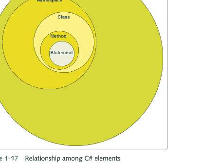

图 1-17 C# 元素之间的关系

要使用 C# 开发软件，需要 .NET Framework。Framework 包含所有预定义的 .NET 类。拥有如此多的类可减少所需的新代码量。你可以使用类库中包含的大部分功能。下一节描述了如何开始键入程序语句。


## 编译、生成和运行应用程序

### 输入程序语句

使用 C# 编写代码有几种选择。开发应用程序的一种方法是使用简单的文本编辑器（如记事本）输入源代码语句，然后使用 DOS 命令行编译并执行该应用程序。这种技术的优点是不需要大量系统资源，但要求您必须确切知道要输入什么。

第二种方法是使用 Visual Studio 集成开发环境 (IDE)，本章将向您介绍 Visual Studio。IDE 是一个交互式环境，使您无需离开 IDE 程序即可输入源代码、编译并执行。由于 IDE 包含调试和编辑功能，您会发现如果可以使用 Visual Studio，开发应用程序会容易得多。除了丰富的集成开发环境之外，Visual Studio 还包含许多工具和向导。附录 A“Visual Studio 配置”介绍了 Visual Studio 的许多附加功能，包括自定义 IDE 的建议。

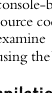

您可能需要取消选择“隐藏已知文件类型的扩展名”，这样在创建应用程序时，您就能够在“解决方案资源管理器”窗口中看到文件扩展名。文件扩展名包括一个点以及名称后面的两到六个字符。示例包括 .cs、.csproj、.sys、.doc、.suo、.sln 和 .exe。扩展名标识文件中存储的信息类型。例如，以 .cs 结尾的文件是 C# 源文件。能够按类型识别文件很有帮助。

前面几节介绍了大多数基于控制台的应用程序中至少需要的程序语句。要查看程序的结果，您必须将这些语句（即源代码）输入文件，编译该代码，然后执行应用程序。接下来的几节将探讨在使用和不使用 Visual Studio IDE 的情况下，编译和执行过程中会发生什么。

### 编译和执行过程

编译器用于检查语法。语法是用于编写计算机指令的符号或单词。编译器会确保程序语句或源代码中没有违反规则的情况。代码成功编译后，编译器通常会生成一个以 .exe 扩展名结尾的文件。此 .exe 文件中的代码尚未转换为面向任何特定 CPU 平台的机器码。相反，编译器生成的代码是 Microsoft 中间语言 (MSIL)，通常简称为 IL。在必需的第二步中，实时编译器 (JITer) 读取 IL 代码，并转换或生成在特定平台上运行的机器码。在第二步中转换代码后，就可以看到结果。

幕后进行的操作并不显而易见。例如，在编译器创建 IL 后，该代码可以在任何安装了 .NET Framework 的计算机上执行。Microsoft 免费提供仅用于部署应用程序的 .NET Framework 可再发行版本。**可再发行版本**比 SDK 的下载量更小，并且包含 CLR 和 `class` 库。同样，这可在 Microsoft 网站上获取。

.NET Framework 的运行时版本在概念上类似于 Java 虚拟机 (JVM)。与 C# 一样，Java 的编译器首先将源代码转换为称为字节码的中间代码。必须先将字节码转换为本机机器码，然后才能看到应用程序的结果。对于 C#，CLR 实际上只转换程序中正在使用的部分。这可以节省时间。此外，在计算机上编译了 IL 文件的某一部分后，就无需再次编译该部分，因为程序最终编译的部分会被保存，并在下次执行该部分程序时使用。

### 使用 Visual Studio IDE 编译源代码

您可以使用 Visual Studio IDE 提供的内置编辑器输入程序语句。然后，通过 IDE 中某个下拉菜单选项编译源代码，并使用 IDE 中的另一个菜单选项执行应用程序。有许多快捷方式可用。下一节将探讨如何使用 Visual Studio IDE 完成这些操作。

首先打开 Visual Studio。通过选择起始页上的 **新建项目** 按钮，或使用 **文件、新建、项目** 选项来创建新项目。

如图 1-18 所示，项目类型列表出现在中间窗口中。IDE 中可以使用许多模板。要开发 C# 控制台应用程序，请选择 **Visual C#**，并将模板选择为 **控制台应用程序**。使用“位置”文本框旁边的 **浏览** 按钮，导航到要存储项目的位置。项目名称为 **HelloWorldProgram**。您可以取消选中 **为解决方案创建目录** 选项旁边的复选框（如果已选中）。选中该选项会创建另一个目录层级。对于您将创建的应用程序类型来说，这个额外的文件夹并非必需。


> 除非更改此默认设置，否则您为项目指定的任何名称都会成为此项目的命名空间名称。

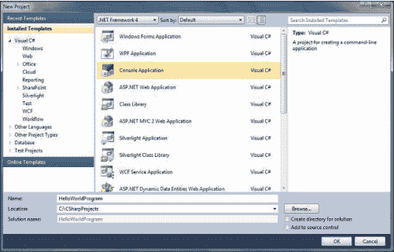

**图 1-18** 创建控制台应用程序

选择模板决定了 IDE 生成何种类型的代码。图 1-19 显示了创建控制台应用程序时自动创建的代码。

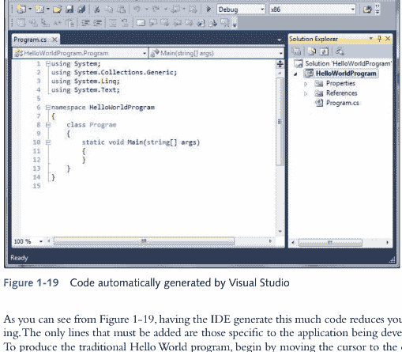

**图 1-19** Visual Studio 自动生成的代码

从图 1-19 可以看出，让 IDE 生成这么多代码可以减少您的输入量。必须添加的只有正在开发的应用程序特有的行。要生成传统的 Hello World 程序，首先将光标移到第 11 行末尾，然后按 Enter 键打开一个新的空行。在 Main( ) 方法的大括号之间输入以下行：

```
Console.WriteLine("Hello World!");
```


请注意，一旦您输入字符 c，就会弹出一个智能窗口列表，其中已选中 Console。这是 IDE 的 IntelliSense 功能中的单词完成选项。顾名思义，该功能会尝试在您输入之前感知您将要输入的内容。当窗口弹出时，如果选择正确，只需输入一个句点，就会得到另一个智能弹出窗口。同样，如果选择正确（WriteLine），只需输入下一个分隔符，即左括号。您也可以使用方向键从列表中进行选择。

接下来，更改类的名称和源代码文件名。Visual Studio 将该类命名为 Program，并默认使用相同的名称标识源代码文件。如果您使用 **解决方案资源管理器** 窗口将源代码文件名更改为 HelloWorld.cs，则会显示一条消息（如图 1-20 所示），询问您是否要将所有引用更改为该新名称。您可以在“解决方案资源管理器”窗口中通过右键单击名称并选择“重命名”选项（如图 1-20 所示），或直接单击该名称，来进行此更改。如果桌面上的“解决方案资源管理器”窗口未激活，请选择 **视图**、**解决方案资源管理器**。重命名文件时，请务必包含 .cs 文件扩展名。

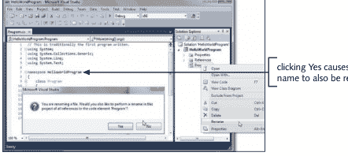

**图 1-20** 将源代码名称从 Class1 更改

查看图 1-20 所示的 **解决方案资源管理器** 窗口时，请注意顶层显示为“**解决方案 'HelloWorldProgram'（1 个项目）**”。第二行也包含单词“**HelloWorldProgram**”。Visual Studio 首先创建一个解决方案文件。这就是出现在顶行中的文件 **HelloWorldProgram**。解决方案文件可以包含一个或多个项目。对于此应用程序，解决方案包含一个项目。当您浏览存储应用程序的目录时，会找到一个使用该解决方案名称命名的文件夹。该文件夹内会有一个以 .sln 扩展名结尾的文件。这是解决方案文件，存储有关解决方案的信息。在同一文件夹中，您还会看到一个以 .csproj 扩展名结尾的文件。此文件存储有关项目的信息。通常，当您在 Visual Studio 中重新打开应用程序时，会打开以 .sln 扩展名结尾的文件。

如果您对图 1-20 中显示的问题回答“是”，则源代码中 `class` 的名称将替换为新名称。


修改源代码文件名和 `class` 的名称并非绝对必要。不进行该修改，应用程序也能运行；然而，为了养成良好的习惯，你应该修改名称。当应用程序涉及多个类时，这可以为你节省时间和麻烦。

示例 1-3 中的语句曾出现在示例 1-1 中，这里重复给出时省略了行号，以便你看到最终的源代码清单。

Visual Studio 还会生成另外几行不必要的代码，可以删除。例如，删除了其中三条 `using` 语句（第 2、3、4 行）。对于你将开发的大多数应用程序来说，它们并不需要。还删除了 `Main( )` 方法括号内的参数。本书后面会介绍这些代码行。

### 示例 1-3

```
// This is traditionally the first program written.

using System;
namespace HelloWorldProgram
{
    class HelloWorld
    {
        static void Main( )
        {
            Console.WriteLine("Hello World!");
        }
    }
}
```

务必记住，C# 区分大小写，这意味着名称 HelloWorld 与 helloWorld 是完全不同的名称，即使只有一个字符不同。因此，输入语句时要非常小心，必须与所示内容完全一致。

要编译 **HelloWorldProgram** 项目，请在 **生成** 菜单上选择 **生成 HelloWorldProgram** 选项。**HelloWorldProgram** 这个名称跟在生成选项之后，因为 **HelloWorldProgram** 是项目的名称。包含多个 **class** 的项目使用 **生成解决方案** 选项进行编译。

要运行应用程序，可以单击 **调试** 菜单栏上的 **开始调试** 或 **开始执行（不调试）**，如图 1-21 所示。如果你尝试执行尚未编译的代码（使用 **生成**），智能 IDE 会先编译代码。因此，许多开发人员采用绕过 **生成** 步骤的快捷方式。

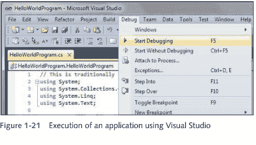

图 1-21 使用 Visual Studio 执行应用程序

使用 **开始调试** 选项运行应用程序时，你可能会注意到输出在屏幕上一闪而过然后消失。如果加入对 `Read( )` 方法的调用，就可以让输出屏幕停留。执行这一行时，程序会等待你按下一个键，然后才终止。要添加这一行，请回到源代码中，并将此行作为 `Main( )` 方法中的最后一条语句：

```
Console.Read( );
```

你前面读到过，软件开发周期是迭代的，有时需要返回之前的阶段。在这里，需要回到源代码语句并输入额外的语句。然后需要重新编译代码。当不再有语法错误时，你将看到程序的输出。

在 Visual Studio 中让命令窗口停留的另一种方法是选择 **调试. 开始执行（不调试）** 而不是 **调试. 开始调试** 来执行程序。请注意，在图 1-21 中，**开始执行（不调试）** 是紧挨在 **开始调试** 选项下方的选项。如果选择 **调试. 开始执行（不调试）**，就不必添加额外的 `Console.Read( );` 语句。使用 **开始执行（不调试）** 选项执行时，系统会提示用户“按任意键继续”，正如前面图 1-16 所示。这是执行程序的首选方法。

> > **注意**
> >
> > 还有几种其他快捷方式可用于运行程序。查看 **调试** 下的菜单选项时，注意 **Ctrl+F5** 被列为 **开始执行（不调试）** 的快捷方式；**F5** 是 **开始调试** 的快捷方式。此外，如果你的屏幕上有 **调试工具栏** 图标，一个空心的右箭头表示 **开始执行（不调试）**。

Visual Studio 是一个高度复杂的集成开发环境。附录 A“Visual Studio 配置”包含有关自定义开发环境以及使用调试器进行开发的更多信息。现在回顾这些材料是明智的。

## 调试应用程序

你的程序不可能总是立即正常工作，这是不可避免的。可能会出现几种类型的错误，并让你感到沮丧。主要的错误类别——语法错误和运行时错误——将在接下来的几节中讨论。

### 语法错误

在编辑器中输入源代码语句时，你很容易因为拼错名称或忘记用分号结束语句而出现输入错误。这些类型的错误被归类为语法错误，并由编译器捕获。编译时，编译器会检查这段代码，以确定你是否违反了该语言的任何规则。如果它无法识别某条语句，就会发出错误消息；这些消息有时晦涩难懂，但应该有助于你修复问题。Visual Studio 中的错误消息比命令行中发出的错误消息更具描述性。但是，请注意，一个输入错误可能会生成多条错误消息。图 1-22 显示了一段代码，其中单个错误导致编译器生成三条错误消息。

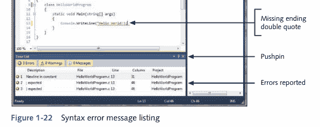

图 1-22 语法错误消息列表

错误消息显示在 IDE 底部的“错误列表”窗口中。IDE 还会在推测的问题位置下方划线。你也可以双击任意错误消息，直接转到编译器标记的行。如果屏幕上没有显示“错误列表”选项卡，可以从“视图”菜单中选择“错误列表”。

所有工具窗口（例如“错误列表”窗口）的右上角都会出现一个图钉图标。当图钉像图钉一样竖立时，窗口就停靠在原位；因此，在图 1-22 中，“错误列表”窗口停靠在原位。

工具窗口支持一项称为“自动隐藏”的功能。如果单击图钉，使其看起来侧放着，窗口就会沿 IDE 的边缘最小化。边缘会显示一个带有窗口名称的小选项卡。这样可以腾出空间，让你看到更多源代码。

图 1-22 中显示的语法错误是一个常见错误。第 13 行的 WriteLine( ) 方法参数末尾遗漏了双引号。然而，错误消息并没有说明这一点。查看错误消息时，请记住，编译器可能直到到达下一行或下一个代码块时才发出该消息。请在标记出的大致区域中查找问题。一些最常见的错误包括：未能闭合左花括号 { } 或多出一个右花括号 } }、未在语句末尾输入分号 (;)，以及拼错名称。作为一个不错的练习，可以考虑故意省略花括号、分号，并拼错单词。看看每种错误会生成什么样的错误消息。这样，将来开发更复杂的应用程序时，你就能更迅速地找到这些错误。

由于一个错误可能生成多条消息，最好先修复第一个错误，然后重新编译，而不是试图一次性修复所有错误。

### 运行时错误

运行时错误比语法错误更难检测。包含运行时错误的程序可能编译时毫无问题、能够运行并产生结果。运行时错误也可能导致程序崩溃。程序可能被编写为从文件检索数据。如果该文件不可用，程序运行时就会发生运行时错误。另一种运行时错误是除以零。

很多时候，程序编译和执行都没有错误，但并未按预期运行。如果结果不正确，相关错误称为逻辑错误。只有仔细检查结果并验证其正确性后，才能发现逻辑错误。例如，某个值可能计算不正确。可能使用了错误的公式。未能完全理解问题说明是逻辑错误最常见的罪魁祸首。仅仅产生输出是不够的；输出必须是对问题的正确解决方案。

当你开始在第 2 章处理数据时，将介绍另一种潜在的运行时错误类型。如果你使用数据进行计算，或根据数据的值执行不同的步骤，就很容易遇到运行时错误。在软件开发过程中，通过在开始编码阶段之前进行彻底的分析和设计，可以最大限度地减少运行时错误。常见的桌面检查策略也能带来更准确的结果。

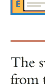

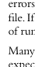


## 创建应用程序

现在你已经了解大多数 C# 程序所需的要素以及如何编译并查看结果，请使用本章前面介绍的程序开发建议方法，通过以下示例进行练习。在本节中，你将为以下问题定义设计解决方案。

### 编程示例：ProgrammingMessage

问题规格说明如 图 1-23 所示。


**图 1-23** ProgrammingMessage 示例的问题规格说明书

**分析问题** 你是否理解问题定义？这一步经常被忽视或草草带过。很容易浏览问题定义并认为自己已经掌握了问题，但却遗漏了重要特征。如果没有投入足够的时间和精力来分析问题定义，后续步骤可能会浪费大量时间和费用。这是开发过程中最重要的一步，如果不是最重要的一步。必要时请提问以澄清问题定义。你要确保自己完全理解了期望的内容。

在阅读 图 1-23 中给出的問題定义时，请注意不需要任何程序输入。此应用程序所需的唯一数据是一个字符字符串。这大大简化了分析阶段。

**设计解决方案** 如 图 1-23 中的问题规格说明书所述，期望的输出是在两行上显示“Programming can be FUN!” 。对于此示例以及你开发的任何其他应用程序，确定最终输出应是什么样是有帮助的。记录期望输出的一种方法是构建输出的原型或模拟。原型范围从使用图形、文字处理或绘图程序创建的精细设计，到使用纸笔创建的相当晦涩的草图。无论你使用哪种方法，都必须认识到构建原型的[content]
## 创建应用程序

现在你已经了解大多数 C# 程序所需的要素以及如何编译并查看结果，请使用本章前面介绍的程序开发建议方法，通过以下示例进行练习。在本节中，你将为以下问题定义设计解决方案。

### 编程示例：ProgrammingMessage

问题规格说明如 图 1-23 所示。


**图 1-23** ProgrammingMessage 示例的问题规格说明书

**分析问题** 你是否理解问题定义？这一步经常被忽视或草草带过。很容易浏览问题定义并认为自己已经掌握了问题，但却遗漏了重要特征。如果没有投入足够的时间和精力来分析问题定义，后续步骤可能会浪费大量时间和费用。这是开发过程中最重要的一步，如果不是最重要的一步。必要时请提问以澄清问题定义。你要确保自己完全理解了期望的内容。

在阅读 图 1-23 中给出的問題定义时，请注意不需要任何程序输入。此应用程序所需的唯一数据是一个字符字符串。这大大简化了分析阶段。

**设计解决方案** 如 图 1-23 中的问题规格说明书所述，期望的输出是在两行上显示“Programming can be FUN!” 。对于此示例以及你开发的任何其他应用程序，确定最终输出应是什么样是有帮助的。记录期望输出的一种方法是构建输出的原型或模拟。原型范围从使用图形、文字处理或绘图程序创建的精细设计，到使用纸笔创建的相当晦涩的草图。无论你使用哪种方法，都必须认识到构建原型的

- Microsoft .NET 网站：www.microsoft.com/net
- MSDN Visual C# 主页：http://msdn2.microsoft.com/en-us/vcsharp/default.aspx
- 美国人口普查局关于计算机和互联网使用的数据：http://www.census.gov/aps/
- 维基百科（免费百科全书）：http://wikipedia.org
- Mono 跨平台开源 .NET 框架：www.mono-project.com

## 快速回顾

- 1. 计算机的能力取决于软件，软件是赋予硬件功能的一组指令或程序。
- 2. 许多人认为当今的计算机技术处于现代计算的第五代。每个时代都以一项重要进步为特征。
- 3. CPU 有两个主要作用。它对数据执行算术和逻辑比较，并协调系统的操作。
- 4. 软件可分为两类：系统软件和应用软件。应用软件定义为为执行特定任务而开发的程序。
- 5. 最常与系统软件相关联的软件类型是操作系统。打开计算机时会加载操作系统软件。其他类型的系统软件包括编译器、解释器和汇编器。
- 6. 编程是解决问题的过程。最难的部分是制定解决问题的计划。
- 7. 软件开发中解决问题的五个步骤包括分析、设计、编码、实现以及测试和调试解决方案。
- 8. 过程式编程是面向过程的，关注数据从输入到产生有意义输出所经历的过程。
- 9. 自顶向下设计或逐步细化的基本主题是：给定任何问题定义，都可以通过分治法来细化逻辑。
- 10. 软件维护指升级或更改应用程序。
- 11. 使用面向对象分析方法时，重点在于确定要操作的对象，而不是操作它们所需的逻辑。
- 12. 封装指将属性和动作（或特征和行为）组合起来形成一个类。
- 13. 对象是类的实例。
- 14. 通过继承，可以定义数据对象的子类，这些子类共享其父类或超类的一些或全部主类特征。继承使代码重用成为可能。
- 15. C# 是从零开始设计的，旨在配合新的编程范式 .NET，并且是用于开发 .NET 大部分内容的语言。
- 16. .NET 是程序运行所在的软件环境。它不是操作系统。它是操作系统与其他应用程序之间的一层，为开发和运行代码提供更简便的框架。
- 17. 通过使用 Visual Studio（它是一个 IDE）和 .NET Framework 类，C# 提供了一种创建图形用户界面的简便方法。
- 18. 最初，使用 C# 进行开发仅适用于 Windows 平台；不过，许多项目正在开发中，将 C# 移植到 Linux 等其他平台。
- 19. C# 可用于创建 Web、Windows 和控制台应用程序。
- 20. 网页使用 Web 窗体创建，Web 窗体是 ASP.NET 技术的一部分。
- 21. Windows 应用程序被视为桌面绑定，并为单一平台设计。
- 22. 控制台应用程序最容易创建。可以用最小的开销输入和产生值。
- 23. C# 程序通常以注释或 using 指令开始，随后是可选的命名空间分组，然后是必需的类定义。
- 24. 所有 C# 程序都必须定义一个类。
- 25. 注释是写给自己或程序读者的说明。编译器会忽略注释。
- 26. 不必结束单行内联注释 //；按下 Enter 键时它们就结束了。跨多行的注释应括在 /* */ 之间。这些被视为块注释或多行注释。
- 27. 超过 2000 个类组成了 Framework 类库。类包含可重用的数据成员和方法（或行为）。
- 28. using 命名空间指令导入给定命名空间中包含的所有类型。通过指定构建应用程序所围绕的命名空间，可以不必在类前面加上点（.）和命名空间名称。
- 29. C# 中的一切都围绕类设计。每个程序必须至少有一个类。
- 30. 方法是一个或多个语句的集合，这些语句共同执行一个动作。换句话说，方法是执行动作的一小段代码。
- 31. Main( ) 方法是每个 C# 控制台应用程序的“入口点”。它是执行开始的点。
- 32. 关键字 static 表示只创建该方法的一个副本。
- 33. 包含关键字 void 表示不返回值。方法的完整签名以返回类型开始，随后是方法名，最后是括号中的参数列表。Main( ) 的一个签名是 static void Main( )。
- 34. WriteLine( ) 将字符串消息写入监视器或标准输出设备。
- 35. 方法通过放在括号内的参数相互通信。
- 36. 可读性很重要。缩进不是必需的，但这是一个好习惯，因为它使代码更易于阅读。
- 37. 要查看程序的结果，必须将语句（源代码）键入文件，编译该代码，然后执行应用程序。
- 38. Visual Studio 集成开发环境（IDE）是一个交互式开发环境，使你无需离开 IDE 程序即可键入源代码、编译和执行。
- 39. 记录期望输出的一种方法是构建输出的原型或模型。
- 40. Read( ) 方法接受来自标准输入设备（如键盘）的任意字符。它不对该字符做任何处理。

## 练习题

- 1. 计算机的大脑是：
  - a. 程序
  - b. 输入设备
  - c. 操作系统
  - d. CPU
  - e. 主存

- 2. 你运行一个程序，它输出两个值的差，而不是按预期输出两个值的和。这是什么类型的错误？
  - a. 语法
  - b. 分析
  - c. 编码
  - d. 设计
  - e. 逻辑

- 3. 将高级编程语言翻译成机器可读形式的程序是：
  - a. 应用程序
  - b. 操作系统
  - c. C# 程序
  - d. 编译器
  - e. 机器语言实用程序

- 4. 以下策略可减少开发时间并产生更高效的解决方案：
  - a. 尽快编码解决方案。
  - b. 在编码前设计解决方案。
  - c. 在测试和调试前分析解决方案。
  - d. 在测试期间构建原型。
  - e. 使用简单的低级语言进行开发。

- 5. 在软件开发生命周期的哪个阶段，会使用探询性问题来验证问题定义？
  - a. 分析
  - b. 设计
  - c. 编码
  - d. 实现
  - e. 测试

- 6. 在发现潜在问题时回到前面的阶段，是以下哪项的示例：
  - a. 面向对象编程
  - b. 逐步细化
  - c. 中间语言
  - d. 迭代开发
  - e. 结构化编程

- 7. 修改可运行程序或升级到新版本的过程称为：
  - a. 维护
  - b. 测试
  - c. 伪代码
  - d. 编程
  - e. 即时编译

- 8. 设计解决方案后，在键入任何代码之前，你应该 ______________。
  - a. 分析问题定义
  - b. 检查运行时错误
  - c. 对解决方案进行维护
  - d. 对解决方案进行桌面检查
  - e. 确定使用哪个 .NET 类


14. System 是一个（ ）的示例：

- a. 对象
- b. **类**
- c. 方法
- d. **命名空间**
- e. 指令

15. _______________ 将语义相关的类型组织在单个名称下。

- a. 对象
- b. **类**
- c. 方法
- d. **命名空间**
- e. 指令

16. 为了标记代码块的开头和结尾，C# 程序员使用：

- a. [ ]
- b. { }
- c. ( )
- d. begin... end
- e. start... stop

17. 下列哪一项是关键字？

- a. Main( )
- b. System
- c. using
- d. WriteLine
- e. 以上全部

18. 允许用户输入单个字符的方法的完全限定调用是：

- a. Console.System.Read( )
- b. System.Console.Read( )
- c. Console.System.Write( )
- d. System.Console.Write( )
- e. System.Console.ReadLine( )

19. 源代码必须被转换为机器代码（也称为本机代码）。这个两步过程从（ ）开始：

- a. 调试器
- b. 编辑器
- c. 解释器
- d. JITer
- e. 编译器

20. _____________ 是所需输出的模型。

- a. 原型
- b. 算法
- c. 图表
- d. 规格说明
- e. 以上都不是

21. Visual Studio 中，当在对象名后键入点号时，会在可滚动列表中显示所有可用方法和属性的功能叫什么名字？

- a. Help
- b. Rotor
- c. Mono
- d. IntelliSense
- e. ToolTip

22. 要查看应用程序的结果，你 _____________ 代码。

- a. 编译
- b. JIT
- c. 执行
- d. 编辑
- e. 桌面检查

23. 控制台应用程序的特征是：

- a. 包含一个 Main( ) 类
- b. 包含一个 Main( ) 方法
- c. 具有 GUI
- d. 属于 Web Forms 类
- e. 要求使用 System.Interface 命名空间

24. 可以使用哪个转义序列表示光标应前进到下一行？

- a. 换行
- b. 转义下一个
- c. `\n`
- d. `\newline`
- e. `\r`

25. 下列哪一项是对方法的调用？

- a. Console.Write;
- b. Console.Write["ok"];
- c. Write.Console("ok");
- d. Console.Write("ok");
- e. 以上都不是

26. 指出将示例 1-1 输入编辑器时可能出现的一个语法错误。指出可能出现的一个逻辑错误。

27. 运行以下应用程序时会产生什么输出？

```
Line 1  // Example program - displaying output.
Line 2  using System;
Line 3  namespace ExerciseI
Line 4  {
Line 5      class Problem2
Line 6      {
Line 7          static void Main( )
Line 8          {
Line 9              Console.Write("Go ");
Line 10             Console.Write("Laugh ");
Line 11             Console.WriteLine("Out Loud");
Line 12             Console.Write("Think ");
Line 13             Console.Write("Happy");
Line 14         }
Line 15     }
Line 16 }
```

28. 必须修改练习 #27 中的代码段中的什么内容，才能使所有输出显示在一行上？

29. 在互联网上搜索，并找出一个非 Microsoft 的、可下载 C# 编译器的网站的 URL。

3. 绞刑架游戏（Hangman）是童年时期最喜爱的游戏。为这个游戏设计火柴人，并生成包含你的火柴人的打印清单。下面是一种可能的设计。你可以实现这个设计，或开发一个改进版本。

```
(^;^)
|
./ | \.
|
_/ \_
```

4. 你创建的每个程序都应以标识作业的内部文档开头。你可能希望包含其中一些项目：编程作业编号、你作为开发者的姓名、程序截止日期、程序提交日期以及应用程序的用途。开发一个生成包含这些信息的横幅的应用程序。你的输出可能类似于以下内容：

```
*******************************
* Programming Assignment #4 *
* Developer: Alma King *
* Date Submitted: September 17 *
* Purpose: Provide internal documentation. *
*******************************
```

除了打印前面代码段中所示的输出屏幕横幅外，请务必在程序中包含适当的注释作为内部文档。

5. 旗帜是团结的象征，并对其追随者具有特殊意义。为一面旗帜创建设计，并编写一个显示你的设计的程序。下面是一种可能的设计。

```
****** -----------------------------
****** -----------------------------
****** -----------------------------
****** -----------------------------
-----------------------------------
-----------------------------------
```

6. 创建一个生成以下输出的应用程序。它应显示为三行，与这里显示的完全一致。

```
Today is the FIRST day of the rest of your life.
Live it to the FULLEST!
You may not get a second chance...
```

7. 练习 6 展示了一句流行谚语。生成一个包含你最喜欢的谚语的清单。将输出设置为双倍行距，并将该谚语按每行一个单词打印。

8. 将你的出生年份打印在一列中。例如，如果你出生于 1982 年，你的输出应类似于以下内容：

```
1
9
8
2
```

9. 创建一个显示以下图案的应用程序。你可以使用自己选择的任意字符来构造该图案。

```
**********
**********
**********
**********
**********
**********
**********
**********
**********
**********

*
***
*****
*******
*********
***********
*************
***************
*****************
*******************

*
***
*****
*******
*********
***********
*********
*****
***
*
```

10. 将你的姓名首字母以块状字符写入标准输出设备。使用你选择的符号设计你的原型。

# 2 数据类型和表达式

在本章中，你将：

- 考查计算机如何表示数据
- 为数据声明内存位置
- 探索类、对象和类型之间的关系
- 使用预定义数据类型
- 使用整型数据类型
- 使用浮点类型
- 了解 `decimal` 数据类型
- 声明布尔变量
- 声明并操作字符串
- 使用常量
- 使用算术运算符编写赋值语句
- 了解运算顺序
- 学习货币的特殊格式规则
- 完成一个演示本章概念的编程示例

第 1 章向你介绍了 C# 程序的基本元素。你了解了开发、编译和执行应用程序的要求。本章重点讨论数据。数据是原始事实——即被操作以产生有用信息的基本数字和字符。在本章中，当你编写应用程序来执行计算时，你将开始看到编程的强大能力。你将学习如何声明在内存中保存不同类型数据的变量，并了解算术运算符在给定不同类型数据时如何反应。

### 数据表示

你可能会听到有人说，他的计算机有一个 64 位处理器、4 吉字节（GB）的 RAM 和 1 太字节（TB）的硬盘空间。另一个人告诉你，她的闪存盘容量为 2 GB。这到底意味着什么？

### 位

首先，bit 一词是“Binary digit”（二进制数字）的缩写。Binary 的意思是二；因此，一个二进制数字可以取两个值之一：0 或 1。对于数据表示而言，1 和 0 分别对应开和关。在思考位时，想象一个电路（开关）被打开或关闭可能会有所帮助。数字 1 表示电路处于打开状态。

### 字节

计算机存储器通常划分为 8 位一组。这种 8 位组合称为字节。用最简单的话说，每个开关称为一位，需要八个开关的组合来表示一个字符，例如字母 A。8 位表示 1 字节，1 字节表示一次击键，那么表示单词“programming”需要 11 字节。你可能会想，为什么组成一个字节需要 8 位。8 位字节是人们在过去 50 年里通过反复试验确定下来的格式。这种 8 位的用法始于 20 世纪 60 年代的 IBM System/360。20 世纪 80 年代，随着家用计算机的爆炸式增长，它变得流行起来，而家用计算机也基于 8 位。今天，我们不会想到把字节与可变的位数联系起来；人们普遍接受一个字节由 8 位组成。

### 二进制计数系统

计算机通过将内存单元中的开关设置为表示字符的模式来存储数据。为了表示数据，计算机使用基数为 2 的计数系统，也称为二进制计数系统。我们的基数为 10 的计数系统称为十进制系统，使用从 0 到 9 的 10 个符号来表示一个值。基数 2 只有两个符号，即值 0 和 1。因此，一个二进制值可能看起来像 01101001，因为它仅由 0 和 1 组成。你如何确定二进制数 01101001 的十进制等价值？如果你理解十进制（基数为 10）

在按位计数系统中，很容易将这些概念转换到任何其他进制计数系统。图 2-1 说明了 1326 在十进制中是如何得出的。

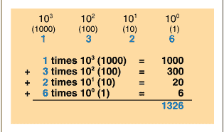

**图 2-1** 1326 的十进制按位记数法

图 2-2 使用同样的概念以二进制来说明 01101001 的十进制等价值。在图 2-2 中，可以看到二进制数 01101001 等价于十进制数 105。

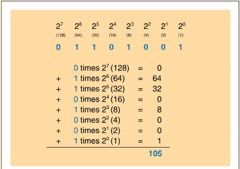

**图 2-2** 01101001 的十进制等价值

从图 2-2 可以看出，在二进制计数系统中，每一位都代表 2 的递增幂值。表 2-1 显示了各位取不同值时的十进制值。如表所示，当所有位都以 1 表示而置位时，对应的十进制值是 255。

**表 2-1** 部分十进制值的二进制等价值

| 十进制值 | 二进制等价值 |
|---|---|
| 0 | 00000000 |
| 1 | 00000001 |
| 2 | 00000010 |
| 3 | 00000011 |
| 4 | 00000100 |
| 5 | 00000101 |
| 6 | 00000110 |
| 7 | 00000111 |
| 8 | 00001000 |
| ... | ... |
| 254 | 11111110 |
| 255 | 11111111 |

由于读取一串二进制数很困难，因此开发了两种简写形式，以便更容易查看内存单元的内容。基数为 16 的十六进制计数系统以 16 的幂为基础。基数为 8 的八进制计数系统使用 8 的幂。两者都用于更紧凑地表示二进制数。与任何其他按位计数系统一样，最小符号是 0，符号总数等于基数，并且使用按位记数法。十六进制有 16 个符号（0-9、A-F）。十进制值 15 在十六进制中表示为 F。十六进制中的 2C 在我们的十进制计数系统中是 44，如下例所示：

```
2 → 2 times 16¹ → 2 times 16 = 32
+ C → 12 times 16⁰ → 12 times 1 = 12
----------------
44
```

使用十进制按位计数系统时，每个数字的值取决于它在数字中的位置。八进制计数系统使用八个数字。

你能确定十进制值 9 的八进制表示吗？答案是 11。

1 乘以 8¹ + 1 乘以 8⁰ = (8 + 1) = 9

## 字符集

仅用 8 位，就可以表示 2⁸ 即 256 个不同的十进制值，范围从 0 到 255。这就是 256 个不同字符或 0 和 1 的不同组合。二进制计数系统用于表示计算机语言。二进制数 01000001 等价于十进制值 65，它表示大写字符 A。幸运的是，你不必重新训练自己来说这种语言。C#（读作 C sharp）程序员使用的字符集称为 Unicode。**Unicode** 是通用字符编码方案。它涵盖世界上所有书写系统（无论古代还是现代）的所有字符。因为计算机只处理数字，所以它们通过给字母和字符分配数字来存储它们。Unicode 为每个字符提供一个唯一编号。在 Unicode 发明之前，有数百种不同的编码方案在使用。没有一种编码能够包含足够多的字符。当开发者创建 Unicode 字符集时，他们没有使用 8 位，而是使用了 16 位。现在可以表示 2^16 即 65,536 个唯一字符。Unicode 除了英语之外，还包括许多不同语言书写字符的表示。

Unicode 的一个子集，即前 128 个字符，对应于**美国信息交换标准代码（ASCII）**字符集。ASCII 由英语字母表以及数字和符号组成。对于 ASCII 字符集和 Unicode，前 32 个值（0 到 31）是回车和换行等内容的代码。空格字符是第 33 个值，其后是标点符号、数字、大写字符和小写字符。附录 C 包含一个表，显示 Unicode 字符集中 ASCII 部分的十进制表示。C# 和 Java 语言都使用 Unicode 字符集。

## 千字节、兆字节、吉字节、太字节、拍字节……

现在回到我们的 64 位处理器，它带有 2 GB 内存和 1 TB 硬盘空间。当你开始谈论大量字节时，就会用到 kilo、mega 和 giga 等前缀，例如 kilobyte、megabyte 和 gigabyte（也缩写为 K、M 和 G，如 Kbytes、Mbytes 和 Gbytes，或 KB、MB 和 GB）。表 2-2 显示了乘数。

**表 2-2** 数据表示的常用缩写

| 存储容量 | 字节大小 | 缩写 |
|---|---:|---|
| 千字节 | 2^10 (1,024) | KB |
| 兆字节 | 2^20 (1,048,576) | MB |
| 吉字节 | 2^30 (1,073,741,824) | GB |
| 太字节 | 2^40 (1,099,511,627,776) | TB |
| 拍字节 | 2^50 (1,125,899,906,842,624) | PB |
| 艾字节 | 2^60 (1,152,921,504,606,846,976) | EB |
| 泽字节 | 2^70 (1,180,591,620,717,411,303,424) | ZB |
| 尧字节 | 2^80 (1,208,925,819,614,629,174,706,176) | YB |

注意，kilo 大约是千，mega 大约是百万，giga 大约是十亿，依此类推。因此，当你想到一台配有 64 位处理器、4 GB 内存和 1 TB 硬盘空间的机器时，你就知道该机器一次可以处理 64 位，在内存中存储大约 40 亿个字符，并且硬盘上具有大约 1 万亿个字符的存储容量。

## 数据的内存位置

程序处理数据，而数据可以采取数字、单个字符或字符组合的形式。以下都是数据示例：

18、"Brenda"、'A'、3.25、-7、36724 和 47.23

这些数据项本身没有值。数字 18 可能是年龄、温度、班级学生人数、你本学期注册的学时数，或者可能代表完全不同的东西。如果不识别并标记 18，它就是一个无意义的数字。处理数据时，首要任务是使用标识符为数据项命名。

### 标识符

**标识符**是程序中出现的元素名称，例如数据项。有些标识符是预定义的；其他是用户定义的。你在上一章编写第一个程序时已经看到了一些 .NET 标识符。这些不是保留关键字，而只是 .NET 平台和 C# 语言开发者选择并使用的名称。示例 1-1 中的程序包含以下预定义标识符：`System`、`Main`、`Console` 和 `WriteLine`。

`HelloWorldProgram` 的 `namespace` 标识符和 `HelloWorld` 的 `class` 标识符是教材作者在创建第一个项目时选择的用户定义标识符。

以下是在 C# 中创建标识符的规则：

- 1. 可以使用字母字符（a-z 和 A-Z）、数字（0-9）和下划线（_）的组合。标识符可以很长；但是，许多系统将前 31 个字符视为唯一。
- 2. 名称的第一个字符不能是数字。
- 3. 字符之间不能嵌入空格。这意味着不能通过空格分隔名称中的单词。通常，你将第二个及后续单词连接到标识符上，方法是将第一个单词之后的每个单词的首字母大写。

像 C++ 这样的语言使用下划线字符作为单词之间的分隔符。尽管下划线是可以在 C# 中使用的有效字符，但它主要用于定义常量标识符。你将在本章学习常量字面量。

- 4. 表 2-3 和表 2-4 显示了 C# 中的关键字。关键字是预定义的保留标识符，对编译器具有特殊含义。它们不能用作程序中的标识符。请注意，表 2-4 中的关键字被称为“上下文关键字”。上下文关键字不如常规关键字那样强大。上下文关键字仅在特定情况下使用时才具有特殊含义。其他时候它们可以用作标识符。

**表 2-3** C# 关键字/保留字

| 关键字 |  |  |  |  |  |
|---|---|---|---|---|---|
| abstract | as | base | bool | break | byte |
| case | catch | char | checked | class | const |
| continue | decimal | default | delegate | do | double |
| dynamic | else | enum | event | explicit | extern |
| false | finally | fixed | float | for | foreach |
| goto | if | implicit | in | int | interface |
| internal | is | lock | long | namespace | new |
| null | object | operator | out | override | params |
| private | protected | public | readonly | ref | return |
| sbyte | sealed | short | sizeof | stackalloc | static |
| string | struct | switch | this | throw | true |
| try | typeof | uint | ulong | unchecked | unsafe |
| ushort | using | virtual | volatile | void | while |

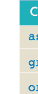

上下文关键字仅在特定上下文中使用时才具有特殊含义。添加它们是为了避免破坏可能使用早期标准编写的代码，在这些标准中，其中一个词可能已被用作用户定义标识符。例如，yield 仅在紧接在 return 或 break 语句之前使用时才具有特殊含义。其他时候，它可以用作标识符。

**表 2-4** C# 上下文关键字

| 上下文关键字 |  |  |  |  |  |
|---|---|---|---|---|---|
| ascending | by | descending | equals | from | get |
| group | in | into | join | let | on |
| orderby | partial | select | set | value | var |
| where | yield |  |  |  |  |


5. 可以将“@”符号用作标识符的第一个字符，但它具有特殊含义，除非你编写的代码要与另一种编程语言交互，否则应避免这样做。使用时，“@”符号使关键字可以用作标识符。

6. 明智的做法是利用字符的大小写。C# 区分大小写。标识符 **Rate** 不同于标识符 **rate**，也不同于 **RATE** 或 **rATE**。

在 .NET 中，标识符大小写有三种约定：帕斯卡命名法、驼峰命名法和全大写。使用**帕斯卡命名法**时，标识符的首字母以及后续每个连接单词的首字母均大写。在 C# 中，类、方法、命名空间和属性遵循帕斯卡命名法命名约定。变量和对象遵循驼峰命名法约定。使用**驼峰命名法**时，标识符的首字母小写，后续每个连接单词的首字母大写。C# 中的约定是对变量和对象标识符使用驼峰命名法。全大写用于常量字面量以及由两个或更少字母组成的标识符。

7. 具有描述性会很有帮助。使用能表示所描述项的有意义名称。如果标识符用于引用一个人的年龄，就把它命名为 age，而不是 x。标识符越具有描述性，你和他人就越容易阅读你的代码。表 2-5 展示了有效标识符的示例。

## 表 2-5 有效标识符

| 有效标识符 | | |
|---|---|---|
| studentName | age | numberOfCourses |
| soc_sec_number | departureTime | course1 |
| AmountOwed | count_of_Values | taxAmount |
| n | streetAddress | zipCode |
| roomSize | courseName | x3 |
| moreData | bookTitle | homeRuns |
| pointsScored | CLUB_NAME | exam4 |

编译器不会捕获前面列表中第 7 条规则的违反情况。然而，这条规则极其重要，你应该遵守它。通过使用描述其内容的有意义名称，你开发的程序更易读，也更容易调试和修改。表 2-6 列出了非法标识符，并说明了它们无效的原因。

## 表 2-6 无效标识符

| 无效标识符 | 违规说明 |
|---|---|
| soc sec number | 内嵌空格 |
| int | 保留关键字 |
| 3n | 以数字开头 |
| room # | 除下划线以外的特殊符号 |
| first-name | 除下划线以外的特殊符号 |
| A number | 内嵌空格 |
| class | 保留关键字 |

C# 中标识符的规则与 Unicode 3.0 标准推荐规则完全对应。唯一的例外是，Unicode 不承认下划线可以作为首字符。C# 语言中可能加入这一特性，是因为 C++ 等其他编程语言允许这样做。

## 变量

计算机程序要处理或操作数据，字符和数字必须存储在随机存取存储器（RAM）中。变量是便于这种存储的编程元素。**变量**表示计算机内存中的一块区域，其中可以存储特定数据类型的值。当你**声明变量**时，你就在程序中为该数据项分配了内存。

声明变量要求你选择一个标识符，并确定内存单元中将出现什么类型的数据。声明变量的语法如下：

```
type identifier;
```

在声明或创建变量的同时，可以将其初始化为某个值。这称为**编译时初始化**。注意“初始化”一词。变量从初始化值开始，但该值可以更改。赋给变量的值应与数据类型兼容。当变量将用于算术运算时，最好将其初始化为 0。声明变量时初始化变量的语法如下：

```
type identifier = expression;
```

表达式可以只是一个像 0 这样的值，也可以包含算术等式中的其他标识符。

对于这两种声明，除了为数据项命名外，还必须确定将与其关联的数据类型。这一步会通知计算机为该数据项预留多少存储空间，以及数据放入内存后如何检索它。

### 字面量值

变量的值可以改变。字面量不能改变。**字面量**是程序中使用的数字、字符以及字符组合。它们可以赋给变量，也可以在表达式中使用。它们的值保持不变。数字 17 始终是 17。字符 A 始终是 A。可以将字面量的值复制到变量中，然后更改变量；这不会改变原始字面量的值。也可以使用字面量而不将其赋给特定变量。

每次在 C# 语言中声明变量时，实际上都是在实例化一个**类**（创建一个**对象**）。如果声明三个 `int` 类型的变量，就是在实例化 `class` 三次；会创建三个 `int` 对象。以下语句创建三个 `int` 对象：

```
int homeWorkScore1;
int examNumber1;
int numberOfPointsScored;
```

> 请注意，声明变量 `homeWorkScore1`、`examNumber1` 和 `numberOfPointsScored` 时是如何使用驼峰命名法约定的。首字母小写。后续单词的首字符大写。创建这些对象时，你正在实例化 `int` 类。本章末尾可以找到一些 C# 编码标准的摘要。

字面量常用于为**对象**的数据部分赋值。这可以在创建**对象**时完成，也可以在后面的程序语句中完成。可以使用以下语句将诸如 100 这样的值赋给 `homeWorkScore1`：

```
homeWorkScore1 = 100;
```

这里 100 是数值字面量。变量 `homeWorkScore1` 存储值 100 的内存位置的内容可以更改；但是，字面量值 100 不能更改。100 始终是 100。

> C# 与那些在声明变量时为其包含默认值的语言不同。在 C# 中，每个变量在使用前都必须赋值。否则，会发出语法错误。

接下来的几节将解释类型、类和对象的概念与数据的关系。

## 类型、类和对象

C# 是一种面向对象的语言，广泛使用类和对象。下一节将解释类型在其中所处的位置。

### 类型

C# 有大量预定义类型可供程序使用。当你思考英语中“类型”是什么时，你可能会把类型与一个标签联系起来，该标签表示属于该类别的一组事物共享某些共同特征。词典对“类型”一词的定义大致如下：可以通过一组特定特征与其他种类或组别区分开来的一种或一组。示例 2-1 应有助于加深你对类型是什么以及使用正确类型的重要性的理解。

#### 示例 2-1

你可能拥有或计划拥有某种类型的车辆，例如悍马或科尔维特。悍马车型具有与科尔维特不同的特征。科尔维特可以比悍马行驶得更快。但是，悍马可以在崎岖得多的地形上行驶。你不会把科尔维特开进山区徒步区域，并期望它能越过巨石，而悍马也许能做到。你不会想用科尔维特运送四个人，但四个人可以轻松坐进悍马。两者都被视为车辆。如果你两者都有，你可以根据情况或目的地决定使用哪一辆。

对于 C# 来说，数字类型不止一种。一种数字类型称为**整数**，即 `int`。`int` 类型是整数，处于某个值范围内，并且不包含小数点。它可以是正数或负数。另一种数字类型是**浮点值**，它可以包含小数部分。C# 支持两种浮点类型：`float` 和 `double`。如果你想存储平均绩点，把该值放入 `int` 就不合适，因为 `int` 只允许存储整数部分。这就像试图把两个以上的人塞进科尔维特。他们根本坐不下。如果你的平均绩点是 3.87，而你把该值放入 `int` 类型，它会切掉，即**截断**，.87，你的平均绩点就变成 3。你不会对此很高兴，对吧？

### 类

类型实际上在 C# 中是通过类实现的。Framework 类库是 .NET 的一部分，包含 2000 多个可在程序中使用的类。为简单起见，你可以认为 C# 中类与类型之间存在一一对应关系。C# 从一开始就被设计为真正的面向对象语言。正如你在第 1 章中学到的，每个程序都必须包含一个类。C# 是一种强类型


语言。语言中内置了许多类型，C# 还允许你编写或创建自己的用户定义数据类型或类。在第 11 章《高级面向对象编程特性》中，你还将阅读有关另一种称为匿名数据类型的类型。在 C# 中，像整数这样的简单内置数值数据类型有时也被称为原始类型。

## 对象

如前所述，对象是类的一个实例。它是类的一个出现。为了简化理解，你可以将基类型 int 的一个实例视为 21 或 3421。然而，类包含的不仅仅是与该类型相关的数据。类是用来表示将数据和行为封装到单个包或单元中的术语。可以描述类的行为和数据的特征。如前所述，int 的数据部分始终是一个整数值。int 数据类型可以存储没有小数部分的值。int 数据类型的行为可以通过识别可以在该类型上执行的基本算术运算（如加法和减法）来描述。逻辑比较可以确定哪个更大，值也可以显示。这些都是 int 数据类型的行为。将这些数据和行为特征封装（打包）到一个单元中，可以让你描述该类型。

### 示例 2-2

你的当前平均绩点可能使用 gradePointAverage 这样的标识符命名。平均绩点通常采用带小数部分的实数形式，例如 3.42。在 C# 中，带小数点的实数使用 double 数据类型表示。你的姓名是另一个由字符字符串组成的数据项。在 C# 中，string 数据类型用于表示一组字符。要表示单个字符，例如你姓氏的首字母，则使用 char 数据类型。你的年龄，例如 21，是没有小数部分的一个整数。最常用于表示没有小数部分数字的数据类型是 int。

表 2-7 显示了一些不同数据类型的示例，以及可能存储在这些数据项中的示例。

### 表 2-7 示例数据类型

| 描述 | 标识符 | 数据类型 | 数据 |
|---|---|---|---|
| 平均绩点 | gradePointAverage | double | 3.99 |
| 当前年龄 | age | int | 19 |
| 全名 | studentName | string | Elizabeth Hill |
| 课程最终成绩 | courseGrade | char | A |

你在第 1 章学到每个程序必须定义一个 `class`。构成 .NET Framework 类库的类有数千个。下一节描述了一些在大多数语言中被视为原始数据类型的预定义数据类型。这些值类型和引用类型将被探讨：`int`、`double`、`decimal`、`bool`、`char` 和 `string`。

## 预定义数据类型

.NET Framework 包含一个通用类型系统（CTS），由所有 .NET 语言包括 C# 支持。这使得代码可以跨语言集成——意味着单个应用程序可以使用多种语言编写，例如 C#、Visual C++ 和 Visual Basic。CTS 中的类型被称为通用类型，并分为两个主要类别，如图 2-3 所示：值类型和引用类型。

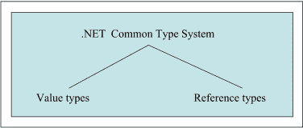

**图 2-3** .NET common types

放置在内存中时，值类型包含其数据的自己的副本，以二进制表示。数据存储在由值类型标识符寻址的实际内存单元中。相比之下，引用类型内存单元的内容则大不相同。引用类型包含存储位序列的地址或位置。图 2-4 显示了值类型存储方式与引用类型存储方式之间的差异。整数值类型，例如 2004，表示汽车制造年份，直接存储在内存单元中。要存储字符字符串，例如车辆种类，内存位置将包含“Corvette”所在的地址。`string` 数据类型是引用类型。与标识符关联的内存位置不包含字符“Corvette”，而是包含“Corvette”存储的地址。

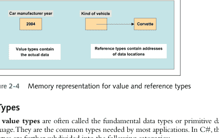

**图 2-4** Memory representation for value and reference types

### 值类型

值类型通常被称为语言的基本数据类型或原始数据类型。它们是大多数应用程序所需的通用类型。在 C# 中，这些基本类型进一步细分为以下类别：

- 结构体类型
- 枚举类型

当你向下查看图 2-5 的层次结构时，在最低层你会发现 Integral、Floating-point 和 Decimal 构成了数值类型。

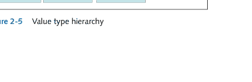

**图 2-5** Value type hierarchy

十二种类型属于数值值类型。其中九种是 Integral（整数类型），两种是浮点数（可以有小数值的数字），一种是十进制类型。十进制类型是一个相当新的数据类型；在 C++、C 或 Java 中找不到。它被添加到 C# 中以消除先前语言中数学运算中出现的精度损失问题。基本 C# 类型在 System 命名空间中都有别名。表 2-8 显示了内置 C# 类型的关键字，包括它们在层次结构中所属的数值类型，以及 System 命名空间中的别名。

### 表 2-8 带 .NET 别名的 C# 值数据类型

| C# 类型 | 数值类型 | .NET 别名类型 |
|---|---|---|
| `byte` | Integral | `System.Byte` |
| `sbyte` | Integral | `System.SByte` |
| `char` | Integral | `System.Char` |
| `decimal` | Decimal | `System.Decimal` |
| `double` | Floating-point | `System.Double` |
| `float` | Floating-point | `System.Single` |
| `int` | Integral | `System.Int32` |
| `uint` | Integral | `System.UInt32` |
| `long` | Integral | `System.Int64` |
| `ulong` | Integral | `System.UInt64` |
| `short` | Integral | `System.Int16` |
| `ushort` | Integral | `System.UInt16` |

### 整数数据类型

所有整数值都表示整数——没有小数表示的值。值类型 `int` 最常用于表示整数值，并且将是本教材中使用的主要类型。如表 2-9 所示，小到负数 −2,147,483,648 和大到 2,147,483,647 的值都可以存储在 `System.Int32` 数据类型中。整数类型的主要区别在于所需存储量以及数据项中是否可以放置负值。

以 `u` 开头的类型名称，表示 unsigned，仅允许在内存单元中放置正值。

### 表 2-9 整数类型的数值和大小

| C# 类型 | 数值范围 | 位宽 |
|---|---|---|
| byte | 0 to 255 | 8-bit |
| sbyte | -128 to 127 | 8-bit |
| char | U+0000 to U+ffff | 16-bit |
| int | -2,147,483,648 to 2,147,483,647 | 32-bit |
| uint | 0 to 4,294,967,295 | 32-bit |
| long | -9,223,372,036,854,775,808 to 9,223,372,036,854,775,807 | 64-bit |
| ulong | 0 to 18,446,744,073,709,551,615 | 64-bit |
| short | -32,768 to 32,767 | 16-bit |
| ushort | 0 to 65,535 | 16-bit |

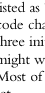

表 2-9 中包含逗号以增加可读性。然而，数值数据类型中只允许数字 0-9、+ 和 -。不允许使用逗号等格式符号。

注意在表 2-9 中，数据类型 char 被列为整数类型；然而，范围被列为 U+0000 到 U+ffff。char 关键字用于声明存储以保存单个 Unicode 字符。char 可以保存单个值，例如字母 A。如果你想存储代表你名字、中间名和姓氏的三个首字母，你需要三个 char 变量。你可能想查看附录 C，其中包含 Unicode 字符的部分列表。大多数已知的书写语言都可以用 16 位 Unicode 字符集表示。

示例 2-3 显示了整数变量声明的示例。

### 示例 2-3

```
int studentCount;    // number of students in the class
int ageOfStudent = 20;    // age - originally initialized to 20
int numberOfExams;    // number of exams
int coursesEnrolled;    // number of courses enrolled
```


注意每个声明都以分号（;）结束。这是因为在 C# 语言中，变量声明被视为语句。所有语句都以分号结束。

在示例 2-3 中，选择的标识符遵循了为程序项命名时列出的规则。每行还包含内联注释。这些注释是不必要的，因为标识符是自描述的。如果使用不具描述性的标识符，例如 x、y 或 z，则注释会有所帮助。


> 不要每一行或每个变量声明都加注释，因为这会生成不可读的代码。最好在代码段需要进一步解释时添加注释。

示例 2-3 中的每个标识符由两个或更多单词组成。第二个及后续单词以大写字符开头。本教材通篇使用这种命名约定来命名变量和对象。标识符的第一个字符以小写字符开头。

类名和方法名（包括用户定义的标识符和框架类库（FCL）类标识符）均以大写字符开头。常量（本章后面会介绍）全部使用大写字符命名，并用下划线字符分隔单词。这是 C# 程序员使用的标准风格。

> 风格由程序员采用的一系列个人选择构成。如果你刚接触编程，可能想遵循本教材选择标识符的风格；不过，你的讲师可能推荐不同的风格。另一种常见命名约定是用下划线分隔单词。最重要的是要记住，选择一种风格后，就应始终一致地使用它。

## 浮点类型

如果需要保留小数部分，该值不能存储在整型数据类型（如 int）中。浮点值可以用带指数的科学计数法或标准十进制计数法指定。可以指定非常大或非常小的数。指数语法的一般形式为：

```
n.n e±P
```

在前面的示例中，使用科学计数法语法时，n 是十进制数；P 是小数点向左或向右移动的位数；+ 或 – 指示小数点应移动的方向。加号表示将小数点向右移动 P 位，以形成等价的标准十进制值。C# 的语法规则允许 e 为大写或小写。表示法中的 ± 表示可以添加 +、–，或两者都不添加。如果没有 + 或 –，则假定为 +。示例 2-4 展示了从科学计数法转换为标准十进制计数法的示例。

### 示例 2-4

- 3.2e+5 等价于 320000
- 1.76e-3 等价于 .00176
- 6.892e8 等价于 689200000

因为第一个值包含“e+5”，所以小数点向右移动五位。前面示例中的第二个语句将小数点向左移动三位。最后一个语句将小数点向右移动八位，这会在该值的末尾加上五个有效零。

如表 2-10 所示，double 中可存放最多 15 到 16 位小数的值。浮点类型符合 IEEE 754 规范。有关更多信息，可以在网站 http://standards.ieee.org/ 上阅读 IEEE 标准。以下是浮点变量声明的示例。

### 表 2-10 浮点类型的值和大小

| 类型 | 数值范围 | 精度 | 大小 |
|---|---|---|---|
| float | ±1.5 × 10⁻⁴⁵ 到 ±3.4 × 10³⁸ | 7 位数字 | 32 位 |
| double | ±5.0 × 10⁻³²⁴ 到 ±1.7 × 10³⁰⁸ | 15–16 位数字 | 64 位 |

### 示例 2-5

```
double extraPerson = 3.50;    // extraPerson originally set
                             // to 3.50
double averageScore = 70.0;   // averageScore originally set
                             // to 70.0
double priceOfTicket;         // cost of a movie ticket
double gradePointAverage;     // grade point average
float totalAmount = 23.57f;   // note that the f must be placed after
                             // the value for float types
```

注意，示例 2-5 中除一个声明外，所有声明都使用 double。在 C# 中，double 是浮点数的默认类型。当包含编译时初始化时，如果初始化 double 变量，则不需要后缀。对于 float，必须在数字后加上后缀 f 或 F；否则，该数字会被假定为 double。如果没有在数字后加上 f 或 F 后缀并将其赋给 float 变量，就会得到类似于图 2-6 所示的语法错误。

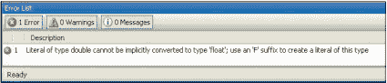

图 2-6 未使用 F 后缀导致的语法错误

本教材通篇使用 **double** 类型表示所有需要小数值的数字。

## decimal 类型

**decimal** 值类型是现代编程语言中新增的。它适合存储货币数据项，因为它既允许整数（完整）数字，也允许小数部分。与浮点类型相比，它提供更高的精度，因为使用 128 位来表示该值。

从负 −79,228,162,514,264,337,593,543,950,335 到正 79,228,162,514,264,337,593,543,950,335 的数字可以存储在 **decimal** 值类型中。如表 2-11 所示，**decimal** 可以支持 28 到 29 位数字。

### 表 2-11 decimal 数据类型的值和大小

| 类型 | 数值范围 | 精度 | 大小 |
|---|---|---|---|
| `decimal` | 1.0 × 10^-28 到 7.9 × 10^28 | 28–29 位有效数字 | 128 位 |

与 **float** 类型的情况一样，必须在数字末尾附加后缀 m 或 M 来表示 **decimal**，如示例 2-6 所示。没有该后缀时，该数字会被视为 **double**。同样，如果尝试进行编译时初始化，或在不带后缀的情况下将数字赋给 **decimal** 变量，就会发出语法错误消息。不会发生自动转换。

### 示例 2-6

```
decimal endowmentAmount = 33897698.26M;
decimal deficit;
```


将数字赋给值类型时，绝不要在数字中放置逗号、美元符号或任何其他特殊格式符号。

## 布尔变量

布尔基于真/假、开/关逻辑。如果回看图 2-5 中的值类型层次结构，会看到 Boolean 继承自 Value 和 Struct 类，但不继承自 Numeric 类型。C# 中唯一的布尔类型是 `bool`。`bool` 变量可以具有 `true` 或 `false` 值。`bool` 类型非常有用的一个示例是确定所有数据何时处理完毕。可以如示例 2-7 所示声明该变量。

### 示例 2-7

```
bool undergraduateStudent;
bool moreData = true;        // used to indicate when all data is
                            // processed. Originally set to true
```

`bool` 类型不接受 0、1 或 −1 等整数值。关键字 `true` 和 `false` 内置于 C# 语言中，并且是唯一允许的值。


某些语言（如 C++）允许布尔类型保存整数。C# 不允许。

除了数值和布尔类型外，还有两种其他值类型：枚举和结构。它们允许你定义自己的自定义类。随着你在软件开发中不断深入，将会使用它们。

## 声明字符串

前面讨论的所有类型都是值类型。如图 2-3 所示，.NET 公共类型系统还包括引用类型。值类型的内存位置实际包含数据。对于引用类型，数据不直接存储在内存位置中；相反，内存位置包含对数据存储位置的引用。

C# 有两种内置引用类型：`string` 和 `object`。`string` 类型表示 Unicode 字符字符串。示例 2-8 展示了如何声明 `string` 变量。第二个和第三个声明还包含编译时初始化。

### 示例 2-8

```
string studentName;
string courseName = "Programming I";
string twoLines = "Line1\nLine2";    // newline escape sequence
    // character included
```

另一种内置引用类型是 object。这可能是最重要的类型，因为每个类型都从它继承特性。在第 3 章中，当你开始编写自己的方法时，将研究 object 类。

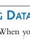

所有类型都从 object 类继承方法 ToString( )、Equals( )、Finalize( ) 和 GetHashCode( )。

## 使数据成为常量

在声明中添加关键字 const 时，该声明就成为常量。常量便于将值赋给标识符；const 强制实现不允许更改该值的功能。与变量类似，存储在内存位置中的值可以在整个程序中使用。但是，该值不能更改。常量语法的一般形式为：

```
const type identifier = expression;
```

示例 2-9 展示了一些常量声明示例。

### 示例 2-9

```
const double TAX_RATE = 0.0675;
const int SPEED = 70;
const char HIGHEST_GRADE = 'A';
```


定义常量的一个优点是，该值只需在声明期间赋值一次。常量可以在许多语句中使用。如果必须更改该值，程序中只需更改一处，即常量声明位置。进行该更改后，必须重新编译程序。

为了提醒标识符 TAX_RATE 是常量而不是变量，使用了全部大写字母。为了在单词之间提供分隔符，使用了下划线字符。这是程序员命名常量时使用的标准约定。


## 赋值语句

变量可以在声明时初始化，也可以在程序稍后为其赋值。不过，在 C# 中，必须先为变量赋值，然后才能使用它。声明变量时不会为其分配默认值。要更改变量的值，需要使用赋值语句。赋值语句的形式为：

```text
variable = expression;
```

表达式可以是以下之一：

-   另一个变量
-   兼容的字面量值
-   数学等式
-   调用返回兼容值的方法
-   此列表中一项或多项的组合

该语法要求将保存表达式结果的变量放在最前面——等号（=）的左侧。当 = 符号与赋值语句或编译时初始化一起使用时，称为**赋值运算符**。先确定赋值运算符（=）右侧表达式的值，然后将该值赋给 = 运算符左侧的变量。


注意，赋值语句的语法要求赋值运算符左侧有一个变量。

如果左侧的值与右侧不兼容，C# 编译器会发出类型不匹配错误。


C# 是一种强类型语言。它能很好地验证赋值语句中的类型一致性。接收表达式结果的变量必须具有相同类型，或者属于能够保存该结果的类型。

示例 2–10 首先声明可在赋值语句中使用的变量。

### 示例 2-10

```csharp
int numberOfMinutes,
    count,
    minIntValue;
```

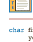

如果声明多个相同类型的变量，标识符之间用逗号分隔。分号放在列表末尾，表示声明语句结束。

```csharp
char firstInitial,
    yearInSchool,
    punctuation,
    enterKey,
    lastChar;
double accountBalance,
    weight;
decimal amountOwed,
    deficitValue;
bool isFinished;
string aSaying,
    fileLocation;
```

声明后，可以为这些变量赋字面量值，如下面的代码段所示：

```
numberOfMinutes = 45;
count = 0;
minIntValue = -2147483648;
firstInitial = 'B';
yearInSchool = '1';
punctuation = '!';
```

注意，字面量 -2147483648 中不包含逗号。虽然这看起来难以阅读，但如果添加逗号，你将收到语法错误消息。变量 firstInitial、yearInSchool 和 punctuation 是 char 类型。使用 char 字面量时应特别注意。在赋值语句中使用时，所有 char 字面量都必须用单引号括起来。记住，char 类型可以保存标准键盘上的任何字符以及许多其他字符。但是，它一次只能保存一个字符。

```
enterKey = '\n';    // newline escape character
lastChar = '\u005A'; // Unicode character 'Z'
```

前面的两个赋值在单引号之间都包含不止一个条目。但是，这些符号的组合表示单个字符。enterKey 变量使用特殊转义序列字符赋值为回车符。变量 lastChar 使用其 Unicode 表示形式赋值为字符 Z。


第 1 章向你介绍了一些表示字符的特殊转义序列。你可能想复习表 1-1，其中包含许多有效的 C# 转义序列字符。前面声明中的最后一个示例说明了如何使用 Unicode 字符字面量初始化变量。该数值是一个十六进制数。

```
accountBalance = 4783.68;
weight = 1.7E-3;    //scientific notation may be used
amountOwed = 3000.50m;    //m or M must be suffixed to decimal
deficitValue = -322888672.50M;
```

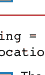

如果尝试初始化 decimal 变量时忘记使用 M 或 m 后缀，会生成编译器错误。

```
aSaying = "Today is the first day of the rest of your life!\n ";
fileLocation = @"C:\CSharpProjects\Chapter2";
```

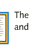

可以将 at 符号（@）放在字符串字面量之前，以表示双引号内的字符应按原样解释。这样就不需要使用转义字符来转义反斜杠字符。如果没有 @ 符号，文件名的字符串字面量就必须写成 "C:\\CSharpProjects\\Chapter2"，其中原先的单个反斜杠要写成两个反斜杠。

```
isFinished = false;    // declared previously as a bool
```


可以放入声明为 bool 的内存位置的唯一值是 true 和 false。

还可以将一个变量的值赋给另一个变量。这不会影响赋值运算符右侧的变量，如图 2-7 所示。newValue 中的 25 替换了 count 中的 0。变量一次只能保存一个值。

```
int count = 0,
    newValue = 25;
count = newValue;
```

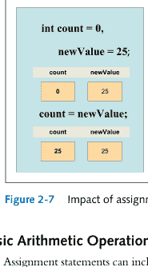

图 2-7 赋值语句的影响

## 基本算术运算

赋值语句可以包含数学等式。加、减、乘、除基本运算可以对实数（浮点数）数据执行。这些运算加上取模可以对整型执行。赋值语句的最简单形式是：

```
resultVariable = operand1 operator operand2;
```

操作数可以是变量、常量或字面量。运算符由表 2-12 所示的特殊符号表示。

> 编写代码时，可读性非常重要。始终在每个算术运算符（包括等号（=））的前后各放一个空格。编译器会忽略空白，但代码的阅读者会对此表示赞赏。

表 2-12 基本算术运算符

| 运算符 | 运算 |
|---|---|
| + | 加法 |
| - | 减法 |
| * | 乘法 |
| / | 除法 |
| % | 取模 |

取模运算符（%）有时也称为求余运算符。在大多数语言中，两个操作数都必须是整型。C# 允许将浮点值用作取模运算符的操作数。产生的结果是操作数 1 除以操作数 2 的余数。给定以下语句，图 2-8 展示了结果。

```
int firstValue = 67;
int secondValue = 3;
int result;
result = firstValue % secondValue;
```

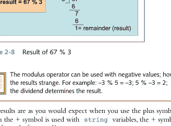

图 2-8 67 % 3 的结果

> 取模运算符可以与负值一起使用；不过，你可能会觉得结果很奇怪。例如：-3 % 5 = -3；5 % -3 = 2；-5 % -3 = -2；结果的符号由被除数决定。

当将加号（+）与数值数据一起使用时，结果符合你的预期。当 + 符号与字符串变量一起使用时，+ 符号会将操作数 2 连接到操作数 1 的末尾。

```
string result;
string fullName;
string firstName = "Rochelle";
string lastName = "Howard";
fullName = firstName + " " + lastName;
```

如图 2-9 所示，执行前面的语句后，fullName 引用的值为 "Rochelle Howard"。注意，两个变量之间放置了一个包含单个空格的字符串字面量；否则，你将创建全名 "RochelleHoward"。

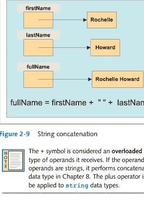

图 2-9 字符串串联

> + 符号被视为重载运算符。它根据接收的操作数类型而表现不同。如果操作数是数值，则执行加法。如果操作数是字符串，则执行串联。你将在第 8 章中进一步了解字符串数据类型。加号运算符是表 2-12 中唯一可应用于字符串数据类型的运算符。

## 递增和递减运算

一种常见的算术运算是对内存位置加一（1）或减一。为此使用递增/递减运算符。与 C++ 和 Java 一样，C# 有一种特殊的一元运算符，可按一递增和递减。它被视为一元运算符，因为它需要一个操作数。前面说明中探讨的基本运算符都是需要两个操作数的二元运算符。

递增和递减使用的符号是 ++ 和 --。两个符号（++ 或 --）之间不允许有空格。

```
num++;
    // could be written as num = num + 1;
--value1;
    // could be written as value = value - 1;
```

第一条语句给 num 加 1。第二条从 value1 中减 1。递增和递减运算符常用于需要计数器的情况。它们不用于累积值，因为它们总是对变量加一或减一。

> 在 C# 中，将递增和递减运算符与浮点类型一起使用时，不会生成语法错误。C# 会对变量加 1 或减 1。也可以对 char 类型的变量使用 ++ 或 --。


如果你在包含其他操作数的算术表达式中使用这些运算符，那么 ++ 或 -- 的位置很重要。如果它们作为前缀出现，或位于变量左侧，则会在表达式中使用它们之前执行递增或递减。放在操作数之前时，它们称为前递增或前递减运算符；放在操作数之后时，它们称为后递增或后递减运算符。例如，如果进行以下声明，然后调用每个 WriteLine() 方法，则示例 2-11 的输出将是：

```
100
101
102
```

### 示例 2-11

```csharp
int num = 100;
System.Console.WriteLine(num++);    // Displays 100
System.Console.WriteLine(num);      // Displays 101 after the post
                                    // increment is performed on the
                                    // previous line
System.Console.WriteLine(++num);    // Displays 102
```

最后打印的值是 102。执行下一行时，num 的值为 102。注意，这里显示的是递增后的值，因为 ++ 运算符放在标识符之前。第一次调用 WriteLine() 方法时并未显示递增后的值。原始值被用作参数，然后该值才递增。

如果 x 声明为 int 类型并初始化为值 100，则以下语句显示 100 102。当控制转到调用 WriteLine() 方法之后的语句时，存储在 x 中的新值是 102。

```csharp
System.Console.WriteLine(x++ + " " + ++x); // Displays 100 102
```

请仔细查看示例 2-12，确保你理解递增和递减运算符的位置如何影响它们出现在涉及多个运算的表达式中所得到的结果。

### 示例 2-12

```csharp
int count = 0,
    result = 0,
    firstNum = 10;
count++;
result = count++ * --firstNum + 100;
```

图 2-10 展示了声明变量后内存位置中存储的内容。

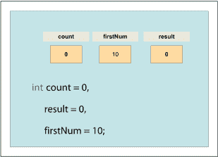

图 2-10 值类型变量的声明

示例 2-12 中显示的下一条语句 `count++;` 不属于另一个表达式。在这种情况下，`++` 放在 `count` 之前还是之后其实并不重要。受影响的内存位置只有 `count` 的内存单元。它递增 1。图 2-11 展示了执行 `count++;` 后的内存单元。

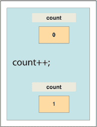

图 2-11 执行 count++; 语句后内存的变化

示例 2-12 中的最后一条语句如图 2-12 所示，值得关注：

```csharp
result = count++ * --firstNum + 100;
```

注意 ++ 放在 count 后面。-- 放在 firstNum 前面。

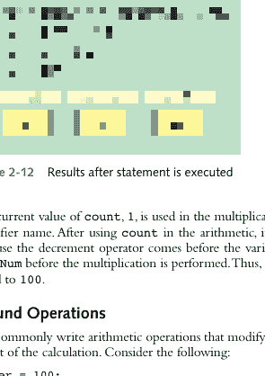

图 2-12 语句执行后的结果

count 的当前值 1 被用于乘法，因为 ++ 位于标识符名称之后。在算术中使用 count 之后，它递增 1，变为 2。由于递减运算符位于变量 firstNum 之前，因此在执行乘法之前先从 firstNum 中减去 1。因此，1 乘以 9，然后结果加上 100。

## 复合运算

你通常会编写算术运算，通过将变量的原始值作为计算的一部分来修改变量。考虑以下代码：

```csharp
answer = 100;
answer = answer + 5;
```

变量 answer 保存最终结果，但它也用于计算中。复合运算符提供了一种快捷方式，用于编写将结果作为计算一部分的赋值语句。前面代码段中的最后一行（answer = answer + 5;）可以替换为以下内容：

```csharp
answer += 5;
```

这两条语句都取 answer 的原始值，加上 5，然后将结果存回 answer。

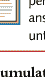

在涉及多个运算的表达式中，复合运算总是最后执行。例如：answer += 45 * 28 + 37 / 16; 等价于 answer = answer + (45 * 28 + 37 / 16); 直到等号右侧的表达式全部计算完成，才会加上 answer 的原始值。

**累加**是应用程序中常见的另一种操作类型。你常常需要维护累计总数，或累加由单个变量保存的值。例如，要确定一组值的平均值，通常将这些值加到一个累加器中，再除以条目数。考虑以下代码：

```csharp
int total = 0;
int newValue;
// used to note that statements to enable user
// to enter values for newValue are inserted here

total = total + newValue;
```

如果用户输入多个值，每个 newValue 都可以加到 total 中。这是累加值的一个示例。累加器常用于货币金额。例如，要累计收到的总金额，或累计包含若干商品的订单总额，可以定义一个诸如 total 的变量。这些充当累加器的变量通常应初始化为零。然后它们会增长，即随着每次新的相加而增大。复合运算符可用于这类情况。使用复合运算符，可以像下面这样将 newValue 加到 total 中：

```csharp
total += newValue;    // same as total = total + (newValue);
```

表 2-13 显示了 C# 中可用的复合运算符。

### 表 2-13 复合算术运算符

| 运算符 | 运算 |
|---|---|
| += | 加法 |
| -= | 减法 |
| *= | 乘法 |
| /= | 除法 |
| %= | 取模 |

下面用求余或取模运算符说明使用复合运算符的另一个示例：

```csharp
answer = 100;
answer %= 3;          // same as answer = answer % 3;
```

前面表达式的结果将是 1，因为这是 100 除以 3 的余数。如前所述，当复合运算符用于包含多个运算的语句中时，在赋值符号右侧的整个表达式完全求值之前，不会使用赋值运算符左侧的变量。考虑示例 2-13。

### 示例 2-13

```csharp
answer = 100;
answer += 50 * 3 / 25 - 4;
```

在赋值运算符右侧的表达式完全求值之前，不会加上 100 这个值。然后 C# 取计算出的值并将 100 加到它上面。结果替换原来的 100，将 102 存储在 answer 中。计算执行顺序如下：

- 50 * 3 = 150
- 150 / 25 = 6
- 6 - 4 = 2
- 100 + 2 = 102

与递增和递减运算符一样，复合运算符符号之间不允许有空格。

执行计算的顺序称为运算顺序。在示例 2-13 中，运算从左到右执行。下一节将解释为什么并不总是如此。

## 运算顺序

当一个表达式中包含多个算术运算符时，执行会从优先级最高的运算符开始。优先级级别由语言规则决定。到目前为止所用运算符的 C# 优先级级别如表 2-14 所示。

### 表 2-14 运算符优先级

| C# 类别 | 运算符 | 结合性 |
|---|---|---|
| 一元 | + - ++ -- | 右 |
| 乘法 | * / % | 左 |
| 加法 | + - | 左 |
| 赋值 | = *= /= %= += -= | 右 |

如表 2-14 所示，有几个运算符出现在同一级别。例如，*、/ 和 % 在运算顺序方面被视为同级。当一个表达式包含两个或多个具有相同优先级的运算符时，运算符的结合性控制运算的执行顺序。**左结合**意味着运算从左到右执行，因此当你在表达式中从左向右移动时，最先遇到的运算最先执行。

在表 2-14 中，+ 和 - 在第一行作为一元运算符出现，在第三行作为二元运算符出现。

> 如前所述，一元意味着一个——表示该运算符只使用一个操作数。例如，在变量前放置减号就是一元运算。

作为一元运算符，- 和 + 运算从右到左执行，用于取负或表示操作数为正。二元 + 和 - 是左结合的。第四行中的赋值类别运算符是**右结合**的。

括号可用于改变运算顺序。如果你确定某个运算需要先处理，就将表达式的该部分括在一对括号中。添加括号也可提高表达式的可读性。图 2-13 说明了多个计算运算的执行顺序。在执行算术表达式之前，answer 被初始化为 10。

```csharp
int answer = 10;
answer *= 400 + 10 / 2 - (25 + 2 * 4) * 3;
```

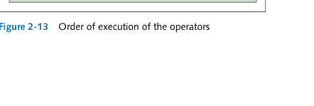

图 2-13 运算符的执行顺序


## 混合表达式

C# 允许你在表达式中混合使用数值整数类型和浮点类型。当表达式的操作数类型不同时，该语句被视为混合模式表达式。示例包括以下内容：

```text
89 + 76 / 3.25
2 * 7.9 - 5 + 67.99
```

在第一个表达式中，除法运算符的操作数是 76，一个整数，和 3.25，一个浮点类型。当操作数类型相同时，运算结果的类型将是该类型。但是，如果二元运算涉及 double 和 int，则会执行隐式类型强制转换。整数类型转换为浮点类型。通过将 int 数据类型更改为 double 的自动强制转换，对前述每个表达式都发生。

需要注意示例 2-14 中说明的内容——如果等号运算符右侧的所有表达式都是整数类型，仅声明结果类型为浮点类型并不能得到正确的浮点结果。

### 示例 2-14

```csharp
double answer;
answer = 10 / 3;
```

你不会得到存储在 answer 中可能期望的结果。结果是 3.0，而不是 3.333333。因为赋值运算符右侧的两个操作数都是整数，执行的是整数除法。这会产生整数结果。除法完成后得到 3，然后将其作为浮点 double 分配给 double 变量 answer。因此，answer 变为 3.0。

当你将 int 分配给 double 时会发生隐式类型转换。如果尝试将 double 存储在 int 变量中，则不会发生转换。图 2-14 显示了在示例 2-15 中尝试将 double 分配给 int 时的语法错误。第一个赋值语句会生成错误。第二个语句中发生隐式类型转换。变量 value2 可以保存存储在 anotherNumber 中的内容。

### 示例 2-15

```csharp
int value1 = 440,
    anotherNumber = 70;
double value2 = 100.60,
    anotherDouble = 100.999;
value1 = value2;    // syntax error as shown in Figure 2-14
value2 = anotherNumber;    // 100.60 cannot be stored in value1
```

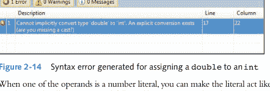

### 图 2-14 将 double 分配给 int 时生成的语法错误

当其中一个操作数是数字字面量时，你可以通过在值后附加一个小数点和零，使其表现得像浮点类型，如示例 2-16 所示。

### 示例 2-16

```csharp
int exam1 = 86,
    exam2 = 92,
    exam3 = 91;
double examAverage;
examAverage = (exam1 + exam2 + exam3) / 3.0;
```

前述赋值语句的结果是 89.666666。去掉 .0，使赋值语句如下所示：

```csharp
examAverage = (exam1 + exam2 + exam3) / 3;
```

结果是 89。这可能意味着你在课程中得到 A 与 B 的区别。只需将 3 替换为 3.0，就能得到你期望的结果。当除法运算符得到表示分数总和的整数和一个 double（3.0）时，整数值 269 会在计算中转换为 269.0。

这种隐式类型转换是通过更改字面量的值实现的。但这并不总是可能的。原因之一是你可能没有字面量。如果考试分数的计数存储在变量中怎么办？你不能在标识符末尾加上 .00，因为这会生成语法错误。

如果你需要使用变量进行混合模式赋值，避免图 2-14 中产生的语法错误的一种方法是按下一节所述在表达式中转换变量。

## 类型转换

C# 通过类型转换或类型转换提供显式类型强制转换，可与变量一起使用。其形式如下：

```text
(type) expression
```

转换使变量暂时表现得好像是另一种类型。如果值 3 存储在 int 内存位置，则需要转换才能为 examAverage 产生正确的结果。类型 double 置于要转换的数据项之前的括号中，如下所示：

```csharp
examAverage = (exam1 + exam2 + exam3) / (double) count;
```

通过对示例 2-15 中的变量进行转换，可以避免语法错误。示例 2-17 说明了另一个示例。

### 示例 2-17

```csharp
int value = 0,
    anotherNumber = 0;
double value2 = 100,
    anotherDouble = 100;
value = (int) value2;
value2 = (double) anotherNumber;
```

示例 2-17 中最后一个赋值语句中的转换本可以省略，因为当 `int` 存储在 `double` 内存位置时会发生隐式转换。

> `dynamic` 新关键字已添加到 C# 4.0 中，以告诉编译器变量的类型可能会更改或直到运行时才知道。你将在第 11 章中阅读更多关于 `dynamic` 的内容。

## 格式化输出

你可以通过添加美元符号或百分号来格式化数据。你可以用逗号分隔数字或显示值的分数部分。你可以抑制前导零或用零填充值。C# 包含许多可与数字一起使用的特殊格式说明符。使用这些格式说明符的一种方法是将其放在 `Console.Write( )` 或 `Console.WriteLine( )` 方法的 `string` 参数中。当你将这些特殊格式说明符作为这些方法参数的一部分包含时，`String.Format( )` 方法会自动调用。你将在第 3 章中了解更多关于调用方法的内容。示例 2-18 说明了使用货币格式说明符以逗号、小数和美元符号显示数字。

### 示例 2-18

```csharp
double price = 1089.30;
Console.WriteLine("The price is {0:C}.", price);
// Displays The price is $1,089.30.
```

为了指示你希望将值以美元符号、逗号分隔符和小数点右侧两位显示为货币，使用 `C` 或 `c` 指定货币格式。格式说明符放在花括号 (`{ }`) 内，从而成为 `WriteLine( )` 方法的 `string` 字面量参数的一部分。

注意花括号内放置了两个值。花括号中的第一个值是占位符。它指示你希望显示在双引号外部放置的哪个参数。示例 2-18 中格式化的参数是 price，它是第一个参数。你会发现大多数现代计算机编程语言使用 0 来引用第一个条目。指示参数后，你可以添加可选的格式规范。在本例中，添加了货币 C 说明符。

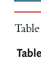

> `WriteLine( )` 方法的第一个参数期望一个字符串。为了提高可读性，该语句可以放在两行上，并通过连接运算符 + 符号将字符串连接起来。

表 2-15 显示了使用两种最常见的格式说明符 c 和 f 的示例。

### 表 2-15 使用格式说明符的示例

| 字符 | 描述 | 示例 | 输出 |
|---|---|---|---|
| C or c | 货币 | Console.Write("{0:c}", 26666.7888); | $26,666.79 |
| C or c | 货币 | Console.Write("{0:c}", -2); | ($2.00) |
| C or c | 货币 | Console.Write("{0:c}", 38.8); | $38.80 |
| F or f | 定点 | Console.Write("{0:F4}", 50); | 50.0000 |
| F or f | 定点 | Console.Write("{0:F0} {1}", 50, 22); | 50 22 |

为了说明目的，表 2-15 中将字面量值用作 `Write( )` 方法的字符串参数；然而，变量、常量和/或表达式可以用作 `Write( )` 方法中被格式化的参数。

F，定点，说明符包含一个额外的参数。你可以指示在小数点右侧打印多少位数字。{0:F4} 表示第一个参数、参数 0 应使用定点或小数点格式化，并且在小数点右侧打印四位数字。如表 2-15 最后一行所示，当参数不需要特殊格式化时，占位符是花括号内唯一的条目，如 {1}。

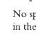

> 如表 2-15 所示，使用货币格式说明符时，负值会用括号显示。

格式说明符位于字符串中要打印值的位置。考虑以下示例：

```csharp
Console.WriteLine("Carpet{0:F0} is {1:C}", 9, 14);
```

结果如下：

```text
Carpet9 is $14.00
```

在 Carpet 中的字符 t 之后没有打印空格。第一个参数，使用参数 {0:F0} 中的 0 引用，是 9。该值（9）打印后跟一个空格。它被格式化

采用定点格式，且小数点右侧为零位。值 14 插入到 `{1:C}` 所在的位置。它使用货币格式进行格式化。表 2-16 说明了用于在字符串中格式化数字的一些标准数字格式说明符。

**表 2-16** 标准数字格式说明符

| 字符 | 名称 | 描述 | 示例 |
|---|---|---|---|
| C 或 c | 货币 | 将数字转换为表示货币金额的字符串，包含美元符号、小数点和逗号。如果存在精度修饰符，则指示小数位数。 | `("{0:C3}", 4238.8) –` 生成 `$4,238.800` |
| D 或 d | 十进制 | 将数字转换为由整数数字（0–9）组成的字符串；如果数字为负，则在其前面加上负号。如有需要，在数字左侧用零填充，以生成说明符所请求的位数。 | `("{0:D5}", 42) –` 生成 `00042` |
| E 或 e | 科学计数法（指数） | 将数字转换为 `"-d.ddd…E+ddd"` 或 `"-d.ddd…e+ddd"` 形式的字符串，其中每个 d 表示一个数字（0–9）。如果数字为负，则字符串以负号开头。 | `("{0:E2}", 4238.8) –` 生成 `4.24E+003` |
| F 或 f | 定点 | 将数字转换为 `"-ddd.ddd…"` 形式的字符串，其中每个 d 表示一个数字（0–9）。 | `("{0:F2}", 4238.8) –` 生成 `4238.80` |
| G 或 g | 常规 | 根据数字类型以及是否存在精度说明符，将数字转换为定点表示法或科学计数法中更紧凑的一种。 | `("{0:G}", 4238.8) –` 生成 `4238.8`<br>`("{0:G2}", 4238.8) –` 生成 `4.2E+03` |
| N 或 n | 数字 | 将数字转换为 `"-d,ddd,ddd.ddd…"` 形式的字符串。会插入千位分隔符和负号（如果值为负）。精度说明符指示所需的小数位数。 | `("{0:N2}", 4238.8) –` 生成 `4,238.80` |
| P 或 p | 百分比 | 将数字转换为表示百分比的字符串。转换后的数字乘以 100 以百分比形式呈现。精度说明符指示所需的小数位数。 | `("{0:P}", 0.123) –` 生成 `12.30 %`<br>`("{0:P1}", 0.12783) –` 生成 `12.8 %` |

还可以将宽度指定为格式说明符的一部分。当你想控制多行项的对齐方式时，这尤其有用。在索引序号之后、冒号之前添加 Alignment 组件。使用逗号作为分隔符。如果对齐值小于格式化字符串的长度，则忽略对齐，并将格式化字符串的长度用作字段宽度。考虑以下示例：

```
Console.WriteLine ("{0,10:F0}{1,8:C}", 9, 14);
```

结果如下：

9    $14.00

如果对齐值为正，则字段中的格式化数据右对齐；如果对齐值为负，则左对齐。如果需要填充，则使用空白字符。如果指定了对齐，则逗号是必需的。

考虑以下示例：

```
Console.WriteLine ("{0,-10:F0}{1,8:C}", 9, 14);
```

结果如下：

9          $14.00

这里第一个参数（9）左对齐，因为对齐组件为负值。

如果标准格式说明符不提供所需的格式类型，你还可以创建自己的自定义格式字符串。标准格式字符串由一个字母字符组成，后面可选地跟一个数字序列，该序列构成 0 到 99 之间的值。表 2-17 列出了可用于创建自定义数字格式字符串的一些字符及其定义。

**表 2-17** 自定义数字格式说明符

| 格式字符 | 名称 | 描述 | 示例 |
|---|---|---|---|
| 0 | 零占位符 | 如果正在格式化的值在格式字符串中出现 '0' 的位置有数字，则将该数字复制到结果字符串中。小数点前最左侧 '0' 和小数点后最右侧 '0' 的位置，决定结果字符串中始终存在的数字范围。 | `"{0:00000}", 4238.8 – produces 04239` |
| # | 数字占位符 | 如果正在格式化的值在格式字符串中出现 '#' 的位置有数字，则将该数字复制到结果字符串中。否则，该位置不存储任何内容。 | `"{0:#####}", 4238.8 – produces 4239` |
| . | 小数点占位符 | 格式字符串中的第一个 '.' 字符决定格式化值中小数分隔符的位置。 | `"{0:####.##}", 4238.8 – produces 4238.8`<br>`"{0:######.00}", 4238.8 – produces 4238.80` |

**表 2-17** 自定义数字格式说明符（续）

| 格式字符 | 名称 | 描述 | 示例 |
|---|---|---|---|
| , | 千位分隔符 | 如果格式字符串在两个数字占位符（0 或 #）之间包含 ',' 字符，则输出将在每组三位数字之间插入千位分隔符。 | `("{0:###,###.##}", 4238.8)` 生成 `4,238.8`<br>`("{0:###,###}", 4238.8)` 生成 `4,239`<br>`("{0:00,00.00}", 238.8)` 生成 `00,238.80` |
| % | 百分比占位符 | 将数字乘以 100，并插入百分比符号（'%'）。 | `("{0:P}", 0.8)` 生成 `80.00 %`<br>`("{0:P0}", 0.8)` 生成 `80 %` |
| ; | 节分隔符 | ';' 字符用于分隔字符串中正数、负数和零的各节。如果值为正，则使用第一个格式说明符。如果值为负，则使用第二个说明符。当值为零时，使用第三个说明符。 | `("{0:00,000.00; -##,###.00; Zero}", 15)` 生成 `00,015.00`<br>`("{0:00,000.00; -##,###.00; Zero}", -15)` 生成 `-15.00`<br>`("{0:00,000.00; -##,###.00; Zero}", 0)` 生成 `Zero` |
| 'ABC' 或 "ABC" | 字符串字面量 | 用单引号或双引号括起来的字符将按字面复制到结果字符串中，不影响格式设置。 | `("{0:#,##.00£}", 100)` 生成 `100.00£` |

表 2-16 和表 2-17 中的示例展示了如何将格式说明符用作 Console.Write( ) 或 Console.WriteLine( ) 方法的参数。它们也可以存储在字符串变量中，然后用作 ToString( ) 等方法的参数。在第 3 章中，你将了解如何创建自己的方法，以及使用 C# 语言中许多预定义的方法。

## 编程示例：CarpetCalculator

本示例演示程序中数据项的使用。问题规格说明如图 2-15 所示。

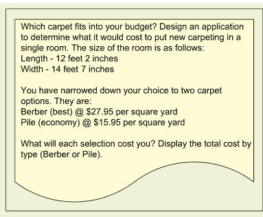

图 2-15 CarpetCalculator 示例的问题规格说明页

### 分析问题

你应查看图 2-15 中的问题规格说明，并确保理解问题定义。此解决方案不包含程序输入。在你了解如何将数据输入程序后，可能希望修改解决方案，以便能够以不同类型和价格的地毯多次运行应用程序。目前，该问题不要求你输入值。

但是，程序中需要数据。首先要确定需要哪些种类的数据。每个已标识的数据项中将包含哪些类型的值（即整数、带小数点的数字、布尔值、字母字符或字符串）？是否有任何常量数据项？变量和常量应使用什么合适的标识符？数据项的值范围或域是什么？这些都是应该问的问题。这里列出的各项描述了此问题的数据需求：

- 房间的尺寸以英尺和英寸给出——整数和整型——表示两个值（即 12 英尺 2 英寸）。
- 地毯价格以每平方码的价格给出。该值是带小数部分的数字（即 27.95）。
- 要确定平方码数，必须计算平方英尺数。
- 由于宽度和长度以英尺和英寸给出，首先要将这些测量值（英尺和英寸）转换为宽度和长度的单一单位。
- 需要一个内存位置来存储总平方码数。但是，要得到该值，需要一个内存位置来保存总平方英尺数。
- 需要一个内存位置来保存地毯的总成本。


## 变量

表2-18列出了解决CarpetCalculator问题所需的数据项。

### 表2-18 变量

| 数据项描述 | 类型 | 标识符 | 域（值范围） |
|---|---|---|---|
| 房间长度（英尺） | int | roomLengthFeet | 正值 < 50 |
| 房间长度（英寸） | int | roomLengthInches | 正值 < 12 |
| 房间宽度（英尺） | int | roomWidthFeet | 正值 < 50 |
| 房间宽度（英寸） | int | roomWidthInches | 正值 < 12 |
| 房间长度 | double | roomLength | 正值 < 100 |
| 房间宽度 | double | roomWidth | 正值 < 100 |
| 平方英尺数 | double | numOfSquareFeet | 正值 < 100 |
| 平方码数 | double | numOfSquareYards | 正值 < 100 |
| 每平方码地毯价格 | double | carpetPrice | 正值 < 50.00 |
| 地毯总成本 | double | totalCost | 正值 < 1000 |

## 常量

由于此应用程序不是交互式的，这意味着它不允许用户输入值，因此必须决定哪些数据不会改变。一英尺中的英寸数永远不会变；一平方码中的平方英尺数永远不会变。这两项都定义为常量。按类别划分的不同类型地毯的名称也定义为常量。请注意，在表2-19中，所有大写字符都用作常量的标识符，以便清楚地将常量与变量区分开。为了提高可读性，使用下划线字符作为单词之间的分隔符。

不同地毯的实际价格可以定义为常量。常量定义通常放在程序顶部，以便在需要更改时易于定位和修改其值。没有将价格声明为常量，而是使用数值字面量初始化变量的值。在你学会在程序运行时以交互方式输入值之后，你可能希望修改解决方案，以便价格可以由用户输入。目前，27.95和15.95被用作价格的数值字面量。

### 表2-19 常量

| 数据项描述 | 类型 | 标识符 | 值 |
|---|---|---|---|
| 一平方码中的平方英尺数 | int | SQ_FT_PER_SQ_YARD | 9 |
| 一英尺中的英寸数 | int | INCHES_PER_FOOT | 12 |

### 表2-19 常量（续）

| 数据项描述 | 类型 | 标识符 | 值 |
|---|---|---|---|
| 表示最佳地毯名称的字符串 | string | BEST_CARPET | "Berber" |
| 表示经济型地毯名称的字符串 | string | ECONOMY_CARPET | "Pile" |

## 设计解决方案

期望输出是在给定特定房间尺寸的情况下，显示每种地毯的相关成本。图2-16显示了CarpetCalculator示例最终输出的原型。原型中放置了xxx.xx，以表示计算值应出现的位置。

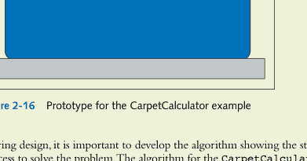

图2-16 CarpetCalculator示例的原型

在设计过程中，开发展示解决问题逐步过程的算法很重要。CarpetCalculator示例的算法首先使用流程图开发。图2-17显示了获得期望输出所需的步骤。请注意，椭圆用于表示应用程序的开始和停止。矩形用于表示将要发生的处理，平行四边形用于数据的输入或输出。当流程图跨多页时，使用圆形连接符来连接各图，如图2-17所示。

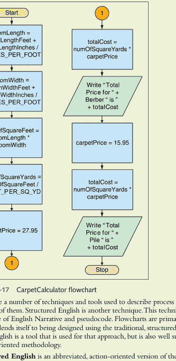

### 图2-17 CarpetCalculator流程图

有许多技术和工具用于描述过程逻辑。流程图只是其中之一。结构化英语是另一种技术。这种技术也称为英语叙述和伪代码。当解决方案适合使用传统的结构化方法进行设计时，主要使用流程图。结构化英语是用于该方法的一种工具，但也非常适合面向对象方法。

**结构化英语**是英语语言的一种缩写、面向动作的版本。结构化英语没有语法规则。重点是用英语尽可能清晰、简洁地写出步骤，而不考虑语言细节。

重点在于写出需要完成的工作。图2-18显示了CarpetCalculator示例的结构化英语设计。


图2-18 CarpetCalculator示例的结构化英语

结构化英语是面向对象方法中用于记录过程逻辑的较常见工具之一。决策树和表格有时与结构化英语结合使用，尤其是当解决方案要求开发若干备选路径作为解决方案的一部分时。第4章将向你介绍这些工具。

面向对象方法关注存在于我们世界中的对象（人、地点和事物）。类图有助于设计和记录对象的数据项和行为。图2-19显示了CarpetCalculator示例的类图。在本章中，你学习了数据项。类图的中间部分包括标识符及其数据类型。方法包含在类图的底部部分。方法是用于在C#中实现行为的过程。在第3章中，你将学习如何编写方法。


图2-19 CarpetCalculator示例的类图

开发算法后，应检查设计的正确性。当你对算法进行桌面检查时，使用计算器并写下你得到的结果。实现设计后，你可以将程序得到的结果与计算器结果进行比较。

此时，可能看起来直接使用计算器执行计算会更容易。请记住，当你编写一组可用于许多不同数据集的指令时，计算机的能力就会发挥作用。在下一章中，你将学习调用允许你以交互方式输入数据（例如地毯价格和房间尺寸）的方法。这将为你的程序增加更多功能。

## 编写解决方案代码

在完成设计并验证算法的正确性之后，就该将设计转换为源代码了。如果你正在Visual Studio中创建应用程序，可能想回头查看图1-26以回顾建议的更改。这些更改包括以下内容：

- 启动Visual Studio后，单击菜单栏上的**文件**，单击**新建**，然后单击**项目**。在**已安装模板**窗口中，选择**Visual C#**；在中间窗口中，选择**控制台应用程序**。键入合适的名称，例如**CarpetExample**。
- 你可以删除 **using System.Collections.Generic; using System.Linq;** 和 **using System.Text;** 语句。这些命名空间不需要用于此应用程序。
- 修改 **Main( )** 方法的签名。你可以从括号内删除 **"string[ ] args"**。
- 将 .cs 文件名从 **Program.cs** 更改为更能代表应用程序操作的名称，例如 **CarpetCalculator.cs**。当询问你是否“要在此项目中执行对代码元素 Program 的所有引用的重命名”时，回答“是”。

最终程序清单如下：

```
~~~csharp
/* CarpetCalculator.cs    Author:      Doyle
 * Calculates the total cost of carpet, given
 * room dimensions in feet and inches and carpet
 * price per square yard.
 */
using System;
namespace CarpetExample
{
    class CarpetCalculator
    {
        static void Main( )
        {
            const int SQ_FT_PER_SQ_YARD = 9;
            const int INCHES_PER_FOOT = 12;
            const string BEST_CARPET = "Berber";
~~~

```
const string ECONOMY_CARPET = "Pile";

int roomLengthFeet = 12,
    roomLengthInches = 2,
    roomWidthFeet = 14,
    roomWidthInches = 7;

double roomLength,
       roomWidth,
       carpetPrice,
       numOfSquareFeet,
       numOfSquareYards,
       totalCost;

roomLength = roomLengthFeet +
    (double) roomLengthInches / INCHES_PER_FOOT;
roomWidth = roomWidthFeet +
    (double) roomWidthInches / INCHES_PER_FOOT;
numOfSquareFeet = roomLength * roomWidth;
numOfSquareYards = numOfSquareFeet / SQ_FT_PER_SQ_YARD;

carpetPrice = 27.95;
totalCost = numOfSquareYards * carpetPrice;
Console.WriteLine("The cost of " +
    BEST_CARPET +
    " is {0:C}", totalCost);
Console.WriteLine();
carpetPrice = 15.95;
totalCost = numOfSquareYards * carpetPrice;
Console.WriteLine("The cost of " +
    ECONOMY_CARPET +
    " is " + "{0:C}",
    totalCost);

Console.Read();

    }
}
}
```


可读性很重要。请注意，语句的第二行如何缩进以表示该语句尚未完成。

## 实现代码

在实现期间，源代码会被编译，以检查是否存在任何违反规则的情况。要编译项目，如果你使用的是 Visual Studio，请从**生成**菜单中单击**生成解决方案**。要运行应用程序，请使用**调试**菜单上的**开始执行(不调试)**选项。

### 测试与调试

在最后这一步中，测试程序并确保得到正确的结果。输出应与你的原型一致。你的间距正确吗？图 2-20 显示了展示计算结果时生成的输出。


图 2-20 CarpetCalculator 程序的输出

总之，本章的重点是使用数据。在后续的软件开发中，你都会使用本章所学到的概念。在第 4 章中，你将学习如何编写描述数据行为的方法。

## 编码标准

如你在第 1 章中所读到的，编码或编程风格是一个术语，用于描述编写源代码时可接受的约定。它超越了语言规则，提供了应遵循的指导方针或建议，以确保朝着共同目标工作的程序员之间保持一致性。遵循这些指导方针会减少编程项目中引入的错误或缺陷数量。它可以节省时间、提高程序的可维护性，并有助于确保代码的可靠性。接下来重点介绍本章前面讨论过的命名约定。

## 命名约定

-   使用有意义且具有描述性的单词作为标识符。
-   除非是众所周知的缩写，否则不要对标识符使用缩写。
-   除了用作循环迭代器的变量外，不要使用单字符标识符。
-   对以下内容使用 Pascal 大小写（所有单词的首字符大写，其他字符均为小写）：
    -   类和类型标识符
    -   方法名
    -   命名空间标识符
    -   属性名
-   对以下内容使用 Camel 大小写（除第一个单词外，所有单词的首字符大写，其他字符均为小写）：
    -   局部变量标识符
    -   对象标识符
    -   私有数据成员
    -   参数
-   文件名应与类名匹配。
-   使用全大写字符命名常量。
-   不要在标识符中使用下划线。
-   使用名词或名词短语为类命名。

## 间距约定

-   使用制表符而不是空格进行缩进。
-   使用空白（一个空行）来分隔和组织逻辑代码组。
-   将花括号（{ }）放在与花括号外部代码相同的层级。
-   将花括号放在新行上。
-   在单独的行上独立声明每个变量。允许重复使用数据类型，但每个变量都应单独占一行。
-   避免过长的代码行。每行不应超过 80 个字符。
-   如果程序语句必须拆成多行，请使用缩进以提高可读性。

## 声明约定

-   使用 C# 内置的数据类型别名，而不是 .NET 公共类型系统的数据类型。
-   使用最简单的数据类型。
-   在靠近使用位置的地方声明并初始化局部变量。
-   尽量在声明变量时对其进行初始化。
-   浮点值在小数点前后应至少各有一位数字。
-   使用 `const` 关键字定义常量值。

## 资源

你可能还想浏览的其他网站：

-   .NET 命名指南：http://msdn.microsoft.com/en-us/library/xzf533w0(VS.71).aspx
-   编写可读代码：http://www.gamedev.net/reference/articles/article819.asp
-   C# 教程：http://msdn.microsoft.com/en-us/library/aa288436(VS.71).aspx
-   Visual Studio 2010 - C#：http://msdn.microsoft.com/en-us/library/kx37x362(VS.100).aspx

## 快速复习

1.  标识符是程序中出现元素的名称，例如数据项。它们可以包含大小写字母 a–z、数字 0–9、下划线以及 at 符号（@）。首字符不能是数字。单词之间不能包含空格。关键字不能用作标识符。
2.  声明变量时，请通过描述内存位置中将出现的内容，为标识符使用有意义的名称。
3.  变量表示计算机内存中一个可以存储特定数据类型值的区域。声明变量需要你选择一个标识符，并确定该内存单元中将出现什么类型的数据。
4.  字面量不能更改。它们是程序中使用的数字、字符和字符组合。
5.  类型实际上是通过类来实现的。这意味着类被用来定义类型。
6.  `object` 是 `class` 的一个实例。它是该 `class` 的一个示例。
7.  值类型通常被称为基础数据类型或原始数据类型。它们是语言的预定义数据类型。
8.  值类型包括九种整型（整数）类型、两种浮点类型和 `decimal` 类型。
9.  所有整型值都表示整数，即没有小数记法的值。`int` 值类型最常用。
10. 浮点值允许你保留数据项的小数部分。它们可以用带指数的科学计数法或标准十进制记法来指定。
11. `decimal` 格式适用于财务和货币计算。
12. `bool` 变量的值可以是 `true` 或 `false`。
13. `string` 类型表示 Unicode 字符的组合。
14. const 强制实现不允许更改值的功能。
15. 赋值语句采用 variable = expression 的形式。
16. 一元运算符需要单个操作数。
17. ++ 和 -- 的前置与后置递增/递减运算符会向内存位置加上或减去数字 1。
18. 复合运算符包含赋值运算符，并使用变量的原始值作为计算的一部分来修改变量。
19. 计算执行的顺序称为运算顺序。可以通过在表达式中添加括号来改变顺序。
20. 左结合意味着操作从左到右执行。也就是说，当你在表达式中从左向右移动时，先遇到的操作会先执行。
21. 如果二元运算同时涉及 double 和 int，则会执行隐式类型强制转换。
22. 通过类型转换（type casting 或 type conversion）实现的显式类型强制转换采用 (type) expression 的形式。

## 习题

1.  以下哪一个是有效标识符？
    a. namespace
    b. variable 1
    c. exampleOfAValue
    d. 3value
    e. value#1

2.  数字 768 是 _____________ 类型的一个示例。
    a. bool
    b. 整型
    c. 浮点型
    d. struct
    e. decimal

3.  以下哪一个是引用类型？
    a. int
    b. bool
    c. string
    d. decimal
    e. 整型


- 4. 不能与标识符一起使用的字符是：
  - a. `_`
  - b. `$`
  - c. `*`
  - d. `#`
  - e. 以上全部

- 5. 下列哪一项是保留关键字？
  - a. `Console`
  - b. `data`
  - c. `int`
  - d. `System`
  - e. 以上全部

- 6. `float`、`double` 和 `decimal` 之间的主要区别之一是：
  - a. `float` 用于表示更多有效数字。
  - b. `double` 通常用于大额货币值。
  - c. `decimal` 不用于显示负值。
  - d. `double` 不需要在数值字面量后添加诸如 `m` 或 `f` 之类的后缀。
  - e. `decimal` 主要用于表示需要使用 `$` 进行格式化的小额货币值。

- 7. 下列哪一项是用于存储本教科书名称的变量的有效声明？
  - a. `string name of book;`
  - b. `char nameOfBook;`
  - c. `boolean nameOfBook;`
  - d. `string bookName;`
  - e. `char book Name;`

- 8. 在 C# 中，类型是通过以下方式实现的：
  - a. 类
  - b. 类型
  - c. 对象
  - d. 命名空间
  - e. 程序

- 9. `int` 类的**对象**是：
  - a. 47.98
  - b. 47
  - c. `int` 类
  - d. 类型 **对象**
  - e. 整型

- 10. 对于要用作标志以指示某个值是否已达到其上限的内存位置，什么才是合适的声明？
  - a. `int upperLimit;`
  - b. `upperLimit reached;`
  - c. `bool upperLimit;`
  - d. `Boolean upperLimit;`
  - e. `string upperLimit;`

- 11. 在声明中添加关键字 `const`：
  - a. 将一个不可更改的值放入内存
  - b. 声明常量类型的变量
  - c. 必须通过在声明中将其放在标识符之后来完成
  - d. 只能对整型执行
  - e. 在 C# 中是被禁止的

- 12. 哪条语句将 result 增加 15？
  - a. `15 += result;`
  - b. `15 =+ result;`
  - c. `result =+ 15;`
  - d. `result += 15;`
  - e. `result = 15 +;`

- 13. 给定以下声明，该算术表达式的结果存储在 `ans` 中的是什么？

  `int ans = 0, v1 = 10, v2 = 19;`

  `ans = --v2 % v1++;`

  - a. 1.8
  - b. 9
  - c. 8
  - d. 2
  - e. 以上都不是

- 14. 给定以下声明，该算术表达式的结果存储在 ans 中的是什么？

  ```csharp
  int ans = 10, v1 = 5, v2 = 7, v3 = 18;
  ans += v1 + 10 * (v2-- / 5) + v3 / v2;
  ```

  - a. 18
  - b. 32
  - c. 28
  - d. 30
  - e. 以上都不是

- 15. 下列哪种格式将 86 显示为小数点后两位？
  - a. `{0:C}`
  - b. `{0:c}`
  - c. `{0:f2}`
  - d. 以上全部
  - e. 以上都不是

- 16. 按照图 2-13 所示，在赋值运算符下方放置一个数字，以指示下列赋值语句的运算顺序。
  - a. `ans = value1 + value2 * value3 - (value4 + 20 / 5 % 2) * 7;`
  - b. `ans += value1-- * 10;`
  - c. `ans = (((value1 + 7) - 6 * value2) / 2);`
  - d. `ans = value1 + value2 / value3 * value4--;`

- 17. 下列哪些是有效标识符？如果无效，请说明原因。
  - a. `intValue`
  - b. `value#1`
  - c. `the first value`
  - d. `_value1`
  - e. `AVALUE`

- 18. 对于下列每一项，使用最适合的数据类型声明一个变量。
  - a. 用于统计正确回答数量的计数器
  - b. 你在信用卡上欠款的金额
  - c. 你家乡的名称
  - d. 你希望在下次考试中获得的成绩
  - e. 你希望在本课程期末记录的成绩

- 19. 对于下列每个声明，编写适当的编译时初始化。
  - a. 正确回答数量的计数器从零开始
  - b. 你在信用卡上欠款的金额为零
  - c. 家乡的名称或你学校所在城市的名称
  - d. 下次考试的成绩为 100
  - e. 本课程期末记录的成绩为 A

- 20. 假设 x、y 和 z 是 int 变量，且 x = 2、y = 6、z = 10。执行下列每条语句后，每个变量的内存位置中将是什么值？（对于每道练习题，使用原始声明。）

| 语句 | x | y | z |
|---|---|---|---|
| a. `z += ++y % 2;` |  |  |  |
| b. `x = y + 14 - z / 7;` |  |  |  |
| c. `x = y * z / 2 - x * z;` |  |  |  |
| d. `x %= --z - y * 2;` |  |  |  |
| e. `y = (z - y) * 2 + --y;` |  |  |  |

- 21. 假设 x、y 和 z 是 double 变量，且 x = 2.5、y = 6.9、z = 10.0。执行下列每条语句后，每个变量的内存位置中将是什么值？（对于每道练习题，使用原始声明。）

| 语句 | x | y | z |
|---|---|---|---|
| a. `z *= y++ % 7;` |  |  |  |
| b. `x = (int) y + (14 - z / 7);` |  |  |  |
| c. `x = z / 3 * --y;` |  |  |  |
| d. `z /= (int) y / x;` |  |  |  |
| e. `z = x + y / 4;` |  |  |  |

- 22. 下列每条语句的输出将是什么？
  - a. `Console.Write("Result is {0:c}", 67);`
  - b. `Console.Write("Number {0:f0} is {1:c}", 1, 3);`
  - c. `Console.Write("{0:f0} {1:c}", 1, 3 * 2);`
  - d. `Console.Write("{0:f0} result " + "{1:f2}", 1, 25);`
  - e. `Console.Write("This is the {0:f0}st example: {1:f2}", 1, 3);`

- 23. 解释变量与常量的区别。

- 24. 解释类型、类和对象与字符串之间的关系。

- 25. 以下程序存在若干语法错误以及风格不一致之处。请纠正语法错误并指出风格违规。

  ```csharp
  namespace Chapter2
  {
      class converter
      {
          static void main(
          {
              CONST int inches = 12;
              int x = 100; y = 10;
              float z = 22.45;
              double ans;
              ans=inches*z*x*y;
              System.write("The result is {f2:0} " + "ans");
          }
      }
  }
  ```

## 编程练习

对于每道练习题，请务必在源代码中包含适当的注释、选择有意义的标识符并使用正确的缩进。

- 1. 设计一个应用程序，显示房屋的平方英尺数。分别将房屋的长度和宽度声明并初始化为 37 和 22。进入源代码并更改初始化值。重新运行应用程序。
- 2. 编写一个程序，将给定的摄氏温度转换为华氏温度。通过对原始摄氏值进行编译时初始化 37 来测试该程序。显示原始温度和格式化后的转换值。进入源代码并更改初始化值。重新运行应用程序。
- 3. 编写一个程序，将给定的华氏温度转换为摄氏温度。通过对华氏温度进行编译时初始化 87 来测试该程序。显示原始温度和格式化后的转换值。进入源代码并更改初始化值。重新运行应用程序。
- 4. 显示下列每种数据类型的输出：int、float、double 和 decimal，分别保留小数点后零位、两位和五位，以及货币格式。你可能需要同时声明一个整型变量和一个浮点型变量用于显示。用适当的测试值初始化每个变量。每行打印一种数据类型。
- 5. 编写一个程序，计算并打印一名提成制销售员工的实发工资。执行编译时初始化，并将 Jessica Oakley 的姓名存储在名为 employeeName 的变量中。Jessica 从她的总销售额中获得 7%。她的联邦税率为 18%。她向退休计划缴纳 10%，向社会保障缴纳 6%。她本周的销售额为 $28,000。生成一份格式化报告，显示每个计算项目的金额。选择合适的常量。完成显示 Jessica Oakley 的数据后，更改这些值并重新运行应用程序。


6. 编写一个程序，计算五次考试成绩的平均值。声明五个值并执行编译时初始化。使用常量定义成绩数量。打印所有成绩以及平均值，平均值格式化为小数点右侧无数字。用不同的值重新运行该应用程序。
7. 编写一个程序，打印顾客应作为找零收回的25美分硬币、10美分硬币、5美分硬币和1美分硬币的数量。使用92美分作为要转换的值执行编译时初始化，运行一次程序。进入源代码并将92改为27。重新运行该应用程序。
8. 编写一个程序，声明两个整数并将它们初始化为199和76。显示这些值的和、差、积、平均值、平方和余数。用不同的值重新运行该应用程序。
9. 编写一个程序，计算计算机俱乐部将从其糖果销售项目的收益中获得多少钱。他们售出了37箱，每箱有12块糖果。糖果每块售价0.75美元。每箱成本为5.00美元。他们需要将收入的10%交给学生自治会。以货币格式显示他们的收益。
10. 编写一个程序，计算圆的周长。为pi声明一个命名常量，值为3.14159。

## 方法与行为

## 在本章中，你将：
- 熟悉方法的组成部分
- 调用带参数和不带参数的`class`方法
- 使用Console类和Math类中的预定义方法
- 编写自己的有返回值和无返回值的`class`方法（带参数和不带参数）
- 区分值、`ref`和`out`参数类型
- 探索带默认值的命名参数和可选参数的使用
- 完成一个说明本章概念的编程示例

在第2章中，你学习了如何声明变量和数据成员。你发现数据以变量形式存储在内存中。你学习了如何对数据执行算术过程，以及如何使用优先级规则计算表达式。你还学习了如何显示格式化数据。本章重点介绍方法。方法为类的数据成员提供操作或行为。方法有助于将问题划分为可管理的单元，以便于开发和代码重用。你将在本章中了解不同类型的方法、如何调用预定义方法，以及如何创建自己的方法并调用它们。你将编写执行处理并返回其工作结果的方法，也将编写执行过程但不返回值的方法。你将学习如何向方法传递实参，并了解可与方法一起使用的不同类型的形参。你将首先考察方法由哪些组成部分构成。

## 方法的剖析

方法实际上只不过是一组放在同一个名称下的语句。方法定义在类内部。正如你在第1章所学，类包含数据和方法的集合。方法是类中执行操作的成员，通过编写方法，你描述数据的行为。方法类似于其他编程语言中的函数、过程和模块。它们允许根据语句的功能将程序语句分组，并在需要时调用一次或多次。


> 与C和C++等允许在类外部全局定义方法的语言不同，C#要求所有方法都必须是类的成员。

所有程序都至少由一个方法组成。对于控制台应用程序和Windows应用程序，必需的方法是C#中的Main( )。Main( )是你已经编写过的、作为程序入口点的方法。你在程序中实际把Main( )方法放在哪里并不重要。程序运行时，Main( )方法中的第一条语句就是最先执行的语句。控制权在Main( )中继续，直到遇到右花括号。

当你之前编写程序作为Main( )主体的一部分时，你编写的语句调用了其他方法。示例3-1包含对两个方法的调用：WriteLine( )和Read( )。Main( )是示例3-1中包含的唯一用户定义方法。

### 示例3-1

```
/* **********************************************
 * SquareExample.cs       Author: Doyle
 * Computes the square of a variable initialized
 * at compile time.
 *
 **********************************************/
using System;
namespace Square
{
    public class SquareExample
    {
        public static void Main( )
        {
            int aValue = 768;
            int result;

            result = aValue * aValue;
            Console.WriteLine("{0} squared is {1}",
                              aValue, result);
            Console.Read( );
        }
    }
}
```

示例3-1的输出为：

```
768 squared is 589824
```


result变量中的值可以使用数字格式字符串（n或N）进行格式化。通过向字符串（{1:N0}）添加N格式参数，会插入逗号，使该值更易读。

```
Console.WriteLine("{0} squared is {1:N0}", aValue, result);
```

会生成 768 squared is 589,824

{1:N0}中的0表示小数点右侧不应打印任何数字。小数点也不会打印。

示例3-1中的最后一条语句Console.Read( )是一次方法调用。添加Console.Read( )方法是为了在程序运行时保持屏幕停留。如果使用**“调试，开始调试(F5)”**选项在Visual Studio中执行程序，则这是必要的。

方法的第一行称为方法的**标题**。图3-1标出了构成标题的各个组成部分。

## 静态修饰符

你已经遇到过与Main( )方法一起使用的static。所有Main( )方法标题都必须包含static修饰符。如果你在编写Main( )方法时忘记包含static，C#会发出错误消息。Write( )、WriteLine( )和ReadLine( )都是Console类的静态方法。为了调用这些方法，你必须将类名Console放在方法名之前。

你很快将探索Math类的成员。这些成员中的每一个的标题都包含static关键字。示例3-2中的方法将一个值提升到指定幂。检查它的标题。

### 示例3-2

```
public static double Pow(double, double)
```

在此上下文中，static用于表示方法属于类型本身，而不是属于类的特定对象。这意味着使用该方法成员不必实例化类的对象。你将在下一章定义非静态方法。


> 如果一个成员方法位于包含静态方法的同一个类中，则可以通过键入其标识符（不带对象名或类名）来调用该静态方法。但是，如果从另一个类调用静态方法，则必须将类名与方法名一起使用。例如，要调用Math类的Sqrt( )方法，你会这样写：

```
double answer = Math.Sqrt(25);
```

使用static修饰符的方法称为类方法。该方法只创建一份副本，而不是为每个对象创建副本。实例方法要求先实例化对象，然后才能访问该方法。你将在第4章创建自己的类时进一步了解实例方法。当你编写自己的方法时，可以添加static修饰符；然而，对于大多数为面向对象应用程序设计的类，很少使用static关键字。面向对象开发的许多强大之处来自将方法和数据成员一起封装（打包），从而可以定义具有自己成员的对象，并使这些对象彼此完全独立。当方法定义为static时，会创建该方法的一份副本，供所有对象使用。


## 访问修饰符

另一种修饰符是访问修饰符。它指定类型及其成员的可访问性级别。C# 包含以下可访问性修饰符：

- `public`
- `protected`
- `internal`
- `protected internal`
- `private`

公共访问提供的访问限制最少；访问 `public` 成员或类基本上没有限制。请注意，在示例 3-1 中，`class` 定义和 `Main( )` 方法标头都包含 `public` 访问修饰符。通过指定 `public` 访问权限，其他类可以在不同应用程序中重用你的类。

私有是最具限制性的访问修饰符。私有成员只能在其声明所在的 `class` 主体内访问。在面向对象设计中，数据通常使用 `private` 修饰符定义，而访问这些数据的方法则声明为具有 `public` 访问权限。通过将数据成员定义为 `private`，你可以限制通过成员的方法或属性访问数据，这些内容你将在本章中学习。

表 3-1 显示了访问修饰符的不同可访问性级别。

表 3-1 C# 访问修饰符

| 修饰符 | 可访问性说明 |
| --- | --- |
| `public` | 无限制 |
| `protected` | 限于包含它的*类*或从包含它的*类*派生的类 |
| `internal` | 限于当前项目 |
| `protected internal` | 限于当前项目或从*类*派生的类 |
| `private` | 限于包含它的*类* |

当 `class` 或 `class` 成员未指定修饰符时，将假定默认可访问性级别为 `private`。本章后面，你将了解另一种修饰符：`override`。此关键字添加到方法标头中，用于为先前定义的方法声明新定义。先前定义的方法和新方法都由同一个标识符引用。

## 返回类型

返回类型标识方法完成时返回的值的类型。可以返回任何预定义类型或有效的用户定义类型。方法可以在其所有语句执行完毕时返回一个值，也可以只是将控制权返回给调用它的方法，而不带回值。

返回类型总是紧挨着方法名之前列出，如图 3-1 所示。方法不必返回任何内容；不过，通过方法名最多只能返回一种数据类型。

> 你将在第 7 章学习数组和集合（如 ArrayList）。C# 允许方法返回集合；不过，返回必须通过单个标识符进行。该标识符可以是数组的名称。

如果方法不返回值，则将 void 关键字放在方法标头中的返回类型位置，如下行代码所示：

```
public void DisplayInstructions( )
```

如果方法标头中指定的返回类型不是 void，则方法体中必须包含 return 语句。返回的值必须是兼容的值——要么与标头中的类型匹配，要么可以存储在该类型中。

return 语句的形式如下：

```
return [value];
```

注意，value 放在方括号中表示它是可选的。如果方法标头使用 void 作为返回类型，则可以省略或包含 return 语句，如下所示：

```
return;
```

只要返回类型不是 void，就必须在 return 关键字后面有一个返回值。该值可以是字面量、算术表达式或保存值的变量。示例 3-3 演示了返回计算值。

### 示例 3-3

```
public static double CalculateMilesPerGallon
    (int milesTraveled, double gallonsUsed)
{
    return milesTraveled / gallonsUsed;
}
```

示例 3-3 中的方法标头表明返回一个 **double** 值。这就是 **public** 关键字后面的 **double**。在方法体内部，除法结果会生成一个兼容的 **double** 值。

返回的值会发送回程序中调用该方法的位置。例如，`CalculateMilesPerGallon( )` 方法返回的值会发送回 `WriteLine( )` 方法，以便在下面的调用中显示：

```
Console.WriteLine("Miles per gallon = {0:N2}",
                  CalculateMilesPerGallon(289, 12.2));
```

`WriteLine( )` 方法产生的输出将是：

```
Miles per gallon = 23.69
```


如果你的方法只有一个入口和一个出口，程序会更容易修改和调试。这是一种你应该尝试纳入设计的问题解决技巧。其含义是，你应该尽量在一个方法中只使用一个 **return** 语句。

## 方法名

命名方法时，遵循创建标识符的规则，这些规则在第 2 章中描述。标识符应是有意义的名称，用来标识代码段的总体用途。许多程序员使用标准约定，用动作动词短语命名方法。这个动词短语应描述方法打算完成的任务。**类**和方法标识符使用 **Pascal 命名法**。这种 C# 约定规定，当标识符至少包含三个字符时，首字符大写。作为标识符一部分的后续单词也以大写字符开头。遵循这些风格约定的方法标识符示例包括：`CalculateSalesTax( )`、`AssignSectionNumber( )`、`DisplayResults( )`、`InputAge( )` 和 `ConvertInputValue( )`。


C# 程序对数据成员标识符使用 **Camel 命名法**约定。这种风格规定标识符的首字母小写，后续每个连接单词的首字母大写。示例包括 `studentName`、`major` 和 `yearInSchool`。

## 参数

方法标头圆括号内的项称为参数（parameters），或实参（arguments）。有时方法需要提供独特的数据。例如，如果编写一个方法计算三个值的平均值，该方法需要将这三个值发送给它。示例 3-3 中的 `CalculateMilesPerGallon( )` 方法需要两个实参：一个用于 `milesTraveled` 的 **int** 值和一个用于 `gallonsUsed` 的 **double** 值。正是通过参数和实参，数据才能传入方法中。

编写方法时，你决定该方法需要什么类型的独特数据。然后，将数据类型和该数据类型的标识符放在圆括号内。你必须在圆括号内包含匹配的类型和标识符对。`CalculateMilesPerGallon( )` 方法的两个匹配参数对如下：

```
(int milesTraveled, double gallonsUsed)
```

在方法体中，标识符用于引用应在何处以及何时使用该独特数据项。对于 `CalculateMilesPerGallon( )` 方法，`milesTraveled` 和 `gallonsUsed` 用在算术表达式中。表达式的结果返回给调用方法。

有些程序员区分参数和实参，使用术语 **参数** 来指代出现在方法标头中的项，而使用 **实参** 来指代出现在方法调用中的项。另一些人则通过在术语前加上 actual 和 formal 来区分实参和参数。**形式参数**，或称实参，出现在方法标头中。**实际实参**，或称参数，出现在调用中。把实际实参看作发送给方法的实际数据。形式参数就像占位符；它们形式化地指明期望发送什么类型的数据供方法使用。本书使用术语“parameters”指代方法标头中的项，并使用术语“arguments”指代通过方法调用发送到方法中的项。对于示例 3-3，`CalculateMilesPerGallon( )` 方法的实参是 289 和 12.2。这是实际数据或数字；不过，实际实参也可以是变量的标识符。它还可以是涉及算术语句的表达式或对另一个方法的调用。

与 `return` 类型一样，参数是可选的。如果不包含参数，则使用一对空圆括号。如果包含多个参数，则用逗号分隔。

> 有些语言将 void 关键字放在圆括号内代替参数列表，以表示不需要参数。C# 不允许这样做，并会生成语法错误。

参数有几种不同类型，本章后面将进行探讨。

## 方法体

如你在示例 3-1 中所见，构成方法体的语句括在花括号中。下面的 `DisplayMessage( )` 方法体包含两次对 `Console` 类中 `Write( )` 方法的调用、一次对 `Console` 类中 `WriteLine( )` 方法的调用，以及一个不返回值的 `return` 语句。

```csharp
public void DisplayMessage( )
{
    Console.Write("This is ");
    Console.Write("an example of a method ");
    Console.WriteLine("body. ");
    return;    // no value is returned
}
```


通常，方法体中的语句按顺序依次执行。方法体可以包含声明变量、执行算术运算和调用其他方法的语句。无论你使用的是自己的方法，还是构成框架类库（FCL）的预定义方法，这些规则和概念同样适用。当方法中的最后一条语句执行完毕时，控制权将返回到发起调用的方法。

> 请注意，DisplayMessage( ) 方法的返回类型是 void。其中包含一条 return 语句。return 是可选的，因为方法执行完毕时不需要返回任何值。

示例 3-2 向你展示了 Pow( ) 方法的方法头。这里再次列出：

```
public static double Pow(double, double)
```

此方法返回将一个数提升到指定幂次的结果。括号内需要两个 double 类型的参数。这些值依次指代底数和指数。这些标识符会被插入到方法体中执行数值计算的位置。当方法被调用时，作为参数发送的具体值会替换方法体中的占位符。例如，如果你进行以下调用：

```
double result = Math.Pow(5, 2);
```

当 Pow( ) 执行完毕时返回的值将存储在 result 中。该值将是 25，因为 5² = 25。

> 你并没有看到构成 Pow( ) 方法体的实际语句。这正是面向对象开发的优点之一。你无需知道该方法是如何产生结果的。要使用 Pow( ) 方法，你只需要知道应向它发送什么类型的值，以及可以期望收到什么类型的返回值。面向对象编程的黑盒概念将方法的实现细节对你隐藏起来。

当应用程序运行时，Main( ) 充当控制方法。执行总是在 Main( ) 方法体中开始。执行从 Main( ) 中的第一行开始，并在到达 Main( ) 中的右花括号时停止。当然，应用程序中还可以执行许多其他方法；但是，它们必须从 Main( ) 调用，或者从由 Main( ) 调用的方法中调用。在示例 3-1 中，你看到了如何通过调用（call，也称 invoking）这些方法将控制权传递给 WriteLine( ) 和 Read( ) 方法。

## 调用类方法

调用（invoking）方法就是指调用（calling）方法。当遇到方法调用时，.NET 执行引擎（即公共语言运行时，CLR）会暂停当前方法的执行，并将控制权转移到被调用方法的方法体。在被调用方法体执行完毕后，控制权会返回到发起调用的方法中调用语句所在的位置。调用不返回值的方法使用以下语法：

```
[qualifier].MethodName(argumentList);
```


只要语法参考中出现了方括号，其中的内容就是可选的。对于静态方法，限定符（qualifier）就是类名。

在前面的语法表示中加入限定符，是为了表明可能需要包含类或对象标识符。对 WriteLine( ) 方法的调用都包含 Console 类作为限定符。

如前所述，并非所有方法都需要参数列表。以下两条语句都是对 WriteLine( ) 方法的合法调用。第一条不携带参数；第二条调用向方法发送一个数据项。

```
Console.WriteLine( ); // No arguments. Writes a blank line
Console.WriteLine("Ok"); // Single argument
```

当参数列表包含多个数据项时，各值之间用逗号分隔，如下所示：

```
Console.WriteLine("Value1({0}) + Value2({1})" + " = Value3({2})", 25, 75, (25 + 75));
```

对 WriteLine( ) 方法的最后一次调用产生的输出将是：

Value1(25) + Value2(75) = Value3(100)

该调用包含四个参数：

- 1. "Value1({0}) + Value2({1})" + " = Value3({2})"
- 2. 25
- 3. 75
- 4. (25 + 75)

对方法的调用绝不会将数据类型作为参数列表的一部分，而是传递实际数据。当然，实际参数可以像前面所示的那样采用字面量的形式，也可以是变量或表达式。表达式可以相当复杂，甚至可以包含对另一个方法的调用。

如果你使用 Visual Studio 开发应用程序，那么在调用方法时应当充分利用 IDE 的 IntelliSense 功能。输入类名或对象名，然后键入点号（.），就会显示成员列表。当你在成员列表中向下移动时，会有一个弹出窗口显示每个成员的信息。在图 3-2 中，Write( ) 方法被选中。请注意，在图 3-2 中成员名称左侧出现两个图标。方法显示为三维紫红色方框。Title 和 WindowWidth 旁边带有手形图案的图标用于引用属性。另一个你经常会看到的图标是青绿色的三维图标，用于表示数据成员。


图 3-2　Console 类成员

Title 是 Console 类的一个属性。属性可以通过其名称左侧的图标与数据和方法等其他成员区分开来。你将在下一章中进一步了解属性。

在接下来的小节中，你将探索一些你已经见过并使用过的预定义方法。这将帮助你更好地理解如何使用这些方法，以及构成框架类库的其他预定义方法。

IntelliSense 会列出用户创建的标识符以及 .NET 标识符。要在 Visual Studio 中快速打开 IntelliSense，请键入任意标识符（预定义的或用户定义的）的第一个字符，然后按 Ctrl + 空格键。你会得到一个可供选择的成员列表。如果在按 Ctrl + 空格键之前键入两个或三个字符，此功能同样有效。键入的字符越多，列出的项就越少。要查看 System 命名空间中所有类的名称，请在添加 using 指令后按 Ctrl + 空格键。学会使用此功能后，你就不再介意声明更长、更具描述性的标识符，并且会减少输入错误。

## 预定义方法

.NET Framework 的一个关键特性是庞大的类库。在类库中，每个类都有许多预定义方法。这些 .NET 方法已经过 .NET 开发人员的全面测试，提供了大量功能。尽可能使用预定义方法，避免给自己制造不必要的工作。

在你已经见过并编写的程序中，using 指令使 System 命名空间可用。Console 类定义在 System 命名空间中。它提供了从控制台读取字符和向控制台写入字符的方法。有些方法用于处理单个字符，有些用于处理整行字符。你最常使用的方法是 Write( ) 和 WriteLine( )。它们都是重载方法，这意味着存在多个同名方法，但每个方法的参数数量或类型不同。

## Write( ) 方法

正如你在图 3-2 中所看到的，Visual Studio 的 IntelliSense 功能会在右侧的弹出窗口中显示有关该方法的信息。利用这些信息可以确定如何调用该方法。弹出窗口包含方法的签名、返回类型以及成员功能的简要说明。方法名称、修饰符及其形参的类型构成签名。图 3-2 中的 Write( ) 方法有一个形参，即字符串值。尽管返回类型显示在弹出窗口中的第一行，但返回类型不被视为签名的一部分。请注意，Write( ) 将 void 列为返回类型。

为了给该方法添加尽可能多的功能，Write( ) 被重载。.NET 包含 18 个不同的 Write( ) 方法。它们都具有相同的名称，但每个方法的签名不同。请注意，图 3-2 的弹出显示第一行以“(+17 overloads)”结尾。这只是 18 个 Write( ) 方法签名之一。示例 3-4 列出了另外四个 Write( ) 签名。除了这四个之外，还有 14 个其他 Console.Write( ) 方法。这意味着你可以将任何预定义的基本类型作为参数发送给该方法，并在控制台上看到你期望显示的结果。

### 示例 3-4

```
Console.Write(int)
Console.Write(double)
Console.Write(object)
Console.Write(bool)
```

那么 CLR 如何知道该使用这 18 个方法中的哪一个呢？答案很简单，但对你来说理解这一点很重要。调用方法时，用于发起调用的参数会与签名进行匹配，以确定要执行哪个方法。请记住，方法的签名包括形参，形参包括该方法可用的数据类型。

在 Visual Studio 中，当你选择 Write( ) 成员并键入左括号后，IntelliSense 会显示一个带有滚动条的下拉列表，允许查看全部 18 个签名。这让你有机会了解调用时需要什么类型的参数。图 3-3 显示了 18 个签名中的第一个。


**图 3-3** IntelliSense 显示

图 3-3 中的 `Write()` 方法通过输入方法名、左括号、一个 `string` 值和右括号来调用。在调用中，`string` 值可以是 `string` 字面量、`string` 变量，或者是转换为 `string` 的其他数据类型的值。在第 2 章中，你已经了解到，`string` 字面量是用双引号括起来的一个或多个字符。使用图 3-3 中显示的重载方法对 `Write()` 方法进行有效调用的方式如下：

```
Console.Write("Any string value will work!");
```

18 个重载的 `Write()` 方法包含常见类型的参数，例如 `int`、`double`、`decimal`、`bool` 和 `object`。你应该探索其他选项。

## WriteLine() 方法

如前所示，`WriteLine()` 方法的行为与 `Write()` 方法类似，不同之处在于它在显示参数后会写入当前的行终止符。`WriteLine()` 方法有 19 个重载。示例 3-5 包含对 `WriteLine()` 方法的有效调用。

### 示例 3-5

```
Console.WriteLine(45);
Console.WriteLine("An apple a day"
                  + " keeps the doctor away.");
Console.WriteLine(67.28 + 10000);
Console.WriteLine(true);
Console.WriteLine("Score on the next exam: {0}", 100);
```

上述每条语句生成的输出如下：

```
45
An apple a day keeps the doctor away.
10067.28
True
Score on the next exam: 100
```

注意，在示例 3-5 生成的输出中，显示 `bool` 变量时打印的是 `True`。第一个字符是大写的。然而，`bool` 变量的有效值是 `true` 和 `false`，全部是小写字母。不要被这种不一致所迷惑。

调用 `Write()` 和 `WriteLine()` 方法时，它们不会返回任何内容。它们执行完任务后，将控制权交还给 `Main()` 方法中的下一条顺序执行语句。它们的任务是将指定信息写入控制台。它们完成工作后，不会向调用方法 `Main()` 返回任何值。注意，图 3-1 和图 3-2 中 IntelliSense 显示的弹出窗口中，`Write()` 方法的签名以 "void ..." 开头。

`Console` 类还包含允许你从键盘输入值的方法。输入这些值后，它们会返回给程序。用于控制台输入的两种方法是 `Read()` 和 `ReadLine()`。这两个方法都没有重载。

## Read() 方法

之前使用 `Read()` 来保持输出窗口打开，直到按下键盘上的某个字符。这使你的程序的用户可以根据需要将输出保留在屏幕上。

图 3-4 中的弹出窗口显示了 `Read()` 的方法签名。


如图 3-4 所示，`Read()` 方法返回一个 `int`，表示从键盘输入的下一个字符。右侧框中显示的方法签名（使用 IntelliSense 显示）以 `int` 关键字开头。这个 `int` 是输入的单个 `char` 值的 Unicode 表示。示例 3-6 说明了使用 `Read()` 方法时内存中存储的内容。

### 示例 3-6

```
int aNumber;
Console.Write("Enter a single character: ");
aNumber = Console.Read();
Console.WriteLine("The value of the character entered: "
    + aNumber);
```

如果用户在被提示时输入字母 `a`，输出如下：

```
The value of the character entered: 97
```

现在也许是复习附录 C 的好时机。请注意，字符 `a` 的 Unicode 十进制表示是 97。

要显示实际输入的字符，可以对值进行强制转换，如示例 3-7 所示。

### 示例 3-7

```
Console.WriteLine("The value of the character entered: "
    + (char)aNumber);
```

如果用户输入字符 `'a'`，并使用强制转换后，输出变为：

```
The value of the character entered: a
```

请注意，由于 `Read()` 方法返回一个值，因此必须为其返回值准备一个存储位置。为此，需要使用赋值语句。另一种选择是，在要显示 `aNumber` 的位置，将对 `Read()` 的调用作为 `WriteLine()` 方法参数的一部分。

示例 3-8 中的单条语句可以替代示例 3-6 和 3-7 中的全部四行代码。

### 示例 3-8

```
Console.WriteLine("The value of the character entered: "
    + (char)Console.Read());
```

这一行代码之所以可行，是因为 `Console.Read()` 方法允许用户输入一个字符。`Read()` 方法返回一个 `int`。为了显示，该 `int` 值被强制转换为 `char`。然后使用 `'+'` 运算符将该值连接到字符串的末尾。尽管前面的代码在语法上是正确的，并且可以用于输入字符，但它的可读性较差。它不会提示用户输入字符。用单行代码替换四行代码的另一个缺点是，输入的值没有存储在变量中，因此它只能用于该特定的输出语句。


`Console.ReadKey()` 是保持屏幕显示的另一种选择。`Console.ReadKey()` 从用户处获取下一个字符或功能键。

## ReadLine() 方法

`ReadLine()` 方法比 `Read()` 方法灵活得多。使用 `ReadLine()` 方法可以输入任意数量的字符，它会返回直到当前行终止符（Enter 键）为止的所有字符。

如图 3-5 所示，`ReadLine()` 方法的括号内不包含任何参数。`ReadLine()` 不是重载方法。它总是返回一个 `string`。


这一特性可能是从 Java 借鉴而来的。在 Java 中，所有值都是以字符串形式输入的。这样可以将值以字符串形式输入，并在解析或转换为数字之前检查输入错误。


**图 3-5** Console.ReadLine() 方法签名

即使输入的是数字，返回的也是一个表示这些数字串联结果的 `string`。当用户在键盘上输入数字 786 时，返回的结果是 `'7' + '8' + '6'`，也就是字符串 `"786"`。在对该值执行任何数学运算之前，还需要一个额外的步骤。必须将 `string` 值解析为适当的数字类型。

示例 3-9 展示了调用预定义的 `Write()`、`ReadLine()`、`Parse()` 和 `WriteLine()` 方法的情形。该示例要求输入一个整数。`ReadLine()` 返回一个 `string` 值。在对输入的值执行任何算术运算之前，还需要一个额外的步骤。必须将 `string` 值更改或转换为适当的数字类型。`Parse()` 方法完成该转换。下一节将讨论它。

### 示例 3-9

```
/* ***********************************************
 * AgeIncrementer.cs                  Author: Doyle
 * Displays age one year from now.
 ***********************************************/
using System;
namespace AgeExample
{
    public class AgeIncrementer
    {
        public static void Main()
        {
            int age;
            string aValue;

            Console.Write("Enter your age: ");
            aValue = Console.ReadLine();
            age = int.Parse(aValue);
            Console.WriteLine("Your age next year"
                + " will be {0}", ++age);
            Console.Read();
        }
    }
}
```

## ReadKey() 方法

`ReadKey()` 方法获取用户按下的下一个字符或功能键。如果你希望用户按某个键以继续处理，可以调用此方法。它也可以放在 `Main()` 方法中可执行代码的最后一行。

## Parse() 方法

另一个你经常会使用到的预定义静态方法是 `Parse()` 方法。如前所述，`Parse()` 返回其 `string` 参数的数字表示形式。所有数值类型都有 `Parse()` 方法。在示例 3-9 中，`Parse()` 方法执行完毕后返回一个 `int` 值。`Parse()` 也可以使用 `double` 对象调用，如示例 3-10 所示。

### 示例 3-10

```
/* *****************************************
 * SquareInputValue.cs              Author: Doyle
 * Allows an integer value to be input.
 * Computes and displays the square of the
 * value inputted.
 *
 *****************************************/
using System;
namespace Square
{
    class SquareInputValue
    {
```


```csharp
static void Main()
{
    string inputStringValue;
    double aValue;
    double result;

    Console.Write("Enter a value to be " + "squared: ");
    inputStringValue = Console.ReadLine();
    aValue = double.Parse(inputStringValue);
    result = Math.Pow(aValue, 2);
    Console.WriteLine("{0} squared is {1}", aValue, result);
}
```

调用 char.Parse( ) 和 bool.Parse( ) 方法会产生类似的结果，如示例 3-11 所示。

## 示例 3-11

```csharp
string sValue = "True";
Console.WriteLine(bool.Parse(sValue));    // displays True
string strValue = "q";
Console.WriteLine(char.Parse(strValue));    // displays q
```

如果尝试解析不兼容的值，就会生成 System.FormatException 错误，类似于图 3-6 所示的错误。图 3-6 中的错误是在 sValue 引用 "True" 时由 Console.WriteLine(char.Parse(sValue)) 生成的，如示例 3-11 所示。


## 图 3-6 System.FormatException 运行时错误

sValue 是一个包含多个字符的字符串变量。char.Parse( ) 的参数必须是单字符字符串。

从一种基类型转换为另一种基类型的方法不止一种。作为 .NET Framework 类库的一部分，在 System 命名空间中，Convert 类中有许多静态方法。这些方法包括 Convert.ToDouble( )、Convert.ToDecimal( )、Convert.ToInt32( )、Convert.ToBoolean( ) 和 Convert.ToChar( )。它们像 Parse( ) 方法一样使用，将数据从一种基类型转换为另一种基类型。下面的代码将输入的字符串值转换为 int 基类型：

```
int newValue = Convert.ToInt32(stringValue);
```

这些方法都是重载的，因此方法的参数可以是不同类型。例如，如果将 char 参数传递给 Convert.ToInt32( ) 方法，并将结果存储在 int 变量中，就会得到该字符的 Unicode 数值表示。

> int.Parse( ) 可以由 Int32.Parse( ) 替代。Int32 是 .NET 中的类。int 类型是 Int32 的别名。所有 .NET 支持的语言都能识别 Int32。

你可能想知道，应该使用 Parse( ) 方法，还是使用 Convert 类中的方法，将字符串值转换为适当的数据类型。这实际上取决于你的选择。只要字符串存储的是你尝试转换的正确数据，两者都能很好地工作。当你调用 Convert.ToInt32( ) 时，它实际上调用 Int32.Parse( ) 方法。因此，调用 Convert 类中的方法会带来少量额外开销。不同之处在于，如果向 Convert 类传递空字符串，它会返回 0。如果向 Int32.Parse( ) 方法传递空字符串（null 字符串），它会通过抛出 ArgumentNullException 产生错误，类似于图 3-6 所示。你将在第 11 章学习如何处理异常。

> 你可能还想探索 TryParse( ) 方法。Int32.TryParse( ) 会尝试将字符串转换为 int，而不会引发异常。

Convert 类提供的一个优点是，它使所有基类型之间的转换更容易——而不仅仅是从字符串转换为另一种数据类型。Parse( ) 方法只适用于字符串转换。例如，Int32.Parse( ) 只将字符串转换为整数。Convert.ToInt32( ) 可将任何基类型转换为整数。

## Math 类中的方法

Math 类有许多预定义的静态方法，你会发现它们很有用。Math 类与 Console 类一样，位于 System 命名空间中。该类提供用于三角函数、对数及其他常见数学函数的常量和方法。你之前看到的 Pow( ) 方法是 Math 类的成员。你已经了解到，Pow( ) 方法的第一个参数是底数，即要乘方的数。第二个参数是指数，即指定的幂值。表 3-2 列出、描述并举例说明了 Math 类中较常用的方法。签名和返回类型包含在第三列中。

## 表 3-2 Math 类方法

| 方法 | 描述 | 方法标头 |
|---|---|---|
| Abs | 返回指定数字的绝对值。已重载——可与 int、double、decimal、short、float、sbyte 和 long 一起使用。示例：Math.Abs(-88.62) 返回值 88.62 | public static int Abs(int) |
| Ceiling | 返回大于或等于指定数字的最小整数。示例：Math.Ceiling(88.12) 返回值 89 | public static double Ceiling (double) |
| Cos | 返回指定角度（以弧度为单位）的余弦值。 | public static double Cos(double) |
| Exp | 返回 e 的指定次幂。e 在 Math 类中定义为常量，其值为 2.7182818284590452354。示例：Math.Exp(2) 返回值 7.38905609893065 | public static double Exp(double) |
| Floor | 返回小于或等于指定数字的最大整数。示例：Math.Floor(88.62) 返回值 88 | public static double Floor(double) |

## 表 3-2 Math 类方法（续）

| 方法 | 描述 | 方法标头 |
|---|---|---|
| Log | 返回指定数字的对数。有两个重载方法。第一个返回指定数字的自然对数（以 e 为底）。它接受一个 `double` 类型的参数。第二个（右侧的签名）返回指定数字的对数。示例：`Math.Log(4)` 返回值 1.38629436111989 | `public static double Log` `(double, double)` |
| Max | 返回两个指定数字中较大的一个。用 11 个不同的方法重载（`byte`、`decimal`、`double`、`short`、`int`、`long`、`sbyte`、`float`、`ushort`、`uint` 和 `ulong`）。所有方法都要求两个参数为相同类型。示例：`Math.Max(87, 13)` 返回 87 | `public static double Max` `(double, double)` |
| Min | 返回两个数字中较小的一个。已重载——与上一行中的 Max 完全相同。示例：`Math.Min(87, 13)` 返回 13 | `public static int Min(int, int)` |
| Pow | 返回指定数字的指定次幂。未重载。参数可以输入为 `int`。它们会被隐式转换。返回值必须存储在 `double` 中；否则会收到语法错误。示例：`Math.Pow(5, 3)` 返回 125 | `public static double Pow` `(double, double)` |

以下是对 Math 类方法的有效调用示例：

```
double aValue = 78.926;
double result1,
result2;
result1 = Math.Floor(aValue);// result1 = 78
result2 = Math.Sqrt(aValue); // result2 = 8.88403061678651
Console.Write("aValue rounded to two decimal places"
+ " is {0}", Math.Round(aValue, 2));
```

最后一条语句的输出为：

aValue rounded to two decimal places is 78.93

当你查看使用 Math 类预定义方法的示例时，可以看到它们都有一个共同点。每个方法都会返回一个值。对返回值方法的调用通常放在表达式或输出语句中。当值被返回时，必须有一个地方来使用该值。

类可以定义静态方法，也可以使用另一个类中定义的静态方法。如果调用的方法是调用位置所在同一个类的成员，则调用语句不必包含类名。如果调用的是另一个类中定义的静态方法，则必须包含类名。当你使用 Math 类中的方法时，你使用的是在类边界之外定义的方法。Exp( ) 是 Math 类的静态成员。在下面的示例中，它返回自然对数的底数 e 的 5 次幂。必须使用类名 Math 作为限定符。

```
double result;
result = Math.Exp(5);
```


Math 类还有两个定义为常量的静态数据字段成员。调用静态字段成员时，也需要在成员名称前加上类名。它们的声明如下：

```
public const double E = 2.7182818284590452354;
public const double PI = 3.14159265358979323846;
```

下面是使用它们的示例：

```
circumference = 2 * Math.PI * radius; //use of PI in an
//expression
```

对返回值方法的调用必须放在代码中某个位置，以便方法完成时能够接收返回值。调用可以出现在可放置该类型兼容值的任何位置。示例 3-12 中第 4、6 和 9 行的语句说明了静态方法 Max( ) 返回值可以放置的三个不同位置。


## 示例 3-12

```csharp
Line 1  int aValue = 200;
Line 2  int bValue = 896;
Line 3  int result;
Line 4  result = Math.Max(aValue, bValue);
        // result = 896
Line 5  result += bValue *
Line 6      Math.Max(aValue, bValue) - aValue;
        // result = 896 + (896 * 896 - 200)
        // result = 803512
Line 7  Console.WriteLine("Largest value between {0} "
Line 8  + "and {1} is {2}", aValue, bValue,
Line 9      Math.Max(aValue, bValue));
```

第 7 行到第 9 行生成的输出为：

Largest value between 200 and 896 is 896

如表 3-2 所示，Max( ) 的方法头为 public static int Max(int, int)。

如第 4 行到第 9 行中的前三条语句所示，有返回值的方法返回的值，可以返回到程序中任何可使用该返回类型变量的位置。第 4 行返回的 int 被赋给 result。第 6 行返回的 int 被用作算术表达式的一部分。第 9 行返回的 int 是 WriteLine( ) 方法的实参。

## 编写自己的类方法

构成 .NET FCL 的许多类都包含成员方法。你应尽可能探索并使用它们。然而，对于与构建独特应用程序相关的特定任务，通常有必要编写自己的方法。

定义方法的语法如下。与修饰符一起使用的方括号表示可选条目。

```csharp
[modifier(s)] returnType MethodName(parameterList)
{
    // body of method - consisting of executable statements
}
```

如前所述，returnType 指定方法体执行完毕时返回何种信息。它可以是任何预定义类型或用户定义类型的名称，例如 int 或 double。returnType 也可以替换为关键字 void。void 用于表示不返回任何值。请注意，每个方法只能有一个 returnType。因此，一个方法在其名称下最多只能返回一种值类型。

C# 中的用户定义方法可分为两类：

- 不返回值的方法，称为 void 方法
- 返回值的方法，称为有返回值的方法

你将在后续章节中编写这两种类型的方法。

### void 方法

void 方法最容易编写。方法体中不需要 return 语句。


> 在无返回值方法中，允许将 return 关键字用作最后一条语句。一些程序员认为这能提高可读性。如果确实包含 return，则在该关键字后放置一个分号。无返回值方法中不使用值。

方法头中的返回类型使用 void 关键字。示例 3-13 展示了一个无返回值方法。该方法不期望向其中发送任何数据。括号内不包含任何参数。包含 static 关键字是为了可以在不实例化该方法所属类的对象的情况下调用方法。在本章后面，你将学习如何编写非静态方法。

### 示例 3-13

```csharp
public static void DisplayInstructions( )
{
    Console.WriteLine("This program will determine how " +
        "much carpet to purchase.");
    Console.WriteLine( );
    Console.WriteLine("You will be asked to enter the " +
        " size of the room and ");
    Console.WriteLine("the price of the carpet, " +
        "in price per square yards.");
    Console.WriteLine( );
}
```

无返回值方法可以包含参数。示例 3-14 展示了一个 void 方法，该方法要求在被调用时向它发送数据。

### 示例 3-14

```csharp
public static void DisplayResults(double squareYards,
    double pricePerSquareYard)
{
    Console.Write("Total Square Yards needed: ");
    Console.WriteLine("{0:N2}", squareYards);
    Console.Write("Total Cost at {0:C} ",
        pricePerSquareYard);
    Console.WriteLine(" per Square Yard: {0:C}",
        squareYards *
        pricePerSquareYard);
}
```

要调用这些无返回值方法，只需输入方法标识符，后跟一组括号。如果方法有参数，则调用时会在括号内包含实参。这些方法是类方法；它们在方法头中包含 static 关键字。对示例 3-13 和 3-14 中方法的调用如下：

```csharp
DisplayInstructions();
DisplayResults(16.5, 18.95);
```


16.5 和 18.95 可以替换为包含值的 double 变量。

注意，这些方法中的每一个在调用时都没有用类名或对象名来限定。当从静态方法作为成员所在的类内部调用该静态方法时，可以这样做。这与调用 Console 和 Math 类中的方法不同。

### 有返回值的方法

每个返回类型不是 void 的方法，其方法体中都必须有 return 语句。return 关键字后面跟一个与方法头中类型兼容的值。如前所述，这个 return 实际上不必作为最后一条语句出现；不过，将方法设计为只有一个入口和一个出口是良好的做法。将 return 放在最后一条语句有助于你遵循这一准则。示例 3-15 展示了一个不需要任何参数的有返回值方法。调用该方法时，不需要向它传递任何数据。

### 示例 3-15

```csharp
public static double GetLength( )
{
    string inputValue;
    int feet,
        inches;
    Console.Write("Enter the Length in feet: ");
    inputValue = Console.ReadLine( );
    feet = int.Parse(inputValue);
    Console.Write("Enter the Length in inches: ");
    inputValue = Console.ReadLine( );
    inches = int.Parse(inputValue);
    return (feet + (double) inches / 12);
}
```

示例 3-15 的 GetLength( ) 方法中声明了三个变量。它们被视为局部变量。局部变量只存在于声明它的方法内部。该方法就是这三个变量唯一可以被引用的地方。术语 **可见** 常用于表示标识符在何处有意义并可以被使用。变量的生命期从它在方法中声明时开始，到退出该方法时结束。**作用域** 与可见性非常相似，用于描述标识符在程序文本中的何处可以被使用。因此，变量的作用域从声明它的位置一直覆盖到方法的右花括号。标识符的作用域简单来说就是程序中使用该标识符可用的区域。作用域既适用于变量，也适用于方法。如果试图在另一个方法中使用 GetLength( ) 方法中声明的任何局部变量，就会导致语法错误，指出该标识符未知。


Visual Studio 中的 IntelliSense 通常会帮助你判断标识符何时可见。如果在键入一个点之后看不到该标识符，那么它通常不在作用域内。当然，这假设你的程序文本中没有错误。

局部变量的标识符完全可以使用已经用于实例变量或参数标识符的相同名称。发生这种情况时，当你在该方法内部时，最内层的声明会获得作用域。因此，局部变量将可见，而其他变量则被隐藏。例如，如果标识符 feet 在 Main( ) 方法中用作变量，而同一标识符 feet 又在 GetLength( ) 方法内部声明为变量，则不会生成语法错误。相反，只要执行过程在该方法内部，GetLength( ) 方法中声明的 feet 变量就可见。当该方法完成时，GetLength( ) 中的 feet 标识符就超出作用域。你可以把它想象成一旦遇到右花括号就“消亡”或不再存在。一旦发生这种情况，控制权就返回到声明另一个 feet 的 Main( )，Main( ) 方法中的 feet 重新进入作用域并再次可见。


> 在使用已与另一个变量关联的名称声明局部变量时要谨慎。这通常会导致代码难以阅读，并且更难调试和维护。

与非返回值方法类似，一个或多个数据项可以作为参数传递给这类方法，如示例 3-16 所示。

### 示例 3-16

```csharp
public static double DeterminePrice(double squareYards,
    double pricePerSquareYard )
{
    return (pricePerSquareYard * squareYards);
}
```

对返回值方法的调用需要一个用于返回值的存储位置。如前所述，调用可以放在赋值语句、输出语句中，或任何可以使用值的地方。如果方法有参数，则调用中在括号内包含实际数据。因为在方法头中出现了 static 关键字，所以这些仍然被视为类方法。示例 3-15 和 3-16 中方法的调用如下：

```csharp
double roomLength;
roomLength = GetLength( );
Console.WriteLine(" Total cost of the carpet: {0:C}",
    DeterminePrice(squareYards, pricePerSquareYard));
```

如果将对非返回值方法的调用作为 Write( ) 或 WriteLine( ) 方法的参数放置，将会生成错误。这两个方法都期望从方法中接收回一个值以便显示该值。将对 DeterminePrice( ) 方法的调用作为 WriteLine( ) 方法的参数是合适的，因为 DeterminePrice( ) 方法返回一个 double。

示例 3-13 至 3-16 中出现的方法签名如下。签名由方法名、修饰符和形式参数类型组成。

```csharp
public static DisplayInstructions( );
public static DisplayResults(double, double);
public static GetLength( );
public static DeterminePrice(double, double);
```

使用 CarpetExampleWithClassMethods 类中引入的类方法完成的完整程序列表显示在示例 3-17 中。请注意，程序列表中没有 GetLength( ) 方法。相反，使用名为 GetDimension( ) 的方法来获取长度和宽度。该方法的头包含一个字符串参数，表示正在输入的是哪一侧、长度还是宽度。此方法被调用两次。第一次调用时字符串参数为“Length”，第二次调用时参数为“Width”。每次从 GetDimension( ) 方法返回的值都存储在不同的变量中。


> 尽可能编写可重用的代码。通常，如果你在设计时多花一点精力思考，就能编写出通用解决方案并在以后获得收益。其简单示例就是编写一个方法 GetDimension( ) 来检索宽度和高度。它会被调用两次，使用不同的消息或参数。

### 示例 3-17

```csharp
/* CarpetExampleWithClassMethods.cs
 * Author: Doyle
 * Calculates the total cost of carpet. User
 * inputs room dimensions and carpet price.
 */
using System;
namespace CarpetExampleWithClassMethods
{
    public class CarpetWithClassMethods
    {
        public static void Main( )
        {
            double roomWidth;
            double roomLength;
            double pricePerSqYard;
            double noOfSqYards;

            DisplayInstructions( );

            // Call GetDimension( ) to get the length
            roomLength = GetDimension("Length");

            // Call GetDimension( ) again to get the
            // width
            roomWidth = GetDimension("Width");
            pricePerSqYard = GetPrice( );
            noOfSqYards =
                DetermineSqYards(roomWidth, roomLength);
            DisplayResults(noOfSqYards,
                pricePerSqYard);
        }

        public static void DisplayInstructions( )
        {
            Console.WriteLine("This program will "
                            + "determine how much "
                            + "carpet to purchase.");
            Console.WriteLine( );
            Console.WriteLine("You will be asked to "
                            + "enter the size of "
                            + "the room");
            Console.WriteLine("and the price of the "
                            + "carpet, in price per"
                            + " square yds.");
            Console.WriteLine( );
        }

        public static double GetDimension(string side )
        {
            string inputValue;       // local variables
            int feet,                // needed only by this
                inches;              // method

            Console.Write("Enter the {0} in feet: ",
                          side);
            inputValue = Console.ReadLine( );
            feet = int.Parse(inputValue);
            Console.Write("Enter the {0} in inches: ",
                          side);
            inputValue = Console.ReadLine( );
            inches = int.Parse(inputValue);

            // Note: cast required to avoid int division
            return (feet + (double) inches / 12);
        }

        public static double GetPrice( )
        {
            string inputValue;       // local variables
            double price;

            Console.Write("Enter the price per Square"
                        + "Yard: ");
            inputValue = Console.ReadLine( );
            price = double.Parse(inputValue);
            return price;
        }

        public static double DetermineSquareYards
                (double width, double length)
        {
            const int SQ_FT_PER_SQ_YARD = 9;

            double noOfSqYards;
            noOfSqYards = length * width
                          / SQ_FT_PER_SQ_YARD;

            return noOfSqYards;
        }

        public static double DeterminePrice
                (double squareYards,
                 double pricePerSquareYard)
        {
            return (pricePerSquareYard * squareYards);
        }

        public static void DisplayResults
                (double squareYards,
                 double pricePerSquareYard)
        {
            Console.WriteLine( );
            Console.Write("Square Yards needed: ");
            Console.WriteLine("{0:N2}", squareYards);
            Console.Write("Total Cost at {0:C}:",
                          pricePerSqYard);
            Console.WriteLine(" per Square Yard: "
                              + "{0:C}",
                              DeterminePrice(squareYards,
                                             pricePerSquareYard));
        }
    }
}
```

图 3-7 显示了当用户为长度输入 16 英尺 3 英寸、宽度输入 14 英尺 7 英寸、价格输入 14.95 时产生的输出。


图 3-7 CarpetExampleWithClassMethods 的输出

请注意，图 3-7 的最后一行为“Press any key to continue.”。这是因为程序在 Visual Studio 中使用 Debug、Start Without Debugging 选项（Ctrl+F5）运行，而不是 Start Debugging 选项（F5）。这样做是为了在不将对 Read( ) 方法的额外调用作为 Main( ) 方法的最后一条语句添加的情况下保持输出屏幕。控制台窗口的屏幕背景和文本颜色是通过从命令窗口菜单中选择 Properties 选项更改的。

通过调用 Console.Clear( ) 方法清除输入提示。这会清除屏幕并将光标定位在左上角。

## 参数类型

到目前为止所介绍的使用参数的示例使用了值参数。C# 提供了按值调用和按引用调用参数。按值调用是默认类型。在按值调用中，会复制原始值并存储在单独的不同内存位置。如果方法更改了发送给它的变量的内容，这不会影响调用方法中变量存储的原始值。当控制权返回到调用方法时，原始值会被保留。C# 中还有另外三种参数类型：

- ref
- out
- params

params 参数将在第 7 章介绍数组时讨论。params 类型便于向方法发送可变数量的参数。其他两种 ref 和 out 现在很有用。之前你了解到，当调用方法时，只能通过返回类型接收一个数据类型返回。这对于通过方法名接收返回值同样成立。只能指定一种返回类型。然而，考虑一种情况，你可能编写一个方法允许用户输入多个值。如果只能将其中一个值返回给调用段，你将如何决定返回哪一个？其他值会怎样？如果需要方法返回多个值，则可以通过参数返回，特别是通过按引用调用参数。ref 和 out 关键字促进了这一过程。

ref 和 out 都导致方法引用传递给该方法的同一变量。与发送值参数时复制原始值并存储在不同内存位置的情况不同，使用 ref 或 out 时，方法可以访问原始内存位置。两个标识符，即调用方法中的标识符和方法中的标识符，都引用同一内存区域。当控制权返回到调用方法时，对方法中数据所做的任何更改都会反映在该变量中。

当使用 ref 和 out 关键字时，假定为按引用调用。在按引用调用中，你将参数的地址发送给方法。你必须在调用中以及方法头参数列表中都包含 ref 或 out。它们必须匹配。换句话说，你不能在头中使用 ref 而在调用中使用 out。这与 C++ 等语言不同，在这些语言中你只需要在方法头中指示引用参数。C# 中的实际调用也必须包含该关键字。

这些关键字的区别在于，除非在发送给方法之前原始参数已初始化，否则不能使用 ref 关键字。对于 out 不存在此限制。out 关键字对于允许用户在方法中输入变量值并在控制返回时使这些值在调用方法中可用的方法很有用。

> Java 没有引用参数。Java 的对象模拟按引用调用，但该语言不为其原始类型提供按引用调用。

value、ref 和 out 三种类型都在示例 3-18 中演示。

### 示例 3-18

```csharp
/* Parameters.cs
 * Author Doyle
 * This class demonstrates the
 * differences between the
 * default, ref, and out
 * parameter types */
using System;
namespace Parameters
```


```
{
    public class ParameterClass
    {
        public static void Main()
        {
            int testValue = 1;
            Console.WriteLine("Original "
                + "Value: {0} ",
                testValue);
            TestDefault(testValue);
            Console.WriteLine("Upon return from "
                + "TestDefault Value: {0}",
                testValue);
            Console.WriteLine( );
            Console.WriteLine("Original Value: {0}",
                testValue);
            TestRef(ref testValue);
            Console.WriteLine("Upon return from "
                + "TestRef Value: {0}",
                testValue);
            Console.WriteLine( );

            // variable does not have to be initialized
            // for out parameter type
            int testValue2;
            // however, you cannot display its value yet!
            //  Console.WriteLine("Original "
            //      + "Value: {0}", testValue2);
            TestOut(out testValue2);
            Console.WriteLine("Upon return from "
                + "TestOut Value: {0}",
                testValue2);

            Console.Read( );
        }
        public static void TestRef(ref int aValue)
        {
            aValue = 333;
            Console.WriteLine("Inside TestRef --"
                + "Value: "
                + "{0} ", aValue);
        }
        public static void TestDefault(int aValue)
        {
            aValue = 111;
            Console.WriteLine("In TestDefault --"
                + "Value: "
                + "{0}", aValue);
        }
    }
```

```csharp
public static void TestOut(out int aValue)
{
    aValue = 222;
    Console.WriteLine("In TestOut - "
                      + "Value: "
                      + " {0} ", aValue);
}
}
}
}
```

图 3–8 中显示的输出说明了值参数如何保持不变。它们在调用方法中保留其原始值。这是因为实际上会创建原始值的副本。返回调用方法时，可以看到保留的原始值。

使用 `ref` 和 `out` 发送的参数在控制权返回调用方法时会发生变化。`out` 参数在调用前不必初始化；但是，`out` 参数必须在方法返回前赋值。C# 不允许使用未初始化的变量。


**图 3-8** ParameterClass 示例的输出

图 3–9 以图形方式说明了按值调用与按引用调用之间的区别。它还提请注意以下事实：`out` 参数类型在调用前不必初始化。请注意，此图使用了示例 3–18 中的程序语句。


图 3-9 按引用调用与按值调用

在查看示例 3-18 时，请注意方法标头中的参数名称与 `Main()` 方法中回调调用所使用的实参名称不同。这不会造成问题。对于默认参数类型（按值调用），使用不同的标识符命名它们可能有助于你注意到它们引用的是不同的内存位置。但是，你应注意，如图 3-9 所示，`TestRef()` 方法中的 `aValue` 引用的是 `Main()` 中 `testValue` 所引用的同一内存位置。`TestOut()` 中的参数 `aValue` 引用的是 `Main()` 中 `testValue2` 的同一位置。使用 `ref` 和 `out` 关键字的调用（按引用调用）可以为方法标头中的参数和调用中的实参使用不同的标识符。但是，它们引用的是同一内存位置。在这些调用中，参数标识符使用与实参相同的名称本来也是合适的。当你使用 `ref` 或 `out` 关键字时，使用相同的标识符可能有助于你注意到它们引用的是相同的内存位置。在设计解决方案时，你可能希望为按引用调用使用相同的标识符，而为按值调用的参数使用不同的名称。

在前面的程序示例（示例 3-18）中，请注意对 `Console.WriteLine()` 方法的其中一次调用如何以注释形式出现。在 Visual Studio 中，有两个工具可供使用，只需单击一次即可选择一段代码，对该部分进行注释或取消注释。这在调试期间可能很有用。图 3-10 中圈出的图标用于注释，如工具提示所示。取消注释图标出现在其右侧。


**图 3-10** Visual Studio 注释图标

前面代码中的这些行被注释掉了，以消除语法错误。在 `testValue2` 具有值之前，无法显示其内容。

本章介绍了大量材料。接下来的编程示例将用到其中大多数新概念。

## 命名参数和可选参数

随着 C# 每个新版本的发布，都会引入新功能。C# 4.0 包含若干与方法相关的新功能。借助这些新功能，你现在可以选择在方法调用中命名实参。这可以增强方法调用的可读性，还能让你通过使用参数名称来传入值，而不必担心调用方法时哪个实参应放在哪个位置的确切顺序。你还可以为参数分配默认值，这样对方法的调用就不需要传入值，除非该值与关联的默认值不同。虽然这些功能可能应谨慎使用，但它们是语言的不错补充，将在接下来的几节中讨论。

### 带可选参数的默认值

当你为参数分配默认值时，它就会成为可选参数。你不必在每次调用方法时都传入值。相反，如果没有传入值作为参数，则使用默认值。一个方法可以关联多个可选参数。但是，如果有多个可选参数，则这些可选参数必须放在参数列表的最后，即放在所有必需参数之后。示例 3-19 说明了带默认值的可选参数。

### 示例 3-19

```
public static void DoSomething(string name, int age = 21, bool
                               currentStudent = true,
                               string major = "CS")
{
    // additional program statements go here
}
```

现在你可以调用 `DoSomething( )` 并为默认值传入实参，否则默认值将被分配给参数。示例 3-20 展示了对 `DoSomething( )` 方法的有效调用。

### 示例 3-20

```text
DoSomething ("Elizabeth Abbott", 20);
DoSomething ("James Gabriel");
DoSomething ("Jonathan Byerle", 25, false, "MS");
```

默认值必须是常量。如果没有为特定参数发送实参，则使用默认值。使用可选参数的限制之一是，如果你需要为任何可选参数发送实参，则必须为所有前面的可选参数提供实参。因此，调用 `DoSomething ("Gabriella Henson", "MS");` 不是有效调用，但 `DoSomething ("Joe Smith", 20, false);` 是有效调用。请注意，不必为 major 发送值，但如果你需要为 `currentStudent` 发送布尔值，则还必须为所有前面的参数发送值。在这种情况下，你必须为可选参数 age 发送值。

### 命名参数

命名实参使你无需记住或查找方法调用的参数顺序。每个实参的参数可以通过参数名称后跟冒号（:），再跟所赋实参值来指定。命名参数还具有一个附加功能：你可以按任意顺序将实参传入方法。示例 3-21 说明了使用命名参数对 `DoSomething( )` 的调用。

### 示例 3-21

```text
DoSomething (name: "Robert Wiser", age: 20);
DoSomething (name: "Paul Nelson", major: "BIO");
DoSomething (name: "Fredrick Terrell", age: 25, major: "MS");
```

你会注意到，可选参数和命名参数一起使用非常有用。只要参数具有默认值，在使用命名参数时就可以省略它。你只需为想要赋予新值的实参提供值即可。


可选参数在 Visual Basic 中已经存在相当长一段时间了。随着 C# 4.0 的引入，开发人员可以在 C# 中利用此功能，并且还能使用命名参数。

可选参数使你能够省略方法调用中的实参，而命名参数允许你按名称而不是按位置指定实参。


## 编程示例：JoggingDistance

本示例演示了程序中方法的使用。问题说明如图3-11所示。


## 分析问题

应查看图3-11中的问题说明，并确保理解问题定义。必须向程序输入若干值。这些值必须作为字符串变量输入，然后解析为数值字段，以便执行算术运算。

### 变量
表3-3列出了JoggingDistance问题所需的数据项。

**表3-3** JoggingDistance类的变量

| 数据项说明 | 类型 | 标识符 |
|---|---|---|
| 第一分钟内的步数 | `int` | initialStrideCount |
| 最后一分钟内的步数 | `int` | finalStrideCount |
| 慢跑时间 | `int` | hrs, mins, totalMinutes |
| 每分钟平均步数 | `double` | numberOfStepsPerMin |
| 总行进距离 | `double` | distanceTraveled |

### 常量
步幅（每步的英尺数）设置为常量值。标识符和预设常量值将为

STRIDE = 2.5。

每英里的英尺数也设置为常量。

FEET_PER_MILE = 5280;

## 设计解决方案

期望输出是显示给定慢跑时段内以英里为单位的行进距离。图3-12显示了期望最终输出的原型。原型中放置xxx.xx来表示计算值应出现的位置。


图3-12 原型

面向对象方法更关注对象。类图用于帮助设计和记录这些特征。图3-13显示了JoggingDistance示例的类图。


图3-13 类图

在设计期间，重要的是开发算法，以展示解决问题的逐步过程。结构化英语，也称为伪代码，适用于面向对象方法。除`Main( )`方法外，还需要设计七个附加方法。图3-14显示了JoggingDistance示例的结构化英语设计。


**图3-14** JoggingDistance示例的结构化英语

这些方法展示了void操作和返回值操作。请注意，`DisplayInstructions()`、`InputJoggingTime()`和`DisplayResults()`都是无返回值方法。实现解决方案时，关键字`void`会出现在它们的方法头中。这些方法的方法体中不出现return语句。当这些方法的语句执行完毕后，控制权返回到调用这些方法的`Main()`。

其他方法（`GetNumberStrides( )`、`CalculateTime( )`、`CalculateAvg( )`、`CalculateDistance( )`）都将值返回给`Main( )`。方法名前面不是`void`，而是出现数据类型。该数据类型描述方法完成时将返回的内容。你还会发现这四个方法中每个方法的最后一行都是`return`语句。

还要注意，有些方法有参数，有些没有。`InputJoggingTime( )`方法有两个特殊参数。方法只能通过其名称返回一个值。return语句后也可以有一个值。`InputJoggingTime( )`方法需要将小时和分钟都返回给`Main( )`。本来可以编写两个单独的有返回值方法。另一种选择是使用`out`引用类型。这实际上把hrs和mins的地址传给方法。任何更改（例如将值输入到该内存位置）都将在返回`Main( )`后可用。如果没有`out`或`ref`参数类型，当控制权返回`Main( )`时，这些值将丢失。

开发算法后，应检查设计的正确性。对算法进行桌面检查时，从`Main( )`开始。遇到方法调用时，保留你在该方法中的位置，转到被调用的方法并执行语句。完成被调用方法后，返回到保存的位置。

使用以下数据测试算法：

- 第1分钟的步数：185
- 最后一分钟的步数：120
- 慢跑所用时间 - 小时：1 分钟：12

使用计算器并记下得到的结果。实现设计后，可以将这些结果与程序输出得到的结果进行比较。

## 编写解决方案代码

完成设计并验证算法正确性后，就该将设计转换为源代码了。

该文件的最终应用程序清单如下：

```
/* JoggingDistance.cs
 * Author: Doyle
 * This application calculates the jogging distance.
 * Users are asked to enter the number of
 * strides ran during the first and last minute
 * and the total jogging time. A 2.5 stride is used
 * for calculation.
 */
```

```
using System;
using System.Collections.Generic;
using System.Linq;
using System.Text;

namespace JoggingDistance
{
    class JoggingDistance
    {
        static void Main(string[] args)
        {
            int initialStrideCount,
                finalStrideCount,
                hrs,
                mins,
                totalMinutes;
            double numberOfStepsPerMin,
                   distanceTraveled;

            DisplayInstructions();

            initialStrideCount = GetNumberStrides("first");
            finalStrideCount = GetNumberStrides("last");
            InputJoggingTime(out hrs, out mins);

            totalMinutes = CalculateTime(hrs, mins);
            numberOfStepsPerMin = CalculateAvgSteps
                                  (initialStrideCount,
                                   finalStrideCount);
            distanceTraveled = CalculateDistance(numberOfStepsPerMin,
                                                 totalMinutes);

            DisplayResults(numberOfStepsPerMin, hrs, mins,
                           distanceTraveled);
            Console.ReadKey();
        }
        public static void DisplayInstructions()
        {
            Console.WriteLine("How many miles did you jog?");
            Console.WriteLine("Distance (in miles) will be"+
                              "calculated");
            Console.WriteLine("based on stride and number of steps");
            Console.WriteLine("taken per minute.\n");
            Console.WriteLine("You will be asked to enter ");
            Console.WriteLine("your initial and ending strides...");
            Console.WriteLine("OR how many steps you took the ");
            Console.WriteLine("first minute and how many ");
Console.WriteLine("steps during the last minute.");
Console.WriteLine("Average stride is calculated from ");
Console.WriteLine("those entries.\n");
Console.WriteLine("Calculations are based on a ");
Console.WriteLine("2.5 feet stride-each step is 2.5" +
"feet long.");
Console.WriteLine();
Console.WriteLine("\nYou will also be asked to enter");
Console.WriteLine("the length of time (hours and" +
"minutes)");
Console.WriteLine("you jogged.");
Console.WriteLine();
Console.WriteLine("Press any key when you are ready" +
"to begin!");
Console.ReadKey();
Console.Clear();
}
public static int GetNumberStrides(string when)
{
    string inputValue;
    int numberOfSteps;
    Console.Write("Enter number of steps taken " +
    "during {0} minute: ", when);
    inputValue = Console.ReadLine();
    numberOfSteps = int.Parse(inputValue);
    return numberOfSteps;
}
public static int CalculateTime(int hrs, int mins)
{
    return hrs * 60 + mins;
}
public static double CalculateAvgSteps(int initialStrideCount,
    int finalStrideCount)
{
    return (initialStrideCount + finalStrideCount) / 2.0;
}
public static void InputJoggingTime(out int hrs, out int mins)
{
    string inputValue;

    Console.WriteLine("\nHow much time did you spend" +
    "jogging?");
```


```
Console.Write("Hours: ");
inputValue = Console.ReadLine();
hrs = int.Parse(inputValue);
Console.Write("Minutes: ");
inputValue = Console.ReadLine();
mins = int.Parse(inputValue);
}
public static double CalculateDistance(double numberOfStepsPerMin,
                                       int totalMinutes)
{
    const double STRIDE = 2.5;
    const int FEET_PER_MILE = 5280;

    return numberOfStepsPerMin * STRIDE * totalMinutes /
           FEET_PER_MILE;
}
public static void DisplayResults(double numberOfStepsPerMin,
                                  int hrs, int mins,
                                  double distanceTraveled)
{
    Console.Clear();
    Console.WriteLine("{0,35}", "Jogging Distance " +
                      "Calculator");
    Console.WriteLine();
    Console.WriteLine("{0,-25} {1} Feet Per Step",
                      "Stride:", 2.5);
    Console.WriteLine("{0,-25} {1} Steps", "Strides Per " +
                      "Minute: ", numberOfStepsPerMin);
    Console.WriteLine("{0,-25} {1} Hour(s) and {2} Minute(s)",
                      "Jogging Time:", hrs, mins);
    Console.WriteLine("{0,-25} {1:F2} Miles", "Distance " +
                      "Traveled:", distanceTraveled);
}
}
}
}
```

**实现代码** 编译源代码。如果你有任何规则违规，请进行修正，直到没有错误为止。运行应用程序，输入前面指示的值（185, 120, 1, 12）。


## 测试与调试

在这个最后步骤中，测试程序并确保得到正确的结果。测试值的输出应与你的原型一致。图 3-15 显示了前面源代码生成的输出。

## 编码标准

建立并遵循良好的编码标准很重要。创建一组编码标准的目的是提供一份可接受的指南列表，供团队所有成员遵循。以下标准列表是与方法相关的建议。

### 命名约定

- 方法标识符使用 Pascal 命名法（所有单词的首字符大写；所有其他字符小写）。
- 局部变量标识符和参数使用 Camel 命名法（除第一个单词外，所有单词的首字符大写；所有其他字符小写）。
- 使用动词或动作短语来命名方法。不要使用误导性的名称。方法名应说明该方法做什么。如果你选择了好的方法名，就不需要额外文档来解释该方法做什么。

### 间距约定

- 将花括号（ { } ）与方法标头对齐。
- 每个局部变量都在单独的行上独立声明。可以重复使用数据类型，但每个变量应位于单独的行上。
- 类中每个方法之间应有一个且只有一个空行。
- 避免编写过长的方法。当方法超过 25 行代码时，考虑重构。
- 避免源代码文件过大。当单个类中的文件大小超过 300–400 行时，考虑重构。

### 声明约定

- 单个文件中不要有多个类。
- 在使用局部变量的方法中声明并初始化这些变量。
- 尽量在声明变量时初始化它们。
- 避免向方法传递过多参数。如果参数超过 4–5 个，最好定义一个类或结构。
- 一个方法应只做一件事：只有一个主题。
- 返回类型不是 `void` 的方法应从能够接受返回值的程序语句中调用（即赋值语句或输出语句）。
- 方法应只有一个入口和一个出口。

### 注释约定

- 良好、可读的代码只需要很少的注释。如果使用有意义的变量名和方法名，就不需要很多注释。
- 在方法中包含注释，以解释可能无法完全理解的复杂或令人困惑的逻辑。

## 资源

你可能想探索的其他网站：

- C# 开发者中心：http://www.csharp.net
- 代码库网站：http://code.msdn.com/csharpfuture

## 快速回顾

- 1. 方法是 `class` 的成员，用于描述数据的行为。
- 2. 控制台应用程序和 Windows 应用程序都需要 `Main( )` 方法。
- 3. `Main( )` 应包含 `static` 关键字。
- 4. 方法的标头可以由修饰符、`return` 类型、方法标识符和参数组成。方法体包含在花括号中。
- 5. 当方法包含 `static` 修饰符时，它就成为 `class` 方法。
- 6. `return` 类型标识方法完成时返回的值的类型。可以返回任何预定义类型或有效的用户定义类型。
- 7. `void` 关键字指定该方法不 `return` 值。
- 8. 许多程序员采用使用动作动词短语命名方法的标准约定。
- 9. 形式参数出现在方法的标头中。实际参数出现在调用中。实际参数是发送给方法的实际数据。
- 10. 方法的签名由方法名、修饰符及其形式参数的类型组成。它不包括 `return` 类型。
- 11. `ReadLine( )` 方法返回直到当前行尾终止符（Enter 键）之前的所有字符。它返回一个 `string`，在值可用于算术运算之前，必须将其解析为数字。
- 12. 在 `Main( )` 方法和其他方法中声明的变量被视为局部变量，并且只能在其声明所在的方法体内可见。
- 13. 如果从方法返回值，例如通过表达式或输出语句返回值，那么方法完成时必须有一个可以接受该值的位置。调用实际上可以出现在可放置该类型兼容值的任何位置。
- 14. 要调用无返回值方法，只需键入方法名。如果方法有参数，则调用中在括号内包含实际参数，但不包含类型。
- 15. C# 同时提供按值调用和按引用调用。如果标头中未添加关键字，则默认按值调用。通过使用 `ref` 和 `out` 关键字可以实现按引用调用。它们必须同时出现在标头和调用中。`ref` 要求实参在传递之前已初始化。
- 16. 命名实参使你能够使用参数名而不是参数顺序来传入值。
- 17. 当你为参数分配默认值时，它就成为可选参数。

## 练习

- 1. 其他语言中的函数或模块类似于 C# 中的 ______________。

  - a. 修饰符
  - b. 参数
  - c. 实参
  - d. 方法
  - e. 类

- 2. 以下哪一项放在方法标头中，表示不会返回任何值？

  - a. `public`
  - b. `static`
  - c. 参数
  - d. `void`
  - e. `return`

- 3. 以下哪个修饰符限制性最强？

  - a. `private`
  - b. `static`
  - c. `public`
  - d. `internal`
  - e. `protected`

- 4. 以下哪个标识符遵循方法的标准命名约定？

  - a. Calculate Final Grade
  - b. MilesPerGallon
  - c. InValueMethod
  - d. PrintReport
  - e. Method1

- 5. 以下哪种是调用 `Math` 类中预定义 `Floor( )` 方法最合适的方式？
`public static double Floor(double)`

  - a. `answer = Floor(87.2);`
  - b. `answer = Math.Floor(87.2);`
  - c. `Floor(87.2);`
  - d. `Math.Floor(double);`
  - e. `Math.Floor(87.2);`

- 6. 给定以下语句，`DetermineAnswer( )` 方法的最佳标头是什么？

```
int aValue,
    result;
result = DetermineAnswer(27.83, aValue);
```

  - a. `public void DetermineAnswer(27.83, aValue)`
  - b. `public int DetermineAnswer( )`
  - c. `public int DetermineAnswer(double v1, int v2)`
  - d. `public double int DetermineAnswer( )`
  - e. `public void DetermineAnswer(double v1, int v2)`

- 7. 完成被调用方法的方法体后，控制权会返回：

  - a. 返回到调用方法中发起调用的位置
  - b. 返回到发起调用的方法中的最后一条语句
  - c. 返回到发起调用的方法中的第一条语句
  - d. 返回到 `Main( )` 方法
  - e. 返回到打印源代码中列出的下一个方法

- 8. 以下哪一项是 `DetermineHighestScore` 的有效方法调用？

```
void DetermineHighestScore(int val1, int val2)
```

  - a. `void DetermineHighestScore(int val1, int val2)`
  - b. `DetermineScore(int val1, int val2)`
  - c. `DetermineHighestScore(val1, val2)`
  - d. `DetermineHighestScore(2, 3.5)`
  - e. `GetHighestScore( )`

- 9. 以下方法的签名是什么？

```
public void SetNoOfSquareYards(double squareYards)
{
    noOfSquareYards = squareYards;
}
```

  - a. `public void SetNoOfSquareYards(double squareYards)`
  - b. `public SetNoOfSquareYards(double squareYards)`
  - c. `SetNoOfSquareYards`
  - d. `public SetNoOfSquareYards(double)`
  - e. `SetNoOfSquareYards(double)`


10. 仅在方法内部需要的变量应定义为 ____________________。
   a. **private** 成员数据
   b. 局部变量
   c. 属性
   d. 实参
   e. 形参

11. 给定如下对方法 `ComputeCost()` 的调用，以下哪一项最适合作为该方法的方法头？变量 `someValue` 声明为 `int`。

```csharp
someValue = ComputeCost(27.3);
```

   a. `public static void ComputeCost(double aValue)`
   b. `public static int ComputeCost()`
   c. `public static double ComputeCost(int someValue)`
   d. `public static int ComputeCost(double aValue)`
   e. `public static int ComputeCost(int aValue)`

12. 以下很可能是 ____________________ 的一个示例。

```csharp
DisplayInstructions();
```

   a. 对返回值方法的调用
   b. 对 void 方法的调用
   c. 方法头
   d. 方法定义
   e. 对带多个实参的方法的调用

13. 如果遵循标准 C# 命名约定，局部变量名：
   a. 遵循驼峰命名法
   b. 应使用动作动词短语
   c. 以大写字符开头
   d. 像命名空间标识符那样命名
   e. 在方法头的括号内定义

14. 以下哪一项是对如下所示方法的有效调用？

```csharp
public static int InitializeValues()
```

   a. `void InitializeValues();`
   b. `Console.WriteLine(InitializeValues());`
   c. `int returnValue = InitializeValues();`
   d. `InitializeValues();`
   e. `InitializeValues(aVariable);`

15. 给定以下方法定义，哪一项是有效调用？变量 someIntValue 定义为 int。

```
public static int GetData(out int aValue, ref int bValue)
```

   a. someIntValue = GetData(aValue, bValue);
   b. someIntValue = GetData(out aValue, ref bValue);
   c. someIntValue = GetData(out, ref);
   d. someIntValue = GetData(int out aValue, int ref bValue);
   e. GetData(out aValue, ref bValue);

16. 如果一个方法用于输入两个稍后将在程序中使用的值，以下哪一项是最合适的方法头和调用？
   a. 方法头：public void InputValues(out int val1, out int val2)
      调用：InputValues(out val1, out val2);
   b. 方法头：public void InputValues(int val1, int val2)
      调用：InputValues(val1, val2);
   c. 方法头：public void InputValues(ref int val1, ref int val2)
      调用：InputValues(ref val1, ref val2);
   d. 方法头：public int int InputValues()
      调用：val1 = InputValues();
           val2 = InputValues();
   e. 以上都不是

17. 以下哪一项不是 C# 中的修饰符？
   a. const
   b. private
   c. public
   d. static
   e. protected

18. 给定以下任务，哪一项是最合适的方法头？
一个方法显示三个按货币格式化的整数值。
   a. public static int int int DisplayValues()
   b. public static int DisplayValues(int v1, int v2, int v3)
   c. public static void DisplayValues()
   d. public static void DisplayValues(int v1:C, int v2:C, int v3:C)
   e. public static void DisplayValues(int v1, int v2, int v3)

19. 给定以下任务，哪一项是最合适的方法头？
一个方法接收三个整数作为输入。这些值表示成绩。它们在方法中应不可更改。该方法应返回带小数部分的平均值。
   a. static double DetermineGrade(int grade1, int grade2, int grade3)
   b. static int DetermineGrade(int grade1, int grade2, int grade3)
   c. static int int DetermineGrade(double finalAverage)
   d. static double DetermineGrade(ref int grade1, ref int grade2, ref int grade3)
   e. static void DetermineGrade( )

20. 给定以下任务，哪一项是最合适的方法头？
已计算出 taxAmount 和 totalSales 的结果。编写一个方法头，接受这些值作为输入以便显示。
   a. public static DisplayResults( )
   b. public DisplayResults(double)
   c. public static void DisplayResults( )
   d. public static void DisplayResults(double taxAmount, double totalSales)
   e. public static void DisplayResults(taxAmount, totalSales)

21. 使用以下方法头回答下面的问题：

public static int DetermineResult(int value1, ref double value2)
public static void DisplayResult(int value1, double value2)
public static int GetValue( )
   a. 每个方法有多少个参数？
   b. 每个方法的返回类型是什么？
   c. 前面哪些方法的方法体中会包含 return 语句？

22. 编写方法完成以下任务：
   a. 在屏幕上显示三整行星号。
   b. 接受你的年龄作为实参，并显示该值以及合适的标签。
   c. 接受两个浮点值作为实参。显示这些值，格式化为小数点后三位。
   d. 接受三个 int 实参并返回它们的和。
   e. 不接受实参且不返回值。将一个局部布尔变量初始化为 true。让该方法打印该布尔变量的值。

23. 以下预定义的 `Math` 类方法调用将产生什么输出？
   a. `Console.WriteLine(Math.Abs(-98887.234));`
   b. `Console.WriteLine(Math.Pow(4,3));`
   c. `Console.WriteLine(Math.Sign(-56));`
   d. `Console.WriteLine(Math.Sqrt(81));`
   e. `Console.WriteLine(Math.Min(-56, 56));`

24. 以下程序有几个语法错误以及风格不一致之处。请纠正语法错误并指出风格违规。

```
/* **************************************************
 * AgeIncrementer.cs                  Author: Doyle
 * Prompts the users for their ages in
 * a class method. Prints the value
 * entered back in the Main( ) method.

using System;
namespace AgeExample
{
public class AgeIncrementer
{
public static void Main( )
{
        int AGE;
        string aValue;

        age = GETAge(aValue);
        Console.WriteLine("Your age next year will be {0}",
                          ++age);
        Console.Read();
}
public static int GETAge( )
{
                Console.Write("Enter your age: ");
                aValue = Console.ReadLine( );
                age = int.Parse(aValue);

                return int AGE;
}
}
}
```

## 编程练习

1. 编写一个应用程序，调用一个方法显示有关你学校的信息。可以包括你学校的名称、在校学生人数和学校颜色。显示效果应美观。
2. 设计一个消息显示应用程序。允许用户在方法中输入他们最喜欢的格言。将该格言返回给 `Main()` 方法。调用另一个方法，并传入该格言。从该方法中显示该消息，并在其上下各用一行星号包围。
3. 编写一个应用程序，允许用户输入矩形的长和宽，并输出面积和周长。使用方法输入值、执行计算并显示结果。结果应格式化并以表格形式打印。
4. 设计一个使用方法的应用程序，将整数秒数转换为等价的小时数、分钟数和秒数。使用方法输入初始秒数、执行计算并显示结果。结果应格式化并以表格形式打印。
5. 编写一个程序，将摄氏温度转换为华氏温度。允许用户输入原始摄氏温度值。显示原始温度以及格式化后的转换值。使用合适的方法进行输入、计算和输出结果。
6. 编写一个程序，打印顾客找零应获得的25美分、10美分、5美分和1美分硬币数量。允许用户在方法中输入任意小于 $1.00 的金额。针对每项计算分别调用不同的方法。
7. 编写一个程序，允许用户输入两个整数。编写单独的方法，分别计算这些值的和、积、平均值和平方结果。用输入的两个值调用平方结果方法。
8. 编写一个程序，计算计算机俱乐部从格兰诺拉麦片棒销售项目收益中获得的金额。允许用户输入售出的箱数和每根麦片棒的售价。每箱含 12 根；每箱从本地供应商处以每箱 $5.00 的价格购入。俱乐部须将收入的 10% 交给学生会。以货币格式显示其收益。为你的解决方案编写合适的方法。
9. 编写一个程序，计算并打印一名提成制销售员工的实发工资。允许用户输入员工姓名和本周销售额。员工获得总销售额的 7%。联邦税率为 18%。退休金缴款为 10%。社会保障税率为 6%。使用合适的常量。
10. 编写一个应用程序，使用户能够输入学号和三次考试分数。提供一个方法计算并返回总平均分。提供另一个方法打印所有分数以及格式化为小数点后无数字的平均值。使用单个方法输入所有数据。


# 4 创建自己的类

在本章中，你将：

- 熟悉 `class` 的组成部分
- 了解面向对象开发中使用的不同方法和属性
- 编写自己的实例方法，包括构造函数、修改器和访问器
- 调用实例方法，包括构造函数、修改器和访问器
- 完成一个编程示例，以说明本章的概念

在第 3 章中，你研究了方法的剖析。你学习了如何调用预定义方法，以及如何编写执行某种特定处理的方法。你编写了返回结果的方法，以及执行过程而不返回值的方法。你学习了如何向方法传递实参，以及可与方法一起使用的不同类型的形参。在本章中，你将学习如何设计包含数据成员、方法成员和属性成员的类。你将首先研究与面向对象开发相关的概念。

### 对象概念

C# 是一种面向对象的语言。你为应用程序编写的所有代码都放在类中。到目前为止，你还没有真正利用面向对象方法进行系统开发。

要使用面向对象方法，解决方案被定义为一组协作的对象。每个对象都能够向其他对象发送消息并从对象接收消息。每个对象还能够处理数据。用最简单的话说，你可以把对象看作一台具有独特能力的独立小机器。机器接收消息，执行其预期角色，然后发回一条表示已完成的消息。返回的消息也可能包含某种处理的结果。

回想一下，对象是类的一个实例或示例。在定义其结构之前，不能创建对象。这是通过定义类来完成的。因此，类就像一个模板。它定义了所有将要属于该类类型的对象的结构。定义类时，你用数据描述其属性、特征或字段，用它能做什么来描述其行为或方法。创建类后，可以将其视为一种新的自定义数据类型，类似于 int 或 double。例如，要定义 Car 类，你可能会包含所有汽车共有的属性，如颜色、制造商和车型年份。所有汽车还具有启动、停止和显示油耗的能力。这些行为成为 Car 类的方法。汽车的一个例子是 Corvette。这辆 Corvette 可能是一辆红色的 2011 款，当然具有启动、停止和显示其油耗的能力。那么，2011 Corvette 对象就是 Car 类的一个实例，其属性值集合称为其状态。红色 Corvette 对象具有启动、停止和显示油耗的能力或行为。这些行为 Start()、Stop() 和 ShowFuelConsumption() 是它的方法。

请记住，面向对象方法的基本假设之一是存在若干可以识别和描述的实体。实体通常与人、地点或事物相关联，通常是名词。实体可以根据其当前状态和行为来定义。通过抽象出属性（数据）和行为（对数据的处理），你可以创建一个类，作为模板，从中可以实例化该类型的许多对象。然后，正如你声明 int 类型的对象并使用其所有预定义方法一样，在定义自己的类之后，你可以声明用户定义类型的对象并使用你定义的方法。

要为面向对象解决方案编程，需要一些新概念。首先，不要考虑需要编写哪些过程，而要从确定解决方案中需要哪些对象开始。由此确定对象将具有哪些数据特征，以及数据需要执行哪些行为。定义类时，你会发现面向对象解决方案中包含一些常见特性，如下节所述。

### 私有成员数据

你在第 2 章学习了声明变量。那些变量是在 Main() 方法内部定义的。上一章中，你看到了除 Main() 之外的方法如何定义局部变量。这些方法中和 Main() 中声明的变量仅在声明它们的方法体内部可见。定义类并确定它应具有哪些数据成员时，你声明表示对象状态的实例变量或字段。这些字段在类内部声明，但不在任何特定方法内部。它们对类的所有成员（包括所有方法成员）可见。请看示例 4-1。

### 示例 4-1

```
public class Student
{
    private int studentNumber;
    private string studentName;
    private int score1;
    private int score2;
    private int score3;
    private string major;
}
```

示例 4-1 根据每个 Student 将关联何种数据定义了 Student 的蓝图。数据成员不存储实际数据。可能有数千名学生与此类定义相关联。每个学生的 studentNumber、studentName、score1、score2、score3 和 major 值都不同。不像在 Main() 方法中定义变量那样，在数据成员声明中添加编译时初始化或初始值赋值。相反，你只需确定所有学生将包含哪些特征。你定义类的模板或蓝图。

通常，数据成员定义为私有访问权限。这使类能够保护数据，并仅允许通过类成员方法或属性访问数据。图 4-3 说明了字段或数据成员（实例变量）的声明位置。如图所示，数据字段首先在类定义体内部声明。Visual Studio 中有许多工具可帮助开发应用程序。要向解决方案添加第二个类，请使用“项目”菜单或“解决方案资源管理器”窗口。在“解决方案资源管理器”窗口中，如果选择项目文件并右键单击，将提供“添加类”选项。“添加类”也是“项目”菜单中的选项。添加的新类不会包含另一个 Main() 方法。每个解决方案/项目只能关联一个 Main() 方法。

> 注意
> 首次创建项目时，请在项目或解决方案名称末尾追加 App。这将使你能够知道 Main() 方法所在的位置。例如，将包含 Student 类的解决方案最初命名为 StudentApp。StudentApp.cs 文件现在将包含 Main() 方法。Student.cs 文件将包含学生对象的模板。

创建项目并向应用程序添加新类后，“解决方案资源管理器”窗口使你能够创建类图。打开类图后，无需编写任何代码即可定义类的模板。图 4-1 显示了用 Visual Studio 创建的 Student 类的类图。


图 4-1 在 Visual Studio 中创建的 Student 类图。

创建类图后，使用“类详细信息”部分添加数据成员或字段以及方法的名称。可以从下拉菜单中选择数据类型。默认情况下，数据成员或字段被赋予私有访问修饰符。图 4-2 提供了“类图”工具的截图。


图 4-2 Student 类图详细信息

完成图 4-2 所示的类详细信息后，每当向类图中添加条目，代码就会自动放入文件中。图 4-3 显示了从 Student 类图自动生成的代码。


**图 4-3** 由 Student 类图自动生成的代码

在 Visual Studio 中使用类图工具，还能获得以图形方式查看类的额外好处。你可以像前一个应用程序那样，仅使用代码编辑器来定义该类的类模板。但是，如果使用类图工具，还可以在类图和代码窗口之间来回切换。二者各有一个单独的选项卡。你会注意到，在图 4-2 中，保存类图的文件具有 .cd 扩展名。

图 4-3 说明了字段或数据成员（实例变量）的声明位置。如示例 4-1 和 4-2 所示，数据字段通常首先在**类**定义的主体内部声明。在接下来的示例中，将使用面向对象的方法重新审视第 3 章中的 CarpetCalculator。

### 示例 4-2

```
public class CarpetCalculator
{
    private double pricePerSqYard;
    private double noOfSqYards;
    :   // The : indicates other lines follow.
```

## 编写自己的实例方法

定义类的方法时，你就是在编写实例方法。实例方法不在其方法头中使用 static 关键字。但是，要调用实例方法，必须先实例化一个对象，并将该对象与方法关联起来。有几种特殊类型的方法。接下来的各节将对此进行描述。

### 构造函数

构造函数是用于创建对象的特殊类型方法。应用程序的面向对象设计有助于代码复用。定义类之后，你要创建该类的实例（或称示例）。这称为实例化该类。类的实例称为对象。实例化类时，你实际上创建了该类的一个实例，即一个占用空间并存在的对象。正是通过这种称为构造函数的特殊方法，你才能创建类的实例。构造函数与其他方法有两点不同：

- 构造函数不返回值，但不包含关键字 void。如果在构造函数的方法头中键入 void，就会收到错误消息。
- 构造函数使用与类名相同的标识符（名称）。
- 构造函数也是方法。与其他方法一样，它们可以被重载。

构造函数总是带有 public 访问修饰符，以便其他类可以实例化其类型的对象。编写类时，如果没有显式定义构造函数，系统会自动为你创建一个构造函数。这个构造函数称为默认构造函数。除了可用于创建类的实例之外，它没有任何功能。如果使用默认构造函数创建该类的对象，则会为每个成员数据字段分配默认值。默认构造函数不包含参数。它没有方法体，只有一对花括号。对于名为 Student 的类，默认构造函数如下所示：

```
public Student ( )
{
}
```

构造函数用于为对象的数据成员提供初始值。这些初始值可以作为参数发送给构造函数方法，也可以在构造函数的方法体中硬编码。为了让类具备完整功能，通常要为所有将实例化对象的类编写多个构造函数。只要为类显式编写了一个构造函数，就会失去自动创建的默认构造函数。编写构造函数时，请考虑将如何创建该类的对象。如果有一个 Student 类，你可能希望有一个构造函数，可以在给定 studentNumber 时创建 Student 对象。你可能还希望有另一个构造函数，可以在给定 studentNumber 和 name 时创建 Student 对象。如果你拥有所有数据（studentNumber、name、score1、score2、score3 和 major），那么另一个构造函数可能很有用。因此，对于 Student 类，可能至少需要设计四个构造函数，如示例 4-3 所示。

### 示例 4-3

```
//Default constructor
public Student ( )
{
}

//Constructor with one parameter
public Student (int sID )
{
    studentNumber = sID;
}

//Constructor with two parameters
public Student (int sID, string name)
{
    studentNumber = sID;
    studentName = name;
}

//Constructor with all data members
public Student (int sID, string name, int s1, int s2, int s3,
    string maj)
{
    studentNumber = sID;
    studentName = name;
    score1 = s1;
    score2 = s2;
    score3 = s3;
    major = maj;
}
```


> 应该将类设计得尽可能灵活且功能完整。实现这一点的一种方法是包含多个构造函数。但是，仅仅试图为数据成员的每一种可能组合都定义一个构造函数并不合适。应根据其他类可能如何需要并实例化该类的对象，来确定并设计适当数量的构造函数。

请注意，示例 4-3 中显示的第一个构造函数不接受任何参数。这就是默认构造函数。如前所述，当你开始编写自己的构造函数时，就会失去自动生成的默认构造函数。但是，你通常希望提供灵活性，允许在没有任何参数的情况下实例化类的对象。这正是需要默认构造函数的地方。因此，你需要创建一个默认构造函数。

构造函数的方法体主要由赋值语句组成。请注意，私有数据成员标识符出现在等号左侧。参数标识符使用了与数据成员不同的名称。这样做是为了避免使用 this 关键字来引用数据成员。你将在后续章节中了解更多相关内容。

查看示例 4-3 中的第二个构造函数。数据成员 studentNumber 被赋值为 sID 中存储的值。使用该构造函数实例化类的对象时，数据将通过 sID 传入构造函数。

可以设计第五个构造函数，其第一个参数为 name，随后是表示 sID 的 int。它的签名将与首先列出 int 参数的构造函数不同。与重载方法一样，构造函数的签名必须不同。你不能让一个构造函数具有 firstName 和 lastName 两个 string 参数，然后又定义另一个接受 lastName 和 firstName 两个 string 参数的构造函数。它们的签名将相同。两者的参数列表都会包含两个 string。


编写自己的默认构造函数时，方法体不必为空。默认构造函数通常没有参数。无参数构造函数可用于为数据成员分配默认值。

示例 4-4 展示了 CarpetCalculator 类的三个构造函数。

### 示例 4-4

```
// Constructor with no parameters--Default constructor
public CarpetCalculator( )
{
    //empty body
}
// Constructor with one parameter
public CarpetCalculator(double price)
{
    pricePerSqYard = price;
}
// Constructor with two parameters
public CarpetCalculator(double amountNeeded, double price)
{
    noOfSqYards = amountNeeded;
    pricePerSqYard = price;
}
```

一种标准命名约定是在实例变量标识符前面加上“Get”，并将该名称用作检索数据项的访问器方法名。示例 4-5 展示了一个用于 noOfSqYards 的访问器方法。该访问器的标识符是 GetNoOfSqYards()。

### 修改器

要更改对象成员数据的当前状态或值，可以使用称为修改器的特殊方法。修改器有时称为设置器。修改器通常编写为包含一个参数，该参数表示数据成员应具有的新值。与访问器一样，由于实例变量具有私有可访问性，因此需要修改器。示例 4-6 展示了两个重载的修改器。第一个示例是编写修改器的更常见方式。该方法体由单条赋值语句组成。

### 示例 4-6

```
public void SetNoOfSqYards(double squareYards)
{
    noOfSqYards = squareYards;
}
public void SetNoOfSqYards(double length,
    double width)
{
    const int SQ_FT_PER_SQ_YARD = 9;
    noOfSqYards = length * width / SQ_FT_PER_SQ_YARD;
}
```


> 属性成员还能减少所需的修改器数量。

一种标准命名约定是在实例变量标识符前面加上“Set”；该名称将成为修改器方法名。在示例 4-6 中，被更改的实例变量是 noOfSqYards；该修改器的标识符是 SetNoOfSqYards()。

### 其他实例方法

你在第 3 章编写了类方法。类方法通过参数将信息作为实参传入来操作数据。对于实例方法，则不需要这样做。类的实例方法成员可以直接访问同一类的私有数据成员。正是通过实例方法才能操作私有数据。查看示例 4-7 中所示的实例方法 CalculateAverage()。请注意，该方法没有参数。CalculateAverage() 可以使用 score1、score2 和 score3，因为它们属于同一个类。


### 示例 4-7

```csharp
public double CalculateAverage()
{
    return (score1 + score2 + score3) / 3.0;
}
```

如示例 4-7 所示，`CalculateAverage()` 可以直接访问 `score1`、`score2` 和 `score3`。不必通过参数将这些数据传入方法。

还要注意，考试平均分不是数据成员之一。平均分没有被存储。这样做是为了避免数据可能不一致。通常，只要信息可以根据其他值计算出来，最好定义一个方法来执行该行为。通过定义方法而不是存储平均分，可以降低数据不准确或不一致的可能性。如果对象的一个分数被更改，而平均分是数据成员，那么很容易忘记更改平均分。数据不一致的潜在问题就出现在这里。如果只能通过调用方法获取平均分，那么将始终使用 `score1`、`score2` 和 `score3` 的当前值。

## 属性

C# 引入的新特性之一是属性。属性看起来像数据字段，但它并不直接表示存储位置。属性与方法更接近。它们提供了一种更改或获取私有成员数据的方式。示例 4-8 包含 `noOfSqYards` 和 `pricePerSqYard` 数据成员的属性。

### 示例 4-8

```csharp
public double NoOfSqYards
{
    get
    {
        return noOfSqYards;
    }
    set
    {
        noOfSqYards = value;
    }
}
public double Price
{
    get
    {
        return pricePerSqYard;
    }
    set
    {
        pricePerSqYard = value;
    }
}
```

C# 中属性的标准命名约定是使用与实例变量或字段相同的名称。例外情况是属性标识符以大写字符开头。`NoOfSqYards` 遵循该约定。为了提醒名称不必匹配，示例 4-8 中的 `Price` 没有遵循该约定。如果遵循属性命名约定，与 `PricePerSqYard` 数据成员关联的属性名将是 `PricePerSqYard`。示例 4-9 说明了这一点。

### 示例 4-9

```csharp
public double PricePerSqYard
{
    get
    {
        return pricePerSqYard;
    }
    set
    {
        pricePerSqYard = value;
    }
}
```

如示例 4-9 所示，使用相同名称可以使数据成员与属性成员快速关联起来。

定义属性之后，就可以像使用类的字段一样使用它们。定义属性时，可以只定义 `set` 而不定义 `get`，或者只定义 `get` 而不定义 `set`。不必同时包含两者。`get` 的主体必须返回属性类型的值。如果只包含 `get`，该属性被视为只读属性，因为无法通过该属性更改实例变量的值。执行 `get` 相当于读取字段的值。为变量定义 `set` 属性后，在任何实例化 `object` 的 `class` 中，都可以使用该属性更改 `private` 实例变量的数据。例如，如果实例化的 `object` 名为 `berber`，要更改 `pricePerSqYard`，可以这样写：

```csharp
berber.Price = 25.99;
```

属性中 `set` 部分的主体类似于修改器。请记住，修改器方法的 `return` 类型是 `void`。修改器通常有一个参数，表示要赋给实例变量的值。属性的 `set` 部分使用一个名为 `value` 的隐式参数。`value` 的类型始终与和该属性关联的 `private` 成员相同。`get`、`set` 和 `value` 不是关键字。但是，不需要声明 `value`、`get` 或 `set`。它们与属性一起使用时具有特殊含义。属性标识符后不加圆括号或参数。

> 你应该记得，表 2-4 显示了上下文关键字。其中三个上下文关键字（`set`、`get` 和 `value`）与属性相关。

如前所述，通过为逻辑成员数据包含属性，所需的修改器和访问器方法数量会减少。属性允许以类似于公共成员的方式访问私有数据成员。你将在下一节看到更多使用它们的示例。

## ToString() 方法

在第 2 章中，你了解到所有用户定义的类都从 `object` 类继承四个方法（`ToString()`、`Equals()`、`GetType()` 和 `GetHashCode()`）。就像你从父母那里继承特征一样，C# 中的继承也类似。你可能从母亲那里继承了眼睛颜色，或从祖父那里继承了体型。你甚至可能从曾祖母那里继承了头发颜色。在 C# 中，最顶层的类（就像你的曾曾曾……祖父母）称为 `object`。C# 只支持单继承——但这种继承可以是线性的。与从两个不同的父母那里获得特征不同，在 C# 中你只有一个父类，但这个父类也可以有自己的父类。这个层次结构的最顶端是 `object`。设计自己的类时，可以通过调用从 `object` 继承的这些方法来使用它们，也可以重写它们，并为一个或多个方法给出新定义。

`object` 的 `ToString()` 方法是一个非常特殊的方法。它会被多个方法自动调用，包括 `Write()` 和 `WriteLine()` 方法。你也可以直接调用 `ToString()` 方法。`ToString()` 返回人类可读的字符串。然而，有时这个可读字符串并不是你想要的结果。例如，如果你通过编写 `Write(berber);` 将诸如 `berber` 对象之类的对象传给 `Write()` 方法，`ToString()` 方法会被自动调用，并显示命名空间后跟一个点以及类名（`Carpet.CarpetCalculator`）。这帮助不大，而且可能不是你所期望的。

你可以为 `ToString()` 方法编写新定义，以包含有用的详细信息，这样如果将 `berber` 对象传给 `Write()` 方法，就会显示有用的信息。如果你希望在引用 `Carpet` 类的对象时显示每平方码价格、所需平方码数和总价，可以编写一个类似于示例 4-10 所示的 `ToString()` 方法。

### 示例 4-10

```csharp
public override string ToString()
{
    return "Price Per Square Yard: " + pricePerSqYard.ToString("C") +
        "\nTotal Square Yards needed: " + noOfSqYards.ToString("F1") +
        "\nTotal Price: " +
        DetermineTotalCost().ToString("C");
}
```

如示例 4-10 所示，在方法头中紧挨返回类型之前添加了关键字 `override`。要重写方法，新方法必须与被重写的方法具有相同的签名。定义这个新的 `ToString()` 方法后，可以使用对象通过诸如 `Console.Write(berber.ToString());` 的语句直接调用它；或者因为 `Write()` 和 `WriteLine()` 方法会自动调用 `ToString()` 方法，所以通过诸如 `Console.Write(berber);` 的调用会自动调用它。

你在第 2 章还了解到，可以将格式说明符作为 `Write()` 和 `WriteLine()` 方法的参数之一添加。诸如 `int`、`double`、`float` 和 `decimal` 等数值数据类型具有重载的 `ToString()` 方法。它们的一个 `ToString()` 签名允许你传入格式说明符作为参数。这可以是表 2-16 所示的标准数值格式说明符之一，也可以使用表 2-17 中所示的一个或多个字符来创建自定义的用户定义说明符。示例 4-10 演示了将格式说明符作为参数添加到 `ToString()` 方法。在 `pricePerSqYard.ToString("C")` 调用中调用 `ToString()` 方法时，会调用 `double` 类的重载 `ToString()` 方法。现在，要显示关于 `berber` 对象的信息，不必编写单独的 `DisplayResults()` 方法，而是以 `berber` 对象为参数调用 `Write()` 方法，这会自动调用 `CarpetCalculator` 类中重写的 `ToString()` 方法。`ToString()` 方法返回可显示的格式化字符串。

## 调用实例方法

实例方法是非静态方法。定义它们时，不使用 `static` 关键字。调用实例方法时，不使用类名。回想一下，`Math` 类中的方法是类方法。例如，为了调用 `Pow()` 方法，必须在方法名前面加上类名（`Math.Pow()`）。类方法（或静态方法）属于整个类。必须使用类名来调用它。实例方法属于特定对象。必须通过对象调用它们。

在定义了包含私有成员数据、公共方法和公共属性的类模板之后，许多不同的应用程序都可以使用该类。为此，需要使用类的构造函数实例化该类的对象。

## 调用构造函数

通常，首先调用的方法是构造函数。这是实际创建类对象实例的方法。其语法为：

```csharp
ClassName objectName = new ClassName(argumentList);
```


或者

```csharp
ClassName objectName;
objectName = new ClassName(argumentList);
```

更常见的做法是像前面所示那样，在一条语句中调用构造函数。

示例 4-11 创建三个对象，并调用示例 4-4 中定义的三个不同构造函数方法。

### 示例 4-11

```csharp
CarpetCalculator plush = new CarpetCalculator( );
CarpetCalculator pile =
        new CarpetCalculator(37.90, 17.95);
CarpetCalculator berber = new CarpetCalculator(17.95);
```

前面的每条语句都做两件事：

- 声明特定类的对象
- 调用构造函数以创建该类的实例

关键字 `new` 用作调用构造函数方法的运算符。示例 4-11 的第一行是对 `CarpetCalculator` 类默认构造函数的调用。创建了一个名为 plush 的对象。pricePerSqYard 和 NoOfSqYards 都被设置为 0.0。使用 double 的系统默认值来初始化这些实例变量。表 4-1 显示了在未向成员数据传递参数时，赋给变量的值类型的默认值。

### 表 4-1 值类型默认值

| 值类型 | 默认值 |
|---|---|
| bool | false |
| byte | 0 |
| char | '\0' (null) |
| decimal | 0.0M |
| double | 0.0D |
| float | 0.0F |
| int | 0 |
| long | 0L |
| short | 0 |
| uint | 0 |
| ulong | 0 |
| ushort | 0 |


在 C# 中，不允许向未初始化的变量添加值。

第二次调用构造函数传递两个参数。创建了一个名为 pile 的对象，并使用第三个构造函数创建了一个名为 berber 的对象。实际参数 17.95 用于初始化私有成员 pricePerSqYard。

## 调用访问器方法和修改器方法

访问器和修改器都是实例方法。所有实例方法的调用方式与类方法完全相同，但有一个例外。如果该方法是从另一个已实例化该类对象的类中调用，则方法名前面要加上对象名。如果是同一个类中的另一个成员使用该方法，则只需方法名即可。绝不能像调用静态类方法那样，在实例方法前面加上类名。为了在另一个类中调用该方法，必须将特定对象与其关联。

CarpetCalculator 类的方法之一是 SetNoOfSqYards( )。另一个名为 CarpetCalculatorApp 的类，通过使用前面示例 4-4 中展示的单参数构造函数，实例化了 CarpetCalculator 类的一个对象。下面再次展示用于实例化 berber 对象的构造函数调用：

```csharp
CarpetCalculator berber = new CarpetCalculator(17.95);
```

调用 `SetNoOfSqYards( )` 方法需要对象名、一个点和方法名，如下代码所示。这是一个无返回值的方法。它是一个修改器方法。

```csharp
berber.SetNoOfSqYards(27.83);
```

如果方法像访问器那样返回值，则必须有用于接收返回值的位置。同样，通过键入 objectName、一个点和 methodName 来调用该方法。示例 4-12 展示了对访问器方法的调用，该调用有返回值。

### 示例 4-12

```csharp
Console.WriteLine("{0:N2}",
                 berber.GetNoOfSqYards( ));
```

表示平方码数的值会在从访问器方法 `return` 时打印出来。

成员属性通常以 `public` 访问权限定义。要引用 `set` 成员属性，可以在赋值语句中使用属性字段名，如下所示

```csharp
PropertyName = value;
```

可以像引用实例变量一样引用属性的 `get` 部分。示例 4-13 中的第 2 行展示了如何使用示例 4-8 中声明的属性 Price。

### 示例 4-13

```csharp
Line 1    Console.Write("Total Cost at {0:C} ",
Line 2                   berber.Price);
Line 3    Console.WriteLine(" per Square Yard: {0:C}",
Line 4                   berber.DetermineTotalCost( ));
```

注意，第 2 行中属性的使用与方法调用不同。属性不使用括号。

## 调用其他实例方法

与数据关联的所有行为都作为类的方法成员包含在内。这些方法称为实例方法，与类方法相对——因为要调用该方法，需要类的一个实例或一个对象。

在 `Student` 类中，`CalculateAverage( )` 是一个实例方法。`CalculateAverage( )` 方法的方法体已在示例 4-7 中展示。为了调用此方法，必须先实例化一个对象。这是示例 4-14 中展示的第一条语句。

### 示例 4-14

```csharp
Student aStudentObject = new Student(1234, "Maria Smith", 97, 75, 87,
    "CS");
average = aStudentObject.CalculateAverage();
```

你可能想回顾一下示例 4-3。这里调用该示例中展示的六参数构造函数来实例化该类。new 运算符创建对象 aStudentObject。如示例 4-14 所示，一旦实例化了 Student 对象，现在就可以调用 CalculateAverage( )。点号分隔对象和实例方法名。

由于 CalculateAverage( ) 的返回类型为 double，因此必须有用于接收返回值的位置。它通过赋值语句返回。另一种选择是将其直接返回到输出语句中。不过，调用它的唯一方式是使用 Student 类的一个对象。示例 4-15 展示了使用接受一个参数的构造函数实例化另一个 Student 对象（回顾示例 4-3）。示例 4-15 还演示了使用其属性为分数赋值，然后用该对象调用实例方法。这一次，CalculateAverage( ) 方法的值被返回到 WriteLine( ) 方法。

### 示例 4-15

```csharp
Student anotherStudentObject = new Student(2345 );
anotherStudentObject.Score1 = 95;
anotherStudentObject.Score2 = 62;
anotherStudentObject.Score3 = 87;
Console.WriteLine("Student ID: " +
    anotherStudentObject.StudentNumber +
    "\nAverage: {0:f1}",
    anotherStudentObject.CalculateAverage());
```

注意，CalculateAverage( ) 方法不需要任何参数。这是因为 CalculateAverage( ) 是 Student 类的成员，并且可以完全访问 Student 类的所有数据成员。属性 Score1、Score2、Score3 具有 public 访问模式。它们用于为私有实例数据成员 score1、score2 和 score3 赋值。


请记住，要清除控制台窗口并将光标重新定位到显示顶部，请调用 Console.Clear()。

## 测试新类

测试和使用你的类需要另一个类。如果你按之前的建议将你的类作为第二个类添加到应用程序中，那么你已经拥有那个另一个类。这个另一个类就是包含 Main( ) 的类。在这里的 Main( ) 中，你可以构造你的类的对象，使用属性来赋值和检索值，并使用你构造的对象调用实例方法。示例 4-16 演示了测试你的类。

### 示例 4-16

```csharp
using System;
using System.Collections.Generic;
using System.Linq;
using System.Text;

namespace StudentApp
{
    class StudentApp
    {
        static void Main(string[] args)
        {
            Student firstStudentObject = new Student();
            firstStudentObject.StudentName = AskForStudentName();
            firstStudentObject.StudentNumber = AskForStudentNumber();
            firstStudentObject.Major =
                AskForMajor(firstStudentObject.StudentName);
            firstStudentObject.Score1 = AskForExamScore(1);
            firstStudentObject.Score2 = AskForExamScore(2);
            firstStudentObject.Score3 = AskForExamScore(3);

            Console.Clear();
            Console.WriteLine("First Student");
            Console.WriteLine(firstStudentObject.ToString());

            Student secondStudentObject = new Student(2345);
            secondStudentObject.Score1 = 95;
            secondStudentObject.Score2 = 62;
            secondStudentObject.Score3 = 87;
            Console.WriteLine("\n\nSecond Student");
            Console.WriteLine("Student Number: " +
                secondStudentObject.StudentNumber +
                "\nAverage: {0:f1}",
                secondStudentObject.CalculateAverage());

            Student thirdStudentObject = new Student(5432, "Randolph Wonder");
            thirdStudentObject.Major = "Math";
            thirdStudentObject.Score1 = 95;
            thirdStudentObject.Score2 = 87;
            thirdStudentObject.Score3 = 72;
            Console.WriteLine("\n\nThird Student");
            Console.WriteLine(thirdStudentObject);
        }
    }
}
```


```csharp
Student aStudentObject = new Student(1234, "Maria Smith",
    97, 75, 87, "CS");

Console.WriteLine("\n\nLast Student");
Console.WriteLine("Student Name: " + aStudentObject.
    StudentName +
    "\nStudent Number: " + aStudentObject.
    StudentNumber +
    "\nMajor: " + aStudentObject.Major +
    "\nExam Score 1: " + aStudentObject.Score1 +
    "\nExam Score 2: " + aStudentObject.Score2 +
    "\nExam Score 3: " + aStudentObject.Score3 +
    "\nExam Average: " + 
    aStudentObject.CalculateAverage().ToString("f1"));
Console.ReadKey();
}

public static int AskForExamScore(int whichOne)
{
    string inValue;
    int aScore;
    Console.Write("Enter a value for Score {0}: ", whichOne);
    inValue = Console.ReadLine();
    aScore = int.Parse(inValue);
    return aScore;
}

public static string AskForStudentName()
{
    string inValue;
    Console.Write("Enter Student Name: ");
    inValue = Console.ReadLine();
    return inValue;
}

public static string AskForMajor(string name)
{
    string inValue;
    Console.Write("Enter {0}'s Major: ", name);
    inValue = Console.ReadLine();
    return inValue;
}

public static int AskForStudentNumber()
{
    string inValue;
    Console.Write("Enter Student Number: ");
    inValue = Console.ReadLine();
    return int.Parse(inValue);
}
}
}
```

请仔细查看示例4–16。每个构造函数都经过了测试，并使用 `Console.WriteLine()` 方法显示这些值。在键入程序语句时，IntelliSense 会为你提供辅助，如图4–4所示。


**图4-4** IntelliSense 显示可用的构造函数

除了如图4–4所示显示可用的构造函数方法外，IntelliSense 还会在对象实例化后显示该类的所有公共成员。查看图4–5时请注意，其中没有显示任何数据成员。


**图4-5** Student 类的公共成员

数据成员以 `private` 访问模式定义。它们只能在 `Student` 类内部访问。

`StudentApp` 类包含若干从 `Main()` 调用的类方法。你会记得，类方法需要 `static` 关键字，并且不与特定对象关联。这些方法 `AskForExamScore()`、`AskForStudentName()`、`AskForMajor()` 和 `AskForStudentNumber()` 由 `Main()` 使用，以便用户输入数据。返回的值会赋给 `firstStudentObject` 的数据成员。但是，由于该类的数据成员定义为 `private`，因此必须使用 `public` 属性进行赋值。应用程序的输出如图4–6所示。


**图4-6** StudentApp 的输出

查看示例4-16中的代码时请注意，`firstStudentObject` 是通过显式调用 `ToString()` 方法显示的。第一个和第三个对象显示的信息类型相同。两次都调用了 `ToString()`。回顾示例4-16中的代码时请注意，第三个对象是通过 `Console.WriteLine(thirdStudentObject);` 显示的。这里自动调用了 `ToString()` 方法。`ToString()` 也与 `lastStudentObject` 一起被调用。这一次它用于格式化 `CalculateAverage()` 方法返回的值。格式说明符 `"f1"` 作为参数传入。这里执行的是 `double.ToString()` 方法。

定义多类解决方案时，所有数据的输入和输出都应包含在具有 `Main()` 方法的类（文件）中。最终目标是将你的类文件（如 Student 和 CarpetCalculator）放入库中，以便这些类可供不同的应用程序使用。其中一些应用程序可能是 Windows 应用程序。有些可能是控制台应用程序。Web 应用程序也可以实例化你的类的对象。因此，绝不要在类方法中包含 `ReadLine()` 或 `WriteLine()`。这些方法只与控制台应用程序关联。

> 始终在你定义的每个类中重写 `ToString()` 方法。这样，当对象被打印时，你可以决定应显示什么。

供你参考，Student 类的代码显示在示例4-17中。

### 示例 4-17

```csharp
public class Student
{
    //Data members, data fields, or characteristics
    private int studentNumber;
    private string studentName;
    private int score1;
    private int score2;
    private int score3;
    private string major;

    //default constructor
    public Student()
    {
    }

    //constructor with one argument
    public Student(int sID)
    {
        studentNumber = sID;
    }

    //constructor with two arguments
    public Student(int sID, string name)
    {
        studentNumber = sID;
        studentName = name;
    }

    //constructor with six arguments
    public Student(int sID, string name,
        int s1, int s2, int s3, string maj)
    {
        studentNumber = sID;
        studentName = name;
        score1 = s1;
        score2 = s2;
        score3 = s3;
        major = maj;
    }

    //Properties
    public string StudentName
    {
        get
        {
            return studentName;
        }
        set
        {
            studentName = value;
        }
    }

    public int StudentNumber
    {
        get
        {
            return studentNumber;
        }
        set
        {
            studentNumber = value;
        }
    }

    public string Major
    {
        get
        {
            return major;
        }
        set
        {
            major = value;
        }
    }

    public int Score1
    {
        get
        {
            return score1;
        }
        set
        {
            score1 = value;
        }
    }

    public int Score2
    {
        get
        {
            return score2;
        }
        set
        {
            score2 = value;
        }
    }

    public int Score3
    {
        get
        {
            return score3;
        }
        set
        {
            score3 = value;
        }
    }

    public double CalculateAverage()
    {
        return (score1 + score2 + score3) / 3.0;
    }

    public override string ToString()
    {
        return "Name: " +
        studentName +
        "\nMajor: " +
        major +
        "\nScore Average: " +
        CalculateAverage().ToString("F2");
    }
}
```

在许多示例中，你看到了实例方法、实例数据字段和属性被定义和调用，作为 CarpetCalculator 问题的面向对象解决方案的代码片段。该应用程序面向对象解决方案的完整清单如下。该解决方案由两个文件组成。

创建包含两个文件的应用程序时，务必只包含一个 `Main()` 方法。只有一个文件被用作启动控制文件。此解决方案中的第一个文件是 CarpetCalculator 类，它定义了地毯对象的类模板。它包括私有数据、公共方法和公共属性定义。第二个文件是示例应用程序，它实例化 CarpetCalculator 类的一个对象。


> 在 Visual Studio 中，通过单击“项目”、“添加类”来向应用程序添加第二个文件。应用程序中只能有一个文件具有 `Main()` 方法。

完整程序清单见示例4-18。

### 示例 4-18

```csharp
/* CarpetCalculator.cs
 * Author: Doyle
 * Defines the template for the
 * CarpetCalculator class to include constructors,
 * accessors, mutators, and properties
 */

using System;
namespace Carpet
{
    public class CarpetCalculator
    {
        private double pricePerSqYard;
        private double noOfSqYards;

        // Property of the pricePerSqYard data field
        public double PricePerSqYard
        {
            get
            {
                return pricePerSqYard;
            }
            set
            {
                pricePerSqYard = value;
            }
        }

        // Default constructor
        public CarpetCalculator()
        {
            //empty body
        }

        // One argument constructor
        public CarpetCalculator(double price)
        {
            pricePerSqYard = price;
        }

        // Two argument constructor
        public CarpetCalculator(double amountNeeded,
                                double price)
        {
            noOfSqYards = amountNeeded;
            pricePerSqYard = price;
        }
    }
}
```


```
public double DetermineTotalCost( )
{
    return (pricePerSqYard * noOfSqYards);
}
// One of the overloaded mutator methods
public void SetNoOfSqYards(double length,
                           double width)
{
    const int SQ_FT_PER_SQ_YARD = 9;

    noOfSqYards = length * width
                 / SQ_FT_PER_SQ_YARD;
}
// One of the overloaded mutator methods
public void SetNoOfSqYards
            (double squareYards)
{
    noOfSqYards = squareYards;
}
// Accessor method
public double GetNoOfSqYards( )
{
    return noOfSqYards;
}
public override string ToString( )
{
    return "Price Per Square Yard: " +
           pricePerSqYard.ToString("C") +
           "\nTotal Square Yards: " +
           noOfSqYards.ToString("F1") +
           "\nTotal Price: " +
           DetermineTotalCost().ToString("C");
}
}
```

以下文件使用了 CarpetCalculator 类：

```
/* CarpetCalculatorApp.cs
 * Author: Doyle
 * This class instantiates an object
 * of the CarpetCalculator class. It
 * demonstrates how to access and use
 * the members of the class.
 */
using System;
namespace Carpet
{
    public class CarpetCalculatorApp
    {
        public static void Main( )
        {
            CarpetCalculator berber =
                new CarpetCalculator(17.95);
            double roomWidth;
            double roomLength;
            DisplayInstructions( );
            // Call GetDimension( ) to get the length
            roomLength = GetDimension("Length");
            // Call GetDimension( ) again to get the width
            roomWidth = GetDimension("Width");
            berber.SetNoOfSqYards
                (roomLength, roomWidth);
            berber.PricePerSqYard = 25.99;
            Console.Clear( );
            Console.Write(berber);
            Console.ReadLine();
        }
        static void DisplayInstructions( )
        {
            Console.WriteLine("This program will"
                + " determine how much "
                + "carpet to purchase.");
            Console.WriteLine( );
            Console.WriteLine("You will be asked to "
                + "enter the size of the "
                + "room and the price of the");
            Console.WriteLine("carpet, in price per "
                + "square yds.");
            Console.WriteLine( );
        }
        static double GetDimension(string side)
        {
            string inputValue;    // local variables
            int feet,             // needed only by this
                inches;           // method
            Console.Write("Enter the {0} in feet: ",
                side);
            inputValue = Console.ReadLine( );
            feet = int.Parse(inputValue);
            Console.Write("Enter the {0} in inches: ",
                side);
            inputValue = Console.ReadLine( );
            inches = int.Parse(inputValue);

            // Note: cast required to avoid int division
            return (feet + (double) inches / 12);
        }
    }
}
```

在回顾示例 4-18 时，注意 CarpetCalculator 类中定义了一个名为 PricePerSqYard 的属性。该属性与 pricePerSqYard 数据成员相关联，而该数据成员以 private 访问模式定义。回想一下，数据成员使用驼峰命名法命名，而属性标识符遵循帕斯卡命名法约定；因此，它们名称的唯一区别在于第一个字符。pricePerSqYard 可以在定义它的类中引用，但由于它以 private 访问模式定义，因此不能在定义类之外引用。

在第二个类 CarpetCalculatorApp 中，实例化了 CarpetCalculator 类的一个对象。对象标识符为 berber。该对象使用 new 运算符实例化，如下所示：

~~~
CarpetCalculator berber = new CarpetCalculator(17.95);
~~~

由于将 double 值 17.95 作为参数发送给构造函数，因此使用单参数构造函数。17.95 传入 price，并且该值被放入私有数据成员 pricePerSqYard，如下面的构造函数所示：

~~~
public CarpetCalculator(double price)
{
    pricePerSqYard = price;
}
~~~

为了在 CarpetCalculatorApp 类中更改 berber 的 pricePerSqYard，必须使用属性 PricePerSqYard。私有 pricePerSqYard 数据成员在第二个类中不可访问。通过下面所示的语句将 pricePerSqYard 更改为 25.99：

~~~
berber.PricePerSqYard = 25.99;
~~~

PricePerSqYard 属性具有 get 和 set 子句。为了使实例化 CarpetCalculator 类对象的类能够更改对象的 PricePerSqYard，它们使用与该公共属性关联的 set 子句。对象的私有数据成员的值（即 pricePerSqYard）通过公共属性的 get 子句检索。

接下来，在 CarpetCalculatorApp 类的 Main( ) 方法中，调用了修改器方法 SetNoOfSqYards( )。注意，此方法与上面的属性引用一样，必须通过对象调用。它同样提供公共访问模式；因此，它在实例化 CarpetCalculator 类对象的类中可用。本例中的对象是 berber。本可以为 noOfSqYards 定义公共属性，而不是修改器方法。公共属性 NoOfSqYards 将与私有 noOfSqYards 数据成员关联。

示例 4-18 的 Main( ) 中最后一个值得注意的语句是 Console.Write (berber) 语句。这里，CarpetCalculator 类中定义的 ToString ( ) 方法会随 berber 对象自动调用。CarpetCalculator 类为该对象的 ToString ( ) 方法提供了新定义。关键字 override 用在 CarpetCalculator 类的方法标头上。

图 4–7 显示了当用户输入房间长度为 17 英尺 10 英寸、宽度为 14 英尺 6 英寸时，上述应用程序的输出。


**图 4–7**  使用实例方法的 Carpet 示例输出

本章介绍了大量内容。接下来的编程示例将使用其中的大多数新概念。

## 编程示例：REALESTATEINVESTMENT（房地产投资）

本示例演示了方法在程序中的使用。其中同时使用了静态方法和实例方法。解决方案中包含了 C# 新增的属性。问题说明如图 4-8 所示。

租赁投资产生了多少现金流利润？创建一个应用程序，以确定用作租赁的房地产投资的现金流。

设计一个面向对象的解决方案。使用两个类。

对于房地产物业类，房屋建造年份、购买价格和街道地址等特征将有助于标识对象的当前状态。房地产对象还具有每月租金收入金额和每月支出特征。包含一个方法，根据从每月租金收入中扣除每月总支出，确定每月收益或现金流。

在第二个类中，实例化房地产物业类的一个对象。调用使用建造年份、购买价格和街道地址创建对象的构造函数。允许用户输入年度税费和保险费用。还应考虑每月公用事业费用。在此应用程序类中，根据输入值计算每月支出。设置房地产物业对象中的相应数据字段。

在应用程序类中编写代码，以显示物业地址和给定月份的预期现金流。

图 4-8 RealEstateInvestment 示例的问题说明

## 分析问题

应回顾图 4-8 中的问题说明，并确保理解问题定义。必须向程序中输入多个值。这些值必须作为 `string` 变量输入，然后解析为数值字段，以便执行算术运算。

将开发两个独立的类。为房地产 `object` 创建一个单独的 `class`，可使该 `class` 被许多不同的应用程序使用。一个应用程序是生成显示该投资现金流的清单。其他应用程序可能包括确定总投资金额或投资地点。如果房地产对象的特征被抽象出来，许多应用程序都可以重用该 `class`。

## 变量

表 4-2 和表 4-3 列出了 RealEstateInvestment 问题所需的数据项。

### 表 4-2 RealEstateInvestment 类的实例变量

| 数据项说明 | 类型 | 标识符 |
|---|---|---|
| 房屋建造年份 | `int` | yearBuilt |
| 房屋位置 | `string` | streetAddress |
| 原始购买价格 | `double` | purchasePrice |
| 平均每月总支出 | `double` | monthlyExpense |
| 每月租金收入 | `double` | incomeFromRent |

使用 RealEstateInvestment `class` 的 `class` 也需要数据。如问题说明所述，应用程序 `class` 允许用户输入支出值。表 4-3 标识了应用程序 `class` 所需的一些局部变量。

### 表 4-3 物业应用程序类的局部变量

| 数据项说明 | 类型 | 标识符 |
|---|---|---|
| 每年保险费用 | `double` | insurance |
| 每年税费金额 | `double` | taxes |
| 估计每月公用事业费用 | `double` | utilities |
| 用于输入值的字符串值 | `string` | inValue |

## 常量

租赁费率设置为常量值。标识符和预设常量值将为 `RENTAL_AMOUNT = 1000.00`。


## 设计方案

预期输出是显示某处房产的地址以及给定月份的预期现金流。图 4-9 展示了预期最终输出的原型。原型中的 xxx.xx 用于表示计算值应出现的位置。


图 4-9 原型

面向对象的方法更侧重于对象本身。房地产对象具有可识别的数据和行为特征。类图用于帮助设计和记录这些特征。图 4-10 展示了 RealEstateInvestment 示例的类图。


图 4-10 类图

类图既没有显示所需的属性，也没有显示特定类方法可能需要的局部变量。正如你之前所学，属性是 C# 中的新特性，减少了为私有实例变量编写修改器和访问器的需求。表 4-4 列出了将定义属性的数据成员，并指明是否同时需要 get 和 set。属性名称也已显示。

**表 4-4** RealEstateInvestment 类的属性

| 数据成员标识符 | 属性标识符 | Set | Get |
|---|---|---|---|
| yearBuilt | YearBuilt |  | ✓ |
| streetAddress | StreetAddress |  | ✓ |
| purchasePrice | PurchasePrice |  | ✓ |
| monthlyExpense | MonthlyExpense | ✓ | ✓ |
| incomeFromRent | IncomeFromRent | ✓ | ✓ |

`yearBuilt`、`streetAddress` 和 `purchasePrice` 的数据成员是只读实例变量。一旦使用这些值实例化该类的对象，它们便无法更改。请注意，属性的标识符与数据成员匹配，只是属性名称的首字母大写。

在设计过程中，重要的是开发算法，以展示解决问题的分步过程。结构化英语（也称为伪代码）适用于面向对象的方法论。除了 `Main()` 方法之外，还需要设计两个额外的方法——`DetermineMonthlyEarnings()` 和 `GetExpenses()`。图 4-11 展示了 RealEstateInvestment 示例的结构化英语设计。


图 4-11 RealEstateInvestment 示例的结构化英语

算法开发完成后，应检查设计的正确性。当你手动检查算法时，从 `Main()` 开始。遇到方法调用时，记下当前在该方法中的位置，转到被调用的方法并执行语句。完成被调用的方法后，返回之前保存的位置。

使用以下数据测试你的算法：

- 保险：650.00
- 税费：1286.92
- 水电费：250.00

使用计算器并记下你获得的结果。实现设计后，你可以将这些结果与程序输出中获得的结果进行比较。

## 编写代码

完成设计并验证算法的正确性后，就可以将设计转换为源代码了。对于此应用程序，你将创建两个单独的文件——每个类一个。只有一个类会包含 `Main()` 方法。如果先创建 RealEstateInvestment 类，请从该文件中删除 `Main()` 方法。要添加第二个类，请单击“项目”、“添加类”。

两个文件的最终应用程序清单如下：

```csharp
/* RealEstateApp.cs      Author:      Doyle
 * This class constructs an
 * object of the RealEstateInvestment
 * class. It tests several properties and
 * methods of the class.
 * A static method is used in
 * the application class to
 * input expenses.
 * */
using System;
namespace PropertyApplication
{
    public class RealEstateApp
    {
        public static void Main( )
        {
            const double RENTAL_AMOUNT = 1000.00;

            RealEstateInvestment invest1 = new
                RealEstateInvestment (2004, 150000,
                "65th Street");

            invest1.MonthlyExpense = GetExpenses( );
            invest1.IncomeFromRent = RENTAL_AMOUNT;
            Console.WriteLine( );
            Console.WriteLine("Property Location: {0}",
                invest1.StreetAddress);
            Console.WriteLine("Earnings For Month: {0:C}",
                invest1.DetermineMonthlyEarnings( ));
            Console.Read( );
        }

        public static double GetExpenses( )
        {
            double insurance;
            double taxes;
            double utilities;
            string inValue;
            Console.Write("Yearly Insurance: ");
            inValue = Console.ReadLine( );
            insurance = double.Parse(inValue);
            Console.Write("Yearly Tax: ");
            inValue = Console.ReadLine( );
            taxes = double.Parse(inValue);
            Console.Write("Monthly Utilities: ");
            inValue = Console.ReadLine( );
            utilities = double.Parse(inValue);
            return (insurance / 12 + taxes / 12 + utilities);
        }
    }
}

/* RealEstateInvestment.cs
 * Author: Doyle
 * This class defines a template
 * for a real estate object to
 * include instance data members,
 * public properties,
 * constructors, and a method to
 * determine the monthly earnings.
 */
using System;
namespace PropertyApplication
{
    class RealEstateInvestment
    {
        private string streetAddress;
        private int yearBuilt;
        private double purchasePrice;
        private double monthlyExpense;
        private double incomeFromRent;

        // Read-only property
        public double YearBuilt
        {
            get
            {
                return yearBuilt;
            }
        }

        // Read-only property
        public string StreetAddress
        {
            get
            {
                return streetAddress;
            }
        }

        // Read-only property
        public double PurchasePrice
        {
            get
            {
                return purchasePrice;
            }
        }

        // Property acting as mutator and accessor
        public double MonthlyExpense
        {
            set
            {
                monthlyExpense = value;
            }
            get
            {
                return monthlyExpense;
            }
        }

        // Property acting as mutator and accessor
        public double IncomeFromRent
        {
            set
            {
                incomeFromRent = value;
            }
            get
            {
                return incomeFromRent;
            }
        }

        // Default constructor
        public RealEstateInvestment ( )
        {
        }

        // Three parameter constructor
        public RealEstateInvestment (int year, double price,
            string address)
        {
            yearBuilt = year;
            purchasePrice = price;
            streetAddress = address;
        }

        // Returns the earnings for a given month
        public double DetermineMonthlyEarnings( )
        {
            return incomeFromRent - monthlyExpense;
        }
    }
}
```

实现代码 编译源代码。如果有任何规则违反，进行更正直到没有错误。创建一个类图以配合应用程序。你可能会记得，创建类图的一个选项是使用“解决方案资源管理器”窗口。右键单击源代码文件时，其中一个选项是“查看类图”。图 4-12 展示了为 RealEstateInvestment 类创建的类图。运行应用程序，输入之前指示的值（650.00、1286.92、250.00）。


图 4-12 RealEstateInvestment 类图

## 测试与调试

在最后一步中，测试程序并确保获得正确结果。测试值的输出应与你的原型匹配。图 4-13 展示了由上述源代码生成的输出。


**图 4-13** RealEstate Investment 示例的输出

## 编码规范

在设计类时遵循编码规范非常重要。制定并始终坚持遵循的规范将提高你的编码效率，并使代码更易于维护。本节描述的命名约定、编码规范和实践遵循行业指南。

## 命名约定

## 类

- 使用名词或名词短语为类命名。
- 使用 Pascal 大小写。
- 少用缩写。
- 不要在类名上使用类型前缀，例如用 C 表示类。例如，使用类名 `Student`，而不是 `CStudent`。
- 不要使用下划线字符（_）。

## 属性

- 使用名词或名词短语命名属性。
- 创建与其对应数据成员同名的属性，但使用 Pascal 大小写。


## 方法

-   使用 Pascal 命名法来命名方法。
-   使用动词或动词短语作为名称的一部分来说明方法的作用。避免编写过长的方法。每个方法应专注于单一主题。通常，方法不应超过 25 行代码。

## 构造函数指南

-   构造函数使用与类相同的标识符。
-   对构造函数使用一致的排序。常见做法是先列出参数最少的构造函数方法，最后列出参数最多的构造函数。这样可以在添加参数时提供更多细节。
-   如果你定义了其他任何一个构造函数，请提供默认构造函数。
-   将构造函数中完成的工作量降到最低。构造函数不应做超出捕获构造函数参数或参数范围的事情。

## 间距约定

-   使用制表符而不是空格进行缩进。
-   使用空白（一个空行）来分隔和组织方法内的逻辑代码组。类内部每个方法之间应且仅应有一个空行。
-   使用空白（一个空行）来分隔属性和实例方法。
-   将大括号 { } 放置在与方法名称同一级别，但另起一行。
-   避免编写过长的实例方法。

## 资源

你可能想要探索的额外网站：

-   C# 编码标准和最佳实践 at  
  http://www.dotnetspider.com/tutorials/BestPractices.aspx
-   C# Station 教程 - 类简介 at  
  http://www.csharp-station.com/Tutorials/Lesson07.aspx
-   Softsteel Solutions 教程 at  
  http://www.softsteel.co.uk/tutorials/cSharp/contents.html
-   C# 中对象和类的介绍 at  
  http://www.devarticles.com/c/a/C-Sharp/Introduction-to-Objects-and-Classes-in-C-sharp/

## 快速回顾

-   1. 实例方法要求在访问之前必须实例化一个 `object`。
-   2. 私有成员只能在声明它们的 `class` 体内访问。
-   3. 在面向对象开发中，数据通常使用 `private` 修饰符定义，而访问数据的 方法被声明为具有 `public` 访问权限。
-   4. 方法是描述数据行为的 `class` 的成员。
-   5. 许多程序员采用使用动词短语作为方法名称的标准约定。
-   6. 重载方法是指名称相同但参数数量、类型或排列不同的 方法。例如，`doSomething()` 方法的重载如下：`public void doSomething(int x, string y)` 和 `public void doSomething(string y, int x)`。
-   7. 构造函数是创建 `class` 实例的特殊方法。构造函数不返回任何值——甚至不是 `void`。
-   8. 构造函数使用与 `class` 名称相同的标识符。关键字 `new` 用于调用构造函数。
-   9. 当你设计一个类时，通常对构造函数和大多数其他方法使用 `public` 访问修饰符，而对数据成员使用 `private` 访问修饰符。
-   10. 默认构造函数具有空体，如果你不编写它，它会自动创建。如果你编写了哪怕一个构造函数，你就会失去默认构造函数并且必须自己编写它。
-   11. 访问器是用于访问 `private` 数据成员的方法。访问器也称为 getter 方法。
-   12. 修改器是用于更改 `object` 成员数据当前状态的方法。修改器方法也称为 setter。
-   13. 属性看起来像数据字段，并提供设置或获取 `private` 成员数据的方式。你可以只定义 set 而不定义 get，反之亦然。没有必要同时包含两者。
-   14. 要调用不返回值的方法，只需键入方法名称。如果它是 `static` 方法，请用 `class` 名称限定它。如果它是实例方法，请用 `object` 限定标识符。如果方法有参数，调用中应包含括号内的实际参数，而不包含类型。

## 练习

-   1. 对象是 __________ 的实例。
  -   a. 数据成员
  -   b. 参数
  -   c. 属性
  -   d. 方法
  -   e. 类

-   2. 属性使用 ________ 访问模式定义。
  -   a. `public`
  -   b. `static`
  -   c. `private`
  -   d. `void`
  -   e. `protected`

-   3. 以下哪个修饰符最具限制性？
  -   a. `private`
  -   b. `static`
  -   c. `public`
  -   d. `internal`
  -   e. `protected`

-   4. 以下哪个标识符遵循命名类的标准命名约定？
  -   a. Calculate Final Grade
  -   b. MilesPerGallon
  -   c. Students
  -   d. Reports
  -   e. Employee

-   5. 如果从该类实例化了一个名为 `gradStudent` 的对象，以下哪种方式最适合调用在 Student **类** 中找到的 `CalculateAvg( )` 方法？

  `public static double CalculateAvg(double, double)`

  -   a. `gradStudent = CalculateAvg(87.2, 90);`
  -   b. `answer = Student.CalculateAvg(87.2, 90);`
  -   c. `CalculateAvg(87.2, 90);`
  -   d. `answer = gradStudent.CalculateAvg(double, double);`
  -   e. `answer = gradStudent.CalculateAvg(87.2, 90);`

-   6. 以下哪一个是从 `object class` 继承的方法之一？
  -   a. `ToString( )`
  -   b. `Main( )`
  -   c. `CalculateAvg( )`
  -   d. `EqualsHashCode( )`
  -   e. `TypeHashCode( )`

-   7. 属性与类的 ______ 相关联，而方法与类的 ______ 相关联。
  -   a. `activity` `fields`
  -   b. `accessors` `mutators`
  -   c. `objects` `instances`
  -   d. `data` `behavior`
  -   e. `behavior` `data`

-   8. 以下哪一个是 CalculateAvg( ) 的有效重载方法？

  `int CalculateAvg(int val1, int val2)`

  -   a. `void CalculateAvg(int val1, int val2)`
  -   b. `int CalculateAvg(int val1, int val2)`
  -   c. `int CalculateAvg(double val1, double val2)`
  -   d. `double CalculateAvg(int val1, int val2)`
  -   e. `int CalculateAverage(int val2, int val1)`

-   9. 用于实例化类的运算符是什么？
  -   a. method
  -   b. plus symbol
  -   c. `ToString( )`
  -   d. `new`
  -   e. equal symbol

-   10. 实例变量与以下相同：
  -   a. `private` 成员数据
  -   b. 局部变量
  -   c. 属性
  -   d. 参数
  -   e. 参数

-   11. 给定下面显示的 Employee 类，以下哪一个最适合作为其默认构造函数的标题？

  ```
  public class Employee {
  ```

  -   a. `public void Employee( )`
  -   b. `public Employee( )`
  -   c. `public static Employee( )`
  -   d. `private void Employee( )`
  -   e. `private Employee( )`

-   12. 以下可能是一个 _____________ 的示例。

  ```
  public double GetYards( )
  ```

  -   a. 构造函数
  -   b. 修改器
  -   c. 属性
  -   d. 访问器
  -   e. 类定义

-   13. 如果你遵循标准 C# 命名约定，以下实例变量的属性名将是：

  ```
  private string name;
  ```

  -   a. propertyName
  -   b. nameProperty
  -   c. getName
  -   d. name
  -   e. Name

-   14. 以下哪一个是对以下类的默认构造函数的有效调用？

  ```
  public class Employee {
  ```

  -   a. Employee employee1 = new Employee( );
  -   b. Employee employee1 = new undergrad( );
  -   c. Employee employee1;
  -   d. Employee employee1 = new Employee(default);
  -   e. 没有足够的信息来回答。

-   15. 给定以下类定义，修改器的有效标题是什么？

  ```
  public class Student {
      private string name;
      private double gpa;
  }
  ```

  -   a. `public double SetGpa(double gpaValue)`
  -   b. `public void SetGpa(double gpaValue)`
  -   c. `public double SetGpa( )`
  -   d. `public void GetGpa(double gpaValue)`
  -   e. `public double SetGpa( )`

-   16. 使用 UML 类图
  -   a. 类名出现在图的底部部分
  -   b. 数据成员显示 + 表示公共访问
  -   c. 方法不显示
  -   d. 类的对象出现在图的中间部分
  -   e. 方法在图上显示返回类型

-   17. C# 中以下哪个修饰符与构造函数一起使用？
  -   a. `const`
  -   b. `private`
  -   c. `public`
  -   d. `static`
  -   e. `protected`

-   18. 通常，成员数据使用 __________ 访问修饰符，而面向对象解决方案中的方法使用 __________ 访问修饰符。
  -   a. `protected` `public`
  -   b. `private` `protected`
  -   c. `public` `protected`
  -   d. `public` `private`
  -   e. `private` `public`

-   19. 对于名为 Account 的类，其数据成员为 accountNumber、balance 和 transactionAmount，减少当前余额中的交易金额的方法最合适的实例方法标题是什么？
  -   a. `static double ReduceAccount(double accountBalance, double transactionAmount)`
  -   b. `double ReduceAccount(double accountBalance, double transactionAmount)`
  -   c. `static ReduceAccount( )`
  -   d. `void ReduceAccount( )`
  -   e. `static void ReduceAccount( )`


- 20. 为了给 toString( ) 方法提供一个新的定义，需要在方法标题中添加什么关键字？

  - a. static
  - b. override
  - c. new
  - d. overload
  - e. public

- 21. 给定以下代码片段：

```csharp
public class Camera
{
    private double zoom;
    private double lensSpeed;
    public double Zoom
    {
        get
        {
            return zoom;
        }
    }
    public Camera ( )
    {
    }
    public Camera (double zCapacity,
                    double ls)
    {
        int xValue = 2;
        zoom = zCapacity * xValue;
        lensSpeed = ls;
    }
    public double GetLensSpeed( )
    {
        return lensSpeed;
    }
```

  按行号标识以下各项：

  - a. 方法标题
  - b. 属性标识符
  - c. 默认构造函数
  - d. 形式参数
  - e. 局部变量

- 22. 解释实例方法与类方法有何不同。在调用每种不同类型的方法时，有什么不同？哪一种方法需要对象才能被调用？

- 23. 重写一个方法意味着什么？为什么用户自定义类应该重写 toString( ) 方法？

- 24. 解释构造函数的作用。什么是默认构造函数？什么时候会自动获得默认构造函数？

- 25. 以下程序有几个语法错误以及样式不一致之处。请改正语法错误并指出样式违规。

```csharp
public class Chair
{
private string type;
private double weight;
private double cost;

private Chair()
{
}
private Chair(weight, type, cost)
{
}
public string ChairType
{
get
{
return type;
}
set
{
ChairType = value;
}
}
public override ToString()
{
return "Type of Chair: " + Chair.Type;
}
}
```

### 编程练习

- 1. 创建一个 **Employee** 类。数据成员包括员工编号、姓名、入职日期和月薪。包含适当的构造函数和属性。重写 ToString( ) 方法以返回所有数据成员。创建第二个类来测试你的 **Employee** 类。

- 2. 创建一个 **Invoice** 类，供书店使用。数据成员包括商品编号、描述、单价和购买数量。包含适当的构造函数和属性，以及一个额外的、使用数量和单价计算总成本的方法。重写 `ToString ( )` 方法以返回商品描述和总成本。创建第二个类来测试你的 **Invoice** 类。

- 3. 创建一个表示学生的**类**。包含诸如名字和姓氏、整体 GPA、年级和专业等特征。至少编写两个构造函数。为每个数据项包含属性。创建第二个**类**，用你自己的信息实例化第一个**类**。在第二个**类**中，创建一个显示你的姓名和 GPA 的**类**方法。

- 4. 创建一个 **Date** 类**，数据成员为表示年、月、日的整数。包含适当的构造函数、属性和方法。重写 `ToString ( )` 方法，以使用斜杠（/）分隔月、日和年并显示日期。

- 5. 创建一个 **Trip 类**。数据成员包括行驶距离、汽油总成本和消耗的加仑数。包含适当的构造函数和属性。添加额外的方法，计算每加仑英里数和每英里成本。重写 `ToString ( )` 方法。创建第二个**类**来测试你的 **Trip 类**。

- 6. 创建一个 **Money 类**，数据成员为美元和美分。包含 IncrementMoney 和 DecrementMoney 实例方法。包含构造函数，使 **Money 类**能够用一个表示完整美元/美分金额的单一值进行实例化，同时还有一个构造函数，允许你通过发送两个单独的整数值来创建**类**的实例，分别表示美元和美分金额。此外，还包含一个实例方法，以字符串形式返回美元、25分硬币、5分硬币、10分硬币和1分硬币的数量。重写 `ToString ( )` 方法，以货币符号格式化并返回货币金额。创建第二个**类**来测试你的 **Money 类**。

- 7. 创建一个 **Numbers 类**，包含两个整数数据成员。编写实例方法，计算它们的和、积、平均值以及平方结果的平均值。创建第二个**类**来测试你的 **Numbers 类**。

- 8. 编写一个包含两个类的解决方案，计算计算机俱乐部从其格兰诺拉麦片棒销售项目收益中将获得的金额。允许用户输入售出的箱数和每根麦片棒的售价。每箱包含 12 根麦片棒；每箱从当地供应商处以 5.00 美元购买。俱乐部需要将收益的 10% 交给学生政府协会。以货币格式显示其收益。为你的解决方案编写适当的方法。

- 9. 编写一个程序，包含一个 **Employee 类**，用于计算和打印佣金制销售员工的实发工资。所有员工可获得总销售额的 7%。联邦税率为 18%。退休金缴款为 10%。社会保障税率为 6%。使用适当的常量，设计面向对象的解决方案，并编写构造函数。至少包含一个修改器（mutator）和一个访问器（accessor）方法；为其他实例变量提供属性。创建第二个**类**来测试你的设计。在第二个**类**中，允许用户输入员工姓名和本周销售额。

- 10. 编写一个程序，创建一个 ProfessorRating `类`，包含教授 ID 和三项评分。这三项评分用于评估教学轻松度、帮助度和清晰度。在单独的实现 `类`中，允许用户输入这些值。调用构造函数创建 ProfessorRating `类`的一个实例。包含适当的属性。在 `对象`被构造后，不允许更改 ID。在 ProfessorRating `类`中提供一个方法，计算并返回总体评分平均值。从实现 `类`中打印所有评分和平均值，平均值格式化为小数点右侧无数字。使用单个 `类`方法输入所有数据。

# 5 进行决策

**在本章中，你将学习：**

- 了解返回布尔结果的条件表达式以及使用 `bool` 数据类型的条件表达式
- 检查用于条件表达式的相等性、关系和逻辑运算符
- 编写 `if` 选择类型语句，包括单向、双向和嵌套形式
- 学习并编写 `switch` 语句
- 学习如何使用三元运算符编写选择语句
- 重新审视运算符优先级并探索运算顺序
- 完成一个说明本章概念的编程示例

通用编程语言提供了三类编程语句。这些类别被称为基本编程结构。它们是简单顺序、选择和迭代或循环语句。你已经在使用的简单顺序基于这样的概念：一旦 Main( ) 方法中的执行开始，它就会以线性方式一条接一条地继续执行，直到遇到程序末尾。你可以通过调用或调用其他方法来改变这种顺序流程。当你这样做时，控制权会转移到该方法。在方法内部，语句再次以线性流程执行。当你到达方法末尾时，控制权返回到调用段中发起调用的位置。本章向你介绍第二种结构，即选择语句。选择语句用于决策，允许你的程序语句偏离顺序路径，并根据表达式的值执行不同的语句。第三种基本结构，即迭代，将在第 6 章中介绍。迭代或循环使你能够编写可以重复的指令。

方法在第 3 章中已经向你介绍过。在本章中，你将编写使用两种选择语句的方法：if...else 和 switch。你将检查 if 语句的单向、双向、嵌套、多向和复合形式。你将探讨在哪些情况下应使用 switch 语句而不是 if...else 语句。你将学习三元条件运算符，它可以用于你的方法中编写选择语句。到本章结束时，你的方法将包含执行简单和复杂决策的语句。

### 布尔表达式

第 3 章向你介绍了布尔变量，在 C# 中使用 `bool` 数据类型表示。你了解到 `bool` 类型保存的值要么是 `true`，要么是 `false`。布尔变量对于选择控制和迭代控制结构都至关重要。可以测试它们的值并用于确定替代路径。然而，很多时候编写的选择语句实际上并不使用布尔变量，而是产生一个布尔结果。

### 布尔结果

计算机的强大能力之一就是能够做出决策。你可以编写程序语句来评估变量的内容。根据变量的值，可以执行不同的代码段。考虑示例 5-1 中的以下语句。它们是用伪代码编写的。

你会记得，伪代码是“近似代码”，但不符合任何编程语言的语法要求。

- **示例 5-1**

  ```
  1. if (gradePointAverage is greater than 3.80)
     awardType is assigned deansList
  ```


- 2. 如果（letterGrade 等于 ‘F’）
  显示消息“你必须重修课程”
- 3. 如果（examScore 小于 50）
  显示消息“下次考试要做得更好”

示例5-1中的三条语句具有共同特征。首先，每条语句都包含一个用括号括起来的条件表达式。**条件表达式**产生一个布尔结果。结果要么是 `true`，要么是 `false`。第一个条件表达式是（gradePointAverage 大于 3.80）。gradePointAverage 要么大于3.8（`true`），要么不大于（`false`）；类似地，letterGrade 等于 F（`true`）或不等于（`false`）。examScore 也是如此。分数与50的接近程度无关。当 examScore 小于50时，结果为 `true`，在其他情况下为 `false`。这是条件表达式的要求：它必须求值为 `true` 或 `false`。

示例5-1中三条语句的第二个共同特征是，每条语句在条件表达式之后都包含一个附加语句。当条件表达式求值为 `true` 时，执行这第二条语句。在示例5-1中，对于表达式求值为 `false` 的情况，没有包含任何语句。条件表达式有时被称为“测试”，它使用英语等效词来表示要进行的比较。这是因为示例5-1中的语句是用伪代码或结构化英语编写的。在本章稍后，你将学习如何将这些词转换为 C# 的关系运算符和相等运算符。首先，我们来考察条件表达式。

## 条件表达式

条件表达式也被称为**测试条件**。例如，要确定谁在考试中获得 A，需要在两个操作数之间进行关系测试。第一个操作数是考试成绩，第二个操作数是诸如90之类的值，或者某个预先确定的 A 的分数线。写出这个条件表达式后，它可以与数百个不同的考试成绩一起使用，以确定谁获得 A。

当你编写要测试的表达式时，必须首先确定操作数。除非使用 **bool** 数据类型，否则相等测试和关系测试需要两个操作数。你在使用二元算术运算符（如乘法 `*` 和除法 `/`）进行乘法和除法时，已经看到了同样的两个操作数要求。

```
answer = x * y;              // Here x and y are both operands.

examScore greater than 89   // examScore and 89 are operands.
finalGrade is equal to 'A'  // finalGrade and 'A' are operands.
```

要构造条件表达式，在确定操作数之后，确定要进行的比较类型。在示例5-1中，伪代码演示了如何将变量与值进行比较。然而，要用 C# 编写这些语句，你需要使用特殊符号来表示这些操作。下一节将描述可以使用的运算符类型。

## 相等、关系和逻辑测试

你可以在条件表达式中使用相等、关系和逻辑运算符。要确定两个值是否相同，请使用相等运算符。

### 相等运算符

在 C# 中，两个等号字符 == 用作相等运算符来比较操作数。两个符号之间不能有空格。回想一下，单个等号（=）称为赋值运算符，用于将表达式的结果赋给变量。在 C# 的选择语句中不能使用赋值运算符。

> Java 和 C++ 等语言允许你在条件表达式中使用单个等号。这常常会产生一个需要花时间才能发现的错误。在条件表达式中没有使用两个等号会导致赋值操作。其副作用是表达式总是求值为 true，除非赋值语句将零赋给变量。你在 C# 中永远不会遇到这个问题，因为如果你在期望相等运算符的位置使用了赋值运算符，C# 会发出语法错误。

一个感叹号后跟一个等号（!=）表示“不等于”。与相等运算符一样，感叹号和等号之间不能有空格。表5-1展示了相等运算符的使用示例。

**表5-1 相等运算符**

| 符号 | 含义 | 示例 | 结果 |
|---|---|---|---|
| == | 等于 | (1 == 2) | false |
| != | 不等于 | (4 != (19 % 5)) | false |

注意在表5-1的最后一行中，算术运算符是如何成为其中一个操作数的一部分的。表达式 19 % 5 产生余数 4；因此 4 != (19 % 5) 返回 false。操作数还可以包含对返回值的方法的调用。你可以使用任何有效的、能够产生或返回值的可执行语句作为操作数。考虑下一个条件表达式。当 operand1 的值为 25 时，表达式返回 true（5² 等于 25）。当 operand1 不是 25 时，表达式返回 false。

```
(operand1 == Math.Pow(5,2))
```

> 虽然在将变量与字面值进行比较时这不是必需的，但惯例是将变量放在第一个操作数位置，将值放在第二个位置。

当你将相等运算符用于整数值（如 int 类型的变量）时，产生的结果符合你的预期；但是，你需要谨慎地对浮点类型（float 和 double）以及 decimal 类型进行相等比较。在下面的代码段中，考虑 aValue 的编译时初始化以及随后的条件表达式：

```
double aValue = 10.0 / 3.0;
if (aValue == 3.3333333333333)
```

该表达式返回 false。浮点除法不会产生有限值。由于舍入的原因，在比较浮点变量是否相等时，你常常会得到不可预测的结果。

== 和 != 是重载运算符。你在第4章学习了重载方法。重载运算符被定义为根据其操作数的不同而执行不同的操作。除了为数值数据类型定义外，== 和 != 在 C# 中也为字符串定义。当操作数是字符串数据类型而非数值类型时，这两个运算符执行完全不同的功能。比较字符串时，第一个操作数的第一个字符与第二个操作数的第一个字符进行比较。如果相同，则比较移至第二个字符。字符使用 Unicode 字符集按字典顺序进行比较。

> 单词按字典顺序排列在字典中。在字典中，单词“Able”排在“Ada”之前。Unicode 大写字符 A 排在小写字符 a 之前。

### 示例5-2

```
("The class name is CS158" == "The class name is cs158")
```

示例5-2返回 false，因为位置19的大写字符 C 的 Unicode 值为67，而比较运算符右侧同一位置的小写 c 的值为99。

> 你可能需要查阅附录C，其中包含许多 Unicode 字符的十进制等效值。

在示例5-2中，直到位置19，字符串都被视为相等。当比较位置19的字符时，表达式的结果 `(false)` 就被确定了，不需要再对位置19之后进行额外比较。


许多语言要求你使用特殊的 `string` 方法（如 `strcmp( )`）来对 `string` 变量进行相等比较。C# 让你更容易编写比较 `string` 变量内容是否相等的指令。

### 关系运算符

**关系运算符**允许你测试变量，看一个变量是否大于或小于另一个变量或值。表5-2列出了 C# 中使用的关系符号。表中包含了符号的含义以及使用每个运算符的示例表达式。

**表5-2 关系符号**

| 符号 | 含义 | 示例 | 结果 |
|---|---|---|---|
| `>` | 大于 | `(8 > 5)`<br>`(1 > 2)` | `true`<br>`false` |
| `<` | 小于 | `(1 < 2)`<br>`('z' < 'a')` | `true`<br>`false` |
| `>=` | 大于或等于 | `(100 >= 100)`<br>`(14 >= 7)` | `true`<br>`true` |
| `<=` | 小于或等于 | `(100 <= 100)`<br>`(27 <= 7)` | `true`<br>`false` |

对于数字比较，关系运算符 `<`、`>`、`<=` 和 `>=` 产生直接的结果，如表5-2所示。当你比较使用 `char` 声明的字符时，它们使用 Unicode 字符集按字典顺序进行比较。判断小写字符 z 是否小于 a 的比较产生 `false`，因为 z 的 Unicode 十进制等效值为122，而 a 的值为97。


在 C# 中，不能使用关系符号 `<`、`>`、`>=` 或 `<=` 来比较 `string` 操作数。

记住，第2章中提到 C# 中的字符串是引用类型。`string` 字符值并不是以二进制形式存储在变量标识符的内存位置，`string` 标识符的内存位置包含的是字符串存储的地址。通常，当你比较引用类型变量时，得到的是地址的比较。


C# 中的 `string` 类有许多用于处理字符串的有用方法。你将在第7章学习这些方法。`Compare( )` 方法用于字符串的关系比较。如果你想提前了解，表7-3中列出了 `string` 类的许多方法。


在调试时，遵循和阅读简单的关系比较通常比复合比较更容易。你将在本章后面的小节中更详细地学习这一点。经过进一步思考，大多数涉及 <= 和 >= 复合关系运算符的数字比较都可以改写。只需简单地在端点上加或减，比较就可以用更简单的形式写出。请考虑示例 5-3 中的以下两条语句，它们产生的比较结果完全相同。

### 示例 5-3

```
(examScore >= 90)    // 如果可以，尽量避免复合运算符。
(examScore > 89)     // 更好的测试 - 与上面效果相同。
```

示例 5-3 中的两个表达式对于大于 89 的整数值都返回 `true`。第一行包含一个复合表达式（`examScore 大于 90` 或 `examScore 等于 90`）。只需简单地将 90 减去 1，你就可以写出更简单的条件表达式，如示例 5-3 的第 2 行所示。

养成良好的风格，在运算符周围加上空格。这包括算术、逻辑和关系运算符。如果你在每个运算符前后都输入一个空格，可读性会增强，例如，x > 5；y == z；aValue = bValue + 3。

示例 5-4 中的表 5-3 展示了几种条件表达式。关系运算符和相等运算符均被使用。表中包含了表达式的结果及解释。

### 示例 5-4

对于每个表达式示例，请使用以下变量声明：

```csharp
int aValue = 100;
int bValue = 1000;
char cValue = 'A';
string sValue = "CS158";
decimal money = 50.22m;
double dValue = 50.22;
```

**表 5-3** 示例条件表达式的结果

| 表达式 | 结果 | 解释 |
|---|---|---|
| `(money == 100.00)` | 语法错误 | 类型不匹配。Money 是 `decimal`，100.00 是 `double`。收到一条错误消息，提示“运算符 '==' 不能应用于 `double` 和 `decimal`。” |
| `(money == 50.22m)` | `true` | 必须在 `decimal` 数字后加上 M 或 m 后缀。 |
| `(money != dValue)` | 语法错误 | 类型不匹配。Money 是 `decimal`，dValue 是 `double`。收到一条错误消息，提示“运算符 '!=' 不能应用于 `double` 和 `decimal`。” |
| `(aValue > bValue)` | `false` | 100 不大于 1000。 |
| `(sValue < "CS")` | 语法错误 | < 不能用于 `string` 操作数。 |
| `(aValue > (bValue - 999))` | `true` | 100 大于 1。 |
| `(aValue > dValue)` | `true` | 整数 aValue 被转换为 `double` 并正确比较。 |
| `(aValue < money)` | `false` | 整数 aValue 被转换为 `decimal` 并正确比较。 |
| `(cValue = 'F')` | 语法错误 | 条件比较中不能使用单个等号 (=)。单个等号 (=) 用于赋值。 |
| `(cValue < 'F')` | `true` | Unicode A 的值为 65；Unicode F 的值为 70。 |

在 C# 中，== 和 != 被定义为可与字符串一起使用，以按字典顺序比较字符。对于其他引用变量则并非如此。此外，关系运算符如 <、>、<= 和 >= 未定义为可与字符串一起使用。关系运算符可用于 char 数据类型。

## 逻辑运算符

条件表达式可以与逻辑条件运算符组合，形成复杂的表达式。C# 中的逻辑运算符是 &、&&、|、|| 和 !。逻辑运算符的操作数必须是布尔表达式。就像你用英语表达复合表达式一样，你可以用 AND 或 OR 来组合表达式。C# 使用两个与号 && 和两个竖线 || 分别表示 AND 和 OR。这两个运算符被称为条件逻辑运算符。要将 examScore 加上 2 分（其范围在 70 到 90 之间），你可能会编写如下伪代码：

```
if (examScore > 69 AND examScore < 91)
    examScore = examScore + 2
```

当表达式用 AND 组合时，两个表达式都必须计算结果为 true，整个复合表达式才能返回 true。如表 5-4 所示，除非两个表达式操作数都为 true，否则使用 && 创建的复合表达式的计算结果为 false。

**表 5-4 条件逻辑与 &&**

| Expression1 | Expression2 | operand1 && operand2 |
|---|---|---|
| true | true | true |
| true | false | false |
| false | true | false |
| false | false | false |


表 5-4 有时被称为真值表。

在将逻辑运算符与关系测试组合时，开发人员常常会犯一个错误，即省略第二个及后续被测试条件的变量。在英语中，你可能会说“如果 examScore 大于 69 且小于 91”。你通常不会重复被测试的变量。在 C# 中，你必须重复变量。以下写法是错误的：

```
(examScore > 69 < 91)    // 无效
```

以下写法也是错误的：

```
(69 < examScore < 91)    // 无效
```

正确的表达式写法是：

```
((examScore > 69) && (examScore < 91))    // 正确方式
```


最内层的两个括号并非必需。在本章后面的表 5-7 中，你将探讨运算顺序。关系运算符（< 和 >）的优先级高于逻辑 && 和 || 运算符，这意味着比较会在 && 之前执行。加上括号有助于提高可读性。

如表 5-5 所示，只有当两个操作数都为 `false` 时，|| 才返回 `false` 结果。在其他所有情况下，当任一操作数的计算结果为 `true` 时，整个复合表达式的计算结果为 `true`。

**表 5-5** 条件逻辑或 `||`

| Expression1 | Expression2 | operand1 `||` operand2 |
|---|---|---|
| `true` | `true` | `true` |
| `true` | `false` | `true` |
| `false` | `true` | `true` |
| `false` | `false` | `false` |

使用 `||` 的复合表达式也必须在逻辑符号两侧都有完整的表达式。以下写法无效：

```
(letterGrade == 'A' || 'B')                         // 无效
```

正确的条件表达式写法是：

```
((letterGrade == 'A') || (letterGrade == 'B'))       // 正确方式
```


可以在条件表达式中添加括号以提高可读性。

`!` 符号是**逻辑非运算符**。它是一个一元运算符，对其操作数取反，也被称为**NOT 运算符**。当 operand1 为 `false` 时，它返回 `true`。当 operand1 为 `true` 时，它返回 `false`。

给定以下声明：

```
char letterGrade = 'A';
```

当 NOT 运算符（`!`）放在条件表达式前面时，该语句返回 `false`，如下行所示：

```
(! (letterGrade == 'A'))
```

该条件表达式首先产生 `true` 结果（letterGrade 等于 'A'）。加上 NOT 运算符 `!` 会否定该结果。因此，表达式的计算结果为 `false`。

如表 5-6 所示，NOT 运算符 `!` 返回其操作数的逻辑补码或否定。

**表 5-6 逻辑非 !**

| Expression1 | ! operand1 |
| --- | --- |
| `true` | `false` |
| `false` | `true` |


与逻辑 && 和 || 一样，! 运算符也可能难以理解。调试一个只包含肯定表达式的程序会更容易。如果必须分析一个被反转或否定的结果，则在问题求解中需要额外的步骤。

本节关于复合条件的内容旨在让你理解如何阅读复杂表达式。正如你在以下小节中将学到的，你通常可以通过使用多路或嵌套选择语句来避免编写使用逻辑运算符的复杂表达式。这可能比简单地将多个条件表达式与逻辑运算符组合需要更多思考。然而，由于复合条件可能难以调试，你应该尽可能探索其他选项。

## 短路求值

在 C# 中，&& 和 || 运算符也被称为**短路逻辑运算符**。这些运算符通过短路求值，尽可能少地执行操作以产生最终结果。使用**短路求值**，一旦整个表达式的值已知，求值即停止。条件表达式从左到右求值。对于涉及 && 的表达式，如果第一个计算结果为 **false**，则无需计算第二个。结果将为 **false**。对于涉及 || 的表达式，如果第一个计算结果为 **true**，则无需计算第二个。结果将为 **true**。使用已初始化的变量，考虑示例 5-5 中接下来的表达式。

### 示例 5-5

```csharp
int examScore = 75;
int homeWkGrade = 100;
double amountOwed = 0;
char status = 'I';
// : 添加以表示后面还有更多行
((examScore > 90) && (homeWkGrade > 80))        // 第 1 行 - false
((amountOwed == 0) || (status == 'A'))          // 第 2 行 - true
```

当第 1 行中表达式的第一部分（`examScore > 90`）计算结果为 **false** 时，无需计算第二部分。整个表达式的结果为 **false**。如果第 1 行中表达式的第一部分计算结果为 **true**，则必须计算第二个表达式。两个都必须为 **true**，整个表达式的结果才为 **true**。

第 2 行是逻辑或；因此，如果表达式的第一部分计算结果为 **true**，则无需计算第二部分。只要其中一个


则求值为 **true**。借助短路求值，计算机一旦知道表达式的值就能停止求值。

C# 还包含 `&` 和 `|` 运算符。它们都会计算操作数的逻辑与或逻辑或，正如 `&&` 和 `||` 所做的那样。它们之间的区别在于：`&&` 和 `||` 进行短路求值，而 `&` 和 `|` 不进行短路求值。它们适用于涉及复合或复杂表达式的情况，在这种情况下，你希望执行整个表达式，而不管条件表达式的结果是否返回 **true**。考虑以下代码：

```csharp
((aValue > bValue) & (count++ < 100))
```

使用逻辑与（`&`）始终会使 count 加 1，无论 aValue 是否大于 bValue。将 `&` 替换为 `&&` 会对整个表达式产生相同的结果；但是，递增 count 的副作用可能不会发生。使用 `&&` 并执行短路求值时，只有当表达式第一部分 `(aValue > bValue)` 求值为 **true** 时，才可能将 count 加 1。使用 `&&` 时，如果 `(aValue > bValue)` 求值为 `false`，则第二个表达式不会执行。


由于这些符号（`&`、`&&` 和 `||`）在视觉上相似，使用它们可能导致代码难以调试。你可能需要添加注释来解释条件表达式。

考虑示例 5-6 中所示的代码：

### 示例 5-6

```csharp
int    x = 0;
       y = 0;
       z = 0;

if (x > 1 && ++y > 0)
    z += 1;
Console.WriteLine("Y is {0}, Z is {1}", y, z);
```

示例 5-6 的输出为

```text
Y is 0, Z is 0
```

如果将 `&&` 替换为单个与号（`&`），如示例 5-7 所示：

### 示例 5-7

```csharp
if (x > 1 & ++y > 0)
```

变量 `y` 会递增 1，产生如下输出：

```text
Y is 1, Z is 0
```

## 布尔数据类型

声明为 `bool` 类型的变量保存 `true` 或 `false` 值。当在条件表达式中使用 `bool` 变量时，你不必添加符号来将该变量与某个值进行比较。你只需将 `bool` 变量名作为表达式写入即可。例如，以下代码片段声明了一个布尔变量：

```csharp
bool salariedEmployee;
```

声明之后，可以使用条件表达式来确定 `salariedEmployee` 保存的是 `true` 还是 `false` 值。该条件表达式可写为：

```csharp
if (salariedEmployee)
```

不必写成 `if (salariedEmployee == true)`，因为 `salariedEmployee` 被定义为 `bool` 类型。


测试该标识符是否为 `true` 是可以的。这是有效的，甚至可能更具可读性，尤其是在变量标识符描述性不强的情况下。

### 布尔标志

布尔数据类型通常用作标志，用于在条件存在或条件发生变化时发出信号。要创建标志情形，请声明一个 `bool` 数据类型变量，并将其初始化为 `true` 或 `false`。然后使用该变量控制处理过程。只要布尔变量的值保持不变，处理就继续。当某个计划中的条件发生变化时，更改布尔数据类型的值，处理就会停止。例如，moreData 被声明为布尔变量，初始化为 `true`，但在所有数据处理完毕后可以改为 `false`。

```csharp
bool moreData = true;
:
:
if (moreData)              // Other statement(s) that might change
                           // value of moreData to false.
                           // Execute statement(s) following the if
                           // when moreData is true.
```

到目前为止，你看到的表达式都使用与英文等价的词来表示条件表达式。在接下来的几节中，你将学习用于条件表达式的运算符，并了解如何在 C# 中实现选择语句。

## if...else 选择语句

`if` 选择语句分为单向、双向或嵌套，并与条件表达式结合使用。`if` 语句有助于根据条件表达式的结果指定备用路径。这些表达式可能涉及运行时输入的值或使用数据进行的计算。接下来的几节将说明如何在程序中包含这些类型的选择语句。

### 单向 if 语句

当需要测试某个表达式时，使用**单向选择语句**。当表达式的结果为 **true** 时，执行额外的处理。单向 `if` 语句的一般格式为：

```csharp
if (conditional_expression)
    statement;    // Actions to be performed when the expression
                  // evaluates to true.
```

在 C# 中，表达式必须括在圆括号中。请注意，包含该表达式的那一行末尾没有分号。表达式在求值时必须产生布尔结果——该结果可求值为 `true` 或 `false`。因此，表达式可以是布尔变量，也可以是涉及两个或更多操作数的条件表达式。对于单向 `if` 语句，当表达式求值为 `false` 时，紧跟在条件表达式之后的语句会被跳过或绕过。对于 `false` 结果，不会包含任何特殊语句。执行将继续进行 `if` 语句之后的代码段。

如果表达式求值为 `true`，则执行该语句，然后执行将继续进行 `if` 语句之后的同一代码段，与表达式求值为 `false` 时一样。

在上述语法说明中，`statement` 表示当表达式求值为 `true` 时发生的动作。要将多个语句与 `true` 结果关联起来，请将这些语句括在花括号内。这些语句称为 `true` 语句。通过将 `true` 语句括在花括号内，你标记了当表达式求值为 `true` 时要执行的语句的开始和结束。

考虑示例 5-8。

### 示例 5-8

```csharp
if (examScore > 89)
{
    grade = 'A';
    Console.WriteLine("Congratulations - Great job!");
}
Console.WriteLine("I am displayed, whether the expression "
                + "evaluates true or false");
```

当 `examScore` 等于 89 或任何更小的值时，表达式求值为 `false`，花括号内的 `true` 语句被跳过。执行右花括号之后的 `WriteLine()` 方法。当 `examScore` 等于 95 时，执行 `true` 语句，并执行右花括号之后的 `WriteLine()`。

考虑对示例 5-8 的以下修改：

```csharp
if (examScore > 89)
    grade = 'A';                          // Missing opening curly brace '{'
    Console.WriteLine("Congratulations - Great job!");
                                             // Missing closing curly brace '}'
    Console.WriteLine("I am displayed, whether the expression "
                      + "evaluates true or false");
```

在这里，`Console.WriteLine("Congratulations - Great job!");` 始终会执行。缩进仅为了可读性。如果省略花括号，不会产生语法错误或警告。对于 `examScore` 的所有值（甚至 `examScore` 为零），都会显示祝贺消息。

> **注意** 一些程序员会将与 `if` 语句关联的所有语句都括在花括号中。这包括单行的 `true` 语句。这样，他们就不会忘记用 `{}` 包围主体。作为初学者，鼓励你遵循这一准则。

单向 `if` 语句中的执行流程如图 5-1 所示。当表达式求值为 `true` 时，执行 `true` 语句。如图所示，无论表达式求值为 `true` 还是 `false`，执行都会在同一位置继续。


**图 5-1** 单向 if 语句


## 示例 5-9

一家公司在年底向所有产品销售额超过 $500,000.00 的员工发放 $1000.00 奖金。下面的代码段是一个程序，允许用户输入其销售额。它判断是否应发奖金，并显示一条消息说明是否发放奖金。

```
/* BonusCalculator.cs      Author:      Doyle
 * Allows the user to input their
 * gross sales for the year. This value
 * is checked to determine whether
 * a bonus is in order.
 *****************************************/
using System;
namespace BonusApp
{
    class BonusCalculator
    {
        static void Main()
        {
            string inValue;
            decimal salesForYear;
            decimal bonusAmount = 0M;

            Console.WriteLine("Do you get a bonus this year?");
            Console.WriteLine();
            Console.WriteLine("To determine if you are due "
                + "one,");
            Console.Write("enter your gross sales figure: ");
            inValue = Console.ReadLine();
            salesForYear = Convert.ToDecimal(inValue);
            if(salesForYear > 500000.00M)
            {
                Console.WriteLine( );
                Console.WriteLine("YES...you get a bonus!");
                bonusAmount = 1000.00M;
            }
            Console.WriteLine("Bonus for the year: {0:C}",
                bonusAmount);
            Console.ReadLine();
        }
    }
}
```

由于此应用程序涉及金额，因此使用新数据类型 decimal 来保存输入值和奖金金额。注意，在声明变量时，特殊后缀 M 被放在初始化值的末尾。这里再次给出该声明：

```
decimal bonusAmount = 0M;
```

同样，在作为所计算表达式一部分使用的十进制数字字面量末尾也必须加上 M：

```
if (salesForYear > 500000.00M)
```

当赋值语句将十进制值 1000.00M 存入 bonusAmount 内存位置时，同样必须包含 M：

```
bonusAmount = 1000.00M;
```

特殊符号 m 和 M 代表 money（金额）。与 decimal 变量一起使用的数字字面量需要 M；否则会发出语法错误消息。

在查看示例 5-9 时，请注意对 Convert 类中某个方法的调用。在第 3 章中，已向你介绍了 Parse( ) 方法，用于将存储在字符串变量中的值转换为数值类型。你也可以使用 Convert 类进行这种转换。Convert 位于 System 命名空间中，具有将一种基类型转换为另一种基类型的方法。示例 5-9 使用 Convert.ToDecimal( ) 方法将输入的字符串值转换为 decimal 值。要转换为整数，请使用 Convert.ToInt32( )；要转换为双精度浮点数，请使用 Convert.ToDouble( )。如果使用 Visual Studio，请务必使用 IntelliSense 功能。你可以探索 Convert 类中可用的许多方法及其重载。

对于示例 5-9，用户输入 600000 时产生的输出如图 5-2 所示。


## 图 5-2 salesForYear 等于 600000.00 时的 BonusApp

问题定义指出，销售额必须超过 $500,000.00 才会发放奖金。输入 500000.00 时产生的输出如图 5-3 所示。


## 图 5-3 salesForYear 等于 500000.00 时的 BonusApp

初学者常常会错误地在所计算的带括号表达式末尾放置一个分号。如果这样做，程序仍会运行，并且不会发出语法错误消息。然而，你实际上是用一个 null（空）语句体替代了 true 语句。其逻辑基本上表示：“当表达式求值为 true 时，什么也不做。”如果使用 Visual Studio 并将分号放在错误位置，如图 5-4 所示，你会看到一个绿色波浪线指示器，提醒你存在潜在问题。大多数其他语言的 IDE 不会警告你可能存在此问题。


## 图 5-4 IntelliSense 弹出消息

在 Visual Studio 中，当将指针移到红色警告上时，IntelliSense 会弹出消息：“可能误用了空语句。”

单向 if 语句不会为表达式求值为 false 的情况提供另一组步骤。双向 if 语句则提供该选项。

## 双向 if 语句

可以向 if 语句添加可选的 else 子句，以提供当表达式求值为 false 时要执行的语句。对于双向 if 语句，要么执行 true 语句，要么执行 false 语句，但不会两者都执行。执行完其中一组语句后，控制权总是转移到 if 块之后的语句。双向 if 语句的一般格式为：

```
if (conditional_expression)   //No semicolon is placed on this line
    statement;      //Executed when expression is true
else
    statement;      //Executed when expression is false
```

注意，无需在 else 中重复该表达式。许多初学者会写成下面这样：

```
if (aValue == 100)
    Console.WriteLine("The value is 100");
else (aValue != 100) // INCORRECT! Do not repeat the expression.
    Console.WriteLine("The value is not 100");
```

包含 else 的正确方式是将其单独放在一行，不带任何表达式。在 else 后面的行中，包含当表达式求值为 false 时要执行的语句。下面是编写该选择语句的正确方式：

```
if (aValue == 100)
    Console.WriteLine("The value is 100");
else
    Console.WriteLine("The value is not 100");
```

与单向 if 语句一样，你可以通过将语句括在花括号中来包含多条语句。

可读性很重要。请注意单向和双向 if 语句所使用的缩进。语句与条件表达式对齐。可以在 Visual Studio 中设置智能缩进，以便自动对齐。

图 5-5 展示了双向 if 语句的执行流程。


## 图 5-5 双向 if 语句

当表达式求值为 true 时，将执行 true 语句。如图所示，无论执行的是 true 语句还是 false 语句，执行都会在相同位置继续。请考虑示例 5-10。

## 示例 5-10

```
if (hoursWorked > 40)
{
    payAmount = (hoursWorked - 40) * payRate * 1.5 + payRate * 40;
    Console.WriteLine("You worked {0} hours overtime.",
        hoursWorked - 40);
}
else
    payAmount = hoursWorked * payRate;
    Console.WriteLine("I am displayed, whether the expression "
        + "evaluates true or false");
```

如示例 5-10 所示，允许 true 部分使用一个语句块，而 false 部分使用单条语句。在此示例中，false 语句不需要花括号；不过，添加花括号可以提高可读性。

请考虑示例 5-11，它在类方法中使用了双向 if 语句。程序提示用户输入两个值。使用双向 if 语句确定其中较大者。随后显示该值及其平方根。

## 示例 5-11

```csharp
/* LargestValue.cs        Author:     Doyle
 * Allows the user to input two values.
 * Determine the largest of the two values.
 * Prints the largest and its square root.
 * *****************************************/
using System;
namespace LargestValue
{
    class LargestValue
    {
        static void Main()
        {
            int value1,
                value2,
                largestOne;

            InputValues(out value1, out value2);
            largestOne = DetermineLargest(value1, value2);
            PrintResults(largestOne);
        }

        public static void InputValues(out int v1, out int v2)
        {
            string inValue;

            Console.Write("Enter the first value: ");
            inValue = Console.ReadLine();
            v1 = Convert.ToInt32(inValue);
            Console.Write("Enter the second value: ");
            inValue = Console.ReadLine();
            v2 = Convert.ToInt32(inValue);
        }

        public static int DetermineLargest(int value1, int value2)
        {
            int largestOne;    //Local variable declared to
                               //facilitate single exit from method

            if (value1 > value2)
            {
                largestOne = value1;
            }
            else
            {
                largestOne = value2;
            }
            return largestOne;
        }
    }
}
```


```
public static void PrintResults(int largestOne)
{
    Console.WriteLine( );
    Console.WriteLine("The largest value entered was "
                      + largestOne);
    Console.WriteLine("Its square root is {0:f2}",
                      Math.Sqrt(largestOne));
    Console.ReadLine( );
}
}
}
```

在编写选择语句时，尽量避免重复代码。与其为**真**和**假**两种分支重复编写语句，不如将公共语句提取出来，放在选择语句之前或之后。你可能试图用下面的双向 **if** 语句来解决示例 5-11 中提出的问题：

```
if (value1 > value2)
{
    Console.WriteLine("The largest value entered was "
                      + value1);
    Console.WriteLine("Its square root is {0:f2}",
                      Math.Sqrt(value1));
}
else
{
    Console.WriteLine("The largest value entered was "
                      + value2);
    Console.WriteLine("Its square root is {0:f2}",
                      Math.Sqrt(value2));
}
```

在示例 5-11 中，用于显示最大值及其平方根的 Console.WriteLine( ) 方法调用只包含了一次。而在最后一段代码中，它们出现了两次。

另一种未模块化但消除了重复代码的解决方案如下：

```
int largest;
if (value1 > value2)
{
    largest = value1;
}
else
{
    largest = value2;
}
Console.WriteLine("The largest value entered was "
                  + largest);
Console.WriteLine("Its square root is {0:f2}",
                  Math.Sqrt(largest));
```

编写选择语句的这三种方式会产生相同的输出。在这三种方式中，示例 5-11 中的模块化版本是首选。在这种情况下，你可能看不出一种方法相对于另一种有明显的优势。随着计算机程序复杂度的增加，模块化变得更加重要。图 5-6 展示了当第一个值输入 25、第二个值输入 15 时程序运行所产生的输出。


**图 5-6** LargestValue 问题的输出

当输入的值相同时，示例 5-11 中的程序会打印什么？

因为 `value1` 不大于 `value2`，所以会执行 `else` 语句，并将 `value2` 存储到 `largestOne` 中。如果你希望显示一条消息表明两个值相同，就需要再增加一个条件表达式作为 `if` 语句的一部分。这个额外的测试将用于判断 `value2` 是否大于 `value1`。可以将该表达式添加为 `else` 语句。添加第二个测试后，你还可以包含另一个 `else` 语句。除非两个条件表达式都评估为 `false`，否则不会进入最后一个 `else`——在这种情况下，两个值是相同的。如果你进行此修改，则需要修改显示最大值的逻辑。一种方法是在 `value1` 和 `value2` 相等时返回其中一个的负值。返回哪个并不重要，因为它们的值相同。`PrintResults()` 方法可以测试 `largestOne` 变量。当其值为负时，可以打印一条消息表明两个值相同。额外的测试如下：

```text
if (value1 > value2)
{
    largestOne = value1;
}
else
    if (value1 < value2)
    {
        largestOne = value2;
    }
    else
        largestOne = -(value1);
```

有时，单个变量可能需要针对多个值进行测试。此前描述的嵌套 if...else 语句可用于此目的。你可能还希望在条件为真（或假）的分支中测试另一个变量。嵌套 if...else 语句也可用于这种情况。在下一节中，你将进一步了解嵌套 if...else 语句。

## 嵌套 if...else 语句

当表达式评估为真时，任何语句都可以包含在要执行的语句中。对于条件为假时要执行的语句也是如此。因此，在 if 内部编写另一个 if 是可以的。可以在单个 if 语句中评估多个不同的表达式。当你在 if 内部放置另一个 if 时，就创建了嵌套 if...else 语句，也称为嵌套 if 语句。

使用嵌套 if 语句，可以测试多个表达式。只要表达式评估为真，就会继续评估条件为真时要执行的语句。当另一个 if 语句是要执行块中的某个语句时，就会执行另一次评估。只要真分支中还包含其他 if 语句，这一过程就会继续。

与双向选择语句一样，只执行一段代码。永远不会同时执行真分支及其相关联的假分支。当该代码块执行完毕后，所有剩余的条件表达式及其语句都会被跳过或绕过。完成该代码块后，控制权总会转移到紧接在 if 块之后的语句。这里再次给出嵌套 if...else 语句的语法，其与双向选择语句的语法一致。不同之处在于，嵌套 if...else 中的语句可能是另一个 if 语句：

```
if (conditional_expression)    //No semicolon is placed on this line.
    statement;                // Could be another if statement
else
    statement;                // Could be another if statement
```

在嵌套 if...else 中，内部 if 语句被称为嵌套在外部 if 语句中。然而，内部 if 也可能包含另一个 if 语句。对嵌套的深度没有限制。限制在于你和他人能否阅读并理解你的代码。好程序的标志就是其可读性。

在设计需要嵌套 if...else 的解决方案时，如果以图形方式画出不同的选项，有时会更容易开发算法。可以使用流程图。另一种选择是决策树，这是一种设计工具，允许你以可视化方式表示复杂过程。节点用于表示决策点，从节点分支出的线条表示进一步的条件，或最终表示根据左侧列出的条件要采取的操作。图 5-7 展示了用于计算小时工和受薪员工奖金的决策树。每周工作超过 40 小时的小时工获得 500 美元。其他小时工获得 100 美元。受雇超过 10 年的受薪员工获得 300 美元，而其他受薪员工获得 200 美元。图 5-7 使用决策树说明了这种情况。


**图 5-7** 奖金决策树

示例 5-12 展示了如何使用嵌套 if...else 来确定图 5-7 中所说明的奖金金额。

### 示例 5-12

```cpp
// For hourlyEmployees working more than 40 hours, a bonus of $500
// is issued. If hourlyEmployee has not worked more than 40 hours,
// issue a bonus of $100. For those non-hourlyEmployees, issue a
// $300 bonus if they have been employed longer than 10 years;
// otherwise, issue a $200 bonus.
bool hourlyEmployee;
double hours,
       bonus;
int yearsEmployed;

if (hourlyEmployee)
    if (hours > 40)
        bonus = 500;
    else
        bonus = 100;
else
    if (yearsEmployed > 10)
        bonus = 300;
    else
        bonus = 200;
```

第一个条件表达式中不需要相等运算符。这是因为使用了布尔变量 hourlyEmployee。

示例 5-12 的逻辑也可以使用四个单向 `if` 语句来编写，如示例 5-13 所示。这里，每个语句都使用了 `&&` 运算符。

### 示例 5-13

```text
if (hourlyEmployee && hours > 40)
    bonus = 500;
if (hourlyEmployee && hours <= 40)
    bonus = 100;
if ((!hourlyEmployee) && yearsEmployed > 10)
    bonus = 300;
if ((!hourlyEmployee) && yearsEmployed <= 10)
    bonus = 200;
```

示例 5-12 中的单个嵌套 `if...else` 解决方案比示例 5-13 中的四个语句高效得多。在示例 5-13 中，即使第一个语句评估为 `true`，每个语句也都会被评估。而在示例 5-12 中，当前两行评估为 `true` 时，就会向 `bonus` 赋值 500，并且不再执行额外的评估。

注意，使用逻辑 `&&` 编写的语句如何改写为嵌套的 `if...else`。

```text
if (hourlyEmployee && hours > 40)
```

与以下写法产生相同的结果：

```text
if (hourlyEmployee)
    if (hours > 40)
```

在编写嵌套 `if...else` 语句时，重要的是要知道哪个 `else` 与哪个 `if` 语句匹配。对齐（或匹配）else 的规则是：`else` 与最近的、且没有自己的 `else` 的前一个 `if` 匹配。通过正确地将 `else` 子句与对应的 `if` 子句对齐，可以减少需要调试的逻辑错误。示例 5-14 说明了正确对齐 `if` 和 `else` 子句的重要性。你能将每个 `else` 与正确的 `if` 匹配起来吗？

### 示例 5-14

```text
if (aValue > 10)                         Line 1
if (bValue == 10)                        Line 2
amount = 5;                              Line 3
else                                     Line 4
    if (cValue > 100)                    Line 5
        if (dValue > 100)                Line 6
        amount = 10;                     Line 7
        else                             Line 8
        amount = 15;                     Line 9
    else                                 Line 10
        amount = 20;                     Line 11
else                                     Line 12
    if (eValue == 0)                     Line 13
    amount = 25;                         Line 14
```


如示例 5-15 所示，第 12 行的 else 与第 1 行的 if 匹配；第 10 行与第 5 行匹配。如果 aValue、bValue、cValue、dValue 和 eValue 都等于 0，amount 中会存储什么值？你追踪逻辑时得到 25 了吗？请看示例 5-15。通过正确地将 else 子句与其对应的 if 子句对齐，可以更快地确定答案。

### 示例 5-15

```csharp
if (aValue > 10)
    if (bValue == 0)
        amount = 5;
    else
        if (cValue > 100)
            if (dValue > 100)
                amount = 10;
            else
                amount = 15;
        else
            amount = 20;
else
    if (eValue == 0)
        amount = 25;
```

规则指出，else 与最近的、尚未附加 else 的 if 匹配。然而，你可以使用大括号将 else 附加到外部 if 上，如示例 5-16 所示。

### 示例 5-16

```csharp
if (average > 59)
{
    if (average < 71)
        grade = 'D';
}
else
    grade = 'F';
```

大括号括起了与表达式 (average > 59) 关联的真语句。当遇到闭合大括号时，内部 if 语句作为一个语句结束。请考虑示例 5-17 中的语句，它们基于 average 中的值来确定成绩。

### 示例 5-17

```csharp
if (average > 89)
    grade = 'A';
else
    if (average > 79)
        grade = 'B';
    else
        if (average > 69)
            grade = 'C';
        else
            if (average > 59)
                grade = 'D';
            else
                grade = 'F';
```

请特别注意示例 5-17 中的条件表达式。第二个表达式不必使用 && 构成复合表达式。你不必写 if (average > 79 && average <= 89)。请确保你理解，除非第一个表达式为假，否则执行永远不会到达 (average > 79) 的表达式。如果 average 不大于 89，它必须等于 89 或小于 89。

当你回顾示例 5-15 和 5-17 时，你可能想知道不断缩进会发生什么。你的语句很快就会向右移出视线。许多程序员用来解决这个问题的方法是在有长嵌套多路语句时写一系列 else...if 语句。

示例 5-17 中的行可以用一系列 else...if 语句重写，如示例 5-18 所示。这可以防止缩进问题。

### 示例 5-18

```csharp
if (average > 89)
    grade = 'A';
else if (average > 79)
    grade = 'B';
else if (average > 69)
    grade = 'C';
else if (average > 59)
    grade = 'D';
else
    grade = 'F';
```

示例 5-17 和 5-18 是多路 if 语句。单个变量使用关系运算符进行测试。

嵌套的 if...else 语句也可以使用条件表达式中的相等运算符来编写。请考虑示例 5-19，它基于测试保存代表日期的数字的整数变量来显示星期几名称。

### 示例 5-19

```csharp
if (weekDay == 1)
    Console.WriteLine("Monday");
else if (weekDay == 2)
    Console.WriteLine("Tuesday");
else if (weekDay == 3)
    Console.WriteLine("Wednesday");
else if (weekDay == 4)
    Console.WriteLine("Thursday");
else if (weekDay == 5)
    Console.WriteLine("Friday");
else
    Console.WriteLine("Not Monday through Friday");
```

当你有一个单个变量，例如 weekday，被测试与四个或更多值相等时，可以使用 switch 语句。示例 5-18 中介绍的嵌套 if...else 解决方案不能使用 switch 语句。switch 语句仅适用于相等性测试。switch 语句可用于替换示例 5-19 中显示的 if...else 程序语句。

## SWITCH 选择语句

switch 语句被视为多重选择结构。它也被称为 case 语句。switch 或 case 语句允许你根据单个变量的值执行大量备选方案。此变量或表达式必须求值为整数或字符串值。它不能与 double、decimal 或 float 一起使用。但它适用于 short、int、long、char 和 string 数据类型。switch 语句的一般格式如下：

```csharp
switch (expression)
{
    case value1: statement(s);
                 break;
    case value2: statement(s);
                 break;
    .
    .
    case valueN: statement(s);
                 break;
    [default:    statement(s);
                 break;]
}
```

使用 `switch` 语句时，表达式有时被称为 **selector**。其值决定或选择将执行哪个 case。当执行 `switch` 语句时，表达式会被求值，其结果与每个 case 的值进行比较。

`case` 值必须是与表达式相同类型的常量字面量。你不能在 `case` 的值位置使用变量。也不能在 `case` 的值位置使用表达式，例如 `x < 22`。如果表达式是 `string` 变量，值用双引号括起来。如果表达式是 `char` 变量，值用单引号括起来。对于整数，数字不带任何特殊包围符号地输入。

对 `case` 值的比较是从上到下进行的。第一个与表达式匹配的 `case` 值会导致该 case 的语句被执行。如果没有匹配，则执行与 `default` 关联的语句。`default` 是可选的，但通常最好包含一个。`default` 语句仅在没有任何 `case` 值匹配时才执行。

`switch` 语句需要大括号。这与 `if` 语句不同，后者只有在多个语句构成 `true` 语句或 `false` 语句体时才需要大括号。如果在 `switch` 语句中未在第一个 case 之前和最后一个 case 之后使用大括号，将生成语法错误。

每个 `case` 和 `default` 的最后一条语句是一个 **jump statement**。`break` 关键字用于此跳转。其他类型的跳转语句将在下一章介绍。当遇到 `break` 时，控制转移到 `switch` 语句之外。

与允许省略 `break` 并 **fall through** 执行多个 case 的代码的其他语言不同，C# 要求任何具有可执行语句的 `case` 都必须使用 `break`。你不能在 C# 中编写 `switch` 语句使其 fall through 并执行多个 case 的代码。

C# 与某些其他语言的不同之处还在于它要求 `default` 语句中包含 `break`。如果 `default` 语句中没有 `break`，将发出语法错误。许多语言不需要在最后一个 case 上使用 `break`，因为 `default` 是最后一条语句。自然会发生 fall。

switch 语句通常用于将较长的文本与编码值关联起来，如示例 5-20 所示。不是要求用户输入星期几的全名，他们可以输入一个数字。然后 `switch` 语句将用于显示相关值。

### 示例 5-20

```csharp
switch(weekDay)
{
    case 1:    Console.WriteLine("Monday");
               break;
    case 2:    Console.WriteLine("Tuesday");
               break;
    case 3:    Console.WriteLine("Wednesday");
               break;
    case 4:    Console.WriteLine("Thursday");
               break;
    case 5:    Console.WriteLine("Friday");
               break;
    default:   Console.WriteLine("Not Monday through Friday");
               break;
}
```

C# 允许在 `switch` 语句的表达式中使用字符串。请考虑示例 5-21，它通过将两字符缩写与一系列 `string` 字面量进行比较来显示州的全名。

### 示例 5-21

```csharp
/* StatePicker.cs       Author:       Doyle
 * Allows the user to enter a state
 * abbreviation. A switch statement
 * is used to display the full name
 * of the state.
 * ******************************/
using System;
namespace StatePicker
{
    class StatePicker
    {
        static void Main( )
        {
            string stateAbbrev;

            Console.WriteLine("Enter the state abbreviation. ");
            Console.WriteLine("Its full name will"
                              + " be displayed");
            Console.WriteLine( );
            stateAbbrev = Console.ReadLine();

            switch(stateAbbrev)
            {
                case "AL": Console.WriteLine("Alabama");
                           break;
                case "FL": Console.WriteLine("Florida");
                           break;
                case "GA": Console.WriteLine("Georgia");
                           break;
                case "IL": Console.WriteLine("Illinois");
                           break;
                case "KY": Console.WriteLine("Kentucky");
                           break;
```


```csharp
case "MT": Console.WriteLine("Michigan");
break;
case "OK": Console.WriteLine("Oklahoma");
break;
case "TX": Console.WriteLine("Texas");
break;
default: Console.WriteLine("No match");
break;
}
}
}
}
```

当 stateAbbrev 的值为 NV 时，不会发出错误消息；Nevada 也不会被打印。相反，控制台屏幕上会显示 No match。另外，请注意当 stateAbbrev 的值为 al 时，Alabama 不会被显示。case 值必须与字符完全匹配；否则会执行 default 选项。

多个 case 值可以关联到同一组语句，并且不必为每个值重复这些语句。当多个 case 关联到同一组语句时，可以将共同的 case 分组在一起，并在最后一个 case 值后面跟上当前面任意一个 case 匹配时要执行的可执行语句。在示例 5–21 中，为 AL、al、Al，也许还有 aL 显示 Alabama 会很有用。所有这四个 case 都可以关联到显示 Alabama 的同一条可执行语句，如下所示：

```csharp
case "AL":
case "al":
case "Al":
case "aL": Console.WriteLine("Alabama");
    break;
```

你可以将这一组的可执行语句放在最后一个 case 值处。这样做时，你实际上创建了一个逻辑 OR 的情形。在示例 5–22 中，表达式的结果会与 1、2、3、4 和 5 进行比较。如果它与其中任意一个值匹配，就会写入 Failing Grade。请注意，一旦某个 case 包含可执行语句，就必须使用 break 语句。如果前一个 case 标签带有代码，则不允许贯穿（fall through）。

### 示例 5-22

```csharp
switch(examScore / 10)
{
    case 1:
    case 2:
    case 3:
    case 4:
    case 5:  Console.WriteLine("Failing Grade");
        break;
    case 6:
    case 7:
    case 8:  Console.WriteLine("Passing Grade");
          break;
    case 9:
    case 10: Console.WriteLine("Superior Grade");
          break;
    default:  Console.WriteLine("Problem Grade");
          break;
}
```

前面的 `case` 语句可以替换为以下复合多路 `if` 语句：

```csharp
if (((examScore / 10) == 1) || ((examScore / 10) == 2) ||
    ((examScore / 10) == 3) || ((examScore / 10) == 4) ||
    ((examScore / 10) == 5))
    Console.WriteLine("Failing Grade");
else if (((examScore / 10) == 6) || ((examScore / 10) == 7)
         || ((examScore / 10) == 8))
    Console.WriteLine("Passing Grade");
else if (((examScore / 10) == 9) || ((examScore / 10) == 10))
    Console.WriteLine("Superior Grade");
else Console.WriteLine("Problem Grade");
```

你觉得哪一种最易读？这个问题的解决方案也可以使用 10 个单独的单向 `if` 语句来编写。当表达式可以使用相等运算符来设计，并且涉及三次以上比较时，`switch` 语句几乎总是最佳选择。

你不能使用 `switch` 语句来测试一个值范围。做到这一点的唯一方法是使用 `case` 关键字列出每一个值。此外，`case` 值必须是常量字面量；它不能是变量。下面的代码段会产生语法错误：

```csharp
int score, high = 90;
switch (score)
{
    case high:    // Syntax error. Case value must be a constant.
```

你可以写 `case 90:`，但不能写 `case high`。


必须确保表达式类型与 `case` 值类型相同。例如，你可以使用 `char` 变量作为选择器。用作 `case` 值的每个字符字面量值都必须用单引号括起来。

## 三元运算符 ? :

三元运算符 ? : 也称为条件运算符，它提供了另一种表达简单 if...else 选择语句的方式。该运算符由一个问号 ? 和一个冒号 : 组成。这种条件表达式的一般格式为：

```csharp
expression1 ? expression2 : expression3;
```

? : 运算符是 C# 中唯一的三元运算符。问号之前的表达式 expression1 会首先被求值。当 expression1 求值为 true 时，执行问号后面的 expression2；否则执行冒号后面的 expression3。

使用条件运算符的语句示例如下：

```csharp
grade = examScore > 89 ? 'A' : 'C';
```

这段代码的意思是：如果 examScore 大于 89，就将 A 赋给 grade；否则将 C 赋给 grade。当 examScore 的值为 75 时，第一个表达式 examScore > 89 求值为 false；因此执行冒号后面的 expression3，即 C，并将 C 赋给 grade 内存位置。

它执行的操作与以下代码相同：

```csharp
if (examScore > 89)
    grade = 'A';
else
    grade = 'C';
```


条件运算符常用于赋值语句中。

考虑示例 5-23。

### 示例 5-23

大多数服务公司都有上门服务的最低收费标准。以洗衣机维修人员为例。他可能每小时收费 $50.00；然而，他上门的最低收费是 $100.00。因此，当他花费的时间少于两小时时，收费为 $100。用于计算费用的条件表达式如下：

```csharp
double charges,
       timeAtSite = 3.5;
charges = timeAtSite < 2.0 ? 100.00 : timeAtSite * 50.00;
```

存储在 `charges` 中的值将是 175。第一个表达式（`timeAtSite < 2.0`）求值为 `false`；因此，最后一个表达式（`timeAtSite * 50.00`）会被求值，并将 175 存储到 `charges` 中。


三元条件运算符的可读性不如 `if` 语句。`if` 语句比其他形式的选择语句使用得更频繁。

## 运算顺序

当一个表达式包含多个运算符时，**运算符的优先级**控制各个运算符的求值顺序。例如，你在第 2 章中看到过，像 `value1 + value2 * value3` 这样的表达式会按 `value1 + (value2 * value3)` 求值，因为 `*` 运算符的优先级高于 `+` 运算符。

一般来说，运算符的优先级遵循以下顺序：

- 1. 一元运算符
- 2. 二元运算符
    - 1. 算术运算符（`* / %` 优先于 `+ -`）
    - 2. 关系运算符（`< > <= >=` 优先于 `== !=`）
    - 3. 逻辑运算符（`&&` 优先于 `||`）
- 3. 三元运算符（`? :`）
- 4. 赋值运算符（`=, *= /= %= += -=`）

表 3–1 中介绍了主要用于算术的运算符。表 5–7 增加了本章介绍的运算符。

### 表 5-7 运算符优先级

| 类别 | 运算符 | 优先级 |
|---|---|---|
| 一元 | + - ! ~ ++ -- | 最高 |
| 乘法 | * / % |  |
| 加法 | + - |  |
| 关系 | < > <= >= |  |
| 相等 | == != |  |
| 逻辑与 | & |  |
| 逻辑或 | \| |  |
| 条件与 | && |  |
| 条件或 | \|\| |  |
| 条件 | ? : |  |
| 赋值 | = *= /= %= += -= | 最低 |

表 5-7 中列出的运算符按优先级从高到低排列。除赋值运算符外，所有二元运算符都是左结合的，这意味着运算从左到右执行。例如，aValue + bValue - cValue 会按 (aValue + bValue) - cValue 求值。

赋值运算符和条件运算符 ? : 是右结合的，这意味着运算从右到左执行。例如，firstValue = secondValue = thirdValue 会按 firstValue = (secondValue = thirdValue) 求值。优先级和结合性可以通过括号来控制。在前面的示例中不必包含括号，因为语言的运算顺序决定了求值顺序。当然可以添加括号来提高可读性，但括号并不是必需的。

示例 5-24 包含一个使用本章介绍的许多运算符的选择语句示例。实际执行运算的顺序在声明和条件表达式之后给出。

### 示例 5-24

```csharp
int value1 = 10, value2 = 20, value3 = 30, value4 = 40, value5 = 50;
if (value1 > value2 || value3 == 10 && value4 + 5 < value5)
    Console.WriteLine("The expression evaluates to true");
```

前面的表达式按以下顺序求值：

- 1. (value4 + 5) → (40 + 5) → 45
- 2. (value1 > value2) → (10 > 20) → false


- 3. `((value4 + 5) < value5) ⇒ (45 < 50) ⇒ true`
- 4. `((value3 == 10)) ⇒ (30 == 10) ⇒ false`
- 5. `((value3 == 10) && ((value4 + 5) < value5)) ⇒ false && true ⇒ false`
- 6. `((value1 > value2) || ((value3 == 10) && ((value4 + 5) < value5))) ⇒ false || false ⇒ false`

由于表达式计算结果为 **false**，`if` 语句后面的行将被跳过或绕过。在表达式计算之后，`Console.WriteLine()` 之后的可执行语句将是下一个要执行的语句。

## 编程示例：SpeedingTicket

本编程示例演示了一个应用程序，用于计算校园内交通罚单的罚款。设计中使用了嵌套的 `if...else` 选择语句。图 5-8 显示了问题定义。


**图 5-8** SpeedingTicket 示例的问题规格说明

### 分析问题

你应该查看图 5-8 中的问题规格说明，并确保理解问题定义。该应用程序的目的是根据报告的速度、限速和学生的分类来计算罚款。

需要开发两个单独的类。一个 `class` 设计用于包含罚单的特征。另一个 `class` 实例化 Ticket `class` 的对象，并用于测试 Ticket `class`，以确保所有可能的情况都已考虑在内。必须构建多个不同的条件表达式来确定罚款。

应用程序或客户端 `class` 应测试每种分类类型，以及超速 20 英里以上和以下的速度。该 `class` 生成一个输出列表，显示给定多个测试用例时的罚单费用。

变量：表 5-8 和表 5-9 列出了 SpeedingTicket 示例所需的数据项。

**表 5-8** Ticket 类的实例变量

| 数据项描述 | 数据类型 | 标识符 |
|---|---|---|
| 街道限速 | `int` | `speedLimit` |
| 超速值 | `int` | `speed` |
| 与罚单相关的罚款 | `decimal` | `fine` |

使用 Ticket `class` 的应用程序 `class` 也需要数据。应用程序 `class` 允许用户输入限速、超速者的行驶速度以及超速者的分类。表 5-9 标识了应用程序 `class` 所需的某些局部变量。

**表 5-9** SpeedingTicket 应用程序类的局部变量

| 数据项描述 | 数据类型 | 标识符 |
|---|---|---|
| 年级——分类 | `char` | `classif` |
| 街道限速 | `int` | `speedLimit` |
| 被开罚单时的行驶速度 | `int` | `speed` |
| `string` 输入值 | `string` | `inValue` |

### 常量

每超速 5 英里的费用是每个人都需要支付的固定金额。它在 Ticket 类中被定义为一个常量。将其设置为常量可以在最低费用变化时快速修改该内存位置。标识符和预设常量值为：

```
COST_PER_5_OVER = 87.50
```

### 设计解决方案

期望的输出是显示罚款金额。图 5-9 显示了最终输出的原型。原型中的 xxx.xx 用来表示计算值应出现的位置。对于许多应用程序，显示计算中使用的值也很有用。


**图 5-9** SpeedingTicket 示例的原型

正如你在前几章读到的，面向对象方法将注意力集中在对象的设计上。Ticket 对象具有可识别的数据和行为特征。根据学生分类、限速和被开罚单速度的特征，Ticket 对象的主要动作或行为是设置罚款金额。类图用于帮助设计并记录这些特征。图 5-10 显示了 SpeedingTicket 示例的类图。


**图 5-10** SpeedingTicket 示例的类图

类图既没有显示所需的属性，也没有显示特定类方法可能需要的局部变量。例如，在 TicketApp 类中需要一个字符串值来输入数据，但它没有包含在类图中。正如你之前读到的，当你设计需要嵌套 if...else 的解决方案时，有时以图形方式映射不同选项会更容易开发算法。图 5-11 显示了此应用程序部分内容的决策树。它描述了根据学生分类和超速英里数来确定附加费用的逻辑。


**图 5-11** SpeedingTicket 示例的决策树

在设计过程中，开发一个显示解决问题系统过程的算法非常重要。这可以使用前几章介绍的任何设计工具来完成。包含嵌套 `if` 的 `SetFine()` 方法的伪代码如图 5-12 所示。


```
SetFine()

speed = ticketedSpeed - speedLimit

fine = (speed / 5 * 87.50) + 75.00
if senior
    if speed > 20
        fine = fine + 200
    else
        fine = fine + 50
else
    if freshmen
        if speed < 21
            fine = fine - 50
        else
            fine = fine + 100
    else
        if speed > 20
            fine = fine + 100
```

**图 5-12** `SetFine()` 方法的伪代码

问题定义表明，每超速 5 英里，额外罚款为 87.50 美元。需要一个表示超速量的整数值。例如，如果 speedLimit 为 42，ticketedSpeed 为 42，则仅在罚款中增加 87.50 美元的额外费用。如果 ticketedSpeed 为 45，则增加两笔 87.50 美元的额外费用。该值通过整数除法确定。伪代码的一个假设是，除 fine 之外的所有变量都是 int 类型。这迫使除法为整数除法。

42 − 35 = 7 英里超限

7 / 5 = 1

注意结果不是 1.40，因为整数除法产生整数结果。

你应该始终对设计进行桌面检查。当选择语句作为解决方案的一部分时，这一点尤其重要。对于 SpeedingTicket 示例，大量表达式组合在一起；因此，你必须走查逻辑并确保计算被正确执行。一种方法是开发一个表格，其中包含所有输入值和计算值的列。为嵌套 *if* 的所有可能唯一路径组合包含一行。如果你已经开发了决策树，就更容易确定需要测试哪些情况。端点，例如超速超过规定限速 20 英里/小时以上的情况，可能特别麻烦。确保包含测试这些值的行。确定要测试的值后，使用计算器填写计算值。然后，返回并重新阅读问题定义。这些是正确的计算值吗？表 5-10 包含用于测试 *SpeedingTicket* 算法所选的值。这可以被视为测试计划。你不仅想知道算法如何处理这些特殊值，而且在实现设计后，务必使用确定的限速、被开罚单的速度和分类值来运行和测试你的应用程序。将结果与从程序输出中获得的结果进行比较。

**表 5-10** SpeedingTicket 算法的桌面检查

| 限速 | 被开罚单速度 | 分类（1=大一 2=大二 3=大三 4=大四） | 罚款 |
|---|---|---|---|
| 35 | 42 | 1 | 112.50 |
| 35 | 55 | 2 | 475.00 |
| 35 | 57 | 1 | 525.00 |
| 35 | 47 | 2 | 250.00 |
| 35 | 55 | 1 | 425.00 |
| 35 | 57 | 2 | 525.00 |
| 35 | 44 | 4 | 212.50 |
| 35 | 39 | 4 | 125.00 |
| 35 | 58 | 4 | 625.00 |
| 35 | 55 | 4 | 475.00 |
| 35 | 38 | 1 | 25.00 |

### 编码解决方案

完成设计并验证算法的正确性后，就该将设计转换为源代码了。对于此应用程序，你将创建两个单独的文件——每个 *class* 一个。正如你在第 4 章中学到的，只有一个类具有 `Main()` 方法。


两个文件的最终应用程序清单如下：

```csharp
/* Ticket.cs        Author:    Doyle
 * Describes the characteristics of a
 * speeding ticket to include the speed
 * limit, ticketed speed, and fine amount.
 * The Ticket class is used to set the
 * amount for the fine.
 * ****************************************/
using System;

namespace TicketSpace
{
    public class Ticket
    {
        private const decimal COST_PER_5_OVER = 87.50M;
        private int speedLimit;
        private int speed;
        private decimal fine;

        public Ticket()
        {
        }

        public Ticket(int speedLmt, int reportedSpeed)
        {
            speedLimit = speedLmt;
            speed = reportedSpeed - speedLimit;
        }

        public decimal Fine
        {
            get
            {
                return fine;
            }
        }

        public void SetFine(char classif)
        {
            fine = (speed / 5 * COST_PER_5_OVER) + 75.00M;
            if (classif == '4')
                if (speed > 20)
                    fine += 200;
                else
                    fine += 50;
            else
                if (classif == '1')
                    if (speed < 21)
                        fine -= 50;
                    else
                        fine += 100;
                else
                    if (speed > 20)
                        fine += 100;
        }
    }
}
```

```csharp
/* TicketApp.cs        Author:      Doyle
 * Instantiates a Ticket object
 * from the inputted values of
 * speed and speed limit. Uses
 * the year in school classification
 * to set the fine amount.
 * ***********************************/
using System;

namespace TicketSpace
{
    public class TicketApp
    {
        static void Main()
        {
            int speedLimit,
                speed;
            char classif;

            speedLimit = InputSpeed("Speed Limit", out speedLimit);
            speed = InputSpeed("Ticketed Speed", out speed);
            classif = InputYearInSchool();

            Ticket myTicket = new Ticket(speedLimit, speed);

            myTicket.SetFine(classif);
            Console.WriteLine("Fine: {0:C}", myTicket.Fine);
            Console.ReadLine();
        }

        public static int InputSpeed(string whichSpeed, out int s)
        {
            string inValue;
            Console.Write("Enter the {0}: ", whichSpeed);
            inValue = Console.ReadLine();
            s = Convert.ToInt32(inValue);
            return s;
        }

        public static char InputYearInSchool()
        {
            string inValue;
            char yrInSchool;

            Console.WriteLine("Enter your classification: ");
            Console.WriteLine("\tFreshmen (enter 1)");
            Console.WriteLine("\tSophomore (enter 2)");
            Console.WriteLine("\tJunior (enter 3)");
            Console.Write("\tSenior (enter 4)");
            Console.WriteLine();
            inValue = Console.ReadLine();
            yrInSchool = Convert.ToChar(inValue);
            return yrInSchool;
        }
    }
}
```

图5-13显示了向一名在35 MPH限速区域内以45 MPH速度行驶的大三学生开具罚单时生成的输出。


图5-13 SpeedingTicket 示例的输出

如表5-10所示，应运行多个不同的测试用例来验证解决方案的正确性。仅仅因为你得到了输出，并不意味着你的解决方案是正确的。将你的结果与人工核对的计算结果进行比较。它们相同吗？你是否考虑了所有可能的组合？

## 编码标准

在设计涉及选择语句的解决方案时，遵循编码标准很重要。制定并始终遵守标准将提高你的编码效率，并使代码更易于维护。对于选择语句，最重要的考虑因素之一与可读性有关。下面描述了最佳实践，它们涉及花括号的一致放置以及空白的正确使用。

### 花括号放置准则

当 if 或 else 语句后面的主体包含多条语句时，需要使用花括号。许多开发人员对所有选择语句都使用花括号——即使是单个 if/else 语句。在本书中，当有两个或更多可执行语句时，才添加花括号。对于单条语句，省略花括号。无论你对所有情况都使用花括号，还是只对多语句可执行代码使用花括号，都要保持一致。

左花括号应始终放在开始该块的语句之后那一行的行首。

花括号内的内容应缩进四个空格。例如：

```csharp
if (someExpression)
{
    ExecuteMethod1();
    ExecuteMethod2();
}
else
{
    ExecuteMethod3();
    ExecuteMethod4();
}
```

### 嵌套 if 语句中 else 的放置准则

许多开发人员在编写嵌套 if 时，会将 else...if 放在同一行。在本书中，else 单独放在一行。if 语句出现在下一行，如下例所示：

```csharp
if (someExpression)
    DoSomething();
else
    if
    {
        DoSomethingElse();
    }
```

### switch 语句中空白的使用准则

在 switch 语句中，将花括号放在单独的行上。缩进 case 语句。不要像下面的示例那样用花括号包围多行可执行代码：

```csharp
switch (someExpression)
{

    case 0:
        DoSomething();
        break;
    case 1:
        DoSomethingElse();
        break;
    default:
        break;

}
```

### 空格约定

在比较运算符前后使用单个空格，如下所示：`if (x == y)`

不要在表达式前后添加多余空格，如下一示例所示：

`if (x == y)` // 不正确——x 前和 y 后有多余空格

使用制表符而不是空格进行缩进。

使用空白（一个空行）来分隔和组织块内的逻辑代码组。

### 高级选择语句建议

避免编写复合选择语句可以提高可读性和可维护性。不要编写 `<=` 或 `>=`，而应对端点加 1 或减 1（即 `if (a >= 100)` 与 `if (a > 99)` 相同）。多加思考通常有助于你消除这类复合语句。

编写嵌套的 `if`，而不是用 `&&` 组合两个表达式。这样你可以分别为每个条件提供 `else`。例如，将 `if ((a > b) && (b > c))` 替换为

```csharp
if (a > b)
    if (b > c)
```

尽可能使用短路求值以提高效率。

switch 语句应包含一个 `default` 标签，作为最后一个 `case` 标签。

不要在条件表达式中显式比较 `true` 或 `false`。

不要对浮点值使用相等运算符。大多数浮点值没有精确的二进制表示，并且精度有限。

避免使用复杂或复合的三元运算。仅对简单条件使用三元条件运算符。

## 资源

你可能想探索的其他网站：

- C# 编码风格指南——TechNotes，HowTo 系列
  http://www.isharpc.../TechNotes/SharpDevelopCodingStyle03.pdf
- Microsoft C# if 语句教程
  http://csharp.net-tutorials.com/basics/if-statement/
- if-else（C# 参考）
  http://msdn.microsoft.com/en-us/library/5011f09h.aspx
- switch（C# 参考）
  http://msdn.microsoft.com/en-us/library/06tc147t(vs.80).aspx

## 快速回顾

- 1. 三种基本编程构造包括简单顺序、选择和迭代。
- 2. 选择语句允许你偏离顺序路径，并根据一个或多个变量的值执行不同的语句。
- 3. 两种选择语句类型是 if...else 和 switch 语句。C# 还提供三元运算符 ? : 用于条件表达式。
- 4. 对于选择语句，正确使用缩进仅是为了可读性。当有多个要计算的表达式时，使用花括号。
- 5. 与选择语句一起使用的表达式的结果要么为 true，要么为 false。
- 6. 测试布尔变量不需要使用相等运算符。如果 salariedEmployee 是 bool 类型，你可以写 if (salariedEmployee)。不必包含 == 运算符。
- 7. 比较字符或字符串时，使用的是 Unicode 字符集。
- 8. 可以使用相等运算符 == 和 != 比较字符串操作数。关系符号 >、<、>= 或 <= 未针对字符串定义。
- 9. 条件表达式可以与逻辑条件运算符 && 或 || 组合，形成更复杂的表达式。
- 10. C# 使用 && 和 || 运算符分别表示 AND 和 OR。


11. 使用短路求值（short-circuit evaluation）时，只要整个表达式的值一旦确定，公共语言运行时（CLR）就会停止对表达式的求值。对于使用 `&&` 的复杂表达式，当表达式的第一部分求值为 false 时，就无需再对第二部分求值。
12. 在 C# 中，`bool` 类型与其他类型之间不存在转换；因此，当 x 被定义为 `int` 时，你不能写 `if (x)`。
13. 不要在 `if` 语句带括号的待求值表达式末尾放置分号。这会产生一个空（null）语句，但不会造成语法错误。
14. 对于双向 `if` 语句，要么执行 true 分支的语句，要么执行 false 分支的语句，但不会同时执行两者。语句执行完毕后，控制权总是转移到 `if` 块之后的语句。
15. 当表达式求值为 true 时要执行的语句中，可以包含任何语句，包括另一个 `if` 语句。对于 false 分支的语句同样如此。
16. 在确定哪个 `else` 匹配哪个 `if` 时，遵循以下规则：`else` 与最近的、尚未与 `else` 配对的 `if` 相匹配。
17. 对于冗长、嵌套的多路语句，可使用一系列 `else...if`。
18. `switch` 语句被认为是一种多重选择结构，允许执行大量备选分支。`switch` 仅用于相等比较。
19. `switch` 语句中的 `case` 值必须是表达式同类型的常量字面量，不能是变量。
20. 对于 `switch` 语句，一旦出现第一个与表达式匹配的 `case` 值，就会执行该 `case` 对应的语句。如果没有任何 `case` 值与表达式匹配，则执行与 `default` 关联的语句。
21. `default` 不是必需的，但始终包含一个 `default` 是个好习惯。
22. 在 C# 中，无法通过编程让 `switch` 语句贯穿（fall through）到下一个 `case` 的代码。在某个 `case` 关联代码之后，必须有 `break`。如果使用 `default`，其语句也必须以 `break` 结尾。
23. `switch` 语句中的多个 `case` 可以与相同的语句关联。这就像在这些 `case` 之间存在逻辑或运算符一样。
24. `switch` 语句不能用于测试值的范围，也不能执行关系测试。
25. 三元运算符 `? :` 也称为条件运算符，它提供了一种表示简单 `if...else` 选择语句的简写方式。
26. 当表达式包含多个运算符时，运算符的优先级决定了各个运算符的求值顺序。
27. 相等运算符的优先级低于关系运算符；`&&` 的优先级高于 `||`，但 `&&` 和 `||` 的优先级都低于关系运算符或相等运算符。优先级最低的是赋值运算符。

## 习题

1. 表达式 `if (aValue == 10)` 的结果是：
- a. true 或 false
- b. 10
- c. 一个整数值
- d. aValue
- e. 由输入语句决定

2. 在以下语句中，哪个表达式最先求值？
`if ( a > b && c == d || a == 10 && b > a + 7 )`?
- a. a > b
- b. b && c
- c. d || a
- d. a + 7
- e. 以上都不是

3. 执行以下代码段后，`total` 的输出是什么？
```
int num = 4;
    total = 0;
switch (num)
{
    case 1:
    case 2:     total = 5;
                break;
    case 3:     total = 10;
                break;
    case 4:     total = total + 3;
                break;
    case 8:     total = total + 6;
                break;
    default:    total = total + 4;
                break;
}
Console.WriteLine("The value of total is " + total);
```
- a. 0
- b. 3
- c. 13
- d. 28
- e. 以上都不是

4. 执行以下代码时会显示什么？
```
score = 40;
if (score > 95)
    Console.WriteLine("Congratulations!");
    Console.WriteLine("That's a high score!");
    Console.WriteLine("This is a test question!");
```
- a. This is a test question!
- b. Congratulations!
  That's a high score!
  This is a test question!
- c. That's a high score!
  This is a test question!
- d. Congratulations!
  That's a high score!
- e. 以上都不是

5. 在 C# 中，哪个语句能够正确检查变量 `code` 是否包含字符 C，如果包含则显示 "This is a check" 并换行？
- a. if code is equal to C
  Console.WriteLine("This is a check");
- b. if (code = "C")
  Console.WriteLine("This is a check");
- c. if (code == 'C')
  Console.WriteLine("This is a check");
- d. if (code == C)
  Console.WriteLine("This is a check");
- e. 以上都不是

6. 执行以下代码段会显示什么？你可以假设 `testScore` 的值为 90。
```csharp
int testScore;
if (testScore < 60);              // 注意这里的分号。
    Console.WriteLine("You failed the test!");
if (testScore > 60)
    Console.WriteLine("You passed the test!");
else
    Console.WriteLine("You need to study for "
                     + "the next test!");
```
- a. You failed the test!
- b. You passed the test!
- c. You failed the test!
  You passed the test!
- d. You failed the test!
  You need to study for the next test!
- e. 以上都不是

7. ____________ 运算符表示逻辑与。
- a. ++
- b. ||
- c. &&
- d. @
- e. 以上都不是

8. 符号 (=) 是：
- a. 用于测试相等性的运算符
- b. 用于比较两个项目
- c. 用作赋值语句的一部分
- d. 被视为逻辑复合运算符
- e. 以上全部

9. `if` 语句中空格的不正确使用：
- a. 会降低其可读性
- b. 会导致语法错误消息
- c. 会改变程序逻辑
- d. 会导致逻辑错误消息
- e. 以上全部

10. 以下程序段显示什么？
```
int f = 7, s = 15;
f = s % 2;
if (f != 1)
{
    f = 0;
    s = 0;
}
else if (f == 2)
{
    f = 10;
    s = 10;
}
else
{
    f = 1;
    s = 1;
}
Console.WriteLine(" " + f + " " + s);
```
- a. 7 15
- b. 0 0
- c. 10 10
- d. 1 1
- e. 以上都不是

11. 哪个逻辑运算符 (op) 由下表定义？（T 和 F 分别表示真和假。）

| P | Q | P op Q |
|---|---|--------|
| T | T | T |
| T | F | F |
| F | T | F |
| F | F | F |
- a. 非（NOT）
- b. 与（AND）
- c. 或（OR）
- d. 给出的信息不足
- e. 以上都不是

12. 检查代码以完成以下问题。（请仔细。）
```
if (A == B);
    C == 3;
```
C 何时会获得值 3？
- a. 当 A 等于 B 时
- b. 当 A 不等于 B 时
- c. 永远不会
- d. 每次程序执行时
- e. 给出的信息不足

13. 考虑以下 `if` 语句，它在语法上是正确的，但使用了糟糕的风格和缩进：
```
if (x >= y) if (y > 0) x = x + y; else if (y < 4) x = x - y;
```
假设在执行上述语句之前，x 和 y 是 int 变量，值分别为 9 和 3。执行该语句后，x 包含什么值？
- a. 9
- b. 1
- c. 6
- d. 27
- e. 以上都不是

14. 执行以下代码后，`inputValue` 的值将是什么？
```
int inputValue = 0;
if (inputValue > 5)
    inputValue += 5;
else if (inputValue > 2)
    inputValue += 10;
else inputValue += 15;
```
- a. 15
- b. 10
- c. 25
- d. 0
- e. 5

15. 如果你打算在 `if` 语句中放置一组语句，必须使用 ______ 将语句块括起来。
- a. 圆括号
- b. 方括号
- c. 引号
- d. 花括号
- e. 以上都不是

16. 给定以下代码段，输出将是什么？
```
int x = 5;
if (x == 2)
    Console.WriteLine("Brown, brown, run aground.");
else
    Console.WriteLine("Blue, blue, sail on through.");
Console.WriteLine("Green, green, nice and clean.");
```
- a. Brown, brown, run aground.
- b. Blue, blue, sail on through.
- c. Brown, brown, run aground.
  Blue, blue, sail on through.
- d. Blue, blue, sail on through.
  Green, green, nice and clean.
- e. 以上都不是

17. 当 `aValue` = 100 且 `bValue` = 7 时，以下条件表达式的结果是什么？
```
result = aValue > bValue + 100 ? 1000 : 2000;
```
- a. 0
- b. 1000
- c. 2000
- d. 7
- e. 以上都不是


18. 给定以下 switch 语句，下列哪一项会是替换该 switch 中第一个测试的第一个 if 语句？

```csharp
switch (control)
{
    case 11 : Console.WriteLine("eleven");
              break;
    case 12 : Console.WriteLine("twelve");
              break;
    case 16 : Console.WriteLine("sixteen");
              break;
}
```

- a. if (case = 11)
- b. if (case == 11)
- c. if (control == 11)
- d. if (switch == 11)
- e. none of the above

19. 下列关于逻辑运算符的陈述中，哪一项是正确的？

- a. 逻辑与当且仅当其两个操作数均为 true 或均为 false 时，结果才为 true。
- b. 逻辑或只要其操作数中有一个或两个为 true，就产生 true。
- c. 逻辑或在 C# 中由 && 表示。
- d. 逻辑非在 C# 中由 | 表示。
- e. 以上都不对

20. string 数据类型可用于：

- a. 作为 == 或 != 的操作数
- b. 作为 switch 语句中要计算的表达式
- c. 作为 > 或 < 运算符的操作数
- d. a 和 b 正确
- e. 以上所有

21. 假设 a 为 5，b 为 6，c 为 8，下列哪一项为假？

- a. a == 5;
- b. 7 <= (a + 2);
- c. c <= 4;
- d. (1 + a) != b;
- e. c >= 8;
- f. a >= 0;
- g. a <= (b * 2);

### 22. 能否从逻辑上设计一个 switch 语句，使其执行与下面 if 相同的测试？如果可以，请解释如何实现。

```csharp
if (aValue == 100)
    Console.WriteLine("Value is 100");
else
    if (aValue < 100)
        Console.WriteLine("Value is less than 100");
```

### 23. 使用一系列 else...if 语句，将下面的 switch 语句改写为嵌套 if 语句：

```csharp
string birdName;
switch (birdName)
{
    case "Pelican":
        Console.WriteLine("Lives near water.");
        break;
    case "Cardinal":
        Console.WriteLine("Beautiful in the snow.");
        break;
    case "Owl":
        Console.WriteLine("Night creature.");
        break;
    case "Eagle":
        Console.WriteLine("Keen vision");
        break;
    case "Flamingo":
        Console.WriteLine("Pretty and pink.");
        break;
    default:
        Console.WriteLine("Can fly.");
        break;
}
```

### 24. 将下面的复合表达式改写为嵌套 if 语句：

```csharp
if ((aValue > bValue) && (bValue == 10))
    Console.WriteLine("Test complete");
```

### 25. 编写条件表达式以执行以下测试：

- a. 当 amountOwed 大于 1000.00 时，显示逾期消息。
- b. 当 amountOfRain 大于 5 英寸时，向 total 加 5。当它介于 3 到 5 英寸之间时，向 total 加 3。当它小于 3 英寸时，向 total 加 1。
- c. 当 middleInitial 等于字符 z 时，显示消息“你是千里挑一”，否则，检查它是否等于字符 ‘a’。当它等于字符 a 时，显示消息“你的首字母很常见”。
- d. 当 balance > 100 且 transaction < 50 时，从 balance 中减去 transaction。当 balance 不大于 100 时，将 transaction 加到 balance 上。

6. 编写一个应用程序，计算圆、矩形和圆柱的面积。显示一个包含三个选项的菜单。允许用户输入他们想查看计算结果的图形。根据输入的值，提示输入相应的尺寸，并使用以下公式执行计算：
圆的面积 = pi * radius²
矩形的面积 = length * width
圆柱的面积 = pi * radius² * height
编写一个模块化解决方案，其中包括用于输入数据和执行计算的 `class` 方法。

7. 创建一个包含四个类的应用程序。其中三个类应包含圆、矩形和圆柱的数据与行为特征。第四个 `class` 应允许用户从选项菜单中输入图形类型。根据输入的图形类型提示输入相应的值，实例化所输入类型的 `object`，并显示有关该 `object` 的特征。

8. 设计一个解决方案，打印提成制销售人员实得工资的金额。记录的销售额越多，提成率越高。允许用户输入一周的总销售额。根据下表计算提成。显示工资金额，并使用逗号、小数和美元符号进行格式设置。
低于 $1000：3%
$1001–$5000：5%
$5001–$10000：6%
超过 $10000：7%
确保设计解决方案时考虑并测试所有可能的情况。你输入并测试了哪些值来验证程序的正确性？

9. 编写一个程序，允许用户输入三位十六进制值。将输入的值转换为其 `decimal` 等效值。程序应显示原始十六进制值和相应的 `decimal` 值。

10. 人们有时会使用一个或多个字母字符给出电话号码。编写一个程序，接收单个字母并显示对应的数字。查看你的电话以确定哪些数字对应哪些字符。如果用户输入了这些字母之一，则显示一条消息，指示该值与数字不匹配。允许输入大写和小写字符。使用你自己的电话号码测试程序。

# 6 重复指令

在本章中，你将：

- 了解程序为什么使用循环
- 编写计数器控制、状态控制和哨兵控制的 `while` 循环
- 考查构成 `for` 循环的条件表达式
- 了解 `foreach` 循环结构
- 比较 `do...while` 循环结构与预定义循环形式
- 编写嵌套在其他循环中的循环
- 了解可用于无条件转移控制的关键字
- 了解递归并学习递归方法如何工作
- 为不同应用选择合适的循环结构
- 完成一个说明本章概念的编程示例

第5章向你介绍了第二种编程构造——选择语句。你了解到选择语句的两种常见形式 if...else 和 switch 可以改变语句执行的顺序。你了解到，带选择语句的条件表达式会产生一个布尔结果，该结果可以被测试并用于确定程序中的备用路径。

回想一下，第一种编程构造是简单顺序，第二种构造是选择语句。第三种构造称为重复、迭代或循环。在本章中，你将发现循环为何如此有价值，以及如何编写循环控制结构。你将了解不同类型的循环，并确定何时某一种类型比另一种更合适。

### 为什么要使用循环？

编程语言的主要优势之一可以归功于循环。到目前为止你见过的编程示例本可以通过手工计算更快地解决。以计算课程成绩平均分为例。手拿计算器，你当然可以把分数相加并除以条目数。然而，如果你被分配为班上每个人或学校每个人完成这项任务，你就会看到能够编写一组可对许多不同数据集重复使用的指令的价值。

C# 拥有丰富的循环结构。这些构造有时称为重复或迭代结构，使你能够基于预定条件识别并组合一条或多条要重复的语句。对于循环，C# 包括许多其他编程语言中常见的 C 风格传统 while、do...while 和 for 语句。C 风格语言新增的是 foreach 循环构造，用于处理存储在数组等结构中同一名称下的数据集合，你将在第7章学习数组。接下来的各节将向你介绍不同类型的循环，并展示如何在程序中使用它们。

### 使用 while 语句

可能最简单且最常编写的循环结构是 while 语句。while 语句的一般形式是：

```
while (conditional expression)
    statement(s);
```

条件表达式有时称为循环条件，是要测试的逻辑条件。它括在圆括号中，类似于你在选择语句中使用的表达式

语句。条件表达式必须返回 `true` 或 `false` 的布尔结果。对 `while` 语句的一种解释是“当条件为 `true` 时，执行语句。”

条件表达式之后的语句构成循环体。只要条件表达式的计算结果为 `true`，循环体就会执行。与选择结构一样，条件表达式之后的语句可以是单条语句，也可以是由花括号 `{ }` 括起来的一系列语句。


有些程序员使用花括号括住所有循环体，即使循环体只由一条语句组成。一致地使用花括号可提高可读性。它还可以减少在循环体包含多条语句时忘记包含花括号的可能性。

请注意，条件表达式后没有分号。如果在此处放置分号，不会出现语法错误。程序仍会运行。如果你使用 Visual Studio 并在包含条件表达式的行上放置分号，分号下方会出现波浪线。这应提醒你可能存在问题。当将鼠标指针移到红色标记上时，IntelliSense 会显示以下消息：“Possible mistaken empty statement（可能错误的空语句）。”当在选择语句表达式末尾放置分号时，你也会看到同样的警告。

在条件表达式末尾放置分号会产生一个没有循环体的循环，即空循环体循环。在条件表达式末尾放置分号可能造成无限循环情形。程序会一直运行下去，什么也不完成。无限循环是指没有终止措施的循环。


通常可以通过关闭窗口或按 Esc 键来终止无限循环。如果不起作用，请尝试组合键 Ctrl+C 或 Ctrl+Break。你可能必须同时按下这两个键。最简单的方法是按住 Ctrl 键，然后按第二个键。如果仍不起作用，请按 Ctrl+Alt+Del 打开 Windows 任务管理器，选择“启动任务管理器”，选择 Visual Studio 应用程序，然后在“关闭程序”对话框中按“结束任务”按钮。有时这会导致丢失未保存的工作。因此，在运行包含循环的应用程序之前保存工作是个好主意。

`while` 语句是预测试循环，这意味着在循环体中的任何语句执行之前，会先测试条件表达式。如果条件表达式的计算结果为 `false`，则循环体中的语句永远不会执行。如果条件表达式的计算结果为 `true`，则执行这些语句，然后控制权转回条件表达式。它会重新求值，循环继续。图 6-1 说明了预测试循环的执行流程。


*图 6-1 预测试循环*

## 计数器控制循环

你开发的许多程序都要求编写一条或多条必须执行多次的语句。当你知道语句必须执行的次数时，可以创建计数器控制循环。在计数器控制循环中，一个模拟计数器的变量用作循环控制变量，以跟踪迭代次数。示例 6-1 将值累加到累加器中。变量 sum 初始化为零，然后将正整数 1 到 10 一次一个值地加到 sum 内存位置。

### 示例 6-1

```csharp
/* SummedValues.cs      Author: Doyle
 * Demonstrates use of a loop to add 10
 * integers. Displays the total after
 * the loop body is completed.
 */
using System;
namespace SummedValues
{
    class SummedValues
    {
        static void Main( )
        {
            int sum = 0;                         //Line 1
            int number = 1;                      //Line 2
            while (number < 11)                  //Line 3
            {                                    //Line 4
                sum = sum + number;              //Line 5
                number++;                        //Line 6
            }                                    //Line 7
            Console.WriteLine("Sum of values "   //Line 8
                              + "1 through 10"  //Line 9
                              + " is " + sum);  //Line 10
        }
    }
}
```

此代码的输出为：

```
Sum of values 1 through 10 is 55
```

要在程序中包含计数器控制循环，必须设计条件表达式，以便在特定次数的迭代后退出循环。通常，在循环外部、条件表达式之前，初始化循环控制变量。在示例 6-1 的第 2 行，`number` 初始化为 1。变量 `number` 是循环控制变量。在第 3 行，对其值进行求值，并用于确定是否应执行循环。

当到达第 3 行的 `while` 语句时，条件表达式 `(number < 11)` 的结果为 `true`，因此执行循环体中的语句。请注意，循环中的最后一行（第 6 行）将循环控制变量 `number` 递增 1。当遇到第 7 行的右花括号时，控制权转回第 3 行的条件表达式。条件表达式重新求值，并再次产生 `true` 结果。只要条件表达式的计算结果为 `true`，这个循环——测试、执行循环体、测试——就会继续。当循环控制变量 `number` 变为 11 时，条件表达式的计算结果为 `false`（11 不小于 11）。此时，控制权转到第 8 行，即循环之后的语句。这里从第 8 行开始，`WriteLine( )` 方法显示这些值的和。

如果省略第 6 行（即下面这一行），会发生什么？

```csharp
number++;
```

如果你回答“无限循环”，你就答对了。如果不改变条件表达式中使用的循环控制变量，该表达式将永远不会计算为 `false`。必须仔细考虑循环将如何以正常终止方式结束。如果不递增条件表达式中使用的计数器，循环将无限进行下去。

为什么不把下面这条从第 8 行开始的语句放到循环体内部呢？

```csharp
Console.WriteLine("Sum of values 1 through 10 is " + sum);
```

如果将 `WriteLine( )` 方法放在循环体中，会打印出 sum 的最终值。但是，你还会多打印九行。每次 sum 变化时，都会打印一行显示其新值。因此，最好在所有计算完成后再打印结果。

你可以修改示例 6-1，让用户输入要求和的第一个值和最后一个值。条件表达式中的两个操作数都可以是变量。示例 6-2 提示用户输入边界值。

### 示例 6-2

```csharp
/* InputEndPointsWithWhile.cs        Author: Doyle
 * Demonstrates use of a loop to add any range
 * of values. User inputs start and stop values.
 * Displays the result after the loop is
 * completed.
 */
using System;
namespace InputEndPointsWithWhile
{
    class InputEndPointsWithWhile
    {
        static void Main( )
        {
            int sum = 0;
            int startValue,
                endValue;
            string inValue;
            Console.Write("Enter the beginning value. ");
            inValue = Console.ReadLine();
            startValue = Convert.ToInt32(inValue);
            Console.Write("Enter the last value. ");
            inValue = Console.ReadLine();
            endValue = Convert.ToInt32(inValue);
            Console.Write("Sum of values {0} through {1} ",
                startValue, endValue);
            while (startValue < endValue + 1)
            {
                sum = sum + startValue;
                startValue++;
            }
            Console.WriteLine("is {0}", sum);
        }
    }
}
```

示例 6-2 中有几个有趣的问题需要考虑。条件表达式现在为：

```csharp
while (startValue < endValue + 1)
```


同样的结果也可以通过

```csharp
while (startValue <= endValue)
```

来实现。这两种情况都提醒我们注意：用户输入的最后一个数字应当被加到总数中。如果条件表达式写成 `while(startValue < endValue)`，循环就不会对最后一个值执行，从而出现差一错误。这是与计数控制循环相关的常见问题。仔细思考测试用例并检查端点以确保它们已被考虑在内非常重要。你应该始终检查循环控制变量的初始值和最终值，并验证在边界处能得到预期结果。如果不给端点加一，或者使用复合关系运算符，结果就会不正确。

为什么解决方案要在循环执行前打印值的范围（`startValue` 和 `endValue`）？因为在循环之前出现了以下语句：

```csharp
Console.Write("Sum of values {0} through {1} ",
    startValue, endValue);
```

循环控制变量 `startValue` 在循环内部被修改。它的原始值会丢失，循环结束后不再可用。因此，要显示起始值，你需要要么将其存储在另一个不变的内存位置中，要么在循环体之前打印它。

如果你要在循环之前打印边界，为什么不在示例6-2中直接将以下语句放在循环之前：

```csharp
Console.WriteLine("is {0}", sum);
```

如果在循环之前打印 sum，会打印出零。变量 sum 是从循环体中累加得到的值；因此，只有在计算完成且循环结束后再打印该值才有意义。

图6-2显示了当输入14和33作为值范围时，示例6-2执行的结果。


图6-2 用户输入循环边界后的输出示例

对于示例6-2，如果用户输入的 `startValue` 大于 `endValue` 会发生什么？如果你回答循环体将不会执行，哪怕一次也不会，那么你是正确的。因为条件表达式求值为 `false`，循环体被跳过，循环之后的语句会执行。

## 哨兵控制循环

虽然你并不总是事先知道循环应该执行多少次，但这是计数控制循环的要求。另一种选择是**哨兵控制循环**。当你不知道要输入的确切数值个数时，哨兵控制循环常用于输入数据。例如，如果你的程序输入多个作业分数，你可能会显示一条消息，告诉用户输入一个负值来表示他们已完成分数输入。你永远不会有一个负分数；因此，这将是一个合适的哨兵值。

哨兵控制循环也被称为**不定循环**，因为循环执行之前重复次数是未知的。要设计一个不定循环，请在选择一个哨兵值用于表达式中。**哨兵值**是一个极值，一个虚拟值。它是一个不应该被处理的值——比如当只处理正分数时，负值就是哨兵值。

哨兵值用作不定循环条件表达式中的操作数。哨兵控制循环的优点是你不需要知道循环将执行多少次。当所有数据处理完毕后，可以输入哨兵值以表示循环应该正常终止。示例6-3演示了如何使用哨兵控制循环来输入任意数量的数据值。

### 示例6-3

```csharp
/* InputValuesLoop.cs      Author: Doyle
 * Demonstrates loop for inputting values.
 */
using System;

namespace InputValuesLoop
{
    class InputValuesLoop
    {
        static void Main( )
        {
            string inValue = "";  //Initialized to null

            Console.Write("This program will let you enter");
            Console.Write(" value after value. To Stop, enter");
            Console.WriteLine(" -99");

            while (inValue != "-99")
            {
                Console.WriteLine("Enter value (-99 to exit)");
                inValue = Console.ReadLine();
            }
        }
    }
}
```

与计数控制循环一样，需要在示例6-3中设置条件表达式。这必须在循环执行之前完成。这一次，用于保存输入值的变量 `inValue` 被初始化为 `null ("")`；双引号之间没有值。变量 `inValue` 可以初始化为除 `-99` 之外的任何值。但是，它必须被初始化。


C# 不允许你使用未赋值的变量。如果你没有初始化 `inValue`，当你尝试在条件表达式中使用 `inValue` 时，就会收到错误消息“使用了未赋值的局部变量 inValue”。

在示例6-3中，只要用户不输入 `-99`，条件表达式就会继续求值为 `true`。注意输入语句是如何作为循环体中的最后一条语句放置的。这个位置很重要。如果计算是循环体的一部分，则有必要在循环外部进行预读。这意味着在进入循环体之前输入一个值。这样做可以让循环中的第一条语句成为处理该输入值的语句。然后，在循环体末尾作为最后一条语句，包含另一个 `ReadLine()` 方法。如果你不将 `ReadLine()` 放在末尾作为最后一条语句，最终会处理哨兵值。一旦用户输入 `-99`（即哨兵值），你就希望停止处理数据。将 `ReadLine()` 放在循环体的最后一行，可以使条件表达式在输入 `-99` 后立即求值为 `false`。示例6-4通过对输入的值求和来说明这一重要点。

### 示例6-4

```csharp
/* PrimeRead.cs                 Author: Doyle
 * Sentinel loop to sum values
 */
using System;

namespace PrimeRead
{
    class PrimeRead
    {
        static void Main( )
        {
            string inValue = "";          //Initialized to null
            int sum = 0,
                intValue;

            Console.Write("This program will let you enter");
            Console.Write(" value after value. To Stop, enter");
            Console.WriteLine(" -99");
            Console.WriteLine("Enter value (-99 to exit)");
            inValue = Console.ReadLine();   // Priming read

            while (inValue != "-99")
            {
                intValue = Convert.ToInt32(inValue);
                sum += intValue;
                Console.WriteLine("Enter value(-99 to exit)");
                inValue = Console.ReadLine( );
            }

            Console.WriteLine("Total values entered {0}", sum);
        }
    }
}
```

假设输入为：

- 10
- 12
- 40
- 5
- 1
- -99

此代码在上述输入下的输出为：

Total values entered 68

在实现哨兵控制循环时，必须告知用户输入什么值来结束循环。你应该在循环体内包含此信息。如果要输入大量值，这一点尤其重要。你不希望用户不得不猜测或试图记住如何终止程序。


> 为了告诉用户输入什么值来终止循环，你需要在 `ReadLine()` 之前使用 `Write()` 或 `WriteLine()` 方法显示一条消息。否则，他们怎么知道输入什么值来停止？

在第11章中，你将学习如何处理批量分组并存储在存储介质（如硬盘）上的数据。哨兵控制循环对于处理存储在文件中的数据的循环非常有用。哨兵值被放在文件的最后一项。此时，无需显示消息来说明如何停止。循环条件表达式与交互式输入数据时所用到的完全相同。条件表达式与所选的哨兵值相匹配。

## 使用循环的 Windows 应用程序

当今行业中开发的许多 C# 应用程序都是使用图形用户界面（GUI）设计的 Windows 应用程序。到目前为止，你显示的输出形式是控制台窗口，而不是 Windows 窗体或网页。请注意，你学习的所有编程概念都适用于任何类型的应用程序；然而，正如你将在后续章节中学到的，Windows 应用程序使用的是事件驱动模型。**事件驱动模型**通过为你处理重复操作来管理用户与 GUI 之间的交互。将输出发送到控制台，使你能够在专注于界面设计之前先学习编程基础知识。

C# 有一个预定义的类 MessageBox，可以通过其 `Show()` 方法成员向用户显示信息。`MessageBox.Show()` 方法生成的输出更接近你习惯看到和使用的窗口。在本书的后续章节中，所有应用程序都围绕窗口构建。下面的示例生成一个表格，显示值1到10及其平方。结果显示在对话框窗口中，而不是控制台中，以便让你体验向 Windows 对话框显示输出的方式。


当你不希望在控制台应用程序中看到命令窗口时，需要指示输出类型应为 Windows 应用程序。在解决方案资源管理器窗口中选择项目，然后从“项目”菜单中选择该项目的“属性”选项。从下拉列表中选择“Windows 应用程序”作为输出类型。你也可以右键单击解决方案资源管理器窗口中的项目名称。该窗口会作为其中一个选项显示。当你在解决方案资源管理器窗口中选中项目时，Alt+Enter 快捷键也会显示此对话框。

### 示例6-5

```csharp
/* SquaredValues.cs   Author: Doyle
 * Displays values 1 through 10
 * along with their squares.
 */
using System;
using System.Windows.Forms; //Namespace for Windows Forms class
```


```csharp
namespace SquaredValues
{
    class SquaredValues
    {
        static void Main()
        {
            int counter = 0;
            string result = "\n\t\t\t\tSquared\n";
            while (counter < 10)
            {
                counter++;
                result += " \t"    // Notice the use of += to build
                    + counter       // the string for the MessageBox.
                    + " \t"
                    + Math.Pow(counter, 2)
                    + "\n";
            }
            MessageBox.Show(result, "1 - 10 and their "
                + "squares");
        }
    }
}
```

图6-3展示了该程序的输出。图中包含表示程序循环输出的文本和一个标题栏。两个按钮，即表示“关闭”的“X”按钮和“OK”按钮，是由预定义的 `MessageBox.Show()` 方法自动添加的。


图6-3 MessageBox 对话框输出

要在控制台应用程序中使用 `MessageBox` 类，必须做两件事：

- 1. 在项目中添加对 `System.Windows.Forms.dll` 程序集的引用。这可以通过在 Visual Studio 中打开“解决方案资源管理器”选项卡，然后右键单击“引用”文件夹来完成，如图6-4所示。

> 本章稍后创建 Windows 应用程序项目时，会自动为你添加对 `System.Windows.Forms.dll` 的引用。这是通过选择 Windows 应用程序项目类型模板而不是控制台应用程序类型模板来实现的。现在需要添加引用，因为你正在将此添加到控制台应用程序中。

如果“解决方案资源管理器”未显示在屏幕上，可以从“视图”菜单中打开它。


图6-4 向项目添加引用

如图6-5所示，如有必要，单击“.NET”选项卡；在“解决方案资源管理器”窗口中右键单击“引用”文件夹并选择“添加引用”后，会出现一个 .NET 程序集列表。向下滚动列表并选择 `System.Windows.Forms.dll`。`MessageBox` 类位于此程序集中。单击“确定”关闭“添加引用”对话框。


### 图6-5 .NET 类库

选择 `System.Windows.Forms.dll` 组件后，就可以使用 `MessageBox` 类，但需要从 `System` 级开始指定该类所在命名空间的完全名称。如果不执行后面的第2步，任何对 `MessageBox` 的 `Show()` 方法的引用都需要使用完全限定名：`System.Windows.Forms.MessageBox.Show()`

- 2. 通过添加 using 指令，可以使用 `System.Windows.Forms` 命名空间中定义的类型，而无需限定名称。以下 using 指令被添加到示例6-5程序中：

```csharp
using System.Windows.Forms;
```

注意，仅包含 using 指令是不够的；还必须添加对程序集的引用。

`MessageBox` 类的 `Show()` 方法显示一个预定义的对话框，其中可以包含文本、标题栏的标题、特殊按钮和图标。消息框通常用于显示小消息，但也可以用于接受输入，即允许用户从按钮中做出选择。消息框被视为对话框，可以显示并接受对 Yes、No、Cancel、Abort 和 OK 按钮的简单单击。使用选择语句，可以编写表达式来确定单击了哪个按钮。在后面的章节中，你将学习为更大量的输入创建窗体。你的窗体将包含文本框、标签、列表框、组合框、菜单、单选按钮以及许多其他类型的控件。目前，`MessageBox` 将输入限制为对话框类型的控件。

`MessageBox` 类的 `Show()` 方法是重载的。在其最简单的形式中，对话框窗口中显示一个文本字符串。示例6-5中对 `MessageBox.Show()` 方法的调用包括如下两个参数：

```csharp
MessageBox.Show(result, "1 - 10 and their squares");
```

第一个参数 `result` 是显示在窗口中的字符串。变量 `result` 从循环体内部获得其值。每次通过循环体时，文本都会连接到 `result` 的末尾。为进行间距调整，添加了制表符和换行符（`'\t'` 和 `'\n'`）。每次通过循环时，制表符作为第一个字符连接。每次通过循环时，换行符（Enter 键）作为最后一个字符连接。所有值都放入 `result` 后，当调用 `Show()` 方法时，其内容会显示在窗口中。由于制表符和换行符，内容以表格形式显示。

第二个参数 `"1 - 10 and their squares"` 作为标题放在窗口的标题栏中，如图6-3所示。如前所述，`Show()` 是重载的；你可以将按钮作为第三个参数包含在内。表6-1列出了可作为 `Show()` 方法参数的按钮的有效选项。

### 表6-1 对话框按钮参数

| MessageBox 按钮 | 内容说明 |
|---|---|
| MessageBoxButtons.AbortRetryIgnore | Abort、Retry 和 Ignore 按钮 |
| MessageBoxButtons.OK | OK 按钮 [默认] |
| MessageBoxButtons.OKCancel | OK 和 Cancel 按钮 |
| MessageBoxButtons.RetryCancel | Retry 和 Cancel 按钮 |
| MessageBoxButtons.YesNo | Yes 和 No 按钮 |
| MessageBoxButtons.YesNoCancel | Yes、No 和 Cancel 按钮 |


> 使用 Visual Studio 中的 IntelliSense，可以看到表6-1中所示的按钮属性值，以及可包含在 `MessageBox` 中的不同图标的选项。

可以如下将按钮添加为第三个参数：

```csharp
MessageBox.Show(result, "1 - 10 and their "
    + "squares",
    MessageBoxButtons.YesNoCancel);
```

MessageBox 对话框中包含 Yes、No 和 Cancel 按钮。

在查看图6-3时，注意最后一行输出是值10。然而，条件表达式表明只要计数器小于10，循环就会执行。当计数器变为10时，循环终止。那么，为什么打印了10及其平方？另外，请注意变量 `counter` 初始化为0，但图6-3中显示的第一行是值1。示例6-6中再次包含了该循环，以便你仔细检查它。

### 示例6-6

```csharp
while (counter < 10)
{
    counter++;
    result += "\t"
            + counter
            + "\t"
            + Math.Pow(counter, 2)
            + "\n";
}
```

注意计数器在哪里递增以及连接在哪里发生。由于计数器作为第一条语句递增为1，因此零从未被连接。条件表达式最后一次求值为 true 是在计数器等于9时，因为 (9 < 10) 为 true。由于计数器在循环内部、连接之前递增为10，因此值10被打印。你应该特别注意循环控制变量更新语句的位置，以及为允许正常终止而编写的条件表达式。

MessageBox 是一个对话框。如你所知，对话意味着两个或更多人之间的交谈，因此对话框是为用户干预而设计的。当执行包含 `MessageBox.Show()` 方法的代码行时，处理会停止，直到用户通过单击 MessageBox 上的 OK 按钮作出响应。此方法调用放在示例6-5中循环的外部。如果放在循环内部，则每次执行 `MessageBox.Show()` 调用时都需要用户单击。如果该方法调用包含在循环体内，用户将不得不单击 OK 10次。这就是为什么循环体内产生的值被连接到一个字符串变量的末尾。只包含一次对 `MessageBox.Show()` 方法的调用，而且是在循环体外部。

`MessageBox.Show()` 的重载方法可以接收表6-1中的一种按钮类型，以及第四个图标参数，如示例6-7所示。

### 示例6-7

```csharp
MessageBox.Show(result, "1 - 10 and their "
                    + "squares",
                    MessageBoxButtons.YesNoCancel,
                    MessageBoxIcon.Information);
```


图6-6显示了当示例6-7的 Show( ) 方法替换示例6-5完整程序中所出现的该方法时生成的输出。


图6-6 MessageBox.Show( ) 的按钮和图标参数

.NET Framework 类库包含若干预定义图标，这些图标可作为第四个参数包含在 MessageBox.Show( ) 方法中。表6-2列出了你需要了解的图标。

表6-2 对话框图标参数

| MessageBoxIcon | 符号内容说明 |
|---|---|
| MessageBoxIcon.Asterisk | 圆圈中的小写字母 i |
| MessageBoxIcon.Error | 红色背景圆圈中的白色 X |
| MessageBoxIcon.Exclamation | 黄色背景三角形中的感叹号 |
| MessageBoxIcon.Hand | 红色背景圆圈中的白色 X |
| MessageBoxIcon.Information | 圆圈中的小写字母 i |
| MessageBoxIcon.None | 无符号 |
| MessageBoxIcon.Question | 圆圈中的问号 |
| MessageBoxIcon.Stop | 红色背景圆圈中的白色 X |
| MessageBoxIcon.Warning | 黄色背景圆圈中的感叹号 |

## 状态控制循环

与哨兵控制循环类似，状态控制循环在达到某一特定状态时停止。哨兵控制循环通常要求在处理好所有值后输入一个哑值，而状态控制循环不要求这样做，而是使用另一种特殊变量。这个特殊变量用于循环的条件表达式。程序会对它求值，以确定其状态何时发生变化。

状态控制循环所使用的变量通常不同于用于存储正在处理数据的变量。该变量必须初始化，然后对其求值，以查看它何时改变状态。一旦状态改变，循环便终止。在示例6-8中，使用了特殊的布尔变量 `moreData`。此示例使用了布尔数据类型；不过，这并不是该变量的必需条件。它可以是任何类型。

### 示例 6-8

```csharp
bool moreData = true;
while (moreData)
{
    . . .
    // moreData is updated inside the loop when a condition changes that
    // indicates the loop should stop.
    if (MessageBox.Show("Do you want another number?",
                        "State Controlled Loop",
                        MessageBoxButtons.YesNo,
                        MessageBoxIcon.Question)
            == DialogResult.No) // Test to see if No clicked
    {
        moreData = false;
    }
}
```

有时状态控制循环被称为**标志控制循环**。将变量初始化为某个值后，标志控制循环会保持不变，直到该循环停止运行之时。在示例6-8中，`moreData` 在声明时被初始化为 `true`。在循环内部，使用 `if` 语句测试是否为 `DialogResult.No` 值。当用户在 `MessageBox` 对话框中单击“否”时，将执行语句 `moreData = false;`。下一次对条件表达式 `while (moreData)` 求值时，该变量已经改变状态，因此循环正常终止。

示例6-9演示了如何使用状态控制循环来打印任意数量小于100的随机正整数。

### 示例 6-9

```csharp
/* StateControlled.cs    Author: Doyle
 * One or more random integers are
 * printed. User is prompted to
 * determine when to stop printing
 * random values.
 */
using System;
using System.Windows.Forms;
namespace StateControlled
{
    class StateControlled
    {
        static void Main( )
        {
            bool moreData = true;
            Random numb = new Random( );
            int s = numb.Next(100); // Returns positive number < 100.

            while(moreData)
            {
                Console.Write("{0} ", s);
                if (MessageBox.Show("Do you want another number?",
                                    "State Controlled Loop",
                                    MessageBoxButtons.YesNo,
                                    MessageBoxIcon.Question)
                    == DialogResult.No)
                {
                    moreData = false;
                }
                else
                {
                    s = numb.Next(100);
                }
            }
        }
    }
}
```

Random 类的重载方法之一是 Next( )。与 int 参数一起使用时，它返回一个介于零与调用中指定数字之间的非负随机数。在示例6-9中，返回的随机数是小于100的值。

Random 类中另一个重载的 Next( ) 方法允许传入两个参数。这些值指定随机数的取值范围。

```csharp
s = numb.Next(300, 1000);        // Returns random number
                                 // between 300 and 1000.
```

示例6-9所示应用程序在一次示例运行期间生成的随机数如图6-7所示。


**图6-7** 随机数的状态控制循环

## 使用 for 语句循环

另一种前置测试循环结构是 `for` 语句。它被视为 `while` 语句的一种专门形式，通常与计数器控制型循环相关联；不过，它也可用于创建其他类型的循环结构。`for` 语句的一般形式为：

```csharp
for (statement; conditional expression; statement)
    statement;
```

`for` 循环中的语句和表达式的解释如下：

```csharp
for (initialize; test; update)
    statement;
```

图6-8说明了 `for` 语句中的执行流程。


图6-8 for 语句的控制流程

当每次通过循环都必须递增或更新某个变量时，for 语句是首选的循环结构。当程序执行到 for 语句时，循环会按图6-9所示执行。


图6-9 for 语句的步骤

- 1. 首先执行初始化语句，且仅执行一次。

    

    通过用逗号分隔语句，你可以在初始化位置包含多个可执行语句。分号结束初始化部分。不过，通常这里唯一初始化的变量是循环控制变量。

- 2. 执行测试。由于 `for` 语句是前置测试循环，测试在循环体执行之前进行。当条件表达式的求值结果为 `false` 时，`for` 语句的其余部分（更新部分和循环体）将被跳过，控制权转移到 `for` 语句后面的语句。

- 3. 当条件表达式的求值结果为 `true` 时，执行循环体。

- 4. 执行更新语句。这通常涉及递增一个变量。

- 5. 重复步骤2、3和4，直到条件表达式的求值结果为 `false`。

如前所述，图6-9对 `for` 语句执行时所经历的步骤进行了编号。条件表达式为（`i < 2`）。当 `i = 0` 和 `i = 1` 时，循环体执行两次。当 `i` 更新为2时，条件表达式不再求值为 `true`。循环体被跳过，控制权转移到 `for` 循环后面的语句。

`for` 语句是一种紧凑的方法，用于编写与使用 `while` 所能编写的同类循环；它将初始化、测试和更新打包在同一行中。例如，示例6-10中的 `while` 语句针对0到10之间的所有值显示三列文本。它显示计数器的值、计数器的平方和计数器的立方值。

### 示例 6-10

```csharp
int counter = 0;

while (counter < 11)
{
    Console.WriteLine("{0}\t{1}\t{2}",
                      counter,
                      Math.Pow(counter, 2),
                      Math.Pow(counter, 3));

    counter++;
}
```

The output of this code is:

|  |  |  |
|---|---|---|
| 0 | 0 | 0 |
| 1 | 1 | 1 |
| 2 | 4 | 8 |
| 3 | 9 | 27 |
| 4 | 16 | 64 |
| 5 | 25 | 125 |
| 6 | 36 | 216 |
| 7 | 49 | 343 |
| 8 | 64 | 512 |
| 9 | 81 | 729 |
| 10 | 100 | 1000 |

这是一种非常常见的应用程序类型。它可以使用 for 语句重写，如示例 6-11 所示。

### 示例 6-11

```csharp
for (int counter = 0; counter < 11; counter++)   //Line 1
{
    Console.WriteLine("{0}\t{1}\t{2}",
        counter,
        Math.Pow(counter,2),
        Math.Pow(counter,3));
}
```

使用 for 语句的此代码的输出与示例 6-10 中 while 循环所示的输出完全相同。

在示例 6-11 中，除循环语句或循环体外，所有内容都在第 1 行中。循环体包含一个语句；因此，可以省略大括号而不会改变输出。

在示例 6-11 中，循环控制变量在同一时间被声明并初始化。当变量仅用作循环控制变量时，使用 for 循环这样做很常见。请注意，如果这样做，则不能在 for 语句之外使用在 for 语句中声明的变量。变量 counter 仅存在于 for 块中。在 for 初始化器中声明的变量的作用域为初始化器、测试表达式、增量/更新部分以及循环体内部。请记住，作用域是指程序中可以使用该变量的区域。尝试在 for 主体的闭合大括号之外使用它会产生图 6-10 中所示的语法错误。


### 图 6-10 语法错误

除了将变量声明为 for 语句初始化的一部分外，一些程序员还在大括号内声明变量。你应避免这样做，原因有两个。首先，每次循环迭代，都必须为该标识符预留一个新的内存位置。想象一下循环执行 1000 次的情况。会声明一千个不同的内存单元，但它们都保存与之前声明的相同类型的信息。最好在循环体外部声明变量。

第二个问题涉及变量的可见性。如果它在块内声明，则它会在块外死亡或不再可用。C# 执行 **自动垃圾回收**。循环结束后，变量不再可用。它的空间被释放回操作系统以供重用。变量在定义它的块内可见且可用。如果需要在循环体外使用它，最好在循环体外声明该变量。

条件表达式位于 for 语句的中央，第一个分号之后。控制变量的增量或更新被放置为最后一个条目，第二个分号之后。这种紧凑的排列使阅读和修改更容易，因为你不必在代码中搜索与循环控制变量关联的行。

更新不一定是简单的加一。它甚至不必是单个语句。它可以是任何有效的可执行语句。初始化语句也是如此。你可以在初始化和更新部分放置多个条目，也可以省略其中一个或两个。下面的五个语句说明了初始化、测试和更新部分可以编写的有效方式。

```csharp
for (int counter = 0, val1 = 10; counter < val1; counter++)
```

在这里，counter 和 val1 都作为 for 语句的一部分被声明和初始化。请注意，它们的声明由逗号分隔，并且 int 没有重复在 val1 上。如果这些标识符在 for 语句外部的另一个声明中使用，将发出语法错误消息，如图 6-11 所示。


### 图 6-11 重声明错误消息

第二个语句表明你不必为初始化部分包含表达式。分号是必需的。当你放置一个分号而其左侧没有任何内容，如下所示时，它表示初始化部分没有语句或空语句。

```csharp
for ( ; counter < 100; counter+=10) // No initialization
```

for 语句的其他部分也可以包含一个或多个或没有语句的表达式，如语句 3 所示。

```csharp
for (int j = 0; ; j++) // No conditional expression
```

```csharp
for ( ; j < 10; counter++, j += 3) // No initialization and // compound update
```

最后一条语句表明可以通过用逗号分隔语句来包含多个更新。请注意，更新之后不包含分号。除非你有空体循环或没有要循环的语句，否则在初始化、测试和更新表达式结束的括号之后不放置分号。


语法上允许你拥有空体循环。如果你选择这样做，不要隐藏分号。最好将分号单独放在一行（而不是包含条件表达式的行末尾），并附带注释说明主体为空。例如，下面的循环将 0 到 100 的值相加。如果结果 sum 要在循环外显示，它也必须在循环外声明。它不能在初始化部分中声明。

```csharp
for (int aNum = 0; aNum < 101; sum += aNum, aNum++)
    ;                         // No statements in the loop body
```

- `for (int j = 0, k = 10; j < 10 && k > 0; counter++, j += 3)`

要将多个测试作为条件表达式的一部分包含在内，你必须使用 && 运算符作为表达式之间的分隔符。仅用逗号分隔条件表达式是不够的。当然，也可以使用逻辑或运算符 ||。然而，你应该谨慎使用。使用 || 运算符时，只要其中一个表达式求值为 true，循环体就会执行。很容易创建无限循环。

浮点变量可用于循环的初始化、条件表达式和增量。语法上正确地写成：

```csharp
for (double d = 15.0; d < 20.0; d += 0.5)
{
    Console.Write(d + "\t");
}
```

使用浮点值产生的输出如下：

15        15.5        16        16.5        17        17.5        18        18.5        19        19.5

你也可以在循环内部更改循环控制变量并改变执行。如果你在循环控制变量上加 2.0，循环产生的结果将如下所示更改：

```csharp
for (double d = 15.0; d < 20.0; d += 0.5)
{
    Console.Write(d + "\t");
    d += 2.0;
}
```

产生的输出为：

15        17.5

你也可以在循环体内更改条件表达式中使用的变量的值。循环的每次迭代都是一个独立的活动。例如，如果你修改用作终止循环测试的变量 d 和 endValue，循环将因新值而改变，如以下代码段所示：

```csharp
double endValue = 20.0;

for (double d = 15.0; d < endValue; d += 0.5)
{
    Console.Write(d + "\t");
    d += 2;
    endValue = 30;
}
```

产生的输出为：
15      17.5     20      22.5    25      27.5

尽管更改 endValue 是合法的，但要小心，因为很容易创建无限循环。另请注意，在前面的示例中，循环的每次迭代都对 endValue = 30 进行了相同的赋值。这效率低下。

如前所述，for 循环可用于非计数器控制的循环结构。例如，从输入文件检索数据的应用程序可以在初始化部分尝试访问第一条记录。测试部分可用于检查何时遇到文件末尾。for 语句的更新部分可用于从文件中读取下一条记录。然后循环体可以处理检索到的数据。你将在第 13 章中探索从输入文件访问数据的内容。for 循环是与数组一起使用的首选结构。数组是下一章的主题。

## 使用 FOREACH 语句

foreach 语句是 C++/Java 编程语言系列中的新特性。它用于迭代或遍历集合，例如数组。数组是一种数据结构，允许在单个标识符下存储多个值。值通常使用标识符和表示元素相对于第一个元素的开始位置的索引在数组中访问。foreach 循环为遍历数组提供了另一种选择。本章介绍 foreach 循环，因为它是在 C# 中可用的循环结构；然而，下一个章节将更详细地探讨这一概念。

要使用 foreach 语句，必须有一个集合可用。你尚未使用或看到任何集合；因此，以下讨论很简短，但在下一章中会继续。foreach 语句的一般形式为：

```csharp
foreach (type identifier in expression)
    statement;
```

前述语法框中的表达式是集合，例如数组。类型是数组中值的种类。标识符是用户提供的名称，用作迭代控制变量以引用集合中的各个条目。foreach 语句为遍历一组数据项提供了快捷方式。使用 for 语句时，你了解到有必要递增循环控制变量并测试表达式

用于确定所有数据何时处理完毕。使用 `foreach` 循环时，不需要这两条语句中的任何一条。在示例 6–12 中，一个名为 *number* 的数组包含五个不同的值。使用 `foreach` 语句，将打印全部五个值。

### 示例 6-12

```
int[] number = {2, 4, 6, 8, 10};

foreach(int val in number)
{
    Console.WriteLine(val);
}
```

此代码的输出为：

- 2
- 4
- 6
- 8
- 10


请注意 `foreach` 语句的以下限制：不能更改集合中的值。对元素的访问是只读的。

如果完全不理解示例 6–12，不必惊慌。如前所述，在学习下一章中的数组时，将重新讨论 `foreach` 语句。目前，只需认识到循环体对数组或集合中的每个元素都会执行。与其他循环结构形式一样，在完成对集合中所有元素的迭代后，控制权将转移到 `foreach` 块之后的下一语句。

## 使用 Do…while 结构

到目前为止学习的所有循环结构都被视为前测试循环。`do…while` 是 C# 中唯一可用的后测试循环结构。`do…while` 语句的一般形式为：

```
do
{
    statement;
}
while(conditional expression);
```

对于后测试循环，语句在测试条件表达式之前先执行一次。当条件表达式的计算结果为 `true` 时，语句会重复执行。当表达式的计算结果为 `false` 时，控制权将转移到 `do...while` 循环表达式之后的语句。请注意，无论条件表达式的值如何，循环体都至少执行一次。

图 6-12 说明了后测试循环的执行流程。


图 6-12 Do...while 循环

示例 6-13 使用 `do...while` 循环来显示数字及其平方。打印的第一个值是 10。每次循环迭代都会将计数器减一，直到计数器达到零。

### 示例 6-13

```
int counter = 10;
do                 // No semicolon on this line
{
    Console.WriteLine(counter + "\t" + Math.Pow(counter, 2));
    counter--;
}
while (counter > 0);
```

此代码的输出为：

| 10 | 100 |
| 9 | 81 |
| 8 | 64 |
| 7 | 49 |
| 6 | 36 |
| 5 | 25 |
| 4 | 16 |
| 3 | 9 |
| 2 | 4 |
| 1 | 1 |

包含 do 关键字的行上不放置分号。最后一行放置分号。它与 while 关键字出现在同一行。与其他循环结构一样，花括号是可选的；但是，使用 do...while 循环时，当有多个语句时，你不会像使用其他格式那样忘记用花括号括起循环体。如图 6-13 所示，如果在 do 和 while 之间有多条语句却没有包含花括号，C# 会发出语法错误。


图 6-13 需要花括号

do...while 循环可用于实现计数器控制的循环，如示例 6-13 所示。它也可以用于实现哨兵控制或标志控制的循环。你将在嵌套循环部分看到这方面的示例。此结构与 while 结构之间的唯一区别在于条件表达式的位置。对于后测试循环，条件表达式放在循环体的末尾。

## 嵌套循环

任何语句都可以包含在循环体中，这意味着另一个循环可以嵌套在外层循环内部。发生这种情况时，内部嵌套循环会完全执行完毕，然后才第二次测试外层循环。在处理数组时，尤其是第 8 章介绍的多维数组时，经常需要嵌套循环。示例 6-14 说明了使用两个 for 语句的嵌套循环。

### 示例 6-14

```csharp
int inner;
for (int outer = 0; outer < 3; outer++)
{
    for(inner = 10; inner > 5; inner--)
    {
        Console.WriteLine("Outer: {0}\tInner: {1}", outer, inner);
    }
}
```

此代码的输出为：

```
Outer: 0        Inner: 10
Outer: 0        Inner: 9
Outer: 0        Inner: 8
Outer: 0        Inner: 7
Outer: 0        Inner: 6
Outer: 1        Inner: 10
Outer: 1        Inner: 9
Outer: 1        Inner: 8
Outer: 1        Inner: 7
Outer: 1        Inner: 6
Outer: 2        Inner: 10
Outer: 2        Inner: 9
Outer: 2        Inner: 8
Outer: 2        Inner: 7
Outer: 2        Inner: 6
```

在示例 6–14 中，`Console.WriteLine( )` 方法执行了 15 次。从输出可以看出，在变量 outer 初始化为零并求值以确定 outer 是否小于 3 之后，最内层循环执行了五次。变量 inner 依次取值 10、9、8、7 和 6。当 inner 更新为 5 时，最内层循环中的第二个 `for` 语句求值为 **false**（`inner > 5`）。该循环此时完成。

使用变量 inner 的 `for` 语句是最外层 `for` 循环的可执行语句。最内层 `for` 语句完成后，控制权转回外层 `for` 循环的更新部分。在这里，变量 outer 被更新。再次对 outer 求值，以确定 outer 是否小于 3。由于它小于 3，控制权转回嵌套的最内层 `for` 循环。在这里，整个 `for` 语句再次执行。注意标识符 inner 被重新声明并重新初始化为 10。使用变量 `inner` 对条件表达式求值、执行循环体并更新作为控制变量的 `inner`，这一过程会持续进行，直到最内层条件表达式再次求值为 `false`。此时，最外层循环中的循环控制变量 `outer` 被更新，并再次对外层条件表达式求值。此循环持续进行，直到最外层 `for` 循环表达式求值为 `false`。

示例 6-15 展示了另一个嵌套循环。此程序允许进行任意数量的 n 阶乘（n!）计算。首先，使用一个循环计算 n!，它表示前 n 个正整数的乘积。例如，如果 n 的值为 3，则 3! 为 3 * 2 * 1，即 6。当 n 为 6 时，n! 为 6 * 5 * 4 * 3 * 2 * 1，即 720。确定乘积的一种方法是使用循环并计算 n * n−1 * n−2 * ... * 1。由于这个循环要求在每次循环过程中通过递减循环控制变量来更新变量，因此使用 `for` 循环。

嵌套循环允许用户计算多个 n!。示例 6-15 的设计选择是“至少应运行一次计算”。最外层嵌套循环使用后测试循环结构。在第一轮结束时，询问用户是否要计算另一个值。`do...while` 循环用作外层循环控制。内层循环使用 `for` 语句。执行各个计算的 `for` 循环放在一个类方法中。每当用户输入新值时，就调用此方法。示例如下：

### 示例 6-15

```csharp
/* NFactorial.cs    Author: Doyle
 * Computes n factorial
 * the product of the first n
 * positive integers.
 */
using System;
namespace NFactorial
{
    class NFactorial
    {
        static void Main( )
        {
            int result;                                      //Line 1
            string moreData;                                 //Line 2
            int n;                                            //Line 3

            DisplayInformation( );                           //Line 4
            do                                               //Line 5
            {
                n = InputN( );                               //Line 6
                CalculateNFactorialIteratively(n,             //Line 7
                    out result);                             //Line 8
                DisplayNFactorial(n, result);                 //Line 9
                moreData = PromptForMoreCalculations( );     //Line 10
            }                                                //Line 11
            while(moreData == "Y");                        //Line 12
        }                                                    //Line 13
```


```csharp
public static void DisplayInformation()
{
    Console.WriteLine("n! represents the "
        + "product of the "
        + "first n integers");
}

public static void CalculateNFactorialIteratively(int n, out int result)
{
    result = 1;
    for (int i = n; i > 0; i--)
    {
        result *= i;
    }
}

public static int InputN()
{
    string inValue;
    int n;

    Console.Write("\nEnter the number to "
        + "use to compute n! ");
    inValue = Console.ReadLine();
    n = Convert.ToInt32(inValue);
    return n;
}

public static void DisplayNFactorial(int n, int result)
{
    Console.WriteLine("{0}! is {1}.", n, result);
}

public static string PromptForMoreCalculations()
{
    string moreData;
    Console.WriteLine("\nDo you want to calculate"
        + " another factorial?");
    Console.WriteLine("Enter y for another "
        + "calculation. "
        + "\nAny other"
        + " character to stop.");
    moreData = Console.ReadLine();
    return moreData;
}
}
```

图 6-14 显示了用 9、5 和 3 运行示例 6-15 程序时的输出。要退出外层循环，当用户被提示“输入 y 进行另一次计算……”（从第45行开始）时，输入了字符 n。输入除字符 y 以外的任何字符值都会退出循环。


图 6-14  嵌套循环输出

注意，第19–26行显示的 `CalculateNFactorialIteratively(int n, out int result)` 方法包含用作内层嵌套循环的 `for` 语句。这里计算 n!。它在第22行将循环控制变量 i 初始化为 n 来生成 result。变量 n 存储用户输入的、表示要计算的阶乘的项。循环每迭代一次，循环控制变量就与 result 相乘。方法调用和方法头中为变量 result 包含了 out 关键字，表明 result 在进入方法时不含值。

`CalculateNFactorialIteratively()` 方法的第一条语句将 result 初始化为 1。在循环的每次迭代中，for 语句的更新部分会递减循环计数器。会重新计算条件表达式，以确定计算是否完成。执行循环体、更新循环控制变量和计算表达式的循环会一直持续，直到循环控制变量达到 0。发生这种情况时，最内层的 for 语句就完成了。这也完成了 `CalculateNFactorialIteratively()` 方法。控制权转回第9行的外层循环，该循环调用另一个方法 `DisplayNFactorial()`，以显示 n 的原始值和计算结果 result。控制权返回 `Main()` 方法后，接下来会调用第40–51行的 `PromptForMoreCalculations()` 方法。它返回一个值，指示是否应再次执行循环体。

## 递归调用

重复程序语句的另一种选择是递归。递归是一种技术，方法反复调用自身，直到得到解。递归在某种程度上类似于循环定义，因为递归方法包含对自身的调用。它是一种非常强大的控制机制。编写迭代或循环语句（例如 while 或 for 语句）时，必须编写处理循环变量的语句。使用递归时，许多调用细节会在幕后为你处理。要编写递归解决方案，需要采用不同的解题技术。必须确定终止条件，以便方法在某个时刻分支到非递归解决方案。

在 C# 和大多数其他语言中，方法可以调用自身。示例 6-15 中引入的 n! 问题还可以采用另一种方法解决，即开发递归解决方案。要编写递归解决方案，必须开发一种算法以避免无限循环。方法必须有一种途径知道自己应停止调用自身。这通过确定基本情况来实现。基本情况是无需再次调用方法就能得到的简单、直接的答案。基本情况是解决方案的最简单形式。其他情况都通过减小值并再次调用方法来求解。示例 6-16 演示了一个递归方法，它将替换原先以迭代方式调用的 CalculateNFactorialIteratively() 方法。

### 示例 6-16

```csharp
public static int Fact(int n)
{
    if (n == 1)
        return 1;
    else
        return (n * Fact(n - 1));
}
```

对于此算法，基本情况是 1。当以参数 1 调用 Fact() 时，方法返回 1；否则返回 Fact(n-1) 与 n 的乘积。注意，每次调用都会从 n 中减去 1，使新参数最终缩减到最简单的情况或基本情况。

示例 6-15 和 6-16 都解决了 n! 问题。就比较迭代解决方案与递归解决方案的代码而言，Fact() 方法替换了 CalculateNFactorialIteratively() 方法，并且 Main() 方法中的调用也会改变。因为 Fact() 方法返回值，所以在 Main() 方法中预留了一个变量来保存答案。调用从 CalculateNFactorialIteratively(n, out result) 改为 answer = Fact(n)。

使用递归解决方案时，系统栈用于存储局部变量的值。可以把栈的内存表示类比为一摞书。想象把书放进一个又高又浅的盒子里。第一本书放在盒子底部。第二本放在它上面。如果继续这样做，把五本书放在栈上，要取出最先放上去的那本，你需要先拿起第5本书，然后第4本，依此类推，直到最终拿到最底下那本。每次递归调用返回时，旧变量会从栈中移除并使用。它们按照 LIFO（后进先出）方式被取回，或从栈中弹出。方法完成后，执行总是从调用发生的位置继续，并用方法返回的值替代该调用。

n! 递归示例展示了递归的一种简单数学用途。递归非常有用的另一个领域是处理项目列表。在这类应用中，可以将空列表作为基本情况来测试。对递归方法的调用会继续，每次调用都发送去掉第一个元素后的列表。当调用发送空列表时，就满足了基本情况。第7章将向你介绍集合，例如数组，可以在其中存储项目列表。

递归被认为是解决问题的一种优雅方法。对于解决同一问题，它有时不如迭代方法直观，也更复杂。递归解决方案还需要额外的开销，因为会进行多次方法调用，而且每次调用都必须保存局部变量的数据，以便控制权返回时可以恢复局部变量的值。递归调用会使用更多内存。然而，它是程序员可以用来解决问题的另一种工具或方法。而且，有时使用递归可以编写出更短、更直接的解决方案。

## 控制权的无条件转移

C# 提供了几种改变程序中控制流的选择。你已经了解了 `break` 语句。它与 `switch` 选择语句一起使用，以立即退出 `switch` 结构。也可以将 `break` 语句放在循环体中，以立即退出。如果这样做，当到达 `break` 语句时，控制权会立即转移到循环体外的语句。条件表达式不会再被计算。示例 6-17 演示了将 `break` 语句放在循环内时会发生什么。


在嵌套循环中使用 `break` 语句时，`break` 会让你跳出放置该 `break` 的最内层循环。


### 示例 6-17

```csharp
int total = 0;
for (int nValue = 0; nValue < 10; nValue++)
{
    if (nValue == 5)
    {
        break;
    }
    total += nValue;
    Console.Write(nValue + "\t");
}
Console.WriteLine("\nTotal is equal to {0}.", total);
```

此代码的输出为：

```
0    1    2    3    4
Total is equal to 10.
```

当条件表达式 `(nValue == 5)` 求值为 true 时，break 语句被执行，这会停止循环体。循环条件表达式 `(nValue < 10)` 不会再次被求值。语句 `Console.WriteLine("\nTotal is equal to {0}.", total);` 被执行。


对于前面的示例，如果将条件表达式修改为 `(nValue < 5)`，你会得到相同的结果。

循环中使用的另一种无条件控制转移选项是 continue 语句，将在下一节中讨论。

## 继续语句

continue 语句与 break 一样，是一种跳转语句的形式。当遇到 continue 时，最接近的 while、do...while、for 或 foreach 语句的新迭代开始。从物理上讲，执行位置并不重要。它可能在循环体的顶部或底部。当 continue 被到达并执行时，该次迭代的循环体剩余部分不会被执行。continue 会立即将控制直接转移到条件表达式进行求值。


对于 for 语句，转移回到下一迭代的顶部，这实际上会在条件表达式重新求值之前执行更新部分。

该语句的一般形式为：

```csharp
continue;
```

### 示例 6-18

示例 6-18 仅添加并打印奇数值。当条件表达式 `(nValue % 2 == 0)` 求值为 `true` 时，`continue` 语句被执行，这会导致循环体在该位置停止。循环中的剩余语句将被跳过，控制权转移回去更新 `nValue`。变量 `total` 不会被递增，且 `Console.Write(nValue)` 不会被执行 for that iteration through the loop。

```csharp
int total = 0;
for (int nValue = 0; nValue < 10; nValue++)
{
    if (nValue % 2 == 0)
    {
        continue;
    }
    total += nValue;
    Console.Write(nValue + "\t");
}
Console.WriteLine("\nTotal is equal to {0}.", total);
```

此代码的输出为：

```
1      3      5      7      9
Total is equal to 25.
```

请注意，`break` 和 `continue` 语句之间的区别在于，`continue` 语句不会停止循环体的执行，而是暂停该次迭代并将控制权转移到循环的下一次迭代。

C# 中的其他跳转语句是 `goto`、`throw` 和 `return`。你将在第 12 章异常处理中学习 `throw` 语句。你已在返回值的 方法中使用过 `return` 语句。`goto` 语句将控制权转移到由标签标记的语句。`goto` 语句名声不好。它与设计不良、难以调试和维护的意大利面条代码相关联。你不应在程序中使用 `goto` 跳转语句。

`break` 和 `continue` 语句也应谨慎使用。使用 `break` 语句与 `switch` 语句一起是适当且必要的。然而，当你在循环中使用 `break` 和 `continue` 语句时，你违反了开发循环的 **单一入口和单一出口** 准则。这意味着循环应该只有一个入口和一个出口。当从多个位置退出循环时，调试变得更加困难。循环可能因为条件求值为


**图 6-16** LoanApplication 示例的问题规范

## 分析问题

你应查看图 6-16 中的问题规范，并确保理解问题定义。若干值被输入到程序中以表示贷款金额、利率和贷款期限。这些值作为 **string** 变量输入，然后被解析或转换为数值字段，以便进行计算。

需要开发两个独立的类。为 Loan 对象创建单独的类使该类能够被其他应用程序使用。该类包含生成摊销表的算法。它还包含一个独立的方法来确定贷款期限内的总利息支付。

## 数据

表 6-3 和 6-4 列出了 LoanApplication 问题所需的数据字段成员。

**表 6-3** Loan 类的实例字段成员

| 数据项描述 | 类型 | 标识符 |
| --- | --- | --- |
| 贷款金额 | double | loanAmount |
| 利率 | double | rate |
| 已支付总利息 | double | totalInterestPaid |
| 月付款金额 | double | paymentAmount |
| 贷款当前余额 | double | balance |
| 当前支付的本金金额 | double | principal |
| 付款次数 | int | numPayments |
| 当月利息 | double | monthInterest |

使用 Loan `class` 的客户端 `class` 将需要额外的数据。如问题规范所述，客户端或应用程序 `class` 允许用户输入贷款值。表 6-4 标识了应用程序 `class` 所需的一些局部变量。

**表 6-4** LoanApp 类的局部变量

| 数据项描述 | 类型 | 标识符 |
| --- | --- | --- |
| 贷款金额 | double | loanAmount |
| 利率 | double | interestRate |
| 融资贷款的年数 | int | years |
| 更多计算循环状态控制变量 | char | anotherLoan |

表 6-4 中的前三项将用于实例化 Loan `class` 的一个 `object`。在值输入并转换为数值后，将调用贷款构造函数来创建 Loan `object`。

### 常量

此应用程序未使用常量。

### 公式

需要公式来计算以下内容：

- `1. numPayments = years * 12`
- `2. term = (1 + rate / 12.0)^numPayments`
- `3. paymentAmount = loanAmount * rate / 12 * term / (term - 1.0)`
- `4. monthInterest = rate / 12 * balance`
- `5. principal = payment - monthInterest`
- `6. balance = balance - principal`
- `7. totalInterestPaid = totalInterestPaid + monthInterest`

## 设计解决方案

期望的输出是显示月付款金额、摊销表以及贷款期限内的总利息支付。图 6-17 显示了最终输出的原型。原型中放置了 xxx 以表示应出现计算值的位置。


**图 6-17** Loan Application 示例的原型

面向对象的 方法专注于对象。贷款应用程序具有可以识别的数据和行为特征。类图用于帮助设计和记录这些特征。图 6-18 显示了 Loan Application 示例的类图。


**图 6-18** 类图

**class** 图未显示特定方法可能需要的局部变量的属性。表 6-5 列出了将定义属性的数据成员，并指明是否需要 **get** 和/或 **set**。属性的名称也显示。

**表 6-5** Loan 类的属性

| 数据成员标识符 | 属性标识符 | Set | Get |
| --- | --- | --- | --- |
| paymentAmount | PaymentAmount |  | ✓ |
| loanAmount | LoanAmount | ✓ | ✓ |
| rate | Rate | ✓ | ✓ |
| numPayments (in months) | Years | ✓ | ✓ |
| totalInterestPaid | TotalInterestPaid |  | ✓ |

属性成员 PaymentAmount 和 TotalInterestPaid 设置为只读属性，因为它们是涉及不止单个数据成员的计算值。


图 6-19 和图 6-20 展示了结构化英语（即伪代码），它用于设计 LoanApplication 示例中各方法行为的逐步过程。


**图 6-19** Loan 类方法的行为


**图 6-20** LoanApp 类方法的行为

算法开发完成后，应检查设计的正确性。在之前的应用程序中，您可以使用标准计算器，并将程序产生的结果与计算器产生的值进行比较。有时您需要额外资源来验证输出的正确性。在互联网上，您可以找到分期偿还表，也可以使用金融计算器来测试结果。表 6-6 包含可用于验证编程示例正确性的值。

**表 6-6** LoanApp 测试值

| 贷款金额 | 利率 | 年限 | 还款金额 | 总利息 |
|---|---:|---:|---:|---:|
| 50000 | .08 | 10 | 606.64 | 22,796.56 |
| 22000 | .05 | 5 | 415.17 | 2,910.03 |
| 150000 | .055 | 30 | 851.68 | 156,606.06 |
| 12000 | .06 | 3 | 365.06 | 1,142.28 |
| 10000 | .05 | 2 | 438.71 | 529.13 |

实现设计后，您可以将这些结果与程序输出获得的结果进行比较。这有时称为桌面检查。

### 编写解决方案代码

完成设计并验证算法正确性后，就该将设计转换为源代码了。对于此应用程序，您将创建两个单独的文件——每个类一个文件。两个文件的最终应用程序清单如下：

```csharp
/* Loan.cs
 * Creates fields for the amount of loan, interest
 * rate, and number of years. Calculates amount of payment
 * and produces an amortization schedule.
 */
using System;
using System.Windows.Forms;
namespace Loan
{
    public class Loan
    {
        private double loanAmount;
        private double rate;
        private int numPayments;
        private double balance;
        private double totalInterestPaid;
        private double paymentAmount;
        private double principal;
        private double monthInterest;

        // Default constructor
        public Loan()
        {
        }

        // Constructor
        public Loan(double loan, double interestRate, int years)
        {
            loanAmount = loan;
            if(interestRate < 1)
                rate = interestRate;
            else                    //In case directions aren't followed
                rate = interestRate / 100;  // convert to decimal.
            numPayments = 12 * years;
            totalInterestPaid = 0;
        }

        // Property accessing payment amount
        public double PaymentAmount
        {
            get
            {
                return paymentAmount;
            }
        }

        // Property setting and returning loan amount
        public double LoanAmount
        {
            set
            {
                loanAmount = value;
            }
            get
            {
                return loanAmount;
            }
        }

        // Property setting and returning rate
        public double Rate
        {
            set
            {
                rate = value;
            }
            get
            {
                return rate;
            }
        }

        // Property to set the numPayments, given years to finance.
        // Returns the number of years using number of payments.
        public int Years
        {
            set
            {
                numPayments = value * 12;
            }
            get
            {
                return numPayments / 12;
            }
        }

        // Calculates monthly interest and new balance.
        public void CalculateMonthCharges(int month,
                                          int numPayments)
        {
            double payment = paymentAmount;

            monthInterest = rate / 12 * balance;
            if (month == numPayments)
            {
                principal = balance;
                payment = balance + monthInterest;
            }
            else
            {
                principal = payment - monthInterest;
            }
            balance -= principal;
        }

        // Calculates interest paid over the life of the loan.
        public void DetermineTotalInterestPaid( )
        {
            totalInterestPaid = 0;
            balance = loanAmount;

            for (int month = 1; month <= numPayments; month++)
            {
                CalculateMonthCharges(month, numPayments);
                totalInterestPaid += monthInterest;
            }
        }
    }
}
```

```csharp
/* LoanApp.cs
 * Used for testing Loan class.
 * Prompts user for loan amount,
 * interest rate, and time period
 * for loan. Calls method to display
 * payment amount and amortization
 * schedule. Allows more than
 * one loan calculation.
 */
using System;
using System.Windows.Forms;
namespace Loan
{
    class LoanApp
    {
        static void Main( )
        {
            int years;
            double loanAmount;
            double interestRate;
            string inValue;
            char anotherLoan = 'N';

            do
            {
                GetInputValues(out loanAmount,
                               out interestRate, out years);

                Loan ln = new
                    Loan(loanAmount, interestRate, years);
                ln.DeterminePaymentAmount( );
                Console.WriteLine( );
                Console.WriteLine(ln.ReturnAmortizationSchedule());
                ln.DetermineTotalInterestPaid( );
                Console.WriteLine("Payment Amount: {0:C}",
                                  ln.PaymentAmount);
                Console.WriteLine("Interest Paid over Life"
                                  + "of Loan: {0:C}",
                                  ln.TotalInterestPaid);
                Console.Write("Do another Calculation? (Y or N)");
                inValue = Console.ReadLine( );
                anotherLoan = Convert.ToChar(inValue);
            }
            while ((anotherLoan == 'Y') || (anotherLoan == 'y'));
        }

        // Prompts user for loan data.
        static void GetInputValues(out double loanAmount,
                                   out double interestRate,
                                   out int years)
        {
            string sValue;

            Console.Write("Loan Amount: ");
            sValue = Console.ReadLine( );
            loanAmount = Convert.ToDouble(sValue);
            Console.Write("Interest Rate (as a decimal value): ");
            sValue = Console.ReadLine( );
            interestRate = Convert.ToDouble(sValue);
            Console.Write("Number of Years to Finance: ");
            sValue = Console.ReadLine( );
            years = Convert.ToInt32(sValue);
        }
    }
}
```

使用表 6-6 最后一行的输入值，输出如图 6-21 所示。


**图 6-21** LoanApplication 输出

输出使用定点格式字符串 F 和货币格式字符串 C 进行格式化。它们是 ToString( ) 方法的参数。

## 编码标准

要开发可靠且可维护的应用程序，必须遵循编码标准和最佳实践。当今业界使用多种标准。有些标准彼此不同：有些基于个人偏好，有些基于“我们一直就是这么做的”这一老话。差异还存在于与语言选择相关的方面。有些标准的建议相互冲突。最重要的是，您应选择一种标准方法并始终遵循它。

使用循环语句时最重要的考虑因素之一与可读性有关。下面介绍与花括号的一致放置和空白使用相关的最佳实践。

### 花括号放置准则

花括号应放在单独的一行，而不是与循环条件表达式放在同一行，如下所示：

```csharp
for (int i = 0; i < 10; i++)
{
    //body of the loop

}
```

将左花括号和右花括号对齐，如上所示。

花括号是可选的。当循环体包含多条语句时，则需要使用花括号。与选择语句（如 if 语句）一样，许多开发人员对所有循环都使用花括号——即使是单语句循环体。在本书中，当循环体内有两条或更多可执行语句时，会添加花括号。对于循环体中只有一条语句的循环，省略花括号。

### 间距约定

如下所示，在比较运算符前后使用单个空格：

```csharp
while (a < b)
```

不要在表达式内括号的前后添加多余空格，如上所示。

将每个可执行语句放在循环体内的单独一行。

### 高级循环语句建议

与选择语句一样，避免编写复合循环条件表达式。不要写 <= 或 >=，而是从端点加 1 或减 1（例如，如果 a 定义为整数变量，则 while (a >= 100) 与 while (a > 99) 相同）。多加思考通常有助于消除这类复合语句。


显示错误消息时，除了说明出了什么问题，消息还应告诉用户应该做什么来解决问题。

对于计数器控制的循环，使用 *for* 语句。计数变量可以作为循环结构的一部分进行声明和递增。

## 资源

- 循环——C# 教程，网址：http://csharp.net-tutorials.com/basics/loops/
- C# Station 教程——控制语句——循环，网址：http://www.csharp-station.com/Tutorials/Lesson04.aspx
- C# 与循环，网址：http://www.homeandlearn.co.uk/csharp/csharp_s3p5.html
- Dot Net Perls——C# 与循环，网址：http://dotnetperls.com/loops

## 快速复习

- 1. 大多数编程语言中出现的三种编程结构是简单顺序、选择和迭代。
- 2. 基于预定条件，迭代使你能够识别一条或多条要重复执行的语句，并将它们组合在一起。
- 3. C# 中可用的循环结构包括 *while*、*do...while*、*for* 和 *foreach* 语句。*do...while* 循环是后测试循环。其他的是前测试循环结构。对于前测试，在执行循环体中的任何语句之前，会先测试条件表达式。
- 4. 当你知道语句必须执行多少次时，可以使用计数器控制的循环。
- 5. 无限循环没有正常终止的机制。当循环的条件表达式永远不会计算为 *false*，或者循环存在某种固有特性或问题时，就会发生无限循环。
- 6. 对于计数器控制的循环，重要的是仔细考虑测试用例并检查端点，以确保已使用它们来避免差一错误。
- 7. 哨兵控制的循环也称为不定循环。当循环执行前不知道重复次数时，它们很有用。对于交互式输入，会选择一个哨兵值，并告诉用户输入该值以停止。哨兵值不应被处理。
- 8. `MessageBox.Show()` 方法用于以类似 Windows 应用程序的格式向用户显示信息。
- 9. 状态控制的循环也称为标志控制的循环，它使用一个特殊变量——而不是用于存储正在处理的数据的变量。对于状态控制的循环，当特殊变量的值改变时，循环体就会停止。
- 10. `for` 语句被认为是 `while` 语句的一种特殊形式。它将初始化、测试和更新打包在一起——全部放在一行中。
- 11. `foreach` 语句是新增的，用于遍历或移动通过集合，例如数组。它不需要递增和测试循环控制变量来确定何时已处理完所有数据。
- 12. 对于 `do...while` 后测试循环结构，语句在测试条件表达式之前会先执行一次。
- 13. 一个循环可以包含在另一个循环的循环体中。发生这种情况时，最内层嵌套循环会完全执行完毕，然后才会第二次测试外层循环。
- 14. C# 提供了许多可改变程序控制流的跳转语句。它们包括 `break`、`continue`、`goto`、`throw` 和 `return` 语句。
- 15. 当到达 `continue` 语句时，它会启动最近的外层 `while`、`do...while`、`for` 或 `foreach` 循环语句的新一次迭代。
- 16. 在循环中应谨慎使用 `break` 和 `continue` 语句。
- 17. 关于使用哪种循环类型的决策——如果你知道循环将始终至少执行一次，那么 `do...while` 是一个好选择。当一个数值变量在每次循环迭代中都按固定量变化时，`for` 语句可能是最佳选择。`while` 语句可用于编写任何类型的循环。

## 练习

- 1. 编程语言中需要循环：
  - a. 便于按顺序处理数据
  - b. 使变量能够被分析以进行额外处理
  - c. 处理存储在硬盘上的文件
  - d. 允许语句重复执行
  - e. 以上全部
- 2. 要编写一个哨兵控制的循环来计算佛罗里达州 7 月份的平均温度，哨兵值的最佳选择是：
  - a. 67
  - b. 1000
  - c. 100
  - d. “高温”
  - e. 以上都不是
- 3. 哪种循环结构只能与集合或数组一起使用？
  - a. foreach
  - b. for
  - c. while
  - d. do...while
  - e. 以上都不是
- 4. 如果循环体必须至少执行一次，哪种循环结构是最佳选择？
  - a. foreach
  - b. for
  - c. while
  - d. do...while
  - e. 以上都不是
- 5. 如果循环体使用一个数值，该值在每次循环迭代中递增 3，直到达到 1000，那么哪种循环结构可能是最佳选择？
  - a. foreach
  - b. for
  - c. while
  - d. do...while
  - e. 以上都不是
- 6. 当与 while 语句一起使用时，哪种跳转语句会使循环体内的执行停止，并立即将控制转移到条件表达式？
  - a. break
  - b. goto
  - c. return
  - d. continue
  - e. 以上都不是
- 7. 以下哪一项是有效的 C# 前测试条件表达式，只要计数器变量小于 10，循环就能执行？
  - a. `do while (counter < 10)`
  - b. `while (counter < 10)`
  - c. `foreach (counter in 10)`
  - d. 以上都不是
  - e. 以上全部
- 8. 以下哪个 `for` 语句的执行次数与下面的 `while` 语句相同？

    ```
    int num = 10;
    while (num > 0)
    {
        Console.WriteLine(num);
        num--;
    }
    ```

  - a. `for (num = 0; num < 10; num++)`
  - b. `for (num = 1; num < 10; num++)`
  - c. `for (num = 100; num == 10; num+=10)`
  - d. `for (num = 10; num < 0; num--);`
  - e. 以上都不是
- 9. 以下语句会产生什么输出？

    ```
    int aValue = 1;
    do
    {
        aValue++;
        Console.Write(aValue++);
    } while (aValue < 3);
    ```

  - a. 23
  - b. 234
  - c. 1234
  - d. 2
  - e. 以上都不是
- 10. 如果 aValue、i 和 n 是 int 类型变量，以下程序片段做什么？

    ```
    aValue = 0; n = 10;
    for (i = n; i > 0; i--)
        if (i % 2 == 0)
            aValue = aValue + i;
    ```

  - a. 计算从 1 到 n 的整数之和
  - b. 计算从 1 到 n − 1 的整数之和
  - c. 计算从 1 到 n 的偶数之和
  - d. 计算从 1 到 n 的奇数之和
  - e. 以上都不是
- 11. 要产生输出 `2  4  6  8  10`，应该用哪个循环条件表达式替换问号？

    ```
    int n = 0;
    do
    {
        n = n + 2;
        Console.Write("{0}\t", n);
    } while (????);
    ```

  - a. n < 11
  - b. n < 10
  - c. n < 8
  - d. n >= 2
  - e. n > 8
- 12. 以下语句会产生什么输出？

    ```
    int i = 0;
    while (i < 0)
    {
        Console.Write("{0}\t", i);
        i++;
    }
    Console.Write("{0}\t", i);
    ```

  - a. 0
  - b. 无限循环
  - c. 错误
  - d. 0 0
  - e. 以上都不是
- 13. 以下哪一项表示前测试循环？
  - a. `while`
  - b. `do...while`
  - c. `for`
  - d. a 和 b
  - e. a 和 c
- 14. 如果你打算在循环体内放置一个语句块，必须使用 ______ 包围该块。
  - a. 圆括号
  - b. 方括号
  - c. 引号
  - d. 花括号
  - e. 以上都不是

问题 15–17 参考以下程序段：

```
int i = 0, g = 0, s = 0, t = 0, z = 0;
string sValue;
while (i < 5)
{
        sValue = Console.ReadLine();
        t = Convert.ToInt32(sValue);
        s = s + t;
        if (t > -1)
                g = g + 1;
        else
                z = z + 1;
        i = i + 1;
}
```

- 15. `while` 语句的循环体执行多少次？
  - a. 一次
  - b. 从不
  - c. 四次
  - d. 五次
  - e. 直到输入一个 5 或更大的数


16. 在循环执行结束时，变量 z 中存储的值最恰当的描述是：

- a. 输入的正数项的数量
- b. 输入的所有正数项之和
- c. 输入的负数项的数量
- d. 输入的所有负数项之和
- e. 哨兵值

17. 该循环最恰当地归类为：

- a. 计数器控制循环
- b. 哨兵控制循环
- c. 状态控制循环
- d. 标志控制循环
- e. 以上都不是

18. 以下程序片段将打印多少行输出？

```
for (i = 0; i < 5; i++)
    for (j = 0; j < 4; j++)
        Console.WriteLine("{0} {1}", i, j);
```

- a. 20
- b. 6
- c. 9
- d. 12
- e. 以上都不是

19. 以下程序片段将打印多少行输出？

```
for (i = 0; i < 5; i += 2)
    for (j = 0; j < 4; j = j + 2)
        Console.WriteLine("{0}\n{1}", i, j);
```

- a. 20
- b. 6
- c. 9
- d. 12
- e. 以上都不是

20. 以下条件表达式的结果将是什么？

```
int i = 0;
while (i < 10) ;
i++;
Console.Write(i);
```

- a. 123456789
- b. 012345678910
- c. 0123456789
- d. 无限循环
- e. 以上都不是

21. 将以下 do...while 循环转换为 for 循环和 while 循环。逻辑改变了吗？如果改变了，请解释。

```
int counter = 100;
do
{
    Console.WriteLine(counter);
    counter--;
}
while (counter > 0);
```

22. 编写一个 for 循环，显示从 10 开始并持续到 100 的每第三个数。

23. 编写一个哨兵控制的 while 循环，允许输入任意数量的温度。应计算并显示平均温度。

24. 创建一个循环体，生成 25 到 75 之间的随机数。编写一个状态控制的循环，将所有随机生成的数相加，直到生成一个大于 60 的值。当循环停止时，显示可接受的生成值的数量以及这些值的和。

25. 人工运行或跟踪以下代码段，显示进入每个变量的每一个值。

```
for (i = 0; i < 3; i++)
    for (j = 4; j > 0; j--)
        Console.WriteLine ("({0})\t{1}", i, j);
```

## 编程练习

1. 编写一个程序，生成 100 个 0 到 1000 之间的随机数。显示生成的偶数值的数量以及最小值、最大值和值的范围。输出应显示在 Windows 消息框中。

2. 提示用户输入三条线段长度的整数。如果三条线能构成三角形，打印这些整数以及一条表明它们构成三角形的消息。回想一下，任意两边长度之和必须大于第三边长度才能构成三角形。例如，20、5 和 10 不能是三角形各边的长度，因为 5 + 10 不大于 20。对于不能构成三角形的线段，打印这些整数以及一条适当的消息，表明无法创建三角形。使用状态控制循环，允许用户输入任意多个不同的组合。

3. 编写一个程序，计算输入的所有 0 到 100 之间分数的平均值。使用哨兵控制循环变量终止循环。输入值并计算平均值后，测试平均值以确定应记录 A、B、C、D 还是 F。评分标准如下：A—90–100；B—80–89；C—70–79；D—60–69；F < 60。

4. 创建一个应用程序，确定包含销售税和运费的应付总额。允许用户输入任意数量的商品价格。对总购买额收取 7% 的销售税。运费可根据下表确定。显示一份分项汇总，包含总购买费用、销售税金额、运费和总计。

| 购买金额 | 运费 |
|---|---:|
| $0–$250.00 | $5.00 |
| $250.01–$500.00 | $8.00 |
| $500.01–$1000.00 | $10.00 |
| $1000.01–$5000.00 | $15.00 |
| over $5000.00 | $20.00 |

5. 编写一个程序，允许用户输入任意数量的十六进制字符。在循环中，将输入的每个字符转换为其十进制等价值。将每个单独输入的字符视为一个独立的值。显示原始十六进制值和对应的十进制值。例如，如果用户输入 F，则将显示十进制等价值 15。使用哨兵值控制循环。

6. 人们有时会使用一个或多个字母字符来提供电话号码。编写一个程序，接受一个可能包含一个或多个字母字符的 10 位电话号码。使用数字显示对应的号码。在你的电话上，数字和字母的对应关系如下：

- ABC：2
- DEF：3
- GHI：4
- JKL：5
- MNO：6
- PQRS：7
- TUV：8
- WXYZ：9

如果用户输入了电话号码中不存在的字符作为号码的一部分，则显示一条消息，表明该值不匹配任何数字。允许输入大写和小写字符。

7. 编写一个程序，生成乘法表。允许用户输入乘法表的起始和结束基数。在表中显示一列，从输入的起始基数值开始。最后一列应为输入的结束基数值。生成 15 行计算。第一行应为 1 乘以起始基数、1 乘以（起始基数值 + 1），一直到 1 乘以结束基数值。最后一行应为 15 乘以起始基数、15 乘以（起始基数值 + 1），一直到 15 乘以结束基数值。基数值范围为 2 到 8。显示格式美观的乘法表。

8. 创建一个包含用于输入验证的循环的应用程序。有效输入值在 10 到 50 之间。用小于和大于可接受范围的值测试你的程序。

9. 确定 Davidville 五年后的人口。该城市增长的预测表明，未来五年将恒定增长 4%。今年 Davidville 的人口为 23,962。显示一张包含未来五年增长预期的表格。

10. 允许用户输入两个值：一个用于打印等腰三角形的字符，以及三角形峰高的大小。例如，如果用户输入 # 作为字符、6 作为峰高，则应生成以下显示：

```
#
##
###
####
#####
######
#####
####
###
##
#
```

# 7 数组

本章中，你将：

- 学习数组基础知识
- 声明数组并在编译时初始化数组元素
- 访问数组元素
- 熟悉 Array 类的方法
- 编写使用数组作为参数的方法
- 编写包含数组成员并实例化用户定义数组对象的类
- 完成一个说明本章概念的编程示例

在前面的章节中，你已经了解了编程的基础知识。你学习了三种编程结构：简单顺序、选择和迭代。你学习了如何处理数据，并声明内存位置以使用标识符存储和访问值。在本章中，你将发现如何使用由单个标识符名称引用的数据集合。你将学习一种称为数组的集合类型，它类似于数学中的向量或电子表格中的单元格，因为每个条目都可以通过该项在集合中的位置来引用。你将创建可以保存多个数据值的数组。使用索引引用项的位置，你将学习如何访问单个值并遍历集合以处理所有值。你将了解 .NET Array 类的特殊属性和方法，并学习如何定义用户定义对象的数组。你将学习如何将数组传递给方法，以及方法如何以数组作为返回类型。

### 数组基础知识

为每个内存位置都使用唯一名称并不总是高效。例如，假设你有 14 个作业分数。可以为每个分数关联一个唯一标识符。声明看起来大致如下：

```
int score1,
    score2,
    ...
    score14;
```

如果你想允许用户输入这些值并计算平均值，就需要编写 14 个单独的分数输入提示、14 次对 ReadLine() 方法的调用，以及 14 次解析或转换方法调用。你可能正在考虑的另一个选项是使用循环。你可以编写一个循环体，将一个值输入到内存位置，并将该值加到累加器中。循环体可以读取全部 14 个值。如果你使用同一个内存位置存储第二个值，第二个值会替换第一个值。第三个值替换第二个，依此类推。这似乎是最合理的方法。不必有 14 条不同的 ReadLine() 语句，你可以将一次方法调用放在计数器控制循环中，并让它执行 14 次。

如果唯一需要的输出是平均值，那么使用单个变量的循环是编写算法的最有效方式。但是，如果你想确定并显示每个分数与所有分数平均值之间的差距呢？或者，如果你想去掉最低分呢？或者，如果你需要所有值以便在程序后面进行额外处理呢？对于这些情况，使用单个值会带来问题。

在累加所有值之前，无法计算平均值。如果所有值都被读入同一个内存位置，那么一旦读取第二个分数，第一个分数就不再可用。在计算出平均值之前，无法确定第一个值距平均值有多远。对于这类问题，最好还将这些值保留在内存中


在累计它们时，这让你又回到了需要14个不同内存位置的问题上。如果有50个或1000个成绩呢？你肯定不想为 `score1`、`score2`、`score3`、`score4` 直到 `score100` 编写声明语句。

这时数组就派上了用场。**数组**是一种数据结构，可以包含任意数量的变量。在 C# 语言中，这些变量必须属于同一类型。整个结构被赋予一个单一的标识符（或名称）。数组中的各个变量被称为数组的**元素**，并通过索引访问。**索引**，也称为数组的**下标**，引用变量相对于数组中第一个元素的位置。数组中的元素有时被称为**索引变量或下标变量**。

在 C# 中，所有数组都是基类型 Array 类（System.Array）的对象。Array 类包含许多内置的方法和属性，为创建、操作、搜索和排序数组增加了功能。你将在后续章节中了解这些成员。

## 数组声明

创建数组的方式与实例化用户定义类的对象非常相似——在声明时使用 new 关键字。还可以在声明时指定数组中各个元素的数量。创建数组的格式如下：

```csharp
type [ ] identifier = new type [integral value];
```

放入数组中的所有数据值必须具有相同的**基类型**。该类型可以是预定义类型之一，如 `int` 或 `string`，也可以是某个其他 .NET `class`。该类型还可以是你在 C# 中创建的 `class`。整数值用于指定元素的数量。这被称为**数组的长度或大小**。这个整数值可以是常量字面量、变量或产生整数值的表达式。由于整数值表示的是将要分配空间的元素的实际数量，因此该值必须为正数。它必须表示一个整数、一个自然数，或一个能映射为自然数的表达式。要创建数组来保存前述的14个家庭作业成绩，你可以这样写：

```csharp
int [ ] score = new int[14];
```

图7-1演示了使用 `score` 作为标识符创建一个包含14个 `int` 类型元素的数组时会发生什么。创建数组时，你声明了标识符的类型，并为特定数量的元素分配了空间。


**图 7-1** 数组的创建

图7-1中的箭头用于说明标识符 **score** 实际上通过包含 **score[0]** 所在的地址来引用数组中的第一个元素 **score[0]**。数组元素通常存储在连续相邻的内存位置中。所有数组的第一个索引都是0。

> **注意**
>
> Java 和所有 C 风格语言都使用从零开始的数组——这意味着第一个元素的索引为0。

注意，所有数组的最后一个元素总是通过值为数组长度减一的索引来引用。**score** 的**长度**为14；第一个元素是 **score[0]**；最后一个元素是 **score[13]**。

> **注意**
>
> 在 C# 中，创建数组时方括号的位置与 C++ 不同，C++ 将方括号放在标识符之后。Java 允许你在声明数组时将方括号放在标识符之前或之后。

C# 允许你声明数组而不实例化它。声明的一般形式如下：

```csharp
type [ ] identifier;
```

方括号 [ ] 内不放置任何值。如图7-2所示，这并不会创建数组。它只是定义数组的基类型并将一个标识符与之关联。不会引用任何值。查看图7-2时，请记住数组是引用类型。**score** 声明了一个没有值可引用的数组。


**图 7-2** 数组的声明

在访问数组之前，还需要单独的一步。这一步是通过指示要分配多少元素来实例化数组。这有时被称为确定数组的维度。第二步的一般形式如下：

```csharp
identifier = new type [integral value];
```

在前面的声明中加入 score = new int [14]; 这条语句，会产生与图7-1所示相同的结果。关键字 new 为 score 分配了14个内存位置以供引用。

你可以分两步声明数组并为其分配空间，也可以将这两步合并为一条语句。当你要声明的数组是类的字段成员时，通常随类一起声明，但在运行时创建类的对象时才实例化。

示例7-1中，除第一行声明了一个用于两个数组长度的整数外，其余语句创建了不同的数组引用。

### 示例 7-1

```csharp
const int SIZE = 15;
string [ ] lastName = new string [25];
double [ ] cost = new double [1000];
double [ ] temperature = new double [SIZE];
int [ ] hmWkScore;
hmWkScore = new int [SIZE + 15];
```

在单个标识符 lastName 下可以存储25个不同的姓。使用 cost 可以存储1000个 double 类型的不同价格。由于 SIZE 被声明为值为15的常量，所以可以存储15个温度。如最后一个声明所示，任何能产生整数值的表达式都可以用来创建数组。为 hmWkScore 分配了30个不同的内存位置。


数组标识符通常使用单数名词定义。这是因为你通常访问数组中的单个元素，而不是将数据结构作为一个集合来使用。

某些语言（如 C++）不允许在运行时确定数组的长度。在 C# 中，使用变量（如 arraySize）作为长度指示符是合法的。你可以提示用户输入将要输入的值的数量，并使用该输入进行声明，如示例7-2所示。

### 示例 7-2

```csharp
Console.Write("How many scores will you enter? ");
string sSize = Console.ReadLine();
int arraySize = Convert.ToInt32(sSize);
int [] score = new int[arraySize];
```


在 C# 中，数组的长度不能更改。以某个长度实例化后，无法动态调整大小。

### 数组初始化器

正如对变量使用**编译时初始化**一样，你也可以在声明期间初始化数组的元素。初始化的一般形式如下：

```csharp
type[] identifier = new type[] {value1, value2, ...valueN};
```

值之间用逗号分隔，并且必须与元素类型赋值兼容。因此，如果类型指定为 int，并且初始化中包含带小数点的值，你将会收到一个错误，提示“无法将 double 值隐式转换为 int”。将数组定义为 double 类型并包含不带小数的值是合法的。这并不违反赋值兼容规则。你获得的是从 int 到 double 的隐式转换。

下面是一种更标准的声明并初始化数组元素的方式。它被视为一种快捷方式，在指定大小的同时将值放入数组中。当数据不会改变时，这种选项特别有用。

```csharp
type [] identifier = {value1, value2, ...valueN};
```

数组的长度由花括号内值的数量决定。示例7-3创建并初始化了三个不同类型的数组。每条语句演示了一种不同的初始化方式。

### 示例 7-3

```csharp
int [] anArray = {100, 200, 400, 600};
char [] grade = new char [] {'A', 'B', 'C', 'D', 'F'};
double [] depth = new double [2] {2.5, 3};
```

第一条语句创建了一个包含四个元素的数组。初始值为100、200、400和600。注意，这里没有包含关键字 new，也没有重复类型。第二条语句表明，用于初始化的值的类型必须与声明类型兼容。因为指定的声明类型是 char，所以所有初始化值都用单引号括起来。使用 grade 标识符创建了五个元素。不需要长度说明符。但请注意，这与 anArray 的声明不同：这里使用了 new 关键字，并用左右方括号指定了类型。最后一条语句创建了一个长度为2的数组。值 3 与 double 类型赋值兼容。图7-3显示了初始化后的内存内容。


**图 7-3** 编译时创建并初始化数组的方法

在图7-3中，depth 数组显示的长度指示符为2，声明中包含两个初始值。请记住，进行编译时初始化时不需要长度指示符。但是，如果包含长度指示符，它必须与包含的值数量匹配；否则将产生语法错误。下面的示例无法编译并会生成错误：

```csharp
double [] waterDepth = new double [200] {0, 3};   //Invalid
```


初始化时使用了两个值；然而，声明却表明要分配 200 个元素。

## 数组访问

要访问数组元素，必须指定要访问哪个元素，方法是在标识符后面的方括号内放置一个索引。这是因为数组现在通过单个名称来引用。要检索单个元素，需要索引或下标。数组是基于零的结构；因此，第一个元素的索引始终为 0。第二个元素的索引为 1，使用标识符和方括号内包含的 1 来引用。数组中最后一个元素的索引为 n-1，其中 n 表示数组中的元素个数。索引引用了元素相对于起始元素的物理位置。要将值放入 score 的第一个元素，可以编写以下赋值语句：

```
score[0] = 100;
```

图 7-1 显示了索引值。score 数组可以容纳 14 个元素。示例 7-4 演示了如何对图 7-1 中所示的数组元素求和。

### 示例 7-4

```
total = score[0] + score[1] + score[2] + score[3] + score[4] +
score[5] + score[6] + score[7] + score[8] + score[9] +
score[10] + score[11] + score[12] + score[13];
```

> 请注意，最后一个元素由 score[13] 引用。不存在 score[14]。score 引用了 14 个元素。第一个元素是 score[0]。最后一个有效索引始终是数组长度减一。

示例 7-5 展示了一种更好的求和方式。使用了带索引变量的计数器控制循环。

### 示例 7-5

```
for (int i = 0; i < score.Length; i++)
{
    total += score[i];
}
```

这与示例 7-4 产生的结果完全相同。

> C# 始终对数组索引执行边界检查。某些语言允许你在最初声明的合法数组边界之外存储或访问值。在 C# 中这是不可能的。

`Array` 类中的一个特殊属性是 `Length`。它返回一个 `int`，表示数组中元素的总数。对于*示例 7-5*，`Length` 返回了 14。循环控制变量 `i` 在每次循环迭代之前都会被求值，以确定它是否小于 14（`score.Length`）。

> > 请注意，与 `for` 语句一起使用的条件表达式使用了小于号（`<`）而不是小于等于号（`<=`）。由于 `Length` 返回的是表示数组大小的数字，最后一个有效索引应始终比 `Length` 小一。因此，一旦索引等于 `Length`，循环就会终止。

如果创建一个可容纳 14 个元素的数组，并包含以下赋值语句：

```csharp
score[14] = 100;   //Run-time error, no location 14
```

将生成与图 7-4 所示类似的消息，该消息指示索引超出了数组的边界。


**图 7-4**  索引超出范围的异常

如果你尝试使用大于数组长度减一的索引值、非整数的索引值或负索引值来访问数组，就会收到这条“未处理的异常”错误消息。这是一个运行时错误，在编译期间不会被捕获。

*示例 7-6* 创建一个可容纳 10 个元素的数组。输入值后，计算平均值，然后生成一个表格，显示输入的原始值以及该值与总体平均值之间的距离。

### 示例 7-6

```csharp
/* AverageDiff.cs        Author: Doyle
 * Ten scores are entered. The average is calculated.
 * A table is printed showing how far each
 * value is from the average.
 */
using System;
namespace AverageDiff
{
    class AverageDiff
    {
        static void Main( )
        {
            int total = 0;
            double avg;
            double distance;
            string inValue;
            int [ ] score = new int[10];                  //Line 1

            // Values are entered.
            for (int i = 0; i < score.Length; i++)         //Line 2
            {
                Console.Write("Enter Score{0}: ",
                              i + 1);                     //Line 3
                inValue = Console.ReadLine( );
                score[i] = Convert.ToInt32(inValue);       //Line 4
            }

            // Values are summed.
            for (int i = 0; i < score.Length; i++)
            {
                total += score[i];                        //Line 5
            }

            avg = total / score.Length;                         //Line 6
            Console.WriteLine( );
            Console.WriteLine("Average: {0}",
                    avg);

            // Output is the array
            // element and how far the value is
            // from the mean (absolute value).
            Console.WriteLine( );
            Console.WriteLine("Score\tDist. from Avg.");
            for (int i = 0; i < score.Length; i++)
            {
                distance = Math.Abs((avg - score[i]));          //Line 7
                Console.WriteLine("{0}\t{1}",
                        score[i], distance);                     //Line 8
            }
        }
    }
}
```

在示例 7-6 的第 1 行，声明了数组并为 10 个分数分配了空间。第 2 行使用 System.Array 类的 Length 属性作为循环控制变量的表达式（i < score.Length）。此循环用于累加分数。score.Length 返回 10；因此，循环执行 10 次迭代。在第 6 行计算 avg 时，score.Length 属性还用作除数，表示分数的个数。

在第 3 行，循环控制变量 i 在显示时其值加 1。这里，它用作提示用户输入哪个分数的一部分。显示内容不再是“Enter Score0”，而是“Enter Score1”。最后一个提示显示“Enter Score10”。将索引加 1 可以为那些没有意识到第一个分数与位置零相关联的用户生成更不易混淆的输出。

标记为第 4 行的语句也是循环体的一部分，它将转换后的整数赋值给数组。第 5 行在将数组值加到 total 时执行另一个赋值语句。第 7 行通过先从平均值中减去单个分数来得到与平均值的距离，该差值可能为正也可能为负。取绝对值（Math.Abs）可确保距离为正。

第 8 行位于另一个循环内，显示每个元素的内容。循环控制变量充当数组的索引，指示要访问哪个元素。图 7-5 显示了示例 7-6 一次测试运行所产生的输出。


图 7-5 AverageDiff 示例的输出

## 哨兵控制的访问

如果不知道将输入多少个分数怎么办？应该创建多大的数组？数组在分配之后，其大小或长度不能改变。如果不知道将输入多少个值，可以让用户先数一下条目数量，然后在分配数组时将该值用作大小。另一种方法是创建足够大的数组以容纳任意数量的条目。然后告诉用户在输入最后一个值之后输入一个预定的哨兵值。如果采用这种方法，需要在输入值时递增计数器，以便知道数组中存储了多少个元素。对于这类应用，Length 属性没有太大帮助。它不能用作循环控制值，因为 Length 返回的是数组声明为可容纳的数量。示例 7-7 演示了在不知道将输入多少个值的情况下填充数组。使用哨兵值 -99 来终止循环。

### 示例 7-7

```
/* UnknownSize.cs Author: Doyle
 * Any number of scores, up to 100,
 * can be entered.
 */
using System;
namespace UnknownSize
{
    class UnknownSize
    {
        static void Main( )
        {
            int[ ] score = new int[100];
            string inValue;
            int scoreCnt = 0;
            Console.Write("Enter Score{0}: "
                        + "((-99 to exit)) ", 
                        scoreCnt + 1);
            inValue = Console.ReadLine( );
            while(inValue != "-99")
            {
                score[scoreCnt] = Convert.ToInt32(inValue);
                ++scoreCnt;
                Console.Write("Enter Score{0}: "
                            + "((-99 to exit)) ",
                            scoreCnt + 1);
                inValue = Console.ReadLine( );
            }
            Console.WriteLine("The number of scores: "
                            + scoreCnt);
        }
    }
}
```

> > 在第 6 章中，你了解了预读（priming the read）的重要性，即在循环体外部调用一次 ReadLine( ) 方法，然后在循环体中放置第二个 ReadLine( ) 方法调用作为最后一条语句。这样可以避免处理哨兵值。

## 对数组使用 Foreach

**foreach** 循环可用于遍历数组。不过，它只能用于对元素的只读访问。在第 6 章中你已经简单了解了 **foreach** 循环结构。请记住，其一般格式如下：

```
    foreach (type identifier in expression)
        statement;
```

**foreach** 循环不能用于更改数组中任何元素的内容。你可以使用它来对值求和。示例 7-8 中所示的语句可以添加到示例 7-7 中引入的 **UnknownSize** 类中。这些新行使用 **foreach** 语句对值求和并计算分数平均值。


### 示例 7-8

```csharp
int total = 0;
double avg;
foreach(int val in score)
{
    total += val;
}
Console.WriteLine("Total: " + total);
avg = (double)total / scoreCnt;
Console.WriteLine("Average: " + avg);
```

标识符 val 是迭代变量。每次循环迭代时，它表示不同的数组元素。请记住，foreach 表达式中使用的类型应与数组类型匹配。因为 score 数组包含 int 元素，所以 val 声明为该类型。在第一次循环迭代期间，val 引用 score[0]。如果 foreach 循环体中的某条语句试图更改迭代变量，或将迭代变量作为 ref 或 out 参数传递，则会发生编译时错误。示例 7-9 将 red、blue 和 green 分行显示。

### 示例 7-9

```csharp
string[] color = {"red", "green", "blue"};
foreach(string val in color)
    Console.WriteLine(val);
```

## 数组类

通过使用索引值访问元素，C# 支持像其他语言那样轻松处理数组。但你获得的不仅仅是索引访问。所有任何类型的数组都继承 Array 类的特征，该类包含许多预定义的方法和属性。表 7-1 列出了 System.Array 类中一些这样的预定义方法。第三列给出了每种方法的使用示例。你会希望使用 Visual Studio 中的联机帮助功能来探索这些方法，尤其是那些重载的方法。表 7-1 中的许多信息都来自该文档。在探索 Array 类的方法时，你会发现许多未列在表 7-1 中的其他成员。Array 类充当所有面向公共语言运行时的语言的基数组类。其属性和方法可跨语言使用，这为每种 .NET 语言提供了强大能力，而且只需极少的编程即可获得这种能力。例如，只需调用 Array 类的某个成员方法，就可以对整个数据集合进行排序。

### 表 7-1 System.Array 类方法

| 方法 | 描述 | 示例 |
|---|---|---|
| `BinarySearch (System.Array array, object value)` | 类方法。重载。使用二分查找算法在一维已排序数组中搜索某个值。返回索引位置；如果未找到，则返回负值。 | `double[] waterDepth = {2.4, 3.5, 6.8};`<br>`double x = 6.8;`<br>`int myIndex = Array.BinarySearch (waterDepth, x);`<br>`Console.WriteLine (myIndex);`<br>`//Displays 2 (This is the index of 6.8.)` |
| `Clear (System.Array array, int firstIndex, int length)` | 类方法。将数组中的元素设置为零、false 或 null 引用，具体取决于元素类型。从 `firstIndex` 开始，前进 `length` 个位置。 | `double[] waterDepth = {2.4, 3.5, 6.8};`<br>`Array.Clear (waterDepth, 1, 1);`<br>`//Sets a range of array elements`<br>`//beginning at index 1, for a`<br>`//length of 1, to zero`<br>`Console.WriteLine (waterDepth[1]);`<br>`//Displays 0` |
| `Clone()` | 创建数组的副本。返回一个对象。 | `double[] waterDepth = {2.4, 3.5, 6.8};`<br>`double[] w = new Double[3];`<br>`object o = waterDepth.Clone ();`<br>`w = (double[]) o;`<br>`//object cast as an array` |
| `Copy (System.Array sourceArray, int firstIndexSource, System.Array targetArray, int firstIndexTarget, int lengthToCopy)` | 类方法。重载。将一个数组的一部分复制到另一个数组。 | `double[] waterDepth = {2.4, 3.5, 6.8};`<br>`double[] w = new Double[3];`<br>`Array.Copy (waterDepth, 0, w, 0, 3);`<br>`//Copies three elements from waterDepth`<br>`//to w`<br>`//Begins copy at index 0 in waterDepth;`<br>`//begins place at index 0`<br>`//index 0 in w array.` |
| `CopyTo (System.Array targetArray, int targetArrayStartLocation)` | 将一维数组的元素复制到另一个一维数组，从指定的目标数组索引开始。（目标数组必须足够大以容纳这些元素。） | `double[] waterDepth = {2.4, 3.5, 6.8};`<br>`double[] w = new Double[5];`<br>`waterDepth.CopyTo (w, 2);`<br>`Console.WriteLine (w[3]);`<br>`//Displays 3.5 (copy started at w[2])`<br>`//w[0] = 0, w[1] = 0, w[2] = 2.4, w[4] = 6.8` |
| `GetValue(int index)` | 重载。获取当前数组中指定元素的值。 | `double[] waterDepth = {2.4, 3.5, 6.8};`<br>`Console.WriteLine`<br>`    (waterDepth.GetValue(1));`<br>`//Displays 3.5` |
| `IndexOf(System.Array array, object value)` | 类方法。重载。返回某个值在一维数组中或数组某一部分中首次出现的索引。 | `double[] waterDepth = {2.4, 3.5, 6.8};`<br>`int i = Array.IndexOf(waterDepth, 3.5);`<br>`Console.WriteLine(i);`<br>`//Displays 1`<br>`//Returns -1 when the value is not found in the array` |
| `LastIndexOf(System.Array array, object value)` | 类方法。重载。返回某个值在一维数组中或数组某一部分中最后出现的索引。 | `double[] waterDepth = {2.4, 3.5, 6.8, 2.4};`<br>`int i = Array.LastIndexOf(waterDepth, 2.4);`<br>`Console.WriteLine(i);`<br>`//Displays 3` |
| `Reverse(System.Array array)` | 类方法。重载。反转一维数组或数组某一部分中元素的顺序。 | `double[] waterDepth = {2.4, 3.5, 6.8};`<br>`Array.Reverse(waterDepth);`<br>`foreach (double wVal in waterDepth)`<br>`    Console.Write(wVal + "\t");`<br>`//Displays 6.8  3.5  2.4` |
| `SetValue(object value, int indexLocation)` | 重载。将当前数组中指定元素设置为指定值。 | `double[] waterDepth = {2.4, 3.5, 6.8};`<br>`waterDepth.SetValue(55, 0);`<br>`foreach (double wVal in waterDepth)`<br>`    Console.Write(wVal + "\t");`<br>`//Displays 55  3.5  6.8` |
| `Sort(System.Array array)` | 类方法。重载。对一维数组对象中的元素进行排序。 | `double[] waterDepth = {12.4, 3.5, 6.8};`<br>`Array.Sort(waterDepth);`<br>`foreach (double wVal in waterDepth)`<br>`    Console.Write(wVal + "\t");`<br>`//Displays 3.5  6.8  12.4` |

表 7-1 第二列列出的一些描述标明了“类方法”。你已使用过 `Math` 类中的 `class` 方法。要调用 `class` 方法，需要在方法名前加上 `class` 名称。查看第三列中的示例时会注意到，这些 `class` 方法调用要求在方法名前列出 `Array`。

示例 7-10 演示了 `Sort()`、`Reverse()` 和 `Copy()` 方法的用法。在 `foreach` 循环结构内部，各个值被连接到 `string` 上。在循环外部，通过一次对 `MessageBox.Show()` 方法的调用显示该 `string`。

### 示例 7-10

```csharp
/* UsePredefinedMethods.cs   Author: Doyle
 * Demonstrates use of methods from the
 * System.Array class.
 */
using System;
using System.Windows.Forms;
namespace UsePredefinedMethods
{
    class UsePredefinedMethods
    {
        static void Main( )
        {
            double[] waterDepth = {45, 19, 2, 16.8,
                                    190, 0.8, 510, 6, 18 };
            string outputMsg = "";
            string caption = "System.Array Methods Illustrated";
            double[] w = new double[20];

            // Displays contents of Array waterDepth
            outputMsg += "waterDepth Array\n\n";
            foreach(double wVal in waterDepth)
                outputMsg += wVal
                    + "\n";
            MessageBox.Show(outputMsg, caption);

            // Copies 5 values from waterDepth,
            // beginning at indexed location 2.
            // Place values in Array w, starting
            // at index location 0.
            Array.Copy(waterDepth, 2, w, 0, 5);

            // Sorts Array w in ascending order
            Array.Sort (w);

            // Displays Array w sorted
            outputMsg = "Array w Sorted\n\n";
            foreach(double wVal in w)
            {
                if (wVal > 0)
                    outputMsg += wVal
                        + "\n";
            }
            MessageBox.Show(outputMsg, caption);

            // Reverses the elements in Array w
            Array.Reverse(w);
        }
    }
}
```


```csharp
// Displays Array w in descending order
outputMsg = "Array w Reversed\n\n";
foreach(double wVal in w)
{
    if (wVal > 0)
        outputMsg += wVal
                   + "\n";
}
MessageBox.Show(outputMsg, caption);
}
}
}
```

正如示例 7-10 中所述，从 waterDepth 中开始于索引位置 2 的五个值被放置到数组 w 中，从索引位置 0 开始。最后两个 foreach 语句都包含一个 if 语句。数组 w 被定义为容纳 20 个条目。只有五个单元包含数据。if 语句跳过空白条目，因此它们不会被连接到 outputMsg 上。

示例 7-10 产生的输出显示在图 7-6 中。


**图 7-6** 示例 7-10 和 7-12 的输出

要使用 `MessageBox` 类，您需要使用 **解决方案资源管理器** 窗口向 `System.Windows.Forms` 类添加引用。还请记住去掉后台的控制台窗口，将项目的 **输出类型** 属性设置为 **Windows 应用程序**。在 **解决方案资源管理器** 窗口中选择项目，然后按 **Alt+Enter** 快捷键会打开项目的属性对话框。

## 数组作为方法参数

您可以编写自己的方法并像对 `Array` 类的预定义方法调用那样将数组作为参数发送。在回顾示例 7-10 中的代码时，请注意用于显示输出的三个独立代码段，它们看起来都很相似。除了数组上方的不同标题外，唯一的区别是 `waterDepth` 数组只显示一次。另两次显示的是数组 `w`。为什么不写一个方法并调用三次呢？包含数组作为参数的方法标题的通用格式为：

```
modifiers returnType identifier (type [ ] arrayIdentifier...)
```

方法标题的示例显示在示例 7-11 中。

### 示例 7-11

```
void DisplayArrayContents (double [ ] anArray)
```

数组标识符和类型包含在参数标题中。不包括数组的长度或大小。需要使用方括号来指示参数是数组。

当您使用 Visual Studio 时，代码生成器会在 `Main( )` 方法标题中添加一个数组参数（`Main(string[ ] args)`）。这使得在程序首次打开时可以向程序发送参数。此时，数组标识符 `args` 可以像其他任何数组一样在程序中使用。

### 按引用传递

回想一下，数组是引用变量。数组标识符的内存位置实际上不包含值，而是包含指示数组元素位置的地址。当您将数组传递给方法时，默认情况下，您传递的是对数组元素地址的引用。此功能的重要性在于，如果方法更改一个或多个元素，则更改会作用于实际数据。因此，在被调用方法中对数组元素所做的任何更改都会改变在调用方法中创建的相同数组元素。

期望数组作为参数的方法的实际调用仅包括标识符。它不包括大小或方括号。对示例 7-11 中所示的 DisplayArrayContents( ) 方法的调用如下：

```
DisplayArrayContents (waterDepth);
```

请记住 waterDepth 是一个 double [ ] 数组。

示例 7-12 说明了如何将输出语句放在方法中并每次使用不同的参数调用三次。第一次调用发送 waterDepth 数组。最后两次调用发送 w 数组。

### 示例 7-12

```csharp
/* StaticMethods.cs Author: Doyle
 * Demonstrates use of methods from the
 * System.Array class.
 */
using System;
using System.Windows.Forms;
namespace StaticMethods
{
    class StaticMethods
    {
        public const string CAPTION = "System.Array Methods Illustrated";
        static void Main( )
        {
            double [ ] waterDepth = {45, 19, 2, 16.8,
                                    190, 0.8, 510, 6, 18};
            double [ ] w = new Double [20];

            DisplayOutput(waterDepth, "waterDepth Array\n\n");

            // Copies values from waterDepth to w
            Array.Copy(waterDepth, 2, w, 0, 5);

            // Sorts Array w in ascending order
            Array.Sort (w);
            DisplayOutput(w, "Array w Sorted\n\n");

            // Reverses the elements in Array w
            Array.Reverse(w);
            DisplayOutput(w, "Array w Reversed\n\n");
        }

        // Displays an array in a MessageBox
        public static void DisplayOutput(double [ ] anArray,
            string msg)
        {
            foreach(double wVal in anArray)
                if (wVal > 0)
                    msg += wVal
                        + "\n";
            MessageBox.Show(msg, CAPTION);
        }
    }
}
```

请注意 CAPTION 如何在 StaticMethods 类中定义为公共常量数据成员。声明出现在示例 7-12 中 Main( ) 方法之上。这样做使每个方法成员都可以访问字符串，而无需向每个方法传递 CAPTION 的值。

DisplayOutput( ) 方法中的参数标识符 anArray 用作数组参数的占位符。数组的长度不同，但这不会造成问题。方法中使用的 foreach 语句会处理数组中的每个元素。当数组 w 被发送到方法中时，有必要使用选择语句（if (wVal > 0)）；否则会显示 20 行。foreach 循环遍历数组中的每个元素。数组 w 的维度长度为 20。如果没有 if 语句，在没有其他初始化值的情况下会显示多个 0 值。

> 整数数组的构造函数使用零作为默认值。其中包括 sbyte、byte、short、ushort、int、uint、long 和 ulong；它们的默认值是 0。decimal、float 和 double 的默认构造函数值分别为 0.0M、0.0F 和 0.0D。bool 的默认值是 False。

图 7-6 显示了示例 7-12 的输出。它与示例 7-10 产生的输出完全相同。最后一个示例，即示例 7-12，更为简洁。因为数组参数自动被视为按引用传递，所以在参数或参数列表中不需要额外的关键字，如 ref 或 out。

> 请记住，当您按引用传递或按引用调用时，您传递的是标识符的地址。按值调用或按值传递会发送实际数据。当您传递单个数组元素（如整数）时，您是按值传递。当前数组元素内容的副本会被制作并发送到方法中。

考虑以下分配五个元素内存的情况：

```csharp
int [ ] temperature = new int[5];
```

以下方法可用于向 temperature 数组输入值：

```csharp
public static void InputValues(int [ ] temp)
{
    string inValue;

    for(int i = 0; i < temp.Length; i++)
    {
        Console.Write("Enter Temperature {0}: ", i + 1);
        inValue = Console.ReadLine( );
        temp[i] = int.Parse(inValue);
    }
}
```

调用输入值的方法如下：

```csharp
InputValues(temperature);
```

图 7-7 显示了输入 78、82、90、87 和 85 的结果。


**图 7-7** 调用 InputValues( ) 方法后数组的内容

当调用 InputValues( ) 方法时，会发送对 temperature 的引用。在第 3 章中，您了解到当使用按值调用发送参数时，会复制参数的内容。值的副本存储在仅在该方法内可访问的新内存位置中。对值所做的更改不会影响调用模块中的变量。返回被调用方法后，参数的原始值保持不变。它包含在方法执行之前所具有的相同值。


采用传引用方式时，内容不会被复制。会复制对数组存储位置的引用（地址），并将该副本存储在变量中。如图 7-7 所示，形式参数 temp 引用与 temperature 相同的内存位置。InputValues( ) 方法中输入到 temp 数组的值存储在 temperature 引用的内存单元中。

## 数组赋值

赋值运算符 = 在用于数组等引用类型时，可能不会像你想象的那样工作。如果定义了额外的数组并进行赋值，则赋值运算符和数组引用相同的元素。单个元素不会被复制到另一个内存位置。考虑在 temperature 数组填入值后可以编写的以下语句：

```csharp
int [ ] t = new int[5];
t = temperature;
t[1] = 44;
```

Figure 7-8 说明了赋值语句的结果。任何对 temperature[1] 的引用都会访问 44。


Figure 7-8 将数组赋值以引用另一个数组

示例 7-13 包含了图 7-7 和图 7-8 中使用的程序语句的完整代码列表，其中说明了数组作为方法参数的赋值和使用。

### 示例 7-13

```csharp
/* PassingArray.cs    Author: Doyle
 * Demonstrates passing
 * arrays to methods - references
 */
using System;
namespace PassingArray
{
    class PassingArray
    {
        static void Main( )
        {
            int [ ] temperature = new int[5];
            int [ ] t = new int[5];

            InputValues(temperature);

            //Array t will reference the same array
            //as the temperature array.
            t = temperature;
            t[1] = 44;
            Console.WriteLine(temperature[1]);
        }

        public static void InputValues(int [ ] temp)
        {
            string inValue;

            for(int i = 0; i < temp.Length; i++)
            {
                Console.Write("Enter Temperature {0}: ", i + 1);
                inValue = Console.ReadLine( );
                temp[i] = int.Parse(inValue);
            }
        }
    }
}
```

## Params 参数

在第 3 章中，你曾简要了解过 params 参数类型。当方法使用 params 修饰符时，该参数被视为参数数组。它用于表示传递给方法参数的数量可能不同。


如果在方法头中包含 params 参数，则与其一起使用的数组标识符必须是方法头中列出的最后一个参数。标识符不能定义为 ref 或 out 参数。

关键字 params 仅出现在方法头部的形式参数列表中。通过包含它，方法可以用单个值调用一次。另一次对同一方法的调用可以发送 10 或 100 个值或一个值数组。当包含 params 时，会接受可变数量的参数。这使得方法非常灵活。示例 7-14 显示了如何使用参数数组定义的方法既可以用简单的值参数调用，也可以用数组调用。

### 示例 7-14

```csharp
/* VaryingArguments.cs    Author: Doyle
 * This example demonstrates the use
 * of the params keyword. A varying
 * number of arguments can be sent
 * to a method.
 */
using System;
namespace VaryingArguments
{
    class VaryingArguments
    {
        public static void Main( )
        {
            DisplayItems(1, 2, 3, 5);
            int[] anArray = new int[5] {100, 200,
                                        300, 400, 500};
            DisplayItems(anArray);
            DisplayItems(1500, anArray[1] * anArray[2]);
        }
        public static void DisplayItems(params int[] item)
        {
            for ( int i = 0; i < item.Length; i++ )
            {
                Console.Write(item[i] + "\t");
            }
            Console.WriteLine( );
        }
    }
}
```

第一次调用 `DisplayItems()` 方法包含四个参数 (1, 2, 3, 5)。它们与 `(params int[] item)` 的 `DisplayItems()` 声明相匹配。第二次调用在方法调用期间发送一个数组作为参数。最后一次调用发送两个参数；第一个是 1500，一个常量字面量。最后一次调用的第二个参数是一个涉及 200 乘以 300 的表达式 (`anArray[1] * anArray[2]`)。该结果是一个整数；因此，当 `params` 关键字包含在参数列表中时，所有这些都是可接受的参数。产生的输出如下：

```
1       2       3       5
100     200     300     400     500
1500    60000
```

## 类中的数组

数组可以用作类中的字段或实例变量。通常，基础类型会与其他实例变量一起声明。但空间是在该类的对象被实例化时分配的。考虑 Player 类的以下数据成员列表。除了关于球员的描述性特征外，还定义了一个 pointsScored 数组。例如，球员在第一场比赛中可能得到 10 分，第二场得到 0 分，等等。

```csharp
public class Player
{
    private string lname;
    private string fname;
    private string id;
    private int[] pointsScored;
    private int numberOfGames;
    private double avg;
}
```

在定义 Player 类之后，可以使用任意数量的比赛和每场比赛的得分来实例化该类的对象。当你思考球员的特征时，你会意识到你不能说所有队员都打 50 场比赛或 5 场比赛；因此，pointsScored 数组不会为特定数量的比赛分配空间。因为这是实例成员，所以在构造类的对象时分配空间。这使得类更灵活，可供更多应用程序使用。

因为一名球员可能打了 50 场比赛，而另一名球员只打了 37 场，所以你需要知道要记录多少场比赛的得分。pointsScored[] 数组用于保存球员每场比赛的得分。除了默认构造函数外，还定义了一个构造函数，它接收多个参数，包括球员打的比赛场数。这是通过 numGames 变量从应用程序中作为参数传入的。因此，如果 numGames 的值为 10，则 pointsScored[] 数组的前 10 个元素将保存比赛计数（每场比赛一个）。构造函数包含所有实例变量的参数，除了平均值。这是计算得出的值。

构造函数的声明如下：

```csharp
public Player (string ln, string fn, string iden,
               int [ ] s, int numGames)
```

> 你可能会认为只需使用 `s.Length` 的值来确定比赛场数，而不必传入比赛场数参数。请记住，`Length` 返回维度元素的总数，即使是未使用的元素。`Length` 值并不表示有多少个元素是非零的。

使用 **numGames** 参数为 **pointsScored** 数组分配空间。以下 **Player** 成员方法被使用：

```csharp
public void FillPointsScoredArray(int [ ] s)
{
        pointsScored = new int [numberOfGames];
        for (int i = 0; i < pointsScored.Length; i++)
            pointsScored[i] = s[i];
}
```

在调用前述方法之前，必须构造 **Player class** 的一个 **object**。字段成员 **numberOfGames** 已经关联了一个值。`FillPointsScoredArray( )` 方法体中的第一条语句通过使用该实例字段成员为元素数量分配空间来实例化 **array object**。然后最后一条语句将传入方法中的数组 **s** 的元素复制到实例数组成员 **pointsScored**。

**s** 的长度不能用作循环控制变量，因为它不能准确指示发送到方法中的实际值数量。**Length** 是维度元素的数量，在使用 **Player class** 的应用程序中为 1000。请记住，创建类的目标之一是能够用不同的应用程序重用 **class**。当前的 **Player class** 确定球员的平均得分。可以编写额外的 方法来返回比赛场数、最高分和最低分、球员得分至少为 10 分的比赛场数等等。可以创建一个并行数组将 **pointsScored** 与对手名称关联起来。

**Parallel arrays** 是两个或多个具有关系的数组。该关系是通过使用相同的下标或索引来引用元素而建立的。例如，对手 X 的名称可能存储在 **string** 数组的索引位置 C 中。然后，球员对阵对手 X 的得分将存储在另一个数组的同一索引位置 C 中。并行数组在相关数据<|message|>

`GetScores()` 由一个实例化 **玩家** 类型对象的应用程序使用。完整的代码列表出现在示例 7-15 中。`GetScores()` 被定义为一个静态方法（类方法），它返回一个已填充的数组。假设没有玩家会参加超过 1000 场比赛。引用变量 `gameCnt` 作为参数包含在内，以便在构造 **玩家类** 的 **对象** 时实际的比赛数量可用。

您会记得方法只能返回单一类型。必须做出决定是返回数组还是返回存储 `gameCnt` 的变量。选择使用数组作为返回类型以演示如何返回数组类型。然而，更有效率的解决方案是将数组作为参数传入方法并通过方法名称返回 `gameCnt`。最后一种选择更好的原因如下。要通过方法的返回类型返回数组，必须在方法中声明另一个数组并为其在本地分配空间。如果将数组作为参数发送，则不需要此额外的数组空间，因为数组始终按引用传递。将数组作为参数发送会传递在调用方法中声明的数组的地址，从而消除了声明局部数组的需要。

示例 7-15 包含 **玩家** 应用程序的列表。它由两个文件组成。第一个文件描述了 **玩家** 的特征。第二个文件是实例化 **玩家** 对象数组的应用程序。请记住，您可以在 Visual Studio 中使用 **项目** 菜单中的 **添加类** 选项向应用程序添加第二个类。除了存储多个 **玩家** 对象的信息外，此文件还包含访问 **玩家成员** 的代码。**玩家类** 首先列出。

### 示例 7-15

```csharp
/* Player.cs    Author: Doyle
 * Creates class with characteristics
 * about one player. Includes name
 * and ID fields, plus points scored.
 * Any number of games can be used
 * to instantiate an object of this class.
 * Average calculated based on the
 * number of points associated with
 * one player.
 */

using System;
namespace PlayerApp
{
    public class Player
    {
        private string lname;
        private string fname;
        private string id;
        private int[] pointsScored;
        private int numberOfGames;
        private double avg;
        set
        {
            lname = value;
        }
    }

    public string ID
    {
        get
        {
            return id;
        }
        set
        {
            id = value;
        }
    }

    public void FillPointsScoredArray(int[] s)
    {
        pointsScored = new int[numberOfGames];
        for (int i = 0; i < pointsScored.Length; i++)
            pointsScored[i] = s[i];
    }

    public void ComputeAverage()
    {
        double total = 0;

        foreach (int s in pointsScored)
            total += s;
        if (pointsScored.Length > 0)
            avg = total / pointsScored.Length;
    }
}
}
```

```csharp
/* PlayerApp.cs    Author: Doyle
 * Application that instantiates
 * Player class. Creates an array
 * of player objects that can be
 * used to display individual
 * records or do stats
 * on the entire team.
 */

using System;
namespace PlayerApp
{
    class PlayerApp
    {
        static void Main()
        {
            string ln,
                fn,
                iden;
            string inValue;

            int playerCnt,
                loopCnt = 0,
                gameCnt;
            int[] points = new int[1000];

            Console.Write("How many players? ");
            inValue = Console.ReadLine();
            playerCnt = Convert.ToInt32(inValue);

            Player[] teamMember = new Player[playerCnt];
            while (loopCnt < playerCnt)
            {
                GetIdInfo(out ln, out fn, out iden);
                gameCnt = 0;
                points = GetScores(ref gameCnt);
                teamMember[loopCnt] = new Player(ln, fn, iden,
                                            points, gameCnt);

                loopCnt++;
            }
            DisplayStats(teamMember);
        }

        public static int[] GetScores(ref int gameCnt)
        {
            int[] points = new int[1000];
            string inValue;

            Console.Write("Game {0}: ((-99 to exit)) ",
                gameCnt + 1);
            inValue = Console.ReadLine();

            while (inValue != "-99")
            {
                points[gameCnt] = Convert.ToInt32(inValue);
                ++gameCnt;
                Console.Write("Game {0}: ((-99 to exit)) ",
                    gameCnt + 1);
                inValue = Console.ReadLine();
            }
            return points;
        }

        public static void GetIdInfo(out string ln,
                out string fn, out string iden)
        {
            Console.WriteLine();
            Console.Write("Player First Name: ");
            fn = Console.ReadLine();
            Console.Write("Player Last Name: ");
            ln = Console.ReadLine();
            Console.Write("Player ID Number: ");
            iden = Console.ReadLine();
        }

        public static void DisplayStats(Player[] teamMember)
        {
            Console.WriteLine();
            Console.WriteLine("Player\t\tAvg Points ");
            Console.WriteLine("---------------------------");
            foreach (Player pl in teamMember)
            {
                Console.Write("{0} {1}\t", pl.FName, pl.LName);
                Console.WriteLine("{0}", pl.Average.ToString("F0"));
            }
        }
    }
}
```

请记住，具有 sets 和 gets 的属性被添加以使客户端应用程序能够访问私有数据成员。通过将它们包含在您的程序中，您使您的类更易于使用。

`PlayerApp` 的一次测试运行的输出显示在图 7-9 中。


图 7-9 PlayerApp 输出

注意 Tyler Howard 最终得到的平均分数用整数表示。如果您进行算术运算 ((21 + 17 + 9) / 3 = 15.66666667)。当您检查示例 7-15 时，您应该注意到结果存储在 double 中。为了避免在 `ComputeAverage()` 方法中进行整数除法，total 被定义为 double，然后除以 int (`pointsScored.Length`)。结果是一个 double。然后将其分配给一个 double。`ToString()` 方法在 `PlayerApp` 应用程序的 `DisplayStats()` 方法中被调用，并发送 “F0” 作为格式说明符。另一种产生浮点结果的选项是两个变量都可以定义为整数，然后其中一个可以被强制转换为 double，即 `((double) total / pointsScored.Length)`。

图 7-10 显示了 `PlayerApp` 数据在内存中的表示方式。


图 7-10 PlayerApp 内存表示

在查看该图时，请注意 avg 和 gameCnt 等值类型之间的差异。数组对象和字符串类型包含指向存储值位置的引用。PlayerApp 应用程序中说明了许多与数组相关的高级概念。数组被定义为私有数据成员和局部变量。您看到了如何实例化用户定义类数组对象的数组。数组从方法返回并作为参数发送到方法。这些相同功能的许多方面将在随后的编程示例中重新审视。

## 编程示例：海牛应用程序

本示例演示了在程序的分析、设计和实现中使用集合。包含数组和字符串对象。创建了一个应用程序来监测海牛，它们仍处于灭绝危险中，并在某些地区每天进行监测。为了设计此应用程序，使用了许多字符串方法。创建了并行数组来存储每次目击的地点、日期和数量。该应用程序使用两个类设计，问题规范显示在图 7-11 中。


Create an application that will be used to monitor the number of manatees in a given waterway. A team of researchers flies from four to six times per month over a regional waterway and log sightings of manatees. The waterway is mapped into different viewing locations. The researchers record the date, location, and a count of the number present at that location.

Determine which day had the highest sightings at a given location. Print that date with the actual name of the month. Also include the count associated with the highest sighting. Plan your application so that the average number of sightings for a given location can be determined.

Design an object-oriented solution. Use two classes. For the manatee sighting class, characteristics such as location, date of viewing, count of manatees, average sighting, and date of maximum sightings should be included. Methods to determine the average, date with the highest number of sightings, and associated month name should be part of the class.

In the second class, instantiate an object of the manatee sighting class. Allow the user to input data about a given location. Test the members of the manatee sighting class.

**图 7-11** 海牛示例的问题规范

## 分析问题

You should review the problem specification in Figure 7-11 and make sure you understand the problem definition. Several values will be entered into the program to represent location, date, and counts of sighted manatees. These dates and counts will be entered into arrays and used to instantiate an object of the ManateeSighting class.

Data Table 7-2 lists the data field members needed for the manatee sighting problem.

### 表 7-2 ManateeSighting 类的实例字段成员

| 数据项描述 | 类型 | 标识符 |
|---|---|---|
| 目击地点 | string | location |
| 飞行日期 | string[] | sightDate |
| 目击海牛数量 | int[] | manateeCount |
| 每个地点的平均数量 | double | avg |
| 单个地点最大目击数 | int | maxCnt |
| 单个地点最大目击日期 | string | maxDate |
| 最大目击日期对应的月份名称 | string | monthWithMostSightings |

A second **类** will be created to test the `ManateeSighting` **类**. To do this, additional data is needed by the **类** using the `ManateeSighting` **类**. As noted in the problem specification, the application **类** allows the user to enter values so that the `ManateeSighting` **类** can be instantiated. Local variables for location and arrays for date and count are declared in the application **类**. The two arrays will be dimensioned to a maximum number of 20 entries. The number of actual records will be used to construct the `ManateeSighting` object. For testing purposes, a single location will be entered. The application could be modified to create arrays of data about multiple locations.

## 设计解决方案

The desired output is to display the location, number of sightings during the most active month, and date (including the month name) in which the most manatees were sighted. Figure 7–12 shows a prototype of what the final output might look like.


**图 7-12** 原型

Class diagrams are used to help design and document both data and behavior characteristics. Figure 7–13 shows the **类** diagrams for the manatee application example.


**图 7-13** 类图

The class diagrams do not show the properties or the local variables that might be needed by specific methods. Table 7-3 lists the data members that have properties defined indicating whether get and/or set will be needed. The name of the property is also shown in the table.

### 表 7-3 ManateeSighting 类的属性

| 数据成员标识符 | 属性标识符 | 设置 | 获取 |
|---|---|---|---|
| `location` | `Location` | ✓ | ✓ |
| `monthWithMostSightings` | `MonthWithMostSightings` |  | ✓ |
| `avg` | `Avg` |  | ✓ |
| `maxCnt` | `MaxCnt` |  | ✓ |
| `maxDate` | `MaxDate` |  | ✓ |

The property members `MonthWithMostSightings`, `MaxCnt`, `MaxDate`, and `Avg` are set as read-only properties. This is because they are calculated values involving more than just the individual data member. The `ComputeMonthAvg()` method could add additional functionality to the Manatee class, but you will notice as you review the ManateeApp class, the method is not called from the ManateeApp class.

Figure 7-14 shows the Structured English, or pseudocode, used to design the step-by-step process for the behaviors of the methods of the ManateeApp example.


**图 7-14** *ManateeSighting 类方法行为*

After the algorithm is developed, the design should be checked for correctness. You might develop a table now with test values using a standard calculator. Desk check the pseudocode to ensure you are getting the results expected. After your program is running, you can validate the correctness by comparing results you produce with your program against values you produced with the calculator during your design walk-through.

## 编码解决方案

After you complete the design and verify the algorithm’s correctness, translate the design into source code. For this application, you are creating two separate files—one for each class. The final application listing for both files is as follows:

```csharp
/* ManateeSighting.cs                         Author: Doyle
 * This class defines manatee characteristics to include
 * location, count, and date of sightings. Methods to
 * determine the month with most sightings and
 * average number of sightings per location included.
 */
using System;

namespace ManateeApp
{
    public class ManateeSighting
    {
        private string location;
        private string[] sightDate;
        private int[] manateeCount;
        private double avg;          // Average count for location
        private int maxCnt;          // Maximum count for location
        private string maxDate;      // Date maximum recorded
        private string monthWithMostSightings;

        // Default constructor
        public ManateeSighting( )
        {
        }

        // Constructor
        public ManateeSighting(string loc, string[] date,
                               int[] cnt, int numOfFlights)
        {
            sightDate = new string[numOfFlights];
            manateeCount = new int[numOfFlights];
            Array.Copy(date, 0, sightDate, 0, numOfFlights);
            Array.Copy(cnt, 0, manateeCount, 0, numOfFlights);
            location = loc;
        }

        // Properties
        public string Location
        {
            get
            {
                return location;
            }
            set
            {
                location = value;
            }
        }

        public string MonthWithMostSightings
        {
            get
            {
                DetermineMax();
                return monthWithMostSightings;
            }
        }

        public double Avg
        {
            get
            {
                CalculateAvg();
                return avg;
            }
        }

        public int MaxCnt
        {
            get
            {
                DetermineMax();
                return maxCnt;
            }
        }

        public string MaxDate
        {
            get
            {
                DetermineMax();
                return maxDate;
            }
        }

        // Determines the average number of sightings per location
        public void CalculateAvg()
        {
            int total = 0;
            foreach (int c in manateeCount)
                total += c;
            avg = total / manateeCount.Length;
        }

        // Determines the maximum number of manatees
        // sighted on any one given date. Uses a parallel
        // array to determine the actual date.
        // Calls method to set the month name.
        public void DetermineMax( )
        {
            int maxCntIndex = 0;
            for(int i = 1; i < manateeCount.Length; i++)
                if(manateeCount[i] > manateeCount[maxCntIndex])
                    maxCntIndex = i;
            maxCnt = manateeCount[maxCntIndex];
            maxDate = sightDate[maxCntIndex];
            monthWithMostSightings = ReturnMonth(maxDate);
        }

        // Given a month number the average is computed
        // for a given location.
        public double ComputeMonthAvg(string mon)
        {
            int total = 0;
            int days = 0;
            double monAverage;
            for(int i = 0; i < sightDate.Length; i++)
            {
                if(sightDate[i].StartsWith(mon))
                {
                    total += manateeCount[i];
                    days++;
                }
            }
            if (days > 0)
                monAverage = total / days;
            else
                monAverage = 0;
            return monAverage;
        }

        // Given a date in the format of mm/dd/yyyy
        // the name of the month is returned.
        public string ReturnMonth(string someDate)
        {
            string[] monthName = {"January", "February", "March",
                                  "April", "May", "June", "July",
                                  "August", "September",
                                  "October", "November",
                                  "December"};

            string[] dateParts = someDate.Split('/');
            dateParts[0] = dateParts[0].TrimStart('0');
```

```csharp
            return monthName[Convert.ToInt32(dateParts[0]) - 1];
        }
    }
}

/* ManateeApp.cs        Author: Doyle
 * This is the client program that uses
 * ManateeSighting class. Users are prompted
 * for location, date, and sightings. The
 * ManateeSighting class is tested using
 * this class by calling many of the methods
 * and properties.
 */
using System;

namespace ManateeApp
{
    public class ManateeApp
    {
        static void Main(string[] args)
        {
            string location;
            int sightingCnt;
            string[] dArray = new string[20];
            int[] manateeCnt = new int[20];
            sightingCnt = GetData(out location, dArray,
                                  manateeCnt);

            ManateeSighting m = new ManateeSighting(location,
                                   dArray, manateeCnt, sightingCnt);

            Console.WriteLine();
            Console.WriteLine();
            Console.WriteLine("Location: {0}", m.Location);
            Console.WriteLine("Average number of Sightings: {0}",
                              m.Avg);
            Console.WriteLine();
            Console.WriteLine("Month Name for Date with Most Sightings : {0}",
                              m.MonthWithMostSightings);
            Console.WriteLine("Date of the Most Sightings : {0}",
                              m.MaxDate);
            Console.WriteLine("Count for {0}: {1}", m.MaxDate,
                              m.MaxCnt);
        }

        public static int GetData(out string location,
                                  string[] dArray, int[] manateeCnt)
        {
            int i;
            Console.Write("Location: ");
            location = Console.ReadLine();
            Console.Write("How many records for {0}? ", location);
            string inValue = Console.ReadLine();
            int loopCnt = Convert.ToInt32(inValue);
            for (i = 0; i < loopCnt; i++)
            {
                Console.Write("Date (mm/dd/yyyy): ");
                dArray[i] = Console.ReadLine();
                Console.Write("Number of Sightings: ");
                inValue = Console.ReadLine();
                manateeCnt[i] = Convert.ToInt32(inValue);
            }
            return i;
        }
    }
}
```

其中一次测试运行的输出如 图 7-15 所示。


图 7-15 ManateeApp 应用程序输出

## 编码标准

### 数组命名指南

使用单数名词作为数组的标识符。由于数组是一组数据项的集合，而您通常一次引用一个数据项，因此最好使用单数名词来标识数组元素。

使用驼峰命名约定命名数组。

声明数组时，将方括号 （[]） 放在数据类型之后，而不是标识符之后。

### 高级数组建议

显式初始化数组，可以通过编译时初始化，也可以通过使用 `for` 语句或 `Array` 类的 `Initialize()` 方法。

当您想要只读访问数据时，使用 `foreach` 语句。

尽可能使用 .NET 预定义的方法和属性，而不是编写新代码。


### 资源

您可能想要探索的附加站点：

- IDesign C# 编码标准 2.32  
  *http://www.scribd.com/doc/10731655/IDesign-C-Coding-Standard-232*

- Microsoft 数组教程  
  *http://msdn.microsoft.com/en-us/library/aa288453(VS.71).aspx*

- Softsteel Solutions 数组教程  
  *http://www.softsteel.co.uk/tutorials/cSharp/lesson6.html*

- C#Corner—数组教程  
  *http://www.c-sharpcorner.com/UploadFile/malash/WorkingWithArrays11232005064036AM/WorkingWithArrays.aspx*

### 快速回顾

- 1. 数组可以包含任意数量的相同类型的变量。
- 2. 一个公共标识符命名整个结构。
- 3. 数组中的单个变量称为数组的元素。
- 4. 要访问数组元素，请使用方括号括起来的索引。
- 5. 索引（或下标）引用变量相对于开始位置的位置。
- 6. 第一个索引始终为零。
- 7. 在 C# 中，数组的大小或长度在分配后不能更改，但您可以使用变量来声明数组的大小。
- 8. 在声明期间，指定必须分配空间的单个元素的数量，并使用代表内容的标识符（通常是单数名称）。
- 9. 当您将数组用作方法参数时，指定数组标识符和类型；然而，数组的长度或大小不包含在内。需要打开和关闭方括号。
- 10. 对该方法的调用仅包括数组的名称。
- 11. Array 类有一系列预定义的方法，可执行排序、二分查找、复制和反转。所有类型的数组都继承它们。
- 12. 使用 params 与参数一起，表示参数的数量可能变化。
- 13. 在 foreach 语句中，标识符代表当前正在执行的迭代的数组元素。
- 14. foreach 表达式中使用的类型必须与数组类型匹配。
- 15. 数组可以作为参数发送给方法，并且此外，方法可以具有数组作为其返回类型。
- 16. 数组对象和字符串类型是引用类型而不是值类型。

## 练习

- 1. 用于指示数组长度的方括号内的值必须是：
  - a. 类
  - b. 双精度浮点数
  - c. 字符串
  - d. 整数
  - e. 以上都不是

- 2. 以下哪个数组声明可以让您存储一周每一天的最高温度？
  - a. `int temp1, temp2, temp3, temp4, temp5, temp6, temp7;`
  - b. `int temp[7] = new int[7];`
  - c. `temp int[] = new temp[7];`
  - d. `int[] temp = new int[7];`
  - e. `int[] temp = new int[8];`

- 3. 假设声明了一个名为 num 的数组来存储四个元素。以下哪个语句正确地将值 100 分配给每个元素？
  - a. `for(x = 0; x < 3; ++x) num[x] = 100;`
  - b. `for(x = 0; x < 4; ++x) num[x] = 100;`
  - c. `for(x = 1; x < 4; ++x) num[x] = 100;`
  - d. `for(x = 1; x < 5; ++x) num[x] = 100;`
  - e. 以上都不是

- 4. 选择以下声明不适用的语句：
  ```csharp
  double[] totalCostOfItems = {109.95, 169.95, 1.50, 89.95};
  ```
  - a. 声明一个一维浮点值数组
  - b. 指定数组大小为五
  - c. 将数组元素 totalCostOfItems[1] 设置为 169.95
  - d. 声明内存中可以存储 double 类型数据的区域
  - e. 以上都正确

- 5. 方法名为 result 的方法返回什么值？
  ```csharp
  int result(int[] anArray, int num)
  {
      int i,
          r;
      for (r = 0, i = 1; i < num; ++i)
          if (anArray[i] > anArray[r])
              r = i;
      return (r);
  }
  ```
  - a. 数组 anArray 的前 num 个元素中最大的元素的索引
  - b. 数组 anArray 的前 num 个元素中最大元素的值
  - c. 数组 anArray 的前 num 个元素中最小元素的索引
  - d. 数组 anArray 的前 num 个元素中最小元素的值
  - e. 数组 anArray 的前 num 个元素中最后一个大于其前驱元素的元素的索引

- 6. 以下程序段的效果是什么？
  ```csharp
  int[] anArray = new int[50];
  int i, j, temp;
  string inValue;
  for (i = 0; i < 50; ++i)
  {
      Console.Write("Enter Value");
      inValue = Console.ReadLine();
      anArray[i] = int.Parse(inValue);
  }
  temp = 0;
  for (i = 1; i < 50; ++i)
      if (anArray[i] < anArray[0])
          ++temp;
  ```
  - a. 按升序排列数组 anArray 的元素
  - b. 统计数组 anArray 中小于其初始元素的元素数量
  - c. 反转数组中存储的数字
  - d. 将最大值放在最后一个数组位置
  - e. 以上都不是

- 7. 使用以下声明：

  `char[] n = {'a', 'b', 'c', 'd', 'e'};`

  `n[1]` 指的是什么？

  - a. a
  - b. abcde
  - c. b
  - d. 'a'
  - e. 以上都不是

- 8. 数组是一组数据项的列表，其 _______________。
  - a. 全部具有相同的类型
  - b. 全部具有不同的名称
  - c. 全部都是整数
  - d. 最初设置为 `null` (`'\0'`)
  - e. 以上都不是


9. 使用以下声明：

```csharp
int[] x = { 12, 13, 14, 15, 16, 17, 18, 19 };
```

`x[8]` 引用的是什么？

- a. 19
- b. 18
- c. `\0`
- d. 0
- e. 以上都不是

10. 以下哪个选项将 42 加到第五个物理位置的元素上？

```csharp
int[] x = { 12, 13, 14, 15, 16, 17, 18, 19 };
```

- a. `x[5] += 42;`
- b. `x[4] += 42;`
- c. `x[5 + 42];`
- d. `x = 42 + 5;`
- e. 以上都不是

11. 以下语句分配了多少个组件？

```csharp
double[] values = new double[3];
```

- a. 32
- b. 3
- c. 2
- d. 4
- e. 以上都不是

12. 以下代码产生什么输出？

```csharp
int i;
int[] anArray = new int[5];
for (i = 0; i < anArray.Length; i++)
    anArray[i] = 2 * i;
for (i = 0; i < anArray.Length; i++)
    Console.Write(anArray[i] + " ");
```

- a. 2 2 2 2 2
- b. 2 4 6 8 10
- c. 0 2 4 6 8 10
- d. 0 2 4 6 8
- e. 以上都不是

13. 如果你将数组声明为 `int [ ] anArray = new int[5];` 你可以用以下语句将 anArray [2] 中存储的值加倍：

- a. `anArray [2] = anArray [5] * 2;`
- b. `anArray = anArray * 2;`
- c. `anArray [2] *= anArray [2] * 2;`
- d. `anArray [2] *= 2;`
- e. 以上都不是

14. 对于以下声明：
`int [ ] points = {550, 700, 900, 800, 100};`
语句 `points [3] = points [3] + 10;` 将

- a. 将 800 替换为 810
- b. 将 550 替换为 560
- c. 将 900 替换为 910
- d. 导致错误
- e. 以上都不是

15. 对于以下声明：
`int [ ] points = {300, 100, 200, 400, 600};`
语句 `points [4] = points [4-2];` 将

- a. 将 400 替换为 2
- b. 将 300 和 600 替换为 2
- c. 将 600 替换为 200
- d. 导致错误
- e. 以上都不是

16. 对于以下声明：
`int [ ] points = {300, 100, 200, 400, 600};`
语句 `Console.Write(points [2] + points [3]);` 将

- a. 显示 200400
- b. 显示 600
- c. 显示 "points[2] + points[3]"
- d. 导致错误
- e. 以上都不是

22. 对以下使用 `params` 参数的方法的有效调用是：

```csharp
public static void DoSomething(params int[] item)
```

- a. `DoSomething(4);`
- b. `DoSomething(anArray);`
- c. `DoSomething(4, 5, 6);`
- d. a 和 c 正确
- e. 以上都正确

23. 使用以下声明：

```csharp
int [] anArray = {34, 55, 67, 89, 99};
```

以下每个输出语句的结果是什么？

- a. `Console.WriteLine(anArray.Length);`
- b. `Console.WriteLine(anArray[2]);`
- c. `Console.WriteLine(anArray[anArray.Length -2]);`
- d. `Console.WriteLine(anArray[2 + 1] * anArray[0]);`
- e. `Console.WriteLine(anArray[1] + 100);`

24. 使用以下声明，编写步骤 a 到 e 的解法：

```csharp
int [] bArray = new int [10];
```

- a. 编写一个 `foreach` 循环来显示 bArray 的内容。
- b. 编写一个 `for` 循环，将 bArray 中的每个元素增加 5。
- c. 使用 Array 类的一个成员来定位 bArray 数组中存储 14 的索引。
- d. 使用 Array 类的一个成员来对 bArray 数组中的值进行排序。
- e. 使用 Array 类的一个成员来改变 bArray 数组中元素的顺序。第一个单元格的内容应存放原来最后一个单元格的内容。第二个单元格应存放原来倒数第二个单元格的内容。

25. 为以下问题说明创建数组声明。

- a. 一个数组用于存放五个字体的名称。用你最喜欢的字体初始化该数组。
- b. 一个数组用于存放 12 个州名。用离你校园最近的 12 个州进行初始化。
- c. 一个数组用于存放最常见的 10 个单字符中间名首字母缩写。
- d. 一个数组用于存储由 15 个是非题组成的考试答案。
- e. 并行数组用于存储最多 100 个支票账户的支票号码、日期和支票金额。

26. 解释按引用传递和按值传递之间的区别。当数组发送给方法时，使用的是哪一种？

## 编程练习

- 1. 编写一个程序，将数据读入 `int` 类型的数组。有效值为 0 到 10。你的程序应确定输入了多少个值。输出一个不重复条目的列表，以及每个条目出现的次数。

使用以下测试数据：

1  7  2  4  2  3  8  4  6  4  4  7

- 2. 编写一个程序，接受任意数量的整数值输入。计算这些值的总和。显示一份报告，其中包含原始输入值及其占总和的百分比。你可以提示用户输入要输入的值的数量。

- 3. 编写一个包含两个类的应用程序，其中一个一维数组作为数据成员。该数组存储任意一周的温度。提供构造函数来实例化该类，并提供方法返回最高温度、最低温度、平均温度以及排除最低温度后的平均温度。提供一个方法，接受一个温度作为参数，并返回温度低于该值的天数。重写 `ToString()` 方法以返回给定周的温度范围。编写第二个类来测试你的类。

- 4. 创建三个 `double` 类型的数组。进行编译时初始化，并在其中两个数组中放置 10 个不同的值。编写一个程序，将两个数组的乘积存储到第三个数组中。使用 `MessageBox` 类生成一个显示，展示所有三个数组的内容，每个元素使用一行来同时显示三个数组中对应位置的元素。

- 5. 编写一个程序，允许用户输入任意数量的姓名，姓在前。使用 Array 类的预定义方法之一，按升序对姓名进行排序。显示结果。

- 6. 编写一个包含两个类的应用程序，其中一个数组作为数据成员，用于存储州电话区号。该类还应有一个方法，使用户能够测试一个区号，以确定某个号码是否属于该州交换区中的区号之一。该方法应使用 Array 类的预定义方法之一，如果参数是州区号之一，则返回 `true`。重写 `ToString()` 方法以返回完整的区号列表，每个区号都用括号括起来。为了测试该类，将一组州区号存储在一维数组中，并将该数组作为参数传递给该类。

- 7. 创建一个应用程序，对整数集合进行排序，并对其中一个元素执行二分查找。使用 15 个未排序的值对数组进行编译时初始化。通过搜索数组中不存在的值以及存在的值来测试你的应用程序。

- 8. 编写一个程序，接受 10 个家庭作业分数，分值范围为 0 到 10。如果用户输入的值超出指定范围，则提示用户输入新的分数。将这些值存储在数组中。计算排除最低分和最高分后的平均值。显示平均值以及被丢弃的最高分和最低分。

# 8

# 高级集合

在本章中，你将：

- 创建二维数组，包括矩形数组和交错数组
- 使用多维数组
- 使用 `ArrayList类` 创建动态列表
- 了解 `string类` 的预定义方法
- 了解其他集合类
- 完成一个说明本章概念的编程示例

在上一章中，你了解了一维数组。这些是许多类型应用程序的基本数据结构。在本章中，你将发现如何处理其他类型的数据集合。在上一章中，你创建了可以保存多个数据值的并行数组。在本章中，你将了解 ArrayList 类的成员，用于创建可以增长和收缩的集合。你将学习该类的特殊属性和方法。你还将使用字符串进行额外的编程，并了解 .NET Framework 类库中可用于访问和修改字符数据项集合的一些预定义字符串方法。

## 二维数组

一维数组对于存储数据列表非常有用。由于数据存储在连续的内存位置中，元素通过表示相对于数组起始元素位置的索引来引用。二维数组和其他多维数组遵循你在一维数组中学到的相同准则。使用 C# 可以创建两种二维数组。第一种是矩形数组，大多数语言都支持这种类型。第二种称为交错数组或不规则数组。二维数组的引用方式与引用矩阵的方式非常相似。

## 矩形数组

矩形二维数组通常被可视化为一个分成行和列的表。很像电子表格，其中行和列相交，数据存储在单独的单元格中。图 8-1 显示了一个你可能创建的用于存储七天期间消耗卡路里的表。该表包含三列和七行。每个单元格保存一个整数值。


图 8-1 二维结构


可以使用二维数组在内存中创建一种结构来保存这些值。创建这种数据结构的格式为：

```
type [ , ] identifier = new type [integral value, integral value];
```

与一维数组的要求一样，放在二维数组中的所有数据值必须具有相同的基本类型。二维数组需要两个整数值。这些值指定了将由标识符名称引用的存储分配的行数和列数。若要在 C# 中创建保存图 8-1 数据的数组，可以编写：

```
int [ , ] calories = new int[7, 3];
```

这会为 21 个元素分配存储空间。第一个索引表示行数；第二个索引表示列数。注意，在声明基本类型时，逗号作为行和列之间的分隔符，同时再次用于分隔行数和列数。


如果尝试使用 C 风格的方法声明二维数组，将会出现语法错误。在 C# 中不允许以下写法：`int anArray[] [ ]`。

与一维数组一样，你可以对元素进行编译时初始化。C# 是一种**行主序语言**，这意味着数据按行依次存储在连续的内存位置中。行 0 的所有元素首先放入内存，然后是行 1 的所有元素，以此类推。示例 8-1 说明了如何使用图 8-1 中所示的值初始化 calories 数组。

### 示例 8-1

```
int [ , ] calories = {{900, 750, 1020}, {300, 1000, 2700},
                   {500, 700, 2100}, {400, 900, 1780},
                   {600, 1200, 1100}, {575, 1150, 1900},
                   {600, 1020, 1700}};
```

注意每一行是如何使用花括号进行分组的。逗号用于分隔各行。如果使用的花括号导致出现“数组初始化器结构不正确”的错误，你将收到一个语法错误。图 8-2 进一步说明了前面语句的结果。

你还可以使用另一个 **Array** 类成员获取上界索引。当数组的维度如下时：

```csharp
int [ , ] calories = new int [7, 3];
```

最后一个元素(1700)位于`calories[6, 2]`。因此，行的上界是 6。列的上界是 2。两个维度的下界都是 0。

```csharp
Console.WriteLine(calories.GetUpperBound(0)); // Returns 6 (row)
```


`GetUpperBound( )` 和 `GetLowerBound( )` 方法返回指定维度的上界或下界。因此，`GetUpperBound(1)` 返回 2，因为该数组的维度设置为三列，所以可用于列的最大索引是 2——列的上界索引。

**foreach** 循环结构可用于遍历二维数组。使用前面提到的相同格式，定义一个基本类型的标识符。要显示二维数组中的每个值，可以使用 **foreach** 循环，如示例 8-3 所示。

### 示例 8-3

```csharp
foreach (int cal in calories)
    Console.Write(cal + " ");
```

示例 8-3 产生的输出采用行主序格式——也就是说，行 0 中的每个元素都会先于行 1 中的任何元素打印，如下所示：

900 750 1020 300 1000 2700 500 700 2100 400 900 1780 600 1200 1100 575 1150 1900 600 1020 1700


如果你输入 `Console.Write(calories);`，并不会打印整个集合；相反，会调用 `object` 类的 `ToString( )` 方法。`ToString( )` 在 **object** 类中定义，用于返回对象的类型。因此，如果你输入 `Console.Write(calories)`，会打印出 `System.Int32[ , ]`。

**foreach** 循环用于只读访问。若要更改值，需要使用带两个索引的另一个循环。示例 8-4 演示了如何清除每个单元格。

### 示例 8-4

```csharp
for (int r = 0; r < calories.GetLength(0); r++)
    for (int c = 0; c < calories.GetLength(1); c++)
        calories[r, c] = 0;
```

嵌套循环体执行了 21 次。在最后一次循环体迭代期间，`r` 的值为 6，`c` 的值为 2。

可以一次一行地遍历二维数组，也可以按列处理数据。示例 8-5 演示了一次添加一行值的过程。注意嵌套循环在此示例中的工作方式。变量 `r` 用于保存行号，`c` 保存列号。外层循环将 `r` 的初始值设为零，并在执行最内层循环时保持该值不变。最内层循环将 `c` 的初始值设为零，然后执行第二个循环体，该循环体是一条语句（`sum += calories[r,c];`）。在保持 `r` 为零的同时，将 `c` 递增为 1，并使用语句（`c < calories.GetLength(1)`）测试该行的所有列是否都已处理。回顾一下，`GetLength(1)` 方法返回列数——在本例中为 3。

### 示例 8-5

```csharp
public static double[] CalculateAverageByDay(int[,] calories)
{
    int sum = 0;
    double[] dailyAverage = new double[7];

    for (int r = 0; r < calories.GetLength(0); r++)
    {
        for (int c = 0; c < calories.GetLength(1); c++)
            sum += calories[r, c];
        dailyAverage[r] = (double)sum / calories.GetLength(1);
        sum = 0;
    }

    return dailyAverage;
}
```

示例 8-5 中显示的方法返回 `double` 类型的数组。在将给定行的所有值相加后，这些值的平均值存储在名为 `dailyAverage` 的局部数组中。语句 `dailyAverage[r] = (double)sum / calories.GetLength(1);` 调用 `GetLength(1)` 方法来返回列数。该列数用作 `sum` 的除数。对 `sum` 执行显式强制转换，以便结果为浮点值。为准备数组的下一次迭代，在递增 `r` 之前将 `sum` 重新初始化为零。注意，一维数组 `dailyAverage` 是浮点数据类型。该浮点数组在方法末尾返回。

为了调用上述方法，必须有一个 `double` 类型的一维数组可用于接收返回的数组。示例 8-6 演示了调用段所需的内容。

### 示例 8-6

```
double[] dailyAverage = new double[7];

dailyAverage = CalculateAverageByDay(calories);
```

在示例 8-6 中，调用 `CalculateAverageByDay( )` 时将二维数组 `calories` 作为参数传入。再次注意，没有方括号。该调用会发送数组第一个元素的地址。当方法执行完毕并返回到 `Main( )` 时，局部数组 `dailyAverage` 第一个元素的地址会通过方法调用传回，然后赋值给在 `Main( )` 方法中定义的局部一维数组 `dailyAverage`。

C# 是一种行主序语言，这意味着在引用数组中的元素时，你首先指定行索引。在前面的示例中，`r` 变量位于最外层循环。也可以一次处理一列数据。如果你想计算所有早餐期间消耗的平均卡路里数，或午餐、晚餐期间的平均数量，则需要将第 0 列的所有行相加。示例 8-7 中显示的嵌套循环演示了将列变量放在最外层循环中。

### 示例 8-7

```csharp
public static double[] CalculateAverageByMeal(int[,] calories)
{
    int sum = 0;
    double[] mealAverage = new double[3];
    for (int c = 0; c < calories.GetLength(1); c++)
    {
        for (int r = 0; r < calories.GetLength(0); r++)
            sum += calories[r, c];
        mealAverage[c] = (double)sum / calories.GetLength(0);
        sum = 0;
    }
    return mealAverage;
}
```

注意在示例 8-7 中，当语句 `sum += calories[r, c]` 引用 calories 数组时，行依然列在前面。与前面的示例一样，`CalculateAverageByMeal( )` 方法返回一个一维数组。方法也可以返回二维数组。


```csharp
{
    int[,] calories = {{900, 750, 1020},
                        {300, 1000, 2700},
                        {500, 700, 2100},
                        {400, 900, 1780},
                        {600, 1200, 1100},
                        {575, 1150, 1900},
                        {600, 1020, 1700}};
    double[] dailyAverage = new double[7];
    double[] mealAverage = new double[3];

    dailyAverage = CalculateAverageByDay(calories);
    mealAverage = CalculateAverageByMeal(calories);

    DisplayDailyAverage(dailyAverage);
    DisplayMealAverage(mealAverage);
    DisplayAverageCaloriesPerMeal(calories);
    Console.ReadKey();
}

public static double[] CalculateAverageByDay(int[,] calories)
{
    int sum = 0;
    double[] dailyAverage = new double[7];
    for (int r = 0; r < calories.GetLength(0); r++)
    {
        for (int c = 0; c < calories.GetLength(1); c++)
            sum += calories[r, c];
        dailyAverage[r] = (double)sum / calories.GetLength(1);
        sum = 0;
    }

    return dailyAverage;
}

public static double[] CalculateAverageByMeal(int[,] calories)
{
    int sum = 0;
    double[] mealAverage = new double[3];

    for (int c = 0; c < calories.GetLength(1); c++)
    {
        for (int r = 0; r < calories.GetLength(0); r++)
            sum += calories[r, c];
        mealAverage[c] = (double)sum / calories.GetLength(0);
        sum = 0;
    }
    return mealAverage;
}

public static void DisplayDailyAverage(double[] dailyAverage)
{
    int dayNumber = 1;
    Console.WriteLine("Calorie Counter");
    Console.WriteLine("Daily Averages");
    foreach (double avgCalorie in dailyAverage)
    {
        Console.WriteLine("Day {0}: {1,6:N0}", dayNumber,
                          avgCalorie);
        dayNumber++;
    }
}

public static void DisplayMealAverage(double[] mealAverage)
{
    string[] mealTime = {"Breakfast", "Lunch", "Dinner"};
    Console.WriteLine("\n\nCalorie Counter");
    Console.WriteLine("Meal Averages");
    for (int c = 0; c < mealAverage.Length; c++)
    {
        Console.WriteLine("{0,-10}: {1,6}", mealTime[c],
                          mealAverage[c].ToString("N0"));
    }
}

public static void DisplayAverageCaloriesPerMeal(int[,] calories)
{
    double sum = 0;
    for (int da = 0; da < calories.GetLength(0); da++)
        for (int ml = 0; ml < calories.GetLength(1); ml++)
            sum += calories[da, ml];
    Console.WriteLine("\nCaloric Average Per Meal: {0:N0}",
                      sum / calories.Length);
}
}
```

示例 8-9 包含三个独立的 Display 方法。DisplayDailyAverage() 方法演示了使用 foreach 循环。由于此循环结构不包含索引，因此定义了一个单独的变量 dayNumber，并在循环体内部递增，以便打印日期编号。此示例产生的输出如 图 8-3 所示。


图 8-3 WeeklyCalorieCounter 的输出

在查看图 8-3 时，请注意数字已正确对齐。查看示例 8-10 中显示的格式说明符。

### 示例 8-10

```csharp
Console.WriteLine("{0,-10}: {1,6}", mealTime[c],
                  mealAverage[c].ToString("N0"));
```

逗号将占位符索引与宽度说明符分隔开。第一个参数 ({0,-10}) 表示第一个参数应以宽度 10 显示。10 前面的负值表示 mealTime[c] 中存储的值应左对齐。右对齐是默认值。一维数组 mealTime 存储餐食类型（即 Breakfast、Lunch、Dinner）。餐食类型后跟一个冒号，然后实际值以宽度 6 ({1,6}) 个字符位置显示。由于值 6 为正，因此数字右对齐且排列整齐。

在示例 8-10 中，调用 ToString() 方法将存储在 mealAverage[c] 中的 double 值转换为字符串值。格式说明符 N 用于将其转换为带逗号分隔符的数字。N 后面的零表示小数点右侧不应有数字。

## 锯齿数组

当各行的列数必须不同时，可以创建 jagged 或 **ragged array**。**Jagged arrays** 与矩形数组不同，矩形数组始终具有矩形形状，如表格。Jagged arrays 被称为“**arrays of arrays**。”一行可能有五列；另一行有 50 列。要创建 jagged array，可以创建类型为 `Array` 的一维数组，并分别初始化每个一维数组。示例 8-11 说明了 jagged array 的创建。

### 示例 8-11

```csharp
int[][] anArray = new int[4][];
anArray[0] = new int[] {100, 200};
anArray[1] = new int[] {11, 22, 37};
anArray[2] = new int[] {16, 72, 83, 99, 106};
anArray[3] = new int[] {1, 2, 3, 4};
```

GetLength()、GetUpperBound() 和 GetLowerBound() 方法可与 jagged arrays 一起使用。Jagged arrays 的使用方式与矩形数组完全相同，只是各行的元素数量可能不同。

## 多维数组

在 C# 中可以分配数组的维度数量方面，你几乎只受想象力的限制。主要要求是放置在数组中的所有数据值必须为相同的基础类型。二维数组实际上是多维数组；然而，它是一种如此常见的结构类型，通常被归为自己的类别。

要声明三维数组，需要使用三个整数值。它们指定为数组预留的平面数、行数和列数。与单维数组一样，三维数组通过标识符名称引用。

创建三维数组的格式为：

```
type[,,] identifier =
    new type[integral value, integral value, integral value];
```

如果你想创建 calories 表来保存四周的统计数据怎么办？可以定义一个三维数组来保存数据。第一个维度可以表示周数，第二个表示天数，第三个表示餐次。要创建数组在 C# 中保存该额外数据，你写：

```csharp
int[,,] calories = new int[4, 7, 3];
```


图 8-4 三维数组

这为 84 个元素（4 * 7 * 3）分配存储空间。你会注意到索引的上限为 3、6 和 2；三个的下限均为 0。

通过按示例 8-12 所示的方式对数组进行维度设置，可以添加一列来保存每天的总卡路里。示例 8-12 中的代码将前 3 列相加并将总和放在新的第四列中。

### 示例 8-12

```csharp
int[,,] calories = new int[4, 7, 4];
// Loop to place the row total in the last column, indexed by 3
for (int wk = 0; wk < calories.GetLength(0); wk++)
{
    for (int da = 0; da < calories.GetLength(1); da++)
    {
        for (int ml = 0; ml < calories.GetLength(2) - 1; ml++)
        {
            calories[wk, da, 3] += calories[wk, da, ml];
        }
    }
}
```


重新检查示例 8-12 中的第一行，注意表示列数的维度已从 3 改为 4。这使得每行的总卡路里可以存储在此列中。

最后一个维度的长度整数值已从 3 改为 4，以保存每天的总量。现在每一行都有早餐、午餐、晚餐的餐次计数以及总计数。

嵌套循环将每一行索引为 0 到 2 的列相加，并将结果存储在索引为 3 的列中。最内层循环的条件表达式使用 (calories.GetLength(2) - 1) 进行求值。GetLength(2) 返回第三个维度或秩的长度。这返回 4，因为现在行中有四列。但请注意，从该值中减去 1，因为最后一列不应被相加。它保存的是总计。因此，循环对 ml = 0、ml = 1 和 ml = 2 执行。当 ml 等于 3 时，ml 不再小于 3（ml < calories.GetLength(2) - 1），并且该迭代的内层循环完成。

calories.GetLength(0) 返回平面数或周数的维度。它返回 4。GetLength(1) 返回每个平面的行数或每周天数的维度。它返回 7。如前所述，GetLength(2) 返回每行的列数或每天餐次数的维度。它返回 4。卡路里计数应用程序的程序列表包含为示例 8-13。


## 示例8-13

```csharp
/* CalorieCounter.cs       Author: Doyle
 * Demonstrates multidimensional array
 * through a calorie counter program.
 * Initializes array with values.
 * Accumulates calories per day and
 * displays report by day.
 */
using System;
namespace CalorieCounter
{
    class CalorieCounter
    {
        static void Main()
        {
            int[,,] calories = { { {900, 750, 1020, 0},
                                   {300, 1000, 2700, 0},
                                   {500, 700, 2100, 0},
                                   {400, 900, 1780, 0},
                                   {600, 1200, 1100, 0},
                                   {575, 1150, 1900, 0},
                                   {600, 1020, 1700, 0}, },

                                 { {890, 1900, 785, 0},
                                   {450, 1000, 2005, 0},
                                   {400, 1200, 2100, 0},
                                   {400, 900, 1780, 0},
                                   {600, 1200, 1500, 0},
                                   {500, 750, 1900, 0},
                                   {600, 890, 1200, 0}, },

                                 { {850, 750, 1350, 0},
                                   {300, 1000, 2330, 0},
                                   {350, 800, 2100, 0},
                                   {400, 900, 1080, 0},
                                   {600, 1250, 1100, 0},
                                   {575, 1000, 2140, 0},
                                   {600, 870, 1600, 0}, },

                                 { {500, 1500, 1020, 0},
                                   {400, 1100, 2700, 0},
                                   {170, 700, 2100, 0},
                                   {400, 1240, 1780, 0},
                                   {600, 1100, 1100, 0},
                                   {575, 1150, 1750, 0},
                                   {575, 1500, 2100, 0} } };

            AccumulateCalories(calories);
            DisplayTotals(calories);
        }

        public static void AccumulateCalories(int[,,] calories)
        {
            for (int wk = 0; wk < calories.GetLength(0); wk++)
                for (int da = 0; da < calories.GetLength(1); da++)
                    for (int ml = 0;
                         ml < calories.GetLength(2) - 1; ml++)
                        calories[wk, da, 3] +=
                            calories[wk, da, ml];
        }

        public static void DisplayTotals(int[,,] calories)
        {
            string[] dayName = {"Sun", "Mon", "Tue",
                                "Wed", "Thu", "Fri",
                                "Sat"};

            Console.WriteLine("Week#\tDay#\tTotalCalories");
            for (int wk = 0; wk < calories.GetLength(0); wk++)
                for (int da = 0; da < calories.GetLength(1); da++)
                    Console.WriteLine("{0}\t{1}\t{2}",
                                      wk + 1,
                                      dayName[da],
                                      calories[wk, da, 3]);
        }
    }
}
```

此清单的输出显示的是星期名称而不是星期数字。可以使用选择语句来测试星期数字并打印该值。更高效的解决方案是将calories数组中表示星期数字的索引用作另一个存储星期名称的一维字符串数组的索引。示例8-13演示了这一点。图8-5显示了输出。


图8-5 CalorieCounter应用程序的示例运行

本节开始时指出，在C#应用程序中可以包含的维度数量仅受想象力的限制。当然，在某种程度上空间会成为问题。现在你可以设想为每个月创建一个卡路里结构，并且你可能有兴趣按月比较卡路里摄入量。这可以作为数组的第四个维度。适用于二维数组的创建、访问和使用方法的相同规则也适用于四维和五维数组。

## ArrayList类

传统数组的一个限制是，数组创建后无法更改其大小或长度。为了提供更大的灵活性，.NET包含了另一个类——ArrayList类，它有助于创建一种类似列表的结构，其长度可以动态增加或减少。与传统数组一样，ArrayList对象的索引也是从零开始的。该类包含大量预定义方法；表8-1列出了其中一些。请查阅C#文档以了解这些方法的参数以及ArrayList类的其他方法和属性。

结构。`ArrayList`允许你混合类型。`List` 的优势在于，当你从结构中检索值时不必进行拆箱或转换。对于像 `int`、`bool` 和 `double` 这样的数据值类型，`List<>` 泛型 `class` 比 `ArrayList` `class` 提供更快的访问。你将在第11章中了解更多关于泛型集合类的信息。

## 示例8-14

```csharp
/* ArrayListExample.cs    Author: Doyle
 * Instantiates the ArrayList class.
 * Adds and removes values. Demonstrates
 * displaying items using an index.
 */
using System;
using System.Collections;
public class ArrayListExample
{
    public static void Main( )
    {
        ArrayList anArray = new ArrayList();

        anArray.Add("Today is the first day of the rest "
                 + "of your life!");
        anArray.Add("Live it to the fullest!");
        anArray.Add("OK");
        anArray.Add("You may not get a second chance.");

        Console.WriteLine("Count of elements in array:    {0}",
                          anArray.Count);
        anArray.RemoveAt(2);
        Console.WriteLine("New Count (after removing ok): {0}",
                          anArray.Count);
        Console.WriteLine( );
        DisplayContents(anArray);
    }

    public static void DisplayContents(ArrayList ar)
    {
        for(int i = 0; i < ar.Count; i++)
            Console.WriteLine(ar[i] );
        Console.WriteLine( );
    }
}
```

该示例演示了如何向结构中添加和删除项。一次示例运行的输出如图8-6所示。

当访问 `string` 中的单个元素时，第一个字符的索引为零。但在C#中，字符串可以两全其美。你可以使用索引访问单个字符，但 `string` 变量是 `string` 类的对象。因此，除了用于连接的 `[]` 和 `+` 之外，你还有许多预定义的方法和属性，使 `string` 对象功能强大且灵活。

`string` 类的对象存储一个不可变的字符序列。它们被认为是**不可变的**，因为一旦你给 `string` 赋了值，它就不能被修改。看似在修改 `string` 的方法实际上返回的是包含修改内容的新 `string`。.NET还包括另一个类 `StringBuilder`，它表示可变的字符字符串。该类的对象可以在同一对象上追加数据。`StringBuilder` 类提供了许多与 `string` 类相同的成员。对于需要连接字符串或向字符串添加字符的应用程序，需要考虑实例化 `StringBuilder` 类的对象。表8-2展示了使用示例8-15中声明的 `string` 类的一些成员。

## 示例8-15

```csharp
string sValue = "C# Programming";
object sObj;
string s = "C#";
```

表8-2中的第三列展示了这些方法和属性示例产生的结果。

**表8-2** string类的成员

| 方法和属性 | 描述 | 示例 |
|---|---|---|
| `Clone( )` | 返回对此 `string` 实例的引用。 | `sObj = sValue.Clone( );`<br>`Console.WriteLine(sObj);`<br>`//Displays C# Programming` |
| `Compare( )` | 已重载。类方法。比较两个字符串。 | `if (string.Compare(sValue, s) > 0)`<br>`Console.WriteLine("sValue is \"lexicographically greater.\"");`<br>`//Displays sValue is lexicographically greater.` |
| `Concat( )` | 已重载。类方法。连接一个或多个字符串。 | `string ns = string.Concat(sValue, s);`<br>`Console.WriteLine(ns);`<br>`//Displays C# ProgrammingC#` |
| `Copy( )` | 类方法。创建一个与源字符串具有相同值的新字符串副本。 | `s = string.Copy(sValue);`<br>`Console.WriteLine(s);`<br>`//Displays C# Programming` |


### 表8-2 string类的成员（续）

| 方法及属性 | 描述 | 示例 |
|---|---|---|
| EndsWith( ) | 确定此实例的结尾是否与指定字符串匹配。 | bool result = sValue.EndsWith("#");<br>Console.WriteLine(result);<br>//Displays False |
| Equals( ) | 已重载。确定两个字符串是否具有相同的值。 | bool result = sValue.Equals(s);<br>Console.WriteLine(result);<br>//Displays False |
| Format( ) | 已重载。类方法。将字符串中的每个格式规范替换为相应对象值的文本等效形式。 | double nu = 123.45678;<br>string nn = string.Format("{0:F2}", nu);<br>Console.WriteLine(nn);<br>//Displays 123.46 |
| IndexOf( ) | 已重载。返回指定字符串或一个或多个字符在此实例中首次出现的索引。 | Console.WriteLine(sValue.IndexOf("#"));<br>//Displays 1 |
| Insert( ) | 在指定的索引位置插入一个字符串的指定实例。 | s = sValue.Insert(3,".NET ");<br>Console.WriteLine(s);<br>//Displays C# .NET Programming |
| LastIndexOf( ) | 已重载。返回指定字符或字符串最后一次出现的索引。 | Console.WriteLine(sValue.LastIndexOf("P"));<br>//Displays 3 |
| Length - 属性 | 获取字符数。 | Console.WriteLine(sValue.Length);<br>//Displays 14 |
| PadLeft( ) | 已重载。将字符串中的字符右对齐，左侧用空格或指定字符填充。 | s = sValue.PadLeft(20, '#');<br>Console.WriteLine(s);<br>//Displays #######C# Programming |
| PadRight( ) | 已重载。将字符串中的字符左对齐，右侧用空格或指定字符填充。 | s = sValue.PadRight(20, '#');<br>Console.WriteLine(s);<br>//Displays C# Programming###### |
| Remove( ) | 从指定位置开始删除指定数量的字符。 | s = sValue.Remove(3, 8);<br>Console.WriteLine(s);<br>//Displays C# ing |
| Replace( ) | 已重载。将某个字符或字符串的所有匹配项替换为另一个字符或字符串。 | s = sValue.Replace("gram", "GRAM");<br>Console.WriteLine(s);<br>//Displays C# ProGRAMming |
| Split( ) | 已重载。标识字符串中由数组中所指定的一个或多个字符分隔的子字符串，然后将这些子字符串放入字符串数组。 | string[] sn = sValue.Split(' ');<br>foreach (string i in sn)<br>Console.WriteLine(i);<br>//Displays C#<br>// Programming |
| StartsWith( ) | 确定字符串的开头是否与指定字符串匹配。 | Console.WriteLine(sValue.StartsWith("C#"));<br>//Displays True |
| Substring( ) | 已重载。从字符串中检索子字符串。 | Console.WriteLine(sValue.Substring(3, 7));<br>//Displays Program |
| ToCharArray( ) | 将字符串中的字符复制到字符数组。 | char[] cArray = sValue.ToCharArray(0, 2);<br>Console.WriteLine(cArray);<br>//Displays C# |
| ToLower( ) | 已重载。返回字符串的小写副本。 | Console.WriteLine(sValue.ToLower());<br>//Displays c# programming |
| ToString( ) | 已重载。将实例的值转换为字符串。 | int x = 234;<br>s = x.ToString();<br>Console.WriteLine(s);<br>//Displays 234 |
| ToUpper( ) | 已重载。返回字符串的大写副本。 | Console.WriteLine(sValue.ToUpper());<br>//Displays C# PROGRAMMING |
| Trim( )<br>TrimEnd( )<br>TrimStart( ) | 已重载。从开始和结尾处移除一组指定字符的所有匹配项。 | s = sValue.Trim('g', 'i', 'n', 'm', 'C');<br>Console.WriteLine(s);<br>//Displays # Progra |

注意，第二列中标识为`class`的方法，其方法名称以`string`数据类型作为前缀。

大多数接受`string`对象的`string`成员参数都可以接受`string`字面量。C# 有两种类型的`string`字面量。你已经使用过其中一种，即带引号的字面量。带引号的`string`字面量出现在双引号（" "）之间，是语言中最常见的类型。另一种类型是@-引用的`string`字面量，以 at 符号（@）开头，也用双引号括起来。@-引用的`string`字面量被称为**逐字字符串字面量**，因为双引号之间的字符是按原样解释的。带引号和@-引用的字符串字面量之间有两个区别。对于@-引用的字面量，转义序列字符（如 '\t' 和 '\n'）不会被识别为特殊字符。第二个区别是，@-引用的字面量允许你将关键字用作标识符。示例8-16对此进行了说明。

### 示例8-16

将@-引用的字面量与以下语句一起使用：

```
Console.WriteLine( @"hello \t world");
//Displays    hello \t world
```

不使用@-引用的字面量：

```
Console.WriteLine("hello \t world");
//Displays    hello     world
```

表8-1和表8-2包含了`ArrayList`和`String`类中许多极其有用的方法和属性。还有其他成员存在。不要重复发明轮子，去编写已经存在的函数代码。这些成员已经经过测试和验证。使用这些成员的关键在于试验和尝试。Visual Studio 附带的 C# 在线文档包含许多示例，你可以去探索。

## 其他集合类

集合类是使你能够存储和检索各类对象组的类。正如你刚刚在数组中所体验到的，当数据紧密相关时，将数据分组放在一个通用名称下会更高效。这使你可以编写代码处理集合中的所有元素，而不是编写代码处理每个单独的对象。除了已经介绍的类之外，C# 中还可以使用许多其他集合类。你看到了`ArrayList`的优势在于随着新对象的添加，其大小能够动态增加。.NET框架还包含用于存储位值的类。有用于创建堆栈、队列和哈希表的预定义类。在接下来的小节中，将探讨其中一些集合类。

### BitArray

BitArray 类存储位值的集合。这些位值以布尔值表示，其中 true 表示位为开，false 表示位为关。为了实例化 BitArray 类中的对象，你需要包含 System.Collections 命名空间。有几种方法可以创建和初始化 BitArray。示例8-17说明了其中的一些方法。

### 示例8-17

```csharp
// Creates and initializes several BitArrays
BitArray firstBitArr = new BitArray(10);

BitArray secondBitArr = new BitArray(10, true);

bool[] boolArray = new bool[5] {true, false, true, true, false};

BitArray thirdBitArr = new BitArray(boolArray);
```

这个集合有许多可用的构造函数。如示例8-17中第一行所示，你可以发送一个表示元素数量的整数。这些元素初始全部设置为 false。第二行在创建 secondBitArr 时将所有值设置为 true。另一种选择是使用布尔数组来设置值。thirdBitArr 包含 true 和 false 的混合值。这也在示例8-17中说明。BitArray 类同时具有 Count 和 Length 属性。两者都检索数组中的元素数量。Length 也可以用于设置元素数量，从而使 BitArray 能够动态增大或缩小。有一个 Item 属性可用于设置实际值。BitArray 具有 Set( ) 和 SetAll( ) 成员方法，可用于更改元素的值。示例8-18说明了如何访问数组中的元素。

### 示例8-18

```csharp
// Sets all the elements to true
firstBitArr.SetAll(true);

// Sets the first element to false
firstBitArr[0] = false;

// Sets the last index to false.
secondBitArr.Set(myBA.Count - 1, false);

// Gets the value of the last element
Console.WriteLine(thirdBitArr.Get(myBA.Count - 1));
```

BitArray 最常用于表示一组简单的布尔标志，特别适用于处理大型数据集。它们紧凑地存储各个位或


布尔值。如示例 8-18 所示，有几种方式可以访问数组中的元素。可以对数组中的元素执行多种按位运算，包括 OR、AND、XOR 和 NOT。接受是/否或真/假等回答的调查或问卷非常适合使用 BitArray 集合。数据可以存储为布尔值，然后可以使用循环处理结果。

## Hashtable

哈希是一种在计算机科学中有着大量应用的技术。哈希的一种用途是在数据通过网络传输时提供安全性。消息按照某种算法加密后通过网络发送，然后在另一端使用相同的算法解密或将消息转换回可读形式。这个概念常用于密码学（即信息安全）领域的密码处理。密码在用户输入后进行哈希，然后发送到服务器并与存储的哈希值比较。这可以防止密码以明文形式被截获。

哈希的另一个应用是处理大型数据集合。这里不是加密完整记录或密码，而是将与记录关联的键或唯一项哈希或转换为索引，然后记录存储在该索引位置。使用此原理可以更快地检索单个元素或记录。计算机不必再依次比较一条又一条记录来判断它是否是要处理的记录，而是可以使用存储该记录时所用的相同算法，直接转到索引位置。用于存储数据的算法称为哈希函数。哈希函数生成哈希码。

.NET 包含一个名为 Hashtable 的专用集合类，它表示基于键的哈希码组织的键/值对集合。哈希码只是使用键生成的一个数字，目的是提供高效的插入和查找操作。不要求数据按任何特定顺序排列。首要目标之一是设计一种尽可能减少冲突的算法。当用于创建哈希码的算法将多条记录映射到同一索引位置时，就会发生冲突。好的哈希函数会尽量避免冲突，并倾向于在数组中均匀分布键。设计有效算法被认为是一门艺术，有时在设计出有效算法之前需要经历一些反复试验。

取模运算符（%）常与哈希算法一起使用。通常键不是数字形式，需要先进行转换，以便执行算术运算。最终目标是将记录映射到数组中的索引位置。例如，哈希函数算法可以取字符串中每个字符的 Unicode 表示形式，并将这些值相加。计算出总和后，就可以使用取模运算符。该总和可以除以第一个大于数据元素数量的质数。取模运算的结果可能就是存储记录的索引。

使用 .NET Hashtable 类时，你不必创建自己的算法。哈希函数用于基于键返回数字哈希码。当然，键是所存储对象某个属性的值。将对象添加到 Hashtable 时，它存储在由该类生成的哈希码所关联的桶中。在 Hashtable 中搜索某个值时，会为该值生成哈希码，并搜索与该哈希码关联的桶。

使用 .NET Hashtable 类时，桶是 Hashtable 内元素的虚拟子组。正是桶这个概念允许多个键哈希到同一索引。每个桶都与一个哈希码关联，该哈希码使用哈希函数生成，并基于元素的键。哈希函数对于同一个键必须始终返回相同的哈希码。桶使搜索和检索更容易、更快捷。示例 8-19 演示了创建哈希表并添加元素。请注意，哈希表中的每个元素都是键和值对。

### 示例 8-19

```csharp
// Creates a new hash table
Hashtable executableProgram = new Hashtable();

// Add some elements to the hash table. There are no
// duplicate keys, but some of the values are duplicates.
executableProgram.Add("pdf", "AcroRd32.exe");
executableProgram.Add("tif", "snagit32.exe");
executableProgram.Add("jpg", "snagit32.exe");
executableProgram.Add("sln", "devenv.exe");
executableProgram.Add("rtf", "wordpad.exe");
```

Add() 方法接受两个参数。第一个是键，第二个是值。在上面的示例中，文件类型 pdf、tif、sln 和 rtf 作为键添加。这里程序 AcroRd32.exe 用作 pdf 文件的可执行程序。

如果你想编写自己的哈希算法，可以使用 Hashtable 类，并仅重写 GetHashCode() 方法，为哈希函数提供新算法。GetHashCode() 方法返回为键生成的哈希码。


如果重写 GetHashCode() 方法，还必须重写 Equals() 方法，以保证被视为相等的两个对象具有相同的哈希码。Equals() 和 GetHashCode() 方法都继承自 Object 类。你已经在 IntelliSense 弹出窗口中多次看到它们显示出来。

将字符串中每个字符的 Unicode 表示形式相加，然后对结果用一个大质数取模，这只是其中一种可能的算法。对于给定的数据集，它可能效果不佳，但你可以更有创意。你可以取这个累加值，将其平方，减去像 73 这样的任意数字，然后对结果用一个大质数取模。目标是创建一种将每个数据集映射到不同桶的算法。

`Hashtable` 类有许多属性和方法，包括 `Count`、`Item`、`Keys` 和 `Values`。`Count` 获取 `Hashtable` 中包含的键/值对数量。`Item` 获取或设置与指定键关联的值。`Keys` 检索集合中的所有键，`Values` 检索键/值集合中的所有值。除了 `Add()` 方法之外，还有 `Clear()`、`Contains()` 和 `Remove()` 方法。鼓励你探索和使用这个集合类。

## Queue

我们都体验过队列的功能。你可能打过电话，听到另一端的声音提示你已进入队列，预计等待时间为 10 分钟，因为前面还有六个人。呼叫按照接收顺序接听。当你在百货商店付款购买商品时，你会进入一个队列。排在第一位的人会比第三个走到柜台的人先得到服务。数据可以按这种方式存储和处理。实现这种抽象数据类型的一种方法是使用数组，并在添加值时递增计数器。当你要处理或操作数据时，只需从索引零开始并检索数据。另一种选择是创建元素的链表。

链表是一种数据结构，由一系列数据记录组成，其中每条记录都有一个附加字段，该字段包含对序列中下一条记录的引用（即链接）。链表相对于数组的一个优势与数据的顺序有关。使用链表时，记录不必在物理上彼此相邻存储也能保持其顺序。因此，链表允许在列表中的任意位置插入和删除记录，且操作次数为常数。在数组的有序项列表中，将元素插入中间需要移动键值大于所插入元素的记录。链表则不是这样。所需做的只是调整链接，使其指向新插入的元素。但链表本身不允许随机访问数据，也不支持任何形式的高效索引。

.NET 包含一个名为 Queue 的预定义集合类，它有许多方法和属性。Queue 类表示对象的先进先出（FIFO）集合。队列非常适合按对象接收的顺序存储对象，以便进行顺序处理。这样，最先添加的对象就是最先被处理的对象。在 C# 中，队列实现为循环数组。存储在队列中的对象从一端插入，从另一端移除。

队列的容量是队列可以容纳的元素数量。随着元素添加到队列，容量会根据需要通过重新分配自动增加。可以通过调用其 TrimToSize() 方法来减小容量。示例 8-20 演示了实例化 Queue 类的对象并向数据结构添加元素。


## 示例 8-20

```csharp
// Creates and initializes a new Queue
Queue firstInFirstOut = new Queue();
firstInFirstOut.Enqueue("Jill Won");
firstInFirstOut.Enqueue("Donna Abbott");
firstInFirstOut.Enqueue("Jeremy Door");
```

Enqueue( ) 方法向队列末尾添加一个对象。Dequeue( ) 方法移除并返回队列开头的对象。因此，调用 `firstInFirstOut.Dequeue( )` 将返回 "Jill Won"。Peek( ) 方法返回队列开头的对象但不将其移除。还有 Clear( ) 和 Contains( ) 方法，以及一个 Count 属性，其工作方式与之前讨论的数据结构类似。建议你探索并尝试使用 Queue 集合类。

## 栈

你还记得在自助餐厅归还餐盘时，如果前面的人正在归还在你前方的餐盘，你会把自己的餐盘放在他们的餐盘上面吗？你后面的人会把他们的餐盘放在你的餐盘上面，或者说是堆叠起来。接着下一个人又把自己的餐盘堆在最后一个餐盘上。如果现在你去取餐盘，你不会从底部取一个，而是从餐盘堆的顶部取一个，也就是最后放上去的那个。这就是栈背后的概念：最后放入的变成最先处理或使用的。与队列抽象数据类型一样，栈数据类型可以使用数组或链表数据结构来实现。

另一种选择是使用 .NET 的 Stack 类。Stack 类与 Queue 类相似，不同之处在于它表示一个简单的后进先出（LIFO）对象集合。栈的容量是指栈可以容纳的元素数量。当元素添加到栈中时，容量会自动增加。示例 8-21 演示了实例化 Stack 类的对象以及向该数据结构添加元素。

### 示例 8-21

```csharp
// Creates and initializes a new Stack
Stack lastInFirstOut = new Stack();
lastInFirstOut.Push("Jill Won");
lastInFirstOut.Push("Donna Abbott");
lastInFirstOut.Push("Jeremy Door");
```

Push( ) 方法向栈末尾添加一个对象。Pop( ) 方法移除并返回栈开头的对象。因此，调用 `lastInFirstOut.Pop( )` 将返回 "Jeremy Door"。Peek( ) 方法的用法与 Queue 类中的完全相同，即返回栈开头的对象但不将其移除。还有 Clear( ) 和 Contains( ) 方法，以及一个 Count 属性，其工作方式与之前讨论的数据结构类似。示例 8-22 展示了调用 Push( ) 和 Pop( ) 方法的完整程序。

### 示例 8-22

```csharp
/*StackExample.cs
 * Creates a stack, pushes elements onto it,
 * pops one off, and then displays the contents.
 */
using System;
using System.Collections;
using System.Linq;
using System.Text;

namespace StackExample
{
    public class StackExample
    {
        public static void Main()
        {
            Stack lastInFirstOut = new Stack();

            lastInFirstOut.Push("Jill Won");
            lastInFirstOut.Push("Donna Abbott");
            lastInFirstOut.Push("Jeremy Door");
            lastInFirstOut.Push("Olivia Rivers");

            lastInFirstOut.Pop();

            DisplayInfo(lastInFirstOut);
            Console.ReadKey();
        }

        public static void DisplayInfo(Stack lastInFirstOut)
        {
            Console.WriteLine("Stack - Last In First Out ");
            Console.WriteLine("\nNumber of Elements: {0}",
                              lastInFirstOut.Count);
            Console.Write("Values:");
            foreach (Object obj in lastInFirstOut)
                Console.Write("    {0}", obj);
            Console.WriteLine();
        }
    }
}
```

示例 8-22 的输出如图 8-7 所示。


**图 8-7** StackExample 的输出

你可能想探索 Dictionary 类，它是 Collection 类的另一个示例。Dictionary 属于 System.Collections.Generic 命名空间，该命名空间在更高版本的 Visual Studio 中会自动导入。Dictionary 类是一个泛型类，提供从一组键到一组值的映射。创建字典集合时，你可以使用其构造函数、Add( ) 方法或 Item 属性将一个键和关联的值放入集合。然后，你可以使用 Keys 和 Values 属性从集合中引用和检索这些值。Dictionary 类具有与 Hashtable 类大部分相同的功能。对于值类型（如整数），Dictionary 类的性能优于 Hashtable。Hashtable 的元素是 Object 类型，在存储和检索值类型时需要装箱和拆箱。建议你查阅 MSDN 文档，了解这些类及其成员，并查看它们的使用示例。在第 11 章中，你还会了解更多关于泛型类的内容。

## 编程示例：TempAgency 应用程序

本示例演示了集合在程序的分析、设计和实现中的使用。其中包含一个二维数组和一个字符串对象数组。创建了一个应用程序来为临时工机构生成销售目标表。为了设计此应用程序，声明了一个二维数组来保存销售数据，以及一个字符串数组来保存销售人员姓名。问题规格说明如图 8-8 所示。


**图 8-8** TempAgency 示例的问题规格说明

### 分析问题

你应该仔细查看图 8-8 中的问题规格说明，并确保理解问题定义。程序中将输入代表每位销售人员姓名及其预期销售目标的值。姓名存储在一个字符串数组中。初始销售目标存储在一个二维数组中，该数组还用于保存接下来四个月的目标销售额。每一行存储一位不同销售人员的销售额。各列存储初始销售额和后续的每月目标。

数据表 8-3 列出了临时工问题所需的数据字段成员。

**表 8-3** TempAgency 类的实例字段成员

| 数据项描述 | 类型 | 标识符 |
|---|---|---|
| 新销售人员的姓名 | `string[]` | `salesman` |
| 带预期目标的销售额 | `double[,]` | `sales` |

### 设计方案

期望的输出是显示销售人员的姓名，格式为姓氏在前，同时显示初始销售目标和接下来四个月的预期销售数据。图 8-9 显示了最终输出可能看起来的原型。


**图 8-9** 原型

类图用于帮助设计和记录数据和行为特征。图 8-10 显示了 TempAgency 示例的类图。请注意，图 8-10 中显示的 GetSalesData( ) 方法为 salesman 和 sales 参数都添加了 in/out 指示符。这两个都是数组参数。类图中显示的参数可以是 in、out、in/out 或未指定。值参数默认使用 in 指示符。使用 in 指示符时，初始值被传入方法；但是，如果方法更改了变量，更改后的值在调用方法中不可用。当数组作为参数传给方法时，传递的是第一个元素的地址。如果方法更改了任何元素的值，当控制权返回调用方法时，更改后的值是可用的。因此，数组默认作为 in/out 传递。第三个指示符 out 用于变量，表示方法结束时将输出一个值。使用 out 指示符将变量发送到方法时，变量中不存储初始值。


**图 8-10** 类图

图 8-11 显示了用于设计 TempAgency 示例方法行为的逐步过程的结构化英语（即伪代码）。


```text
Main( )
    declare string array for salesman
    declare double two-dim array for sales
    DisplayInstructions( )
    GetSalesData(salesman, sales)
    ProduceSalesProjectionTable(sales)
    DisplaySalesProjections(salesman, sales)

DisplayInstructions( )
    Write message indicating what program will do
    Write message alerting user to what values will be entered

GetSalesData(string[ ] salesman, double[ ][ ] sales)
    Loop (for number of salesmen)
        Write prompt to enter salesman name
        Read name into string salesman array
        Split name by space delimiters using Split( ) method
        Write prompt, including salesman's first name for sales goal
        Parse sales amount
        Store sales amount in sales array in column 0

ProduceSalesProjectionTable(double [ ][ ] sales)
    Loop (for number of salesmen – row)
        Initialize salesPercentage to 0.05
        Loop (for number of months – col)
            Store sales + increase in sales [row, col]
            increase salesPercentage
            increment col
        increment row

DisplaySalesProjections(string [ ] salesman,
                         double [ ][ ] sales)
    declare string array for name
    Loop (for number of salesman – row)
        name = salesman.Split(' ')
        Write name[1] + " " + name[0]
        Loop (for number of months + 1 – col)
            Write sales[row, col]
        Write blank line
```

**图 8-11** TempAgency 类方法行为


算法开发完成后，应检查设计的正确性。你现在可以使用标准计算器创建一个包含测试值的表格。对伪代码进行桌面检查，以确保得到预期结果。程序运行后，你可以将程序产生的结果与在设计走查期间用计算器产生的值进行比较，以验证正确性。

## 编写解决方案

完成设计并验证算法的正确性后，将设计转换为源代码。最终的应用程序清单如下：

```csharp
/* TempAgency.cs
 * This application is used by a temporary work agency to
 * set projections for sales for new hires. The program enables the
 * user to input salesmen's names and expected sales goals.
 * The sales figure is placed in a two-dimensional array
 * and expected sales figures for four months are added.
 * These projections are based on increasing sales at
 * least 5% each month over the four-month period.
 * For testing purposes, four salesmen data are entered.
 */

using System;
using System.Collections.Generic;
using System.Linq;
using System.Text;

namespace TempAgency
{
    public class TempAgency
    {
        public static void Main(string[] args)
        {
            double[,] sales = new double[4, 5];
            string[] salesman = new string[4];

            DisplayInstructions();
            GetSalesData(salesman, sales);
            ProduceSalesProjectionTable(sales);
            DisplaySalesProjections(salesman, sales);

            Console.ReadKey();
        }

        public static void DisplayInstructions()
        {
            Console.WriteLine("You will be asked to enter data for " +
                "four salesmen. \nFor their name, " +
                "enter their first " +
                "name followed \nby a space and then " +
                "their last name." +
                "\n\nNext you will enter the " +
                "expected sales for the 1st month." +
                "\n\n\nFor testing purposes enter " +
                "data for four (4) salesmen.\n\n");
            Console.WriteLine();
        }

        public static void GetSalesData(string[] salesman,
            double[,] sales)
        {
            for (int row = 0; row < salesman.Length; row++)
            {
                string fullname;
                string[] name = new string[3];

                Console.Write("Name of the New Salesman: ");
                salesman[row] = Console.ReadLine();
                fullname = salesman[row];
                name = fullname.Split(' ');
                Console.Write("Please enter {0}'s Initial Sales " +
                    "Goal: ", name[0]);
                sales[row, 0] = double.Parse(Console.ReadLine());
                Console.Clear();
            }
        }

        public static void ProduceSalesProjectionTable(double[,] sales)
        {
            double salesIncrease;

            DisplayHeading(sales);
            for (int row = 0; row < sales.GetLength(0); row++)
            {
                salesIncrease = 0.05;
                for (int col = 1; col < sales.GetLength(1); col++)
                {
                    sales[row, col] = sales[row, col - 1] *
                        salesIncrease + sales[row, col - 1];
                    salesIncrease += 0.05;
                }
            }
        }

        public static void DisplayHeading(double[,] sales)
        {
            double inc = 0.05;

            Console.Write("{0,-20}  {1,-10}", "Salesman",
                "Initial ");
            for (int col = 0; col < sales.GetLength(1) - 1; col++)
            {
                Console.Write("{0, -6} {1,-1}   ", "Month", col + 1);
            }

            Console.WriteLine();

            Console.Write("{0,-20}    {1,-7}", "  Name", " Sales  ");
            for (int col = 0; col < sales.GetLength(1) - 1; col++)
            {
                Console.Write("{0, 8}    ", inc.ToString("P0"));
                inc += 0.05;
            }
            Console.WriteLine();
        }

        public static void DisplaySalesProjections(string[] salesman, double[,] sales)
        {
            string[] name = new string[3];

            Console.WriteLine();
            for (int row = 0; row < sales.GetLength(0); row++)
            {
                name = salesman[row].Split(' ');
                Console.Write("{0,-20}", (name[1] + ", " + name[0]));
                for (int col = 0; col < sales.GetLength(1); col++)
                {
                    Console.Write("{0, 11:N2}", sales[row, col]);
                }
                Console.WriteLine();
            }
        }
    }
}
```

一次测试运行的输出如图 8–12 所示。


**图 8–12** TempAgency 应用程序输出

## 编码标准

你开发的每个项目都应遵循商定的编码标准。它们使你的代码更易读，并有助于减少错误数量。

### 集合命名指南

- 使用单数名词作为集合对象的标识符。
- 实例化集合对象时使用驼峰命名约定。

## 高级数组建议

- 如果方法返回集合且没有值可返回，则返回空集合而不是 null。
- 处理集合时，尽可能使用 .NET 预定义的方法和属性，而不是编写新代码。

## 资源

你可能想探索的其他站点：

- 数据结构的深入探讨  
  http://msdn.microsoft.com/en-us/library/aa289148(VS.71).aspx
- MSDN C# 数据结构系列  
  http://www.andrewconnell.com/blog/archive/2004/02/17/262.aspx
- 实现一个简单的哈希算法  
  http://blog.roblevine.co.uk/?p=15

## 快速回顾

- 1. 二维和多维数组可以包含任意数量的相同类型变量。一个通用标识符命名整个结构。
- 2. 二维和多维数组应使用单数名词命名。
- 3. 要访问二维或多维数组元素，请使用声明中包含的索引数量。索引用逗号分隔并括在方括号中。
- 4. 当使用二维或多维数组作为方法参数时，需指定数组标识符和类型；但不包括数组的长度或大小。需要开方括号、闭方括号和逗号。对该方法的调用只包括数组名。
- 5. 二维和多维数组可以作为参数传递给方法，此外，方法可以具有二维或多维数组作为返回类型。方法名之前包含的方括号是空的，但有一个或多个逗号例外。逗号分隔符标识维数。
- 6. 二维和其他多维数组遵循与一维数组相同的准则。
- 7. 二维数组通常可视化为分成行和列的表格。第一个索引表示行数。
- 8. 当各行中的列数可能需要不同时，可以使用交错数组（jagged 或 ragged array）。它被称为“数组的数组”。
- 9. ArrayList 类创建类似列表的结构，可以动态增加或减少长度。与传统数组一样，ArrayList 对象的索引从零开始。包含许多预定义方法。
- 10. 要创建多维数组，指定每个秩的类型和维数。这些值用逗号分隔。三维数组将定义为 `type [ , , ] identifier = new type [length_of_planes, length_of_rows, length_of_columns]`。

```csharp
type [ , , ] identifier = new type [length_of_planes, length_of_rows, length_of_columns]
```

- 11. **string 类**存储不可变的字符序列。为 **string** 赋值后，它不能被修改。
- 12. **string 类型**是 .NET Framework 中 **System.String 类**的别名。你可以使用索引访问单个字符，第一个索引为零。
- 13. **字符串变量**是 **string 类**的对象；因此，可以使用许多预定义方法，包括以下：`Trim( )`、`ToUpper( )`、`ToLower( )`、`Substring( )`、`Split( )`、`Replace( )`、`Insert( )` 和 `Copy( )`。
- 14. **Hashtable 类**表示基于键的哈希码组织的键/值对集合。重写 `GetHashCode( )` 方法以为哈希函数提供新算法。
- 15. **BitArrays** 对于处理大型数据集非常有用。它们最常用于表示一组简单的布尔标志。
- 16. **Queue 类**表示对象的先进先出 (FIFO) 集合。`Enqueue( )` 方法将对象添加到队列末尾。`Dequeue( )` 移除并返回队列开头的对象。
- 17. **Stack 类**表示对象的简单后进先出 (LIFO) 集合。`Push( )` 方法将对象添加到堆栈末尾。`Pop( )` 移除并返回堆栈开头的对象。

## 练习

- 1. 当方括号内包含三个值时，最后一个数字表示：
  - a. 类
  - b. 行
  - c. 平面
  - d. 列
  - e. 以上都不是
- 2. 以下哪种数组声明使你能够存储一整周每天的高温和低温？
  - a. `int temp1lo, temp2lo, temp3lo, temp4lo, temp5lo, temp6lo, temp7lo, temp1Hi, temp2Hi, temp3Hi, temp4Hi, temp5Hi, temp6Hi, temp7Hi;`
  - b. `int temp [7, 2] = new int [7, 2];`
  - c. `temp int [ , ] = new temp[7, 2];`
  - d. `int [ , ] temp = new temp [7, 2];`
  - e. `int [ , ] temp = new temp [8, 3];`


3. 假设声明了一个名为 num 的二维数组，用于存放四行七列。下列哪条语句能正确地将值 100 赋给每一行的第三物理列？

- a. for(x = 0; x < 3; ++x) num[x, 2] = 100;
- b. for(x = 0; x < 4; ++x) num[x, 2] = 100;
- c. for(x = 1; x < 4; ++x) num[x, 2] = 100;
- d. for(x = 1; x < 5; ++x) num[x, 2] = 100;
- e. 以上都不是

4. 选择不适用于以下声明的语句：

```csharp
double[,] totalCostOfItems = {{109.95, 169.95, 1.50, 89.95}, {27.9, 18.6, 26.8, 98.5}};
```

- a. 声明一个浮点值二维数组
- b. 将最大行数设为 4
- c. 将数组元素 totalCostOfItems[0, 1] 设置为 169.95
- d. 在内存中声明一个可存储 double 类型数据的区域
- e. 以上都正确

5. 名为 result 的方法返回什么值？

```csharp
int result(int[,] anArray)
{
    int j = 0,
        i = 0;
    for(int r = 0; r < anArray.GetLength(0); r++)
        for(int c = 0; c < anArray.GetLength(1); c++)
            if (anArray[r, c] < anArray[i, j])
            {
                i = r;
                j = c;
            }
    return i;
}
```

- a. 数组 anArray 中最大元素的行索引
- b. 数组 anArray 中最大元素的值
- c. 数组 anArray 中最小元素的行索引
- d. 数组 anArray 中最小元素的列索引
- e. 最后一个大于其前一个元素的索引

6. 声明数组存储值时，最大维度是多少？

- a. 10
- b. 100
- c. 3
- d. 5
- e. 没有限制

7. 使用以下声明：

```csharp
char[,] n = {{'a', 'b', 'c', 'd', 'e'}, {'f', 'g', 'h', 'i', 'j'}};
```

n[1, 1] 指的是什么？

- a. a
- b. f
- c. b
- d. g
- e. 以上都不是

8. 二维数组是一个数据项列表，这些数据项_____________。

- a. 都具有相同类型
- b. 都有不同名称
- c. 都是整数
- d. 最初都设置为 null（'\0'）
- e. 以上都不是

9. 使用以下声明：

```csharp
int[,] x = {{12, 13, 14, 15}, {16, 17, 18, 19}};
```

x[2, 4] 指的是什么？

- a. 19
- b. 18
- c. '\0'
- d. 0
- e. 以上都不是

10. 下列哪一项将 95 加到当前存储 14 的数组元素上？

```csharp
int[,] x = {{12, 13}, {14, 15}, {16, 17}, {18, 19}};
```

- a. x[2] += 95;
- b. x[1, 0] += 95;
- c. x[1, 0] += 95;
- d. x = 14 + 95;
- e. 以上都不是

11. 以下语句分配了多少个分量？

```csharp
double[,] values = new double[3, 2];
```

- a. 32
- b. 3
- c. 5
- d. 6
- e. 以上都不是

12. 给定上面第 11 题中 values 的声明，如何将 0 存储到最后一个物理位置？

- a. values = 0;
- b. values[6] = 0;
- c. values[3, 2] = 0;
- d. values[2, 1] = 0;
- e. 以上都不是

13. 如果将数组声明为 int[,] anArray = new int[5, 3];，可以用哪条语句将 anArray[2, 1] 中存储的值加倍：

- a. anArray[2, 1] = anArray[5, 1] * 2;
- b. anArray = anArray * 2;
- c. anArray[2, 1] *= anArray[2, 1] * 2;
- d. anArray[2, 1] *= 2;
- e. 以上都不是

14. 使用以下声明：

```csharp
int[,] points =
    {{300, 100, 200, 400, 600},
     {550, 700, 900, 800, 100}};
```

语句 points[1, 3] = points[1, 3] + 10; 将

- a. 将 300 替换为 310，并将 900 替换为 910
- b. 将 500 替换为 510
- c. 将 900 替换为 910
- d. 将 800 替换为 810
- e. 以上都不是

15. 使用以下声明：

```csharp
int[,] points =
    {{300, 100, 200, 400, 600},
     {550, 700, 900, 200, 100}};
```

语句 points[0, 4] = points[0, 4-2]; 将

- a. 将 400 替换为 2
- b. 将 300 和 600 替换为 2
- c. 将 600 替换为 200
- d. 导致错误
- e. 以上都不是

16. 使用以下声明：

```csharp
int[,] points =
    {{300, 100, 200, 400, 600},
     {550, 700, 900, 200, 100}};
```

语句 Console.Write(points[1, 2] + points[0, 3]); 将

- a. 显示 900400
- b. 显示 1300
- c. 显示 "points[1, 2] + points[0, 3]"
- d. 导致错误
- e. 以上都不是

17. 当将 ArrayList 中的一个元素传递给方法时，该方法接收：

- a. ArrayList 的副本
- b. ArrayList 的地址
- c. ArrayList 该元素中值的副本
- d. ArrayList 中该元素的地址
- e. 以上都不是

18. 当将整个 ArrayList 传递给方法时，该方法接收：

- a. ArrayList 的副本
- b. ArrayList 的地址
- c. ArrayList 中第一个值的副本
- d. ArrayList 中每个元素的地址
- e. 以上都不是

19. 要将字符串中的所有大写字母转换为对应的小写字母，可以使用 string 类的 ________ 方法。

- a. IsLower()
- b. ConvertLower()
- c. Lower()
- d. ToLower()
- e. 以上都不是

20. ArrayList 类中的哪个方法可用于将值放到 ArrayList 的末尾？

- a. AddLast()
- b. AddLastIndex()
- c. Add()
- d. Insert()
- e. 以上都不是

21. ArrayList 类中的哪个方法可用于获取或设置 ArrayList 可包含的元素数？

- a. Length()
- b. Size()
- c. Dimension()
- d. Rank()
- e. Capacity()

22. 哪个类包含用于创建动态一维结构的方法？

- a. Array
- b. string
- c. array
- d. ArrayList
- e. 以上都是

23. 对具有以下标头的方法进行正确的方法调用将是：

```csharp
int result(int[,] anArray, int num)
```

- a. `Console.Write(result(anArray, 3));`
- b. `result(anArray, 30);`
- c. `Console.Write(result(anArray[ , 3));`
- d. `result(anArray[ ], 30);`
- e. 以上都不是

24. 对于二维数组，`foreach` 语句的一个限制是它可以：

- a. 仅用于只读访问
- b. 仅与整型数组一起使用
- c. 不能与多维数组一起使用
- d. 仅用于小于 1000 个元素的数组
- e. 不能与动态数组一起使用

25. 为了检索存储在 Queue `class` 对象中的值，你会使用哪个方法？

- a. `Pop();`
- b. `Push();`
- c. `Dequeue();`
- d. `Enqueue();`
- e. 以上都不是

26. 使用以下 `string` 回答 a 到 e 题。

```csharp
string sValue = "Today is the first Day of "
             + "the rest of your life.";
```

- a. 创建一个新的 `string`，其中除单词 Day 外所有字符均为小写。Day 应全部大写。
- b. 创建一个包含八个元素的新 `string` 数组。sValue `string` 中的每个单词应放在单独的数组单元格中。
- c. 从步骤 b 中创建的最后一个数组元素中删除句点。显示新数组的内容以验证其已删除。
- d. 在 sValue `string` 的两端各用三个星号包围。
- e. 在 sValue `string` 中将单词 first 替换为单词 best。

27. 使用以下声明：

```csharp
int[,] anArray = {{34, 55, 67, 89, 99}, {22, 68, 11, 19, 45}};
```

下列每个输出语句的结果会是什么？

- a. `Console.WriteLine(anArray.Length);`
- b. `Console.WriteLine(anArray[1, 2]);`
- c. `Console.WriteLine(anArray[0, anArray.GetLength(0) - 2]);`
- d. `Console.WriteLine(anArray[0, 2 + 1] * anArray[0, 0]);`
- e. `Console.WriteLine(anArray.Rank);`

28. 使用以下声明，为步骤 a 到 e 编写解决方案。

```csharp
int[,] cArray = new int[2, 3];
string[,,] dArray = new string[5, 2, 6];
```

- a. 编写一个 `foreach` 循环以显示 cArray 的内容。
- b. 编写一个 `for` 循环，将 cArray 中的每个元素增加 5。
- c. 编写一个 `foreach` 循环以显示 dArray 的内容。
- d. 能否使用 `foreach` 循环将 dArray 的所有元素初始化为零？如果可以，请展示代码。如果不行，请解释原因。
- e. 编写一个 `for` 循环，将 dArray 中的所有元素初始化为零。

29. 为以下问题说明创建数组声明。

- a. 一个数组，用于保存 5 个州中最大的 3 个城市的名称。用距离你校园最近的 5 个州进行初始化。
- b. 一个单独的数组，用于保存 10 个人的姓名。你应该能够引用每个人的名字，而无需使用字符串操作方法拆分数据。
- c. 一个单独的数组，用于存储五场考试的答案键，每场考试由 15 道判断题组成。

30. 解释 .NET Hashtable 与 Dictionary 类之间的区别。

## 编程练习

1. 编写一个应用程序，创建并返回一个包含二维数组中所有元素的一维数组。按行主序格式存储这些值。为便于测试，可以对一个 6 x 3 的二维数组进行编译时初始化。显示该二维数组和一维数组。


2. 编写一个应用程序，使你能够记录两名销售人员销售三种不同产品的业绩。应使用二维数组来解决该问题。允许用户输入任意数量的销售额。对销售人员姓名和产品列表进行编译时初始化。按销售人员生成报告，显示每种产品的总销售额。

3. 修改问题2的解决方案，使其显示每个销售人员的总销售额。将销售人员数量增加到六名。将六名销售人员的名和姓放入一个数组中。显示最终输出时，只打印销售人员的姓。显示销售表后，显示最大销售额，并指出哪位销售人员销售了该金额以及售出了哪种产品。

4. 编写一个包含两个类的应用程序，为杂志邮寄标签创建客户代码。允许用户输入其全名，并先输入名。提示他们用空格分隔名和姓。询问其出生日期，格式为 mm/dd/yyyy。询问其购买订阅的月份（数字），并询问其邮政编码。你的邮寄标签应包含姓，后跟出生年份、购买订阅月份的前三个字符以及邮政编码的最后两位数字。Bob Clockson 出生于 01/22/1977，在第10个月购买订阅，邮政编码为 32226，其代码将是 Clockson77Oct26。

5. 编写一个程序，允许用户输入任意数量的姓名。允许用户输入其名，后跟一个空格和姓。按升序排列姓名，并显示结果，其中姓在前，后跟逗号和名。如果输入了中间名首字母，它应跟在名之后。

6. reAay ouyay ay hizway ithway igPay atinLay?（翻译：“你是猪拉丁语高手吗？”）编写一个程序，将英语短语转换为伪猪拉丁语短语（即不遵循所有猪拉丁语语法规则的猪拉丁语）。使用 Array 和 string 类的预定义方法完成工作。为简化转换，将单词的第一个字母放到单词末尾作为最后一个字符，并在末尾添加字符“ay”。例如，单词“example”将变成“xampleeay”，而“method”将变成“ethodmay”。允许用户输入英语短语。转换后，显示新的猪拉丁语短语。

7. 编写一个应用程序，使你能够随机记录5个不同地点在0700（上午7点）、1200（中午）、1700（下午5点）和2100（晚上9点）的水深。这些地点是 Surf City、Solomons、Hilton Head、Miami 和 Savannah。为便于输入，你可以对地点进行编码（即 Surf City = 1，Solomons = 2，等等），并对时间进行编码（即 0700 = 1，1200 = 2，等等）。输入数据后，显示每个地点的平均深度以及按时间段划分的平均深度。

8. 编写一个应用程序，创建一个5行4列的二维数组。用0到100之间的随机数填充该数组。在数组中搜索最小值。显示该数组以及存储最小值的索引。

9. 编写一个程序，创建一个10行2列的二维数组。第一列应填充10个0到100之间的随机数。第二列应包含第1列中元素的平方值。使用 `MessageBox` 类的 `Show()` 方法显示一个表格。

10. 编写一个程序，显示仍可报名某门课程的学生人数。使用多维数组设计解决方案。第一列可以保存计算机课程编号。使用以下数据测试你的应用程序：

| 课程名称 | 当前注册人数 | 最大注册人数 |
|---|---:|---:|
| 1091150 | 18 | 20 |
| 1091250 | 11 | 20 |
| 1091270 | 9 | 25 |
| 1091300 | 4 | 20 |
| 1091350 | 20 | 20 |

# 9 Windows 编程简介

本章中，你将：

- 区分 Windows 应用程序和控制台应用程序的功能
- 了解图形用户界面
- 认识一些良好设计的要素
- 使用 C# 和 Visual Studio 创建基于 Windows 的应用程序
- 创建 Windows 窗体并能够更改窗体属性
- 向窗体添加控件对象，如按钮、标签和文本框
- 完成一个编程示例，以说明本章的概念

如果你已阅读并完成前面各章的练习，那么你现在已具备扎实的编程基础，可以构建相当复杂的基于控制台的应用程序。这些类型的应用程序非常适合学习编程的基本要素，也适合当今许多类型的小型实用应用程序。但是，你可能认为它们很无聊。在日常生活中，你已经习惯于使用外观和行为都像 Windows 应用程序的现代程序。在本章中，你将学习创建这些类型的应用程序。

过去，构建基于 Windows 的应用程序是一项复杂的工作；现在不再如此。.NET Framework 类库中包含一个完整的类子系统，使你能够创建高度交互、美观的图形用户界面 (GUI) 应用程序。使用 Visual Studio，可以轻松执行拖放式构建。在接下来的两章中，你将了解 `System.Windows.Forms` 命名空间中的许多类，包括可放置在 Windows 窗体容器类上的控件类，如 `Label`、`Button` 和 `TextBox`。还将介绍一种基于交互式响应事件（如鼠标单击）的不同编程方式。在第10章中，你将通过创建更加事件驱动、用于捕获和响应用户输入的应用程序来扩展这些知识。到完成第10章时，你将构建有趣、交互式的基于 Windows 的应用程序。

## 对比 Windows 和控制台应用程序

当 Windows 应用程序执行时，其运行方式与你一直在编写的基于控制台的应用程序不同。对于基于控制台的应用程序，`Main()` 方法中的每一行都按顺序执行。然后程序停止。方法调用可能会分支到程序中的不同位置；但是，控制权总是返回 `Main()` 方法。当在 `Main()` 中遇到右花括号时，基于控制台的应用程序的执行就会停止。对于控制台应用程序，程序通过调用操作系统使用 `ReadLine()` 方法获取数据来启动与操作系统的交互。它通过 `WriteLine()` 或 `Write()` 等方法调用操作系统输出数据。

对于 Windows 和控制台应用程序，执行都从 `Main()` 方法中的第一条语句开始。但是，对于 Windows 应用程序，程序不是从上到下按顺序执行语句，而是一旦启动，就处于所谓的进程循环中，等待事件执行。事件是来自操作系统的通知，表明发生了某个操作，例如用户单击鼠标或按键。与控制台应用程序向操作系统发出请求不同，**Windows 应用程序**从操作系统接收已发生事件的消息。对于 Windows 应用程序，你编写称为**事件处理程序**的方法，以指示当发生事件（例如单击按钮或按键）时应执行什么操作。

你可能会设计一个窗口，其中包含屏幕上多个位置，用户可以在这些位置输入不同的值。你可能在同一屏幕上有很多不同的按钮，其中一个标记为“计算”。对于 Windows 应用程序，你注册希望程序接收通知的事件。例如，你可能希望程序在用户单击“计算”按钮时收到通知。对于这种情况，你会在程序中编写一个称为事件处理程序的方法，指示当该“计算”按钮被单击时应执行什么操作。如果这是你包含的唯一事件处理程序方法，那么程序一旦启动，就会处于进程循环——或等待状态——直到该“计算”按钮被单击。

“计算”按钮的事件处理程序方法体可能包含执行计算然后在 Windows 窗体上显示格式化结果的语句。当用户单击“计算”按钮时，会触发一个事件。操作系统向你的程序发送一条消息，指示你注册的事件已经发生。然后，处理该事件的关联方法会自动执行。

想一想你自己使用任何基于 Windows 的程序的经历。以你的文字处理程序为例。启动后，程序似乎闲置在那里，允许你无限期地输入。但是，它在启动后处于进程循环中。当你从某个菜单中选择一个选项时，会触发一个事件。选择“查找”或“搜索”之类的选项，会弹出一个对话框，提示你输入要搜索的单词。当你按 Enter 键表示已完成搜索单词输入时，会触发另一个事件。这个事件处理程序方法会在文档中执行搜索。在你单击菜单栏之前，程序只是在等待操作系统通知：某个感兴趣的事件已经发生。

与按顺序执行所有语句后便退出的基于控制台的应用程序不同，基于 Windows 的应用程序在启动后会闲置等待已注册事件的通知。程序在操作系统环境中处于进程循环中。这意味着你的程序可以像其他 Windows 应用程序一样被最小化、调整大小或关闭。当你的程序仍在运行时，有人可以上网数小时，或使用另一个应用程序写英语论文。当用户再次激活程序窗口时，你的程序代码会准备就绪，仍在等待事件被触发。

另一个重要区别是顺序。与基于控制台的应用程序所期望的顺序执行特性（一条语句执行后接着下一条）不同，对于处理 Windows 应用程序事件的方法，不存在顺序。如果屏幕上有许多选项或许多按钮，你不知道用户会先单击哪一个，也不知道其中任何一个是否会被单击。再次想一想你使用基于 Windows 的文字处理程序的经历。每次使用该程序时，你都会选择不同的选项或使用不同的菜单选择。

对于 Windows 应用程序，可以触发许多不同类型的事件。作为开发人员，你选择程序应响应哪些操作，并为这些事件编写事件处理程序。如果

屏幕上有五个按钮，但 button1 未必每次都是第一个被点击的按钮。每次应用程序运行时，这些事件处理程序方法都可能以不同的顺序执行。

Windows 应用程序不仅运行方式不同，外观也不同。Windows 应用程序往往具有一致的用户界面——这种界面被认为比基于控制台的应用程序更用户友好。在许多情况下，Windows 应用程序的用户界面被认为与应用程序的幕后能力同样重要。

## 图形用户界面

你是否曾经尝试使用某个计算机程序，然后对自己说“好，接下来我该做什么？”，或者无法退出程序，或无法执行你明知程序应该能够执行的某个功能？罪魁祸首很可能是界面。界面是程序的前端。它是你运行程序时看到的视觉图像。界面让用户能够与你的程序交互。尽管程序可能功能强大并提供丰富的功能，但除非这些功能以易于交互的方式呈现给用户，否则它们可能一直未被使用。程序用户常常实际上把界面认作程序本身，而实际上，界面只是程序的一个方面。

到目前为止，你设计的界面都不是图形界面。你的程序交互主要局限于通过 ReadLine( ) 方法接受输入，并在 DOS 控制台窗口中以单一字体形式显示输出。在本章中，界面将发生变化。你不再与黑色控制台屏幕交互，而是设计基于 Windows 的图形用户界面（GUI）应用程序。这些类型的应用程序显示在 Windows 窗体上，如图 9-1 所示。


**图 9-1** 基于 Windows 的窗体

**图形用户界面（GUI）**可以包含菜单、按钮、图片以及多种不同颜色和尺寸的文本。请把图 9-1 中的窗体看作一个容器，等待容纳按钮或标签等附加控件。**控件**是可以显示并响应用户交互的对象。在图 9-1 中，窗体有一个标题栏，左侧有一个图标，标题栏中有文本标题，还有典型的 Windows 最小化、最大化和关闭按钮。用于创建这个空白窗体的 C# 代码如示例 9-1 所示。

### 示例 9-1

```csharp
// Windows0.cs        Author: Doyle
// Demonstrates creating a blank container form
using System.Windows.Forms;                         // Line 1
namespace Windows0
{
    public class Form1 : Form                     // Line 2
    {
        public Form1( )                            // Line 3
        {
            Text = "Simple Windows Application";  // Line 4
        }
        public static void Main( )
        {
            Form1 winForm = new Form1( );          // Line 5
            Application.Run(winForm);              // Line 6
        }
    }
}
```

示例 9-1 中的代码可以使用记事本等编辑器编写，并从命令行执行。不建议用这种方式开发基于 Windows 的应用程序。Visual Studio 集成开发环境（IDE）会自动为你生成空白 Windows 窗体所需的所有代码。如果不使用 IDE，你就会失去内置的拖放构建功能，以及在设计时轻松修改控件的便利。示例 9-1 中的程序清单比 Visual Studio 生成的代码小得多。在本章后面，你将有机会将示例 9-1 与 Visual Studio 实际生成的代码进行比较。在这样做之前，以及在探索丰富的 Visual Studio 环境之前，评估在 C# 中创建 Windows 应用程序实际需要什么是有用的。

检查示例 9-1 中的语句。注意，标记为第 1 行的 `using` 指令从 `System.Windows.Forms` 命名空间导入类型或类。这是组织用于开发基于 Windows 的应用程序的大多数类的地方。通过包含此指令，你无需完全限定对 `System.Windows.Forms` 命名空间下组织的类的引用。


你将创建的 Windows 应用程序将始终引用 `System.Windows.Forms` 命名空间。Visual Studio 会自动添加此引用，并为你提供创建 Windows 应用程序项目所需的数据类型或类。

标记为第 2 行的 `class` 标题定义看起来与你之前见过的略有不同。它不仅包含 `class` 名称，还包含一个冒号，后面跟着另一个 `class` 名称。第二个 `class` 称为**基类**；第一个称为**派生类**。再次仔细看这个语句。

```csharp
public class Form1 : Form                                      // Line 2
```

定义中使用冒号表示正在定义的新 `class` Form1 派生自名为 System.Windows.Forms.Form 的基 `class`。Visual Studio 中为 Windows 应用程序 `class` 提供的默认名称是 Form1。你不必更改 `class` 名称，但可能希望更改，以使名称更好地表示应用程序。


由于 `namespace` System.Windows.Forms 已包含在 `using` 指令中，System.Windows.Forms.Form 的完全限定名可以写作 Form。然而你会发现，当你查看 IDE 生成的代码时，Visual Studio 通常会插入完全限定名。

当一个 `class` 派生自另一个 `class` 时，新 `class` 会继承基 `class` 的功能。Form 是一个预定义的 .NET `class`，包含许多用于创建基本 Windows 屏幕的方法和属性。Form1 继承 Form `class` 的特征。在第 11 章学习高级面向对象概念时，你将进一步了解继承。现在，可以结合家谱来理解继承。正如你可以从父亲那里继承发色或身高之类的特征一样，Form1 从预定义的 System.Windows.Forms.Form `class` 继承方法和属性。当你重新查看使用示例 9-1 为图 9-1 创建的窗体时，注意它在窗体右上角包含功能完整的关闭、最小化和最大化按钮。无需编写新代码来添加这些功能。Form1 从 Form `class` 继承了此功能。记住，面向对象编程的优点之一就是不必重复造轮子。从基类继承特征可以为程序添加功能，而无需你承担额外编码的负担。


与家谱中你可以从母亲和父亲两个截然不同的人那里继承特征不同，在 C# 和所有 .NET 语言中，你只能使用单继承。因此，你不能仅在（例如示例 9-1 的第 2 行）添加第二个或第三个冒号，并在其后跟上额外的 `class` 名称。你只能从一个基 `class` 派生。你将在第 11 章进一步了解这一点。

再次查看示例 9-1，第 3 行开始定义 Form1 `class` 构造函数的代码段。记住，构造函数的名称与 `class` 名称相同——Form1。当创建 `class` 的 `object` 时，构造函数会被自动调用。此构造函数的主体中有一条语句，即：

```csharp
Text = "Simple Windows Application";  // Line 4
```

Text 是一个属性，可用于设置或获取窗口标题栏的标题文本。观察字符串

```csharp
"Simple Windows Application"
```

出现在图 9-1 的标题栏上。


定义自己的类时，你使用 `set` 和 `get` 创建了自己的属性特性。Windows 窗体由多种可变属性组成，包括 Text、Color、Font、Size 和 Location。Visual Studio 的许多强大之处在于这些属性随时可用，并且可以通过 IntelliSense 轻松更改或添加。

与基于控制台的应用程序一样，基于 Windows 的程序的执行从 `Main( )` 方法开始。在示例 9-1 的第 5 行，`Main( )` 方法体中的第一条语句实例化或创建 Form1 `class` 的 `object`。该对象的标识符是 winForm。该语句再次列出如下：

```csharp
Form1 winForm = new Form1( );  // Line 5
```

`Main( )` 方法体中的最后一条语句位于第 6 行，调用 Run( ) 方法。Run( ) 是 Application `class` 的一个 `class` 方法。调用如下：

```csharp
Application.Run(winForm);  // Line 6
```

Application `class` 也定义为 System.Windows.Forms `namespace` 的一部分。从 Form1 `class` 实例化的 `object` 作为参数发送给它的 Run( ) 方法。正是此方法调用使 `object` winForm 在屏幕上显示为窗口。此语句显示窗体，并将应用程序置于进程循环中，以便在应用程序感兴趣的事件被触发时接收来自操作系统的消息。


与实例方法不同，`class` 方法或 `static` 方法不通过对象调用。类方法不属于任何特定对象。要调用静态方法，方法名前需加上类名。Application 是一个类，具有用于启动和停止应用程序的静态方法（类方法）。Run() 方法启动应用程序；Exit() 方法停止应用程序并关闭其所有窗口。

使用 Visual Studio 和 C# 时，Windows 应用程序的开发时间会大大缩短。由于添加控件很容易，有时初学者程序员会在设计 GUI 时陷入困境或忘乎所以。因此，在深入探讨可添加到窗体中的各种控件之前，下一节将介绍一些设计问题，你在使用 Visual Studio 将任何控件放到窗体上之前应加以考虑。

## 良好设计的要素

当你开始开发 Windows 应用程序时，目标应该是开发出可用的应用程序：让用户能快速发现窗口中的各项内容，并能与你的程序交互。外观很重要！布局美观、视觉组织良好的屏幕能让用户掌控局面。这一点至关重要。

计算领域的一大研究方向聚焦于**人机交互（HCI）**。HCI 专注于面向人类使用的交互式计算系统的设计与实现。全面解释 HCI 超出了本书的范围，但它是一个值得你进一步探索的好主题，因为它涉及你从一开始就应考虑并融入界面的问题。以下各节介绍了一些更重要的 HCI 考虑因素。

### 一致性

这一点列在首位，因为它极其重要。你知道如何关闭基于 Windows 的程序吗？当然知道。一种方法是单击活动 Windows 应用程序右上角标有“X”的按钮。“X”对所有应用程序执行相同的功能，并且始终位于同一位置。你知道使用哪个菜单选项来保存工作吗？同样，你很可能回答“知道”。对于所有基于 Windows 的应用程序，“保存”几乎总是位于“文件”菜单上。各项内容位置一致很重要。各项内容大小一致很重要。执行相同功能的各项内容外观一致也很重要。这些都是值得模仿的良好设计特征。提供相同功能的按钮应始终位于大致相同的区域，大小一致，并且设计得看起来一致。

除非你想引起对某项内容的注意，否则应使该项内容与其他内容保持一致。要引起对某项内容的注意，可以使用对比、使其看起来不同，或将其放在不同位置；否则，你在设计图形用户界面时应保持一致。

### 对齐

使用对齐来对项目分组。在窗体上放置控件时，将相似的项目放在一起。可以将它们排成一行，以引起注意它们属于一组。将相似的项目放在一起，并将它们对齐到同一列或同一行。使用缩进来表示项目的从属关系。

使用空白来帮助分组。在控件之间添加空白，可以使布局美观的 GUI 与杂乱难用的 GUI 产生差别。将控件与其标识标签对齐。

### 避免杂乱

Windows 窗体类被视为一个容器，可在其上放置按钮、文本、标签、文本框和图片等控件。正如你即将了解到的，很容易用控件填满窗口。注意放置在窗体上的信息量。不要让窗体挤满太多控件。要单击的按钮应足够大，以便于使用。确保文本清晰可读。使用能描述其所标识控件的直观标签。字体应足够大，以便清晰可读。

### 颜色

考虑你的配色方案。背景色和前景文本颜色应相互对比。避免使用鲜艳的颜色（如红色），尤其是背景色；这可能导致用户眼睛疲劳。你可以使用颜色来吸引注意力，但不要滥用。颜色在你的设计中可以发挥重要作用。大量研究聚焦于颜色如何影响 GUI，你可能会想进一步探索这个主题。

### 目标受众

你应该开始从谁会使用界面的角度来考虑界面设计。用户是儿童还是成人？他们是新手还是专家？应考虑你的目标受众。应用程序设计的另一个考虑因素是它将在哪里显示。C# 正被用于为手持设备设计移动应用程序。如果 GUI 要在支持 WAP（无线应用协议）的设备（如个人数字助理（PDA）或手机）上显示，那么它应该有所不同。对于此类应用程序，你会希望放置更少的控件和极少的图形。对于可在配备大容量硬盘（可存储图形图像）的工作站上运行的丰富 Windows 应用程序，其界面设计也应不同于通过浏览器在瘦客户端系统上运行的 Web 应用程序的设计。（瘦客户端被设计得很小，因为它与旨在执行大部分数据处理的服务器协同工作。）对于 Web 应用程序，应考虑下载开销的大小。瘦客户端系统通常没有太多计算能力，存储容量也可能有限。你将在第15章探索 Web 应用程序。


除了用于创建控制台和 Windows 应用程序的模板外，Visual Studio 还包含用于为 Web 和智能设备（如 Pocket PC 和 Smartphone）创建应用程序的内置设计模板。在第15章中，你将开发这些智能设备应用程序。

对于你设计的每一个应用程序，都应始终考虑本节讨论的设计因素。许多有用的网站都聚焦于人机交互。在编写本文时，*www.hcibib.org* 是较为详尽的网站之一。它包括许多软件开发人员资源，例如在线参考书目、已发布的 HCI 指南，以及指向许多专注于 HCI 的专业协会和设计师分享其设计建议的个人页面的链接。

## 使用 C# 和 Visual Studio 创建基于 Windows 的应用程序

当然，你完全可以使用记事本之类的编辑器，在 C# 中手动创建非常复杂的 Windows 应用程序，但不建议这样做。Visual Studio 会自动生成大量通用服务管道代码，而你原本必须添加这些代码才能在屏幕上定位控件。这使得使用 Visual Studio 编写 Windows 应用程序简单得多。要在 Visual Studio 中创建 Windows 应用程序，在选择**新建**后，单击“文件”菜单上的**项目**。然后从 **Visual Studio 已安装模板**窗格中选择 **Visual C# Windows** 和 **Windows 窗体应用程序**，如图9-2所示。


**图9-2** Visual Studio 新建 Windows 应用程序


如图9-2所示，在**为解决方案创建目录**旁打勾后，将为该项目创建一个单独的文件夹。

你可以浏览到要存储工作的位置，并为项目键入名称。


创建 Windows 应用程序的另一种方法是使用 **Windows Presentation Foundation（或 WPF）**模板。你会在图9-2中注意到，WPF 是中间窗格中的第二个选项。如果你的应用程序涉及各种媒体类型，WPF 是一个特别出色的平台。例如，如果你想加入视频、3D 内容或一系列图像之间的动画过渡，WPF 提供了可处理排列的复杂布局系统。你将在下一章开发一个 WPF 项目。

单击“确定”后，Visual Studio 会自动生成代码以创建一个空白 Windows 窗体**对象**。IDE 会打开窗体设计器并显示该窗体，如图9-3所示，窗体已准备好接收控件对象。


**图9-3** 初始设计屏幕


如果你看到的不是构建好的窗体，而是程序语句，则你的系统可能设置为首先显示代码编辑器。要查看图形用户界面窗体，请从**视图**菜单中选择**设计器**选项（或按 **Shift+F7**）。**F7** 会显示代码编辑器。

根据你对 Visual Studio 的配置方式，你的屏幕可能看起来与图9-3不完全一样。至少，在设计应用程序时，你很可能希望可以访问**工具箱**和**属性**窗口。有些开发者更喜欢较大的屏幕来查看源代码，或者觉得显示如此满屏的窗口会分散注意力。你可以通过多种方式停靠和隐藏图9-3中显示的窗口。该图显示了**工具箱**、**解决方案资源管理器**、**属性**和**窗体设计器**窗口。如果单击某个窗口标题栏上的图钉图标，“自动隐藏”功能会最小化该窗口，但在 IDE 边缘保留其选项卡。图9-4 标出了图钉图标。**工具箱**窗口以可停靠状态显示并吸附到位。**解决方案资源管理器**和**属性**窗口以自动隐藏状态选项卡停靠。要使窗口进入自动隐藏状态，请单击其图钉图标，图钉将显示为侧放状态。应用程序运行时使用的**错误列表**和**输出**窗口选项卡停靠在状态栏附近。


当窗口处于自动隐藏状态时，如果将鼠标指针移到选项卡上，该窗口会重新显示。其他时候，只有选项卡可见。要使窗口退出自动隐藏状态，请重新显示该窗口，然后单击图钉图标，使其竖立，如图9-4所示。


**图 9-4**  可停靠窗口


记住，要显示程序语句，可以从**视图**菜单中选择**代码**，或按 **F7**。

## Windows 窗体

Windows 窗体使你能够使用更现代的面向对象方法来开发 Windows 应用程序。.NET 模型基于大量可用的 Control 类，其中包括 Form 类，它用作容纳其他控件的容器。在 C# 中，应用程序的顶级窗口称为“窗体”。如果该顶级窗口打开另一个窗口，该窗口也被视为“窗体”。构成窗体的丰富可编程接口的大量属性和方法可供继承自 Form 的类使用。示例9-1中为更改标题栏标题而编写的代码是：

```csharp
Text = "Simple Windows Application";  // Line 4
```

使用 Visual Studio 时，你只需在“属性”窗口中找到相应的属性 (Text)，然后键入标题的值。你不必担心属性名是否以大写字符开头或拼写是否正确。可以从按字母顺序排列的列表中选择它。在图9-3中，请注意 Text 属性已被选中。更改该属性非常简单，只需单击该框并键入新的标题栏标题。一旦完成键入并单击框外，窗体设计器中的窗体就会更新，用这个新标题替换默认值 Form1。下一节将探讨可以为 Form 容器类更改的其他一些属性。


如果“设计器”窗口不可见，请从**视图**菜单中选择**设计器**，或按 **Shift+F7** 以显示窗体。

### Windows 窗体属性

图9-5显示了可为 Form1 对象设置的一些属性的列表。“属性”窗口用于查看和更改对象的设计时属性和事件。

如果“属性”窗口不可见，请从“视图”菜单中选择“属性窗口”，或按 F4。


**图 9-5**  “属性”窗口

在图9-5中，某些属性的名称左侧有一个展开箭头按钮，表示该属性可以展开（在当前裁剪图像中仅能看到一个）。属性组会折叠在一起，以便更轻松地浏览属性列表。如果单击箭头，该组会展开。例如，单击 Location 属性左侧的箭头符号，会显示出可键入 x 和 y 值的空间。这些值分别表示窗体左上角位置的 x 坐标和 y 坐标。

在图9-5中，属性列表正上方有五个按钮或图标。第二个按钮（按字母顺序按钮）已被选中。在此图示中，属性按字母顺序列出。许多开发者更喜欢按类别列出属性。如图9-5所示，按字母顺序按钮左侧的按钮会按类别重新排列**属性**窗口。

标有**事件**的闪电图标用于显示可为所选**对象**编程的事件列表。图9-5中从左数第三个按钮是**属性**按钮。该按钮（而不是“事件”按钮）已被选中，表示当前显示的是属性列表。请看图9-6，其中包含可与 **Form1 对象**关联的事件的不完整列表。


**图 9-6**  窗体事件

为了说明 Visual Studio 在属性值更改时如何自动生成代码，表9-1列出了对 **Form1** 的各个属性所做的更改。这些更改应用于在图9-2中启动的项目。更改属性非常简单，只需将光标移到属性标识符右侧的编辑框，然后键入或选择值。许多属性都有一个可供选择的值下拉列表。所有属性值更改都可以在设计时于**属性**窗口中进行。你不必输入任何源代码语句。


但是，你可以使用程序语句设置属性。在查看 Visual Studio 生成的代码时，请注意，你通过在**属性**窗口中选择或键入值所设置的每个属性都会生成一行或多行代码。

**表 9-1  Form1 属性更改**

| 属性名 | 对 FirstWindows 属性执行的操作 |
|---|---|
| AutoScroll | 选择 `true` |
| BackColor | 在“自定义”选项卡的下拉颜色选择窗口中选择桃色 |
| Font | 从字体下拉列表中选择 Arial；将字号改为 12 磅；选择粗体样式 |
| ForeColor | 在“自定义”选项卡的下拉颜色选择窗口中选择蓝色 |
| Location | 将 x 坐标和 y 坐标从 0,0 改为 30,30 |
| MaximizeBox | 选择 `false` |
| Size | 将 x 坐标和 y 坐标从 300,300 改为 400,400 |
| StartPosition | 使用下拉菜单选项，将值从 WindowsDefault 改为 CenterScreen |
| Text | 键入“First Windows Application” |

从表9-1中的属性名可以看出，Visual Studio 的开发者们为大多数属性选择了直观的名称，做得很好。这些名称表示该属性对窗体所起的作用。示例9-2包含设置属性后 Visual Studio 生成的源代码清单。受影响的代码已突出显示。


在**视图**菜单中选择**代码**会显示与 Form1.cs 文件关联的源代码。在设计模式下双击窗体将转到代码编辑器，但会产生一个不希望的副作用：向代码中添加 Form1_Load() 事件处理程序方法标头和空方法体。你将在第10章中了解更多关于事件的内容。每个控件都有一个默认事件。双击控件会将其默认事件处理程序方法添加到代码中。窗体的默认事件是 FormLoad。

图中展示了三个文件。创建简单的 Windows 应用程序时，IDE 会将源代码分成三个文件。最初这些文件是 Form1.cs、Form1.Designer.cs 和 Program.cs。前两个文件 Form1.cs 和 Form1.Designer.cs 都包含 Form1 类的分部类定义。建议你永远不要编辑 Form1.Designer.cs 文件。通常你只会编辑 Form1.cs 文件。


`Program.cs` 文件包含 `Main( )` 方法，执行总是从这里开始。在 `Main( )` 方法中的三行代码里，有一行是对 `Application.Run( )` 的调用，它使窗体可见并准备好接收用户输入。示例 9-2 中所示的代码完全由 Visual Studio 生成。对示例 9-2 所做的唯一更改是注释。Visual Studio 插入的 XML 注释被删除，并添加了新的内联注释。


你将在第 11 章进一步了解分部类。分部类允许将一个类的定义拆分到两个或更多文件中。

## 示例 9-2

```
//Form1.cs
using System;
using System.Drawing;
using System.Collections.Generic;
using System.ComponentModel;
using System.Text;
using System.Windows.Forms;
using System.Data;

namespace FirstWindows
{
    public partial class Form1 : Form
    {
        public Form1()
        {
            // Required for Windows Form Designer support.
            InitializeComponent();
        }
    }
    // End of Form1.cs file
    // ------------------------------------------------------------
    // Form1.Designer.cs
namespace FirstWindows
{
    partial class Form1
    {
        // Required designer variable.
        private System.ComponentModel.IContainer components = null;
        // Clean up any resources being used.
        protected override void Dispose(bool disposing)
        {
            if(disposing && (components != null))
            {
                components.Dispose();
            }
            base.Dispose(disposing);
        }
    }
```

```
#region Windows Form Designer generated code
    // Required method for Designer support - do not modify
    // the contents of this method with the Code Editor.
    private void InitializeComponent( )
    {
        this.SuspendLayout( );
        // Form1
        this.AutoScaleDimensions = new System.Drawing.SizeF(10F,
            19F);
        this.AutoScaleMode = System.Windows.Forms.AutoScaleMode.
            Font;
        this.AutoScroll = true;
        this.BackColor =
            System.Drawing.Color.FromArgb(((System.Byte)(255)),
            ((System.Byte)(224)), ((System.Byte)(192)));
        this.ClientSize = new System.Drawing.Size(392, 373);
        this.Font = new System.Drawing.Font("Arial", 12F,
            System.Drawing.FontStyle.Bold,
            System.Drawing.GraphicsUnit.Point,
            ((System.Byte)(0)));
        this.ForeColor = System.Drawing.Color.Blue;
        this.Location = new System.Drawing.Point(30, 30);
        this.Margin = new System.Windows.Forms.Padding(4, 4, 4,
            4);
        this.MaximizeBox = false;
        this.Name = "Form1";
        this.StartPosition =
            System.Windows.Forms.FormStartPosition.CenterScreen;
        this.Text = "First Windows Application";
        this.FormClosing +=
            new System.Windows.Forms.FormClosingEventHandler
            (this.Form1_FormClosing);
        this.ResumeLayout(false);
    }
}
#endregion
}
// End of Form1.Designer.cs  file
```

```
// Program.cs
using System;
using System.Collections.Generic;
using System.Windows.Forms;

namespace FirstWindows
{
    static class Program
    {
```

```csharp
// The main entry point for the application.
[STAThread]
static void Main()
{
    Application.EnableVisualStyles();
    Application.SetCompatibleTextRenderingDefault(false);
    Application.Run(new Form1());
}
}
// End of Program.cs file
```

你可以像运行控制台应用程序一样，通过从 Visual Studio 的**调试**菜单中选择“开始调试”或**开始执行(不调试)**来运行 Windows 应用程序。也可以使用快捷键 **F5** 和 **Ctrl+F5** 运行应用程序。运行示例 9-2 中的程序时，屏幕中央会显示一个标题为“First Windows Application”的桃色窗口。标题栏上的“最大化”按钮呈灰色。StartPosition 属性覆盖了已设置的 Location 属性值。查看 StartPosition 的下拉菜单选项时会注意到，Manual 是可选择的值之一。选择 Manual 后，Location 属性才能更改窗体的显示位置。


你可以向前查看图 9-8，了解添加标题栏文字、Windows 最大化按钮变灰以及颜色设置为桃色后的窗体外观。图 9-8 只是在窗体上方叠加了一个额外的 MessageBox 对话框。它是在后续示例中添加的。

## 检查 Visual Studio 生成的代码

查看图 9-7 所示的**解决方案资源管理器**窗口可以发现，应用程序包含三个以 .cs 扩展名结尾的源代码文件。控制台应用程序只创建一个源代码文件。


**图 9-7** —— 解决方案资源管理器窗口

查看图 9-7 时会注意到，三个文件之一实际上显示在 Form1.cs 结构下。这就是 Form1.Designer.cs 文件。正是在这个文件中，你会找到与为应用程序设置的属性相关联的 Windows 窗体设计器生成的代码。

在示例 9-2 中，你看到两行以井号（#）开头的代码。这些行位于 Form1.Designer.cs 文件中。第一行是 #region Windows Forms Designer generated code。在该行下方约 20 行处，你会看到 #endregion。这一术语 #region 是可以包含在 C# 中的预处理器指令之一。预处理器指令表示应在预处理之前完成的某些操作。预处理器指令通常与有条件地跳过源文件的部分内容或报告特定类型的错误相关。


根据 C# 语言参考规范，“预处理器”这一术语只是为了保持一致而使用。C# 没有像 C++ 和其他语言那样单独的预处理步骤，在那些语言中，以 # 开头的语句会被标识为预处理器指令。

C# 中的 #region 预处理器指令用于显式标记可以展开或折叠的源代码节。如果你在 Visual Studio 代码编辑器中查看代码，会注意到该指令左侧会出现减号（−）或加号（+）符号。单击（−）符号会折叠 # 符号之间的整个代码块，并用一条标记为“Windows Forms Designer generated code”的注释替换。单击（+）会展开列表。也可以使用快捷键 Ctrl+M+M 展开或折叠该区域。


你可以使用 #region 预处理器指令创建自己的区域。只需在 #region 后面添加一个命名该区域的标签。要结束该块，请使用 #endregion，就像 #region Windows Forms Designer generated code . . . #endregion 所做的那样。这有助于提高代码的可读性和可维护性。

## 比较示例 9-1 与示例 9-2 的代码

将 Visual Studio 为示例 9-2 生成的源代码语句与为示例 9-1 手动创建的程序进行比较，会发现许多差异。Visual Studio 使用名为 InitializeComponent( ) 的方法在运行时构建窗体。设计时设置的所有属性都放在此方法中。注意，Form1.cs 文件中示例 9-2 的构造函数里唯一的语句是对 InitializeComponent( ) 方法的调用。

```csharp
// Constructor from Example 9-2
public Form1()
{
    // Required for Windows Form Designer support.
    InitializeComponent();
}
```

在示例 9-1 中，你应记得 Text 属性实际上是在构造函数方法中设置的。没有创建 InitializeComponent( ) 方法。

```csharp
// Constructor from Example 9-1
public Form1()
{
    Text = "Simple Windows Application";
}
```

在示例 9-2 的 InitializeComponent( ) 方法中，每个属性后面都带有关键字 this，它指代类的当前实例。在示例 9-2 中，this 指代 Form1 的当前实例。在示例 9-2 中，完全可以从此程序清单中删除 this 关键字而不会改变任何内容。

> 使用 Visual Studio IDE 编写代码时，输入关键字 this 后跟一个句点会调出 IntelliSense。此时会显示类的成员列表供选择。你会发现这非常有用。它让你不必记住与类成员关联的标识符的正确拼写。

注意，Visual Studio 在 Form1.cs 文件中导入了另外几个命名空间：

```csharp
using System;
using System.Collections.Generic;
using System.ComponentModel;
using System.Data;
using System.Drawing;
using System.Text;
using System.Windows.Forms;
```

在包含 InitializeComponent( ) 方法的 Form1.Designer.cs 文件中，没有包含任何 using 语句。如果该文件中包含了这些命名空间，就不必完全限定每个类名。InitializeComponent( ) 方法可以如示例 9-3 所示那样编写。

## 示例 9-3

```csharp
private void InitializeComponent()
{
    AutoScaleDimensions = new SizeF(9F, 18F);
    AutoScaleMode = AutoScaleMode.Font;
    AutoScroll = true;
}
```


```
BackColor = Color.FromArgb((Byte)(255)),
((Byte)(224)), ((Byte)(192)));
ClientSize = new Size(392, 373);
Font = new Font("Arial", 12F, FontStyle.Bold,
GraphicsUnit.Point, ((Byte)(0)));
ForeColor = Color.Blue;
Location = new Point(30, 30);
Margin = new Padding(4, 4, 4, 4);
MaximizeBox = false;
Name = "Form1";
StartPosition = FormStartPosition.CenterScreen;
Text = "First Windows Application";
ResumeLayout(false);
// Additional statements
}
```

这段代码比 Visual Studio 生成的代码可读性高得多。但是，不值得你花时间删除这些冗余内容。不要忽视这样一个事实：所有代码都是在通过“属性”窗口设置属性后，由 Visual Studio 窗体设计器自动生成的。这无疑缩短了开发时间。尽管如此，重要的是你能够阅读代码并在必要时进行修改。

> 在 Form1.Designer.cs 文件（Windows 窗体设计器生成的代码区域）中有一条注释写道：“请勿使用代码编辑器修改此方法的内容”。将此代码分离到另一个文件中有助于阻止修改。

IDE 在 Form1.Designer.cs 文件中添加了另一个方法 Dispose( )。如示例 9-2 所示。.NET 公共语言运行时 (CLR) 执行内存管理。程序停止后，CLR 的自动垃圾回收器会释放应用程序占用的内存。此 Dispose( ) 方法的目的是清理或释放未使用的资源，将其归还给操作系统。

看看 Visual Studio 生成的程序清单中，Program.cs 文件里对 Run( ) 方法的调用。这是 Main( ) 方法中出现的三条语句之一。

```
Application.EnableVisualStyles();
Application.SetCompatibleTextRenderingDefault(false);
```

前两行代码调用一些方法，这些方法使得文本和视觉效果可以置于 Windows 窗体控件上。对于你将创建的应用程序，可以从应用程序中删除它们。但是，同样不值得你花时间删除它们。在示例 9-2 中对 Run( ) 方法的调用中，没有实际标识符与 Form1 类型的对象关联。

//From Example 9-2
Application.Run(new Form1( ));

**new** 关键字创建 Form1 的匿名（未命名）实例，但注意它出现的位置——作为 Run( ) 方法的参数。实际上没有必要按名称标识 Form1 类型的**对象**，而且这个 Form1 **对象**标识符不会在其他任何地方使用。因此，示例 9-2 中 Main( ) 方法采用的方法比示例 9-1 中的更精简。为便于比较，下面再次显示构成示例 9-1 中 Main( ) 方法体的两条语句：

```csharp
// From Example 9-1
Form1 winForm = new Form1( );                         // Line 5
Application.Run(winForm);                            // Line 6
```

你可能想做的第一件事之一是将 Form1.cs 文件重命名为更能代表应用程序的名称。你可以使用 **解决方案资源管理器** 窗口完成此操作。右键单击 Form1.cs 文件并选择 **重命名** 选项。确保文件以 .cs 扩展名结尾。重命名此文件时，Form1.Designer.cs 文件会自动重命名，所有对 Form1 的引用也会自动更改。

## Windows 窗体事件

第 10 章的主题是处理事件。不过，在这里对它们作简要介绍很有用，这样你就可以向 Windows 窗体添加一些功能。图 9-6 显示了 Form1 **类**的对象可以响应的事件的不完整列表。Visual Studio 使添加响应事件的代码变得非常简单。添加方法的一种方式是在事件列表中找到该事件（在选中闪电图标（事件）的 **属性** 窗口中），然后双击事件名称。执行此操作时，Visual Studio 窗体设计器会自动将代码添加到你的程序中。

请注意，在图 9-6 中列出的事件之一是 FormClosing。双击 FormClosing 事件会将以下代码作为最后一行添加到 Form1.Designer.cs 文件中的 InitializeComponent( ) 方法中：

```csharp
this.FormClosing +=
    new System.Windows.Forms.FormClosingEventHandler
    (this.Form1_FormClosing);
```

前面的语句注册 FormClosing 事件，以便在用户关闭应用程序时通知你的程序。你将在第 10 章学习有关事件的更多细节。目前，只需认识到，如果你希望程序在用户单击“X”关闭应用程序时接收来自操作系统的消息，那么这一行是必需的。当你在使用窗体设计器并选中窗体时，双击 FormClosing，Visual Studio 会自动为你添加该语句。

双击 FormClosing 事件时，窗体设计器自动生成并添加到 Form1.cs 文件程序清单中的另一段代码是实际的事件处理程序方法标头和空方法体，如下面的代码段所示：

```
private void Form1_FormClosing(object sender,
                              FormClosingEventArgs e)
{
}
```

还要注意，当你双击 FormClosing 等事件名称时，Form1.cs 的代码编辑器窗口会变为活动窗口。


窗体设计器的代码编辑器窗口后面会放置一个选项卡。单击该选项卡可以在 Form1 的代码编辑器和窗体设计器之间切换。可以从解决方案资源管理器窗口打开 Program.cs 和 Form1.Designer.cs。图 9-4 显示了这些选项卡；它们出现在带标签的图钉右侧。

光标置于 Form1_FormClosing 方法的空方法体内。IDE 正等待你编写用户关闭应用程序时要发生的操作。注意！这是你开始开发第一个 Windows 应用程序以来第一次需要键入任何代码。以下行被键入为 Form1_FormClosing( ) 方法的方法体：

```
MessageBox.Show("Hope you are having fun!");
```

图 9-8 显示了用户单击“关闭”按钮时产生的输出。


**图 9-8** 用户单击“关闭”按钮使事件处理程序方法触发时产生的输出

此时，窗体仍然是空白的。下一节将向你介绍按钮和标签等控件，这些控件可以放置在窗体上，为你的 Windows 应用程序添加功能。

## 控件

使用 C# 开发 Windows 应用程序的真正优势在于可以添加到应用程序中的控件数量。**System.Windows.Forms 命名空间**包含许多可添加到窗体的类，这些类表示名称如 **Button、Label、TextBox、ComboBox、MainMenu、ListBox、CheckBox、PictureBox、MenuStrip、RadioButton 和 MonthCalendar** 的控件。理解这些控件都是类这一概念很重要。每个类都带有自己的一组预定义属性和方法。每个类都会触发事件——其中一些事件你需要为其编写方法——以指示当其事件触发时该做什么。一个例子是 **Button 类**，当该**类**的**对象**被**单击**时，它会触发单击事件。如前所述，如果使用 Visual Studio，大多数标准服务管道代码都会自动为你添加。你只需添加用于特定 **Button 对象**被单击时应发生的特殊处理的代码。


> > 你将发现，采用面向对象的方法使用 Visual Studio 和 Windows 应用程序非常容易。

所有可添加到窗体的控件类都派生自 **System.Windows.Forms.Control 类**。图 9-9 显示了 Control 类的命名空间的**类层次结构**。由于 **Object** 是所有类最终都派生自的**基类**，图 9-9 说明所有 Windows 控件类都派生自一个**名为 Control 的类**。


> > 在 C# 中，**object** 是 .NET Framework 中 **System.Object** 的别名。因此，不应使用 **Object** 来指代这个顶级**基类**，而应使用小写字母“o”的 **object**。


**图 9-9** 控件类层次结构

> 记住，当一个类派生自另一个类时，它会继承其所有祖先类的特征——即它的父类、父类的父类，依此类推。

图 9-9 中类上的圆点表示还有其他类从该类派生。例如，许多其他类从 `Object` 类派生；其他类从 `MarshalByRefObject` 和 `ComponentModel.Component` 类派生。如果查看 .NET 文档，你会发现共有 22 个类派生自 `System.Windows.Forms.Control`。图 9-9 中显示的类代表一些较基本的 GUI 控件。后续各节和第 10 章将讨论它们。

另一个需要认识的重要概念是，`Form` 类实际上是 `ContainerControl` 类的派生类。`ContainerControl` 类是 `ScrollableControl` 类的派生类，而 `ScrollableControl` 类又是 `Control` 的派生类。图 9-9 用圆点显示 `ScrollableControl` 类，表示还有其他类从它派生。当你了解 `Control` 类预定义的所有属性、方法和事件成员后，就会明白这一点为什么重要。因此，不仅 `Button`、`Label` 和 `TextBox` 对象可以访问这些成员，`Form` 对象也继承 `Control` 类的成员。

窗体设计器帮助你组织窗体窗口的布局。在设计视图中，你可以从工具箱窗口选择控件，并将它们拖放到窗体容器上。你实际上可以编写自己的控件类，并将它们包含在**工具箱**窗口中。许多第三方供应商也销售可添加到**工具箱**窗口以增强功能的控件。图 9-10 显示了安装 Visual Studio 时包含的一些标准控件。

> 除了安装 Visual Studio 时包含的控件外，还有大量附加控件可用。要自定义特定的**工具箱**选项卡（例如**所有 Windows 窗体**），请右键单击其中的任意控件。将显示一个菜单，其中包含**选择项**选项。你可以选择新的 .NET 预定义控件，或取消选择桌面上不需要访问的控件。你甚至可以编写自己的控件（或从其他供应商购买控件），并将它们添加到**工具箱**中。


图 9-10 Windows 窗体控件


图 9-10 所示的插图显示了 Visual Studio 中可用的控件。如果你使用的是不同版本，或者**工具箱**之前已被自定义，你可能会看到略有不同的列表。

如果**工具箱**窗口不可见，激活它的一种方法是从**视图**菜单中选择**工具箱**。**工具箱**中的**所有 Windows 窗体**控件仅在使用设计器时可见。如果代码编辑器处于活动状态，你必须选择“设计器”选项卡才能访问**所有 Windows 窗体**控件。

## 放置、移动、调整大小和删除控件对象

将控件放到窗体上有两种方法。选择控件后，你可以双击该控件，或者将控件拖放到正确位置。如果使用双击方法，控件始终放置在窗体的左上角——即使它与其他控件重叠。要移动控件，请将鼠标指针移到控件上，直到看到标准的 Windows 十字光标。按住鼠标左键，即可将控件拖动到新位置。

在设计视图中，你可以使用标准的 Windows 约定调整控件大小：将鼠标指针放在调整大小的手柄上。当出现双向箭头时，按住鼠标左键并拖动边框到所需大小。


使用鼠标选择多个控件：可以围绕要格式化的控件绘制轮廓，或者在单击控件时按住 Ctrl 键。

另一个可用选项是使用**属性**窗口并设置 `Size` 属性。

要删除控件，首先通过单击选中该控件。调整大小的手柄将变为可见。此时按 Delete 或 Backspace 键不仅会从窗体设计器视图中移除该控件，还会移除与所选**对象**相关的所有构造函数代码和关联属性更改。

在窗体上复制和粘贴控件时，通常必须在粘贴后将**对象**移动到新位置。


正如你花时间设计基于控制台的应用程序原型一样，你也应该为 Windows 窗体设计原型。在窗体上随意放置控件会导致源代码缺乏条理。最好先放置所有标签，再放置所有按钮，依此类推。这样，同类项在程序清单中就会分组在一起。

Windows 窗体设计器具有 SnapLine（对齐线）功能，可帮助你精确布局窗体上的控件。SnapLine 功能会动态创建水平线和垂直线段，以辅助控件布局。**格式**菜单中的几个菜单选项在设计期间也非常有用，包括**对齐**、**大小相同**、**水平间距**和**垂直间距**。选择控件后，**对齐**选项包括**左对齐**、**右对齐**和**居中对齐**等选项。**大小相同**选项对于使按钮大小保持一致特别有用。


**注意**，当你选择多个控件进行格式化时，最后选中的控件将用作该操作的模板。例如，如果 `label1`、`label2` 和 `label3` 都较大，但 `label4` 较小，并且你在确定要调整大小的控件时最后单击 `label4`，则单击**大小相同**会将 `label1`、`label2` 和 `label3` 改为 `label4` 的大小。**对齐**选项也是如此。

**水平间距**和**垂直间距**选项使你可以增加或减少对象之间显示的空白量。如果选择了多个对象，使用这些工具可帮助你在控件之间获得相等的间距。


一定要练习使用**格式**菜单中可用的工具。使用**对齐**、**大小相同**以及**水平间距**和**垂直间距**选项可以大大减少 GUI 的开发时间，并带来更专业的设计外观。

## Control 类的方法和属性

你记得，由对象实例化、派生自 `System.Windows.Forms.Control` 类的 `Form` 类会从 `Control` 类继承许多预定义的方法和属性。这不仅包括 `Form` 对象，还包括 `Button`、`Label`、`TextBox` 以及图 9-9 所示类中的其他对象。**表 9-2** 描述了控件对象通过从实际 `Control` 类继承而可用的一些比较有趣的属性。


使用窗体设计器，你可以配置窗体以及窗体上控件的属性。

**表 9-2** System.Windows.Forms.Control 类的属性

| 属性 | 说明 |
|---|---|
| `Anchor` | 获取或设置控件的哪些边缘锚定到其容器的边缘 |
| `BackColor` | 获取或设置控件的背景色 |
| `BackgroundImage` | 获取或设置控件中显示的背景图像 |
| `CanFocus` | 获取一个值，该值指示控件能否接收输入焦点 |
| `CanSelect` | 获取一个值，该值指示控件是否可选择 |
| `Enabled` | 获取或设置一个值，该值指示控件能否响应用户交互 |
| `Focused` | 获取一个值，该值指示控件能否具有输入焦点 |
| `Font` | 获取或设置控件所显示文本的字体 |
| `ForeColor` | 获取或设置控件的前景色 |
| `Location` | 获取或设置控件左上角相对于其容器左上角的坐标 |
| `Name` | 获取或设置控件的名称 |
| `Size` | 获取或设置控件的高度和宽度 |
| `TabIndex` | 获取或设置控件在其容器内的 Tab 键顺序 |
| `Text` | 获取或设置与控件关联的文本 |
| `Visible` | 获取一个值，该值指示是否显示控件 |


Control 类有超过 75 个属性和超过 100 个方法。并非所有这些都对派生自它的每个类有用。因此，在派生类的“属性”窗口中，你不会看到列出的所有 Control 成员。例如，Label 对象有自己的 `Image`、`ImageIndex` 和 `ImageList` 属性。它不使用 Control 的 `BackgroundImage` 属性来获取或设置其背景图像。

表 9-3 列出了派生类继承的 System.Windows.Forms.Control 类中的部分方法。你应浏览 Visual Studio 中可用的联机文档，以了解其他成员。表 9-2 和表 9-3 中的所有信息均来自 Visual Studio MSDN 文档。

**表 9-3** System.Windows.Forms.Control 的方法

| 方法 | 说明 |
|---|---|
| `Focus()` | 将输入焦点设置到控件 |
| `Hide()` | 向用户隐藏控件 |
| `Select()` | 激活控件 |
| `Show()` | 向用户显示控件 |


Visual Studio IDE 最强大的功能之一是提供丰富的帮助。可从该选项管理帮助设置（Manage Help Settings）。你可以选择联机帮助或本地帮助。选择“帮助”>“查看帮助”（或按 Ctrl+F1,V）打开“搜索”窗口。你也可以将光标置于控件上，或按 F1 使文档弹出。

Show( ) 方法的作用与将 Visible 属性设置为 **true** 相同；Hide( ) 与将 Visible 属性设置为 **false** 相同。显示控件等同于将 Visible 属性设置为 **true**。调用 Show( ) 方法后，Visible 属性会返回 **true**，直到调用 Hide( ) 方法为止。

System.Windows.Forms.Control 类还包含许多预定义事件，其中很多将在第 10 章中研究。本章将把 System.Windows.Forms.Control 的单击事件与 Button 对象一起使用。

## System.Windows.Forms.Control 类的派生类

添加到窗体中的所有控件都是某个 .NET 预定义类的对象或实例。图 9–11 列出了可添加到窗体的一些基本用户界面控件。请查看每个控件。它们都标有名称并附有简要说明。


**图 9-11** GUI 控件

在接下来的各节中，将详细讨论这些 GUI 组件，并且你将创建一个小型 GUI 应用程序，用于计算购物应缴税款。

## 表 9-4 TaxApp Form1 属性

| 属性 | 更改及说明 |
|---|---|
| `BackColor` | 从“自定义”选项卡中选择蓝色；也可以键入 192, 192, 255（该选择的 RGB 代码） |
| `Font` | 选择 Bookman Old Style、常规、12 磅；更改了窗体上的字体，因此添加到此容器中的所有控件都会设置为此值 |
| `Size` | 将窗口大小从 300, 300 改为 300, 280 |
| `Text` | 为标题栏键入“Windows Tax App” |

## 向 TaxApp 窗体添加 Label 对象

使用工具箱中的 Label 图标将四个 Label 对象拖到窗体上。

依次选择每个对象的 Text 属性并键入值。每个单独对象都需要调整大小，以便能够显示文本。将 label1 对象的 Font 属性设置为 14 磅、粗体样式。为此，单击 Font 属性并从下拉列表中选择这些值。将 label1 的 TextAlign 属性设置为 TopCenter。

在更改 label2、label3 和 label4 对象的 Text 属性并正确调整其大小后，可以使用“格式”菜单中的“对齐”选项将它们在同一大致区域内排成一行。使用 SnapLines 布局模式和默认布局时，控件在最初添加到窗体时可以更容易地对齐。如果需要使用“对齐”选项，可以按住 Ctrl 键并单击要格式化的每个对象。另一种方法是按住鼠标左键，用鼠标在要影响的对象周围拖出一个框。释放鼠标按钮时，应确保选中了正确的对象。


如果选择了太多对象，可以按住 Ctrl 键并单击要取消选择的对象，以取消选择一个或多个对象。你还可以使用“编辑”菜单下的“撤销”选项，回退一步。

在 label2、label3 和 label4 仍处于选中状态时，使用“格式”>“垂直间距”>“使相等”来设置标签之间的垂直间距。这比尝试通过视觉对齐对象并将它们拖动到新位置要简单得多。图 9-12 显示了已添加并格式化的 Label 对象。


图 9-12 格式化 Label 对象

又向 TaxApp 窗体容器添加了一个 Label 对象 label5，用于显示实际税率数值。由于税率是常量值，因此可以在设计时将该数字放在窗体上。该数字也可用于计算。这样，用户就不需要输入该值。

应遵循的一个良好设计原则是尽量减少数据输入。限制用户需要键入的内容，不要让用户输入可以计算或从其他来源获得的值。这可以减少键入错误破坏解决方案的可能性，也可以减少为处理以不一致格式输入的数据而可能必须编写的代码量。如果你让用户输入百分之七点五的税率，一个用户可能输入 0.075；其他人可能输入 7.5%、750%、7.5 %、7.5 或 07.50。将条目存储为常量后，就无需针对这些潜在的格式不一致进行编程。

将 label5 添加到窗体后，其属性更改如表 9-5 所示。

### 表 9-5 TaxApp label5 对象属性

| 属性 | 更改及说明 |
|---|---|
| BackColor | 从“自定义”选项卡中选择中蓝色；将值改为 50, 50, 192 |
| Font | 选择粗斜体样式 |
| ForeColor | 从“自定义”选项卡中选择浅蓝色；也可以键入 128, 128, 255（该选择的 RGB 代码） |
| Text | 键入“7.5%” |

由于此应用程序中的标签没有为实现功能而编程，因此未更改 Label 对象的 Name 属性。默认标识符名称（label1、label2……）保持原样。


标签有时用于在运行时向用户显示消息。它们尤其适用于显示错误消息或并非每次运行应用程序时都会出现的文本。但是，标签最常用于描述窗体上的其他控件。

## TextBox

图 9–11 所示的 TextBox 控件对象可用于在运行时输入数据或显示文本。这可能是最常用的控件，因为它既可用于输入，也可用于输出。与 Control 类的大多数其他对象一样，Text 属性用于获取或设置控件中的字符串值。通常，TextBox 对象中显示单行文本；但是，通过将 MultiLine 属性更改为 true，TextBox 对象可以显示多行。还有一个 ScrollBars 属性。当此属性与 MultiLine 属性设置为 true 结合使用时，可以指定添加垂直滚动条还是水平滚动条。你还可以通过为 MaxLength 属性键入值来限制 TextBox 对象可显示的字符数。

PasswordChar 属性与 TextBox 对象一起使用，用起来很有趣。通过键入单个字符（例如星号 *），可以掩码用户输入的字符。这对于创建或输入密码等数据非常理想。PasswordChar 属性仅在 MultiLine 属性设置为 false 时有效。


如果不想让控件在键入字符时对这些字符进行掩码，请将 PasswordChar 属性的值设置为 '0'。

另一个属性 CharacterCasing 可以设置为使 TextBox.Text 属性检索到的所有字符转换为大写或小写。当你要将用户输入的结果与特定值进行比较时，这很有用。通过使用 CharacterCasing 属性，可以省去许多可能需要的额外比较。

有许多有趣的属性可与 TextBox 对象一起使用。表 9–6 列出了其中一些。它们改编自 Visual Studio MSDN 文档。

### 表 9-6 TextBox 属性

| 属性 | 说明 |
|---|---|
| AcceptsReturn | 获取或设置一个值，该值指示在多行 TextBox 控件中按 Enter 键是否创建新文本行 |
| AcceptsTab | 获取或设置一个值，该值指示在多行 TextBox 控件的文本中按 Tab 键是否插入制表符 |
| CharacterCasing | 获取或设置 TextBox 控件是否在键入字符时修改字符大小写 |
| Lines | 获取或设置 TextBox 控件中的文本行 |
| MaxLength | 获取或设置用户可以在 TextBox 控件中键入或粘贴的最大字符数 |
| Modified | 获取或设置一个值，该值指示自创建 TextBox 控件或上次设置其内容以来，该控件是否已被修改 |
| MultiLine | 获取或设置一个值，该值指示这是否为多行 TextBox 控件 |
| PasswordChar | 获取或设置用于在单行 TextBox 控件中掩码字符的字符 |
| ReadOnly | 获取或设置一个值，该值指示 TextBox 中的文本是否为只读 |
| ScrollBars | 获取或设置多行 TextBox 控件中应显示哪些滚动条 |
| TextAlign | 获取或设置 TextBox 控件中文本的对齐方式 |
| WordWrap | 指示多行 TextBox 控件是否自动将单词换行到下一行开头 |


Modified 属性未列在“属性”窗口中，因为它用于获取或设置一个值，该值指示自创建控件或上次设置其内容以来，文本框控件的内容是否已被用户修改。

请记住，除了表 9-6 中列出的 TextBox 属性外，表 9-2 和表 9-3 中显示的所有 Control 属性和方法都可用于 TextBox 对象。还有其他几种方法可用于 TextBox 对象，包括 AppendText( )（将文本添加到 TextBox 当前文本末尾）和 Clear( )。TextBox 对象可以响应许多有趣的事件，你将在第 10 章中了解到其中的许多事件。

## 向 TaxApp 窗体添加 TextBox 对象

向 TaxApp 窗体添加两个 TextBox 对象。第一个用作输入控件，允许用户输入购物总额。第二个用于显示计算结果。由于在 TextBox 对象中输入或显示的值必须以编程方式引用，因此首先要设置的属性之一是 Name 属性。


textBox1 被重命名为 txtPurchase，textBox2 被重命名为 txtTotalDue。如果希望 TextBox 对象中为空白，不必清除值。默认情况下，TextBox 对象的 Text 属性设置为空字符串。


请记住，要设置属性，**“属性”**窗口必须处于活动状态。如果屏幕上没有看到它，可以从“视图”菜单中显示它。然后单击要更改的控件，并在**“属性”**窗口中向下浏览属性列表，直到找到该属性。键入或选择新设置。

表 9-7 列出了为这两个 TextBox 对象设置的其他属性。

**表 9-7** TaxApp TextBox 对象的属性更改

| 对象 | 属性 | 更改及说明 |
|---|---|---|
| textBox1 | Name | 键入了 txtPurchase |
| textBox2 | Name | 键入了 txtTotalDue |
| txtPurchase | TextAlign | 选择了右对齐 |
| txtTotalDue | Enabled | 选择了 *false* |
| txtTotalDue | TextAlign | 选择了右对齐 |


当诸如文本框和标签之类的控件放置到窗体上时，可以使用 *格式*、*对齐*、*格式*、*使大小相同*、*格式*、*在窗体中居中* 以及“格式”菜单中可用的其他选项来对齐和调整它们的大小。鼓励您尝试并学会使用这些选项。

在构建 Windows 应用程序时，除了在窗体设计器中查看输出效果外，您还可以在通过选择 Windows 应用程序模板开始项目后，随时在任何阶段运行该应用程序。

TaxApp 产生的输出（在添加 Label 和 TextBox 对象并设置其属性之后）如图 9-13 所示。


**图 9-13** 带有 Label 和 Button 对象的 TaxApp


如果在使用窗体设计器时意外双击窗体，就会打开代码编辑器。以这种方式进入代码编辑器会产生一个不良副作用：为您创建一个 `Form1_Load()` 方法头。创建该事件在运行应用程序时不会产生错误，但它会用一个空方法和一个注册该事件的语句弄乱程序清单。如果删除方法头，还应删除注册窗体加载事件的语句（`this.Load += new System.EventHandler(this.Form1_Load);`）。如果双击标签或文本框等其他控件，也会出现同样的副作用。会添加 `label_click()` 或 `textbox_TextChanged()` 方法。

在设计时，您可以通过在 Text 属性框中指向并单击来更改 Text 属性。但是，如何使用用户输入的 Total Amount 值？如何将文本放置到 Total Due Label 对象旁的 TextBox 对象中？这无法在设计时完成。它需要根据用户为 Total Amount 输入的值而变化。您即将体验使用 C# 和 Visual Studio 的编程能力。您在设计期间更改的任何和所有属性都可以作为程序语句的一部分进行访问，并在程序运行时动态更改。为了体验 C# 的这一强大特性，您现在将添加一个按钮，该按钮执行一些计算并将结果显示在 Total Due TextBox 对象中。

## 按钮

Button 对象被添加到窗体中以增强功能。它们使用户能够单击按钮来执行特定任务。当用户单击它时，如果该按钮具有事件处理程序方法，则会自动调用该方法，并将其注册为您的程序计划响应的事件。您可以在事件处理程序方法中放置代码来执行所选的任何操作。单击事件通常与鼠标单击相关联；但是，如果按钮具有焦点，则在按下 Enter 键或空格键时也可以触发单击事件。


拥有焦点意味着被选中以进行下一项活动。当对象拥有焦点时，它通常看起来与其他控件不同。它可能显示为高亮，或被一个框包围以表示已选中。

与其他控件对象一样，Button 对象具有许多属性、方法和事件。它们还从 Control 类继承前面表 9-2 和表 9-3 中列出的属性、方法和事件。继承自 Control 类的 Enabled 属性可用于获取或设置一个值，该值指示控件是否可以响应用户交互。Focused 属性用于确定控件是否具有焦点，或者是否为当前选中的控件。Control 类中的 Focus( ) 方法对 Button 对象很有用，可将输入焦点设置到该控件。同样继承自 Control 的 TabIndex 可用于设置或获取窗体容器上控件的选项卡顺序。从“视图”菜单中选择“选项卡顺序”会显示在使用 Tab 键时焦点如何从一个控件移动到另一个控件的顺序。默认情况下，选项卡顺序与控件添加到窗体的顺序相同。当您处于“视图”>“选项卡顺序”时，可以通过依次单击控件来建立新顺序，从而更改此顺序。执行此操作时，控件旁边会显示一个表示 TabIndex 属性的数字。


您还可以从“属性”窗口或通过编写程序语句来设置选项卡顺序。Label 对象参与选项卡顺序，因为您可以设置其 TabIndex。但是，标签从不接收焦点——这意味着按下 Tab 键时不会停留在该控件上。相反，它会跳过该控件，并选择下一个可接收焦点的控件。

有关 Button 成员的完整列表和说明，您应查阅 Visual Studio 提供的 C# 文档。

## 将 Button 对象添加到 TaxApp 窗体

将一个 Button 对象拖到窗体底部，并使其中心与 label1（窗体标题）的中心对齐。该 Button 对象的 Name 属性设置为 btnCompute。如前所述，当您计划命名控件对象时，这应是控件放置到窗体容器后首先要做的事情之一。在大多数情况下，如果不先设置 Name，不会给您带来问题。但是，对于按钮，如果在命名控件之前添加单击事件，您可能必须进入窗体设计器生成的代码，并手动修改事件处理程序方法和注册的名称，使其与新按钮名称匹配。表 9-8 列出了在设计时为 button1 对象设置的属性。

## 表 9-8 TaxApp button1 属性

| 属性 | 更改及说明 |
|---|---|
| Name | 键入了 btnCompute |
| BackColor | 选择了海军蓝 |
| Font | 选择了加粗样式，字号 14 |
| ForeColor | 从“自定义”选项卡选择了黄色；也可以键入 255, 255, 128（该选择的 RGB 代码） |
| TabIndex | 2 |
| Text | 键入了“Compute” |

设置属性后，您可能需要调整 Button 对象的大小，以便正确显示文本。txtPurchase TextBox 对象的 TabIndex 属性也设置为 1。您可能需要将其与 label1 文本标题重新对齐。可以通过选择这两个控件对象并单击“格式”>“对齐”>“居中”来完成。请记住，GUI 的外观确实很重要。

为 btnCompute Button 对象添加 Click 事件。可以通过在窗体设计器中双击实际的 Button 对象来完成。另一种选择是使用“属性”窗口上的闪电图标显示所有事件，然后双击 Click 事件，如图 9-14 所示。双击控件允许程序员为默认事件编程。单击闪电图标则可以选择所有相关事件。


## 图 9-14 事件


如果使用可用事件列表添加按钮点击事件，如图 9-14 所示，您需要在该窗口中选择**属性**图标以重新显示属性列表。**属性**图标位于闪电图标左侧。

当您双击 Click 事件时，将进入代码编辑器中的 `btnCompute_Click( )` 方法。您可以在这里编写程序语句，描述当用户单击 Compute 按钮时要执行的操作。

当您思考需要编写哪些程序语句以及按什么顺序编写时，您应该明白第一个操作应该是检索输入到 `txtPurchase` TextBox **对象**中的值。Text 属性可用于完成此操作。通过 Text 属性检索到的值是**字符串**类型，在执行算术运算之前需要进行转换。示例 9-4 中的语句可以添加到 `btnCompute_Click( )` 方法中，以检索购买价格并将其存储在**双精度**变量中供处理。

## 示例 9-4

```csharp
private void btnCompute_Click(object sender, System.EventArgs e)
{
    string inValue;
    double purchaseAmt;
    inValue = txtPurchase.Text;
    purchaseAmt = double.Parse(inValue);
    // More program statements
}
```

您会记得，与税率相关的实际百分比值显示在 Label **对象**中。此**对象**的 Text 属性曾用于设置该值。Text 属性也可以用于获取**字符串**值。然而，除了表示税率百分比的数值外，还使用了一个特殊字符——百分号（%）——来设置该值。该字符会显示出来，并可通过 Text 属性获取。

您在第 8 章中学习了许多**字符串**处理方法。其中列出在表 8-2 中的一个是 Remove( ) 方法。它可用于从**字符串**中的特定位置开始删除字符。您还在第 8 章中学习了 Length 属性。Length 用于返回**字符串**中的字符数。百分号（%）是字符串中的最后一个字符。请记住，**字符串**的第一个字符的索引为零。因此，**字符串**的最后一个字符（即 '%' 所在位置）的索引为 Length − 1。

Remove( ) 方法包含两个参数。第一个参数是开始删除字符的索引。在本示例中，应从 Length − 1 开始删除。第二个参数 1 指定要删除的字符数。在将**字符串**转换为**双精度**类型进行计算之前，只需删除一个字符，即 '%'。示例 9-5 中的语句被添加到 `btnCompute_Click( )` 方法中，以获取表示税率百分比的数值，并将其放入名为 percent 的变量中。

## 示例 9-5

```
double percent;
inValue = label5.Text;    // inValue previously declared as string
inValue = inValue.Remove(inValue.Length - 1, 1);
percent = double.Parse(inValue) / 100;
```

示例 9-5 中的最后三行可以写成一条语句，如示例 9-6 所示。两者产生的结果相同。

## 示例 9-6

```
percent = (double.Parse(label5.Text.Remove
    (label5.Text.Length - 1, 1))) / 100;
```

现在您已将两个值都存储在双精度变量中，就可以执行简单的算术运算，并将结果显示在 txtTotalDue TextBox 对象中。示例 9-7 包含了这些语句。

## 示例 9-7

```
double ans;
ans = (purchaseAmt * percent) + purchaseAmt;
txtTotalDue.Text = String.Format("{0:C}",ans).ToString();
```

图 9-15 显示了用户输入一个值并单击 Compute 按钮后生成的输出。


图 9-15 税金计算器输出

为窗体设置了一个额外的属性，使 Enter 键与 Compute 按钮关联。AcceptButton 被设置为 btnCompute。现在，按 Enter 键与单击 Compute 按钮对象的效果相同。TaxApp 的完整程序清单如示例 9-8 所示。请记住，窗体设计器根据在设计期间从工具箱窗口拖放控件并使用属性窗口设置属性，自动生成了程序代码。btnCompute_Click() 的方法体是唯一手动编写的代码。

为简洁起见，示例 9-8 显示为单个源代码文件。该应用程序分为三个文件。Program.cs 包含 Main() 方法，执行从这里开始。Form1.cs 包含分部类定义，并包含对 InitializeComponent() 方法的调用。Form1.cs 还包含用于处理任何感兴趣事件的方法。Form1.Designer.cs 是第二个分部类，包含定义 Form 对象的其余语句。Form1.Designer.cs 保存 Windows 生成的代码，这些代码负责在窗体上实例化控件并设置这些控件的属性。此代码位于 InitializeComponent() 方法中。

## 示例 9-8

```csharp
// TaxApp              Author: Doyle
// A tax calculator is produced. Labels are used
// to display descriptive captions. A text box object
// is used for input and displaying results. One
// button click event method is programmed.
using System;
using System.Drawing;
using System.Collections;
using System.ComponentModel;
using System.Windows.Forms;
using System.Data;
namespace TaxApp
{
    public class Form1 : System.Windows.Forms.Form
    {
        private System.Windows.Forms.Label label1;
        private System.Windows.Forms.Label label2;
        private System.Windows.Forms.Label label3;
        private System.Windows.Forms.Label label4;
        private System.Windows.Forms.Label label5;
        private System.Windows.Forms.TextBox txtPurchase;
        private System.Windows.Forms.TextBox txtTotalDue;
        private System.Windows.Forms.Button btnCompute;
        private System.ComponentModel.Container
            components = null;

        public Form1( )
        {
            InitializeComponent( );
        }
    }
}
```

```csharp
// Clean up any resources being used.
protected override void Dispose(bool disposing)
{
    if(disposing)
    {
        if (components != null)
        {
            components.Dispose( );
        }
    }
    base.Dispose(disposing);
}

#region Windows Form Designer generated code
private void InitializeComponent( )
{
    this.label1 = new System.Windows.Forms.Label( );
    this.label2 = new System.Windows.Forms.Label( );
    this.label3 = new System.Windows.Forms.Label( );
    this.label4 = new System.Windows.Forms.Label( );
    this.label5 = new System.Windows.Forms.Label( );
    this.txtPurchase = new
        System.Windows.Forms.TextBox( );
    this.txtTotalDue = new
        System.Windows.Forms.TextBox( );
    this.btnCompute = new System.Windows.Forms.Button( );
    this.SuspendLayout( );

    // label1
    this.label1.Name = "label1";
    this.label1.Font = new System.Drawing.Font
        ("Bookman Old Style",
        14.25F, System.Drawing.FontStyle.Bold,
        System.Drawing.GraphicsUnit.Point,
        ((System.Byte)(0)));
    this.label1.Location = new
        System.Drawing.Point(60, 10);
    this.label1.Size = new System.Drawing.Size(160, 23);
    this.label1.TabIndex = 0;
    this.label1.Text = "Tax Calculator";
    this.label1.TextAlign =
        System.Drawing.ContentAlignment.TopCenter;

    // label2
    this.label2.Location = new System.Drawing.Point(30, 50);
    this.label2.Name = "label2";
    this.label2.Size = new System.Drawing.Size(125, 26);
    this.label2.TabIndex = 0;
    this.label2.Text = "Total Amount:";

    // label3
    this.label3.Location = new System.Drawing.Point(30, 105);
```

```
this.label3.Name = "label3";
this.label3.Size = new System.Drawing.Size(135, 23);
this.label3.TabIndex = 0;
this.label3.Text = "Tax Percentage";

// label4
this.label4.Location = new System.Drawing.Point(30, 155);
this.label4.Name = "label4";
this.label4.Size = new System.Drawing.Size(95, 26);
this.label4.TabIndex = 0;
this.label4.Text = "Total Due";

// label5
this.label5.BackColor =
    System.Drawing.Color.FromArgb(((System.Byte)(50)),
    ((System.Byte)(50)), ((System.Byte)(192)));
this.label5.Font = new System.Drawing.Font
    ("Bookman Old Style", 12F,
    (System.Drawing.FontStyle.Bold |
    System.Drawing.FontStyle.Italic),
    System.Drawing.GraphicsUnit.Point,
    ((System.Byte)(0)));
this.label5.ForeColor =
    System.Drawing.Color.FromArgb(((System.Byte)(128)),
    ((System.Byte)(128)), ((System.Byte)(255)));
this.label5.Location = new
    System.Drawing.Point(185, 105);
this.label5.Name = "label5";
this.label5.Size = new System.Drawing.Size(55, 20);
this.label5.TabIndex = 0;
this.label5.Text = "7.5%";

// txtPurchase
this.txtPurchase.Location =
    new System.Drawing.Point(165, 50);
this.txtPurchase.Name = "txtPurchase";
this.txtPurchase.Size = new System.Drawing.Size(90, 26);
this.txtPurchase.TabIndex = 1;
this.txtPurchase.TextAlign =
    System.Windows.Forms.HorizontalAlignment.Right;

// txtTotalDue
this.txtTotalDue.Enabled = false;
this.txtTotalDue.Location = new
    System.Drawing.Point(140, 155);
this.txtTotalDue.Name = "txtTotalDue";
this.txtTotalDue.Size = new
    System.Drawing.Size(115, 26);
this.txtTotalDue.TabIndex = 0;
```


```csharp
// The main entry point for the application.
[STAThread]
static void Main()
{
    Application.Run(new Form1());
}

private void btnCompute_Click(object sender,
                             System.EventArgs e)
{
    string inValue;
    double purchaseAmt,
           percent,
           ans;

    inValue = txtPurchase.Text;
    purchaseAmt = double.Parse(inValue);

    inValue = label5.Text;
    inValue = inValue.Remove(inValue.Length - 1, 1);
    percent = double.Parse(inValue) / 100;

    ans = (purchaseAmt * percent) + purchaseAmt;
    txtTotalDue.Text =
        String.Format("{0:C}", ans.ToString());
}
}
}
}
```

## 编程示例：TempAgency 应用程序

本示例演示了一个 Windows 应用程序图形用户界面的设计与实现。构造了两个类，以将业务逻辑与表示细节分离。第一个类定义了典型工资单员工对象的模板。它包含用于确定预扣扣款和计算实发净工资的行为；因此，业务逻辑在该 Employee 类中描述。另一个类实例化 Employee 类的对象，并实例化一个 Windows 窗体对象来表示图形用户界面。使用 .NET 预定义的 Control 类，将标签、文本框和按钮对象添加到窗体对象中。TempAgency 应用程序的问题说明如图 9-16 所示。


图 9-16 TempAgency 的问题说明

### 分析问题

应查看图 9-16 中的问题说明，并确保理解问题定义。程序中会输入多个值，用于表示员工的姓名、工作小时数和受抚养人数。通过使用两个独立的类，将业务逻辑与用户界面分离。这使其他应用程序能够使用 Employee 类。XYZ JobSource 临时机构可能实际需要打印支票、保存工资记录并生成其他报告。通过将逻辑与 GUI 表示的设计分离，Employee 类可以在许多其他应用程序中复用。

数据表 9-9 列出了 Employee 类所需的数据字段成员。除这些输入值外，还需要用于存储扣款和工资金额的实例变量。

**表 9-9** Employee 类的实例字段成员

| 数据描述 | 类型 | 标识符 |
|---|---|---|
| 员工姓名 | `string` | employeeName |
| 工作小时数 | `double` | noOfHours |
| 受抚养人数 | `int` | noOfDependents |
| 社会保障扣款 | `double` | socialSecurity |
| 联邦所得税扣款 | `double` | federalTax |
| 合同代理费 | `double` | agencyFee |
| 扣除前总额 | `double` | gross |
| 扣除后实发净工资 | `double` | net |

**常量** 时薪、社会保障和联邦预扣税率等若干值对所有员工都相同。用户不必在运行时输入这些值；相反，可以在 **Employee** 类中为这些值定义常量。然后，任何由该**类**实例化的对象都可以访问这些金额，如表 9-10 所示。

**表 9-10** Employee 类的常量字段成员

| 数据描述 | 类型 | 标识符 | 值 |
|---|---|---|---|
| 时薪 | `double` | RATE | 150.00 |
| 联邦税扣款百分比 | `double` | FEDERAL_TAX | 0.25 |
| 社会保障扣款百分比 | `double` | SOCIAL_SECURITY_RATE | 0.0785 |
| 受抚养人津贴百分比 | `double` | DEPENDENT_ALLOWANCE | 0.0575 |
| 合同代理费 | `double` | AGENCY_CHARGE | 0.13 |

为用户界面创建第二个**类**。该**类**允许用户输入姓名、受抚养人数和工作小时数。必须声明局部变量来保存这些值。输入值并执行计算后，窗体上的一个区域会显示结果。因此，需要可用于显示总额、净工资以及计算出的扣款的对象。在设计期间，会开发一个原型以确定对象在窗体上的位置。

### 设计解决方案

期望输出是显示总额、净工资以及扣款。图 9-17 显示了窗体的原型。它说明了需要哪些类型的对象，并大致给出了它们应放置的位置。


**图 9-17** TempAgency 示例的原型

在设计期间，确定使用哪些对象类型来创建界面也很有用。GUI 同时用于数据的输入和输出。并非所有对象都会同时显示在屏幕上。按钮下方的标签和文本框最初设置为对用户不可见。只有在单击 Calculate 按钮后，这些对象才会显示在显示器上。当它们显示时，与工作小时数和受抚养人数相关的标签和文本框会被隐藏。

当按下 Reset 按钮时，姓名文本框会被清空，按钮上方的标签和文本框会显示出来。按钮下方的所有对象都会被隐藏。

对典型员工的抽象具有可识别的数据特征和行为特征。对于此应用程序，Employee 类对象的主要操作或行为之一是根据工作小时数和受抚养人数计算净工资。这些值可以从 TextBox 对象中获取。需要用于确定代理费、社会保障和联邦税扣款的方法，以及计算实发净工资的方法。类图用于帮助设计和记录这些特征。图 9-18 显示了 TempAgency 示例的类图。


**图 9-18** TempAgency 示例的类图

类图未显示所需的属性，也未显示特定类方法可能需要的局部变量。

在设计阶段，重要的是开发一个算法，以展示应用程序业务逻辑的系统化流程。Employee 方法的伪代码如图 9-19 所示。

**表 9-11** TempAgency 示例的桌面检查测试计划（续）

| 受抚养人数 | 工作小时数 | gross | socialSecurity | federalTax | agencyFee | net |
|---:|---:|---:|---:|---:|---:|---:|
| 9 | 25 | 3750.00 | 294.38 | 452.34 | 487.50 | 2515.78 |
| 3 | 2 | 300.00 | 23.55 | 62.06 | 39.00 | 175.39 |

实现设计后，务必使用在制定测试计划时确定的值来运行并测试应用程序。将使用计算器进行桌面检查时得到的结果与程序产生的输出进行比较。

### 编写解决方案代码

完成设计并验证算法的正确性后，就可以将设计转换为源代码。

如果使用 Visual Studio，窗体设计器可以为你生成用户界面 `class` 的大部分代码。会创建四个单独的文件。Visual Studio 为用户界面创建三个文件；Employee `class` 还需要一个额外文件。如果没有 Visual Studio，可以键入属性值的赋值语句。例如，表 9-12 中的第一条语句可以键入为：

```
AcceptButton = btnCalculate;
```

当使用“属性”窗口设置 AcceptButton 时，Visual Studio 窗体设计器生成的语句为：

```
this.AcceptButton = this.btnCalculate;
```

应用程序运行时，两者产生相同的结果。因此，即使使用 Visual Studio 生成后面的代码清单，所有程序语句也都可以使用记事本等编辑器编写，并从 DOS 命令行执行。表 9-12 显示了在设计时设置的不同 Control 对象的属性和值。

**表 9-12** TempAgency 示例设置的属性

| 对象类型 | 标识符 | 属性 | 值 |
|---|---|---|---|
| Form | TempAgencyForm | AcceptButton | btnCalculate |
| Form | TempAgencyForm | BackColor | blue(0,0,192) |
| Form | TempAgencyForm | CancelButton | btnReset |
| Form | TempAgencyForm | Font | ComicSansMS, size 12, style regular |
| Form | TempAgencyForm | ForeColor | light yellow(255,255,192) |


## 表 9-12 TempAgency 示例中设置的属性（续）

| 对象类型 | 标识符 | 属性 | 值 |
|---|---|---|---|
| 窗体 | TempAgencyForm | Text | 键入“PayRoll Application” |
| 标签 | label1 | Text | 键入“Name: ” |
| 标签 | lblHours | Text | 键入“No. of Hours worked: ” |
| 标签 | lblDep | Text | 键入“No. Of Dependents: ” |
| 标签 | label4 | Font | Comic Sans MS，大小 14，粗体 |
| 标签 | label4 | Text | 键入“XYZ JobSource” |
| 标签 | lblNet | Text | 键入“Net Pay: ” |
| 标签 | lblNet | Visible | false |
| 标签 | lblFed | Text | 键入“Federal Ded: ” |
| 标签 | lblFed | Visible | false |
| 标签 | lblGross | Text | 键入“Gross Pay: ” |
| 标签 | lblGross | Visible | false |
| 标签 | lblAgency | Text | 键入“Agency Fee: ” |
| 标签 | lblAgency | Visible | false |
| 标签 | lblSoc | Text | 键入“Soc Sec. Ded: ” |
| 标签 | lblSoc | Visible | false |
| 文本框 | txtHours | AcceptsReturn | true |
| 文本框 | txtNet | FontStyle | Bold |
| 文本框 | txtName | AcceptsReturn | true |
| 文本框 | txtName | Text | true |
| 文本框 | txtHours | TextAlign | Right |
| 文本框 | txtDep | TextAlign | Right |
| 文本框 | txtGross | TextAlign | Right |
| 文本框 | txtGross | Visible | false |
| 文本框 | txtGross | BackColor | blue (192,192,255) |
| 文本框 | txtFed | TextAlign | Right |
| 文本框 | txtFed | Visible | false |
| 文本框 | txtFed | BackColor | blue (192,192,255) |
| 文本框 | txtSoc | TextAlign | Right |
| 文本框 | txtSoc | Visible | false |
| 文本框 | txtSoc | ForeColor | blue (192,192,255) |
| 文本框 | txtAgency | TextAlign | Right |
| 文本框 | txtAgency | Visible | false |
| 文本框 | txtAgency | BackColor | blue (192,192,255) |
| 文本框 | txtNet | TextAlign | Right |
| 文本框 | txtNet | BackColor | blue (192,192,255) |
| 文本框 | txtNet | Visible | false |
| 按钮 | btnCalculate | Text | 键入“Calculate Take-Home Pay” |
| 按钮 | btnCalculate | ForeColor | Yellow |
| 按钮 | btnReset | Text | 键入“Reset Display” |
| 按钮 | btnReset | ForeColor | Yellow |

最终的应用程序清单出现在以下代码段中。第一个 `class`，即 `Employee`，是在没有窗体设计器辅助的情况下编写的。第二个 `class`，即 `TempAgencyForm`，的大部分代码是在设置属性时由 Visual Studio 中的窗体设计器生成的。最后三个方法 `btnCalculate_Click( )`、`btnReset_Click( )` 和 `setVisibility( )` 的方法体被添加到了生成的代码中。

> > 使用 Visual Studio 创建应用程序时，你的解决方案可能与示例代码中所示的不同。例如，某些属性值设置可能不同，因为你可能将控件拖放到不同位置，或者以不同顺序选择控件。你看到的注释可能比代码清单中显示的更多或有所不同。此外，由于空间限制，某些代码行必须格式化为两行或多行显示。

```
~~~
// Employee.cs                 Author: Doyle
// Employee class includes data characteristics of
// name, number of dependents, number of hours worked,
// deductions for Social Security, federal tax, and agency fee
// methods to calculate gross, net, and deductions.
using System;
namespace PayRollApp
{
    public class Employee
    {
~~~
```

```csharp
private const double RATE = 150.00d;
private const double FEDERAL_TAX = 0.25d;
private const double SOCIAL_SECURITY_RATE = 0.0785d;
private const double DEPENDENT_ALLOWANCE = 0.0575d;
private const double AGENCY_CHARGE = 0.13d;

private string employeeName;
private int noOfDependents;
private double noOfHours;
private double socialSecurity;
private double federalTax;
private double agencyFee;
private double gross;
private double net;

// Default constructor
public Employee( )
{

}

// Constructor - when the object is created, calculate
// values for private member data items.
public Employee(string name, double hours, int dep)
{
    employeeName = name;
    noOfHours = hours;
    noOfDependents = dep;
    DetermineGross( );
    DetermineAgencyFee( );
    DetermineFederalTaxRate( );
    DetermineSocialSecurity( );
    DetermineNet( );
}

// Property used to access or change EmployeeName
public string EmployeeName
{
    set
    {
        employeeName = value;
    }
    get
    {
        return employeeName;
    }
}
```

```csharp
// Property used to access number of dependents
public int NoOfDependents
{
    set
    {
        noOfDependents = value;
    }
    get
    {
        return noOfDependents;
    }
}

// Property used to access or change hours worked
public double NoOfHours
{
    set
    {
        noOfHours = value;
    }
    get
    {
        return noOfHours;
    }
}

// Property used to access Social Security tax amount
public double SocialSecurity
{
    get
    {
        return socialSecurity;
    }
}

// Property used to access gross pay
public double Gross
{
    get
    {
        return gross;
    }
}

// Property used to access federal income tax amount
public double FederalTax
{
    get
    {
        return federalTax;
    }
}
```

```csharp
// Calculate take-home pay after deductions.
public void DetermineNet()
{
    net = gross - socialSecurity - federalTax - agencyFee;
}
```


包含创建图形用户界面的类的源代码的文件程序清单如下所示。为简洁起见，TempAgencyForm 显示为单个源代码文件。窗体的程序语句将分为三个单独的源代码文件。

```csharp
// TempAgencyForm.cs          Author: Doyle
// Builds the Graphical User Interface
// Includes button, label, textbox, and form objects
using System;
using System.Drawing;
using System.Collections;
using System.ComponentModel;
using System.Windows.Forms;
using System.Data;
namespace PayRollApp
{
    public class TempAgencyForm : System.Windows.Forms.Form
    {
        private System.Windows.Forms.Label label1;
        private System.Windows.Forms.Label label4;
        private System.Windows.Forms.Label lblNet;
        private System.Windows.Forms.Label lblFed;
        private System.Windows.Forms.Label lblGross;
        private System.Windows.Forms.Label lblSoc;
        private System.Windows.Forms.Label lblAgency;
        private System.Windows.Forms.TextBox txtGross;
        private System.Windows.Forms.TextBox txtFed;
        private System.Windows.Forms.TextBox txtSoc;
        private System.Windows.Forms.TextBox txtAgency;
        private System.Windows.Forms.Button btnCalculate;
        private System.Windows.Forms.TextBox txtName;
        private System.Windows.Forms.TextBox txtHours;
        private System.Windows.Forms.TextBox txtDep;
        private System.Windows.Forms.Label lblHours;
        private System.Windows.Forms.Label lblDep;
        private System.Windows.Forms.Button btnReset;

        // Required designer variable
        private System.ComponentModel.Container components = null;
```

```csharp
// lblGross
this.lblGross.Location = new
        System.Drawing.Point(136, 256);
this.lblGross.Name = "lblGross";
this.lblGross.TabIndex = 6;
this.lblGross.Text = "Gross Pay:";
this.lblGross.Visible = false;
this.lblGross.Size = new System.Drawing.Size(100, 23);

// lblSoc
this.lblSoc.Location = new
        System.Drawing.Point(144, 320);
this.lblSoc.Name = "lblSoc";
this.lblSoc.Size = new System.Drawing.Size(120, 23);
this.lblSoc.TabIndex = 7;
this.lblSoc.Text = "Soc Sec. Ded:";
this.lblSoc.Visible = false;

// lblAgency
this.lblAgency.Location = new
        System.Drawing.Point(144, 352);
this.lblAgency.Name = "lblAgency";
this.lblAgency.TabIndex = 8;
this.lblAgency.Text = "Agency Fee:";
this.lblAgency.Visible = false;

// txtName
this.txtName.AcceptsReturn = true;
this.txtName.Location = new
        System.Drawing.Point(64, 40);
this.txtName.Name = "txtName";
this.txtName.Size = new System.Drawing.Size(280, 30);
this.txtName.TabIndex = 9;

// txtHours
this.txtHours.AcceptsReturn = true;
this.txtHours.ForeColor =
        System.Drawing.SystemColors.WindowText;
this.txtHours.Location = new
        System.Drawing.Point(184, 80);
this.txtHours.Name = "txtHours";
this.txtHours.Size = new System.Drawing.Size(32, 30);
this.txtHours.TabIndex = 10;
this.txtHours.TextAlign =
        System.Windows.Forms.HorizontalAlignment.Right;

// txtDep
this.txtDep.Location = new
        System.Drawing.Point(184, 120);
```

```csharp
this.txtDep.Name = "txtDep";
this.txtDep.Size = new System.Drawing.Size(32, 30);
this.txtDep.TabIndex = 11;
this.txtDep.TextAlign =
    System.Windows.Forms.HorizontalAlignment.Right;

// txtGross
this.txtGross.BackColor =
    System.Drawing.Color.FromArgb
    (((System.Byte)(192)), ((System.Byte)(192)),
    ((System.Byte)(255)));
this.txtGross.Location = new
    System.Drawing.Point(224, 248);
this.txtGross.Name = "txtGross";
this.txtGross.Size = new System.Drawing.Size(120, 30);
this.txtGross.TabIndex = 12;
this.txtGross.TextAlign =
    System.Windows.Forms.HorizontalAlignment.Right;
this.txtGross.Visible = false;

// txtFed
this.txtFed.BackColor =
    System.Drawing.Color.FromArgb
    (((System.Byte)(192)), ((System.Byte)(192)),
    ((System.Byte)(255)));
this.txtFed.Location = new
    System.Drawing.Point(264, 288);
this.txtFed.Name = "txtFed";
this.txtFed.Size = new System.Drawing.Size(80, 30);
this.txtFed.TabIndex = 13;
this.txtFed.TextAlign =
    System.Windows.Forms.HorizontalAlignment.Right;
this.txtFed.Visible = false;

// txtSoc
this.txtSoc.BackColor =
    System.Drawing.Color.FromArgb
    (((System.Byte)(192)), ((System.Byte)(192)),
    ((System.Byte)(255)));
this.txtSoc.Location = new
    System.Drawing.Point(264, 320);
this.txtSoc.Name = "txtSoc";
this.txtSoc.Size = new System.Drawing.Size(80, 30);
this.txtSoc.TabIndex = 14;
this.txtSoc.TextAlign =
    System.Windows.Forms.HorizontalAlignment.Right;
this.txtSoc.Visible = false;

// txtAgency
this.txtAgency.BackColor =
    System.Drawing.Color.FromArgb
        (((System.Byte)(192)), ((System.Byte)(192)),
        ((System.Byte)(255)));
this.txtAgency.Location = new
    System.Drawing.Point(264, 352);
this.txtAgency.Name = "txtAgency";
this.txtAgency.Size = new System.Drawing.Size(80, 30);
this.txtAgency.TabIndex = 15;
this.txtAgency.Text = "";
this.txtAgency.TextAlign =
    System.Windows.Forms.HorizontalAlignment.Right;
this.txtAgency.Visible = false;

// txtNet
this.txtNet.BackColor =
    System.Drawing.Color.FromArgb
        (((System.Byte)(192)), ((System.Byte)(192)),
        ((System.Byte)(255)));
this.txtNet.Font = new
    System.Drawing.Font("Comic Sans MS",
    12F, System.Drawing.FontStyle.Bold,
    System.Drawing.GraphicsUnit.Point,
    ((System.Byte)(0)));
this.txtNet.Location = new
    System.Drawing.Point(224, 392);
this.txtNet.Name = "txtNet";
this.txtNet.Size = new System.Drawing.Size(120, 30);
this.txtNet.TabIndex = 16;
this.txtNet.TextAlign =
    System.Windows.Forms.HorizontalAlignment.Right;
this.txtNet.Visible = false;

// btnCalculate
this.btnCalculate.ForeColor =
    System.Drawing.Color.Yellow;
this.btnCalculate.Location = new
    System.Drawing.Point(48, 184);
this.btnCalculate.Name = "btnCalculate";
this.btnCalculate.Size = new
    System.Drawing.Size(128, 56);
this.btnCalculate.TabIndex = 17;
this.btnCalculate.Text = "Calculate Take-Home Pay";
this.btnCalculate.Click += new
    System.EventHandler(this.btnCalculate_Click);

// btnReset
this.btnReset.DialogResult =
    System.Windows.Forms.DialogResult.Cancel;
this.btnReset.ForeColor = System.Drawing.Color.Yellow;
this.btnReset.Location = new
    System.Drawing.Point(264, 184);
this.btnReset.Name = "btnReset";
this.btnReset.Size = new System.Drawing.Size(128, 56);
this.btnReset.TabIndex = 18;
this.btnReset.Text = "Reset Display";
this.btnReset.Click += new
    System.EventHandler(this.btnReset_Click);

// TempAgencyForm
this.AcceptButton = this.btnCalculate;
this.AutoScaleBaseSize = new
    System.Drawing.Size(8, 23);
this.BackColor =
    System.Drawing.Color.FromArgb
    (((System.Byte)(0)), ((System.Byte)(0)),
    ((System.Byte)(192)));
this.CancelButton = this.btnReset;
this.ClientSize = new System.Drawing.Size(492, 473);
this.Controls.AddRange(new
    System.Windows.Forms.Control[] {
    this.btnReset, this.btnCalculate, this.txtNet,
    this.txtAgency, this.txtSoc, this.txtFed,
    this.txtGross, this.txtDep, this.txtHours,
    this.txtName, this.lblAgency, this.lblSoc, this.lblGross, this.lblFed, this.lblNet,
    this.label4, this.lblDep, this.lblHours,
    this.label1});
this.Font = new System.Drawing.Font
    ("Comic Sans MS", 12F,
    System.Drawing.FontStyle.Regular,
    System.Drawing.GraphicsUnit.Point,
    ((System.Byte)(0)));
this.ForeColor =
    System.Drawing.Color.FromArgb
    (((System.Byte)(255)), ((System.Byte)(255)),
    ((System.Byte)(192)));
this.Name = "TempAgencyForm";
this.Text = "Payroll Application";
this.ResumeLayout(false);
    }
#endregion
```

图 9-21 显示了单击 Calculate 按钮的结果。比较图 9-20 和图 9-21，注意工时数和受抚养人数被隐藏，因此在图 9-21 中不可见。包含姓名的文本框也被禁用（灰显），因此无法键入新值。表示计算结果的数值现在显示在图 9-21 中。


**图 9-21** 单击 Calculate 按钮后生成的输出

图 9-22 显示了单击 Reset 按钮的结果。


**图 9-22** 单击 Reset 按钮后生成的输出

Reset 按钮清空文本框，并使窗体准备好接收新输入。清除这些值后，你会注意到图 9-20（输入数据之前）和图 9-22 的主要区别在于，图 9-22 中焦点位于 Reset 按钮上。在研究该解决方案时，你可能会做哪些更改来构建更友好的图形用户界面？一个可能的更改是在单击 Reset 按钮时，将焦点设置到 Name 文本框（输入姓名的位置）。另一个更改是窗体的大小。可以最初将其设置得较小以便数据输入，然后在显示结果时将其设置得较大。还可以设置许多其他属性来增强程序。鼓励你动手尝试、实验，并体验修改应用程序属性的效果。

## 编码标准

当您将控件拖放到 Windows 应用程序上时，系统会自动为您生成大量代码。遵循约定的命名标准可使代码更具可读性，并有助于减少错误。

### 控件命名指南

始终为用户界面元素使用适当的前缀。例如，用于计算总计的按钮可以命名为 btnTotal。这将确保您可以将控件与其余变量区分开来。表 9–13 提供了一些合适标识符的示例。首要建议是保持一致。

**表 9-13** 控件示例前缀标识符

| 控件 | 前缀 |
|---|---|
| Button | btn |
| CheckBox | chkBx |
| Label | lbl |
| RadioButton | radBtn |
| TextBox | txtBx |
| ListBox | lstBx |

## 资源

- 你可能想探索的其他网站：
  
  - **C# Windows 控件**  
    http://csharpcomputing.com/Tutorials/Lesson9.htm
  - **编程教程：C# 教程**  
    http://www.programmingtutorials.com/csharp.aspx
  - **如何：创建 C# Windows Forms 应用程序**  
    http://msdn.microsoft.com/en-us/library/360kwx3.aspx

## 快速回顾

+   1. 控制台应用程序和 Windows 应用程序与操作系统的交互方式不同。对于控制台应用程序，程序调用操作系统来执行某些功能，例如输入或输出数据。相比之下，Windows 应用程序是事件驱动的。它们向操作系统注册事件。当事件发生时，它们会收到来自操作系统的通知。
+   2. 事件是来自操作系统的通知，表示某个操作已经发生，例如用户单击鼠标或按下键盘上的某个键。
+   3. 对于 Windows 应用程序，您需要编写称为事件处理程序的方法，以指示当事件（例如单击按钮）发生时应执行什么操作。
+   4. Windows 应用程序的另一个重要区别是，与控制台应用程序中可以计划的顺序特性不同（在控制台应用程序中，一条语句执行后接着执行下一条语句），Windows 应用程序的事件处理方法不存在顺序执行顺序。
+   5. 作为程序的前端，界面是运行程序时看到的视觉图像。Windows 应用程序不仅功能与控制台应用程序不同，外观也不同，因此可用于创建更友好的用户界面。
+   6. 基于 Windows 的 GUI 应用程序显示在 Windows 窗体上。窗体是一个容器，可用于容纳其他控件，例如按钮或标签。控件是能够显示并响应用户操作的对象。
+   7. Visual Studio 集成开发环境（IDE）会自动为空白 Windows 窗体生成所需代码。使用 Visual Studio 和 C# 时，Windows 应用程序的开发时间大大减少，因为通过将控件拖放到窗体容器上即可轻松添加控件。
+   8. 当您定义一个类，其类名后跟一个冒号，然后再跟另一个类名时，就形成了继承。第二个类称为基类；第一个类称为派生类。派生类继承基类的特征。在 C# 和所有 .NET 语言中，仅限单继承。
+   9. 您的设计应考虑目标受众。除非有理由引起对某事物的注意，否则应在设计中保持一致。应使用对齐来对项目进行分组。避免杂乱，并注意颜色。
+   10. Form 类的属性包括 AutoScroll、BackColor、Font、ForeColor、Location、MaximizeBox、Size、StartPosition 和 Text。Text 用于设置窗体标题栏的标题。
+   11. 预处理器指令指示应在处理之前完成某些操作。C# 没有单独的预处理步骤。C# 中的 #region 预处理器指令用于显式标记可展开或折叠的源代码节。
+   12. System.Windows.Forms 命名空间包含许多表示控件的类，其名称如 Button、Label、TextBox、ComboBox、MainMenu、ListBox、CheckBox、RadioButton 和 MonthCalendar，您可以将它们添加到窗体中。每个类都带有一组自己的预定义属性和方法，并且每个类都会触发事件。
+   13. Control 类有许多属性，包括 Anchor、BackColor、Enabled、Font、ForeColor、Location、Name、Size、TabIndex、Text 和 Visible。属性名称相当直观。


- 14. **控件**类有许多方法，包括`Focus()`、`Hide()`、`Select()`和`Show()`。
- 15. 添加到窗体中的控件是对象，或者是诸如`Label`、`TextBox`和`Button`等预定义类之一的实例。它们继承**控件**类的属性、方法和事件。
- 16. `Label`对象通常用于为另一个控件提供描述性文本。除了继承的成员之外，它们还有自己独特的属性、方法和事件。
- 17. `TextBox`对象可能是最常用的控件，因为它们既可用于输入，也可用于输出。除了继承的成员之外，它们还有自己独特的属性、方法和事件。
- 18. `Button`对象被添加到窗体中以增加功能。用户可以单击`Button`对象来执行特定任务。除了继承的成员之外，它们还有自己独特的属性、方法和事件。

## 练习

- 1. 控制台应用程序与Windows应用程序的区别之一是：
  - a. 类只能与控制台应用程序一起使用。
  - b. 控制台应用程序使用一种字体大小。
  - c. 控制台应用程序必须声明变量。
  - d. Windows应用程序要求将程序语句放在`class`中。
  - e. 对于控制台应用程序，执行总是从`Main()`方法开始。

- 2. 哪个`namespace`包含用于开发Windows应用程序的大多数`Control`类？
  - a. `System`
  - b. `System.Windows.Controls`
  - c. `System.Windows.Components.Forms`
  - d. `System.Windows.Forms`
  - e. `System.Windows.Drawing`

- 3. 以下哪一项继承`Control`类的成员？
  - a. `Label`
  - b. `Form`
  - c. `TextBox`
  - d. a和c
  - e. 以上所有

- 4. ____________是程序的前端，代表程序的表示层或可视图像。
  - a. 接口
  - b. 控件
  - c. Visual Studio
  - d. IDE
  - e. 框架

- 5. 一个____________是来自操作系统的通知，表示某个动作已经发生，例如用户单击鼠标或按键。
  - a. 方法调用
  - b. 语句
  - c. 事件
  - d. GUI
  - e. 处理程序

- 6. 在设计Windows应用程序时，哪个Control对象被视为可以容纳其他对象的容器？
  - a. Control
  - b. Button
  - c. Window
  - d. Frame
  - e. Form

- 7. 哪个属性用于设置Windows标题栏的标题？
  - a. Caption
  - b. Text
  - c. Title
  - d. TitleBar
  - e. WindowTitle

- 8. 类标题`public class AForm : Form`表明：
  - a. Form是AForm类的派生类。
  - b. AForm是Form类的基类。
  - c. 正在定义的类被标识为Form。
  - d. AForm继承Form类的成员。
  - e. 以上都不是

- 9. 如果`class`的名称是`graphicalForm`，那么以下内容：
  `public graphicalForm()` 是以下哪一项的示例：
  - a. 访问器方法
  - b. 属性
  - c. 构造函数
  - d. 修改器方法
  - e. 数据成员

- 10. 你会使用诸如Visual Studio之类的IDE来构建Windows应用程序，因为它具有以下能力：
  - a. 拖放式构建
  - b. IntelliSense功能
  - c. 访问列出属性和事件的“属性”窗口
  - d. 访问用于拖放控件的工具箱
  - e. 以上所有

- 11. `Click`是以下哪一项的示例：
  - a. 事件
  - b. 属性
  - c. 方法
  - d. 控件
  - e. 处理程序

- 12. Visual Studio有许多在设计期间可以查看的窗口。用于容纳在构建期间拖放的控件的窗口称为：
  - a. 属性
  - b. 代码编辑器
  - c. 窗体设计器
  - d. 解决方案资源管理器
  - e. 类视图

- 13. 如果导入了`System.Windows.Forms` `namespace`，则以下语句：
  `this.textbox1 = new System.Windows.Forms.TextBox();`
  可以写成：
  - a. `this.textbox1 = new TextBox();`
  - b. `textbox1 = new TextBox();`
  - c. `textbox1 = new System.Windows.Forms.TextBox();`
  - d. 以上所有
  - e. 以上都不是

- 14. 实际构造或实例化`Button`对象的语句是：
  - a. `this.button1 = new System.Windows.Forms.Button();`
  - b. `private System.Windows.Forms.Button button1;`
  - c. `this.Controls.AddRange(this.button1);`
  - d. `button1.Name = "A button";`
  - e. `button1.Click += new System.EventHandler(this.button1_Click);`

- 15. 向操作系统注册Button对象单击事件的语句是：
  - a. `this.button1ClickEvent = new System.Windows.Forms.Button();`
  - b. `private System.Windows.Forms.Button button1ClickEvent;`
  - c. `this.Controls.AddRange(this.button1ClickEvent);`
  - d. `button1.Click = "Register Me";`
  - e. `button1.Click += new System.EventHandler(this.button1_Click);`

- 16. TextBox控件的哪个属性用于在键入时将所有制字符设置为大写：
  - a. CharacterCasing
  - b. Text
  - c. ToUpper
  - d. UpperCase
  - e. ConvertToUpper

- 17. 以下哪一项可能是事件处理程序方法的标头？
  - a. `private void btn1_Click(object sender, System.EventArgs e)`
  - b. `Application.Run(new TempAgencyForm());`
  - c. `btnCalculate.Click += new System.EventHandler(this.btnCalculate_Click);`
  - d. `this.btnCalculate = new System.Windows.Forms.Button();`
  - e. 以上都不是

- 18. 以下哪项设计考虑会为GUI带来更友好的表示层？
  - a. 避免杂乱。
  - b. 在字体、颜色和位置方面保持一致。
  - c. 为目标受众设计。
  - d. 使用对比来引起对某事物的注意。
  - e. 以上所有

- 19. `#region ... #endregion`是C# ____________的一个示例。
  - a. Windows **类**声明语句
  - b. 创建Windows应用程序所需语句
  - c. 对名为region的**命名空间**的引用
  - d. 预处理器指令
  - e. 必须用于Windows应用程序的可折叠代码段

- 20. 在设计期间，如何将业务逻辑与表示层分离？
  - a. 创建两个窗体，一个用于输入，另一个用于输出。
  - b. 使用面向对象方法创建两个对象。
  - c. 至少创建两个方法。
  - d. 为每一层创建单独的类。
  - e. 以上所有

- 21. 描述Windows应用程序与控制台应用程序不同的至少三种方式。

- 22. 确定可以设置哪个属性，以使Form**对象**执行以下功能：
  - a. 更改窗体的背景色。
  - b. 为添加的所有控件将默认字体设置为Courier。
  - c. 将窗口大小更改为400乘400。
  - d. 将名称designForm与Form**对象**关联。
  - e. 将窗口定位在屏幕中心附近。

- 23. 描述可以采取哪些措施来响应按钮单击事件。

- 24. 列出在规划图形用户界面设计时需要考虑的至少五个问题。

- 25. 描述要将TextBox**对象**添加到Form**对象**所必须经历的过程。在描述中，不仅要考虑使用Visual Studio如何执行该过程，还要考虑手动完成时需要哪些步骤。

## 编程练习

- 1. 创建一个Windows应用程序，其中包含一个标有OK的按钮和一个标有Name的文本框。更改Form的属性，使其具有你选择的不同背景色。将Font属性更改为你选择的字体。初始时清除文本框中的文本。对齐控件，使其美观。

- 2. 向上一个练习中开发的项目添加该按钮的事件处理程序，使得当用户单击OK按钮时，清除输入的值，窗体改变颜色，并在标签上显示一条消息，提示用户输入其姓名。


- 3. 创建一个 Windows 应用程序，设置 Form 对象的 ForeColor、BackColor、Size、Location、Text 和 AcceptButton 属性。该窗体应包含一个标有 Click Me 的按钮。当用户单击该按钮时，应显示一个 MessageBox，指示该按钮已被单击。

- 4. 创建一个包含两个文本框和两个按钮的 Windows 应用程序。这些文本框应允许用户输入两个数值。按钮应分别标记为 Add 和 Multiply。创建事件处理程序方法，用于检索这些值、执行计算，并将计算结果显示在一个标签上。该标签最初应设置为不可见。还需要为文本框的标题添加额外的标签。

- 5. 创建一个包含两个文本框和一个按钮的 Windows 应用程序。这些文本框应允许用户输入 x 和 y 坐标，以指示窗体应定位到的位置。当用户单击该按钮时，窗口应移动到该新点。务必为文本框添加适当的标签。

提示：一种简单的方法是在用户单击按钮时，使用 Point 类的实例设置位置。为此，你可以允许用户将 x 和 y 的值分别输入到两个单独的 textBox 对象中。检索后，需要将它们解析或转换为对应的整数值。然后使用 x 和 y 的数值，通过输入 this.Location = new Point(x,y); 来设置位置。

- 6. 创建一个 Windows 应用程序，包含用于名字、姓氏和称谓的文本框，以及一个按钮。这些文本框应允许用户输入其姓名。当单击该按钮时，应在标签中显示用户名，格式为称谓、名字和姓氏之间各有一个空格。

- 7. 创建一个包含两个文本框和两个按钮的 Windows 应用程序。其中一个文本框和一个按钮最初不可见。第一个文本框应用于输入密码。该文本框应使用你选择的某个字符进行掩码，以便用户输入的字符不会显示在屏幕上。当用户单击第一个按钮时，应显示第二个文本框和按钮，并提示用户重新输入其密码。现在，当用户单击第二个按钮时，让应用程序比较所输入的值，以确保它们相同。显示适当的消息，指示它们是否相同。

- 8. 创建一个包含一个文本框和一个按钮的 Windows 应用程序。该文本框应允许你输入你最喜欢的格言。当单击该按钮时，应在标签中以全大写字符显示该格言。

- 9. 创建一个功能类似于银行账户登记簿的 Windows 应用程序。将业务逻辑与表示层分离。图形用户界面应允许用户输入账户名称、账号和余额。为取款和存款提供 textbox 对象。应提供一个按钮，用于单击以处理取款和存款交易，并显示新余额。

- 10. 使用图形用户界面创建猜高/猜低游戏。允许用户持续猜测，直到猜中数字。为游戏选择两种颜色：一种用于指示用户猜测的值高于目标值；另一种用于指示用户猜测的值低于目标值。每次新的猜测，根据猜测值高于还是低于目标值更改窗体颜色。记录猜测次数。当他们猜中目标时，显示一个 MessageBox，指示猜中所需的猜测次数。可以使用多种方法为目标数设置种子：一种是通过构造 Random 类的对象来生成随机数。例如，以下代码将 0 到 100 之间的随机整数存储到 target 中：

```
Random r = new Random();
int target = r.Next(0,100);
```

# 10 基于事件的编程

**在本章中，你将：**

- 定义、创建和使用委托，并考察它们与事件的关系
- 通过编写和注册事件处理程序方法，探索 C# 中的事件处理过程
- 创建使用 ListBox 控件对象的应用程序，以支持从单个控件中进行多项选择
- 通过将两种类型的控件都添加到应用程序中，对比 ComboBox 与 ListBox 对象
- 向 Windows 窗体添加 Menu 和 TabControl 选项，并编写它们的事件处理方法
- 将多个 RadioButton 和 CheckBox 对象事件连接到单个事件处理方法
- 设计并创建 Windows Presentation Foundation（WPF）应用程序
- 完成一个展示本章概念的编程示例

在第 9 章中，你编写了第一个真正的基于 Windows 的应用程序，并了解到使用 C# 和 Visual Studio 的拖放式构建方法来开发图形用户界面是多么容易。此外，你还了解到，.NET Framework 类库中包含许多位于 System.Windows.Forms 命名空间中的预定义类，它们使你能够将 Label、Button 和 TextBox 等控件对象添加到 Windows Form 容器类的对象中。最后，你学到了一种基于交互式响应事件（例如按钮单击）的新编程方式。

在本章中，你将通过编写更多事件处理方法来捕获和响应用户输入，从而扩展这些知识。你将创建带有菜单和其他小组件（例如列表框、单选按钮、组合框和复选框）的应用程序，这些控件可以显示并响应操作。你将探索为 Windows 应用程序触发或引发的其他类型的事件。

本章首先向你介绍委托。理解委托的用途，可以让你更清楚地了解事件在幕后发生了什么。本章其余部分重点介绍向 Windows 应用程序添加控件并编写这些控件的事件程序。完成本章时，你将能够创建非常复杂、高度交互的基于 Windows 的应用程序。

## 委托

委托构成了 C# 中事件的基础。委托是 .NET 类的一种特殊类型，其实例存储对方法的引用（地址），而不是存储实际数据。委托也用于响应 GUI 事件的 Windows 应用程序之外的其他应用程序；不过，正是它们与事件的关系使其有趣并值得在本节介绍。

## 定义委托

委托基类类型定义在 System 命名空间中。委托与你已经使用过的其他预定义类和用户定义类之间存在一些语法差异。首先，委托的声明看起来更像方法声明，而不是类定义；不过，它没有方法体。它以关键字 delegate 开头，以带括号的参数列表后跟一个分号结尾。每个委托类型都有一个签名，其中可以包含零个或多个参数。请记住，方法的签名包括其名称、参数数量和参数类型。方法的签名不包括返回类型。与方法一样，委托的标题部分可以包含返回类型或关键字 void。然而，与方法不同，委托的返回类型会成为其标识签名的一部分。示例 10-1 定义了一个不接受参数并返回字符串的委托类型。

## 示例 10-1

```csharp
delegate string ReturnsSimpleString( );
```

当你定义**委托**类型时，你确定了该**委托**所表示的方法类型。这种确定是通过**委托**签名完成的，这一点非常重要。它指明了方法签名在被该**委托**引用时必须是什么样子。


在 C# 中，你可以把**委托**视为定义或命名方法签名的一种方式。

给定示例 10-1 中定义的**委托**签名，任何具有零个参数并返回**字符串**的方法都可以由 ReturnsSimpleString **委托**引用。示例 10-2 展示了一个候选方法的标题和方法体。

## 示例 10-2

```csharp
// Method that returns a string.
static string EndStatement( )
{
    return " in 10 years.";
}
```

将示例 10-2 中所示的 EndStatement( ) 方法的标题与示例 10-1 中的**委托**进行比较。两者都返回字符串。两者都有零个参数。该**委托**不指定方法体中必须包含哪些语句，也不指定方法必须使用什么名称，只指定签名必须是什么样子。


**委托**在 C# 中实现为**类**；然而，**委托类**的实例被称为**委托**，而不是**对象**。**类**类型和实例类型使用同一名称这一事实可能会令人困惑。

## 创建委托实例

要将**委托**与方法关联起来，可以使用方法名作为括号内的参数来定义**委托**实例。你之前从字段和属性实例中识别方法的一种方式，是识别出方法名标识符后跟一组括号。当你写出带括号的方法名时，你引用的是该方法的地址。示例 10-3 使用 EndStatement( ) 方法作为参数来实例化 ReturnsSimpleString **委托**。


### 示例 10-3

```csharp
ReturnsSimpleString saying3 = new ReturnsSimpleString(EndStatement);
```


**委托类**的**委托**构造函数始终只接受一个参数。这是因为你发送的是方法名，供构造函数引用。

请注意，`EndStatement` 参数不包含括号，尽管 `EndStatement` 是一个方法。作为参数发送的是对该方法地址的引用。存储的地址是方法被调用时在内存中的入口点。

## 使用委托

完成示例 10-3 中的实例化后，**委托**标识符 `saying3` 引用 `EndStatement()` 方法。任何对 `saying3()` 的使用都会调用 `EndStatement()` 方法。示例 10-4 说明了这一点。

### 示例 10-4

```csharp
MessageBox.Show(saying3());
```

对 MessageBox 类的 `Show()` 方法的调用会调用**委托**实例 `saying3()`，而后者会调用 `EndStatement()` 方法来显示“in 10 years.”。在 `Show()` 方法中调用 `EndStatement()` 方法会产生相同的输出。这是一个简单的示例，但说明了如何使用**委托**来调用方法。示例 10-4 并没有直接调用 `EndStatement()` 方法；不过，实际执行的是其方法体中的语句。

示例 10-5 中的程序演示了定义单个**委托**类型、实例化三个**委托**实例并调用这三个委托。若不仔细看，`Show()` 方法的参数看起来像普通的方法调用。实际上，这些方法是通过委托调用的。请注意，**委托**实例名和一对括号构成了 `Show()` 方法的参数。

### 示例 10-5

```csharp
// DelegateExample.cs          Author: Doyle
// After defining a delegate class, three delegate
// instances are instantiated. Delegates are
// used as arguments for the Show() method.
using System;
using System.Windows.Forms;

namespace DelegateExample
{
    delegate string ReturnsSimpleString( );
    class DelegateExample
    {
        static void Main ( )
        {
            int age = 18;
            ReturnsSimpleString saying1 =
                new ReturnsSimpleString(AHeading);
            ReturnsSimpleString saying2 =
                new ReturnsSimpleString(
                    (age + 10).ToString);
            ReturnsSimpleString saying3 =
                new ReturnsSimpleString(EndStatement);
            MessageBox.Show(saying1( ) +
                saying2( ) + saying3( ));
        }
        // Method that returns a string.
        static string AHeading( )
        {
            return "Your age will be ";
        }

        // Method that returns a string.
        static string EndStatement( )
        {
            return " in 10 years.";
        }
    }
}
```

方法和 `delegate class` 的签名匹配。

> 请注意，`delegate` 的第二个实例 `saying2` 与 `object` 类的一个 .NET 预定义方法相关联。请记住，`ToString( )` 方法不接受参数并返回 `string`。它的签名与 `ReturnsSimpleString( )` 委托匹配。

这些方法被称为由 `delegate` 包装。使用 `delegate` 时，它传递的是方法而不是数据，作为 `Show( )` 方法的参数。图 10-1 显示了执行示例 10-5 中的程序时产生的输出。


**图 10-1** 委托示例的输出

可以让**委托包装**多个方法，这样使用一个**委托**时，会依次调用多个方法。这种**委托**称为**多播委托**。+= 和 -= 运算符用于向**委托**链或调用列表中添加方法或从中移除方法。多播委托的一项要求是**返回**类型为 **void**。

然而，**委托**的真正优势或威力在于，同一个**委托**可以在运行时调用不同的方法。程序编译时，并不会确定将要调用的方法。这就是委托在事件驱动环境中如此好用的原因——例如，你不知道哪个事件先发生，或者哪个控件先获得关注。


如果选择控制台应用程序模板作为应用程序类型，运行程序时你会看到背景中显示黑色命令窗口。要移除它，请先在**解决方案资源管理器**窗口中选择该项目，然后在**解决方案资源管理器**窗口中选择表示“属性”的图标。使用下拉菜单，选择 **Windows 应用程序**作为**输出类型**。

## 委托与事件的关系

想一想 *delegate* 一词在英语中的含义；你会把它与在两个事物之间充当桥梁的某物或某人联系起来。委托在事件驱动应用程序中充当桥梁。它充当引发或触发事件的对象与捕获并响应事件的对象之间的中介。你可以把 C# 中的事件视为委托的特殊形式，因为它们使你能够将事件处理方法的引用放入一个 *delegate* 中。建立此引用（即注册事件）后，当按钮单击等事件被触发时，就会使用该 *delegate* 调用事件处理方法。

这种幕后管道机制在 C# 中无需程序员过多干预即可处理。事实上，如果你使用 Visual Studio，那么当你确定程序必须接收通知的事件后，除事件处理方法中出现的语句外，所有代码都会自动为你生成。

## C# 中的事件处理

在第 9 章中，你为按钮被单击时执行的方法编写了程序语句。Visual Studio 中的窗体设计器为你完成了大量工作。在设计时双击 Button 控件对象（或从属性窗口的事件列表中选择其 click 事件）时，程序中被添加了两项内容。第一，按钮 click 事件被注册为关注的事件；第二，生成了事件处理方法的标头。此过程称为事件关联。你将程序中的方法与某个事件（例如用户单击按钮）关联起来。然后，当该事件发生时，此方法会被自动调用。

现在你了解了委托，如果查看由 Visual Studio 生成的 Windows 窗体设计器生成的代码区域，就会明白如何使用委托来注册事件。示例 10-6 中的代码是在窗体设计器中双击按钮时生成的。System.EventHandler 是一种委托类型。此代码将 button1_Click( ) 和 button2_Click( ) 这两个方法与那个委托关联起来。

### 示例 10-6

```csharp
this.button1.Click += new
    System.EventHandler(this.button1_Click);
this.button2.Click += new
    System.EventHandler(this.button2_Click);
```

> 关键字 this 被添加到 Visual Studio 生成的所有代码中。此关键字用于指示类的当前实例。对于本章中正在开发的 Windows 应用程序，请将它视为窗体的当前实例。因此，对于示例 10-6，当你看到 this.button1.Click 时，应在心里把它与“当前窗体的” button1.Click 关联起来。

当 Visual Studio 添加事件处理方法的标头时，方法体是空的。你要将程序语句添加到方法体中，指明按钮被单击时要执行的操作。示例 10-7 显示了 button1_Click 的事件处理方法。

### 示例 10-7

```csharp
private void button1_Click(object sender, System.EventArgs e)
{
}
```

> 这些方法具有返回类型 void 和两个参数；委托 System.EventHandler( ) 具有返回类型 void 和两个参数。它们的签名匹配。


## 事件处理方法

示例 10–7 包含事件处理方法的标题。所有事件处理方法通常具有相同的签名。它们不返回任何内容；其 `return` 类型为 `void`。它们接受两个参数。第一个参数 `object` sender 表示引发事件的源，第二个参数是事件的数据。例如，对于 `MouseEventArgs` 事件，可访问的数据包括单击了哪个鼠标按钮（左键、右键或两者）、单击次数，以及单击鼠标按钮时鼠标指针在屏幕上的位置的 x 和 y 坐标。这些数据可以从第二个参数获取。

`delegate` 维护一个事件的已注册事件处理程序列表。若要标识你希望接收通知的事件，请注册该事件，并通过键入事件处理方法的体来指定事件发生时要执行的操作。事件处理程序使用委托调用。

接下来的各节重点介绍一些最有趣的事件，你可以将它们包含在应用程序中以添加功能。将使用 Visual Studio 创建一个应用程序；添加控件、设置其属性并编写其事件程序。

## ListBox 控件对象

ListBox 控件是一个功能非常强大的部件，可以添加到 Windows 应用程序中。ListBox 控件可用于显示项目列表，用户可以从中进行单选或多选。如果项目总数超过可显示的数量，控件会自动添加滚动条。你可以在设计时或运行时动态地向 ListBox 控件添加或从中移除项目。

### 创建用于承载 ListBox 控件的窗体

要体验使用 ListBox 对象，使用 Windows 应用程序模板在 Visual Studio 中创建一个新项目。请参见后面的图 10–5。它显示了完成后的窗体。选择 Windows 应用程序模板时，会自动生成一个空白窗体。该窗体的 Name 属性设置为 ClubForm。ClubForm 的 Font 属性设置为 12 磅。此属性在 Form1 对象上设置，因此添加到 ClubForm 的其他对象将已设置好；这将成为应用程序的默认字体。此过程可确保各控件在字体选择上保持一致。当然，如果需要一个或多个控件使用不同字体，也可以为单个控件设置 Font。为 ClubForm 设置 BackColor 蓝色 (128, 128, 255)。Text 属性设置为“计算机俱乐部郊游报名”。


> 请记住，你需要使用“窗体设计器”窗口在设计时设置属性。如果你位于“代码编辑器”而不是“窗体设计器”中，请从“视图”菜单中选择“设计器”，或按 Shift+F7。按 F7 返回“代码编辑器”。如果你选择不使用“属性”窗口设置属性，可以将程序语句添加到 `FormLoad()` 事件处理方法中以进行赋值。

将一个 TextBox 对象拖到 ClubForm 对象上，并放置在窗体底部。Name 属性设置为 `txtBoxResult`。此文本框存储列表框选择的结果。向 ClubForm 添加一个 Label 对象，放在 TextBox 对象左侧，其 Text 属性设置为“结果”。

### 添加 ListBox 控件对象

向 ClubForm 的左上角添加另一个 Label 对象，其 Text 属性设置为“选择活动”。将一个 ListBox 对象拖到“选择活动”标签下方。其 Name 属性设置为 `lstBoxEvents`。使用 BackColor 属性设置控件的背景色。它设置为黄色 (255, 255, 192)。ForeColor 属性设置为蓝色 (0, 0, 192)，以便字体字符显示为蓝色。Items 属性用于设置列表框的初始值。单击 Items 属性中 Collection 一词右侧带有省略号的按钮，会显示“字符串集合编辑器”窗口。使用此编辑器在单独的行上键入列表框的值。图 10–2 显示了为列表框集合键入值后的窗口。键入以下字符串值，每个值单独一行：

- "电影"
- "舞蹈"
- "乘船游览"
- "晚餐"
- "徒步"
- "游乐园"
- "体育赛事"


图 10–2   字符串集合编辑器

为 `ListBox` `object` 将 Sorted 属性设置为 `true`。这样你就不必按排序后的项目顺序将值键入集合。通过将 Sorted 属性设置为 `true`，它们会按排序显示——就像你按该顺序键入它们一样。通过单击控件 `object` 并使用标准 Windows 大小调整手柄拖动 `object` 来调整控件 `object` 的大小，以便仅显示四个字符串。如果窗口太小而无法显示所有选项，则在运行应用程序时会自动向 `ListBox` 对象添加滚动条。

将控件放置到大致位置后，使用“格式”、“对齐”菜单选项来对齐相关控件，使它们一致地放置在同一行或同一列。通过将鼠标用作选择工具，在控件周围绘制一个框来选择多个控件，或者在选择多个控件时按住 Ctrl 键。

### 注册 ListBox 事件

要添加功能，需要为 `ListBox` 控件 `object` 注册一个事件。举例来说，你可能想知道项目选择何时更改。当它更改时，你可能希望显示或使用该选择。在“窗体设计器”中，双击控件时，会为该特定控件注册默认事件。该已注册事件的事件处理方法会添加到源代码中。

你可能不想为控件的默认事件编写方法。你感兴趣的可能是另一个事件。`button` `object` 的默认事件是 Button Click 事件。因此，当你在“窗体设计器”中双击按钮时，会注册 `buttonName_Click` 事件。这通常是 Button 对象所关注的事件。单击 **属性** 窗口中的 `Event` 图标（闪电符号），会显示可为所选 `object` 注册的事件选择。

双击 `ListBox` 控件会添加示例 10-8 中所示的行，该行将 `SelectedIndexChanged` 事件注册为关注的事件。

### 示例 10-8

```
    this.lstBoxEvents.SelectedIndexChanged += new
        System.EventHandler(this.lstBoxEvents_SelectedIndexChanged);
```

“窗体设计器”还会将示例 10-9 中所示的方法体为空的方法添加到程序中。

### 示例 10-9

```
    private void lstBoxEvents_SelectedIndexChanged(object sender,
        System.EventArgs e)
    {
    }
```

### ListBox 事件处理程序

ListBox 类的属性之一是 SelectedItem。它返回一个表示所选字符串项的对象。如果使用此属性检索选择，则必须将该对象转换为字符串对象，以便在“结果”文本框中显示它。txtBoxResult 对象的 Text 属性用于显示选择。将示例 10-10 中的语句添加到 `lstBoxEvents_SelectedIndexChanged()` 方法的主体中，以便在事件触发时显示选择。

### 示例 10-10

```
private void lstBoxEvents_SelectedIndexChanged(object sender,
                                             System.EventArgs e)
{
        this.txtBoxResult.Text =
                this.lstBoxEvents.SelectedItem.ToString();
}
```

`ToString()` 方法用于将项对象转换为字符串以便显示；Text 属性也可用于从 ListBox 控件对象检索数据。如果使用 Text 属性而不是 SelectedItem 属性，则无需添加 `ToString()` 方法。因此，`lstBoxEvents_SelectedIndexChanged` 方法的主体可以如示例 10-11 所示。

### 示例 10-11

```
private void lstBoxEvents_SelectedIndexChanged(object sender,
                                             System.EventArgs e)
{
        this.txtBoxResult.Text = this.lstBoxEvents.Text;
}
```

图 10–3 显示了 SelectedIndexChanged 事件触发后由示例 10–11 生成的输出。请注意，各项按字母顺序显示。Sorted 属性重新排列了各项。


**图 10-3** 触发 SelectedIndexChanged 事件

## 使用 ListBox 对象进行多重选择

ListBox 控件 `object` 具有允许用户进行多重选择的优势。`SelectionMode` 属性除了 `None` 和 `One` 之外，还有 `MultiSimple` 和 `MultiExtended` 两个选择值。默认情况下，该属性设置为 `One`。使用 `MultiSimple` 选择时，进行选择的唯一方式是使用空格键和单击鼠标。`MultiExtended` 允许用户除了使用空格键和单击鼠标外，还使用 Ctrl 键、Shift 键和方向键进行选择。图 10-4 中允许多重选择。文本框显示乘船游览、晚餐和徒步选择均处于高亮状态。


**图 10-4** ListBox 对象内的多重选择

将 `SelectionMode` 属性设置为 `MultiExtended` 后，必须更改事件处理程序方法以显示所选的每一项。示例 10-12 显示了该方法的修订版。

### 示例 10-12

```csharp
private void lstBoxEvents_SelectedIndexChanged(object sender,
                                      System.EventArgs e)
{
    string result = " ";
    foreach(string activity in lstBoxEvents.SelectedItems)
    {
        result += activity + " ";
    }
    this.txtBoxResult.Text = result;
}
```

使用 `foreach` 循环构造，所选各项一次一个地连接到名为 `result` 的 `string` 实例上。


> 请记住，当对存储在 `string` 类型中的数据使用 +（加号）时，字符会追加到 `result` 字符串的末尾，而不是用于计算。

请注意，在示例 10-12 中，字符并没有直接追加到 TextBox `object` 的 `Text` 属性。相反，它们被放入一个中间内存位置（`result`）以支持多重选择。每次触发事件（选择发生更改）时，结果 `string` 都会重新初始化（`result = " "`）。在循环外部，值连接完成后，TextBox `object` 的 `Text` 属性被赋予该 `string` 值。

## 在运行时向 ListBox 添加项

ListBox 控件 `object` 是一个相当复杂的控件。它可以保存任何类型的数据。使用 SelectedItem 和 SelectedItems 属性返回的值会作为对象返回；因此，可以轻松地在 ListBox 中存储数字。作为对象检索出来后，它们可以强制转换为 `int` 或 `double` 进行处理。

ListBox 控件可以在运行时添加或移除值。要在程序运行时添加值，可以将 Add( ) 方法与 Items 属性一起使用，如示例 10-13 所示。

### 示例 10-13

```csharp
lstBoxEvents.Items.Add("string value to add");
```

图 10-5 显示了允许用户向事件列表输入另一项活动的窗体。窗体中新增了一个 Button 和一个 TextBox 对象。来自 TextBox 对象的文本会作为选择项添加到 ListBox 中。在生成图 10-5 中显示的输出之前，触发了两个事件。触发的第一个事件是按钮单击。该事件处理程序方法将用户输入的字符串添加到 ListBox 中。第二个事件是在用户单击列表框中的某个选择项时触发的。这些选择项显示在 Result 文本框中。请注意键入的新选择项“野餐”现在作为一个选项出现。它也是从列表框中选中的。


**图 10-5** 在按钮单击事件内执行 Add( ) 方法

btnNew_Click( ) 事件处理程序主体从 txtBoxNewAct 中检索用户键入的文本，并将其添加到 ListBox 对象。该方法如示例 10-14 所示。

### 示例 10-14

```csharp
private void btnNew_Click(object sender, System.EventArgs e)
{
    lstBoxEvents.Items.Add(txtBoxNewAct.Text);
}
```

示例 10-15 显示了包含几处小修改的应用程序完整程序清单。这些修改将在源代码清单之后讨论。为简洁起见，ListBoxExample 以单个源代码文件显示。它包括 Windows Forms 设计器生成的代码。回想一下，开发应用程序时会创建三个源代码文件。

### 示例 10-15

```csharp
// ListBoxExample.cs    Author: Doyle
// This application includes Button, Label,
// TextBox, and ListBox objects.
// SelectedIndexChanged and Click events fired.
using System;
using System.Drawing;
using System.Collections;
using System.ComponentModel;
using System.Windows.Forms;
using System.Data;
namespace ListBoxExample
{
    public class ClubForm : System.Windows.Forms.Form
    {
        private System.Windows.Forms.Label label2;
        private System.Windows.Forms.ListBox lstBoxEvents;
        private System.Windows.Forms.TextBox txtBoxResult;
        private System.Windows.Forms.Label label1;
        private System.Windows.Forms.Label label3;
        private System.Windows.Forms.TextBox txtBoxNewAct;
        private System.Windows.Forms.Button btnNew;
        private System.ComponentModel.Container
            components = null;

        public ClubForm()
        {
            InitializeComponent();
        }

protected override void Dispose(bool disposing)
{
    if(disposing)
    {
        if (components != null)
        {
            components.Dispose( );
        }
    }
    base.Dispose(disposing);
}

#region Windows Form Designer generated code
private void InitializeComponent( )
{
    this.lstBoxEvents = new
        System.Windows.Forms.ListBox( );
    this.label1 = new System.Windows.Forms.Label( );
    this.label2 = new System.Windows.Forms.Label( );
    this.label3 = new System.Windows.Forms.Label( );
    this.txtBoxResult = new
        System.Windows.Forms.TextBox( );
    this.txtBoxNewAct = new
        System.Windows.Forms.TextBox( );
    this.btnNew = new System.Windows.Forms.Button( );
    this.SuspendLayout( );

    // lstBoxEvents
    this.lstBoxEvents.BackColor =
        System.Drawing.Color.FromArgb
        (((System.Byte)(255)), ((System.Byte)(255)),
        ((System.Byte)(192)));
    this.lstBoxEvents.ForeColor =
        System.Drawing.Color.FromArgb
        (((System.Byte)(0)), ((System.Byte)(0)),
        ((System.Byte)(192)));
    this.lstBoxEvents.ItemHeight = 20;
    this.lstBoxEvents.Items.AddRange(new object[]
    { "Amusement Park",
        "Boat Tour",
        "Dance",
        "Dinner",
        "Hike",
        "Movie",
        "Sporting Event" });
    this.lstBoxEvents.Location =
        new System.Drawing.Point(8, 40);
    this.lstBoxEvents.Name = "lstBoxEvents";

this.lstBoxEvents.SelectionMode =
    System.Windows.Forms.SelectionMode.MultiExtended;
this.lstBoxEvents.Size =
    new System.Drawing.Size(152, 84);
this.lstBoxEvents.Sorted = true;
this.lstBoxEvents.TabIndex = 1;
this.lstBoxEvents.SelectedIndexChanged +=
    new System.EventHandler
    (this.lstBoxEvents_SelectedIndexChanged);

// label1
this.label1.Location = new
    System.Drawing.Point(0, 216);
this.label1.Name = "label1";
this.label1.Size = new
    System.Drawing.Size(72, 23);
this.label1.TabIndex = 4;
this.label1.Text = "Result:";

// label2
this.label2.Location = new
    System.Drawing.Point(24, 8);
this.label2.Name = "label2";
this.label2.Size = new
    System.Drawing.Size(120, 24);
this.label2.TabIndex = 2;
this.label2.Text = "Select Event(s)";

// label3
this.label3.Location = new
    System.Drawing.Point(0, 144);
this.label3.Name = "label3";
this.label3.Size = new
    System.Drawing.Size(120, 23);
this.label3.TabIndex = 5;
this.label3.Text = "Add an Activity";

// txtBoxResult
this.txtBoxResult.Location =
    new System.Drawing.Point(-2, 240);
this.txtBoxResult.Name = "txtBoxResult";
this.txtBoxResult.Size =
    new System.Drawing.Size(296, 26);
this.txtBoxResult.TabIndex = 3;
```


```csharp
// txtBoxNewAct
this.txtBoxNewAct.Location =
    new System.Drawing.Point(128, 144);
this.txtBoxNewAct.Name = "txtBoxNewAct";
this.txtBoxNewAct.Size =
    new System.Drawing.Size(160, 26);
this.txtBoxNewAct.TabIndex = 6;

// btnNew
this.btnNew.Location =
    new System.Drawing.Point(80, 176);
this.btnNew.Name = "btnNew";
this.btnNew.Size =
    new System.Drawing.Size(140, 44);
this.btnNew.TabIndex = 7;
this.btnNew.Text = "Add New One";
this.btnNew.Click +=
    new System.EventHandler(this.btnNew_Click);

// ClubForm
this.AcceptButton = this.btnNew;
this.AutoScaleBaseSize
    = new System.Drawing.Size(8, 19);
this.BackColor = System.Drawing.Color.FromArgb
    (((System.Byte)(128)), ((System.Byte)(128)),
    ((System.Byte)(255)));
this.ClientSize = new
    System.Drawing.Size(292, 273);
this.Controls.Add(this.btnNew);
this.Controls.Add(this.txtBoxNewAct);
this.Controls.Add(this.label3);
this.Controls.Add(this.txtBoxResult);
this.Controls.Add(this.label2);
this.Controls.Add(this.lstBoxEvents);
this.Font =
    new System.Drawing.Font
    ("Microsoft Sans Serif",
    12F, System.Drawing.FontStyle.Regular,
    System.Drawing.GraphicsUnit.Point,
    ((System.Byte)(0)));
this.Name = "ClubForm";
this.Text = "Computer Club Outing Sign Up";
this.ResumeLayout(false);
this.PerformLayout();
}
#endregion   // End of Windows Form Designer generated code

static void Main( )
{
    Application.Run(new ClubForm( ));
}

private void lstBoxEvents_SelectedIndexChanged
                 (object sender, System.EventArgs e)
{
    // Single selection option
    // this.txtBoxResult.Text =
    //     this.lstBoxEvent.Text;
    string result = " ";
    foreach (string activity in
             lstBoxEvents.SelectedItems)
    {
        result += activity + "   ";
    }
    this.txtBoxResult.Text = result;
}

private void btnNew_Click(object sender,
                          System.EventArgs e)
{
    lstBoxEvents.Items.Add(txtBoxNewAct.Text);
    txtBoxNewAct.Clear( );
}
```

要将功能添加进来，需要将 btnNew Button 对象设置为 Form 对象的 AcceptButton 属性的值。这样用户可以在输入新条目后按 Enter 键。现在 Enter 键的功能与在 btnNew Button 对象上单击鼠标左键相同。当用户单击鼠标或按 Enter 键时，会触发 btnNew_Click() 事件。在 btnNew_Click() 事件处理方法中，还使用 Clear() 方法清除了 TextBox 对象。这是在值输入 TextBox 对象并检索、添加到 ListBox 对象之后完成的。表 10-1 列出了为 ListBoxExample 应用程序设置的属性。

### 表 10-1 ListBoxExample 属性值

| 名称 | 对象类型 | 属性 | 值 |
|---|---|---|---|
| ClubForm | Form | AcceptButton | btnNew |
| ClubForm | Form | BackColor | Blue (128,128,255) |
| ClubForm | Form | Font | SansSerif, 12 |
| ClubForm | Form | Text | 输入 "Computer Club Outing Sign Up" |
| lstBoxEvents | ListBox | BackColor | Yellow (255,255,192) |
| lstBoxEvents | ListBox | ForeColor | Blue (0,0,192) |
| lstBoxEvents | ListBox | SelectionMode | MultiExtended |
| lstBoxEvents | ListBox | Sorted | true |
| lstBoxEvents | ListBox | TabIndex | 1 |
| lstBoxEvents | ListBox | Items (Collection) | 输入 "Amusement Park", "Boat Tour", "Dance", "Dinner", "Hike", "Movie", "Sporting Event" |
| label1 | Label | Text | 输入 "Result" |
| label2 | Label | Text | 输入 "Select Event(s)" |
| label3 | Label | Text | 输入 "Add an Activity" |
| btnNew | Button | Text | 输入 "Add New One" |

示例 10-15 只是浅尝辄止地介绍了 ListBox 对象的功能。您需要进一步探索这个类。Items、SelectedItems 和 SelectedIndices 属性对于获取 ListBox 对象中选中项的集合非常有用。ListBox 对象不仅在设计时用于输入值，还可以在运行时用新值填充。通过在循环中包含 Add( ) 方法，用户输入的值或从文件或数据库表中读取的值可以在应用程序运行时添加到控件中。表 10-2 描述了 ListBox 类一些更有趣的属性。


表 10-2 和表 10-3 中的信息改编自 MSDN 文档。

### 表 10-2 ListBox 属性

| 属性 | 描述 |
|---|---|
| `Items` | 获取列表框中的值（项） |
| `MultiColumn` | 获取或设置一个值，该值指示列表框是否支持多列 |
| `SelectedIndex` | 获取或设置当前选中项的从零开始的索引 |
| `SelectedIndices` | 获取一个集合，其中包含当前所有选中项的从零开始的索引 |
| `SelectedItem` | 获取或设置选中的项 |
| `SelectedItems` | 获取一个集合，其中包含当前选中的项 |
| `SelectionMode` | 获取或设置选择项的方式（`MultiExtended`、`MultiSimple`、One、None） |
| `Sorted` | 获取或设置一个值，该值指示项是否按字母顺序排序 |
| `Text` | 获取或设置当前选中项的文本 |

表 10-3 给出了 `ListBox` 对象的部分方法和事件。请记住，`ListBox` 对象还从 `Control` 类继承成员。第 9 章中的表 9-2 和表 9-3 列出了许多 `Control` 类成员。您应该回顾这些表。

### 表 10-3 ListBox 方法

| 方法（和事件） | 描述 |
| --- | --- |
| ClearSelected( ) | 取消选择所有项 |
| Enter( ) – 事件 | 当进入控件时发生 |
| FindString( ) | 查找第一个以指定 `string` 开头的项 |
| FindStringExact( ) | 查找第一个与指定 `string` 完全匹配的项 |
| GotFocus( ) – 事件<br>[继承自 Control] | 当控件获得焦点时发生 |
| KeyPress( ) – 事件<br>[继承自 Control] | 当控件具有焦点且按下某个键时发生 |
| Leave( ) – 事件<br>[继承自 Control] | 当输入焦点离开控件时发生 |
| MouseEnter( ) – 事件<br>[继承自 Control] | 当鼠标指针进入控件时发生 |
| MouseHover( ) – 事件<br>[继承自 Control] | 当鼠标指针悬停在控件上方时发生 |
| MouseLeave( ) – 事件<br>[继承自 Control] | 当鼠标指针离开控件时发生 |
| SelectedIndexChanged( ) –<br>事件 [默认事件] | 当 SelectedIndex 属性发生更改时发生 |
| SetSelected( ) | 选择或清除指定项的选择 |

一个类似但功能更多的控件是 ComboBox。ComboBox `class` 将在下一节讨论；并突出展示了 ComboBox `class` 与 ListBox 控件之间的差异。

## ComboBox 控件对象

在许多情况下，ListBox 控件和 ComboBox 控件可以互换使用。由于两者都派生自 `System.Windows.Forms.ListControl` `class`，因此它们共享许多相同的属性和方法。当设计时所有选项都可用时，通常使用 ListBox 控件。您在前面代码片段中看到，可以使用 `Add( )` 方法向 ListBox 添加值。对于图 10-5 所示的示例，需要一个额外的控件 `object`。TextBox 在窗体上提供了一个位置，供用户输入新值。检索后，它被添加到 ListBox。

ComboBox 有助于显示建议选择列表；然而，它还有一个额外的功能。ComboBox 对象包含自己的文本框字段，作为对象的一部分。这使得在运行时很容易添加新值。此外，ComboBox 对象节省了窗体上的空间。图 10-6 显示了两种控件在外观上的差异。


图 10-6 ComboBox 和 ListBox 对象

创建了一个新的 Windows 应用程序，以说明 ComboBox 和 ListBox 的功能。已为新 Form 对象设置了 Text、Name、Font、BackColor、ForeColor 和 Size 属性。

### 添加 ComboBox 对象

当您将 `ComboBox object` 放在窗体上时，它看起来像一个 `TextBox object`。控件的顶行留空，用于输入文本。决定组合框外观的属性（`DropDownStyle` 属性）的默认设置是 `DropDown`。如果接受默认设置，用户可以在对象中输入新条目，或者从设计期间分配给控件的列表中选择一项。另一个 `DropDownStyle` 选项 `DropDownList` 禁止在 `ComboBox object` 中输入新文本，并提供了更多用于查看列表的导航选项。


图 10-7 中将 DropDownStyle 设置为 DropDown。可以键入一个新选项。直到用户单击向下箭头按钮，才会显示完整的选择列表。


图 10-7 ComboBox 选项列表

## 处理 ComboBox 事件

`ComboBox` 与 `ListBox` 的另一个区别是，`ComboBox` 只允许进行单一选择。与 `ListBox` 不同，`ComboBox` 对象没有 `SelectionMode` 属性。从 `ComboBox` 对象中做出的选择既可以是新键入的值，也可以是从下拉选择中显示的选项之一。与 `ListBox` 控件对象一样，`SelectedIndexChanged()` 是默认的事件处理方法。当把诸如“Sunflower”这样的值键入 `ComboBox` 时，不会触发或引发 `SelectedIndexChanged()` 事件处理方法。必须注册一个新事件，以响应键入文本部分的值。处理此问题的一种方法是：在输入新值时执行 `KeyPress()` 事件处理方法。

### 注册 KeyPress 事件

当用户按下某个键时，会发生 `KeyPress()` 事件。实际上，每次击键都会触发该事件。为 `ComboBox` 对象注册此事件后，如果值被键入文本区域，就可以检索并处理这些值。示例 10-16 展示了为 ComboBox 控件注册的两个事件。请注意，ComboBox 对象的 Name 属性已设置为 `cmboFlowers`。

### 示例 10-16

```
this.cmboFlowers.SelectedIndexChanged += new System.EventHandler
        (this.cmboFlowers_SelectedIndexChanged);
this.cmboFlowers.KeyPress += new
        System.Windows.Forms.KeyPressEventHandler
        (this.cmboFlowers_KeyPress);
```


ComboBox 对象的另一个选项是 TextChanged() 事件。TextChanged() 事件是 TextBox 对象的默认事件处理程序。如果通过编程方式修改或用户交互更改了 Text 属性，就会引发 TextChanged() 事件。

### 编写事件处理程序

要访问图 10-7 中所示 ComboBox 和 ListBox 对象中的文本，需要编写事件处理方法。添加新的 TextBox 对象，以存储从这些控件中检索到的值。`cmboFlowers_SelectedIndexChanged()` 方法和 `cmboFlowers_KeyPress()` 方法都设置 Text 属性，以从 ComboBox 对象获取值。检索到值后，这两个方法都会为关联的 TextBox 对象设置文本。这两个事件处理程序的主体都包含以下语句：

```
this.txtBoxResultFlowers.Text = cmboFlowers.Text;
```

### 使用集合索引

由于 ListBox 对象允许多重选择，因此不能使用 Text 属性。Text 检索单个选择，即第一个选中的项。要检索所有选择，有几种选项。可以使用 SelectedItems、SelectedIndices 或 Items 方法来检索所选项目的集合。这些集合是从零开始的结构，例如数组。可以利用其类似数组的特性，像访问数组元素一样访问它们。


SelectedIndices 是索引的集合。因此，如果选中了第一、第三和第七项，则 SelectedIndices 集合将包含 0、2 和 6，因为该集合从零开始。

可以使用 int 遍历 SelectedIndices 集合，如示例 10-17 所示。

### 示例 10-17

```csharp
private void lstBoxTrees_SelectedIndexChanged(object sender,
    System.EventArgs e)
{
    this.txtBoxResultTrees.Text = " ";
    foreach(int i in lstBoxTrees.SelectedIndices)
    {
        this.txtBoxResultTrees.Text +=
            this.lstBoxTrees.Items[i] + " ";
    }
}
```

将示例 10-17 中所示的事件处理方法与示例 10-12 中所示的 ListBox SelectedIndexChanged() 事件处理方法进行比较。示例 10-12 使用 SelectedItems 属性而不是 SelectedIndices 属性来访问各项。示例 10-17 中的语句不是通过检索各项来访问选择，而是检索索引。添加这些事件处理方法后，应用程序生成的输出如图 10-8 所示。


**图 10-8** 触发了 KeyPress 和 SelectedIndexChanged 事件

Sunflower 在设计时并未放入集合列表中；它是在程序启动时键入的。`KeyPress()` 事件处理方法被触发（多次）。请记住，每按下一个字符都会触发 `KeyPress()`。因此，键入该字符时会触发；键入下一个字符时又会触发，依此类推。所以，`KeyPress()` 方法会执行多次，以从组合框中获取字符并将它们显示在文本框中。此 `KeyPress()` 方法使用 `ComboBox` 的 `Text` 属性获取选择内容，并使用 `TextBox` 对象的 `Text` 属性设置要显示的值。

从 `ListBox` 对象中进行了两项选择。`SelectedIndexChanged()` 方法通过将选择项串接（`+=`）到 `Text` 属性中，来设置 `TextBox` 对象的文本。

大多数 Windows 应用程序都包含若干菜单选项。在下一节中，你将向此应用程序添加菜单，并了解添加大多数 Windows 应用程序中常见的传统菜单是多么容易。

## MenuStrip 控件对象

菜单的优点是只占用窗口中最小的空间。它们通过向用户提供额外选项，使你能够向应用程序添加更多功能。在 `System.Windows.Forms` 命名空间中，有许多类可用于向应用程序添加多层菜单。

### 添加菜单

.NET Framework 类之一是 `MenuStrip` 类。`MenuStrip` 取代了以前版本的 `MainMenu` 控件并增加了功能。如果愿意，可以保留 `MainMenu`，以同时实现向后兼容和未来使用。使用 Visual Studio 工具箱窗口，可以轻松地将 `MenuStrip` 控件拖放到窗体上。执行此操作时，表示 `MenuStrip` 对象的图标会放置在设计窗口下方称为组件栏的灰色区域中。选择 `MenuStrip` 对象后，可以使用“属性”窗口设置其属性，例如其 Name。要添加菜单选项的文本，请选择 `MenuStrip` 图标，然后单击窗体左上角显示“在此处键入”字样的位置，如图 10-9 所示。


图 10-9  创建菜单的第一步

菜单结构是通过在提示文本框中为每个菜单选项键入文本来创建的。这就是窗体左上角、标题栏上显示的图标正下方的空白文本框，如图 10-9 所示。此类不仅允许你创建顶级结构，还允许你键入下拉子菜单的选项。请注意图 10-9 中的“在此处键入”字样。移动到当前文本框所选位置的右侧或下方，可以键入子菜单选项（在其下方）或向右键入另一个顶级菜单选项。还可以从更低层级键入其他下拉选项，从而创建出与文字处理程序等应用程序中所见完全相同的菜单结构。

在大多数 Windows 应用程序菜单中，选择项都有快捷键可用。Visual Studio 允许你创建键盘快捷键或访问键。访问键是项文本或控件（例如按钮）标签中带下划线的字符。在按钮上定义访问键后，用户无需使用鼠标，只需按 Alt 键并结合预定义的访问键字符，即可“单击”该按钮。当你键入要显示在菜单中的文本时，在字符前加上和号（&）即可创建访问键。如图 10-10 所示，对于 Format 选项，在 F 和 o 之间键入了和号。这使得 Alt+o 成为 Format 的快捷键。这样，通过按 Alt 键加上和号后键入的键，即可选择该选项。例如，不要键入 File，而应键入 &File。这会为 File 菜单创建 Alt+F 快捷键。按下 Alt 键时，你将看到 File 显示出来。在 File 的右侧，键入 &Format，然后键入 &Help。在 File 下键入了 Exit。作为 Format 菜单下的选项，键入了 Font，随后键入 Color。在 Help 下键入了 About。


菜单项有一个特殊的 Shortcut 属性。你可以使用**属性**窗口设置其他快捷键。在**属性**窗口中选择 Shortcut 右侧的框，会显示一个字符下拉列表。你可以将某个功能键，或 **Alt**、**Shift**、**Ctrl+Shift** 或 **Ctrl** 键的组合，与键盘上的任意键关联到任意菜单选项。


**图 10-10** 创建菜单项的快捷键

如果添加了快捷键，你会希望将它们作为菜单选项文本的一部分包含进去。例如，如果将 **Ctrl+S** 与保存关联，菜单选项的文本不应只写“保存”，而应写“保存 **Ctrl+S**”；否则，用户怎么会知道你为他们编程设置了哪些快捷键呢？

你习惯于看到菜单选项之间的分隔符。在 Visual Studio 中，只需右键单击所需分隔符下方的文本标签，然后选择 **插入、分隔符**，即可轻松创建这些分隔符，如图 10-11 所示。启动后，**字体**和**颜色**选项之间会出现一个分隔符。


图 10-11  添加分隔符

如果你使用的是 MainMenu 控件而不是 MenuStrip 控件，那么在键入将显示在菜单上的文本后，必须将窗体上的 Menu 属性设置为 MainMenu 对象的名称。否则，启动应用程序时菜单不会显示。如果使用 MenuStrip 控件，则不必设置此属性。关联会自动为你建立。

你可以为控件（例如文本框或菜单项）分配工具提示，这样当光标停留在组件上时就会显示文本。要创建工具提示，请从工具箱中拖动 ToolTip 控件并将其放到窗体上的任意位置。它会停留在窗体下方的组件托盘中。ToolTip 不与任何特定的控件对象关联。将其放到窗体上后，控件会在属性窗口中提供一个新属性。要为特定控件定义工具提示，请选择该控件，然后在属性窗口的 ToolTip 属性中键入希望显示的文本。例如，为了提醒用户可以从保存树名的列表框中进行多项选择，lstBoxTrees 控件的 ToolTip 属性被设置为“按住 Ctrl 键进行多项选择”，如图 10-12 所示。


图 10-12  设置 ToolTip 属性

使用 MenuStrip 控件创建菜单结构时，会为你键入的每个可选菜单选项创建单独的 ToolStripMenuItem 对象。完成结构布局后，可以先选择各个菜单选项，再在属性窗口中选择 Name 属性，从而设置这些 ToolStripMenuItem 对象的 Name 属性。如果菜单项将连接到事件，这一点尤其重要，因为控件的名称会成为事件处理程序方法名称的一部分。


将方法连接到事件（例如菜单选项）意味着将事件关联到特定方法。方法连接到菜单选项后，单击菜单选项时就会自动执行该方法。单击菜单选项时，可以说事件被触发、发生或被激发。这是事件驱动应用程序背后的基本概念之一。

在窗体设计器中选择每个单独的 ToolStripMenuItem 选项后，在属性窗口中设置了 menuExit、menuFont、menuColor 和 menuHelp 等属性名称。通过双击选项来注册单击事件。窗体设计器会生成单独的单击事件处理程序方法。menuExit 选项的单击事件方法名是 menuExit_Click( )；menuFont 选项的事件处理程序是 menuFont_Click( )。

如果在将菜单选项的事件处理程序连接到该菜单选项之后才为菜单选项命名，则事件处理程序方法名不会带有控件名称。这不会影响结果——只是会导致代码可读性降低。你实际上可以更改方法名以匹配控件的新名称；但是，如果这样做，还必须更改将事件处理程序连接到对象的语句中的方法名。

将 MenuStrip 对象放到窗体上时，该控件的智能标记会显示一个名为“插入标准菜单项”的选项。选择此选项会自动将文件、编辑、工具和帮助菜单放在窗体顶部。文件菜单上会提供标准选项（新建、打开、保存、另存为、打印、打印预览和退出）。撤销、重做、剪切、复制、粘贴和全选会自动添加到编辑菜单中。当然，你可以添加其他选项，或删除其中任何不想包含在应用程序中的选项。

退出和关于菜单选项的单击事件处理程序方法如示例 10-18 所示。

### 示例 10-18

```
private void menuExit_Click(object sender, System.EventArgs e)
{
    Application.Exit( );
}

private void menuAbout_Click(object sender, System.EventArgs e)
{
    MessageBox.Show("Gardening Guide Application\n\nVersion"
                    + " 1.0", "About Gardening");
}
```

用户单击“关于”选项时会显示一个消息对话框。用户单击“退出”选项时，所有窗口都会关闭，程序会终止。

## 添加预定义的标准 Windows 对话框

作为 .NET 的一部分，包含了许多预配置的对话框。它们包括外观与标准 Windows 文件打开、文件保存、文件打印、文件打印预览、格式字体和格式颜色对话框相似的对话框。通过将控件对象拖放到窗体上，即可将它们添加到应用程序中。图 10-13 显示了突出显示 FontDialog 和 ColorDialog 控件的部分控件列表。


图 10-13   将对话框控件添加到菜单选项

为了查看字体和颜色菜单选项的效果，在窗体上放置了一个新的 Label 对象。其 Name 属性设置为 lblOutput。lblOutput 的 Text 属性设置为“加水！”。

双击字体和颜色菜单选项会注册单击事件并生成事件处理程序方法。示例 10-19 显示了这些方法的主体。

### 示例 10-19

```csharp
private void menuFont_Click(object sender, System.EventArgs e)
{
    fontDialog1.Font = lblOutput.Font;
    if(fontDialog1.ShowDialog( ) != DialogResult.Cancel)
    {
        lblOutput.Font = fontDialog1.Font ;
    }
}

private void menuColor_Click(object sender, System.EventArgs e)
{
    colorDialog1.Color = lblOutput.ForeColor;
    if(colorDialog1.ShowDialog( ) != DialogResult.Cancel)
    {
        lblOutput.ForeColor = colorDialog1.Color;
    }
}
```

menuFont_Click( ) 方法中的第一条语句从 Label 对象的 Font 属性中检索当前字体设置。显示对话框时，该值会作为选中选项显示。menuColor_Click( ) 方法中的第一条语句检索 Label 对象的当前 ForeColor 属性设置。同样，显示颜色对话框时会使用该值。在此示例中，颜色对话框最初在黄色周围有一个框，该颜色是窗体属性上设置为 ForeColor 的值。示例 10-19 中的 If 语句用于检查确保没有单击取消按钮。如果已单击，则不进行任何更改；否则，将字体和 ForeColor 设置为用户所做的选择。

启动程序，并在更改字体后选择颜色菜单选项，会显示一个窗口，如图 10-14 所示。单击粉红色会将该 Label 的 ForeColor 更改为该选择。


图 10-14   颜色对话框菜单选项

图 10-15 显示了在园艺指南中从格式菜单显示的字体对话框。它包含样式、大小、效果以及用于查看的示例输出窗口。请注意，选择了 Informal Roman、粗斜体、28 点和下划线效果。包含文本“加水！”的 Label 对象已更改以反映这些选择。


## 示例 10-20

```csharp
// GardeningForm.cs    Author: Doyle
// Menu, ListBox, ComboBox, Label, and TextBox
// Objects are included in the design. KeyPress( ),
// Click( ), and SelectedIndexChanged( )
// are programmed. Font and Color dialog boxes
// are added.
using System;
using System.Drawing;
using System.Collections.Generic;
using System.ComponentModel;
using System.Windows.Forms;
using System.Data;
using System.Text;

namespace GardeningForm
{
    public partial class GardeningForm : System.Windows.Forms.Form
    {
        public GardeningForm( )
        {
            InitializeComponent( );
        }

        private void cmbOfFlowers_SelectedIndexChanged
                (object sender, System.EventArgs e)
        {
            this.txtBoxResultFlowers.Text =
                    this.cmbOfFlowers.Text;
        }

        private void cmbOfFlowers_KeyPress
                (object sender,
                 System.Windows.Forms.KeyPressEventArgs e)
        {
            this.txtBoxResultFlowers.Text =
                    cmbOfFlowers.Text;
        }

        private void lstBoxTrees_SelectedIndexChanged
                (object sender, System.EventArgs e)
        {
            this.txtBoxResultTrees.Text = " ";
            foreach (int i in lstBoxTrees.SelectedIndices)
            {
                this.txtBoxResultTrees.Text +=
                        this.lstBoxTrees.Items[i] + " ";
            }
        }

        private void menuExit_Click(object sender,
                                    System.EventArgs e)
        {
            Application.Exit( );
        }

        private void menuAbout_Click(object sender,
                                     System.EventArgs e)
        {
            MessageBox.Show
                ("Gardening Guide Application\n\nVersion 1.0",
                 "About Gardening");
        }

        private void menuFont_Click(object sender,
                                    System.EventArgs e)
        {
            fontDialog1.Font = lblOutput.Font;
            if(fontDialog1.ShowDialog( ) !=
               DialogResult.Cancel)
            {
                lblOutput.Font = fontDialog1.Font ;
            }
        }

        private void menuColor_Click(object sender,
                                     System.EventArgs e)
        {
            colorDialog1.Color = lblOutput.ForeColor;
            if(colorDialog1.ShowDialog( ) !=
               DialogResult.Cancel)
            {
                lblOutput.ForeColor = colorDialog1.Color;
            }
        }
    }
}
```


在查看示例 10-20 的源代码时，请记住，Visual Studio 窗体设计器自动生成了许多语句，这些语句存储在 `GardeningForm.Designer.cs` 文件中。

为 GardeningForm 应用程序的不同对象设置了许多属性。为帮助你查看这些设置，表 10-4 列出了属性及其设置值。

**表 10-4** GardeningForm 属性值

| 名称 | 对象类型 | 属性 | 值 |
|---|---|---|---|
| GardeningForm | Form | BackColor | Medium Blue |
| GardeningForm | Form | Font | Microsoft Sans Serif, 12 |
| GardeningForm | Form | Menu | mainMenu1 |
| GardeningForm | Form | Text | 输入“园艺指南” |
| lstBoxTrees | ListBox | Items (Collection) | 输入“枫树”“橡树”“棕榈”“松树”“云杉”“核桃” |
| lstBoxTrees | ListBox | SelectionMode | MultiExtended |
| cmbOfFlowers | ComboBox | Items (Collection) | 输入“玫瑰”“兰花”“郁金香”“雏菊”“紫菀”“菊花” |
| label1 | Label | Text | 输入“花卉” |
| label2 | Label | Text | 输入“树木” |
| label3 | Label | Text | 输入“做出你的选择” |
| txtBoxResultTrees | TextBox | Multiline | true |
| txtBoxResultTrees | TextBox | ScrollBars | Horizontal |
| txtBoxResultTrees | TextBox | ToolTip | 输入“按住 Ctrl 键可进行多项选择！” |
| txtBoxResultFlowers | TextBox | Multiline | true |
| txtBoxResultFlowers | TextBox | Text | （留空） |
| label4 | Label | Text | 输入“花卉偏好” |
| label5 | Label | Text | 输入“树木偏好” |
| mainMenu1 | mainMenu | MenuItems | menuItem1, menuItem2, menuItem3 |
| menuItem1 | menuItem | Text | 输入“文件(&F)” |
| menuExit | menuItem | Text | 输入“退出(&X)” |
| menuItem2 | menuItem | Text | 输入“格式(&O)” |
| menuItem2 | menuItem | MenuItems | menuFont, menuItem4, menuColor |
| menuFont | menuItem | Text | 输入“字体” |
| menuColor | menuItem | Text | 输入“颜色” |
| menuItem3 | menuItem | Text | 输入“帮助(&H)” |
| menuAbout | menuItem | Text | 输入“关于” |
| lblOutput | Label | Text | 输入“加水！” |

示例 10-20 中的程序将许多对象连接到事件处理方法。表 10-5 显示了为特定对象注册的事件处理程序。ComboBox 对象注册了两个事件。

**表 10-5** GardeningForm 事件

| 对象 | 事件处理方法 |
|---|---|
| lstBoxTrees | SelectedIndexChanged() |
| cmbOfFlowers | SelectedIndexChanged() |
| cmbOfFlowers | KeyPress() |
| menuExit | Click() |
| menuFont | menuFont_Click() |
| menuColor | menuColor_Click() |
| menuAbout | menuAbout_Click() |

对于表中的每一项，都向 `GardeningForm.Designer.cs` 文件添加了一条语句，将该方法注册为特定对象的事件处理程序。当事件触发时，将调用实际的方法。

现在你已经连接并编写了 `Click()`、`KeyPress()` 和 `SelectedIndexChanged()` 事件。RadioButton 和 CheckBox 对象会触发不同类型的事件。当它们的值改变时，会引发 `CheckedChanged()` 事件。这些类型的事件将在下一节讨论。

## CheckBox 和 RadioButton 对象

### CheckBox 对象

单选按钮和复选框是 Windows 应用程序中常用的两类对象。它们经常被放在一起讨论；不过，它们在外观和功能上有所不同。你将首先探索 CheckBox 对象。

可以像添加其他对象一样，将 CheckBox 对象添加到 Windows 窗体应用程序中。如果使用 Visual Studio，可以拖放该控件。如果使用记事本等简单文本编辑器进行开发，则使用 new 运算符实例化 CheckBox 类的对象。复选框通常显示为小方框，允许用户做出是/否或真/假的选择。对象放到窗体上后，通常会为每个 CheckBox 对象设置 Name 和 Text 属性。

以前的应用程序为添加到窗体的每个对象使用单独的事件处理方法。不过，你可以编写一个事件处理方法，并将其连接到多个控件。下一个示例将对此进行说明。你可能想先查看图 10-20，了解最终解决方案的示例。


启动一个新项目。它也是一个 Windows 应用程序。这个程序允许用户注册游泳、浮潜或潜水课程。窗体使用户能够选择自己的技能水平。Form 对象的 Text 属性设置为“注册窗体”。Name 属性设置为 RegForm，BackColor 属性设置为 DarkBlue。

### 添加 CheckBox 对象

在窗体底部附近添加一个 TextBox 对象，用于显示课程的最终费用。游泳课程费用为 50 美元；浮潜课程费用为 25 美元；水肺潜水课程费用为 100 美元。用户可以选择多门课程。向窗体添加三个 CheckBox 对象。它们的 Name 属性分别设置为 ckBoxSwim、ckBoxSnorkel 和 ckBoxDive。每个对象的 Text 属性设置为表示课程类型及费用（即 Swim—$50、Snorkel—$25 和 Dive—$100）。使用一个 Label 对象描述将显示总费用的 TextBox。在窗体顶部附近添加另一个 Label 对象，描述其右侧的 TextBox 对象，该 TextBox 将接受用户姓名作为输入。在复选框上方和下方添加其他 Label 对象，文本分别为“选择课程”和“勾选所有适用项”。

设置控件的 Text 属性后，检查 CheckBox 对象的 Checked 属性。Checked 属性设置为 true 或 false，具体取决于是否出现复选标记。该属性可以在设计时设置。在运行时，可以使用 if 语句设置或检查 Checked 属性，以确定用户选中了哪些选项。所有 CheckBox 对象都保持其默认的 false 值。


## 注册 CheckBox 对象事件

CheckBox 对象的默认事件处理方法是 `CheckedChanged( )`。双击其中一个 CheckBox 对象会为该 CheckBox 对象注册一个 `CheckedChanged( )` 事件。触发的方法会检查所有复选框，以查看哪些已被选中。这段代码可以复制并粘贴到不同的方法中，也可以将同一个方法连接到全部三个对象。后一种做法更好。如果将代码复制并粘贴到三个方法中，那么你做出的任何细微修改都需要在三个不同的方法中分别进行。这种情况很容易产生运行时错误或逻辑错误。很容易忘记对全部三个方法做那些细微修改。更好的做法是将单个方法连接到多个对象。

在 Visual Studio 中，窗体设计器会在事件处理方法的名称前加上该方法所连接对象的名称。你可以更改方法名称，使该方法看起来被全部三个对象使用，而不只是与一个对象关联。如果这样做，还需要执行第二步。不能只更改方法标题中的方法名称，还必须更改注册该方法以处理事件的语句中的方法名称。

对于此示例，Swim CheckBox 对象的事件处理方法的原始标题为：

```
private void ckBoxSwim_CheckedChanged
    (object sender, System.EventArgs e)   {   }
```

`ckBoxSwim_CheckedChanged( )` 方法的标题改为：

```
private void ComputeCost_CheckedChanged
    (object sender, System.EventArgs e)   {   }
```


字符 `ckBoxSwim` 被替换为 `ComputeCost`，因此新的方法名称为 `ComputeCost_CheckedChanged( )`。这使代码更具可读性。实际上，你可以在不更改任何名称的情况下将另外两个事件连接到该方法；但是，以后阅读和修改会更困难，因为该方法看起来只与 Swim CheckBox 对象关联。

如果更改方法名称，则必须执行的第二步是使用新名称为 Swim CheckBox 对象注册事件。最初的语句为：

```
this.ckBoxSwim.CheckedChanged +=
    new System.EventHandler(this.ckBoxSwim_CheckedChanged);
```

该语句改为：

```
this.ckBoxSwim.CheckedChanged +=
    new System.EventHandler(this.ComputeCost_CheckedChanged);
```


请注意，你只更改了括号内的方法名称，而没有更改 `+=` 符号左侧的对象名称。

完成这些更改后，就可以编写当任何 CheckBox 对象的状态发生变化时将触发的方法体。该方法如下所示。

```
    // Event handler to be used by all three CheckBoxes.
    private void ComputeCost_CheckedChanged
        (object sender, System.EventArgs e)
    {
        decimal cost = 0;
        if (this.ckBoxSwim.Checked)
        {
            cost += 50;
        }
        if (this.ckBoxSnorkel.Checked)
        {
            cost += 25;
        }
        if (this.ckBoxDive.Checked)
        {
            cost += 100;
        }
        this.txtResult.Text = cost.ToString("C");
    }
```

> > 请注意，这里没有使用嵌套 if 语句，因为用户可能单击一个、两个或全部三个。嵌套 if 会在某个条件求值为 true 后立即退出选择语句。

## 将一个事件处理程序连接到多个对象

Swim CheckBox 对象已连接到 `ComputeCost_CheckedChanged( )` 方法。你更改了与该事件处理方法关联的名称。现在只需单击两次，就可以连接其他事件。首先选择 Snorkel CheckBox 对象，如图 10-16 所示。使用 Visual Studio 的“属性”窗口，单击“事件”图标（闪电符号）。向下移动到 CheckedChanged 事件。单击与该事件关联的下箭头，然后选择 ComputeCost_CheckedChanged。对 Dive CheckBox 对象执行相同步骤。

> > 实际上，这是目前唯一编写的事件处理方法；因此，它是唯一可供选择的方法。

启动应用程序后，任何 CheckBox 对象的更改都会触发 `ComputeCost_CheckedChanged( )` 方法。


设置了许多 Form 属性。这些属性是在最初创建 Form 对象时设置的。Name、BackColor、ForeColor、Text、Font 和 Size 属性几乎总是应该设置。

## GroupBox 对象

可以使用 GroupBox 控件将 CheckBox 对象分组在一起。这有利于视觉外观。它在设计期间也有帮助，因为你可以移动或设置影响整个组的属性。但是，它不会为 CheckBox 对象提供任何附加功能。

在向窗体添加 RadioButton 对象之前，应先将 GroupBox 控件放在窗体上。如果先添加 RadioButton 对象，然后尝试将 GroupBox 控件添加到 RadioButton 对象之上，则操作不会那么顺利。如果最后添加 GroupBox 控件，则需要手动将 RadioButton 对象拖到 GroupBox 控件顶部。


不要忘记“格式”菜单上的有用工具。“对齐”、“使大小相同”、“水平间距”、“垂直间距”和“在窗体中居中”工具可以为你节省数小时的时间。记住，界面的外观并不重要！

## RadioButton 对象

除了视觉表现形式之外，RadioButton 对象与 CheckBox 对象之间还存在差异。RadioButton 控件在 Form 对象上显示为小圆圈。它们用于让用户在两个或多个选项之间进行选择。请记住，选择多个 CheckBox 对象是合适的。而 RadioButton 对象则不是这样。通常，你将 RadioButton 对象放在 Panel 或 GroupBox 控件上，从而将它们分组。如果单击某个单选按钮，它会被选中，而分组框中的所有其他单选按钮都会被取消选中。

## 添加 RadioButton 对象

为了基于上一节中开发的包含 CheckBox 对象的应用程序继续构建，将一个 GroupBox 控件放在窗体上。应在向该组添加对象之前将其放在那里。GroupBox 控件对象为其他控件提供可识别的分组。将 GroupBox 控件对象拖到窗体上后，通常必须调整其大小。使用 Visual Studio，你可以将三个 RadioButton 对象拖到 GroupBox 上方。


将 RadioButton 对象放到 GroupBox 上后，你可以设置 GroupBox 的属性并影响该组的所有成员。想让它们不可见吗？设置 GroupBox 的 Visible 属性即可，不必设置所有成员。如果要更改所有单选按钮的字体颜色，只需更改 GroupBox 的 Font 属性。

设置 GroupBox 的 Text 属性会在单选按钮组上方添加一个带标签的标题，而不必再添加额外的 Label 对象。为 RadioButton 对象的 Text 属性键入的任何值都会用于标记该控件。默认情况下，文本显示在小圆圈的右侧，如图 10-16 所示。如果希望标签中的文本显示在小圆圈左侧，请将 RadioButton 控件的 RightToLeft 属性设置为 Yes。在此示例中，GroupBox 的 Text 属性设置为 "Skill level"；RadioButton 的 Text 属性分别设置为 "Beginner"、"Intermediate" 和 "Advanced"。在右下角添加了一个额外的 Label 对象，用于显示与不同技能级别相关的特殊折扣或额外收费的消息。新 Label 对象的 Text 属性设置为 ""。图 10-16 显示了为新添加的 GroupBox 和 RadioButton 对象设置 Text 属性后，设计视图中的窗体。


图 10-16 添加的 GroupBox 和 RadioButton 对象

> > **注意**
> >
> > 注意围绕 RadioButton 对象绘制的框。这是由 GroupBox 控件对象添加的。显示在单选按钮上方的标题是 GroupBox 的 Text 属性。

通过将中间 RadioButton 对象的 Checked 属性选择为 *true*，可将其设置为默认选项。这可以在设计期间使用 Checked 属性完成，该属性位于“属性”窗口的属性列表中。你可以通过从下拉列表中选择 *true* 来更改该值。双击属性名称也可以在 *false*（默认值）和 *true* 之间切换设置。Visual Studio 窗体设计器会在程序中插入以下代码行：

```csharp
this.radInterim.Checked = true;
```


如果你计划在窗体上放置多组 `RadioButton` 对象，则每组都必须关联到不同的 `Panel` 或 `GroupBox` 控件对象。这是为了让不同类别中的选择能够互斥。例如，如果你有一组按钮用于技能水平，另一组用于年龄段（1 至 5 岁；6 至 10 岁；10 岁以上），为了让两个类别都能进行选择，这两类单选按钮必须连接到两个不同的分组框或面板。

## 注册 RadioButton 对象事件

与 CheckBox 对象一样，RadioButton 对象会引发多个事件，包括 `Click()` 和 `CheckedChanged()` 事件。对于此应用程序，技能水平有助于确定课程费用。窗体上显示的价格实际上是针对中级技能水平注册者的。高级技能水平者享受 15 美元折扣；初学者则需额外支付 10 美元。由于技能水平用于确定课程费用，RadioButton 的 Click 事件被连接到与 CheckBox 对象所编写的相同事件处理程序方法。对该方法进行了修改，以反映额外的问题说明。

为每个 RadioButton 对象的 Click 事件接线——就像你为 Scuba 和 Dive CheckBox 对象接线一样。这可以在 Visual Studio 中通过显示“属性”窗口中的事件列表（单击“事件”闪电图标）来完成。选择 Click() 事件，然后使用向下箭头选择事件处理程序方法 `ComputeCost_CheckedChanged()`。如图 10–17 所示，这仍然是唯一可供显示的事件处理程序方法。此应用程序尚未编写其他事件处理程序方法。RadioButton 对象的 Click 事件在图 10–17 中连接到 `ComputeCost_CheckedChanged()` 方法。


在 `ComputeCost_CheckedChanged( )` 方法的末尾添加了其他语句，以考虑技能水平。再次使用 `Checked` 属性。这一次，检查该属性以确定选中的是哪个 `RadioButton` 对象。如下所示

```csharp
if (this.radBeginner.Checked)
{
    cost +=10;
    this.lblMsg.Text = "Beginner – Extra $10 charge";
}
else
    if (this.radAdvanc.Checked)
    {
        cost -=15;
        this.lblMsg.Text = "Advanced – Discount $15";
    }
    else
    {
        this.lblMsg.Text = " ";
    }
```


请注意，此处对 RadioButton 对象使用了嵌套 `if` 语句。与 CheckBox 对象不同，这里只能进行一个选择。因此，一旦某个表达式的计算结果为 **true**，就无需测试其他表达式。

示例 10–21 包含完整程序清单，该清单分为三个独立文件。尽管看起来很长，但 Visual Studio 中的窗体设计器生成了大部分代码。

## 示例 10-21

```csharp
// RegForm.Designer.cs        Author: Doyle
// CheckBox and RadioButton objects
// added to the Windows form.
// Illustrates wiring several methods to
// the same event handler.
namespace RegistrationApp
{
    partial class RegForm : System.Windows.Forms.Form
    {
        private System.Windows.Forms.Label label1;
        private System.Windows.Forms.Label label2;
        private System.Windows.Forms.Label label3;
        private System.Windows.Forms.TextBox textBox1;
        private System.Windows.Forms.CheckBox ckBoxSwim;
        private System.Windows.Forms.CheckBox ckBoxSnorkel;
        private System.Windows.Forms.CheckBox ckBoxDive;
        private System.Windows.Forms.Label lblResult;
        private System.Windows.Forms.TextBox txtResult;
        private System.Windows.Forms.GroupBox groupBox1;
        private System.Windows.Forms.Label lblMsg;
        private System.Windows.Forms.RadioButton radAdvanc;
        private System.Windows.Forms.RadioButton radInterm;
        private System.Windows.Forms.RadioButton
            radBeginner;
        private System.ComponentModel.Container components =
            null;

        public RegForm( )
        {
            InitializeComponent( );
        }

        protected override void Dispose(bool disposing)
        {
            if(disposing)
            {
                if (components != null)
                {
                    components.Dispose( );
                }
            }
            base.Dispose(disposing);
        }

        #region Windows Form Designer generated code

        private void InitializeComponent( )
        {
            this.label1 = new System.Windows.Forms.Label( );
            this.ckBoxSwim = new
                System.Windows.Forms.CheckBox( );
            this.ckBoxSnorkel = new
                System.Windows.Forms.CheckBox( );
            this.label2 = new System.Windows.Forms.Label( );
            this.ckBoxDive = new
                System.Windows.Forms.CheckBox( );
            this.label3 = new System.Windows.Forms.Label( );
            this.textBox1 = new
                System.Windows.Forms.TextBox( );
            this.lblResult = new
                System.Windows.Forms.Label( );
            this.txtResult = new
                System.Windows.Forms.TextBox( );
            this.groupBox1 = new
                System.Windows.Forms.GroupBox( );
            this.radAdvanc = new
              System.Windows.Forms.RadioButton( );
            this.radInterm = new
              System.Windows.Forms.RadioButton( );
            this.radBeginner = new
              System.Windows.Forms.RadioButton( );
            this.lblMsg = new System.Windows.Forms.Label( );
            this.groupBox1.SuspendLayout( );
            this.SuspendLayout( );

            // label1
            this.label1.Font = new System.Drawing.Font
              ("Century", 9F,
              System.Drawing.FontStyle.Bold,
              System.Drawing.GraphicsUnit.Point,
              ((System.Byte)(0)));
            this.label1.Location = new
              System.Drawing.Point(32, 168);
            this.label1.Name = "label1";
            this.label1.Size = new
              System.Drawing.Size(144, 23);
            this.label1.TabIndex = 0;
            this.label1.Text = "Check all that Apply";

            // ckBoxSwim
            this.ckBoxSwim.Location = new
              System.Drawing.Point(32, 88);
            this.ckBoxSwim.Name = "ckBoxSwim";
            this.ckBoxSwim.Size = new
              System.Drawing.Size(112, 24);
            this.ckBoxSwim.TabIndex = 1;
            this.ckBoxSwim.Text = "Swim - $50";
            this.ckBoxSwim.CheckedChanged += new
              System.EventHandler
              (this.ComputeCost_CheckedChanged);

            // ckBoxSnorkel
            this.ckBoxSnorkel.Location =
              new System.Drawing.Point(32, 116);
            this.ckBoxSnorkel.Name = "ckBoxSnorkel";
            this.ckBoxSnorkel.Size = new
              System.Drawing.Size(128, 24);
            this.ckBoxSnorkel.TabIndex = 2;
            this.ckBoxSnorkel.Text = "Snorkel - $25";
            this.ckBoxSnorkel.CheckedChanged += new
              System.EventHandler
              (this.ComputeCost_CheckedChanged);

            // label2
            this.label2.Location = new
                System.Drawing.Point(24, 56);
            this.label2.Name = "label2";
            this.label2.Size = new
                System.Drawing.Size(112, 23);
            this.label2.TabIndex = 3;
            this.label2.Text = "Select Lesson ";

            // ckBoxDive
            this.ckBoxDive.Location = new
                System.Drawing.Point(32, 144);
            this.ckBoxDive.Name = "ckBoxDive";
            this.ckBoxDive.Size = new
                System.Drawing.Size(112, 24);
            this.ckBoxDive.TabIndex = 4;
            this.ckBoxDive.Text = "Dive - $100";
            this.ckBoxDive.CheckedChanged += new
              System.EventHandler
              (this.ComputeCost_CheckedChanged);

            // label3
            this.label3.Location = new
                System.Drawing.Point(24, 16);
            this.label3.Name = "label3";
            this.label3.Size = new
                System.Drawing.Size(64, 23);
            this.label3.TabIndex = 5;
            this.label3.Text = "Name:";

            // textBox1
            this.textBox1.Location = new
                System.Drawing.Point(88, 16);
            this.textBox1.Name = "textBox1";
            this.textBox1.Size = new
                System.Drawing.Size(280, 27);
            this.textBox1.TabIndex = 6;

            // lblResult
            this.lblResult.Location = new
                System.Drawing.Point(32, 216);
            this.lblResult.Name = "lblResult";
            this.lblResult.Size = new
                System.Drawing.Size(56, 23);
            this.lblResult.TabIndex = 7;
            this.lblResult.Text = "Total:";

            // txtResult
            this.txtResult.Location =
                new System.Drawing.Point(96, 216);
            this.txtResult.Name = "txtResult";
            this.txtResult.Size = new
                System.Drawing.Size(80, 27);
            this.txtResult.TabIndex = 8;
            this.txtResult.TextAlign =
                System.Windows.Forms.HorizontalAlignment.Right;

            // groupBox1
            this.groupBox1.Controls.AddRange
                (new System.Windows.Forms.Control[]
                {
                    this.radAdvanc,
                    this.radInterm,
                    this.radBeginner});
            this.groupBox1.ForeColor =
                System.Drawing.Color.Yellow;
            this.groupBox1.Location =
                new System.Drawing.Point(208, 72);
            this.groupBox1.Name = "groupBox1";
            this.groupBox1.Size = new
                System.Drawing.Size(160, 120);
            this.groupBox1.TabIndex = 9;
            this.groupBox1.TabStop = false;
            this.groupBox1.Text = "Skill Level";

            // radAdvanc
            this.radAdvanc.Location = new
                System.Drawing.Point(16, 88);
            this.radAdvanc.Name = "radAdvanc";
            this.radAdvanc.Size = new
                System.Drawing.Size(136, 24);
            this.radAdvanc.TabIndex = 2;
            this.radAdvanc.Text = "Advanced";
            this.radAdvanc.Click += new System.EventHandler
                (this.ComputeCost_CheckedChanged);

            // radInterm
            this.radInterm.Checked = true;
            this.radInterm.Location = new
                System.Drawing.Point(16, 56);
            this.radInterm.Name = "radInterm";
            this.radInterm.Size = new
                System.Drawing.Size(136, 24);
            this.radInterm.TabIndex = 1;
            this.radInterm.TabStop = true;
            this.radInterm.Text = "Intermediate";
            this.radInterm.Click += new System.EventHandler
                (this.ComputeCost_CheckedChanged);
```


```csharp
// radBeginner
this.radBeginner.Location =
    new System.Drawing.Point(16, 24);
this.radBeginner.Name = "radBeginner";
this.radBeginner.Size = new
    System.Drawing.Size(136, 24);
this.radBeginner.TabIndex = 0;
this.radBeginner.Text = "Beginner";
this.radBeginner.Click += new
    System.EventHandler
    (this.ComputeCost_CheckedChanged);

// lblMsg
this.lblMsg.Font = new
    System.Drawing.Font("Century",
    9.75F, System.Drawing.FontStyle.Italic,
    System.Drawing.GraphicsUnit.Point,
    ((System.Byte)(0)));
this.lblMsg.ForeColor =
    System.Drawing.Color.GreenYellow;
this.lblMsg.Location = new
    System.Drawing.Point(192, 224);
this.lblMsg.Name = "lblMsg";
this.lblMsg.Size = new
    System.Drawing.Size(192, 24);
this.lblMsg.TabIndex = 10;

// RegForm
this.AutoScaleBaseSize = new
    System.Drawing.Size(8, 20);
this.BackColor = System.Drawing.Color.DarkBlue;
this.ClientSize = new
    System.Drawing.Size(392, 273);
this.Controls.AddRange(
    new System.Windows.Forms.Control[]
    {   this.lblMsg,
        this.groupBox1,
        this.txtResult,
        this.lblResult,
        this.txtBox1,
        this.label3,
        this.ckBoxDive,
        this.label2,
        this.ckBoxSnorkel,
        this.ckBoxSwim,
        this.label1});
this.Font = new
    System.Drawing.Font("Century", 12F,
            System.Drawing.FontStyle.Regular,
            System.Drawing.GraphicsUnit.Point,
            ((System.Byte)(0)));
        this.ForeColor = System.Drawing.Color.Yellow;
        this.Name = "RegForm";
        this.Text = "Registration Form";
        this.groupBox1.ResumeLayout(false);
        this.ResumeLayout(false);
        this.PerformLayout( );
    }
    #endregion  // End of Windows Form Designer generated code
}  // End of RegForm.Designer.cs file
//---------------------------------------------------------------
// Program.cs
// This file contains the Main( ) method
using System;
using System.Collections.Generic;
using System.Windows.Forms;
namespace RegistrationApp
{
    static class Program
    {
        static void Main( )
        {
            Application.EnableVisualStyles( );
            Application.SetCompatibleTextRenderingDefault(false);
            Application.Run(new RegForm( ));
        }
    }
}  // End of Program.cs file
//---------------------------------------------------------------
// RegForm.cs file                 Author: Doyle
// Developer code added to this file.
using System;
using System.Collections.Generic;
using System.ComponentModel;
using System.Data;
using System.Drawing;
using System.Text;
using System.Windows.Forms;
namespace RegistrationApp
{
    public partial class RegForm : Form
    {
        public RegForm( )
        {
            InitializeComponent( );
        }
    }
```
```csharp
// Handles events for RadioButton and
// CheckBox objects.
private void ComputeCost_CheckedChanged
    (object sender, System.EventArgs e)
{
    decimal cost = 0;
    this.lblMsg.Text = " ";
    if (this.ckBoxSwim.Checked)
    {
        cost += 50;
    }
    if (this.ckBoxSnorkel.Checked)
    {
        cost += 25;
    }
    if (this.ckBoxDive.Checked)
    {
        cost += 100;
    }
    if (this.radBeginner.Checked)
    {
        cost += 10;
        this.lblMsg.Text = "Beginner - Extra $10" +
                           " charge";
    }
    else
        if (this.radAdvanced.Checked)
        {
            cost -= 15;
            this.lblMsg.Text = "Advanced - Discount" +
                               " $15";
        }
        else
        {
            this.lblMsg.Text = " ";
        }
    this.txtResult.Text = cost.ToString("C");
}
}
// End of RegForm.cs file
```

应用程序的一个示例运行如图10-18所示。


**图10-18** 引发的 ComputeCost_CheckedChanged( ) 和 Click( ) 事件

如图10-18所示，用户可以选择一个或多个课程，但只允许选择一个技能水平。

## Windows Presentation Foundation（WPF）

在第9章中，你了解了创建Windows应用程序的选项之一是使用Windows Presentation Foundation（WPF），而不是WinForms。应用程序编程接口（API）能够充分利用现代PC的多媒体功能。Visual Studio 2010的界面就是使用WPF构建的。WPF的强大之处在于它是基于矢量和分辨率无关的，因此能够呈现非常清晰的图形。其复杂的布局系统处理所有视觉元素的排列。

**WPF应用程序**是你在Visual Studio中创建新Windows项目时可用的选项之一。依次选择**文件**、**新建**、**项目**，列出的第二个模板就是**WPF应用程序**。它紧接在**Windows窗体应用程序**选项下方。你可以回顾图9-2查看该选项。

你应该尝试一下这个平台。你会发现许多在WinForms中使用过的控件，例如按钮、标签、列表框、文本框和组合框。与WinForms应用程序一样，你可以从**工具箱**中将控件拖放到窗口上。你可以使用**属性**窗口设置属性值和注册事件。WinForms的属性与WPF的属性并非一一对应，但你应该探索它们。例如，对于按钮、标签、复选框和单选按钮，不要设置**Text**属性，而是设置**Content**属性。

在WPF中，**Header**属性用作分组框对象上方的标识文本。**Text**属性用于文本框。WPF的图形用户界面更清晰。你可以对背景、前景和图像进行更强大的颜色控制。图10-19演示了使用WPF设计应用程序的示例。


**图10-19** WPF设计

你在本章前面看到的RegistrationApp是使用WPF重新创建的。如图10-19所示，**工具箱**包含了许多你已经熟悉过的相同控件。有两个**工具箱**类别（**常用WPF控件**和**所有WPF控件**）。使用WPF，你可以更灵活地在窗口上放置项目。注意MainWindow左侧的滑块。你可以使用此工具放大/缩小以获得更高精度。WinForms没有这一工具。你可以使用WPF构建更具美感的窗口。

当你查看图10-19时，你会在解决方案资源管理器窗口中看到与WinForms应用程序不同的文件。你会看到一个新XAML文件——WPF的.xaml文件以.xaml文件扩展名结尾。WPF的XAML文件类似于超文本标记语言（HTML）文件。XAML代表可扩展应用程序标记语言。它是一个带有开始和结束标记的可扩展标记语言（XML）文件。你可以认为

```xml
Click="ComputeCheckChanged"/>
</Grid>
</GroupBox>
<TextBox Height="23" HorizontalAlignment="Left"
    Margin="65,208,0,0" Name="txtBXResult"
    VerticalAlignment="Top" Width="120"/>
<Label Content="Total" Height="28"
    HorizontalAlignment="Left" Margin="18,204,0,0"
    Name="label2" VerticalAlignment="Top"
    Foreground="#FFEAFC10" FontSize="14" Width="52"/>
<Label Content="Check all that apply" Height="28"
    HorizontalAlignment="Left" Margin="70,167,0,0"
    Name="label3" VerticalAlignment="Top"
    Foreground="#FFEAFC10"/>
<GroupBox Header="Skill Level" Height="100"
    HorizontalAlignment="Left" Margin="303,63,0,0"
    Name="GroupBox2" VerticalAlignment="Top"
    Width="200" Foreground="#FFEAFC10">
    <Grid>
        <RadioButton Content="Beginner" Height="16"
            HorizontalAlignment="Left" Margin="14,11,0,0"
            Name="radBeginner" VerticalAlignment="Top"
            Foreground="#FFEAFC10"
            Checked="ComputeCheckChanged"/>
        <RadioButton Content="Intermediate" Height="16"
            HorizontalAlignment="Left" Margin="14,33,0,0"
            Name="radIntermediate" VerticalAlignment="Top"
            Foreground="#FFEAFC10"
            Checked="ComputeCheckChanged"/>
        <RadioButton Content="Advanced" Height="16"
            HorizontalAlignment="Left" Margin="14,55,0,0"
            Name="radAdvanced" VerticalAlignment="Top"
            Foreground="#FFEAFC10"
            Checked="ComputeCheckChanged"/>
    </Grid>
</GroupBox>
<Label Height="28" HorizontalAlignment="Left"
    Margin="97,260,0,0" Name="lblMsg"
    VerticalAlignment="Top" Foreground="#FFF5DC09"
    FontSize="16"/>
</Grid>
</Window>
```

你不会发现类似RadioButton这样的对象被实例化。没有.designer.cs文件。文本框和标签等对象都在XAML文件中描述。当你查看示例10-22中的程序语句时，你会注意到它们的外观是在此XAML文件中控制的。放置在窗口上的每个控件都有开始和结束标记。看看示例中显示的标签控件。XAML文本非常容易阅读。最后一个标签是放置在结果文本框右侧的空白标签。它没有任何


内容。因此，没有为 Content 属性分配值。其他标签具有 Content 值。与控件关联的 Name 属性成为控件的标识符。

图 10-19 中的 **解决方案资源管理器**窗口显示了一个 MainWindow.xaml.cs 文件。这是代码隐藏文件。是的，WPF 应用程序中仍然有代码隐藏文件。这是 WinForms 和 WPF 应用程序共有的主要特性。只需对属性名稍作修改，你为 WPF 应用程序编写的程序语句就与为 WinForms 应用程序编写的一样。示例 10-23 显示了代码隐藏文件中的程序语句。

### 示例 10-23

```csharp
// WPF Example.xaml
// CheckBox and RadioButton objects
// added to the Windows form.
// Illustrates wiring several methods to
// the same event handler.
using System;
using System.Collections.Generic;
using System.Linq;
using System.Text;
using System.Windows;
using System.Windows.Controls;
using System.Windows.Data;
using System.Windows.Documents;
using System.Windows.Input;
using System.Windows.Media;
using System.Windows.Media.Imaging;
using System.Windows.Navigation;
using System.Windows.Shapes;

namespace WPF_Example
{
    /// <summary>
    /// Interaction logic for MainWindow.xaml
    /// </summary>
    public partial class MainWindow : Window
    {
        public MainWindow()
        {
            InitializeComponent();
        }

        private void ComputeCheckChanged(object sender,
                                         RoutedEventArgs e)
        {
            decimal cost = 0M;
            this.txtBxResult.Text = " ";

            if (this.ckBxSwim.IsChecked == true)
            {
                cost += 50;
            }
            if (this.ckBxSnorkel.IsChecked == true)
            {
                cost += 25;
            }
            if (this.ckBxDive.IsChecked == true)
            {
                cost += 100;
            }
            if (this.radBeginner.IsChecked == true)
            {
                cost += 10;
                this.lblMsg.Content = "Beginner - Extra $10" +
                                      " charge";
            }
            else if (this.radAdvanced.IsChecked == true)
            {
                cost -= 15;
                this.lblMsg.Content = "Advanced - Discount + $15";
            }
            else
            {
                this.lblMsg.Content = "   ";
            }
            this.txtBxResult.Text = cost.ToString("C");
        }
    }
}
```

大量命名空间被自动引用并作为 **using** 语句添加。这些内容如示例 10-23 所示。

在 WPF 应用程序中添加和控制图像非常容易。将图像拖到窗口上后，即可使用 Source 属性浏览到所需图像。对话框使你可以向应用程序添加任意数量的图像。你可以很好地控制应用程序中图像的大小调整和放置。Name 属性被设置为 bkImage。使用“顺序”菜单选项（右键单击图像），将图像“置于底层”并调整大小，使其可用作背景图像。图像被拉伸以填满整个窗口。XAML 文件中添加了以下新标签。

```xml
<Image Height="335" HorizontalAlignment="Left"
       Margin="-11,-24,0,0"
       Name="bkImage" Stretch="Fill"
       VerticalAlignment="Top" Width="526"
       Source="/WPF_Example;component/Images/DC_Trip%20129.JPG"/>
```

当你在窗口上放置图像时，会自动创建一个特殊的 Images 文件夹。编译包含 XAML 文件的应用程序时，标记会被转换为二进制 XAML（BAML）。BAML 是 XAML 的标记化二进制表示。然后，这种二进制表示会存储在应用程序的资源中，并在程序执行期间由 WPF 根据需要加载。这种方法的主要优点是，通过读取二进制流而不是解析 XML，可以获得更快的用户界面加载时间。图 10-20 显示了应用程序运行时的最终输出。


**图 10-20** WPF 应用程序

## TabControl 对象

有时你构建的应用程序在单个屏幕上需要太多控件。你会记得，一个重要的设计考虑是避免使图形用户界面（GUI）变得杂乱。可读性非常重要。你可以选择的一种方案是向页面添加选项卡控件。TabControl 对象显示多个选项卡，就像笔记本中的分隔页或文件柜中一组文件夹上的标签。此控件可以创建类似于许多 Windows 应用程序中所见的多页对话框。图 10-21 展示了使用选项卡控件的 Windows 窗体。


**图 10-21** 使用选项卡控件的应用程序

可以单击每个单独的选项卡来显示其他选项，如图 10-21 所示。你可以在每个选项卡页面上放置图片、按钮、标签或任何控件。通过从工具箱的“容器”部分将控件拖到空白窗体上，可以向页面添加 TabControl 对象。你可以将控件移动到窗体的左上角，并使用尺寸手柄拉伸控件，使其覆盖窗体，如图 10-22 所示。


**图 10-22** 拉伸以填满窗体的 TabControl 对象

当 `TabControl` 对象放置在窗体上时，如图 10-22 所示，默认包含两个选项卡。可以通过右键单击选项卡并选择 **添加选项卡** 选项来添加或移除其他选项卡。TabControl 最重要的属性是 `TabPages` 属性。`TabPages` 属性使你能够格式化各个选项卡。单击 `Collection` 值旁边的省略号会显示 **TabPage 集合编辑器**，如图 10-23 所示。


**图 10-23** TabControl 的 TabPage 集合编辑器

你可以使用 **TabPage 集合编辑器**更改选项卡的外观。你可以在选项卡上显示图像、更改背景色或前景色，或使用 `Text` 属性更改文本。你还可以使用集合编辑器更改选项卡的顺序：选择该选项卡，并使用成员名称右侧的箭头将选项卡移动到其首选位置。使用 `Alignment` 属性，选项卡可以垂直显示而不是水平显示。通过将 `MultiLine` 属性设置为 `true`，可以显示多行选项卡。你还可以为每个选项卡注册 `Click` 事件，以便在选择某个选项卡时执行其 Click 事件方法。


不要将 `TabControl` 对象与使用 `Tab` 键从一个控件移动到另一个控件时使用的 Tab 顺序混淆。每个窗体都有自己的 Tab 顺序。默认情况下，该顺序与控件放置在窗体上的顺序相同。你可以通过为每个控件设置 `TabIndex` 属性来更改该顺序。Tab 顺序编号从零开始。

## 编程示例：DinerGUI 应用程序

此示例演示包含图形用户界面设计与实现的事件驱动应用程序。构造了两个类，以将业务逻辑与呈现细节分离。第一个 `class` 定义食品订单 `object` 的模板。它包含处理订单的行为，订单包括主菜、饮料和特殊请求的选择。该 `class` 为每个所选项目分配价格，并确定订单的总价。另一个 `class` 实例化 Order `class` 的 `object`，并实例化一个 Windows 窗体 `object` 来表示图形用户界面。使用 .NET 预定义的 Controls 类，将 Label、ComboBox、ListBox、RadioButton、CheckBox 和 Menu 对象添加到 Form `object`。DinerGUI 应用程序的问题规格说明如图 10-24 所示。


**图 10-24** DinerGUI 示例的问题规格说明


## 分析问题

你应查看图 10-24 中的问题说明，并确保理解问题定义。将从 GUI 控件中选择若干值，以表示主菜和饮料选择，以及对水和特殊要求的偏好。业务逻辑通过两个类与用户界面分离。Order 类的数据成员如表 10-6 所示。

## 数据

表 10-6 列出了 Order 类所需的数据字段成员。

**表 10-6** Order 类数据字段

| 数据描述 | 类型 | 标识符 |
|---|---|---|
| 主菜选择 | string | entree |
| 饮用水偏好 | bool | waterSelection |
| 饮料偏好 | string | drinkSelection |
| 特殊要求 | string | specialRequest |
| 主菜价格 | decimal | entreePrice |
| 饮料价格 | decimal | drinkPrice |

第二个类 OrderGUI 用于创建用户界面。该类允许用户选择主菜和饮料、输入特殊要求并请求饮用水。在设计过程中，会开发一个原型，以确定哪种控件最适合每个选择。

饮料选项为常量，包括“牛奶”“果汁”“苏打水”“柠檬水”“茶”和“咖啡”。菜单选项可能偶尔变化，不应静态放置在图形用户界面上。当前选项为：“鸡肉沙拉”“火腿奶酪”“火鸡”“蔬菜卷”“金枪鱼沙拉”“牛油果奶酪”“俱乐部”“花生酱与果冻”“烤奶酪”和“鲁本”。

## 设计解决方案

期望的输出是生成一个图形用户界面，允许用户在点餐时从多个选项中进行选择。根据问题定义，菜单选项应可用于清除整个订单或仅清除其中一部分。选择项目后，应显示总价和所选项目。这些选项也可以作为菜单栏中的选择项出现。图 10-25 显示了窗体原型，说明了将要使用的对象类型，并近似展示了它们的放置位置。


**图 10-25** DinerGUI 示例原型

在设计过程中，确定将使用哪些**对象**类型来创建界面。选择**MenuStrip 对象**而不是多个按钮，以免屏幕变得杂乱。菜单的优点是占用屏幕空间更少。主菜显示在**ListBox 对象**中。当条目数量超出可用空间时，会自动添加滚动条。**ListBox 对象**的文本选项在运行时加载，使餐厅经理能够在处理业务逻辑的**类**中更改菜单选项，并将其与实际显示分开。

特殊要求存储在**ComboBox 对象**中，因为它使用户既可以从选项列表中选择，也可以输入新条目。水选择采用是/否格式；因此使用**CheckBox 对象**。饮料选择使用**RadioButton 对象**。这些按钮放置在**GroupBox**中，以便只能选择一种饮料。

菜单选项包括以下功能：

**文件**
- **下单**——显示当前订单和订单总价
- **清除订单**——取消选择 GUI 上的所有选项，并将所有单独选择恢复为默认值
- **显示订单**——显示当前订单
- **退出**——关闭所有窗口并退出应用程序


**图 10-26** DinerGUI 示例的类图

类图没有显示特定类方法可能需要的属性或局部变量。它们也没有显示哪些事件处理方法与特定对象关联。


使用面向对象方法记录对象之间协作的方式有多种。它们包括序列图、协作图、状态转换图和活动图。系统分析师经常使用这些图来设计应用程序。开发这些类型的模型超出了本书的范围；但是，鼓励你研究并学习它们。

在设计过程中，重要的是开发算法，以展示应用程序业务逻辑的逐步过程。Order 类方法的伪代码如图 10-27 所示。


**图 10-27** DinerGUI 示例中 Order 类的伪代码

界面上的许多对象必须注册到事件处理方法。重要的是，你要花时间思考每个事件被触发时应该发生什么。图 10-28、10-29 和 10-30 显示了 GUI 类事件处理程序的伪代码。

```text
Form1_Load()
{Raised when the form is initially loaded}
    Create an Order object
    Fill the Entree Selection ListBox with entree items from the entree array in the order class

lstEntree_SelectedIndexChanged()
{Raised when the ListBox object for the Entree selection is changed}
    Get the selection from the entree list box
    Assign the value to the entree instance of the order class

cmbBoxSpecial_SelectedIndexChanged()
{Raised when the ComboBox object for the Special Requests is changed by clicking on a predefined selection}
    Get the selection from the special requests combo box
    Assign the value to the special requests instance of the order class

cmbBoxSpecial_KeyPress()
{Raised when the text is typed in the item area for the ComboBox object for the Special Requests}
    Retrieve the characters typed into the combo box for the special requests using the Text property
    Assign the value to the special requests instance of the order class

Drink_CheckedChanged()
{Raised when any of the RadioButton objects are changed. NOTE: this one method is wired to all radio button objects}
    Using a nested if statement, determine which radio button is checked (use Checked property of the RadioButton class)
    Assign the text of the radio button to the drink selection instance of the order class using the Text property of the RadioButton class

ckBoxWater_CheckedChanged()
{Raised when the CheckBox object for the Water is changed}
    Using Checked property of CheckBox class, determine if water selected
    If it is checked, assign true to water selection instance of the order class - otherwise assign false
```

**图 10-28** RadioButton、CheckBox、ListBox 和 ComboBox 对象事件处理程序的伪代码

```text
menuPlaceOrder_Click( )
(Raised when the Place Order option under the File menu is clicked)
Display a message showing information about the current order
including what the total charges are.
Use properties and methods of the order class

menuDisplayOrder_Click( )
(Raised when the Display Order option under the File menu is clicked)
Display a message showing information about the current order.
Use properties and methods of the order class

menuEditEntree_Click( )
(Raised when the Edit Entrée option under the Edit menu is clicked)
Display a message indicating user should select a new entrée
Assign the entrée to the entree instance of the order class
Clear the selection of the list box [Use ClearSelected( ) method of the ListBox class]

menuEditSpecial_Click( )
(Raised when the Edit Special Requests option under the Edit menu is clicked)
Display a message indicating special request selected
Assign special to the special requests instance of the order class
Clear the selection of the combo box [Use the SelectedText property of the ComboBox class]

menuAbout_Click( )
(Raised when the About option under the File menu is clicked)
Display a message with the application name and version number

menuExit_Click( )
(Raised when the Exit option under the File menu is clicked)
Use the Exit( ) method of the Application class to close all windows
```

**图 10-29** 菜单对象事件处理程序的伪代码

```text
menuClearOrder_Click( )
(Raised when the Clear Order option under the File menu is clicked)
Clear the selection of the list box [use ClearSelected( ) method of the ListBox class] for the entrée
Uncheck the check box for the Water [set Checked property of the CheckBox to false]
Clear the selection and text from the combo box [set the SelectedIndex property of the ComboBox class to -1]
Clear the selections from the radio buttons by calling ClearDrinks( ) to uncheck all button selections
Set the drinkSelection, entree, and special request instances of the order class to blanks
Set the waterSelection instance of the order class to false.

menuEditDrink_Click( )
(Raised when the Edit Drink option under the Edit menu is clicked)
Display a message indicating user should select a new drink.
Assign spaces to the drink instance of the order class
Clear the selections from the radio buttons by calling ClearDrinks( ) to uncheck all button selections

ClearDrinks( )
(Method created to avoid duplicating code - called from menuEditDrink_Click( ) and menuClearOrder_Click( ))
Uncheck all radio button selections [set Checked property of the RadioButton Class to false for each of the radio buttons]
```

**图 10-30** 菜单对象事件处理程序和 Clear( ) 方法的伪代码


你应始终对设计进行桌面检查。制定用于测试应用程序的测试计划。走查你的逻辑，确保已考虑每个需要编程的事件。重新阅读问题规格说明，确保已考虑所有问题。

实现设计后，务必使用测试计划运行并测试应用程序。

## 编写解决方案

完成设计并验证算法正确性后，将设计转换为源代码。对于此应用程序，创建两个单独的文件，每个**类**一个文件。窗体设计器可以为用户界面**类**生成大部分代码。控件对象的属性值如表10–7所示。

### 表10–7 DinerGUI 属性值

| 名称 | 对象类型 | 属性 | 值 |
|---|---|---|---|
| OrderGUI | Form | Text | 键入 "Student Union Diner by the Valley" |
| OrderGUI | Form | BackColor | Goldenrod |
| OrderGUI | Form | Menu | menuStrip1 |
| OrderGUI | Form | Font | Arial, 9.75 |
| OrderGUI | Form | Icon | NOTE16.ICO |
| menuStrip1 | MenuStrip | MenuItems | menuItem1, menuItem5, menuItem9 |
| fileToolStripMenuItem | ToolStripMenuItem | Text | 键入 "File" |
| fileToolStripMenuItem | ToolStripMenuItem | MenuItems | menuPlaceOrder, menuClearOrder, menuDisplayOrder, menuExit |
| menuPlaceOrder | ToolStripMenuItem | Text | 键入 "Place Order" |
| menuClearOrder | ToolStripMenuItem | Text | 键入 "Clear Order" |
| menuDisplayOrder | ToolStripMenuItem | Text | 键入 "Display Order" |
| menuExit | ToolStripMenuItem | Text | 键入 "Exit" |
| editToolStripMenuItem | ToolStripMenuItem | MenuItems | menuEditEntree, menuEditDrink, menuEditSpecial |

### 表10-7 DinerGUI 属性值（续）

| 名称 | 对象类型 | 属性 | 值 |
|---|---|---|---|
| editToolStripMenuItem | ToolStripMenuItem | Text | 键入 "Edit" |
| menuEditEntree | ToolStripMenuItem | Text | 键入 "Entree" |
| menuEditDrink | ToolStripMenuItem | Text | 键入 "Drink" |
| menuEditSpecial | ToolStripMenuItem | Text | 键入 "Special Requests" |
| helpToolStripMenuItem | ToolStripMenuItem | Text | 键入 "Help" |
| menuAbout | ToolStripMenuItem | Text | 键入 "About" |
| lstBoxEntree | ListBox | BackColor | Khaki |
| label1 | Label | Text | 键入 "Entrée Selection" |
| groupBox2 | GroupBox | Controls | radMilk, radJuice, radSoda, radLemon, radTea, radCoffee |
| radMilk | RadioButton | Text | 键入 "Milk" |
| radJuice | RadioButton | Text | 键入 "Juice" |
| radSoda | RadioButton | Text | 键入 "Soda" |
| radLemon | RadioButton | Text | 键入 "Lemonade" |
| radTea | RadioButton | Text | 键入 "Tea" |
| radCoffee | RadioButton | Text | 键入 "Coffee" |
| cmboBoxSpecial | ComboBox | Items (Collection) | 键入 "Whole Wheat", "Pumpernickel", "Seedless Rye", "Pita", "Sour Dough" |
| cmboBoxSpecial | ComboBox | BackColor | Khaki |
| label2 | Label | Text | 键入 "Special Requests" |
| ckBoxWater | CheckBox | Text | 键入 "Water" |

如果没有 Visual Studio，可以为这些属性键入赋值语句，完成表10–7中指示的赋值。例如，前两个属性可以通过键入以下内容来设置：

```
Text = "Student Union Diner by the Valley";
BackColor = Color.Goldenrod;
```

如果已导入并引用 System.Drawing 命名空间，则不必完全限定名称。当窗体设计器生成设置这两个属性的代码时，语句如下：

```csharp
this.Text = "Student Union    -    Diner by the Valley";
this.BackColor = System.Drawing.Color.Goldenrod;
```

在此应用程序中，两者产生相同的结果。

下面给出该应用程序的完整源代码清单。第一个类 Order 是手动编写的。所示第二个文件的大部分代码由 Visual Studio 窗体设计器创建，该文件是 OrderGUI 类的分部类定义。第三个文件包含事件处理程序方法。每个方法的代码都是按照应用程序设计期间开发的伪代码编写的。

```csharp
// Order.cs          Author: Doyle
// Creates an order class with
// entrée, drink, and special request
// data members. Methods to calculate
// total cost of order and set each
// data member included.

using System;
using System.Windows.Forms;
namespace Diner
{
    public class Order
    {
        public string[ ] menuEntree = new
            string[ ] {"Chicken Salad",
                "Ham and Cheese",
                "Turkey", "Vegetable Wrap",
                "Tuna Salad",
                "Avocado and Cheese",
                "Club", "Peanut Butter & Jelly",
                "Grilled Cheese", "Reuben"};

        public decimal[ ] menuEntreePrice = new
            decimal[ ] {4.50m, 5.00m, 4.75m,
                4.00m, 4.50m, 4.00m, 5.50m,
                3.75m, 3.50m, 5.00m };

        private string entree;
        private bool waterSelection;
        private string drinkSelection;
        private string specialRequest;
        private decimal entreePrice;
        private decimal drinkPrice;
```

```csharp
// Default constructor
public Order( )
{
    entree = "";
    waterSelection = false;
    specialRequest = "";
    drinkPrice = 0;
    entreePrice = 0;
}

// Property for entree
public string Entree
{
    get
    {
        return entree;
    }
    set
    {
        entree = value;
        SetEntreePrice( );
    }
}

// Property for special requests
public string SpecialRequest
{
    get
    {
        return specialRequest;
    }
    set
    {
        specialRequest = value;
    }
}

// Property for Water selection
public bool WaterSelection
{
    set
    {
        waterSelection = value;
    }
}

// Property for Drink selection
public string DrinkSelection
```

```csharp
{
    get
    {
        return drinkSelection;
    }
    set
    {
        drinkSelection = value;
        SetDrinkPrice( );
    }
}

// Read-only property for entrée price
public decimal EntreePrice
{
    get
    {
        return entreePrice;
    }
}

// Read-only property for drink price
public decimal DrinkPrice
{
    get
    {
        return drinkPrice;
    }
}

// After the entrée is set, store the entrée price.
public void SetEntreePrice( )
{
    for (int i = 0; i < menuEntree.Length; i++)
    {
        if (menuEntree[i] == entree)
        {
            entreePrice = menuEntreePrice[i];
        }
    }
}

// Return the water selection.
public string GetWaterSelection( )
{
    string waterOrNot;
    if (waterSelection)
```

```csharp
{
    waterOrNot = "Water";
}
else
{
    waterOrNot = "No Water";
}
return waterOrNot;
}

// After the drink is set, store the drink price.
public void SetDrinkPrice( )
{
    switch(drinkSelection)
    {
        case "Tea" :
        case "Coffee" :
            drinkPrice = 1.50m;
            break;
        case "Soda" :
        case "Lemonade" :
            drinkPrice = 2.00m;
            break;
        case "Milk" :
        case "Juice" :
            drinkPrice = 1.75m;
            break;
    }
}

// Return the total cost of the order.
public decimal DetermineTotalCharges( )
{
    return entreePrice + drinkPrice;
}
}
```

下面显示组成 OrderGUI 类的两个文件的源代码清单。


请记住，下面清单中的大部分代码是由 Visual Studio 中的窗体设计器生成的。这里显示完整清单，以便你看到为设置属性而添加的程序语句。它也包括在内，供使用记事本等简单编辑器开发应用程序的读者参考。

```csharp
// OrderGUI Designer.cs    Author: Doyle
// Create the graphical user interface
// to take an order and display the total cost.
```


```csharp
using System;
using System.Collections.Generic;
using System.ComponentModel;
using System.Data;
using System.Drawing;
using System.Text;
using System.Windows.Forms;
namespace Diner
{
    partial class OrderGUI : Form
    {
        private Order newOrder;
        private System.Windows.Forms.Label label1;
        private System.Windows.Forms.GroupBox groupBox2;
        private System.Windows.Forms.Label label2;
        private System.Windows.Forms.ListBox lstBoxEntree;
        private System.Windows.Forms.ComboBox comboBoxSpecial;
        private System.Windows.Forms.CheckBox ckBoxWater;
        private System.Windows.Forms.RadioButton radCoffee;
        private System.Windows.Forms.RadioButton radTea;
        private System.Windows.Forms.RadioButton radLemon;
        private System.Windows.Forms.RadioButton radSoda;
        private System.Windows.Forms.RadioButton radJuice;
        private System.Windows.Forms.RadioButton radMilk;
        private System.Windows.Forms.MenuStrip menuStrip1;
        private ToolStripMenuItem fileToolStripMenuItem;
        private ToolStripMenuItem menuPlaceOrder;
        private ToolStripMenuItem menuClearOrder;
        private ToolStripMenuItem menuDisplayOrder;
        private ToolStripMenuItem menuExit;
        private ToolStripMenuItem editToolStripMenuItem;
        private ToolStripMenuItem menuEditEntree;
        private ToolStripMenuItem menuEditDrink;
        private ToolStripMenuItem menuEditSpecial;
        private ToolStripMenuItem helpToolStripMenuItem;
        private ToolStripMenuItem menuAbout;
        private System.ComponentModel.IContainer components = null;

        protected override void Dispose(bool disposing)
        {
            if (disposing)
            {
                if (components != null)
                {
                    components.Dispose();
                }
            }
            base.Dispose(disposing);
}

#region Windows Form Designer generated code
private void InitializeComponent()
{
    System.ComponentModel.ComponentResourceManager
        resources = new
        System.ComponentModel.ComponentResourceManager
        (typeof(OrderGUI));
    this.lstBoxEntree = new System.Windows.Forms.ListBox();
    this.label1 = new System.Windows.Forms.Label();
    this.groupBox2 = new System.Windows.Forms.GroupBox();
    this.radCoffee = new System.Windows.Forms.RadioButton();
    this.radTea = new System.Windows.Forms.RadioButton();
    this.radLemon = new System.Windows.Forms.RadioButton();
    this.radSoda = new System.Windows.Forms.RadioButton();
    this.radJuice = new System.Windows.Forms.RadioButton();
    this.radMilk = new System.Windows.Forms.RadioButton();
    this.cmbBoxSpecial = new
        System.Windows.Forms.ComboBox();
    this.label2 = new System.Windows.Forms.Label();
    this.cBoxWater = new System.Windows.Forms.CheckBox();
    this.menuStrip1 = new System.Windows.Forms.MenuStrip();
    this.fileToolStripMenuItem = new
        System.Windows.Forms.ToolStripMenuItem();
    this.menuPlaceOrder = new
        System.Windows.Forms.ToolStripMenuItem();
    this.menuClearOrder = new
        System.Windows.Forms.ToolStripMenuItem();
    this.menuDisplayOrder = new
        System.Windows.Forms.ToolStripMenuItem();
    this.menuExit = new
        System.Windows.Forms.ToolStripMenuItem();
    this.editToolStripMenuItem = new
        System.Windows.Forms.ToolStripMenuItem();
    this.menuEditEntree = new
        System.Windows.Forms.ToolStripMenuItem();
    this.menuEditDrink = new
        System.Windows.Forms.ToolStripMenuItem();
    this.menuEditSpecial = new
        System.Windows.Forms.ToolStripMenuItem();
    this.helpToolStripMenuItem = new
        System.Windows.Forms.ToolStripMenuItem();
    this.menuAbout = new
        System.Windows.Forms.ToolStripMenuItem();
    this.groupBox2.SuspendLayout();
    this.menuStrip1.SuspendLayout();
    this.SuspendLayout();
this.radCoffee.Size = new
    System.Drawing.Size(104, 24);
this.radCoffee.TabIndex = 5;
this.radCoffee.Text = "Coffee";
this.radCoffee.CheckedChanged += new
    System.EventHandler(this.Drink_CheckedChanged);

//
// radTea
//
this.radTea.Location = new
    System.Drawing.Point(8, 120);
this.radTea.Name = "radTea";
this.radTea.Size = new
    System.Drawing.Size(104, 24);
this.radTea.TabIndex = 4;
this.radTea.Text = "Tea";
this.radTea.CheckedChanged += new System.EventHandler(
    this.Drink_CheckedChanged);

//
// radLemon
//
this.radLemon.Location = new
    System.Drawing.Point(8, 96);
this.radLemon.Name = "radLemon";
this.radLemon.Size = new
    System.Drawing.Size(104, 24);
this.radLemon.TabIndex = 3;
this.radLemon.Text = "Lemonade";
this.radLemon.CheckedChanged += new System.EventHandler(
    this.Drink_CheckedChanged);

//
// radSoda
//
this.radSoda.Location = new
    System.Drawing.Point(8, 72);
this.radSoda.Name = "radSoda";
this.radSoda.Size = new System.Drawing.Size(104, 24);
this.radSoda.TabIndex = 2;
this.radSoda.Text = "Soda";
this.radSoda.CheckedChanged += new System.EventHandler(
    this.Drink_CheckedChanged);

//
// radJuice
//
this.radJuice.Location = new
    System.Drawing.Point(8, 48);
this.radJuice.Name = "radJuice";
this.radJuice.Size = new
    System.Drawing.Size(104, 24);
            this.radJuice.TabIndex = 1;
            this.radJuice.Text = "Juice";
            this.radJuice.CheckedChanged += new System.EventHandler
                (this.Drink_CheckedChanged);

// radMilk
//
            this.radMilk.Location = new
                System.Drawing.Point(8, 24);
            this.radMilk.Name = "radMilk";
            this.radMilk.Size = new System.Drawing.Size(104, 24);
            this.radMilk.TabIndex = 0;
            this.radMilk.Text = "Milk";
            this.radMilk.CheckedChanged += new System.EventHandler
                (this.Drink_CheckedChanged);

// cmboBoxSpecial
//
            this.cmboBoxSpecial.BackColor =
                System.Drawing.Color.Khaki;
            this.cmboBoxSpecial.Items.AddRange(new object[] {
                "Whole Wheat",
                "Pumpernickel",
                "Seedless Rye",
                "Pita",
                "Sour Dough" });
            this.cmboBoxSpecial.Location = new
                System.Drawing.Point(23, 170);
            this.cmboBoxSpecial.Name = "cmboBoxSpecial";
            this.cmboBoxSpecial.Size = new
                System.Drawing.Size(168, 24);
            this.cmboBoxSpecial.TabIndex = 4;
            this.cmboBoxSpecial.SelectedIndexChanged += new
                System.EventHandler
                (this.cmboBoxSpecial_SelectedIndexChanged);
            this.cmboBoxSpecial.KeyPress += new
                System.Windows.Forms.KeyPressEventHandler
                (this.cmboBoxSpecial_KeyPress);

// label2
//
            this.label2.Location = new
                System.Drawing.Point(45, 146);
            this.label2.Name = "label2";
            this.label2.Size = new System.Drawing.Size(112, 23);
            this.label2.TabIndex = 5;
            this.label2.Text = "Special Requests";
//
// ckBoxWater
//
this.ckBoxWater.Location = new
    System.Drawing.Point(69, 210);
this.ckBoxWater.Name = "ckBoxWater";
this.ckBoxWater.Size = new System.Drawing.Size(64, 24);
this.ckBoxWater.TabIndex = 6;
this.ckBoxWater.Text = "Water";
this.ckBoxWater.CheckedChanged += new
    System.EventHandler(this.ckBoxWater_CheckedChanged);

//
// menuStrip1
//
this.menuStrip1.Items.AddRange(new
    System.Windows.Forms.ToolStripItem[] {
        this.fileToolStripMenuItem,
        this.editToolStripMenuItem,
        this.helpToolStripMenuItem });
this.menuStrip1.Location = new
    System.Drawing.Point(0, 0);
this.menuStrip1.Name = "menuStrip1";
this.menuStrip1.Size = new
    System.Drawing.Size(342, 24);
this.menuStrip1.TabIndex = 7;
this.menuStrip1.Text = "menuStrip1";

//
// fileToolStripMenuItem
//
this.fileToolStripMenuItem.DropDownItems.AddRange(new
    System.Windows.Forms.ToolStripItem[] {
        this.menuPlaceOrder,
        this.menuClearOrder,
        this.menuDisplayOrder,
        this.menuExit});
this.fileToolStripMenuItem.Name =
    "fileToolStripMenuItem";
this.fileToolStripMenuItem.Size = new
    System.Drawing.Size(35, 20);
this.fileToolStripMenuItem.Text = "File";

//
// menuPlaceOrder
//
this.menuPlaceOrder.Name = "menuPlaceOrder";
this.menuPlaceOrder.Size = new
    System.Drawing.Size(152, 22);
this.menuPlaceOrder.Text = "Place Order";
```


```csharp
        this.menuPlaceOrder.Click += new System.EventHandler
            (this.menuPlaceOrder_Click);

    //
    // menuClearOrder
    //
        this.menuClearOrder.Name = "menuClearOrder";
        this.menuClearOrder.Size = new
            System.Drawing.Size(152, 22);
        this.menuClearOrder.Text = "Clear Order";
        this.menuClearOrder.Click += new System.EventHandler
            (this.menuClearOrder_Click);

    //
    // menuDisplayOrder
    //
        this.menuDisplayOrder.Name = "menuDisplayOrder";
        this.menuDisplayOrder.Size = new
            System.Drawing.Size(152, 22);
        this.menuDisplayOrder.Text = "Display Order";
        this.menuDisplayOrder.Click += new System.EventHandler
            (this.menuDisplayOrder_Click);

    //
    // menuExit
    //
        this.menuExit.Name = "menuExit";
        this.menuExit.Size = new System.Drawing.Size(152, 22);
        this.menuExit.Text = "Exit";
        this.menuExit.Click += new System.EventHandler
            (this.menuExit_Click);

    //
    // editToolStripMenuItem
    //
        this.editToolStripMenuItem.DropDownItems.AddRange
            (new System.Windows.Forms.ToolStripItem[ ] {
                this.menuEditEntree,
                this.menuEditDrink,
                this.menuEditSpecial});
        this.editToolStripMenuItem.Name =
            "editToolStripMenuItem";
        this.editToolStripMenuItem.Size = new
            System.Drawing.Size(37, 20);
        this.editToolStripMenuItem.Text = "Edit";

    //
    // menuEditEntree
    //
        this.menuEditEntree.Name = "menuEditEntree";
        this.menuEditEntree.Size = new
            System.Drawing.Size(166, 22);
```
```csharp
this.menuEditEntree.Text = "Entree";
this.menuEditEntree.Click += new System.EventHandler
    (this.menuEditEntree_Click);

//
// menuEditDrink
//
this.menuEditDrink.Name = "menuEditDrink";
this.menuEditDrink.Size = new
    System.Drawing.Size(166, 22);
this.menuEditDrink.Text = "Drink";
this.menuEditDrink.Click += new System.EventHandler
    (this.menuEditDrink_Click);

//
// menuEditSpecial
//
this.menuEditSpecial.Name = "menuEditSpecial";
this.menuEditSpecial.Size = new
    System.Drawing.Size(166, 22);
this.menuEditSpecial.Text = "Special Requests";
this.menuEditSpecial.Click += new System.EventHandler
    (this.menuEditSpecial_Click);
//
// helpToolStripMenuItem
//
this.helpToolStripMenuItem.DropDownItems.AddRange
    (new System.Windows.Forms.ToolStripItem[] {
        this.menuAbout});
this.helpToolStripMenuItem.Name =
    "helpToolStripMenuItem";
this.helpToolStripMenuItem.Size = new
    System.Drawing.Size(40, 20);
this.helpToolStripMenuItem.Text = "Help";

// menuAbout
//
this.menuAbout.Name = "menuAbout";
this.menuAbout.Size = new
    System.Drawing.Size(152, 22);
this.menuAbout.Text = "About";
this.menuAbout.Click += new System.EventHandler
    (this.menuAbout_Click);

//
// OrderGUI
//
this.AutoScaleBaseSize = new
    System.Drawing.Size(6, 15);
this.BackColor = System.Drawing.Color.Goldenrod;
```
```csharp
this.ClientSize = new System.Drawing.Size(342, 253);
this.Controls.Add(this.ckBoxWater);
this.Controls.Add(this.label2);
this.Controls.Add(this.cmboBoxSpecial);
this.Controls.Add(this.groupBox2);
this.Controls.Add(this.label1);
this.Controls.Add(this.lstBoxEntree);
this.Controls.Add(this.menuStrip1);
this.Font = new System.Drawing.Font("Arial", 9.75F,
    System.Drawing.FontStyle.Regular,
    System.Drawing.GraphicsUnit.Point, (byte)(0));
this.ForeColor = System.Drawing.Color.Navy;
this.Icon = ((System.Drawing.Icon)(resources.GetObject
    ("$this.Icon")));
this.MainMenuStrip = this.menuStrip1;
this.Name = "OrderGUI";
this.Text = "Student Union     Diner by the Valley";
this.Load += new System.EventHandler(this.Form1_Load);
this.groupBox2.ResumeLayout(false);
this.menuStrip1.ResumeLayout(false);
this.menuStrip1.PerformLayout();
this.ResumeLayout(false);
this.PerformLayout();

            }
            #endregion  // End of Windows Form Designer generated code
        }
    }   // End of OrderGUI.designer.cs file
// ----------------------------------------------------------------------
// OrderGUI.cs       Author: Doyle
// This file contains the event-handler methods.
using System;
using System.Collections.Generic;
using System.ComponentModel;
using System.Data;
using System.Drawing;
using System.Text;
using System.Windows.Forms;

namespace Diner
{
    public partial class OrderGUI : Form
    {
        public OrderGUI( )
        {
            InitializeComponent( );
        }
    }
}
```
```csharp
// Instantiates an object of the Order class when
// the form is first loaded.
private void Form1_Load(object sender,
                        System.EventArgs e)
{
    newOrder = new Order ( );
    for(int i = 0;
            i < newOrder.menuEntree.Length; i++)
    {
        this.lstBoxEntree.Items.Add
             (newOrder.menuEntree[i]);
    }
}

// Event handler that gets the entrée from the
// ListBox and sets the entrée price.
private void lstBoxEntree_SelectedIndexChanged
                    (object sender,System.EventArgs e)
{
    newOrder.Entree = this.lstBoxEntree.Text;
}

// Event handler that gets the special request -
// if one is selected from the predefined list.
private void cmboBoxSpecial_SelectedIndexChanged
                    (object sender, System.EventArgs e)
{
    newOrder.SpecialRequest =
            this.cmboBoxSpecial.Text;
}

// Menu item that displays the order.
private void menuDisplayOrder_Click(object sender,
                                    System.EventArgs e)
{
    MessageBox.Show
        (newOrder.Entree + "\n"
                  + newOrder.SpecialRequest
                  + " \n"
                  + newOrder.DrinkSelection
                  + "\n" +
        newOrder.GetWaterSelection( ),
        "Current Order");
}
```
```csharp
// Event handler that gets the radio button
// selected and sets the drink selection.
private void Drink_CheckedChanged(object sender,
                                  System.EventArgs e)
{
    if (this.radTea.Checked)
        newOrder.DrinkSelection =
            radTea.Text;
    else
        if (this.radCoffee.Checked)
            newOrder.DrinkSelection =
                radCoffee.Text;
        else
            if (this.radSoda.Checked)
                newOrder.DrinkSelection =
                    radSoda.Text;
            else
                if (this.radLemon.Checked)
                    newOrder.DrinkSelection =
                        radLemon.Text;
                else
                    if (this.radJuice.Checked)
                        newOrder.DrinkSelection =
                            radJuice.Text;
                    else
                        if (this.radMilk.Checked)
                            newOrder.DrinkSelection =
                                radMilk.Text;
}

// Event handler that gets raised when the check box
// for Water gets clicked.
private void chkBoxWater_CheckedChanged
             (object sender, System.EventArgs e)
{
    if (this.chkBoxWater.Checked)
        newOrder.WaterSelection = true;
    else
        newOrder.WaterSelection = false;
}

// Event handler that gets raised when the
// user types values into the text area of
// the combo box.
private void cmboBoxSpecial_KeyPress
             (object sender,
              System.Windows.Forms.KeyPressEventArgs e)
{
    newOrder.SpecialRequest =
        this.cmboBoxSpecial.Text;
}
```
```csharp
// Event handler that gets raised when the Edit menu
// is clicked to change the entree.
private void menuEditEntree_Click
             (object sender, System.EventArgs e)
{
    MessageBox.Show("Please select a new Entree");
    newOrder.Entree = "";
    this.lstBoxEntree.ClearSelected( );
}

// Event handler that gets raised when the Edit menu
// is clicked to change the drink.
private void menuEditDrink_Click
             (object sender, System.EventArgs e)
{
    MessageBox.Show("Please select a new Drink");
    newOrder.DrinkSelection = "";
    this.ClearDrinks( );
}

// Clears selections for all drink radio buttons.
public void ClearDrinks( )
{
    this.radMilk.Checked = false;
    this.radJuice.Checked = false;
    this.radSoda.Checked = false;
    this.radLemon.Checked = false;
    this.radTea.Checked = false;
    this.radCoffee.Checked = false;
}

// Clears all selections so that a new order
// can be placed. Resets the Order object back
// to its default values.
private void menuClearOrder_Click
             (object sender, System.EventArgs e)
{
    this.lstBoxEntree.ClearSelected( );
    this.ckBoxWater.Checked = false;
    this.cmboBoxSpecial.SelectedIndex = -1;
    this.cmboBoxSpecial.Text = "";
    this.ClearDrinks( );
    newOrder.DrinkSelection = "";
    newOrder.Entree = "";
    newOrder.SpecialRequest = "";
    newOrder.WaterSelection = false;
}
```

```csharp
// Displays the values for the current instance of
// Order object members.
private void menuPlaceOrder_Click(object sender, System.EventArgs e)
{
    MessageBox.Show(newOrder.Entree + "\n" +
        newOrder.SpecialRequest + "\n" +
        newOrder.DrinkSelection + "\n" +
        newOrder.GetWaterSelection() +
        "\n\n\n" + "Total: " +
        newOrder.DetermineTotalCharges().ToString("C"), "Placed Order");
}

// Event handler that gets raised when the Edit menu
// is clicked to change the special requests.
private void menuEditSpecial_Click(object sender, System.EventArgs e)
{
    MessageBox.Show("Special Request cleared.");
    newOrder.SpecialRequest = "";
    this.cmboBoxSpecial.SelectedIndex = -1;
    this.cmboBoxSpecial.Text = "";
    newOrder.SpecialRequest = "";
}

// Event handler that gets raised when the Help
// menu is clicked to show the About message.
private void menuAbout_Click(object sender, System.EventArgs e)
{
    MessageBox.Show("Student Union -" +
                    " Diner by the Valley" +
                    "\n\n\nVersion 1.0");
}

// Event handler that gets raised when
// Exit is clicked.
private void menuExit_Click(object sender, System.EventArgs e)
{
    Application.Exit();
}
}
```

图 10-31 显示了带有文件菜单选择的原始用户界面。请注意，标题栏中使用了新的图标。该图标是通过为 OrderGUI 表单设置 Icon 属性添加的。


图 10-31 显示菜单选择的界面


任何以 .ico 扩展名结尾的文件都可以使用。互联网上的许多来源包含免费图形。它们很容易添加到您的 Windows 应用程序中。

将图片添加到窗体所需的一切就是实例化 PictureBox 类的对象。如果您使用的是 Visual Studio，请将 PictureBox 控件对象拖到您的窗体上。将 Image 属性设置为所需图片。


您可以选择图形文件类型，如 *.bmp、*.gif、*.jpeg、*.jpg、*.png 和 *.ico，或元文件类型如 *.wmf 作为 Image 属性。将图像存储在当前项目的 bin\debug 子目录中。

Form 对象还具有 BackgroundImage 属性，可以将其设置为在背景上显示图片。要在背景中显示图片，使用 Visual Studio 选择窗体，然后使用属性窗口选择 BackgroundImage 属性。浏览到包含位图或元文件的位置。

当窗体加载时，会引发 Form1_Load 事件。此时，会实例化 Order 类的对象。使用 Order 类的 entrée 数组填充列表框。每次单击窗体时，都会触发不同的事件。图 10-32 显示了在选择了多个选项（包括“下单”菜单选项）后显示的消息。


**图 10-32** 从“下单”菜单选项显示的消息

ComboBox 对象允许输入特殊请求。任何新的选择都会为 Order 类的实例设置新值。当用户在 ComboBox 对象的文本区域输入值时，会触发 KeyPress() 事件。图 10-33 说明了 ComboBox 对象的输入条目。MessageBox.Show() 方法用于显示来自菜单选项的消息。图 10-33 是从“文件、显示订单”选项显示的。


**图 10-33** 从“当前订单”菜单选项显示的消息

当从“编辑”菜单引发事件时，事件处理程序方法会显示一条消息，指示选择项正在被清除。然后，窗体 GUI 上的控件被清除，并且 Order 实例数据成员被重置为其默认值。图 10-34 显示了选择“编辑、特殊请求”菜单选项的结果。


图 10-34 触发特殊请求单击事件

触发“清除订单”菜单选项（如图 10-35 所示）会取消窗体上的所有条目的选择，并将 Order 实例数据成员重置为默认值。Windows 应用程序处于运行状态，直到触发“退出”菜单选项或单击“关闭”按钮。


**图 10-35** 触发清除订单单击事件

一系列事件处理程序方法已连接到此应用程序的对象。**表 10-8** 列出了事件处理程序方法及其关联的对象。所有这些都在 `OrderGUI` 类中实例化。

**表 10-8** DinerGUI 事件

| 事件处理程序方法 | 类 | 对象 |
| --- | --- | --- |
| `ckBoxWater_CheckedChanged` | `CheckBox` | `ckBoxWater` |
| `cmboBoxSpecial_KeyPress` | `ComboBox` | `cmboBoxSpecial` |
| `cmboBoxSpecial_SelectedIndexChanged` | `ComboBox` | `cmboBoxSpecial` |
| `Drink_CheckedChanged` | `RadioButton` | `radTea, radSoda, radLemon, radMilk, radCoffee, radJuice` |
| `Form1_Load` | `OrderGUI` | `this` |
| `lstBoxEntree_SelectedIndexChanged` | `ListBox` | `lstBoxEntree` |
| `menuAbout_Click` | `ToolStripMenuItem` | `menuAbout` |
| `menuClearOrder_Click` | `ToolStripMenuItem` | `menuClearOrder` |
| `menuDisplayOrder_Click` | `ToolStripMenuItem` | `menuDisplayOrder` |
| `menuEditDrink_Click` | `ToolStripMenuItem` | `menuEditDrink` |
| `menuEditEntree_Click` | `ToolStripMenuItem` | `menuEditEntree` |
| `menuEditSpecial_Click` | `ToolStripMenuItem` | `menuEditSpecial` |
| `menuExit_Click` | `ToolStripMenuItem` | `menuExit` |
| `menuPlaceOrder_Click` | `ToolStripMenuItem` | `menuPlaceOrder` |

## 编码标准

正如上一章所讨论的，对于添加到 Windows 窗体的控件，遵循一致的命名标准非常重要。在注册事件（例如按钮单击事件）之前，请命名关联的控件。然后在使用 Visual Studio 注册事件处理程序时，自动生成的代码会使用控件的标识符作为方法的标识符的一部分。先命名控件将使您的代码更易于阅读并有助于减少错误。

## 资源

您可能想要探索的附加站点：

- **C# 和 Visual Studio “陷阱”**: http://www.ai.uga.edu/~mc/VisualStudioGotchas.html
- **C#/.NET 中的委托和事件**: http://www.akadatia.com/services/dotnet_delegates_and_events.html
- **C# 程序员参考：委托教程**: http://msdn.microsoft.com/en-us/library/aa288459(VS.71).aspx
- **Geekpedia—ListBox 和 CheckedListBox**: http://www.geekpedia.com/tutorial40_ListBox-and-CheckedListBox.html
- **CodeGuru—使用 C# 创建动态菜单**: http://www.codeguru.com/csharp/csharp/ms_misc/designtechniques/article.php/c15661/

## 快速回顾

- 1. 委托是 .NET 类的特殊类型，其实例存储对方法的引用（地址）。
- 2. `delegate` 的声明看起来更像方法声明而不是 `class` 定义。每个 `delegate` 类型都有一个签名，可能包含零个或多个参数。签名指示如果要被 `delegate` 引用，方法签名必须是什么样子的。
- 3. 多播委托连接到多个方法，当事件被引发时，所有方法都会一个接一个地执行。
- 4. 事件可以被视为 C# 中委托的特殊形式，因为它们使您能够将对事件处理程序方法的引用放在 `delegate` 内部。建立此引用或注册事件后，`delegate` 用于调用事件处理程序方法。
- 5. 要对程序中的事件做出响应，必须发生两件事。首先，您必须将事件注册为感兴趣的事件，其次，必须生成事件处理程序方法。此过程称为事件 wiring。
- 6. 所有事件处理程序方法通常具有相同的签名。它们不返回任何内容；它们的 `return` 类型为 `void`。它们有两个参数。
- 7. `ListBox` 控件可用于显示用户可从中选择的项目列表。可以进行单选或多选。如果项目总数超过可显示的数量，控件会自动添加滚动条。
- 8. 在设计时或在运行时动态地，您可以向 `ListBox` 控件添加或删除项目。
- 9. `ListBox` 对象的默认事件是 `SelectedIndexChanged()` 事件。当 `ListBox` 对象的选择发生变化时，会引发或触发该事件。
- 10. `ListBox` 类具有许多有趣的属性，包括 `Items`，它获取列表的项目。`SelectedIndex` 和 `SelectedItem` 属性获取或设置所选项目。
- 11. `ListBox` 和 `ComboBox` 对象是零基结构。`SelectedIndex` 和 `SelectedIndices` 属性通过其索引位置访问对象。
- 12. `Text` 属性是最常用的属性。它接收当前所选项目的文本。
- 13. `ListBox` 控件和 `ComboBox` 对象共享许多相同的属性和方法。`ComboBox` 对象包含其自身作为对象一部分的文本框字段。这使得在运行时添加新值变得容易。
- 14. 当用户按下键时，会发生 `KeyPress()` 事件。实际上，每次击键都会触发该事件。此事件处理程序方法有时与 `ComboBox` 对象一起使用。
- 15. `SelectedIndexChanged()` 事件处理程序方法通常连接到 `ComboBox` 和 `ListBox` 对象。


- 2. 给定 `delegate` 声明

  `delegate void PerformsSomeTask(int arg1, double arg2);`

  以下哪条语句看起来会创建 `PerformsSomeTask()` 的 `delegate` 实例且没有语法错误？

    - a. `PerformsSomeTask task1 = new PerformsSomeTask(CalculateThis);`
    - b. `PerformsSomeTask task1 = new PerformsSomeTask(CalculateThis());`
    - c. `PerformsSomeTask() task1 = new PerformsSomeTask(CalculateThis());`
    - d. `PerformsSomeTask() task1 = new PerformsSomeTask(CalculateThis(int, double));`
    - e. `PerformsSomeTask task1 = new PerformsSomeTask(CalculateThis(int arg1, double arg2));`

- 3. 给定 `delegate` 声明

  `delegate void PerformsSomeTask(int arg1, double arg2);`

  以下哪项表示可与该 `delegate` 关联的方法标头？

    - a. `int CalculateThis(int value1, double value2)`
    - b. `double CalculateThis(int value1, double value2)`
    - c. `void CalculateThis(int value1, double value2)`
    - d. `int CalculateThis()`
    - e. 以上都是

- 4. 方法的签名仅包括：

    - a. `return` 类型、方法名、参数数量和参数的数据类型
    - b. 方法名和 `return` 类型
    - c. 参数数量和参数的数据类型
    - d. 方法名、参数数量和参数的数据类型
    - e. `return` 类型、参数数量和参数的数据类型

- 5. 多播 `delegate` 是指：

    - a. 包装了多个方法
    - b. 有多个参数
    - c. 在程序中创建了自身的多个实例
    - d. 有多个 `return` 类型
    - e. 以上都不是

- 6. 以下哪项陈述最能概括委托与事件的关系：

    - a. 委托是事件的实例。
    - b. 委托用于调用事件处理程序方法。
    - c. 委托必须注册到事件。
    - d. 事件在程序中维护一个委托列表。
    - e. 以上都是

- 7. `ListBox` 控件对象与 `ComboBox` 控件对象之间的一个显著区别是：

    - a. ListBox 对象可进行多项选择。
    - b. ComboBox 对象仅用于输出。
    - c. ComboBox 对象可以看到滚动条。
    - d. 为 ComboBox 对象的事件处理程序方法编程更容易。
    - e. 以上都不是

- 8. `ListBox` 对象的默认事件处理程序方法是：

    - a. `KeyPress()`
    - b. `Click()`
    - c. `SelectedItem()`
    - d. `SelectedIndexChanged()`
    - e. `Selected()`

- 9. 返回 `ListBox` 对象所选索引集合的属性是：

    - a. `SelectedIndex`
    - b. `SelectedIndices`
    - c. `Text`
    - d. `Items`
    - e. `SelectedItems`

- 10. ComboBox 对象比 `ListBox` 对象提供的额外功能是：

    - a. 允许在运行时移除值
    - b. 允许进行多项选择
    - c. 包含用于向下移动项的滚动条
    - d. 包含用于在运行时输入值的文本框
    - e. 以上都不是

- 11. 假设 comboBoxData 实例化为 ComboBox，以下哪条语句会获取其选定内容并放入字符串变量？

    - a. `string s = ComboBox.Selection;`
    - b. `string s = ComboBox.comboBoxData.Text;`
    - c. `string s = comboBoxData.Text;`
    - d. `string s.Text = comboBoxData.Text;`
    - e. 以上都不是

- 12. 使用 MainMenu 控件为菜单键入文本后，在窗体上看到该菜单之前还必须完成什么？

    - a. 将窗体上的 Menu 属性设置为菜单的名称。
    - b. 将菜单上的 Form 属性设置为窗体的名称。
    - c. 创建从属于该菜单的 menuItems。
    - d. 为每个 menuItem 编写事件处理程序方法。
    - e. 以上都是

- 13. 当你为 Help 菜单选项键入文本时，以下哪项会为 Help 创建 Alt+P 快捷方式？

    - a. Help(Alt p)
    - b. `&Help`
    - c. `&Help&`
    - d. `Help&p`
    - e. `Help(Alt &p)`

- 14. 如果你希望所有选项都显示在屏幕上，但只允许选择其中一个选项，通常使用哪种类型的结构？

    - a. 复选框
    - b. 组合框
    - c. 菜单
    - d. 单选按钮
    - e. 文本框

- 15. CheckBox 和 RadioButton 对象使用哪个属性来确定其选项是否被选中？

    - a. `Selected`
    - b. `SelectedIndex`
    - c. `SelectedItem`
    - d. `Checked`
    - e. 以上都不是

- 16. 将事件处理程序连接到多个对象涉及：

    - a. 使用同一个方法来处理多个对象触发的事件
    - b. 为每个事件处理程序方法选择相同的对象属性
    - c. 创建执行相同任务的多个方法
    - d. 用 & 符号命名对象的 Event 属性
    - e. 以上都不是

- 17. GroupBox 为哪种类型的对象提供更多功能？

    - a. ComboBox
    - b. ListBox
    - c. CheckBox
    - d. RadioButton
    - e. TextBox

- 18. `Click()` 事件是哪种类型对象的默认事件？

    - a. Button
    - b. RadioButton
    - c. MenuItem
    - d. CheckBox
    - e. 以上都是

- 19. 如果没有可用的 Visual Studio“属性”窗口，C# 中可以使用哪条语句将 ListBox 对象的选择模式设置为 MultiExtended？该 ListBox 对象的名称为 ListBox1。

    - a. `listBox1.SelectionMode = SelectionMode.MultiExtended;`
    - b. `listBox1 = MultiExtended;`
    - c. `SelectionMode = MultiExtended;`
    - d. `SelectionMode.MultiExtended;`
    - e. 以上都是

- 20. 可以设置窗体的哪个属性，使 Enter 键对选定的 Button 对象起到类似鼠标单击的作用？

    - a. Enter
    - b. Button_Click
    - c. EnterKey
    - d. AcceptButton
    - e. AcceptKey

- 21. 描述需要什么才能使菜单选项可点击或复选框正常工作。

- 22. 什么时候首选 RadioButton 控件而不是 CheckBox 控件？什么时候首选 ComboBox 控件而不是 ListBox 控件？

- 23. 委托与事件有何关系？

- 24. 对于下表，指出哪些属性可用于为控件设置给定值。

| 期望操作 | 属性 |
|---|---|
| 从 ComboBox 对象获取选定项 | |
| 更改分组框上的标签 | |
| 按升序排列列表框中的项 | |
| 更改标签中文本的颜色 | |
| 更改窗体标题栏中显示的文本 | |
| 将主菜单关联到窗体 | |

- 25. 从以下部分代码清单中，指出需要编写的事件处理程序方法的名称。它们连接到哪些对象？

```
public class Question : System.Windows.Forms.Form
{
    private System.Windows.Forms.Label label1;
    private System.Windows.Forms.TextBox textBox1;
    private System.Windows.Forms.CheckBox ckBoxSwim;
    private System.Windows.Forms.CheckBox ckBoxSnorkel;
    private System.Windows.Forms.TextBox txtResult;
    :   // Colon indicates items missing.

    private void InitializeComponent()
    {
        this.label1 = new System.Windows.Forms.Label();
        this.ckBoxSwim = new System.Windows.Forms.CheckBox();
        this.ckBoxSnorkel = new
            System.Windows.Forms.CheckBox();
        this.listBox1.SelectedIndexChanged += new
            System.EventHandler
            (this.listBox1_SelectedIndexChanged);
    :   // Colon indicates items missing.

        this.label2.Size = new
            System.Drawing.Size(120, 24);
        this.txtBoxResult.Location = new
            System.Drawing.Point(-2, 240);
```


5. 创建一个 Windows 应用程序，可用作 Flyers 体育俱乐部的滑雪设备报名表。该俱乐部拥有滑雪设备，并以最低费用提供给会员使用。为了确定会员在即将到来的旅行中可能需要哪种设备，他们要求你设计并实现一个设备需求表单。包括允许用户选择他们此次旅行需要购买的装备类型的 CheckBox 对象。包括雪地手套、滑雪板、护目镜、耳罩以及你认为合适的其他物品选项。完成所有选择后，显示一条消息，指示已选择哪些物品。你可能需要包含菜单选项，以显示订单并为下一位用户清空订单。还应包含一个允许用户退出应用程序的选项。

6. 创建一个用于购买地毯的 Windows 应用程序。允许输入房间的长度和宽度。有一个显示不同地毯价格的控件。例如，包含每平方码 21.95 美元这样的价格。用户输入房间尺寸和地毯价格后，显示为房间铺地毯的总成本。包含清除选择的选项。

7. 创建一个允许购买包的订单表单。有六种不同类型：全装饰、串珠、针绣设计、流苏、流苏串珠和素面。为不同款式创建一个 ListBox 对象。用户做出选择后，显示一条消息，指示所做选择。包含清除选择的选项。

8. 在练习 7 的应用程序中添加一个控件，允许用户输入所需数量。包含一组单选按钮，其中包含隔夜、三日和标准运输选项。每个包的价格如下：全装饰——50.00 美元；串珠——45.00 美元；针绣设计——40.00 美元；流苏——25.00 美元；流苏串珠——30.00 美元；素面——20.00 美元。运费基于总购买金额。使用以下百分比：隔夜——10%；三日——7%；标准——5%。在消息框中显示运费以及所选商品、数量和总成本。

9. 计算机俱乐部正在出售 T 恤。创建一个有吸引力的用户界面，允许用户选择尺寸（S、M、L 和 XL）和数量。哪些控件最合适？记住，用户所需的击键次数越少越好。使用“处理”菜单选项显示用户所做的选择。包含退出应用程序的选项。

10. 在练习 9 的解决方案中再增加两个尺寸：XSmall 和 XXLarge。添加通过计算总成本来处理订单的语句。每件衬衫为 16 美元，但 XSmall 和 XXLarge 除外；它们的特殊价格为每件 20.00 美元。显示所选商品的总成本。包含一个显示说明的“帮助”菜单选项。你可以通过允许用户在同一订单中购买不同尺寸来增强解决方案。

# 11

# 高级面向对象编程特性

**本章中，你将：**
- 学习面向对象语言的主要特性
- 使用基于组件的开发方法设计并开发多层应用程序
- 使用继承扩展用户定义类的功能
- 创建包含 `abstract` 方法的 `abstract` 类
- 区分 `sealed` 类和 `abstract` 类
- 了解 `partial` 类
- 设计并实现接口
- 理解为什么多态编程是 .NET 中的常见目标
- 探索泛型，并学习如何创建泛型类和泛型方法
- 研究静态类型与动态类型，并了解何时使用 `dynamic` 和 `var` 类型
- 完成一个说明本章概念的编程示例

在本章中，你将通过探索面向对象设计的高级特性来扩展编程知识。你将接触基于组件的开发，并学习如何创建自己的类库文件。你将探索编写类的新方法，以及使用构成框架类库（FCL）的 1000 多个类的新方法。

此外，你将进一步了解继承，并接触接口和抽象类。你将探索通过继承扩展类与实现接口之间的区别。你将了解多态与面向对象设计的关系，并学习如何使用 .NET 支持的语言进行多态编程。本章还包括重写、重载和虚方法的使用等高级特性。

## 面向对象语言特性

一种语言要被视为真正的面向对象编程（OOP）语言，必须支持以下四个主要概念，而 C# 和 .NET 平台支持这些概念：

- **抽象：** 语言必须提供一种管理复杂问题的方法，允许你抽象或识别问题中涉及的对象。
- **封装：** 语言必须支持将数据属性和行为打包到单个单元中，从而隐藏实现细节。
- **继承：** 语言必须提供通过扩展程序单元的功能来实现代码复用的特性。
- **多态：** 语言必须支持同一行为的多种实现，以便根据情况执行合适的实现。

这些特性构成了面向对象开发的基础。从你第一次接触 C# 开始，你就在应用程序设计中体验了抽象。通过设计类，你能够抽象出该类型所有对象共有的特征，包括行为特征和数据特征。你通过实例字段定义数据，通过方法定义行为。你将这​​些共同特征封装或打包到一个称为类的单一实体中。通过将数据成员定义为私有，你保护了数据，并仅允许通过对象的方法和属性进行访问。

通过使用只读属性和方法，你隐藏了实现细节。你已经体验过继承，尤其是在设计图形用户界面时。你扩展了 Form 类，以增加该类已有的功能。在本章中，你将更深入地理解继承的强大之处，并学习如何构建可扩展的自定义多态组件。

## 基于组件的开发

过去，应用程序主要开发为单一、自包含的单体程序。大多数新应用程序都是大型系统，需要由程序员团队协作开发。这些应用程序通常需要将许多不同的组件打包在一起，以响应业务功能。如今，开发通常不再编写将所有功能都包含在单个文件中的程序，而是倾向于编写类似于图 11-1 所示的多层应用程序。


**图 11-1** 基于组件的开发

组件通过 C# 中的类实现。在第 9 章和第 10 章中，你学习了如何设计图形用户界面，从而可以创建表示层。第 15 章向你介绍 Web 应用程序，它有助于创建另一种类型的表示层，不同平台可以通过浏览器查看。在下一章第 12 章中，你将学习如何通过编写从文本文件和使用 Microsoft Access 创建的数据库等数据源访问数据的类，来添加数据访问层。你通过本书前面各章完成的所有工作，已经为你开发中间层组件的业务逻辑做好了准备。


面向对象开发技术非常适合构建多层应用程序。在查看图11-1时，请将图中的每个组件都视为相互独立的类，彼此分离。可以设计类，并创建新的子类来扩展原始类的功能。许多不同的应用程序可以通过扩展这些类或将它们组合到新应用程序中来重用这些类。

在 C# 中，除了创建 .EXE 文件外，还可以创建扩展名为动态链接库（DLL）的类库文件。这些文件可以成为被任意数量的应用程序引用的组件。要利用面向对象编程的特性，你必须理解的关键概念之一就是继承。

## 继承

继承允许你创建一个通用类，然后定义可以访问该通用类成员的专用类。这些新的专用类可以通过添加自己独有的新数据和行为来扩展功能。继承与“是一个”关系相关联。专用类是通用类的一种形式。例如，你可以创建一个名为 Person 的类，并包含标识号、姓名、年龄和家庭住址等数据特征。在使用社会保障号作为标识的地区（例如美国），社会保障号就是标识号。其中可能包含名为 Eat( )、Walk( ) 和 Talk( ) 的行为或方法。定义这些内容后，你可以创建诸如 Student 或 Faculty 之类的专用类，它们继承自 Person 类。Student“是一个”Person，正如 Faculty“是一个”Person。Student 可能具有学生 ID、专业和年级等独特数据特征。通过使用继承，实例化 Student 类对象的应用程序不仅会具有学生独有的特征（学生 ID、专业和年级），还可以访问 Person 的特征（标识号、姓名、年龄和地址）。


类还可以具有“拥有一个”关系，其中定义单个类拥有其他类类型的实例。这是一个称为包含或聚合的概念。当你在 C# 中定义实例化 string 或 int 类对象的类时，就会体验到包含。然而，“拥有一个”关系通常与用户定义的类相关联。例如，一个 Person“拥有一个”medicalRecord，并且“拥有一个”dentalRecord。

### 从 Object 类继承

自从你在第 1 章编写第一个程序以来，你就一直在创建自己的类。你了解到，在 C# 中创建的每个对象都会自动继承 System 命名空间中名为 object 的基类。Object 有四个方法，只要 C# 中编写的类提供了对 System 命名空间的引用，就会继承这些方法。其中之一是 ToString() 方法，你已在许多程序中使用过它。图11-2 使用 IntelliSense 显示 Object.ToString() 的签名以及从 object 继承的其他方法的名称。


**图11-2** 从 object 继承的方法

### 从其他 .NET FCL 类继承

你在第 9 章和第 10 章开发基于 Windows 的程序时也体验过继承。你创建的 Windows Forms 类继承自 System.Windows.Forms.Form 类。扩展该类使你能够基于该 .NET Framework 类中包含的功能进行构建。添加从 Button、Label、TextBox 和 ListBox 等类实例化的对象，使你能够以最少的编程工作为程序添加功能。为了继承 System.Windows.Forms.Form 类，你的类定义中添加了新条目。图11-3 说明了当你决定通过从“项目类型”菜单中选择“Windows 应用程序”模板来构建 Windows 应用程序时，Visual Studio 会添加什么内容。


**图11-3** 派生类

在面向对象术语中，图11-3 中冒号后面列出的类是基类。冒号左侧的类 PresentationGUI 称为**派生类**。要从基类继承，冒号用作派生类和基类之间的分隔符，如图11-3 所示。PresentationGUI 是用户定义的名称。Form 类属于 System.Windows.Forms 命名空间。在此示例中，用户定义的**类**继承自预定义的 .NET **类**；然而，当用户定义的**类**继承自另一个用户定义的**类**时，相同的概念也适用。通过使用冒号，你表明 PresentationGUI **类**派生自 Form **类**。

### 创建用于继承的基类

你可以定义自己的类，其他类可以从这些类继承特征。示例11-1 创建了一个名为 Person 的类，其中包含四个数据成员。该类用作基类，其他类可以从它继承特征。基类有时称为**超类**或**父类**。

### 示例11-1

```csharp
public class Person
{
        private string idNumber;
        private string lastName;
        private string firstName;
        private int age;

        public Person()              // Constructor with zero arguments
        {
                idNumber = "";
                lastName = "unknown";
                firstName = string.Empty;
                age = 0;
        }
        public Person(string id, string lname, string fname,
                      int anAge)     // Constructor with four arguments
        {
                idNumber = id;
                lastName = lname;
                firstName = fname;
                age = anAge;
        }
        public Person(string id, string lname, string fname)
        {                            // Constructor with three arguments
                idNumber = id;
                lastName = lname;
                firstName = fname;
                age = 0;
        }
        public Person(string id)
        {                            // Constructor with one argument
                idNumber = id;
                lastName = "unknown";
                firstName = string.Empty;
                age = 0;
        }
}
```

示例11-1 中的 **Person 类**仅显示了数据成员和构造函数方法。请注意，数据成员使用 private 访问修饰符定义，而构造函数使用 public 访问修饰符定义。下一节将回顾为什么做出这些选择。

### 访问修饰符

对使用 private 访问修饰符定义的成员的访问仅限于当前类的成员。派生自该类的其他类或实例化该类对象的其他类无法访问这些 private 成员。使用 private 访问修饰符使类能够保护其数据，并且只允许通过其方法或属性访问数据。这确保了封装的数据隐藏特性。

**构造函数使用 public 访问权限**   构造函数与类同名，使用 public 访问权限定义。需要注意的是，如果不对构造函数使用 public 访问修饰符，则无法从该类实例化任何对象。构造函数与其他方法的不同之处在于它们不能有返回类型。请记住，当有多个方法使用相同标识符时，就构成了**重载方法**。重载方法的要求是，每个方法的参数数量和/或类型必须与其他方法不同。因此，根据定义，当一个类有两个或更多构造函数时，就拥有重载方法。

**属性为数据字段提供 public 访问权限**   在创建专用类以继承 **Person 类**的特征之前，会向 **Person 类**添加属性。通过包含属性，编写访问器（getter）和修改器（setter）方法的需求就减少了。可以通过这些属性访问 private 成员字段。


属性是 C/C++/C# 编程语言家族中的新特性。它们看起来像数据字段，但实现为可用于获取或设置 private 数据字段实例的方法。

示例11-2 显示了添加到 **Person 类**的一些属性。由于篇幅限制，仅显示了四个属性中的两个。第一个属性使数据字段 firstName 成为只读属性；它不包含 set 属性。如果不定义额外的修改器方法，firstName 在构造后永远无法更改。


如果你要实现这个解决方案，可能需要考虑一些重要的设计问题。首先，一个或多个构造函数允许通过将 "unknown" 赋给 `lastName`、将空 `string` 赋给 `firstName` 来实例化对象。但是，对于从中实例化对象的类，没有可用于更改该值的属性。因此，你需要编写一个修改器（`set_firstName( )`）方法；否则，名字将永远无法更改。

在示例 11-2 中，`FirstName` 属性显示为只读，以强化属性不必同时包含 `get` 和 `set` 这一概念。你可能应该只为不应更改的字段（例如标识号）定义只读属性。

### 示例 11-2

```csharp
// Read-only property. First name cannot be changed.
public string FirstName
{
    get
    {
        return firstName;
    }
}

// Property for last name
public string LastName
{
    get
    {
        return lastName;
    }
    set
    {
        lastName = value;
    }
}
```

将 `LastName` 属性添加到 `class` 后，可以使用 `LastName` 标识符检索 `lastName` 的当前内容。注意，你并没有声明 `value`。它几乎像魔法一样，可用于引用通过赋值语句传入的值。

注意 `get`、`set` 和 `value` 如何以蓝色代码显示。当你开始阅读本书时，就被告知关键字将以蓝色显示。Visual Studio 遵循这一标准，但有一些例外。一个例外是，在 Visual Studio 中，`set`、`value` 和 `get` 默认以蓝色显示，但它们并不是关键字。由于你在 IDE 中看到它们显示为蓝色，因此本书也将它们显示为蓝色。

向解决方案中添加属性，使得可以使用属性标识符访问 `private` 数据，而不必编写额外的方法。

## 重写方法

`Person` 类中新增了两个方法，如示例 11-3 所示。第一个方法重写 `object` 的 `ToString( )` 方法。重写方法时，你会用新的定义或行为替换在更高层级定义的方法。注意，关键字 `override` 被添加到 `ToString( )` 方法标题上，而 `virtual` 被添加到 `GetSleepAmt( )` 方法标题上。将 `virtual` 放在方法标题中，允许该方法被重写。

### 示例 11-3

```csharp
public override string ToString( )  // Defined in Person
{
    return firstName + " " + lastName;
}
public virtual int GetSleepAmt( )
{
    return 8;
}
```

> > 重写方法与重载方法不同。被重写的方法必须与其所重写的方法具有完全相同的签名。新功能通常通过重写方法来定义。重载方法必须与同名的其他方法具有不同的签名。重载方法通常定义为执行相似的行为，但使用不同的数据类型。

## 使用 override 关键字

`override` 关键字允许方法为从基 `class` 继承的方法提供新的实现。当你 `override` 一个方法时，方法的签名必须匹配。要 `override` 基方法，基方法必须定义为 `virtual`、`abstract` 或 `override`。图 11-4 显示了属于 `object` `class` 的 `ToString( )` 方法的签名。这摘自 Visual Studio 中的联机文档。


图 11-4    `ToString( )` 签名

## 虚拟方法

由于 .NET 的开发者将 `virtual` 修饰符作为 `ToString()` 方法签名的一部分，因此任何 C# `class` 都可以重写该方法。每个 `class` 都从 `object` 类继承方法。`ToString()` 不必被重写。它返回一个表示当前对象的字符串。它通常被重写，以根据调用它的 `object` 提供不同的功能。


这是多态的一个示例，多态意味着多种形式。你将在本章后面进一步了解多态。想一想 morphing（变形）的含义——对象重塑自身。在这种语境下，`ToString()` 方法可以有许多不同的定义。调用该方法时使用的定义取决于哪个 `object` 调用它。

在示例 11-3 中，`GetSleepAmt()` 方法也使用了 `virtual` 修饰符，这意味着任何派生自 `Person` 的 `class` 都可以 `override` 该方法。要 `override` 一个方法，新方法必须具有与计划 `override` 的方法所用参数完全相同的参数。

## 创建派生类

从基 `class` 继承的类称为派生类。它们也被称为子类或子级类，因为它们继承父 `class` 的特征。任意数量的类都可以从前述示例中定义的 `Person` `class` 继承。`Person` 是使用 `public` 访问修饰符定义的。

## 受保护访问修饰符

虽然派生类确实继承基 `class` 的所有特征，但它们不能直接访问并更改其 `private` 成员。除了 `private` 和 `public` 访问权限之外，C# 还提供 `internal` 和 `protected` 访问权限。内部成员只能在同一个程序集中的文件内访问。受保护成员可由任何派生自它们的 `class` 访问，但不能由其他任何类访问。因此，如果你希望派生类中的方法能够更改基 `class` 中的数据，请使用 `protected` 访问权限而不是 `private` 访问权限来定义数据成员。这样，数据仍然对其他类隐藏，但可在派生类中使用。

为了演示继承，在 Visual Studio 中为 `Student` `class` 创建了一个新文件。`Student` `class` 继承 `Person` `class` 的所有成员，并添加两个额外的数据字段成员。这是一种“is a”（是一个）关系。`Student` 是一个“Person”。示例 11-4 展示了 `Student` `class` 中的部分源代码。

### 示例 11-4

```csharp
public class Student : Person
{
    private string major;
    private int studentId;

    // Default constructor
    public Student( )
        :base( )       // No arguments sent to base constructor.
    {
        major = "unknown";
        studentId = 0;
    }

    // Constructor that sends three arguments to base class
    // constructor.
    public Student(string id, string fname, string lname,
                   string maj, int sId)
        :base (id, lname, fname) // Base constructor arguments.
    {
        major = maj;
        studentId = sId;
    }

    public override int GetSleepAmt( )
    {
        return 6;
    }
}
```

示例 11-4 包含许多有趣的功能。首先，类的标题表明 Student 派生自 Person。类标题在示例 11-5 中重复。

### 示例 11-5

```csharp
public class Student : Person    // Student is derived from Person.
```


基类跟在冒号后面。派生类出现在冒号左侧。

## 调用基构造函数

要调用基类的构造函数，需要在 Student 子类的构造函数标题与左花括号之间添加一个额外项，如示例 11-6 所示。

### 示例 11-6

```csharp
public Student( )
    :base( )                         // No arguments sent to base constructor.
{
    . . .
}
```

这会调用 Person 的**默认**构造函数。要向**基**构造函数发送数据，必须具有匹配的签名。

要在实例化 Student **类**的**对象**的同时向 Person 构造函数发送数据，关键字 **base** 后应跟与 Person 的某个构造函数匹配的参数，如下所示：

```csharp
public Student(string id, string fname, string lname,
               string maj, int sId)
    :base (id, lname, fname)  // Base constructor arguments.
{
    . . .
}
```

保留字 **base** 在示例 11–6 中以冒号和一对括号（**: base( )**）的形式显示，用于指示在创建派生**类**的**对象**时应使用哪个**基类**构造函数。注意，它放在**类**标题中、左花括号之前。第一次调用**基**构造函数时，使用的是 Person 的无参数默认构造函数。


对构造函数 **:base( )** 的调用本可以在第二行省略。当实例化派生**类**的对象时，默认构造函数会被自动调用。为了可读性，最好包含对无参数默认构造函数的调用。

示例 11–6 中的第二个构造函数表明，当使用该构造函数实例化 Student **类**的**对象**时，应使用带三个 **string** 参数的 Person 构造函数。注意，要使用该构造函数实例化 Student **类**的**对象**，需要四个 **string** 参数和一个 **int** 参数。四个 **string** 参数中有三个由基**类**使用。因此，如果在某个**类**（例如负责表示层的类）内部构造 Student **类**的**对象**，代码可能如示例 11–7 所示。

### 示例 11-7

```csharp
// Student object might be instantiated in a different class
// such as a PresentationGUI class.
Student aStudent = new
    Student ("123456789", "Maria", "Woo", "CS", 1111);
```


前三个参数 "123456789"、"Maria" 和 "Woo" 被发送到 Person 类的构造函数。请记住，之所以发生这种情况，是因为 Student 构造函数在其构造函数标头中包含了以下代码：

```
:base (id, lname, fname) // Appears in Student constructor heading
```

最后两个参数（"CS"、1111）由 Student 类构造函数使用。

发送给基类构造函数的参数顺序极其重要。请注意在示例 11-7 中 lname 是如何列在 fname 之前的。为标识符选择的名称并不重要；然而，它们的位置很重要。必须有一个接受三个字符串参数的构造函数。参数在构造函数参数列表中的位置决定了派生类必须使用的顺序。请回顾示例 11-11 中 Person 类的构造函数。注意该构造函数期望的三个参数。该构造函数期望第一个参数是标识号，第二个参数是姓氏，最后一个参数是名字。

使用默认构造函数创建的对象不会向 Person 构造函数发送任何参数。当使用无参数方式实例化 Student 对象时，会同时调用 Person 默认构造函数和 Student 无参数默认构造函数，如下所示：

```
Student anotherStudent = new Student();
```

## 使用基类的成员

从 Student 类实例化对象后，Person 类和 Student 类中的任何公共方法或属性都可以用于 Student 对象。要使用这两个类中的任一公共成员，您无需做任何特殊操作。如果在实例化 anotherStudent 对象的类中，你想设置一个表示姓氏的值，可以使用 Person 类中定义的 LastName 属性，如下所示：

```
anotherStudent.LastName = "Garcia";
```

## 调用基类中被重写的方法

当基类和派生类中都有一个同名方法时，可以在派生类中使用关键字 base 来引用基类中在派生类中被重写的方法。示例 11-8 展示了 Student 类中定义的一个方法，该方法调用 Person 类中一个被重写的方法。请注意，方法名用 base 关键字进行了限定。如果省略 base，则会调用 Student 类中定义的 GetSleepAmt() 方法。

派生类 Student 可以访问基类 Person 的公共访问成员。但是，基类无法访问派生类 Student 的成员。基类对任何派生类都一无所知。

如图 11–5 所示，Student 派生自 Person；PresentationGUI 派生自 System.Windows.Forms 命名空间中的 Form 类。类图中使用空心或未填充的箭头指向基类。因为 Object 是所有类的基类，所以每个类都继承图 11–2 中先前展示的四个方法。示例 11–9 列出了 Person 类中的语句。

## 示例 11-9

```csharp
// Person.cs
using System;
namespace PersonNamespace
{
    public class Person
    {
        private string idNumber;
        private string lastName;
        private string firstName;
        private int age;

        public Person()        // Constructor with zero arguments
        {
            idNumber = "";
            lastName = "unknown";
            firstName = string.Empty;
            age = 0;
        }
        public Person(string id, string lname, string fname,
            int anAge)         // Constructor with four arguments
        {
            idNumber = id;
            lastName = lname;
            firstName = fname;
            age = anAge;
        }
        public Person(string id, string lname, string fname)
        {
            idNumber = id;
            lastName = lname;
            firstName = fname;
            age = 0;
        }
    }
}
```

```csharp
public Person(string id)
{
    idNumber = id;                         // Constructor with one argument
    lastName = "unknown";
    firstName = string.Empty;
    age = 0;
}

// Read-only property. ID cannot be changed.
public string IdNumber
{
    get
    {
        return idNumber;
    }
}

// Property for last name
public string LastName
{
    get
    {
        return lastName;
    }
    set
    {
        lastName = value;
    }
}

// Read-only property. First name cannot be changed.
public string FirstName
{
    get
    {
        return firstName;
    }
}

public int Age
{
    get
    {
        return age;
    }
}
```

```csharp
    set
    {
        age = value;
    }

// Overrides ToString( ) method from the Object class.
public override string ToString( )
{
    return firstName + " " + lastName;
}

// Virtual method can be overridden by classes that
// derive from the Person class.
public virtual int GetSleepAmt( )
{
    return 8;
}
}
```

构成 Student 类的程序语句如示例 11-10 所示。请注意，添加了一个新的 using 语句（using PersonNamespace）。这是手动键入的，并且与 Person 类中的命名空间名称相匹配。添加对其他类的引用将在下一节讨论。

另外，请注意 Student 类中命名空间的标识符是 StudentNamespace。此标识符与 Person 类中的命名空间标识符不同，因为开发了两个独立的项目来演示组件的使用。

Student 类包括两个额外的数据字段、这些字段的属性，以及一个重写 Person 类 GetSleepAmt( ) 方法的 GetSleepAmt( ) 方法。还包含第二个方法，用于说明如何调用已被重写的基类方法。Student 类如示例 11-10 所示。

## 示例 11-10

```csharp
// Student.cs
using System;
using PersonNamespace; // Added to avoid using fully qualified names

namespace StudentNamespace
{
```

```csharp
public class Student : Person
{
    private string major;
    private int studentId;

    public Student( ) : base ( )
    {
        major = "unknown";
        studentId = 0;
    }
    // Constructor that sends arguments to base class
    public Student(string id, string fname, string lname,
                   string maj, int sId)
        :base(id, lname, fname)
    {
        major = maj;
        studentId = sId;
    }
    // Read-only Property for studentID
    public int StudentId
    {
        get
        {
            return studentId;
        }
    }

    // Property for major data field
    public string Major
    {
        get
        {
            return major;
        }
        set
        {
            major = value;
        }
    }

    // Overrides GetSleepAmt( ) method of the Person class
    public override int GetSleepAmt( )
    {
        return 6;
    }
}
```


键入此命令时，您必须位于包含 .cs 文件的目录中，或者在源代码文件名前加上文件所在位置的完整路径。

如果要将 Person 类和 Student 类都包含在一个 DLL 中，应键入：

```
csc /target:library /out:Student.dll Student.cs Person.cs
```

/target:library 编译器选项告诉编译器输出 DLL 而不是 EXE 文件。/out: 编译器选项后跟文件名，用于指定新 DLL 文件的名称。可以省略 /out: 选项，此时 DLL 将采用列出的第一个文件的名称。对于此示例，省略 /out:Student.dll 仍会创建 Student.dll 文件，因为 Student.cs 列在最前面。

## 使用 Visual Studio 创建 DLL 文件

第二种选择，也许您会觉得更有吸引力，是在 Visual Studio 中完成所有操作。首次启动新解决方案或新项目时，其中一个选项是使用“类库”模板创建类库，如图 11–6 所示。


**图 11–6** 创建 DLL 组件

您应首先创建 Person 类，以便 Student 可以从它派生。首先创建 Person 可以让您在 Visual Studio 中使用 IntelliSense。选择“类库”后

template option and naming the file, you create the **class** in the same way you have created other files that produce an `.exe` extension when compiled.

默认情况下，Visual Studio 将 **命名空间** 名称分配为与项目名称相同（Person）。你应该更改 **命名空间** 名称；否则，当你开始添加对已创建 DLL 的引用时，可能会变得相当混乱。

本示例中为 Person **类** 选择的 **命名空间** 名称是 PersonNamespace。要更改名称，只需用鼠标突出显示旧的 **命名空间** 名称并输入新名称即可。与 **命名空间** 相关的其他更改无需进行。

## 构建项目而不是运行项目

在键入完 **类** 后，你不会运行应用程序。Person **类** 没有 `Main()` 方法。如果按下 F5 或 Ctrl+F5，将生成类似图 11-7 所示的错误消息。


**图 11-7** 尝试运行类库文件

要编译并创建 DLL，请在 Build 菜单栏下使用其中一个 **生成解决方案** 选项。你可以选中 **生成, 生成解决方案**，或选中 **生成** 后跟项目名称。保存工作后，关闭项目。应为 **Student 类** 创建一个全新的项目。你将使用 Visual Studio 开始页上的 Class Library 模板为 **Student 类** 创建一个 **类库**，就像为 Person **类** 所做的那样。

你在第 1 章学到 .NET 支持应用程序包含来自多个 .NET 语言的代码。这是因为所有 .NET 支持的和 .NET 管理的语言都使用相同的公共语言运行时 (CLR) 和相同的 Framework 类库 (FCL)。Person **类** 可以用 C# 编写。Student **类** 可以用 C++ 编写。实例化从 Person **类** 派生的 Student **类** 的图形用户界面展示 **类** 可以用 Visual Basic .NET 编写。


使用多种语言的应用程序的唯一要求是，在项目内部源代码必须只使用一种语言。因此，如果你有一个包含三个项目的解决方案文件，每个项目都可以用不同的语言编写。

## 添加对基类的引用

由于你是从 Person 基类派生，因此首先应该做的事情之一是添加对 Person.dll 的引用。这样做首先可以让你在新创建的 Student 类内部访问 Person 类的成员。这在 Visual Studio 中可以通过几种方式完成。一个选项是使用 Solution Explorer 窗口。选中项目名称后，右键单击它并选择 **添加引用**，如图 11-8 所示。


**图 11-8** 添加对 DLL 的引用

会显示一个类似图 11-9 所示的窗口，使你能够选择其中一个 .NET 预定义组件，或使用 **浏览** 选项卡定位 Person.dll。


**图 11-9** 添加引用对话框

选中 **浏览** 选项卡后，导航到项目所在的位置。DLL 存储在你创建项目位置的 bin 文件夹下的 Debug 目录中。对于本示例，Person 项目是在 `C:\CSharpProjects\LibraryFiles` 文件夹中创建的。因此，有必要导航到该目录以定位 Person.dll，如图 11-10 所示。


**图 11-10** 定位 Person.dll 组件

建立引用后，你可以从组件中定义的 `class` 派生新类。

## 添加 using 语句

现在你回到 Student 类，如果你只是键入：

```csharp
public class Student : Person
```

你会收到错误消息，如图 11-11 所示。


仅仅添加引用是不够的——你需要完成最后一步。你必须通过添加 `namespace` 和在 `class` 名称前加一个点来限定 `Person`，如示例 11-11 所示。

### 示例 11-11

```csharp
public class Student : PersonNamespace.Person
```

更好的选择是在源代码文件顶部简单地添加一个 `using` 指令。`using` 语句应指示 `Person class` 的 `namespace` 标识符。在 `Person class` 中，本示例输入的名称为 `PersonNamespace`；因此，通过添加 `using` 语句，你可以避免对 `Person class` 的所有引用都需要限定。示例 11-12 包含 PersonNamespace 的 `using` 指令。

### 示例 11-12

```csharp
using PersonNamespace;    // Use whatever name you typed for the
                          // namespace for Person.
```

添加 `using` 语句后，你的 `class` 声明现在可以写为：

```csharp
public class Student : Person    // No need to fully qualify now.
```

在键入程序语句后，从 **生成** 菜单栏下的 **生成** 选项构建 DLL。保存工作并关闭项目。

## 创建客户端应用程序以使用 DLL

你现在有两个组件可以与许多不同的应用程序重复使用。所需要做的就是在程序中添加对组件的引用并包含带有适当命名空间的 using 语句。为了说明客户端程序如何使用 Student 组件，开发了一个 Windows 应用程序来实例化 Student 类的对象。

使用 Visual Studio，创建一个新项目并选择 Windows Forms Application 模板作为项目类型。类名为 PresentationGUI。

### 添加对 DLL 的引用

必须为 Person 和 Student 类添加引用。如果需要帮助添加引用，请查看图 11-8 至 11-10。两者都应在 PresentationGUI 项目中引用，如图 11-12 所示。


**图 11-12** PresentationGUI 类中引用的 DLL

### 为命名空间添加 using 语句

为了避免键入完全限定的名称，请为 Student 命名空间添加 using 指令。在前面的示例中，Student 项目使用的命名空间为 StudentNamespace。因此，示例 11-13 显示了如何为 StudentNamespace 添加 using 指令。

### 示例 11-13

```csharp
using StudentNamespace;
```

由于 Student 类已包含 PersonNamespace 的 using 语句，并且没有实例化 Person 对象，因此在 PresentationGUI 类中添加 PersonNamespace 的 using 语句不是必需的。然而，如果也添加 using PersonNamespace; 也不会生成语法错误。

### 声明组件类型的对象

你必须声明一个 `Student object`。这是在 `PresentationGUI` 类内部作为 `private` 数据成员完成的，如示例 11-14 所示。

### 示例 11-14

```csharp
public class PresentationGUI : System.Windows.Forms.Form
{
    Student aStudent;
```

示例 11-14 中的语句声明了一个 `Student object`。当然，你也可以使用数组定义 `Student objects` 的集合。

### 实例化对象

要创建或实例化 `Student class` 的实际 `object`，必须使用其中一个 `Student constructors`。请记住为 `Student class` 定义了两个构造函数。因此，实例化 `class` 的一种方法是写：

```csharp
aStudent = new Student("123456789", "Maria", "Woo", "CS", 1111);
```

此实例化放置在处理窗体加载事件的方法中。它也可以放置在 `InitializeComponent( )` 方法中，该方法放置了 Windows Forms Designer 生成的代码。

### 使用派生类和基类的成员

向窗体添加了多个控件对象。`TextBox` 对象被拖到窗体上用于显示姓名、年龄、学生 ID、学生的睡眠量以及他人的睡眠量。添加了一个 `Button` 对象用于填充 `TextBox` 对象。示例 11-15 显示了 `PresentationGUI` 的程序语句。由于篇幅限制，Windows Forms Designer 生成的代码未包含在列表中。

### 示例 11-15

```csharp
using System;
using System.Drawing;
using System.Collections;
using System.ComponentModel;
```

```csharp
using System.Windows.Forms;
using System.Data;
using StudentNamespace;            // Added for Student class

public class PresentationGUI : System.Windows.Forms.Form
{
    Student aStudent;
    private System.Windows.Forms.Label label1;
    private System.Windows.Forms.TextBox txtBxName;
    private System.Windows.Forms.Button btnShow;
    private System.Windows.Forms.Label label2;
    private System.Windows.Forms.Label label3;
    private System.Windows.Forms.TextBox txtBxAge;
    private System.Windows.Forms.TextBox txtBxID;
    private System.Windows.Forms.Label label4;
    private System.Windows.Forms.Label label5;
    private System.Windows.Forms.TextBox txtBxStudentSleep;
    private System.Windows.Forms.TextBox txtBxPersonSleep;
    private System.ComponentModel.Container components = null;

    public PresentationGUI( )
    {
        InitializeComponent( );
    }

    protected override void Dispose(bool disposing)
    {
        if(disposing)
        {
            if (components != null)
            {
                components.Dispose( );
            }
        }
        base.Dispose(disposing);
    }

#region Windows Forms Designer generated code
    private void InitializeComponent( )
    {
        // Due to space constraints
        // Windows Forms Designer code omitted.
    }
#endregion
}
```

```csharp
static void Main( )
{
    Application.Run(new PresentationGUI( ));
}

private void PresentationGUI_Load(object sender, System.EventArgs e)
{
    aStudent =
        new Student("123456789", "Maria", "Woo", "CS", 1111);
}

private void btnShow_Click(object sender, System.EventArgs e)
{
    // Uses Age property defined in the Person class
    aStudent.Age = 25;

    // Calls overridden ToString() defined in Person class
    this.txtBxName.Text = aStudent.ToString();

    // Calls ToString( ) defined in object class
    this.txtBxAge.Text = aStudent.Age.ToString( );

    // Uses StudentID property defined in Student class
    this.txtBxID.Text =
        System.Convert.ToString(aStudent.StudentId);

    // Calls GetSleepAmt( ) defined in Student class
    this.txtBxStudentSleep.Text =
        System.Convert.ToString(aStudent.GetSleepAmt( ));

    // Calls method defined in Student class that
    // has calls to base.GetSleepAmt( ) in Person class
    this.txtBxPersonSleep.Text =
        System.Convert.ToString
            (aStudent.CallOverriddenGetSleepAmt( ));
}
}
```

图 11-13 显示了运行 PresentationGUI 生成的输出。它引用了两个 DLL 组件。


图 11-13 引用两个 DLL 的 PresentationGUI 输出

任意数量的类都可以通过实例化其类型的对象来使用 **Student** 和 **Person** 组件。唯一要求是新应用程序引用以 `.dll` 结尾的文件。可以为 **命名空间** 添加 **using** 语句，以避免键入 **类** 及其成员的完全限定名。

当然，另一种选择是将实际源代码（.cs 文件）包含在应用程序中，正如你在前几章开发的项目中所做的那样。继承并不要求使用组件。

## 使用 ILDASM 查看程序集

DLL 文件不能像源代码那样修改或查看。Visual Studio 包含许多开发人员工具。其中一个 **中间语言反汇编程序 (ILDASM)** 工具，可用于处理以 `.dll` 或 `.exe` 结尾的文件。该工具用于查看程序集。ILDASM 可以从命令行运行，也可以作为外部工具添加到 Visual Studio，并在 IDE 内运行。程序集显示所有方法、数据字段和属性的签名。ILDASM 的一个选项是将源代码作为注释显示在程序集中。图 11-14 显示了使用 ILDASM 生成的 `Student.dll` 的程序集。


图 11-14 来自 ILDASM 的 Student.dll 程序集

要将 ILDASM 添加为 Visual Studio 中的菜单选项，请从 **工具** 菜单中选择 **外部工具**。选择 **添加** 后，可以浏览到 Ildasm.exe 所在的位置。在某些系统上，它可能位于 C:\Program Files\Microsoft Visual Studio .NET\FrameworkSDK\bin 或 C:\Program Files\Microsoft Visual Studio 10\SDK\v3.5\Bin 子目录中。如果在这些位置都找不到它，请使用系统上的搜索功能来定位它。添加后，它会作为“工具”菜单上的常规选项出现。

查看程序集有助于确定如何调用或使用方法。ILDASM 输出包括数据字段和属性的标识符及其数据类型。如图 11-14 所示，任何用红色三角形显示的已定义属性也会作为方法出现在程序集中。属性方法的标识符以 `get_` 或 `set_` 为前缀，具体取决于它们是只读，还是作为属性的一部分同时提供 get 和/或 set。

程序集还显示构造函数所需的参数。Student 定义了两个构造函数（.ctor）。在程序集中通过单击方法名称向下钻取，会显示该方法的中间语言 (IL)，如选择 CallOverriddenGetSleepAmt( ) 方法时所示。

## 全局程序集缓存

要运行包含 DLL 组件的应用程序，DLL 文件必须位于当前目录、子目录或全局程序集缓存 (GAC) 中。**全局程序集缓存** 是计算机范围的代码缓存，在每台安装了公共语言运行时的计算机上都可用。GAC 存储指定由多个应用程序共享的程序集，还存储一些 .NET 组件。尽管可以将程序集放入 GAC，但最好不要这样做。因为它是缓存资源，空间有限。将程序集依赖项放在应用程序目录中，以使其保持私有。

## 抽象类

通过前面的示例，你可以像构造 Student 类的对象一样实例化 Person 类的对象。大多数现代语言（包括 C#）允许为类添加 abstract 修饰符，以禁止其他类实例化基类的对象。你仍然可以在子类中继承此基类的特征，这使你能够确保子类具有一定数量的相同功能。此基类可以包含数据成员和方法成员。要在 C# 中创建抽象类，可编写：

```csharp
[access modifier] abstract class ClassIdentifier { }  // Base class
```

当对类使用 abstract 修饰符关键字时，你将其标记为只能作为其他类可派生自的基类使用。然后无法实例化该基类的对象。要指示 Person 类仅用作其他类的基类，请添加 abstract 关键字，如示例 11-16 所示。

### 示例 11-16

```csharp
public abstract class Person
{ . . . }
```

添加 abstract 修饰符后，任何尝试实例化 Person 类对象的行为都会导致以下语法错误：“无法创建抽象类或接口 PersonNamespace.Person 的实例。”添加 abstract 关键字并不会阻止你实例化派生自 Person 类的类，例如 Student 类。

## 抽象方法

抽象类可以包含一个或多个抽象方法。抽象方法只允许出现在抽象类中。抽象方法是不包含方法实现细节的方法。该方法没有方法体。方法的实现细节留给派生自基 **抽象类** 的类来完成。创建 **abstract** 方法的语法如下：

```text
[access modifier] abstract returnType
                 MethodIdentifier([parameter list]); // No { }
```

**abstract** 方法的声明在签名后以分号结尾。该方法不使用花括号（`{ }`）。示例 11-17 说明如何将 Person 定义为 **抽象类**，其中包含一个名为 `GetExerciseHabits( )` 的 **abstract** 方法。

### 示例 11-17

```csharp
public abstract class Person
{
        public abstract string GetExerciseHabits( ); // No { }
        // Additional statements would be added
}
```

现在，任何派生自 Person **类** 的 **类** 都必须为 `GetExerciseHabits( )` 方法提供实现细节。这就是添加 **abstract** 关键字的作用。这就像签署一份契约。如果你派生自 **abstract** 基 **类**，你就签署了一份契约，其中详细说明了如何实现其 **abstract** 方法。


如果在定义 **abstract** 方法时使用 **static** 或 **virtual** 关键字，将会收到语法错误。这里隐含假设该方法将被重写；因此，**virtual** 关键字是不必要的。

如果 **抽象类** 包含多个 **abstract** 方法，则派生类必须为基 **类** 中包含的每个 **abstract** 方法提供实现细节。抽象类除了 **abstract** 方法外，还可以包含常规数据字段成员、常规方法和 **virtual** 方法。请记住，**virtual** 方法将该方法标记为能够在派生 **类** 中被重写。这并不意味着所有派生类都必须为标记为 **virtual** 的方法提供新的实现细节，只是表示它们可以这样做。除了派生 **类** 必须实现所有 **abstract** 方法之外，在定义新 **类** 以继承 **abstract** 基 **类** 时，不需要使用其他特殊关键字。

所有 .NET 语言仅支持 **单继承**，这意味着一个 **类** 最多只能扩展或派生自一个 **类**。诸如 C# 和 Java 之类的面向对象语言通过实现多个接口来变通解决此问题，这是下一节的主题。


C++ 允许多重继承。在 C++ 中，一个 **类** 可以扩展自多个基 **类**。这在 C#、Java 或任何托管 .NET 语言中都是不可能的。


## 密封类

你已经了解到，**抽象** 关键字使你能够创建一个仅用于继承目的的类。抽象类不能被实例化。只能使用从 **抽象类** 派生的类来创建对象。**抽象类** 的目的是提供基类的公共定义，以便多个派生类共享该定义。密封类提供的限制类型则完全相反。它们限制面向对象编程的继承特性。当你向类添加 **密封** 修饰符时，该类不能成为基类。要定义密封类，请在访问修饰符之后添加 **密封** 关键字，如示例 11–18 所示。

### 示例 11-18

```java
public sealed class SealedClassExample
{
    // class members inserted here
}
```

密封类的定义是为了防止派生。示例 11–18 中所示的 SealedClassExample 不能被继承。可以从该类实例化对象，但不能从它派生子类。有许多 .NET 类使用 **密封** 修饰符定义。例如，Pen 和 Brushes 类都使用 **密封** 修饰符定义。Pen 的头部如下：

```java
public sealed class Pen
```

可以在 Pen **类** 中实例化对象，但不能定义任何子类。


如果你正在处理一个有许多开发者的大型项目，添加密封限制可能有助于防止类被错误使用，因为其功能无法扩展。

### 密封方法

你也可以将关键字 **密封** 添加到非密封类的类成员中。当方法已在基类中定义为虚方法，表明它可以在子类中被重写时，这尤其有用。如果你不希望子类能够提供新的实现细节，请添加 **密封** 关键字。这样做可以阻止派生类重写该方法。

除非某个方法本身是对某个基类中另一个方法的重写，否则不应密封该方法。如果它是一个新方法，并且你不希望子类重写它，那么一开始就不要将其声明为虚方法。然而，如果你已重写基方法，**密封** 关键字提供了一种方式，确保为方法提供的重写是“最终”重写。任何子类都不能再次重写它。

## 分部类

C# 的新增特性之一是分部类。当你创建 Windows 应用程序时，可能还记得 Visual Studio 自动生成的头部为 `partial class Form1`。该类的定义被拆分到两个文件中。这两个源代码文件在应用程序编译和运行时合并。

当你将控件拖到 Windows 窗体上时，会自动添加代码来初始化该控件并设置其属性。这段代码被放在一个有些隐藏的文件中，位于标有“Windows 窗体设计器生成的代码”的区域中。一个特殊图标环绕着该代码，警告开发者不要修改此代码。该文件按照“FormName.Designer.cs”或“xxx.Designer.cs”的命名约定创建。它存储在视线之外，只有当你展开表示类文件的文件夹或容器时才可见。这样做是为了将大部分设计器生成的代码与用户代码分离。其目的是防止开发者更改自动生成的代码。尽管这在一定程度上保护了代码，但在这种情形下使用分部类也让你无法看到许多有用的细节。

### 创建分部类

你可以利用这个新特性，将类的定义分散到多个文件中。编译时，这些文件会合并在一起。如果你正在处理一个大型项目，并希望将工作分配给多个程序员，这可能很有用。定义分部类的要求是：所有文件都必须使用 `partial` 关键字，并且所有 `partial class` 定义都必须定义在同一程序集（.exe 或 .dll 文件）中。类名和可访问性修饰符（如 `private` 或 `public`）也必须匹配。示例 11-19 展示了向 `class` 的头部添加 `partial` 关键字，表明该 `class` 的其他部分在另一个文件中定义。

**示例 11-19**

```csharp
// class definition split into two or more source files
public partial class ClassIdentifier
{ . . . }
```

## 接口

当你对 `class` 使用 `abstract` 修饰符时，你是在表明它仅打算用作基 `class`。通常 `class` 是不完整的，因为它的一个或多个方法被声明为 `abstract`。不能从 `abstract class` 构造任何对象，但它仍可执行许多功能。除了拥有数据成员之外，`abstract class` 还可以拥有具有完整实现细节（方法体）的方法。

你可以将 `interface` 视为完全 `abstract` 的 `class`。接口不包含其任何成员的实现细节；其所有成员都被视为 `abstract`。使用 `interface` 所需的契约甚至比 `abstract` 方法所需的更多。通过实现 `interface`，`class` 同意为接口的所有方法定义细节。

使用接口的一个优点是，一个 `class` 可以实现任意数量的接口。但是，你只能从一个 `class`（`abstract` 或非抽象）继承。一个 `interface` 本身甚至可以实现在多个接口。定义 `interface` 的语法如下：

```text
[modifier] interface InterfaceIdentifier
{
        // Members  -  no access modifiers are used.
}
```

`interface` 的成员可以是方法、属性或事件。`interface` 不为其任何成员提供实现细节。`interface` 的定义只是指定了实现该接口的类必须提供的成员签名。接口通常以大写 I 作为第一个字符命名，例如 IComparable、ISearchable 或 IPayable。

接口有助于强制实现它们的类提供相应功能。接口在多程序员环境中尤其有用。它们有助于保证类符合某些既定标准并包含必需的方法。如果一个 `class` 实现该 `interface`，它必须提供该接口所有成员的细节。`abstract` 类用于彼此密切相关的类，而接口通常最适合为不相关的类提供某些公共功能。由于 `abstract class` 用作基 `class`，因此必须存在“is a”关系。从该基抽象类派生的任何 `class` 都是该抽象类的“is a”子类型。

### 定义接口

接口可以定义为 `namespace` 或 `class` 的成员，也可以通过编译为 DLL 来定义。其做法与为 Person 和 Student 创建动态链接库组件非常相似。

一种简单的方法是将 `interface` 放在单独的项目中。在 Visual Studio 中，使用类库模板开始，进入代码编辑器后，将 `class` 定义替换为你的 `interface` 定义。接口没有单独的模板。


你也可以在实现该 `interface` 的文件中定义它。但是，这样你就失去了基于组件的开发的优势。

图 11–15 显示了一个由 Student 类实现的 `interface`。它包含三个 `abstract` 方法。与 `abstract class` 不同，这里不必使用 `abstract` 关键字，因为所有方法都是 `abstract`。图 11-15 中的 `ITraveler` 接口包含三个成员方法。注意，`namespace` 的标识符与 `interface` 名称不同。


**图 11-15** **ITraveler 接口**

> > 请务必同时更改 `interface` 文件中 `namespace` 的名称。否则，当你尝试引用该文件并添加 `using` 语句时，会遇到问题。

键入这些语句后，使用 **生成** 菜单栏中的 **生成解决方案** 选项生成接口 DLL。你可以选择 **生成**、**生成解决方案**，或选择 **生成** 后跟项目名称。关闭项目，准备使用该 `interface`。

### 实现接口

如果你将 `interface` 存储为单独的项目并创建了 DLL，那么使用该 `interface` 时，请按照与 `Person` 和 `Student` DLL 相同的步骤操作。在解决方案资源管理器窗口中，添加对以 `.dll` 结尾的文件的引用。键入一条 `using` 语句，标识该 `interface` 的 `namespace`。

`class` 定义的头部不仅可以指定冒号后面的基 `class`，还可以指定一个或多个接口，如下所示：

```
`[modifier] class ClassIdentifier : identifier [, identifier]`
```

为了表明 `Student` `class` 派生自基 `class` `Person` 并实现 `ITraveler` `interface`，示例 11-20 展示了将 `ITraveler` 添加到 `class` 定义行。


### 示例 11-20

```csharp
public class Student : Person, ITraveler  // Base class comes first.
{ . . . }
```

如果一个类实现了多个接口，那么这些接口都出现在类定义行上，以逗号分隔。如果该类继承自基类，则基类列在最前面。

回顾图 11-15，可以看到 ITraveler 在其定义中有三个抽象方法。由于 Student 类实现了 ITraveler 接口，因此它必须为这三个方法定义实现细节。示例 11-21 包含了这些方法的方法体。这满足了三个方法的实现要求。

### 示例 11-21

```csharp
public string GetDestination( )
{
    return "Home";
}
public string GetStartLocation( )
{
    return "School";
}
public double DetermineMiles( )
{
    return 75.0;
}
```

Student 类无需再做其他更改。当然，这些方法的方法体可以根据业务功能的需要而变得足够复杂。实现接口的全部内容就这些。Person 或 PresentationGUI 组件不需要发生任何特殊更改。它们是独立的、单独的组件。

Student 类现在可以访问这些附加方法，调用它们时就像这些成员是在 Student 类中定义的一样。

为了测试，PresentationGUI 类被修改为包含对接口中定义的三个方法的调用。图 11-16 显示了调用新方法时生成的输出。它们返回行程详细信息。


**图 11-16** 使用接口方法的 PresentationGUI 输出

额外的 `Label` 和 `TextBox` 对象被添加到 `PresentationGUI` 类中。这些对象的可见性属性最初都设置为 `false`。当单击 `Show Travel Details` 按钮时，文本框会填充从在 `Student` 类中实现的新的 `interface` 方法返回的数据。然后，这些新控件的 `Visible` 属性都被设置为 `true`。放置了这段代码的按钮点击事件的事件处理方法如示例 11-22 所示。

### 示例 11-22

```csharp
private void btnShowTravelDetails_Click
            (object sender, System.EventArgs e)
{
    // GetStartLocation( ) defined as abstract method in ITraveler
    // GetStartLocation( ) implementation details in Student class
    this.txtBxFrom.Text = aStudent.GetStartLocation( );
    this.txtBxFrom.Visible = true;

    // GetDestination( ) defined as abstract method in ITraveler
    // GetDestination( ) implementation details in Student class
    this.txtBxTo.Text = aStudent.GetDestination( );
    this.txtBxTo.Visible = true;

    // As above, but DetermineMiles( ) returns a double, must
    // be converted to a string type
    this.txtBxDistance.Text =
                aStudent.DetermineMiles( ).ToString( );
    this.txtBxDistance.Visible = true;
    this.lblHeading.Visible = true;
    this.lblDistance.Visible = true;
    this.lblFrom.Visible = true;
    this.lblTo.Visible = true;
}
```

GetStartLocation( )、GetDestination( ) 和 DetermineMiles( ) 是 ITraveler 接口的成员。当 Student 类实现该接口时，必须编写这些方法的方法体。请注意，对这些方法的调用类似于任何其他调用。实例化 Student 类对象的类不会区分这些方法、从另一个类继承的方法或最初在 Student 类中定义的方法。

## .NET Framework 接口

接口在 .NET Framework 中扮演着重要角色。集合类，如 Array 类、ArrayList 类、Hashtable 类、Stack 类和 Queue 类，实现了许多接口。.NET 包含这些类是为了让您能够管理数据集合。设计这些类以实现接口，为它们提供了通用功能。例如，.NET 的 Array 类是一个抽象类，用作支持数组的语言实现的基类。如果查阅 .NET 文档，您会发现 Array 类的签名显示它实现了多个接口（ICloneable、IList、ICollection 和 IEnumerable）。

C# 和其他 .NET 语言必须扩展这个基类 Array，以便在各自的语言中为单个数组添加构造。这包括需要为接口方法定义实现细节。对于像您这样的开发人员来说，所有这些都在幕后进行。但是，这个基类 Array 提供了用于操作数组的方法，例如遍历元素、搜索、向数组添加元素、复制、克隆、清除、从数组中移除元素、反转元素和排序。如果仔细检查此功能，您会发现其中很多功能正是因为接口所强制执行的约定而存在的。克隆功能是作为实现 ICloneable 的一部分而约定的。IList 接口要求提供 Add( )、Clear( )、Remove( )、Insert( ) 等方法的实现细节。ICollection 接口有一个 CopyTo( ) 方法。IEnumerable 接口有一个名为 GetEnumerator( ) 的方法，它返回一个可以遍历集合的枚举器。

一些集合类的签名如示例 11-23 所示。

### 示例 11-23

```csharp
public abstract class Array : ICloneable, IList, ICollection,
                              IEnumerable
public class ArrayList : IList, ICollection, IEnumerable, ICloneable
public class Queue : ICollection, IEnumerable, ICloneable
public class Stack : ICollection, IEnumerable, ICloneable
public class Hashtable : IDictionary, ICollection, IEnumerable,
    ISerializable, IDeserializationCallback, ICloneable
```

请注意，每个集合类都实现了 ICloneable。Array 类是这些集合中唯一一个抽象类。Hashtable 类是唯一一个实现了 IDeserializationCallback 接口的类。建议您去探索这些类和接口的文档。通过这样做，您可以看到面向对象开发的一些真正威力。在浏览文档时，您会注意到它不仅包含必须实现的成员，还提供了类的描述，并展示了多种语言的示例。

文档提供了指向这些类的链接，以便您可以深入挖掘并发现更多信息。


.NET Framework 类库和 Visual Studio 最强大的功能之一就是提供了广泛的文档库。除了语法规则外，它还包含教程和功能使用示例。

Hashtable 类通过将具有指定键和值对的元素添加到集合中来实现 Add( )。ArrayList 类通过将对象添加到集合末尾来实现 Add( )。Add( ) 会不会根据与之配合使用的对象类型而具有不同的含义？这正是多态背后的思想——也是下一节的主题。

## 多态

**多态**是指类能以同一个方法名提供不同实现的能力。你在日常生活中已经理解并使用了多态：当你判断某个动词与什么情境或**对象**搭配时，你就是在确定该动词的真实行为。例如，“drive”本身含义模糊。开车（driving a car）与敲钉子（driving a nail）、驾船（driving a boat）或让人发疯（driving someone crazy）是不同的。只有将“drive”置于具体语境中时，你才知道与之关联的行为或活动是什么。

在您的程序中，您也已经多次体验过多态的使用。一个简单的例子就是 ToString( ) 方法。请记住，此方法被定义为 **Object 类** 的四个方法之一。这意味着在 .NET 中，每个**类**（无论是用户定义的类还是框架类）都有一个 ToString( ) 方法。根据调用 ToString( ) 方法的**对象**类型，它会执行不同的功能。最终结果是将某个**对象**转换为其 **string** 表示形式。将整数转换为 **string** 与将单个字符转换为 **string** 是两种不同的活动。您可以将其理解为有多个不同的实现，而具体使用哪个实现取决于调用它的**对象**的类型。示例 11-24 显示了两次对 ToString( ) 方法的调用，这些调用包含在 PresentationGUI **类**中。


## 示例 11-24
```csharp
// Calls overridden ToString( ) defined in Person class
// Returns the first name, a space, and the last name
this.txtBxName.Text = aStudent.ToString( );

// Calls ToString( ) defined in object class
// Returns a number representing age in a string format
this.txtBxAge.Text = aStudent.Age.ToString( );
```

正如注释中所指出的，第一次调用 `ToString( )` 方法时，调用的是 `Person` 类中定义的方法。请记住，该方法重写了对象的 `ToString( )`。`ToString( )` 的这个实现（包含在示例 11-9 中）是将名字和姓氏连接起来，并在两者之间加一个空格。CLR 识别出应使用此方法，因为它是用 `Student` 对象调用的。`Student` 不包含 `ToString( )` 方法的实现；因此，CLR 接着查找它派生自的类，即 `Person` 类。

第二次调用 `ToString( )` 方法不使用 Person 类的实现。请注意，这次调用是使用 `int` 对象进行的。`Age` 属性返回一个 `int`。因此，根据发出调用的 `object`，会调用 Object 类中的 `ToString( )` 方法。

多态允许调用 `class` 的方法，而不考虑它提供哪种具体实现。因此，在 .NET 中，多态通过接口、继承以及抽象类的使用来实现。

## .NET 中的多态编程
如你所见，多个类可以实现同一个 `interface`，或实现多个 `interface`。`interface` 描述方法以及每个方法成员需要接收和返回的参数类型，但将方法体的实际细节留给实现该 `interface` 的类。每个实现该 `interface` 的 `class` 都可以具有完全不同的行为。在实现该 `interface` 的所有类中，方法名相同，但不同 `class` 之间的功能可能大不相同。


面向对象开发的“黑盒”概念在这里发挥作用。你不必知道方法如何完成其工作。你只需知道要发送什么参数（如果有），以及当对象完成工作时你期望达成什么结果。这可能是一个返回值，或者只是方法已完成的指示。

通过继承，允许类重写基类成员，从而使多态成为可能。这使得**动态绑定**成为可能。CLR 在运行时根据哪个 `object` 调用该方法来确定要调用哪个方法。用 `virtual` 关键字标记该方法，使派生类能够为该方法编写自己的功能。

请记住，`class` 不必 `override` 一个 `virtual` 方法。该类可以选择使用基类的实现。

由于 `abstract class` 不能被实例化，接口和继承两者的特性在多态编程中都会发挥作用。通过使用抽象类，派生自它们的类必须为任何抽象方法包含实现细节。与仅提供必须实现的方法标头的接口不同，抽象类的部分或全部成员都可以实现。抽象类还可以包括数据成员、属性、事件和方法。这些方法可以标记为 `virtual` 或 `abstract`，也可以完全实现。使用哪个方法取决于发出调用的 `object`。

继承对于扩展现有 `class` 的功能非常有用，而无需为每个新应用程序重新发明轮子。在 .NET 中，必须记住只有单继承。一个 `class` 可以实现多个接口，但必须提供该接口所有方法的实现细节。组件编程可能是未来开发的方向。它是一项强大的技术，使你能够轻松实现一个 `object` 的多个接口。所有这些高级面向对象特性的共同目标是实现多态编程。

另一种编程技术——泛型，通过编写仅在所操作的类型集上有所不同的通用函数或类型，减少代码重复。泛型使算法能够以许多细节（包括数据类型）可“稍后指定”的方式编写。泛型是下一节的主题。

## 泛型
泛型减少了为每种数据类型重写算法的需要。可以创建泛型类、委托、接口和方法。对于其中每一种，都可以通过在代码中为类型参数放置占位符，来标识代码段中数据将发生变化的位置。泛型 `class` 可能为其实例数据成员的数据类型使用占位符，或为一个或多个方法的返回类型使用占位符。定义泛型 `class` 后，可以使用几种不同的数据类型来实例化它。

泛型方法可能为其某个形参使用泛型类型，和/或将泛型类型用作其返回值的类型。泛型方法既可以定义为泛型类的一部分，也可以定义为其他类的一部分。首先检查定义泛型类涉及哪些内容。

### 泛型类
在引入泛型之前，编写可重用代码的一种方式是为实例数据成员使用 `object` 数据类型。你会记得，`object` 是所有其他类派生自的基类。在将数据类型定义为 object 后，然后

通过强制转换和拆箱，可以暂时使该数据类型表现得像任何其他类型。示例 11–25 说明了定义一个可用于存储任何类型数据项的 `Stack` 类。栈表示一种简单的后进先出（LIFO）集合。你可以把栈想象成一摞托盘。`Push()` 方法将一个托盘放在其他托盘顶部；`Pop()` 方法取出最上面的那个。应用程序在执行期间使用栈的一种方式是存储调用方法的地址，以便应用程序在完成被调用方法后知道返回何处。


Stack 是 .NET Framework 类之一。它包括许多公共方法和属性。应浏览 MSDN 文档以了解有关此类的更多信息。

示例 11–25 包含一个简化的、由程序员定义的 `Stack` 类。实例数据成员是一个由 `object` 项组成的数组。

### 示例 11-25
```csharp
public class Stack
{
    private object[] items;
    private int stackPointer = 0;

    public Stack(int size)
    {
        items = new object[size];
    }

    public object Pop()
    {
        return items[--stackPointer];
    }

    public void Push(object anItem)
    {
        items[stackPointer] = anItem;
        stackPointer++;
    }
}
```

`Push()` 方法用于将项放入栈中。你会注意到，该类实现为数组。添加的第一项放在索引位置 0。每将一个项放入栈后，`stackPointer` 就递增一。`Pop()` 方法取出最后放入数组的那一项。这两个方法都没有包含任何测试来确保引用不会超出数组边界。示例 11–26 说明了一个应用程序，它实例化 `Stack` 类的对象，然后将不同类型的数据压入该数据结构。最后，使用 `Pop()` 方法检索这些项。

### 示例 11-26
```csharp
public class TestOfStack
{
    static void Main(string[] args)
    {
        Stack stack = new Stack(5);

        stack.Push("test");
        stack.Push(100);
        stack.Push(200);
        stack.Push(3.6);

        Console.WriteLine("Values in the Stack are: " +
            (double)stack.Pop() + ", " +
            (int)stack.Pop() + ", " +
            (int)stack.Pop() + ", " +
            (string)stack.Pop());
    }
}
```

图 11–17 显示了程序运行时的输出。


**图 11–17**  TestOfStack 示例的输出

如示例 11–25 和 11–26 所示，在没有泛型的情况下，可以将数据类型定义为 object，因为它可以保存任何类型。为了检索这些项，示例 11–26 中的最后四行表明，必须执行强制转换才能从 `object` 类型中拆箱或提取值。在示例 11–26 中，由于放入 Stack 的最后一项是 `string`，第一次调用 Pop( ) 检索到的是该字符串。如果更改强制转换的顺序，程序会异常终止。


这里展示的基于对象的方法不是类型安全的。`string` 类型的数据可能会被压入同一个也保存整数的栈中。检索数据时，如果尝试对 `string` 项进行算术运算，程序将异常终止。为避免此问题，可以定义三个独立的栈类：一个用于整数，另一个用于双精度浮点数，第三个用于字符串。这可以通过复制粘贴代码来实现。但是，如果需要进行简单的修改，则必须对这三个类都进行更正。这正是泛型发挥作用的地方。它们允许你定义类型安全、由编译器生成的代码，这些代码可以用任意类型来定义和使用。内部算法保持不变，但 `class` 可以定义一次并重复使用。示例 11-27 演示了如何定义一个简单的泛型 `class`。

### 示例 11-27

```csharp
public class GenericClass<T>
{
    public T dataMember;
}
```

请注意，泛型 `class` 的定义方式是在类定义行的左右尖括号之间插入一个标识符。在示例 11-27 中，使用 T 作为标识符。T 是 Microsoft 大多数文档中用于定义泛型类型的标准标识符；不过，只要遵守创建标识符的规则，你可以使用任何有效标识符。在方法体中，标识符被放在应插入数据类型的位置。它可以作为方法中的返回类型、方法的参数列表中的类型，或如示例 11-27 所示，作为实例数据成员的数据类型。

创建该类的实例时，需要指定用于替换类型参数的实际类型。如果 dataMember 被定义为 `public`（或者 dataMember 有可用的 `public` 属性），则可以如示例 11-28 所示使用该 `class`。

### 示例 11-28

```csharp
GenericClass<string> anIdentifier = new GenericClass<string>();
anIdentifier.dataMember = "A string";
```

你可以利用这一新特性，将 Stack `class` 重新定义为泛型 `class`。示例 11-29 对此进行了说明。

### 示例 11-29

```csharp
public class Stack<T>
{
    private T[] items;
    private int stackPointer = 0;

public Stack(int size)
{
    items = new T[size];
}

public T Pop( )
{
    return items[--stackPointer];
}

public void Push(T anItem)
{
    items[stackPointer] = anItem;
    stackPointer++;
}
```

示例 11-30 说明了实现该类所需的更改。请注意，这里实例化了三个独立的对象。可以放入 int Stack 的值只能是整数。因此，创建了一个类型安全的数据结构。

### 示例 11-30

```csharp
public class TestOfGenericStack
{
    static void Main(string[ ] args)
    {
        Stack<int> intStack = new Stack<int>( 5 );
        Stack<double> doubleStack = new Stack<double>( 5 );
        Stack<string> stringStack = new Stack<string>( 5 );
        stringStack.Push("test");

        intStack.Push(100);
        intStack.Push(200);

        doubleStack.Push(3.6);

        Console.WriteLine("Values in the 3 Stacks are: " +
            doubleStack.Pop( ) + ", " +
            intStack.Pop( ) + ", " +
            intStack.Pop( ) + ", " +
            stringStack.Pop( ) );
    }
}
```

请注意，在示例 11-30 中不需要进行强制转换。示例 11-29 和 11-30 产生的输出与图 11-17 所示相同。

## 泛型方法

你可以定义不属于泛型类的泛型方法。这样，方法会推迟指定一个或多个类型，直到客户端代码声明并实例化该方法。定义泛型方法与定义泛型类类似。在方法定义行的左右尖括号之间插入一个标识符，以表明它是泛型方法。然后将该标识符放在参数列表中、作为返回类型，或同时放在这两处。示例 11-31 对此进行了说明。

### 示例 11-31

```csharp
public static void SwapData<T> (ref T first, ref T second)
{
        T temp;
        temp = first;
        first = second;
        second = temp;
}
```

示例 11-32 展示了对 SwapData( ) 方法的调用。

### 示例 11-32

```csharp
public static void TestSwap( )
{
        string firstValue = "Programming";
        string secondValue = "C#";
        SwapData<string>(ref firstValue, ref secondValue);
        System.Console.WriteLine(firstValue + " " + secondValue);
}
```

如示例 11-32 所示，调用泛型方法时，需要在方法名和参数列表之间指定实际类型。在此示例中，使用了 string 类型。


回想一下，将 ref 关键字添加到实参和参数列表中，以便按引用传递实参。其效果是，当控制权返回到调用方法时，在 SwapData( ) 方法中对参数所做的更改将反映在该变量中。在 C# 中，必须既在方法的参数列表中添加 ref 关键字，也在调用方的实参列表中添加 ref 关键字。

## 动态类型

C# 最初被描述为一种强类型语言，要求在编译时将存储的所有数据位都与已定义的类型关联起来。这使编译器能够检查并确保只尝试存储兼容的值。潜在错误可以在程序实际运行之前尽早捕获。它还使编译器能够使用静态数据类型来优化存储需求，以及针对该值的运算选择算法。使用静态类型，可以执行显式强制转换。变量仍然可以定义为对象，然后在运行时强制转换为不同的数据类型。但这需要额外的数据装箱/拆箱。在 C# 4.0 中，关键字列表新增了一种 **dynamic** 数据类型。

### 动态数据类型

你第一次读到 **dynamic** 数据类型是在第 2 章。使用 **dynamic** 关键字定义的对象可以存储任何内容。在大多数情况下，它的行为类似于 **object**。在编译时，类型为 **dynamic** 的元素被假定支持任何操作。示例 11-33 声明了几个 **dynamic** 类型的变量。在使用它们之前不需要拆箱或强制转换。如示例 11-33 所示，四个变量被定义为 dynamic。每个变量都用差异很大的数据进行初始化。打印内容时不需要进行特殊强制转换。

### 示例 11-33

```csharp
dynamic intValue = 1000;
dynamic stringValue = "C#";
dynamic decimalValue = 23.45m;
dynamic aDate = System.DateTime.Today;
Console.WriteLine("{0}    {1}    {2}    {3}",
    intValue, stringValue, decimalValue, aDate);
```

使用动态数据类型时，类型检查在运行时进行。上述程序语句产生的输出为

```text
1000    C#    23.45    8/16/2010 12:00:00 AM
```

更有意思的是，一旦定义为 **dynamic**，该内存位置可以保存任何值。请注意，在示例 11-34 中定义了一个 dynamic 内存位置，但随后将四种不同数据类型的值赋给了该内存位置。

### 示例 11-34

```csharp
dynamic aValue;
aValue = 1001;
aValue++;
Console.WriteLine("aValue = int: " + aValue);
aValue = "C#";
Console.WriteLine("aValue = string: " + aValue);
aValue = 23.45m;
Console.WriteLine("aValue = decimal: " + aValue);
aValue = System.DateTime.Today;
Console.WriteLine("aValue = Date: " + aValue);
```

上述程序语句产生的输出为

aValue = int: 1001
aValue = string: C#
aValue = decimal: 23.45
aValue = Date: 8/16/2010 12:00:00 AM

查看示例 11-34 时，请注意能够使用该 dynamic 内存位置执行算术运算。aValue 被递增。该内存位置既存储整数值，也存储浮点值，并且能够引用 string 和 object 类型。所有这一切都在没有任何强制转换或装箱/拆箱的情况下完成。动态类型可用于方法参数或方法返回类型。它们提供了编码的自由和速度，但仍应谨慎使用。强类型语言相对于动态语言的主要优势之一是会在编译时进行广泛的错误检查，从而可以尽早发现缺陷。使用动态类型时，这会延迟到运行时。

### var 数据类型

另一个关键字 **var** 可能会被误认为是 **dynamic** 类型。乍一看，它似乎在执行 dynamic 所做的相同事情。它使开发人员能够将特定的数据类型与一组位关联起来。但 **var** 不同。它用于隐式类型化变量。在方法内部声明的变量可以使用 **var** 关键字声明。以下声明在功能上等效。

```
int someValue = 1000;
var someValue = 1000;
```

第一个声明 `int someValue = 1000;` 由程序员显式指定类型。第二个声明 `var someValue = 1000;` 由编译器隐式指定类型。它被称为隐式类型的局部变量，因为编译器会确定类型。该关键字指示编译器从初始化语句右侧的表达式推断变量的类型。你不需要编写 `dynamic aValue = System.DateTime.Today`，而应编写

`var aValue = System.DateTime.Today;`

**dynamic** 与 **var** 的主要区别之一是，var 数据项必须在声明时初始化。编译器根据初始化值确定内存位置的类型。如果尝试声明没有初始化值的 **var** 类型，将收到编译器错误：“隐式类型的局部变量必须初始化。” **dynamic** 则不是这样。如示例 11-34 所示，使用 **dynamic**，你可以声明一个 dynamic 内存位置，并在稍后将值与它关联。


动态类型和 **dynamic** 关键字与 Microsoft 新的动态语言运行时（DLR）环境紧密相关——这是 .NET Framework 的一项新功能。DLR 构建在公共语言运行时（CLR）之上。DLR 为平台增加了一组专为动态语言需求设计的服务，包括支持轻松生成快速的动态代码。

你将在第 14 章再次看到 **var** 的使用。它常与 LINQ 查询操作一起使用。


## 编程示例：STUDENTGOV 应用程序

本示例演示如何使用多个组件开发应用程序。创建了一个抽象类，其中包含数据成员和属性。设计了一个接口。三个类从该基抽象类派生；其中两个类实现该接口。将这些组件存储在类库中后，它们可供任意数量的应用程序使用。为了测试该设计，创建了一个 Windows 应用程序表示类。

为学生会协会编写了一个应用程序。问题规格说明如图 11-18 所示。


**图 11-18** StudentGov 示例的问题规格说明

### 分析问题

应查看图 11-18 中的问题规格说明，以确保理解问题定义。应能够为以下类型的团体实例化对象：

- 俱乐部
- 兄弟会和姐妹会
- 校内团体

这些团体具有一些共同特征。每个团体都有唯一的名称和联系人。其中两类团体（俱乐部，以及兄弟会和姐妹会）可能获得学生会协会的资助。获得特许状的兄弟会和姐妹会可获得资助；其他则不能。

关于俱乐部的特有信息包括其举行会议的日期、时间和地点。与校内团体相关的运动类型是 Intramural 分类所特有的。兄弟会或姐妹会分类的显著特征包括该团体是否获得特许状及其会所地址。理解问题定义后，就可以开始抽象出每个类的特征。表 11-1 显示了按团体组织的数据字段。公共数据包含在 Organization 类别中。

### 数据

**表 11-1** 按类组织的数据字段

| 类 | 标识符 | 数据类型 |
|---|---|---|
| Organization | orgName | string |
| Organization | primaryContact | string |
| Organization | fundedAmt | decimal |
| Club | meetingDay | string |
| Club | meetingTime | string |
| Club | meetingLocation | string |
| FratSorority | chartered | bool |
| FratSorority | houseAddress | string |
| Intramural | sportType | string |

在此应用程序中，除非团体与俱乐部、兄弟会、姐妹会或校内团队相关联，否则不应允许创建团体。

### 设计解决方案

期望的输出是在 Windows 窗体上显示有关不同组织的数据。使用 Windows Form 类创建一个应用程序来测试该设计。应确保可以从 Club、FratSorority 和 Intramural 类实例化对象，但不能从 Organization 类实例化。应确保派生类可以访问基类成员。图 11-19 显示了该窗体的原型。


**图 11-19** StudentGov 示例的原型

业务逻辑被分离到多个类中，其中包括一个充当基类的 Organization 类。不应从该类实例化任何对象，因此将其定义为抽象类。定义 Club、Intramural 和 FratSorority 的派生类，以继承 Organization 类。定义 IFunding 接口，以强制实现设置资助金额的功能。FratSorority 和 Club 都实现该接口。

类图用于帮助设计和记录这些特征。图 11-20 显示了 StudentGov 示例的类图。


**图 11-20** StudentGov 示例的类图

图 11-20 中的虚线箭头表示*接口*链接。请注意，接口的 Unified Modeling Language (UML) 表示法包含斜体形式的方法名，表示必须定义实现细节。

> UML 是用于指定和记录数据与流程的行业标准建模语言。类图是面向对象应用程序所使用的建模图之一。要了解有关 UML 的更多信息，请访问 *www.uml.org*，这是负责发布该标准的 Object Management Group 的网站。

*接口*对象不能有成员数据，只能有方法。*类*图不显示属性。没有定义用于访问或更改类中*私有*数据成员的访问器或修改器方法。不过，在设计过程中决定为大多数数据成员定义具有 *get* 和 *set* 行为的属性。此应用程序需要最少的业务逻辑；因此，没有构造伪代码或其他设计工具。

### 编写解决方案代码

完成设计后，就该将设计转换为源代码。对于此应用程序，在一个解决方案中创建了六个项目。不必将所有文件都放在同一个解决方案下。这样做是为了便于演示。所有类都可以定义为独立组件。*接口*以及除 *PresentationGUI* 之外的所有类都可以与其他 DLL 文件一起存储在库中。*PresentationGUI* 生成 EXE 文件；所有其他项目生成以 .dll 扩展名结尾的文件。

首先创建 **Organization** 类。生成 DLL，以便其他类在其设计期间可以引用它。首先显示 **Organization** 类的源代码：

```csharp
// Organization.cs
// Abstract class used as a base class.
using System;
namespace OrganizationNamespace
{
    public abstract class Organization
    {
        private string orgName;
        private string primaryContact;
        private decimal fundedAmt;

        public Organization(string name, string contact)
        {
            orgName = name;
            primaryContact = contact;
            fundedAmt = 0M;
        }

        public Organization( )
        {
            orgName = "unknown";
            primaryContact = "unknown";
            fundedAmt = 0M;
        }
        // Properties for each private data member follows.
        public decimal FundedAmt
        {
            set
            {
                fundedAmt = value;
            }
            get
            {
                return fundedAmt;
            }
        }

        public string OrgName
        {
            set
            {
                orgName = value;
            }
            get
            {
                return orgName;
            }
        }

        public string PrimaryContact
        {
            set
            {
                primaryContact = value;
            }
            get
            {
                return primaryContact;
            }
        }
    }
}
```

除了 **Organization** 类被定义为 **abstract** 这一点外，此 **类** 与之前的练习没有任何其他不同。定义了许多属性。

接下来创建包含 **接口** 的文件。与 **Organization** 类一样，它也是一个独立组件。使用 Visual Studio 中的类库模板，将以下源代码添加到解决方案中：

```csharp
// IFunding.cs    interface
using System;
namespace IFundingNamespace
{
    public interface IFunding
    {
        // No implementation details for SetFundingAmt().
        // Method must be defined by classes
        // that implement the interface.
        void SetFundingAmt();
    }
}
```

该 **接口** 包含一个方法。实现该接口的类必须提供该方法的主体。生成此 DLL 后，子类可以引用它。

接下来定义 Intramural **类**。与 IFunding **接口** 一样，在生成并关闭 **接口** 后创建一个新项目。选择类库模板作为项目类型。选择 Visual Studio 起始页上允许将源代码添加到解决方案的选项。


可以从 **解决方案资源管理器** 窗口将接口的新项目添加到解决方案中。右键单击解决方案图标，然后选择 **添加新项目**。


Intramural 继承自 **Organization** 类，但不实现 **接口**。要在 Intramural 项目中使用 Organization 组件，必须在键入程序语句之前对该 DLL 建立引用。

请记住，添加引用的一种方法是在 **解决方案资源管理器** 窗口中选择该项目，然后从 **项目** 菜单栏中选择 **添加引用**。由于每个组件都存储为单独的项目，请务必浏览项目子目录，以在 bin\debug 目录中找到该 DLL。

还添加了 **using OrganizationNamespace;** 语句，以消除对 **Organization** 类的引用进行完全限定的需要。接下来显示 **Intramural** 类的源代码：

```csharp
// Intramural.cs
using System;

// OrganizationNamespace added to avoid fully qualifying references.
using OrganizationNamespace;

namespace IntramuralNamespace
{
    public class Intramural : Organization
    {
        private string sportType;

        public Intramural(string name, string pContact,
                          string sport)
            // Call to Organization (base) class constructor
            : base(name, pContact)
        {
            sportType = sport;
        }

        // Default constructor
        public Intramural()
        {
            sportType = "unknown";
        }
        // Property for sportType


```csharp
public string SportType
{
    get
    {
        return sportType;
    }
    set
    {
        sportType = value;
    }
}
}
}
```

设计过程中添加了许多引用以生成应用程序。图 11-21 显示了 StudentGov 解决方案中的六个项目需要哪些引用。最好在首次创建项目时就添加这些引用。


**图 11-21** 添加到 StudentGov 示例中的引用

Organization 类。它们提供组织名称（orgName）和团体主要联系人（primaryContact）的值。

IFunding 接口中的 SetFundingAmt() 方法在 Club 和 FratSorority 类中实现。FratSorority 类的源代码如下：

```csharp
// FratSorority.cs
using System;
using OrganizationNamespace;
using IFundingNamespace;
namespace FratSororityNamespace
{
    public class FratSorority : Organization, IFunding
    {
        private bool chartered; // Private member data
        private string houseAddress;

        public FratSorority()
        {
            houseAddress = "unknown";
            chartered = false;
        }

        public FratSorority(string name, string pContact,
            bool isChartered,
            string address)
            : base(name, pContact)
            // Call to base constructor
        {
            houseAddress = address;
            chartered = isChartered;
        }

        // Required method - because of interface
        public void SetFundingAmt()
        {
            if(chartered)
            {
                FundedAmt = 500M;
            }
            else
            {
                FundedAmt = 0M;
            }
        }

        // Properties
        private bool Chartered
        {
            get
            {
                return chartered;
            }
            set
            {
                chartered = value;
            }
        }
        private string HouseAddress
        {
            get
            {
                return houseAddress;
            }
            set
            {
                houseAddress = value;
            }
        }
    }
}
```

最后一个类 PresentationGUI 用于测试这些组件。它是一个 GUI Windows 应用程序。请注意，图 11-21 显示为 PresentationGUI 类的每个组件都添加了一个引用。在这个类中，构造了 Club、FratSorority 和 Intramural 类的对象。PresentationGUI 类在 GroupBox 对象中包含三个 RadioButton 对象。这些单选按钮对应于正在构造的三种不同类型的组织对象。该类的源代码清单如下。由于篇幅限制，省略了一些由 Windows 窗体设计器生成的代码。表 11-2 显示了为 Form 和控件对象设置了哪些属性，并且源代码中添加了额外注释，以帮助你理解该示例。

**表 11-2 PresentationGUI 属性值**

| 名称 | 对象类型 | 属性 | 值 |
|---|---|---|---|
| PresentationGUI | Form | BackColor | Teal |
| PresentationGUI | Form | Font | 12F |
| PresentationGUI | Form | ForeColor | Yellow |
| PresentationGUI | Form | Text | 学生会 |
| groupBox1 | GroupBox | Text | 选择组织类型 |
| radBtnIntr | RadioButton | Text | 校内运动队 |
| radBtnFratSor | RadioButton | Text | 兄弟会/姐妹会 |
| radBtnClub | RadioButton | Text | 俱乐部 |
| label1 | Label | Text | 名称： |
| label1 | Label | Visible | false |
| label2 | Label | Text | 资助金额： |
| label2 | Label | Visible | false |
| txtBxName | TextBox | Visible | false |
| txtBxFund | TextBox | Visible | false |

最终项目的源代码清单如下所示。你会注意到，该清单将表示 PresentationGUI.Designer.cs 的 `partial class` 与 PresentationGUI.cs 合并在一起。显示的是一个类。此清单未包含大部分由 Windows 窗体设计器生成的代码。

```csharp
// PresentationGUI.cs
using System;
using System.Drawing;
using System.Collections.Generic;
using System.ComponentModel;
using System.Windows.Forms;
using System.Data;
using ClubNamespace;           // Namespace for Club class
using IntramuralNamespace;     // Namespace for Intramural class
using FratSororityNamespace;   // Namespace for FratSorority class

namespace PresentationGUI
{
    public class PresentationGUI : System.Windows.Forms.Form
    {
        private Club aClub;        // Object of Club class
        private Intramural aTeam;  // Object of Intramural class
        // Object of FratSorority class
        private FratSorority aFratSorority;
        private System.Windows.Forms.GroupBox groupBox1;
        private System.Windows.Forms.Label label1;
        private System.Windows.Forms.Label label2;
        private System.Windows.Forms.RadioButton radBtnIntr;
        private System.Windows.Forms.RadioButton radBtnFratSor;
        private System.Windows.Forms.RadioButton radBtnClub;
        private System.Windows.Forms.TextBox txtBxName;
        private System.Windows.Forms.TextBox txtBxFund;
        private System.ComponentModel.Container components = null;

        public PresentationGUI( )
        {
            InitializeComponent( );
        }
        // Windows Forms Designer generated code omitted.

        static void Main( )
        {
            Application.Run(new PresentationGUI( ));
        }

        // Objects are instantiated when the form is loaded.
        // Another GUI could be designed for entering data.
        private void PresentationGUI_Load(object sender,
                                          System.EventArgs e)
        {
            aClub = new Club
                ("ACM", "Jones", "Davis 203",
                 "Tues", "12:30");
            aFratSorority = new FratSorority
                ("Delta PI", "Brenda Wynn",
                 true, "86 SmithField");
            aTeam = new Intramural
                ("Winners", "Joe Kitchen", "VolleyBall");
        }

        // Three CheckedChanged event-handler methods included.
        // Double-clicking on the RadioButton adds the method
        // heading and registers the event.
        private void radBtnClub_CheckedChanged(object sender,
                                              System.EventArgs e)
        {
            this.txtBxName.Text = aClub.OrgName;
            this.aClub.SetFundingAmt( );
            this.txtBxFund.Text = aClub.FundedAmt.ToString("C");
            ShowDetails( );
        }
        private void radBtnFratSor_CheckedChanged(object sender,
                                                 System.EventArgs e)
        {
            this.txtBxName.Text = aFratSorority.OrgName;
            this.aFratSorority.SetFundingAmt( );
            this.txtBxFund.Text =
                aFratSorority.FundedAmt.ToString("C");
            ShowDetails( );
        }
        private void radBtnIntr_CheckedChanged(object sender,
                                               System.EventArgs e)
        {
            this.txtBxName.Text = aTeam.OrgName;
            this.txtBxFund.Text = aTeam.FundedAmt.ToString("C");
            ShowDetails( );
        }

        // Area at the bottom of the form initially set to
        // Visible = false using the Properties window.
        // Because each of the RadioButton objects needed to reset
        // the objects to Visible = true, a method is used.
        public void ShowDetails( )
        {
            this.txtBxName.Visible = true;
            this.label1.Visible = true;
            this.txtBxFund.Visible = true;
            this.label2.Visible = true;
        }
    }
}
```

完成 PresentationGUI 后，应将其设置为启动项目，因为它是解决方案中唯一包含 Main( ) 方法的项目。如图 11-22 所示，一种做法是在“解决方案资源管理器”窗口中右击 PresentationGUI 项目。右击后，你会看到以下选项：**设为启动项目**。这是必要的，因为单个解决方案中有多个项目。


**图 11-23** PresentationGUI 程序集的一部分

可以通过双击包含 EXE 文件的文件夹中的 EXE 文件来运行该应用程序，也可以在 Visual Studio 中运行，就像你之前开发的所有应用程序一样。应用程序启动时最初出现的用户界面如图 11-24 所示。该图包含通过单击 RadioButton 对象产生的重叠窗口。


**图11-24** StudentGov示例的输出

## 编码标准

当项目遵循共同的标准时，他人可以进入代码进行阅读或修改。因此，编码标准能使项目进行得更顺利。

以下是与创建多类解决方案相关的标准列表：

- 将同一安全级别的类成员声明在一起。先放置所有`private`成员，然后是`protected`成员，最后是`public`成员。
- 当声明的方法参数过多而无法容纳在同一行时，左括号和第一个参数应写在与方法标识符相同的行上。其余参数写在下一行，并缩进到左括号处。
- 数据成员绝不能用`public`访问权限指定。
- 抽象类应使用描述性命名。可以在标识符后添加后缀“Abstract”，以将其区分为抽象类。
- 使用T或K作为泛型类的标识符。
- 避免将多个类放在同一个文件中。

## 参考资料

你可能还想探索的其他网站：

统一建模语言工具比较  
http://en.wikipedia.org/wiki/List_of_UML_tools

泛型类（C# 编程指南）  
http://msdn.microsoft.com/en-us/library/sz6zad40f(VS.80).aspx

C# Station 教程：接口  
http://www.csharp-station.com/Tutorials/Lesson13.aspx

## 快速回顾

- 1. 要让一种语言被视为真正的面向对象编程（OOP）语言，它必须支持抽象、封装、继承和多态。
- 2. 抽象用于识别和确定设计所需的对象。封装用于将共同特征打包到一个由行为和数据组成的类中。继承允许你创建通用类，然后定义能够访问通用类成员的专门类。多态是类为同名方法提供不同实现的能力。
- 3. 如今的开发不再是编写包含所有功能的单文件程序，而是倾向于编写由多个组件组成的多层应用程序。
- 4. 在C#中，组件通过类来实现。
- 5. 冒号用作派生类和基类之间的分隔符。基类有时被称为超类或父类。继承基类的类称为派生类或子类。
- 6. 构造函数与类同名，以public访问权限定义。
- 7. 重写的方法必须与其重写的方法具有完全相同的签名。新功能通常通过重写的方法来定义。重载的方法必须具有不同的签名。重载的方法通常执行相似的行为，但使用不同的数据类型。
- 8. `override`关键字允许方法对从基`class`继承的方法提供新的实现。基方法如果要被重写，通常被定义为`virtual`。
- 9. 如果你希望派生类的成员能够访问基`class`中的成员，请使用`protected`访问权限来定义这些成员。private仅限制对`class`成员的访问。public开放对任何`class`的访问。internal成员仅在同一个程序集内的文件中可访问。
- 10. 要调用基`class`的构造函数`base()`，请在其前面加上冒号，并将其放在左花括号之前的标题部分。如果使用默认构造函数以外的构造函数，则可以在括号内传递参数。
- 11. 类可以编译并存储为动态链接库（DLL）文件，然后被任何其他应用程序引用。要在Visual Studio中做到这一点，请从起始页选择类库模板选项。
- 12. .NET使Visual Basic、C++和C#等多种语言能够用于创建单个应用程序。这样做的唯一要求是：项目必须只包含来自一种语言的源代码文件。
- 13. 创建自己的DLL文件后，若要在应用程序中使用它，你应该做的首要事项之一就是添加对该DLL的引用。仅添加引用还不够。你必须在源代码文件顶部添加一条`using`语句，指明使用了哪个`namespace`，或者在每次使用`class`及其成员之前，使用`namespace`和点号来限定`class`及其成员。
- 14. 向类添加`abstract`修饰符，以禁止其他类实例化基`class`的对象。向类添加`sealed`修饰符，以禁止从该类派生子类。带有`sealed`修饰符的方法不能在子类中被重写。
- 15. 抽象类除了包含`abstract`方法外，还可以包含常规数据字段成员、常规方法和`virtual`方法。派生类必须为基`class`中包含的每个`abstract`方法提供实现细节。
- 16. 可以将`interface`视为完全`abstract`的`class`。它的所有成员都被视为`abstract`。`interface`不为任何成员提供实现细节。
- 17. 使用接口的一个优点是：一个`class`可以实现任意数量的接口。但继承只能来自一个`class`，无论它是`abstract`还是非抽象。
- 18. 通过使用`partial`类创建Windows应用程序时，设计器生成的代码与用户代码分离。
- 19. 通过在`class`的声明中包含`partial`关键字，将类的定义分散到多个文件中。所有的`partial class`定义必须位于同一个程序集中。
- 20. 在C#中创建`interface`时，请使用起始页中的类库模板。接口可以编译为DLL。在声明中使用`interface`而不是关键字`class`。
- 21. 如果一个`class`实现了多个`interface`，它们都出现在`class`定义行上，用逗号分隔。基`class`列在最前面。
- 22. 接口在.NET Framework中扮演重要角色。像`Array`类、`ArrayList`类、`Hashtable`类、`Stack`类以及`Queue`类这样的集合类实现了许多接口。
- 23. .NET Framework类库和Visual Studio最强大的功能之一是提供了广泛的文档库。除了语法和文法之外，该库还包括如何使用功能的教程和示例。强烈建议你探索这些材料。
- 24. 通过继承并使用`virtual`关键字标记方法，允许类重写基`class`成员，从而实现多态。
- 25. 通过使用`abstract`类，可以实现多态编程。从`abstract`类派生的类必须为任何`abstract`方法包含实现细节。接口鼓励多态编程，因为接口为方法提供了声明（heading）。实现`interface`的类必须提供实现细节。
- 26. ILDASM是Visual Studio中可用于查看程序集的工具。程序集显示所有方法、数据字段和属性的签名。
- 27. 泛型使得可以编写算法，其中许多细节（包括数据类型）可以“稍后指定”。
- 28. 泛型使用左右尖括号定义，并在其中插入一个标识符：`<T>`。T是用户提供的标识符或名称，充当将要使用的类型的占位符。

## 练习

- 1. 要被视作真正的面向对象语言，语言设计者必须提供以下支持：
  a. 属性
  b. 对象
  c. 继承
  d. 集成开发环境（IDE）
  e. 命令行工具
- 2. 将数据属性和行为打包到单个单元中，从而可以隐藏实现细节，这描述了一种称为以下哪一项的面向对象特性：
  a. 抽象
  b. 继承
  c. 对象
  d. 封装
  e. 多态


- **3.** 多态在语言中很有用，因为它便于实现 ____________ 方法。
  - a. 重写
  - b. 重载
  - c. 覆盖敲击
  - d. 接口连接
  - e. 继承

- **4.** 组件通常编译并存储为以下文件扩展名：
  - a. .exe
  - b. .sln
  - c. .proj
  - d. .dll
  - e. .csc

- **5.** “is a”关系与以下哪项相关：
  - a. 继承
  - b. 接口
  - c. 多态
  - d. 封装
  - e. 以上所有

- **6.** 在 C# 中，所有其他类的超类（基类）是：
  - a. super
  - b. base
  - c. value
  - d. class
  - e. object

- **7.** 使用以下声明，下列哪项陈述是正确的？

  `public class aClass : bClass, IClass`

  - a. IClass 是一个接口。
  - b. aClass 是派生类。
  - c. bClass 是基类。
  - d. 以上所有
  - e. 以上都不是

- **8.** 如果希望让实例化某个`class`对象的类不能更改其数据成员，但允许派生类更改基`class`的数据成员，则基`class`中的数据成员应使用 __________ 访问修饰符定义。
  - a. `private`
  - b. `public`
  - c. `internal`
  - d. `static`
  - e. `protected`

- **9.** 构造函数通常使用 __________ 访问修饰符定义；数据成员使用 __________ 访问修饰符；属性使用 __________ 访问修饰符。
  - a. `public, public, public`
  - b. `private, private, private`
  - c. `public, public, private`
  - d. `public, private, public`
  - e. `private, public, public`

- **10.** 为使派生类能够重写基`class`中定义的方法，基类的方法应使用 __________ 关键字定义。
  - a. `virtual`
  - b. `override`
  - c. `static`
  - d. `public`
  - e. 以上都不是

- **11.** 在 .NET 中，应用程序以以下形式部署：
  - a. .dll’s
  - b. .exe’s
  - c. 解决方案
  - d. 程序集
  - e. 应用程序

- **12.** 让一个解决方案包含来自多种编程语言的代码的唯一约束是要求：
  - a. 每个项目只能包含一种语言的代码。
  - b. 每个项目必须引用所有其他项目。
  - c. 每个项目的源代码文件中必须放置 `using` 指令。
  - d. 解决方案最多只能有 10 个项目。
  - e. b 和 c 都正确。

- **13.** 为避免必须使用完全限定的引用类，你可以：
  - a. 添加对**类**的引用。
  - b. 为**类**添加导入语句。
  - c. 添加 **using** 指令。
  - d. 从**类**继承。
  - e. 将类打包到同一解决方案中。

- **14.** 无法实例化**对象**的**类**可以是：
  - a. 基**类**
  - b. 派生**类**
  - c. 已实现**类**
  - d. **虚拟类**
  - e. **抽象类**

- **15.** 类可以扩展或派生自 ____________ 个类，并实现 ____________ 个接口。
  - a. 一个，一个
  - b. 多个，一个
  - c. 多个，多个
  - d. 一个，多个
  - e. 一个，十二个

- **16.** 抽象类可以包括：
  - a. 数据成员
  - b. **抽象**方法
  - c. 非抽象方法
  - d. 属性
  - e. 以上所有

- **17.** 接口可以包括：
  - a. 数据成员
  - b. **抽象**方法
  - c. 非抽象方法
  - d. 属性
  - e. 以上所有

- **18.** __________ 允许调用`class`的方法，而不考虑它提供的具体实现。
  - a. 多态
  - b. 抽象
  - c. 程序集
  - d. 版本控制
  - e. 类库

- **19.** 使你能够将源代码拆分到两个或多个文件中的特性是：
  - a. 泛型
  - b. 基`class`
  - c. 动态链接库
  - d. `partial classes`
  - e. 包

- **20.** 多层应用程序可能会具有：
  - a. 一个用于与用户交互的`class`
  - b. 一个或多个用于处理业务逻辑的类
  - c. 一个用于处理数据的`class`
  - d. 一个客户端`class`
  - e. 以上所有

- **21.** 解释重载方法与重写方法之间的区别。各给出一个示例。

- **22.** `abstract` 类与 `interface classes` 有何不同？

- **23.** 给定以下程序段，回答 a 到 h 题。

    ```
    public class Employee
    {
        private int empNumber;
        private decimal pay;
    }
    ```

  - **a.** 为 pay 数据成员定义一个只读属性。
  - **b.** 为 Employee 定义一个默认构造函数。
  - **c.** 定义一个更有用的构造函数，可用于实例化该`class`的对象。
  - **d.** 定义一个名为 HourlyEmployee 的子类，并添加 hours 和 payrate 成员。
  - **e.** 为 `HourlyEmployee` 定义一个构造函数，在实例化对象时将员工编号发送给 `Employee` 类。`Employee` 类是否需要进行任何更改？如果需要，是什么？
  - **f.** 在 `Employee` 类中创建一个方法来确定工资数额。它应能够在子类中被重写。
  - **g.** 在 `HourlyEmployee` 类中为你上一题（f）中定义的方法提供新的实现细节。
  - **h.** 为泛型方法 `ProcessData` 定义方法头，其签名中包含一个泛型参数。

## 编程练习

- **1.** 创建一个基`class`来保存校园运动队的信息。该`class`不应能被实例化。包括主教练和运动类型等共同特征。至少定义一个`virtual`方法。

- **2.** 选择两种类型的运动队，并为它们定义子类。这些类应继承自基运动队`class`，例如练习 1 中创建的类。包括该运动特有的特征。例如，对于网球运动队，场地位置和/或联系给球拍重新穿线的人可能值得关注。确保实现基`class`中包含的所有`virtual`方法。

- **3.** 创建一个`class`来测试你对基运动队`class`和各个运动队子类的设计。你的`class`可以是控制台或 Windows 应用程序。作为额外挑战，将运动类制作成 DLL 组件，并在表示`class`中添加对它们的引用。

- **4.** 为运动队定义一个名为 `ITraveler` 的`interface`。它应包括一个返回下一场比赛是主场还是客场的方法。修改你在练习 1 到 3 中的设计以实现该`interface`。

- **5.** 定义一个应用程序，包含 Student、GraduateStudent 和 Undergraduate 类。GraduateStudent 应包含一个数据字段，用于表示所授予的本科类型（如 B.A. 或 B.S.）以及授予该学位的机构所在地。Undergraduate 应包含分类（例如，大一、大二）以及父母或监护人的姓名和地址。创建一个表示`class`来测试你的设计。

- **6.** 创建一个基`class`来存储贷款的特征。定义汽车贷款和住房贷款的子类。在派生类中包含特有特征。创建一个表示`class`，通过显示两种贷款类型的信息来测试你的设计。

- **7.** 创建一个基银行账户。确定支票账户和储蓄账户的共同特征，并将这些特征包含在基`class`中。为支票账户和储蓄账户定义子类。在你的设计中，不允许实例化银行基账户——只允许实例化支票和储蓄子类。包括一个表示`class`来测试你的设计。

- **8.** 创建一个名为 ReadingMaterial 的基类。包含 Book 和 Magazine 子类。定义一个名为 IPrintable 的接口，其中有一个返回出版日期的方法。设计你的类，使共同特征放在 ReadingMaterial 类中。包括一个表示类来测试你的设计。

- **9.** 创建一个票务预订类，用于发放校园活动门票，如戏剧、音乐剧和主场篮球赛。将票务类设计为抽象类。为至少三种不同类型的事件创建子类。确定每种事件的特有特征。定义一个客户端应用程序来测试你的类设计。

- **10.** 为物业经理创建一个住房应用程序。包含一个名为 Housing 的基类。包含地址和建成年份等数据特征。包含一个返回预计租金总额的虚方法。定义一个名为 IUnits 的接口，其中有一个返回单元数量的方法。创建 MultiUnit 和 SingleFamily 子类。SingleFamily 应包含诸如平方英尺面积和是否有车库等特征。MultiUnit 可能包含诸如单元数量等特征。定义一个表示类来测试你的设计。


# 12 调试和处理异常

本章中，你将：

-   了解异常，包括它们是如何抛出和捕获的
-   了解程序中存在的不同类型的错误
-   查看 Visual Studio 中可用的调试方法
-   了解如何使用调试器查找运行时错误
-   了解并使用异常处理技术，包括 `try...catch...finally` 子句
-   探索众多异常类并学习如何编写和排序多个 `catch` 子句

代码中会出现错误。无论你是一名多么优秀的程序员，或是在设计解决方案时多么谨慎，总有一天你的程序将无法正常运行。本章向你介绍 Visual Studio 中可用的工具之一——调试器，它可用于观察运行时环境并定位逻辑错误。使用调试器，你可以停止程序执行并检查内存中存储的值。你将探索调试器如何让你近距离查看代码。

本章还向你介绍一种特殊的错误类型，称为异常。**异常**，顾名思义，是（希望）很少发生的意外情况。它们通常与错误条件或意外行为相关联，如果未处理会导致异常终止。本章向你介绍结构化异常处理技术。它探讨了你的程序如何从这些条件中恢复以及哪些条件是致命的。你将研究 try...catch...finally 语句在 C# 及其他语言中如何使用，以将程序代码与异常处理代码分离。你还将了解到并非所有程序错误都应视为异常。异常处理技术应保留用于程序无法恢复的错误条件。

### 错误

Visual Studio 集成开发环境（IDE）在能够检测到问题时就会报告程序中的错误。你在第 1 章读到过两种主要的错误类型：编译器或语法错误以及运行时错误。编译器错误是最容易发现和消除的。编译器错误与语言规则违规相关。C# 有大约 90 个关键字，使用大括号表示法，并要求语句以分号结束。C# 遵循一套相当复杂的规则，称为 C# Language Specifications，它是 C# 语法和语法的权威来源。规范详细说明了语言各个方面的信息。只要你不违反任何规则，就不会出现语法错误。在撰写本文时，规范可作为 Word 格式在 MSDN 在线站点 http://msdn.microsoft.com/en-us/library/ms228593.aspx 下载。安装 Visual Studio 后，规范会被放置在你的硬盘上。该文档名为 C# Language Specification。Visual Studio 2010、C# 4.0 的语言规范文档默认加载在 Program Files\Microsoft Visual Studio 10.0\VC#\Specifications 下。如果你运行的是不同版本的 Visual Studio，可能需要在硬盘上搜索以找到语言规范。

如果你未能遵循规范中概述的语言语法，例如拼写错误关键字或未能在语句末尾放置分号，Visual Studio 会在遇到错误的位置附近放置一条波浪线。这在图 12-1 中有所说明。


**图 12–1** 语法错误——多余的分号

如图所示，报告错误时会显示 **错误列表** 窗口。如果你将光标移到问题区域，一个名为 **快速信息** 的弹出框会显示有关错误的详细信息。有时，如图 12–1 所示，消息并不会准确说明问题所在。有时你需要超越错误消息所说明的内容。例如，在图 12–1 中，`foreach` 语句末尾放置了一个额外的分号。可以通过在 **错误列表** 窗口中选择错误编号并按 **F1** 键来获取有关错误的额外文档。

### 运行时错误

仅仅因为你的程序没有报告语法错误并不意味着它运行正确。有时程序在执行过程中会停止。其他时候，会产生输出，但输出可能不正确。更复杂的是，程序有时可能对某些数据工作正常，但在输入特定值时崩溃。如果程序在执行过程中停止，这是一种运行时错误。例如，如果你尝试除以零，你的程序将会崩溃。如果你尝试访问数组边界之外的一项、使用 `Parse()` 方法将字母字符转换为 `int`，或尝试求负数的平方根，你的程序将会崩溃。本章后面，你将学习如何捕获此类异常，以便程序在出现这些特殊类型问题时不会停止。

运行时错误的一种形式是逻辑错误。**逻辑错误**通常与运行但产生错误结果的程序相关联。如果应用程序涉及循环，循环可能执行次数过多或过少，从而产生错误结果。也可能是你为解决问题而设计的算法不正确。这会产生逻辑错误。有时变量没有正确的值，要么是因为用户输入了可接受但不正确的数值，要么是因为变量初始化不正确。找出导致逻辑错误的问题类型有时具有挑战性。当你反复查看代码时，你可能会说“This should work! Everything looks OK. There are no errors…why doesn’t it work properly?”要修复这类问题，你必须求助于调试应用程序。

Wikipedia (*http://wikipedia.org/*) 将 **调试** 定义为在计算机程序中查找和减少错误或缺陷的系统化过程。大多数集成开发环境，包括 Visual Studio，都提供了复杂的调试工具。本章探讨了其中一些功能。

### C# 中的调试

在开发应用程序时——无论是在设计阶段还是在代码实现阶段——对解决方案进行桌面检查以确保程序产生一致准确的结果非常重要。当发现问题时，你可以使用 Visual Studio 调试器观察程序的运行时行为并帮助定位逻辑错误。调试器允许你中断或暂停程序的执行以检查代码、评估程序中的变量并查看应用程序使用的内存空间。你可以逐步执行应用程序，在执行每一行时检查变量的值。Visual Studio 还允许你在程序代码中设置断点。**断点** 是你在程序中选择的一行代码，当到达该行时，程序会被挂起或置于中断模式。在中断模式下，你有机会检查甚至更改变量的值。Visual Studio 调试器提供一个 **调试** 菜单，可访问调试器工具。

### 执行控制

调试器提供用于控制应用程序执行的命令。使用调试器，你可以启动或继续执行、中断执行、逐步执行应用程序，或运行到程序中的特定点。你可以在程序运行时检查代码，以验证执行路径是否符合你的预期。

以前，要运行程序，你使用 **调试** 菜单并选择 **不调试启动** 或 **开始调试**，或使用其快捷键（**Ctrl+F5** 或 **F5**）。如图所示，**调试** 菜单提供额外的选项。


**图 12–2** 调试菜单选项

一旦你通过选择 **开始调试** 选项运行程序，**调试** 菜单就会发生变化。可用选项的数量几乎翻倍。图 12–3 显示了程序运行时可用的选项。其中几个选项涉及断点。


**图 12–3** 调试模式下的调试菜单选项


## 断点

**断点**是放置在应用程序中的标记，指示程序在到达该位置时应暂停执行。当发生中断时，程序和调试器被称为处于中断模式。在中断模式下，你可以检查表达式以查看正在生成的值。如果你的程序一直不能产生正确的结果，这使你能够检查中间值。

添加或设置断点有多种方法。最简单的方法是在要设置断点的可执行代码行上任意位置单击，然后从**调试**菜单中选择**切换断点**，或使用 **F9** 键盘快捷键。正如菜单选项名称所示，再次按 **F9** 或选择**切换断点**将关闭断点。该代码行也会自动被选中，如图12-4所示。按照这些方法，你可以在程序中放置任意数量的断点。


**图12-4** 断点设置


了解断点已被设置的次数可能很有用。右键单击选定的断点标记，可以从快捷菜单中选择**命中次数**选项。

设置断点后，通过选择**开始调试 (F5)**选项来运行程序，程序会像以前一样完整运行，直到到达断点。在该行，程序在执行该行之前会停止或暂停。程序暂停时，你可以将鼠标移到任意变量上查看其当前值。你也可以选择与 **if** 语句或循环表达式关联的条件表达式，查看程序停止时这些表达式是否产生了 **true** 或 **false** 结果。除了鼠标悬停在变量上查看其值之外，调试器还将在屏幕底部附近显示**局部变量**窗口。该窗口自动显示所有变量及其值。如图12-5所示。


图12-5 断点处的局部变量窗口


如果你处于调试模式但没有看到屏幕底部的局部变量窗口，请使用**调试**菜单中的**窗口**选项来显示该窗口。

在第5章中，开发了一个计算超速罚款的应用程序。要求用户输入限速、行驶速度和学生的分类。在计算罚款的那一行设置了断点。在断点之前，在**Ticket**类的构造函数中计算了罚款所用的速度。如图12-5中的**局部变量**窗口所示，可以看到speed、speedLimit和classif的值。在那个断点处，尚未设置 Fine 和 fine 的值。你可以看到执行会在该行的程序语句执行之前停止。

## 继续

检查完变量和表达式后，按 **F5** 或从**调试**菜单中选择**继续**，将使程序退出中断模式并恢复为运行时模式。如果只设置了一个断点，**局部变量**窗口将关闭，执行继续，直到到达 **Main()** 方法的末尾。此时程序终止。但是，如果设置了多个断点，选择**继续**会使程序从停止的行继续执行，直到到达第二个断点。此时，**局部变量**窗口会更新，程序再次暂停。为了演示**局部变量**窗口的变化，在 `Ticket` 类的 `SetFine()` 方法的最后一行设置了第二个断点。如图12-6所示，`Fine` 变量和 `Fine` 属性值从 0 变为 712.5。**调试器**会高亮显示程序停止的行。在每个断点处停止的过程将持续，直到程序结束。


**图12-6** 下一个断点

### 单步执行代码

除了在源代码中设置特定断点，你也可以逐行单步执行代码，查看执行路径，并在变量和表达式值改变时检查它们。**调试**菜单（如图12-2和图12-3所示）提供了在中断模式下逐行执行代码的三个命令。这些命令及其键盘快捷键是：

- **逐语句 (F11)**
- **逐过程 (F10)**
- **跳出 (Shift+F11)**

**逐语句**和**逐过程**命令都告诉调试器执行下一行代码。这两个命令在调用方法时的功能不同。当**逐语句**命令遇到包含方法调用的行时，该调用会被执行——程序在被调用方法内部的第一行代码处停止。**逐过程**命令的不同之处在于，它在停止之前执行完整个被调用的方法，然后暂停在方法外的第一行代码处。

**逐语句**对于让你查看方法内部并检查该方法的程序语句非常有用。**逐过程**在停止之前完成方法中的所有程序语句——使你无法检查变量、表达式或程序语句的流程。

查看图12-2，注意**跳出**选项没有显示。它直到你进入调试模式后才出现。调试时，如图12-3所示，你可以看到这个新增选项。如果你在一个方法内执行语句并希望返回调用它的方法，这第三个命令**跳出**很有用。**跳出**会执行方法中剩余的程序语句，然后将控制权返回给调用它的方法。此时程序停止，以便你检查代码。

使用这些单步命令时，**局部变量**窗口中的值会随每一行新代码自动更新。在逐步执行程序时，你可以看到变量值的实时变化。你还可以跟踪控制流，并查看应用程序中的程序语句的执行顺序。当应用程序包含复杂的选择语句或嵌套循环时，这尤其有用。如图12-7所示，接下来要执行的代码行以黄色高亮显示。


图12-7 断点位置

> 在单步执行应用程序时，可以使用键盘快捷键 F11、F10 和 Shift+F11，它们分别代表**逐语句**、**逐过程**和**跳出**。

### 监视

在调试会话期间，你还可以设置**监视**窗口。**监视**窗口允许你键入一个或多个要在程序运行时观察的变量或表达式。与显示当前作用域内所有变量的**局部变量**窗口不同，你可以有选择地为**监视**窗口指定变量或表达式。**调试**窗口中的**快速监视**选项允许你键入单个变量或表达式，并让调试器显示其值。在**快速监视**对话框中，你可以将该标识符添加到**监视**窗口。如图12-8所示。


图12-8 快速监视窗口

> 你也可以即时监视变量值。在中断模式下，将鼠标悬停在任意变量上即可查看其当前值。

## 异常

到目前为止，在你开发的大多数程序中，你都假设不会发生异常情况。如果应用程序运行环境完美，你的程序可能表现出色。然而，错误确实会发生。你可以采取多种措施来防止程序崩溃。你可以加入 `if` 语句，检查用作输入的值，确保在将该 `string` 值解析或转换为其数值等效值之前，该值是数值。对于控制台应用程序，在输入 `string` 值或从 Windows 控件中检索到 `string` 值之后，可以使用 `char` 类的 IsNumber() 方法测试该 `string` 中的每个字符，如下所示。

```csharp
string aValue = "1334";
if (char.IsNumber(aValue[0])) // Tests the first character
```

回想一下，`string` 类的成员之一是 Length。对于 `string` 变量，Length 属性返回该特定 `string` 实例的字符数。对于前面声明的 aValue 变量，Length 将返回 4。你可以使用 aValue.Length 创建一个循环，一次遍历一个字符，检查组成字符串的每个字符是否都是数字。

你还可以使用 `if` 语句在算术运算中使用数字之前测试数值是否在有效范围内。可以使用 `if` 语句测试将用作算术表达式中除数的数值，确保在进行除法之前除数不为零。你还可以测试数组使用的下标或索引值，确保它们有效（即非负且比维度大小小一）。对于 Windows 应用程序，可以在事件处理方法中包含 `if` 语句，以测试输入控件（如文本框）是否为空 `string` 输入。你还可以通过将 Enable 和 Visible 属性设置为 `false` 来禁用控件并使其不可见，直到在其他控件中输入有效条目。在处理文件的应用程序中，可以使用 `if` 语句确保在尝试从文件检索值之前文件存在。所有这些建议都可以纳入你的解决方案中，以减少程序异常终止的可能性。有些情况超出了程序员的控制范围，除非预先做好异常处理准备，否则程序可能会崩溃或产生错误结果。现在是时候将你的编程技能提升到一个新水平，学习如何防止异常终止了。

在浏览网页或开发 C# 程序时，你可能已经经历过抛出未处理的异常。你曾经在互联网上被问到是否要调试某个应用程序吗？在 Visual Studio 中开发 C# 应用程序时，你是否见过与图12-9类似的屏幕？


**图 12-9** Microsoft 错误报告

图12-9所示的消息是在使用**开始执行(不调试)**运行控制台应用程序时生成的。此对话框询问您是否想要关闭程序。您会注意到，此类错误消息上还有一个按钮，标题为**调试**，是另一个选项。如果选择**调试**按钮，将打开“实时调试器”对话框，如图12-10所示。您通常不会想要在程序运行期间尝试调试它。


**图 12-10** 实时调试器

当您在 Visual Studio 中创建控制台应用程序时，单击图12-9中所示的**关闭程序**按钮，通常会导致显示一条类似于图12-11所示的消息。此输出表明发生了未处理的异常。它还指出了导致异常的原因（“尝试除以零。”）。


**图 12-11** 控制台应用程序中的未处理异常

图12-9到图12-11中的消息都是在运行时生成的，整个应用程序停止了。程序编译时未检测到任何错误。只有在应用程序运行时，程序才崩溃并显示了消息。


请记住，在编译阶段，检测到的错误是特定语句违反了语言的语法或文法，例如语句末尾缺少分号。

您可能见过的另一种消息如图12-12所示。您之前已了解到，可以通过选择**调试，开始调试**或**调试，开始执行(不调试)**在 Visual Studio 中运行应用程序。如果运行同一个程序并选择**调试，开始调试**，它将会生成类似于图12-12所示的消息。


**图 12-12** 抛出未处理的异常——除以零

请注意，在图12-12中，发现错误的代码行以黄色突出显示。

图12-12中的确切消息也会在 Windows 应用程序运行期间尝试除以零时生成。该 Windows 应用程序在某个按钮事件处理程序方法中有一条语句尝试除以零。与生成图12-9和图12-10消息的控制台应用程序一样，Windows 应用程序中的这个除以零错误在编译期间没有被检测到；直到用户选择绑定到包含除法语句的事件处理程序方法的按钮时，异常才会被抛出。如果该按钮从未被单击，应用程序将会顺利运行。

## 引发异常

如果程序在运行期间遇到错误（如除以零），并且无法从错误中恢复，程序就会**引发**或**抛出异常**。发生这种情况时，当前方法中的执行会暂停，公共语言运行时(CLR)会尝试定位异常处理程序来处理异常。**异常处理程序**是在异常发生时执行的一个代码块。您将在下一节学习如何编写异常处理程序。

如果 CLR 在当前方法中找到异常处理程序，控制权会转移到该代码。如果当前方法不包含异常处理程序，则该方法会停止，调用抛出异常的方法的父方法会尝试处理该异常。该异常被称为**抛回**给调用方法。如果使用了两个以上的方法，异常会继续向后抛出，直到到达最顶层的方法。如果没有方法包含处理错误的代码，CLR 将停止整个应用程序来处理异常。这可能非常突然，正如您在图12-9到图12-12中显示的消息中看到的那样。因为数据可能会丢失，所以您应尽量避免程序出现这种体验。如果 CLR 通过停止应用程序来处理异常，则称为**未处理的异常**。

## Bug、错误和异常

您已经了解到，在某些情况下，可以使用选择语句（例如 `if...else`）以编程方式防止程序崩溃。通过检查可能发生的条件并编写语句来管理这些情况，可以防止异常终止。您本可以避免图12-9到图12-12中呈现的问题。如在第5章所学，您可以编写程序语句来测试除数，确保它们在用于除法之前不为零。示例12-1展示了一条原本可以防止这些未处理异常被抛出的语句。

### 示例 12-1

```csharp
int countOfScores = 0;
if (countOfScores > 0)
{
    averageTestScore = (examScore1 + examScore2 + examScore3)
                       / countOfScores;
}
else
{
    messageLabel.Text = "Problem with scores—"
                        + " unable to compute average";
}
```

前面的示例很容易修复。识别出的问题甚至更适合被标记为 bug 而不是异常。**Bug** 与异常不同，它们通常被标记为“程序员错误”，应在应用程序发布前发现并修复。导致图12-9到图12-12生成异常的问题如下：`countOfScores` 最初被初始化为零，并且没有提供任何措施将其从零更改。这一疏忽导致抛出了未处理的异常。

除了 Bug 之外，程序还可能因为用户操作而遇到**错误**。这些操作可能导致抛出异常。从键盘输入错误类型的数据是常见用户错误的一个例子。当应用程序在程序运行期间请求输入数字数据时，C# 最初将输入的值存储在 `string` 变量中。但是，如您所知，要使用该值执行计算，必须将其从 `string` 转换为数字。如果用户在被要求输入数值时键入了非数字字符，则会抛出异常。只要包含对 `Parse()` 方法或 `Convert` 类中方法的调用的语句以非数字数据执行，就会发生这种情况。对于 Windows 应用程序，如果在应用程序中找不到处理该异常的指令，则会生成类似于图12-13所示的未处理异常消息。


**图 12-13** 由不正确的输入字符串引发的未处理异常

图12-9到图12-13都是 .NET 应用程序抛出未处理异常时显示的消息示例。它们看起来不同，因为所执行的程序和应用程序类型不同。

当显示如图12-13所示的未处理异常消息时，您可以在 Visual Studio 中单击**详细信息**按钮，查看方法的堆栈跟踪，其中引发异常的方法列在最前面。**堆栈跟踪**是抛出异常时执行链中所有方法的列表。

如您所知，当程序首次启动时，它从 `Main()` 方法开始执行。从 `Main()` 开始，它调用或执行其他方法，这些方法也可以调用其他方法，依此类推。当执行到达某个给定方法的底部时，控制权会返回给调用它的方法。这一过程持续进行，直到控制权最终返回到 `Main()` 方法的末尾，程序在此结束执行。使用堆栈来跟踪执行链。与其他类型的内存不同，堆栈可以容纳多个条目。堆栈的使用方式如下：当一个方法调用另一个方法时，调用方法的标识符被放到堆栈上。如果又调用了另一个方法，该调用方法的名称也会被放到堆栈上。因此，第一个放到堆栈上的始终是 `Main()`，因为它是其他方法的调用者。这把 `Main()` 放在了堆栈执行链的底部。在一个方法执行完毕后，会使用栈顶的方法名（从堆栈中弹出），并将控制权返回给它。这个方法就是先前调用刚刚执行完的方法的那个方法。第一个放到堆栈上的是 `Main()`，最后一个最终从堆栈中弹出的也是 `Main()`。堆栈用于确定在一个方法结束后，控制权将沿着执行链返回给哪个方法。


用于执行链的栈的工作方式与食堂托盘栈完全一样。最上面的先取下。第一个添加到栈中的在底部。你在第11章创建了一个栈，当时你被介绍到泛型类。

StringToNumber() 方法将异常抛给了 ParseInt32() 方法。ParseInt32() 是 C# int.Parse() 方法在 .NET 中的等价物。那里没有找到异常处理方法，因此异常随后冒泡到了父方法 Calculate_Click()。CLR 再次在此 Calculate_Click() 方法中查找异常处理程序。由于未找到，它继续将异常冒泡通过 Windows.Forms.Control.OnClick() 方法，等等。堆栈跟踪包括在引发异常时仍处于活动状态的所有方法。由于堆栈跟踪中列出的方法中没有包含处理该类型异常的代码，因此会显示未处理的异常消息。那么，你如何处理异常呢？

## 异常处理技术

首先请记住有 bug、错误和异常。如果导致问题的事件经常发生，最好编写程序语句，使用条件表达式来检查潜在错误并提供当遇到该问题时要做什么的程序指令。这就是你在示例 12-1 中看到列出的内容。如果 CLR 必须暂停一个方法并找到合适的异常处理程序，执行速度会变慢。因此，如果可能导致程序崩溃的情况经常发生，请编写使用条件表达式来处理该情况的程序语句。

异常处理技术用于偶尔发生的严重错误。如前所述，异常是指程序无法从中恢复的事件，例如尝试读取不存在的数据文件。.NET 中包含了一些类，可与你的应用程序一起使用，使其不易崩溃。这些异常类是 .NET 原始设计的一部分，因此集成在框架类库 (FCL) 中。它们以一致、高效的方式促进异常管理。它们与 `try...catch...finally` 程序结构一起使用来处理意外的条件类型。


认识到使用面向对象方法处理异常的重要性，C# 的开发人员在 FCL 的原始设计中包含了处理异常的规定。类并不是像某些语言中那样事后才添加的。

## Try...Catch...Finally 块

C# 如同 C++、Java 和其他语言一样，通过 `try...catch...finally` 块处理异常。可能导致问题的代码放在 `try` 块中。处理问题（异常处理程序）的代码放在 `catch` 块中，也称为 **catch 子句**。你希望无论是否抛出异常都执行的代码放在 `finally` 块中。`try...catch...finally` 块的语法如下：

```text
try
{
        // Statements
}
catch ([ExceptionClassName exceptionIdentifier])
{
        // Exception handler statements
}
:    // [additional catch clauses]
[finally]
{
        // Statements
}]
```


`:` 在本书的示例中用于表示可以在程序列表中添加额外的语句。这里，冒号必须被额外的 `catch` 子句替换。

可以包含一个以上的 `catch` 子句。`try` 块必须至少包含一个 `catch` 子句。请注意，关键字 `catch` 后面跟着一个方括号，表示括号和参数列表是可选的。省略参数列表会使 `catch` **通用**——意味着任何抛出的异常都将通过执行该 `catch` 块内的代码来处理。如果你将异常类型作为参数列表的一部分包含在内，只有与所列类型匹配的异常才会被该 `catch` 子句处理。你将在本章后面看到使用多个 `catch` 子句的示例。

`finally` 子句也是可选的。如果有一段无论如何都需要执行的代码，可以包含它。例如，如果你有一个打开的文件或数据库连接，你可以将关闭语句放在 `finally` 块中，以确保文件或连接被正确关闭。当 `try...catch...finally` 结构中的三个块都包含代码时，`try` 块内的语句会首先尝试。如果没有问题且 `try` 块代码已完成，则会跳过 `catch` 子句，并将控制转移到 `finally` 块，在那里执行该代码。

如果在 `try` 块中发生抛出异常的意外错误，`try` 块中的代码会在导致问题的行处停止。CLR 尝试在当前方法内找到匹配的异常处理程序。如果找到一个，控制就会转移到第一个可以处理所抛异常类型的 `catch` 子句。`catch` 子句语句被执行，然后控制转移到 `finally` 块，在那里执行其代码。请注意，在这两种情况（抛出异常和未抛出异常）下，如果包含 `finally` 块，其中的语句都会被执行。

另一个需要确保你理解的重要点是，抛出异常后控制永远不会返回到 *try* 块。*try* 块中导致问题的语句是 *try* 子句中最后尝试的语句。在控制从 *try* 块转移出去后，*try* 块内部的任何其他语句都永远不会被执行。

示例 12-2 使用一个 *try...catch* 块来防止程序异常终止。该示例包含一个通用 *catch* 子句——未列出特定异常类型。

### 示例 12-2

```csharp
// ExceptionApp.cs
// Uses a generic catch block to catch any
// type of exception that is thrown.
using System;
namespace ExceptionsExample
{
    class ExceptionApp
    {
        static void Main(string[] args)
        {
            int[] examScore;
            int totalScores = 0;
            int countOfScores = 0;
            string inValue;
            double averageTestScore;
            try
            {
                Console.Write("How many scores will you enter? ");
                inValue = Console.ReadLine();
                countOfScores = int.Parse(inValue);
                examScore = new int[countOfScores];

                for (int i = 0; i < countOfScores; i++)
                {
                    Console.Write("Enter score {0}: ", i+1);
                    inValue = Console.ReadLine();
                    examScore[i] = int.Parse(inValue);
                    totalScores += examScore[i];
                }

                averageTestScore = totalScores /
                                   countOfScores;
                Console.WriteLine("Average is {0}",
                                   averageTestScore);
            }
catch
{
    Console.WriteLine("Problem with scores - " +
    "Cannot compute average");
}
}
```

如果运行应用程序并且用户输入非数字字符，例如值 9U（在图 12-14 中显示为分数 3 输入），程序不会崩溃。相反，catch 块中发现的异常处理程序代码会被执行并提醒用户错误。


图 12-14 通用 catch 块处理异常

## 通用捕获

使用通用 catch 来避免异常终止的问题在于，由于任何类型的异常都会被 catch 代码处理，你永远无法完全确定是什么导致了异常被抛出。例如，图 12-15 中显示的两个输出列表。


图 12-15 因除零和程序员错误而抛出的异常

是什么导致这些异常被抛出？图 12-15 中的第一个输出是由于尝试除以零而生成的。第二个输出抛出了“索引超出数组边界”异常。程序中的 bug 并未导致显示“索引超出数组边界”的消息。当把示例 12-2 中计算平均值的语句改成示例 12-3 所示的语句时，就抛出了该异常。

### 示例 12-3

```csharp
averageTestScore = totalScores / examScore[10]; // Invalid
```

不存在 `examScore[10]`。示例 12-2 中的算术语句是正确的；除数应为 `countOfScores`。

```csharp
averageTestScore = totalScores / countOfScores; // Correct
```


修改该计算是为了说明程序员的错误（bug）可能导致异常被抛出。

尽管可以使用通用的 `catch` 子句防止程序异常终止，但如果知道异常抛出的原因，调试会更容易。仅仅显示一条表示存在问题的消息帮助不大。

## 异常对象

在 .NET 语言中引发异常时，会创建一个 `object` 来表示该异常。所有异常对象都继承自异常 `base class`，即 `Exception`。它属于 `System` 命名空间的一部分。异常 `object` 与其他对象一样，具有属性和行为（方法）。`catch` 子句可以列出异常 `class` 名称，并在 `catch` 关键字后的括号内列出一个 `object` 标识符，如示例 12-4 所示。实际上，要使用所创建的异常 `object` 的任何属性，必须有一个 `object` 名称。使用不带异常类型的 `catch { }` 无法访问 `object`。

异常 `base class` 的属性之一是 `Message`。`Message` 返回一个描述该异常的 `string`。由于它是 `base class` 的属性，因此可用于任何异常 `object`。示例 12-4 在 `catch` 子句的参数列表中包含了 Exception `class`。`object` 标识符用于命名该 `class` 的一个 `object`。现在可以使用该 `object` 访问 Exception `class` 的任何属性或方法。与 `object` 关联的 Message 属性在 `catch` 子句内用于显示描述该异常的消息。


没有 `object`，就无法使用 Message 属性或该 `class` 的任何其他成员。这就是需要包含参数列表（`System.Exception e`）的原因之一。

### 示例 12-4

```csharp
catch (System.Exception e)
{
    Console.Error.WriteLine("Problem with scores - " +
        "Cannot compute average");
    Console.Error.WriteLine(e.Message);
}
```

为参数列表添加 `(System.Exception e)` 并不会对异常进行筛选。此方法中抛出的任何异常都会被捕获，因为所有异常都派生自这个基 `System.Exception` 类。指定参数列表的好处是，你有一个可用于属性的对象标识符。

在示例 12-4 中，除了显示程序员提供的表示存在问题的消息之外，还显示了另一个字符串“索引超出数组边界”。这是 `e` 对象的 `Message` 属性的当前值。这两个字符串都显示在 Error 输出设备上。现在，如果再次运行该应用程序，并且它仍然包含之前输入的程序员错误，输出会列出导致抛出异常的原因，如图 12-16 所示。


**图 12-16** 将 Message 属性与异常对象一起使用

调用 `Console.Error.WriteLine()` 方法是为了说明，将错误消息显示到 Error 输出设备可能更合适。默认情况下，它的输出会发送到控制台屏幕，就像 Console 类输出一样。不过，可以将 Error 输出设备更改为显示到其他设备。

参数列表通常用于筛选异常。通过指定多个异常筛选器，可以在 catch 子句中编写针对所抛出的特定异常的代码。要做到这一点，必须进一步了解构成 .NET Framework 类库的不同异常类，下一节将讨论其中的一些。

## 异常类

发生错误时，会通过创建并抛出一个与所抛出异常的具体类型相对应的 `object` 来报告该错误。该 `object` 包含有关错误的信息。可以抛出许多不同类型的异常。

### 基异常类的派生类

表 12-1 显示了基 `Exception` 类的一些派生类。`ApplicationException` 和 `SystemException` 类构成了运行时异常的基础，并将在表 12-1 之后讨论。

**表 12-1** 基 Exception 类的派生类

| 继承自 Exception 的类 |
|---|
| `Microsoft.Build.BuildEngine.InvalidProjectFileException` |
| `Microsoft.WindowsMobile.DirectX.DirectXException` |
| `System.ApplicationException` |
| `System.ComponentModel.Design.ExceptionCollection` |
| `System.Configuration.SettingsPropertyIsReadOnlyException` |
| `System.IO.IsolatedStorage.IsolatedStorageException` |
| `System.Runtime.Remoting.MetadataServices.SUDSGeneratorException` |
| `System.Runtime.Remoting.MetadataServices.SUDSParserException` |
| `System.SystemException` |
| `System.Windows.Forms.AxHost.InvalidActiveXStateException` |

从表 12-1 可以看出，值得关注的两个异常类是 `ApplicationException` 和 `SystemException` 类。表中列出的其他类本章不予讨论；不过，建议你查阅 MSDN 文档以进一步了解它们。

### ApplicationException 类

你可以编写自己的异常类，也可以使用 .NET 提供的众多异常类之一。.NET 的设计者加入 `ApplicationException` 异常，是为了区分用户定义的异常和系统定义的异常。如果编写自己的异常，它们应派生自 `ApplicationException`。`ApplicationException` 异常由用户程序抛出，而不是由 CLR 抛出。

### SystemException 类

系统提供的运行时异常类主要派生自 SystemException 类。SystemException 没有为类增加任何功能。除构造函数外，SystemException 类没有其他额外属性或方法；它的属性或方法都派生自 Exception 和 Object 类。Exception 类有几个属性。你已经看到了其中两个属性（Message 和 StackTrace）的结果。StackTrace 返回一个包含方法调用跟踪的字符串。Message 属性提供有关异常原因的详细信息。Exception 类的另一个属性 HelpLink 可以包含一个指向帮助文件的 URL，该文件可提供有关异常原因的附加信息。Source 属性获取或设置导致错误的应用程序或对象的名称，TargetSite 属性获取抛出异常的方法。

有 70 多个类派生自 SystemException 类。表 12-2 列出了几种较常见的抛出异常。你可能需要考虑添加处理程序来捕获其中的许多异常。

**表 12-2** SystemException 的派生类

| 派生自 SystemException 类的异常类 | 导致抛出异常的情况说明 |
|---|---|
| `System.ArgumentException` | 提供给方法的某个参数无效。 |
| `System.ArithmeticException` | 算术、强制转换或转换操作中存在错误。其派生成员有 System.DivideByZeroException 和 System.OverflowException。 |
| `System.ArrayTypeMismatchException` | 尝试在数组中存储类型错误的元素。 |
| `System.FormatException` | 参数的格式不符合参数规范。 |
| `System.IndexOutOfRangeException` | 尝试使用超出数组边界的索引访问数组元素。 |
| `System.InvalidCastException` | 存在无效的强制转换或显式转换。 |
| `System.IO.IOException` | 发生 I/O 错误。 |
| `System.NullReferenceException` | 尝试取消引用空对象引用。 |
| `System.OutOfMemoryException` | 没有足够的内存继续执行程序。 |
| `System.RankException` | 向方法传递了维数错误的数组。 |


表 12-2 中列出的许多异常类还有从它们派生的其他类。你可能需要查阅文档以了解那些派生类的成员。如表 12-2 所示，`ArithmeticException` 类的一个派生类是 `DivideByZeroException` 类。这就是本章前面抛出的异常。

应注意，涉及浮点操作数的除以零不会抛出异常。异常只会针对整型或整数数据类型抛出。除以零的结果会报告为正无穷大、负无穷大或非数字（NaN）。这遵循 IEEE 754 算术的规则。.NET 语言的设计就是为了实现这些规则。


因为当浮点操作数与整数一起使用时会发生隐式类型转换，所以如果任一操作数的类型为 `double` 或 `float`，除以零时不会抛出异常。

## 过滤多个异常

在单个 `try` 块之后，可以包含多个 `catch` 子句。这使你能够编写针对所抛出异常的特定代码。这样做时，这些子句的放置顺序很重要。它们应按从最具体到最通用的顺序放置。因为所有异常类都派生自 `Exception` 类，所以如果要包含 `Exception` 类，它应始终放在最后。因为 `DivideByZeroException` 异常派生自 `ArithmeticException` 类，所以如果两者都包含，`DivideByZeroException` 应列在前面。示例 12-5 演示了使用多个 `catch` 子句来过滤异常。还包含一个 `finally` 子句。

### 示例 12-5

```csharp
// MultipleCatches.cs
// Demonstrates the use of multiple catch
// clauses and a finally clause.
using System;
namespace MultipleCatches
{
    class MultipleCatches
    {
        static void Main(string[] args)
        {
            int [] examScore;
            int totalScores = 0;
            int countOfScores = 0;
            string inValue;
            double averageTestScore;

            try
            {
                Console.Write("How many scores will you enter? ");
                inValue = Console.ReadLine();
                countOfScores = int.Parse(inValue);
                examScore = new int[countOfScores];

                for (int i = 0; i < countOfScores; i++)
                {
                    Console.Write("Enter score {0}: ", i+1);
                    inValue = Console.ReadLine();
                    examScore[i] = int.Parse(inValue);
                    totalScores += examScore[i];
                }

                averageTestScore = totalScores / countOfScores;
                Console.WriteLine("Average is {0}",
                                  averageTestScore);
            }

            catch (System.FormatException e)
            {
                Console.Error.WriteLine("Problem with one of " +
                    "the operands - Cannot compute average!");
                Console.Error.WriteLine("Exception type: {0}",
                                        e.Message);
            }

            catch (System.DivideByZeroException e)
            {
                Console.Error.WriteLine("No scores were " +
                    "entered - Cannot compute average!");
                Console.Error.WriteLine("Exception type: {0}",
                                        e.Message);
            }

            catch (System.ArithmeticException e)
            {
                Console.Error.WriteLine("Error in your " +
                    "arithmetic or casting.");
                Console.Error.WriteLine("Exception type: {0}",
                                        e.Message);
            }

            catch (System.Exception e)
            {
                Console.Error.WriteLine("Any other problem" +
                    "Cannot compute average!");
                Console.Error.WriteLine("Exception type: {0}",
                                        e.Message);
            }

            finally
            {
                Console.WriteLine("...\n...\n" +
                "Terminated Normally!!!");
            }
        }
    }
}
```

示例 12-5 中的应用程序旨在避免异常终止。因为 System.Exception 是基异常类，所以 catch 可以不带括号中的参数来编写。在 C# 中可以这样写：

```csharp
try
{
    // Statement(s)
}
catch
{
    // Statement(s)
}
```

在示例 12-5 中，不能只是从最后一个 catch 中删除 (System.Exception e)。如果这样做，就会生成语法错误。生成该错误并不是因为删除了类型；而是因为 catch 块使用标识符 e 来显示异常类型。如果删除“(System.Exception e)”，请务必修改 catch 子句代码，使其不引用 e 对象。


> 除非将 catch 包含在 try 块中，否则不能编写 catch。

现在，当用户输入非数字字符时，例如在图 12-14 所示应用程序运行期间输入的 9U，就会产生图 12-17 所示的输出。


图 12-17 抛出了 NumberFormatException

执行完 catch 子句中的语句后，会执行 finally 子句，如图 12-17 所示。图 12-18 显示了未输入任何分数时产生的输出。


图 12-18 抛出了 DivideByZeroException

未输入任何分数时，会抛出不同的异常；并执行不同的 catch 子句。通常，在此类应用程序中，除以零不应由异常捕获。相反，应通过编程方式处理，即在进行除法之前检查以确保已输入分数。如果程序中很少发生除以零错误，可以编写异常处理技术来处理这些极端情况。

平均值的计算执行的是整数除法。如果按如下方式将其中一个操作数强制转换为 double，那么未输入分数时就不会抛出异常：

```csharp
averageTestScore = (double)totalScores / countOfScores;
```

应用程序正常终止。浮点除以零产生了 NaN 结果，如图 12-19 所示。


图 12-19 浮点除以零

此次运行没有将控制权转移到任何 catch 子句。除法发生了（除以零），随后执行 try 块中的最后一条语句，打印出“Average is NaN”。NaN 是浮点除法的结果。从 finally 子句打印出“Terminated Normally!!!”。

示例 12-5 的 catch 子句只是显示消息，指示发生了哪种类型的错误。你会期望实际应用程序做更多事情。在编写程序时，你的目标应是采取纠正措施，确保程序不仅正常终止，而且每次运行应用程序时都产生正确结果。如果捕获到异常错误，应修复问题并保持应用程序运行。

## 自定义异常

System.SystemException 类中的异常比你将会用到的多得多；不过，你也有机会编写自己的异常类。唯一的要求是自定义异常必须派生自 ApplicationException 类。

定义自己的异常类时，最好将单词“Exception”用作标识符的一部分。这有助于提高代码的可读性和可维护性。

创建异常类与创建任何其他类没有区别。示例 12-6 展示了一个自定义（程序员定义的）异常类，当尝试进行浮点除以零时可抛出该异常。该类的标识符名称中使用了单词“Exception”，它被命名为 FloatingPtDivisionException。

### 示例 12-6

```csharp
public class FloatingPtDivisionException :
    System.ApplicationException
{
    public FloatingPtDivisionException(string exceptionType)
        : base (exceptionType)
    {
        // Empty body
    }
}
```

FloatingPtDivisionException 类没有添加超出父类可用功能之外的任何附加功能。FloatingPtDivisionException 类的构造函数有一个参数。它使用关键字 base 发送给基构造函数。该参数是一个指示异常类型的字符串。FloatingPtDivisionException 异常类可以保存为 DLL，并由众多应用程序引用。

为了测试该异常，创建了一个新类，其中包含 try...catch 块。为简单起见，两个类都包含在同一文件中，但只显示了 TestOfCustomException。TestOfCustomException 的编写如示例 12-7 所示。

### 示例 12-7

```csharp
public class TestOfCustomException
{
    static void Main(string[] args)
    {
        double value1 = 0,
               value2 = 0,
               answer;
        try
        {
            // Could include code to enter new values.
            answer = GetResults(value1, value2);
        }
        catch (FloatingPtDivisionException excepObj)
        {
            Console.Error.WriteLine(excepObj.Message);
        }
        catch
        {
            Console.Error.WriteLine("Something else happened!");
        }
    }
}
```


```csharp
static double GetResults(double value1, double value2)
{
    if (value2 < .0000001) // Be careful comparing floating-
                           // point values for equality.
    {
        FloatingPtDivisionException excepObj = new
            FloatingPtDivisionException
                ("Exception type: " +
                 "Floating-point division by zero");
        throw excepObj;
    }
    return value1 / value2;
}
```

示例 12–7 的一次测试运行结果如图 12–20 所示。


**图 12-20** TestOfCustomException 抛出了 FloatingPtDivisionException 异常

在示例 12–7 的 `GetResults()` 方法中，使用条件表达式 `(value2 < .0000001)` 来判断 `value2` 何时为零。请注意，这里执行的是关系测试，而不是使用诸如 `(value2 == 0)` 这样的相等表达式。对浮点变量使用相等运算符会产生不一致的结果，因为该值并不是以有限值的形式存储的。


要详细了解 IEEE 二进制浮点运算标准，请访问网站 www.ieee.org。

示例 12–7 中包含两个 **catch** 子句。列出的第一个是最具体的。当包含多个 catch 时，必须按从最具体到最通用的顺序列出；否则，最具体的子句将永远无法到达。一旦某个筛选器匹配，就会执行其代码块，然后控制权要么转移到整个 **try...catch** 语句的末尾，要么转移到 **finally** 语句（如果存在）。


另外，如果最后一个 `catch` 子句（`catch (System.Exception)`）被列在最前面，C# 会针对第二个 `catch` 子句发出语法错误，提示“前面的 `catch` 子句已经捕获此类型或超类型的所有异常。”

请记住，编写不带参数列表的 `catch` 子句与编写 `catch (System.Exception)` 相同，后者是所有异常的基类。最后一个 `catch` 子句会捕获所有其他异常。如果遇到除 `FloatingPtDivisionException` 之外的任何异常，就会抛出 `System.Exception`。

## 抛出异常

在测试程序员定义的自定义异常的 `GetResults()` 方法中，当“发生异常条件”时会实例化一个异常对象。这个异常条件是 (`value2 < .0000001`)。它可以是任何条件，但应该是很少发生的条件。在使用字符串值“Exception type: Floating-point division by zero”实例化 `FloatingPtDivisionException` 类的对象（`excepObj`）后，就会抛出 `excepObj` 对象。下面在示例 12-8 中再次给出 `GetResults()` 方法，供你复习。

### 示例 12-8

```csharp
static double GetResults(double value1, double value2)
{
    if (value2 < .0000001) // Be careful comparing floating-
                           // point values for equality.
    {
        FloatingPtDivisionException excepObj = new
            FloatingPtDivisionException
                ("Exception type: " +
                 "Floating-point division by zero");
        throw excepObj;
    }
    return value1 / value2;
}
```

这里并不是 CLR 抛出异常。相反，异常是由程序使用 `throw` 关键字抛出的。当在 `GetResults()` 方法中抛出 `object` `excepObj` 时，异常对象会沿调用链向上传播，首先停在调用它的方法处，以查看是否有可用的 `catch` 来处理它。查看示例 12-7 时，请注意 `GetResults()` 方法是从 `Main()` 方法的 `try` 块内部调用的。当在 `GetResults()` 中抛出 `object` `excepObj` 时，它会被抛回 `Main()` 方法的 `catch` 子句，因为那是调用它的位置。

在 `catch` 子句内部，会打印 `excepObj.Message`。请注意，图 12-20 中显示的值与在 `GetResults()` 方法中用于实例化该 `object` 的值完全相同。在本例中，用于构造该 `object` 的 `string` 参数 "Exception type: Floating-point division by zero" 被发送给 `base` 构造函数。还可以通过使用异常对象调用 `ToString()` 方法来检索错误消息、异常类型以及异常发生处的行号和方法名。这会调用 `System.Object` 基类的 `ToString()` 方法。示例 12-6 中定义的 `FloatingPtDivisionException` 类的标题再次如下所示：

```csharp
public FloatingPtDivisionException(string exceptionType)
    : base(exceptionType)
```

参数 `exceptionType` 设置 `base` Exception `class` 的 Message 属性。这就是为什么在 `Main()` 方法中的 `catch` 子句里显示 `excepObj.Message` 时，会打印 "Exception type: Floating-point division by zero"。


标识符 e 被系统用作 `catch` 子句中异常 `object` 的名称。在 Windows 应用程序中，e 还被系统用作表示用于事件处理的 EventArgs `class` 的 `object` 的名称。为避免混淆和潜在语法错误，建议在用户定义的异常类中选择除 e 之外的其他标识符。

当 `GetResults()` 方法中没有抛出异常时，`value1` 除以 `value2` 的结果会返回给 `Main()`。


编写可重用的代码很重要。`FloatingPtDivisionException` `class` 可以存储为类库，并在许多不同的应用程序中引用。它可以供 Web、控制台或 Windows 应用程序使用。因此，应始终将错误抛回给调用类，并让该类决定要执行哪种类型的错误报告。

## 输入输出（IO）异常

对于处理或创建存储数据的应用程序，异常非常有用。到目前为止，你的程序只处理了程序运行时交互键入的数据。程序的所有输出都显示在控制台屏幕上。在某些情况下，将数据放入文件或使用文件作为输入比让用户键入条目更合适。在其他情况下，最好将输出存储到文件中，例如当输入会超出单个屏幕时，或者当一个应用程序生成的输出被用作另一个应用程序的输入时。C# 为处理文件提供了大量支持。下一章将详细介绍如何创建和处理文件。首先，请检查可用于处理文件的预定义异常类。

文件的主要异常 `class` 是 `System.IO.IOException`。它派生自 `SystemException` `class`，如你所知，后者是 `Exception` 的直接子代。对于以下类型的意外错误，会抛出 `IO.IOException` 异常：找不到指定的文件或目录、程序尝试读取超过文件末尾的位置，或者加载或访问文件内容时出现问题。表 12-3 显示了派生自 `IO.IOException` `class` 的类，并简要描述了抛出这些异常的原因。

### 表 12-3 IO.IOException 的派生类

| 派生自 IO.IOException 类的异常类 | 导致抛出异常的情况说明 |
|---|---|
| DirectoryNotFoundException | 找不到目录。 |
| EndOfStreamException | 读取超过了文件末尾。 |
| FileNotFoundException | 磁盘故障，或你尝试访问不存在的文件。 |
| FileLoadException | 找到了文件，但无法加载它。 |
| PathTooLongException | 路径名或文件名超过系统定义的最大长度。 |

下一章处理文件流时，你将体验编写 `IO.IOException` 异常处理程序。


在 C# 中，没有像 Java 等语言中那样的受检查异常。Java 区分受检查异常和未受检查异常。**受检查异常**是指在使用特定构造时必须包含的异常。如果未为该构造包含异常处理技术，就会生成语法错误。Java 中的所有文件交互都被视为受检查异常——这意味着在 Java 中必须将文件处理放在 `try...catch` 块中。尽管在 C# 中也鼓励这样做，但如果不将文件处理语句放在 `try...catch` 块中，也不会收到语法错误。C# 中没有受检查异常！


## 编程示例：ICW WaterDepth 应用程序

本示例演示异常处理技术。为该应用程序构造了三个类。其中一个类是程序员定义的自定义异常类。它继承 `ApplicationException` 类的方法和属性，并包含在内以演示如何使用程序语句引发异常。

另外定义了两个类。应用程序的业务逻辑与表示细节分离。定义图形用户界面的类使用了带多个 catch 子句的 `try...catch` 块。该类用于输入数据。检索到数据后，使用该数据实例化第三个类的对象，即 `ShoalArea` 类。应用程序的输出显示在 Windows 对话框中。WaterDepth 应用程序的问题规格如图 12-21 所示。


美国海岸警卫队（USCG）设有一个导航中心网站，其中包含每周更新的“本地海事通告”。该更新标出了沿水道建议船民提高警惕的区域。本应用程序关注大西洋沿岸内航道（Atlantic Intracoastal Waterway，ICW）。ICW 是一条 1,095 英里长的水上公路，从弗吉尼亚州诺福克延伸至佛罗里达州基韦斯特。该路线由联邦维护，并在许多地方与内陆水道相连。ICW 为托运人、渔民和水手提供了一条避开大西洋风暴的庇护路线。它也是游艇和休闲划船的一条风景优美的路线。

由于淤积，ICW 在许多地点陷入困境。一些区域实际上已对航运关闭，甚至限制了休闲船民的通行。疏浚预算以及在水道上的支出已稳步下降。在“本地海事通告”更新中，USCG 通过使用英里标记（类似于高速公路上的标记）、名称和州名，向船民标识问题区域。

设计一个可用于输入这些潜在问题区域的应用程序。图形用户界面应使用户能够输入位置名称、所在州、英里编号，以及四个不同日期在低潮和高潮时的水深。输入有效数据后，显示一条消息，其中显示位置、州、英里编号、低潮平均水深、高潮平均水深以及总体平均水深。

**图 12-21** WaterDepth 应用程序的问题规格

### 分析问题

查看图 12-21 中的问题规格，以确保理解问题定义。输入位置的值，包括位置名称、州和英里标记编号。低潮和高潮时的水深也会输入到应用程序中。用户输入四个不同日期的低潮和高潮水位值。创建 `FrmWaterDepth` 类作为用户界面。它显示多个文本框，用于向应用程序输入值。这些值用于实例化 `ShoalArea` 类。

输出包括显示所输入的位置以及计算出的低潮和高潮水深平均值。使用所有输入的水位值计算总体平均值。`ShoalArea` 类的数据成员如表 12-4 所示。

### 数据

表 12-4 列出了 `ShoalArea` 类所需的数据字段成员。

**表 12-4** ShoalArea 类的数据字段

| 数据描述 | 类型 | 标识符 |
| --- | --- | --- |
| 位置（城镇） | `string` | location |
| 州 | `string` | state |
| 英里编号 | `double` | mileMarker |
| 低潮水深 | `double[ ]` | lowTideDepth |
| 高潮水深 | `double[ ]` | hiTideDepth |

### 设计解决方案

期望输出是生成一条消息，显示浅滩区域的位置以及描述所报告问题当前状况的数据。第 13 章将介绍文件处理技术。届时将重新审视此应用程序，以说明如何将记录存储在文件中供以后检索。图 12-22 显示了将用于输入的表单原型。如原型所示，用户输入四个不同日期的水深以及与位置相关的信息。


**图 12-22** WaterDepth 输入表单原型

单击“提交”按钮时，将检索数据并验证输入是否准确，然后用于实例化 `ShoalArea` 对象。最后显示结果。图 12-23 显示了预期输出的原型。


**图 12-23** WaterDepth 最终输出原型

`ShoalArea` 类同时具有数据和行为特征。图 12-24 中的类图展示了其 `private` 数据成员和 `public` 方法。该图未显示其构造函数或属性。图 12-24 还包含另外两个类 `TestOfStateException` 和 `FrmWaterDepth` GUI 的类图。


**图 12-24** WaterDepth 应用程序的类图

在设计过程中，开发对象行为的算法。图 12-25 展示了事件处理程序方法。其中包括 `form_Load` 和 `button_Click` 事件。


**图 12-25** FrmWaterDepth 类的行为

如图 12-25 所示，`btnSubmit_Click( )` 方法使用异常处理技术来确保输入有效的数值。由于该解决方案使用数组存储值，catch 子句中包含多个异常类。

图 12-26 显示了应包含在 `ShoalArea` 类的若干实例方法中的步骤。


**图 12-26** ShoalArea 类的行为

### 编写解决方案代码

完成设计并验证算法正确性后，将设计转换为源代码。使用 Visual Studio 创建用户界面类时，可以将工具箱中的许多控件拖放到窗体上。拖放控件时，Visual Studio 会自动生成代码，并将其放入 `FrmWaterDepth.Designer.cs` 源代码文件中。这是属于该应用程序的半隐藏文件；其中包含语句“……请勿使用代码编辑器修改……”。由于此文件较长且为自动生成，因此不随后面的程序语句一起显示。相反，表 12-5 说明了在设计窗口中设置了哪些属性值。

**表 12-5** WaterDepth 属性值

| 名称 | 对象类型 | 属性 | 值 |
|---|---|---|---|
| FrmWaterDepth | 窗体 | Name | 输入“FrmWaterDepth” |
| FrmWaterDepth | 窗体 | Text | 输入“ICW 浅滩报告器” |
| FrmWaterDepth | 窗体 | BackgroundImage | 定位并选择 waterWay.jpg |
| FrmWaterDepth | 窗体 | AcceptButton | btnSubmit |
| FrmWaterDepth | 窗体 | Size | 315, 342 |
| txtbxLocation | 文本框 | TabIndex | 0 |
| txtbxState | 文本框 | TabIndex | 1 |
| txtbxMile | 文本框 | TabIndex | 2 |
| txtbLow1 | 文本框 | TabIndex | 3 |
| txtbLow2 | 文本框 | TabIndex | 5 |
| txtbLow3 | 文本框 | TabIndex | 7 |
| txtbLow4 | 文本框 | TabIndex | 9 |
| txtbHi1 | 文本框 | TabIndex | 4 |
| txtbHi2 | 文本框 | TabIndex | 6 |
| txtbHi3 | 文本框 | TabIndex | 8 |
| txtbHi4 | 文本框 | TabIndex | 10 |
| btnSubmit | 按钮 | TabIndex | 11 |
| btnSubmit | 按钮 | Text | 输入“提交” |
| lblError | 标签 | Text | 输入“” |
| label1 | 标签 | Text | 输入“位置” |
| label2 | 标签 | Text | 输入“英里标记” |
| label3 | 标签 | Text | 输入“州” |
| label4 | 标签 | Text | 输入“低潮” |
| label5 | 标签 | Text | 输入“高潮” |

设计算法后，应始终进行桌面检查，以确保产生正确的输出。与开发其他应用程序一样，还应制定测试应用程序的计划。走查逻辑，重新阅读问题规格，并确保满足问题要求。考虑可能引发的异常类型，并确保已编写处理这些类型问题的过程。

`FrmWaterDepth.Designer.cs` 文件包含实例化放置在窗体上的控件对象的程序语句。该文件包含设置控件大小和初始位置的赋值语句。它还包含为窗体设置背景图像的语句，以及注册感兴趣事件（如“提交”按钮单击事件）的程序语句。


ShoalArea 类的程序语句如下。添加了对 `System.Diagnostics` 命名空间的引用，以便将调试信息发送到 Output 窗口。该命名空间包含两个类：Debug 和 Trace。这两个类都有 `WriteLine()` 方法，其工作原理与 `Console.WriteLine()` 方法类似。它们的区别在于，当程序在调试模式下运行时，输出会发送到 Output 窗口。ShoalArea 类中的 `CalculateAverageDepth()` 方法在尝试除以零时调用 `Trace.WriteLine()`。

```csharp
// ShoalArea.cs
// Class representing shoaled area
using System;
using System.Collections.Generic;
using System.Text;
using System.Diagnostics;

namespace Ch12_WaterDepth
{
    public class ShoalArea
    {
        private string location;
        private string state;
        private double mileMarker;
        private double[] lowTideDepth;
        private double[] hiTideDepth;

        public ShoalArea()
        {
            location = string.Empty;
            state = string.Empty;
            mileMarker = 0;
            lowTideDepth = new double[4];
            hiTideDepth = new double[4];
        }

        public ShoalArea(string loc, string st, double mile,
                         double[] low, double[] hi)
        {
            location = loc;
            CheckStateOk(st);
            mileMarker = mile;
            lowTideDepth = low;
            hiTideDepth = hi;
        }

        public ShoalArea(string loc, string st, double mile)
        {
            location = loc;
            state = st;
            mileMarker = mile;
        }
    }
}
```

```csharp
//Properties
public string Location
{
    get { return location; }
    set { location = value; }
}
public string State
{
    get { return state; }
    set { CheckStateOk(value); }
}
public double MileMarker
{
    get { return mileMarker; }
    set { mileMarker = value; }
}
public double[] LowTideDepth
{
    get { return lowTideDepth; }
    set { lowTideDepth = value; }
}

public double[] HiTideDepth
{
    get { return hiTideDepth; }
    set { hiTideDepth = value; }
}

public double CalculateAverageDepth(double[] depthArray)
{
    double sum = 0;
    double avg;
    try
    {
        foreach (double val in depthArray)
            sum += val;
        avg = sum / depthArray.Length;
    }
    catch (System.DivideByZeroException e)
    {
        avg = 0;
        Trace.WriteLine("Attempted to Divide by Zero" +
                        "\nException Type: " + e.Message);
    }
    return avg;
}
```

```csharp
public void CheckStateOk(string st)
{
    switch(st.ToUpper())
    {
        case "FL":
        case "GA":
        case "NC":
        case "SC":
        case "VA":
            state = st.ToUpper();
            break;
        default:
            TestOfStateException ex =
                new TestOfStateException("State not Part" +
                                          " of Atlantic ICW");
            throw ex;
    }
}

public override string ToString()
{
    return "Location: " + location +
        "\nState: " + state +
        "\nMile: " + mileMarker +
        "\nAverage Low Water Depth: " +
        CalculateAverageDepth(
            lowTideDepth).ToString("f2") +
        "\nAverage High Water Depth: " +
        CalculateAverageDepth(hiTideDepth) +
        "\n\nOverall Average Water Depth: " +
        ((CalculateAverageDepth(lowTideDepth) +
        CalculateAverageDepth(hiTideDepth)) / 2.0);
}
}
```

接下来展示程序员定义的自定义异常类的源代码列表。该类的构造函数有一个参数。它接受一个表示异常类型的字符串参数。请注意，值（exceptionType）作为构造函数头的一部分被发送到基类。TestOfStateException 类可以访问 ApplicationException 和 Exception 类的所有方法和属性。该类未添加任何额外功能。当输入除佛罗里达（FL）、佐治亚（GA）、北卡罗来纳（NC）、南卡罗来纳（SC）或弗吉尼亚（VA）之外的州时，会在 ShoalArea 类中创建 TestOfStateException 类的实例。CheckStateOk() 方法中的 switch 语句抛出该异常。

```csharp
// TestOfStateException.cs
// Custom-defined Exception class
using System;
using System.Collections.Generic;
using System.Text;

namespace Ch12_WaterDepth
{
    public class TestOfStateException : System.ApplicationException
    {
        public TestOfStateException(string exceptionType)
            : base(exceptionType)
        {
        }
    }
}
```

定义图形用户界面的 partial 类的源代码最后展示。请记住 FrmWaterDepth.Designer.cs 文件包含由 Visual Studio 自动生成的代码。应用程序的大部分功能都写入了 btnSubmit_Click() 方法中。try 语句包含多个 catch 子句。与 ShoalArea 类一样，添加了对 System.Diagnostics 命名空间的引用。如果抛出异常，则消息会发送到 Output 窗口，并发送到窗体上的一个不可见标签。

```csharp
// FrmWaterDepth.cs
// Graphical User Interface class

using System;
using System.Collections.Generic;
using System.ComponentModel;
using System.Data;
using System.Drawing;
using System.Text;
using System.Windows.Forms;
using System.Diagnostics;

namespace Ch12_WaterDepth
{
    public partial class FrmWaterDepth : Form
    {
        private ShoalArea anArea;

        public FrmWaterDepth()
        {
            InitializeComponent();
        }
```

```csharp
private void btnSubmit_Click(object sender, EventArgs e)
{
    double[] lowTides = new double[4];
    double[] hiTides = new double[4];
    anArea.Location = txtbxLocation.Text;

    try
    {
        lowTides[0] = double.Parse(txtbxLow1.Text);
        lowTides[1] = double.Parse(txtbxLow2.Text);
        lowTides[2] = double.Parse(txtbxLow3.Text);
        lowTides[3] = double.Parse(txtbxLow4.Text);
        hiTides[0] = double.Parse(txtbxHi1.Text);
        hiTides[1] = double.Parse(txtbxHi2.Text);
        hiTides[2] = double.Parse(txtbxHi3.Text);
        hiTides[3] = double.Parse(txtbxHi4.Text);

        anArea.State = txtbxState.Text;
        anArea.MileMarker = double.Parse(txtbxMile.Text);

        anArea.LowTideDepth = lowTides;
        anArea.HiTideDepth = hiTides;

        MessageBox.Show(anArea.ToString(),
                        "ICW Problem Area");
    }
    catch (TestOfStateException ex)
    {
        Trace.WriteLine("\nException: " + ex.Message);
        lblError.Text += "\nException: " + ex.Message;
    }
    catch (System.FormatException ex)
    {
        Trace.WriteLine("Method's actual argument does " +
                        "not match formal parameter." +
                        "\nException: " + ex.Message);
        lblError.Text += "\nException: " + ex.Message;
    }
    catch (System.ArithmeticException ex)
    {
        Debug.WriteLine("Errors in an arithmetic, " +
                        "casting, " +
                        "or conversion." +
                        "\nException: " + ex.Message);
        lblError.Text += "\nException: " + ex.Message;
    }
}
```

```csharp
catch (System.ArrayTypeMismatchException ex)
{
    Trace.WriteLine("Trying to store an element of " +
                    "wrong type in an array." +
                    "\nException: " + ex.Message);
    lblError.Text += "\nException: " + ex.Message;
}
catch (System.IndexOutOfRangeException ex)
{
    Trace.WriteLine("Trying to access element of an " +
                    "array with index outside" +
                    " bounds of the array." +
                    "\nException: " + ex.Message);
    lblError.Text += "\nException: " + ex.Message;
}

catch (System.Exception ex)
{
    lblError.Text += "\nException: " + ex.Message;
    Trace.WriteLine("Exception: " + ex.Message);

}

private void FrmWaterDepth_Load(object sender, EventArgs e)
{
    anArea = new ShoalArea();
}

}
```

除了未显示的 `FrmWaterDepth.Designer.cs` `partial class` 之外，`WaterDepthProgram.cs` 文件也是应用程序的一部分。这里是 `Main()` 方法所在的位置。此文件中未添加任何程序员语句。请记住，`Main()` 方法是进入应用程序的入口点。对于 Windows 应用程序，该方法调用 `Application.Run()` 方法，将程序置于进程循环中。

图 12-27 显示了在输入值之前原始的用户界面。如果用户输入正确的值，则不会抛出异常，程序会正常终止。


**图 12-27** FrmWaterDept 表单

图 12-28 说明了程序正确运行时输出的内容。不会抛出异常。输出显示在消息框中。


**图 12-28** WaterDept 应用程序输出

问题规范指出，只有大西洋 ICW 沿线的有效州才应输入到应用程序中。如果 `ShoalArea` 对象的 state 数据成员被赋予州的无效值，则会抛出 `TestOfStateException` 类的对象。`Exception` 类的 message 属性显示在表单对象上的名为 `lblError` 的标签中。这些点在图 12-29 中显示。


**图 12-29** WaterDept 应用程序中抛出的状态异常

在审阅程序语句时，请注意包含了多个 `catch` 子句。图 12-30 显示了当用户尝试为英里标记输入非数值时在 `lblError` 中显示的消息。


**图 12-30** WaterDept 应用程序中抛出的无效输入异常

每个 **catch** 子句都在表单的 `lblError` 中显示一条消息，并将相同的消息作为参数发送到 `Debug.WriteLine()` 或 `Trace.WriteLine()`。Debug 或 Trace 类的 `WriteLine()` 方法与 Console 类的方法不同之处在于它们仅使用单字符串参数。括号内不能插入变量值。Trace 和 Debug 类都可用于帮助您调试程序。Debug 仅在调试构建中工作。Trace 也可在发布构建中使用。它们将输出发送到 **输出** 窗口，如图 12-31 所示。


**图 12-31** 调试信息发送到输出窗口

图 12-31 所示的 **调试输出** 窗口中显示的最后两行是由 FrmWaterDepth.cs 类中的 `FormatException` catch 子句生成的。额外的行是在表单加载时自动生成的。如前所述，已添加对 `System.Diagnostics` 命名空间的引用。这使得调试信息能够发送到 **输出** 窗口。

### 编码标准

- 不要使用异常处理技术来处理可以用合理编码工作处理的难题。明确区分错误和异常。
- 错误的输入数据应为预期情况。不要使用异常处理技术来处理错误输入数据。使用 `if...else` 语句。
- 并非所有方法都会抛出异常。将所有方法封装在 `try...catch` 块中会降低性能。
- 始终按从最具体到最不具体的顺序排列异常。将通用 catch 子句放在前面会导致所有异常都被该 catch 子句捕获。
- 创建自定义类时，在标识符名称末尾添加 Exception。使用有意义的消息与异常并避免语法错误。

### 资源

您可能想要探索的额外站点：

- C# Corner—异常处理文章
  - *http://www.c-sharpcorner.com/*
- MSDN 异常和异常处理（C# 编程指南）
  - http://msdn.microsoft.com/en-us/library/ms173160.aspx
- CSharpFriends—C# 中的异常处理
  - http://www.csharpfriends.com/Articles/getArticle.aspx?articleID=128
- CodeGuru—错误处理
  - http://www.codeguru.com/csharp/csharp_cs_syntax/errorhandling/

## 快速回顾

- 1. 程序错误的两个主要类型是编译器或语法错误和运行时错误。
- 2. 编译器错误与语言规则之一的违反相关。
- 3. C# 语言规范是 C# 语法和语法的权威来源。这些规范详细说明了语言各个方面的信息。
- 4. 具有运行时错误的程序可能在执行期间停止或产生不正确的输出。
- 5. 逻辑错误通常与运行但产生不正确结果的程序相关联。
- 6. 调试器允许您中断或暂停程序的执行以检查代码，并评估或更改程序中的变量。
- 7. 断点是您在程序中选择的某一行，当到达该行时，程序会被挂起或置于中断模式。当中断发生时，程序和调试器被认为处于中断模式。
- 8. Locals 窗口显示作用域内的变量及其值。
- 9. 您可以使用调试器的 Step Into、Step Over 和 Step Out 命令逐行逐步执行代码，查看执行路径，并在变量和表达式值发生变化时检查它们。
- 10. Step Over 命令与 Step Into 命令的不同之处在于它在暂停之前执行整个被调用的方法。Step Into 在执行完每一行后暂停。Step Out 将控制权返回给调用方法。
- 11. Watch 窗口允许您输入一个或多个在程序运行时想要观察的变量或表达式。
- 12. 异常是很少发生的意外情况。它们通常与某种类型的错误条件相关联，如果未处理会导致异常终止。
- 13. 如果程序在运行时遇到无法恢复的错误，例如除以零，它会引发或抛出异常。
- 14. 如果调用链中的任何方法都不包含处理错误的代码，CLR 会通过停止整个应用程序来处理异常。
- 15. 错误是程序员的失误，应在应用程序发布前被发现并修复。
- 16. 除了错误外，程序也可能因用户操作而出现错误。这些操作可能导致抛出异常。
- 17. 堆栈跟踪是抛出异常时正在执行的所有方法的列表。
- 18. 异常处理技术用于很少发生的严重错误。异常是程序无法恢复的事件，例如尝试从不存在的数据文件读取。
- 19. 在 C# 中进行异常处理时使用 `try...catch` 块。可能出现问题的代码放在 `try` 块中。处理问题的代码，即异常处理程序，放在 `catch` 块中，也称为 `catch` 子句。`finally` 块中的代码无论是否抛出异常都会执行。
- 20. 当引发异常时，会创建一个 `object` 来表示该异常。所有异常对象都继承自名为 `Exception` 的基类，该基类是 `System` 命名空间的一部分。
- 21. 如果您创建自己的异常类，它们应派生自 `ApplicationException` 类。其他系统异常类派生自 `SystemException` 类。使用“Exception”作为标识符的一部分是个好主意。
- 22. 当在代码中包含多个异常的过滤器时，这些子句的放置顺序非常重要。它们应从最具体到最通用放置。

## 练习

- 1. ____________ 是很少发生的意外情况。
  - a. 错误
  - b. 条件
  - c. 异常
  - d. 流
  - e. 对象
- 2. 在以下情况下会显示即时调试窗口：
  - a. 应用程序被执行
  - b. 抛出未处理的异常
  - c. 抛出已处理的异常
  - d. 捕获未处理的异常
  - e. 捕获已处理的异常
- 3. 引发异常等同于：
  - a. 捕获异常
  - b. 尝试可能创建异常的代码块
  - c. 抛出异常
  - d. 定义新的异常 `class`
  - e. 回滚异常
- 4. 可能创建意外问题的代码段应：
  - a. 放在 `try` 块中
  - b. 放在 `catch` 块中
  - c. 放在 `finally` 块中
  - d. 放在 `try...catch...finally` 块之外
  - e. 包含在 `Main()` 方法中
- 5. 如果用户在键盘输入时输入了错误类型的数据，会抛出什么类型的异常？
  - a. `System.FormatException`
  - b. `System.InvalidCastException`
  - c. `System.NullReferenceException`
  - d. `System.IndexOutOfRangeException`
  - e. `System.ArithmeticException`
- 6. 如果程序语句尝试访问定义为容纳 20 个元素的数组中的位置 0，会抛出什么类型的异常？
  - a. `System.FormatException`
  - b. `System.InvalidCastException`
  - c. `System.NullReferenceException`
  - d. `System.IndexOutOfRangeException`
  - e. 以上都不是
- 7. 如果执行以下算术运算会抛出什么类型的异常？

```
double aValue = 0,
         bValue = 0;
  int result = (int) aValue / (int) bValue;
```

  - a. `System.FormatException`
  - b. `System.InvalidCastException`
  - c. `System.ArgumentException`
  - d. `System.DivideByZeroException`
  - e. 以上都不是


8. 如果应用程序编写为筛选多个异常，包括 `System.Exception`、`System.DivideByZeroException` 和 `System.ArithmeticException`，它们应按什么顺序列出？
- a. `System.Exception`，然后是 `System.DivideByZeroException`，最后是 `System.ArithmeticException`
- b. `System.Exception`，然后是 `System.ArithmeticException`，最后是 `System.DivideByZeroException`
- c. `System.DivideByZeroException`，然后是 `System.Exception`，最后是 `System.ArithmeticException`
- d. `System.DivideByZeroException`，然后是 `System.ArithmeticException`，最后是 `System.Exception`
- e. 顺序无关紧要。

9. 为避免文件相关异常，可以使用 `try...catch` 块，并在 catch 子句中包含哪个异常类？
- a. `File.ExistsException`
- b. `IOException`
- c. `FileException`
- d. `ExceptionFile`
- e. 以上都不是

10. 编写不带括号和参数列表的 catch 子句，如 `catch { }`：
- a. 会产生语法错误
- b. 需要 finally 子句
- c. 与 `catch (System.Exception) { }` 效果相同
- d. 抛出异常
- e. 以上都不是

11. 程序中发现的两种主要错误类型是：
- a. 编译器和语法
- b. 编译器和异常
- c. 逻辑和语法
- d. 编译器和运行时
- e. 异常和逻辑

12. __________ 错误最容易发现和纠正。
- a. 异常
- b. 编译器
- c. 运行时
- d. 逻辑
- e. 遗漏

13. C# 语言规范是：
- a. C# 语法的权威来源
- b. 详细说明语言所有方面信息的规范
- c. C# 语法（syntax）的权威来源
- d. 可免费下载
- e. 以上全部

14. 调试器可用于：
- a. 观察语法错误
- b. 重写程序的语法（grammar）
- c. 查看输出应该是什么
- d. 单步执行应用程序
- e. 以上都不是

15. 放置在应用程序中，指示程序执行到该点时应停止的标记称为：
- a. 异常
- b. 调试器
- c. 监视
- d. 暂停
- e. 断点

16. 如果方法抛出异常，且该异常未在方法内捕获：
- a. 程序自动崩溃。
- b. 程序的其余部分继续执行，但导致问题的程序语句被跳过。
- c. 抛出异常。
- d. 方法执行返回到方法中的第一行。
- e. 以上都不是

17. 以下哪一行包含有关抛出的名为 e 的异常的信息？
- a. e.Message
- b. e.ExceptionType
- c. e.ExceptionInfo
- d. e.ExceptionMessage
- e. e.Information

18. Visual Studio 中的调试器提供以下所有单步执行选项，除了：
- a. 逐语句
- b. 逐过程
- c. 跳出
- d. 逐步通过
- e. 以上都不是

19. 使用“逐语句”和“逐过程”的主要区别是：
- a. “逐语句”仅执行调用本身，然后暂停在第一条代码行。
- b. “逐过程”仅执行调用本身，然后暂停在第一条代码行。
- c. “逐过程”进入嵌套最深的函数。
- d. “逐过程”用于希望跳过或不执行某个函数时。
- e. 区别很小。它们提供相同的功能。

20. ApplicationException 类派生自：
- a. System
- b. SystemException
- c. System.Exception
- d. ExceptionApplication
- e. Exception

21. 对于整型和浮点型值，除零的结果都是未定义的。描述避免浮点型除零与整型除零有何不同。

22. 分别给出一个示例，说明什么会导致以下每个异常被抛出：
- a. System.ArithmeticException
- b. System.FormatException
- c. System.IndexOutOfRangeException

## 编程练习

1. 编写一个应用程序，包含针对 ArithmeticException、FormatException、IndexOutOfRangeException 和 Exception 的 catch 子句。编写一个 try 块，其中包含会抛出上述每个异常的错误。在测试应用程序时，先加入一个抛出第一个异常的错误。然后将其注释掉，再编写一个抛出下一个异常的错误，依此类推。最终解决方案中，每个异常至少应有一条抛出该异常的语句。完成测试时，所有语句都应被注释掉。务必为每条语句添加文档注释。

2. 设计一个应用程序，包含三个 `int` 类型的数组。允许用户向前两个数组中输入值。编写一个方法，将两个数组的乘积存储到第三个数组中。生成一个显示，以每个索引值一行的方式显示所有三个数组的内容。你的解决方案应包含异常处理技术，至少使用三个 `catch` 子句。

3. 给定任意数量的输入分数，编写一个计算平均值的程序。输入值并计算平均值后，测试结果以确定应记录 A、B、C、D 还是 F。评分标准如下：A—90–100；B—80–89；C—70–79；D—60–69；F < 60。你的解决方案应包含异常处理技术，至少使用三个 `catch` 子句。

4. 创建一个名为 Fraction 的类，用于表示两个整数的比值。包含适当的构造函数、属性和方法。如果分母变为零，则抛出并处理异常。创建一个应用程序类来测试 Fraction 类。

5. 编写一个 `WeightConverter` 类，用于转换标准重量单位。在选项列表中，至少包括克、千克、磅和盎司。如果用户输入负数或非数值，则抛出并处理异常。创建一个应用程序类来测试 `WeightConverter` 类。

6. 对于练习 5 中开发的应用程序，使用调试器。单步执行程序并检查局部变量在变化时的值。再次运行应用程序并输入一个负值。在值已输入并转换为其数值表示后，在程序中设置一个断点。

7. 创建一个 Windows 应用程序，具有计算器功能并处理整数值。允许用户输入数字或选择表示数值的按钮。如果用户尝试除以零，则抛出并处理异常。

8. 创建一个 Windows 应用程序，具有计算器功能但处理小数值。由于当操作数非整型时 CLR 不会抛出除零异常，因此创建一个自定义异常类，以便在尝试除零时抛出该异常。不执行除法，而是显示一条消息，指示除零不可行。

9. 编写一个应用程序，用于统计段落中字符出现的频率。允许用户通过图形用户界面输入多个句子。显示非零字符的计数。在解决方案中使用数组。包含适当的异常处理技术，以便程序尝试访问数组边界之外的元素时，异常得到处理。

10. 创建一个 `BankAccount` 类，用于维护银行账户余额。如果尝试将余额降至零以下，或尝试存入或取出负金额，其构造函数、属性和方法应抛出 NegativeException。编写 `NegativeException` 类，使其扩展 `ApplicationException` 类，并包含新增功能：一条详细说明抛出异常时所发送错误的新消息。编写一个应用程序类并测试异常处理技术。


# 13 处理文件

- **本章中，你将：**
  - 了解 `System.IO` 命名空间
  - 探索 `File` 和 `Directory` 类
  - 对比 `FileInfo` 和 `DirectoryInfo` 类与 `File` 和 `Directory` 类
  - 了解流类的使用方式
  - 从文本文件读取数据
  - 将数据写入文本文件
  - 探索向文本文件追加数据
  - 使用异常处理技术处理文本文件
  - 读取和写入二进制文件

本章中，你将了解如何为应用程序使用来自键盘以外来源的数据。你将学习用于处理文件和目录系统的主要类。你将编写访问已存储数据的程序，以及将结果存储到文件中的程序。你还将扩展与输入和输出相关的异常处理知识。本章将向你介绍创建、打开、关闭、读取和写入文件的基础知识。

### System.IO 命名空间

数据文件是可由计算机程序处理、操作或用作输入的计算机文件。计算机程序也会创建数据文件作为输出。数据文件被视为具有持久存储的命名字节集合。处理数据文件时，你会从目录路径、磁盘存储以及文件和目录名称的角度来思考。.NET Framework 包含 `System.IO` 命名空间，它提供基本的文件和目录支持类。它还包含使你能够读取和写入文件及数据流的类型。

提到流时，你会想到某种沿单一方向流动的东西。数据流是数据从源到单个接收器的流动。C# 与许多其他编程语言一样，使用流作为向磁盘存储等后备介质写入字节以及从中读取字节的方式。作为 `System.IO` 命名空间一部分定义的许多类类型都是围绕流设计的。表13-1列出了本章探讨的类型。

**表13-1** System.IO 类

| 类 | 描述 |
|---|---|
| BinaryReader | 将基元数据类型作为二进制值读取 |
| BinaryWriter | 将基元类型以二进制形式写入流 |
| Directory | 公开用于创建目录和子目录以及在目录和子目录中移动的静态方法 |
| DirectoryInfo | 公开用于创建目录和子目录以及在目录和子目录中移动的实例方法 |
| DirectoryNotFoundException | 当找不到文件或目录的某一部分时引发的异常 |
| EndOfStreamException | 当尝试读取超过流末尾时引发的异常 |
| File | 提供用于创建、复制、删除、移动和打开文件的静态方法，并有助于创建 `FileStream` 对象 |
| FileInfo | 提供用于创建、复制、删除、移动和打开文件的实例方法，并有助于创建 `FileStream` 对象 |
| `FileLoadException` | 当找到文件但无法加载时引发的异常 |
| `FileNotFoundException` | 当尝试访问磁盘上不存在的文件失败时引发的异常 |
| `FileStream` | 围绕文件公开一个流，支持同步和异步读取和写入操作 |
| `InvalidDataException` | 当数据流格式无效时引发的异常 |
| `IOException` | 当发生 I/O 错误时引发的异常 |
| `Stream` | 提供字节序列的泛型视图 |
| `StreamReader` | 实现一个从字节流读取字符的 TextReader |
| `StreamWriter` | 实现一个用于将字符写入流的 TextWriter |
| `TextReader` | 表示可读取连续字符序列的读取器；此类为抽象类 |
| `TextWriter` | 表示可写入连续字符序列的写入器；此类为抽象类 |

如表13-1所示，`System.IO` 中的许多类型都是异常类，在使用流、文件和目录访问信息时可能会引发这些异常。其他类型则涉及创建和访问 `FileStream` 对象。表13-1中显示的四个类提供了复制、删除、移动和打开文件及目录的方法。这些类将首先进行探讨。

### File 和 Directory 类

`File`、`FileInfo`、`Directory` 和 `DirectoryInfo` 类被视为实用工具类。它们通常与流对象一起工作，使你能够操作文件和目录结构。`File` 和 `Directory` 类仅公开静态成员。图13-1显示了 `System.IO` 命名空间中的一些类。


**图13-1** .NET 文件类层次结构

如图13-1所示，`System.IO` 命名空间的类层次结构很有意思。`File` 和 `Directory` 类都是 `object` 类的直接后代，而其他类则是 `MarshalByRefObject` 类的后代。正如 MSDN 文档中所述，`MarshalByRefObject` 是通过使用代理交换消息来跨应用程序域边界通信的对象的基类。不继承自 `MarshalByRefObject` 的对象隐式按值封送。包含三个点的方框表示派生其他类的位置。

`FileInfo` 和 `DirectoryInfo` 扩展了 `FileSystemInfo` 类。`StreamReader` 和 `StreamWriter` 扩展了 `TextReader` 和 `TextWriter` 类。

### File 类

图13-1中所示的 `IO.File` 类提供有助于复制、移动、重命名、创建、打开、删除和追加到文件的 `static` 方法。由于它们仅公开 `static` 成员，因此无法从该类实例化对象。表13-2列出了关键的 `static` 成员，并提供了简要说明。

**表13-2** File 类的静态成员

| 静态成员 | 描述 |
| --- | --- |
| AppendAllText( ) | 将指定字符串追加到文件；如果文件尚不存在，则创建该文件 |
| AppendText( ) | 创建一个 StreamWriter，将 UTF-8 编码文本追加到现有文件 |
| Copy( ) | 将现有文件复制到新文件 |
| Create( ) | 在指定路径中创建文件 |
| Delete( ) | 删除指定文件 |
| Exists( ) | 确定指定文件是否存在 |
| GetCreationTime( ) | 返回指定文件的创建日期和时间 |
| GetLastAccessTime( ) | 获取指定文件上次被访问的日期和时间 |
| GetLastWriteTime( ) | 获取指定文件上次被写入的日期和时间 |
| Move( ) | 将指定文件移动到新位置 |

> 对于 `SetAccessControl`、`SetAttributes`、`SetCreationTime`、`SetLastAccessTime` 和 `SetLastWriteTime`，也提供了静态方法。

`IO.File` 类的每个成员都是带有 `public static` 访问修饰符的方法。回想一下，当方法使用 `static` 修饰符时，该方法属于类本身，而不属于类的特定对象。该方法不需要实例化类的对象即可调用。要调用该方法，方法名前面要加上类名（而不是对象名）。例如，要调用 `Copy( )` 方法复制 `sourceFile`，并将新文件命名为 `targetFile`，你可以这样写：

```csharp
File.Copy("sourceFile", "targetFile");
```

这假设已包含 `using System.IO` 命名空间。否则，你需要完全限定名称。

如果使用 Visual Studio 创建应用程序并包含对 `System.IO` 命名空间的引用，则 IntelliSense 功能会在你开发应用程序时提供有用的信息。图13-2展示了在你选择 `File` 类的方法时，它如何显示 IO 异常类列表。


**图13-2** IntelliSense 显示

`File` 类的 `static` 方法之一是 `Exists( )`。在编写访问文件中数据的程序语句之前，应始终检查以确保文件可用。示例13-1演示了调用此方法以及返回文件信息的其他几个方法。

**示例13-1**

```csharp
/* DirectoryStructure.cs
   Illustrates using File and Directory utilities.
*/
using System;
using System.IO;
class DirectoryStructure
{
   public static void Main( )
   {
      string fileName = "BirdOfParadise.jpg";

      if (File.Exists(fileName))
      {
         Console.WriteLine("FileName: {0}", fileName);
         Console.WriteLine("Attributes: {0}",
                           File.GetAttributes(fileName));
         Console.WriteLine("Created: {0}",
                           File.GetCreationTime(fileName) );
         Console.WriteLine("Last Accessed: {0}",
                           File.GetLastAccessTime(fileName));


```csharp
}
else
{
    Console.WriteLine("{0} not found - using current directory:", fileName);
}

Console.ReadLine( );
}
}
```

DirectoryStructure 应用程序产生的输出如图 13-3 所示。


**图 13-3** DirectoryStructure 应用程序的输出

Archive 显示为文件的 Attributes 值。GetAttributes( ) 方法返回一个 FileAttributes 枚举。枚举是值类型的一种特殊形式，为基础原始类型的值提供替代名称。枚举类型具有名称、基础类型和一组字段。

程序员自定义枚举的一个示例可能是名为 DayOfWeek 的类型。可能的字段包括 Sunday、Monday、Tuesday、Wednesday、Thursday、Friday 和 Saturday。Sunday 可以与整数 0 关联，Monday 与 1 关联，之后的每一天依次为 2、3、4、5 和 6。该枚举可以定义如下：

```csharp
public enum DayOfWeek
{
    Sunday,
    Monday,
    Tuesday,
    Wednesday,
    Thursday,
    Friday,
    Saturday
}
```

该枚举定义在类的外部，使用 `enum` 关键字，并且通常提供 `public` 访问。枚举定义之后，你可以将这些值用作该数据类型的字段。例如，要打印字符串 "Tuesday"，你可以编写：

```csharp
Console.WriteLine("Today is {0}!", DayOfWeek.Tuesday);
```

产生的输出如下：

```
Today is Tuesday!
```

你还可以使用显式类型转换来访问分配给该值的关联整数。例如，要显示与 Wednesday 关联的数字，你可以编写：

```csharp
Console.WriteLine("{0} = {1}", DayOfWeek.Wednesday,
                (int)DayOfWeek.Wednesday );
```

产生的输出如下：

```
Wednesday = 3
```

现在回头看示例 13-1。`GetAttributes(fileName)` 方法返回文件的 `FileAttributes`。`FileAttributes` 是一个枚举。如图 13-3 所示，它返回的字段是 Archive。其他已枚举的 `FileAttributes` 值包括 Compressed、Device、Directory、Encrypted、Hidden、Normal、ReadOnly 和 System。使用这样的枚举可以使编码更简单，输出更易读。

## Directory 类

与 File `class` 的成员一样，Directory `class` 中的所有成员都是 `public static` 方法。Directory `class` 提供了用于创建和遍历目录及子目录的 `static` 方法。表 13-3 列出了 Directory `class` 的一些更有趣的方法。

**表 13-3** Directory 类成员

| 公共静态成员 | 描述 |
|---|---|
| `CreateDirectory()` | 在指定路径中创建所有目录 |
| `Delete()` | 删除指定目录 |
| `Exists()` | 确定给定路径是否指向现有目录 |
| `GetCreationTime()` | 获取目录的创建日期和时间 |
| `GetCurrentDirectory()` | 获取应用程序的当前工作目录 |
| `GetDirectories()` | 获取指定目录中子目录的名称 |
| `GetFiles()` | 返回指定目录中的文件名 |
| `GetParent()` | 检索指定路径的父目录，包括绝对路径和相对路径 |
| `GetLastWriteTime()` | 返回指定文件或目录上次写入的日期和时间 |
| `Move()` | 将文件或目录及其内容移动到新位置 |
| `SetCurrentDirectory()` | 将应用程序的当前工作目录设置为指定目录 |

.NET 还包含 `DirectoryInfo` 和 `FileInfo` 类。这些类与它们同名的对应类 `Directory` 和 `File` 非常相似。它们的不同之处在于，`DirectoryInfo` 和 `FileInfo` 类拥有的是实例方法，而不是静态成员。它们是 `FileSystemInfo` 类的直接后代。

可以实例化 `DirectoryInfo` 和 `FileInfo` 类的对象。`File` 和 `Directory` 类不能实例化任何对象。

## FileInfo 和 DirectoryInfo 类

`FileInfo` 和 `DirectoryInfo` 类在 `File` 和 `Directory` 类的方法成员之外增加了功能。它们都有许多公共属性，并且当然都提供了公共构造函数。这两个类都不能被继承。如果你打算多次引用和使用某个文件或目录，你应该考虑实例化其中一个类或两个类的对象，并使用其实例方法。表 13-4 显示了 `FileInfo` 类的一些关键属性。

**表 13-4** FileInfo 属性

| 公共成员 | 描述 |
|---|---|
| `Attributes` | 获取或设置当前 `FileSystemInfo` 的 `FileAttributes` |
| `Directory` | 获取父目录的实例 |
| `DirectoryName` | 获取表示目录完整路径的字符串 |
| `Exists` | 获取一个值，指示文件是否存在 |
| `Extension` | 获取表示文件扩展名部分的字符串 |
| `FullName` | 获取目录或文件的完整路径 |
| `LastAccessTime` | 获取或设置当前文件或目录上次访问的时间 |
| `LastWriteTime` | 获取或设置当前文件或目录上次写入的时间 |
| `Length` | 获取当前文件的大小 |
| `Name` | 获取文件的名称 |

`FileInfo` 或 `DirectoryInfo` 类的公共方法未在表中显示。但请注意，`File` 和 `Directory` 类的大多数公共静态方法在 `FileInfo` 和 `DirectoryInfo` 类中可以作为实例方法使用。

`DirectoryInfo` **类**还添加了两个其他关键属性：`Parent` 和 `Root`。`Parent` 获取指定子目录的父目录。`Root` 获取路径的根部分。在处理与文件和/或目录相关的路径时，你必须非常小心。路径必须准确，否则会引发异常。

示例 13-2 为示例 13-1 中演示的 `DirectoryStructure` 示例添加了额外的功能。实例化了一个 `DirectoryInfo` 对象，并且 **foreach** 循环结构使用了 **FileInfo 类**。

### 示例 13-2

```csharp
DirectoryInfo dir = new DirectoryInfo(".");
Console.WriteLine("Current Directory: \n{0}\n",
                  Directory.GetCurrentDirectory( ));
Console.WriteLine( "File Name".PadRight( 42 ) +
                  "Size".PadRight(10 ) + "Creation Time" );
foreach (FileInfo fil in dir.GetFiles("*.*"))
{
    string name = fil.Name;
    long size = fil.Length;
    DateTime creationTime = fil.CreationTime;
    Console.WriteLine("{0} {1,12:N0}{2,20:g}",name.PadRight(35),
                      size, creationTime);
}
```

在示例 13-2 中实例化 `DirectoryInfo` 对象之后，调用 `GetCurrentDirectory( )` 方法来显示当前目录。调用 **DirectoryInfo 类** 的 `GetFiles( )` 方法来检索当前目录中的文件集合。为了显示，访问 **FileInfo 类** 的 `Name`、`Size` 和 `CreationTime` 属性。修订后示例的输出如图 13-4 所示。


**图 13-4** 修订后的 DirectoryStructure 应用程序的输出

在查看代码时，你会注意到使用了 `string` `class` 的 `PadRight()` 方法来格式化由 FileInfo 属性返回的字符串值。

你已经看到了如何使用这些类获取文件的信息。这些类还可以用于复制、移动或删除文件或目录。要从文件读取数据或向文件写入数据，理解流的使用方式非常重要。这是下一节的重点。

## 文件流

C# 使用文件流来处理存储的数据。流表示一块数据，并提供一种处理字节序列的方式。几个抽象类，包括 `Stream`、`TextWriter` 和 `TextReader`，被定义用于处理文件。这些类定义在 `System.IO` 命名空间中。Stream 类提供了处理输入/输出的通用方法，这些方法减少了对操作系统如何实际从特定设备访问数据的细节需求。你可能想回顾一下图 13-1。它展示了 .NET 中用于文件处理的许多类的层次结构。

`IO.Stream` `class` 及其子类用于字节级数据。`IO.TextWriter` 和 `IO.TextReader` 有助于处理文本（可读）格式的数据。对于你将在本章中开发的程序，你将使用 `StreamReader` 和 `StreamWriter`，它们是从 `TextReader` 和 `TextWriter` 类派生的类。

`StreamWriter` 和 `StreamReader` 类使得在 C# 中轻松地向文本文件读取数据或写入数据成为可能。`StreamWriter` `class` 具有与 `Console` `class` 方法类似的 `Write()` 和 `WriteLine()` 方法的实现。`StreamReader` 包含 `Read()` 和 `ReadLine()` 的实现。这些类最简单的构造函数包含一个参数，即文件名。该名称可以包含指示文件位置的完整路径，也可以使用文件的相对路径。相对路径是相对于项目的起始位置。起始位置通常位于 `ProjectName\bin\Debug` 或 `ProjectName\bin\Release` 文件夹中。当你

指定相对路径时，不要给出驱动器号。相反，你可以只键入文件名，表示该文件将存储在起始位置；也可以指定相对于起始位置的路径。如果文件存储在包含项目和源代码文件的同一个 Visual Studio 文件夹中，则应写 `"../../filename"`。这表示从 bin\debug 或 bin\release 文件夹向上两级目录来获取该文件。

你设计的所有应用程序都是调试版本。在对应用程序进行调试并准备好部署或分发它之后，可以生成发布版本。你可以从调试版本切换到发布版本。发布版本不包含调试信息，并且被视为优化后的解决方案。要切换到发布版本，请从标准 Visual Studio 工具栏上的**解决方案配置**列表框中选择 **Release**。你也可以使用项目的**属性**对话框进行该更改。


如果没有为文件名指定完整路径，Visual Studio 会使用当前项目的 bin\Debug 或 bin\Release 子目录。要指定完整路径，必须对反斜杠使用转义字符，或使用逐字字符串字符（`@`）。要指定文件存储在 C:\CSharpProjects\Proj1，可以在参数中写 `("c:\CSharpProjects\Proj1")`，其中每个反斜杠使用两个反斜杠；也可以写 `(@"C:\CSharpProjects\Proj1")`。在字符串前放置 @ 时，它就成为逐字字符串。

文件名可以作为字符串字面量发送，也可以指定为具有字符串值的变量。以下语句构造 `StreamWriter` 和 `StreamReader` 类的对象：

```
StreamWriter outputFile = new StreamWriter("someOutputFileName");
StreamReader inputFile = new StreamReader("someInputFileName");
```


`outputFile`、`someOutputFileName`、`inputFile` 和 `someInputFileName` 这些标识符都是用户提供的标识符。`outputFile` 和 `inputFile` 表示文件流对象。`someOutputFileName` 和 `someInputFileName` 将替换为与该文件关联的实际文件名——即你从**我的电脑**或 **Windows 资源管理器**中看到的名称。如果要创建数据文件，请在文件末尾放置 .dat、.da 或 .txt 等文件扩展名，以便将其与系统上的其他文件区分开。以 .txt 结尾的文件可以很容易地在记事本中打开查看。

为避免完全限定对这些类对象的引用，请包含 `System.IO` 命名空间。

```
using System.IO;
```

当对已实例化的流对象使用 `Write()` 或 `WriteLine()` 方法时，字符会被写入文件名所指定的文件。这些值以文本字符——字符串对象——的形式存储在文件中。`ReadLine()` 读取一行字符，并将数据作为字符串返回。在构造 StreamWriter 类的对象之后，以下语句向文件写入测试消息并从文件读取测试消息：

```
outputFile.WriteLine("This is the first line in a text file");
```

```
string inValue = inputFile.ReadLine( );
```

表 13-5 和表 13-6 列出了 StreamWriter 和 StreamReader 类的成员。

## 表 13-5 StreamWriter 成员

| StreamWriter 成员 | 说明 |
|---|---|
| AutoFlush | （属性）获取或设置一个值，该值指示在调用 Write( ) 或 WriteLine( ) 方法后，StreamWriter 是否将其缓冲区刷新到底层流 |
| Close( ) | 关闭当前 StreamWriter |
| Dispose( ) | 释放 StreamWriter 使用的非托管资源 |
| Flush( ) | 清除当前写入器的所有缓冲区，并使任何缓冲数据写入底层流 |
| NewLine | （属性）获取或设置当前 TextWriter 使用的行终止符字符串 |
| Write( ) | 将字符写入流 |
| WriteLine( ) | 将字符写入流，后跟行终止符 |

## 表 13-6 StreamReader 成员

| StreamReader 成员 | 说明 |
|---|---|
| Close( ) | 关闭当前 StreamReader |
| DiscardBufferedData( ) | 允许 StreamReader 丢弃其当前数据 |
| Dispose( ) | 释放 StreamReader 使用的非托管资源 |
| Peek( ) | 返回下一个可用字符，但不消耗它 |
| Read( ) | 从输入流读取下一个字符或下一组字符 |
| ReadBlock( ) | 从当前流读取指定数量的字符，并将数据写入缓冲区，从索引处开始 |
| ReadLine( ) | 从当前流读取一行字符，并将数据作为字符串返回 |
| ReadToEnd( ) | 从当前位置读取流直到流末尾 |

## 编写文本文件

所有访问文本文件的尝试都应放在 try...catch 块内，以检查异常。这在 C# 中不是必需的，但建议这样做，以避免在运行时抛出未处理的异常。StreamWriter 类的构造函数是重载的，因为你可以包含附加参数，例如一个布尔变量，指示如果文件已存在，应追加到文件还是覆盖文件。如果没有为追加模式包含参数，则默认会创建新文件，并覆盖之前创建的任何版本。使用追加模式可以在现有文件末尾添加行。


使用 true 作为第二个参数构造 StreamWriter 类的对象，可以将值追加到文件末尾。以下语句打开存储在项目子目录中名为 info.txt 的文件，以便将记录添加到文件末尾：

```
fileOut = new StreamWriter("../../../info.txt", true);
```

值按顺序放入文件。指针在文件中移动，跟踪下一个值要放入文件中的当前位置。文件创建后，使用 Close( ) 方法完成值的存储。调用 Close( ) 方法时，缓冲区中等待写入的任何值都会被刷新到文件，并且与文件关联的资源会被释放。示例 13-3 创建一个包含用户最喜欢的格言的文本文件。此示例演示如何将异常处理技术与 StreamWriter 类一起使用。为简洁起见，清单中未包含 SayingsGUI.Designer.cs 和 Program.cs 的 Windows 窗体生成代码。

该应用程序包括一个用于数据输入的 Textbox 对象和一个用于显示错误消息的 Label 对象。该标签在设计时最初设置为 null（空值）。其中包含一个 Button 对象。其事件处理程序方法用于将输入内容保存到文本文件。

## 示例 13-3

```
// SayingGUI.cs
// Windows application that retrieves
// and stores values from a text box
// in a text file.
using System;
using System.Drawing;
using System.Collections;
using System.ComponentModel;
using System.Windows.Forms;
using System.Data;
using System.IO;  // Added for file access
```

```csharp
namespace SayingsApp
{
    public partial class SayingGUI : Form
    {
        private StreamWriter fil;  // Declares a file stream object

        public SayingGUI()
        {
            InitializeComponent();
        }

        // Form load event handler used to construct
        // object of the StreamWriter class, sending the
        // new filename as an argument. Enclosed in
        // try...catch block.
        private void SayingGUI_Load(object sender,
                                    System.EventArgs e)
        {
            try
            {
                fil = new StreamWriter("saying.txt");
            }
            catch (DirectoryNotFoundException exc)
            {
                lblMsg.Text = "Invalid directory"
                            + exc.Message;
            }

            catch (System.IO.IOException exc)
            {
                lblMsg.Text = exc.Message;
            }
        }

        // When the button is clicked, write the characters
        // to the text file.
        private void btnSaying_Click(object sender,
                                     System.EventArgs e)
        {
            try
            {
                fil.WriteLine(this.txtBxSaying.Text);
                this.txtBxSaying.Text = "";
            }

            catch (System.IO.IOException exc)
            {
                lblMsg.Text = exc.Message;
            }
        }
    }
}
```


```csharp
        // When the form is closing (default window X
        // box is clicked), close the file associated
        // with the StreamWriter object.
        private void SayingGUI_Closing(object sender,
            System.ComponentModel.CancelEventArgs e)
        {
            try
            {
                fil.Close();
            }
            catch
            {
                lblMsg.Text = "File did not close properly: ";
            }
        }
    }
```

运行应用程序，用户输入三条不同的格言，如图 13-5 所示。


图 13-5 数据正被存储到文本文件中

当你查看示例 13-3 中的语句时，会注意到这个 Windows 应用程序中包含三个事件处理方法。在窗体加载事件处理程序中，实例化了 StreamWriter 类的一个对象。这段代码包含在 try...catch 子句中。按钮单击事件处理方法从文本框中检索字符串，并将文本写入文件。它也包含在 try...catch 子句中。第三个事件处理方法是窗体关闭时的事件。在这个事件处理方法中，文件在另一个 try...catch 块中关闭。使用图 13-5 中输入的数据，本次应用程序运行所创建文件的内容如图 13-6 所示。


图 13-6 SayingGUI 应用程序创建的文本文件内容

在 Visual Studio 中，创建文件（或尝试访问文件）时，如果没有为文件名指定路径，则会使用当前项目的 bin\Debug 子目录。如果在 StreamWriter 对象的构造函数中列出了无效路径，那么应用程序一启动并加载窗体时，就会抛出 IOException 异常。为了演示这一点，示例 13-3 中更改了对构造函数的调用。在运行此应用程序的系统上，不存在 C:\Bob 子目录。因此，将 SayingGUI_Load( ) 方法中的对象构造函数从：

```csharp
fil = new StreamWriter("saying.txt");
```

改为：

```csharp
fil = new StreamWriter(@"C:\Bob\saying.txt");
```

窗体一加载就会抛出异常。为示例 13-3 设计用户界面时，窗体上放置了一个初始化为 ""（空字符串）的标签，用于显示错误消息。图 13-7 显示了抛出 DirectoryNotFoundException 异常时显示的消息。


图 13-7 抛出 DirectoryNotFoundException

字符串字面量 "Invalid directory" 被连接到 DirectoryNotFoundException 对象 exc 的 Message 属性返回的字符串上。示例 13-4 重新给出了窗体加载时执行的 SayingGUI_Load( ) 方法。这一次，它包含了抛出异常时用于构造对象的无效路径参数，如图 13-7 所示。

### 示例 13-4

```csharp
private void SayingGUI_Load(object sender,
                          System.EventArgs e)
{
    try
    {
        fil = new StreamWriter
            (@"C:\Bob\saying.txt"); // Invalid path
    }
    catch (DirectoryNotFoundException exc)
    {
        lblMsg.Text = "Invalid directory"
                      + exc.Message;
    }

    catch (System.IO.IOException exc)
    {
        lblMsg.Text = exc.Message;
    }
}
```

如果不在 SayingGUI_Closing( ) 方法中包含 try...catch 子句，程序就会因未处理的异常而崩溃，因为指定无效路径时无法创建文件。

你也不能关闭一个不存在或当前未打开的文件。查看 SayingGUI_Closing( ) 方法中的 try...catch 子句时，注意这个 catch 的主体是空的。如果在尝试关闭文件时抛出并捕获了异常，则该异常会被传回 CLR 处理。

## 读取文本文件

StreamReader 类的设计目的是能够从文件中读取文本行。如果没有指定其他类型的编码（编码表示形式），则读取的字符默认会转换为 Unicode 字符字符串。


> 默认情况下，使用 Unicode UTF-16 编码方案。它将字符表示为 16 位整数序列。你可以指定 Unicode UTF-8，其中字符表示为 8 位字节序列，或者使用 ASCII 编码，它将字符编码为单个 7 位 ASCII 字符。

使用 StreamReader 类的成员，访问文本文件的内容就像创建它一样容易。如表 13-6 所示，有几种方法可用于从文件中读取字符，包括 ReadLine( ) 方法。与 StreamWriter 类一样，StreamReader 的构造函数是重载的。你可以指定不同的编码方案，或指定用于检索数据的初始缓冲区大小。如果指定缓冲区大小，则必须以 16 位为增量给出。

使用 StreamReader 和 StreamWriter 对象时，你可以使用父类或祖先类的成员，或 File 类的静态成员。如表 13-2 所示，File.Exists( ) 可用于确定文件是否存在。在尝试构造对象之前，可以将文件名作为参数传递给 Exists( )。这是一种通过编程方式避免应用程序中抛出 FileNotFoundException 或 DirectoryNotFoundException 异常的方法。示例 13-5 说明了这一点。

值以顺序方式从文本文件中读取。就像创建文本文件时一样，指针会遍历文件，跟踪下一次读取的当前位置。示例 13-5 从包含姓名列表的文本文件中读取字符串。该文本文件使用这些值填充 Windows 应用程序的列表框。此应用程序演示了如何对 StreamReader 类使用异常处理技术。为简洁起见，下面的代码清单中不包含为 FileAccessApp.Designer.cs 和 Program.cs 文件生成的 Windows 窗体代码。该应用程序包含一个用于显示数据的 ListBox 对象和一个用于显示错误消息的 Label 对象。该标签最初设置为 null/空值。


因为你经常需要读取一个或多个文件并将输出写入另一个文件，所以可以同时打开多个文件。

### 示例 13-5

```csharp
// FileAccessApp.cs
// Windows application that retrieves
// and stores values from a text file
// to a list box.
using System;
using System.Drawing;
using System.Collections;
using System.ComponentModel;
using System.Windows.Forms;
using System.Data;
using System.IO;  // Added for file access

namespace FileAccessApp
{
    public partial class FrmFileGUI : System.Windows.Forms.Form
    {
        private StreamReader inFile; // Declares a file stream object

        public FrmFileGUI()
        {
            InitializeComponent();
        }

        // Form load event handler used to construct
        // object of the StreamReader class, sending the
        // new filename as an argument. Enclosed in
        // a try...catch block.
        private void FrmFileGUI_Load(object sender,
            System.EventArgs e)
        {
            string inValue;
            if (File.Exists("name.txt"))
            {
                try
                {
                    inFile = new StreamReader("name.txt");
                    while ((inValue = inFile.ReadLine()) != null)
                    {
                        this.lstBoxNames.Items.Add(inValue);
                    }
                }
                catch (System.IO.IOException exc)
                {
                    lblMsg.Text = exc.Message;
                }
            }
            else
            {
                lblMsg.Text = "File unavailable";
            }
        }

        // When the close X is clicked, as the form is
        // closing, close the file associated with the
        // StreamReader object.
        private void FrmFileGUI_Closing(object sender,
            System.ComponentModel.CancelEventArgs e)
        {
            try
            {
                inFile.Close();
            }
            catch
            {
            }
        }
    }
}
```

在退出应用程序之前，请务必关闭所有文件。这可以确保数据可供下一个应用程序使用。如示例 13-5 所示，通过调用 Close( ) 方法关闭文件。该方法不接收任何参数；但是，必须使用文件对象来调用它（inFile.Close( )）；

图 13-8 显示了用于测试示例 13-5 中应用程序的文件内容。


图 13-8 name.txt 文件的内容


该文件使用记事本显示。不过，它是在 Visual Studio 中使用通过 **“文件”>“新建”>“文件”>“常规”** 菜单选项找到的 **“文本文件”** 模板创建的。它实际位于 bin\Debug 文件夹下的项目子目录中。如果你尝试在文字处理应用程序（例如 Microsoft Word）中创建它，请务必小心。必须将其保存为不带任何特殊格式的纯文本文件。

应用程序的一次示例运行如图 13–9 所示。


**图 13–9** FileAccessApp 应用程序的输出


ListBox 对象的属性之一是 Sorted。默认情况下，它被设置为 `false`；不过，你可以更改该设置，让列表框中的条目按排序顺序排列——即使它们在文件中并未排序。对于此应用程序，由于这些值是按名字输入的，排序并不合适。

在示例 13–5 中，`try…catch` 块被包含在一个选择语句中。`if` 语句用于检查文件是否存在。当指定了无效路径时，不会引发异常，并且会跳过 `try…catch` 块。请查看示例 13–5 中出现的 `while` 语句。

```
while ((inValue = inFile.ReadLine()) != null)
```

ReadLine( ) 方法用于与文件对象配合，从文件中检索一行文本。该行存储在 inValue 变量中。while 语句测试每次对文件的访问，并持续循环，直到 inValue == null，这表示所有行都已读取。

## 添加 using 语句

`using` 关键字有两个主要用途。此前，你在程序语句中添加 `using` 子句，以导入命名空间中定义的类型。这样做可以避免对类型引用进行完全限定。例如，通过添加 `using System`，你可以编写 `Console.WriteLine( )`，而不必编写 `System.Console.WriteLine( )`。在 Visual Studio 中工作时，你还会注意到，一旦使用 `using` 语句添加了对特定命名空间的引用，IntelliSense 就能列出该命名空间中引用的该类型的有效成员。

`using` 关键字的第二个主要用途是为对象定义作用域，并让公共语言运行时（CLR）在对象超出作用域时自动处置或释放资源。这在处理文件或数据库时非常有用。例如，如果你正在将数据写入文件，那么在文件关闭之前，数据不会正确存储在文件中。如果未能关闭文件，你会发现一个空文件。`using` 块与文件一起使用时，可确保文件正确关闭。你不必调用 `Close( )` 方法。当对象超出作用域时，CLR 会自动为你调用该方法。示例 13-6 演示了如何添加 `using` 语句来定义 `StreamReader` 对象。

### 示例 13-6

```csharp
// FileAccessAppWithUsing.cs
using System;
using System.Drawing;
using System.Collections;
using System.ComponentModel;
using System.Windows.Forms;
using System.Data;
using System.IO;    //Added for file access

namespace FileAccessApp
{
    public partial class FrmFileGUI : Form
    {
        public FrmFileGUI( )
        {
            InitializeComponent( );
        }

        private void FrmFileGUI_Load(object sender,
                                     System.EventArgs e)
        {
            string inValue;
            try
            {
                using (StreamReader inFile =
                       new StreamReader("name.txt"))
                {
                    while ((inValue =
                           inFile.ReadLine()) != null)
                    {
                        this.lstBoxNames.Items.Add(inValue);
                    }
                }
            }
            catch (FileNotFoundException exc)
            {
                lblMsg.Text = "File Not Found !\n" + exc.Message;
            }
            catch (Exception exc)
            {
                lblMsg.Text = exc.Message;
            }
        }
    }
}
```

与前面的示例一样，FileAccessApp.Designer.cs 和 Program.cs 文件未显示。这些文件包含在 Visual Studio 中自动创建的 Windows 生成代码。

请注意，在示例 13-6 中，StreamReader 对象是在 using 块内定义并实例化的。这发生在 try 子句内。通过在此处实例化 inFile 对象，该对象仅存在于这个块中，并且可以保证在退出该块时文件已关闭。此时，inFile 对象的资源被释放回内存。另请注意，通过将对象的声明和实例化放在 using 语句中，你不再需要调用 Close( ) 方法。

如果将示例 13-6 与示例 13-5 进行比较，你还会注意到 if 语句，它用于检查文件是否存在或已被移除。为 FileNotFoundException 添加了一个额外的 catch 子句。它被放在带有 Exception 类的 catch 之前，因为 Exception 是所有异常类的基类，并且比 FileNotFoundException 类更通用。

using 语句可用于与 try...catch 子句分离。它在处理文件时非常有用，因为它在退出时会自动释放资源并关闭文件。但是，如示例 13-7 所示使用时，aFont 和 c 对象仅存在于由花括号指定的块内。尝试在该块外部引用这些对象将生成编译器错误。

### 示例 13-7

```csharp
// Adding a using statement
using (Font aFont = new Font("Arial", 12.0f),
    Customer c = new Customer())
{
    // Statements referencing aFont and c
}
```

如示例 13-7 所示，如果要声明并实例化多个对象，请在实例化之间使用逗号。

## 随机访问

FileStream 类还支持随机访问数据。值可以按任意顺序处理。使用随机访问时，可以在处理第一条记录之前检索并处理第五条数据记录。这是通过一种称为“查找”的概念实现的，它会修改当前位置。因此，你不需要从文件或内存流的开头按顺序读写数据，而是指定要处理的位置或记录。

FileStream 类的成员之一是 Seek( ) 方法。Seek( ) 允许你使用偏移引用参数将读取或写入位置移动到流中的任意位置。偏移可以相对于开头、当前位置或末尾来指定。Seek( ) 方法接受两个参数。第一个参数指定距原点的字节数，第二个参数指定原点。原点的枚举值为 SeekOrigin.Begin、SeekOrigin.End 和 SeekOrigin.Current。

还支持查找到超出流长度的位置。当你查找到超出文件长度的位置时，文件大小会增长。随机访问和查找既可用于文本文件，也可用于二进制文件，这是下一节的主题。

## BinaryReader 和 BinaryWriter 类

BinaryWriter 和 BinaryReader 类用于写入和读取二进制数据，而不是字符串。创建的文件可由计算机读取，但与 StreamWriter 类创建的文件不同，你不能简单地使用记事本打开并读取二进制文件的内容。需要程序来解释文件内容。写入或读取二进制文件很容易。除了构造函数之外，BinaryWriter 和 BinaryReader 类还公开了许多实例方法。表 13-7 和表 13-8 列出了一些关键的实例方法。

表 13-7 BinaryWriter 成员

| 方法 | 说明 |
|---|---|
| Close( ) | 关闭当前 BinaryWriter 和基础流 |
| Flush( ) | 清除当前写入器的所有缓冲区，并将任何缓冲数据写入基础设备 |
| Seek( ) | 设置当前流中的位置 |
| Write( ) | 将值写入当前流 |
| Write7BitEncodedInt( ) | 以压缩格式写入 32 位整数 |


`BinaryReader` 和 `BinaryWriter` 类提供面向特定数据类型的流式功能。当你查看表 13-8 中所示的 `BinaryReader` 方法时，会注意到多个 `Read( )` 方法。每个方法都专注于它将从文件中检索的数据类型。

**表 13-8 BinaryReader 成员**

| 方法 | 描述 |
|---|---|
| `Close( )` | 关闭当前 BinaryReader 以及基础流 |
| `PeekChar( )` | 返回下一个可用字符，并且不推进字节或字符位置 |
| `Read( )` | 从基础流读取字符，并推进流的当前位置 |
| `ReadBoolean( )` | 从当前流读取一个布尔值，并将流的当前位置推进 1 个字节 |
| `ReadByte( )` | 从当前流读取下一个字节，并将流的当前位置推进 1 个字节 |
| `ReadBytes( )` | 从当前流读取 count 个字节到字节数组中，并将当前位置推进 count 个字节 |
| `ReadChar( )` | 从当前流读取下一个字符，并推进流的当前位置 |
| `ReadChars( )` | 从当前流读取 count 个字符，以字符数组返回数据，并推进当前位置 |
| `ReadDecimal( )` | 从当前流读取一个 decimal 值，并将流的当前位置推进 16 个字节 |
| `ReadDouble( )` | 从当前流读取一个 8 字节浮点值，并将流的当前位置推进 8 个字节 |
| `ReadInt32( )` | 从当前流读取一个 4 字节有符号整数，并将流的当前位置推进 4 个字节 |
| `ReadString( )` | 从当前流读取一个字符串；该字符串以长度为前缀 |

示例 13-8 演示使用 `BinaryWriter` 类创建一个存储整数、decimal 值和字符串数据类型的二进制文件。

### 示例 13-8

```csharp
// BinaryFiles.cs
// Illustrates creating a binary file
using System;
using System.Collections.Generic;
using System.Text;
using System.IO;

namespace BinaryFiles
{
    class BinaryExample
    {
        public static void Main( )
        {
            FileStream filStream;
            BinaryWriter binWriter;

            Console.Write("Enter name of the file: ");
            string fileName = Console.ReadLine( );
            if (File.Exists(fileName))
            {
                Console.WriteLine("File - {0} already exists!",
                                  fileName);
            }
            else
            {
                filStream = new FileStream(fileName,
                                           FileMode.CreateNew);
                binWriter = new BinaryWriter(filStream);
                decimal aValue = 2.16M;

                binWriter.Write("Sample Run");
                for (int i = 0; i < 11; i++)
                {
                    binWriter.Write(i);
                }
                binWriter.Write(aValue);

                binWriter.Close( );
                filStream.Close( );
                Console.WriteLine("File Created successfully");
            }
            Console.ReadLine( );
        }
    }
}
```

示例 13-8 首先检查用户输入的文件名是否已存在。这是通过 **File** 类的 **静态 Exists()** 方法完成的。当输入的名称是一个新文件时，会实例化 **FileStream** 和 **BinaryWriter** 类的对象。注意，**FileStream** 构造函数的第二个参数是一个枚举。**FileMode** 枚举类型指定操作系统应如何打开文件。如图 13-10 所示，名为 **CreateNew** 的字段值成员指示操作系统应创建一个新文件。IntelliSense 指出，如果文件已存在，则会引发 **System.IO.IOException**。


**图 13-10** 枚举 FileMode

**BinaryWriter 对象**基于 **FileStream 对象**，或包装在 **FileStream 对象**之上。**FileStream 对象**作为参数传入 **BinaryWriter** 构造函数。

在示例 13-8 中，首先将一个字符串参数写入文件。随后是几个整数和一个 decimal 值。最后，为了正确创建文件，必须关闭这两个文件对象。图 13-11 显示了生成的控制台输出。在图的前景中，你会看到新创建的文件。


**图 13-11** 已创建 TestBinaryCreation.txt 文件

从图 13-11 可以看出，由于未指定路径，文件存储在项目的 `bin\debug` 目录中。

创建二进制文件后，不能简单地在记事本中打开该文件并查看其内容。如果这样做，你会发现许多不可打印字符。可以编写使用 **BinaryReader** 类的程序语句来检索结果。示例 13-9 对此进行了演示。

### 示例 13-9

```csharp
// BinaryFileAccess.cs
// Illustrates retrieving data from a binary file.

using System;
using System.Collections.Generic;
using System.Text;
using System.IO;

namespace BinaryFileAccess
{
    class BinaryInput
    {
        public static void Main( )
        {
            FileStream filStream;
            BinaryReader binReader;

            Console.Write("Enter name of the file: ");
            string fileName = Console.ReadLine( );
            try
            {
                filStream = new FileStream(fileName, FileMode.Open,
                                            FileAccess.Read);
                binReader = new BinaryReader(filStream);

                RetrieveAndDisplayData(binReader);

                binReader.Close( );
                filStream.Close( );
            }
            catch (FileNotFoundException exc)
            {
                Console.WriteLine(exc.Message);
            }
            catch (InvalidDataException exc)
            {
                Console.WriteLine(exc.Message);
            }
            catch (EndOfStreamException exc)
            {
                Console.WriteLine(exc.Message);
            }
            catch (IOException exc)
            {
                Console.WriteLine(exc.Message);
            }
            Console.ReadLine( );
        }

        public static void RetrieveAndDisplayData(BinaryReader binReader)
        {
            // Read string data from the file.
            Console.WriteLine(binReader.ReadString( ));
            // Read integer data from the file.
            for (int i = 0; i < 11; i++)
            {
                Console.WriteLine(binReader.ReadInt32( ));
            }
            // Read decimal data from the file.
            Console.WriteLine(binReader.ReadDecimal( ));
        }
    }
}
```

示例 13-9 中所示的代码用于检索先前应用程序 BinaryFiles 存储在二进制文件中的值。BinaryFiles 的代码已在示例 13-8 中展示。在示例 13-9 中，用户输入文件名后，会实例化 FileStream 和 BinaryReader 类的对象。这是在 try...catch 子句中完成的。FileStream 对象的构造函数包含两个枚举类型的值（FileMode.Open 和 FileAccess.Read）。图 13-12 显示了运行生成的输出。


**图 13-12** 从二进制文件读取字符串、整数和 decimal 数据

调用了三种不同的方法来从文件中读取数据。ReadInt32( ) 方法检索了这 10 个整数。ReadDecimal( ) 读取放入文件中的 decimal 值，而调用 ReadString( ) 来检索字符串值。你可能想知道，在调用 ReadString( ) 方法时，它如何知道只检索字母字符“Sample Run”。ReadString( ) 方法是第一个被调用的方法。如表 13-8 所示，字符串在文件中存储时会以长度为前缀。ReadString( ) 方法使用该值来确定要检索多少个字符。其中包含了几个 catch 子句。IOException 的所有派生类都放在 IOException catch 之前，因为放置顺序很重要。


## 其他流类

在 C# 中，流还用于在网络上读写数据，以及读写内存中的区域。NetworkStream 用于网络连接。MemoryStream 直接处理内存中的数据。

NetworkStream 类提供通过流套接字发送和接收数据的方法。本书不涉及对 NetworkStream 类的介绍。不过，该类用于同步和异步数据传输。该类具有与其他流类类似的方法，包括 Read 和 Write 方法。.NET 中还包含 MemoryStream 类。MemoryStream 类用于创建以内存（而不是磁盘或网络连接）作为后备存储的流。MemoryStream 类封装以无符号字节数组形式存储的数据，并可在内存中直接访问。内存流可以减少应用程序对临时缓冲区和文件的需求。建议查阅 MSDN 文档，详细了解如何使用 NetworkStream 和 MemoryStream 类。

流对象可以用 BufferedStream 类的对象包装。将无缓冲流对象传递给缓冲流类的构造函数，从而启用字符缓冲。这可以提高文件处理操作的速度和性能。通过将 BufferedStream 对象包装在文件流对象周围，可以将字符块（不止一条记录）带入内存以供检索。数据存储在内存后，该类的成员从缓冲区读取数据，从而减少对辅助存储设备的实际访问次数，而访问辅助存储设备会拖慢应用程序。

缓冲也可用于创建文件。此时，写入操作不是将每条记录物理写入辅助存储设备，而是将数据存储在内存缓冲区中。缓冲区包含指定数量的字符后，缓冲区会被写入实际文件。使用缓冲区所需的一切就是实例化 BufferedStream 类的对象，并将某个流类的对象作为参数传入。然后使用 BufferedStream 对象访问数据。建议查阅 MSDN 文档以获取示例。

使用 FileStream 类进行随机访问时，值可以按任意顺序处理，而不必从上到下按顺序处理。随机访问通过 Seek() 方法实现。Seek() 允许使用偏移参考参数将读或写位置移动到文件内的任何位置。偏移量可以相对于文件开头、当前位置或文件末尾来指定。

## FileDialog 类

使用过 Windows 应用程序后，您已经习惯浏览到特定位置来存储或检索文件。在应用程序中包含这类功能非常容易。不必像本章中大多数示例那样硬编码实际文件名和路径，您还可以添加对话框，允许用户在运行时输入名称。如果要访问文件进行输入，可以显示“打开”文件对话框，允许用户浏览到文件所在目录并选择文件。或者，如果要创建新文件，可以显示“另存为”对话框，允许用户在运行时键入或选择文件名。

这通过 OpenFileDialog 和 SaveFileDialog 类实现。这两个类都派生自 FileDialog 类。FileDialog 是一个抽象类，不能实例化，但为 OpenFileDialog 和 SaveFileDialog 类提供了许多功能。这些类属于 System.Windows.Forms 命名空间。FileDialog 类有一个名为 FileName 的属性，OpenFileDialog 和 SaveFileDialog 类都使用该属性来设置或获取对话框中的文件名。

要向应用程序添加对话框行为，请从工具箱将 OpenFileDialog 和/或 SaveFileDialog 控件拖到窗体上。释放鼠标时，控件会放置在窗体下方的组件托盘中，如图 13-13 所示。


**图 13-13** 放置 OpenFileDialog 和 SaveFileDialog 控件

将 OpenFileDialog 控件放到窗体上时，FileName 属性的初始默认值为对象 `openFileDialog1` 的名称。您可以为 FileName 属性键入新值；或者，如果您希望名称没有值，可以清除 FileName 属性的值。这会使文件名的文本框变为空白。

将对话框控件放到窗体上后，使用 ShowDialog() 方法打开对话框。ShowDialog() 方法也是抽象 FileDialog 类的成员。这两个派生类都可以使用它。如果不更改对象名称而使用默认名称，则应在程序中希望显示对话框的位置包含以下语句：

```
openFileDialog1.ShowDialog();
```

或

```
saveFileDialog1.ShowDialog();
```

当使用 `openFileDialog1` 对象执行 ShowDialog() 方法时，将显示图 13-14 所示的“打开”文件对话框。


**图 13-14** 执行 ShowDialog() 方法

当使用 SaveFileDialog 对象执行 ShowDialog() 方法时，将显示与图 13-14 所示类似的对话框。

要从对话框的文本框中检索文件名，请使用 FileName 属性。检索到的值可用作流对象实例化的参数。下面的 inFile 对象说明了这一点：

```
StreamReader inFile = new StreamReader(openFileDialog1.FileName);
```

此过程也适用于 `StreamWriter` 对象。以下两行会打开“另存为”对话框。用户可以浏览到文件应存储的位置，并键入新文件名或选择要替换的文件。

```
saveFileDialog1.ShowDialog();
StreamWriter outFile = new StreamWriter(saveFileDialog1.FileName);
```

执行这些行时，对话框的标题栏不会像图 13-14 那样显示“打开”字样，而是显示“另存为”字样。

## 编程示例：ICW WaterDepth 文件应用

在第 12 章中，设计了一个图形用户界面解决方案，使用户能够输入 ICW 沿岸的区域，这些区域因浅滩或浅水而建议划船者提高警惕。该图形用户界面使用户能够输入位置名称、州、英里标记编号，以及四个不同日期在低潮和高潮时的水深。输入有效数据后，会显示一条消息，展示该位置及其关联数据。然而，在处理并显示单个位置的数据后，输入第二个及后续位置时，这些数据就会丢失。没有可用于将数据从一次运行保存到另一次运行的机制。对于此编程示例，将修改第 12 章中给出的解决方案，以允许捕获并存储结果以供将来使用。

### 分析问题

应查看图 12-21 中的问题说明，并确保理解问题定义。必须向程序中输入多个值。该应用程序应允许输入多个位置，而不是只允许输入一组位置及相关水深。作为第 12 章所示编程示例解决方案的一部分，开发了一个 Windows 应用程序。运行 Windows 应用程序时，它处于进程循环中，可以处理多组值。需要进行少量修改，使窗体准备好接收第二组及后续输入值。

### 数据

为第 12 章中 `WaterDepth` 应用程序的解决方案设计了三个类。应查看表 12-4。它列出了 `ShoalArea` 类所需的数据字段成员。此类不需要新的数据成员。`TestOfStateException` 类不需要更改。`FrmWaterDepth` 类创建了用户界面，并显示一条消息，展示问题区域及其水深。在此类中，将创建 `StreamWriter` 类的对象。


## 设计方案

不同于简单地显示一条消息来说明浅滩区域的位置以及报告问题的当前状况数据，这些数据将被存储在一个文本文件中。深度值将以逗号和空格分隔。位置将以逗号和空格分隔。州和英里标记后面将分别跟一个冒号、一个空格和一个连字符。平均值将存储在括号内，并插入在其所代表的原始数据之后。假设你不将计算值存储在数据文件或数据库中；就没有必要为计算值占用额外的存储空间，因为它们可以随时使用原始数据推导出来。而且，存储计算值可能导致数据不一致。如果某天的深度值之一被修改而平均值没有更新，数据的完整性就会降低。图13–15展示了数据文件可能的外观原型。


前两行打印的内容不会出现在文件中。此处包含它们是为了说明这些值的含义。“示例”下方的三行代表了输出可能的样子。

## 编写代码

你可能需要提前查看图13–16来回顾用于收集数据的窗体。下面是ShoalArea和FrmWaterDepth类的修订源代码清单。

```csharp
// ShoalArea.cs
// This class defines a ShoalArea location
// where water depths in the ICW are problematic.
// Data stored in a text file includes the
// name of the location, state, mile marker, and
// four days of high and low tide depths, and averages.

using System;
using System.Collections.Generic;
using System.Text;
using System.Diagnostics;

namespace WaterDepth
{
    public class ShoalArea
    {
        private string location;
        private string state;
        private double mileMarker;
        private double[] lowTideDepth;
        private double[] hiTideDepth;

        public ShoalArea( )
        {
            location = string.Empty;
            state = string.Empty;
            mileMarker = 0;
            lowTideDepth = new double[4];
            hiTideDepth = new double[4];
        }

        public ShoalArea(string loc, string st,
                         double mile, double[] low,
                         double[] hi)
        {
            location = loc;
            CheckStateOk(st);
            mileMarker = mile;
            lowTideDepth = low;
            hiTideDepth = hi;
        }

        public ShoalArea(string loc, string st,
                         double mile )
        {
            location = loc;
            state = st;
            mileMarker = mile;
        }

        //Properties
        public string Location
        {
            get { return location; }
            set { location = value; }
        }

        public string State
        {
            get { return state; }
            set { CheckStateOk(value); }
        }

        public double MileMarker
        {
            get { return mileMarker; }
            set { mileMarker = value; }
        }

        public double[] LoTideDepth
        {
            get { return lowTideDepth; }
            set { lowTideDepth = value; }
        }

        public double[] HiTideDepth
        {
            get { return hiTideDepth; }
            set { hiTideDepth = value; }
        }

        public double CalculateAverageDepth
                (double[] depthArray)
        {
            double sum = 0;
            double avg;
            try
            {
                foreach (double val in depthArray)
                    sum += val;
                avg = sum / depthArray.Length;
            }
            catch (System.DivideByZeroException e)
            {
                avg = 0;
                Trace.WriteLine("Attempted to Divide by Zero" +
                                "\nException Type: " + e.Message );
            }
            return avg;
        }

        public void CheckStateOk(string st)
        {
            switch(st.ToUpper())
            {
                case "FL":
                case "GA":
                case "NC":
                case "SC":
                case "VA":
                    state = st.ToUpper();
                    break;
                default:
                    TestOfStateException ex =
                        new TestOfStateException
                            ("State not Part of Atlantic ICW");
                    throw ex;
            }
        }

        public string ShoalAreaRecord
        {
            get
            {
                string rec = location + ", " + state.ToUpper( ) +
                    ": " + mileMarker + " ";
                foreach (double val in lowTideDepth)
                    rec += val + ", ";
                rec += "(" +
                    CalculateAverageDepth
                        (lowTideDepth).ToString("0.00") + "), ";
                foreach (double val in hiTideDepth)
                    rec += val + ", ";
                rec += "(" +
                    CalculateAverageDepth
                        (hiTideDepth).ToString("0.00") + ") ";
                return rec;
            }
        }

        public override string ToString( )
        {
            return "Location: " + location +
                "\nState: " + state +
                "\nMile: " + mileMarker +
                "\nAverage Low Water Depth: " +
                CalculateAverageDepth(lowTideDepth).ToString
                    ("f2") + "\nAverage High Water Depth: " +
                CalculateAverageDepth(hiTideDepth).ToString
                    ("f2")+"\n\nOverall Average Water Depth: " +
                ((CalculateAverageDepth(lowTideDepth) +
                    CalculateAverageDepth(hiTideDepth))
                        / 2.0).ToString("f2");
        }
    }
}
```

定义了一个特殊属性`ShoalAreaRecord`，用于使用分隔符格式化原始数据。注意这个属性与你之前使用的单一数据成员属性有何相似之处。关键字`get`后面跟着一些语句，这些语句将数据字段连接到返回的字符串上。对象的`ToString( )`方法被重写，以提供用于输出的格式化字符串。

以下是`FrmWaterDepth`类。已为窗体加载和窗体关闭事件添加了新的事件处理程序。

```csharp
// FrmWaterDepth.cs
// This class defines the Graphical
// User Interface class. Values retrieved
// from the user are stored in a text file.

using System;
using System.Collections.Generic;
using System.ComponentModel;
using System.Data;
using System.Drawing;
using System.Text;
using System.Windows.Forms;
using System.IO;

namespace WaterDepth
{
    public partial class FrmWaterDepth : Form
    {
        private ShoalArea anArea;
        private StreamWriter fil;

        public FrmWaterDepth( )
        {
            InitializeComponent( );
        }

        private void FrmWaterDepth_Load(object sender, EventArgs e)
        {
            anArea = new ShoalArea( );

            try
            {
                /// To append data onto the end of the file,
                /// as opposed to creating a new file,
                /// add true as the 2nd argument
                //fil = new StreamWriter("WaterData.txt", true);

                fil = new StreamWriter("WaterData.txt");
            }
            catch (DirectoryNotFoundException exc)
            {
                lblError.Text = "Invalid directory"
                                + exc.Message;
            }
            catch (System.IO.IOException exc)
            {
                lblError.Text = exc.Message;
            }
        }

        private void btnSubmit_Click(object sender, EventArgs e)
        {
            double[] lowTides = new double[4];
            double[] hiTides = new double[4];

            anArea.Location = txtbxLocation.Text;

            try
            {
                lowTides[0] = double.Parse(txtbxLow1.Text);
                lowTides[1] = double.Parse(txtbxLow2.Text);
                lowTides[2] = double.Parse(txtbxLow3.Text);
                lowTides[3] = double.Parse(txtbxLow4.Text);
                hiTides[0] = double.Parse(txtbxHi1.Text);
                hiTides[1] = double.Parse(txtbxHi2.Text);
                hiTides[2] = double.Parse(txtbxHi3.Text);
                hiTides[3] = double.Parse(txtbxHi4.Text);

                anArea.State = txtbxState.Text;
                anArea.MileMarker = double.Parse(txtbxMile.Text);

                anArea.LoTideDepth = lowTides;
                anArea.HiTideDepth = hiTides;

                StoreDataInFile(anArea);

                MessageBox.Show(anArea.ToString(),
                                "ICW Problem Area");

                ClearForm( );
            }
            catch (TestOfStateException ex)
            {
                Trace.WriteLine("\nException: " + ex.Message);
                lblError.Text += "\nException: " + ex.Message;
            }
            catch (System.FormatException ex)
            {
                Trace.WriteLine("Method's actual argument does " +
                                "not match formal parameter." +
                                "\nException: " + ex.Message);
                lblError.Text += "\nException: " + ex.Message;
            }
            catch (System.ArithmeticException ex)
            {
                Debug.WriteLine("Errors in an arithmetic, " +
                                "casting, or conversion." +
                                "\nException: " + ex.Message);
                lblError.Text += "\nException: " + ex.Message;
            }
            catch (System.ArrayTypeMismatchException ex)
            {
                Trace.WriteLine("Trying to store an element of " +
                                "wrong type in an array." +
                                "\nException: " + ex.Message);
                lblError.Text += "\nException: " + ex.Message;
            }
            catch (System.IndexOutOfRangeException ex)
            {
                Trace.WriteLine("Trying to access element of an " +
                                "array with index outside" +
                                " bounds of the array." +
                                "\nException: " + ex.Message);
                lblError.Text += "\nException: " + ex.Message;
            }
            catch (System.Exception ex)
            {
                lblError.Text += "\nException: " + ex.Message;
                Trace.WriteLine("Exception: " + ex.Message);
            }
        }

        private void StoreDataInFile(ShoalArea anArea)
        {
            try
            {
                fil.WriteLine(anArea.ShoalAreaRecord);
            }
            catch (DirectoryNotFoundException exc)
            {
                lblError.Text = "Invalid directory"
                                + exc.Message;
            }
        }
    }
}
```


```csharp
        catch (InvalidDataException exc)
        {
            lblError.Text = "Invalid format in data stream"
                + exc.Message;
        }
        catch (System.IO.IOException exc)
        {
            lblError.Text = exc.Message;
        }
    }

    private void FrmWaterDepth_FormClosing(object sender,
        FormClosingEventArgs e)
    {
        try
        {
            fil.Close( );
        }
        catch (IOException exc)
        {
            lblError.Text = exc.Message;
        }
    }

    public void ClearForm( )
    {
        txtbxLocation.Text = string.Empty;
        txtbxState.Text = string.Empty;
        txtbxMile.Text = string.Empty;
        txtbxLw1.Text = string.Empty;
        txtbxLw2.Text = string.Empty;
        txtbxLw3.Text = string.Empty;
        txtbxLw4.Text = string.Empty;
        txtbxHi1.Text = string.Empty;
        txtbxHi2.Text = string.Empty;
        txtbxHi3.Text = string.Empty;
        txtbxHi4.Text = string.Empty;
        txtbxLocation.Focus( );
    }
}
```

当窗体加载时，会实例化 ShoalArea 和 StreamWriter 类的对象。当窗体关闭时，文件会被关闭。添加了一个特殊方法将数据存储到文件中。此方法从按钮单击事件处理程序调用。应用程序的大部分功能都写在这个方法中。值被检索并解析。调用 StoreDataInFile( ) 方法。在此方法中，ShoalAreaRecord 属性作为参数传递给 StreamWriter 类的 WriteLine( ) 方法。由于该窗体用于输入多条记录，因此需要清除文本框中的值，并将焦点重新移回 Location 文本框。ClearForm( ) 方法中包含了执行此操作的语句。由于未对 TestofStateException 类做任何更改，因此未显示它。应用程序的一次运行如图 13-16 所示。


图 13-16 存储在文本文件中的值

图 13-16 显示了应用程序单次运行期间输入的值。如果你想修改解决方案，使应用程序下一次运行时将数据追加到文本文件中当前数据的末尾，只需做一处更改。此更改将在 FrmWaterDepth_Load( ) 方法中进行。实例化 StreamWriter( ) 对象时，添加 true 作为第二个参数。它将如下所示：

`fil = new StreamWriter("WaterData.txt", true);`

示例中提供的解决方案没有包含第二个参数。因此，默认情况下每次都会创建一个新文件。如果添加 false 作为第二个参数，也会得到相同的效果。如果文件存在且 append 为 true，则数据会追加或添加到文件末尾。如果文件不存在，则会创建一个新文件。

## 编码规范

软件很少由原始开发者维护其整个生命周期。使用良好的风格可以提高软件的可维护性。

- 包含异常处理技术，以处理文件或目录未找到类型的问题。使用特定的异常类（如 `FileNotFoundException`）来处理异常。
- 在读取或写入文件时，应添加 `System.IO` `namespace`。
- 始终关闭应用程序中打开的文件，或将其使用嵌入 `using` 语句中。

## 资源

你可能想探索的其他站点：

- C# 代码风格指南  
  *http://www.sourceformat.com/pdf/cs-coding-standard-bellware.pdf*
- C# Station——如何：读取和写入文本文件  
  *http://www.csharp-station.com/HowTo/ReadWriteTextFile.aspx*
- Dot Net Perls——C# 文件处理  
  *http://dotnetperls.com/file-handling*

## 快速回顾

- 1. `System.IO` `namespace` 提供基本的文件和目录支持类，包括 `File`、`Directory`、`FileInfo`、`DirectoryInfo`、`StreamReader`、`StreamWriter`、`BinaryReader` 和 `BinaryWriter`。
- 2. File 和 Directory 类只公开静态成员。`FileInfo` 和 `DirectoryInfo` 类公开实例方法和属性。
- 3. 枚举是一种特殊的值类型，它为底层基元类型的值提供替代名称。枚举类型有一个名称、一个基础类型和一组字段。
- 4. 流表示一块数据，并提供处理字节序列的方法。定义了几个抽象流类（包括 `Stream`、`TextWriter` 和 `TextReader`）来处理文件。
- 5. `TextWriter` 和 `TextReader` 便于以文本（可读）格式处理数据。`StreamReader` 和 `StreamWriter` 派生自 `TextReader` 和 `TextWriter` 类。
- 6. `StreamReader` `class` 旨在支持从文本文件中读取信息行。
- 7. `StreamWriter` `class` 实现了 `Write()` 和 `WriteLine()` 方法，类似于你为 `Console` `class` 学到的方法。
- 8. StreamReader 包含 **Read( )** 和 **ReadLine( )** 方法的实现。这些方法可用于从文件中检索数据。
- 9. 要正常终止，流类使用 **Close( )** 方法。
- 10. 调用 **Close( )** 时不带参数，但要求调用时使用一个 **对象**。
- 11. 为 **System.IO 命名空间**包含 using 语句。否则，你将需要完全限定流类成员的名称。
- 12. 如果未指定文件名的完整路径，Visual Studio 将使用当前项目的 **bin\Debug** 子目录。
- 13. 要将文件的完整路径指定为字符串参数，你必须为反斜杠使用转义字符，或在字符串字面量前使用逐字字符串字符（**@**）。
- 14. 所有访问文本文件的尝试都应包含在 **try...catch** 块内，以检查异常。这在 C# 中不是必需的，但鼓励这样做，以避免在运行时抛出未处理的异常。
- 15. **StreamWriter 类**的构造函数中可以包含的参数之一是一个布尔变量，指示如果文件已存在，是追加还是覆盖该文件。如果未包含 **Append** 模式的参数，则默认创建一个新文件，覆盖任何先前创建的版本。
- 16. **StreamReader 类**旨在支持从文件中读取文本行。如果未指定其他类型的编码（编码表示），则读取的字符默认转换为 Unicode 字符串。
- 17. **BinaryWriter** 和 **BinaryReader** 类用于写入和读取二进制数据，而不是字符串。
- 18. **BinaryWriter** 类创建的文件可被计算机读取，但与 **StreamWriter** 类创建的文件不同，你不能简单地使用记事本等文本编辑器打开并读取二进制文件的内容。
- 19. C# 中流还用于在网络上读取和写入数据，以及读取和写入内存中的区域。

## 练习

- 1. 要避免文件引发 IOException 异常，你可以使用 **try...catch** 块，或确保在尝试从文件读取字符之前文件存在。这可以通过以下方式完成：
  - a. 调用 **File.Exists( )** 方法
  - b. 使用循环遍历文件结构
  - c. 抛出异常
  - d. 在 finally 块中包含语句
  - e. 在 **Main( )** 方法中放置测试循环
- 2. 哪个类允许你使用 `Read()` 和 `ReadLine()` 方法从文本文件中检索数据？
  - a. TextReader
  - b. FileReader
  - c. BinaryReader
  - d. StreamReader
  - e. File
- 3. 哪个类允许你使用 `Write()` 和 `WriteLine()` 方法将数据写入文本文件？
  - a. TextWriter
  - b. FileWriter
  - c. BinaryWriter
  - d. StreamWriter
  - e. File
- 4. 处理完文本文件后，你应该：
  - a. 调用 `Finished()` 方法
  - b. 调用 `Close()` 方法
  - c. 抛出异常
  - d. 删除文件
  - e. 重置文件
- 5. File 类：
  - a. 只有实例成员，因此要调用其方法之一，必须有一个对象
  - b. 只有实例成员，因此要调用其方法之一，必须使用类名
  - c. 只有静态成员，因此要调用其方法之一，必须有一个对象
  - d. 只有静态成员，因此要调用其方法之一，必须使用类名
  - e. 只有静态成员，因此要调用其方法之一，必须使用实例成员
- 6. File 类属于哪个命名空间？
  - a. Object
  - b. System.FileSystem
  - c. System.Object
  - d. Object.IO
  - e. System.IO


7. __________ 类的成员允许你创建、移动、复制和删除文件。

- a. `File`
- b. `FileInfo`
- c. `Directory`
- d. `DirectoryInfo`
- e. `File` 和 `FileInfo`

8. 以下所有都是与文件相关抛出的异常类，除了：

- a. `DirectoryNotFoundException`
- b. `EndOfStreamException`
- c. `InvalidDataFileException`
- d. `FileNotFoundException`
- e. `IOException`

9. DirectoryInfo 类和 Directory 类之间的一个区别是：

- a. Directory 类的方法允许你移动目录和文件；DirectoryInfo 不允许。
- b. DirectoryInfo 类还具有公共属性。
- c. DirectoryInfo 类是静态类。
- d. Directory 类不能用于二进制文件；DirectoryInfo 可以。
- e. DirectoryInfo 类只有方法。

10. 要将数据追加到文本文件末尾：

- a. 使用 AppendStream 类
- b. 将 Append 参数添加到 FileStream 类的构造函数
- c. 将 Append 参数添加到 StreamWriter 类的构造函数
- d. 将 true 作为第二个参数（Append）添加到 StreamWriter 类
- e. 通过在标识符末尾添加 'a' 以追加模式打开文件

11. 以下哪一项是抽象类？

- a. `DirectoryInfo`
- b. `Stream`
- c. `StreamReader`
- d. 以上所有
- e. 以上都不是

12. 在 Visual Studio 中，如果不指定文件的完整路径，会使用哪个目录？

- a. C:\
- b. 项目目录
- c. C:\App_Data
- d. bin\Debug
- e. C:\WorkDirectory

13. 使用逐字字符串，可以将 C:\CSharpProjects\Ch10\WorkDirectory 的完整路径写为：

- a. @"C:\CSharpProjects\Ch10\WorkDirectory"@
- b. @"C:\\CSharpProjects\\Ch10\\WorkDirectory"
- c. @"C:\CSharpProjects\Ch10\WorkDirectory"
- d. "@C:\CSharpProjects\Ch10\WorkDirectory"
- e. 以上都不是

14. StreamReader 类中的哪个方法检索一整行文本——直到遇到换行字符为止？

- a. Flush( )
- b. ReadBlock( )
- c. Retrieve( )
- d. ReadLine( )
- e. Peek( )

15. 要创建文件的副本，可以使用 ________ 类中的静态方法。

- a. File
- b. StreamWriter
- c. Stream
- d. TextWriter
- e. BinaryWriter

16. 在 C# 中，流可用于将数据写入：

- a. 文本文件
- b. 网络
- c. 内存
- d. 二进制文件
- e. 以上所有

17. StreamReader 是以下哪一项的直接派生类：

- a. MarshalByRefObject
- b. Object
- c. File
- d. TextReader
- e. IO

18. 以下哪一项会将整数存储在二进制文件中？

- a. Write7BitEncodedInt( )
- b. WriteInt( )
- c. WriteLine( )
- d. StoreInt( )
- e. 以上都不是

19. 以下哪个方法可用于从二进制文件中检索 decimal 值？

- a. ReadDec( )
- b. ReadDecimal( )
- c. ReadNumber( )
- d. ReadDoubleValue( )
- e. ReadDecimalValue( )

20. BinaryReader 类的以下所有方法都可用于检索数据，除了：

- a. ReadChar( )
- b. Read( )
- c. ReadChars( )
- d. ReadInt( )
- e. ReadString( )

21. 为可保存文本字符且可存储在 C:\CSharpProjects\WorkDirectory 中的文件编写文件声明。该文件将用于存储数据。

22. 对于练习 21 中声明的文件，编写一个方法，将数字 10 到 49 存储到该文本文件中。

23. 对于练习 22 中创建的文件，编写一个方法，从该文本文件中检索这些值。在控制台输出屏幕上每行显示 10 个字符。

24. 修改练习 22 和 23 的解决方案，在方法内包含一个 try 块和至少两个合适的 catch 子句。

25. 描述从文本文件检索数据与从二进制文件检索数据之间的区别。

## 编程练习

- 1. 使用记事本将以下值放入一个文本文件：86、97、144、26。为简化问题，可以将每个值分别放在单独的行上。编写一个 C# 程序，从该文本文件中检索这些值，并打印这些值的平均值，格式化为两位小数。
- 2. 编写一个 C# 程序，打印当前目录以及存储在该目录中的所有文件的名称。
- 3. 编写一个程序，将你的姓名、地址和本地电话号码存储到一个文本文件中。用星号括住你的电话号码。在解决方案中包含适当的异常处理技术。
- 4. 编写一个程序，显示图形用户界面（Windows 窗体），允许输入多个姓名、电子邮件地址和本地电话号码。将这些值存储在一个文本文件中。每个人的数据使用单独的行。在解决方案中包含适当的异常处理技术。
- 5. 编写一个程序，在文本文件中每行存储五个随机数。存储 10 个不同的行。使用 Random 类生成这些值。在解决方案中包含适当的异常处理技术。
- 6. 编写一个程序，检索练习 5 中存储的值。显示每行中的最大值和最小值。在解决方案中包含适当的异常处理技术。
- 7. 编写一个应用程序，从文本文件中每行检索一个学生姓名和三个分数。通过计算每个学生的分数平均值来处理这些值。将姓名和平均值写入另一个文本文件。使用原始文件中至少八条记录测试你的应用程序。
- 8. 修改第 7 章练习 10 的解决方案，使其包含异常处理技术。修改后的问题定义如下：编写一个程序，确定某个给定班级还能有多少名学生注册。使用并行数组设计你的解决方案。通过从使用文本编辑器（如记事本）创建的文本文件中检索以下数据来测试你的解决方案。

| 课程名称 | 当前注册人数 | 最大注册人数 |
|---|---:|---:|
| CS150 | 18 | 20 |
| CS250 | 11 | 20 |
| CS270 | 32 | 25 |
| CS300 | 4 | 20 |
| CS350 | 20 | 20 |

班级不应超额注册。为此问题定义一个自定义异常类，以便当前注册人数超过最大注册人数三名以上时抛出异常。当这种意外情况发生时，暂停程序并显示一条消息，指出哪门课程超额注册。

- 9. 编写一个图形用户应用程序，接受员工数据，包括员工姓名、编号、工资率和工作小时数。工资按如下方式计算：超过 40 小时的部分获得 1.5 倍工资。将员工姓名、编号和工资总额（扣除前）存储在一个文本文件中。关闭文件，然后在同一应用程序中检索存储的值，并显示员工姓名和格式化后的工资总额。
- 10. 允许用户输入多组五个数字。将这些数字存储在一个二进制文件中。对于每组值，在存储下一组值之前先存储平均值。例如，如果用户输入 27 78 120 111 67 作为第一组值，则写入二进制文件的第一批值将是 27 78 120 111 67 80.6。作为额外挑战，关闭文件并重新打开它，并在列表框控件中显示文件中的值。

# 14 使用数据库

- **本章中，你将：**
- 了解用于访问数据库的技术
- 熟悉 ADO.NET 类
- 编写使用 DataReader 类检索数据库数据的程序语句
- 使用 DataSet、DataAdapter 和 TableAdapter 类访问和更新数据库
- 了解 SQL 查询语句
- 使用语言集成查询 (LINQ) 表达式检索数据
- 使用可视化开发工具连接到数据源、填充 DataSet 对象、生成查询并开发数据绑定应用程序


在上一章中，你了解了如何使用键盘以外的数据源为应用程序提供数据。你编写了创建文件以及访问文件中存储数据的程序。在本章中，你将学习数据库以及用于访问数据库表并将数据存储到数据库表中的 .NET 技术。你将接触到一组统称为 ADO.NET 的命名空间，它们由一组托管库类组成，可让你与数据库交互。你可以使用 ADO.NET 类来检索和更新数据库中的数据，例如使用 Microsoft Access 或 SQL Server 创建的数据库。在了解这些类之后，你将探索如何使用 Visual Studio 中提供的可视化编程工具和向导来简化项目中的数据访问。还将介绍**语言集成查询（LINQ，发音为“link”），**它定义了一组可应用于多种不同数据源的查询运算符。

## 数据库访问

对于小型应用程序，你可以使用文本文件存储数据以便后续处理。然而，随着数据需求增加，这些文件变得越来越不可行。管理或关联存储在平面文本文件中的数据变得更加困难。这时数据库就派上用场了。许多应用程序都围绕着读取和更新数据库中的信息展开。

数据库将信息存储在记录、字段和表中。你可以把数据库看作文件柜的电子版本，经过组织以便你可以检索和使用数据。维基百科（http://en.wikipedia.org/wiki/Database）将**数据库**定义为以系统化方式存储在计算机中的记录集合，以便计算机程序可以查询它以回答问题。用于管理和查询数据库的计算机程序称为**数据库管理系统（DBMS）。**

## 数据库管理系统

数据库管理系统便于大量数据的存储、检索、操作和报告。DBMS 包括 SQL Server、Oracle、DB2 和 Microsoft Access 等程序。许多此类 DBMS 以表格格式存储数据，并被视为关系数据库。在关系数据库中，表中的行称为记录，列是表的字段。你可以提前查看图14–1以了解一个示例。字段是单条信息，例如 StudentID 或 FirstName。记录是一组完整的字段。当你拥有某个学生的学号、姓氏、名字、电话号码等信息时，这就表示一条学生记录。如示例14–1所示，表是相似记录的逻辑分组或集合。

表中的数据通过公共数据字段键相关联。这使单个数据库能够由多个表组成。由于数据库对许多应用程序来说是如此重要的组成部分，本章其余部分将专门讨论这个主题。本章给出了如何检索和更新数据库中数据的示例。这应该能让你将数据库中的存储数据整合到应用程序中。

C# 使查看和修改存储在 Access 或 SQL Server 数据库中的数据变得容易。仅这一主题就有完整的书籍论述。因此，讨论创建数据库超出了本书的范围。


Access 创建关系数据库。如前所述，关系数据库的数据以表格格式存储。表中的每一行表示一条记录，记录由一个或多个数据字段组成。每个数据字段存储在单个列中。对于 Student 数据库，一个表可能包含个人信息。在该表中，一行可能包含单个学生的学号、名字、姓氏和本地电话号码。同一表中的第二行将包含另一个学生的完全相同的数据字段。往后翻几页查看图14-1，可以看到 Access 数据库中的一个表。

所有 DBMS 都提供报告功能；然而，这些功能可能有限，并且通常需要处理超出 DBMS 软件包所支持范围的数据。还常常需要单个应用程序处理来自多个供应商的数据。对于这两种情况，都需要一种编程语言。通常，在为数据库访问编程时，你会使用查询语言。最常用的查询语言之一是**结构化查询语言（SQL）**，它包括用于访问、操作和更新数据库中数据的语句。使用 SQL 查询，可以访问单行、满足某些条件的所有行，或者一个或多个表中的所有行。这种检索可以包括每行中的一个或多个字段。

大多数 DBMS 都包含可用于与数据交互的查询语言。本章将使用的两种 DBMS——SQL Server 和 Access——都包含此功能。


要体验从 Access 数据库访问数据，你不需要 Microsoft Access 程序，只需要使用该应用程序生成的表。如果你不熟悉数据库或没有 Access，你的教师可能会为你提供该表。本章示例的电子版中包含了一个表。

数据库访问编程已经取得了长足发展，并且像现代数据库管理系统一样成功演进。.NET Framework 包含一种称为 ADO.NET 的数据访问技术，用于访问数据库中的数据。下一节将讨论它。

## ADO.NET

ADO.NET 命名空间中包含许多可用于检索、操作和更新数据库中数据的类。ADO.NET 提供了以连接或断开连接模式处理数据库的能力。ADO.NET 在构建时就考虑到了断开连接模式——这意味着如果数据库存储在网络上，可以将整个数据库表检索到临时文件或本地计算机。检索到数据库数据后，你不再需要保持与其连接。处理可以在本地进行。如果对数据库进行了更改，可以重新建立连接并提交更改。对于多层应用程序，数据库可以存储在不同的计算机上或跨互联网存储。随着以 Web 为中心的应用程序的增长，这种断开连接功能极其重要。

要以编程方式与数据库中的数据进行交互，需要几个要素。首先，必须连接到数据库。连接后，你需要一种检索数据的机制。连接可以保持持续，这样当你检索一条记录时，就处理它，然后检索另一条记录。或者，如前所述，你可以以断开连接模式工作。对于断开连接模式，数据会被存储起来，以便你的代码可以处理它。无论是以断开连接模式工作还是保持与数据库的连接，在某个时刻你都应该通过关闭连接来释放资源。

ADO.NET 中的类可用于上述每个步骤。在接下来的几节中，你将看到如何将这些功能整合到程序中。

## 数据提供程序

ADO.NET 并不提供一组适用于所有类型数据库管理系统的类。但是，你可以使用 ADO.NET 代码库来访问存储在许多不同的专有数据库管理系统中的数据。这是因为 ADO.NET 使用一种称为**数据提供程序**的功能来连接数据库、执行命令并从数据库检索结果。

ADO.NET 体系结构以数据提供程序的形式封装了不同数据库结构（例如 Oracle 与 Access）的细节。Oracle 有其独特的功能，正如 Access 一样。但是，访问每种数据库管理系统都涉及一组常见功能——连接到数据库、执行命令和检索结果。

数据提供程序是一组类，它知道如何与特定数据源或数据库管理系统通信。当前 .NET 中包含的四个数据提供程序如表14-1所示。

**表14-1** ADO.NET 数据提供程序

| .NET Framework 数据提供程序 | 描述 |
| --- | --- |
| SQL Server | 使用 SQL Server 7.0 或更高版本的应用程序 |
| Oracle | 使用 Oracle 数据源的应用程序 |
| 对象链接与嵌入数据库（OLE DB）技术 | 使用 SQL Server 6.5 或更早版本以及其他 OLE DB 提供程序（如 Microsoft Access）的应用程序 |
| 开放数据库连接（ODBC）技术 | 由早期版本的 Visual Studio、Access 驱动程序（`*.mdb`）和 Microsoft ODBC for Oracle 支持的应用程序 |


每个数据提供程序类都被封装到不同的命名空间中。提供程序类包括允许您连接到数据源、对源执行命令并读取结果的类。每个数据提供程序的唯一命名空间如表 14-2 所示。

### 表 14-2 ADO.NET 数据提供程序命名空间

| .NET 框架 | 数据提供程序 |
|---|---|
| SQL Server | System.Data.SqlClient |
| Oracle | System.Data.OracleClient |
| 对象链接和嵌入数据库 (OLE DB) | System.Data.OleDb |
| 开放数据库互连 (ODBC) | System.Data.Odbc |

许多第三方厂商也为其特定厂商的数据库提供 ADO.NET 数据提供程序。新的提供程序也可以被设计和编程。

每个数据提供程序都包含一组用于访问数据源（例如数据库）的类。构成每个数据提供程序的四个核心类如表 14-3 所示。

### 表 14-3 构成 ADO.NET 数据提供程序的核心对象

| 对象 | 描述 |
|---|---|
| **连接** | 建立到数据源的连接 |
| **命令** | 对数据源执行命令；通常以检索数据源数据的 SQL 语句形式出现 |
| **数据读取器** | 对数据源中的数据执行只进（顺序）访问 |
| **数据适配器** | 填充数据集并更新数据库 |

每个数据提供程序都有自己的连接、命令、数据读取器和数据适配器类。每个提供程序使用不同的名称。SQL 数据提供程序具有名为 SqlConnection、SqlCommand、SqlDataReader 和 SqlDataAdapter 的类。在 OleDb 数据提供程序中，这些类名为 OleDbConnection、OleDbCommand、OleDbDataReader 和 OleDbDataAdapter。这四个核心类确实提供了通用功能，这主要归功于每个核心基类实现的接口。


您会回忆到，当一个类实现一个 *接口* 时，它本质上签署了一份契约，表明它将为该 *接口* 中声明的所有 *抽象* 方法提供定义。*接口* 还可以要求任何实现类必须同时实现一个或多个其他接口。

每个提供程序必须为在 `interface` 中公开的方法提供实现细节。表 14-4 列出了核心对象、它们的基类以及实现的接口。

### 表 14-4 核心 ADO.NET 对象实现的接口

| 对象 | 基类 | 实现的接口 |
|---|---|---|
| 连接 | DbConnection | IDbConnection |
| 命令 | DbCommand | IDbCommand |
| 数据读取器 | DbDataReader | IDataReader, IDataRecord |
| 数据适配器 | DbDataAdapter | IDbDataAdapter, IDataAdapter |

表 14-4 中显示的基类都是 `abstract`。表 14-5 显示了 `System.Data.Common.DbConnection` 类的派生类。其他基类也有类似命名的派生类。

### 表 14-5 DbConnection 的派生类

| 类型 |
|---|
| System.Data.Odbc.OdbcConnection |
| System.Data.OleDb.OleDbConnection |
| System.Data.OracleClient.OracleConnection |
| System.Data.SqlClient.SqlConnection |

根据 MSDN 文档的说明，从 DbConnection `class` 继承的类，例如 OdbcConnection，必须重写并为 Close( )、BeginDbTransaction( )、ChangeDatabase( )、CreateDbCommand( ) 和 OpenStateChange( ) 方法提供实现细节。必须为 ConnectionString、Database、DataSource、ServerVersion 和 State 定义属性。这确保了所有数据提供程序连接对象都具有相似的功能，但也可以针对其特定的 DBMS 进行优化。

除了表 14-2 中显示的特定数据提供程序命名空间外，用于访问数据库的 ADO.NET 类还包括以下附加命名空间：

- **System.Data.Common**—这些类由所有数据提供程序共享。
- **System.Data**—这些类代表 ADO.NET 架构，使您能够构建使用来自多个数据源的数据的组件。

本章后续各节中，每个核心类都用于检索和更新数据。第一个示例说明了使用 Access 数据库中的数据。后续章节说明了检索存储在 SQL Server 数据库中的数据。

## 连接到数据库

要访问使用 Microsoft Access 创建的数据库，请使用 `System.Data.OleDb` 命名空间中的类。为了避免对该命名空间中类的引用完全限定，需要以下 using 指令：

```csharp
using System.Data.OleDb;
```

连接对象是根据您使用的数据库类型或数据库提供程序类型实例化的。.NET 在 `System.Data.OleDb` 命名空间中包含用于连接的 OleDbConnection 类。它表示到数据库的打开连接。要实例化此类对象，您需要指定一个连接字符串，其中包含实际的数据库提供程序和数据源。数据源是数据库的名称。您可以将数据库的完整路径作为字符串参数的一部分包含在内，或者将数据库放置在项目的 bin\Debug 子目录中。


当在字符串中指定完整路径时，原义字符串很有用（原义字符串使用 `@` 字符）。这消除了在路径中使用反斜杠字符时使用转义序列字符 (`\\`) 的要求。

示例 14-1 使用 OleDb 数据提供程序的连接字符串实例化一个对象。"member.accdb" 数据库存储在当前项目的 bin\Debug 子目录中。在实例化 OleDbConnection 类的对象后，使用 OleDbConnection 类的 Open( ) 方法打开连接。

### 示例 14-1

```csharp
string sConnection;
sConnection = "Provider=Microsoft.ACE.OLEDB.12.0;" +
              "Data Source=member.accdb";

OleDbConnection dbConn;
dbConn = new OleDbConnection(sConnection);
dbConn.Open();
```

连接字符串是特定于厂商的。字符串的语法以提供程序或数据源名称开头，例如 "Provider=someValue"。Access 后续版本的取值为 "Microsoft.ACE.OLEDB.12.0"。示例 14-2 说明了实例化 SqlConnection 对象的过程。连接字符串指示 Data Source 使用 Microsoft SQL Server Express 的本地副本。数据库名称为 RealEstateDb.mdf。连接字符串中的 IntegratedSecurity 属性设置为 true，表明使用当前 Windows 账户凭据进行身份验证，而不是在连接字符串中指定 User ID 和 Password。

### 示例 14-2

```csharp
string sConnection = "Data Source=(local)\\SQLExpress;Initial Catalog=RealEstateDb;Integrated Security=True";
SqlConnection dbConn;
dbConn = new SqlConnection(sConnection);
dbConn.Open();
```

有时更具挑战性的部分是确定连接字符串中应包含什么内容。在撰写本文时，www.connectionstrings.com 列出了许多不同厂商的字符串。另一个网站 www.carlprothman.net/Default.aspx?tabid=81 也列出了连接字符串。如果您在这两个网站中的任何一个上找不到所需的特定连接字符串，您可以使用您喜欢的搜索引擎，并对 .NET、“connection string” 和数据库厂商名称进行关键词搜索。另一个选项是使用其中一个 ConnectionStringBuilder 类来创建连接字符串。OleDbConnectionStringBuilder 类可用于为 Access 数据库创建连接字符串。对于 SQL Server 数据库（SqlConnectionStringBuilder）以及其他提供程序也有相应的类。这些类使您能够以编程方式创建连接字符串。

在处理数据库时可能会抛出异常。您可以将建立到数据库连接的语句放在 try 块中，并在连接无法建立的异常情况下在 catch 子句中编写程序语句。

## 从数据库检索数据

连接到数据库后，以编程方式从数据库检索记录的一种方法是发出结构化查询语言（SQL）查询。另一个类，即命令类，可在每个不同数据提供程序的命名空间中使用，以保存 SQL 语句。OleDbCommand 类用于保存 OleDb 数据库管理系统（如 Microsoft Access）的 SQL 语句或存储过程。在构造 OleDbCommand 类的对象后，它具有多个属性，使您能够将命令（SQL 查询）绑定到连接字符串。示例 14-3 实例化 OleDbCommand 类的对象并设置该类的 CommandText 和 Connection 属性。

### 示例 14-3

```csharp
string sql;
sql = "SELECT * FROM memberTable ORDER BY LastName ASC, "
    + "FirstName ASC;";  // Note the two semicolons.

OleDbCommand dbCmd = new OleDbCommand();
dbCmd.CommandText = sql;  // Set the command to the SQL string.
dbCmd.Connection = dbConn;  // dbConn is the connection object
                            // instantiated in Example 14-1.
```


## SQL 查询

SQL（官方读作“S-Q-L”，但通常读作“sequel”）由 IBM 的一个团队于 20 世纪 70 年代开发，是一种为关系数据库系统提供接口的语言。最初的语言由同样在 IBM 的 Edgar Codd 发明。SQL 是一种通用语言，可用于许多数据库产品，包括 SQL Server 和 Microsoft Access。SQL 是一种基于关键字的语言，每条语句都以唯一的关键字开头。SQL 语法不区分大小写；不过，常见做法是用大写形式键入关键字。每种数据库都有自己不同的专有扩展或方言。可以编写 SQL 查询，让你能够对表中的数据进行 SELECT、INSERT、UPDATE、DELETE 以及 FIND 数据位置的操作。

示例 14-3 中显示的 SELECT 语句，`SELECT * FROM memberTable ORDER BY LastName ASC, FirstName ASC;`，是一条简单的 SQL 语句，用于检索 memberTable 表中的每一行和每一列。SQL 查询中使用的星号（*）指定选择名为 memberTable 的数据库表中的所有字段。ASC 是 ascending（升序）的缩写——表示查询结果将按 LastName 升序列出。由于 FirstName 也包含 ASC，任何重复的姓氏都会按名字升序排列。注意，SQL 查询以分号结尾，整个查询放在双引号内，而双引号后还有另一个分号。最后一个分号用于结束将查询赋给名为 sql 的字符串变量的赋值语句。

连接打开后，可以使用任何有效的 SQL 语句来检索数据。如果你不想检索所有字段，可以用一个或多个数据字段名（以逗号分隔）替换星号（*），这些字段名在数据库表中用作列标题。图 14-1 显示了此示例使用的 Access 数据库表。


图 14-1  Access 数据库表

只检索名字、姓氏和电话号码的 SQL 语句如示例 14-4 所示。

### 示例 14-4

```
SELECT FirstName, LastName, PhoneNumber FROM memberTable;
```

示例 14-4 中包含的 SQL 语句是最基本格式的示例。它只从单个表中检索指定的列。所有行都会被检索。要检索单行或表中的部分行，需要向 SQL 查询添加 WHERE 子句。例如，要检索与 Gary Jones 关联的电话号码，SQL 语句应如示例 14-5 所示。

### 示例 14-5

```
SELECT PhoneNumber FROM memberTable WHERE FirstName = 'Gary'
                       AND LastName = 'Jones';
```

这仅返回电话号码，因为它是 SELECT 语句后指定的唯一字段。它不返回姓名。注意，对于 SQL 语句，字符串字面量值（'Gary' 和 'Jones'）用单引号括起来。

WHERE 子句的一般格式如下：

```
WHERE columnName = value
```

复合表达式可以用 AND、OR 或 NOT 组合。关系运算符也可以与 WHERE 子句一起使用，包括 >、<、>=、<=，以及用于表示相等的一个等号。要测试“不等于”，使用 <>。要编写条件表达式以测试某个值是否落在指定范围内，可以在第一个值之前插入关键字 BETWEEN。两个值之间使用复合表达式 AND。要将日期用作值，对于 Microsoft Access，日期值用 # 符号括起来。如前所述，数据库管理系统使用的方言略有不同。Microsoft SQL Server 使用单引号作为日期分隔符，而不是 # 符号，如下所示：

```
WHERE (aDate BETWEEN #10/12/2006# AND #10/12/2007#)—Access
WHERE (aDate BETWEEN '10/12/2006' AND '10/12/2007')—SQL Server
```

除了使用单个表选择数据以供查看外，还可以使用 SELECT 语句通过使用公共字段连接多个表来从多个表检索结果。合并表的一种方法是使用 SQL JOIN 子句。JOIN 查询将一张表的列与另一张表的列组合起来，创建单个表，并将一张表中的某一列与另一张表中的某一列匹配。JOIN 查询不会更改任何一张表，而是临时将每张表中的数据组合起来作为单个表查看。一种 JOIN 语句是 INNER JOIN。

与 SELECT 语句一起使用的 INNER JOIN 返回两张表中存在匹配的所有行。如果一张表中有行在另一张表中没有匹配项，则不会返回这些行。要使用 JOIN 子句，请标识两张表中应返回的列。这些列名用前缀点和表名限定。不要使用 WHERE 子句来标识要返回的行，而是将关键字 INNER JOIN 和 ON 与这两张表一起使用。假设第二张名为 departmentTable 的表具有 `major_ID`、`major_Name` 和 `major_Chair` 列；示例 14-6 展示了如何连接这两张表的示例。

### 示例 14-6

```
SELECT memberTable.FirstName, memberTable.LastName,
       departmentTable.major_Name
FROM memberTable INNER JOIN departmentTable ON
     memberTable.major_ID = departmentTable.major_ID;
```

通常，用于连接的列是两张表中的主键和/或外键。因此，`major_ID` 需要同时出现在两张表中。它将作为 `memberTable` 中的外键。在示例 14-6 中，部门的主键是 `major_ID`。两张表中具有公共字段使得两张表可以链接起来。

**主键**是唯一标识表中一行的一列（字段）或多列的组合。**外键**是指向另一张表中某一列的列。外键用于链接两张表。

你可以有选择地从两张表中选择要返回的列。不必返回用于链接表的键。然而，许多应用程序从检索键列以供后续使用中获益。对于此示例，从 `memberTable` 返回两列（`FirstName` 和 `LastName`），从 `departmentTable` 返回一列（`major_Name`）。

还可以编写 SQL 语句来创建表，或在表中插入、删除和更新数据。使用 ADO.NET 时，能够编写 SQL 语句非常有用。要将值插入表中，请使用 SQL `INSERT INTO` 子句，后跟表名以及你有值的列。`VALUES` 关键字与括号中的新值列表一起使用，如示例 14-7 所示。

### 示例 14-7

```
INSERT INTO memberTable(StudentID, FirstName, LastName, PhoneNumber)
VALUES (11234, 'Kathy', 'Weizel', 2345678);
```

SQL `DELETE` 关键字用于从表中删除行。要标识要删除哪些行，请使用 `FROM` 和 `WHERE` 子句。示例 14-8 说明了如何从图 14-1 所示的表中删除第一条记录。

### 示例 14-8

```
DELETE FROM memberTable
WHERE (StudentID = 1234);
```

最后一个示例说明如何编写 SQL UPDATE 语句。SET 和 WHERE 子句通常用于标识要更改哪一行以及哪些值。回顾图 14-1，要将 Rebecca Smith 的姓氏更改为 Hakim，可以编写一条 UPDATE SQL 语句，如示例 14-9 所示。

### 示例 14-9

```
UPDATE memberTable
SET LastName = 'Hakim'
WHERE (StudentID = 1234);
```

SQL 本身就是一种非常强大的编程语言。要最大限度地利用 ADO 类和 Visual Studio 工具，理解 SQL 语句会很有帮助。关于该主题有许多书籍可供参考。鼓励你探索并学习编写 SQL 语句的语法要求。在互联网上使用你最喜欢的搜索引擎。你会找到许多与 SQL 相关的文章、教程和参考资料。

本章不讨论与使用 SQL 传递查询通过 Web 访问数据库记录相关的数据库安全问题。允许用户为直接查询数据库表所用的参数提供值的应用程序容易受到安全黑客和攻击。例如，SQL 注入攻击包括键入或插入实际的 SQL 查询或命令作为输入（而不是请求的值，例如用户登录名），从而获得对表的访问权限，然后窃取或破坏数据。使用你最喜欢的搜索引擎查找有关 SQL 注入攻击的信息。在撰写本文时，以下站点提供了有关如何使代码和数据库更安全地防范入侵者的建议。

- 在 SQL 注入攻击阻止你之前阻止它们——*http://msdn.microsoft.com/en-us/magazine/cc163917.aspx*
- 防止 SQL 注入攻击——*www.wwcocder.com/main/parentid/258/site/2966/68/default.aspx*
- Web 应用程序与 SQL 注入——*www.securitydocs.com/library/3587*
- SQL 注入攻击——*www.unixwiz.net/techtips/sql-injection.html*


## 处理数据

在通过 SQL 查询检索到数据后，可以使用若干类来处理这些数据。你可以在内存中一次检索一条记录，并在检索下一条记录之前处理该记录；也可以将查询的整个结果存储在类似于数组的临时数据结构中，然后断开与数据库的连接。

对于对数据库的简单只读访问，ADO.NET 包含一个数据读取器类，可用于从数据库中读取数据行。与连接类和命令类一样，每个数据提供程序都在其命名空间中定义了不同的数据读取器类。用于访问 OleDb 提供程序的数据读取器类是 `OleDbDataReader` 类。`SqlDataReader` 类用于 SQL Server 数据库。

## 使用数据读取器检索数据

`OleDbDataReader` 和 `SqlDataReader` 类允许从数据库中进行只读的向前检索数据。结果会在查询执行时返回。使用数据读取器，你可以按顺序循环访问查询结果。当需要检索大量数据时，这是从数据库访问数据的一种特别好的选择。数据不会缓存在内存中。默认情况下，使用这些数据读取器类时，一次只在内存中存储一行。接下来的讨论重点介绍 `OleDbDataReader` 类；不过，这些概念在使用 `SqlDataReader` 类时同样适用。

要使用数据读取器处理数据，需声明一个 `OleDbDataReader` 类的对象，然后调用 `ExecuteReader( )` 方法。`OleDbCommand` 类的 `ExecuteReader( )` 方法用于构建 `OleDbDataReader` 对象。你在上一节中已经看到，`OleDbCommand` 对象包含 SQL 命令以及表示数据提供程序的连接字符串。

要将 `OleDbDataReader` 对象定位到第一个检索到的查询结果行，需使用 `OleDbDataReader` 类的 `Read( )` 方法。`Read( )` 方法还用于在处理完前一条记录后前进到下一条记录。要理解使用 `Read( )` 方法检索到的数据的处理过程，可以把通过数据读取器对象进行单次访问所检索到的内容，看作由该行中的字段组成的一维表。可以使用实际序号索引来引用这些字段，该序号表示字段在记录中的物理位置，这很像通过一维数组进行索引。因此，使用图 14–1 所示的数据库表，当写入 `dbReader[ 0 ]` 时，对名为 `dbReader` 的数据读取器对象第一次调用 `Read( )` 方法会引用值“1234”。`dbReader[ 1 ]` 引用“Rebecca”。`dbReader[ 2 ]` 引用“Smith”。

还可以使用表的字段名作为数据读取器对象的索引。如果数据库中的表由名为 `StudentID`、`FirstName`、`LastName` 和 `PhoneNumber` 的字段组成，如图 14–1 所示，那么 `dbReader[ 1 ]` 引用名字，而当 `dbReader` 被实例化为 `OleDbDataReader` 类的对象时，dbReader["FirstName"] 也引用名字。因此，除了使用字段的序号位置取出值之外，还可以使用各个数据库字段名（例如 LastName）来取出值。这有时更方便，并且使代码更具可读性。不过，使用序号索引进行检索更快。


当写入 dbReader["StudentID"] 时，第一次调用 dbReader.Read( ) 会引用值 1234。dbReader["FirstName"] 引用“Rebecca”，dbReader["LastName"] 引用“Smith”。应注意，当把字段名用作索引器时，字段名必须用双引号括起来。

除了通过索引访问数据之外，OleDbDataReader 类还包含许多类型化访问器方法成员。传递给每个方法的参数是数据字段的序号位置，即列号，其中第一列为第 0 列。这些方法中的每一个都返回该方法所指定类型的值。如果不使用这些方法，就必须执行一个额外步骤，即把返回的对象转换为正确的数据类型。表 14-6 列出了 OleDbDataReader 类的一些类型化访问器方法和其他成员。

**表 14-6** OleDbDataReader 类成员

| OleDbDataReader 方法 | 说明 |
|---|---|
| Close( ) | 关闭 OleDbDataReader 对象 |
| FieldCount | 属性；获取当前行中的列数 |
| GetBoolean(int) | 以 Boolean 形式获取指定列的值 |
| GetChar(int) | 以 char 形式获取指定列的值 |
| GetDecimal(int) | 以 decimal 形式获取指定列的值 |
| GetDouble(int) | 以 double 形式获取指定列的值 |
| GetInt16(int), GetInt32(int), GetInt64(int) | 以整数形式获取指定列的值 |
| GetName(int) | 以 Boolean 形式获取指定列的名称 |
| GetOrdinal(string) | 给定列名，获取序号位置 |
| GetString(int) | 以 string 形式获取指定列的值 |
| GetType(int) | 获取指定列的类型 |
| Read( ) | 将 OleDbDataReader 对象前进到下一条记录 |


表 14-6 中的许多方法以 Get 开头，后跟数据类型，例如 `GetString( )`。这些方法称为**类型化访问器**。

示例 14-10 演示如何使用数据读取器处理通过 SQL 命令检索到的结果。在此示例中，值首先存储在 Member `class` 的一个 `object`（即 aMember）中。然后使用这个 Member `object` 填充 Windows 应用程序的列表框对象。

### 示例 14-10

```csharp
Member aMember;
OleDbDataReader dbReader;
dbReader = dbCmd.ExecuteReader(); // dbCmd is the OleDbCommand
                                  // object instantiated in Example 14-2.
while (dbReader.Read())
{
    // Retrieve records 1-by-1...
    aMember = new Member(dbReader["FirstName"].ToString(),
                         dbReader["LastName"].ToString());
    this.listBox1.Items.Add(aMember);
}
```

示例 14-11 展示了构成 Member `class` 的语句。请注意，Member `class` 的其中一个构造函数接受两个 `string` 参数。在示例 14-10 中，使用两个检索到的 dbReader 对象实例化了一个 Member `object`（即 aMember）。数据库字段名（来自图 14-1）被用作检索到的 dbReader `object` 的索引器。请注意示例 14-10 中如何对 dbReader `object` 调用 `ToString( )` 方法。这是因为 dbReader 将每个数据字段作为对象返回。在将其发送给 Member 构造函数之前，必须进行类型转换；否则会引发异常。为简洁起见，示例 14-11 中所示的 Member `class` 仅包含只读属性、一个 `ToString( )` 方法和两个构造函数。

### 示例 14-11

```csharp
// Member.cs
// This class includes private members of
// identification number, first and last
// names, and local phone number. Read-only
// properties are included. The ToString( )
// method is overridden to return a formatted
// full name.
using System;

namespace DBExample
{
    public class Member
    {
        private string id;
        private string firstName;
        private string lastName;
        private string phoneNumber;

        public Member()
        {
        }

        // Constructor
        public Member(string fname, string lname)
        {
            firstName = fname;
            lastName = lname;
        }

        public string FirstName
        {
            get
            {
                return firstName;
            }
        }

        public string LastName
        {
            get
            {
                return lastName;
            }
        }

        public string ID
        {
            get
            {
                return id;
            }
        }

        public string PhoneNumber
        {
            get


```
{
    return phoneNumber;
}
}

public override string ToString( )
{
    return firstName + " " + lastName;
}
}
}
```

最后一点要添加到访问数据库的类的程序语句中：你应该在退出应用程序之前始终关闭连接。

## 关闭连接

这是最容易做到的事情之一，但常常被忽视。你需要关闭读取器对象和连接对象。通过这样做，你可以解锁数据库，以便其他应用程序可以访问它。示例14–12包含了调用`Close( )`方法以关闭之前示例中实例化的连接和数据读取器对象。

### 示例14-12

```csharp
dbReader.Close( );
dbConn.Close( );
```

当你尝试关闭连接以及尝试访问数据时，都可能会抛出异常。你也可以将关闭连接的语句放在`try...catch`块中，以便在出现问题时提醒用户，从而采取纠正措施。


可以添加一个特殊的`using`语句来包围访问数据库的整个代码块。添加该语句后，就不再需要调用`Close( )`方法了。当`using`块（由花括号包围）中包含的语句超出作用域时，所有对象都会被释放。

示例14–13汇集了示例14–1、14–3、14–11和14–12中的语句，并将它们封装在一个`try...catch`块中。为简洁起见，列表中没有包含部分Windows窗体设计器生成的代码。该应用程序包含一个用于数据展示的`Listbox`对象和一个用于显示错误信息的`Label`对象。该标签最初设置为`null`值。

### 示例14-13

```csharp
// DBExample.cs
// A Windows application is used as the
// front end to display records retrieved
// from an Access database.
using System;
using System.Drawing;
using System.Collections;
using System.ComponentModel;
using System.Windows.Forms;
using System.Data;
using System.Data.OleDb;

namespace DBExample
{
    public class DbGUI : System.Windows.Forms.Form
    {
        private System.Windows.Forms.ListBox listBox1;
        private System.Windows.Forms.Label label2;
        private System.Windows.Forms.Label lblErrorMsg;
        private System.Windows.Forms.Button btnLoad;
        private System.ComponentModel.Container components = null;
        private OleDbConnection dbConn;   // Connection object
        private OleDbCommand dbCmd;       // Command object
        private OleDbDataReader dbReader; // Data Reader object
        private Member aMember;
        private string sConnection;
        private string sql;

        public DbGUI()
        {
            InitializeComponent();
        }

        // Dispose( ) method removed from listing

        #region Windows Forms Designer generated code
        // Note: Windows Generated Code
        // removed - Due to space constraints
        #endregion

        static void Main()
        {
            Application.Run(new DbGUI());
        }

private void btnLoad_Click(object sender,
                         System.EventArgs e)
{
    try
    {
        // Construct an object of the OleDbConnection
        // class to store the connection string
        // representing the type of data provider
        // (database) and the source (actual db).
        sConnection =
            "Provider=Microsoft.ACE.OLEDB.12.0;" +
            "Data Source=member.accdb";
        dbConn = new OleDbConnection(sConnection);
        dbConn.Open();

        // Construct an object of the OleDbCommand
        // class to hold the SQL query. Tie the
        // OleDbCommand object to the OleDbConnection
        // object.
        sql = "SELECT * FROM memberTable ORDER " +
              "BY LastName ASC, FirstName ASC";
        dbCmd = new OleDbCommand();
        dbCmd.CommandText = sql;
        dbCmd.Connection = dbConn;

        // Create a dbReader object.
        dbReader = dbCmd.ExecuteReader();

        while (dbReader.Read())
        {
            aMember = new Member
                      (dbReader["FirstName"].ToString(),
                       dbReader["LastName"].ToString());
            this.listBox1.Items.Add(aMember);
        }
        dbReader.Close();
        dbConn.Close();
    }
    catch (System.Exception exc)
    {
        this.lblErrorMsg.Text = exc.Message;
    }
}
```


特别提示：如果你不在Member类中重写ToString( )方法，那么当你将该类的对象添加到列表框中时，你将会得到一个充满成员类型名称的列表框。

示例14-13程序清单（使用了`Member`类，见示例14-11）生成的输出如图14-2所示。请记住，该数据库此前已在图14-1中显示。


图14-2  使用数据库读取器对象访问member.accdb数据库

数据读取器类支持对数据库的只读访问。有些情况需要你更改或更新数据库中的数据。这可以通过多种方式完成。你可以编写包含INSERT、DELETE和UPDATE语句的SQL语句，然后通过调用OleDbCommand.ExecuteNonQuery()方法来执行这些查询。另一种更简单的方法是实例化数据集和数据适配器类的对象。你可以使用数据适配器对象来填充数据集对象。数据适配器类具有Fill()和Update()等方法，可以省去编写SQL更新语句的需要。接下来的章节将解释如何实现这一点。

## 更新数据库数据

ADO.NET并不要求你始终保持与数据库的持续实时连接，并一次处理一条检索到的记录。还有其他类可用，使你能够连接到数据库足够长的时间，将记录检索到内存中。然后可以更改数据，并重新连接到数据库以更新数据。这可以提高应用程序的性能，并允许其他应用程序在你以断开模式工作时访问数据库。当你这样做时，你会在内存中创建从数据库检索到的记录的临时副本，然后处理临时数据，而不是数据库中存储的实时数据。在.NET中，这是通过数据集实现的。数据集是从某个数据源检索到的记录的缓存，可能包含来自该数据源的多个表。数据集与实际数据库之间的交互通过数据适配器进行控制。

## 使用数据集处理数据库记录

与数据读取器对象一样，根据你所访问的数据库类型，你会在每个不同的数据提供程序命名空间中使用不同的数据集和数据适配器类。对于Access数据库提供程序类，你仍然需要添加：`using System.Data.OleDb;`

直到处理从SQL查询检索到的数据为止，你都需要包含与使用数据库读取器对象时相同的程序语句。你仍然需要使用OleDb数据提供程序的连接字符串来实例化连接对象，并且仍然指定数据库名称。你将在本章后面的章节中了解这一点，但当你使用数据适配器对象时，无需使用连接对象调用Open( )方法。这会自动为你处理。

你仍然通过执行SQL SELECT语句从数据库中选择记录（和字段）。正如你在示例14–13中看到的，SQL语句被打包在数据命令对象中。因此，你仍然需要实例化OleDbCommand类的对象，并将该类的CommandText属性设置为该SQL字符串。示例14–13中的这些语句在示例14–14中为你重复。到目前为止，使用数据库读取器类与使用数据集和数据适配器类之间的唯一区别是省略了dbConn.Open( )。连接对象和命令对象是必需的。

### 示例14-14

```csharp
private OleDbConnection  dbConn;
private OleDbCommand      dbCmd;
private string     sConnection;
private string     sql;
                 :    // Colon indicates items missing
// Construct an object of the OleDbConnection
// class to store the connection string
// representing the type of data provider
// (database) and the source (actual db).
sConnection =
        "Provider=Microsoft.ACE.OLEDB.12.0;" +
        "Data Source=member.accdb";
dbConn = new OleDbConnection(sConnection);

// Construct an object of the OleDbCommand
// class to hold the SQL query. Tie the
// OleDbCommand object to the OleDbConnection
// object.
sql = "SELECT * FROM memberTable ORDER " +
      "BY LastName ASC, FirstName ASC;";
dbCmd = new OleDbCommand();
dbCmd.CommandText = sql;
dbCmd.Connection = dbConn;
```


## 数据集对象

数据读取器对象一次保存查询结果中的一条记录。数据集对象存储整个关系型表状结构。数据集对象还可以存储多个表，以及数据库上的关系和约束。数据集被认为是数据在内存中的表示形式。可以实例化一个`DataSet`类的对象，如示例14-15所示。

### 示例14-15

```csharp
DataSet memberDS = new DataSet();
```

## 数据适配器对象

使用`DataSet`对象的一种简单方法是实例化`DataAdapter`类的对象。适配器用于在数据库源和数据集对象之间交换数据。如果进行了更改，适配器还可以更轻松地更新数据库。可以实例化用于OleDb提供程序的`DataAdapter`类的对象，如示例14-16所示。

### 示例14-16

```csharp
OleDbDataAdapter memberDataAdap = new OleDbDataAdapter();
```


有几个新类和一个数据源配置向导可用于简化与数据库的连接。每个数据提供程序都提供了一个TableAdapter类。本章稍后你将体验使用该向导和新类。

## 命令生成器对象

还有一个类可用于自动生成SQL语句，这样除了最初用于检索记录的SELECT语句外，你无需进行额外的SQL编程。这就是`OleDbCommandBuilder`类。在设置了`OleDbDataAdapter`类的`SelectCommand`属性后，`OleDbCommandBuilder`对象会自动生成用于更新的SQL语句。该属性设置为从数据库检索数据的SQL语句。类的实例化和属性的设置如示例14-17的以下代码段所示。

### 示例14-17

```csharp
private OleDbCommandBuilder cBuilder;
// Colon indicates items missing
cBuilder = new OleDbCommandBuilder(memberDataAdap);
memberDataAdap.SelectCommand = dbCmd;
```


`CommandBuilder`对象只能用于映射到单个数据库表的数据集。用于设置`SelectCommand`属性的SQL语句还必须至少返回一个主键或唯一列。主键是唯一标识行的值。例如，每个学生都有唯一的学生ID。它是一个很好的主键。如果不存在这些值，则会生成`InvalidOperationException`，并且不会生成命令。

## 使用数据适配器填充数据集

在实例化了数据适配器、数据集和命令生成器类的对象之后，就可以开始操作了。通过指定用作数据源的表名，使用数据适配器填充数据集，如示例14-18所示。

### 示例14-18

```csharp
memberDataAdap.Fill(memberDS, "memberTable");
```

`Fill( )`方法可以无需编写额外的SQL语句即可使用，因为你已实例化了命令生成器类的对象。命令生成器会自动为`DataAdapter`类的`InsertCommand`、`UpdateCommand`和`DeleteCommand`属性生成SQL语句。你可以使用与设置`SelectCommand`属性完全相同的方式——使用包含SQL语句的字符串——来设置这些属性中的每一个值。


如果你的应用程序要求数据集包含来自两个或更多表的值，则不能让命令生成器类自动为你生成SQL语句。在这种情况下，你必须设置`DataAdapter`类的`InsertCommand`、`UpdateCommand`和`DeleteCommand`属性。具体做法是：使用SQL INSERT语句设置`DataAdapter`对象的`InsertCommand`属性，使用SQL DELETE语句设置`DeleteCommand`属性，使用SQL UPDATE语句设置`UpdateCommand`属性。

从数据库检索记录所需的全部工作就是这些。要显示表的内容并允许用户进行更改，需要表示用户界面层。表值可以显示在控制台屏幕上，也可以显示在Windows应用程序的控件中。网格控件特别适合数据集对象。下一节将说明如何将数据集对象绑定到Windows应用程序中的数据网格。

## 添加DataGrid控件以保存数据集

要查看数据库中的数据，可以将记录放置到Windows窗体上的`DataGrid`对象中。`DataGrid`控件创建的结构分为行和列，很像关系数据库表的结构。除了能够在数据网格中导航之外，你还可以通过编辑现有记录以及插入和删除新记录来进行更改。要将`DataGrid`对象与数据集绑定，请使用`SetDataBinding( )`方法，如示例14-19所示。

### 示例14-19

```csharp
this.dataGrid1.SetDataBinding(memberDS, "memberTable");
```


`DataGridView`类为`DataGrid`控件添加了额外的功能。本章稍后你将体验`DataGridView`控件。`DataGrid`在Visual Studio中仍可使用，但必须使用“工具”菜单中的**选择工具箱项**将其添加到工具箱中。

## 更新数据库

如果你实例化了命令生成器类的对象，所需的任何额外SQL语句都会自动为你生成。如果将数据库加载到`DataGrid`对象中并进行更改（例如添加记录或更改一个或多个字段的值），则可以使用`DataAdapter`类的`Update( )`方法将更改刷新回实时数据库。无需额外编写INSERT、DELETE或UPDATE SQL语句。你只需编写一条语句，如示例14-20所示。

### 示例14-20

```csharp
memberDataAdap.Update(memberDS, "memberTable");
```

此语句在使用`SetDataBinding( )`方法将数据库表（"memberTable"）绑定到`DataGrid`对象之后发出。

示例14-21包含的语句创建了一个Windows应用程序，其中`DataGrid`对象填充自之前使用的Member.accdb数据库。该应用程序包含使数据库能够使用`DataGrid`对象中所做更改进行更新的语句。为简洁起见，示例14-21的代码清单中未包含部分Windows窗体设计器生成的代码。

### 示例14-21

```csharp
// DataSetExample.cs
// A Windows application is used as the
// front end to display records retrieved
// from an Access database.
// Values can be changed and the
// database is updated using these changes.

using System;
using System.Drawing;
using System.Collections;
using System.ComponentModel;
using System.Windows.Forms;
using System.Data;
using System.Data.OleDb;

namespace DataSetExample
{
    public class frmUpdate : System.Windows.Forms.Form
    {
        private System.Windows.Forms.DataGrid dataGrid1;
        private System.Windows.Forms.Label label1;
        private OleDbDataAdapter memberDataAdap;
        private DataSet memberDS;
        private OleDbCommandBuilder cBuilder;
        private OleDbConnection dbConn;
        private OleDbCommand dbCmd;
        private string sConnection;
        private string sql;
        private System.Windows.Forms.Button btnLoad;
        private System.Windows.Forms.Button btnUpdate;
        private System.Windows.Forms.Label lblErrorMsg;
        private System.ComponentModel.Container components = null;

        public frmUpdate()
        {
            InitializeComponent();
        }

        // Dispose( ) method removed from listing

        #region Windows Form Designer generated code
        // Note: Windows Forms Designer Generated Code
        // removed - Due to space constraints
        #endregion

        static void Main()
        {
            Application.Run(new frmUpdate());
        }

        private void btnUpdate_Click(object sender,
                                     System.EventArgs e)
        {
            try
            {
                cBuilder = new OleDbCommandBuilder(memberDataAdap);
                memberDataAdap.Update(memberDS, "memberTable");
            }
        }
    }
}
```


```csharp
catch (System.Exception exc)
{
    this.lblErrorMsg.Text = exc.Message;
}

private void btnLoad_Click_1(object sender,
                              System.EventArgs e)
{
    try
    {
        sConnection =
            "Provider=Microsoft.ACE.OLEDB.12.0;" +
            "Data Source=member.accdb";
        dbConn = new OleDbConnection(sConnection);

        sql = "SELECT * FROM memberTable ORDER " +
              "BY LastName ASC, FirstName ASC;";
        dbCmd = new OleDbCommand();
        dbCmd.CommandText = sql;
        dbCmd.Connection = dbConn;

        memberDataAdap = new OleDbDataAdapter();
        memberDataAdap.SelectCommand = dbCmd;
        memberDS = new DataSet();
        memberDataAdap.Fill(memberDS, "memberTable");
        this.dataGrid1.SetDataBinding
            (memberDS, "memberTable");
    }
    catch (System.Exception exc)
    {
        this.lblErrorMsg.Text = exc.Message;
    }
}
```

示例14-21 中包含了异常处理技术。与本章前面介绍的示例一样，窗体上放置了一个空白标签对象来显示错误消息。


请注意，这里没有调用 `Open( )` 或 `Close( )` 方法。需要时，`Fill( )` 和 `Update( )` 方法会隐式打开 DataAdapter 正在使用的连接。这些方法在完成后也会关闭连接。这简化了你的代码。

图14-3 展示了正在运行的应用程序。图14-3 中的背景图像显示了单击“加载数据”按钮之前窗体的外观。其事件处理程序方法首先调用 `OleDbDataAdapter` 类的 `Fill( )` 方法，从 `member.accdb` 数据库填充 `DataGrid` 对象。请注意，传给 `Fill( )` 方法的两个参数是 `DataSet` 对象和数据库表。这两个参数与调用 `DataGrid` 对象的 `SetDataBinding( )` 方法以设置其 `DataSource` 和 `DataMember` 属性时使用的参数相同。


图14-3 数据库加载后 DataSetExample 的输出

`DataGrid` 对象强大的功能之一是，它使你能够删除记录或将新记录（行）插入数据网格中。也可以更改数据网格中各个字段（列）的值。但是，这些更改只作用于数据库的本地副本。要更新实际数据库，必须将这些更改回传到 `DataMember` 数据库表。在单击“更新数据”按钮时，示例14-9 完成了此操作。

这个 `btnUpdate_Click( )` 事件处理程序方法包含对 `OleDbDataAdapter` 类的 `Update( )` 方法的调用。实际数据库连接会重新打开，并且数据集（绑定到数据网格）的当前内容会写入由作为第二个参数列出的 `DataMember` 属性指定的数据库表。

如图14-4 所示，对本地数据库做了若干更改，以说明可以插入记录（Charlene Boswick）、删除记录（Gary Jones 和 Colleen Bennett），以及更改字段中的值（Ralph Abbott 改为 Roger Adams）。图14-4 中的背景图像显示了更新后的数据库表。图14-4 中的前景图像显示了 `DataGrid` 对象中更改后的值。


图14-4 更新后的数据库记录

Visual Studio 包含许多功能，使你可以更轻松地开发访问数据的应用程序。Visual Studio IDE 鼓励更多拖放式开发，而不是从头编写代码，其中代码会自动为你生成。本章其余部分将使用这种方法。

## 数据源配置工具

**数据源配置向导**通过引导你完成整个过程来简化将应用程序连接到数据源的操作，自动生成连接字符串、创建数据集和表适配器对象，并将数据带入应用程序。图14-5 展示了开始此过程的一种方式。


**图14-6** 连接到数据库

如图14-6 所示，选择**数据库**使你能够为应用程序创建类型化数据集对象或实体数据模型。类型化数据集对象直接对应于基础数据库表。类型化数据集定义架构，将表及其列作为对象属性公开。这使操作数据集容易得多，因为你可以直接按名称引用表和列。

当应用程序可以使用数据集对象时，就可以使用**数据集设计器**工具。**数据集设计器**提供了数据集对象中所包含对象的另一种可视化表示。它使你能够设置表之间的关系，并向应用程序添加其他查询。本章稍后将探索**数据集设计器**。

### 新建连接

如果数据库尚未附加，则选择添加**新建连接**的选项，如图14-7 所示。已经建立的连接可从**新建连接**按钮左侧所示的下拉列表中获得。


**图14-7** 添加新连接

无论连接的是 Microsoft SQL Server、Oracle 还是 Microsoft Access 数据库，都遵循这些步骤。要建立新连接，请选择**新建连接**。将显示一个与图14-8 所示类似的对话框，使你能够更改提供程序或输入有关要连接的数据库的详细信息。


图14-8 选择数据源

要查看可用数据库列表，请在输入服务器名称后单击**刷新**按钮。

### SQL Server

如果要连接到 SQL Server Express 数据库，可在图14-8 所示的“服务器名”框中键入 `(local)\SqlExpress`。这里假设在 Visual Studio 或 SQL Server 安装期间保留了默认名称 SqlExpress。也可以将服务器名输入为 `(local)\SQLEXPRESS` 或 `.\SQLEXPRESS`。选择**刷新**按钮会用可用连接填充界面。

SQL Server Express 是免费下载的，可用于创建和操作 SQL Server 数据库。在编写本章时，该下载可从 *http://microsoft.com/express* 获取。

如果你有 Visual Studio 2005 或更高版本，则已经拥有 SQL Server。它作为 Visual Studio 安装的一部分进行安装，并可在 Visual Studio IDE 内用于设计和操作数据库。SQL Server 2008 Edition 与 Visual Studio 2010 Professional 和 Team 版捆绑在一起。

### 创建 SQL Server 数据库

要在 Visual Studio 内创建新的 SQL Server 数据库，请显示**服务器资源管理器**窗口（从“视图”菜单中）。右键单击**数据连接**图标会显示一个名为**创建新的 SQL Server 数据库**的快捷菜单选项，如图14-9 所示。


图14-9 服务器资源管理器窗口

选择图14-9 所示的选项后，系统会再次要求你输入服务器名称和新数据库的名称。创建数据库后，首先单击数据库名称左侧的加号来添加表。这会展开或显示许多数据库功能，包括**数据库关系图**、**表**、**视图**和**存储过程**。要创建新表，请右键单击**服务器资源管理器**窗口中的**表**节点，然后从快捷菜单中选择**添加新表**。接下来输入字段名和数据类型。对于字符串，SQL **varchar(50)** 数据类型很适用。SQL **bit** 数据类型很适合布尔数据类型。


从 SQL Server 2005 开始，实施了重大的安全更改，使其更加安全。这些更改可能会给你的开发带来问题。在开发期间创建或附加到 SQL Server 数据库，你需要本地计算机上的管理权限。但是，仅拥有 Windows 管理员组的成员身份还不够。SQL Server 帐户不再因为属于 Windows 管理员组而自动获得对 SQL Server 的访问权限。用户必须被分配特殊的安全角色，例如 dbcreator 或 sysadmin，才能创建数据库表。

可以通过右键单击包含唯一字段的行来建立主键。要指示复合主键，请按住 Shift 键选择多行。右键单击该行还会显示插入或删除列以及创建索引的选项。

### 在 SQL Server 表中存储数据

关闭表定义窗口时，你有机会为表命名。要用数据填充表，请使用 **服务器资源管理器** 窗口右键单击该表，然后从快捷菜单中选择 **显示表数据**。快捷菜单中的另一个选项 **打开表定义** 可用于修改结构。详细讨论创建数据库超出了本书的范围。但是，使用 Visual Studio 和 **服务器资源管理器** 窗口创建 SQL Server 数据库是一个相当简单的过程。鼓励你自己探索，如果需要额外帮助，请使用在线 MSDN 文档。

### 添加连接

如图 14-9 所示，右键单击 **数据连接** 节点时的另一个选项是 **服务器资源管理器** 窗口中快捷菜单的 **添加连接** 选项。如果选择此选项，将显示一个对话框，允许你指定数据源和数据库文件名并测试连接。你也可以使用 **数据** 菜单中的 **添加新数据源** 选项来添加连接。选择此选项将启动前面图 14-5 中显示的 **数据源配置向导**。

由于 SQL Server 可能存在权限限制，本章其余示例使用 Access 数据源。要连接到 Access 数据库，请单击 **数据源** 旁边的 **更改** 按钮，如图 14-8 所示。这将打开另一个对话框，你可以在其中选择 **Microsoft Access 数据库文件** 作为 **数据源**。此选项允许你使用用于 OLE DB 的 .NET Framework 数据提供程序。如果选中最左侧的复选框，Access 将成为未来连接的默认数据源。

接下来，你使用 **浏览** 按钮输入数据库文件的名称。连接到 Access 数据库时，系统会要求你输入数据库的用户名和密码。默认值（**Admin**）会自动添加为 **用户名**。鼓励你保留此默认设置，并将 **密码** 文本框留空。

### 测试连接

找到适当的数据库后，可以使用 **测试连接** 按钮来确保你能够连接到数据源。如图 14-10 所示。在继续配置之前，应执行此测试，以确保你能够连接到数据源。


图 14-10  定位并测试连接

如图 14-10 所示测试连接后，如果你正在使用 **数据源配置向导**，你可能会收到类似于图 14-11 所示的消息——尤其是在创建连接到 Microsoft Access 数据库的应用程序时。


图 14-11  将数据库文件复制到你的项目

### 数据库的本地副本

第一次为应用程序建立到数据库的连接时，会显示图 14-11 所示的消息。配置工具会提供复制数据库并将其放入项目文件夹的选项。该文件不会放在通常放置引用资源的 bin\debug 文件夹中。相反，它被放在项目文件夹的根级别——与 Windows 窗体的解决方案 (.sln) 文件相同的位置。选择“是”会将数据库复制到你的项目中，并修改连接，使其现在指向你项目中的数据库。如果你选择不复制，则会建立连接，数据库文件保留在其原始位置。


为项目创建数据库本地副本的另一种方法是使用 Windows 资源管理器，并将数据库副本拖到 Visual Studio **解决方案资源管理器** 窗口中。该副本应拖放到项目节点上。执行此操作时，**数据源配置向导** 将启动，并让你有机会确定要在数据集中包含哪些表。Access 数据库文件以 .accdb 扩展名结尾。SQLExpress 数据库文件以 .mdf 扩展名结尾。

Microsoft Access 和 SQL Server 数据库都可以随项目存储在本地。如果多个应用程序使用同一个数据库，你可能更愿意将数据库保留在其原始位置，以便一个应用程序所做的更改可供使用该数据库的所有其他应用程序使用。


如果你正在使用 **数据源配置** 和 **数据集设计器** 工具，并计划在应用程序中更新或更改数据库，建议你不要创建数据库的本地副本。底层数据库无法正确更改。如果你只想显示数据，使用本地副本没有问题。

### 创建连接字符串

Visual Studio 提供将连接字符串存储在包含应用程序特定设置的配置文件中的选项。如图 14-12 所示。在确定要放入数据集的数据之前的最后一步，你决定是否存储连接字符串。


图 14-12  保存连接字符串

如图 14-12 所示，将连接字符串存储在应用程序的配置文件中可以使维护和部署更加容易。如果数据库连接发生更改，它可以简化维护应用程序的过程。如果数据库连接发生更改，你可以编辑应用程序配置文件中的连接字符串，而不必编辑源代码并重新编译应用程序。应用程序连接字符串的默认名称是 `StudentDataBaseConnectionString`，如图 14-12 所示。

如果将连接字符串保存到应用程序配置文件，如图 14-12 所示，则会创建 `app.config` 文件。示例 14-22 显示了文件内容。它是一个可在 Visual Studio 中查看和修改的 XML 文件。

### 示例 14-22

```xml
<?xml version="1.0" encoding="utf-8" ?>
<configuration>
    <configSections>
    </configSections>
    <connectionStrings>
        <add name="CnfToolExample.Properties.Settings.StudentDataBaseConnectionString"
            connectionString="Provider=Microsoft.ACE.OLEDB.12.0;Data Source=|DataDirectory|\studentDataBase.accdb"
            providerName="System.Data.OleDb" />
    </connectionStrings>
</configuration>
```

如果你向前查看图 14-14，你会发现在项目的 **解决方案资源管理器** 窗口中列出了 app.config 文件。

### 数据集对象

作为使用配置工具的最后一步，你确定要引入应用程序的数据库对象。如图 14-13 所示，树状结构显示了所选数据源中可用的视图、表和列。


图 14-14 数据源和解决方案资源管理器窗口

如图 14-14 中突出显示的那样，存储连接字符串的 app.config 文件现在是应用程序的一部分。当配置向导正常终止时，还会将一组定义数据集对象的新文件包含在应用程序中。这些文件独立于数据源，使用数据库标识符（例如 StudentDataBaseDataSet.xxx）命名，并在名称末尾追加“DataSet”。

## 数据源窗口

图 14-14 还显示了窗体左侧的新“数据源”窗口。此窗口使你可以查看项目中可用的数据。它允许你将完整的表或从表中选择性地将列拖到窗体上以创建数据绑定控件，从而大大降低了将数据库中的数据绑定到窗体控件上的复杂性。

## DataGridView 控件

在较早的示例中，数据使用 DataGrid 放置在行和列中。另一个选项 DataGridView 增加了增强功能。DataGrid 仍然可用并且可以使用，但不再作为控件出现在“工具箱”窗口中。如果要使用 DataGrid，可以通过右键单击“工具箱”窗口中的任意位置并选择“选择项”，将其添加到“工具箱”窗口中。

你可以使用右键单击并选择“选择项”菜单选项来自定义“工具箱”窗口。你可以取消选择任何不希望显示的控件，还可以添加任何 .NET Framework 组件或你自己创建的 .dll。

DataGrid 是一个不太复杂的控件。DataGridView 增加了功能。你可以使用 DataGridView 指定数据的格式化和显示方式。它提供了一个可自定义的表，允许你修改列、行和边框。你可以冻结行和列，以防止它们随 DataGridView 滚动。你可以隐藏行或列，并为网格中的各个单元格、行和列提供工具提示和快捷菜单。

### 将 DataGridView 控件放在窗体上

将 DataGridView 控件添加到应用程序的最简单方法是将“数据源”窗口中的表拖到窗体上。执行此操作时，将实例化 DataGridView 类的对象。你还可以获得另一个好处：另一个控件 BindingNavigator 对象会被自动实例化。在图 14-15 中，请注意标题栏下方的按钮条。当从“数据源”窗口将表拖到窗体上时，这些按钮都已放置好；不需要额外的编码。没有其他对象（DataGridView 除外）被拖到窗体上。


**图 14-15** 放置在窗体上的 DataGridView 控件

如图 14-15 所示，除了将类似网格的控件与导航条一起放置在窗体上之外，还有五个对象放置在组件托盘中。在你进一步仔细查看 DataGridView 对象之后，将探讨所有这些对象。

### 自定义 DataGridView 对象

自定义 DataGridView 控件的一种方法是使用其智能标记。你会记得，选择控件时会显示智能标记字形。它们浮动在控件上方右上角。DataGridView 任务如图 14-16 所示。


图 14-16 自定义 DataGridView 控件

DataGridView 控件有许多属性，可以通过**属性**窗口设置。单击控件的智能标记会显示其他几个自定义工具选项。选择**在父容器中停靠**会使网格扩展到窗体大小。如果窗体上只显示一个控件，这尤其有用。当你试验这些设置时，请注意，选择此菜单选项后，它会切换为**在父容器中取消停靠**。

### 编辑列

**编辑列**选项显示列，允许你删除列或重新排列它们。**绑定列属性**选项如图 14-17 所示，它类似于**属性**窗口，但用于专门为 DataGridView 控件上显示的列对象设置值。


图 14-17 编辑 DataGridView 列

已使用智能标记**编辑列**选项从网格中移除 *major_ID* 列。*Last Name* 已上移，显示在第一列，*student_ID* 已移到末尾。如图 14-17 所示，在此处设置列的 *ToolTipText*。在 *HeaderText* 属性中输入字段的列标题。否则，除非输入新值，否则将使用数据库中的默认列名作为标题。*Frozen* 属性指示当 *DataGridView* 控件水平滚动时该列是否移动。表 14-7 列出了为此应用程序设置的属性和更改。

**表 14-7** DataGridView 属性

| 对象 | 属性 | 值 |
|---|---|---|
| Form1 | Text | 使用配置工具的示例 |
| Form1 | BackColor | 幽灵白 |
| studentDataGridView | ColumnHeadersDefaultCellStyle.BackColor | 蓝色 |
| studentDataGridView | ColumnHeadersDefaultCellStyle.Font | 12 磅 |
| studentDataGridView | GridColor | 蓝色 |
| studentDataGridView | ColumnHeadersHeight | 36 |
| studentDataGridView | RowHeadersDefaultCellStyle.BackColor | 蓝色 |
| studentDataGridView | CellBorderStyle | 凸起 |
| studentDataGridView | RowHeadersBorderStyle | 凸起 |
| student_ID | Bound Column Property.HeaderText | 学生 ID |
| student_LastName | Bound Column Property.HeaderText | 姓氏 |
| student_LastName | Bound Column Property.Frozen | True |
| student_FirstName | Bound Column Property.HeaderText | 名字 |
| student_Phone | Bound Column Property.HeaderText | 电话 |
| student_Phone | Bound Column Property.ToolTipText | 校园号码 |

图 14-18 显示了运行应用程序时产生的输出。已设置 DataGridView 控件的**在父容器中停靠**属性。


**图 14-18** 使用配置工具的输出示例

在数据库中，值并未按姓氏的字母顺序存储。DataGridView 控件提供了允许对列进行排序的附加功能。图 14-18 中显示的记录按姓氏升序排序。单击姓氏的列标题会刷新显示，按姓氏对记录排序。再次单击将按姓氏降序重新排列记录。所有列均可使用排序功能。

### 格式化 DataGridView 单元格

如前所述，当从 DataGridView 控件上的智能标记中选择“编辑列”时，会为各个列显示“绑定列属性”窗口。如图 14-19 所示，可以通过选择列出的第一个属性 DefaultCellStyle 来格式化列的外观。单击此属性时会打开 CellStyleBuilder。如图 14-19 中间的窗口所示，使用这些属性设置单元格的颜色、字体、对齐方式和格式。


图 14-19 格式化 DataGridView 单元格

如图 14-19 所示，除了具有数字、货币和科学记数法格式选项之外，还可以为单元格定义自定义格式。Alignment 属性提供了六个选项，包括 TopLeft、TopRight 和 TopCenter。中间和底部选项具有类似的值（左、右、居中）。可以使用 Padding 属性设置四个值，分别表示在左侧、右侧、顶部和/或底部插入的空白量。

回头看图 14-18 所示窗体上的导航条。当从**数据源**窗口将表拖放到窗体上时，此工具条会自动添加到窗体中。实例化了 **BindingNavigator 类**的对象；它表示在窗体上导航和操作数据的标准化方式。

## BindingNavigator 控件

添加到组件托盘中的另一个类是 **BindingNavigator** 类。**BindingNavigator** 控件如图 14-15 所示。当从**数据源**窗格将表放置在窗体上时，它是添加到窗体底部组件托盘中的五个新对象之一。窗体和组件托盘再次显示在图 14-20 中。


图 14-20 BindingNavigator 和 BindingSource 对象

**BindingNavigator** 控件提供了一种标准化的方式来浏览和处理数据。**BindingNavigator** 控件的用户界面包括几个按钮和一个文本框对象。工具条包括移动到第一条、向后移动、向前移动和移动到最后一条记录的按钮。它还允许你输入记录号并直接移动到该记录。加号符号插入新行，以便可以输入新值。X 符号删除该行。工具条还包括一个**保存**按钮。

在大多数情况下，**BindingNavigator** 控件与 **BindingSource** 控件配对使用，以浏览窗体上的数据记录并与其交互。**BindingSource** 对象简化了将窗体上的控件绑定到数据的过程。它通过先将 **BindingSource** 控件附加到数据源，然后放置的每个单独控件来实现这一点

窗体上的内容可以绑定到 BindingSource 对象，而不是实际数据源。

工具条中已自动编入许多功能。首次实例化 BindingNavigator 控件时，导航的“移到第一项”“移到最后一项”“向前”和“向后”箭头均可正常工作。这段代码也是在将 DataGridView 控件拖放到窗体上时自动生成的。

### 示例 14-23

```csharp
private void studentBindingNavigatorSaveItem_Click(object sender, EventArgs e)
{
    this.Validate();
    this.studentBindingSource.EndEdit();
    this.tableAdapterManager.UpdateAll(this.studentDataBaseDataSet.Student);
}
```

## TableAdapterManager

示例 14-23 所示方法中的最后一条语句调用了 TableAdapterManager 类的 UpdateAll() 方法。你在本章前面已经了解到，数据适配器如何与数据集一起使用，通过断开式架构更新数据库。数据集与实际数据库之间的交互通过数据适配器或表适配器对象的方法来控制。请注意，图 14-20 所示组件栏中的五个对象之一是 TableAdapterManager。在 Visual Studio 2010 中，在项目中创建数据集时会生成一个 TableAdapterManager 对象。当应用程序从两个或多个表中拉取数据时，TableAdapterManager 非常有用。它使用外键关系来检索和保存相关数据表中的数据。

数据适配器或表适配器从数据源（数据库）填充数据集，然后使用其更新方法将更改发送回数据库。数据适配器和表适配器将数据从数据库读入数据集，然后将数据集中的已更改数据写回数据库。它们使用 SELECT、INSERT、DELETE 和 UPDATE SQL 语句完成此操作。

## TableAdapters

在前面关于编写程序语句以使用数据集和数据适配器更新数据库的讨论中，我们提到，在设置 DataAdapter 类的 SelectCommand 属性后，可以使用 CommandBuilder 类生成用于更新的 SQL 语句。另一种方法是使用 TableAdapter 的 SelectCommand、InsertCommand、UpdateCommand 和 DeleteCommand 属性。每个属性的 CommandText 都可以设置为一个 SQL 查询。为使 TableAdapter.Update() 方法正常工作，它必须具有可用的 SQL INSERT、DELETE 和 UPDATE 命令。根据与用户的交互，会执行其中一个或多个命令。如果数据被修改，则使用 UPDATE SQL 命令。当记录被删除时，则使用 DELETE SQL 命令。TableAdapter 的 Update() 方法在被调用时确定要使用哪个（些）命令。

当你将 DataGridView 控件拖放到窗体上时，放置在组件栏中的五个对象之一是 studentTableAdapter。TableAdapter 是由设计器生成的组件，从技术上讲并不属于 ADO.NET，但与数据适配器一样，它们在应用程序和数据库之间提供通信链接。它们提供数据适配器的全部功能。它们还具有内置的连接对象，并允许你在“属性”窗口中手动配置 InsertCommand、UpdateCommand 和 DeleteCommand SQL 查询。


如果在组件栏中选择 TableAdapter 对象并查看其属性，将看不到 SelectCommand、InsertCommand、UpdateCommand 和 DeleteCommand 属性。需要使用数据集设计器查看和修改这些属性的 CommandText。

## 数据集设计器

Visual Studio 中提供了数据集设计器工具，可用于处理 DataSet 对象。数据集设计器可用于扩展数据集的功能。它还用于创建和修改数据适配器、表适配器及其查询。要启动设计器，请在解决方案资源管理器窗口中双击某个数据集，或者在数据源窗口中右键单击该数据集。将呈现数据集和表适配器的可视化表示，如图 14-21 所示。


图 14-21 已打开的数据集设计器

在 **解决方案资源管理器** 窗口中双击 **StudentDatabaseDataSet.xsd** 文件即可打开数据集设计器。图 14-21 所示的 **属性** 窗口显示了 **StudentTableAdapter** 对象。**StudentTableAdapter** 对象已在数据集设计器中被选中。请注意，其中有名为 **InsertCommand**、**DeleteCommand**、**UpdateCommand** 和 **SelectCommand** 的属性。当 **DataGridView** 对象被拖放到窗体上时，SQL 命令已与这些属性中的每一个相关联。

## 查看 TableAdapter 的命令属性

**StudentTableAdapter** 对象已经有与用于检索和更新数据集表的 SQL 命令相关联的值。展开四个 SQL 命令（**SelectCommand**、**InsertCommand**、**DeleteCommand** 和 **UpdateCommand**）的每个属性时，会显示另外三行，如图 14-22 所示。将显示 **CommandText**、**CommandType** 和 **Parameters** 选项。你可以使用 **查询生成器** 为每个 **CommandText** 编辑或编写新的 SQL 语句。


图 14-22 更新 SelectCommand

如图 14-22 所示，第一个属性 **CommandText** 保存 SQL 语句。SQL 语句可以直接在此框中键入，也可以使用 **查询生成器** 生成。要打开 **查询生成器**，请单击 **CommandText** 值框。此时将出现一个省略号。单击该省略号即可启动生成器。

## 查询生成器

单击任意命令属性旁的值框，会打开一个下拉列表，其中包含 **Current**、**New** 和 **None** 选项。可以从 **Current** 和 **New** 启动查询生成器。如果选择 **New**，然后单击 **CommandText** 框中的省略号，系统会首先提示你选择要从中检索数据的表。如图 14-23 所示。


图 14-23 确定要更新的表

添加 Student 表并关闭图 14-23 所示的对话框后，即可生成查询。你可以将 SQL 语句键入 SQL 窗格，或使用关系图窗格选择要更新的列。通常，会为更新选择所有列。中间的网格窗格用于筛选和输入参数化表达式。

## 参数

若要指示在运行时通过输入值来设置该列，可以创建参数化查询。对于在显示窗体时可能在运行时提供的值，对于 SQL Server 数据源，会在标识符前放置一个“at”符号（@）。对于 Access，使用问号（?）代替 @ 符号。在 Access 中，? 后不能跟标识符。

图 14-24 显示了使用查询生成器创建的 SELECT 语句。仅检索了 major_ID = 'CS' 的记录。


图 14-24 SelectCommand 的 CommandText 属性值

SelectCommand 的 CommandText 如示例 14-24 所示。此 SQL 语句没有使用关系图窗格或网格窗格，而是直接键入到 SQL 窗格中。

### 示例 14-24

```sql
SELECT  student_ID, student_FirstName, student_LastName, major_ID,
        student_Phone
FROM Student
WHERE (major_ID = 'CS')
```

在查询生成器中，你可以通过选择“执行查询”按钮来测试 SQL 语句。如果有参数化值，将显示一个对话框，要求提供参数值。查询结果将显示回 **查询生成器** 窗口中的 **结果** 窗格。

你可以插入新行、修改现有数据，以及删除一行或多行。图 14-25 显示了应用程序运行期间用户界面的一些快照。


**图 14-25** 使用配置工具的示例最终输出

如图 14-25 所示，Joshua Binkley 的姓名被更改。两条记录（Adam Jones 和 Brenda Shepherd）被删除，但插入了 Francisco 和 Manuel Alberto。单击 **保存** 按钮会调用 `tableAdapterManager.UpdateAll()` 方法，该方法使用表适配器的 `InsertCommand`、`DeleteCommand` 和 `UpdateCommand` 的 `CommandText` SQL 语句将更改写回数据库。图 14-26 显示了更新后的 Access 表。


代码生成器通常会添加超出必要的代码。**UpdateCommand** 的 **CommandText** 被缩短为 `UPDATE Student SET student_ID = ?, student_FirstName = ?, student_LastName = ?, major_ID = ?, student_Phone = ? WHERE (student_ID = ?)`。对于最终的 ConfigToolsExample 解决方案，其他 **CommandText** 属性均未修改。


| student_ID | student_FirstName | student_LastName | major_ID | student_Phone |
|---|---|---|---|---|
| 122338 | Teresa | Weltzer | CS | 221-2398 |
| 123123 | Choo | Wang | CS | 221-7788 |
| 123131 | James | Adams | CS | 221-8977 |
| 123132 | Jinhua Troy | Binkley | BIO | 221-8765 |
| 123139 | Tyler | Howard | BIO | 221-9876 |
| 123160 | Alma | King | MS | 221-7632 |
| 123337 | Sailer | Maseran | CS | 221-1123 |
| 123876 | Maria | Lopez | BIO | 221-1231 |
| 123877 | Tabley | Mosarch | CS | 221-9873 |
| 123881 | Jessica | Sanchez | CS | 221-9876 |
| 132123 | Roberto | Lazara | CS | 221-3456 |
| 13245 | Vaz | Francisco |  | 221-9872 |
| 132457 | Manuel | Alberto |  | 221-2134 |
| 134232 | Rebecca | Kilt | CS | 221-2345 |

**图14-26** StudentDataBase Student表内容


查看图14-26时，你会注意到新增的两条记录没有与major_ID关联的值。回想一下，在设计期间该字段已从表单中删除，因此用户无法为其输入值。请务必确保在你计划允许插入数据的表单中包含主键字段；否则，该单元格将变为null，并抛出异常。

## 向TableAdapter对象添加查询

TableAdapters通常包含Fill( )和Update( )方法，用于检索和更新数据库中的数据。此外，还可以向TableAdapter对象添加多个查询。这是TableAdapters相对于DataAdapters提供的额外优势之一。Fill( )方法使用的初始SELECT SQL查询存储在SelectCommand的CommandText属性中。当你添加其他查询时，它们会被存储为包含SQL语句的公共方法，可以像对象上的任何其他方法或函数一样被调用。

可以使用DataSet Designer窗口添加其他查询。在DataSet Designer窗口中右键单击TableAdapter，然后从快捷菜单中选择“添加查询”。此时会显示一个**TableAdapter 查询配置**工具。首先会询问“*TableAdapter 查询应如何访问数据库？*”如果选择**使用 SQL 语句**来加载表，将显示如图14-27所示的对话框。


**图14-27** 使用TableAdapter进行多个查询

如果只是返回值以供显示，请选择第一个选项**返回行的 SELECT**，如图14-27所示。下一个窗口允许你输入SQL语句，或单击一个按钮进入**查询生成器**。完成SQL语句后，会打开一个类似于图14-28所示的对话框。请注意，会自动生成两个方法。

对于`ConfigToolsExampleWithQuery`，在自动生成的SQL语句末尾输入了一个WHERE子句。SQL语句如下：

```
SELECT student_ID, student_FirstName, student_LastName,
student_Phone FROM Student WHERE (student_LastName = ?)
```


**图14-28** 命名新的查询方法

如图14-28所示，你可以选择命名这些方法。该工具会自动在方法名文本框中填入FillBy和GetDataBy。你可以输入一个全新的名称，或在默认值的末尾追加内容。如果你想显示具有相同用户输入姓氏的学生列表，使用FillByLastName这样的名称是合适的。单击**下一步**按钮后，将显示一条消息，表明SQL select语句以及Fill和Get方法已经生成。


一个新的行（代表新方法）会被添加到**DataSet 设计器**中的类中，用于这个新查询。该行在方法名称的左侧有一个SQL图标。你可以回看图14-21中的类图，或提前查看图14-30。这两个图都显示了DataSet设计器。新行将添加到Fill、GetData()行的下方。

### 为查询添加按钮和文本框

可以使用**DataSet 设计器**定义的查询执行按钮添加到导航工具栏中。在窗体设计模式下，单击**保存**按钮右侧的导航工具栏时，会出现一个新按钮。该按钮使你能够向窗体导航器添加其他控件。导航工具栏当前有用于移动到第一条、最后一条和下一条记录的按钮，以及用于添加和删除行的按钮。例如，你可以添加一个用于用户输入的文本框和一个新按钮。添加了一个ToolStripButton；在其Name属性中输入了btnRetrieve。其Image属性设置为none，DisplayStyle设置为Text。还在导航栏上添加了一个ToolStripTextBox；在其Name属性中输入了txbLastName。

在单击按钮时，可以检索文本框中输入的值，并将其用作查询SQL语句的参数。示例14-25显示了对FillByLastName()方法的调用。FillByLastName()是由配置工具自动生成的方法。

### 示例14-25

```
private void btnRetrieve_Click(object sender, EventArgs e)
{
    studentTableAdapter.FillByLastName
    (studentDataBaseDataSet.Student,
    txbLastName.Text);
}
```

双击ToolStripButton会生成事件处理程序的标题。事件处理程序调用表适配器的FillByLastName()方法。姓氏从ToolStripTextBox中检索。它发送数据集对象和参数化值（姓氏）作为参数，该值已包含在SQL查询中。当用户输入姓氏值时，会显示与该值匹配的记录。如图14-29所示。


**图14-29** TableAdapter的查询

`ToolStripButton`的`Text`属性被设置为“Retrieve by Last Name”。当用户输入值“Howard”时，检索到一条记录，如图14-29所示。为了在按钮控件上看到完整名称，选择了数据网格上的智能标记。选择了**在父容器中取消停靠**选项。在查看图14-13时，你会想起数据库有两个表。最初设计解决方案时，数据集是从单个表Student创建的。通常需要在单个窗体上显示来自多个表的数据。这也可以通过Visual Studio现在提供的可视工具来实现。

## 连接多个表

如果你计划从多个表检索数据，最好在创建数据集对象时最初选择你需要的所有表。你记得之前作为`ConfigToolsExample`一部分创建的数据集为数据集选择了一个表。在不重新生成数据集的情况下，有几种选项可以访问数据库的其他表数据。最简单的方法之一是使用**查询生成器**，并在TableAdapter的`SelectCommand`的`SELECT`语句中添加`INNER JOIN`子句。**查询生成器**非常强大。你可以使用**关系图窗格**上的图形化功能，也可以直接在SQL窗格中键入SQL语句，并使用**执行查询**按钮测试语句。

### 使用DataSet设计器

要采用此方法，请使用**解决方案资源管理器**窗口打开**DataSet 设计器**。回想一下，当从**解决方案资源管理器**窗口中双击数据集文件（`StudentDataBaseDataSet.xsd`）时，**DataSet 设计器**会打开，以图形方式将DataSet和TableAdapter对象显示为一个单元。如图14-21所示。

你需要更改`TableAdapter`的`SelectCommand`的`CommandText`，以便在调用`Fill()`方法时，数据集能够填充来自两个表的结果。回想一下，`TableAdapter`**对象**提供了数据库与`DataSet`**对象**之间的链接。如前所述，`Fill()`方法使用与适配器的`SelectCommand`关联的SQL命令来填充数据集对象。正是通过`SELECT`命令，`Fill()`方法才知道要在数据集中放入什么。`TableAdapter`的`Fill()`方法从页面加载事件处理程序中调用。如示例14-26所示。

### 示例14-26

```
private void Form1_Load(object sender, EventArgs e)
{
    // This line of code loads data into the
    // 'studentDataBaseDataSet.Student' table.
    this.studentTableAdapter.Fill
        (this.studentDataBaseDataSet.Student);
}
```


确保 **属性** 窗口可见。在 **数据集设计器** 中选择 **TableAdapter**，然后使用属性窗口展开 **TableAdapter 的 SelectCommand**，以便能够看到 **CommandText** 属性，如图 14–30 所示。


**图 14-30**　修改 SelectCommand 的 CommandText

## 使用查询生成器修改 SelectCommand

要启动 **查询生成器** 以便修改 SELECT 语句，请单击 **SelectCommand** 的 **CommandText** 值框中的省略号，如图 14–30 所示。

由于查询已存在，**查询生成器**会立即将你带到 **查询生成器** 设计器。首次打开生成器时，**关系图**窗格只显示用于填充数据集的那一张表。如果在 **关系图**窗格中任意位置右键单击，其中一个菜单选项是 **添加表**。你会得到属于数据库数据源的表列表。**Student** 和 **Department** 都会列出。选择 **Department** 会将 **Department** 表与 **Student** 一起放置在 **关系图**窗格中。它会自动在两个表之间放置一条关系线，如图 14–31 所示。


**图 14-31** 使用查询生成器修改 SelectCommand CommandText

你可以在 **查询生成器 SQL** 窗格中键入示例 14-27 所示的 SQL 语句，或者使用 **关系图**窗格选择要显示的 **Department** 表中的其他字段。

### 示例 14-27

```
SELECT student_ID, student_FirstName, student_LastName, major_ID,
       student_Phone, major_Name, major_Chair, major_Phone
FROM Student
INNER JOIN Department ON Student.major_ID = Department.major_ID
```

单击 **查询生成器**窗口上的 **执行查询**按钮，会在屏幕底部附近的 **结果**窗格中显示查询返回的记录，如图 14-31 所示。


实际上，**查询生成器**一打开，你就可以直接将 SQL 语句键入 SQL 窗格。但是，如果没有显示第二个表，你可能无法正确拼写列名。

关闭查询生成器时，系统会询问是否要使用新添加的 SelectCommand 重新生成 UpdateCommand、InsertCommand 和 DeleteCommand。看到该消息时应选择“否”。根据你正在构建的应用程序，你可能需要返回并重新检查一个或多个 INSERT、DELETE 或 UPDATE SQL 命令。最好不要让系统自动重新生成它们。如果选择“是”，你可能会看到一条消息：“不支持针对多个基表生成动态 SQL。”该工具无法从涉及多个表的 SELECT 语句生成动态 DELETE、UPDATE 和 INSERT SQL 语句。TableAdapter 的更新功能取决于其主 SQL SELECT 查询可用的信息量。

## 更新 Windows 窗体

前面使用了 DataGridView 对象来显示数据。你看到了如何自定义它以在类似网格的结构中显示多行多列。回想一下，最初是通过将 Student 表节点从数据源窗口拖到窗体上，将它放到窗体上的。当你从数据源窗口拖动整个表时，DataGridView 是用于显示数据的默认控件。在表之间建立关系后，你可以将第二个表中的列添加到数据网格。为此，在窗体设计模式下选择数据网格的智能标记。**编辑列**选项会显示之前图 14–17 所示的对话框。可以从该对话框添加新列。如前所述，你也可以使用此对话框更改列的任何属性值。图 14–32 演示了从第二个表添加列。


学生 ID 被移动，因此显示在第一列中。系名和系主任被添加到网格中。图 14–33 显示了从多个表检索数据的新设计。


图 14-33 显示了导航工具栏上的两个附加控件。**按姓氏检索**按钮使用其左侧文本框中输入的值来填充数据网格。

## 使用详细信息视图显示数据

除了在类似网格的结构中显示数据外，还可以使用 **详细信息** 视图。当你选择 **详细信息** 并将整个表拖到窗体上时，数据集中的每一列都会获得 Label 和 TextBox 对象，如图 14-34 所示。


图 14-34  详细信息视图

当你将完整的数据集表拖到窗体上时，会得到一个预设标签，用于标识文本框的值。该标签是列标识符，其中的下划线会替换为空格。当然，如果选择该标签对象，可以从属性窗口更改其 Text 属性。你不必拖动整组列；可以从数据源窗口中选择并挑选感兴趣的列进行拖动。

当你显示来自多个表的数据时，需要更改 TableAdapter 的 SelectCommand，以便能够检索两个表中的数据。添加数据源后，请记住，可以通过双击“解决方案资源管理器”窗口中的 DataSet 图标来访问数据集设计器工具。对于 ConfigToolsExample，使用查询生成器工具修改了 StudentTableAdapter 的 SelectCommand CommandText 属性。第二个表 Department 被添加到关系图窗格中。这些表被自动链接，从而能够检索两个表中的匹配数据。在测试之前

DataSource 是数据集对象中表的名称。DisplayMember 的属性值是你想要显示的表中的列。

图 14–36 显示了链接表的输出。Last Name、First Name 和 Major 从 Student 表中检索。Department 和 Department Chair 来自 Department 表。majorID 存在于两个表中，并且是用于链接表的字段。在从数据源窗口拖动表节点之前，已选择详细信息视图。删除了一些列。更改了标签的 Text 属性，使标签以大写字符开头。使用格式菜单中的选项移动并对齐了若干控件，包括对齐、使大小相同和垂直间距。


图 14–36  多个表已链接

还有其他选项可用于连接多个表。如前所述，通常在设计数据集时，你会先标识出所有包含你希望纳入应用程序的数据的表。这样做之后，你可以使用数据集设计器在表之间创建关系。建立关系后，子表会出现在数据源窗口中的父表下方。在那里，你可以再次拖动希望纳入应用程序的列。

图 14–36 所示的应用程序并没有编写任何实际程序语句。使用数据源配置工具标识了数据源表。数据绑定控件是从数据源窗口放置到窗体上的。使用数据集设计器创建了表之间的关系。TableAdapter 用所标识表的数据填充了 DataSet 对象。更改了窗体和数据绑定标签的 Text 属性。所有这些都使用集成开发环境的工具完成。


## 修改连接字符串

如果在连接数据库时遇到问题，可能需要修改连接字符串，并将数据库重新附加到应用程序。可以使用多种方法来更改连接字符串。前面你已了解到，当连接字符串随应用程序一起保存时，可以更改 XML `app.config` 文件。另一种方法是使用**属性设计器**的**设置**页来修改项目设置。你可以通过**解决方案资源管理器**窗口访问此页。`Settings.settings` 文件位于**属性**文件夹内。双击 `Settings.settings` 文件会打开应用程序的设置文件。在那里，你可以单击**值**框和**浏览**来附加数据库文件。图 14-37 显示了 `Settings.settings` 窗口和 `app.config` 文件。如果你在连接数据库时遇到问题，这可能会有必要。


图 14-37   修改 Settings.settings 文件


你可以将 SQL Server 数据库文件从应用程序的解决方案文件夹复制到包含其他 SQL Server 数据库的目录中。例如，我的 SQL Server 数据库文件存储在 `C:\Program Files\Microsoft SQL Server\MSSQL.1\MSSQL\Data`。要查找你的 SQL Server 数据库文件的路径，请搜索以 `.mdf` 结尾的文件。

如前所述，当你将数据库文件附加到应用程序时，可能会收到一条消息，询问你是否要将数据库的本地副本随应用程序一起存储。如果你只打算显示数据，那么拥有本地副本是可行的。它也使测试更容易。但是，如果你要更改数据库，并希望数据库更改可供其他应用程序使用，那么你可能不希望制作它的本地副本。

## 语言集成查询 (LINQ)

正如你在本章中所体验到的，编程语言和数据库在表示和操作数据的方式上存在差异。程序将数据作为对象来操作，但程序所需的信息通常存储在关系数据库中。如你之前所见，为了让编程语言访问数据库中的信息，它们使用的 API 要求将查询指定为字符串。当你编写查询字符串时，编译时没有错误检查，也没有 IntelliSense 的帮助。使情况更复杂的是，每种数据源（SQL 数据库、Access 数据库等）的查询都有细微差异。LINQ 允许你使用编程语言编写查询，从而实现查询。它允许你使用语言关键字和熟悉的运算符，针对强类型对象集合编写查询。使用 LINQ，你可以独立于数据源来查询和操作数据。

LINQ 于 2007 年 11 月作为 .NET Framework 3.5 的一部分发布。它也被包含在 C# 3.0 的语言规范中。向 .NET 添加 LINQ 的目标是为框架提供一个通用查询工具，它不仅可以用于关系数据源，还可以用于 XML 数据以及任何实现了 IEnumerable<T> 接口的数据类。IEnumerable<T> 支持对集合进行简单迭代。例如，数组实现了 IEnumerable。

在第 2 章中，向你介绍了一些新的上下文关键字。其中 14 个上下文关键字称为**查询上下文关键字**。这 14 个关键字重新显示在表 14-8 中。

**表 14-8** 查询上下文关键字

| ascending | by | descending | equals | from | group | in |
|---|---|---|---|---|---|---|
| into | join | let | on | orderby | select | where |

回想一下，上下文关键字只有在给定上下文中使用时才具有特殊含义。在其他时候，它们可以用作简单标识符。表 14-8 中显示的查询上下文关键字在 C# 中不被视为保留字。

### 查询表达式

当你在查询表达式中使用其中一个上下文关键字时，它们具有特殊含义。大多数查询表达式以 **from** 子句开始，并以 **select** 或 **group** 子句结束。每个 **from** 子句标识数据源和范围变量。范围变量类似于你在 **foreach** 语句中使用的迭代变量。添加 **where** 子句以从结果中筛选或排除项。表 14-8 中显示的其他运算符可以添加到表达式中。

`System.Linq` 命名空间中定义的标准查询运算符使你能够从任何实现 `IEnumerable` 接口的类型中选择、筛选、聚合和分区数据。这些运算符构成了查询功能的骨干。表 14-9 简要描述了一些运算符。有些运算符与上下文关键字相同，但还列出了其他运算符。

**表 14-9** 一些 LINQ 查询运算符

| 对象 | 描述 |
|---|---|
| select | 对集合执行投影，检索构成对象的特定数据成员。如果未标识任何数据成员，则返回全部。选择会创建不同类型的对象，其数据成员数量可能与原始类相同或部分相同。在表格形式中，select 选择特定列。 |
| where | 选择满足一组谓词规则的特定对象。不匹配规则的对象会被筛选掉。在表格形式中，where 选择特定行。 |
| sum/min/max/average/aggregate | 分别从集合中的每个元素检索某个数值，并用它来查找集合中所有元素的总和、最小值、最大值、平均值或聚合值。 |
| join/groupjoin | 通过使用两个集合中对象的匹配键，对两个集合执行内连接。与 Select 运算符一样，结果是不同类的实例。 |
| take/takewhile | Take 从集合中检索前 n 个对象。TakeWhile 使用谓词选择那些匹配谓词的对象。 |
| skip/skipwhile | 执行与 Take 和 TakeWhile 相反的操作。它们都跳过集合中的前 n 个对象，或跳过那些匹配谓词的对象。 |
| orderby/thenby | 用于根据某个键指定集合中元素的排序顺序。默认是升序。要指定降序，请使用 OrderByDescending 运算符。ThenBy 和 ThenByDescending 使您能够在第一个排序中进行第二次排序。 |
| reverse | 反转集合。 |
| groupby | 接受一个提取键值的委托，并为每个不同的键值返回一个 IGrouping<Key, Values> 对象的集合。然后可以使用 IGrouping 对象枚举特定键值的所有对象。 |
| distinct | 从集合中移除键值的重复实例。 |
| union/intersect/except | 分别用于对两个序列执行并集、交集和差集操作。 |
| count | 检索给定集合中的元素数。 |

因为数组实现了 `IEnumerable` **接口**，所以你可以使用标准查询运算符来处理数组的内容。示例 14-28 中显示的程序演示了如何使用查询表达式遍历数组集合。

### 示例 14-28

```csharp
using System;
using System.Collections.Generic;
using System.Linq;
using System.Text;

namespace LinqArrayExample
{
    class LinqArrayExample
    {
        static void Main(string[] args)
        {
            string[] nameArray = {"Wong", "Abi", "Fredrick",
                                  "Davis", "Howard", "Abbott",
                                  "Fang", "Erlanger", "Halcomb",
                                  "George", "King", "Doyle",
                                  "Mitchell", "Ralph", "Barry"};

            IEnumerable<string> queryResult = from aName in nameArray
                                              where aName.Length > 5
                                              orderby aName descending
                                              select aName;

            foreach (string name in queryResult)
                Console.WriteLine(name);
        }
    }
}
```

在示例 14-28 中，标识符 `aName` 与 `from` 子句一起用于遍历 nameArray 数组。它的工作方式类似于 name 与 `foreach` 语句一起工作的方式。遍历集合时不必递增索引。`where` 子句筛选掉记录，因此只有那些长度超过五个字符的名称才会添加到 queryResult 中。`select` 子句指定将从集合中返回什么。对于此示例，它返回数组元素，且保持不变。

示例 14-28 的输出是包含 Mitchell、Howard、Halcomb、George、Fredrick、Erlanger 和 Abbott 的列表。

### 隐式类型局部变量

对于示例 14-28，如果将 queryResult 声明为 `string` 数据类型，甚至声明为 `string` 数组数据类型，你将收到一条错误消息。该错误消息指出

你不能将 OrderedEnumerable `<string>` 隐式转换为 `string` 参数。在示例 14-28 中，声明了一个泛型引用 `IEnumerable<string>`。另一种选择是声明一个隐式类型的变量来保存结果。隐式类型的局部变量与你自己声明类型时一样是强类型的，但类型由编译器确定。关键字 `var` 用于此类声明。`var` 将替代 `IEnumerable<string>`。示例 14-29 对此进行了说明。

### 示例 14-29

```csharp
var queryResult = from aName in nameArray
                  where aName.Length > 5
                  orderby aName descending
                  select aName;
```

关键字 `var` 表示将从等号右侧表达式确定的类型。程序中没有更改其他任何内容。示例 14-29 的输出与示例 14-28 相同。

除了对数组等集合使用查询运算符外，查询运算符还可用于查询、投影和筛选关系数据库中的数据。

## 将 LINQ 与数据库结合使用

在与数据源建立连接后，你可以将查询表达式直接包含在 C# 程序中，而不是将 SQL 语句嵌入 `string` 参数，或使用查询生成器通过 SELECT、INSERT、DELETE 或 UPDATE SQL 命令存储 SQL 语句。在示例 14-30 中，按照前面所述步骤使用数据源配置向导将数据库附加到应用程序。


从 **数据** 菜单选项中，选择了 **添加新数据源**。使用了 **DataSet 数据库模型**。当系统提示“选择您的数据库连接”时，**新建连接** 按钮使你可以选择 Access 数据库并浏览到其位置。该 Access 数据库已复制到当前项目中。当系统提示 **选择数据库对象** 时，选择了“表”。然后从 **数据** 菜单中选择了 **显示数据源** 选项。

**数据源** 窗口中会显示一个 DataSet `object`。展开 **表** 节点会显示其数据成员。如果从 **数据源窗口** 拖动表，则会自动生成代码。

默认情况下，会为 DataGridView `object` 实例化对象，并使用表中的每条记录填充 DataGridView `object`。TableAdapter、DataSet、TableAdapterManager 和 TableBindingSource 的对象也会放置在组件托盘中，并在设计视图中显示在窗体下方。

将表拖到窗体上时，会自动生成代码以将数据加载到 DataSet 的表中。该代码放在 `FormLoad()` 事件处理程序中。示例 14-30 显示了自动生成的代码。

### 示例 14-30

```csharp
this.memberTableTableAdapter.Fill(this.memberDataSet.MemberTable);
```

与 `DataGridView` 对象关联的代码检索表中的所有行。为了说明 LINQ 与数据库的使用，移除了 `DataGridView` 对象，并将一个 List 对象拖到窗体上。查询表达式如示例 14-31 所示。这里使用的查询表达式基本相同。主要区别在于数据源的标识。

### 示例 14-31

```csharp
private void Form1_Load(object sender, EventArgs e)
{
    // TODO: This line of code loads data into the
    // 'memberDataSet.MemberTable' table.
    // You can move, or remove it, as needed.
    this.memberTableTableAdapter.Fill(
        this.memberDataSet.MemberTable);

    var memberResults =
        from member in this.memberDataSet.MemberTable
        where member.LastName.Length > 4
        orderby member.LastName
        select member;

    foreach (var aRecord in memberResults)
        this.lstBxResult.Items.Add(aRecord.FirstName
            + " " + aRecord.LastName);
}
```

示例 14-31 的输出如图 14-38 所示。请注意如何使用关键字 `var` 创建 memberResults 集合。然后，在 `foreach` 循环中使用 `var` 遍历该集合并将各项添加到列表框中。


图 14-38 LINQ 数据库输出

## LINQ to SQL

LINQ to SQL 用于查询 SQL Server 数据库。SQL Server 数据位于远程服务器上，并包含查询引擎。由于 SQL Server 数据库管理系统将数据存储为关系数据，而 LINQ 处理的是封装在对象中的数据，因此必须将这两种表示相互映射。为此，LINQ to SQL 定义了映射框架。映射通过定义与数据库中的表相对应的类来完成。会指定 LINQ-to-SQL 定义的特性（如主键）。DLinq（也称为 LINQ to SQL）具体是 LINQ 的一个版本，侧重于查询关系数据源中的数据。XLinq（LINQ to XML）是 LINQ 中面向查询 XML 数据的一面。

Visual Studio 包含一个映射设计器，可用于在对象中的数据架构与关系域之间创建映射。它会根据数据库架构自动创建相应的类。

已有很多书描述如何使用 C# 和 .NET Framework 访问数据库。本章向你介绍了在程序与不同数据源之间建立连接所需的程序语句。其中包括可用于从数据库检索和更新数据的程序语句。本章还重点介绍了如何使用 IDE 提供的众多可视化工具中的一些工具来检索和显示数据。如今，数据驱动型应用程序十分普遍，强烈建议你继续探索这一主题。

## 编码标准

- 所有数据库表都应设计为具有主键。
- 应将该键作为 SQL 查询中的字段之一进行检索。
- SQL 关键字使用大写字符。
- 在 UPDATE 或 DELETE 语句的 WHERE 条件中使用主键以避免错误。
- 避免在数据库对象名称中使用空格。

## 资源

- 你可能想探索的其他站点：
  - LINQ to SQL：用于关系数据的 .NET 语言集成查询  
    http://msdn.microsoft.com/en-us/library/bb425822.aspx
  - 101 个 LINQ 示例  
    http://msdn.microsoft.com/en-us/vcsharp/aa336746.aspx
  - 数据库教程  
    http://www.quackit.com/database/tutorial/
  - Access 教程  
    http://databases.about.com/od/tutorials/Tutorials.htm
  - C# Station ADO.NET 教程  
    http://www.csharp-station.com/Tutorials/AdoDotNet/Lesson01.aspx

## 快速回顾

- 1. .NET 包含许多 ActiveX 数据对象 (ADO.NET) 类，可用于检索、操作和更新数据库中的数据。
- 2. ADO.NET 最显著的进步之一是它能够轻松地以断开连接的方式工作——也就是说，可以将数据库表检索到客户端或本地计算机。
- 3. 要以编程方式从数据库检索数据，必须首先连接到数据库，然后使用某种机制检索数据。
- 4. .NET 包含四个数据提供程序。要连接到 Access 数据库，请使用 **OleDb** 数据提供程序。
- 5. 连接字符串因供应商而异。该字符串的语法以提供程序或数据源名称开头，例如 `"Provider=someValue"` 或 `"Data Source=(local)\SQLEXPRESS."`
- 6. 连接后，以编程方式从数据库检索记录的一种方法是发出 SQL 查询。**OleDbCommand 类** 用于保存 SQL 语句。
- 7. 对于对数据库的简单只读访问，.NET 包含一个数据读取器类，可用于从数据库读取数据行。
- 8. **OleDbDataReader 类** 允许以只读、向前的方式从数据库检索数据。数据不会缓存在内存中。默认情况下，实现 **OleDbDataReader 类** 时，内存中一次只存储一行。
- 9. 要使用数据读取器处理数据，需声明 **OleDbDataReader 类** 的对象，然后调用 **OleDbCommand 类** 的 `ExecuteReader( )` 方法来构建 **OleDbDataReader 对象**。
- 10. 要将 **OleDbDataReader 对象** 定位到检索到的第一条记录所在行，需使用 **OleDbDataReader 类** 的 `Read( )` 方法。处理完上一条记录后，`Read( )` 方法还用于前进到下一条记录。
- 11. 要理解使用 `Read( )` 方法检索的数据的处理过程，可以将使用数据读取器对象进行一次访问尝试所检索到的内容视为一个由该行字段组成的一维表。
- 12. 需要关闭读取器对象和连接对象以解锁数据库，以便其他人可以访问它。
- 13. ADO.NET 不要求你保持与数据库的持续活动连接。在 .NET 中，这是通过数据集实现的。数据集是从某个数据源检索到的记录的缓存，其中可能包含来自该数据源的一个或多个表。
- 14. 将 **DataAdapter 对象** 与 `Fill( )` 和/或 `Update( )` 方法一起使用，无需打开和关闭连接。调用 `Fill( )` 或 `Update( )` 方法时，连接会自动打开和关闭。
- 15. 适配器用于在数据库源和数据集对象之间交换数据。
- 16. **OleDbCommandBuilder 对象** 会自动生成用于更新数据库的 SQL 语句。它可用于涉及一个表的查询。
- 17. **DataGrid 对象** 是一个分为行和列的结构，可用于存储数据集对象。**DataGrid 对象** 允许你更改值，或删除或插入新记录。
- 18. 要将 **DataGrid 对象** 绑定到数据集，需使用 **DataGrid 类** 的 `SetDataBinding( )` 方法。
- 19. **DataGridView 类** 提供类似 DataGrid 的控件，并增加了功能。自定义 **DataGridView 控件** 的一种方法是单击其智能标记图标。
- 20. **数据源** 窗口允许你将项（表和/或列）拖到窗体上。


- 21. 类型化数据集定义了一个架构，将表及其列公开为对象属性。
- 22. **数据集设计器**使您能够设置表之间的关系，并向应用程序添加其他查询。
- 23. 若要在 Visual Studio 中创建新的 SQL Server 数据库，请使用 **服务器资源管理器** 窗口。若要添加表，请右键单击 **表**，然后从快捷菜单中选择 **添加新表**。选择 **显示表数据** 可预览数据。
- 24. 连接字符串可以保存到 app.config 文件中。
- 25. BindingNavigator 类通常与 BindingSource 控件配对使用，使您能够浏览数据记录并与之交互。
- 26. TableAdapter 是由设计器生成的组件，用于在应用程序和数据库之间提供通信链接。
- 27. **数据集设计器**用于创建和修改数据集、表适配器及其查询。要启动设计器，请在 **解决方案资源管理器** 窗口中双击数据集，或者在“数据源”窗口中右键单击该数据集。
- 28. 使用 **查询生成器** 编写 SQL SELECT、INSERT、DELETE 和 UPDATE 语句。
- 29. 与 SELECT 语句一起使用的 SQL INNER JOIN 子句使您能够从两个或多个表中检索结果。
- 30. 使用 Access 时，通过 **数据集设计器** 在表之间创建父子关系，以便能够从多个表中检索数据。
- 31. LINQ 使您能够使用语言关键字和熟悉的运算符针对强类型对象集合编写查询。
- 32. LINQ 提供了一种查询功能，可用于关系数据源、XML 数据以及任何实现 IEnumerable<T> 接口的数据类。
- 33. 大多数查询表达式以 `from` 子句开头，并以 `select` 或 `group` 子句结尾。
- 34. 关键字 `var` 表示类型将根据等号右侧的表达式确定。

## 练习

- 1. 数据库中多行多列数据的内存中表示形式存储在哪种类型的对象中？
  - a. 数据提供程序
  - b. 数据读取器
  - c. 数据网格
  - d. 数据集
  - e. 数据适配器

- 2. 以下各项都是 ADO.NET 数据提供程序的示例，除了：
  - a. OLE DB
  - b. Oracle
  - c. ODBC
  - d. Sql Server
  - e. Access

- 3. 以下哪一项是用于显示数据库中数据的网格状结构的类名？
  - a. ComboBox
  - b. ListBox
  - c. DataGridView
  - d. Grid
  - e. GridData

- 4. 数据库将信息存储在记录、字段和：
  - a. 数据提供程序
  - b. 网格
  - c. 列
  - d. 表
  - e. 命令

- 5. 每个数据提供程序可用的核心类包括以下所有项，除了：
  - a. 连接
  - b. 数据适配器
  - c. 命令
  - d. 数据集
  - e. 数据读取器

- 6. 每个数据提供程序类都通过其以下哪一项进行分组和访问：
  - a. 命名空间
  - b. 数据库
  - c. 数据网格
  - d. 提供程序
  - e. 系统

- 12. 为了提供对 Access 数据库管理系统的访问，使用哪个数据提供程序？
  - a. System.Data.OleDb
  - b. System.Data.SqlClient
  - c. System.Data.Odbc
  - d. System.Data.OracleClient
  - e. Microsoft.ACE.OLEDB.12.0

- 13. 哪个类与数据集类一起使用，以便于使用断开连接的数据库？
  - a. DataAdapter
  - b. DataReader
  - c. Command
  - d. OleDbConnection
  - e. Fill

- 14. 为了避免编写额外的 SQL 语句来更新活动数据库，应实例化哪个类的对象？
  - a. DataAdapter
  - b. DataReader
  - c. Connection
  - d. CommandBuilder
  - e. DataGrid

- 15. 为了释放数据库以便其他应用程序可以使用它，应调用哪个方法？
  - a. ReleaseDb()
  - b. Release()
  - c. StopAccess()
  - d. Close()
  - e. 以上都不是

- 16. 要从数据库中检索特定记录，可以创建一个新查询，并使用 ______________ 类的对象将其存储为方法。
  - a. Dataset
  - b. DataProvider
  - c. TableAdapter
  - d. Connection
  - e. Command

- 17. 最初填充数据绑定控件使用哪个方法？
  - a. Dataset Fill( ) 方法
  - b. Dataset Update( ) 方法
  - c. TableAdapter Fill( ) 方法
  - d. BindingNavigator Save( ) 方法
  - e. PageLoad( ) 事件处理程序方法

- 18. 在 Visual Studio 中，使您能够连接到数据库并使用 TableAdapter 对象自动填充数据集对象的工具是 __________ 向导：
  - a. 数据源配置
  - b. 数据源
  - c. 查询生成器
  - d. 数据集设计器
  - e. TableAdapter 查询配置

- 19. 在 Visual Studio 中，使用哪个窗口显示数据集表，以便将它们拖放到窗体上？
  - a. 服务器资源管理器
  - b. 属性
  - c. 数据集设计器
  - d. 数据源
  - e. 解决方案资源管理器

- 20. 连接字符串包含：
  - a. using 指令
  - b. 数据源的名称
  - c. 数据库管理系统的版本号
  - d. 数据库中的字段列表
  - e. SQL 语句

- 21. 解释数据集、表适配器和数据网格对象如何用于更新数据库。

- 22. 为以下各项编写 SQL 语句：
  - a. 从包含 15 个不同列的 Parts 表中检索所有 partNumber 和 partDescription 列。
  - b. 从 Parts 表中检索 partNumber 为 1000 到 2000 的记录。仅显示 partDescription。
  - c. 向 Customer 表中插入一条新记录。在列中存储以下值：LName=Osprey、FName=Teola、CNumber=23456。列的顺序如下：CNumber、LName、FName。

- 23. 将数据集表从“数据源”窗口拖到空白窗体上时会发生什么？
- 24. 如何让控件（默认“数据源”窗口控件以外的控件）显示数据库表中的数据？
- 25. 表适配器与数据适配器有何不同？

## 编程练习

- 1. 创建一个小型数据库，包含客户编号、客户名称和客户区域。在数据库中放入八条记录。对于客户区域字段，使用 N 表示北部、S 表示南部等。数据库类型（SQL Server 或 Access）将由教师决定。编写一个 C# 程序，仅显示所有客户的名称。

- 2. 使用练习 1 中创建的数据库，编写一个 C# 程序，在数据网格中显示客户编号和名称。设置网格控件的格式，使其具有专业美观的外观。允许用户向数据库添加记录。如果您设计的解决方案涉及使用断开连接的数据库，请将更改回传到活动数据库。务必检查数据库记录，以确保更改已完成。

- 3. 使用练习 1 中创建的数据库，编写一个 C# 程序，从客户表中检索记录，并将值显示在带有适当标签的文本框中。设置控件的格式，使其具有专业美观的外观。允许用户从数据网格中选择一个条目。显示所选条目对应的客户区域。它应显示在 Windows 应用程序的不同控件上，例如标签或文本框。

- 4. 创建一个小型 BankAccount 数据库，其中包含一个 Account 表。Account 表应包含账号、客户姓氏和名字以及当前余额字段。数据库类型（SQL Server 或 Access）将由教师决定。用 8–10 条记录填充该表。设计一个用户界面，允许用户输入账号。检索并显示该账户的当前余额。

- 5. 创建一个小型 Sports 数据库，其中包含一个 Team 表。Team 表应包含球队类型（例如篮球）、教练姓名（姓氏和名字）以及该运动最活跃的季节（S 表示春季，F 表示秋季，或 B 表示两者）字段。数据库类型（SQL Server 或 Access）将由教师决定。用您学校的运动队填充该表。编写一个 C# 程序，使用窗体上的文本框显示每支球队的信息。

- 6. 向 Sports 数据库添加第二个表 Athlete。Athlete 表应包含学生编号、学生姓氏和名字以及运动类型字段。为便于关联这两个表，请使用与练习 5 中相同的运动类型标识符。对于两种不同的运动，输入五条记录。编写一个 C# 程序，显示每支球队的信息，包括运动员的姓名。


- 7. 创建一个 Books 数据库，包含 ISBN 号、书名、版权日期、第一作者、出版社和页数字段。将这些字段放在 Book 表中。数据库类型（SQL Server 或 Access）将由教师决定。用你当前收藏的书籍填充该表，包括你上课正在使用的书籍。编写一个 C# 程序，以网格状结构显示书名、第一作者和版权日期。

- 8. 在你为练习 7 创建的 Books 数据库中再添加一个表，包含课程号和 ISBN 字段。将这些字段放在 CourseBooks 表中。用你当前收藏的书籍填充该表。与特定课程无关的书籍可以用 FUN 课程号放入该表。编写一个 C# 程序，在带有适当标签的文本框中显示课程号和 ISBN 号。每条记录应显示在单独的屏幕上。

- 9. 使用你为练习 7 和 8 创建的 Books 数据库，编写一个 C# 程序，允许用户输入特定的课程号（或 FUN）。然后仅显示该课程的 ISBN 号。

- 10. 使用你为练习 7 和 8 创建的 Books 数据库，编写一个 C# 程序，为每门特定课程以网格状结构显示书名、作者和出版社。在同一屏幕上显示课程号和教科书。

# 15 基于 Web 的应用程序

**本章中，你将：**

- 了解基于 Web 的应用程序与 Windows 应用程序有何不同
- 使用 ASP.NET 创建 Web 应用程序
- 开发和配置 Web Forms 页面
- 了解可添加到 Web 应用程序的不同类型的控件
- 向 Web 应用程序添加 HTML 和 Web Forms 服务器控件
- 添加验证控件、自定义控件和复合控件，以验证用户输入、显示日历并连接到数据库表
- 了解 Web 服务和 Windows Communication Foundation (WCF) 及其对分布式应用程序的影响
- 了解如何使用 Visual Studio 开发移动应用程序

在前面的章节中，你了解了使用 C# 和 Visual Studio 的拖放构建方法来为 Windows 应用程序开发图形用户界面是多么容易。在本章中，你将发现同样的方法也可用于为 Web 开发应用程序。你将了解基于 Web 的应用程序的设计与 Windows 应用程序有何不同。你将发现 HTML 控件与 Web 服务器控件之间的差异。你将了解什么是 Web 服务以及如何编写一个 Web 服务。本章还包括对移动应用程序的介绍，这些应用程序可以在小型个人设备（如个人数字助理 (PDA)）上查看。

基于 Web 的应用程序通常是数据驱动的。在第 14 章中，你了解了用于访问和更新存储在数据库表中的数据的大量类。你了解了数据提供程序，以及每个数据提供程序中包含的连接、命令、数据读取器和数据适配器核心类。你将把这些 ADO.NET 类与你开发的 Web 应用程序一起使用。你将学习如何使用验证控件检查用户的输入值。你将学习如何向 Web 页面添加日历控件。完成本章时，你将能够创建非常复杂、高度交互、数据驱动的 Web 应用程序。

### 基于 Web 的应用程序

基于 Web 的应用程序在 Internet 浏览器中运行——这意味着它被设计为可供多个用户访问、可在不同平台上运行，并向每个用户提供相同的内容。**Web 应用程序**只是存储在一个 Web 服务器上的一个或多个相关文件或组件的集合。Web 应用程序也称为**网站**。**Web 服务器**是托管或提供 Web 应用程序的软件。加载 Web 服务器软件的硬件通常称为 Web 服务器，但正是该软件使设备变得特殊，从而使计算机能够被称为服务器。

### Web 编程模型

Web 页面的编程模型与 Windows 应用程序有些不同，尤其是在与用户的交互方面。例如，Windows 应用程序常用的 MessageBox 对话框不用于 Web 应用程序。它们的输出显示在服务器计算机上，而不是在请求页面的客户端计算机上。向访问 Web 页面的用户显示消息通常通过页面上的 Label 对象或其他对象来完成。

每次查看 Web 页面的请求都需要一次**到存储该页面的服务器的往返行程**。这仅仅意味着用户通过将 Web 地址（即**统一资源定位符 (URL)**）键入 Web 浏览器来经由超文本传输协议 (HTTP) 请求页面。该请求被转发到存储该页面的 Web 服务器。然后，页面作为超文本标记语言 (HTML) 文档发送回来，并在请求该页面的客户端计算机上**呈现**（从 HTML 转换）为格式化页面。

对页面的第二次及后续请求需要向服务器回发。但是，并非所有事件在触发时都会自动回发到服务器。某些事件（例如 `ListBox` 和 `RadioButton` 对象的 `SelectedIndexChanged` 或 `CheckedChanged` 事件）会排队，并且它们的事件处理程序方法直到引发导致向服务器回发的事件时才会执行。`ButtonClick` 事件是少数导致自动回发的事件之一。

每次向服务器回发的行程都会创建一个新对象。这导致 Web 页面是**无状态**的——意味着它们不会在两次访问 Web 服务器之间保留其值。例如，你在 `TextBox` 对象中键入的值在页面发送回客户端计算机时不会自动保存并重新显示。对页面的第二次及后续请求可能需要以编程方式检索和存储输入值，然后在页面发送回客户端计算机重新显示时将值发送回控件。因此，Web 编程模型需要一些重要的额外考虑。在接下来的各节中，你将了解如何使用 `C#` 和 `ASP.NET` 实现此模型。

### 静态页面

构成 Web 应用程序的文件以 `.htm`、`.html`、`.jsp`、`.php`、`.asp`、`.aspx`、`.asmx` 等文件扩展名结尾，或者这些文件可能是图像、视频、音乐或数据文件。Web 应用程序页面通常分为静态或动态。**静态 Web 页面**不需要在客户端计算机上或由 Web 服务器进行任何处理。它们是预先创建的，驻留在服务器的硬盘上，并且基本上以 HTML 或 XHTML 文档的形式提供。HTML 文件包含格式标记标签，这些标签由 Microsoft Internet Explorer 等浏览器软件转换（呈现）为显示的图像。图 15-1 显示了在 Internet Explorer 中打开的静态 HTML 文档。如浏览器软件的地址栏所示，该文件名称以 `.htm` 扩展名结尾。


图 15-1 静态 Web 页面的输出

示例 15-1 显示了用于显示图 15-1 中静态 Web 页面的 HTML 文件。

### 示例 15-1

```html
<html>
<head>                <!-- Default.htm -->
<title>              <!-- Creates caption -->
Simple Static Page
</title>
</head>              <!-- Comments -->
<body bgColor="#aabbff"> <!-- blue background -->
<center>
<h1>Example page</h1>  <!--Break to next line-->
<br/> <br/>

</center>
<br/>
<strong>HTML tags</strong>      <!--strong - bold -->
are used to <em>format</em>    <!--em - italic -->
the output.
<ul> <!--Unordered list -->
    <h3>
        Some common tags include:
    </h3>
    <li> <!--Element in list -->
        Headers: h1...h6 <!--h1 is the largest -->
    </li> <!--h6 is the smallest-->
    <li>
        Center <!--text shown on page-->
    </li>
    <li>
        Unordered List: <!-- ul and li -->
    </li>
    <li>
        Image: img src="bird.jpg"<!--Image -->
    </li> <!--End list element-->
</ul> <!--End unordered list -->
</body>
</html>
```


XHTML 代表可扩展超文本标记语言。XHTML 是作为 XML 应用程序编写的 HTML。它是更严格、更整洁的 HTML。使用 XHTML 时，所有标签或元素都使用小写字符书写。所有元素都必须关闭，并且必须正确地嵌套在单个 <html> 根标签下。HTML 允许不严谨的语法，并假定输出将在运行浏览器的传统计算机上。XHTML 清理了语法，使图形材料不仅更容易在运行浏览器的传统计算机上显示，而且还可以在显示能力有限且可能运行或不运行浏览器的 PDA 和手机等设备上显示。

Web 服务器不必处理示例 15-1 中的任何语句。静态页面是客户端应用程序，顾名思义，它们不涉及与用户的交互。这些页面只是作为静态材料显示在客户端的 Web 浏览器上。页面的呈现可以在显示页面的客户端（本地工作站）上发生。Web 服务器只是将请求的页面作为 HTML 文档提供。


静态页面示例符合 XHTML 标准。其中一个标签 center 位于已弃用列表中，这意味着在未来的 XHTML 版本中它可能会被删除。

某些 Web 应用程序需要在显示页面之前进行处理。向页面添加功能的一种常见方法是将用脚本语言编写的代码作为 HTML 文件的一部分包含在内。这会创建动态网站——这些页面使用户能够交互并看到其交互结果。接下来将讨论动态网站。


## 动态页面

动态 Web 页面除了呈现 HTML 标签的格式外，还涉及处理过程。创建动态 Web 页面的一种编程模型是使用传统或经典的 **Active Server Pages (ASP)**。ASP 模型通过在同一文件中包含脚本代码来扩展 HTML 文件。该文件可能仍然能够在客户端机器上执行，而无需在服务器级别进行额外处理。在这种情况下，嵌入 HTML 文档中的代码称为 **客户端脚本**，并且只涉及**客户端处理**。**服务器端脚本**要求在页面交付之前先在服务器级别完成处理。有许多脚本语言可用于为 HTML 文档编写这种代码。两种最常见的脚本语言是 VBScript 和 JavaScript。**VBScript** 以 Microsoft Visual Basic 6.0 为模型，曾经非常流行。然而，唯一内置支持 VBScript 的 Web 浏览器是 Internet Explorer。因此，要在客户端计算机上执行 VBScript 脚本，必须使用 Internet Explorer 查看页面。


随着 Visual Basic .NET 的引入，VBScript 没有作为 .NET 的一部分包含更新。

JavaScript 也是一种非常流行的脚本语言。**JavaScript** 不是 Java 的子集。它与 Java 有一些语法相似之处，但它不像 Java 那样是一种功能齐全的编程语言。**JScript** 是 Microsoft 对 JavaScript 的实现。使用这些脚本语言，开发人员能够利用静态页面并添加功能——创建动态 Web 页面。


脚本语言是解释执行的，而不是编译执行的，并且代码直接嵌入 HTML 页面中。

JavaScript、JScript、VBScript 或任何其他脚本语言都可以用来为 HTML 文档编写嵌入代码。这种代码提供了超出 HTML 标签所提供格式之外的功能。Web 应用程序的用户输入通常使用脚本代码进行验证。当向服务器发送请求以显示包含服务器端脚本的页面时，该页面会被解释（转换为二进制形式），然后运行脚本代码以获得输出结果。在将输出发送回请求该页面的客户端计算机之前，脚本代码的输出会与页面中的静态 HTML 输出合并。图 15-2 说明了这一场景。客户端系统使用超文本传输协议请求页面——将 URL 作为 HTTP 请求的一部分发送。在后台，脚本在服务器上执行。客户端以显示的 HTML 文档形式收到响应。


**图 15-2** 动态 Web 页面的服务器端处理

图 15-2 说明了**客户端/服务器**类型的关系。客户端请求页面；服务器通过执行 HTML 文档内的脚本来准备好页面；最后，客户端以 HTML 文档的形式看到结果。这就是传统 ASP 用于使动态 Web 页面能够在客户端计算机上查看的方式。.NET 中包含了一种较新的 Web 开发模型。该模型称为 ASP.NET。下一节将讨论它。

## ASP.NET

ASP.NET 与经典 ASP 不同。使用 ASP.NET 时，不必像使用 ASP 应用程序那样用单独的脚本语言编写代码。ASP 是解释执行的；ASP.NET 是编译执行的。**ASP.NET** 是一种较新的编程模型，包含许多作为 .NET Framework 一部分的类。这些类使你可以充分利用公共语言运行时和继承的特性。可以将 ADO.NET 与 ASP.NET 应用程序一起使用来开发数据驱动的网站。使用 Visual Studio 和 ASP.NET，可以通过拖放方法设计 Web 应用程序的用户界面。


区分 ASP Web 应用程序和 ASP.NET Web 应用程序的一种方法是查看它们的文件扩展名。ASP Web 页面包含 HTML 标签和用脚本语言编写的程序逻辑，以 .asp 文件扩展名结尾。ASP.NET Web 页面文件包含 HTML 标签，以 .aspx 文件扩展名结尾，并且不包含用于程序逻辑的脚本语言代码。该逻辑存储在单独的文件中。

可以使用 Visual Basic 或 Visual C# 开发 ASP.NET Web 应用程序，并且创建的应用程序在充当 Web 服务器的计算机上运行。要开发 ASP.NET 应用程序，需要安装 Microsoft Internet Information Services (IIS)，另一种选择是使用内置的 ASP.NET Development Server，它是 Visual Web Developer 和 Visual Studio 的一部分。对于只在其开发的机器上运行和测试的应用程序，这种方式效果很好。

MVC 使你能够将应用程序分为三个属性：模型、视图和控制器。在模型核心中，描述了应用程序的信息——包括数据和验证规则以及数据访问和聚合逻辑。视图组件封装了应用程序的呈现，并通过 HTML 标记进行描述。控制器核心包含控制流逻辑，它描述模型和视图之间的交互，以控制信息流和应用程序的执行。MVC 实际上是一种较低级别的编程模型。它不提供像小部件控件这样的高级抽象。它要求你更深入地了解 HTML 和 HTTP。但是，它允许你充分利用 CSS 和 JavaScript 的强大功能。

Web 窗体模型是你更熟悉的模型。它更接近 Windows 窗体基于事件的编程模型。**Web 窗体模型**使你能够使用服务器控件，封装 HTML 和 CSS，从而可以创建动态应用程序。它使你能够将数据网格等丰富的用户界面控件合并到应用程序中。Web 窗体模型不要求你了解 HTML，并且让你可以轻松使用拖放方法进行开发。SharePoint 开发人员使用此模型。由于两种模型都使用 ASP.NET，你实际上可以选择将两种模型都合并到 Web 应用程序中。本章中的示例使用的是 Web 窗体模型。

使用 Visual Web Developer 或 Visual Studio，你可以访问所有 Framework 类库 (FCL) 类，并且可以像创建 Windows 应用程序时那样拖放控件。控件不是放置在 Windows 窗体页上，而是拖放到 Web 窗体页上。

## WEB 窗体页

System.Web.UI **命名空间**组织用于创建 .NET Web 应用程序的类。该**命名空间**包含一个 **Control 类**，由 HTMLControl 和 WebControl 类继承。与 System.Windows.Forms **命名空间**中的 Control 类一样，Control 为其派生的所有类提供了一些通用功能。System.Web.UI **命名空间**还包含一个 **Page 类**，当使用 Visual Studio 创建 Web 应用程序时，该类会被实例化。

使用 Web 窗体模型构建 ASP.NET Web 应用程序涉及许多你在构建 Windows 应用程序时学到的相同概念。它们采用事件驱动模型设计，但事件较少。网站是使用 Web 窗体页创建的。与将控件拖放到 Windows 窗体上不同，控件被拖放到 Web 窗体页上。然而，Windows 应用程序和 Web 应用程序之间有一些显著差异。

构建 ASP.NET Web 应用程序时，会创建两个单独的文件。这两个文件都必须可供 Web 服务器使用，页面才能显示。其中一个文件包含可视 HTML 组件，另一个包含逻辑。

存储逻辑的文件称为**代码隐藏文件**。存储可视元素的实际文件称为 Web 窗体页。这是显示控件的容器文件。Web 窗体页包含静态 HTML 标签以及任何


你所有的 Visual Studio 项目。这两个解决方案文件与 Web 应用程序同名；它们以 .sln 和 .suo 文件扩展名结尾。使用 **工具、选项** 菜单选项，可以更改项目存储位置的设置。

创建、保存并关闭 Web 应用程序后，重新打开它的方式与 Windows 应用程序不同。要重新打开 Web 应用程序，请选择 **文件、打开、网站**，而不是 **文件、打开、项目**。这样做时，会看到五个选项，如图 15–4 右侧所示。如果选择 **本地 IIS**，会看到存储在 localhost (C:\Inetpub\wwwroot) 处的所有 Web 应用程序（网站）的列表。


**图 15–4** 打开现有网站

如图 15–4 所示，**打开网站** 对话框中列出的第一个选项是 **文件系统**。选择此选项后，可以浏览到存储 Web 应用程序的位置。本章其余部分创建的所有网站都将使用 **文件系统** 选项保存。

与 Windows 应用程序一样，启动 Visual Studio 时，仍然可以选择从 **起始页** 创建新网站。选择 **新建项目** 按钮。Web 模板位于下一个屏幕中。打开现有网站也是如此。使用 **打开项目** 或 **最近项目** 选择。这假定 **起始页** 上选中了 **启动时显示起始页** 复选框。

## Web 页面

回想一下，构建 Web 应用程序时，每个页面都会创建两个文件。选择 **文件、新建、网站** 并选择 **文件系统** 选项，可以指定网站文件应存储在本地计算机上的位置。首次创建网站时，.aspx 标记文件的源代码文件会自动打开，如图 15-5 所示。


图 15-5 HTML 文件的源代码

在图 15-5 中，`DynamicPage` 网站的 `Default.aspx` 文件以源代码形式显示。此文件（以 .aspx 结尾）包含 HTML 标记。你可以在此处查看并直接编辑 HTML 源代码。Visual Studio 自动生成的标记实际上是 XHTML 标记。在本章其余部分中，它们被称为 HTML 标记。系统会自动为 head、title、body、form 和 div 插入标记。.aspx 标记文件中的前两行称为页指令。页指令用 `<%@` 和 `%>` 分隔。它们提供 ASP.NET 处理该文件所需的信息。

第一个属性 `Page Title="Home Page"` 标识将与该页面关联的文本标题。此名称会显示在浏览器的标题栏或选项卡中。

创建新网站时，会自动向网站添加一个 MasterPage。ASP.NET MasterPage 允许为整个网站中可使用的常见用户界面元素设置模板。指令 `MasterPageFile="~/Site.master"` 指定此文件的路径。查看图 15–5 时，应能在 **解决方案资源管理器** 窗口中看到 `Site.master`。第 4 行和第 6 行为与母版页关联的内容页提供了名称。

请注意，其中标识了所使用的语言；提供了 CodeFile 的名称。AutoEventWireup 指示事件将如何处理。当此属性设置为 `true` 时，将使用类中的事件处理程序方法。Inherits 属性标识代码隐藏文件中 ASP.NET 类所扩展的类。如果更改代码隐藏文件中的类名，它不会在 .aspx 源文件中自动更改。它最初设置为 `_Default`。当你更改代码隐藏文件中的类名时，必须在此处手动更改，应用程序才能正常运行。

第 4 行将 "server" 赋给 runat 属性，表示当客户端请求此 .aspx 文件时，应先在服务器上处理，然后再呈现并发送回客户端。你会在第 6 行再次看到 `runat="server"`，并且在构建 ASP.NET 应用程序时会再次看到它。

尽管可以通过键入新值来更改标记，但这并不是理想的方法。你可能更愿意将控件拖放到窗体上，让 Visual Studio 为你生成标记。可以将控件从 **工具箱** 直接拖放到包含 HTML 标记的 .aspx 源文件上，或拖放到空白页上。选择屏幕底部的 **设计** 选项卡，会以设计模式显示 .aspx 页面，如图 15–6 所示。


**图 15–6** 设计模式下的 HTML 文档

使用 Visual Studio 2010 创建的新网站会以图 15-6 所示的模板打开。其中包含一个级联样式表以及一个母版页。下一节将简要讨论这两个功能。

## 母版页

当一个网站关联多个页面时，你可能需要考虑从母版页开始。你可以布置希望看到的设计，并在页面上指示内容从一个页面到下一个页面将在哪里变化。例如，在母版页上，可以放置用于布局的 HTML 表格，并包含用于徽标的图像元素。还可以为网站包含用于页面导航的特殊控件。母版页的概念允许你为网站的多个页面创建并维护一致的主题。回顾图 15-5 和图 15-6 时，请注意 **解决方案资源管理器** 窗口中列出的一个节点是 **Site.master**；这是一个母版页。在 Visual Studio 2010 中创建新网站时，它会自动创建。母版页以 .master 扩展名结尾。

图 15-7 显示了 **Site.master** 文件的大部分内容。你会注意到它包含格式化 HTML 标记。母版页可以包含静态文本、HTML 元素和服务器控件。如果查看图 15-7 中的 Site.master 文件，会发现页面上有 html、head、body、form 和 div 元素。母版页与其他页面（如 Default.aspx 页面）之间有一些细微差别。首先，它具有特殊的 **@ Master** 指令，而不是 **@ Page** 指令。


图 15-7 Site.master 母版页

母版页实际上由两部分组成：母版页本身和一个或多个内容页。各个内容页包含你希望在母版页模板上下文中显示的内容。当用户请求内容页时，母版页会与内容页合并，以生成将母版页布局与内容页中的新材料组合起来的输出。DynamicPage 示例中与母版页关联的内容页是 About.aspx 和 Default.aspx。

母版页与 Default.aspx、About.aspx 等内容页之间的另一个主要区别是，母版页有一个或多个用 ID 定义的 ContentPlaceHolders。这些占位符定义将出现可替换内容的区域。HeadContent 和 MainContent ContentPlaceHolders 显示在图 15-7 的第 9 行和第 44 行。图 15-8 和图 15-9 显示了 About.aspx 和 Default.aspx 页面的可替换内容。


图 15-8 About.aspx 页面中的 MainContent

第 6 行至第 13 行为 About 页面中的 MainContent ContentPlaceHolders 提供内容（图 15-8）。静态文本 "About" 和 "Put content here" 是用于填充页面白色区域 (MainContent) 的内容。查看图 15-9 时，请注意 Default.aspx 页面的 MainContent 内容定义在第 6 行至第 19 行。


图 15-9 Default.aspx 页面中的 MainContent

在图 15-9 中，除了静态文本 "Welcome to ASP.NET!" 之外，MainContent ContentPlaceholder 区域还包含了两个动态链接。对于图 15-8 和图 15-9 中所示的内容页，行以 `<asp:Content` 开头，这会将元素关联回 Site.master 页。

查看 DynamicPage Web 应用程序时，你会发现在 Account 节点下还有其他内容页。ChangePassword.aspx、ChangePasswordSuccess.aspx、Login.aspx 和 Register.aspx 都与 Site.master 母版页关联。

仔细查看图 15-7 至图 15-9，你会注意到解决方案资源管理器窗口中有一个名为 styles 的节点。它展开后显示一个名为 Site.css 的文件。这是一个样式表。创建 Visual Studio 2010 网站时，该文件会自动添加到项目中。

## 级联样式表 (CSS)

从 Visual Studio 2008 开始，提供了将级联样式表 (CSS) 整合到 ASP.NET Web 应用程序中的支持。CSS 与母版页一样，使你能够在网站页面上提供更高的一致性。它们让你将实际内容与其外观分离。在 CSS 之前，所有呈现性属性，例如尺寸和颜色，


字体和文本对齐方式都包含在 HTML 标记中。你经常需要重复这些属性，并且必须努力为元素提供一致的外观。

CSS 使用样式表来描述元素在布局、字体和颜色方面的外观。样式表增强了改进页面外观的能力。大多数人认为，样式表是网页设计人员的一项重大突破，因为它增加了改进页面外观的能力。用于定义 HTML 文档外观的样式表有一整套全新的语言。

CSS 所用语言的语法非常高级——接近英语。CSS 使用许多关键字来描述不同的样式属性。描述所有不同的属性超出了本章范围；不过，在查看图 15-10 时，你会发现该样式表非常易读且易于修改。


图 15-10 Site.css

从解决方案资源管理器窗口中打开 Site.css 文件。图 15-10 左侧显示的是 Visual Studio 中的一项特殊工具，它显示样式表元素和类的大纲。当你在 CSS 大纲窗口中选择某一项时，中间窗口中的对应项也会被选中。

如果关闭了 CSS 大纲窗口，可以从“视图”菜单中选择“同步文档大纲”来重新打开它。

图 15-10 还显示了一个新菜单选项 **样式**，它包含 **添加样式规则** 或 **生成样式** 的功能。根据定义，**样式表** 包含一个规则列表。每条规则由一个选择器和一个或多个声明块组成。声明块括在大括号中。在块内，你会看到属性、冒号和值。与 C# 一样，每个属性赋值都以分号结尾。示例 15-2 显示了创建网站时包含的 body 的 CSS。

### 示例 15-2

```css
body
{
    background: #b6b7bc;
    font-size: .80em;
    font-family: "Helvetica Neue", "Lucida Grande", "Segoe UI",
                 Arial, Helvetica, Verdana, sans-serif;

    margin: 0px;
    padding: 0px;
    color: #696969;
}
```

你可以直接进入 Site.css 文件，键入新值或添加额外的属性行。另一个选项（也是更好的选项）是使用 **修改样式** 配置向导。回看图 15-10 时，你会注意到 **属性** 窗口只有一个条目 **样式**。无论选择哪个元素或类，始终只有那一个属性。你可以使用 **大纲** 窗口选择元素，也可以从中间窗口的实际 .css 文件中选择元素。两种方式都会显示所选项的属性。当你单击 **样式** 值的省略号时，将显示图 15-11 所示的 **修改样式** 对话框。


图 15-11 修改样式

**类别** 中的每一项都会显示可为元素设置的许多选项。你所做的选择会作为新的样式规则添加。建议你进行更改并加以探索，然后查看 .css 文件，以及启动网站后更改所产生的输出。

查看图 15-7、15-8 和 15-9 时，请注意这三个文件都有一个 **CodeFile** 页面指令属性，表示存在关联的代码隐藏文件。如果在 **解决方案资源管理器** 窗口中展开任意 .aspx 文件（如 `Default.aspx`），你就会找到代码隐藏文件。它们的文件名末尾都附加了 .cs。

## 代码隐藏文件

你可以从 **解决方案资源管理器** 窗口中打开 .aspx.cs 文件。乍一看，.aspx.cs 代码隐藏文件与 Windows 应用程序非常相似。但是，如图 15-12 所示，存在许多差异。


图 15-12 代码隐藏文件

检查图 15-12 时，请注意没有 `Main()` 方法。取而代之的是 `Page_Load()` 事件处理程序。它在创建项目时会自动添加。不再包含 Web 窗体设计器生成的代码。ASP.NET 2.0 Web 应用程序与 Windows 应用程序之间存在一个显著差异：对于 ASP.NET 应用程序，直到运行应用程序时才会创建自动生成的代码。请注意，图 15-12 中类声明的标题包含 `partial` 关键字。你在 Windows 应用程序中已经见过这一点。自动生成的代码被放在另一个分部类中。回想一下，在 Windows 应用程序中，Windows 生成的代码包括放置在窗体上的可视控件的对象实例化以及事件处理程序挂钩。这些内容被放在 .designer.cs 文件中。与 Windows 应用程序不同，在浏览 ASP.NET 应用程序的 **解决方案资源管理器** 窗口时，你会观察到的一个差异是，其中没有列出 .designer.cs 文件。请注意，选择 ASP.NET Web 应用程序模板时会自动导入许多命名空间。

如前面的示例所示，当你创建 **新建网站** 时，会自动向项目添加许多文件，包括母版页、样式表以及 Default、About 和 Login 的内容页。如果你不需要这些文件，还有另一个选项。你可以从可用于网站的模板列表中选择 **ASP.NET 空网站**。选择此选项不会创建任何文件——甚至连 **Default.aspx** 文件也不会创建。不过，它也不会给项目增加大量开销。本章其余示例都使用了此选项。

## ASP.NET 空网站

当你选择 **文件、新建、网站、ASP.NET 空网站** 时，不会创建任何 .aspx 文件。不会创建额外的文件夹。创建了一个名为 HtmlExample 的网站。

在 **解决方案资源管理器** 窗口中右键单击项目名称，并选择 **添加新项、Web 窗体**，即可将名为 **Default.aspx** 的文件添加到项目中。当你首次开始构建网站时，自动在源视图中打开的就是这个文件。单击 **Default.aspx** 旁边的箭头可展开并显示 **Default.aspx.cs** 文件。当你将新的 **Web 窗体** 项添加到项目时，会自动创建此代码隐藏文件。稍后你将读到更多相关内容；不过，xxx.aspx.cs 文件是存储程序逻辑（包括事件处理程序）的位置。

与 Windows 应用程序一样，你可以在 IDE 内调试并执行 Web 应用程序。它从一开始就是一个功能完整的应用程序。运行应用程序时，会启动默认 Web 浏览器，并在浏览器中打开该文件。


除了通过 **调试、开始调试** 或 **调试、开始执行（不调试）** 菜单选项运行应用程序之外，你还可以右键单击 .aspx (HTML) 文件并选择 **在浏览器中查看** 来运行应用程序。另一个选项是打开浏览器，然后使用 **打开** 菜单选项浏览到该文件。

## HTML 文档文件

页面 **对象** 有许多属性。在 **属性** 窗口中，你可以访问 HTML 文档属性，以及许多可用于设置 Windows 应用程序窗体的相同功能；不过，也存在差异。可用的属性更少，而且它们使用不同的标识符。表 15-1 显示了可以设置的一些页面（HTML 文档）属性。该表改编自 Visual Studio MSDN 文档。

**表 15-1 HTML 文档属性**

| 属性名 | 描述 |
|---|---|
| ALink | 页面上活动链接的颜色 |
| Background | 文本后方使用的背景图片 |
| BgColor | 页面背景色 |
| Culture | 页面的区域性设置 |
| Debug | 指示是否应使用调试符号调试该类 |
| EnableSessionState | 会话状态模式 |
| ID | 正文元素 ID |
| Link | 未访问链接的颜色 |
| Language | 指定编译页面内所有内联呈现和代码声明块时使用的语言 |
| MasterPageFile | 母版页（只读） |
| StyleSheetTheme | 页面样式表主题 |
| Theme | 页面主题 |
| Trace | 指示是否启用跟踪 |
| TraceMode | 指示启用跟踪时跟踪的显示方式 |
| UICulture | 页面的 UI 区域性设置 |
| Text | 页面前景文本的颜色 |
| Title | 标题栏的标题 |
| VLink | 文档中已访问链接的颜色 |

与 Windows 应用程序一样，你可以在设计时使用 **属性** 窗口设置某些属性：选择单个属性，然后键入新值，或在有下拉列表时从下拉列表中选择一个值。这样做会向包含 HTML 标记（.aspx 扩展名）的可视界面文件中添加代码。当你为表 15-2 中列出的项添加属性时，你可能会注意到 **错误列表** 中列出了几条信息性消息，指出 *某些属性被视为已过时，建议使用更新的构造*。你可以忽略这些“验证”消息。如上一节所述，较新的 Web 应用程序使用层叠样式表 (CSS) 来执行类似操作。为简单起见，本示例使用 **属性** 窗口设置文档的属性。表 15-2 显示了为文档设置的属性。


**表 15-2 为文档设置的属性**

| 属性 | 执行的操作 |
|---|---|
| ALink | 选择了粉红色（#ff99ff） |
| BgColor | 选择了绿色（#ccff99） |
| Text | 选择了深绿色（#003300） |
| Title | 输入了“Html Controls Example” |
| VLink | 选择了藏青色（#330066） |

示例 15-3 包含因属性值更改而修改的 HTML 语句。

**示例 15-3**

```html
<body text="#003300"
    bgcolor="#ccff99" alink="#ff99ff"
    vlink="#330066">
```

如示例 15-3 所示，这些属性更改都是对 .aspx 文件进行的，该文件包含 HTML 标签。当属性名和值对自动放入 .aspx 标记文件时，属性名使用小写字符书写。

## 控件

Visual Studio 在**工具箱**中将控件分组为以下类别：

- 标准
- HTML
- AJAX 扩展
- Web 部件
- 验证
- 导航
- 登录
- 动态数据
- 报表

**工具箱**控件在设计模式和源模式下均可用。你可以像将控件拖放到设计页面上一样轻松地将控件拖放到 .aspx 标记页面上。在 Visual Studio 的设计模式下工作时，可以从**工具箱**中显示多种类型的控件。你将使用的大多数 Web 窗体控件都存储在**工具箱**的**标准**类型下。纯 HTML 控件显示在 **HTML** 类型下。首先讨论 **HTML 控件**。

### HTML 控件

**HTML 控件**也称为客户端控件。添加到网页时，它们直接映射到 HTML 标签。可以使用**所见即所得**（what you see is what you get）的拖放方法将它们添加到页面中。放置在网页上的控件的定位类似于在 Microsoft Word 文档中放置文本。第一个控件放置在左上角。下一个控件放置在其右侧。你可以直接在页面上键入文本，而无需在页面上放置控件对象。要移动到下一行，请按 Enter 键。可以使用工具栏上的**对齐**工具将文本或控件在页面上水平居中。使用这些对齐工具时，会向文件添加样式标签。在设计模式下，**格式**工具栏上还有一个特殊的**块格式**工具，如图 15-13 所示。这使你可以选择一段文本并应用标题标签或创建有序或无序列表。你还可以从**表格**菜单选项插入表格并合并单元格。添加表格可以让你更好地控制项目在页面上的放置位置。使用**工具、选项**选项，可以将 **HTML 设计器、CSS 样式**的定位设置为**绝对定位**，以便控件在窗体上拖动时按其显示位置存储。如果你计划使用不同的浏览器查看页面，请小心此设置。请记住，并非所有显示器都会设置为相同的分辨率。


选择**绝对定位**后，将鼠标定位在白色指示标签上的控件上方而不是实际控件上方，即可移动窗体上的控件。这样你会有更好的控制力。


图 15-13 设计模式的块格式

使用**块格式**工具对标题和标签进行了格式设置。你还支持对齐和放置页面上的项目。然而，与 HTML 控件关联的属性不同于你之前在 Windows 应用程序中看到的属性。**工具箱**中未列出作为 HTML 控件的 Label 或 Text Field 对象。如果你要在控件上放置标签并且不需要以编程方式引用它们，只需在设计模式下直接在页面上键入文本即可。当你需要引用 `Label` 对象时，从**工具箱**的“标准”组中拖动一个。

要使用 HTML 控件更改字体类型或大小，请选择要更改的控件，然后在**属性**窗口中选择**样式**。这会打开**样式生成器**对话框，你可以在其中为这些 HTML 控件定义级联样式表（CSS）样式属性。这些设置通过从一组选项中选择来完成。因此，你仍然可以从 Visual Studio 内部更改这些格式设置功能；只是完成方式与 Windows 应用程序略有不同。对于 `HtmlExample` 应用程序，为 `.aspx` 标记文件选择了**设计**模式。选择了**样式生成器**属性，然后使用**样式生成器**将**字体**颜色更改为**绿色**。你会注意到，必须为每个控件或 HTML 元素更改样式。如果你包含了 CSS 文档，则不必这样做。

**添加 HTML 控件**

如图 15-14 所示，IDE 中包含的 HTML 控件数量有限。大多数 HTML 控件基于 `HTML Input` 元素。这些元素对服务器不可用，而只是被视为供浏览器使用的标记。


图 15-14 HTML 控件

为了说明它们的用法，向 HtmlExample Web 应用程序添加了 Input、Text 和 Image 对象。在添加图像之前，从**解决方案资源管理器**窗口添加了一个新的 Images 文件夹。Happy.jpg 被放置在该文件夹中。查看图 15-14 时，你会注意到列出了三种 HTML 按钮类型控件：Input (Button)、Input (Submit) 和 Input (Reset)。你不能像在 Windows 应用程序中那样双击这三个按钮并注册事件处理程序。为此，需要从**工具箱**的“标准”部分添加一个**按钮**。与 Windows 应用程序一样，可以从 Visual Studio 内部执行应用程序。或者，在生成之后，可以使用应用程序名称在 Web 浏览器中打开页面——因为 Visual Studio 为其创建了虚拟目录。图 15-15 显示了输入值并单击提交按钮后的 Web 应用程序。


**图 15-15** 单击了提交按钮


你可能认为图 15-15 中的图示分层不正确，但事实并非如此。如前所述，网页是无状态的。单击提交按钮时，会向 Web 服务器发生回发。当页面在往返服务器后返回并重新显示时，文本框中的值会丢失，无法用于重新显示。

将文本框、按钮和图像控件添加到窗体会更改包含 HTML 的文件（.aspx）中的代码。它不会向以 .aspx.cs 结尾的文件（代码隐藏文件）添加任何语句。.aspx.cs 文件中出现的唯一语句是创建页面时最初放置的语句。示例 15-4 显示了其内容。请注意自动导入的命名空间数量。

**示例 15-4**

```csharp
// HtmlExample   Default.aspx.cs
using System;
using System.Collections.Generic;
using System.Linq;
using System.Web;
using System.Web.UI;
using System.Web;
using System.Web.UI.WebControls;

public partial class _Default : System.Web.UI.Page
{
    protected void Page_Load(object sender, EventArgs e)
    {
    }
}
```

HtmlExample 应用程序的代码隐藏文件 Default.aspx.cs 未更改。其他 HTML 标签被添加到 .aspx 文件中。

HTML 控件不维护状态。当从 Web 浏览器请求页面时，会显示其静态内容——使用 HTML 标签进行格式设置。HTTP 被视为无状态协议。设置的属性值生命周期非常短。查看图 15-15 时，请注意单击提交按钮后，文本框会被清除。单击提交按钮时，页面会发送到 Web 服务器。Web 服务器无法访问键入 HTML 控件中的内容。这是因为 HTML 控件在从 Web 服务器往返期间不维护其状态。因此，当 Web 服务器作为新的 HTML 文档发回结果时，文本框中原始值会消失。Web 服务器只能访问 HTML 标签的内容。HTML 控件提供的最大优势是页面按原样呈现给浏览器。Web 服务器无需进行任何处理。

但是，如果你想要检索用户输入的值，可以通过编程方式分析 HTTP 请求。这一直是传统方法；然而，它需要更多编码。更好的方法是使控件可供 Web 服务器使用，如下一节所述。

### HTML 服务器控件

要在运行时添加功能，你可以让服务器访问用户输入的值。一种方法是使用 JavaScript 或 VBScript 等脚本语言在 HTML 文件中添加脚本语句。你可以使用 HTML Input(Button)、Input(Submit) 或 Input(Reset) 按钮来完成此操作。前面已结合经典 ASP 讨论过这一点。然而，当使用 JavaScript 或 VBScript 时，你会错过面向对象开发的许多好处以及 .NET 中可用的大量预定义类。另一种方法是使用显示在“标准”选项卡上的 ASP.NET Web 服务器控件。Web 窗体服务器控件更强大，并且与 Windows 窗体控件对象非常相似。这些控件将在下一节中介绍。

### .aspx 和 .aspx.cs 文件

当你检查示例 15-4 和图 15-12 中的代码隐藏文件时，你应该已经意识到没有编写用于处理用户输入数据的代码。没有包含用于按钮单击的事件处理程序方法。当用户单击


提交按钮，页面已从Web服务器刷新，这导致文本框对象被清除。在设计时，如果你从**工具箱**的**HTML**选项卡放置了`Input(Submit)`或`Input(Button)`，并想着添加一个在用户单击提交按钮时执行的事件处理程序，而且双击HTML Input(Submit)或HTML Input(Button)来注册事件，那么你得到的不是添加到.aspx.cs代码隐藏文件中的按钮单击事件处理程序方法标头，而是添加到.aspx标记文件中的`function Submit1_onclick( )`。为了提供功能，需要在.aspx标记文件中编写脚本代码。你可能并不想这样做。这就是为什么从**工具箱**的**标准**选项卡中取用Button的原因。当它放到窗体上时，`runat="server"`特性会自动添加到.aspx文件中的button标记中。Button是Web服务器控件。

## 将HTML控件作为服务器控件运行

回顾一下，HtmlExample应用程序在窗体上放置了三个`Input(Text)`控件。它们是从**工具箱**的**HTML**选项卡中取用的。它们没有被添加`runat="server"`特性。Label和Button**对象**是从标准工具箱中拖过来的。因为它们是标准ASP.NET控件，所以`runat="server"`特性会自动添加到.aspx文件中这些控件的标记中。这使得控件对Web服务器可见或可访问——意味着它们变得可编程。你可以双击按钮，系统会自动为你生成事件处理程序方法标头。

为了从你在**工具箱**的**HTML**选项卡中取用的HTML Input(Text)文本框中检索数据，还需要执行一个额外步骤。在你将`runat="server"`特性添加到.aspx文件中这些HTML控件的标记之前，这些HTML控件在aspx.cs文件中不作为对象可见。完成此操作后，按钮单击事件处理程序就可以检索数据并将数据存储到这些对象中。新标记如示例15-5所示。

## 示例15-5

```html
<div>

    <h2 class="style1">
        Computer Club Registration Form</h2>
    <h4 style="color: #006600">
        First Name:
        <input id="txtFirst" type="text" runat="server" /><br />
        <br />
        Last Name:
        <input id="txtLast" type="text" runat="server"/><br />
        <br />
        Email:
        <input id="txtEmail" type="text" runat="server"/></h4>

</div>
```


图15-16 回发后的网页

注意在图15-16中，从服务器返回后，Input文本对象包含所键入的值——这与图15-15所示的图示不同。这是因为这些HTML控件现在是HTML服务器控件。唯一添加的程序语句是那些为检索输入值并在Label对象中显示其内容而添加的语句。这些语句被添加到btnSubmit_Click( )事件中，并已在示例15-6中显示。没有对.aspx.cs文件做其他更改。lblResult的ForeColor属性被设置为Red。这导致以下语句作为特性添加到Label标记中：

```
ForeColor="Red"
```

它被放置在.aspx标记文件中。

> 地址栏中localhost之后显示为端口号的数字是一个相对随机的数字。当创建网站并将位置指定为文件系统时，它会放置在地址栏中。端口号会变化。

正如你通过此示例所体验到的，你可以将传统HTML控件转换为服务器控件。不过，服务器端处理还有其他选项。作为Visual Studio的一部分，你还有一整组其他标准Web控件。它们是下一节的主题。

## Web Forms标准服务器控件

这些控件被称为标准控件、服务器控件、Web控件、Web Forms服务器控件、ASP服务器控件，或简称为Web Forms控件，它们比HTML控件具有更多内置功能。它们是你希望在Visual Studio中使用的控件——尤其是当你需要让Web服务器处理页面上的数据时。Web Forms服务器控件的外观和行为被设计成类似其Windows对应控件。这些控件使用的编程模型与你贯穿本书所使用的面向对象模型更加一致。这些控件比Windows窗体控件少，但它们的功能和许多属性相似。


对于简单的Web Forms控件，你有Text属性（例如Label），而不必学习新的标识符（例如Value），后者曾用于HTML Input文本控件。

服务器控件会拖慢应用程序，因为包含它们的网页会发送回服务器进行处理。因此，可以为服务器控件编程的事件更少。

## 可用的Web Forms控件

图15-17显示了Visual Studio中可用的一些标准Web Forms服务器控件。注意图15-17所示的下拉选项卡如何包括标准、数据、验证、导航、WebParts和HTML选项卡。本节首先讨论的控件是工具箱中可用的标准Web Forms控件。


如果看不到工具箱，可以通过选择“视图”>“工具箱”或使用Ctrl+Alt+X快捷键来查看。其他控件可以添加到工具箱中。在Web Forms工具栏内右键单击，然后选择“自定义”以添加或移除控件。


> 你可以混合搭配HTML控件、HTML服务器控件和Web Forms标准控件。单个Web应用程序可以包含所有这三种控件。

Web Forms控件并不直接映射到HTML。通常可能需要多个HTML标记来表示一个Web Forms控件。当将Web Forms控件拖放到页面上时，.aspx文件中会放置一个表示该控件的HTML标记。该标记包含一个在HTML控件上找不到的额外特性，如下所示：

```html
<asp:controlName> attributes runat="server"
</asp:controlName>
```

为了指示该控件是Web Forms控件，Visual Studio会在控件名称前加上<asp:controlName>，并以</asp:controlName>结束标记。你之前已经看到过runat="server"。该特性是为Web Forms控件添加的。

HTML标记中还包含其他特性。HTML控件也是如此。当使用Visual Studio中的**属性**窗口设置控件属性时，这些设置存储在HTML文档中——即以.aspx扩展名结尾的文件。请记住，这与Windows应用程序的操作不同。在Windows应用程序中，属性设置放在**Windows窗体设计器生成的代码区域**中。Web应用程序没有Web窗体设计器生成的代码部分。对于Web应用程序，属性设置不存储在代码隐藏文件中。它们存储在包含HTML标记的文件中。所有可视化界面设置都存储在这个.aspx文件中。你不需要定义和实例化控件变量。你不会找到像以前版本中那样保存控件变量声明的特殊自动生成部分。例如，在Windows应用程序中，当你将按钮放到窗体上时，你可以搜索自动生成的代码，找到正在声明和实例化的按钮。当你双击按钮以注册单击事件时，你可以再次搜索自动生成的代码并找到事件关联代码。在Windows应用程序中，所有这些代码都是自动生成的，并放在代码隐藏文件的`InitializeComponent( )`部分下。但ASP.NET运行时现在会自动执行以前由Visual Studio执行的代码生成。

这意味着ASP.NET运行时会自动将所需的声明和事件关联代码插入最终编译文件中。由于运行时承担了这项责任，你无需关心它。运行时会从.aspx页面动态创建另一个`partial class`，并将其与代码隐藏的`partial class`合并。

## 常见窗体类型的Web Forms控件

当你查看图15-17时，注意你之前见过的几个标识符：Button、Label、TextBox、ListBox、CheckBox、Image和RadioButton。这些常见控件的功能类似于其Windows对应对象。但是，这些控件之间以及它们的属性添加到应用程序的方式存在差异。首先，检查HTML可视化界面文件。

## HTML（.aspx）文件

将Web Forms Button `object`拖到窗体上，将其ID（名称）设置为btnSubmit，并更改其文本值、样式和颜色属性，会生成示例15-7中所示的HTML语句。

## 示例15-7

```html
<asp:Button ID="btnSubmit"
    runat="server" Text="Submit Info" Style="position: relative"
    BorderStyle="Groove" ForeColor="DarkGreen"
    Font-Bold="True">
</asp:Button>
```


从示例 15–7 可以看出，属性的设置并未放在代码隐藏文件中。这些特性会添加到 .aspx 文件——包含所有 HTML 标记的标记文件。添加到代码隐藏文件（.aspx.cs 文件）中的条目仅包括对象声明，以及事件处理程序及其方法的注册。

## 在 Visual Studio 中更改属性

检查可为显示按钮、标签、文本框、单选按钮、复选框和其他表单类型控件设置的属性很有价值。如图 15–17 所示，与 Windows Forms 对应控件相比，Web Forms 类型控件中的控件更少。此外，每个控件的属性也更少，并且属性之间存在差异。一个明显的差异在于对象的命名。对于 Windows Forms 控件，使用 Name 属性；对于 Web Forms 控件，使用 ID 属性。下面的列表显示了可为不同类型的控件按钮注册的事件数和属性数：

- Windows Forms 按钮——58 个事件
- Web Forms 标准按钮控件——6 个事件
- Windows Forms 按钮控件——50 个属性
- Web Forms 标准按钮控件——23 个属性

这种比较代表了所有其他控件的情况。

请查看图 15–18，了解 Web Forms Label 控件的属性。


图 15-18 Label 控件对象的属性

图 15–18 展开了 `Font` 的属性，显示了 `Size` 的选项。`Size` 不是通过键入磅值来设置，而是使用相对值设置。大多数 Web Forms 控件都具有相同的 `Font` 属性。

## 事件

Web 应用程序的事件既在服务器上引发，也在服务器上处理。响应通过 HTML 发送回客户端浏览器。对用户而言，这种事件处理看起来类似于 Windows 应用程序中的事件。然而，默认情况下只有少数事件会触发到服务器的回发。常见的用户界面事件（如 `CheckedChanged` 事件）不会自动发送到服务器。按钮引发的单击事件会自动触发回发。默认情况下，对 `ListBox`、`RadioButton`、`RadioButtonList`、`CheckBox`、`CheckBoxList` 和 `DropDownList` 的选择更改不会导致自动回发到服务器。

### 自动回发

上一段中列出的每个控件（`ListBox`、`RadioButton`、`RadioButtonList`、`CheckBox`、`CheckBoxList` 和 `DropDownList`）都有一个名为 `AutoPostBack` 的属性，可将其设置为 **true**，以自动触发到服务器的回发。当控件的 `AutoPostBack` 属性设置为 **true** 时，在控件的已注册事件被触发时，该控件的事件会触发对服务器的 HTTP 请求。你会注意到，`TextBox` **对象**也有一个 `AutoPostBack` 属性。默认情况下它也设置为 **false**。通常在设计表单时，你不会希望表单上的每次更改后都回发页面。这不仅是一种涉及服务器的昂贵操作，而且编程也更困难。之所以昂贵，是因为每次向服务器回发都会涉及一个带有页面 URL 的 HTTP 请求。服务器确定是否需要进行额外处理，如果需要，则执行处理。然后，服务器将该页面作为 HTML 文档发送回来。可以想象，如果表单上的每次单击或鼠标移动都需要往返服务器，那么你不仅会使用超出必要的资源，还会降低应用程序的速度，并需要超出必要的工作量。因此，应审慎更改此 `AutoPostBack` 属性。

每当客户端浏览器请求 ASP.NET 网页时，服务器都会加载该网页，并在处理服务器端代码以呈现 HTML 后将其卸载回浏览器。尽管这种通信实际上是无连接的，但客户端仍需要一种连续感。当页面的第二次回发发送到服务器时，客户端应仅将此次回发体验为处理该页面过程中的下一步。客户端不应知道该页面正在被重新加载或是第一次看到。ASP.NET 页面实现这种过渡（使其看起来像与网站的无缝交互）的一种方式是通过状态管理。你可以编写代码，在往返服务器之间存储页面信息。状态管理可在客户端或服务器端进行。

> **注意**
> 
> 鼓励你浏览 MSDN 文档，以详细了解如何使用 `ViewState` 属性和 Cookie 在客户端维护状态。可使用 Visual Studio 中的“帮助”、“搜索”选项浏览文档。`HttpApplicationState` 类包含用于在多个用户之间维护整个应用程序状态的成员。例如，你可能希望在网页上包含一个计数器，以跟踪某个应用程序（网页）获得的访问次数。`HttpSessionState` 类提供对单个用户会话状态值的访问。

## 添加常见表单类型控件

为了演示可添加到 Web 表单的一些 Web Forms 控件，创建了一个名为 WebControls 的网站来承载计算机俱乐部咨询表单。你可能想回顾图 15-3。该网站是使用 **文件、新建、网站、ASP.NET 空网站** 创建的，并选择了 **ASP.NET 网站** 模板。为 **文件系统** 选择了 **文件系统**。除了该网站的名称外，未对图 15-3 所示内容做其他更改。

图 15-19 显示了该网站。它包含前面讨论的一些控件以及后续各节中添加的控件。


图 15-19 添加服务器控件后的网站

### Label、Button、RadioButton 和 ListBox 对象

如图 15–19 所示，添加了 Label、Button、RadioButton 和 ListBox 对象。根据你使用 Windows 应用程序的经验，应该能够识别表单上的这些控件。为表单中间的三个按钮编写了按钮单击事件处理方法。除了使用 ID 属性命名 TextBox 控件并设置其大小外，未设置其他属性。它们的 AutoPostBack 属性保持不变（设置为 false）。


图 15-19 中四个 TextBox 对象显示为白色。它们当前存储名字、姓氏、电话和学号的值。

### 设置控件的属性

为 RadioButton 对象设置了 ID 属性和各自的 Text 属性。为所有三个 RadioButton 对象设置了 GroupName 属性。对于所有三个对象，它都设置为相同的标识符（classID）。将这三个对象添加到一个组会创建一组互斥控件（一次只能选择一个）。如果它们不属于一个组，则三个都可以被选中。当选择其中一个按钮时，消息会显示在单选按钮下方的标签中。为了让消息在用户单击单选按钮对象后立即显示，AutoPostBack 属性设置为 true。如果不更改其默认值，消息将不会显示，直到某个 Button 对象触发回发事件。


请记住，默认情况下 Button 对象会自动触发回发。

为页面右上角的 ListBox 对象设置的唯一属性是 ID。SelectionMode 保持不变（设置为 Single）。因此，只能从列表框中进行一项选择。将该属性更改为 Multiple 可启用多项选择。用于确定选择了哪些项的程序逻辑也必须修改。AutoPostBack 属性保持不变（设置为 false）。没有必要在从此控件做出选择后立即将页回发到服务器。

### 连接事件处理方法

所有三个单选按钮都连接到了同一个事件处理方法。这可以通过先选中所有三个按钮，再在“事件属性”窗口中选择方法名来完成，如图 15–20 所示。


**图 15-20** 将同一事件连接到三个 RadioButton 对象

示例 15-8 展示了 RadioButton 的 CheckedChanged( ) 事件的事件处理程序方法。

### 示例 15-8

```csharp
private void radioButton_CheckedChanged(object sender,
                                       System.EventArgs e)
{
    if (this.radBtnFreshSoph.Checked)
    {
        this.lblClassif.Text =
            "Freshmen & Sophomores ";
    }
    else if (this.radBtnJrSr.Checked)
    {
        this.lblClassif.Text = "Junior & Seniors ";
    }
    else if (this.radBtnOther.Checked)
    {
        this.lblClassif.Text = "Special Students ";
    }
    this.lblClassif.Text += " Always Welcome!";
}
```

Submit 按钮的事件处理程序方法用于检索用户在 TextBox 字段中输入的值以及从 ListBox 对象中做出的选择。这些值用于填充当页面为客户端重新加载时要显示的 Label 控件。示例 15-9 展示了 btnSubmit 事件处理程序方法。

### 示例 15-9

```csharp
private void btnSubmit_Click(object sender, System.EventArgs e)
{
    this.lblSubmit.Text = "Thanks " + this.txtBxFname.Text +
        "!   You will be contacted... ";
    if (lstBxInterests.SelectedIndex > -1)
    {
        this.lblSubmit.Text += " to discuss joining" +
            " the \"" + this.lstBxInterests.SelectedItem.Text +
            "\" team.";
    }
}
```

在图 15-19 中，可以看到向所示的 Web 应用程序添加了另外两个控件：Calendar 和 DataGrid。此外，还向窗体添加了一个验证控件。这些特殊控件将在下一节讨论。

## 验证控件、自定义控件和复合控件

如图 15-19 所示，左下角添加了一个 Calendar 控件，右下角添加了一个 DataGrid 控件，用于显示从 Microsoft Access 数据库检索的数据。这些是特殊类型的控件，将在本节讨论。此外，你没有看到，但窗体中还添加了另一种控件——验证控件。首先讨论验证控件。

### 验证控件

回顾图 15-17。注意有一个标有 Validation 的特殊选项卡。此选项卡上的工具箱中列出了几种不同类型的验证控件。这些控件使服务器能够验证或检查输入。表 15-3 按字母顺序列出这些控件并描述其基本功能。

**表 15-3** .NET 验证控件

| 控件类型 | 描述 |
|---|---|
| `CompareValidator` | 使用比较运算符将输入值与预设常量值进行比较 |
| `CustomValidator` | 使用你自己编写的程序语句检查输入值 |
| `RangeValidator` | 比较输入值以查看它是否位于指定的上下边界之间（可以检查日期、数字或字母字符的范围） |
| `RegularExpressionValidator` | 将输入值与定义为正则表达式的模式匹配（用于电子邮件、电话号码和社会安全号码等条目，以查看这些值是否匹配可预测的序列） |
| `RequiredFieldValidator` | 检查条目是否有值 |

### 验证控件属性

要使用其中某个控件，请将该控件拖到 Web Forms 页面上，并将其放在要验证的控件旁边。然后，你可以像对待任何其他控件一样对待验证控件对象。它具有可以设置的属性。使用 ControlToValidate 属性，可将验证控件绑定到特定的窗体控件对象（如 TextBox 对象）。可以将 ErrorMessage 属性设置为当输入控件未通过验证测试时要显示的消息。错误消息的默认颜色设置为红色，但当然可以更改颜色。

### 添加 RequiredFieldValidator 控件

图 15-21 说明了为名字添加 `RequiredFieldValidator` 控件。


**图 15-21 添加 RequiredFieldValidator 控件**

注意在图 15-21 中，txtBxFname 被设置为 ControlToValidate 属性的值。RequiredFieldValidator 控件被实际放置在它所验证的 TextBox 对象旁边（而不是上面）。

> 将验证控件放在你希望显示错误消息的位置；它不必放在控件旁边。有时由于空间限制，验证控件无法放在它所验证的控件旁边。与其他控件一样，要将其放到窗体上，请从“工具箱”窗口中将其拖放。

添加 RequiredFieldValidator 控件并将其绑定到 txtBxFname 对象后，如果加载窗体并在未在 txtBxFname 控件中输入任何值的情况下将其提交到服务器，则“Required!”将以红色显示。显示“Required!”是因为 ErrorMessage 属性值设置为“Required!”。这只是设计期间输入的文本值。

使用验证控件可用的 Text 属性，你还可以自定义向用户显示的错误信息。一种常见做法是将验证控件的 Text 属性设置为红色星号（星号），并将其放在要验证的输入框旁边。如果这样做，则在控件未通过验证时，运行时将显示星号。

> 注意，`Text` 属性和 `ErrorMessage` 属性都用于设置验证失败时输出的消息。如果同时设置两者，则 `Text` 属性将覆盖 `ErrorMessage` 属性。

### 页面验证

默认情况下，单击窗体上的*任何*按钮时都会进行**页面验证**。之所以称为页面验证，是因为页面中每个具有关联验证控件的控件字段都会被检查以查看其是否通过验证规则。如果你不希望一个或多个 Button 对象引发页面验证，可以在 Button 上设置名为 `CausesValidation` 的属性。默认情况下，每个 Button 对象的 `CausesValidation` 属性都设置为 `true`。

> 在设计解决方案时，请仔细考虑哪些按钮应引发对输入控件的页面验证。对于所有其他 Button 对象，将 `CausesValidation` 设置为 `false`。

在向名字文本框中输入值之前单击“Submit Info”按钮，会导致验证错误消息“Required!”以红色显示，如图 15-22 所示。


图 15-22 `RequiredFieldValidator` 控件显示的错误消息

回顾表 15-3 中预定义验证控件的列表。列出的另一个验证控件是 `RangeValidator`。使用 `RangeValidator`，可以确保用户输入的值落在预先确定的一组值之间。此控件可用于测试有效日期，以确保输入的日期落在特定范围内，或测试数值以确保它们落在设计期间指定的范围内。你可以使用 `RegularExpressionValidator` 控件进行模式匹配。检查电子邮件地址以确保包含 @ 符号，是通过 `RegularExpressionValidator` 控件执行的。一个输入对象可以关联多个验证控件。鼓励你进行实验并查阅 MSDN 文档。


在运行时，可以使用 Page.IsValid 属性检查页面上的所有验证控件当前是否有效。该属性可以放在选择语句中，并根据其布尔结果执行操作。

### Calendar 控件

Calendar 控件用于在网页上显示日历月份。放置到页面上后，日历即可实时使用，用户可以使用日历来查看和选择日期。对于图 15-19 中显示的用于演示服务器控件的应用程序，从工具箱中将 Calendar 控件拖放到 Web 页面上。当 Calendar 对象被放到页面上时，示例 15-10 中显示的行会被添加到 HTML（.aspx）文件中。

### 示例 15-10

```html
<asp:Calendar ID="Calendar1" style="Z-INDEX: 105;
        LEFT: 28px; POSITION: absolute;
        TOP: 216px" runat="server"
        Width="179px" Height="180px">
</asp:Calendar>
```

请记住，在打开 .aspx 标记文件和 .aspx.cs 代码隐藏文件（使用“解决方案资源管理器”窗口）后，可以使用页面上方的选项卡在查看这些文件之间切换。要在 HTML（源）视图和设计视图之间切换，请使用页面底部的选项卡，如图 15-23 所示。“拆分”选项使你能够同时看到源和设计。如果你找不到这些选项卡中的任何一个，请使用“视图”菜单选项。


**Figure 15-23** 在 .aspx 和 .aspx.cs 文件之间切换

Calendar 控件有多个属性，包括 SelectedDate 属性。SelectedDate 用于选择要显示的月份、日期和年份。SelectedDate 属性最初设置为当前日期。这是在页面加载时完成的。但您也可以通过编程方式或在设计时使用属性窗口中找到的 SelectedDate 属性来设置日期。在设计时设置日期使您能够在属性窗口中使用内置的 Calendar 控件，如图 15-24 所示。


**Figure 15-24** 使用属性窗口设置 SelectedDate 属性

如果要通过编程方式设置日期，请使用 Page_Load() 事件处理程序方法。

Calendar 控件基于 .NET DateTime 类，可让您以不同格式处理日期。已向 Page_Load() 事件处理程序添加了程序语句，以将日期设置为应用程序运行当天的日期。这在示例 15-11 中显示。请注意，这些语句放置在 try...catch 异常块中。

### 示例 15-11

```csharp
private void Page_Load(object sender, System.EventArgs e)
{
    try
    {
        Calendar1.SelectedDate = DateTime.Today;
    }
    catch (System.Exception exc)
    {
        this.lblMsg.Text = exc.Message;
    }
}
```

## DateTime 类

要以编程方式处理 WebControls 应用程序的日历，会实例化一个 `DateTime` 类的 `object`。

DateTime `class` 有大量可与 Calendar 控件对象一起使用的有用成员。表 15-4 显示了该 `class` 中一些更有趣的成员。

### 表 15-4 DateTime 类的成员

| DateTime 成员 | 描述 |
|---|---|
| AddDays(), AddHours(), AddMinutes(), AddMonths(), AddYears() | 添加指定数量的天数、小时数、分钟数、月数或年数 |
| Compare() | 比较两个 DateTime 实例 |
| Date | 获取日期 |
| Day | 获取月份中的日期 |
| DayOfWeek | 获取星期几（0 表示星期日；6 表示星期六） |
| DayOfYear | 获取一年中的日期 |
| DaysInMonth() | 返回指定月份的天数 |
| Hour | 获取日期的小时 |
| Minute | 获取日期的分钟 |
| Month | 获取日期的月份 |
| Now | 获取当前日期和时间 |
| Parse() | 将字符串转换为 DateTime 格式 |
| Subtract() | 从实例中减去指定的时间 |

### 表 15-4 DateTime 类的成员（续）

| DateTime 成员 | 描述 |
|---|---|
| Today — static | 获取当前日期 |
| Year | 获取当前年份 |
| `+, -, ==, !=, <, >, >=, <=` | 用于操作 `DateTime` 实例的运算符 |


表 15-4 中的属性不带 ( ) 显示。

## 在应用程序中使用 Calendar 控件

要继续创建 WebControls 应用程序，会在窗体上添加一个标记为 Next Meeting 的按钮。记住，应用程序的最终结果已在图 15-19 中显示。当点击标记为 Next Meeting 的按钮时，日历会更改以显示下一次计算机俱乐部会议的日期。通过编程方式，此日期设置为距离当前日期正好七天。然后使用选择语句测试会议日期，以确保日期不落在星期日。如果是，则会议日期设置为下一个星期一。示例 15-12 显示了此按钮的事件处理程序方法。

### 示例 15-12

```csharp
protected void btnShowCalendar_Click(object sender,
                                    System.EventArgs e)
{
    Calendar1.SelectedDates.Clear();
    meetingDate = new DateTime(DateTime.Today.Year,
                               DateTime.Today.Month,
                               DateTime.Today.Day, 8, 0, 0);
    // Meeting is scheduled for one week from today!
    meetingDate = meetingDate.AddDays(7);
    // Unless, of course it's Sunday - if so
    // meet on Monday.
    if (meetingDate.DayOfWeek.ToString() == "Sunday")
    {
        meetingDate = meetingDate.AddDays(1);
    }
    Calendar1.SelectedDate = meetingDate;
    this.lblMsg.Text = ("Meeting next week: " +
                        meetingDate.DayOfWeek + ", " +
                        meetingDate.Month + " " +
                        meetingDate.Day + " at " +
                        meetingDate.Hour + " P.M.");
}
```

图 15-25 显示了用户点击 **下次会议** 按钮前后的 Web 页面。


**Figure 15-25** 日历显示所选的不同日期

`Calendar` 控件的 `SelectedDate` 属性在 `btnShowCalendar_Click( )` 方法中设置。此方法实例化之前声明的 `DateTime` 类的对象 (`meetingDate`)，使用当前年份 (`Today.Year`)、当前月份 (`Today.Month`) 和当前日期 (`Today.Day`) 初始化它。如表 15-4 所示，`Today` 是 `DateTime` 类的静态成员；因此，它必须使用类名引用，而不是对象。当实例化 `meetingDate` 对象时，使用了六参数的构造函数。最后三个参数 (`8, 0, 0`) 设置 `Hour`、`Minute` 和 `Second` 属性。它显示 P.M.，因为该字符串文字被连接到从 `Hour` 属性返回的值的末尾，如示例 15-12 的最后一行所示。

下一次计算机俱乐部会议的日期是今天日期的七天后——除非该日期落在星期日。如果是，则会议日期为下一个星期一。这就是示例 15-12 中的代码所完成的工作。在示例中，使用 `AddDays( )` 方法设置 `meetingDate` 对象的新的 `Day`、`Month` 和 `Year`，如果需要。值 `7` 作为参数发送给该方法。选择语句在示例 15-13 中显示，用于检查日期是否落在星期日。

### 示例 15-13

```csharp
if (meetingDate.DayOfWeek.ToString() == "Sunday")
{
    meetingDate = meetingDate.AddDays(1);
}
```

检查完日期后，显示的日历会更改以反映 `meetingDate` 对象存储的值，并且会在 `Label` 对象上显示一条消息。它包含会议的日期和时间。这在图 15-25 中显示。

## 在设计时自定义 Calendar

您可以通过打开网格线；添加边框；更改整体大小、字体、背景和前景颜色；或通过设置单元格填充和间距属性来自定义 `Calendar` 控件对象的显示。单元格填充设置单元格与边框之间的空间量。单元格间距设置单元格之间的空间。

## DataGrid 和 GridView 控件

您已在第 14 章中了解了 DataGrid 控件。此控件非常适合在 Windows 和 Web 窗体上以表格格式显示数据。另一个您想要探索的数据绑定控件是 GridView。GridView 取代了 DataGrid 控件，并具有自动数据绑定；自动生成用于选择、编辑和删除的按钮；自动排序；和自动分页。DataGrid 和 GridView 都用于以表格形式显示数据，每列代表一个字段，每行代表来自数据源的一条记录。GridView 比 DataGrid 稍微复杂一些。您可以自定义 GridView 的外观。最重要的是，两者都可以绑定到数据源控件。


DataGrid 控件仍可使用。它只是没有 GridView 那么功能齐全。您可能在工具箱中看不到 DataGrid 控件。如果没有，可以通过右键单击工具箱并选择“选择项”来添加。

正如您在第 14 章中学到的那样，要使用 DataGrid 或 GridView 控件，必须将控件绑定到数据源。

## 数据绑定

在设计时，您可以使用可视化配置工具通过识别数据源、选择数据字段，并在属性窗口中设置属性（如 DataSource 属性）来绑定数据。另一个选项是编写程序语句来执行此操作。用于将 DataGrid 对象绑定到实际数据的两个常见数据源类是

DataReader 和 DataSet 类。用于填充这些控件的实际数据可以来自数组或数据库表等来源。你在第14章中已经体验过将 DataReader 对象和 DataSet 对象与 DataAdapter 对象结合使用。


鼓励你回顾第14章中与从数据库表访问数据相关的章节。你将回想起，在第14章中，有许多可视化工具和向导可用于将数据绑定到控件。

## 在应用程序中使用 DataGrid 控件

本章正在开发的 WebControls 应用程序包括一个 DataGrid 或 GridView 控件，该控件显示来自 Access 数据库的数据。要将此控件添加到 Web 窗体，请遵循前面介绍过的相同设计准则。你可能想回顾第14章中的示例14-21。该示例在标准 Windows 窗体上显示了来自 Access 数据库的数据。示例14-21 实例化了 DataSet 和 DataAdapter 类的对象。本示例中同样使用这些类来检索数据显示在 Web 窗体上。

### OleDB 数据提供程序

你在第14章中已经了解到，.NET 将 ADO.NET 类组织到不同的提供程序命名空间中。这使你能够使用一致的面向对象方法处理来自不同数据库（如 Oracle 和 Access）的数据。每个命名空间都有自己以提供程序类型为前缀的类，其中之一是用于处理 Access 数据库的 OleDB。


Visual Studio 的工具箱中包含一个“数据”选项卡。其中包括用于显示数据的控件，如 GridView、DataList 和 DetailsView 控件，以及用于连接特定数据库的控件。这些控件包括 AccessDataSource、SqlDataSource、XmlDataSource 和 ObjectDataSource。所有这些控件都可以像拖动其他控件对象（如按钮）一样拖到窗体上。

### 连接数据库

在 WebControls 应用程序中添加了一个标记为“查看当前成员”的按钮。当用户单击该按钮时，应显示一个包含当前成员姓名的表格。可以通过编写程序语句来填充控件，从而开发解决方案。将首先探讨这种方法。然而，借助 Visual Web Developer 和 Visual Studio 提供的可视化工具，接下来将演示另一种方法，该方法最大限度地减少了所需的程序语句数量。实例化一个 Connection 对象。使用你在第14章中看到的同一个连接字符串作为构造函数的参数。该连接字符串将提供程序标识为 Access 数据库。它还指定了数据库的名称——包括数据库位置的完整路径。下面的示例15-14 显示了构成 btnShowMembers_Click( ) 方法的语句。在查看代码时，请注意方法中出现的注释。需要对第14章中提供的代码进行一处小修改（仅一行代码）。对于 Web 应用程序，DataBind( ) 方法的调用有所不同。要使用 DataGrid 显示数据，Web 应用程序和 Windows 应用程序都会使用 DataAdapter 和 DataSet 类的对象。


### 示例15-14

```csharp
protected void btnShowMembers_Click(object sender,
                             System.EventArgs e)
{
    lblMembers.Visible = true;
    try
    {
        string sConnection =
            "Provider=Microsoft.ACE.OLEDB.12.0;" +
            "Data Source=|DataDirectory|member.accdb;";
        OleDbConnection dbConn = new OleDbConnection(sConnection);
        string sql =
            "Select FirstName, LastName From memberTable " +
            " Order By LastName Asc, FirstName Asc;";
        OleDbCommand dbCmd = new OleDbCommand();
        dbCmd.CommandText = sql;
        dbCmd.Connection = dbConn;
        OleDbDataAdapter memberDataAdap = new OleDbDataAdapter();
        memberDataAdap.SelectCommand = dbCmd;
        memberDS = new DataSet();
        //DataSet declared as protected class member.
        memberDataAdap.Fill(memberDS, "memberTable");
        // Binding is only change needed from the Windows app.
        this.dataGrid.DataBind();
    }
    catch (System.Exception exc)
    {
        this.lblMsg.Text = exc.Message;
    }
}
```


### 从数据库检索数据

与示例14-21 一样，使用存储在 `string` 标识符 sql 中的 SQL 语句来选择记录。本示例中，从 memberTable 检索 FirstName 和 LastName 数据字段。SQL 语句按 LastName 排列结果。当存在相同姓氏的重复记录时，记录按 FirstName 升序排列。sql 字符串对象被设置为 CommandText 属性值。连接字符串 dbConn 被设置为 Connection 属性，如下所示：

```csharp
dbCmd.CommandText = sql;
dbCmd.Connection = dbConn;
```

为了对 DataSet 对象使用 Fill( ) 方法，需要实例化一个 DataAdapter 类的对象。请注意，这些类中的每一个都是 OleDb 命名空间的一部分，因此类名以 OleDb 作为前缀。DataAdapter 类的 SelectCommand 属性被设置为保存 SQL 语句的 CommandText 对象。使用 DataAdapter 的 Fill( ) 方法，将来自实际 Access 数据库（memberTable）的表填充到 DataSet 对象（memberDS）中。示例15-14 中 try 块的最后一条语句将 DataGrid 对象绑定到 DataSet。回想一下，这是与 Windows 应用程序相比唯一更改的语句。

请记住，图15-19 显示了将所有控件添加到页面并连接事件处理程序方法后此应用程序的运行情况。

WebControls 项目的代码隐藏文件的完整程序清单如示例15-15 所示。

### 示例15-15

```csharp
// WebControls
using System;
using System.Collections.Generic;
using System.Data;
using System.Web;
using System.Web.UI;
using System.Data.OleDb;

namespace WebControls
{
    public class WebForm1 : System.Web.UI.Page
    {
        protected DataSet memberDS;

        protected void Page_Load(object sender,
                                 System.EventArgs e)
        {
            try
            {
                Calendar1.SelectedDate = DateTime.Today;
            }
            catch (System.Exception exc)
            {
                this.lblMsg.Text = exc.Message;
            }
        }

        protected void btnShowCalendar_Click
            (object sender, System.EventArgs e)
        {
            Calendar1.SelectedDates.Clear();
            DateTime meetingDate = new
                DateTime(DateTime.Today.Year,
                         DateTime.Today.Month,
                         DateTime.Today.Day, 8, 0, 0);
            // Meeting is scheduled
            // for one week from today!
            meetingDate = meetingDate.AddDays(7);
            // Unless, of course it's Sunday - if so
            // meet on Monday.
            if (meetingDate.DayOfWeek.ToString() ==
                    "Sunday")
            {
                meetingDate = meetingDate.AddDays(1);
            }
            Calendar1.SelectedDate = meetingDate;
            this.lblMsg.Text =
                ("Meeting next week: " +
                 meetingDate.DayOfWeek +
                 ", " + meetingDate.Month +
                 "/" + meetingDate.Day +
                 " at " + meetingDate.Hour +
                 " P.M.");
        }

        protected void btnShowMembers_Click
            (object sender, System.EventArgs e)
        {
            lblMembers.Visible = true;
            try
            {
                string sConnection =
                    "Provider=Microsoft.ACE.OLEDB.12.0;" +
                    "Data Source=|DataDirectory|member.accdb";
                OleDbConnection dbConn = new OleDbConnection(
                    sConnection);

                string sql = "Select FirstName, LastName From "
                    + "memberTable Order " +
                    "By LastName Asc, FirstName Asc;";

                OleDbCommand dbCmd = new OleDbCommand();
                dbCmd.CommandText = sql;
                dbCmd.Connection = dbConn;

                OleDbDataAdapter memberDataAdap = new
                    OleDbDataAdapter();
                memberDataAdap.SelectCommand = dbCmd;
                memberDS = new DataSet();
                //DataSet declared as protected class member.
                memberDataAdap.Fill(memberDS, "memberTable");
                // Binding is only change needed that differs
                // from the Windows application
                this.dataGrid1.DataBind();
            }
            catch (System.Exception exc)
            {
                this.lblMsg.Text = exc.Message;
            }
        }

        protected void btnSubmit_Click(object sender,
            System.EventArgs e)
        {
            this.lblSubmit.Text = "Thanks " +
                this.txtBxFname.Text +
                "! You will be contacted...";
            if (lstBxInterests.SelectedIndex > -1)
            {
                this.lblSubmit.Text +=
                    " to discuss joining" +
                    " the \"" +
                    this.lstBxInterests.SelectedItem.Text +
                    "\" team.";
            }
        }

        protected void radioButton_CheckedChanged(object sender,
            System.EventArgs e)
        {
            if (this.radBtnFresSop.Checked)
            {
                this.lblClassif.Text = "Freshmen & Sophomores ";
            }
            else if (this.radBtnJrSr.Checked)
            {
                this.lblClassif.Text = "Junior & Seniors ";
            }
            else if (this.radBtnOther.Checked)
```

```csharp
{
    this.lblClassif.Text = "Special Students ";
}
this.lblClassif.Text += " Always Welcome!";
}
}
}
```

## AccessDataSource

与其在 btnShowMembers_Click() 方法中编写程序语句来连接数据库并检索数据，你可以使用数据可视化配置工具，让这些语句自动为你生成。你会回想起第14章中，当你使用 Visual Studio 或 Visual Web Developer Express 版产品将数据绑定控件拖到应用程序上时，控件上会出现一个智能标记，使你可以选择绑定数据源。.NET 包含数据源类，可减少访问各个 Data Provider 类的需要。AccessDataSource 类简化了将 ASP.NET Web 页连接到 Access 数据库的过程。AccessDataSource 是一个特殊类，它实际上继承自 SqlDataSource，并提供了专门用于 Access 数据库的附加功能。

AccessDataSource 和 SqlDataSource 类都使用 SQL 查询来执行数据检索。每个类都有大量可设置的属性，以及许多可编程的公共和受保护方法和事件。鼓励你浏览 MSDN 文档以了解更多关于这些类的信息。AccessDataSource 控件的独特特征之一是，你不需要设置 Connection String 属性来将控件绑定到数据库。你只需使用 DataFile 属性确定 Access .mdb 文件的位置，AccessDataSource 对象就会处理到底层数据库的连接。

你会回想起，在较早的示例中，member.mdb 数据库的位置或路径是硬编码的。使用 AccessDataSource 控件对象，你可以提供数据库的相对路径。这使部署或移动数据驱动的 Web 站点更容易。你不再需要更改代码来反映数据库实际存储的位置。首次构建新 Web 站点时，应创建一个名为 App_Data 的文件夹。App_Data 文件夹由 ASP.NET 保留用于存储数据文件。这是你应存储 Access 数据库文件的位置。

### 使用可视化工具进行连接

较早的解决方案使用 DataGrid 显示数据库记录。为了说明可视化配置工具的用法，从“数据工具箱”中选择一个 GridView 对象并放到页面上。当控件对象放到页面上时，其智能标记会显示“选择数据源”选项，如图 15-26 所示。


**图 15-26** 将数据源绑定到 GridView

选择 **新建数据源** 可启动 **数据源配置向导**。正如你在第14章所见，可以通过多种不同方式打开此工具。你可以查看 **服务器资源管理器** 窗口，并从那里添加连接。你也可以从 **数据工具箱** 将 **AccessDataSource 对象** 拖到页面上，然后设置其属性。通过将 **GridView 对象** 拖到页面上并使用其智能标记，你可以将数据连接绑定到其基础数据源。如图 15-27 所示，你可以确定应用程序应从哪里获取数据。


**图 15-27** 连接到 Access 数据库

当你选择 **Access 数据库**（如图 15-27 所示）时，将创建 AccessDataSource 类的一个实例。如果你为数据源指定 ID，该名称将成为窗体上控件上方显示的选择器标识符。选择 **数据库** 会创建 SqlDataSource 的实例。如果选择 **数据库**，下一个对话框将允许你创建 Connection string。你可以将此选项用于 Access 数据库。但是，如果你选择 **Access 数据库**，则不必设置 Connection string 属性；你只需确定 Access .accdb 文件的位置，如图 15-28 所示。


**图 15-28** Access 数据库的相对地址

将 Access 数据库放入 **App_Data** 目录后，浏览到该位置，就会设置相对路径，如图 15-28 所示。

你可以使用 **解决方案资源管理器** 窗口，通过右键单击 **App_Data** 文件夹并选择 **添加现有项**，将数据库放入 **App_Data** 目录。然后可以 **浏览** 到其原始位置。

现在数据库通过相对路径引用（例如，`~/App_Data/member.accdb`）。你将在 **设计** 模式下看到页面上出现 **AccessDataSource** 对象的新控件，如图 15-29 所示。


**图 15-29** AccessDataSource 对象

如图 15-29 所示，AccessDataSource 的 DataFile 属性被设置为数据库的相对地址。如果你移动 Web 站点，ASP.NET 将在应用程序的 App_Data 文件夹中查找数据库。

找到文件后，配置数据源向导使你能够确定要在 GridView 上显示哪些表和字段。如图 15-30 所示。


**图 15-30** 确定要检索的数据

如图 15-30 所示，有一个标记为 **Name** 的下拉列表，可用于选择数据库表。如果选择 **WHERE** 按钮，将启动查询生成器工具。若要使项按特定字段升序或降序显示，可使用 **Order By** 选项。对于 WebControls 应用程序，记录按 **LastName** 排序。如图 15-30 中显示底部所示，将根据你的选择生成 SQL select 语句。

完成数据源配置后，GridView 的智能标记中会提供选项。**GridView 任务** 列表如图 15-31 所示。


**图 15-31** GridView 任务

如图 15-31 所示，你现在有启用分页、排序和选择的选项。选择 **启用排序** 选项后，你可以选择某一列，并让表按该字段重新排序。如果要更改列标题，请使用 **编辑列** 选项。**编辑列** 选项会显示一个对话框，可在其中更改每个字段的属性。每个字段都有许多属性，分为 **Accessibility**、**Appearance**、**Behavior**、**Data** 和 **Style**。姓氏和名字的 **HeaderStyle** 的 **BackColor** 属性均设置为黄色（#FFFFC0）。

### 设置 Visible 属性

使用 GridView 的 WebControls 应用程序的 btnShowMembers_Click() 方法不再需要代码来连接数据库并填充页面上的控件。回想一下，这是由 **配置数据源** 向导在后台完成的。如果你查看示例 15-14 和 15-15，你会注意到 btnShowMembers_Click() 方法中的第一行代码是一个语句，当用户单击 **See Current Members** 按钮时，使表格上方的标签可见。如果你还想等到用户单击此按钮后再显示 GridView 对象，则应将 Label 和 GridView 的 Visible 属性初始设置为 false。需要向此方法再添加一行代码，使 GridView 可见。新的 btnShowMembers_Click() 如示例 15-16 所示。所有数据库连接代码均已删除。

### 示例 15-16

```csharp
protected void btnShowMembers_Click(object sender,
                                    System.EventArgs e)
{
    lblMembers.Visible = true;
    this.GridView1.Visible = true;
}
```

### 修改数据

默认情况下，GridView 控件以只读格式在 Web 窗体上显示数据。要允许用户编辑存储在 GridView 对象中的数据，你可以使用“高级”按钮从数据源配置工具配置 select 语句。此“高级”按钮如图 15-30 所示。选择此选项会生成所需的其他 Insert、Delete 和 Update SQL 语句。

要使用此功能，在数据源配置期间，所有主键值都必须作为 select 语句的一部分被检索。键字段不必显示在 GridView 上。配置完成后，可以使用智能标记移除它们；但是，查询必须返回它们的值。

> 注意不要在显示内容中遗漏主键结果。如果你已指定某个键字段不能为空，那么当该键未输入值时，你将无法添加记录。

在 InsertCommand、UpdateCommand 和 DeleteCommand 的 SQL 语句可用后，GridView 的智能标记会显示 **启用编辑** 和 **启用删除** 的附加选项。如果选择这些选项，将向 GridView 表中添加一个附加列，如图 15-32 所示。


**图 15-32** 修改数据表


> 回顾第 14 章，问号（?）用作 SQL 语句的一部分，用于指示与 Access 数据库的插入、删除和更新查询的参数化值。SQL Server Express 使用和号（&）。

如图 15-32 所示，运行应用程序时，列会显示标有 Edit 和 Delete 的按钮。点击 Edit 按钮会以可编辑格式显示数据行。由于 StudentID 是主键，因此不可编辑。请注意，在正在修改的行上，Edit 按钮会被 Update 和 Cancel 按钮替换。更改数据并点击 Update 按钮后，会引发或触发 UpdateCommand 事件，并执行写入以更改数据库表中数据的代码。如果重新打开数据库，您会注意到更改已持久保存。

## Other Controls

建议您查看图 15-17。它显示了使用拖放方式可从 Toolbox 添加到 Web Forms 页面的许多不同的 Web Forms 控件。您还可以使用其他 Web Forms 服务器控件。请探索 `System.Web.UI.WebControls` 命名空间以找到其他控件。默认情况下，并非所有 Web 服务器控件都包含在 Toolbox 中。

由于篇幅限制，本章仅使用了您用于创建 ASP.NET 应用程序的类中的一小部分。`System.Web.UI.WebControls` 命名空间由超过 250 个类组成。

## Navigation

为了导航目的，您可以通过定义站点地图向网站添加站点导航。您可以使用其中一个导航控件（如 TreeView 和 SiteMapPath 控件）来执行此操作。这些控件会自动创建页面的菜单或树视图。有许多关注安全和导航的类。

## Data

您拥有用于处理数据的非常丰富的控件选择。本章中您体验了 GridView 控件。您需要探索 DetailsView 和 FormView 控件。它们也用于从不同数据源显示和编辑数据。本章中您看到 GridView 的智能标记如何使您能够将控件绑定到数据源。连接、查询和参数现在都已封装在这些其他数据源控件中。这些数据源控件会在页面运行时自动检索数据，减少了为常见数据场景编写执行命令和管理数据集的代码的需求。

## Login

ASP.NET 提供了安全控件，使您能够使用一组登录控件对用户进行身份验证。Login 控件提示用户输入凭据并对其进行验证。PasswordRecovery 控件帮助用户更改或记住其密码。LoginStatus 控件让您呈现 Login 或 Logout 按钮。

整本书都是关于 ADO.NET 和 ASP.NET 的。其目的是为您提供基础并介绍可用的内容，以便您在完成本章后继续学习。您可以通过探索表 15-5 中列出的一些类来实现这一点。该表改编自 Visual Studio 的 MSDN 文档——可使用 Help、Search 菜单选项检索。

### Table 15-5. Additional Web Forms control classes

| Class identifier | Description |
|---|---|
| AccessDataSource | 表示 Microsoft Access 数据库到数据绑定控件 |
| AdRotator | 在网页上显示广告横幅 |
| ChangePassword | 提供用户界面，使用户能够更改其网站密码 |
| Content | 包含文本、标记和服务器控件，以呈现到母版页中的 ContentPlaceHolder 控件 |
| ContentPlaceHolder | 定义 ASP.NET 母版页中内容的区域 |
| DataList | 一个数据绑定列表控件，使用模板显示项目 |
| DetailsView | 在表中显示来自数据源的单个记录的值，其中每一数据行代表记录的一个字段；DetailsView 控件允许您编辑、删除和插入记录 |
| HiddenField | 表示用于存储未验证值的隐藏字段 |
| HyperLink | 显示指向另一个网页的链接 |
| Image | 在网页上显示图像 |
| ImageButton | 显示图像并响应图像上的鼠标点击 |
| ImageMap | 创建一个在页面上显示图像的控件，当点击 ImageMap 控件内定义的热点区域时，控件要么向服务器生成回发，要么导航到指定的 URL |
| LinkButton | 在网页上显示超链接样式的按钮控件 |
| Login | 提供用于登录网站的用户界面（UI）元素 |
| LoginStatus | 检测用户的身份验证状态并切换登录或注销网站的链接状态 |
| SiteMapPath | 显示一组文本或图像超链接，使用户能够更轻松地导航网站，同时占用最少的页面空间 |
| SqlDataSource | 表示 SQL 数据库到数据绑定控件 |
| Table | 在网页上显示表格 |
| TreeView | 以树结构显示层次数据，例如目录 |
| ValidationSummary | 在网页、消息框或两者中显示所有验证错误的摘要 |
| Xml | 显示 XML 文档 |

本章中示例在创建网站时为 **Location** 参数指定了 **File System**。将文件移动到不同位置并重新打开网站并不像尝试移动使用 **IIS** 创建的网站那样成问题。您可能会发现，在网站在浏览器中打开并查看后，IDE 会要求您创建新的解决方案文件。但是，它会自动为您执行此操作。

## Web Services

想象一下在您的网页上包含一个链接，使用户能够搜索关键词。您当然可以链接到具有搜索引擎的另一个页面。但这样做会将用户带离您的页面。如果您想让用户留在您的页面上，但提供与大型搜索引擎网站相同的功能怎么办？或者，如果您想允许用户从您的页面了解任何城市的温度怎么办？如果您想让用户从其位置获取到您位置的驾驶路线怎么办？如果您不想让用户链接到另一个站点，而是让他们留在您的页面上接收这些数据，您应该探索添加对提供 Web Service 方法来执行之前所述一个或多个功能的站点的引用。

这是一个数据唾手可得但格式往往不同的时代，因此计算机需要能够共享和使用来自许多不同来源的数据。在最简单情况下，**Web services** 使您能够通过 Internet 或内联网从一台计算机向另一台计算机交换数据。此交换可能涉及在发送数据之前对其进行处理或操作。**Web services** 是返回数据的应用程序。它们实际上构成了一个托管代码单元，可以使用 HTTP 远程执行。Web services 既不涉及表示层，也不涉及数据交付给另一台计算机后如何显示。Web services 设计用于以可用格式向另一台计算机传输数据。Web services 返回未格式化的<|message|>数据，由客户端决定如何格式化或显示数据。

**distributed computing** 的概念，即应用程序分布在多个计算机系统上，已经存在多年。使用 Web services 进行通信对 .NET 来说并不新鲜。已经有许多技术可供使用，使异构应用程序能够共享数据。.NET FCL 的一部分包含许多支持使用现有 Web services 和创建新服务的类。

### Web Services Protocols

.NET 包含 `System.Web.Services` 命名空间中的类，使您能够使用 HTTP、Extensible Markup Language（XML）、Simple Object Access Protocol（SOAP）和 Web Services Description Language（WSDL）的标准协议交换消息（数据）。这些是 .NET 在 Web services 方面成功的关键。每个协议在以下各节中简要讨论。

### Messages in XML

消息从一个方法发送到另一个方法，而这些方法可能相隔数百英里。由于方法遵循您在所有其他应用程序中使用的相同面向对象模型，因此它们属于一个 **class**。调用时，方法具有特定类型的返回值，例如 `int` 或 `string`，该值作为 XML 消息的一部分物理返回。

**Extensible Markup Language (XML)** 以可读的文本文件存储结构化数据。XML 和 HTML 都是使用标签标记其内容的语言。HTML 标签告诉浏览器如何以不同格式显示数据，例如粗体或斜体或不同的字体或字号。另一方面，XML 使用标签作为描述数据的格式。与 HTML 一样，XML 是一种标准，使应用程序能够使用基于 XML 的消息通过 Web 进行通信，而不管使用什么操作系统或语言。以下各节中提供了可读 XML 语句的示例。XML 是 .NET Framework 许多功能的核心。使用 XML，跨平台应用程序开发成为可能，因为数据作为 XML 在应用程序之间来回传递。

### HTTP and SOAP

为了使用或消费 Web service 返回的数据，使用 HTTP 和 SOAP 协议。首先，与对 Web 上页面的其他请求一样，对 Web service 的请求作为 HTTP 请求通过 Web 传输。由于请求使用 HTTP 传输，因此它通常可以到达 Internet 上的任何计算机。**SOAP** 是一种基于 XML 的协议，用于将方法调用（和返回结果）封装到 XML 语句中，以便通过 HTTP 发送。

包含对服务的请求的 SOAP 消息称为 **SOAP request**。当托管 Web service 的 Web 服务器接收到消息时，它会将 SOAP 方法调用翻译成自己的语言，执行所需的任何处理，生成返回值，并生成 SOAP 消息（称为 **SOAP response**）。这会发送回客户端，客户端接收并将其翻译为自己的数据类型。

要使用 Web service，您必须知道它的位置以及它有哪些方法可用。WSDL 和 UDDI 提供此信息。


## WSDL

**Web 服务描述语言（WSDL）**是一种以 XML 格式编写的语言，用于描述 Web 服务的能力，并且其本身也是该服务的一部分。WSDL 包含有关方法的详细信息，包括该方法可以接收什么类型的数据以及将返回什么类型的结果。想一想典型方法的签名和返回类型。要使用或调用该方法，你必须知道它接收哪些参数，以及它返回什么（如果有返回的话）。要使用 Web 服务，客户端应用程序必须知道方法名称、方法期望的参数数量和类型，以及方法返回时应得到什么。提供关键字搜索功能的 Web 服务会期望接收一个字符串格式的数据项。该 Web 服务将返回一个字符串，其中包含关键字所在的 Web 地址列表。WSDL 将以 XML 格式提供详细信息。

已有许多 Web 服务可供添加到应用程序中，而且这个列表每天都在增长。通常，Web 服务定义一个执行业务工作单元的业务对象。你使用 WSDL 来确定如何调用该 Web 服务。但是，客户端要使用 Web 服务，就必须知道该 Web 服务可用。有几种选择。你可以使用 UDDI 或 Web 服务动态发现（WS-Discovery）。**UDDI** 代表**通用描述、发现与集成**。UDDI 与 WSDL 一样，使用 XML 语法。Web 服务以标准化格式在 UDDI 注册表中发布有关其位置和功能的信息。你可以在 *http://webservices.seekda.com/* 和 *http://xmethods.net* 等站点找到可用的 Web 服务。你可以使用自己喜欢的搜索引擎搜索 Web 服务。WS-Discovery 与 Windows Communication Foundation 一起使用，后者是下一节的主题。

## Windows Communication Foundation (WCF)

**Windows Communication Foundation（WCF）**是一个应用程序编程接口（API），用于构建面向服务的连接应用程序。WCF 可用于在 .NET 4.0 中构建 Web 服务。以前，Web 服务是使用 Visual Studio 中的 ASP.NET Web 服务应用程序模板设计的。从 4.0 开始，在 Visual Studio 中不再看到 Web 服务作为模板选项列出；不过该模板仍然可用。如图 15-33 所示，创建应用程序时可以获取不同框架可用的模板。从 2.0 开始的框架可从下拉框中选择。


**图 15-33** 使用 .NET 3.5 已安装模板

如果要使用 .NET 4.0 创建 Web 服务应用程序，可以使用 WCF 应用程序编程接口中的类。WCF 提供的优势在于，它提供了类库和工具，使软件实体能够使用任何协议进行通信，包括 Web 服务所使用的协议。与 ASP.NET Web 服务相比，WCF 支持更多用于传输消息的协议。如图 15-33 所示，ASP.NET Web 服务仅支持使用超文本传输协议（HTTP）发送消息。WCF 支持使用 HTTP 以及传输控制协议（TCP）、命名管道和 Microsoft 消息队列（MSMQ）发送消息。图 15-34 演示了如何使用 .NET 4.0 框架创建 WCF 服务应用程序。使用 WCF 开发的软件可以调整后与各种各样的其他软件协同工作。鼓励你探索 WCF 以及 Internet 上详细介绍如何创建和使用 Web 服务的众多资源。


图 15-34   WCF 服务应用程序

## 智能设备应用程序（可选）

移动应用程序在我们的社会中正变得非常重要。移动应用程序开发涉及为智能手机或个人数字助理等手持设备编写应用。目前，开发者可以为自己的应用程序选择许多不同的平台。遗憾的是，这些平台彼此之间基本上不兼容。在一个平台上开发的应用程序无法在另一个平台上运行，而且大多数手持设备只支持一个特定平台。当前平台包括 Blackberry、iPhone OS、Android、基于 Linux 的平台、Symbian、Palm、Brew、Java ME、Pocket PC 和 Windows Mobile OS。

Windows Mobile OS 是 Microsoft 开发的一种精简操作系统。你可以使用 Visual Studio 为此操作系统创建移动应用程序。Visual Studio 2010 之前版本的已安装模板之一是智能设备应用程序。回想一下，图 15-33 演示了如何面向不同框架。你可能想开发面向之前某个框架的智能设备应用程序。查看图 15-33 的左窗格时，注意为 .NET 4.0 Framework 列出的模板之一标记为 **Silverlight for Windows Phone**。Visual Studio 2010 首次发布时，不包括对智能设备开发的支持。安装 Visual Studio 2010 后，Windows Phone Developer Tools–CTP 作为单独安装项添加。该下载是免费的，在本书编写时可从 http://go.microsoft.com/fwlink/?LinkID=185584 在线获取。你也可以前往 Microsoft 下载中心（http://www.microsoft.com/downloads）下载这些工具。安装完成后，就可以创建面向 Windows Phone 7 操作系统的移动设备应用程序。

Windows Mobile 的当前版本是 6.5。如果你更愿意为此操作系统开发应用程序，可以下载该插件，而不是 7.0 的插件。两者均可在 Microsoft 下载中心获取。

Windows Phone Developer Tools 包括 Windows Phone IDE 和 Windows Phone 模拟器。

用于为智能设备开发应用程序的模板面向 Silverlight。**Silverlight** 最初作为视频流插件发布，但如今提供类似 Adobe Flash 的功能。它是一个 Web 应用程序框架，使你能够将图形、声音和动画等多媒体集成到应用程序中。Silverlight 使用该框架的一个子集。你可以设计、开发、调试和部署在个人数字助理（PDA）、移动电话、平板电脑和其他资源受限设备上运行的应用程序。即使你没有智能移动设备，也可以创建这些应用程序。IDE 中包含一个模拟设备的模拟器。该**模拟器**具有许多与 PDA 相同的功能。它使你能够查看输出在真实设备上显示时的样子。

由于无线设备过去一直且仍在继续爆炸式增长，因此包含本节以说明此类应用程序开发的简便性。鼓励你继续探索超出这个有限示例所展示的内容。你可以使用一直用来开发完整智能设备应用程序的相同编程开发模型，使用 C# 进行开发。

目前，所有移动设备的性能都明显低于台式计算机。它们运行速度更慢，可用内存更少，并且显示能力限制了其功能。请记住，出于开发目的，典型智能设备的显示屏较小。因此，用户界面应比传统应用程序更简单。

## Silverlight

Silverlight 用户界面在可扩展应用程序标记语言（XAML）中声明，并使用 .NET Framework 的一个子集进行编程。你将能够使用许多与过去开发应用程序时相同的编程模型。你仍然可以访问核心方法和类，从而可以使用业务逻辑和数据访问层。Silverlight 应用程序从 HTML 页面调用 Silverlight 控件开始，然后该控件加载 XAML 文件。XAML 文件包含一个 Canvas 对象，它充当其他元素的占位符。与 Web 应用程序一样，可拖放的控件更少，要编程的事件也更少。在接下来的几节中，你将创建一个小型应用程序。


## 创建智能设备应用程序

选择**文件**、**新建**、**项目**并选择 **Visual C#** 作为项目类型后，你将看到 **Silverlight for Windows Phone** 是**已安装的模板**之一。选择此选项会显示用于创建 **Windows Phone 应用程序**项目的选项。像处理之前的应用程序一样为项目命名。桌面显示 4 个窗格，如图 15-35 所示。


**图 15-35** Windows Phone 应用程序

会显示一个看起来像手机的空白微型窗体（**PhoneApplicationPage**），其中带有左箭头、Windows 徽标和搜索工具。窗体上放置了一个 **ContentGrid**。查看图 15-35 时，你会注意到**工具箱**和**属性**窗口中可找到的选项数量减少了。

使用所见即所得方法，可以将控件拖放到窗体。为说明如何为智能设备开发应用程序，设计了一个乘法器作为示例。如图 15-36 所示，向窗体添加了一个 **TextBox**、**Button**、两个 **RadioButtons** 和若干 **TextBlock** 对象。**TextBlock** 对象类似于之前在使用 Window Form 对象时见到的 **Label**。如图 15-36 所示，你可以很好地控制控件的大小和移动。在设计模式下，有一个交互式画布，你可以从工具箱拖放控件，并为设计器图面上的现有控件设置属性。


**图 15-36** 向智能设备应用程序添加控件

设置了许多属性。设置了 TextBlock 标签的 Text 属性。Button 和 RadioButton 对象没有 Text 属性，而是使用 Content 属性在窗体上提供标识信息。对于 TextBox 对象，Text 被设置为“ ”。程序语句中使用的控件已在“属性”窗口中命名。设置了若干控件的大小和颜色。将一个 Image 控件放置在手机的网格上。Source 属性用于标识一个 .jpg 图像。调整了图像大小并移动了图像。

最终设计如图 15-37 所示。如该图所示，你可以很好地控制画布。使用放置在窗体上的控件时，可以放大/缩小。


**图 15-37** 公制/英制转换器最终设计

添加的唯一编程语句是按钮单击事件处理程序方法中包含的语句。这些语句放在以 .xaml.cs 文件扩展名保存的代码隐藏文件中。其他更改是对“属性”窗口中的属性进行的。向以 .xaml 扩展名结尾的文件添加了标记。程序语句如示例 15-17 所示。

### 示例 15-17

```
private void btnConvert_Click(object sender, RoutedEventArgs e)
{
    if (rdBtnInches.IsChecked == true)
        this.txtBlockResult.Text = "Result: "
            + (double.Parse(txtBxValue1.Text) * 0.39).ToString();
    else
        this.txtBlockResult.Text = "Result: "
            + (double.Parse(txtBxValue1.Text) * 2.54).ToString();
}
```

`btnConvert_Click()` 事件处理程序确定选中了哪个单选按钮，从 TextBox 对象中检索输入值，将其转换为 `double`，乘以这些值，然后将结果存储到 `lblResult` TextBlock 对象的文本属性中。

### 生成并运行智能设备应用程序

通过单击 **调试** 菜单上的 **开始执行（不调试）** 来运行应用程序，方式类似于运行 Windows 和 Web 应用程序。

加载模拟器需要几分钟。它会复制框架文件并显示一个模拟手机，如图 15-38 所示。几分钟后，将显示一个功能齐全的智能设备，并配有 Web 浏览器。设置可以更改；如果你有实时 Internet 连接，可以使用该设备访问网站，如图 15-38 所示。


**图 15-38** 手机仿真

如图 15-38 和 15-39 所示，它有键盘，你可以像使用 PDA 一样使用它。回看图 15-38，注意后面图中列出的选项之一是 **WinPhoneApp**。这是此示例中创建的应用程序的名称。它会自动添加为菜单选项。单击 **WinPhoneApp** 时，会重新启动应用程序。图 15-39 显示了用户输入值时正在运行的智能设备应用程序。


**图 15-39** WinPhone 应用正在运行

图 15-40 显示了按钮单击事件触发后的智能设备应用程序。

ASPX 文件不应包含任何内联服务器端脚本。ASPX 文件应只包含页面的可视元素，如 XHTML 和静态文本。页面的编程逻辑应包含在单独的代码隐藏文件中。代码隐藏文件应包含事件处理程序的编程逻辑。

为将在代码隐藏文件中使用的控件命名。

## 资源

你可能想浏览的其他站点：

- Microsoft ASP.NET 官方网站 — *http://www.asp.net/*
- ASP.NET 4.0 和 Visual Studio 2010 增强功能 — *http://community.infragistics.com/blogs/craig_shoemaker/archive/2008/12/19/asp-net-4-0-and-visual-studio-2010-enhancements.aspx*
- Windows Communication Foundation — *http://msdn.microsoft.com/en-us/library/dd560728(v=MSDN.10).aspx*
- Stackoverflow 问题论坛 — *http://stackoverflow.com*
- Windows Phone 开发者工具 CTP — *http://go.microsoft.com/fwlink/?LinkID=185584*
- Microsoft 下载 — *http://www.microsoft.com/downloads*
- 面向开发人员的 Windows Phone 7 培训工具包 — *http://www.microsoft.com/downloads/details.aspx?FamilyID=ca23285f-bab8-47fa-b364-11553e076a9a&displayLang=en*

## 快速复习

- 1. Web 应用程序（也称为 Web 站点）只是存储在 Web 服务器上的一个或多个相关文件或组件的集合。Web 服务器是负责托管或交付 Web 应用程序的软件。
- 2. 使用 HTTP 请求页面时，请求会发送到 Web 服务器，服务器以 HTML 格式发回文档。这被视为到服务器的一次往返。在动态 Web 页面上进行更改时，需要另一次往返。
- 3. 每次访问服务器都会创建一个新的 **对象**，因为 Web 页面被视为无状态。它们不会在一次访问 Web 服务器到下一次访问之间保留其值。
- 4. 静态页面不需要 Web 服务器进行任何处理。它们是预先创建的，驻留在服务器的硬盘驱动器上。动态 Web 站点除了呈现格式化 HTML 外，还涉及处理。
- 5. 若要开发 ASP.NET 应用程序，必须安装 Microsoft Internet Information Services (IIS)，或使用 Visual Studio 或 Visual Web Developer Express 产品提供的个人 Web 服务器。
- 6. 如果为“位置”选择 HTTP 选项，ASP.NET Web 应用程序项目将创建在 *http://localhost*。物理上，文件存储在 `C:\Inetpub\wwwroot` 中。这是主目录的默认位置。还会以你为项目键入的名称创建一个目录，并将该目录（连同两个解决方案文件）放在你配置 Visual Studio 用来存储所有 Visual Studio 项目的位置。为“位置”选择“文件系统”选项，可以确定 Web 站点应用程序存储在本地计算机上的位置。
- 7. Web Forms 页面 **对象** 有许多属性，其中许多属性的功能与设置 Windows 应用程序窗体时可用的功能相同。
- 8. 为 Web 应用程序创建两个文件。可视界面文件的代码放在包含 HTML 标记的文件（.aspx 扩展名）中。另一个文件是代码隐藏文件，包含应用程序的逻辑。没有你在 Windows 应用程序中看到的 .designer.cs 文件。ASP.NET 代码隐藏模型需要额外一步——在 ASP 运行应用程序时编译源代码。
- 9. HTML 控件也称为客户端控件。HTML 控件提供的最大优点是页面“按原样”呈现给浏览器。客户端控件不需要 Web 服务器处理。
- 10. 创建新网站的一个选项会创建许多文件和文件夹，包括一个母版页。母版页允许你为网站的多个页面创建并维护一致的主题。
- 11. 层叠样式表可与 Web 应用程序一起使用。它们使你能够将实际页面内容与页面的视觉外观分离。
- 12. 服务器控件称为 Web 控件。Web Forms 服务器控件、ASP 服务器控件，或简称为 Web Forms 控件。Visual Studio 在控件名称前加上 `<asp:control>`，并以 `</asp:control>` 结束标记。
- 13. 只有少数事件会触发到服务器的回发。ListBox、RadioButton、RadioButtonList、CheckBox、CheckBoxList 和 DropDownList 有一个名为 AutoPostBack 的属性，可将其设置为 **true** 以自动触发回发。
- 14. 验证控件使服务器能够验证或检查输入。你可以检查以确保已输入值、值落在某个范围内，或创建自定义验证检查。
- 15. 使用 ControlToValidate 属性将验证控件绑定到特定控件，例如 TextBox **对象**。可以将 ErrorMessage 属性设置为当输入控件未通过验证测试时要显示的消息。


- 16. Calendar 控件用于在网页上显示月历。将日历放到页面上后，日历即可使用，用户可以用它查看和选择日期。要为 **WebControls** 应用程序以编程方式使用日历，需声明 `DateTime` 类的 `object`。
- 17. **DataGrid** 和 **GridView** 控件对于以表格格式显示数据非常有用。要填充这些控件，实际数据可以来自数组或数据库表等来源。
- 18. Web 服务是返回未格式化数据的应用程序。Windows Communication Foundation (WCF) 可用于创建通过 Internet 通信的面向服务的应用程序。
- 19. 使用 .NET Framework 的较小子集，你可以设计、开发、调试和部署在个人数字助理 (PDA)、移动电话和其他资源受限设备上运行的应用程序。

## 练习

- 1. .NET Web 应用程序与 Windows 应用程序的不同之处在于，Web 应用程序必须考虑以下事项：
  - a. 多个用户需要能够同时访问该应用程序。
  - b. 应用程序必须能够由多种类型的平台查看，包括 Linux 和 Windows。
  - c. 可用于 Web 应用程序的图形用户界面控件较少。
  - d. 开发 Web 应用程序必须加载 Web 服务器。
  - e. 以上全部
- 2. *Web 应用程序*这一术语与以下哪项同义：
  - a. Web 服务器
  - b. IIS
  - c. Web Forms
  - d. 网页
  - e. 网站
- 3. Web 应用程序中与用户的交互不能包括使用：
  - a. **MessageBox**
  - b. Label
  - c. TextBox
  - d. ListBox
  - e. Button

- 9. 用于设置标签上文本的 HTML 控件属性是：
  - a. Text
  - b. Name
  - c. InnerText
  - d. ID
  - e. 以上都不是

- 10. 设置 Web Forms 控件的属性值时，引用这些设置的程序语句：
  - a. 放在代码隐藏文件中
  - b. 放在 .aspx.cs 文件中
  - c. 存储在 .aspxm 文件中
  - d. 存储在包含 HTML 标记的文件中
  - e. 以上都不是

- 11. 使用 IIS 时，用于存储 C# Web 应用程序的默认主目录是：
  - a. C:\\CSharpProjects
  - b. C:\\localhost
  - c. C:\\Inetpub\\wwwroot
  - d. C:\\WebApps
  - e. 以上都不是

- 12. 与以下哪项关联的事件会自动触发向 Web 服务器的回发？
  - a. ListBox
  - b. TextBox
  - c. DropDownList
  - d. Button
  - e. 以上全部

- 13. 哪个控件常用于显示数据库表中的数据？
  - a. DataGrid
  - b. DataTable
  - c. Table
  - d. DataList
  - e. 以上都不是

- 14. 以 .aspx 扩展名结尾的文件与哪种类型的应用程序相关联？
  - a. ASP.NET 网页
  - b. 智能设备
  - c. Web 服务
  - d. Windows
  - e. 经典 ASP

- 15. 用于确保字段中已输入值的验证控件是：
  - a. RangeValidator
  - b. FieldRequiredValidator
  - c. CompareValidator
  - d. RequiredFieldValidator
  - e. Required

- 16. 要以编程方式使用 Calendar 控件，请实例化 ______ 类的对象。
  - a. Calendar
  - b. DateTime
  - c. Date
  - d. CalendarDate
  - e. 以上都不是

- 17. Web 服务是返回以下内容的应用程序：
  - a. 数据
  - b. 带增值逻辑的程序语句
  - c. 图形用户界面
  - d. 完全正常运行的 Web 应用程序
  - e. 以上都不是

- 18. 用于将方法调用（以及返回结果）封装为 XML 语句的协议是：
  - a. HTTP
  - b. HTML
  - c. SOAP
  - d. SXML
  - e. WSDL

- 19. 以 .xaml 扩展名结尾的文件与哪种类型的应用程序相关联？
  - a. WebService
  - b. WebClass
  - c. Web 应用程序
  - d. 移动应用程序
  - e. 以上全部

- 20. 母版页还需要一个或多个
  - a. 内容页
  - b. 服务器
  - c. Web 服务
  - d. HTML 控件
  - e. 以上都不是

- 21. 描述经典或传统 ASP 编程模型在创建网页方面与 ASP.NET 编程模型有何不同。

- 22. 动态页面与静态页面有何不同？

- 23. 从生成的代码和可设置的属性值方面，比较和对比 HTML 控件与 Web Forms 控件。

- 24. 什么是 Web 服务？

- 25. 指出并描述可添加到 Web 应用程序中的三种验证控件。

## 编程练习

- 1. 计算机俱乐部决定在春假期间到其中一位成员的家乡进行实地考察。为了确定目的地，每位成员都受命创建一个网页来突出自己家乡的特色。创建一个包含你家乡详细信息的静态 Web 应用程序。如果你更希望成员们访问另一个地点，可以选择不同的地区。设置窗体上控件的属性，使窗体美观。确保同时更改背景色和前景色、字号和字体类型。

- 2. 修改为练习 1 开发的 Web 应用程序，加入一个 HTML 服务器控件，使用户单击按钮时（在 Label 对象上）显示一条消息。该消息应包含有关该地区的更多详细信息。

- 3. 使用 Web Forms 控件创建一个 Web 应用程序，其中包含一个 TextBox 对象、一个 Button 对象和一个 ListBox 对象。允许用户在 TextBox 中输入值。使用这些值填充 ListBox 对象。用姓名、购物物品、辅助存储类型或你选择的其他一些项目填充 ListBox。允许用户从 ListBox 中进行选择，并将所选内容显示在 Label 对象上。

- 4. 创建一个功能类似计算器的动态网站。添加加法、减法、乘法、除法、取模等功能。为简单起见，可以使用两个 TextBox 对象接受数据输入，并使用一个 Button 对象触发事件。

- 5. 创建一个 Web 应用程序，使用户能够输入名字、姓氏和电子邮件地址。接受这些值并将其存储在文本文件中。为所有三个控件添加验证控件，以确保在将其加载到文件之前每个控件都有值。确认这些值已写入文件。

- 6. 创建一个 Web 应用程序，使用户能够从 Calendar 控件对象中选择他们下一次考试的日期。使用程序语句检索他们的选择，然后显示日期以及相应的消息。

- 7. 计算机俱乐部正在出售 T 恤。创建一个网站，允许用户输入名字和姓氏，并选择尺码（S、M、L、XL 和 XXL）和数量。添加通过计算总费用来处理订单的语句。每件衬衫 26 美元；XXL 衬衫 30 美元。显示所选商品的总费用，包括 7% 的税。

- 8. 本书示例中使用的 Access Member 数据库包含一个专业表，该表存储专业 ID、专业名称、系主任和系内教师人数。创建一个引用该表的网站，或引用你创建的具有类似字段的 Access 数据库表。在网站上显示专业名称和系主任。允许在网站上编辑该表，但不允许删除。

- 9. 创建一个智能设备货币转换器应用程序。选择两个市场，例如美元和欧元。研究当前等值，并将这些值用于计算。

- 10. 创建一个智能设备应用程序，允许用户输入姓名和学号。创建并显示一个新的识别号。新 ID 应由其姓名的首字母后跟原始识别号组成。在这些值的末尾追加其姓名字符总数。例如，如果输入姓名 Sofiya ElKomaria 和 ID 12467，则新识别号将是 S1246716。


# 附录 A
### Visual Studio 配置

为了提高生产力，您可能希望配置 Visual Studio 集成开发环境（IDE）的外观和行为。本附录提供了可能的设置建议。

### 自定义开发环境

启动 Visual Studio 时，它会打开当前默认的 **启动页**。如图 A-1 所示，您可以从 **启动页** 创建 **新建项目** 或 **打开项目**。选项卡可提供 **指导和资源** 以及 **最新动态**。如果您有互联网连接，可以订阅 RSS 源以获取有关 Visual Studio 和 C# 的最新更新和信息。

您可以选择每次运行 Visual Studio 时都打开此页面，或者，如图所示，您可以取消最左侧角落的复选框，不 **启动时显示页面。** 您也可以在此时开始自定义环境。您还可以选中 **加载项目后关闭页面**，如果您在处理项目时不想看到 **启动页** 列为可用选项卡之一。


图 A-1 Visual Studio 启动页

您可以将重要项目固定在 **启动页** 上，使其始终存在。当您在 **最近的项目** 区域中右键单击项目时，会显示图钉。**PizzaParlourKiosk** 和 **LingDataBaseAccessExample** 在图 A-1 中被固定。**最近的项目** 区域下显示了六个项目。此数字可在下面所述进行更改。您使用 **工具** 菜单中的 **选项**，如图所示 A-2 所示，进行大多数有用的更改。


图 A-2 使用工具、选项配置 Visual Studio

根据您使用的系统配置，菜单上的选项可能与图 A-2 中显示的略有不同。

### 环境

选择“选项”后，显示的第一个文件夹节点是环境。选择环境后，对话框的右侧窗格会更改为显示图 A-3 中所示的选项。


**图 A-3** 环境 通用选项

如图 A-3 所示，**环境** 节点使您能够指定 **Windows** 菜单选项下应显示多少个文件。您可以指定 1 到 24。默认值为 10。如果打开的文件数超过您选择的数字，较旧的文件名将从列表中消失，这也是 **最近文件** 区域下第二个选项的情况。**最近使用列表中显示的项目** 的默认值也为 10。在此说明中将其更改为 6。此值会影响 **文件** 菜单选项，也会影响 **启动页** 列表。使用 **文件** 菜单中的 **最近文件** 或 **最近的项目和解决方案** 选项可在长时间处理同一项目时节省时间。它消除了每次想要重新打开文件时浏览到项目存储位置的需求。将项目固定到列表中，如上所述，如果您经常处理某个项目以防止其从列表中掉落，也很有用。从 **环境 通用** 节点对话框中，您还可以指定是否显示状态栏，并指示关闭框是否仅影响活动窗口。

从 **环境、字体和颜色** 节点，您可以更改 Visual Studio 中几乎所有项目的字体大小和类型，包括对话框、窗口和文本编辑器的文本。如果您在计算机站进行结对编程（作为两人团队工作）或想要将源代码投影到屏幕供他人查看，则增加字体大小很有用。如图 A-4 所示，您有更改显示项背景或前景的能力。


图 A-4 设置字体和颜色

如果您查看图 A-4 中所示的 **显示项** 控件的下拉列表中可更改的项目列表，您会发现仅 **文本编辑器** 的项目就列出了 100 多项。

Visual Studio 2010 IDE 中包含的一项新功能是缩放控件。此功能使您可以增加/减少文本项的显示字体大小。图 A-5 说明了此选项，如果您想快速放大程序语句，则非常有用。您可以将缩放比例放大到实际大小的 400%。


图 A-5 缩放功能

**环境、启动** 节点可让您确定首次启动 Visual Studio 时打开的内容。您可以选择诸如 **显示启动页**、**打开主页**、**加载上次加载的解决方案**、**显示打开项目对话框**、**显示新建项目对话框** 或 **显示空环境** 等选项。您可能还想在 **环境、Web 浏览器** 节点进行更改，在该节点设置您的 **主页** 和 **搜索页** 的 URL。

### 项目和解决方案

您使用 **项目和解决方案** 节点（如图 A-6 所示）来标识项目的默认保存位置。C:\CSharpProjects 是为本书创建的项目输入的位置。从此对话框中，您还可以指示是否希望 **如果生成完成时出现错误始终显示错误列表** 或 **生成开始时显示输出窗口**。如果您在项目和解决方案节点上选择 **生成并运行** 选项，您还可以指示项目在生成前是否应 **保存所有更改**。其他选项为 **仅保存打开文档的更改**、**提示保存所有更改** 和 **不保存任何更改**。对于 **在生成前** 选择，**保存所有更改** 是一个不错的选项。


图 A-6 设置 Visual Studio 项目的位置

您一定应该配置 Visual Studio **项目位置** 设置，如图 A-6 所示。鼓励您查看和探索 **环境** 和 **项目和解决方案** 选项卡上可用的其他设置。

### 文本编辑器

如果您不喜欢 Visual Studio 的自动完成 IntelliSense 功能，您可以在 **文本编辑器** 选项下的 **C# 的 IntelliSense** 中关闭该功能，如图 A-7 所示，或根据您的偏好调整功能。


**图 A-7** 文本编辑器 C# IntelliSense 设置

在图 A-7 所示的 C# **IntelliSense** 对话框中，请注意第二个复选框选项是 **通过按空格键提交**。打开此功能可减少编程时所需的按键次数。同样，打开第一个复选框中的选择 **键入字符后显示完成列表** 也是如此。


您可以按 **CTRL+ALT+SPACEBAR** 切换到 IntelliSense 建议模式（与完成模式相对）。在建议模式下，IntelliSense 不那么激进。它不会在您键入打开括号或等号符号后自动完成成员名称。相反，您可以从列表中选择现有成员。

您可以从 **文本编辑器、C#** 节点（如图 A-8 所示）将编辑器设置为 **显示行号**、**启用单击 URL 导航**，并显示 **导航栏**。


图 A-8 文本编辑器显示选项

您还可指定是否具有 **语句完成** 以 **自动列出成员** 和/或从 **文本编辑器、C#、常规** 选项显示带有 **参数信息** 的 **语句完成**。选择 **显示行号** 时，行号会显示在 IDE 中源代码的左侧。

**制表符** 节点位于 **常规** 选项正下方，可让您指定设置制表符或缩进时插入的空格数，以及为制表符插入制表符还是空格。从此选项，您还可以设置 **智能缩进**，以便如果语句不适合单行，则自动缩进下一行。智能缩进并不总是按您认为的方式工作。顾名思义，它试图变得智能，有时您必须覆盖它。

**文本编辑器** 下的 **格式** 选项扩展后会显示一组功能，分为 **常规、缩进、换行、间距和换行**。如图 A-9 所示，您可以决定是否希望为类型、方法和控制块将大括号放在新行上。这就是本书中大括号的显示方式。在这里，您指示关键字如 `else`、`catch` 和 `finally` 是否应出现在单独的行上。


图 A-9　C# 文本编辑的格式设置

选择 **缩进 case 内容**、**缩进 case 标签** 和 **缩进块内容**，可自动进行缩进，并能真正提高你的生产力。你可以在 **文本编辑器** 的 **格式设置** 下的 **缩进** 节点中设置这些选项。探索 **文本编辑器、C#、格式设置** 节点下的 **间距** 选项。你可以为方法声明、方法调用、强制转换、分隔符和二元运算符设置间距。你可以确定是否在名称和左括号之间或空方括号内插入空格。其中一些设置如图 A-10 所示。


图 A-10　C# 文本编辑的间距设置

## 调试

在 **调试** 文件夹节点下可以更改许多设置。你应该查看可以设置的选项。它们包括 **删除所有断点前询问**、**当一个进程中断时中断所有进程** 和 **启用断点筛选器** 等功能。

在 **编辑并继续** 选项下选择 **启用编辑并继续**。这允许你在程序仍在运行时（但处于中断模式）更改源代码。你可以在不结束调试会话的情况下编辑代码。

## HTML 设计器

当你设计网站时，使用此节点进行的选择会影响你的开发环境。如果你希望在开始网站工作时首先看到可以拖放项目的页面，请选择 **设计视图**。你在 **HTML 设计器** 的 **常规** 节点下进行此选择。**起始页** 的另一个选项是 **源视图**，本书中的示例使用了该选项。**HTML 设计器** 的 **CSS 样式** 节点用于指示控件应以相对、绝对还是静态模式放置在页面上。你可能需要选择 **将使用工具箱、粘贴或拖放添加的控件的位置更改为绝对位置** 选项。

**HTML 设计器** 下的 **标尺和网格** 选项提供网格大小选项。你可以指定 **标尺** 和 **网格** 单位为像素、英寸、厘米或磅。确定后，你可以使用该单位类型输入 **显示网格** 和 **对齐网格** 的测量值。你还可以在此对话框中指定 **线型** 和 **线条颜色**。

## Windows 窗体设计器

展开 **布局设置** 将显示 **网格大小** 的 **宽度** 和 **高度**，以及 **布局模式**、**显示网格** 和 **对齐到网格** 选项。如果在 **布局模式** 中选择 **对齐线**，则在窗体上定位元素会更容易。当你移动或调整元素大小时，窗体上会出现彩色线条。这样你可以将元素对齐到垂直或水平线，从而一致地对齐它们。如图 A-11 所示。


**图 A-11**　Windows 窗体设计器

## 其他选项设置

探索 **工具、选项** 菜单上的其他选项。**测试工具** 和 **Office 工具** 有许多有趣的设置。你还需要探索 **数据库工具**。在那里你可以指定将用于 **数据连接** 的 **SQL Server 实例名称**。你可以使用 **查询和视图设计器** 指示默认显示哪些 **窗格（关系图、条件、SQL 或结果）**。你可以指定 **默认查询类型**。它最初设置为 **Select** 查询。你可以将其更改为 **Insert、Delete** 甚至 **Make Table** 查询。

有很多选项。花一些时间进行实验。更改设置并进入编辑器，看看什么最适合你。

## 自定义工具栏

通过 **工具、自定义** 选项，你可以选择 IDE 中显示哪些工具栏。使用此选项，你不仅可以选择工具栏的名称，还可以指定每个工具栏中包含哪些 **命令**。例如，如果你选择显示 **标准** 工具栏，你会看到图标，包括 **新建项目、添加项、打开文件、保存选定项、剪切、复制和粘贴**。要向工具栏添加图标，请从 **命令** 选项卡中选择 **添加命令**。你可以将图标移动到所需位置。**标准** 工具栏通过将 **帮助** 类别添加到工具栏进行了自定义，如图 A-12 所示。


图 A-12　自定义 IDE

删除图标的方式与图 A-12 所示相同。

使用 **工具、选项** 和 **工具、自定义** 菜单后，你需要确定在设计期间要打开哪些窗口。至少你应打开 **解决方案资源管理器** 和 **属性** 窗口。在 Windows 和 Web 开发期间，应添加 **类视图** 窗口和 **工具箱**。对于涉及数据连接的应用程序，应添加 **数据源** 和 **服务器资源管理器**。花一些时间自定义工作区以最好地满足你的需求。

# 附录 B

## 代码编辑器工具

你将重复编写多种类型的程序语句。例如，你编写 **while**、**do**、**for**、**if**、**switch**、**try...catch...finally** 和 **foreach** 语句。每次使用这些语句时，你都要输入大括号来表示块的开始和结束，并且需要花时间格式化以确保它们在语法上正确并一致地放置在程序中。代码编辑器中 Visual Studio 更令人兴奋的新功能之一是将它们自动包含在内。这是通过使用代码片段完成的。

另一个节省时间的功能是 **重构**。如果你发现想要将一段代码放入方法中，你可以使用复制粘贴方法，或者使用重构工具来重构源代码。这些工具会自动将局部变量提升为参数，并将代码块转换为方法。本附录将讨论这两个功能。

Visual Studio 可以自动生成显示数据成员、方法和类之间关系的类图。你可以添加空白类图，然后向结构添加成员，或者让 Visual Studio 从现有代码创建图表。本附录还说明了类图的使用。

### 代码片段

**代码片段**是可用于插入代码的模板。它们有助于加快常见代码结构的输入，并提高你的生产力。插入代码片段时，模板会插入到你的程序中，使你能够填写唯一条目。你可以使用内置片段或创建自己的片段。片段以 XML 文件形式存储，你可以编辑和自定义这些文件。片段分为 **ASP.NET MVC**、**NetFX30**、**Office 开发**、**其他**、**测试** 和 **Visual C#** 类别。

代码片段别名包含在可用条目列表中。选择 `forr` 别名后按两次 Tab 键将插入代码片段文本，如图 B-3 所示。


图 B-3 — 插入文本中的代码片段

请注意，图 B-3 中显示的代码片段在光标位置插入了文本并创建了一个空的 `for` 循环。此时，代码片段中的可编辑字段会突出显示，并自动选择第一个可编辑字段。`for` 语句的可编辑字段是初始化变量（默认为 i）和长度表达式（默认为 length）。你可以为字段输入新值，或按 Tab 键在可编辑字段之间循环。单击字段会将光标置于该字段中，双击字段会将其选中。你可以更改字段以反映你在程序中使用的标识符。

代码片段只是 XML 文件；你可以轻松创建自己的代码片段。文件以 `.snippet` 文件扩展名结尾。当你发现自己为多个应用程序重复输入相同的代码段时，建议你查阅 MSDN 文档以了解有关创建自己的快捷方式的更多信息。

## 重构

重构允许你通过修改内部结构来改进代码，而无需更改程序的逻辑或外部行为。有时方法会增长到包含多个主题。有时你可以查看代码并发现某个方法做得太多。**提取方法**选项提供了一种从代码段创建新方法的简便方法。

## 提取方法

图 B-4 中显示的 `Main()` 方法既执行计算又显示结果。


```csharp
static void Main(string[] args)
{
    int value1,
        value2,
        value3;
    double average;

    value1 = InputValue("first");
    value2 = InputValue("second");
    value3 = InputValue("third");

    average = (value1 + value2 + value3) / 3.0;

    Console.WriteLine("Value1: {0}", value1);
    Console.WriteLine("Value2: {0}", value2);
    Console.WriteLine("Value3: {0}", value3);
    Console.WriteLine("Average: {0}", average);
}
```

**图 B-4** 重构方法

请注意，第21行的程序语句获取输入值并用它们进行计算。可以使用**重构**菜单中的**提取方法**创建一个新方法来计算平均值。在选择**重构**菜单中的**提取方法**之前，已选中第21行。如图B-5所示，对话框会提示你输入新方法名称。


**图 B-5** 提取代码的新方法名称

对话框会预览方法签名。单击“确定”按钮后，会向程序添加一个新方法，并生成与该方法的签名匹配的调用。如图B-6所示。


**图 B-6** 重构后的 CalculateAverage() 方法

包含所选代码的新方法已创建，现有成员中的所选代码将替换为对新方法的调用。如图B-6所示，第29行到第34行成为新方法的主体。第21行包含对该方法的调用。

## 重命名

另一个重构选项是重命名。重命名操作提供一种简便方法来更改数据类型、局部变量、命名空间、方法和属性的标识符名称。要使用此选项，请将光标放在要重命名的标识符上，然后从**重构**菜单中选择“重命名”。它会更改整个程序中的该标识符。系统会提示你输入新名称，如图B-7所示。


**图 B-7** 标识符的新名称


如果你选择重命名一个重载的标识符，**重命名**对话框中会显示一个附加菜单选项**重命名重载**。

除了像图B-7所示那样更改程序语句中的标识符外，你还可以在注释和字符串中搜索该标识符。在接受更改之前，你可以预览这些更改，如图B-8所示。


**图 B-8** 预览重命名更改

如图B-8所示，建议的更改显示在顶部窗口中。在选择**应用**之前，可以取消选择任何你不想进行的更改。

### 其他重构选项

**重构、封装字段**选项允许你从局部变量创建属性，然后用对新属性的引用来更新代码。还有**提取接口**以及**移除**或**重新排序参数**的选项。重构让你快速重新组织代码，以获得更好的可重用性和可读性。鼓励你浏览MSDN文档，了解更多可提高生产力的重构操作。

## 使用类图

类图通过显示类的数据成员和行为来记录应用程序的结构。对于多类应用程序，它们还显示类之间的关系。在**解决方案资源管理器**窗口中右键单击项目，会显示**查看类图**选项。图B-9展示了为第11章创建的PresentationGUI应用程序生成的类图。


**图 B-9** PresentationGUI 类图

图B-9所示的应用程序由三个类组成。PresentationGUI类与其他类相关，因为它实例化了Student类的对象。类之间没有连线。一条关系线连接Student和Person类。这两个类通过Student类派生自Person类而相关。

### 类详细信息视图

Student类的方法（即行为）显示在类图下方的“类详细信息”窗格中。此窗格可以展开，如图B-10所示。


**图 B-10** 类详细信息视图

**类详细信息**窗口提供大量信息。包括所有类方法、属性、字段和事件。如图B-10所示，这些类别中的每一个都可以展开以提供更多详细信息，包括数据类型和修饰符访问级别。你可以右键单击图并选择**查看代码**直接转到代码。

### 使用类图添加成员

右键单击类图中的任何类，还会显示用于添加其他方法、属性、字段或事件的选项。如图B-11所示。选择这些选项中的任何一个都会将成员添加到图中，并自动生成与之关联的底层代码。


**图 B-11** 使用类图添加成员

如图B-11所示，可以从类图添加其他构造函数。**重构**选项使你能够提取接口或重命名类。**IntelliSense**功能会指导你重写方法。图B-12展示了**显示基类**选项。**Person**的基类是**Object**。


**图 B-12** 显示 Person 基类

如图B-12所示，**Person**扩展了**Object**类。所有C#类都继承自**Object**类；但是，**object**类不会自动显示在图中。必须选择**显示基类**选项才能查看该类。

## 其他代码编辑器提示

**缩放**是Visual Studio 2010新增的更有趣的功能之一。你可以按**Ctrl+鼠标**滚轮来增大和减小字号。在代码视图中，靠近状态行的最左侧角落也提供缩放功能，如**附录A**所示。

**框选择器**是代码编辑器工具，使你可以选择矩形区域，输入一行，并将该行重复到该区域的每一行部分。为此，按住**Alt**键的同时使用鼠标做出垂直选区。然后开始输入。输入的内容会出现在该区域内的每一行上。这对于向文本块添加注释，或在选择区域后通过输入一次**private**关键字将所有数据成员从**public**更改为**private**，可能是一个有用的工具。

**从用法生成**可以通过消除重复输入来提高生产力。例如，你可以先输入方法调用而不先创建方法。当收到指示该方法不存在的错误消息时，输入**Ctrl + "."**，让Visual Studio自动为你生成方法头。Visual Studio 2010可以生成类、构造函数、属性、字段、枚举成员和方法。

最后，如果你想改进Visual Studio开发环境，请查看**扩展管理器**。**扩展管理器**可从**工具**菜单中使用，它会在Visual Studio代码库中搜索加载项及其更新。它让你可以轻松下载和安装加载项。请查看位于 http://visualstudiogallery.msdn.microsoft.com/en-us/ 的代码库。

代码编辑器有许多令人兴奋的功能，可以提高程序员的生产力。鼓励你使用本附录中描述的功能，并在MSDN文档和其他Internet站点中搜索其他提示。


# 附录 C
### 字符集

Unicode 标准是一种通用字符编码方案，它为世界上许多书面语言中使用的每个字符分配一个唯一的数值，称为码点。可以表示超过 65,000 个字符。本附录展示了英语中常用字符的一个子集。ASCII（美国信息交换标准代码）字符集对应于 Unicode 字符集的前 128 个字符。因此，表 C-1 展示了许多 ASCII 和 Unicode 表示。C# 和其他 .NET 支持的语言使用 Unicode 标准。

表 C-1

|   | 0 | 1 | 2 | 3 | 4 | 5 | 6 | 7 | 8 | 9 |
|---|---|---|---|---|---|---|---|---|---|---|
| 0 | 空字符 |  |  |  |  |  |  | 响铃 | 退格 | 水平制表符 |
| 1 | 换行 | 垂直制表符 | 换页 | 回车 |  |  |  |  |  |  |
| 2 |  |  |  |  | 取消 |  |  | 转义 |  |  |
| 3 |  |  | (空格) | ! | " | # | $ | % | & | ' |
| 4 | ( | ) | * | + | , | - | . | / | 0 | 1 |
| 5 | 2 | 3 | 4 | 5 | 6 | 7 | 8 | 9 | : | ; |
| 6 | < | = | > | ? | @ | A | B | C | D | E |
| 7 | F | G | H | I | J | K | L | M | N | O |
| 8 | P | Q | R | S | T | U | V | W | X | Y |
| 9 | Z | [ | \\ | ] | ^ | _ | ` | a | b | c |
| 10 | d | e | f | g | h | i | j | k | l | m |
| 11 | n | o | p | q | r | s | t | u | v | w |
| 12 | x | y | z | { | \| | } | ~ | 删除 |  |  |

第一列中的数字表示十进制值的第一位数字。该值连接到第 1 行中的数字，以构成该符号在 ASCII 和 Unicode 中的十进制等值。例如，小写 *s* 位于标为 11 的行和标为 5 的列。其代码值为 115。表中显示了字符的一个子集。

Unicode 标准使开发可在全球实施的应用程序变得更加容易。开发人员不必紧跟使用哪种编码模式，因为它是全球标准。有关更多信息，请参阅 *www.unicode.org* 上的“Unicode 标准”。

# 附录 D
### 运算符优先级

当表达式包含多个要计算的运算时，运算符的求值顺序由表达式中使用的运算符的优先级和结合性决定。大多数运算符是左结合的——意味着运算从左到右执行。所有二元运算符都是左结合的。赋值运算符和条件运算符是右结合的。表 D-1 按优先级类别展示了 C# 运算符。运算符按优先级从高到低排列。

表 D-1

| 类别 | 示例运算符 |
|---|---|
| 主要 | [] () x++ x-- new typeof 点运算符(.) |
| 一元 | + - ! ++x --x (强制转换) sizeof |
| 乘法 | * / % |
| 加法 | + - |
| 移位 | << >> |
| 关系与类型测试 | < > <= >= is as |
| 相等 | == != |
| 逻辑与 | & |
| 逻辑异或 | ^ |
| 逻辑或 | \| |
| 条件与 | && |
| 条件或 | \|\| |
| 条件 | ?: |
| 赋值 | = *= /= %= += -= <<= >>= &= ^= \|= |

同一类别内的运算符具有相同的优先级。因此，在表达式 answer = aNumber + val1 * val2 / 7 中，运算顺序将是 *、/、+ 和 =。

# 附录 E
### C# 关键字

本附录在表 E-1 中列出了 C# 的保留字。每个保留字都有与之关联的特殊含义。注意所有关键字都以小写字母开头。

表 E-1 关键字

| abstract | as | base | bool | break | byte |
|---|---|---|---|---|---|
| case | catch | char | checked | class | const |
| continue | decimal | default | delegate | do | double |
| dynamic | else | enum | event | explicit | extern |
| false | finally | fixed | float | for | foreach |
| goto | if | implicit | in | int | interface |
| internal | is | lock | long | namespace | new |
| null | object | operator | out | override | params |
| private | protected | public | readonly | ref | return |
| sbyte | sealed | short | sizeof | stackalloc | static |
| string | struct | switch | this | throw | true |
| try | typeof | uint | ulong | unchecked | unsafe |
| ushort | using | virtual | volatile | void | while |

还有几个其他词被认定为“上下文关键字”。表 E-2 列出了这些上下文关键字。上下文关键字不像常规关键字那样强大。它们仅在特定上下文中使用时才具有特殊含义。其中许多被视为查询关键字，并用于查询表达式中。

表 E-2 上下文关键字

| ascending | by | descending | equals | from | get |
|---|---|---|---|---|---|
| group | in | into | join | let | on |
| orderby | partial | select | set | value | var |
| where | yield | | | | |

# 术语表

**抽象类** — 不能实例化的基类。它只能被扩展。

**抽象** — 对对象进行概括或一般性思考的行为。通过抽象，可以识别类的数据成员和行为。

**抽象方法** — 声明中不包含实现细节（没有方法体）的方法。抽象方法声明只允许在抽象类中。

**abstract 修饰符关键字** — 与类一起使用时，该类只能用作派生其他类的基类。不能实例化抽象类的对象。另请参见抽象方法。

**累加** — 在需要将单个变量保存的值相加的应用程序中常见的一种操作。初始化为零的变量用于保存累计总数。例如，要确定一组值的平均值，通常将这些值加到一个累加器变量中，然后除以条目数。

**Active Server Pages (ASP)** — 用于创建动态网页的 Microsoft 编程模型。使用传统或经典 Active Server Pages (ASP) 模型时，会将用脚本语言（如 JavaScript 或 VBScript）编写的代码添加到 HTML 文件中。

**实际参数** — 发送给方法的实际数据。实际参数指的是方法调用中放在括号内的变量或字面量。有时称为实际参数。

**聚合** — 见包含。

**算法** — 解决一个问题的清晰、无歧义、分步的过程。这些步骤被完整而精确地表达，以便包含所有细节。

**美国信息交换标准代码 (ASCII)** — Unicode 的一个子集，其中前 128 个字符对应于 Unicode 字符集。ASCII 由英语字母表以及数字和符号组成。

**应用软件** — 为执行特定任务而开发的程序。文字处理器（如 Microsoft Word）就是应用软件的一个示例。

**实参** — 方法调用期间括号内包含的数据。形参通常指出现在方法标题中的项；实参指出现在方法调用中的数据。

**数组** — 允许在单个标识符下存储多个值的数据结构。

**ArrayList** — 长度可以动态增加或减少的类似列表的结构。

**数组的数组** — 见交错数组。

**ASCII** — 见美国信息交换标准代码。

**ASP** — 见 Active Server Pages。

**ASP.NET** — Microsoft 编程框架，支持创建在 Web 服务器上运行的应用程序，并通过浏览器（如 Internet Explorer）提供功能。

**汇编器** — 将汇编编程语言（一种低级编程语言）转换为机器码的软件。

**赋值运算符** — 等号符号 (=)。它用于执行编译时初始化或进行赋值。先确定赋值运算符 (=) 右侧表达式的值，然后将该值赋给赋值运算符 (=) 左侧的变量。

**属性** — 类的数据成员或字段。例如，Student 类的一个属性是 `studentNumber`。

**辅助存储** — 非易失性、永久性内存，即使系统断电也能长期保存数据。也称为二级存储。

**基类** — 其他类可以从中继承特征的类。基类有时称为超类或父类。C# 中所有类的最终基类是 `object`。

**基类型** — 对象的数据类型。该类型可以是预定义类型（如 `int` 或 `string`）、你创建的用户定义类，或某个其他 .NET 类。放入数组中的所有数据值必须具有相同的基类型。

**基本编程构造** — 编程语句的三个类别，包括简单顺序、迭代和选择。

**行为** — 数据经历的过程。类定义使用方法来定义数据的行为。


**beta 版** — 应用程序的一个可工作版本，尚未经过充分测试，可能仍包含缺陷或错误。

**二元运算符** — C# 中需要两个操作数的运算符，例如 * 或 / 运算符。使用 / 运算符时必须有除数和被除数操作数。

**块注释** — 见多行注释。

**缺陷** — 软件程序中的错误，通常由程序员失误造成。

**按值调用** — 方法调用中出现的参数值会被复制，并存储在另一个独立且不同的内存位置。

**驼峰命名法** — C# 中用于变量和对象标识符的命名约定。标识符的首字母小写，后续每个连接单词的首字母大写（例如 amountDue）。也称为匈牙利命名法。

**层叠样式表** — 一种样式表语言，用于描述文档（如网站）在布局方面的外观，包括字体和颜色等元素。

**case 语句** — 见 switch 语句。

**强制类型转换** — 使变量临时表现为另一种类型的过程。

**catch 块** — 处理问题（异常处理程序）的代码放在 catch 块中，catch 块也称为 catch 子句。

**catch 子句** — 见 catch 块。

**中央处理器（CPU）** — 计算机的大脑。它位于系统单元内部的硅芯片上，是最重要的硬件元素。

**受检异常** — 在某些语言中，为了使用某些构造，必须将它们包含在 try...catch 块中——检查是否会抛出特定类型的异常。Java 中的所有文件交互都被视为受检异常。因此，Java 中的文件交互必须由 try...catch 块包围。C# 没有任何受检异常。

**类** — 一个术语，表示将数据和行为封装到单个包或单元中。类是实例化许多对象的模板。

**类图** — 类和它们之间关系的可视化表示。

**客户端应用程序** — 客户端应用程序实例化在其他地方定义的类的对象，或使用先前定义并存储为 dll 的组件。许多客户端应用程序可以使用这些相同的类和组件。

**客户端-服务器关系** — 两个计算机程序之间的关系，其中一个程序（客户端）向另一个程序（服务器）发出服务请求，服务器完成该请求。

**客户端控件** — 见 HTML 控件。

**客户端脚本** — 嵌入在 HTML 文档中的代码。它通常在 Web 浏览器中于客户端计算机上执行。

**CLR** — 见公共语言运行时。

**代码隐藏文件** — 构建 ASP.NET Web 应用程序时，会为用户界面创建两个单独的文件。存储逻辑的文件称为代码隐藏文件。

**公共语言运行时（CLR）** — .NET 运行时环境，使代码能够被编译和执行。CLR 还负责将预定义的 .NET 类加载到程序中，并执行即时（JIT）编译。

**精简框架类库（FCL）** — 一种新的更小的框架类库，用于移动和智能设备，如 PDA、平板电脑和手机。

**编译器** — 一种软件，它检查整个程序，并将用 C# 等编程语言编写的源代码语句转换为机器可读格式。

**编译时初始化** — 当变量在声明或创建时被初始化为某个值时，就会发生编译时初始化。

**条件表达式** — 产生布尔结果的表达式。也称为测试条件或简称为测试。

**条件逻辑运算符** — C# 使用两个与号（&&）和两个竖线（||）分别表示 AND 和 OR。逻辑 && 在其两个操作数都为 true 时产生 true 值。逻辑 || 在其任一操作数为 true 时产生 true 值。

**条件运算符** — 见三元运算符。

**常量** — 一种数据项，定义并初始化后，在程序整个生命周期内保持相同的值。

**构造函数** — 每当创建对象时调用的方法。构造函数使用与类名相同的标识符。

**包含** — 类可以具有“has a”（有一个）关系，其中单个类被定义为拥有其他类类型的实例。此概念也称为聚合。

**控件** — 可以显示并响应用户交互（如按钮单击）的对象。

**计数器控制循环** — 当循环应执行指定次数时使用。使用计数器控制循环时，一个模拟计数器的变量被用作循环控制变量，以跟踪迭代次数。

**CSS** — 见层叠样式表。

**数据** — 被操作以产生有用信息的原始事实或基本数字和字符。

**数据库** — 文件柜的电子版本，经过组织，以便你可以检索和使用数据。

**数据库管理系统（DBMS）** — 用于管理和查询数据库的计算机程序。

**数据提供程序** — 用于连接数据库、执行命令和检索结果。每个数据提供程序都包含一组类。.NET 包含用于 SQL Server、OLE DB（Access）、ODBC 和 Oracle 的数据提供程序。

**数据集** — 数据库数据的内存缓存或表示。

**decimal 值类型** — 一种适合存储货币数据项的值类型，因为它允许整数（完整数）和小数部分。

**声明变量** — 在程序中为数据项分配内存的行为。要声明变量，你需要选择一个标识符，并确定内存单元中将出现哪种数据类型。

**定义** — 方法的定义包括方法头和方法体，它们括在花括号中。

**委托** — .NET 类的特殊类型，其实例存储对方法的引用（地址），而不是存储实际数据。

**派生** — 当一个类从另一个类派生时，新类继承基类的所有功能。

**设计方法** — 程序员用来规划和构建计算机程序的方法。过程式和面向对象设计方法是两种最常用的设计方法。

**桌面检查** — 使用样本数据，通过模拟或逐步走查计算机求解算法将采取的每个步骤，来验证编程算法。

**确定数组维度** — 通过指出要分配多少个元素来实例化数组。

**分布式计算** — 当应用程序分布在多个计算机系统上时发生的计算。

**分治设计** — 见自顶向下设计。

**域** — 数据项可以存储的值的范围。例如，大多数大学课程中授予的 letterGrades 的域是“A”到“D”，以及“F”。

**动态绑定** — 调用哪个方法的确定在执行时或运行时进行，而不是在编译阶段进行。关于调用哪个方法的决定基于作为参数发送的数据类型。

**动态数据类型** — 在运行时创建的类型或类，可以保存任何类型的数据。

**动态网页** — 除了呈现 HTML 标记的格式之外，还涉及处理的网页。

**动态网站** — 使用户能够交互并查看其交互结果的网页。

**元素** — 数组中的单个变量称为数组的元素，并通过索引访问。数组中的元素有时称为带索引变量或下标变量。

**空体循环** — 没有要执行的语句的循环。将分号放在条件表达式末尾会产生没有循环体的循环，即空体循环。

**仿真器** — 模拟某种硬件（如个人数字助理（PDA））操作的设备。

**封装** — 在面向对象编程中使用，指将数据的属性和行为（特征和动作）组合起来形成类的行为。

**封装** — 构成面向对象编程语言基础的四大概念之一。通过封装，语言支持将数据属性和行为打包到单个单元中，从而隐藏实现细节。

**实体** — 类定义实体。实体通常与人、地点或事物相关联；它通常是名词。在定义类时，实体以其当前状态和行为来描述。

**枚举** — 由一组命名常量组成的类型。

**相等运算符** — 两个等号字符（==），用作条件表达式的一部分来比较操作数。Char 和 string 操作数使用字典顺序进行比较。两个等号字符之间不插入空格。

**错误** — 程序可能遇到由用户操作引起的错误，该错误可能导致抛出异常。从键盘输入错误类型的数据是常见错误的一个例子。

**事件** — 事件是来自操作系统的通知，表示某个动作（例如用户单击鼠标或按键）已经发生。

**事件驱动模型** — Windows 和 Web 应用程序使用的模型，其中程序一旦执行，就处于进程循环中，等待事件（如鼠标单击）发生。

**事件触发** — 当用户单击按钮时，会触发一个事件，使操作系统向程序发送一条消息，指示已发生注册的事件。

**事件处理程序** — 定义当事件（例如鼠标单击按钮或键盘单击）发生时应该发生什么的方法。

**事件关联** — 将程序中的方法与事件（例如用户单击按钮）关联。事件发生时，该方法会被自动调用。

**异常** — 计算机程序中不常发生的一种意外情况，通常与错误条件相关，如果不处理，会导致异常终止。


- **异常处理程序**——当异常发生时执行的一段代码。

- **显式类型强制转换**——强制变量成为不同类型。在 C# 中，显式类型强制转换通过强制转换执行。例如，若只想存储以下值的整数部分，显式强制转换将采用如下形式：int answer = (int) 53.77。

- **可扩展标记语言（XML）**——一种标记语言，提供使用类似 HTML 标记的标签描述数据的格式。

- **贯穿（fall through）**——与 switch 语句相关的一项特性，其中 break 语句是可选的。许多编程语言都有此特性——但 C# 没有。C# 对 switch 语句强制执行“禁止贯穿”规则。

- **标志控制循环**——在条件表达式中使用布尔变量控制循环的循环。进入循环前，该变量被初始化为某个值。当条件改变时，变量随之改变，然后对条件表达式的下一次测试会使循环终止。

- **浮点值**——C# 中可能包含小数部分的数字类型之一。C# 支持两种浮点值类型：float 和 double。

- **外键**——两个或多个表中常见的列，用于链接表中的数据。

- **形参**——方法头中成对出现的标识符和类型。

- **通用计算机系统**——在程序控制下处理数据的电子设备。

- **通用 catch**——不列出特定异常类型。任何抛出的异常都通过执行该 catch 块内的代码来处理。

- **泛型**——允许类和方法为数据类型使用占位符而非特定类型的特性。

- **图形用户界面（GUI）**——使用户能够与应用程序交互的菜单、选项卡、按钮、图片和文本。

- **GUI**——见图形用户界面。

- **硬件**——计算机系统中可以触摸的物理设备。

- **哈希**——按照某种算法对数据进行编码或加密的技术。使用同一算法解密或将消息转换回可读形式。

- **哈希表**——根据键的哈希码组织的键/值对集合。

- **HCI**——见人机交互。

- **方法头**——方法的第一行。它包括可见性修饰符、返回类型和标识符，以及括在括号中的参数列表。

- **十六进制计数系统**——基数为 16 的计数系统，使用 16 的幂以及符号 0–9 和 A–F。

- **高级编程语言**——一种现代编程语言，设计得易于阅读和编写，因为它使用类似英语的语句编写。高级编程语言包括 C#、Visual Basic、FORTRAN、Pascal、C++、Java 和 J#。

- **HTML**——见超文本标记语言。

- **HTML 控件**——添加到网页的控件，在显示页面时由浏览器呈现。添加到网页后，它们直接映射到 HTML 格式标记。HTML 控件也称为客户端控件。

- **人机交互（HCI）**——专注于为人类使用而设计和实现交互式计算系统的研究领域。

- **匈牙利命名法**——见驼峰命名法（Camel case）。

- **超文本标记语言（HTML）**——HTML 标签告诉浏览器如何以不同格式显示数据，例如以粗体或斜体，或以不同字体或字号显示。

- **IDE**——见集成开发环境。

- **标识符**——程序中出现的元素名称，例如数据项、变量、对象、类或方法的名称。有些标识符是预定义的；其他是用户定义的。

- **if 语句**——选择语句，分为单向、双向或嵌套，与条件表达式结合使用，以便根据条件表达式的结果指定备用路径。

- **IL**——见中间语言。

- **ILDASM**——见中间语言反汇编程序。

- **不可变**——无法更改的事物。string 类的对象存储一系列不可变字符。它们被认为是不可变的，因为赋给字符串的值不能被修改。

- **隐式类型强制转换**——不使用强制转换，从一种类型自动转换为另一种类型。通常转换从精度较低的数据类型转换为精度较高的数据类型。例如，如果二元运算涉及 double 和 int，则执行隐式类型强制转换，以便两个操作数都被视为 double。

- **递增/递减运算符**——用于对内存位置的值加一（1）或减一（1）这一常见算术运算的运算符。要向操作数加一或减一，请在标识符之前或之后放置两个加号（++）或两个减号（--）。两者都被视为一元运算符。

- **不定循环**——见哨兵控制循环。

- **索引**——索引，也称为数组下标，引用变量相对于数组中第一个元素的位置。在 C# 中，第一个元素的索引始终为 0。

- **索引变量**——见元素。

- **无限循环**——没有终止机制的循环。在条件表达式末尾放置分号可能会造成无限循环情况。

- **继承**——定义数据对象的子类、使其共享父类部分或全部类特征的概念。

- **实例**——某事物的一个示例。对象是类的一个实例。

- **实例化**——创建类的实例。如果你为一个类（房子）定义了模板（蓝图），那么当你创建对象（建造建筑物）时，就实例化了该类。

- **整数（int）**——C# 中的一种数字类型。一个整数，处于某个值范围内，不含小数点，可以为正数或负数。

- **集成开发环境（IDE）**——一种程序环境，例如 Visual Studio .NET，你可以在其中键入源代码语句、调试、编译并运行应用程序。IDE 包括许多有用的开发工具：IntelliSense（带有补全选项的弹出窗口）、不同程序部分的颜色编码，以及联机帮助和文档。

- **IntelliSense**——集成开发环境（IDE）的一项功能，它试图在你键入之前感知你要键入的内容。当 IntelliSense 窗口弹出时，你可以从下拉菜单中快速选择，而无需完成键入。

- **界面**——程序的前端。它是你运行程序时看到的视觉图像，并允许用户与程序交互。

- **接口（类）**——一种类似于类的类型，完全抽象。接口不包含其任何成员的实现细节；其所有成员都被视为抽象。实现该接口的类必须定义该接口所有方法的细节。

- **中间语言（IL）**——当编译期间未发现语法错误时，.NET 源代码会转换为中间语言（IL）。所有面向 .NET 平台的语言都会编译为 IL。必须对 IL 代码进行第二次编译，才能看到结果。

- **中间语言反汇编程序（ILDASM）**——一种开发人员工具，用于将机器可读的 .exe 和 .dll 文件解析为人类可读格式。

- **解释器**——在将语句转换为机器可读格式之前，逐行检查计算机程序是否违反规则的软件。

- **迭代结构**——C# 中的一种循环结构。迭代使你能够基于预定条件识别一个或多个要重复的语句，并将它们组合在一起。也称为重复。

- **迭代方法**——程序员使用的一种方法，要求在程序开发过程中频繁返回设计和/或分析阶段进行修改。

- **交错数组**——见不规则数组（ragged array）。

- **JavaScript**——Web 开发人员用于创建交互式网站的脚本语言。该脚本嵌入在包含 HTML 标记的文件中。

- **JIT**——见即时编译。

- **JIT 编译器**——用于即时编译的公共语言运行时工具，它将 IL 代码转换为特定于 CPU 的代码。

- **JScript**——JavaScript 的 Microsoft 实现。

- **跳转语句**——通过将控制转移到程序中的不同位置来改变语句执行顺序的语句。break 语句是一种跳转语句。在 switch 语句内遇到它时，控制会被重定向到 switch 块外部的语句。

- **即时编译（JIT）**——第二次编译。JIT 将中间语言代码转换为平台的本机代码。

- **关键字**——预定义的保留标识符，对编译器具有特殊定义的含义。

- **语言集成查询**——.NET 组件，定义一组查询运算符，可应用于多种不同的数据源，包括数组、数据库和 XML 数据源。

- **左结合**——数学术语，用于描述表达式中运算的顺序。表达式从左到右执行。除相等运算符和条件运算符（?:）外，所有二元运算符都是左结合的。

- **数组长度**——数组中元素的数量；数组的大小。

- **LINQ**——见语言集成查询。

- **对齐**——与嵌套 if...else 语句的空格对齐有关的规则。匹配 else 的规则是：else 与之前最近的、尚无自己的 else 的 if 配对。

- **字面量**——程序中使用的数字、字符以及字符组合。它们可以赋给变量或在表达式中使用，其值保持不变。例如，5 是数值字面量，‘A’ 是字符字面量，“Bob” 是字符串字面量。

- **逻辑非运算符**——感叹号（!）。它是一种一元运算符，对其操作数取反，也称为 NOT 运算符。


**逻辑运算符** — 符号（&&、(&)、(|)、(||) 和 (!) 用于连接或否定表达式。

**逻辑错误** — 程序中导致程序异常终止或产生不正确结果的错误。

**循环条件** — 要测试的条件表达式或逻辑条件。循环条件括在括号中，类似于选择语句使用的表达式。

**循环控制变量** — 与计数器控制的循环一起使用。循环控制变量是模拟计数器的变量。

**循环** — 参见迭代。

**机器语言** — 可由计算机读取的代码。也称为本机代码。

**主存储器** — 参见随机存取存储器。

**母版页** — 为各个内容页提供统一外观的网页模板。

**匹配** — 参见对齐。

**方法学** — 解决计算机相关问题的计划或方法。

**方法** — 在 C# 中实现行为的方式。类似于其他语言中的函数。

**混合模式表达式** — 表达式中包含不同类型的操作数时。

**模型-视图-控制器 (MVC)** — 一种 ASP.NET Web 应用程序框架，实现模型-视图-控制器模式，用于设计 Web 站点，其中每个组件都可以独立设计和测试。

**多播委托** — 委托连接到多个方法。使用多播委托时，会自动依次调用多个方法。(+) 和 (-) 运算符用于向委托链或调用列表添加或移除方法。多播委托的一个要求是返回类型为 void。

**多行注释** — 代码中解释其功能的备注。正斜杠后跟星号 (/*) 标记多行注释的开始，相反的一对 (*/) 标记结束。也称为块注释。

**修改器** — 用于更改对象成员数据的当前状态或值的特殊方法。修改器通常编写为包含一个参数，该参数表示数据成员应具有的新值。也称为 setter。在 C# 中，使用属性减少了对修改器的需求。

**互斥控件集** — 一组控件，其中一次只能选择一个控件。单选按钮通常属于此类别。

**命名空间** — 为所创建信息提供上下文的容器，用于保存唯一标识符或符号的逻辑分组。

**本机代码** — 参见机器语言。

**嵌套 if...else 语句** — 当将一个 if 语句作为 if 语句内要执行的语句时，就创建了嵌套 if...else 语句。如果不包含 else，则该结构称为嵌套 if 语句。

**.NET Framework** — 包含用于常见编程问题的编码解决方案的大型库，以及管理用各种编程语言编写的程序执行的虚拟机。

**不等于运算符** — 感叹号后跟单个等号 (!=)。感叹号和等号之间没有空格。

**NOT 运算符** — 参见逻辑非运算符。

**null（空）语句体** — 当在带括号的表达式的末尾放置分号时，例如与循环或选择语句一起使用的表达式，就创建了 null（空）语句体。

**面向对象的分析、设计和编程** — 一种编程方法学，侧重于确定要操作的对象，而不是操作数据所需的过程或逻辑。

**面向对象方法** — 一种编程方法，侧重于确定数据特征以及操作数据的方法或行为。

**面向对象编程 (OOP) 语言** — 一种语言要被视为真正的面向对象编程 (OOP) 语言，必须支持以下四个主要概念，C# 和 .NET 平台均包含这些概念：抽象、封装、继承和多态。

**八进制编号系统** — 使用 8 的幂以及符号 0 到 7 的基数为 8 的编号系统。

**差一错误** — 一种常见的编程错误，循环体执行次数多一次或少一次。

**单向选择语句** — 当需要测试单个表达式时使用单向选择语句。当表达式的结果为 true 时，执行附加处理。

**OOP** — 参见面向对象编程。

**操作系统** — 计算机通电时加载的系统软件，负责监督和协调计算机上的资源。操作系统的示例包括 Windows 7、Vista、Windows XP、Windows NT 和 UNIX。

**运算顺序** — 执行计算的顺序。

**out** — 用于实现按引用传递。与 ref 关键字不同，out 可用于允许用户在方法内部输入新值的方法。关键字 out 必须同时放在参数处和参数列表中。

**重载方法** — 多个具有相同名称的方法，但每个方法具有不同数量或类型的参数。

**重载运算符** — 根据所接收操作数的类型而表现不同的运算符。以下是重载运算符：(+)、(==) 和 (!=)。

**override 关键字** — 可添加到方法标头中的关键字，使方法能够为从基类继承的方法提供新的实现（方法体）。

**页验证** — 发生页验证时，会检查页面上具有验证控件的每个控件字段，以确定其是否通过验证规则。默认情况下，页验证在触发 Click 事件时发生。

**参数** — 出现在方法标头中的成对数据类型和标识符。

**参数数组** — 当方法使用 params 修饰符时，该参数被视为参数数组。它用于指示方法的参数数量可以变化。

**父类** — 参见基类。

**分部类** — 当类的定义拆分为两个或多个文件时。源代码文件在编译和运行应用程序时合并。

**帕斯卡命名法** — 用于类、方法、命名空间和属性标识符的命名约定。使用帕斯卡命名法时，标识符中的首字母以及后续每个连接单词的首字母均大写。

**外围设备** — 计算机系统的输入设备（键盘、鼠标、磁盘驱动器）和输出设备（显示器、打印机、磁盘驱动器）。

**多态** — 类根据调用所使用的参数类型或调用方法行为的对象来提供不同方法实现的能力。多态是构成面向对象编程语言基础的四个主要概念之一。

**运算符优先级** — 当表达式包含多个运算符时，各个运算符的求值顺序。

**预处理器指令** — 指示应在处理之前执行某项操作。预处理器指令通常与有条件地跳过源文件各部分或报告某些类型的错误相关。C# 实际上并不执行预处理。

**预测试循环** — 在执行循环体中的任何语句之前先测试条件表达式。如果条件表达式的求值结果为 false，则循环体中的语句永远不会执行。while 和 for 语句都是预测试类型的循环。

**主键** — 唯一标识表中某一行的列（字段）或列的组合。

**主存储** — 计算机系统的内部存储器或主存储器。

**预读** — 在进入循环体之前输入值的操作。

**基元** — 内置数据类型的基本集合。C# 中的数据类型实现为类。

**过程式编程** — 一种面向过程的编程方法，侧重于数据从输入到产生有意义的输出所经历的过程。这种方法对小型独立应用程序有效。

**程序** — 一组告诉计算机确切要做什么的指令。也称为软件。

**编程语言** — 一组关于如何编写计算机指令的语法和语义规则。

**属性** — 被视为智能字段，它们提供对私有数据成员的访问。

**原型** — 描绘程序最终输出外观的屏幕模型。

**伪代码** — 在编程设计阶段用于开发算法的工具。顾名思义，使用伪代码时，步骤以“伪”或近似代码格式编写，看起来像英语语句。

**队列** — 一种简单的先进先出 (FIFO) 集合。

**不规则数组** — 一种多维数组，其中一行或多行具有不同数量的列。锯齿状数组或不规则数组与矩形数组的不同之处在于，矩形数组始终具有矩形形状，像表格一样。锯齿状数组称为“数组的数组”。一行可能有 5 列；另一行可能有 50 列。

**引发异常** — 抛出异常。当程序在运行时遇到诸如除以零之类的错误，并且程序无法从该错误中恢复时，它会引发或抛出异常。

**随机存取存储器 (RAM)** — 保存计算机指令和数据的设备。通常也称为主存储器。

**矩形二维数组** — 一种可视化为划分为行和列的表格的二维数组。很像行和列相交的电子表格，数据存储在单个单元格中。

**递归** — 方法反复调用自身直到得到解决方案的技术。


- **ref（引用）** — 用于实现按引用传递。除非原始实参已初始化，否则不能使用 ref 关键字。ref 关键字必须同时置于形参和实参列表中。
- **关系运算符** — 用于测试变量，以判断一个变量是否大于或小于另一个变量或值。关系运算符使用的符号有 >、<、>= 和 <=。
- **呈现** — 将网页从 HTML 转换为请求该页面的客户端计算机上的格式化页面。
- **重复** — 参见迭代结构。
- **右结合** — 表达式中从右到左执行的操作。赋值运算符（如 =、+=、*=）和条件运算符（?:）是右结合的。所有其他二元运算符都是左结合的。
- **到服务器的往返** — 每次查看网页的请求都需要与存储该页面的服务器进行一次往返。用户通过将 Web 地址输入 Web 浏览器，使用超文本传输协议请求该页面。该请求被转发到存储该页面的 Web 服务器。然后，页面作为超文本标记语言文档被发送回来，并在请求该页面的客户端计算机上呈现（从 HTML 转换）为格式化页面。
- **行主序语言** — 以行主序将二维数组的数据存储在连续内存位置中的语言。第 0 行的所有元素先被放入内存，随后是第 1 行的所有元素，依此类推。
- **运行时错误** — 程序执行时出现的错误。通常程序编译没有任何问题，能够运行，甚至可能产生某种结果。
- **作用域** — 程序中变量存在的区域。例如，如果变量在某个方法中声明，则只能在该方法中使用。它在其他方法中超出作用域。
- **密封类** — 不能充当基类的类。它不能被继承。
- **二级存储** — 参见辅助存储。
- **选择语句** — 用于决策的语句，允许你偏离简单顺序所规定的顺序路径，转而根据表达式的值执行不同的语句。
- **选择器** — 对于 switch 语句，这是括在括号内、位于“switch”一词之后的表达式。它的值决定或选择执行哪个 case。
- **语义含义** — 编程指令语句的含义，而不是关于它应如何编写的规则。
- **哨兵控制循环** — 通过输入或遇到哨兵值而终止的一种循环。当不知道要输入的确切值数量时，哨兵控制循环常用于输入数据。
- **哨兵值** — 用于终止循环的值。它应是一个不应被处理的极端值或虚拟值，例如在只处理正分数时使用负值。
- **服务器控件** — 被视为对象的控件，具有数据、行为和属性。Web 服务器可以访问这些控件。也称为 Web 控件、Web Forms 服务器控件、ASP 服务器控件，或简称为 Web Forms 控件。
- **服务器端脚本** — 在网页可以交付之前需要在服务器级别进行处理的代码。
- **设置器** — 参见修改器。
- **短路求值** — 仅在必要时才计算第二个及后续表达式。一旦整个表达式的值已知，计算就停止。例如，在使用 && 组合的条件表达式中，当第一个表达式的计算结果为 false 时，无需计算第二个表达式。
- **短路逻辑运算符** — 能够以最少代码执行产生最终结果的运算符。在 C# 中，逻辑 AND（&&）和 OR（||）运算符是短路逻辑运算符。
- **签名** — 方法的名称、修饰符及其形参的类型。与方法头不同，方法头还包括方法的返回类型和数据类型标识符。
- **Silverlight** — Web 应用程序框架，使你能够将图形、声音和动画等多媒体集成到应用程序中。
- **简单对象访问协议（SOAP）** — 用于与 XML Web 服务通信。一种基于 XML 的协议，它将方法调用（及返回结果）封装到 XML 语句中，以便可以通过 HTTP 发送。
- **简单顺序** — 三种基本编程结构之一，使编程语句按顺序执行。执行从第一条语句开始，一直持续到方法结束，或直到遇到另一种类型的结构（循环或选择）。
- **单入口单出口准则** — 仅提供一种进入和退出循环、选择语句和方法的方式的准则。当你在循环体中使用 break 和 continue 语句，或编写的方法体内有多个 return 语句时，就违反了单入口单出口准则。
- **单行注释** — 代码中解释其功能的注释。两个正斜杠（//）用于标记单行注释的开始；当按下 Enter 键时，注释在当前行末尾终止。
- **数组大小** — 参见数组长度。
- **SOAP（简单对象访问协议）** — 参见简单对象访问协议。
- **SOAP 请求** — 对 Web 服务方法的请求。
- **SOAP 响应** — 当承载 Web 服务的 Web 服务器收到 SOAP 消息时，它会将 SOAP 方法调用转换为其自己的语言，执行所需的处理，并生成返回值。返回值是一条 SOAP 消息（称为 SOAP 响应）。
- **软件** — 执行任务或管理计算机功能的计算机程序或指令。
- **源代码** — 使用编程语言（如 C#）编写的程序语句。
- **SQL（结构化查询语言）** — 一种用于创建表，或在表中插入、删除、查询或更新数据的计算机语言。
- **堆栈** — 一种简单的后进先出（LIFO）集合。
- **堆栈跟踪** — 抛出异常时执行链中所有方法的列表。
- **状态控制循环** — 在进入循环之前将变量初始化为某个值。当条件改变时，变量也随之改变。对条件表达式的下一次测试会使循环终止。状态控制循环类似于哨兵控制循环，有时称为标志控制循环。
- **无状态** — 无状态网页不会在每次往返 Web 服务器时保留其值。
- **静态** — 添加到方法上的修饰符，表示该方法属于类本身，而不属于类的特定对象。要调用静态方法，方法名前面要加上类名（而不是对象名）。
- **静态网页** — 不需要在客户端计算机上或由 Web 服务器进行任何处理的网页。它是预先录制好的，驻留在服务器的硬盘上，基本上作为 HTML 文档交付。
- **逐步细化** — 参见自顶向下设计。
- **结构化英语** — 在程序设计阶段使用的一种工具，用英语和代码语句的混合形式开发算法。
- **样式表** — 定义文档布局的文件或表单，包括字体、文本对齐、边框、间距和其他格式元素。
- **下标** — 参见索引。
- **下标变量** — 参见元素。
- **超类** — 参见基类。
- **switch 语句** — 一种多选择结构。switch 语句允许你根据单个变量的值执行大量备选方案。该变量或表达式必须求值为整型或字符串值。它不能与 double、decimal 或 float 变量一起使用，但适用于 short、int、long、char 和 string 数据类型。也称为 case 语句。
- **语法** — 编写程序的规则。
- **三元运算符** — 三元运算符由问号和冒号（?:）组成，提供一种表达简单 if...else 选择语句的方式。也称为条件运算符。
- **测试条件** — 参见条件表达式。
- **测试计划** — 为测试代码而制定的策略。通常包括测试极端值、识别可能的问题情况以及确保测试这些情况的计划。
- **测试** — 参见条件表达式。
- **引发异常** — 参见引发异常。
- **回抛** — 将异常沿调用链向后发送，直到找到能处理该异常的方法，或直到它到达操作系统，由操作系统停止程序执行。
- **自顶向下设计** — 一种将问题划分为若干子问题的设计方法。然后每个子问题进一步细分为更小的单元，直到方法易于管理。也称为分治法或逐步细化。
- **截断** — 截去数字的小数部分。例如，如果将数字 3.87 放入整数变量，整数只能保存整数部分；因此，87 被截断，变量中存储 3。
- **双向 if 语句** — 包含 else 部分的 if 语句。使用双向 if 语句时，要么执行 if 后面的真语句，要么执行 else 后面的假语句，但不会两者都执行。
- **UDDI（通用描述、发现和集成）** — 参见通用描述、发现和集成。
- **一元运算符** — 需要一个操作数的运算符。C# 中的示例是 ++ 和 -- 运算符，它们分别将值增加和减少 1。
- **未处理异常** — 当计算机程序运行并遇到无法处理的错误时，它会引发异常。如果没有任何方法包含处理该错误的代码，公共语言运行时会通过停止整个应用程序来处理该异常。这种类型的异常称为未处理异常。
- **Unicode 字符集** — C# 程序员使用的字符集。Unicode 字符集使用 16 位表示一个字符；因此，可以表示 2¹⁶ 即 65,536 个唯一字符。
- **统一资源定位符（URL）** — Internet 上文件的地址，由协议、文件所在的计算机以及文件在该计算机上的位置组成。


- **通用描述、发现与集成（UDDI）** — 一种Web服务的目录列表。UDDI使用XML语法发布有关Web服务的信息，包括URL位置以及Web服务在可用方法方面的功能。
- **大写** — .NET 中三种标识符命名约定之一。全大写字符用于常量字面量的名称以及由两个或更少字母组成的标识符。
- **URL** — 参见统一资源定位符。
- **验证控件** — 可以添加到Web页面的控件，使服务器能够验证或检查用户输入，以确保输入的信息有效或格式正确。
- **值类型** — C#语言的基本数据类型，作为参数传递给方法时会被复制。可以包括内置的浮点型和整型，或用户定义的类型。
- **变量** — 计算机内存中一块区域的表示，该区域可以存储特定数据类型的值。
- **VBScript** — 一种脚本语言，用于为Web页面添加超出HTML格式化标签功能之外的附加功能。与传统的ASP应用程序一起使用。VBScript是Microsoft Visual Basic 6.0的子集。
- **逐字字符串字面量** — 按原样获取字符串。通过在字符串字面量前加上at符号（@），字符将完全按照输入时的样子被解释。使用 @ 引用的字符串字面量，当反斜杠是字符串的一部分时，无需在反斜杠前再额外添加一个反斜杠。
- **Visual Studio** — 一套产品套件，包含多种编程语言（包括C#）以及大量开发和调试工具。
- **WCF** — 参见Windows Communication Foundation。
- **Web应用程序** — 存储在Web服务器上的一个或多个相关文件或组件的集合。Web应用程序也称为Web站点。
- **Web控件** — 参见服务器控件。
- **Web Forms** — ASP.NET技术的一种工具，用于构建可编程的Web页面，这些页面充当Web应用程序的用户界面。
- **Web Forms控件** — 参见服务器控件。
- **Web Forms服务器控件** — 参见服务器控件。
- **Web服务器** — 承载或交付Web应用程序的软件。加载Web服务器软件的硬件通常也称为Web服务器，但正是软件使设备变得特殊，从而使计算机能够被称为服务器。
- **Web服务定义语言（WSDL）** — 一种用XML语法编写的语言，用于描述Web服务。它定义了XML Web服务的行为，并详细说明了客户端应用程序如何与该服务交互。
- **Web服务** — 使您能够通过Internet或intranet将可能采用不同格式的数据从一台计算机交换到另一台计算机的应用程序。
- **Web站点** — 参见Web应用程序。
- **Windows Communication Foundation** — 一种应用程序编程接口（API），用于构建通过Web进行通信的互联面向服务的应用程序。
- **Windows Presentation Foundation** — 一种基于矢量、与分辨率无关的应用程序编程接口（API），可替代使用Win Forms来创建Windows界面，将文档、媒体、二维和三维图形以及动画合并到应用程序中。最新版本的Visual Studio IDE是使用WPF构建的。
- **WPF** — 参见Windows Presentation Foundation。
- **包装** — 将委托与一个或多个方法关联，以便在使用委托时自动调用这些方法。
- **WSDL** — 参见Web服务定义语言。
- **WYSIWYG** — 所见即所得。
- **XHTML（可扩展超文本标记语言）** — 一种扩展HTML的标记语言，旨在与基于XML的文档配合使用。
- **XML** — 参见可扩展标记语言。

# 索引

注意：粗体条目包含定义。

### A

- About.aspx 内容页，923
- Abs 方法，143
- 绝对值（Math.Abs），367
- 抽象基类，674
- 抽象类，644, 673–674, 675, 677, 694
- 抽象方法，673–674, 677–678
- 抽象，17, 644
- .accdb 扩展名，862
- .accde 扩展名，862
- Access 数据库
  - 连接，860, 964–968
  - 字段属性，968
  - 本地副本，862
- 访问键，566
- 访问修饰符，126, 128, 649–651
- AccessDataSource 类，959, 964–967, 971
- 访问器，190, 197–199
- 累加，95
- 累加器，95
- acord32.exe 程序，437
- Active Server Pages。参见 ASP（Active Server Pages）
- 实际参数，131
- Ada 编程语言，3
- 适配器，848
- Add() 方法，428–438, 441, 492, 551, 558, 560, 681–682
- “添加引用”对话框，305
- AddDays() 方法，957
- 加法（+=）复合运算符，95
- 加法（+）运算符，89
- ADO.NET，23, 915
  - 数据提供程序，830–832
  - 代码库，830
  - 命名空间和数据库类，829–854
  - 处理数据库数据，839–846
  - SQL 语句，837
- ADO.NET 对象和接口，832
- AdRotator 类，971
- 聚合，646
- 算法，11, 16, 48–49
  - 手工检查，49–50
  - 递归，328
- 对齐日期，102–103
- 美国国家标准学会标准化。参见 ANSI（美国国家标准学会）
- 美国信息交换标准码。参见 ASCII（美国信息交换标准码）
- 分析机，3
- 分析问题，9–10, 105–107
- AND（&）逻辑运算符，241–244, 257, 318
- AND（&&）逻辑运算符，244
- AND 复合表达式，836
- ANSI（美国国家标准学会）标准化，24
- API（应用程序编程接口），592, 893
  - WCF（Windows Communication Foundation），974–975
- APL，23
- app.config 文件，863–864, 866, 892
- AppendAllText() 方法，779
- AppendText() 方法，496, 779
- Application 类，213, 270, 335, 393
- 应用软件，8
- ApplicationException 类，741, 747, 761
- Application.Run() 方法，477, 764
- 应用程序
  - 中断模式，724
  - 断点，724–725
  - 类库，25
  - 基于组件的开发，645–646
  - 控制台应用程序，27, 462
  - 控制执行，722
  - 创建，47–48, 722–728
  - 调试版本，786
  - 调试，45–46, 722–728
  - 设计，468–470
  - 多种 .NET 语言，663–664
  - 多层，645–646
  - 发布版本，786
  - 智能设备应用程序，25
  - 独立组件（.dlls），25
  - 类型，24–27
  - Web 应用程序，25
  - Windows 应用程序，26, 462
- ArgumentException 类，742
- ArgumentNullException 异常，142
- 参数，130–131
  - 按引用传递，689
- 算术，502
- 算术逻辑单元，6
- ArithmeticException 类，742, 743
- Array 类，359, 365, 370–374, 371–372, 414, 681–682
- ArrayList 类，427–434, 681
- ArrayList 对象，129, 427–428
- 数组，129, 319, 359
  - 访问，364–370
  - 高级建议，401, 448
  - 方法的参数，443
  - 赋值语句，365, 379–380
  - 基类型，359, 360
  - 基础知识，358–359
  - 边界检查，364
  - 类，382–391
  - 编译时初始化，362, 363
  - 声明，359–364
  - 维度设置，361, 414
  - double 数据类型，362, 416
  - 元素，359, 360
  - 作为字段或实例变量，382–391
  - foreach 循环，369–370
  - 标识符，319, 362, 375
  - 索引，319, 359–360, 360
  - 继承，370
  - 初始化器，362–364
  - 实例化，361
  - 交错数组，422
  - 长度，359, 362–363
  - 操作，681
  - 方法参数，375–382
  - 多维，422–427
  - 嵌套循环，323
  - 一维，412
  - 并行数组，383–384
  - 参数，156, 380–382
  - 按引用传递，375–379


- 队列，438
- 不规则数组，422
- 引用变量，375
- 关系，383
- 调整大小，427–430
- 返回类型，384–391
- 哨兵控制访问，368–369
- 大小，359
- 堆栈，439
- 下标，359
- 值求和，364
- 三维数组，422–424
- 二维数组，412–422
- 用户定义对象，384
- 变量，359
- 从零开始，360，364
- 数组的数组，422
- ArrayTypeMismatchException 类，742
- ASCII（美国信息交换标准代码），69
- AskForExamScore() 方法，202
- AskForMajor() 方法，202
- AskForStudentName() 方法，202
- ASP（Active Server Pages），914–915
- .asp 文件扩展名，915
- ASP 服务器控件，939
- ASP Web 应用程序，915
- ASP.NET，23，25，915–917
  - 自动执行代码生成，941
  - MasterPage，920–921
  - 编程模型，916–917
  - Visual Studio，915
  - Web Forms 模型，917–930
- ASP.NET 应用程序，915–916，927
- ASP.NET Development Server，915–916
- ASP.NET 空网站，928–930
- ASP.NET Web 应用程序模板，928
- ASP.NET Web 应用程序，915
- 代码隐藏文件，917
- CSS（层叠样式表），924–928
- Web Forms 模型，917–930
- ASP.NET Web 服务应用程序模板，974
- ASP.NET 网站模板，918–922，945
- .aspx 扩展名，915，941
- .aspx.cs 文件，920–921，927–928，931–932，935–936，941–942
- 汇编程序，8
- 程序集，661，671–673
- 汇编编程语言，8，20
- 赋值运算符（=），86，236，379–380
- 赋值运算符，268
- 赋值语句，86–88，365
  - 基本算术运算，89–91
  - 复合运算，94–96
  - 构造函数，189
  - 声明变量，86–87
  - 递增/递减运算符，91–94
  - 修改器，191
  - 属性，610
  - 语法，86
- AssignSectionNumber() 方法，130
- 异步数据传输，806
- at 符号（@），88
- 特性，182
- 自动垃圾回收，316

## B

- B，21
- 查尔斯·巴贝奇，3
- BackColor 属性，493–494，500，513–517，546–547，558，561，576，578，581，609–610，702，870
- 背景图像，597，628
- BackgroundImage 属性，490，628，758
- BAML（二进制 XAML），598
- 基数 2，66–67
- 基数 8，68
- 基数 16，68
- 十进制记数系统，66–68
- 数组基类，370
- 基本情况，328，330，647
- 基类，466，485，646，673，676
  - 基构造函数，653–655
  - 派生类，657
  - 继承，466，648–651
  - 重写方法，655–661
  - 引用，664–666
- 基构造函数，653–655
- base 关键字，654–655，748
- 基方法的重写，651
- 基类型，359–360
- 基本算术运算，89–91
- BASIC（Beginners All Purpose Symbolic Code）编程语言，8，21
- 基本编程结构，234
- BCPL，21
- BeginDbTransaction() 方法，832
- Beginners All Purpose Symbolic Code 编程语言。参见 BASIC（Beginners All Purpose Symbolic Code）编程语言
- 行为，17–19
- berber 对象，194–195，197，211
- beta 版本，22
- BETWEEN 关键字，836
- 二进制数据，799–806
- 二进制数字。参见 bits（Binary digit）
- 二进制文件
  - 访问，803–805
  - 数据类型，800–801
- 二进制记数系统，66–69
- 二元运算符，91，97，268
- 二进制 XAML。参见 BAML（binary XAML）
- BinaryFileAccess 源代码，803–805
- BinaryFiles 示例，801，805
- BinaryReader 类，776，799–806
- BinarySearch() 方法，371，428
- BinaryWriter 类，776，799–806
- BindingNavigator 控件，872–873
- BindingNavigator 对象，867
- 位值，435–436
- BitArray 类，435–436
- BitArrays，435–436
- 位（二进制数字），66
- 黑箱概念，132，683
- 块注释，29
- Block Format 工具，931–932
- .bmp 文件格式，628
- bool 数据类型，234–235
- Boolean 数据类型，84，245
- 布尔标志，435–436
- 布尔变量，84，234，245
- Bound Columns Properties 窗口，871
- 边界检查，364
- break 关键字，262
- 中断模式，722，724
- break 语句，71，330–332
- 断点，722，724–726
- 浏览器无关的 UI（用户界面），25
- 奥古斯塔·埃达·拜伦夫人，洛夫莱斯伯爵夫人，3
- btnCalculate_Click() 事件，515，527
- btnCompute 对象，500
- btnCompute_Click() 事件处理程序，501，503，981
- btnNew Button 对象，557
- btnNew_Click() 事件处理程序，552，557
- btnReset_Click() 事件，515
- btnShowCalendar_Click() 事件，957
- btnShowMembers_Click() 事件，959，964，968–969
- btnSubmit 事件处理程序方法，947
- btnSubmit_Click() 事件，756，762，938
- btnUpdate_Click() 事件处理程序方法，853
- BufferedStream 类，806
- 缓冲，806
- 缺陷，22，733，735
- Button 类，485，489，647
- button1 对象，499–500
- Button 对象，498，499–503，668，788，946，951，979
- ButtonClick 事件，911
- Button_Click 事件，545，548，756，937
- button1_Click() 方法，545
- button2_Click() 方法，545
- 按钮，498–503
  - 单击事件，499
  - 事件处理程序方法，498
  - 焦点，499，527
  - 属性值，307
- 字节级数据，785
- 字节码，12，21
- 字节，66

## C

- C#（高级语言），7，12，21–25
  - 大小写敏感性，43，72
  - 行主序语言，413，417
  - 强类型语言，75–76，86
  - 开发的应用程序类型，24–27
  - 一元运算符，91
  - Unicode，69
  - Windows 应用程序创建，470–472
- C（高级语言），7–8，21
- C++（高级语言），7，21，23
  - 数组，362
  - 条件表达式，236
  - 函数，33
  - main() 方法，34
  - 多重继承，674
  - 一元运算符，91
- C# 语言规范，720
- C# 程序
  - 类定义，32–33
  - 注释，29–30
  - 元素，28–37
  - 标识符，32
  - Main() 方法，33–34
  - 方法体，34–37
  - 命名空间，32
  - 可读性，28
  - using 指令，30–32
- C# Web 开发人员，916
- CalculateAverage() 方法，191–192，198–199，203
- CalculateAverageByDay() 方法，417
- CalculateAverageDepth() 方法，759
- CalculateAvg() 方法，166
- Calculate_Click() 方法，735
- 计算值，129–130，810
- CalculateDistance() 方法，166
- CalculateMilesPerGallon() 方法，130–131
- CalculateNfactorialIteratively() 方法，327–328
- CalculateSalesTax() 方法，130
- CalculateTime() 方法，166
- 日历
  - 当前日期，953–954
  - 自定义，958
  - 选择日期，956–958
- Calendar 控件，948，952–958
- 按引用调用，156，377
- 按值调用参数，155，159
- 卡路里表，422
- 驼峰式命名风格，72，113，130，170
- Canvas 对象，977
- 标识符首字母大写，72
- Captain 类，31
- Car 类，182
- Carpet 类，194
- carpet 对象，206
- CarpetCalculator 类，186–187，196–197，203，206
  - 代码清单，208–210
  - 构造函数，189–190
  - 实例化对象，210–211
- CarpetCalculator 程序
  - 算法，107–110
  - 分析问题，105–107
  - 类图，109
  - 代码清单，207–210
  - 编码解决方案，110–111
  - 常量，106–107
  - 数据，105–107
  - 设计解决方案，107
  - 流程图，107–108
  - 实现代码，111
  - Main() 方法，110
  - 方法，109
  - 问题定义，105
  - 问题规格说明，105
  - 最终输出的原型，107
  - 结构化英语，108–109
  - 测试与调试，112
  - 变量，106
- CarpetCalculatorApp 类，197，210
- CarpetCalculator.cs 文件，110
- CarpetExampleWithClassMethods 类，151
- 层叠样式表。参见 CSS（层叠样式表）
- 大小写敏感性，43，72
- case 语句，261–265
- case 值，262，264–265
- 强制转换，99–100
- catch 块，735
- catch 子句，736，739，743–747，749–750，751，762，767
- .cd 扩展名，186
- Ceiling 方法，143
- 手机，469
- CellStyleBuilder，871
- 中央处理器。参见 CPUs（中央处理器）
- ChangeDatabase() 方法，832
- ChangePassword 类，971
- ChangePassword.aspx 内容页，924
- ChangePasswordSuccess.aspx 内容页，924
- char 类，729
- char 数据类型，76，80，87，91，240，363
- char 字面量，87
- 字符集，68–69
- 特征，17
  - 比较，238
  - 国际，430
  - Unicode 表示，137–138
- 复选框，578–580，581
- CheckBox 类，485，578，944
- CheckBox 对象，577–581，601，603，607
- CheckBoxList 类，944
- CheckedChanged() 事件处理程序方法，579
- CheckedChanged() 事件，577，580，583，911
- CheckStateOk() 方法，761
- 子类，652
- 循环数组，438
- ckBoxWater_CheckedChanged 事件，631
- 类定义，32–33
- Class Diagram 工具，184–186
- 类图，11，18，49，185–186，271–272，443，657
- 类文件，203
- 类标题定义，466
- 类标识符，70
- 类库，25，39
- 类库模板，662–663
  - 文件，644，646，663
  - .NET Framework，23
- 类库模板，662–663，697
- 类成员，33，126–128
- 类方法，127，191，195，215，272，372，468，511，605
  - 程序清单，151–155
  - 双向 if 语句，252
- 类模板，206
- 类，10–11，18–19，32–33，37，75–77，124，182，644
  - 抽象，673–674
  - 访问，128，649–651


- 添加，183–184
- 数组，382–391
- 特性，182
- 基，466，647
- 编码标准，221
- 控件，33
- 作为控件，485
- 数据成员或字段，184
- 数据提供程序，831
- 数据类型，184
- 定义，31，182–183
- 派生，466，486，647，652–661
- 常规，646
- 泛型，441，684–688
- 具有关系，646
- 继承，646，677
- 实例，19，182，187
- 实例化，74，187，382
- 接口，677，831
- 是关系，646
- 成员，481
- 方法，182，184
- 修饰符，126–128
- 名称，33，81，466
- .NET，23，37，75，77
- 父，19
- 分部，676
- Pascal 命名风格，72，**130**
- 公共成员，202
- 重用，30，128
- 密封，675
- 专用，646
- 子类，19
- 模板，182，184，186
- 测试，199–211
- 类型，79
- 用户定义，76，194，647–648
- Windows 应用程序，465
- Clear() 方法，371，428，438–440，492，496，557，608，681
- ClearForm() 方法，818
- ClearSelected() 方法，560
- CLI（公共语言基础设施），24
- Click 事件，498–501，569，583，600
- Click() 事件处理程序方法，577
- 客户端应用程序，667–671，706
- 客户端类，270，335
- 客户端/服务器关系，915
- 客户端控件，931
- 客户端处理，914
- 客户端脚本，914
- Clone() 方法，371，428，431
- Close() 方法，787–788，795，797–800，832，840，843，852
- CLR（公共语言运行时），13，39，132，482，663，797
- Club 类，694，700–702
- ClubForm 窗体，546–547
- cmboSpecial_KeyPress 事件，631
- cmboSpecial_SelectedIndexChanged 事件，631
- cmboFlowers ComboBox 对象，563
- cmboFlowers_KeyPress() 方法，563
- cmboFlowers_SelectedIndexChanged() 方法，563
- COBOL（公共面向业务语言），3，20，23
- 科德，埃德加，835
- 代码
  - 注释或取消注释，159
  - 跨语言集成，77
  - 格式化，28
  - 实现，12–13
  - 可读性，29，89
  - 重用，19，52
  - 编写，38
- 代码隐藏文件，**917**，921，927–928
- 代码编辑器，472，498
- 代码编辑器窗口，484
- 代码生成器，879
- 代码段，206
- CodeFile 页指令，927
- 编码标准，767，819，899，983–984
  - 高级数组建议，401，448
  - 高级循环语句建议，346–347
  - 类，221
  - 注释约定，171
  - 构造函数指南，222
  - 花括号放置指南，278，346
  - 声明约定，113，171
  - 方法，222
  - 多类解决方案，708–709
  - 命名数组指南，401
  - 命名集合指南，448
  - 命名控件指南，530
  - 命名约定，112–113，170，221–222
  - else 与嵌套 if 语句的放置指南，278
  - 属性，221
  - 选择语句高级建议，279–280
  - 间距约定，113，171，222，279，346
- 集合类，434–441
  - 签名，681–682
- 集合，129，441–447
  - 位值，435–436
  - 命名指南，448
  - 索引，563–565
  - 迭代或遍历，319–320
  - 冲突，436
- 颜色
  - 设计应用程序，469
  - 对话框，572，573
  - 列表框，547
  - Windows 应用程序，469
- ColorDialog 控件，570
- 组合框，560–565，629
- ComboBox 类，485
- ComboBox 对象，561–565，601，603，607，629
- 命令类，831
- 命令行错误消息，45
- 命令对象，831
- 命令提示符和编译 .cs 文件，661
- 命令窗口，303
- CommandBuilder 类，873
- CommandText 属性，834，847，875–876，880，961
- 注释约定，171
- 注释，29–30，52
- 公共面向业务语言。参见 COBOL（公共面向业务语言）
- 公共语言基础设施。参见 CLI（公共语言基础设施）
- 公共语言运行时。参见 CLR（公共语言运行时）
- 公共类型系统。参见 CTS（公共类型系统）
- Compare() 方法，238，430–431
- 比较
  - 字符和数字，238
  - 操作数，236–238
  - 字符串，237–238，430
- 编译时初始化，73，362–363
- 编译器错误，720
- 编译器，7–8，12，23，38，662
- 编译
  - 检测到的错误，731
  - 过程，38–39
  - 程序，52
  - 源代码，39–44
- 基于组件的开发，645–646
- 组件栏，**565，568**
- ComponentModel.Component 类，486
- 组件，645
  - DLL（动态链接库），661
  - 独立，661–667
- 复合条件，241–243
- 复合多路 if 语句，265
- 复合运算，94–96
- 复合运算符，94–96
- Compute Button 对象，503
- ComputeAverage() 方法，390
- ComputeCharges() 方法，11
- ComputeCost_CheckedChanged() 事件处理程序方法，583
- ComputeCost_CheckedChanged() 方法，579–580，584
- ComputeMonthAvg() 方法，395
- 计算机，2–6
- Concat() 方法，431
- 连接运算符，90
- 条件表达式，294–295，724，735
  - bool 变量，245
  - 布尔结果，235
  - 注释，244
  - do...while 循环，321
  - 相等运算符（==），236–238
  - 逻辑运算符，241–243
  - 操作数，235–236
  - 预测试，295–296
  - 短路求值，243–244
  - for 语句，314，316–317
  - 将控制转移到，331
  - 变量，318–319
  - while 语句，294–312
- 条件逻辑运算符，241
- 条件运算符，266–267
- 配置数据源向导，967–968
- 连接数据库，833–834
- 连接类，831
- Connection 对象，831，959
- 连接字符串，833–834，892
- ConnectionString 类，832
- ConnectionStringBuilder 类，834
- 一致性，468
- 控制台，读取和写入信息到，135–137
- 控制台应用程序，27，39，203，544
  - 命令窗口，303
  - 执行，462
  - 输入和输出方法，35
  - Main() 方法，124，462
  - 顺序，463
  - 源代码文件，479
  - 模板，470
  - 与 Windows 应用程序的比较，462–464
- 控制台应用程序类型模板，305
- Console 类，31，33，35，127，131，134–135，137
- 控制台窗口，464
  - 清除，199
  - 读取和写入，31
- Console.Clear() 方法，155，199
- Console.Read() 方法，125
- Console.Write() 方法，100，104，211
- Console.WriteLine() 方法，100，104，159，202，254，324，797
- 常量字面量，72，262，265
- 常量，10，81，85，161
  - 构造的，19
- 构造函数，187–190，382–383，467
  - 构造函数体，189
  - 调用，195–197
  - 数据成员，187–188
  - 默认，187，189–190，654
  - 委托，542
  - 编码标准指南，222
  - 方法，202
  - 名称，187，190
  - 不返回值，187，649
  - 无参数，189
  - Public 访问修饰符，187，649
  - 签名，189–190
  - 测试，202
  - 显示的值，202
- ContainerControl 类，486
- 包含，646
- Contains() 方法，428，438–440
- Content 类，971
- 内容页，923–924
- ContentGrid 类，978
- ContentPlaceHolder 类，923，971
- 上下文关键字，71，893
- continue 语句，331–333
- Control 类，486，489–491，917
  - 派生类，491–507
- 控制单元，5
- 控制变量，316–317，941
- ControlCollection 类，492
- 控件，465，469，930–938
  - 对齐，497，548，891
  - 按钮，498–503
  - Calendar 控件，952–958
  - 居中，931
  - CheckBox 对象，578–580
  - 作为类，485
  - 客户端，931
  - ComboBox 对象，560–565
  - 复制和粘贴，488
  - 数据，970
  - DataGrid 控件，958–964
  - 默认事件，476
  - 删除，488
  - 设计模式，931
  - GridView 控件，958–964
  - 分组，581
  - HTML 控件，931–935
  - HTML 服务器控件，935–938
  - 标签，492，493–495
  - ListBox 控件，546–560
  - 管理，492
  - MenuStrip 对象，565–577
  - 移动，488，891
  - 命名指南，499，530，632
  - 导航，970
  - 放置，488，931
  - 定位，931
  - 调整大小，488，497
  - 安全性，970–971
  - 智能设备应用程序，978–979
  - 源模式，931
  - 间距，489
  - 标准控件，931
  - 选项卡控件，598–600
  - 操作模板，489
  - 文本框，495–498
  - 第三方，487
  - 工具提示，568
  - 验证控件，948–952
  - Web 窗体控件，939–948
  - Web 窗体页，917
  - Windows 应用程序，485–488
  - WPF（Windows Presentation Foundation），592
- Convert 类，142，249，733
- ConvertInputValue() 方法，130
- Convert.ToBoolean() 方法，142
- Convert.ToChar() 方法，142
- Convert.ToDecimal() 方法，142，249
- Convert.ToDouble() 方法，142，249
- Convert.ToInt32() 方法，142，249
- Cookie，945
- Copy() 方法，371–372，431，779
- CopyTo() 方法，371，681
- Cos() 方法，143
- 计数器，递增，308
- 计数器控制循环，296–300
  - do...while 循环，323
  - 用于索引的变量，364
- CPU（中央处理单元），5–6
- Create() 方法，779
- CreateDbCommand() 方法，832
- CreateDirectory() 方法，782
- 加密，436
- .cs 文件扩展名，33，42，479，483，927
- .cs 文件，661
- .csproj 文件扩展名，42
- CSS（层叠样式表），916，924–928


- CSS 大纲窗口，925
- CSS 样式 HTML 控件，932
- CTS（公共类型系统），77
- 花括号 { }，278, 295, 346
- 货币格式，100–101
- 自定义异常，747–750
- 自定义数字格式说明符，103–104
- CustomValidator 控件，949

## D

- dailyAverage 数组，416–417
- 数据，66
  - 对齐，102–103
  - 字节级，785
  - 集合，681
  - 常量，85
  - 交换，972–975
  - 标识符，70–73
  - 左对齐，103
  - 字面量，74
  - 内存位置，70–74
  - 私有成员，183–187
  - 随机访问，799
  - 限制访问，128
  - 右对齐，103
  - 存储位，412
  - 表格格式，958
  - 变量，73–74
- 数据适配器，847–850, 873
- 数据绑定，958–959
- 数据绑定控件，890
- 数据命令对象，847
- 数据控件，970
- 数据驱动网站，913
- 数据录入，494
- 数据文件，776, 786
- 数据网格，853
- 数据项，70
- 数据成员，187–191
  - 标识符，130
  - 使用驼峰命名法命名，210
  - 私有访问，183–184, 649
  - 属性，215
- 数据提供程序，830–834
- 数据读取器对象，848–849
- 数据读取器，839–843
- 数据表示，66–70
- DataSource，889
- 数据源
  - 添加，855–864
  - 将控件绑定到，958–959
  - 配置，968
  - 新连接，856–858
  - SQL Server，858–859
  - 类型，855
- 数据源配置，862
- 数据源配置工具，854, 891, 969
  - 连接多个表，884–888
- 数据源，855–864
- DataGridView 控件，866–873
- 数据集设计器，874–884
  - 数据集对象，864–866
  - 详细信息视图，889–892
- 数据源配置向导，848, 854, 860–862, 865
  - 数据源表，891
- 数据源窗格，872
- 数据源窗口，866–867, 872, 874, 887, 889–891, 896
- 数据流，776
- 数据结构和链表，438
- 数据传输，806
- 数据类型
  - 类，79
  - decimal 类型，83–84
  - 枚举，84
  - 浮点，81–83
  - 格式符号，84
  - 通过类实现，75
  - 隐式转换，145
  - 整型，79–81
  - 可访问性级别，128
  - 方法，135
  - 预定义，75, 77–79
  - 结构，84
  - 用户定义，76
- DataAdapter 类，831, 848–850, 959–961
- Database 类，832
- 数据库类，829–854
- 数据库驱动购物车，8
- 数据库管理系统
  - 参见 DBMS（数据库管理系统）
- 数据库，828
  - 访问，828–829
  - 关闭连接，843–846
  - 连接，833–834
  - 连接字符串，863–864, 892
  - 数据源，855–864
  - 数据集处理记录，847–854
  - 详细信息视图，889–892
  - 异常，834, 843
  - 字段，828
  - LINQ（语言集成查询），896–897
  - 本地副本，862
  - 多个表，884–888
  - 新连接，856–858
  - 处理数据，839–849
  - 只读访问，839, 846
  - 记录，828
  - 检索数据，839–843
  - SQL 查询，835–838
  - 表，828
  - 测试连接，861
  - 更新，846, 850
- DataBind() 方法，959–960
- DataGrid 控件，849–850, 867, 948, 958–964
- DataGrid 对象，849–850, 853, 958–959
- DataGridView 控件，850, 866–873, 874
- DataGridView 对象，887–888, 896–897
- DataList 类，971
- DataList 控件，959
- DataReader 类，959
- dataReader 类，831
- dataReader 对象，831
- DataSet 类，848, 897, 959–960
- DataSet 数据库模型，896
- 数据集设计器，856, 862, 874–884, 889, 891
- DataSet 对象，848, 853, 855, 864–866, 884, 891, 961
- DataSetExample 源代码，850–852
- 数据集，846
  - 常量，10
  - 数据适配器，849–850
  - 数据表对象，865
  - DataGrid 控件，849–850
  - 处理数据库记录，847–854
- DataSource 类，832
- 日期
  - 格式，954
  - 有效，951
- DateTime 类，955–957
- DB2，828
- DbConnection 类，832
- DBExample 源代码，844–845
- DBMS（数据库管理系统），8, 828–829
- Debug 类，759, 767
- 调试菜单，722–723, 725–726
- 调试窗口，728
- 调试器，720, 722–724, 726–727
- 调试，14, 722–728
  - 应用程序，45–46
  - 断点，722, 724–725
  - 复合比较，239
  - 继续，725–726
  - 异常控制，722–723
  - 程序，52
  - 关系比较，239
  - 单步执行代码，726–727
  - 语法错误，45–46
  - 监视，728
- 调试模式，723, 727
- Debug.WriteLine() 方法，767
- decimal 数据类型，78–79, 83–84, 237, 248
- 十进制记数法，81–82
- 十进制系统，66–67
- decimal 变量，88, 249
- 决策
  - 布尔结果，234–235
  - 条件表达式，235–245
  - 条件运算符，266–267
  - if...else 选择语句，245–261
  - 运算顺序，267–269
  - 选择语句，234
  - SpeedingTicket 示例，269–277
  - switch 选择语句，261–265
  - 三元运算符 ? :，266–267
- 决策树，109, 256–257, 272
- 声明变量，73
- 递减 (--) 运算符，91–94
- 默认常量值，161
- 默认构造函数，187, 189–190, 382, 653
- 默认主目录，918
- default 语句，262
- Default.aspx.cs 文件，920, 923, 927–928, 928, 933
- 方法定义，34
- 委托类，540, 543
- 委托实例，541–542
- 委托对象，540–541
- 委托，540–545
- Delete() 方法，779, 782
- DELETE SQL 语句，846, 849, 887
- Department 表，885–886
- depth 数组，363
- Dequeue() 方法，439
- 派生类，466, 486, 647, 652–661
- 设计模式，966
- 设计视图，488, 952
- Designer.cs 文件，614–623
- 设计应用程序，468–469
- 设计解决方案，10–11
- 桌面检查，11, 49–50
- 详细信息视图，889–892
- DetailsView 控件，959, 970–971
- DetermineMiles() 方法，681
- DetermineMonthlyEarnings() 方法，215
- DeterminePrice() 方法，151
- DetermineTuitionCost() 方法，19
- 对话框，308, 806–808
  - 多页，599
  - 预定义，306, 570–574
- Dictionary 类，441
- 字典集合，441
- 确定数组维度，361
- DinerGUI 示例
  - 算法，606
  - 分析问题，602
  - 业务逻辑，602
  - 类图，604–605
  - 代码，611–627
  - 编码解决方案，609
  - Designer.cs 文件，614–623
  - 设计解决方案，602–609
  - 桌面检查，609
  - 事件，631–632
  - GUI（图形用户界面），601–602
  - 显示菜单选择的界面，628
  - 菜单，602–604
  - Order.cs 文件，611–614
  - OrderGUI.cs 文件，623–627
  - 问题规格说明，601–602
  - 原型，602–603
  - 伪代码，606
- 目录，782–785
- Directory 类，776–778, 782–783
- DirectoryInfo 类，776–778, 783–784
- DirectoryNotFoundException 异常，752, 776, 791–793
- DirectoryStructure 应用程序，781
- DirectX DirectXException 类，741
- DiscloseBufferData() 方法，787
- DisplayArrayContents() 方法，376
- DisplayDailyAverage() 方法，420
- DisplayInstructions() 方法，165
- DisplayItems() 方法，382
- DisplayMessage() 方法，131–132
- DisplayNFactorial() 方法，327
- DisplayOutput() 方法，377
- DisplayResults() 方法，130, 165, 195
- DisplayStats() 方法，390
- Dispose() 方法，482, 787
- 分布式计算，972
- 分治法，10
- 除以零，722, 732, 739, 745–747
- DivideByZeroException 异常，743
- 除法 (/) 复合运算符，95
- 除法 (/) 运算符，89
- DLinq，898
- DLL（动态链接库）组件，661
- .dll 文件扩展名，646, 661, 695
- DLL 文件，661
  - 基类，664–666
  - 客户端应用程序，667–671
  - 编译，663
  - 文件名，662
  - GAC（全局程序集缓存），672–673
  - Using 语句，666
- DLR（动态语言运行时）环境，691
- 为程序编写文档，29
- 域，10
- DOS 命令行，38
- DoSomething() 方法，161
- double 类，195
- double 数据类型，75–76, 82–83, 98, 361–362, 390, 416
- double.ToString() 方法，203
- do...while 循环，320–323, 325, 333
- 下拉子菜单，566
- DropDownList 控件，944
- 动态绑定，683
- 动态数据类型，690–691
- 动态数据类型，689–691
- 动态语言运行时，参见 DLR（动态语言运行时）
- 动态链接库，参见 DLL（动态链接库）
- 动态内存位置，690–691
- 动态网页，23, 914–915
- 动态网站，23
- 动态网站，913
- DynamicPage 网站，920

## E

- 电子商务网站，8
- EB（艾字节），69
- eBay，8
- 编辑列智能标记，869
- 编辑菜单，570, 629
- 编辑器和 Windows 应用程序，470
- 元素，359–360, 364–370
- else 子句，250–256, 258–259
- else...if 语句，260
- .emf 文件格式，628
- Employee 类，508–510, 513, 515
- Employee 对象模板，507
- Employee.cs 文件，515–519
- 空循环，295
- 仿真器，977
- 封装的，18
- 封装，644
- EndOfStreamException 类，752, 776
- EndStatement() 方法，541, 542
- EndsWith() 方法，432
- Enqueue() 方法，439


- Enter() 方法，560
- 实体，17, 182
- 实体数据模型，856
- 枚举类型，78
- 枚举，781–782
- 枚举类型，84
- 相等运算符 (==)，236–240, 261, 430
- Equals() 方法，85, 194, 432, 437
- 错误列表窗口，45, 472, 721
- 错误消息，45–46
  - 显示，739–740
  - 验证控件，950
- 错误，22, 720–722, 733
- 转义字符，35–36, 87
- 转义序列，35–36, 87
- 欧洲计算机制造商协会。参见 ECMA（欧洲计算机制造商协会）。
- 事件驱动应用程序，544
- 事件驱动模型，303
- 事件处理方法，552, 606, 921
  - 主体，545
  - 按钮，463, 498
  - 标题，545
  - 为其名称添加前缀，579
  - 已注册事件，548
  - 签名，546
- 事件处理程序，462, 463
  - 已注册列表，546
  - 编程，563–565
  - 伪代码，606
  - 连接到多个对象，580
- 事件处理，545–546
- 事件连接，545
- EventArgs 类，751
- 事件，462–464
  - 添加代码，483
  - Button 对象，500
  - CheckBox 对象，579–580
  - ComboBox 对象，562
  - 委托，544–545
  - 处理，921
  - HTML 服务器控件，937
  - ListBox 对象，548
  - 方法，545
  - 对象，475
  - RadioButton 对象，583–584
  - 注册，463
  - Web 应用程序，944
  - Web Forms 控件，944
  - Windows 窗体，483–485
  - 将方法连接到，569
- 事件属性窗口，946
- examScore，235
- execObj 对象，750
- 异常类，735, 741–743, 747, 750–752, 761, 766, 798
- 异常处理程序，732
- 异常处理技术
  - 除以零，746
  - Exception 对象，739–740
  - 通用 catch 捕获，738–739
  - Try...Catch...Finally 块，735–738
  - WaterDepth 示例，753–767
- Exception 对象，739–740, 750
- “异常类型：浮点除以零”错误消息，750–751
- ExceptionApp.cs 代码清单，737–738
- ExceptionCollection 类，741
- 异常，720, 729, 735
  - 引发原因，738–739
  - 已检查，752
  - 自定义，747–750
  - 数据库，834, 843
  - 由系统定义，741
  - 除以零，743–747
  - 筛选多个，743–747
  - 帮助文件，742
  - 确定引发原因，731
  - I/O（输入/输出），751–752
  - 描述消息，739–740
  - 引发异常的方法，742
  - 引发，732
  - 运行时，731, 742
  - 描述字符串，739
  - 引发，750–751
  - 引发，732
  - 未处理，729–733
  - 用户定义，741
- 交换数据，972–975
- .exe 文件扩展名，38
- 可执行语句，264–265
- ExecuteReader() 方法，839
- 执行控制，722–723
- 执行过程，38–39
- Exists() 方法，779–782, 793
- Exit$() 方法，802
- Exp() 方法，143
- 显式类型转换，782
- 显式类型强制转换，99
- 指数，81
- 表达式
  - 复合条件，241–243
  - 浮点类型，98
  - 整型，98
  - 观察，728
  - 测试，246–250
  - 测试多个，256–261
- 可扩展应用程序标记语言。参见 XAML（可扩展应用程序标记语言）。
- 可扩展超文本标记语言。参见 XHTML（可扩展超文本标记语言）。
- 可扩展标记语言。参见 XML（可扩展标记语言）

## F

- Fact() 方法，328–329
- 贯穿，262
- FCL（框架类库），30, 37, 644, 663, 735
- 字段，184, 828
- FIFO（先进先出）对象集合，438–439
- 第五代计算机，5
- File 类，776–782, 793, 802
- 文件扩展名，38
- “文件”菜单，468, 570
- 文件流，785–787
- 文件系统实用工具，7
- 文件系统网站，916
- FileAccessApp 源代码，794–795
- FileAccess.Read 枚举类型，805
- FileAttributes 枚举，781–782, 782
- FileDialog 类，806–808
- FileInfo 类，776–778, 783–784
- FileIOException 异常，819
- FileLoadException 类，752, 777
- FileMode 枚举类型，802
- FileMode.Open 枚举类型，805
- 文件名，786, 802
- FileNotFoundException 类，752, 777, 798
- FileNotFoundException 异常，793
- 文件，776
  - 属性，781
  - 类库，646
  - 复制，779
  - 异常类，751–752
  - 相关信息，780–781, 783–785
  - 管理，778–782
  - 正确关闭，797
  - 从文件读取，786–787
  - 相对路径，785–786
  - 重命名，42
  - 检索，786
  - 存储记录以供以后检索，754
  - 写入文件，786
- FileStream 类，777, 799, 806
- FileStream 对象，802, 805
- FileSystemInfo 类，778, 783
- Fill() 方法，846, 849, 852–853, 880, 884, 961
- FillByLastName() 方法，883
- FillPointsScoredArray() 方法，383
- 筛选多个异常，743–747
- Finalize() 方法，85
- finally 子句，736, 744, 749
- FindString() 方法，560
- FindStringExact() 方法，560
- 第一代计算机，3
- firstStudentObject 对象，202–203
- 定点 F 格式字符串，345
- 标志控制循环，310, 323
- 浮点数据类型，75, 78–79, 81–83, 91, 98, 237, 416
- 浮点数，82
- 浮点操作数与除以零，743
- 浮点值，75, 81
- 浮点变量，318
- FloatingPtDivisionException 类，747–748, 750–751
- FloatingPtDivisionException 异常，750
- Floor() 方法，143
- 流程图，16, 48, 255
- Flush() 方法，787, 799
- Focus() 方法，490, 499
- “字体”对话框，572–573
- Font 对象，561
- FontDialog 控件，570, 573
- for 语句，333
  - 条件表达式，314, 316–317
  - 浮点变量，318
  - 执行流程，312–313
  - 初始化语句，314
  - 作为内层嵌套循环，327
  - 循环体，315
  - 循环控制变量，315, 318
  - 嵌套循环，323–325
  - 变量作用域，315
  - 步骤，313
  - 执行的测试，314
  - 将控制转移到，331
  - 更新语句，314
  - 变量，316, 318–319
  - 变量可见性，316
- foreach 语句，319–320, 369–370, 374, 377, 415, 420, 551
- ForeColor 对象，561
- 外键，837
- Form 类，466, 469, 473, 486, 647–648, 656, 694
- Form1 类，466–467, 476
- 窗体设计器，471–472, 486, 489, 545–546, 548, 579, 611
- Form1 窗体，476
- Form 对象，503, 557, 578, 581, 628
- Form1 对象，473–479, 475, 483
- 形参，131, 135
- “格式”菜单，489, 566, 581
- Format() 方法，432
- 格式说明符，101–104
- FormatException 类，742
- 格式设置
  - 代码，28
  - 使用数字设置输出格式，100–104
  - 制表符，600
- FormClosing 事件，483–484
- Form1.cs 文件，476–480, 484, 503
- Form1.Designer.cs 文件，476, 480, 482–484
- Form1_FormClosing() 方法，484
- form_Load 事件，756
- Form1_Load 事件，628, 631
- FormLoad() 事件处理方法，897
- FormLoad() 事件处理方法，546
- Form1_Load() 事件处理方法，476, 498
- 窗体
  - 按钮，498–503
  - 代码编辑器，498
  - ComboBox 对象，561
  - 控件，469, 488–489
  - 当前实例，545
  - 取消选择项，630
  - 显示，467
  - 分组项，469
  - 标签，492–495
  - ListBox 控件，546–547
  - 组织布局，486
  - 运行时间，480–482
  - 选项卡顺序，600
  - 可见性，477
- 公式翻译器。参见 FORTRAN（公式翻译器）
- FormView 控件，970
- FormWaterDepth 类，755
- FORTRAN（公式翻译器），3, 7, 20, 23
- 第四代计算机，3–4
- 框架类库。参见 FCL（框架类库）
- FratSorority 类，694, 700–702
- FrmWaterDepth 类，754, 756, 809, 814–817
- FrmWaterDepth_Designer.cs 文件，758
  - 源代码，757, 762–764
- FrmWaterDepth_Load() 方法，818
- FTP（文件传输协议），918

## G

- GAC（全局程序集缓存），672–673
- GardeningForm.cs 文件，573–577
- GardeningForm.Designer.cs 文件，573, 575, 577
- GB（千兆字节），69
- 一般类，646
- 通用 catch 子句，737
- 泛型类，441, 684–688, 736, 738–739
- 泛型集合类，429
- 泛型方法，689
- 泛型，684–689
- GetAttributes() 方法，781–782
- GetBoolean() 方法，840
- GetChar() 方法，840
- GetCreationTime() 方法，779, 782
- GetCurrentDirectory() 方法，782, 784
- GetDecimal() 方法，840
- GetDestination() 方法，681
- GetDimension() 方法，151–155
- GetDirectories() 方法，782
- GetDouble() 方法，840
- GetEnumerator() 方法，681
- GetExerciseHabits() 方法，674
- GetExpenses() 方法，215
- GetFiles() 方法，782, 784
- GetHashCode() 方法，85, 194, 437
- GetInt16() 方法，840
- GetInt32() 方法，840
- GetInt64() 方法，840
- GetLastAccessTime() 方法，779
- GetLastWriteTime() 方法，779, 783
- GetLength() 方法，150, 414, 422, 424
- GetLength(1) 方法，416
- GetLowerBound() 方法，415, 422
- GetName() 方法，840
- GetNoOfSqYards() 方法，191
- GetNumberStrides() 方法，166
- GetOrdinal() 方法，840
- GetParent() 方法，783
- GetRange() 方法，428
- GetResults() 方法，749–751
- GetSalesData() 方法，443
- GetScores() 方法，384–385
- GetSleepAmt() 方法，651, 655, 659
- GetStartLocation() 方法，681
- GetString() 方法，840


### G
- getters，190
- GetType() 方法，194，840
- GetUpperBound() 方法，415，422
- GetValue() 方法，371
- .gif 文件格式，628
- 千兆字节。参见 GB（gigabyte）
- 全局程序集缓存。参见 GAC（Global Assembly Cache）
- 全球定位系统。参见 GPS（global positioning system）
- GotFocus() 方法，560
- goto 语句，332
- GPS（全球定位系统），5
- GraduateStudent 类，19
- 图形文件类型，628
- 图形用户界面窗体，472
- 图形用户界面。参见 GUIs（graphical user interfaces）
- 大于 (>) 关系运算符，238–240
- 大于或等于 (>=) 关系运算符，238–240
- GridView 控件，958–964，967，969–970
- GridView 对象，965–966，968–969
- GroupBox 控件，581
- GroupBox 对象，582，593，603，702
- 分组项，469
- GUI 类，606
- GUIs（图形用户界面），24，465–468
  - 移动应用程序，469
  - Windows 应用程序，21，303–309，507–529

### H
- 硬件，6
- has a 关系，646
- 哈希算法，437
- 哈希代码，436–438
- hash() 函数，436–437
- 哈希算法，436
- Hashtable 类，436–438，681–682
- 哈希表，436–438
- Haskell，23
- HCI（人机交互），468
- HCBU 网站，470
- 标题，125–128
- Hello World 程序，41
- HelloWorld 类，33
- HelloWorld.cs 文件，42
- HelloWorldProgram 项目，28–37，39，42–43
- 帮助文件，742
- 帮助菜单，570
- 十六进制计数系统，68
- HiddenField 类，971
- Hide() 方法，490–491
- 高级编程语言，7–8，20–21
- .htm 扩展名，911
- HTML (.aspx) 文件，941–942
- HTML 控件，931–935
- HTML 文档，911
  - 设计视图，921
  - 属性，928
  - 脚本语言，914
- HTML 文件，594
- HTML（超文本标记语言），23，593，913，920
- HTML 输入元素，932
- HTML 服务器控件，935–938
- HTML 标记，920，940，973
- HTMLControl 类，917
- HtmlExample Web 应用程序，933，935
- HTTP（超文本传输协议），911，914，973，975
- 人机交互。参见 HCI（human-computer interaction）
- HyperLink 类，971
- 超文本标记语言。参见 HTML（Hypertext Markup Language）
- 超文本传输协议。参见 HTTP（Hypertext Transfer Protocol）

### I
- IBM PC（个人计算机），4
- ICloneable 接口，681–682
- .ico 文件扩展名，628
- .ico 文件格式，628
- ICollection 接口，681
- 图标，预定义，309
- IDataAdapter 接口，832
- IDataReader 接口，832
- IDataRecord 接口，832
- IDbCommand 接口，832
- IDbConnection 接口，832
- IDbDataAdapter 接口，832
- IDE（集成开发环境），465
  - 联机或本地帮助，491
    - 将源代码分成三个文件，476
- 标识符，32，70–73，362
  - 以小写字符开头，81
  - Camel 大小写风格，130
  - 有意义的名称，130
  - 方法，131
  - .NET，134
  - Pascal 大小写风格，130
  - 作用域，150
  - 自文档化，80
  - 方括号，360
  - 用户创建的，134
  - 可见的，150
- IDE（集成开发环境），5，12，26，38
  - 自动生成代码，50–51
  - “错误列表”窗口，45
  - 生成代码，41
  - IntelliSense，133
  - 模板，39–40
- IDeserializationCallback 接口，682
- IEEE 754 算术，743
- IEEE 二进制浮点算术标准，749
- IEEE 网站，749
- IEnumerable 接口，681，893–894
- IEnumerator 接口，895–896
- if 选择语句，245–246
- if 语句，258，374，377，578，796
  - 复合多路，265
  - else 子句，250–256
  - 嵌套，256–261
  - 用其测试，729
  - 双向，250–256
- if...else 语句
  - 对齐，258–259
  - 嵌套，256–261
- IFunding 接口，694，697，700–701
- IL（中间语言），12–13，23，38
- ILDASM（中间语言反汇编程序），671–673
- IList 接口，681
- Image 类，971
- ImageButton 类，971
- ImageMap 类，971
- 图像和 WPF 文件，597
- Images 文件夹，598
- 不可变字符串，431
- 隐式类型强制转换，98–99
- 递增 (++) 运算符，91–94
- 不定循环，300
- 索引，359–360，364，729
- “Index outside the bounds of the array”异常，739–740
- 索引变量，359
- 索引，索引集合，563–565
- IndexOf() 方法，372，428，432
- IndexOutOfRangeException 类，742
- inFile 对象，796，798，808
- 无限循环，295，297，317
- 信息
  - 显示，303
  - 隐藏，18
- 继承，19，194，466，644，646
  - 基类，648–651
  - 类图，656
  - 类，677
  - 派生类，486
  - 多重，674
  - .NET FCL 类，647
  - Object 类，646–647
  - 多态编程，684
  - 赋值，467，674
- InitializeComponent() 方法，480–483，503，668
- 内联注释，29，80
- INNER JOIN，836
- 输入，10，155
- 输入输出异常。参见 IO（Input Output）异常
- InputAge() 方法，130
- inputFile 对象，786
- InputLoggingTime() 方法，165–166
- InputValues() 方法，378–379
- INSERT INTO 子句，837
- Insert() 方法，428，432，681
- INSERT SQL 语句，846，849，887
- InsertRange() 方法，428
- 实例方法，127，187–195，206
- 实例变量，190，270，604
- 实例，19
- 实例化，19，74，187
- 指令周期，6
- 指令，24
- Int32 类，142
- int 数据类型，75，76，98，359，362
- 整数数组，377
- 整数，75，805
- 整型数据类型，79–81，98
- 整型值，79
- 整型变量，80
- 集成开发环境。参见 IDE（integrated development environment）
- Intel 4004 芯片，3
- IntelliSense，12，133–135，150，202，481
- 接口对象，695
- 接口，464，644，676–683，697
  - 抽象成员，676–682
  - ADO.NET 对象，832
  - 类，831
  - 定义，677–678
  - 实现，678–681
  - 命名空间，678
  - 命名，677
  - .NET Framework，681–682
  - 用于创建接口的对象类型，603
  - 多态编程，684
  - UML（统一建模语言）表示法，695
- 中间语言。参见 IL（Intermediate Language）
- 中间语言反汇编程序。参见 ILDASM（Intermediate Language Disassembler）
- internal 访问修饰符，128，652
- internal 成员，652
- 国际字符，430
- Internet 浏览器，910
- 解释器，8
- int.Parse() 方法，735
- Int32.Parse() 方法，142
- Intramural 类，694，697–698，700，702
- “invalid directory”字符串字面量，792
- InvalidActiveXStateException 类，741
- InvalidCastException 类，742
- InvalidDataException 类，777
- InvalidOperationException，849
- InvalidProjectFileException 类，741
- IO（输入输出）异常，751–752
- IOException 类，742，752，777，805
- IOException 异常，791
- is a 关系，646，652，677
- IsNumber() 方法，729
- IsolatedStorageException 类，741
- 项，分组，469
- Items 方法，563
- 迭代，234
- 迭代结构，294
- 迭代变量，370
- 迭代方法，12
- ITraverser 接口，678–681

### J
- 交错数组，422
- Java，7，21
  - 访问器方法，190
  - 字节码，12，21
  - 按引用调用，156
  - 受检异常，752
  - 条件表达式，236
  - 一元运算符，91
  - Unicode，69
  - 以字符串形式输入的值，139
  - Web 应用程序，21
  - 从零开始的数组，360
- Java 虚拟机。参见 JVM（Java Virtual Machine）
- JavaScript，914
- JIT（实时）编译，13
- JITer（实时编译器），13，38
- JoggingDistance 类，163
- JoggingDistance 程序
  - 算法，164–166
  - 分析问题，162–163
  - 类图，164
  - 编写解决方案代码，166–169
  - 常量，163
  - 调试，170
  - 设计解决方案，163–166
  - 实现代码，169
  - Main() 方法，164
  - 方法，165–166
  - 测试，170
  - 变量，163
- JOIN 查询，836
- .jpeg 文件格式，628
- .jpg 文件格式，628
- JScript，914
- 跳转语句，262，331–332
- 实时编译。参见 JIT（just-in-time compiler）
- 实时编译器。参见 JITer（just-in-time compiler）

### K
- KB（千字节），69
- 键值对，436
- 键盘，从键盘读取，31
- KeyPress() 事件，562–563，577，629
- KeyPress() 事件处理程序方法，560，562，565，577
- 键，436–437，441
- 关键字，30，71–72，79，434
- 千，70
- 千字节。参见 KB（kilobyte）

### L
- Label 类，485，489，647
- 标签控件，595–596
- Label 对象，494
- Label 对象，490，492–495，495，499，501，547，572，578，582，601，680，788，793，843，910，946
- label_click() 方法，498
- 标签，493–495，572，582
- 语言集成查询。参见 LINQ（Language Integrated Query）
- 语言，高级编程，7–8，20–21
- 后进先出。参见 LIFO（Last In/First Out）
- LastIndexOf() 方法，372，428，432


- lastStudentObject 对象，203
- lblError 标签对象，766–767
- lblOutput 标签对象，571, 573
- Leave() 方法，560
- 左对齐数据，103
- 左结合性，268
- 左结合运算符，97
- 长度，359, 383
- Length() 方法，432
- 小于 (<) 关系运算符，238–240
- 小于或等于 (<=) 关系运算符，238–240
- LIFO（后进先出）变量，330
- 对齐，258–259
- LinkButton 类，971
- 链表，438–439
- LINQ（语言集成查询），828, 893
  - 数据库，896–897
  - DLinq，898
  - 隐式类型局部变量，895–896
  - LINQ to SQL，898
  - 查询运算符，894
  - LINQ to SQL，898–899
  - LINQ to XML，898
  - List，8
- 列表框，546–549, 560
- List 类，428–429
- ListBox 类，485, 549, 559–560, 647, 944
- ListBox 控件，546–560
- ListBox 对象，557, 561, 601, 603, 793, 796, 843, 911, 946, 947
  - 添加，547–548
  - 用于容纳的窗体，546–547
  - 多选，550–551
  - 事件处理程序的伪代码，607
  - 为其注册事件，548
  - 运行时，551–553
  - 文本，563–565
- ListBoxExample 程序，553–558
- 字面值，87
- 字面量，74, 99
- Loan 类，334–335, 337–338
- LoanApp 类，335, 339
- LoanApplication 示例，333
  - 分析问题，334
  - 类图，336–337
  - 编码解决方案，340–345
  - 常量，335
  - 数据，334–335
  - 设计解决方案，336–340
  - 公式，335–336
  - 方法行为，338–339
  - 问题规范，334
  - 原型，336
- 字符串变量，334
- 验证正确性，339
- 局部变量，150–151, 183, 215, 270, 509, 511, 895–896
- Log 方法，144
- 逻辑错误，14, 46, 720, 722
- 逻辑否定运算符，242
- 逻辑运算符，241–243
- Login 控件，970–971
- Login.aspx 内容页，924
- LoginStatus 控件，971
- 循环条件，294–295
- 循环控制变量，296–297, 299, 308, 315, 318
- 循环，234
- 循环，358
  - 高级语句建议，346–347
  - 主体，295, 314
  - break 语句，330–331
  - continue 语句，331–333
  - 计数控制，296–300
  - do...while 语句，320–323, 333
  - 空体，295
  - 标志控制，310
  - foreach 语句，319–320
  - 不定，300
  - 无限，295, 297, 317
  - 嵌套，323–327
  - 空体，317–318
  - 后测，320–323
  - 前测，295–296
  - 使用原因，294
  - 选择，333
  - 哨兵控制，300, 310
  - 单入口单出口，332–333
  - 单变量，358
  - 状态控制，309–312
  - for 语句，312–319, 333
  - 转移，332
  - 变量，313
  - while 语句，294–312, 333
  - Windows 应用程序，303–309
- 低级编程语言，8, 20
- lblDeviceEnter, SelectedIndexChanged 事件，631
- lblDevice, SelectedIndexChanged() 方法，549
- lblTrees ListBox 控件，568

## M
- 机器语言，8, 13, 24
- Main() 方法，33–34, 124, 159, 165, 183–184, 199, 202, 206, 217, 462, 483, 503, 663, 705, 734, 764
  - 主体，34
  - 控制台应用程序，462
  - public 访问修饰符，128
  - 签名，50
  - void 返回类型，34
  - Windows 应用程序，467
- MainMenu 控件，485, 565, 568
- MainWindow.xaml.cs 文件，596
- Manatee 示例，391
  - 算法，395
  - 分析问题，392–393
  - 类图，393–394
  - 编码解决方案，396–400
  - 设计解决方案，393–395
  - 问题规范，392
  - 原型，393
- ManateeApp 类，395
- ManateeApp 示例伪代码，395
- ManateeSighting 类，392–395
- MarshalByRefObject 类，486, 778
- @Master 指令，922
- .master 文件扩展名，922
- 主页，922–924
- MasterPage，920–921
- Math 类，127, 142–147, 195, 372
  - 数学方程，89–91
  - 数学表达式，96–100
  - 数学函数，142–147
  - Max() 方法，144, 146–147
- MByte（兆字节），69
- .mdb 文件，966
- meetingPlace 对象，957
- mega，70
- 兆字节。参见 MB（兆字节）
- Member 类，841–843, 845–846
- Member.cs 数据库，850, 853
- memberTable 表，835
- 内存位置
  - 数据，70–74
  - 动态，690–691
  - 唯一名称，358
- MemoryStream 类，806
- 菜单项，567–569
- Menu 对象，601, 608
- menuAbout_Click 事件，632
- menuAbout_Click() 事件处理程序方法，577
- menuClearOrder_Click 事件，632
- menuColor_Click() 事件处理程序方法，577
- menuDisplayOrder_Click 事件，632
- menuEditDrink_Click 事件，632
- menuEditEntree_Click 事件，632
- menuEditSpecial_Click 事件，632
- menuExit_Click 事件，632
- menuExit_Click() 方法，569
- menuFont_Click() 事件处理程序方法，577
- menuFont_Click() 方法，569, 572
- menuPlaceOrder_Click 事件，632
- 菜单
  - 访问键，566
  - 添加，565–570
  - 键盘快捷键，566–567
  - 分隔符，567
  - 结构，566, 569
  - 子菜单，566
- MenuStrip 类，485, 565
- MenuStrip 对象，565, 570, 603
- Mercury，23
- 消息框，306–307, 309
- MessageBox 类，303, 305–307, 375, 542
- MessageBox.Show() 方法，303–304, 307–308, 372, 629
- 元文件类型，628
- 方法体，34–37, 131–132
- 方法调用，34
- 方法论，8, 10
- 方法，10, 33, 37, 109, 124, 182, 184
  - 抽象，673–674
  - 实际参数，131
  - 结构，124–132
  - 参数，34, 130–131, 133, 156, 381, 443
  - 数组，375–382, 384–391
  - 基本情况，328
  - 行为，338–339
  - 调用，132–134, 727
  - 类或对象标识符，127, 133
  - 编码标准，222
  - 数据类型，135
  - 定义，126
  - 委托，541–544
  - 事件处理程序，546
  - 事件，545
  - 检查代码，727
  - 异常处理程序，732
  - 形式参数，131
  - 泛型，689
  - 标题，125–126, 375
  - 标识符，35, 130–131
  - 实现，682–684
  - 信息，135
  - 继承，647
  - 实例方法，187–195
  - 调用，125
  - 局部变量，150
  - 方法体，131–132
  - 方法标题，375
  - 修饰符，126–128
  - 名称，34, 81, 130, 170, 541
  - .NET FCL（框架类库），126
  - 不返回值，133, 198
  - 一维数组，417
  - 输出语句，376
  - 重载，135, 142, 649, 651
  - 重写，195, 651–652
  - 参数，130–131
  - Pascal 大小写，72
  - 传引用，375–379
  - 预定义，134–147
  - 限定符，133
  - 递归，328–330
  - 必需，124
  - 返回类型，129–130, 148–149, 156
  - 密封，675
  - 签名，34, 135, 540, 543
  - 堆栈跟踪，734
  - 静态，127, 145–146, 779
  - 字符串，238
  - 二维数组，417
  - 用户创建，147–155
  - 返回值，149–155
  - 值，146, 198
  - 虚拟，652
  - void，129, 148–149
  - 连接到事件，569
- Microsoft Access，8, 828–829, 836
- Microsoft Excel，8
- Microsoft IIS（Internet Information Services），915
- Microsoft IL（中间语言），23
- Microsoft Intermediate Language。参见 MSIL（Microsoft Intermediate Language）
- Microsoft Internet Information Services。参见 Microsoft IIS（Internet Information Services）
- Microsoft Message Queuing。参见 MSMQ（Microsoft Message Queuing）
- Microsoft SQL Server，836
- Microsoft Word，8
- Min 方法，144
- 混合表达式运算顺序，98–99
- 移动应用程序，5, 469, 976
- 模型，48
- Model-View Controller 模型。参见 MVC（Model–View–Controller）模型
- 修饰符，126–128
- Modify Style 配置向导，926
- 模块化，255
- Modulus (%) 复合运算符，95–96
- Modulus (%) 运算符，89–90, 436
- Mondrian，23
- money (m&M) 符号，248–249
- MonthCalendar 类，485
- moreData 变量，245, 310
- 鼠标单击事件，498–499
- MouseEnter() 方法，560
- MouseEntering 事件，546
- MouseHover() 方法，560
- MouseLeave() 方法，560
- Move() 方法，779, 783
- MSIL（Microsoft Intermediate Language），38
- MSMQ（Microsoft Message Queuing），975
- 多播委托，544
- 多维数组，323, 414, 422–427
- MultiExtended 值，550–551
- 多行注释，29–30
- 多重继承，674
- Multiplication (*) 复合运算符，95
- Multiplication (*) 运算符，89
- 多层应用程序，645–646
- 可变字符串，431
- mutator 方法，650
- mutators，191, 193, 197–198
- 互斥控件集，946
- MVC（Model–View–Controller）模型，916–917

## N
- Name 对象，561
- 命名参数，161, 190
- 命名管道，975
- 命名空间，26, 31–32, 37
  - 自动导入，928, 934
  - 类层次结构，485
  - 数据提供程序，831
  - 定义的数据类型，796–797
  - 全名，306
  - 接口，678
  - 名称，39
  - Pascal 大小写，72
  - WPF 应用程序，597
- 命名约定，81, 112–113, 170
- NaN（非数字），743
- 原生代码，13, 24
- 导航控件，970
- 嵌套 if 语句，256–261, 278, 580, 584
- 嵌套 if...else 语句，256–261, 269, 272
- 嵌套循环体，416
- 嵌套循环，323–327
  - break 语句，330
  - 三维数组，424


- .NET，21
- ADO.NET，23
- ASP.NET，23，915
- 标识符大小写，72
- 类，23，37，75
- CLR（公共语言运行时），13，132，482
- 基于组件的开发，22-23
- 控件类，473
- FCL（框架类库），30
- 标识符，70
- 命名空间，26，31
- 面向对象开发，23
- 多态编程，683-684
- 预配置对话框，570-574
- 预定义组件，664
- 编程语言，23
- Queue 类，438
- 代码重用，23
- 单继承，674
- 专用集合类，436
- XML 支持，23
- .NET 程序集，305
- .NET 类，540
- .NET 兼容语言，23
- .NET DateTime 类，954
- .NET FCL（框架类库），21，25，540
  - 类，77
  - GUI（图形用户界面）应用程序，462
  - 继承，647
  - 文档库，682
  - 方法，126
  - 预定义图标，309
- .NET Framework，13，25，37
  - 类库，23，134
  - 类，23，33，434
  - CTS（通用类型系统），77
  - DLR（动态语言运行时）环境，691
  - 接口，681-682
  - LINQ（语言集成查询），893
  - 预定义方法，134-147
  - 可再发行版本，39
  - 运行时版本，39
  - SDK，39
- .NET Framework 类库。参见 .NET FCL（框架类库）
- .NET Framework 的 OLE DB 数据提供程序，860
- .NET 标识符，134
- .NET Web 应用程序，917
- NetworkStream 类，806
- Next() 方法，311
- 无返回值方法，148-149，198
- 不等于（!=）运算符，236-237，430
- NOT 运算符（!），242-243
- 记事本，12
- null（空）语句体，250
- NullReferenceException 类，742
- 数字数组，320
- 数字
  - 比较，238-239
  - 从一种基类型转换为另一种，142
  - 货币格式，100-101
  - 浮点值，75
  - 格式化输出，100-104
  - 整数，75
  - 数值数据类型，78，80，140，237，249
  - 数值哈希代码，436-437
  - 数值字面量，74，249

## O

- Oak，21
- Oberon，23
- Object 类，85，194，415，485-486，646-647，683，778
- 对象链接和嵌入数据库技术。参见 OLE DB（对象链接和嵌入数据库）技术
- 对象管理组织的网站，695
- 面向对象分析、设计和编程，17
- 面向对象方法，10-11
- 面向对象开发，646，683
- 面向对象语言，644-645
- 面向对象方法学，10
- 面向对象编程，参见 OOP（面向对象编程）
- ObjectDataSource 控件，959
- 对象，17，19，182，187
  - 驼峰式大小写，72
  - 已构造，19
  - 创建，190
  - 文档化，605
  - 事件，475
  - 先进先出（FIFO）集合，438-439
  - 焦点，499
  - 继承，19，647
  - 实例化，19，198-199
  - 方法，127，187-190
  - 名称，81
  - 作用域，797
  - 状态，183
  - 存储和检索组，434-441
  - 将事件处理程序连接到多个，580
  - XAML 文件，595
- 八进制编号系统，68
- ODBC（开放数据库连接）技术，830
- 差一错误，299
- OLE DB（对象链接和嵌入数据库）技术，830
- OleDb 数据提供程序，831，833，839-843
- OleDb 命名空间，959
- OleDbCommand 类，831，834，847
- OleDbCommandBuilder 对象，848-849
- OleDbCommand.ExecuteNonQuery() 方法，846
- OleDbConnection 类，831，833
- OleDbConnectionStringBuilder 类，834
- OleDbDataAdapter 类，831，853
- OleDbDataReader 类，831，839-843
- 一维数组，412
- 单向 if 语句，246-247，251，265
- 单向选择语句，246-247
- OOP（面向对象编程），17-19
  - 黑盒概念，132
- 开放数据库连接技术。参见 ODBC（开放数据库连接）技术
- Open() 方法，833，852
- 打开网站对话框，919
- OpenFileDialog 类，807-808
- OpenStateChanged() 方法，832
- 操作数
  - 比较，236-238
  - 条件表达式，235-236
  - 数据类型，98
  - 浮点值，90
  - 逻辑运算符，241
  - 数值类型，91，237
  - 字符串数据类型，91，237
  - 作为值，236
  - 变量、常量或字面量，89
- 操作系统，3，7，27
- 运算符
  - 串联，90
  - 左结合，97
  - 重载，237
  - 优先级，96-97，267-269
  - 右结合，97
  - 用空格包围，239
- 可选参数，160-161，190
- OR（||）逻辑运算符，241-244，244，318
- Oracle，8，828，830

## P

- Order 类，602，604，606–608，611，628–629
- 运算顺序，96–100
- 优先级和类型转换的顺序，99–100
- OrderGUI 类，602，611，614，631
- OrderGUI.cs 文件，623–627
- Organization 类，694，696–698，700–701
- OrganizationNamespace 命名空间，698
- 外部变量，324–325
- 大纲窗口，926
- OutOfMemoryException 类，742
- 输出
  - 数据文件，776
  - 输出窗口，767
- 输出设备，34–37
- 输出文件对象，786
- 重载方法，135，142，649
- 重载运算符，91，237
- 重载
  - 构造函数，187
  - 方法，651
  - 修改器，191
- 重写方法，195，651–652
  - 基类，651，653–661
- 包，24
- PadLeft() 方法，432
- PadRight() 方法，432，785
- Page 类，917
- @Page 指令，922
- 页面指令，920
- Page 对象，928–930
- 页面验证，951–952
- Page_Load() 事件处理程序，927，954
- 帕洛阿尔托研究中心。参见 PARC（帕洛阿尔托研究中心）
- 并行数组，383–384
- 参数数组，380–382
- 参数，130–131
  - 按引用调用，155–156
  - 按值调用，155，159
  - 命名，161，190
  - 可选，160–161，190
  - 说明符，443
  - 类型，155–160
- params 参数，155–160，380–382
- PARC（帕洛阿尔托研究中心），21
- 父类，19，194，648
- Parse() 方法，139–142，733
- ParseInt32() 方法，735
- 解析值，140–142
- 分部类，476–477，503，573，611，676，703，927
- Pascal，7，23
- Pascal 大小写，72，112–113，130，170
- PascalCase，3
- 按引用传递，375–379
- PasswordRecovery 控件，971
- 密码哈希，436
- 路径，784–786
- PathTooLongException 类，752
- 模式匹配，951
- PB（拍字节），69
- PC（个人计算机），4
- PDA（个人数字助理），469
- PDF 文件类型，437
- Peek() 方法，439
- Peek() 方法，787
- PeekChar() 方法，800
- Perl，23
- Person 类，648–650，655–656，661–664，666–667，678，683
  - 代码清单，657–659
- 个人数字助理。参见 PDA（个人数字助理）
- Person.dll 文件，664–665
- PersonNamespace 命名空间，663，666–667
- 拍字节。参见 PB（拍字节）
- PhoneApplicationPage 窗体，978
- PictureBox 类，485，628
  - 背景中的图片，628
  - 图片对象，197
- Player 应用程序，385–391
- Player 类，382–385
- 插件，28
- plus 对象，196
- .png 文件格式，628
- PointsScored 数组，382–383
- 多态，19，644，652，682–684
- Pop() 方法，439–440，685–686
- 后减运算符，92
- 后增运算符，92
- 后测试循环，320–323
- Pow() 方法，132，142–144，195
- 运算符的优先级，267–269
- 预配置对话框，570–574
- 前减运算符，92
- 预定义数据类型，75，77–79
- 预定义对话框，306
- 预定义标识符，70–71
- 预定义方法，134–147
- 预定义标准 Windows 对话框，570–574
- 前增运算符，92
- 预处理器指令，480
- PresentationGUI 程序集，706
- PresentationGUI 类，647–648，656，667–668，679，680，682，695，702–703，705
- PresentationGUI 示例代码清单，668–670
- PresentationGUI.cs 文件，703
- PresentationGUI.Designer.cs 文件，703
- 前测试循环，312–319
- 防止 SQL 注入攻击网站，838
- 主键，837
- 预读，301，369
- 基元数据类型，76，78
- PrintResults() 方法，255
- 私有数据成员，128，183–187，189，192–194，206，389
- 问题，9–10，47
  - 算法，48–49
  - 分析，47，105
  - 设计解决方案，47–50
  - 伪代码，49
  - 过程化设计，11
- 过程化方法学，10
- 过程化编程，15–17
- 处理器，5–6
- Program 类，41
- Program.cs 文件，476，477，482，503，573，580
- Program1.cs 文件，484
- 编程语言，7，20
  - 访问数据库，893
  - 低级，8，20
  - .NET，23
  - 查询，893–899
  - 语法，8，12，24
- 编程方法学，15–17
- 编程模型和窗体控件模型，916
- 编程语句，234
- ProgrammingMessage 类，50
- ProgrammingMessage 示例
  - 分析问题，47
  - 编码解决方案，50–52
  - 设计解决方案，47–50
  - 流程图，48
  - 实现代码，52
  - 问题规范，47
  - 原型，48
  - 测试和调试，52
- ProgrammingMessage 命名空间，50
- 程序，6
  - 注释，52
  - 编译，52
  - 调试，14，52
  - 文档化，29


- 执行，734
- 控制流，330–333
- 接口，464
- 行号，29
- 数据处理，893
- 模块化，255
- 查询表达式，896–897
- 可读性，111
- 运行时行为，722
- 运行时错误，46
- 运行时模式，725
- 运行快捷方式，44
- 简单顺序，234
- 测试，14, 52
- 输入语句，38
- 无条件控制转移，330–333
- 项目
  - 向名称 App 追加，184
  - 生成而不运行，663
  - 创建文件夹，471
  - 相关信息，42
- PromptForMoreCalculations() 方法，327
- 属性，192–194, 206, 215, 511
  - 赋值语句，610
  - 类别，475
  - 编码标准，221
  - 定义，193
  - get 部分，198
  - 名称，476
  - 命名，193
  - Pascal 大小写，72
  - 只读，193, 650
  - 在设计时设置，546
  - 值，475
  - Windows 窗体，473–479
- “属性”窗口，472–475, 482–483, 488, 490, 500, 503, 513, 548, 567–568, 592, 868, 889–890, 926, 928–929, 941
- 属性设计器，892
- 属性成员，430
- 受保护访问修饰符，128, 652–653
- 受保护成员，652
- 原型，11, 48
- 伪代码，16, 49, 164, 215, 234, 395, 444
- 公共方法，206
- 标点变量，87
- Push() 方法，439–440, 685
- Python，8, 23

### Q

- 限定符方法，133
- 查询，835–838
  - 添加按钮和文本框，882–884
  - 构建，876–877
  - 参数化，877–880
  - 编程语言，893–899
  - TableAdapter 对象，880–882
- 查询生成器，875–876, 968
  - 连接多个表，884
  - 关系图窗格，877, 884–885
  - 执行查询按钮，878, 884, 886
  - 网格窗格，877
  - 启动，876
  - 结果窗格，879, 886
  - SELECT 语句，878, 885–887
  - SQL 窗格，877–878, 886
- 查询表达式，893–897
- 查询语言，829
- 队列抽象数据类型，439
- Queue 类，438–439, 681
- 队列，438–439
- 带引号的字面量，434
- 带引号的字符串字面量，434

### R

- 单选按钮，581–582
- RadioButton CheckedChanged() 事件，947
- RadioButton 类，485, 944
- RadioButton 对象，577, 581–584, 601, 603, 607, 702, 707, 911, 946, 979
- RadioButtonList 类，944
- 交错数组，422
- 引发异常，732
- 随机访问，799, 806
- Random 类，311
- 随机数，310–311
- RangeValidator 控件，949, 951
- RankException 类，742
- Read() 方法，35–37, 44, 52, 124–125, 137–139, 785, 787, 800, 839–840
- 只读属性，193, 650
- ReadBlock() 方法，787
- ReadBoolean() 方法，800
- ReadByte() 方法，800
- ReadBytes() 方法，800
- ReadChar() 方法，800
- ReadChars() 方法，800
- ReadDecimal() 方法，800, 805
- ReadDouble() 方法，800
- 读取文本文件，793–796
- ReadInt32() 方法，800, 805
- ReadKey() 方法，139, 140
- ReadLine() 方法，35–37, 127, 139–140, 203, 301, 358, 369, 462, 464, 785–787, 793, 796
- ReadString() 方法，800, 805
- ReadToEnd() 方法，787
- 带小数的实数，76
- RealEstateDB.mdf 数据库，833
- RealEstateInvestment 类，213, 215, 217
- RealEstateInvestment 示例
  - 算法，215–216
  - 分析问题，213
  - 类图，214–215, 220
  - 编码解决方案，217–220
  - 检查设计的正确性，216
  - 设计解决方案，214–217
  - 实现代码，220
  - 问题说明，212
  - 原型，214
  - 结构化英语，216
  - 测试和调试，221
- 记录，828
- 矩形二维数组，412–421
- 递归，328–330
- 可再发行版本，39
- 引用类型，77, 84, 430
- 引用变量，375
- RegForm.cs 文件，590–591
- RegForm Designer.cs 文件，584–590
- #region 预处理器指令，480
- Register.aspx 内容页，924
- RegistrationApp，593
- RegularExpressionValidator 控件，949, 951
- 关系数据库，829
- 关系运算符，238, 240, 242, 430, 836
- 相对路径，785–786
- 发行版本，786
- Remove() 方法，428, 433, 438, 492, 501, 681
- RemoveAt() 方法，428
- RemoveRange() 方法，428
- 呈现，911
- Repeat() 方法，428
- 重复结构，294
- Replace() 方法，433
- “必填！”验证错误消息，951
- RequiredFieldValidator，949–950
- ReSharper，28
- 资源，自动释放，797
- return 语句，71, 131, 132, 149, 190, 332
- 返回类型，129–130, 156, 544
- ReturnsSimpleString() 委托，541, 543
- 重用源代码，684–688, 751
- Reverse() 方法，372, 428
- 右结合，268
- 右结合运算符，97
- 里奇，丹尼斯，21
- Round 方法，145
- 往返服务器，911
- 行主序语言，413, 417
- RPG，23
- rtf 文件类型，437
- Run() 方法，467, 482–483
- 运行时错误，14, 46, 365, 720, 721–722
- 运行时异常，742
- 运行时模式，725

### S

- SaveFileDialog 类，807–808
- SavingGUI 源代码清单，788–790
- SavingGUI_Closing() 方法，793
- SavingGUI_Load() 方法，791–792
- 方案，23
- 科学计数法，81
- 作用域，150
  - 对象，797
  - 变量，315
- 分数数组，360, 364, 370
- 脚本语言，914, 935
- ScrollableControl 类，486
- SDK，39
- 密封类，675
- 密封方法，675
- SealedClassExample 类，675
- 第二代计算机，3
- 安全性
  - 控件，970–971
  - 哈希，436
  - SQL Server，860
- Seek() 方法，799, 806
- Select() 方法，490
- SELECT SQL 语句，835–837, 847, 880, 884
  - 查询生成器，878, 885–886
- SelectedIndexChanged 事件，548–549, 911
- SelectedIndexChanged() 事件处理方法，561, 562, 564–565, 577
- SelectedItems 方法，563
- 选择语句，234, 273–274
  - 高级建议，279–280
  - 防止程序崩溃，733
  - 重复代码，254
  - 选择器，262
- 语义，24
- 半导体，3
- 哨兵控制的数组访问，368–369
- 哨兵控制循环，300–303, 310
- 服务器控件，939
- 服务器端脚本，914
- ServerVersion 类，832
- 服务，25
- Set() 方法，435
- SetAccessControl 类，779
- SetAll() 方法，435
- SetAttributes 类，779
- SetCreationTime 类，779
- SetCurrentDirectory() 方法，783
- SetDataBinding() 方法，850, 853
- SetFine() 方法，273, 726
- SetFundingAmt() 方法，701
- SetLastAccessTime 类，779
- SetLastWriteTime 类，779
- SetNoOfSqYards() 方法，191, 197–198, 210–211
- SetSelected() 方法，560
- setter，191
- SettingsPropertyIsReadOnlyException 类，741
- Settings 设置文件，892
- SetValue() 方法，372
- SetVisibility() 方法，515
- ShoalArea 类，753–755, 809, 817
  - 数据字段成员，754
  - 实例方法，756–757
  - 程序语句，759–761
  - 修订的源代码，810–813
- ShoalArea 对象，755, 766
- 短路求值，243–244
- 短路逻辑运算符，243–244
- Show() 方法，303, 306, 307, 490–491, 542–543
- ShowDialog() 方法，807–808
- ShowFuelConsumption() 方法，182
- Sign 方法，145
- 签名，34, 135, 540
  - 构造函数，189–190
  - 委托类型，541
  - 列表，135
  - 方法，543
- Silverlight，977–983
- 用于 Windows Phone 的 Silverlight 模板，976, 979
- 简单对象访问协议。参见 SOAP（简单对象访问协议）
- 简单顺序，234
- Sin 方法，145
- 单入口和单出口，332–333
- 单继承，194, 467, 674
- Site.cs 文件，924–925
- SiteMapPath 类，970, 972
- Site.master 文件，921–922
- Size 对象，561
- 数组的大小，359
- Size 属性，467, 476, 488, 490, 493, 581, 758, 784, 944
- sln 扩展名，42
- Smalltalk，23
- 智能设备应用程序，25, 976
  - 生成和运行，981–983
  - 控件，978–979
  - 创建，978–981
  - Silverlight，977–983
  - 用于 Windows Phone 的 Silverlight 模板，976
  - Windows Phone 开发者工具-CTP，976–977
- 智能标记
  - DataGridView 对象，868
  - MenuStrip 对象，570
- SnapLine，489
- SnapLines 布局模式，493
- Snorkel CheckBox 对象，580
- SOAP 请求，973
- SOAP 响应，973
- SOAP（简单对象访问协议），23, 973
- 软件，6–8
- 软件开发周期，44
- 软件开发过程，8
  - 分析问题，9–10
  - 编码解决方案，12
  - 调试，14
  - 设计解决方案，10–11
  - 实现代码，12–13
  - 迭代方法，12
  - 测试，14
- 软件维护，17
- “解决方案资源管理器”窗口，42, 183–184, 220, 472, 479, 484, 596, 664, 698, 862, 864–865, 869, 927–928
  - 自动隐藏状态，472
  - 数据集设计器，874, 875
  - 文件扩展名，38
  - .NET 选项卡，305
  - 样式，924
- 解决方案文件，42, 918–919
- 解决方案
  - 添加类，183–184
  - 类图，49
  - 编码，12, 50–52
  - 设计，10–11, 47
  - 相关信息，42
  - 过程设计，11
  - 自顶向下设计，10
- Sort() 方法，372, 428
- 源代码，24, 479
  - .aspx 标记文件，920
  - 比较 Visual Studio 和手动，480–483
  - 编译，39–44, 111
  - 输入，12
  - 可展开或可折叠，480
  - 由 Visual Studio 生成，479–480
  - 名称，41, 42
  - 重命名，50
  - 重用，751


- 标准，112–113
- 将设计转换为标准，50
- 源代码视图，952
- 间距约定，113, 171, 222, 279
- 专用类，646
- 规格说明，9
- SpeedingTicket 类，270
- SpeedingTicket 示例，269–277
  - 算法，272–273
  - 分析问题，270–271
  - 类图，271–272
  - 代码清单，275–277
  - 编写解决方案，274
  - 常量，271
  - 决策树，272
  - 设计解决方案，271–274
  - 算法桌面检查，274
  - 嵌套 if...else 选择语句，269
  - 问题定义，269
  - 原型，271
  - 选择语句，273–274
  - 变量，270
- Split() 方法，433
- 电子表格，8
- SQL bit 数据类型，859
- SQL 数据提供程序，831
- SQL 注入攻击，838
- “SQL 注入攻击”网站，838
- SQL 查询，834–838, 964
  - 构建，876–877
  - 参数化，877–880
- SQL Server，8, 828–830, 858–860
- SQL Server 数据库
  - 添加连接，860
  - 复制文件，892
  - 创建，859–860
  - LINQ to SQL，898–899
  - 本地副本，862
  - SqlDataReader 类，839
- SQL Server Express，858–859
- SQL 语句，835
  - ADO.NET，837
  - 自动生成，848
  - 测试，878
- SQL（结构化查询语言），829, 835, 847, 849
- SqlCommand 类，831
- SqlConnection 类，831
- SqlConnection 对象，833
- SqlConnectionStringBuilder 类，834
- SqlDataAdapter 类，831
- SqlDataReader 类，831, 839
- SqlDataSource 类，964, 972
- SqlDataSource 控件，959, 966
- SqlExpress，862
- Sqrt() 方法，127, 145
- Stack 类，681, 685–688
- stack 数据类型，439
- 堆栈跟踪，734
- 堆栈，439–441, 685–686, 734–735
- 独立组件，25, 661–667
- 标准控件，931, 939
- 标准十进制记数法，81
- Start() 方法，182
- 起始页网站创建，919
- StartsWith() 方法，433
- 启动控制文件，206
- StartValue 循环控制变量，299
- State 类，832
- 状态控制循环，309–312
- 无状态，911
- 语句，34–37
  - 条件表达式，735
  - 显示，473
  - 以分号结尾，80
  - 单向，246–250
  - 属性，476
  - 重复，296–300, 328
  - 用逗号分隔，314
  - 选项卡顺序，499
  - 将控制转移到，332
- 静态类方法，197
- 静态方法，127, 133, 145–146, 468
- 静态网页，911–913
- StaticMethods 类，377
- 单步执行代码，726–727
- 逐步细化，16–17
- Stop() 方法，182
- “在它们阻止你之前阻止 SQL 注入攻击”网站，838
- StoreDataInFile() 方法，817
- Stream 类，777, 785, 806
- 流套接字，806
- StreamReader 类，777–778, 785, 787, 793
- StreamReader 对象，786, 793, 797–798
- 流，806
- StreamWriter 类，777–778, 785–788, 791, 809, 817–818
- 字符串数组，426
- string 类，238, 430–434, 785
- 字符串集合编辑器窗口，547
- string 数据类型，76–77, 84, 237, 430
- 字符串字面量，88, 90, 136, 263–264, 434
- 字符串数字格式，125
- 字符串操作数，238
- 字符串值，272, 729, 785
- 字符串变量，90, 162, 213, 238, 249, 262, 334, 431
- StringBuilder 类，431
- String.Format() 方法，100
- 字符串，76, 238, 430–434
  - 追加，551
  - 比较，237–238, 430
  - 转换，142
  - 声明，84–85
  - 不可变，431
  - 处理字符串的方法，238
  - 可变，431
  - 字符数，501
  - 数值，729
  - 以长度作为前缀，805
  - 读取，805
  - 关系比较，238
  - 关系运算符，240, 430
  - 移除字符，501
  - 检索，686
  - switch 语句，263–264
  - 测试字符，729
  - 字符的 Unicode 表示，437–438
  - 写入输出设备，34–35
- StringToNumber() 方法，735
- 强类型语言，86
- Bjarne Stroustrup，21
- 结构类型，78
- 结构化英语，108–109, 164, 215, 395, 444
- 结构化过程式编程，15–17
- 结构化查询语言。参见 SQL（结构化查询语言）
- 结构类型，84
- Student 类，19, 183–185, 198, 202, 652–657, 659–664, 667, 678–679
  - 代码，203–206
  - 构造函数，187–189
  - 数据成员，202
  - DLL 文件，662
  - 源代码，652–653
- Student 命名空间，667
- Student 对象，188, 199, 655, 668, 683
- StudentApp 类，202
- StudentApp.cs 文件，184
- StudentDataBaseDataSet.xsd 文件，865, 875
- Student.dll 文件，671–672
- StudentGov 示例
  - 分析问题，693–694
  - 类图，694–695
  - Club 类源代码，700
  - 代码清单，703–705
  - 编写解决方案，695
  - 按类组织的数据字段，693
  - 设计解决方案，694–695
  - Frat/Sorority 类源代码，701–702
  - Intramural 类源代码，698–699
  - Organization 类源代码，696–697
  - 问题规格说明，692
- StudentNamespace 命名空间，659
- StudentTableAdapter 对象，875
- 样式表，925–927
- 子类，19, 652
- 子目录，782–784
- 子程序，17
- 下标，359, 364, 729
- 带下标的变量，359
- Substring() 方法，433
- 减法 (−) 复合运算符，95
- 减法 (-) 运算符，89
- SUDSGeneratorException 类，741
- SUDSParserException 类，741
- 超类，648
- SwapData() 方法，689
- Swim CheckBox 对象，579, 580
- switch 语句，261–265
  - break 语句和，330–331
  - 空白约定，279
- 同步数据传输，806
- 语法，8, 12, 24
- 语法错误，12, 45–46
- System 命名空间，30–31, 49, 79, 142, 249, 481, 540, 646, 739
- 系统软件，7–8
- System.Array 类，367, 370–374
- System.Collections 命名空间，435
- System.Collections.Generic 命名空间，441, 481
- System.ComponentModel 命名空间，481
- System.Console.WriteLine() 方法，797
- System.Data 命名空间，481, 832
- System.Data.Common 命名空间，832
- System.Data.Common.DbConnection 类，832
- System.Data.Odbc 命名空间，831
- System.Data.Odbc.OdbcConnection 类，832
- System.Data.OleDb 命名空间，831, 833
- System.Data.OleDb.OleDbConnection 类，832
- System.Data.OracleClient 命名空间，831
- System.Data.OracleClient.OracleConnection 类，832
- System.Data.SqlClient 命名空间，831
- System.Data.SqlClient.SqlConnection 类，832
- System.Diagnostics 命名空间，759, 762, 767
- System.Drawing 命名空间，481, 611
- System.EventHandler() 委托，545
- System.Exception 类，742–743, 752
- System.Exception 类，745, 747
- System.FormatException 错误，141
- System.IO 命名空间，776–779, 785–786, 819
- System.IO.Exception 异常，802
- System.Linq 命名空间，894
- System.Object 类，485
- System.String 类，430–434
- System.Text 命名空间，481
- System.Web.Services 命名空间，973
- System.Web.UI 命名空间，917
- System.Web.UI.WebControls 命名空间，970
- System.Windows.Forms.Control 类，486, 489–491
  - 派生类，491–507
- System.Windows.Forms 类，375
- System.Windows.Forms 命名空间，26, 306, 462, 465–466, 481, 485, 492, 540, 565, 647, 807
- System.Windows.Forms.Control 类，485
- System.Windows.Forms.dll 程序集，305–306
- System.Windows.Forms.Form 类，466, 647
- System.Windows.Forms.MessageBox.Show() 方法，306

## T

- 选项卡控件，598–600
- 选项卡顺序，600
- TabControl 对象，598–600
- 表适配器，873–874
- Table 类，972
- TableAdapter 类，875–876, 889, 897
- TableAdapter 对象，880–882, 884–885
- TableAdapter 查询配置工具，881–882
- TableAdapter Update() 方法，874
- TableAdapterManager 类，873–874, 897
- TableAdapterManager.UpdateAll() 方法，879
- TableBindingSource 类，897
- TableDataAdapter 类，848
- 表，109, 828
  - 从另一个表添加字段，887–888
  - 组合，836–837
  - 连接多个，884–888
  - 显示数据，889–892
  - 外键，837
  - 插入值，837
  - 主键，837
  - 要更改的行和值，837–838
- TabPage 集合编辑器，600
- 制表符，307, 600
- Tan 方法，145
- 目标受众，469
- targetFile 文件，779
- TAX-RATE 标识符，85
- TaxApp 窗体
  - Button 对象，499–503
  - 代码清单，503–507
  - 创建，492–493
  - Label 对象，493–495
  - 属性，493
  - TextBox 对象，496–498
- TB（太字节），69
- TCP（传输控制协议），975
- TDD（测试驱动开发），14
- 临时数组，379
- TempAgency 类，442
- TempAgency 示例，441, 507
  - 算法，445, 511
  - 分析问题，442, 508
  - 类图，443, 510–511
  - 代码清单，515–527
  - 编写解决方案，445–447, 513
  - 常量，509
  - 数据，508–509
  - 设计解决方案，443–445, 509–513
  - 桌面检查，445, 512–513
  - GUI（图形用户界面），510
  - 问题规格说明，441–442, 507–508
  - 属性，513–515
  - 原型，443, 509
  - 伪代码，444, 511–512
  - 二维数组，442
- TempAgency Form 类，515, 519
- TempAgencyForm.cs 文件，519–527
- 温度数组，378–379
- 模板，39–40, 470
- 太字节，参见 TB（太字节）
- 三元运算符 ?，266–267
- 测试条件，235
- 测试驱动开发，参见 TDD（测试驱动开发）
- 测试计划，14
- 测试，14, 199–211
- TestOfCustomException 类，748–750
- TestOfStateException 类，755, 761–762, 766, 809, 818
- TestOut() 方法，159
- TestRef() 方法，159
- 文本框，495–496, 568
- 文本控件，482
- 文本编辑器，28, 38
- 文本文件模板，796


- 文本文件，785、788
  - 关闭，795
  - 读取，793–796
  - 存储数据以供处理，828
  - 从其中读取的值，793
  - 写入，788–793
- Text 对象，561
- Text 属性，467、473、476–481、490、492–495、497–498、500–501、514–515、547、549、551、558–559、563、565、571、576–578、581–582、592–593、600、609–610、703、758、870、884、937、939、946、950–951、979
- TextBox 属性，496–497、514–515、492–493
- TextBlock 类，978
- TextBox 类，485、489、647
- TextBox 对象，495、496–498、510、547、551–552、557、563、578、668、680
- TextBox 对象，788
- 文本框，593
- textbox.TextChanged() 方法，498
- TextChanged() 事件，563
- TextReader 类，777–778、785
- TextWriter 类，777–778、785
- 测试，235
- 瘦客户端，469
- 第三代计算机，3
- 第三方控件，487
- 三维数组，422–424
- throw 语句，332
- 回溯，732
- 抛出异常，732
- Ticket 类，270–271、725–726
- TicketApp 类，272
- tif 文件类型，437
- ToArray() 方法，428
- ToCharArray() 方法，433
- ToLower() 方法，433
- 工具提示，568
- 工具窗口，45–46
- 工具箱，472、866、939
  - 激活，488
  - 类别，593
  - 控件类，486–487
  - 控件，592–593、890–891、930–939
  - 自定义，487
  - “数据”选项卡，959
  - 可停靠状态，472
  - HTML 选项卡，936
  - Label 图标，493
  - 从中选择控件，486
  - 标准控件，931
  - “标准”选项卡，933、936–937
  - 第三方控件，487
  - “验证”选项卡，948
- ToolTip 控件，568
- “工具”菜单，570
- ToolStripButton 类，883–884
- ToolStripMenuItem 对象，569
- ToolStripTextBox 类，883
- ToolTip 控件，568
- 自顶向下设计，10、16–17
- ToString() 方法，85、104、194–195、203、211、345、390、415、421、433、543、549、647–651、652–682、683–751、814、841、848
- ToUpper() 方法，433
- Trace 类，759、767
- Trace.WriteLine() 方法，767
- 晶体管，3
- 传输控制协议。参见 TCP（传输控制协议）
- TreeView 控件，970、972
- Trim() 方法，433
- TrimEnd() 方法，433
- TrimStart() 方法，433
- TrimToSize() 方法，428、438
- try 语句，735–736、743–747、762
- try...catch 块，748–750、753、788、791、793、796、843、954
- TryParse() 方法，142
- 二维数组，442
  - 计算时初始化，413、418
  - 交错数组，422
  - 不规则数组，422
  - 矩形数组，412–421
- 双向 if 语句，250–256
- textBoxNewText 文本框，552
- textBoxResult 文本框，547、549
- textXFrame 对象，950
- txtPurchaseTextBox 对象，497、500–501
- txtTotalDueTextBox 对象，497、502
- 类型转换，99–100
- 类型不匹配错误，86
- 类型访问器，841
- 类型化数据集对象，856

## U

- UDDI（通用描述、发现与集成），974
- UML（统一建模语言）表示法，18、695
- 一元运算符，97
- 无条件控制转移，330–333
- UndergraduateStudent 类，19
- “未处理异常”错误消息，365
- 未处理异常，732–734
- Unicode，69、73、80、237–238、430
- Unicode UTF-8，793
- Unicode UTF-16，793
- 统一建模语言表示法。参见 UML（统一建模语言）表示法
- 统一资源定位符。参见 URL（统一资源定位符）
- 通用描述、发现与集成。参见 UDDI（通用描述、发现与集成）
- UnivSizeClass，369
- Update() 方法，846、850、852–853
- UPDATE SQL 语句，838、846、849、874、887
- URI（统一资源标识符），911
- 美国人口普查局当前人口调查（2007），5
- 美国国防部，3
- USE SQL 语句，881
- 用户操作与错误，733
  - 用户定义
    - 类，76、194、647–648
    - 数据类型，76
    - 异常，741
    - 标识符，70、134
    - 方法，147–155
    - 对象，384
- using 指令，30–32、134、306、465–466、666–667、833
- using 语句，43、50、597、659、796–798

## V

- 有效标识符，72
- 验证控件，948–952
- ValidationSummary 类，972
- 值参数，155、158
- 有返回值的方法，149–155
- 值类型，77–79、84
- 值
  - 数组，359
  - 基类型，359
  - 数据成员，202
  - 从键映射，441
  - 解析，140–142
  - 处理，804
  - true 或 false，245
  - 未赋值，301
  - var 数据类型，691
  - 变量，73–74
    - 数组，359
    - 为其赋值，86、88
    - 自动垃圾回收，316
    - 布尔类型，84
    - 驼峰命名法，72、74
    - 转换，99–100
    - 更改值，74、318–319
    - 编译时初始化，73、362
    - 声明，73–74、86–87、183
    - 默认值，74
    - 大于或小于另一个，238–240
    - 隐式类型化，691
    - 递增，314
    - 带索引的，359
    - 初始化，73
    - 后进先出（LIFO，Last In/First Out），330
    - 字面值，87
    - 局部变量，150、183
    - 名称，81
    - 观察，728
    - 作用域，150、315
    - 状态控制循环，310
    - 带下标的，359
    - 更新，325
    - 值，261–265、724–725、727
    - 可见性，316
- VBScript，914
- 逐字字符串字面量，434
- 虚方法，644、652
- 可见，150
- Visual Basic，7、21、23
  - ASP.NET Web 应用程序，915
  - 编译器，23
  - 可选参数和命名参数，161
- Visual Basic .NET，22
- Visual C# ASP.NET Web 应用程序，915
- Visual C# .NET，22
- Visual C++ .NET，22
- Visual F#，23
- Visual Studio 2010，5、22、916
  - ASP.NET，915
  - ASP.NET 开发服务器，915–916
  - ASP.NET Web 服务应用程序模板，974
  - 自动隐藏功能，472
  - 自动生成代码，471、475
  - 基类，654–666
  - 调用方法，133
  - 由它生成的代码，479–480
  - 控件，930–938
  - 创建 DLL 文件，662–663
  - 停靠和隐藏窗口，472
  - 错误消息，45
  - 事件，483
  - 文件路径，791
  - 格式化代码，28
  - 承载命令窗口，44
  - IDE（集成开发环境），26、38、465
  - 界面，592
- 文档库，682
  - 打开，39
  - 插件，28
  - 解决方案文件，42
  - 存储项目，918–919
- System 命名空间，32
- 工具箱，472
- 工具，23
- 用户界面类代码，513
- using 语句，43
- Visual F#，23
- 创建 Windows 应用程序，470–472
- Visual Studio 调试器，722
- Visual Studio IDE（集成开发环境），720
  - 内置编辑器，39
  - 编译程序，52
  - 编译源代码，39–44
  - Web 开发平台，916
- Visual Studio“已安装的模板”窗格，470
- Visual Web Developer，915–916
- Visual Web Developer Express，916
- void 方法，148–149

## W

- 支持 WAP（无线应用协议）的设备，469
- “监视”窗口，728
- 监视，728
- WaterDepth 数组，375–376
- WaterDepth 类，758
- WaterDepth 示例
  - 算法，758
  - 分析问题，754、809
  - 类图，755–756
  - 编码解决方案，757–767、810–818
  - 数据，754、809
  - 数据文件原型，810
  - 存储在文本文件中的数据，810
  - 设计解决方案，754–756、810
  - 异常处理技术，753–767
  - 抛出的异常，766
  - 输出，765
  - 问题说明，753、809
  - 原型，754–755
  - 存储数据，809
  - 测试，758
  - 用户界面，754
- WaterDepthProgram.cs 文件，764
- WCF（Windows Communication Foundation），974–975
- Web 应用程序，25、203、910、916–919
  - 调试，928
  - 事件，944
  - 执行，928
  - 文件扩展名，911
  - HTML 文件，594
  - Java，21
    - 属性设置，941
    - 用户界面，915
- Web 应用程序与 SQL 注入
  - Web 站点，838
- Web 控件，939
- Web 窗体，25
  - 添加 Web Forms 控件，945–948
  - 编辑数据，969–970
  - 只读格式，969
- Web Forms 控件类，971
- Web Forms 控件，939
  - 添加到 Web 窗体，945–948
  - 可用，939–941
  - 在 Visual Studio 中更改属性，942–944
  - 常用控件，941
  - 事件，944
  - HTML（.aspx）文件，941–942
  - HTML 标记，940
  - 属性，946
  - 连接事件处理程序方法，946–948
- Web Forms 控件模型，916
- Web Forms 模型，917–930
- Web Forms 页，917–930
  - ASP.NET 空 Web 站点，928–930
  - 控件，917
  - CSS（层叠样式表），924–928
  - 母版页，922–924
  - RequiredFieldValidator，949–950
  - Web 页，920–922
  - 创建 Web 站点，918–922
- Web Forms 服务器控件，939
- Web Forms 工具箱，952
- Web 页
  - 自动重新加载，944
  - 日历，952–958
  - 控件，931
  - 拖放控件，921
  - 动态，23、914–915
  - 编程模型，910–911
  - 无状态，911
  - 静态，911–913
  - 与其关联的文本标题，920
- Web 服务器，910–911
  - 静态 Web 页，913
  - 验证控件，948–952
- Web 服务，972–975
  - Web 服务描述语言。参见 WSDL（Web 服务描述语言）
- Web 服务动态发现。参见 Ws-Discovery（Web 服务动态发现）


- Web 站点，910
- .aspx 标记文件源代码，920
- 常见用户界面元素
  - 模板，920
  - 一致的主题，922
  - 创建，918–922
- CSS（层叠样式表），924–928
- 数据驱动，915
- 动态，913
- 自动添加的文件，928
- 母版页，920–924
- 解决方案文件，918
- 存储文件，920
- 用户界面，918
- 虚拟目录名称，918
- Web Forms 页，917–930
- WebControl 类，917
- WebControls 应用程序，968
  - 参见 Current Members 按钮，959
  - 连接到数据库，959–960
  - DataGrid 控件，959–961
  - Next Meeting 按钮，956–958
  - 对记录排序，968
  - 从数据库检索数据，960
  - 源代码，961–964
- WebControls 网站，945–948
- WebControls.Button 类，937
- 所见即所得。参见 WYSIWYG（所见即所得）
- WHERE 子句，836–838
- where 子句，893
- while 语句，294, 314, 333, 796
  - 循环体，295
  - 计数器控制的循环，296–301
  - 哨兵控制的循环，300–303
  - 状态控制的循环，309–312
- 使用循环的 Windows 应用程序，303–309
- Wikipedia，722, 828
- 窗口
  - 控件，469
  - 标题栏，467
  - 标题栏标题，473
- Windows 应用程序项目类型模板，305
- Windows 应用程序模板，546, 647
- Windows 应用程序，26, 203
  - 类，465
  - 关闭，483–484
  - 杂乱，469
  - 颜色，469
  - 一致性，468
  - 与控制台应用程序对比，462–464
  - 控件，485–488
  - 类的默认名称，466
  - .designer.cs 文件，928
  - 编辑器，470
  - 事件驱动模型，303
  - 事件，462–464
  - 执行，462
  - GUI（图形用户界面），303–309, 465–468, 507–529
  - 缺乏顺序性，463
  - ListBox 控件，546–560
  - 循环，303–309
  - Main() 方法，124, 467
  - 菜单，566
  - 属性，941
  - 运行状态，630
  - 运行，479
  - 源代码文件，476, 573
  - System.Windows.Forms.dll，305–306
  - 目标受众，469
  - 模板，470
  - 用户界面，464
  - Visual Studio，470–471
  - Windows Forms，473–485
  - WPF（Windows Presentation Foundation）模板，471, 592–598
- 基于 Windows 的 GUI（图形用户界面），21
- Windows Communication Foundation。参见 WCF（Windows Communication Foundation）
- Windows Forms，464, 473–485
  - CheckBox 对象，578–580
  - 控件，465, 482, 890–891, 942
  - 数据绑定控件，890
  - 事件，483–485
  - 属性，473–479
  - 原型，488
  - RadioButton 对象，583
  - 更新，887–888
- Windows Forms 应用程序模板，667
- Windows Forms 设计器，480, 488–489
- Windows Forms 设计器生成的代码区域，941
- Windows Forms 对象，471, 507, 601
- Windows Mobile 操作系统，976
- Windows Phone 应用程序项目，978
- Windows Presentation Foundation。参见 WPF（Windows Presentation Foundation）
- Windows Presentation Foundation 模板。参见 WPF（Windows Presentation Foundation）模板
- Windows.Forms.Control.OnClick() 方法，735
- WinForm 对象，467
- WinPhoneApp 应用程序，982
- 无线应用协议。参见 WAP（Wireless Access Protocol）
- .wmf 文件格式，628
- 文字处理软件，8
- WPF 应用程序，596–597
- WPF（Windows Presentation Foundation），592–598
  - WPF（Windows Presentation Foundation）模板，471
- 换行，544
- Write() 方法，35–36, 127, 131, 133, 135–137, 139, 194, 194–195, 202, 462, 785–787, 799
- Write7BitEncodedInt() 方法，799
- WriteLine() 方法，34–35, 37, 52, 92, 101, 124–125, 127, 130–131, 133, 136–137, 139, 147, 151, 194–195, 199, 203, 246, 297–298, 302, 642, 759, 767, 785–787, 817
- 写入文本文件，788–793
- WS-Discovery（Web 服务动态发现），974
- WSDL（Web 服务描述语言），974
- WYSIWYG（所见即所得）拖放方法，931

### X
- XAML（可扩展应用程序标记语言），593, 977
- .xaml 文件扩展名，593
- XAML 文件，593–595, 598
- Xerox PARC（帕洛阿尔托研究中心），21
- XHTML 文档，911
- XHTML（可扩展超文本标记语言），913, 920
- XLinq，898
- Xml 类，972
- XML 数据，898
- XML 文档注释，30
- XML（可扩展标记语言），23, 30, 892, 973
- XmlDataSource 控件，959

### Y
- YB（尧字节），69
- Yottabyte。参见 YB（Yottabyte）

### Z
- ZB（泽字节），69
- 从零开始的数组，360, 364
- Zettabyte。参见 ZB（Zettabyte）

