# C# 编程：从问题分析到程序设计 第4版


## 前言


Neale Cousland / Shutterstock.com

《C# 程序设计：从问题分析到程序设计》不需要预先接触编程，只需具备高中数学代数基础。本书使用 C# 作为软件开发编程语言；不过，书中介绍的基本编程概念可应用于许多其他语言。本书并不专注于 C# 语言的语法，而是使用 C# 语言来介绍通用编程概念。作者相信，一旦透彻理解一种编程语言，就能有效地将这些概念应用于其他编程语言。

### 为什么选择 C#？

C# 在业界广受欢迎。C# 是一种真正的面向对象语言，包含丰富的指令语句。C# 是用于开发 .NET 大部分内容（.NET 是 Microsoft 的编程范型，包含由 2,000 多个预定义类组成的 Framework Class Library（FCL）集合）的语言。因此，C# 可以访问大量预定义类，类似于 Java 可用的类。C# 提供的工具使创建图形用户界面变得容易——类似于 Visual Basic 程序员多年来使用的工具。C# 还提供 C/C++ 程序员已经习惯的强大纯数据处理能力。但与其他语言不同，C# 是从头设计来支持 Internet 和 Windows 应用程序的。C# 是一种优雅而简单的面向对象语言，使程序员能够构建各种应用程序。基于这些原因，本书选择 C# 作为语言。

### 超越传统 CS1 课程

本书面向计算机科学 1（CS1）课程的学生编写，涵盖计算机科学课程传统 CS1 基础课通常讲授的所有基本编程结构。读者从第一章就开始开发应用程序。书中包含大量示例和插图来说明基本概念。本版重点展示可用于创建应用程序的可视化工具。但本书超越了大多数 CS1 教材的传统内容，并且由于包含若干高级应用程序，也可用于已经接触过一些编程概念的学生中级课程。

### 高级主题

在建立扎实的编程基础之后，本书介绍快速应用程序开发技术，可用于构建多种高级类型的应用程序，包括 Windows 应用程序、使用数据库的数据驱动应用程序，以及面向智能设备的 Web 和移动应用程序。介绍泛型、委托、ArrayList、动态数据类型、抽象类、接口以及许多高级面向对象概念。读者会从文件中检索数据，并将数据存储到顺序文件和二进制文件。演示涉及多维数组和其他高级集合类的解决方案。通过展示 Visual Studio 中使用的拖放构建方法，创建 Windows 和 Web 应用程序。向读者介绍事件驱动编程模型，该模型基于在 Windows 窗体和 Web 窗体上交互式捕获并响应用户输入。创建类库、Windows 窗体应用程序和 Windows Presentation Foundation 客户端应用程序。用整整两章讲述基于事件的编程，随后这些主题贯穿本书其余部分。向读者介绍用于 Web 应用程序的 ASP.NET 和用于数据库操作的 ADO.NET。

对于初次学习编程的读者，本书的不同寻常之处在于引入了从数据库（例如使用 Microsoft Access 创建的数据库）检索和更新数据的应用程序。展示了许多用于连接数据源的可视化开发工具。其他有趣主题包括使用语言集成查询（LINQ）检索数据、开发独立 .dll 组件（类库），以及为平板电脑和智能手机等移动设备编写应用程序。所有这些高级特性都在读者透彻理解编程语言基本组成部分之后讨论。

### 第四版的变化

《C# 程序设计：从问题分析到程序设计（第四版）》已修订并更新，以反映 Visual Studio 2012 和 C# 的最新版本。异常处理技术提前很多引入，并融入全书练习中。包含更多高级面向对象概念。每章都包含前几版没有的新编程练习。所有示例程序、练习和解决方案集都已使用 Visual Studio 2012 更新。所有屏幕截图都已更新为 Visual Studio 2012 IDE。向读者介绍 Visual Studio 的移动软件开发工具包，用于为智能设备创建应用程序。为 Windows 7.x 和 Windows 8 手机创建应用。下面总结第四版的一些变化。


- 1. 提前引入异常处理技术，并对编号的 **Examples** 进行了修改，以便在全书中整合这些概念。
- 2. 引入了用于创建 Windows 应用程序的新 Windows Forms 控件。
- 3. 提供了开发 Windows Phone 智能设备应用的指导性图解。
- 4. 在每章中都添加了前版中没有的新 **Programming Exercises**。所有练习的解答均由作者提供。
- 5. 每章末尾扩展的 **Coding Standards** 部分总结了 C# 的关键开发标准和指南。
- 6. 在每章末尾的 **Resources** 部分增加了更多供读者探索的互联网网站列表。
- 7. 全书中增加了额外的 **Notes**，突出提示以及“catch you”类型的主题。
- 8. 扩展的 **Glossary** 为全书中标记的关键词提供了参考。
- 9. 修订后的 **Appendices** 包含特殊章节，如 Customizing the Visual Studio Development Environment and Code Editor Tools，并配有更新的插图和图表。

## Approach

基于面向对象软件开发的问题解决方法论在早期引入，并在全书中贯穿使用。Programming Examples 在每章末尾呈现，每个示例都遵循一致的方法：分析问题规范、设计解决方案、实现设计以及验证或确认解决方案结构。

作者认为学习编程的最佳方式是亲身体验编程。这一假设驱动了本教材所呈现的材料。随着新概念的引入，它们会使用图表和插图进行描述。示例会根据所呈现的概念进行展示和讨论。采用实践性学习方法，读者通过完成章节末练习来实践并巩固所呈现的概念。读者还被鼓励在全书中探索并使用构成 Framework Class Library (FCL) 的 2,000 多个类。

每章都以目标列表和上一章的简要概述开始。每章的正文都辅以图表，帮助视觉型学习者掌握所呈现的概念。每章都穿插着关于所呈现概念的有用提示和建议作为 NOTES。在每章引入新概念时，会嵌入代码片段和编号示例。此外，每章都包含完整的可用程序，展示使用 C# 的应用程序。每章以 Coding Standards 部分结束，该部分提供了关于本章主题的可接受惯例或指南的总结，重点关注风格问题。

每章末尾的特殊 Resources 部分包含供读者探索的网站列表。

包含本章涵盖的主要要点总结以及客观和主观两种形式的复习练习。每章包含 10 个编程练习，为读者提供体验编程的机会。

## Using this Book for Two Different Courses

虽然本书主要面向初级编程课程，但也适用于中级课程。对于向学生介绍编程的课程，应详细讲解第 1 章至第 8 章。根据学生掌握材料的速度，课程可在第 8 章之后的任何一章结束。例如，以第 9 章 Introduction to Windows Programming 结束，将为学生提供在未来学期继续编程工作的兴奋感。

对于中级课程，如果第一门课程使用不同语言教授，可阅读第 1 章的最后一部分以及 Appendices A 和 B，以帮助读者熟悉使用 Visual Studio 运行应用程序。可以鼓励学生浏览第 2 章至第 7 章，并更深入地复习第 8 章。浏览这些章节后，学生可以将 C# 语言的细节与他们已知的编程语言进行比较和对比。

对于第一门课程使用 C# 教授的中级课程，应复习第 4、7 和 8 章，因为这些章节涵盖的主题——Creating your Own Classes and Arrays——通常更难让学生掌握。从第 9 章开始的其余部分将包含在中级课程中。

## Overview of the Chapters

第 1 章简要回顾了计算机和编程语言的历史，包括 C# 和 .NET 的演变。本章解释了结构化编程与面向对象编程之间的区别，并包含了在全书其余部分使用的软件开发方法论。本章描述了使用 C# 可以开发的不同类型的应用程序。它讨论了 C# 程序中发现的基本元素，并说明了如何编译、运行和调试应用程序。

第 2 章的重点是数据类型和表达式。读者将了解类型、类和对象之间的关系。他们还将学习如何对数据执行算术运算，如何显示格式化数据，以及如何使用运算符优先级求值表达式。第 3 章通过引入数据的方法和行为来扩展数据的操作。读者学习编写调用方法的语句以及编写自己的类方法。他们学习如何向返回值的方法和不返回值的方法传递参数。

读者在第 4 章学习创建自己的类。本章介绍了类的组成部分，包括数据、属性和方法成员。编写了特殊方法，包括构造函数。

第 5 章和第 6 章介绍了改变执行顺序流的控制结构。选择控制结构在第 5 章引入。用于决策的单向、多向、switch 和三元运算符 được illustrated。循环在第 6 章引入。包括 while、for、do while 和 foreach 在内的丰富迭代运算符将被探讨。递归解决方案也将被探讨。

第 7 章讨论数组。本章描述了如何声明数组元素并进行编译时初始化。介绍了 Array 类及其众多成员。string 类和 ArrayList 类的方法包含在第 8 章。多维数组和其他集合类，包括栈、队列和哈希表，也在第 8 章引入。

第 9 章和第 10 章介绍了另一种编程方式，该方式基于交互式响应事件。介绍了 FCL 中用于创建 Windows 应用程序的多个类。第 9 章讨论了良好设计的要素。委托也在第 9 章中探讨。Visual Studio 的拖放式快速应用程序开发方法在这些章节中引入并使用。Windows Presentation Foundation (WPF) 也在第 10 章中作为创建 Windows 应用程序的 Windows Forms 替代方案引入。

高级面向对象编程特性是第 11 章的重点。读者被介绍到基于组件的开发，并学习如何创建自己的类库文件。继承、接口、抽象类、密封类、泛型、部分类和多态编程被详细讨论。第 11 章还包括了重载和使用虚拟方法等高级特性。第 11 章还研究了静态与动态类型。

第 12 章讨论调试和异常处理技术。本章介绍了 Visual Studio 中可用的工具之一——Debugger，可用于观察运行时环境、近距离查看代码并定位逻辑错误。用于处理异常的 try...catch...finally 块被讨论。除了讨论 .NET 异常类外，还设计了自定义异常。

第 13 章介绍了创建、打开、关闭、读取和写入文件的基础知识。介绍了用于处理文件和目录系统的主要类。第 14 章介绍了多个新的命名空间，统称为 ADO.NET，它由一组托管库类组成，可实现与数据库的交互。本章说明了如何使用 ADO.NET 类检索和更新数据库中的数据。本章涵盖了 Visual Studio 提供的简化数据访问的视觉编程工具和向导。Language-Integrated Query (LINQ) 也在第 14 章中引入。

第 15 章的重点是 Web 应用程序。读者探索基于 Web 的应用程序的设计与 Windows 应用程序有何不同。他们发现两者之间的差异

静态和动态网页，以及 HTML 与 Web 服务器控件有何不同。介绍了母版页和层叠样式表。第15章还介绍了可通过 Windows Phone 等小型智能设备查看的移动应用程序。第15章说明如何使用验证控件检查用户输入值，并展示第14章介绍的 ADO.NET 类如何与 Web 应用程序一起用于访问数据库记录。

附录A给出了自定义集成开发环境（IDE）外观和行为的建议。附录B讨论 Visual Studio 的代码编辑器功能。描述了代码片段和重构。这些新功能通过减少输入程序语句所需的击键次数来提高程序员生产力。该附录还说明如何使用类图以可视化方式开发应用程序。附录C列出 Unicode 和 ASCII（美国信息交换标准代码）字符集。附录D展示 C# 运算符的优先级，附录E列出 C# 关键字。

## 特性

本书每一章都包含以下特性。这些特性既有利于课堂学习，也能让你按照自己的节奏学习材料。

-   多色内页设计展示准确的 C# 代码及相关注释。
-   学习目标提供本章详细讨论概念的提纲。
-   全书数百幅可视化图表阐释难点概念。
-   语法框展示不同类型语句的一般形式。
-   编号示例用相关代码阐释关键概念，代码后通常附有示例运行。随后给出解释，说明最难代码行的功能。
-   注释强调本章所介绍概念的重要事实。
-   包含大量表格，以紧凑方式描述和总结信息，便于查看。
-   “编码规范”部分提供与本章主题相关的可接受约定或指南的摘要。这些编码/编程指南有助于确保一致性，并减少编程项目中出现的缺陷和错误。
-   “资源”部分列出了包括教程在内的互联网站点，可用于强化概念。
-   编程示例是章末的完整程序。这些示例包含准备问题说明、分析问题、设计解决方案和编写解决方案代码等不同阶段。
-   快速回顾提供本章所涵盖概念的摘要。
-   练习进一步强化学习，并确保学生确实吸收了材料。每章末尾都包含客观题和主观题。
-   编程练习要求学生编写具有指定结果的 C# 程序。
-   书末的术语表按字母顺序列出近四百个关键术语及其定义，便于参考。在本书中，以粗体显示的术语表示其定义见术语表。

从头到尾，概念引入的节奏都有利于学习。本书的写作风格简单直接，与课堂教学风格相似。所介绍的概念通过示例和小程序进行描述。

各章包含两类程序。第一类包括作为编号示例一部分的小程序，用于解释关键概念。本书还包含许多称为“编程示例”的案例研究。这些编程示例放在章末，以整合本章介绍的许多概念。这些程序设计得有条理且可行。每个编程示例先进行问题分析，然后进行算法设计。然后算法每一步都用 C# 编码。除了教授问题解决技巧外，这些详细程序还向用户展示如何在实际 C# 程序中实现概念。鼓励学生非常仔细地研究编程示例，以便有效学习 C#。

所有源代码和解决方案均已由质量保证团队使用 Visual Studio Professional 2012 编写、编译和测试。

Microsoft® Visual C#® 可与本教材一起打包。请联系您的 Course Technology 销售代表了解更多信息。

## 本书特性

全书大量可视化图表阐释难点概念。书中还贯穿了更新后的 Visual Studio 界面截图，展示读者所看到的内容。

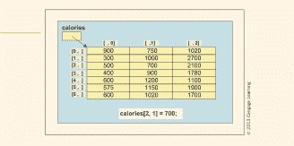

图 8-2 二维 calories 数组

数据实际上并不是以这样的表格形式存储在内存中。值使用行主序格式并排存储在连续的内存位置中。

标识符 calories 包含对 `calories[0, 0]` 的引用。`Length` 属性可用于多维数组，以获取所有维度中的元素总数。下列语句显示 21：

`Console.WriteLine(calories.Length); // Length returns number of cells.`

`Array` 类的另一个有用成员是 `GetLength()` 方法。可以调用它返回行数或列数。数组在指定维度时也采用从零开始。对于二维数组，第一个维度（索引为 0）表示行数，第二个维度（索引为 1）表示列数。`GetLength(0)` 返回行数，`GetLength(1)` 返回列数，如示例 8-2 所示。

### 示例 8-2

```text
Console.WriteLine(calories.GetLength(0)); // Displays 3 (rows)
Console.WriteLine(calories.GetLength(1)); // Displays 7 (columns)
Console.WriteLine(calories.Rank);        // Displays 2 (dimensions)
```

**注意** `Rank` 属性返回数组的维数。

多色内页设计展示准确的 C# 代码及相关注释。全书关键字以蓝色显示，注释以绿色显示。

适用于相等性测试。switch 语句可用于替换示例 5–2 中所示的 if...else 程序语句。

### switch 选择语句

**switch 语句**被视为多分支选择结构。它也称为 **case 语句**。switch 语句允许根据单个变量的值执行大量备选分支。此变量或表达式必须计算为整型或字符串值。它不能与 double、decimal 或 float 一起使用。但它适用于 short、int、long、char 和 string 数据类型。switch 语句的一般格式如下：

```text
switch (expression)
{
    case value1: statement(s);
                  break;
    case value2: statement(s);
                  break;
    ...
    case valueN: statement(s);
                  break;
    [default:    statement(s);
                  break;]
}
```

在 switch 语句中，表达式有时称为**选择器**。其值决定或选择将执行哪些 case。执行 switch 语句时，会计算表达式的值，并将其结果与每个 case 的值进行比较。

case 值必须是与表达式类型相同的常量字面量。不能在 case 的值位置使用变量。也不能在 case 的值位置使用表达式，例如 x < 22。如果表达式是字符串变量，则值用双引号括起来。如果表达式是 char 变量，则值用单引号括起来。对于整数，输入数字时不带任何特殊的包围符号。

与 case 值的比较从上到下进行。第一个与表达式匹配的 case 值将导致执行该 case 的语句。如果没有匹配，则执行与 default 关联的语句。default 是可选的，但通常最好包含一个。仅当没有任何 case 值匹配时，才执行 default 语句。

switch 语句需要使用花括号。这与 if 语句不同；在 if 语句中，只有当多个语句构成……

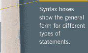


注意 要使用 MessageBox 类，需要在解决方案资源管理器窗口中添加对 System.Windows.Forms 类的引用。还要记得关闭后台的控制台窗口，将项目的“输出类型”属性设置为“Windows 应用程序”。在解决方案资源管理器窗口中选择该项目，然后按 Alt-Enter 快捷键，即可打开项目属性对话框。

## 将数组作为方法参数

你可以编写自己的方法，并像调用 Array 类的预定义方法那样，将数组作为实参发送。查看示例 7-10 中的代码时，请注意有三段独立的代码用于显示输出，而且它们看起来都很相似。除了数组上方的标题不同之外，唯一的区别是 notesLength 数组只显示了一次。另外两次也显示了该数组。为什么不编写一个方法并调用它三次呢？包含数组作为参数的方法标头所用的一般格式为：

```
modifiers returnType identifier (type[] arrayIdentifier)
```

示例 7-11 展示了方法标头的示例。

### 示例 7.11

```
void DisplayArrayContents(double[] anArray)
```

参数标头中包含数组标识符和类型。不包含数组的长度或大小。需要用左方括号和右方括号来指示该参数是数组。

注意 使用 Visual Studio 时，代码生成器会向 Main() 方法标头添加数组参数（Main(string[] args)）。这使应用程序启动时可以将参数发送到程序中。发生这种情况时，数组标识符 args 可以像任何其他数组一样在程序中使用。由于没有向 Main() 发送任何值，因此可以删除 (string[] args) 参数。

## 按引用传递

回顾一下，数组是引用变量。数组标识符的内存位置实际上并不包含这些值，而是包含一个地址，该地址指示数组中元素的位置。当你将数组传递给方法时，默认情况下传递的是对数组元素地址的引用。此特性的重要性在于：如果方法更改了一个或多个元素，则更改会作用于实际数据。因此，在被调用方法中对数组元素所做的任何更改，都会更改调用方法中创建的同一数组元素。

注释提供简短的快速提示，突出可能被忽略的重要概念和功能。

非关键字代码在全文使用不同字体，以便读者快速区分程序语句和普通文本。

### 示例 6.15

```
    int inner;
    for (int outer = 0; outer < 3; outer++)
    {
        for (inner = 10; inner > 5; inner--)
        {
            Console.WriteLine("Outer: {0}\tInner: {1}", outer, inner);
        }
    }
```

此代码的输出为：

| 外部 | 内部 |
| --- | --- |
| 0 | 10 |
| 0 | 9 |
| 0 | 8 |
| 0 | 7 |
| 0 | 6 |
| 1 | 10 |
| 1 | 9 |
| 1 | 8 |
| 1 | 7 |
| 1 | 6 |
| 2 | 10 |
| 2 | 9 |
| 2 | 8 |
| 2 | 7 |
| 2 | 6 |

在示例 6-15 中，Console.WriteLine() 方法执行了 15 次。从输出可以看出，在变量 outer 初始化为零并用于判断 outer 是否小于 3 之后，最内层循环执行了五次。该变量

如果数值变量在每次循环迭代中都按固定量变化，那么 for 语句的紧凑性可能最合适。初始化、条件表达式和更新都可以位于同一行。尽管该格式允许这三个条目都包含多个条目，但一个良好的经验法则是：for 语句的初始化、条件和更新应当能够放在一行中。请记住，可读性始终是一个重要考虑因素。

while 语句可用于编写任何类型的循环。它可以像 for 语句一样实现计数器控制循环。while 语句对于需要状态控制循环和哨兵控制循环的应用程序也很有用。因此它始终是一个不错的选择。它具有预测试类型的优势。对于所有循环，你都要确保理解并设计用于结束循环的条件，以及该条件如何更新或更改。

## 编程示例：LoanApplication

此示例演示了在程序的分析、设计和实现中使用循环。示例中同时包含循环的预测试形式和后测试形式。预测试形式用于计算单笔贷款的详细信息。它嵌套在遍历多笔贷款的迭代中。示例中还包含后测试循环、嵌套方法、预测试循环和选择语句。图 6-16 概述了问题规范。

创建一个应用程序，允许为给定贷款输入贷款金额、利率和融资年数。确定每月还款额。计算贷款期限内将支付多少利息。显示摊还表，展示每次还款后的新余额。

设计一个面向对象的解决方案。使用两个类。对于 Loan 类，融资金额、利率、贷款期限和已支付总利息等特征将标识贷款对象的当前状态。包含用于确定每月还款额、返回贷款期限内已支付总利息以及返回摊还表的方法。

在第二个类中，实例化 Loan 类的一个对象。允许用户输入多笔贷款的数据。在 LoanApp 类中显示还款额、摊还表和应支付的总利息金额。

图 6-16 LoanApplication 示例的问题规范

编程示例是每章末尾的完整程序。这些示例包含准备问题规范、分析问题、设计解决方案和编码实现等不同阶段。

每章末尾都会提供编码/编程风格指南和建议。

每章末尾的特殊“资源”部分提供了许多可供读者探索的网站。

“快速回顾”概述了本章涵盖的概念。

## 编码标准

软件很少由原始开发者维护其整个生命周期。使用良好的风格可以提高软件的可维护性。

- 包含异常处理技术，以处理文件或目录未找到类型的问题。使用特定的异常类（如 FileNotFoundException）来处理这些异常。
- 在读取或写入文件时，应添加 System.IO 命名空间。
- 始终关闭应用程序中打开的文件，或将其使用嵌入 using 语句中。

## 资源

你可能想探索的其他站点：

- **C# 代码风格指南**  
  http://www.sourcemat.com/pdf/cs-coding-standard-hellfire.pdf
- **C# Station – 如何读写文本文件**  
  http://www.csharp-station.com/HowTo/ReadWriteTextFile.aspx
- **Dot Net Perls – C# 文件处理**  
  http://dotnetperls.com/file-handling

## 快速回顾

- 1. `System.IO` 命名空间提供基本的文件和目录支持类，包括 `File`、`Directory`、`FileInfo`、`DirectoryInfo`、`StreamReader`、`StreamWriter`、`BinaryReader` 和 `BinaryWriter`。
- 2. `File` 和 `Directory` 类只公开静态成员。`FileInfo` 和 `DirectoryInfo` 类公开实例方法和属性。
- 3. 枚举是一种特殊的值类型形式，为基础基元类型的值提供替代名称。枚举类型具有一个名称、一个基础类型和一组字段。
- 4. 流表示一块数据，并提供处理字节序列的方式。为处理文件定义了几个抽象流类，包括 `Stream`、`TextWriter` 和 `TextReader`。
- 5. `TextWriter` 和 `TextReader` 便于以文本（可读）格式处理数据。`StreamReader` 和 `StreamWriter` 派生自 `TextReader` 和 `TextWriter` 类。
- 6. `StreamReader` 类设计用于从文本文件中读取信息行。
- 7. `StreamWriter` 类实现 `Write()` 和 `WriteLine()` 方法，类似于你为 `Console` 类学习的方法。


19. 给定以下任务，哪个是最合适的方法头？一个方法接收三个整数作为输入。这些整数值代表成绩。它们在方法中应保持不变。该方法应返回带有小数部分的平均值。

- a. `static double DetermineGrade(int grade1, int grade2, int grade3)`
- b. `static int DetermineGrade(int grade1, int grade2, int grade3)`
- c. `static int DetermineGrade(double finalAverage)`
- d. `static double DetermineGrade(ref int grade1, int grade2, ref int grade3)`
- e. `static void DetermineGrade()`

20. 给定以下任务，哪个是最合适的方法头？结果已经计算出 taxAmount 和 totalSales。编写一个方法头，接受这些值作为输入以供显示。

- a. `public static DisplayResults()`
- b. `public DisplayResults(double)`
- c. `public static void DisplayResults()`
- d. `public static void DisplayResults(double taxAmount, double totalSales)`
- e. `public static void DisplayResults(taxAmount, totalSales)`

21. 使用以下方法头回答下面的问题：

```
public static int DetermineResult(int value1, ref double value2)
public static void DisplayResult(int value1, double value2)
public static int GetValue()
```

- a. 每个方法有多少个参数？
- b. 每个方法的返回类型是什么？
- c. 上述哪些方法的方法体中将包含返回语句？

练习进一步强化学习，确保学生真正掌握了材料。每章末尾都包含客观题和主观题两种类型的活动。

编程练习挑战学生编写具有指定结果的 C# 程序。

24. 将以下复合表达式重写为嵌套 if 语句：

```
if ((aValue > bValue) && (bValue == 10))
    Console.WriteLine("Test complete");
```

25. 编写条件表达式来执行以下测试：

- a. 当 amountOwed 大于 1000.00 时，显示逾期消息。
- b. 当 amountOfRain 大于 5 英寸时，将 5 加到 total。当它在 3 到 5 英寸之间时，将 3 加到 total。当它小于 3 英寸时，将 1 加到 total。
- c. 当 middleInitial 等于字符 z 时，显示消息“你是千里挑一”，否则检查它是否等于字符 'a'。当它等于字符 a 时，显示消息“你有一个常见的首字母”。
- d. 当 balance > 100 且 transaction < 50 时，从 balance 中减去 transaction。当 balance 不大于 100 时，将 transaction 加到 balance。

## 编程练习

1. 编写一个应用程序，使你能够显示水族箱的 pH 值。pH 值是衡量水族箱水碱度的指标，通常以 0-14 的标度表示。对于大多数淡水鱼缸，7 为中性。pH 值高于 7 的鱼缸被认为是酸性的。pH 值低于 7 的鱼缸是碱性的。允许用户输入 pH 值数字。显示一条指示水族箱健康状况（即酸性、中性或碱性）的消息。

2. 创建一个 Month 类，该类只有一个数据成员：月份编号。包含一个返回月份名称的成员方法，以及另一个返回该月份天数的成员方法。ToString() 方法应返回名称和天数。编写第二个类来测试你的 Month 类。第二个类应允许用户输入月份编号。显示与输入的编号关联的月份名称以及该月份的天数。对于本练习，二月使用 28 天。如果用户输入无效条目，显示适当的消息。

## 教师资源

以下教学工具可在我们的 Instructor Companion Site 下载。只需在 login.cengage.com 搜索本教材即可。需要教师登录。

**电子版教师手册。** 随本教材附带的教师手册包括额外的教学材料，以帮助准备课程，包括讲座主题的建议。

**ExamView®。** 本教材附带 ExamView®，这是一个强大的测试软件包，允许教师创建和管理印刷、计算机（基于局域网）和互联网考试。ExamView® 包含数百道与本书主题对应的问题，使学生能够生成详细的学习指南，其中包含供进一步复习的页码参考。这些基于计算机和基于互联网的测试组件允许学生在他们的计算机上参加考试，并且由于每场考试都自动评分，节省了教师的时间。

**PowerPoint 演示文稿。** 本书每章附带 Microsoft PowerPoint 幻灯片。这些作为课堂演示的教学辅助工具，可以让学生在网络上下载用于章节复习，或打印供课堂分发。教师可以为他们在课堂上介绍的其他主题添加自己的幻灯片。

**示例源代码。** 每章中包含的示例的完整 Visual Studio 项目文件可供教师使用，也发布在 www.cengagebrain.com 上供学生使用。各个源代码文件以 .cs 扩展名存储在项目子目录中。

**编程练习解决方案文件。** 提供了所有章末编程练习的解决方案的完整 Visual Studio 项目文件。各个源代码文件以 .cs 扩展名存储在项目子目录中。

## 致谢

我要感谢有机会完成本书的第四版。与其他版本一样，这对我来说是一项巨大的工程。特别感谢 Cengage Learning 的高级产品经理 Alyssa Pratt，感谢她的积极评价、指导和支持。在这个新版本中再次与她合作非常愉快。我感谢质量保证团队成员，他们验证了每个示例和练习解决方案都能正常工作。还要感谢内容经理和文字编辑 Jennifer Feltri-George 和 Andrea Schein，他们在项目进展中提供了很好的建议。

我非常感谢以下审阅者提出的令人振奋的评论和改进建议：

- Zaina Ajackie: American InterContinental University
- Kevin Lertwachara: California Polytechnic State University
- Syed Raza: Trenholm State Technical College
- Dale Wallentine: Stevens-Henager College

我希望审阅者会看到他们的许多建议都已实施。由于他们的贡献，这本教材得到了很大改进。


Neale Cousland / Shutterstock.com

## 第 1 章：计算与编程导论

### 在本章中，你将：

- 了解计算机的历史
- 学会区分系统软件和应用软件
- 学习软件开发的步骤
- 探索不同的编程方法论
- 了解为什么当今使用 C# 进行软件开发
- 区分可以使用 C# 创建的不同类型的应用程序
- 探索用 C# 编写的程序
- 检查 C# 程序的基本元素
- 编译、运行、构建和调试应用程序
- 创建显示输出的应用程序
- 完成一个说明本章概念的编程示例

计算机已经渗透到我们社会的方方面面，并极大地简化了许多任务。你能想象自己在电动打字机上打字吗？你会用橡皮擦来修改吗？你会为了增加或减少页边距或行距而从头开始吗？你能想象生活在一个没有电子消息或电子邮件功能的时代吗？如果你的社区没有自动取款机（ATM），你会怎么办？

计算机已经成为我们生活中不可或缺的一部分，以至于它们的许多功能都被认为是理所当然的。然而，就在几年前，移动应用程序、短信和云计算还不为人知。像互联网论坛、博客、维基、播客和 Facebook 这样的社交媒体技术与社交网络都不为人知。2012 年，社交媒体通过 Twitter 和 Facebook 等平台成为新闻更新最强大的来源之一。计算的进步每天都在发生，加载到计算机上的程序也变得非常复杂。无线通信技术正在迅速发展。预计到 2016 年，平板电脑的销量将增长 200%。2012 年将售出超过 1 亿台。对大多数消费者来说，平板电脑并不是传统电脑的替代品，而是他们将会购买的附加设备。对智能手机、掌上电脑和平板电脑以及其他手持无线计算机的移动应用程序的需求日益增长。为了达到这种复杂程度，软件开发经历了许多时代，如今技术进步的积累越来越快。未来哪些新型计算机服务和程序将融入我们的日常生活？本书专注于创建软件程序。在开始软件开发之旅之前，先回顾一下计算的历史，以帮助你看等待着你的进步潜力。

### 计算机的历史

计算的历史可以追溯到大约 5000 年前。许多人认为算盘是第一台计算机。算盘是过去和现在的商人用于交易的计算设备，它使用在框架上滑动的珠子系统来进行加法和减法。

1642 年，另一种计算设备问世，称为帕斯卡加法器（Pascaline）。帕斯卡加法器有八个带轮子的可移动刻度盘，可以计算长达八位的总和。算盘和帕斯卡加法器都只能进行加法和减法。直到 19 世纪 30 年代，第一台通用计算机——分析机才问世。

查尔斯·巴贝奇和他的助手，洛夫莱斯伯爵夫人奥古斯塔·艾达·拜伦设计了分析机。尽管以今天的标准来看它非常原始，但它是今天所谓的通用计算机的原型。分析机包括输入设备、存储器、一个允许按任何顺序处理指令的控制单元，以及输出设备。


> **注意**
>
> 20世纪80年代，美国国防部为纪念洛夫莱斯夫人，将一种编程语言命名为 Ada。她被称为世界上第一位程序员。她的这一称号存在争议；洛夫莱斯夫人可能是第四位或第五位编写程序的人。她作为查尔斯·巴贝奇的学生进行编程，并重新处理了他的一些计算。

许多计算机历史学家认为，当今正处于现代计算的第五代。每个时代都以一项重要进步为特征。20世纪40年代中期，第二次世界大战对战略性计算的需求推动了第一代通用机器的出现。这些大型的第一代计算机以使用真空管为显著特征。它们难以编程，功能也有限。操作指令是为每项特定任务定制的。

1956年晶体管的发明催生了第二代计算机，它们比前代更小、更快、更可靠、更节能。随着 FORTRAN 和 COBOL 的引入，软件产业在第二代计算机期间诞生。

第三代（1964—1971年）见证了计算机变得更小，因为晶体管被压缩到称为半导体的小型硅片（单芯片）上。今天所称的、允许机器同时运行许多不同程序的操作系统，也首次出现在第三代系统中。

随着时间推移，芯片不断变小，并能容纳更多晶体管，使计算机更强大、更便宜。1971年开发的 Intel 4004 芯片将计算机最重要的组件（中央处理器、内存以及输入和输出控制器）放置在一块约一角硬币一半大小的微小芯片上。微波炉、电视机和汽车等许多家用物品都受益于第四代计算。

在第四代期间，计算机制造商试图将计算带给普通消费者。1981年，IBM 推出了其个人计算机（PC）。20世纪80年代，随着 IBM PC 的兼容机使个人计算机更加可负担，计算机的使用范围扩大了。我们还见证了图形用户界面（GUI）以及鼠标作为手持输入设备的发展。个人计算机的使用数量从1981年的200万台增长到1982年的550万台，增长了一倍多。十年后，有6500万台 PC 在使用。

> **注意** 根据2012年7月发布的2010年10月 *美国人口普查局当前人口调查*，美国超过76%的家庭拥有计算机。

界定第五代系统有些困难，因为这一代仍然年轻。计算机现在可以接受口语指令，通过人工智能模仿人类推理，并通过传输数字媒体与全球设备即时通信。移动应用正在增长。通过应用问题解决步骤，专家系统协助医生进行诊断。医疗保健专业人员现在在病房中使用手持设备检索和更新患者记录。送货卡车司机使用手持设备访问全球定位系统（GPS），以核实客户取货和送货的位置。坐在红绿灯前，你可以查看电子邮件、预订机票、远程监控和管理家用电器，并访问支票账户和储蓄账户。学生进入教室时，可以使用无线网络访问教授的笔记。

随着 Visual Studio 等集成开发环境（IDE）使快速开发互联网应用变得更容易，软件领域预计将取得重大进展。由于计算机的可编程性，软件开发人员的想象力得以释放，去构想未来的计算功能。

计算机的真正力量不在于硬件，硬件由构成系统的物理组件组成。其功能在于可利用硬件来发挥作用的软件。硬件处理复杂的 0 和 1 模式。软件实际上将这些 0 和 1 转换为人们可以阅读的文本、图像和文档。下一节开始讨论软件。

## 系统软件和应用软件

软件由程序组成，程序是指示计算机确切执行什么操作的一组指令。这些指令可能告诉计算机将一组数字相加、比较两个名称，或根据计算结果做出决定。正如厨师按照一组指令（食谱）准备一道菜，计算机遵循指令执行有用任务，而不会额外加盐。接下来的几节描述软件的两大类别：系统软件和应用软件。

## 系统软件

系统软件在你打开计算机电源时被加载。想到系统软件时，大多数人会想到操作系统。**操作系统**（如 Windows 8、Android、iOS、Windows 7 和 Linux）是监督和协调机器资源的一类程序。其中包括文件系统实用程序，这些小程序负责定位文件，并记录文件名、大小和创建日期等细节。系统软件程序还执行各种其他功能：设置目录；移动、复制和删除文件；将数据从辅助存储传输到主存；格式化介质；以及在屏幕上显示数据。操作系统包括用于连接互联网或连接打印机等输出设备的通信程序。它们包括用于管理系统外观和感觉的用户界面子系统。

**注意。** 操作系统是系统软件的一种。它们是实用程序，使你更容易使用硬件。

另一类系统软件包括编译器、解释器和汇编器。当你开始学习软件开发时，你将使用**编程语言**为计算机编写指令。现代编程语言的设计目标是易于阅读和编写。它们被称为**高级语言**，因为它们是使用类似英语的语句编写的。你将使用的编程语言是 **C#**（发音为 *see sharp*）。其他高级计算机编程语言包括 Visual Basic、FORTRAN、Pascal、C、C++ 和 Java。

在计算机能够执行用 C# 等编程语言编写的指令之前，这些指令必须被转换为机器可读格式。**编译器**完成这种转换。图 1–1 展示了机器语言指令的样子。

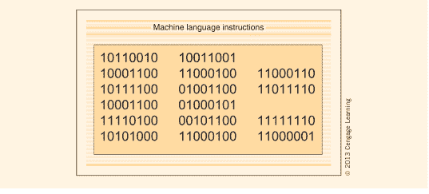

**图 1-1** 一条机器语言指令

正如英语有句子构造规则，C# 等编程语言也有一套必须遵循的规则，称为**语法**。在将代码转换为机器可读形式之前，编译器会检查是否违反规则。在移除所有语法错误之前，编译器不会将任何语句转换为机器语言。代码既可以编译，也可以解释。解释器将一行代码语句转换为机器可读形式，然后执行该行。然后它们转换下一条指令、执行它，依此类推。与查看整段代码的编译器不同，**解释器**逐行检查是否违反规则。如果该行不包含错误，就将其转换为机器语言。解释器通常比编译器慢。许多语言同时提供编译器和解释器，包括 C、BASIC、Python 和 Lisp。**汇编器**将汇编编程语言（一种低级编程语言）转换为机器码。低级编程语言更接近硬件。它们不如高级编程语言那样易于阅读或编写。

## 应用软件

**应用软件**由为执行特定任务而开发的程序组成。你可能玩的游戏或在互联网上使用的搜索引擎都是应用软件的类型。文字处理器（如 Microsoft Word）是应用软件的示例。Word 的编写目的是通过包含多种编辑和格式设置选项，帮助用户创建具有专业外观的文档。电子表格（如 Microsoft Excel）是一类应用软件，旨在进行数值计算和生成图表。数据库管理系统（如 SQL Server、Oracle 或 Microsoft Access）旨在组织大量数据，以便轻松生成报告。生成工资支票的软件被视为应用软件，帮助你注册课程的软件也是如此。带有数据库驱动购物车的电子商务网站（如 eBay）是应用软件的形式。银行业使用应用软件来管理你的支票账户和储蓄账户。程序员使用 C# 等编程语言编写应用软件，以执行特定任务或解决特定问题。你根据本书编写的程序将是应用软件。

## 软件开发过程

你很快将使用 C# 编写程序。如何开始？许多初学程序员只是开始输入，而没有计划，也没有采用任何有组织的步骤顺序。这通常会导致开发时间增加，并且解决方案可能无法始终产生准确结果。

编程是一个解决问题的过程。用 C# 等语言键入程序语句并不是编程中最困难的部分。最困难的部分是提出解决问题的计划。解决计算机相关问题会使用多种不同的方法，即**方法论**。成功的问题解决者在每个编程项目中都遵循有条理的方法。图 1-2 展示了用于解决本书所呈现问题的有条理的计划或方法论。下一节描述每个步骤。


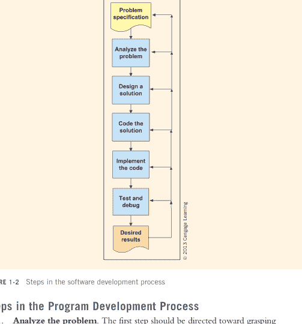

**图 1-2** 软件开发过程中的步骤

## 程序开发过程的步骤

- 1. **分析问题。** 第一步应致力于彻底理解问题。精确分析软件应当实现什么目标。在此阶段，你需要审查问题规格说明，其中描述了程序应当实现的功能。规格说明通常包含程序的预期输出，即要显示、保存或打印的内容。如果规格说明含糊不清或需要澄清，你可能需要提出一些探究性问题。*如果你不知道要去哪里，你怎么知道何时到达了正确的地点？*

  **注意**

  有时，流程中最困难的部分之一是从用户那里获得清晰的规格说明。除非你知道问题是什么，否则你无法解决它。确保你理解了问题定义。

  程序规格说明可能如图 1–3 所示。

  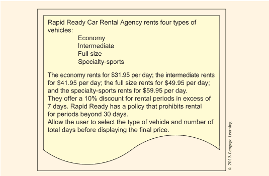

  **图 1–3** 汽车租赁机构问题的程序规格说明表

  在第一阶段，除了确保你理解问题定义之外，你还必须审查程序的输入。你应该提出以下类型的问题：

  - 将有哪些类型的数据可用于输入？
  - 每个已确定的数据项中将包含哪些类型的值（例如整数、字母字符和带小数点的数字）？
  - 每个输入项的**域**（值的范围）是什么？
  - 程序的用户是否会输入值？
  - 如果问题解决方案要用于多个数据集，是否有任何数据项在每个数据集中保持不变或恒定？

  在进入解决方案设计之前，你应该对问题有透彻的理解。将问题定义用语言表达出来可能会有所帮助。查看每个数据项的示例输入也可能会有所帮助。图 1–4 说明了如何针对图 1–3 所示的汽车租赁机构问题在分析阶段确定输入数据项。图 1–4 显示了每个数据项的标识符（即数据项名称）、类型和值的域。与其让用户输入 Economy、Intermediate、Full size 或 Specialty Sports 的完整单词，不如将字符 E、I、F 和 S 映射到这些类别。

  | 数据标识符 | 数据类型 | 值域 |
  |---|---|---|
  | `kindOfVehicle` | char（单个编码字符） | E、I、F 或 S |
  | `noOfDays` | Integer（整数） | 1...30 |

  **图 1–4** 汽车租赁机构的数据

- 2. **设计解决方案。** 在设计过程中，程序员会使用多种途径，或称**方法**。过程式（Procedural）和面向对象（object-oriented）方法是两种最常用的设计方法。有些项目使用其中一种方法比另一种更容易解决。这两种方法将在下一节讨论。在确定方法时，编程语言的选择有时也会产生影响。C# 语言在设计上就是非常面向对象的。

  无论项目规模大小，周密的设计总能带来更好的解决方案。此外，周密的设计通常还能在更短的时间内产生解决方案。**分而治之**（divide-and-conquer）的方法可以用于这两种方法。顾名思义，当你分治一个编程问题时，你会将问题分解为子任务。然后，你通过进一步分解每个子任务来攻克它们。这个过程也称为**自顶向下设计**。应开发详细的模型作为后续阶段的输入。

  使用**面向对象方法**时，重点是确定数据特征以及作用于数据的方法或行为。这些成员（数据和行为）的逻辑分组被称为**类**。这些特征被放置在类图中。图 1–5 包含了针对图 1–3 中问题规格说明的类图。

  **图 1-5** 汽车租赁机构的类图

  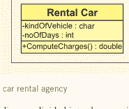

  图 1-5 是一个分为三个部分的类图，顶部标识类的名称。类图的中间部分始终列出数据特征。表示要租赁的车辆类型和租赁天数的数据对汽车租赁机构来说很重要。图 1-5 所示类图的底部显示了要对数据项执行哪些操作。ComputeCharges() 用于根据车辆类型和租赁天数确定租赁费用。在本章后面，你将学习更多关于类图的内容。过程式设计适用于较简单的问题定义，使用结构图显示模块的层次结构，并使用流程图或伪代码列表详细说明每个模块的步骤。

  对于这两种方法，都应该为行为（面向对象）或过程（过程式）开发算法。算法是解决问题的一种清晰、明确、逐步的过程。这些步骤必须表达得如此完整和精确，以至于包含所有细节。算法中的指令应该既易于执行，又能在有限时间内完成。盲目地遵循这些步骤，每次都应得到相同的结果。

  ComputeCharges() 的算法将租赁天数乘以与所租车辆类型相关的费率，以得出租赁费用。算法开发完成后，应检查设计的正确性。一种方法是使用示例数据，通过模拟计算机来对算法进行桌面检查；换句话说，就是逐步走查计算机的执行步骤。一次一步，精确地遵循每一步。如果问题涉及计算，请使用计算器，并严格遵循你的设计语句。进行桌面检查时，不要添加任何额外的步骤，除非你回头修改算法，这一点很重要。

  在此阶段，通过开发原型来规划和设计预期输出的外观也可能会有所帮助。原型是描述最终输出外观的屏幕模型。

- 3. **编写解决方案代码。** 在完成设计并验证算法正确之后，你将设计转换为源代码。**源代码**由使用编程语言（如 C#）编写的程序语句组成。

  **注意**

  可以使用编辑器（如记事本）或**集成开发环境（IDE）**（如 Visual Studio）将源代码语句输入计算机。IDE 包含许多有用的开发工具：IntelliSense（带有完成选项的弹出窗口）、调试、不同程序部分的颜色编码、在线帮助和文档，以及运行程序的功能。

  在编写解决方案代码时，你必须遵循语言的语法。无论你说英语、西班牙语还是其他语言，你都习惯于遵循语言的**语法**，即规则。例如，英语的语法规定句子以句号结尾，并包含主语和动词。当你用英语写作时，你应该遵循这些规则。当你用 C# 编程语言编写时，你应该遵循每条语句以分号结尾的规则。正是在程序开发过程的第三阶段（编写解决方案代码），你必须关注语言语法。

  许多程序员在软件开发过程中使用**迭代方法**。这意味着你可能会发现有必要返回设计阶段进行修改。有时甚至需要进行额外的分析。如果在尝试编写解决方案代码之前进行了彻底的分析和设计，你通常能开发出更好、更容易阅读和修改的程序。

- 4. **实现代码。** 在此阶段，输入的程序语句（源代码）会被编译以检查是否违反规则。集成开发环境（IDE）（如 Visual Studio）在开发环境中提供编译器。编译器的输出是错误列表，以及违反规则的简要描述。在实现继续之前，必须更正所有语法错误。当消除违反规则的情况后，源代码会被转换为微软**中间语言（IL）**。所有面向 .NET（发音为 dot net）平台的语言都会编译成中间语言（IL）。你将在本书中使用的语言 C# 是 .NET 平台引入的一种语言。与 C# 类似，其他语言（如 Java）也将代码编译为中间语言。Java 的中间语言称为**字节码**。中间语言有助于使用代码，这些代码比那些直接编译为特定平台机器语言的语言更具平台无关性。

  **注意**

  如果你使用的是 Visual Studio IDE，你可能不会注意到 IL 的存在。你只需选择编译、生成和运行程序的选项，即可查看输出结果。


IL 代码介于高级源代码和**本机代码**之间，后者是特定计算机的机器语言代码。IL 代码不能在任何计算机上直接执行。它不是计算机的语言，这意味着它不绑定任何特定 CPU 平台。在能看到应用程序的结果之前，还需要执行第二步。

第二步由 .NET 的**公共语言运行时（CLR）**管理。CLR 将程序使用的预定义 .NET 类加载到内存中，然后执行第二次编译，称为**即时（JIT）编译**。这将 IL 代码转换为平台的本机代码。用于此目的的 CLR 工具是一个名为 JITer 的即时编译器。JITer 读取 IL 并生成在特定平台上运行的机器代码。任何执行该代码的计算机都必须安装 CLR。CLR 包含在 .NET Framework 中。任何执行 .NET 代码的计算机都必须安装 .NET Framework。图 1-6 说明了执行用 C# 编写的源代码必须执行的步骤。

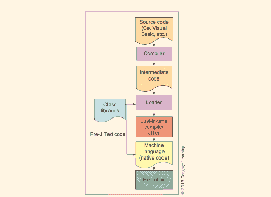

**图 1-6** .NET 的执行步骤

5. **测试和调试** 即使没有编译器语法错误并且得到了输出，结果也可能不正确。必须测试程序，以确保得到一致的结果。**测试**阶段常常得不到足够重视。只有经过彻底测试，才能确定程序运行正确。

    规划测试。优秀程序员常常在分析和设计解决方案的同时制定**测试计划**。该测试计划应包括测试极端值、识别可能的问题情形，并确保测试这些情形。在消除语法错误并开始产生结果后，应实施测试计划，验证结果是否准确。如果应用程序需要与用户交互以输入数据，请使用计划好的测试值多次运行程序。对于计算，使用计算器执行相同的运算，就像你在设计阶段手工检查算法时那样。有些软件开发方法学是围绕测试开发建立的。例如，**测试驱动开发**（TDD）是一种编程方法学，强调快速、增量式开发，并在编写代码之前编写测试。在 TDD 中，只有在首批测试通过后才添加额外功能。第一个周期通常处理非常简单的用例。当这些非常简单的测试可以正常工作后，再逐步添加更多功能，一次添加一点。

    测试期间，常常会发现**逻辑错误**。逻辑错误可能导致程序异常终止，或只是产生错误结果。这类错误通常比语法错误更难定位和纠正。**运行时错误**是逻辑错误的一种形式。运行时错误通常会导致程序崩溃（停止执行）并报告错误消息。例如，如果尝试除以零，程序可能崩溃。更复杂的是，程序有时在大多数测试数据下能正常工作，但在输入某个特定值时崩溃。这就是为什么确保彻底测试所有应用程序如此重要。检测到逻辑错误时，可能有必要回到第 1 步，重新分析问题规格，并重新设计解决方案。回顾图 1-2 时，请注意该图表明软件开发过程是迭代的。当发现错误时，通常有必要循环回到之前的阶段或步骤。

## 编程方法学

你如何骑自行车？你如何开车？你如何洗衣服？你如何准备考试？当你思考这些问题时，你可能有答案，而你的答案会与其他读者不同。但是，你有某种策略、一组步骤，你遵循它们来完成任务。你可以把方法学看作一种策略、一组步骤或一组指导。程序员使用多种不同的编程方法学。两种最流行的编程范式是结构化过程化编程和面向对象编程。本节将讨论这些方法。

### 结构化过程化编程

这种方法出现于 20 世纪 70 年代，至今仍在使用。**过程化编程**是面向过程的，关注数据从输入到产生有意义的输出所经历的过程。这种方法对小型独立应用程序非常有效。上一节所述的软件开发五个步骤——分析、设计、编码、实现以及测试和调试——非常适合结构化过程化方法。

在设计期间，处理步骤依据算法来定义。任何公式或特殊处理步骤都包含在算法中。为了以算法方式思考，程序员使用多种工具。其中一种工具是流程图。图 1-7 展示了构建算法时流程图中使用的一些符号。

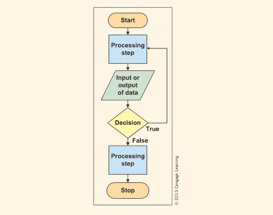

**图 1-7** 流程图符号及其解释

结构化编程与一种称为**自顶向下设计**或**逐步求精**的技术相关。其基本主题或概念是：给定问题定义，你可以通过分而治之来细化逻辑。问题可以划分为子问题或过程。然后，每个子问题又被进一步分解。如此继续，直到得到足够简单、可以在子问题层面轻松解决的子问题。在较低层级得到解决方案后，再将这些解决方案组合起来解决整体问题。

> **注意**
>
> 考虑建造房屋的类比。使用自顶向下设计，这个问题可以分解为准备土地、建造地基、搭建结构框架、安装屋顶、完成内部装修和完成外部工程。然后，这些子问题中的每一个都可以进一步细分。可以为项目聘请总承包商，然后为每个子问题领域分配分包商。在每个子问题内部，还会定义额外的问题，并为该领域分配单独的工人。例如，“完成内部装修”可以进一步划分为墙壁、地板等。“墙壁”可以进一步分解为安装石膏板、给墙壁抹灰、准备刷漆、粉刷墙壁、给装饰线条刷漆等。同样，这些领域中的每一个都可以分包出去。

当你考虑将“租车”问题分解为更小的子程序时，你可能会考虑：必须录入或输入数据，测试租车天数以确定是否可以租车，测试所需车辆类型以确定费率，进行最终计算，然后显示结果。每个小型子程序都可以进一步划分为多条程序语句。

使用结构化过程化方法的程序员通常将每个子程序写成单独的函数或方法，由主控制函数或模块调用。这促进了分而治之的方法。对于较大的问题，子程序可以由不同人员编写。过程化方法的一个缺点涉及**软件维护**。当应用程序升级或更改时，使用过程化方法编写的程序更难维护。即使很小的修改也可能影响多个函数，并需要做额外修改。与面向对象方法学相比，代码复用的机会也更少。

### 面向对象编程

面向对象编程在 20 世纪 90 年代早期和中期发展成为占主导地位的编程方法学。如今，它被视为一种较新的软件开发方法。面向对象编程（OOP）背后的概念是，应用程序可以围绕对象而不是过程来组织。这种方法学包含许多强大的设计策略，有助于构建更复杂的系统，这些系统可对……进行建模

现实世界实体。C# 语言的设计旨在利用面向对象方法的优势。

通过**面向对象分析、设计与编程**，重点在于确定你想要操作的对象，而不是操作数据所需的过程或逻辑。请记住，过程化方法关注的是过程。面向对象方法的基本假设之一是，世界包含许多可以被识别和描述的实体。**实体**通常定义为人、地点或事物。它通常是名词。通过**抽象出属性**（数据）和**行为**（对数据进行的处理），你可以将复杂现象划分为可理解的实体。**抽象**只是对实体本质相关属性的描述。例如，通过描述人、学校工作人员、教职员工、学生、本科生、研究生、交通工具、汽车、书、学校、动物、狗和贵宾犬等实体各自的**特征**或属性以及**行为**或动作，你应该能够轻松地在脑海中想象或概念化这些实体。

考虑一个学生的例子。学生具有以下特征或属性：学号、姓名、年龄、GPA、专业和家乡。通过确定每个特征中可能存在何种类型的数据，可以进一步描述这些特征。例如，姓名属性中会出现字母字符。年龄属性中会出现不带小数点的整数，而 GPA 属性中会出现带小数点的数字。

除了抽象数据属性外，你还应该能够思考上一段中识别出的每个实体的一些动作或行为。与学生相关的行为包括申请入学、注册为学生、获取最终成绩、更改姓名和确定 GPA 等动作。使用面向对象方法，这些属性和动作（或特征和行为）被**封装**，这意味着它们组合在一起形成一个类。

**类图**是面向对象程序员使用的主要建模工具之一。图 1-9 使用统一建模语言（UML）表示法展示了 Student 类图。图的上部标明了类的名称，即 Student。中间部分包含数据成员以及每个数据成员中会出现的数据类型。**信息隐藏**是面向对象编程的重要组成部分。数据成员名称左侧的减号（–）表示访问修饰符，并表明该成员是私有的，仅该类可访问。图 1-9 中图的下部显示了 Student 类的动作或方法。加号（+）访问修饰符表示这些行为是公共的，可在类外部使用。你将在后续章节中了解更多关于类图的内容。本书通篇使用这种 UML 表示法来创建类图。

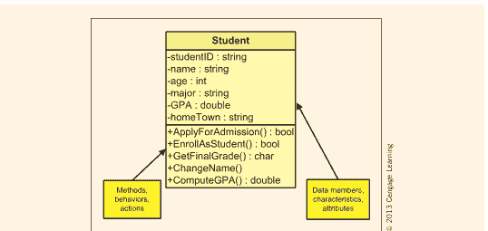
**图 1-9** Student 类图

类就像模板。它类似于房屋的蓝图。即使你在蓝图中定义了房屋的所有特征，直到使用该模板建造出一栋房屋，房屋才存在。可以使用同一模板建造许多房屋。在面向对象术语中，建造出的房屋是蓝图或模板的一个实例（对象）。你通过使用该模板建造房屋来**实例化**蓝图。可以实例化特定类的许多对象。因此，**对象**是类的**实例**。

查看以下数据成员的学生扩展示例：

- 学号：122223
- 学生姓名：Justin Howard
- 年龄：18
- GPA：3.80
- 专业：CS
- 家乡：Winchester, Kentucky

当这些数据成员与类关联时，就创建或**构造**了一个对象。可以通过为其成员赋值，从该类实例化第二个对象（例如，228221、Elizabeth Czerwinski、21、4.0、ENG、Reno, Nevada）。

面向对象方法便于设计组件，这些组件包含可重用代码，其方式是将数据类型的属性与该类型的动作一起打包。在第 4 章中，你将创建自己的类并对其进行实例化。

通过继承，可以定义数据对象的子类，这些子类共享父类的部分或全部特征。这正是实现代码重用的原因。例如，你应该能够想象 Student 是 Person 的子集，就像 Teacher 是 Person 的子集一样。使用面向对象设计，你可以抽象出所有人的共同特征，并将它们放入一个超类中。通过继承，Student 和 Teacher 可以使用 Person 的特征，并添加自己独有的成员。

另一个重要的面向对象概念是多态。父类和子类的行为或方法可以具有相同的名称，但提供不同的功能。通过多态，你能够在不同类的对象上调用同名方法，并执行正确的方法。例如，你可能有两个子类 UndergraduateStudent 和 GraduateStudent。它们都可以从 Student 类继承特征。这两个子类可能各自都有一个方法，其中包含如何确定其学费的详细信息。两个子类可能都将其方法命名为 DetermineTuitionCosts()。通过多态，会根据调用该方法的对象执行正确的方法。当使用 UndergraduateStudent 类的对象时，就使用 UndergraduateStudent 类的 DetermineTuitionCosts() 方法。当使用 GraduateStudent 类的对象时，就使用 GraduateStudent 类的 DetermineTuitionCosts() 方法。你将在后续章节中了解更多关于面向对象特性的内容。在第 11 章中，你将了解包括继承和多态在内的高级面向对象编程特性。在该章中，你将编写多类解决方案。

使用 C# 编写软件时，面向对象原则尤为重要。任何程序都不可能不包含至少一个类。使用 C# 语言编写的所有程序语句都放在类中。

无论你使用过程化方法还是面向对象方法，都应该遵循程序开发的五个步骤。与过程化方法一样，面向对象开发过程也是迭代的。在设计及后续阶段，不要犹豫，重新考虑分析和设计决策。

## C# 与 .NET 的演变

### 编程语言

在 20 世纪 40 年代，程序员拨动计算机前面的开关，将程序和数据输入内存。一些早期编程就是这样开始的。即使后来改为在卡片上打孔表示 0 和 1，并将卡片读入内存，当程序员想必也不会有多大乐趣。编码非常繁琐且容易出错。20 世纪 50 年代，汇编语言使用助记符号来表示计算机指令，从而取代了二进制表示法。诸如 MV 之类的符号用于表示将内存中一个值的内容移动到另一个内存位置。汇编语言的设计目的是通过使用这些助记符号而不是二进制数，使程序员的工作更轻松。然而，指令取决于特定的 CPU 架构。执行同一任务的语句因计算机而异。汇编语言仍被视为**低级编程语言**。从图 1-10 可以看出，这类指令不易阅读或理解。它们不像 C# 和 Java 等高级编程语言那样接近英语。

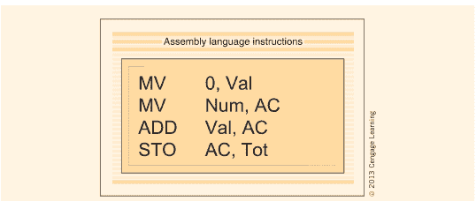
**图 1-10** 用于将两个值相加的汇编语言指令

20 世纪 50 年代后期，随着 **FORTRAN**（公式翻译语言）的出现，以及后来 **COBOL**（面向商业的通用语言）的出现，高级语言诞生了。这些语言被认为是**高级语言**，因为它们旨在便于人类使用、易读易写，并且接近英语。自那以后，已有 2000 多种高级语言问世。有些已被淘汰，而另一些则不断演进，至今仍被广泛使用。

一些较著名的高级编程语言包括 C、C++、Visual Basic、Java，以及现在的 C#。**C++** 是 C 的扩展，而 C 实际上是在 1973 年从 BCPL 和 B 演变而来的。丹尼斯·里奇（Dennis Ritchie）因开发 C 编程语言而受到赞誉；贝尔实验室的比雅尼·斯特劳斯特鲁普（Bjarne Stroustrup）因其在 20 世纪 80 年代初的设计工作而被视为 C++ 之父。C++ 包含使程序员能够进行面向对象编程的特性。如今，C++ 在计算机行业中被大量使用。

Smalltalk 被认为是一种纯面向对象语言，是在施乐帕洛阿尔托研究中心（PARC）开发的。Visual Basic 于 1991 年推出，源自 BASIC（初学者通用符号代码）编程语言，这是一种在 20 世纪 60 年代开发的语言。较早版本的 Visual Basic 并不便于使用面向对象方法进行开发。然而，较早版本的 Visual Basic 确实便于轻松创建基于 Windows 的图形用户界面（GUI）。因此，Visual Basic 已被用于大量应用程序开发。


**Java** 于 1995 年推出，最初名为 Oak。它最初被设计为一种用于智能消费电子设备（如家用电器和微波炉）的语言。但商业界并没有将其用于该目的，而是最广泛地将 Java 用于 Web 应用程序，这是因为字节码的特性使得语言编译可以独立于机器。由于字节码不针对任何特定的计算机平台，并且必须转换为运行应用程序的系统语言，因此这便于开发可在多种类型计算机上运行的代码。

**C#** 是较新的编程语言之一。它紧密遵循 C 和 C++，但许多开发者认为它类似于 Java。这些语言之间有许多相似之处。它具有以前版本 Visual Basic 的快速图形用户界面 (GUI) 功能、C++ 增加的强大功能，以及类似于 Java 的面向对象类库。C# 是 Microsoft 从头设计以配合新编程范式 .NET 的语言，并且是开发 .NET Framework 类库时使用最多的语言。C# 可用于开发任何类型的软件组件，包括移动应用程序、动态 Web 页、数据库访问组件、Windows 桌面应用程序、Web 服务和基于控制台的应用程序。本书中你将使用 C# 进行软件开发；然而，所介绍的概念可应用于其他语言。本书的意图是将 C# 语言用作学习如何开发软件的工具，而不是专注于 C# 的语法。

## .NET

当你想到 C# 时，也应该理解它与 .NET 的关系。**.NET** 是程序运行的环境，旨在成为一种新的编程范式。它不是操作系统，而是操作系统与其他应用程序之间的一层。因此，它提供了一个用于开发和运行易于使用的代码的平台。**.NET** 是 Windows 上运行的许多应用程序的组成部分，并为这些应用程序的运行提供通用功能。Microsoft 表示，.NET 的愿景是提供一个新编程平台和一套开发工具。其意图是让开发者能够构建基于组件的分布式应用程序。到 2000 年 Microsoft 发布 .NET 时，由于 Microsoft 的大规模营销活动，许多开发者已经体验过 .NET。

在 2000 年正式发布之前，.NET 已开发了三年多。Microsoft 在正式发布前分发了多个 beta 版本。**beta 版本**是尚未经过全面测试、仍可能包含 **bug** 或错误的工作版本。直到 2002 年 2 月，Microsoft 才最终发布 Visual Studio 的第一个版本，这是用于开发 C# 应用程序的 IDE。Visual Basic、Visual C++ 和 Visual C# 都使用同一个开发环境。图 1-11 显示了正在运行 C# 程序的 Visual Studio。程序“Welcome to Programming!”的输出显示在图底部附近的小消息框中。

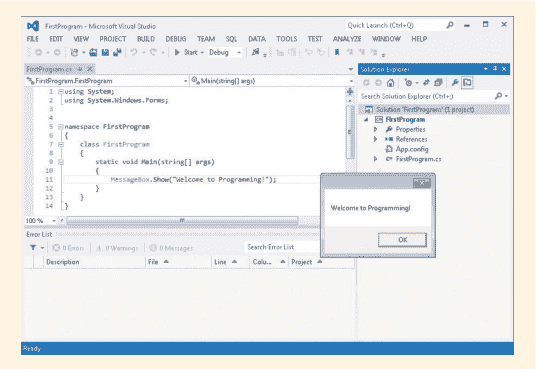

**图 1-11** Visual Studio 集成开发环境

> **注意** Microsoft 在 2005 版中从 Visual Studio 的名称中去掉了 .NET。

Visual Studio 中包含用于键入程序语句以及编译、执行和调试应用程序的工具。作为 .NET 一部分引入的新概念将在以下段落中概述。

**多语言独立性。** .NET 支持使用多种编程语言进行开发：Visual Basic、C#、C++ 以及多种第三方语言。来自每种语言的所有代码都可以编译为通用的 Microsoft 中间语言 (IL)。

应用程序的一部分可能使用 Visual Basic 开发，另一部分使用 C# 开发。编译时，它们会转换为通用的 IL。以下列表描述了 .NET 支持的语言的一些常见特性：

- **框架基类。** .NET Framework 有一个类库，它提供了超过 2500 个可重用类型（类）的庞大集合，可供任何 .NET 语言使用。
- **动态 Web 页和 Web 服务：** .NET 在编写时考虑了 Internet；因此，通过 Intranet 或 Internet 部署应用程序成为普通的日常操作。使用新技术 ASP.NET、一组称为 ADO.NET 的组件以及 XML 支持，可以更容易地访问关系数据库和其他数据源，并通过 Web 导入和导出数据。
- **可伸缩组件开发：** .NET 不仅促进了面向对象开发，还将设计向前推进了一步。借助 .NET，真正的基于组件的开发可以比过去更好、更容易地进行。作为独立实体创建的代码段可以独立存储、组合并在许多应用程序中重用。这就是 .NET 背后的美妙之处——它为客户端程序使用以不同语言构建的组件提供了一种相对无缝的方式。借助 .NET，基于组件的开发可以成为现实。

## 为什么使用 C#？

面向 .NET 平台的编译器可用于 Visual Basic、C++ 和 C# 等编程语言。除 Microsoft 外，许多第三方供应商也在销售符合 .NET 的语言。Microsoft 还随 Visual Studio 2010 推出了一种名为 Visual F# 的新编程语言。还有许多其他面向 .NET 平台的编程语言。那么，为什么使用 C#？C# 是为 .NET 创建的语言，并且是从头设计以配合 .NET 工作的。大量类作为 .NET 的一部分被包含进来。这些类或模板被设计为可供任何 .NET 支持的语言重用。它们减少了需要完成的编程工作量。这些类称为 .NET Framework 类。大多数 .NET Framework 类都是使用 C# 编程语言编写的。

C# 与 .NET Framework 类结合，为纳入和使用新兴 Web 标准（如超文本标记语言 (HTML)、可扩展标记语言 (XML) 和简单对象访问协议 (SOAP)）提供了一个令人兴奋的载体。如前所述，C# 在设计时考虑了 Internet。.NET 之前开发的大多数编程工具都是在 Web 尚处于初期时设计的，因此它们并不是开发 Windows 和 Web 应用程序的最佳选择。

C# 是一种简单的面向对象语言。通过使用 Visual Studio IDE 和 .NET Framework，C# 提供了一种简便方法来创建类似于 Visual Basic 程序员多年来一直使用的图形用户界面。C# 还提供了 C 和 C++ 程序员所习惯的纯粹的数据处理能力。所有循环和选择编程结构都包含在内。C# 使开发者能够使用以前仅在 Java、通用网关接口 (CGI) 或 PERL 中才有的许多常见功能，通过 Internet 提供他们的程序包。

> **注意** 有些人这样描述 C#：Microsoft 采用了 Visual Basic 的精华并加入了 C++，同时去掉了 C 中一些更晦涩的传统。其语法非常接近 Java。

许多人将 C++ 的成功归因于其美国国家标准学会 (ANSI) 标准化。C# 正沿着类似的成功道路前进。2001 年 12 月 13 日，欧洲计算机制造商协会 (ECMA) 大会批准将 C# 及其通用语言基础设施 (CLI) 规范作为国际标准。这一验证证明 C# 并非只是一种昙花一现的语言。最初，使用 C# 进行开发仅适用于 Windows 平台；现在 C# 可用于包括 Linux 在内的其他平台。C# 将在相当长一段时间内继续存在。它代表了下一代语言。

正如你在前面章节中读到的，程序是编写来指示计算机执行特定任务的指令。每条指令都必须以特定方式编写。编写这些指令的语法规则由编写程序所用的语言定义。在获得结果之前，这些人类可读的指令（称为源代码）必须转换为机器语言，即计算机的本机代码。翻译是一个两步过程，从编译器开始。在本章中，你将编写第一个 C# 程序，了解它如何编译，并探索最终输出是如何产生的。

每条指令语句都有语义含义，即应使用它的特定方式。本章重点介绍程序语句在应用程序中出现时的用途，因为其中许多程序元素将用于你使用 C# 开发的所有应用程序中。你将首先研究可使用 C# 和 .NET 平台开发的应用程序类型。

## 使用 C# 开发的应用程序类型

C# 可用于创建几种不同类型的软件应用程序。一些最常见的应用程序是：

- Web 应用程序
- Windows 图形用户界面 (GUI) 应用程序
- 基于控制台的应用程序

除这些应用程序外，还可以使用 C# 创建类库和独立组件 (.dll)、智能设备应用程序或应用以及服务。

### Web 应用程序

C# 是从头开始构建的，并且考虑了 Internet。因此，程序员可以使用 C# 快速构建在 Web 上运行的应用程序，供最终用户通过浏览器中立的用户界面 (UI) 查看。在使用 C# 编程时，开发者可以忽略平台——Macintosh、Windows 和 Linux——的独特要求，这些

将执行这些应用程序，最终用户仍会看到一致的结果。使用 **Web 窗体**（它是 ASP.NET 技术的一部分），可以构建可编程网页，作为 Web 应用程序的用户界面 (UI)。**ASP.NET** 是一个编程框架，可让你创建在 Web 服务器上运行并通过浏览器（如 Microsoft Internet Explorer）提供功能的应用程序。尽管你可以使用其他语言创建 ASP.NET 应用程序，但 C# 利用了 .NET Framework 的优势，并且通常被认为是 ASP.NET 开发的首选语言。.NET Framework 类库 (FCL) 的大部分内容都是用 C# 编程语言编写的。在你学习了一些问题解决技巧和 C# 语言的基本特性之后，第 15 章会向你介绍 ASP.NET。图 1-12 展示了你将要在第 15 章使用 C# 创建的 ASP.NET 网页。

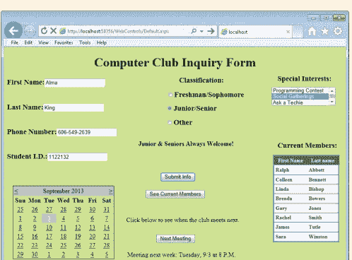

图 1-12 使用 C# 编写的 Web 应用程序

## Windows 应用程序

**Windows 应用程序**专为桌面使用和单一平台而设计。它们在 PC 桌面上运行，很像你最喜欢的文字处理程序。使用 C# 以及 System.Windows.Forms 命名空间中的类编写代码，可以开发出包含菜单、图片、下拉控件以及其他你在现代桌面应用程序中已习以为常的小组件的应用程序。.NET 使用命名空间的概念来对功能相似的类型进行分组。System.Windows.Forms 命名空间作为一个总括，用于组织创建 Windows 应用程序所需的类。使用 Visual Studio 的集成开发环境 (IDE)，可以通过在屏幕上拖放按钮、文本框和标签等控件来开发 GUI。使用 Visual Studio 创建 Web 应用程序时，也采用同样的拖放方法。你将从第 9 章开始创建 Windows GUI 应用程序。图 1-13 展示了你将要在第 10 章使用 C# 语言创建的 Windows 应用程序。

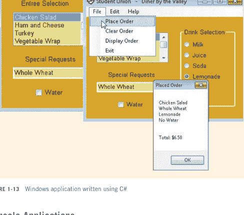

图 1-13 使用 C# 编写的 Windows 应用程序

## 控制台应用程序

控制台应用程序通常向操作系统发送请求，以在命令控制台显示区显示文本，或从键盘获取数据。从初学者的角度来看，控制台应用程序最容易创建，并且代表了学习软件开发的最简单方法，因为你不必担心与构建 GUI 相关的枝节问题。可以以最小的开销输入值，输出则显示在控制台窗口中，如图 1-14 所示。你将首先开发控制台应用程序，以便能够专注于编程和一般问题解决的细节。

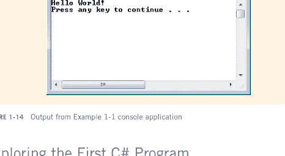

图 1-14 示例 1-1 控制台应用程序的输出

## 探索第一个 C# 程序

自 20 世纪 70 年代 C 语言被开发出来以来，在学习一门新语言时，传统上都会在控制台屏幕上显示“Hello World!”作为你第一个程序的运行结果。示例 1-1 中的程序演示了一个正是这样做的 C# 程序。接下来的各节将逐行解释构成这个第一个程序的元素。

**示例 1-1**

```
Line 1    // This is traditionally the first program written.
Line 2    using System;
Line 3    namespace HelloWorldProgram
Line 4    {
Line 5        class HelloWorld
Line 6        {
Line 7            static void Main()
Line 8            {
Line 9                Console.WriteLine("Hello World!");
Line 10       }
Line 11       }
Line 12       }
```

可读性很重要。就编译器而言，你实际上可以完全不碰 Enter 键而输入整个程序。整个程序可以输入为一行，但那会非常难以阅读，调试起来更具挑战性。示例 1-1 中的风格是值得模仿的好风格。注意花括号 { } 是成对匹配的，并且各自单独出现在单独的行上。语句被分组并缩进。缩进不是必需的，但遵循它是一种好做法，因为它使代码更易于阅读。输入程序时，你应遵循一致且类似的风格。编译并执行该程序所产生的输出见图 1-14。

> 注意
> 使用 Visual Studio 格式化代码要简单得多。你可以从“工具”>“选项”菜单预设文本编辑器首选项。你还可以购买插件，例如 ReSharper，它会在你输入时为你进行智能代码编辑和格式化。

## C# 程序的元素

尽管示例 1-1 中的程序语句构成了使用 C# 可以开发的最小功能程序之一，但它们包含了大多数程序中的所有主要组成部分。理解构成该程序的功能特性将有助于你为开始开发自己的应用程序做好准备。从第 1 行开始，逐行检查每个片段来分析该程序。

### 注释

示例 1-1 的第一行是注释：

```
Line 1 // This is traditionally the first program written.
```

> 注意
> 本书中注释以绿色显示。

写注释就像为你自己或程序的读者做笔记。注释不被视为给计算机的指令，因此对程序的运行没有影响。程序编译时，不会检查注释是否违反规则；相反，编译器会忽略并绕过它们。注释不必遵循任何特定规则，但注释的开始和结束方式除外。

注释有两个作用：它们使代码更易读，并在内部记录程序语句正在做什么。在程序开头，通常会编写注释来标明代码由谁开发、何时开发以及编写这些指令的目的是什么。注释还用于记录不同代码段的目的。你可以将注释放在程序中的任何位置。如果某部分代码可能难以理解，适合放置一条或多条注释来解释细节。在示例 1-1 中，唯一的注释位于第 1 行。

```
Line 1  // This is traditionally the first program written.
```

> **注意**
> C# 程序员通常不使用行号，但此处添加行号是为了解释这些特性。

使用 C#，可以向程序中添加三种注释语法：内联注释、多行注释和 XML 文档注释。

### 内联注释

示例 1-1 第 1 行出现的注释是内联注释，即单行注释。**内联注释**由两个正斜杠 `//` 表示，通常被视为单行注释。斜杠表示同一行中斜杠右侧的所有内容都是注释，应被编译器忽略。结束注释不需要特殊符号。回车（Enter）会结束注释。

### 多行注释

对于较长的注释，可以使用多行注释。正斜杠后跟星号 `/*` 标记**多行注释**的开始，而相反的模式 `*/` 标记结束。注释符号之间出现的所有内容都被视为注释。多行注释也称为**块注释**。尽管它们被称为多行注释，但不必跨越多行。与按下 Enter 键时在当前行末尾终止的单行注释不同，多行注释需要特殊字符 `/*` 和 `*/` 来开始和终止注释，即使注释只出现在一行上。示例 1-2 展示了一个多行注释的示例。

**示例 1-2**

```csharp
/* This is the beginning of a multiline (block) comment. It can go on for
several lines or just be on a single line. No additional symbols are needed
after the beginning two characters. Notice there is no space placed between
the two characters. To end the comment, use the following symbols. */
```

> **注意**
>
> C# 不允许嵌套多行注释。换句话说，你不能将一个块注释放在另一个块注释内部。一旦输入第一个 */，最外层的注释就会与内层注释同时结束。

## XML 文档注释

第三种类型的注释使用三个正斜杠 ///。这是一种用于 XML 风格注释的高级文档技术。XML（可扩展标记语言）是一种标记语言，提供了一种使用类似于 HTML 标签的标记来描述数据的格式。C# 编译器读取 XML 文档注释，并从中生成 XML 文档。

在本书中，你将使用行内 // 注释和多行 /* */ 注释来开发应用程序。

## using 指令

示例 1-1 第 2 行中的以下语句允许使用 System 命名空间中的类，而无需用“System.”对它们进行限定。这减少了没有该指令时所需的键入量。

```
Line 2 using System;
```

使用 .NET 的一个显著好处是，它提供了超过 2000 个类，这些类构成了所谓的框架类库（FCL）。类包含可重用的代码，这使得编程更简单、更快速，因为你不必为常见类型的操作重新发明轮子。框架类可供所有 .NET 支持的语言（包括 C#）使用。

> **注意**
>
> 本书中，关键字（如 class）一旦引入，就会以蓝色显示。关键字是系统保留的字，具有特殊的、预定义的含义。例如，关键字 class 定义或引用一个 C# 类。

面对几千个 .NET Framework 类，程序开发人员不太可能记住所有类的名称，更不用说类成员的额外名称了。你可以想象，在你的应用程序中很容易使用一个已经在某个或多个 Framework 类中使用过的名称。另一种可能的情况是，这些 Framework 类中的一个或多个可能使用相同的名称。你怎么知道引用的是哪个类？.NET 通过使用命名空间消除了这个潜在问题。

### 示例 1.3

假设你有一个名为 `Captain` 的`类`。你可以抽象出 Captain 的特征和行为属性。如果你正在为一个足球队开发应用程序，那种 Captain 的特征和行为与为消防部门设计的应用程序中的 Captain 会有很大不同。此外，这两组特征也与船长（boating Captain）的特征不同。与军事单位（如海军）关联的 Captain 也会不同。对于每种可能的应用程序，你都可以为 `Captain` 类使用相同的名称。如果你给程序下指令显示一个 Captain 的信息，程序将不知道该显示哪组特征。为了澄清你是在谈论船长、足球队队长、消防站队长还是海军上校，你可以通过在名称前面加上其类别来限定这个关键字。为此，你可以写 Boat.Captain、Football.Captain、Fireman.Captain 或 Navy.Captain。每次提到 Captain 时，你都需要在其前面加上类别类型。

通过指定应用程序所围绕的`namespace`（命名空间），你可以消除在 Captain 前面加上点（`.`）和命名空间名称的要求。如果你只是“使用船只命名空间”，你就不必用前缀名称限定每条语句。这就是 `using` 指令所做到的。它使你不必通过标识某个东西所在的`namespace`来限定每个`class`。`using` 指令允许非限定地使用命名空间中的成员类型。通过输入 using-namespace 指令，给定命名空间中的所有类型都被导入，或可用于特定应用程序中。

最重要且最常用的`namespace`是`System`。`System` 命名空间包含定义常用类型或类的类。`Console` 类定义在`System`命名空间中。`Console` 类使程序员能够向控制台窗口或键盘执行写入和读取操作。`Console` 的完全限定名称是 `System.Console`。如果删除第 2 行的 `using System;` 指令，你需要将

```csharp
Line 9    Console.WriteLine("Hello World!");
```

替换为

```csharp
Line 9    System.Console.WriteLine("Hello World!");
```

> **注意**
>
> 除了包含 `using` 指令外，使用 Visual Studio 创建的项目还必须在引用中包含 `System` 命名空间。创建控制台应用程序时，Visual Studio 会自动引用和导入 `System` 命名空间。

命名空间为组内定义的名称提供了作用域（或封闭上下文）。通过包含 using 指令来指示要使用的命名空间名称，你可以避免在类名前加上类别分组。添加 using System; 行后，你可以使用 Console 类名，而无需显式标识它位于 System 命名空间中。

### 命名空间

第 3 行到第 12 行定义了一个名为 HelloWorldProgram 的命名空间。

```
Line 3    namespace HelloWorldProgram
Line 4    {
Line 12   }
```

命名空间只不过是将语义相关的类型归拢到一个统一伞形结构下。示例 1-1 说明了如何创建名为 HelloWorldProgram 的命名空间。HelloWorldProgram 是一个标识符，简单说就是用户提供或用户创建的名称。如前所述，在使用 C# 编程时，你将创建许多名称（标识符）。创建标识符的规则将在第 2 章讨论。你可以定义自己的命名空间，并指明这些名称与你的特定应用程序相关联。

每个命名空间必须用花括号 { } 括起来。第 4 行的左花括号 { 标志着 HelloWorldProgram 命名空间的开始。这个左花括号与第 12 行程序末尾的右花括号 } 匹配。在花括号内，你编写编程结构。

在示例 1-1 的应用程序中，第 3、4 和 12 行本可以省略。这个程序没有定义任何新的编程结构或名称。它只是使用了属于 System 命名空间的 Console 类。添加额外的伞形结构不会引入错误，但没有必要。Visual Studio 会自动为使用 IDE 创建的应用程序添加命名空间伞形结构。

### 类定义

第 5 行到第 11 行构成了此应用程序的类定义。

```
Line 5    class HelloWorld
Line 6    {
Line 11   }
```

由于 C# 是一种面向对象的语言，C# 中的一切都围绕类设计，类是面向对象程序的构建块。C# 不允许在类之外定义任何内容。每个程序必须至少有一个类。类定义对象的类别或类型。.NET Framework 中包含许多类。使用 C# 编写的程序可以使用这些预定义的 .NET 类，也可以创建自己的类。

在示例 1-1 中，用户定义的类名为 HelloWorld。该示例还使用了 Console 类，它是 .NET 预定义类之一。每个类都有名称。传统上，包含类的文件名与类名相同，只是文件名末尾会附加 .cs 扩展名。C# 允许单个文件包含多个类；然而，在面向对象开发中，通常的做法是每个文件放置一个用户定义的类。

> **注意**
>
> 大多数面向对象的语言（包括 Java）限制一个文件只能有一个类。但 C# 允许在单个文件中存储多个类。

类用于定义按钮和标签等控件，以及 Student、Captain 和 Employee 等事物类型。class 一词是一个关键字。与命名空间一样，每个类定义必须用花括号 { } 括起来。第 6 行的 { 是左花括号，标志着类定义的开始。这个左花括号与第 11 行类定义末尾的右花括号 } 匹配。在花括号内，你定义类成员。类成员通常要么是成员方法（执行类的某些行为），要么是数据成员（包含与类状态相关的值）。

### Main() 方法

Main() 方法的定义从第 7 行开始，到第 10 行的右花括号结束。

```
Line 7    static void Main()
Line 8    {
Line 10   }
```

Main() 方法在 C# 中起着非常重要的作用。这是所有应用程序的入口点。程序从这里开始执行。Main() 方法可以放在类定义中的任何位置。在此示例中，它从第 7 行开始。当 C# 程序启动时，执行从 Main() 方法中找到的第一条可执行语句开始，并一直持续到该方法结束。如果应用程序有 3000 行，而 Main() 方法从第 2550 行开始，那么应用程序执行的第一条语句就在第 2550 行。

> **注意**
>
> 所有可执行应用程序都必须包含 Main() 方法。


第7行的全部内容就是该方法的标题。**方法**是由一个或多个语句组合而成、用于执行某项操作的一个集合。方法与C++中的函数类似。方法的标题包含其**签名**，签名包括方法名称及其参数列表。返回类型和修饰符（如**public**和**static**）属于标题的一部分，但不被视为签名的组成部分。**Main( )**方法的标题行以关键字**static**开头，这意味着该方法只会创建一份副本，并且无需拥有该**类**的对象即可访问该方法。有关**static**的更多细节将在后续章节中讨论。现在只需记住，**Main( )**的标题中应包含**static**关键字。

标题中的第二个关键字是**void**。void是返回类型。通常，一个方法会调用另一个方法，并且可以向调用它的方法返回一个值。请记住，方法是执行某个操作的一小段代码。执行该操作后，可能会返回一个值。如果方法不返回值，则包含**void**关键字以表示不返回任何值。当方法确实返回值时，返回值的类型会包含在标题中。第3章将向你介绍C#中的不同数据类型。

**Main( )**是方法的名称。方法之间通过括号内传递参数或作为返回值进行通信。有时不传递任何参数，就像括号内什么都没有的情况一样。

> **注意**
>
> 与C++语言中出现的以小写字母开头的`main( )`方法不同，在C#中，`Main( )`必须以大写字母'M'开头。

在示例1-1中，**Main( )**方法的正文只包含一条可执行语句。正文包括左右花括号内包含的所有内容。程序执行时，**Main( )**方法中出现的语句会按顺序执行。当遇到右花括号时，整个程序结束。

## 方法正文语句

这个**Main( )**方法的正文由第9行的一条单行语句组成。

```
Line 8        {
Line 9            Console.WriteLine("Hello World!");
Line 10       }
```

请记住，示例1-1中程序的目的是在输出屏幕上显示 **"Hello World!"**。示例1-1中的代码行（已在本书前面的页面中解释过）对于你将开发的大多数应用程序来说都是通用的。然而，第9行对于此应用程序来说是独特的。该方法的正文从第8行开始，到第10行结束。

Main()方法中的语句是对另一个名为WriteLine()的方法的调用。方法调用与方法调用（invocation）是同一个意思。与Main()一样，WriteLine()也有一个签名。方法的标题连同完整的正文构成了该方法的定义。当被调用时，WriteLine()将括号内出现的字符串参数写入标准输出设备（即显示器）。显示完字符串后，WriteLine()会换到下一行，就像按下了Enter键一样。

> 识别方法的一个快速方法是查找括号；方法总是带有括号()出现。对任何方法的调用（如WriteLine()）总是在方法名称标识符后跟一对括号，方法的签名也是如此。

放在括号内的文本字符串"Hello World!"是方法的参数。WriteLine()定义在Console类中，可以在不传递参数的情况下调用。要在标准输出设备上显示一个空行，请输入：

```
Console.WriteLine( );   // 括号内没有放置字符串参数
```

Console类包含控制台应用程序的标准输入和输出方法。该类中的方法包括Read()、ReadKey()、ReadLine()、Write()和WriteLine()。Write()方法与WriteLine()方法的区别在于，Write()在完成后不会自动将回车换到下一行。以下几行代码会产生与单行`Console.WriteLine("Hello World!");`相同的结果：

```
Console.Write("Hello");
Console.Write(" ");
Console.WriteLine("World!");
```

随着字符的显示，一个不可见的指针会在输出屏幕上移动。当新字符显示时，它会移动到下一个位置，并准备在该位置打印（如果发送另一条输出语句）。请注意上面代码中的第二条语句`Console.Write(" ");`，这会在两个单词之间放置一个空白字符。显示完空格后，指针就位，准备显示World中的W。上述两段代码的输出均为：

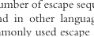

通常，当双引号内的字符作为Write()或WriteLine()的参数使用时，它们会按原样显示。当包含转义字符时会出现例外。反斜杠（'\'）被称为转义字符。转义字符与一个或多个字符组合成特殊的转义序列，例如'\n'表示换到下一行，'\t'表示制表符缩进。C#中可以使用许多转义序列。这与Java和C++等其他语言中的转义字符集合相同。表1-1列出了C#字符串中可以包含的一些较常用的转义字符。

**表1-1 转义序列**

| 转义序列字符 | 描述 |
|---|---|
| `\n` | 光标移到下一行；类似于按Enter键 |
| `\t` | 光标移到下一个水平制表位 |
| `\"` | 输出双引号 |
| `\'` | 输出单引号 |
| `\\` | 输出反斜杠 |
| `\r` | 光标移到当前行的开头 |
| `\a` | 发出提示音（短蜂鸣） |

当双引号内遇到转义序列时，表示将输出一个特殊字符。语句的输出：

```
Console.Write("What goes\nup\nmust come\tdown.");
```

是

```
What goes
up
must come      down.
```

注意在Write()方法中，括号内的参数包含三个转义序列。反斜杠不会被打印。当遇到'\n'时，输出换到新行。单词"come"和"down"之间的空格是由制表符转义序列（'\t'）产生的。

Console类中的另外三个方法Read()、ReadKey()和ReadLine()值得解释一下。它们在外观上与WriteLine()方法的不同之处在于它们没有参数，括号内没有内容。Read()、ReadKey()和ReadLine()方法都可以返回值，并且用于从标准输入设备（如键盘）接受输入。

> **注意**
>
> 注意在示例1-1中，方法正文中的语句以分号结尾。但是，方法标题、类定义标题或命名空间定义标题的末尾没有分号。注意，在示例1-1中，第2行和第9行出现了分号。

ReadKey()在C#程序中常用来保持输出屏幕的显示，直到用户按下键盘上的某个键。Read()方法也可以使用，与ReadKey()方法一样，它接受输入设备中的任何字符，并且一旦按下某个键，控制权就会传递给程序中的下一行。与Read()和ReadKey()方法只接受单个字符不同，ReadLine()允许输入多个字符。它会一直接受字符，直到按下Enter键。你将在第4章中使用ReadLine()方法来输入数据值。

现在你知道了C#程序由哪些元素组成，你几乎已经准备好开始开发自己的程序了。图1-15显示了命名空间、类、方法和语句之间的关系。注意，框架类库（FCL）包含许多不同的命名空间，例如System。命名空间内定义的是

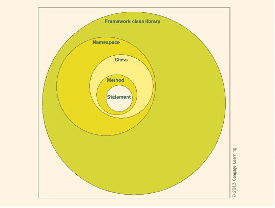

**图1-15** C#元素之间的关系


若干类，例如 Console。类中定义了许多方法，例如 WriteLine() 和 Read()。你并没有看到构成 WriteLine() 方法的语句，你看到的是 WriteLine() 方法被调用。一个方法可以包含一条或多条语句。其中一条语句可以是对另一个方法的调用，例如从 Main() 方法内部调用 WriteLine() 方法的情况。

要使用 C# 开发软件，需要 .NET Framework。该框架包含所有预定义的 .NET 类。有这么多可用的类，可以减少所需的新代码量。你可以使用类库中包含的许多功能。下一节将介绍如何开始键入程序语句。

## 编译、生成和运行应用程序

### 键入程序语句

使用 C# 编写代码有几种选择。开发应用程序的一种方法是使用简单的文本编辑器（如记事本）键入源代码语句，然后使用 DOS 命令行编译并执行应用程序。这种方法的优点是不需要大量系统资源，但要求你必须确切知道要键入什么。

第二种方法是使用 Visual Studio 集成开发环境 (IDE)，本章将向你介绍 Visual Studio。IDE 是一个交互式环境，使你无需离开 IDE 程序即可键入源代码、编译并执行。由于 IDE 自带调试和编辑功能，如果可以使用 Visual Studio，你会发现开发应用程序容易得多。除了丰富的集成开发环境外，Visual Studio 还包含许多工具和向导。附录 A“Visual Studio 配置”介绍了 Visual Studio 的许多其他功能，包括自定义 IDE 的建议。

> **注意**
> 你会希望取消选择“隐藏已知文件类型的扩展名”，这样在创建应用程序时，就能够在“解决方案资源管理器”窗口中看到文件扩展名。文件扩展名包括一个点以及名称后面的两到六个字符。示例包括 .cs、.csproj、.sys、.doc、.suo、.sln 和 .exe。扩展名标识文件中存储的信息类型。例如，以 .cs 结尾的文件是 C# 源文件。能够按类型识别文件会很有帮助。

前面各节介绍了大多数基于控制台的应用程序中至少需要的程序语句。要看到程序的结果，必须将语句（即源代码）键入文件，编译该代码，然后执行应用程序。接下来的几节将考察在使用和不使用 Visual Studio IDE 的情况下，编译和执行过程中会发生什么。

### 编译和执行过程

编译器用于检查语法。语法是用于编写计算机指令的符号或单词。编译器确保程序语句或源代码中没有违反规则的地方。代码成功编译后，编译器通常会生成一个以 .exe 扩展名结尾的文件。这个 .exe 文件中的代码尚未转换为面向任何特定 CPU 平台的机器码。相反，编译器生成的代码是 Microsoft 中间语言 (MSIL)，通常简称为 IL。在必需的第二步中，实时编译器 (JITer) 读取 IL 代码，并转换或生成在特定平台上运行的机器码。代码在第二步中转换完成后，就可以看到结果。

幕后进行的操作并不容易直接看到。例如，编译器创建 IL 后，该代码可以在任何安装了 .NET Framework 的机器上执行。Microsoft 免费提供 .NET Framework 可再发行版本，仅用于部署应用程序。可再发行版本比 SDK 的下载量更小，并且包含 CLR 和类库。同样，这可以在 Microsoft 网站上获取。

.NET Framework 的运行时版本在概念上类似于 Java 虚拟机 (JVM)。与 C# 一样，Java 的编译器首先将源代码转换为称为字节码的中间代码。必须先将字节码转换为本机机器码，然后才能看到应用程序的结果。对于 C#，CLR 实际上只转换程序中正在使用的部分。这可以节省时间。此外，IL 文件的某一部分在计算机上编译后，就再也不需要再次编译，因为程序最终编译好的该部分会被保存下来，并在下次执行程序的该部分时使用。

### 使用 Visual Studio IDE 编译源代码

你可以使用 Visual Studio IDE 提供的内置编辑器键入程序语句。然后，你可以通过 IDE 中某个下拉菜单选项编译源代码，并使用 IDE 中另一个菜单选项执行应用程序。有许多快捷方式可用。下一节将探讨如何使用 Visual Studio IDE 完成这一过程。

首先打开 Visual Studio。通过选择起始页上的“新建项目”按钮，或使用“文件”、“新建”、“项目”选项来创建新项目。

如图 1-16 所示，项目类型列表出现在中间窗口中。IDE 中有许多可用的模板。要开发 C# 控制台应用程序，请选择 Visual C#，并在“模板”中选择“控制台应用程序”。使用“位置”文本框旁边的“浏览”按钮，导航到要存储项目的位置。项目名称为 HelloWorldProgram。如果“为解决方案创建目录”选项旁边的复选框中有勾选标记，可以将其移除。选中该选项会创建另一个目录层。对于你将创建的这类应用程序，这个额外的文件夹并不必要。

> **注意**
> 除非更改此默认设置，否则你为项目指定的任何名称都会成为该项目的命名空间名称。

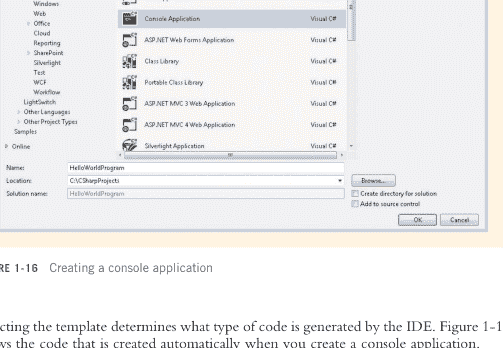

**图 1-16** 创建控制台应用程序

选择模板决定 IDE 生成何种类型的代码。图 1-17 显示了创建控制台应用程序时自动创建的代码。

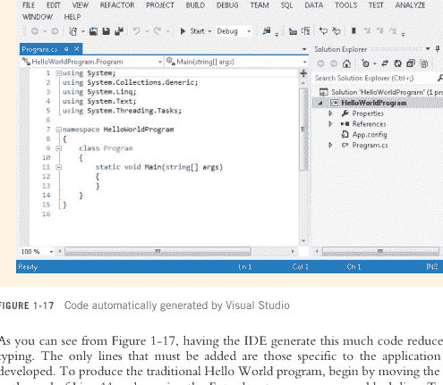

**图 1-17** Visual Studio 自动生成的代码

从图 1-17 可以看出，让 IDE 生成这么多代码可以减少你的键入量。必须添加的只有特定于正在开发的应用程序的那些行。要生成传统的 Hello World 程序，首先将光标移到第 11 行末尾，按 Enter 键打开一个新的空白行。在 Main() 方法的大括号之间键入以下行：

```csharp
Console.WriteLine("Hello World!");
```

> **注意**
> 注意，当你键入字符 C 时，会弹出一个智能窗口列表，其中已选中 Console。这是 IDE 的 IntelliSense 功能中的“单词完成”选项。顾名思义，该功能会尝试在你键入之前感知你要键入的内容。当窗口弹出时，如果其选择正确，只需键入一个句点，就会得到另一个 IntelliSense 弹出窗口。同样，如果其选择正确 (WriteLine)，只需键入下一个分隔符，即左括号。你也可以使用方向键从列表中选择。

接下来，更改类的名称和源代码文件名。Visual Studio 将该类命名为 Program，并默认用同一名称标识源代码文件。

如果你对图 1-18 中显示的问题回答 **是**，则源代码中 **类** 的名称会替换为新名称。

> **注意**
> 
> 并非绝对需要更改源代码文件和 **类** 的名称。应用程序不进行该更改也能运行；但是，为了养成良好的习惯，你应该更改名称。当应用程序涉及多个类时，这可以为你节省时间并减少烦恼。

示例 1-4 中的语句曾出现在示例 1-1 中，这里省略行号重复给出，以便你看到最终的源代码清单。

> **注意**
> 
> Visual Studio 还会生成另外几行不需要的代码，可以删除。例如，已删除多余的 `using` 语句。对于你将开发的大多数应用程序来说，并不需要这些语句。`Main()` 方法括号内的参数也已删除。你将在本书后面读到有关这些行的内容。

### 示例 1.4

```csharp
// This is traditionally the first program written.
using System;
namespace HelloWorldProgram
{
    class HelloWorld
    {
        static void Main()
        {
            Console.WriteLine("Hello World!");
        }
    }
}
```

> **注意**
> 
> 务必记住，C# 区分大小写，这意味着名称 HelloWorld 与 helloWorld 是完全不同的名称，即使只有一个字符不同。因此，键入语句时要非常小心，必须完全按照所示内容键入。


要编译 HelloWorldProgram 项目，请在“生成”菜单中选择“生成 HelloWorldProgram”选项。HelloWorldProgram 这个名称跟在“生成”选项之后，是因为 HelloWorldProgram 是项目名称。包含多个类的项目使用“生成解决方案”选项进行编译。

要运行应用程序，可以单击“调试”菜单栏上的“启动调试”或“开始执行（不调试）”，如图 1-19 所示。如果你尝试执行尚未编译（使用“生成”）的代码，智能 IDE 会先编译该代码。因此，许多开发人员会使用绕过“生成”步骤的快捷方式。

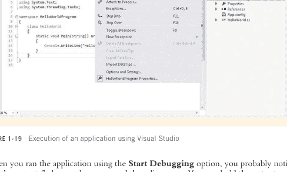

图 1-19 使用 Visual Studio 执行应用程序

当你使用“启动调试”选项运行应用程序时，可能会注意到输出在屏幕上闪现，然后消失。如果在代码中加入对 `Read()` 或 `ReadKey()` 方法的调用，就可以让输出屏幕保持住。当执行这一行时，程序会等待你按键后才终止。要添加这一功能，请回到源代码中，将这一行作为 `Main()` 方法中的最后一条语句：

```
Console.ReadKey();
```

前面已了解到，软件开发周期是迭代的，有时需要返回到先前的阶段。在这里，需要返回到源代码语句并输入附加语句。然后需要重新编译代码。当不再有语法错误时，你就会看到程序的输出。

在 Visual Studio 中保持命令窗口的另一种方法是：选择 **调试、开始执行（不调试）**，而不是 **调试、启动调试** 来执行程序。注意图 1-19 中，**开始执行（不调试）** 选项紧挨在 **启动调试** 选项下方。如果选择 **调试、开始执行（不调试）**，就不需要添加额外的 `Console.Read()` 或 `ReadKey()` 语句。使用 **开始执行（不调试）** 选项执行时，系统会提示“按任意键继续”，如图 1-14 所示。这是执行程序的首选方法。

> 还有其他几个可用于运行程序的快捷方式。查看 **调试** 下的菜单选项时，请注意 Ctrl+F5 被列为 **开始执行（不调试）** 的快捷方式；F5 是 **启动调试** 的快捷方式。此外，如果屏幕上有 **调试** 工具栏图标，一个向右的空心箭头表示 **开始执行（不调试）**。

Visual Studio 是高度复杂的集成开发环境。附录 A“Visual Studio 配置”包含有关自定义开发环境以及使用调试器进行开发的更多信息。现在回顾这些材料是明智的。

## 调试应用程序

程序并不总能立即正常运行，这是不可避免的。可能会出现几种类型的错误，并让你感到沮丧。主要错误类别——语法错误和运行时错误——将在后续章节讨论。

### 语法错误

当你将源代码语句输入编辑器时，很容易因为名称拼写错误或忘记用分号结束语句而出现键入错误。这些类型的错误归类为 **语法错误**，由编译器捕获。编译时，编译器会检查代码段，查看你是否违反了语言的任何规则。如果它无法识别某条语句，就会发出错误消息，这些消息有时难以理解，但应该能帮助你修复问题。Visual Studio 中的错误消息比命令行发出的错误消息更具描述性。但是，请注意，一个键入错误可能产生多条错误消息。图 1-20 展示了一段代码，其中单个错误导致编译器生成三条错误消息。

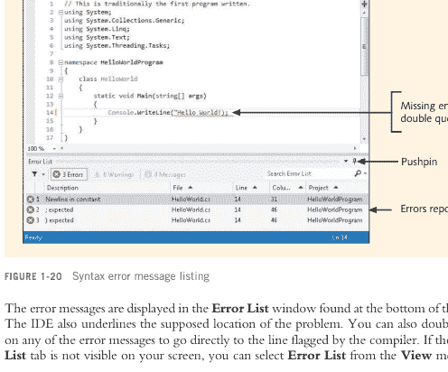

图 1-20 语法错误消息列表

错误消息显示在 IDE 底部的“错误列表”窗口中。IDE 还会在推测的问题位置下方加下划线。你还可以双击任意错误消息，直接转到编译器标记的行。如果屏幕上未显示“错误列表”选项卡，可以从“视图”菜单中选择“错误列表”。

所有工具窗口（例如“错误列表”窗口所示）的右上角都会出现一个图钉图标。当图钉像图钉一样竖立时，窗口停靠在原位；因此，在图 1-20 中，“错误列表”窗口停靠在原位。

> **注意**
>
> 工具窗口支持名为“自动隐藏”的功能。如果单击图钉使其看起来侧躺，窗口会最小化到 IDE 的边缘。边缘会出现一个带有窗口名称的小选项卡。这样可以腾出空间，让你看到更多源代码。

图 1-20 所示的语法错误是一个常见错误。第 14 行 `WriteLine( )` 方法的参数末尾漏掉了双引号。然而，错误消息并没有说明这一点。查看错误消息时，请记住，编译器可能要到达下一行或下一个代码块时才会发出消息。请在标记的总体区域中查找问题。最常见的错误包括：缺少左花括号（{）或多了右花括号（}）、语句末尾未键入分号（;），以及名称拼写错误。作为一个好的练习，可以有意省略花括号、分号并拼错单词。看看每种错误会生成什么样的错误消息。这样，将来开发更复杂的应用程序时，你就能更迅速地找到这些错误。

> **注意**
>
> 因为一个错误可能生成多条消息，所以最好先修复第一个错误，然后重新编译，而不是试图一次性修复所有错误。

### 运行时错误

运行时错误比语法错误更难检测。包含运行时错误的程序可能编译没有任何问题、运行并产生结果。运行时错误也可能导致程序崩溃。程序可能编写为从文件检索数据。如果该文件不可用，程序运行时就会发生运行时错误。另一种运行时错误是除以零。

很多时候，程序编译和执行都没有错误，但运行结果不符合预期。如果结果不正确，相关错误称为逻辑错误。只有仔细检查结果并验证其正确性，才能发现逻辑错误。例如，某个值可能计算不正确，可能使用了错误的公式。未充分理解问题规格是逻辑错误最常见的罪魁祸首。仅仅产生输出是不够的；输出必须是问题的正确解决方案。

第 2 章开始处理数据时，将介绍另一种潜在的运行时错误类型。如果使用数据进行计算，或根据数据的值执行不同步骤，就很容易遇到运行时错误。在软件开发过程中，在开始编码阶段之前进行彻底的分析和设计，可以最大限度地减少运行时错误。常见的桌面检查（desk checking）策略也有助于获得更准确的结果。

## 创建应用程序

既然你已了解大多数 C# 程序需要什么，以及如何编译并查看结果，请使用本章前面介绍的建议程序设计方法完成以下示例。在本节中，你将针对以下问题定义设计解决方案。

## 编程示例：ProgrammingMessage

问题规格如图 1-21 所示。

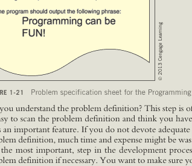

图 1-21 ProgrammingMessage 示例的问题规格表

### 分析问题

你理解问题定义了吗？这一步经常被轻视或敷衍。很容易扫一眼问题定义，就以为自己掌握了问题，却漏掉一个重要特性。如果你没有投入足够的时间和精力分析问题定义，后续步骤可能会浪费大量时间和成本。这是开发过程中即使不是最重要、也至少是重要步骤之一。如有必要，请提问以澄清问题定义。你要确保完全领会预期要求。

阅读图 1-21 中给出的问题定义时，请注意不需要程序输入。此应用程序唯一需要的数据是一个字符串。这大大简化了分析阶段。

### 设计解决方案

如图 1-21 的问题规格表所述，期望输出是在两行中显示“Programming can be FUN!”。对于此示例以及你开发的任何其他应用程序，确定最终输出应该是什么样子都很有帮助。记录期望输出的一种方法是构建输出的原型或模型。原型范围从使用图形、文字处理或绘画程序创建的精细设计，到用纸笔绘制的相当晦涩的草图。无论使用哪种方法，认识到构建原型的重要性都至关重要。开发原型有助于构建算法。原型还提供额外文档，详细说明应用程序的用途。图 1-22 显示了 ProgrammingMessage 示例最终输出的原型。


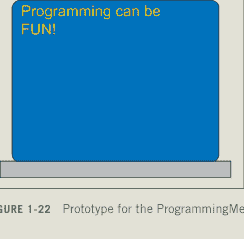

**图 1-22** ProgrammingMessage 示例的原型

在设计过程中，制定算法非常重要。这个问题可以使用流程图来开发算法。该算法应包括一步一步的解决方案；在本例中，解决方案很直接，仅仅涉及输出一串字符。图 1-23 包含一个流程图，定义了 ProgrammingMessage 示例所需的步骤。

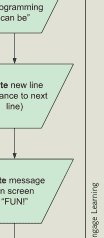

**图 1-23** ProgrammingMessage 示例的算法

另一种选择是使用结构化英语或伪代码来定义算法。这个问题的伪代码会非常简短，只需一行代码即可在输出屏幕上显示消息 Programming can be FUN!。

采用面向对象的方法进行设计时，解决方案通常需要创建类图。对于这个问题，不需要定义任何数据成员。System 命名空间中的 Console 类已经提供了可用于在标准输出设备上显示输出的方法。因此，不需要定义新的方法或行为。所以，如果要构建类图，它只会包含类标题。图的中间或底部部分不会有任何内容。由于该图没有为此简单问题提供额外的文档或设计帮助，因此不绘制该图。

算法制定完成后，应检查设计的正确性。一种方法是模拟计算机，一步一步地执行代码，就像你自己是计算机一样，对算法进行桌面检查。当你逐步执行流程图时，它应该产生原型上出现的输出。在开始编写代码之前，仔细设计并检查算法的正确性非常重要。如果这样做，你将花费更少的时间，也会少很多烦恼。

## 编写解决方案代码

完成设计并验证算法的正确性后，就可以将设计转换为源代码了。你可以使用简单的编辑器（如记事本）在计算机上输入源代码语句，也可以使用 Visual Studio 创建文件。在此步骤中，你必须注意语言的语法规则。

如果使用 Visual Studio 创建应用程序，IDE 会自动为你生成大量代码。其中一些代码可以被删除或忽略。例如，你注意到前面的示例中删除了四个 using 语句（using System.Collections.Generic; using System.Linq; using System.Text; 和 using System.Threading.Tasks;）吗？你可以再次删除或忽略这些子句。对于你将开发的大多数应用程序，using System; 是唯一需要保留在程序语句中的 using 子句。

Visual Studio 还会修改 Main() 方法的方法头，它与本章前面看到的不同。Main() 的签名可以是空参数列表，也可以在括号中包含 string[] args。对于你正在开发的应用程序类型，不需要发送额外参数，因此你此时可以忽略或完全删除 Main() 括号内的参数。

你可能希望更改源代码文件的名称，并让 Visual Studio 更改对该名称的所有引用。当你输入 ProgrammingMessage 作为项目名称时，IDE 会自动将命名空间命名为 ProgrammingMessage。该类也可以命名为 ProgrammingMessage，这不会导致命名空间与类名相同之类的名称冲突问题。图 1-24 说明了你可能希望对 Visual Studio 生成的代码进行的更改。

```csharp
using System;
using System.Collections.Generic;
using System.Linq;
using System.Text;
using System.Threading.Tasks;

namespace ProgrammingMessage
{
class Program
{
static void Main(string[] args)
{
}
}
}
```

- 可以删除这些 using 语句
- 更改名称
- 可以替换为 static void Main()

**图 1-24** 推荐的删除项

你只需在 Main() 方法体中输入以下几行。

```csharp
Console.WriteLine("Programming can be");
Console.WriteLine("FUN!");
Console.ReadKey();
```

最终程序代码如下所示：

```csharp
/* Programmer: [supply your name]
Date: [supply the current date]
Purpose: This class can be used to send messages
to the output screen.
*/
using System;
namespace ProgrammingMessage
{
class ProgrammingMessage
{
static void Main()
{
Console.WriteLine("Programming can be");
Console.WriteLine("FUN!");
Console.ReadKey();
}
}
}
```

在程序开头，请标明代码的作者，并至少指定项目的用途。注意，Main() 方法中的语句是按顺序执行的。ReadKey() 方法在两个 WriteLine() 方法之后执行。ReadKey() 在程序中用于保持输出屏幕显示，直到用户按下某个键。按下键盘上的某个字符后，控制权将传递到标志着应用程序结束的下一行。

## 实现代码

在实现过程中，源代码会被编译以检查是否违反规则。若要从 Visual Studio IDE 中进行编译，请使用**生成**菜单选项。如果有错误，必须先更正才能继续。在 Visual Studio IDE 中，选择**调试**菜单栏上的**开始执行(不调试)**以查看结果。

## 测试与调试

仅仅因为没有编译器语法错误并且获得了输出，并不意味着结果是正确的。在最后一步中，测试程序并确保获得正确的结果。输出应与你的原型匹配。你的间距正确吗？

按照本章概述的步骤，你正式成为了一名 C# 程序员。你创建的程序很简单。然而，你在本章中学到的概念对你的进步至关重要。在第 2 章中，你将开始处理数据。

## 编码标准

在设计类时遵循编码标准非常重要。这样做将带来更好的解决方案，并减少修改程序语句所需的时间。在最初使用流程图和伪代码设计算法时，也应遵循标准。以下是针对伪代码的一些建议编码标准或指南。

### 伪代码

- 对于算术运算，使用 compute 或 calculate 等动词来暗示需要某种算术。
- 使用 set、reset 或 increment 等词来暗示应执行的操作类型。
- 使用 print 或 display 来指示应在屏幕上显示的内容。
- 将项目分组并添加缩进，以表明它们属于同一组。
- 对于应多次执行的语句，使用 while 或 do while 等关键字来暗示循环。
- 使用 if 或 if/else 来测试内存位置的内容。

制定并始终遵循的标准将提高你的编码效率，并使你的代码更易于维护。

## 资源

互联网上有大量专门介绍 C# 的网站。你可以从以下一个或多个站点开始探索：

- 当前 C# 语言规范 – http://www.microsoft.com/en-us/download/details.aspx?id=7029
- Visual C# Express 下载 – http://www.microsoft.com/visualstudio/en-us/products/2010-editions/visual-csharp-express
- 计算历史项目 – http://www.thocp.net/
- 英特尔处理器信息 – http://www.intel.com
- 帕斯卡计算器 – http://www.thocp.net/hardware/pascaline.htm
- Microsoft .NET 网站 – http://www.microsoft.com/net
- MSDN Visual C# 主页 – http://msdn2.microsoft.com/en-us/vcsharp/default.aspx
- 美国计算机和互联网使用情况普查数据 – http://www.census.gov/cps/
- 维基百科免费百科全书 – http://wikipedia.org
- Mono 跨平台开源 .NET 框架 – http://www.mono-project.com
- Microsoft 开发者网络 – http://msdn.microsoft.com/en-us/

## 快速复习

- 1. 计算机的力量在于软件，软件是赋予硬件功能的一组指令或程序。
- 2. 许多人认为当今的计算机技术属于现代计算的第五代。每个时代都以一项重要进步为特征。
- 3. 如今，对智能设备移动应用程序的需求正在增加。
- 4. 软件可分为两类：系统软件和应用软件。应用软件被定义为为执行特定任务而开发的程序。


- 5. 最常与系统软件联系在一起的软件类型是操作系统。打开计算机时，操作系统软件会被载入。其他类型的系统软件包括编译器、解释器和汇编器。
- 6. 编程是一个解决问题的过程。最难的部分是提出解决问题的计划。
- 7. 本章介绍的软件开发五个问题解决步骤包括分析、设计、编码、实现，以及测试和调试解决方案。
- 8. 过程化编程面向过程，关注数据从输入到产生有意义的输出所经历的过程。
- 9. 自顶向下设计或逐步求精的基本理念是：给定任何问题定义，都可以通过分而治之的方法对逻辑进行细化。
- 10. 软件维护是指升级或更改应用程序。
- 11. 使用面向对象分析方法时，重点在于确定要操作的对象，而不是操作它们所需的逻辑。
- 12. 封装是指将属性和操作，或特征和行为组合在一起形成一个类。
- 13. 对象是类的实例。
- 14. 通过继承，可以定义数据对象的子类，这些子类共享其父类或超类的主类特征的部分或全部。继承使代码重用成为可能。
- 15. C# 是从零开始设计的，旨在与新的编程范式 .NET 配合使用，并且是用于开发 .NET 许多部分的语言。
- 16. .NET 是程序运行所在的软件环境。它不是操作系统。它是操作系统与其他应用程序之间的一层，为开发和运行代码提供更简便的框架。
- 17. 通过使用 Visual Studio（一个 IDE）和 .NET Framework 类，C# 提供了一种创建图形用户界面的简便方法。
- 18. 最初，使用 C# 进行开发仅适用于 Windows 平台；然而，许多项目正在开发中，将 C# 移植到 Linux 等其他平台。
- 19. C# 可用于创建 Web、Windows 和控制台应用程序。
- 20. 网页使用 Web 窗体创建，Web 窗体是 ASP.NET 技术的一部分。
- 21. Windows 应用程序被视为局限于桌面，并且是为单一平台设计的。
- 22. 控制台应用程序最容易创建。可以以最小的开销输入和生成值。
- 23. C# 程序通常以注释或 using 指令开头，接着是可选的命名空间分组，然后是必需的类定义。
- 24. 所有 C# 程序都必须定义一个类。
- 25. 注释是写给自己或程序读者的说明。编译器忽略注释。
- 26. 单行内联注释（`//`）不必结束；按下 Enter 键时它们就会结束。跨多行的注释应包含在 `/* */` 之间。这些被视为块注释或多行注释。
- 27. 超过 2000 个类组成了 Framework 类库。类包含数据成员以及可重用的方法或行为。
- 28. using 命名空间指令导入给定命名空间中包含的所有类型。通过指定你正在围绕其构建应用程序的命名空间，就可以不必在类前面加上点（`.`）和命名空间名称。
- 29. C# 中的一切都围绕类设计。每个程序必须至少有一个类。
- 30. 方法是一个或多个语句组合在一起执行某个操作的集合。换言之，方法就是执行某个操作的小代码块。
- 31. Main() 方法是每个 C# 控制台应用程序的入口点。它是执行开始的点。
- 32. 关键字 static 表示只创建该方法的一个副本。
- 33. 包含关键字 void 表示不返回值。方法的完整签名以返回类型开头，接着是方法名，最后是括号中的参数列表。Main() 的一种签名是 `void static Main()`。
- 34. WriteLine() 将字符串消息写入监视器或标准输出设备。
- 35. 方法通过放在括号内的参数相互通信。
- 36. 可读性很重要。缩进不是必需的，但它是良好实践，因为它使代码更易于阅读。
- 37. 要查看程序的结果，必须将语句（源代码）键入文件，编译该代码，然后执行应用程序。
- 38. Visual Studio 集成开发环境（IDE）是一种交互式开发环境，使你无需离开 IDE 程序即可键入源代码、编译并执行。
- 39. 记录所需输出的一种方法是构建输出的原型或模型。
- 40. Read() 方法接受来自标准输入设备（如键盘）的任意字符。它对该字符不做任何处理。

## 练习

- 1. 你运行一个程序，它输出的两个值的差，而不是按预期输出两个值的和。这属于哪种类型的错误？
  - a. 语法
  - b. 分析
  - c. 编码
  - d. 设计
  - e. 逻辑
- 2. 将高级编程语言转换为机器可读形式的程序是（一个）：
  - a. 应用程序
  - b. 操作系统
  - c. C# 程序
  - d. 编译器
  - e. 机器语言实用程序
- 3. 以下策略可减少开发时间并产生更高效的解决方案：
  - a. 尽快编写解决方案的代码。
  - b. 在编码之前设计解决方案。
  - c. 在测试和调试之前分析解决方案。
  - d. 在测试期间构建原型。
  - e. 使用简单的低级语言进行开发。
- 4. 在软件开发过程的哪个阶段，会使用探究性问题来验证问题定义？
  - a. 分析
  - b. 设计
  - c. 编码
  - d. 实现
  - e. 测试
- 5. 当发现潜在问题时回到先前阶段，是以下哪一项的示例：
  - a. 面向对象编程
  - b. 逐步求精
  - c. 中间语言
  - d. 迭代开发
  - e. 结构化编程
- 6. 设计解决方案之后，在键入任何代码之前，你应该 ________。
  - a. 分析问题定义
  - b. 检查运行时错误
  - c. 对解决方案进行维护
  - d. 对解决方案进行桌面检查
  - e. 确定要使用哪个 .NET 类
- 7. 在面向对象方法中，数据成员被称为：
  - a. 属性或特征
  - b. 特征或行为
  - c. 方法或属性
  - d. 行为或方法
  - e. 属性或行为
- 8. .NET 被认为是一个强大的开发环境，因为：
  - a. 它包含超过 2000 个类。
  - b. 可以使用不同的编程语言开发解决方案。
  - c. 可以轻松开发 Windows 应用程序。
  - d. 可以进行基于组件的开发。
  - e. 以上所有。
- 9. ASP.NET 创建哪种类型的应用程序？
  - a. Windows
  - b. 控制台
  - c. 命令
  - d. Web
  - e. 服务
- 10. 哪个（些）起始符号表示以下各行将是注释？
  - a. /*
  - b. **
  - c. //
  - d. ///
  - e. */
- 11. System 是以下哪一项的示例：
  - a. 对象
  - b. 类
  - c. 方法
  - d. 命名空间
  - e. 指令
- 12. 一个 __________ 将语义相关的类型分组到一个名称下。
  - a. 对象
  - b. 类
  - c. 方法
  - d. 命名空间
  - e. 指令
- 13. 为了标记代码块的开头和结尾，C# 程序员使用：
  - a. [ ]
  - b. { }
  - c. ( )
  - d. begin end
  - e. start stop
- 14. 以下哪一项是关键字？
  - a. Main( )
  - b. System
  - c. using
  - d. WriteLine
  - e. 以上所有
- 15. 允许用户输入单个字符的方法的完全限定调用是：
  - a. Console.System.Read( )
  - b. System.Console.Read( )
  - c. Console.System.Write( )
  - d. System.Console.Write( )
  - e. System.Console.ReadLine( )


- 16. 一个 ________ 是所需输出的模型。
  - a. 原型
  - b. 算法
  - c. 图
  - d. 规格说明
  - e. 以上都不是

- 17. Visual Studio 中，当在对象名后键入点号时，会在可滚动列表中显示所有可用方法和属性的功能叫什么名字？
  - a. 帮助
  - b. Rotor
  - c. Mono
  - d. IntelliSense
  - e. ToolTip

- 18. 要查看应用程序的结果，你需要 ________ 代码。
  - a. 编译
  - b. JIT
  - c. 执行
  - d. 编辑
  - e. 桌面检查

- 19. 哪个转义序列可用于指示光标应前进到下一行？
  - a. 换行
  - b. 转义下一个
  - c. `\n`
  - d. `\newline`
  - e. `\r`

- 20. 下列哪一项是方法调用？
  - a. Console.Write;
  - b. Console.Write["ok"];
  - c. Write.Console("ok");
  - d. Console.Write("ok");
  - e. 以上都不是

- 21. 指出将示例 1-1 输入编辑器时可能发生的一个语法错误。指出可能发生的一个逻辑错误。

- 22. 运行以下应用程序时会产生什么输出？

```text
Line 1 // Example program - displaying output.
Line 2 using System;
Line 3 namespace Exercise1
Line 4 {
Line 5 class Problem2
Line 6 {
Line 7 static void Main()
Line 8 {
Line 9 Console.Write("Go ");
Line 10 Console.Write("Laugh ");
Line 11 Console.WriteLine("Out Loud");
Line 12 Console.Write("Think ");
Line 13 Console.Write("Happy");
Line 14 }
Line 15 }
Line 16 }
```

- 23. 必须更改练习 #22 中代码段的什么内容，才能使所有输出显示在一行上？

- 24. 在互联网上搜索并找出一个除 Microsoft 之外可下载 C# 编译器的站点的 URL。

- 25. 使用练习 #22 中的程序段，指出以下各项分别可以在哪一行（哪些行）找到：
  - a. 方法调用
  - b. 命名空间
  - c. 类名
  - d. 方法的实参
  - e. 注释
  - f. 标识符

- 26. 指出以下内容中的语法错误（如果有）：

```text
Line 1 using System
Line 2 namespace Exercise1
Line 3 {
Line 4 Problem2
Line 5 {
Line 6 static Main()
Line 7 {
Line 8 console.write("ok")
Line 9 }
Line 10 }
Line 11 }
```

- 27. 解释 System、Console 和 Read 之间的关系。

## 编程练习

- 1. 编写一个产生以下输出的程序。将名字 Tyler Howard 替换为你的名字。

```text
Hello World! My name is Tyler Howard!
```

- 2. 先开发一个原型，然后编写一个显示本文所讨论编程语言名称的程序。你应该更有创意，但这里给出一种可能的设计。

```text
cccccccccc          ##  ##
cc                   #############
cc                   ##    ##
cc                   #############
cc                   ##  ##
cccccccccc
```

- 3. 打印你的姓名、学校和计划毕业年份。将姓名放在一行，将毕业年份放在第二行。确保包含适当的标签。例如，如果我计划在 2017 年毕业，我的信息将如下所示：

```text
Name: Barbara Doyle
Graduation Year: 2017
School: Jacksonville University
```

- 4. 开发一个应用程序，生成包含项目信息的横幅。可以包含的项目有编程作业编号、姓名、提交日期和应用程序目的。为每一项加标签。这些是你在未来编程作业中可能希望作为内部文档包含的项目。你的横幅输出可能类似于以下内容：

```text
********************************************
**        Programming Assignment #4        **
**        Developer: Alma King             **
**        Date Submitted: September 17     **
**        Purpose: Provide internal documentation. **
********************************************
```

除了打印前面代码段中所示的输出屏幕横幅外，还要确保在程序中包含适当的注释作为内部文档。

- 5. 旗帜是团结的象征，并对其追随者具有特殊意义。设计一面旗帜，并编写一个显示你的设计的程序。一种可能的设计如下。

```text
******** ____________________________
******** ____________________________
******** ____________________________
******** ____________________________
******** ____________________________
```

- 6. 创建一个使用同一短语产生三种不同输出的应用程序。为这个短语选择你自己最喜欢的流行语。该短语应首先显示在一行上。至少使用三个 Write() 方法——但输出应全部出现在同一行上。然后仅使用 Write() 方法将短语打印在三行上。对于第三种也是最终的输出，将你最喜欢的格言每行打印一个单词。判断 Write() 和/或 WriteLine() 的哪种组合是最精简的方法。下面是一个使用作者最喜欢的格言时最终输出可能是什么样子的示例：

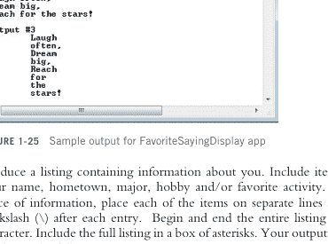

图 1-25 FavoriteSayingDisplay 应用程序的示例输出

- 7. 生成一个包含你的信息的列表。包含诸如你的姓名、家乡、专业、爱好和/或最喜欢的活动等项目。为每条信息加标签，将每个项目分别放在单独的行上，并在每个条目后放置一个反斜杠（\）。整个列表以 | 字符开始和结束。将完整列表放在一个星号框中。你的输出可能类似于以下内容：

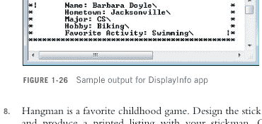

图 1-26 DisplayInfo 应用程序的示例输出

- 8. Hangman（猜词游戏）是童年最喜爱的游戏。为这个游戏设计火柴人，并生成包含你的火柴人的打印列表。一种可能的设计如下。你可以实现这个设计，或开发一个改进版本。

```text
(^ ^)
.\ / | .\
   \_/
```

- 9. 创建一个显示以下图案的应用程序。你可以使用自己选择的任何字符来构造图案。一种可能的解决方案如下。

```text
**********
**********
**********
**********
**********
**********
**********
**********
**********
**********

    *
   ***
  *****
 *******
*********
*********
 *******
  *****
   ***
    *

       *
      ***
     *****
    *******
   *********
  ***********
 *************
**************
***************
**************
 *************
  ***********
   *********
    *******
     *****
      ***
       *
```

- 10. 将你的姓名首字母以块状字符写入标准输出设备。使用你选择的符号设计你的原型。例如，我的姓名首字母的块状字符如下所示。

```text
Block character initials example shown in the figure, with three sets of large AA, DD style block letters constructed from repeated symbols.
```


## 第 2 章
## 数据类型与表达式

### 本章你将：
- 考察计算机如何表示数据
- 为数据声明内存位置
- 探索类、对象和类型之间的关系
- 使用预定义数据类型
- 使用整数数据类型
- 使用浮点类型
- 了解 `decimal` 数据类型
- 声明布尔变量
- 声明和操作字符串
- 使用常量
- 编写使用算术运算符的赋值语句
- 了解运算顺序
- 学习货币的特殊格式规则
- 完成一个说明本章概念的编程示例

第 1 章向你介绍了 C# 程序的基本元素。你了解了开发、编译和执行应用程序的要求。本章重点讨论数据。**数据**是原始事实，即经过处理以产生有用信息的基本数字和字符。在本章中，当你编写应用程序来执行计算时，你将开始体会到编程的强大能力。你将学习如何声明在内存中保存不同类型数据的变量，并了解算术运算符在给定不同种类数据时如何反应。

### 数据表示

你可能会听到某人说他的计算机有 64 位处理器、4 GB 的 RAM 和 1 TB 的硬盘空间。另一个人告诉你她的闪存盘容量为 2 GB。这到底意味着什么？

### 位

首先，单词 **位**（bit）是“Binary digIT”（二进制数字）的缩写。Binary 表示二；因此，一个二进制数字可以保存两个值之一：0 或 1。对于数据表示，1 和 0 分别对应开和关。思考位时，把电路（开关）想象为打开或关闭可能会有所帮助。数字 1 表示电路处于打开状态。

### 字节

计算机存储器通常被划分为 8 位的分组。这种 8 位组合称为**字节**。用最简单的术语来说，每个开关称为一位，需要八个开关的组合来表示一个字符，例如字母 A。既然 8 位表示 1 字节，而 1 字节表示一次击键，那么表示“programming”这个词就需要 11 个字节。你可能会想，为什么组成一个字节需要 8 位。8 位字节是人们在过去 50 年中通过反复试验确定下来的格式。8 位的用法始于 20 世纪 60 年代的 IBM System/360。20 世纪 80 年代，随着同样基于 8 位的家用电脑的普及，它开始流行。如今，我们不会想到将字节与可变数量的位联系起来；人们普遍认为一个字节由 8 位组成。

### 二进制计数系统

计算机通过将存储单元中的开关设置为表示字符的模式来存储数据。为了表示数据，计算机使用基数为 2 的计数系统，也称为**二进制计数系统**。我们基数为 10 的计数系统称为**十进制系统**，使用从 0 到 9 的 10 个符号来表示数值。基数 2 只有两个符号，即值 0 和 1。因此，二进制值可能看起来像 01101001，因为它仅由 0 和 1 组成。如何确定二进制数 01101001 的等值十进制值？如果你理解十进制（基数为 10）

位值计数系统，很容易将这些概念转换到任何其他进制计数系统。图2-1说明了1326在十进制中是如何推导出来的。

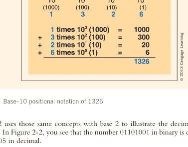

图2-1 1326的十进制位值表示法

图2-2使用相同的概念以二进制来说明01101001的十进制等价值。在图2-2中，可以看到二进制数01101001等价于十进制数105。

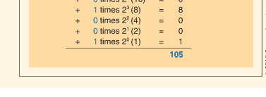

图2-2 01101001的十进制等价值

从图2-2可以看出，在二进制计数系统中，每一位都表示2的递增幂次的值。表2-1显示了当各位包含不同值时对应的十进制值。如表所示，当所有位都以1表示打开时，等价的十进制值为255。

**表2-1 所选十进制值的二进制等价值**

| 十进制值 | 二进制等价值 |
|---|---|
| 0 | 00000000 |
| 1 | 00000001 |
| 2 | 00000010 |
| 3 | 00000011 |
| 4 | 00000100 |
| 5 | 00000101 |
| 6 | 00000110 |
| 7 | 00000111 |
| 8 | 00001000 |
| ... | ... |
| 254 | 11111110 |
| 255 | 11111111 |

由于一串二进制数很难阅读，因此开发了两种简写版本，以便更容易查看内存位置的内容。基数为16的**十六进制计数系统**基于16的幂次工作。基数为8的**八进制计数系统**使用8的幂次。两者都用于更紧凑地表示二进制数。与任何其他位值计数系统一样，最小的符号是0，符号总数等于基数，并且使用我们的位值表示法。十六进制有16个符号（0-9、A-F）。十进制值15在十六进制中用F表示。十六进制的2C在十进制计数系统中是44，如下例所示：

|  |  |  |  |  |
|---|---|---|---|---|
| 2 | → | 2乘以16¹ | → | 2乘以16 = 32 |
| + C | → | 12乘以16⁰ | → | 12乘以1 = 12 |
|  |  |  |  | 44 |

使用十进制位值计数系统时，每个数字的值取决于它在数字中的位置。八进制计数系统使用八个数字。

> **注意** — 你能确定十进制值9的八进制表示吗？答案是11。1乘以8¹ + 1乘以8⁰ = (8 + 1) = 9

## 字符集

仅用8位，就可以表示2⁸即256个不同的十进制值，范围为0到255。这就是256个不同的字符或0和1的不同组合。二进制计数系统用于表示计算机语言。二进制数01000001等价于十进制值65，它表示大写字符A。幸运的是，你不必重新训练自己来说这种语言。C#（读作C sharp）程序员使用的字符集称为Unicode。Unicode是通用字符编码方案。它涵盖了世界上所有书写系统的所有字符，无论古代还是现代。因为计算机只处理数字，所以它们通过为字母和字符分配数字来存储它们。Unicode为每个字符提供一个唯一数字。在Unicode发明之前，有数百种不同的编码方案在使用。没有一种编码能够包含足够的字符。当开发者创建Unicode字符集时，他们没有使用8位，而是使用了16位。现在，可以表示2¹⁶即65,536个唯一字符。除了英语之外，Unicode还包括用于书写许多不同语言的字符表示。

Unicode的一个子集，即前128个字符，对应于**美国信息交换标准代码（ASCII）**字符集。ASCII由英文字母表以及数字和符号组成。对于ASCII字符集和Unicode，前32个值（0到31）是用于回车和换行等事项的代码。空格字符是第33个值，其后是标点符号、数字、大写字符和小写字符。附录C包含一个表格，显示Unicode字符集中ASCII部分的十进制表示。C#和Java语言都使用Unicode字符集。


## 千字节、兆字节、吉字节、太字节、拍字节……

现在回到我们的64位处理器，它有2 GB内存和1 TB硬盘空间。当你开始谈论大量字节时，就会用到诸如千、兆和吉之类的前缀，例如千字节、兆字节和吉字节（也缩写为K、M和G，如Kbytes、Mbytes和Gbytes，或KB、MB和GB）。表2-2显示了乘数。

**表2-2 数据表示的常见缩写**

| 存储容量 | 大小（字节） | 缩写 |
|---|---:|---|
| 千字节 | 2^10 (1,024) | KB |
| 兆字节 | 2^20 (1,048,576) | MB |
| 吉字节 | 2^30 (1,073,741,824) | GB |
| 太字节 | 2^40 (1,099,511,627,776) | TB |
| 拍字节 | 2^50 (1,125,899,906,842,624) | PB |
| 艾字节 | 2^60 (1,152,921,504,606,846,976) | EB |
| 泽字节 | 2^70 (1,180,591,620,717,411,303,424) | ZB |
| 尧字节 | 2^80 (1,208,925,819,614,629,174,706,176) | YB |

请注意，**千**大约是1000，**兆**大约是100万，**吉**大约是10亿，依此类推。因此，当你想到一台具有64位处理器、4 GB内存和1 TB硬盘空间的机器时，你就知道该机器一次可以处理64位，在内存中存储大约40亿个字符，并且硬盘上具有大约1万亿个字符的存储容量。

## 数据的内存位置

程序操作数据，而数据可以采取数字、单个字符或字符组合的形式。以下都是数据的示例：

18、“Brenda”、‘A’、3.25、−7、36724和47.23

这些数据项本身没有值。数字18可能是年龄、温度、班级学生人数、你本学期注册的小时数，或者可能代表完全不同的东西。如果不识别并标记18，它就是一个无意义的数字。处理数据时，首要任务是使用标识符为数据项命名。

## 标识符

**标识符**是程序中出现的元素（例如数据项）的名称。有些标识符是预定义的；另一些是用户定义的。你在上一章编写第一个程序时已经见过一些.NET标识符。这些不是保留关键字，而只是.NET平台和C#语言开发者选择并使用的名称。示例1-1中的程序包含以下预定义标识符：System、Main、Console和WriteLine。

HelloWorldProgram的`namespace`标识符和HelloWorld的`class`标识符是教科书作者在创建第一个项目时选择的用户定义标识符。

以下是在C#中创建标识符的规则：

- 1. 可以使用字母字符（a-z和A-Z）、数字（0-9）以及下划线（_）的组合。标识符可以很长；但是，许多系统认为前31个字符是唯一的。
- 2. 名称的第一个字符不能是数字。
- 3. 字符之间不能有嵌入空格。这意味着不能用空格分隔名称中的单词。通常，通过将第一个单词之后的每个单词的首字母大写，将第二个及后续单词连接（追加）到标识符上。

> **注意**
> C++等语言使用下划线字符作为单词之间的分隔符。尽管下划线是C#中可用的有效字符，但它主要用于定义常量标识符。你将在本章学习常量字面量。

- 4. 表2-3和表2-4显示了C#中的**关键字**。关键字是预定义的保留标识符，对编译器具有特殊含义。它们不能在程序中用作标识符。请注意，表2-4中的关键字被标识为“上下文关键字”。上下文关键字不如常规关键字强大。上下文关键字仅在特定情况下使用时才具有特殊含义。其他时候它们可以用作标识符。


### 表 2-3 C# 关键字/保留字

| 关键字 |  |  |  |  |  |
|---|---|---|---|---|---|
| abstract | as | base | bool | break | byte |
| case | catch | char | checked | class | const |
| continue | decimal | default | delegate | do | double |
| else | enum | event | explicit | extern | false |
| finally | fixed | float | for | foreach | goto |
| if | implicit | in | int | interface | internal |
| is | lock | long | namespace | new | null |
| object | operator | out | override | params | private |
| protected | public | readonly | ref | return | sbyte |
| sealed | short | sizeof | stackalloc | static | string |
| struct | switch | this | throw | true | try |
| typeof | uint | ulong | unchecked | unsafe | ushort |
| using | virtual | volatile | void | while |  |

**注意**

上下文关键字仅在特定上下文中使用时才具有特殊含义。添加它们是为了避免破坏可能使用早期标准编写的代码，在这些早期标准中，这些词之一可能被用作用户定义的标识符。例如，`yield` 仅在紧接 `return` 或 `break` 语句之前使用时才具有特殊含义。在其他情况下，它可以用作标识符。

### 表 2-4 C# 上下文关键字

| 上下文关键字 |  |  |  |  |  |
|---|---|---|---|---|---|
| add | alias | ascending | async | await | descending |
| dynamic | equals | from | get | global | group |
| into | join | let | orderby | partial | remove |
| select | set | value | var | where | yield |

- 5. 允许使用“@”符号作为标识符的第一个字符，但它具有特殊含义，应避免使用，除非你正在编写与其他编程语言交互的代码。使用时，“@”符号可使关键字用作标识符。
- 6. 明智地利用字符的大小写是聪明的做法。C# 区分大小写。标识符 Rate 不同于标识符 rate，也不同于 RATE 或 rATE。在 .NET 中，有三种标识符大小写约定：Pascal 大小写、camel 大小写和大写。使用 Pascal 大小写时，标识符中的第一个字母和后续每个拼接单词的第一个字母大写。在 C# 中，类、方法、命名空间和属性遵循 Pascal 大小写命名约定。变量和对象遵循 camel 大小写约定。使用 camel 大小写时，标识符的第一个字母小写，后续每个拼接单词的第一个字母大写。C# 中的约定是对变量和对象标识符使用 camel 大小写。大写用于常量字面值和由两个或更少字母组成的标识符。
- 7. 具有描述性是有帮助的。使用能表示所描述对象的含义的名称。如果标识符用于引用一个人的年龄，请将其命名为 age，而不是 x。你的标识符越具有描述性，你和其他人就越容易阅读你的代码。

表 2-5 列出了有效标识符的示例。

### 表 2-5 有效标识符

| 有效标识符 |  |  |
|---|---|---|
| studentName | age | numberOfCourses |
| soc_sec_number | departureTime | course1 |
| AmountOwed | count_of_Values | taxAmount |
| n | streetAddress | zipCode |
| roomSize | courseName | x3 |
| moreData | bookTitle | homeRuns |
| pointsScored | CLUB_NAME | exam4 |

编译器不会捕获前面列表中第 7 条规则的违规行为。然而，这条规则极其重要，你应该遵守它。通过使用描述其内容的含义明确的名称，你开发的程序更具可读性，也更易于调试和修改。表 2-6 列出了非法标识符以及说明其无效原因的注释。

### 表 2-6 无效标识符

| 无效标识符 | 违规说明 |
|---|---|
| soc sec number | 嵌入空格 |
| int | 保留关键字 |
| 3n | 以数字开头 |
| room # | 除下划线和嵌入空格外的特殊符号 |
| first-name | 除下划线外的特殊符号 |
| A number | 嵌入空格 |
| class | 保留关键字 |

C# 中标识符的规则与 Unicode 3.0 标准推荐的规则完全一致。唯一的例外是，Unicode 不认为允许下划线作为首字符。这个特性可能被包含在 C# 语言中，因为其他编程语言（如 C++）允许这样做。

## 变量

为了处理或操作数据，计算机程序必须将字符和数字存储在随机存取存储器（RAM）中。变量是促进这种存储的编程元素。**变量**表示计算机内存中的一块区域，其中可以存储特定数据类型的值。当你**声明变量**时，你就在为该数据项在程序中分配内存。

声明变量要求你选择一个标识符，并确定内存单元中将出现什么类型的数据。声明变量的语法如下：

```
type identifier;
```

在声明或创建变量的同时，可以将其初始化为一个值。这被称为**编译时初始化**。注意“初始化”这个词。变量以初始化的值开始，但可以更改。分配给变量的值应与数据类型兼容。当变量将用于算术运算时，最好将其初始化为 0。声明变量时初始化变量的语法如下：

```
type identifier = expression;
```

表达式可以只是一个值（例如 0），也可以包含算术等式中的其他标识符。

对于这两种声明类型，除了命名数据项之外，还必须确定与其关联的数据类型。此步骤通知计算机为该数据项预留多少存储空间，以及将数据放入内存后如何检索该数据。

## 字面值

变量的值可以改变。字面值不能改变。**字面值**是程序中使用的数字、字符和字符组合。它们可以赋值给变量或在表达式中使用。它们的值保持不变。数字 17 永远是 17。字符 A 永远是 A。可以将字面值的值复制到变量中，然后更改变量；这不会改变原始字面值的值。也可以在不将字面值分配给特定变量的情况下使用它们。

每次在 C# 语言中声明变量时，实际上都是在**实例化类**（创建对象）。如果你声明三个 `int` 类型的变量，就相当于实例化该类三次；即创建了三个 `int` 对象。以下语句创建三个 `int` 对象：

```
int homeWorkScore1;
int examNumber1;
int numberOfPointsScored;
```

**注意**

注意，声明变量 `homeWorkScore1`、`examNumber1` 和 `numberOfPointsScored` 时使用了 camel 大小写命名约定。第一个字母小写。后续单词的首字符大写。创建这些对象时，你实际上是在实例化 `int` 类。本章末尾可以找到一些 C# 编码标准的摘要。

字面值常用于为对象的数据部分赋值。这可以在对象创建时或稍后的程序语句中完成。可以使用以下语句将诸如 100 的值赋给 `homeWorkScore1`：

```
homeWorkScore1 = 100;
```

这里的 100 是数字字面值。变量 `homeWorkScore1` 存储值 100 的内存位置的内容可以更改；但是，字面值 100 不能被更改。100 永远是 100。

**注意**

C# 不同于在声明变量时包含默认值的语言。在 C# 中，每个变量在使用前都必须被赋值。否则，会发出语法错误。

接下来的部分将解释类型、类和对象的概念如何与数据相关。

## 类型、类和对象

C# 是一种面向对象的语言，广泛使用类和对象。下面的部分将解释类型在图景中的位置。

### 类型

C# 有大量预定义类型可供你的程序使用。当你思考 type 在英语中是什么意思时，你可能会将 type 与一个标签联系起来，该标签表示某个群体共享一些共同特征，该群体属于那个...

类别。“类型”一词的词典定义大致如下：一种可凭借一组特定特征与其他类组区分开的组。示例 2–1 应有助于你加深对什么是类型以及使用正确类型的重要性的理解。

### 示例 2.1

你可能拥有或计划拥有某种类型的车辆，例如 Hummer 或 Corvette。Hummer 车辆类型具有与 Corvette 不同的特征。Corvette 能比 Hummer 行驶得更快。但 Hummer 能在崎岖得多的地形上行驶。你不会把 Corvette 开进多山的徒步区域并指望它能越过巨石，而 Hummer 也许能胜任。你不会想用 Corvette 载四个人，但四个人可以轻松坐进 Hummer。两者都被视为车辆。如果你两者都有，就可以根据情况或目的地决定使用哪一辆。

对 C# 来说，数字类型不止一种。一种数字称为**整数**，或 **int**。**int** 类型是整数，位于一定取值范围内，且不含小数点。另一种数字类型是**浮点值**，它可以包含小数部分。C# 支持两种浮点类型：`float` 和 `double`。如果你想存储平均绩点，把该值放入 `int` 并不合适，因为 `int` 只允许存储整数部分。这就像试图把两个以上的人塞进 Corvette。他们根本坐不下。如果你的平均绩点是 3.87，而你把该值放入 `int` 类型，它就会切掉——或者说**截断**——.87，你的平均绩点就变成 3。你不会对此很满意，对吧？

## 类

类型在 C# 中实际上是通过类实现的。框架类库是 .NET 的一部分，包含 2000 多个可在程序中使用的类。为简单起见，你可以认为在 C# 中类与类型之间存在一一对应关系。C# 从一开始就被设计为一种真正的面向对象语言。正如你在第 1 章所学，每个程序都必须包含一个类。C# 是一种强类型语言。该语言内置了许多类型，C# 还使你能够编写或创建自己的用户定义数据类型或类。在第 11 章“高级面向对象编程特性”中，你还会读到另一种称为匿名数据类型的数据类型。在 C# 中，像整数这样的简单内置数值数据类型有时也称为**基元类型**。

## 对象

如前所述，对象是类的实例。它是类的一个具体存在。为简单起见，你可以把基类型 int 的实例看作 21 或 3421。然而，类包含的不仅仅是与该类型关联的数据。“类”这一术语用于表示将数据和行为封装到单个包或单元中。可以描述类的行为和数据特征。如前所述，int 的数据部分始终是整数值。int 数据类型可以存储没有小数部分的值。int 数据类型的行为可以通过确定可对该类型执行的基本算术运算（如加法和减法）来描述。逻辑比较可以确定哪个更大，值也可以显示出来。这些都是 int 数据类型的行为。将这些数据和行为特征封装（打包）到单个单元中，使你能够描述该类型。

### 示例 2.2

你当前的平均绩点可以使用诸如 gradePointAverage 这样的标识符来命名。平均绩点通常采用带小数部分的实数形式，例如 3.42。在 C# 中，带小数的实数使用 double 数据类型表示。你的姓名是另一个由字符串组成的数据项。在 C# 中，string 数据类型用于表示一组字符。要表示单个字符，例如姓氏的首字母，使用 char 数据类型。你的年龄，例如 21，是没有小数部分的整数。最常用于表示没有小数部分的数字的数据类型是 int。

表 2-7 展示了一些不同数据类型的示例，并给出了这些数据项中可能存储的内容示例。

**表 2-7 示例数据类型**

| 描述 | 标识符 | 数据类型 | 数据 |
|---|---|---|---|
| 平均绩点 | gradePointAverage | double | 3.99 |
| 当前年龄 | age | int | 19 |
| 全名 | studentName | string | Elizabeth Hill |
| 课程最终成绩 | courseGrade | char | A |

你在第 1 章了解到，每个程序都必须定义一个类。.NET Framework 类库由数千个类组成。下一节将介绍一些在大多数语言中被视为基元数据类型的预定义数据类型。将探讨以下值类型和引用类型：int、double、decimal、bool、char 和 string。

## 预定义数据类型

.NET Framework 包含一个通用类型系统 (CTS)，所有 .NET 语言（包括 C#）都支持它。这实现了代码的跨语言集成，意味着单个应用程序可以使用多种语言编写，例如 C#、Visual C++ 和 Visual Basic。CTS 中的类型称为通用类型，并分为两大类别，如图 2-3 所示：值类型和引用类型。

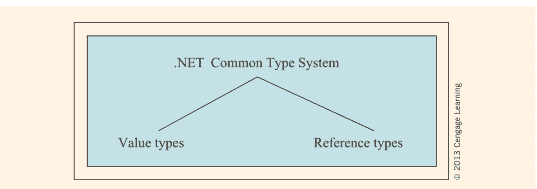

**图 2-3** .NET 通用类型

放入内存时，值类型包含其自己的数据副本，以二进制表示法存储。数据存储在由值类型标识符寻址的实际内存单元中。相比之下，引用类型内存单元的内容则大不相同。引用类型包含存储位序列的地址或位置。图 2-4 显示了值类型存储方式与引用类型存储方式之间的差异。一个整数值类型（例如表示汽车制造年份的 2012）直接存储在内存单元中。要存储字符串（例如车辆种类），该内存位置将包含“Corvette”所在的地址。string 数据类型是引用类型。与标识符关联的内存位置并不包含字符“Corvette”，而是包含存储“Corvette”的地址。

C# 也在有限程度上支持指针类型。指针是保存另一种类型的内存地址的变量。在 C# 中，只能声明指针来保存值类型和数组。你将在第 8 章进一步了解数组。

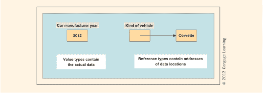

**图 2-4** 值类型和引用类型的内存表示

## 值类型

**值类型**通常称为该语言的基础数据类型或基元数据类型。它们是大多数应用程序所需的常用类型。在 C# 中，这些基础类型进一步细分为以下类别：

- 结构类型
- 枚举类型

查看图 2-5 的层次结构，在最底层你会发现 Integral、Floating-point 和 Decimal 构成 Numeric 类型。

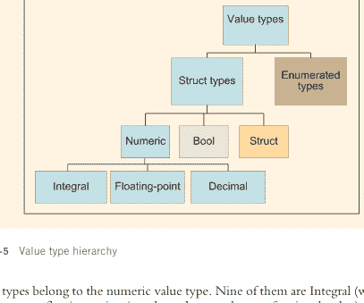

**图 2-5** 值类型层次结构

有十二种类型属于数值值类型。其中九种是 Integral（整数类型），两种是浮点型（可带小数值的数字），一种是 decimal 类型。decimal 类型是相当新的数据类型；C++、C 或 Java 中没有它。它被加入 C#，以消除以前语言中数学运算出现精度损失的问题。基本 C# 类型在 System 命名空间中都有别名。表 2-8 显示了内置 C# 类型的关键字，包括每个类型在层次结构中所属的数值类型，以及 System 命名空间中的别名。

**表 2-8 带 .NET 别名的 C# 值数据类型**

| C# 类型 | 数值类型 | .NET 别名类型 |
|---|---|---|
| byte | Integral | System.Byte |
| sbyte | Integral | System.SByte |
| char | Integral | System.Char |
| decimal | Decimal | System.Decimal |
| double | Floating-point | System.Double |

（续）


**表 2-8 带 .NET 别名的 C# 值数据类型（续）**

| C# 类型 | 数值类型 | .NET 别名类型 |
|---|---|---|
| float | 浮点型 | System.Single |
| int | 整型 | System.Int32 |
| uint | 整型 | System.UInt32 |
| long | 整型 | System.Int64 |
| ulong | 整型 | System.UInt64 |
| short | 整型 | System.Int16 |
| ushort | 整型 | System.UInt16 |

## 整型数据类型

所有整数值都表示整数——不带小数表示法的值。值类型 `int` 最常用于表示整数值，并且将是本教材中使用的主要类型。如表 2-9 所示，`System.Int32` 数据类型可存储小至负数 −2,147,483,648、大至 2,147,483,647 的值。整型类型的主要区别在于需要多少存储空间，以及数据项中是否可以存放负值。

以 u 开头的类型名表示无符号（unsigned），只允许将正值放入内存单元。

示例 2-3 展示了整型变量声明的示例。

### 示例 2-3

```csharp
int studentCount; // number of students in the class
int ageOfStudent = 20; // age - originally initialized to 20
int numberOfExams; // number of exams
int coursesEnrolled; // number of courses enrolled
```

> **注意**
> 
> 请注意，每个声明都以分号（;）结尾。这是因为在 C# 语言中，变量声明被视为语句。所有语句都以分号结尾。

示例 2-3 中的每个标识符都由两个或更多单词组成。第二个及后续单词以大写字符开头。本教材通篇使用这种命名约定来命名变量和对象。标识符的第一个字符以小写字符开头。

类名和方法名（包括用户定义的以及框架类库（FCL）类标识符）都以大写字符开头。常量（本章后面会介绍）全部使用大写字符命名，并使用下划线字符分隔单词。这是 C# 程序员使用的标准风格。

> **注意**
> 
> 风格由程序员采用的一组个人选择构成。如果你是编程新手，可能希望遵循本教材选择标识符的风格；不过，你的老师可能会推荐不同的风格。另一种常见的命名约定是用下划线分隔单词。最重要的是要记住，选择一种风格后，就应始终如一地使用它。

## 浮点类型

如果需要保留小数部分，该值就不能存储在整型数据类型（如 `int`）中。浮点值可以用带指数的科学计数法或标准十进制表示法来指定。可以指定非常大或非常小的数。指数语法的一般形式为：

```
n.ne±P
```

在上述示例的科学计数法语法中，n 是十进制数；P 是小数点向左或向右移动的位数；+ 或 – 表示小数点应移动的方向。加号表示将小数点向右移动 P 位，以形成等价的标准十进制值。C# 的语法规则允许 e 为大写或小写。表示法中的 ± 表示可以添加 +、–，或者两者都不添加。如果没有 + 或 –，则假定为 +。示例 2-4 展示了从科学计数法转换为标准十进制表示法的示例。

### 示例 2-4

- 3.2e+5 等价于 320000
- 1.76e-3 等价于 .00176
- 6.892e8 等价于 689200000

因为第一个值包含“e+5”，所以小数点向右移动五位。上述示例中的第二条语句将小数点向左移动三位。最后一条语句将小数点向右移动八位，这会在值的末尾放置五个有效零。

如表 2-10 所示，`double` 中最多可存放具有 15 到 16 位小数的值。浮点类型符合 IEEE 754 规范。有关更多信息，你可以在网站 http://standards.ieee.org/ 上阅读有关 IEEE 标准的内容。以下是浮点变量声明的示例。

**表 2-10 浮点类型的值和大小**

| 类型 | 数值范围 | 精度 | 大小 |
|---|---|---|---|
| float | ±1.5 × 10^-45 至 ±3.4 × 10^38 | 7 位数字 | 32 位 |
| double | ±5.0 × 10^-324 至 ±1.7 × 10^308 | 15–16 位数字 | 64 位 |

### 示例 2-5

```csharp
double extraPerson = 3.50;       // extraPerson originally set
                                 // to 3.50
double averageScore = 70.0;      // averageScore originally set
                                 // to 70.0
double priceOfTicket;            // cost of a movie ticket
double gradePointAverage;        // grade point average
float totalAmount = 23.57f;      // note that the f must be placed after
                                 // the value for float types
```

请注意，示例 2-5 中除一个声明外，所有声明都使用 `double`。在 C# 中，`double` 是浮点数的默认类型。当包含编译时初始化时，如果初始化 `double` 变量，则不需要后缀。对于 `float`，必须在数字后加上 `f` 或 `F` 后缀；否则，该数字会被视为 `double`。如果你没有在数字后加上 `f` 或 `F` 后缀，并将其赋给 `float` 变量，就会得到类似于图 2-6 所示的语法错误。

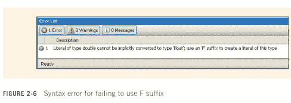

本教材通篇使用 `double` 类型表示所有需要小数值的数字。

## 小数类型

`decimal` 值类型是现代编程语言中的新特性。它适合存储货币数据项，因为它既允许整数（完整）数字，也允许小数部分。与浮点类型相比，它提供更高的精度，因为使用 128 位来表示值。

`decimal` 值类型可以存储从负数 −79,228,162,514,264,337,593,543,950,335 到正数 79,228,162,514,264,337,593,543,950,335 的数字。如表 2-11 所示，`decimal` 可以支持 28 到 29 位数字。

**表 2-11 decimal 数据类型的值和大小**

| 类型 | 数值范围 | 精度 | 大小 |
|---|---|---|---|
| decimal | 1.0 × 10⁻²⁸ 至 7.9 × 10²⁸ | 28–29 位有效数字 | 128 位 |

与 `float` 类型的情况一样，必须在数字末尾附加后缀 m 或 M 来表示 `decimal`，如示例 2-6 所示。没有该后缀时，数字会被视为 `double`。同样，如果你尝试在没有后缀的情况下对 `decimal` 变量进行编译时初始化或赋值，就会发出语法错误消息。不会发生自动转换。

### 示例 2-6

```csharp
decimal endowmentAmount = 33897698.26M;
decimal deficit;
```

> **注意**
> 
> 将数字赋给值类型时，绝不要在数字中放置逗号、美元符号或任何其他特殊格式符号。

## 布尔变量

Boolean 基于真/假、开/关逻辑。如果你回看图 2-5 中的值类型层次结构，会看到 Boolean 继承自 Value 和 Struct 类，但不继承自 Numeric 类型。C# 中唯一的布尔类型是 `bool`。`bool` 变量的值可以是 `true` 或 `false`。`bool` 类型非常有用的一个示例是确定何时已处理完所有数据。该变量可以如示例 2-7 所示进行声明。

### 示例 2-7

```csharp
bool undergraduateStudent;
bool moreData = true;            // used to indicate when all data is
                                 // processed. Originally set to true
```

`bool` 类型不接受 0、1 或 −1 等整数值。关键字 `true` 和 `false` 内置于 C# 语言中，并且是唯一允许的值。

> **注意**
> 
> 某些语言（如 C++）允许布尔类型保存整数。C# 不允许。


除了数值和布尔类型之外，还有另外两种值类型：枚举和结构。它们允许你定义自己的自定义类。随着你在软件开发中的深入，将会用到它们。

## 声明字符串

前面讨论的所有类型都是值类型。如图 2-3 所示，.NET 公共类型系统还包括引用类型。值类型的内存位置实际包含数据。对于引用类型，数据并不直接存储在内存位置中；相反，内存位置包含对数据存储位置的引用。

C# 有两种内置引用类型：string 和 object。string 类型表示 Unicode 字符字符串。示例 2-8 展示了如何声明字符串变量。第二个和第三个声明还包括编译时初始化。

**示例 2.8**

```
string studentName;
string courseName = "Programming I";
string twoLines = "Line1\nLine2"; // newline escape sequence character included
```

另一种内置引用类型是 object。这可能是最重要的类型，因为每个类型都从它继承特性。在第 3 章中，当你开始编写自己的方法时，将研究 object 类。

> **注意**
>
> 所有类型都从 object 类继承 ToString()、Equals()、Finalize() 和 GetHashCode() 方法。

## 使数据成为常量

当你在声明中添加关键字 const 时，它就变成常量。常量便于为标识符赋值；const 强制实现不允许更改值的功能。与变量类似，存储在内存位置中的值可以在整个程序中使用。但是，该值不能更改。常量语法的一般形式是：

```
const type identifier = expression;
```

示例 2-9 展示了一些常量声明的示例。

**示例 2.9**

```
const double TAX_RATE = 0.0675;
const int SPEED = 70;
const char HIGHEST_GRADE = 'A';
```

> **注意**
>
> 定义常量的一个优点是，值只需在声明期间赋值一次。常量可以在许多语句中使用。如果必须更改该值，程序中只需在一处更改，即常量声明位置。进行该更改后，必须重新编译程序。

为了提醒标识符 TAX_RATE 是常量而不是变量，使用了全大写字母。为了在单词之间提供分隔符，使用了下划线字符。这是程序员命名常量的标准约定。

## 赋值语句

变量可以在声明期间初始化，也可以在程序稍后为其赋值。但是，在 C# 中，必须先为变量赋值，然后才能使用它。声明变量时不会分配默认值。要更改变量的值，使用赋值语句。赋值语句的形式为：

```
variable = expression;
```

表达式可以是以下之一：

- 另一个变量
- 兼容的字面量值
- 数学等式
- 对返回兼容值的方法的调用
- 此列表中一项或多项的组合

语法要求将保存表达式结果的变量放在最前面——等号（=）的左侧。当 = 符号与赋值语句或编译时初始化一起使用时，称为赋值运算符。确定赋值运算符（=）右侧表达式的值，然后将该值赋给 = 运算符左侧的变量。

> **注意**
>
> 请注意，赋值语句的语法要求赋值运算符左侧有一个变量。

如果左侧的值与右侧不兼容，C# 编译器会发出类型不匹配错误。

> **注意**
>
> C# 是一种强类型语言。它能很好地验证赋值语句中的类型一致性。接收表达式结果的变量必须是相同类型，或者是可以容纳该结果的类型。

示例 2-10 首先声明可在赋值语句中使用的变量。

**示例 2.10**

```
int numberOfMinutes,
    count,
    minIntValue;
```

> **注意**
>
> 如果声明同一类型的多个变量，则标识符之间用逗号分隔。分号放在列表末尾，表示声明语句结束。

```
char firstInitial,
    yearInSchool,
    punctuation,
    enterKey,
    lastChar;
double accountBalance,
    weight;
decimal amountOwed,
    deficitValue;
bool isFinished;
string aSaying,
    fileLocation;
```

声明后，可以给这些变量赋予字面量值，如下面的代码段所示：

```
numberOfMinutes = 45;
count = 0;
minIntValue = -2147483648;
firstInitial = 'B';
yearInSchool = '1';
punctuation = ',';
```

注意，字面量 -2147483648 中没有包含逗号。虽然这看起来不可读，但如果添加逗号，将会收到语法错误消息。变量 firstInitial、yearInSchool 和 punctuation 是 char 类型。使用 char 字面量时应特别注意。在赋值语句中使用时，所有 char 字面量都必须用单引号括起来。请记住，char 类型可以容纳标准键盘上的任何字符以及许多其他字符。但是，它一次只能容纳一个字符。

```
enterKey = '\n';  // newline escape character
lastChar = '\u005A';  // Unicode character 'Z'
```

前面的两个赋值在单引号之间都有多个条目。然而，符号的组合表示单个字符。使用特殊转义序列字符将回车符赋给 enterKey 变量。使用字符 Z 的 Unicode 表示将其赋给 lastChar 变量。

> **注意**
>
> 第 1 章向你介绍了一些表示字符的特殊转义序列。你可能想复习表 1-1，其中包含许多有效的 C# 转义序列字符。前面声明中的最后一个示例说明了如何使用 Unicode 字符字面量来初始化变量。数值是十六进制数。

```
accountBalance = 4783.68;
weight = 1.7E-3;  // scientific notation may be used
amountOwed = 3000.50m;  // m or M must be suffixed to decimal
deficitValue = -32288672.50M;
```

> **注意**
>
> 如果你尝试初始化 decimal 变量而忘记使用 M 或 m 后缀，则会生成编译器错误。

```
aSaying = "Today is the first day of the rest of your life!\n ";
fileLocation = @"C:\CSharpProjects\Chapter2";
```

> **注意**
>
> at 符号（@）可以放在字符串字面量之前，以表示双引号内的字符应按原样解释。这消除了使用转义字符转义反斜杠字符的需要。如果没有 @ 符号，文件名的字符串字面量必须写成 "C:\\CSharpProjects\\Chapter2"，即用两个反斜杠表示之前的一个反斜杠。

```
isFinished = false;  // declared previously as a bool
```

> **注意**
>
> 在声明为 `bool` 的内存位置中，唯一可以放置的值是 `true` 和 `false`。

也可以将一个变量的值赋给另一个变量。这不会影响赋值运算符右侧的变量，如图 2-7 所示。newValue 中的 25 替换 count 中的 0。一个变量一次只能保存一个值。

```
int count = 0,
    newValue = 25;
count = newValue;
```

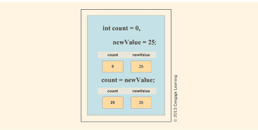

图 2-7  赋值语句的影响

## 基本算术运算

赋值语句可以包含数学等式。加、减、乘、除的基本运算可以对实数数据（浮点）执行。这些运算加上取模可以对整数类型执行。赋值语句的最简单形式是：

```
resultVariable = operand1 operator operand2;
```

操作数可以是变量、常量或字面量。运算符由表 2-12 中所示的特殊符号表示。


**注意** 可读性在编写代码时非常重要。始终在每个算术运算符前后放置一个空格，包括等号（ = ）。编译器会忽略空白，但阅读你代码的人会欣赏这一点。

### 表 2-12 基本算术运算符

| 运算符 | 操作 |
|---|---|
| + | 加法 |
| - | 减法 |
| * | 乘法 |
| / | 除法 |
| % | 取模 |

取模运算符（%）有时被称为余数运算符。在大多数语言中，两个操作数都必须是整数类型。C# 允许你使用浮点值作为操作数与取模运算符一起使用。产生的结果是操作数1除以操作数2的余数。给定以下语句，图 2-8 说明了结果。

```csharp
int firstValue = 67;
int secondValue = 3;
int result;
result = firstValue % secondValue;
```

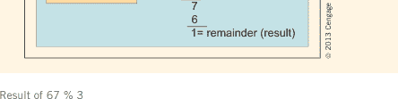

**图 2-8** 67 % 3 的结果

**注意** 取模运算符可以用负值；然而，你可能会觉得结果很奇怪。例如：−3 % 5 = −3; 5 % −3 = 2; −5 % −3 = −2; 被除数的符号决定了结果。

结果在使用加号（+）处理数值数据时符合预期。当 + 符号与 `string` 变量一起使用时，+ 符号将操作数2连接到操作数1的末尾。

```csharp
string result;
string fullName;
string firstName = "Rochelle";
string lastName = "Howard";
fullName = firstName + " " + lastName;
```

如图 2-9 所示，前述语句执行后 fullName 引用的值为 "Rochelle Howard"。请注意，两个变量之间放置了一个包含单个空格的 `string` 字面量；否则，你将创建一个全名为 "RochelleHoward" 的名称。

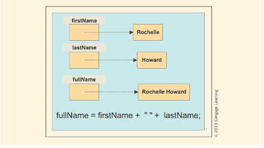

**图 2-9** 字符串连接

**注意** + 符号被视为 **重载运算符**。它根据接收的操作数的类型表现不同。如果操作数是数值，则执行加法。如果操作数是字符串，则执行连接。你将在第 8 章阅读更多关于 `string` 数据类型的介绍。加法运算符是表 2-12 中唯一可以应用于 `string` 数据类型的运算符。

## 增量和减量操作

一种常见的算术运算是将数字一（1）加到或从内存位置减去。为此使用增量/减量运算符。C# 与 C++ 和 Java 一样，有一个特殊的单目运算符，可以将值增减一。它被视为单目运算符，因为它需要一个操作数。前述解释中探讨的基本运算符都是需要两个操作数的二元运算符。

用于增量和减量的符号是 ++ 和 --。两个符号（++ 或 --）之间不允许有空格。

```csharp
num++;
    // could be written as num = num + 1;
--value1;
    // could be written as value1 = value1 - 1;
```

第一条语句将 1 加到 num。第二条语句从 value1 减去 1。增量和减量运算符经常在需要计数器的情况下使用。它们不用于累积值，因为它们总是给变量加一或减一。

**注意** 在 C# 中，当你使用增量和减量运算符与浮点类型时，不会生成语法错误。C# 将数字 1 加到变量上，或从变量中减去。你也可以对 char 类型的变量使用 ++ 或 --。

如果你在涉及额外操作数的算术表达式中使用这些运算符，++ 或 -- 的放置位置很重要。如果它们作为前缀出现，或位于变量左侧，则在使用变量参与表达式之前执行增量或减量。当放置在操作数之前时，它们被称为前增量或前减量运算符；当放置在操作数之后时，它们被称为后增量或后减量运算符。例如，如果做出以下声明，然后调用每个 WriteLine() 方法，示例 2-11 的输出将为：

```text
100
101
102
```

### 示例 2-11

```csharp
int num = 100;
Console.WriteLine(num++);            // Displays 100
System.Console.WriteLine(num);          // Displays 101 after the post
                                        // increment is performed on the
                                        // previous line
Console.WriteLine(++num);               // Displays 102
```

在示例 2-11 中，最后打印的值是 102。如果在示例代码行之后使用 num，num 的值为 102。请注意，这里显示的是递增后的值，因为在最后一次调用 WriteLine() 方法时，++ 运算符放置在标识符之前。第一次调用 WriteLine() 方法并未显示递增后的值。原始值用作参数，然后值才递增。

如果 x 被声明为 int 类型并初始化为 100，则以下语句显示 100 102。当控制转移到 WriteLine() 方法调用之后的语句时，存储在 x 中的新值为 102。

```csharp
Console.WriteLine(x++ + " " + ++x); // Displays 100 102
```

仔细查看示例 2-12，以确保你理解增量和减量运算符的放置如何影响它们包含在涉及多个操作的表达式中时得到的结果。

### 示例 2-12

```csharp
int count = 0,
    result = 0,
    firstNum = 10;
count++;
result = count++ * --firstNum + 100;
```

图 2-10 显示了在声明变量时存储在内存位置中的内容。对所有三个变量执行编译时初始化。

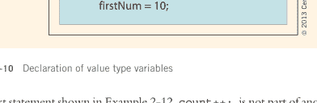

**图 2-10** 值类型变量的声明

示例 2-12 中显示的下一条语句 count++ 不是另一个表达式的一部分。在这种情况下，增量运算符（++）放置在 count 之前还是之后其实并不重要。唯一受影响的内存位置是 count 的内存单元。它被递增一。图 2-11 显示了执行 count++ 后内存单元的状态。

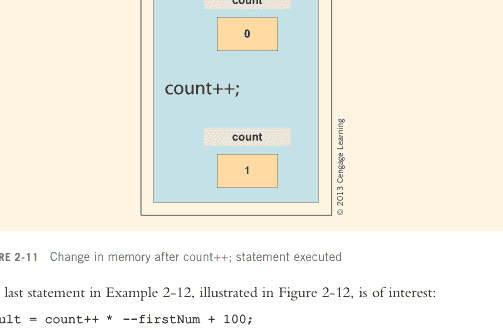

**图 2-11** 执行 count++; 语句后内存的变化

示例 2-12 中最后一条语句，如图 2-12 所示，值得关注：

```csharp
result = count++ * --firstNum + 100;
```

请注意 ++ 放置在 count 之后。-- 位于 firstNum 之前。

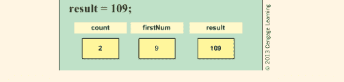

**图 2-12** 执行语句后的结果

由于 ++ 位于标识符名称之后，因此在乘法中使用的是 count 的当前值 1。在算术运算中使用 count 之后，它被递增 1，变为 2。因为减量运算符位于变量 firstNum 之前，所以在执行乘法之前从 firstNum 中减去 1。因此，1 乘以 9，结果加上 100。

## 复合操作

你通常编写算术运算，通过使用其原始值作为计算的一部分来修改变量。考虑以下内容：

```csharp
answer = 100;
answer = answer + 5;
```

变量 answer 保存最终结果，但它也在计算中使用。复合运算符提供了一种简写赋值语句的方法，使用结果作为计算的一部分。前一段代码中的最后一行（answer = answer + 5;）可以用以下内容替换：

```csharp
answer += 5;
```

这两个语句都取 answer 的原始值，给它加上 5，并将结果存储回 answer。

**注意** 在涉及多个操作的表达式中，复合操作始终最后执行。例如：answer += 45 * 28 + 37 / 16; 等价于 answer = answer + (45 * 28 + 37 / 16); 等号右侧的表达式完成之前，不会加上 answer 的原始值。

累积是应用程序中常见的另一种操作。你经常需要保持一个运行总计或累积单个变量保存的值。例如，要确定一组值的平均值，值通常会加到累加器中并除以条目数。考虑以下内容：

```csharp
int total = 0;
int newValue;
// Note: statements that enable the user
// to enter values for newValue are inserted here

total = total + newValue;
```

如果用户输入多个值，每个 newValue 都可以加到 total。这是一个累积值的例子。累加器通常与货币金额一起使用。例如，要累积收到的总金额或包含若干商品的订单的总计，可以使用如下变量

可以定义 total。这类作为累加器功能的变量，通常应初始化为零。然后它们会增长，或随着每次新的加法而增加值。复合运算符可用于这类情况。使用复合运算符，`newValue` 可以按如下所示添加到 `total` 中：

```
total += newValue;      // same as total = total + newValue;
```

表 2-13 显示了 C# 中可用的复合运算符。

### 表 2-13 复合算术运算符

| 运算符 | 操作 |
|---|---|
| `+=` | 加法 |
| `-=` | 减法 |
| `*=` | 乘法 |
| `/=` | 除法 |
| `%=` | 取模 |

使用复合运算符的另一个例子是用余数或取模运算符说明的：

```
answer = 100;
answer %= 3;            // same as answer = answer % 3;
```

前述表达式的结果为 1，因为那是 100 除以 3 的余数。如前所述，当在包含多个操作的语句中使用复合运算符时，赋值运算符左侧的变量不会被使用，直到赋值符号右侧的整个表达式完全求值。请参阅示例 2-13。

### 示例 2.13

```
answer = 100;
answer += 50 * 3 / 25 - 4;
```

100 的值不会在赋值运算符右侧的表达式完全求值之前被加上。然后 C# 取出计算出的值并加上 100。结果替换了原来的 100，将 102 存储在 answer 中。计算执行的顺序如下：

- `50 * 3 = 150`
- `150 / 25 = 6`
- `6 - 4 = 2`
- `100 + 2 = 102`

与自增和自减运算符一样，复合运算符符号之间不允许有空格。

计算执行的顺序称为运算顺序。在示例 2-13 中，操作是从左到右执行的。下一节将解释为什么并非总是如此。

## 运算顺序

当表达式中包含多个算术运算符时，执行从优先级最高的运算符开始。优先级的级别由语言规则决定。迄今为止使用的运算符的 C# 优先级级别显示在表 2-14 中。

### 表 2-14 运算符优先级

| C# 类别 | 运算符 | 结合性 |
|---|---|---|
| 一元 | `+ - ++ --` | 右 |
| 乘法 | `* / %` | 左 |
| 加法 | `+ -` | 左 |
| 赋值 | `= *= /= %= += -=` | 右 |

如表 2-14 所示，多个运算符出现在同一级别。例如，就运算顺序而言，*、/ 和 % 被视为相等。当表达式包含两个或多个具有相同优先级的运算符时，运算符的结合性控制操作的执行顺序。**左结合** 意味着操作从左到右执行，因此在表达式中从左到右移动时，先遇到的操作先执行。

+ 和 - 在表 2-14 的第一行作为一元运算符出现，在第三行作为二元运算符出现。

> **注意**
> 如前所述，一元意味着一个，表示运算符仅使用一个操作数。例如，在变量前放置一个减号符号就是一元操作。

作为一元运算符，- 和 + 操作从右到左执行，表示否定或操作数为正。二元 + 和 - 是左结合的。第四行的赋值类别运算符是 **右结合** 的。

可以使用括号来改变运算顺序。如果您确定某个操作需要先处理，请用一对括号将表达式的该部分括起来。括号也用于提高表达式的可读性。图 2-13 说明了计算中多个操作执行的运算顺序。

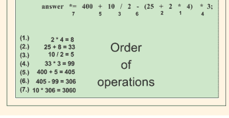

### 图 2-13 运算符的执行顺序

在算术表达式执行之前，answer 被初始化为 10。

```
int answer = 10;
answer *= 400 + 10 / 2 - (25 + 2 * 4) * 3;
```

## 混合表达式

C# 允许您在表达式中混合使用数值整数类型和浮点类型。当表达式的操作数类型不同时，该语句被视为混合模式表达式。示例包括以下内容：

```
89 + 76 / 3.25
2 * 7.9 - 5 + 67.99
```

在第一个表达式中，除法运算符的操作数是 76，一个整数，和 3.25，一个浮点类型。当操作数类型相同时，操作的结果将是该类型。然而，如果二元操作涉及 double 和 int，则会执行隐式类型强制转换或转换。整数类型转换为浮点类型。通过将 int 数据类型更改为 double 的自动强制转换，对前述每个表达式都发生。

需要注意示例 2-14 所说明的内容，如果等号运算符右侧的所有表达式都是整数类型，您不能仅仅将结果类型声明为浮点类型并得到正确浮点结果。

### 示例 2.14

```
double answer;
answer = 10 / 3;
```

您不会得到可能期望存储在 answer 中的结果。结果是 3.0，而不是 3.333333。因为赋值运算符右侧的两个操作数都是整数，所以执行整数除法。这会产生整数结果。除法完成后，产生 3，然后将其作为浮点 double 分配给 double 变量 answer。因此，answer 变为 3.0。

当您将 int 分配给 double 时会发生隐式类型转换。如果您尝试将 double 存储在 int 变量中，则不会发生转换。图 2-14 显示了在示例 2-15 中尝试将 double 分配给 int 时的语法错误。第一个赋值语句会生成错误。第二个语句中发生隐式类型转换。变量 value2 可以保存存储在 anotherNumber 中的内容。

### 示例 2.15

```
int value1 = 440,
    anotherNumber = 70;
double value2 = 100.60,
    anotherDouble = 100.999;
value1 = value2;          // syntax error as shown in Figure 2-14
value2 = anotherNumber;    // 100.60 cannot be stored in value1
```

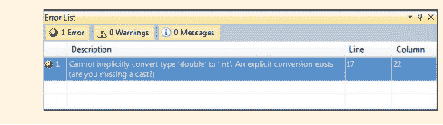

### 图 2-14 将 double 分配给 int 时生成的语法错误

当其中一个操作数是数字字面量时，您可以通过简单地在值后附加一个小数点和零，使字面量表现得像浮点类型，如示例 2-16 所示。

### 示例 2.16

```
int exam1 = 86,
    exam2 = 92,
    exam3 = 91;
double examAverage;
examAverage = (exam1 + exam2 + exam3) / 3.0;
```

前述赋值语句的结果是 89.666666。去掉 .0，使赋值语句如下所示：

```
examAverage = (exam1 + exam2 + exam3) / 3;
```

结果是 89。这可能意味着您在课程中获得 A 与 B 的区别。只需将 3 替换为 3.0，您就能得到预期的结果。当除法运算符得到表示分数总和的整数和一个 double（3.0）时，整数值 269 会在计算中转换为 269.0。

这种隐式类型转换是通过更改字面量的值实现的。但这并非总是可行。原因之一是您可能没有字面量。如果考试分数的计数存储在变量中怎么办？您不能在标识符末尾加上 .00，因为这会生成语法错误。

如果您需要使用变量进行混合模式赋值，避免图 2-14 中产生的语法错误的一种方法是按下一节所述在表达式中转换变量。

## 类型转换

C# 提供了 **显式类型强制转换**，或通过类型转换或类型转换进行的转换，可用于变量。其形式如下：

```
(type) expression
```


强制类型转换使变量临时表现得好像它是另一种类型。如果值 3 存储在 int 内存位置中，则必须进行强制转换才能为 examAverage 生成正确结果。double 类型放在要强制转换的数据项之前的圆括号中，如下所示：

```
examAverage = (exam1 + exam2 + exam3) / (double) count;
```

通过对示例 2-15 中的变量执行强制转换，就可以避免语法错误。示例 2-17 说明了另一个示例。

### 示例 2-17

```
int value1 = 0,
anotherNumber = 0;
double value2 = 100,
anotherDouble = 100;
value1 = (int) value2;
value2 = (double) anotherNumber;
```

示例 2-17 中最后一条赋值语句中的强制转换本来可以省略，因为当 int 存储在 double 内存位置中时会发生隐式转换。

> **注意**
> C# 4.0 中添加了新关键字 dynamic，用于告诉编译器变量的类型可以更改，或者直到运行时才能确定。你将在第 11 章中进一步了解 dynamic。

## 格式化输出

你可以通过添加美元符号或百分号来格式化数据。你可以用逗号分隔数字，或显示值的小数部分。你可以抑制前导零，也可以用零填充值。C# 包含许多可用于数字的特殊格式说明符。使用这些格式说明符的一种方法是将它们放在 Console.Write() 或 Console.WriteLine() 方法的字符串参数中。当将这些特殊格式说明符作为这些方法参数的一部分包含在内时，会自动调用 String.Format() 方法。你将在第 3 章中进一步了解如何调用方法。示例 2-18 演示了使用货币格式说明符显示带有逗号、小数点和美元符号的数字。

### 示例 2-18

```
double price = 1089.30;
Console.WriteLine("The price is {0:C}.", price);
// Displays The price is $1,089.30
```

要指示希望将值显示为带有美元符号、逗号分隔符和小数点后两位的金额，可使用 C 或 c 指定货币格式。格式说明符放在花括号（{ }）内，从而成为 WriteLine() 方法的字符串字面量参数的一部分。

注意花括号内放置了两个值。花括号中的第一个值是占位符。它指示你想显示双引号外参数中的哪一个。示例 2-18 中格式化的参数是 price，它是第一个参数。你会发现大多数现代计算机编程语言使用 0 来引用第一个条目。在指示参数之后，可以添加可选的格式规范。在本例中，添加了货币说明符 C。

> **注意**
> WriteLine() 方法的第一个参数应为字符串。
> 为提高可读性，可以将该语句放在两行中，并使用串联运算符 + 号将字符串连接在一起。

表 2-15 展示了使用两种最常见格式说明符 c 和 f 的示例。

### 表 2-15 使用格式说明符的示例

| 字符 | 描述 | 示例 | 输出 |
|---|---|---|---|
| C 或 c | 货币 | Console.Write("{0:c}", 26666.7888); | $26,666.79 |
| C 或 c | 货币 | Console.Write("{0:c}", -2); | ($2.00) |
| C 或 c | 货币 | Console.Write("{0:c}", 38.8); | $38.80 |
| F 或 f | 定点 | Console.Write("{0:F4}", 50); | 50.0000 |
| F 或 f | 定点 | Console.Write("{0:F0} {1}", 50, 22); | 50 22 |

为便于说明，表 2-15 中使用字面量值作为 Write( ) 方法的字符串参数；不过，变量、常量和/或表达式也可以作为要格式化的参数用在 Write( ) 方法中。

F（定点）说明符包含一个附加参数。你可以指示在小数点右侧打印多少位数字。{0:F4} 表示第一个参数（参数 0）应使用定点或小数点格式进行格式化，并且应在小数点右侧打印四位数字。如表 2-15 最后一行所示，当参数不需要特殊格式时，占位符是花括号内唯一包含的条目，如 {1}。

> **注意**
> 如表 2-15 所示，使用货币格式说明符时，负值显示在括号中。

格式说明符位于字符串中要打印值的位置。考虑以下示例：

```
Console.WriteLine("Carpet{0:F0} is {1:C}", 9, 14);
```

结果如下：

Carpet9 is $14.00

在 Carpet 中的字符 t 之后没有打印空格。第一个参数在 {0:F0} 中用 0 引用，其值为 9。该值（9）被打印出来，后面跟一个空格。它使用定点格式进行格式化，并且小数点右侧为零位数字。值 14 插入到插入 {1:C} 的位置。它使用货币格式进行格式化。表 2-16 展示了一些用于格式化字符串中数字的标准数字格式说明符。

### 表 2-16 标准数字格式说明符

| 字符 | 名称 | 描述 | 示例 |
|---|---|---|---|
| C 或 c | 货币 | 数字转换为表示货币金额的字符串，带有美元符号、小数点和逗号。如果存在，精度修饰符指示小数位数。 | ("{0:C3}", 4238.8) – 生成 $4,238.800 |
| D 或 d | 十进制 | 数字转换为整数数字（0–9）字符串，如果数字为负，则前缀减号。如果需要，在数字左侧用零填充，以生成说明符中请求的位数。 | ("{0:D5}", 42) – 生成 00042 |
| E 或 e | 科学计数法（指数） | 数字转换为形式为 "+d.ddd...E+ddd" 或 "-d.ddd...e+ddd" 的字符串，其中每个 "d" 表示一个数字（0-9）。如果数字为负，则字符串以减号开头。 | ("{0:E2}", 4238.8) 生成 4.24E+003 |
| F 或 f | 定点 | 数字转换为形式为 "+ddd.ddd..." 的字符串，其中每个 d 表示一个数字（0-9）。 | ("{0:F2}", 4238.8) 生成 4238.80 |
| G 或 g | 常规 | 根据数字的类型以及是否存在精度说明符，数字转换为定点或科学计数法中更紧凑的一种。 | ("{0:G}", 4238.8) 生成 4238.8 ("{0:G2}", 4238.8) 生成 4.2E+03 |
| N 或 n | 数字 | 数字转换为形式为 "+d,ddd,ddd.ddd..." 的字符串。插入千位分隔符和减号（如果值为负）。精度说明符指示所需的小数位数。 | ("{0:N2}", 4238.8) 生成 4,238.80 |
| P 或 p | 百分比 | 数字转换为表示百分比的字符串。转换后的数字乘以 100 以百分比形式呈现。精度说明符指示所需的小数位数。 | ("{0:P}", 0.123) 生成 12.30 % ("{0:P1}", 0.12783) 生成 12.8 % |

如果标准格式说明符未提供你所需的格式类型，还可以创建自己的自定义格式字符串。标准格式字符串由一个字母字符组成，后面可选跟一个数字序列，形成 0 到 99 之间的值。表 2-17 列出了一些可用于创建自定义数字格式字符串的字符及其定义。

### 表 2-17 自定义数字格式说明符

| 格式字符 | 名称 | 描述 | 示例 |
|---|---|---|---|
| 0 | 零占位符 | 如果要格式化的值在格式字符串中出现“0”的位置有数字，则该数字会复制到结果字符串中。小数点前最左侧“0”的位置和小数点后最右侧“0”的位置决定结果字符串中始终存在的数字范围。 | ("{0:00000}", 4238.8) 生成 04239 |
| # | 数字占位符 | 如果要格式化的值在格式字符串中出现“#”的位置有数字，则该数字会复制到结果字符串中。否则，该位置不存储任何内容。 | ("{0:####}", 4238.8) 生成 4239 |
| . | 小数点占位符 | 格式字符串中的第一个“.”字符决定格式化值中小数分隔符的位置。 | ("{0:####.##}", 4238.8) 生成 4238.8<br>("{0:####.00}", 4238.8) 生成 4238.80 |
| , | 千位分隔符 | 如果格式字符串在两个数字占位符（0 或 #）之间包含“,”字符，则输出将在每组三位数字之间插入千位分隔符。 | ("{0:##,###.##}", 4238.8) 生成 4,238.8<br>("{0:##,##,##.##}", 238.8) 生成 238.8<br>("{0:00,00.00}", 238.8) 生成 00,238.80 |
| ; | 节分隔符 | “;”字符用于分隔字符串中正数、负数和零的节。如果值为正，则使用第一个格式说明符。如果值为负，则使用第二个说明符。当值为零时，使用第三个说明符。 | ("{0:00,000.00;-##,###.00; Zero}", 15) 生成 0,015.00<br>("{0:00,000.00;-##,###.00; Zero}", -15) 生成 -15.00<br>("{0:00,000.00;-##,###.00; Zero}", 0) 生成 Zero |
| 'ABC' 或 "ABC" | 字符串字面量 | 用单引号或双引号括起来的字符会按字面复制到结果字符串中，并且不影响格式设置。 | ("{0:##,###.00£}", 100) 生成 100.00£ |


表2-16和表2-17中的示例展示了如何将格式说明符用作 Console.Write() 或 Console.WriteLine() 方法的参数。它们也可以存储在字符串变量中，然后用作 ToString() 等方法的参数。在第3章中，你将了解如何创建自己的方法，并使用 C# 语言中许多预定义方法。

## 宽度说明符

你可以指定宽度作为格式说明符的一部分。当你想控制多行中各项的对齐方式时，这尤其有用。在冒号之前、索引序号之后添加对齐组件。使用逗号作为分隔符。如果对齐的数字值小于格式化字符串的实际长度，则忽略对齐，并使用实际格式化字符串的长度作为字段宽度。考虑以下示例：

```
Console.WriteLine("{0,10:F0} {1,8:C} ", 9, 14);
```

结果如下：

```
9      $14.00
```

如果对齐数字值为正，则字段中的格式化数据右对齐；如果对齐数字值为负，则左对齐。如果需要填充，则使用空白。如果指定了对齐，则逗号是必需的。

考虑以下示例：

```
Console.WriteLine("{0,-10:F0} {1,8:C} ", 9, 14);
```

结果如下：

```
9          $14.00
```

这里第一个参数（9）左对齐，因为对齐组件为负。

## 编程示例：CarpetCalculator

此示例演示了程序中数据项的使用。问题规格如图2-15所示。

> 哪种地毯符合你的预算？设计一个应用程序，确定在单个房间铺设新地毯需要多少费用。房间尺寸如下：
> 长度 - 12 英尺 2 英寸
> 宽度 - 14 英尺 7 英寸
>
> 你已将选择范围缩小到两个地毯选项。它们是：
> Berber（最佳）@ 每平方码 27.95 美元
> Pile（经济型）@ 每平方码 15.95 美元
>
> 每种选择将花费多少？按类型（Berber 或 Pile）显示总成本。

**图 2-15** CarpetCalculator 示例的问题规格表

### 分析问题

你应该回顾图2-15中的问题规格，并确保理解问题定义。此解决方案不包含程序输入。在你了解如何将数据输入程序后，你可能会希望修改解决方案，以便能够使用不同类型和价格的地毯多次运行应用程序。目前，该问题不要求你输入值。

但是，程序中需要数据。首先确定需要哪些类型的数据。已识别的每个数据项中将包含什么类型的值（即整数、带小数点的数、布尔值、字母字符或字符串）？是否有任何常量数据项？变量和常量的适当标识符是什么？数据项的值范围或域是什么？这些都是应该提出的问题。这里列出的项目描述了此问题的数据需求：

- 房间尺寸以英尺和英寸给出——整数——表示这两个值（即 12 英尺 2 英寸）。
- 地毯价格以每平方码的价格给出。此值是带小数部分的数（即 27.95）。
- 要确定平方码数，必须计算平方英尺数。
- 由于宽度和长度以英尺和英寸给出，因此首先将这些测量值（英尺和英寸）转换为宽度和长度的单一单位。
- 需要一个内存位置来存储总平方码数。但是，要得到该值，需要一个内存位置来保存总平方英尺数。
- 需要一个内存位置来保存地毯的总成本。

### 变量

表2-18列出了解决 CarpetCalculator 问题所需的数据项。

**表 2-18** 变量

| 数据项描述 | 类型 | 标识符 | 域（值范围） |
|---|---|---|---|
| 房间长度（英尺） | `int` | `roomLengthFeet` | 正值 < 50 |
| 房间长度（英寸） | `int` | `roomLengthInches` | 正值 < 12 |
| 房间宽度（英尺） | `int` | `roomWidthFeet` | 正值 < 50 |
| 房间宽度（英寸） | `int` | `roomWidthInches` | 正值 < 12 |
| 房间长度 | `double` | `roomLength` | 正值 < 100 |
| 房间宽度 | `double` | `roomWidth` | 正值 < 100 |
| 平方英尺数 | `double` | `numOfSquareFeet` | 正值 < 100 |
| 平方码数 | `double` | `numOfSquareYards` | 正值 < 100 |
| 每平方码地毯价格 | `double` | `carpetPrice` | 正值 < 50.00 |
| 地毯总成本 | `double` | `totalCost` | 正值 < 1000 |

### 常量

由于此应用程序不是交互式的，这意味着它不允许用户输入值，因此必须确定哪些数据不会改变。一英尺中的英寸数永远不变；一平方码中的平方英尺数永远不变。这两项都定义为常量。按类别划分的不同地毯类型的名称也定义为常量。注意，在表2-19中，所有大写字符都用作常量的标识符，以便清楚地将常量与变量区分开。为了提高可读性，下划线字符用作单词之间的分隔符。

不同地毯的实际价格可以定义为常量。常量定义通常放在程序顶部，以便在需要更改时易于定位和修改其值。这里没有将价格声明为常量，而是使用数字字面量来初始化变量的值。在你学会在程序运行时交互式输入值之后，你可能会希望修改解决方案，以便价格可以由用户输入。目前，27.95 和 15.95 作为价格的数字字面量使用。

**表 2-19** 常量

| 数据项描述 | 类型 | 标识符 | 值 |
|---|---|---|---|
| 一平方码中的平方英尺数 | `int` | `SQ_FT_PER_SQ_YARD` | 9 |
| 一英尺中的英寸数 | `int` | `INCHES_PER_FOOT` | 12 |
| 表示最佳地毯名称的字符串 | `string` | `BEST_CARPET` | "Berber" |
| 表示经济型地毯名称的字符串 | `string` | `ECONOMY_CARPET` | "Pile" |

### 设计解决方案

期望输出是在给定特定房间尺寸的情况下，显示与每种地毯相关的成本。图2-16显示了 CarpetCalculator 示例最终输出的原型。原型中放置了 xxx.xx，用来表示计算值应出现的位置。

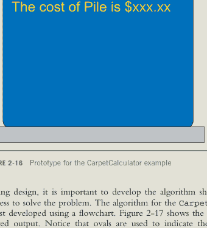

**图 2-16** CarpetCalculator 示例的原型

在设计过程中，重要的是开发算法，展示解决问题的逐步过程。CarpetCalculator 示例的算法首先使用流程图开发。图2-17显示了获得期望输出所需的步骤。注意，椭圆用于表示应用程序的开始和停止。矩形用于表示将要发生的处理，平行四边形用于数据的输入或输出。当流程图跨越多页时，使用圆形连接符来连接各图，如图2-17所示。

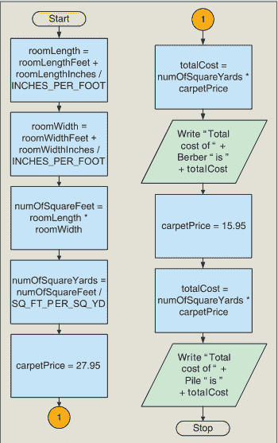

**图 2-17** CarpetCalculator 流程图

有许多技术和工具用于描述过程逻辑。流程图只是其中之一。结构化英语是另一种技术。这种技术也称为英语叙述和伪代码。流程图主要在解决方案适合使用传统的结构化方法进行设计时使用。结构化英语是用于该方法的一种工具，但也非常适合面向对象方法。

**结构化英语**是英语的一种缩略的、面向行动的版本。结构化英语没有语法规则。重点是用英语尽可能清晰、简洁地写出步骤，而不考虑语言细节。


The focus is on writing *需要做什么*。图 2-18 显示了 CarpetCalculator 示例的结构化英语设计。

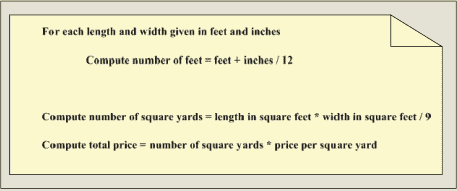

**图 2-18** CarpetCalculator 示例的结构化英语

结构化英语是与面向对象方法一起使用的较为常见的工具之一，用于记录过程逻辑。决策树和表格有时会与结构化英语结合使用，尤其是在解决方案需要作为解决方案的一部分开发多条替代路径时。第 5 章将向您介绍这些工具。

面向对象方法关注我们世界中存在的对象（人、地点和事物）。类图有助于设计和记录对象的数据项和行为。图 2-19 显示了 CarpetCalculator 示例的类图。

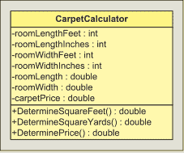

**图 2-19** CarpetCalculator 示例的类图

图 2-19 包含方法。在本章中，您学习了数据项。类图中的中间部分包含标识符及其数据类型。方法包含在类图的底部部分。**方法**是用于在 C# 中实现对象行为的程序。在第 3 章中，您将学习如何编写方法。图 2-20 显示了一个没有方法的类图解决方案。目前应用程序的设计方式将是这样。请注意，图 2-20 包含三个额外的数据成员且没有方法。

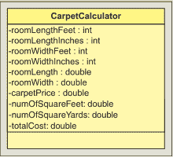

**图 2-20** 没有方法的修订类图

在算法开发完成后，应检查设计的正确性。当您对算法进行桌面检查时，使用计算器并写下您得到的结果。在您实现设计后，可以将程序获得的结果与计算器的结果进行比较。

在这一点上，似乎使用计算器直接进行计算会更容易。请记住，当您编写可用于许多不同数据集的一组指令时，计算机的强大功能就会发挥作用。在下一章中，您将学习如何调用方法以允许交互式输入数据，例如地毯价格和房间尺寸。这将为您的程序增加更多功能。

## 编写解决方案

在您完成设计并验证算法的正确性后，就该将设计翻译成源代码了。如果您正在 Visual Studio 中创建应用程序，您可能需要回看图 1-26 以查看建议的更改。它们包括以下内容：

- 启动 Visual Studio 后，在菜单栏上单击 **文件**，单击 **新建项目**。在 **新建项目** 窗口中，选择 **Visual C#**；在中间窗口中，选择 **控制台应用程序**。输入适当的名称，例如 `CarpetExample`。
- 您可以删除 `using System.Collections.Generic; using System.Linq;` 和 `using System.Text;` 语句。这些命名空间对此应用程序不需要。
- 修改 `Main()` 方法的签名。您可以从括号内删除“string[] args”。
- 将 `.cs` 文件名从 `Program.cs` 更改为更能代表应用程序操作的名称，例如 `CarpetCalculator.cs`。当被问及是否“希望在此项目中重命名代码元素 Program 的所有引用”时，回答“是”。

最终的程序列表如下所示：

```csharp
/* CarpetCalculator.cs Author: Doyle
* Calculates the total cost of carpet, given
* room dimensions in feet and inches and carpet
* price in price per square yard.
*/
using System;
using System.Collections.Generic;
using System.Linq;
using System.Text;
using System.Threading.Tasks;
namespace CarpetExample
{
    class CarpetCalculator
    {
        static void Main()
        {
            const int SQ_FT_PER_SQ_YARD = 9;
            const int INCHES_PER_FOOT = 12;
            const string BEST_CARPET = "Berber";
            const string ECONOMY_CARPET = "Pile";

            int roomLengthFeet = 12,
                roomLengthInches = 2,
                roomWidthFeet = 14,
                roomWidthInches = 7;

            double roomLength,
                   roomWidth,
                   carpetPrice,
                   numOfSquareFeet,
                   numOfSquareYards,
                   totalCost;

            roomLength = roomLengthFeet +
                (double)roomLengthInches / INCHES_PER_FOOT;
            roomWidth = roomWidthFeet +
                (double)roomWidthInches / INCHES_PER_FOOT;
            numOfSquareFeet = roomLength * roomWidth;
            numOfSquareYards = numOfSquareFeet /
                SQ_FT_PER_SQ_YARD;
            carpetPrice = 27.95;
            totalCost = numOfSquareYards * carpetPrice;
            Console.WriteLine("The cost of " +
                BEST_CARPET +
                " is {0:C}", totalCost);
            Console.WriteLine();
            carpetPrice = 15.95;
            totalCost = numOfSquareYards * carpetPrice;
            Console.WriteLine("The cost of " +
                ECONOMY_CARPET +
                " is " + "{0:C}",
                totalCost);

            Console.ReadKey();
        }
    }
}
```

> **注意** 可读性很重要。请注意，第二行语句如何缩进以表示该语句尚未完成。

## 实现代码

在实现期间，源代码会被编译以检查是否违反了任何规则。如果您使用的是 Visual Studio，请从 **生成** 菜单中单击 **生成解决方案** 以编译项目。要运行应用程序，请使用 **调试** 菜单上提供的 **不使用调试启动** 选项。

## 测试和调试

在此最后一步，测试程序并确保您得到正确的结果。输出应与您的原型相匹配。您的间距正确吗？图 2-21 显示了从显示计算结果中生成的输出。

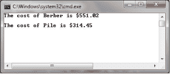

**图 2-21** CarpetCalculator 程序的输出

总之，本章集中讨论了使用数据。在软件开发的剩余部分中，您将使用本章学到的概念。在第 3 章中，您将学习如何编写描述数据行为的方法。

## 编码标准

正如您在第 1 章中所读到的，编码或编程风格是一个术语，用于描述编写源代码的可接受约定。它超出了语言的规则，并提供了指导方针或建议，应遵循这些指导方针以确保朝着共同目标工作的程序员之间的一致性。遵循这些指导方针可以减少编程项目中引入的错误或 bug 的数量。它节省时间，提高程序的可维护性，并有助于确保代码的可靠性。命名约定在本章前面讨论过，下面将重点介绍。

### 命名约定

- 使用有意义、描述性的词语作为标识符。
- 除非是众所周知的缩写，否则不要为标识符使用缩写。
- 除用作循环迭代器的变量外，不要使用单字符标识符。
- 对以下内容使用 Pascal 大小写（所有单词的首字母大写；其他字符小写）：
  - 类和类型标识符
  - 方法名称
  - 命名空间标识符
  - 属性名称
- 对以下内容使用 Camel 大小写（除第一个单词外，所有单词的首字母大写；其他字符小写）：
  - 局部变量标识符
  - 对象标识符
  - 私有数据成员
  - 参数
- 文件名应与类名匹配。
- 使用全部大写字符命名常量。
- 不要在标识符中使用下划线。
- 使用名词或名词短语命名类。

### 间距约定

- 使用制表符而不是空格进行缩进。
- 使用空白（一个空行）分隔和组织代码的逻辑组。
- 将花括号 { } 放在与括号外代码相同的级别。


4. 字面量不能被更改。它们是程序中使用的数字、字符以及字符组合。
5. 类型实际上是通过类实现的。这意味着类被用来定义类型。
6. 一个 `object` 是 `class` 的一个实例。它是 `class` 的一个例子。
7. 值类型通常被称为基本或原始数据类型。它们是语言预定义的数据类型。
8. 值类型包括九种整型（整数）类型、两种浮点类型以及 `decimal` 类型。
9. 所有整型值都表示整数，即没有小数表示的值。值类型 `int` 使用最频繁。
10. 浮点值允许你保留数据项的小数部分。它们可以用带指数的科学计数法指定，也可以用标准十进制表示法指定。
11. `decimal` 格式适用于财务和货币计算。
12. 一个 `bool` 变量的值可以是 `true` 或 `false`。
13. `string` 类型表示 Unicode 字符的组合。
14. `const` 强制实现不允许值被更改的功能。
15. 赋值语句的形式为 变量 = 表达式。
16. 一元运算符需要单个操作数。
17. `++` 和 `--` 的前置递增和后置递增运算符将数字一（1）加到或减去一个存储位置。
18. 复合运算符包括赋值运算符，并用于通过将其原始值作为计算的一部分来修改变量。
19. 执行计算的顺序称为运算顺序。可以在表达式中添加括号以改变顺序。
20. 左结合意味着运算从左到右执行。这意味着在表达式中从左到右移动时，先遇到的运算先执行。
21. 如果二元运算同时涉及 `double` 和 `int`，则会执行隐式类型强制转换。
22. 通过类型转换或类型转换的显式类型强制转换的形式为 (type) expression。

## 练习

1. 以下哪一个是有效的标识符？
- a. `namespace`
- b. variable 1
- c. exampleOfaValue
- d. 3value
- e. value#1

2. 数字 768 是 ________ 类型的例子。
- a. `bool`
- b. integral
- c. floating-point
- d. `struct`
- e. `decimal`

3. 以下哪一个是引用类型？
- a. `int`
- b. `bool`
- c. `string`
- d. `decimal`
- e. integral

4. 不能与标识符一起使用的字符是：
- a. –
- b. $
- c. *
- d. #
- e. all of the above

5. 以下哪一个是保留关键字？
- a. Console
- b. data
- c. int
- d. System
- e. all of the above

6. `float`、`double` 和 `decimal` 之间的主要区别之一是：
- a. `float` 用于表示更多有效数字。
- b. `double` 通常用于大额货币值。
- c. `decimal` 不用于显示负值。
- d. `double` 不需要用 m 或 f 等值后缀数字面量。
- e. `decimal` 主要用于表示需要 $ 进行格式化的较小货币值。

7. 以下哪一个是用于存储本教科书名称的变量的有效声明？
- a. `string` name of book;
- b. `char` nameOfBook;
- c. boolean nameOfBook;
- d. `string` bookName;
- e. `char` book Name;

8. 类型在 C# 中使用以下方式实现：
- a. classes
- b. types
- c. objects
- d. namespaces
- e. programs

9. `int` 类的 `object` 是：
- a. 47.98
- b. 47
- c. `int` class
- d. type `object`
- e. type integral

10. 用于作为标志以指示值是否已达到上限的存储位置的适当声明是什么？
- a. `int` upperLimit;
- b. upperLimit reached;
- c. `bool` upperLimit;
- d. Boolean upperLimit;
- e. `string` upperLimit;

11. 在声明中添加关键字 `const`：
- a. 将一个值放在内存中且不能被更改
- b. 声明常量类型的变量
- c. 必须将其放在标识符之后
- d. 只能与整型一起使用
- e. 在 C# 中被禁止

12. 哪条语句使结果增加 15？
- a. `15 += result;`
- b. `15 =+ result;`
- c. `result =+ 15;`
- d. `result += 15;`
- e. `result = 15 +;`

13. 给定以下声明，算术表达式的结果 ans 中存储的是什么？

```
int ans = 0, v1 = 10, v2 = 19;
ans = --v2 % v1++;
```

- a. 1.8
- b. 9
- c. 8
- d. 2
- e. none of the above

14. 给定以下声明，算术表达式的结果 ans 中存储的是什么？

```
int ans = 10, v1 = 5, v2 = 7, v3 = 18;
ans += v1 + 10 * (v2---- / 5) + v3 / v2;
```

- a. 18
- b. 32
- c. 28
- d. 30
- e. none of the above

15. 以下哪一个将 86 格式化为小数点后显示两位数字？
- a. `{0:C}`
- b. `{0:c}`
- c. `{0:F2}`
- d. all of the above
- e. none of the above

16. 通过在赋值运算符下方放置数字来指示以下赋值语句的运算顺序，如图 2–13 所示。
- a. `ans = value1 + value2 * value3 – (value4 + 20 / 5 % 2) * 7;`
- b. `ans += value1 – – * 10;`
- c. `ans = (((value1 + 7) – 6 * value2) / 2);`
- d. `ans = value1 + value2 / value3 * value4 – –;`

17. 以下哪些是有效的标识符？如果无效，请说明原因。
- a. `intValue`
- b. `value#1`
- c. `the first value`
- d. `_value1`
- e. `AVALUE`

18. 对于以下每项，使用最佳数据类型选择声明一个变量。
- a. 正确答案的数量计数器
- b. 你在信用卡上欠的钱数
- c. 你家乡的名称
- d. 你希望在下次考试中获得的成绩
- e. 你希望本课程学期末被记录的成绩

19. 对于以下每个声明，编写适当的编译时初始化。
- a. 正确答案的数量计数器从零开始
- b. 你在信用卡上欠的钱数是零
- c. 家乡的名称或学校所在城市的名称
- d. 下次考试的成绩为 100
- e. 本课程学期末要记录的成绩为 A

20. 假设 x、y 和 z 是 int 变量且 x = 2、y = 6 且 z = 10。执行以下每个语句后，每个变量的存储位置中会有什么？（对于每个练习，使用原始声明。）
- a. z += ++y % 2;
- b. x = y + 14 - z / 7;
- c. x = y * z / 2 - x * z;
- d. x %= --z - y * 2;
- e. y = (z - y) * 2 + -- y;

21. 假设 x、y 和 z 是 double 变量且 x = 2.5、y = 6.9 且 z = 10.0。执行以下每个语句后，每个变量的存储位置中会有什么？（对于每个练习，使用原始声明。）
- a. z *= y + % 7;
- b. x = (int) y + (14 - z / 7);
- c. x = z / 3 * --y;
- d. z /= (int) y / x;
- e. z = x + y / 4;

22. 以下每个语句的输出会是什么？
- a. Console.Write("Result is {0:c}", 67);
- b. Console.Write("Number {0:f0} is {1:c}", 1, 3);
- c. Console.Write("{0:f0} - {1:c}", 1, 3 * 2);
- d. Console.Write("{0:f0} result " + "xyz {1:f2}", 1, 25);
- e. Console.Write("This is the {0:f0}st example: {1:f2}", 1, 3);

23. 解释变量与常数有何不同。

24. 解释类型、类和对象与字符串的关系。


- 25. 以下程序存在若干语法错误和风格不一致之处。请改正语法错误并指出风格违规之处。

```csharp
namespace Chapter2
{
    class converter
    {
        static void main(
        {
                    CONST int inches = 12;
                    int x = 100; y = 10;
                    float z = 22.45;
                    double ans;
                    ans=inches+z*x%y;
                    System.write("The result is {f2:0} " + "ans");
        }
    }
}
```

# 编程练习

对于每道练习题，请务必在源代码中包含适当的注释、选择有意义的标识符，并使用正确的缩进。

- 1. 设计一个将英里转换为英尺的应用程序。声明 `miles` 并将其初始化为 4.5。显示 `miles` 时，小数点后保留两位。英尺和英寸都应显示为小数点后无数字。让该部分运行起来后，修改解决方案，使其还显示总英寸数。进入源代码，更改 `miles` 的初始化值。重新运行应用程序。

- 2. 编写一个程序，将英里转换为等效的公制千米。通过将 `miles` 值在编译时初始化为 10 来测试该程序。显示原始英里数和格式化后的转换值。进入源代码，更改初始化值，并以新的英里值 3.5 重新运行应用程序。作为额外挑战，在应用程序中加入千米到英里的转换器。

- 3. 编写一个程序，将摄氏温度转换为华氏温度。通过将原始摄氏值在编译时初始化为 32 来测试该程序。显示原始温度和格式化后的转换值。进入源代码，将初始化值改为 0。重新运行应用程序。选择其他测试值并重新运行应用程序。

- 4. 编写一个程序，显示加价 15% 后商品的格式化零售价。通过使用 Ruggy Shoes 在编译时初始化来测试该程序，其批发价为 $52.00。显示这双鞋适当标注的零售价和批发价。当该程序运行起来后，回到源代码，添加代码行，为 Teno Jacket 重新分配内存位置的值，其批发价为 $71.00。再添加额外的代码行，显示新信息。

- 5. 编写一个程序，计算并打印一名佣金制销售员工的实发工资。执行编译时初始化，并将 Nesbith Lang 的姓名存储在名为 `employeeName` 的变量中。Nesbith 按其总销售额的 7% 赚取佣金。她的联邦税率为 18%。她向退休计划缴款 10%，向社会保障缴款 6%。她本月的销售额为 $161,432。生成一份格式化报告，显示每个计算项目的金额。选择合适的常量。完成显示 Nesbith Lang 的数据后，更改这些值并重新运行应用程序。

- 6. 编写一个程序，计算五次考试成绩的平均值。声明这五个值并执行编译时初始化。使用一个常量定义成绩的数量。打印所有成绩以及格式化为小数点后无数字的平均值。用不同的值重新运行应用程序。

- 7. 编写一个程序，打印顾客应找回的 25 美分、10 美分、5 美分和 1 美分硬币数量。通过使用 92 美分作为要转换的值执行编译时初始化，运行一次程序。进入源代码，将 92 改为 27。重新运行应用程序。

- 8. 编写一个程序，计算加权平均值，权重如下。

  - 作业：10%
  - 项目：35%
  - 测验：10%
  - 考试：30%
  - 期末考试：15%

  使用以下值执行编译时初始化：作业：97；项目：82；测验：60；考试：75；期末考试：80。显示所有值，包括权重，并适当标注和格式化。用不同的值重新运行应用程序。

- 9. 编写一个程序，计算计算机俱乐部将从其格兰诺拉麦片项目的收益中获得多少钱。每箱有 100 条。格兰诺拉麦片条每条售价 $1.50。每箱成本 $100.00。他们需要将收益的 10% 交给学生会。显示他们的收益，并显示交给学生会的金额。所有值都以货币格式显示。使用售出 29 箱执行编译时初始化。


Nadia…… / Shutterstock.com

## 第3章：方法与行为

### 本章你将：

- 熟悉方法的组成部分
- 调用带参数和不带参数的类方法
- 使用 `Console` 和 `Math` 类中的预定义方法
- 编写自己的有返回值和无返回值的类方法（带参数和不带参数）
- 区分值参数、`ref` 参数和 `out` 参数类型
- 探索使用带默认值的命名参数和可选参数
- 完成一个编程示例，以说明本章的概念

在第2章中，你学习了如何声明变量和数据成员。你发现数据以变量的形式存储在内存中。你学习了如何对数据执行算术过程，以及如何使用优先级规则计算表达式。你还学习了如何显示格式化数据。本章重点介绍方法。方法为类的数据成员提供操作或行为。方法有助于将问题划分为可管理的单元，以便于开发和代码重用。本章你将学习不同类型的方法、如何调用预定义方法，以及如何创建自己的方法并调用它们。你将编写执行处理并返回其工作结果的方法，也将编写执行过程但不返回值的方法。你将学习如何向方法传递实参，并了解可与方法一起使用的不同类型的参数。首先，你将考察一个方法由哪些组成部分构成。

### 方法的剖析

方法实际上只不过是一组放在同一个名称下的语句。方法定义在类内部。正如你在第1章所学到的，类包含数据和方法集合。方法是类中执行操作的成员，通过编写方法，你描述数据的行为。方法类似于其他编程语言中的函数、过程和模块。它们允许根据语句的功能将程序语句分组，并在需要时调用一次或多次。

> **注意** 与 C 和 C++ 等允许在类外全局定义方法的语言不同，C# 要求所有方法都必须是类的成员。

所有程序都至少由一个方法组成。对于控制台应用程序和 Windows 应用程序，C# 中必需的方法是 `Main()`。`Main()` 是你已经编写过的方法，作为程序的入口点。`Main()` 方法在程序中实际放在哪里并不重要。当程序运行时，`Main()` 方法中的第一条语句就是第一条执行的语句。控制流会在 `Main()` 中继续，直到遇到右大括号。

当你之前编写程序作为 `Main()` 主体的一部分时，你编写的语句调用了其他方法。示例 3-1 包含对两个方法的调用：`WriteLine()` 和 `Read()`。`Main()` 是示例 3-1 中包含的唯一用户定义方法。

**示例 3.1**

```csharp
/* **************************************************
 * SquareExample.cs      Author:      Doyle
 * Computes the square of a variable initialized
 * at compile time.
 **************************************************/

using System;
using System.Collections.Generic;
using System.Linq;
using System.Text;
using System.Threading.Tasks;
namespace SquareExample
{
    public class SquareExample
    {
        public static void Main()
        {
            int aValue = 768;
            int result;

            result = aValue * aValue;
            Console.WriteLine("{0} squared is {1}",
                aValue, result);
            Console.Read();
        }
    }
}
```

示例 3-1 的输出为：

768 的平方是 589824

> **注意** 结果变量中的值可以使用数字格式字符串（n 或 N）进行格式化。通过向字符串（{1:N0}）添加 N 格式参数，会插入逗号，使该值更易读。
>
> `Console.WriteLine("{0} squared is {1:N0}", aValue, result);`
>
> 生成 768 的平方是 589,824
>
> {1:N0} 中的 0 表示小数点右边不应打印任何数字。小数点也不打印。

示例 3-1 中的最后一条语句 `Console.Read()` 是一个方法调用。添加 `Console.Read()` 方法是为了在程序运行时保持屏幕。如果使用 Visual Studio 中的“调试、开始调试 (F5)”选项执行程序，则需要这样做。


方法的第一行称为方法头。图 3-1 标出了构成方法头的各个组成部分。

> **注意** 你会注意到，方法头（如 `Main()`）的末尾并没有放置分号。类头（例如 `public class SquareExample`）或命名空间头的末尾也不放置分号。分号放在变量声明、方法调用和赋值语句的末尾。

有些程序员将方法头称为方法的原型。方法的定义包括方法头和方法体，方法体用花括号括起来。

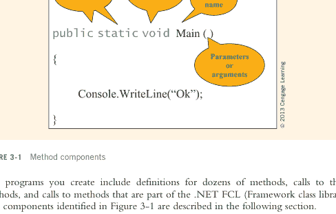

**图 3-1** 方法组成部分

你创建的程序包括大量方法的定义、对这些方法的调用，以及对 .NET FCL（框架类库）中方法的调用。图 3-1 中标识的各组成部分将在下一节中介绍。

## 修饰符

修饰符出现在方法头中，也出现在类和类成员的声明头中，如图 3-1 所示。修饰符被添加到类型或类型成员的声明中，以改变或修改它，或指示其访问方式。在第 2 章中，你学习并使用过 `const` 修饰符。`const` 被添加到声明中，以指示某个值是常量且不能被更改。你之前还见过另外两种修饰符：static 修饰符和访问修饰符。

### static 修饰符

你已经遇到过与 `Main()` 方法一起使用的 `static`。所有 `Main()` 方法头都必须包含 `static` 修饰符。如果在编写 `Main()` 方法时忘记包含 `static`，C# 会发出错误消息。`Write()`、`WriteLine()` 和 `ReadLine()` 都是 Console 类的 `static` 方法。为了调用这些方法，你必须将类名（`Console`）放在方法名之前。

你很快将探索 Math 类的成员。这些成员的方法头都包含 `static` 关键字。示例 3-2 中的方法将一个值提升到指定幂。检查它的方法头。

**示例 3-2**

```csharp
public static double Pow(double, double)
```

这里使用 `static` 表示方法属于类型本身，而不是属于某个特定 `class` 的 `object`。这意味着使用此方法成员时无需实例化 `class` 的 `object`。你将在下一章中定义非 static 方法。

> **注意**
>
> 如果成员方法与 `static` 方法在同一个 `class` 中，则可以通过输入其标识符（不带 `object` 或 `class` 名称）来调用该 `static` 方法。但是，如果你从另一个 `class` 调用 `static` 方法，则必须将 `class` 名称与方法名称一起使用。例如，要调用 Math 类的 `Sqrt()` 方法，可以这样写：
>
> ```csharp
> double answer = Math.Sqrt(25);
> ```

使用 `static` 修饰符的方法称为 `class` 方法。只会创建方法的一个副本，而不是为每个 `object` 创建副本。实例方法要求在访问方法之前先实例化一个 `object`。你将在第 4 章创建自己的类时了解更多关于实例方法的内容。当你编写自己的方法时，可以添加 `static` 修饰符；然而，对于大多数为面向对象应用程序设计的类来说，`static` 关键字很少使用。面向对象开发的许多强大之处在于将方法和数据成员封装（打包）在一起，从而使对象可以定义自己的成员并完全相互独立。当方法被定义为 `static` 时，会创建该方法的一个副本以供所有对象使用。

### 访问修饰符

另一种修饰符是访问修饰符。它指定类型及其成员的访问级别。C# 包含以下访问修饰符：

- `public`
- `protected`
- `internal`
- `protected internal`
- `private`

public 访问提供的访问限制最少；访问 public 成员或类基本上没有任何限制。注意在示例 3-1 中，类定义和 `Main()` 方法头都包含 `public` 访问修饰符。通过指定 public 访问，其他类可以在不同应用程序中重用你的类。

private 是最具限制性的访问修饰符。private 成员只能在声明它们的类体内被访问。在面向对象设计中，通常数据用 private 修饰符定义，而访问数据的方法被声明为 public 访问。通过将数据成员定义为 private，你可以限制仅通过成员方法或本章中将要学习的属性来访问数据。

表 3-1 显示了访问修饰符的不同访问级别。

**表 3-1.** C# 访问修饰符

| 修饰符 | 访问性说明 |
|---|---|
| `public` | 无限制 |
| `protected` | 限于包含类或从包含类派生的类 |
| `internal` | 限于当前项目 |
| `protected internal` | 限于当前项目或从包含类派生的类 |
| `private` | 限于包含类 |

当类或类成员未指定修饰符时，默认采用 private 访问级别。在本章后面，你将了解另一种修饰符：`override`。该关键字被添加到方法头中，用于为先前定义的方法声明新定义。先前定义的方法和新方法都通过同一个标识符引用。

## 返回类型

**返回**类型标识方法完成时返回什么类型的值。可以返回任何预定义类型或有效的用户定义类型。方法可以在其所有语句执行完后返回一个值，也可以只将控制权返回给调用它的方法，而不带回值。

**返回**类型总是紧邻方法名前列出，如图 3-1 所示。方法不一定非要返回内容；不过，它们通过方法名最多只能返回一种数据类型。

> **注意**
> 你将在第 7 章和第 8 章中学习数组和集合（如 ArrayList）。C# 允许方法返回集合；但是，返回值必须通过单个标识符。该标识符可以是数组的名称。

如果方法不返回值，则 **void** 关键字被放在方法头中 **返回**类型的位置，如下面的代码行所示：

```csharp
public void DisplayInstructions()
```

如果在方法头中指定了除 **void** 之外的**返回**类型，则方法体中必须包含 **返回**语句。返回的值必须是兼容的值——即与头中的类型匹配或可存储在该类型中的值。

**返回**语句的形式如下：

```
return [value];
```

注意 `value` 用方括号括起来表示它是可选的。如果方法头使用 **void** 作为返回类型，则 **返回**语句可以省略，或写成如下形式：

```
return;
```

无论何时，只要**返回**类型不是 **void**，就必须在 **返回**关键字后面跟有一个返回值。该值可以是字面量、算术表达式或保存值的变量。示例 3-3 演示了返回计算值。

**示例 3-3**

```csharp
public static double CalculateMilesPerGallon
        (int milesTraveled, double gallonsUsed)
{
    return milesTraveled / gallonsUsed;
}
```

示例 3-3 中的方法头表示返回一个 `double` 值。这是紧随 `public` 关键字之后的 `double`。在方法体内部，除法运算的结果产生一个兼容的 `double` 值。

返回的值被发送到程序中调用该方法的位置。例如，从 `CalculateMilesPerGallon()` 方法返回的值被发送到 `WriteLine()` 方法，以便在下面的调用中显示：

```csharp
Console.WriteLine("Miles per gallon = {0:N2}",
    CalculateMilesPerGallon(289, 12.2));
```

`WriteLine()` 方法产生的输出将是：

```
Miles per gallon = 23.69
```

> **注意**
> 如果你的方法只有一个入口和一个出口，那么程序将更容易修改和调试。这是一种你应该在设计中尝试纳入的解决问题的技巧。其含义是，你应尽量在一个方法中只使用一条 `return` 语句。

## 方法名

在命名方法时，要遵循第 2 章中介绍的创建标识符的规则。标识符应该是有意义的名称，用来标识代码段的总体用途。许多程序员使用标准约定，用动作动词短语来命名方法。这个动词短语应描述方法打算完成什么。类和方法的标识符使用 Pascal 大小写风格。按照这一 C# 约定，当标识符至少有三个字符时，第一个字符为大写。作为标识符一部分的后续单词也以大写字符开头。遵循这些风格约定的方法标识符示例包括：`CalculateSalesTax()`、`AssignSectionNumber()`、`DisplayResults()`、`InputAge()` 和 `ConvertInputValue()`。

> **注意**
> C# 程序对数据成员标识符使用 Camel 大小写风格约定。这种风格规定标识符的第一个字母为小写，后续每个连接单词的第一个字母大写。例如 `studentName`、`majorInCollege` 和 `yearInSchool`。

## 参数

方法头括号内的项称为参数或实参。有时方法需要提供特定的数据。例如，如果编写一个方法来计算三个值的平均值，该方法要求这三个值必须传给它。示例 3-3 中的 `CalculateMilesPerGallon()` 方法需要两个实参：一个用于 `milesTraveled` 的 `int` 值和一个用于 `gallonsUsed` 的 `double` 值。数据正是通过参数和实参被传入方法的。


编写方法时，由你决定该方法需要什么类型的特定数据。然后，将数据类型和该数据类型的标识符放在圆括号内。必须在圆括号内包含匹配的类型和标识符对。`CalculateMilesPerGallon( )` 方法的两个匹配参数对如下：

`(int milesTraveled, double gallonsUsed)`

在方法体中，这些标识符用于引用应在何处以及何时使用该特定数据项。对于 `CalculateMilesPerGallon( )` 方法，`milesTraveled` 和 `gallonsUsed` 用于一个算术表达式中。该表达式的结果会返回给调用方法。

有些程序员区分 parameters 和 arguments，用术语 parameter 指方法头中出现的项，用 argument 指方法调用中出现的项。另一些人则通过给这些术语加上 actual 和 formal 来区分 arguments 和 parameters。形式参数（formal parameters，或称 arguments）出现在方法头中。实际实参（actual arguments，或称 parameters）出现在调用中。把实际实参（actual argument）看作发送给方法的实际数据。形式参数（formal parameters）就像占位符；它们形式上表明期望发送什么类型的数据供方法使用。本书使用术语“parameters”指方法头中的项，使用术语“arguments”指通过方法调用发送到方法中的项。对于示例 3-3，`CalculateMilesPerGallon( )` 方法的 arguments 是 289 和 12.2。这是实际数据或数字；不过，实际实参（actual argument）也可以是变量的标识符。它还可以是涉及算术语句或对另一个方法的调用的表达式。

与返回类型一样，参数是可选的。如果不包含参数，则使用一对圆括号。如果包含多个参数，则用逗号分隔。

> **注意**
> 
> 有些语言会把 `void` 关键字放在圆括号内代替参数列表，以表示不需要参数。C# 不允许这样做，并会生成语法错误。

参数有几种不同类型，本章后面将进行探讨。

## 方法体

正如你在示例 3-1 中看到的，构成方法体的语句括在花括号中。下面 `DisplayMessage( )` 方法的方法体包括：对 `Console` 类中 `Write( )` 方法的两次调用、对 `Console` 类中 `WriteLine( )` 方法的一次调用，以及一个不返回值的返回语句。

```csharp
public void DisplayMessage( )
{
    Console.Write("This is ");
    Console.Write("an example of a method ");
    Console.WriteLine("body. ");
    return;  // no value is returned
}
```

通常，方法体内的语句按顺序执行。方法体可以包含声明变量、执行算术运算和调用其他方法的语句。无论使用的是自己编写的方法，还是构成框架类库 (FCL) 的预定义方法，这些规则和概念都同样适用。当方法中的最后一条语句执行完毕时，控制权会返回给发起调用的方法。

> **注意**
> 
> 注意，`DisplayMessage( )` 方法的 `return` 类型是 `void`。其中包含一个 `return` 语句。`return` 是可选的，因为方法结束时没有返回值。

示例 3-2 向你展示了 `Pow( )` 方法的方法头。这里再次给出：

```csharp
public static double Pow(double, double)
```

此方法返回将某个数提升到指定幂次的结果。圆括号内需要两个 `double` 类型的参数。这些值依次表示底数和指数。这些标识符会插入方法体中应对这些值进行计算的位置。调用方法时，作为实参发送的特定值会替换方法体中的占位符。例如，如果进行以下调用：

```csharp
double result = Math.Pow(5, 2);
```

`Pow( )` 执行完毕后返回的值存储在 `result` 中。结果会是 25，因为 5² = 25。

> **注意**
> 
> 你并没有看到构成 `Pow( )` 方法体的实际语句。这正是面向对象开发的优点之一。你不需要知道该方法如何产生结果。要使用 `Pow( )` 方法，你只需要知道向它发送什么类型的值，以及可以期望收到什么类型的返回值。面向对象编程的黑盒概念会向你隐藏方法实现细节。

应用程序运行时，`Main( )` 充当控制方法。执行总是从 `Main( )` 方法体开始。执行从 `Main( )` 中的第一行开始，并在到达 `Main( )` 中的右花括号时停止。当然，应用程序中还可以执行许多其他方法；不过，它们必须从 `Main()` 或从由 `Main()` 调用的方法中调用。在示例 3-1 中，你看到了如何通过调用（或调用）这些方法，将控制权传递给 `WriteLine()` 和 `Read()` 方法。

## 调用类方法

调用一个方法（invoking a method）就是调用该方法。当遇到方法调用时，.NET 执行引擎（即公共语言运行时 (CLR)）会暂停当前方法中的执行，并将控制权转移到被调用方法的方法体。完成被调用方法的方法体后，控制权会返回调用方法中发起调用的位置。对不返回值的方法的调用使用以下语法：

```
[qualifier].MethodName(argumentList);
```

> **注意**
> 
> 在语法参考中，只要出现方括号，其中的条目就是可选的。对于静态方法，限定符是类名。

在前面的语法表示中添加了限定符，以表示可能需要包含类或对象标识符。对 `WriteLine()` 方法的调用已将 `Console` 类作为限定符包含在内。

如前所述，并非所有方法都需要实参列表。下面两条语句都是对 `WriteLine()` 方法的合法调用。第一条不接收实参；第二次调用向该方法发送一个数据项。

```
Console.WriteLine(); // No arguments. Writes a blank line
Console.WriteLine("Ok"); // Single argument
```

当实参列表包含多个数据项时，各值用逗号分隔，如下所示：

```
Console.WriteLine("Value1({0}) + Value2({1})" + " = Value3({2})", 25, 75, (25 + 75));
```

对 `WriteLine()` 方法最后一次调用的输出将是：

Value1(25) + Value2(75) = Value3(100)

该调用包含四个实参：

- 1. `"Value1({0}) + Value2({1})" + " = Value3({2})"`
- 2. `25`
- 3. `75`
- 4. `(25 + 75)`

方法调用从不在实参列表中包含数据类型，而是包含实际数据。当然，实际实参可以采用字面量的形式（如前所示），也可以是变量或表达式。表达式可以相当复杂，甚至可以包含对另一个方法的调用。

如果使用 Visual Studio 开发应用程序，那么在调用方法时应利用 IDE 的 IntelliSense 功能。输入 `class` 或 `object` 名称并键入点 (.) 后，会显示成员列表。在成员列表中向下移动时，弹出窗口会显示有关每个成员的信息。图 3-2 中选中的是 `Write()` 方法。注意图 3-2 中成员名称左侧出现了两个不同的图标。方法显示为三维盒子图标。`Title` 和 `WindowWidth` 旁边带有扳手的图标用于引用属性。

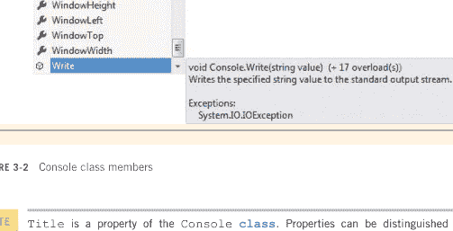

**图 3-2 Console 类成员**

> **注意**
> 
> `Title` 是 `Console` 类的一个属性。属性可以通过其名称左侧的图标与数据、方法等其他成员区分开来。下一章后面你将了解更多关于属性的内容。

在接下来的各节中，你将探讨一些已经见过并使用过的预定义方法。这应有助于你更好地理解如何使用这些方法，以及构成框架类库的其他预定义方法。


注意 IntelliSense 会列出用户创建的标识符以及 .NET 标识符。要在 Visual Studio 中快速打开 IntelliSense，请键入任意标识符（预定义或用户定义）的第一个字符，然后按 Ctrl + 空格键。你会得到一个可供选择的成员列表。如果在按 Ctrl + 空格键之前键入两三个字符，这也同样有效。通过键入更多字符，可以减少列出的数量。要查看 System 命名空间中所有类的名称，请在添加 using 指令后，按 Ctrl + 空格键。通过学习使用此功能，你就不会介意声明较长的描述性标识符，并且键入错误也会更少。

## 预定义方法

.NET Framework 的一个关键特性是其广泛的类库。在类库中，每个类都有许多预定义方法。这些 .NET 方法已经过 .NET 开发人员的充分测试，并提供了大量功能。只要有可能，就应使用预定义方法，避免给自己增加工作量。

在你已经看到并开发过的程序中，using 指令使 System 命名空间可用。Console 类定义在 System 命名空间中。它提供了从控制台读取字符以及向控制台写入字符的方法。既有处理单个字符的方法，也有处理整行字符的方法。你最常使用的方法是 Write() 和 WriteLine()。它们都是重载方法，这意味着存在多个同名方法，但每个方法的参数数量或类型不同。

### Write() 方法

正如你在图 3-2 中看到的，Visual Studio 的 IntelliSense 功能会在右侧的弹出窗口中显示有关该方法的信息。使用这些信息可以确定如何调用该方法。弹出窗口包含该方法的签名，以及返回类型和该成员功能的简短说明。方法名、修饰符及其形参类型共同构成签名。图 3-2 中的 Write() 方法有一个形参，即一个字符串值。尽管返回类型首先显示在弹出窗口中，但返回类型不被视为其签名的一部分。请注意，Write() 将 void 列为返回类型。

为了给这些方法尽可能增加功能，Write() 被重载了。.NET 包含 18 个不同的 Write() 方法。它们名称都相同，但每个方法都有不同的签名。请注意，图 3-2 的弹出显示第一行以“(+17 个重载)”结尾。这只是 18 个 Write() 方法签名之一。示例 3-4 列出了另外四个 Write() 签名。除了这四个之外，还有 14 个其他 Console.Write() 方法。这意味着你可以将任何预定义基本类型作为参数传递给该方法，并得到你所期望的在控制台上显示的结果。

**示例 3.4**

```csharp
Console.Write(int)
Console.Write(double)
Console.Write(object)
Console.Write(bool)
```

那么 CLR 如何知道要使用这 18 个方法中的哪一个呢？答案很简单，但对你来说理解它很重要。调用方法时，用于进行调用的参数会与签名匹配，以确定要执行哪一个方法。请记住，方法的签名包括形参，而形参包括可用于该方法的数据类型。

在 Visual Studio 中，选择 `Write()` 成员并键入左括号后，IntelliSense 会显示一个带有滚动条的下拉列表，允许查看全部 18 个签名。这让你有机会了解调用时需要什么类型的参数。图 3-3 显示了 18 个签名中的第一个。

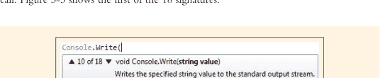

**图 3-3** IntelliSense 显示

图 3-3 中的 `Write()` 方法通过输入方法名、左括号、一个 `string` 值和一个右括号来调用。在调用中，`string` 值可以是字符串字面量、字符串变量，或转换为字符串的另一种数据类型的值。从第 2 章中，你了解到字符串字面量是用双引号括起来的一个或多个字符。使用图 3-3 中显示的重载方法对 `Write()` 方法进行有效调用如下：

```
Console.Write("Any string value will work!");
```

这 18 个重载的 `Write()` 方法包含常见类型的参数，例如 `int`、`double`、`decimal`、`bool` 和 `object`。你应该探索其他选项。

### WriteLine() 方法

如前所示，`WriteLine()` 方法的行为与 `Write()` 方法类似，区别在于它在显示参数之后会写入当前的行尾终止符。共有 19 个重载的 WriteLine() 方法。示例 3-5 包含对 WriteLine() 方法的有效调用。

**示例 3.5**

```csharp
Console.WriteLine(45);
Console.WriteLine("An apple a day"
                  + " keeps the doctor away.");
Console.WriteLine(67.28 + 10000);
Console.WriteLine(true);
Console.WriteLine("Score on the next exam: {0} ", 100);
```

前面每个语句生成的输出为：

```
45
An apple a day keeps the doctor away.
10067.28
True
Score on the next exam: 100
```

> **注意**
> 请注意，在示例 3-5 生成的输出中，显示 bool 变量时会打印 True。第一个字符是大写的。然而，bool 变量的有效值是 true 和 false，全部为小写字符。不要被这种不一致弄糊涂了。

Write() 和 WriteLine() 方法在被调用时没有返回任何内容。它们执行完任务后，将控制权交给 Main() 方法中的下一条顺序语句。它们的任务是将指定信息写入控制台。当它们完成工作后，没有向调用方法 Main() 返回任何值。请注意，图 3-1 和图 3-2 中 IntelliSense 显示的弹出窗口中，Write() 方法的标题以“void …”开头。

Console 类还包含允许你从键盘输入值的方法。输入后，这些值会返回给程序。用于控制台输入的两个方法是 Read() 和 ReadLine()。这两个方法都不是重载的。

### Read() 方法

前面使用 Read() 来保持输出窗口打开，直到按下键盘上的某个字符。这使你的程序用户能够根据需要让输出在屏幕上保留任意长时间。

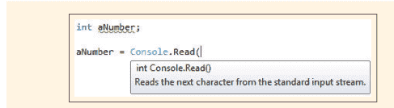

**图 3-4** Console.Read() 签名

如图 3-4 所示，`Read()` 方法返回一个 `int`，表示从键盘输入的下一个字符。使用 IntelliSense 在右侧框中显示的方法标题以 `int` 关键字开头。该 `int` 是所输入的单个 `char` 值的 Unicode 表示形式。示例 3-6 说明了使用 `Read()` 方法时内存中存储的内容。

**示例 3.6**

```csharp
int aNumber;
Console.Write("Enter a single character: ");
aNumber = Console.Read();
Console.WriteLine("The value of the character entered: "
                  + aNumber);
```

如果用户在提示时键入字母字符 `a`，输出如下：

```
The value of the character entered: 97
```

这可能是你复习附录 C 的好时机。请注意，字符 `a` 的 Unicode 十进制表示形式是 97。

要显示实际输入的字符，可以对该值进行强制转换，如示例 3-7 所示。

**示例 3.7**

```csharp
Console.WriteLine("The value of the character entered: "
                  + (char) aNumber);
```

如果用户使用强制转换键入字符 'a'，输出变为：

```
The value of the character entered: a
```

请注意，因为 `Read()` 方法返回了一个值，所以必须设法提供一个位置，以便在方法返回时存储该值。为此，使用了赋值语句。另一种选择是将对 `Read()` 的调用作为 `WriteLine()` 方法参数的一部分，放在应显示 `aNumber` 的位置。


The single statement in Example 3-8 could replace all four lines from Examples 3-6 and 3-7.

### 示例 3.8

```csharp
Console.WriteLine("The value of the character entered: "
    + (char) Console.Read());
```

This single line is possible because the `Console.Read()` method allows the user to enter one character. The `Read()` method returns an `int`. The `int` value is cast to a `char` for display purposes. This value is then concatenated onto the end of the string, with the "+" operator. Although the preceding is syntactically correct and works for entering a single character, it is not as readable. It does not prompt users by telling them to enter a character. Another disadvantage of replacing the four lines with the single line is the fact that the entered value is not stored in a variable; thus, it is only available for use with that specific output statement.

> **注意**
> `Console.ReadKey()` is another option for holding the screen.
> `Console.ReadKey()` obtains the next character or function key from the user.

## ReadLine() 方法

The `ReadLine()` method is much more versatile than the `Read()` method. Any number of characters can be entered using the `ReadLine()` method, and it returns all characters up to the current end-of-line terminator, the Enter key.

As Figure 3-5 shows, no arguments are included inside the parentheses to the `ReadLine()` method. `ReadLine()` is not an overloaded method. It always returns a `string`. Even if numbers are entered, a `string` representing the concatenation of these numbers is returned. When the user types the number 786 at the keyboard, the result returned is `'7' + '8' + '6'` or the string `"786"`. An extra step is needed before any mathematical operations can be performed on the value. The `string` value must be parsed into an appropriate number type.

> **注意**
> This feature was probably borrowed from Java. All values are entered as strings in Java.
> This enables values to be entered as strings and checked for typing errors before parsing or translating them into numbers.

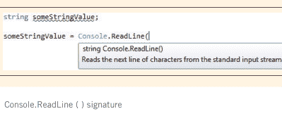

### 图 3-5 Console.ReadLine() 签名

Example 3-9 shows calls to the predefined `Write()`, `ReadLine()`, `Parse()`, and `WriteLine()` methods. An integer is requested. `ReadLine()` returns a `string` value. An extra step is needed before any arithmetic can be performed on the value that was entered. The `string` value must be changed or converted into an appropriate number type. The `Parse()` method does that conversion. It is discussed in the next section.

### 示例 3.9

```csharp
/* ***********************************************
 * AgeIncrementer.cs Author: Doyle
 * Displays age one year from now.
 *
 ************************************************/
using System;
using System.Collections.Generic;
using System.Linq;
using System.Text;
using System.Threading.Tasks;
namespace AgeIncrementer
{
    public class AgeIncrementer
    {
        public static void Main()
        {
            int age;
            string aValue;

            Console.Write("Enter your age: ");
            aValue = Console.ReadLine();
            age = int.Parse(aValue);
            Console.WriteLine("Your age next year"
                + " will be {0}", ++age);
            Console.Read();
        }
    }
}
```

## ReadKey() 方法

The `ReadKey()` method obtains the next character or function key pressed by the user. This method can be called if you want the user to press some key to continue processing. It could also be placed as the last line of executable code in the `Main()` method.

## Parse() 方法

Another predefined static method you will use often is the `Parse()` method. As stated previously, `Parse()` returns the number representation of its string argument. All numeric types have a `Parse()` method. In Example 3-9, an `int` value is returned when the `Parse()` method finishes. `Parse()` can also be called with a `double` object, as illustrated in Example 3-10.

### 示例 3.10

```csharp
/* ***********************************************
 * SquareInputValue.cs              Author: Doyle
 * Allows an integer value to be input.
 * Computes and displays the square of the
 * value that is input.
 *
 ************************************************/
using System;
using System.Collections.Generic;
using System.Linq;
using System.Text;
using System.Threading.Tasks;
namespace SquareInputValue
{
    class SquareInputValue
    {
        static void Main()
        {
            string inputStringValue;
            double aValue;
            double result;

            Console.Write("Enter a value to be "
                    + "squared: ");
            inputStringValue = Console.ReadLine();
            aValue = double.Parse(inputStringValue);
            result = Math.Pow(aValue, 2);
            Console.WriteLine("{0} squared is {1}",
                    aValue, result);
            Console.ReadKey();
        }
    }
}
```

Calls to methods `char.Parse()` and `bool.Parse()` produce similar results, as shown in Example 3-11.

### 示例 3.11

```csharp
string sValue = "true";
Console.WriteLine(bool.Parse(sValue));    // displays True
string strValue = "q";
Console.WriteLine(char.Parse(strValue));    // displays q
```

If you attempt to parse an incompatible value, a `System.FormatException` error, similar to that shown in Figure 3-6, is generated. The error in Figure 3-6 was generated from `Console.WriteLine(char.Parse(sValue))` when `sValue` referenced `"true"`, as in Example 3-11.


### 图 3-6 System.FormatException 运行时错误

`sValue` is a `string` variable that contains more than one character. The argument to `char.Parse()` must be a single-character string.

There is more than one way to convert from one base type to another. As part of the .NET Framework class library, in the `System` namespace, a number of static methods are found in the `Convert` class. These include `Convert.ToDouble()`, `Convert.ToDecimal()`, `Convert.ToInt32()`, `Convert.ToBoolean()`, and `Convert.ToChar()`. Used like the `Parse()` method, they convert data from one base type to another base type. The following converts an entered `string` value to an `int` base type:

```csharp
int newValue = Convert.ToInt32(stringValue);
```

These methods are all overloaded so that the argument to the method can be of varying type. If, for example, you send a `char` argument to the `Convert.ToInt32()` method, and store the result in an `int` variable, you get the Unicode numeric representation for that character.

> **注意**
> `int.Parse()` could be replaced by `Int32.Parse()`. `Int32` is the `class` in .NET. The `int` type is an alias for `Int32`. All .NET-supported languages recognize `Int32`.

You might be wondering whether you should use the `Parse()` methods or methods from the `Convert` class to convert your string values to their appropriate data types. It is really a matter of choice whichever you use. Both work well if the string is storing the correct data that you are attempting to convert. When you call the `Convert.ToInt32()`, it actually calls the `Int32.Parse()` method. So, there is a little more overhead involved in the call to methods in the `Convert` class. The difference is that if you pass an empty string to the `Convert` class, it returns 0. If you pass an empty string (`null string`) to the `Int32.Parse()` method, it creates an error, similar to that illustrated in Figure 3-6, by throwing an `ArgumentNullException`. You will learn about how to handle exceptions in Chapter 11.

> **注意**
> You might also want to explore the `TryParse()` method. `Int32.TryParse()` attempts to convert a `string` to an `int` without throwing an exception.

One advantage the `Convert` class offers is it makes it easier to convert between all the base types—not just from a string to another data type. The `Parse()` method only works well for string conversions. For example, `Int32.Parse()` only converts strings to integers. `Convert.ToInt32()` converts any base type to an integer.

## MATH 类中的方法

The `Math` class has a number of predefined static methods you will find helpful. The `Math` class, like the `Console` class, is located in the `System` namespace. This class provides constants and methods for trigonometric, logarithmic, and other common mathematical functions. The `Pow()` method that you saw previously is a member of the `Math` class. You learned that the first argument to the `Pow()` method is the base, the number to be raised. The second argument is the exponent, or the specified power value. Table 3-2 identifies, describes, and gives examples of the more commonly used methods from the `Math` class. The signature and the return type are included in the third column.


### 表 3-2 Math 类方法

| Method | Description | Method heading |
|---|---|---|
| Abs | 返回指定数字的绝对值。<br>重载——可用于 int、double、decimal、short、float、sbyte 和 long。<br>示例：<br>`Math.Abs(-88.62)`<br>返回值为 88.62 | `public static int Abs(int)` |
| Ceiling | 返回大于或等于指定数字的最小整数。<br>示例：<br>`Math.Ceiling(88.12)`<br>返回值为 89 | `public static double Ceiling(double)` |
| Cos | 返回以弧度为单位的指定角度的余弦值。 | `public static double Cos(double)` |
| Exp | 返回 e 的指定次幂。e 在 Math 类中定义为常量。其值为 2.7182818284590452354。<br>示例：`Math.Exp(2)`<br>返回值为 7.38905609893065 | `public static double Exp(double)` |
| Floor | 返回小于或等于指定数字的最大整数。<br>示例：<br>`Math.Floor(88.62)`<br>返回值为 88 | `public static double Floor(double)` |
| Log | 返回指定数字的对数。两个重载方法。第一个返回指定数字的自然（以 e 为底）对数。它接受一个 double 类型的参数。第二个（右侧签名）返回指定数字的对数。示例：`Math.Log(4)` 返回值为 1.38629436111989 | `public static double Log (double, double)` |
| Max | 返回两个指定数字中较大的一个。重载了 11 个不同的方法（byte、decimal、double、short、int、long、sbyte、float、ushort、uint 和 ulong）。所有方法都要求两个参数类型相同。示例：`Math.Max(87, 13)` 返回 87 | `public static double Max (double, double)` |
| Min | 返回两个数字中较小的一个。重载——与上一行的 Max 完全相同。示例：`Math.Min(87, 13)` 返回 13 | `public static int Min(int, int)` |
| Pow | 返回指定数字的指定次幂。不重载。参数可以作为 int 输入。它们会被隐式转换。返回值必须存储在 double 中；否则，您会收到语法错误。示例：`Math.Pow(5, 3)` 返回 125 | `public static double Pow (double, double)` |
| Round | 返回最接近指定值的数字。重载。可以返回具有由第二个参数指示的指定精度的数字，如右侧签名所示。示例：`Math.Round(87.982276, 4)` 返回 87.9823 | `public static double Round (double, int)` |
| Sign | 返回指示数字符号的值（负值为 -1；正值为 1；零值为 0）。重载——每个都返回 int。参数可用于 double、decimal、long、short、sbyte、int 或 float。示例：`Math.Sign(46.3)` 返回 1 | `public static int Sign(double)` |
| Sin | 返回以弧度为单位的指定角度的正弦值。 | `public static double Sin(double)` |
| Sqrt | 返回指定数字的平方根。返回值必须存储在 double 中；否则，您会收到语法错误。示例：`Math.Sqrt(25)` 返回 5 | `public static double Sqrt (double)` |
| Tan | 返回以弧度为单位的指定角度的正切值。 | `public static double Tan(double)` |

由于表 3-2 中的每个方法都是静态的，对它们的调用必须包含 Math 类名作为限定符。

**注意**

您在第 2 章学习了隐式转换。C# 在向方法发送参数时提供了从较小数据类型到较大数据类型的转换。例如，隐式转换发生在 int 到 long、float、double 或 decimal 类型时。因此，如果方法标题中括号内的形式参数为 double，您通常可以在调用方法时发送 int 参数。int 会由 CLR 转换为 double。

以下是 Math 类方法的有效调用示例：

```
double aValue = 78.926;
double result1,
    result2;
result1 = Math.Floor(aValue); // result1 = 78
result2 = Math.Sqrt(aValue); // result2 = 8.88403061678651
Console.Write("aValue rounded to two decimal places"
    + " is {0}", Math.Round(aValue, 2));
```

最后一条语句的输出为：

aValue rounded to two decimal places is 78.93

当您查看使用 Math 类预定义方法的示例时，可以看到它们都有一个共同点。每个方法都返回一个值。返回值的调用通常放在表达式或输出语句中。当返回值返回时，必须有一个位置来使用该值。

一个类可以定义静态方法，也可以利用另一个类中定义的静态方法。如果您调用的方法是与调用位置相同类的成员，则调用语句不必包含类名。如果您调用的是另一个类中定义的静态方法，则必须包含该类的名称。当您使用 Math 类中的方法时，您使用的是在类边界之外定义的方法。Exp() 是 Math 类的静态成员。在以下示例中，它返回 e，即自然对数底，以 5 次方计算。必须使用类名 Math 作为限定符。

```
double result;
result = Math.Exp(5);
```

**注意**

Math 类还定义了两个静态数据字段成员作为常量。对静态字段成员的调用也需要用类名作为前缀。其声明如下：

```
public const double E = 2.7182818284590452354;
public const double PI = 3.14159265358979323846;
```

其使用示例如下：

```
circumference = 2 * Math.PI * radius; //use of PI in an
//expression
```

对返回值方法的调用必须放在代码中方法完成时可以接受该值的位置。调用可以出现在可以放置该类型兼容值的任何位置。示例 3-12 中第 4、6 和 9 行的语句说明了静态方法 Max() 返回值的三个不同位置。

### 示例 3.12

```
Line 1  int aValue = 200;
Line 2  int bValue = 896;
Line 3  int result;
Line 4  result = Math.Max(aValue, bValue);
// result = 896
Line 5  result += bValue *
Line 6      Math.Max(aValue, bValue) - aValue;
// result = 896 + (896 * 896 - 200)
// result = 803512
Line 7  Console.WriteLine("Largest value between {0} "
Line 8      + "and {1} is {2}", aValue, bValue,
Line 9      Math.Max(aValue, bValue));
```

第 7 行至第 9 行生成的输出为：

Largest value between 200 and 896 is 896

如表 3-2 所示，Max() 的标题为

```
public static int Max(int, int)
```

如第 4 行至第 9 行的前三个语句所示，返回值方法返回的值可以返回到程序中任何可以使用该返回类型变量的位置。第 4 行返回的 int 被赋给 result。第 6 行返回的 int 用作算术表达式的一部分。第 9 行返回的 int 是 WriteLine() 方法的参数。

## 编写您自己的类方法

.NET FCL 中包含许多由成员方法组成的类。您应该在可能的情况下探索并使用它们。然而，对于构建您独特的应用程序的特定任务，通常需要您自己编写方法。

定义方法的语法如下。方括号与修饰符一起使用表示可选条目。

```
[ modifier(s)] returnType MethodName(parameterList)
{
    // body of method - consisting of executable statements
}
```

如前所述，returnType 指定在方法体执行完毕时返回的信息类型。这可以是任何预定义或用户定义的类型，例如 int 或 double。returnType 也可以被关键字 void 替换。void 用于表示没有返回值。请注意，每个方法只有一个 returnType 的位置。因此，一个方法在其名称下最多只能返回一种值类型。

C# 中的用户定义方法可以分为两类：

- 不返回值的方法，称为 void 方法
- 返回值的方法，称为返回值方法

在接下来的部分中，您将编写这两种类型。

### Void 方法

void 方法是最简单的编写方法。方法体中不需要 return 语句。

> **注意** 在非返回值方法中允许使用 return 关键字作为最后一句话。一些程序员认为这增加了可读性。如果您包含 return，则在关键字后放置分号。非返回值方法不使用值。

关键字 void 用于标题中的返回类型。示例 3-13 说明了一个非返回值方法。它不期望向其发送任何数据。括号内不包含参数。包含关键字 static 以便可以在不实例化方法类的对象的情况下调用这些方法。本章后面您将学习如何编写非静态方法。


### 示例 3.13

```
    public static void DisplayInstructions( )
    {
        Console.WriteLine("This program will determine how "
                        + "much carpet to purchase.");
        Console.WriteLine( );
        Console.WriteLine("You will be asked to enter the "
                        + " size of the room and ");
        Console.WriteLine("the price of the carpet, "
                        + "in price per square yards.");
        Console.WriteLine( );
    }
```

无返回值方法可以包含参数。示例 3-14 演示了一个 `void` 方法，该方法要求在调用时向它发送数据。

### 示例 3.14

```
    public static void DisplayResults(double squareYards,
                                      double pricePerSquareYard)
    {
        Console.Write("Total Square Yards needed: ");
        Console.WriteLine("{0:N2}", squareYards);
        Console.Write("Total Cost at {0:C} ",
                      pricePerSquareYard);
        Console.WriteLine(" per Square Yard: {0:C}",
                          (squareYards * pricePerSquareYard));
    }
```

要调用这些无返回值方法，只需输入方法标识符，后跟一对圆括号。如果方法有参数，则调用时会在圆括号内包含实际参数。这些方法是*类*方法；它们在方法头中包含 `static` 关键字。对示例 3-13 和 3-14 中方法的调用如下：

```
    DisplayInstructions( );
    DisplayResults(16.5, 18.95);
```

> **注意**
>
> 16.5 和 18.95 可以替换为包含值的 `double` 变量。

注意，这些方法在调用时都没有用*类*或*对象*名称限定。当从 `static` 方法作为成员所在的*类*内部调用它时，这是可能的。这与对 `Console` 和 `Math` 类中方法的调用不同。

## 有返回值方法

每个返回类型不是 void 的方法都必须在方法体中有一个 return 语句。return 关键字后面跟一个与方法头中类型兼容的值。如前所述，这个 return 实际上不必作为最后一条语句出现；然而，将方法设计为只有一个入口和一个出口是良好的实践。将 return 放在最后一条语句有助于遵循这一准则。示例 3-15 演示了一个不需要任何参数的有返回值方法。要调用此方法，无需向它传递任何数据。

### 示例 3.15

```
public static double GetLength() 
{
    string inputValue;
    int feet,
        inches;
    Console.Write("Enter the length in feet: ");
    inputValue = Console.ReadLine();
    feet = int.Parse(inputValue);
    Console.Write("Enter the length in inches: ");
    inputValue = Console.ReadLine();
    inches = int.Parse(inputValue);
    return (feet + (double) inches / 12);
}
```

在示例 3-15 的 GetLength( ) 方法中声明了三个变量。它们被视为局部变量。局部变量只存在于声明它的方法内部。此方法是这三个变量唯一可以被引用的地方。术语 visible 通常用于表示标识符在何处有意义并且可以使用。变量的生命从它在方法中的声明开始，并在退出该方法时结束。作用域与可见性非常相似，因为它用于描述标识符可以在程序文本中的何处使用。因此，变量的作用域涵盖从声明它的位置到方法的右花括号。标识符的作用域简单地说就是该标识符在程序中可用的区域。作用域既适用于方法，也适用于变量。尝试在另一个方法中使用 GetLength( ) 方法中声明的任何局部变量，都会导致语法错误，指出该标识符未知。

> **注意**
>
> Visual Studio 中的 IntelliSense 通常会帮助你确定标识符何时可见。如果输入点号后看不到该标识符，通常说明它不在作用域内。当然，这假设你的程序文本中没有错误。

可以将一个局部变量的标识符与已用于实例变量或参数标识符的名称完全相同。发生这种情况时，当你位于该方法内部时，最内层的声明会进入作用域。因此，局部变量将可见，而其他变量被隐藏。例如，如果标识符 `feet` 在 `Main()` 方法中用作变量，并且同一标识符 `feet` 在 `GetLength()` 方法内部声明为变量，则不会生成语法错误。相反，只要执行位于该方法内部，`GetLength()` 方法中声明的 `feet` 变量就可见。当方法完成时，`GetLength()` 的 `feet` 标识符就超出作用域。你可以认为它一遇到右花括号就“消亡”或不再存在。一旦发生这种情况，如果控制返回到声明另一个 `feet` 的 `Main()`，则 `Main()` 方法的 `feet` 会重新进入作用域并再次可见。

> **注意** —— 使用已与另一个变量关联的名称声明局部变量时要谨慎。这通常会导致代码可读性差，并且更难以调试和维护。

与非返回值方法一样，可以将一个或多个数据项作为参数传递给这些类型的方法，如示例 3-16 所示。

### 示例 3.16

```
public static double DeterminePrice(double squareYards,
                                    double pricePerSquareYard)
{
    return (pricePerSquareYard * squareYards);
}
```

对有返回值方法的调用需要一个位置来接收返回的值。如你之前所见，调用可以放在赋值语句、输出语句或任何可以使用值的地方。如果方法有参数，则调用会在圆括号内包含实际数据。由于方法头中出现了 `static` 关键字，这些仍然被视为 `class` 方法。对示例 3-15 和 3-16 中方法的调用如下：

```
double roomLength;
roomLength = GetLength();
Console.WriteLine("Total cost of the carpet: {0:C}",
                  DeterminePrice(squareYards, pricePerSquareYard));
```

如果将无返回值方法的调用作为 `Write()` 或 `WriteLine()` 方法的参数，则会生成错误。这两个方法都期望从方法接收一个值，以便显示该值。将 `DeterminePrice()` 方法的调用作为 `WriteLine()` 方法的参数是合适的，因为 `DeterminePrice()` 返回一个 `double`。

示例 3-13 到 3-16 中出现的方法签名如下。签名由方法名称、修饰符和形参类型组成。

```
public static DisplayInstructions();
public static DisplayResults(double, double);
public static GetLength();
public static DeterminePrice(double, double);
```

使用作为 CarpetExampleWithClassMethods 类一部分引入的 `class` 方法的完整程序清单如示例 3-17 所示。注意，程序清单中没有 GetLength() 方法。取而代之的是，使用名为 GetDimension() 的方法来获取长度和宽度。该方法的方法头包含一个 `string` 参数，表示正在输入的是哪一边（长度还是宽度）。此方法被调用两次。第一次调用时字符串参数为“Length”，第二次调用时参数为“Width”。每次从 GetDimension() 方法返回的值都存储在不同的变量中。

**注意** 只要有可能，你就应该编写可重用的代码。通常，如果你多花一点精力思考设计，就可以编写一个通用解决方案，并在以后获益。一个简单的例子是编写一个方法 `GetDimension()` 来获取宽度和高度。它会被调用两次，每次使用不同的消息或参数。

### 示例 3.17

```
/* CarpetExampleWithClassMethods.cs
 * Author:    Doyle
 * Calculates the total cost of carpet. User
 * inputs room dimensions and carpet price.
 */
using System;
using System.Collections.Generic;
using System.Linq;
using System.Text;
using System.Threading.Tasks;
namespace CarpetExampleWithClassMethods
{
    public class CarpetExampleWithClassMethods
    {
        public static void Main()
        {
            double roomWidth;
            double roomLength;
            double pricePerSquareYard;
            double noOfSquareYards;
```


DisplayInstructions( );

// Call GetDimension( ) to get the length
roomLength = GetDimension("Length");

// Call GetDimension( ) again to get the
// width
roomWidth = GetDimension("Width");
pricePerSquareYard = GetPrice( );
noOfSquareYards =
    DetermineSquareYards(roomWidth, roomLength);
DisplayResults(noOfSquareYards,
    pricePerSquareYard);
Console.ReadKey( );
}

public static void DisplayInstructions( )
{
    Console.WriteLine("This program will "
        + "determine how much "
        + "carpet to purchase.");
    Console.WriteLine( );
    Console.WriteLine("You will be asked to "
        + "enter the size of "
        + "the room ");
    Console.WriteLine("and the price of the "
        + "carpet, in price per"
        + " square yds.");
    Console.WriteLine( );
}

public static double GetDimension(string side )
{
    string inputValue;    // local variables
    int feet,             // needed only by this
        inches;           // method

    Console.Write("Enter the {0} in feet: ",
        side);
    inputValue = Console.ReadLine( );
    feet = int.Parse(inputValue);
    Console.Write("Enter the {0} in inches: ",
        side);
    inputValue = Console.ReadLine( );
    inches = int.Parse(inputValue);

    // Note: cast required to avoid int division
    return(feet + (double) inches / 12);
}

public static double GetPrice( )
{
    string inputValue;        // local variables
    double price;
    Console.Write("Enter the price per Square"
                    + " Yard:");
    inputValue = Console.ReadLine( );
    price = double.Parse(inputValue);
    return price;
}

public static double DetermineSquareYards
                    (double width, double length)
{
    const int SQ_FT_PER_SQ_YARD = 9;
    double noOfSquareYards;
    noOfSquareYards = length * width
                        / SQ_FT_PER_SQ_YARD;
    return noOfSquareYards;
}

public static double DeterminePrice
                    (double squareYards,
                     double pricePerSquareYard)
{
    return (pricePerSquareYard * squareYards);
}

public static void DisplayResults
                    (double squareYards,
                     double pricePerSquareYard)
{
    Console.WriteLine( );
    Console.Write("Square Yards needed: ");
    Console.WriteLine("{0:N2}", squareYards);
    Console.Write("Total Cost at {0:C} ",
                     pricePerSquareYard);
    Console.WriteLine(" per Square Yard: "
                    + "{0:C}",
                    DeterminePrice(squareYards,
                     pricePerSquareYard));
}
}

图3–7显示了当用户输入长度为16英尺3英寸、宽度为14英尺7英寸、价格为14.95时产生的输出。


**图3–7** CarpetExampleWithClassMethods 的输出

注意，图3–7的最后一行包含“Press any key to continue.”（按任意键继续）。这行之所以出现，是因为程序是在 Visual Studio 中使用 **“调试”->“开始执行(不调试)”** 选项（**Ctrl+F5**）运行的，而不是使用 **“开始调试”** 选项（**F5**）。这样做是为了在输出屏幕停留，而不必在 `Main()` 方法的最后一条语句中额外调用 `Read()` 方法。控制台窗口屏幕的背景色和文本颜色是通过从命令窗口菜单中选择“属性”选项更改的。

> **注意**  通过调用 `Console.Clear()` 方法清除输入提示。这会清除屏幕并将光标定位到左上角。

## 参数类型

前面介绍的参数示例使用的都是值参数。C# 同时提供按值传递和按引用传递参数。按值传递是默认类型。使用**按值传递**时，会复制原始值并将其存储在一个单独且不同的内存位置中。如果方法更改了传入变量的内容，这不会影响调用方法中变量所存储的原始值。当控制权返回调用方法时，原始值仍会保留。C# 中还有另外三种可用的参数类型：

- `ref`
- `out`
- `params`

params 参数将在第7章介绍数组时讨论。params 类型便于向方法发送数量可变的实参。另外两个 ref 和 out 现在很有用。前面已经学过，调用方法时，只能通过返回类型接收一种数据类型。通过方法名接收返回值时也是如此。只能指定一个返回类型。但是，设想一种情况：你可能编写一个方法，允许用户输入多个值。如果这些值中只有一个能返回给调用段，你将如何决定返回哪一个？其他值会怎样？如果需要方法返回多个值，可以通过参数返回这些值，特别是按引用传递参数。ref 和 out 关键字便于实现这一过程。

ref 和 out 都会使方法引用传入该方法的同一个变量。使用 ref 或 out 时，方法获得对原始内存位置的访问权限，而不是像传入值参数时那样复制原始值并将复制的值存储到不同的内存位置。调用方法中的标识符和方法中的标识符都引用同一内存区域。当控制权返回调用方法时，方法中对数据所做的任何更改都会反映在该变量中。

使用 ref 和 out 关键字时，假定采用按引用传递。按引用传递时，需要将实参的地址发送给方法。必须在调用和方法头部的参数列表中都包含 ref 或 out。二者必须匹配。换句话说，不能在方法头部使用 ref 而在调用中使用 out。这与 C++ 等语言不同，在 C++ 中只需在方法头部指明引用参数。在 C# 中，实际调用也必须包含该关键字。

这两个关键字的区别在于：除非原始实参在发送给方法之前已经初始化，否则不能使用 ref 关键字。out 不存在这一限制。out 关键字适用于这样的方法：允许用户在该方法中输入变量的值，并在控制权返回时让这些值在调用方法中可用。

> **注意**  Java 没有引用参数。Java 的对象模拟按引用传递，但该语言不为其基元类型提供按引用传递。

示例 3-18 演示了全部三种类型：值、ref 和 out。

### 示例 3.18

```csharp
/* Parameters.cs
 * Author    Doyle
 * This class demonstrates the
 * differences between the
 * default, ref, and out
 * parameter types */
using System;
using System.Collections.Generic;
using System.Linq;
using System.Text;
using System.Threading.Tasks;
namespace Parameters
{
    public class Parameters
    {
        public static void Main( )
        {
            int testValue = 1;

            Console.WriteLine("Original "
                              + " Value: {0} ",
                              testValue);
            TestDefault(testValue);
            Console.WriteLine("Upon return from "
                              + "TestDefault Value: {0}",
                              testValue);
            Console.WriteLine( );

            Console.WriteLine("Original Value: {0}",
                              testValue);
            TestRef(ref testValue);
            Console.WriteLine("Upon return from "
                              + "TestRef Value: {0}",
                              testValue);
            Console.WriteLine( );

            // variable does not have to be initialized
            // for out parameter type
            int testValue2;
            // however, you cannot display its value yet!
            // Console.WriteLine("Original "
            //                   + " Value: {0}", testValue2);
            TestOut(out testValue2);
            Console.WriteLine("Upon return from "
                              + "TestOut Value: {0}",
                              testValue2);
            Console.Read( );
        }
    }
}
```


```
public static void TestRef(ref int aValue)
{
    aValue = 333;
    Console.WriteLine("Inside TestRef -"
                      + "Value: "
                      + "{0}", aValue);
}

public static void TestDefault(int aValue)
{
    aValue = 111;
    Console.WriteLine("In TestDefault -"
                      + "Value: "
                      + "{0}", aValue);
}

public static void TestOut(out int aValue)
{
    aValue = 222;
    Console.WriteLine("In TestOut - "
                      + "Value: "
                      + " {0}", aValue);
}
}
```

图3-8所示的输出说明了值参数是如何保持不变的。它们在调用方法中保留原始值。这是因为实际上是对原始值进行了复制。当返回调用方法时，原始的保留值仍然可见。

使用 `ref` 和 `out` 发送的参数在控制权返回调用方法时会被更改。`out` 参数在调用前不必初始化；但是，在方法返回之前，必须为 `out` 参数赋值。C# 不允许使用未初始化的变量。

**图 3-8** ParameterClass 示例的输出


图3-9以图形方式说明了按值调用和按引用调用之间的区别。它还提醒我们注意一个事实：out 参数类型在调用前不必初始化。请注意，此图使用了示例3-18中的程序语句。


**图 3-9** 按引用调用与按值调用

参数，而不是在调用方法时需要担心哪个参数放在哪里的精确顺序。你还可以为参数分配默认值，这样在调用方法时，除非值不同于相关的默认值，否则无需发送值。尽管这些功能可能应该谨慎使用，但它们是该语言不错的补充，将在接下来的章节中讨论。

## 使用可选参数的默认值

当你为参数分配默认值时，它就成了可选参数。每次调用方法时不必发送值。相反，如果没有发送值作为参数，则使用默认值。一个方法可以有多个可选参数。但是，如果有多个可选参数，则必须将它们放在参数列表的最后，即任何必需参数之后。示例 3-19 演示了带有默认值的可选参数。

### 示例 3.19

```
public static void DoSomething(string name, int age = 21,
    bool currentStudent = true,
    string major = "CS")
{
    // additional program statements go here
}
```

现在你可以调用 DoSomething( ) 并为默认值传入参数，否则默认值将赋给参数。示例 3-20 展示了对 DoSomething( ) 方法的有效调用。

### 示例 3.20

```
DoSomething ("Elizabeth Abbott", 20);
DoSomething ("James Gabriel");
DoSomething ("Jonathan Byrle", 25, false, "MS");
```

默认值必须是常量。如果没有为特定参数发送参数，则使用默认值。使用可选参数的一个限制是，如果需要为任何可选参数发送参数，则必须为所有前面的可选参数提供参数。因此，调用 DoSomething ("Gabriella Henson", "MS"); 是无效调用，但 DoSomething ("Joe Smith", 20, false); 是有效调用。注意，虽然不需要为 major 发送值，但如果你需要为 currentStudent 发送布尔值，则必须为所有前面的参数发送值。在这种情况下，你必须为可选参数 age 发送值。

## 命名参数

命名参数使您无需记住或查找方法调用的参数顺序。每个参数的参数都可以使用参数名后跟冒号 ( : ) 然后是所赋参数值来指定。命名参数还有一个附加功能，即可以按任意顺序将参数发送到方法中。示例 3-21 展示了使用命名参数对 DoSomething( ) 的调用。

### 示例 3.21

```
DoSomething (name: "Robert Wiser", age: 20);

DoSomething (name: "Paul Nelson", major: "BIO");

DoSomething (name: "Fredrick Terrell", age: 25, major: "MS");
```

你会注意到，可选参数和命名参数在一起使用非常有用。只要参数有默认值，在使用命名参数时就可以省略它。你可以只为你想要赋予新值的参数提供值。

> **注意** 可选参数在 Visual Basic 中已经存在相当长一段时间了。随着 C# 4.0 的引入，开发人员可以在 C# 中使用此功能，并且也能够使用命名参数。

可选参数使您能够在方法调用中省略参数，而命名参数允许您按名称而不是按位置指定参数。

## 编程示例：JoggingDistance

此示例演示了程序中方法的使用。问题规范如图 3-11 所示。


**图 3-11** JoggingDistance 示例的问题规范

### 分析问题

您应该查看图 3-11 中的问题规范，并确保理解问题定义。程序中必须输入多个值。这些值必须作为*字符串*变量输入，然后解析为数值字段，以便执行算术运算。

### 变量

**表 3-3** JoggingDistance 类的变量

| 数据项描述 | 类型 | 标识符 |
|---|---|---|
| 第一分钟内的步幅数 | int | initialStrideCount |
| 最后一分钟内的步幅数 | int | finalStrideCount |
| 慢跑时间 | int | hrs, mins, totalMinutes |
| 每分钟平均步幅数 | double | numberOfStepsPerMin |
| 总行进距离 | double | distanceTraveled |

### 常量

步幅（每步英尺数）被设置为常量值。标识符和预设常量值为 STRIDE = 2.5。

每英里的英尺数也被设置为常量。

```
FEET_PER_MILE = 5280;
```

### 设计方案

所需的输出是显示给定慢跑时段所行进的距离（以英里为单位）。图 3-12 显示了所需最终输出的原型。xxx.xx 放在原型中，表示计算值应出现的位置。


**图 3-12** 原型

面向对象的方法更侧重于对象。类图用于帮助设计和记录这些特征。图 3-13 显示了 JoggingDistance 示例的类图。


**图 3-13** 类图

在设计过程中，重要的是开发算法，显示解决问题的分步过程。结构化英语，也称为伪代码，适用于面向对象的方法。除了 Main( ) 方法之外，还需要设计七个额外的方法。图 3-14 显示了 JoggingDistance 示例的结构化英语设计。

```
Main()
DisplayInstructions()
set initialStrideCount = GetNumberStrides("first")
set finalStrideCount = GetNumberStrides("last")
InputJoggingTime(out int hrs, out int mins)
set totalMinutes = CalculateTime(hrs, mins)
set numberOfStepsPerMin = CalculateAvgSteps(initialStrideCount, finalStrideCount)
set distanceTraveled = CalculateDistance(numberOfStepsPerMin, totalMinutes)
DisplayResults()

DisplayInstructions()
Write message indicating what program will do
Write message alerting user to what values will be entered

Int GetNumberStrides(string when)
Write prompt to enter numberOfSteps using when argument
Read numberOfSteps into string inValue
numberOfSteps = parse(inValue)
return numberOfSteps

InputJoggingTime(out int hrs, out int mins)
Write prompt to enter hrs
Read hrs into string inValue
hrs = parse(inValue)
Write prompt to enter mins
Read mins into string inValue
mins = parse(inValue)

double CalculateAvgSteps(int initialStrideCount, int finalStrideCount)
return (initialStrideCount + finalStrideCount) / 2.0

int CalculateTime(int hrs, int mins)
return hrs * 60 + mins

double CalculateDistance(double numberOfStepsPerMin, int totalMinutes)
return numberOfStepsPerMin * 2.5 * totalMinutes / 5280

DisplayResults()
Write averageStride
Write joggingTime
Write distanceTraveled
```

**图 3-14** JoggingDistance 示例的结构化英语

这些方法展示了 void 和值返回操作。注意，DisplayInstructions( )、InputJoggingTime( ) 和 DisplayResults( ) 都是非值返回方法。在实现解决方案时，关键字 void 出现在它们的方法头中。这些方法的主体中没有 return 语句。当这些方法的语句执行完毕时，控制权返回到调用这些方法的 Main( ) 方法。


其他方法（`GetNumberStrides()`、`CalculateTime()`、`CalculateAvgSteps()` 和 `CalculateDistance()`）都会将值返回给 `Main()`。方法名之前出现的不是 `void`，而是数据类型。该数据类型描述方法完成时将返回什么。你还会发现，这四个方法中的每一个都以 `return` 语句作为最后一行。

还要注意，有些方法有参数，有些则没有。`InputJoggingTime()` 方法有两个特殊参数。一个方法只能通过其名称返回一个值。`return` 语句后面也只能有一个值。`InputJoggingTime()` 方法需要将小时和分钟都返回给 `Main()`。原本可以编写两个分别返回值的方法。另一种选择是使用 `out` 引用类型。这实质上是将 hrs 和 mins 的地址交给该方法。任何更改（例如将值输入到该内存位置）都会在返回 `Main()` 时可用。如果没有 `out` 或 `ref` 参数类型，当控制权返回 `Main()` 时，这些值就会丢失。

算法开发完成后，应检查设计的正确性。对算法进行手工检查时，从 `Main()` 开始。遇到方法调用时，记住你在该方法中的位置，转到被调用的方法并执行其中的语句。完成被调用方法后，返回你保存的位置。

用以下数据测试你的算法：

- 第 1 分钟内的步数：185
- 最后 1 分钟内的步数：120
- 慢跑所花时间——小时：1，分钟：12

使用计算器并写下你得到的结果。实现设计后，你可以将这些结果与程序输出中得到的结果进行比较。

## 编写解决方案代码

完成设计并验证算法的正确性后，就该将设计转换为源代码了。

该文件的最终应用程序代码清单如下：

```csharp
/* JoggingDistance.cs
 * Author: Doyle
 * This application calculates the jogging distance.
 * Users are asked to enter the number of minutes
 * strides ran during the first and last minute
 * and the total jogging time. A 2.5 stride is used
 * for calculation.
 */
using System;
using System.Collections.Generic;
using System.Linq;
using System.Text;
using System.Threading.Tasks;

namespace JoggingDistance
{
    class JoggingDistance
    {
        static void Main(string[] args)
        {
            int initialStrideCount,
                finalStrideCount,
                hrs,
                mins,
                totalMinutes;
            double numberOfStepsPerMin,
                distanceTraveled;

            DisplayInstructions();

            initialStrideCount = GetNumberStrides("first");
            finalStrideCount = GetNumberStrides("last");
            InputJoggingTime(out hrs, out mins);

            totalMinutes = CalculateTime(hrs, mins);
            numberOfStepsPerMin = CalculateAvgSteps(initialStrideCount,
                finalStrideCount);
            distanceTraveled = CalculateDistance(numberOfStepsPerMin,
                totalMinutes);
            DisplayResults(numberOfStepsPerMin, hrs, mins,
                distanceTraveled);
            Console.ReadKey();
        }

        public static void DisplayInstructions()
        {
            Console.WriteLine("How many miles did you jog?");
            Console.WriteLine("Distance (in miles) will be " +
                "calculated");
            Console.WriteLine("based on stride and number of steps");
            Console.WriteLine("taken per minute.\n");
            Console.WriteLine("You will be asked to enter ");
            Console.WriteLine("your initial and ending strides...");
            Console.WriteLine("OR how many steps you took the ");
            Console.WriteLine("first minute and how many ");
            Console.WriteLine("steps during the last minute.");
            Console.WriteLine("Average stride is calculated from ");
            Console.WriteLine("those entries.\n");
            Console.WriteLine("Calculations are based on a ");
            Console.WriteLine("2.5 feet stride-each step is 2.5 " +
                "feet long.");
            Console.WriteLine();
            Console.WriteLine("\nYou will also be asked to enter");
            Console.WriteLine("the length of time (hours and minutes)");
            Console.WriteLine("you jogged.");
            Console.WriteLine();
            Console.WriteLine("Press any key when you are ready " +
                "to begin!");
            Console.ReadKey();
            Console.Clear();
        }

        public static int GetNumberStrides(string when)
        {
            string inputValue;
            int numberOfSteps;
            Console.Write("*Enter number of steps taken " +
                "during {0} minute: ", when);
            inputValue = Console.ReadLine();
            numberOfSteps = int.Parse(inputValue);
            return numberOfSteps;
        }

        public static int CalculateTime(int hrs, int mins)
        {
            return hrs * 60 + mins;
        }

        public static double CalculateAvgSteps(int initialStrideCount,
            int finalStrideCount)
        {
            return (initialStrideCount + finalStrideCount) / 2.0;
        }

        public static void InputJoggingTime(out int hrs, out int mins)
        {
            string inputValue;
            Console.WriteLine("\nHow much time did you spend " +
                "jogging?");
            Console.Write("Hours: ");
            inputValue = Console.ReadLine();
            hrs = int.Parse(inputValue);
            Console.Write("Minutes: ");
            inputValue = Console.ReadLine();
            mins = int.Parse(inputValue);
        }

        public static double CalculateDistance(double numberOfStepsPerMin,
            int totalMinutes)
        {
            const double STRIDE = 2.5;
            const int FEET_PER_MILE = 5280;
            return numberOfStepsPerMin * STRIDE * totalMinutes / FEET_PER_MILE;
        }

        public static void DisplayResults(double numberOfStepsPerMin,
            int hrs, int mins,
            double distanceTraveled)
        {
            Console.Clear();
            Console.WriteLine("{0,35}", "Jogging Distance " +
                "Calculator");
            Console.WriteLine();
            Console.WriteLine("{0,-25} {1} Feet Per Step ",
                "Stride:", 2.5);
            Console.WriteLine("{0,-25} {1} Strides Per Minute:",
                "Strides:", numberOfStepsPerMin);
            Console.WriteLine("{0,-25} {1} Hour(s) and {2} Minute(s)",
                "Jogging Time:", hrs, mins);
            Console.WriteLine("{0,-25} {1:F2} Miles", "Distance " +
                "Traveled:", distanceTraveled);
        }
    }
}
```

## 实现代码

编译源代码。如果有任何规则违反，进行修正，直到不再出现错误。运行应用程序，输入前面指示的值（185、120、1、12）。

## 测试和调试

在这个最后步骤中，测试程序并确保得到正确结果。测试值的输出应与你的原型匹配。图 3-15 显示了由上述源代码生成的输出。


图 3-15 JoggingDistance 示例的输出

## 编码标准

建立并遵循良好的编码标准很重要。创建一套编码标准的目的是提供一份可接受的指南列表，供团队所有成员遵循。以下标准列表是与方法相关的建议。

### 命名约定

- 对方法标识符使用帕斯卡命名法（所有单词的首字符大写；其他所有字符小写）。
- 对局部变量标识符和参数使用驼峰命名法（除第一个单词外，所有单词的首字符大写；其他所有字符小写）。
- 使用动词或动作短语为方法命名。不要使用有误导性的名称。方法名应说明方法做什么。如果选择了好的方法名，就不需要额外文档来解释该方法做什么。

### 间距约定

- 将花括号（ { } ）与方法标题对齐。
- 在单独的行上独立声明每个局部变量。可以重复使用数据类型，但每个变量应位于单独的行上。
- 类中每个方法之间应当有且仅有一个空行。
- 避免编写过长的方法。当方法超过 25 行代码时，考虑重构。
- 避免源代码文件过大。当单个类中的文件大小超过 300–400 行时，考虑重构。

### 声明约定

- 单个文件中不要有多个类。
- 在局部变量被使用的方法中声明并初始化它们。
- 尽量在声明变量时初始化变量。
- 避免向方法传递过多参数。如果参数超过 4–5 个，最好定义类或结构。
- 一个方法应只做一件事：具有单一主题。


- 返回类型不是 `void` 的方法应从一个能够接受返回值的程序语句中调用（即赋值语句或输出语句）。
- 方法应只有一个入口和一个出口。

## 注释约定

- 良好且可读的代码只需要很少的注释。如果使用有意义的变量名和方法名，就不需要很多注释。
- 应包含注释，以解释方法中可能无法完全理解的复杂或令人困惑的逻辑。

## 资源

你可能想探索的其他站点：

- C# 开发中心 — *http://www.csharp.net*
- 代码库站点 — *http://code.msdn.microsoft.com*
- 方法（C# 编程指南） — *http://msdn.microsoft.com/en-us/library/ms173114.aspx*
- downloadfreetutorial.com — *http://www.downloadfreetutorial.com/how-to-call-a-method-in-c-5-0-with-example-declaration-syntax-with-parameter-tutorial-download*

## 快速复习

- 1. 方法是 `class` 的成员，用于描述数据的行为。
- 2. 控制台应用程序和 Windows 应用程序都需要 `Main()` 方法。
- 3. `Main()` 应包含 `static` 关键字。
- 4. 方法头可以包含修饰符、`return` 类型、方法标识符和参数。方法体括在大括号中。
- 5. 当方法包含 `static` 修饰符时，它成为 `class` 方法。
- 6. `return` 类型标识方法完成时返回的值的类型。可以返回任何预定义类型或有效的用户定义类型。
- 7. `void` 关键字指定该方法不返回值。
- 8. 许多程序员采用使用动作动词短语命名方法的标准约定。
- 9. 形参出现在方法头中。实参出现在调用中。实参是发送给方法的实际数据。
- 10. 方法的签名由方法名、修饰符及其形参的类型组成。它不包括返回类型。
- 11. `ReadLine()` 方法返回直到当前行尾终止符（Enter 键）之前的所有字符。它返回一个字符串，在将该值用于算术运算之前，必须将其解析为数字。
- 12. 在 `Main()` 方法和其他方法中声明的变量被视为局部变量，并且仅在声明它们的方法体内部可见。
- 13. 如果从方法返回值（例如通过表达式或输出语句），则方法结束时必须有一个可以接受该值的位置。调用实际上可以出现在可以放置该类型兼容值的任何位置。
- 14. 要调用不返回值的方法，只需键入方法名。如果方法有参数，则调用在括号内包含实参，而不包含类型。
- 15. C# 同时提供按值调用和按引用调用。如果方法头中没有添加关键字，则按值调用是默认方式。通过使用 `ref` 和 `out` 关键字可以按引用调用。它们必须同时出现在方法头和调用中。`ref` 要求实参在发送之前已初始化。
- 16. 命名实参使你能够通过使用参数名而不是参数顺序来传入值。
- 17. 为参数分配默认值时，它就成为可选参数。

## 练习

- 1. 其他语言中的函数或模块类似于 C# 中的 __________。
  - a. 修饰符
  - b. 参数
  - c. 实参
  - d. 方法
  - e. 类
- 2. 以下哪项放在方法头中，表示不返回值？
  - a. public
  - b. static
  - c. 实参
  - d. void
  - e. return
- 3. 以下哪个修饰符限制性最强？
  - a. `private`
  - b. `static`
  - c. `public`
  - d. `internal`
  - e. `protected`
- 4. 以下哪个标识符遵循方法的标准命名约定？
  - a. `Calculate Final Grade`
  - b. `MilesPerGallon`
  - c. `InValueMethod`
  - d. `PrintReport`
  - e. `Method1`
- 5. 以下哪项是调用 `Math` 类中预定义 `Floor()` 方法最合适的方式？
  
  ```
  public static double Floor(double)
  ```
  
  - a. `answer = Floor(87.2);`
  - b. `answer = Math.Floor(87.2);`
  - c. `Floor(87.2);`
  - d. `Math.Floor(double);`
  - e. `Math.Floor(87.2);`
- 6. 给定以下语句，`DetermineAnswer()` 方法的最佳方法头是什么？
  
  ```
  int aValue,
      result;
  result = DetermineAnswer(27.83, aValue);
  ```
  
  - a. `public void DetermineAnswer(27.83, aValue)`
  - b. `public int DetermineAnswer()`
  - c. `public int DetermineAnswer(double v1, int v2)`
  - d. `public double int DetermineAnswer()`
  - e. `public void DetermineAnswer(double v1, int v2)`
- 7. 完成被调用方法的方法体后，控制权返回到：
  - a. 发起调用的调用方法中的位置
  - b. 发起调用的方法中的最后一条语句
  - c. 发起调用的方法中的第一条语句
  - d. `Main()` 方法
  - e. 打印源代码中列出的下一个方法
- 8. 以下哪项是对 `DetermineHighestScore` 的有效方法调用？
  
  ```
  void DetermineHighestScore(int val1, int val2)
  ```
  
  - a. `void DetermineHighestScore(int val1, int val2)`
  - b. `DetermineScore(int val1, int val2)`
  - c. `DetermineHighestScore(val1, val2)`
  - d. `DetermineHighestScore(2, 3.5)`
  - e. `GetHighestScore()`
- 9. 以下方法的签名是什么？
  
  ```
  public void SetNoOfSquareYards(double squareYards)
  {
      noOfSquareYards = squareYards;
  }
  ```
  
  - a. `public void SetNoOfSquareYards(double squareYards)`
  - b. `public SetNoOfSquareYards(double squareYards)`
  - c. `SetNoOfSquareYards`
  - d. `public SetNoOfSquareYards(double)`
  - e. `SetNoOfSquareYards(double)`
- 10. 仅在方法内部需要的变量应定义为 ________。
  - a. 私有成员数据
  - b. 局部变量
  - c. 属性
  - d. 实参
  - e. 参数
- 11. 给定下面对 `ComputeCost()` 方法的调用，以下哪项是该最合适的方法头？变量 `someValue` 声明为 `int`。
  
  ```
  someValue = ComputeCost(27.3);
  ```
  
  - a. `public static void ComputeCost(double aValue)`
  - b. `public static int ComputeCost()`
  - c. `public static double ComputeCost(int someValue)`
  - d. `public static int ComputeCost(double aValue)`
  - e. `public static int ComputeCost(int aValue)`
- 12. 以下很可能是 ________ 的示例。
  
  `DisplayInstructions();`
  
  - a. 对返回值方法的调用
  - b. 对 void 方法的调用
  - c. 方法头
  - d. 方法定义
  - e. 对带多个实参的方法的调用
- 13. 如果遵循标准 C# 命名约定，局部变量名：
  - a. 遵循 Camel 命名法
  - b. 应使用动作动词短语
  - c. 以大写字符开头
  - d. 像命名空间标识符那样命名
  - e. 在方法头的括号内定义
- 14. 以下哪项是对如下定义的方法的有效调用？
  
  ```
  public static void InitializeValues()
  ```
  
  - a. `void InitializeValues();`
  - b. `Console.WriteLine(InitializeValues());`
  - c. `int returnValue = InitializeValues();`
  - d. `InitializeValues();`
  - e. `InitializeValues(aVariable);`
- 15. 给定以下方法定义，哪项是有效调用？变量 `someIntValue` 定义为 `int`。
  
  ```
  public static int GetData(out int aValue, ref int bValue)
  ```
  
  - a. `someIntValue = GetData(aValue, bValue);`
  - b. `someIntValue = GetData(out aValue, ref bValue);`
  - c. `someIntValue = GetData(out, ref);`
  - d. `someIntValue = GetData(out aValue, int ref bValue);`
  - e. `GetData(out aValue, ref bValue);`
- 16. 如果要使用一个方法输入两个值，且这两个值将在程序后面使用，以下哪项是最合适的方法头和调用？
  - a. 方法头：`public void InputValues(out int val1, out int val2)`  
    调用：`InputValues(out val1, out val2);`
  - b. 方法头：`public void InputValues(int val1, int val2)`  
    调用：`InputValues(val1, val2);`
  - c. 方法头：`public void InputValues(ref int val1, ref int val2)`  
    调用：`InputValues(ref val1, ref val2);`
  - d. 方法头：`public int int InputValues()`  
    调用：`val1 = InputValues();`  
    `val2 = InputValues();`
  - e. 以上都不是
- 17. 以下哪项*不是* C# 中的修饰符？
  - a. int
  - b. private
  - c. public
  - d. static
  - e. protected
- 18. 给定以下任务，哪项是最合适的方法头？一个方法显示三个格式化为货币的整数值。
  - a. `public static int int int DisplayValues()`
  - b. `public static int DisplayValues(int v1, int v2, int v3)`
  - c. `public static void DisplayValues()`
  - d. `public static void DisplayValues(int v1:C, int v2:C, int v3:C)`
  - e. `public static void DisplayValues(int v1, int v2, int v3)`


- 19. 给定以下任务，哪个是最合适的方法头？一个方法接收三个整数作为输入。这些值代表成绩。它们在方法中应不可更改。该方法应返回带有小数部分的平均值。
  - a. `static double DetermineGrade(int grade1, int grade2, int grade3)`
  - b. `static int DetermineGrade(int grade1, int grade2, int grade3)`
  - c. `static int int int DetermineGrade(double finalAverage)`
  - d. `static double DetermineGrade(ref int grade1, ref int grade2, ref int grade3)`
  - e. `static void DetermineGrade()`

- 20. 给定以下任务，哪个是最合适的方法头？已计算出 taxAmount 和 totalSales 的结果。编写一个方法头，接受这些值作为输入用于显示。
  - a. `public static DisplayResults()`
  - b. `public DisplayResults(double)`
  - c. `public static void DisplayResults()`
  - d. `public static void DisplayResults(double taxAmount, double totalSales)`
  - e. `public static void DisplayResults(taxAmount, totalSales)`

- 21. 使用以下方法头回答下面的问题：

```csharp
public static int DetermineResult(int value1, ref double value2)
public static void DisplayResult(int value1, double value2)
public static int GetValue()
```

  - a. 每个方法有多少个参数？
  - b. 每个方法的返回类型是什么？
  - c. 上述哪些方法的主体中会有 return 语句？

- 22. 编写方法实现以下功能：
  - a. 在屏幕上显示三整行星号。
  - b. 接受你的年龄作为参数，显示该值并附上适当的标签。
  - c. 接受两个浮点值作为参数。显示这些值，并格式化为小数点后三位。
  - d. 接受三个 `int` 参数并返回它们的和。
  - e. 不接受参数且不返回任何值。将一个局部 Boolean 变量初始化为 `true`。让该方法打印该 Boolean 的值。

- 23. 以下预定义的 `Math` 类方法调用将产生什么结果？
  - a. `Console.WriteLine(Math.Abs(-98887.234));`
  - b. `Console.WriteLine(Math.Pow(4,3));`
  - c. `Console.WriteLine(Math.Sign(-56));`
  - d. `Console.WriteLine(Math.Sqrt(81));`
  - e. `Console.WriteLine(Math.Min(-56, 56));`

- 24. 以下程序存在若干语法错误以及风格不一致。纠正语法错误并指出风格违规之处。

```csharp
/* ********************************************
 * AgeIncrementer.cs                       Author: Doyle
 * Prompts the users for their ages in
 * a class method. Prints the value
 * entered back in the Main() method.
 */

using System;

namespace AgeExample
{
    public class AgeIncrementer
    {
        public static void Main()
        {
            int AGE;
            string aValue;

            age = GETAge(aValue);
            Console.WriteLine("Your age next year will be {0}",
                              ++age);
            Console.Read();
        }

        public static GETAge()
        {
            Console.Write("Enter your age: ");
            aValue = Console.ReadLine();
            age = int.Parse(aValue);
            return int AGE;
        }
    }
}
```

## 编程练习

- 1. 编写一个应用程序，除 `Main()` 方法外还包含两个额外的方法。一个方法应返回一个由四五行关于你所在学校的信息组成的字符串。另一个方法应返回一个由星号组成的字符串。首先调用返回星号字符串的方法。在调用显示学校信息的方法之后，再次调用返回星号的方法。可以包含的项目有学校名称、在校学生人数和学校校色。包含适当的标签。显示效果应当美观，因此要包含足够的星号以环绕你的列表。

- 2. 设计一个消息显示应用程序。允许用户在一个方法中输入他们的姓名和最喜欢的谚语，该方法被调用两次。第一次调用该方法时要求输入人名。发送一个字符串参数，指示应输入什么值。第二次调用该方法以获取最喜欢的谚语。将字符串值返回给 `Main()` 方法。调用另一个方法，传入姓名和谚语。在该方法中，显示包含人名及其谚语的消息，并用大于/小于符号（<>><<>><>）的行环绕。

- 3. 编写一个应用程序，允许用户输入矩形的宽度和高度，并输出面积和周长。使用方法来输入数值、执行计算和显示结果。结果应格式化并以表格形式打印。

- 4. 设计一个使用方法的应用程序，将整数秒数转换为等效的小时、分钟和秒数。使用方法来输入初始秒数、执行计算和显示结果。结果应格式化并以表格形式打印。

- 5. 编写一个程序，将华氏温度转换为摄氏温度。允许用户输入原始的华氏温度值。显示原始温度和格式化后的转换值。使用适当的方法进行输入、计算和输出结果。

- 6. 编写一个程序，用于将米转换为英尺和英寸。允许用户在方法中输入公制米值。为你的解决方案编写适当的方法。

- 7. 编写一个程序，用于确定应添加到餐厅账单中的小费金额。允许用户输入税前总额和小费百分比（15% 或 20%）。输出显示计算值，包括 15% 和 20% 小费下的应付总额。在确定小费之前，应先将 9% 的税添加到账单中。为你的解决方案编写适当的方法。

- 8. 编写一个程序，计算计算机俱乐部从其格兰诺拉燕麦棒销售项目中获得的收益金额。允许用户输入售出的箱数和每根燕麦棒的售价。每箱包含 12 根燕麦棒；每箱以 $5.00 从当地供应商处购买。俱乐部需要将收益的 10% 交给学生会。以货币格式显示他们的收益。为你的解决方案编写适当的方法。

- 9. 编写一个程序，计算并打印佣金制销售员工的实得工资。允许用户输入员工姓名和本周的销售金额。员工获得总销售额的 7%。联邦税率为 18%。退休金缴款为 15%。社会保障税率为 9%。使用适当的常量。编写输入、显示和计算方法。最终输出应显示所有计算值，包括总扣除额和所有定义的常量。

- 10. 编写一个应用程序，帮助土地所有者确定他们当年的房产税。税费基于房产的评估价值和年度千分税率。当前年度的既定千分税率为每 $1000 价值 $10.03。房主可获得 $25,000 的税收减免，这意味着他们可以在计算应税价值之前从评估价值中减去 $25,000。允许用户输入房产地址和上一年度的评估价值。镇政府已决定将本年度所有房产的评估价值提高 2.7%，以增加学校预算项目的额外资金。提供计算并返回新评估价值和本年度拟定税费的方法。再提供另一个显示格式化值的方法。


## 第4章

Neale Cousland / Shutterstock.com

### 创建自己的类

本章中，您将：
- 熟悉类的组成部分
- 了解面向对象开发中使用的不同方法和属性
- 创建并使用构造函数
- 编写自己的实例方法，包括修改器和访问器
- 调用实例方法，包括修改器和访问器
- 通过一个编程示例来说明本章的概念

在第3章中，您研究了方法的解剖结构。您学习了如何调用预定义方法以及如何编写执行某种特定处理的<|message|>方法。您编写了返回结果的方法以及执行不返回值过程的方法。您学习了如何向方法传递参数以及方法可以使用 的不同参数类型。在本章中，您将学习如何设计包含数据、方法 和属性成员的类。您将通过检查与面向对象开发相关的概念开始。

### 对象概念

C# 是一种面向对象的语言。您为应用程序编写的所有代码都已放置在一个类中。到目前为止，您实际上还没有真正利用面向对象系统开发方法。

要使用面向对象的方法，解决方案是根据一组协同工作的对象来定义的。每个对象都能够向其他对象发送消息并从对象接收消息。每个对象也能够处理数据。最简单地说，您可以将对象视为具有不同能力的独立小机器。机器接收到消息后，执行其预期角色，然后发送回一条消息，表明它已完成。这条返回的消息可能还包括某种类型处理的 结果。

请记住，对象是类的一个实例或示例。在其结构被定义之前，您无法创建对象。这是通过定义类来完成的。因此，类就像一个模板。它为将属于该类类型的所有对象定义结构。当您定义类时，您描述其属性，即特征或字段，以数据形式描述，以及其行为，即方法，以它能做什么样的事情形式描述。一旦类被创建，它可以被视为一种新的自定义数据类型，类似于 int 或 double。例如，要定义 Car 类，您可能会包括所有汽车共有的属性，例如颜色、制造商和年份。所有汽车也具有启动、停止和显示燃油消耗的能力。这些行为成为 Car 类的方法。汽车的一个例子是 Corvette。Corvette 可能是红色 2013 款，当然具有启动、停止和显示其燃油消耗的能力。然后对象 2013 Corvette 是 Car 类的一个实例，其属性值的集合称为其状态。红色 Corvette 对象具有启动、停止和显示燃油消耗的能力或行为。这些行为 Start()、Stop() 和 ShowFuelConsumption() 是其方法。

请记住，面向对象方法论的一个基本假设是存在可以识别和描述的多个实体。实体通常与人、地点或事物相关联，通常是一个名词。实体可以根据其当前状态和行为来定义。通过抽象出属性（数据）和行为（对数据的处理），您可以创建一个类作为模板，从中可以实例化该类型 的许多对象。然后，就像您声明 int 类型的对象并使用其所有预定义方法一样，在您定义自己的类之后，您可以声明用户定义类型的对象并使用您定义的方法。

要编程面向对象的解决方案，需要一些新概念。首先，不要考虑需要编程什么过程，而是开始确定解决方案中需要什么对象。从中，确定哪些数据特征将属于对象以及数据需要执行什么类型的行为。当您定义一个 `class` 时，您会发现面向对象解决方案中包含的常见特征，如以下各节所述。

### 私有成员数据

您在第2章中学习了如何声明变量。那些变量是在 `Main( )` 方法内部定义的。在上一章中，您看到了除 `Main( )` 之外的其他方法如何定义局部变量。这些方法和 `Main( )` 中声明的变量仅在它们被声明的方法体内部可见。当您定义一个 `class` 并确定它应该具有什么数据成员时，您声明表示对象状态的实例变量或字段。这些字段在 `class` 内部声明，但不在任何特定方法内部。它们对 `class` 的所有成员可见，包括所有方法成员。请考虑示例 4–1。

#### 示例 4.1

```csharp
public class Student
{
    private string studentNumber;
    private string studentLastName;
    private string studentFirstName;
    private int score1;
    private int score2;
    private int score3;
    private string major;
```

示例 4–1 定义了 Student 的蓝图，即与每个 Student 关联的数据类型。没有实际数据存储在数据成员中。可能有成千上万的学生与此类定义相关联。每个学生的 studentNumber、studentFirstName、studentLastName、score1、score2、score3 和 major 值都不同。像您在 `Main( )` 方法中为变量定义时所做的那样，没有在数据成员声明中添加编译时初始化或初始值分配。相反，您只需确定所有学生将包含哪些特征。您定义类的模板或蓝图。

通常，数据成员被定义为具有 `private` 访问权限。这使 `class` 能够保护数据，并仅通过 `class` 成员方法或属性访问数据。图 4–3 说明了字段或数据成员（实例变量）声明的位置。如图所示，数据字段首先在类定义的主体内部声明。在 Visual Studio 中有许多工具可用于帮助应用程序开发。要向解决方案添加第二个类，请使用 **项目** 菜单或 **解决方案资源管理器窗口**。在 **解决方案资源管理器窗口** 中，如果选择项目文件并右键单击，选项 **添加类** 将可用。**添加类** 也是 **项目** 菜单中的一个选项。添加的新类将不包含另一个 Main( ) 方法。每个解决方案/项目只能关联一个 Main( ) 方法。

> NOTE
> 当您首次创建项目时，将 App 附加到项目或解决方案名称的末尾。这将使您能够知道 Main( ) 方法的位置。例如，将包含 Student 类的解决方案最初称为 StudentApp。StudentApp.cs 文件现在将保存 Main( ) 方法。Student.cs 文件将保存学生对象的模板。

在创建项目并向应用程序添加新类后，**解决方案资源管理器窗口** 使您能够创建类图。一旦打开图表，您就可以在不编写任何代码的情况下定义类的模板。图 4-1 显示了使用 Visual Studio 创建的学生类图。


图 4-1 使用 Visual Studio 创建的学生类图

创建类图后，使用 Class Details 部分添加数据成员或字段和方法的名称。数据类型可以从下拉菜单中选择。默认情况下，数据成员或字段被分配私有访问修饰符。图 4-2 提供了 Class Diagram 工具的快照。


图 4-2 学生类图详细信息

当您完成图 4-2 所示的类详细信息时，每次向类图添加条目时，代码会自动放置在文件中。图 4-3 显示了从 Student 类图自动生成的代码。


## 图 4-3 从 Student 类图自动生成的代码

```csharp
class Student
{
    //Data members, data fields, or characteristics
    private string studentNumber;
    private string studentLastName;
    private string studentFirstName;
    private int score1;
    private int score2;
    private int score3;
    private string major;

    //default constructor
    public Student()...

    //constructor with one argument
    public Student(string sID)...

    //constructor with three arguments
    public Student(string sID, string lastName, string firstName)...

    //constructor with seven arguments
    public Student(string sID, string lastName, string firstName,
        int s1, int s2, int s3, string maj)...

    //Properties
    public string StudentLastName...
    public string StudentFirstName...
    public string StudentNumber...
    public string Major...
    public int Score1...
}
```

使用 Visual Studio 中的“类图”工具还有一个额外好处：可以以图形方式查看类。你可以像处理之前的应用程序那样，仅使用代码编辑器来定义类的模板。不过，如果使用“类图”工具，还可以在类图和代码窗口之间来回切换。二者各有单独的选项卡。你会注意到，在图 4-2 中，保存类图的文件扩展名为 .cd。

图 4-3 说明了字段或数据成员（实例变量）的声明位置。如示例 4-1 和 4-2 所示，数据字段通常先在类定义体内部声明。在接下来的示例中，将使用面向对象的方法重新审视第 3 章中的 CarpetCalculator。

这个构造函数允许你在给定 studentNumber、studentFirstName 和 studentLastName 时创建 Student 对象。如果你拥有全部数据（studentNumber、studentFirstName、studentLastName、score1、score2、score3 和 major），另一个构造函数可能会很有用。因此，对于 Student 类，至少可以设计四个构造函数，如示例 4-3 所示。

### 示例 4.3

```csharp
//Default constructor
public Student()
{
}

//Constructor with one parameter
public Student(string sID)
{
    studentNumber = sID;
}

//Constructor with three parameters
public Student(string sID, string firstName, string lastName)
{
    studentNumber = sID;
    studentFirstName = firstName;
    studentLastName = lastName;
}

//Constructor with all data members
public Student(string sID, string firstName, string lastName,
    int s1, int s2, int s3, string maj)
{
    studentNumber = sID;
    studentFirstName = firstName;
    studentLastName = lastName;
    score1 = s1;
    score2 = s2;
    score3 = s3;
    major = maj;
}
```

> **注意**
> 你应将类设计得尽可能灵活和功能完整。实现这一点的一种方法是包含多个构造函数。但是，简单地为数据成员的每一种可能组合都尝试定义一个构造函数并不合适。应根据其他类可能希望如何实例化该类的对象，来确定并设计适当数量的构造函数。

请注意，示例 4-3 中显示的第一个构造函数不接受任何参数。这是默认构造函数。如前所述，当你开始编写自己的构造函数时，就会失去自动生成的默认构造函数。不过，你通常希望提供一种灵活性，允许在不带任何参数的情况下实例化类的对象。这正是需要默认构造函数的地方。因此，你需要创建一个默认构造函数。

构造函数方法的主体主要由赋值语句组成。请注意，私有数据成员标识符出现在等号左侧。参数标识符使用与数据成员不同的名称。这样做是为了避免使用 `this` 关键字来引用数据成员。你将在后续章节中进一步了解 `this`。

查看示例 4-3 中的第二个构造函数。数据成员 studentNumber 被赋值为 sID 中存储的值。当使用该构造函数实例化类的对象时，数据将通过 sID 传入构造函数。

可以设计第五个构造函数，其第一个参数为 firstName，第二个参数为 lastName，随后是用于 sID 的 `string`。它的签名与将 sID 参数列在前面的构造函数不会有区别。与重载方法一样，构造函数的签名必须不同。你也不能定义一个构造函数，其两个 `string` 参数为 firstName 和 lastName，然后又定义另一个构造函数，其 `string` 参数为 lastName 和 firstName。它们的签名会相同。两者都会在参数列表中包含两个字符串。

> **注意**
> 当你编写自己的默认构造函数时，它不必具有空主体。它没有参数。这些无参数构造函数可用于为数据成员分配默认值。

示例 4-4 展示了 `CarpetCalculator` 类的三个构造函数。

### 示例 4.4

```csharp
// Constructor with no parameters — Default constructor
public CarpetCalculator()
{
    //empty body
}

// Constructor with one parameter
public CarpetCalculator(double price)
{
    pricePerSqYard = price;
}

// Constructor with two parameters
public CarpetCalculator(double amountNeeded, double price)
{
    noOfSqYards = amountNeeded;
    pricePerSqYard = price;
}
```


这三个构造函数都使用相同的标识符，即 `class` 的名称。它们各自具有不同的签名。一个不需要参数，一个需要一个参数，第三个需要两个参数。通过编写三个独立的构造函数，为选择使用该 `class` 的应用程序提供了更大的灵活性。可以通过提供价格和所需的平方码数来创建该 `class` 的 `object`；也可以只传入价格来创建 `object`；或者可以在不带任何参数的情况下创建 `object`。

编写一个没有方法体的方法似乎有些多余，但这是一种常见做法。如果你至少定义了一个构造函数，就应该再编写一个不接受参数的构造函数，即默认构造函数。否则，你就是在限制 `class` 的功能。通过拥有一个无参数构造函数，你可以在不设置数据成员当前状态的情况下创建该 `class` 的实例。例如，你可以创建一个带有默认值的 `object`，之后再为这个 `object` 赋予其他值。发生这种情况时，会使用特定类型的默认值。你可能想提前查看示例 4-11。它演示了如何调用这些 `CarpetCalculator` 构造函数。

> **注意**
> C# 4.0 新增了可选参数和命名参数。你将在第 11 章了解这些新特性，以及如何为参数分配默认值。

## 编写自己的实例方法

当你定义 `class` 的方法时，你就是在编写实例方法。实例方法的方法头中不使用 `static` 关键字。不过，要调用实例方法，必须实例化一个 `object` 并将其与方法关联。有几种特殊类型的方法。它们将在后续章节中介绍。

### 访问器

另一种特殊类型的方法是 `accessor`。要读取 `object` 成员数据的当前状态或值，可以使用访问器。访问器也称为 `getters`。它们返回数据成员的值，而不改变该值。使用访问器是因为实例变量（`class` 的数据成员）通常使用 `private` 修饰符定义。正如你在第 3 章读到的，`private` 限制对 `class` 成员的访问。然而，面向对象开发背后的思想是对象通过交换信息相互通信。作为一个 `class` 实例的对象可能需要访问另一个 `class` 的成员。它们通过调用方法来实现这一点。因为方法通常定义为 `public`，所以这种通信是可能的。

访问器通常只返回数据成员的当前值，以便其他类可以使用该当前值。许多访问器方法的主体只包含一条 `return` 语句，如示例 4-5 所示。


### 示例 4.5

```
public double GetNoOfSqYards( )
{
    return noOfSqYards;
}
```

> **注意**
>
> Java 程序员通常为每个需要从类外部访问的私有数据成员提供一个访问器方法。这在 C# 中是不必要的。可以定义属性成员。这减少了所需的访问器数量。你将在本章后面学习属性。

一种标准命名约定是在实例变量标识符前加上“Get”，并将该名称用作检索数据项的访问器方法名。示例 4.5 展示了 noOfSqYards 的访问器方法。该访问器的标识符是 GetNoOfSqYards( )。

## 修改器

要更改对象成员数据的当前状态或值，可以使用称为修改器的特殊方法。修改器有时称为设置器。修改器通常编写为包含一个参数，该参数表示数据成员应具有的新值。与访问器一样，由于实例变量具有私有可访问性，因此需要修改器。示例 4.6 展示了两个重载的修改器。第一个示例是编写修改器的更常见方式。方法体由单个赋值语句组成。

### 示例 4.6

```
public void SetNoOfSqYards(double squareYards)
{
    noOfSqYards = squareYards;
}

public void SetNoOfSqYards(double length, double width)
{
    const int SQ_FT_PER_SQ_YARD = 9;
    noOfSqYards = length * width / SQ_FT_PER_SQ_YARD;
}
```

> **注意**
>
> 属性成员也减少了所需的修改器数量。

一种标准命名约定是在实例变量标识符前加上“Set”；该名称成为修改器方法名。在示例 4.6 中，被更改的实例变量是 noOfSqYards；该修改器的标识符是 SetNoOfSqYards( )。

## 其他实例方法

你在第 3 章编写过类方法。类方法通过参数将信息作为实参传入来操作数据。对于实例方法，这并非必要。类的实例方法成员可以直接访问同一类的私有数据成员。私有数据正是通过实例方法来操作的。请查看示例 4.7 中所示的实例方法 CalculateAverage( )。注意该方法没有参数。CalculateAverage( ) 可以使用 score1、score2 和 score3，因为它们属于同一个类。

### 示例 4.7

```
public double CalculateAverage()
{
    return (score1 + score2 + score3) / 3.0;
}
```

如示例 4.7 所示，CalculateAverage( ) 可以直接访问 score1、score2 和 score3。无需通过参数将这些数据传入该方法。

还要注意，考试平均分并不是数据成员之一。平均分没有被存储。这样做是为了避免数据可能出现的不一致。通常，只要信息可以由其他值计算得出，最好定义一个方法来执行该行为。通过定义方法而不是存储平均分，将减少数据不准确或不一致的机会。如果对象的一个分数被更改，而平均分是数据成员，就很容易忘记更改平均分。这正是可能出现数据不一致的地方。如果平均分只能通过调用方法来获得，那么将始终使用 score1、score2 和 score3 的当前值。

## 属性

面向对象编程的基本主题之一是封装，它规定对象的内部表示通常是隐藏的，因此成员数据定义为私有访问。通常，访问、检查或操作对象数据的唯一方式是通过对象的公共方法。正如你刚刚读到的，许多语言提供修改器或设置器，使数据能够被更改。它们提供访问器或获取器，使数据能够被检索。另一种选择是定义并使用属性。C# 引入了属性。属性看起来像数据字段，但它并不直接表示存储位置。属性与方法更紧密地对应。它们提供了一种更改或检索私有成员数据的方式。示例 4.8 包含 noOfSqYards 和 pricePerSqYard 数据成员的属性。

### 示例 4.8

```
public double NoOfSqYards
{
    get
    {
        return noOfSqYards;
    }
    set
    {
        noOfSqYards = value;
    }
}

public double Price
{
    get
    {
        return pricePerSqYard;
    }
    set
    {
        pricePerSqYard = value;
    }
}
```

C# 中属性的标准命名约定是使用与实例变量或字段相同的名称。例外是属性标识符以大写字符开头。NoOfSqYards 遵循该约定。为了提醒名称不必匹配，示例 4.8 中的 Price 没有遵循该约定。如果遵循属性命名约定，与 PricePerSqYard 数据成员关联的属性名将是 PricePerSqYard。这在示例 4.9 中进行了说明。

### 示例 4.9

```
public double PricePerSqYard
{
    get
    {
        return pricePerSqYard;
    }
    set
    {
        pricePerSqYard = value;
    }
}
```

如示例 4.9 所示，使用相同名称可以使数据成员与属性成员快速关联。

定义属性后，它们可以像类的字段一样使用。定义属性时，可以只定义 `set` 而不定义 `get`，或者只定义 `get` 而不定义 `set`。不必同时包含两者。`get` 的主体必须返回属性类型的值。如果只包含 `get`，该属性被视为只读属性，因为无法通过该属性更改实例变量的值。执行 `get` 等同于读取字段的值。为变量定义 `set` 属性后，你可以在任何实例化对象的类中使用该属性更改私有实例变量的数据。例如，如果实例化对象名为 berber，要更改 pricePerSqYard，可以编写：

```
berber.PricePerSqYard = 25.99;
```

该赋值假定你使用示例 4.9 中定义的属性标识符 `PricePerSqYard`。若要使用示例 4.8 中标识的 `Price` 标识符，则编写 `berber.Price = 25.99`。虽然可以同时包含两个定义（如本示例所做的那样），但很少需要将两个不同的属性绑定到同一个数据成员。

属性中 `set` 部分的主体类似于修改器。请记住，修改器方法的返回类型是 `void`。修改器通常有一个参数，表示要赋给实例变量的值。属性的 `set` 部分使用一个名为 `value` 的隐式参数。`value` 的类型始终与和该属性关联的私有成员相同。`get`、`set` 和 `value` 不是常规关键字。不过，不必声明 `value`、`get` 或 `set`。它们在与属性一起使用时具有特殊含义。它们是上下文关键字。另请注意，如回到示例 4.9 所示，属性标识符后不放置括号或参数。

> **注意**
>
> 你会记得表 2-4 显示了上下文关键字。其中三个上下文关键字（`set`、`get` 和 `value`）与属性相关。

如前所述，通过为逻辑成员数据包含属性，所需的修改器和访问器方法数量减少了。属性允许以与公共成员类似的方式访问私有数据成员。你将在下一节看到更多使用示例。

## ToString( ) 方法

在第 2 章中，你了解到所有用户定义的类都从 `object` 类继承四个方法（`ToString( )`、`Equals( )`、`GetType( )` 和 `GetHashCode( )`）。就像你从父母那里继承特征一样，继承在 C# 中的工作方式类似。你可能从母亲那里继承了眼睛颜色，或从祖父那里继承了体格。你甚至可能从曾祖母那里获得头发颜色。在 C# 中，最顶层的类（就像你的曾曾曾……祖父母）称为 `object`。C# 仅支持单继承。与从两个不同父母获得特征相反，在 C# 中你只得到一个父类，但该父类也可以有一个父类。在这个层次结构的最顶端是 `object`。当你设计自己的类时，可以通过调用从 `object` 继承的这些方法来使用它们，或者可以重写它们并为一个或多个方法给出新定义。


对象的 ToString() 方法是一个非常特殊的方法。它会由若干方法自动调用，包括 Write() 和 WriteLine() 方法。你也可以直接调用 ToString() 方法。ToString() 返回一个人类可读的字符串。然而，有时这个可读字符串并不是你想要的。例如，如果你通过编写 Write(berber); 将诸如 berber 对象这样的对象传递给 Write() 方法，那么 ToString() 方法会被自动调用，并显示命名空间后跟一个点以及类名（Carpet.CarpetCalculator）。这并不十分有用，也可能不是你所期望的。

你可以为 ToString() 方法编写一个新定义，以包含有用的详细信息，这样当 berber 对象被发送给 Write() 方法时，就会显示有用的信息。如果你希望在引用 Carpet 类的对象时显示每平方码价格、所需平方码数以及总价，那么你可以编写一个类似于示例 4-10 中所示的 ToString() 方法。

### 示例 4.10

```
public override string ToString()
{
    return "Price Per Square Yard: " +
        pricePerSqYard.ToString("C") +
        "\nTotal Square Yards needed: " +
        noOfSqYards.ToString("F1") +
        "\nTotal Price: " +
        DetermineTotalCost().ToString("C");
}
```

如示例 4-10 所示，override 关键字被添加到紧挨返回类型之前的方法头中。要重写一个方法，新方法必须与被重写的方法具有相同的签名。定义了这个新的 ToString() 方法之后，就可以使用对象通过诸如 Console.Write(berber.ToString()); 这样的语句直接调用它；或者，由于 Write() 和 WriteLine() 方法会自动调用 ToString() 方法，因此通过诸如 Console.Write(berber); 这样的调用，它会被自动调用。

你在第 2 章中还了解到，可以将格式说明符作为参数之一添加到 Write() 和 WriteLine() 方法中。诸如 int、double、float 和 decimal 数据类型之类的数值数据类型具有重载的 ToString() 方法。它们的某个 ToString() 签名使你能够将格式说明符作为参数发送。这可以是表 2-16 中所示的标准数值格式说明符之一，也可以使用表 2-17 中所示的一个或多个字符来创建自定义的用户定义说明符。示例 4-10 演示了将格式说明符作为 ToString() 方法的参数。当在 pricePerSqYard.ToString("C") 调用中调用 ToString() 方法时，会调用 double 类的重载 ToString() 方法。现在，为了显示有关 berber 对象的信息，不必编写单独的 DisplayResults() 方法，而是使用以 berber 对象为参数的 Write() 方法调用，就会自动调用 CarpetCalculator 类中重写后的 ToString() 方法。ToString() 方法返回一个可显示的格式化字符串。

> 在示例 4.10 中，你并没有使用类名或对象名完全限定 pricePerSqYard。还要注意，这里没有使用属性标识符。私有数据成员 pricePerSqYard 之所以能够被使用，是因为它包含在类的一个成员方法中。

## 调用实例方法

实例方法是非静态方法。定义它们时，不使用 static 关键字。调用实例方法时，不使用类名。回想一下，Math 类中的方法是类方法。例如，为了调用 Pow() 方法，你必须在该方法名前面加上类名（Math.Pow()）。类方法（静态方法）属于整个类。你必须使用类名来调用它。实例方法属于特定对象。你必须通过对象来调用它们。

在定义了包含私有成员数据、公共方法和公共属性的类模板之后，许多不同的应用程序都可以使用该类。为此，需要使用类构造函数来实例化该类的对象。

## 调用构造函数

通常，第一个被调用的方法是构造函数。这是实际创建类对象实例的方法。其语法如下：

```
ClassName objectName = new ClassName(argumentList);
```

或

```
ClassName objectName;
objectName = new ClassName(argumentList);
```

更常见的做法是像第一段那样在单条语句中调用构造函数。

示例 4-11 创建三个对象，并调用示例 4-4 中定义的三个不同的构造函数方法。

### 示例 4.11

```
CarpetCalculator plush = new CarpetCalculator( );
CarpetCalculator pile = new CarpetCalculator(37.90, 17.95);
CarpetCalculator berber = new CarpetCalculator(17.95);
```

前面的每条语句都做两件事：
- 声明特定 `class` 的一个 `object`
- 调用构造函数以创建该 `class` 的实例

`new` 关键字用作调用构造函数方法的运算符。示例 4-11 中的第一行是对 `CarpetCalculator` 类的默认构造函数的调用。创建了一个名为 `plush` 的 `object`。`pricePerSqYard` 和 `noOfSqYards` 都被设置为 0.0。`double` 的系统默认值用于初始化这些实例变量。表 4-1 显示了当没有向成员数据发送参数时，分配给变量的值类型的默认值。

### 表 4-1 值类型默认值

| 值类型 | 默认值 |
|---|---|
| bool | false |
| byte | 0 |
| char | '\0' (null) |
| decimal | 0.0M |
| double | 0.0D |
| float | 0.0F |
| int | 0 |
| long | 0L |
| short | 0 |
| uint | 0 |
| ulong | 0 |
| ushort | 0 |

> 注意
> 在 C# 中，试图向未初始化的变量添加值是不允许的。

第二次构造函数调用发送两个参数。创建了一个名为 pile 的对象，并且使用第三个构造函数创建了一个名为 berber 的对象。实际参数 17.95 用于初始化私有数据成员 pricePerSqYard。

## 调用访问器方法和修改器方法

访问器和修改器是实例方法。所有实例方法的调用方式都与类方法完全相同，但有一个例外。如果该方法是从另一个已实例化该类对象的类中调用的，则方法名前面要加上对象名。如果是同一个类的另一个成员在使用该方法，则只需要方法名即可。绝不要像对静态类方法那样，在实例方法前面加上类名。为了在另一个类中调用该方法，必须将特定对象与其关联。

CarpetCalculator 类的方法之一是 SetNoOfSqYards()。另一个名为 CarpetCalculatorApp 的类使用前面示例 4-4 中所示的单参数构造函数实例化了 CarpetCalculator 类的一个对象。下面再次展示用于实例化 berber 对象的构造函数调用：

```
CarpetCalculator berber = new CarpetCalculator(17.95);
```

调用 SetNoOfSqYards() 方法需要对象名、一个点和方法名，如下面的代码所示。这是一个无返回值方法。它是一个修改器方法。

```
berber.SetNoOfSqYards(27.83);
```

如果该方法像访问器那样返回值，则必须有存放返回值的位置。同样，调用该方法时要输入 objectName、一个点和 methodName。示例 4-12 展示了对一个具有返回值的访问器方法的调用。

### 示例 4.12

```
Console.WriteLine("{0:N2}", berber.GetNoOfSqYards());
```

表示平方码数的值会在访问器方法返回时被打印出来。

你在上一节中了解了属性成员。在 C# 中，属性通常用来代替访问器方法和修改器方法。成员属性通常使用 `public` 访问权限定义。要引用 `set` 成员属性，你可以在赋值语句中使用属性字段的名称，如下所示：

```
PropertyName = value;
```

你可以像引用实例变量一样引用属性的 `get` 部分。示例 4-13 中的第 2 行展示了如何使用在示例 4-8 中声明的属性 `Price`。

### 示例 4.13

```csharp
Line 1  Console.Write("Total Cost at {0:C} ",
Line 2                  berber.Price);
Line 3  Console.WriteLine(" per Square Yard: {0:C}",
Line 4                  berber.DetermineTotalCost());
```

注意，第 2 行中对属性的使用不同于方法调用。该属性不使用圆括号。完整的 CarpetCalculatorApp 解决方案将在本章末尾附近展示。这里还介绍了另一个示例 StudentApp。

## 调用其他实例方法

与数据关联的所有行为都作为类的方法成员包含在内。这些方法称为实例方法，与类方法相对——因为需要类的实例或对象才能调用该方法。

对于 Student `class`，`CalculateAverage()` 是一个实例方法。`CalculateAverage()` 方法的主体已在示例 4-7 中展示。为了调用此方法，必须首先实例化一个对象。这是示例 4-14 中显示的第一条语句。

### 示例 4.14

```csharp
Student aStudentObject = new Student("1234", "Maria", "Smith", 97,
                                     75, 87, "CS");
average = aStudentObject.CalculateAverage();
```

你可能想回顾一下示例 4-3。这里调用了该示例中显示的六参数构造函数来实例化类。`new` 运算符创建对象 aStudentObject。一旦实例化了 Student `object`（如示例 4-14 所示），现在就可以调用 CalculateAverage()。一个点将对象和实例方法名分隔开。

由于 `CalculateAverage()` 的返回类型为 `double`，因此必须有存放返回值的位置。它通过赋值语句返回。另一种选择是将其直接返回到输出语句中。然而，调用它的唯一方式，或者

调用时使用的是 Student 类的一个对象。示例 4-15 展示了使用接受一个参数的构造函数实例化另一个 Student 对象（回顾示例 4-3）。示例 4-15 还演示了使用其属性为分数赋值，然后用该对象调用实例方法。这一次，CalculateAverage() 方法的返回值被传递给 WriteLine() 方法。

## 示例 4.15

```csharp
Student secondStudentObject = new Student("*2345*");
secondStudentObject.Score1 = 95;
secondStudentObject.Score2 = 62;
secondStudentObject.Score3 = 87;
Console.WriteLine("Student Number: " +
    secondStudentObject.StudentNumber +
    "\nAverage: {0:F1}",
    secondStudentObject.CalculateAverage());
```

注意，CalculateAverage() 方法不需要任何参数。这是因为 CalculateAverage() 是 Student 类的成员，可以完全访问 Student 类的所有数据成员。属性 Score1、Score2 和 Score3 具有公共访问模式。它们用于将值赋给私有实例数据成员 score1、score2 和 score3。

> **注意**
> 回想一下，要清除控制台窗口并将光标重新定位到显示区顶部，请调用 Console.Clear()。

## 测试新类

测试和使用你的类需要另一个不同的类。如果你按照前面的建议，将你的类作为第二个类添加到应用程序中，那么你已经有了那个类。这个类就是包含 Main() 的类。在这里的 Main() 中，你可以构造你的类的对象，使用属性赋值和检索值，并使用你构造的对象调用实例方法。示例 4-16 演示了如何测试你的类。

## 示例 4.16

```csharp
using System;
using System.Collections.Generic;
using System.Linq;
using System.Text;

namespace StudentApp
{
    public class StudentApp
    {
        static void Main(string[] args)
        {
            Student firstStudentObject = new Student();
            firstStudentObject.StudentFirstName =
                AskForStudentName("First");
            firstStudentObject.StudentLastName =
                AskForStudentName("Last");
            firstStudentObject.StudentNumber = AskForStudentNumber();
            firstStudentObject.Major =
                AskForMajor(firstStudentObject.StudentFirstName);
            firstStudentObject.Score1 = AskForExamScore(1);
            firstStudentObject.Score2 = AskForExamScore(2);
            firstStudentObject.Score3 = AskForExamScore(3);

            Console.Clear();
            Console.WriteLine("First Student");
            Console.WriteLine(firstStudentObject.ToString());

            Student secondStudentObject = new Student("*2345*");
            secondStudentObject.Score1 = 95;
            secondStudentObject.Score2 = 62;
            secondStudentObject.Score3 = 87;
            Console.WriteLine("\n\nSecond Student");
            Console.WriteLine("Student Number: " +
                secondStudentObject.StudentNumber +
                "\nAverage: {0:F1}",
                secondStudentObject.CalculateAverage());

            Student thirdStudentObject = new
                Student("*5432*", "Randolph", "Wonder");
            thirdStudentObject.Major = "Math";
            thirdStudentObject.Score1 = 95;
            thirdStudentObject.Score2 = 87;
            thirdStudentObject.Score3 = 72;
            Console.WriteLine("\n\nThird Student");
            Console.WriteLine(thirdStudentObject);

            Student aStudentObject = new Student("*1234*", "Maria",
                "Smith", 97, 75,
                87, "CS");

            Console.WriteLine("\n\nLast Student");
            Console.WriteLine("Student Name: " +
                aStudentObject.StudentFirstName + " " +
                aStudentObject.StudentLastName +
                "\nStudent Number: " +
                aStudentObject.StudentNumber +
                "\nMajor: " + aStudentObject.Major +
                "\nExam Score 1: " + aStudentObject.Score1 +
                "\nExam Score 2: " + aStudentObject.Score2 +
                "\nExam Score 3: " + aStudentObject.Score3 +
                "\nExam Average: " +
                aStudentObject.CalculateAverage().ToString("F1"));
            Console.ReadKey();
        }

        public static int AskForExamScore(int whichOne)
        {
            string inValue;
            int aScore;
            Console.Write("Enter a value for Score {0}: ", whichOne);
            inValue = Console.ReadLine();
            aScore = int.Parse(inValue);
            return aScore;
        }

        public static string AskForStudentName(string whichOne)
        {
            string inValue;
            Console.Write("Enter Student {0} Name: ", whichOne);
            inValue = Console.ReadLine();
            return inValue;
        }

        public static string AskForMajor(string name)
        {
            string inValue;
            Console.Write("Enter {0}'s Major: ", name);
            inValue = Console.ReadLine();
            return inValue;
        }

        public static string AskForStudentNumber()
        {
            string inValue;
            Console.Write("Enter Student Number: ");
            inValue = Console.ReadLine();
            return inValue;
        }
    }
}
```

仔细查看示例 4-16。每个构造函数都经过了测试，并使用 Console.WriteLine() 方法显示值。在键入程序语句时，IntelliSense 会提供帮助，如图 4-4 所示。


### 图 4-4 IntelliSense 显示可用的构造函数

除了如图 4-4 所示显示可用的构造函数方法外，一旦实例化对象，IntelliSense 还会显示该类的所有公共成员。查看图 4-5 时，请注意没有任何数据成员出现。


### 图 4-5 Student 类的公共成员

这些数据成员定义时使用的访问模式是 private。它们只能在 Student 类内部访问。你将在第 11 章进一步了解另外两种访问修饰符：protected 和 internal。internal 成员只能在同一程序集中的文件内访问。protected 成员可由任何派生自它们的类（子类）访问，但不能由任何其他类访问。第四种访问说明符 public 则没有访问限制。

StudentApp 类有许多从 Main() 调用的类方法。你会记得，类方法需要关键字 static，并且不与特定对象关联。它们被称为静态方法，是因为它们在编译时静态解析；因此不与任何特定对象数据实例关联。这些静态方法或类方法 AskForExamScore()、AskForStudentName()、AskForMajor() 和 AskForStudentNumber() 由 Main() 使用，以便用户输入数据。返回的值被赋给 firstStudentObject 的数据成员。然而，由于该类的数据成员定义为 private，因此必须使用公共属性来完成赋值。应用程序的输出如图 4-6 所示。


查看示例 4-16 中的代码时，请注意 firstStudentObject 是通过显式调用 ToString() 方法显示的。第一个对象和第三个对象显示了相同类型的信息。两次都调用了 ToString()。回顾示例 4-16 中的代码时，请注意第三个对象是通过 Console.WriteLine(thirdStudentObject); 显示的。这里自动调用了 ToString() 方法。aStudentObject 也调用了 ToString()。这一次，它用于格式化 CalculateAverage() 方法返回的值。格式说明符 "F1" 作为参数发送。这里执行的是 double.ToString() 方法。

定义多类解决方案时，所有数据的输入和输出都应包含在具有 Main() 方法的类（文件）中。最终目标是将你的类文件（如 Student 和 CarpetCalculator）放入一个库中，以便这些类可供不同的应用程序使用。其中一些应用程序可能是 Windows 应用程序。有些可能是控制台应用程序。Web 应用程序也可以实例化你的类的对象。因此，绝不要在你的类方法中包含 ReadLine() 或 WriteLine()。这些方法只与控制台应用程序关联。

> **注意**
> 
> 始终在你定义的每个类中重写 ToString() 方法。这样，你就可以决定在打印对象时显示什么内容。

供你复习，Student 类中的代码显示在示例 4-17 中。


## 示例 4.17

```csharp
public class Student
{
    //Data members, data fields, or characteristics
    private string studentNumber;
    private string studentFirstName;
    private string studentLastName;
    private int score1;
    private int score2;
    private int score3;
    private string major;

    //default constructor
    public Student()
    {
    }

    //constructor with one argument
    public Student(string sID)
    {
        studentNumber = sID;
    }

    //constructor with two arguments
    public Student(string sID, string lastName, string firstName)
    {
        studentNumber = sID;
        studentLastName = lastName;
        studentFirstName = firstName;
    }

    //constructor with six arguments
    public Student(string sID, string lastName, string firstName,
        int s1, int s2, int s3, string maj)
    {
        studentNumber = sID;
        studentLastName = lastName;
        studentFirstName = firstName;
        score1 = s1;
        score2 = s2;
        score3 = s3;
        major = maj;
    }

    //Properties
    public string StudentLastName
    {
        get
        {
            return studentLastName;
        }
        set
        {
            studentLastName = value;
        }
    }

    public string StudentFirstName
    {
        get
        {
            return studentFirstName;
        }
        set
        {
            studentFirstName = value;
        }
    }

    public string StudentNumber
    {
        get
        {
            return studentNumber;
        }
        set
        {
            studentNumber = value;
        }
    }

    public string Major
    {
        get
        {
            return major;
        }
        set
        {
            major = value;
        }
    }

    public int Score1
    {
        get
        {
            return score1;
        }
        set
        {
            score1 = value;
        }
    }

    public int Score2
    {
        get
        {
            return score2;
        }
        set
        {
            score2 = value;
        }
    }

    public int Score3
    {
        get
        {
            return score3;
        }
        set
        {
            score3 = value;
        }
    }

    public double CalculateAverage( )
    {
        return (score1 + score2 + score3) / 3.0;
    }

    public override string ToString()
    {
        return "Name: " +
            studentFirstName + " " + studentLastName +
            "\nMajor: " +
            major +
            "\nScore Average: " +
            CalculateAverage().ToString("F2");
    }
}
```

在许多示例中，你看到实例方法、实例数据字段和属性被定义并作为代码片段调用，用于 CarpetCalculator 问题的面向对象解决方案。该应用程序面向对象解决方案的完整清单如下。该解决方案由两个文件组成。

当你创建一个包含两个文件的应用程序时，务必只包含一个 Main( ) 方法。两个文件中只有一个用作启动控制文件。此解决方案中的第一个文件是 CarpetCalculator 类，它为地毯对象定义类模板。它包括私有数据、公共方法和公共属性定义。第二个文件是一个示例应用程序，它实例化 CarpetCalculator 类的一个对象。


注意：在 Visual Studio 中，通过从 **项目** 菜单中选择 **添加类** 来向应用程序添加第二个文件。应用程序中只能有一个文件包含 `Main()` 方法。

完整程序清单见示例 4-18。

## 示例 4.18

```csharp
/* CarpetCalculator.cs
 * Author:  Doyle
 * Defines the template for the
 * CarpetCalculator class to include constructors,
 * accessors, mutators, and properties
 */

using System;
using System.Collections.Generic;
using System.Linq;
using System.Text;
using System.Threading.Tasks;
namespace CarpetCalculatorApp
{
    public class CarpetCalculator
    {
        private double pricePerSqYard;
        private double noOfSqYards;

        // Property for the pricePerSqYard data field
        public double PricePerSqYard
        {
            get
            {
                return pricePerSqYard;
            }
            set
            {
                pricePerSqYard = value;
            }
        }

        // Property also associated with
        // pricePerSqYard - works, but does
        // not follow naming convention
        public double Price
        {
            get
            {
                return pricePerSqYard;
            }
            set
            {
                pricePerSqYard = value;
            }
        }

        // Property for noOfSqYards data field
        public double NoOfSqYards
        {
            get
            {
                return noOfSqYards;
            }
            set
            {
                noOfSqYards = value;
            }
        }

        // Default constructor
        public CarpetCalculator( )
        {
            //empty body
        }

        // One argument constructor
        public CarpetCalculator(double price)
        {
            pricePerSqYard = price;
        }

        // Two argument constructor
        public CarpetCalculator(double amountNeeded, double price)
        {
            noOfSqYards = amountNeeded;
            pricePerSqYard = price;
        }

        public double DetermineTotalCost( )
        {
            return (pricePerSqYard * noOfSqYards);
        }

        // One of the overloaded mutator methods
        public void SetNoOfSqYards(double length,
                                   double width)
        {
            const int SQ_FT_PER_SQ_YARD = 9;
            noOfSqYards = length * width
                        / SQ_FT_PER_SQ_YARD;
        }

        // One of the overloaded mutator methods
        public void SetNoOfSqYards
                         (double squareYards)
        {
            noOfSqYards = squareYards;
        }

        // Accessor method
        public double GetNoOfSqYards( )
        {
            return noOfSqYards;
        }

        public override string ToString( )
        {
            return "Price Per Square Yard: " +
                   pricePerSqYard.ToString("C") +
                   "\nTotal Square Yards: " +
                   noOfSqYards.ToString("F1") +
                   "\nTotal Price: " +
                   DetermineTotalCost().ToString("C");
        }
    }
}
```

以下文件使用 `CarpetCalculator` 类：

```csharp
/* CarpetCalculatorApp.cs
 * Author: Doyle
 * This class instantiates an object
 * of the CarpetCalculator class. It
 * demonstrates how to access and use
 * the members of the class.
 */

using System;
namespace CarpetCalculatorApp
{
    public class CarpetCalculatorApp
    {
        public static void Main( )
        {
            CarpetCalculator berber =
                new CarpetCalculator(17.95);
            double roomWidth;
            double roomLength;

            DisplayInstructions( );

            // Call getDimension( ) to get the length
            roomLength = GetDimension("Length");

            // Call getDimension( ) again to get the width
            roomWidth = GetDimension("Width");
            berber.SetNoOfSqYards(roomLength, roomWidth);
            berber.PricePerSqYard = 25.99;
            Console.Clear( );
            Console.Write(berber);
            Console.ReadLine();
        }

        public static void DisplayInstructions( )
        {
            Console.WriteLine("This program will"
                            + " determine how much "
                            + "carpet to purchase.");
            Console.WriteLine( );
            Console.WriteLine("You will be asked to "
                            + "enter the size of the "
                            + "room and the price of the");
            Console.WriteLine("carpet, in price per "
                            + "square yds.");
            Console.WriteLine( );
        }

        public static double GetDimension(string side)
        {
            string inputValue;     // local variables
            int feet,              // needed only by this
                inches;            // method

            Console.Write("Enter the {0} in feet: ",
                          side);
            inputValue = Console.ReadLine( );
            feet = int.Parse(inputValue);
            Console.Write("Enter the {0} in inches: ",
                          side);
            inputValue = Console.ReadLine( );
            inches = int.Parse(inputValue);
            // Note: cast required to avoid int division
            return (feet + (double) inches / 12);
        }
    }
}
```


在查看示例 4-18 时，请注意，CarpetCalculator 类中定义了名为 `NoOfSqYard`、`PricePerSqYard` 和 `Price` 的属性。`Price` 和 `PricePerSqYard` 属性都绑定到 `pricePerSqYard` 数据成员，该成员以 `private` 访问模式定义。你很少会希望将两个不同的属性关联到单个数据成员。定义 `Price` 是为了说明你不必遵循标准命名约定。回想一下，数据成员使用 Camel 命名法命名，而属性标识符遵循 Pascal 命名法约定；因此，它们的名称通常唯一的区别是第一个字符。`pricePerSqYard` 可以在定义它的类中引用，但由于它以 `private` 访问模式定义，因此不能在定义类之外引用。

在第二个类 `CarpetCalculatorApp` 中，实例化了 `CarpetCalculator` 类的一个对象。对象标识符为 `berber`。该对象使用 `new` 运算符实例化，如下所示：

```
CarpetCalculator berber = new CarpetCalculator(17.95);
```

由于将一个 double 值 17.95 作为参数传递给构造函数，因此使用单参数构造函数。17.95 进入 `price`，该值被放入 `private` 数据成员 `pricePerSqYard`，如下面的构造函数所示：

```
public CarpetCalculator(double price)
{
    pricePerSqYard = price;
}
```

为了在 `CarpetCalculatorApp` 类中更改 berber 的 `pricePerSqYard`，必须使用属性 `PricePerSqYard`。`private` 的 `pricePerSqYard` 数据成员在第二个类中不可访问。使用下面的语句将 `PricePerSqYard` 更改为 25.99：

```
berber.PricePerSqYard = 25.99;
```

`PricePerSqYard` 属性具有 `get` 和 `set` 子句。为了让实例化 `CarpetCalculator` 类对象的类能够更改对象的 `pricePerSqYard`，它们使用与公共属性关联的 `set` 子句。对象的 `private` 数据成员的值（即 `pricePerSqYard`）通过公共属性的 `get` 子句检索。

接下来，在 `CarpetCalculatorApp` 类的 `Main()` 方法中，调用了修改器方法 `SetNoOfSqYards()`。请注意，此方法与上面的属性引用一样，必须通过对象调用。它还提供 `public` 访问模式；因此，它在实例化 `CarpetCalculator` 类对象的类中可用。本示例中的对象是 `berber`。本可以为 `noOfSqYards` 定义公共属性，而不是修改器方法。公共属性 `NoOfSqYards` 将绑定到 `private` 的 `noOfSqYards` 数据成员。


示例 4-18 的 `Main()` 中最后一个有趣的语句是 `Console.Write(berber)` 语句。这里，`CarpetCalculator` 类中定义的 `ToString()` 方法会随 berber 对象自动调用。`CarpetCalculator` 类为该对象的 `ToString()` 方法提供了新定义。在 `CarpetCalculator` 类的方法标头上使用了 `override` 关键字。

图 4-7 显示了当用户输入房间长度 17 英尺 10 英寸、宽度 14 英尺 6 英寸时，前面应用程序的输出。


**图 4-7** 使用实例方法的 Carpet 示例输出

本章介绍了大量内容。接下来的编程示例将用到这些新概念中的大部分。

## 编程示例：RealEstateInvestment

本示例演示了方法在程序中的使用。示例中同时使用了静态方法和实例方法。解决方案中还包含了属性。问题说明如图 4-8 所示。


**图 4-8** RealEstateInvestment 示例的问题说明

### 分析问题

你应该查看图 4-8 中的问题说明，并确保理解问题定义。程序必须输入若干个值。这些值必须作为字符串变量输入，然后解析为数值字段，以便执行算术运算。

将要开发两个独立的类。为房地产对象创建一个单独的类，使该类能够被许多不同的应用程序使用。一个应用是生成显示投资现金流的清单。其他应用可能包括确定投资总金额或投资位置。如果将房地产对象的特征抽象出来，许多应用程序就可以重用该类。

### 变量

表 4-2 和表 4-3 列出了 RealEstateInvestment 问题所需的数据项。

**表 4-2 RealEstateInvestment 类的实例变量**

| 数据项说明 | 类型 | 标识符 |
|---|---|---|
| 房屋建造年份 | int | yearBuilt |
| 房屋位置 | string | streetAddress |
| 原始购买价格 | double | purchasePrice |
| 平均每月总支出 | double | monthlyExpense |
| 每月租金收入 | double | incomeFromRent |

使用 RealEstateInvestment 类的类也需要数据。如问题说明所述，应用程序类允许用户输入费用值。表 4-3 列出了应用程序类需要的一些局部变量。

**表 4-3 房地产应用程序类的局部变量**

| 数据项说明 | 类型 | 标识符 |
|---|---|---|
| 每年保险费用 | double | insurance |
| 每年税额 | double | taxes |
| 预计每月公用事业费用 | double | utilities |
| 用于输入值的字符串值 | string | inValue |

### 常量

为了说明常量的用法，将默认租金费率设置为一个常量值。标识符和预设常量值将为

```
RENTAL_AMOUNT = 1000.00.
```

### 设计解决方案

期望输出是显示某处房产的地址以及给定月份的预期现金流。图 4-9 显示了期望最终输出的原型。原型中放置 xxx.xx 来表示计算值应出现的位置。


**图 4-9** 原型

面向对象方法更关注 `object`。房地产属性具有可识别的数据特征和行为特征。类图用于帮助设计和记录这些特征。图 4-10 显示了 `RealEstateInvestment` 示例的 `class diagrams`。


**图 4-10** 类图

`class` 图既不显示所需的属性，也不显示特定 `class` 方法可能需要的局部变量。正如你之前所学，属性是 C# 的新增特性，可减少为 `private` 实例变量编写修改器和访问器的需要。表 4-4 列出了将定义属性的数据成员，并指出是否需要同时使用 `get` 和 `set`。属性的名称也一并列出。

**表 4-4 RealEstateInvestment 类的属性**

| 数据成员标识符 | 属性标识符 | 设置 | 获取 |
|---|---|---|---|
| yearBuilt | YearBuilt |  | √ |
| streetAddress | StreetAddress |  | √ |
| purchasePrice | PurchasePrice |  | √ |
| monthlyExpense | MonthlyExpense | √ | √ |
| incomeFromRent | IncomeFromRent | √ | √ |

`yearBuilt`、`streetAddress` 和 `purchasePrice` 这些数据成员是只读实例变量。在用这些值实例化该 `class` 的 `object` 之后，它们就不能再更改。通过这种设计选择，不提供默认构造函数。当属性仅使用 Get 定义时，之后无法为 `yearBuilt`、`streetAddress` 和 `purchasePrice` 赋值，因此该构造函数永远无法使用。这些标识符没有提供 Set。请注意，属性标识符与数据成员相匹配，只是属性名中的第一个字符大写。

包含四个构造函数，以便灵活地构造对象。使用三参数构造函数时，可以通过将 `streetAddress` 或 `yearBuilt` 作为第一个参数传入来构造对象。双参数构造函数接受 `streetAddress` 或 `purchasePrice` 的值。没有创建仅接受年份和地址的构造函数。这是所做设计选择的一部分。方法的签名必须不同；构造函数也是方法。标识符 `yearBuilt` 定义为保存整数；标识符 `purchasePrice` 定义为保存浮点 double 值。由于 C# 提供整数到 double 的隐式转换，因此像 75000 这样的值如果存储在浮点 double 内存位置中，就会自动转换为 75000.00。构造对象时，会尽力将数据与合适的构造函数匹配。因此，当发送一个表示价格的整数作为参数时，可能会调用错误的构造函数。考虑到这一点，由于已经提供了接受 `streetAddress` 和 `purchasePrice` 的构造函数，因此没有提供接受 `yearBuilt` 和 `streetAddress` 这两个参数的构造函数。还应额外注意一点。为了灵活性而提供额外的构造函数很重要；但是，不要试图为数据字段的每一种可能组合都提供构造函数。要思考哪些构造函数真正能增加价值并被使用。

在设计过程中，重要的是开发出展示解决问题逐步过程的算法。结构化英语（也称为伪代码）适合面向对象方法。除 `Main()` 方法外，还需要设计两个额外的方法——`DetermineMonthlyEarnings()` 和 `GetExpenses()`。图 4-11 显示了 RealEstateInvestment 示例的部分结构化英语设计。应实例化其他对象，以测试 RealEstateInvestment 类的其他构造函数、属性和方法。

```
Main()
Construct RealEstateInvestment object invest1
  yearBuilt = 2004
  purchasePrice = 150000
  streetAddress = "65th Street"
  set invest1.MonthlyExpense = GetExpenses()
  set invest1.IncomeFromRent = RENTAL_AMOUNT

  Write "Property Location:" +
  invest1.StreetAddress
  Write "Earnings For Month:" +
  invest1.DetermineMonthlyEarnings()

A. PropertyApp Class
```

```
GetExpenses()
  Write message to enter insurance rate
  Read insurance rate into string inValue
  insurance = parse(inValue)

  Write prompt to enter taxes
  Read tax amount into string inValue
  taxes = parse(inValue)

  Write prompt to enter utility charges
  Read utility charges into string inValue
  utilities = parse(inValue)

  return (insurance / 12 + taxes / 12 + utilities)

B. PropertyApp Class
```

```
DetermineMonthlyEarnings()
  return (incomeFromRent – monthlyExpense)

C. RealEstateInvestment Class
```

**图 4-11** RealEstateInvestment 示例的结构化英语

算法开发完成后，应检查设计的正确性。对算法进行桌面检查时，从 Main( ) 开始。当遇到方法调用时，记住你在该方法中的位置，转到被调用的方法并执行其中的语句。完成被调用方法后，返回到你保存的位置。

使用以下数据测试你的算法：
保险：650.00
税费：1286.92
公用事业费：250.00


使用计算器并记下你得到的结果。实现设计后，你可以将这些结果与程序输出中得到的结果进行比较。

## 编写解决方案代码

完成设计并验证算法的正确性后，就该将设计转换为源代码了。对于此应用程序，你要创建两个单独的文件——每个类一个文件。只有一个类会包含 Main() 方法。如果你先创建 RealEstateInvestment 类，请从该文件中删除 Main() 方法。要添加第二个类，请单击 PROJECT、Add Class。

两个文件的最终应用程序清单如下：

```csharp
/* RealEstateApp.cs          Author: Doyle
 * This class constructs an
 * object of the RealEstateInvestment
 * class. It tests several properties and
 * methods of the class.
 * A static method is used in
 * the application class to
 * input expenses.
 */

using System;
using System.Collections.Generic;
using System.Linq;
using System.Text;
using System.Threading.Tasks;
namespace RealEstateApp
{
    public class RealEstateApp
    {
        public static void Main( )
        {
            const double RENTAL_AMOUNT = 1000.00;

            RealEstateInvestment invest1 = new
                RealEstateInvestment (2004, 150000, "65th Street");
            Console.WriteLine("\tFirst Investment");
            invest1.MonthlyExpense = GetExpenses( );
            invest1.IncomeFromRent = RENTAL_AMOUNT;
            Console.WriteLine( );
            Console.WriteLine("Property Location: {0}",
                invest1.StreetAddress);
            Console.WriteLine("Earnings For Month: {0:C}",
                invest1.DetermineMonthlyEarnings( ));
            RealEstateInvestment invest2 = new
                RealEstateInvestment("72 Westchester Dr.", 229000);

            invest2.MonthlyExpense = 900;
            invest2.IncomeFromRent = 1500.00;
            Console.WriteLine("\n\n\tSecond Investment");
            Console.WriteLine(invest2);
            Console.ReadKey( );
        }

        public static double GetExpenses( )
        {
            double insurance;
            double taxes;
            double utilities;
            string inValue;

            Console.Write("Yearly Insurance: ");
            inValue = Console.ReadLine( );
            insurance = double.Parse(inValue);
            Console.Write("Yearly Tax: ");
            inValue = Console.ReadLine( );
            taxes = double.Parse(inValue);
            Console.Write("Monthly Utilities: ");
            inValue = Console.ReadLine( );
            utilities = double.Parse(inValue);
            return (insurance / 12 + taxes / 12 + utilities);
        }
    }
}
```

```csharp
/* RealEstateInvestment.cs
 * Author:        Doyle
 * This class defines a template
 * for a real estate object to
 * include instance data members,
 * public properties,
 * constructors, and a method to
 * determine the monthly earnings.
 */

using System;
using System.Collections.Generic;
using System.Linq;
using System.Text;
using System.Threading.Tasks;
namespace RealEstateApp
{
    class RealEstateInvestment
    {
        private string streetAddress;
        private int yearBuilt;
        private double purchasePrice;
        private double monthlyExpense;
        private double incomeFromRent;

        // Read-only property
        public double YearBuilt
        {
            get
            {
                return yearBuilt;
            }
        }

        // Read-only property
        public string StreetAddress
        {
            get
            {
                return streetAddress;
            }
        }

        // Read-only property
        public double PurchasePrice
        {
            get
            {
                return purchasePrice;
            }
        }

        // Property acting as mutator and accessor
        public double MonthlyExpense
        {
            set
            {
                monthlyExpense = value;
            }
            get
            {
                return monthlyExpense;
            }
        }

        // Property acting as mutator and accessor
        public double IncomeFromRent
        {
            set
            {
                incomeFromRent = value;
            }
            get
            {
                return incomeFromRent;
            }
        }

        // No Default constructor is provided due to the read
        // only data fields

        // Three parameter constructor with address listed first
        public RealEstateInvestment (string address,
                                     int year, double price)
        {
            streetAddress = address;
            yearBuilt = year;
            purchasePrice = price;
        }

        // Two parameter constructor with address listed first
        public RealEstateInvestment (string address,
                                     double price)
        {
            streetAddress = address;
            purchasePrice = price;
        }

        // Two parameter constructor with price listed first
        public RealEstateInvestment (double price,
                                     string address)
        {
            streetAddress = address;
            purchasePrice = price;
        }

        // Three parameter constructor with year listed first
        public RealEstateInvestment (int year, double price,
                                     string address)
        {
            yearBuilt = year;
            purchasePrice = price;
            streetAddress = address;
        }

        // Returns the earnings for a given month
        public double DetermineMonthlyEarnings( )
        {
            return incomeFromRent - monthlyExpense;
        }

        public override string ToString()
        {
            return "Location: " + streetAddress +
                   "\nYear Built: " + yearBuilt +
                   "\nYear omitted - A constructor is provided without year and\n" +
                   // Year is read only
                   "\nPurchase Price: " +
                   purchasePrice.ToString("C") +
                   "\nMonthly Income: " +
                   monthlyExpense.ToString("C") +
                   "\nIncome from Rent: " +
                   incomeFromRent.ToString("C") +
                   "\nMonthly Earnings: " +
                   DetermineMonthlyEarnings( ).ToString("C");
        }
    }
}
```


## 实现代码

编译源代码。如果有任何违反规则的地方，请进行修正，直到不再出现错误。创建一个类图来配合该应用程序。你会记得，创建类图的一种选择是使用“解决方案资源管理器”(Solution Explorer)窗口。右键单击源代码文件时，其中一个选项是“查看类图”(View Class Diagram)。图 4-12 展示了为 RealEstateInvestment 类创建的类图。运行应用程序，输入前面指示的值（650.00、1286.92、250.00）。


图 4-12 RealEstateInvestment 类图

## 测试和调试

在这个最后步骤中，测试程序并确保得到正确的结果。测试值的输出应与你的原型一致。图 4-13 显示了前面的源代码生成的输出。


图 4-13 RealEstate Investment 示例的输出

## 编码标准

设计类时遵循编码标准很重要。制定并始终遵守标准将提高编码效率，并使代码更易于维护。本节所述的命名约定、编码标准和最佳实践遵循业界使用的指导原则。

### 命名约定

### 类

- 使用名词或名词短语为类命名。
- 使用 Pascal 大小写。
- 尽量少用缩写。
- 不要在类名上使用类型前缀，例如用 C 表示类。例如，使用类名 `Student`，而不是 `CStudent`。

### 属性

- 使用名词或名词短语为属性命名。
- 创建与对应数据成员同名的属性，但使用 Pascal 大小写。

### 方法

- 使用 Pascal 大小写为方法命名。
- 在名称中使用动词或动词短语来说明方法的作用。避免编写过长的方法。每个方法应专注于单一主题。通常，方法不应超过 25 行代码。

### 构造函数指南

- 构造函数使用与类相同的标识符。
- 对构造函数使用一致的顺序。一种常见做法是，将参数最少的构造函数列在最前，参数最多的列在最后。这样可以在添加参数时提供更多细节。
- 即使只定义了一个其他构造函数，也要提供默认构造函数。
- 尽量减少构造函数中完成的工作量。构造函数不应做超出捕获构造函数参数范围的事情。

### 间距约定

- 使用制表符而不是空格进行缩进。
- 使用空白（一个空行）来分隔和组织方法内的逻辑代码组。类中的每个方法之间应有一个且仅有一个空行。
- 使用空白（一个空行）分隔属性和实例方法。
- 将花括号（ { } ）放在与方法名相同的级别，但要另起一行。
- 避免编写过长的实例方法。

### 资源

你可能想探索的其他网站：

- C# 编码标准与最佳实践 — http://www.dotnetspider.com/tutorials/BestPractices.aspx
- C# Station 教程 - 类简介 — http://www.csharp-station.com/Tutorials/Lesson07.aspx
- 面向对象编程 — http://msdn.microsoft.com/en-us/library/dd406654.aspx
- C# 中的对象与类简介 — http://www.devarticles.com/c/a/C-Sharp/Introduction-to-Objects-and-Classes-in-C-sharp/


## 快速复习

- 1. 实例方法要求在访问之前必须实例化 `object`。

- 2. 私有成员只能在声明它们的 `class` 体内访问。

- 3. 在面向对象开发中，通常使用 `private` 修饰符定义数据，而访问这些数据的方法则声明为具有 `public` 访问权限。

- 4. 方法是描述数据行为的 `class` 成员。

- 5. 许多程序员采用使用动词短语作为方法名称的标准约定。

- 6. 重载方法是指名称相同但参数个数、类型或排列不同的 方法。例如，`DoSomething()` 方法被重载为以下签名：`public void DoSomething(int x, string y)` 和 `public void DoSomething(string y, int x)`。

- 7. 构造函数是创建 `class` 实例的特殊方法。构造函数不返回任何值——甚至不是 `void`。

- 8. 构造函数使用与 `class` 名称相同的标识符。关键字 `new` 用于调用构造函数。

- 9. 设计类时，通常对构造函数和大多数其他方法使用 `public` 访问修饰符，而对数据成员使用 `private` 访问修饰符。

- 10. 默认构造函数具有空体，如果你没有编写它，它会被自动创建。如果你编写了哪怕一个构造函数，你就会失去默认构造函数，并且必须自行编写它。

- 11. 访问器是用于访问 `private` 数据成员的方法。访问器也称为 getter 方法。

- 12. 修改器是用于更改 `object` 成员数据当前状态的方法。修改器方法也称为 setter。

- 13. 属性看起来像数据字段，并提供设置或获取 `private` 成员数据的方式。你可以只定义 set 而不定义 get，反之亦然。没有必要同时包含两者。

- 14. 要调用不返回值的方法，只需键入方法名称。如果它是 `static` 方法，则用 `class` 名称限定它。如果它是实例方法，则用 `object` 限定标识符。如果方法有参数，则调用中在括号内包含实际参数，不包含类型。

## 练习

- 1. 对象是 ________ 的实例。
  - a. 数据成员
  - b. 参数
  - c. 属性
  - d. 方法
  - e. 类

- 2. 属性是使用 ________ 访问模式定义的。
  - a. 公共
  - b. 静态
  - c. 私有
  - d. void
  - e. 受保护

- 3. 以下哪个修饰符限制最严格？
  - a. 私有
  - b. 静态
  - c. 公共
  - d. 内部
  - e. 受保护

- 4. 以下哪个标识符遵循类命名的标准命名约定？
  - a. Calculate Final Grade
  - b. MilesPerGallon
  - c. Students
  - d. Reports
  - e. Employee

- 5. 如果已从该类实例化了名为 `gradStudent` 的对象，以下哪种方式最适合调用 `Student` 类中定义的 `CalculateAvg()` 方法？

  ```
  public double CalculateAvg(double, double)
  ```

  - a. `gradStudent = CalculateAvg(87.2, 90);`
  - b. `answer = Student.CalculateAvg(87.2, 90);`
  - c. `CalculateAvg(87.2, 90);`
  - d. `answer = gradStudent.CalculateAvg(double, double);`
  - e. `answer = gradStudent.CalculateAvg(87.2, 90);`

- 6. 以下哪一个是从 `object` 类继承的用户定义方法之一？
  - a. `ToString()`
  - b. `Main()`
  - c. `CalculateAvg()`
  - d. `EqualsHashCode()`
  - e. `TypeHashCode()`

- 7. 属性与类的 __________ 相关，而方法与类的 __________ 相关。
  - a. 活动, 字段
  - b. 访问器, 修改器
  - c. 对象, 实例
  - d. 数据, 行为
  - e. 行为, 数据

- 8. 以下哪一个是 `CalculateAvg()` 的有效重载方法？

  ```
  int CalculateAvg(int val1, int val2)
  ```

  - a. `void CalculateAvg(int val1, int val2)`
  - b. `int CalculateAvg(int val1, int val2)`
  - c. `int CalculateAvg(double val1, double val2)`
  - d. `double CalculateAvg(int val1, int val2)`
  - e. `int CalculateAverage(int val2, int val1)`

- 9. 实例化类使用什么运算符？
  - a. 方法
  - b. 加号
  - c. `ToString()`
  - d. `new`
  - e. 等号

- 10. 实例变量与以下相同：
  - a. 私有成员数据
  - b. 局部变量
  - c. 属性
  - d. 实参
  - e. 形参

- 11. 给出下面所示的 `Employee` 类，以下哪一个是其默认构造函数的最合适签名？

  ```
  public class Employee {
  ```

  - a. `public void Employee()`
  - b. `public Employee()`
  - c. `public static Employee()`
  - d. `private void Employee()`
  - e. `private Employee()`

- 12. 以下可能是一个 ________ 的示例

  ```
  public double GetYards()
  ```

  - a. 构造函数
  - b. 修改器
  - c. 属性
  - d. 访问器
  - e. 类定义

- 13. 如果遵循标准 C# 命名约定，以下实例变量的属性名应为：

  ```
  private string name;
  ```

  - a. `propertyName`
  - b. `nameProperty`
  - c. `getName`
  - d. `name`
  - e. `Name`

- 14. 以下哪一个是对下面类的默认构造函数的有效调用？

  ```
  public class Employee {
  ```

  - a. `Employee employee1 = new Employee();`
  - b. `Employee employee1 = new undergrad();`
  - c. `Employee employee1;`
  - d. `Employee employee1 = new Employee(default);`
  - e. 信息不足，无法回答。

- 15. 给出以下类定义，修改器的有效签名是什么？

  ```
  public class Student {
      private string name;
      private double gpa;
  }
  ```

  - a. `public double SetGpa(double gpaValue)`
  - b. `public void SetGpa(double gpaValue)`
  - c. `public double SetGpa()`
  - d. `public void GetGpa(double gpaValue)`
  - e. `public double SetGpa()`

- 16. 在 UML 类图中
  - a. 类名出现在图的底部区域
  - b. 数据成员显示 + 表示公共访问
  - c. 方法不显示
  - d. 类的对象出现在图的中间区域
  - e. 方法在图上显示返回类型

- 17. C# 中以下哪个修饰符与构造函数一起使用？
  - a. `const`
  - b. `private`
  - c. `public`
  - d. `static`
  - e. `protected`

- 18. 通常，成员数据使用 ________ 访问修饰符，而面向对象解决方案中的方法使用 ________ 访问修饰符。
  - a. `protected, public`
  - b. `private, protected`
  - c. `public, protected`
  - d. `public, private`
  - e. `private, public`

- 19. 对于名为 `Account` 且具有 `accountNumber`、`balance` 和 `transactionAmount` 数据成员的类，减少当前余额中的交易金额的方法最合适的实例方法签名是什么？
  - a. `static double ReduceAccount(double accountBalance, double transactionAmount)`
  - b. `double ReduceAccount(double accountBalance, double transactionAmount)`
  - c. `static ReduceAccount()`
  - d. `void ReduceAccount()`
  - e. `static void ReduceAccount()`

- 20. 为了为 `ToString()` 方法提供新定义，方法签名中添加什么关键字？
  - a. `static`
  - b. `override`
  - c. `new`
  - d. `overload`
  - e. `public`

- 21. 给出以下代码片段：

  ```csharp
  public class Camera
  {
      private double zoom;
      private double lensSpeed;
      public double Zoom
      {
          get
          {
              return zoom;
          }
      }
      public Camera()
      {
      }
      public Camera(double zCapacity, double ls)
      {
          int xValue = 2;
          zoom = zCapacity * xValue;
          lensSpeed = ls;
      }
      public double GetLensSpeed()
      {
          return lensSpeed;
      }
  }
  ```

  识别以下项目对应的行号：

  - a. 方法签名
  - b. 属性标识符
  - c. 默认构造函数
  - d. 形式参数
  - e. 局部变量

- 22. 解释实例方法与类方法有何不同。调用每种不同类型时有什么不同？哪一种需要在调用时要求一个对象？

- 23. 重写方法是什么意思？为什么应该为用户定义的类重写 `ToString()` 方法？

- 24. 解释构造函数的角色。什么是默认构造函数？在什么情况下会自动获得默认构造函数？


25. 以下程序存在若干语法错误以及风格不一致之处。请改正语法错误并指出风格违规。

```
public class Chair
{
    private string type;
    private double weight;
    private double cost;
    private Chair()
    {
    }
    private Chair(weight, type, cost)
    {
    }
    public string ChairType
    {
        get
        {
            return type;
        }
        set
        {
            ChairType = value;
        }
    }
    public override ToString()
    {
        return "Type of Chair: " + ChairType;
    }
}
```

## 编程练习

- 1. 创建一个表示学生的类。包含学号、名和姓、总平均绩点（GPA）、年级分类和专业等特征。至少编写两个构造函数。为每个数据项包含属性。创建第二个类，用关于你自己的信息实例化第一个类。在第二个类中，创建一个类方法，用于显示你的姓名和GPA。

- 2. 创建一个Motorway类，可用作带有方向的额外文档。包含数据成员，例如高速公路名称、类型（即Road、Street、Avenue、Blvd.、Lane等）、方向（即E、W、N或S）、路面（即沥青、砾石、沙、混凝土）、车道数、收费或不收费，以及维护方。编写实例方法，返回高速公路全名、高速公路全名及是否收费、高速公路全名及车道数。还包括一个ToString()方法，返回所有数据成员及适当标签。包含足够的构造函数使该类灵活，并尝试使用类图创建属性成员。

- 3. 创建一个Employee类。要包含的数据成员有员工编号、姓名、雇用日期、职位描述、部门和月薪。该类常用于显示所有员工的字母顺序列表。包含适当的构造函数和属性。重写ToString()方法以返回所有数据成员。创建第二个类来测试你的Employee类。

- 4. 创建一个Receipt类，可供汽车零件商店使用。要包含的数据成员有收据编号、购买日期、客户编号、客户姓名和地址、客户电话号码、商品编号、描述、单价和购买数量。为简单起见，你可以假设每张收据包含单个商品编号。包含适当的构造函数和属性，另加一个使用数量和单价计算总成本的方法。重写ToString()方法以返回客户信息（姓名和电话号码）以及所购商品的总成本。创建第二个类来测试你的Receipt类。

- 5. 创建一个Date类，包含年、月、日的整数数据成员。还包括月份名称的字符串数据成员。包含一个方法，返回月份名称（作为字符串）作为日期的一部分。在该方法中用逗号分隔日和年。包含适当的构造函数、属性和方法。重写ToString()方法以显示用斜杠（/）分隔月、日、年的日期格式。

- 6. 创建一个Trip类。包含数据成员：目的地、行驶距离、汽油总成本和消耗的加仑数。包含适当的构造函数和属性。添加额外方法，计算每加仑英里数和每英里成本。重写ToString()方法。创建第二个类来测试你的Trip类。

- 7. 创建一个Money类，其数据成员为美元和美分。包含IncrementMoney和DecrementMoney实例方法。包含构造函数，使Money类可以用表示完整美元/美分金额的单个值实例化，以及允许通过发送两个分别表示美元和美分金额的整数值来创建类实例的构造函数。包含一个实例方法，返回字符串，表示对象的值所代表的美元、25美分、5美分、10美分和1美分数量。重写ToString()方法以返回带货币符号格式的金额。创建第二个类来测试你的Money类。

- 8. 有许多国家公园和州立公园可供游客使用。创建一个Park类。包含数据成员，例如公园名称、位置、设施类型（即国家、州、地方）、费用、员工人数、过去12个月记录的游客人数和年度预算。编写单独的实例方法：a) 返回表示公园名称、位置和公园类型的字符串；b) 返回表示公园名称、位置和可用设施的字符串；c) 根据年度预算和过去12个月游客人数计算每游客成本；d) 根据游客人数和费用计算过去一年的费用收入。还包括一个ToString()方法，返回所有数据成员及适当标签。创建第二个类来测试你的Park类。

- 9. 编写一个程序，包含一个Employee类，可用于计算和打印受佣金销售员工的实发工资。所有员工获得总销售额的7%。联邦税率为18%。退休金缴款为10%。社会保障税率为6%。编写实例方法计算佣金收入、联邦和社会保障税预扣金额以及退休预扣金额。使用适当的常量，设计面向对象的解决方案，并编写构造函数。至少包含一个修改器和一个访问器方法；为其他实例变量提供属性。创建第二个类来测试你的设计。在第二个类中允许用户输入员工姓名和该周销售额。

- 10. 编写一个程序，创建ProfessorRating类，由教授ID和三个评分组成。三个评分用于评估容易度、帮助性和清晰度。在单独的实现类中，允许用户输入值。调用构造函数创建ProfessorRating类实例。包含适当的属性。对象构造后不允许更改ID。在ProfessorRating类中提供方法计算并返回总体评分平均值。从实现类打印所有评分和平均评分，格式化为小数点后无数字。使用单个类方法输入所有数据。


## 第5章

## 做出决策

### 本章你将：

- 了解返回布尔结果的条件表达式以及使用bool数据类型的表达式
- 考察与条件表达式一起使用的相等、关系和逻辑运算符
- 编写if选择类型语句，包括单向、双向和嵌套形式
- 了解并编写switch语句
- 学习如何使用三元运算符编写选择语句
- 重新审视运算符优先级并探索运算顺序
- 完成一个编程示例，说明本章的概念

通用编程语言提供三类编程语句。这些类别被称为**基本编程构造**。它们是简单顺序、选择以及迭代或循环语句。**简单顺序**你已经使用过，它基于这样的概念：一旦在`Main()`方法中开始执行，就会以线性方式一条语句接一条语句地继续，直到遇到程序末尾。你可以通过调用其他方法来改变这种顺序流程。调用时，控制权转移到该方法。在该方法内部，语句再次按线性流程执行。到达方法末尾时，控制权返回到调用段中发起调用的位置。本章向你介绍第二种构造，即选择语句。**选择语句**用于决策，允许程序语句偏离顺序路径，并根据表达式的值执行不同的语句。第三种基本构造迭代将在第6章介绍。**迭代**或循环使你能够编写可重复的指令。

第3章向你介绍了方法。本章你将编写使用两种选择语句的方法：`if...else`和`switch`。你将考察`if`语句的单向、双向、嵌套、多路和复合形式。你将探索应使用`switch`语句而不是`if...else`语句的情况。你将学习三元条件运算符，它可用于你的方法中编写选择语句。到本章结束时，你的方法将包含执行简单和复杂决策的语句。

### 布尔表达式

第3章向你介绍了布尔变量，在C#中使用`bool`数据类型表示。你了解到`bool`类型保存`true`或`false`值。布尔变量是选择控制和迭代控制构造的核心。可以测试它们的值并用于确定替代路径。然而，很多时候编写的选择语句实际上并不使用布尔变量，而是产生布尔结果。

#### 布尔结果

计算机的强大能力之一是能够做出决策。你可以编写程序语句来评估变量的内容。根据变量的值，可以执行不同的代码段。考虑示例5-1中的以下语句。它们用伪代码编写。

你会记得，伪代码是“接近代码”的文本，但不满足任何编程语言的语法要求。


### 示例 5-1

- 1. if (gradePointAverage is greater than 3.80)  
  awardType is assigned deansList
- 2. if (letterGrade is equal to 'F')  
  display message "You must repeat course"
- 3. if (examScore is less than 50)  
  display message "Do better on next exam"

示例 5-1 中的三条语句有一些共同特征。首先，每条语句都包含一个用圆括号括起来的条件表达式。条件表达式产生一个布尔结果，结果要么为 true，要么为 false。第一个条件表达式是 (gradePointAverage is greater than 3.80)。要么 gradePointAverage 大于 3.8（true），要么不大于（false）；类似地，letterGrade 等于 F（true）或不等于（false）。examScore 也是如此。分数与 50 有多接近并不重要。当 examScore 小于 50 时结果为 true，其他情况下为 false。这是条件表达式的一个要求：它必须求值为 true 或 false。

示例 5-1 中三条语句的第二个共同特征是，每条语句在条件表达式之后还包含一条附加语句。当条件表达式求值为 true 时，将执行这第二行。对于表达式求值为 false 的情况，示例 5-1 中的任何语句都没有包含相应语句。条件表达式有时称为“测试”，它使用英文等效词来表示要进行的比较。这是因为示例 5-1 中的语句是用伪代码或结构化英语编写的。在本章后面，你将学习如何将这些词转换为 C# 的关系运算符和相等运算符。首先，我们探讨条件表达式。

## 条件表达式

条件表达式也称为测试条件。例如，要确定谁在考试中得 A，需要在两个操作数之间进行关系测试。第一个操作数是考试分数，第二个操作数是某个值，如 90，或某个预先确定的 A 的分数线。写好这个条件表达式后，它可以用于数百个不同的考试分数，以确定谁得到 A。

在编写要测试的表达式时，必须首先确定操作数。除非使用 bool 数据类型，否则相等和关系测试需要两个操作数。在使用乘法 * 和除法 / 等二元算术运算符进行乘法和除法时，你已经看到了同样需要两个操作数的要求。

```
answer = x * y;    // Here x and y are both operands.
examScore greater than 89    // examScore and 89 are operands.
finalGrade is equal to 'A'   // finalGrade and 'A' are operands.
```

构造条件表达式时，在确定操作数之后，需要决定进行何种类型的比较。在示例 5-1 中，伪代码演示了如何将变量与值进行比较。但是，要用 C# 编写这些语句，你需要使用特殊符号来表示这些操作。下一节将介绍可以使用的运算符类型。

## 相等、关系和逻辑测试

你可以在条件表达式中使用相等运算符、关系运算符和逻辑运算符。要确定两个值是否相同，请使用相等运算符。

### 相等运算符

C# 中使用两个等号字符 == 作为相等运算符来比较操作数。两个符号之间不能有空格。回想一下，单个等号（=）称为赋值运算符，用于将表达式的结果赋给变量。在 C# 中，不能在选择语句中使用赋值运算符。

> **注意**
> 像 Java 和 C++ 这样的语言允许你在条件表达式中使用单个等号。这常常会引发一个需要花时间查找的错误。如果在条件表达式中没有使用两个等号，就会变成一次赋值。其副作用是，除非赋值语句将 0 赋给变量，否则表达式总是求值为 true。在 C# 中你永远不会遇到这个问题，因为如果在期望相等运算符的位置使用了赋值运算符，C# 会发出语法错误。

叹号后跟一个等号（!=）表示“不等于”。与相等运算符一样，叹号和等号之间不能有空格。表 5-1 展示了相等运算符的使用示例。

**表 5-1 相等运算符**

| 符号 | 含义 | 示例 | 结果 |
|---|---|---|---|
| == | 等于 | (1 == 2) | false |
| != | 不等于 | (4 != (19 % 5)) | false |

请注意表 5-1 最后一行中，算术运算符是如何成为其中一个操作数的一部分的。表达式 19 % 5 的余数为 4，因此 4 != (19 % 5) 返回 false。操作数还可以包含对返回值方法的调用。任何能够生成或返回值的可执行语句都可以用作操作数。

考虑下一个条件表达式。当 operand1 的值为 25 时，该表达式返回 true（5² 等于 25）。当 operand1 不为 25 时，表达式返回 false。

```
(operand1 == Math.Pow(5,2))
```

> **注意**
> 虽然将变量与字面值进行比较时并不强制要求，但通常约定将变量放在第一个操作数位置，而将值放在第二个位置。

当对整数值（如 int 类型的变量）使用相等运算符时，产生的结果符合预期；但你需要谨慎使用浮点类型（float 和 double）和 decimal 类型进行相等比较。在下面的代码段中，请考虑 aValue 的编译时初始化以及随后的条件表达式：

```
double aValue = 10.0 / 3.0;
if (aValue == 3.3333333333333)
```

该表达式返回 false。浮点除法不会产生有限值。由于舍入，比较浮点变量是否相等时，你常常会得到不可预测的结果。

== 和 != 是重载运算符。你在第 4 章中学习了重载方法。重载运算符根据操作数的不同而执行不同的操作。除了为数值数据类型定义外，== 和 != 在 C# 中也为字符串定义。当操作数是字符串类型而非数值类型时，这些运算符执行的功能完全不同。比较字符串时，第一个操作数的第一个字符与第二个操作数的第一个字符进行比较。如果相同，比较继续移到第二个字符。字符使用 Unicode 字符集按字典顺序进行比较。

> **注意**
> 单词在字典中按字典顺序排列。在字典中，“Able”排在“Ada”之前。Unicode 大写字符 A 排在小写字符 a 之前。

### 示例 5-2

```
("The class name is CS158" == "The class name is cs158")
```

示例 5-2 返回 false，因为位置 19 处的大写字符 C 的 Unicode 值为 67，而比较运算符右侧同一位置的小写字符 c 的值为 99。

> **注意**
> 你可能需要查阅附录 C，其中包含许多 Unicode 字符对应的十进制值。

在示例 5-2 中，直到位置 19 之前，字符串都被视为相等。当比较位置 19 处的字符时，表达式的结果（false）就确定了，因此不需要再对位置 19 之后进行比较。

> **注意**
> 许多语言要求你使用特殊的字符串方法（如 strcmp()）对字符串变量进行相等比较。C# 让你编写指令来比较字符串变量的内容是否相等变得容易得多。

### 关系运算符

**关系运算符**允许你测试变量，以判断一个变量是大于还是小于另一个变量或值。表 5-2 列出了 C# 中使用的关系符号，包括每个符号的含义和使用该运算符的示例表达式。

**表 5-2 关系符号**

| 符号 | 含义 | 示例 | 结果 |
|---|---|---|---|
| > | 大于 | (8 > 5) | true |
|  |  | (1 > 2) | false |
| < | 小于 | (1 < 2) | true |
|  |  | ('z' < 'a') | false |
| >= | 大于或等于 | (100 >= 100) | true |
|  |  | (14 >= 7) | true |
| <= | 小于或等于 | (100 <= 100) | true |
|  |  | (27 <= 7) | false |


对于数字的比较，关系运算符 `<`、`>`、`<=` 和 `>=` 会产生直接的结果，如表5-2所示。当使用 `char` 声明的字符进行比较时，它们将使用 Unicode 字符集按字典顺序进行比较。判断小写字符 `z` 是否小于 `a` 的比较结果为 false，因为 `z` 的 Unicode 十进制等价值为122，而 `a` 的值为97。

> **注意** 在 C# 中，不能使用关系符号 `<`、`>`、`>=` 或 `<=` 来比较字符串操作数。

回顾第2章，C# 中的字符串是引用类型。字符串字符值并不是以二进制形式存储在变量标识符的内存位置，而是字符串标识符的内存位置存储的是字符串字符所在的地址。通常，当比较引用类型变量时，得到的是地址的比较。

> **注意** C# 中的 string 类有许多处理字符串的有用方法。你将在第7章学习这些方法。`Compare()` 方法用于字符串的关系比较。如果你想提前了解，表7-3列出了 string 类的许多方法。

在调试时，阅读简单的关系比较通常比复合比较更容易。本章后面部分会更详细地讨论这一点。再仔细想想，涉及复合关系运算符 `<=` 和 `>=` 的大多数数值比较都可以改写。只需在端点上简单地加上或减去一个数，就可以用更简单的形式写出比较。考虑示例5-3中的以下两条语句，它们产生完全相同的比较。

### 示例5-3

```csharp
(examScore >= 90)    // Avoid compounds if you can.
(examScore > 89)    // Better test – does the same as above.
```

示例5-3中的两个表达式对于大于89的整数值都返回 true。第一行包含一个复合表达式（`examScore` 大于90或 `examScore` 等于90）。只需从90中减去1，就可以写出更简单的条件表达式，如示例5-3中的第2行所示。

> **注意**
>
> 通过用空格包围运算符来形成良好的风格。这包括算术、逻辑和关系符号。如果你在每个运算符前后输入一个空格，可读性会增强，例如 `x > 5; y == z; aValue = bValue + 3`。

示例5-4中的表5-3展示了几种条件表达式。其中使用了关系和相等运算符。每个表达式的结果都附有解释。

### 示例5-4

对于每个表达式示例，使用以下变量声明：

```csharp
int aValue = 100,
    bValue = 1000;
char cValue = 'A';
string sValue = "CS158";
decimal money = 50.22m;
double dValue = 50.22;
```

### 表5-3 示例条件表达式的结果

| 表达式 | 结果 | 解释 |
|---|---|---|
| `(money == 100.00)` | 语法错误 | 类型不匹配。`money` 是 `decimal`，`100.00` 是 `double`。收到错误消息，提示“运算符“==”不能应用于 double 和 decimal”。 |
| `(money == 50.22m)` | true | 必须在 decimal 数字后添加后缀 M 或 m。 |
| `(money != dValue)` | 语法错误 | 类型不匹配。`money` 是 `decimal`，`dValue` 是 `double`。收到错误消息，提示“运算符“==”不能应用于 double 和 decimal”。 |
| `(aValue > bValue)` | false | 100 不大于 1000。 |
| `(sValue < "CS")` | 语法错误 | `<` 不能与字符串操作数一起使用。 |
| `(aValue > (bValue - 999))` | true | 100 大于 1。 |
| `(aValue > dValue)` | true | 整数 `aValue` 被转换为 `double`，并正确地进行比较。 |
| `(aValue < money)` | false | 整数 `aValue` 被转换为 `decimal`，并正确地进行比较。 |
| `(cValue = 'F')` | 语法错误 | 不能使用单个等号 (=) 进行比较。单个等号 (=) 用于赋值。 |
| `(cValue < 'f')` | true | Unicode A 的值为 65；Unicode f 的值为 102。 |

在 C# 中，`==` 和 `!=` 被定义为可以用于字符串，按字典顺序比较字符。对于其他引用变量则不是这样。此外，关系运算符如 `<`、`>`、`<=` 和 `>=` 没有被定义为可以用于字符串。关系运算符可以用于 `char` 数据类型。

## 逻辑运算符

条件表达式可以与逻辑条件运算符组合，形成复杂的表达式。C# 中的逻辑运算符是 `&`、`&&`、`|`、`||` 和 `!`。逻辑运算符的操作数必须是布尔表达式。就像你用英语表达复合表达式一样，你可以用 AND 或 OR 来组合表达式。C# 使用两个与号 `&&` 和两个竖线 `||` 分别表示 AND 和 OR。这两个运算符称为条件逻辑运算符。要给 `examScore` 加上2分，其中分数在70到90之间，你可以编写如下伪代码：

```csharp
if (examScore > 69 AND examScore < 91)
    examScore = examScore + 2
```

当表达式用 AND 组合时，两个表达式都必须计算为 true，整个复合表达式才会返回 true。如表5-4所示，除非两个表达式操作数都为 true，否则使用 `&&` 创建的复合表达式计算为 false。

### 表5-4 条件逻辑与（&&）

| 表达式1 | 表达式2 | 表达式1 && 表达式2 |
|---|---|---|
| true | true | true |
| true | false | false |
| false | true | false |
| false | false | false |

© 2013 Cengage Learning

> **注意**
>
> 表5-4有时被称为真值表。

在将逻辑运算符与关系测试组合时，开发人员常常会犯一个错误：在第二个及后续被测试的条件中省略变量。在英语中，你可能会说“如果 `examScore` 大于69且小于91”。通常你不会重复被测试的变量。但在 C# 中，你必须重复变量。编写以下代码是不正确的：

```csharp
(examScore > 69 < 91)                                     //Invalid
```

编写以下代码也是不正确的：

```csharp
(69 < examScore < 91)                                      //Invalid
```

编写该表达式的正确方式是：

```csharp
((examScore > 69) && (examScore < 91))                     //Correct way
```

> **注意**
>
> 没有必要使用最内层的两个括号。在本章后面的表5-7中，你将探讨运算顺序。关系运算符（`<` 和 `>`）的优先级高于逻辑运算符 `&&` 和 `||`，这意味着比较会在 `&&` 之前执行。加上括号有助于提高可读性。

如表5-5所示，`||` 仅当两个表达式或操作数都为 false 时才返回 false。在其他所有情况下，只要两个表达式或操作数中任意一个计算为 true，整个复合表达式就计算为 true。

### 表5-5 条件逻辑或（||）

| 表达式1 | 表达式2 | 表达式1 \|\| 表达式2 |
|---|---|---|
| true | true | true |
| true | false | true |
| false | true | true |
| false | false | false |

使用 `||` 的复合表达式也必须在逻辑符号两侧都有完整的表达式。以下写法无效：

```csharp
(letterGrade == 'A' || 'B') //Invalid
```

编写条件表达式的正确方式是：

```csharp
((letterGrade == 'A') || (letterGrade == 'B')) //Correct way
```

> **注意** 可以在条件表达式中添加括号，以提高可读性。

`!` 符号是逻辑否定运算符。它是一个一元运算符，对其操作数取反，称为 NOT 运算符。当表达式或操作数为 false 时返回 true；当表达式或操作数为 true 时返回 false。

给定以下声明：

```csharp
char letterGrade = 'A';
```

### 表5-6 逻辑非（!）

| 表达式 | ! 表达式 |
|---|---|
| true | false |
| false | true |

> **注意**
>
> 与逻辑 `&&` 和 `||` 一样，`!` 运算符也可能难以理解。只包含肯定表达式的程序更容易调试。如果必须分析一个被反转或被否定的结果，在问题求解时需要额外一步。

这一部分介绍复合条件，旨在帮助你理解如何阅读复杂的表达式。正如你将在后续章节中学到的，使用多路或嵌套选择语句，通常可以避免编写使用逻辑运算符的复杂表达式。这可能比简单地将多个条件表达式与一个逻辑运算符组合需要更多思考。但是，由于复合条件可能难以调试，你应尽可能探索其他选择。

### 短路求值

在 C# 中，`&&` 和 `||` 运算符也被称为**短路逻辑运算符**。这些运算符允许通过短路求值，只做尽可能少的计算来产生最终结果。使用**短路求值**时，一旦整个表达式的值已知，求值就会停止。条件表达式从左到右求值。对于涉及 `&&` 的表达式，如果第一个表达式计算为 false，则无需计算第二个表达式。结果将是 false。对于涉及 `||` 的表达式，如果第一个表达式计算为 true，则无需计算第二个表达式。结果将是 true。使用已初始化的变量，考虑示例5-5中的以下表达式。

### 示例5-5

```csharp
int examScore = 75;
int homeWkGrade = 100;
double amountOwed = 0;
char status = 'T';
// ... added to indicate more lines follow
((examScore > 90) && (homeWkGrade > 80))        // Line 1 - false
((amountOwed == 0) || (status == 'A'))          // Line 2 - true
```


当第 1 行表达式的第一部分 (examScore > 90) 求值为 false 时，无需再求值第二部分。整个表达式的结果为 false。如果第 1 行表达式的第一部分求值为 true，则必须对第二个表达式求值。只有两者都为 true，整个表达式才求值为 true。

第 2 行是逻辑或；因此，如果表达式的第一部分求值为 true，则无需再求值第二部分。只要其中一个求值为 true，整个表达式的结果就为 true。借助短路求值，计算机一旦知道表达式的值，就能停止求值。

C# 还包含 & 和 | 运算符。它们都会计算其操作数的逻辑与或逻辑或，正如 && 和 || 所做的那样。它们之间的区别在于，&& 和 || 会执行短路求值，而 & 和 | 不会。它们适用于涉及复合或复杂表达式的情形，在这些情形中，无论条件表达式的结果是否返回 true，你都希望执行整个表达式。考虑以下内容：

```csharp
(aValue > bValue) & (count++ < 100)
```

使用逻辑与（&）始终会使 count 加 1，无论 aValue 是否大于 bValue。将 & 替换为 && 对整个表达式产生相同的结果；但是，递增 count 的副作用可能不会发生。使用 && 并执行短路求值，只有在表达式的第一部分 (aValue > bValue) 求值为 true 时，才会使 count 加 1。使用 && 时，如果 (aValue > bValue) 求值为 false，则第二个表达式不会执行。

> **注意**
> 由于符号（&、&& 和 |、||）在视觉上相似，使用它们可能导致代码难以调试。你可能想添加注释来解释这些条件表达式。

考虑示例 5-6 中所示的代码：

**示例 5.6**

```csharp
int x = 0,
    y = 0,
    z = 0;
if (x > 1 && ++y > 0)
    z += 1;
Console.WriteLine("Y is {0}, Z is {1}", y, z);
```

示例 5-6 的输出为

Y is 0, Z is 0

如果将 && 替换为单个 & 符号（&），如示例 5-7 所示：

**示例 5.7**

```csharp
if (x > 1 & ++y > 0)
```

变量 y 会递增 1，产生如下所示的输出：

Y is 1, Z is 0

## 布尔数据类型

声明为 **bool** 类型的变量保存 **true** 或 **false** 值。当在条件表达式中使用 bool 变量时，你不必添加符号来将该变量与某个值进行比较。只需将 **bool** 变量名写为表达式即可。例如，考虑以下代码片段中声明的布尔变量：

```csharp
bool salariedEmployee;
```

声明后，可以使用条件表达式来确定 salariedEmployee 保存的是 **true** 还是 **false** 值。该条件表达式会写成：

```csharp
if (salariedEmployee)
```

没有必要写成 `if (salariedEmployee is equal to true)`，因为 salariedEmployee 被定义为 **bool** 类型。

> **注意** 可以测试该标识符以查看它是否为 **true**。这是有效的，甚至可能更具可读性，尤其是在变量标识符描述性不强的情况下。

### 布尔标志

布尔数据类型常被用作标志，用于在条件存在或条件发生变化时发出信号。要创建标志情形，请声明一个 **bool** 数据类型变量，并将其初始化为 **true** 或 **false**。然后使用该变量控制处理过程。只要布尔变量的值保持不变，处理就继续。当某个计划中的条件发生变化时，布尔数据类型的值被更改，处理随即停止。例如，moreData 被声明为布尔变量，初始化为 **true**，但当所有数据都处理完毕后，可以将其更改为 **false**。

```csharp
bool moreData = true;       // Other statement(s) that might change the
                             // value of moreData to false.
:
:
if (moreData)                // Execute statement(s) following the if
                             // when moreData is true.
```

到目前为止，你看到的表达式都使用与英文等价的词来表示条件表达式。在接下来的几节中，你将研究用于条件表达式的运算符，并学习如何在 C# 中实现选择语句。

## if…else 选择语句

**if 选择语句**可分为单向、双向或嵌套，并与条件表达式结合使用。`if` 语句有助于根据条件表达式的结果指定备用路径。这些表达式可能涉及运行时输入的值或使用数据进行的计算。接下来的几节将说明如何将这类选择语句包含在程序中。

### 单向 if 语句

当需要测试某个表达式时，使用**单向选择语句**。当表达式的结果为 `true` 时，会执行额外处理。单向 `if` 语句的一般格式为：

```csharp
if (conditional_expression)
    statement;  // Actions to be performed when the expression
                // evaluates to true.
```

在 C# 中，表达式必须括在圆括号中。注意，包含该表达式的那一行末尾不加分号。表达式在求值时必须产生布尔结果——该结果可求值为 `true` 或 `false`。因此，表达式可以是布尔变量，也可以是涉及两个或更多操作数的条件表达式。对于单向 `if` 语句，当表达式求值为 `false` 时，紧跟在条件表达式之后的语句会被跳过或绕过。对于 `false` 结果，不包含任何特殊语句。执行会继续进入 `if` 语句之后的代码段。

如果表达式求值为 `true`，则执行该语句，然后执行会像表达式求值为 `false` 时一样，继续进入 `if` 语句之后的同一代码段。

在前面的语法说明中，`statement` 表示当表达式求值为 `true` 时发生的操作。要将多个语句与 `true` 结果关联起来，请将这些语句括在花括号内。这些语句称为 `true` 语句。通过将 `true` 语句括在花括号内，你标记了当表达式求值为 `true` 时要执行的语句的开始和结束。

考虑示例 5-8。

**示例 5.8**

```csharp
if (examScore > 89)
{
    grade = 'A';
    Console.WriteLine("Congratulations - Great job!");
}
Console.WriteLine("I am displayed, whether the expression "
    + "evaluates true or false");
```

当 examScore 等于 89 或任何更小的值时，表达式求值为 false，花括号内的 true 语句会被跳过。闭花括号之后的 WriteLine() 方法会执行。当 examScore 等于 95 时，会执行 true 语句，然后执行闭花括号之后的 WriteLine()。

考虑对示例 5-8 的以下修改：

```csharp
if (examScore > 89)    // Missing opening curly brace '{'
    grade = 'A';
    Console.WriteLine("Congratulations - Great job!");    // Missing closing curly brace '}'
Console.WriteLine("I am displayed, whether the expression "
    + "evaluates true or false");
```

在这里，Console.WriteLine("Congratulations - Great job!"); 始终会执行。缩进仅为了可读性。如果省略花括号，不会发出语法错误或警告。对于 examScore 的所有值（甚至 examScore 为零），都会显示祝贺消息。

> **注意**
> 一些程序员会将与 if 语句关联的所有语句都括在花括号中。这包括单行的 true 语句。这样，他们就不会忘记用 { } 包围主体。作为初学者程序员，鼓励你遵循这一准则。

单向 if 语句的执行流程如图 5-1 所示。当表达式求值为 true 时，会执行 true 语句。如图所示，无论表达式求值为 true 还是 false，执行都会在同一位置继续。


图 5-1 单向 if 语句

### 示例 5.9

一家公司在年底向所有产品销售额超过 500,000.00 美元的员工发放 1000.00 美元奖金。下面的代码段是一个程序，允许用户输入其销售额。它判断是否应发放奖金，并显示一条消息指示是否授予奖金。

```csharp
/* BonusCalculator.cs  Author: Doyle
 * Allows the user to input their
 * gross sales for the year. This value
 * is checked to determine whether
 * a bonus is in order.
 *********************************/

using System;
using System.Collections.Generic;
using System.Linq;
using System.Text;
using System.Threading.Tasks;

namespace BonusCalculatorApp
{
    class BonusCalculatorApp
    {
        static void Main( )
        {
            string inValue;
            decimal salesForYear;
            decimal bonusAmount = 0M;

            Console.WriteLine("Do you get a bonus this year?");
            Console.WriteLine( );
            Console.WriteLine("To determine if you are due "
                                + "one,");
            Console.Write("enter your gross sales figure: ");
            inValue = Console.ReadLine();
            salesForYear = Convert.ToDecimal(inValue);
            if (salesForYear > 500000.00M)
            {
                Console.WriteLine( );
                Console.WriteLine("YES...you get a bonus!");
                bonusAmount = 1000.00M;
            }
            Console.WriteLine("Bonus for the year: {0:C}",
                                bonusAmount);
            Console.ReadLine( );
        }
    }
}
```

由于此应用程序涉及金额，因此使用新数据类型 decimal 来保存输入的值和奖金金额。请注意，在声明变量时，特殊后缀 M 被放在初始化值的末尾。该声明重复如下：

```csharp
decimal bonusAmount = 0M;
```

同样有必要在作为待求值表达式一部分的 decimal 数字字面量末尾加上 M：

```csharp
if (salesForYear > 500000.00M)
```

当赋值语句将 decimal 值 1000.00M 存入 bonusAmount 内存位置时，同样需要包含 M：

```csharp
bonusAmount = 1000.00M;
```

> **注意**
> 
> 特殊符号 m 和 M 代表金额。与 `decimal` 变量一起使用的数字字面量需要 `M`；否则会发出语法错误消息。

在查看示例 5-9 时，请注意对 Convert 类中某个方法的调用。第 3 章介绍了 Parse( ) 方法，用于将存储在字符串变量中的值转换为数值类型。也可以使用 Convert 类进行此转换。Convert 位于 System 命名空间中，并具有将一种基类型转换为另一种基类型的方法。示例 5-9 使用 Convert.ToDecimal( ) 方法将输入的字符串值转换为 decimal 值。要转换为整数，请使用 Convert.ToInt32( )；要转换为 double，请使用 Convert.ToDouble( )。如果使用 Visual Studio，请务必使用 IntelliSense 功能。您可以探索 Convert 类中可用的许多方法及其重载。

对于示例 5-9，用户输入 600000 时产生的输出如图 5-2 所示。


图 5-2 salesForYear 等于 600000.00 的 BonusApp

问题定义表明，销售额必须超过 500,000.00 美元才会发放奖金。输入 500000.00 时产生的输出如图 5-3 所示。


图 5-3 salesForYear 等于 500000.00 的 BonusApp

初学者程序员常常错误地在待求值的括号表达式末尾放置分号。如果这样做，程序仍会运行，并且不会发出语法错误消息。但是，您会创建一个空语句体来代替真语句。这种逻辑基本上表示：“当表达式求值为 true 时，什么也不做。”如果使用 Visual Studio 并将分号放在错误位置（如图 5-4 所示），您会看到一个绿色波浪线指示器，提醒您存在潜在问题。大多数其他语言的 IDE 不会警告您可能存在此问题。


图 5-4 IntelliSense 弹出消息

在 Visual Studio 中，当您将指针移到红色警告上时，IntelliSense 会弹出消息：“可能错误地使用了空语句。”

单向 if 语句不为表达式求值为 false 的情况提供另一组步骤。双向 if 语句则提供该选项。

## 双向 if 语句

可以向 if 语句添加可选的 else 子句，以提供当表达式求值为 false 时要执行的语句。对于双向 if 语句，要么执行真语句，要么执行假语句，但不会两者都执行。执行完其中一组语句后，控制权总是转移到 if 块后面的语句。双向 if 语句的一般格式为：

```
if (conditional_expression)    //No semicolon is placed on this line
    statement;                 //Executed when expression is true
else
    statement;                 //Executed when expression is false
```

请注意，不需要在 else 中重复表达式。许多初学者程序员会这样写：

```
if (aValue == 100)
    Console.WriteLine("The value is 100");
else (aValue != 100)  // INCORRECT! No need to repeat the expression.
    Console.WriteLine("The value is not 100");
```

包含 else 的正确方式是将其单独放在一行，不带任何表达式。在 else 后面的行中，包含当表达式求值为 false 时要执行的语句。下面是编写选择语句的正确方式：

```
if (aValue == 100)
    Console.WriteLine("The value is 100");
else
    Console.WriteLine("The value is not 100");
```

与单向 if 语句一样，您可以通过将语句括在花括号中来包含多条语句。

> **注意**
> 
> 可读性很重要。请注意单向和双向 if 语句所使用的缩进。语句与条件表达式对齐。可以在 Visual Studio 中设置智能缩进，以便自动对齐。

图 5-5 说明了双向 if 语句的执行流程。


图 5-5 双向 if 语句

当表达式求值为 true 时，执行真语句。如图所示，无论执行真语句还是假语句，执行都会在同一位置继续。请考虑示例 5-10。

### 示例 5.10

```
if (hoursWorked > 40)
{
    payAmount = (hoursWorked - 40) * payRate * 1.5 + payRate * 40;
    Console.WriteLine("You worked {0} hours overtime.", hoursWorked - 40);
}
else
    payAmount = hoursWorked * payRate;
Console.WriteLine("I am displayed, whether the expression " + "evaluates true or false");
```

如示例 5-10 所示，真部分可以有一个语句块，而假部分可以只有一条语句。此示例中假语句不需要花括号；不过，添加花括号可以提高可读性。

## TryParse() 方法

在前几章中，您使用 Parse() 方法将作为参数传入的字符串值转换为其等效的数值。您还了解到，可以使用 Convert 类的成员来完成转换。但是，如果要转换的字符串值对这两种选项中的任何一种无效，程序就会崩溃。会引发异常。在测试程序时，您可能已经遇到过引发异常的情况。例如，当需要输入数字时输入了字母字符，然后尝试将输入的值解析为数字，程序会停止执行。如果输入的值太大并尝试解析它，程序会崩溃。第 11 章将更详细地介绍调试和处理异常。

既然已经介绍了 if 语句，您可以在进行转换之前测试该值，以避免引发异常。另一种选择是使用 TryParse() 方法。第 3 章提到了 TryParse() 方法。它类似于 Parse() 方法，不同之处在于转换失败时 TryParse() 不会引发异常。TryParse() 方法将值的字符串表示形式转换为其等效的其他类型的值。它还返回一个 Boolean 返回值，指示转换是否成功。TryParse() 方法的标题如示例 5-11 所示。


### 示例 5.11

```csharp
public static bool TryParse(string someStringValue, out int result)
```

当执行 TryParse() 方法时，result 会保存与字符串参数 someStringValue 中存储的数据等效的整数值，或者 result 存储零。如果字符串变量的数据格式和范围都正确，则转换成功。只有在转换失败时，result 中才会存储零。如果 someStringValue 参数为 null 或没有值、格式不正确，或者表示的数字小于整数的 MinValue 或大于 MaxValue，则转换失败。

> **注意**
>
> 每种内置数据类型都有一个 TryParse() 方法。char.TryParse() 将指定字符串的值转换为其等效的 Unicode 字符；bool.TryParse() 将指定逻辑值的字符串表示形式转换为其等效的布尔值。此外，decimal、double 和 float 也都有 TryParse() 方法。对于这些方法中的每一种，除了执行转换之外，还会返回一个布尔值，指示转换是否成功。

在查看示例 5-11 时，请注意参数 result 在数据类型之前有一个 out 修饰符。`out` 参数是仅输出参数，这意味着在调用方法时 result 中没有值。该参数被视为最初未赋值。执行 TryParse() 方法后，out 参数 result 将保存转换后的值或零。

当您输入数据时，不要只是假设用户总是会输入有效的字符，可以编写一个 if 语句来测试从 TryParse() 返回的布尔值，如示例 5-12 所示。

### 示例 5.12

```csharp
if (int.TryParse(inValue, out v1) == false)
    Console.WriteLine("Did not put a valid integer - " +
                      "0 stored in v1");
```

> **注意**
>
> 请记住，当您在参数中使用特殊的 out 和 ref 修饰符时，它们必须出现在方法的标题中，也必须出现在方法的调用中。

示例 5-12 中的语句尝试将 inValue 中存储的字符串值转换为整数，并将转换结果存储在变量 v1 中。如果成功，该值存储在 v1 中，并且 TryParse() 返回 true。如果数据有问题，则 v1 中存储 0，并且 TryParse() 返回 false。

考虑示例 5-13，它在类方法中使用了一个双向 if 语句。提示用户输入两个值。使用双向 if 语句来确定哪个最大。然后显示该值及其平方根。

### 示例 5.13

```csharp
/* LargestValue.cs                Author: Doyle
 * Allows the user to input two values.
 * Determine the largest of the two values.
 * Prints the largest and its square root.
 **********************************************/

using System;
using System.Collections.Generic;
using System.Linq;
using System.Text;
using System.Threading.Tasks;

namespace LargestValue
{
    class LargestValue
    {
        static void Main( )
        {
            int value1,
                value2,
                largestOne;

            InputValues(out value1, out value2);
            largestOne = DetermineLargest(value1, value2);
            PrintResults(largestOne);
            Console.ReadKey( );
        }

        public static void InputValues(out int v1, out int v2)
        {
            string inValue;

            Console.Write("Enter the first value: ");
            inValue = Console.ReadLine();
            if (int.TryParse(inValue, out v1) == false)
                Console.WriteLine("Did not input a " +
                    "valid integer - 0 stored in v1");
            Console.Write("Enter the second value: ");
            inValue = Console.ReadLine();
            if (int.TryParse(inValue, out v2) == false)
                Console.WriteLine("Did not input a " +
                    "valid integer - 0 stored in v2");
        }

        public static int DetermineLargest(int value1, int value2)
        {
            int largestOne;        //Local variable declared to
                                   //facilitate single exit from method
            if (value1 > value2)
            {
                largestOne = value1;
            }
            else
            {
                largestOne = value2;
            }
            return largestOne;
        }

        public static void PrintResults(int largestOne)
        {
            Console.WriteLine( );
            Console.WriteLine("The largest value entered was "
                              + largestOne);
            Console.WriteLine("Its square root is {0:f2}",
                              Math.Sqrt(largestOne));
            Console.ReadLine( );
        }
    }
}
```

在编写选择语句时，尽量避免重复代码。与其为 true 和 false 语句都复制相同的语句，不如提取公共语句并将其放在选择语句之前或之后。您可能很想用下面的双向 if 语句来解决示例 5-13 中的问题：

```csharp
if (value1 > value2)
{
    Console.WriteLine("The largest value entered was "
                      + value1);
    Console.WriteLine("Its square root is {0:f2}",
                      Math.Sqrt(value1));
}
else
{
    Console.WriteLine("The largest value entered was "
                      + value2);
    Console.WriteLine("Its square root is {0:f2}",
                      Math.Sqrt(value2));
}
```

用于显示最大值及其平方根的 Console.WriteLine() 方法调用在示例 5-13 中只包含一次。而在最后一段代码中，它们出现了两次。

另一种非模块化但消除重复代码的解决方案如下：

```csharp
int largest;
if (value1 > value2)
{
    largest = value1;
}
else
{
    largest = value2;
}
Console.WriteLine("The largest value entered was "
    + largest);
Console.WriteLine("Its square root is {0:f2}",
    Math.Sqrt(largest));
```

编写选择语句的三种方式产生相同的输出。示例 5-13 中的模块化版本是三种方式中的首选方法。在这种情况下，您可能看不出一种方法比另一种方法有明显优势。随着计算机程序复杂性的增加，模块化变得越来越重要。图 5-6 显示了在第一个值输入 25、第二个值输入 15 时程序运行所产生的输出。


### 图 5-6 LargestValue 问题的输出

当输入的值相同时，示例 5-13 中的程序会打印什么？

因为 value1 不大于 value2，所以执行 else 语句，并且 value2 存储在 largestOne 中。如果您想显示一条表明它们的值相同的消息，则需要在 if 语句中添加一个条件表达式。这个额外的测试将用于确定 value2 是否大于 value1。该表达式将作为 else 语句添加。添加第二个测试将使您能够包含第二个 else 语句。除非两个条件表达式都计算结果为 false，否则不会进入最后一个 else——在这种情况下，这两个值相同。如果您进行此修订，则需要修订显示最大值的逻辑。一种方法是在 value1 和 value2 具有相同值时返回 value1 或 value2 的负值。返回哪个并不重要，因为它们的值相同。PrintResults() 方法可以测试 largestOne 变量。当它为负时，可以打印一条消息，指示这些值相同。附加测试如下：

```csharp
if (value1 > value2)
{
    largestOne = value1;
}
else
    if (value1 < value2)
    {
        largestOne = value2;
    }
    else
        largestOne = -(value1);
```

有时，可能需要针对多个值测试单个变量。可以使用嵌套的 if...else 语句，如前所述。您可能还想在 true（或 false）语句中测试另一个变量。嵌套的 if...else 语句也用于此目的。您将在下一节中了解更多关于嵌套 if...else 语句的内容。

## 嵌套 if...else 语句

当表达式计算结果为 true 时，任何语句都可以包含在要执行的语句中。对于 false 语句也是如此。因此，在 if 中编写 if 是可以接受的。可以在单个 if 语句中计算许多不同的表达式。当您在 if 中放置 if 时，就创建了一个嵌套的 if...else 语句，也称为嵌套 if 语句。

使用嵌套的 if 语句，可以测试多个表达式。只要表达式计算结果为 true，就会继续计算 true 语句。当另一个 if 语句是要执行的块中的语句之一时，会执行另一次计算。只要其他 if 语句是 true 语句的一部分，这个过程就会继续。

与双向 if 一样，只执行一段代码。您永远不会同时执行 true 及其关联的 false 语句。当块完成时，所有剩余的条件表达式及其语句都会被跳过或绕过。完成该块的执行后，控制权总是转移到紧跟在 if 块之后的语句。嵌套 if...else 语句的语法与双向 if 语句的语法相同，这里重复一下。区别在于，对于嵌套的 if...else，语句可能是另一个 if 语句：


```
if (conditional_expression) // No semicolon is placed on this line
    statement;               // Could be another if statement
else
    statement;               // Could be another if statement
```

在嵌套的 if...else 中，内部的 if 语句被称为嵌套在外部的 if 内部。然而，内部的 if 也可能包含另一个 if 语句。嵌套的深度没有限制。限制在于你和其他人是否能够阅读并理解你的代码。优秀程序的标志在于其可读性。

当你设计一个需要嵌套 if...else 的解决方案时，有时如果将不同的选项图形化地映射出来，开发算法会更容易。可以采用流程图。另一个选择是决策树，这是一种设计工具，可让你直观地表示复杂流程。节点用于表示决策点，而线条从节点分支出来，表示进一步的条件，或最终基于左侧表达的条件应采取的行动。图 5-7 显示了用于计算小时工和薪资员工奖金的决策树。每周工作超过 40 小时的小时工可获得 $500。其他小时工获得 $100。受雇超过 10 年的薪资员工可获得 $300，而其他员工则获得 $200。图 5-7 以决策树的形式说明了这种情况。


## 图 5-7 奖金决策树

示例 5-14 显示了如何使用嵌套 if...else 来确定图 5-7 中说明的奖金金额。

## 示例 5.14

```text
// For hourlyEmployees working more than 40 hours, a bonus of $500
// is issued. If hourlyEmployees has not worked more than 40 hours,
// issue a bonus of $100. For those non-hourlyEmployees, issue a
// $300 bonus if they have been employed longer than 10 years;
// otherwise, issue a $200 bonus.
bool hourlyEmployee;
double hours,
       bonus;
int yearsEmployed;

if (hourlyEmployee)
    if (hours > 40)
        bonus = 500;
    else
        bonus = 100;
else
    if (yearsEmployed > 10)
        bonus = 300;
    else
        bonus = 200;
```

在第一个条件表达式中不需要相等运算符。那是因为使用了布尔变量 hourlyEmployee。

示例 5-14 的逻辑也可以用四个单向 if 语句编写，如示例 5-15 所示。这里，每个语句都使用 && 运算符。

## 示例 5.15

```text
if (hourlyEmployee && hours > 40)
    bonus = 500;
if (hourlyEmployee && hours <= 40)
    bonus = 100;
if ((!hourlyEmployee) && yearsEmployed > 10)
    bonus = 300;
if ((!hourlyEmployee) && yearsEmployed <= 10)
    bonus = 200;
```

示例 5-14 中的单个嵌套 if...else 解决方案比示例 5-15 中的四个语句更高效。在示例 5-15 中，即使第一个语句求值为 true，也会评估所有语句。在示例 5-14 中，当前两个行求值为 true 时，500 会被赋给 bonus，并且不会执行额外的求值。

注意，使用逻辑 && 编写的语句如何可以重写为嵌套 if...else。

```text
if (hourlyEmployee && hours > 40)
```

与以下结果相同

```text
if (hourlyEmployee)
    if (hours > 40)
```

当编程嵌套 `if...else` 语句时，了解哪个 `else` 与哪个 `if` 语句匹配非常重要。匹配或配对 else 的规则是，`else` 与最近的、尚未拥有自己的 `else` 的前一个 `if` 配对。通过正确地将 `else` 子句与其对应的 `if` 子句对齐，你会遇到更少的需要调试的逻辑错误。示例 5–16 说明了正确对齐 `if` 和 `else` 子句的重要性。你能将每个 `else` 与正确的 `if` 匹配吗？

## 示例 5.16

```text
if (aValue > 10)                 Line 1
if (bValue == 0)                 Line 2
amount = 5;                      Line 3
else                             Line 4
if (cValue > 100)                Line 5
if (dValue > 100)                Line 6
amount = 10;                     Line 7
else                             Line 8
amount = 15;                     Line 9
else                             Line 10
amount = 20;                     Line 11
else                             Line 12
if (eValue == 0)                 Line 13
amount = 25;                     Line 14
```

如示例 5–17 所示，第 12 行的 `else` 与第 1 行的 `if` 匹配；第 10 行与第 5 行匹配。如果 aValue、bValue、cValue、dValue 和 eValue 全部等于 0，将存储在 amount 中的值是多少？你追踪逻辑时得到 25 吗？请看示例 5–17。通过正确地将 `else` 子句与其对应的 `if` 子句对齐，答案可以更快地确定。

## 示例 5.17

```text
if (aValue > 10)                 Line 1
    if (bValue == 0)             Line 2
        amount = 5;              Line 3
    else                         Line 4
        if (cValue > 100)        Line 5
            if (dValue > 100)    Line 6
                amount = 10;     Line 7
            else                 Line 8
                amount = 15;     Line 9
        else                     Line 10
            amount = 20;         Line 11
else                             Line 12
    if (eValue == 0)             Line 13
        amount = 25;              Line 14
```

规则指出，`else` 与最近的前一个尚未附加 `else` 的 `if` 匹配。然而，你可以使用大括号将 `else` 附加到外部 `if`，如示例 5–18 所示。

## 示例 5.18

```c
if (average > 59)
{
    if (average < 71)
        grade = 'D';
}
else
    grade = 'F';
```

大括号括起了与表达式 of (average > 59) 关联的 `true` 语句。当遇到闭合大括号时，内部 `if` 语句作为语句结束。

请考虑示例 5–19 中基于测试 average 值确定等级的语句。

## 示例 5.19

```c
if (average > 89)
    grade = 'A';
else
    if (average > 79)
        grade = 'B';
    else
        if (average > 69)
            grade = 'C';
        else
            if (average > 59)
                grade = 'D';
            else
                grade = 'F';
```

请特别注意示例 5–19 中的条件表达式。第二个表达式不需要使用 && 的复合表达式。你不必写 `if (average > 79 && average <= 89)`。请确保你理解，除非第一个表达式为 `false`，否则执行永远不会到达表达式 `(average > 79)`。如果平均值不大于 89，它必须等于 89 或小于 89。

当你回顾示例 5–17 和 5–19 时，你可能会想知道当你不断缩进时会发生什么。你的语句很快就会向右偏移，超出视野。

许多程序员用来解决此问题的方法是，当他们有一个长嵌套的多路语句时，编写一系列 `else...if` 语句。

示例 5–19 中的行可以用一系列 `else...if` 语句编写，如示例 5–20 所示。这可以防止缩进问题。

## 示例 5.20

```csharp
if (average > 89)
    grade = 'A';
else if (average > 79)
    grade = 'B';
else if (average > 69)
    grade = 'C';
else if (average > 59)
    grade = 'D';
else
    grade = 'F';
```

示例 5–19 和 5–20 是多路 `if` 语句。单个变量使用关系运算符进行测试。

嵌套 `if...else` 语句也可以使用条件表达式中的相等运算符编写。请考虑示例 5–21，该示例基于测试保存表示日期的数字的整数变量来显示星期几名称。

## 示例 5.21

```csharp
if (weekDay == 1)
    Console.WriteLine("Monday");
else if (weekDay == 2)
    Console.WriteLine("Tuesday");
else if (weekDay == 3)
    Console.WriteLine("Wednesday");
else if (weekDay == 4)
    Console.WriteLine("Thursday");
else if (weekDay == 5)
    Console.WriteLine("Friday");
else
    Console.WriteLine("Not Monday through Friday");
```

当你有一个单个变量，例如 weekDay，被测试为等于四个或更多值时，可以使用 `switch` 语句。示例 5–20 中介绍的嵌套 `if...else` 解决方案不是 `switch` 语句的选项。`switch` 语句仅

适用于相等性测试。switch 语句可用于替换示例 5-21 中所示的 if...else 程序语句。

## Switch 选择语句

switch 语句被视为一种多重选择结构。它也被称为 case 语句。switch 或 case 语句允许你根据单个变量的值执行大量备选方案。该变量或表达式必须求值为整数或字符串值。它不能与 double、decimal 或 float 一起使用。但它适用于 short、int、long、char 和 string 数据类型。switch 语句的一般格式如下：

```csharp
switch (expression)
{
    case value1:  statement(s);
        break;
    case value2:  statement(s);
        break;
    ...
    case valueN:  statement(s);
        break;
    [default:     statement(s);
        break;]
}
```

在 switch 语句中，表达式有时被称为选择器。其值决定或选择将执行哪个 case。当执行 switch 语句时，表达式会被求值，其结果与每个 case 的值进行比较。

case 值必须是与表达式相同类型的常量字面量。你不能在 case 的值位置使用变量。也不能在 case 的值位置使用表达式，例如 x < 22。如果表达式是字符串变量，则值用双引号括起来。如果表达式是 char 变量，则值用单引号括起来。对于整数，数字无需任何特殊包围符号即可输入。

对 case 值的比较是从上到下进行的。第一个与表达式匹配的 case 值会导致该 case 的语句被执行。如果没有匹配，则执行与 default 关联的语句。default 是可选的，但通常最好包含一个。default 语句仅在没有任何 case 值匹配时才执行。

switch 语句需要使用大括号。这与 if 语句不同，后者仅在构成真语句或假语句体的语句多于一条时才需要大括号。如果在 switch 语句中使用时未在第一个 case 之前和最后一个 case 之后使用大括号，将会生成语法错误。

每个 case 和 default 的最后一条语句是跳转语句。break 关键字用于此跳转。其他类型的跳转语句将在下一章中介绍。当遇到 break 时，控制权转移到 switch 语句之外。

与允许省略 break 并从多个 case 中贯穿执行代码的其他语言不同，C# 要求任何包含可执行语句的 case 都必须使用 break。你不能在 C# 中编写 switch 语句使其贯穿并执行多个 case 的代码。

C# 与某些其他语言的不同之处在于它要求 default 语句中包含 break。如果 default 语句中没有 break，将发出语法错误。许多语言不需要在最后一个 case 上使用 break，因为 default 是最后一条语句。会发生自然的贯穿。

switch 语句通常用于将较长的文本与编码值关联起来，如示例 5-22 所示。不是要求用户输入一周中某天的全名，他们可以输入一个数字。然后 switch 语句将用于显示相关值。

### 示例 5.22

```csharp
switch(weekDay)
{
    case 1:     Console.WriteLine("Monday");
    break;
    case 2:     Console.WriteLine("Tuesday");
    break;
    case 3:     Console.WriteLine("Wednesday");
    break;
    case 4:     Console.WriteLine("Thursday");
    break;
    case 5:     Console.WriteLine("Friday");
    break;
    default:    Console.WriteLine("Not Monday through Friday");
    break;
}
```

C# 允许在 switch 语句的表达式中使用字符串。请考虑示例 5-23，它通过将两位字符的州缩写与一系列字符串字面量进行比较来显示州的全名。

### 示例 5.23

```csharp
/* StatePicker.cs      Author: Doyle
 * Allows the user to enter a state
 * abbreviation. A switch statement
 * is used to display the full name
 * of the state
 * ******************************/
using System;
using System.Collections.Generic;
using System.Linq;
using System.Text;
using System.Threading.Tasks;

namespace StatePicker
{
    class StatePicker
    {
        static void Main( )
        {
            string stateAbbrev;

            Console.WriteLine("Enter the state abbreviation. ");
            Console.WriteLine("Its full name will"
                + " be displayed");
            Console.WriteLine( );
            stateAbbrev = Console.ReadLine();

            switch(stateAbbrev)
            {
                case "AL": Console.WriteLine("Alabama");
                    break;
                case "FL": Console.WriteLine("Florida");
                    break;
                case "GA": Console.WriteLine("Georgia");
                    break;
                case "IL": Console.WriteLine("Illinois");
                    break;
                case "KY": Console.WriteLine("Kentucky");
                    break;
                case "MI": Console.WriteLine("Michigan");
                    break;
                case "OK": Console.WriteLine("Oklahoma");
                    break;
                case "TX": Console.WriteLine("Texas");
                    break;
                default: Console.WriteLine("No match");
                    break;
            }
            Console.ReadKey();
        }
    }
}
```

当 `stateAbbrev` 的值为 NV 时，不会发出错误消息；Nevada 也不会被打印。相反，控制台屏幕上会显示 No match。此外，请注意当 `stateAbbrev` 的值为 al 时，Alabama 不会被显示。`case` 值必须完全匹配字符；否则将执行 `default` 选项。

可以將多个 `case` 值与相同的语句关联，并且不需要为每个值重复语句。当多个 `case` 与相同的语句关联时，你将共同的 case 分组，并在最后一个 `case` 值后跟随在任何前面的 case 匹配时要执行的语句。在示例 5-23 中，为 AL、aL、Al 和也许 al 显示 Alabama 将很有用。这四个 case 都可以与显示 Alabama 的相同可执行语句关联，如下所示：

```csharp
case "AL":
case "aL":
case "Al":
case "al": Console.WriteLine("Alabama");
             break;
```

你可以将该组的执行语句放在最后一个 `case` 值处。这样做时，你实际上创建了一个逻辑 OR 情况。

在示例 5-24 中，表达式的结果与 1、2、3、4 和 5 进行比较。如果匹配其中任何一个值，则写入 Failing Grade。请注意，只要 `case` 包含可执行语句，就需要 `break` 语句。如果之前的 `case` 标签有代码，则不允许贯穿。

### 示例 5.24

```csharp
switch(examScore / 10)
{
    case 1:
    case 2:
    case 3:
    case 4:
    case 5:
        Console.WriteLine("Failing Grade");
        break;
    case 6:
    case 7:
    case 8:
        Console.WriteLine("Passing Grade");
        break;
    case 9:
    case 10: Console.WriteLine("Superior Grade");
        break;
    default: Console.WriteLine("Problem Grade");
        break;
}
```

前面的 case 语句可以用以下复合多路 if 语句替换：

```csharp
if (((examScore / 10) == 1) || ((examScore / 10) == 2) ||
    ((examScore / 10) == 3) || ((examScore / 10) == 4) ||
    ((examScore / 10) == 5))
    Console.WriteLine("Failing Grade");
else if (((examScore / 10) == 6) || ((examScore / 10) == 7)
    || ((examScore / 10) == 8))
    Console.WriteLine("Passing Grade");
else if (((examScore / 10) == 9) || ((examScore / 10) == 10))
    Console.WriteLine("Superior Grade");
else Console.WriteLine("Problem Grade");
```

> 前面的示例中，case 语句和多路 if 语句都执行整数除法。变量 examScore 被定义为整数。当 examScore 被定义为浮点 double 变量时，两种解决方案都无效。

你认为哪种更易读？该问题的解决方案也可以使用 10 个独立的单向 if 语句编写。当表达式可以使用相等运算符设计并且涉及超过三次比较时，switch 语句几乎总是最佳选择。

你不能使用 switch 语句来测试值的范围。唯一的方法是使用 case 关键字列出每个值。此外，case 值必须是常量字面量；它不能是变量。以下代码段会产生语法错误：

```csharp
int score,
    high = 90;
switch (score)
{
    case high:  // Syntax error. Case value must be a constant.
}
```

你可以写 `case 90;`，但不能写 `case high`。

> 你必须确保表达式类型与 case 值类型相同。例如，你可以使用 char 变量作为选择器。每个用作 case 值的字符字面量必须用单引号括起来。

## 三元运算符 ? :

也称为条件运算符，三元运算符 ? : 提供了表达简单 if...else 选择语句的另一种方式。该运算符由问号 ? 和冒号 : 组成。该条件表达式的一般格式为：

```csharp
expression1 ? expression2 : expression3;
```

?: 运算符是 C# 中唯一的三元运算符。问号之前的表达式 expression1 首先被求值。当 expression1 求值为 true 时，将执行问号后面的 expression2；否则，将执行冒号后面的 expression3。

使用条件运算符的语句示例如下：

```
grade = examScore > 89 ? 'A' : 'C';
```

其含义是：如果 examScore 大于 89，则将 A 赋给 grade；否则，将 C 赋给 grade。当 examScore 的值为 75 时，第一个表达式 examScore > 89 求值为 false；因此，冒号后面的表达式3（即 C）被执行，并将 C 赋给 grade 存储单元。

它的操作等同于：

```
if (examScore > 89)
    grade = 'A';
else
    grade = 'C';
```

> 注意 三元条件运算符（? :）经常用于赋值语句中。

考虑示例 5-25。

## 示例 5.25

大多数服务公司在上门服务时都有最低收费。以洗衣机维修人员为例，他可能每小时收费 50.00 美元；但是，他上门的最低收费是 100.00 美元。因此，当他用时不足两小时时，收费为 100 美元。用于计算收费的条件表达式如下：

```
double charges,
    timeAtSite = 3.5;
charges = timeAtSite < 2.0 ? 100.00 : timeAtSite * 50.00;
```

存储在 charges 中的值将是 175。第一个表达式（timeAtSite < 2.0）求值为 false；因此，最后一个表达式（timeAtSite * 50.00）被求值，并且由于赋值运算符（等号）在表达式中的优先级最低且最后执行，所以 175 被存储到 charges 中。

> 注意 三元条件运算符（? :）的可读性不如 if 语句。if 语句比其他形式的选择语句更常用。

## 运算顺序

当一个表达式包含多个运算符时，**运算符的优先级**控制各个运算符的求值顺序。例如，你在第2章中看到，像 `value1 + value2 * value3` 这样的表达式会被求值为 `value1 + (value2 * value3)`，因为 `*` 运算符的优先级高于 `+` 运算符。

一般来说，运算符的优先级遵循以下顺序：

- 1. 一元运算符
- 2. 二元运算符
   - 1. 算术运算符（`* / %` 在 `+ -` 之前）
   - 2. 关系运算符（`< <= > >=` 在 `== !=` 之前）
   - 3. 逻辑运算符（`&&` 在 `||` 之前）
- 3. 三元运算符（`? :`）
- 4. 赋值运算符（`= *= /= %= += -=`）

表2-14中列出了主要用于算术的运算符。表5-7补充了本章介绍的运算符。

**表5-7** 运算符优先级

| Category | Operator | Precedence |
|---|---|---|
| 一元 | `+  -  !  ++  --` | 最高 |
| 乘法 | `*  /  %` | |
| 加法 | `+  -` | |
| 关系 | `<  >  <=  >=` | |
| 相等 | `==  !=` | |
| 逻辑与 | `&` | |
| 逻辑或 | `|` | |
| 条件与 | `&&` | |
| 条件或 | `||` | |
| 条件三元 | `? :` | |
| 赋值 | `=  *=  /=  %=  +=  -=` | 最低 |

表5-7中列出的运算符按从最高到最低的优先级排列。除赋值运算符外，所有二元运算符都是 `left-associative`（左结合）的，这意味着运算从左到右执行。例如，`aValue + bValue - cValue` 被求值为 `(aValue + bValue) - cValue`。

赋值运算符和条件运算符 `? :` 是 `right-associative`（右结合）的，这意味着运算从右到左执行。例如，`firstValue = secondValue = thirdValue` 被求值为 `firstValue = (secondValue = (thirdValue))`。可以使用圆括号控制优先级和结合性。在前面的例子中不必包含圆括号，因为语言的操作顺序已经决定了求值顺序。当然可以添加圆括号以提高可读性，但不是必需的。

示例5-26包含了一个使用本章介绍的许多运算符的选择语句示例。实际操作执行顺序在声明和条件表达式之后给出。

## 示例 5.26

```
int value1 = 10, value2 = 20, value3 = 30, value4 = 40, value5 = 50;
if (value1 > value2 || value3 == 10 && value4 + 5 < value5)
    Console.WriteLine("The expression evaluates to true");
```

前面的表达式按以下顺序求值：

- 1. `(value4 + 5) → (40 + 5) → 45`
- 2. `(value1 > value2) → (10 > 20) → false`
- 3. `((value4 + 5) < value5) → (45 < 50) → true`
- 4. `(value3 == 10) → (30 == 10) → false`
- 5. `((value3 == 10) && ((value4 + 5) < value5)) → false && true → false`
- 6. `((value1 > value2) || ((value3 == 10) && ((value4 + 5) < value5))) → false || false → false`

因为表达式求值为 false，所以 if 语句后面的一行代码被跳过或绕过。在表达式求值后，`Console.WriteLine()` 之后的可执行语句将是下一个要执行的语句。

## 编程示例：SpeedingTicket

该编程示例演示了一个计算校园内交通罚单罚款的应用程序。设计中使用了一个嵌套的 if...else 选择语句。图5-8显示了问题定义。

> 考虑在校园内开具停车罚单并确定相关罚款的情况。
> 
> 所有学生收到罚单时需支付初始的75.00美元。额外费用根据罚单上显示的超速程度计算。校园内大部分街道的限速为每小时35英里（MPH）。有两条道路的限速为15 MPH。校园内的罚款很贵。在初始75美元费用之后，学生每超速5 MPH，需额外收取7.50美元。
> 
> 交通办公室认为高年级学生已经在校园里待了一段时间，应该知道不应该在校园内超速。他们会对高年级学生的罚款加收更多费用。同时，他们试图对大一年级学生网开一面。高年级学生超速被抓时需额外支付50美元，除非他们超过限速20 MPH以上。这种情况下，他们需额外支付200美元。
> 
> 如果大一年级学生超速不足20 MPH，他们的罚款可减免50美元。但是，大一大二和大三年级学生超速20 MPH或以上，需额外罚款100美元。

图5-8 SpeedingTicket示例的问题定义

## 分析问题

你应该回顾图5-8中的问题说明，并确保理解问题定义。该应用程序的目的是根据报告的速度、限速和学生的年级分类来计算罚款。

开发了两个独立的类。一个类用于包含罚单的特征。另一个类实例化 Ticket 类的对象，并用于测试 Ticket 类，以确保所有可能的情况都已考虑在内。必须构造多个不同的条件表达式来确定罚款。

应用程序或客户端类应针对每种年级分类类型以及超过限速20英里以上和以下的速度进行测试。该类生成一个输出列表，显示在若干测试用例下罚单的费用。

## 变量

表5-8和5-9列出了SpeedingTicket示例所需的数据项。

## 表5-8 Ticket类的实例变量

| 数据项描述 | 数据类型 | 标识符 |
|---|---|---|
| 街道限速 | int | speedLimit |
| 超过限速的速度 | int | speed |
| 学生年级分类 | char | yrInSchool |

使用 Ticket 类的应用程序类也需要数据。应用程序类允许用户输入限速值、超速者行驶时的速度以及超速者的年级分类。表5-9列出了应用程序类所需的部分局部变量。

## 表5-9 SpeedingTicket应用程序类的局部变量

| 数据项描述 | 数据类型 | 标识符 |
|---|---|---|
| 在校年级—分类 | char | classif |
| 街道限速 | int | speedLimit |
| 收到罚单时的行驶速度 | int | speed |
| 字符串输入值 | string | inValue |


## 常量

每超过限速五英里的费用是每个人都支付的固定金额。它在 Ticket 类中定义为常量值。将其设为常量可以在最低收费变化时快速修改内存位置。标识符和预设常量值为

```
COST_PER_5_OVER = 87.50
```

## 设计解决方案

期望输出是显示罚款金额。图 5-9 展示了最终输出应是什么样子的原型。原型中放置了 xxx.x，以表示计算值应出现的位置。对于许多应用程序，显示计算中使用的值也很有用。


**图 5-9** SpeedingTicket 示例的原型

正如你在前面章节中读到的，面向对象方法将注意力集中在对象的设计上。Ticket 对象具有可识别的数据和行为特征。给定学生分类、限速和开单速度这些特征，Ticket 对象的主要动作或行为是设置罚款金额。类图用于帮助设计和记录这些特征。图 5-10 展示了 SpeedingTicket 示例的类图。


**图 5-10** SpeedingTicket 示例的类图

类图既不显示所需的属性，也不显示特定类方法中可能需要的局部变量。例如，TicketApp 类中需要一个字符串值来输入数据。它未包含在类图中。

正如你之前读到的，当你设计需要嵌套 if...else 的解决方案时，有时如果以图形方式绘制不同选项，会更容易开发算法。图 5-11 展示了此应用程序一部分的决策树。它描绘了根据学生分类和超速行驶英里数确定额外费用所涉及的逻辑。


**图 5-11** SpeedingTicket 示例的决策树

在设计过程中，重要的是开发一种算法来展示解决问题的系统过程。这可以使用前面章节中介绍的任何设计工具来完成。图 5-12 展示了包含嵌套 if 的 SetFine() 方法的伪代码。


**图 5-12** SetFine() 方法的伪代码

问题定义表明，每超速 5 英里，额外罚款为 87.50 美元。需要一个表示超速量的整数值。例如，如果 speedLimit 为 35 且 ticketedSpeed 为 42，则只向罚款中增加一笔 87.50 美元的额外费用。如果 ticketedSpeed 为 45，则增加两笔 87.50 美元的额外费用。该值通过整数除法确定。伪代码的一个假设是，除 fine 外的所有变量均为 int 类型。这会强制除法为整数除法。

42 - 35 = 超速 7 英里

7 / 5 = 1

请注意，结果不是 1.40，因为整数除法产生整数结果。

你应始终对设计进行桌面检查。当解决方案中包含选择语句时，这一点尤为重要。在 SpeedingTicket 示例中，大量表达式被组合在一起；因此，必须逐步检查逻辑并确保计算正确执行。一种方法是制作一个表格，其中列包括所有输入值和计算值。为通过嵌套 if 的所有唯一路径的可能组合各包含一行。如果你已经开发了决策树，就更容易确定需要测试哪些情况。端点（例如超过限速 20 英里/小时以上的速度）可能特别麻烦。确保包含测试这些值的行。确定要测试的值后，使用计算器填写计算值。然后，返回并重新阅读问题定义。这些是正确的计算值吗？表 5-10 包含为测试 SpeedingTicket 算法而选择的值。这可以视为测试计划。你不仅想看看算法如何处理这些特定值，而且在实现设计后，务必使用确定的限速、开单速度和分类值运行并测试应用程序。将结果与程序输出中获得的结果进行比较。

**表 5-10** SpeedingTicket 算法的桌面检查

| 限速 | 开单速度 | 分类（1=大一 2=大二 3=大三 4=大四） | 罚款 |
|---|---|---|---:|
| 35 | 42 | 1 | 112.50 |
| 35 | 55 | 2 | 525.00 |
| 35 | 57 | 1 | 525.00 |
| 35 | 47 | 2 | 250.00 |
| 35 | 54 | 1 | 287.50 |
| 35 | 57 | 2 | 525.00 |
| 35 | 44 | 4 | 212.50 |
| 35 | 39 | 4 | 125.00 |
| 35 | 58 | 4 | 625.00 |
| 35 | 55 | 4 | 475.00 |
| 35 | 38 | 1 | 25.00 |

## 编写解决方案代码

在完成设计并验证算法的正确性后，就该将设计转换为源代码了。对于此应用程序，你要创建两个单独的文件——每个类一个。正如你在第 4 章中学到的，只有一个类具有 Main() 方法。

两个文件的最终应用程序清单如下：

```
/* Ticket.cs      Author: Doyle
 * Describes the characteristics of a
 * speeding ticket to include the speed
 * limit, ticketed speed and fine amount.
 * The Ticket class is used to set the
 * amount for the fine.
 ******************************************/

using System;
using System.Collections.Generic;
using System.Linq;
using System.Text;
using System.Threading.Tasks;

namespace TicketApp
{
    class Ticket
    {
        private const decimal COST_PER_5_OVER = 87.50M;
        private string studentNumber;
        private char classif;
        private int speedLimit;
        private int speedTraveling;

        public Ticket()
        {
        }

        public Ticket( string sNum, char yrInSchool,
            int speedLmt, int reportedSpeed)
        {
            studentNumber = sNum;
            speedLimit = speedLmt;
            speedTraveling = reportedSpeed;
            classif = yrInSchool;
        }

        public Ticket( string sNum, int speedLmt, int reportedSpeed)
        {
            studentNumber = sNum;
            speedLimit = speedLmt;
            speedTraveling = reportedSpeed - speedLimit;
        }

        public string StudentNumber
        {
            get
            {
                return studentNumber;
            }
            set
            {
                studentNumber = value;
            }
        }

        public char Classif
        {
            get
            {
                return classif;
            }
            set
            {
                classif = value;
            }
        }

        public int SpeedLimit
        {
            get
            {
                return speedLimit;
            }
            set
            {
                speedLimit = value;
            }
        }

        public int Speed
        {
            get
            {
                return speedTraveling;
            }
            set
            {
                speedTraveling = value;
            }
        }

        public decimal SetFine()
        {
            int milesOverSpeedLimit = speedTraveling - speedLimit;
            decimal fine;
            
            fine = (milesOverSpeedLimit / 5 * COST_PER_5_OVER) + 75.00M;
            if (classif == '4')
                if (milesOverSpeedLimit > 20)
                    fine += 200;
                else
                    fine += 50;
            else
                if (classif == '1')
                    if (milesOverSpeedLimit < 20)
                        fine -= 50;
                    else
                        fine += 100;
                else
                    if (milesOverSpeedLimit > 19)
                        fine += 100;
            return fine;
        }

        public string ReturnNameOfClassification()
        {
            string classificationName;
            switch (classif)
            {
                case '1': classificationName = "Freshman";
                break;
                case '2': classificationName = "Sophomore";
                break;
                case '3': classificationName = "Junior";
                break;
                case '4': classificationName = "Senior";
                break;
                default: classificationName = "Unspecified";
                break;
            }
            return classificationName;
        }

        public override string ToString()
        {
            return "\tTicket App" +
                "\n\nStudent Number: " + studentNumber +
                "\nClassification: " + ReturnNameOfClassification() +


```csharp
"\nSpeed Limit: " + speedLimit +
"\nReported Speed: " + speedTraveling +
"\n\nFine: " + SetFine().ToString("C");
}
}
```

```csharp
/* TicketApp.cs          Author:      Doyle
 * Instantiates a Ticket object
 * from the inputted values of
 * speed and speed limit. Uses
 * the year in school classification
 * to set the fine amount.
 * *********************************/

using System;
using System.Collections.Generic;
using System.Linq;
using System.Text;
using System.Threading.Tasks;

namespace TicketApp
{
    class TicketApp
    {
        static void Main(string[] args)
        {
            string studentNumber;
            char classif;
            int speedLimit,
                speed;

            studentNumber = InputStudentNumber();
            speedLimit = InputSpeed("Speed Limit");
            speed = InputSpeed("Ticketed Speed");
            classif = InputYearInSchool();

            Ticket studentTicket = new Ticket(studentNumber, classif,
                                              speedLimit, speed);

            Console.Clear();
            Console.WriteLine(studentTicket);
            Console.ReadKey();
        }

        public static string InputStudentNumber()
        {
            string sNumber;
            Console.Write("Enter Student Number: ");
            sNumber = Console.ReadLine();
            return sNumber;
        }

        public static int InputSpeed(string whichSpeed)
        {
            string inValue;
            int speed;

            Console.Write("Enter the {0}: ", whichSpeed);
            inValue = Console.ReadLine();
            if (int.TryParse(inValue, out speed) == false)
                Console.WriteLine("Invalid entry entered " +
                    "for {0} - 0 was recorded", whichSpeed);
            return speed;
        }

        public static char InputYearInSchool()
        {
            string inValue;
            char yrInSchool;
            Console.WriteLine("Enter your classification:");
            Console.WriteLine("\tFreshman (enter 1)");
            Console.WriteLine("\tSophomore (enter 2)");
            Console.WriteLine("\tJunior (enter 3)");
            Console.Write("\tSenior (enter 4)");
            Console.WriteLine();
            inValue = Console.ReadLine();
            yrInSchool = Convert.ToChar(inValue);
            return yrInSchool;
        }
    }
}
```

图 5-13 显示了向一名在限速 35 MPH 的区域内以 45 MPH 行驶的大三学生开具罚单后产生的输出。


### 图 5-13 SpeedingTicket 示例的输出

当用户为速度输入无效值时，`TryParse()` 方法会将零存储到速度中。如表 5-10 所示，应运行多个不同的测试用例来验证解决方案的正确性。仅仅因为你得到了输出，并不意味着你的解决方案是正确的。将你的结果与人工检查（desk-checked）计算出的结果进行比较。它们相同吗？你是否考虑了所有可能的组合？

## 编码规范

在设计涉及选择语句的解决方案时，遵循编码规范很重要。制定并始终遵守标准将提高编码效率，并使代码更易于维护。选择语句最重要的考虑因素之一与可读性有关。下面将描述与花括号的一致放置和空白的正确使用有关的最佳实践。

### 花括号放置准则

当 `if` 或 `else` 语句后面的主体包含多个语句时，需要使用花括号。许多开发人员对所有选择语句都使用花括号——即使是单个 `if...else` 语句。在本书中，当有两个或更多可执行语句时，会添加花括号。对于单个语句，则省略花括号。无论你对所有情况都使用花括号，还是只对多语句可执行体使用花括号，都要保持一致。

左花括号应始终位于开始该块的语句之后的那一行的开头。

花括号中的内容应缩进四个空格。例如：

```csharp
if (someExpression)
{
    ExecuteMethod1();
    ExecuteMethod2();
}
else
{
    ExecuteMethod3();
    ExecuteMethod4();
}
```

### 嵌套 if 语句中 else 的放置准则

许多开发人员在编写嵌套 `if` 时，会将 `else...if` 放在同一行。在本书中，`else` 单独放在一行。`if` 语句出现在下一行，如下例所示：

```csharp
if (someExpression)
    DoSomething();
else
    if
    {
        DoSomethingElse(); // Curly braces are not needed here.
    }
```

### switch 语句中空白的使用准则

对于 `switch` 语句，将花括号放在单独的行上。缩进 `case` 语句。不要像下例所示那样在多行可执行体周围放置花括号：

```csharp
switch (someExpression)
{
    case 0:
        DoSomething();
        break;
    case 1:
        DoSomethingElse();
        break;
    default:
        break;
}
```

## 间距约定

如下所示，在比较运算符前后各使用一个空格：

```csharp
if (x == y)
```

如下例所示，不要在表达式前后放置多余的空格：

```csharp
if ( x == y ) // Incorrect – Extraneous spaces before the x and after the y
```

使用制表符而不是空格进行缩进。

使用空白（一个空行）分隔和组织块内逻辑代码组。

## 高级选择语句建议

避免编写复合选择语句可以提高可读性和可维护性。不要编写 `<=` 或 `>=`，而是从端点加 1 或减 1（即，`if (a >= 100)` 与 `if (a >= 99)` 相同）。多加思考通常有助于你消除这类复合语句。

编写嵌套 `if`，而不是用 `&&` 组合两个表达式。这样做可以让你为每个条件表达式提供 `else` 子句。例如，将 `if ((a > b) && (b > c))` 替换为

```csharp
if (a > b)
    if (b > c)
```

尽可能使用短路求值来提高效率。

`switch` 语句应包含一个 `default` 标签作为最后一个 `case` 标签。

不要在条件表达式中与 `true` 或 `false` 进行显式比较。

不要对浮点值使用相等运算符。大多数浮点值没有精确的二进制表示，并且精度有限。

避免使用复杂或复合的三元运算。仅对简单条件使用三元条件运算符。

## 资源

你可能想探索的其他站点：

- C# 编码风格指南 - TechNotes, HowTo Series – http://www.isharpcode.net/TechNotes/SharpDevelopCodingStyle03.pdf
- Microsoft C# `if` 语句教程 – http://csharp.net-tutorials.com/basics/if-statement/
- `if-else`（C# 参考） – http://msdn.microsoft.com/en-us/library/5011f09h.aspx
- `switch`（C# 参考） – http://msdn.microsoft.com/en-us/library/06c147t/

## 快速回顾

- 1. 三种基本编程结构包括简单顺序、选择和迭代。
- 2. 选择语句允许你偏离顺序路径，并根据一个或多个变量的值执行不同的语句。
- 3. 两类选择语句是 `if...else` 和 `switch` 语句。C# 还提供了用于条件表达式的三元运算符 `?:`。
- 4. 对于选择语句，正确使用缩进只是为了可读性。当有多个表达式需要求值时，使用花括号。
- 5. 与选择语句一起使用的表达式的结果是 `true` 或 `false`。
- 6. 测试布尔变量不需要使用相等运算符。如果 `salariedEmployee` 的类型为 `bool`，可以写成 `if (salariedEmployee)`。不必包含 `==` 运算符。
- 7. 比较字符或字符串时，使用的是 Unicode 字符集。
- 8. 可以使用相等运算符 `==` 和 `!=` 比较 `string` 操作数。关系符号 `>`、`>=`、`<` 或 `<=` 未针对字符串定义。
- 9. 条件表达式可以与逻辑条件运算符 `&&` 或 `||` 组合，形成更复杂的表达式。
- 10. C# 使用 `&&` 和 `||` 运算符分别表示 AND 和 OR。
- 11. 使用短路求值时，一旦整个表达式的值已知，公共语言运行时 (CLR) 就会停止对该表达式求值。对于使用 `&&` 的复杂表达式，当表达式的第一部分求值为 `false` 时，无需对第二部分求值。
- 12. 在 C# 中，`bool` 类型与其他类型之间不存在转换；因此，当 `x` 定义为 `int` 时，不能编写 `if (x)`。
- 13. 不要在 `if` 语句要计算的带括号表达式末尾放置分号。这会形成一个空（empty）语句，但不会产生语法错误。
- 14. 对于双向 `if` 语句，要么执行 `true` 语句，要么执行 `false` 语句，但不会两者都执行。语句执行完成后，控制权始终转移到 `if` 块后面的语句。
- 15. 当表达式求值为 `true` 时，要执行的语句中可以包含任何语句，包括另一个 `if` 语句。对于 `false` 语句也是如此。


- 16. 在确定哪个 `else` 与哪个 `if` 匹配时，遵循此规则：`else` 与最近的、尚未附加 `else` 的前一个 `if` 匹配。
- 17. 对于长、嵌套的多路语句，使用一系列 `else...if`。
- 18. `switch` 语句被视为一种多重选择结构，允许执行大量备选方案。`switch` 仅用于相等性比较。
- 19. `switch` 语句中的 `case` 值必须是与表达式相同类型的常量字面量。它不能是变量。
- 20. 在 `switch` 语句中，第一个与表达式匹配的 `case` 值出现时，将执行该 case 的语句。如果没有任何 `case` 值匹配，则执行与 `default` 关联的语句。
- 21. 使用 `default` 不是必需的，但始终包含一个是一个好主意。
- 22. 在 C# 中无法编写 `switch` 语句使其落入下一个 `case` 的代码。`case` 关联的代码之后必须有 `break`。如果使用，`default` 语句也必须以 `break` 结束。
- 23. `switch` 语句中的多个 case 可以与相同的语句关联。这就像在每个 case 之间有一个逻辑 OR 运算符。
- 24. `switch` 语句不能用于测试值范围，也不能执行关系测试。
- 25. 也称为条件运算符，三元运算符 `? :` 提供了一种简写方式来表达简单的 `if...else` 选择语句。
- 26. 当表达式包含多个运算符时，运算符的优先级控制各个运算符被求值的顺序。
- 27. 相等运算符的优先级低于关系运算符；`&&` 的优先级高于 `||`，但 `&&` 和 `||` 的优先级都低于关系运算符或相等运算符。优先级最低的是赋值运算符。

## 练习

- 1. 表达式 `if (aValue == 10)` 的结果是：
  - a. true 或 false
  - b. 10
  - c. 一个整数值
  - d. aValue
  - e. 由输入语句决定

- 2. 在以下语句中哪个表达式最先被求值？`if ( a > b && c == d || a == 10 && b > a + 7)?`
  - a. `a > b`
  - b. `b && c`
  - c. `d || a`
  - d. `a + 7`
  - e. 以上都不是

- 3. 执行以下代码段后 `total` 的输出是什么？

    ```
    int num = 4;
    total = 0;
    switch (num)
    {
        case 1:
        case 2:    total = 5;
                   break;
        case 3:    total = 10;
                   break;
        case 4:    total = total + 3;
                   break;
        case 8:    total = total + 6;
                   break;
        default:   total = total + 4;
                   break;
    }
    Console.WriteLine("The value of total is " + total);
    ```

  - a. 0
  - b. 3
  - c. 13
  - d. 28
  - e. 以上都不是

- 4. 执行以下代码时显示什么？

    ```
    score = 40;
    if (score > 95)
        Console.WriteLine("Congratulations!");
        Console.WriteLine("That's a high score!");
        Console.WriteLine("This is a test question!");
    ```

  - a. 这是测试题！
  - b. 恭喜！  
       这是一个高分！  
       这是测试题！
  - c. 这是一个高分！  
       这是测试题！
  - d. 恭喜！  
       这是一个高分！
  - e. 以上都不是


- 5. C# 中哪条语句允许你执行以下操作：正确检查变量 code 是否包含字符 C，如果包含，则显示“这是检查”然后换到新行？
  - a.
        ```
        if code is equal to C
            Console.WriteLine("This is a check");
        ```
  - b.
        ```
        if (code = "C")
            Console.WriteLine("This is a check");
        ```
  - c.
        ```
        if (code == 'C')
            Console.WriteLine("This is a check");
        ```
  - d.
        ```
        if (code == C)
            Console.WriteLine("This is a check");
        ```
  - e. 以上都不是

- 6. 执行以下代码段会显示什么？你可以假设 testScore 的值为 90。

    ```
    int testScore;
    if (testScore < 60); // Note the semicolon.
        Console.WriteLine("You failed the test!");
    if (testScore > 60)
        Console.WriteLine("You passed the test!");
    else
        Console.WriteLine("You need to study for " + "the next test!");
    ```

  - a. 你未通过测试！
  - b. 你通过了测试！
  - c. 你未通过测试！  
       你通过了测试！
  - d. 你未通过测试！  
       你需要为下一次测试学习！
  - e. 以上都不是

- 7. ________ 运算符表示逻辑与。
  - a. ++
  - b. ||
  - c. &&
  - d. @
  - e. 以上都不是

- 8. 符号 (=) 是：
  - a. 用于测试相等性的运算符
  - b. 用于比较两个项目
  - c. 用作赋值语句的一部分
  - d. 被视为逻辑复合运算符
  - e. 以上全部

- 9. if 语句中使用空格不当：
  - a. 降低其可读性
  - b. 导致语法错误信息
  - c. 可能改变程序逻辑
  - d. 导致逻辑错误信息
  - e. 以上全部

- 10. 以下程序段显示什么？

    ```
    int f = 7, s = 15;
    f = s & 2;
    if (f != 1)
    {
        f = 0;
        s = 0;
    }
    else if (f == 2)
    {
        f = 10;
        s = 10;
    }
    else
    {
        f = 1;
        s = 1;
    }
    Console.WriteLine(" " + f + " " + s);
    ```

  - a. 7 15
  - b. 0 0
  - c. 10 10
  - d. 1 1
  - e. 以上都不是

- 11. 下表定义了哪个逻辑运算符 (op)？（T 和 F 分别表示真和假。）

    | P | Q | P op Q |
    |---|---|---|
    | T | T | T |
    | T | F | F |
    | F | T | F |
    | F | F | F |

  - a. NOT
  - b. AND
  - c. OR
  - d. 给出的信息不足
  - e. 以上都不是

- 12. 检查代码以完成以下问题。（请注意。）

    ```
    if (A == B);
        C = 3;
    ```

  - a. 当 A 等于 B 时
  - b. 当 A 不等于 B 时
  - c. 从不
  - d. 每次程序执行时
  - e. 给出的信息不足

- 13. 考虑以下 if 语句，它在语法上是正确的，但使用了糟糕的风格和缩进：

    ```
    if (x >= y) if (y > 0) x = x * y; else if (y < 4) x = x - y;
    ```

    假设 x 和 y 是 int 变量，在执行前述语句前分别包含值 9 和 3。执行语句后，x 的值是多少？

  - a. 9
  - b. 1
  - c. 6
  - d. 27
  - e. 以上都不是

- 14. 执行以下代码后，inputValue 的值会是什么？

    ```
    int inputValue = 0;
    if (inputValue > 5)
        inputValue += 5;
    else if (inputValue > 2)
        inputValue += 10;
    else inputValue += 15;
    ```

  - a. 15
  - b. 10
  - c. 25
  - d. 0
  - e. 5

- 15. 如果你打算在 if 语句中放置一组语句，你必须使用 ______ 包围该块。
  - a. 圆括号
  - b. 方括号
  - c. 引号
  - d. 大括号
  - e. 以上都不是

- 16. 给定以下代码段，输出会是什么？

    ```
    int x = 5;
    if (x == 2)
        Console.WriteLine("Brown, brown, run aground.");
    else
        Console.WriteLine("Blue, blue, sail on through.");
    Console.WriteLine("Green, green, nice and clean.");
    ```

  - a. Brown, brown, run aground.
  - b. Blue, blue, sail on through.
  - c. Brown, brown, run aground.  
       Blue, blue, sail on through.
  - d. Blue, blue, sail on through.  
       Green, green, nice and clean.
  - e. 以上都不是

- 17. 当 aValue = 100 且 bValue = 7 时，以下条件表达式的结果是什么？

    ```
    result = aValue > bValue + 100 ? 1000 : 2000;
    ```

  - a. 0
  - b. 1000
  - c. 2000
  - d. 7
  - e. 以上都不是

- 18. 给定 switch 语句，以下哪一个将是替换 switch 中第一个测试的第一个 if 语句？

    ```
    switch (control)
    {
        case 11 : Console.WriteLine("eleven");
            break;
        case 12 : Console.WriteLine("twelve");
            break;
        case 16 : Console.WriteLine("sixteen");
            break;
    }
    ```

  - a. if (case = 11)
  - b. if (case == 11)
  - c. if (control == 11)
  - d. if (switch == 11)
  - e. 以上都不是

- 19. 关于逻辑运算符，以下哪个陈述是正确的？
  - a. 逻辑与仅当其两个操作数都是真或假时才产生真。
  - b. 逻辑或如果其一个或两个操作数为真则产生真。
  - c. 逻辑或在 C# 中由 && 表示。
  - d. 逻辑非在 C# 中由 | 表示。
  - e. 以上都不是

- 20. 字符串数据类型可以被使用：
  - a. 作为 == 或 != 的操作数
  - b. 作为 switch 语句中待求值的表达式
  - c. 作为 > 或 < 运算符的操作数
  - d. a 和 b 正确
  - e. 以上全部


### 21. 假设 a 为 5，b 为 6，c 为 8，以下哪一项是错误的？

- a. a == 5;
- b. 7 <= (a + 2);
- c. c < 4;
- d. (1 + a) != b;
- e. c >= 8;
- f. a >= 0;
- g. a <= (b * 2);

### 22. 是否可以设计一个 switch 语句来逻辑上执行与以下嵌套 if 语句相同的测试？如果可以，请解释如何实现。

```
if (aValue == 100)
    Console.WriteLine("Value is 100");
else
    if (aValue < 100)
        Console.WriteLine("Value is less than 100");
```

### 23. 使用一系列 else...if 语句将以下 switch 语句重写为嵌套 if 语句：

```
string birdName;
switch (birdName)
{
    case "Pelican":
        Console.WriteLine("Lives near water.");
        break;
    case "Cardinal":
        Console.WriteLine("Beautiful in the snow.");
        break;
    case "Owl":
        Console.WriteLine("Night creature.");
        break;
    case "Eagle":
        Console.WriteLine("Keen vision");
        break;
    case "Flamingo":
        Console.WriteLine("Pretty and pink.");
        break;
    default:
        Console.WriteLine("Can fly.");
        break;
}
```


### 24. 将以下复合表达式重写为嵌套 `if` 语句：

```
if ((aValue > bValue) && (bValue == 10))
    Console.WriteLine("Test complete");
```

### 25. 编写条件表达式以执行以下测试：

- a. 当 amountOwed 大于 1000.00 时，显示逾期消息。
- b. 当 amountOfRain 大于 5 英寸时，将 5 加到 total 上。当它在 3 到 5 英寸之间时，将 3 加到 total 上。当它小于 3 英寸时，将 1 加到 total 上。
- c. 当 middleInitial 等于字符 'z' 时，显示消息“你万里挑一”；否则，检查它是否等于字符 'a'。当它等于字符 a 时，显示消息“你有一个常见的首字母”。
- d. 当 balance > 100 且 transaction < 50 时，从 balance 中减去 transaction。当 balance 不大于 100 时，将 transaction 加到 balance 上。

## 编程练习

- 1. 编写一个应用程序以显示鱼缸的 pH 值。pH 是衡量鱼缸水碱度的指标，通常在 0–14 刻度上给出。对于大多数淡水鱼缸，7 为中性。pH 低于 7 的鱼缸被认为是酸性的。pH 高于 7 的鱼缸是碱性的。允许用户输入 pH 值数字。显示指示鱼缸健康状况（即酸性、中性或碱性）的消息。

- 2. 创建一个 Month 类，它有一个月数的单个数据成员。包含一个返回月份名称的成员方法和另一个返回该月天数的成员方法。`ToString()` 方法应返回名称和天数。编写第二个类来测试你的 Month 类。第二个类应允许用户输入月份编号。显示输入编号对应的月份名称和该月的天数。对于此练习，二月的天数使用 28。如果用户输入无效条目，请显示适当的提示消息。

- 3. 编写程序计算并显示一个人的身体质量指数（BMI）。BMI 是国际上使用的肥胖衡量标准。根据你居住的地方，使用英制 BMI 公式或公制英制公式。计算出 BMI 后，显示该人的状态消息。提示用户输入其体重和身高。美国卫生与公众服务部认可的 BMI 状态类别如下表所示：

    | BMI | 体重状态 |
    |---|---|
    | Below 18.5 | Underweight |
    | 18.5 - 24.9 | Normal |
    | 25 - 29.9 | Overweight |
    | 30 & above | Obese |

- 4. 编写一个程序计算员工的税后工资。员工有两种类型：薪资制和计时制。允许用户输入员工的姓名、id 和类型。如果员工为薪资制，允许用户输入薪资金额。如果员工为计时制，允许用户输入每小时费率和本周工作小时数。对于计时员工，加班费按超过 40 小时的 1.5 倍基本费率支付。对于所有员工的税后工资，扣除 18% 的联邦税。还应扣除 10% 的退休金缴款和 6% 的社会保障税率。使用适当的常量。设计面向对象的解决方案。创建第二个类来测试你的设计。

- 5. 一家大型互联网商品供应商根据购买的商品数量确定其运费。随着数量的增加，运费按比例递减。这是为了鼓励更多购买。如果购买一件商品，运费为 $2.99。当客户购买 2 到 5 件商品时，他们需支付首件 $2.99，然后剩余商品每件 $1.99。对于购买超过 5 件但少于 15 件的客户，他们需支付首件 $2.99，2 至 5 件商品每件 $1.99，其余商品每件 $1.49。如果他们购买 15 件或以上商品，则需支付首件 $2.99，2 至 5 件商品每件 $1.99，6 至 14 件商品每件 $1.49，然后剩余商品每件仅 $0.99。允许用户输入购买的商品数量。显示运费。

- 6. 编写一个应用程序计算圆、矩形和圆柱体的面积。显示包含三种选项的菜单。允许用户输入想要计算的图形。基于输入的值，提示输入适当的尺寸并使用以下公式进行计算：

    Area of a circle = pi * radius²

    Area of a rectangle = length * width

    Surface area of a cylinder = 2 * pi * radius * height + 2 * pi * radius²

    编写模块化解决方案，其中包含用于输入数据和执行计算的类方法。

- 7. 创建一个包含四个类的应用程序。其中三个类应包含圆、矩形和圆柱的数据和行为特征。第四个 *类* 应允许用户从选项菜单中输入图形类型。基于输入的图形类型提示输入适当的值，实例化输入类型的 *对象*，并显示有关该对象的特征。

- 8. 设计一个解决方案，打印组织根据其销售额获得的利润金额。记录的销售额越多，利润比率越大。允许用户输入组织的总销售额。根据以下表格计算利润。以逗号、小数和美元符号格式显示销售额和利润。以百分比符号格式显示利润比率。

    | Sales | Profit ratio |
    |---|---|
    | 0 - $1000 | 3% |
    | $1000.01 – $5000 | 3.5% |
    | $5000.01 – $10000 | 4% |
    | over $10000 | 4.5% |

    确保设计你的解决方案以涵盖并测试所有可能的情况。使用 decimal 数据类型进行你的解决方案。你输入并测试以验证程序正确性的值是什么？

- 9. 两家加油站 CanadianFuel 和 AmericanFuel 位于美国-加拿大边境附近。在加拿大站，加油按升计。在美国一侧，按加仑计。编写一个应用程序，允许用户输入两家加油站的信息并决定哪家加油站提供更经济的燃油价格。用每升 1.259 与每加仑 4.50 测试你的应用程序。一旦做出决定，显示等效价格。

- 10. 编写一个程序，接收 1 到 10 之间的十进制值并显示其等效的罗马数字值。如果输入值超出可接受范围，显示错误消息。编写两个类的解决方案。第二个类应允许用户输入测试值。


## 第 6 章

## 重复指令

### 在本章中，您将：

- 了解程序为何使用循环
- 编写计数器、状态和哨兵控制的 while 循环
- 检查构成 for 循环的条件表达式
- 了解 foreach 循环结构
- 将 do...while 循环结构与预定义形式的循环进行比较
- 编写嵌套在其他循环中的循环
- 了解可用于无条件转移控制的关键字
- 了解递归并学习递归方法的工作原理
- 为不同的应用选择合适的循环结构
- 通过一个展示本章概念的编程示例进行练习

Nate... / Shutterstock.com


第 5 章向你介绍了第二类编程结构——选择语句。你了解到选择语句的两种常见形式 if...else 和 switch 可以改变语句执行的顺序。你了解到，带选择语句的条件表达式会产生布尔结果，该结果可被测试并用于确定程序中的不同执行路径。

回想一下，第一种编程结构是简单顺序结构，第二种结构是选择语句。第三种结构称为重复、迭代或循环。在本章中，你将了解循环为何如此有价值，以及如何编写循环控制结构。你将学习不同类型的循环，并判断何时某一种类型比其他类型更合适。

## 为什么使用循环？

编程语言的主要优势之一可归功于循环。到目前为止你见过的编程示例，如果通过手工计算本可以更快地解决。例如，计算你的课程成绩平均分。手里拿着计算器，你当然可以把各次分数相加，再除以条目数。然而，如果分配给你的是为班上每个人或全校每个人完成这项任务，你就能体会到能够编写一组可针对许多不同数据集重复使用的指令的价值。

C# 具有丰富的循环结构。这些结构有时称为重复结构或迭代结构，使你能够根据预定条件识别一条或多条要重复执行的语句并将它们组合在一起。对于循环，C# 包含许多其他编程语言中也有的 C 风格传统 while、do...while 和 for 语句。C 风格语言新增的是 foreach 循环结构，用于处理存储在数组等结构中同一名称下的数据集合；你将在第 7 章学习数组。接下来的各节将向你介绍不同类型的循环，并展示如何在程序中使用它们。

## 使用 while 语句

编写起来可能最简单且最常用的循环结构是 while 语句。while 语句的一般形式为：

```
while (conditional expression)
    statement(s);
```

条件表达式有时称为循环条件，是要测试的逻辑条件。它括在圆括号中，类似于你在选择语句中使用的表达式。条件表达式必须返回 true 或 false 的布尔结果。对 while 语句的一种解释是“当条件为 true 时，执行语句”。

条件表达式后面的语句构成循环体。只要条件表达式的求值为 `true`，就会执行循环体。与选择结构一样，条件表达式后面的语句可以是单条语句，也可以是由花括号 { } 包围的一系列语句。

> **注意** 一些程序员使用花括号包围所有循环体，即使循环体只包含一条语句。始终使用花括号可提高可读性。当循环体包含多条语句时，这也能减少忘记包含花括号的可能性。

注意，条件表达式后面没有分号。如果在那里放一个分号，你不会遇到语法错误。程序仍会运行。如果你使用 Visual Studio，并在包含条件表达式的行上放置分号，分号下方会出现一条波浪线。这应提醒你可能存在问题。当你将鼠标指针移到红色标记上时，IntelliSense 会显示以下消息：“可能误写了空语句。”当选择语句表达式末尾放置分号时，你也看到过同样的警告。

将分号放在条件表达式末尾会产生一个没有循环体的循环，即 **空体循环**。将分号放在条件表达式末尾可能会造成无限循环的情况。你的程序会不停地运行，什么也完不成。**无限循环**是一种没有终止措施的循环。

> **注意** 你通常可以通过关闭窗口或按 **Esc** 键来终止无限循环。如果这不起作用，请尝试组合键 **Ctrl+C** 或 **Ctrl+Break**。你可能必须同时按这两个键。最简单的方法是按住 **Ctrl** 键，然后按第二个键。如果这仍不起作用，请按 **Ctrl+Alt+Del** 打开 **Windows 任务管理器**，选择 **启动任务管理器**，选择 Visual Studio 应用程序，然后在 **Windows 任务管理器** 对话框中按 **结束任务** 按钮。有时这会导致你丢失未保存的工作。因此，在运行包含循环的应用程序之前保存工作是个好主意。

**while** 语句是一种 **前测试** 循环，这意味着在执行循环体中的任何语句之前，会先测试条件表达式。如果条件表达式求值为 **false**，则循环体中的语句永远不会执行。如果条件表达式求值为 **true**，则执行这些语句，然后控制权转回条件表达式。它会重新求值，循环继续。图 6-1 展示了前测试循环的执行流程。


**图 6-1**  前测试循环

## 计数器控制的循环

你开发的许多程序都要求编写一条或多条必须执行多次的语句。当你知道这些语句必须执行的次数时，可以创建 **计数器控制的循环**。在计数器控制的循环中，一个模拟计数器的变量被用作 **循环控制变量**，以跟踪迭代次数。示例 6-1 将值累加到累加器中。变量 sum 初始化为零，然后将正整数 1 到 10 逐个加到 sum 所在的内存位置。

```csharp
/* SummedValues.cs       Author: Doyle
 * Demonstrates use of a loop to add 10
 * integers. Displays the total after
 * the loop body is completed.
 */
using System;
using System.Collections.Generic;
using System.Linq;
using System.Text;
using System.Threading.Tasks;

namespace SummedValues
{
    class SummedValues
    {
        static void Main()
        {
            int sum = 0;                //Line 1
            int number = 1;             //Line 2
            while (number < 11)         //Line 3
            {                           //Line 4
                sum = sum + number;     //Line 5
                number++;               //Line 6
            }                           //Line 7
            Console.WriteLine("Sum of values "
                + "1 through 10"       //Line 8
                + " is " + sum);        //Line 10
            Console.ReadKey();          //Line 11
        }
    }
}
```

此代码的输出为：

1 到 10 的数值之和为 55

要在程序中包含计数器控制的循环，必须设计条件表达式，以便在特定迭代次数后退出循环。通常，在循环外部、条件表达式之前，会初始化循环控制变量。在示例 6-1 的第 2 行，number 被初始化为 1。变量 number 是循环控制变量。在第 3 行，会对其值求值，并用来确定是否应执行循环。

当执行到第 3 行的 while 语句时，条件表达式 (number < 11) 产生 true 结果，因此执行循环体中的语句。注意，循环中的最后一行，即第 6 行，将循环控制变量 number 递增 1。当在第 7 行遇到右花括号时，控制权转回第 3 行的条件表达式。条件表达式会重新求值，并再次产生 true 结果。只要条件表达式求值为 true，这个循环——测试、执行循环体、测试——就会继续。当循环控制变量 number 变为 11 时，条件表达式求值为 false（11 不小于 11）。此时，控制权转移到第 8 行，即循环之后的语句。在这里，从第 8 行开始，WriteLine() 方法显示这些值的和。

如果省略第 6 行，即下面这一行，会发生什么？
number++;

如果你回答“无限循环”，那就对了。如果不通过增大条件表达式中使用的循环控制变量的值来改变它，该表达式将

永远不会求值为 false。必须仔细考虑循环将如何以正常终止方式结束。如果不递增条件表达式中使用的计数器，循环将无限进行下去。

为什么不把下面这条从第 8 行开始的语句放进循环体呢？

```csharp
Console.WriteLine("Sum of values 1 through 10 is " + sum);
```

如果把 WriteLine() 方法放在循环体中，就会打印出 sum 的最终值。不过，你还会多打印九行。每次 sum 发生变化，都会打印一行显示它的新值。因此，最好在所有计算完成后再打印结果。

你可以修改示例 6-1，让用户输入要求和的第一个值和最后一个值。条件表达式中的两个操作数都可以是变量。示例 6-2 提示用户输入边界值。

### 示例 6-2

```csharp
/* InputEndPointsWithWhile.cs    Author: Doyle
 * Demonstrates use of a loop to add any range
 * of values. User inputs start and stop values.
 * Displays the result after the loop is
 * completed.
 */
using System;
using System.Collections.Generic;
using System.Linq;
using System.Text;
using System.Threading.Tasks;
namespace InputEndPointsWithWhile
{
    class InputEndPointsWithWhile
    {
        static void Main()
        {
            int sum = 0;
            int startValue,
                endValue;
            string inValue;
            Console.Write("Enter the beginning value: ");
            inValue = Console.ReadLine();
            if (int.TryParse(inValue, out startValue) == false)
                Console.WriteLine("Invalid input - 0 recorded for start value");
            Console.Write("Enter the last value: ");
            inValue = Console.ReadLine();
            if (int.TryParse(inValue, out endValue) == false)
                Console.WriteLine("Invalid input - 0 recorded for end value");
            Console.Write("Sum of values {0} through {1} ",
                startValue, endValue);
            while (startValue < endValue + 1)
            {
                sum = sum + startValue;
                startValue++;
            }
            Console.WriteLine("is {0}", sum);
            Console.ReadKey();
        }
    }
}
```

示例 6-2 有几个值得考虑的有趣问题。条件表达式现在为：

```csharp
while (startValue < endValue + 1)
```

使用以下写法也可以得到相同结果：

```csharp
while (startValue <= endValue)
```

这两种写法都提醒我们，用户作为最后一个数输入的值应当被加到总和里。如果条件表达式写成 `while (startValue < endValue)`，那么最后一个值不会使循环执行。就会发生**差一错误**。这是计数器控制循环中常见的问题。重要的是要仔细考虑测试用例并检查端点，以确保它们已被纳入考虑。你应该始终检查循环控制变量的初始值和最终值，并验证在边界处能得到预期结果。如果不给端点加一，或者不使用复合关系运算符，结果就会不正确。

为什么该方案在循环执行前打印值的范围（`startValue` 和 `endValue`）？因为循环之前出现了下面这条语句：

```csharp
Console.Write("Sum of values {0} through {1} ",
            startValue, endValue);
```

循环控制变量 `startValue` 会在循环内被改变。它的原始值会丢失，循环结束后就不再可用。因此，要显示起始值，你需要么把它存储到另一个（不会改变的）内存位置，要么在循环体之前打印它。

如果你打算在循环之前打印边界值，那为什么不直接在示例 6-2 的循环之前放置下面这条语句呢？

```csharp
Console.WriteLine("is {0}", sum);
```

如果在循环之前打印 `sum`，就会打印出零。变量 `sum` 是从循环体中获得累加值的；因此，在计算完成且循环结束之前打印该值是没有意义的。

图 6-2 显示了在输入 14 和 33 作为值范围时，示例 6-2 的一次执行结果。


**图 6-2** 用户输入循环边界的输出示例

在示例 6-2 中，当用户为 `startValue` 输入的值大于为 `endValue` 输入的值时，会发生什么？如果你回答循环体一次都不会执行，那就对了。因为条件表达式的求值结果为 false，所以循环体被跳过，并执行循环后面的代码行。

当你请求用户输入时，总是存在输入无效字符的风险。你已经见过许多使用 `TryParse()` 方法测试输入的示例。你见过类似这样的语句：

```csharp
if (int.TryParse(inStringValue, out integerValue) == false)
    Console.WriteLine("Invalid input - 0 recorded for end value");
```

如果用户输入像“b”这样的字符并存储到 `inStringValue` 中，`TryParse()` 会返回 false，表明它无法完成转换。当 `TryParse()` 返回 false 时，条件表达式的求值结果为 true。随后，由于 `TryParse()` 方法无法正确完成转换，作为副作用，`integerValue` 中会存入零。有些情况下，仅仅打印一条错误消息是不可接受的。你可能希望确保输入了有效字符，然后再继续执行后续语句。除了只测试 `TryParse()` 是否能有效完成转换之外，还可以像示例 6-3 所示那样，把 `TryParse()` 方法用作循环的条件表达式。

### 示例 6-3

```csharp
/* ValidInput.cs   Author: Doyle
 * Demonstrates testing input to
 * ensure that integers are entered.
 */
using System;
using System.Collections.Generic;
using System.Linq;
using System.Text;
using System.Threading.Tasks;

namespace ValidInput
{
    class Program
    {
        static void Main(string[] args)
        {
            int integerValue;
            string inStringValue;

            Console.Write("Enter an integer value. ");
            inStringValue = Console.ReadLine();
            while (int.TryParse(inStringValue, out integerValue) == false)
            {
                Console.WriteLine("Invalid input");
                Console.Write("Please re-enter an integer value. ");
                inStringValue = Console.ReadLine();
            }

            Console.WriteLine("Valid value entered: " + integerValue);
            Console.ReadKey();
        }
    }
}
```

在示例 6-3 中，用户会一直停留在循环中，直到输入一个整数。如果用户输入像“b”这样的字符，条件表达式的求值结果为 true。控制会回到循环内部，打印错误消息，然后再次提示用户输入。如果最初输入的就是一个整数，TryParse() 方法会返回 true。因此，条件表达式的求值结果随后为 false，循环体永远不会执行。

## 哨兵值控制循环

如果要使用计数器控制循环，就必须知道循环应该执行多少次。有些情况下，你可能不知道需要多少次迭代。另一种循环选择是哨兵值控制循环。当你不知道要输入的确切值数量时，哨兵值控制循环常用于输入数据。例如，如果你的程序要输入多个作业分数，你可以显示一条消息，告诉用户输入一个负值来表示他们已经完成分数输入。你永远不会有一个负分；因此，这会是一个合适的哨兵值。

哨兵值控制循环也称为不定循环，因为在循环执行之前并不知道重复次数。要设计一个不定循环，请选择一个在表达式中使用的哨兵值。哨兵值是一个极端值，一个哑值。它是一个不应被处理的值——比如当只应处理正分时，负值就是这样的值。

哨兵值用作不定循环条件表达式中的操作数。哨兵值控制循环的优点是，你不需要知道循环将执行多少次。当所有数据都处理完毕后，可以输入哨兵值，表示循环应正常终止。示例 6-4 演示了如何使用哨兵值控制循环来输入任意数量的数据值。

### 示例 6-4

```csharp
/* InputValuesLoop.cs    Author: Doyle
 * Demonstrates loop for inputting values.
 */
using System;
using System.Collections.Generic;
using System.Linq;
using System.Text;
using System.Threading.Tasks;
namespace InputValuesLoop
{
    class InputValuesLoop
    {
        static void Main()
        {
            string inValue = "";  //Initialized to null
            Console.Write("This program will let you enter");
            Console.Write(" value after value. To Stop, enter");
            Console.WriteLine(" -99");
            while (inValue != "-99")
            {
                Console.WriteLine("Enter value (-99 to exit)");
                inValue = Console.ReadLine();
            }
            Console.ReadKey();
        }
    }
}
```


与计数器控制的循环一样，必须在示例 6-4 中设置条件表达式。这必须在循环执行之前完成。这一次，用于保存输入值的变量 inValue 被初始化为 null (" ")；双引号之间没有放置任何值。变量 inValue 可以初始化为除 -99 之外的任何值。但是，它必须被初始化。

> **注意**
> C# 不允许使用未赋值的变量。如果没有初始化 inValue，当你在条件表达式中尝试使用 inValue 时，就会收到错误消息“Use of unassigned local variable inValue”。

在示例 6-4 中，只要用户不输入 -99，条件表达式的求值就继续为 true。注意输入语句是如何作为循环体中的最后一条语句放置的。这种放置位置很重要。如果计算是循环体的一部分，就有必要在循环外部预先读取。这意味着你会在进入循环体之前输入一个值。这样做可以让循环中的第一批语句成为处理所输入值的语句。然后，作为循环体中的最后一条语句，再包含另一个 ReadLine() 方法。如果不把 ReadLine() 放在末尾作为最后一条语句，最终就会处理哨兵值。一旦用户输入 -99，也就是哨兵值，你就希望停止处理数据。将 ReadLine() 放在循环体的最后一行，可以使条件表达式在输入 -99 后立即求值为 false。示例 6-5 通过累加输入的值说明了这一重要点。

### 示例 6.5

```csharp
/* PrimeRead.cs                Author: Doyle
 * Sentinel loop to sum values
 */
using System;
using System.Collections.Generic;
using System.Linq;
using System.Text;
using System.Threading.Tasks;

namespace PrimeRead
{
    class PrimeRead
    {
        static void Main()
        {
            string inValue = "";      // Initialized to null
            int sum = 0, intValue;
            Console.Write("This program will let you enter");
            Console.Write(" value after value. To Stop, enter");
            Console.WriteLine(" -99");
            Console.WriteLine("Enter value (-99 to exit)");
            inValue = Console.ReadLine();  // Priming read
            while (inValue != "-99")
            {
                if (int.TryParse(inValue, out intValue) == false)
                    Console.WriteLine("Invalid input - 0 stored in intValue");
                sum += intValue;
                Console.WriteLine("Enter value (-99 to exit)");
                inValue = Console.ReadLine();
            }
            Console.WriteLine("Total values entered {0}", sum);
            Console.ReadKey();
        }
    }
}
```

假设输入为：

- 10
- 12
- 40
- 5
- 1
- -99

对于前面的输入，此代码的输出为：

Total values entered 68

实现哨兵控制的循环时，必须告诉用户输入什么值来结束循环。你应该在循环体内部包含此信息。如果要输入大量值，尤其如此。你不希望用户不得不猜测或努力记住如何终止程序。

> **注意**
> 要告诉用户输入什么值来终止，你需要在 ReadLine() 之前使用 Write() 或 WriteLine() 方法显示一条消息。否则，他们怎么知道输入什么值来停止呢？

在第 11 章中，你将学习如何处理成批组合并存储在存储介质（例如你的硬盘）上的数据。哨兵控制的循环对于处理存储在文件中的数据的循环很有用。哨兵值作为文件中的最后一项放置。在这里，不需要显示指示如何停止的消息。循环条件表达式看起来与用于交互式输入数据的表达式完全相同。条件表达式与所选的哨兵值相匹配。

## 使用循环的 Windows 应用程序

如今工业界开发的许多 C# 应用程序都会创建带有图形用户界面（GUI）的 Windows 应用程序。到目前为止，你显示的输出一直是控制台窗口形式，而不是 Windows 窗体或网页形式。请注意，你正在学习的所有编程概念对任何类型的应用程序都有用；但是，正如你将在后续章节中了解到的，Windows 应用程序使用事件驱动模型。事件驱动模型通过为你处理重复操作来管理用户与 GUI 之间的交互。将输出发送到控制台使你能够在关注界面设计之前学习编程基础知识。

C# 有一个名为 MessageBox 的预定义类，可以通过其 Show( ) 方法成员向用户显示信息。MessageBox.Show( ) 方法生成的输出更接近于你习惯看到和使用的窗口。在本书后续章节中，所有应用程序都围绕窗口构建。下面的示例生成一个表格，显示 1 到 10 的值及其平方。结果将显示在对话框窗口中而不是控制台中，让你体验将输出显示到 Windows 对话框中的感觉。

> **注意**
> 当你不希望在控制台应用程序中看到命令窗口时，需要指示输出类型应为 Windows 应用程序。为此，请在“解决方案资源管理器”窗口中选择该项目，然后从“项目”菜单中选择该项目的“属性”选项。从下拉列表中选择“Windows 应用程序”作为输出类型。你也可以在“解决方案资源管理器”窗口中右键单击项目名称。回想一下，在“解决方案资源管理器”窗口中，项目名称显示在解决方案名称下方。“属性”会显示为选项之一。当你在“解决方案资源管理器”窗口中选中项目时，Alt+Enter 快捷键也会显示此对话框。

### 示例 6.6

```csharp
/* SquaredValues.cs  Author: Doyle
 * Displays values 1 through 10
 * along with their squares.
 */
using System;
using System.Collections.Generic;
using System.Linq;
using System.Text;
using System.Threading.Tasks;
using System.Windows.Forms; // Namespace for Windows Forms class

namespace SquaredValues
{
    class SquaredValues
    {
        static void Main( )
        {
            int counter = 0;
            string result = "\tn\tSquared\n";
            while (counter < 10)
            {
                counter++;
                result += " \t"            // Notice the use of += to build
                        + counter           // the string for the MessageBox.
                        + " \t"
                        + Math.Pow(counter, 2)
                        + "\n";
            }
            MessageBox.Show(result, "1 - 10 and their "
                            + "squares");
        }
    }
}
```

图 6-3 显示了此程序的输出。该图包含表示程序循环输出的文本和标题栏。预定义的 MessageBox.Show( ) 方法会自动添加两个按钮：一个表示“关闭”的“X”和一个“确定”按钮。


**图 6-3** MessageBox 对话框输出

要在控制台应用程序中使用 MessageBox 类，必须做两件事：

- 1. 在项目中添加对 System.Windows.Forms.dll 程序集的引用。这可以通过在 Visual Studio 中打开 **解决方案资源管理器** 选项卡并右键单击 **引用** 文件夹来完成，如图 6-4 所示。

> 创建 Windows 应用程序时，系统会自动为你添加对 System.Windows.Forms.dll 的引用。你将在第 9 章创建 Windows 应用程序。这是通过选择 **Windows 窗体应用程序** 项目类型而不是 **控制台应用程序** 项目类型模板来实现的。现在需要添加引用，因为你正在将此（MessageBox）类添加到控制台应用程序中。

如果屏幕上没有 **解决方案资源管理器**，可以从 **视图** 菜单中打开它。


**图 6-4** 向项目添加引用

如图 6-5 所示，在 **解决方案资源管理器** 窗口中右键单击 **引用** 文件夹并选择 **添加引用** 后，将打开 **引用管理器** 窗口。如有必要，展开 **程序集** 并选择 **框架**。在列表中向下滚动并选择 **System.Windows.Forms**。MessageBox 类位于此程序集中。**System.Windows.Forms** 旁边会出现一个复选框。单击该复选框以选中它，然后单击 **确定** 关闭 **引用管理器** 对话框。


**图 6-5** .NET 的类库

选择 `System.Windows.Forms` 组件后，你可以使用 `MessageBox` 类，但需要从系统级别开始指定该类所在命名空间的完整名称。如果不执行后面的步骤 2，那么对 `MessageBox` 的 `Show()` 方法的任何引用都需要使用如下完全限定名：

```
System.Windows.Forms.MessageBox.Show()
```

- 2. 通过添加 `using` 指令，你可以使用 `System.Windows.Forms` 命名空间中定义的类型，而无需限定名称。将以下 `using` 指令添加到示例 6-6 程序中：

    ```
    using System.Windows.Forms;
    ```

> **注意** 仅仅包含 `using` 指令是不够的；还必须添加对程序集的引用。

`MessageBox` 类的 `Show()` 方法显示一个预定义对话框，该对话框可以包含文本、标题栏标题、特殊按钮和图标。消息框通常用于显示简短消息，但也可用于接受输入，其形式是允许用户从按钮中做出选择。消息框被视为对话框，可以显示并接受对“是”、“否”、“取消”、“中止”和“确定”按钮的简单单击。使用选择语句，你可以编写表达式来确定单击了哪个按钮。在后续章节中，你将学习为更大量的输入创建窗体。你的窗体将包含文本框、标签、列表框、组合框、菜单、单选按钮以及许多其他类型的控件。目前，MessageBox 将输入限制为对话框类型的控件。

`MessageBox` 类的 `Show()` 方法已重载。在其最简单的形式中，一个文本字符串显示在对话框窗口中。示例 6-6 中对 `MessageBox.Show()` 方法的调用包含如下两个参数：

```
MessageBox.Show(result, "1 - 10 and their squares");
```

第一个参数 result 是显示在窗口中的字符串。变量 result 的值来自循环体内部。每次经过循环体时，文本都会连接到 result 的末尾。为进行间隔，添加了制表符和换行符（'\t' 和 '\n'）。每次经过循环时，制表符作为第一个字符被连接。换行符（Enter 键）在每次经过循环时作为最后一个字符被连接。所有值都放入 result 后，调用 `Show()` 方法时，其内容会显示在窗口中。由于制表符和换行符，内容以表格形式显示。

第二个参数“1 - 10 及其平方”被放置为窗口标题栏中的标题，如图 6-3 所示。如前所述，`Show()` 已重载；你可以将按钮作为第三个参数包含进来。表 6-1 列出了可作为 `Show()` 方法参数出现的按钮的有效选项。

**表 6-1** 对话框按钮参数

| MessageBox 按钮 | 内容说明 |
|---|---|
| MessageBoxButtons.AbortRetryIgnore | 中止、重试和忽略按钮 |
| MessageBoxButtons.OK | 确定按钮 [默认] |
| MessageBoxButtons.OKCancel | 确定和取消按钮 |
| MessageBoxButtons.RetryCancel | 重试和取消按钮 |
| MessageBoxButtons.YesNo | 是、否按钮 |
| MessageBoxButtons.YesNoCancel | 是、否和取消按钮 |

> **注意** 在 Visual Studio 中使用 IntelliSense，可以看到表 6-1 中显示的按钮属性值，以及可包含在 MessageBox 中的不同图标的选项。

你可以按如下方式添加按钮作为第三个参数：

```
MessageBox.Show(result, "1 - 10 and their squares", MessageBoxButtons.YesNoCancel);
```

MessageBox 对话框中包含“是”、“否”和“取消”按钮。

当你查看图 6-3 或图 6-6 时，注意最后一行输出是值 10。然而，条件表达式表明，只要计数器小于 10，循环就会执行。当计数器变为 10 时，循环终止。那么，为什么 10 及其平方会被打印出来？另外，请注意变量 counter 被初始化为 0，但图 6-3 中显示的第一行对应值 1。示例 6-7 中再次包含了该循环，以便你仔细检查。

### 示例 6-7

```
while (counter < 10)
{
    counter++;
    result += " \t" 
        + counter
        + " \t"
        + Math.Pow(counter, 2)
        + "\n";
}
```

注意 counter 在何处递增，以及连接操作在何处发生。因为 counter 作为第一条语句被递增到 1，所以 0 从未被连接。条件表达式最后一次求值为真是在 counter 等于 9 时，因为 (9 < 10) 为真。因为 counter 在循环内、连接之前被递增到 10，所以 10 的值被打印。你应该特别注意循环控制变量更新语句的位置，以及你编写的用于允许正常终止的条件表达式。

MessageBox 是一个对话框。如你所知，对话意味着两个或更多个人之间的交谈，因此对话框是为用户干预而设计的。当执行包含 `MessageBox.Show()` 方法的代码行时，处理会停止，直到用户通过单击 MessageBox 上的“确定”按钮作出响应。在示例 6-6 中，此方法调用放在循环外部。如果放在循环内部，则每次执行 `MessageBox.Show()` 调用时，都需要用户单击。如果方法调用包含在循环体内部，用户将不得不单击 **确定** 10 次。这就是为什么循环体内产生的值被连接到字符串变量的末尾。只包含一次对 `MessageBox.Show()` 方法的调用，而且是在循环体外部。

`MessageBox.Show()` 的重载方法可以接收表 6-1 中的一种按钮类型，以及第四个图标参数，如示例 6-8 所示。

### 示例 6-8

```
MessageBox.Show(result, "1 - 10 and their "
                 + "squares",
                 MessageBoxButtons.YesNoCancel,
                 MessageBoxIcon.Information);
```

图 6-6 显示了当示例 6-8 中的 `Show()` 方法替换示例 6-6 完整程序中出现的 `Show()` 方法时产生的输出。


**图 6-6** 传给 `MessageBox.Show()` 的按钮和图标参数

.NET Framework 类库包含若干预定义图标，可将它们作为 `MessageBox.Show()` 方法的第四个参数包含进来。表 6-2 列出了你可能会想在应用程序中包含的一些图标。

**表 6-2** 对话框图标参数

| MessageBoxIcons | 符号内容说明 |
|---|---|
| MessageBoxIcon.Asterisk | 圆圈内的小写字母 i |
| MessageBoxIcon.Error | 红色背景圆圈内的白色 X |
| MessageBoxIcon.Exclamation | 黄色背景三角形内的感叹号 |
| MessageBoxIcon.Hand | 红色背景圆圈内的白色 X |
| MessageBoxIcon.Information | 圆圈内的小写字母 i |
| MessageBoxIcon.None | 无符号 |
| MessageBoxIcon.Question | 圆圈内的问号 |
| MessageBoxIcon.Stop | 红色背景圆圈内的白色 X |
| MessageBoxIcon.Warning | 黄色背景圆圈内的感叹号 |

## 状态控制循环

与哨兵控制循环类似，**状态控制循环**在达到某种状态时停止。状态控制循环不要求在处理完所有值后输入一个哑值（这通常是哨兵控制循环的要求），而是使用另一种特殊变量。这个特殊变量用于循环的条件表达式。对它进行求值，以确定其状态何时改变。

与状态控制循环一起使用的变量通常不同于用于存储正在处理的数据的变量。必须对它进行初始化，然后进行求值，以查看它何时改变状态。当它改变状态时，循环终止。在示例 6-9 中，使用了特殊的布尔变量 moreData。本示例使用了布尔数据类型；然而，这并不是该变量的要求。它可以是任何类型。


### 示例 6.9

```csharp
bool moreData = true;
while (moreData)
{
    ...
    // moreData is updated inside the loop when a condition changes that
    // indicates the loop should stop.
    if (MessageBox.Show("Do you want another number?",
        "State Controlled Loop",
        MessageBoxButtons.YesNo,
        MessageBoxIcon.Question)
        == DialogResult.No) // Test to see if No clicked
    {
        moreData = false;
    }
}
```

有时，状态控制循环也被称为标志控制循环。在将变量初始化为某个值后，标志控制循环保持不变，直到循环该停止时为止。在示例 6-9 中，moreData 在声明时被初始化为 true。在循环内部，使用 if 语句来测试 DialogResult.No 值。当用户在 MessageBox 对话框上单击“否”时，将执行语句 moreData = false;。下一次对条件表达式 while(moreData) 求值时，该变量已改变状态，因此循环正常终止。

示例 6-10 演示了如何使用状态控制循环打印任意数量的小于 100 的随机正整数。

### 示例 6.10

```csharp
/* StateControlled.cs  Author: Doyle
 * One or more random integers are
 * printed. User is prompted to
 * determine when to stop printing
 * random values.
 */
using System;
using System.Collections.Generic;
using System.Linq;
using System.Text;
using System.Threading.Tasks;
using System.Windows.Forms;
namespace StateControlled
{
    class StateControlled
    {
        static void Main()
        {
            bool moreData = true;
            Random numb = new Random();
            int s = numb.Next(100); // Returns positive number < 100.
            while (moreData)
            {
                Console.Write("{0} ", s);
                if (MessageBox.Show("Do you want another number?",
                    "State Controlled Loop",
                    MessageBoxButtons.YesNo,
                    MessageBoxIcon.Question)
                    == DialogResult.No)
                {
                    moreData = false;
                }
                else
                {
                    s = numb.Next(100);
                }
            }
        }
    }
}
```

Random 类的重载方法之一是 Next( )。与 int 参数一起使用时，它返回一个非负随机数，其值介于零和调用中包含的参数之间。在示例 6-10 中，返回的随机数是小于 100 的值。

Random 类中另一个重载的 Next( ) 方法允许你传入两个参数。这两个值指定了随机数的取值范围。

```csharp
s = numb.Next(300, 1000);    // Returns random number
// between 300 and 1000.
```

图 6-7 显示了在示例 6-10 所示应用程序的一次示例运行中生成的随机数。


**图 6-7 随机数的状态控制循环**

## 使用 for 语句循环

另一种前测试循环结构是 for 语句。它被认为是 while 语句的一种特殊形式，通常与计数器控制型循环相关联；不过，它也可以用来创建其他类型的循环结构。for 语句的一般形式为：

```csharp
for (statement; conditional expression; statement)
statement;
```

for 循环中的语句和表达式解释如下：

```csharp
for (initialize; test; update)
statement;
```

图 6-8 展示了 for 语句中的执行流程。


**图 6-8 for 语句中的执行流程**

当变量必须在每次循环中递增或更新时，for 语句是首选的循环结构。当程序执行到 for 语句时，循环将如图 6-9 所示的方式执行。

**图 6-9 for 语句的步骤**


- 1. 初始化语句首先执行，且只执行一次。

> 注意
> 通过用逗号分隔多个语句，你可以在初始化位置包含多个可执行语句。分号结束初始化部分。不过，通常在这里只初始化循环控制变量。

- 2. 执行测试。因为 for 语句是前测试循环，所以测试在循环体执行之前进行。当条件表达式求值为 false 时，for 语句的其余部分（更新和循环体）将被跳过，控制权转移到 for 语句之后的语句。

- 3. 当条件表达式求值为 true 时，执行循环体。

- 4. 执行更新语句。这通常涉及递增一个变量。

- 5. 重复步骤 2、3 和 4，直到条件表达式求值为 false。

如上所述，图 6-9 用编号标出了 for 语句在执行过程中所经过的步骤。条件表达式是 (i < 2)。对于 i = 0 和 i = 1，循环体执行两次。当 i 更新为 2 时，条件表达式不再求值为 true。循环体被跳过，控制权转移到 for 循环之后的语句。

for 语句是一种紧凑的写法，用于编写与使用 while 相同的循环；它将初始化、测试和更新全部集中在一行上。例如，示例 6-11 中的 while 语句显示了 0 到 10 之间所有值的三列文本。它显示计数器的值、计数器的平方以及计数器的立方值。

### 示例 6.11

```csharp
int counter = 0;

while (counter < 11)
{
    Console.WriteLine("{0}\t{1}\t{2}",
                      counter,
                      Math.Pow(counter,2),
                      Math.Pow(counter,3));

    counter++;
}
```

该代码的输出为：

| 计数器 | 计数器² | 计数器³ |
| --- | --- | --- |
| 0 | 0 | 0 |
| 1 | 1 | 1 |
| 2 | 4 | 8 |
| 3 | 9 | 27 |
| 4 | 16 | 64 |
| 5 | 25 | 125 |
| 6 | 36 | 216 |
| 7 | 49 | 343 |
| 8 | 64 | 512 |
| 9 | 81 | 729 |
| 10 | 100 | 1000 |

这是一种非常常见的应用程序类型。它可以像示例 6-12 所示的那样，使用 `for` 语句重写。

### 示例 6.12

```csharp
for (int counter = 0; counter < 11; counter++)    //Line 1
{
    Console.WriteLine("{0}\t{1}\t{2}",             //Loop body
                      counter,
                      Math.Pow(counter,2),
                      Math.Pow(counter,3));
}
```

使用 `for` 语句的这段代码的输出与示例 6-11 中 `while` 循环的输出完全相同。

在示例 6-12 中，除了需要循环的语句（即循环体）之外，其他内容都包含在第 1 行中。循环体只包含一条语句；因此，省略花括号也不会改变输出结果。

在示例 6-12 中，循环控制变量在声明的同时进行了初始化。当变量仅用作循环控制变量时，这通常用于 `for` 循环。请注意，如果这样做，就不能在 `for` 语句之外使用在 `for` 语句中声明的变量。变量 counter 只存在于 `for` 块中。在 `for` 初始化器中声明的变量的作用域包括初始化器、测试表达式、递增/更新部分，以及在循环体内部。回顾一下，**作用域**指的是程序中可以使用该变量的区域。试图在 `for` 体的右花括号之外使用它，会产生如图 6-10 所示的语法错误。


**图 6-10** 语法错误

除了在 `for` 语句的初始化部分中声明变量外，有些程序员还在花括号内声明变量。你应该避免这样做，原因有两个。首先，每次循环迭代时，都必须为该标识符开辟一个新的内存位置。想象一下循环执行 1000 次的情况。会声明一千个不同的内存单元，但它们都保存着与之前声明相同类型的信息。最好在循环体外部声明变量。

第二个问题涉及变量的可见性。如果变量在块内声明，它就会在块外失效或不再可用。C# 会执行**自动垃圾回收**。循环结束后，该变量不再可用，其空间会被释放回操作系统以供重用。变量在其定义的块内是可见且可用的。如果需要在循环体之外使用它，最好在循环体外部声明该变量。

条件表达式位于 `for` 语句的中间，在第一个分号之后。控制变量的递增或更新放在最后一个位置，即第二个分号之后。这种紧凑的排列使其更容易阅读和修改，因为你不必在代码中搜索与循环控制变量相关的行。

更新部分不必是简单的每次加一，甚至也不必是单条语句。它可以是任何有效的可执行语句。初始化语句也是如此。你可以在初始化和更新部分中放置多个条目，也可以省略其中一个或全部省略。以下六条语句说明了初始化、测试和更新部分的有效写法：

- 1. `for (int counter = 0, val1 = 10; counter < val1; counter++)`

在这里，`counter` 和 `val1` 都在 `for` 语句中声明并初始化。注意，它们的声明用逗号分隔，且 `int` 没有在 `val1` 前重复。如果在 `for` 语句之外的其他声明中使用了这些标识符，就会产生语法错误消息，如图 6-11 所示。


**图 6-11** 重复声明错误消息


第二条语句表明，你不必为初始化部分包含表达式。分号是必需的。如下所示，当你在分号左侧不放置任何内容时，它表示初始化部分没有关联语句，或者关联的是空语句。

```csharp
2. int counter = 0;
for ( ; counter < 100; counter+=10)    // No initialization
```

在第二个示例中，控制变量 counter 是在 for 语句外部声明的。for 语句的其他部分也可以包含多个表达式语句，或者不包含任何表达式语句，条件表达式中也是如此，如语句 3 所示。

```csharp
3. for (int j = 0; ; j++)    // No conditional
    // expression
```

语句 3 创建的无限循环需要异常终止。正如你将在后续章节中了解到的，要么需要在循环体中使用 break 或 continue，要么必须由用户终止这个正在运行的循环；因此，你应很少省略条件表达式。

```csharp
4. for ( ; j < 10; counter++, j += 3)    // No initialization and
    // compound update
```

第 4 条语句表明，可以通过用逗号分隔语句来包含多个更新。注意，更新之后不包含分号。除非循环体为空或没有要循环执行的语句，否则不要在结束初始化、测试和更新表达式的括号之后放置分号。

### 注意

从语法上讲，允许循环体为空。如果你选择这样做，不要隐藏分号。最好将分号单独放在一行（而不是放在包含条件表达式的行末），并添加注释说明循环体为空。例如，下面的循环在 for 语句的更新部分将 0 到 100 的值相加。

```csharp
for (int aNum = 0; aNum < 101; sum += aNum, aNum++)
;    // No statements in the loop body
```

在 for 语句内部声明的变量只能在循环体内访问。循环终止时，它们会超出作用域。如果上面“注意”中所示的结果 sum 要在循环外显示，那么它也必须在循环外声明。它不能在初始化器部分声明。

```csharp
5. for (int j = 0, k = 10; j < 10 && k > 0; counter++, j += 3)
```

要将多个测试作为条件表达式的一部分，你必须使用 && 运算符作为表达式之间的分隔符，如语句 5 所示。仅用逗号分隔条件表达式是不够的。当然，也可以使用逻辑 OR 运算符。但是，你应当谨慎。使用 || 运算符时，只要其中一个表达式的求值结果为 true，循环体就会执行。很容易创建无限循环。

```csharp
6. for (double d = 15.0; d < 20.0; d += 0.5)
```

浮点变量可用于循环的初始化、条件表达式和增量。以下写法在语法上是正确的：

```csharp
for (double d = 15.0; d < 20.0; d += 0.5)
{
    Console.Write(d + "\t");
}
```

使用浮点值生成的输出如下：

```text
15    15.5    16    16.5    17    17.5    18    18.5    19    19.5
```

你也可以在循环内部更改循环控制变量，从而改变执行过程。如果给循环控制变量加 2.0，就会改变循环生成的结果，如下所示：

```csharp
for (double d = 15.0; d < 20.0; d += 0.5)
{
    Console.Write(d + "\t");
    d += 2.0;
}
```

生成的输出为：

```text
15    17.5
```

你甚至可以在循环体内更改条件表达式中使用的变量值。每次循环迭代都是独立的活动。例如，如果你修改用作终止循环测试的变量 d 和 endValue，循环就会因这些新值而改变，如下面的代码段所示：

```csharp
double endValue = 20.0;
for (double d = 15.0; d < endValue; d += 0.5)
{
    Console.Write(d + "\t");
    d += 2;
    endValue = 30;
}
```

生成的输出为：

```text
15    17.5    20    22.5    25    27.5
```

> **注意** 尽管更改 endValue 是合法的，但要小心，因为很容易创建无限循环。另请注意，在前面的示例中，每次循环迭代都执行了相同的赋值 endValue = 30。这样做效率不高。

如前所述，`for` 循环可用于非计数器控制的循环结构。例如，从输入文件检索数据的应用程序可以在初始化部分尝试访问第一条记录。测试部分可用于检查何时遇到文件末尾。`for` 语句的更新部分可用于从文件读取下一条记录。然后循环体可以处理检索到的数据。你将在第 13 章探讨如何从输入文件访问数据。`for` 循环是用于数组的首选结构。数组是下一章的主题。

## 使用 `foreach` 语句

`foreach` 语句是 C++/Java 系列编程语言中的新特性。它用于遍历或移动访问集合，例如数组。你将在下一章中使用数组。**数组**是一种数据结构，允许在单个标识符下存储多个值。通常使用标识符和索引来访问数组中的值，索引表示元素相对于第一个元素开头的位置。`foreach` 循环提供了另一种遍历数组的方式，无需像使用 `for` 语句时那样递增索引或计数器控制的变量。本章介绍 `foreach` 循环，因为它是 C# 中可用的循环结构；不过，下一章会更详细地探讨这一概念。

要使用 `foreach` 语句，必须有一个可用的集合。你还没有使用或见过任何集合；因此，下面的讨论很简短，但会在下一章继续。`foreach` 语句的一般形式是：

```csharp
foreach (type identifier in expression)
    statement;
```

前面语法框中的表达式是集合，例如数组。类型是集合中所含值的种类。标识符是用户提供的名称，用作迭代控制变量，以引用集合中的各个项。`foreach` 语句提供了一种遍历一组数据项的快捷方式。使用 `for` 语句时，你已了解必须递增循环控制变量并测试表达式，以确定所有数据何时处理完毕。使用 `foreach` 循环则不需要这两类语句。在示例 6-13 中，一个名为 number 的数组包含五个不同的值。使用 `foreach` 语句会打印全部五个值。

**示例 6.13**

```csharp
int [ ] number = {2, 4, 6, 8, 10};

foreach(int val in number)
{
    Console.WriteLine(val);
}
```

此代码的输出为：

```text
2
4
6
8
10
```

为了使用 for 语句获得相同的输出，你会这样写：

```csharp
for (int index = 0; index < 5; index++)
    Console.WriteLine(number[index]);
```

注意，使用 for 语句时，必须声明并递增索引，以引用集合中的元素。使用 foreach 循环则可以自动遍历集合。

> **注意** 请注意 foreach 语句的以下限制：不能更改集合中的值。对元素的访问是只读的。

如果你没有完全理解示例 6-13，不必惊慌。如前所述，当你下一章学习数组时，会再次讨论 foreach 语句。目前，只需认识到循环体会对数组或集合中的每个元素执行。与其他形式的循环结构一样，在完成对集合中所有元素的迭代后，控制权会转移到 foreach 块之后的下一语句。

## 使用 `do...while` 结构

到目前为止你学到的所有循环结构都属于前测试循环。do...while 是 C# 中唯一可用的后测试循环结构。do...while 语句的一般形式是：

```csharp
do
{
    statement;
}
while (conditional expression);
```

对于后测试循环，语句会在测试条件表达式之前先执行一次。当条件表达式的求值结果为 true 时，语句会重复执行。当表达式的求值结果为 false 时，控制权会转移到 do...while 循环表达式之后的语句。注意，无论条件表达式的值如何，循环体都至少执行一次。


图6–12 展示了后测试循环中的执行流程。


### 图6-12 do...while 循环

示例6-14 使用 do...while 循环显示数字及其平方。打印的第一个值是 10。循环每迭代一次，计数器就减一，直到计数器达到零。

### 示例6-14

```csharp
int counter = 10;
do    // No semicolon on this line
{
    Console.WriteLine(counter + "\t" + Math.Pow(counter, 2));
    counter--;
}
while (counter > 0);
```


### 图6-13 需要花括号

do...while 循环可用于实现计数器控制的循环，如示例6-14 所示。它也可用于实现哨兵控制或标志控制的循环。你将在嵌套循环一节中看到这方面的示例。此结构与 while 结构之间的唯一区别在于条件表达式的位置。对于后测试循环，条件表达式放在循环体的末尾。

## 嵌套循环

任何语句都可以包含在循环体中，这意味着另一个循环可以嵌套在外层循环内部。发生这种情况时，内部嵌套循环会完全执行完毕，然后才会第二次测试外层循环。处理数组时，尤其是第8章介绍的多维数组，你经常需要嵌套循环。示例6-15 演示了使用两个 for 语句的嵌套循环。

### 示例6-15

```csharp
int inner;
for (int outer = 0; outer < 3; outer++)
{
    for(inner = 10; inner > 5; inner--)
    {
        Console.WriteLine("Outer: {0}\tInner: {1}", outer, inner);
    }
}
```

此代码的输出为：

```
Outer: 0      Inner: 10
Outer: 0      Inner: 9
Outer: 0      Inner: 8
Outer: 0      Inner: 7
Outer: 0      Inner: 6
Outer: 1      Inner: 10
Outer: 1      Inner: 9
Outer: 1      Inner: 8
Outer: 1      Inner: 7
Outer: 1      Inner: 6
Outer: 2      Inner: 10
Outer: 2      Inner: 9
Outer: 2      Inner: 8
Outer: 2      Inner: 7
Outer: 2      Inner: 6
```

在示例6-15 中，Console.WriteLine() 方法执行了 15 次。如输出所示，在变量 outer 被初始化为零并经过求值以确定 outer 是否小于 3 之后，最内层循环执行了五次。变量 inner 依次取值为 10、9、8、7 和 6。当 `inner` 更新为 5 时，最内层循环中的第二个 `for` 语句求值为 `false (inner > 5)`。该循环此时完成。

使用变量 `inner` 的 `for` 语句是最外层 `for` 循环的可执行语句。最内层 `for` 语句完成后，控制权转回外层 `for` 循环的更新部分。在这里，变量 `outer` 被更新。随后会对 `outer` 再进行一次求值，以确定 `outer` 是否小于 3。由于它小于 3，控制权转回嵌套的最内层 `for` 循环。在这里，整个 `for` 语句再次执行。注意，标识符 `inner` 被重新声明并重新初始化为 10。使用变量 `inner` 求值条件表达式、执行循环体并更新作为控制变量的 `inner`，这一过程会持续进行，直到最内层条件表达式再次求值为 `false`。此时，最外层循环中的循环控制变量 `outer` 被更新，最外层条件表达式再次求值。此循环持续进行，直到最外层 `for` 循环表达式求值为 `false`。

示例6-16 展示了另一个嵌套循环。该程序允许进行任意数量的 n 的阶乘（n!）计算。首先，使用一个循环计算 n!，它表示前 n 个正整数的乘积。例如，如果 n 的值为 3，则 3! 为 3 * 2 * 1，即 6。当 n 为 6 时，n! 为 6 * 5 * 4 * 3 * 2 * 1，即 720。确定乘积的一种方法是使用循环，并计算 n * n − 1 * n − 2 * … * 1。由于这是一个要求在每次循环遍历时通过递减循环控制变量来更新变量的循环，因此使用 `for` 循环。

嵌套循环允许用户计算多个 n!。示例6-16 的设计选择是“至少应运行一次计算”。最外层嵌套循环使用后测试循环结构。在第一轮结束时，询问用户是否要计算另一个值。`do...while` 循环用作外层循环控制。内层循环使用 `for` 语句。执行各项计算的 `for` 循环放在一个类方法中。用户每输入一个新值，就会调用此方法。示例6-16 如下：

### 示例6-16

```csharp
/* NFactorial.cs        Author: Doyle
 * Computes n factorial –
 * the product of the first n
 * positive integers.
 */
using System;
using System.Collections.Generic;
using System.Linq;
using System.Text;
using System.Threading.Tasks;

namespace NFactorial
{
    class NFactorial
    {
        static void Main( )
        {
            int result; //Line 1
            string moreData; //Line 2
            int n; //Line 3

            DisplayInformation(); //Line 4

            do //Line 5
            { //Line 6
                n = InputN(); //Line 7
                CalculateNFactorialIteratively(n, //Line 8
                                                out result);
                DisplayNFactorial(n, result); //Line 9
                moreData = PromptForMoreCalculations(); //Line 10
            } //Line 11
            while(moreData == "y" || moreData == "Y"); //Line 12
            Console.ReadKey(); //Line 13
        }

        public static void DisplayInformation() //Line 14
        { //Line 15
            Console.WriteLine("n! represents the " //Line 16
                + "product of the " //Line 17
                + "first n integers"); //Line 18
        }

        public static void //Line 19
            CalculateNFactorialIteratively(int n, //Line 20
                                            out int result)
        { //Line 20
            result = 1; //Line 21
            for(int i = n; i > 0; i--) //Line 22
            { //Line 23
                result *= i; //Line 24
            } //Line 25
        } //Line 26

        public static int InputN() //Line 27
        { //Line 28
            string inValue; //Line 29
            int n; //Line 30

            Console.Write("\nEnter the number to " //Line 31
                + "use to compute n! "); //Line 32
            inValue = Console.ReadLine(); //Line 33
            if(int.TryParse(inValue, out n) == false) //Line 34
                Console.WriteLine("Invalid input -" //Line 35
                    + "0 recorded for n"); //Line 36
            return n; //Line 36
        }

        public static void DisplayNFactorial(int n, //Line 37
                                            int result) //Line 38
        { //Line 39
            Console.WriteLine("{0}! is {1}.", n,result); //Line 39
        } //Line 40

        public static string PromptForMoreCalculations( )    //Line 41
        {
            string moreData;                               //Line 42
            Console.WriteLine("\nDo you want to calculate" //Line 43
                            + " another factorial?");     //Line 44
            Console.WriteLine("Enter y for another "       //Line 45
                            + "calculation."              //Line 46
                            + "\nAny other"               //Line 47
                            + " character to stop.");     //Line 48
            moreData = Console.ReadLine();                 //Line 49
            return moreData;                               //Line 50
        }                                                  //Line 51
    }                                                      //Line 52
}                                                          //Line 53
```

图6-14 展示了使用 9、5 和 3 运行示例6-16 程序后的输出。要退出外层循环，当用户被提示从第45行开始的“输入 y 进行另一次计算……”时，输入了字符 n。输入除字符 Y 或 y 之外的任何字符值都会退出循环。


### 图6-14 嵌套循环输出

请注意，第19–26行显示的 CalculateNFactorialIteratively(int n, out int result) 方法包含用作内部嵌套循环的 for 语句。这里计算 n!。它通过初始化循环控制来产生 result

变量 i 在第 22 行被设置为 n。变量 n 存储用户输入的条目，该条目表示要计算的阶乘。在循环的每次迭代中，循环控制变量都会乘以 result。方法调用和方法头中为变量 result 包含了 out 关键字，指示 result 在进入方法时不含值。

CalculateNFactorialIteratively() 方法中的第一条语句将 result 初始化为 1。在循环的每次迭代中，for 语句的更新部分会使循环计数器递减。重新计算条件表达式，以确定计算是否完成。这个“执行循环体、更新循环控制变量、计算表达式”的循环会一直持续，直到循环控制变量达到 0。当这种情况发生时，最内层的 for 语句就完成了。这也完成了 CalculateNFactorialIteratively() 方法。控制权转回第 9 行的外层循环，该循环调用另一个方法 DisplayNFactorial()，以显示 n 的原始值和 result（计算所得的乘积）。控制权返回到 Main() 方法后，接下来会调用第 41-51 行的 PromptForMoreCalculations() 方法。它返回一个值，指示是否应再次执行循环体。

## 递归调用

重复程序语句的另一种选择是递归。递归是一种技术，方法反复调用自身，直到得到解。递归有些类似于循环定义，因为递归方法包含对自身的调用。它是一种非常强大的控制机制。当你编写迭代或循环语句（例如 while 或 for 语句）时，必须编写语句来处理循环变量。使用递归时，调用的许多细节会在幕后为你处理。要编写递归解决方案，需要采用一种不同的问题解决技术。你必须确定一个终止条件，以便方法在某个时刻分支到非递归解决方案。

在 C# 和大多数其他语言中，方法可以调用自身。可用于解决 n! 问题的另一种方法（在示例 6-16 中介绍）是开发递归解决方案。要编写递归解决方案，必须开发一种算法以避免无限循环。方法必须有一种方式知道自己应该停止调用自身。这通过确定基本情况来完成。基本情况是一种简单、直接的答案，无需再次调用该方法即可得到。基本情况是解决方案的最简单形式。其他情况都通过减小值并再次调用方法来解决。示例 6-17 说明了一个递归方法，它将替换以迭代方式调用的 CalculateNFactorialIteratively() 方法。

### 示例 6-17

```csharp
public static int Fact(int n)
{
    if (n == 1 || n == 0)
        return 1;
    else
        return (n * Fact(n-1));
}
```

对于此算法，基本情况是 1。当以参数 1 调用 Fact() 时，方法返回 1；否则，它返回 Fact(n-1) 与 n 的乘积。注意，每次调用都会从 n 中减去 1，以便新参数最终被缩减为最简单或基本情况。条件语句包含了附加的复合测试 (|| n == 0)，因为当输入无效数据（例如字母字符）时，int.TryParse() 方法会将 0 存入 n。

示例 6-16 和 6-17 都解决 n! 问题。就迭代解决方案与递归解决方案的代码比较而言，Fact() 方法替换了 CalculateNFactorialIteratively() 方法，并且 Main() 方法中的调用也会改变。由于 Fact() 方法返回一个值，因此在 Main() 方法中留出了一个变量来保存答案。调用从 CalculateNFactorialIteratively(n, out result) 改为 answer = Fact(n)。

当计算 4 的阶乘时，对 n 的一次测试会导致第二次调用 Fact() 方法。第二次调用中 n 参数的值为 3，即 n-1。再次测试 n 的值会导致第三次调用 Fact()，传入 n-1 的值，即 2。第四次调用 Fact() 传入值 1。当这种情况发生时，返回 1，并且该值被用于代替前一次调用，这使得 1 乘以 2，然后将该值返回给 n 等于 3 的前一次调用。当返回 2 时，它乘以 n（即 3），并返回 6。当返回 6 时，它乘以 n（对于此调用为 4），4! 的解为 24。图 6-15 说明了这一点。


### 图 6-15 n! 的递归求值

当使用递归解决方案时，系统栈用于存储局部变量的值。你可以把栈的内存表示想象为一摞书。想象把这些书放在一个又高又浅的盒子里。第一本书放在盒子底部。第二本书放在它上面。如果继续这样做，并且你在栈上放了五本书，那么要取出最先放到栈上的那本书，你需要先拿起第 5 本书，然后拿起第 4 本书，依此类推，直到最终拿到最底部的那本书。当每次递归调用返回时，旧的变量会从栈中移除并使用。它们使用 LIFO（后进先出）方法被取回，或从栈中弹出。当方法完成时，执行总是从调用发生的位置恢复，并且方法返回的值被用于代替该调用。

n! 递归示例展示了递归的一个简单数学用途。递归另一个非常有用的领域是处理项目列表。在这类应用中，你可以将空列表作为基本情况来测试。对递归方法的调用会继续，每次调用都会发送去掉第一个元素后的列表。当调用传入空列表时，就满足了基本情况。第 7 章将向你介绍集合（例如数组），其中可以存储项目列表。

递归被认为是一种优雅的问题解决方法。与解决同一问题的迭代方法相比，它有时不那么直观，而且更复杂。递归解决方案还需要额外的开销，因为会进行多次方法调用，并且每次调用都必须保存局部变量的数据，以便在控制权返回时能够恢复局部变量的值。递归调用会使用更多内存。然而，它是程序员可以用来解决问题的另一种工具或方法。而且，有时使用递归可以写出更短、更直接的解决方案。

## 无条件控制转移

C# 提供了几种改变程序控制流的选项。你已经接触过 break 语句。它与 switch 选择语句一起使用，以立即退出 switch 结构。你也可以将 break 语句放在循环体中，以立即退出。如果这样做，当到达 break 语句时，控制权会立即转移到循环体外部的语句。条件表达式不会再被求值。示例 6-18 说明了将 break 语句放在循环内时会发生什么。

> 注意 当将 break 语句与嵌套循环一起使用时，break 会使你退出放置该 break 的最内层循环。

### 示例 6-18

```csharp
int total = 0;
for (int nValue = 0; nValue < 10; nValue++)
{
    if (nValue == 5)
    {
        break;
    }
    total += nValue;
    Console.Write(nValue + "\t");
}
Console.WriteLine("\nTotal is equal to {0}.", total);
```

此代码的输出为：

```text
0    1    2    3    4

Total is equal to 10.
```

当循环内与 if 语句关联的条件表达式 (nValue == 5) 求值为 true 时，会执行 break 语句，从而停止循环体。for 语句中的循环条件表达式 (nValue < 10) 不会再被求值。语句

```csharp
Console.WriteLine("\nTotal is equal to {0}.", total);
```

> 注意
> 对于前面的示例，如果将条件表达式修改为 (nValue < 5)，你会得到相同的结果。

与循环一起使用的另一种无条件控制转移选项是 continue 语句，将在下一节讨论。

## continue 语句

continue 语句与 break 一样，是一种跳转语句。当到达 continue 时，会开始最近的封闭 while、do...while、for 或 foreach 语句的新一次迭代。从物理位置上看，执行位置在哪里并不重要。它可以在循环体的顶部或底部。当到达并执行 continue 时，循环体该次迭代的其余部分不会执行。continue 会立即将控制权直接转移到条件表达式进行求值。

> 注意
> 对于 for 语句，控制权会转回下一次迭代的顶部，这实际上会导致在重新求值条件表达式之前先执行更新部分。

该语句的一般形式为：

```csharp
continue;
```

示例 6-19 仅对奇数值进行累加并打印。当条件表达式 (nValue % 2 == 0) 求值为 true 时，会执行 continue 语句，这会使循环体在该位置停止。循环中剩余的语句会被跳过，控制权转回以更新 nValue。对于该次循环迭代，变量 total 不会递增，Console.Write(nValue) 也不会执行。


## 示例 6.19

```
int total = 0;
for (int nValue = 0; nValue < 10; nValue++)
{
    if (nValue % 2 == 0)
    {
        continue;
    }
    total += nValue;
    Console.Write(nValue + "\t");
}
Console.WriteLine("\nTotal is equal to {0}.", total);
```

这段代码的输出为：

```
1      3      5      7      9
Total is equal to 25.
```

请注意，break 和 continue 语句的区别在于：continue 语句不会停止循环体的执行，而是暂停该次迭代，并将控制权转移到循环的下一次迭代。

C# 中的其他跳转语句是 goto、throw 和 return。你将在第 12 章学习 throw 语句和异常处理。你已经在有返回值的方法中使用过 return 语句。goto 语句将控制权转移到由标签标记的语句。goto 语句名声不佳。它常与设计糟糕、难以调试和维护的意大利面条式代码联系在一起。不应在程序中使用 goto 跳转语句。

break 和 continue 语句也应谨慎使用。在 switch 语句中使用 break 语句是合适且必需的。然而，当你在循环中使用 break 和 continue 语句时，就违反了开发循环的单入口单出口准则。这意味着进入循环的方式应只有一种，退出循环的方式也应只有一种。当从多个位置退出循环时，调试会变得更加困难。循环可能因条件求值为 false 而结束，也可能因 break 而提前结束。这会在你梳理逻辑时增加复杂性。

## 决定使用哪种循环

关于使用哪种循环类型的决定有时是个人选择；不过，有些考虑因素你可能需要认可，并让它们优先于个人偏好。请记住，do...while 的循环体至少会执行一次。因此，如果当程序中输入某些类型的数据时循环体可能不应执行，就应避免使用这种形式。相反，如果你知道循环至少会执行一次，do...while 是一个不错的选择。

如果某个数值变量在每次循环迭代中都按固定量变化，那么 for 语句的紧凑性可能最合适。初始化、条件表达式和更新都可以放在同一行。尽管这种格式允许这三项都包含多个条目，但一个很好的经验法则是：for 语句的初始化、条件和更新应能够放在一行中。请记住，可读性始终是一个重要考虑因素。

while 语句可用于编写任何类型的循环。它可以像 for 语句一样实现计数器控制的循环。while 语句对于需要状态控制和哨兵控制循环的应用也很有用。因此它始终是一个不错的选择。它具有前测型循环的优点。对于所有循环，你都要确保理解并设计用于结束循环的条件，以及该条件如何更新或改变。

## 编程示例：LoanApplication

本示例演示了在程序的分析、设计和实现中如何使用循环。示例中同时包含前测型和后测型循环。前测型循环用于计算单笔贷款的详细信息。它通过方法调用嵌套在后测型循环内部。示例中包含静态方法和实例方法、属性以及选择语句。图 6-16 概述了问题规格说明。

创建一个应用程序，允许为给定贷款输入贷款金额、利率和融资年数。确定每月还款额。计算贷款期限内将支付多少利息。显示摊还计划表，展示每次还款后的新余额。

设计一个面向对象的解决方案。使用两个类。对于 Loan 类，融资额、利率、贷款期限和已支付总利息等特征将标识贷款对象的当前状态。包含用于确定每月还款额、返回贷款期限内支付的总利息以及返回摊还计划表的方法。

在第二个类中，实例化贷款类的对象。允许用户输入多笔贷款的数据。在 LoanApp 类中显示还款额、摊还计划表和应支付的总利息金额。

**图 6-16 LoanApplication 示例的问题规格说明**

### 分析问题

你应查看图 6-16 中的问题规格说明，并确保理解问题定义。程序中会输入若干值来表示贷款金额、利率和贷款期限。这些值以字符串变量形式输入，然后被解析或转换为数值字段，以便执行计算。

将开发两个独立的类。为贷款对象创建单独的类，可使该类能被其他应用程序使用。该类包含用于生成摊还计划表的算法。它还包含一个独立方法，用于确定贷款期限内支付的总利息。

### 数据

表 6-3 和表 6-4 列出了 LoanApplication 问题所需的数据字段成员。

**表 6-3 Loan 类的实例字段成员**

| 数据项描述 | 类型 | 标识符 |
|---|---|---|
| 贷款金额 | double | loanAmount |
| 利率 | double | rate |
| 已支付总利息 | double | totalInterestPaid |
| 每月还款额 | double | paymentAmount |
| 贷款当前余额 | double | balance |
| 当前偿还本金金额 | double | principal |
| 还款次数 | int | numPayments |
| 当月利息 | double | monthInterest |

使用 Loan 类的客户端类将需要额外数据。如问题规格说明所述，客户端类或应用程序类允许用户输入贷款值。表 6-4 列出了应用程序类需要的一些局部变量。

**表 6-4 LoanApp 类的局部变量**

| 数据项描述 | 类型 | 标识符 |
|---|---|---|
| 贷款金额 | double | loanAmount |
| 利率 | double | interestRate |
| 贷款融资年数 | int | years |
| 是否继续计算（循环状态控制变量） | char | anotherLoan |

表 6-4 中的前三项将用于实例化 Loan 类的对象。输入这些值并转换为数值后，将调用 Loan 构造函数来创建 Loan 对象。

### 常量

此应用程序不使用常量。

### 公式

需要以下公式进行计算：

1. numPayments = years * 12
2. term = (1 + rate / 12.0)^numPayments
3. paymentAmount = loanAmount * rate / 12 * term / (term - 1.0)
4. monthInterest = rate / 12 * balance
5. principal = payment - monthInterest
6. balance = balance - principal
7. totalInterestPaid = totalInterestPaid + monthInterest

### 设计解决方案

期望输出是显示每月还款额、摊还计划表以及贷款期限内支付的总利息。图 6-17 显示了最终输出的原型。原型中放置了 xxx，以表示计算值应出现的位置。

**图 6-17 LoanApplication 示例的原型**


面向对象方法关注对象。贷款应用程序具有可识别的数据特征和行为特征。类图用于帮助设计和记录这些特征。图 6-18 显示了贷款申请示例的类图。


**图 6-18 类图**


## 图 6-19 Loan 类方法的行为

### Loan 类

```
DetermineTotalInterestPaid()
set totalInterestPaid = 0
set balance = loanAmount
set month = 1
loop while (month <= numPayments)
{
  CalculateMonthCharges(month, numPayments)
  totalInterestPaid = totalInterestPaid + monthInterest
  month = month + 1
}
```

```
string ReturnAmortizationSchedule()
set aSchedule = --- heading for columns ---
balance = loanAmount
month = 1
loop while (month <= numPayments)
{
CalculateMonthCharges(month, numPayments)
set aSchedule += month + monthInterest + principal + balance + "\n"
month = month + 1
}
return aSchedule
```

```
CalculateMonthCharges(int month, int numPayments)
set payment = paymentAmount
set monthInterest = rate / 12 * balance
if (month == numPayments)
{
set principal = balance
set payment = balance + monthInterest
}
else
  principal = payment - monthInterest
balance = balance - principal
```

```
DeterminePaymentAmount()
set term = Math.Pow((1 + rate / 12), numPayments)
set paymentAmount = (loanAmount * rate / 12 * term) / (term - 1.0)
```


算法开发完成后，应检查设计的正确性。在以往的应用中，你可以使用标准计算器，并将程序产生的结果与计算器产生的值进行比较。有时你需要额外资源来验证输出的正确性。在互联网上，你可以找到分期偿还表，也可以使用金融计算器来测试结果。表 6-6 包含可用于验证编程示例正确性的值。

**表 6-6** LoanApp 测试值

| 贷款金额 | 利率 | 年限 | 还款额 | 总利息 |
|---:|---:|---:|---:|---:|
| 50000 | .08 | 10 | 606.64 | 22,796.56 |
| 22000 | .05 | 5 | 415.17 | 2,910.03 |
| 150000 | .055 | 30 | 851.68 | 156,606.06 |
| 12000 | .06 | 3 | 365.06 | 1,142.28 |
| 10000 | .05 | 2 | 438.71 | 529.13 |

## 编写解决方案代码

实现设计后，你可以将这些结果与从程序输出中获得的结果进行比较。这有时称为桌面检查（desk run）。

完成设计并验证算法的正确性后，就该将设计转换为源代码了。对于此应用程序，你将创建两个单独的文件——每个类一个文件。两个文件的最终应用程序清单如下：

```csharp
/* Loan.cs
 * Creates fields for the amount of loan, interest
 * rate, and number of years. Calculates amount of payment
 * and produces an amortization schedule.
 */
using System;
using System.Collections.Generic;
using System.Linq;
using System.Text;
using System.Threading.Tasks;
namespace LoanApp
{
    public class Loan
    {
        private double loanAmount;
        private double rate;
        private int numPayments;
        private double balance;
        private double totalInterestPaid;
        private double paymentAmount;
        private double principal;
        private double monthInterest;

        // Default constructor
        public Loan()
        {
        }

        // Constructor
        public Loan(double loan, double interestRate, int years)
        {
            loanAmount = loan;
            if (interestRate < 1)
                rate = interestRate;
            else //In case directions aren't followed
                rate = interestRate / 100; // convert to decimal.
            numPayments = 12 * years;
            totalInterestPaid = 0;
            DeterminePaymentAmount();
        }

        // Property accessing payment amount
        public double PaymentAmount
        {
            get
            {
                return paymentAmount;
            }
        }

        // Property setting and returning loan amount
        public double LoanAmount
        {
            set
            {
                loanAmount = value;
            }
            get
            {
                return loanAmount;
            }
        }

        // Property setting and returning rate
        public double Rate
        {
            set
            {
                rate = value;
            }
            get
            {
                return rate;
            }
        }

        // Property to set the numPayments, given years to finance.
        // Returns the number of years using number of payments.
        public int Years
        {
            set
            {
                numPayments = value * 12;
            }
            get
            {
                return numPayments / 12;
            }
        }

        // Property for accessing total interest to be paid
        public double TotalInterestPaid
        {
            get
            {
                return totalInterestPaid;
            }
        }

        // Determine payment amount based on number of years,
        // loan amount, and rate.
        public void DeterminePaymentAmount()
        {
            double term;
            term = Math.Pow((1 + rate / 12.0), numPayments);
            paymentAmount = (loanAmount * rate / 12.0 * term)
                            / (term - 1.0);
        }

        // Returns a string containing an amortization table.
        public string ReturnAmortizationSchedule()
        {
            string aSchedule = "Month\t\tInt.\t\tPrin.\t\tNew";
            aSchedule += "\nNo.\t\tPd.\t\tPd.\t\tBalance\n";
            aSchedule += "------\t------\t------\t--------\n";
            balance = loanAmount;
            for (int month = 1; month <= numPayments; month++)
            {
                CalculateMonthCharges(month, numPayments);
                aSchedule += month
                    + "\t"
                    + monthInterest.ToString("N2")
                    + "\t"
                    + principal.ToString("N2")
                    + "\t"
                    + balance.ToString("C")
                    + "\n";
            }
            return aSchedule;
        }

        // Calculates monthly interest and new balance.
        public void CalculateMonthCharges(int month,
                                           int numPayments)
        {
            double payment = paymentAmount;
            monthInterest = rate / 12 * balance;
            if (month == numPayments)
            {
                principal = balance;
                payment = balance + monthInterest;
            }
            else
            {
                principal = payment - monthInterest;
            }
            balance -= principal;
        }

        // Calculates interest paid over the life of the loan.
        public void DetermineTotalInterestPaid()
        {
            totalInterestPaid = 0;
            balance = loanAmount;
            for (int month = 1; month <= numPayments; month++)
            {
                CalculateMonthCharges(month, numPayments);
                totalInterestPaid += monthInterest;
            }
        }

        // Return information about the loan
        public override string ToString()
        {
            return "\nLoan Amount: " + loanAmount.ToString("C") +
                   "\nInterest Rate: " + rate +
                   "\nNumber of Years for Loan: " +
                   (numPayments / 12) +
                   "\nMonthly payment: " +
                   paymentAmount.ToString("C");
        }
    }
}
```

```csharp
/* LoanApp.cs
 * Used for testing Loan class.
 * Prompts user for loan amount,
 * interest rate, and time period
 * for loan. Calls method to display
 * payment amount and amortization
 * schedule. Allows more than
 * one loan calculation.
 */

using System;
using System.Collections.Generic;
using System.Linq;
using System.Text;
using System.Threading.Tasks;
namespace LoanApp
{
    class LoanApp
    {
        static void Main()
        {
            int years;
            double loanAmount;
            double interestRate;
            string inValue;
            char anotherLoan = 'N';

            do
            {
                GetInputValues(out loanAmount,
                               out interestRate, out years);

                Loan ln = new
                    Loan(loanAmount, interestRate, years);
                Console.WriteLine();

                Console.Clear();
                Console.WriteLine(ln);
                Console.WriteLine();

                Console.WriteLine(ln.ReturnAmortizationSchedule());
                Console.WriteLine("Payment Amount: {0:C}",
                    ln.PaymentAmount);
                Console.WriteLine("Interest Paid over Life " +
                    "of Loan: {0:C}",
                    ln.TotalInterestPaid);
                Console.Write("Do another Calculation? (Y or N)");
                inValue = Console.ReadLine();
                anotherLoan = Convert.ToChar(inValue);
            }
            while ((anotherLoan == 'Y') || (anotherLoan == 'y'));
        }

        // Prompts user for loan data
        public static void GetInputValues(out double loanAmount,
                                          out double interestRate,
                                          out int years)
        {
            Console.Clear();
            loanAmount = GetLoanAmount();
            interestRate = GetInterestRate();
            years = GetYears();
        }

        public static double GetLoanAmount()
        {
            string sValue;
            double loanAmount;

            Console.Write("Please enter the loan amount: ");
            sValue = Console.ReadLine();
            while (double.TryParse(sValue, out loanAmount) == false)
            {
                Console.WriteLine("Invalid data entered " +
                    "for loan amount");
                Console.Write("\nPlease re-enter the loan amount: ");
                sValue = Console.ReadLine();
            }
            return loanAmount;
        }
    }
}
```

```csharp
public static double GetInterestRate()
{
    string sValue;
    double interestRate;

    Console.Write("Please enter Interest Rate (as a decimal " +
        "value - i.e. .06): ");
    sValue = Console.ReadLine();
    while (double.TryParse(sValue, out interestRate) == false)
    {
        Console.Write("\nInvalid data entered " +
            "for loan amount");
        Console.Write("\nPlease re-enter the interest rate: ");
        sValue = Console.ReadLine();
    }
    return interestRate;
}

public static int GetYears()
{
    string sValue;
    int years;

    Console.Write("Please enter the number of Years for the loan: ");
    sValue = Console.ReadLine();
    while (int.TryParse(sValue, out years) == false)
    {
        Console.Write("\nInvalid data entered " +
            "for years");
        Console.Write("\nPlease re-enter the years: ");
        sValue = Console.ReadLine();
    }
    return years;
}
}
```

使用表 6-6 最后一行的输入值，输出如图 6-21 所示。


图 6-21 LoanApplication 输出

注意 输出使用定点 N 格式进行格式化，该格式以逗号显示浮点值，并使用货币 C 格式说明符。它们是 ToString() 方法的参数。

## 编码标准

要开发可靠且可维护的应用程序，必须遵循编码标准和最佳实践。当今业界使用多种标准。有些标准彼此不同；有些基于个人偏好，有些则基于“我们一直都是这样做的”这句老话。由于语言选择不同，也会存在差异。有些标准的建议彼此冲突。最重要的是，你选择一种标准做法并始终遵循它。

使用循环语句时最重要的考虑因素之一与可读性有关。下面描述的最佳实践涉及花括号的一致放置和空白的使用。

### 花括号放置指南

花括号应放在单独的一行，而不是与循环条件表达式放在同一行，如下所示：

```csharp
for (int i = 0; i < 10; i++)
{
    //body of the loop
}
```

如上方所示，将左花括号和右花括号对齐。

花括号是可选的。当循环体包含多条语句时，则必须使用花括号。与选择语句（如 `if` 语句）一样，许多开发者在所有循环中都使用花括号——即使是单语句循环体。在本书中，当循环体内有两条或更多可执行语句时，会添加花括号。对于循环体中只有一条语句的循环，则省略花括号。

### 间距约定

在比较运算符前后各使用一个空格，如下所示：

```csharp
while (a < b)
```

如上方所示，不要在表达式内的括号前后添加多余空格。

将每条可执行语句放在循环体内的单独一行。

### 高级循环语句建议

与选择语句一样，应避免编写复合循环条件表达式。不要写 <= 或 >=，而是从端点加 1 或减 1（即，如果 a 定义为整数变量，则 `while (a >= 100)` 与 `while (a > 99)` 相同）。多加思考通常有助于你消除这类复合语句。

显示错误消息时，除了说明哪里出错之外，消息还应告诉用户应如何解决问题。

对于计数器控制的循环，使用 `for` 语句。计数变量可以作为循环结构的一部分进行声明和递增。

## 资源

你可能想进一步探索的其他站点：

- 循环 – C# 教程 – http://csharp.net-tutorials.com/basics/loops/
- C# Station 教程 - 控制语句 - 循环 – http://www.csharp-station.com/Tutorials/Lesson04.aspx
- C# 与循环 – http://www.homeandlearn.co.uk/csharp/csharp_s3p5.html
- Dot Net Pearls - C# 与循环 – http://www.dotnetperls.com/loop

## 快速复习

- 1. 大多数编程语言中的三种编程构造是简单顺序、选择和迭代。
- 2. 迭代基于预定条件，使你能够识别并将一条或多条要重复的语句组合在一起。
- 3. C# 中可用的循环结构包括 `while`、`do...while`、`for` 和 `foreach` 语句。`do...while` 循环是后测试循环。其他的是前测试循环结构。对于前测试，在执行循环体中的任何语句之前先测试条件表达式。
- 4. 当你知道语句必须执行的次数时，可以使用计数器控制的循环。
- 5. 无限循环没有正常终止的机制。当循环的条件表达式永远不会计算为 `false`，或者循环存在某种固有特性或问题时，就会出现无限循环。
- 6. 对于计数器控制的循环，重要的是仔细考虑测试用例并检查端点，以确保已使用这些端点来避免差一错误。
- 7. 哨兵控制循环也称为不定循环。当循环执行前重复次数未知时，它们很有用。对于交互式输入，会选择一个哨兵值，并告诉用户输入该值以停止。哨兵值不应被处理。
- 8. `MessageBox.Show()` 方法用于以类似 Windows 应用程序的格式向用户显示信息。
- 9. 状态控制循环也称为标志控制循环，使用一个特殊变量——而不是用于存储正在处理的数据的变量。对于状态控制循环，当特殊变量的值改变时，循环体停止。
- 10. `for` 语句被视为 `while` 语句的一种特殊形式。它将初始化、测试和更新打包在一起——全部放在一行中。
- 11. foreach 语句是新增的，用于遍历或移动通过集合（如数组）。它不需要递增和测试循环控制变量来确定所有数据何时处理完毕。
- 12. 对于 do...while 后测试循环结构，语句在测试条件表达式之前先执行一次。
- 13. 一个循环可以包含在另一个循环的循环体中。发生这种情况时，最内层嵌套循环会完全执行完毕，然后才会第二次测试外层循环。
- 14. C# 提供了许多可以改变程序控制流的跳转语句。它们包括 break、continue、goto、throw 和 return 语句。
- 15. 当到达 continue 语句时，它会启动最近的外层 while、do...while、for 或 foreach 循环语句的新一次迭代。
- 16. 在循环中应少用 break 和 continue 语句。
- 17. 关于使用哪种循环类型的决策——如果你知道循环至少会执行一次，那么 do...while 是一个好选择。当数值变量在循环的每次迭代中都按固定量变化时，for 语句可能是最佳选择。while 语句可用于编写任何类型的循环。

## 练习

- 1. 编程语言中需要循环：

  - a. 便于对数据进行顺序处理
  - b. 使变量能够被分析以进行进一步处理
  - c. 处理存储在硬盘上的文件
  - d. 允许语句重复执行
  - e. 以上全部

- 2. 要编写一个哨兵控制循环来计算佛罗里达州七月份的平均温度，哨兵值的最佳选项是：

  - a. 67
  - b. 1000
  - c. 100
  - d. “高温”
  - e. 以上都不是

- 3. 哪种循环结构只能与集合或数组一起使用？

  - a. `foreach`
  - b. `for`
  - c. `while`
  - d. `do...while`
  - e. 以上都不是

- 4. 如果循环体必须至少执行一次，哪种循环结构将是最佳选项？

  - a. `foreach`
  - b. `for`
  - c. `while`
  - d. `do...while`
  - e. 以上都不是

- 5. 如果循环体使用一个数值，该数值在循环的每次迭代中递增 3，直到达到 1000，那么哪种循环结构可能是最佳选项？

  - a. `foreach`
  - b. `for`
  - c. `while`
  - d. `do...while`
  - e. 以上都不是

- 6. 当与 while 语句一起使用时，哪种跳转语句会使循环体内的执行暂停，并立即将控制转移到条件表达式？

  - a. `break`
  - b. `goto`
  - c. `return`
  - d. `continue`
  - e. 以上都不是

- 7. 以下哪一项是有效的 C# 前测试条件表达式，使循环在计数器变量小于 10 时一直执行？

  - a. `do while (counter < 10)`
  - b. `while (counter < 10)`
  - c. `foreach (counter in 10)`
  - d. 以上都不是
  - e. 以上所有


8. 以下哪个 `for` 语句执行的次数与以下 `while` 语句相同？

```csharp
int num = 10;
while (num > 0)
{
    Console.WriteLine(num);
    num--;
}
```

- a. `for (num = 0; num < 10; num++)`
- b. `for (num = 1; num < 10; num++)`
- c. `for (num = 100; num == 10; num += 10)`
- d. `for (num = 10; num < 0; num--);`
- e. 以上都不是

9. 以下语句会产生什么输出？

```csharp
int aValue = 1;
do
{
    aValue++;
    Console.Write(aValue++);
}
while (aValue < 3);
```

- a. 23
- b. 234
- c. 1234
- d. 2
- e. 以上都不是

10. 如果 `aValue`、`i` 和 `n` 是类型为 `int` 的变量，以下程序片段做什么？

```csharp
aValue = 0; n = 10;
for (i = n; i > 0; i--)
    if (i % 2 == 0)
        aValue = aValue + i;
```

- a. 计算从 1 到 n 的整数之和
- b. 计算从 1 到 n - 1 的整数之和
- c. 计算从 1 到 n 的偶数之和
- d. 计算从 1 到 n 的奇数之和
- e. 以上都不是


11. 为了产生输出

```text
2 4 6 8 10
```

循环条件表达式应替换问号的是哪个？

```csharp
int n = 0;
do
{
    n = n + 2;
    Console.Write("{0}\t", n);
}
while (????);
```

- a. n < 11
- b. n < 10
- c. n < 8
- d. n >= 2
- e. n > 8

12. 以下语句会产生什么输出？

```csharp
int i = 0;
while (i < 0)
{
    Console.Write("{0}\t", i);
    i++;
}
Console.Write("{0}\t", i);
```

- a. 0
- b. 无限循环
- c. 错误
- d. 0 0
- e. 以上都不是

13. 以下哪一项表示预测试循环？

- a. while
- b. do..while
- c. for
- d. a 和 b
- e. a 和 c

14. 如果你打算在循环体中放置一组语句，必须使用 ________ 包围该块。

- a. 圆括号
- b. 方括号
- c. 引号
- d. 大括号
- e. 以上都不是

问题 15-17 参考以下程序段：

```csharp
int i = 0, g = 0, s = 0, t = 0, z = 0;
string inValue;
while (i < 5)
{
    inValue = Console.ReadLine();
    t = Convert.ToInt32(inValue);
    s = s + t;
    if (t > -1)
        g = g + 1;
    else
        z = z + 1;
    i = i + 1;
}
```

15. `while` 语句的循环体执行多少次？

- a. 一次
- b. 从不
- c. 四次
- d. 五次
- e. 直到输入一个大于或等于 5 的数字

16. 循环执行结束时存储在变量 `z` 中的值最好可以描述为：

- a. 输入的正数项的数量
- b. 输入的所有正数项的总和
- c. 输入的负数项的数量
- d. 输入的所有负数项的总和
- e. 哨兵值


17. 该循环最好可以归类为：

- a. 计数控制循环
- b. 哨兵控制循环
- c. 状态控制循环
- d. 标志控制循环
- e. 以上都不是

18. 以下程序片段会打印多少行输出？

```csharp
for (i = 0; i < 5; i++)
    for (j = 0; j < 4; j++)
        Console.WriteLine("{0} {1}", i, j);
```

- a. 20
- b. 6
- c. 9
- d. 12
- e. 以上都不是

19. 以下程序片段会打印多少行输出？

```csharp
for (i = 0; i < 5; i += 2)
    for (j = 0; j < 4; j = j + 2)
        Console.WriteLine("{0}\n{1}", i, j);
```

- a. 20
- b. 6
- c. 9
- d. 12
- e. 以上都不是

20. 以下条件表达式的结果会是什么？

```csharp
int i = 0;

while (i < 10) ;
i++;
Console.Write(i);
```

- a. 123456789
- b. 012345678910
- c. 0123456789
- d. 无限循环
- e. 以上都不是

21. 将以下 do...while 循环转换为 `for` 循环和 `while` 循环。逻辑是否改变？如果改变，请解释。

```csharp
int counter = 100;
do
{
    Console.WriteLine(counter);
    counter--;
}
while (counter > 0);
```

22. 编写一个 `for` 循环以显示从 10 开始每隔三个数一直到 100。

23. 编写一个哨兵控制的 `while` 循环，允许输入任意数量的温度。应计算并显示平均温度。

24. 创建一个生成 25 到 75 之间随机数的循环体。编写一个状态控制循环，将所有这些随机生成数相加，直到生成一个大于 60 的值。循环停止时，显示接受的生成值的数量和这些值的总和。

25. 手工执行或跟踪以下代码段，显示进入每个变量的每个值。

```csharp
for (i = 0; i < 3; i++)
    for (j = 4; j > 0; j--)
        Console.WriteLine("{0}\t{1}", i, j);
```

## 编程练习

1. 编写一个程序生成 1000 个介于 0 和 100000 之间的随机数。显示生成的奇数值数量以及值的最小值和最大值。输出应显示在 Windows 消息框中。

2. 创建一个包含用于输入验证的循环的应用程序。有效输入为小于 100 的正整数。用小于和大于可接受范围的值以及非数值数据测试你的程序。当用户完成输入数据时，显示输入的有效条目数和无效条目数。

3. 编写一个程序计算输入在 0 到 100 之间的所有分数的平均值。使用哨兵控制循环变量来终止循环。输入值后计算平均值，测试平均值以确定应记录 A、B、C、D 或 F。评分标准如下：

A—90-100；B—80-89；C—70-79；D—60-69；F < 60。


4. 创建一个应用程序确定包括销售税和运费在内的应付总额。允许用户输入任意数量的商品价格。对总购买额收取 7.75% 的销售税。运费可以根据购买的商品数量确定。使用以下图表确定运费。显示包含总购买费用、购买商品数量、销售税金额、运费和总金额的明细摘要。

| 项目数 | 运费 |
| --- | --- |
| 少于 3 项 | $3.50 |
| 3 到 6 项 | $5.00 |
| 7 到 10 项 | $7.00 |
| 11 到 15 项 | $9.00 |
| 超过 15 项 | $10.00 |

5. 编写一个程序允许用户输入任意数量的十六进制字符。求和值并以十六进制值显示总和。在循环内，将每个输入字符转换为其十进制等价物。将每个单独输入的字符视为单独的值。显示原始十六进制值和对应的十进制值。例如，如果用户输入 F，则 15 将显示为十进制等价物。使用哨兵值控制循环。所有值输入后，以十六进制和十进制形式显示输入值的总和。

6. 编写一个应用程序使供应商能够根据他对商品的加价百分比看到他可以期望赚取的收益。允许用户输入批发商品价格。以表格形式显示商品在 5%、6%、7%、8%、9% 和 10% 加价时的零售价格。

7. 编写一个程序生成包含 25 行计算的乘法表。允许用户输入乘法表的第一个和最后一个基值。在表中显示一列，从第一个输入的基值开始。最后一列应为输入的结束基值。第一行应为 1 乘以开始基、1 乘以（开始基值 + 1）一直到 1 乘以结束基值。最后一行应为 25 乘以开始基、25 乘以（开始基值 + 1）一直到 25 乘以结束基值。基值范围可为 2 到 8。如果输入无效基值，显示错误消息。显示美观格式的乘法表。当输入 2 和 8 时产生的输出示例出现在图 6-22 中。


| n | 2 | 3 | 4 | 5 | 6 | 7 | 8 |
|---|---|---|---|---|---|---|---|
| 1 | 2 | 3 | 4 | 5 | 6 | 7 | 8 |
| 2 | 4 | 6 | 8 | 10 | 12 | 14 | 16 |
| 3 | 6 | 9 | 12 | 15 | 18 | 21 | 24 |
| 4 | 8 | 12 | 16 | 20 | 24 | 28 | 32 |
| 5 | 10 | 15 | 20 | 25 | 30 | 35 | 40 |
| 6 | 12 | 18 | 24 | 30 | 36 | 42 | 48 |
| 7 | 14 | 21 | 28 | 35 | 42 | 49 | 56 |
| 8 | 16 | 24 | 32 | 40 | 48 | 56 | 64 |
| 9 | 18 | 27 | 36 | 45 | 54 | 63 | 72 |
| 10 | 20 | 30 | 40 | 50 | 60 | 70 | 80 |
| 11 | 22 | 33 | 44 | 55 | 66 | 77 | 88 |
| 12 | 24 | 36 | 48 | 60 | 72 | 84 | 96 |
| 13 | 26 | 39 | 52 | 65 | 78 | 91 | 104 |
| 14 | 28 | 42 | 56 | 70 | 84 | 98 | 112 |
| 15 | 30 | 45 | 60 | 75 | 90 | 105 | 120 |
| 16 | 32 | 48 | 64 | 80 | 96 | 112 | 128 |
| 17 | 34 | 51 | 68 | 85 | 102 | 119 | 136 |
| 18 | 36 | 54 | 72 | 90 | 108 | 126 | 144 |
| 19 | 38 | 57 | 76 | 95 | 114 | 133 | 152 |
| 20 | 40 | 60 | 80 | 100 | 120 | 140 | 160 |
| 21 | 42 | 63 | 84 | 105 | 126 | 147 | 168 |
| 22 | 44 | 66 | 88 | 110 | 132 | 154 | 176 |
| 23 | 46 | 69 | 92 | 115 | 138 | 161 | 184 |
| 24 | 48 | 72 | 96 | 120 | 144 | 168 | 192 |
| 25 | 50 | 75 | 100 | 125 | 150 | 175 | 200 |

图 6-22 输入 2 和 8 时的输出

8. 提示用户以整数形式输入三条线段的长度。如果这三条线段能构成三角形，则打印这些整数以及一条表明它们构成三角形的消息。使用状态控制循环，允许用户输入任意多个不同组合。

9. 编写一个应用程序，按 4.0 制计算学生的 GPA。平均绩点（GPA）通过将获得的总绩点除以尝试的总学分学时来计算。每学时，A 获得 4 个绩点，B 获得 3 个绩点，C 获得 2 个绩点，D 获得 1 个绩点。

允许用户输入任意数量的课程及相应成绩。显示获得的学时数和 GPA。

10. 允许用户输入两个值：用于打印等腰三角形的字符，以及三角形峰值的尺寸。测试输入是否为有效字符。三角形尺寸不应大于 10。如果为尺寸输入了无效项，或者为尺寸输入的值大于 10，则使用 3 作为默认值。如果为字符输入了无效项，则使用星号（*）作为默认字符。例如，如果用户输入 # 作为字符、6 作为峰值，则应产生以下显示：

```
#
##
###
####
#####
######
#####
####
###
##
#
```


## 第 7 章

Neale Cousland / Shutterstock.com

### 数组

本章中，你将：

-   学习数组基础知识
-   声明数组并在编译时初始化数组元素
-   访问数组的元素
-   熟悉 Array 类的方法
-   编写将数组用作参数的方法
-   编写包含数组成员的类，并实例化用户定义的数组对象
-   完成一个展示本章概念的编程示例

在前面的章节中，向你介绍了编程基础。你学习了三种编程结构：简单顺序、选择和迭代。你学会了处理数据，并声明内存位置以使用标识符存储和访问值。在本章中，你将了解如何使用由单个标识符名称引用的数据集合。你将学习一种称为数组的集合类型，它类似于数学中的向量或电子表格中的单元格，因为每一项都可以通过该项在集合中的位置来引用。你将创建可保存多个数据值的数组。使用索引引用项的位置，你将学习如何访问单个值并遍历集合以处理所有值。你将了解 .NET Array 类的特殊属性和方法，并学习如何定义用户定义对象的数组。你将学习如何将数组传递给方法，以及方法如何将数组作为返回类型。

### 数组基础

为每个内存位置都使用唯一名称并不总是高效。例如，假设你有 14 个作业分数。可以为每一个分数关联一个唯一标识符。声明看起来大致如下：

```
int score1,
    score2,
    ...
    score14;
```

如果你想让用户输入这些值并计算平均值，就需要编写 14 个单独的输入分数提示、14 次对 ReadLine() 方法的调用，以及 14 次解析或转换方法调用。你可能正在考虑的另一个选项是使用循环。你可以编写循环体，将值输入到某个内存位置，并将该值累加到累加器中。循环体可以读取全部 14 个值。如果使用同一个内存位置存储第二个值，第二个值就会替换第一个值。第三个值替换第二个值，依此类推。这似乎是最合理的方法。无需使用 14 条不同的 ReadLine() 语句，你可以将一次方法调用放在计数控制的循环中，并让它执行 14 次。

如果唯一需要的输出是平均值，那么使用单个变量的循环是编写算法最有效的方式。但是，如果你想确定并显示每个分数与所有分数平均值之间的差距呢？或者，如果你想去掉最低分呢？又或者，如果你需要保留所有值以便在程序后续进行额外处理呢？在这些情况下，使用单个值会带来问题。在你累加所有值之前，无法计算平均值。如果所有值都被读入同一个内存位置，那么一旦读入第二个分数，第一个分数就不再可用。在你计算出平均值之前，无法确定第一个值离平均值有多远。对于这类问题，最好在累加值的同时也将这些值保留在内存中。这又让你回到需要 14 个不同内存位置的问题。如果有 50 个分数，或 1000 个分数呢？你当然不会想为 score1、score2、score3、score4 一直到 score1000 编写声明语句。

这正是数组有用的地方。**数组**是一种数据结构，可以包含任意数量的变量。在 C# 语言中，这些变量必须具有相同类型。整个结构被赋予单个标识符或名称。数组中的各个变量称为数组的**元素**，并通过**索引**访问。**索引**也称为数组的**下标**，它引用变量相对于数组中第一个元素的位置。数组中的元素有时称为**索引**变量或**下标**变量。

在 C# 中，所有数组都是基类型 **Array** **类**（System.Array）的对象。**Array** **类**包含许多内置方法和属性，为创建、操作、搜索和排序数组增加了功能。你将在后续各节中了解这些成员。

### 数组声明

创建数组的方式与实例化用户定义**类**的**对象**非常相似——在声明时使用 **new** 关键字。你还可以在声明期间指定数组的各个元素数量。创建数组的格式如下：

```
type [ ] identifier = new type [integral value];
```

放入数组的所有数据值都必须具有相同的**基** **类型**。该类型可以是预定义类型之一，例如 **int** 或 **string**，也可以是其他某个 .NET **类**。该类型也可以是你自己在 C# 中创建的**类**。整数值用于指定元素数量。这称为数组的**长度**或**大小**。该整数值可以是常量字面量、变量或生成整数值的表达式。由于整数值表示将为其分配空间的实际元素数量，因此该值必须为正数。它必须表示一个整数、一个完整数，或一个映射为完整数的表达式。要创建一个数组来保存前面讨论的 14 个作业分数，可以编写：

```
int [ ] score = new int[14];
```

图 7-1 显示了当你创建一个数组，以 **score** 作为标识符来保存 14 个 **int** 类型元素时会发生什么。创建数组时，你声明标识符类型，并为特定数量的元素分配空间。


**图7-1 数组的创建**

图7-1中的箭头用于表示标识符 score 实际上通过包含 score[0] 所在的地址来引用数组中的第一个元素 score[0]。数组元素通常存储在连续且相邻的内存位置中。所有数组中的第一个索引都是0。

> **注意**
>
> Java 和所有 C 风格语言都使用从零开始的数组——意味着第一个元素由0索引。

请注意，所有数组的最后一个元素始终由值为数组长度减一的索引引用。score 的长度为14；第一个元素是 score[0]；最后一个元素是 score[13]。

> **注意**
>
> 在 C# 中，创建数组时方括号的位置与 C++ 不同，C++ 将方括号放在标识符之后。Java 允许你在声明数组时将方括号放在标识符之前或之后。

C# 允许声明数组而不实例化它。声明的一般形式为：

```csharp
type[] identifier;
```

方括号 [] 内不放置任何值。如图7-2所示，这不会创建数组。它只是定义数组的基类型，并将一个标识符与之关联。没有引用任何值。查看图7-2时，请记住数组是引用类型。标识符 score 声明了一个没有可引用值的数组。


**图7-2 数组的声明**

在访问数组之前，需要一个单独的步骤。此步骤通过指示要分配多少个元素来实例化数组。这有时称为确定数组的维度。第二步的一般形式为：

```csharp
identifier = new type[integral value];
```

将附加语句 `score = new int[14];` 添加到前面的声明中，会产生你在图7-1中看到的相同结果。关键字 new 为 score 分配了14个内存位置以供引用。

> **注意**
>
> 可以通过两个步骤声明数组并为其分配空间，也可以将这些步骤合并为一条语句。当声明一个将作为类的字段成员的数组时，通常随类一起声明，但在运行时创建该类的对象时实例化。

除了第一行声明了一个用于其中两个数组长度的整数之外，示例7-1中其余语句创建了不同的数组引用。

**示例7.1**

```csharp
const int SIZE = 15;
string[] lastName = new string[25];
double[] cost = new double[1000];
double[] temperature = new double[SIZE];
int[] hwkScore;
hwkScore = new int[SIZE + 15];
```

可以在单个标识符 lastName 下存储25个不同的姓氏。使用 cost 可以存储1000个 double 类型的不同价格。因为 SIZE 被声明为值为15的常量，所以可以存储15个温度值。如最后一个声明所示，任何产生整数值的表达式都可以用来创建数组。为 hwkScore 分配了30个不同的位置。

> **注意**
>
> 数组标识符通常使用单数名词定义。这是因为你通常访问数组中的各个元素，而不是将该数据结构作为分组集合使用。

某些语言（如 C++）不允许在运行时确定数组的长度。在 C# 中，使用变量（如 arraySize）作为长度指示符是合法的。你可以提示用户输入将要输入的值的数量，并将该输入用于声明，如示例7-2所示。

**示例7.2**

```csharp
Console.Write("How many scores will you enter? ");
string sSize = Console.ReadLine();
int arraySize = Convert.ToInt32(sSize);
int[] score = new int[arraySize];
```

> **注意**
>
> 在 C# 中，数组的长度不能更改。在按某个长度实例化之后，动态调整大小不是可选项。

### 数组初始化器

正如对变量使用编译时初始化一样，你可以在声明期间初始化数组的元素。初始化的一般形式如下：

```csharp
type[] identifier = new type[] {value1, value2, ...valueN};
```

值之间用逗号分隔，并且必须与元素类型赋值兼容。因此，如果将类型指定为 int，并且在初始化中包含了带小数点的值，就会收到错误，提示“无法将类型 double 隐式转换为 int。”将数组定义为 double 类型并包含不带小数的值是合法的。这不违反赋值兼容规则。你会得到从 int 到 double 的隐式转换。

下面是一种更标准的声明并初始化数组元素的方式。它被视为一种在指定大小的同时将值放入数组的快捷方式。当数据不会更改时，此选项特别有用。

```csharp
type[] identifier = {value1, value2, ...valueN};
```

数组的长度由花括号内放置的值的数量决定。示例7-3创建并初始化了三个不同类型的数组。每条语句演示了执行初始化的一种不同方式。

**示例7.3**

```csharp
int[] anArray = {100, 200, 400, 600};
char[] grade = new char[] {'A', 'B', 'C', 'D', 'F'};
double[] depth = new double[2] {2.5, 3};
```


**图7-3 在编译时创建和初始化数组的方法**

第一条语句创建一个包含四个元素的数组。初始值为100、200、400和600。注意，这里没有包含关键字 new，也没有重复类型。第二条语句表明，用于初始化的值的类型必须与声明类型兼容。由于 char 是指定的声明类型，所有初始化值都括在单引号中。使用标识符 grade 创建了五个元素。不需要长度说明符。但请注意，这与 anArray 的声明不同，因为使用了 new 关键字，并且类型用左方括号和右方括号指定。最后一条语句创建一个长度为2的数组。值3与 double 类型赋值兼容。图7-3显示了初始化后的内存内容。

在图7-3中，depth 数组显示长度指示符为2，并且声明中包含了两个初始值。请记住，进行编译时初始化时不需要长度指示符。但是，如果包含长度指示符，它必须与所包含的值的数量匹配。否则，会发出语法错误。以下示例无法编译并生成错误：

```csharp
double[] waterDepth = new double[200] {0, 3}; // Invalid
```

初始化使用了两个值；然而，声明指示要分配200个元素。

### 数组访问

要访问数组元素，必须在标识符后面的方括号内放置索引，以指定要访问哪个元素。这是因为数组现在由单个名称引用。要检索各个元素，需要索引或下标。数组是从零开始的结构；因此，第一个元素的索引始终为0。第二个元素的索引为1，并使用标识符和括在方括号中的1来引用。数组中最后一个元素的索引始终为 n-1，其中 *n* 表示数组中的元素数量。索引引用元素相对于起始元素的物理位置。要将值放入 score 的第一个元素中，可以使用以下赋值语句：

```csharp
score[0] = 100;
```

图7-1显示了索引值。score 数组可以容纳14个元素。示例7-4演示了如何对图7-1中显示的数组元素求和。

**示例7.4**

```csharp
total = score[0] + score[1] + score[2] + score[3] + score[4] +
        score[5] + score[6] + score[7] + score[8] + score[9] +
        score[10] + score[11] + score[12] + score[13];
```

> **注意**
>
> 注意，最后一个元素通过 `score[13]` 引用。不存在 `score[14]`。`score` 引用了十四个元素。第一个是 `score[0]`。最后一个有效索引始终是数组长度减一。

示例7-5展示了一种更好的求和方式。使用以变量作为索引的计数器控制循环。

**示例7.5**

```csharp
for (int i = 0; i < score.Length; i++)
{
    total += score[i];
}
```

这与示例7-4产生完全相同的结果。

> **注意**
>
> C# 始终对数组索引执行边界检查。某些语言允许存储或访问超出数组最初声明的合法边界之外的值。在 C# 中这是不可能的。


Array 类中的一个特殊属性是 Length。它返回一个 int，表示数组中的元素总数。对于示例 7-5，Length 返回 14。循环控制变量 i 在每次循环迭代之前都会被求值，以确定它是否小于 14（score.Length）。

> **注意** 请注意，与 `for` 语句一起使用的条件表达式使用了小于 (`<`) 而不是小于或等于 (`<=`)。因为 Length 返回表示数组大小的数字，最后一个有效索引始终应小于 Length。因此，一旦索引等于 Length，循环就应终止。

如果您创建一个可容纳 14 个元素的数组并包含以下赋值语句：

```
score[14] = 100;  //Run-time error, no location 14
```

会生成一条类似于图 7-4 中所示的消息，表明索引超出了数组的边界。


**图 7-4** 索引越界异常

如果您尝试使用大于数组长度减一的索引值、非整数索引值或负索引值访问数组，就会收到此“未处理的异常”错误消息。这是一个运行时错误，在编译期间不会被捕获。

示例 7-6 创建一个可容纳 10 个元素的数组。输入值，计算平均值，然后生成一个表格，显示输入的原始值以及该值与总体平均值的差距。

## 示例 7.6

```
/* AverageDiff.cs    Author: Doyle
 * Ten scores are entered. The average is calculated. A table is printed
 * showing how far each value is from the average.
 */

using System;

namespace AverageDiff
{
    class AverageDiff
    {
        static void Main( )
        {
            int total = 0;
            double avg;
            double distance;
            string inValue;
            int [ ] score = new int[10];                    //Line 1

            // Values are entered.
            for (int i = 0; i < score.Length; i++)          //Line 2
            {
                Console.Write("Enter Score{0}: ", i + 1);
                inValue = Console.ReadLine( );
                if (int.TryParse(inValue, out score[i]) == false)
                    Console.WriteLine("Invalid data entered - " +
                    "0 stored in array");                   //Line 4
            }

            // Values are summed.
            for (int i = 0; i < score.Length; i++)
            {
                total += score[i];                          //Line 5
            }
            avg = (double) total / score.Length;            //Line 6
            Console.WriteLine( );
            Console.WriteLine("Average: {0}",
                avg.ToString("F0"));

            // Output is the array element and how far the value
            // is from the mean (absolute value).
            Console.WriteLine( );
            Console.WriteLine("Score\tDist. from Avg.");

            for (int i = 0; i < score.Length; i++)
            {
                distance = Math.Abs((avg - score[i]));    //line 7
                Console.WriteLine("{0}\t{1}",
                    score[i], distance.ToString("F0"));    //line 8
            }
            Console.ReadKey();
        }
    }
}
```

> 注意 Visual Studio 2012 在创建新项目时会在项目中插入额外的 using 语句。由于不需要这些库中的任何类，因此在程序列表中省略了它们以节省空间。

在示例 7-6 的第 1 行，数组被声明并为 10 个分数分配了空间。第 2 行使用 System.Array 类的 Length 属性作为循环控制变量的表达式（i < score.Length）。此循环用于累积分数。score.Length 返回 10；因此，循环执行 10 次迭代。属性 score.Length 也用作第 6 行 avg 计算中表示分数数量的除数。您应该注意到，当 double 放在 total 前面时发生了类型转换。这是为了避免整数除法。当显示值时，会显示没有小数位的小数。ToString("F0") 方法在示例 7-6 中对 avg 和 distance 内存位置都进行了调用。

循环控制变量 i 在第 3 行显示时其值加了 1。在这里，它用作向用户提示输入哪个分数的一部分。不是先显示“Enter Score0”，显示内容为“Enter Score1”。最后的提示显示“Enter Score10”。对索引加 1 会为不了解第一个分数与零位置关联的用户产生更清晰的输出。

标记为第 4 行的语句也是循环体的一部分，将转换后的整数分配给数组。请注意数组元素如何用作 TryParse() 方法的参数。第 5 行在将数组值加到 total 时执行了另一个赋值语句。距离平均值的距离在第 7 行通过先从平均值中减去单个分数来找到，这可能会产生正值或负值。取绝对值（Math.Abs）可确保距离为正。

第 8 行在另一个循环内部显示每个元素的内容。循环控制变量用作数组的索引，指示要访问哪个元素。图 7-5 显示了对示例 7-6 进行一次测试运行产生的输出。


**图 7-5** 来自 AverageDiff 示例的输出

## 哨兵控制访问

如果您不知道将输入多少个分数怎么办？您创建多大的数组？数组的大小或长度在分配后就不能更改。如果您不知道将输入多少个值，您可以要求用户计算条目数并在分配数组时使用该值作为大小。另一种方法是创建足够大的数组以容纳任意数量的条目。然后告诉用户在输入最后一个值后输入一个预定的哨兵值。如果使用这种方法，您需要在输入值时递增计数器，以便知道数组中存储了多少个元素。对于这种类型的应用程序，Length 属性没有帮助。它不能用作循环控制值，因为 Length 返回数组被定义为容纳的大小。示例 7-7 说明了在不知道将输入多少个值时如何填充数组。哨兵值 -99 用于终止循环。

## 示例 7.7

```
/* UnknownSize.cs   Author: Doyle
 * Any number of scores, up to 100, can be entered.
 */

using System;

namespace UnknownSize
{
    class UnknownSize
    {
        static void Main( )
        {
            int [ ] score = new int[100];
            string inValue;
            int scoreCnt = 0;
            Console.Write("Enter Score{0}: ((-99 to exit)) ",
                           scoreCnt + 1);
            inValue = Console.ReadLine( );

            while (inValue != "-99")
            {
                if (int.TryParse(inValue, out score[scoreCnt])
                            == false)
                    Console.WriteLine("Invalid data - " +
                                      "0 stored in array element");
                ++scoreCnt;
                Console.Write("Enter Score{0}: ((-99 to exit)) ",
                               scoreCnt + 1);
                inValue = Console.ReadLine( );
            }
            Console.WriteLine("The number of scores: "
                              + scoreCnt);
        }
    }
}
```

**注意** 在第 6 章中，您学习了预读的重要性（将对 `ReadLine( )` 方法的调用放在循环体外部），然后将第二个 `ReadLine( )` 方法调用放在循环体的最后一句。这可以防止您处理哨兵值。

## 使用 foreach 访问数组

`foreach` 循环可用于遍历数组。但是，它只能用于只读访问元素。您在第 6 章中简要介绍了 `foreach` 循环结构。请记住，其一般格式如下：

```
foreach (type identifier in expression)
    statement;
```

`foreach` 循环不能用于更改数组中任何元素的内容。您可以使用它来求和。示例 7-8 中所示的语句可以添加到示例 7-7 中引入的 UnknownSize 类中。新的行使用 `foreach` 语句对值求和并计算分数平均值。


### 示例 7.8

```csharp
int total = 0;
double avg;
foreach(int val in score)
{
    total += val;
}
Console.WriteLine("Total: " + total);
avg = (double)total / scoreCnt;
Console.WriteLine("Average: " + avg.ToString("F0"));
```

标识符 val 是迭代变量。在每次循环迭代中，它代表一个不同的数组元素。请记住，foreach 表达式中使用的类型应与数组类型匹配。因为 score 数组包含 int 元素，所以 val 被声明为该类型。在循环的第一次迭代期间，val 引用 score[0]。如果 foreach 循环体中的某个语句试图更改迭代变量，或将迭代变量作为 ref 或 out 参数传递，则会发生编译时错误。示例 7-9 在单独的行上显示 red、blue 和 green。

### 示例 7.9

```csharp
string[] color = {"red", "green", "blue"};
foreach(string val in color)
    Console.WriteLine(val);
```

## Array 类

通过使用索引值访问元素，C# 可以像其他语言一样方便地处理数组。但你得到的不仅仅是索引访问。任何类型的所有数组都从 Array 类继承特征，该类包含许多预定义的方法和属性。表 7-1 列出了 System.Array 类中的一些预定义方法。第三列给出了每个方法的使用示例。您可以使用 Visual Studio 中的联机帮助功能来探索这些方法，尤其是那些重载的方法。表 7-1 中的大部分信息都来自该文档。当您探索 Array 类方法时，您会发现许多未在表 7-1 中列出的其他成员。Array 类是所有面向公共语言运行时的语言的基础数组类。其属性和方法跨语言可用，这为每种 .NET 语言提供了强大的功能，而且只需极少的编程即可实现。例如，只需调用 Array 类成员方法之一即可对整个数据集合进行排序。

### 表 7-1 System.Array 方法（续）

| 方法 | 描述 | 示例 |
|---|---|---|
| GetValue(int index) | 重载。获取当前数组中指定元素的值。 | double[ ] waterDepth = {2.4, 3.5, 6.8};<br>Console.WriteLine<br>&nbsp;&nbsp;&nbsp;&nbsp;(waterDepth.GetValue(2));<br>//Displays<br>6.8 |
| IndexOf(System.Array array, object value) | 类方法。重载。返回指定值在一维数组或数组的某一部分中第一次出现的索引。 | double[ ] waterDepth = {2.4, 3.5, 6.8};<br>int i = Array.IndexOf(waterDepth, 3.5);<br>Console.WriteLine (i);<br>//Returns -1 when the value is not<br>//found in the array<br>//Displays<br>1 |
| LastIndexOf(System.Array array, object value) | 类方法。重载。返回指定值在一维数组或数组的某一部分中最后一次出现的索引。 | double[ ] waterDepth = {2.4, 3.5, 2.4};<br>int i = Array.LastIndexOf<br>&nbsp;&nbsp;&nbsp;&nbsp;(waterDepth, 2.4);<br>Console.WriteLine ( i );<br>//Displays<br>2 |
| Reverse(System.Array array) | 类方法。重载。反转一维数组或数组的某一部分中元素的顺序。 | double[ ] waterDepth = {2.4, 3.5, 6.8};<br>Array.Reverse (waterDepth);<br>foreach (double wVal in waterDepth)<br>&nbsp;&nbsp;&nbsp;&nbsp;Console.Write (wVal + "\t");<br>//Displays<br>6.8&nbsp;&nbsp;3.5&nbsp;&nbsp;2.4 |
| SetValue(object value, int indexLocation) | 重载。将当前数组中的指定元素设置为指定值。 | double[ ] waterDepth = {2.4, 3.5, 6.8};<br>waterDepth.SetValue (55, 0);<br>foreach (double wVal in waterDepth)<br>&nbsp;&nbsp;&nbsp;&nbsp;Console.Write (wVal + "\t");<br>//Displays<br>55&nbsp;&nbsp;3.5&nbsp;&nbsp;6.8 |
| Sort(System.Array array) | 类方法。重载。对一维数组对象中的元素进行排序。 | double[ ] waterDepth = {12.4, 3.5, 6.8};<br>Array.Sort (waterDepth);<br>foreach (double wVal in waterDepth)<br>&nbsp;&nbsp;&nbsp;&nbsp;Console.Write (wVal + "\t");<br>//Displays<br>3.5&nbsp;&nbsp;6.8&nbsp;&nbsp;12.4 |

表 7-1 第二列中列出的一些描述指明“类方法”。您已经使用过 Math 类中的类方法。要调用类方法，请在方法名前面加上类名。查看第三列中的示例时，请注意这些类方法调用要求将 Array 列在方法名之前。

示例 7-10 演示了 Sort( )、Reverse( ) 和 Copy( ) 方法的使用。在 foreach 循环结构中，值被连接到一个字符串上。在循环外部，通过一次 MessageBox.Show( ) 方法调用来显示该字符串。

### 示例 7.10

```csharp
/* UsePredefinedMethods.cs   Author: Doyle
 * Demonstrates use of methods from the System.Array class.
 */

using System;
using System.Windows.Forms;

namespace UsePredefinedMethods
{
    class UsePredefinedMethods
    {
        static void Main( )
        {
            double [ ] waterDepth = {45, 19, 2, 16.8,
                190, 0.8, 510, 6, 18 };
            string outputMsg = "";
            string caption = "System.Array Methods Illustrated";
            double [ ] w = new double [20];

            // Displays contents of Array waterDepth
            outputMsg += "waterDepth Array\n\n";
            foreach(double wVal in waterDepth)
                outputMsg += wVal + "\n";
            MessageBox.Show(outputMsg, caption);

            // Copies 5 values from waterDepth, beginning at
            // index location 2. Place values in Array w,
            // starting at index location 0.
            Array.Copy(waterDepth, 2, w, 0, 5);

            // Sorts Array w in ascending order
            Array.Sort(w);

            // Displays Array w sorted
            outputMsg = "Array w Sorted\n\n";
            foreach(double wVal in w)
            {
                if (wVal > 0)
                    outputMsg += wVal + "\n";
            }
            MessageBox.Show(outputMsg, caption);

            // Reverses the elements in Array w
            Array.Reverse(w);

            // Displays Array w in descending order
            outputMsg = "Array w Reversed\n\n";
            foreach(double wVal in w)
            {
                if (wVal > 0)
                    outputMsg += wVal + "\n";
            }
            MessageBox.Show(outputMsg, caption);
        }
    }
}
```

如示例 7-10 所示，waterDepth 中从索引位置 2 开始的 5 个值被放入数组 w，起始索引位置为 0。最后两个 foreach 语句都包含一个 if 语句。数组 w 的大小被设置为容纳 20 个元素，但只有 5 个元素包含数据。if 语句跳过空白元素，以免它们被连接到 outputMsg 上。

示例 7-10 产生的输出如图 7-6 所示。


### 图 7-6 示例 7-10 和示例 7-12 的输出

> 注意
> 要使用 MessageBox 类，您需要使用解决方案资源管理器窗口添加对 System.Windows.Forms 类的引用。另外，请记住去掉后台的控制台窗口，请将项目的“输出类型”属性设置为“Windows 应用程序”。在解决方案资源管理器窗口中选择项目，然后按 Alt+Enter 快捷键打开项目的属性对话框。

## 数组作为方法参数

您可以编写自己的方法并将数组作为参数发送，这与您调用 Array 类的预定义方法时非常相似。在查看示例 7-10 中的代码时，请注意使用了三个独立的代码段来显示输出，它们看起来都很相似。除了数组上方显示的标题不同之外，唯一的区别是 waterDepth 数组只显示一次，而另外两次显示的是数组 w。为什么不编写一个方法并调用它三次呢？包含数组作为参数的方法头的通用格式是：

```csharp
modifiers returnType identifier (type [ ] arrayIdentifier...)
```

示例 7-11 展示了方法头的一个示例。

### 示例 7.11

```csharp
void DisplayArrayContents (double [ ] anArray)
```

数组标识符和类型包含在参数头中。数组的长度或大小不包含在内。需要方括号来表示该参数是一个数组。

> 注意
> 当您使用 Visual Studio 时，代码生成器会向 Main( ) 方法头添加一个数组参数（Main(string[ ] args)）。这使得应用程序启动时可以将参数发送到程序中。发生这种情况时，数组标识符 args 可以像任何其他数组一样在程序中使用。由于没有值被发送到 Main( )，因此可以删除 (string[ ] args) 参数。

## 按引用传递

回顾一下，数组是引用变量。数组标识符的内存位置实际上并不包含值，而是包含一个指示数组中元素位置的地址。当您将数组传递给方法时，默认情况下，您传递的是对数组元素地址的引用。此特性的重要性在于：如果方法更改了一个或多个元素，则更改会反映在实际数据上。因此，在被调用的方法中对数组元素所做的任何更改，都会更改在调用方法中创建的相同数组元素。


以数组作为参数的方法的实际调用只需包含标识符。它不包括大小或方括号。对示例 7-11 中所示的 `DisplayArrayContents()` 方法的调用如下：

```csharp
DisplayArrayContents(waterDepth);
```

回想一下，`waterDepth` 是一个 `double[]` 数组。

示例 7-12 说明了如何将输出语句放在一个方法中，并每次用不同的参数调用三次。第一次调用发送 `waterDepth` 数组。后两次调用发送 `w` 数组。

## 示例 7.12

```csharp
/* StaticMethods.cs    Author: Doyle
 * Demonstrates use of methods from the
 * System.Array class.
 */

using System;
using System.Windows.Forms;

namespace StaticMethods
{
    class StaticMethods
    {
        private const string CAPTION = "System.Array Methods " +
                                      "Illustrated";

        static void Main()
        {
            double[] waterDepth = {45, 19, 2, 16.8, 190, 0.8,
                                   510, 6, 18};
            double[] w = new double[20];

            DisplayOutput(waterDepth, "waterDepth Array\n\n");

            // Copies values from waterDepth to w
            Array.Copy(waterDepth, 2, w, 0, 5);

            // Sorts Array w in ascending order
            Array.Sort(w);
            DisplayOutput(w, "Array w Sorted\n\n");

            // Reverses the elements in Array w
            Array.Reverse(w);
            DisplayOutput(w, "Array w Reversed\n\n");
        }

        // Displays an array in a MessageBox
        public static void DisplayOutput(double[] anArray,
                                         string msg)
        {
            foreach(double wVal in anArray)
                if (wVal > 0)
                    msg += wVal + "\n";
            MessageBox.Show(msg, CAPTION);
        }
    }
}
```

注意 CAPTION 在 StaticMethods 类中是如何定义为常量数据成员的。该声明出现在示例 7-12 的 Main() 方法上方。这样做使每个方法成员都能访问该字符串，而无需向每个方法传递 CAPTION 的值。

DisplayOutput() 方法中的参数标识符 anArray 用作数组实参的占位符。这些数组长度不同，但这不会造成问题。方法中使用 foreach 语句处理数组中的每个元素。当数组 w 传入该方法时，有必要使用选择语句（if (wVal > 0)）；否则将显示 20 行。foreach 循环遍历数组中的每个元素。数组 w 被定义为长度为 20。如果没有 if 语句，当没有给出其他初始化值时，将显示若干个 0 值。

> **注意** 零是整数数组构造函数使用的默认值。这包括 sbyte、byte、short、ushort、int、uint、long 和 ulong；它们的默认值为 0。decimal、float 和 double 的默认构造函数值分别为 0.0M、0.0F 和 0.0D。bool 的默认值为 false。

图 7-6 显示了示例 7-12 的输出。它与示例 7-10 产生的输出完全相同。最后一个示例，示例 7-12，更加精简。因为数组参数自动按引用传递处理，所以实参或参数列表中不需要 ref 或 out 之类的附加关键字。

> **注意** 记住，当按引用传递或按引用调用时，你传递的是标识符的地址。按值调用或按值传递发送的是实际数据。当传递单个数组元素（例如整数）时，你是在按值传递。会复制该数组元素的当前内容并发送给方法。

考虑以下为五个元素分配内存的代码：

```csharp
int[] temperature = new int[5];
```

以下方法可用于向 temperature 数组输入值：

```csharp
public static void InputValues(int[] temp)
{
    string inValue;

    for(int i = 0; i < temp.Length; i++)
    {
        Console.Write("Enter Temperature {0}: ", i + 1);
        inValue = Console.ReadLine();
        temp[i] = int.Parse(inValue);
    }
}
```

对该方法进行输入值调用的代码如下：

```csharp
InputValues(temperature);
```

图 7-7 显示了输入 78、82、90、87 和 85 后的结果。


**图 7-7** 调用 InputValues() 方法后的数组内容

调用 InputValues() 方法时，会发送对 temperature 的引用。

在第 3 章中，你了解到当使用按值调用发送实参时，会复制实参的内容。值的副本存储在新的内存位置中，这些位置只能在该方法内访问。对这些值所做的更改不会影响调用模块中的变量。从被调用方法返回时，实参的原始值保持不变。它包含与方法执行之前相同的值。

使用按引用调用时，不会复制内容。而是复制数组所存储位置的引用（地址），并将该副本存储在变量中。如图 7-7 所示，形参 temp 与 temperature 引用内存中的同一位置。在 InputValues() 方法中输入 temp 数组的值存储在 temperature 所引用的内存单元中。

## 数组赋值

当赋值运算符 = 用于数组等引用类型时，它的工作方式可能并不像你想象的那样。如果定义了另一个数组并进行赋值，赋值运算符和该数组将引用相同的元素。单个元素不会被复制到另一个内存位置。考虑以下语句，这些语句可以在 temperature 数组填充值之后编写：

```csharp
int[] t = new int[5];
t = temperature;
t[1] = 44;
```

图 7-8 说明了这些赋值语句的结果。任何对 temperature[1] 的引用访问到的都是 44。


**图 7-8** 将一个数组赋值以引用另一个数组

示例 7-13 包含图 7-7 和图 7-8 中所用程序语句的完整代码清单，这些图说明了数组作为方法参数的赋值和使用。

## 示例 7.13

```csharp
/* PassingArray.cs   Author: Doyle
 * Demonstrates passing arrays to methods - references
 */

using System;

namespace PassingArray
{
    class PassingArray
    {
        static void Main()
        {
            int[] temperature = new int[5];
            int[] t = new int[5];

            InputValues(temperature);

            //Array t will reference the same array
            //as the temperature array.
            t = temperature;
            t[1] = 44;
            Console.WriteLine(temperature[1]);
            Console.WriteLine("Value stored in temperature[1]: {0}", temperature[1]);
            Console.ReadKey();
        }

        public static void InputValues(int[] temp)
        {
            string inValue;

            for(int i = 0; i < temp.Length; i++)
            {
                Console.Write("Enter Temperature {0}: ", i + 1);
                inValue = Console.ReadLine();
                if (int.TryParse(inValue, out temp[i]) == false)
                    Console.WriteLine("Invalid data entered - " +
                        "0 stored in array element");
            }
        }
    }
}
```

## params 参数

在第 3 章中，简要介绍了 params 参数类型。当方法使用 params 修饰符时，该参数被视为参数数组。它用于表示方法的实参数量可以变化。

> **注意** 如果在方法头中包含 `params` 参数，则与其一起使用的数组标识符必须是方法头中列出的最后一个参数。该标识符不能定义为 `ref` 或 `out` 参数。

关键字 `params` 只出现在方法头的形参列表中。通过包含它，方法可以一次只用一个值调用。对同一方法的另一次调用可以发送 10 个或 100 个值，或一个值数组。包含 `params` 时，可以接受可变数量的实参。这使方法非常灵活。示例 7-14 展示了如何用简单值实参和数组调用使用参数数组定义的方法。

## 示例 7.14

```csharp
/* VaryingArguments.cs    Author: Doyle
 * This example demonstrates the use
 * of the params keyword. A varying
 * number of arguments can be sent
 * to a method.
 */

using System;

namespace VaryingArguments
{
    class VaryingArguments
    {
        public static void Main()
        {
            DisplayItems(1, 2, 3, 5);
            int[] anArray = new int[5] {100, 200, 300, 400, 500};
            DisplayItems(anArray);
            DisplayItems(1500, anArray[1] * anArray[2]);
            Console.ReadKey();
        }

        public static void DisplayItems(params int[] item)
        {
            for (int i = 0; i < item.Length; i++)
            {
                Console.Write(item[i] + "\t");
            }
            Console.WriteLine();
        }
    }
}
```


第一次调用 DisplayItems() 方法时包含了四个参数（1, 2, 3, 5）。它们与 DisplayItems() 的声明 `(params int[] item)` 相匹配。第二次调用在方法调用期间发送了一个数组作为参数。最后一次调用发送了两个参数；第一个是 1500，一个常量字面量。最后一次调用的第二个参数是一个表达式，涉及 200 乘以 300（anArray[1] * anArray[2]）。结果是整数；因此，当参数列表中包含 params 关键字时，所有这些参数都是可接受的。产生的输出如下：

```text
1  2  3  5
100  200  300  400  500
1500  60000
```

## 类中的数组

数组可以用作类中的字段或实例变量。通常，基类型与其他实例变量一起声明。但是，空间是在实例化该类的对象时分配的。请考虑 Player 类的以下数据成员列表。除了关于球员的描述性特征外，还定义了一个 pointsScored 数组。例如，球员可能在第一场比赛中得到 10 分，第二场 0 分，依此类推。

```csharp
public class Player
{
    private string lname;
    private string fname;
    private string id;
    private int[] pointsScored;
    private int numberOfGames;
}
```

定义 Player 类后，可以使用任意数量的比赛场次及每场比赛的得分来实例化该类的对象。想想球员的特点，你会意识到不能假设所有队员都打 50 场或 5 场比赛；因此，pointsScored 数组不会为特定的比赛场次分配空间。因为这是一个实例成员，所以在构造类的对象时分配空间。这使得该类更加灵活，能被更多应用程序使用。

由于一个球员可能打了 50 场比赛，而另一个球员只打了 37 场，您需要知道要记录多少场比赛的得分。pointsScored[] 数组用于保存球员每场比赛的得分。除了默认构造函数外，还定义了一个接收多个参数的构造函数，其中包括球员参加的比赛场次。该值通过 numGames 变量作为参数从应用程序传入。因此，如果 numGames 的值为 10，则 pointsScored[] 数组的前 10 个元素将保存比赛场次（每场一个）。构造函数包含所有实例变量的参数。

构造函数的声明如下：

```csharp
public Player(string ln, string fn, string iden, int[] s,
    int numGames)
```

> 注意：您可能认为只需使用 s.Length 的值来确定比赛场数，而无需传入比赛场数参数。请记住，Length 返回的是已定维元素的总数，即使那些未使用的元素也包括在内。Length 值并不表示有多少个非零元素。

使用 numGames 参数为 pointsScored 数组分配空间。使用以下 Player 成员方法：

```csharp
public void FillPointsScoredArray(int[] s)
{
    pointsScored = new int[numberOfGames];
    for (int i = 0; i < pointsScored.Length; i++)
        pointsScored[i] = s[i];
}
```

在调用上述方法之前，必须先构造 Player 类的对象。numberOfGames 字段成员已经关联了一个值。FillPointsScoredArray() 方法体中的第一条语句通过使用该实例字段成员为元素数量分配空间，从而实例化数组对象。最后一条语句将传入方法的数组 s 中的元素复制到实例数组成员 pointsScored 中。

s 的长度不能用作循环控制变量，因为它不能准确指示实际传入了多少值。Length 是已定维元素的数量，在使用 Player 类的应用程序中为 1000。请记住，创建类的目标之一就是能够在不同应用程序中重用该类。当前的 Player 类计算球员的平均得分。还可以编写额外的方法来返回比赛场次、最高和最低得分、球员得分至少 10 分的比赛场次，等等。还可以创建并行数组，将 pointsScored 与对手名称关联起来。

**并行数组**是两个或多个具有关联关系的数组。这种关联关系通过使用相同的下标或索引来引用元素而建立。例如，对手 X 的名字可能存储在字符串数组的索引位置 C 处。然后，球员在对阵对手 X 时所得的分数将存储在另一个数组的相同索引位置 C 处。当相关数据具有不同类型时，并行数组尤其适用于存储这些相关数据。

> 注意：对于并行数组，anArrayOne[0] 与 anArrayTwo[0] 相关，anArrayOne[1] 与 anArrayTwo[1] 相关，anArrayOne[2] 与 anArrayTwo[2] 相关，依此类推。

考虑以下声明：

```csharp
string[] firstName = new string[3]
{"Bill", "Justin", "David"};
string[] lastName = new string[3]
{"Gates", "Bieber", "Letterman"};
```

这两个数组是并行数组。firstName[0] 与 lastName[0] 对应。这两个内存位置可以用一个空格分隔连接起来，形成 Bill Gates。firstName[1] 与 lastName[1] 对应，firstName[2] 与 lastName[2] 对应。

## 用户定义对象的数组

正如您可以创建预定义类型（如 int）的数组一样，您也可以创建用户定义类的数组。如果您有 12 名不同球员的数据会怎样？使用 Player 类，可以按如下方式创建 Player 对象的数组：

```csharp
Console.Write("How many players? ");
inValue = Console.ReadLine();
if (int.TryParse(inValue, out playerCnt) == false)
    Console.WriteLine("Invalid data entered - " +
        "0 recorded for number of players.");
Player[] teamMember = new Player[playerCnt];
```

首先，需要为单个球员提供以下值：姓氏（ln）、名字（fn）、标识号（iden）、得分（points）和比赛场次（gameCnt）。然后，可以使用以下语句调用 Player 类的构造函数：

```csharp
playerNumber = 1;
teamMember[playerNumber] = new Player(ln, fn, iden, points, gameCnt);
```

当然，可以设计一个循环来实例化多个 Player 对象。变量 playerCnt 可用作循环控制终止变量。

## 数组作为返回类型

数组可以作为参数传递给方法，方法也可以将数组作为返回类型。以下 GetScores() 方法的声明返回一个数组，其中包含一个 Player 对象的得分列表。注意声明中方法标识符前面的方括号。

```csharp
public static int[] GetScores(ref int gameCnt)
```

对此方法的调用如下：

```csharp
int[] points = new int[1000];
points = GetScores(ref gameCnt);
```

GetScores() 被一个实例化 Player 类型对象的应用程序使用。完整代码清单见示例 7-15。GetScores() 被定义为一个返回已填充数组的静态方法（类方法）。这里假设没有球员会参加超过 1000 场比赛。包含一个引用变量 scoreCnt 作为参数，以便在构造 Player 类的对象时可以获得实际比赛场数。

请记住，方法只能返回单个类型。必须决定是返回数组还是返回存储 gameCnt 的变量。这里选择使用数组作为返回类型，以演示如何返回数组类型。然而，更高效的解决方案是将数组作为参数传入方法，并通过方法名返回 gameCnt。最后一种方案更好的原因如下：要通过方法的返回类型返回数组，必须在方法中声明另一个数组并在本地为其分配空间。如果数组作为参数传入，则不需要额外的数组大小空间，因为数组总是按引用传递。将数组作为参数传递，会传入调用方法中声明的数组的地址，从而无需声明局部数组。

示例 7-15 包含 Player 应用程序的代码清单。它由两个文件组成。第一个文件描述 Player 的特征。第二个文件是一个应用程序，用于实例化 Player 对象数组。回顾一下，在 Visual Studio 中，您可以使用“PROJECT”菜单中的“Add Class”选项向应用程序添加第二个类。除了存储多个 Player 对象的信息外，该文件还包含访问 Player 成员的代码。Player 类首先列出。

## 示例 7.15

```csharp
/* Player.cs Author: Doyle
 * Creates class with characteristics about one player. Includes
 * name and ID fields, plus points scored. Any number of games
 * can be used to instantiate an object of this class. Average calculated
 * based on the number of points associated with one player.
 */

using System;

namespace PlayerApp
{
    public class Player
    {
        private string lname;
        private string fname;
        private string id;
        private int[] pointsScored;
        private int numberOfGames;
```


```csharp
// Default constructor
public Player( )
{
}

// Constructor accepts any size
// pointsScored array.
public Player (string ln, string fn, string iden, int [ ] s, int numGames)
{
    numberOfGames = numGames;
    FillPointsScoredArray(s);
    lname = ln;
    fname = fn;
    id = iden;
}

public string FName
{
    get
    {
        return fname;
    }
    set
    {
        fname = value;
    }
}

public string LName
{
    get
    {
        return lname;
    }
    set
    {
        lname = value;
    }
}

public string ID
{
    get
    {
        return id;
    }
    set
    {
        id = value;
    }
}

public int NumberOfGames
{
    get
    {
        return numberOfGames;
    }
    set
    {
        numberOfGames = value;
    }
}

public int[ ] PointsScored
{
    get
    {
        return pointsScored;
    }
    set
    {
        pointsScored = value;
    }
}

public void FillPointsScoredArray(int [ ] s)
{
    pointsScored = new int [numberOfGames];
    for (int i = 0; i < pointsScored.Length; i++)
        pointsScored[i] = s[i];
}

public double ComputeAverage( )
{
    double total = 0;
    double avg;

    foreach(int s in pointsScored)
        total += s;
    if (pointsScored.Length > 0)
        avg = total / pointsScored.Length;
    else
        avg = 0;
    return avg;
}

public override string ToString( )
{
    return "Player Name: " + fname + " " + lname +
    "\nPlayer ID: " + id +
    "\nNumber of Games: " + numberOfGames +
    "\nAverage PointsScored per Game: " +
    ComputeAverage().ToString("F2");
}
}
```

```csharp
/* PlayerApp.cs      Author: Doyle
 * Application that instantiates Player class. Creates an array
 * of player objects that can be used to display individual
 * records or do stats on the entire team.
 */

using System;

namespace PlayerApp
{
    class PlayerApp
    {
        static void Main()
        {
            string ln,
                  fn,
                  iden;
            string inValue;

            int playerCnt,
                loopCnt = 0,
                gameCnt;
            int [ ] points = new int [1000];

            Console.Write("How many players? ");
            inValue = Console.ReadLine( );
            if (int.TryParse(inValue, out playerCnt) == false)
                Console.WriteLine("Invalid data entered - " +
                    "0 recorded for number of players.");

            Player[ ] teamMember = new Player[playerCnt];
            while (loopCnt < playerCnt)
            {
                GetIdInfo(out ln, out fn, out iden);
                gameCnt = 0;
                points = GetScores(ref gameCnt);
                teamMember [loopCnt] = new Player(ln, fn, iden,
                                                  points, gameCnt);

                loopCnt++;
            }
            DisplayStats(teamMember);
            Console.ReadKey( );
        }

        public static int [ ] GetScores(ref int gameCnt)
        {
            int [ ] points = new int [1000];
            string inValue;
            Console.Write("Game {0}: ((-99 to exit)) ",
                          gameCnt + 1);
            inValue = Console.ReadLine( );

            while (inValue != "-99")
            {
                if (int.TryParse(inValue, out points[gameCnt]) == false)
                    Console.WriteLine("Invalid data entered - " +
                        "0 recorded for points array element");
                ++gameCnt;
                Console.Write("Game {0}: ((-99 to exit)) ",
                    gameCnt + 1);
                inValue = Console.ReadLine();
            }
            return points;
        }

        public static void GetIdInfo(out string ln, out string fn,
            out string iden)
        {
            Console.WriteLine();
            Console.Write("Player First Name: ");
            fn = Console.ReadLine();
            Console.Write("Player Last Name: ");
            ln = Console.ReadLine();
            Console.Write("Player ID Number: ");
            iden = Console.ReadLine();
        }

        public static void DisplayStats(Player[] teamMember)
        {
            Console.WriteLine();
            Console.WriteLine("{0,12} {1,25}", "Player", "Avg Points");
            Console.WriteLine("------------------------------------------");
            foreach (Player pl in teamMember)
            {
                Console.WriteLine("{0,-25} {1,7}",
                    (pl.FName + " " + pl.LName),
                    pl.ComputeAverage().ToString("F0"));
            }
        }
    }
}
```

**注意**

请记住，带有设置器和获取器的属性被添加是为了使客户端应用程序能够访问私有数据成员。通过将它们包含在程序中，您使您的类更易于使用。

PlayerApp 的一次测试运行的输出如图所示 7-9。


### 图 7-9 PlayerApp 输出

注意 Tyler Howard 最终得到的平均得分代表的是整数。如果您进行算术运算（（21 + 17 + 9）/ 3 = 15.666666667）。当您检查示例 7-15 时，您应该观察到结果存储在 double 中。为了避免在 ComputeAverage( ) 方法中进行整数除法，total 被定义为 double，然后除以 int（pointsScored.Length）。结果是一个 double，然后被赋给一个 double。在 PlayerApp 应用程序的 DisplayStats( ) 方法中调用了 ToString( ) 方法，并传入 "F0" 作为格式说明符。另一种产生浮点结果的选项是，两个变量都可以定义为整数，然后其中一个可以强制转换为 double，即 ((double) total / pointsScored.Length)。

图 7-10 显示了 PlayerApp 数据在内存中的表示方式。


### 图 7-10 PlayerApp 内存表示

当您查看该图时，请注意值类型（如 avg 和 numberOfGames）与引用类型的区别。数组对象和字符串类型包含对存储值位置的引用。PlayerApp 应用程序中说明了许多与数组相关的高级概念。数组元素被定义为私有数据成员和局部变量。您看到了如何实例化用户定义类数组对象的数组。数组从方法返回并作为参数发送给方法。许多这些相同的功能将在接下来的编程示例中重新讨论。

# 编程示例：海牛应用程序

本示例演示了在程序的分析、设计和实现中使用集合。包括数组和字符串对象。创建一个应用程序来监控海牛，它们仍处于灭绝危险中，并且在某些地区每天都在被监测。为了设计此应用程序，使用了许多实例方法。创建并行数组来存储每次目击时的日期和数量。该应用程序使用两个类设计，问题规范如图所示 7-11。


## 分析问题

您应该查看图 7-11 中的问题规范，并确保您理解问题定义。将输入多个值到程序中以表示位置、日期和目击海牛的数量。这些日期和计数将输入到数组中并用于实例化 ManateeSighting 类的对象。

## 数据

表 7-2 列出了海牛目击问题所需的数据字段成员。

### 表 7-2 ManateeSighting 类的实例字段成员

| 数据项描述 | 类型 | 标识符 |
| --- | --- | --- |
| 观测地点 | string | location |
| 观测日期 | string[] | sightDate |
| 观测到的海牛数量 | int[] | manateeCount |

将创建第二个类来测试 ManateeSighting 类。为此，使用 ManateeSighting 类的类需要额外的 数据。在问题规范中所述，应用程序类允许用户输入值，以便可以实例化 ManateeSighting 类。在应用程序类中声明了位置的局部变量以及日期和计数的数组。两个数组将限定为最多 20 个条目。实际记录的数量将用于构造 ManateeSighting 对象。为测试目的，输入一个位置并为该位置记录目击数据。用户能够输入额外的地点数据。该应用程序可以修改为创建关于多个位置的数据数组。

## 设计解决方案

期望的输出是显示位置、在最活跃月份的目击次数，以及目击到最多海牛的日期（包括月份名称）。图 7-12 显示了最终输出可能的样子的一个原型。


### 图 7-12 海牛应用程序原型

类图用于帮助设计和记录数据和行为特性。图 7-13 显示了海牛应用程序示例的类图。


### 图7-13 类图

类图不显示特定方法可能需要的属性或局部变量。表7-3列出了已定义属性的数据成员，并标明是否需要get和/或set。表中还显示了属性的名称。

### 表7-3 ManateeSighting类的属性

| 数据成员标识符 | 属性标识符 | 设置 | 获取 |
|---|---|---|---|
| location | Location | √ | √ |
| sightDate | SightDate | √ | √ |
| manateeCount | ManateeCount | √ | √ |

诸如平均目击数、目击数最大的日期以及目击数最大的月份名称等计算值，都是该类的实例方法。ComputeAverageForMonth()方法为ManateeSighting类添加了额外功能。它返回给定月份的平均值。

图7-14显示了用于设计ManateeApp示例中方法行为的逐步过程的结构化英语（Structured English）或伪代码。

```
CalculateAvg()
set totalCount = 0
loop while (more manateeCounts)
{
    totalCount = totalCount + manateeCount
}
avg = (double)totalCount / manateeCount.Length

GetIndexOfMostSightings()
maxCntIndex = 0
index = 1
loop while (more manateeCounts)
{
    if (manateeCount[index] > manateeCount[maxCntIndex])
        maxCntIndex = index
    index++
}
return maxCntIndex

ComputeAverageForMonth(string mon) : monAverage
total = 0
days = 0
index = 0
loop while (more sightings)
{
    if (sightDate[index].StartsWith(mon))
    {
        total += manateeCount[index]
        days++
    }
}
if (days > 0)
    monAverage = (double) total / days
else
    monAverage = 0
return monAverage

ReturnMonth(string someDate) : monthName
define monthNameArray
tempArray = someDate.Split('/')
tempArray[0] = tempArray[0].TrimStart('0')
intMonth = Convert.ToInt32(tempArray[0])
monthName = MonthNameArray[intMonth]
return monthName
```

### 图7-14 ManateeSighting类方法行为

算法开发完成后，应检查设计的正确性。你现在可以用标准计算器制作一个包含测试值的表格。对伪代码进行桌面检查，以确保得到预期结果。程序运行后，你可以通过将程序生成的结果与设计走查期间用计算器得到的值进行比较，来验证正确性。

## 编写代码解决方案

完成设计并验证算法正确性后，将设计转换为源代码。对于此应用程序，你将创建两个单独的文件——每个类一个。两个文件的最终应用程序清单如下：

```
/* ManateeSighting.cs          Author: Doyle
 * This class defines manatee characteristics to include
 * location, count, and date of sightings. Methods to
 * determine the month with most sightings and
 * average number of sightings per location included.
 */

using System;

namespace ManateeApp
{
    public class ManateeSighting
    {
        private string location;
        private string[] sightDate;
        private int[] manateeCount;

        // Constructors
        public ManateeSighting()
        {
        }

        public ManateeSighting(string loc)
        {
            location = loc;
        }

        public ManateeSighting(string loc, string[] date, int[] cnt)
        {
            sightDate = new string[date.Length];
            manateeCount = new int[cnt.Length];
            Array.Copy(date, 0, sightDate, 0, date.Length);
            Array.Copy(cnt, 0, manateeCount, 0, manateeCount.Length);
            location = loc;
        }

        public ManateeSighting(string loc, string[] date, int[] cnt, int numOfFlights)
        {
            sightDate = new string[numOfFlights];
            manateeCount = new int[numOfFlights];
            Array.Copy(date, 0, sightDate, 0, numOfFlights);
            Array.Copy(cnt, 0, manateeCount, 0, numOfFlights);
            location = loc;
        }

        // Properties
        public string Location
        {
            get
            {
                return location;
            }
            set
            {
                location = value;
            }
        }

        public string[] SightDate
        {
            get
            {
                return sightDate;
            }
            set
            {
                sightDate = value;
            }
        }

        public int[] ManateeCount
        {
            get
            {
                return manateeCount;
            }
            set
            {
                manateeCount = value;
            }
        }

        // Determines what the average number of sightings is
        // per location
        public double CalculateAvg()
        {
            double avg;
            int cntOfValidEntries;
            int total = 0;
            foreach (int c in manateeCount)
                total += c;
            cntOfValidEntries = TestForZeros();
            avg = (double)total / cntOfValidEntries;
            return avg;
        }

        // To avoid skewing average,
        // return number of cells with nonzero values
        public int TestForZeros()
        {
            int numberOfTrueSightings = 0;
            foreach (int cnt in manateeCount)
                if (cnt != 0)
                    numberOfTrueSightings++;
            return numberOfTrueSightings;
        }

        // Returns an index where the largest
        // number of sightings is stored
        public int GetIndexOfMostSightings()
        {
            int maxCntIndex = 0;
            for (int i = 1; i < manateeCount.Length; i++)
                if (manateeCount[i] > manateeCount[maxCntIndex])
                    maxCntIndex = i;
            return maxCntIndex;
        }

        // Returns a count of the most sighted
        public int GetMostSightings()
        {
            return manateeCount[GetIndexOfMostSightings()];
        }

        // Returns the date when the most sightings occurred
        public string GetDateWithMostSightings()
        {
            return sightDate[GetIndexOfMostSightings()];
        }

        // Returns the name of the month when the highest sightings occurred
        public string GetMonthWithMostSightings()
        {
            return ReturnMonth(sightDate[GetIndexOfMostSightings()]);
        }

        // Computes the average for a given month
        public double ComputeAverageForMonth(string mon)
        {
            int total = 0;
            int days = 0;
            double monAverage;

            for (int i = 0; i < sightDate.Length; i++)
            {
                if (sightDate[i].StartsWith(mon))
                {
                    total += manateeCount[i];
                    days++;
                }
            }
            if (days > 0)
                monAverage = (double)total / days;
            else
                monAverage = 0;
            return monAverage;
        }

        // Given a date in the format of mm/dd/yyyy
        // the name of the month is returned
        public string ReturnMonth(string someDate)
        {
            string[] monthName = {"January", "February", "March",
                "April", "May", "June", "July",
                "August", "September", "October",
                "November", "December"};
            string[] dateParts = someDate.Split('/');
            dateParts[0] = dateParts[0].TrimStart('0');
            return monthName[Convert.ToInt32(dateParts[0]) - 1];
        }

        public override string ToString()
        {
            return "\tLocation: " + location +
                "\n\nAverage Number of Sightings:\t" +
                CalculateAvg().ToString("F1") +
                "\n\nMonth name for the " +
                "\nDate of Most Sightings:\t\t" +
                GetMonthWithMostSightings() +
                "\n\nDate of Most Sightings:\t\t" +
                GetDateWithMostSightings() +
                "\nCount for " + GetDateWithMostSightings() +
                ":\t\t" + GetMostSightings();
        }
    }
}

/* ManateeApp.cs      Author: Doyle
 * This is the client program that uses the ManateeSighting class.
 * Users are prompted for location, date, and sightings. The
 * ManateeSighting class is tested using this class by calling
 * many of the methods and properties.
 */

using System;

namespace ManateeApp
{
    public class ManateeApp
    {
        static void Main(string[] args)
        {
            string location;
            int sightingCnt;
            string[] dArray = new string[20];
            int[] manateeCnt = new int[20];
            char enterMoreData = 'Y';
            ManateeSighting m;

            do
            {
                sightingCnt = GetData(out location, dArray, manateeCnt);
                m = new ManateeSighting(location, dArray, manateeCnt,
                    sightingCnt);

                Console.Clear();
                Console.WriteLine(m);

                Console.Write("*\n\n\nDo you want to enter more data - *" +
                    "(Enter y or n) ?");
                if (char.TryParse(Console.ReadLine(),
                    out enterMoreData) == false)
                    Console.WriteLine("Invalid data entered - " +
                        "No recorded for your response");
            } while (enterMoreData == 'Y' || enterMoreData == 'y');
            Console.ReadKey();
        }

        public static int GetData(out string location, string[] dArray,
            int[] manateeCnt)
        {
            int i, loopCnt;
            Console.Clear();
            Console.Write("Location: ");
            location = Console.ReadLine();
            Console.Write("How many records for {0}? ", location);
            string inValue = Console.ReadLine();
```


```
if (int.TryParse(inValue, out loopCnt) == false)
    Console.WriteLine("Invalid data entered - " +
        "0 recorded for number of records");
for (i = 0; i < loopCnt; i++)
{
    Console.Write("\nDate (mm/dd/yyyy): ");
    dArray[i] = Console.ReadLine();
    if (dArray[i] == "")
    {
        Console.WriteLine("No date entered - " +
            "Unknown recorded for sightings");
        dArray[i] = "Unknown";
    }
    Console.Write("Number of Sightings: ");
    inValue = Console.ReadLine();
    if (int.TryParse(inValue, out manateeCnt[i]) == false)
        Console.WriteLine("Invalid data entered - " +
            "0 recorded for manatee sightings");
}
return i;
}
```

在数据录入期间显示的输出，显示在输入无效数据时生成的错误消息，如图 7-15 所示


图 7-15 数据录入期间的 ManateeApp 应用程序

测试运行期间一次迭代的输出如 图 7-16 所示。


图 7-16 ManateeApp 应用程序输出

## 编码标准

### 数组命名指南

使用单数名词作为数组的标识符。由于数组是一组数据项，而您通常一次引用一个数据项，因此最好使用单数名词来标识数组元素。

对数组使用 Camel 命名约定。

声明数组时，将方括号（[ ]）放在数据类型之后，而不是标识符之后。

### 高级数组建议

显式初始化数组，可以通过编译时初始化、使用 for 语句或 Array 类的 Initialize() 方法来实现。

当您想要只读访问数据时，使用 foreach 语句。

尽可能使用 .NET 预定义的方法和属性，而不是编写新代码。

## 资源

您可能想要探索的额外网站：

C# 编码约定 –
http://msdn.microsoft.com/en-us/library/ff926074.aspx

C# Corner - C# 中的数组 –
http://www.c-sharpcorner.com/uploadfile/puranindia/arrays-in-C-Sharp

Code Project - 操作数组 - C# –
http://www.codeproject.com/Articles/161465/Doing-Arrays-C

C# Dot Net Perls –
http://www.dotnetperls.com/array

## 快速回顾

- 1. 数组可以包含任意数量的相同类型变量。
- 2. 一个公共标识符命名整个结构。
- 3. 数组中的各个变量称为数组的元素。
- 4. 要访问数组元素，请使用方括号括起来的索引。
- 5. 索引（或下标）引用变量相对于起始位置的位置。
- 6. 第一个索引始终为零。
- 7. 在 C# 中，数组的大小或长度在分配后不能更改，但您可以使用变量来声明数组的大小。
- 8. 在声明期间，指定必须分配空间的各个元素的数量，并使用代表内容的标识符（通常是单数名称）。
- 9. 当您将数组用作方法参数时，会指定数组标识符和类型；但是，不包括数组的长度或大小。需要打开和关闭方括号。
- 10. 对该方法的调用仅包括数组的名称。
- 11. Array 类有许多预定义方法，可执行排序、二分查找、复制和反转。所有类型的数组都继承它们。
- 12. 使用 params 与参数一起，表示参数的数量可能变化。
- 13. 在 foreach 语句中，标识符表示当前正在执行的迭代的数组元素。
- 14. foreach 表达式中使用的类型必须与数组类型匹配。
- 15. 数组可以作为参数发送给方法，并且方法还可以将数组作为其返回类型。
- 16. 数组对象和字符串类型是引用类型而不是值类型。

## 练习

1. 用于指示数组长度的方括号内的值必须是：

- a. `class`
- b. `double`
- c. `string`
- d. `integer`
- e. 以上都不是

2. 以下哪个数组声明可以让您存储一周每一天的最高温度？

- a. `int temp1, temp2, temp3, temp4, temp5, temp6, temp7;`
- b. `int temp [7] = new int [7];`
- c. `temp int [ ] = new temp[7];`
- d. `int [ ] temp = new int [7];`
- e. `int [ ] temp = new temp [8];`

3. 假设声明了一个名为 num 的数组来存储四个元素。以下哪个语句正确地将值 100 分配给每个元素？

- a. `for(x = 0; x < 3; ++x) num [x] = 100;`
- b. `for(x = 0; x < 4; ++x) num [x] = 100;`
- c. `for(x = 1; x < 4; ++x) num [x] = 100;`
- d. `for(x = 1; x < 5; ++x) num [x] = 100;`
- e. 以上都不是

4. 选择以下声明不适用的陈述：
`double [ ] totalCostOfItems = {109.95, 169.95, 1.50, 89.95};`

- a. 声明一个一维浮点值数组
- b. 将数组大小指定为五
- c. 将数组元素 totalCostOfItems [1] 设置为 169.95
- d. 声明内存中可存储 double 类型数据的区域
- e. 以上都正确

5. 方法 `result` 返回什么值？

```csharp
int result(int[ ] anArray, int num)
{
    int i;
    int r;
    for (r = 0, i = 1; i < num; ++i)
        if (anArray[i] > anArray[r])
            r = i;
    return (r);
}
```

- a. 数组 `anArray` 中前 `num` 个元素中最大的元素的索引
- b. 数组 `anArray` 中前 `num` 个元素中最大元素的值
- c. 数组 `anArray` 中前 `num` 个元素中最小元素的索引
- d. 数组 `anArray` 中前 `num` 个元素中最小元素的值
- e. 数组 `anArray` 中前 `num` 个元素中最后一个大于其前驱元素的元素的索引

6. 以下程序段的效果是什么？

```csharp
int[ ] anArray = new int[50];
int i, j, temp;
string inValue;
for (i = 0; i < 50; ++i)
{
    Console.Write("Enter Value");
    inValue = Console.ReadLine( );
    anArray[i] = int.Parse(inValue);
}
temp = 0;
for (i = 1; i < 50; ++i)
    if (anArray[i] < anArray[0])
        ++temp;
```

- a. 将数组 `anArray` 的元素按升序排列
- b. 统计数组 `anArray` 中小于其初始元素的元素数量
- c. 反转数组中存储的数字
- d. 将最大值放在最后一个数组位置
- e. 以上都不是


7. 使用以下声明：
```
char [ ] n = {'a', 'b', 'c', 'd', 'e'};
```
n[1] 指的是什么？

- a. a
- b. abcde
- c. b
- d. 'a'
- e. 以上都不是

8. 数组是一组数据项的列表，其中 ________。

- a. 全部具有相同的类型
- b. 全部具有不同的名称
- c. 全部都是整数
- d. 最初全部设置为 null ('\0')
- e. 以上都不是

9. 使用以下声明：
```
int [ ] x = {12, 13, 14, 15, 16, 17, 18, 19};
```
x[8] 指的是什么？

- a. 19
- b. 18
- c. '\0'
- d. 0
- e. 以上都不是

10. 以下哪个将 42 加到第五个物理位置的元素上？
```
int [ ] x = {12, 13, 14, 15, 16, 17, 18, 19};
```

- a. x[5] += 42;
- b. x[4] += 42;
- c. x[5 + 42];
- d. x = 42 + 5;
- e. 以上都不是

11. 以下语句分配了多少个组件？

```
double [ ] values = new double [3];
```

- a. 32
- b. 3
- c. 2
- d. 4
- e. 以上都不是

12. 以下代码产生什么输出？

```
int i;
int [ ] anArray = new int [5];
for (i = 0; i < anArray.Length; i++)
anArray [i] = 2 * i;
for (i = 0; i < anArray.Length; i++)
Console.Write(anArray [i] + " ");
```

- a. 2 2 2 2 2
- b. 2 4 6 8 10
- c. 0 2 4 6 8 10
- d. 0 2 4 6 8
- e. 以上都不是

13. 如果您将数组声明为 int [ ] anArray = new int[5];
您可以使用以下语句将 anArray [2] 中存储的值加倍：

```
int [ ] anArray = new int[5];
```

- a. anArray [2] = anArray [5] * 2;
- b. anArray = anArray * 2;
- c. anArray [2] *= anArray [2] * 2;
- d. anArray [2] *= 2;
- e. 以上都不是

14. 使用以下声明：

```
int [ ] points = {550, 700, 900, 800, 100};
```

语句 points [3] = points [3] +10; 将会

- a. 将 800 的金额替换为 810
- b. 将 550 的金额替换为 560
- c. 将 900 的金额替换为 910
- d. 导致错误
- e. 以上都不是


15. 对于以下声明：

```
int[] points = {300, 100, 200, 400, 600};
```

语句 `points[4] = points[4 - 2];` 将：

- a. 将 400 替换为 2
- b. 将 300 和 600 替换为 2
- c. 将 600 替换为 200
- d. 导致错误
- e. 以上都不对

16. 对于以下声明：

```
int[] points = {300, 100, 200, 400, 600};
```

语句 `Console.Write(points[2] + points[3]);` 将：

- a. 显示 200400
- b. 显示 600
- c. 显示 "points[2] + points[3]"
- d. 导致错误
- e. 以上都不对

17. 当将单个整数数组元素传递给方法时，方法接收到的内容是：

- a. 数组的副本
- b. 数组的地址
- c. 元素中值的副本
- d. 元素的地址
- e. 以上都不对

18. 当将整个数组传递给方法时，方法接收到的内容是：

- a. 数组的副本
- b. 数组的地址
- c. 数组中第一个值的副本
- d. 数组中每个元素的地址
- e. 以上都不对

19. Array 类中的哪个方法可用于返回某个值在一维数组中第一次出现处的索引？

- a. IndexOf()
- b. LastIndexOf()
- c. FirstIndex()
- d. Search()
- e. 以上都不对

20. 对于具有以下标头的方法，正确的调用方式是：

```
int result(int[] anArray, int num)
```

- a. Console.Write(result(anArray, 3));
- b. result(anArray, 30);
- c. Console.Write(result(anArray[], 3));
- d. result(anArray[], 30);
- e. 以上都不对

21. 对于数组，foreach 语句的一个限制是它可以：

- a. 仅用于只读访问
- b. 仅用于整型数组
- c. 不能嵌套
- d. 仅用于元素少于 1000 个的数组
- e. 不能用于动态数组

22. 使用 params 参数对以下方法的有效调用是：

```
public static void DoSomething(params int[] item)
```

- a. DoSomething(4);
- b. DoSomething(anArray);
- c. DoSomething(4, 5, 6);
- d. a 和 c 正确
- e. 全部正确


23. 使用以下声明：

```
int[] anArray = {34, 55, 67, 89, 99};
```

以下每个输出语句的结果将是什么？

- a. Console.WriteLine(anArray.Length);
- b. Console.WriteLine(anArray[2]);
- c. Console.WriteLine(anArray[anArray.Length - 2]);
- d. Console.WriteLine(anArray[2 + 1] * anArray[0]);
- e. Console.WriteLine(anArray[1] + 100);

24. 使用以下声明，为步骤 a 到 e 编写解决方案：

```
int[] bArray = new int[10];
```

- a. 编写一个 foreach 循环以显示 bArray 的内容。
- b. 编写一个 for 循环，将 bArray 中的每个元素增加 5。
- c. 使用 Array 类的一个成员来定位 bArray 数组中存储 14 的索引。
- d. 使用 Array 类的一个成员对 bArray 数组中的值进行排序。
- e. 使用 Array 类的一个成员更改 bArray 数组中元素的顺序。第一个单元格的内容应保存原先最后一个单元格中的内容。第二个单元格应保存原先倒数第二个单元格中的内容。

25. 为以下问题规格创建数组声明。

- a. 一个用于保存五个字体字符串名称的数组。用你最喜欢的字体初始化该数组。
- b. 一个用于保存 12 个州名的数组。用距离你校园最近的 12 个州初始化。
- c. 一个用于保存 10 个最常见的单字符中间名首字母的数组。
- d. 一个用于存储由 15 道判断题组成的考试答案键的数组。
- e. 并行数组，用于保存最多 100 个支票账户的支票号码、日期和支票金额。

26. 解释按引用传递与按值传递之间的区别。将数组发送给方法时，使用的是哪一种？

## 编程练习

1. 编写一个程序，将数据读入 int 类型的数组。有效值为 0 到 10。程序应显示输入了多少个有效值以及无效条目的数量。输出不同有效条目的列表以及每个条目出现的次数。

使用以下测试数据：

1 7 2 4 2 3 8 4 6 4 4 7

2. Ion Realty Sales Corporation 希望列出其过去几个月的销售情况。编写一个程序，接受任意数量的月度销售额。显示这些值的总和。显示一份报告，列出输入的每个原始值以及该值占总计的百分比。可以提示用户输入要输入的值的数量。

3. 编写一个温度应用程序。你的解决方案应是一个包含两个类的应用程序，其中一个一维数组作为数据成员。该数组存储任意给定一周的温度。提供用于实例化该类的构造函数，以及返回最高温度、最低温度、平均温度和不包括最低温度的平均温度的方法。提供一个方法，该方法接受一个温度作为参数，并返回温度低于该值的天数。重写 ToString() 方法，以三列格式返回所有温度的列表以及给定周的温度范围。编写第二个类来测试你的类。

4. 创建三个 double 类型的数组。进行编译时初始化，并在其中两个数组中放入不同的值。编写一个程序，将两个数组的乘积存储到第三个数组中。使用 MessageBox 类生成显示，每个元素一行，同时显示来自全部三个数组的对应内容。作为额外挑战，请设计你的解决方案，使两个原始数组具有不同数量的元素。生成第三个数组时，将 1 用作乘数。

5. 编写一个程序，允许用户输入任意数量的姓名，姓氏在前。使用 Array 类的一个预定义方法按升序排列这些姓名。显示结果。

6. 编写一个包含两个类的应用程序，其中一个数组作为数据成员，用于存储州区号。该类应有一个成员方法，使用户能够测试某个区号，以确定该号码是否属于州交换区号之一。该成员方法应使用 Array 类的一个预定义方法，并且如果传给该方法的参数是州代码之一，则返回 true。重写 ToString() 方法，返回完整的区号列表，每个区号都用括号括起来。为了测试该类，将州代码列表存储在一维数组中。将该数组作为参数发送给该类。你的应用程序应能处理有序的区号列表或无序列表。


7. 编写一个应用程序，允许用户输入一年中每个月的降雨量。计算并显示该年的平均降雨量。显示月份名称以及降雨量和它与平均值的偏差。

8. 编写一个程序，接受任意数量的作业分数，取值从 0 到 10。如果用户输入超出指定范围的值，则提示用户输入新分数。如果用户输入字母字符，则提示用户输入新值。将这些值存储在数组中。计算排除最低分和最高分后的平均值。显示平均值以及被舍弃的最高分和最低分。

9. 编写一个程序，允许输入 0 到 10 之间的任意数量的值。当用户停止输入值时，显示频率分布条形图。使用星号显示每个值被输入的次数。如果某个给定数字未被输入，则该行不应出现星号。如果输入了可接受范围之外的值或输入了非数字字符，你的应用程序应显示错误消息。

10. 编写一个包含两个类的解决方案，其中包括课程名称、当前注册人数和最大注册人数的数据成员。包含一个实例方法，返回仍可注册该课程的学生人数。ToString() 方法应返回课程名称、当前注册人数和空余名额数量。使用并行数组设计你的解决方案。在实现类中声明一个类对象数组。使用以下数据测试你的应用程序：

| 课程名称 | 当前注册人数 | 最大注册人数 |
|---|---|---|
| CS150 | 180 | 200 |
| CS250 | 21 | 30 |
| CS270 | 9 | 20 |
| CS300 | 4 | 20 |
| CS350 | 20 | 20 |


## 第8章

## 高级集合

Nelee... / Shutterstock.com

本章将学习：

- 创建二维数组，包括矩形数组和交错数组
- 使用多维数组
- 使用 ArrayList 类创建动态列表
- 了解 string 类的预定义方法
- 初步了解其他集合类
- 完成一个演示本章概念的编程示例

上一章介绍了一维数组。它们是许多类型应用程序所使用的基本数据结构。本章将介绍如何使用其他类型的数据集合。上一章你创建了可保存多个数据值的并行数组。本章将介绍 ArrayList 类的成员，用于创建可增大和缩小的集合。你将了解该类的特殊属性和方法。你还将使用字符串进行更多编程，并了解 .NET Framework 类库中一些可用于访问和修改字符数据项集合的预定义字符串方法。

### 二维数组

二维数组和其他多维数组遵循你在一维数组中学到的相同准则。一维数组适用于存储数据列表。由于数据存储在连续的内存位置中，元素通过一个索引来引用，该索引表示相对于数组起始元素的位置。二维数组是最常见的多维数组，用于存储我们通常以表格形式表示的信息。使用 C# 可以创建两种二维数组。矩形数组是第一种类型，大多数语言都支持这种类型。第二种类型称为交错数组或锯齿数组。二维数组的引用方式很像引用矩阵或表格。

### 矩形数组

矩形二维数组通常可视化为一个分为行和列的表格。很像行和列相交的电子表格，数据存储在单个单元格中。图 8-1 显示了一个你可能创建用于存储七天期间消耗卡路里的表格。该表包含三列七行。每个单元格保存一个整数值。


**图 8-1** 二维结构

可以使用二维数组在内存中创建一种结构来保存这些值。创建此类数据结构的格式为：

```csharp
type [ , ] identifier = new type [integral value, integral value];
```

与一维数组的要求一样，放入二维数组的所有数据值都必须具有相同的基类型。二维数组需要两个整数值。这些值指定行数和列数，用于分配由标识符名称引用的存储空间。要在 C# 中创建数组以保存图 8-1 中的数据，可编写：

```csharp
int [ , ] calories = new int[7, 3];
```

这会为 21 个元素分配存储空间。第一个索引表示行数；第二个索引表示列数。注意，逗号既用于在声明基类型中分隔行和列，又用于分隔行数和列数。

> **注意** 如果尝试使用 C 风格的方法声明二维数组，将收到语法错误。以下写法在 C# 中不允许：`int anArray[ ][ ].`

与一维数组一样，你可以在编译时初始化元素。C# 是一种**行主序语言**，这意味着数据按行存储在连续的内存位置中。第 0 行的所有元素首先放入内存，随后是第 1 行的所有元素，依此类推。示例 8-1 演示了如何使用图 8-1 中所示的值初始化 calories 数组。

### 示例 8.1

```csharp
int [ , ] calories = {{900, 750, 1020}, {300, 1000, 2700},
                    {500, 700, 2100}, {400, 900, 1780},
                    {600, 1200, 1100}, {575, 1150, 1900},
                    {600, 1020, 1700}};
```

注意每一行如何使用花括号分组。逗号用于分隔行。如果使用花括号时提示“数组初始值设定项结构不正确”，你将收到语法错误。图 8-2 进一步说明上述语句的结果。


**图 8-2** 二维 calories 数组

**注意** 数据实际上并不是像这样以表格形式存储在内存中。值按行主序格式并排存储在连续的内存位置中。

标识符 calories 包含对 calories[0, 0] 的引用。Length 属性可用于多维数组，以获取所有维度中的元素总数。以下语句显示 21：

```csharp
Console.WriteLine(calories.Length); // Length returns number of cells.
```

Array 类的另一个有用成员是 GetLength() 方法。可以调用它来返回行数或列数。数组在指定维度时也是从零开始的。对于二维数组，第一个维度（索引为 0）表示行数，第二个维度（索引为 1）表示列数。GetLength(0) 返回行数，GetLength(1) 返回列数，如示例 8-2 所示。

### 示例 8.2

```csharp
Console.WriteLine(calories.GetLength(1)); // Displays 3 (columns)
Console.WriteLine(calories.GetLength(0)); // Displays 7 (rows)
Console.WriteLine(calories.Rank); // Displays 2 (dimensions)
```

**注意** Rank 属性返回数组的维度数。

还可以使用另一个 Array 类成员获取上界索引。将数组定义为

```csharp
int [ , ] calories = new int [7, 3];
```

最后一个元素（1700）位于 calories[6, 2]。因此，行的上界为 6。列的上界为 2。两个维度的下界均为 0。

```csharp
Console.WriteLine(calories.GetUpperBound(0)); // Returns 6 (row index)
```

> **注意**
> GetUpperBound( ) 和 GetLowerBound( ) 方法返回指定维度的上界或下界。因此，GetUpperBound(1) 返回 2，因为该数组被定义为有三列，所以列可使用的最大索引为 2——即列的上界索引。

foreach 循环结构可用于遍历二维数组。使用与前面所述相同的格式，定义基类型的标识符。要显示二维数组中的每个值，可以使用 foreach 循环，如示例 8-3 所示。

### 示例 8.3

```csharp
foreach (int cal in calories)
    Console.Write(cal + " ");
```

示例 8-3 产生的输出采用行主序格式——这意味着第 0 行的每个元素都在第 1 行的任何元素之前打印，如下所示：

900 750 1020 300 1000 2700 500 700 2100 400 900 1780 600 1200
1100 575 1150 1900 600 1020 1700

> **注意**
> 如果键入 Console.Write(calories);，并不会打印整个集合；相反，会调用 object 类的 ToString( ) 方法。ToString( ) 在 object 类中定义，用于返回对象的类型。因此，如果键入 Console.Write(calories)，将打印 System.Int32[ ]。

foreach 循环用于只读访问。要更改值，需要使用带有两个索引的另一种循环。示例 8-4 演示如何遍历数组并清除每个单元格的内容。

### 示例 8.4

```csharp
for (int r = 0; r < calories.GetLength(0); r++)
    for (int c = 0; c < calories.GetLength(1); c++)
        calories[r, c] = 0;
```

嵌套循环体执行 21 次。在循环体的最后一次迭代中，r 的值为 6，c 的值为 2。

可以一次一行地遍历二维数组，也可以按列处理数据。示例 8-5 演示一次一行地对值求和。注意此示例中嵌套循环的工作方式。变量 r 用于保存行号；c 保存列号。外层循环将 r 的初始值设为 0，并在执行最内层循环时保持该值不变。最内层循环将 c 的初始值设为 0，然后执行第二个循环的循环体，该循环体是一条语句（sum += calories[r, c]）；在仍将 r 保持为 0 的情况下，它将 c 递增到 1，并使用语句（c < calories.GetLength(1)）测试该行的所有列是否都已处理。回想一下，GetLength(1) 方法返回列数——在此示例中为三列。

### 示例 8.5

```csharp
public static double[] CalculateAverageByDay(int[,] calories)
{
    int sum = 0;
    double[] dailyAverage = new double[7];

    for (int r = 0; r < calories.GetLength(0); r++)
    {
        for (int c = 0; c < calories.GetLength(1); c++)
            sum += calories[r, c];
        dailyAverage[r] = (double)sum / calories.GetLength(1);
        sum = 0;
    }

    return dailyAverage;
}
```

示例 8-5 中所示的方法返回 double 类型的数组。对给定行的所有值求和后，这些值的平均值存储在名为 dailyAverage 的局部数组中。语句 dailyAverage[r] = (double)sum / calories.GetLength(1); 调用 GetLength(1) 方法以返回列数。它被用作 sum 的除数。对 sum 执行显式强制转换，以便结果为浮点值。为准备数组的下一次迭代，在递增 r 之前将 sum 重新初始化为 0。注意，一维数组 dailyAverage 是浮点数据类型。该浮点数组在方法末尾返回。

为了调用上述方法，必须有一个 double 类型的一维数组可用于接收返回的数组。示例 8-6 演示调用段中需要什么。

### 示例 8.6


### 示例 8.6

```csharp
double[] dailyAverage = new double[7];

dailyAverage = CalculateAverageByDay(calories);
```

在示例 8.6 中，调用 `CalculateAverageByDay()` 时，它将二维数组 `calories` 作为参数传入。再次注意，这里没有方括号。该调用发送数组首元素的地址。当方法结束并返回 `Main()` 时，局部数组 `dailyAverage` 首元素的地址通过方法调用返回，然后赋给 `Main()` 方法中定义的局部一维数组 `dailyAverage`。

C# 是一种行主序语言，这意味着引用数组元素时先指定行索引。在前一个示例中，变量 `r` 放在最外层循环。也可以一次处理一列数据。如果你想计算所有早餐、午餐或晚餐期间摄入的平均卡路里数，就把第零列的所有行相加。示例 8.7 中的嵌套循环展示了将列变量放在最外层循环。

### 示例 8.7

```csharp
public static double[] CalculateAverageByMeal(int[,] calories)
{
    int sum = 0;
    double[] mealAverage = new double[3];
    for (int c = 0; c < calories.GetLength(1); c++)
    {
        for (int r = 0; r < calories.GetLength(0); r++)
            sum += calories[r, c];
        mealAverage[c] = (double)sum / calories.GetLength(0);
        sum = 0;
    }
    return mealAverage;
}
```

请注意，在示例 8.7 中，当语句 `sum += calories[r, c]` 引用 `calories` 数组时，行仍然列在前面。与前一个示例一样，`CalculateAverageByMeal()` 方法返回一个一维数组。方法也可以返回二维数组。

有时，使用更能代表数据的标识符来表示行索引和列索引会更具可读性。由于行存储某一天的热量，示例 8.8 使用标识符 `da`（而不是 `r`）来存储行号。每一列保存某一餐的热量；因此，使用标识符 `ml` 来存储列号。与最后两个示例一样，示例 8.8 使用嵌套循环将数组中的每个元素相加。变量 `da` 存储行号，而 `ml` 存储列号。

### 示例 8.8

```csharp
public static void DisplayAverageCaloriesPerMeal(int[,] calories)
{
    double sum = 0;
    for (int da = 0; da < calories.GetLength(0); da++)
        for (int ml = 0; ml < calories.GetLength(1); ml++)
            sum += calories[da, ml];
    Console.WriteLine("\nCaloric Average Per Meal: {0:N0}",
                      sum / calories.Length);
}
```

在此示例中，`sum` 除以 `calories.Length` 属性返回的值。`Length` 属性用于返回所有维度中的元素总数。对于示例 8.8，`Length` 返回 21。

示例 8.9 显示了整个应用程序。它对二维数组进行了编译时初始化。该应用程序显示每天摄入的平均卡路里数、每种餐类型的平均卡路里数，以及每餐的总体平均值。

> **注意**
>
> 当你在 Visual Studio 中创建解决方案时，代码生成器会添加额外的 `using` 语句。为节省篇幅，已从示例 8.9 和其他示例中删除不必要的 `using` 语句。

### 示例 8.9

```csharp
/* CalorieCounter.cs       Author: Doyle
 * Demonstrates usage of a two-dimensional array
 * to calculate the average number of calories
 * intake per day, per meal type, and per meal.
 */

using System;

namespace WeeklyCalorieCounter
{
    public class WeeklyCalorieCounter
    {
        public static void Main()
        {
            int[,] calories = {{900, 750, 1020},
                               {300, 1000, 2700},
                               {500, 700, 2100},
                               {400, 900, 1780},
                               {600, 1200, 1100},
                               {575, 1150, 1900},
                               {600, 1020, 1700}};
            double[] dailyAverage = new double[7];
            double[] mealAverage = new double[3];

            dailyAverage = CalculateAverageByDay(calories);
            mealAverage = CalculateAverageByMeal(calories);

            DisplayDailyAverage(dailyAverage);
            DisplayMealAverage(mealAverage);
            DisplayAverageCaloriesPerMeal(calories);
            Console.ReadKey();
        }

        public static double[] CalculateAverageByDay(int[,] calories)
        {
            int sum = 0;
            double[] dailyAverage = new double[7];
            for (int r = 0; r < calories.GetLength(0); r++)
            {
                for (int c = 0; c < calories.GetLength(1); c++)
                    sum += calories[r, c];
                dailyAverage[r] = (double)sum / calories.GetLength(1);
                sum = 0;
            }
            return dailyAverage;
        }

        public static double[] CalculateAverageByMeal(int[,] calories)
        {
            int sum = 0;
            double[] mealAverage = new double[3];
            for (int c = 0; c < calories.GetLength(1); c++)
            {
                for (int r = 0; r < calories.GetLength(0); r++)
                    sum += calories[r, c];
                mealAverage[c] = (double)sum / calories.GetLength(0);
                sum = 0;
            }
            return mealAverage;
        }

        public static void DisplayDailyAverage(double[] dailyAverage)
        {
            int dayNumber = 1;
            Console.WriteLine("*Calorie Counter*");
            Console.WriteLine("Daily Averages");
            foreach (double avgCalorie in dailyAverage)
            {
                Console.WriteLine("Day {0}: {1,6:N0}", dayNumber, avgCalorie);
                dayNumber++;
            }
        }

        public static void DisplayMealAverage(double[] mealAverage)
        {
            string[] mealTime = {"Breakfast", "Lunch", "Dinner"};
            Console.WriteLine("\n\nCalorie Counter");
            Console.WriteLine("Meal Averages");
            for (int c = 0; c < mealAverage.Length; c++)
            {
                Console.WriteLine("{0,-10}: {1,6}", mealTime[c], mealAverage[c].ToString("N0"));
            }
        }

        public static void DisplayAverageCaloriesPerMeal(int[,] calories)
        {
            double sum = 0;
            for (int da = 0; da < calories.GetLength(0); da++)
                for (int ml = 0; ml < calories.GetLength(1); ml++)
                    sum += calories[da, ml];
            Console.WriteLine("\nCaloric Average Per Meal: {0:N0}", sum / calories.Length);
        }
    }
}
```

示例 8.9 包含三个独立的 `Display` 方法。`DisplayDailyAverage()` 方法演示了如何使用 `foreach` 循环。由于此循环结构不包含索引，因此定义了一个单独变量 `dayNumber`，并在循环体内部递增，以便打印天数。此示例产生的输出如图 8.3 所示。


**图 8.3** WeeklyCalorieCounter 的输出

查看图 8.3 时，注意数字已正确对齐。请查看示例 8.10 中所示的格式说明符。

### 示例 8.10

```csharp
Console.WriteLine("{0,-10}: {1,6}", mealTime[c],
                  mealAverage[c].ToString("N0"));
```

逗号将占位符索引与宽度说明符分隔开。第一个占位符（`{0,-10}`）表示第一个参数应以宽度 10 显示。10 前面的负值表示 `mealTime[c]` 中存储的值应左对齐。右对齐是默认设置。一维数组 `mealTime` 存储餐类型（即 Breakfast、Lunch、Dinner）。餐类型后跟一个冒号，然后实际值以 6 个字符位置（`{1,6}`）的宽度显示。由于值 6 为正数，数字右对齐并正确对齐。

在示例 8.10 中，调用 `ToString()` 方法将 `mealAverage[c]` 中存储的 double 值转换为字符串值。格式说明符 `N` 用于将其转换为带逗号分隔符的数字。`N` 后面的 0 表示小数点右侧不应有数字。

> **注意**
>
> 使用 `new` 关键字创建数组元素时，C# 会将数组元素初始化为 null 值。测试是否已存储值的一种方法是测试是否为 `null`。当数组尚未引用任何值时，以下代码返回 true。
>
> ```csharp
> string[] name = new string[10];
> if (name[0] == null)
> ```

## 交错数组

当各行中的列数必须不同时，可以创建交错数组（或称不规则数组）。交错数组与矩形数组的区别在于，矩形数组始终具有像表格一样的矩形形状。交错数组被称为“数组的数组”。一行可能有五列；另一行可能有 50 列。要创建交错数组，可以创建一个 `Array` 类型的一维数组，并分别初始化每个一维数组。示例 8.11 演示了交错数组的创建。

### 示例 8.11

```csharp
int[][] anArray = new int[4][];
anArray[0] = new int[] {100, 200};
anArray[1] = new int[] {11, 22, 37};
anArray[2] = new int[] {16, 72, 83, 99, 106};
anArray[3] = new int[] {1, 2, 3, 4};
```

`GetLength()`、`GetUpperBound()` 和 `GetLowerBound()` 方法可用于交错数组。交错数组的用法与矩形数组完全相同，只是各行可能具有不同数量的元素。

## 多维数组

在 C# 中，你能为数组分配多少维，实际上只受想象力的限制。主要要求是，放入数组的所有数据值必须具有相同的基类型。二维数组实际上是一种多维数组；然而，它是一种非常常见的结构类型，因此通常被单独归为一类。

要声明三维数组，需要使用三个整数值。它们指定为数组预留的平面数、行数和列数。与一维数组一样，三维数组通过标识符名称引用。

创建三维数组的格式为：

```csharp
type[,,] identifier =
    new type[integral value, integral value, integral value];
```

如果你想创建一个 calories 表来保存四周的统计数据，会怎样？可以定义一个三维数组来保存这些数据。第一个维度可以表示周数，第二个维度表示天数，第三个维度表示餐数。

要在 C# 中创建数组来保存这些额外数据，可以这样写：

```csharp
int[,,] calories = new int[4, 7, 3];
```

图 8-4 展示了该数组的样子。


### 图 8-4 三维数组

这会为 84 个元素（4 * 7 * 3）分配存储空间。你会注意到，索引的上界分别是 3、6 和 2；三者的下界都是 0。

可以按示例 8-12 所示的方式定义数组维度，从而给数组增加一列，用来保存每天的总卡路里。示例 8-12 中的代码将前 3 列相加，并把总和放入新的第四列。

### 示例 8-12

```csharp
int[,,] calories = new int[4, 7, 4];

// Loop to place the row total in the last column, indexed by 3
for (int wk = 0; wk < calories.GetLength(0); wk++)
{
    for (int da = 0; da < calories.GetLength(1); da++)
    {
        for (int ml = 0; ml < calories.GetLength(2) - 1; ml++)
        {
            calories[wk, da, 3] += calories[wk, da, ml];
        }
    }
}
```

**注意**

重新查看示例 8-12 的第一行，注意表示列数的维度（最后一个整数）已从 3 改为 4。这样就能把每一行的总卡路里存储到最后一列。

每一行的最后一个单元格保存当天的总量。现在每一行都包含早餐、午餐、晚餐的卡路里数以及当天的总卡路里数。

嵌套循环将每一行中索引为 0 到 2 的列相加，并把结果存储到索引为 3 的列中。用于终止最内层循环的条件表达式使用 (calories.GetLength(2) - 1) 进行判断。GetLength(2) 返回第三个维度的长度。这里返回 4，因为该行现在有四列。但请注意，要从该值中减去 1，因为最后一列不应参与相加。它保存的是总量。因此，循环会在 ml = 0、ml = 1 和 ml = 2 时执行。当 ml 等于 3 时，ml 不再小于 3（ml < calories.GetLength(2) - 1），该次迭代的内层循环就结束了。

calories.GetLength(0) 返回表示平面数（即周数）的维度。它返回 4。GetLength(1) 返回表示每个平面的行数（即每周天数）的维度。它返回 7。如前所述，GetLength(2) 返回表示每行的列数（即每天餐数）的维度。它返回 4。卡路里计数器应用程序的程序清单见示例 8-13。

### 示例 8-13

```csharp
/* CalorieCounter.cs    Author: Doyle
 * Demonstrates multidimensional array
 * through a calorie counter program.
 * Initializes array with values.
 * Accumulates calories per day and
 * displays report by day.
 */

using System;

namespace CalorieCounter
{
    class CalorieCounter
    {
        static void Main()
        {
            int[,,] calories = {
                {
                    {900, 750, 1020, 0},
                    {300, 1000, 2700, 0},
                    {500, 700, 2100, 0},
                    {400, 900, 1780, 0},
                    {600, 1200, 1100, 0},
                    {575, 1150, 1900, 0},
                    {600, 1020, 1700, 0}
                },
                {
                    {890, 1900, 785, 0},
                    {450, 1000, 2005, 0},
                    {400, 1200, 2100, 0},
                    {400, 900, 1780, 0},
                    {600, 1200, 1500, 0},
                    {500, 750, 1900, 0},
                    {600, 890, 1200, 0}
                },
                {
                    {850, 750, 1350, 0},
                    {300, 1000, 2330, 0},
                    {350, 800, 2100, 0},
                    {400, 900, 1080, 0},
                    {600, 1250, 1100, 0},
                    {575, 1000, 2140, 0},
                    {600, 870, 1600, 0}
                },
                {
                    {500, 1500, 1020, 0},
                    {400, 1100, 2700, 0},
                    {170, 700, 2100, 0},
                    {400, 1240, 1780, 0},
                    {600, 1100, 1100, 0},
                    {575, 1150, 1750, 0},
                    {575, 1500, 2100, 0}
                }
            };

            AccumulateCalories(calories);
            DisplayTotals(calories);
            Console.ReadKey();
        }

        public static void AccumulateCalories(int[,,] calories)
        {
            for (int wk = 0; wk < calories.GetLength(0); wk++)
                for (int da = 0; da < calories.GetLength(1); da++)
                    for (int ml = 0;
                        ml < calories.GetLength(2) - 1; ml++)
                        calories[wk, da, 3] +=
                            calories[wk, da, ml];
        }

        public static void DisplayTotals(int[,,] calories)
        {
            string[] dayName = {"Sun", "Mon", "Tue",
                                 "Wed", "Thu", "Fri",
                                 "Sat"};

            Console.WriteLine("Week#\tDay\tTotalCalories");
            for (int wk = 0; wk < calories.GetLength(0); wk++)
                for (int da = 0; da < calories.GetLength(1); da++)
                    Console.WriteLine("{0}\t{1}\t{2}",
                        wk + 1, dayName[da],
                        calories[wk, da, 3]);
        }
    }
}
```

此清单的输出显示的是星期几的名称，而不是天数编号。本可以使用选择语句测试天数编号并打印对应的值。一种更高效的解决方案是，将 calories 数组中表示天数编号的索引用作另一个保存星期名称的一维字符串数组的索引。示例 8-13 对此进行了说明。图 8-5 展示了输出结果。


### 图 8-5 CalorieCounter 应用程序的示例运行结果

本节开头指出，在 C# 应用程序中可以包含的维度数量只受想象力的限制。当然，到了某个时刻，空间会成为问题。现在你可以设想为每个月创建一个 calories 结构，并且可能想比较各月的卡路里摄入量。这可以作为数组的第四个维度。适用于二维数组的创建、访问以及与方法配合使用的相同规则，也适用于第四维和第五维数组。

## ArrayList 类

传统数组的局限之一是，数组创建后无法更改其大小或长度。为了提供更大的灵活性，.NET 还包含另一个类，即 **ArrayList 类**，它便于创建一种类似列表的结构，其长度可以动态增加或减少。与传统数组一样，ArrayList 对象的索引从零开始。该类包含大量预定义方法；表 8-1 列出了其中一些。请查阅 C# 文档，了解这些方法的参数以及 ArrayList 类的其他方法和属性。

**注意**

为了实例化 `ArrayList` 类的对象，需要额外添加一条 `using` 语句。

```csharp
using System.Collections;
```

### 表 8-1 ArrayList 成员

| 方法或属性 | 描述 |
|---|---|
| `Add()` | 将一个值添加到末尾 |
| `BinarySearch()` | 重载；使用二分查找算法定位值 |
| `Capacity` | 属性；获取或设置 `ArrayList` 可包含的元素数 |
| `Clear()` | 移除所有元素 |
| `Clone()` | 创建副本 |
| `Contains()` | 确定元素是否在 `ArrayList` 中 |
| `Count` | 属性；获取或设置 `ArrayList` 实际包含的元素数 |
| `GetRange()` | 返回一个 `ArrayList`，它是另一个 `ArrayList` 的子集 |
| `IndexOf()` | 重载；返回值第一次出现的索引 |
| `Insert()` | 在指定索引处插入元素 |
| `InsertRange()` | 将 `ArrayList` 的元素插入到另一个 `ArrayList` 的指定索引处 |
| `Item` | 属性；获取或设置指定索引处的元素 |
| `LastIndexOf()` | 重载；返回值最后一次出现的索引 |
| `Remove()` | 移除指定对象的第一个匹配项 |
| `RemoveAt()` | 移除指定索引处的元素 |
| `RemoveRange()` | 移除一定范围的元素 |

(续)


### 表 8-1 ArrayList 成员（续）

| 方法或属性 | 说明 |
|---|---|
| Repeat() | 返回一个 ArrayList，其元素是指定值的副本 |
| Reverse() | 重载；反转元素的顺序 |
| Sort() | 重载；对元素或其中一部分进行排序 |
| ToArray() | 重载；将元素复制到新数组 |
| TrimToSize() | 将容量设置为实际元素数 |

> ArrayList 类类似于其他语言中的 Vector 类，因为可以使用 Add() 和 Remove() 方法将元素压入和弹出。

示例 8-14 包含一个创建 ArrayList 类对象的程序。其中添加了字符串值作为元素。任何预定义或用户定义的类型都可以用作 ArrayList 对象。

C# 还包含一个 `List<>` 类。这是一个泛型类，与 ArrayList 类非常相似。`List<>` 类也是一种动态结构，其大小可以增大和缩小。这两个类的主要区别在于，`List<>` 类要求放入结构中的对象具有相同类型。ArrayList 允许混合类型。`List<>` 的优点是，从结构中检索值时不必进行取消装箱或强制转换。对于 int、bool 和 double 等数据值类型，`List<>` 泛型类提供比 ArrayList 类更快的访问速度。你将在第 11 章学习更多关于泛型集合类的知识。

> 对于此应用程序，只需要两个 using 语句。它们就是示例 8-14 中所示的语句。

```csharp
using System;
using System.Collections;
```

### 示例 8.14

```csharp
/* ArrayListExample.cs    Author: Doyle
 * Instantiates the ArrayList class.
 * Adds and removes values. Demonstrates
 * displaying items using an index.
 */

using System;
using System.Collections;

namespace ArrayListExample;

public class ArrayListExample
{
    public static void Main( )
    {
        ArrayList anArray = new ArrayList( );

        anArray.Add("Today is the first day of the rest "
            + "of your life!");
        anArray.Add("Live it to the fullest!");
        anArray.Add("ok");
        anArray.Add("You may not get a second chance.");

        Console.WriteLine("Count of elements in array: {0}",
            anArray.Count);
        anArray.RemoveAt(2);
        Console.WriteLine("New Count (after removing ok): {0}",
            anArray.Count);
        Console.WriteLine( );
        DisplayContents(anArray);
        Console.ReadKey( );
    }

    public static void DisplayContents(ArrayList ar)
    {
        for(int i = 0; i < ar.Count; i++)
            Console.WriteLine(ar[i] );
        Console.WriteLine();
    }
}
```

该示例演示了如何向结构中添加和移除项。一次示例运行的输出如图 8-6 所示。


图 8-6 ArrayList 示例的示例运行

**注意**

到现在，你应该已经完全清楚，方法必须包含圆括号 ( )。在 C# 中，属性成员不使用圆括号。

## String 类

你从本书开头起就一直在使用 string 数据类型。本章包含 string 数据类型，因为字符串用于存储 Unicode 字符的集合。

**注意**

Unicode 为字符分配唯一的数值。它是 .NET 语言使用的通用字符编码方案。Unicode 使开发可在全球使用的应用程序变得更容易，因为它包含大多数国际字符。

可以使用 string 或 String 实例化对象。这样做可行，因为 string 是 .NET Framework 中 System.String 类的别名。C# 中的关键字是 string，它在 Visual Studio 中显示为蓝色。本书通篇使用它来表示该类型。

你已经了解到 string 是引用类型。通常对于引用类型，相等运算符 == 和 != 比较的是对象的引用，而不是它们的值。然而，相等运算符在 string 上的工作方式与其他引用对象不同。相等运算符被定义为比较 string 类型所引用的内容或值，而不是比较它们的地址。相等运算符被定义为执行字典序比较，这意味着它使用每个字符的 Unicode 表示形式，一次一个字符地进行比较。这很像字典存储单词的方式。关系运算符（>、<、>=、<=）未针对字符串定义。有几种方法（包括表 8-2 中所示的 Compare( )）与 > 和 < 运算密切相关。比较时使用 Unicode 字符表示形式。

与某些要求将字符集合存储为 char 数组的语言不同，C# 的 string 类型允许使用 [ ] 和索引访问单个字符，但也可以将 string 类型的变量作为一组字符来处理。与数组对象一样，当访问字符串中的单个元素时，第一个字符的索引为零。不过，在 C# 中使用字符串可以两全其美。可以使用索引访问单个字符，而 string 变量又是 string 类的对象。因此，除了用于串联的 [ ] 和 + 之外，还有许多预定义的方法和属性，使 string 对象功能丰富且灵活。

string 类的对象存储不可变的字符序列。它们被认为是不可变的，因为一旦为字符串赋值，它就不能被修改。看似在修改字符串的方法实际上返回一个包含修改内容的新字符串，因此最终会得到两个不同的字符串。.NET 还包含另一个类 StringBuilder，它表示可变的字符字符串。此类的对象可以将数据追加到同一对象上。StringBuilder 类提供了许多与 string 类相同的成员。对于需要串联字符串或向字符串添加字符的应用程序，你应考虑实例化 StringBuilder 类的对象。

表 8-2 使用示例 8-15 中所示的声明，展示了 string 类的一些成员。

### 示例 8.15

```csharp
string sValue = "C# Programming";
object sObj;
string s = "C#";
```

表 8-2 的第三列展示了使用 string 类的一些方法和属性后示例产生的结果。

### 表 8-2 string 类的成员

| 方法和属性 | 说明 | 示例 |
|---|---|---|
| Clone() | 返回对此 string 实例的引用。 | sObj = sValue.Clone();<br>Console.WriteLine(sObj);<br>//Displays<br>C# Programming |
| Compare() | 重载。类方法。比较两个字符串。 | if (string.Compare(sValue, s) > 0)<br>Console.WriteLine("sValue is " + "lexicographically greater.");<br>//Displays<br>sValue is lexicographically greater. |
| Concat() | 重载。类方法。串联一个或多个字符串。 | string ns = string.Concat(sValue, s);<br>Console.WriteLine(ns);<br>//Displays<br>C# ProgrammingC# |
| Copy() | 类方法。创建与源字符串具有相同值的新字符串副本。 | s = string.Copy(sValue);<br>Console.WriteLine(s);<br>//Displays<br>C# Programming |
| EndsWith() | 确定此实例的结尾是否与指定字符串匹配。 | bool result = sValue.EndsWith("#");<br>Console.WriteLine(result);<br>//Displays<br>False |
| Equals() | 重载。确定两个字符串是否具有相同的值。 | bool result = sValue.Equals(s);<br>Console.WriteLine(result);<br>//Displays<br>False |
| Format() | 重载。类方法。将字符串中的每个格式规范替换为相应对象值的文本等效形式。 | double nu = 123.45678;<br>string nn = string.Format("{0:F2}", nu);<br>Console.WriteLine(nn);<br>//Displays<br>123.46 |
| IndexOf() | 重载。返回字符串或一个或多个字符在此实例中第一次出现的索引。 | Console.WriteLine(sValue.IndexOf("#"));<br>//Displays<br>1 |
| Insert() | 在指定索引位置插入字符串的指定实例。 | s = sValue.Insert(3, ".NET ");<br>Console.WriteLine(s);<br>//Displays<br>C# .NET Programming |
| LastIndexOf() | 重载。返回指定字符或字符串最后一次出现的索引。 | Console.WriteLine(sValue.LastIndexOf("P"));<br>//Displays<br>3 |
| Length - 属性 | 获取字符数。 | Console.WriteLine(sValue.Length);<br>//Displays<br>14 |
| PadLeft() | 重载。将字符串中的字符右对齐，并在左侧用空格或指定字符填充。 | s = sValue.PadLeft(20, '#');<br>Console.WriteLine(s);<br>//Displays<br>#######C# Programming<br>Console.WriteLine("".PadLeft(10, '-'));<br>//Displays<br>---------- |


## 表 8-2 string 类的成员（续）

| 方法和属性 | 说明 | 示例 |
| --- | --- | --- |
| PadRight( ) | 重载。将 `string` 中的字符左对齐，并在右侧用空格或指定字符填充。 | `s = sValue.PadRight(20, '#');`<br>`Console.WriteLine(s);`<br><br>`//Displays`<br>`C# Programming#########` |
| Remove( ) | 删除从指定位置开始的指定数量的字符。 | `s = sValue.Remove(3, 8);`<br>`Console.WriteLine(s);`<br><br>`//Displays`<br>`C# ing` |
| Replace( ) | 重载。将某个字符或 `string` 的所有出现替换为另一个字符或字符串。 | `s = sValue.Replace("gram", "GRAM");`<br>`Console.WriteLine(s);`<br><br>`//Displays`<br>`C# ProGRAMming` |
| Split( ) | 重载。标识 `string` 中由一个或多个在数组中指定的字符分隔的子字符串，然后将这些子字符串放入 `string` 数组。 | `string[] sn = sValue.Split(' ');`<br>`foreach (string i in sn)`<br>`    Console.WriteLine(i);`<br><br>`//Displays`<br>`C#`<br>`Programming` |
| StartsWith( ) | 确定 `string` 的开头是否与指定的 `string` 匹配。 | `Console.WriteLine(`<br>`    sValue.StartsWith("C#"));`<br><br>`//Displays`<br>`True` |
| Substring( ) | 重载。从 `string` 中检索子字符串。 | `Console.WriteLine(sValue.Substring(3, 7));`<br>`//Displays`<br>`Program` |
| ToCharArray( ) | 将 `string` 中的字符复制到字符数组。 | `char[] cArray = sValue.ToCharArray(0, 2);`<br>`Console.WriteLine(cArray);`<br>`//Displays`<br>`C#` |
| ToLower( ) | 重载。返回 `string` 的小写副本。 | `Console.WriteLine(sValue.ToLower());`<br>`//Displays`<br>`c# programming` |
| ToString( ) | 重载。将实例的值转换为 `string`。 | `int x = 234;`<br>`s = x.ToString();`<br>`Console.WriteLine(s);`<br>`//Displays`<br>`234` |
| ToUpper( ) | 重载。返回 `string` 的大写副本。 | `Console.WriteLine(sValue.ToUpper());`<br>`//Displays`<br>`C# PROGRAMMING` |
| Trim( )<br>TrimEnd( )<br>TrimStart( ) | 重载。从开头和结尾删除一组指定字符的所有出现。 | `s = sValue.Trim('g','i','n','m','C');`<br>`Console.WriteLine(s);`<br>`//Displays`<br>`#Progra` |

**注意** 请注意，第二列中标识为类方法的方法（例如 `Compare`、`Concat` 和 `Copy`）在调用时会在方法名前加上 `string` 数据类型（例如 `s = string.Copy(sValue)`）。

大多数接受字符串对象的 string 成员参数都接受字符串字面量。C# 有两种类型的字符串字面量。你已经使用过其中一种，即带引号的字面量。带引号的字符串字面量出现在双引号（" "）之间，是语言中最常见的类型。另一种类型是 @ 引号字符串字面量，以 at 符号（@）开头，也括在双引号中。@ 引号字符串字面量称为逐字字符串字面量，因为双引号之间的字符按原样解释。带引号的字符串字面量与 @ 引号字符串字面量有两个区别。使用 @ 引号字面量时，转义序列字符（例如 `'\t'` 和 `'\n'`）不会被识别为特殊字符。第二个区别是，@ 引号字面量使你能够将关键字用作标识符。示例 8-16 说明了这一点。

**示例 8-16**

在这里，使用 @ 引号字面量的语句会将 `'\t'` 作为输出的一部分显示：

```csharp
Console.WriteLine(@"hello \t world");
//Displays
hello \t world
```

不使用 @ 引号字面量时，会插入一个制表符：

```csharp
Console.WriteLine("hello \t world");
//Displays
hello    world
```

表 8-1 和表 8-2 介绍了 ArrayList 和 String 类中许多极其有用的方法和属性。还存在其他成员。不要重复造轮子，去编写已经存在的功能代码。这些成员已经过实践检验。使用这些成员的关键是进行试验并实际操作它们。Visual Studio 随附的 C# 联机文档包含许多你会想要探索的示例。

## 其他集合类

集合类是使你能够存储和检索各种对象组的类。正如你刚刚通过数组体验到的那样，当数据密切相关时，将数据归组到一个共同名称下会更高效。这使你能够编写处理集合中所有元素的代码，而不是编写处理每个单独对象的代码。除了已经介绍的集合类之外，C# 中还可以使用许多其他集合类。你已经看到，ArrayList 的优势在于能够随着新对象的添加而动态增大尺寸。.NET 框架还包括用于存储位值的类。有预定义的类可用于创建堆栈、队列和哈希表。与 ArrayList 类一样，为了实例化这些其他集合类的对象，需要将 `using System.Collections;` 包含到命名空间列表中。在接下来的小节中，将探讨其中一些集合类。

### BitArray

BitArray 类存储位值的集合。这些位值表示为布尔值，其中 true 表示该位为开，false 表示该位为关。有几种创建和初始化 BitArray 的方法。示例 8-17 展示了其中一些方法。

**示例 8-17**

```csharp
// Creates and initializes several BitArrays
BitArray firstBitArr = new BitArray(10);
BitArray secondBitArr = new BitArray(10, true);
bool[] boolArray = new bool[5] {true, false, true, true, false};
BitArray thirdBitArr = new BitArray(boolArray);
```

此集合提供了多个构造函数。如示例 8-17 第一行所示，可以传入一个表示元素数量的整数。这些元素最初都设置为 false。第二行在创建 secondBitArr 时将值设置为 true。另一种选择是使用布尔数组来设置值。thirdBitArr 包含 true 和 false 值的混合。示例 8-17 也展示了这一点。BitArray 类同时具有 Count 和 Length 属性。二者都检索数组中元素的数量。Length 还可用于设置元素数量，从而使 BitArray 能够动态增大或缩小尺寸。Item 属性可用于设置实际值。BitArray 具有成员方法 `Set( )` 和 `SetAll( )`，可用于更改元素的值。示例 8-18 展示了如何访问数组中的元素。

**示例 8-18**

```csharp
// Sets all the elements to true
firstBitArr.SetAll(true);

// Sets the first element to false
firstBitArr[0] = false;

// Sets the last index to false.
secondBitArr.Set(secondBitArr.Count - 1, false);

// Gets the value of the last element
Console.WriteLine(thirdBitArr.Get(thirdBitArr.Count - 1));
```

BitArray 最常用于表示一组简单的布尔标志，并且在处理大型数据集时尤其有用。它们紧凑地存储各个位或布尔值。如示例 8-18 所示，有几种访问数组中元素的方法。可以对数组中的元素执行多种按位运算，包括 OR、AND、XOR 和 NOT。接受是/否或 true/false 等回答的调查或问卷，很适合使用 BitArray 集合。数据可以存储为布尔值，然后可以使用循环来处理结果。

### Hashtable

**哈希**是一种在计算机科学的许多应用中使用的技术。哈希的一种用途是在数据通过网络传输时提供安全性。消息按照某种算法加密，通过网络发送，然后在另一端使用相同算法解密或将消息转换回可读形式。这一概念常用于密码学（即信息安全）领域中的密码处理。用户输入密码后，密码会被哈希，然后发送到服务器，并与那里存储的哈希值进行比较。这可以防止密码以明文形式被截获。

哈希的另一个应用是处理大型数据集合。在这里，不是加密完整记录或密码，而是将与记录关联的键或唯一条目哈希或转换为索引，然后将记录存储在该索引位置。利用这一原理，可以更快地检索单个元素或记录。计算机不必再依次比较一条又一条记录来确定它是否是要处理的记录，而是可以使用存储该记录时所用的相同算法，直接转到索引位置。用于存储数据的算法称为哈希函数。哈希函数生成哈希码。

.NET 包含一个名为 Hashtable 的专用集合类，它表示基于键的哈希码组织的键/值对集合。哈希码只是使用键生成的一个数字，其目标是提供高效的插入和查找操作。并不要求数据按任何特定顺序排列。首要目标之一是设计一种尽可能减少冲突的算法。当用于创建哈希码的算法将不止一条记录映射到同一索引位置时，就会发生冲突。好的哈希函数会尽量避免冲突，并倾向于将键均匀分布到数组中。设计有效的算法被认为是一门艺术，有时在设计出有效算法之前需要反复试验。

取模运算符（%）常与哈希算法一起使用。键通常不是数值形式，需要进行转换以便执行算术运算。最终目标是将记录映射到数组中的索引位置。例如，哈希函数算法可能获取字符串中每个字符的 Unicode 表示，并将这些值相加。计算出总和后，就可以使用取模运算符。该总和可以除以大于数据元素数量的第一个质数。取模运算的结果可能就是存储该记录的索引。

使用 .NET Hashtable 类时，你不必创建自己的算法。哈希函数用于基于键返回一个数字哈希码。当然，键是所存储对象某个属性的值。当添加一个对象时


对于 Hashtable，它存储在由该类生成的哈希代码所关联的桶中。在 Hashtable 中搜索某个值时，会为该值生成哈希代码，并搜索与该哈希代码关联的桶。

在 .NET Hashtable 类中，桶是 Hashtable 内元素的虚拟子组。正是这种桶的概念允许多个键哈希到同一个索引。每个桶都与一个哈希代码关联，该哈希代码使用哈希函数生成，并基于元素的键。哈希函数必须始终为同一个键返回相同的哈希代码。桶使搜索和检索更容易、更快捷。示例 8-19 说明如何创建哈希表并添加元素。请注意，哈希表中的每个元素都是一个键值对。

### 示例 8.19

```csharp
// Creates a new hash table
Hashtable executableProgram = new Hashtable();

// Add some elements to the hash table. There are no
// duplicate keys, but some of the values are duplicates.
executableProgram.Add("pdf", "acrord32.exe");
executableProgram.Add("tif", "snagit32.exe");
executableProgram.Add("jpg", "snagit32.exe");
executableProgram.Add("sln", "devenv.exe");
executableProgram.Add("rtf", "wordpad.exe");
```

Add() 方法接受两个参数。第一个是键，第二个是值。在上面的示例中，文件类型 pdf、tif、jpg、sln 和 rtf 作为键添加。这里，程序 acrord32.exe 被用作 pdf 文件的可执行程序。

如果你想编写自己的哈希算法，可以使用 Hashtable 类，只需重写 GetHashCode() 方法，为哈希函数提供新的算法。GetHashCode() 方法返回为键生成的哈希代码。

> 注意
> 如果重写 GetHashCode() 方法，还必须重写 Equals() 方法，以确保被视为相等的两个对象具有相同的哈希代码。Equals() 和 GetHashCode() 方法都继承自 Object 类。你可能已经在 IntelliSense 弹出窗口中多次看到它们显示。

将字符串中每个字符的 Unicode 表示形式相加，然后对该结果用一个大质数取模，这只是一种可能的算法。给定数据集，它可能效果不佳，但你可以更有创意。你可以取这个累加值，求其平方，减去像 73 这样的任意数，然后对结果用大质数取模。目标是创建一种算法，将每个数据集映射到不同的桶。

Hashtable 类有许多属性和方法，包括 Count、Item、Keys 和 Values。Count 获取 Hashtable 中包含的键/值对数目。Item 获取或设置与指定键关联的值。Keys 检索集合中的所有键，Values 检索键/值集合中的所有值。除 Add() 方法外，还有 Clear()、Contains() 和 Remove() 方法。鼓励你探索并试用这个集合类。

## 队列

我们都体验过队列的功能。你可能打过电话，听到另一端的声音提示你已进入队列，预计等待时间为 10 分钟，因为前面有六个人。电话按收到的顺序接听。当你在百货商店为商品付款时，你会排入一个队列。排在第一位的人会比第三个走到柜台的人先得到服务。数据可以以这种方式存储和处理。实现这种抽象数据类型的一种方法是使用数组，并在添加值时递增计数器。当你要处理或操作数据时，只需从索引零开始并检索数据。另一种选择是创建元素的链表。

链表是一类数据结构，由一系列数据记录组成，其中每条记录都有一个附加字段，该字段包含对序列中下一条记录的引用（即链接）。链表相较于数组的一个优势与数据的顺序有关。使用链表时，记录不必在物理上彼此相邻存储就能保持其顺序。因此，链表允许在列表中的任意位置插入和移除记录，且操作次数为常数。在数组中，将元素插入有序项列表的中间需要移动键值大于所插入元素的记录。链表则不是这样。只需调整链接以指向新插入的元素。但链表本身不允许对数据进行随机访问，也不支持任何形式的高效索引。

.NET 包含一个名为 Queue 的预定义集合类，它具有许多方法和属性。Queue 类表示对象的先进先出（FIFO）集合。队列适合按接收顺序存储对象以便顺序处理。这样，最先添加的对象将最先被处理。在 C# 中，队列实现为循环数组。存储在队列中的对象从一端插入，从另一端移除。

队列的容量是队列可以容纳的元素数。随着元素添加到队列，容量会通过重新分配按需自动增加。可以通过调用其 TrimToSize() 方法来减小容量。示例 8-20 说明如何实例化 Queue 类的对象并向该数据结构添加元素。


### 示例 8.20

```csharp
// Creates and initializes a new Queue
Queue firstInFirstOut = new Queue();
firstInFirstOut.Enqueue("Jill Won");
firstInFirstOut.Enqueue("Donna Abbott");
firstInFirstOut.Enqueue("Jeremy Door");
```

Enqueue() 方法将对象添加到队列末尾。Dequeue() 移除并返回队列开头的对象。因此，调用 firstInFirstOut.Dequeue() 将返回 "Jill Won"。Peek() 方法返回队列开头的对象而不移除它。还有 Clear() 和 Contains() 方法以及 Count 属性，其工作方式与前面讨论的数据结构类似。鼓励你探索并试用 Queue 集合类。

## 栈

你还记得在食堂里，如果朋友在你前面归还餐盘，你是如何把你的餐盘放在朋友的餐盘上面的吗？你后面的人把他们的餐盘放在你的餐盘上面，也就是堆叠起来。然后下一个人把他们的餐盘堆在最后一个上面。如果你现在去取餐盘，你不会从底部取一个，而是从堆叠顶部取一个。那将是最后放上去的那个。这就是栈背后的概念。最后放入的会成为最先处理或使用的。与队列抽象数据类型一样，栈数据类型可以使用数组或链表数据结构来实现。

另一种选择是使用 .NET Stack 类。Stack 类与 Queue 类相似，不同之处在于它表示对象的简单后进先出（LIFO）集合。栈的容量是栈可以容纳的元素数。随着元素添加到栈，容量会自动增加。示例 8-21 说明如何实例化 Stack 类的对象并向该数据结构添加元素。

### 示例 8.21

```csharp
// Creates and initializes a new Stack
Stack lastInFirstOut = new Stack();
lastInFirstOut.Push("Jill Won");
lastInFirstOut.Push("Donna Abbott");
lastInFirstOut.Push("Jeremy Door");
```

Push() 方法将对象添加到栈的末尾；Pop() 移除并返回栈开头的对象。因此，调用 lastInFirstOut.Pop() 将返回 "Jeremy Door"。Peek() 方法的工作方式与它在 Queue 类中完全相同，它返回栈开头的对象而不移除它。


移除它。还有 Clear( ) 和 Contains( ) 方法，以及一个 Count 属性，其工作方式与前面讨论的数据结构类似。示例 8-22 展示了调用 Push( ) 和 Pop( ) 方法的完整程序。

## 示例 8.22

```
/* StackExample.cs
 * Creates a stack, pushes elements onto it,
 * pops one off, and then displays the contents.
 */
using System;
using System.Collections;

namespace StackExample
{
    public class StackExample
    {
        public static void Main()
        {
            Stack lastInFirstOut = new Stack();
            lastInFirstOut.Push("Jill Won");
            lastInFirstOut.Push("Donna Abbott");
            lastInFirstOut.Push("Jeremy Door");
            lastInFirstOut.Push("Olivia Rivers");
            lastInFirstOut.Pop();
            DisplayInfo(lastInFirstOut);
            Console.ReadKey();
        }
        public static void DisplayInfo(Stack lastInFirstOut)
        {
            Console.WriteLine("Stack - Last In First Out ");
            Console.WriteLine("\nNumber of Elements: {0}", lastInFirstOut.Count);
            Console.Write("Values:");
            foreach (Object obj in lastInFirstOut)
                Console.Write("    {0}", obj);
            Console.WriteLine();
        }
    }
}
```

示例 8-22 的输出如图 8-7 所示。


**图 8-7** StackExample 的输出

你可能想探索 Dictionary 类，它是 Collection 类的另一个示例。Dictionary 是 System.Collections.Generic 命名空间的一部分，在更高版本的 Visual Studio 中会自动导入该命名空间。Dictionary 类是一个泛型类，提供从一组键到一组值的映射。创建字典集合时，可以使用其构造函数、Add() 方法或 Item 属性将键和关联值放入集合中。然后，可以使用其 Keys 和 Values 属性引用并检索集合中的这些值。Dictionary 类具有与 Hashtable 类大致相同的功能。对于整数等值类型，Dictionary 类的性能优于 Hashtable。Hashtable 的元素属于 Object 类型，在存储和检索值类型时需要装箱和拆箱。建议你查阅 MSDN 文档，以查看这些类及其成员，并了解它们的使用示例。你还将在第 11 章中进一步了解泛型类。

## 编程示例：TempAgency 应用程序

本示例演示了集合在程序分析、设计和实现中的使用。其中包含一个二维数组和一个字符串对象数组。创建一个应用程序，为临时职业介绍所生成销售目标表。为设计此应用程序，声明一个二维数组来保存销售数据，并声明一个字符串数组来保存销售员姓名。问题说明如图 8-8 所示。

> 创建一个应用程序，供为销售职位提供人员配置的临时职业介绍所使用。该介绍所将人员安排到职位上，进行为期四个月的试用期。在安置开始时，会为销售员建立初始销售目标基线。预计每位临时销售员在四个月期间每月的销售额至少增长 5%。第二个月之后，预计销售额将比上个月增长 10%，第三个月销售额应比上个月增长 15%，第四个月销售额应比上个月增长 20%。试用期结束时，达到所有预期销售额的销售员将被录用。
> 
> 为便于测试，允许用户输入四名销售员的信息。在询问用户该人员的姓名后，使用输入的名字作为提示的一部分，以请求初始预期销售目标。显示一个表格，其中人员姓名按姓氏在前、后跟逗号、再跟名字的格式显示。显示未来四个月的预期销售数据，以便管理层可将该报告用于规划目的。
> 
> 设计一个模块化解决方案（使用方法）来显示该表格。

**图 8-8** TempAgency 示例的问题说明

### 分析问题

应查看图 8-8 中的问题说明，并确保理解问题定义。程序中会输入一些值，用于表示每位销售员的姓名及其预期销售目标。姓名存储在字符串数组中。初始销售目标存储在二维数组中，该数组还用于保存接下来四个月的目标销售额。每一行存储不同销售员的销售额。各列存储初始销售额及后续每月目标。

### 数据

表 8-3 列出了临时职业介绍所问题所需的数据字段成员。

**表 8-3** TempAgency 类的实例字段成员

| 数据项说明 | 类型 | 标识符 |
|---|---|---|
| 新销售员的姓名 | string[ ] | salesman |
| 含预期目标的销售额 | double[ , ] | sales |

### 设计解决方案

期望输出是显示销售员姓名（姓氏在前），以及初始销售目标和接下来四个月的预期销售数据。图 8-9 展示了最终输出可能是什么样子的原型。


**图 8-9** TempAgency 应用程序的原型

类图用于帮助设计和记录数据与行为特征。图 8-10 展示了 TempAgency 示例的类图。请注意，图 8-10 中所示的 GetSalesData() 方法为 salesman 和 sales 两个参数都添加了 in/out 说明符。这两个参数都是数组参数。类图中显示的参数可以带有 in、out、in/out 说明符，也可以不指定说明符。值参数默认使用 in 说明符。使用 in 说明符时，初始值会传入方法；但是，如果方法改变了该变量，则调用方法中无法获得更改后的值。当数组作为参数传递给方法时，传递的是第一个元素的地址。如果方法改变了任何元素的值，则控制权返回调用方法时，更改后的值可用。因此，数组默认按 in/out 方式传递。第三个说明符 out 与变量一起使用，表示方法结束时将传出值。使用 out 说明符将变量传递给方法时，该变量中不存储初始值。


**图 8-10** 类图

图 8-11 展示了用于设计 TempAgency 示例中各方法行为的逐步过程的结构化英语（即伪代码）。

```
Main()
declare string array for salesman
declare double two-dim array for sales
DisplayInstructions()
GetSalesData(salesman, sales)
ProduceSalesProjectionTable(sales)
DisplaySalesProjections(salesman, sales)
```

```
DisplayInstructions( )
    Write message indicating what program will do
    Write message alerting user to what values will be entered
```

```
GetSalesData(string[ ] salesman, double[ , ] sales)
    Loop (for number of salesman — row)
        Write prompt to enter salesman name
        Read name into string salesman array
        Split name by space delimiters using Split( ) method
        Write prompt, including salesman first name for sales goal
        Parse sales amount
        Store sales amount in sales array in column 0
```

```
ProduceSalesProjectionTable(double[ , ] sales)
    Loop(for number of salesman — row)
        Initialize salesPercentage to 0.05
        Loop(for number of months — col)
            Store sales + increase in sales (row, col)
            Increment salesPercentage
            Increment col
        Increment row
```

```
DisplaySalesProjections(string[ ] salesman,
                         double[ , ] sales)
    declare string array for names
    Loop (for number of salesman — row)
        name = salesman.Split(' ')
        Write name[1] + ", " + name[0]
        Loop (for number of months + 1 — col)
            Write sales[row, col]
        Write blank line
```

**图 8-11** TempAgency 类方法行为


算法开发完成后，应检查设计的正确性。现在你可以使用标准计算器制作一个包含测试值的表格。对伪代码进行桌面检查，确保得到预期结果。程序运行后，可以将程序产生的结果与设计走查期间用计算器得到的值进行比较，以验证正确性。

## 为解决方案编写代码

完成设计并验证算法正确性后，将设计转换为源代码。最终应用程序清单如下：

```csharp
/* TempAgency.cs
 * This application is used by a temporary work agency to
 * set projections for sales for new hires. The program enables the
 * user to input salesmen's names and expected sales goals.
 * The sales figure is placed in a two-dimensional array
 * and expected sales figures for four months are added.
 * These projections are based on increasing sales at
 * least 5% each month over the four-month period.
 * for testing purposes, four salesman data are entered.
 */

using System;
using System.Collections.Generic;

namespace TempAgency
{
    public class TempAgency
    {
        public static void Main(string[] args)
        {
            double[,] sales = new double[4,5];
            string[] salesman = new string[4];

            DisplayInstructions();
            GetSalesData(salesman, sales);
            ProduceSalesProjectionTable(sales);
            DisplaySalesProjections(salesman, sales);

            Console.ReadKey();
        }

        public static void DisplayInstructions()
        {
            Console.WriteLine("You will be asked to enter data for " +
                              "four salesmen. \nFor their name, " +
                              "enter their first " +
                              "name followed \nby a space and then " +
                              "their last name." +
                              "\n\nNext you will enter the " +
                              "expected sales for the 1st month. " +
                              "\n\nFor testing purposes enter " +
                              "data for (4) salesmen.\n");
            Console.WriteLine();
        }

        public static void GetSalesData(string[] salesman,
                                        double[,] sales)
        {
            for (int row = 0; row < salesman.Length; row++)
            {
                string fullname;
                string[] name = new string[3];

                Console.Write("Name of the New Salesman: ");
                salesman[row] = Console.ReadLine();
                fullname = salesman[row];
                name = fullname.Split(' ');
                Console.Write("Please enter {0}'s Initial Sales " +
                              "Goal: ", name[0]);
                sales[row, 0] = double.Parse(Console.ReadLine());
                Console.Clear();
            }
        }

        public static void ProduceSalesProjectionTable(double[,] sales)
        {
            double salesIncrease;

            DisplayHeading(sales);
            for (int row = 0; row < sales.GetLength(0); row++)
            {
                salesIncrease = 0.05;
                for (int col = 1; col < sales.GetLength(1); col++)
                {
                    sales[row, col] = sales[row, col-1] *
                                      salesIncrease + sales[row, col-1];
                    salesIncrease += 0.05;
                }
            }
        }

        public static void DisplayHeading(double[,] sales)
        {
            double inc = 0.05;

            Console.Write("{0,-20}  {1,-10}", "Salesman",
                          "Initial");
            for (int col = 0; col < sales.GetLength(1) - 1; col++)
            {
                Console.Write("{0,-6}{1,-1}  ", "Month", col + 1);
            }

            Console.WriteLine();
            Console.Write("{0,-20} {1,-7}", " Name", " Sales ");
            for (int col = 0; col < sales.GetLength(1) - 1; col++)
            {
                Console.Write("{0, 8} ", inc.ToString("P0"));
                inc += 0.05;
            }
            Console.WriteLine();
        }

        public static void DisplaySalesProjections(string[] salesmen, double[,] sales)
        {
            string[] name = new string[3];
            Console.WriteLine();
            for (int row = 0; row < sales.GetLength(0); row++)
            {
                name = salesmen[row].Split(' ');
                Console.Write("{0,-20}", name[1] + ", " + name[0]);
                for (int col = 0; col < sales.GetLength(1); col++)
                {
                    Console.Write("{0, 11:N2}", sales[row, col]);
                }
                Console.WriteLine();
            }
        }
    }
}
```

一次测试运行的输出如图 8-12 所示。


**图 8-12**  TempAgency 应用程序输出

## 编码标准

你开发的每个项目都应遵循约定的编码标准。它们使代码更易读，并有助于减少错误数量。

### 命名集合的准则

使用单数名词作为集合对象的标识符。

实例化集合对象时使用 Camel 命名约定。

### 高级数组建议

如果方法返回集合且没有要返回的值，则返回空集合而不是 null。

处理集合时，尽可能使用 .NET 预定义的方法和属性，而不是编写新代码。

### 资源

你可能想探索的其他站点：

- 数据结构深入探讨 – http://msdn.microsoft.com/en-us/library/aa289148(VS.71).aspx
- MSDN C# 数据结构系列 – http://www.andrewconnell.com/blog/archive/2004/02/17/262.aspx
- C# 字符串教程 – http://csharp.net-informations.com/string/csharp_string_tutorial.htm
- 多维数组 – http://www.functionx.com/csharp/Lesson23.htm

## 快速回顾

- 1. 二维和多维数组可以包含任意数量的同类型变量。一个公共标识符命名整个结构。
- 2. 二维和多维数组应使用单数名词命名。
- 3. 要访问二维或多维数组元素，请使用声明中包含的索引数量。索引之间用逗号分隔，并括在方括号中。
- 4. 当将二维或多维数组用作方法参数时，需指定数组标识符和类型；但不包括数组的长度或大小。需要左方括号、右方括号和逗号。对该方法的调用仅包含数组名。
- 5. 二维和多维数组可以作为参数传递给方法，此外，方法可以具有二维或多维数组作为返回类型。方法名之前包含的方括号为空，但一个或多个逗号除外。逗号分隔符标识维数。
- 6. 二维和其他多维数组遵循与一维数组相同的准则。
- 7. 二维数组通常可视化为划分为行和列的表格。第一个索引表示行数。
- 8. 当各行中的列数可能需要不同时，可以使用锯齿数组或不规则数组。它被称为“数组的数组”。
- 9. ArrayList 类创建类似列表的结构，其长度可以动态增加或减少。与传统数组一样，ArrayList 对象的索引从零开始。其中包含许多预定义方法。
- 10. 要创建多维数组，请指定类型和每个秩的维数。这些值用逗号分隔。三维数组可定义为 type [,,] identifier = new type[length_of_planes, length_of_rows, length_of_columns]。
- 11. string 类存储不可变的字符序列。为字符串赋值后，就不能修改它。
- 12. string 类型是 .NET Framework 中 System.String 类的别名。可以使用索引访问单个字符，第一个索引为零。
- 13. String 变量是 string 类的对象；因此，可以使用许多预定义方法，包括：Trim()、ToUpper()、ToLower()、Substring()、Split()、Replace()、Insert() 和 Copy()。
- 14. Hashtable 类表示基于键的哈希码组织的键/值对集合。重写 GetHashCode() 方法以为哈希函数提供新算法。
- 15. BitArrays 对于处理大型数据集非常有用。它们最常用于表示一组简单的布尔标志。


- 16. `Queue` 类表示一个先进先出（FIFO）对象集合。`Enqueue()` 方法将对象添加到队列末尾。`Dequeue()` 从队列开头移除并返回对象。

- 17. `Stack` 类表示一个简单的后进先出（LIFO）对象集合。`Push()` 方法将对象添加到栈末尾。`Pop()` 从栈开头移除并返回对象。

## 练习

- 1. 当方括号内包含三个值时，最后一个数字代表的是：

  a. 类
  b. 行
  c. 平面
  d. 列
  e. 以上都不是

- 2. 以下哪个数组声明可以让你存储一周每一天的高温和低温？

  a. `int temp1Lo, temp2Lo, temp3Lo, temp4Lo, temp5Lo, temp6Lo, temp7Lo, temp1Hi, temp2Hi, temp3Hi, temp4Hi, temp5Hi, temp6Hi, temp7Hi;`
  b. `int temp [ 7, 2] = new int [ 7, 2] ;`
  c. `int [ , ] temp = new int [ 7, 2] ;`
  d. `int [ , ] temp = new int [ 7, 2] ;`
  e. `int [ , ] temp = new int [ 8, 3] ;`

- 3. 假设一个名为 `num` 的二维数组被声明为包含四行七列。以下哪个语句正确地将值 100 分配给每一行的第三个物理列？

  a. `for (x = 0; x < 3; ++x) num[ x, 2] = 100;`
  b. `for (x = 0; x < 4; ++x) num[ x, 2] = 100;`
  c. `for (x = 1; x < 4; ++x) num[ x, 2] = 100;`
  d. `for (x = 1; x < 5; ++x) num[ x, 2] = 100;`
  e. 以上都不是

- 4. 选择以下声明不适用的陈述：

```
double [ , ] totalCostOfItems = {{109.95, 169.95, 1.50, 89.95},{27.9, 18.6, 26.8, 98.5}};
```

  a. 声明一个浮点值二维数组
  b. 将最大行数设为 4
  c. 将数组元素 totalCostOfItems[0, 1] 设为 169.95
  d. 声明一块内存区域，可在其中存储 double 类型的数据
  e. 以上都正确

- 5. 方法名为 result 的方法返回什么值？

```
int result(int [ , ] anArray)
{
    int j = 0;
    int i = 0;
    for (int r = 0; r < anArray.GetLength(0); r++)
        for (int c = 0; c < anArray.GetLength(1); c++)
            if (anArray[r, c] < anArray[i, j])
            {
                i = r;
                j = c;
            }
    return i;
}
```

  a. 数组 anArray 中最大元素的行索引
  b. 数组 anArray 中最大元素的值
  c. 数组 anArray 中最小元素的行索引
  d. 数组 anArray 中最小元素的列索引
  e. 索引为其前驱更大的最后一个元素

- 6. 数组声明来存储值时最大维度是多少？

  a. 10
  b. 100
  c. 3
  d. 5
  e. 没有限制

- 7. 使用以下声明：

```
char [ , ] n = {{'a', 'b', 'c', 'd', 'e'},
              {'f', 'g', 'h', 'i', 'j'}};
```

n[1, 1] 指的是什么？

  a. a
  b. f
  c. b
  d. g
  e. 以上都不是

- 8. 二维数组是数据项的列表，其 __________。

  a. 全部具有相同类型
  b. 全部具有不同的名称
  c. 全部为整数
  d. 全部最初设为 null ('\0')
  e. 以上都不是

- 9. 使用以下声明：

```
int [ , ] x = {{12, 13, 14, 15}, {16, 17, 18, 19}};
```

x[2, 4] 指的是什么？

  a. 19
  b. 18
  c. '\0'
  d. 0
  e. 以上都不是

- 10. 以下哪个操作将 95 加到当前存储 14 的数组元素上？

```
int [ , ] x = {{12, 13}, {14, 15}, {16, 17}, {18, 19}};
```

  a. x[2] += 95;
  b. x[1, 0] += 95;
  c. x[1, 0 += 95];
  d. x = 14 + 95;
  e. 以上都不是

- 11. 以下语句分配了多少个组件？

```
double [ , ] values = new double [ 3, 2 ] ;
```

  a. 32
  b. 3
  c. 5
  d. 6
  e. 以上都不是

- 12. 给定编号 11 中 values 的声明，如何将 0 存储在最后一个物理位置？

  a. values = 0;
  b. values[6] = 0;
  c. values[3, 2] = 0;
  d. values[2, 1] = 0;
  e. 以上都不是

- 13. 如果你将数组声明为 int [ , ] anArray = new int [ 5, 3 ] ; 你可以用以下语句将 anArray[2, 1] 中存储的值加倍：

  a. anArray[2, 1] = anArray[5, 1] * 2;
  b. anArray = anArray * 2;
  c. anArray[2, 1] *= anArray[2, 1] * 2;
  d. anArray[2, 1] *= 2;
  e. 以上都不是

- 14. 使用以下声明：

```
int [ , ] points = {{300, 100, 200, 400, 600}, {550, 700, 900, 800, 100}};
```

语句 points[1, 3] = points[1, 3] + 10; 将会

  a. 将 300 的金额替换为 310 并将 900 替换为 910
  b. 将 500 的金额替换为 510
  c. 将 900 的金额替换为 910
  d. 将 800 的金额替换为 810
  e. 以上都不是

- 15. 使用以下声明：

```csharp
int[,] points = {{300, 100, 200, 400, 600},
                 {550, 700, 900, 200, 100}};
```

语句 `points[0, 4] = points[0, 4-2];` 将会

  a. 将 400 的金额替换为 2
  b. 将 300 和 600 替换为 2
  c. 将 600 替换为 200
  d. 导致错误
  e. 以上都不是

- 16. 使用以下声明：

```csharp
int[,] points = {{300, 100, 200, 400, 600},
                 {550, 700, 900, 200, 100}};
```

语句 `Console.Write(points[1, 2] + points[0, 3]);` 将会

  a. 显示 900400
  b. 显示 1300
  c. 显示 "points[1, 2] + points[0, 3]"
  d. 导致错误
  e. 以上都不是

- 17. 当你将 `ArrayList` 中的一个元素传递给方法时，该方法接收：

  a. `ArrayList` 的副本
  b. `ArrayList` 的地址
  c. `ArrayList` 元素中值的副本
  d. `ArrayList` 中元素的地址
  e. 以上都不是

- 18. 当你将整个 `ArrayList` 传递给方法时，该方法接收：

  a. `ArrayList` 的副本
  b. `ArrayList` 的地址
  c. `ArrayList` 中第一个值的副本
  d. `ArrayList` 中每个元素的地址
  e. 以上都不是

- 19. 要将 `string` 中的所有大写字母转换为其小写对应形式，你可以使用 `string` 类的 ______ 方法。

  a. `IsLower()`
  b. `ConvertLower()`
  c. `Lower()`
  d. `ToLower()`
  e. 以上都不是

- 20. `ArrayList` 类中哪个方法可用于将值放置到 `ArrayList` 的末尾？

  a. `AddLast()`
  b. `AddLastIndex()`
  c. `Add()`
  d. `Insert()`
  e. 以上都不是

- 21. `ArrayList` 类中哪个方法可用于获取或设置 `ArrayList` 可包含的元素数量？

  a. `Length()`
  b. `Size()`
  c. `Dimension()`
  d. `Rank()`
  e. `Capacity()`

- 22. 哪个类包含创建动态一维结构的方法？

  a. `Array`
  b. `string`
  c. `array`
  d. `ArrayList`
  e. 以上全部

- 23. 对具有以下头部的方法的正确方法调用是：

`int result(int[ ] anArray, int num)`

  a. `Console.Write(result(anArray, 3));`
  b. `result(anArray, 30);`
  c. `Console.Write(result(anArray[ ], 3));`
  d. `result(anArray[ ], 30);`
  e. 以上都不是

- 24. 对于二维数组，`foreach` 语句的限制是它可以：

  a. 仅用于只读访问
  b. 仅与整数类型数组一起使用
  c. 不能与多维数组一起使用
  d. 仅与小于 1000 个元素的数组一起使用
  e. 不能与动态数组一起使用

- 25. 为了检索 `Queue` 类对象中存储的值，你会使用哪个方法？

  a. Pop( );
  b. Push( );
  c. Dequeue( );
  d. Enqueue( );
  e. 以上都不是

- 26. 使用以下字符串回答 a 到 c 的问题。

```
string sValue = "Today is the first day of "
               + "the rest of your life.";
```

  a. 创建一个新字符串，其中所有字符均为小写，除了单词 day。Day 应全部大写。
  b. 创建一个包含八个元素的新字符串数组。sValue 字符串中的每个单词应位于单独的数组单元中。
  c. 从步骤 b 中创建的最后一个数组元素中移除句号。显示新数组的内容以验证其已移除。
  d. 在 sValue 字符串的两端各加上三个星号。
  e. 在 sValue 字符串中将单词 first 替换为单词 best。

- 27. 使用以下声明：

```
int [ , ] anArray = {{34, 55, 67, 89, 99}, {22, 68, 11, 19, 45}};
```

以下每个输出语句的结果会是什么？

  a. Console.WriteLine(anArray.Length);
  b. Console.WriteLine(anArray[1, 2]);
  c. Console.WriteLine(anArray[0, anArray.GetLength(0) - 2]);
  d. Console.WriteLine(anArray[0, 2 + 1] * anArray[0, 0]);
  e. Console.WriteLine(anArray.Rank);


## 第9章

Nate Goussal / Shutterstock.com

## Windows 编程简介

### 本章中，你将：

- 区分 Windows 应用程序和控制台应用程序的功能
- 了解图形用户界面
- 认识一些良好设计的要素
- 使用 C# 和 Visual Studio 创建基于 Windows 的应用程序
- 创建 Windows 窗体并能够更改窗体属性
- 向窗体添加按钮、标签和文本框等控件对象
- 完成一个说明本章概念的编程示例

- 28. 使用以下声明，为步骤 a 到 e 编写解决方案。

  ```
  int[,] cArray = new int[2, 3];
  string[,] dArray = new string[5, 2, 6];
  ```

  - a. 编写一个 `foreach` 循环以显示 cArray 的内容。
  - b. 编写一个 `for` 循环，将 cArray 中的每个元素增加 5。
  - c. 编写一个 `foreach` 循环以显示 dArray 的内容。
  - d. 能否使用 `foreach` 循环将 dArray 的所有元素初始化为零？如果可以，展示你的代码；如果不行，解释原因。
  - e. 编写一个 `for` 循环将 dArray 中的所有元素初始化为零。

- 29. 为以下问题规格创建数组声明。

  - a. 一个用于保存 5 个州中最大的 3 个城市名称的数组。用离你校园最近的 5 个州进行初始化。
  - b. 一个用于保存 10 个人姓名的单一数组。你应该能够引用每个人的名字，而无需使用 `string` 操作方法将数据拆分。
  - c. 一个用于存储五场考试答案的单一数组，每场考试由 15 道判断题组成。

- 30. 解释 .NET Hashtable 和 Dictionary 类之间的区别。

## 编程练习

- 1. 编写一个应用程序，创建并返回一个包含二维数组中所有元素的一维数组。以行主序格式存储这些值。为测试目的，你可以对 12 x 5 的二维数组进行编译时初始化。显示二维数组和一维数组。确保数组中的值按数字对齐。

- 2. 编写一个应用程序，让你记录三名销售员销售五种不同产品的业绩。你应该使用二维数组来解决该问题。允许用户输入任意数量的销售额。对销售员姓名和产品列表进行编译时初始化。按销售员生成报告，显示每种产品的总销售额。

- 3. 修改第 2 题的解决方案，以显示每位销售员的总销售额。将销售员的名和姓放入一个数组中。编写你的解决方案，使其能够显示任意数量的销售员和任意数量的产品。显示最终输出时，仅打印销售员姓名、每种产品的销售额以及该销售员的最终销售额。显示销售表后，显示最大销售额，并指明哪位销售员售出以及售出了哪种产品。

- 4. 编写一个双类应用程序，创建一个用于放置在杂志邮寄标签上的客户代码。允许用户输入他们的全名，名字在前。提示他们用空格分隔名和姓。询问他们的出生日期，格式为 mm/dd/yyyy。询问他们购买订阅的月份（数字）并询问他们的邮政编码。你的邮寄标签应包含姓氏，后跟出生年份、全名中的字符数、购买订阅月份的前三个字符以及邮政编码的最后两位数字。Bob Clocksom 出生于 01/22/1993，在一年中的第 10 个月购买订阅，邮政编码为 32226，其代码将是 Clocksom9312Oct26。

- 5. 编写一个程序，允许用户输入任意数量的姓名。你的提示可以告知用户输入名字，后跟一个空格和姓氏。按升序排列姓名，并显示结果，其中姓氏列在前面，后跟一个逗号和名字。如果输入了中间名首字母，它应跟在名字之后。你的解决方案还应考虑到某些用户可能只输入姓氏（一个名字）。

- 6. 编写一个应用程序，创建一个二维数组。允许用户输入数组的大小（行数和列数）。用 0 到 100 之间的随机数填充该数组。在数组中搜索最大值。显示数组值（按数字对齐）以及存储最大值的索引。

- 7. 编写一个程序，创建一个 10 行 2 列的二维数组。第一列应填充 10 个 0 到 100 之间的随机数。第二列应包含第 1 列中元素的平方值。使用 MessageBox 类的 Show() 方法显示一个表格。

- 8. reAay ouyay aay hizway ithway igPay atinLay?（翻译：“你是猪拉丁语高手吗？”）编写一个程序，将英语短语转换为伪猪拉丁语短语（即不遵循所有猪拉丁语语法规则的猪拉丁语）。使用 Array 和 string 类的预定义方法完成此工作。为简化转换，将首字母作为单词的最后一个字符，并在末尾加上字符“ay”。例如，单词“example”将变成“xampleeay”，而“method”将变成“ethodmay”。允许用户输入英语短语。转换后，显示新的猪拉丁语短语。

- 9. 编写一个应用程序，显示 Tappan 健身房健身课程产生的收入。该健身房每周六天、每天四次提供两种类型的健身课程：尊巴和动感单车。尊巴在下午 1 点、3 点、5 点和 7 点提供；动感单车在下午 2 点、4 点、6 点和 8 点提供。参与者报名时，同意尊巴每节课支付 4.00 美元，动感单车每节课支付 5.00 美元。生成一个表格，显示每个时间段的参与人数。显示一行和一列总计，按天以及时间段显示总参与人数。还要包含一列，显示每天产生的收入以及每种运动类型的总收入。使用下表中的数据对数据结构进行编译时初始化。

  | 尊巴 | 1:00 | 3:00 | 5:00 | 7:00 |
  |---|---:|---:|---:|---:|
  | 星期一 | 12 | 10 | 17 | 22 |
  | 星期二 | 11 | 13 | 17 | 22 |
  | 星期三 | 12 | 10 | 22 | 22 |
  | 星期四 | 9 | 14 | 17 | 22 |
  | 星期五 | 12 | 10 | 21 | 12 |
  | 星期六 | 12 | 10 | 5 | 10 |

  | 动感单车 | 2:00 | 4:00 | 6:00 | 8:00 |
  |---|---:|---:|---:|---:|
  | 星期一 | 7 | 11 | 15 | 8 |
  | 星期二 | 9 | 9 | 9 | 9 |
  | 星期三 | 3 | 12 | 13 | 7 |
  | 星期四 | 2 | 9 | 9 | 10 |
  | 星期五 | 8 | 4 | 9 | 4 |
  | 星期六 | 4 | 5 | 9 | 3 |

- 10. 编写一个应用程序，使你能够随机记录 5 个不同地点在 0700（上午 7 点）、1200（中午）、1700（下午 5 点）和 2100（晚上 9 点）的水深。这些地点是 Surf City、Solomons、Hilton Head、Miami 和 Savannah。为便于输入，你可以对地点进行编码（即 Surf City = 1，Solomons = 2，等等），并对时间进行编码（即 0700 = 1，1200 = 2，等等）。如果同一地点和时间被输入多次，则将最后输入的值存储到数组中。数据输入后，显示每个地点的平均深度以及按时间段的平均深度。

如果你已经阅读并完成了前几章的练习，那么你现在已经拥有扎实的编程基础，并且能够构建相当复杂的基于控制台的应用程序。这类应用程序非常适合学习编程的基本要素，并且适用于当今许多类型的小型实用程序。然而，你可能会觉得它们很无聊。在日常生活中，你已经习惯于使用外观和行为都像 Windows 应用程序的现代程序。在本章中，你将学习创建这类应用程序。

过去，构建基于 Windows 的应用程序是一项复杂的工作；现在已不再如此。.NET Framework 类库中包含一个完整的类子系统，使你能够创建高度交互、美观的图形用户界面（GUI）应用程序。使用 Visual Studio，可以轻松执行拖放式构建。在接下来的两章中，你将接触到 System.Windows.Forms 命名空间中的许多类，包括可放置在 Windows 窗体容器类上的控件类，如 Label、Button 和 TextBox。还将介绍一种不同的编程方式，它基于对鼠标单击等事件进行交互式响应。在第 10 章中，你将通过创建更加事件驱动、用于捕获和响应用户输入的应用程序来扩展这些知识。到完成第 10 章时，你将能够构建有趣、交互式的基于 Windows 的应用程序。

### Windows 应用程序与控制台应用程序的对比

当 Windows 应用程序执行时，其运行方式与你一直在编写的基于控制台的应用程序不同。对于基于控制台的应用程序，Main() 方法中的每一行都按顺序执行。然后程序停止。方法调用可能会分支到程序中的不同位置；然而，控制权始终会返回 Main() 方法。当在 Main() 中遇到右花括号时，基于控制台的应用程序就会停止执行。对于控制台应用程序，程序通过调用操作系统使用 ReadLine() 方法获取数据来发起与操作系统的交互。它通过 WriteLine() 或 Write() 等方法调用请求操作系统输出数据。

对于 Windows 应用程序和控制台应用程序，执行都从 Main() 方法中的第一条语句开始。然而，对于 Windows 应用程序，程序不是从上到下执行顺序语句，而是一旦启动就处于所谓的进程循环中，等待事件执行。事件是来自操作系统的通知，表示某个操作（例如用户单击鼠标或按键）已经发生。Windows 应用程序不像控制台应用程序那样向操作系统发出请求，而是从操作系统接收事件已发生的消息。对于 Windows 应用程序，你要编写称为事件处理程序的方法，以指明当按钮上的鼠标单击或按键等事件发生时应该做什么。


你可能设计一个窗口，其中包含屏幕上的多个位置，用户可以在这些位置输入不同的值。同一个屏幕上可能有许多不同的按钮，其中一个标记为“计算”。对于 Windows 应用程序，你可以注册希望程序收到通知的事件。例如，你可能希望当用户单击“计算”按钮时，程序得到通知。针对这种情况，你会编写一个称为事件处理程序的方法，指明单击“计算”按钮时应该做什么。如果你只包含这一个事件处理方法，程序启动后将处于进程循环（或称等待状态），直到该“计算”按钮被单击。

“计算”按钮事件处理方法的主体可能包含执行计算并在 Windows 窗体上显示格式化结果的语句。当用户单击“计算”按钮时，会触发一个事件。操作系统向你的程序发送一条消息，指示你注册的事件已发生。然后自动执行处理该事件的相关方法。

想想你自己使用任何基于 Windows 的程序的经验。以你的字处理程序为例。启动后，程序看起来似乎处于空闲状态，允许你一直输入。但实际上，它启动后就处于进程循环中。当你从某个菜单选择一个选项时，事件被触发。选择“查找”或“搜索”之类的选项，对话框会提示你输入要搜索的词。当你按下 Enter 键表示已输入完搜索词时，会触发另一个事件。该事件处理方法在你的文档中执行搜索。在你点击菜单栏之前，程序只是在等待操作系统通知某个感兴趣的事件已发生。

与基于控制台的应用程序在执行完所有语句后退出不同，基于 Windows 的应用程序在启动后，会闲置于等待某个已注册事件的通知状态。程序在操作系统环境中保持进程循环。这意味着你的程序可以像其他 Windows 应用程序一样被最小化、调整大小或关闭。当你的程序仍在运行时，某人可以上网浏览数小时，或者用另一个应用程序写一篇英语论文。当用户再次激活程序窗口时，你的程序代码已准备就绪，仍在等待触发事件。

另一个重要区别是顺序。与基于控制台的应用程序的先后顺序不同，在控制台应用程序中，一条语句接着一条语句执行；而处理 Windows 应用程序事件的方法不存在顺序。如果屏幕上有很多选项或很多按钮，你不知道用户会先点击哪个，也不知道是否会被点击。再次想想你使用基于 Windows 的字处理程序的经验。每次使用该程序时，你都会选择不同的选项或使用不同的菜单项。

对于 Windows 应用程序，可以触发许多不同类型的事件。作为开发人员，你选择程序应响应的操作，并为这些事件编写事件处理程序。如果屏幕上有五个按钮，每次第一个被点击的不一定都是 button1。这些事件处理方法在每次应用程序运行时可能以不同顺序执行。


Windows 应用程序不仅功能不同，外观也不同。Windows 应用程序往往具有一致的用户界面——一种被认为比控制台应用程序更友好的界面。在许多情况下，Windows 应用程序的用户界面被认为与应用程序在幕后提供的强大功能同等重要。

## 图形用户界面

你是否曾尝试使用某个计算机程序时自言自语：“好吧，下一步该做什么？”或者无法退出程序或执行某个你知道程序应该能够执行的功能？罪魁祸首可能是界面。**界面**是程序的前端，是你运行程序时看到的视觉映像。界面允许用户与你的程序交互。虽然程序可能功能强大、功能丰富，但除非这些功能为用户提供了简便的交互方式，否则可能未被使用。程序用户常常把界面等同于程序本身，而实际上界面只是程序的一个方面。

到目前为止，你设计的界面还不是图形化的。你的程序交互主要局限于通过 `ReadLine()` 方法接受输入，并在 DOS 控制台窗口中以单一字体显示输出。在这一章中，界面发生了变化。你将不再与黑色控制台屏幕交互，而是设计基于 Windows 的图形用户界面（GUI）应用程序。这类应用程序显示在 Windows 窗体上，如图 9-1 所示。


**图 9-1** — Windows 窗体

**图形用户界面（GUI）** 可以包含多种不同颜色和大小的菜单、按钮、图片和文本。将图 9-1 中的窗体看作一个容器，等待容纳其他控件，例如按钮或标签。**控件**是能够显示并响应用户交互的对象。在图 9-1 中，窗体有一个标题栏，左侧带有一个图标，标题栏中有文本标题，以及典型的 Windows“最小化”、“最大化”和“关闭”按钮。用于创建这个空白窗体的 C# 代码如示例 9-1 所示。

### 示例 9.1

```csharp
// Windows0.cs                  Author: Doyle
// Demonstrates creating a blank container form
using System.Windows.Forms;                         // Line 1
namespace Windows0
{
    public class Form1 : Form                      // Line 2
    {
        public Form1()                              // Line 3
        {
            Text = "Simple Windows Application";   // Line 4
        }
        public static void Main()
        {
            Form1 winForm = new Form1();            // Line 5
            Application.Run(winForm);               // Line 6
        }
    }
}
```

示例 9-1 中的代码可以使用记事本之类的编辑器编写，并从命令行执行。但这种方式不推荐用于开发基于 Windows 的应用程序。Visual Studio 集成开发环境（IDE）会自动为你生成创建空白 Windows 窗体所需的全部代码。如果不使用 IDE，你就会失去内置的拖放式构造能力以及设计时轻松修改控件的便利。示例 9-1 中的程序清单比 Visual Studio 生成的代码要小得多。在本章后面，你将有机会将示例 9-1 与 Visual Studio 实际生成的代码进行比较。在此之前，在探索丰富的 Visual Studio 环境之前，评估一下用 C# 创建 Windows 应用程序实际需要什么是有益的。

查看示例 9-1 中的语句。注意标记为第 1 行的 using 指令从 System.Windows.Forms 命名空间导入类型或类。这里是组织大多数用于开发基于 Windows 的应用程序的类的地方。通过包含此指令，你就不必对 System.Windows.Forms 命名空间下的类引用进行完全限定。

> **注意**
>
> 你将创建的 Windows 应用程序将始终引用 System.Windows.Forms 命名空间。当你选择 C# **Windows 窗体应用程序**模板时，Visual Studio 会自动添加此引用，并为你提供创建 Windows 应用程序项目所需的数据类型或类。

标记为第 2 行的类头定义看起来与你之前看到的有一些不同。它不仅包含类名，还包含一个冒号后跟另一个类名。第二个类称为**基类**，第一个类称为**派生类**。再仔细看一下这个语句。

```csharp
public class Form1 : Form                         // Line 2
```

冒号用于定义中，表示正在定义的新类 Form1 派生自名为 System.Windows.Forms.Form 的基类。Visual Studio 中为 Windows 应用程序类指定的默认名称是 Form1。你并非必须更改类名，但可能希望更改，以便名称更好地代表应用程序。

> **注意**
>
> 由于 using 指令中包含了 System.Windows.Forms 命名空间，System.Windows.Forms.Form 的完全限定名可以写成 Form。不过你会发现，查看 IDE 生成的代码时，Visual Studio 通常会插入完全限定名。

当一个类派生自另一个类时，新类继承基类的功能。Form 是一个预定义的 .NET 类，包含许多用于创建基本 Windows 屏幕的方法和属性。Form1 继承 Form 类的特性。你将在第 11 章学习高级面向对象概念时了解更多关于继承的知识。现在，请将继承与你的家谱联系起来思考。正如你会从父亲那里继承特征，如发色或身高，Form1 从预定义的 System.Windows.Forms.Form 类继承方法和属性。当你重新查看使用示例 9-1 为图 9-1 创建的窗体时，注意窗体的右上角包含功能齐全的“关闭”、“最小化”和“最大化”按钮。不需要编写任何新代码即可添加这些功能。Form1 从 Form 类继承了这种功能。请记住，面向对象编程的优点之一就是不必重新发明轮子。继承基类的特征为你的程序增加了功能，而无需你额外编写代码。

> **注意**
>
> 与你的家谱不同，在家谱中你会从两个截然不同的个体——你的母亲和父亲——那里继承特征；而在 C# 和所有 .NET 语言中，只能进行单一继承。因此，你不能随意添加第二个或第三个冒号（例如，在示例 9-1 的第 2 行），再在后面跟上额外的类名。你只能从一个基类派生。你将在第 11 章了解更多相关内容。


再次查看示例 9-1，第 3 行开始了定义 Form1 类构造函数的代码段。记住，构造函数与类名相同——Form1。构造函数在创建类的对象时会自动调用。此构造函数的体中只有一个语句，即：

```csharp
Text = "Simple Windows Application";  // Line 4
```

Text 是一个属性，可用于设置或获取窗口标题栏的标题。请注意字符串

```csharp
"Simple Windows Application"
```

在图 9-1 的标题栏中出现。

> **注意**
>
> 当你定义自己的类时，你使用 set 和 get 创建了自己的属性。Windows 窗体和控件提供了多种可更改的属性，包括 Text、Color、Font、Size 和 Location。Visual Studio 的强大之处很大程度上在于这些属性易于通过 IntelliSense 获取、更改或添加。

与基于控制台的应用程序一样，基于 Windows 的程序的执行始于 Main( ) 方法。在示例 9-1 中，第 5 行，Main( ) 方法体中的第一个语句实例化或创建了 Form1 类的对象。该对象的标识符为 winForm。该语句再次列出如下：

```csharp
Form1 winForm = new Form1( );  // Line 5
```

Main( ) 方法体中最后一条语句在第 6 行调用 Run( ) 方法。Run( ) 是 Application 类的类方法。调用如下：

```csharp
Application.Run(winForm);  // Line 6
```

Application 类也定义为 System.Windows.Forms 命名空间的一部分。从 Form1 类实例化的对象作为参数发送给其 Run( ) 方法。正是通过此方法调用，对象 winForm 才会在你的屏幕上显示为窗口。此语句显示窗体并将应用程序置于进程循环中，以便在应用程序感兴趣的事件触发时接收来自操作系统的消息。

> **注意**
>
> 与实例方法不同，类方法或静态方法不是通过对象调用的。类方法不属于任何特定对象。要调用静态方法，方法名称前面加上类名。Application 是一个具有用于启动和停止应用程序的静态方法（类方法）的类。Run( ) 方法启动应用程序；Exit( ) 方法停止应用程序并关闭其所有窗口。

使用 Visual Studio 和 C# 时，Windows 应用程序的开发时间大大减少。因为添加控件很容易，有时初学者程序员会陷入或沉迷于设计 GUI。因此，在深入研究可以添加到窗体的不同控件之前，下一个部分介绍了在使用 Visual Studio 将任何控件拖放到窗体上之前应考虑的一些设计问题。

## 良好的设计要素

在开始开发 Windows 应用程序时，你的目标应该是开发可用性强的应用程序，使用户能够快速在窗口中定位项目，并能够与你的程序交互。外观很重要！布局美观、视觉组织良好的屏幕赋予用户控制权。这至关重要。

计算领域中一个庞大的研究领域集中在 **人机交互 (HCI)** 上。HCI 侧重于为人类使用而设计的交互式计算系统的设计和实现。全面解释 HCI 超出了本书的范围，但它是一个值得你进一步探索的好主题，因为它涉及你应该从一开始就考虑并纳入界面的问题。以下各节介绍了其中一些更重要的 HCI 考虑因素。

### 一致性

这排在首位是因为它极其重要。你知道如何关闭基于 Windows 的程序吗？当然知道。一种方法是点击活动 Windows 应用程序右上角标有“X”的按钮。“X”对所有应用程序执行相同的功能，并且始终位于同一位置。你知道保存工作时使用哪个菜单选项吗？同样，你可能回答“是”。对于所有基于 Windows 的应用程序，Save 几乎总是位于 File 菜单上。项目的一致放置很重要。项目的一致大小也很重要。执行相同功能的项目的一致外观也很重要。这些都是值得模仿的良好设计特征。提供相同功能的按钮应始终位于大致相同的区域，大小一致，并且设计外观一致。

除非你想引起对某个项目的注意，否则应保持该项目与其他项目相同。要引起对某个项目的注意，请使用对比，使其看起来不同，或将其放置在不同的位置；否则，你应保持图形用户界面的设计一致性。

### 对齐

使用对齐来分组项目。当你在窗体上放置控件时，将相似的项目放在一起。它们可以排成一列，以引起注意它们属于一起。把相似的项目放在一起并将其对齐在同一列或同一行。使用缩进显示项目的从属关系。

使用空白来辅助分组。在控件之间添加空白可以使 GUI 变得美观整洁，而非杂乱难用。将控件与其标识标签对齐。

### 避免杂乱

Windows Form **类** 被视为一个容器，可以在其上放置按钮、文本、标签、文本框和图片等控件。正如你即将学到的，很容易用控件填满窗口。请注意放置在窗体上的信息量。不要用太多控件拥挤窗体。需要点击的按钮应足够大以便易于使用。确保文本可读。使用直观的标签来描述它们所标识的控件。字体应足够大以便清晰可读。

### 颜色

考虑你的颜色组合。背景颜色和前景文本颜色应相互对比。避免使用鲜艳的颜色（例如红色），尤其是作为背景；这可能导致用户眼睛疲劳。你可以将颜色用作注意吸引物，但不要滥用。颜色在你的设计中可以发挥重要作用。大量研究集中在颜色如何影响 GUI 上，你可能希望进一步探索这一主题。

### 目标受众

你应开始从谁将使用它来思考界面的设计。用户是儿童还是成人？他们是新手还是专家？你的目标受众应被考虑在内。应用程序设计的另一个考虑因素是它将在何处显示。C# 正被用于设计手持设备的移动应用程序。如果 GUI 将在支持 WAP（无线应用协议）的设备（如平板电脑或智能手机）上显示，则应有所不同。你希望在这样的应用程序上放置更少的控件和最少的图形。可以在配备有存储图形图像的大型硬盘的工作站上运行的 Windows 应用程序的界面设计也应与通过浏览器在瘦客户端系统上运行的 Web 应用程序的设计不同。（瘦客户端设计得很小，因为它与一个设计用于执行大部分数据处理的服务器配合工作。）对于 Web 应用程序，应考虑下载开销。瘦客户端系统通常没有太多计算能力，并且存储容量可能有限。你将在第 15 章探索 Web 应用程序。

> **注意**
>
> 除了用于创建控制台和 Windows 应用程序的模板外，Visual Studio 还包括用于创建面向 Web 和智能设备（如 Windows Phone）的应用程序的内置设计模板。在第 15 章中，你将开发 Web 和智能设备应用程序。

在你设计的每个应用程序中，你都应始终考虑本节讨论的设计考虑因素。许多有用的网站专注于人机交互。在撰写本文时，*www.habib.org* 是其中最详尽的网站之一。它包括许多软件开发人员资源，例如在线书目、已发布的 HCI 指南，以及指向专注于 HCI 的多个专业组织的链接和设计师分享其设计建议的个人页面。


## 使用C#和Visual Studio创建基于Windows的应用程序

尽管你当然可以使用记事本之类的编辑器，用C#手动创建非常复杂的Windows应用程序，但这里不建议这么做。Visual Studio会自动生成大量常规服务管道代码，否则你需要自己添加这些代码来在屏幕上定位控件。这使得使用Visual Studio编写Windows应用程序要简单得多。要在Visual Studio中创建Windows应用程序，请单击“文件”菜单上的“新建项目”。然后从“Visual Studio 已安装模板”窗格中选择“Visual C#”、“Windows”和“Windows 窗体应用程序”，如图9-2所示。


**图9-2** Visual Studio 新建 Windows 应用程序

> **注意** 如图9-2所示，在“**为解决方案创建目录**”旁边勾选，会为项目创建一个单独的文件夹。

你可以浏览到想存储工作的位置，并输入项目名称。

> **注意** 创建Windows应用程序的另一种方法是使用 **Windows Presentation Foundation**（或 **WPF**）模板。注意在图9-2中，“**WPF 应用程序**”是中间窗格中的第二个选项。如果应用程序涉及多种媒体类型，WPF 是一个特别出色的平台。例如，如果要加入视频、3D 内容或一系列图像之间的动画过渡，WPF 提供了一个复杂的布局系统来处理排列。你将在下一章开发一个 WPF 项目。

单击“确定”后，Visual Studio 会自动生成创建空白 Windows 窗体**对象**的代码。IDE 会打开窗体**设计器**显示该窗体，如图9-3所示，窗体已准备好接收控件对象。


**图9-3** 初始设计界面

如果你没有看到构造好的窗体，而是看到程序语句，则你的系统可能设置为首先显示**代码编辑器**窗口。若要查看图形用户界面窗体，请从“**视图**”菜单中选择“**设计器**”选项（或按 **Shift+F7**）。按 **F7** 可显示**代码编辑器**窗口。


根据 Visual Studio 的配置方式，你的屏幕可能不完全像图9-3。设计应用程序时，你至少可能希望能够访问“**工具箱**”和“**属性**”窗口。有些开发者喜欢更大的屏幕来查看源代码，或者发现显示如此多的窗口会分散注意力。对于图9-3中显示的窗口，你有多种停靠和隐藏选项。此图显示了“**工具箱**”、“**解决方案资源管理器**”、“**属性**”和窗体“**设计器**”窗口。如果单击特定窗口标题栏上的图钉图标，“自动隐藏”功能会将该窗口最小化，但会在IDE的侧边保留一个选项卡。图9-4提示了图钉图标。“**工具箱**”窗口以可停靠状态显示并锁定到位。“**解决方案资源管理器**”和“**属性**”窗口以自动隐藏状态作为选项卡停靠。若要将窗口置于自动隐藏状态，请单击其图钉图标，图钉会变为侧躺状态。应用程序运行时会使用的“**错误列表**”和“**输出**”窗口以选项卡形式停靠在状态栏附近。

> **注意** 当窗口处于自动隐藏状态时，如果将鼠标指针移到选项卡上，窗口会重新显示。其他时候，只显示选项卡。若要取消窗口的自动隐藏状态，请重新显示该窗口并单击图钉图标，使其竖立起来，如图9-4所示。


**图9-4** 可停靠窗口

> **注意** 记住，要显示程序语句，可以从“**视图**”菜单中选择“**代码**”或按 **F7**。如果使用的是 Visual Studio Express，代码菜单快捷方式是 **Ctrl+Alt+O**。

### Windows 窗体

Windows 窗体使你能够使用更现代的面向对象方法开发 Windows 应用程序。.NET 模型基于大量可用的 Control 类，其中包括一个 Form 类，用作容纳其他控件的容器。在 C# 中，应用程序的顶级窗口称为“窗体”。如果该顶级窗口打开另一个窗口，该窗口也被视为“窗体”。大量属性和方法构成了丰富的可编程窗体接口，可供继承自 Form 的类使用。为示例9-1编写的用于更改标题栏文字的代码是：

```
Text = "Simple Windows Application";                                      // Line 4
```

使用 Visual Studio，你只需在“属性”窗口中找到相应的属性（Text），然后输入标题文字即可。你不必担心属性名是否以大写字母开头或拼写是否正确。你可以从按字母顺序排列的列表中选择它。在图9-3中，注意 Text 属性已被选中。更改该属性只需在框中单击并输入新的标题栏文字。完成输入并单击框外后，窗体设计器窗体就会更新，用这个新标题替换默认值 Form1。接下来的部分将探讨你可以为 Form 容器类更改的其他一些属性。

> **注意** 如果“**设计器**”窗口不可见，请从“**视图**”菜单中选择“**设计器**”或按 **Shift+F7** 来显示窗体。

### Windows 窗体属性

图9-5显示了可为 Form1 对象设置的部分属性列表。“属性”窗口用于查看和更改对象的设计时属性和事件。

如果“**属性**”窗口不可见，请从“**视图**”菜单中选择“**属性窗口**”或按 **Alt+Enter**。


**图9-5** 属性窗口

在图9-5中，某些属性的左侧有一个“展开”按钮，表示该属性可以展开（当前只展开了一个）。属性组被折叠在一起，以便更容易浏览属性列表。如果单击加号，组就会展开。例如，单击 Location 属性左侧的加号，会展开可输入 x 和 y 值的空间。这些值分别表示窗体左上角的 x 坐标和 y 坐标。

在图9-5中，属性列表的正上方有五个按钮或图标。第二个按钮“按字母顺序”按钮被选中。在此图中，属性按字母顺序排列。许多开发者更喜欢按类别查看属性。如图9-5所示，“按字母顺序”按钮左侧的按钮会按类别重新排列“**属性**”窗口。标有“**事件**”的闪电形按钮用于显示可针对所选对象编程的事件列表。图9-5中左起第三个按钮是“**属性**”按钮。该按钮处于选中状态，而不是“事件”按钮，表示正在显示属性列表。请看图9-6，其中包含可与 Form1 对象关联的部分事件列表。


**图9-6** 窗体事件

为了说明 Visual Studio 在属性值更改时如何自动生成代码，表9-1列出了对 Form1 相应属性所做的更改。这些更改将应用于在图9-2中启动的项目。更改属性只需将光标移到属性标识符右侧的编辑框中，然后键入或选择一个值即可。许多属性都有一个下拉列表可供选择。所有属性值更改都可以在设计时在“**属性**”窗口中进行。你不必输入任何源代码语句。为 Form1 设置的属性值如表9-1所示。

> 不过，你也可以使用程序语句设置属性。在查看 Visual Studio 生成的代码时，请注意你在“**属性**”窗口中选择或键入值设置的每个属性都会生成一行或多行代码。

**表9-1** Form1 属性更改

| 属性名 | 对 FirstWindows 属性执行的操作 |
|---|---|
| AutoScroll | 选中 `true` |
| BackColor | 从“自定义”选项卡中的下拉颜色选择窗口中选择桃色 |
| Font | 从字体下拉列表中选择 Arial；将字号改为 12 磅；选择粗体样式 |
| ForeColor | 从“自定义”选项卡中的下拉颜色选择窗口中选择蓝色 |
| Location | 将 x 坐标和 y 坐标从 0,0 改为 30,30 |
| MaximizeBox | 选中 `false` |
| Size | 将宽度和高度改为 400,400 |
| StartPosition | 使用下拉菜单选项，将值从 `WindowsDefaultLocation` 改为 `CenterScreen` |
| Text | 键入 "First Windows Application" |

从表9-1中的属性名可以看出，Visual Studio 的开发人员在为大多数属性选择直观名称方面做得很好。这些名称代表了属性将对窗体产生的效果。示例9-2包含设置属性后 Visual Studio 生成的源代码清单。


**注意** 在 **视图** 菜单中选择 **代码** 会显示与 Form1.cs 文件关联的源代码。在设计模式下双击窗体，会转到 **代码编辑器**，但会产生不希望的副作用：代码中会添加 `Form1_Load()` 事件处理程序方法标头和空方法体。你将在第 10 章进一步了解事件。每个控件都有一个默认事件。双击大多数控件会将其默认事件处理程序方法添加到代码中。窗体的默认事件是 Load 事件。

图中展示了三个文件。创建简单的 Windows 应用程序时，IDE 会将源代码分成三个文件。最初这些文件命名为 Form1.cs、Form1.Designer.cs 和 Program.cs。前两个文件 Form1.cs 和 Form1.Designer.cs 都包含 Form1 类的 `partial class` 定义。建议永远不要编辑 Form1.Designer.cs 文件。通常只需编辑 Form1.cs 文件。

Program.cs 文件包含 `Main()` 方法，执行总是从那里开始。`Main()` 方法中的三行代码之一是对 `Application.Run()` 的调用，它使窗体可见并准备好接收用户输入。示例 9-2 中显示的代码完全由 Visual Studio 生成。对示例 9-2 所做的唯一更改是针对注释进行的。Visual Studio 插入的 XML 注释被删除，并添加了新的内联注释。

**注意** 你将在第 11 章进一步了解 `partial` 类。分部类允许将一个 `class` 的定义拆分到两个或多个文件中。

## 示例 9.2

```csharp
//FirstWindows.Form1.cs
using System;
using System.Collections.Generic;
using System.ComponentModel;
using System.Data;
using System.Drawing;
using System.Linq;
using System.Text;
using System.Threading.Tasks;
using System.Windows.Forms;

namespace FirstWindows
{
    public partial class Form1 : Form
    {
        public Form1()
        {
            InitializeComponent();
        }
    } // End of FirstWindows.Form1.cs file
}
```

```csharp
//FirstWindows.Form1.Designer.cs
namespace FirstWindows
{
    partial class Form1
    {
        // Required designer variable.
        private System.ComponentModel.IContainer components = null;
        // Clean up any resources being used.
        protected override void Dispose(bool disposing)
        {
            if (disposing && (components != null))
            {
                components.Dispose();
            }
            base.Dispose(disposing);
        }
#region Windows Form Designer generated code
        // Required method for Designer support - do not modify
        // the contents of this method with the Code Editor.
        private void InitializeComponent()
        {
            this.SuspendLayout();
            // Form1
            this.AutoScaleDimensions = new System.Drawing.SizeF(10F, 19F);
            this.AutoScaleMode = System.Windows.Forms.AutoScaleMode.Font;
            this.AutoScroll = true;
            this.BackColor = System.Drawing.Color.FromArgb(((int)(((byte)(255)))), ((int)(((byte)(224)))), ((int)(((byte)(192)))));
            this.ClientSize = new System.Drawing.Size(392, 373);
            this.Font = new System.Drawing.Font("Arial", 12F, System.Drawing.FontStyle.Bold, System.Drawing.GraphicsUnit.Point, ((System.Byte)(0)));
            this.ForeColor = System.Drawing.Color.Blue;
            this.Location = new System.Drawing.Point(30, 30);
            this.Margin = new System.Windows.Forms.Padding(4);
            this.MaximizeBox = false;
            this.Name = "Form1";
            this.StartPosition = System.Windows.Forms.FormStartPosition.CenterScreen;
            this.Text = "First Windows Application";
            this.ResumeLayout(false);
        }
#endregion
    }
} // End of FirstWindows.Form1.Designer.cs file
```

```csharp
//FirstWindows.Program.cs
using System;
using System.Collections.Generic;
using System.Linq;
using System.Threading.Tasks;
using System.Windows.Forms;

namespace FirstWindows
{
    static class Program
    {
        // The main entry point for the application.
        [STAThread]
        static void Main()
        {
            Application.EnableVisualStyles();
            Application.SetCompatibleTextRenderingDefault(false);
            Application.Run(new Form1());
        }
    }
}
// End of FirstWindows.Program.cs file
```

通过从 Visual Studio 的 **调试** 菜单中选择 **开始调试** 或 **开始执行（不调试）**，你可以像运行控制台应用程序一样运行 Windows 应用程序。也可以使用快捷键 **F5** 和 **Ctrl+F5**，或单击 **标准** 工具栏上的 **启动** 图标来运行应用程序。运行示例 9-2 中的程序时，屏幕中央会显示一个桃色窗口，标题为“First Windows Application”。标题栏上的“最大化”按钮灰显。StartPosition 属性覆盖了所设置的 Location 属性值。查看 StartPosition 的下拉菜单选项时，注意 Manual 是可选择的值之一。选择 Manual 会启用 Location 属性来更改窗体的显示位置。

**注意** 你可以提前查看图 9-8，了解添加标题栏文字、Windows 最大化按钮灰显以及颜色设置为桃色后窗体的外观。图 9-8 只包含一个额外叠加在窗体上的 MessageBox 对话框。它是在后续示例中添加的。

## 检查 Visual Studio 生成的代码

检查图 9-7 所示的 **解决方案资源管理器** 窗口，可以看到属于该应用程序的三个以 .cs 扩展名结尾的源代码文件。控制台应用程序只创建一个源代码文件。

查看图 9-7 时，请注意三个文件之一实际上显示在 Form1.cs 结构下。这就是 Form1.Designer.cs 文件。正是在这个文件中，你会找到与为应用程序设置的属性相关联的 Windows 窗体设计器生成的代码。


**图 9-7** 解决方案资源管理器窗口

在示例 9-2 中，你看到了两行以井号（#）开头的代码。这些行位于 `Form1.Designer.cs` 文件中。第一行是 `#region Windows Forms Designer generated code`。在该行下方约 20 行处，你会找到 `#endregion`。`#region` 这个术语是 C# 中可以包含的预处理器指令之一。**预处理器指令** 表示应在处理之前完成的某些操作。预处理器指令通常与有条件地跳过源文件中的某些部分或报告特定类型的错误有关。

> 根据 C# 语言参考规范，“预处理器”这一术语的使用只是为了保持一致。C# 没有像 C++ 和其他语言那样单独的预处理步骤，在那些语言中，以 # 开头的语句会被识别为预处理器指令。

C# 中的 `#region` 预处理器指令用于显式标记可以展开或折叠的源代码段。如果你在 Visual Studio **代码编辑器** 中查看代码，请注意该指令左侧会出现减号（−）或加号（+）符号。单击（−）符号会折叠 # 符号之间的整个代码块，并以标记为“Windows Forms Designer generated code”的注释表示。单击（+）会展开列表。也可以使用 **Ctrl+M+M** 快捷键展开或折叠该区域。

> 你可以使用 `#region` 预处理器指令创建自己的区域。只需在 `#region` 后面添加一个为区域命名的标签。要结束该块，请使用 `#endregion`，就像 `#region Windows Forms Designer generated code... #endregion` 中那样。这有助于提高代码的可读性和可维护性。


## 比较示例 9-1 与示例 9-2 的代码

将 Visual Studio 为示例 9-2 生成的源代码语句与为示例 9-1 手工创建的程序进行比较，会发现存在多处差异。Visual Studio 使用名为 `InitializeComponent()` 的方法在运行时构建窗体。设计期间设置的所有属性都放在此方法中。请注意，示例 9-2 在 `Form1.cs` 文件中的构造函数中唯一语句是对 `InitializeComponent()` 方法的调用。

```csharp
// Constructor from Example 9-2
public Form1()
{
    // Required for Windows Form Designer support.
    InitializeComponent();
}
```

在示例 9-1 中，你会记得 `Text` 属性实际上是在构造函数方法中设置的。没有创建 `InitializeComponent()` 方法。

```csharp
// Constructor from Example 9-1
public Form1()
{
    Text = "Simple Windows Application";
}
```

在示例 9-2 的 `InitializeComponent()` 方法中，每个属性都以关键字 `this` 作为后缀，该关键字指的是类的当前实例。在示例 9-2 中，`this` 指的是 `Form1` 的当前实例。在示例 9-2 中，`this` 关键字可以完全从程序列表中删除而不会改变任何内容。

> **NOTE**
>
> 当你使用 Visual Studio IDE 编写代码时，输入关键字 `this` 后跟一个句点会调出 IntelliSense。`class` 的成员列表会显示出来供选择。你会发现这非常有用。它让你不必记住与 `class` 成员关联的标识符的正确拼写。

请注意，Visual Studio 在 `Form1.cs` 文件中导入了其他几个命名空间：

```csharp
using System;
using System.Collections.Generic;
using System.ComponentModel;
using System.Data;
using System.Drawing;
using System.Text;
using System.Threading.Tasks;
using System.Windows.Forms;
```

在包含 `InitializeComponent()` 方法的 `Form1.Designer.cs` 文件中没有包含 `using` 语句。如果命名空间已包含在文件中，则无需完全限定每个类名。`InitializeComponent()` 方法可以如示例 9-3 所示读取。

### 示例 9.3

```csharp
private void InitializeComponent( )
{
    SuspendLayout( );
    //
    // Form1
    //
    AutoScaleDimensions = new SizeF(9F, 18F);
    AutoScaleMode = AutoScaleMode.Font;
    AutoScroll = true;
    BackColor = Color.FromArgb(((Byte)(255)),
        ((Byte)(224)), ((Byte)(192)));
    ClientSize = new Size(392, 373);
    Font = new Font("Arial", 12F, FontStyle.Bold,
        GraphicsUnit.Point, ((Byte)(0)));
    ForeColor = Color.DarkBlue;
    Location = new Point(30, 30);
    Margin = new Padding(4);
    MaximizeBox = false;
    Name = "Form1";
    StartPosition = FormStartPosition.CenterScreen;
    Text = "First Windows Application";
    ResumeLayout(false);
    // Additional statements
}
```

这段代码比 Visual Studio 生成的代码可读性高得多。然而，花时间去除这些冗余并不值得你的努力。请不要忘记，所有代码都是在从 **Properties** 窗口设置属性后由 Visual Studio Form Designer 自动生成的。这确实减少了开发时间。尽管如此，能够阅读代码并根据需要进行修改仍然很重要。

> **NOTE** `Form1.Designer.cs` 文件中的一条注释（Windows Forms Designer 生成的代码区域）写着“do not modify the contents of this method with the Code Editor”。将此代码分离到另一个文件中有助于阻止修改。

IDE 在 `Form1.Designer.cs` 文件中添加了一个额外的方法 `Dispose( )`。这在示例 9–2 中显示。.NET 公共语言运行时 (CLR) 执行内存管理。CLR 的自动垃圾回收器在程序停止后释放应用程序的内存。此 `Dispose( )` 方法的目的是清理或将未使用的资源释放回操作系统。

查看 Visual Studio 生成的程序列表中包含的 `Run( )` 方法中对 `Program.cs` 文件的调用。这是出现在 `Main( )` 方法中的三个语句之一。

```csharp
Application.EnableVisualStyles( );
Application.SetCompatibleTextRenderingDefault(false);
```

前两行代码调用的方法使文本和视觉效果能够放置在 Windows Forms 控件上。对于你将要创建的应用程序，它们可以从应用程序中删除。然而，再次强调，花时间删除它们并不值得你的努力。在示例 9–2 中对 Run( ) 方法的调用中，没有实际标识符与 Form1 类型的对象关联。

```csharp
//From Example 9-2
Application.Run(new Form1( ));
```

new 关键字创建了一个匿名（未命名）的 Form1 实例，但请注意其出现的位置——作为 Run( ) 方法的参数。实际上没有必要按名称标识 Form1 类型的对象，并且此 Form1 对象标识符在其他任何地方都未使用。因此，示例 9-2 中 Main( ) 方法采用的方法比示例 9-1 更简洁。示例 9-1 的 Main( ) 方法体由两个语句组成，下面代码段再次显示它们以供比较：

```csharp
// From Example 9-1
Form1 winForm = new Form1( );                         // Line 5
Application.Run(winForm);                             // Line 6
```

你可能想要做的第一件事之一是将 Form1.cs 文件重命名为更能代表应用程序的名称。你可以使用 Solution Explorer 窗口来执行此操作。右键单击 Form1.cs 文件并选择重命名选项。确保文件以 .cs 扩展名结尾。当你重命名此文件时，Form1.Designer.cs 文件会自动重命名，并且对 Form1 的所有引用都会自动更改。

## Windows 窗体事件

第 10 章的主题是处理事件。然而，在这里对它们进行简要介绍是有用的，这样你就可以为 Windows 窗体添加一些功能。图 9–6 显示了 Form1 类的对象可以响应的事件的部分列表。Visual Studio 使添加响应事件的代码变得非常简单。添加方法的一种方法是找到事件列表中的事件（从属性窗口中选择带闪电的图标（Events））并双击事件名称。当你这样做时，Visual Studio Form Designer 会自动将代码添加到你的程序中。

请注意图 9–6 中列出的事件之一是 FormClosing。双击 FormClosing 事件会在 Form1.Designer.cs 文件中的 InitializeComponent( ) 方法的最后一行添加以下代码：

```csharp
this.FormClosing += new System.Windows.Forms.FormClosingEventHandler
    (this.Form1_FormClosing);
```

前面的语句是在注册 FormClosing 事件，以便在用户关闭应用程序时你的程序得到通知。你将在第 10 章学习有关事件的更多细节。现在，只需明白如果希望程序在用户单击“X”关闭应用程序时从操作系统接收消息，则此行是必要的。当你使用 Form Designer 并选中窗体时双击 FormClosing，Visual Studio 会自动为你添加该语句。


当你双击 `FormClosing` 事件时，Form Designer 自动生成的另一段代码并添加到 `Form1.cs` 文件的程序列表中，是实际的事件处理程序方法标题和一个空体，如以下代码段所示：

```csharp
private void Form1_FormClosing(object sender, FormClosingEventArgs e)
{
}
```

同时请注意，当你双击 `FormClosing` 等事件名称时，`Form1.cs` 的 `Code Editor` 窗口将成为活动窗口。

> **NOTE**
> `Form Designer` 的 `Code Editor` 窗口后面放置了一个选项卡。单击该选项卡可以让你在 `Form1` 的 `Code Editor` 和 `Form Designer` 之间切换。`Program1.cs` 和 `Form1.Designer.cs` 可以从 `Solution Explorer` 窗口打开。图 9-4 显示了选项卡；它们出现在标记的图钉右侧。

光标被放置在 `Form1_FormClosing` 方法的空体内部。IDE 正在等待你编程用户关闭应用程序时要发生的情况。请注意！自从你开始开发 `FirstWindows` 应用程序以来，这是你第一次需要键入任何代码。以下行被键入为 `Form1_FormClosing()` 方法的主体：

```csharp
MessageBox.Show("Hope you are having fun!");
```

图 9-8 显示了用户单击关闭按钮时产生的输出。


图 9-8 用户单击关闭按钮时产生的输出导致事件处理程序方法触发


在此时，窗体仍然是空白的。下一节将向您介绍可以放置在窗体上以向 Windows 应用程序添加功能的控件，例如按钮和标签。

## 控件

使用 C# 开发 Windows 应用程序的真正优势在于您可以向应用程序添加的控件数量。`System.Windows.Forms` 命名空间包含许多可以添加到窗体的类，这些类代表控件，名称例如 Button、Label、TextBox、ComboBox、MainMenu、ListBox、CheckBox、PictureBox、MenuStrip、RadioButton 和 MonthCalendar。重要的是要理解这些控件都是类的概念。
每个控件都自带一组预定义的属性和方法。
每个控件都会触发事件——其中一些您需要为其编写方法——指示在事件触发时该做什么。
例如 Button 类，当该类的对象被点击时会触发单击事件。
如前所述，如果您使用 Visual Studio，大多数标准服务处理代码会为您自动添加。
您只需添加当特定 Button 对象被点击时应发生的特殊处理的代码。

> > **NOTE** 您会发现使用面向对象的方法处理 Visual Studio 和 Windows 应用程序非常容易。

可以添加到窗体的所有控件类都派生自 `System.Windows.Forms.Control` 类。图 9-9 显示了 Control 类的命名空间类层次结构。
由于 Object 是所有类最终派生的基类，图 9-9 说明所有 Windows 控件类都派生自名为 Control 的类。

> > **NOTE** 在 C# 中，`object` 是 .NET Framework 中 `System.Object` 的别名。因此，与其使用 Object 来引用这个顶级基类，您使用小写 'o' 的 `object`。


**FIGURE 9-9**  控件类层次结构

> > **NOTE**
> >
> > 请记住，当一个类派生自另一个类时，它会继承其所有祖先类的特征——意味着其父类、父类的父类，等等。

图 9-9 中类上的点表示其他类派生自该类。
例如，许多其他类派生自 Object 类；其他类派生自 MarshalByRefObject 和 ComponentModel.Component 类。
如果您查看 .NET 文档，您会发现总共有 22 个类派生自 System.Windows.Forms.Control。
图 9-9 中显示的类代表一些更基本的 GUI 控件。
它们将在后面的章节和第 10 章中讨论。

另一个需要认识的重要概念是 Form 类实际上是 ContainerControl 类的派生类。
ContainerControl 类是 ScrollableControl 类的派生类，而 ScrollableControl 类是 Control 的派生类。
图 9-9 用点显示了 ScrollableControl 类，表示其他类派生自它。
当您了解 Control 类预定义的所有属性、方法和事件成员时，您就会明白这对您的重要性。
因此，不仅 Button、Label 和 TextBox 对象可以访问这些成员，Form 对象也继承了 Control 类的成员。

Form Designer 帮助您组织窗体窗口的布局。
在设计视图中，您可以从工具箱窗口中选择控件并将其拖放到窗体容器上。
您实际上可以编写自己的控件类并将其包含在 **工具箱** 窗口中。
许多第三方厂商还销售可以添加到您的 **工具箱** 窗口以增强功能的控件。
图 9-10 显示了安装 Visual Studio 时包含的一些标准控件。

> **NOTE**
> 
> 除了安装 Visual Studio 时包含的控件外，还有大量额外的控件可用。若要自定义特定的 **工具箱**，请选择该 **工具箱** 选项卡，例如 **所有 Windows 窗体**，然后右键单击其任何控件。
> 会显示一个菜单选项，其中包含 **选择项目** 选项。
> 您可以选择新的 .NET 预定义控件，或取消选择您在桌面上不需要访问的控件。
> 您甚至可以编写自己的控件（或从其他厂商购买控件）并将其添加到 **工具箱**。


**FIGURE 9-10** Windows 窗体控件

> **NOTE**
> 
> 图 9-10 中显示的插图展示了 Visual Studio 中可用的控件。如果您使用的是不同版本或 **工具箱** 之前已被自定义，您可能会看到略有不同的列表。

如果您的 **工具箱** 窗口不可见，一种激活它的方法是从 **视图** 菜单中选择 **工具箱**。
**工具箱** 中的 **所有 Windows 窗体控件** 仅在您使用设计器时可见。
如果 **代码编辑器** 窗口处于活动状态，您必须选择设计器选项卡才能访问 **所有 Windows 窗体** 控件。

## 放置、移动、调整大小和删除控件对象

有两种方法可将控件放置在窗体上。
在选择控件后，您可以双击控件或将控件拖放到正确位置。
如果您使用双击方法，控件始终放置在窗体的左上角——即使它与其他控件重叠。
要移动控件，将鼠标指针定位在控件上，直到看到标准的 Windows 十字线。
按住左鼠标按钮，您可以将控件拖到新位置。

在设计视图中，您可以通过将鼠标指针定位在调整大小手柄上来按标准 Windows 惯例调整控件大小。
当出现双向箭头时，按住左鼠标按钮并拖动边框到所需大小。
另一个可用的选项是使用 **属性** 窗口并设置 **大小** 属性。

> **NOTE**
> 
> 使用鼠标通过在要格式化的控件周围绘制轮廓或按住 **Ctrl** 键同时单击控件来选择多个控件。

要删除控件，首先通过单击它来选择控件。
调整大小手柄变得可见。
现在按下 Delete 或 Backspace 键不仅会从 **窗体设计器** 视图中视觉上移除控件，还会移除与所选对象相关的所有构造函数代码和相关属性更改。

> **NOTE**
> 
> 就像您花费时间设计基于控制台的应用程序的原型一样，您也应该为 Windows 窗体设计原型。随机放置控件会导致源代码无组织。最好先放置所有标签，然后是所有按钮，等等。这样，类似的项目在程序列表中会被分组在一起。

当您在窗体上复制和粘贴控件时，通常必须在粘贴后始终将对象移动到新位置。
Windows 窗体 **设计器** 具有 SnapLine 功能，可帮助您在窗体上实现控件的精确布局。
SnapLine 功能会动态创建水平和垂直线段以协助控件布局。
**格式** 菜单中的几个菜单选项在设计期间也非常有帮助，包括 **对齐**、**使大小相同**、**水平间距** 和 **垂直间距**。
在选择控件后，**对齐** 选择包括诸如 **左侧**、**居中**、**右侧**、**顶部**、**中间** 和 **底部** 等选项。
**使大小相同** 选择对于使按钮大小保持一致特别有用。

> > **NOTE**
> >
> > 请注意，当您选择多个控件作为目标时，最后选择的控件用作操作的模板。例如，如果 label1、label2 和 label3 都很大，但 label4 很小，并且在您标识要调整大小的控件时最后单击了 label4，单击 **使大小相同** 会将 label1、label2 和 label3 的大小更改为 label4 的大小。这对于 **对齐** 选项也是如此。

**水平** 和 **垂直间距** 选项使您可以增加或减少对象之间显示的空白量。
如果选择了多个对象，使用这些工具可以帮助您在控件之间保持相等量的空间。

> > **NOTE**
> >
> > 请务必练习使用 **格式** 菜单提供的工具。使用 **对齐**、**使大小相同** 和 **水平和垂直间距** 选项可以大大减少 GUI 的开发时间，并带来更专业的设计外观。

### Control 类的方法和属性

您记得派生自 `System.Windows.Forms.Control` 类的类从 Control 类继承了许多预定义的方法和属性。
这包括 Form 对象以及 Button、Label、TextBox 和图 9-9 中显示的类的其他对象。
表 9-2 描述了对象通过从 Control 类继承而获得的一些更有趣的属性。

> > **NOTE**
> >
> > 使用窗体设计器，您能够配置窗体及其上控件的属性。


## 表 9-2 System.Windows.Forms.Control 类属性

| 属性 | 说明 |
|---|---|
| Anchor | 获取或设置控件的哪些边缘锚定到其容器的边缘 |
| BackColor | 获取或设置控件的背景色 |
| BackgroundImage | 获取或设置在控件中显示的背景图像 |
| CanFocus | 获取一个值，指示控件是否可以接收输入焦点 |
| CanSelect | 获取一个值，指示控件是否可以被选中 |
| Enabled | 获取或设置一个值，指示控件是否可以响应用户交互 |
| Focused | 获取一个值，指示控件是否具有输入焦点 |
| Font | 获取或设置控件所显示文本的字体 |
| ForeColor | 获取或设置控件的前景色 |
| Location | 获取或设置控件左上角相对于其容器左上角的坐标 |
| Name | 获取或设置控件的名称 |
| Size | 获取或设置控件的高度和宽度 |
| TabIndex | 获取或设置控件在其容器内的 Tab 键顺序 |
| Text | 获取或设置与控件关联的文本 |
| Visible | 获取或设置一个值，指示控件是否显示 |

> **注意**
> 
> Control 类有超过 75 个属性和超过 100 个方法。并非所有属性和方法对其派生类都有用。因此，对于从它派生的类，你不会在**属性**窗口中看到 Control 的所有成员。例如，**Label** 对象有自己的 **Image**、**ImageIndex** 和 **ImageList** 属性。它不使用 Control 的 **BackgroundImage** 方法来获取或设置其背景图像。

表 9-3 列出了 System.Windows.Forms.Control 类中由派生类继承的方法的简短列表。你应该浏览 Visual Studio 中提供的在线文档，以了解其他成员。表 9-2 和表 9-3 中的所有信息均来源于 Visual Studio MSDN 文档。

## 表 9-3 System.Windows.Forms.Control 方法

| 方法 | 说明 |
|---|---|
| Focus( ) | 将输入焦点设置到控件 |
| Hide( ) | 对用户隐藏控件 |
| Select( ) | 激活控件 |
| Show( ) | 向用户显示控件 |

> **注意**
> 
> Visual Studio IDE 最强大的功能之一就是提供广泛的帮助。你可以访问 Visual Studio 的在线 MSDN 文档网页获取帮助，或使用已安装的脱机帮助。通过**帮助**菜单选项管理帮助设置。在**设置帮助首选项**菜单选项中，你**可以选择“在浏览器中启动”**或**“在帮助查看器中启动”**。使用 **Ctrl+F1,V** 打开帮助窗口。你还可以将光标置于控件上，单击控件或属性，然后按 **F1** 弹出文档。

Show( ) 方法的作用与将 Visible 属性设置为 true 相同；Hide( ) 与将 Visible 属性设置为 false 相同。显示控件等同于将 Visible 属性设置为 true。调用 Show( ) 方法后，Visible 属性将返回 true，直到调用 Hide( ) 方法。当你对文本框等对象调用 Focus( ) 方法时，光标会定位在该对象上。当有控件需要用户输入数据时，这非常有用。本章稍后将介绍文本框。

System.Windows.Forms.Control 类还定义了许多预定义事件，其中许多将在第 10 章中介绍。本章将把 System.Windows.Forms.Control 的 Click 事件与 Button 对象结合使用。

## System.Windows.Forms.Control 类的派生类

添加到窗体的所有控件都是 .NET 预定义类之一的对象或实例。图 9-11 列出了一些可以添加到窗体的基本用户界面控件。请查看每个控件，图中对它们进行了命名和简要说明。


图 9-11 GUI 控件

在接下来的各节中，将详细讨论这些 GUI 组件，你还将创建一个可用于计算购买时应缴税款的小型 GUI 应用程序。

### LABEL（标签）

顾名思义，Label 对象通常用于为另一个控件提供描述性文本或标签。它们也可以用于在运行时显示信息。使用 Visual Studio，可以将 Label 对象拖放到窗体上。添加后，可以设置其属性，使之为你的应用程序进行自定义。Label 控件对象上显示的实际文本标题是通过 Text 属性设置的。TextAlign 属性使你可以将标题放置在标签控件区域内。可以使用 Visible 属性对 Label 对象进行编程，使其根据运行时动态显示。默认情况下，Visible 属性设置为 true。Font、Location 以及表 9-2 中显示的任何其他 Control 属性都可以使用 Visual Studio 中的窗体设计器进行修改。

如果愿意，你也可以手动添加语句来实例化控件对象并将其放置在 Windows 窗体上，而不是使用 Visual Studio 的窗体设计器。只要导入并引用了 System.Windows.Forms 命名空间，就可以通过调用默认构造函数并实例化**对象**来手动创建 Label **对象**（无需完全限定名称），如下所示：

```
Label labelName = new Label();
```

如果手动添加 Label 或 Button **对象**等控件，则需要执行第二步。要使标签在窗体上可见，必须将其添加到 Form **对象**中。实现方式如下：

```
this.Controls.Add(labelName);
```

创建窗体时，其中会包含一个 ControlCollection **类**的实例。该**类**用于管理添加到窗体中的控件。ControlCollection **类**有一个名为 Controls 的特殊继承属性，可用于获取窗体上控件的集合。ControlCollection **类**还具有一些方法，例如 Add()（向窗体添加控件）、Clear()（移除所有控件）以及 Remove()（从窗体中移除特定控件）。

如果使用 Visual Studio 添加控件，则无需担心将控件注册到 ControlCollection **对象**的所有细节，因为该代码会自动添加。这当然是最简单、最高效的方法，也是本章其余部分使用的方法。

## 创建 TAXAPP 窗体

为了体验添加标签和修改其属性的过程，这里创建了一个名为 TaxApp 的 Visual Studio 项目。表 9-4 列出了为 Form **对象**设置的属性。

| 属性 | 更改及说明 |
|---|---|
| BackColor | 从“自定义”选项卡中选择蓝色；也可以输入 192, 192, 255（该选择的 RGB 代码） |
| Font | 选择 Bookman Old Style、常规、12 磅；更改了窗体上的字体，以便添加到该容器的所有控件都设置了此值 |
| Size | 将窗口的大小更改为 300, 280 |
| Text | 为标题栏标题输入“Windows Tax App” |

## 向 TAXAPP 窗体添加 LABEL 对象

使用**工具箱**中的 Label 图标，将四个 Label 对象拖到窗体上。

选择每个对象的 Text 属性并输入值。每个对象都需要调整大小，以便能够显示文本。label1 对象的 Font 属性设置为 14 磅并采用粗体样式。具体做法是单击 Font 属性，并从下拉列表中选择这些值。label1 的 TextAlign 属性设置为 TopCenter。

在 label2、label3 和 label4 对象的 Text 属性更改并调整为合适大小后，可以使用**格式**菜单中的“对齐”选项将它们排列在相同的大致区域。使用对齐线（SnapLines），控件在最初添加到窗体时可以更轻松地对齐。如果需要使用“对齐”选项，可以按住 Ctrl 键并单击每个要格式化的对象。另一种方法是按住鼠标左键，用鼠标围绕要影响的对象绘制一个框。松开鼠标按钮时，应确保选中的对象是正确的。

> **注意**
> 
> 如果选择了太多对象，请按住 **Ctrl** 键并单击要取消选择的对象，以取消选择一个或多个对象。你还可以在**编辑**菜单下使用**撤销**选项来撤消某一步骤。

当 label2、label3 和 label4 仍处于选中状态时，使用**格式、垂直间距**和**设为相同**来设置标签之间的垂直间距。这比试图通过目视对齐对象并将其拖动到新位置要简单得多。图 9-12 显示了已添加并设置格式的 Label 对象。此处选择了多个控件，然后使用**格式、对齐、左对齐**将所有控件左对齐。


**图 9-12** 设置 Label 对象的格式


One additional Label object, label5, is added to the TaxApp form container for the actual tax percentage amount. Because the tax rate is a constant value, the number can be placed on the form at design time. The number can also be used in calculations. This way, users are not required to enter the value.

A good design principle to follow is to keep data entry to a minimum. Limit the amount of typing required by users, and do not have them enter values that can be calculated or obtained from other sources. This reduces the chances that typing errors will corrupt your solutions. It also reduces the amount of coding that might have to be done to deal with data entered in inconsistent formats. If you were to ask users to enter the tax rate for seven and one half percent, one user might enter 0.075; others might enter 7.5%, 7.50%, 7.5 %, 7.5, or 07.50. Entries stored as constants eliminate the need to program for these potential formatting inconsistencies.

After label5 is added to the form, its properties are changed, as shown in Table 9-5.

**TABLE 9-5** TaxApp label5 对象属性

| Property | Changes with explanation |
|---|---|
| BackColor | Selected medium blue from Custom tab; changed the value to 50, 50, 192 |
| Font | Selected style of bold italic |
| ForeColor | Selected light blue from Custom tab; could have typed 128, 128, 255 (RGB code for that selection) |
| Text | Typed "7.5%" |

Because labels are not programmed for functionality with this application, the Name property of the Label objects is not changed. The default identifier names (label1, label2, ...) are left as is.


> 标签有时用于在运行时向用户显示消息。它们特别适用于显示错误消息或在每次运行应用程序时不出现的文本。但是，标签最常主要用于描述表单上的其他控件。

## 文本框

The TextBox control object, shown in Figure 9–11, can be used to enter data or display text during run time. This is probably the most commonly used control because it can be used for both input and output. Like most other objects of the Control class, the Text property is used to get or set the string value in the control. Normally, a single

**TABLE 9-6** TextBox 属性（续）

| Property | Description |
|---|---|
| Modified | Gets or sets a value indicating that the TextBox control has been modified since creation or when its contents were last set. |
| MultiLine | Gets or sets a value indicating whether this is a multiline TextBox control. |
| PasswordChar | Gets or sets the character used to mask characters in a single-line TextBox control. |
| ReadOnly | Gets or sets a value indicating whether text in the TextBox is read-only. |
| ScrollBars | Gets or sets which scroll bars should appear in a multiline TextBox control. |
| TextAlign | Gets or sets how text is aligned in a TextBox control. |
| WordWrap | Indicates whether a multiline TextBox control automatically wraps words to the beginning of the next line. |

> **注意** The Modified property is not listed in the Properties window because it is used to get or set the value indicating whether the contents of the text box control have been modified by the user since the control was created or its contents were last set.

Remember that in addition to the TextBox properties listed in Table 9-6, all the Control properties and methods shown in Tables 9-2 and 9-3 are available for use with TextBox objects. Several other methods including AppendText(), which adds text to the end of the current text of the TextBox, and Clear() can be used with TextBox objects. There are many interesting events that can be responded to with TextBox objects, and you will read about many of them in Chapter 10.

### 将 TEXTBOX 对象添加到您的 TAXAPP 表单

Two TextBox objects are added to the TaxApp form. The first is used as an input control allowing the user to enter the total purchase amount. The second is used to display the results of the calculation. Because the values entered or displayed in the TextBox objects must be referenced programmatically, one of the first properties to set is the Name property. textBox1 is renamed txtPurchase, and textBox2 is renamed txtTotalDue. If you want blanks in TextBox objects, you do not have to clear values. By default, the Text property for the TextBox object is set to an empty string.

> **注意**
>
> 请记住，要设置属性，**属性** 窗口必须处于活动状态。如果您在屏幕上看不到它，可以从 **视图** 菜单中显示。然后单击要更改的控件，并在 **属性** 窗口的属性列表中向下移动，直到找到该属性。输入或选择新设置。

Table 9-7 lists the other properties set for the two TextBox objects.

**TABLE 9-7** TaxApp TextBox 对象属性更改

| Object | Property | Changes with explanation |
| --- | --- | --- |
| textBox1 | Name | Typed txtPurchase |
| textBox2 | Name | Typed txtTotalDue |
| txtPurchase | TextAlign | Selected right |
| txtTotalDue | Enabled | Selected false |
| txtTotalDue | TextAlign | Selected right |

> **注意**
>
> 当控件（如文本框和标签）放置在表单上时，它们使用 **格式, 对齐**；**格式, 使大小相同**；**格式, 表单中居中**；以及 **格式** 菜单中提供的其他选项进行对齐和调整大小。鼓励您尝试并学习使用这些选项。

As you build your Windows applications, in addition to seeing what the output looks like in the **Form Designer**, you can run the application at any stage as soon as you start the project by selecting the Windows application template.

The output produced from **TaxApp** (after adding the **Label** and **TextBox** objects and setting their properties) is shown in Figure 9-13.


**FIGURE 9-13** TaxApp 带标签和按钮对象

> **注意**
>
> 如果您在使用窗体 **设计器** 时意外双击表单，它会打开 **代码** 编辑器。以这种方式进入 **代码** 编辑器会产生不期望的副作用，即为您创建一个 `Form1_Load()` 方法标题。创建事件在运行应用程序时不会产生错误，但它会使程序列表变得杂乱，包含一个空方法以及注册事件的语句。如果您删除方法标题，还应删除 *Designer.cs* 文件中注册窗体加载事件的语句（`this.Load += new System.EventHandler(this.Form1_Load);`）。如果双击其他控件（如标签或文本框）也会出现相同的副作用。`label_Click()` 或 `textBox_TextChanged()` 方法将被添加。

At design time, you change the Text property by pointing and clicking in the Text property box. But, how do you use the Total Amount value entered by the user? How do you place text in the TextBox object beside the Total Due Label object? This cannot be done at design time. It needs to change based on the value the user enters for Total Amount. You are about to experience the programming power of using C# and Visual Studio. Any and all of the properties you changed during design can be accessed as part of a program statement and changed dynamically when your program runs. To experience this powerful characteristic of C#, you will now add a button that performs some calculations and displays the result in the Total Due TextBox object.

## 按钮

Button objects are added to your form to increase functionality. They enable a user to click a button to perform a specific task. When it is clicked by a user, the event-handler method is automatically called up—if the button has an event-handler method—and is registered as an event to which your program is planning to respond. You place code in the event-handler method to perform any action you choose. A click event is normally associated with a mouse click; however, the click event can be fired when the Enter key or Spacebar is pressed if the button has the focus.

> **注意** Having **焦点** means being selected for the next activity. When an object has focus, it often appears different from the other controls. It can appear highlighted or selected with a box surrounding it.

Like other control objects, **按钮** objects have a number of properties, methods, and events. They also inherit the properties, methods, and events listed previously in Tables 9–2 and 9–3 from the **控件** class. The **启用** property, inherited from the **控件** class, can be used to get or set a value indicating whether the control can respond to user interaction. The **已聚焦** property is used to determine whether the control has focus or is the one currently selected. The **Focus()** method from the **控件** class is useful with **按钮** objects to set the input focus to that control. **TabIndex**, also inherited from **控件**, is useful for setting or getting the tab order of the controls on a form container. Selecting **Tab Order** from the **视图** menu shows the sequential order of how focus moves from control to control if the Tab key is used. By default, the tab order is the same order as the order of how the controls are added to the form. You can change this order when you are in **视图**, **Tab Order** by clicking the controls sequentially to establish the new order. As you do this, a number representing the **TabIndex** property is displayed beside the control.

> **注意** You can also set the tab order from the **属性** window or by writing program statements. A **选项卡** object participates in the tab order in that you can set its **TabIndex**. However, labels never receive focus—meaning the control is not stopped at when you press the Tab key. Instead, it is skipped and the next control, that can take focus, is selected.

For a complete list and description of the **按钮** members, you should explore the C# documentation provided with Visual Studio.

### 将按钮对象添加到您的 TAXAPP 表单

A Button object is dragged to the bottom of the form and its center is aligned with the center of label1, the heading for the form. The Button object’s Name property is set to btnCompute. As noted previously, when you plan to name a control object, this should be one of the first things that is done after it is placed on the form container. Under most circumstances, it will not create problems for you if the Name is not set first. However, with buttons, if you add a click event before naming the control, you may have to go into the code generated by Form Designer and manually modify the name of

事件处理程序方法和注册，使它们与新按钮名称匹配。表9-8列出了为 button1 对象在设计时设置的属性。

## 表9-8 TaxApp button1 属性

| 属性 | 更改说明 |
|---|---|
| 名称 | 键入 btnCompute |
| 背景色 | 选择海军蓝 |
| 字体 | 选择粗体样式，磅值为14 |
| 前景色 | 从“自定义”选项卡中选择黄色；也可以键入255, 255, 128（该选择的RGB代码） |
| TabIndex | 2 |
| 文本 | 键入 "Compute" |

© 2013 Cengage Learning

设置属性后，可能需要调整 Button 对象的大小，以便正确显示文本。txtPurchase TextBox 对象的 TabIndex 属性也设置为1。可能需要将其与 label1 文本标题重新对齐。可以通过选择这两个控件对象并单击 **格式、对齐、居中** 来完成。记住，GUI 的外观确实很重要。

为 btnCompute 对象添加 Click 事件。可以通过在窗体设计器中双击实际的 Button 对象来完成。另一种选择是使用“属性”窗口上的闪电图标显示所有事件，然后双击 Click 事件，如图9-14所示。双击控件允许程序员为默认事件编程。单击闪电图标可以选择所有相关事件。


**图9-14** 事件

> **注意** 如果使用可用事件列表添加按钮单击事件（如图9-14所示），则需要选择该窗口中的 **属性** 图标以刷新属性列表。**属性** 图标位于闪电图标的左侧。

双击 `Click` 事件后，将转到 **代码编辑器** 窗口中的 `btnCompute_Click()` 方法。在这里编写程序语句，描述用户单击“计算”按钮时要执行的操作。

在考虑需要编写哪些程序语句以及按什么顺序编写时，应理解第一个操作应是检索输入到 `txtPurchase` **TextBox** 对象中的值。可以使用 Text 属性来完成此操作。使用 Text 属性检索到的值属于 `string` 类型，在执行算术运算之前需要进行转换。可以添加循环，以确保在解析值之前输入的是数字字符。如果输入了非数字字符，则显示消息框，提醒用户应输入数字字符。使用 Text 属性，用零替换无效字符。然后对 `txtPurchase` 控件执行 `Focus()` 方法，使光标定位在该文本框中。可以将例9-4中出现的语句添加到 `btnCompute_Click()` 方法中，以检索购买价格并将其存储在 double 变量中以便处理。

## 示例 9.4

```csharp
private void btnCompute_Click(object sender, System.EventArgs e)
{
    string inValue;
    double purchaseAmt;
    while (double.TryParse(txtPurchase.Text, out purchaseAmt) == false)
    {
        MessageBox.Show("Value entered must be numeric");
        txtPurchase.Text = "0.0";
        txtPurchase.Focus();
    }

    // More program statements
}
```

你会记得，与税率相关联的实际百分比值显示在 Label 对象中。该对象的 Text 属性用于设置值。Text 属性也可用于获取字符串值。然而，除了表示税率百分比的数值量之外，还使用了一个特殊字符，即百分号（%），来设置该值。它会被显示，并通过 Text 属性检索。

你在第8章学习了许多字符串处理方法。其中表8-2列出的一个是 Remove() 方法。它可用于从字符串中从特定位置开始删除字符。你还在第8章学习了 Length 属性。Length 用于返回字符串中的字符数。百分号（%）是字符串中的最后一个字符。记住，字符串的第一个字符索引为零。因此，字符串的最后一个字符（即 '%' 字符所在位置）的索引为 Length - 1。

Remove() 方法包含两个参数。第一个参数是字符删除应开始的索引。对于此示例，删除应从 Length - 1 开始。第二个参数 1 指定要删除的字符数。在将字符串转换为 double 类型进行计算之前，只需删除一个字符，即 '%'。将例9-5中的语句添加到 `btnCompute_Click()` 方法中，以检索表示税百分比的数值并将其放入由 percent 标识的变量中。

## 示例 9.5

```csharp
double percent;
inValue = label5.Text;    // inValue previously declared as string
inValue = inValue.Remove(inValue.Length - 1, 1);
percent = double.Parse(inValue) / 100;
```

例9-5中的最后三行可以写成一条语句，如例9-6所示。两者产生相同的结果。

## 示例 9.6

```csharp
percent = (double.Parse(label5.Text.Remove
    (label5.Text.Length - 1, 1))) / 100;
```

现在已将这两个值存储在 double 变量中，可以执行简单的算术运算，并将结果显示在 txtTotalDue TextBox 对象中。例9-7包含这些语句。

## 示例 9.7

```csharp
double ans;
ans = (purchaseAmt * percent) + purchaseAmt;
txtTotalDue.Text = string.Format("{0:C}",ans).ToString();
```

请注意，例9-6和例9-7调用的是 Parse() 方法，而不是 TryParse() 方法。这是因为没有用户输入；因此，不必担心可能输入非数字字符。图9-15显示了用户输入值并单击“计算”按钮后产生的输出。


**图9-15** 税务计算器输出

还为窗体设置了一个附加属性，以允许将 Enter 键与“计算”按钮关联。将 AcceptButton 设置为 btnCompute。现在按 Enter 键与单击 Compute Button 对象相同。TaxApp 的完整程序清单如例9-8所示。请记住，窗体设计器会根据在设计期间从“工具箱”窗口拖放控件并使用 **属性** 窗口设置属性，自动生成程序代码。`btnCompute_Click()` 的主体是唯一手动编写的代码。

例9-8显示了源代码文件的程序语句。应用程序分为三个文件。Program.cs 被重命名为 TaxApp，因为它包含执行开始的 `Main()` 方法。Form1.cs 包含 `partial class` 定义，并包含对 `InitializeComponent()` 方法的调用。Form1.cs 还包含为处理任何相关事件而编写的方法。Form1.Designer.cs 是第二个 `partial class`，包含定义 Form `object` 的其余语句。Form1.Designer.cs 保存 Windows 生成的代码，负责实例化控件并为窗体上的这些控件设置属性。此代码放在 `InitializeComponent()` 方法中。

## 示例 9.8

```csharp
/* TaxApp.cs                    Author: Doyle
 * A Tax calculator is produced. Labels are used
 * to display descriptive captions. A textbox
 * object is used for input and displaying results.
 * One button click event method is programmed.
 */

using System;
using System.Collections.Generic;
using System.Linq;
using System.Threading.Tasks;
using System.Windows.Forms;

namespace TaxApp
{
    static class TaxApp
    {
        // The main entry point for the application.
        [STAThread]
        static void Main()
        {
            Application.EnableVisualStyles();
            Application.SetCompatibleTextRenderingDefault(false);
            Application.Run(new Form1());
        }
    }
} //End of TaxApp.cs file

// Form1.Designer.cs
namespace TaxApp
{
    partial class Form1
    {
        // Required designer variable.
        private System.ComponentModel.IContainer components = null;
```


```csharp
// Clean up any resources being used.
protected override void Dispose(bool disposing)
{
    if (disposing && (components != null))
    {
        components.Dispose();
    }
    base.Dispose(disposing);
}

#region Windows Form Designer generated code

// Required method for Designer support - do not modify
// the contents of this method with the code editor.
private void InitializeComponent()
{
    this.label1 = new System.Windows.Forms.Label();
    this.label2 = new System.Windows.Forms.Label();
    this.label3 = new System.Windows.Forms.Label();
    this.label4 = new System.Windows.Forms.Label();
    this.label5 = new System.Windows.Forms.Label();
    this.txtPurchase = new System.Windows.Forms.TextBox();
    this.txtTotalDue = new System.Windows.Forms.TextBox();
    this.btnCompute = new System.Windows.Forms.Button();
    this.SuspendLayout();
    //
    // label1
    //
    this.label1.AutoSize = true;
    this.label1.Location = new System.Drawing.Point(37, 51);
    this.label1.Name = "label1";
    this.label1.Size = new System.Drawing.Size(120, 20);
    this.label1.TabIndex = 0;
    this.label1.Text = "Total Amount:";
    //
    // label2
    //
    this.label2.AutoSize = true;
    this.label2.Location = new System.Drawing.Point(37, 98);
    this.label2.Name = "label2";
    this.label2.Size = new System.Drawing.Size(133, 20);
    this.label2.TabIndex = 1;
    this.label2.Text = "Tax Percentage:";
    //
    // label3
    //
    this.label3.AutoSize = true;
    this.label3.Location = new System.Drawing.Point(37, 145);
    this.label3.Name = "label3";
    this.label3.Size = new System.Drawing.Size(90, 20);
    this.label3.TabIndex = 2;
    this.label3.Text = "Total Due:";
    //
    // label4
    //
    this.label4.AutoSize = true;
    this.label4.Font = new System.Drawing.Font
        ("Bookman Old Style", 12F, System.Drawing.FontStyle.Bold,
        System.Drawing.GraphicsUnit.Point, ((byte)(0)));
    this.label4.Location = new System.Drawing.Point(109, 13);
    this.label4.Name = "label4";
    this.label4.Size = new System.Drawing.Size(128, 19);
    this.label4.TabIndex = 3;
    this.label4.Text = "Tax Calculator";
    this.label4.Click += new System.EventHandler
        (this.btnCompute_Click);
    //
    // label5
    //
    this.label5.AutoSize = true;
    this.label5.BackColor = System.Drawing.Color.FromArgb(((int)
        (((byte)(50)))), (((int)(((byte)(50)))),
        ((int)(((byte)(192))))));
    this.label5.ForeColor = System.Drawing.Color.FromArgb(((int)
        (((byte)(128)))), (((int)(((byte)(128)))),
        ((int)(((byte)(255))))));
    this.label5.Location = new System.Drawing.Point(185, 98);
    this.label5.Name = "label5";
    this.label5.Size = new System.Drawing.Size(48, 20);
    this.label5.TabIndex = 4;
    this.label5.Text = "7.5%";
    //
    // txtPurchase
    //
    this.txtPurchase.Location = new
        System.Drawing.Point(180, 50);
    this.txtPurchase.Name = "txtPurchase";
    this.txtPurchase.Size = new System.Drawing.Size(100, 26);
    this.txtPurchase.TabIndex = 5;
    this.txtPurchase.TextAlign =
        System.Windows.Forms.HorizontalAlignment.Right;
    //
    // txtTotalDue
    //
    this.txtTotalDue.Enabled = false;
    this.txtTotalDue.Location = new
        System.Drawing.Point(180, 144);
    this.txtTotalDue.Name = "txtTotalDue";
    this.txtTotalDue.Size = new System.Drawing.Size(100, 26);
    this.txtTotalDue.TabIndex = 6;
    this.txtTotalDue.TextAlign =
        System.Windows.Forms.HorizontalAlignment.Right;
    //
    // btnCompute
    //
    this.btnCompute.BackColor = System.Drawing.Color.Navy;
    this.btnCompute.Font = new
        System.Drawing.Font("Bookman Old Style", 14F,
        System.Drawing.FontStyle.Bold,
        System.Drawing.GraphicsUnit.Point, ((byte)(0)));
    this.btnCompute.ForeColor =
        System.Drawing.Color.FromArgb(((int)(((byte)(255)))),
        ((int)(((byte)(255)))), ((int)(((byte)(128)))));
    this.btnCompute.Location = new
        System.Drawing.Point(114, 196);
    this.btnCompute.Name = "btnCompute";
    this.btnCompute.Size = new
        System.Drawing.Size(119, 34);
    this.btnCompute.TabIndex = 2;
    this.btnCompute.Text = "Compute";
    this.btnCompute.UseVisualStyleBackColor = false;
    this.btnCompute.Click += new
        System.EventHandler(this.btnCompute_Click);
    //
    // Form1
    //
    this.AcceptButton = this.btnCompute;
    this.AutoScaleDimensions = new
        System.Drawing.SizeF(10F, 20F);
    this.AutoScaleMode =
        System.Windows.Forms.AutoScaleMode.Font;
    this.BackColor = System.Drawing.Color.FromArgb(((int)
        (((byte)(192)))), ((int)(((byte)(192)))),
        ((int)(((byte)(255)))));
    this.ClientSize = new System.Drawing.Size(310, 242);
    this.Controls.Add(this.btnCompute);
    this.Controls.Add(this.txtTotalDue);
    this.Controls.Add(this.txtPurchase);
    this.Controls.Add(this.label5);
    this.Controls.Add(this.label4);
    this.Controls.Add(this.label3);
    this.Controls.Add(this.label2);
    this.Controls.Add(this.label1);
    this.Font = new System.Drawing.Font("Bookman Old Style",
        12F, System.Drawing.FontStyle.Regular,
        System.Drawing.GraphicsUnit.Point, ((byte)(0)));
    this.Margin = new System.Windows.Forms.Padding(4);
    this.Name = "Form1";
    this.Text = "Windows Tax App";
    this.ResumeLayout(false);
    this.PerformLayout();

}
#endregion

private System.Windows.Forms.Label label1;
private System.Windows.Forms.Label label2;
private System.Windows.Forms.Label label3;
private System.Windows.Forms.Label label4;
private System.Windows.Forms.Label label5;
private System.Windows.Forms.TextBox txtPurchase;
private System.Windows.Forms.TextBox txtTotalDue;
private System.Windows.Forms.Button btnCompute;
}
} // End of Form1.Designer.cs file
```

```csharp
// Form1.cs
using System;
using System.Collections.Generic;
using System.ComponentModel;
using System.Data;
using System.Drawing;
using System.Linq;
using System.Text;
using System.Threading.Tasks;
using System.Windows.Forms;

namespace TaxApp
{
    public partial class Form1 : Form
    {
        public Form1()
        {
            InitializeComponent();
        }

        private void btnCompute_Click(object sender, EventArgs e)
        {
            string inValue;
            double purchaseAmt,
                   percent,
                   ans;

            while (double.TryParse(txtPurchase.Text, out purchaseAmt) == false)
            {
                MessageBox.Show("Value entered must be numeric");
                txtPurchase.Text = "0.0";
                txtPurchase.Focus();
            }
            inValue = label5.Text;
            inValue = inValue.Remove(inValue.Length - 1, 1);
            percent = double.Parse(inValue) / 100;
            ans = (purchaseAmt * percent) + purchaseAmt;
            txtTotalDue.Text = string.Format("{0:C}", ans).ToString();
        }
    }
}
```

## 编程示例：TempAgency 应用程序

本示例演示 Windows 应用程序图形用户界面的设计与实现。构建了两个类，以将业务逻辑与表示细节分离。第一个类定义典型工资单员工对象的模板。它包含确定预扣扣除额和计算净到手工资的行为；因此，业务逻辑在此 Employee 类中描述。另一个类实例化 Employee 类的对象，并实例化一个 Windows Form 对象来表示图形用户界面。使用 .NET 预定义的 Control 类，将标签、文本框和按钮对象添加到 Form 对象中。TempAgency 应用程序的问题说明如图 9-16 所示。


**图 9-16** TempAgency 的问题说明

### 分析问题

应查看图 9-16 中的问题说明，并确保理解问题定义。将向程序中输入多个值，以表示员工的姓名、工作小时数和受抚养人数。通过使用两个独立的类，将业务逻辑与用户界面分离。这使其他应用程序能够使用 Employee 类。XYZ JobSource 临时机构可能需要打印实际支票、保存工资单记录并生成其他报告。通过将逻辑与 GUI 表示的设计分离，Employee 类可复用于许多其他应用程序。

### 数据

表 9-9 列出了 Employee 类所需的数据字段成员。除这些输入值外，还需要用于存储扣除额和工资金额的实例变量。

**表 9-9** Employee 类的实例字段成员

| 数据描述 | 类型 | 标识符 |
|---|---|---|
| 员工姓氏 | `string` | `employeeLastName` |
| 员工名字 | `string` | `employeeFirstName` |
| 受抚养人数 | `int` | `noOfDependents` |
| 工作小时数 | `double` | `noOfHours` |

### 常量

对于此示例，每小时费率、社会保障和联邦预扣税率等若干值对所有员工都相同。用户不必在运行时输入这些值；相反，可以在使用这些值的方法中为 Employee 类中的值定义常量。然后，该类的任何已实例化对象都可以访问这些金额，如表 9-10 所示。

**表 9-10** Employee 类的常量字段成员

| 数据描述 | 类型 | 标识符 | 值 |
|---|---|---|---|
| 每小时费率 | `double` | `RATE` | 150.00 |
| 联邦税扣除百分比 | `double` | `FEDERAL_TAX` | 0.25 |
| 社会保障扣除百分比 | `double` | `SOCIAL_SECURITY_RATE` | 0.0785 |
| 受抚养人津贴百分比 | `double` | `DEPENDENT_ALLOWANCE` | 0.0575 |
| 合同代理费 | `double` | `AGENCY_CHARGE` | 0.13 |


为用户界面创建第二个类。该类允许用户输入姓名、受抚养人数和工作小时数。必须声明局部变量来保存这些值。员工姓名可以作为单个条目输入。应编写程序语句将名字与姓氏分开。几乎总是希望将姓氏与名字分开，以便按字母顺序排列记录。输入值并执行计算后，窗体的某个区域会显示结果。因此，需要能够显示总工资、净工资以及计算出的扣除额的对象。在设计期间，会开发一个原型来确定对象在窗体上的位置。

## 设计解决方案

期望的输出是显示总工资和净工资以及扣除额。图 9-17 显示了该窗体的原型。它说明了需要哪些类型的对象，并大致给出了它们应放置的位置。


**图 9-17** TempAgency 示例的原型

在设计期间，确定使用哪些对象类型来创建界面也很有用。GUI 同时用于数据的输入和输出。并非所有对象都会同时显示在屏幕上。按钮下方的标签和文本框最初设置为对用户不可见。只有在单击 Calculate 按钮后，这些对象才会显示在显示器上。当它们显示时，与工作小时数和受抚养人数关联的标签和文本框会被隐藏。

当按下 Reset 按钮时，姓名的文本框会被清空，按钮上方的标签和文本框会显示。按钮下方的所有对象都会被隐藏。

```text
DetermineFederalTaxRate()
    FEDERAL_TAX = 0.25
    DEPENDENT_ALLOWANCE = 0.0575
    federalTax = (gross - (gross * DEPENDENT_ALLOWANCE
                 * noOfDependents)) * FEDERAL_TAX

DetermineSocialSecurity()
    SOCIAL_SECURITY_RATE = 0.0785
    socialSecurity = gross * SOCIAL_SECURITY_RATE

DetermineAgencyFee()
    AGENCY_CHARGE = 0.13
    agencyFee = gross * AGENCY_CHARGE

DetermineNet()
    net = gross - socialSecurity - federalTax - agencyFee
```

**图 9-19** TempAgency 示例中 Employee 类的伪代码

应始终对设计进行桌面检查。一种方法是制定一个用于测试的取值测试计划。可以创建一个表格，其中包含所有输入值和计算值的列，如表 9-11 所示。确定要测试的值后，使用计算器填入计算出的值。然后，返回并重新阅读问题定义。这些计算值正确吗？请注意，测试计划是在任何实际编码之前制定的。这确保你在设计解决方案时考虑到所有可能的情况。

**表 9-11** TempAgency 示例的桌面检查测试计划

| 受抚养人数 | 工作小时数 | 总工资 | 社会保障 | 联邦税 | 代理费 | 净工资 |
|---:|---:|---:|---:|---:|---:|---:|
| 1 | 10 | 1500.00 | 117.75 | 353.44 | 195.00 | 833.81 |
| 0 | 40 | 6000.00 | 471.00 | 1500.00 | 780.00 | 3249.00 |
| 1 | 40 | 6000.00 | 471.00 | 1413.75 | 780.00 | 3335.25 |
| 2 | 40 | 6000.00 | 471.00 | 1327.50 | 780.00 | 3421.50 |
| 3 | 40 | 6000.00 | 471.00 | 1241.25 | 780.00 | 3507.75 |
| 6 | 20 | 3000.00 | 235.50 | 491.25 | 390.00 | 1883.25 |
| 4 | 40 | 6000.00 | 471.00 | 1155.00 | 780.00 | 3594.00 |
| 2 | 30 | 4500.00 | 353.25 | 995.63 | 585.00 | 2566.13 |
| 0 | 50 | 7500.00 | 588.75 | 1875.00 | 975.00 | 4061.25 |
| 2 | 50 | 7500.00 | 588.75 | 1659.38 | 975.00 | 4276.88 |
| 3 | 2 | 300.00 | 23.55 | 62.06 | 39.00 | 175.39 |

## 编写解决方案代码

实现设计后，务必使用制定测试计划时确定的值来运行并测试应用程序。将使用计算器进行桌面检查时得到的结果与程序产生的输出进行比较。

完成设计并验证算法的正确性后，就该将设计转换为源代码了。

如果使用 Visual Studio，窗体设计器可以为你生成用户界面类的大量代码。确保图形用户界面美观很重要。正如本章前面所述，窗体上对象的一致性和对齐非常重要。使用 **格式** 菜单中的 **对齐**、**使大小相同**、**水平间距**、**垂直间距** 和 **在窗体中居中** 将大有帮助。

会创建四个单独的文件。Visual Studio 为用户界面创建三个文件；Employee 类还需要一个额外文件。如果没有 Visual Studio，你可以为属性值键入赋值语句。例如，表 9-12 中的第一条语句可以键入为：

```text
AcceptButton = btnCalculate;
```

当你使用 **属性** 窗口设置 AcceptButton 时，Visual Studio 窗体设计器生成的语句是：

```text
this.AcceptButton = this.btnCalculate;
```

应用程序运行时，两者产生相同的结果。因此，尽管下面的代码清单是使用 Visual Studio 生成的，但所有程序语句都可以使用记事本之类的编辑器编写，并从 DOS 命令行执行。表 9-12 显示了在设计时设置的不同控件对象的属性和值。

**表 9-12** 为 TempAgency 示例设置的属性

| 对象类型 | 标识符 | 属性 | 值 |
|---|---|---|---|
| 窗体 | Form1 | Name | TempAgencyForm |
| 窗体 | TempAgencyForm | AcceptButton | btnCalculate |
| 窗体 | TempAgencyForm | BackColor | 蓝色 (0, 0, 192) |
| 窗体 | TempAgencyForm | CancelButton | btnReset |
| 窗体 | TempAgencyForm | Font | Comic Sans MS，大小 12，样式常规 |
| 窗体 | TempAgencyForm | ForeColor | 浅黄色 (255, 255, 192) |
| 窗体 | TempAgencyForm | Text | 键入 "PayRoll App" |
| 标签 | lblName | Text | 键入 "Name: " |
| 标签 | lblHours | Text | 键入 "No. of Hours Worked: " |
| 标签 | lblDep | Text | 键入 "No. of Dependents: " |
| 标签 | lblTitle | Font | Comic Sans MS，大小 16，样式加粗 |
| 标签 | lblTitle | Text | 键入 "XYZ JobSource" |
| 标签 | lblNet | Text | 键入 "Net Pay: " |
| 标签 | lblNet | Visible | false |
| 标签 | lblFed | Text | 键入 "Federal Ded.: " |
| 标签 | lblFed | Visible | false |
| 标签 | lblGross | Text | 键入 "Gross Pay: " |
| 标签 | lblGross | Visible | false |
| 标签 | lblAgency | Text | 键入 "Agency Fee: " |
| 标签 | lblAgency | Visible | false |
| 标签 | lblSoc | Text | 键入 "Soc Sec. Ded.: " |
| 标签 | lblSoc | Visible | false |
| 文本框 | txtBxHours | Text | 0 |
| 文本框 | txtBxHours | TabIndex | 1 |
| 文本框 | txtBxHours | TextAlign | Right |
| 文本框 | txtBxNet | FontStyle | Bold |
| 文本框 | txtBxName | TabIndex | 0 |
| 文本框 | txtBxDep | AcceptsReturn | true |
| 文本框 | txtBxDep | Text | 0 |
| 文本框 | txtBxDep | TabIndex | 2 |
| 文本框 | txtBxDep | TextAlign | Right |
| 文本框 | txtBxGross | TextAlign | Right |
| 文本框 | txtBxGross | Visible | false |
| 文本框 | txtBxGross | BackColor | 蓝色 (192, 192, 255) |
| 文本框 | txtBxFed | TextAlign | Right |
| 文本框 | txtBxFed | Visible | false |
| 文本框 | txtBxFed | BackColor | 蓝色 (192, 192, 255) |
| 文本框 | txtBxSoc | TextAlign | Right |
| 文本框 | txtBxSoc | Visible | false |
| 文本框 | txtBxSoc | BackColor | 蓝色 (192, 192, 255) |
| 文本框 | txtBxAgency | TextAlign | Right |
| 文本框 | txtBxAgency | Visible | false |
| 文本框 | txtBxAgency | BackColor | 蓝色 (192, 192, 255) |
| 文本框 | txtBxNet | TextAlign | Right |
| 文本框 | txtBxNet | BackColor | 蓝色 (192, 192, 255) |
| 文本框 | txtBxNet | Visible | false |
| 按钮 | btnCalculate | Text | 键入 "Calculate TakeHome Pay" |
| 按钮 | btnCalculate | ForeColor | 黄色 (255, 255, 192) |


## 表 9-12 TempAgency 示例的属性设置（续）

| 对象类型 | 标识符 | 属性 | 值 |
| --- | --- | --- | --- |
| 按钮 | btnCalculate | 背景色 | 蓝色 (128,128,255) |
| 按钮 | btnReset | 文本 | 输入“Reset” |
| 按钮 | btnReset | 前景色 | 黄色 (255,255,192) |
| 按钮 | btnReset | 背景色 | 蓝色 (128,128,255) |

最终的应用程序列表出现在以下代码段中。第一个类 Employee 是在没有 Form Designer 帮助的情况下编写的。第二个类 TempAgencyForm 的大部分代码是在 Visual Studio 中设置属性时由 Form Designer 生成的。最后三个方法 btnCalculate_Click( )、btnReset_Click( ) 和 setVisibility( ) 的主体已添加到生成的代码中。

> **注**
>
> 当您使用 Visual Studio 创建应用程序时，您的解决方案可能与示例代码中显示的内容有所不同。例如，某些属性值设置可能不同，因为您可能将控件拖放到不同的位置，或者您可能按不同的顺序选择控件。您可能会看到比代码列表中出现的更多或不同的注释。此外，由于空间限制，某些代码行必须格式化为在两行或多行上显示。

```csharp
/* Employee.cs        Author: Doyle
 * Employee class includes data characteristics of
 * name, employee number, number of dependents and
 * number of hours worked. Methods calculate
 * deductions for social security, federal tax, and
 * agency fee. Both Gross and Net Pay are returned.
 */

using System;
using System.Collections.Generic;
using System.Linq;
using System.Text;
using System.Threading.Tasks;

namespace PayRollApp
{
    class Employee
    {
        private string employeeFirstName;
        private string employeeLastName;
        private int noOfDependents;
        private double noOfHours;

        //Default constructor
        public Employee()
        {
        }

        public Employee(string first, string last,
            int dep, double hours)
        {
            employeeFirstName = first;
            employeeLastName = last;
            noOfDependents = dep;
            noOfHours = hours;
        }

        public Employee(string first, string last)
        {
            employeeFirstName = first;
            employeeLastName = last;
        }

        public Employee(string first, string last,
            int dep)
        {
            employeeFirstName = first;
            employeeLastName = last;
            noOfDependents = dep;
        }

        //Property used to access or change Employee First Name
        public string EmployeeFirstName
        {
            set
            {
                employeeFirstName = value;
            }
            get
            {
                return employeeFirstName;
            }
        }

        //Property used to access or change Employee Last Name
        public string EmployeeLastName
        {
            set
            {
                employeeLastName = value;
            }
            get
            {
                return employeeLastName;
            }
        }

        //Property used to access number of dependents
        public int NoOfDependents
        {
            set
            {
                noOfDependents = value;
            }
            get
            {
                return noOfDependents;
            }
        }

        //Property used to access or change hours worked
        public double NoOfHours
        {
            set
            {
                noOfHours = value;
            }
            get
            {
                return noOfHours;
            }
        }

        //Using the same constant value for a flat hourly rate,
        //calculate gross pay prior to any deductions
        public double DetermineGross()
        {
            const double RATE = 150.00;
            return noOfHours * RATE;
        }

        //Using the same constant value for the Commission Rate
        //for all employees, calculate commission due employee
        public double DetermineAgencyFee()
        {
            const double AGENCY_CHARGE = 0.13;
            return DetermineGross() * AGENCY_CHARGE;
        }

        //Calculate federal tax due
        public double DetermineFederalTax()
        {
            const double FEDERAL_TAX = 0.25;
            const double DEPENDENT_ALLOWANCE = 0.0575;
            double gross;
            gross = DetermineGross();
            return (gross - (gross *
                (DEPENDENT_ALLOWANCE * noOfDependents))) * FEDERAL_TAX;
        }

        //Calculate Social Security taxes
        public double DetermineSocialSecurity()
        {
            const double SOCIAL_SECURITY_RATE = 0.0785;
            return DetermineGross() * SOCIAL_SECURITY_RATE;
        }

        public double DetermineNet()
        {
            return DetermineGross() - DetermineSocialSecurity() -
                DetermineFederalTax() - DetermineAgencyFee();
        }

        public override string ToString()
        {
            return employeeFirstName + " " + employeeLastName +
                "\nTake Home Pay: " + DetermineNet().ToString("C");
        }
    }
}

/* TempAgencyForm.cs
 * This partial class contains program statements written to handle
 * the two button click events.
 */

using System;
using System.Collections.Generic;
using System.ComponentModel;
using System.Data;
using System.Drawing;
using System.Linq;
using System.Text;
using System.Threading.Tasks;
using System.Windows.Forms;

namespace PayRollApp
{
    public partial class TempAgencyForm : Form
    {
        public TempAgencyForm()
        {
            InitializeComponent();
        }

        // Button click event handler for the Calculate button
        private void btnCalculate_Click(object sender, EventArgs e)
        {
            int dep;
            double hours;
            string[] name = new string[2];

            while (double.TryParse(txtBxHours.Text, out hours) == false)
            {
                MessageBox.Show("Numeric value should be " +
                    "entered for Hours");
                txtBxHours.Text = "0";
                txtBxHours.Focus();
            }

            if (int.TryParse(txtBxDep.Text, out dep) == false)
            {
                MessageBox.Show("Dependent default value of 0 " +
                    "used for calculations.");
                txtBxDep.Text = "0";
                txtBxDep.Focus();
            }

            name = txtBxName.Text.Split(' ');
            if (hours > 0)
            {
                Employee anEmployee =
                    new Employee(name[0], name[1], dep, hours);
                txtBxGross.Text =
                    anEmployee.DetermineGross().ToString("C");
                txtBxSoc.Text =
                    anEmployee.DetermineSocialSecurity().ToString("C");
                txtBxFed.Text =
                    anEmployee.DetermineFederalTax().ToString("C");
                txtBxAgency.Text =
                    anEmployee.DetermineAgencyFee().ToString("C");
                txtBxNet.Text = anEmployee.DetermineNet().ToString("C");
                txtBxName.Enabled = false;
                txtBxHours.Visible = false;
                txtBxDep.Visible = false;
                lblHours.Visible = false;
                lblDep.Visible = false;
                setVisibility(true);
            }
        }

        // Used by both the btnCalculate and btnReset to
        // change the visibility on the objects below the buttons
        private void setVisibility(bool visibilityValue)
        {
            lblGross.Visible = visibilityValue;
            lblSoc.Visible = visibilityValue;
            lblFed.Visible = visibilityValue;
            lblAgency.Visible = visibilityValue;
            lblNet.Visible = visibilityValue;
            txtBxGross.Visible = visibilityValue;
            txtBxSoc.Visible = visibilityValue;
            txtBxFed.Visible = visibilityValue;
            txtBxAgency.Visible = visibilityValue;
            txtBxNet.Visible = visibilityValue;
        }

        private void btnReset_Click(object sender, EventArgs e)
        {
            txtBxName.Clear();
            txtBxHours.Text = "0";
            txtBxDep.Text = "0";
            txtBxName.Enabled = true;
            txtBxHours.Visible = true;
            txtBxDep.Visible = true;
            lblHours.Visible = true;
            lblDep.Visible = true;
            setVisibility(false);
        }
    }
}

/* TempAgencyForm.Designer.cs
 * This partial class includes code generated by
 * Visual Studio when the GUI
 * was created.
 */

namespace PayRollApp
{
    partial class TempAgencyForm
    {
        // Required designer variable.
        private System.ComponentModel.IContainer components = null;

        // Clean up any resources being used.
        protected override void Dispose(bool disposing)
        {
            if (disposing && (components != null))
            {
                components.Dispose();
            }
            base.Dispose(disposing);
        }

        #region Windows Form Designer generated code

        // Required method for Designer support - do not modify
        // the contents of this method with the code editor.
        private void InitializeComponent()
        {
            this.lblTitle = new System.Windows.Forms.Label();
            this.lblName = new System.Windows.Forms.Label();
            this.lblHours = new System.Windows.Forms.Label();
            this.lblDep = new System.Windows.Forms.Label();
            this.lblGross = new System.Windows.Forms.Label();
            this.lblFed = new System.Windows.Forms.Label();
            this.lblSoc = new System.Windows.Forms.Label();
            this.lblAgency = new System.Windows.Forms.Label();
            this.lblNet = new System.Windows.Forms.Label();
            this.txtBxName = new System.Windows.Forms.TextBox();
            this.txtBxHours = new System.Windows.Forms.TextBox();
            this.txtBxDep = new System.Windows.Forms.TextBox();
            this.txtBxGross = new System.Windows.Forms.TextBox();
            this.txtBxFed = new System.Windows.Forms.TextBox();
            this.txtBxSoc = new System.Windows.Forms.TextBox();
            this.txtBxAgency = new System.Windows.Forms.TextBox();
            this.txtBxNet = new System.Windows.Forms.TextBox();
            this.btnCalculate = new System.Windows.Forms.Button();
            this.btnReset = new System.Windows.Forms.Button();
            this.SuspendLayout();
            //
            // lblTitle
            //
            this.lblTitle.AutoSize = true;
            this.lblTitle.Font =
                new System.Drawing.Font("Comic Sans MS", 16F,
                System.Drawing.FontStyle.Bold,
                System.Drawing.GraphicsUnit.Point, ((byte)(0)));
            this.lblTitle.Location = new System.Drawing.Point(231, 23);
            this.lblTitle.Margin =
                new System.Windows.Forms.Padding(5, 0, 5, 0);
            this.lblTitle.Name = "lblTitle";
            this.lblTitle.Size = new System.Drawing.Size(181, 31);
            this.lblTitle.TabIndex = 0;
            this.lblTitle.Text = "XYZ JobSource";
```


```csharp
//
// lblName
//
this.lblName.AutoSize = true;
this.lblName.Location = new System.Drawing.Point(150, 76);
this.lblName.Margin =
    new System.Windows.Forms.Padding(5, 0, 5, 0);
this.lblName.Name = "lblName";
this.lblName.Size = new System.Drawing.Size(55, 23);
this.lblName.TabIndex = 1;
this.lblName.Text = "Name:";
//
// lblHours
//
this.lblHours.AutoSize = true;
this.lblHours.Location = new System.Drawing.Point(150, 122);
this.lblHours.Margin =
    new System.Windows.Forms.Padding(5, 0, 5, 0);
this.lblHours.Name = "lblHours";
this.lblHours.Size = new System.Drawing.Size(152, 23);
this.lblHours.TabIndex = 2;
this.lblHours.Text = "No. Hours Worked:";
//
// lblDep
//
this.lblDep.AutoSize = true;
this.lblDep.Location = new System.Drawing.Point(150, 172);
this.lblDep.Margin =
    new System.Windows.Forms.Padding(5, 0, 5, 0);
this.lblDep.Name = "lblDep";
this.lblDep.Size = new System.Drawing.Size(150, 23);
this.lblDep.TabIndex = 3;
this.lblDep.Text = "No. of Dependents:";
//
// lblGross
//
this.lblGross.AutoSize = true;
this.lblGross.Location = new System.Drawing.Point(189, 315);
this.lblGross.Margin =
    new System.Windows.Forms.Padding(5, 0, 5, 0);
this.lblGross.Name = "lblGross";
this.lblGross.Size = new System.Drawing.Size(86, 23);
this.lblGross.TabIndex = 4;
this.lblGross.Text = "Gross Pay:";
this.lblGross.Visible = false;
//
// lblFed
//
this.lblFed.AutoSize = true;
this.lblFed.Location = new System.Drawing.Point(189, 364);
this.lblFed.Margin =
    new System.Windows.Forms.Padding(5, 0, 5, 0);
this.lblFed.Name = "lblFed";
this.lblFed.Size = new System.Drawing.Size(109, 23);
this.lblFed.TabIndex = 5;
this.lblFed.Text = "Federal Ded.";
this.lblFed.Visible = false;
//
// lblSoc
//
this.lblSoc.AutoSize = true;
this.lblSoc.Location = new System.Drawing.Point(189, 414);
this.lblSoc.Margin =
    new System.Windows.Forms.Padding(5, 0, 5, 0);
this.lblSoc.Name = "lblSoc";
this.lblSoc.Size = new System.Drawing.Size(112, 23);
this.lblSoc.TabIndex = 6;
this.lblSoc.Text = "Soc Sec Ded.";
this.lblSoc.Visible = false;
//
// lblAgency
//
this.lblAgency.AutoSize = true;
this.lblAgency.Location =
    new System.Drawing.Point(189, 464);
this.lblAgency.Margin =
    new System.Windows.Forms.Padding(5, 0, 5, 0);
this.lblAgency.Name = "lblAgency";
this.lblAgency.Size = new System.Drawing.Size(99, 23);
this.lblAgency.TabIndex = 7;
this.lblAgency.Text = "Agency Fee:";
this.lblAgency.Visible = false;
//
// lblNet
//
this.lblNet.AutoSize = true;
this.lblNet.Location = new System.Drawing.Point(189, 513);
this.lblNet.Margin =
    new System.Windows.Forms.Padding(5, 0, 5, 0);
this.lblNet.Name = "lblNet";
this.lblNet.Size = new System.Drawing.Size(73, 23);
this.lblNet.TabIndex = 8;
this.lblNet.Text = "Net Pay:";
this.lblNet.Visible = false;
//
// txtBxName
//
this.txtBxName.AcceptsReturn = true;
this.txtBxName.Location =
    new System.Drawing.Point(214, 69);
this.txtBxName.Margin =
    new System.Windows.Forms.Padding(5);
this.txtBxName.Name = "txtBxName";
this.txtBxName.Size = new System.Drawing.Size(273, 30);
this.txtBxName.TabIndex = 0;
//
// txtBxHours
//
this.txtBxHours.AcceptsReturn = true;
this.txtBxHours.Location =
    new System.Drawing.Point(342, 115);
this.txtBxHours.Margin =
    new System.Windows.Forms.Padding(5);
this.txtBxHours.Name = "txtBxHours";
this.txtBxHours.Size = new System.Drawing.Size(145, 30);
this.txtBxHours.TabIndex = 1;
this.txtBxHours.Text = "0";
this.txtBxHours.TextAlign =
    System.Windows.Forms.HorizontalAlignment.Right;
//
// txtBxDep
//
this.txtBxDep.AcceptsReturn = true;
this.txtBxDep.Location = new System.Drawing.Point(342, 165);
this.txtBxDep.Margin = new System.Windows.Forms.Padding(5);
this.txtBxDep.Name = "txtBxDep";
this.txtBxDep.Size = new System.Drawing.Size(145, 30);
this.txtBxDep.TabIndex = 2;
this.txtBxDep.Text = "0";
this.txtBxDep.TextAlign =
    System.Windows.Forms.HorizontalAlignment.Right;
//
// txtBxGross
//
this.txtBxGross.BackColor = System.Drawing.Color.FromArgb(
    ((int)(((byte)(192)))), ((int)(((byte)(192)))), ((int)(((byte)(255)))));
this.txtBxGross.Location =
    new System.Drawing.Point(322, 308);
this.txtBxGross.Margin =
    new System.Windows.Forms.Padding(5);
this.txtBxGross.Name = "txtBxGross";
this.txtBxGross.Size = new System.Drawing.Size(131, 30);
this.txtBxGross.TabIndex = 12;
this.txtBxGross.TextAlign =
    System.Windows.Forms.HorizontalAlignment.Right;
this.txtBxGross.Visible = false;
//
// txtBxFed
//
this.txtBxFed.BackColor = System.Drawing.Color.FromArgb(
    ((int)(((byte)(192)))), ((int)(((byte)(192)))), ((int)(((byte)(255)))));
this.txtBxFed.Location = new System.Drawing.Point(322, 357);
this.txtBxFed.Margin = new System.Windows.Forms.Padding(5);
this.txtBxFed.Name = "txtBxFed";
this.txtBxFed.Size = new System.Drawing.Size(131, 30);
this.txtBxFed.TabIndex = 13;
this.txtBxFed.TextAlign =
    System.Windows.Forms.HorizontalAlignment.Right;
this.txtBxFed.Visible = false;
//
// txtBxSoc
//
this.txtBxSoc.BackColor = System.Drawing.Color.FromArgb(
    ((int)(((byte)(192)))), ((int)(((byte)(192)))), ((int)(((byte)(255)))));
this.txtBxSoc.Location = new System.Drawing.Point(322, 407);
this.txtBxSoc.Margin = new System.Windows.Forms.Padding(5);
this.txtBxSoc.Name = "txtBxSoc";
this.txtBxSoc.Size = new System.Drawing.Size(131, 30);
this.txtBxSoc.TabIndex = 14;
this.txtBxSoc.TextAlign =
    System.Windows.Forms.HorizontalAlignment.Right;
this.txtBxSoc.Visible = false;
//
// txtBxAgency
//
this.txtBxAgency.BackColor = System.Drawing.Color.FromArgb(
    ((int)(((byte)(192)))), ((int)(((byte)(192)))), ((int)(((byte)(255)))));
this.txtBxAgency.Location =
    new System.Drawing.Point(322, 456);
this.txtBxAgency.Margin =
    new System.Windows.Forms.Padding(5);
this.txtBxAgency.Name = "txtBxAgency";
this.txtBxAgency.Size = new System.Drawing.Size(131, 30);
this.txtBxAgency.TabIndex = 15;
this.txtBxAgency.TextAlign =
    System.Windows.Forms.HorizontalAlignment.Right;
this.txtBxAgency.Visible = false;
//
// txtBxNet
//
this.txtBxNet.BackColor = System.Drawing.Color.FromArgb(
    ((int)(((byte)(192)))), ((int)(((byte)(192)))), ((int)(((byte)(255)))));
this.txtBxNet.Font = new System.Drawing.Font
    ("Comic Sans MS", 12F, System.Drawing.FontStyle.Bold,
    System.Drawing.GraphicsUnit.Point, ((byte)(0)));
this.txtBxNet.Location =
    new System.Drawing.Point(322, 506);
this.txtBxNet.Margin =
    new System.Windows.Forms.Padding(5);
this.txtBxNet.Name = "txtBxNet";
this.txtBxNet.Size = new System.Drawing.Size(131, 30);
this.txtBxNet.TabIndex = 16;
this.txtBxNet.TextAlign =
    System.Windows.Forms.HorizontalAlignment.Right;
this.txtBxNet.Visible = false;
//
// btnCalculate
//
this.btnCalculate.BackColor = System.Drawing.Color.FromArgb(
    ((int)(((byte)(128)))), ((int)(((byte)(128)))), ((int)(((byte)(255)))));
this.btnCalculate.Location =
    new System.Drawing.Point(167, 217);
this.btnCalculate.Margin =
    new System.Windows.Forms.Padding(5);
this.btnCalculate.Name = "btnCalculate";
this.btnCalculate.Size =
    new System.Drawing.Size(152, 72);
this.btnCalculate.TabIndex = 3;
this.btnCalculate.Text = "Calculate Take Home Pay";
this.btnCalculate.UseVisualStyleBackColor = false;
this.btnCalculate.Click +=
    new System.EventHandler(this.btnCalculate_Click);
//
// btnReset
//
this.btnReset.BackColor = System.Drawing.Color.FromArgb(
    ((int)(((byte)(128)))), ((int)(((byte)(128)))), ((int)(((byte)(128)))), ((int)(((byte)(255)))));
this.btnReset.DialogResult =
    System.Windows.Forms.DialogResult.Cancel;
this.btnReset.Location =
    new System.Drawing.Point(351, 228);
this.btnReset.Margin =
    new System.Windows.Forms.Padding(5);
this.btnReset.Name = "btnReset";
this.btnReset.Size = new System.Drawing.Size(125, 41);
this.btnReset.TabIndex = 18;
this.btnReset.Text = "Reset";
this.btnReset.UseVisualStyleBackColor = false;
this.btnReset.Click +=
    new System.EventHandler(this.btnReset_Click);
//
// TempAgencyForm
//
this.AcceptButton = this.btnCalculate;
this.AutoScaleDimensions =
    new System.Drawing.SizeF(10F, 23F);
this.AutoScaleMode =
    System.Windows.Forms.AutoScaleMode.Font;
this.BackColor = System.Drawing.Color.FromArgb(
    ((int)(((byte)(0)))), ((int)(((byte)(0)))), ((int)(((byte)(192)))));
this.CancelButton = this.btnReset;
this.ClientSize = new System.Drawing.Size(642, 626);
```


```csharp
this.Controls.Add(this.btnReset);
this.Controls.Add(this.btnCalculate);
this.Controls.Add(this.txtBxNet);
this.Controls.Add(this.txtBxAgency);
this.Controls.Add(this.txtBxSoc);
this.Controls.Add(this.txtBxFed);
this.Controls.Add(this.txtBxGross);
this.Controls.Add(this.txtBxDep);
this.Controls.Add(this.txtBxHours);
this.Controls.Add(this.txtBxName);
this.Controls.Add(this.lblNet);
this.Controls.Add(this.lblAgency);
this.Controls.Add(this.lblSoc);
this.Controls.Add(this.lblFed);
this.Controls.Add(this.lblGross);
this.Controls.Add(this.lblDep);
this.Controls.Add(this.lblHours);
this.Controls.Add(this.lblName);
this.Controls.Add(this.lblTitle);
this.Font = new System.Drawing.Font("Comic Sans MS",
    12F, System.Drawing.FontStyle.Regular,
    System.Drawing.GraphicsUnit.Point, ((byte)(0)));
this.ForeColor = System.Drawing.Color.FromArgb((int)
(((byte)(255))), ((int)(((byte)(255))), ((int)
(((byte)(192)))));
this.Margin = new System.Windows.Forms.Padding(5);
this.Name = "TempAgencyForm";
this.Text = "Payroll App";
this.ResumeLayout(false);
this.PerformLayout();
}

#endregion

private System.Windows.Forms.Label lblTitle;
private System.Windows.Forms.Label lblName;
private System.Windows.Forms.Label lblHours;
private System.Windows.Forms.Label lblDep;
private System.Windows.Forms.Label lblGross;
private System.Windows.Forms.Label lblFed;
private System.Windows.Forms.Label lblSoc;
private System.Windows.Forms.Label lblAgency;
private System.Windows.Forms.Label lblNet;
private System.Windows.Forms.TextBox txtBxName;
private System.Windows.Forms.TextBox txtBxHours;
private System.Windows.Forms.TextBox txtBxDep;
private System.Windows.Forms.TextBox txtBxGross;
private System.Windows.Forms.TextBox txtBxFed;
private System.Windows.Forms.TextBox txtBxSoc;
private System.Windows.Forms.TextBox txtBxAgency;
private System.Windows.Forms.TextBox txtBxNet;
private System.Windows.Forms.Button btnCalculate;
private System.Windows.Forms.Button btnReset;
    }
}
```

图 9-20 显示了输入值时最初的用户界面。注意焦点位于 Calculate 按钮上。可以使用 Tab 键在窗体中向下移动。此外，只要该按钮具有焦点，就可以使用 Enter 键或鼠标单击来触发 btnCalculate_Click() 事件。


**图 9-20** 工资单应用程序的第一个用户界面

图 9-21 显示了单击 Calculate 按钮后的结果。将图 9-20 与图 9-21 进行比较，注意小时数和受抚养人数被隐藏了，因此它们在图 9-21 中不可见。包含姓名的文本框也被禁用（灰显），因此无法键入新值。表示计算结果的值现在显示在图 9-21 中。


**图 9-21** 单击 Calculate 按钮后产生的输出

图 9-22 显示了单击 `Reset` 按钮后的结果。


**图 9-22** 单击 `Reset` 按钮后产生的输出

`Reset` 按钮会清除文本框，并使窗体准备好接收新输入。清除这些值后，你会注意到图 9-20（输入数据之前）与图 9-22 的主要区别在于，图 9-22 中焦点位于 `Reset` 按钮上。在研究该解决方案时，你可能会做哪些更改来构建更友好的图形用户界面？一个可能的更改是，在单击 `Reset` 按钮时，将焦点设置到 `Name` 文本框（即输入姓名的位置）。另一个更改是窗体大小。可以最初将其设置得较小以便数据输入，然后在显示结果时设置得较大。还可以设置许多其他属性来增强程序。鼓励你动手尝试、实验，并体验为应用程序修改属性的效果。

## 编码标准

当你将控件拖放到 Windows 应用程序上时，系统会自动为你生成大量代码。遵循公认的命名标准可以使代码更具可读性，并有助于减少错误。

### 命名控件指南

始终为用户界面元素使用适当的前缀。例如，用于计算总计的按钮可以命名为 btnTotal。这将确保你能将控件与其他变量区分开来。表 9-13 提供了一些适当标识符的示例。最重要的建议是保持一致。

**表 9-13** 控件的示例前缀标识符

| 控件 | 前缀 |
| --- | --- |
| 按钮 | btn |
| 复选框 | chkBx |
| 标签 | lbl |
| 单选按钮 | radBtn |
| 文本框 | txtBx |
| 列表框 | lstBx |

### 资源

你可能想探索的其他站点：

- C#：Windows 控件 – http://csharpcomputing.com/Tutorials/Lesson9.htm
- Visual C# 教程 - Windows 窗体 – http://visualcsharptutorials.com/windows-forms
- C# 用户界面设计初学者指南 – http://www.thechlabs.com/interfaces/user-interface-design/
- 免费 C# 教程 – http://www.homeandlearn.co.uk/csharp/csharp.html

## 快速回顾

- 1. 控制台应用程序和 Windows 应用程序与操作系统的交互方式不同。对于控制台应用程序，程序会调用操作系统来执行某些功能，例如输入或输出数据。相反，Windows 应用程序是事件驱动的。它们向操作系统注册事件。当事件发生时，它们会收到来自操作系统的通知。
- 2. 事件是来自操作系统的通知，表示某个操作已经发生，例如用户单击鼠标或按下键盘上的按键。
- 3. 对于 Windows 应用程序，你要编写称为事件处理程序的方法，以指示当诸如单击按钮之类的事件发生时应该做什么。
- 4. Windows 应用程序的另一个重要区别在于，与控制台应用程序可以预期的顺序执行方式不同——在控制台应用程序中，一条语句执行后接着执行下一条语句——对于 Windows 应用程序的事件处理方法，不存在顺序执行顺序。
- 5. 作为程序的前端，界面是你运行程序时看到的视觉图像。Windows 应用程序不仅功能与控制台应用程序不同，外观也不同，因此可用于创建更友好的用户界面。
- 6. 基于 Windows 的 GUI 应用程序显示在 Windows 窗体上。窗体是一个容器，用于容纳其他控件，例如按钮或标签。控件是可以显示并响应用户操作的对象。
- 7. Visual Studio 集成开发环境 (IDE) 会自动为你生成空白 Windows 窗体所需的所有代码。当你使用 Visual Studio 和 C# 时，Windows 应用程序的开发时间会大大减少，因为通过将控件拖放到窗体容器上即可轻松添加控件。
- 8. 当你定义的类具有类名，后跟冒号，然后是另一个类名时，就表示继承。第二个类称为基类；第一个类称为派生类。派生类继承基类的特征。在 C# 和所有 .NET 语言中，你只能使用单继承。
- 9. 你的设计应考虑目标受众。除非有理由引起对某事物的注意，否则应在设计中使用一致性。应使用对齐来对项目进行分组。避免杂乱，并注意颜色。
- 10. Form 类的属性包括 AutoScroll、BackColor、Font、ForeColor、Location、MaximizeBox、Size、StartPosition 和 Text。Text 用于设置窗体标题栏的标题。
- 11. 预处理器指令表示应在处理之前完成某些操作。C# 没有单独的预处理步骤。C# 中的 `#region` 预处理器指令用于显式标记可以展开或折叠的源代码段。


12. `System.Windows.Forms` 命名空间包含许多表示控件的类，名称如 `Button`、`Label`、`TextBox`、`ComboBox`、`MainMenu`、`ListBox`、`CheckBox`、`RadioButton` 和 `MonthCalendar`，你可以将它们添加到窗体中。每个类都有自己的一组预定义属性和方法，并且每个类都会触发事件。

13. `Control` 类有许多属性，包括 Anchor、BackColor、Enabled、Font、ForeColor、Location、Name、Size、TabIndex、Text 和 Visible。属性名称相当直观。

14. `Control` 类有许多方法，包括 `Focus()`、`Hide()`、`Select()` 和 `Show()`。

15. 添加到窗体中的控件是对象或预定义类（如 Label、TextBox 和 Button）之一的实例。它们继承 Control 类的属性、方法和事件。

16. Label 对象通常用于为另一个控件提供描述性文本。除了继承的成员外，它们还有自己独有的属性、方法和事件。

17. TextBox 对象可能是最常用的控件，因为它们既可用于输入，也可用于输出。除了继承的成员外，它们还有自己独有的属性、方法和事件。

18. 将 Button 对象添加到窗体中以增加功能。用户可以单击 Button 对象来执行特定任务。除了继承的成员外，它们还有自己独有的属性、方法和事件。

## 练习

1. 控制台应用程序和 Windows 应用程序之间的差异之一是：
- a. 类只能与控制台应用程序一起使用。
- b. 控制台应用程序使用一种字体大小。
- c. 变量必须在控制台应用程序中声明。
- d. Windows 应用程序要求将程序语句放在 `class` 中。
- e. 对于控制台应用程序，执行总是从 `Main()` 方法开始。

2. 哪个 `namespace` 包含用于开发 Windows 应用程序的大多数 Control 类？
- a. `System`
- b. `System.Windows.Controls`
- c. `System.Windows.Components.Forms`
- d. `System.Windows.Forms`
- e. `System.Windows.Drawing`

3. 以下哪项从 `Control` 类继承成员？
- a. Label
- b. Form
- c. TextBox
- d. a 和 c
- e. 以上所有

4. __________ 是程序的前端，表示程序的表示层或视觉图像。
- a. 接口
- b. 控件
- c. Visual Studio
- d. IDE
- e. 框架

5. __________ 是来自操作系统的通知，表示某个操作已经发生，例如用户单击鼠标或按键。
- a. 方法调用
- b. 语句
- c. 事件
- d. GUI
- e. 处理程序

6. 在设计 Windows 应用程序时，哪个 Control 对象被视为可以容纳其他对象的容器？
- a. Control
- b. Button
- c. Window
- d. Frame
- e. Form

7. 哪个属性用于设置 Windows 标题栏的标题？
- a. Caption
- b. Text
- c. Title
- d. TitleBar
- e. WindowTitle

8. 类头 `public class AForm : Form` 表明：
- a. Form 是 AForm 类的派生类。
- b. AForm 是 Form 类的基类。
- c. 正在定义的类被标识为 Form。
- d. AForm 继承 Form 类的成员。
- e. 以上都不是

9. 如果类名为 GraphicalForm，则以下内容：`public GraphicalForm( )` 是 __________ 的示例：
- a. 访问器方法
- b. 属性
- c. 构造函数
- d. 修改器方法
- e. 数据成员

10. 你会使用诸如 Visual Studio 的 IDE 来构建 Windows 应用程序，因为它具有以下能力：
- a. 拖放构建
- b. IntelliSense 功能
- c. 访问列出属性和事件的属性窗口
- d. 访问用于放置控件的工具箱
- e. 以上所有

11. Click 是 __________ 的示例：
- a. 事件
- b. 属性
- c. 方法
- d. 控件
- e. 处理程序

12. Visual Studio 有许多在设计期间可以查看的窗口。用于容纳在构建过程中拖放的控件的窗口称为：
- a. Property
- b. Code Editor
- c. Form Designer
- d. Solution Explorer
- e. Class View


13. 如果导入了 `System.Windows.Forms` 命名空间，则以下语句：`this.textbox1 = new System.Windows.Forms.TextBox();` 可以写成：
- a. `this.textbox1 = new TextBox();`
- b. `textbox1 = new TextBox();`
- c. `textbox1 = new System.Windows.Forms.TextBox();`
- d. 以上所有
- e. 以上都不是

14. 实际构造或实例化 Button 对象的语句是：
- a. `this.button1 = new System.Windows.Forms.Button();`
- b. `private System.Windows.Forms.Button button1;`
- c. `this.Controls.AddRange(this.button1);`
- d. `button1.Name = "A button";`
- e. `button1.Click += new System.EventHandler (this.button1_Click);`

15. 向操作系统注册 Button 对象单击事件的语句是：
- a. `this.button1ClickEvent = new System.Windows.Forms.Button();`
- b. `private System.Windows.Forms.Button button1ClickEvent;`
- c. `this.Controls.AddRange(this.button1ClickEvent);`
- d. `button1.Click = "Register Me";`
- e. `button1.Click += new System.EventHandler (this.button1_Click);`

16. TextBox 控件的哪个属性用于在键入时将字符全部设置为大写：
- a. CharacterCasing
- b. Text
- c. ToUpper
- d. UpperCase
- e. ConvertToUpper

17. 以下哪项可能是事件处理程序方法的标头？
- a. `private void btn1_Click(object sender, System.EventArgs e)`
- b. `Application.Run(new TempAgencyForm());`
- c. `btnCalculate.Click += new System.EventHandler(this.btnCalculate_Click);`
- d. `this.btnCalculate = new System.Windows.Forms.Button();`
- e. 以上都不是

18. 以下哪种设计考虑会为 GUI 带来更友好的表示层？
- a. 避免杂乱。
- b. 在字体、颜色和布局上保持一致。
- c. 针对目标受众进行设计。
- d. 使用对比度来引起对某事物的注意。
- e. 以上所有

19. `#region #endregion` 是 C# __________ 的示例。
- a. Windows 类声明语句
- b. 创建 Windows 应用程序所必需的语句
- c. 对名为 region 的命名空间的引用
- d. 预处理器指令
- e. 必须用于 Windows 应用程序的可折叠代码段

20. 在设计期间，如何将业务逻辑与表示层分离？
- a. 创建两个窗体，一个用于输入，另一个用于输出。
- b. 使用面向对象方法创建两个对象。
- c. 至少创建两个方法。
- d. 为每个部分创建单独的类。
- e. 以上所有

21. 描述 Windows 应用程序与控制台应用程序不同的至少三种方式。

22. 指出可以设置哪个属性，使 Form 对象执行以下功能：
- a. 更改窗体的背景色。
- b. 将所有添加的控件的默认字体设置为 Courier。
- c. 将窗口大小更改为 400 × 400。
- d. 将名称 designForm 与 Form 对象关联。
- e. 将窗口定位在屏幕中心附近。

23. 描述可以采取什么措施来响应按钮单击事件。

24. 列出在规划图形用户界面设计时至少应考虑的五个问题。

25. 描述必须经过什么过程才能将 TextBox 对象添加到 Form 对象中。在描述中，不仅要考虑使用 Visual Studio 时如何执行该过程，还要考虑手动完成该过程需要哪些步骤。


## 编程练习

- 1. 创建一个 Windows 应用程序，用于输入用户姓名。为姓名添加合适的标签指示器，并为输入项添加一个文本框。一个标有“确定”的按钮应检索输入值，并将其显示在窗体底部附近的另一个标签中。所有对象的字体颜色应为黄色。将窗体的背景色更改为适合搭配黄色文字的合适颜色。将 Font 属性更改为你选择的字体。除按钮外，所有对象的字号应至少为 14 磅。按钮字体应为 16 磅。为窗体添加标题“姓名检索应用”。最初清除将显示最终答案的标签中的文本。当按下“确定”按钮时，检索姓名，并将该值与一条祝贺消息连接起来。例如，如果你的名字是布伦达·刘易斯，可以显示“恭喜，布伦达·刘易斯，你检索到了数据！”。调整控件，使其美观。确保更改程序语句中涉及的所有控件的默认名称。

- 2. 创建一个 Windows 应用程序，用于更改窗体颜色。窗体背景色最初应为蓝色。至少提供两个按钮，分别对应两种不同的颜色选择。更改按钮的字体样式和大小。将按钮对齐到窗体中央。按钮应大小相同。为按钮添加事件处理程序，以便用户单击按钮时，窗体改变颜色，并显示一个消息框，提醒用户窗体当前是什么颜色。在注册事件之前，确保为程序语句中使用的所有控件命名。更改默认标题栏文本。

  提示：本练习可能需要你做一些研究。你或许需要查看在设置窗体初始颜色后放置在 .Designer.cs 文件中的代码。

- 3. 创建一个 Windows 应用程序，其中包含两个文本框（带标签）和一个按钮。这些文本框应用于让用户输入 x 和 y 坐标，以指示窗体应定位到哪里。当用户单击按钮时，窗口应移动到该新位置。确保为文本框添加合适的标签。更改窗体的背景色。为窗体添加标题。在文本框和按钮上方包含一个标题。放大字号。坐标只允许使用正整数。

  提示：一种简单的方法是在用户单击按钮时，使用 Point 类的实例设置位置。为此，你可以让用户将 x 和 y 的值分别输入两个单独的文本框对象。检索到这些值后，需要将它们解析或转换为等价的整数。然后使用 x 和 y 的数值，通过键入 Location = new Point(x, y); 来设置位置。

- 4. 创建一个“行程计算器”Windows 应用程序，用于确定给定行程的每加仑英里数。设置 Form 对象的 Name、ForeColor、BackColor、Size、Location、Text 和 AcceptButton 属性。窗体应包含标签和文本框，让用户输入行程目的地、行驶英里数和消耗的汽油加仑数。窗体上应放置两个按钮。为程序语句中使用的所有对象命名。当用户单击执行计算的按钮时，在一个标签中显示该行程的每加仑英里数。第二个按钮应用于重置或清除文本框中的条目。

- 5. 创建一个 Windows 应用程序，其中包含两个文本框和两个按钮。这些文本框应用于让用户输入两个正数值。按钮应分别标为“加”和“乘”。创建事件处理方法，用于检索这些值、执行计算，并在一个标签上显示计算结果。结果标签最初应设置为不可见，字体颜色为黄色。如果输入了无效数据，则将结果标签的字体颜色改为红色，并显示一条消息“值必须是数字且大于 0。”当显示最终答案时，字体颜色应为黄色。还需要为文本框标题添加额外的标签。不允许输入非数字字符。调用 TryParse() 方法检索这些值。程序语句中涉及的所有控件都应命名。在文本框中右对齐值。

- 6. 创建一个 Windows 应用程序，其中包含一个用于输入人名的文本框。考虑用户可能只输入名和姓，也可能输入名、中间名和姓。包含用于存储名、中间名和姓的标签。应包含一个按钮。当单击按钮时，检索全名，将其拆分为名、中间名（如果存在）和姓，然后显示带标签的姓名值。

- 7. 创建一个 Windows 应用程序，其中包含两个文本框和三个按钮。其中一个文本框和一个按钮最初不可见。第一个文本框应用于输入密码。该文本框应使用你选择的某个字符进行掩码，以便用户输入的字符不会在屏幕上显示。当用户单击第一个按钮时，应显示第二个文本框和按钮，并提示用户重新输入其密码。将焦点设置到第二个密码文本框。现在，当用户单击第二个按钮时，让应用程序比较输入的这两个值，以确保它们相同。显示一条合适的消息，指示它们是否相同。完成检查后，显示第三个按钮以重置窗体。

- 8. 创建一个 Windows 应用程序，用于根据速度和时间确定行驶距离。回想一下，距离 = 速度 * 时间。提供用于输入时间和速度的文本框，以及一个计算距离的按钮。确保只能向文本框中输入数字数据。试验控件的属性。花时间完善设计，使你的 GUI 非常用户友好且美观。

- 9. 创建一个功能类似于银行账户登记簿的 Windows 应用程序。将业务逻辑与表示层分离。图形用户界面应允许用户输入账户名称、账号和余额。为取款和存款提供文本框对象。应提供一个按钮，供单击以处理取款和存款交易，并显示新余额。

- 10. 使用图形用户界面创建猜高/猜低游戏。允许用户持续猜测，直到猜中该数字。记录猜测次数。为游戏选择两种颜色：一种用于指示用户猜的值高于目标值；另一种用于指示用户猜的值低于目标值。每次新的猜测时，显示猜测次数，并根据猜测值高于还是低于目标值更改窗体颜色。当他们猜中目标值时，在标签上显示一条消息，指示用了多少次猜测。可以使用多种方法来设定目标值：一种是通过构造 Random 类的对象来生成随机数。例如，以下代码将 0 到 100 之间的一个随机整数存储到 target 中：

```
Random r = new Random();
int target = r.Next(0,101);
```


## 第10章

## 基于事件的编程

本章中，你将：

- 定义、创建和使用委托，并考察它们与事件的关系
- 通过编写和注册事件处理方法来探索 C# 中的事件处理过程
- 创建使用 `ListBox` 控件对象的应用程序，以支持从单个控件中进行多项选择
- 通过向应用程序添加这两种控件，对比 `ComboBox` 与 `ListBox` 对象
- 向 Windows 窗体添加菜单和 TabControl 选项，并编写它们的事件处理方法
- 将多个 `RadioButton` 和 `CheckBox` 对象事件连接到单个事件处理方法
- 设计并创建 Windows Presentation Foundation (WPF) 应用程序
- 完成一个展示本章概念的编程示例


在第 9 章中，你编写了第一个真正的基于 Windows 的应用程序，并了解到使用 C# 和 Visual Studio 的拖放构建方式开发图形用户界面是多么容易。此外，你还了解到，.NET Framework `class` 库中包含许多位于 `System.Windows.Forms` 命名空间中的预定义类，它们使你能够将 `Label`、`Button` 和 `TextBox` 等控件对象添加到 Windows Form 容器类的对象中。最后，你学习了一种新的编程方式，它基于对按钮单击等事件进行交互式响应。

在本章中，你将通过编写额外的事件处理方法来扩展这些知识，以捕获并响应用户输入。你将创建带有菜单和其他小部件的应用程序，例如列表框、单选按钮、组合框和复选框，并能够显示和响应它们。你将探索为 Windows 应用程序触发或引发的其他类型事件。

本章首先介绍委托。理解委托的用途会让你更清楚事件背后发生了什么。本章其余部分重点介绍如何向 Windows 应用程序添加控件并为其事件编程。完成本章时，你将能够创建非常复杂、高度交互的基于 Windows 的应用程序。

## 委托

委托构成了 C# 中事件的基础。**委托**是一种特殊的 .NET 类，其实例存储的是对方法的引用（地址），而不是实际数据。你已经习惯通过参数将数据传入方法。委托使你能将方法作为参数传入其他方法。除了响应 GUI 事件的 Windows 应用程序之外，委托也用于其他应用程序；然而，正是它们与事件的关系，使它们有趣并值得在本节中介绍。

### 定义委托

`delegate` 基类类型定义在 `System` 命名空间中。委托与你已经使用过的其他预定义类和用户定义类之间存在一些语法差异。首先，委托的声明看起来更像方法声明，而不是类定义；不过它没有方法体。它以关键字 `delegate` 开头，以带括号的参数列表后跟分号结尾。每个 `delegate` 类型都有一个签名，其中可以包含零个或多个参数。请记住，方法的**签名**包括其名称、参数数量和参数类型。方法的签名不包括 `return` 类型。与方法类似，委托的标头中可以包含 `return` 类型或关键字 `void`。然而，与方法不同，委托的 `return` 类型会成为其标识签名的一部分。示例 10-1 定义了一个不接受参数并返回 `string` 的委托类型。

**示例 10.1**

```csharp
delegate string ReturnsSimpleString( );
```

定义 `delegate` 类型时，你指明了该 `delegate` 表示哪些类型的方法。这种指明是通过 `delegate` 签名完成的，这一点非常重要。它规定了方法若要被该 `delegate` 引用，其签名必须是什么样子。

> **注意**
>
> 在 C# 中，你可以把 `delegate` 视为定义或命名方法签名的一种方式。

给定示例 10-1 中定义的 `delegate` 签名，任何具有零个参数并返回 `string` 的方法都可以由 `ReturnsSimpleString` `delegate` 引用。示例 10-2 展示了一个候选方法的标头和方法体。

**示例 10.2**

```csharp
// Method that returns a string.
static string EndStatement( )
{
    return " in 10 years.";
}
```

将示例 10-2 中 `EndStatement( )` 方法的标头与示例 10-1 中的 `delegate` 进行比较。两者都返回字符串。两者都有零个参数。`delegate` 不规定方法体中必须有哪些语句，也不规定方法名称必须是什么，只规定签名必须是什么样子。

> **注意**
>
> 在 C# 中，`delegate` 是作为 `class` 实现的；不过，`delegate` 类的实例也被称为 `delegate`，而不是称为对象。`class` 类型和实例类型使用同一个名称，这一点可能会令人困惑。

### 创建委托实例

要将 `delegate` 与方法关联起来，需要定义一个 `delegate` 实例，并将方法名作为括号内的参数。你以前从字段和属性实例中识别方法的一种方式，是识别出方法名标识符后面跟着一对括号。当你写出不带括号的方法名时，你引用的是该方法的地址。示例 10-3 使用 `EndStatement()` 方法作为参数来实例化 `ReturnsSimpleString` 委托。

**示例 10.3**

```csharp
ReturnsSimpleString saying3 = new ReturnsSimpleString(EndStatement);
```

> **注意** `delegate` 类中委托的构造函数始终只接受一个参数。这是因为你发送的是供构造函数引用的方法名。

注意，尽管 `EndStatement` 是一个方法，`EndStatement` 参数并不包含括号。作为参数发送的是对方法地址的引用。所存储的地址是方法被调用时在内存中的入口点。

### 使用委托

完成示例 10-3 中的实例化后，`delegate` 标识符 `saying3` 引用 `EndStatement()` 方法。任何对 `saying3()` 的使用都会调用 `EndStatement()` 方法。示例 10-4 说明了这一点。

**示例 10.4**

```csharp
MessageBox.Show(saying3());
```

调用 `MessageBox` 类的 `Show()` 方法会调用 `delegate` 实例 `saying3()`，而后者会调用 `EndStatement()` 方法来显示“in 10 years.”。在 `Show()` 方法中调用 `EndStatement()` 方法会产生相同的输出。这是一个简单的示例，但说明了如何使用 `delegate` 调用方法。示例 10-4 并没有直接调用 `EndStatement()` 方法；不过，执行的是其方法体中的语句。

> **注意** 回想一下，要使用 `MessageBox.Show()` 方法，必须添加对 `System.Windows.Forms` 的引用。你可以从**解决方案资源管理器**窗口访问**引用管理器**。为了避免在程序语句中完全限定名称，你还应添加另一条 `using` 语句，
>
> `using System.Windows.Forms;`

示例 10-5 中的程序演示了定义单个 `delegate` 类型、实例化三个 `delegate` 实例以及调用这三个委托。如果不仔细看，`Show( )` 方法的参数看起来像是普通的方法调用。实际上，这些方法是通过委托调用的。注意，`delegate` 实例名和一对括号构成了 `Show( )` 方法的参数。

**示例 10.5**

```csharp
// DelegateExample.cs             Author: Doyle
// After defining a delegate class, three delegate
// instances are instantiated. Delegates are
// used as arguments for the Show( ) method.

using System;
using System.Windows.Forms;

namespace DelegateExample
{
    delegate string ReturnsSimpleString( );

    class DelegateExample
    {
        static void Main ( )
        {
            int age = 18;
            ReturnsSimpleString saying1 =
                new ReturnsSimpleString(AHeading);
            ReturnsSimpleString saying2 =
                new ReturnsSimpleString((age + 10).ToString);
            ReturnsSimpleString saying3=
                new ReturnsSimpleString(EndStatement);
            MessageBox.Show(saying1( ) +
                saying2( ) + saying3( ));
        }

        // Method that returns a string.
        static string AHeading()
        {
            return "Your age will be ";
        }

        // Method that returns a string.
        static string EndStatement( )
        {
            return " in 10 years.";
        }
    }
}
```


方法的签名和 `delegate` 类的签名匹配。

> **NOTE**
>
> 请注意，`delegate` 的第二个实例 `saying2` 与 `object` 类的 .NET 预定义方法相关联。请记住，`ToString()` 方法不带参数并返回一个 `string`。它的签名与 `ReturnsSimpleString()` `delegate` 匹配。

据说这些方法被 `delegate` 包装。当使用 `delegate` 时，它将方法而不是数据作为参数传递给 `Show()` 方法。图 10-1 显示了执行示例 10-5 中的程序时产生的输出。


**FIGURE 10-1** 委托示例的输出

可以让 `delegate` 包装多个方法，这样当使用 `delegate` 时，会一个接一个地调用多个方法。这种类型的 `delegate` 称为 **multicast delegate**。`+=` 和 `-=` 运算符用于向 `delegate` 链或调用列表添加或移除方法。对多播委托的一个要求是返回类型为 `void`。

然而，`delegate` 的真正优势或强大之处在于，同一个 `delegate` 在运行时可以调用不同的方法。在程序编译时，将被调用的方法或方法尚未确定。这就是为什么委托在事件驱动的环境中工作得非常好，在这种环境中，你不知道例如哪个事件先发生或哪个控件先获得关注。

> **NOTE**
>
> 如果选择控制台应用程序模板作为应用程序类型，运行程序时会在后台看到黑色的命令窗口。可以通过先在 **解决方案资源管理器** 窗口中选择项目，然后在 **解决方案资源管理器** 窗口中选择表示属性的图标来将其移除。使用下拉菜单，将 **输出类型** 选择为 **Windows 应用程序**。

## 委托与事件的关系

想想在英语中 *delegate* 这个词的意思；你会把它与在两件事之间充当桥梁的事物或某人联系起来。**A delegate** 在事件驱动的应用程序中充当桥梁。它充当引发或触发事件的对象与捕获事件并对其做出响应的对象之间的中介。你可以将事件视为 C# 中委托的特殊形式，因为它们使你能够在委托内部放置对事件处理方法的引用。在建立此引用或注册事件后，委托用于在事件（例如按钮单击）触发时调用事件处理方法。

这种幕后的管道在 C# 中无需太多程序员干预即可处理。事实上，如果你使用的是 Visual Studio，只要你确定程序必须接收通知的事件，所有的代码（除事件处理方法中出现的语句外）都会自动为你生成。

## C# 中的事件处理

在第 9 章中，你编写了在按钮被单击时执行的程序语句的方法。Visual Studio 中的窗体设计器为你做了大部分工作。当你在设计时双击按钮控件对象（或从属性窗口中的事件列表中选择其单击事件）时，你的程序中添加了两件事。首先，按钮单击事件被注册为感兴趣的事件，其次，生成了事件处理方法标题。此过程称为 **event wiring**。你将程序中的方法与事件关联，例如用户单击按钮。然后，当事件发生时，此方法会自动被调用。

现在你知道了委托，如果你检查由 Visual Studio 生成的 Windows 窗体设计器生成的代码区域，你就理解了委托如何用于注册事件。示例 10-6 中出现的代码是在窗体设计器中双击按钮时生成的。System.EventHandler 是一种委托类型。此代码将两个方法 button1_Click() 和 button2_Click() 与该委托关联。

**EXAMPLE 10.6**

```
this.button1.Click += new
    System.EventHandler(this.button1_Click);
this.button2.Click += new
    System.EventHandler(this.button2_Click);
```

> **NOTE**
>
> 关键字 `this` 添加到由 Visual Studio 生成的代码中。`this` 关键字用于指示类的当前实例。对于本章中你正在开发的 Windows 应用程序，将 `this` 视为窗体的当前实例。因此，对于示例 10-6，当你注意到 `this.button1.Click` 时，你应该在脑中将其与“当前窗体的”`button1.Click` 关联起来。

当 Visual Studio 添加事件处理方法标题时，方法体为空。你向方法体添加程序语句，指示在按钮被单击时执行的操作。示例 10-7 显示了 button1_Click 的事件处理方法。

**EXAMPLE 10.7**

```
private void button1_Click(object sender, System.EventArgs e)
{
}
```

> **NOTE**
>
> 这些方法（button1_Click() 和 button2_Click()）具有 `return` 类型为 `void` 且有两个参数。`delegate` EventHandler() 具有 `return` 类型为 `void` 且有两个参数。其签名为 `public delegate void` EventHandler(`object` sender, EventArgs e)。它们的签名匹配。

## 事件处理方法

示例 10-7 包含事件处理方法的标题。所有事件处理方法通常具有相同的签名。它们不返回任何内容；它们具有 `return` 类型为 `void`。它们接受两个参数。第一个参数 `object` sender 表示引发事件的源，第二个参数是事件的数据。可访问的数据，例如对于 MouseEventArgs 事件，包括单击了哪个鼠标按钮（左、右或两者）、单击次数，以及鼠标按钮被单击时鼠标指针在屏幕上的 x 和 y 坐标。此数据可以从第二个参数获得。

`delegate` 维护了事件的已注册事件处理程序列表。为了识别你有兴趣接收通知的事件，请注册事件并通过键入事件处理方法的主体来指定事件发生时要执行的操作。事件处理程序使用委托调用。

以下各节强调了一些最有趣的事件，你可以将它们包含在应用程序中以添加功能。将使用 Visual Studio 创建一个应用程序；控件将被添加，其属性将被设置，其事件将被编程。

## ListBox 控件对象

ListBox 控件是一种非常强大的小部件，可以添加到 Windows 应用程序中。ListBox 控件可用于显示用户可以进行单选或多选的项目列表。如果项目总数超过可显示的数量，控件会自动添加滚动条。你可以在设计时或在运行时动态地向 ListBox 控件添加或移除项目。

### 创建用于容纳 ListBox 控件的窗体

为了体验使用 ListBox 对象，使用 Windows 应用程序模板在 Visual Studio 中创建新项目。向前看图 10-5。它显示了完成的窗体。当你选择 Windows 应用程序模板时，会自动生成一个空白窗体。窗体的 Name 属性设置为 ClubForm。ClubForm 的 Font 属性设置为 12 磅。此属性设置在 Form1 对象上，以便添加到 ClubForm 的其他对象也已设置；这成为应用程序的默认字体。此过程确保控件之间字体选择的 consistency。当然，如果需要一个或多个控件不同，可以为单个控件设置 Font。ClubForm 的 BackColor 蓝色 (128, 128, 255) 已设置。Text 属性设置为 Computer Club Outing Sign Up。

> **NOTE**
>
> 请记住，你需要在设计时使用窗体 **Designer** 窗口来设置属性。如果你处于 **Code** 编辑器而不是窗体 **Designer** 中，请从 **VIEW** 菜单中选择 **Designer** 或按 **Shift+F7**。按 F7 返回 **Code** 编辑器。如果你使用的是 Express 版本，可能需要按 **Ctrl+Alt+0** 打开 **Code** 编辑器。如果你选择不使用 **Properties** 窗口来设置属性，可以向 `Form_Load()` 事件处理方法添加程序语句以进行分配。

一个 TextBox 对象被拖到 ClubForm 对象上并放置在窗体的底部。Name 属性设置为 txtBoxResult。此文本框存储列表框选择的結果。一个 Label 对象被添加到 ClubForm 的 TextBox 对象左侧，其 Text 属性设置为 "Result"。

### 添加 ListBox 控件对象

另一个 Label 对象被添加到 ClubForm 的左上角，其 Text 属性设置为 "Select Event(s)"。一个 ListBox 对象被拖到 "Select Event(s)" 标签下方。其 Name 属性设置为 lstBxEvents。控件的背景色使用 BackColor 属性设置。它设置为黄色 (255,255,192)。ForeColor 属性设置为蓝色 (0,0,192)，以便字符的字体以蓝色显示。Items 属性用于设置列表框的初始值。单击 Items 属性中 Collection 单词右侧带有省略号的按钮会显示 String Collection Editor 窗口。列表框的值在单独

使用此编辑器输入多行。图 10-2 显示了为列表框集合键入值后的窗口。输入了以下字符串值，每个值单独占一行；“Movie”、“Dance”、“Boat Tour”、“Dinner”、“Hike”、“Amusement Park”和“Sport Event”。


**图 10-2** 字符串集合编辑器

已将 ListBox 对象的 Sorted 属性设置为 true。这样就不必按排序后的顺序将值键入集合。通过将 Sorted 属性设置为 true，它们会按排序后的顺序显示——就好像你是按该顺序键入它们一样。通过单击该对象并使用标准的 Windows 尺寸调整柄拖动对象来调整控件对象的大小，以便只显示四个字符串。如果窗口太小而无法显示所有选项，则应用程序运行时会自动向 ListBox 对象添加滚动条。

> **注意** 将控件放置到大致位置后，使用 **FORMAT, Align** 菜单选项对齐相关控件，使它们一致地放置在同一行或同一列上。通过将鼠标用作选择工具并在控件周围拖出一个框来选择多个控件，或在选择多个控件时按住 **Ctrl** 键。

## 注册 ListBox 事件

要添加功能，需要为 ListBox 控件对象注册事件。举例来说，你可能想知道项选择何时发生变化。当选择变化时，你可能想显示或使用该选择。在窗体设计器中，双击某个控件时，就注册了该特定控件的默认事件。针对该已注册事件的事件处理程序方法会添加到源代码中。

> **注意** 你可能并不想为控件的默认事件编写方法。你感兴趣的可能是另一个事件。Button 对象的默认事件是 Button Click 事件。因此，在窗体设计器中双击按钮时，会注册 buttonName_Click 事件。这通常是 Button 对象所关注的事件。单击属性窗口中的 **Event** 图标（闪电符号），会显示可为所选对象注册的事件选择。

双击 ListBox 控件会添加示例 10-8 所示的行，该行将 SelectedIndexChanged 事件注册为关注的事件。

**示例 10-8**

```
this.lstBxEvents.SelectedIndexChanged += new
    System.EventHandler(this.lstBxEvents_SelectedIndexChanged);
```

窗体设计器还会将示例 10-9 所示的空方法体添加到程序中。

**示例 10-9**

```
private void lstBxEvents_SelectedIndexChanged(object sender,
        System.EventArgs e)
{
}
```

### ListBox 事件处理程序

ListBox 类的属性之一是 SelectedItem。它返回一个表示所选字符串项的对象。如果使用此属性检索选择，则必须将该对象转换为字符串对象，才能在 Result TextBox 中显示它。txtBxResult 对象的 Text 属性用于显示所选内容。将示例 10-10 中的语句添加到 lstBxEvents_SelectedIndexChanged() 方法体中，以便在事件触发时显示所选内容。

**示例 10-10**

```
private void lstBxEvents_SelectedIndexChanged(object sender,
    System.EventArgs e)
{
    this.txtBxResult.Text =
        this.lstBxEvents.SelectedItem.ToString();
}
```

ToString() 方法用于将项对象转换为字符串以便显示；Text 属性也可用于从 ListBox 控件对象检索数据。如果使用 Text 属性而不是 SelectedItem 属性，则无需添加 ToString() 方法。因此，lstBxEvents_SelectedIndexChanged 方法体可以如示例 10-11 所示。

**示例 10-11**

```
private void lstBxEvents_SelectedIndexChanged(object sender,
    System.EventArgs e)
{
    this.txtBxResult.Text = this.lstBxEvents.Text;
}
```

图 10-3 显示了在 SelectedIndexChanged 事件触发后由示例 10-11 生成的输出。请注意，各项按字母顺序显示。Sorted 属性重新排列了各项。


**图 10-3** SelectedIndexChanged 事件已触发

### 使用 ListBox 对象进行多项选择

ListBox 控件对象的优点是允许用户进行多项选择。SelectionMode 属性除了 None 和 One 之外，还有 MultiSimple 和 MultiExtended 这两个选择值。默认情况下，该属性设置为 One。使用 MultiSimple 选择时，进行选择的唯一方式是使用空格键并单击鼠标。MultiExtended 允许用户除使用空格键和单击鼠标外，还使用 Ctrl 键、Shift 键和箭头键进行多项选择。图 10-4 中允许多项选择。文本框中显示 Boat Tour、Dinner 和 Hike 选择均被突出显示。


**图 10-4** ListBox 对象内的多项选择

将 SelectionMode 属性设置为 MultiExtended 后，必须更改事件处理程序方法，以显示所选的每一项。示例 10-12 显示了该方法修订后的版本。

**示例 10-12**

```
private void lstBxEvents_SelectedIndexChanged(object sender, System.EventArgs e)
{
    string result = "";
    foreach(string activity in lstBxEvents.SelectedItems)
    {
        result += activity + " ";
    }
    this.txtBxResult.Text = result;
}
```

使用 foreach 循环构造，所选各项被逐一串联到名为 result 的字符串实例上。

> **注意** 请记住，当对存储在字符串类型中的数据使用 +（加号）时，字符会追加到结果字符串的末尾，而不是用于计算。使用 += 符号来增长结果字符串。

请注意，在示例 10-12 中，字符并未直接追加到 TextBox 对象的 Text 属性。相反，它们被放入一个中间内存位置（result）以支持多项选择。每次触发事件（选择发生变化）时，结果字符串都会重新初始化（result = ""），然后在循环中将所选各项逐个添加到 result。在循环外部，值串联完成后，再将字符串值赋给 TextBox 对象的 Text 属性。

## 在运行时向 ListBox 添加项

ListBox 控件对象是一个相当复杂的控件。它可以保存任何类型的数据。使用 SelectedItem 和 SelectedItems 属性返回的值以对象形式返回；因此，你可以轻松地将数字存储在 ListBox 中。在作为对象检索之后，可以将它们强制转换为 int 或 double 进行处理。

ListBox 控件可以在运行时添加或移除值。要在程序运行时添加值，请将 Add() 方法与 Items 属性一起使用，如示例 10-13 所示。

**示例 10-13**

```
lstBxEvents.Items.Add("string value to add");
```

图 10-5 显示了允许用户向事件列表输入另一项活动的窗体。窗体中添加了一个新的 Button 和 TextBox 对象。TextBox 对象中的文本作为选择项添加到 ListBox 中。在生成图 10-5 中显示的输出之前，触发了两个事件。触发的第一个事件是按钮单击。该事件处理程序方法将用户输入的字符串添加到 ListBox。当用户从列表框中单击一个按钮时，触发了第二个事件。所选内容显示在 Result 文本框中。请注意键入的新选择。Picnic 现在作为一个选项出现。它也是从列表框中选中的。


**图 10-5** 在 buttonClick 事件内执行 Add() 方法插入 Picnic

你可能会想双击 TextBox 对象来注册其默认事件处理程序，而不是添加额外的按钮对象。TextBox 对象的默认事件处理程序是 TextChanged() 事件，每当在文本框中输入一个字符时都会触发。在此应用程序中你不希望发生这种情况。btnNew_Click() 事件处理程序体从 txtBxAddNew 中检索用户键入的文本，并将其添加到 ListBox 对象。该方法如示例 10-14 所示。

**示例 10-14**

```
private void btnNew_Click(object sender, System.EventArgs e)
{
    lstBxEvents.Items.Add(txtBxAddNew.Text);
}
```

示例 10-15 显示了包含几处细微修改的应用程序程序清单。这些修改将在源代码清单之后讨论。示例 10-15 以针对事件处理程序键入的程序语句开始。随后，该示例列出了 Windows 窗体设计器生成的代码。回想一下，开发应用程序时会创建三个源代码文件。第三个文件包含 Main()，未在示例 10-15 中显示。没有向该文件添加任何程序语句。


**注意** Visual Studio 自动在程序顶部插入若干个 `using` 语句。大多数在本书本章所示例中并不需要。已删除不必要的 `using` 语句。

## 示例 10.15

/* ClubForm.cs
   This application illustrates adding
   Button, Label, Textbox and
   ListBox objects. SelectedIndexChanged
   and click events are fired.
*/

using System;
using System.Windows.Forms;

namespace ListBoxExample
{
    public partial class ClubForm : Form
    {
        public ClubForm()
        {
            InitializeComponent();
        }

        private void lstBxEvents_SelectedIndexChanged
                                      (object sender, EventArgs e)
        {
            string result = " ";
            foreach (string activity in lstBxEvents.SelectedItems)
                result += activity + "  ";
            this.txtBxResult.Text = result;
        }

        private void btnNew_Click(object sender,
                                  EventArgs e)
        {
            lstBxEvents.Items.Add(txtBxAddNew.Text);
            txtBxAddNew.Clear();
        }
    }
}

/* ClubForm.Designer.cs
 * The code in the Designer.cs file
 * is auto generated by Visual Studio.
 */

namespace ListBoxExample
{
    partial class ClubForm
    {
        // Required designer variable.
        private System.ComponentModel.IContainer
            components = null;

        // Clean up any resources being used.
        protected override void Dispose(bool disposing)
        {
            if (disposing && (components != null))
            {
                components.Dispose();
            }
            base.Dispose(disposing);
        }

        #region Windows Form Designer generated code

        // Required method for Designer support - do not modify
        // the contents of this method with the code editor.
        private void InitializeComponent()
        {
            this.txtBxResult = new
                System.Windows.Forms.TextBox();
            this.label1 = new
                System.Windows.Forms.Label();
            this.label2 = new
                System.Windows.Forms.Label();
            this.lstBxEvents = new
                System.Windows.Forms.ListBox();
            this.label3 = new
                System.Windows.Forms.Label();
            this.txtBxAddNew = new
                System.Windows.Forms.TextBox();
            this.btnNew = new
                System.Windows.Forms.Button();
            this.SuspendLayout();
            //
            // txtBxResult
            //
            this.txtBxResult.Location = new
                System.Drawing.Point(1, 356);
            this.txtBxResult.Name = "txtBxResult";
            this.txtBxResult.Size = new
                System.Drawing.Size(475, 26);
            this.txtBxResult.TabIndex = 0;
//
// label1
//
this.label1.AutoSize = true;
this.label1.Location = new
    System.Drawing.Point(9, 327);
this.label1.Name = "label1";
this.label1.Size = new
    System.Drawing.Size(61, 20);
this.label1.TabIndex = 1;
this.label1.Text = "Result";
// label2
//
this.label2.AutoSize = true;
this.label2.Location = new
    System.Drawing.Point(39, 21);
this.label2.Name = "label2";
this.label2.Size = new
    System.Drawing.Size(132, 20);
this.label2.TabIndex = 2;
this.label2.Text = "Select Event(s)";
// lstBxEvents
//
this.lstBxEvents.BackColor =
    System.Drawing.Color.FromArgb
    (((int)(((byte)(255)))),
    ((int)(((byte)(255)))),
    ((int)(((byte)(192))));
this.lstBxEvents.ForeColor =
    System.Drawing.Color.FromArgb
    (((int)(((byte)(0)))),
    ((int)(((byte)(0)))),
    ((int)(((byte)(192))));
this.lstBxEvents.FormattingEnabled = true;
this.lstBxEvents.ItemHeight = 20;
this.lstBxEvents.Items.AddRange (new object[]
{
    "Amusement Park",
    "Boat Tour",
    "Dance",
    "Dinner",
    "Hike",
    "Movie",
    "Sport Event"
}
);
this.lstBxEvents.Location = new
    System.Drawing.Point(22, 58);
this.lstBxEvents.Name = "lstBxEvents";
this.lstBxEvents.SelectionMode =
    System.Windows.Forms.SelectionMode.MultiExtended;
this.lstBxEvents.Size = new
    System.Drawing.Size(165, 124);
this.lstBxEvents.Sorted = true;
this.lstBxEvents.TabIndex = 1;
this.lstBxEvents.SelectedIndexChanged += new
    System.EventHandler(
        this.lstBxEvents_SelectedIndexChanged);
// label3
//
this.label3.AutoSize = true;
this.label3.Location = new
    System.Drawing.Point(22, 224);
this.label3.Name = "label3";
this.label3.Size = new
    System.Drawing.Size(128, 20);
this.label3.TabIndex = 4;
this.label3.Text = "Add an Activity";
//
// txtBxAddNew
//
this.txtBxAddNew.Location = new
    System.Drawing.Point(173, 224);
this.txtBxAddNew.Name = "txtBxAddNew";
this.txtBxAddNew.Size = new
    System.Drawing.Size(150, 26);
this.txtBxAddNew.TabIndex = 5;
//
// btnNew
//
this.btnNew.Location = new
    System.Drawing.Point(107, 268);
this.btnNew.Name = "btnNew";
this.btnNew.Size = new
    System.Drawing.Size(128, 42);
this.btnNew.TabIndex = 6;
this.btnNew.Text = "Add New One";
this.btnNew.UseVisualStyleBackColor =
    true;
this.btnNew.Click += new
    System.EventHandler(this.btnNew_Click);
//
// ClubForm
//
this.AcceptButton = this.btnNew;
this.AutoScaleDimensions = new
    System.Drawing.SizeF(10F, 20F);
this.AutoScaleMode =
    System.Windows.Forms.AutoScaleMode.Font;
this.BackColor =
    System.Drawing.Color.FromArgb
    (((int)(((byte)(128)))),
     ((int)(((byte)(128)))),
     ((int)(((byte)(255)))));
this.ClientSize = new
    System.Drawing.Size(344, 403);
this.Controls.Add(this.btnNew);
this.Controls.Add(this.txtBxAddNew);
this.Controls.Add(this.label3);
this.Controls.Add(this.lstBxEvents);
this.Controls.Add(this.label2);
this.Controls.Add(this.txtBxResult);
this.Font = new
    System.Drawing.Font("Microsoft Sans Serif",
    12F, System.Drawing.FontStyle.Bold,
    System.Drawing.GraphicsUnit.Point,
    ((byte)(0)));
this.Margin = new
    System.Windows.Forms.Padding(4, 5, 4, 5);
this.Name = "ClubForm";
this.Text = "Computer Club Outing Sign Up";
this.ResumeLayout(false);
this.PerformLayout();

}
#endregion

private System.Windows.Forms.TextBox txtBxResult;
private System.Windows.Forms.Label label1;
private System.Windows.Forms.Label label2;
private System.Windows.Forms.ListBox lstBxEvents;
private System.Windows.Forms.Label label3;
private System.Windows.Forms.TextBox txtBxAddNew;
private System.Windows.Forms.Button btnNew;

为了添加功能，btnNew 按钮对象被设置为窗体对象的 AcceptButton 属性的值。这使得用户在输入新条目后可以按 Enter 键。现在 Enter 键的功能与在 btnNew 按钮对象上单击鼠标左键相同。当用户单击鼠标或按下 Enter 键时，会触发 btnNew_Click() 事件。在 btnNew_Click() 事件处理方法中，TextBox 对象还使用 Clear() 方法进行了清空。这是在将值输入 TextBox 对象、检索并添加到 ListBox 对象之后完成的。表 10-1 列出了为 ListBoxExample 应用程序设置的属性列表。

## 表 10-1 ListBoxExample 属性值

| 名称 | 对象类型 | 属性 | 值 |
|---|---|---|---|
| ClubForm | Form | AcceptButton | btnNew |
| ClubForm | Form | BackColor | 蓝色 (128, 128, 255) |
| ClubForm | Form | Font | Microsoft Sans Serif, 12, 粗体 |
| ClubForm | Form | Text | 输入 "Computer Club Outing Sign Up" |
| lstBxEvents | ListBox | BackColor | 黄色 (255, 255, 192) |
| lstBxEvents | ListBox | ForeColor | 蓝色 (0, 0, 192) |
| lstBxEvents | ListBox | SelectionMode | MultiExtended |
| lstBxEvents | ListBox | Sorted | true |
| lstBxEvents | ListBox | TabIndex | 1 |
| lstBxEvents | ListBox | Items (Collection) | 输入 "Amusement Park", "Boat Tour", "Dance", "Dinner", "Hike", "Movie", "Sport Event" |
| label1 | Label | Text | 输入 "Result" |
| label2 | Label | Text | 输入 "Select Event(s)" |
| label3 | Label | Text | 输入 "Add an Activity" |
| btnNew | Button | Text | 输入 "Add New One" |


示例10-15只是触及了ListBox对象功能的表面。你需要进一步探索这个类。Items、SelectedItems和SelectedIndices属性用于从ListBox对象获取选中项的集合。Count属性也可与SelectedItems和SelectedIndices属性一起使用，以返回选中项的数量。要检索该值，你可以输入lstBxEvents.SelectedItems.Count。要重置列表框或清除所有选择，请调用ClearSelected()方法。

除了在设计时输入值外，ListBox对象还是一种可以在运行时填充新值的控件。通过在循环中包含Add()方法，用户输入的值或从文件或数据库表中读取的值可以在应用程序运行时添加到控件中。表10-2描述了ListBox类的一些更有趣的属性。

> **注意**
> 表10-2和10-3中包含的信息改编自MSDN文档。

## 表10-2 ListBox 属性

| 属性 | 描述 |
|---|---|
| Items | 获取列表框中的值（项） |
| MultiColumn | 获取或设置一个值，该值指示列表框是否支持多列 |
| SelectedIndex | 获取或设置当前选中项的从零开始的索引 |
| SelectedIndices | 获取一个集合，该集合包含当前所有选中项的从零开始的索引 |
| SelectedItem | 获取或设置选中的项 |
| SelectedItems | 获取包含当前选中项的集合 |
| SelectionMode | 获取或设置项的选择方式（MultiExtended、MultiSimple、One、None） |
| Sorted | 获取或设置一个值，该值指示项是否按字母顺序排序 |
| Text | 获取或搜索当前选中项的文本 |

表10-3给出了`ListBox`对象的部分方法和事件列表。请记住，`ListBox`对象还继承自`Control`类的成员。第9章中的表9-2和9-3列出了许多`Control`类成员。你应该回顾这些表。

## 表10-3 ListBox 方法

| 方法（和事件） | 描述 |
|---|---|
| `ClearSelected()` | 取消选择所有项 |
| `Enter()` – 事件 | 当控件被进入时发生 |
| `FindString()` | 查找以指定`string`开头的第一项 |
| `FindStringExact()` | 查找与指定`string`完全匹配的第一项 |
| `GotFocus()` – 事件 [继承自 Control] | 当控件获得焦点时发生 |
| `KeyPress()` – 事件 [继承自 Control] | 当控件具有焦点且按下某个键时发生 |
| `Leave()` – 事件 [继承自 Control] | 当输入焦点离开控件时发生 |
| `MouseEnter()` – 事件 [继承自 Control] | 当鼠标指针进入控件时发生 |
| `MouseHover()` – 事件 [继承自 Control] | 当鼠标指针悬停在控件上时发生 |
| `MouseLeave()` – 事件 [继承自 Control] | 当鼠标指针离开控件时发生 |
| `SelectedIndexChanged()` – 事件 [默认事件] | 当`SelectedIndex`属性改变时发生 |
| `SetSelected()` | 选择或清除指定项的选择 |

一个类似但功能更多的控件是ComboBox。下一节将讨论ComboBox类；将重点介绍ComboBox类和ListBox控件之间的差异。

## ComboBox 控件对象

在许多情况下，ListBox控件和ComboBox控件可以互换使用。它们共享许多相同的属性和方法，因为它们都派生自System.Windows.Forms.ListControl类。当你在设计时已经具备所有选项时，通常使用ListBox控件。你在之前的代码片段中看到，可以使用Add()方法将值添加到ListBox。对于图10-5所示的示例，需要一个额外的控件对象。TextBox在窗体上为用户输入新值提供了一个位置。检索到该值后，它被添加到ListBox中。

ComboBox便于显示建议选项列表；但它还有一个附加功能。ComboBox对象包含自己的文本框字段作为对象的一部分。这使得在运行时添加新值变得容易。此外，ComboBox对象在窗体上节省空间。图10-6显示了两种控件在外观上的差异。


**图10-6** ComboBox和ListBox对象

> **注意**
> 创建了一个新的Windows应用程序来说明ComboBox和ListBox的功能。为新Form对象设置了Text、Name、Font、BackColor、ForeColor和Size属性。

### 添加ComboBox对象

当你将ComboBox对象放置在窗体上时，它看起来像一个TextBox对象。控件的顶部行留空，用于输入文本。决定组合框外观的属性（DropDownStyle属性）的默认设置为DropDown。如果你接受默认设置，用户可以在对象中输入新条目，或从设计时分配给控件的项目列表中进行选择。另一个DropDownStyle选项DropDownList禁止向ComboBox对象输入新文本，并提供额外的导航选项来查看列表。

> **注意**
> 对于图10-7，默认值DropDown被设置为DropDownStyle。可以键入新条目并添加到列表中。在用户单击向下箭头按钮之前，不会显示完整的选项列表。


图10-7 ComboBox选项列表

### 处理ComboBox事件

ComboBox和ListBox之间的另一个区别是ComboBox只允许进行单选。与ListBox不同，ComboBox对象没有SelectionMode属性。从ComboBox对象进行的选择可以是新键入的值，也可以是下拉列表中显示的选项之一。由于

## 使用集合索引

由于ListBox对象允许多项选择，因此不能使用Text属性。Text只能检索单个选择，即第一个选中的项。要检索所有选项，你有几种选择。你可以使用SelectedItems、SelectedIndices或Items属性来检索选中项的集合。这些集合是基于零的结构，例如数组。你可以利用它们的类数组性质，像访问数组元素一样访问它们。

> **注意**
> SelectedIndices是索引的集合。因此，如果选中了第一项、第三项和第七项，SelectedIndices集合将包含0、2和6，因为该集合是基于零的。

可以使用int遍历SelectedIndices集合，如示例10-17所示。

### 示例 10.17

```
private void lstBxTrees_SelectedIndexChanged(object sender,
                                            System.EventArgs e)
{
    this.txtBxResultTrees.Text = " ";
    foreach(int i in lstBxTrees.SelectedIndices)
    {
        this.txtBxResultTrees.Text +=
                                  this.lstBxTrees.Items[i] + " ";
    }
}
```

将示例10-17中显示的事件处理方法与示例10-12中显示的ListBox SelectedIndexChanged()事件处理方法进行比较。示例10-12使用SelectedItems属性访问项，而不是SelectedIndices属性。示例10-17中的语句不是通过检索项来访问选择，而是检索索引。添加这些事件处理方法后，应用程序产生的输出如图10-8所示。


**图10-8** 触发KeyPress和SelectedIndexChanged事件

Sunflower在设计时未放入集合列表；它是在程序启动时输入的。KeyPress()事件处理方法被触发了多次。请记住，每按一个字符，KeyPress()就会被触发一次。因此，键入字符S时触发一次；键入字符u时再次触发，依此类推。所以KeyPress()方法会执行多次，以从组合框获取字符并将它们显示在文本框中。这个KeyPress()方法使用ComboBox的Text属性来获取选择，并使用TextBox对象的Text属性来设置用于显示的值。

从ListBox对象中进行了两项选择。ListBox对象的SelectionMode设置为MultiExtended。SelectedIndexChanged()方法通过将选择连接（+=）到Text属性中来设置TextBox对象的文本。

大多数Windows应用程序都包含许多菜单选项。在下一节中，你将为该应用程序添加菜单，并了解添加大多数Windows应用程序中常见的传统菜单是多么容易。

## MenuStrip 控件对象

菜单的优点是在窗口上占用最小空间。它们通过向用户提供额外的选项，使你能够为应用程序添加更多功能。在System.Windows.Forms命名空间中，有许多类可供使用，使你能够向应用程序添加多层菜单。


## 添加菜单

.NET Framework 的类之一是 **MenuStrip** 类。MenuStrip 替代了早期版本的 **MainMenu** 控件并增加了功能。MainMenu 为了向后兼容以及未来使用而被保留。如果需要，您可以选择保留它。使用 Visual Studio 工具箱窗口，很容易将 MenuStrip 控件对象拖放到窗体上。这样做时，表示 MenuStrip 对象的图标会被放置在设计窗口下方称为 **组件托盘** 的灰色区域中。选择 MenuStrip 对象后，您可以使用 **属性** 窗口设置其属性，例如其名称。要添加菜单选项的文本，请选择 MenuStrip 图标，然后单击窗体左上角显示“Type Here”文字的位置，如图 10-9 所示。


**图 10-9** 创建菜单的第一步

菜单结构是通过在提示的文本框中输入每个菜单选项的文本来创建的。这是标题栏上出现的图标正下方左上角的空白文本框，如图 10-9 所示。此类不仅使您能够创建顶层结构，还可以为下拉子菜单键入选项。请注意图 10-9 中的短语“Type Here”。向右移动或在当前文本框选择下方移动可让您键入子菜单选项（在其下方）或右侧的另一个顶级菜单选项。可以从下层键入额外的下拉选项，以便您可以创建与在文字处理程序等应用程序中看到的完全相同的菜单结构。

在大多数 Windows 应用程序菜单中，选择项提供快捷方式。Visual Studio 使您能够创建键盘快捷方式或访问键。访问键是项目文本中或按钮等控件标签上带下划线的字符。如果在按钮上定义了访问键，用户可以通过按 Alt 键与预定义的访问键字符组合来“单击”按钮，而无需使用鼠标。当您键入要在菜单中显示的文本时，用与号 (&) 放在字符前面会创建访问键。如图 10-10 所示，与号是在 Format 选项的 F 和 o 之间键入的。这使得 Alt+o 成为 Format 的快捷方式。这使得可以通过按 Alt 键加上与号后键入的键来选择该选项。例如，不要键入 File，而是键入 &File。这为 File 菜单创建了 Alt+F 的快捷方式。按下 Alt 键时，您会看到 File 显示出来。在 File 右侧，键入了 &Format，然后是 &Help。在 File 下，键入了 Exit。作为 Format 菜单下的一个选项，键入了 Font，然后是 Color。在 Help 下，键入了 About。

菜单项存在一个特殊的 Shortcut 属性。您可以使用属性窗口设置其他快捷方式。在属性窗口中选择 Shortcut 右侧的框会显示一个字符的下拉列表。您可以将功能键之一，或 Alt、Shift、Ctrl+Shift 或 Ctrl 键的组合，与键盘上的任何键关联到任何菜单选项。


**图 10-10** 为菜单项创建快捷方式

如果您添加快捷方式，您希望将其作为菜单选项文本的一部分包含在内。例如，如果您将 Ctrl+S 与保存关联，保存菜单的文本不应仅显示为“Save”，而应显示为“Save Ctrl+S”；否则，用户如何知道您为他们编程的快捷方式？

您习惯于在菜单选项之间看到分隔符。这些分隔符可以在 Visual Studio 中通过右键单击所需分隔符下方的文本标签并选择 **插入, 分隔符** 来轻松创建，如图 10-11 所示。启动时，分隔符会出现在 **Font** 和 **Color** 选项之间。


**图 10-11** 添加分隔符

如果您使用的是 `MainMenu` 控件而不是 `MenuStrip` 控件，在键入要在菜单上显示的文本后，您必须将窗体的 Menu 属性设置为 `MainMenu` 对象的名称。否则，启动应用程序时菜单不会显示。如果您使用 `MenuStrip` 控件，则无需设置此属性。关联会自动为您完成。

您可以为控件（如文本框或菜单项）分配工具提示，以便在光标停留在组件上方时显示文本。要创建工具提示，请从 **工具箱** 拖动 `ToolTip` 控件并将其放置在窗体的任何位置。它将停留在窗体下方的 **组件托盘** 中。`ToolTip` 与任何特定控件对象都不关联。将它放置在窗体上后，控件在 **属性** 窗口中有一个新的属性可用。要为特定控件定义工具提示，请选择该控件并在 **属性** 窗口中将 ToolTip 属性键入为要显示的内容。例如，为了提醒用户可以从保存树名称的列表框中进行多项选择，`lstBxTrees` 控件的 `ToolTip` 属性被设置为 "Press and Hold the Ctrl Key for Multiple Selections!"，如图 10-12 所示。


**图 10-12** 设置 ToolTip 属性

当您使用 MenuStrip 控件创建菜单结构时，会为每个键入的可选择菜单选项创建单独的 ToolStripMenuItem 对象。在完成布局结构后，可以通过在 **属性** 窗口中选择 **Name** 属性之前选择单个菜单选项来设置这些 ToolStripMenuItem 对象的 **Name** 属性。如果菜单项将连接到事件，这一点尤其重要，因为控件的名称将成为事件处理程序方法名称的一部分。

> **注意**
>
> 将方法连接到诸如菜单选项之类的事件意味着您将事件与特定方法关联起来。方法连接到菜单选项后，单击菜单选项时该方法会自动执行。当单击菜单选项时，可以说事件被触发、发生或被激发。这是事件驱动应用程序背后的基本概念之一。

在 **Form Designer** 中选择每个单独的 ToolStripMenuItem 后，属性名称如 menuExit、menuFont、menuColor 和 menuHelp 在 **属性** 窗口中被设置。通过双击选项来注册单击事件。Form **Designer** 生成单独的单击事件处理程序方法。menuExit 选项的单击事件方法名称为 menuExit_Click( )；menuFont 选项的事件处理程序为 menuFont_Click( )。

> **注意**
>
> 如果您在将事件处理程序连接到菜单选项 *之后* 为菜单选项命名，则事件处理程序方法名称不包含控件的名称。这不会影响结果——它只是导致代码可读性降低。您实际上可以更改方法名称以匹配控件的新名称；但是，如果您这样做，还必须在将事件处理程序连接到 *对象* 的语句中更改方法名称。您可以使用调试器来显示该语句在 *Designer code* 中出现的位置。当您更改名称并尝试启动应用程序时，会出现语法错误。双击错误消息会带您到将事件处理程序连接到 *对象* 的语句。在那里您可以将方法名称替换为新名称。

当您在窗体上放置 `MenuStrip` 对象时，控件的智能标记会显示一个标题为 **“插入标准项”** 的选项。选择此选项会自动在窗体顶部放置 **File**、**Edit**、**Tools** 和 **Help** 菜单。您在 **File** 菜单上获得标准选项（**New**、**Open**、**Save**、**Save As**、**Print**、**Print Preview** 和 **Exit**）。**Undo**、**Redo**、**Cut**、**Copy**、**Paste** 和 **Select All** 会自动添加到 **Edit** 菜单。当然，您可以添加其他选项或删除您不想包含在应用程序中的任何这些选项。

**Exit** 和 **About** 菜单选项的单击事件处理程序方法在示例 10-18 中显示。

### 示例 10.18

```csharp
private void menuExit_Click(object sender, System.EventArgs e)
{
    Application.Exit( );
}

private void menuAbout_Click(object sender, System.EventArgs e)
{
    MessageBox.Show("Gardening Guide Application\n\n\nVersion"
                    + " 1.0", "About Gardening");
}
```

单击 **About** 选项时，会显示一条消息对话框。单击 **Exit** 选项时，所有窗口都会关闭并且程序终止。

### 添加预定义的标准 Windows 对话框

.NET 包含了一些预配置的对话框。它们包括看起来像标准 Windows 文件打开、文件保存、文件打印、文件打印预览、格式字体和格式颜色对话框的框。它们通过将控件对象拖放到窗体上来添加到您的应用程序中。图 10-13 显示了控件的部分列表，突出显示了对话框控件。


**图 10-13** 将对话框控件添加到菜单选项

如图 10-13 所示，当 `colorDialog` 和 `fontDialog` 对象被拖放到窗体上时，它们会被添加到 **ComponentTray** 中。它们与窗体上已有的 `ToolTip` 和 `MenuStrip` 控件会合。为了查看“字体”和“颜色”菜单选项的效果，在窗体上放置一个新的 Label 对象。其 Name 属性设置为 `lblOutput`。`lblOutput` 的 Text 属性设置为“Add Water!”。

双击“字体”和“颜色”菜单选项会注册单击事件并生成事件处理程序方法。示例 10-19 显示了这些方法的主体。

## 示例 10.19

```csharp
private void menuFont_Click(object sender, System.EventArgs e)
{
    fontDialog1.Font = lblOutput.Font;
    if (fontDialog1.ShowDialog() != DialogResult.Cancel)
    {
        lblOutput.Font = fontDialog1.Font;
    }
}

private void menuColor_Click(object sender, System.EventArgs e)
{
    colorDialog1.Color = lblOutput.ForeColor;
    if(colorDialog1.ShowDialog( ) != DialogResult.Cancel)
    {
        lblOutput.ForeColor = colorDialog1.Color;
    }
}
```

`menuFont_Click( )` 方法中的第一条语句从 Label 对象的 Font 属性中检索当前字体设置。当对话框显示时，该值会显示为选中选项。`menuColor_Click( )` 方法中的第一条语句检索 Label 对象的当前 ForeColor 属性设置。同样，当“颜色”对话框显示时会使用该值。对于此示例，“颜色”对话框最初在黄色周围有一个框，该黄色是窗体属性中设置为 ForeColor 的值。示例 10-19 中的 `if` 语句用于检查确保没有单击“取消”按钮。如果单击了“取消”按钮，则不进行任何更改；否则，字体和前景色将设置为用户所做的选择。

启动程序并选择“颜色”菜单选项后，会显示一个窗口，如图 10-14 所示。单击粉色，然后单击“确定”，对话框关闭后会将 Label 的前景色更改为该选择。


**图 10-14** “颜色”对话框菜单选项

从 Gardening Guide 的“格式”菜单中显示的“字体”对话框如图 10-15 所示。它包含样式、大小、效果以及用于查看的示例输出窗口。请注意，已选择 Informal Roman、加粗、28 磅和下划线效果。对话框关闭后，包含文本“Add Water!”的 `Label` 对象将更改以反映这些选择。


**图 10-15** “字体”对话框菜单选项

> **注意**
> 你可以通过将 `FontDialog` 对象的 `ShowColor` 属性设置为 *true*，来向“字体”对话框添加颜色选择。你的程序语句将如下所示：`fontDialog1.ShowColor = true;` 同样，你可以通过将 `ShowEffects` 属性设置为 *false* 来移除“效果”选择。这样做会移除“删除线”和“下划线”复选框。

你当然可以在程序语句中使用 *控件对象* 的名称来更改窗体上的任何或所有字体和颜色。在运行时，`lblOutput` Label 对象是唯一由字体和颜色选择修改的对象。`GardeningForm.cs` 文件的源代码清单见示例 10-20。

你会记得，每个 Windows 应用程序都会创建三个单独的源代码文件。一个文件存储 `Main( )` 方法。此文件的默认名称为 `Program.cs`。第二个和第三个文件共同定义应用程序的 *类*。它们的标题表明每个文件都有一个 `partial class` 定义。这两个文件之一名为 `GardeningForm.Designer.cs`。此文件存储所有 Visual Studio 生成的代码，用于实例化拖放到窗体上的对象。没有向此文件添加开发人员代码。

示例 10-20 中展示的文件名为 `GardeningForm.cs`。它存储为处理事件（如按钮单击和菜单选项选择）而编写的代码。其中一些代码是自动生成的；但是，所有开发人员代码都放在此文件中。另外两个文件只包含 Visual Studio 自动生成的代码。请注意，此示例中显示的唯一 using 语句是 `using System.Windows.Forms;`。例如，`EventArgs` 位于 `System` 命名空间中，因此由于未包含 `using System` 命名空间，事件处理程序方法标题中对那个类的引用使用完全限定形式（`System.EventArgs e`）。

## 示例 10.20

```csharp
// GardeningForm.cs          Author: Doyle
// Menu, ListBox, ComboBox, Label, and TextBox
// objects are included in the design. KeyPress( ),
// Click( ), and SelectedIndexChanged( ) events
// are programmed. Font and Color dialog boxes
// are added.

using System.Windows.Forms;

namespace GardeningForm
{
    public partial class GardeningForm : Form
    {
        public GardeningForm( )
        {
            InitializeComponent( );
        }

        private void cmbFlowers_SelectedIndexChanged
            (object sender, System.EventArgs e)
        {
            this.txtBxResultFlowers.Text =
                this.cmbFlowers.Text;
        }

        private void cmbFlowers_KeyPress (object sender,
            System.Windows.Forms.KeyPressEventArgs e)
        {
            this.txtBxResultFlowers.Text =
                cmbFlowers.Text;
        }

        private void lstBxTrees_SelectedIndexChanged
            (object sender, System.EventArgs e)
        {
            this.txtBxResultTrees.Text = " ";
            foreach(int i in lstBxTrees.SelectedIndices)
            {
                this.txtBxResultTrees.Text +=
                    this.lstBxTrees.Items[i] + "  ";
            }
        }

        private void menuExit_Click(object sender,
                                    System.EventArgs e)
        {
            Application.Exit( );
        }

        private void menuAbout_Click(object sender,
                                     System.EventArgs e)
        {
            MessageBox.Show
                ("Gardening Guide Application\n\nVersion 1.0",
                 "About Gardening");
        }

        private void menuFont_Click(object sender,
                                    System.EventArgs e)
        {
            fontDialog1.Font = lblOutput.Font;
            if(fontDialog1.ShowDialog( ) !=
                               DialogResult.Cancel)
            {
                lblOutput.Font = fontDialog1.Font;
            }
        }

        private void menuColor_Click(object sender,
                                     System.EventArgs e)
        {
            colorDialog1.Color = lblOutput.ForeColor;
            if(colorDialog1.ShowDialog( ) !=
                               DialogResult.Cancel)
            {
                lblOutput.ForeColor = colorDialog1.Color;
            }
        }
    }
}
```

**注意** 在查看示例 10-20 的源代码时，请记住，Visual Studio 窗体设计器自动生成了许多语句，这些语句存储在 `GardeningForm.Designer.cs` 文件中。

为 GardeningForm 应用程序的不同对象设置了许多属性。为了帮助你查看这些设置，表 10-4 包含属性列表以及用于设置它们的值。未显示 `GardeningForm.Designer.cs` 的源代码；但是，该文件与书中所示的所有其他示例一样，可从出版商处获得。

## 表 10-4  GardeningForm 属性值

| 名称 | 对象类型 | 属性 | 值 |
| --- | --- | --- | --- |
| GardeningForm | Form | BackColor | 中蓝色（0, 0, 192） |
| GardeningForm | Form | Font | Microsoft Sans Serif, 12 |
| GardeningForm | Form | Text | 键入“Gardening Guide” |
| lstBxTrees | ListBox | Items (Collection) | 键入“Maple”、“Oak”、“Palm”、“Pine”、“Spruce”、“Walnut” |
| lstBxTrees | ListBox | SelectionMode | MultiExtended |
| cmbFlowers | ComboBox | Items (Collection) | 键入“Roses”、“Orchids”、“Tulips”、“Daisies”、“Asters”、“Mums” |
| lblFlower | Label | Text | 键入“Flowers” |
| lblTrees | Label | Text | 键入“Trees” |
| lblHeading | Label | Text | 键入“Make your Selection” |

（续）

## 表 10-4 GardeningForm 属性值 *（续）*

| 名称 | 对象类型 | 属性 | 值 |
|---|---|---|---|
| `txtBxResultTrees` | `TextBox` | `Multiline` | `true` |
| `txtBxResultTrees` | `TextBox` | `ScrollBars` | `Horizontal` |
| `txtBxResultTrees` | `TextBox` | `ToolTip` | `Typed "Press and Hold the Ctrl Key for Multiple Selections!"` |
| `txtBxResultFlowers` | `TextBox` | `Text` | `(left blank)` |
| `lblFlowerAnswer` | `Label` | `Text` | `Typed "Flower preference"` |
| `lblTreeAnswer` | `Label` | `Text` | `Typed "Tree preferences"` |
| `menuFile` | `menuItem` | `Text` | `Typed "&File"` |
| `menuExit` | `menuItem` | `Text` | `Typed "Exit"` |
| `menuFormat` | `menuItem` | `Text` | `Typed "F&ormat"` |
| `menuFont` | `menuItem` | `Text` | `Typed "Font"` |
| `menuColor` | `menuItem` | `Text` | `Typed "Color"` |
| `menuHelp` | `menuItem` | `Text` | `Typed "&Help"` |
| `menuAbout` | `menuItem` | `Text` | `Typed "About"` |
| `lblOutput` | `Label` | `Text` | `Typed "Add water!"` |

示例 10-20 中的程序将多个对象连接到事件处理方法。表 10-5 显示了为特定对象注册的事件处理程序。ComboBox 对象注册了两个事件。

## 表 10-5 GardeningForm 事件

| 对象 | 事件处理方法 |
|---|---|
| `lstBxTrees` | `SelectedIndexChanged()` |
| `cmboFlowers` | `SelectedIndexChanged()` |
| `cmboFlowers` | `KeyPress()` |
| `menuExit` | `menuExit_Click()` |
| `menuFont` | `menuFont_Click()` |
| `menuColor` | `menuColor_Click()` |
| `menuAbout` | `menuAbout_Click()` |

对于表中的每个条目，都向 GardeningForm.Designer.cs 文件添加了一条语句，将该方法注册为特定对象的事件处理程序。当事件触发时，将调用实际的方法。

现在，你已经连接并编写了 Click()、KeyPress() 和 SelectedIndexChanged() 事件。RadioButton 和 CheckBox 对象会触发不同类型的事件。当它们的值发生更改时，会引发 CheckedChanged() 事件。这些类型的事件将在下一节讨论。

## CheckBox 和 RadioButton 对象

单选按钮和复选框是 Windows 应用程序中常用的两类对象。它们经常被放在一起讨论；然而，它们在外观和功能上有所不同。你将首先探讨 CheckBox 对象。

## CheckBox 对象

CheckBox 对象可以像其他对象一样添加到 Windows 窗体应用程序中。如果使用 Visual Studio，可以拖放该控件。如果使用简单的文本编辑器（如记事本）进行开发，则使用 `new` 运算符实例化 `CheckBox` 类的 `object`。复选框通常显示为小方框，允许用户进行是/否或 `true`/`false` 选择。将对象放到窗体上后，通常会为每个 CheckBox 对象设置 `Name` 和 `Text` 属性。

以前的应用程序为添加到窗体的每个 `object` 使用单独的事件处理方法。但是，你可以编写一个事件处理方法，并将其连接到多个控件。下一个示例将说明这一点。你可能想提前查看图 10-20，了解最终解决方案的示例。

> **注意**
>
> 启动一个新项目。它也是一个 Windows 应用程序。此应用程序使用一个 `Button` 让用户注册游泳、浮潜或潜水课程。该窗体允许用户选择其技能水平。`Form` `object` 的 `Text` 属性设置为“注册表单”。`Name` 属性设置为 `RegForm`，`BackColor` 属性设置为 `DarkBlue`。

### 添加 CheckBox 对象

在窗体底部附近添加一个 `TextBox` `object`，用于显示课程的最终费用。游泳课程费用为 $50；浮潜课程费用为 $25；水肺潜水课程费用为 $100。用户可以选择多个课程。向窗体添加三个 `CheckBox` 对象。它们的 `Name` 属性分别设置为 `ckBxSwim`、`ckBxSnorkel` 和 `ckBxDive`。每个对象的 `Text` 属性都设置为表示课程类型及费用（即 `Swim—$50`、`Snorkel—$25` 和 `Dive—$100`）。使用一个 `Label` `object` 来描述将显示总费用的 `TextBox`。在窗体顶部附近添加另一个 `Label` `object`，用于描述其右侧的 `TextBox` `object`，该 `TextBox` 将接受用户姓名作为输入。在复选框上方和下方添加其他 `Label` 对象，文本分别为“*选择课程*”和“*勾选所有适用项*”。

为控件设置 `Text` 属性后，会检查 `CheckBox` 对象的 `Checked` 属性。根据是否出现复选标记，`Checked` 属性设置为 `true` 或 `false`。此属性可以在设计时设置。在运行时，可以使用 `if` 语句设置或检查 `Checked` 属性，以确定用户勾选了哪些选项。所有 CheckBox 对象都保持其默认值 `false`。

### 注册 CheckBox 对象事件

CheckBox 对象的默认事件处理方法是 `CheckedChanged()`。双击其中一个 `CheckBox` 对象，会为该 `CheckBox` `object` 注册一个 `CheckedChanged()` 事件。触发的方法会检查所有复选框，以查看哪些被勾选。此代码可以复制并粘贴到不同的方法中，也可以将同一个方法连接到所有三个对象。后一种选择是更好的方法。如果你把代码复制粘贴到三个方法中，那么你做出的任何细微修改都需要对三个不同的方法都进行更改。这种情况很容易产生运行时错误或逻辑错误。很容易忘记对三个方法都做出那些细微更改。更好的方法是将单个方法连接到多个对象。

在 Visual Studio 中，窗体设计器会在事件处理方法的名称前加上该方法所连接对象的名称。你可以更改方法名称，使该方法看起来被所有三个对象使用，而不只是与一个对象关联。如果这样做，则需要执行第二步。不能只更改方法标题中的方法名称。还必须更改注册该方法以处理事件的语句中的方法名称。

对于此示例，Swim CheckBox 对象的事件处理方法的原始标题为：

```csharp
private void ckbBxSwim_CheckedChanged(object sender, System.EventArgs e) { }
```

ckbBxSwim_CheckedChanged( ) 方法的标题更改为：

```csharp
private void ComputeCost_CheckedChanged(object sender, System.EventArgs e) { }
```

> 注意 ckbBxSwim 这些字符被替换为 ComputeCost，因此新方法名为 ComputeCost_CheckedChanged( )。这使代码更具可读性。实际上，你可以在不更改任何名称的情况下将另外两个事件连接到该方法；但是，以后阅读和修改会更困难，因为该方法看起来只与 Swim CheckBox 对象关联。

如果更改方法名称，则必须执行的第二步是使用新名称注册 Swim CheckBox 对象的事件。最初，该语句为：

```csharp
this.ckbBxSwim.CheckedChanged +=
new System.EventHandler(this.ckbBxSwim_CheckedChanged);
```

它被更改为：

```csharp
this.ckbBxSwim.CheckedChanged +=
new System.EventHandler(this.ComputeCost_CheckedChanged);
```

> 注意 在 .Designer.cs 文件中查找该程序语句的一种快捷方法是运行应用程序。双击错误将直接带你到需要更改的行。请注意，你只更改括号内的方法名称。不要更改 += 符号左侧的对象名称。

进行这些更改后，你可以编写当任何 CheckBox 对象状态更改时将触发的方法体。该方法如下所示。


```csharp
// Event handler to be used by all three CheckBoxes.
private void ComputeCost_CheckedChanged(object sender, System.EventArgs e)
{
    decimal cost = 0;
    if (this.ckBxSwim.Checked)
    {
        cost += 50;
    }
    if (this.ckBxSnorkel.Checked)
    {
        cost += 25;
    }
    if (this.ckBxDive.Checked)
    {
        cost += 100;
    }
    this.txtBxResult.Text = cost.ToString("C");
}
```

> 注意：这里没有使用嵌套 `if` 语句，因为用户可能点击一个、两个或全部三个复选框。嵌套 `if` 会在一个条件求值为 `true` 后立即退出选择语句。

## 将一个事件处理程序连接到多个对象

Swim 复选框 `object` 已连接到 `ComputeCost_CheckedChanged()` 方法。可以更改与该事件处理程序方法关联的名称。现在只需单击两次即可连接其他事件。首先选择 Snorkel 复选框 `object`，如图 10-16 所示。使用 Visual Studio **属性**窗口，单击 **事件** 图标（闪电符号）。向下移动到 CheckedChanged 事件。单击与该事件关联的下箭头，然后选择 `ComputeCost_CheckedChanged`。对 Dive 复选框 `object` 遵循相同的步骤。

> 注意：实际上，这是目前唯一编写的事件处理程序方法；因此，它是唯一可供选择的方法。

启动应用程序时，对任何复选框对象的更改都会触发 `ComputeCost_CheckedChanged()` 方法。

> 注意：设置了许多窗体属性。这些属性是在最初创建窗体 `object` 时设置的。几乎总是应设置 Name、BackColor、ForeColor、Text、Font 和 Size 属性。

## GroupBox 对象

可以使用 GroupBox 控件将复选框对象分组在一起。这有利于视觉外观。它还有助于设计，因为可以移动或设置影响整个组的属性。但是，它不为复选框对象提供任何额外功能。

应先将 GroupBox 控件放在窗体上，然后再向其中添加单选按钮对象。如果先添加单选按钮对象，然后尝试将 GroupBox 控件对象添加到单选按钮对象之上，则不会那么顺利。如果最后添加 GroupBox 控件对象，则需要物理地将单选按钮对象拖到 GroupBox 控件对象的顶部。

> **注意**
> 不要忘记 **FORMAT** 菜单上的有用工具。**Align**、**Make Same Size**、**Horizontal Spacing**、**Vertical Spacing** 和 **Center in Form** 工具可以节省数小时的时间。请记住，界面的外观确实很重要！

## RadioButton 对象

除了视觉表示不同之外，RadioButton 对象与 CheckBox 对象之间还存在差异。RadioButton 控件在窗体对象上显示为小圆圈。它们用于让用户在两个或多个选项之间进行选择。请记住，选择多个复选框对象是合适的。RadioButton 对象则不是这样。通常，通过将 RadioButton 对象放在 Panel 或 GroupBox 控件上来对它们分组。如果单击某个单选按钮，它会被选中，而分组框中的所有其他单选按钮都会被取消选中。

### 添加 RadioButton 对象

为了在上一节开发的包含复选框对象的应用程序基础上进行构建，将一个 GroupBox 控件放在窗体上。应在向组中添加对象之前将其放在那里。GroupBox 控件对象为其他控件提供可识别的分组。将其拖到窗体上后，通常必须调整 GroupBox 控件对象的大小。使用 Visual Studio，可以将三个 RadioButton 对象拖到 GroupBox 上。

> **注意**
> 将 RadioButton 对象放在 GroupBox 上后，可以设置 GroupBox 的属性并影响组的所有成员。想让它们不可见？设置 GroupBox 的 Visible 属性。不必设置所有成员。如果要更改所有单选按钮的字体颜色，只需更改 GroupBox 的 Font 属性。

为 GroupBox 设置 Text 属性会在单选按钮组上方添加一个带标签的标题，而无需添加额外的 Label 对象。为 RadioButton 对象的 Text 属性键入的任何值都用于标记该控件。默认情况下，文本显示在小圆圈的右侧，如图 10-16 所示。如果希望标签中的文本显示在小圆圈的左侧，请将 RadioButton 控件的 RightToLeft 属性设置为 Yes。对于此示例，GroupBox 的 Text 属性设置为 "Skill level"；RadioButton 的 Text 属性设置为 "Beginner"、"Intermediate" 和 "Advanced"。在右下角添加一个额外的 Label 对象，用于显示与不同技能水平相关的特别折扣或额外收费的消息。新 Label 对象的 Text 属性设置为 ""。图 10-16 显示了为新添加的 GroupBox 和 RadioButton 对象设置 Text 属性后的设计视图中的窗体。


**图 10-16** 已添加 GroupBox 和 RadioButton 对象

> 注意：注意 RadioButton 对象周围绘制的框。这是由 GroupBox 控件对象添加的。单选按钮上方显示的标题是 GroupBox 的 Text 属性。

通过将其 Checked 属性设置为 true，将中间的 RadioButton 对象设置为默认值。这是在设计时使用“属性”窗口属性列表中的 Checked 属性完成的。通过从下拉列表中选择 true 来更改值。双击属性名称也会在 false（默认）和 true 之间切换设置。Visual Studio 窗体设计器会在程序中插入以下代码行：

```csharp
this.radIntern.Checked = true;
```

> 注意：如果计划在窗体上放置多组 RadioButton 对象，每组都必须与不同的 Panel 或 GroupBox 控件对象关联。这对于允许从不同类别中进行互斥选择是必要的。例如，如果有一组用于技能水平的按钮，另一组用于年龄段（1 到 5 岁；6 到 10 岁；10 岁以上），要允许从两个类别中进行选择，这两类单选按钮必须连接到两个不同的分组框或面板。

### 注册 RadioButton 对象事件

与复选框对象一样，RadioButton 对象会引发许多事件，包括 `Click()` 和 `CheckedChanged()` 事件。对于此应用程序，技能水平有助于确定课程的费用。窗体上显示的价格实际上是针对中级技能水平的注册者。高级技能水平的人可享受 15 美元折扣；初学者需额外支付 10 美元。由于技能水平用于确定课程费用，因此 RadioButton 的 Click 事件连接到为复选框对象编写的同一事件处理程序方法。对该方法进行修改，以反映额外的问题规范。

为每个 RadioButton 对象连接 Click 事件——就像连接 Scuba 和 Dive 复选框对象一样。在 Visual Studio 中，可以通过在“属性”窗口中显示事件列表（单击“事件”闪电图标）来完成此操作。选择 `Click()` 事件，然后使用下箭头选择事件处理程序方法 `ComputeCost_CheckedChanged()`。这仍然是唯一可供显示的事件处理程序方法，如图 10-17 所示。尚未为此应用程序编写其他事件处理程序方法。图 10-16 显示了 `ckBxSnorkel` 复选框对象正连接到 `ComputeCost_CheckedChanged()` 方法。同一个方法 `ComputeCost_CheckedChanged()` 也连接到其他复选框对象。RadioButton 对象的 Click 事件也连接到图 10-17 所示的 `ComputeCost_CheckedChanged()` 方法。


**图 10-17** 已连接的 Click 事件

在 `ComputeCost_CheckedChanged()` 方法的末尾添加了其他语句，以考虑技能水平。再次使用 Checked 属性。这一次，检查它以确定选择了哪个 RadioButton 对象。如下所示。

```csharp
if (this.radBeginner.Checked)
{
    cost += 10;
    this.lblMsg.Text = "Beginner - Extra $10 charge";
}
else
    if (this.radAdvanc.Checked)
    {
        cost -= 15;
        this.lblMsg.Text = "Advanced Discount $15";
    }
    else
    {
        this.lblMsg.Text = " ";
    }
```

> **注意**
> 注意，这里对 RadioButton 对象使用了嵌套 `if` 语句。与复选框对象不同，只能进行一次选择。因此，一旦某个表达式求值为 `true`，就无需测试其他表达式。

示例 10-21 包含 RegForm 程序清单。首先显示 RegForm.Designer.cs 文件，然后是 RegForm.cs 文件的内容。尽管看起来很长，但 Visual Studio 中的窗体设计器生成了大部分代码。

### 示例 10.21

```csharp
/* RegForm.Designer.cs
 * The code in the .Designer.cs file
 * is auto generated by Visual Studio.
 */

namespace RegistrationApp
{
    partial class RegForm
    {
        // Required designer variable.
        private System.ComponentModel.IContainer
            components = null;

        // Clean up any resources being used.
        protected override void Dispose(bool disposing)
        {
            if (disposing && (components != null))
```

```csharp
{
    components.Dispose();
}
base.Dispose(disposing);
}
#region Windows 窗体设计器生成的代码

// 设计器支持所需的方法 - 不要使用代码编辑器
// 修改此方法的内容。
private void InitializeComponent()
{
    this.label1 = new System.Windows.Forms.Label();
    this.txtBxName = new System.Windows.Forms.TextBox();
    this.label2 = new System.Windows.Forms.Label();
    this.groupBox1 = new System.Windows.Forms.GroupBox();
    this.radAdvanc = new System.Windows.Forms.RadioButton();
    this.radInterm = new System.Windows.Forms.RadioButton();
    this.radBeginner = new System.Windows.Forms.RadioButton();
    this.ckBxSwim = new System.Windows.Forms.CheckBox();
    this.ckBxSnorkel = new System.Windows.Forms.CheckBox();
    this.ckBxDive = new System.Windows.Forms.CheckBox();
    this.label3 = new System.Windows.Forms.Label();
    this.label4 = new System.Windows.Forms.Label();
    this.txtBxResult = new System.Windows.Forms.TextBox();
    this.lblMsg = new System.Windows.Forms.Label();
    this.groupBox1.SuspendLayout();
    this.SuspendLayout();
    //
    // label1
    //
    this.label1.AutoSize = true;
    this.label1.Location = new System.Drawing.Point(74, 38);
    this.label1.Name = "label1";
    this.label1.Size = new System.Drawing.Size(61, 20);
    this.label1.TabIndex = 0;
    this.label1.Text = "姓名";
    //
    // txtBxName
    //
    this.txtBxName.Location = new System.Drawing.Point(151, 37);
    this.txtBxName.Name = "txtBxName";
    this.txtBxName.Size = new System.Drawing.Size(248, 27);
    this.txtBxName.TabIndex = 0;
    //
    // label2
    //
    this.label2.AutoSize = true;
    this.label2.Location = new System.Drawing.Point(46, 103);
    this.label2.Name = "label2";
    this.label2.Size = new System.Drawing.Size(102, 20);
    this.label2.TabIndex = 1;
    this.label2.Text = "选择课程";
    //
    // groupBox1
    //
    this.groupBox1.Controls.Add(this.radAdvanc);
    this.groupBox1.Controls.Add(this.radInterm);
    this.groupBox1.Controls.Add(this.radBeginner);
    this.groupBox1.ForeColor = System.Drawing.Color.Yellow;
    this.groupBox1.Location = new System.Drawing.Point(227, 103);
    this.groupBox1.Name = "groupBox1";
    this.groupBox1.Size = new System.Drawing.Size(200, 113);
    this.groupBox1.TabIndex = 3;
    this.groupBox1.TabStop = false;
    this.groupBox1.Text = "技能水平";
    //
    // radAdvanc
    //
    this.radAdvanc.AutoSize = true;
    this.radAdvanc.Location = new System.Drawing.Point(7, 74);
    this.radAdvanc.Name = "radAdvanc";
    this.radAdvanc.Size = new System.Drawing.Size(100, 24);
    this.radAdvanc.TabIndex = 2;
    this.radAdvanc.Text = "高级";
    this.radAdvanc.UseVisualStyleBackColor = true;
    this.radAdvanc.Click += new System.EventHandler(this.ComputeCost_CheckedChanged);
    //
    // radInterm
    //
    this.radInterm.AutoSize = true;
    this.radInterm.Checked = true;
    this.radInterm.Location = new System.Drawing.Point(7, 48);
    this.radInterm.Name = "radInterm";
    this.radInterm.Size = new System.Drawing.Size(124, 24);
    this.radInterm.TabIndex = 1;
    this.radInterm.TabStop = true;
    this.radInterm.Text = "中级";
    this.radInterm.UseVisualStyleBackColor = true;
    this.radInterm.Click += new System.EventHandler(this.ComputeCost_CheckedChanged);
    //
    // radBeginner
    //
    this.radBeginner.AutoSize = true;
    this.radBeginner.Location = new System.Drawing.Point(7, 22);
    this.radBeginner.Name = "radBeginner";
    this.radBeginner.Size = new System.Drawing.Size(96, 24);
    this.radBeginner.TabIndex = 0;
    this.radBeginner.Text = "初级";
    this.radBeginner.UseVisualStyleBackColor = true;
    this.radBeginner.Click += new System.EventHandler(this.ComputeCost_CheckedChanged);
    //
    // ckBxSwim
    //
    this.ckBxSwim.AutoSize = true;
    this.ckBxSwim.Location = new System.Drawing.Point(46, 131);
    this.ckBxSwim.Name = "ckBxSwim";
    this.ckBxSwim.Size = new System.Drawing.Size(108, 24);
    this.ckBxSwim.TabIndex = 4;
    this.ckBxSwim.Text = "游泳 - $50";
    this.ckBxSwim.UseVisualStyleBackColor = true;
    this.ckBxSwim.CheckedChanged += new System.EventHandler(this.ComputeCost_CheckedChanged);
    //
    // ckBxSnorkel
    //
    this.ckBxSnorkel.AutoSize = true;
    this.ckBxSnorkel.Location = new System.Drawing.Point(46, 155);
    this.ckBxSnorkel.Name = "ckBxSnorkel";
    this.ckBxSnorkel.Size = new System.Drawing.Size(125, 24);
    this.ckBxSnorkel.TabIndex = 5;
    this.ckBxSnorkel.Text = "浮潜 - $25";
    this.ckBxSnorkel.UseVisualStyleBackColor = true;
    this.ckBxSnorkel.CheckedChanged += new System.EventHandler(this.ComputeCost_CheckedChanged);
    //
    // ckBxDive
    //
    this.ckBxDive.AutoSize = true;
    this.ckBxDive.Location = new System.Drawing.Point(46, 185);
    this.ckBxDive.Name = "ckBxDive";
    this.ckBxDive.Size = new System.Drawing.Size(111, 24);
    this.ckBxDive.TabIndex = 6;
    this.ckBxDive.Text = "潜水 - $100";
    this.ckBxDive.UseVisualStyleBackColor = true;
    this.ckBxDive.CheckedChanged += new System.EventHandler(this.ComputeCost_CheckedChanged);
    //
    // label3
    //
    this.label3.AutoSize = true;
    this.label3.Font = new System.Drawing.Font("Century", 12F, System.Drawing.FontStyle.Bold, System.Drawing.GraphicsUnit.Point, ((byte)(0)));
    this.label3.Location = new System.Drawing.Point(46, 223);
    this.label3.Name = "label3";
    this.label3.Size = new System.Drawing.Size(178, 20);
    this.label3.TabIndex = 7;
    this.label3.Text = "勾选所有适用项";
    //
    // label4
    //
    this.label4.AutoSize = true;
    this.label4.Font = new System.Drawing.Font("Century", 14F, System.Drawing.FontStyle.Bold, System.Drawing.GraphicsUnit.Point, ((byte)(0)));
    this.label4.Location = new System.Drawing.Point(35, 278);
    this.label4.Name = "label4";
    this.label4.Size = new System.Drawing.Size(68, 23);
    this.label4.TabIndex = 8;
    this.label4.Text = "总计";
    //
    // txtBxResult
    //
    this.txtBxResult.Location = new System.Drawing.Point(120, 276);
    this.txtBxResult.Name = "txtBxResult";
    this.txtBxResult.Size = new System.Drawing.Size(83, 27);
    this.txtBxResult.TabIndex = 9;
    this.txtBxResult.TextAlign = System.Windows.Forms.HorizontalAlignment.Right;
    //
    // lblMsg
    //
    this.lblMsg.AutoSize = true;
    this.lblMsg.Location = new System.Drawing.Point(243, 283);
    this.lblMsg.Name = "lblMsg";
    this.lblMsg.Size = new System.Drawing.Size(0, 20);
    this.lblMsg.TabIndex = 10;
    //
    // RegForm
    //
    this.AutoScaleDimensions = new System.Drawing.SizeF(10F, 20F);
    this.AutoScaleMode = System.Windows.Forms.AutoScaleMode.Font;
    this.BackColor = System.Drawing.Color.DarkBlue;
    this.ClientSize = new System.Drawing.Size(473, 403);
    this.Controls.Add(this.lblMsg);
    this.Controls.Add(this.txtBxResult);
    this.Controls.Add(this.label4);
    this.Controls.Add(this.label3);
    this.Controls.Add(this.ckBxDive);
    this.Controls.Add(this.ckBxSnorkel);
    this.Controls.Add(this.ckBxSwim);
    this.Controls.Add(this.groupBox1);
    this.Controls.Add(this.label2);
    this.Controls.Add(this.txtBxName);
    this.Controls.Add(this.label1);
    this.Font = new System.Drawing.Font("Century", 12F, System.Drawing.FontStyle.Regular, System.Drawing.GraphicsUnit.Point, ((byte)(0)));
    this.ForeColor = System.Drawing.Color.Yellow;
    this.Margin = new System.Windows.Forms.Padding(4);
    this.Name = "RegForm";
    this.Text = "注册表单";
    this.groupBox1.ResumeLayout(false);
    this.groupBox1.PerformLayout();
    this.ResumeLayout(false);
    this.PerformLayout();

}

#endregion

private System.Windows.Forms.Label label1;
private System.Windows.Forms.TextBox txtBxName;
private System.Windows.Forms.Label label2;
private System.Windows.Forms.GroupBox groupBox1;
private System.Windows.Forms.RadioButton radAdvanc;
private System.Windows.Forms.RadioButton radInterm;
private System.Windows.Forms.RadioButton radBeginner;
private System.Windows.Forms.CheckBox ckBxSwim;
private System.Windows.Forms.CheckBox ckBxSnorkel;
private System.Windows.Forms.CheckBox ckBxDive;
private System.Windows.Forms.Label label3;
private System.Windows.Forms.Label label4;
private System.Windows.Forms.TextBox txtBxResult;
private System.Windows.Forms.Label lblMsg;
        }
    }
```


```csharp
/* RegForm.cs
 * This application enables users to register for water activities.
 * GroupBox, RadioButtons, CheckBoxes, TextBoxes, and labels are added.
 * Several CheckedChanged() and Click() events are wired to
 * a single method.
 */

using System;
using System.Windows.Forms;

namespace RegistrationApp
{
    public partial class RegForm : Form
    {
        public RegForm()
        {
            InitializeComponent();
        }

        // Handles CheckedChanged() events for CheckBox objects and
        // Click() events for RadioButton objects
        private void ComputeCost_CheckedChanged(object sender,
                                             EventArgs e)
        {
            decimal cost = 0;
            this.lblMsg.Text = "   ";
            if (this.ckBxSwim.Checked)
            {
                cost += 50;
            }
            if (this.ckBxSnorkel.Checked)
            {
                cost += 25;
            }
            if (this.ckBxDive.Checked)
            {
                cost += 100;
            }
            if (this.radBeginner.Checked)
            {
                cost += 10;
                this.lblMsg.Text = "Beginner -- Extra $10 charge";
            }
            else
                if (this.radAdvanced.Checked)
                {
                    cost -= 15;
                    this.lblMsg.Text = "Advanced -- Discount $15";
                }
                else
                {
                    this.lblMsg.Text = " ";
                }
            this.txtBxResult.Text = cost.ToString("C");
        }
    }
}
```

应用程序的示例运行如图10-18所示。


**图10-18** ComputeCost_CheckedChanged() 和 Click() 事件被引发

如图10-18所示，用户可以选择一个或多个课程；但是，只允许选择一种技能水平。

## Windows Presentation Foundation (WPF)

> **注意**
>
> **WPF 应用程序**是你在 Visual Studio 中创建新 Windows 项目时可用的选项之一。选择 **文件，新建项目**，列表中第二个模板就是 **WPF 应用程序**，它紧挨在 **Windows 窗体应用程序**选项的下方。你可以回顾图9-2来查看该选项。

你应该尝试一下这个平台。你会发现许多你在 Windows 窗体应用程序中使用过的控件，例如按钮、标签、列表框、文本框和组合框。与 WinForms 应用程序一样，你可以将控件从**工具箱**拖放到窗口上。你可以使用**属性**窗口设置属性值并注册事件。WinForms 的属性与 WPF 的属性并非一一对应，但你应该去探索它们。例如，对于按钮、标签、复选框和单选按钮，不再设置 **Text** 属性，而是设置 **Content** 属性。

> **注意**
>
> 当你创建 **WPF 应用程序**时，如果在属性列表中看不到 **Content**，可以尝试按名称排列属性。**排列方式：** 选项位于**属性**窗口顶部，**搜索属性**文本框下方。

在 WPF 中，**Header** 属性用作分组框（GroupBox）对象上方的标识文本。**Text** 属性用于文本框。WPF 的图形用户界面更清晰。你可以对背景、前景和图像进行更精细的颜色控制。图10-19展示了使用 WPF 设计应用程序的界面。


**图10-19** WPF 设计

你在本章前面看到的 RegistrationApp 是使用 WPF 重新创建的。如图10-19所示，工具箱中包含了许多你已经接触过的相同控件。工具箱有两个类别（公共 WPF 控件和所有 WPF 控件）。使用 WPF 时，你可以更灵活地控制窗口中项目的放置。注意 MainWindow 左侧的滑块。你可以使用此工具放大/缩小以获得更高的精度。这个工具在 WinForms 中不可用。你可以使用 WPF 构建更美观的窗口。

当你查看图10-19时，你会看到“解决方案资源管理器”窗口中的文件与 WinForms 应用程序中的不同。你会看到一个新的 XAML 文件。WPF 文件以 .xaml 文件扩展名结尾。WPF 的 XAML 文件类似于超文本标记语言（HTML）文件。XAML 代表可扩展应用程序标记语言（eXtensible Application Markup Language）。它是一个带有开始和结束标记的扩展标记语言（XML）文件。你可以将 XAML 文件视为 Windows 应用程序的 HTML 文件。HTML 文件通常与 Web 应用程序相关联。你将在第15章中探索这些文件。XML 是可读的，并且可以很容易地手动编辑。在图10-19的设计窗口下方，你已经看到了 XAML 文件。放置在窗口上的每个控件在 XAML 文件中都显示为单独的行。在“属性”窗口中为该标签的 Content 分配了一个值。示例10-22提供了该 .xaml 文件中的语句。

### 示例 10.22

```xml
<Window x:Name="RegForm"
x:Class="WPF_Example.MainWindow"
xmlns="http://schemas.microsoft.com/winfx/2006/xaml/presentation"
xmlns:x="http://schemas.microsoft.com/winfx/2006/xaml"
Title="Registration Form" Height="350"
Width="525">
<Grid Background="#FFB51DC">
<Grid.BindingGroup>
<BindingGroup/>
</Grid.BindingGroup>
<Grid.RowDefinitions>
<RowDefinition Height="87*"/>
<RowDefinition Height="233*"/>
</Grid.RowDefinitions>
<Label Content="Name:" HorizontalAlignment="Left"
Margin="97,23,0,0" VerticalAlignment="Top"
RenderTransformOrigin="-1.877,0.567"
FontSize="16" Foreground="#FFEBF508"/>
<TextBox HorizontalAlignment="Left"
Height="23" Margin="165,26,0,0"
TextWrapping="Wrap" VerticalAlignment="Top"
Width="260" FontSize="16"
Foreground="#FFEBF508" IsTabStop="False"/>
<CheckBox x:Name="ckBxSwim" Content="Swim - $50"
HorizontalAlignment="Left" Margin="64,37,0,0"
Grid.Row="1" VerticalAlignment="Top"
FontSize="16" Foreground="#FFEBF508"
IsTabStop="False" Checked="ComputeCharges"/>
<CheckBox x:Name="ckBxSnorkel"
    Content="Snorkel - $25"
    HorizontalAlignment="Left"
    Margin="64,76,0,0" Grid.Row="1"
    VerticalAlignment="Top"
    FontSize="16" Foreground="#FFEBF508"
    IsTabStop="False" Checked="ComputeCharges"/>
<CheckBox x:Name="ckBxDive"
    Content="Dive - $100"
    HorizontalAlignment="Left"
    Margin="64,111,0,0" Grid.Row="1"
    VerticalAlignment="Top" FontSize="16"
    Foreground="#FFEBF508" IsTabStop="False"
    Checked="ComputeCharges"/>
<GroupBox x:Name="skillGroup" Header="Skill level"
    HorizontalAlignment="Left"
    Margin="292,0,0,0" Grid.Row="1"
    VerticalAlignment="Top" Height="143"
    Width="138" FontSize="16"
    Foreground="#FFEBF508">
<RadioButton x:Name="radBeginner"
    Content="Beginner" HorizontalAlignment="Left"
    Height="25" VerticalAlignment="Top"
    Width="104" Margin="18,15,0,0"
    FontSize="16" Foreground="#FFEBF508"
    IsTabStop="False" GroupName="skillGroup"
    Checked="ComputeCharges"/>
</GroupBox>
<RadioButton x:Name="radIntermediate"
    Content="Intermediate"
    HorizontalAlignment="Left"
    Margin="316,65,0,0" Grid.Row="1"
    VerticalAlignment="Top" FontSize="16"
    Foreground="#FFEBF508" IsTabStop="False"
    GroupName="skillGroup" Checked="ComputeCharges"/>
<RadioButton x:Name="radAdvanced"
    Content="Advanced" HorizontalAlignment="Left"
    Margin="317,95,0,0" Grid.Row="1"
    VerticalAlignment="Top" FontSize="16"
    Foreground="#FFEBF508" IsTabStop="False"
    GroupName="skillGroup" Checked="ComputeCharges"/>
<Label Content="Select lesson"
    HorizontalAlignment="Left"
    Margin="62,0,0,0" Grid.Row="1"
    VerticalAlignment="Top" FontSize="16"
    Foreground="#FFEBF508"/>
<Label Content="Total:"
    HorizontalAlignment="Left"
    Margin="44,174,0,0" Grid.Row="1"
    VerticalAlignment="Top" FontSize="16"
    Foreground="#FFE3F904"/>
```


```xml
<TextBox x:Name="txtBxResult"
         HorizontalAlignment="Left" Height="23"
         Margin="105,178,0,0" Grid.Row="1"
         TextWrapping="Wrap" VerticalAlignment="Top"
         Width="120" FontSize="16" Foreground="#FF3F904"
         IsEnabled="False"/>
<Label x:Name="lblMsg" HorizontalAlignment="Left"
       Margin="244,174,0,0" Grid.Row="1"
       VerticalAlignment="Top" FontSize="16"
       Foreground="#FF3F904" Width="250"/>

</Grid>
</Window>
```

你不会发现像 RadioButtons 这样的对象被实例化。不存在 .Designer.cs 文件。文本框和标签等对象在 XAML 文件中进行描述。当你查看示例 10–22 中的程序语句时，会注意到它们的外观是在此处的 XAML 文件中控制的。放置在窗口上的每个控件都有一个开始标签和一个结束标签。看一看示例中显示的标签控件。读取这段 XML 文本非常容易。最后一个标签是放置在结果文本框右侧的空白标签。它没有任何内容。因此，没有为 Content 属性分配值。其他标签的 Content 都有值。与控件关联的 Name 属性会成为该控件的标识符。

图 10–19 中的“解决方案资源管理器”窗口显示了一个 MainWindow.xaml.cs 文件。这是代码隐藏文件。是的，WPF 应用程序中仍然存在代码隐藏文件。这是 WinForms 和 WPF 应用程序共有的主要特征。只需对属性名稍作修改，你为 WPF 应用程序编写的程序语句就与为 WinForms 应用程序编写的一样。WPF 应用程序的主命名空间是 System.Windows，而不是 Windows Forms 应用程序使用的 System.Windows.Forms 命名空间。与 Windows Forms 应用程序一样，系统会自动添加一些 using 语句。WPF 应用程序会添加更多 using 语句。其中大多数并不需要。与之前的示例一样，多余的部分会被删除。示例 10–23 显示了代码隐藏文件中的程序语句。

### 示例 10.23

```csharp
// WPF_Example.xaml                 Author: Doyle
// CheckBox and RadioButton objects added to the Windows form.
// Illustrates wiring several methods to the same event handler.

using System.Windows;

namespace WPF_Example
{
    public partial class MainWindow : Window
    {
        public MainWindow()
        {
            InitializeComponent();
        }

        private void ComputeCharges(object sender,
                                    RoutedEventArgs e)
        {
            decimal cost = 0M;
            if (this.ckBxSwim.IsChecked == true)
            {
                cost += 50;
            }
            if (this.ckBxSnorkel.IsChecked == true)
            {
                cost += 25;
            }
            if (this.ckBxDive.IsChecked == true)
            {
                cost += 100;
            }
            if (this.radBeginner.IsChecked == true)
            {
                cost += 10;
                this.lblMsg.Content = "Beginner - Extra $10" +
                    " charge";
            }
            else
                if (this.radAdvanced.IsChecked == true)
                {
                    cost -= 15;
                    this.lblMsg.Content = "Advanced - Discount" +
                        " $15";
                }
                else
                    if (radInterm.IsChecked == true)
                    {
                        this.lblMsg.Content = " ";
                    }
            this.txtBxResult.Text = cost.ToString("C");
        }
    }
}
```

当你编译包含 XAML 文件的应用程序时，标记会被转换为二进制 XAML（BAML）。BAML 是 XAML 的一种标记化二进制表示形式。然后，这种二进制表示形式存储在应用程序的资源中，并在程序执行期间由 WPF 按需加载。这种方法的主要优点是，通过读取二进制流而不是解析 XML，可以获得更快的用户界面加载时间。图 10-20 显示了应用程序运行时的最终输出。


**图 10-20** WPF 应用程序

## TabControl 对象

有时你构建的应用程序在单个屏幕上需要太多控件。你会记得，一个重要的设计考虑是避免使图形用户界面（GUI）变得杂乱。可读性非常重要。你可以使用的一个选项是向页面添加选项卡控件。TabControl 对象显示多个选项卡，就像笔记本中的分隔页或文件柜中一组文件夹上的标签。此控件使创建多页对话框成为可能，类似于你在许多 Windows 应用程序中看到的那样。图 10-21 展示了一个使用选项卡控件的 Windows 窗体。


**图 10-21** 使用选项卡控件的应用程序

可以单击每个单独的选项卡以显示其他选项，如图 10–21 所示。你可以在每个选项卡页面上放置图片、按钮、标签或任何控件。通过将控件从工具箱的“容器”部分拖到空白窗体上，可向页面添加 TabControl 对象。你可以将该控件移动到窗体的左上角，并使用尺寸手柄拉伸该控件。你可以让它覆盖窗体的一部分（如图 10–21 所示），或覆盖整个窗体（如图 10–22 所示）。


**图 10-22** 拉伸以填满窗体的 TabControl 对象

当 TabControl 对象放置在窗体上时（如图 10–22 所示），默认包含两个选项卡。可以通过右键单击某个选项卡并选择 **添加选项卡** 选项来添加或删除其他选项卡。TabControl 最重要的属性是 TabPages 属性。TabPages 属性使你能够设置各个选项卡的格式。单击 Collection 值旁边的省略号会显示 **TabPage 集合编辑器**，如图 10–23 所示。


**图 10–23** TabControl 的 TabPage 集合编辑器

你可以使用 **TabPage 集合编辑器** 更改选项卡的外观。你可以在选项卡上显示图像、更改背景色或前景色，或使用 Text 属性更改文本。你还可以使用集合编辑器更改选项卡的顺序：选择选项卡，并使用成员名称右侧的箭头将选项卡移动到所需位置。使用 Alignment 属性可以让选项卡垂直显示而不是水平显示。通过将 MultiLine 属性设置为 true，可以显示多行选项卡。你还可以为每个选项卡注册 Click 事件，这样当选择某个选项卡时，就会执行其 Click 事件方法。如果要控制哪个选项卡显示在最上面，请使用 SelectedTab 属性。例如，如果你没有更改默认名称，要指示 tabPage2 应位于最上面，你的程序语句应写为：tabControl1.SelectedTab = tabPage2;

> **注意**  
> 不要将 TabControl 对象与使用 **Tab** 键从一个控件移动到另一个控件时使用的 Tab 键顺序混淆。每个窗体都有自己的 Tab 键顺序。默认情况下，该顺序与控件放置在窗体上的顺序相同。你可以通过为每个控件设置 TabIndex 属性来更改该顺序。Tab 键顺序编号从零开始。

当你添加 TabControl 对象时，你扩展了可以放置控件的区域。这几乎就像有多个窗体来放置控件，但所有选项卡都放在单个窗体上。TabControl 对象使你能够将窗体分隔成单独的部分或类别。编写程序语句时，你不必限定或指明哪个选项卡包含这些控件。所有控件都可用。图 10–21 所示的披萨应用程序有三类待售商品。每一类都放在单独的选项卡上。为了确定最终应付金额，必须从所有三个选项卡中检索数据。

> **注意**  
> 当你查看图 10–21 所示的披萨应用程序的最终设计时，你可能会觉得它看起来相当朴素。它确实如此。此应用程序设置的属性非常少。由于这是本章末尾的编程练习之一，你将有机会发挥创造力来增强它。

如果你希望某个控件（例如按钮）无论选择哪个选项卡都可见，你可以考虑不要像图 10–22 所示那样将 TabControl 对象完全拉伸到窗体的整个大小。这样你就可以确定选项卡区域的大小。

图 10–21 显示了设计时的窗体。鼓励你在本章末尾构建应用程序时发挥创造力。示例 10–24 提供了 PizzaApp.cs 文件的清单，其中添加了事件处理程序语句。

### 示例 10-24

```csharp
/* PizzaApp.cs
 * This application illustrates using
 * TabControls, ComboBoxes, Textboxes,
 * CheckedListBox. Items are ordered
 * with a total price displayed.
 */

using System;
using System.Windows.Forms;
```


```csharp
namespace PizzaApp
{
    public partial class PizzaForm : Form
    {
        private string order;
        private double totalCost;

        public PizzaForm()
        {
            InitializeComponent();
        }

        private void PizzaForm_Load(object sender, EventArgs e)
        {
            this.cmboSize.SelectedIndex = 1;
            this.cmboCrust.SelectedIndex = 0;
            this.cmboSpeciality.SelectedIndex = 0;
            this.txtBxSodaQty.Text = "0";
            this.txtBxWaterQty.Text = "0";
            order = "";
            totalCost = 0;
        }

        private void btnPlaceOrder_Click(object sender,
                                         EventArgs e)
        {
            double drinkCost,
                   pizzaCost,
                   specialtyCost;
            order = "";
            order += cmboCrust.SelectedItem.ToString() + " - ";
            order += cmboSize.SelectedItem.ToString() + "\n";
            if (ckBxItems.CheckedItems.Count > 0)
            {
                order += "Toppings:";
                foreach (string s in ckBxItems.CheckedItems)
                {
                    order += "\n" + s;
                }
            }

            pizzaCost = DeterminePizzaCost();
            if (pizzaCost != 0)
                order += "\nPizza Total: " +
                         pizzaCost.ToString("C");

            drinkCost = DetermineDrinkCost();

            if (drinkCost != 0)
                order += "\nDrink Total: " + drinkCost;

            specialtyCost = DetermineSpecialtyCost();
            if (specialtyCost != 0)
            {
                order += "\r\n\nSpecialty Items:\n" +
                    cmboSpeciality.SelectedItem.ToString();
            }

            order += "\r\n\nAmount Due: " +
                (pizzaCost + drinkCost +
                 specialtyCost).ToString("C");
            MessageBox.Show(order,
                "B & D Pizza Express Order\n");
        }

        private double DetermineDrinkCost()
        {
            double sodaCnt,
                   waterCnt;
            totalCost = 0;

            if (txtBxSodaQty.Text != "")
            {
                while (double.TryParse(txtBxSodaQty.Text,
                                       out sodaCnt) == false)
                {
                    lblErrorMsg.Text =
                        "Quantity must be numeric";
                    txtBxSodaQty.Text = "0";
                }
                order += "\r\n\nDrink Selections:\n" +
                    sodaCnt + " soda(s)";
                totalCost = sodaCnt * 1.75;
            }

            if (txtBxWaterQty.Text != "")
            {
                while (double.TryParse(txtBxWaterQty.Text,
                                       out waterCnt) == false)
                {
                    lblErrorMsg.Text =
                        "Quantity must be numeric";
                    txtBxWaterQty.Text = "0";
                }
                order += "\r\n" + waterCnt + " water(s)";
            }

            return totalCost;
        }

        public double DeterminePizzaCost()
        {
            double cost;
            if (cmboSize.SelectedIndex == 0)
                cost = 9.95;
            else
                if (cmboSize.SelectedIndex == 1)
                    cost = 12.95;
                else
                    cost = 15.95;
            return cost +
                (ckBxItems.CheckedItems.Count * 1.50);
        }

        public double DetermineSpecialtyCost()
        {
            double cost;

            if (cmboSpeciality.SelectedIndex == 1)
            {
                cost = 5.00;
            }
            else
                if (cmboSpeciality.SelectedIndex == 2)
                {
                    cost = 4.00;
                }
                else
                    if (cmboSpeciality.SelectedIndex == 3)
                    {
                        cost = 3.00;
                    }
                    else
                        cost = 0;
            return cost;
        }
    }
}
```

在查看示例 10-24 时，请注意两个标识符 `order` 和 `totalCost` 都定义为 `private` 数据成员，而不是在事件处理程序方法内部定义为局部变量。这样做是为了让类中的所有方法都能访问它们。`Form_Load()` 事件处理程序初始化并设置窗体上每个控件的默认值。应用程序的功能由 `btnPlaceOrder_Click()` 事件处理程序控制。应付总额在此方法中根据窗体上所做的选择来确定。

为节省篇幅，这里未显示 `PizzaApp.Designer.cs` 文件中自动生成的代码。不过，此应用程序与书中所有其他示例一样，可作为功能完整的 Visual Studio 项目使用。本示例新增了一个控件 CheckedListBox。该控件显示一个项目列表，每个项目左侧都有一个复选框。因此，它把所有复选框项目放在一个组中，提供了 GroupBox 的附加功能，但没有添加 GroupBox。CheckedListBox 控件使用了两个新属性：Count 和 CheckedItems。CheckedItems 属性返回已选中项的集合；Count 返回已选中项的数量。

另一个控件 PictureBox 也被拖放到 PizzaForm 的顶部选项卡上。要将图像与 PictureBox 控件关联，需选择 Image 属性。这样便可以浏览到图像存储的位置。你可以为图像创建单独的文件夹，或者像本应用程序一样，将图像放在 `bin\debug` 目录中。选择 Image 属性并单击三个点（省略号）后，将显示 **选择资源** 对话框。使用 **本地资源** 选项导入图像。

在查看工具箱时，请注意 **工具箱** 中有 100 多个不同的控件。本书仅详细介绍了其中一小部分。鼓励你探索、发现并试验其他控件及其属性。IntelliSense 会为你提供简短说明。更多详细信息可通过 Visual Studio 帮助系统和在线资源找到。

## 编程示例：DinerGUI 应用程序

本示例演示包含图形用户界面设计与实现的事件驱动应用程序。构造两个类，以将业务逻辑与表示细节分离。第一个类定义食品订单对象的模板。它包含处理订单的行为，订单中包括主菜、饮料和特殊请求的选择。该类为每个选中项分配价格，并确定订单总价。另一个类实例化 Order 类的对象，并实例化一个 Windows Form 对象来表示图形用户界面。使用 .NET 预定义的 Control 类，将 Label、ComboBox、ListBox、RadioButton、CheckBox 和 Menu 对象添加到 Form 对象中。DinerGUI 应用程序的问题说明如图 10-24 所示。


Valley 校区熟食店旁 Diner 的经理计划在校园中心放置一台计算机，供学生进入时下单。他们提供有限菜单选择，包括三明治和饮料。经理希望计算机屏幕能让学生从可用的三明治和饮料选项列表中进行选择。计算机所在位置的墙上挂着一块大公告板，显示可用项目菜单并列出每项价格。

需要一个用户友好的界面。每份订单可免费获得水，但必须点单。除了白面包，他们还有全麦面包和黑麦面包。不同面包类型不额外收费；不过，他们确实将这种选择视为特殊请求。界面应允许选择面包类型等特殊请求。学生应能够输入其他特殊请求，例如“不要洋葱”或“不要蛋黄酱”。

设计一个 GUI，接受食品和饮料选择作为输入。经理希望提供以下选项：显示订单总费用、显示当前订单选择，或允许学生改变对每个选择的想法。

**图 10-24** DinerGUI 示例的问题说明

### 分析问题

你应该查看图 10-24 中的问题说明，并确保理解问题定义。将从 GUI 控件中选择若干值，以表示主菜和饮料选择，以及水和特殊请求的偏好。使用两个类将业务逻辑与用户界面分离。Order 类的数据成员如表 10-6 所示。


## 数据

表10-6列出了`Order`类所需的数据字段成员。

**表 10-6 Order 类的数据字段**

| 数据描述 | 类型 | 标识符 |
|---|---|---|
| 主菜选择 | `string` | `entree` |
| 水偏好 | `bool` | `waterSelection` |
| 饮料偏好 | `string` | `drinkSelection` |
| 特殊要求 | `string` | `specialRequest` |
| 主菜价格 | `decimal` | `entreePrice` |
| 饮料价格 | `decimal` | `drinkPrice` |

© 2013 Cengage Learning

第二个 `class`（类）`OrderGUI` 是为用户界面创建的。这个 `class` 允许用户选择主菜和饮料、输入特殊要求，并请求水。在设计期间，开发一个原型以确定哪些控件最适合每个选择。

饮料选项是固定的，包括“牛奶”、“果汁”、“苏打水”、“柠檬水”、“茶”和“咖啡”。菜单选项可能偶尔更改，不应静态放置在图形用户界面上。当前选项包括：“鸡肉沙拉”、“火腿奶酪”、“火鸡”、“蔬菜卷”、“金枪鱼沙拉”、“牛油果奶酪”、“俱乐部三明治”、“花生酱果冻”、“烤奶酪”和“鲁宾三明治”。

## 设计解决方案

期望的输出是生成一个图形用户界面，使用户在下单时能够从多个选项中进行选择。根据问题定义，菜单选项应可用于清除整个订单或仅清除其中一部分。选择项目后，应显示总价和所选项目。这些选项也可以作为菜单栏中的选项出现。图10-25显示了该窗体的原型，说明了要使用的对象类型，并近似展示了它们的放置位置。


**图10-25** DinerGUI 示例的原型

在设计期间，确定将使用哪些对象类型来创建界面。选择 MenuStrip 对象而不是多个按钮，以免屏幕变得杂乱。菜单的优点是占用屏幕空间更少。主菜显示在 ListBox 对象中。当条目数量超出可用空间时，会自动添加滚动条。ListBox 对象的文本选项在运行时加载，使餐厅经理能够在处理业务逻辑的类中更改菜单选项，并将其与实际显示分开。

特殊要求存储在 ComboBox 对象中，因为它使用户既可以从选项列表中选择，也可以键入新条目。水选择采用“是/否”格式；因此使用 CheckBox 对象。饮料选择使用 RadioButton 对象。这些按钮放置在 GroupBox 中，以便只能选择一种饮料。

菜单选项包括以下功能：

### 文件

- 下单——显示当前订单及订单总价
- 清除订单——取消选择 GUI 上的所有选项，并将所有单独选择恢复为默认值
- 显示订单——显示当前订单
- 退出——关闭所有窗口并退出应用程序

### 编辑

- **主菜**——显示一条消息，指示主菜选择已清除，清除主菜选择，并取消选择所选主菜
- **饮料**——显示一条消息，指示饮料选择已清除，清除饮料选择，并取消选择所选饮料
- **特殊要求**——显示一条消息，指示特殊要求选择已清除，清除特殊要求选择，并取消选择所选特殊要求；如果键入了值，则清除文本区域

### 帮助

- **关于**——显示应用程序名称及版本号。

`Order` 类具有可识别的数据特征和行为特征。`Order` 对象的主要操作或行为是：使用来自 GUI 对象的选择设置实例变量、确定各项价格，并确定订单的总费用。类图用于帮助设计并记录这些特征。图10-26显示了 DinerGUI 示例的类图。


**图10-26** DinerGUI 示例的类图

类图未显示特定类方法可能需要的局部变量的属性。它们未显示哪些事件处理程序方法与特定对象关联。

> **注意** 使用面向对象方法记录对象间协作的方式有多种。它们包括序列图、协作图、状态转换图和活动图。系统分析师经常使用这些图来设计应用程序。开发这些类型的模型超出了本书的范围；但是，鼓励你研究并学习它们。

在设计期间，开发展示应用程序业务逻辑逐步过程的算法很重要。`Order` 类方法的伪代码如图10-27所示。


**图10-27** DinerGUI 示例中 Order 类的伪代码

界面上的许多对象必须注册到事件处理程序方法。重要的是，你要花时间思考每个事件触发时应该发生什么。图10-28、图10-29和图10-30显示了 GUI 类的事件处理程序的伪代码。

```
Form1_Load()
{Raised when the form is initially loaded}
    Create an Order object
    Fill the Entree Selections Listbox with entree items from the entree
        array in the order class

lstBoxEntree_SelectedIndexChanged()
{Raised when the ListBox object for the Entree selection is changed}
    Get the selection from the entree list box
    Assign the value to the entree instance of the order class

cmboBoxSpecial_SelectedIndexChanged()
{Raised when ComboBox object for the Special Requests is changed}
    Get the selection from the special requests combo box
    Assign the value to the special requests instance of the order class

cmboBoxSpecial_KeyPress()
{Raised when text typed in text area for ComboBox object for Special Requests}
    Retrieve the characters typed into the combo box for the special requests using
        the Text property
    Assign the value to the special requests instance of the order class

Drink_CheckedChanged()
{Raised when any RadioButton objects changed. NOTE: one method wired to all
 radio button objects}
    Using a nested if statement, determine which radio button is checked (use
        Checked property of the RadioButton class)
    Assign the text of the button to the drink selection instance of the order class
        [use Text property of the RadioButton class]

chkBoxWater_CheckedChanged()
{Raised when the CheckBox object for the Water is changed}
    Using Checked property of CheckBox class, determine if water checked
    If it is checked, assign true to waterSelection instance of the order class —
        otherwise assign false
```

**图10-28** RadioButton、CheckBox、ListBox 和 ComboBox 对象事件处理程序的伪代码

```
menuPlaceOrder_Click()
{Raised when the Place Order option under the File menu is clicked}
    Display a message showing information about the current order
        including what the total charges are
    Use properties and methods of the order class

menuDisplayOrder_Click()
{Raised when the Display Order option under the File menu is clicked}
    Display a message showing information about the current order.
    Use properties and methods of the order class

menuEditEntree_Click()
{Raised when the Edit Entree option under the Edit menu is clicked}
    Display a message indicating user should select a new entree
    Assign spaces to the entree instance of the order class
    Clear the selection of the list box [Use ClearSelected() method of the ListBox class]

menuEditSpecial_Click()
{Raised when the Edit Special Requests option under the Edit menu is clicked}
    Display a message indicating special request cleared
    Assign spaces to the special requests instance of the order class
    Clear the selection of the combo box [Use the SelectedIndex property of the
        ComboBox class]

menuAbout_Click()
{Raised when the About option under the Help menu is clicked}
    Display a message with the application name and version number

menuExit_Click()
{Raised when the Exit option under the File menu is clicked}
    Use the Exit() method of the Application class to close all windows
```

**图10-29** 菜单对象事件处理程序的伪代码


```text
menuClearOrder_Click()
{Raised when the Clear Order option under the File menu is clicked}
    Clear the selection of the list box [use ClearSelected() method of the listbox class] for the entree.
    Uncheck the check box for Water [set Checked property to false]
    Clear the selection and text from combo box [set the SelectedIndex property to -1]
    Clear the selections from the radio buttons by calling ClearDrinks() to uncheck all button selections
    Set the drinkSelection, entree, and special request instances of the order class to blanks
    Set the waterSelection instance of the order class to false

menuEditDrink_Click()
{Raised when the Edit Drink option under the Edit menu is clicked}
    Display a message indicating user should select a new drink
    Assign spaces to the drink instance of the order class
    Clear the selections from the radio buttons by calling ClearDrinks() to uncheck all button selections

menuEditEntree_Click()
{Raised when the Edit Entree option under the Edit menu is clicked}
    Display a message indicating user should select a new entrée
    Assign spaces to the entrée instance of the order class
    Clear the selection of the list box [Use ClearSelected() method of the listbox class]

ClearDrinks()
{Method created to avoid duplicating code – called from menuEditDrink_Click() and menuEditEntree_Click()}
    Uncheck all radio button selections [set Checked property to false]
```

**图 10-30** 菜单对象事件处理程序与 ClearDrinks( ) 方法的伪代码

始终应当对设计进行桌面检查。制定测试该应用程序的测试计划。逐步检查你的逻辑，确保已经考虑了每个需要编程的事件。重新阅读问题说明，确保已经考虑了所有问题。

实现设计之后，务必使用测试计划运行并测试应用程序。

## 编写解决方案代码

完成设计并验证算法的正确性之后，就要将设计转换为源代码。对于此应用程序，需要创建两个单独的文件，每个类一个文件。窗体设计器可以生成用户界面类的大部分代码。控件对象的属性值如表 10-7 所示。

**表 10-7** DinerGUI 属性值

| 名称 | 对象类型 | 属性 | 值 |
|---|---|---|---|
| OrderGUI | Form | Text | 键入“学生会——山谷旁餐馆” |
| OrderGUI | Form | BackColor | 金菊色 |
| OrderGUI | Form | Menu | menuStrip1 |
| OrderGUI | Form | Font | Arial, 9.75 |
| OrderGUI | Form | Icon | NOTE16.ICO |
| fileToolStripMenuItem | ToolStripMenuItem | Text | 键入“文件” |
| fileToolStripMenuItem | ToolStripMenuItem | MenuItems | menuPlaceOrder, menuClearOrder, menuDisplayOrder, menuExit |
| menuPlaceOrder | ToolStripMenuItem | Text | 键入“下单” |
| menuClearOrder | ToolStripMenuItem | Text | 键入“清除订单” |
| menuDisplayOrder | ToolStripMenuItem | Text | 键入“显示订单” |
| menuExit | ToolStripMenuItem | Text | 键入“退出” |
| editToolStripMenuItem | ToolStripMenuItem | MenuItems | menuEditEntree, menuEditDrink, menuEditSpecial |
| editToolStripMenuItem | ToolStripMenuItem | Text | 键入“编辑” |
| menuEditEntree | ToolStripMenuItem | Text | 键入“主菜” |
| menuEditDrink | ToolStripMenuItem | Text | 键入“饮料” |
| menuEditSpecial | ToolStripMenuItem | Text | 键入“特殊要求” |
| helpToolStripMenuItem | ToolStripMenuItem | Text | 键入“帮助” |
| menuAbout | ToolStripMenuItem | Text | 键入“关于” |
| lstBxEntree | ListBox | BackColor | 卡其色 |
| label1 | Label | Text | 键入“主菜选择” |
| groupBox2 | GroupBox | Controls | radMilk, radJuice, radSoda, radLemon, radTea, radCoffee |
| radMilk | RadioButton | Text | 键入“牛奶” |
| radJuice | RadioButton | Text | 键入“果汁” |
| radSoda | RadioButton | Text | 键入“苏打水” |
| radLemon | RadioButton | Text | 键入“柠檬水” |
| radTea | RadioButton | Text | 键入“茶” |
| radCoffee | RadioButton | Text | 键入“咖啡” |
| cmboSpecial | ComboBox | Items (Collection) | 键入“全麦”、“粗黑麦面包”、“无籽黑麦”、“皮塔饼”、“酸面团” |
| cmboSpecial | ComboBox | BackColor | 卡其色 |
| label2 | Label | Text | 键入“特殊要求” |
| chkBxWater | CheckBox | Text | 键入“水” |

如果没有 Visual Studio，你可以为这些属性键入赋值语句，完成表 10-7 中指示的赋值。例如，前两个属性可以通过键入以下内容来设置：

```
Text = "Student Union - Diner by the Valley";
BackColor = Color.Goldenrod;
```

如果导入了 System.Drawing 命名空间并对其进行了引用，则不必完全限定名称。当窗体设计器生成代码来设置这两个属性时，语句如下：

```
this.Text = "Student Union - Diner by the Valley";
this.BackColor = System.Drawing.Color.Goldenrod;
```

在本应用程序中，两者产生的结果相同。

下面给出该应用程序的完整源代码清单。第一个类 Order 是手动编写的。所示第二个文件的大部分代码（它是 OrderGUI 类的部分类定义）由 Visual Studio 窗体设计器创建。第三个文件包含事件处理程序方法。每个方法的代码都是按照应用程序设计期间开发的伪代码编写的。

```csharp
// Order.cs        Author: Doyle
// Creates an order class with entree, drink, and special
// request data members. Methods to calculate total cost of order and
// set each data member included.
using System;
using System.Windows.Forms;

namespace Diner
{
    public class Order
    {
        public string[] menuEntree = new
            string[] {"Chicken Salad", "Ham and Cheese",
                        "Turkey", "Vegetable Wrap",
                        "Tuna Salad", "Avocado and Cheese",
                        "Club", "Peanut Butter & Jelly",
                        "Grilled Cheese", "Reuben"};

        public decimal[] menuEntreePrice = new
            decimal[] {4.50m, 5.00m, 4.75m,
                         4.00m, 4.50m, 4.00m, 5.50m,
                         3.75m, 3.50m, 5.00m};

        private string entree;
        private bool waterSelection;
        private string drinkSelection;
        private string specialRequest;
        private decimal entreePrice;
        private decimal drinkPrice;

        // Default constructor
        public Order()
        {
            entree = "";
            waterSelection = false;
            specialRequest = "";
            drinkPrice = 0;
            entreePrice = 0;
        }

        // Property for entree
        public string Entree
        {
            get
            {
                return entree;
            }
            set
            {
                entree = value;
                SetEntreePrice();
            }
        }

        // Property for special requests
        public string SpecialRequest
        {
            get
            {
                return specialRequest;
            }
            set
            {
                specialRequest = value;
            }
        }

        // Property for Water selection
        public bool WaterSelection
        {
            set
            {
                waterSelection = value;
            }
        }

        // Property for Drink selection
        public string DrinkSelection
        {
            get
            {
                return drinkSelection;
            }
            set
            {
                drinkSelection = value;
                SetDrinkPrice();
            }
        }

        // Read-only property for entree price
        public decimal EntreePrice
        {
            get
            {
                return entreePrice;
            }
        }

        // Read-only property for drink price
        public decimal DrinkPrice
        {
            get
            {
                return drinkPrice;
            }
        }
```


```csharp
// After the entree is set, store the entree price.
public void SetEntreePrice( )
{
    for (int i = 0; i < menuEntree.Length; i++)
    {
        if (menuEntree[i] == entree)
        {
            entreePrice = menuEntreePrice[i];
        }
    }
}

// Return the water selection.
public string GetWaterSelection( )
{
    string waterOrNot;

    if (waterSelection)
    {
        waterOrNot = "Water";
    }
    else
    {
        waterOrNot = "No Water";
    }
    return waterOrNot;
}

// After the drink is set, store the drink price.
public void SetDrinkPrice( )
{
    switch(drinkSelection)
    {
        case "Tea":
        case "Coffee":
            drinkPrice = 1.50m;
            break;
        case "Soda":
        case "Lemonade":
            drinkPrice = 2.00m;
            break;
        case "Milk":
        case "Juice":
            drinkPrice = 1.75m;
            break;
    }
}
```

```csharp
// return the total cost of the order.
public decimal DetermineTotalCharges( )
{
    return entreePrice + drinkPrice;
}

public override string ToString()
{
    return "Total Due: " +
           DetermineTotalCharges( ).ToString("C");
}
}
```

下面显示了构成 OrderGUI 类的两个文件的源代码清单。

> > **注意**
> >
> > 请记住，以下清单中的大部分代码是由 Visual Studio 中的窗体设计器生成的。显示完整清单是为了让你看到为设置属性而添加的程序语句。此外，也提供了完整清单，供那些使用记事本等简单编辑器开发应用程序的读者参考。

```csharp
// OrderGUI Designer.cs    Author: Doyle
// Create the graphical user interface
// to take an order and display the total cost.
using System;
using System.Collections.Generic;
using System.ComponentModel;
using System.Data;
using System.Drawing;
using System.Text;
using System.Windows.Forms;
namespace Diner
{
    partial class OrderGUI : Form
    {
    // Required designer variable.
    private System.ComponentModel.IContainer
        components = null;

    // Clean up any resources being used.
    protected override void Dispose(bool disposing)
    {
        if (disposing && (components != null))
        {
            components.Dispose();
        }
        base.Dispose(disposing);
    }
}
```

```csharp
this.lstBxEntree.ItemHeight = 16;
this.lstBxEntree.Location = new
    System.Drawing.Point(23, 59);
this.lstBxEntree.Name = "lstBxEntree";
this.lstBxEntree.Size = new
    System.Drawing.Size(156, 68);
this.lstBxEntree.TabIndex = 0;
this.lstBxEntree.SelectedIndexChanged += new
    System.EventHandler(
        this.lstBxEntree_SelectedIndexChanged);

//
// label1
//
this.label1.Location = new
    System.Drawing.Point(37, 33);
this.label1.Name = "label1";
this.label1.Size = new System.Drawing.Size(120, 23);
this.label1.TabIndex = 1;
this.label1.Text = "Entree Selection";

//
// groupBox2
//
this.groupBox2.Controls.Add(this.radCoffee);
this.groupBox2.Controls.Add(this.radTea);
this.groupBox2.Controls.Add(this.radLemon);
this.groupBox2.Controls.Add(this.radSoda);
this.groupBox2.Controls.Add(this.radJuice);
this.groupBox2.Controls.Add(this.radMilk);
this.groupBox2.Location = new
    System.Drawing.Point(205, 50);
this.groupBox2.Name = "groupBox2";
this.groupBox2.Size = new
    System.Drawing.Size(120, 176);
this.groupBox2.TabIndex = 3;
this.groupBox2.TabStop = false;
this.groupBox2.Text = "Drink Selection";

//
// radCoffee
//
this.radCoffee.Location = new
    System.Drawing.Point(8, 144);
this.radCoffee.Name = "radCoffee";
this.radCoffee.Size = new
    System.Drawing.Size(104, 24);
this.radCoffee.TabIndex = 5;
this.radCoffee.Text = "Coffee";
this.radCoffee.CheckedChanged += new
    System.EventHandler(this.Drink_CheckedChanged);
```

```csharp
//
// radTea
//
this.radTea.Location = new
    System.Drawing.Point(8, 120);
this.radTea.Name = "radTea";
this.radTea.Size = new
    System.Drawing.Size(104, 24);
this.radTea.TabIndex = 4;
this.radTea.Text = "Tea";
this.radTea.CheckedChanged += new System.EventHandler(
    this.Drink_CheckedChanged);

//
// radLemon
//
this.radLemon.Location = new
    System.Drawing.Point(8, 96);
this.radLemon.Name = "radLemon";
this.radLemon.Size = new
    System.Drawing.Size(104, 24);
this.radLemon.TabIndex = 3;
this.radLemon.Text = "Lemonade";
this.radLemon.CheckedChanged += new System.EventHandler(
    this.Drink_CheckedChanged);

//
// radSoda
//
this.radSoda.Location = new
    System.Drawing.Point(8, 72);
this.radSoda.Name = "radSoda";
this.radSoda.Size = new
    System.Drawing.Size(104, 24);
this.radSoda.TabIndex = 2;
this.radSoda.Text = "Soda";
this.radSoda.CheckedChanged += new System.EventHandler(
    this.Drink_CheckedChanged);

//
// radJuice
//
this.radJuice.Location = new
    System.Drawing.Point(8, 48);
this.radJuice.Name = "radJuice";
this.radJuice.Size = new
    System.Drawing.Size(104, 24);
this.radJuice.TabIndex = 1;
this.radJuice.Text = "Juice";
this.radJuice.CheckedChanged += new System.EventHandler
    (this.Drink_CheckedChanged);
```

```csharp
// radMilk
this.radMilk.Location = new
    System.Drawing.Point(8, 24);
this.radMilk.Name = "radMilk";
this.radMilk.Size = new
    System.Drawing.Size(104, 24);
this.radMilk.TabIndex = 0;
this.radMilk.Text = "Milk";
this.radMilk.CheckedChanged += new System.EventHandler
    (this.Drink_CheckedChanged);
// cmbSpecial
this.cmbSpecial.BackColor =
    System.Drawing.Color.Khaki;
this.cmbSpecial.Items.AddRange(new object[] {
    "Whole Wheat",
    "Pumpernickel",
    "Seedless Rye",
    "Pita",
    "Sour Dough" });
this.cmbSpecial.Location = new
    System.Drawing.Point(23, 170);
this.cmbSpecial.Name = "cmbSpecial";
this.cmbSpecial.Size = new
    System.Drawing.Size(168, 24);
this.cmbSpecial.TabIndex = 4;
this.cmbSpecial.SelectedIndexChanged += new
    System.EventHandler
    (this.cmbSpecial_SelectedIndexChanged);
this.cmbSpecial.KeyPress += new
    System.Windows.Forms.KeyPressEventHandler
    (this.cmbSpecial_KeyPress);
// label2
this.label2.Location = new
    System.Drawing.Point(45, 146);
this.label2.Name = "label2";
this.label2.Size = new System.Drawing.Size(112, 23);
this.label2.TabIndex = 5;
this.label2.Text = "Special Requests";
// ckBxWater
this.ckBxWater.Location = new
    System.Drawing.Point(69, 210);
this.ckBxWater.Name = "ckBxWater";
this.ckBxWater.Size = new
    System.Drawing.Size(64, 24);
this.ckBxWater.TabIndex = 6;
```

```csharp
this.ckBxWater.Text = "Water";
this.ckBxWater.CheckedChanged += new
    System.EventHandler(this.ckBxWater_CheckedChanged);

// menuStrip1
//
this.menuStrip1.Items.AddRange(new
    System.Windows.Forms.ToolStripItem[] {
        this.fileToolStripMenuItem,
        this.editToolStripMenuItem,
        this.helpToolStripMenuItem });
this.menuStrip1.Location = new
    System.Drawing.Point(0, 0);
this.menuStrip1.Name = "menuStrip1";
this.menuStrip1.Size = new
    System.Drawing.Size(342, 24);
this.menuStrip1.TabIndex = 7;
this.menuStrip1.Text = "menuStrip1";

// fileToolStripMenuItem
//
this.fileToolStripMenuItem.DropDownItems.AddRange(new
    System.Windows.Forms.ToolStripItem[] {
        this.menuPlaceOrder,
        this.menuClearOrder,
        this.menuDisplayOrder,
        this.menuExit});
this.fileToolStripMenuItem.Name =
    "fileToolStripMenuItem";
this.fileToolStripMenuItem.Size = new
    System.Drawing.Size(35, 20);
this.fileToolStripMenuItem.Text = "File";

// menuPlaceOrder
//
this.menuPlaceOrder.Name = "menuPlaceOrder";
this.menuPlaceOrder.Size = new
    System.Drawing.Size(152, 22);
this.menuPlaceOrder.Text = "Place Order";
this.menuPlaceOrder.Click += new System.EventHandler
    (this.menuPlaceOrder_Click);

// menuClearOrder
//
this.menuClearOrder.Name = "menuClearOrder";
this.menuClearOrder.Size = new
    System.Drawing.Size(152, 22);
this.menuClearOrder.Text = "Clear Order";
this.menuClearOrder.Click += new System.EventHandler
    (this.menuClearOrder_Click);
```


```csharp
// menuDisplayOrder
//
        this.menuDisplayOrder.Name = "menuDisplayOrder";
        this.menuDisplayOrder.Size = new
            System.Drawing.Size(152, 22);
        this.menuDisplayOrder.Text = "Display Order";
        this.menuDisplayOrder.Click += new System.EventHandler
            (this.menuDisplayOrder_Click);

// menuExit
//
        this.menuExit.Name = "menuExit";
        this.menuExit.Size = new System.Drawing.Size(152, 22);
        this.menuExit.Text = "Exit";
        this.menuExit.Click += new System.EventHandler
            (this.menuExit_Click);

// editToolStripMenuItem
//
        this.editToolStripMenuItem.DropDownItems.AddRange
            (new System.Windows.Forms.ToolStripItem[] {
                this.menuEditEntree,
                this.menuEditDrink,
                this.menuEditSpecial});
        this.editToolStripMenuItem.Name =
            "editToolStripMenuItem";
        this.editToolStripMenuItem.Size = new
            System.Drawing.Size(37, 20);
        this.editToolStripMenuItem.Text = "Edit";

// menuEditEntree
//
        this.menuEditEntree.Name = "menuEditEntree";
        this.menuEditEntree.Size = new
            System.Drawing.Size(166, 22);
        this.menuEditEntree.Text = "Entree";
        this.menuEditEntree.Click += new System.EventHandler
            (this.menuEditEntree_Click);

// menuEditDrink
//
        this.menuEditDrink.Name = "menuEditDrink";
        this.menuEditDrink.Size = new
            System.Drawing.Size(166, 22);
        this.menuEditDrink.Text = "Drink";
        this.menuEditDrink.Click += new System.EventHandler
            (this.menuEditDrink_Click);
```
```csharp
//
// menuEditSpecial
//
this.menuEditSpecial.Name = "menuEditSpecial";
this.menuEditSpecial.Size = new
    System.Drawing.Size(166, 22);
this.menuEditSpecial.Text = "Special Requests";
this.menuEditSpecial.Click += new System.EventHandler
    (this.menuEditSpecial_Click);

//
// helpToolStripMenuItem
//
this.helpToolStripMenuItem.DropDownItems.AddRange
    (new System.Windows.Forms.ToolStripItem[] {
        this.menuAbout});
this.helpToolStripMenuItem.Name =
    "helpToolStripMenuItem";
this.helpToolStripMenuItem.Size = new
    System.Drawing.Size(40, 20);
this.helpToolStripMenuItem.Text = "Help";

//
// menuAbout
//
this.menuAbout.Name = "menuAbout";
this.menuAbout.Size = new
    System.Drawing.Size(152, 22);
this.menuAbout.Text = "About";
this.menuAbout.Click += new System.EventHandler
    (this.menuAbout_Click);

//
// OrderGUI
//
this.AutoScaleBaseSize = new
    System.Drawing.Size(6, 15);
this.BackColor = System.Drawing.Color.Goldenrod;
this.ClientSize = new System.Drawing.Size(342, 253);
this.Controls.Add(this.ckBxWater);
this.Controls.Add(this.label2);
this.Controls.Add(this.cmbSpecial);
this.Controls.Add(this.groupBox2);
this.Controls.Add(this.label1);
this.Controls.Add(this.lstBxEntree);
this.Controls.Add(this.menuStrip1);
this.Font = new System.Drawing.Font("Arial", 9.75F,
    System.Drawing.FontStyle.Regular,
    System.Drawing.GraphicsUnit.Point, ((byte)(0)));
this.ForeColor = System.Drawing.Color.Navy;
this.Icon = ((System.Drawing.Icon)(resources.GetObject
    ("$this.Icon")));
this.MainMenuStrip = this.menuStrip1;
this.Name = "OrderGUI";
this.Text = "Student Union   -   Diner by the Valley";
```
```csharp
this.Load += new System.EventHandler(this.OrderGUI_Load);
this.groupBox2.ResumeLayout(false);
this.menuStrip1.ResumeLayout(false);
this.menuStrip1.PerformLayout();
this.ResumeLayout(false);
this.PerformLayout();
}
#endregion  // End of Windows Form Designer generated code

private Order newOrder;
private System.Windows.Forms.Label label1;
private System.Windows.Forms.GroupBox groupBox2;
private System.Windows.Forms.Label label12;
private System.Windows.Forms.ListBox lstBxEntree;
private System.Windows.Forms.ComboBox comboSpecial;
private System.Windows.Forms.CheckBox chkBxWater;
private System.Windows.Forms.RadioButton radCoffee;
private System.Windows.Forms.RadioButton radTea;
private System.Windows.Forms.RadioButton radLemon;
private System.Windows.Forms.RadioButton radSoda;
private System.Windows.Forms.RadioButton radJuice;
private System.Windows.Forms.RadioButton radMilk;
private System.Windows.Forms.MenuStrip menuStrip1;
private ToolStripMenuItem fileToolStripMenuItem;
private ToolStripMenuItem menuPlaceOrder;
private ToolStripMenuItem menuClearOrder;
private ToolStripMenuItem menuDisplayOrder;
private ToolStripMenuItem menuExit;
private ToolStripMenuItem editToolStripMenuItem;
private ToolStripMenuItem menuEditEntree;
private ToolStripMenuItem menuEditDrink;
private ToolStripMenuItem menuEditSpecial;
private ToolStripMenuItem helpToolStripMenuItem;
private ToolStripMenuItem menuAbout;
private System.ComponentModel.IContainer components = null;
}
}  // End of OrderGUI.Designer.cs file
```
```csharp
// OrderGUI.cs        Author: Doyle
// This file contains the event-handler methods.
using System;
using System.Collections.Generic;
using System.ComponentModel;
using System.Data;
using System.Drawing;
using System.Text;
using System.Windows.Forms;

namespace Diner
```
```csharp
{
    public partial class OrderGUI : Form
    {
        public OrderGUI( )
        {
            InitializeComponent( );
        }

        // Instantiates an object of the Order class when
the form is first loaded.
        private void OrderGUI_Load(object sender,
                                   System.EventArgs e)
        {
            newOrder = new Order( );
            for(int i = 0; i < newOrder.menuEntree.Length; i++)
            {
                this.lstBxEntree.Items.Add
                    (newOrder.menuEntree[i]);
            }
        }

        // Event handler that gets the entree from the
        // ListBox and sets the entree price.
        private void lstBxEntree_SelectedIndexChanged
            (object sender, System.EventArgs e)
        {
            newOrder.Entree = this.lstBxEntree.Text;
        }

        // Event handler that gets the special request -
        // if one is selected from the predefined list.
        private void cmbSpecial_SelectedIndexChanged
            (object sender, System.EventArgs e)
        {
            newOrder.SpecialRequest =
                this.cmbSpecial.Text;
        }

        // Menu item that displays the order
        private void menuDisplayOrder_Click(object sender,
                                            System.EventArgs e)
        {
            MessageBox.Show
                (newOrder.Entree + "\n"
                    + newOrder.SpecialRequest
                    + "\n"
                    + newOrder.DrinkSelection
                    + "\n" +
                    newOrder.GetWaterSelection( ),
                    "Current Order");
        }
    }
}
```
```csharp
// Event handler that gets the radio button
// selected and sets the drink selection.
private void Drink_CheckedChanged(object sender,
    System.EventArgs e)
{
    if (this.radTea.Checked)
        newOrder.DrinkSelection = radTea.Text;
    else
        if (this.radCoffee.Checked)
            newOrder.DrinkSelection = radCoffee.Text;
        else
            if (this.radSoda.Checked)
                newOrder.DrinkSelection = radSoda.Text;
            else
                if (this.radLemon.Checked)
                    newOrder.DrinkSelection = radLemon.Text;
                else
                    if (this.radJuice.Checked)
                        newOrder.DrinkSelection =
                            radJuice.Text;
                    else
                        if (this.radMilk.Checked)
                            newOrder.DrinkSelection =
                                radMilk.Text;
}

// Event handler that gets raised when the check box
// for Water gets clicked.
private void ckbxWater_CheckedChanged
    (object sender, System.EventArgs e)
{
    if (this.ckbxWater.Checked)
        newOrder.WaterSelection = true;
    else
        newOrder.WaterSelection = false;
}

// Event handler that gets raised when the
// user types values into the text area of
// the combo box.
private void cmboSpecial_KeyPress (object sender,
    System.Windows.Forms.KeyPressEventArgs e)
{
    newOrder.SpecialRequest =
        this.cmboSpecial.Text;
}
```


```csharp
// Event handler that gets raised when the edit menu
// is clicked to change the entree.
private void menuEditEntree_Click
                 (object sender, System.EventArgs e)
{
    MessageBox.Show("Please select a new Entree");
    newOrder.Entree = "";
    this.lstBxEntree.ClearSelected( );
}

// Event handler that gets raised when the edit menu
// is clicked to change the drink.
private void menuEditDrink_Click
                 (object sender, System.EventArgs e)
{
    MessageBox.Show("Please select a new Drink");
    newOrder.DrinkSelection = "";
    this.ClearDrinks( );
}

// Clears selections for all drink radio buttons.
public void ClearDrinks( )
{
    this.radMilk.Checked = false;
    this.radJuice.Checked = false;
    this.radSoda.Checked = false;
    this.radLemon.Checked = false;
    this.radTea.Checked = false;
    this.radCoffee.Checked = false;
}

// Clears all selections so that a new order
// can be placed. Resets the Order object back
// to its default values.
private void menuClearOrder_Click
                 (object sender, System.EventArgs e)
{
    this.lstBxEntree.ClearSelected( );
    this.ckBxWater.Checked = false;
    this.cmboSpecial.SelectedIndex = -1;
    this.cmboSpecial.Text = "";
    this.ClearDrinks( );
    newOrder.DrinkSelection = "";
    newOrder.Entree = "";
    newOrder.SpecialRequest = "";
    newOrder.WaterSelection = false;
}

// Displays the values for the current instance of
// Order object members.
private void menuPlaceOrder_Click
                (object sender, System.EventArgs e)
{
    MessageBox.Show(newOrder.Entree + "\n" +
        newOrder.SpecialRequest + "\n" +
        newOrder.DrinkSelection + "\n" +
        newOrder.GetWaiterSelection() +
        "\n\n" + newOrder,
        "Placed Order");
}

// Event handler that gets raised when the edit menu
// is clicked to change the special request.
private void menuEditSpecial_Click
                (object sender, System.EventArgs e)
{
    MessageBox.Show("Special Request cleared.");
    newOrder.SpecialRequest = "";
    this.cmboSpecial.SelectedIndex = -1;
    this.cmboSpecial.Text = "";
    newOrder.SpecialRequest = "";
}

// Event handler that gets raised when the Help
// menu is clicked to show the About message.
private void menuAbout_Click
                (object sender, System.EventArgs e)
{
    MessageBox.Show("Student Union - " +
                    "Diner by the Valley" +
                    "\n\nVersion 1.0");
}

// Event handler that gets raised when
// Exit is clicked.
private void menuExit_Click
                (object sender, System.EventArgs e)
{
    Application.Exit();
}
}
}
```

图10-31显示了带有文件菜单选项的原始用户界面。请注意，标题栏中使用了一个新图标。该图标是通过为OrderGUI窗体设置Icon属性添加的。


**图10-31** 显示菜单选择的界面

> **注意**
>
> 任何以 .ico 扩展名结尾的文件都可以用作应用程序的图标。
> 互联网上的许多资源都包含免费图形。它们可以轻松添加到你的 Windows 应用程序中。

要向窗体添加图片，只需实例化**PictureBox**类的一个**对象**。如果你使用的是 Visual Studio，请将 PictureBox 控件**对象**拖到窗体上。将**Image**属性设置为所需的图片。

> **注意**
>
> 你可以为**Image**属性选择图形文件类型，如 *.bmp、*.gif、*.jpeg、*.jpg、*.png 和 *.ico，或元文件类型，如 *.emf 或 *.wmf。将图像存储在当前项目的 `bin\debug` 子目录中。

Form**对象**还有一个BackgroundImage属性，可以设置为在背景上显示图片。要在背景中显示图片，请使用 Visual Studio 选择窗体，然后使用**属性**窗口选择BackgroundImage属性。浏览到包含位图或元文件的位置。

加载窗体时，会引发`OrderGUI_Load`事件。此时，会实例化**Order**类的一个**对象**。使用**Order**类的主菜数组填充列表框。每次单击窗体时，都会触发不同的事件。图10-32显示了选择多个选项（包括**Place Order**菜单选项）后显示的消息。


**图10-32** 从Place Order菜单选项显示的消息

ComboBox对象允许输入特殊请求。任何新的选择都会为Order类的实例设置新值。当用户在ComboBox对象的文本区域键入值时，会触发`KeyPress()`事件。图10-33演示了ComboBox对象的键入条目。`MessageBox.Show()`方法用于显示菜单选项中的消息。图10-33是从**File**、**Display Order**选项显示的。


**图10-33** 从Current Order菜单选项显示的消息

当从**Edit**菜单引发事件时，事件处理方法会显示一条消息，指示选择正在被清除。然后，清除窗体GUI上的控件，并将Order实例数据成员设置回其默认值。图10-34显示了选择**Edit**、**Special Requests**菜单选项的结果。


**图10-34** 触发了Special Requests单击事件

触发**Clear Order**菜单选项（如图10-35所示）会取消选择窗体上的所有条目，并将Order实例数据成员重置为其默认值。Windows应用程序保持运行状态，直到触发了Exit菜单选项或单击了**Close**按钮。


**图10-35** 触发了Clear Order单击事件

此应用程序中有许多事件处理方法连接到对象。表10-8列出了事件处理方法及其关联的对象。它们都在OrderGUI类中实例化。

**表10-8** OrderGUI事件

| 事件处理方法 | 类 | 对象 |
| --- | --- | --- |
| `ckBxWater_CheckedChanged` | `CheckBox` | `ckBxWater` |
| `cmboSpecial_KeyPress` | `ComboBox` | `cmboSpecial` |
| `cmboSpecial_SelectedIndexChanged` | `ComboBox` | `cmboSpecial` |
| `Drink_CheckedChanged` | `RadioButton` | `radTea`, `radSoda`, `radLemon`, `radMilk`, `radCoffee`, `radJuice` |
| `OrderGUI_Load` | `OrderGUI` | `this` |
| `lstBxEntree_SelectedIndexChanged` | `ListBox` | `lstBxEntree` |
| `menuAbout_Click` | `ToolStripMenuItem` | `menuAbout` |
| `menuClearOrder_Click` | `ToolStripMenuItem` | `menuClearOrder` |
| `menuDisplayOrder_Click` | `ToolStripMenuItem` | `menuDisplayOrder` |
| `menuEditDrink_Click` | `ToolStripMenuItem` | `menuEditDrink` |
| `menuEditEntree_Click` | `ToolStripMenuItem` | `menuEditEntree` |
| `menuEditSpecial_Click` | `ToolStripMenuItem` | `menuEditSpecial` |
| `menuExit_Click` | `ToolStripMenuItem` | `menuExit` |
| `menuPlaceOrder_Click` | `ToolStripMenuItem` | `menuPlaceOrder` |

## 编码标准

如前一章所述，为添加到Windows窗体的控件遵循一致的命名标准非常重要。在注册事件（如按钮单击事件）之前，请为关联控件命名。然后，当你使用 Visual Studio 注册事件处理程序时，自动生成的代码会将控件的标识符用作方法标识符的一部分。首先为控件命名将使你的代码更具可读性，并有助于减少错误。

## 资源

你可能想探索的其他网站：

- Visual Studio 2012 – 入门教程 – http://msdn.microsoft.com/en-us/library/dd492171.aspx
- Visual C# Windows 窗体教程 http://visualcsharptutorials.com/windows-forms
- C#/.NET 中的委托与事件 – http://www.akadia.com/services/dotnet_delegates_and_events.html
- C# 程序员参考：委托教程 – http://msdn.microsoft.com/en-us/library/aa288459(VS.71).aspx
- Geekpedia - ListBox 和 CheckedListBox – http://www.geekpedia.com/tutorial40_ListBox-and-CheckedListBox.html
- CodeGuru - 使用 C# 创建动态菜单 – http://www.codeguru.com/csharp/csharp/cs_misc/designtechniques/article.php/c15661/

## 快速回顾

1. 委托是 .NET 类的特殊类型，其实例存储对方法的引用（地址）。
2. 委托的声明看起来更像方法声明而不是类定义。每种委托类型都有一个签名，其中可能包含零个或多个参数。该签名指明了如果要被委托引用，方法签名必须是什么样子。
3. 多播委托连接到多个方法，当事件引发时，这些方法会依次执行。


- 4. 在 C# 中，事件可以被视为委托的特殊形式，因为它们使您能够将事件处理程序方法的引用放入 `delegate` 中。完成该引用（或注册事件）后，`delegate` 用于调用事件处理程序方法。

- 5. 要在程序中响应事件，必须完成两件事。首先，必须将事件注册为关注的事件；其次，必须生成事件处理程序方法。此过程称为事件关联。

- 6. 所有事件处理程序方法通常具有相同的签名。它们不返回任何内容；其 `return` 类型为 `void`。它们有两个参数。

- 7. `ListBox` 控件可用于显示供用户选择的项列表。可以进行单选或多选。如果项的总数超过可显示的数量，则会自动向该控件添加滚动条。

- 8. 在设计时或运行时动态地，您可以向 `ListBox` 控件添加项或从中移除项。

- 9. `ListBox` 对象的默认事件是 `SelectedIndexChanged()` 事件。当 `ListBox` 对象的选择发生变化时，会引发或触发该事件。

- 10. `ListBox` 类有许多有趣的属性，包括 Items，它获取列表的项。SelectedIndex 和 SelectedItem 属性获取或设置选定项。

- 11. `ListBox` 和 `ComboBox` 对象是从零开始的结构。SelectedIndex 和 SelectedItem 属性通过其索引位置访问对象。

- 12. Text 属性是最常用的属性。它接收当前选定项的文本。

- 13. `ListBox` 控件和 `ComboBox` 对象共享许多相同的属性和方法。`ComboBox` 对象将自身的文本框字段作为对象的一部分包含在内。这使得在运行时添加值变得容易。

- 14. 当用户按下某个键时，会发生 `KeyPress()` 事件。实际上，每次击键都会触发该事件。此事件处理程序方法有时与 `ComboBox` 对象一起使用。

- 15. `SelectedIndexChanged()` 事件处理程序方法通常连接到 `ComboBox` 和 `ListBox` 对象。

- 16. 使用 Visual Studio 工具箱窗口和 `MenuStrip` 类，可以轻松地将 `MenuStrip` 控件拖放到窗体上。

- 17. 您可以创建菜单选项的快捷方式。使用 Alt 键的快捷方式可以快速、轻松地创建。当您键入要显示在菜单中的文本（使用 Text 属性）时，在字符前加与号（&）可使用户按下 Alt 键加上与号后面的键作为快捷方式。

- 18. 如果您使用 `MainMenu` 对象，要使菜单显示在窗体上，需要将窗体上的 Menu 属性设置为 `MainMenu` 对象的名称。

- 19. 有许多预配置的对话框可以添加到菜单中。它们包括类似于标准 Windows 的“文件打开”“文件保存”“文件打印”“文件打印预览”“格式字体”和“格式颜色”对话框。通过将控件对象拖放到窗体上，可以将这些对话框添加到应用程序中。

- 20. 复选框显示为小方框，允许用户进行“是/否”或“真/假”选择。CheckBox 对象的默认事件处理程序方法是 `CheckedChanged()`。`Click()` 事件也可以连接到 CheckBox 对象。双击其中一个 CheckBox 对象会为该对象注册 `CheckedChanged()` 事件。

- 21. 为了外观效果，可以使用 GroupBox 控件将 CheckBox 对象分组在一起。分组还有助于设计，因为您可以将所有对象作为一个组移动。但是，分组不会为 CheckBox 对象提供任何额外功能。

- 22. 应在窗体上为单选按钮放置 GroupBox 控件。单选按钮使用户可以在两个或多个选项之间进行选择。请记住，选择多个 CheckBox 对象是合适的。RadioButton 对象则不是这样。

- 23. 可以将多个单选按钮连接到同一个事件处理程序方法。

- 24. Windows Presentation Foundation (WPF) 应用程序会创建一个特殊的 XAML 文件，其中包含用于控制应用程序外观的标记。不会创建 .Designer.cs。

- 25. `TabControl` 对象在窗体上显示多个选项卡，就像文件柜中一组文件夹上的标签。每个选项卡存储不同的控件，并具有 `Click` 事件。

## 练习

- 1. 委托存储：
  - a. 数据签名的地址
  - b. 程序中有关事件的数据和方法
  - c. 事件
  - d. 方法的地址
  - e. 以上全部

- 2. 给定以下 `delegate` 声明

    ```csharp
    delegate void PerformsSomeTask(int arg1, double arg2);
    ```

    下列哪条语句看起来能够创建 `PerformsSomeTask()` 的 `delegate` 实例且没有语法错误？

  - a. `PerformsSomeTask task1 = new PerformsSomeTask(CalculateThis);`
  - b. `PerformsSomeTask task1 = new PerformsSomeTask(CalculateThis());`
  - c. `PerformsSomeTask() task1 = new PerformsSomeTask(CalculateThis());`
  - d. `PerformsSomeTask() task1 = new PerformsSomeTask(CalculateThis(int, double));`
  - e. `PerformsSomeTask task1 = new PerformsSomeTask(CalculateThis(int arg1, double arg2));`

- 3. 给定以下 `delegate` 声明

    ```csharp
    delegate void PerformsSomeTask(int arg1, double arg2);
    ```

    下列哪一项表示可与该 `delegate` 关联的方法头？

  - a. `int CalculateThis(int value1, double value2)`
  - b. `double CalculateThis(int value1, double value2)`
  - c. `void CalculateThis(int value1, double value2)`
  - d. `int CalculateThis()`
  - e. 以上全部

- 4. 方法的签名仅包括：
  - a. `return` 类型、方法名、参数数量以及参数的数据类型
  - b. 方法名和 `return` 类型
  - c. 参数数量和参数的数据类型
  - d. 方法名、参数数量以及参数的数据类型
  - e. `return` 类型、参数数量以及参数的数据类型

- 5. 多播 `delegate` 是这样一个委托：
  - a. 包装了多个方法
  - b. 有多个参数
  - c. 在程序中创建了多个自身实例
  - d. 有多个 `return` 类型
  - e. 以上都不是

- 6. 以下哪项陈述最能概括委托与事件的关系：
  - a. 委托是事件的实例。
  - b. 委托用于调用事件处理程序方法。
  - c. 委托必须向事件注册。
  - d. 事件维护程序中委托的列表。
  - e. 以上全部

- 7. ListBox 控件对象与 ComboBox 控件对象之间的一个显著区别是：
  - a. ListBox 对象可以进行多项选择。
  - b. ComboBox 对象仅用于输出。
  - c. ComboBox 对象可以看到滚动条。
  - d. ComboBox 对象的事件处理程序方法更易于编程。
  - e. 以上都不是

- 8. ListBox 对象的默认事件处理程序方法是：
  - a. KeyPress( )
  - b. Click( )
  - c. SelectedItem( )
  - d. SelectedIndexChanged( )
  - e. Selected( )

- 9. 返回 ListBox 对象所选索引集合的属性是：
  - a. SelectedIndex
  - b. SelectedIndices
  - c. Text
  - d. Items
  - e. SelectedItems

- 10. 与 ListBox 对象相比，ComboBox 对象提供的附加功能是：
  - a. 允许在运行时移除值
  - b. 允许进行多项选择
  - c. 包含用于向下移动项的滚动条
  - d. 包含一个文本框，以便在运行时输入值
  - e. 以上都不是

- 11. 假设 comboBoxData 已实例化为 ComboBox，下列哪条语句会检索其选定内容并将其放入字符串变量中？
  - a. `string s = ComboBox.Selection;`
  - b. `string s = ComboBox.comboBoxData.Text;`
  - c. `string s = comboBoxData.Text;`
  - d. `string s.Text = comboBoxData.Text;`
  - e. 以上都不是

- 12. 使用 MainMenu 控件键入菜单文本后，在菜单显示于窗体上之前还必须做什么？
  - a. 将窗体上的 Menu 属性设置为菜单的名称。
  - b. 将菜单上的 Form 属性设置为窗体的名称。
  - c. 创建从属于该菜单的 menuItems。
  - d. 为每个 menuItem 编写事件处理程序方法。
  - e. 以上全部

- 13. 当您为“帮助”菜单选项键入文本时，下列哪一项会为“帮助”创建 Alt+P 快捷方式？
  - a. `Help(Alt p)`
  - b. `&Help`
  - c. `&Help&p`
  - d. `Help&p`
  - e. `Help(Alt &p)`

- 14. 如果希望所有选项都显示在屏幕上，但只允许选择其中一个选项，通常使用哪种类型的结构？
  - a. 复选框
  - b. 组合框
  - c. 菜单
  - d. 单选按钮
  - e. 文本框

- 15. 使用哪个属性与 CheckBox 和 RadioButton 对象一起确定其选项是否被选中？
  - a. `Selected`
  - b. `SelectedIndex`
  - c. `SelectedItem`
  - d. `Checked`
  - e. 以上都不是


- 16. 将事件处理程序连接到多个对象涉及：
  - a. 使用相同的方法来处理一个以上对象触发的事件
  - b. 为每个事件处理程序方法选择同一对象的属性
  - c. 创建多个执行相同任务的方法
  - d. 用与号命名对象的 Event 属性
  - e. 以上都不是

- 17. GroupBox 为哪种类型的对象提供更多功能？
  - a. ComboBox
  - b. ListBox
  - c. CheckBox
  - d. RadioButton
  - e. TextBox

- 18. Click() 事件是哪种对象的默认事件？
  - a. Button
  - b. RadioButton
  - c. MenuItem
  - d. CheckBox
  - e. all of the above

- 19. 如果没有 Visual Studio 的属性窗口可用，在 C# 中可以使用哪条语句将 ListBox 对象的选择模式设置为 MultiExtended？ListBox 对象的名称为 lstBox1。
  - a. lstBox1.SelectionMode = SelectionMode.MultiExtended;
  - b. lstBox1 = MultiExtended;
  - c. SelectionMode = MultiExtended;
  - d. SelectionMode.MultiExtended;
  - e. all of the above

- 20. 可以为窗体设置哪个属性，以便使 Enter 键像鼠标单击所选 Button 对象一样工作？
  - a. Enter
  - b. Button_Click
  - c. EnterKey
  - d. AcceptButton
  - e. AcceptKey

- 21. 描述使菜单选项可点击或复选框功能正常所需的内容。

- 22. 在什么情况下更倾向于使用 RadioButton 控件而不是 CheckBox 控件？在什么情况下更倾向于使用 ComboBox 控件而不是 ListBox 控件？

- 23. **委托**与事件有何关系？

- 24. 对于下表，确定可用于为控件设置给定值的属性。

| 期望的操作 | 属性 |
| --- | --- |
| 从 ComboBox 对象获取选中的项 | |
| 更改组框上的标签 | |
| 按升序排列列表框中的项目 | |
| 更改标签中文本的颜色 | |
| 更改窗体标题栏中显示的文本 | |
| 将主菜单关联到窗体 | |

© 2013 Cengage Learning

- 25. 从以下部分代码列表中，确定需要编写的事件处理程序方法名称。它们连接到哪些对象？

```csharp
public class Question : System.Windows.Forms.Form
{
    private System.Windows.Forms.Label label1;
    private System.Windows.Forms.TextBox txtBActivity;
    private System.Windows.Forms.CheckBox ckbxSwim;
    private System.Windows.Forms.CheckBox ckbxSnorkel;
    private System.Windows.Forms.TextBox txtBResult;
    :   // Colon indicates items missing.

    private void InitializeComponent()
    {
        this.label1 = new System.Windows.Forms.Label();
        this.ckbxSwim = new System.Windows.Forms.CheckBox();
        this.ckbxSnorkel = new
            System.Windows.Forms.CheckBox();
        this.lstBxEvents.SelectedIndexChanged += new
            System.EventHandler
            (this.lstBxEvents_SelectedIndexChanged);

        :    // Colon indicates items missing.

        this.label2.Size = new
            System.Drawing.Size(120, 24);
        this.txtBxResult.Location = new
            System.Drawing.Point(-2, 240);
        this.btnNew.Text = "Add New One";
        this.btnNew.Click +=
            new System.EventHandler(this.btnNew_Click);
        this.AutoScaleBaseSize = new
            System.Drawing.Size(8, 19);
        this.BackColor = System.Drawing.Color.FromArgb
            (((System.Byte) (128)), ((System.Byte) (128)),
            ((System.Byte) (255)));
        this.ClientSize =
            System.Drawing.Size(292, 273);
        this.Controls.AddRange(
            new System.Windows.Forms.Control[]
                                 {this.btnNew,
                                  this.txtBxNewAct,
                                  this.label3,
                                  this.label1,
                                  this.txtBxResult,
                                  this.label2,
                                  this.lstBxEvents } );

        :    // Colon indicates items missing.
    }
}
```

## 编程练习

- 1. 创建一个图形用户界面，允许用户输入个人信息，例如姓名、电子邮件地址和电话号码。包含一个提供至少四个功能的菜单。第一个在消息框中显示用户输入的信息。第二个清除条目，以便可以输入新值。第三个菜单选项显示有关应用程序的信息，例如谁开发了它以及它是什么版本。另一个菜单选项关闭应用程序。发挥创意，确保使用 Visual Studio 中的格式菜单选项制作美观的设计。

- 2. 创建一个 Windows 应用程序，可用作 Flyers 体育俱乐部的滑雪设备报名表。俱乐部拥有滑雪设备，以最低费用提供给会员。为了确定会员在即将到来的旅行中可能需要什么类型的设备，他们要求您设计并实现一个设备需求表单。包含 CheckBox 对象，允许用户选择他们需要为旅行购买的装备类型。包括雪手套、滑雪板、护目镜、耳罩以及您认为合适的其他物品的选择。在您的应用程序中至少包含一张图片。完成所有选择后，显示一条消息，指示选择了哪些项目。您可能希望包含菜单选项以显示和清除订单，以便下一位用户使用。还包括一个允许用户退出应用程序的选项。

- 3. 创建一个图形用户界面，供社区团体使用，使青少年能够报名参加不同的体育赛事。包含带有五个不同运动名称的单选按钮。其中只有一个应可选择。编写事件处理程序方法，以便在每次选择不同运动时显示一条消息。例如，如果其中一项运动是滑雪，消息可能说，“Bring warm clothes！”还在窗体上包含一个 PictureBox `object` 以显示体育赛事的图片。当选择特定运动时，使 PictureBox 可见。您可以在互联网上找到免费图形用于您的应用程序。提示：一种将文件关联到 PictureBox 控件的方法是从 Image 属性导入图像。

- 4. 创建一个消息显示器，其中有一个 ComboBox `object`，其中包含至少四条您最喜欢的格言的列表。在您的设计中，包含让用户输入自己的格言的功能。当做出选择或输入新条目时，在窗体上的 Label `object` 上显示所选内容。向应用程序添加一个菜单，其中至少包括 Format 和 Help 菜单选项。在 Format 选择下，包含 Font 和 Color 选项。将 Font 和 Color 选项连接到 Windows 预定义的 Font 和 Color 对话框，以便当其值更改时，显示格言的 Label `object` 中的文本会更改。

- 5. 创建一个订单表单，允许购买包。有六种不同类型：full decorative、beaded、pirate design、fringed、leather、和 plain。创建 ListBox `object` 用于不同样式。包含数量的 ComboBox。应提供最多 10 的数量。用户做出选择后，显示一条消息，指示做出了哪个选择。包含清除选择的选项。当未做出选择时，提供适当的错误消息。

- 6. 通过包含一个允许用户确定所需运送类型的控件，对练习 5 中的应用程序进行补充。包含一组单选按钮，其中包含隔夜、三天和标准运送选项。按如下方式将每个包的价格添加到列表框选择中：full decorative—$50.00；beaded—$45.00；pirate design—$40.00；fringed—$25.00；leather—$80.00；和 plain—$20.00。按排序显示项目。使用字符串类的 方法，从列表框中检索并使用价格。运费基于总购买额。使用的百分比如下：隔夜—10%；三天—7%；和标准—5%。在消息框中显示运费以及选择、数量和总成本。


- 7. 计算机俱乐部正在出售T恤。创建一个有吸引力的用户界面，允许用户选择尺码（S、M、L和XL）和数量。哪些控件最合适？记住，用户所需的击键次数越少越好。通过Process菜单选项显示用户所做的选择，以退出应用程序。

- 8. 在练习7的解决方案中添加两个尺码：XSmall和XXLarge。添加语句，通过计算总费用来处理订单。每件衬衫为16美元，但XSmall和XXLarge除外；它们的特殊价格是每件20.00美元。允许用户在同一订单中购买不同尺码。包括Process菜单中的“Add to Cart”选项，使用户能够向订单添加多个选择。显示每个选择的总费用和订单的最终费用。包括一个显示说明的Help菜单选项。

- 9. 创建一个用于购买地板材料的Windows应用程序。允许输入房间的长度和宽度（英尺和英寸）。确保包含程序语句，使得如果用户为房间尺寸输入非数字字符，程序不会崩溃。有一个控件显示不同类型及其地板材料价格。使用选项卡控件，提供诸如硬木、地毯和强化地板等选择。在每个选项卡上允许用户选择类型和价格。例如，包括像橡木、枫木、胡桃木和樱桃木硬木地板这样的选项，价格如橡木每平方码34.95美元，樱桃木每平方码41.95美元。在用户输入房间尺寸并选择地板材料和价格后，显示覆盖房间的总费用。包括一个清除选择的选项。将地板材料类型和价格放在单个控件中，例如ComboBox，并使用字符串操作技术从字符串中剥离价格。

- 10. 为一家比萨外卖公司创建一个应用程序。你可以查看图10-21所示的图形用户界面。你的解决方案不必与此相似；不过，它可能会给你一些想法。你必须为用户提供一个输入联系信息（即地址、电话号码和电子邮件）的位置，并且在下了订单时应显示部分联系信息。

    你的应用程序应有一个图片徽标和公司名称。提供诸如小、中、大等尺寸选择。允许用户从至少十几种配料中选择放在比萨上。你可以考虑提供不同类型的酱汁（即番茄酱、香蒜酱或无酱），不同类型的特色比萨（至尊、蔬菜等）。要有创意！你还可以出售鸡翅、面包棒、鸡肉条或你选择的其他东西。考虑提供饮料。

    你必须显示订单价格，并允许用户在订购过程中改变主意并重置订单表单。进行实验、探索、更改属性，然后查看 .Designer.cs 文件。


#### 第11章：高级面向对象编程特性

Neue Gestalten / Shutterstock.com

### 本章中，你将：

- 学习面向对象语言的主要特性
- 使用基于组件的开发方法设计和开发多层应用程序
- 使用继承扩展用户定义类的功能
- 创建包含抽象方法的抽象类
- 区分密封类和抽象类之间的差异
- 了解分部类
- 设计和实现接口
- 理解为什么多态编程是 .NET 中的常见目标
- 探索泛型并学习如何创建泛型类和泛型方法
- 研究静态类型与动态类型，并了解何时使用 dynamic 和 var 类型
- 完成一个说明本章概念的编程示例

在本章中，你将通过探索面向对象设计的高级特性来扩展编程知识。你将接触到基于组件的开发，并学习如何创建自己的类库文件。你将研究编写类的新方法，以及使用构成框架类库（FCL）的 2000 多个类的新方法。

此外，你将进一步了解继承，并接触接口和抽象类。你将探索通过继承扩展类与实现接口之间的差异。你将学习多态与面向对象设计的关系，并学习如何使用 .NET 支持的语言进行多态编程。本章还包括重写、重载以及虚方法的使用等高级特性。

## 面向对象语言特性

一种语言要被视为真正的面向对象编程（OOP）语言，必须支持以下四个主要概念，而 C# 和 .NET 平台正是包含了这些概念：

- **抽象：** 语言必须提供一种方法，通过泛化或允许你以某种方式思考某事物，然后只表示适合该问题的基本特性，隐藏非必要的复杂性，从而简化复杂问题。
- **封装：** 语言必须支持将数据属性和行为打包到单个单元中，从而隐藏实现细节。
- **继承：** 语言必须提供一些特性，通过扩展程序单元的功能来实现代码重用。
- **多态：** 语言必须支持同一行为的多种实现，以便根据情况执行适当的实现。

这些特性构成了面向对象开发的基础。从你第一次接触 C# 开始，你就在应用程序设计中体验了抽象。通过设计类，你能够抽象出该类型所有对象共有的特征，包括行为特征和数据特征。你用实例字段定义数据，用方法定义行为。你将这些共同特征封装或打包到一个称为类的单一实体中。通过将数据成员定义为私有，你保护了数据，并使得只能通过对象的方法和属性进行访问。

通过使用只读属性和方法，你隐藏了实现细节。你体验过继承，尤其是在设计图形用户界面时。你扩展了 Form 类，以增加该类已有的功能。在本章中，你将更深入地理解继承的强大之处，并学习如何构建你自己的可扩展的多态组件。

面向对象开发侧重于设计可在许多应用程序中重用的类。确保这种重用的一种方法是设计和构建可存储在库中并在需要时调用的组件。下一节将介绍如何通过 .NET 平台实现这一点。

## 基于组件的开发

过去，应用程序主要作为单一的、自包含的整体式程序来开发，即把用户界面和数据访问代码全部组合在同一个文件中的大型程序。大多数新应用程序都是大型系统，涉及由程序员团队进行的开发工作。这些应用程序通常需要将许多不同的组件打包在一起，以响应业务功能。如今，开发往往不再编写在单个文件中包含所有功能的程序，而是倾向于编写类似于图11-1所示的多层应用程序。


**图11-1** 基于组件的开发

**基于组件的开发**强调一种基于重用的方法，用于定义、实现独立组件并将其组合成系统。图11-1所示的业务层组件可能会在多个应用程序中使用。它们包括系统的功能，以及为呈现数据所必需的处理。组件通过 C# 中的类实现。因此，软件组件通常采用对象或对象集合的形式。在第9章和第10章中，你学习了如何设计图形用户界面，从而能够创建表示层。第15章向你介绍 Web 应用程序，这些应用程序有助于创建另一种类型的表示层，该表示层

可以通过不同类型的平台在浏览器中查看。在第13章和第14章中，你将学习如何通过编写从文本文件和数据库（例如使用 Microsoft Access 或 SQL Server 创建的数据库）访问数据的类来添加数据访问层。你在本书前几章中所完成的所有工作，已为你开发组件中间层的业务逻辑做好了准备。

面向对象的开发技术非常适合构建多层应用程序。当你查看图 11-1 时，可以将图中的每个组件视为相互独立的类。可以设计类，并创建新的子类来扩展原始类的功能。许多不同的应用程序可以通过扩展这些类或将它们组合到新应用程序中来重用它们。如果需要更改，你可以将更改隔离，而不必影响其他类。

在 C# 中，除了创建 .EXE 文件外，你还可以创建带有动态链接库（DLL）扩展名的类库文件。这些文件可以成为任意数量的应用程序所引用的组件。要利用面向对象编程的特性，你必须理解的关键概念之一就是继承。

## 继承

**继承**允许你创建一个通用类，然后定义可以访问通用类成员的专用类。这些新的专用类可以通过添加自己独特的新数据和行为来扩展功能。继承与“is a”（“是一种”）关系相关联。专用类“是一种”通用类的形式。例如，你可以创建一个名为 `Person` 的类，并包含标识号、姓名、年龄和家庭住址等数据特征。在像美国这样使用社会安全号码进行身份识别的地区，社会安全号码就是标识号。可以包含名为 `Eat()`、`Walk()` 和 `Talk()` 的行为或方法。定义这些之后，你可以创建诸如 `Student` 或 `Faculty` 这样的专用类，它们继承自 `Person` 类。`Student` “是一种” `Person`，`Faculty` “也是一种” `Person`。`Student` 可能具有学生 ID、专业和在读年级等独特的数据特征。通过使用继承，实例化 `Student` 类对象的应用程序不仅具有学生的独特特征（学生 ID、专业和年级），还可以访问 `Person` 的特征（标识号、姓名、年龄和地址）。

> **注意**
>
> 类也可以具有“has a”（“拥有”）关系，即定义单个类拥有其他类类型的实例。这个概念称为**包含**或**聚合**。在 C# 中，当你定义实例化 `string` 或 `int` 类对象的类时，就会遇到包含关系。然而，“has a”关系通常与用户自定义类相关联。例如，`Person` “拥有” `medicalRecord`，“拥有” `dentalRecord`。

## 继承自 Object 类

自从你在第1章编写第一个程序以来，你一直在创建自己的类。你已经了解到，C# 中创建的每个 `object` 都自动继承自 `System` 命名空间中的一个名为 `object` 的基类。`Object` 有四个方法，只要 C# 中编写的每个 `class` 提供了对 `System` 命名空间的引用，它就会继承这些方法。其中之一是 `ToString()` 方法，你在许多程序中都使用过它。图 11-2 使用 IntelliSense 显示了 `Object.ToString()` 的签名以及从 `object` 继承的其他方法的名称。


**图 11-2** 继承自 object 的方法

## 继承自其他 .NET FCL 类

在你在第9章和第10章开发基于 Windows 的程序时，你也体验了继承。你创建的 Windows 窗体类继承自 `System.Windows.Forms.Form` 类。扩展该类使你能够在该 .NET Framework 类所包含的功能基础上进行构建。添加来自 `Button`、`Label`、`TextBox` 和 `ListBox` 等类的实例化对象，使你能够用最少的编程为程序添加功能。为了继承 `System.Windows.Forms.Form` 类，你的 `class` 定义中新增了条目。图 11-3 展示了当你决定从“项目类型”菜单中选择 **Windows 窗体应用程序**模板来构建 Windows 应用程序时，Visual Studio 会添加的内容。

```csharp
public partial class PresentationGUI : Form
{
```

**图 11-3** 派生类

在面向对象的术语中，图 11-3 中冒号后面列出的 `class` 是**基**类。冒号左侧的 `class`，即 `PresentationGUI`，被称为**派生**类。要从基类继承，使用冒号作为派生 `class` 和**基** `class` 之间的分隔符，如图 11-3 所示。`PresentationGUI` 是用户自定义的名称。`Form` 类属于 `System.Windows.Forms` 命名空间。在此示例中，用户自定义的 `class` 继承自预定义的 .NET `class`；然而，当用户自定义的 `class` 继承自另一个用户自定义的 `class` 时，同样的概念也适用。通过使用冒号，你表明 `PresentationGUI` 类派生自 `Form` 类。关键字 **partial** 是由代码生成器添加的。该类的其余部分存储在 `PresentationGUI.Designer.cs` 文件中。

## 创建用于继承的基类

你可以定义自己的类，其他类可以从中继承特征。示例 11-1 创建了一个名为 `Person` 的类，包含四个数据成员。此类用作基类，其他类可以从中继承特征。基类有时被称为**超**类或**父**类。

**示例 11-1**

```csharp
public class Person
{
    private string idNumber;
    private string lastName;
    private string firstName;
    private int age;

    public Person()                 // Constructor with zero arguments
    {
    }
    public Person(string id, string lname, string fname,
                  int anAge) // Constructor with four arguments
    {
        idNumber = id;
        lastName = lname;
        firstName = fname;
        age = anAge;
    }
    public Person(string id, string lname, string fname)
    {                               // Constructor with three arguments
        idNumber = id;
        lastName = lname;
        firstName = fname;
    }
    public Person(string id)
    {                               // Constructor with one argument
        idNumber = id;
    }
}
```

示例 11-1 中仅显示了 `Person` 类的数据成员和构造函数方法。接下来的一些示例将使用 `Person` 基类，以示例 11-1 为基础进行构建。请注意，数据成员使用 `private` 访问修饰符定义，构造函数使用 `public` 访问修饰符定义。下一节将回顾为什么做出这些选择。

### 访问修饰符

使用 `private` 访问修饰符定义的成员，其访问权限仅限于当前 `class` 的成员。`private` 成员对于从该 `class` 派生的其他类或实例化该 `class` 对象的其他类是不可访问的。使用 `private` 访问修饰符使 `class` 能够保护其数据，只允许通过其方法或属性访问数据。这确保了封装的数据隐藏特性。

**构造函数使用公共访问** 构造函数与类名同名，使用 `public` 访问权限定义。重要的是，如果构造函数不使用 `public` 访问修饰符，则无法从 `class` 实例化任何对象。构造函数与其他方法的不同之处在于它们不能有 `return` 类型。请记住，当你有一个以上使用相同标识符的方法时，你就拥有了**重载方法**。重载方法的要求是每个方法的参数数量和/或类型必须与其他方法不同。因此，根据定义，当你的 `class` 有两个或更多构造函数时，你就有了重载方法。

**属性提供对数据字段的公共访问** 在创建专用 `class` 来继承 `Person` 类的特征之前，需要向 `Person` 类添加属性。通过包含属性，就不太需要编写访问器（getter）和修改器（setter）方法。`private` 成员字段可以通过这些属性访问。

> **注意**
>
> 属性看起来像数据字段，但实现为可用于获取或设置 `private` 数据字段实例的方法。

示例 11-2 显示了添加到 `Person` 类的一些属性。由于篇幅限制，只显示了四个属性中的两个。第一个使数据字段 `firstName` 成为只读属性；它不包含 `set` 属性。如果不定义额外的修改器方法，`firstName` 在构造后就永远无法更改。

> **注意**
>
> 如果你正在实现此解决方案，你可能会考虑一些重要的设计问题。首先，一个或多个构造函数允许在未给 `lastName` 和 `firstName` 赋值的情况下实例化对象。但是，对于从中实例化对象的类，没有可用的属性来更改该值。因此，你需要编写一个修改器（`SetFirstName()`）方法；否则，名称将永远无法添加。


在示例11-2中，`FirstName`属性被显示为只读，以强调属性不一定非要同时包含`get`和`set`。你应该只为那些不应被更改的字段（如标识号）定义只读属性。

## 示例 11.2

```csharp
// 只读属性。名字不能被更改。
public string FirstName
{
    get
    {
        return firstName;
    }
}

// 姓氏的属性
public string LastName
{
    get
    {
        return lastName;
    }
    set
    {
        lastName = value;
    }
}
```

将`LastName`属性添加到类中之后，你就可以使用`LastName`标识符来检索`lastName`的当前内容。注意，你不需要声明`value`。它几乎像变魔术一样，可以用来引用通过赋值语句传入的值。

> **注意**
> 
> 请注意`get`、`set`和`value`在代码中显示为蓝色。当你开始阅读本书时，你被告知关键字会以蓝色显示。Visual Studio遵循这一标准，但有一些例外。一个例外是，在Visual Studio中，`set`、`value`和`get`默认显示为蓝色，但它们并不是常规关键字。它们是上下文关键字，没有常规关键字那么强大。它们只有在特定上下文中使用时才具有特殊含义。因为你在IDE中看到它们是蓝色的，所以本书中也以蓝色显示它们。

为解决方案添加属性，可以通过属性标识符访问私有数据，而不必编写额外的方法。

## 重写方法

示例11-3中向`Person`类添加了两个额外的方法。第一个重写了`object`的`ToString()`方法。当你重写一个方法时，你用新的定义或行为替换了在更高层级定义的方法。注意，`override`关键字被添加到`ToString()`方法的开头，而`virtual`被添加到`GetSleepAmt()`方法的开头。在方法开头放置`virtual`允许该方法被重写。

### 示例 11.3

```csharp
public override string ToString()  // 定义在 Person 中
{
    return firstName + " " + lastName;
}
public virtual int GetSleepAmt()
{
    return 8;
}
```

> **注意** 重写方法与重载方法不同。重写的方法必须与它要重写的方法具有完全相同的签名。新功能通常通过重写方法定义。重载方法必须与同名其他方法具有不同的签名。重载方法通常定义为执行类似的行为，但使用不同的数据类型。

## 使用 OVERRIDE 关键字

`override`关键字允许方法提供从基类继承的方法的新实现。当你重写一个方法时，方法的签名必须匹配。要重写基类方法，基类方法必须定义为`virtual`、`abstract`或`override`。图11-4显示了属于`object`类的`ToString()`方法的签名。这取自Visual Studio中的在线文档。


**图 11-4** ToString() 签名

## 虚方法

因为.NET的开发者在`ToString()`方法签名中包含了`virtual`修饰符，该方法可以被任何C# `class`重写。每个类都继承自`object`类的方法。`ToString()`不必被重写。它返回一个表示当前对象的字符串。它经常被重写，以便根据调用它的对象提供不同的功能。

> **注意** `ToString()`方法是多态（polymorphism，意为多种形态）的一个例子。你将在本章稍后读到更多关于多态的内容。想想morphing（变形）的含义——对象重塑自身。在这种背景下，`ToString()`方法可以有多种不同的定义。当你调用该方法时，所使用的定义取决于哪个对象调用了它。

在示例11-3中，`GetSleepAmt()`方法也使用了`virtual`修饰符，这意味着任何从`Person`派生的`class`都可以`override`该方法。要`override`一个方法，新方法必须具有与你要`override`的方法完全相同的参数。

## 创建派生类

从基类继承的类称为派生类。它们也被称为子类或子类（child classes），因为它们继承了父类的特征。任意数量的类都可以从前面示例中定义的`Person`类继承。`Person`使用`public`访问修饰符定义。

## PROTECTED 访问修饰符

虽然派生类确实继承了基类的所有特征，但它们不能直接访问和修改基类的`private`成员。除了`private`和`public`访问权限外，C#还提供`internal`和`protected`访问权限。`internal`成员只能在同一程序集内的文件中访问。`protected`成员可供从它们派生的任何子类访问，但不能被其他任何类访问。因此，如果你希望派生类中的方法能够访问和修改基类中的数据，就应该使用`protected`访问而非`private`访问来定义数据成员。这样，数据对外部其他类仍然是隐藏的，但可以在子类或派生类中使用。

为了演示继承，在Visual Studio中为`Student`类创建了一个新文件。`Student`类继承`Person`类的所有成员，并添加了两个额外的数据字段成员。这是一种“is a”关系。Student “is a” Person。示例11-4展示了`Student`类的一些源代码。

### 示例 11.4

```csharp
public class Student : Person
{
    private string major;
    private string studentId;

    // 默认构造函数
    public Student( )
        :base( )    // 不向基类构造函数发送参数。
    {
    }

    // 向基类构造函数发送三个参数的构造函数。
    public Student(string id, string fname, string lname,
        string maj, string sId)
        :base (id, lname, fname) // 基类构造函数参数。
    {
        major = maj;
        studentId = sId;
    }

    public override int GetSleepAmt( )
    {
        return 6;
    }
}
```

示例11-4包含了许多有趣的特征。首先，类的开头表明`Student`派生自`Person`。类的开头在示例11-5中重复展示。

### 示例 11.5

```csharp
public class Student : Person  // Student 派生自 Person。
```

注意
基类跟在冒号后面。派生类出现在冒号的左侧。

## 调用基类构造函数

要调用基类的构造函数，需要在`Student`子类的构造函数开头和左花括号之间添加一个额外的条目，如示例11-6所示。

### 示例 11.6

```csharp
public Student( )
    :base( )                  // 不向基类构造函数发送参数。
{ . . .
```

由于括号内没有参数，这将调用`Person`的默认构造函数。要向基类构造函数发送数据，你必须拥有匹配的签名。

要在实例化`Student`类对象的同时向`Person`构造函数发送数据，`base`关键字后跟与`Person`构造函数之一匹配的参数，如下所示：

```csharp
public Student(string id, string fname, string lname,
               string maj, string sId)
    :base (id, lname, fname)  // 基类构造函数参数。
{ . . .
```

保留字`base`（在示例11-6中显示为冒号加括号的形式`: base( )`）用于指示在创建派生类对象时应使用哪个基类构造函数。注意它位于类开头左花括号之前。第一次调用基类构造函数时，使用了不带任何参数的`Person`默认构造函数。

> 注意：对构造函数的调用`:base( )`在第二行可以省略。当实例化派生类对象时，默认构造函数会被自动调用。为了可读性，最好包含不带参数的默认`base( )`构造函数调用。

示例11-6中的第二个构造函数表明，当使用该构造函数实例化`Student`类的对象时，应使用带三个字符串参数的`Person`构造函数。请注意，要使用该构造函数实例化`Student`类的对象，预期需要五个字符串参数。其中三个字符串参数由基类使用。因此，如果`Student`类的对象是在某个类（例如负责表示层的类）中构造的，代码可能如示例11-7所示。


## 示例 11.7

```cpp
// Student object might be instantiated in a different class
// such as a PresentationGUI class.
Student aStudent = new Student("123456789", "Maria", "Woo", "CS", "1111");
```

前三个参数 "123456789"、"Maria" 和 "Woo" 被发送给 Person 类的构造函数。请记住，发生这种情况是因为 Student 构造函数在其构造函数头中包含了以下代码：

```cpp
:base (id, lname, fname)  // Appears in Student constructor heading
```

最后两个参数（"CS"、"1111"）由 Student 类的构造函数使用。

发送给基类构造函数的参数顺序极其重要。请注意，在示例 11-7 中，lname 列在 fname 之前。为标识符选择的名称并不重要，但它们的顺序很重要。必须有一个接受三个字符串参数的构造函数。构造函数参数列表中参数的排列位置决定了派生类必须使用的顺序。请回顾示例 11-1 中 Person 类的构造函数。注意构造函数所期望的三个参数：构造函数期望第一个参数是标识号，第二个参数是姓氏，最后一个参数是名字。

使用默认构造函数创建的对象不会向 Person 构造函数发送任何参数。当使用无参数实例化 Student 对象时，将调用 Person 默认构造函数和 Student 默认构造函数（均无参数），如下所示：

```cpp
Student anotherStudent = new Student();
```

## 使用基类的成员

从 Student 类实例化对象之后，Person 类和 Student 类中的任何公共方法或属性都可以用于 Student 对象。使用任一类的公共访问成员都无需做任何特殊处理。如果在实例化 anotherStudent 对象的类中，你想设置一个表示姓氏的值，可以使用 Person 类中定义的 LastName 属性，如下所示：

```cpp
anotherStudent.LastName = "Garcia";
```

## 调用基类中被重写的方法

当基类和派生类中都有同名方法时，可以在派生类中使用 base 关键字来引用基类中被派生类重写的方法。示例 11-8 显示了 Student 类中定义的一个方法，它调用了 Person 类中被重写的方法。请注意，方法名称使用了 base 关键字进行限定。如果省略了 base，将会调用 Student 类中定义的 GetSleepAmt( ) 方法。

## 示例 11.8

```java
public int CallOverriddenGetSleepAmt( )
{          // Calls method defined in Student
           // class that has a call to
    return base.GetSleepAmt( )   // base.GetSleepAmt() in Person
}
```

查看这些类之间的关联方式会很有帮助。图 11-5 显示了 Person 类和 Student 类之间的继承关系。PresentationGUI 类通过实例化 Student 类的对象与之关联。在类图中，使用空心（未填充）箭头表示 Student 与 Person 之间以及 PresentationGUI 与 Form 类之间的继承关系。


图 11-5 继承类图

**注意**：派生`class`（Student）可以访问基`class`（Person）的`public`访问成员。但是，基`class`不能访问派生的 Student `class` 的成员。基`class`对任何派生类都一无所知。

如图 11-5 所示，Student 派生自 Person；PresentationGUI 派生自 System.Windows.Forms `namespace` 中的 Form `class`。在`class`图中，使用空心（未填充）箭头指向基`class`。由于 `Object` 是所有类的基`class`，所以每个`class`都继承前面图 11-2 中显示的四个方法。一个包含 Person、Student 和 PresentationGUI 类且全部存储于单个项目中的完整解决方案位于 PresentationGUIWithOneProject_NoDLLs_FirstExample 文件夹中，该文件夹是本章下载的解决方案的一部分。

## 制作独立组件

Student 和 Person 这两个类可以与第三个包含 Main() 方法的`class`一起使用，就像 PresentationGUIWithOneProject_NoDLLs_FirstExample 文件夹中的解决方案所做的那样。该项目将像你之前所做的那样被编译成单个程序集。这样，你就将 Student 和 Person 与该程序集关联起来。

**注意**：**程序集**是 .NET 中配置和部署的单元。

程序集的字节码可以在其他应用程序中重用，但对 PresentationGUI 的更改需要重新编译 Student 和 Person 代码。重用 Person 和 Student 的其他应用程序必须在项目中包含 Person 和 Student 的源代码。另一方面，图 11-1 引入了另一种支持基于组件开发的方法。每个类都可以编译并存储为动态链接库（DLL）文件，任意数量的应用程序都可以引用这些类。这就是基于组件的开发和面向对象编程的美妙之处。

## 动态链接库（DLL）

C# 和 Visual Studio 提供了几个用于创建组件的选项。其中一个选项是将源代码文件编译为 .dll 文件，而不是编译成你一直在创建的 .exe 文件类型。一旦你有了 .dll，任何使用该组件的应用程序只需添加对 DLL 的引用，该带 .dll 扩展名的引用文件将成为应用程序私有程序集的一部分。Visual Studio 会为你创建 DLL，或者你也可以使用 Visual Studio 命令提示符在命令行编译 .cs 文件。

## 使用命令行创建 DLL 文件（可选）

要从 Visual Studio 命令提示符（不是普通的命令提示符）创建 DLL 文件。在 Visual Studio 2012 中，你可以通过**开始，所有程序，Microsoft Visual Studio 2012，Visual Studio Tools，VS2012 开发人员命令提示符**进入。在命令提示符下，应键入以下命令：

```text
csc /target:library /out:Person.dll Person.cs
csc /target:library /out:Student.dll Student.cs
```

> **注意**
> 
> 键入此命令时，你必须位于包含 .cs 文件的目录中，或者在源代码文件名前加上文件所在位置的完整路径。

如果要将 Person 类和 Student 类都放在一个 DLL 中，应键入：

```text
csc /target:library /out:Student.dll Student.cs Person.cs
```

/target:library 编译器选项告诉编译器输出 DLL 而不是 EXE 文件。/out: 编译器选项后跟文件名，用于指定新 DLL 文件的名称。你可以省略 /out: 选项，此时 DLL 会采用列出的第一个文件的名称。在本例中，即使省略 /out:Student.dll，也会创建 Student.dll 文件，因为 Student.cs 排在第一位。

## 使用 Visual Studio 创建 DLL 文件

创建 DLL 文件的第二个选项（你可能会发现这个选项更吸引人）是在 Visual Studio 中完成所有操作。当你首次启动新的解决方案或新项目时，其中一个选项是使用**类库**模板创建类库，如图 11-6 所示。


你应该先创建 Person 类，以便 Student 可以从它派生。先创建 Person 类可以让你在 Visual Studio 中使用 IntelliSense。选择类库模板选项并命名文件后，你可以按照与创建其他编译时生成 .exe 扩展名的文件相同的方式创建该类。示例 11-9 列出了 Person 类中的语句。为了演示创建独立组件，我们为 Person 类和 Student 类分别创建了项目，如示例 11-10 所示。这些项目的源代码存储在 LibraryFiles 文件夹中，该文件夹是本章下载的解决方案的一部分。

## 示例 11.9

```csharp
// Person.cs
using System;
namespace PersonNamespace
{
    public class Person
    {
        private string idNumber;
        private string lastName;
        private string firstName;
        private int age;
```


```csharp
public Person()             // Constructor with zero arguments
{
}

public Person(string id, string lname, string fname,
              int anAge)   // Constructor with four arguments
{
    idNumber = id;
    lastName = lname;
    firstName = fname;
    age = anAge;
}

public Person(string id, string lname, string fname)
{                             // Constructor with three arguments
    idNumber = id;
    lastName = lname;
    firstName = fname;
}

public Person(string id)
{                             // Constructor with one argument
    idNumber = id;
}

// Read-only property. ID cannot be changed.
public string IDNumber
{
    get
    {
        return idNumber;
    }
}

// Property for last name
public string LastName
{
    get
    {
        return lastName;
    }
    set
    {
        lastName = value;
    }
}

// Read-only property. First name cannot be changed.
public string FirstName
{
    get
    {
        return firstName;
    }
}

public int Age
{
    get
    {
        return age;
    }
    set
    {
        age = value;
    }
}

// Overrides ToString() method from the Object class
public override string ToString( )
{
    return firstName + " " + lastName;
}

// Virtual method can be overridden by classes that derive from the Person class.
public virtual int GetSleepAmt( )
{
    return 8;
}
}
}
```

> **注意**
> 
> 默认情况下，Visual Studio 会将 `namespace` 名称分配为与项目名称相同（`Person`）。你应该更改 `namespace` 名称；否则，当你开始添加对已创建 DLL 的引用时，可能会变得相当令人困惑。

为此示例选择的 `Person` 类的 `namespace` 名称是 PersonNamespace。要更改名称，只需用鼠标突出显示旧的 `namespace` 名称并输入新名称即可。与 `namespace` 相关的其他更改无需进行。

## 代替运行项目而进行构建

在你完成键入 `class` 后，不要运行应用程序。Person `class` 没有 `Main( )` 方法。如果按 F5 或 Ctrl+F5，将生成类似图 11-7 所示的错误消息。


**图 11-7** 尝试运行类库文件

要编译并创建 DLL，请使用 **构建** 菜单栏下的 Build Solution 选项之一。你可以选择 **构建, 构建解决方案**，或选择 **构建** 后跟项目名称。在保存工作后，关闭项目。应为 Student 类创建一个全新的项目。你将使用 Visual Studio 开始页上的 **类库** 模板为 Student 类创建类库，就像为 Person 类所做的那样。

**注意** 你在第 1 章学到 .NET 支持应用程序包含来自多个 .NET 语言的代码。这是因为所有 .NET 支持的和 .NET 管理的语言都使用相同的通用语言运行时 (CLR) 和相同的框架类库 (FCL)。Person 类可以用 C# 编写。Student 类可以用 C++ 编写。实例化 Student 类（派生自 Person 类）的图形用户界面表示类可以用 Visual Basic .NET 编写。

构成 Student 类的程序语句如示例 11-10 所示。请注意，添加了一个新的 using 语句（`using PersonNamespace;`）。这是手动键入的，并与 Person 类中的命名空间名称相匹配。添加对其他类的引用将在下一节中讨论。

此外，请注意 Student 类中命名空间的标识符是 StudentNamespace。该标识符与 Person 类中的命名空间标识符不同，因为开发了两个独立的项目来演示组件的使用。

**注意** 使用多种语言的应用程序的唯一要求是，在项目中源代码必须只使用一种语言。因此，如果你有一个包含三个项目的解决方案文件，每个项目可以用不同的语言编写。

Student 类包含两个额外的数据字段、这些字段的属性，以及一个重写 Person 类的 GetSleepAmt() 方法的 GetSleepAmt() 方法。还包含了一个第二个方法，用于说明如何调用已被重写的基础方法。Student 类出现在示例 11-10 中。

### 示例 11.10

```csharp
// Student.cs
using System;
using PersonNamespace; // Added to avoid using fully qualified names

namespace StudentNamespace
{
    public class Student : Person
    {
        private string major;
        private string studentId;

        public Student( ) : base ( )
        {
        }

        // Constructor that sends arguments to base class
        public Student(string id, string fname, string lname,
                       string maj, string sId)
            :base(id, lname, fname)
        {
            major = maj;
            studentId = sId;
        }

        // Read-only Property for studentID
        public string StudentId
        {
            get
            {
                return studentId;
            }
        }

        // Property for major data field
        public string Major
        {
            get
            {
                return major;
            }
            set
            {
                major = value;
            }
        }

        // Overrides GetSleepAmt( ) method of the Person class
        public override int GetSleepAmt( )
        {
            return 6;
        }

        // Using the base keyword, calls the overridden
        // GetSleepAmt( ) method of the Person class
        public int CallOverriddenGetSleepAmt( )
        {
            return base.GetSleepAmt( );
        }
    }
}
```

**注意** 由于标识号（Person 中的 `IDNumber` 和 Student 中的 `StudentId`）具有只读属性，如果你想启用其值更改，则需要定义变异方法。

## 添加对基类的引用

因为你是从 Person 基类派生，所以在 Student 类中应做的第一件事之一是添加对 Person.dll 的引用。通过先执行此操作，你可以在此新创建的 Student 类内部访问 Person 类的成员。这在 Visual Studio 中可以通过几种方式完成。一个选项是使用 Solution Explorer 窗口。选择项目名称后，右键单击它并选择 Add Reference，如图 11-8 所示。


**图 11-8** 向 DLL 添加引用

显示一个类似图 11-9 所示的窗口，使你能够选择其中一个 .NET 预定义组件，或使用 **浏览** 选项卡定位 Person.dll。


**图 11-9** 添加引用对话框

在你选择 **浏览** 按钮后，导航到项目所在的位置。DLL 存储在 bin 文件夹下的 Debug 目录中，无论你在何处创建项目。对于此示例，Person 项目是在 C:\CSharpProjects\LibraryFiles 文件夹中创建的。因此，有必要导航到该目录以定位 Person.dll，如图 11-10 所示。


**图 11-10** 定位 Person.dll 组件

在建立引用后，你可以从组件中定义的类派生新类。

## 添加 using 语句

在 Student 类中，如果你简单地键入：

```csharp
public class Student : Person
```

你将收到错误消息，如图 11-11 所示。


**图 11-11** 命名空间引用错误

仅添加引用是不够的——你需要完成另一个步骤。你必须通过添加 `namespace` 和在 `class` 名称前加一个点来限定 `Person`，如示例 11-11 所示。

### 示例 11.11

```csharp
public class Student : PersonNamespace.Person
```

更好的选择是简单地在源代码文件顶部添加一个 `using` 指令。`using` 语句应指示 Person `class` 的 `namespace` 标识符。在 Person `class` 中，此示例键入的名称为 PersonNamespace；因此，通过添加 `using` 语句，你可以避免必须限定对 Person `class` 的所有引用。示例 11-12 包含 PersonNamespace 的 `using` 指令。

### 示例 11.12

```csharp
using PersonNamespace;    // Use whatever name you typed for the
                           // namespace for Person.
```

在添加 `using` 语句后，你的类头现在可以读作：

```csharp
public class Student : Person    // No need to fully qualify now.
```

在键入程序语句后，从 **构建** 菜单栏下的 **构建** 选项构建 DLL。保存你的工作并关闭项目。

## 创建客户端应用程序以使用 DLL

你现在有两个组件，可以与许多不同的应用程序一起重用。所需要做的就是在程序中添加对组件的引用并包含带有适当 `namespace` 的 `using` 语句。为了说明客户端程序如何使用 Student 组件，开发了一个 Windows 应用程序来实例化 Student `class` 的 `object`。

使用 Visual Studio，通过选择 **Windows 窗体应用程序** 模板作为项目类型创建了一个新的解决方案。`solution` 命名为 PresentationGUI。为了说明使用这些独立组件，创建了一个新项目。该项目存储在单独的文件夹 PresentationGUIwithDLLs 中。与前面介绍的解决方案一样，此文件夹是本章下载的解决方案之一。


## 为 DLL 添加引用

为 Person 和 Student 类都必须添加引用。如果需要帮助添加引用，请参阅图 11-8 至 11-10。两者都应在 PresentationGUI 项目中引用，如图 11-12 所示。


**图 11-12** PresentationGUI 类中引用的 DLL

## 为命名空间添加 using 语句

为避免输入完全限定名称，请为 Student 命名空间添加 `using` 指令。在之前的示例中，Student 项目使用的命名空间为 StudentNamespace。因此，示例 11-13 展示了如何为 StudentNamespace 添加 `using` 指令。

### 示例 11-13

```csharp
using StudentNamespace;
```

因为 Student 类已包含对 PersonNamespace 的 `using` 语句，并且没有实例化 Person 对象，因此在 PresentationGUI 类中不必在此添加 PersonNamespace 的 `using` 语句。然而，如果也添加 `using` PersonNamespace; 则不会产生语法错误。

## 声明组件类型的对象

必须声明一个 Student 对象。这在 PresentationGUI 类内部作为私有数据成员完成，如示例 11-14 所示。

### 示例 11-14

```csharp
public class PresentationGUI : System.Windows.Forms.Form
{
    private Student aStudent;
}
```

示例 11-14 中的语句声明了一个 Student 对象。当然，你也可以使用数组定义 Student 对象的集合。

## 实例化对象

要创建或实例化 Student 类的实际对象，必须使用其中一个 Student 构造函数。请记住为 Student 类定义了两个构造函数。因此，实例化该类的一种方法是写：

```csharp
aStudent = new Student("123456789", "Maria", "Woo", "CS", "1111");
```

此实例化放置在处理窗体加载事件的方法中。它也可以放置在 InitializeComponent() 方法中，该方法放置了 Windows Forms 设计器生成的代码。

## 使用派生类和基类成员

向窗体添加了若干控件对象。TextBox 对象被拖到窗体上用于显示姓名、年龄、学生 ID、学生的睡眠量以及他人的睡眠量。添加了一个 Button 对象用于填充 TextBox 对象。示例 11-15 显示了为 PresentationGUI 输入的程序语句。由于篇幅限制，Windows Forms 设计器生成的代码未包含在列表中。

### 示例 11-15

```csharp
using System;
using System.Collections.Generic;
using System.ComponentModel;
using System.Data;
using System.Drawing;
using System.Linq;
using System.Text;
using System.Threading.Tasks;
using System.Windows.Forms;
using StudentNamespace;      // Added for Student class
```

```csharp
namespace PresentationGUI
{
    public partial class PresentationGUI : Form
    {
        private Student aStudent;

        public PresentationGUI()
        {
            InitializeComponent();
        }

        private void PresentationGUI_Load
            (object sender, EventArgs e)
        {
            aStudent =
                new Student("123456789", "Maria", "Woo", "CS", "1111");
        }

        private void btnShow_Click(object sender, EventArgs e)
        {
            // Uses Age property defined in the Person class
            aStudent.Age = 25;

            // Calls overridden ToString() defined in Person class
            txtBxName.Text = aStudent.ToString();

            // Calls ToString() defined in object class
            txtBxAge.Text = aStudent.Age.ToString();

            // Uses StudentID property defined in Student class
            txtBxID.Text = aStudent.StudentID;

            // Calls GetSleepAmt() defined in Student class
            txtBxStudentSleep.Text =
                Convert.ToString(aStudent.GetSleepAmt());

            // Calls method defined in Student class that
            // has calls to base.GetSleepAmt() in Person class
            txtBxPersonSleep.Text =
                Convert.ToString
                (aStudent.CallOverriddenGetSleepAmt());
        }
    }
}
```

图 11-13 显示了运行 PresentationGUI 生成的输出。它引用了两个 DLL 组件。


**图 11-13** 引用两个 DLL 的 PresentationGUI 输出

任意数量的类都可以通过实例化其类型的对象来使用 Student 和 Person 组件。所需的只是新应用程序引用以 .dll 结尾的文件。可以为命名空间添加 using 语句，以避免键入类及其成员的完全限定名称。

> 注
> 当然，另一个选项是将实际源代码（.cs 文件）包含在应用程序中，就像你在之前章节开发的项目中所做的那样。继承并不要求使用组件。

## 使用 ILDASM 查看程序集（可选）

DLL 文件不能被修改或作为源代码查看。Visual Studio 包含许多开发人员工具。其中之一是中间语言反汇编程序（ILDASM）工具，有助于处理以 .dll 或 .exe 结尾的文件。该工具用于查看程序集。ILDASM 可以从命令行运行，也可以作为外部工具添加到 Visual Studio 并在 IDE 内运行。程序集显示所有方法、数据字段和属性的签名。ILDASM 的一个选项是在程序集中将源代码作为注释显示。图 11-14 显示了使用 ILDASM 生成的 Student.dll 程序集。


**图 11-14** 来自 ILDASM 的 Student.dll 程序集

**注** ILDASM 与 Visual Studio 一起自动安装。要运行该工具，可以使用 Visual Studio 命令提示符。在任务栏上，单击 **开始, 所有程序, Microsoft Visual Studio 2012, Visual Studio 工具**，然后单击 **VS2012 的开发人员命令提示符**。在提示符下，键入 **ildasm**。从那里你可以使用 **文件** 菜单浏览到 .dll 文件的位置。

查看程序集有助于确定如何调用或使用方法。ILDASM 输出包括数据字段和属性的标识符及其数据类型。如图 11-14 所示，用红色三角形显示的任何已定义属性在程序集中也作为方法出现。属性方法的标识符以 get_ 或 set_ 为前缀，具体取决于它们是只读还是作为属性的一部分提供 get 和/或 set。程序集还显示构造函数所需的参数。Student 定义了两个构造函数（.ctor）。通过单击方法名称在程序集中向下钻取会显示该方法的中间语言（IL），当选择 CallOverriddenGetSleepAmt( ) 方法时即得到说明。

## 全局程序集缓存

要运行包含 DLL 组件的应用程序，DLL 文件必须位于当前目录、子目录或全局程序集缓存（GAC）中。**全局程序集缓存** 是在安装了通用语言运行时（CLR）的每台机器上都可用的机器范围代码缓存。GAC 存储指定由多个应用程序共享的程序集，并存储一些 .NET 组件。尽管你可以将程序集放入 GAC，但最好不要这样做。因为它是一个缓存资源，空间有限。通过将它们放置在应用程序目录中，保持程序集依赖项为私有。

## 抽象类

通过前面的示例，你可以以与构造 Student 类对象相同的方式实例化 Person 类的对象。包括 C# 在内的大多数现代语言允许你向类添加 **abstract** 修饰符，从而禁止其他类实例化基类的对象。你仍然可以在子类中继承此基类的特征，这使你能够确保子类具有一定量的相同功能。此基类可以具有数据和方法成员。要在 C# 中创建抽象类，你可以写：

```csharp
[access modifier] abstract class ClassIdentifier { }  // Base class
```

当你将 **abstract modifier** 关键字与类一起使用时，你将其标记为只能用作其他类派生的基类。然后不能实例化基类类型的对象。为了表示 `Person` 类仅 intended 用于作为其他类的基类，你添加 abstract 关键字，如示例 11-16 所示。

### 示例 11-16

```csharp
public abstract class Person
{ . . . }
```

在添加 abstract 修饰符后，任何尝试实例化 `Person` 类对象的操作都会导致以下语法错误：“Cannot create an instance of the abstract class or interface PersonNamespace.Person。”添加 abstract 关键字不会阻止你实例化派生自 Person 类的类，例如 Student 类。

## 抽象方法

抽象类可能包含一个或多个抽象方法。抽象方法仅允许在抽象类中使用。**抽象方法** 是不包含方法实现细节的方法。该方法没有主体。该方法的实现细节留给派生自基抽象类的类来决定。创建抽象方法的语法如下：

```csharp
[access modifier] abstract returnType
                    MethodIdentifier([parameter list]); // No { }
```


`abstract` 方法的声明在签名之后以分号结尾。该方法不使用大括号（`{ }`）。示例 11-17 展示了将 `Person` 定义为**抽象类**。一个名为 `GetExerciseHabits( )` 的抽象方法被添加为类中的最后一个方法。使用 `Abstract` 类创建了一个新解决方案。该解决方案存储在 `PresentationGUIWithAbstractClassAndInterface` 文件夹中。此文件夹是本章下载的解决方案之一。

## 示例 11.17

```csharp
public abstract class Person
{
    private string idNumber;
    private string lastName;
    private string firstName;
    private int age;

    public Person()
    {
    }

    public Person(string id, string lname, string fname,
                  int anAge)
    {
        idNumber = id;
        lastName = lname;
        firstName = fname;
        age = anAge;
    }

    public Person(string id, string lname, string fname)
    {
        idNumber = id;
        lastName = lname;
        firstName = fname;
    }

    public Person(string id)
    {
        idNumber = id;
    }

    public string IdNumber
    {
        get
        {
            return idNumber;
        }
    }

    public string LastName
    {
        get
        {
            return lastName;
        }
        set
        {
            lastName = value;
        }
    }

    public string FirstName
    {
        get
        {
            return firstName;
        }
    }

    public int Age
    {
        get
        {
            return age;
        }
        set
        {
            age = value;
        }
    }

    public override string ToString()
    {
        return firstName + " " + lastName;
    }

    // Virtual method can be overridden
    // by classes that derive from Person
    public virtual int GetSleepAmt()
    {
        return 8;
    }

    // Classes that derive from Person
    // must provide implementation details
    // (the body for the method)
    public abstract string GetExerciseHabits();
}
```

现在，任何从 Person 类派生的类都必须为 GetExerciseHabits() 方法提供实现细节。这正是添加 abstract 关键字的作用。这就像签订一份合同。如果你从一个抽象基类派生，你就签订了一份合同，其中详细说明了如何实现其抽象方法。

> 注意
> 如果在定义抽象方法时使用关键字 static 或 virtual，将会收到语法错误。这里隐含假设该方法将被重写；因此，基类中不需要关键字 virtual。

如果抽象类包含多个抽象方法，则派生类必须为基类中包含的每个抽象方法提供实现细节。抽象类除了抽象方法之外，还可以包含常规数据字段成员、常规方法和虚方法。请记住，虚方法将该方法标记为可在派生类中重写。这并不意味着所有派生类都必须为标记为虚方法的方法提供新的实现细节，而只是说它们可以这样做。

在派生类中，所有抽象方法的方法头都包含特殊关键字 override。因此，Student 类所需的唯一更改是一个新方法 GetExerciseHabits()，其方法头中添加了 override 关键字。方法体必须返回一个字符串参数。如果你往后看示例 11-21，就可以看到这个新方法，该示例展示了完整的 Student 类。

所有 .NET 语言都只支持单继承，这意味着一个类最多只能扩展或派生自一个类。像 C# 和 Java 这样的单继承语言通过实现多个接口来变通解决此问题，这些接口是下一节的主题。

> 注意
> C++ 允许多重继承。在 C++ 中，一个类可以继承自多个基类。这在 C#、Java 或任何托管 .NET 语言中都是不可能的。

## 密封类

你已经了解到，abstract 关键字使你能够创建一个仅用于继承目的的类。抽象类不能被实例化。只能使用从抽象类派生的类来创建对象。抽象类的目的是提供基类的公共定义，以便多个派生类可以共享该定义。密封类提供了一种完全相反的限制类型。它们限制面向对象编程的继承特性。当向类添加修饰符 sealed 时，该类不能成为基类。为了定义密封类，请在访问修饰符之后添加关键字 sealed，如示例 11-18 所示。

### 示例 11.18

```csharp
public sealed class SealedClassExample
{
    // class members inserted here
}
```

密封类定义为防止派生。示例 11-18 中所示的 SealedClassExample 不能被继承。可以从该类实例化对象，但不能从它派生子类。有许多 .NET 类使用 sealed 修饰符定义。例如，Pen 和 Brushes 类都使用 sealed 修饰符定义。Pen 的声明头如下：

```
public sealed class Pen
```

可以在 Pen 类中实例化对象，但不能定义任何子类。

> 注意
> 如果你正在开发一个由许多开发人员参与的大型项目，添加 sealed 限制可能有助于防止类被错误使用，因为其功能无法被扩展。

## 密封方法

你也可以将关键字 sealed 添加到非密封类的类成员中。当方法在基类中已定义为 virtual，表明它可以在子类中被重写时，这尤其有用。如果你不希望子类能够提供新的实现细节，请添加关键字 sealed。这样做可以阻止派生类重写该方法。

除非该方法本身是对某个基类中另一个方法的重写，否则不应密封该方法。如果它是一个新方法，并且你不希望子类重写它，那么一开始就不要将其声明为 virtual。但是，如果你已重写基类方法，sealed 关键字提供了一种方式，确保为方法提供的重写是“最终”重写。任何子类都不能再次重写它。

## 分部类

C# 新增的功能之一是分部类。当你创建 Windows 应用程序时，你可能记得 Visual Studio 自动生成的类头显示为 partial class Form1。该类的定义被拆分到两个文件中。这两个源代码文件在应用程序编译和运行时合并。

当你将控件拖放到 Windows 窗体上时，会自动添加代码来初始化该控件并设置其属性。这段代码被放在一个有些隐藏的文件中，位于标记为“Windows Form Designer generated code”的区域。一段特殊注释包围着这些代码，警告开发人员不要修改此代码。该文件按照“FormName.Designer.cs”或“xxx.Designer.cs”的命名约定创建。它存储在视线之外，只有当你展开表示类文件的文件夹或容器时才可见。这样做的目的是将大部分设计器生成的代码与用户代码分开。其意图是防止开发人员更改自动生成的代码。尽管这在一定程度上保护了代码，但在这种情况下使用分部类也使你无法看到许多有用的细节。

### 创建分部类

你可以利用这一新功能，将类的定义分散到多个文件中。在编译时，这些文件会合并在一起。如果你正在处理一个大型项目，并希望将工作分配给多个程序员，这可能很有用。定义分部类的要求是：所有文件都必须使用 partial 关键字，并且所有分部类定义都必须定义在同一程序集（.exe 或 .dll 文件）中。类名和可访问性修饰符（例如 private 或 public）也必须匹配。示例 11-19 展示了将 partial 关键字添加到类头中，表明该类的其他部分在另一个文件中定义。

### 示例 11.19

```csharp
// class definition split into two or more source files
public partial class ClassIdentifier
    { . . . }
```

## 接口

当对类使用 abstract 修饰符时，你是在表明它只打算用作基类。通常该类是不完整的，因为它的一个或多个方法被声明为抽象方法。不能从抽象类构造对象，但它仍然可以执行许多功能。除了拥有数据成员之外，抽象类还可以拥有具有完整实现细节（方法体）的方法。

你可以将接口视为一个完全抽象的类。接口不包含其任何成员的实现细节；其所有成员都被视为抽象成员。使用接口所需的“契约”甚至比抽象方法所需的还要多。通过实现接口，该类同意为接口的所有方法定义细节。


使用接口的一个优点是，一个 `class` 可以实现任意数量的接口。但你只能从一个类继承，无论它是抽象类还是非抽象类。一个 `interface` 甚至可以自身实现多个接口。定义 `interface` 的语法如下：

```csharp
[modifier] interface InterfaceIdentifier
{
    // Members - no access modifiers are used.
}
```

`interface` 的成员可以是方法、属性或事件。`interface` 不为其任何成员提供实现细节。`interface` 的定义仅指定实现它的类必须提供的成员签名。接口通常使用大写 I 作为第一个字符来命名，例如 IComparable、ISearchable 或 IPayable。

接口有助于强制实现它的类具备相应功能。接口在多程序员环境中尤其有用。它们有助于确保类符合某些既定标准并包含必需的方法。如果 `class` 实现 `interface`，则必须为接口的所有成员提供实现细节。`abstract` 类用于密切相关的类，而接口通常最适合为不相关的类提供一些公共功能。由于 `abstract class` 用作基 `class`，因此必须存在“是一个”关系。任何从该基抽象类派生的类都是该抽象类的“是一个”子类型。

## 定义接口

接口可以定义为 `namespace` 或 `class` 的成员，也可以通过编译为 DLL 来定义。执行此操作的方式与为 Person 和 Student 创建动态链接库组件的方式大致相同。

一种简单的方法是将 `interface` 放在单独的项目中。在 Visual Studio 中，使用 **类库** 模板开始，然后进入代码编辑器后，用你的 `interface` 定义替换 `class` 定义。

> **注意** 你也可以在实现该 `interface` 的文件中定义它，就像最初在 PresentationGUI 项目中给出的示例那样。但是，你会失去基于组件的开发优势。要这样做，请右键单击该项目，从 **解决方案资源管理器** 窗口的子菜单中选择 **添加**，然后选择 **新建项**，接着使用 **接口** 模板。

图 11-15 展示了一个由 Student `class` 实现的 `interface`。它包含三个 `abstract` 方法。与 `abstract class` 不同，不必使用 `abstract` 关键字，因为所有方法都是 `abstract`。图 11-15 中的 ITraveler `interface` 包含三个成员方法。注意 `namespace` 的标识符与 `interface` 名称不同。


**图 11-15** ITraveler 接口

> **注意** 请务必同时更改 `interface` 文件中 `namespace` 的名称。否则，当你尝试引用该文件并添加 `using` 语句时，会遇到问题。

键入这些语句后，使用 **生成** 菜单栏中的 **生成解决方案** 选项生成接口 DLL。你可以选择 **生成** > **生成解决方案**，或选择 **生成** 后跟项目名称。关闭项目，准备使用该 `interface`。

## 实现接口

如果你将 `interface` 存储为单独项目并创建了 DLL，那么使用该 `interface` 的步骤与使用 Person 和 Student DLL 相同。本章的 LibraryFiles 文件夹中存储了一个单独的 Interface 项目。从解决方案资源管理器窗口中，添加对以 .dll 结尾的文件的引用。键入一条 `using` 语句，标识该 `interface` 的 `namespace`。

类定义的开头不仅可以指定冒号后的基类，还可以指定一个或多个接口，如下所示：

```
[modifier] class ClassIdentifier : identifier [, identifier]
```

为了表明 Student 类派生自基类 Person 并实现 ITraveler 接口，示例 11-20 展示了将 ITraveler 添加到类定义行中。

### 示例 11.20

```csharp
public class Student : Person, ITraveler  // Base class comes first.
{ ... }
```

如果一个类实现多个接口，它们都会出现在类定义行中，并用逗号分隔。如果该类继承自基类，则首先列出基类。

回顾图 11-15，可以看到 ITraveler 的定义中包含三个抽象方法。由于 Student 类实现 ITraveler 接口，因此它必须为所有三个方法定义实现细节。示例 11-21 展示了修改后的 Student 类。它包括这些方法的方法体，以及 GetExerciseHabits( ) 方法，该方法在 Person 类中定义为抽象方法。这满足了这些方法的实现要求。

### 示例 11.21

```csharp
public class Student : Person
{
    private string major;
    private string studentId;

    public Student()
    : base()
    {
    }

    // Constructor which sends 3 arguments to base class
    public Student(string id, string fname, string lname, string maj, string sId)
    : base(id, lname, fname)
    {
        major = maj;
        studentId = sId;
    }

    // Read only Property for studentID
    public string StudentId
    {
        get
        {
            return studentId;
        }
    }

    // Property for major data field
    public string Major
    {
        get
        {
            return major;
        }
        set
        {
            major = value;
        }
    }

    // Overrides GetSleepAmt()
    // method of the Person class
    public override int GetSleepAmt()
    {
        return 6;
    }

    // Using the base keyword, calls
    // the overridden GetSleepAmt()
    // method of the Person class
    public int CallOverriddenGetSleepAmt()
    {
        return base.GetSleepAmt();
    }

    // Abstract method in Person
    public override string GetExerciseHabits()
    {
        return "Exercises daily";
    }

    // Abstract method in
    // ITraveler Interface
    public string GetDestination()
    {
        return "Home";
    }

    // Abstract method in
    // ITraveler Interface
    public string GetStartLocation()
    {
        return "School";
    }

    // Abstract method in
    // ITraveler Interface
    public double DetermineMiles()
    {
        return 75.0;
    }
}
```

无需对 `Student` 类做其他更改。当然，这些方法的方法体可以根据支持业务功能的需要而复杂化。实现 `interface` 的全部内容就是这些。`Person` 或 `PresentationGUI` 组件无需进行特殊更改。它们是各自独立的组件。

为了测试，修改了 `PresentationGUIAbstractClassAndInterface` 文件夹中的 `PresentationGUI` 类，使其包含对 `interface` 中定义的三个方法的调用。图 11-16 展示了调用这些新方法时生成的输出。它们返回旅行详细信息。


**图 11-16** 使用接口方法的 PresentationGUI 输出

向 PresentationGUI 类添加了额外的 Label 和 TextBox 对象。在 PresentationGUIWithAbstractClassAndInterface 中，这些对象的可见性属性最初都设置为 false。单击“显示旅行详细信息”按钮时，文本框中会填充从 Student 类中实现的新接口方法返回的数据。然后，将这些新控件的 Visible 属性设置为 true。放置此代码的按钮单击事件的事件处理程序方法如示例 11-22 所示，同时还包括 PresentationGUI 类中的其他事件处理程序方法。由于篇幅限制，存储在 PresentationGUI.Designer.cs 文件中的 PresentationGUI 分部类的其余部分未显示。

### 示例 11.22

```csharp
public partial class PresentationGUI : Form
{
    private Student aStudent;

    public PresentationGUI()
    {
        InitializeComponent();
    }

    private void btnShow_Click(object sender, EventArgs e)
    {
        aStudent.Age = 25;
        // Calls overridden ToString() in Person
        // Returns the first name, a space, and
        // the last name
        txtBxName.Text = aStudent.ToString();
        // Calls ToString() from Object
        // Returns a number representing age
        // in string format
        txtBxAge.Text = aStudent.Age.ToString();
        txtBxID.Text = aStudent.StudentID;
        txtBxStudentSleep.Text =
            Convert.ToString(aStudent.GetSleepAmt());
        txtBxPersonSleep.Text =
            Convert.ToString(aStudent.CallOverriddenGetSleepAmt());
        // GetExerciseHabits() method defined as
        // abstract method in Person
        txtBxExercise.Text =
            aStudent.GetExerciseHabits();
        btnTravel.Visible = true;
    }

    private void PresentationGUI_Load(object sender, EventArgs e)
    {
        aStudent = new
            Student("123456789", "Maria", "Woo", "CS", "1111");
    }
}
```


```csharp
private void btnTravel_Click(object sender, EventArgs e)
{
    // GetStartLocation(), GetDestination() and
    // DetermineMiles() methods all defined as
    // abstract methods in ITraveler interface
    txtBxFrom.Text =
        aStudent.GetStartLocation();
    txtBxTo.Text =
        aStudent.GetDestination();
    txtBxMiles.Text =
        aStudent.DetermineMiles().ToString();
    txtBxFrom.Visible = true;
    txtBxTo.Visible = true;
    txtBxMiles.Visible = true;
    lblHeading.Visible = true;
    lblMiles.Visible = true;
    lblFrom.Visible = true;
    lblTo.Visible = true;
}
```

GetStartLocation()、GetDestination() 和 DetermineMiles() 是 ITraveler 接口的成员。当 Student 类实现此接口时，这些方法的主体必须编写。请注意，对这些方法的调用与任何其他调用相似。实例化 Student 类对象的类不会区分这些方法、从另一个类继承的方法或最初在 Student 类中定义的方法。

## .NET Framework 接口

接口在 .NET Framework 中发挥着重要作用。诸如 Array 类、ArrayList 类、Hashtable 类、Stack 类和 Queue 类之类的集合类实现了许多接口。.NET 包含这些类以便您管理数据集合。设计类以实现接口为它们提供了通用功能。例如，.NET Array 类是一个抽象类，用作支持数组的语言实现的基础类。如果您查阅 .NET 文档，会发现 Array 类的签名显示它实现了多个接口（ICloneable、IList、ICollection 和 IEnumerable）。

C# 和其他 .NET 语言必须扩展此基础 Array 类，以在其语言中添加单个数组的构造。这包括为接口方法定义实现细节的要求。对于您这样的开发人员，所有这些都在幕后进行。但是，此基础类 Array 提供了操作数组的方法，例如遍历元素、搜索、向数组添加元素、复制、克隆、清除、从数组中删除元素、反转元素和排序。如果仔细检查此功能，您会发现其中很大一部分之所以存在，是因为接口所强制执行的契约。克隆功能作为实现 ICloneable 的一部分被契约化。IList 接口要求为 Add()、Clear()、Remove()、Insert() 以及其他方法提供实现细节。ICollection 接口有一个 CopyTo() 方法。IEnumerable 接口有一个名为 GetEnumerator() 的方法，它返回一个可以遍历集合的枚举器。

部分集合类的签名在示例 11–23 中显示。

### 示例 11.23

```
public abstract class Array : ICloneable, IList, ICollection,
                             IEnumerable
public class ArrayList : IList, ICollection, IEnumerable, ICloneable
public class Queue : ICollection, IEnumerable, ICloneable
public class Stack : ICollection, IEnumerable, ICloneable
public class Hashtable : IDictionary, ICollection, IEnumerable,
    ISerializable, IDeserializationCallback, ICloneable
```

请注意，每个集合类都实现了 ICloneable。Array 类是集合中唯一一个抽象类。Hashtable 类是唯一实现 IDeserializationCallback 接口的类。建议您查阅这些类和接口的文档。通过这样做，您可以看到面向对象开发的真正威力。在查阅文档时，您会注意到它不仅包括必须实现的方法，还提供了类的描述并以多种语言展示示例。

文档提供了指向类的链接，以便您可以深入挖掘并发现更多信息。

> **注意**
> 
> .NET Framework 类库和 Visual Studio 最强大的功能之一是可用的庞大文档库。除了语法之外，它还包括教程和功能使用示例。

Hashtable 类通过将具有指定键值对的元素添加到集合中来实现 Add()。ArrayList 类通过将对象添加到集合末尾来实现 Add()。Add() 的含义是否会根据所使用的对象类型而不同？这就是多态背后的思想——下一节的主题。

## 多态

**多态** 是类能够为同名调用的方法提供不同实现的能力。您已经理解并在日常生活中使用多态，当您根据对象与动词一起使用时的情况来确定动词的真实行为时。例如，动词 "drive" 本身的含义是模糊的。驾驶汽车与钉钉子、驾驶船只或让人发疯是不同的。只有将 "drive" 置于上下文中，您才知道与之相关的行为或活动。

您在程序中也多次体验过多态的使用。一个快速的例子是 ToString() 方法。请记住，此方法被定义为 Object 类的四个方法之一。这意味着在 .NET 中的每个类，无论是用户定义还是框架类，都有一个 ToString() 方法。根据调用 ToString() 方法的对象类型，它执行不同的功能。最终结果是将某个对象转换为其字符串表示形式。将整数转换为字符串与将单个字符转换为字符串是不同的活动。您可以将其视为有多种不同的实现，而实现由调用它的对象类型决定。示例 11-24 显示了在 PresentationGUI 类中包含的对 ToString() 方法的两次调用。

### 示例 11.24

```
// Calls overridden ToString() defined in Person class
// Returns the first name, a space, and the last name
txtBxName.Text = aStudent.ToString();

// Calls ToString() defined in object class
// Returns a number representing age in string format
txtBxAge.Text = aStudent.Age.ToString();
```

正如注释所述，对 ToString() 方法的第一次调用调用了在 Person 类中定义的方法。请记住，该方法重写了对象的 ToString()。此 ToString() 实现（包含在示例 11-9 中）是将名和姓用空格连接起来。CLR 认识到应使用此方法，因为它是用 Student 对象调用的。Student 不包含 ToString() 方法的实现；因此，CLR 接下来查找它派生的类，即 Person 类。

对 ToString() 方法的第二次调用不使用 Person 类的实现。请注意，此调用是用 int 对象进行的。Age 属性返回一个 int。因此，根据发出调用的对象，调用的是 Object 类的 ToString() 方法。

多态允许在不考虑其提供特定实现的情况下调用类的方法。因此，在 .NET 中，多态通过接口、继承和抽象类的使用来实现。

## .NET 中的多态编程

正如您所见，多个类可以实现相同的接口或实现多个接口。接口描述了方法以及每个方法成员需要接收和返回的参数类型，但它将方法体实际细节留给实现接口的类。实现接口的每个类可能具有完全不同的行为。实现接口的所有类中的方法名相同，但功能可能从一个类到另一个类差异很大。

> 注意
> 
> 面向对象开发的黑盒概念在这里发挥作用。您不必知道方法是如何完成其工作的。您只需要知道要发送哪些参数（如果有），以及对象完成工作时您期望实现什么。这可能是一个返回值，也可能只是方法完成的指示。

通过继承，多态得以实现，方法是允许类重写基类成员。这使得动态绑定成为可能。CLR 根据调用方法的对象在运行时确定调用哪个方法。使用 virtual 关键字标记方法使派生类能够为该方法编写自己的功能。

> 注意
> 
> 请记住，类不必重写 virtual 方法。类可以选择使用基类的实现。

由于抽象类不能被实例化，接口和继承的特性在多态编程中都发挥作用。通过使用抽象类，从它们派生的类被迫为任何抽象方法包含实现细节。与仅提供必须实现的方法签名的接口不同，抽象类的一些或全部成员可以被实现。抽象类还可以包含数据成员、属性、事件和方法。方法可以标记为 virtual 或 abstract，也可以完全实现。使用哪个方法的决定基于发出调用的对象。

继承对于在无需为每个新应用程序重新发明轮子的情况下扩展现有类的功能非常有用。在 .NET 中，您必须记住您只有单继承。一个类可以实现多个接口，但必须为所有接口方法提供实现细节。组件编程可能是开发的未来方式。它是一种强大的技术，使您能够轻松实现对象的多个接口。所有这些高级面向对象功能的共同目标是实现多态编程。


### 示例 11-25

```csharp
public class Stack
{
    private object[] items;
    private int stackPointer = 0;

    public Stack(int size)
    {
        items = new object[size];
    }

    public object Pop()
    {
        return items[--stackPointer];
    }

    public void Push(object anItem)
    {
        items[stackPointer] = anItem;
        stackPointer++;
    }
}
```

`Push()` 方法用于将项放入栈中。你会注意到，该类是作为数组实现的。添加的第一个项放在索引位置 0。每将一个项放入栈中后，`stackPointer` 就递增一。`Pop()` 方法检索数组中最后放入的项。这两个方法都没有包含任何测试来确保不会引用超出数组边界。示例 11-26 展示了一个应用程序，它实例化 `Stack` 类的对象，然后将不同类型的数据压入该数据结构。最后，使用 `Pop()` 方法检索这些项。

### 示例 11-26

```csharp
public class TestOfStack
{
    static void Main(string[] args)
    {
        Stack stack = new Stack(5);

        stack.Push("test");
        stack.Push(100);
        stack.Push(200);
        stack.Push(3.6);

        Console.WriteLine("Values in the Stack are: " +
            (double)stack.Pop() + ", " +
            (int)stack.Pop() + ", " +
            (int)stack.Pop() + ", " +
            (string)stack.Pop());
        Console.ReadKey();
    }
}
```

图 11-17 显示了程序运行时生成的输出。


**图 11-17**  TestOfStack 示例的输出

如示例 11-25 和 11-26 所示，在没有泛型的情况下，可以将数据类型定义为对象，因为它可以容纳任何类型。为了检索这些项，示例 11-26 的最后四行表明，必须执行强制转换，以从 `object` 类型中拆箱或提取值。在示例 11-26 中，由于最后放入 Stack 的项是 `string`，第一次调用 `Pop()` 检索到的是该字符串。如果更改强制转换的顺序，程序会异常终止。

所示的这种基于对象的方法不是类型安全的。`string` 类型的数据可以被压入同一个也保存整数的栈中。检索数据时，如果尝试对 `string` 项进行算术运算，程序将异常终止。为避免此问题，可以定义三个独立的栈类：一个用于整数，一个用于双精度浮点数，一个用于字符串。这可以通过复制粘贴代码来完成。但是，如果需要进行简单修改，就必须对三个类都进行更正。这正是泛型发挥作用的地方。它们允许你定义类型安全的、由编译器生成的代码，这些代码可以用任何类型来定义和使用。内部算法保持不变，但 `class` 可以定义一次并重复使用。示例 11-27 展示了如何定义一个简单的泛型 `class`。

### 示例 11-27

```csharp
public class GenericClass<T>
{
    public T dataMember;
}
```

请注意，泛型类是通过在类定义行的左右尖括号之间插入标识符来定义的。在示例 11-27 中，T 被用作标识符。在 Microsoft 的大多数文档中，T 是用于定义泛型类型的标准标识符；但是，只要遵守创建标识符的规则，你可以使用任何有效标识符。在方法体中，标识符放在应插入数据类型的位置。它可以用作方法的返回类型、方法的参数列表中的类型，或者如示例 11-27 所示，用作实例数据成员的数据类型。

创建类的实例时，需要指定用于替换类型参数的实际类型。如果 dataMember 被定义为 public（或者 dataMember 有可用的公共属性），则可以如示例 11-28 所示使用该类。

### 示例 11-28

```csharp
GenericClass<string> anIdentifier = new GenericClass<string>();
anIdentifier.dataMember = "A string";
```

你可以利用这一新特性，将 Stack 类重新定义为泛型类。示例 11-29 展示了这一点。

### 示例 11-29

```csharp
public class Stack<T>
{
    private T[] items;
    private int stackPointer = 0;

    public Stack(int size)
    {
        items = new T[size];
    }

    public T Pop()
    {
        return items[--stackPointer];
    }

    public void Push(T anItem)
    {
        items[stackPointer] = anItem;
        stackPointer++;
    }
}
```

示例 11-30 展示了实现该类所需的变化。请注意，这里实例化了三个独立的对象。在 int 栈中只能放入整数。因此，创建了一个类型安全的数据结构。

### 示例 11-30

```csharp
public class TestOfGenericStack
{
    static void Main(string[] args)
    {
        Stack<int> intStack = new Stack<int>(5);
        Stack<double> doubleStack = new Stack<double>(5);
        Stack<string> stringStack = new Stack<string>(5);
        stringStack.Push("test");

        intStack.Push(100);
        intStack.Push(200);

        doubleStack.Push(3.6);

        Console.WriteLine("Values in the 3 Stacks are: " +
            doubleStack.Pop() + ", " +
            intStack.Pop() + ", " +
            intStack.Pop() + ", " +
            stringStack.Pop());
        Console.ReadKey();
    }
}
```

请注意，在示例 11-30 中不需要强制转换。示例 11-29 和 11-30 产生的输出与图 11-17 所示相同。

## 泛型方法

可以定义不属于泛型类的泛型方法。这样，该方法会推迟指定一个或多个类型，直到客户端代码声明并实例化该方法。定义泛型方法与定义泛型类类似。在方法定义行的左右尖括号之间插入标识符，以表明它是泛型方法。然后将该标识符放在参数列表中、作为返回类型，或同时放在两处。示例 11-31 展示了这一点。

### 示例 11-31

```csharp
public static void SwapData<T>(ref T first, ref T second)
{
    T temp;
    temp = first;
    first = second;
    second = temp;
}
```

示例 11-32 展示了对 `SwapData()` 方法的调用。

### 示例 11-32

```csharp
public static void TestSwap()
{
    string firstValue = "Programming";
    string secondValue = "C#";
    SwapData<string>(ref firstValue, ref secondValue);
    System.Console.WriteLine(firstValue + " " + secondValue);
}
```

如示例 11-32 所示，调用泛型方法要求在方法名和实参列表之间指定实际类型。在此示例中，使用了字符串类型。

> **注意**
> 
> 回想一下，在实参和形参列表中添加 `ref` 关键字是为了让实参按引用传递。其效果是，当控制权返回调用方法时，在 `SwapData()` 方法中对形参所做的更改将反映到该变量中。在 C# 中，`ref` 关键字必须同时添加到方法的形参列表和调用时的实参列表中。

## 动态类型

C# 最初被描述为一种强类型语言，要求在编译时将存储的每一位数据与定义的类型关联起来。这使编译器能够检查并确保只尝试存储兼容的值。潜在错误可以在程序实际运行之前尽早捕获。它还使编译器能够使用静态数据类型来优化存储需求以及对值执行操作的算法选择。使用静态类型，可以进行显式强制转换。变量仍然可以定义为对象，然后在运行时强制转换为不同的数据类型。但这需要额外的数据装箱/拆箱。在 C# 4.0 中，关键字列表新增了一种名为 `dynamic` 的新数据类型。


## 动态数据类型

你首先在第 2 章了解到**动态**数据类型。使用 **dynamic** 关键字定义的对象可以存储任何内容。在大多数情况下，它的行为类似于 **object**。在编译时，类型为 **dynamic** 的元素被假定支持任何操作。示例 11-33 声明了几个类型为 **dynamic** 的变量。在使用它们之前，不需要进行取消装箱或强制转换。如示例 11-33 所示，四个变量被定义为 **dynamic**。每个变量都用截然不同的数据进行初始化。打印内容时不需要进行特殊强制转换。

### 示例 11.33
```csharp
dynamic intValue = 1000;
dynamic stringValue = "C#";
dynamic decimalValue = 23.45m;
dynamic aDate = System.DateTime.Today;
Console.WriteLine("{0}    {1}    {2}    {3}",
                  intValue, stringValue, decimalValue, aDate);
```

使用**动态**数据类型时，类型检查在运行时进行。上述程序语句产生的输出为

1000　　C#　　23.45　　6/16/2013 12:00:00 AM

更有趣的是，一旦定义为 **dynamic**，该内存位置就可以保存任何值。注意在示例 11-34 中，定义了一个 **dynamic** 内存位置，但随后将四种不同数据类型的值赋给了该内存位置。

### 示例 11.34
```csharp
dynamic aValue;
aValue = 1001;
aValue++;
Console.WriteLine("aValue - int: " + aValue);
aValue = "C#";
Console.WriteLine("aValue - string: " + aValue);
aValue = 23.45m;
Console.WriteLine("aValue - decimal: " + aValue);
aValue = System.DateTime.Today;
Console.WriteLine("aValue - Date/Time: " + aValue);
```

上述程序语句产生的输出为

aValue - int: 1002
aValue - string: C#
aValue - decimal: 23.45
aValue - Date/Time: 6/16/2013 12:00:00 AM

在查看示例 11-34 时，注意可以使用动态内存位置执行算术运算。aValue 被递增。该内存位置存储了整数值和浮点值，并且能够引用字符串类型和对象类型。所有这些都无需任何强制转换或装箱/取消装箱即可完成。动态类型可用于方法参数或方法返回类型。它们提供了编码的自由度和速度，但仍应谨慎使用。强类型语言相对于动态语言的主要优势之一是，会进行广泛的编译时错误检查，从而可以尽早发现 bug。使用动态类型时，这会延迟到运行时。

## var 数据类型

另一个关键字 var 可能被误认为是动态类型。乍一看，它似乎在执行与 dynamic 相同的事情。它使开发人员不必将特定的数据类型与一组位关联起来。但 var 是不同的。它用于隐式类型化变量。在方法内部声明的变量可以使用 var 关键字声明。以下声明在功能上是等价的。

```csharp
int someValue = 1000;
var someValue = 1000;
```

第一个声明 `int someValue = 1000;` 由程序员显式指定类型。第二个声明 `var someValue = 1000;` 由编译器隐式指定类型。它被称为隐式类型化的局部变量，因为编译器确定了类型。该关键字指示编译器从初始化语句右侧的表达式推断变量的类型。而不是编写

```csharp
dynamic aValue = System.DateTime.Today;
```

```csharp
var aValue = System.DateTime.Today;
```

dynamic 和 var 的主要区别之一是，var 数据项在声明时必须初始化。编译器从初始化的值确定内存位置的类型。如果你尝试声明一个没有初始化值的 var 类型，就会得到编译错误：“Implicitly-typed local variables must be initialized”。dynamic 则不是这种情况。如示例 11-34 所示，使用 dynamic，你可以声明一个动态内存位置，并在稍后将值与它关联。

> 注意
> 动态类型和 dynamic 关键字与 Microsoft 的动态语言运行时（DLR）环境紧密相关——这是 .NET Framework 的一项功能。DLR 构建在公共语言运行时（CLR）之上。DLR 为平台增加了一组明确为动态语言需求而设计的服务，其中包括便于生成快速动态代码的支持。

你将在第 14 章再次看到 var 的使用。它经常与 LINQ 查询操作一起使用。

## 编程示例：StudentGov 应用程序

这个示例演示了如何使用许多高级概念开发一个应用程序。创建了一个**抽象基类**来包含数据成员和属性。设计了一个**接口**。三个类派生自基**抽象类**；其中两个类实现该**接口**。这些组件存储在**类库**中后，可供任意数量的应用程序使用。为了测试该设计，创建了一个 Windows 应用程序表示**类**。

为学生会协会编写了一个应用程序。问题说明如图 11-18 所示。


**图 11-18** StudentGov 示例的问题说明

### 分析问题

你应该查看图 11-18 中的问题说明，以确保你理解问题定义。应该能够为以下类型的团体实例化对象：

- 俱乐部
- 兄弟会和姐妹会
- 校内体育队

这些团体具有一些共同特征。每个团体都有唯一的名称和联系人。其中两类团体（俱乐部、兄弟会和姐妹会）可能从学生会协会获得资助。获得特许的兄弟会和姐妹会可以获得资助；其他则不能。

关于俱乐部的独特信息包括它们举行会议的日期、时间和地点。与校内体育队团体相关的运动类型是 Intramural 分类所独有的。兄弟会或姐妹会分类的显著特征包括该团体是否获得特许以及它们的会所地址。理解问题定义后，你就可以开始为每个类抽象出特征。表 11-1 显示了按团体组织的数据字段。公共数据包含在 Organization 类别中。

### 数据

**表 11-1** 按类组织的数据字段

| 类 | 标识符 | 数据类型 |
| --- | --- | --- |
| Organization | orgName | string |
| Organization | primaryContact | string |
| Organization | fundedAmt | decimal |
| Club | meetingDay | string |
| Club | meetingTime | string |
| Club | meetingLocation | string |
| FratSorority | chartered | bool |
| FratSorority | houseAddress | string |
| Intramural | sportType | string |

在这个应用程序中，除非团体与俱乐部、兄弟会、姐妹会或校内体育队相关联，否则不应该能够创建该团体。

### 设计解决方案

期望的输出是在 Windows 窗体上显示关于不同组织的数据。使用 Windows Form 类创建一个应用程序来测试该设计。它应确保可以从 Club、FratSorority 和 Intramural 类实例化对象，但不能从 Organization 类实例化。它应确保派生类可以访问基类成员。图 11-19 显示了该窗体的原型。


**图 11-19** StudentGov 示例的原型

业务逻辑被分离到几个类中，其中包括一个作为基类的 Organization 类。不应从这个类实例化任何对象，因此它被定义为抽象类。Club、Intramural 和 FratSorority 的派生类被定义为继承自 Organization 类。IFunding 接口被定义为强制实现设置资助金额的功能。FratSorority 和 Club 都实现该接口。

类图用于帮助设计并记录这些特征。图 11-20 显示了 StudentGov 示例的类图。


**图 11-20** StudentGov 示例的类图

图 11-20 中的虚线箭头表示 *接口* 链接。请注意，统一建模语言（UML）对接口的表示法中，方法名以斜体显示，表示必须定义实现细节。

> **注意**
>
> UML 是用于说明和记录数据及流程的行业标准建模语言。类图是用于面向对象应用程序的建模图之一。要了解更多有关 UML 的信息，请访问 *www.uml.org*，这是负责发布 UML 的对象管理组织（Object Management Group）的网站。

*接口*对象不能包含成员数据，只能包含方法。类图不显示属性。没有定义访问器或修改器方法来访问或更改类的*私有*数据成员。然而，在设计过程中，决定为大多数数据成员定义具有 *get* 和 *set* 行为的属性。此应用程序只需要极少的业务逻辑，因此无需构建伪代码或其他设计工具。

## 编写解决方案代码

完成设计后，就该将设计转换为源代码了。对于此应用程序，在一个解决方案中创建了六个项目。不必将文件放在同一个解决方案下；这样做只是为了便于演示。所有类都可以定义为独立组件。*接口*以及除 *PresentationGUI* 之外的所有类都可以与其他 DLL 文件一起存储在库中。*PresentationGUI* 生成 EXE 文件；所有其他项目生成以 .dll 扩展名结尾的文件。

在此示例中，首先在 Visual Studio 中创建了一个名为 StudentGov 的新项目。选中了 **为解决方案创建目录** 复选框。首先创建 Organization 类。创建新项目后，当您查看 Visual Studio 的“解决方案资源管理器”窗口时，解决方案名称 StudentGov 显示在“解决方案资源管理器”窗口的顶层。项目名称显示在解决方案名称下方。创建新解决方案时，系统会创建一个同名项目 StudentGov。默认情况下，项目名称与解决方案名称相同（StudentGov）。

由于此解决方案将存储多个项目的 C# 文件，且不需要单独的 StudentGov 项目，因此删除了此项目（StudentGov）。在“解决方案资源管理器”窗口中右键单击（解决方案下的）项目，会显示“移除”选项。

在“解决方案资源管理器”窗口中，右键单击 StudentGov 解决方案（列表顶部的名称）会显示一个菜单，其中包含“添加 > 新建项目”选项。输入程序语句后，从“生成”菜单生成 DLL。此选项的快捷键是 Shift+F6。生成 DLL 是为了让其他类在设计期间可以引用它。Organization 类的源代码首先显示如下：

```csharp
// Organization.cs
// Abstract class used as a base class.
using System;
namespace OrganizationNamespace
{
    public abstract class Organization
    {
        private string orgName;
        private string primaryContact;
        private decimal fundedAmt;

        public Organization(string name, string contact)
        {
            orgName = name;
            primaryContact = contact;
        }

        public Organization()
        {
        }

        // Properties for each private data member follows.
        public decimal FundedAmt
        {
            set
            {
                fundedAmt = value;
            }
            get
            {
                return fundedAmt;
            }
        }

        public string OrgName
        {
            set
            {
                orgName = value;
            }
            get
            {
                return orgName;
            }
        }

        private string PrimaryContact
        {
            set
            {
                primaryContact = value;
            }
            get
            {
                return primaryContact;
            }
        }
    }
}
```

此类的命名空间更改为 OrganizationNamespace。除了将 Organization 类定义为抽象类之外，此类与之前的练习没有任何区别。命名空间更改为 OrganizationNamespace。定义了许多属性。

> **注意**
>
> 可以从**解决方案资源管理器**窗口向解决方案中添加一个用于接口的新项目。右键单击解决方案图标，然后选择**添加 > 新建项目**。使用**类库**模板。

接下来创建包含接口的文件。与 Organization 类一样，它是一个独立组件。使用 Visual Studio 中的**类库**模板，将以下源代码添加到解决方案中：

```csharp
// IFunding.cs   interface
using System;
namespace IFundingNamespace
{
    public interface IFunding
    {
        // No implementation details for SetFundingAmt().
        // Method must be defined by classes
        // that implement the interface.
        void SetFundingAmt();
    }
}
```

默认类名已更改为 IFunding.cs。该接口包含一个方法。实现该接口的类必须提供方法体。生成此 DLL 后，子类就可以引用它。

接下来定义 Intramural 类。与 IFunding 接口类似，在生成并关闭接口后创建一个新项目。再次在“解决方案资源管理器”窗口中右键单击解决方案（StudentGov），选择“添加”会显示“新建项目”选项。选择“类库”模板作为项目类型。通过右键单击类名，将默认类名更改为 Intramural.cs。这还使得源代码文件中的默认类名（Class1）可以更改为 Intramural。

Intramural 继承自 Organization 类，但不实现该接口。为了在 Intramural 项目中使用 Organization 组件，在键入程序语句之前，必须先添加对该 DLL 的引用。

> **注意**
>
> 回想一下，添加对 Organization.dll 的引用的一种方法是，在“解决方案资源管理器”窗口中右键单击项目图标，然后从该菜单中选择“添加引用”。由于每个组件都存储为单独的项目，请务必浏览项目子目录，在 bin\Debug 目录中找到该 DLL。

同时添加了 using OrganizationNamespace; 语句，这样就无需完全限定对 Organization 类的引用。接下来显示 Intramural 类的源代码：

```csharp
// Intramural.cs
using System;

// OrganizationNamespace added to avoid fully qualifying references.
using OrganizationNamespace;

namespace IntramuralNamespace
{
    public class Intramural : Organization
    {
        private string sportType;

        public Intramural(string name, string pContact,
                          string sport)
            // Call to Organization (base) class constructor
            : base(name, pContact)
        {
            sportType = sport;
        }

        // Default constructor
        public Intramural()
        {
            sportType = "unknown";
        }

        // Property for sportType
        public string SportType
        {
            get
            {
                return sportType;
            }
            set
            {
                sportType = value;
            }
        }
    }
}
```

在设计过程中，添加了许多引用来构建应用程序。使用最新版本的 Visual Studio，一旦浏览并找到第一个项目的 .DLL，该 .DLL 就会出现在“最近添加的 .DLL”列表中。除 PresentationGUI 之外，每个类都是使用**类库**模板添加的。图 11–21 显示了 StudentGov 解决方案中六个项目所需的引用。除了六个项目外，图 11–21 还显示了 PresentationGUI。下面将对此进行讨论。最好在首次创建项目时就添加引用。


### 图 11-21 添加到 StudentGov 示例的引用

请注意，除了 Visual Studio 自动添加的引用之外，`IFunding` 和 `Organization` 不包含其他引用。

`Club` 和 `FratSorority` 这两个类都必须添加对 `Organization` 和 `IFunding` 的引用。请记住，将 `using` 指令放在文件开头，可以让你在设计期间使用非限定的 `class` 名称来引用方法。`Club` 类的源代码如下：

```csharp
// Club.cs
using System;

// OrganizationNamespace added to avoid fully qualifying references.
using OrganizationNamespace;
using IFundingNamespace;

namespace ClubNamespace
{
    public class Club : Organization, IFunding
    {
        // Private member data
        private string meetingLocation;
        private string meetingDay;
        private string meetingTime;

        public Club(string name, string pContact,
                    string mLoc, string mDay, string mTime)
            // Call to base constructor
            : base(name, pContact)
        {
            meetingLocation = mLoc;
            meetingDay = mDay;
            meetingTime = mTime;
        }

        // Required method - because of interface
        public void SetFundingAmt()
        {
            FundedAmt = 600M;
        }
    }
}
```

在查看 Club、FratSorority 和 Intramural 类的代码时，请注意每个类都有一个构造函数，它调用 Organization `class` 中的 `base` 构造函数。它们为组织名称（orgName）和该团体的主要联系人（primaryContact）传递值。

来自 IFunding `interface` 的 SetFundingAmt() 方法在 Club 和 FratSorority 类中实现。FratSorority `class` 的源代码如下：

```csharp
// FratSorority.cs
using System;
using OrganizationNamespace;
using IFundingNamespace;

namespace FratSororityNamespace
{
    public class FratSorority : Organization, IFunding
    {
        private bool chartered; // Private member data
        private string houseAddress;

        public FratSorority()
        {
            houseAddress = "unknown";
            chartered = false;
        }

        public FratSorority(string name, string pContact,
                            bool isChartered, string address)
            : base(name, pContact)
        {
            // Call to base constructor
            houseAddress = address;
            chartered = isChartered;
        }

        // Required method - because of interface
        public void SetFundingAmt()
        {
            if(chartered)
            {
                FundedAmt = 500M;
            }
            else
            {
                FundedAmt = 0M;
            }
        }

        // Properties
        private bool Chartered
        {
            get
            {
                return chartered;
            }
            set
            {
                chartered = value;
            }
        }

        private string HouseAddress
        {
            get
            {
                return houseAddress;
            }
            set
            {
                houseAddress = value;
            }
        }
    }
}
```

最后一个类 PresentationGUI 用于测试这些组件。它是一个 GUI Windows 应用程序。请注意，图 11-21 显示为 PresentationGUI 类的每个组件都添加了引用。在这个类中，构造了 Club、FratSorority 和 Intramural 类的对象。PresentationGUI 类在一个 GroupBox 对象内包含三个 RadioButton 对象。这些单选按钮对应于正在构造的三种不同类型的组织对象。PresentationGUI 的创建方式与其他类类似，不同之处在于：向解决方案添加**新建项目**时，选择的是 **Windows 窗体应用程序**模板，而不是**类库**模板。该类的源代码清单如下。由于篇幅限制，省略了部分 Windows 窗体设计器生成的代码。表 11-2 显示了为窗体和控件对象设置了哪些属性，并且源代码中添加了额外注释，以帮助你理解该示例。

### 表 11-2 PresentationGUI 属性值

| 名称 | 对象类型 | 属性 | 属性值 |
| --- | --- | --- | --- |
| Form1 | Form | Name | PresentationGUI |
| PresentationGUI | Form | BackColor | Teal |
| PresentationGUI | Form | Font | 12F |
| PresentationGUI | Form | ForeColor | Yellow |
| PresentationGUI | Form | Text | 学生政府 |
| groupBox1 | GroupBox | Text | 选择组织类型 |
| radioButton1 | RadioButton | Name | radBtnIntr |
| radBtnIntr | RadioButton | Checked | false |
| radioButton2 | RadioButton | Name | radBtnFratSor |
| radBtnFratSor | RadioButton | Checked | false |
| radioButton3 | RadioButton | Name | radBtnClub |
| radBtnClub | RadioButton | Checked | false |
| radBtnIntr | RadioButton | Text | 校内团队 |
| radBtnFratSor | RadioButton | Text | 兄弟会/姐妹会 |
| radBtnClub | RadioButton | Text | 俱乐部 |
| label1 | Label | Name | lblName |
| label2 | Label | Name | lblFundedAmt |
| lblName | Label | Text | 名称： |
| lblName | Label | Visible | false |
| lblFundedAmt | Label | Text | 资助金额： |
| lblFundedAmt | Label | Visible | false |
| textBox1 | TextBox | Name | txtBxName |
| textBox2 | TextBox | Name | txtBxFund |
| txtBxFund | TextBox | TextAlign | Right |
| txtBxName | TextBox | Visible | false |
| txtBxFund | TextBox | Visible | false |

© 2013 Cengage Learning

最终项目的源代码清单如下所示。你会注意到，该清单展示了表示 `PresentationGUI.cs` 文件的 `partial class`。它没有显示 `PresentationGUI.Designer.cs` 文件的内容。`.Designer.cs` 文件包含自动生成的代码，并且可以像本书中所有其他示例一样从出版商处获取。

```csharp
// PresentationGUI.cs
using System;
using System.Collections.Generic;
using System.ComponentModel;
using System.Data;
using System.Drawing;
using System.Linq;
using System.Text;
using System.Threading.Tasks;
using System.Windows.Forms;
using ClubNamespace;           // Namespace for Club class
using IntramuralNamespace;    // Namespace for Intramural class
using FratSororityNamespace;   // Namespace for FratSorority class

namespace PresentationGUI
{
    public partial class PresentationGUI : Form
    {
        // Object of Club class declared
        private Club aClub;
        // Object of Intramural class declared
        private Intramural aTeam;
        // Object of FratSorority class declared
        private FratSorority aFratSorority;

        public PresentationGUI()
        {
            InitializeComponent();
        }

        // Objects are instantiated when the form is loaded.
        // Another GUI could be designed for entering data.
        private void PresentationGUI_Load(object sender,
                                          EventArgs e)
        {
            aClub = new Club
                ("ACM", "Jones", "Davis 203",
                 "Tues", "12:30");
            aFratSorority = new FratSorority
                ("Delta Pi", "Brenda Wynn",
                 true, "86 SmithField");
            aTeam = new Intramural
                ("Winners", "Joe Kitchen", "VolleyBall");
        }

        // Three CheckedChanged event-handler methods included.
        // Double-clicking on the RadioButton adds the method
        // heading and registers the event.
        private void radBtnClub_CheckedChanged(object sender,
                                               EventArgs e)
        {
            txtBxName.Text = aClub.OrgName;
            aClub.SetFundingAmt();
            txtBxFund.Text = aClub.FundedAmt.ToString("C");
            ShowDetails();
        }
    }
}
```


```csharp
private void radBtnFratSor_CheckedChanged(object sender, EventArgs e)
{
    txtBxName.Text = aFratSorority.OrgName;
    aFratSorority.SetFundingAmt();
    txtBxFund.Text = aFratSorority.FundedAmt.ToString("C");
    ShowDetails();
}

private void radBtnIntr_CheckedChanged(object sender, EventArgs e)
{
    txtBxName.Text = aTeam.OrgName;
    txtBxFund.Text = aTeam.FundedAmt.ToString("C");
    ShowDetails();
}

// Area at the bottom of the form initially set to
// Visible = false using the Properties window.
// Because each of the RadioButton objects needed to reset
// the objects to Visible = true, a method is used.
public void ShowDetails()
{
    txtBxName.Visible = true;
    lblName.Visible = true;
    txtBxFund.Visible = true;
    lblFundedAmount.Visible = true;
}
```

完成 PresentationGUI 后，应将其设置为启动项目，因为它是解决方案中唯一包含 `Main()` 方法的项目。如图 11-22 所示，一种方法是在“解决方案资源管理器”窗口中右键单击 PresentationGUI 项目。右键单击时，您会看到以下选项：设置为启动项目。这是必需的，因为一个解决方案中包含多个项目。


**图 11-22 设置启动项目**

许多开发人员将 PresentationGUI 视为客户端应用程序的一个示例。之所以将其视为客户端，是因为它使用了您创建的组件。其他客户端应用程序也可以使用这些相同的组件。当您生成解决方案并运行应用程序时，Visual Studio 会将所添加的每个引用中的 DLL 复制到应用程序的私有子目录中。如果查看生成的文件，您会注意到有多个 DLL 副本。实际上，每个项目都拥有任何被引用 DLL 的自己的副本。图 11-23 显示了 PresentationGUI 文件夹的目录列表。注意，其中包含所有 .dll 和 PresentationGUI.exe 的副本。这些共同构成了 PresentationGUI 程序集。


**图 11-23 PresentationGUI 程序集的一部分**

可以通过双击此文件夹中的 EXE 文件来运行该应用程序，也可以像之前开发的所有应用程序那样，在 Visual Studio 内部运行它。应用程序启动时显示的原始用户界面如图 11-24 所示。该图包含一个通过单击某个 RadioButton 对象所产生的重叠窗口。

- 抽象类的命名应具有描述性。可以在标识符后添加后缀“Abstract”，以便将其区分为抽象类。
- 使用 T 或 K 作为泛型类的标识符。
- 避免将多个类放在同一个文件中。

## 资源

您可能想浏览的其他网站：

- 统一建模语言工具的比较 – http://en.wikipedia.org/wiki/List_of_UML_tools
- 泛型类（C# 编程指南） – http://msdn.microsoft.com/en-us/library/sz6zd40f(vs.80).aspx
- C# Station 教程：接口 – http://www.csharp-station.com/Tutorials/Lesson13.aspx

## 快速回顾

1. 一种语言要被视为真正的面向对象编程（OOP）语言，它必须支持抽象、封装、继承和多态。
2. 抽象使您能够以某种方式思考事物，并仅表示适合问题的基本特征。它用于识别和确定设计所需的对象。封装用于将共同特征打包到一个由行为和数据组成的类中。继承允许您创建一个通用类，然后定义能够访问该通用类成员的特殊化类。多态是类提供以相同名称调用的方法的不同实现的能力。
3. 如今，开发不再是在单个文件中编写包含所有功能的程序，而是倾向于编写由多个组件构成的多层应用程序。
4. 在 C# 中，组件通过类来实现。
5. 冒号用作派生类和基类之间的分隔符。基类有时被称为超类或父类。继承基类的类称为派生类或子类。
6. 构造函数与类名同名，使用公共访问权限定义。
7. 重写方法必须与它们所重写的方法具有完全相同的签名。新功能通常通过重写方法来定义。重载方法必须具有不同的签名。重载方法通常被定义为执行相似的行为，但使用不同的数据类型。
8. `override` 关键字允许方法为从基 `class` 继承的方法提供新的实现。如果要重写基方法，通常将基方法定义为 `virtual`。
9. 如果希望派生类的成员能够访问基 `class` 中的成员，请使用 `protected` 访问权限定义这些成员。私有访问权限将访问限制为仅限 `class` 成员。公共访问权限打开对任何 `class` 的访问。内部成员仅在同一程序集内的文件中可访问。
10. 要调用基 `class` 构造函数 `base()`，请在它前面加上冒号，并将其放在声明头中左花括号之前。如果使用的构造函数不是默认构造函数，则可以在括号内发送参数。
11. 类可以编译并存储为动态链接库（DLL）文件，然后被任何其他应用程序引用。要在 Visual Studio 中执行此操作，请从起始页选择“类库”模板。
12. .NET 支持使用多种语言（如 Visual Basic、C++ 和 C#）创建单个应用程序。这样做唯一的要求是项目必须只包含来自一种语言的源代码文件。
13. 创建自己的 DLL 文件后，要在应用程序中使用它，首先应该做的事情之一就是添加对该 DLL 的引用。仅仅添加引用是不够的。您必须在源代码文件顶部添加一个 `using` 语句，指明使用哪个 `namespace`，或者在使用 `class` 及其成员时，用 `namespace` 和点来限定 `class` 和成员。
14. 向类添加 `abstract` 修饰符，以禁止其他类实例化基 `class` 的对象。向类添加 `sealed` 修饰符，以禁止从该类派生子类。具有 `sealed` 修饰符的方法不能在子类中被重写。
15. 抽象类除了 `abstract` 方法之外，还可以包含常规数据字段成员、常规方法和 `virtual` 方法。派生类必须为基 `class` 中包含的每个 `abstract` 方法提供实现细节。
16. 可以将 `interface` 视为完全 `abstract` 的 `class`。它的所有成员都被认为是 `abstract`。`interface` 不为其任何成员提供实现细节。
17. 使用接口的一个优点是，一个 `class` 可以实现任意数量的接口。但继承只能来自一个 `class`，无论是抽象的还是非抽象的。
18. 通过使用 `partial` 类创建 Windows 应用程序时，设计器生成的代码与用户代码分开。
19. 通过将 `partial` 关键字用作 `class` 声明头的一部分，将类的定义分散到多个文件中。所有 `partial` 类定义必须在同一个程序集中定义。
20. 要在 C# 中创建 `interface`，请使用起始页中的“类库”模板。接口可以编译为 DLL。在声明头中使用 `interface` 而不是关键字 `class`。


21. 如果一个类实现了多个接口，它们都会出现在类定义行上，用逗号分隔。基类列在最前面。

22. 接口在 .NET Framework 中扮演着重要角色。集合类，如 Array 类、ArrayList 类、Hashtable 类、Stack 类和 Queue 类，都实现了许多接口。

23. .NET Framework 类库和 Visual Studio 最强大的功能之一就是提供了丰富的文档库。除了语法和文法，该库还包含有关功能用法的教程和示例。强烈建议你探索这些资料。

24. 通过继承并用 virtual 关键字标记方法，多态性得以实现，允许类重写基类成员。

25. 通过使用抽象类，可以实现多态编程。从抽象类派生的类必须为任何抽象方法提供实现细节。接口鼓励多态编程，因为接口提供了方法的标题。实现接口的类必须提供实现细节。

26. ILDASM 是 Visual Studio 中提供的一个工具，用于查看程序集。程序集显示所有方法、数据字段和属性的签名。

27. 泛型使得算法可以编写成许多细节（包括数据类型）可以“稍后指定”的形式。

28. 泛型使用左右尖括号定义。标识符插入其中：<T>。T 是用户提供的标识符或名称，充当将要使用的类型的占位符。

29. 一旦变量被定义为 dynamic，该内存位置就可以保存任何值。动态类型也可以用于方法参数或方法返回类型。

30. var 用于隐式类型变量。编译器根据初始化语句右侧的表达式确定类型。

## 练习

- 1. 要被视为真正的面向对象语言，语言设计者必须提供以下支持：
    - a. 属性
    - b. 对象
    - c. 继承
    - d. 集成开发环境
    - e. 命令行工具

- 2. 将数据属性和行为打包到单个单元中以便隐藏实现细节，描述了一种称为以下哪项的面向对象特性：
    - a. 抽象
    - b. 继承
    - c. 对象
    - d. 封装
    - e. 多态

- 3. 多态在语言中很有用，因为它促进了________方法。
    - a. 重写
    - b. 重载
    - c. 加粗
    - d. 接口
    - e. 继承

- 4. 组件通常编译并存储为以下文件扩展名：
    - a. .exe
    - b. .sno
    - c. .proj
    - d. .dll
    - e. .csc

- 5. “是一个”关系与以下哪项相关联：
    - a. 继承
    - b. 接口
    - c. 多态
    - d. 封装
    - e. 以上所有

- 6. 在 C# 中，所有其他类的超类或基类是：
    - a. super
    - b. base
    - c. value
    - d. class
    - e. object

- 7. 使用以下声明，下列哪个陈述是正确的？

    ```csharp
    public class aClass : bClass, IClass
    ```

    - a. IClass 是一个接口。
    - b. aClass 是派生类。
    - c. bClass 是基类。
    - d. 以上所有
    - e. 以上都不是

- 8. 如果你希望防止实例化该类对象的类更改其数据成员，但允许派生类更改基类数据成员，则基类中的数据成员应使用________访问修饰符定义。
    - a. private
    - b. public
    - c. internal
    - d. static
    - e. protected

- 9. 构造函数通常使用________访问修饰符定义；数据成员使用________访问修饰符定义；属性使用________访问修饰符定义。
    - a. public, public, public
    - b. private, private, private
    - c. public, private, private
    - d. public, private, public
    - e. private, public, public

- 10. 要使派生类能够重写基类中定义的方法，基类的方法应使用________关键字定义。
    - a. virtual
    - b. override
    - c. static
    - d. public
    - e. 以上都不是

- 11. 在 .NET 中，应用程序按以下形式部署：
    - a. `.dll`
    - b. `.exe`
    - c. 解决方案
    - d. 程序集
    - e. 应用程序

- 12. 让解决方案包含多种编程语言代码的一个限制是要求：
    - a. 每个项目必须仅包含一种语言的代码。
    - b. 每个项目必须引用所有其他项目。
    - c. 必须在每个项目的源代码文件中放置 `using` 指令。
    - d. 解决方案中的项目不能超过 10 个。
    - e. b 和 c 都正确。

- 13. 为避免使用完全限定的引用类，你可以：
    - a. 添加对类的引用。
    - b. 为类添加 import 语句。
    - c. 添加 `using` 指令。
    - d. 继承该类。
    - e. 将类打包在同一个解决方案中。

- 14. 无法从中实例化对象的类可能是：
    - a. 基类
    - b. 派生类
    - c. 已实现的类
    - d. 虚拟类
    - e. 抽象类

- 15. 类可以扩展或派生自________类，并实现________接口。
    - a. 一个，一个
    - b. 多个，一个
    - c. 多个，多个
    - d. 一个，多个
    - e. 一个，十二个

- 16. 抽象类可以包含：
    - a. 数据成员
    - b. 抽象方法
    - c. 非抽象方法
    - d. 属性
    - e. 以上所有

- 17. 接口可以包含：
    - a. 数据成员
    - b. 抽象方法
    - c. 非抽象方法
    - d. 属性
    - e. 以上所有

- 18. ________允许调用类的方法而不考虑其提供的具体实现。
    - a. 多态
    - b. 抽象
    - c. 程序集
    - d. 版本控制
    - e. 类库

- 19. 允许你将源代码拆分到两个或多个文件的功能是：
    - a. 泛型
    - b. 基类
    - c. 动态链接库
    - d. 分部类
    - e. 包

- 20. 多层应用程序可能具有：
    - a. 一个用于与用户交互的类
    - b. 一个或多个用于处理业务逻辑的类
    - c. 一个用于处理数据的类
    - d. 一个客户端类
    - e. 以上所有

- 21. 解释重载方法和重写方法之间的区别。各举一个例子。

- 22. 抽象类与接口类有何不同？

- 23. 给定以下程序段，回答 a 到 h 的问题。

    ```csharp
    public class Employee
    {
        private int empNumber;
        private decimal pay;
    }
    ```

    - a. 为 pay 数据成员定义一个只读属性。
    - b. 为 Employee 定义默认构造函数。
    - c. 定义一个更有用的构造函数，可用于实例化该类的对象。
    - d. 定义一个名为 HourlyEmployee 的子类，具有额外的成员 hours 和 payrate。
    - e. 为 HourlyEmployee 定义一个构造函数，在实例化对象时将员工编号发送给 Employee 类。Employee 类中是否需要任何更改？如果需要，是什么？
    - f. 在 Employee 类中创建一个方法来确定工资金额。该方法应能够在子类中被重写。
    - g. 为你在前一个问题（f）中定义的方法，在 HourlyEmployee 类中提供新的实现细节。
    - h. 为泛型方法 ProcessData 定义签名标题，该方法在其签名中有一个泛型参数。

## 编程练习

- 1. 创建一个基类来保存校园运动队的信息。该类不应能被实例化。包括共同的特征，如主教练和运动类型。定义属性、ToString() 方法以及至少一个虚方法。ToString() 方法应返回运动名称和教练。


2. 选择两种运动团队，并为它们定义子类。这些类应继承自在练习1中创建的基团队 `class`。包含该运动项目的独特特征。例如，对于像网球队这样的运动团队，场地位置和/或联系给球拍重新穿线的人可能值得关注。确保实现基 `class` 中包含的任何 `virtual` 方法。在两个子类中都提供 `ToString()` 方法，该方法调用基 `class` 中的 `ToString()` 方法，并将各个团队的独特特征添加到返回值中。

3. 向你为练习1和练习2设计的解决方案中添加一个新项目。这个新项目应测试你对基团队 `class` 和各个运动团队子类的设计。你的 `class` 可以是控制台或 Windows 应用程序。一种方法是在程序启动时实例化两个团队的对象，然后调用方法和属性来检索并显示有关两个团队的数据。确保既从基类也从子类检索数据。

4. 为运动团队定义一个与预算相关的 `interface`。任何实现该接口的团队都必须提供有关其预算方式的详细信息。修改你为练习1到练习3的设计，以便为两个团队实现该 `interface`。

5. 创建一个票务预订 `class`，用于向校园活动（如戏剧、音乐剧和主场篮球赛）发放入场券。将票务 `class` 设计为 `abstract`。至少为三种不同类型的事件创建子类。确定每个事件的独特特征。定义一个客户端应用程序来测试你的 `class` 设计。

6. 创建一个基 `class` 来存储贷款的特征。在贷款基类中包含客户详细信息，例如姓名、贷款编号和贷款金额。定义汽车贷款和房屋贷款的子类。在派生类中包含独特特征。例如，你可以在汽车贷款类中包含特定汽车的详细信息，并在房屋贷款类中包含房屋的详细信息。创建一个展示 `class`，通过显示两种贷款的信息来测试你的设计。

7. 为银行账户创建一个基 `class`。确定支票账户和储蓄账户共有的特征，并将这些特征包含在基 `class` 中。为支票账户和储蓄账户定义子类。在你的设计中，不允许实例化银行基账户——只允许实例化支票和储蓄子类。包含一个展示 `class` 来测试你的设计。


8. 创建一个名为 `ReadingMaterial` 的基类。包含 `Book` 和 `Magazine` 的子类。定义一个名为 `IPrintable` 的接口，该接口有一个方法，描述它如何作为纸质出版物形式提供。设计你的类，使共有特征放在 `ReadingMaterial` 类中。包含一个展示类来测试你的设计。

9. 定义一个应用程序，包含 `Student`、`GraduateStudent` 和 `UndergraduateStudent` 的类。为这三个类创建 .DLL 文件。在 Student 类中包含 GraduateStudent 和 UndergraduateStudent 学生共有的特征。所有三个类都应重写 `ToString()` 方法。GraduateStudent 应包含一个数据字段，用于表示所授予的本科学位类型（如 B.A. 或 B.S.）以及授予该学位的机构所在地。UndergraduateStudent 应包含分类（例如大一、大二）以及父母或监护人的姓名和地址。创建一个展示类，实例化学生对象，并允许在窗体上显示各个学生的详细信息，以测试你的设计。

10. 为物业经理创建一个住房应用程序。包含一个名为 `Housing` 的基类。包含地址和建造年份等数据特征。包含一个返回预计租金总额的虚方法。定义一个名为 `IUnits` 的接口，该接口有一个返回单元数量的方法。`MultiUnit` 类应实现此接口。创建 `MultiUnit` 和 `SingleFamily` 的子类。`SingleFamily` 应包含平方英尺面积和是否有车库等特征。`MultiUnit` 可能包含单元数量等特征。为住房类创建 .DLL 组件。定义一个展示类来测试你的设计。


## 第 12 章

## 调试与异常处理

### 本章中，你将：

- 了解异常，包括异常如何被抛出和捕获
- 理解程序中出现的不同类型的错误
- 了解 Visual Studio 中可用的调试方法
- 发现如何使用调试器查找运行时错误
- 认识并使用异常处理技术，包括 `try...catch...finally` 子句
- 探索众多异常类，并学习如何编写和排序多个 `catch` 子句

代码中的错误总会发生。无论你是多么优秀的程序员，或者在设计解决方案时多么小心，都无关紧要。在某个时刻，你的程序将无法正常运行。本章向你介绍 Visual Studio 中可用的一种工具——调试器，它可用于观察运行时环境并定位逻辑错误。使用调试器，你可以停止程序执行并检查内存中存储的值。你将探索调试器如何让你近距离查看代码。

本章还向你介绍一种特殊类型的错误，称为异常。**异常**，顾名思义，是（希望）不经常发生的意外情况。它们通常与错误条件或意外行为相关，如果不处理，会导致异常终止。本章向你介绍结构化异常处理技术。它考察你的程序如何从其中一些情况中恢复，以及哪些情况是致命的。你将研究 C# 和其他语言中可用的 `try...catch...finally` 语句如何用于将程序代码与异常处理代码分开。你还将了解到，并非所有程序错误都应被视为异常。异常处理技术应保留给程序无法从中恢复的错误条件。

## 错误

Visual Studio 集成开发环境（IDE）一旦能够检测到问题，就会报告程序中的错误。你在第1章中了解了两种主要类型的错误：编译器错误或语法错误，以及运行时错误。编译器错误是最容易发现和消除的。**编译器错误**与违反语言规则有关。C# 约有 90 个关键字，使用花括号表示法，并要求语句以分号结尾。C# 遵循一套相当复杂的规则，称为 **C# 语言规范**，它是 C# 语法和句法的权威来源。这些规范详细说明了语言各方面的信息。只要你不违反任何规则，就不会产生语法错误。在撰写本文时，这些规范可在 MSDN 在线站点 http://msdn.microsoft.com/en-us/library/ms228593.aspx 以 Word 格式下载。安装 Visual Studio 后，这些规范会被放到你的硬盘上。该文档名为 C# Language Specification。默认情况下，语言规范文档在 Visual Studio 安装目录下的 VC#\Specifications 中加载。

如果你未能遵循规范中概述的语言语法，例如拼错关键字或未在语句末尾放置分号，Visual Studio 会在遇到错误的位置附近放置一条波浪线。如图 12-1 所示。


**图 12-1** 语法错误——多余的分号

如图所示，当报告错误时，会显示 **错误列表** 窗口。如果将光标移到问题区域，一个名为 **快速信息** 的弹出窗口会显示有关错误的详细信息。有时，如图 12-1 所示，消息并不会准确说明问题所在。有时你需要超越错误消息所陈述的内容去查找。例如，在图 12-1 中，一个额外的分号被放在了 **foreach** 语句的末尾。可以通过在 **错误列表** 窗口中选择错误编号并按 F1 键来获取有关该错误的额外文档。

## 运行时错误

仅因为你的程序没有报告语法错误并不意味着它运行正确。有时程序会在执行过程中停止。其他时候，会产生输出，但输出可能不正确。更复杂的是，程序有时可能对某些数据工作正常，但在输入特定值时崩溃。如果程序在执行过程中停止，这是一种运行时错误。例如，如果你尝试除以零，你的程序将会崩溃。如果你尝试访问超出数组边界的项、使用 `Parse()` 方法将字母字符转换为 `int`，或尝试求负数的平方根，你的程序将会崩溃。本章后面你将学习如何捕获此类异常，以便程序在出现这些特殊类型问题时不会停止。

运行时错误的一种形式是逻辑错误。**逻辑错误** 通常与运行但产生不正确结果的程序相关联。如果应用程序涉及循环，循环可能执行次数过多或过少，从而产生不正确的结果。也可能是你为解决问题而设计的算法不正确。这会产生逻辑错误。有时变量没有正确的值，要么是因为用户输入了可接受但不正确的数值，要么是因为变量初始化不正确。找到导致逻辑错误的问题类型有时可能具有挑战性。当你反复查看代码时，你可能会说“这应该能工作！一切看起来都正常。没有错误……为什么不能正常工作？”要修复这类问题，你必须求助于调试应用程序。

维基百科 (*http://wikipedia.org*) 将 **调试** 定义为在计算机程序中查找和减少错误或缺陷的系统化过程。包括 Visual Studio 在内的大多数集成开发环境都提供了复杂的调试工具。本章探讨了其中一些功能。

## C# 中的调试

在开发应用程序时——无论是在设计阶段还是在代码实现阶段——进行桌面检查解决方案以确保程序产生一致准确的结果是非常重要的。当发现问题时，你可以使用 Visual Studio 调试器观察程序的运行时行为并帮助定位逻辑错误。调试器允许你中断或暂停程序的执行以检查代码、评估程序中的变量以及查看应用程序使用的内存空间。你可以逐步执行应用程序，在执行每一行时检查变量的值。Visual Studio 还允许你在程序代码中设置断点。**断点** 是你在程序中选择的某一行，当到达该行时，程序会被挂起或置于中断模式。在中断模式下，你有机会检查甚至更改变量的值。Visual Studio 调试器提供了一个 **调试** 菜单，可访问调试工具。

### 执行控制

调试器提供了控制应用程序执行的命令。使用调试器，你可以启动或继续执行、中断执行、逐步执行应用程序，或运行到程序中的特定点。你可以在程序运行时检查代码，以验证执行路径是否符合你的预期。

以前，要运行程序，你使用 **调试** 菜单并选择 **启动而不调试** 或 **开始调试**，或使用其快捷方式（Ctrl+F5 或 F5）。如图 12-2 所示，**调试** 菜单提供了额外的选项。


**图 12-2** 调试菜单选项

一旦你通过选择 **开始调试** 选项运行程序，**调试** 菜单就会发生变化。可供你使用的选项数量几乎翻倍。图 12-3 显示了程序运行时可用的选项。其中几个选项涉及断点。


**图 12-3** 调试模式下的调试菜单选项

### 断点

断点是放置在应用程序中的标记，表示程序在到达该点时应停止执行。当中断发生时，程序和调试器被认为处于中断模式。在中断模式下，你可以检查表达式以查看正在生成什么值。如果你的程序不能始终产生正确的结果，这使你能够检查中间值。

你可以使用几种方法添加或设置断点。最简单的方法是在你想要设置断点的可执行代码行上的任何位置单击，然后从 **调试** 菜单中选择 切换断点 或使用 F9 键盘快捷键。正如菜单选项名称所示，按 F9 或第二次选择 切换断点 会关闭断点。代码行也会自动被选中，如图 12-4 所示。你可以根据这些方法在程序中放置任意数量的断点。


**图 12-4** 设置断点

> **注意**
> 知道断点被设置了多少次可能很有用。当你右键单击选定的断点标记时，你可以从快捷菜单中选择 命中计数 选项。

设置断点后并通过选择 开始调试（F5） 选项运行程序，它会像以前一样完全运行，直到到达断点。在该行，程序会在执行该行之前暂停或停止。程序暂停时，你可以将鼠标移到任何变量上并查看其当前值。你还可以选择与 if 语句或循环表达式关联的条件表达式，并在程序暂停时查看它们是否产生了 true 或 false 结果。除了可以通过悬停在变量上查看其值外，调试器还会在屏幕底部附近显示一个 局部变量 窗口。该窗口自动显示所有变量及其值。这在图 12-5 中有所说明。


**图 12-5** 断点处的局部变量窗口

> **注意**
> 如果你在调试模式下未在屏幕底部看到 局部变量 窗口，请使用 **调试** 菜单中的 Windows 选项来显示该窗口。

在第 5 章中，开发了一个应用程序来计算超速罚款。用户被要求输入限速、行驶速度以及学生的分类。在计算罚款的那一行设置了断点。在断点之前，在 Ticket 类的构造函数中，计算了罚款的速度。当你查看图 12-5 所示的 局部变量 窗口时，你会看到 speed、speedLimit 和 classif 的值。在该断点处，Fine 和 fine 值尚未设置。你可以看到执行在该行的程序语句被执行之前就已停止。

在中断模式下逐步执行代码的命令。这些命令及其键盘快捷键如下：

- **进入 (F11)**
- **逐过程 (F10)**
- **跳出 (Shift+F11)**

**进入** 和 **逐过程** 命令都告诉调试器执行下一行代码。当调用方法时，这两个命令的功能有所不同。当 **进入** 命令遇到包含方法调用的行时，该调用会被执行——然后程序在被调用方法内部的第一行代码处停止。**逐过程** 命令的不同之处在于它在停止之前执行整个被调用的方法。它在方法外部的第一行代码处暂停。

**进入** 对于让你查看方法内部并检查方法的程序语句很有用。**逐过程** 在停止之前完成方法中的所有程序语句——不给你检查变量、表达式或程序语句流程的机会。

查看图 12-2 并注意 **跳出** 选项未显示。直到你进入调试模式时它才会出现。调试时，如图 12-3 所示，你可以看到此新增选项。如果你想在方法内部执行语句并返回调用方法，这个第三个命令 **跳出** 就很有用。**跳出** 会导致方法中剩余的程序语句被执行，然后将控制权返回给调用它的那个方法。在那时，它会暂停程序以便你检查代码。

当你使用这些逐步命令时，值会随着每一行新代码自动在 **局部变量** 窗口中更新。你可以在逐步执行程序时看到对变量值所做的实时更改。你还可以跟踪控制流并查看应用程序中程序语句的执行顺序。当应用程序具有复杂的选择语句或嵌套循环时，这尤其有帮助。如图 12-7 所示，下一个要执行的代码行以黄色高亮显示。


**图 12-7** 断点位置

注意 在单步执行应用程序时，可以使用键盘快捷键 F11、F10 和 Shift+F11——分别表示逐语句、逐过程、跳出。

## 监视

在调试会话期间，你也可以设置监视窗口。监视窗口允许你输入一个或多个变量或表达式，以便在程序运行时观察它们。与显示当前作用域中所有变量的“局部变量”窗口不同，你可以有选择地为监视窗口指定变量或表达式。“调试”菜单上的“快速监视”选项允许你输入单个变量或表达式，并让调试器显示其值。在“快速监视”对话框中，你可以将该标识符添加到监视窗口。如图 12-8 所示。


**图 12-8** 快速监视窗口

> **注意**
> 
> 你还可以即时监视变量值。在中断模式下，将鼠标悬停在任何变量上即可查看其当前值。

## 异常

对于你到目前为止开发的大多数程序，你都假定不会发生异常情况。在运行应用程序的理想情况下，你的程序可能会运行得很好。然而，错误确实会发生。你可以采取多种措施来防止程序崩溃。你可以包含 if 语句来检查用作输入的值，以便在解析或将字符串值转换为其数值等效项之前，确保该值是数字。在为控制台应用程序输入字符串值或从 Windows 控件检索字符串值后，你可以使用 char 类的 IsNumber() 方法测试字符串中的每个字符，如下所示。

```csharp
string aValue = "1334";
if (char.IsNumber(aValue[0])) // Tests the first character
```

回顾一下，string 类的成员之一是 Length。与字符串变量一起使用时，Length 属性返回该特定字符串实例的字符数。对于前面声明的 aValue 变量，Length 将返回 4。你可以使用 aValue.Length 创建一个循环，遍历字符串数据，一次一个字符，检查组成该字符串的每个字符是否为数字。

你还可以使用 if 语句，在将数值用于算术运算之前测试其是否在有效范围内。你可以使用 if 语句测试将用作算术表达式中除数的数值，以确保在执行除法之前除数不为零。你还可以测试用于数组的下标或索引值，以确保它们有效（即非负且小于维度大小）。对于 Windows 应用程序，可以在事件处理方法中包含 if 语句，以测试输入控件（如文本框）是否为空字符串输入。你还可以通过将 Enabled 和 Visible 属性设置为 false 来禁用和隐藏控件，直到在其他控件中输入有效条目。在处理文件应用程序时，你可以使用 if 语句确保文件存在，然后再尝试从文件中检索值。所有这些建议都可以纳入你的解决方案，以降低程序异常终止的可能性。有些情况超出程序员的控制，除非做好异常处理准备，否则你的程序可能会崩溃或产生错误结果。现在是时候将你的编程技能提升到下一层次，学习如何防止异常终止了。

你在浏览网页或开发 C# 程序时，可能经历过未处理异常被抛出的情况。你是否曾在 Internet 上被询问是否要调试某个应用程序？你在 Visual Studio 中开发 C# 应用程序时，是否看到过类似图 12-9 的屏幕？


**图 12-9** Microsoft 错误报告

图 12-9 中显示的消息是在使用**开始执行(不调试)**运行控制台应用程序时生成的。此对话框询问你是否要关闭程序。你会注意到，此类错误消息上还有另一个选项，即标题为**调试**的按钮。如果选择**调试**按钮，就会打开“实时调试器”对话框。如图 12-10 所示。通常，你不会希望在应用程序运行时尝试调试它。


**图 12-10** 实时调试器

在 Visual Studio 中创建控制台应用程序时，单击图 12-9 所示的**关闭程序**按钮，通常会显示一条类似图 12-11 所示的消息。此输出表明发生了未处理异常。它还指出了异常的原因（“尝试除以零。”）。


**图 12-11** 控制台应用程序中的未处理异常

图 12-9 至图 12-11 中的消息是在运行时生成的，整个应用程序随之停止。编译程序时没有检测到任何错误。只有在应用程序运行时，程序才崩溃并显示该消息。

> **注意**
> 
> 请记住，在编译阶段检测到的错误是那些特定语句违反语言语法或文法的情况，例如语句末尾遗漏分号。

你可能见过的另一种消息如图 12-12 所示。你之前了解到，可以通过选择“调试”>“开始调试”或“调试”>“开始执行(不调试)”在 Visual Studio 中运行应用程序。如果你运行同一个程序并选择“调试”>“开始调试”，它会生成一条类似图 12-12 所示的消息。


**图 12-12** 抛出的未处理异常——除以零

请注意，在图 12-12 中，发现错误的代码行以黄色突出显示。

当 Windows 应用程序在运行时尝试除以零时，也会生成与图 12-12 完全相同的消息。该 Windows 应用程序的按钮事件处理方法中有一条尝试除以零的语句。与生成图 12-9 和图 12-11 消息的控制台应用程序一样，Windows 应用程序中的除以零错误在编译期间没有被检测到；直到用户选择连接到包含除法语句的事件处理方法的按钮时，才引发异常。如果从未单击该按钮，应用程序本会顺利运行。

## 引发异常

如果程序在运行时遇到诸如除以零之类的错误，并且程序无法从该错误中恢复，它就会引发或抛出异常。发生这种情况时，当前方法中的执行会停止，公共语言运行时（CLR）会尝试定位异常处理程序来处理该异常。异常处理程序是在异常发生时执行的一段代码。你将在下一节学习如何编写异常处理程序。

如果 CLR 在当前方法中找到异常处理程序，控制权就会转移到该代码。如果当前方法不包含异常处理程序，该方法就会停止，而调用抛出异常方法的父方法会尝试处理该异常。这种情况称为将异常抛回调用方法。如果使用的方法超过两个，异常会继续向后抛出，直到到达最顶层的方法。如果所有方法都不包含处理该错误的代码，CLR 就会通过停止整个应用程序来处理异常。这可能会非常突然，正如你从图 12-9 至图 12-12 中显示的消息所看到的那样。由于数据可能会丢失，你希望尽量避免程序出现这种经历。如果 CLR 通过停止你的应用程序来处理异常，则称为**未处理异常**。

## Bug、错误和异常

你了解到，在某些情况下，你可以使用 `if...else` 等选择语句，以编程方式防止程序崩溃。通过检查可能发生的条件并编写语句来管理这些情况，你可以防止异常终止。你本可以避免图 12–9 至图 12–12 中呈现的问题。正如你在第 5 章所学，你可以编写程序语句来测试除数，确保在除法中使用它们之前不为零。示例 12–1 显示了一条本可以防止那些未处理异常被抛出的语句。

```csharp
int countOfScores = 0;
if (countOfScores > 0)
{
    averageTestScore = (examScore1 + examScore2 + examScore3)
                       / countOfScores;
}
else
{
    messageLabel.Text = "Problem with scores="
                        + "unable to compute average";
}
```

前面的示例很容易修复。所识别的问题甚至可能更适合称为 bug，而不是异常。**Bug** 与异常的区别在于，它们通常被称为“程序员错误”，应在应用程序发布之前捕获并修复。为图 12–9 至图 12–12 生成异常的问题是这样的：`countOfScores` 最初被初始化为零，且没有做任何将其从零改变的安排。这一疏忽导致抛出了未处理异常。

除了 bug 之外，程序还可能因用户操作而经历**错误**。这些操作可能导致异常被抛出。从键盘输入错误类型的数据是常见用户错误的一个例子。当应用程序在运行时请求输入数字数据时，C# 最初会将输入的值存储在**字符串**变量中。但是，如你所知，要用该值进行计算，必须将其从**字符串**转换为数字。如果用户在被要求输入数值时输入非数字字符，就会抛出异常。一旦包含对 Parse() 方法或 Convert 类中方法的调用的语句

当使用非数值数据执行时。对于 Windows 应用程序，如果应用程序中没有找到处理该异常的指令，就会生成一条类似于图 12-13 所示的未处理异常消息。


**图 12-13** 由不正确的输入字符串引发的未处理异常

**注意** 图 12-9 至图 12-13 都是 .NET 应用程序抛出未处理异常时显示的消息示例。它们看起来不同，是因为所执行的程序和应用程序类型存在差异。

当显示如图 12-13 所示的未处理异常消息时，你可以单击 Visual Studio 中的 **详细信息** 按钮，查看方法的堆栈跟踪，其中引发异常的方法列在最前面。**堆栈跟踪** 是抛出异常时执行链中所有方法的列表。

如你所知，当程序首次启动时，它从 **Main()** 方法开始执行。从 **Main()** 开始，它调用或执行其他方法，这些方法也可以调用其他方法，依此类推。当执行到达某个方法的末尾时，控制权将返回给调用它的那个方法。这一过程持续进行，直到控制权最终返回到 **Main()** 方法的末尾，程序在此结束执行。栈用于跟踪执行链。与其他类型的内存不同，栈可以容纳多个条目。栈的使用方式如下：当一个方法调用另一个方法时，调用方法的标识符被放入栈中。如果另一个方法被调用，该调用方法的名称也会被放入栈中。因此，第一个放入栈中的总是 `Main()`——作为其他方法的调用方法。这使 `Main()` 位于栈执行链的底部。当一个方法执行完毕后，栈顶的方法名会被取出（弹出栈），控制权返回到该方法。该方法就是先前调用刚刚执行完毕的方法的那个方法。第一个放入栈中的是 `Main()`，而最终弹出栈的也是 `Main()`。栈用于确定在方法执行完毕后，控制权沿执行链返回到哪个方法。

> **注意** 用于执行链的栈工作原理与自助餐厅的托盘架完全一样。最上面的先被取走。第一个加入栈中的位于底部。你在第 11 章学习泛型类时创建过一个栈。

`StringToNumber()` 方法将异常抛给了 `ParseInt32()` 方法。`ParseInt32()` 是 .NET 中与 C# `int.Parse()` 方法等价的方法。那里没有找到异常处理方法，因此异常随后向上冒泡到父方法 `Calculate_Click()`。CLR 再次在 `Calculate_Click()` 方法中查找异常处理程序。由于没有找到，它继续将异常向上冒泡，通过 `Windows.Forms.Control.OnClick()` 方法，依此类推。堆栈跟踪包括异常引发时仍处于活动状态的所有方法。由于堆栈跟踪中列出的方法都没有包含处理该类型异常的代码，因此显示了未处理异常消息。那么，你该如何处理异常呢？

## 异常处理技术

首先记住有 bug、错误和异常之分。如果某个会导致问题的事件频繁发生，最好使用条件表达式编写程序语句，以检查潜在错误，并提供遇到该问题时的处理指令。这就是你在示例 12-1 中看到的内容。如果 CLR 必须暂停一个方法并查找适当的事件处理程序，执行速度会变慢。因此，如果可能导致程序崩溃的情况频繁发生，请使用条件表达式编写程序语句来处理这种情况。

异常处理技术针对的是不经常发生的严重错误。如前所述，异常是那些程序无法从中恢复的事件，例如尝试读取不存在的数据文件。.NET 中包含了许多类，可用于你的应用程序，使它们不那么容易崩溃。这些异常类是 .NET 初始设计的一部分，因此已集成在框架类库（FCL）中。它们有助于以一致、高效的方式管理异常。它们与 `try...catch...finally` 程序构造一起使用，以处理意外类型的情况。

**注意**  
C# 的开发人员认识到使用面向对象方法处理异常的重要性，因此将异常处理的相关规定作为 FCL 原始设计的一部分。这些类并不是像某些语言那样事后再补充添加的。

## Try...Catch...Finally 块

C# 与 C++、Java 和其他语言一样，通过 try...catch...finally 块处理异常。可能产生问题的代码放在 try 块中。处理问题的代码（异常处理程序）放在 catch 块中，这些块也被称为 catch 子句。无论是否抛出异常，你希望执行的代码放在 finally 块中。try...catch...finally 块的语法如下：

```
try
{
    // Statements that might create a problem
}
catch ([ExceptionClassName exceptionIdentifier])
{
    // Exception handler statements
}
:   // [additional catch clauses]
[finally]
{
    // Statements to be performed no matter what happens
}
```

**注意**  
本书示例中使用冒号（:）表示可以在程序清单中添加更多语句。在这里，这个冒号应被替换为额外的 catch 子句。

可以包含多个 catch 子句。try 块必须至少包含一个 catch 子句。注意关键字 catch 后面有一个方括号，表示括号和参数列表是可选的。省略参数列表会使 catch 成为通用 catch——这意味着任何抛出的异常都会通过执行该 catch 块中的代码来处理。如果你在参数列表中包含异常类型，则该 catch 子句只处理与所列类型匹配的异常。本章稍后你将看到使用多个 catch 子句的示例。

finally 子句也是可选的。如果有一段代码无论发生什么情况都需要执行，就可以包含它。例如，如果你打开了文件或数据库连接，可以将关闭语句放在 finally 块中，以确保文件或连接被正确关闭。当 `try...catch...finally` 构造的三个块都包含代码时，会首先尝试执行 `try` 块内的语句。如果不存在问题并且 `try` 块代码执行完毕，则会跳过 `catch` 子句，控制权转移到 `finally` 块执行其中的代码。

如果在 `try` 块中发生意外错误并抛出异常，`try` 块中的代码会在导致问题的行处停止。CLR 会尝试在当前方法中查找匹配的异常处理程序。如果找到，控制权将转移到第一个能够处理所抛出异常类型的 `catch` 子句。`catch` 子句中的语句被执行，然后控制权转移到 `finally` 块执行其中的代码。注意在两种情况（抛出异常和未抛出异常）下，如果包含 `finally` 块，其中的语句都会被执行。

另一个需要确保你理解的重要点是，一旦抛出异常，控制权永远不会返回 `try` 块。`try` 块中导致问题的语句是 `try` 子句中最后尝试执行的语句。控制权从 `try` 块转移出去后，`try` 块中的任何其他语句都不会再执行。

示例 12-2 使用了 `try...catch` 块来防止程序异常终止。该示例包含一个通用的 `catch` 子句——没有列出特定的异常类型。

## 示例 12.2

```csharp
// ExceptionApp.cs
// Uses a generic catch block to catch any
// type of exception that is thrown.
using System;
namespace ExceptionExample
{
    class ExceptionExample
    {
        static void Main(string[] args)
        {
            int[] examScore;
            int totalScores = 0;
            int countOfScores = 0;
            string inValue;
            double averageTestScore;
            try
            {
                Console.Write("How many scores will you enter? ");
                inValue = Console.ReadLine();
                countOfScores = int.Parse(inValue);
                examScore = new int[countOfScores];
```


```csharp
for (int i = 0; i < countOfScores; i++)
{
    Console.Write("Enter score {0}: ", i+1);
    inValue = Console.ReadLine();
    examScore[i] = int.Parse(inValue);
    totalScores += examScore[i];
}

averageTestScore = totalScores /
                   countOfScores;
Console.WriteLine("Average is {0}",
                  averageTestScore);
}
catch
{
    Console.WriteLine("Problem with scores - " +
                      "Cannot compute average");
}
Console.ReadKey();
}
}
}
```

如果运行该应用程序，并且用户输入非数字字符，例如值 9U（图 12-14 中显示为为第 3 个分数输入的内容），程序不会崩溃。相反，会执行 catch 块中的异常处理程序代码，并提醒用户发生了错误。


**图 12-14** 通用 catch 块处理异常

## 通用 catch 捕获

使用通用 `catch` 来避免异常终止的问题在于，由于 catch 代码会处理任何类型的异常，你永远无法十分确定是什么导致异常被抛出。以图 12-15 中所示的两个输出列表为例。


**图 12-15** 因除零和程序员错误而抛出的异常

是什么导致这些异常被抛出？图 12-15 中的第一个输出是因为尝试除以零而产生的。第二个抛出了“Index was outside the bounds of the array”异常。针对程序中的 bug，并没有显示“Index was outside the bounds of the array”的消息。当示例 12-2 中计算平均值的语句被改为示例 12-3 所示的语句时，该异常被抛出。

### 示例 12.3

```csharp
averageTestScore = totalScores / examScore[10]; // Invalid
```

不存在 examScore[10]。示例 12-2 中的算术语句是正确的；除数应该是 countOfScores。

```csharp
averageTestScore = totalScores / countOfScores; // Correct
```

> **注意** 修改该计算是为了说明程序员的错误（bug）可能导致异常被抛出。

尽管可以使用通用 catch 子句防止程序异常终止，但如果你知道是什么导致异常被抛出，调试会更容易。仅仅显示一条表示存在问题的消息帮助不大。

## 异常对象

当使用 .NET 语言引发异常时，会创建一个对象来表示该异常。所有异常对象都继承自异常基类，该基类名为 Exception。它是 System 命名空间的一部分。异常对象与其他对象一样，具有属性 and 行为（方法）。catch 子句可以列出一个异常类名，并在 catch 关键字后面的括号内列出一个对象标识符，如示例 12-4 所示。实际上，要使用所创建异常对象的任何属性，你必须有一个对象名。使用不带异常类型的 `catch { }` 不会让你访问对象。

Exception 基类的属性之一是 Message。Message 返回一个描述该异常的字符串。因为它是基类的属性，所以可用于任何异常对象。示例 12-4 在 catch 子句的参数列表中包含了 Exception 类。对象标识符 e 用于命名该类的对象。现在，对象 e 可用于 Exception 类的任何属性或方法。与对象 e 关联的 Message 属性在 catch 子句内用于显示描述该异常的消息。

> **注意** 没有对象，就不能使用 Message 属性或该类的任何其他成员。这也是需要包含参数列表 (System.Exception e) 的原因之一。

### 示例 12.4

```csharp
catch (System.Exception e)
{
    Console.Error.WriteLine("Problem with scores - " +
    "Cannot compute average");
    Console.Error.WriteLine(e.Message);
}
```

> **注意** 在参数列表中添加 (System.Exception e) 不会对异常进行任何筛选。此方法中抛出的任何异常都会被捕获，因为所有异常都派生自这个基类 System.Exception。在 catch 后面键入参数列表的优点是，你有一个对象标识符（例如 e），可用于属性。

在示例 12-4 中，除了显示程序员提供的、指示存在问题的消息外，还显示了一个附加字符串“Index was outside the bounds of the array”。那是对象 e 的 Message 属性的当前值。这两个字符串都显示在 Error 输出设备上。现在，如果再次运行该应用程序，并且它仍然包含之前输入的程序员错误，则输出窗口会列出导致异常被抛出的原因，如图 12-16 所示。


**图 12-16** 将 Message 属性与异常对象一起使用

> **注意** 调用 `Console.Error.WriteLine()` 方法是为了说明将错误消息显示到 Error 输出设备可能更合适。默认情况下，其输出会像 `Console` 类输出一样发送到控制台屏幕。不过，Error 输出设备可以改为显示到其他设备。

通常包含参数列表是为了筛选异常。通过指定多个异常筛选器，你可以在 `catch` 子句中编写特定于所抛出异常的代码。要做到这一点，你必须进一步了解构成 .NET Framework 类库的不同异常类，下一节将讨论其中一些。

## 异常类

当错误发生时，通过创建并抛出与所抛出异常的具体类型相对应的对象来报告该错误。该对象包含有关错误的信息。可以抛出许多不同类型的异常。

### 基异常类的派生类

表 12-1 显示了基 Exception 类的一些派生类。ApplicationException 和 SystemException 类构成运行时异常的基础，并在表 12-1 之后讨论。

**表 12-1** 基 Exception 类的派生类

| 继承自 Exception 的类 |
| --- |
| Microsoft.Build.BuildEngine.InvalidProjectFileException |
| Microsoft.WindowsMobile.DirectX.DirectXException |
| System.ApplicationException |
| System.ComponentModel.Design.ExceptionCollection |
| System.Configuration.SettingsPropertyIsReadOnlyException |
| System.IO.IsolatedStorage.IsolatedStorageException |
| System.Runtime.Remoting.MetadataServices.SUDSGeneratorException |
| System.Runtime.Remoting.MetadataServices.SUDSParserException |
| System.SystemException |
| System.Windows.Forms.AxHost.InvalidActiveXStateException |

> **注意**
>
> 从表 12-1 中可以看出，两个值得关注的异常类是 `ApplicationException` 和 `SystemException` 类。表中列出的其他类本章不讨论；不过，建议你查阅 MSDN 文档以进一步了解它们。

### ApplicationException 类

你可以编写自己的异常类，也可以使用 .NET 提供的众多异常类之一。.NET 的设计者加入了 ApplicationException 异常，以便区分用户定义的异常和系统定义的异常。如果你编写自己的异常，它们应当派生自 ApplicationException。ApplicationException 异常由用户程序抛出，而不是由 CLR 抛出。

### SystemException 类

系统提供的运行时异常类主要派生自 SystemException 类。SystemException 没有为类增加任何功能。除了构造函数之外，SystemException 类没有除继承自 Exception 和 Object 类的属性或方法之外的其他属性或方法。Exception 类有几个属性。你已经看到了其中两个属性的结果——Message 和 StackTrace。StackTrace 返回一个包含方法调用跟踪的字符串。Message 属性提供有关异常原因的详细信息。Exception 类的另一个属性 HelpLink 可以包含指向帮助文件的 URL，该帮助文件可以提供有关异常原因的附加信息。Source 属性获取或设置导致错误的应用程序或对象的名称，TargetSite 属性获取抛出异常的方法。

有 70 多个类派生自 SystemException 类。表 12-2 列出了其中一些较常见的、会被抛出的异常。你可能需要考虑添加处理程序来捕获其中的许多异常。

**表 12-2** SystemException 的派生类

| 从 SystemException 类派生的异常类 | 导致抛出异常的情况说明 |
| --- | --- |
| System.ArgumentException | 提供给方法的某个参数无效。 |
| System.ArithmeticException | 算术、强制转换或转换操作中存在错误。具有派生成员 System.DivideByZeroException 和 System.OverflowException。 |
| System.ArrayTypeMismatchException | 尝试在数组中存储类型错误的元素。 |
| System.FormatException | 参数的格式不符合参数规范。 |
| System.IndexOutOfRangeException | 尝试使用超出数组边界的索引访问数组元素。 |
| System.InvalidCastException | 存在无效的强制转换或显式转换。 |


### 表 12-2 SystemException 的派生类（续）

| 从 SystemException 类派生的异常类 | 导致抛出异常的情况描述 |
|---|---|
| System.IO.IOException | 发生 I/O 错误。 |
| System.NullReferenceException | 尝试取消引用空对象引用。 |
| System.OutOfMemoryException | 没有足够的内存继续执行程序。 |
| System.RankException | 向方法传递了维数错误的数组。 |

表 12-2 中包含的许多异常类还有从它们派生的其他类。你需要查阅文档来了解这些派生类的成员。如表 12-2 所示，ArithmeticException 类的一个派生类是 DivideByZeroException 类。这就是本章前面抛出的异常。

你应该知道，涉及浮点操作数的除以零不会抛出异常。只有整型或整数数据类型才会抛出异常。除以零的结果报告为正无穷大、负无穷大或非数字（NaN）。这遵循 IEEE 754 算术规则。.NET 语言被设计为实现这些规则。

> **注意**
> 因为当浮点操作数与整数一起使用时会发生隐式类型转换，所以如果任一操作数的类型为 double 或 float，则除以零时不会抛出异常。

## 筛选多个异常

在单个 try 块之后，可以包含多个 catch 子句。这使你能够编写针对所抛出异常的特定代码。这样做时，这些子句的放置顺序很重要。它们应按从最具体到最通用的顺序放置。因为所有异常类都派生自 Exception 类，所以如果包含 Exception 类，它应始终放在最后。因为 DivideByZeroException 异常派生自 ArithmeticException 类，所以如果两者都包含，DivideByZeroException 应列在前面。示例 12-5 演示了使用多个 catch 子句筛选异常。还包含一个 finally 子句。

### 示例 12-5

```csharp
// MultipleCatches.cs
// Demonstrates the use of multiple catch
// clauses and a finally clause.
using System;
namespace MultipleCatches
{
    class MultipleCatches
    {
        static void Main(string[] args)
        {
            int[] examScore;
            int totalScores = 0;
            int countOfScores = 0;
            string inValue;
            double averageTestScore;
            try
            {
                Console.Write("How many scores will you enter? ");
                inValue = Console.ReadLine();
                countOfScores = int.Parse(inValue);
                examScore = new int[countOfScores];

                for (int i = 0; i < countOfScores; i++)
                {
                    Console.Write("Enter score {0}: ", i+1);
                    inValue = Console.ReadLine();
                    examScore[i] = int.Parse(inValue);
                    totalScores += examScore[i];
                }

                averageTestScore = totalScores / countOfScores;
                Console.WriteLine("Average is {0}", averageTestScore);
            }

            catch (System.FormatException e)
            {
                Console.Error.WriteLine("Problem with one of " +
                    "the operands - Cannot compute average!");
                Console.Error.WriteLine("Exception type: {0}", e.Message);
            }

            catch (System.DivideByZeroException e)
            {
                Console.Error.WriteLine("No scores were " +
                    "entered - Cannot compute average!");
                Console.Error.WriteLine("Exception type: {0}", e.Message);
            }

            catch (System.ArithmeticException e)
            {
                Console.Error.WriteLine("Error in your " +
                    "arithmetic or casting.");
                Console.Error.WriteLine("Exception type: {0}",
                    e.Message);
            }

            catch (System.Exception e)
            {
                Console.Error.WriteLine("Any other problem" +
                    "Cannot compute average!");
                Console.Error.WriteLine("Exception type: {0}",
                    e.Message);
            }
            finally
            {
                Console.WriteLine("...\n...\n...\n" +
                    "Terminated Normally!!!");
            }
            Console.ReadKey();
        }
    }
}
```

示例 12-5 中的应用程序旨在避免异常终止。因为 System.Exception 是基异常类，所以 catch 可以不写括号中的参数。在 C# 中这样写是可以接受的：

```csharp
try
{
    // Statement(s)
}
catch
{
    // Statement(s)
}
```

在示例 12-5 中，不能只是从最后一个 catch 中删除 (System.Exception e)。如果这样做，会生成语法错误。生成错误不是因为删除了类型，而是因为 catch 块使用标识符 e 来显示异常类型。如果删除“(System.Exception e)”，请务必修改 catch 子句代码，使其不再引用 e 对象。

> **注意** 除非将 catch 包含在 try 块中，否则不能编写 catch。

现在，当用户输入非数字字符时，例如在图 12–14 所示应用程序运行期间输入的 9U，将产生图 12–17 所示的输出。


**图 12–17** 抛出了数字格式异常

执行 catch 子句中的语句后，将执行 finally 子句，如图 12–17 所示。图 12–18 显示了未输入任何分数时产生的输出。


**图 12–18** 抛出了 DivideByZeroException

未输入任何分数时，会抛出不同的异常；执行不同的 catch 子句。通常，在此类应用程序中，除以零不应由异常捕获。相反，应通过编程方式处理，在除法发生前检查以确保已输入分数。如果程序中很少发生除以零错误，可以编写异常处理技术来处理这些极端情况。

计算平均值时执行的是整数除法。如果按如下方式将其中一个操作数强制转换为 double，那么未输入任何分数时就不会抛出异常：

```csharp
averageTestScore = (double)totalScores / countOfScores;
```

应用程序正常终止。浮点除以零产生的结果为 NaN，如图 12–19 所示。


**图 12–19** 浮点除以零

本次运行中，控制权没有转移到任何 catch 子句。除法发生了（除以零），随后执行 try 块中的最后一条语句，打印出“Average is NaN”。NaN 是浮点除法的结果。从 finally 子句打印出“Terminated Normally!!!”。

示例 12-5 的 catch 子句只是显示消息，指示发生了何种类型的错误。你可能会期望实际应用程序做得更多。编写程序时，你的目标应是采取纠正措施，确保程序不仅正常终止，而且每次运行应用程序时都能产生正确结果。如果捕获到异常错误，应修复问题并保持应用程序继续运行。

## 自定义异常

System.SystemException 类中的异常远比你将会用到的多；不过，你也有机会编写自己的异常类。唯一的要求是自定义异常必须派生自 ApplicationException 类。

> **注意**
> 定义自己的异常类时，最好将单词“Exception”用作标识符的一部分。这有助于提高代码的可读性和可维护性。


创建异常类与创建任何其他类没有区别。示例 12-6 显示了一个自定义（程序员定义的）异常类，当尝试浮点除零时可以抛出它。使用其标识符名称中的单词“Exception”，它被命名为 FloatingPtDivisionException。

### 示例 12-6

```csharp
public class FloatingPtDivisionException :
    System.ApplicationException
{
    public FloatingPtDivisionException(string exceptionType)
        : base(exceptionType)
    {
        // Empty body
    }
}
```

FloatingPtDivisionException 类没有添加额外功能——超出父类提供的功能。FloatingPtDivisionException 类的构造函数有一个参数。它使用关键字 base 发送到基构造函数。该参数是一个字符串，表示异常类型。FloatingPtDivisionException 异常类可以保存为 DLL 并被众多应用程序引用。

为了测试异常，创建一个新类以包含 try...catch 块。为简单起见，两个类都包含在同一个文件中，但仅显示 TestOfCustomException。TestOfCustomException 的写法如示例 12-7 所示。

### 示例 12-7

```csharp
public class TestOfCustomException
{
    static void Main(string[] args)
    {
        double value1 = 0,
               value2 = 0,
               answer;

        try
        {
            // Could include code to enter new values.
            answer = GetResults(value1, value2);
        }
        catch (FloatingPtDivisionException excepObj)
        {
            Console.Error.WriteLine(excepObj.Message);
        }
        catch
        {
            Console.Error.WriteLine("Something else happened!");
        }
        Console.ReadKey();
    }

    static double GetResults(double value1, double value2)
    {
        if (value2 < 0.0000001) // Be careful comparing floating-
                                // point values for equality.
        {
            FloatingPtDivisionException excepObj = new
                FloatingPtDivisionException
                    ("Exception type: " +
                     "Floating-point division by zero");
            throw excepObj;
        }
        return value1 / value2;
    }
}
```

示例 12-7 的一次测试运行结果如图 12-20 所示。


**图 12-20** TestOfCustomException 抛出 FloatingPtDivisionException 异常

在示例 12-7 的 `GetResults()` 方法中，条件表达式 (`value2 < 0.0000001`) 用于确定 `value2` 何时为零。请注意，执行的是关系测试，而不是使用相等表达式，例如 (`value2 == 0`)。使用浮点变量的相等运算符会产生不一致的结果，因为该值不是存储为有限值。

> **注** 要了解更多关于 IEEE 二进制浮点算术标准的信息，请访问网站 *www.ieee.org*。

在示例 12-7 中，包含两个 catch 子句。列出的第一个是最具体的。当包含多个 catch 时，按从最具体到最通用的顺序列出是必需的；否则，最具体的永远不会被达到。一旦其中一个过滤器匹配，其代码块就会执行，然后控制权转移到整个 try...catch 语句的底部，或者如果存在 finally 语句，则转移到 finally 语句。

> 注 此外，如果最后一个 catch 子句 (catch (System.Exception)) 被列在最前面，C# 将为第二个 catch 子句发出语法错误，提示“A previous catch clause already catches all exceptions of this or a super type.”

请记住，不带参数列表地编写 catch 子句等同于编写 catch (System.Exception)，它是所有异常的基类。最后一个 catch 子句捕获所有其他异常。如果遇到除 FloatingPtDivisionException 之外的任何异常，则会抛出 System.Exception。

## 抛出异常

在测试程序员定义的自定义异常的 GetResults() 方法中，当“发生异常情况”时，会实例化一个异常对象。此异常情况是 (value2 < 0.0000001)。它可以是任何条件，但应是极少发生的条件。在使用字符串值 "Exception type: Floating-point division by zero" 实例化 FloatingPtDivisionException 类的对象 (excepObj) 之后，excepObj 对象被抛出。GetResults() 方法在示例 12-8 中再次呈现以供您审阅。

### 示例 12-8

```csharp
static double GetResults(double value1, double value2)
{
    if (value2 < 0.0000001) // Be careful comparing floating-
        // point values for equality.
    {
        FloatingPtDivisionException excepObj = new
            FloatingPtDivisionException
            ("Exception type: " +
            "Floating-point division by zero");
        throw excepObj;
    }
    return value1 / value2;
}
```

CLR 并不是在这里抛出异常。相反，异常是由程序使用 throw 关键字抛出的。当在 GetResults() 方法中抛出对象 excepObj 时，异常对象沿调用链向后传播，首先在调用它的方法处停止，以查看是否有 catch 可用于处理它。当您查看示例 12-7 时，请注意 `GetResults()` 方法是从 `try` 块在 `Main()` 方法中调用的。当在 `GetResults()` 中抛出对象 `excepObj` 时，它会被抛回 `Main()` 方法的 `catch` 子句，因为那是调用它的位置。

从 inside 的 `catch` 子句打印 `excepObj.Message`。请注意，图 12-20 中显示的值与在 `GetResults()` 方法中用于实例化对象的那一个值完全相同。字符串参数 "Exception type: Floating-point division by zero"，在此情况下用于构造对象，被发送到基构造函数。您还可以通过使用异常对象调用 `ToString()` 方法来检索错误消息、异常类型以及发生异常的行和方法名。这会调用 `System.Object` 基类的 `ToString()` 方法。示例 12-6 中定义的 `FloatingPtDivisionException` 类的标题再次显示如下：

```csharp
public FloatingPtDivisionException(string exceptionType)
        : base(exceptionType)
```

参数 `exceptionType` 设置基 Exception 类的 Message 属性。这就是为什么在 `Main()` 方法中找到的 `catch` 子句中显示 `excepObj.Message` 时会打印 "Exception type: Floating-point division by zero"。

> **注：** 系统在 `catch` 子句中使用标识符 `e` 作为异常对象的名称。在 Windows 应用程序中，系统还使用 `e` 作为表示用于事件处理的 `EventArgs` 类的对象的名称。为了避免混淆和潜在的语法错误，建议您为用户定义的异常类选择不同于 `e` 的标识符。

当在 `GetResults()` 方法中未抛出异常时，`value1` 除以 `value2` 的结果会返回给 `Main()`。

> **注：** 编写可重用的代码很重要。`FloatingPtDivisionException` 类可能存储为类库，并在许多不同的应用程序中引用。它可被 Web、控制台或 Windows 应用程序使用。因此，您应始终将错误抛回调用类，并使该类能够决定执行何种类型的错误报告。

## 输入/输出 (I/O) 异常

异常对于处理或创建存储数据的应用程序非常有用。到目前为止，您的程序仅处理程序运行时交互式输入的数据。您的程序的所有输出都已显示在控制台屏幕上。在某些情况下，将数据放在文件中或使用文件作为输入比让用户输入条目更合适。在其他情况下，最好将输出存储到文件中，例如当输入会溢出单个屏幕或一个应用程序产生的输出用作另一个应用程序的输入时。C# 中提供了大量用于处理文件的支持。下一章详细说明如何创建和处理文件。首先检查用于处理文件的预定义异常类。

文件的主要异常类是 System.IO.IOException。它派生自 SystemException 类，正如您所学的那样，它是 Exception 的直接后代。当出现以下类型的意外错误时，会抛出 IO.IOException 异常：指定的文件或目录未找到，您的程序尝试读取文件末尾之外的内容，或加载或访问文件内容时出现问题。表 12-3 显示了派生自 IO.IOException 类的类，并简要描述了抛出异常的原因。

### 表 12-3 派生自 IO.IOException 的类

| Exception classes derived from the IO.IOException class | Description of circumstances causing an exception to be thrown |
|---|---|
| DirectoryNotFoundException | 找不到目录。 |
| EndOfStreamException | 您读取了文件末尾之外的内容。 |
| FileNotFoundException | 磁盘失败或您尝试访问不存在的文件。 |
| FileLoadException | 文件已找到，但无法加载。 |
| PathTooLongException | 路径名或文件名长于系统定义的 maximum 长度。 |

当您在下一章处理文件流时，您将体验编写 IO.IOException 异常处理程序。


> 在 C# 中，没有像 Java 等语言中那样的 checked 异常。Java 将异常区分为 checked 和 unchecked。checked 异常是指如果您使用特定构造，则必须包含它。如果您未为该构造包含异常处理技术，则会生成语法错误。Java 中的所有文件交互都被视为 checked 异常——意味着您必须在 Java 中将文件处理包含在 try...catch 块内。虽然在 C# 中也鼓励您这样做，但如果您不将文件处理语句放在 try...catch 块中，也不会收到语法错误。C# 中没有 checked 异常！


## 编程示例：ICW WaterDepth 应用程序

本示例演示异常处理技术。为该应用程序构造了三个类。其中一个类是程序员定义的自定义异常类。它从 `ApplicationException` 类继承方法和属性，包含它是为了演示使用程序语句抛出异常。

另外定义了两个类。应用程序的业务逻辑与表示细节分离。定义图形用户界面的类使用了带有多个 catch 子句的 `try...catch` 块。该类用于输入数据。检索到数据后，用它来实例化第三个类 `ShoalArea` 的对象。应用程序的输出显示在 Windows 对话框中。WaterDepth 应用程序的问题规格如图 12-21 所示。


**图 12-21** WaterDepth 应用程序的问题规格

美国海岸警卫队（USCG）主办了一个导航中心网站，其中包括一份名为“Local Notice to Mariners”的每周更新。该更新中列出了航道沿线建议船民注意警告的区域。本应用程序重点关注大西洋沿岸内航道（ICW）。ICW 是一条长 1,095 英里的水上公路，从弗吉尼亚州诺福克延伸至佛罗里达州基韦斯特。该路线由联邦维护，并在许多地方与内陆水道相连。ICW 为托运人、渔民和水手提供了一条避开大西洋风暴的庇护路线。它也是游艇和休闲划船的一条风景优美的旁道。

由于淤积，ICW 在许多地点陷入困境。一些区域实际上已对航运关闭，甚至对休闲船民的通行也受到限制。疏浚预算以及在水道上花费的金额已稳步下降。在“Local Notice to Mariners”更新中，USCG 通过英里标记（类似于你在公路上看到的标记）、名称和州名向船民标识问题区域。

设计一个可用于输入这些潜在问题区域的应用程序。图形用户界面应使用户能够输入位置名称、所在州、英里编号，以及低潮和高潮时连续四天的水深。输入有效数据后，显示一条消息，其中包含位置、州、英里编号、低潮平均水深、高潮平均水深以及总体平均水深。

### 分析问题

查看图 12-21 中的问题规格，以确保你理解问题定义。输入位置的值，包括位置名称、州和英里标记编号。低潮和高潮时的水深也会输入到应用程序中。用户输入连续四天的低潮和高潮水位值。创建 `FrmWaterDepth` 类作为用户界面。它显示若干文本框，用于向应用程序输入值。这些值用于实例化 `ShoalArea` 类。

输出包括显示所输入的位置以及计算出的低潮和高潮水深平均值。使用输入的所有水位值计算总体平均值。`ShoalArea` 类的数据成员如表 12-4 所示。

### 数据

表 12-4 列出了 `ShoalArea` 类所需的数据字段成员。

**表 12-4** `ShoalArea` 类数据字段

| 数据描述 | 类型 | 标识符 |
|---|---|---|
| 位置（城镇） | `string` | location |
| 州 | `string` | state |
| 英里编号 | `double` | mileMarker |
| 低潮水深 | `double[]` | lowTideDepth |
| 高潮水深 | `double[]` | hiTideDepth |

### 设计解决方案

期望输出是生成一条消息，显示浅滩区域的位置以及描述所报告问题当前状况的数据。第 13 章将介绍文件处理技术。届时会重新审视此应用程序，以说明如何将记录存储在文件中供以后检索。图 12-22 显示了将用于输入的表单原型。如原型所示，用户输入连续四天的水深以及与位置相关的信息。


**图 12-22** WaterDepth 输入表单原型

单击“提交”按钮时，将检索数据并验证输入是否准确，然后用于实例化 `ShoalArea` 对象。最后显示结果。图 12-23 显示了预期输出的原型。


**图 12-23** WaterDepth 最终输出原型

`ShoalArea` 类同时具有数据和行为特征。图 12-24 中的类图展示了其 `private` 数据成员和 `public` 方法。该类图未显示其构造函数或属性。图 12-24 还包含另外两个类 `TestOfStateException` 和 `FrmWaterDepth` GUI 的类图。


**图 12-24** WaterDepth 应用程序的类图

在设计过程中，会为对象的行为开发算法。图 12-25 展示了事件处理程序方法。其中包括窗体 `Load()` 和按钮 `Click()` 事件。


**图 12-25** `FrmWaterDepth` 类的行为

如图 12-25 所示，`btnSubmit_Click()` 方法使用异常处理技术来确保输入有效的数值。由于解决方案使用数组存储值，catch 子句中包含多个异常类。

图 12-26 展示了应包含在 `ShoalArea` 类的若干实例方法中的步骤。


**图 12-26** `ShoalArea` 类的行为

### 编写解决方案代码

完成设计并验证算法正确性后，将设计转换为源代码。使用 Visual Studio 创建用户界面类时，可以将工具箱中的许多控件拖放到窗体上。拖放控件时，Visual Studio 会自动生成代码并将其放入 `FrmWaterDepth.Designer.cs` 源代码文件中。这是属于该应用程序的半隐藏文件；其中包含语句“……请勿使用代码编辑器修改……”。由于此文件很长且是自动生成的，因此未与后面的程序语句一起显示。相反，表 12-5 说明了在设计窗口中设置了哪些属性值。

**表 12-5** WaterDepth 属性值

| 名称 | 对象类型 | 属性 | 值 |
|---|---|---|---|
| Form1 | Form | Name | 键入“FrmWaterDepth” |
| FrmWaterDepth | Form | Text | 键入“ICW 浅滩报告器” |
| FrmWaterDepth | Form | BackgroundImage | 定位并选择 waterWay.jpg |
| FrmWaterDepth | Form | AcceptButton | btnSubmit |
| FrmWaterDepth | Form | Size | 315, 342 |
| txtBxLocation | TextBox | TabIndex | 0 |
| txtBxState | TextBox | TabIndex | 1 |
| txtBxMile | TextBox | TabIndex | 2 |
| txtBxLow1 | TextBox | TabIndex | 3 |
| txtBxLow2 | TextBox | TabIndex | 5 |
| txtBxLow3 | TextBox | TabIndex | 7 |
| txtBxLow4 | TextBox | TabIndex | 9 |
| txtBxHi1 | TextBox | TabIndex | 4 |
| txtBxHi2 | TextBox | TabIndex | 6 |
| txtBxHi3 | TextBox | TabIndex | 8 |
| txtBxHi4 | TextBox | TabIndex | 10 |
| btnSubmit | Button | TabIndex | 11 |
| btnSubmit | Button | Text | 键入“提交” |
| lblError | Label | Text | 键入“” |
| label1 | Label | Text | 键入“位置” |
| label2 | Label | Text | 键入“州” |
| label3 | Label | Text | 键入“英里标记” |
| label4 | Label | Text | 键入“低潮” |
| label5 | Label | Text | 键入“高潮” |

查看表 12-5 时，你会注意到每个 TextBox 对象都已命名。为此使用了 Name 属性。设计算法后，应始终进行桌面检查以确保生成正确的输出。与你开发的其他应用程序一样，你还应制定一个测试计划，用于测试

应用程序。仔细梳理你的逻辑，重新阅读问题规范，确保你满足了问题要求。思考可能抛出的异常类型，并确保你编写了处理这些类型问题的过程。

FrmWaterDepth.Designer.cs 文件包含实例化窗体上控件对象的程序语句。该文件包含设置控件大小和初始位置的赋值语句。它还包含设置窗体背景图像的语句，以及注册目标事件（如“提交”按钮的单击事件）的程序语句。

下面是 ShoalArea 类的程序语句。添加了对 System.Diagnostics 命名空间的引用，以便可以将调试信息发送到“输出”窗口。该命名空间包含两个类：Debug 和 Trace。这两个类都有 WriteLine( ) 方法，其工作方式与 Console.WriteLine( ) 方法类似。它们的区别在于，当程序在调试模式下运行时，输出会发送到“输出”窗口。如果尝试除以零，ShoalArea 类中的 CalculateAverageDepth( ) 方法会调用 Trace.WriteLine( )。

```csharp
// ShoalArea.cs
// Class representing shoaled area
using System;
using System.Diagnostics;

namespace WaterDepth
{
    public class ShoalArea
    {
        private string location;
        private string state;
        private double mileMarker;
        private double[] lowTideDepth;
        private double[] hiTideDepth;

        public ShoalArea( )
        {
            lowTideDepth = new double[4];
            hiTideDepth = new double[4];
        }

        public ShoalArea(string loc, string st, double mile,
                         double[ ] low, double[ ] hi)
        {
            location = loc;
            CheckStateOk(st);
            mileMarker = mile;
            lowTideDepth = low;
            hiTideDepth = hi;
        }

        public ShoalArea(string loc, string st, double mile)
        {
            location = loc;
            state = st;
            mileMarker = mile;
        }

        //Properties
        public string Location
        {
            get { return location; }
            set { location = value; }
        }

        public string State
        {
            get { return state; }
            set { CheckStateOk(value ); }
        }

        public double MileMarker
        {
            get { return mileMarker; }
            set { mileMarker = value; }
        }

        public double[] LoTideDepth
        {
            get { return lowTideDepth; }
            set { lowTideDepth = value; }
        }

        public double[] HiTideDepth
        {
            get { return hiTideDepth; }
            set { hiTideDepth = value; }
        }

        public double CalculateAverageDepth(double[] depthArray)
        {
            double sum = 0;
            double avg;
            try
            {
                foreach (double val in depthArray)
                    sum += val;
                avg = sum / depthArray.Length;
            }
            catch (System.DivideByZeroException e)
            {
                avg = 0;
                Trace.WriteLine("Attempted to Divide by Zero" +
                    "\nException Type: " + e.Message);
            }
            return avg;
        }

        public void CheckStateOk(string st)
        {
            switch(st.ToUpper())
            {
                case "FL":
                case "GA":
                case "NC":
                case "SC":
                case "VA":
                    state = st.ToUpper();
                    break;
                default:
                    TestOfStateException ex =
                        new TestOfStateException("State not Part" +
                            " of Atlantic ICW");
                    throw ex;
            }
        }

        public override string ToString()
        {
            return "Location: " + location +
                "\nState: " + state +
                "\nMile: " + mileMarker +
                "\nAverage Low Water Depth: " +
                CalculateAverageDepth(
                    lowTideDepth).ToString("F2") +
                "\nAverage High Water Depth: " +
                CalculateAverageDepth(hiTideDepth).ToString("F2") +
                "\nOverall Average Water Depth: " +
                ((CalculateAverageDepth(lowTideDepth) +
                CalculateAverageDepth(hiTideDepth)) / 2.0)
                .ToString("F2");
        }
    }
}
```

接下来是程序员定义的自定义异常类的源代码清单。该类的构造函数有一个参数。它接受一个表示异常类型的字符串参数。请注意，值（exceptionType）会作为构造函数标头的一部分发送给基类。TestOfStateException 类可以访问 ApplicationException 和 Exception 类的所有方法和属性。该类未添加任何额外功能。当输入佛罗里达（FL）、佐治亚（GA）、北卡罗来纳（NC）、南卡罗来纳（SC）或弗吉尼亚（VA）以外的州时，会在 ShoalArea 类中创建 TestOfStateException 类的实例。CheckStateOk( ) 方法中的 switch 语句会抛出该异常。

```csharp
// TestOfStateException.cs
// Custom-defined Exception class
using System;

namespace WaterDepth
{
    public class TestOfStateException : System.ApplicationException
    {
        public TestOfStateException(string exceptionType)
            : base(exceptionType)
        {
        }
    }
}
```

最后显示的是定义图形用户界面的分部类的源代码。请记住，FrmWaterDepth.Designer.cs 文件包含由 Visual Studio 自动生成的代码。应用程序的大部分功能都写入了 btnSubmit_Click( ) 方法。try 语句包含多个 catch 子句。与 ShoalArea 类一样，添加了对 System.Diagnostics 命名空间的引用。如果抛出异常，消息会发送到“输出”窗口，也会发送到窗体上一个不可见的标签。

```csharp
// FrmWaterDepth.cs
// Graphical User Interface class

using System;
using System.Windows.Forms;
using System.Diagnostics;

namespace WaterDepth
{
    public partial class FrmWaterDepth : Form
    {
        private ShoalArea anArea;

        public FrmWaterDepth()
        {
            InitializeComponent();
        }
        private void btnSubmit_Click(object sender, EventArgs e)
        {
            double[] lowTides = new double[4];
            double[] hiTides = new double[4];
            anArea.Location = txtBxLocation.Text;
            try
            {
                lowTides[0] = double.Parse(txtBxLow1.Text);
                lowTides[1] = double.Parse(txtBxLow2.Text);
                lowTides[2] = double.Parse(txtBxLow3.Text);
                lowTides[3] = double.Parse(txtBxLow4.Text);
                hiTides[0] = double.Parse(txtBxHi1.Text);
                hiTides[1] = double.Parse(txtBxHi2.Text);
                hiTides[2] = double.Parse(txtBxHi3.Text);
                hiTides[3] = double.Parse(txtBxHi4.Text);

                anArea.State = txtBxState.Text;
                anArea.MileMarker = double.Parse(txtBxMile.Text);

                anArea.LoTideDepth = lowTides;
                anArea.HiTideDepth = hiTides;

                MessageBox.Show(anArea.ToString(),
                    "ICW Problem Area");
            }
            catch (TestOfStateException ex)
            {
                Trace.WriteLine("\nException: " + ex.Message);
                lblError.Text += "\nException: " + ex.Message;
            }
            catch (System.FormatException ex)
            {
                Trace.WriteLine("Method's actual argument does " +
                    "not match formal parameter." +
                    "\nException: " + ex.Message);
                lblError.Text += "\nException: " + ex.Message;
            }
            catch (System.ArithmeticException ex)
            {
                Debug.WriteLine("Errors in an arithmetic, " +
                    "casting, " +
                    "or conversion." +
                    "\nException: " + ex.Message);
                lblError.Text += "\nException: " + ex.Message;
            }
            catch (System.ArrayTypeMismatchException ex)
            {
                Trace.WriteLine("Trying to store an element of " +
                    "wrong type in an array." +
                    "\nException: " + ex.Message);
                lblError.Text += "\nException: " + ex.Message;
            }
            catch (System.IndexOutOfRangeException ex)
            {
                Trace.WriteLine("Trying to access element of an " +
                    "array with index outside" +
                    " bounds of the array." +
                    "\nException: " + ex.Message);
                lblError.Text += "\nException: " + ex.Message;
            }
            catch (System.Exception ex)
            {
                lblError.Text += "\nException: " + ex.Message;
                Trace.WriteLine("Exception: " + ex.Message);
            }
        }

        private void FrmWaterDepth_Load(object sender, EventArgs e)
        {
            anArea = new ShoalArea();
        }
    }
}
```

除了 FrmWaterDepth.Designer.cs 分部类（未显示）之外，Program.cs 文件也是应用程序的一部分。Main() 方法就位于此处。该文件没有添加任何程序员语句。回想一下，Main() 方法是应用程序的入口点。对于 Windows 应用程序，该方法调用 Application.Run() 方法，从而将程序置于进程循环中。


图 12-27 显示了输入值之前的原始用户界面。如果用户输入正确的值，则不会抛出异常，程序会正常终止。


**图 12-27** FrmWaterDepth 窗体

图 12-28 说明了程序正常工作时输出是什么。不会抛出异常。输出显示在 MessageBox 中。


图 12-28 WaterDepth 应用程序输出

问题规格说明指出，只应将大西洋沿岸内航道（Atlantic ICW）沿线的有效州输入应用程序。如果 `ShoalArea` 对象的 state 数据成员被赋予无效的州值，则会抛出 `TestOfStateException` 类的对象。`Exception` 类的 message 属性显示在窗体对象上名为 `lblError` 的标签中。这些内容如图 12-29 所示。


图 12-29 WaterDepth 应用程序中抛出的州异常

在查看程序语句时，请注意其中包含了多个 `catch` 子句。图 12-30 显示了当用户尝试为英里标记输入非数值时，`lblError` 中显示的消息。


图 12-30 WaterDepth 应用程序中抛出的无效输入异常

每个 `catch` 子句都会在窗体的 `lblError` 中显示一条消息，并将同一条消息作为参数发送给 `Debug.WriteLine( )` 或 `Trace.WriteLine( )`。Debug 或 Trace 类的 `WriteLine( )` 方法与 `Console` 类方法不同，因为它们只接受单个字符串参数。括号内不能插入变量值。Trace 和 Debug 类都可用于帮助调试程序。Debug 仅在调试版本中工作。Trace 也可用于发布版本。它们将输出发送到“输出”窗口，如图 12-31 所示。


图 12-31 发送到“输出”窗口的调试信息

图 12-31 所示的“调试输出”窗口中显示的最后两行，是由 FrmWaterDepth.cs 类中的 FormatException catch 子句生成的。其他行是在加载窗体时自动生成的。如前所述，添加了对 System.Diagnostics 命名空间的引用。这使调试信息能够发送到“输出”窗口。

## 编码标准

- 不要使用异常处理技术来处理通过合理编码工作即可处理的问题。要明确区分错误和异常。
- 错误的输入数据应是预期情况。不要用异常处理技术处理错误的输入数据。使用 if...else 语句。
- 并非所有方法都会抛出异常。将所有方法封装在 try...catch 块中会影响性能。
- 始终按从最具体到最不具体的顺序排列异常。将通用 catch 子句放在最前面会导致所有异常都被该 catch 子句捕获。
- 创建自定义类时，在标识符名称末尾加上 Exception。
- 为异常使用有意义的消息，并避免语法错误。

## 资源

你可能想浏览的其他网站：

- C# Corner - 异常处理文章 -- *http://www.c-sharpcorner.com/*
- MSDN 异常与异常处理（C# 编程指南） -- *http://msdn.microsoft.com/en-us/library/ms173160.aspx*
- CSharpFriends - C# 中的异常处理 -- *http://www.csharpfriends.com/Articles/getArticle.aspx?articleID=128*
- CodeGuru - 错误处理 -- *http://www.codeguru.com/csharp/csharp/cs_syntax/errorhandling/*

## 快速回顾

- 1. 两种主要的程序错误类型是编译器错误或语法错误，以及运行时错误。
- 2. 编译器错误与违反语言规则之一有关。
- 3. C# 语言规范是 C# 语法和句法的权威来源。这些规范详细说明了该语言各个方面的信息。
- 4. 存在运行时错误的程序可能在执行期间停止，或产生不正确的输出。
- 5. 逻辑错误通常与能够运行但产生不正确结果的程序有关。
- 6. 调试器让你能够中断或暂停程序执行，以检查代码，并计算或更改变量。
- 7. 断点是你选择的一行程序；当执行到该行时，程序会暂停或进入中断模式。发生中断时，程序与调试器即处于中断模式。
- 8. “局部变量”窗口显示作用域内的变量及其值。
- 9. 你可以使用调试器的“逐语句”、“逐过程”和“跳出”命令逐行单步执行代码、查看执行路径，并在变量和表达式的值变化时检查它们。
- 10. “逐过程”命令与“逐语句”命令的区别在于，它会执行完所调用的整个方法后才暂停。“逐语句”在每执行完一行后暂停。“跳出”将控制权返回给调用方法。
- 11. “监视”窗口允许你键入一个或多个变量或表达式，以便在程序运行时观察它们。
- 12. 异常是很少发生的意外情况。它们通常与某种错误条件相关，如果不处理，会导致异常终止。


- 13. 如果程序在运行时遇到无法恢复的错误，例如除以零，它会引发或抛出异常。
- 14. 如果调用链沿途的方法都没有包含处理该错误的代码，CLR 将通过终止整个应用程序来处理该异常。
- 15. Bug 是程序员错误，应在应用程序发布前发现并修复。
- 16. 除 Bug 外，程序还可能因用户操作而出现错误。这些操作可能导致异常被抛出。
- 17. 堆栈跟踪是异常抛出时正在执行的所有方法的列表。
- 18. 异常处理技术用于很少发生的严重错误。异常是程序无法从中恢复的事件，例如尝试读取不存在的数据文件。
- 19. 在 C# 中，异常处理使用 try...catch 块。可能出问题的代码放在 try 块中。处理问题的代码（异常处理程序）放在 catch 块中，catch 块也称为 catch 子句。无论是否抛出异常，finally 块中的代码都会执行。
- 20. 引发异常时，会创建一个对象来表示该异常。所有异常对象都继承自名为 Exception 的基类，该基类属于 System 命名空间。
- 21. 如果创建自己的异常类，它们应派生自 ApplicationException 类。其他系统异常类派生自 SystemException 类。最好将单词“Exception”用作标识符的一部分。
- 22. 当在类中为多个异常包含筛选器时，这些子句的放置顺序非常重要。它们应按从最具体到最通用的顺序放置。

## 练习

- 1. ______ 是很少发生的意外情况。
  - a. Bug
  - b. 条件
  - c. 异常
  - d. 流
  - e. 对象
- 2. 当出现以下情况时会显示实时调试窗口：
  - a. 应用程序执行
  - b. 抛出未处理的异常
  - c. 抛出已处理的异常
  - d. 捕获未处理的异常
  - e. 捕获已处理的异常
- 3. 引发异常等同于：
  - a. 捕获异常
  - b. 尝试执行可能产生异常的代码块
  - c. 抛出异常
  - d. 定义新的异常 `class`
  - e. 回滚异常
- 4. 可能产生意外问题的代码段应：
  - a. 放在 `try` 块中
  - b. 放在 `catch` 块中
  - c. 放在 `finally` 块中
  - d. 放在 `try...catch...finally` 块之外
  - e. 包含在 `Main()` 方法中
- 5. 如果用户从键盘输入所请求的数据时输入了错误类型的数据，将抛出哪种类型的异常？
  - a. `System.FormatException`
  - b. `System.InvalidCastException`
  - c. `System.NullReferenceException`
  - d. `System.IndexOutOfRangeException`
  - e. `System.ArithmeticException`
- 6. 如果程序语句试图访问定义为容纳 20 个元素的数组中的位置 0，将抛出哪种类型的异常？
  - a. `System.FormatException`
  - b. `System.InvalidCastException`
  - c. `System.NullReferenceException`
  - d. `System.IndexOutOfRangeException`
  - e. 以上都不是


**7.** 如果执行以下算术运算会抛出什么类型的异常？

```
double aValue = 0,
       bValue = 0;
int result = (int) aValue / (int) bValue;
```

- a. System.FormatException
- b. System.InvalidCastException
- c. System.ArgumentException
- d. System.DivideByZeroException
- e. 以上都不是

**8.** 如果一个应用程序编写为过滤多个异常，包括 System.Exception、System.DivideByZeroException 和 System.ArithmeticException，它们应该按什么顺序列出？

- a. System.Exception, System.DivideByZeroException, then System.ArithmeticException
- b. System.Exception, System.ArithmeticException, then System.DivideByZeroException
- c. System.DivideByZeroException, System.Exception, then System.ArithmeticException
- d. System.DivideByZeroException, System.ArithmeticException, then System.Exception
- e. 无所谓。

**9.** 为了避免文件相关的异常，你可以使用 try...catch 块并在你的 catch 子句中包含哪个异常类？

- a. File.ExistsException
- b. IOException
- c. FileException
- d. ExceptionFile
- e. 以上都不是

**10.** 编写一个不包含括号和参数列表的 catch 子句，例如 catch { }？

- a. 会产生语法错误
- b. 需要 finally 子句
- c. 与 catch (System.Exception) { } 效果相同
- d. 会抛出异常
- e. 以上都不是

**11.** 程序中发现的两种主要错误类型是：

- a. 编译器和语法
- b. 编译器和异常
- c. 逻辑和语法
- d. 编译器和运行时
- e. 异常和逻辑

**12.** __________ 错误最容易发现和纠正。

- a. Exception
- b. Compiler
- c. Run-time
- d. Logic
- e. Omission

**13.** C# 语言规范是：

- a. C# 语法的权威来源
- b. 详细说明语言各方面信息的规范
- c. C# 语法的权威来源
- d. 可免费下载
- e. 以上全部

**14.** 调试器可用于：

- a. 观察语法错误
- b. 重写程序的语法
- c. 查看输出应是什么
- d. 逐步执行应用程序
- e. 以上都不是

**15.** 放置在应用程序中，表示程序到达该点时应暂停执行的标记称为：

- a. exception
- b. debugger
- c. watch
- d. pause
- e. breakpoint

**16.** 如果一个方法抛出异常并且该异常在方法内部未被捕获：

- a. 程序会自动崩溃。
- b. 程序的其余部分会被执行，但导致问题的程序语句会被跳过。
- c. 会抛出异常。
- d. 方法执行返回到方法中的第一行。
- e. 以上都不是

**17.** 以下哪一行包含有关名为 e 的已抛出异常的信息？

- a. e.Message
- b. e.ExceptionType
- c. e.ExceptionInfo
- d. e.ExceptionMessage
- e. e.Information

**18.** Visual Studio 中的调试器提供以下所有步进选项，除了：

- a. Step Into
- b. Step Over
- c. Step Out
- d. Step Through
- e. 以上都不是

**19.** 使用 Step Into 和 Step Over 的主要区别是：

- a. Step Into 在被调用方法内部的最后一行代码处暂停。
- b. Step Over 在被调用方法内部的第一行代码处暂停。
- c. Step Over 进入最深层的嵌套方法。
- d. Step Over 执行被调用的方法并在方法之后的第一行代码处暂停。
- e. 极小。它们提供相同的功能。

**20.** ApplicationException 类派生自：

- a. System
- b. SystemException
- c. System.Exception
- d. ExceptionApplication
- e. Exception

**21.** 整数和浮点值的除零结果都是未定义的。描述避免浮点除零与整数除零的不同之处。

**22.** 给出会导致以下每个异常被抛出的一个示例：

- a. `System.ArithmeticException`
- b. `System.FormatException`
- c. `System.IndexOutOfRangeException`

## 编程练习

- 1. 设计一个应用程序，允许用户输入两个 `int` 类型的数值。编写一个方法来检索这些值并将它们及其乘积存储在单独的结构中。如果你在设计 Windows 应用程序，你可以允许用户在 `TextBox` 中输入值，然后检索并将值存储在 `ListBox` 中。它们的乘积可以存储在另一个 `ListBox` 中。你的解决方案应包括异常处理技术，至少包含两个 `catch` 子句。

- 2. 编写一个异常测试应用程序，使你能够看到抛出异常的影响。包含多个 `catch` 子句。你可以调查诸如 `ArithmeticException`、`FormatException`、`IndexOutOfRangeException` 和 `Exception` 等类。对于每个异常，编写一个包含抛出异常的代码的 `try` 块。在测试应用程序时，包含一个抛出异常的错误，然后将其注释掉并编写一个抛出下一个异常的错误，依此类推。你的最终解决方案应为每个异常至少包含一条抛出该异常的语句。测试完成后，所有语句都应被注释掉。务必为每条语句包含文档注释。

- 3. 给定任意数量的输入分数，编写一个程序来计算平均值。在输入值并计算平均值后，测试结果以确定应记录 A、B、C、D 还是 F。评分标准如下：A—90–100；B—80–89；C—70–79；D—60–69；F < 60。你的解决方案应包括异常处理技术，至少包含三个 `catch` 子句。

- 4. 创建一个名为 `Fraction` 的类，可用于表示两个整数的比率。包含适当的构造函数、属性和方法。其中一个方法应将分数化为最低项。如果分母变为零，则抛出并处理异常。创建一个应用程序类来测试 `Fraction` 类。务必测试你的异常处理代码。

- 5. 编写一个 WeightConverter 类，可用于转换标准重量测量值。在你的选项列表中，至少包括克、千克、磅和盎司。如果用户输入负数或非数值，则抛出并处理异常。创建一个应用程序类来测试 WeightConverter 类。

- 6. 编写一个应用程序，让用户输入他们的体重和身高，单位为英尺和英寸。计算他们的身体质量指数（BMI）。创建一个具有异常处理技术的多类解决方案。

- 7. 创建一个具有计算器功能的 Windows 应用程序，并使用整数值。允许用户选择代表数值的按钮。如果用户尝试除以零，则抛出并处理异常。

- 8. 创建一个具有计算器功能的 Windows 应用程序，但使用十进制值。因为当操作数为非整数时，CLR 不会抛出除零，因此创建一个自定义异常类，如果尝试除以零则可抛出。不要执行除法，而是显示一条消息，指出除零是不可能的。

- 9. 编写一个应用程序，可用于统计段落中字符的频率。允许用户使用图形用户界面输入多个句子。显示非零字符的计数。使用数组作为解决方案的一部分。包含适当的异常处理技术，以便如果程序尝试访问数组边界之外的元素，则异常会被处理。

- 10. 创建一个 BankAccount 类，可用于维护银行账户余额。包含适当的构造函数、属性和方法，以便账户最初创建以及为账户存款和取款。编写 NegativeException 类以扩展 ApplicationException 类，以包含在抛出异常时发送的详细错误信息的附加功能。当初始创建账户时输入负值或为存款或取款输入负值时抛出 NegativeException。包含额外的异常处理技术。编写一个应用程序类并测试异常处理技术。


## 第 13 章

## 使用文件

本章将学习：

- 了解 `System.IO` 命名空间
- 探索 `File` 和 `Directory` 类
- 对比 `FileInfo` 和 `DirectoryInfo` 类与 `File` 和 `Directory` 类
- 了解如何使用流类
- 从文本文件读取数据
- 将数据写入文本文件
- 探索向文本文件追加数据
- 使用异常处理技术处理文本文件
- 读取和写入二进制文件

本章将介绍如何为应用程序使用来自键盘以外数据源的数据。你将了解用于处理文件和目录系统的主要类。你将编写访问存储数据的程序，以及将结果存储到文件中的程序。你还将扩展处理输入和输出相关异常的知识。本章将向你介绍创建、打开、关闭、读取和写入文件的基础知识。

## System.IO 命名空间

数据文件是一种计算机文件，可由计算机程序处理、操作或用作输入。计算机程序也会创建数据文件作为输出。数据文件被视为具有持久或长期存储的命名字节集合。处理数据文件时，你会从目录路径、磁盘存储以及文件和目录名称的角度来考虑。.NET Framework 包含 System.IO 命名空间，它提供基本的文件和目录支持类。它还包含使你能够读取和写入文件及数据流的类型。

提到流时，你会想到沿单一方向流动的东西。数据流是数据从源到单个接收器的流动。C# 与许多其他编程语言一样，使用流来向后备介质（如磁盘存储）写入字节或从中读取字节。作为 System.IO 命名空间一部分定义的许多类类型都是围绕流设计的。表 13-1 列出了本章探讨的类型。

### 表 13-1 System.IO 类

| 类 | 描述 |
|---|---|
| BinaryReader | 将基元数据类型作为二进制值读取 |
| BinaryWriter | 将基元类型以二进制形式写入流 |
| Directory | 公开用于创建和遍历目录及子目录的静态方法 |
| DirectoryInfo | 公开用于创建和遍历目录及子目录的实例方法 |
| DirectoryNotFoundException | 当找不到文件或目录的一部分时引发的异常 |
| EndOfStreamException | 当尝试读取超过流末尾时引发的异常 |
| File | 提供用于创建、复制、删除、移动和打开文件的静态方法，并协助创建 FileStream 对象 |
| FileInfo | 提供用于创建、复制、删除、移动和打开文件的实例方法，并协助创建 FileStream 对象 |
| FileLoadException | 当找到文件但无法加载时引发的异常 |
| FileNotFoundException | 当尝试访问磁盘上不存在的文件失败时引发的异常 |
| FileStream | 公开围绕文件的流，支持同步和异步读写操作 |
| InvalidDataException | 当数据流格式无效时引发的异常 |
| IOException | 当发生 I/O 错误时引发的异常 |
| Stream | 提供字节序列的通用视图 |
| StreamReader | 实现从字节流读取字符的 TextReader |
| StreamWriter | 实现用于将字符写入流的 TextWriter |
| TextReader | 表示可读取顺序字符序列的读取器；此类为抽象类 |
| TextWriter | 表示可写入顺序字符序列的写入器；此类为抽象类 |

如表 13-1 所示，许多 System.IO 类型都是异常类，在使用流、文件和目录访问信息时可能会引发这些异常。其他类型则涉及创建和访问 FileStream 对象。表 13-1 中所示的四个类提供了用于复制、删除、移动和打开文件和目录的方法。首先讨论这些类。

## File 和 Directory 类

File、FileInfo、Directory 和 DirectoryInfo 类被视为实用工具类。它们通常与流对象一起工作，使你能够操作文件和目录结构。File 和 Directory 类仅公开静态成员。图 13-1 展示了 System.IO 命名空间中的一些类。


图 13-1 .NET 文件类层次结构

如图 13-1 所示，System.IO 命名空间的类层次结构很有意思。File 和 Directory 类都是 object 类的直接后代，而其他类则是 MarshalByRefObject 类的后代。正如 MSDN 文档所述，MarshalByRefObject 是通过使用代理交换消息跨应用程序域边界通信的对象的基类。不从 MarshalByRefObject 继承的对象隐式按值封送。包含三个点的框表示派生其他类的位置。

FileInfo 和 DirectoryInfo 扩展 FileSystemInfo 类。StreamReader 和 StreamWriter 扩展 TextReader 和 TextWriter 类。

## File 类

图 13-1 所示的 IO.File 类提供静态方法，帮助复制、移动、重命名、创建、打开、删除和追加文件。由于它们只公开静态成员，因此无法从该类实例化对象。表 13-2 列出了关键静态成员并提供了简要描述。

### 表 13-2 File 类静态成员

| 静态成员 | 描述 |
|---|---|
| AppendAllText ( ) | 将指定字符串追加到文件；如果文件尚不存在，则创建该文件 |
| AppendText ( ) | 创建一个将 UTF-8 编码文本追加到现有文件的 StreamWriter |
| Copy ( ) | 将现有文件复制到新文件 |
| Create ( ) | 在指定路径中创建文件 |
| Delete ( ) | 删除指定文件 |
| Exists ( ) | 确定指定文件是否存在 |
| GetCreationTime ( ) | 返回指定文件的创建日期和时间 |
| GetLastAccessTime ( ) | 获取指定文件最后被访问的日期和时间 |
| GetLastWriteTime ( ) | 获取指定文件最后被写入的日期和时间 |
| Move ( ) | 将指定文件移动到新位置 |

**注意** 静态方法也可用于 SetAccessControl、SetAttributes、SetCreationTime、SetLastAccessTime 和 SetLastWriteTime。

IO.File 类的每个成员都是具有 public static 访问修饰符的方法。回想一下，当方法使用 static 修饰符时，该方法属于类本身，而不属于类的特定对象。调用该方法不需要实例化类的对象。要调用方法，方法名前面要加上类名（而不是对象名）。例如，要调用 Copy ( ) 方法复制 sourceFile 并将新文件命名为 targetFile，你会这样写：

```csharp
File.Copy("sourceFile", "targetFile");
```

这假定已包含 using System.IO 命名空间。否则，你需要完全限定名称。

**注意** 如前面几章所述，创建应用程序时，Visual Studio 会自动在源代码顶部插入一些 `using` 语句。`System.IO` 不在其中。你必须手动添加 `using System.IO;`。本章所示示例中已删除不需要的多余 `using` 语句。

如果使用 Visual Studio 创建应用程序并包含对 `System.IO` 命名空间的引用，则 IntelliSense 功能会在你开发应用程序时提供有用的信息。图 13–2 说明了当你选择 `File` 类的方法时，它如何显示 IO 异常类的列表。


**图 13–2** IntelliSense 显示

`File` 类的 `static` 方法之一是 `Exists()`。在编写访问文件中数据的程序语句之前，你应始终检查以确保文件可用。示例 13–1 演示了调用此方法以及其他几个返回文件信息的方法。

### 示例 13.1

```csharp
/* DirectoryStructure.cs
 * Illustrates using File and Directory utilities.
 */
using System;
using System.IO;       // Added for File Access

class DirectoryStructure
{
    public static void Main( )
    {
        string fileName = "BirdOfParadise.jpg";

        if (File.Exists(fileName))
        {
            Console.WriteLine("FileName: {0}", fileName);
            Console.WriteLine("Attributes: {0}",
                File.GetAttributes(fileName));
            Console.WriteLine("Created: {0}",
                File.GetCreationTime(fileName) );
            Console.WriteLine("Last Accessed: {0}",
                File.GetLastAccessTime(fileName));
        }
```


```csharp
else
{
    Console.WriteLine("{0} not found – using current " +
                       "directory", fileName);
}
Console.ReadKey( );
}
}
}
```

来自 DirectoryStructure 应用程序的输出显示在图 13-3 中。


**图 13-3** DirectoryStructure 应用程序的输出

Archive 显示为文件的 Attributes 的值。根据您运行的操作系统版本，您可能会看到 Normal 而不是 Archive。Normal 属性表示文件是标准文件，没有特殊属性，例如 ReadOnly。Archive 表示文件是备份或删除的候选对象。方法 GetAttributes() 返回一个 FileAttributes 枚举。枚举是一种特殊的值类型形式，为底层基本类型的值提供替代名称。枚举类型具有名称、底层类型和一组字段。

程序员定义枚举的一个示例可能是名为 DayOfWeek 的类型。可能的字段可以是 Sunday, Monday, Tuesday, Wednesday, Thursday, Friday 和 Saturday。Sunday 可以与整数 0 相关联，Monday 与 1 相关联，每个连续的日子为 2、3、4、5 和 6。枚举可以定义如下：

```csharp
public enum DayOfWeek
{
    Sunday,
    Monday,
    Tuesday,
    Wednesday,
    Thursday,
    Friday,
    Saturday
}
```

枚举在类外部定义，使用 `enum` 关键字，并且通常提供 `public` 访问。在定义枚举之后，您可以使用这些值作为数据类型字段。例如，要打印字符串 "Tuesday"，您可以编写：

```csharp
Console.WriteLine("Today is {0}!", DayOfWeek.Tuesday);
```

输出如下：

```
Today is Tuesday!
```

您还可以使用显式类型转换来访问分配给该值的关联整数。例如，要显示与 Wednesday 关联的数字，您可以编写：

```csharp
Console.WriteLine("{0} = {1}", DayOfWeek.Wednesday,
                 (int)DayOfWeek.Wednesday );
```

输出如下：

```
Wednesday = 3
```

现在回顾示例 13-1。方法 `GetAttributes(fileName)` 返回文件的 `FileAttributes`。`FileAttributes` 是一个枚举。如图 13-3 所示，它返回的字段为 `Archive`。其他枚举的 `FileAttributes` 值包括 `Compressed`、`Device`、`Directory`、`Encrypted`、`Hidden`、`Normal`、`ReadOnly` 和 `System`。使用此类枚举使编码更简单，输出更易读。

## 目录类

与 File 类的成员类似，Directory 类中的所有成员都是 `public static` 方法。Directory 类提供用于创建目录和在目录及子目录之间移动的静态方法。表 13-3 列出了 Directory 类的一些更有趣的方法。

**表 13-3** Directory 类成员

| 公共静态成员 | 描述 |
|---|---|
| `CreateDirectory()` | 创建指定路径中的所有目录 |
| `Delete()` | 删除指定的目录 |
| `Exists()` | 确定给定路径是否引用现有目录 |
| `GetCreationTime()` | 获取目录的创建日期和时间 |
| `GetCurrentDirectory()` | 获取应用程序的当前工作目录 |
| `GetDirectories()` | 获取指定目录中的子目录名称 |
| `GetFiles()` | 返回指定目录中的文件名称 |
| `GetParent()` | 检索指定路径的父目录，包括绝对路径和相对路径 |
| `GetLastWriteTime()` | 返回指定文件或目录上次写入的日期和时间 |
| `Move()` | 将文件或目录及其内容移动到新位置 |
| `SetCurrentDirectory()` | 将应用程序的当前工作目录设置为指定目录 |

.NET 还包括 DirectoryInfo 和 FileInfo 类。这些类与它们的名称对应类 Directory 和 File 非常相似。它们的区别在于 DirectoryInfo 和 FileInfo 类都具有实例方法而不是静态成员。它们是 FileSystemInfo 类的直接后代。

可以从 DirectoryInfo 和 FileInfo 类实例化对象。不能从 File 和 Directory 类实例化对象。

## FileInfo 和 DirectoryInfo 类

FileInfo 和 DirectoryInfo 类提供了超出 File 和 Directory 类方法成员的功能。它们都有一系列公共属性，当然两者都提供公共构造函数。这两个类都不能被继承。如果您计划多次引用和使用文件或目录，您需要考虑实例化其中一个或两个类的对象并使用其实例方法。表 13-4 显示了 FileInfo 类的一些关键属性。

**表 13-4** FileInfo 属性

| 公共成员 | 描述 |
|---|---|
| `Attributes` | 获取或设置当前 FileSystemInfo 的 FileAttributes |
| `Directory` | 获取父目录的实例 |
| `DirectoryName` | 获取表示目录完整路径的字符串 |
| `Exists` | 获取指示文件是否存在的的值 |
| `Extension` | 获取表示文件扩展名部分的字符串 |
| `FullName` | 获取目录或文件的完整路径 |
| `LastAccessTime` | 获取或设置当前文件或目录上次访问的时间 |
| `LastWriteTime` | 获取或设置当前文件或目录上次写入的时间 |
| `Length` | 获取当前文件的大小 |
| `Name` | 获取文件的名称 |

表中未显示 FileInfo 或 DirectoryInfo 类的公共方法。但是请注意，File 和 Directory 类的大多数公共静态方法在 FileInfo 和 DirectoryInfo 类中作为实例方法可用。

DirectoryInfo 类添加了另外两个关键属性：Parent 和 Root。Parent 获取指定子目录的父目录。Root 获取路径的根部分。在处理与文件和/或目录相关的路径时，您应非常小心。路径必须准确，否则会引发异常。

示例 13-2 为示例 13-1 中说明的 DirectoryStructure 示例添加了额外功能。实例化了一个 DirectoryInfo 对象，并且 foreach 循环结构使用 FileInfo 类。

### 示例 13.2

```csharp
DirectoryInfo dir = new DirectoryInfo(".");
Console.WriteLine("Current Directory: \n{0}\n",
                  Directory.GetCurrentDirectory());
Console.WriteLine("File Name".PadRight(52) +
                  "Size".PadRight(10) + "Creation Time");
foreach (FileInfo fil in dir.GetFiles("*.*"))
{
    string name = fil.Name;
    long size = fil.Length;
    DateTime creationTime = fil.CreationTime;
    Console.WriteLine("{0} {1,12:N0} {2,20:g}", name.PadRight(45),
                      size, creationTime);
}
```

在示例 13-2 中实例化 DirectoryInfo 对象后，将调用 GetCurrentDirectory() 方法以显示当前目录。调用 DirectoryInfo 类的 GetFiles() 方法以检索当前目录中的文件集合。用于显示时访问 FileInfo 类的 Name、Size 或 Length 和 CreationTime 属性。修订后示例的输出显示在图 13-4 中。


**图 13-4** 来自修订的 DirectoryStructure 应用程序的输出

在审查代码时，您会注意到 string 类的 PadRight() 方法被用来格式化 FileInfo Name 属性返回的文件名。

> **注意**
>
> 示例 13-2 中的 PadRight() 将文件名左对齐，并在右侧添加空格，使其填充 45 个字符位置。size 或 Length 和 CreationTime 值使用格式说明符右对齐。格式说明符中的正整数（12 和 20）表示值应右对齐。


你已经看到如何使用这些类来获取文件信息。这些类还可用于复制、移动或删除文件或目录。要从文件读取数据或向文件写入数据，理解流的用法很重要。这是下一节的重点。

## 文件流

C# 使用文件流处理存储的数据。流表示一块数据，并提供处理字节序列的方式。为处理文件定义了几个抽象类，包括 `Stream`、`TextWriter` 和 `TextReader`。这些类定义在 `System.IO` 命名空间中。流类提供了处理输入/输出的泛型方法，这些方法减少了对操作系统如何实际从特定设备访问数据的具体细节的需要。你可能想复习图 13-1。它显示了 .NET 中用于文件处理的许多类的层次结构。

`IO.Stream` 类及其子类用于字节级数据。`IO.TextWriter` 和 `IO.TextReader` 便于以文本（可读）格式处理数据。对于本章将开发的程序，你将使用 `StreamReader` 和 `StreamWriter`，它们是从 `TextReader` 和 `TextWriter` 类派生的类。

`StreamWriter` 和 `StreamReader` 类使在 C# 中读取或写入文本文件变得容易。`StreamWriter` 类具有与 `Console` 类方法类似的 `Write()` 和 `WriteLine()` 方法实现。`StreamReader` 包含 `Read()` 和 `ReadLine()` 的实现。这些类最简单的构造函数包含一个表示文件名的参数。名称可以包含指示文件所在位置的完整路径，也可以使用文件的相对路径。相对路径相对于项目的起始位置。起始位置通常位于 `ProjectName\bin\Debug` 或 `ProjectName\bin\Release` 文件夹中。指定相对路径时，不给出驱动器号。相反，你可以直接键入文件名，表示文件将存储在起始位置，或者指定相对于起始位置的路径。如果文件存储在与项目和源代码文件相同的 Visual Studio 文件夹中，则应写 `"../../filename"`。这表示从 `bin/Debug` 或 `bin/Release` 文件夹向上两级目录来获取文件。

你设计的所有应用程序都是调试版本。在应用程序调试完毕并准备好部署或分发后，可以生成发布版本。你可以从调试版本切换到发布版本。发布版本不包含调试信息，被视为优化解决方案。要切换到发布版本，请从 Visual Studio 标准工具栏上的“解决方案配置”列表框中选择“Release”。也可以使用项目的“属性”对话框进行该更改。

> 注意
>
> 如果没有为文件名指定完整路径，Visual Studio 将使用当前项目的 `bin\Debug` 或 `bin\Release` 子目录。要指定完整路径，必须对反斜杠使用转义字符，或使用逐字字符串字符（`@`）。要指定文件存储在 `C:\CSharpProjects\Proj1`，可以在参数中包括 `("c:\\CSharpProjects\\Proj1")`（每个反斜杠使用两个反斜杠），或者写 `(@"c:\CSharpProjects\Proj1")`。在字符串前放置 `@` 时，它将成为逐字字符串。

文件名可以作为字符串字面量发送，也可以指定为具有字符串值的变量。以下语句构造 `StreamWriter` 和 `StreamReader` 类的对象：

```csharp
StreamWriter outputFile = new StreamWriter("someOutputFileName");
StreamReader inputFile = new StreamReader("someInputFileName");
```

> 注意
>
> `outputFile`、`someOutputFileName`、`inputFile` 和 `someInputFileName` 这些标识符都是用户提供的标识符。`outputFile` 和 `inputFile` 表示文件流对象。`someOutputFileName` 和 `someInputFileName` 将替换为与文件关联的实际文件名——即你从“计算机”或“Windows 资源管理器”中看到的名称。如果正在创建数据文件，请在文件末尾加上 `.dat`、`.dta` 或 `.txt` 等文件扩展名，以便将其与系统上的其他文件区分开。以 `.txt` 结尾的文件可以很容易地在记事本中打开检查。

为避免完全限定对这些类对象的引用，请包含 `System.IO` 命名空间。

```csharp
using System.IO;
```

当对已实例化的流对象使用 `Write()` 或 `WriteLine()` 方法时，字符将写入由文件名指定的文件。这些值以文本字符——字符串对象——的形式存储在文件中。`ReadLine()` 读取一行字符，并将数据作为字符串返回。在构造 `StreamWriter` 类的对象后，以下语句向文件写入测试消息并从文件读取测试消息：

```csharp
outputFile.WriteLine("This is the first line in a text file");
string inValue = inputFile.ReadLine();
```

表 13-5 和表 13-6 显示了 `StreamWriter` 和 `StreamReader` 类的成员。

### 表 13-5 StreamWriter 成员

| StreamWriter 成员 | 描述 |
|---|---|
| `AutoFlush` | （属性）获取或设置一个值，该值指示在调用 `Write()` 或 `WriteLine()` 方法后，StreamWriter 是否将其缓冲区刷新到底层流 |
| `Close()` | 关闭当前 StreamWriter |
| `Dispose()` | 释放 StreamWriter 使用的非托管资源 |
| `Flush()` | 清除当前写入器的所有缓冲区，并使所有缓冲数据写入底层流 |
| `NewLine` | （属性）获取或设置当前 TextWriter 使用的行终止符字符串 |
| `Write()` | 将字符写入流 |
| `WriteLine()` | 将字符写入流，后跟行终止符 |

### 表 13-6 StreamReader 成员

| StreamReader 成员 | 描述 |
|---|---|
| `Close()` | 关闭当前 StreamReader |
| `DiscardBufferedData()` | 允许 StreamReader 丢弃其当前数据 |
| `Dispose()` | 释放 StreamReader 使用的非托管资源 |
| `Peek()` | 返回下一个可用字符，但不使用它 |
| `Read()` | 从输入流读取下一个字符或下一组字符 |
| `ReadBlock()` | 从当前流读取指定数量的字符，并将数据写入缓冲区，从索引处开始 |
| `ReadLine()` | 从当前流读取一行字符，并将数据作为字符串返回 |
| `ReadToEnd()` | 从当前位置读取流直到流的末尾 |

## 写入文本文件

所有访问文本文件的尝试都应放在 `try...catch` 块中，以检查异常。这在 C# 中不是必需的，但建议这样做，以避免在运行时引发未经处理的异常。`StreamWriter` 类的构造函数是重载的，因为你可以包含其他参数，例如一个布尔变量，指示如果文件已存在，是应追加到文件还是覆盖文件。如果不包含追加模式的参数，默认情况下会创建新文件，覆盖以前创建的任何版本。使用追加模式可以将行添加到现有文件的末尾。

> 注意
>
> 使用 `true` 作为第二个参数构造 `StreamWriter` 类的对象，可以将值追加到文件末尾。以下语句打开存储在项目子目录中名为 `info.txt` 的文件，以便将记录添加到文件末尾：

```csharp
fileOut = new StreamWriter("../info.txt", true);
```

值按顺序放入文件。指针在文件中移动，跟踪下一个值要放入文件中的当前位置。创建文件后，使用 `Close()` 方法完成值的存储。调用 `Close()` 方法时，缓冲区中等待写入的任何值都会被刷新到文件，并且与文件关联的资源会被释放。示例 13-3 创建一个包含用户最喜欢的格言的文本文件。此示例演示如何将异常处理技术与 `StreamWriter` 类一起使用。为简洁起见，列表中未包含 `FrmSayingsGUI.Designer.cs` 和 `Program.cs` 的 Windows 窗体生成代码。

该应用程序包括一个用于数据输入的 `TextBox` 对象和一个用于显示错误消息的 `Label` 对象。该标签在设计时最初设置为 `null`（空值）。包括一个 `Button` 对象。其事件处理程序方法用于将条目保存到文本文件。


## 示例 13.3

```csharp
// FrmSayingGUI.cs
// Windows application that retrieves
// and stores values from a text box
// in a text file.
using System;
using System.Windows.Forms;
using System.IO;    // Added for file access

namespace SayingApp
{
    public partial class FrmSayingsGUI : Form
    {
        private StreamWriter fil;  // Declares a file stream object

        public FrmSayingsGUI()
        {
            InitializeComponent();
        }

        // Form load event handler used to construct
        // object of the StreamWriter class, sending the
        // new filename as an argument. Enclosed in
        // try...catch block.
        private void FrmSayingsGUI_Load(object sender, EventArgs e)
        {
            try
            {
                fil = new StreamWriter("saying.txt");
            }
            catch (DirectoryNotFoundException exc)
            {
                lblMessage.Text = "Invalid directory"
                                  + exc.Message;
            }
            catch (System.IO.IOException exc)
            {
                lblMessage.Text = exc.Message;
            }
        }

        // When the button is clicked, write the characters
        // to the text file.
        private void btnStoreSaying_Click(object sender, EventArgs e)
        {
            try
            {
                fil.WriteLine(txtBxSaying.Text);
                txtBxSaying.Text = "";
                txtBxSaying.Focus();
            }
            catch (System.IO.IOException exc)
            {
                lblMessage.Text = exc.Message;
            }
        }

        // When the form is closing (default window x
        // box is clicked), close the file associated
        // with the StreamWriter object.
        private void FrmSayingsGUI_FormClosing(object sender,
            FormClosingEventArgs e)
        {
            try
            {
                fil.Close();
            }
            catch
            {
                lblMessage.Text = "File did not close properly: ";
            }
        }
    }
}
```

运行该应用程序，用户输入两条不同的谚语，如图 13-5 所示。


**图 13-5** 将数据存储到文本文件中

在查看示例 13-3 中的语句时，请注意该 Windows 应用程序中包含了三个事件处理程序方法。在窗体加载事件处理程序中，实例化了一个 `StreamWriter` 类的对象。这包含在 `try...catch` 子句中。按钮单击事件处理程序方法从文本框中检索字符串，并将文本写入文件。它也包含在 `try...catch` 子句中。第三个事件处理程序方法是窗体关闭事件。在此事件处理程序方法中，文件在另一个 `try...catch` 块内关闭。使用图 13-5 中输入的数据，此次运行应用程序所创建文件的内容如图 13-6 所示。


**图 13-6** SayingGUI 应用程序创建的文本文件内容

在 Visual Studio 中，创建文件（或尝试访问文件）时，如果没有为文件名指定路径，则会使用当前项目的 `bin\Debug` 子目录。如果在 `StreamWriter` 对象的构造函数中列出了无效路径，则应用程序一启动并加载窗体时，就会抛出 `IOException` 异常。为了演示这一点，在示例 13-3 中更改了构造函数的调用。在运行此应用程序的系统上，不存在 `C:\Bob` 子目录。因此，将 `FrmSayingsGUI_Load()` 方法中的对象构造函数从：

```
fil = new StreamWriter("saying.txt");
```

改为：

```
fil = new StreamWriter(@"C:\Bob\saying.txt");
```

窗体一加载就会抛出异常。为示例 13-3 设计用户界面时，在窗体上放置了一个用 ""（空字符串）初始化的标签，用于显示错误消息。图 13-7 显示了抛出 `DirectoryNotFoundException` 异常时显示的消息。


## 图 13-7 抛出 DirectoryNotFoundException 异常

“Invalid directory”字符串字面量被连接到 DirectoryNotFoundException 对象 exc 的 Message 属性返回的字符串上。示例 13-4 再次列出了窗体加载时执行的 FrmSayingsGUI_Load() 方法。这次它包含了在抛出异常时用于构造该对象的无效路径参数，如图 13-7 所示。

## 示例 13.4

```
private void FrmSayingsGUI_Load(object sender,
    System.EventArgs e)
{
    try
    {
        fil = new StreamWriter
            (@"C:\Bob\saying.txt");// Invalid path
    }
    catch (DirectoryNotFoundException exc)
    {
        lblMessage.Text = "Invalid directory\n"
            + exc.Message;
    }
}
```

```csharp
catch (System.IO.IOException exc)
{
    lblMessage.Text = exc.Message;
}
}
```

如果 FrmSayingsGUI_Load() 方法中没有包含 try...catch 子句，程序就会因未处理的异常而崩溃，因为指定无效路径时无法创建文件。

你也不能关闭一个不存在或当前未打开的文件。查看 FrmSayingsGUI_FormClosing() 方法中的 try...catch 子句时，注意该方法主体中的 fil.Close(); 也包含在一个 try...catch 块中。如果在尝试关闭文件时抛出并捕获异常，则会在 catch 子句中执行 lblMessage.Text = "File did not close properly: ";。

## 读取文本文件

StreamReader 类旨在支持从文件中读取文本行。如果没有指定不同类型的编码（编码表示），则读取的字符默认转换为 Unicode 字符串。

> > **注意**  
> > 默认情况下，使用 Unicode UTF-16 编码方案。它将字符表示为 16 位整数序列。你可以指定 Unicode UTF-8，其中字符表示为 8 位字节序列；也可以使用 ASCII 编码，它将字符编码为单个 7 位 ASCII 字符。

使用 StreamReader 类的成员，访问文本文件的内容就像创建它一样容易。如表 13-6 所示，有多种方法可用于从文件中读取字符，包括 ReadLine() 方法。与 StreamWriter 类一样，StreamReader 的构造函数也是重载的。你可以为数据检索指定不同的编码方案或初始缓冲区大小。如果指定缓冲区大小，则必须以 16 位为增量给出。

使用 StreamReader 和 StreamWriter 对象时，你可以使用父类或祖先类的成员，或 File 类的静态成员。如表 13-2 所示，File.Exists() 可用于确定文件是否存在。在尝试构造对象之前，你可以将文件名作为参数传递给 Exists()。这是一种以编程方式避免在应用程序中抛出 FileNotFoundException 或 DirectoryNotFoundException 异常的方法。示例 13-5 说明了这一点。

文本文件中的值是按顺序读取的。就像创建文本文件时一样，指针会在文件中移动，跟踪下一次读取的当前位置。

示例 13-5 从包含姓名列表的文本文件中读取字符串。该文本文件使用这些值填充 Windows 应用程序的列表框。此应用程序演示了如何将异常处理技术与 StreamReader 类一起使用。为简洁起见，下面的代码清单未包含为 FileAccessApp.Designer.cs 和 Program.cs 文件生成的 Windows 窗体代码。该应用程序包含一个用于数据显示的 ListBox 和一个用于显示错误消息的 Label 对象。该标签最初设置为 null 空值。

> 注意
> 因为你经常需要读取一个或多个文件并将输出写入另一个文件，所以可以同时打开多个文件。

## 示例 13.5

```csharp
// FileAccessApp.cs
// Windows application that retrieves
// and stores values from a text file
// to a list box.
using System;
using System.Windows.Forms;
using System.IO;    // Added for file access

namespace FileAccessApp
{
    public partial class FrmFileGUI : Form
    {
        private StreamReader inFile; // Declares a file stream object
        public FrmFileGUI()
        {
            InitializeComponent();
        }

        // Form load event handler used to construct
        // object of the StreamReader class, sending the
        // new filename as an argument. Enclosed in
        // try...catch block.
        private void FrmFileGUI_Load(object sender, EventArgs e)
        {
            string inValue;
            if (File.Exists("name.txt"))
            {
                try
                {
                    inFile = new StreamReader("name.txt");
                    while ((inValue = inFile.ReadLine()) != null)
                    {
                        this.lstBxNames.Items.Add(inValue);
                    }
                }
```


```csharp
catch (System.IO.IOException exc)
{
    lblMessage.Text = exc.Message;
}
else
{
    lblMessage.Text = "File unavailable";
}

// When the close X is clicked, as the form is
// closing, close the file associated with the
// StreamReader object.
private void FrmFileGUI_FormClosing(object sender,
    FormClosingEventArgs e)
{
    try
    {
        inFile.Close();
    }
    catch
    {
    }
}
```

## 注意

务必在退出应用程序之前关闭所有文件。这样可以确保数据可供下一个应用程序使用。如示例 13-5 所示，通过调用 Close( ) 方法关闭文件。不向该方法发送任何参数；但是，必须使用文件对象调用它（inFile.Close( );）。

图 13–8 显示了示例 13–5 中用于测试应用程序的文件内容。为了排序，文本文件中的姓名按姓氏在前的顺序放置。


**图 13–8** name.txt 文件的内容

> **注意**
> 
> 该文件使用记事本显示。但是，它是在 Visual Studio 中使用 **TextFile** 模板创建的，该模板可从 **文件、新建文件、常规** 菜单选项中找到。它实际位于 bin\Debug 文件夹下的项目子目录中。如果尝试在字处理应用程序（如 Microsoft Word）中创建它，请小心。必须将其保存为不带任何特殊格式的纯文本文件。

图 13–9 显示了该应用程序的一次示例运行。


**图 13–9** FileAccessApp 应用程序的输出

> **注意** ListBox 对象的属性之一是 `Sorted`。默认情况下，它被设置为 `false`；但是，您可以更改它，使列表框中的项按排序顺序排列——即使它们在文件中未排序。对于此应用程序，`Sorted` 属性已更改为 `true`。

在示例 13–5 中，try...catch 块被包含在一个选择语句中。if 语句用于检查文件是否存在。当指定了无效路径时，不会引发异常，并且会跳过 try...catch 块。请查看示例 13–5 中出现的 while 语句。

```
while ((inValue = inFile.ReadLine()) != null)
```

ReadLine() 方法与 infile 对象一起使用，以从文件中检索一行文本。该行存储在 inValue 变量中。while 语句测试每次从文件进行的访问，并继续循环，直到 inValue == null，表示所有行都已读取。

## 添加 using 语句

using 关键字有两个主要用途。以前，您向程序语句添加 using 子句，以导入命名空间中定义的类型。通过这样做，您可以避免对类型引用进行完全限定。例如，通过添加

using System，您可以编写 Console.WriteLine()，而不是 System.Console.WriteLine()。在 Visual Studio 中工作时，您还注意到，一旦使用 using 语句添加了对特定命名空间的引用，IntelliSense 就能够列出该命名空间中引用的该类型的有效成员。

using 关键字的第二个主要用途是为对象定义作用域，并让公共语言运行时（CLR）在对象超出作用域时自动释放该资源。这在处理文件或数据库时非常有用。例如，如果您正在将数据写入文件，则在文件关闭之前，数据不会正确存储在文件中。如果未能关闭文件，您会发现一个空文件。当与文件一起使用时，using 块可确保文件正确关闭。您不必调用 Close() 方法。当对象超出作用域时，CLR 会自动为您调用它。示例 13-6 说明了如何添加 using 语句来定义 StreamReader 对象。

## 示例 13.6

```csharp
// FileAccessAppWithUsing.cs
using System;
using System.Windows.Forms;
using System.IO; //Added for file access
namespace FileAccessApp
{
    public partial class FrmFileGUI : Form
    {
        public FrmFileGUI()
        {
            InitializeComponent();
        }

        private void FrmFileGUI_Load(object sender, EventArgs e)
        {
            string inValue;
            try
            {
                using (StreamReader inFile =
                    new StreamReader("name.txt"))
                {
                    while ((inValue =
                        inFile.ReadLine()) != null)
                    {
                        this.lstBxNames.Items.Add(inValue);
                    }
                }

                catch (FileNotFoundException exc)
                {
                    lblMessage.Text = "File Not Found !\n" +
                        exc.Message;
                }
            }
        }
    }
}
```

```csharp
catch (Exception exc)
{
    lblMessage.Text = exc.Message;
}
}
}
}
}
```

> **注意**
> 
> 与之前的示例一样，未显示 FileAccessApp.Designer.cs 和 Program.cs 文件。这些文件包含由 Visual Studio 自动生成的代码。与教科书中的所有其他示例一样，完整应用程序可从出版商处获得，为可完全正常运行的 Visual Studio 项目。

请注意，在示例 13-6 中，StreamReader 对象是在 using 块内定义和实例化的。这发生在 try 子句内。通过在此处实例化 inFile 对象，该对象仅存在于该块中，并且可以保证在退出该块时文件已关闭。此时，inFile 对象的资源被释放回内存。另请注意，通过将对象的声明和实例化放在 using 语句中，您不再需要调用 Close() 方法。因此，您不再需要注册 Form_Closing() 事件。

如果将示例 13-6 与示例 13-5 进行比较，您还会注意到，用于检查文件是否存在的 if 语句已被移除。为 FileNotFoundException 添加了一个额外的 catch 子句。它被放在带有 Exception 类的 catch 之前，因为 Exception 是所有异常类的基类，并且比 FileNotFoundException 类更通用。

using 语句可以独立于 try...catch 子句使用。它在处理文件时非常有用，因为它会在退出时自动释放资源并关闭文件。但是，当如示例 13-7 所示那样使用时，aFont 和 c 对象仅存在于花括号指定的块内，因为它们是在那里定义的。尝试在该块外引用这些对象将产生编译器错误。

## 示例 13.7

```csharp
// Adding a using statement

using (Font aFont = new Font("Arial", 12.0f),
       Customer c = new Customer())
{
    // Statements referencing aFont and c
}
```

如示例 13-7 所示，如果要声明并实例化多个对象，请在实例化之间使用逗号。

## 随机访问

FileStream 类还支持随机访问数据。值可以按任意顺序处理。使用随机访问时，可以在处理第一条记录之前检索并处理第五条数据记录。这是通过一个称为查找（seeking）的概念完成的，它会修改当前位置。因此，您不必从文件或内存流的开头按顺序读取或写入数据，而是指定要处理的位置或记录。

FileStream 类的成员之一是 Seek() 方法。Seek() 允许您使用偏移引用参数将读取或写入位置移动到流中的任意位置。偏移可以相对于开头、当前位置或结尾来指定。Seek() 方法接受两个参数。第一个参数指定从原点开始的字节数，第二个参数指定原点。原点的枚举值为 SeekOrigin.Begin、SeekOrigin.End 和 SeekOrigin.Current。

还支持查找到超出流长度的位置。当您查找到超出文件长度的位置时，文件大小会增长。随机访问和查找可用于文本文件，也可用于二进制文件，这是下一节的主题。

## BinaryReader 和 BinaryWriter 类

BinaryWriter 和 BinaryReader 类用于写入和读取二进制数据，而不是字符串。创建的文件可由计算机读取，但与 StreamWriter 类创建的文件不同，您不能简单地使用记事本打开并读取二进制文件的内容。需要程序来解释文件内容。写入二进制文件或从二进制文件读取很容易。除了构造函数之外，BinaryWriter 和 BinaryReader 类还公开了许多实例方法。表 13-7 和表 13-8 列出了一些关键的实例方法。

表 13-7 BinaryWriter 成员

| 方法 | 描述 |
|---|---|
| Close() | 关闭当前 BinaryWriter 和基础流 |
| Flush() | 清除当前写入器的所有缓冲区，并使所有缓冲数据写入基础设备 |
| Seek() | 设置当前流中的位置 |
| Write() | 将值写入当前流 |
| Write7BitEncodedInt() | 以压缩格式写入 32 位整数 |


BinaryReader 和 BinaryWriter 类提供面向特定数据类型的流式功能。查看表 13-8 中列出的 BinaryReader 方法时，你会注意到多个 Read( ) 方法。每个方法都专注于它要从文件中检索的数据类型。

## 表 13-8 BinaryReader 成员

| 方法 | 描述 |
|---|---|
| Close( ) | 关闭当前 BinaryReader 以及基础流 |
| PeekChar( ) | 返回下一个可用字符，并且不推进字节或字符位置 |
| Read( ) | 从基础流读取字符，并推进流的当前位置 |
| ReadBoolean( ) | 从当前流读取一个 Boolean 值，并将流的当前位置推进 1 个字节 |
| ReadByte( ) | 从当前流读取下一个字节，并将流的当前位置推进 1 个字节 |
| ReadBytes( ) | 从当前流读取 count 个字节到字节数组中，并将当前位置推进 count 个字节 |
| ReadChar( ) | 从当前流读取下一个字符，并推进流的当前位置 |
| ReadChars( ) | 从当前流读取 count 个字符，以字符数组形式返回数据，并推进当前位置 |
| ReadDecimal( ) | 从当前流读取一个 decimal 值，并将流的当前位置推进 16 个字节 |
| ReadDouble( ) | 从当前流读取一个 8 字节浮点值，并将流的当前位置推进 8 个字节 |
| ReadInt32( ) | 从当前流读取一个 4 字节有符号整数，并将流的当前位置推进 4 个字节 |
| ReadString( ) | 从当前流读取一个字符串；该字符串带有长度前缀 |

示例 13-8 演示了使用 BinaryWriter 类创建二进制文件，该文件存储整数、decimal 值和字符串数据类型。

## 示例 13.8

```
// BinaryFiles.cs
// Illustrates creating a binary file
using System;
using System.IO;      // Added for file access

namespace BinaryFiles
{
    class BinaryExample
    {
        public static void Main()
        {
            FileStream filStream;
            BinaryWriter binWriter;

            Console.Write("Enter name of the file: ");
            string fileName = Console.ReadLine();
            if (File.Exists(fileName))
            {
                Console.WriteLine("File - {0} already exists!",
                    fileName);
            }
            else
            {
                filStream = new FileStream(fileName,
                    FileMode.CreateNew);
                binWriter = new BinaryWriter(filStream);
                decimal aValue = 2.16M;

                binWriter.Write("Sample Run");
                for (int i = 0; i < 11; i++)
                {
                    binWriter.Write(i);
                }
                binWriter.Write(aValue);

                binWriter.Close();
                filStream.Close();
                Console.WriteLine("File Created successfully");
            }
            Console.ReadKey();
        }
    }
}
```

示例 13-8 首先检查用户输入的文件名是否已存在。这是通过 File 类的静态 Exists() 方法完成的。当输入的名称对应一个新文件时，将实例化 FileStream 和 BinaryWriter 类的对象。请注意，FileStream 构造函数的第二个参数是一个枚举。FileMode 枚举类型指定操作系统应如何打开文件。如图 13-10 所示，名为 CreateNew 的字段值成员表示操作系统应创建一个新文件。IntelliSense 提示，如果文件已存在，则会引发 System.IO.IOException。FileMode 的枚举值的另一个选项是 Create。Create 与 CreateNew 的区别在于，如果文件已存在，它会用新文件替换现有文件，而不是引发异常。


**图 13-10** 枚举 FileMode

BinaryWriter 对象基于 FileStream 对象，或者说包装在 FileStream 对象之上。FileStream 对象作为参数传入 BinaryWriter 构造函数。

在示例 13-8 中，首先将一个字符串参数写入文件。随后写入若干整数和一个 decimal 值。最后，为了正确创建文件，必须关闭两个文件。图 13-11 显示了生成的控制台输出。在该图的前景中，你可以看到新创建的文件。


**图 13-11** 已创建 BinaryInputTestFile.bin 文件

> 测试示例 13.8 中所示的 BinaryFiles 项目时，在提示输入文件名时请使用 BinaryInputTestFile.bin 以外的名称。否则，将显示消息 “File - BinaryInputTestFile.bin already exists!”。

从图 13-11 可以看出，由于未指定路径，文件存储在项目的 bin/Debug 目录中。

创建二进制文件后，不能简单地在记事本中打开该文件并查看其内容。如果这样做，你会发现许多不可打印字符。你可以编写使用 BinaryReader 类的程序语句来检索结果。示例 13-9 对此进行了演示。

## 示例 13.9

```
// BinaryFileAccess.cs
// Illustrates retrieving data from a binary file.

using System;
using System.IO;    // Added for file access

namespace BinaryFileAccess
{
    class BinaryInput
    {
        public static void Main()
        {
            FileStream filStream;
            BinaryReader binReader;

            Console.Write("Enter name of the file: ");
            string fileName = Console.ReadLine();
            try
            {
                filStream = new FileStream(fileName, FileMode.Open,
                    FileAccess.Read);
                binReader = new BinaryReader(filStream);

                RetrieveAndDisplayData(binReader);

                binReader.Close();
                filStream.Close();
            }
            catch (FileNotFoundException exc)
            {
                Console.WriteLine(exc.Message);
            }
            catch (InvalidDataException exc)
            {
                Console.WriteLine(exc.Message);
            }
            catch (EndOfStreamException exc)
            {
                Console.WriteLine(exc.Message);
            }
            catch (IOException exc)
            {
                Console.WriteLine(exc.Message);
            }
            Console.ReadKey();
        }

        public static void RetrieveAndDisplayData(BinaryReader binReader)
        {
            // Read string data from the file.
            Console.WriteLine(binReader.ReadString());

            // Read integer data from the file.
            for (int i = 0; i < 11; i++)
            {
                Console.WriteLine(binReader.ReadInt32());
            }

            // Read decimal data from the file.
            Console.WriteLine(binReader.ReadDecimal());
        }
    }
}
```

示例 13-9 中所示的代码用于检索前一个应用程序 BinaryFiles 存储在二进制文件中的值。BinaryFiles 的代码已在示例 13-8 中展示。在示例 13-9 中，用户输入文件名后，将实例化 FileStream 和 BinaryReader 类的对象。这是在 try...catch 子句中完成的。

注意：由示例 13-8 的 BinaryInput 创建的 BinaryInputTestFile.bin 文件已移动到该应用程序的 bin/Debug 目录中。如果未指定文件所在的完整路径，应用程序会在 bin/Debug 目录中查找。

FileStream 对象的构造函数包含两个枚举类型的值（FileMode.Open 和 FileAccess.Read）。顾名思义，FileMode.Open 表示操作系统应打开一个现有文件。FileAccess.Read 表示该文件将用于输入。回想一下，创建文件时，FileMode 使用了枚举值 CreateNew。FileAccess 的三个枚举值是 Read、Write 和 ReadWrite。图 13-12 显示了运行产生的输出。


**图 13-12** 从二进制文件读取字符串、整数和 decimal 数据

调用了三个不同的方法从文件中读取数据。ReadInt32() 方法检索了 11 个整数。ReadDecimal() 读取放入文件中的 decimal 值，并调用 ReadString() 检索字符串值。你可能想知道，在调用 ReadString() 方法时，它如何知道只检索字母字符 “Sample Run”。ReadString() 方法是第一个被调用的方法。如表 13-8 所示，字符串在文件中存储时带有长度前缀。ReadString() 方法使用该值来确定要检索多少个字符。代码中包含几个 catch 子句。所有 IOException 的派生异常都放在 IOException 的 catch 子句之前，因为放置顺序很重要。

## 其他流类

在 C# 中，流还用于读取和写入网络上的数据，以及读取和写入内存中的某个区域。NetworkStream 用于处理网络连接。MemoryStream 直接处理内存中的数据。


`NetworkStream` 类提供了通过流套接字发送和接收数据的方法。详细介绍 `NetworkStream` 类超出了本书的范围。不过，该类用于同步和异步数据传输。该类具有与其他流类类似的方法，包括 `Read` 和 `Write` 方法。`.NET` 中还包含一个 `MemoryStream` 类。`MemoryStream` 类用于创建以内存而非磁盘或网络连接作为后备存储的流。`MemoryStream` 类封装以无符号字节数组形式存储的数据，并可在内存中直接访问。内存流可以减少应用程序对临时缓冲区和文件的需求。建议查阅 MSDN 文档，了解有关如何使用 `NetworkStream` 和 `MemoryStream` 类的更多详细信息。

可以使用 `BufferedStream` 类的对象来包装流对象。将无缓冲流对象传递给缓冲流类的构造函数；这样就启用了字符缓冲。这可以提高文件处理操作的速度和性能。通过用 `BufferedStream` 对象包装文件流对象，可以将成块字符（不止一条记录）读入内存以供检索。数据存储在内存中后，该类的成员从缓冲区读取数据，从而减少对二级存储设备的实际访问次数，因为实际访问二级存储设备会拖慢应用程序。

缓冲也可用于创建文件。此时，写入操作不是将每条记录物理写入二级存储设备，而是将数据存储在内存缓冲区中。当缓冲区包含指定数量的字符后，缓冲区会被写入实际文件。使用缓冲区所需的全部操作就是实例化 `BufferedStream` 类的对象，并将某个流类的对象作为参数传入。然后使用 `BufferedStream` 对象访问数据。建议查阅 MSDN 文档以获取示例。

与从上到下按顺序处理值不同，使用 `FileStream` 类进行随机访问时，值可以按任意顺序处理。随机访问通过 `Seek()` 方法实现。`Seek()` 允许使用偏移参考参数将读或写位置移动到文件内的任意位置。偏移量可以相对于文件开头、当前位置或文件末尾来指定。

## FileDialog 类

使用过 Windows 应用程序后，您已经习惯浏览到特定位置来存储或检索文件。在应用程序中包含此类功能非常容易。您不必像本章大多数示例那样硬编码实际文件名和路径，还可以添加对话框，让用户在运行时输入名称。如果要访问文件以进行输入，可以显示**打开**文件对话框，并允许用户浏览到文件所在目录并选择该文件。或者，如果要创建新文件，可以显示**另存为**对话框，并允许用户在运行时键入或选择文件名。

这通过 OpenFileDialog 和 SaveFileDialog 类实现。这两个类均派生自 FileDialog 类。FileDialog 是抽象类，不能实例化，但为 OpenFileDialog 和 SaveFileDialog 类提供了大量功能。这些类属于 System.Windows.Forms 命名空间。FileDialog 类有一个名为 FileName 的属性，OpenFileDialog 和 SaveFileDialog 类都使用该属性从对话框中设置或获取文件名。

要将对话框行为添加到应用程序，请从工具箱将 OpenFileDialog 和/或 SaveFileDialog 控件拖到窗体上。释放鼠标后，这些控件会放置在窗体下方的组件栏中，如图 13-13 所示。


**图 13-13** 放置 OpenFileDialog 和 SaveFileDialog 控件

将 OpenFileDialog 控件放到窗体上时，FileName 属性的初始默认值为对象名 openFileDialog1。您可以为 FileName 属性键入新值，或者，如果您希望名称没有值，可以清除 FileName 属性的值。这会使文件名文本框为空。本例使用属性窗口删除了文件名文本。

将对话框控件放到窗体上后，使用 ShowDialog() 方法打开对话框。ShowDialog() 方法也是抽象 FileDialog 类的成员。这两个派生类都可以使用它。如果未更改对象名称，而是使用默认名称，则应在程序中希望显示对话框的位置包含以下语句：

`openFileDialog1.ShowDialog();`

或

`saveFileDialog1.ShowDialog();`

示例 13–10 演示如何使用 OpenFileDialog 和 SaveFileDialog 类。

### 示例 13.10

```csharp
// FileAccessAppDialogs.cs
// Illustrates using file dialogs for
// retrieving and saving files.
using System;
using System.Windows.Forms;
using System.IO;        // Added for file access

namespace FileAccessAppDialogs
{
    public partial class FrmFileDialogs : Form
    {
        StreamReader inFile;
        StreamWriter outFile;

        public FrmFileDialogs()
        {
            InitializeComponent();
        }

        private void openToolStripMenuItem_Click
                (object sender, EventArgs e)
        {
            try
            {
                openFileDialog1.ShowDialog();
                inFile = new
                    StreamReader(openFileDialog1.FileName);
                lblMessage.Text = "File " +
                    openFileDialog1.FileName;
                inFile.Close();
            }
            catch (Exception ex)
            {
                lblMessage.Text = ex.Message;
            }
        }

        private void saveAsToolStripMenuItem_Click
            (object sender, EventArgs e)
        {
            try
            {
                saveFileDialog1.ShowDialog();
                string testValue = "This is an example using Dialog boxes";
                outFile = new StreamWriter(saveFileDialog1.FileName);
                outFile.WriteLine(testValue);
                outFile.Close();
            }
            catch (Exception ex)
            {
                lblMessage.Text = ex.Message;
            }
        }

        private void exitToolStripMenuItem_Click
            (object sender, EventArgs e)
        {
            Application.Exit();
        }
    }
}
```

应用程序中添加了打开和**保存**菜单选项。示例 13-10 显示了这些 menuStrip 对象的事件处理程序方法。如果未选择文件，则执行 **catch** 子句。所抛出异常的 message 属性显示在 **lblMessage** 上。

当使用 **openFileDialog1** 对象执行 **ShowDialog()** 方法时，将显示图 13-14 所示的打开文件对话框。


**图 13-14** 执行 ShowDialog() 方法

当使用 SaveFileDialog 对象执行 ShowDialog() 方法时，也会显示与图 13-14 所示类似的对话框。

如示例 13-10 所示，要从对话框中的文本框检索文件名，可使用 FileName 属性。检索到的值可用作流对象实例化的参数。下面的 inFile 对象演示了这一点：

```csharp
StreamReader inFile = new StreamReader(openFileDialog1.FileName);
```

处理文件时，应始终将访问语句包含在 try...catch 块中。第 12 章介绍了受检异常。尽管 C# 与 Java 不同，没有受检异常，但仍应为所有文件处理应用程序包含异常处理技术。

此过程也适用于 StreamWriter 对象。下面两行代码会打开另存为对话框。用户可以浏览到应存储文件的位置，并键入新文件名或选择要替换的文件。

```csharp
saveFileDialog1.ShowDialog();
StreamWriter outFile = new StreamWriter(saveFileDialog1.FileName);
```


## 编程示例：ICW WaterDepth 文件应用

在第12章中，设计了一个图形用户界面解决方案，使用户能够输入沿ICW（近岸内航道）的航段，在这些航段中，由于淤积或浅水，船民被建议注意警告。图形用户界面使用户能够输入位置名称、州、英里标记编号以及四个不同日期的低潮和高潮水深。当输入有效数据时，会显示一条消息，展示该位置及其相关数据。然而，在单个位置的数据被处理并显示之后，当输入第二个及后续位置时，该数据就会丢失。没有机制可以在一次运行到另一次运行之间存储数据。对于本编程示例，将修改第12章中给出的解决方案，使结果能够被捕获并存储以供将来使用。

### 分析问题

应查看图12-21中的问题说明，并确保理解问题定义。程序中必须输入多个值。应用程序不应只允许输入一组位置及相关水深，而应允许多个位置输入。在第12章所展示的编程示例解决方案中，开发了一个Windows应用程序。Windows应用程序运行时，会进入一个进程循环，可以处理多组值。需要对窗体进行少量修改，使其准备好接受第二批及后续输入值。

### 数据

在第12章的 WaterDepth 应用程序解决方案中设计了三个类。应查看表12-4，其中列出了 ShoalArea 类所需的数据字段成员。该类不需要新的数据成员。TestOfStateException 类无需更改。FrmWaterDepth 类创建了用户界面，并显示一条消息，展示问题区域及其水深。在该类中，将创建一个 StreamWriter 类的对象。

### 设计解决方案

不是仅仅显示一条消息，展示浅滩区域的位置和描述所报告问题当前状况的数据，而是将数据存储在一个文本文件中。水深数据将以逗号和空格分隔。位置也将以逗号和空格分隔。州和英里标记之后分别跟冒号、空格和连字符。平均值放在括号内，插入到其所代表的原始数据之后。通常，不应将计算值存储在数据文件或数据库中；没有必要为计算值占用额外的存储空间，因为随时可以使用原始数据计算得出。此外，存储计算值可能导致数据不一致。如果某一天的水深数据被修改而平均值未修改，数据的完整性就会降低。图13-15显示了数据文件可能外观的原型。


**图13-15** 数据文件原型

前两行打印内容不会出现在文件中。此处包含它们是为了说明这些值是什么。“示例”下方的三行展示了输出可能的外观。

### 编码解决方案

你可能需要提前查看图13-16，以查看用于收集数据的窗体。以下是 ShoalArea 和 FrmWaterDepth 类的修订后源代码清单。

```csharp
// ShoalArea.cs
// This class defines a ShoalArea location
// where water depths in the ICW are problematic.
// Data stored in a text file includes the
// name of the location, state, mile marker, and
// four days of high and low tide depths, and averages.

using System;
using System.Diagnostics;

namespace WaterDepth
{
    public class ShoalArea
    {
        private string location;
        private string state;
        private double mileMarker;
        private double[] lowTideDepth;
        private double[] hiTideDepth;

        public ShoalArea()
        {
            lowTideDepth = new double[4];
            hiTideDepth = new double[4];
        }

        public ShoalArea(string loc, string st, double mile,
            double[] low, double[] hi)
        {
            location = loc;
            CheckStateOk(st);
            mileMarker = mile;
            lowTideDepth = low;
            hiTideDepth = hi;
        }

        public ShoalArea(string loc, string st, double mile)
        {
            location = loc;
            state = st;
            mileMarker = mile;
        }

        // Properties
        public string Location
        {
            get { return location; }
            set { location = value; }
        }
        public string State
        {
            get { return state; }
            set { CheckStateOk(value); }
        }
        public double MileMarker
        {
            get { return mileMarker; }
            set { mileMarker = value; }
        }
        public double[] LoTideDepth
        {
            get { return lowTideDepth; }
            set { lowTideDepth = value; }
        }
        public double[] HiTideDepth
        {
            get { return hiTideDepth; }
            set { hiTideDepth = value; }
        }
        public double CalculateAverageDepth
            (double[] depthArray)
        {
            double sum = 0;
            double avg;
            try
            {
                foreach (double val in depthArray)
                    sum += val;
                avg = sum / depthArray.Length;
            }
            catch (System.DivideByZeroException e)
            {
                avg = 0;
                Trace.WriteLine("Attempted to Divide by Zero" +
                                "\nException Type: " + e.Message);
            }
            return avg;
        }

        public void CheckStateOk(string st)
        {
            switch (st.ToUpper())
            {
                case "FL":
                case "GA":
                case "NC":
                case "SC":
                case "VA":
                    state = st.ToUpper();
                    break;
                default:
                    TestOfStateException ex =
                        new TestOfStateException
                            ("State not Part of Atlantic ICW");
                    throw ex;
            }
        }

        public string ShoalAreaRecord
        {
            get
            {
                string rec = location + ", " + state.ToUpper() +
                    ": " + mileMarker + ", ";
                foreach (double val in lowTideDepth)
                    rec += val + ", ";
                rec += "(" +
                    CalculateAverageDepth
                        (lowTideDepth).ToString("0.00") + ", ";
                foreach (double val in hiTideDepth)
                    rec += val + ", ";
                rec += "(" +
                    CalculateAverageDepth
                        (hiTideDepth).ToString("0.00") + "; ";
                return rec;
            }
        }

        public override string ToString()
        {
            return "Location: " + location +
                "\nState: " + state +
                "\nMile: " + mileMarker +
                "\nAverage Low Water Depth: " +
                CalculateAverageDepth(lowTideDepth).ToString
                ("F2") + "\nAverage High Water Depth: " +
                CalculateAverageDepth(hiTideDepth).ToString
                ("F2") + "\nOverall Average Water Depth: " +
                ((CalculateAverageDepth(lowTideDepth) +
                CalculateAverageDepth(hiTideDepth))
                / 2.0).ToString("F2");
        }
    }
}
```

定义了一个特殊属性 `ShoalAreaRecord`，用于以分隔符格式化原始数据。请注意，此属性与你之前使用的单个数据成员属性相似。关键字 get 后面是若干语句，将这些数据字段连接到返回的字符串上。对象的 `ToString( )` 方法被重写，以提供用于输出的格式化字符串。

接着是 `FrmWaterDepth` 类。已为窗体加载和窗体关闭事件添加了新的事件处理程序。

```csharp
// FrmWaterDepth.cs
// This class defines the Graphical
// User Interface class. Values retrieved
// from the user are stored in a text file.

using System;
using System.Windows.Forms;
using System.Diagnostics;
using System.IO;

namespace WaterDepth
{
    public partial class FrmWaterDepth : Form
    {
        private ShoalArea anArea;
        private StreamWriter file;

        public FrmWaterDepth()
        {
            InitializeComponent();
        }

        private void FrmWaterDepth_Load(object sender, EventArgs e)
        {
            anArea = new ShoalArea();
```


```csharp
try
{
    //// To append data onto the end of the file,
    //// as opposed to creating a new file,
    //// add true as the 2nd argument.
    //// fil = new StreamWriter("WaterData.txt", true);

    fil = new StreamWriter("WaterData.txt");
}
catch (DirectoryNotFoundException exc)
{
    lblError.Text = "Invalid directory"
        + exc.Message;
}
catch (System.IO.IOException exc)
{
    lblError.Text = exc.Message;
}

private void btnSubmit_Click(object sender, EventArgs e)
{
    double[] lowTides = new double[4];
    double[] hiTides = new double[4];

    anArea.Location = txtBxLocation.Text;

    try
    {
        lowTides[0] = double.Parse(txtBxLow1.Text);
        lowTides[1] = double.Parse(txtBxLow2.Text);
        lowTides[2] = double.Parse(txtBxLow3.Text);
        lowTides[3] = double.Parse(txtBxLow4.Text);
        hiTides[0] = double.Parse(txtBxHi1.Text);
        hiTides[1] = double.Parse(txtBxHi2.Text);
        hiTides[2] = double.Parse(txtBxHi3.Text);
        hiTides[3] = double.Parse(txtBxHi4.Text);

        anArea.State = txtBxState.Text;
        anArea.MileMarker = double.Parse(txtBxMile.Text);

        anArea.LoTideDepth = lowTides;
        anArea.HiTideDepth = hiTides;

        StoreDataInFile(anArea);

        MessageBox.Show(anArea.ToString(),
                        "TCW Problem Area");
        ClearForm();
    }
    catch (TestOfStateException ex)
    {
        Trace.WriteLine("\nException: " + ex.Message);
        lblError.Text += "\nException: " + ex.Message;
    }
    catch (System.FormatException ex)
    {
        Trace.WriteLine("Method's actual argument does " +
            "not match formal parameter." +
            "\nException: " + ex.Message);
        lblError.Text += "\nException: " + ex.Message;
    }
    catch (System.ArithmeticException ex)
    {
        Debug.WriteLine("Errors in an arithmetic, " +
            "casting, or conversion." +
            "\nException: " + ex.Message);
        lblError.Text += "\nException: " + ex.Message;
    }
    catch (System.ArrayTypeMismatchException ex)
    {
        Trace.WriteLine("Trying to store an element of " +
            "wrong type in an array." +
            "\nException: " + ex.Message);
        lblError.Text += "\nException: " + ex.Message;
    }
    catch (System.IndexOutOfRangeException ex)
    {
        Trace.WriteLine("Trying to access element of an " +
            "array with index outside" +
            " bounds of the array." +
            "\nException: " + ex.Message);
        lblError.Text += "\nException: " + ex.Message;
    }
    catch (System.Exception ex)
    {
        lblError.Text += "\nException: " + ex.Message;
        Trace.WriteLine("Exception: " + ex.Message);
    }
}

private void StoreDataInFile(ShoalArea anArea)
{
    try
    {
        fil.WriteLine(anArea.ShoalAreaRecord);
    }
    catch (DirectoryNotFoundException exc)
    {
        lblError.Text = "Invalid directory"
            + exc.Message;
    }
    catch (InvalidDataException exc)
    {
        lblError.Text = "Invalid format in data stream"
            + exc.Message;
    }
    catch (System.IO.IOException exc)
    {
        lblError.Text = exc.Message;
    }
}

private void FrmWaterDepth_FormClosing(object sender,
    FormClosingEventArgs e)
{
    try
    {
        fil.Close( );
    }
    catch (IOException exc)
    {
        lblError.Text = exc.Message;
    }
}

public void ClearForm( )
{
    txtBxLocation.Text = string.Empty;
    txtBxState.Text = string.Empty;
    txtBxMile.Text = string.Empty;
    txtBxLow1.Text = string.Empty;
    txtBxLow2.Text = string.Empty;
    txtBxLow3.Text = string.Empty;
    txtBxLow4.Text = string.Empty;
    txtBxHi1.Text = string.Empty;
    txtBxHi2.Text = string.Empty;
    txtBxHi3.Text = string.Empty;
    txtBxHi4.Text = string.Empty;
    lblError.Text = string.Empty;
    txtBxLocation.Focus( );
}
}
```

当窗体加载时，会实例化 ShoalArea 和 StreamWriter 类的对象。当窗体关闭时，文件会被关闭。添加了一个特殊方法来将数据存储到文件中。该方法由按钮单击事件处理程序调用。应用程序的大部分功能都写在这个方法中。值会被检索并解析。会调用 StoreDataInFile() 方法。在此方法中，ShoalAreaRecord 属性作为参数传递给 StreamWriter 类的 WriteLine() 方法。由于窗体用于输入多条记录，因此有必要清除文本框的值并将焦点重新定位到位置文本框。ClearForm() 方法中包含了执行此操作的语句。由于 TestOfStateException 类与上一章示例中所示的示例相比没有进行任何更改，因此未显示源代码。图 13-16 显示了应用程序的一次运行。


**图 13-16** 文本文件中存储的值

图 13-16 显示了应用程序单次运行期间输入的值。如果您想修改解决方案，使应用程序的下一次运行将数据追加到文本文件中当前数据的末尾，只需要一个更改即可。此更改将在 FrmWaterDepth_Load() 方法中进行。在实例化 StreamWriter() 对象时添加 true 作为第二个参数。它将如下所示：

```csharp
fil = new StreamWriter("WaterData.txt", true);
```

示例中提供的解决方案未包含第二个参数。因此，默认情况下每次都会创建一个新文件。如果添加 false 作为第二个参数，您会得到相同的效果。如果文件存在且 append 为 true，则数据会被追加或添加到文件的末尾。如果文件不存在，则会创建一个新文件。

## 编码标准

软件很少由原始开发者在其整个生命周期内维护。使用良好的风格可以提高软件的可维护性。

包含异常处理技术以处理文件或目录未找到类型的问题。使用特定的异常类，例如 `FileIOException`，来处理异常。

`System.IO` 命名空间应在使用读取或写入文件时添加。

始终关闭应用程序中打开的文件，或将其使用嵌入到 `using` 语句中。

## 资源

您可能想要探索的附加站点：

C# 代码风格指南 –  
[http://www.sourceformat.com/pdf/cs-coding-standard-bellware.pdf](http://www.sourceformat.com/pdf/cs-coding-standard-bellware.pdf)

C# Station - 如何：读取和写入文本文件 –  
[http://www.csharp-station.com/HowTo/ReadWriteTextFile.aspx](http://www.csharp-station.com/HowTo/ReadWriteTextFile.aspx)

Dot Net Perls - C# 文件处理 –  
[http://dotnetperls.com/file-handling](http://dotnetperls.com/file-handling)

## 快速回顾

- 1. The `System.IO` 命名空间提供了基本的文件和目录支持类，包括 File、Directory、FileInfo、DirectoryInfo、StreamReader、StreamWriter、BinaryReader 和 BinaryWriter。
- 2. File 和 Directory 类仅公开静态成员。FileInfo 和 DirectoryInfo 类公开实例方法和属性。
- 3. 枚举是一种特殊的值类型形式，为底层基元类型的值提供替代名称。枚举类型具有名称、底层类型和一组字段。
- 4. 流表示数据块并提供处理字节序列的方法。定义了多个抽象流类，包括 Stream、TextWriter 和 TextReader，用于处理文件。
- 5. TextWriter 和 TextReader 方便以文本（可读）格式处理数据。StreamReader 和 StreamWriter 是从 TextReader 和 TextWriter 类派生的。
- 6. StreamReader 类设计用于从文本文件中读取信息行。
- 7. StreamWriter 类实现了 `Write()` 和 `WriteLine()` 方法，与您为 Console 类学习的方法类似。
- 8. StreamReader 包含 Read() 和 ReadLine() 方法的实现。这些方法可用于从文件中检索数据。
- 9. 要正常终止，请使用流类中的 Close() 方法。
- 10. Close() 不带参数调用，但确实要求在调用时使用对象。
- 11. 包含 System.IO 命名空间的 using 语句。否则，您需要完全限定流类成员的名称。
- 12. 如果未指定文件名的完整路径，Visual Studio 将使用当前项目的 bin\Debug 子目录。
- 13. 要将文件的完整路径作为字符串参数指定，必须为反斜杠使用转义字符，或在字符串文字前使用逐字字符串字符 (@)。
- 14. 所有访问文本文件的尝试都应放在 try...catch 块内以检查异常。这在 C# 中不是必需的，但建议这样做以避免在运行时抛出未处理的异常。
- 15. StreamWriter 类构造函数中可以包含的一个参数是布尔变量，表示如果文件已存在则应追加还是覆盖。如果未为 Append 模式包含参数，则默认情况下会创建新文件，覆盖任何先前创建的版本。
- 16. StreamReader 类设计用于从文件中读取文本行。如果未指定不同类型的编码（编码表示），则读取的字符默认转换为 Unicode 字符串。
- 17. BinaryWriter 和 BinaryReader 类用于写入和读取二进制数据，而不是字符字符串。
- 18. BinaryWriter 类创建的文件可由计算机读取，但与 StreamWriter 类创建的文件不同，您无法仅使用记事本等文本编辑器打开并读取二进制文件的内容。
- 19. 在 C# 中，流还用于在网络上读取和写入数据以及在内存区域中读取和写入。

## 练习

- 1. 为了避免文件出现 IOException 异常，您可以使用 try...catch 块，或在尝试读取字符之前确保文件存在。这可以通过以下方式完成：

    - a. 调用 File.Exists() 方法
    - b. 使用循环遍历文件结构
    - c. 抛出异常
    - d. 在 finally 块中包含语句
    - e. 在 Main() 方法中放置测试循环


2. 哪个类允许你使用 `Read()` 和 `ReadLine()` 方法从文本文件检索数据？
    - a. TextReader
    - b. FileReader
    - c. BinaryReader
    - d. StreamReader
    - e. File

3. 哪个类允许你使用 `Write()` 和 `WriteLine()` 方法向文本文件写入数据？
    - a. TextWriter
    - b. FileWriter
    - c. BinaryWriter
    - d. StreamWriter
    - e. File

4. 当你完成对文本文件的处理时，你应该：
    - a. 调用 `Finished()` 方法
    - b. 调用 `Close()` 方法
    - c. 抛出异常
    - d. 删除文件
    - e. 重置文件

5. `File` 类：
    - a. 只有实例成员，因此要调用其方法必须拥有一个对象
    - b. 只有实例成员，因此要调用其方法必须使用类名
    - c. 只有静态成员，因此要调用其方法必须拥有一个对象
    - d. 只有静态成员，因此要调用其方法必须使用类名
    - e. 只有静态成员，因此要调用其方法必须使用实例成员

6. `File` 类属于哪个命名空间？
    - a. Object
    - b. System.FileSystem
    - c. System.Object
    - d. Object.IO
    - e. System.IO

7. ________ `class` 的成员允许你创建、移动、复制和删除文件。
    - a. `File`
    - b. `FileInfo`
    - c. `Directory`
    - d. `DirectoryInfo`
    - e. `File` 和 `FileInfo`

8. 以下所有都是与文件一起抛出的异常类，除了：
    - a. `DirectoryNotFoundException`
    - b. `EndOfStreamException`
    - c. `InvalidDataFileException`
    - d. `FileNotFoundException`
    - e. `IOException`

9. `DirectoryInfo` `class` 与 `Directory` `class` 之间一个区别是：
    - a. `Directory` `class` 的方法允许你移动目录和文件；`DirectoryInfo` 不允许。
    - b. `DirectoryInfo` `class` 还有公共属性。
    - c. `DirectoryInfo` `class` 是一个静态类。
    - d. `Directory` `class` 不能与二进制文件一起使用；`DirectoryInfo` 可以。
    - e. `DirectoryInfo` `class` 只有方法。

10. 要将数据追加到文本文件的末尾：
    - a. 使用 `AppendStream` `class`
    - b. 向 `FileStream` `class` 的构造函数添加 `Append` 参数
    - c. 向 `StreamWriter` `class` 的构造函数添加 `Append` 参数
    - d. 将 `true` 作为第二个参数（Append）添加到 `StreamWriter` `class`
    - e. 通过在标识符末尾添加 'a' 以追加模式打开文件

11. 以下哪个是 `abstract class`？
    - a. `DirectoryInfo`
    - b. `Stream`
    - c. `StreamReader`
    - d. 以上所有
    - e. 以上都不是

12. 在 Visual Studio 中，如果你未指定文件的完整路径，使用哪个目录？
    - a. `C:\`
    - b. 项目目录
    - c. `C:\App_Data`
    - d. `bin\Debug`
    - e. `C:\WorkDirectory`

13. 使用逐字字符串，你可以这样写 `C:\CSharpProjects\Ch13\WorkDirectory` 的完整路径：
    - a. `@"C:\CSharpProjects\Ch13\WorkDirectory"@`
    - b. `@"C:\\CSharpProjects\\Ch13\\WorkDirectory"`
    - c. `@"C:\CSharpProjects\Ch13\WorkDirectory"`
    - d. `"@C:\CSharpProjects\Ch13\WorkDirectory"`
    - e. 以上都不是

14. `StreamReader` 类中哪个方法检索整行文本——直到遇到换行字符为止？
    - a. `Flush()`
    - b. `Block()`
    - c. `Retrieve()`
    - d. `ReadLine()`
    - e. `Peek()`

15. 要制作文件的副本，可以在 __________ 类中使用静态方法。
    - a. `File`
    - b. `StreamWriter`
    - c. `Stream`
    - d. `TextWriter`
    - e. `BinaryWriter`

16. 在 C# 中，流可用于向以下位置写入数据：
    - a. 文本文件
    - b. 网络
    - c. 内存
    - d. 二进制文件
    - e. 以上所有

将数据写入新文件。测试你的应用程序，确保原始文件至少包含八条记录。 **提示：** 你可能考虑在原始文本文件的数据值之间添加分隔符以简化检索和处理数据。

8. 编写一个程序，生成报告显示给定课程中仍可注册的学生人数。通过从使用文本编辑器（如 Notepad）创建的文本文件中检索数据来测试你的解决方案。以下是一些示例数据。包括课程名称、当前注册人数和最大注册人数。

   | 班级名称 | 当前注册人数 | 最大注册人数 |
   |---|---:|---:|
   | CS150 | 18 | 20 |
   | CS250 | 11 | 20 |
   | CS270 | 23 | 25 |
   | CS300 | 4 | 20 |
   | CS350 | 32 | 20 |

   课程不应超额注册。为此问题定义一个自定义异常类，以便当当前注册人数超过最大注册人数三人以上时抛出异常。当此意外情况发生时，停止程序并显示一条消息，指出哪个课程超额注册。

9. 编写一个图形用户应用程序，接受员工数据，包括员工姓名、编号、工资率和工作小时数。工资计算如下：超过 40 小时的按 1.5 倍工资计算。将员工姓名、编号和总工资（扣除前）存储在文本文件中。关闭文件，然后在同一应用程序中检索存储的值并显示员工姓名和格式化的总工资。你的应用程序应允许用户浏览到保存和检索文件的存储位置。

10. 允许用户输入多组五个数字。将数字存储在二进制文件中。对于每组值，在存储下一组值之前存储这些数字的平均值。例如，如果用户输入 27 78 120 111 67 作为第一组值，则写入二进制文件的第一个值将是 27 78 120 111 67 80.6。额外挑战：关闭文件，重新打开它，并在列表框控件中显示文件中的值。


Niels Oostland / Shutterstock.com

## 第14章：使用数据库工作

**本章中，您将：**

- 了解用于访问数据库的技术
- 熟悉 ADO.NET 类
- 编写使用 DataReader 类检索数据库数据的程序语句
- 使用 DataSet、DataAdapter 和 TableAdapter 类访问和更新数据库
- 了解 SQL 查询语句
- 使用语言集成查询（LINQ）表达式检索数据
- 使用可视化开发工具连接数据源、填充 DataSet 对象、构建查询并开发数据绑定应用程序

在上一章中，你发现了如何使用键盘以外的来源的数据为你的应用程序。你编写了创建文件并访问存储在文件中的数据的程序。在本章中，你将学习关于数据库以及用于访问和存储数据库表中数据的 .NET 技术。你将被介绍到一个统称为 ADO.NET 的多个命名空间，它们由一组托管的库类组成，允许你与数据库交互。ADO.NET 代表 ActiveX Data Objects for .NET。它指的是用于操作数据库的数据访问技术套件。你使用 ADO.NET 类来检索和更新数据库中的数据，例如使用 Microsoft Access、Oracle 或 SQL Server 创建的数据库。在介绍这些类之后，你将探索 Visual Studio 中可用的可视化编程工具和向导如何用于简化为你的项目访问数据。语言集成查询（LINQ），发音为“link”，它定义了一组可应用于多种不同数据源的查询运算符，也将被介绍。

### 数据库访问

对于小型应用程序，你可以使用文本文件来存储稍后处理的数据。然而，随着数据需求的增加，文本文件变得不那么可行。管理或关联存储在平面文本文件中的数据变得更加困难。这就是数据库发挥作用的地方。许多应用程序围绕读取和更新数据库中的信息展开。

数据库以记录、字段和表格的形式存储信息。你可以将数据库视为电子版的文件柜，有组织地让你检索和使用数据。维基百科（http://en.wikipedia.org/wiki/Database）将数据库定义为以系统方式存储在计算机中的记录集合，以便计算机程序可以咨询它来回答问题。用于管理和查询数据库的计算机程序被称为数据库管理系统（DBMS）。

### 数据库管理系统

数据库管理系统促进了大量数据的存储、检索、操作和报告。DBMS 包括 SQL Server、Oracle、DB2 和 Microsoft Access 等程序。其中许多 DBMS 以表格格式存储数据，被认为是关系数据库。在关系数据库中，表中的行被称为记录，列是表的字段。你可能想提前查看图 14-1 作为示例。字段是一条单一的信息，例如 StudentID 或 FirstName。记录是一组完整的字段。当你拥有关于单个学生的学生识别号、学生姓氏、学生名字、电话号码等信息时，这就代表了一条学生记录。表，如示例 14-1 所示，则是类似记录的逻辑分组或集合。

表中的数据通过公共数据字段键相关联。这使得单个数据库可以由多个表组成。由于数据库是许多应用程序的重要组成部分，本章的其余部分将致力于此主题。提供了如何检索和更新数据库中数据的示例。这应该使你能够将数据库中的存储数据合并到你的应用程序中。


C# 使得查看和修改存储在 Access 或 SQL Server 数据库中的数据变得很容易。仅就这一主题就可以写成完整的书。因此，讨论如何创建数据库超出了本书的范围。

> **注意**
> Access 创建关系数据库。如前所述，关系数据库中的数据以表格形式存储。表中的每一行代表一条记录，记录由一个或多个数据字段组成。每个数据字段存储在单个列中。对于 Student 数据库，一个表可能包含个人信息。在该表中，一行可能包含单个学生的学号、名字、姓氏和本地电话号码。同一表中的第二行将包含另一个学生的完全相同的数据字段。向前翻几页查看图 14-1，以查看 Access 数据库中的表。

所有 DBMS 都提供报告功能；然而，这些功能可能有限，并且经常需要处理超出 DBMS 软件包所支持范围的数据。还经常需要单个应用程序处理来自多个供应商的数据。对于这两种情况，都需要一种编程语言。通常，当你为数据库访问编程时，你会使用查询语言。最常用的查询语言之一——结构化查询语言（SQL）——包含用于访问、操作和更新数据库中数据的语句。使用 SQL 查询，你可以访问单行、满足某些条件的所有行，或来自一个或多个表的所有行。这种检索可以包括每行的一个或多个字段。

大多数 DBMS 都包含可用于与数据交互的查询语言。本章中你将使用的两种 DBMS（SQL Server 和 Access）都包含此功能。

> **注意**
> 要体验从 Access 数据库访问数据，你不需要 Microsoft Access 程序，只需要使用该应用程序生成的表。如果你是数据库新手或没有 Access，你的讲师可能会为你提供该表。本章示例的电子版本中包含一个表。

数据库访问编程已经取得了长足进步，并且随着现代数据库管理系统的发展而成功演进。.NET Framework 包含一种名为 ADO.NET 的数据访问技术，用于访问数据库中的数据。下一节将讨论它。

## ADO.NET

作为 ADO.NET 命名空间的一部分，包含许多可用于检索、操作和更新数据库中数据的类。ADO.NET 提供了以连接或断开连接模式处理数据库的能力。ADO.NET 在构建时考虑到了断开连接模式——这意味着如果数据库存储在网络上，可以将整个数据库表检索到临时文件或本地计算机。检索到数据库数据后，你不再需要保持与数据库的连接。处理可以在本地进行。如果对数据库进行了更改，可以重新建立连接并发布更改。对于多层应用程序，数据库可以存储在不同计算机上或通过 Internet 存储。随着以 Web 为中心的应用程序的增长，这种断开连接功能极其重要。

要以编程方式与数据库中的数据进行交互，需要完成几件事。首先，必须连接到数据库。连接后，你需要一种检索数据的机制。连接可以保持持续，以便在你检索一条记录、处理它，然后检索另一条记录。或者，如前所述，你可以在断开连接模式下工作。对于断开连接模式，数据会被存储起来，以便你的代码可以处理它。无论你是在断开连接模式下工作还是保持与数据库的连接，在某个时候你都应该通过关闭连接来释放资源。

属于 ADO.NET 的类可用于上述每个步骤。在接下来的几节中，你将看到如何将这些功能整合到你的程序中。

## 数据提供程序

ADO.NET 并不提供一组适用于所有类型数据库管理系统的类。但是，你可以使用 ADO.NET 代码库访问存储在许多不同专有数据库管理系统中的数据。这是因为 ADO.NET 使用一种称为**数据提供程序**的功能来连接数据库、执行命令并检索结果。

ADO.NET 体系结构以数据提供程序的形式封装了不同数据库结构（例如 Oracle 与 Access）的细节。Oracle 有其独特的功能，就像 Access 一样。但访问每个数据库管理系统都涉及一组通用功能——连接到数据库、执行命令和检索结果。

数据提供程序是一组类，它知道如何与特定数据源或数据库管理系统通信。.NET 当前包含的四种数据提供程序数据库源如表 14-1 所示。

**表 14-1**  ADO.NET 数据提供程序

| .NET Framework 数据提供程序 | 描述 |
|---|---|
| SQL Server | 使用 SQL Server 7.0 或更高版本的应用程序 |
| Oracle | 使用 Oracle 数据源的应用程序 |
| 对象链接和嵌入数据库（OLE DB）技术 | 使用 SQL Server 6.5 或更早版本以及其他 OLE DB 提供程序（例如 Microsoft Access）的应用程序 |
| 开放数据库连接（ODBC）技术 | 由早期版本的 Visual Studio、Access 驱动程序 (*.mdb) 和 Microsoft ODBC for Oracle 支持的应用程序 |

每个数据提供程序类都封装在不同的命名空间中。提供程序类包括允许你连接到数据源、对数据源执行命令以及读取结果的类。每个数据提供程序的唯一命名空间如表 14-2 所示。

**表 14-2** ADO.NET 数据提供程序命名空间

| 数据库源 | 数据提供程序命名空间 |
|---|---|
| SQL Server | System.Data.SqlClient |
| Oracle | System.Data.OracleClient |
| 对象链接和嵌入数据库（OLE DB） | System.Data.OleDb |
| 开放数据库连接（ODBC） | System.Data.Odbc |

许多第三方供应商也为他们的特定供应商数据库提供 ADO.NET 数据提供程序。也可以设计和编写新的提供程序。

每个数据提供程序都包含一组用于访问数据源的类。构成每个数据提供程序的四个核心类如表 14-3 所示。

**表 14-3** 构成 ADO.NET 数据提供程序的核心类

| 类 | 描述 |
|---|---|
| Connection | 建立与数据源的连接 |
| Command | 对数据源执行命令；通常采用从数据源检索数据的 SQL 语句的形式 |
| DataReader | 对数据源中的数据进行只进（顺序）访问 |
| DataAdapter | 填充数据集并更新数据库 |

每个数据提供程序都有自己的 Connection、Command、DataReader 和 DataAdapter 类。每个提供程序使用不同的名称。SQL 数据提供程序的类名为 SqlConnection、SqlCommand、SqlDataReader 和 SqlDataAdapter。在 OleDb 数据提供程序中，这些类名为 OleDbConnection、OleDbCommand、OleDbDataReader 和 OleDbDataAdapter。这四个核心类确实提供了通用功能，这主要归因于每个核心基类所实现的接口。

> **注意**
> 你会记得，当一个类实现`interface`时，它本质上是签署了一份契约，表明它将为`interface`中声明的所有`abstract`方法提供定义。`interface`还可以要求任何实现类还必须实现一个或多个其他接口。

每个提供程序都必须为`interface`中公开的方法提供实现细节。表 14-4 列出了核心对象、它们的基类以及实现的接口。

**表 14-4** 核心 ADO.NET 对象实现的接口

| 对象 | 基类 | 实现的接口 |
|---|---|---|
| connection | DbConnection | IDbConnection |
| command | DbCommand | IDbCommand |
| dataReader | DbDataReader | IDataReader, IDataRecord |
| dataAdapter | DbDataAdapter | IDbDataAdapter, IDataAdapter |

表 14-4 中所示的基类都是`abstract`。表 14-5 显示了从 System.Data.Common.DbConnection 类派生的类。其他基类具有类似命名的派生类。

**表 14-5** DbConnection 的派生类

| 类型 |
|---|
| System.Data.Odbc.OdbcConnection |
| System.Data.OleDb.OleDbConnection |
| System.Data.OracleClient.OracleConnection |
| System.Data.SqlClient.SqlConnection |


正如 MSDN 文档所述，从 `DBConnection` 类继承的类（例如 `OleDbConnection`）必须重写并为 `Close( )`、`BeginDbTransaction( )`、`ChangeDatabase( )`、`CreateDbCommand( )` 和 `OpenStateChange( )` 方法提供实现细节。必须为 `ConnectionString`、`Database`、`DataSource`、`ServerVersion` 和 `State` 定义属性。这确保所有数据提供程序连接对象都具有相似的功能，同时也可以进行优化，以便与其特定的 DBMS 交互。

除了表 14-2 中所示的特定数据提供程序命名空间之外，与 ADO.NET 类一起用于访问数据库的其他命名空间还包括：

- `System.Data.Common`——这些类由所有数据提供程序共享。
- `System.Data`——这些类表示 ADO.NET 体系结构，它使你能够构建使用来自多个数据源的数据的组件。

本章后续各节将使用每个核心类来检索和更新数据。最初的示例演示如何使用来自 Access 数据库的数据。后面的各节演示如何检索存储在 SQL Server 数据库中的数据。

## 连接到数据库

要访问使用 Microsoft Access 创建的数据库，请使用 `System.Data.OleDb` 命名空间中的类。为了避免对其命名空间中的类引用进行完全限定，需要使用以下 using 指令：

```csharp
using System.Data.OleDb;
```

连接对象是根据你使用的数据库类型或数据库提供程序类型来实例化的。.NET 在 `System.Data.OleDb` 命名空间中包含用于连接的 `OleDbConnection` 类。它表示到数据库的打开连接。要实例化此类的对象，需要指定一个连接字符串，其中包含实际的数据库提供程序和数据源。数据源是数据库的名称。你可以将数据库的完整路径作为字符串参数的一部分包含在内，也可以将数据库放在项目的 `bin\Debug` 子目录中。

> **注意**
>
> 当将完整路径指定为字符串的一部分时，逐字字符串很有用（逐字字符串使用 `@` 字符）。这消除了在路径中使用由两个反斜杠字符组成的转义字符序列（`\\`）的要求。

示例 14-1 使用针对 OleDb 数据提供程序的连接字符串实例化对象。`member.accdb` 数据库存储在项目的 `bin\Debug` 子目录中。在实例化 `OleDbConnection` 类的对象之后，使用 `OleDbConnection` 类的 `Open( )` 方法打开连接。

### 示例 14.1

```csharp
string sConnection;
sConnection = "Provider=Microsoft.ACE.OLEDB.12.0;" +
              "Data Source=member.accdb";

OleDbConnection dbConn;
dbConn = new OleDbConnection(sConnection);
dbConn.Open();
```

连接字符串特定于供应商。连接字符串的语法以提供程序或数据源名称开头，例如 "Provider=someValue"。在本书出版时，较新版本的 Access 对应的值为 "Microsoft.ACE.OLEDB.12.0"。如果你使用的是较旧版本的 Access，则数据提供程序会有所不同。

示例 14-2 演示如何实例化 SqlConnection 对象。连接字符串表明 Data Source 使用的是 Microsoft SQL Server Express 的本地副本。数据库名称为 RealEstateDb.mdf。连接字符串中的 IntegratedSecurity 属性设置为 true，表示使用当前 Windows 帐户凭据进行身份验证，而不是在连接字符串中指定用户 ID 和密码。

### 示例 14.2

```csharp
string sConnection = "Data Source=(localdb)\\v11.0;
    IntegratedSecurity=true;AttachDbFileName=RealEstateDb.mdf";
SqlConnection dbConn;
dbConn = new SqlConnection(sConnection);
dbConn.Open();
```

有时更具挑战性的部分是确定连接字符串中应包含什么。在撰写本书时，www.connectionstrings.com 列出了许多针对不同供应商的连接字符串。另一个网站 www.carlprothman.net/Default.aspx?tabid=81 也列出了连接字符串。如果你在这两个网站中的任何一个都没有找到所需的具体连接字符串，你可以使用你喜欢的搜索引擎，对 .NET、“connection string”和数据库供应商名称进行关键字搜索。另一种选择是使用某个 ConnectionStringBuilder 类来创建连接字符串。OleDbConnectionStringBuilder 类可用于为 Access 数据库创建连接字符串。还有用于 SQL Server 数据库（SqlConnectionStringBuilder）以及其他提供程序的类。这些类使你能够以编程方式创建连接字符串。

> **注意**
>
> 使用数据库时可能会引发异常。你可以将建立数据库连接的语句括在 `try` 块中，并在 `catch` 子句中编写程序语句，以应对无法建立连接的那些异常情况。

## 从数据库中检索数据

连接到数据库后，以编程方式从数据库检索记录的一种方法是发出结构化查询语言（SQL）查询。每个不同的数据提供程序命名空间中都有另一个类，即命令类，用于保存 SQL 语句。OleDbCommand 类用于保存针对 OleDb 数据库管理系统（例如 Microsoft Access）的 SQL 语句或存储过程。构造 OleDbCommand 类的对象后，它具有若干属性，使你能够将命令（SQL 查询）与连接字符串关联起来。示例 14-3 实例化 OleDbCommand 类的对象，并设置该类的 CommandText 和 Connection 属性。示例 14-3 将示例 14-1 中实例化的 OleDbConnection 对象 dbConn 赋给 OleDbCommand 对象的 Connection 属性。

### 示例 14.3

```csharp
string sql;
sql = "SELECT * FROM memberTable ORDER BY LastName ASC, "
     + "FirstName ASC;";   // Note the two semicolons.

OleDbCommand dbCmd = new OleDbCommand();
dbCmd.CommandText = sql;    // Set the command to the SQL string.
dbCmd.Connection = dbConn;  // dbConn is the connection object
                            // instantiated in Example 14-1.
```

### SQL 查询

SQL（正式发音为“S-Q-L”，但通常发音为“sequel”）由 IBM 的一个团队于 20 世纪 70 年代开发，作为一种提供关系数据库系统接口的语言。关系模型由同样在 IBM 的 Edgar Codd 发明。SQL 是一种通用语言，可用于许多数据库产品，包括 SQL Server 和 Microsoft Access。SQL 是一种基于关键字的语言，每条语句都以唯一的关键字开头。SQL 语法不区分大小写；然而，常见做法是将关键字大写输入。每种产品都有各自不同的专有扩展或方言。SQL 中的查询可用于 SELECT、INSERT、UPDATE、DELETE 以及 FIND 数据在表中的位置。

示例 14-3 中显示的 SELECT 语句 SELECT * FROM memberTable ORDER BY LastName ASC, FirstName ASC; 是一条简单的 SQL 语句，用于检索 memberTable 表中的每一行和每一列。SQL 查询中使用的星号（*）指定选择名为 memberTable 的数据库表中的所有字段。ASC 是 ascending（升序）的缩写——表示查询结果将按 LastName 升序列出返回。由于 FirstName 也包含 ASC，任何重复的姓氏都会按名字升序排列。请注意，SQL 查询以分号结尾，整个查询放在双引号内，而该查询又以另一个分号结尾。最后一个分号用于结束将查询赋给名为 sql 的字符串变量的赋值语句。

连接打开后，可以使用任何有效的 SQL 语句来检索数据。图 14–1 显示了此示例使用的 Access 数据库表。


图 14–1 Access 数据库表

如果你不想检索所有字段，可以将示例 14–3 中显示的星号（*）替换为一个或多个数据字段名（用逗号分隔）。数据字段名是数据库表中的列标题。仅检索名字、姓氏和电话号码的 SQL 语句如示例 14-4 所示。

### 示例 14.4

```sql
SELECT FirstName, LastName, PhoneNumber FROM memberTable;
```

示例 14–4 中包含的 SQL 语句是最基本格式的示例。它只从单个表中检索指定的列。检索所有行。要从表中检索单行或仅检索部分行，需要向 SQL 查询添加 WHERE 子句。例如，要检索与 Gary Jones 关联的电话号码，SQL 语句应如示例 14-5 所示。

### 示例 14.5

```sql
SELECT PhoneNumber FROM memberTable
WHERE FirstName = 'Gary' AND LastName = 'Jones';
```

此语句仅返回电话号码，因为这是 SELECT 语句之后指定的唯一字段。它不返回姓名。请注意，对于 SQL 语句，字符串字面量值（'Gary' 和 'Jones'）括在单引号中。另外请注意

数据库字段标识符的名称中不能包含空格。如果数据库表的字段名含有空格，那么在 SQL 语句中该字段名必须用方括号括起来，如 [Phone Number]。

WHERE 子句的一般格式如下：

```sql
WHERE columnName = value
```

复合表达式可以使用 AND、OR 或 NOT 进行组合。关系运算符也可以与 WHERE 子句一起使用，包括 >、<、>=、<=，以及用于相等判断的单个等号。要测试“不等于”，使用 <>。要编写条件表达式来判断某个值是否在指定范围内，可以在第一个值之前插入关键字 BETWEEN。复合表达式 AND 用于连接两个值。要将日期作为值，在 Microsoft Access 中日期值需要用 # 符号括起来。如前所述，数据库管理系统使用的方言略有不同。Microsoft SQL Server 使用单引号作为日期的分隔符，而不是 # 符号，如下所示：

```sql
WHERE (aDate BETWEEN #10/12/2012# AND #10/12/2013#)--Access
WHERE (aDate BETWEEN '10/12/2012' AND '10/12/2013')--SQL Server
```

除了使用单个表选择数据进行查看外，您还可以使用 SELECT 语句通过公共字段连接多个表来检索结果。组合表的一种方式是使用 SQL JOIN 子句。JOIN 查询将一个表的列与另一个表的列组合起来，创建一个单一的表，将一个表的列与另一个表的列进行匹配。JOIN 查询不会改变任何一个表，而是临时组合每个表中的数据，使其作为一个单一表进行查看。JOIN 语句的一种类型是 INNER JOIN。

与 SELECT 语句一起使用的 INNER JOIN 返回两个表中所有匹配的行。如果一个表中的行在另一个表中没有匹配项，则不会返回这些行。要使用 JOIN 子句，需要指定应从两个表中返回的列。它们的名称以表名为前缀，并用点分隔。不是使用 WHERE 子句来标识要返回的行，而是将关键字 INNER JOIN 和 ON 与两个表一起使用。假设有一个名为 departmentTable 的第二个表，包含 major_ID、major_Name 和 major_Chair 列；示例14-6展示了如何连接这两个表。

### 示例14-6

```sql
SELECT memberTable.FirstName, memberTable.LastName,
departmentTable.major_Name
FROM memberTable INNER JOIN departmentTable ON
memberTable.major_ID = departmentTable.major_ID;
```

通常，用于连接的列是两个表中的主键和/或外键。因此，major_ID 需要出现在两个表中。它将在 memberTable 中作为外键。在示例14-6中，department 的主键是 major_ID。两个表中具有公共字段使得这两个表能够被链接。

> **注意** **主键**是唯一标识表中一行的一列（字段）或多列组合。**外键**是指向另一个表中某一列的列。外键用于链接两个表。

您可以选择希望从两个表中返回的列。不必返回用于链接表的键。但是，许多应用程序会受益于检索键列以供后续使用。在此示例中，从 memberTable 返回两列（FirstName 和 LastName），从 departmentTable 返回一列（major_Name）。

SQL 语句也可以用于创建表，或者插入、删除和更新表中的数据。当您使用 ADO.NET 时，能够编写 SQL 语句非常有用。要向表中插入值，请使用 SQL INSERT INTO 子句，后跟表名以及您有值的列。VALUES 关键字与括号中的新值列表一起使用，如示例14-7所示。

### 示例14-7

```sql
INSERT INTO memberTable(StudentID, FirstName, LastName, PhoneNumber)
VALUES (1123, 'Kathy', 'Weizel', 2345678);
```

SQL DELETE 关键字用于删除表中的行。要标识要删除的行，请使用 FROM 和 WHERE 子句。示例14-8演示了从图14-1所示的表中删除最后一条记录。

### 示例14-8

```sql
DELETE FROM memberTable
WHERE (StudentID = 1299);
```

最后一个示例演示如何编写 SQL UPDATE 语句。通常使用 SET 和 WHERE 子句来标识要更改的行和值。回到图14-1，要将 Rachel Smith 的姓氏改为 Hakim，您可以编写如示例14-9所示的 UPDATE SQL 语句。

### 示例14-9

```sql
UPDATE memberTable
SET LastName = 'Hakim'
WHERE (StudentID = 1234);
```

SQL 本身是一种非常强大的编程语言。为了充分利用 ADO 类和 Visual Studio 的工具，了解 SQL 语句是很有帮助的。关于这个主题有很多书籍。鼓励您探索和学习编写 SQL 语句的语法要求。在互联网上使用您喜欢的搜索引擎，您会发现许多与 SQL 相关的文章、教程和参考资料。

本章不讨论通过 Web 使用 SQL 直通查询访问数据库记录所涉及的数据库安全问题。允许用户直接为查询数据库表的参数提供值的应用程序容易受到黑客入侵和攻击。例如，SQL 注入攻击涉及键入或插入实际的 SQL 查询或命令作为输入（而不是所请求的值，例如用户登录名），从而获得对表的访问权限，然后窃取或破坏数据。使用您喜欢的搜索引擎查找有关 SQL 注入攻击的信息。在撰写本文时，以下站点提供了有关如何保护您的代码和数据库免受入侵者攻击的建议。

- 在它们阻止你之前阻止SQL注入攻击—http://msdn.microsoft.com/en-us/magazine/cc163917.aspx
- SQL注入攻击—www.unixwiz.net/techtips/sql-injection.html

## 处理数据

通过 SQL 查询检索数据后，可以使用几个类来处理数据。您可以在内存中一次检索一条记录，并在检索另一条记录之前处理该记录，或者将查询的整个结果存储在类似数组的临时数据结构中，并与数据库断开连接。

对于简单的只读数据库访问，ADO.NET 包含一个数据读取器类，可用于从数据库读取数据行。与连接类和命令类一样，每个数据提供程序在其命名空间中定义了不同的数据读取器类。用于访问 OleDb 提供程序的数据读取器类是 OleDbDataReader 类。SqlDataReader 类用于 SQL Server 数据库。

### 使用数据读取器检索数据

OleDbDataReader 和 SqlDataReader 类允许对数据库进行只读的向前数据检索。结果在查询执行时返回。使用数据读取器，您可以按顺序循环遍历查询结果。当您需要检索大量数据时，这是访问数据库中数据的一个特别好的选择。数据不会缓存在内存中。默认情况下，使用这些数据读取器类时，每次只在内存中存储一行。下面的讨论重点介绍 OleDbDataReader 类；但是，这些概念同样适用于 SqlDataReader 类。

要使用数据读取器处理数据，您需要声明一个 OleDbDataReader 类的对象，然后调用 ExecuteReader( ) 方法。OleDbCommand 类的 ExecuteReader( ) 方法用于构建 OleDbDataReader 对象。您在前一节中看到，OleDbCommand 对象包含 SQL 命令和表示数据提供程序的连接字符串。

要将 OleDbDataReader 对象定位到第一个检索到的查询结果的行，可以使用 OleDbDataReader 类的 Read( ) 方法。Read( ) 方法也用于在处理完前一条记录后前进到下一条记录。要理解使用 Read( ) 方法检索数据的过程，您可以将使用数据读取器对象单次访问所检索到的内容视为一个一维表，由该行的字段组成。可以使用表示字段在记录中物理位置的实际序号索引来引用这些字段，就像您对一维数组进行索引一样。因此，使用图14-1中所示的数据库表，当您编写 dbReader[0] 时，对名为 dbReader 的数据读取器对象第一次调用 Read( ) 方法会引用值“1234”。dbReader[1] 引用“Rachel”，dbReader[2] 引用“Smith”，或者如果您使用示例14-9中演示的 UPDATE 命令更改了记录，则引用“Hakim”。

您还可以使用表的字段名作为数据读取器对象的索引。如果数据库中的表包含名为 StudentID、FirstName、LastName 和 PhoneNumber 的字段，如图14-1所示，那么当 dbReader 被实例化为 OleDbDataReader 类的对象时，dbReader[1] 引用名字，dbReader["FirstName"] 也引用名字。因此，除了使用序号位置提取值之外，您还可以使用单独的数据库字段名（如 LastName）来提取值。这有时更方便，并能使代码更易读。但是，使用序号索引检索更快。

> **注意**
>
> 当写入 dbReader["StudentID"] 时，第一次调用 dbReader.Read( ) 指的是值 1234。dbReader["FirstName"] 指的是“Rachel”。您应该注意，当您使用字段名作为索引器时，字段名必须用双引号括起来。

除了通过索引访问数据之外，OleDbDataReader 类还包含许多类型化访问器方法成员。传递给每个方法的参数是数据字段的序号位置，或列号（第一列为列 0）。这些方法中的每一个都返回指定类型的值。如果您不使用这些方法，则必须执行额外的步骤，即将返回的对象转换为其正确的数据类型。表14-6列出了 OleDbDataReader 类的一些类型化访问器方法和其他成员。


### 表14-6 OleDbDataReader 类成员

| OleDbDataReader 成员 | 说明 |
|---|---|
| `Close()` | 关闭 `OleDbDataReader` 对象 |
| `FieldCount` | 属性；获取当前行中的列数 |
| `GetBoolean(int)` | 将指定列的值作为 Boolean 获取 |
| `GetChar(int)` | 将指定列的值作为 `char` 获取 |
| `GetDecimal(int)` | 将指定列的值作为 `decimal` 获取 |
| `GetDouble(int)` | 将指定列的值作为 `double` 获取 |
| `GetInt16(int)`, `GetInt32(int)`, `GetInt64(int)` | 将指定列的值作为整数获取 |
| `GetName(int)` | 将指定列的名称作为 `string` 获取 |
| `GetOrdinal(string)` | 给定列的名称，获取序号位置 |
| `GetString(int)` | 将指定列的值作为 `string` 获取 |
| `GetType(int)` | 获取指定列的类型 |
| `Read()` | 将 `OleDbDataReader` 对象移到下一条记录 |

**注意** 表14-6中的许多方法以`Get`开头，后跟数据类型，如`GetString()`。这些方法称为**类型化访问器**。

示例14-10演示了如何使用数据读取器处理通过SQL命令检索到的结果。在此示例中，值首先存储在一个`object`中，该`object`是`Member`类的成员。然后使用`Member`对象填充Windows应用程序的列表框对象。

### 示例 14.10

```csharp
Member aMember;
OleDbDataReader dbReader;
dbReader = dbCmd.ExecuteReader(); // dbCmd is the OleDbCommand object
// instantiated in Example 14-3.
while (dbReader.Read())
{
    // Retrieve records 1-by-1...
    aMember = new Member(dbReader["FirstName"].ToString(),
        dbReader["LastName"].ToString());
    this.lstBxMembers.Items.Add(aMember);
}
```

示例14-11显示了构成Member类的语句。请注意，Member类的构造函数之一接受两个字符串参数。在示例14-10中，使用两个检索到的dbReader对象实例化了一个Member对象aMember。数据库字段名（来自图14-1）用作检索到的dbReader对象的索引器。请注意示例14-10中如何对dbReader对象调用`ToString()`方法。这是因为dbReader将每个数据字段作为对象返回。在将其发送到Member构造函数之前，您必须进行类型转换；否则，将引发异常。为简洁起见，示例14-11中显示的Member类只包含只读属性、一个`ToString()`方法和两个构造函数。

### 示例 14.11

```csharp
// Member.cs
// This class includes private members of
// identification number, first and last
// names, and local phone number. Read-only
// properties are included. The ToString()
// method is overridden to return a formatted
// full name.
using System;
using System.Collections.Generic;
using System.Linq;
using System.Text;
using System.Threading.Tasks;

namespace DBExample
{
    public class Member
    {
        private string id;
        private string firstName;
        private string lastName;
        private string phoneNumber;

        public Member()
        {
        }

        // Constructor
        public Member(string fname, string lname)
        {
            firstName = fname;
            lastName = lname;
        }

        public string FirstName
        {
            get
            {
                return firstName;
            }
        }

        public string LastName
        {
            get
            {
                return lastName;
            }
        }

        public string Id
        {
            get
            {
                return id;
            }
        }

        public string PhoneNumber
        {
            get
            {
                return phoneNumber;
            }
        }

        public override string ToString()
        {
            return firstName + " " + lastName;
        }
    }
}
```

在访问数据库的类的程序语句中，还应该添加最后一项内容。您应该始终在退出应用程序之前关闭连接。

## 关闭连接

这是最容易做的事情之一，但经常被忽略。您需要关闭读取器对象和连接对象。这样，您可以解锁数据库，以便其他应用程序可以访问它。示例14-12包含对`Close()`方法的调用，以关闭前面示例中实例化的连接和数据读取器对象。

### 示例 14.12

```csharp
dbReader.Close();
dbConn.Close();
```

在尝试关闭连接以及尝试访问数据时都可能引发异常。您也可以将关闭连接语句包含在try...catch块中，如果出现问题则提醒用户，以便采取纠正措施。

> **注意**
> 可以添加一个特殊using语句来包围访问数据库的整个代码块。添加后，不再需要调用`Close()`方法。当using块（用花括号括起来）中包含的语句超出作用域时，所有对象都会被释放。

示例14-13将示例14-1、14-3、14-11和14-12中的语句组合在一起，并将它们包围在try...catch块中。为简洁起见，某些Windows窗体设计器生成的代码未包含在列表中。该应用程序包含一个用于数据显示的Listbox对象和一个用于显示错误消息的Label对象。标签最初设置为空值。

### 示例 14.13

```csharp
// DBExample.cs
// A Windows application is used as the
// front end to display records retrieved
// from an Access database.
using System;
using System.Collections.Generic;
using System.ComponentModel;
using System.Data;
using System.Drawing;
using System.Linq;
using System.Text;
using System.Threading.Tasks;
using System.Windows.Forms;
using System.Data.OleDb;

namespace DBExample
{
    public partial class DbGUI : Form
    {
        private OleDbConnection dbConn;    // Connection object
        private OleDbCommand dbCmd;        // Command object
        private OleDbDataReader dbReader;  // Data Reader object
        private Member aMember;
        private string sConnection;
        private string sql;

        public DbGUI()
        {
            InitializeComponent();
        }

        private void btnLoad_Click(object sender, EventArgs e)
        {
            try
            {
                // Construct an object of the OleDbConnection
                // class to store the connection string
                // representing the type of data provider
                // (database) and the source (actual db).
                sConnection =
                    "Provider=Microsoft.ACE.OLEDB.12.0;" +
                    "Data Source=member.accdb";
                dbConn = new OleDbConnection(sConnection);
                dbConn.Open();

                // Construct an object of the OleDbCommand
                // class to hold the SQL query. Tie the
                // OleDbCommand object to the OleDbConnection
                // object.
                sql = "SELECT * FROM memberTable ORDER " +
                    "BY LastName ASC, FirstName ASC;";
                dbCmd = new OleDbCommand();
                dbCmd.CommandText = sql;
                dbCmd.Connection = dbConn;

                // Create a dbReader object.
                dbReader = dbCmd.ExecuteReader();

                while (dbReader.Read())
                {
                    aMember = new Member
                        (dbReader["FirstName"].ToString(),
                        dbReader["LastName"].ToString());
                    this.lstBxMembers.Items.Add(aMember);
                }
                dbReader.Close();
                dbConn.Close();
            }
            catch (System.Exception exc)
            {
                this.lblMessage.Text = exc.Message;
            }
        }
    }
}
```

> 注意 — 特别提示：如果您没有在Member类中重写`ToString()`方法，当您将该类的对象添加到列表框时，您将得到一个充满成员类型名称的列表框。

示例14-13中程序列表生成的输出（使用示例14-11中说明的Member类）如图14-2所示。请记住，该数据库先前已在图14-1中显示。


**图14-2** 使用数据库读取器对象访问 member.accdb 数据库

数据读取器类支持对数据库的只读访问。在某些情况下，您需要更改或更新数据库中的数据。这可以


可以通过几种方式完成。你可以编写包含 INSERT、DELETE 和 UPDATE 语句的 SQL 语句，然后通过调用 `OleDbCommand.ExecuteNonQuery( )` 方法执行这些查询。另一种更简单的方法是实例化数据集类和数据适配器类的对象。你使用数据适配器对象来填充数据集对象。数据适配器类具有 `Fill( )` 和 `Update( )` 等方法，可以省去编写 SQL 更新语句的需要。接下来的各节将解释如何实现这一点。

## 更新数据库数据

ADO.NET 并不要求你与数据库保持持续的活动连接，也不要求你一次处理一条检索到的记录。还有一些类可用于让你与数据库连接足够长的时间，以便将记录检索到内存中。随后可以更改数据，并重新连接到数据库以更新数据。这可以提高应用程序的性能，并允许其他应用程序在你以断开连接模式工作时访问数据库。这样做时，你会在内存中创建从数据库检索到的记录的临时副本，然后处理临时数据，而不是处理数据库中存储的实时数据。在 .NET 中，这是通过使用数据集来实现的。**数据集**是从某个数据源检索到的记录的缓存，其中可能包含来自该数据源的一个或多个表。数据集与实际数据库之间的交互通过数据适配器进行控制。

## 使用数据集处理数据库记录

与数据读取器对象一样，根据所访问的数据库类型，你会在每个不同的数据提供程序命名空间中使用不同的数据集类和数据适配器类。对于 Access 数据库提供程序类，你仍然需要添加：`using System.Data.OleDb;`

在处理从 SQL 查询检索到的数据之前，你需要包含与使用数据库读取器对象时相同的程序语句。你仍然要使用 OleDb 数据提供程序的连接字符串实例化连接对象，并且仍然要指定数据库名称。你将在本章后面的小节中了解到这一点，但是使用数据适配器对象时，不必调用连接对象的 `Open( )` 方法。这会自动为你处理。

你仍然通过执行 SQL SELECT 语句从数据库中选择记录（和字段）。正如你在示例 14–13 中看到的那样，SQL 语句封装在数据命令对象中。因此，你仍然需要实例化 `OleDbCommand` 类的对象，并将该类的 `CommandText` 属性设置为该 SQL 字符串。示例 14–13 中的这些语句在示例 14–14 中为你重复列出。到目前为止，使用数据库读取器类与使用数据集和数据适配器类之间的唯一区别是省略了 `dbConn.Open( )`。仍然需要连接对象和命令对象。

### 示例 14.14

```csharp
private OleDbConnection dbConn;
private OleDbCommand dbCmd;
private string sConnection;
private string sql;
:    // Colon indicates items missing

// Construct an object of the OleDbConnection
// class to store the connection string
// representing the type of data provider
// (database) and the source (actual db).
sConnection =
        "Provider=Microsoft.ACE.OLEDB.12.0;" +
        "Data Source=member.accdb";
dbConn = new OleDbConnection(sConnection);

// Construct an object of the OleDbCommand
// class to hold the SQL query. Tie the
// OleDbCommand object to the OleDbConnection
// object.
sql = "SELECT * FROM memberTable ORDER " +
       "BY LastName ASC, FirstName ASC;";
dbCmd = new OleDbCommand();
dbCmd.CommandText = sql;
dbCmd.Connection = dbConn;
```

### DATASET 对象

数据读取器对象一次保存查询结果中的一条记录。数据集对象存储整个类似关系表的结构。数据集对象可以存储多个表，以及数据库上的关系和约束。数据集被视为数据在内存中的表示。可以实例化 `DataSet` 类的对象，如示例 14–15 所示。

### 示例 14.15

```csharp
DataSet memberDS = new DataSet();
```

### DATAADAPTER 对象

使用 `DataSet` 对象的一种简单方法是实例化 `DataAdapter` 类的对象。适配器用于在数据库源和数据集对象之间交换数据。如果进行了更改，适配器还可以更轻松地更新数据库。可以实例化 OleDb 提供程序的 `DataAdapter` 类的对象，如示例 14–16 所示。

### 示例 14.16

```csharp
OleDbDataAdapter memberDataAdap = new OleDbDataAdapter();
```

> **注意**
>
> 有几个新类和一个 **数据源配置向导** 可用于简化连接数据库的过程。每个数据提供程序都提供了一个 `TableDataAdapter` 类。你将在本章后面体验使用该向导和新类。

### 命令生成器对象

还可以使用另一个类来自动生成 SQL 语句，这样除了用于检索记录的初始 `SELECT` 语句之外，你就不必进行额外的 SQL 编程。这就是 `OleDbCommandBuilder` 类。设置 `OleDbDataAdapter` 类的 `SelectCommand` 属性后，`OleDbCommandBuilder` 对象会自动生成用于更新的 SQL 语句。该属性被设置为从数据库检索数据的 SQL 语句。示例 14-17 的以下代码段展示了该类的实例化和属性设置。

### 示例 14.17

```csharp
private OleDbCommandBuilder cBuilder;
:    // Colon indicates items missing
cBuilder = new OleDbCommandBuilder(memberDataAdap);
memberDataAdap.SelectCommand = dbCmd;
```

> **注意**
>
> `CommandBuilder` 对象只能用于映射到单个数据库表的数据集。用于设置 `SelectCommand` 属性的 SQL 语句还必须返回至少一个主键或唯一列。主键是唯一标识行的值。例如，每个学生都有一个唯一的学生 ID。它很适合作为主键。如果不存在主键，则会生成 `InvalidOperation` 异常，并且不会生成命令。

### 使用数据适配器填充数据集

在实例化了 *数据适配器*、*数据集* 和 *命令生成器* 类的对象之后，你就可以开始了。通过指定要用作数据源的表名，使用数据适配器填充数据集，如示例 14-18 所示。

### 示例 14.18

```csharp
memberDataAdap.Fill(memberDS, "memberTable");
```

`Fill()` 方法可以在不编写额外 SQL 语句的情况下使用，因为你实例化了命令生成器类的对象。命令生成器会自动为 `DataAdapter` 类的 `InsertCommand`、`UpdateCommand` 和 `DeleteCommand` 属性生成 SQL 语句。你可以采用与设置 `SelectCommand` 属性完全相同的方式设置每个属性的值——使用包含 SQL 语句的字符串。

**注意** 如果你的应用程序要求数据集包含来自两个或更多表的值，则不能让命令生成器类自动为你生成 SQL 语句。在这种情况下，必须设置 `DataAdapter` 类的 `InsertCommand`、`UpdateCommand` 和 `DeleteCommand` 属性。为此，请使用 SQL INSERT 语句设置 `DataAdapter` 对象的 `InsertCommand` 属性，使用 SQL DELETE 语句设置 `DeleteCommand` 属性，并使用 SQL UPDATE 语句设置 `UpdateCommand` 属性。

这就是从数据库检索记录所需的全部内容。为了显示表的内容并允许用户进行更改，需要一个表示层用户界面层。表值可以显示在控制台屏幕上，也可以显示在 Windows 应用程序的控件上。网格控件特别适合数据集对象。下一节将解释如何将数据集对象绑定到 Windows 应用程序中的数据网格。

### 添加 DataGridView 控件以承载数据集

要查看数据库中的数据，可以将记录放入 Windows 窗体上的 `DataGridView` 对象中。`DataGridView` 控件创建的结构分为行和列，非常像你联想到的关系数据库表结构。除了可以在数据网格中导航之外，你还可以通过编辑当前记录以及插入和删除新记录来进行更改。要将 `DataGridView` 对象绑定到数据集，请使用 `dataGridView` 对象的 `DataSource` 和 `DataMember` 属性，如示例 14-19 所示。

### 示例 14.19

```csharp
dataGridView1.DataSource = memberDS;
dataGridView1.DataMember = "memberTable";
```

**注意** 有 50 多种不同的 `Windows.Forms` 控件可以添加到应用程序中。下拉列表中并未显示所有控件。可以使用 **工具** 菜单中的 **选择工具箱项** 将其他控件添加到工具箱中。


## 在数据库中更新数据

如果你实例化了命令生成器类的对象，所需要的任何额外 SQL 语句都会自动为你生成。如果你将数据库加载到 DataGridView 对象中并进行更改，例如添加记录或更改一个或多个字段的值，你可以使用 DataAdapter 类的 Update() 方法将更改刷新回实时数据库。无需额外编写 INSERT、DELETE 或 UPDATE SQL 语句的要求。你所需要做的就是编写一条语句，如示例 14-20 所示。

### 示例 14.20

```
memberDataAdap.Update(memberDS, "memberTable");
```

该语句在数据库表（"memberTable"）使用 DataSource 和 DataMember 属性绑定到 DataGridView 对象之后发出。

示例 14-21 包含创建 Windows 应用程序的语句，该应用程序的 DataGridView 对象从之前使用的 Member.accdb 数据库中填充。该应用程序包含使数据库能够使用在 DataGridView 对象中进行的更改进行更新的语句。为了简洁起见，示例 14-21 的列表中未包含部分 Windows 窗体设计器生成的代码。

### 示例 14.21

```
// DataSetExample.cs
// A Windows application is used as the
// front end to display records retrieved
// from an Access database.
// Values can be changed and the
// database is updated using these changes.
using System;
using System.Collections.Generic;
using System.ComponentModel;
using System.Data;
using System.Drawing;
using System.Linq;
using System.Text;
using System.Threading.Tasks;
using System.Windows.Forms;
using System.Data.OleDb;

namespace DataSetExample
{
    public partial class FrmUpdate : Form
    {
        private OleDbDataAdapter memberDataAdap;
        private DataSet memberDS;
        private OleDbCommandBuilder cBuilder;
        private OleDbConnection dbConn;
        private OleDbCommand dbCmd;
        private string sConnection;
        private string sql;

        public FrmUpdate()
        {
            InitializeComponent();
        }

        private void btnUpdate_Click(object sender, EventArgs e)
        {
            try
            {
                cBuilder = new OleDbCommandBuilder(memberDataAdap);
                memberDataAdap.Update(memberDS, "memberTable");
            }
            catch (System.Exception exc)
            {
                this.lblMessage.Text = exc.Message;
            }
        }

        private void btnLoad_Click (object sender, EventArgs e)
        {
            try
            {
                sConnection =
                    "Provider=Microsoft.ACE.OLEDB.12.0;" +
                    "Data Source=member.accdb";
                dbConn = new OleDbConnection(sConnection);

                sql = "SELECT * FROM memberTable ORDER " +
                    "BY LastName ASC, FirstName ASC;";
                dbCmd = new OleDbCommand();
                dbCmd.CommandText = sql;
                dbCmd.Connection = dbConn;

                memberDataAdap = new OleDbDataAdapter();
                memberDataAdap.SelectCommand = dbCmd;
                memberDS = new DataSet();
                memberDataAdap.Fill(memberDS, "memberTable");
                dataGridView1.DataSource = memberDS;
                dataGridView1.DataMember = "memberTable";
            }
            catch (System.Exception exc)
            {
                lblMessage.Text = exc.Message;
            }
        }
```

示例 14-21 中包含了异常处理技术。与本章中介绍的先前示例一样，表单上放置了一个空白标签对象以显示错误消息。

> 请注意，没有对 `Open()` 或 `Close()` 方法的调用。必要时，`Fill()` 和 `Update()` 方法会隐式打开 DataAdapter 使用的连接。这些方法在完成时也会关闭连接。这简化了你的代码。

图 14-3 说明了应用程序的运行情况。图 14-3 背景中的图像显示了在单击“加载数据”按钮之前窗体的外观。其事件处理程序方法首先调用 OleDbDataAdapter 类的 `Fill()` 方法，从 member.accdb 数据库填充 DataGridView 对象。请注意，`Fill()` 方法的两个参数是 DataSet 对象和数据库表。这些与设置 DataGridView 对象的 DataSource 和 DataMember 属性所使用的两个参数相同。


**图 14-3** 从数据库加载后 DataSetExample 的输出

DataGridView 对象的一个强大功能是它使你能够在数据网格中删除或插入新记录（行）。你还可以更改数据网格中各个字段（列）的值。然而，更改是对数据库的本地副本进行的。要更新实时数据库，这些更改必须发布回 DataMember 数据库表。当单击“更新数据”按钮时，这在图 14-4 中完成。

示例 14-21 中的此 btnUpdate_Click() 事件处理程序方法包含了对 OleDbDataAdapter 类的 Update() 方法的调用。实时数据库连接被重新打开，并且数据集（绑定到数据网格）的当前内容被写入作为第二个参数列出的 DataMember 属性指定的数据库表。

如图 14-4 所示，对本地数据库进行了一些更改，以说明记录可以插入（Charlene Boswick），或删除（Gary Jones 和 Colleen Bennett），并且字段中的值可以更改（Ralph Abbott 改为 Ralph Adams）。图 14-4 中的背景图像显示了更新后的数据库表。图 14-4 中的前景图像显示了 DataGridView 对象中更改的值。


**图 14-4** 更新的数据库记录

Visual Studio 包含许多功能，使你更轻松地开发访问数据的应用程序。不是从头编写代码，Visual Studio IDE 鼓励更多拖放式开发，其中代码会自动为你生成。本章的其余部分采用这种方法。

## 数据源配置工具

**数据源配置向导**通过引导你完成流程，自动生成连接字符串、创建数据集和表适配器对象并将数据带入你的应用程序，从而简化了将应用程序连接到数据源的过程。图 14-5 显示了一种开始此过程的方式。


图 14-5 数据源窗口

### 添加新的数据源

**数据源** 窗口可以从 **查看 > 其他窗口 > 数据源** 菜单选项打开，如图 14-5 所示。要使用配置工具，请从 **数据源** 窗格中选择 **添加新的数据源**。这在图 14-5 顶部图像的左下角附近显示。**添加新的数据源** 也是 **项目** 菜单下可用的选项。每当你开发使用数据的应用程序时，将 **数据源** 窗口打开在桌面上会很有帮助。此窗口显示可用于你的项目的 dataset 对象。你会记得 dataset 代表数据的内存缓存。dataset 模仿其所基于的数据库。

**注意** 从数据源窗口，你可以将项目（表和/或列）拖放到你的窗体上。将项目放置在窗体上后，你可以自定义它们的显示方式。这在以下各节中进行了说明。

当你从数据源窗口或 PROJECT 菜单中选择添加新的数据源时，首先会提示你选择数据源类型。Options of Database, Service, Object, and SharePoint are available, as shown in Figure 14-6. 如果你使用的是 Express 版本，你的选择可能看起来不同。例如，你将看不到 SharePoint 作为其中一个选项。


图 14-6 连接到数据库

如图 14-6 所示，选择 Database 使你能够为应用程序创建类型化数据集对象或实体数据模型。类型化数据集对象直接对应于底层数据库表（表）。类型化数据集定义了一个模式，该模式将表及其列作为对象属性公开。这使得操作数据集变得更加容易，因为你可以按名称直接引用表和列。

当应用程序可用数据集对象时，DataSet Designer 工具可供你使用。DataSet Designer 提供了数据集对象中包含的对象的另一种视觉表示。它使你能够在表之间设置关系并向应用程序添加其他查询。你将在本章后面探索 DataSet Designer。


## 新连接

如果数据库尚未附加，则会选择添加 **新连接** 的选项，如图 14-7 所示。已建立的连接可从 **新连接** 按钮左侧显示的下拉列表中获得。


图 14-7 添加新连接

无论您是连接到 Microsoft SQL Server、Oracle 还是 Microsoft Access 数据库，都遵循这些步骤。要建立新连接，请选择 **新连接**。会显示一个与图 14-7 所示类似的对话框，使您能够更改 **数据源** 提供程序。接下来，您可以输入有关要连接的数据库的详细信息，如图 14-8 所示。


**图 14-8** 选择数据源

要查看可用数据库的列表，请在输入服务器名称后单击 **刷新** 按钮。

## SQL SERVER

如果您拥有 Visual Studio 2005 或更高版本，则拥有 SQL Server。它作为 Visual Studio 安装的一部分安装，可在 Visual Studio IDE 中用于设计和操作数据库。随 Visual Studio 2012 包含的是 SQL Server 的轻量级版本 SQL Server Express LocalDB，即 SQL Express 的精简简化版本，可加快数据开发速度。LocalDB 具有 SQL Server 数据库引擎的所有可编程性功能，并取代 SQL Server Express 成为开发的默认数据库引擎。Visual Studio 2010 及更早版本使用 SQL Server Express。如果您要连接到 SQL Server Express 数据库，则在图 14-8 所示的服务器名称框中输入 `(LocalDB)\v11.0` 或 `.\SQLEXPRESS`。这假定在 Visual Studio 或 SQL Server 安装期间保留了默认名称。选择 **刷新** 按钮会将界面填充为可用连接。

## 创建 SQL Server 数据库

要在 Visual Studio 中创建新的 SQL Server 数据库，请显示 **服务器资源管理器** 窗口（来自 视图 菜单）。在 Visual Studio Express 中，**服务器资源管理器** 称为 **数据库资源管理器**。右键单击 **数据连接** 图标会显示一个名为 **创建新的 SQL Server 数据库** 的快捷菜单选项，如图 14-9 所示。


**图 14-9** 服务器资源管理器窗口

选择图 14–9 所示的选项后，您还会被要求输入服务器名称（Visual Studio 2012 为 `(LocalDB)\v11.0`，或更早版本为 `.\SQLEXPRESS`）以及新数据库的名称。数据库创建后，您通过打开或展开数据库下的树来添加表。方法是单击数据库名称左侧的箭头。这会展开或显示多个数据库功能，包括 **表、视图和存储过程**。要创建新表，请在 **服务器资源管理器** 窗口中右键单击 **表** 节点并从快捷菜单中选择 **添加新表**。接下来您将输入字段名称和数据类型。有 int、money 和 float 数据类型。对于字符串类型条目，SQL varchar(50) 数据类型效果很好。SQL bit 数据类型非常适合布尔数据类型。使用 Visual Studio 2012，您还拥有一个名为 **SQL Server 对象资源管理器** 的新功能，可从 **视图** 菜单获得，它与 **服务器资源管理器** 窗口类似，只是它仅针对 SQL Server 数据库。

从 SQL Server 2005 开始实施了重大的安全更改，以使其更安全。这些更改可能会对您的开发造成问题。要在开发期间创建或附加到 SQL Server 数据库，您需要在本地计算机上拥有管理员权限。但，仅拥有 Windows 管理员组成员身份是不够的。由于其在 Windows 管理员组成员身份中的成员身份，SQL Server 帐户不再自动获得对 SQL Server 的访问权限。用户必须被分配特殊的安全角色，例如 dbcreator 或 sysadmin，才能创建数据库表。

使用 Visual Studio 和 **SQL Server 对象资源管理器** 窗口或 **服务器资源管理器** 窗口创建 SQL Server 数据库是一个相当简单的过程。鼓励您自行探索此操作，并在需要额外帮助时使用在线 MSDN 文档。本章末尾还列出了多个互联网资源，包括教程，重点介绍创建 SQL Server Express LocalDB 数据库。

## 添加连接

如图 14–9 所示，右键单击 **数据连接** 节点时，另一个选项是 **服务器资源管理器** 窗口中快捷菜单中的 **添加连接** 选项。如果选择此选项，将显示一个对话框，允许您指定数据源和数据库文件名并测试连接。您还可以使用 **项目** 菜单中的 **添加新数据源** 选项添加连接。选择此选项会启动之前在图 14–6 和 14–7 中显示的 **数据源配置向导**。

由于与 SQL Server 相关的潜在权限限制，本章其余示例使用 Microsoft Access 数据源。要连接到 Access 数据库，请单击图 14–8 所示 **数据源** 旁边的 **更改...** 按钮。这会打开另一个对话框，您将在其中选择 **Microsoft Access 数据库文件** 作为数据源。此选项让您可以使用 .NET Framework Data Provider for OLE DB。如果选择最左侧的复选框，始终使用此选择，Access 将成为未来连接的默认数据源。

接下来使用浏览按钮选择并输入数据库文件名。当连接到 Access 数据库时，您会被要求为数据库输入用户名和密码。默认（Admin）会自动添加为用户名。建议您保留此默认设置并将密码文本框留空。

## 测试连接

在找到适当的数据库后，可以使用测试连接按钮来确保您能够连接到数据源。这在图 14-10 中有所说明。在继续配置之前，您应该执行此测试，以确保您能够连接到数据源。


图 14-10 查找并测试连接

如图 14–10 所示测试连接后，如果您使用的是 **数据源配置向导**，您可能会收到类似于图 14–11 所示的消息——尤其是在创建连接到 Microsoft Access 数据库的应用程序时。


**图 14–11** 将数据库文件复制到您的项目

## 数据库的本地副本

第一次为应用程序建立到数据库的连接时，会显示图 14–11 所示的消息。配置工具提供复制数据库并将其放置在项目文件夹中的选项。文件放置在与项目文件夹同一级别——与 Windows 窗体源代码文件存储的位置相同。选择 **是** 会将数据库复制到您的项目中，并修改连接，使其现在指向项目中的数据库。此外，选择 **是** 会导致每次运行应用程序时文件都会被复制到项目的输出目录（bin\Debug 文件夹）。因此，当您选择 **是** 时，您将拥有应用程序的两个数据库副本。bin\Debug 目录中的数据库副本反映了从应用程序所做的任何更改。存储在与项目文件夹同一目录级别的另一份副本是原始未更改的数据库。

如果您选择不复制，并在图 14–11 所示提示时选择 **否**，则会建立连接，数据库文件保留在其原始位置。不会再制作其他副本。无论您选择 **是** 还是 **否**，下次创建应用程序并 **添加数据源** 时，连接将

上次访问的数据库默认会自动建立。如果要使用其他数据库，你会**添加新数据源**。如果要使用同一连接，则不需要其他操作。

> **注意**
> 为项目创建数据库本地副本的另一种选择是使用 **Windows 资源管理器**，将数据库副本拖到 **Visual Studio 解决方案资源管理器** 窗口中。应将副本放到项目节点上。执行此操作时，将启动 **数据源配置向导**，并让你有机会确定数据集中要包含哪些表。**Access 数据库文件以 .accdb 扩展名结尾。** SQL Express 数据库文件以 .mdf 扩展名结尾。

Microsoft Access 和 SQL Server 数据库都可以本地存储在你的项目中。如果多个应用程序使用同一数据库，你可能更愿意将数据库保留在其原始位置，以便一个应用程序所做的更改可供所有使用该数据库的其他应用程序使用。因此，当出现如图 14-11 所示的提示时，你可能会选择 **否**。

> **注意**
> 如果你正在使用 **数据源配置** 和 **DataSet 设计器** 工具，并计划在应用程序中更新或更改数据库，建议不要创建数据库的本地副本。底层数据库不会被正确更改。如果你只打算显示数据，则使用本地副本没有问题。

## 连接字符串已创建

Visual Studio 提供将连接字符串存储在包含应用程序特定设置的配置文件中的选项。如图 14-12 所示。在确定要放入数据集的数据之前的最后一步，你要决定是否存储连接字符串。


**图 14-12** 保存连接字符串

如图 14-12 所示，将连接字符串存储在应用程序的配置文件中可使维护和部署更容易。如果数据库连接发生更改，它可以简化维护应用程序的过程。如果数据库连接发生更改，你可以编辑应用程序配置文件中的连接字符串，而不必编辑源代码并重新编译应用程序。应用程序连接字符串的默认名称是数据库名称后跟 ConnectionString；因此，对于此示例，名称为 StudentDataBaseConnectionString，如图 14-12 所示。

如果将连接字符串保存到应用程序配置文件（如图 14-12 所示），则会创建 App.config 文件。示例 14-22 显示了文件内容。它是一个 XML 文件，可在 Visual Studio 中查看和修改。

### 示例 14.22

```xml
<?xml version="1.0" encoding="utf-8" ?>
<configuration>
  <configSections>
  </configSections>
  <connectionStrings>
    <add name="ConfigToolsExample.Properties.Settings.StudentDataBaseConnectionString" connectionString="Provider=Microsoft.ACE.OLEDB.12.0; Data Source=|DataDirectory|\StudentDataBase.accdb" providerName="System.Data.OleDb" />
  </connectionStrings>
  <startup>
    <supportedRuntime version="v4.0" sku=".NETFramework, Version=v4.5" />
  </startup>
</configuration>
```

如果向前查看图 14-14，你会发现在项目的 **解决方案资源管理器** 窗口中列出了 App.config 文件。

## 数据集对象

作为使用配置工具的最后一步，你要确定希望引入应用程序的数据库对象。如图 14-13 所示，树状结构显示了从所选数据源可用的视图、表和列。


**图 14-13** 选择数据集对象

所选对象及其基础数据会被引入应用程序，并可通过数据集对象访问。你可以选择将数据库的所有表和/或视图包含在数据集中。你也可以选择性地指定各个表，如图 14-13 所示。另一种选择是选择某些列，使其在内存中作为数据集对象可用。

创建的数据集不仅包括由一个或多个数据表对象（由数据行和列组成）构成的集合，还包括主键和外键、约束以及有关数据的关系信息。

你会记得，数据集对象与数据适配器对象一起使用，使你能够更新原始数据源。如图 14-14 的 **解决方案资源管理器** 窗口所示，创建了 StudentDataBaseDataSet.xsd。


**图 14-14** “数据源”窗口和“解决方案资源管理器”窗口

如图 14-14 中突出显示的那样，存储连接字符串的 App.config 文件现在是应用程序的一部分。当配置向导正常终止时，应用程序中还会包含一组定义数据集对象的新文件。这些文件独立于数据源，也使用数据库标识符命名（例如 StudentDataBaseDataSet.xsd），并在名称末尾附加“DataSet”。

## “数据源”窗口

图 14-14 还显示了窗体左侧的新“数据源”窗口。此窗口使你能够查看项目可用的数据。它允许你将完整的表或从表中选定的列拖到窗体上以创建数据绑定控件，从而大大降低了将数据库中的数据绑定到窗体控件的复杂性。

在之前的示例中，已使用 DataGridView 将数据放置在行和列中。

DataGridView 具有上一个示例中未使用的附加功能。你可以使用 DataGridView 指定数据的格式和显示方式。它提供了一个可自定义的表，允许你修改列、行和边框。你可以冻结行和列以防止它们滚动。你可以隐藏行或列，并为网格中的各个单元格、行和列提供工具提示和快捷菜单。

## 将 DataGridView 控件放到窗体上

将 DataGridView 控件添加到应用程序的最简单方法是将表从“数据源”窗口拖到窗体上。执行此操作时，会实例化 DataGridView 类的对象。你还会获得另一个好处：会自动实例化另一个控件，即 BindingNavigator 对象。在图 14-15 中，请注意标题栏下方的一排按钮。当从“数据源”窗口将表拖到窗体上时，这些按钮都已放置好；无需额外编码。除了 DataGridView 之外，没有其他对象被拖到窗体上。


**图 14-15** 放置在窗体上的 DataGridView 控件

如图 14-15 所示，除了类似网格的控件和导航条被放到窗体上之外，还有五个对象被放置在组件栏中。在你进一步了解 DataGridView 对象后，将逐一探讨这些对象。

## 自定义 DataGridView 对象

自定义 DataGridView 控件的一种方法是使用其智能标记。你会记得，选择控件时会显示智能标记字形。它们浮动在控件右上角上方。DataGridView 任务如图 14-16 所示。


**图 14-16** 自定义 DataGridView 控件

DataGridView 控件有许多可通过 **属性** 窗口设置的属性。单击控件的智能标记会显示其他几个自定义工具选项。选择 **停靠在父容器中** 会使网格扩展到窗体大小。如果窗体上只显示一个控件，这尤其有用。试验这些设置时，请注意，选择此菜单选项后，它会切换为 **在父容器中取消停靠**。

## 编辑列

从 **DataGridView** 的智能标记中，**编辑列** 选项显示列，允许你删除或重新排列它们。最初，它们出现的顺序和名称与数据集中的列相同。回想一下，数据集是从表生成的，因此列名是数据库中的字段名。单击 **编辑列** 选项时，你将看到每一列的 **绑定列属性**。如图 14-17 所示的 **绑定列属性** 选项类似于 **属性** 窗口，但用于专门为 **DataGridView** 控件上显示的列对象设置值。


**图 14-17** 编辑 DataGridView 列

使用智能标记 **编辑列** 选项从网格中移除了 major_ID 列。Last Name 被上移，显示在第一列，student_ID 被移到了末尾。如图 14-17 所示，此处设置了该列的 ToolTipText。将字段的列标题输入到 HeaderText 属性中。否则，将使用数据库中的默认列名作为标题。Frozen 属性指示当 DataGridView 控件水平滚动时该列是否移动。表 14-7 列出了为此应用程序所做的属性设置和更改。

图 14-18 显示了应用程序运行时生成的输出。使用窗口大小调整柄放大了窗体和 DataGridView 控件。将 DataGridView 移到窗体的左上角，并设置了 DataGridView 控件的 Dock in Parent Container 属性。可从控件右上角的智能标记访问 Dock in Parent Container 属性。


**图 14-18** 使用配置工具输出的示例

数据库中的值并未按姓氏的字母顺序存储。DataGridView 控件提供了允许对列进行排序的附加功能。图 14-18 中显示的记录按姓氏升序排序。单击姓氏列标题会刷新显示，按姓氏对记录排序。再次单击将按姓氏降序重新排列记录。所有列都具备排序功能。

## 格式化 DataGridView 单元格

如前所述，当从 DataGridView 控件上的智能标记中选择“编辑列”时，会为各列显示“Bound Columns Properties”窗口。如图 14-19 所示，可以通过选择列出的第一个属性 DefaultCellStyle 来格式化列的外观。单击该属性会打开 CellStyle Builder。如图 14-19 中间的窗口所示，使用这些属性设置单元格的颜色、字体、对齐方式和格式。


**图 14-19** 格式化 DataGridView 单元格

如图 14-19 所示，除了具有数字、货币和科学记数法格式选项之外，还可以为单元格定义自定义格式。Alignment 属性提供九个选项，包括 TopLeft、TopRight 和 TopCenter。中间和底部选项也有类似的值（左、右、居中）。可以使用 Padding 属性设置四个值，分别表示在左侧、右侧、顶部和/或底部插入的空白量。

回头看看图 14-18 所示窗体上的导航条。当从 **数据源** 窗口将表拖放到窗体上时，此工具条会自动添加到窗体中。实例化了一个 **BindingNavigator** 类的对象；它表示在窗体上导航和操作数据的标准化方式。

## BindingNavigator 控件

添加到组件栏的另一个类是 BindingNavigator 类。BindingNavigator 控件如图 14-15 所示。当从数据源窗格将表放到窗体上时，它是添加到窗体底部组件栏的五个新对象之一。窗体和组件栏再次显示在图 14-20 中。


**图 14-20** BindingNavigator 和 BindingSource 对象

BindingNavigator 控件提供了遍历和处理数据的标准化方式。BindingNavigator 控件的用户界面包括若干按钮和一个文本框对象。工具条包含用于移到第一条记录、向后移动、向前移动和移到最后一条记录的按钮。它还允许输入记录号并直接移动到该记录。加号符号插入新行，以便输入新值。X 符号删除该行。工具条还包含一个“保存”按钮。

在大多数情况下，BindingNavigator 控件与 BindingSource 控件配对使用，以在窗体上遍历数据记录并与之交互。BindingSource 对象简化了将窗体上的控件绑定到数据的过程。其做法是先将 BindingSource 控件附加到数据源，然后放置在窗体上的各个控件可以绑定到 BindingSource 对象，而不是实际的数据源。

工具条中自动编写了许多功能。首次实例化 BindingNavigator 控件时，导航用的移到第一条、最后一条、向前和向后箭头即可正常工作。当 DataGridView 控件被拖放到窗体上时，此代码也是自动生成的。

### 示例 14.23

```csharp
private void studentBindingNavigatorSaveItem_Click
    (object sender, EventArgs e)
{
    this.Validate();
    this.studentBindingSource.EndEdit();
    this.tableAdapterManager.UpdateAll
        (this.studentDataBaseDataSet.Student);
}
```

> **注意**
> 
> DataGridView 是一个非常丰富的控件，可以通过编程方式访问。它有许多属性，可以像存储在二维数组中的对象集合一样对待。DataGridView 是列主序结构，这意味着应先指定列索引。以下代码检索 dataGrid1 的选中行第一列中存储的值。
> 
> ```csharp
> dataGrid1[0, dataGrid1.CurrentRow.Index].Value.ToString();
> ```

## TableAdapterManager

示例 14-23 所示方法中的最后一条语句调用 TableAdapterManager 类的 UpdateAll() 方法。本章前面已介绍过如何使用数据适配器与数据集，通过断开连接架构更新数据库。数据集与实际数据库之间的交互通过数据适配器或表适配器对象的方法来控制。请注意，图 14-20 所示组件栏中的五个对象之一就是 TableAdapterManager。在项目中创建数据集时，会生成一个 TableAdapterManager 对象。当应用程序从两个或多个表中提取数据时，TableAdapterManager 非常有用。它使用外键关系来检索和保存相关数据表中的数据。

数据适配器或表适配器从数据源（数据库）填充数据集，然后使用其更新方法将更改发送回数据库。数据和表适配器将数据从数据库读入数据集，然后将数据集中的已更改数据写回数据库。它们使用 SELECT、INSERT、DELETE 和 UPDATE SQL 语句完成此操作。

## TableAdapter

在前面关于编写程序语句以使用数据集和数据适配器更新数据库的讨论中，我们指出，在设置 DataAdapter 类的 SelectCommand 属性之后，可以使用 CommandBuilder 类生成用于更新的 SQL 语句。另一种方法是使用 TableAdapter 的 SelectCommand、InsertCommand、UpdateCommand 和 DeleteCommand 属性。每个属性的 CommandText 都可以设置为一个 SQL 查询。要使 TableAdapter 的 Update( ) 方法正常工作，它必须具有可用的 SQL INSERT、DELETE 和 UPDATE 命令。根据与用户的交互，会执行这些命令中的一个或多个。如果数据被修改，则使用 UPDATE SQL 命令。当记录被删除时，使用 DELETE SQL 命令。TableAdapter 的 Update( ) 方法在被调用时确定要使用哪个（些）命令。

当您将 DataGridView 控件拖放到窗体上时，放入组件栏的五个对象之一是 studentTableAdapter。TableAdapter 是由设计器生成的组件，从技术上讲并不属于 ADO.NET，但与数据适配器一样，提供应用程序与数据库之间的通信链接。它们提供数据适配器的所有功能。它们还具有内置的连接对象，并允许您在“属性”窗口中手动配置 InsertCommand、UpdateCommand 和 DeleteCommand SQL 查询。

> **注意** 如果选择组件栏中的 TableAdapter 对象并查看其属性，将看不到 SelectCommand、InsertCommand、UpdateCommand 和 DeleteCommand 属性。您需要使用 **DataSet Designer** 来查看和修改这些属性的 CommandText。

## DataSet Designer

Visual Studio 中提供了 **DataSet Designer** 工具，用于处理 DataSet 对象。**DataSet Designer** 可用于扩展数据集的功能。它还用于创建和修改数据适配器、表适配器及其查询。要启动设计器，请在 **解决方案资源管理器** 窗口中双击数据集，或者在 **数据源** 窗口中右键单击数据集。此时会显示数据集和表适配器的可视化表示，如图 14–21 所示。


**FIGURE 14-21** 数据集设计器已打开

**数据集设计器** 是从 **解决方案资源管理器** 窗口通过双击 StudentDataBaseDataSet.xsd 文件打开的。**属性** 窗口，如图 14-21 所示，显示了 StudentTableAdapter **对象**。StudentTableAdapter **对象** 已在 **数据集设计器** 中被选中。请注意，有名为 InsertCommand、DeleteCommand、UpdateCommand 和 SelectCommand 的属性。当 DataGridView 对象被拖放到窗体上时，SQL 命令与这些属性中的每一个相关联。

## 审查 TableAdapter 的命令属性

StudentTableAdapter **对象** 已为用于检索和更新数据库表的 SQL 命令关联了值。当你展开四个 SQL 命令的每个属性时，DeleteCommand、InsertCommand、SelectCommand 和 UpdateCommand，如图 14-22 所示，会显示出另外三行。显示了 CommandText、CommandType 和 Parameters 的选项。你可以使用 **查询生成器** 来编辑或为每个 CommandText 编写新的 SQL 语句。


**FIGURE 14-22** 更新 SelectCommand

如图所示 14-22，SelectCommand 的第一个属性 CommandText 保存了 SQL 语句。SQL 语句可以直接键入到此框中，也可以使用 **查询生成器** 生成。要打开 **查询生成器**，请单击 CommandText 值框。将出现省略号。单击省略号时启动生成器。

## 查询生成器

单击 SQL 命令属性旁边的任何值框都会打开一个下拉列表，其中包含 **Current、New 和 None** 的选项。**查询生成器** 可以从 **New** 启动，也可以从 SQL 命令下 CommandText 框中的省略号选择启动。如果你选择 **New**，CommandText 框中的 SQL 语句将被清除，然后启动 **查询生成器**。如果你选择 **New**，首先会提示你选择要检索数据的表。添加表并关闭对话框后，你再构建查询。不要选择 **New**，如果选择 CommandText 属性值旁边的省略号，查询生成器将打开，并显示由 Visual Studio 自动生成的 SQL 语句。SelectCommand 如图 14-23 所示。


**FIGURE 14-23** 识别用于更新的表

你可以将 SQL 语句键入到 **SQL** 窗格中，或使用 **图表** 窗格选择要更新的列，如图 14-23 所示。中间的 **网格** 窗格用于过滤和输入参数化表达式。**网格** 窗格中的筛选器列用于标识查询应返回哪些记录。如果你选择 **执行查询** 按钮，查询结果将显示在 **结果** 窗格中。

**NOTE** 通常，所有列都将被选中以进行更新。此外，如果插入新记录，请确保为任何键值插入数据。

## 参数

要指示列将在运行时通过输入值来设置，可以创建参数化查询。对于可能在窗体显示时在运行时提供的数值，对于 SQL Server 数据源，在标识符前放置一个“at”符号（@）。对于 Access，则使用问号（?）代替 @ 符号。Access 中 ? 后面不能跟标识符。

图 14-24 显示了使用 **查询生成器** 创建的 SELECT 语句。只有 major_ID = ‘CS’ 或 major_ID = ‘MS’ 的记录被检索。


**FIGURE 14-24** SelectCommand 的 CommandText 属性值

SelectCommand 的 CommandText 如示例 14-24 所示。当为 **筛选器** 和 **或…** 输入值时，无需键入等号或引号。这些符号会自动添加。不是使用 **图表** 或 **网格** 窗格，此 SQL 语句是直接键入到 **SQL** 窗格中的。

## EXAMPLE 14.24

```sql
SELECT  student_ID, student_FirstName, student_LastName, major_ID,
student_Phone
FROM Student
WHERE (major_ID = 'CS') OR (major_ID = 'MS')
```

在查询生成器内部，你可以通过选择 **执行查询** 按钮来测试你的 SQL 语句。如果你有参数化值，将显示一个对话框，要求提供参数的值。如图 14-24 所示，查询结果显示在 **查询生成器** 窗口的 **结果** 窗格上。这使你能够在开发期间测试 SQL 语句。

在不更改 SQL 语句的情况下，应用程序可让你插入新行、修改现有数据并删除一个或多个行。图 14-25 显示了应用程序运行时用户界面的一些快照。


**FIGURE 14-25** 使用配置工具的最终输出示例

如图所示 14–25，姓氏列标题首先被单击以按姓氏对记录进行排序。两条记录（Vaz Francisco 和 Manuel Alberto）被删除。Adam Jones、Louisa Diaz 和 Brenda Shepherd 被插入。Joshua Troy Binkley 的名字被更改为 Joshua Binkley。单击保存按钮导致调用了 TableAdapterManager.UpdateAll() 方法，该方法使用表适配器的 InsertCommand、DeleteCommand 和 UpdateCommand CommandText SQL 语句对数据库进行更改。图 14–26 显示了更新后的 Access 表。

| student FirstName | student LastName | major_ID | student Phone |
|---|---|---|---|
| James | Adams | CS | 221-8977 |
| Joshua | Binkley | BIO | 221-8765 |
| Louisa | Diaz |  | 221-4512 |
| Tyler | Howard | BIO | 221-9876 |
| Adam | Jones |  | 221-4521 |
| Rebecca | Kit | CS | 221-2345 |
| Alma | King | MS | 221-7631 |
| Roberto | Lazara | CS | 221-3456 |
| Maria | Lopez | BIO | 221-1231 |
| Sailer | Maseran | CS | 221-1123 |
| Tabley | Mosarch | CS | 221-9873 |
| Jessica | Sanchez | CS | 221-9876 |
| Brenda | Shepherd |  | 221-2341 |
| Choo | Wang | CS | 221-7788 |
| Teresa | Weltzer | CS | 221-2398 |

**FIGURE 14-26** StudentDataBase 学生表内容（来自 bin\Debug 目录）

> **NOTE** 当你查看图 14-26 时，你会注意到添加的三个记录没有与 major_ID 关联的值。请回忆，在设计期间该字段已从窗体中删除，因此用户无法为其输入值。请务必非常小心，确保在计划允许插入的窗体上包含主键字段；否则，单元格将变为 null 并会引发异常。

图 14-26 显示了存储在 bin\Debug 目录中的数据库的内容。当建立数据库连接时，选择了 Yes，因此数据库的本地副本被复制到项目目录。你可能想回顾图 14-11。它显示了该选择的位置。当你的应用程序运行时，对数据库所做的任何更改都是对存储在 bin\Debug 目录中的副本所做的更改。它们不会对存储在项目目录中的数据库进行更改。因此，如果你第二次运行应用程序，你可能会认为你的应用程序没有执行更新。这是因为应用程序始终加载存储在项目目录中的数据库文件，而不是存储在 bin\Debug 目录中的文件。

## 向 TableAdapter 对象添加查询

ConfigToolsExample 解决方案被复制到一个新文件夹 ConfigToolsExampleWithQuery。本节使用该应用程序。TableAdapters 通常包含 Fill( ) 和 Update( ) 方法，用于检索和更新数据库中的数据。此外，可以向 TableAdapter 对象添加多个查询。这是 TableAdapter 类相对于 DataAdapter 提供的额外好处之一。由 Fill( ) 方法使用的初始 SELECT SQL 查询存储在 SelectCommand CommandText 属性中。当你添加其他查询时，它们存储为包含 SQL 语句的公共方法，可以像对象上的任何其他方法或函数一样调用。

你可以使用数据集设计器窗口添加其他查询。右键单击数据集设计器窗口中的 TableAdapter 并从快捷菜单中选择 Add Query。这将显示 TableAdapter 查询配置向导。首先会询问你“TableAdapter 查询应如何访问数据库？”如果你选择 Use SQL statements to load the table，将显示如图 14-27 所示的对话框。


## 图14-27 使用TableAdapter的多个查询

如果你只是返回用于显示的值，你会选择第一个选项，即返回行的 SELECT，如图14-27所示。下一个窗口允许你键入 SQL 语句并选择“下一步”选项，或单击一个按钮带你进入查询生成器。如果你想根据用户的姓氏检索行，可以使用 WHERE 子句添加参数化查询。完成 SQL 语句并选择“下一步”选项后，会打开一个类似于图14-28所示的对话框。注意，会自动生成两个方法。

> 注意
> 
> 对于 ConfigToolsExampleWithQuery，在自动生成的 SQL 语句末尾键入了 WHERE 子句。该 SQL 语句现在为：
> 
> ```sql
> SELECT student_ID, student_FirstName, student_LastName, student_Phone FROM Student WHERE (student_LastName = ?)
> ```

在键入指示应使用哪些数据来加载表的 SQL 语句并选择“下一步”选项后，配置向导使你能够选择要生成哪些方法，如图14-28所示。


## 图14-28 命名新的查询方法

如图14-28所示，你可以选择命名这些方法。该工具会自动用 FillBy 和 GetDataBy 填充方法名称文本框。你可以键入一个全新的名称，或在默认值的末尾追加内容。如果你想显示具有相同用户输入姓氏的学生列表，像 FillByLastName 这样的名称会很合适。当你单击“下一步”按钮时，会显示一条消息，指示 SQL select 语句已连同 Fill 和 Get 方法一起生成。单击“完成”以完成该过程。

> 注意
> 对于这个新查询，在数据集设计器的类中添加了一个表示新方法的新行。该行的方法名称左侧有一个 SQL 图标。你可以回看图14-21中的类图，或向前看图14-30。两幅图都显示了数据集设计器。新行将添加在 Fill,GetData( ) 行下方。

### 为查询添加按钮和文本框

可以使用 **数据集设计器** 定义的新查询的执行按钮，可以添加到导航工具条中。在窗体设计模式下，当你单击 **保存** 按钮右侧的导航工具条时，会出现一个新按钮。此按钮使你能够向窗体导航器添加其他控件。导航工具条当前具有移动到第一条、最后一条和下一条记录的按钮，以及添加和删除行的按钮。例如，你可以添加一个用于用户输入的文本框和一个新按钮。通过单击 **保存** 图标右侧出现的下拉列表添加了一个 **ToolStripButton**；在其 Name 属性中键入了 **btnRetrieve**。选择了其 Image 属性，并清除了图像并将其设置为无。DisplayStyle 设置为 **Text**。ToolStripButton 的 Text 属性设置为 **“按姓氏检索”**。导航条上还添加了一个 **ToolStripTextBox**；在其 Name 属性中键入了 **txtBxLastName**。

单击按钮时，可以检索文本框中输入的值，并将其用作查询的 SQL 语句的参数。双击 **ToolStripButton** 会生成事件处理程序的开头。示例14-25展示了对 **FillByLastName( )** 方法的调用。**FillByLastName( )** 是由配置工具自动生成的方法。

```
**EXAMPLE 14.25**

    private void btnRetrieve_Click(object sender, EventArgs e)
    {
        studentTableAdapter.FillByLastName
            (studentDataBaseDataSet.Student, txtBxLastName.Text);
    }
```

示例14-25中的事件处理程序方法调用表适配器的 **FillByLastName( )** 方法。姓氏从 **ToolStripTextBox** 中检索。它将数据集对象和参数化值（姓氏）作为参数发送，该值已作为 SQL 查询的一部分包含在内。当用户键入姓氏的值时，将显示与该值匹配的记录。如图14-29所示。


## 图14-29 TableAdapter 的查询

当用户键入值“howard”时，检索到一条记录，如图14-29所示。选择了“在父容器中取消停靠”选项。

> 注意
> 图14-29显示了导航工具条上的两个附加控件。
> “按姓氏检索”按钮使用其右侧文本框中输入的值来填充数据网格。

回顾图14-13时，你会想起该数据库有两个表。当该解决方案最初设计时，数据集是从单个表 Student 创建的。通常需要在单个窗体上显示来自多个表的数据。这也可以使用 Visual Studio 现在提供的可视化工具来完成。ConfigToolsExample 解决方案已复制到新文件夹 ConfigToolsExampleWithMultipleTables。下一节将使用该应用程序。

## 连接多个表

如果你计划从多个表中检索数据，最好在创建数据集对象时最初就选择你需要的所有表。你会记得，先前作为 ConfigToolsExample 一部分创建的数据集为数据集选择了单个表。在不重新生成数据集的情况下，有几种选项可用于访问数据库的其他表数据。最简单的方法之一是使用查询生成器，并向 TableAdapter 的 SelectCommand 的 SELECT 语句添加 INNER JOIN 子句。查询生成器非常复杂。你可以使用该工具在 **关系图窗格** 上的图形功能，也可以将 SQL 语句直接键入 **SQL 窗格**，并使用 **执行查询** 按钮测试你的语句。

## 使用数据集设计器

要采用此方法，请使用 **解决方案资源管理器** 窗口打开 **数据集设计器**。回想一下，当你从 **解决方案资源管理器** 窗口双击数据集文件 (StudentDataBaseDataSet.xsd) 时，**数据集设计器** 会打开，并以单个单元的形式图形化显示 DataSet 和 TableAdapter 对象。这已展示在图14-21中。

你需要更改 **SelectCommand** 的 **TableAdapter CommandText**，以便在调用 **Fill( )** 方法时，数据集用来自两个表的结果填充。回想一下，**TableAdapter 对象** 提供数据库与 **DataSet 对象** 之间的链接。如你之前所读，**Fill( )** 方法使用与适配器的 **SelectCommand** 关联的 SQL 命令来填充数据集对象。正是通过 **SELECT** 命令，**Fill( )** 方法知道要在数据集中放入什么。**TableAdapter 的 Fill( )** 方法从页面加载事件处理程序中调用。这展示在示例14-26中。

## 示例 14.26

```
    private void FrmConfigTools_Load(object sender, EventArgs e)
    {
        // This line of code loads data into the
        // 'studentDataBaseDataSet.Student' table.
        this.studentTableAdapter.Fill
            (this.studentDataBaseDataSet.Student);
    }
```

确保 **属性** 窗口可见。在 **数据集设计器** 中选择 TableAdapter，然后使用 **属性** 窗口展开 TableAdapter 的 SelectCommand，以便你能够看到 CommandText 属性，如图14-30所示。


## 图14-30 修改 SelectCommand 的 CommandText

## 使用查询生成器修改 SelectCommand

要启动 **查询生成器** 以便修改 SELECT 语句，请单击 SelectCommand 的 CommandText 值框中的省略号，如图14-30所示。

由于查询已存在，**查询生成器** 会立即将你带到 **查询生成器** 设计器。首次打开生成器时，**关系图** 窗格只显示用于填充数据集的那一个表。如果你右键单击 **关系图** 窗格中的任意位置，菜单选项之一是 **添加表**。你会获得属于数据库数据源的表列表。**Student** 和 **Department** 都列出。选择 **Department** 会将 Department 表与 Student 一起放入 **关系图** 窗格中。它会自动在两个表之间放置关系线，如图14-31所示。


**FIGURE 14-31**  使用查询生成器修改 SelectCommand CommandText

你可以在 **Query Builder SQL** 面板中输入示例 14-27 中显示的 SQL 语句，或使用 **Diagram** 面板选择要显示的 Department 表中的附加字段。图 14-31 中显示的 SQL 语句与示例 14.27 中显示的内容略有不同。查询生成器会完全限定所有字段名称引用。与示例 14.27 中显示的 student_ID 不同，字段名称前面加上表名和一个点（即 Student.student_ID）。

## 示例 14.27

```
SELECT student_ID, student_FirstName, student_LastName, major_ID,
       student_Phone, major_Name, major_Chair, major_Phone
FROM Student
INNER JOIN Department ON Student.major_ID = Department.major_ID
```

单击 **Query Builder** 窗口上的 **Execute Query** 按钮，会在屏幕底部的 **Results** 面板中显示查询结果返回的记录，如图 14–31 所示。

> 注：实际上，你可以在打开查询生成器后立即在 SQL 面板中输入 SQL 语句。但是，如果没有显示第二个表，你可能无法正确拼写列名。

当你关闭 **Query Builder** 时，系统会询问你是否要使用新添加的 SelectCommand 重新生成 UpdateCommand、InsertCommand 和 DeleteCommand。看到该消息时，你应选择 **No**。根据你正在构建的应用程序，你可能需要返回并重新检查一个或多个 INSERT、DELETE 或 UPDATE SQL 命令。最好不要让它们自动为你重新生成。如果你选择 **Yes**，你可能会看到一条消息，提示“Dynamic SQL generation is not supported against multiple base tables。”该工具无法从涉及多个表的 SELECT 语句生成动态 DELETE、UPDATE 和 INSERT SQL 语句。TableAdapter 的更新功能取决于其主要 SQL SELECT 查询可用的信息量。

> 注：请记住，如果你在项目中保存了数据库的本地副本，则每次启动应用程序时加载的是项目级别的数据库文件。它不会被更新。每次应用程序运行时，都会在 bin\\Debug 目录中存储数据库的新副本。

## 更新 Windows 窗体

DataGridView 对象曾被用于显示数据。你已看到它如何被自定义以以网格状结构显示多行多列数据。请回忆，它最初是通过从 **Data Sources** 窗口将 Student 表节点拖到窗体上来放置在窗体上的。DataGridView 是在从 **Data Sources** 窗口拖动整个表时用于显示数据的默认控件。在表之间建立关系后，你可以向数据网格添加来自第二个表的列。你可以通过在窗体设计模式下选择数据网格的智能标记来完成此操作。**Edit Columns** 选项会显示先前在图 14–17 中显示的对话框。你可以从此对话框中添加新列。如前所述，你还使用此对话框来更改列的任何属性值。图 14–32 说明了从第二个表添加列。


**FIGURE 14-32** 从第二个表添加字段

Student ID 已被移动，使其显示在第一列中。专业名称和专业主任已添加到网格中。这些字段的 HeaderText 属性值分别设置为 "Department" 和 "Chair"。Phone 已被移除。图 14-33 显示了从多个表检索数据的新设计。


FIGURE 14-33 从多个表检索数据

图 14-33 所示应用程序生成的输出使用了复制到项目目录中的原始数据库。

### 使用详细信息视图显示数据

除了以网格状结构显示数据外，还提供详细信息视图。当你选择 Details 并将整个表拖到窗体上时，你会为数据集中的每个列获得 Label 和 TextBox 对象，如图 14-34 所示。

图 14-35 显示了 ConfigToolsExampleDetailView 应用程序的输出。


FIGURE 14-35 来自 ConfigToolsExampleDetailView 的输出

这些应用程序并未编写任何实际的程序语句。Data Source Configuration 工具用于识别数据源表。数据绑定控件是从 Data Sources 窗口放置到窗体上的。DataSet Designer 用于在表之间创建关系。TableAdapter 使用已识别表的数据填充 Dataset 对象。窗体和数据绑定标签的文本属性已更改。所有这些都是使用集成开发环境中的工具完成的。

## 修改连接字符串

如果你在连接数据库时遇到问题，可能需要修改连接字符串并重新将数据库附加到你的应用程序。你可以使用多种方法更改连接字符串。你之前读到过当连接字符串随应用程序保存时如何更改 XML App.config 文件。另一种方法是使用属性设计器的 Settings 页面修改项目的设置。你可以通过 Solution Explorer 窗口访问此页面。Settings.settings 文件位于 Properties 文件夹内。双击 Settings.settings 文件会打开应用程序的设置文件。从那里，你可以单击 Value 框并浏览以附加数据库文件。图 14-36 同时显示了 Settings.settings 窗口和 App.config 文件。Settings 页面显示在图的上方。


**FIGURE 14-36** 修改 Settings.settings 和 App.config 文件

**注意** 你可以将应用程序解决方案文件夹中的 SQL Server 数据库文件复制到包含其他 SQL Server 数据库的目录中。例如，我的 SQL Server 数据库文件存储在

`C:\Program Files\Microsoft SQL Server\MSSQL.1\MSSQL\Data.`

要查找 SQL Server 数据库文件的路径，请搜索以 `.mdf` 结尾的文件。

如前所述，当你将数据库文件附加到应用程序时，你可能会收到一条消息，询问你是否希望将数据库的本地副本与应用程序一起存储。拥有本地副本在你只打算显示数据时效果很好，也使测试更容易。但是，如果你对数据库进行更改并希望数据库更改对其他应用程序可用，你可能不希望为其制作本地副本。

## 语言集成查询 (LINQ)

正如你在本章中所体验到的，编程语言和数据库在表示和操作数据方面存在差异。程序将数据作为对象进行操作，但程序所需的信息通常存储在关系数据库中。如你之前所见，为了使编程语言能够访问数据库中的信息，它们使用需要将查询指定为字符串的 API。当你编写查询的字符串时，在编译时不会进行错误检查，也没有 IntelliSense 的帮助。情况进一步复杂化的是，每种数据源类型的查询略有不同：SQL 数据库、Access 数据库等等。LINQ 通过让你使用编程语言编写查询来改变这一点。它允许你针对

### 表格 14-9 一些 LINQ 查询运算符

| 查询子句关键字 | 描述 |
|---|---|
| select | 对集合进行投影，检索构成对象的特定数据成员。如果未识别数据成员，则返回所有数据成员。选择会创建一个不同类型的对象，该对象具有与原始类相同数量或部分的数据成员。在表格格式中，select 选择特定的列。 |
| where | where 运算符返回满足一组谓词规则的特定对象。不匹配规则的对象会被过滤掉。 |
| sum/min/max/<br>average/<br>aggregate | 从集合中的每个元素检索某个数值，并分别用它来查找集合中所有元素的总和、最小值、最大值、平均值或聚合值。 |
| join/groupjoin | 使用每个集合中对象的匹配键对两个集合执行内部连接。与 select 运算符一样，结果是不同类的实例化。 |
| take/takewhile | take 运算符从集合中检索前 *n* 个对象；takewhile 使用谓词选择与谓词匹配的对象。 |
| skip/skipwhile | 与 take 和 takewhile 相反。它们都跳过集合中的前 *n* 个对象，或与谓词匹配的对象。 |
| orderby/thenby | 用于根据某个键指定集合中元素的排序顺序。默认是升序。要指定降序，请使用 orderbydescending 运算符。thenby 运算符和 thenbydescending 使你能够在第一个排序内进行第二次排序。 |
| reverse | 反转集合。 |
| groupby | 采用提取键值的委托，并为每个不同的键值返回一个 IGrouping<Key, Values> 对象的集合。然后可以使用 IGrouping 对象枚举特定键值的所有对象。 |
| distinct | 从集合中删除键值的重复实例。 |
| union/intersect/<br>except | 分别用于对两个序列执行并集、交集和差集操作。 |
| count | 检索给定集合中的元素数量。 |


因为数组实现了 `IEnumerator` 接口，所以你可以使用标准查询运算符来处理数组的内容。示例 14.28 所示的程序演示了使用查询表达式遍历数组集合。

### 示例 14.28

```csharp
using System;
using System.Collections.Generic;
using System.Linq;
using System.Text;

namespace LinqArrayExample
{
    class LinqArrayExample
    {
        static void Main(string[] args)
        {
            string[] nameArray = {"Wong", "Abi", "Fredrick",
                                  "Davis", "Howard", "Abbott",
                                  "Fang", "Erlanger", "Halcomb",
                                  "George", "King", "Doyle",
                                  "Mitchell", "Ralph", "Barry"};

            IEnumerable<string> queryResult = from aName in nameArray
                                              where aName.Length > 5
                                              orderby aName descending
                                              select aName;

            foreach (string name in queryResult)
                Console.WriteLine(name);
            Console.ReadKey( );
        }
    }
}
```

在示例 14.28 中，标识符 aName 与 from 子句一起使用以遍历 nameArray 数组。其工作原理与 name 在 foreach 语句中的作用类似。遍历集合时无需递增索引。where 子句过滤记录，因此只有字符数超过五的名称才会被添加到 queryResult。select 子句指定从集合中返回的内容。对于此示例，它以降序返回未更改的 aName 元素。

示例 14.28 的输出是包含 Mitchell、Howard、Halcomb、George、Fredrick、Erlanger 和 Abbott 的列表。

## 隐式类型局部变量

使用示例 14.28 时，如果将 queryResult 声明为 string 数据类型甚至 string 数组数据类型，你将收到错误消息。错误消息指出无法将 `OrderedEnumerable<string>` 隐式转换为 string 参数。在示例 14.28 中，声明了一个泛型引用 `IEnumerable<string>`。另一种选择是声明一个隐式类型变量来保存结果。隐式类型局部变量与你自行声明类型一样是强类型的，但编译器确定类型。使用关键字 var 进行此类声明。你在第 11 章阅读过关于 var 数据类型的内容。var 将替换 `IEnumerable<string>`。这在示例 14.29 中有所说明。

### 示例 14.29

```csharp
var queryResult = from aName in nameArray
                  where aName.Length > 5
                  orderby aName descending
                  select aName;
```

请记住，关键字 var 表示将从等号右侧表达式确定的类型。程序中没有其他更改。示例 14.29 的输出与示例 14.28 相同。

除了对数组等集合使用查询运算符外，查询运算符还可用于查询、投影和过滤关系数据库中的数据。

## LINQ 与数据库

在建立与数据源的连接后，而不是将 SQL 语句嵌入字符串参数中或使用查询生成器存储带有 SELECT、INSERT、DELETE 或 UPDATE SQL 命令的 SQL 语句，你可以直接在 C# 程序中包含查询表达式。在示例 14.30 中，使用 **数据源配置向导** 按照前面描述的步骤将数据库附加到应用程序。

> **注意**
>
> 从 **项目** 菜单选项中，选择了 **添加新数据源**。使用了 **DataSet 数据库模型**。在提示 **选择您的数据连接** 时，**新建连接** 按钮使你能够选择 Access 数据库并浏览到其位置。对于此示例，选择了 member 数据库。Access 数据库被复制到当前项目中。在提示 **选择数据库对象** 时，选择了 Tables。然后从 **视图 > 其他窗口** 菜单中选择了 **数据源** 选项。

从数据源窗口显示了一个 DataSet 对象。展开表节点会显示其数据成员。当你从数据源窗口拖动一个表时，会自动生成代码。默认情况下，会为 DataGridView 对象实例化对象，并且表中的每条记录都用于填充 DataGridView 对象。TableAdapter、DataSet、TableAdapterManager 和 TableBindingSource 的对象也被放置在组件托盘中，在设计视图中显示在窗体下方。当你将表拖到窗体上时，会自动生成代码以将数据加载到 DataSet 的表中。它被放置在 FormLoad( ) 事件处理程序中。示例 14.30 显示了自动生成的代码。

### 示例 14.30

```csharp
this.memberTableTableAdapter.Fill(this.memberDataSet.memberTable);
```

与 DataGridView 对象关联的代码检索表中的所有行。为了说明 LINQ 与数据库一起使用，移除了 DataGridView 对象和导航栏，并将 ListBox 对象拖到窗体上。而不是使用 SQL 语句检索数据，查询表达式遍历表，生成填充列表框的项目列表。查询表达式显示在示例 14.31 中。基本上它使用了示例 14.29 中说明的相同查询表达式。主要区别在于数据源的标识。

### 示例 14.31

```csharp
private void FrmLinqExample_Load(object sender, EventArgs e)
{
    // TODO: This line of code loads data into the
    // 'memberDataSet.MemberTable' table.
    // You can move, or remove it, as needed.
    this.memberTableTableAdapter.Fill(
        this.memberDataSet.memberTable);

    var memberResults =
        from member in this.memberDataSet.memberTable
        where member.LastName.Length > 4
        orderby member.LastName
        select member;

    foreach (var aRecord in memberResults)
        this.lstBxResult.Items.Add(aRecord.FirstName
            + " " + aRecord.LastName);
}
```

示例 14.31 的输出如图 14-37 所示。注意关键字 var 如何用于创建 memberResults 集合。然后 var 与 foreach 循环一起使用以遍历集合并将项目添加到列表框。


## LINQ to SQL

LINQ to SQL 用于查询 SQL Server 数据库。SQL Server 数据驻留在远程服务器上并包含查询引擎。由于 SQL Server 数据库管理系统将数据存储为关系数据，而 LINQ 处理封装在对象中的数据，因此两种表示形式必须相互映射。因此，LINQ to SQL 定义了一个映射框架。映射是通过定义与数据库中表相对应的类来完成的。指定了 LINQ-to-SQL 定义的属性，如主键。DLinq（也称为 LINQ to SQL）专门是 LINQ 的一个版本，专注于从关系数据源查询数据。XLinq（LINQ to XML）是 LINQ 的一个方面，专门用于查询 XML 数据。

Visual Studio 包含一个映射设计器，可用于在对象中的数据模式和关系域之间创建映射。它可从数据库模式自动创建相应的类。

有许多书籍描述如何使用 C# 和 .NET Framework 访问数据库。本章向你介绍了在程序与不同数据源之间建立连接所需的程序语句。它包含了可用于从数据库检索和更新数据的程序语句。它还重点介绍了如何使用 IDE 中提供的众多可视化工具来检索和显示数据。鉴于当今数据驱动应用程序的普及，强烈鼓励你继续探索该主题。

## 编码标准

- 所有数据库表都应设计为具有主键。你应从 SQL 查询中检索该键作为其中一个字段。
- 对 SQL 关键字使用大写字符。
- 在 UPDATE 或 DELETE 语句的 WHERE 条件中使用主键以避免错误。
- 避免在数据库对象名称中使用空格。

## 资源

以下是你可能想要探索的附加站点：

- 数据库教程 -- *http://www.quackit.com/database/tutorial/*
- Access 教程 -- *http://databases.about.com/od/tutorials/Tutorials.htm*
- 101 个 LINQ 示例 -- *http://msdn.microsoft.com/en-us/vcsharp/aa336746.aspx*
- LINQ to SQL：Microsoft—用于关系数据的语言集成查询 -- *http://msdn.microsoft.com/en-us/library/bb425822.aspx*

## 快速回顾

- 1. .NET 包含许多 ActiveX 数据对象（ADO.NET）类，可用于检索、操作和更新数据库中的数据。
- 2. ADO.NET 最重要的进步之一是其以断开方式工作的便捷性——即数据库表可以检索到客户端或本地机器。
- 3. 要以编程方式从数据库检索数据，必须先连接到数据库，然后使用机制检索数据。
- 4. .NET 包含四个数据提供程序。要连接到 Access 数据库，请使用 OleDb 数据提供程序。
- 5. 连接字符串特定于供应商。字符串的语法以提供程序或数据源名称开头，例如 "Provider=someValue" 或 "Data Source=(local)\\SQLExpress"。
- 6. 连接后，以编程方式从数据库检索记录的一种方法是发出 SQL 查询。OleDbCommand 类用于保存 SQL 语句。


- 7. 对于对数据库的简单只读访问，.NET 包含一个数据读取器类，可用于从数据库读取数据行。
- 8. OleDbDataReader 类允许从数据库只读、向前检索数据。数据不会缓存在内存中。默认情况下，实现 OleDbDataReader 类时，每次只在内存中存储一行。
- 9. 要使用数据读取器处理数据，需要声明一个 OleDbDataReader 类的对象，然后调用 OleDbCommand 类的 `ExecuteReader()` 方法来构建 OleDbDataReader 对象。
- 10. 若要将 OleDbDataReader 对象定位到检索到的第一条记录所在的行，可使用 OleDbDataReader 类的 `Read()` 方法。`Read()` 方法还用于在处理完上一条记录后前进到下一条记录。
- 11. 要理解使用 `Read()` 方法检索数据的处理过程，可以将使用数据读取器对象单次访问所检索到的内容想象成一个由该行字段组成的一维表。
- 12. 需要关闭读取器对象和连接对象以解锁数据库，以便其他人可以访问它。
- 13. ADO.NET 不要求保持与数据库的持续实时连接。这在 .NET 中是通过数据集实现的。数据集是从某个数据源检索到的记录的缓存，其中可能包含来自该数据源的一个或多个表。
- 14. 将 DataAdapter 对象与 `Fill()` 和/或 `Update()` 方法一起使用，无需再打开和关闭连接。当调用 `Fill()` 或 `Update()` 方法时，连接会自动打开和关闭。
- 15. 适配器用于在数据库源和数据集对象之间交换数据。
- 16. OleDbCommandBuilder 对象会自动生成用于更新数据库的 SQL 语句。它可用于涉及单个表的查询。
- 17. DataGrid 对象是一种划分为行和列的结构，可用于存储数据集对象。DataGrid 对象允许你更改值，或删除、插入新记录。
- 18. 要将 DataGrid 对象绑定到数据集，可使用 DataGrid 类的 SetDataBinding() 方法。
- 19. DataGridView 类提供类似 DataGrid 的控件，并增加了更多功能。自定义 DataGridView 控件的一种方法是单击其智能标记标志符号。
- 20. “数据源”窗口允许你将项（表和/或列）拖到窗体上。
- 21. 类型化数据集定义了一个架构，该架构将表及其列公开为对象属性。
- 22. DataSet 设计器使你可以设置表之间的关系，并向应用程序添加附加查询。
- 23. 若要在 Visual Studio 中创建新的 SQL Server 数据库，请使用“服务器资源管理器”窗口。若要添加表，请右键单击“表”，然后从快捷菜单中选择“添加新表”。选择“显示表数据”可预览数据。
- 24. 连接字符串可以保存到 App.config 文件中。
- 25. BindingNavigator 类通常与 BindingSource 控件配对使用，以便你能够浏览数据记录并与之交互。
- 26. TableAdapter 是设计器生成的组件，提供应用程序与数据库之间的通信链接。
- 27. DataSet 设计器用于创建和修改数据集、表适配器及其查询。若要启动该设计器，请在“解决方案资源管理器”窗口中双击数据集，或在“数据源”窗口中右键单击数据集。
- 28. 使用查询生成器编写 SQL SELECT、INSERT、DELETE 和 UPDATE 语句。
- 29. 与 SELECT 语句一起使用的 SQL INNER JOIN 子句使你可以从两个或多个表中检索结果。
- 30. 在 Access 中，使用 DataSet 设计器在表之间创建父子关系，以便能够从多个表中检索数据。
- 31. LINQ 使你可以使用语言关键字和熟悉的运算符针对强类型对象集合编写查询。
- 32. LINQ 提供查询功能，可用于关系数据源、XML 数据以及任何实现了 IEnumerable\<T\> 接口的数据类。
- 33. 大多数查询表达式以 from 子句开头，以 select 或 group 子句结尾。
- 34. 关键字 var 表示类型将由等号右侧的表达式确定。

## 习题

- 1. 数据库中多行多列数据的内存表示存储在哪类对象中？
  - a. 数据提供程序
  - b. 数据读取器
  - c. datagrid
  - d. dataset
  - e. 数据适配器

- 2. 以下各项中，哪一项不是 ADO.NET 数据提供程序的示例？
  - a. OLE DB
  - b. Oracle
  - c. ODBC
  - d. Sql Server
  - e. Access

- 3. 以下哪项是用于显示数据库数据的网格状结构的类名？
  - a. ComboBox
  - b. ListBox
  - c. DataGridView
  - d. Grid
  - e. GridData

- 4. 数据库将信息存储在记录、字段以及：
  - a. 数据提供程序
  - b. 网格
  - c. 列
  - d. 表
  - e. 命令

- 5. 每个数据提供程序附带的核心类包括以下所有类，除了：
  - a. Connection
  - b. DataAdapter
  - c. Command
  - d. DataSet
  - e. DataReader

- 6. 每个数据提供程序类按其以下内容进行分组和访问：
  - a. 命名空间
  - b. 数据库
  - c. datagrid
  - d. 提供程序
  - e. 系统

- 7. 以下哪条 SQL 语句可以从 customer 表中检索所有四列？
  - a. SELECT ALL FROM customer
  - b. SELECT * FROM customer
  - c. SELECT customer
  - d. SELECT , , , FROM customer
  - e. SELECT @ @ @ @ FROM customer

- 8. SQL Server SQL 语句的参数与 Access 数据库的参数写法略有不同。对于 SQL Server，参数使用以下方式指示：
  - a. @ 后跟标识符
  - b. @ 不带标识符
  - c. ? 后跟标识符
  - d. @ 不带标识符
  - e. params 关键字

- 9. 可以添加到 SELECT 语句中以从多个表检索数据的 SQL 子句是：
  - a. BETWEEN
  - b. INNER JOIN
  - c. CROSS CONNECTION
  - d. WHERE
  - e. UPDATE

- 10. 以下命名空间（System.Data.OleDB、System.Data.SqlClient、System.Data.Odbc、System.Data.OracleClient）包含用于不同……的类：
  - a. 数据提供程序
  - b. 文件流
  - c. ADO.NET 应用程序
  - d. 数据库
  - e. 数据读取器

- 11. 对于数据库的只读访问，使用哪个 ADO.NET 类？
  - a. DataSet
  - b. DataAdapter
  - c. CommandBuilder
  - d. Connection
  - e. DataReader

- 12. 要提供对 Access 数据库管理系统的访问，使用哪个数据提供程序？
  - a. System.Data.OleDb
  - b. System.Data.SqlClient
  - c. System.Data.Odbc
  - d. System.Data.OracleClient
  - e. Microsoft ACE.OLEDB.12.0

- 13. 哪个类与 dataset 类一起使用以方便使用断开连接的数据库？
  - a. DataAdapter
  - b. DataReader
  - c. Command
  - d. OleDbConnection
  - e. Fill

- 14. 为避免编写额外的 SQL 语句来更新实时数据库，应实例化哪个类的对象？
  - a. DataAdapter
  - b. DataReader
  - c. Connection
  - d. CommandBuilder
  - e. DataGrid

- 15. 要释放数据库以便其他应用程序可以使用它，应调用哪个方法？
  - a. ReleaseDb()
  - b. Release()
  - c. StopAccess()
  - d. Close()
  - e. 以上都不对

- 16. 要从数据库中检索特定记录，可以创建新查询并将其存储为使用 ________ 类的对象的方法。
  - a. Dataset
  - b. DataProvider
  - c. TableAdapter
  - d. Connection
  - e. Command

- 17. 哪个方法用于最初填充数据绑定控件？
  - a. Dataset Fill() 方法
  - b. Dataset Update() 方法
  - c. TableAdapter Fill() 方法
  - d. BindingNavigator Save() 方法
  - e. PageLoad() 事件处理方法

- 18. 在 Visual Studio 中，使你能够连接到数据库并使用 TableAdapter 对象自动填充 dataset 对象的工具是 ________ 向导：
  - a. 数据源配置
  - b. 数据源
  - c. 查询生成器
  - d. DataSet 设计器
  - e. TableAdapter 查询配置

- 19. 在 Visual Studio 中，哪个窗口用于显示数据集表，以便可以将它们拖放到窗体上？
  - a. 服务器资源管理器
  - b. 属性
  - c. DataSet 设计器
  - d. 数据源
  - e. 解决方案资源管理器

- 20. 连接字符串包含：
  - a. using 指令
  - b. 数据源的名称
  - c. 数据库管理系统的版本号
  - d. 数据库中的字段列表
  - e. 一条 SQL 语句

- 21. 解释 dataset、table adapter 和 datagrid 对象如何用于更新数据库。


- 22. 为以下各项编写 SQL 语句：
  - a. 从具有 15 个不同列的 Parts 表中检索所有 partNumber 和 partDescription 列。
  - b. 从 Parts 表中检索 partNumber 为 1000 到 2000 的记录。仅显示 partDescription。
  - c. 向 Customer 表中插入一条新记录。将以下值存储在列中：LName=Osprey、FName=Teola、CNumber=23456。列的顺序如下：CNumber、LName、FName。

- 23. 将数据集表从“数据源”窗口拖到空白窗体上时会发生什么？

- 24. 如何让控件（而非默认的“数据源”窗口控件）显示数据库表中的数据？

- 25. 表适配器与数据适配器有何不同？

## 编程练习

- 1. 创建一个包含一个表的小型 Family 数据库，以包含有关家庭成员的数据。包括家庭成员编号、名、姓、关系类型、家乡和年龄等数据字段。您可以创造性地设置家庭成员编号，或使用数据库中的自动递增编号。它必须是唯一值；每位家庭成员必须具有不同的家庭成员编号。用您的家庭成员填充数据库。确保在表中包含有关您自己的数据。在数据库表中至少放入 10 条记录，即使有必要编造信息。数据库类型（SQL Server 或 Access）将由教师确定。编写一个 C# 程序，在数据网格中显示数据库表中出现的所有数据。

- 2. 使用编程练习 1 中创建的数据库，修改您的解决方案，以仅在数据网格中显示家庭成员的姓名。停靠网格，使其填满窗体。更改数据网格列的颜色，增大字体大小，为列选择适当的标题，并设置网格控件的格式，使其具有专业美观的外观。

- 3. 使用编程练习 1 中创建的数据库，编写一个 C# 程序，仅显示年龄超过 21 岁的家庭成员的姓名。显示他们的姓名、年龄以及与您的关系。为窗体上显示的项提供适当的标题，并设置网格控件的格式。

- 4. 使用编程练习 1 中创建的数据库，编写一个 C# 程序，显示与您住在同一家乡的家庭成员的姓名和关系类型。不要在查询结果中包括您自己。您可能需要回到数据库并修改一些记录以进行测试。将结果显示在文本框中，而不是数据网格中。提供适当的标题和标签。

- 5. 创建一个包含一个 Account 表的小型 BankAccount 数据库。Account 表应包含账号、客户姓和名以及当前余额字段。数据库类型（SQL Server 或 Access）将由教师确定。用 8-10 条记录填充该表。设计一个用户界面，使您能够显示所有客户。

- 6. 创建一个包含两个表的小型 Sports 数据库：Team 和 Athlete。Team 表应包含球队类型（例如篮球）、教练姓名（姓和名）以及该运动最活跃的季节（S 表示春季，F 表示秋季，或 B 表示两者）字段。Athlete 表应包含学号、学生名和姓以及运动类型字段。在两个表中使用相同的运动类型标识符，以使表能够关联和链接。用您学校的运动队填充这些表。数据库类型（SQL Server 或 Access）将由教师确定。编写一个 C# 程序，显示每支球队的信息，包括运动员的姓名。

- 7. 创建一个 Books 数据库，包含两个表：BookTable 和 CourseBookTable。BookTable 表应包含 ISBN 号、书名、版权日期、主要作者、出版社和页数字段。CourseBookTable 表应包含课程编号和 ISBN 字段。用您当前收藏的书籍填充这些表，包括您正在用于课程的书籍。与特定课程无关的书籍可以使用 FUN 课程编号放入表中。数据库类型（SQL Server 或 Access）将由教师确定。编写一个 C# 程序，在同一屏幕上显示课程编号（或 FUN）以及书籍的 ISBN 和名称。

- 8. 创建一个包含客户数据的小型数据库。包括客户编号、客户姓名和客户方位位置。在数据库中至少放入八条记录。对于客户方位位置字段，使用 N 表示 North（北）、S 表示 South（南）等标识。数据库类型（SQL Server 或 Access）将由教师确定。编写一个 C# 程序，仅显示所有客户的姓名。不要为此应用程序使用数据库配置向导；请编写程序语句。

- 9. 使用编程练习 8 中创建的数据库，编写一个 C# 程序，在数据网格中显示客户编号和姓名。设置网格控件的格式，使其具有专业美观的外观。允许用户向数据库添加记录。如果您设计的解决方案涉及使用断开连接的数据库，请将更改回传到实时数据库。确保检查数据库记录，以确认更改已完成。作为附加挑战，请编写程序语句，而不是使用数据库配置工具向导。

- 10. 使用编程练习 8 中创建的数据库，编写一个 C# 程序，从客户表检索记录并将其显示在网格控件中。允许用户从数据网格中选择一项，并在带有适当标签的文本框中显示所选值。将所选客户的对应客户区域显示为完整文本（即显示 West，而不是数据库中出现的 W）。作为附加挑战，请编写程序语句，而不是使用数据库配置工具向导。


## 第 15 章

## 基于 Web 的应用程序

**本章将学习：**

- 了解基于 Web 的应用程序与 Windows 应用程序有何不同
- 使用 ASP.NET 创建 Web 应用程序
- 开发和配置 Web Forms 页
- 了解可添加到 Web 应用程序的不同类型的控件
- 向 Web 应用程序添加 HTML 和 Web Forms 服务器控件
- 添加验证控件、自定义控件和复合控件，以验证用户输入、显示日历并连接到数据库表
- 了解 Web 服务和 Windows Communication Foundation (WCF) 及其对分布式应用程序的影响
- 了解如何使用 Visual Studio 开发智能设备的移动应用程序

在前面的章节中，您已经了解到，使用 C# 和 Visual Studio 的拖放构建方法为 Windows 应用程序开发图形用户界面是多么容易。在本章中，您将发现同样的方法也可用于开发 Web 应用程序。您将了解基于 Web 的应用程序的设计与 Windows 应用程序有何不同。您将了解 HTML 控件与 Web 服务器控件之间的差异。您将了解什么是 Web 服务以及如何编写 Web 服务。本章还包括移动应用程序简介。

基于 Web 的应用程序通常是数据驱动的。在第 14 章中，您了解了用于访问和更新数据库表中存储的数据的丰富类集。您了解了数据提供程序，以及每个数据提供程序中包含的连接、命令、数据读取器和数据适配器核心类。您将在开发的 Web 应用程序中使用这些 ADO.NET 类。您将学习如何使用验证控件检查用户的输入值。您将学习如何向 Web 页面添加日历控件。完成本章时，您将能够创建非常复杂、高度交互、数据驱动的 Web 应用程序。

### 基于 Web 的应用程序

基于 Web 的应用程序在 Internet 浏览器中运行——这意味着它被设计为可供多个用户访问、跨不同平台运行，并向每个用户提供相同内容。**Web 应用程序**只是存储在 Web 服务器上的一个或多个相关文件或组件的集合。Web 应用程序也称为**网站**。**Web 服务器**是承载或交付 Web 应用程序的软件。加载 Web 服务器软件的硬件通常也称为 Web 服务器，但正是该软件使设备具有特殊性，从而使计算机可被称为服务器。

### Web 编程模型

Web 页面的编程模型与 Windows 应用程序有些不同，尤其是在与用户的交互方面。例如，Windows 应用程序常用的 MessageBox 对话框不用于 Web 应用程序。其输出显示在服务器计算机上，而不是在请求该页面的客户端计算机上。向访问 Web 页面的用户显示的消息通常通过页面上的 Label 对象或其他对象显示。

每次查看 Web 页面的请求都需要**往返到服务器**，该服务器存储着该页面。这只是意味着用户通过超文本传输协议 (HTTP)，在 Web 浏览器中输入 Web 地址，即**统一资源定位符 (URL)**，来请求页面。该请求被转发到存储该页面的 Web 服务器。然后页面作为超文本标记语言 (HTML) 文档发回，并在请求该页面的客户端计算机上**呈现**（从 HTML 转换）为格式化页面。


第二次及之后的页面请求需要向服务器回发。但，并非所有事件在触发时都会自动回发到服务器。某些事件，例如 ListBox 和 RadioButton 对象的 SelectedIndexChanged 或 CheckedChanged 事件会被排队，其事件处理方法要等到触发导致向服务器回发的事件时才执行。按钮单击事件是少数会导致自动回发的事件之一。

每次向服务器的回发都会创建一个新的对象。这导致 Web 页面变为无状态——意味着它们不会在一次 Web 服务器行程到下一次之间保留其值。例如，你输入到 TextBox 对象中的值不会在页面发送回客户端计算机时自动保存并重新显示。第二次及之后的页面请求可能需要以编程方式检索和存储输入的值，然后在页面发送回客户端计算机重新显示时将它们发送回控件。因此，Web 编程模型需要一些重要的额外考虑。在接下来的章节中，你将学习如何使用 C# 和 ASP.NET 实现此模型。

## 静态页面

构成 Web 应用程序的文件以文件扩展名如 .htm、.html、.jsp、.php、.asp、.aspx、.asmx 结尾，或者文件可能是图像、视频、音乐或数据文件。Web 应用程序页面通常分为静态或动态两类。静态 Web 页面不需要在客户端计算机或由 Web 服务器进行任何处理。它们是预先创建的，驻留在服务器的硬盘驱动器上，并且基本上作为 HTML 或 XHTML 文档交付。HTML 文件包含格式化标记标签，这些标签由浏览器软件如 Microsoft Internet Explorer 转换为其显示图像。图 15-1 显示了在 Internet Explorer 中打开的静态 HTML 文档。如浏览器软件地址栏所示，文件以 .htm 扩展名作为其名称的一部分结束。


**图 15-1** 静态 Web 页面的输出

示例 15-1 显示了用于显示图 15-1 静态 Web 页面的 HTML 文件。

**示例 15.1**

```html
<html>
<head>
<title>
Simple Static Page
</title> <!-- creates caption -->
</head> <!-- comments on right -->
<body bgcolor="#aabbff"> <!-- blue background -->
<center>
<h1>Example page</h1>
<br/> <br/> <!-- break to next line-->

</center>
<br/> <br/>
<a href="http://www.cengage.com/...">Doyle's Books at Cengage</a>
<br/>
<strong>HTML tags</strong>        <!-- strong - bold        -->
are used to <em>format</em>        <!-- em - italic          -->
the output.
<ul>                              <!-- unordered list       -->
    <h3>
        Some common tags include:
    </h3>
    <li>
        Headers: h1...h6           <!-- element in list      -->
    </li>                          <!-- h1 is the largest    -->
    <li>                           <!-- h6 is the smallest   -->
        Paragraph: p               <!-- text shown on page   -->
    </li>
    <li>
        Line Break: br
    </li>
    <li>
        Unordered List: ul         <!-- ul    and li         -->
    </li>
    <li>
        Image: img src="bird.jpg"  <!-- image                -->
    </li>                          <!-- end list element     -->
    <li>
        Link: a href="http://course.com"
        Cengage Learning           <!-- link                 -->
    </li>
    </ul>                          <!-- end unordered list   -->
</body>
</html>
```

> **注意**
>
> XHTML 代表 Extensible Hypertext Markup Language。XHTML 是作为 XML 应用程序编写的 HTML。它是一种更严格、更干净的 HTML。使用 XHTML，所有标签或元素都使用小写字符编写。所有元素必须关闭，并且必须在单个 `<html>` 根标签下正确嵌套。HTML 允许松散的语法并假设输出将在运行浏览器的传统计算机上。XHTML 清理了语法，使得不仅在运行浏览器的传统计算机上，而且在诸如 PDAs 和手机等显示能力有限的设备上显示图形材料变得更容易，这些设备可能运行也可能不运行浏览器。

Web 服务器不需要处理示例 15-1 中的任何语句。静态页面是客户端应用程序，正如名称所示，它们不涉及与用户的交互。页面只是作为静态材料显示在客户端的 Web 浏览器上。页面的渲染可以在页面显示的客户端（本地工作站）发生。Web 服务器只需将请求的页面作为 HTML 文档交付。

> **注意**
>
> 静态页面示例符合 XHTML 标准。示例中用于生成图 15-1 的标签之一是 `<center>`。center 标签用于居中标题和图像。center 标签未包含在常用标签列表中，因为它在已弃用列表上，这意味着在未来的 XHTML 版本中它可能会被删除。HTML 4.01 及更高版本中包含的建议是使用层叠样式表（CSS）来格式化应居中的对象。你将在本章后面阅读更多关于 CSS 的内容。

一些 Web 应用程序在页面显示之前需要处理。有时在页面呈现之前需要从数据库中提取信息。向页面添加功能的一种常见方法是作为 HTML 文件的一部分包含用脚本语言编写的代码。这创建了 **动态网站**——页面使用户能够交互并看到其交互的结果。动态网站接下来讨论。

### 动态页面

**动态网页** 涉及除 HTML 标签格式渲染之外的处理。创建动态网页的一种编程模型是使用传统或经典的 **Active Server Pages (ASP)**。**ASP** 模型通过在同一文件中包含脚本代码来扩展 HTML 文件。该文件仍可能在客户端机器上执行，而无需在服务器级别进行额外处理。在这种情况下，嵌入在 HTML 文档中的代码称为 **客户端脚本**，并且只涉及 **客户端处理**。**服务器端脚本** 需要在页面交付之前在服务器级别进行处理。用于为 HTML 文档编写此代码的脚本语言有很多。用于实现客户端脚本的两种脚本语言是 VBScript 和 JavaScript。**VBScript**，它基于 Microsoft Visual Basic 6.0，已非常流行。然而，唯一内置支持 VBScript 的 Web 浏览器是 Internet Explorer。因此，要在客户端计算机上执行 VBScript 脚本，页面必须使用 Internet Explorer 查看。

> **注意**
>
> 随着 Visual Basic .NET 的引入，VBScript 作为 .NET 的一部分未包含更新。

JavaScript 也是主要用于客户端处理的流行脚本语言。**JavaScript** 不是 Java 的子集。与 Java 有一些语法相似性，但它不是像 Java 那样的全功能编程语言。**JScript** 是 Microsoft 对 JavaScript 的实现。使用这些脚本语言，开发人员能够将静态页面添加功能——创建动态网页。JavaScript 是 **Ajax**（有时称为 **异步 JavaScript 和 XML**）的组件之一。Ajax 结合了多种编程和开发技术来创建动态和交互式 Web 内容。**AJAX** 将 JavaScript 与 XHTML 和层叠样式表（CSS）标准结合使用 XML。

> **注意**
>
> 脚本语言通常是解释的，而不是编译的，并且代码直接嵌入到 HTML 页面中。

JavaScript、JScript、VBScript 或其他任何脚本语言都可用于编写 HTML 文档的嵌入代码。此代码提供了超出 HTML 标签提供的格式的功能。Web 应用程序的用户输入通常使用脚本代码进行验证。当向服务器发送请求以显示包含服务器端脚本的页面时，页面会被解释（转换为二进制形式），然后运行脚本代码以获取输出结果。脚本代码的输出在发送输出返回请求页面的客户端计算机之前与页面中找到的静态 HTML 输出合并。图 15-2 说明了此场景。客户端系统使用超文本传输协议请求页面——作为 HTTP 请求的一部分发送 URL。在幕后，脚本在服务器上执行。客户端接收到以显示的 HTML 文档形式返回的响应。


**图 15-2** 动态网页的服务器端处理

图 15-2 说明了一种客户端/服务器类型的关系。客户端请求页面；服务器通过执行 HTML 文档中的脚本来准备它；最后，客户端以 HTML 文档的形式看到结果。这就是传统 ASP 用于在客户端计算机上查看动态网页的方式。Web 开发的一种更新模型包含在 .NET 中。该模型称为 ASP.NET。它在下一节中讨论。

> **注意**
>
> Web 开发人员使用的其他服务器端技术选项包括 PHP、Ruby on Rails、Python 和 ColdFusion。PHP 可能是其他服务器端选项中最受欢迎的。它被一些访问量最大的网站使用，包括 Facebook 和 Wikipedia。


## ASP.NET

ASP.NET 不同于经典 ASP。使用 ASP.NET 时，你不必像在 ASP 应用程序中那样用单独的脚本语言编写代码。ASP 是解释型技术；ASP.NET 是编译型技术。ASP.NET 是一种更新的编程模型，包含许多作为 .NET Framework 一部分的类。这些类使你可以充分利用公共语言运行时和继承的功能。你可以在 ASP.NET 应用程序中使用 ADO.NET 来开发数据驱动的网站。使用 Visual Studio 和 ASP.NET，你可以通过拖放方式设计 Web 应用程序的用户界面。

> **注意**
> 区分 ASP Web 应用程序与 ASP.NET Web 应用程序的一种方式是查看它们的文件扩展名。ASP Web 页面包含 HTML 标记和以脚本语言编写的程序逻辑，以 .asp 文件扩展名结尾。ASP.NET Web 页面文件包含 HTML 标记，以 .aspx 文件扩展名结尾，且不包含用于程序逻辑的脚本语言代码。该逻辑存储在单独的文件中。

你可以使用 Visual Basic 或 Visual C# 开发 ASP.NET Web 应用程序，你创建的应用程序运行在充当 Web 服务器的计算机上。要开发 ASP.NET 应用程序，需要安装 Microsoft Internet Information Services (IIS)，或者另一种选择是使用内置的 ASP.NET Development Server。对于仅用于在开发它们的计算机上运行和测试的应用程序，ASP.NET Development Server 非常适用。

### 用于 Web 开发的 Visual Studio

Visual Studio 提供了构建 Web 应用程序所需的全部工具。Web 开发平台已集成到 Visual Studio IDE 中。你可以使用 WYSIWYG（所见即所得）的拖放方式进行设计，这与开发 Windows 应用程序所使用的方式类似。该软件使你可以使用与 Windows 应用程序类似的工具和向导连接到数据库，并在数据网格控件中显示数据。你可以运行和调试 Web 页面。该产品还包含使你可以将应用程序发布到 Web 的功能。在撰写本文时，包括 C# 和 Visual Studio Express 2012 for the Web 在内的所有 Express 产品均可从 Microsoft 免费下载。

> **注意**
> 拥有有效学校电子邮件地址的学生可以在 http://dreamspark.com/ 免费下载许多开发软件包。Visual Studio Professional 2010 和 2012 也在免费下载之列。

Visual Studio 内置了 ASP.NET Development Server，用于测试和运行网站。ASP.NET Development Server 是构建和测试网站的绝佳工具；但是，Development Server 不允许远程计算机或多个用户访问该网站。要启用此功能，需要 IIS。IIS 提供了用于管理 Web 服务器的软件工具。你不必直接操作 IIS；与 IIS 相关的大部分操作都在后台进行。

在早期版本的 Visual Studio 中，ASP.NET 应用程序通常使用 IIS 作为 Web 服务器进行开发，这通常需要配置和设置安全权限。你可以继续创建在本地 IIS 副本下运行的网站；不过，还有另一种选择。创建新的 Web 应用程序时，你会看到创建文件系统网站的选项。选择此选项后，它会自动使用轻量级测试服务器（ASP.NET Development Server）。文件系统功能使你可以将 Web 应用程序存储到本地计算机上的任意目录中并运行它。使用 ASP.NET Development Server 更简单，而且不会让系统暴露在安全攻击之下。它可能是课堂教学中推荐的方法。本章中的示例使用这种文件系统选项。

### ASP.NET 编程模型

目前有两种用于构建 ASP.NET 网站的模型。你可以使用基于 **模型-视图-控制器（MVC）** 的模式，或使用 Web Forms 控件模型。现在，这两种模型都允许你在应用程序中引入级联样式表（CSS）。每种模型各有优势。

**MVC** 使你可以将应用程序分为三个部分：模型（Model）、视图（View）和控制器（Controller）。在模型核心中，描述了应用程序的信息——包括数据和验证规则，以及数据访问和聚合逻辑。视图组件封装了应用程序的呈现，并通过 HTML 标记进行描述。控制器核心包含控制流逻辑，该逻辑描述模型与视图之间的交互，以控制信息流和应用程序的执行。MVC 实际上是一种较低级的编程模型。它不提供像小部件控件这样的高级抽象。它要求你更深入地了解 HTML 和 HTTP。但它允许你充分利用 CSS 和 JavaScript 的全部功能。

Web Forms 模型是你比较熟悉的模型。它更接近 Windows Forms 基于事件的编程模型。**Web Forms 模型** 使你可以使用服务器控件，封装 HTML 和 CSS，从而创建动态应用程序。它使你可以将数据网格等丰富的用户界面控件集成到应用程序中。Web Forms 模型不要求你了解 HTML，并允许你轻松使用拖放方式进行开发。SharePoint 开发人员使用此模型。由于两种模型都使用 ASP.NET，你实际上可以选择将这两种模型结合到 Web 应用程序中。本章示例使用 Web Forms 模型。

你可以访问 Framework 类库（FCL）中的所有类，并且可以像创建 Windows 应用程序时那样拖放控件。与将控件放置在 Windows Forms 页面上不同，控件被拖放到 Web Forms 页面上。

### Web Forms 页面

System.Web.UI 命名空间组织用于创建 .NET Web 应用程序的类。该命名空间包含 Control 类，HTMLControl 和 WebControl 类继承自该类。与 System.Windows.Forms 命名空间中的 Control 类一样，Control 为所有派生自它的类提供一些常用功能。System.Web.UI 命名空间还包含 Page 类，当你使用 Visual Studio 创建 Web 应用程序时，Page 类会被实例化。

使用 Web Forms 模型构建 ASP.NET Web 应用程序涉及许多你在构建 Windows 应用程序时学到的相同概念。它们采用事件驱动模型设计，但事件较少。网站使用 Web Forms 页面创建。与将控件拖放到 Windows 窗体上不同，控件被拖放到 Web Forms 页面上。但是，Windows 应用程序和 Web 应用程序之间存在一些显著差异。

构建 ASP.NET Web 应用程序时，会创建两个单独的文件。要显示页面，Web 服务器必须能够访问这两个文件。其中一个文件包含可视 HTML 组件，另一个包含逻辑。

存储逻辑的文件称为 **代码隐藏文件**。实际存储可视元素的文件即 Web Forms 页面。这是显示控件的容器文件。Web Forms 页面包含静态 HTML 标记以及已添加到应用程序中的任何 ASP.NET 服务器控件。编程逻辑位于与包含 HTML 标记的文件不同的单独文件中。所有事件处理程序方法都存储在此代码隐藏文件中。该文件包含使用户能够与页面交互的代码。下一节将介绍使用 Visual Studio 构建应用程序时，这两个文件如何发挥作用。

> **注意**
> 你需要 Visual Studio Express for Web 或 Visual Studio Professional 才能创建 ASP.NET 窗体。

### 创建 ASP.NET Web Forms 网站

使用 **ASP.NET Web Forms 网站** 模板创建 Web 用户界面。与 Windows 应用程序中使用的 **文件、新建、项目** 不同，你需要从“文件”菜单中选择 **新建、网站**。你会注意到，图 15–3 的中间窗格中显示了几个已安装的模板。对于这第一个示例，请选择 **ASP.NET Web Forms 网站** 模板。请注意，在“新建网站”对话框窗口中，为 **Web 位置** 列出了三个选项。本章示例使用 **文件系统**。但请注意，如果选择最后一个选项 **FTP**，则需要指定一个使用文件传输协议（FTP）访问的远程服务器。如果为“文件位置”选择 **HTTP**，则项目将在 http://localhost 下创建。在“http://”之后为项目名称选择的任何名称都将成为该网站的虚拟目录名称。这些文件实际存储在 Web 应用程序的默认主目录中。除非更改默认主目录


**目录**，文件存储在 C:\Inetpub\wwwroot。为了使用 **HTTP** 选项，你需要安装 IIS 组件，并在开发系统上以管理员帐户的上下文运行 Visual Studio。

**注意** 前两个模板 **ASP.NET 空网站** 和 **ASP.NET Web 窗体网站** 遵循 Web Forms 模型。**ASP.NET 网站（Razor v1）** 和 **ASP.NET 网站（Razor v2）** 遵循 MVC 模型。

选择 **文件系统**，如图 15-3 所示，使你能够 **浏览** 到计算机上要存储网站文件的位置。


**图 15-3** ASP.NET 的 Web 应用程序模板

使用 **ASP.NET Web 窗体网站** 模板创建新网站时，会创建许多文件和目录。Visual Studio 会将网站的两个解决方案文件放置在与指定的 **文件位置** 不同的位置。系统会使用你为网站键入的名称创建一个目录，并将该目录（连同两个解决方案文件）放置在已配置 Visual Studio 存储所有 Visual Studio 项目的位置。这两个解决方案文件与 Web 应用程序同名；它们的文件扩展名为 .sln 和 .suo。使用 **工具、选项** 菜单选项，可以更改项目的存储位置设置。

Web 应用程序创建、保存并关闭后，重新打开它的方式与 Windows 应用程序不同。要重新打开 Web 应用程序，请选择 **文件、打开、网站**，而不是 **文件、打开、项目/解决方案**。这样做后，将看到五个选项，如图 15-4 左侧所示。如果选择 **本地 IIS**，将显示存储在 localhost（`C:\Inetpub\wwwroot`）上的所有 Web 应用程序（网站）的列表。


**图 15-4** 打开现有网站

如图 15-4 所示，**打开网站** 对话框中列出的第一个选项是 **文件系统**。选择此选项后，你能够浏览到 Web 应用程序存储的位置。本章其余部分创建的所有网站都将使用 **文件系统** 选项保存。它们也是使用 Visual Studio 开发服务器创建的，而不是 IIS 或 IIS Express。

> **注意**
> 
> 与 Windows 应用程序一样，启动 Visual Studio 时，你仍然可以选择从 **起始页** 创建新网站。选择 **新建项目** 按钮。**Web** 模板在下一个屏幕上可用。打开现有网站也是如此。你可以使用 **打开项目** 或 **最近的项目** 选择。这假定 **起始页** 上的 **启动时显示页面** 复选框已选中。

## Web 页面

你会记得，使用 ASP.NET Web 窗体网站选项生成 Web 应用程序时，会为每个页面创建两个文件。选择 **文件**、**新建**、**网站**、**ASP.NET Web 窗体网站**，并选择文件系统选项，使你能够指定网站文件应存储在本地计算机上的位置。首次创建网站时，Default.aspx 标记文件的源代码文件会自动打开，如图 15-5 所示。


图 15-5 HTML 文件的源代码

在图 15-5 中，注意图左下角显示的三个按钮：**设计**、**拆分** 和 **源**。最初，**DynamicPage** 网站的 **Default.aspx** 文件以源代码形式显示；**源** 按钮处于选中状态。如果查看下面的图 15-6，它展示了为 **Default.aspx** 文件选择 **设计** 按钮时显示的内容。尚未向该文件添加任何内容。这些都是由 Visual Studio 自动生成的。

图 15-5 中显示的此文件（以 .aspx 结尾）包含 HTML 标记。你可以在此处查看并直接编辑 HTML 源代码。Visual Studio 自动生成的标记实际上是 XHTML 标记。在本章剩余部分中，它们被称为 HTML 标记。创建网站时，标记会自动插入。.aspx 标记文件中的前两行称为指令。指令用 <%@ 和 %> 分隔。它们提供 ASP.NET 处理文件所需的信息。指令负责更改控制整个页面操作的设置。第一个指令是页面指令。属性 @ Page Title="Home Page" 标识将与页面关联的文本标题。此名称显示在浏览器的标题栏或选项卡中。

使用 ASP.NET Web 窗体网站模板创建新网站时，会自动向网站添加一个 MasterPage。ASP.NET MasterPage 允许你为可在整个网站中使用的常见用户界面元素设置模板。属性 MasterPageFile="~/Site.Master" 指定此文件的路径。查看图 15-5 时，你应该会在解决方案资源管理器窗口中看到 Site.master。

请注意，已标识所使用的语言；并提供了 CodeFile 的名称。AutoEventWireup 指示如何处理事件。当此属性设置为 true 时，将使用类中的事件处理程序方法。AutoEventWireup 还有另一个特殊用途。对于任何名称前带有 Page_ 的事件，例如 Page_Load( ) 事件处理程序方法，当 AutoEventWireup 设置为 true 时，ASP.NET 会自动将该事件绑定到页面。你不必单独注册这些页面事件。因此，不要双击页面来注册 Page_Load( ) 事件。这种自动绑定由 AutoEventWireup 属性配置，默认情况下该属性为 true。如果将 AutoEventWireup 设置为 false，页面不会自动查找使用 Page_event 命名约定的方法。

最后一个属性 Inherits 标识代码隐藏文件中的类，ASP.NET 类从该类扩展。如果更改代码隐藏文件中的类名，.aspx 源文件中的类名不会自动更改。它最初设置为 Default。当更改代码隐藏文件中的类名时，必须在此处手动更改，应用程序才能正常运行。

在图 15-5 中，第 4 行将 "server" 赋给 runat 属性，表明当客户端请求此 .aspx 文件时，应在服务器上处理它，然后再呈现并发送回客户端。你会在第 21 行再次看到 runat="server"，并且在构建 ASP.NET 应用程序时还会再次看到它。

尽管你可以通过键入新值来更改标记，但这不是理想的方法。你可能更愿意将控件拖放到页面上，就像创建 Windows Forms 应用程序时那样，并让 Visual Studio 为你生成标记。你可以将控件从工具箱直接拖放到包含 HTML 标记的 .aspx 源文件上，或拖放到空白页面上。选择屏幕底部的设计选项卡，会以设计模式显示 .aspx 页面，如图 15-6 所示。


图 15-6 设计模式下的 HTML 文档

使用 Visual Studio 的 ASP.NET Web 窗体网站选项创建的新网站会打开，并带有图 15-6 所示的模板。其中包含一个母版页以及层叠样式表。下一节将简要讨论这两个功能。

## 母版页

当网站关联多个页面时，你可能要考虑从母版页开始。你可以布置想要看到的设计，并在页面上指示内容在页面之间变化的位置。例如，在母版页上，你可能会放置一个用于布局的 HTML 表格，并包含一个用于徽标的图像元素。你还可能包括用于网站页面导航的特殊控件。母版页的概念允许你为网站的多个页面创建并维护一致的主题。回顾图 15-5 和图 15-6 时，请注意解决方案资源管理器窗口中列出的一个节点是 Site.master；这是一个母版页。当你在 Visual Studio 中创建新网站并选择 ASP.NET Web 窗体网站模板时，它会自动创建。母版页以 .master 扩展名结尾。


图 15-7 显示了 `Site.master` 文件的大部分内容。你会注意到其中包含用于格式化的 HTML 标记。母版页可以包含静态文本、HTML 元素和服务器控件。如果查看图 15-7 中的 `Site.master` 文件，你会发现在页面上有 `html`、`head`、`body`、`form` 和 `div` 元素。母版页与其他页面（如 `Default.aspx` 页面）之间存在一些细微差别。首先，它有一个特殊的 `@ Master` 指令，而不是 `@ Page` 指令。


**图 15-7** Site.master 母版页

母版页实际上由两部分组成：母版页本身和一个或多个内容页。各个内容页包含你希望在母版页模板上下文中显示的内容。当用户请求内容页时，母版页会与内容页合并，生成将母版页布局与内容页中的新内容结合起来的输出。DynamicPage 示例中与母版页关联的内容页是 `About.aspx` 和 `Default.aspx`。

母版页与 `Default.aspx` 和 `About.aspx` 等内容页之间的另一个主要区别在于，母版页定义了一个或多个带有 ID 的 `ContentPlaceHolders`。这些占位符定义了可替换内容将出现的区域。在区域折叠的情况下，`HeadContent`、`FeaturedContent` 和 `MainContent` 这些 `ContentPlaceHolders` 显示在图 15-7 的第 14、75 和 77 行。图 15-8 和图 15-9 显示了 About.aspx 和 Default.aspx 页面的可替换内容。图 15-8 显示了 About.aspx 页面的“源”和“设计”窗口。


**图 15-8** About.aspx 页面中的 MainContent

第 4 行到第 32 行为 About 页面提供了图 15-8 中显示的 MainContent ContentPlaceHolder 的内容。静态文本“你的应用描述页面。”和“使用此区域提供附加信息。”用于填充页面上的白色区域（MainContent）。查看图 15-9 时，请注意 Default.aspx 页面的 MainContent 内容定义在第 21 行到第 41 行。


**图 15-9** Default.aspx 页面中的 MainContent

在图 15-9 中，除了静态文本“我们建议以下内容：”之外，MainContent ContentPlaceHolder 区域还包含三个动态链接。对于图 15-8 和图 15-9 中显示的内容页，该行以 `<asp:Content>` 开头；正是它将元素与 Site.master 页面关联起来。

> **注意** 在查看 DynamicPage Web 应用程序时，你会发现 Account 节点下还有其他内容页。Login.aspx 和 Register.aspx 都与 Site.master 母版页关联。未对 DynamicPage Web 应用程序进行任何更改。

仔细查看图 15-7 到图 15-9 时，你会注意到“解决方案资源管理器”窗口中显示了一个名为 Content 的文件夹节点。它已展开，显示一个名为 Site.css 的文件。这是一个样式表。创建 Visual Studio 网站时，该文件会自动添加到项目中。

## 层叠样式表 (CSS)

Visual Studio 支持将**层叠样式表 (CSS)** 整合到 ASP.NET Web 应用程序中。CSS 与母版页一样，使你能够在网站各页面之间提供更高的一致性。它们让你将实际内容与其呈现方式分离。在 CSS 之前，所有呈现属性（如字体的大小和颜色以及文本对齐方式）都包含在 HTML 标记中。你经常重复这些属性，并且不得不努力为元素提供一致的呈现。

CSS 使用样式表来描述元素在布局、字体和颜色方面的外观。样式表增强了改善页面外观的能力。大多数开发者认为，样式表代表了网页设计人员的一项重大突破，因为它增加了改善页面外观的能力。样式表有一整套全新的语言，用于定义 HTML 文档的外观。

CSS 所用语言的语法非常高级——接近英语。CSS 使用许多关键字来描述不同的样式属性。描述所有不同的属性超出了本章的范围；不过，在查看图 15-10 时，你会发现该样式表非常易读且易于修改。


**图 15-10** Site.css

从**解决方案资源管理器**窗口中打开 Site.css 文件。图 15-10 左侧显示的是 Visual Studio 中的特殊工具之一，它显示**样式表元素**和**类**的大纲。当你在 **CSS 大纲**窗口中选择某一项时，该项会在中间窗口中被选中。

> **注意：** 如果关闭 **CSS 大纲**窗口，可以从**视图**菜单中选择**同步文档大纲**来重新打开它。

根据定义，**样式表**包含一组规则列表。每条规则由一个选择器和一个或多个声明块组成。声明块括在花括号中。在块内，你会看到属性、冒号和值。与 C# 一样，每个属性赋值都以分号结尾。**示例 15-2** 显示了创建 **DynamicPage** 网站时包含的 body 样式规则。

**示例 15-2**

```css
body
{
    background-color: #fff;
    border-top: solid 10px #000;
    color: #333;
    font-size: .85em;
    font-family: "Segoe UI", Verdana, Helvetica, Sans-Serif;
    margin: 0;
    padding: 0;
}
```

你可以直接进入 Site.css 文件，输入新值或添加其他属性行。另一种选择，也是更好的选择，是使用**修改样式**配置向导。回顾图 15-10，你会注意到**属性**窗口只有一个条目：Style。无论你选择哪个元素或类，始终只有那一个属性。你可以使用**大纲**窗口，或从中间窗口中的实际 .css 文件中选择元素。两种方式都会显示你所选项的属性。当你单击**样式**值的省略号时，会显示图 15-11 所示的**修改样式**对话框。


**图 15-11** 修改样式

图 15-11 所示的“修改样式”对话框中的每个类别项都会显示若干可为元素设置的选项。你所做的选择会作为新样式规则添加。鼓励你通过进行更改，然后查看 .css 文件以及启动网站时更改所产生的输出，来进行探索。未对 DynamicPage 网站示例进行任何更改。

在查看图 15-7、15-8 和 15-9 时，请注意这三个文件都有一个 CodeFile 页指令属性，表明存在关联的代码隐藏文件。如果在“解决方案资源管理器”窗口中展开任何 .aspx 文件（如 Default.aspx），你就会找到代码隐藏文件。它们都在文件名末尾附加了 .cs。

## 代码隐藏文件

你可以从“解决方案资源管理器”窗口中打开 .aspx.cs 文件。乍一看，.aspx.cs 代码隐藏文件与 Windows 应用程序非常相似。但是，存在许多差异，如图 15-12 所示。


**图 15-12** 代码隐藏文件

查看图 15-12 时，请注意没有 Main() 方法。取而代之的是一个 Page_Load() 事件处理程序。它在创建项目时自动添加。不再包含 Web Forms 设计器生成的代码。ASP.NET Web Forms 与 Windows 应用程序之间存在显著差异：对于 ASP.NET 应用程序，自动生成的代码直到你运行应用程序时才会创建。请注意，图 15-12 中类声明的标题包含 partial 关键字。你在 Windows 应用程序中已经看到过这一点。自动生成的代码被放在另一个 partial 类中。回想一下，在 Windows 应用程序中，Windows 生成的代码包含放置在窗体上的可视化控件的对象实例化以及事件处理程序挂接。这些内容被放在 .Designer.cs 文件中。与 Windows 应用程序不同，当你在“解决方案资源管理器”窗口中浏览 ASP.NET 应用程序时，你会观察到的一个差异是，没有列出 .Designer.cs 文件。请注意，选择 ASP.NET Web Forms 网站模板时会自动导入许多命名空间。

如你从上一个示例中所见，在 Visual Studio 中使用 ASP.NET Web Forms 网站模板创建网站时，包括母版页、样式表以及 Default、About 和 Login 的内容页在内的许多文件都会自动


已添加到项目中。未对 DynamicPage 网站解决方案做任何更改。前面的示例重点展示了自动生成的内容。使用这些预定义模板，你可以添加自己的内容。

如果你不需要这些文件，还有另一个选项。你可以从可用于网站的模板列表中选择 ASP.NET 空网站。选择此选项不会创建任何文件——甚至连 Default.aspx 文件也不会创建。不过，它也不会给项目增加大量开销。本章其余示例使用了此选项。

## ASP.NET 空网站

当你选择“文件”、“新建”、“网站”、“ASP.NET 空网站”时，不会创建任何 .aspx 文件。不会创建额外的文件夹。创建了一个名为 HtmlExample 的网站。

通过在“解决方案资源管理器”窗口中右键单击项目名称，并选择“添加”、“Web 窗体”，可以将名为 Default.aspx 的文件添加到项目中。首次开始构建网站时，自动在“源”视图中打开的就是此文件。单击 Default.aspx 旁边的箭头可展开并显示 Default.aspx.cs 文件。此代码隐藏文件是在你将新的“Web 窗体”项添加到项目时自动创建的。稍后你将进一步了解这一点；不过，程序逻辑（包括事件处理程序）存储在 .aspx.cs 文件中。

在上一个示例中创建 ASP.NET Web Forms 网站时，自动添加了一个层叠样式表。添加了一个名为 Site.css 的文件。你可以通过在“解决方案资源管理器”窗口中右键单击项目名称，并选择“添加”、“样式表”，将 Site.css 层叠样式表添加到空网站项目中。

另一个选项是不添加样式表，直接使用“修改样式”对话框。图 15-11 显示了“修改样式”对话框。通过单击“属性”窗口中“样式”值处的省略号可打开该对话框。你可以从“源”选项卡和“设计”选项卡启动“修改样式”对话框。例如，要更改网页的背景色，首先打开 Default.aspx 窗口，选择“源”选项卡，然后单击包含起始 HTML 标记的行。使用色轮，在“背景”类别下的 background-color 选择中选择绿色（#CCFF33）。在“字体”类别下，将 font-size 设置为 medium。再次使用色轮，在“字体”类别下的 color 选择中选择较深的绿色（#003300）。

你也可以在“设计”选项卡中，通过从“属性”窗口的控件下拉列表中选择 Form 来启动“修改样式”对话框。选择 Form 后，单击“属性”窗口中“样式”值处的省略号即可启动“修改样式”对话框。

与 Windows 应用程序一样，你可以在 IDE 中调试和执行 Web 应用程序。它从一开始就是功能完整的应用程序。运行应用程序时，将启动默认 Web 浏览器，并在浏览器中打开该文件。首次运行应用程序时，你可能会收到一条消息，提示“未启用调试”。在该对话框中选择“确定”即可启用调试。

**注意** 除了通过 **调试、启动调试** 或 **调试、启动而不调试** 菜单选项运行应用程序之外，你还可以在 **解决方案资源管理器** 窗口中右键单击 .aspx（HTML）文件，并选择 **在浏览器中查看** 来运行应用程序。另一个选项是打开浏览器，然后使用 **打开** 菜单选项浏览到该文件。Visual Studio 2012 还在工具栏上安装了一个快速启动图标，其中包含计算机上已安装浏览器的下拉列表。

## HTML 文档文件

Page 对象有许多属性。在“属性”窗口中，你可以访问 HTML 文档属性，以及许多与设置 Windows 应用程序窗体时可用的相同功能；不过，两者存在差异。可用属性更少，并且它们使用不同的标识符。表 15-1 列出了一些可设置的页面（HTML 文档）属性。该表改编自 Visual Studio MSDN 文档。

**表 15-1** HTML 文档属性

| 属性名 | 描述 |
|---|---|
| Class | 定义页面正文的类 |
| Culture | 确定依赖于区域性的函数的结果，例如日期、数字和货币格式 |
| Debug | 指示是否应使用调试符号调试该类 |
| EnableSessionState | 会话状态模式 |
| ID | 正文元素 ID |
| Language | 指定编译页面中所有内联呈现和代码声明块时使用的语言 |
| MasterPageFile | 母版页（只读） |
| Style | 设置 body 元素的样式 |
| StylesheetTheme | 页面样式表主题 |
| Theme | 页面主题 |
| Trace | 指示是否启用跟踪 |
| TraceMode | 指示启用跟踪时跟踪的显示方式 |
| UICulture | 确定为该页加载哪些资源 |
| Title | 标题栏的标题 |

© 2013 Cengage Learning

与 Windows 应用程序一样，你可以在设计时使用“属性”窗口设置某些属性：选择单个属性，然后输入新值，或在有下拉列表时从下拉列表中选择值。这样做会向包含 HTML 标记的可视界面文件（.aspx 扩展名）添加代码。为 Text 属性输入的值将成为网页启动时你在其选项卡上看到的文本。

示例 15-3 包含因属性值更改而修改的 HTML 语句。

### 示例 15-3

```
<head runat="server">
<title>HTML Controls Example</title>
</head>
```

如示例 15-3 所示，属性更改是在 .aspx 文件中进行的，该文件是包含 HTML 标记的文件。当属性名和值对自动放入 .aspx 标记文件时，属性名使用小写字符书写。

## 控件

Visual Studio 将“工具箱”中的控件分为以下类别：

- 标准
- 数据
- 验证
- 导航
- 登录
- WebParts
- AJAX 扩展
- 动态数据
- 报表
- HTML

“工具箱”控件在“设计”模式和“源”模式下均可用。你可以将控件拖放到 .aspx 标记页面上，就像将其拖放到设计页面上一样容易。你将使用的大多数 Web 窗体控件都存储在“工具箱”的“标准”类型下。纯 HTML 控件出现在 HTML 类型下。首先讨论 HTML 控件。

### HTML 控件

HTML 控件也称为客户端控件。添加到网页后，它们会直接映射到 HTML 标记。你可以使用 WYSIWYG（所见即所得）拖放方法将它们添加到页面。你可以直接在页面上键入文本，而无需在页面上放置控件对象。要移动到下一行，请按 Enter 键。你可以使用“格式”菜单中的“对齐”选项在页面上水平居中或对齐文本或控件。“格式”菜单还使你能够更改字体、背景色或前景色，或添加全新的样式。你还可以从“表格”菜单选项插入表格并合并单元格。添加表格可以让你更好地控制项在页面上的放置位置。使用“格式”、“设置位置”选项，你可以将定位设置为“相对”或“绝对”。如果你计划使用不同的浏览器查看页面，请小心此设置。请记住，并非所有显示器都会设置为相同的分辨率。在“格式”工具栏上有一个特殊的“块格式”工具，如图 15-13 所示。它使你可以选择一段文本并应用标题标记，或创建有序或无序列表。


**图 15-13** 设计模式的块格式

使用图 15-13 所示的 **块格式** 工具，通过下拉列表设置了标题和标签的格式。标题设置为 `<h1>`。输入框的文本或标签设置为 `<h3>`。你还支持在页面上对齐和放置项。不过，与 HTML 控件关联的属性不同于你之前看到的 Windows 应用程序属性。“工具箱”中未列出作为 HTML 控件的 Label 或 Text Field 对象。如果你要在控件上方放置标签，并且不需要以编程方式引用它们，只需在设计模式下直接在页面上键入文本即可。当你需要引用 Label 对象时，请从“工具箱”的“标准”组中拖动一个。

要使用 HTML 控件更改字体类型或大小，请选择要更改的控件，在“属性”窗口中选择“样式”，然后选择省略号。这将打开“修改样式”对话框，你可以在其中为这些 HTML 控件定义层叠样式表（CSS）样式属性。这些设置通过从一组选项中选择来完成。因此，你仍然可以在 Visual Studio 中更改这些格式设置功能；只是操作方式与 Windows 应用程序略有不同。

**注意** 在 **格式、新建样式...** 下，你可以选择创建并命名新样式。选择 **格式、新建样式...** 会打开一个对话框，其中包含与图 15-11 所示 **修改样式...** 对话框大致相同的选项。**格式、新建样式...** 增加了创建新的命名样式的能力。你还可以选择将新样式应用于当前文档选择内容。这两项功能在 **修改样式...** 对话框中均不可用。


## 添加 HTML 控件

如图 15-14 所示，IDE 中内置的 HTML 控件数量有限。大多数 HTML 控件基于 HTML Input 元素。这些元素对服务器不可用，仅作为浏览器的标记文本处理。


**图 15-14** HTML 控件

为了演示 HTML 控件的用法，我们在 HTMLExample Web 应用程序中添加了 Input Text 和 Image 对象。每个 Input Text 控件被拖到窗体上后，都进行了大小调整。从“格式”菜单中将“位置”设置为“绝对”。使用 Visual Studio 的对齐线，将 Input Text 控件与其标签对齐。然后选中所有三个 Input Text 控件，并使用“格式”菜单中的“右对齐”功能。在添加图像之前，先从“解决方案资源管理器”窗口中新建了一个 Images 文件夹，并将 Happy.jpg 放入其中。

在查看图 15-14 时，你会注意到列出了三种 HTML 按钮类型控件：Input (Button)、Input (Submit) 和 Input (Reset)。你不能像在 Windows 应用程序中那样通过双击这三个按钮来注册事件处理程序。如果要实现该功能，则需要从**工具箱**的**标准**部分添加一个 Button。该 Button 设置为**居中**对齐，并设置为**相对**定位。在**属性**窗口中，将 Button 的 Text 属性设置为 Submit。与 Windows 应用程序一样，该应用程序可以在 Visual Studio 中直接运行。或者，构建完成后，可以通过应用程序名称在 Web 浏览器中打开该页面——因为 Visual Studio 已为你创建了虚拟目录。图 15-15 显示了输入值并单击**提交**按钮后的 Web 应用程序。


**图 15-15** 单击提交按钮

> **注意**
>
> 你可能会认为图 15-15 中的插图分层不正确，但实际上并非如此。如前所述，Web 页面是无状态的。当单击**提交**按钮时，会向 Web 服务器发起回发。当页面从服务器往返返回后重新显示时，文本框中的值已丢失，无法重新显示。

向窗体添加文本框、按钮和图像控件会更改包含 HTML（.aspx）文件中的代码。它不会向以 .aspx.cs 结尾的文件（代码隐藏文件）中添加任何语句。.aspx.cs 文件中出现的语句仅是在创建页面时最初放置的那些。示例 15-4 显示了其内容。请注意自动导入的命名空间数量。

**示例 15.4** — `Default.aspx.cs`

```csharp
// HTMLExample
using System;
using System.Collections.Generic;
using System.Linq;
using System.Web;
using System.Web.UI;

public partial class _Default : System.Web.UI.Page
{
    protected void Page_Load(object sender, EventArgs e)
    {

    }
}
```

HTMLExample 应用程序的代码隐藏文件 Default.aspx.cs 并未更改。额外的 HTML 标记被添加到了 .aspx 文件中。

HTML 控件不保持状态。当页面从 Web 浏览器请求时，其静态内容——使用 HTML 标记格式化——会被显示。HTTP 被认为是一种无状态协议。所设置的属性值的生命周期非常短。查看图 15-15 时，请注意单击**提交**按钮后，文本框被清空。当单击**提交**按钮时，页面会发布到 Web 服务器。Web 服务器无法访问 HTML 控件中输入的内容。这是因为 HTML 控件在 Web 服务器往返过程中不保持其状态。因此，当 Web 服务器将结果作为新的 HTML 文档发回时，文本框中的原始值会消失。Web 服务器只能访问 HTML 标记的内容。HTML 控件最大的优势在于页面会按原样渲染到浏览器中，无需 Web 服务器进行任何处理。

但是，如果你希望获取用户输入的值，可以通过编程方式分析 HTTP 请求。这是传统的方法，不过需要编写更多代码。更好的方法是让控件对 Web 服务器可用，这将在下一节中介绍。

## HTML 服务器控件

为了在运行时添加功能，你可以让服务器访问用户输入的值。一种方法是在 HTML 文件中使用 JavaScript 或 VBScript 等脚本语言添加脚本语句。你可以使用 HTML Input (Button)、Input (Submit) 或 Input (Reset) 按钮来实现这一点。这之前在讨论经典 ASP 时已经介绍过。但是，使用 JavaScript 或 VBScript 时，你会错失面向对象开发的许多好处以及 .NET 中大量预定义类的优势。另一种方法是使用“标准”选项卡中出现的 ASP.NET Web 服务器控件。Web Forms 服务器控件功能更强大，并且与 Windows Forms 控件对象非常相似。这些控件将在下一节中介绍。

## .aspx 与 .aspx.cs 文件

在查看示例 15-4 和图 15-12 中的代码隐藏文件时，你应该已经意识到，没有编写任何用于处理用户输入数据的代码，也没有包含按钮单击的事件处理方法。当用户单击“提交”按钮时，页面从 Web 服务器刷新，导致文本框对象被清空。在设计期间，如果你从 HTML 工具箱选项卡中放置了 Input (Submit) 或 Input (Button)，并希望提供功能，则需要在 .aspx 标记文件中编写 OnClick() 函数的脚本代码。你可能不想这样做。这就是为什么按钮是从工具箱的“标准”选项卡中获取的。当它被放置在窗体上时，runat="server" 属性会自动添加到 .aspx 文件中的按钮标签上。该 Button 是一个 Web 服务器控件。另外，还从标准工具箱中获取了一个附加控件 Label1。为了将其放置在窗体上，在 Image 控件下方按 Enter 键打开了一个新行。选中 Label1 所在的整段后，使用“格式”、“对齐”菜单将其左对齐。在“属性”窗口中，删除了 Text 属性的值，并将其 id 属性设置为 lblOutput。

## 将 HTML 控件作为服务器控件运行

回想一下，HTMLExample 应用程序在窗体上放置了三个 Input (Text) 控件。这些控件是从工具箱的 HTML 选项卡中获取的，它们没有添加 runat="server" 属性。Label 和 Button 对象是从标准工具箱中拖出的。由于它们是标准的 ASP.NET 控件，因此在 .aspx 文件中这些控件的标签会自动添加 runat="server" 属性。这使得控件对 Web 服务器可见或可访问——也就是说它们成为可编程的。你可以双击按钮，系统会自动为你生成事件处理程序方法标题。

为了从工具箱中获取的 HTML Input (Text) 文本框中检索数据，还需要额外步骤。这些 HTML 控件在你向 .aspx 文件中的标签添加 runat="server" 属性之前，不会作为对象出现在你的 .aspx.cs 文件中。一旦完成此操作，按钮单击事件处理程序就可以检索数据并存储到这些对象中。三个 Input (Text) 文本框的 id 属性分别设置为 txtFirst、txtLast 和 txtEmail。新标签如示例 15-5 所示。

**示例 15.5**

```html
<h3 style="text-align: left">First name:<input id="txtFirst" runat="server" type="text" /></h3>
<h3 style="text-align: left">&nbsp;</h3>
<h3 style="text-align: left">Last name:<input id="txtLast" runat="server" type="text" /></h3>
<h3 style="text-align: left">&nbsp;</h3>
<h3 style="text-align: left">Email:<input id="txtEmail" runat="server" type="text" /></h3>
```


Web 服务器使用 `Label object` 来存储一条消息，该消息包含从 HTML `TextField objects` 中检索到的姓名和电子邮件值。

> **注意**
>
> ID 属性在 ASP.NET 应用程序中用于为 **标准**控件设置合适的标识符。ID 属性类似于 Windows 应用程序的 **Name** 属性。许多 **标准**控件都提供 **Text** 属性。**lblOutput** 的 **Text** 属性已被清除。

## 服务器控件事件

从 **工具箱** 的 **标准**选项卡中选择一个按钮后，会实例化一个 `WebControls.Button` 类的对象。你会得到一个包含对象特征的对象。可以为该对象注册事件，例如按钮单击事件。现在，当你双击 **提交**按钮时，不会在 .aspx 标记文件中添加 `OnClick()` 函数代码。相反，双击会注册按钮单击事件，其方式与你为 Windows 应用程序创建按钮单击事件时完全相同。会添加一个空的按钮单击事件处理程序方法。此代码会插入到代码隐藏 (.aspx.cs) 文件中。现在，当使用 HTTP 请求页面时，Web 服务器可以访问所有具有 `runat="server"` 属性的控件，并可以检索和处理用户输入的数据。为了演示在服务器可以访问这些控件后应用程序如何工作，将示例 15-6 中所示的语句添加到了该事件处理程序方法中。

### 示例 15.6

```csharp
protected void btnSubmit_Click(object sender, EventArgs e)
{
    lblOutput.Text = "Thanks!! " +
        txtFirst.Value + " " +
        txtLast.Value +
        " - Information will be forwarded to " +
        txtEmail.Value;
}
```

## HTML 服务器控件的属性

如前所述，HTML 控件的属性不同于你习惯在 Windows 应用程序中使用的属性。这是因为它们映射到 HTML 元素。请注意，`Text` 属性不用于获取或设置输入文本字段的值，而是使用 `Value` 属性。图 15-16 显示了从 Web 服务器回发后的页面。在往返 Web 服务器后，它不再为空。


图 15-16 回发后的网页

请注意，在图 15-16 中，从服务器返回后，Input 文本对象包含所键入的值——这与图 15-15 所示不同。这是因为这些 HTML 控件现在是 HTML 服务器控件。唯一添加的程序语句是用于检索输入值并将其内容显示在 Label 对象中的语句。这些语句已添加到 `btnSubmit_Click()` 事件中，并且之前已在示例 15-6 中显示。未对 .aspx.cs 文件进行其他更改。使用“属性”窗口将 lblOutput 的 ForeColor 属性设置为 Red。这导致以下语句作为属性添加到 Label 标记中：

```
ForeColor="Red"
```

它被放置在 .aspx 标记文件中。

> **注意**
>
> 图 15-15 和图 15-16 中地址栏显示的数字，即 localhost 后面的端口号，是一个相对随机的数字。当你创建网站并将位置指定为 **文件系统** 时，它会被放入地址栏。端口号会变化。

正如你在此示例中所体验到的，可以将传统 HTML 控件转换为服务器控件。但是，服务器端处理还有其他选项。作为 Visual Studio 的一部分，你还有一整组其他 Standard Web 控件。它们将在下一节中讨论。

## Web Forms 标准服务器控件

这些控件被称为 Standard 控件、服务器控件、Web 控件、Web Forms 服务器控件、ASP 服务器控件，或简称为 Web Forms 控件；它们比 HTML 控件具有更多内置功能。它们是你在 Visual Studio 中想要使用的控件——尤其是当你需要让 Web 服务器处理页面上的数据时。Web Forms 服务器控件的外观和行为设计得与其 Windows 对应控件相似。这些控件所使用的编程模型与你本书中一直使用的面向对象模型更加一致。这些控件比 Windows Forms 控件少，但它们的功能和许多属性相似。

> **注意**
>
> 对于大多数 Standard 控件，你都有 Text 属性，而不必学习诸如 Value 之类的新标识符，Value 曾用于 HTML Input 文本控件。

服务器控件会降低应用程序速度，因为包含它们的网页会被发送回服务器进行处理。因此，可以为服务器控件编程的事件较少。

### 可用的 Web Forms 控件

图 15-17 显示了 Visual Studio 中可用的一些 Standard Web Forms 服务器控件。

> **注意**
>
> 如果看不到 Toolbox，可以选择“视图”>“工具箱”，或使用 Ctrl+W、X 快捷键来查看。其他控件可以添加到 Toolbox 中。右键单击 Web Forms 工具栏内部，然后选择“自定义”以添加或删除控件。

请注意，图 15-17 所示的下拉选项卡包括 Standard、Data、Validation、Navigation、WebParts、AJAX Extensions、Dynamic Data、Reporting 和 HTML 等选项卡。本节首先讨论的控件是 Toolbox 中可用的 Standard Web Forms 控件。


图 15-17 Web Forms 标准控件

> **注意**
>
> 你可以混合搭配 Navigation 控件、HTML 控件和 Web Forms Standard 控件。单个 Web 应用程序可以同时包含这三者。

Web Forms Standard 控件并不直接映射到 HTML。通常可能需要多个 HTML 标记来表示一个 Web Forms Standard 控件。当将 **标准**控件拖放到页面上时，.aspx 文件中会放置一个表示该控件的 HTML 标记。此标记包含一个 HTML 控件上没有的额外属性，如下所示：

```aspx
<asp:controlName>attributes runat="server"
</asp:controlName>
```

为了指示该控件是 Web Forms 控件，Visual Studio 会在控件名称前加上 `<asp:controlName>`，并以 `</asp:controlName>` 结束标记。你之前已看到 `runat="server"`。此属性是为 Web Forms **标准**控件添加的。

HTML 标记中还包含其他属性。对于 **HTML** 控件也是如此。当你在 Visual Studio 中使用 **属性**窗口设置控件属性时，这些设置会存储在 HTML 文档中——即以 .aspx 扩展名结尾的文件。请记住，这与 Windows 应用程序的操作不同。在 Windows 应用程序中，属性设置会放入 Windows Forms Designer 生成的代码区域。Web 应用程序没有 Web Forms Designer 生成的代码部分。对于 Web 应用程序，属性设置不存储在代码隐藏文件中，而是存储在包含 HTML 标记的文件中。所有可视化界面设置都存储在这个 .aspx 文件中。你不需要定义和实例化控件变量。你不会找到像早期版本中那样保存控件变量声明的特殊自动生成部分。在 Windows 应用程序中，例如，当你将按钮放到窗体上时，可以搜索自动生成的代码，找到正在声明和实例化的按钮。当你双击按钮以注册单击事件时，可以再次搜索自动生成的代码，定位事件连接代码。在 Windows 应用程序中，所有这些代码都是自动生成的，并放在代码隐藏文件的 `InitializeComponent()` 部分下。但现在 ASP.NET 运行时会自动执行以前由 Visual Studio 执行的代码生成。

这意味着 ASP.NET 运行时会自动将所需的声明和事件连接代码插入最终编译文件中。由于运行时承担了此责任，你无需关心它。运行时会从 .aspx 页面动态创建另一个分部类，并将其与代码隐藏分部类合并。

### 常见窗体类型的 Web Forms 控件

当你查看图 15-17 时，请注意几个你之前见过的标识符：Button、Label、TextBox、ListBox、CheckBox、Image 和 RadioButton。这些常见控件的功能类似于其 Windows 对应对象。但是，这些控件以及它们的属性添加到应用程序的方式之间存在差异。首先，检查 HTML 可视化界面文件。


## HTML（.aspx）文件

将 Web 窗体 Button 对象拖到表单上，将其 ID（名称）设置为 btnSubmit，并更改其 Text 值和定位属性，将生成示例 15-7 中显示的 HTML 语句。

### 示例 15-7

```aspx
<asp:Button ID="btnSubmit" runat="server"
    style="z-index: 1; left: 400px; top: 321px;
    position: absolute; width: 90px; height: 24px;
    text-align: center" Text="Submit Info"
    OnClick="btnSubmit_Click" />
```

从示例 15-7 可以看出，属性的设置不在代码隐藏文件中。这些属性被添加到 .aspx 文件——即包含所有 HTML 标记的标记文件中。添加到代码隐藏文件（.aspx.cs 文件）中的条目仅包括对象的声明以及事件处理程序及其方法的注册。

## 在 Visual Studio 中更改属性

检查可以为按钮、标签、文本框、单选按钮、复选框和其他表单类型控件设置哪些属性是有价值的。如图 15-17 所示，Web 窗体类型的控件比 Windows 窗体对应的控件少。此外，每个控件的属性更少，且属性之间存在差异。一个明显的差异是对象的命名。对于 Windows 窗体控件，使用 Name 属性。对于 Web 窗体控件，使用 ID 属性。以下列表显示了可以为不同类型的按钮控件注册的事件和控件数量：

- Windows 窗体按钮——60 个事件
- Web 窗体标准按钮控件——8 个事件
- Windows 窗体按钮控件——76 个属性
- Web 窗体标准按钮控件——36 个属性

这种比较代表了所有其他控件。

查看图 15-18，了解 Web 窗体 Label 控件的属性。


**图 15-18** Label 控件对象的属性

图 15-18 展开了 Font 的属性，显示了 Size 的选项。不是输入磅值，而是用相对值设置 Size。大多数 Web 窗体控件都有相同的 Font 属性。

## 事件

Web 应用程序的事件在服务器上引发和处理。响应通过 HTML 发送回客户端浏览器。对于用户来说，这种事件处理看起来像 Windows 应用程序中的事件。然而，默认情况下，只有少数事件会触发对服务器的回发。常见的用户界面事件（如 CheckedChanged 事件）不会自动回发到服务器。按钮发出的点击事件会自动触发回发。ListBox、RadioButton、RadioButtonList、CheckBox、CheckBoxList 和 DropDownList 中选项的变化在默认情况下不会导致自动回发到服务器。

### 自动回发

上一段列出的每个控件（ListBox、RadioButton、RadioButtonList、CheckBox、CheckBoxList 和 DropDownList）都有一个名为 AutoPostBack 的属性，可以设置为 `true` 以自动触发对服务器的回发。当控件的 AutoPostBack 属性设置为 `true` 时，当控件的已注册事件被触发时，控件的事件会向服务器发送 HTTP 请求。您会注意到 TextBox 对象也有一个 AutoPostBack 属性。它默认为 `false`。通常，当您设计表单时，不希望每次表单更改后都回发页面。这不仅是一项涉及服务器的昂贵活动，而且编写程序也更加困难。之所以昂贵，是因为每次回发到服务器都涉及带有页面 URL 的 HTTP 请求。服务器确定是否需要额外处理，如果需要，则执行处理。然后服务器将页面作为 HTML 文档发送回去。您可以想象，如果表单上的每次点击或鼠标移动都需要往返服务器，那么不仅会使用不必要的资源，还会降低应用程序的速度并需要更多不必要的工作。因此，您应该谨慎更改此 AutoPostBack 属性。

每次客户端浏览器请求 ASP.NET 网页时，服务器都会加载该页面，然后在处理服务器端代码以渲染 HTML 后将其卸载回浏览器。即使这种通信实际上是断开的，客户端也需要一种连续性感觉。当页面的第二次回发展送到服务器时，客户端应该只将回发体验为处理页面的下一个步骤。客户端不应知道页面是重新加载还是第一次看到。ASP.NET 页面实现这种转换（使其看起来像是与网站的无缝交互）的一种方法是通过状态管理。您可以编写代码在往返服务器之间存储页面信息。状态管理可以发生在客户端或服务器端。

> **注意**
>
> 建议您探索 MSDN 文档，以了解有关使用 `ViewState` 属性和 Cookie 在客户端维护状态的更多信息。使用 Visual Studio 中的“帮助”->“搜索”选项浏览文档。`HttpApplicationState` 类具有用于在多个用户之间维护整个应用程序状态的成员。例如，您可能希望在网页上包含一个计数器，以跟踪应用程序（网页）获得的点击次数。`HttpSessionState` 类提供对单个用户会话状态值的访问。

## 添加常见的表单类型控件

为了说明可以添加到 Web 窗体中的一些 Web 窗体控件，创建了一个名为 WebControls 的网站来承载 Computer Club Inquiry Form（计算机社团咨询表单）。您可能需要回顾图 15-3。该网站是使用“文件”、“新建”、“网站”、“ASP.NET 空网站”创建的，并选择了 Visual C# 模板。Web 位置选择“文件系统”。除了选择 ASP.NET 空网站和该网站的名称之外，与图 15-3 所示相比没有进行任何其他更改。

图 15-19 显示了该网站。它包含前面讨论的一些控件以及后续部分中添加的控件。


**图 15-19** 添加服务器控件后的网站

## Label、Button、RadioButton 和 ListBox 对象

如图 15-19 所示，添加了 Label、Button、RadioButton 和 ListBox 对象。您应该能够根据处理 Windows 应用程序的经验识别表单上的这些控件。为表单中间的三个按钮编写了按钮点击的事件处理程序方法。除了使用 ID 属性命名 TextBox 控件并调整其大小之外，没有设置其他属性。它们的 AutoPostBack 属性保持不变（设置为 `false`）。

> **注意**
>
> 四个 TextBox 对象在图 15-19 中显示为白色。它们当前存储名、姓、电话和学生 ID 的值。

## 设置控件的属性

为 RadioButton 对象设置了 ID 属性和各个 Text 属性。同时，为所有三个 RadioButton 对象设置了 GroupName 属性，并将三个对象的该属性都设置为相同的标识符（Classif）。将三个对象添加到一个组中会创建一个**互斥控件集**（一次只能选择一个）。如果它们不属于一个组，则三个都可以被选中。当选择一个按钮时，单选按钮下方的标签中会显示一条消息。为了在用户单击 RadioButton 对象后立即显示消息，AutoPostBack 属性设置为 `true`。如果不更改其默认值，则消息只有在一个 Button 对象触发回发事件后才会显示。

> **注意**
>
> 请记住，默认情况下，Button 对象会自动触发回发。

对于页面右上角的 ListBox 对象，唯一设置的属性是 ID。SelectionMode 保持不变（设置为 Single）。因此，只能从列表框中选择一项。将该属性更改为 Multiple 可以启用多项选择。用于确定选中哪些项的程序逻辑也必须修改。AutoPostBack 属性保持不变（设置为 `false`）。不需要在从此控件做出选择后立即将页面回发到服务器。

### 绑定事件处理程序方法

所有三个单选按钮都绑定到了同一个事件处理程序方法。这可以通过先选择所有三个按钮来完成。使用“属性”窗口中的“事件”图标，选择了 `radButtons_CheckedChanged()` 方法，如图 15-20 所示。


示例 15-8 展示了 RadioButton 的 CheckedChanged() 事件的事件处理方法。

## 示例 15.8

```csharp
protected void radButtons_CheckedChanged(object sender, EventArgs e)
{
    if (radBtnFresSop.Checked)
    {
        lblClassif.Text = "Freshmen & Sophomores ";
    }
    else if (radBtnJrSr.Checked)
    {
        lblClassif.Text = "Junior & Seniors ";
    }
    else if (radBtnOther.Checked)
    {
        lblClassif.Text = "Special Students ";
    }
    lblClassif.Text += " Always Welcome!";
}
```

**Submit** 按钮的事件处理方法用于检索用户在 TextBox 字段中输入的值以及从 ListBox 对象中进行的选项。这些值用于填充 Label 控件，当页面为客户端重新加载时显示这些控件。示例 15-9 展示了 btnSubmit 事件处理方法。

## 示例 15.9

```csharp
protected void btnSubmit_Click(object sender, EventArgs e)
{
    lblSubmit.Text = "Thanks " + txtBxFname.Text +
        "! You will be contacted...";
    if (lstBxInterests.SelectedIndex > -1)
    {
        lblSubmit.Text += " to discuss joining" +
            " the \"" + lstBxInterests.SelectedItem.Text +
            "\" team.";
    }
}
```

在图 15-19 中，您可以看到所显示的 Web 应用程序中添加了另外两个控件：Calendar 和 GridView。此外，表单中还添加了一个验证控件。这些特殊控件将在下一节讨论。

## 验证、自定义和复合控件

如图 15-19 所示，左下角添加了一个 Calendar 控件，右下角添加了一个 GridView 控件，用于显示从 Microsoft Access 数据库中检索到的数据。这些是本节将讨论的特殊类型控件。另外，您没有看到，但还有一种类型的控件——验证控件被添加到表单中。首先讨论验证控件。

> **注意**
> 本示例中放置在 Web 窗体上的所有控件都使用了绝对定位。控件一被拖到窗体上，该控件即被选中，并从“格式”菜单中设置了“位置，绝对”。

### 验证控件

回顾图 15-17。注意有一个标记为“验证”的特殊选项卡。该选项卡的“工具箱”中列出了几种不同类型的验证控件。这些控件使输入可以由服务器进行验证或检查。表 15-2 按字母顺序列出了这些控件，并描述了它们的基本功能。

### 表 15-2 .NET 验证控件

| 控件类型 | 描述 |
|---|---|
| CompareValidator | 使用比较运算符将输入值与预设的常量值进行比较 |
| CustomValidator | 使用您自己编写的程序语句检查输入值 |
| RangeValidator | 比较输入值，看它是否在指定的上下边界之间（可以检查日期、数字或字母字符的范围） |
| RegularExpressionValidator | 将输入值与定义为正则表达式的模式进行匹配（用于电子邮件、电话号码和社会保险号等条目，以查看这些值是否与可预测的序列匹配） |
| RequiredFieldValidator | 检查输入项是否有值 |

### 验证控件属性

要使用这些控件之一，请将该控件拖到 Web 窗体页上，并将其放置在要验证的控件旁边。然后，您可以像对待任何其他控件一样对待验证控件对象。它具有可以设置的属性。使用 ControlToValidate 属性，您可以将验证控件绑定到特定的窗体控件对象，例如 TextBox 对象。ErrorMessage 属性可以设置为当输入控件未通过验证测试时要显示的消息，并且可以更改错误消息的颜色。

### 添加 RequiredFieldValidator 控件

图 15-21 演示了为名字添加一个 RequiredFieldValidator 控件。


**图 15-21** 添加 RequiredFieldValidator 控件

注意，在图 15-21 中，txtBxFname 被设置为 ControlToValidate 属性的值。"Required!" 被设置为 ErrorMessage 值。ForeColor 选择了红色。EnableClientScript 被设置为 False。RequiredFieldValidator 控件被物理放置在其正在验证的 TextBox 对象的旁边（而不是顶部）。

> **注意**
> 将验证控件放置在您希望显示错误消息的位置；它不必放在被验证控件的旁边。有时由于空间限制，验证控件无法放置在其正在验证的控件旁边。与其他控件一样，要将其添加到窗体上，请从 **工具箱** 窗口中拖放它。

在添加 RequiredFieldValidator 控件并将其绑定到 txtBxFname 对象后，如果表单加载并提交到服务器时 txtBxFname 控件中没有输入任何值，则会以红色显示 "Required!"。显示 "Required!" 是因为 ErrorMessage 属性值被设置为 "Required!"。这只是在设计期间键入的一个值。

使用验证控件可用的 Text 属性，您还可以自定义向用户显示的错误信息。一种常见做法是将验证控件的 Text 属性设置为红色星号（星号），并将其放置在要验证的输入框旁边。如果这样做，当控件未通过验证时，运行时将显示一个星号。

> **注意**
> 请注意，Text 属性和 ErrorMessage 属性都用于设置验证失败时打印的消息。如果同时设置了这两者，Text 属性会覆盖 ErrorMessage 属性。

### 页面验证

默认情况下，当单击窗体上任意按钮时都会发生页面验证。之所以称为页面验证，是因为页面上每一个关联了验证控件的控件字段都会被检查，看它是否通过验证规则。如果您不希望一个或多个 Button 对象引发页面验证，可以在 Button 上设置一个名为 CausesValidation 的属性。默认情况下，每个 Button 对象的 CausesValidation 属性都被设置为 true。

> **注意**
> 在设计解决方案时，请仔细考虑哪些按钮应导致输入控件的页面验证。对所有其他 Button 对象，将 CausesValidation 设置为 false。

在名字文本框键入值之前单击 Submit Info 按钮，会导致验证错误消息 "Required!" 以红色显示，如图 15-22 所示。


**图 15-22** RequiredFieldValidator 控件产生的错误消息

回顾表 15-2 中的预定义验证控件列表。列出的另一个验证控件是 RangeValidator。使用 RangeValidator，您可以确保用户输入的值落在预定的值集之间。该控件可用于测试有效日期，以确保输入的日期落在特定范围内，或者测试数值，以确保它们落在设计期间指定的范围内。您可以使用 RegularExpressionValidator 控件进行模式匹配。使用 RegularExpressionValidator 控件对电子邮件地址进行检查，以确保包含 @ 符号。一个输入对象可以关联多个验证控件。建议您进行实验并查阅 MSDN 文档。

在运行时，您可以使用 `Page.IsValid` 属性来检查页面上的所有验证控件当前是否都有效。该属性可以放在选择语句中，根据其布尔结果执行相应操作。

## 页面生命周期

Web 编程的性质与 Windows 应用程序开发不同，原因在于页面生命周期。Web 页面上有许多事件会自动且按顺序触发。它们包括 Page_PreInit()、LoadViewState()、LoadPostBackData()、Page_Load() 以及最终的 Page_Unload() 等方法。事件的顺序有些复杂。前面已经指出，当您创建新的 Web 窗体页时，会自动添加一个 Page_Load() 方法。您无需做任何额外或特殊的事情来注册它。只要您在名称中包含了 "Page" 一词，它与其他页面方法一样，会在页面加载时被触发。Page_Load() 和其他方法的方法体包含在代码隐藏文件中。您不必为所有这些方法都提供方法体；许多 ASP.NET 应用程序确实包含一个 Page_Load() 事件处理程序。Page_Load() 方法是 .aspx 文件的服务端应用程序代码中最常用的方法。

最后处理的方法是 Page_Unload()。在此方法期间，可以释放数据以释放服务器上的资源供其他进程使用。此方法完成后，HTML 会被发送到浏览器进行客户端处理。

回想一下，Windows 应用程序的加载事件 Form_Load() 只执行一次——在应用程序最初运行时执行。Web 窗体的 Page_Load() 事件不仅在应用程序最初加载时触发，而且会执行多次。每次单击按钮以及每次加载页面时都会执行。有时需要确定这是否是页面第一次被加载，还是回发、第二次或后续加载。ASP.NET 提供了一个特殊属性 IsPostBack，它返回一个布尔值，指示页面是否是第一次被加载。

如果您只想在页面第一次被加载时执行 Page_Load() 方法中的代码，可以使用 Page.IsPostBack 属性。如果 Page.IsPostBack 属性返回 false，则页面是第一次被加载。如果返回 true，则页面被回发到服务器，例如当单击表单上的按钮时会发生这种情况。

如前所述，Web 基本上是无状态的。每个页面请求都被视为新请求。默认情况下，一个请求中的信息不会提供给下一个请求，这意味着每次单击按钮时，您都会丢失上一次页面加载时的值。对于 Web 页面，每个请求都会实例化 Page 类


每次都要从“零”开始，这意味着之前保存的任何值或任何状态都将丢失。

ASP.NET 包含许多用于管理状态的功能——即在请求之间存储信息。这些功能包括 Cookie、隐藏字段、查询字符串、应用程序状态和会话状态。隐藏字段、Cookie 和查询字符串都涉及以各种方式将数据存储在客户端。而应用程序状态和会话状态则将数据存储在服务器端的内存中。每种方案都有各自的优缺点，具体取决于应用场景。这些主题超出了本章的讨论范围，但建议你查阅在线文档和 MSDN 文档，了解更多关于状态管理的内容。

## Calendar 控件

Calendar（日历）控件用于在网页上显示日历月份。放到页面上之后，日历即为实时交互状态，用户可以使用日历查看和选择日期。在图 15–19 所示的应用程序中（该程序用于演示服务器控件），一个 Calendar 控件被从工具箱拖放到网页上。当 Calendar 对象被放到页面上时，示例 15-10 中所示的代码行会被添加到 HTML（.aspx）文件中。

### 示例 15.10
```aspx
<asp:Calendar ID="Calendar1" runat="server"
    style="z-index: 1; left: 23px; top: 355px;
    position: absolute; height: 188px; width: 259px">
</asp:Calendar>
```

请记住，在打开 .aspx 标记文件和 aspx.cs 代码隐藏文件之后（使用“解决方案资源管理器”窗口），你可以使用页面上方的选项卡在文件之间切换。要在 HTML（源）视图和设计视图之间切换，请使用页面底部的选项卡，如图 15–23 所示。“拆分”选项使你可以同时看到源视图和设计视图。如果你找不到这些选项卡，可以使用“视图”菜单中的选项。

### 图 15-23 在 .aspx 和 .aspx.cs 文件之间切换


Calendar 控件具有许多属性，其中包括 SelectedDate 属性。SelectedDate 用于选择要显示的月、日和年。SelectedDate 属性最初设置为当前日期。这是在页面加载时完成的。不过，你也可以在编程时设置日期，或者在设计期间使用“属性”窗口中的 SelectedDate 属性来设置。在设计期间设置日期时，你可以使用“属性”窗口中的内置 Calendar 控件，如图 15-24 所示。


### 图 15-24 使用“属性”窗口设置 SelectedDate 属性

**注意** 如果你要以编程方式设置日期，请使用 `Page_Load()` 事件处理方法。你无需注册该事件，因为事件名称以 `Page_` 属性开头。如果你需要在应用程序退出时执行某些操作（如关闭文件或数据库连接），还可以添加 `Page_Unload()` 事件。与 `Page_Load()` 事件一样，如果 `AutoEventWireup` 属性设置为 `true`，它会自动绑定到页面。

Calendar 控件基于 .NET 的 DateTime 类，这使你可以使用不同格式的日期。在 Page_Load() 事件处理方法中加入了程序语句，将日期设置为应用程序运行当天的日期。如示例 15-11 所示。请注意，这些语句放在 try...catch 异常块中。

### 示例 15.11
```
protected void Page_Load(object sender, EventArgs e)
{
    try
    {
        if (Page.IsPostBack == false)
        // 也可以写成 if (!IsPostBack)
        {
            Calendar1.SelectedDate = DateTime.Today;
        }
    }
    catch (System.Exception exc)
    {
        lblMsg.Text = exc.Message;
    }
}
```

示例 15-11 中使用了 IsPostBack 属性。这使用户可以选择不同的日期。SelectedDate 属性不会在每次单击按钮时重置。它只在页面首次加载时设置。

## DATETIME 类

为了以编程方式处理 WebControls 应用程序中的日历，需要实例化 DateTime 类的对象。

DateTime 类具有大量可用于 Calendar 控件对象的有用成员。表 15-3 显示了此类中一些比较有趣的成员。

### 表 15-3 DateTime 类的成员
| DateTime 成员 | 说明 |
|---|---|
| AddDays()、AddHours()、AddMinutes()、AddMonths()、AddYears() | 添加指定数量的天、小时、分钟、月或年 |
| Compare() -（静态成员） | 比较两个 DateTime 实例 |
| Date | 获取日期 |
| Day | 获取月份中的第几天 |
| DayOfWeek | 获取星期几（0 表示星期日；6 表示星期六） |

### 表 15-3 `DateTime` 类的成员 *（续）*
| DateTime 成员 | 说明 |
|---|---|
| `DayOfYear` | 获取一年中的第几天 |
| `DaysInMonth()` | 返回指定月份的天数 |
| `Hour` | 获取日期的小时部分 |
| `MaxValue` - *（静态成员）* | 返回 `DateTime` 可表示的最大可能值 |
| `MinValue` - *（静态成员）* | 返回 `DateTime` 可表示的最小可能值 |
| `Minute` | 获取日期的分钟部分 |
| `Month` | 获取日期的月份部分 |
| `Now` - *（静态成员）* | 获取当前日期和时间 |
| `Parse()` - *（静态成员）* | 将字符串转换为 DateTime 格式 |
| `Subtract()` | 从实例中减去指定的时间 |
| `Today` - *（静态成员）* | 获取当前日期 |
| `Year` | 获取当前年份 |
| `+、-、=、==、<、>、>=、<=` | 为操作 DateTime 实例而定义的运算符 |

**注意** 表 15-3 中的属性成员不带 `()`。被标识为 `static` 的成员必须使用 `DateTime` 类名调用（例如 `DateTime.Now`）。

## 在应用程序中使用 Calendar 控件

为了继续创建 WebControls 应用程序，在窗体上添加了一个标记为 **Next Meeting** 的按钮。还记得吗，应用程序的最终结果如图 15-19 所示。当单击标记为 **Next Meeting** 的按钮时，日历会切换到显示下一次计算机俱乐部会议的日期。在编程上，这被设置为距当前日期正好七天。当你在查看示例 15-12 时，请注意方法中的第一行代码会清除用户所做的任何日期选择。然后它使用今天的日期来设置会议日期。应用程序也可以修改为将会议日期显示为距所选日期七天。然而，为了说明与当前日期相关的属性，这里使用了 Today 属性。然后使用选择语句测试会议日期，以确保该日期不是星期日。如果是星期日，则会议日期被设置为下一个星期一。示例 15-12 显示了此按钮的事件处理方法。

### 示例 15.12
```
protected void btnShowNextMeeting_Click(object sender, EventArgs e)
{
    Calendar1.SelectedDates.Clear();
    DateTime meetingDate = new DateTime(DateTime.Today.Year,
        DateTime.Today.Month,
        DateTime.Today.Day, 8,0,0);
    // 会议计划在距今天一周后召开！
    meetingDate = meetingDate.AddDays(7);
    // 当然，除非正好是星期日——如果是
    // 则改为星期一开会
    if (meetingDate.DayOfWeek.ToString() == "Sunday")
    {
        meetingDate = meetingDate.AddDays(1);
    }
    Calendar1.TodaysDate = meetingDate;
    Calendar1.SelectedDate = Calendar1.TodaysDate;
    lblMsg.Text = ("Meeting next week: " +
        meetingDate.DayOfWeek + ", " +
        meetingDate.Month + "/" +
        meetingDate.Day + " at " +
        meetingDate.Hour + " P.M.");
}
```

注意 图 15-25 显示了用户单击 Next Meeting 按钮前后的网页。


### 图 15-25 日历显示选择的不同日期

Calendar 控件的 SelectedDate 属性在 btnShowNextMeeting_Click( ) 方法中设置。此方法实例化 DateTime 类的对象（meetingDate），并使用当前年份（Today.Year）、当前月份（Today.Month）和当前日期（Today.Day）对其进行初始化。如表 15-3 所示，Today 是 DateTime 类的静态成员；因此，必须使用类名来引用它，而不是通过对象。当 meetingDate 对象被实例化时，使用的是六个参数的构造函数。最后三个参数（8、0、0）设置了 Hour、Minute 和 Second 属性。显示 P.M. 是因为该字符串字面量被连接到 Hour 属性返回值末尾，如示例 15-12 中最后一行所示。

下一次计算机俱乐部会议的日期是距今天七天之后的日期——除非该日期正好是星期日。如果是，则会议日期改为接下来的星期一。这正是示例 15-12 中的代码所实现的功能。在示例中，AddDays( ) 方法用于在必要时设置 meetingDate 对象的新 Day、Month 和 Year 值。值 7 作为参数传递给该方法。选择语句（再次显示在示例 15-13 中）用于检查日期是否落在星期日。


```csharp
if (meetingDate.DayOfWeek.ToString() == "Sunday")
{
    meetingDate = meetingDate.AddDays(1);
}
```

检查日期后，显示的日历会更改为反映 meetingDate 对象中存储的值，并在 Label 对象上显示一条消息。它包含会议的日期和时间。这在图 15-25 中显示。

## 设计时自定义日历

您可以通过打开网格线；添加边框；更改整体大小、字体、背景和前景色；或通过设置单元格填充和间距属性来自定义 Calendar 控件对象的显示。单元格填充设置单元格与边框之间的空间量。单元格间距设置单元格之间的空间。

## GridView 控件

在第 14 章中您已了解 DataGridView 控件。该控件非常适合在 Windows 窗体上显示数据。您还想探索的另一个数据绑定控件是 GridView。GridView 与您在 Windows 应用程序中使用的 DataGridView 非常相似。它还具有自动数据功能。DataGridView 和 GridView 都用于以表格形式显示数据，其中每一列代表一个字段，每一行代表来自数据源的一条记录。用于 Windows 应用程序的 DataGridView 比 GridView 控件稍微复杂一些。您可以自定义 GridView 的外观。正如您在第 14 章中所学，使用 DataGridView 控件时，必须将此类控件绑定到数据源。

## 数据绑定

在设计时，您可以使用可视化配置工具通过标识数据源、选择数据字段并在属性窗口中设置属性（如 DataSource 属性）来绑定数据。另一种选择是编写程序语句来实现此操作。用于将 GridView 对象绑定到实际数据的两个常见数据源类是 DataReader 和 DataSet 类。用于填充这些控件的实际数据可以来自数组或数据库表等来源。您在第 14 章中体验了 DataReader 对象和 DataSet 对象与 DataAdapter 对象一起使用。

> **NOTE** 建议您复习第 14 章中与从数据库表访问数据相关的部分。您会回忆起，第 14 章中，有许多可视化工具和向导可用于将数据绑定到控件。

## 在应用程序中使用 GridView 控件

本章开发的 WebControls 应用程序包含一个 GridView 控件，该控件显示来自 Access 数据库的数据。要将此控件添加到 Web 窗体，您遵循之前介绍的相同设计准则。您可能需要复习第 14 章中的 DataSet 示例，示例 14-21。它在标准 Windows 窗体上显示来自 Access 数据库的数据。示例 14-21 实例化了 DataSet 和 DataAdapter 类的对象。在本示例中，这些相同的类用于检索数据以在 Web 窗体上显示。

> NOTE
> 您将遵循相同的原则将您的网站连接到 SQL 数据库。本章使用 Access 是因为第 14 章中使用了它。然而，通常您希望将网站连接到处理多用户的数据库。

### OleDB 数据提供程序
您在第 14 章中了解到 .NET 将 ADO.NET 类组织到不同的提供程序命名空间中。这使您能够使用一致的面向对象方法处理来自 Oracle 和 Access 等不同数据库的数据。这些命名空间中的每一个都有自己的类，其前缀为提供程序类型，其中之一是用于处理 Access 数据库的 OleDB。

> NOTE
> Visual Studio 的工具箱中包含一个 Data 选项卡。其中包括用于显示数据的控件，如 GridView、DataList 和 DetailsView 控件，以及用于连接到特定数据库的控件。其中包括 AccessDataSource、SqlDataSource、XmlDataSource 和 ObjectDataSource。所有这些控件都可以像拖动其他控件对象（如按钮）一样拖动到您的窗体中。

## 连接到数据库

在 WebControls 应用程序中添加了一个标记为 See Current Members 的按钮。当用户单击该按钮时，应显示一个包含当前成员姓名的表。可以通过编写程序语句来填充控件来开发解决方案。首先将探索这种方法。然而，使用 Visual Web Developer 和 Visual Studio 提供的可视化工具，将随后说明另一种方法，该方法可最大限度地减少所需的程序语句数量。实例化了一个 Connection 对象。构造函数使用的连接字符串与您在第 14 章中看到的相同。连接字符串将提供程序标识为 Access 数据库。它还指定了数据库的名称——包括数据库位置的完整路径。下面的示例，示例 15-14，显示了构成 btnShowMembers_Click() 方法的语句。在查看代码时，请注意方法中出现的注释。与第 14 章中介绍的代码相比，只需要进行少量修改。DataBind() 方法调用对于 Web 应用程序是不同的。为了使用 GridView 显示数据，Web 和 Windows 应用程序都使用 DataAdapter 和 DataSet 类的对象。

> **NOTE**
> 请注意，数据库的路径列为 `"C:\\CSharpProjects\\member.accdb"`。您需要更改路径以指示您放置 `member.accdb` 副本的位置。

## 示例 15.14

```csharp
protected void btnShowMembers_Click(object sender, EventArgs e)
{
    lblMembers.Visible = true;
    try
    {
        string sConnection =
            "Provider=Microsoft.ACE.OLEDB.12.0;" +
            "Data Source=C:\\CSharpProjects\\member.accdb";
        OleDbConnection dbConn = new OleDbConnection(sConnection);
        string sql =
            "Select FirstName as [First Name], LastName as " +
            "[Last Name] From memberTable " +
            "Order By LastName Asc, FirstName Asc;";
        OleDbCommand dbCmd = new OleDbCommand();
        dbCmd.CommandText = sql;
        dbCmd.Connection = dbConn;
        OleDbDataAdapter memberDataAdap = new OleDbDataAdapter();
        memberDataAdap.SelectCommand = dbCmd;
        DataSet memberDS = new DataSet();
        memberDataAdap.Fill(memberDS, "memberTable");
        grdViewMembers.DataSource = memberDS;
        // Binding is required for web apps
        this.grdViewMembers.DataBind();
        lblMembers.Visible = true;
        grdViewMembers.Visible = true;
    }
    catch (System.Exception exc)
    {
        this.lblMsg.Text = exc.Message;
    }
}
```

> **NOTE**
> 如果您使用数据 配置向导连接到数据库，则会在 .aspx 文件中添加一个 `asp:AccessDataSource` 控件标签。其属性之一是 `DataFile="~/App_Data/member.accdb"`。

## 从数据库检索数据
第 14 章中的示例 14–21 包含创建 Windows 应用程序的语句，其中 DataGridView 对象从 Member.accdb 数据库填充。示例 15–14 类似，但将检索到的数据存储在 Web 窗体上。与示例 14–21 一样，存储在字符串标识符 sql 中的 SQL 语句用于选择记录。在本示例中，从 memberTable 检索 FirstName 和 LastName 数据字段。SQL 语句按 LastName 排列结果。当存在具有相同姓氏的重复记录时，记录按 FirstName 升序排列。为了以编程方式更改 GridView 的列标题，使用了 as 关键字。标识符周围使用了方括号，以便名称中包含空格。编写 Select FirstName as [First Name]，检索名为 FirstName 的数据字段并使用 "First Name" 作为列标题。sql 字符串对象被设置为 CommandText 属性值。连接字符串 dbConn 被设置为 Connection 属性，如下所示：

```
dbCmd.CommandText = sql;
dbCmd.Connection = dbConn;
```

要使用 DataSet 对象使用 Fill() 方法，将实例化 DataAdapter 类的对象。请注意，这些类中的每一个都是 OleDb 命名空间的一部分，因此类名以 OleDb 为前缀。添加了额外的 using 语句以包含 Data 和 Data.OleDb 命名空间。DataAdapter 类的 SelectCommand 属性被设置为保存 SQL 语句的 CommandText 对象。使用 DataAdapter 的 Fill() 方法，实际 Access 数据库中的表 (memberTable) 用于填充 DataSet 对象 (memberDS)。示例 15–14 的 try 块中的最后语句将 GridView 对象绑定到 DataSet。请记住，这是从 Windows 应用程序更改的唯一语句。

> NOTE — 请记住，图 15-19 显示了在所有控件都添加到页面并连接事件处理程序方法后此应用程序的运行情况。

WebControls 项目的代码隐藏文件的完整程序列表显示在示例 15–15 中。

## 示例 15.15

```csharp
// WebControls
using System;
using System.Collections.Generic;
using System.Linq;
using System.Data;
using System.Web;
using System.Web.UI;
using System.Web.UI.WebControls;
using System.Data.OleDb;
```


```csharp
{
    public class _Default : System.Web.UI.Page
    {
        protected void Page_Load(object sender, EventArgs e)
        {
            try
            {
                if (Page.IsPostBack == false)
                // Could also write if(!IsPostBack)
                {
                    Calendar1.SelectedDate = DateTime.Today;
                }
            }
            catch (System.Exception exc)
            {
                lblMsg.Text = exc.Message;
            }
        }

        protected void btnShowNextMeeting_Click
            (object sender, EventArgs e)
        {
            Calendar1.SelectedDates.Clear();
            DateTime meetingDate = new
                DateTime(DateTime.Today.Year,
                    DateTime.Today.Month,
                    DateTime.Today.Day, 8,0,0);

            // Meeting is scheduled
            // for one week from today!
            meetingDate = meetingDate.AddDays(7);
            // Unless, of course it's Sunday - if so
            // meet on Monday
            if (meetingDate.DayOfWeek.ToString() ==
                "Sunday")
            {
                meetingDate = meetingDate.AddDays(1);
            }
            Calendar1.TodaysDate = meetingDate;
            Calendar1.SelectedDate = Calendar1.TodaysDate;
            lblMsg.Text =
                ("Meeting next week: " +
                meetingDate.DayOfWeek +
                ", " + meetingDate.Month +
                "/" + meetingDate.Day +
                " at " + meetingDate.Hour +
                " P.M.");
        }
    }
}
```

protected void btnShowMembers_Click
(object sender, EventArgs e)
{
    try
    {
        string sConnection =
            "Provider=Microsoft.ACE.OLEDB.12.0;" +
            "Data Source=C:\\CSharpProjects\\member.accdb";
        OleDbConnection dbConn = new OleDbConnection
            (sConnection);

        string sql = "Select FirstName as [First Name],
            LastName as [Last name] From " +
            "memberTable Order by " +
            "LastName Asc, FirstName Asc;";
        OleDbCommand dbCmd = new OleDbCommand();
        dbCmd.CommandText = sql;
        dbCmd.Connection = dbConn;

        OleDbDataAdapter memberDataAdap = new
            OleDbDataAdapter();
        memberDataAdap.SelectCommand = dbCmd;
        DataSet memberDS = new DataSet();
        memberDataAdap.Fill(memberDS, "memberTable");
        grdViewMembers.DataSource = memberDS;

        // Binding is required for web apps
        grdViewMembers.DataBind();

        lblMembers.Visible = true;
        grdViewMembers.Visible = true;
    }
    catch (System.Exception exc)
    {
        lblMsg.Text = exc.Message;
    }
}

protected void btnSubmit_Click(object sender, EventArgs e)
{
    lblSubmit.Text = "Thanks " + txtBxPname.Text +
        "!  You will be contacted...";
    if (lstBxInterests.SelectedIndex > -1)
    {
        lblSubmit.Text +=
            " to discuss joining" +
            " the \"" +
            lstBxInterests.SelectedItem.Text +
            "\" team.";
    }
}

protected void radButtons_CheckedChanged(object sender,
    EventArgs e)
{
    if (radBtnPresSop.Checked)
    {
        lblClassif.Text = "Freshmen & Sophomores ";
    }
    else if (radBtnJrSr.Checked)
    {
        lblClassif.Text = "Junior & Seniors ";
    }
    else if (radBtnOther.Checked)
    {
        lblClassif.Text = "Special Students ";
    }
    lblClassif.Text += " Always Welcome!";
}
}

## AccessDataSource 数据源

与其在 `btnShowMembers_Click()` 方法中编写程序语句来连接数据库并检索数据，不如使用数据可视化配置工具，让这些语句自动生成。你应当还记得第 14 章的内容：当使用 Visual Studio 或 Visual Web Developer Express 产品将数据绑定控件拖到应用程序上时，控件上会出现一个智能标记，使你能够选择要绑定的数据源。.NET 包含多种数据源类，减少了你访问单个 Data Provider 类的需要。`AccessDataSource` 类简化了将 ASP.NET 网页连接到 Access 数据库的过程。`AccessDataSource` 是一个特殊的类，它实际上继承自 `SqlDataSource`，并提供了专门用于处理 Access 数据库的附加功能。

> 注意 如果“工具箱”中没有显示 `AccessDataSource`，可以通过右键单击“工具箱”并选择“选择项”来添加它。

`AccessDataSource` 和 `SqlDataSource` 类都使用 SQL 查询来执行数据检索。每个类都有大量可设置的属性，以及许多可编程的公共和受保护的方法和事件。建议你查阅 MSDN 文档以了解这些类的更多信息。`AccessDataSource` 控件的一个独特之处在于，不需要设置 Connection String 属性来将控件绑定到数据库。你只需使用 `DataFile` 属性指定 Access `.accdb` 文件的位置，`AccessDataSource` 对象就会处理与数据库的底层连接。

你应当还记得，在前面的示例中，`member.accdb` 数据库的位置或路径是硬编码的。使用 `AccessDataSource` 控件对象，你可以提供数据库的相对路径。这使得部署或移动数据驱动的 Web 站点更加容易。你不再需要修改代码来反映数据库实际存储的位置。在首次构建新 Web 站点时，应创建一个名为 `App_Data` 的文件夹。`App_Data` 文件夹是 ASP.NET 保留用于存储数据文件的文件夹。你应该将 Access 数据库文件存储在该位置。

## 使用可视化工具进行连接

为了说明可视化配置工具的使用，创建了刚完成的 WebControls Web 站点应用程序的一个副本。原来的 `GridView` 对象已被删除。`btnShowMembers_Click()` 事件处理程序方法已从代码隐藏文件（`Default.aspx.cs`）中移除。在使用配置工具之前，还对文件做了一处额外修改：在 `Default.aspx` 源代码文件中的 `btnShowMembers` 标签上，删除了 `OnClick="btnShowMembers_Click"` 属性。将这些项从应用程序中移除后，在“数据”工具箱中选择一个 `AccessDataSource` 对象并将其拖到窗体上。然后，在“数据”工具箱中选择一个 `GridView` 对象并将其放置到页面上。使用“格式”菜单，将“位置”属性设置为“绝对”。这是在尝试移动窗体上的任何控件之前完成的，以便于控件的放置。当控件对象被放置到页面上时，其智能标记会显示一个“选择数据源”选项，如图 15-26 所示。


图 15-26 将数据源绑定到 GridView

由于 `AccessDataSource` 是从“数据”工具箱中放置到窗体上的，因此在“选择数据源”下拉列表中选择 `AccessDataSource1`，即可开始连接 Access 数据库的过程。在 `GridView` 控件的智能标记中，“配置数据源”会打开“数据源**配置向导**”。正如你在第 14 章中看到的，可以通过多种方式打开此工具。你可以查看“**服务器资源管理器**”窗口并从那里添加连接，或者选择“**新建数据源**”，以这种方式打开“**数据源配置向导**”。如图 15–27 所示，选择“**配置数据源**”可以指定应用程序应从哪里获取数据。


**图 15–27** 连接到 Access 数据库

图 15–27 中显示的“**浏览**”按钮使你可以选择 Access 数据库。在首次创建应用程序时，添加了一个 Web 文件夹 **App_Data** 来保存数据库。**members.accdb** 就存储在该文件夹中。回想一下，这个应用程序最初是作为“**ASP.NET 空 Web 站点**”启动的。在“**解决方案资源管理器**”窗口中，添加了一个 Web 窗体 **Default.aspx**，然后使用“**解决方案资源管理器**”窗口，通过“**“添加”菜单下的“添加 ASP.NET 文件夹”**”选项添加了 **App_Data**。随后，`member.accdb` 被移入该目录。这样，当你在“**选择 Microsoft Access 数据库**”以连接到 Web 站点时，很容易找到它，如图 15–28 所示。如果选择 Access 数据库，则不必设置


连接字符串属性；您只需确定 Access .accdb 文件的位置，如图 15-29 所示。


**图 15-28** 存储在 App_Data 目录中的数据库文件

如果 Access 数据库位于 App_Data 目录中，则浏览到该位置并设置相对路径，如图 15-29 所示。


**图 15-29** Access 数据库的相对地址

> **注意**
> 可以使用“解决方案资源管理器”窗口将数据库放入 App_Data 目录：右键单击 App_Data 文件夹，然后选择“添加”>“添加现有项”。随后可以浏览到其原始位置。

现在通过相对路径（例如 `~/App_Data/member.accdb`）引用数据库。如果移动网站，ASP.NET 将在应用程序的 App_Data 文件夹中查找数据库。这是使用配置工具的优点之一。如果网站被移动，您不再需要在源代码中定位并更改数据库路径。

找到文件后，“配置数据源”向导使您能够确定要在 GridView 上显示哪些表和字段。如图 15-30 所示。


**图 15-30** 确定要检索的数据

如图 15-30 所示，从下拉列表中选择数据库表。如果选择 **WHERE** 按钮，将启动查询生成器工具。若要让各项按特定字段升序或降序显示，可使用 **Order By** 选项。对于 WebControls 应用程序，记录先按 LastName 排序，再按 FirstName 排序。如图 15-30 底部所示，系统会根据您的选择生成一条 SQL select 语句。**Test Query** 按钮可让您查看查询将返回的内容。

完成数据源配置后，可从 GridView 的智能标记中使用这些选项。**GridView 任务**列表如图 15-31 所示。


**图 15-31** GridView 任务

如图 15-31 所示，现在可以使用启用分页、排序和选择的选项。选择 **Enable Sorting** 选项后，您可以选择某一列，并让表格按该字段重新排序。如果要更改列标题，可使用 **Edit Columns** 选项。**Edit Columns** 选项会显示一个对话框，可在其中更改每个字段的属性。每个字段都有多个属性，分为“辅助功能”、“外观”、“行为”、“数据”和“样式”。为两列都设置了 **Header Text**，并将姓氏和名字两列的 **HeaderStyle** 的 **BackColor** 属性设置为黄色（#FFFFC0）。**FirstName** 列已上移，因此它最先显示。

## 设置可见性属性

使用 **GridView** 的 WebControls 应用程序的 **btnShowMembers_Click()** 方法不再需要编写代码来连接数据库并填充页面上的控件。回想一下，这是由 **配置数据源** 向导在后台完成的。如果查看示例 15-14 和 15-15，您会注意到示例 15-14 的 **btnShowMembers_Click()** 方法中的第一行代码是一条语句，它使用户单击 **See Current Members** 按钮时，表格上方的标签可见。同一行代码（`lblMembers.Visible = true;`）也是示例 15-15 的一部分。如果您还想等到用户单击此按钮后再显示 GridView 对象，则应最初将 Label 和 GridView 的 Visible 属性都设置为 false。需要向此方法再添加一行代码，使 GridView 可见。新的 btnShowMembers_Click() 如示例 15-16 所示。所有数据库连接代码均已删除。

**示例 15.16**

```
protected void btnShowMembers_Click(object sender, EventArgs e)
{
    lblMembers.Visible = true;
    grdViewMembers.Visible = true;
}
```

## 修改数据

默认情况下，GridView 控件以只读格式在 Web 窗体上显示数据。要允许用户编辑存储在 GridView 对象中的数据，可使用 **高级** 按钮从 **数据源配置** 工具配置 select 语句。该高级按钮如图 15-30 所示。选择此选项会生成所需的附加 Insert、Delete 和 Update SQL 语句。

要使用此功能，在配置数据源期间，必须将所有这些主键值作为 select 语句的一部分检索出来。关键字段不必显示在 GridView 上。配置完成后，可以使用智能标记移除它们；但是，查询必须返回这些值。

> **注意** 请谨慎对待未在显示内容中包含主键结果的情况。如果已指定某个关键字段不能为 null，则未为该键输入值时，您将无法添加记录。

在 InsertCommand、UpdateCommand 和 DeleteCommand 的 SQL 语句可用后，GridView 的智能标记会显示 **Enable Editing** 和 **Enable Deleting** 这两个附加选项。如果选择这些选项，会向 GridView 表格添加一个附加列，如图 15-32 所示。


**图 15-32** 修改数据表

> **注意：** 回想第 14 章，问号（?）在 SQL 语句中用于表示供用户输入的参数化值，也用于 Access 数据库的更新查询。SQL Server Express 使用与号（&）。

如图 15-32 所示，应用程序运行时，该列会显示标有 **Edit** 和 **Delete** 的按钮。单击 **Edit** 按钮会使该行数据以可编辑格式显示。由于 **StudentID** 是主键，因此不可编辑。请注意，在正在修改的行上，**Edit** 按钮会被 **Update** 和 **Cancel** 按钮替换。更改数据并单击 **Update** 按钮后，将引发或触发 UpdateCommand 事件，并执行所编写的用于更改数据库表中数据的代码。

## 其他控件

建议您查看图 15-17。它展示了可以使用拖放方式从 **工具箱** 添加到 Web Forms 页面的许多不同的 Web Forms 控件。您可以使用许多 Web Forms 服务器控件。浏览 **System.Web.UI.WebControls** 命名空间以查找其他控件。并非所有 Web 服务器控件都包含在 **工具箱** 中。

由于篇幅限制，本章仅使用可用于创建 ASP.NET 应用程序的类的一小部分。**System.Web.UI.WebControls** 命名空间由 250 多个类组成。

### 导航

出于导航目的，您可以通过定义站点地图来为网站添加站点导航。可使用一种导航控件来完成此操作，例如 **TreeView** 和 **SiteMapPath** 控件。这些控件会自动创建页面的菜单或树视图。有许多类专注于安全性和导航。

### 数据

您有大量可用于处理数据的控件可供选择。本章中您已经体验了 GridView 控件。您会想要探索 DetailsView 和 FormView 控件。它们也用于显示和编辑来自不同数据源的数据。您在本章中看到了 GridView 的智能标记如何使您能够将控件绑定到数据源。连接、查询和参数现在都封装在这些其他数据源控件中。这些数据源控件在页面运行时自动检索数据，从而减少了编写代码来执行命令和管理数据场景的需要。

### 登录

ASP.NET 提供了安全控件，使您能够通过一套登录控件对用户进行身份验证。Login 控件提示用户输入凭据并验证它们。PasswordRecovery 控件帮助用户更改或记住密码。LoginStatus 控件使您能够显示“登录”或“注销”按钮。

已有整本书专门讨论 ADO.NET 和 ASP.NET。本书旨在为您打下基础，并向您介绍可用的内容，以便您在完成本章后继续学习。您可以通过探索表 15-4 中列出的一些类来实现这一点。该表改编自 Visual Studio 的 MSDN 文档——可使用 **帮助**、**搜索** 菜单选项检索。

**表 15-4** 其他 Web Forms 控件类

| 类标识符 | 描述 |
|---|---|
| AccessDataSource | 表示用于数据绑定控件的 Microsoft Access 数据库 |
| AdRotator | 在网页上显示广告横幅 |
| ChangePassword | 提供用户界面，使用户能够更改其网站密码 |
| Content | 保存要呈现到母版页中 ContentPlaceHolder 控件的文本、标记和服务器控件 |
| ContentPlaceHolder | 定义 ASP.NET 母版页中内容的区域 |
| DataList | 一种数据绑定列表控件，使用模板显示项 |
| DetailsView | 在表中显示来自数据源的单个记录的值，其中每个数据行表示记录的一个字段；DetailsView 控件允许您编辑、删除和插入记录 |

_（续）_


## 表15-4 其他Web Forms控件类 *（续表）*

| 类标识符 | 描述 |
|---|---|
| HiddenField | 表示一个隐藏字段，用于存储不显示的值。 |
| HyperLink | 显示指向另一个网页的链接。 |
| Image | 在网页上显示图像。 |
| ImageButton | 显示图像，并响应鼠标对图像的单击。 |
| ImageMap | 创建一个在页面上显示图像的控件；当单击ImageMap控件中定义的热点区域时，该控件要么向服务器生成回发，要么导航到指定URL。 |
| LinkButton | 在网页上显示超链接样式的按钮控件。 |
| Login | 提供用于登录网站的用户界面（UI）元素。 |
| LoginStatus | 检测用户的身份验证状态，并切换链接的状态以登录或退出网站。 |
| SiteMapPath | 显示一组文本或图像超链接，使用户能够更轻松地浏览网站，同时占用最少的页面空间。 |
| SqlDataSource | 表示一个SQL数据库，供数据绑定控件使用。 |
| Table | 在网页上显示表格。 |
| TreeView | 以树状结构显示层次数据，例如目录。 |
| ValidationSummary | 在网页上、消息框中或同时在两者中显示所有验证错误的摘要。 |
| Xml | 显示XML文档。 |

本章示例在创建网站时，为 **Location** 参数指定了 **文件系统**。将文件移动到其他位置并重新打开网站，并不像试图移动使用 **IIS** 创建的网站那样麻烦。你可能会发现，一旦移动了网站，在浏览器中打开并查看网站后，IDE 会要求你创建新的解决方案文件。不过，IDE 会自动为你完成此操作。

## Web服务

想象一下，在你的网页上包含一个链接，让用户可以从你的网站搜索Web。当然，你可以链接到带有搜索引擎的另一个页面。但这样做会让用户离开你的页面。如果你希望用户留在你的页面，但同时提供与大型搜索引擎网站相同的功能呢？或者，如果你希望允许用户从你的页面获取任何城市的温度呢？如果你希望用户获得从其所在位置到你所在位置的驾驶路线呢？如果你不想让用户链接到其他站点，而是希望他们留在你的页面上并接收这些数据，那么你应该考虑添加一个引用，指向提供Web服务方法的站点，该方法可以执行上述一种或多种功能。

这是一个数据随时可得但通常格式各异的时代，因此计算机需要能够共享和使用来自许多不同来源的数据。在最简单的情况下，**Web服务**使你能够通过Internet或内联网将数据从一台计算机交换到另一台计算机。这种交换可能涉及在发送前对数据进行处理或操作。Web服务是返回数据的应用程序。它们实际上构成一个托管代码单元，可以使用HTTP远程执行。Web服务既不涉及表示层，也不涉及数据传送到另一台计算机后如何显示。Web服务旨在以可用的格式将数据传输到另一台计算机。Web服务返回未格式化的数据，由客户端决定如何格式化或显示数据。

**分布式计算**的概念（应用程序分布在多个计算机系统上）已经存在多年。使用Web服务进行通信并不是.NET的新特性。一段时间以来，已经有许多技术能够让异构应用程序共享数据。.NET FCL中包含了大量支持使用现有Web服务和创建新服务的类。

## Web服务协议

.NET在`System.Web.Services`命名空间中包含一些类，使你能够使用HTTP、可扩展标记语言（XML）、简单对象访问协议（SOAP）和Web服务描述语言（WSDL）等标准协议交换消息（数据）。这些是.NET在Web服务方面取得成功的关键。下面各节简要讨论每种协议。

## XML中的消息

消息从一个方法发送到另一个方法，而这些方法可能相距数百英里。由于这些方法遵循你用于所有其他应用程序的相同面向对象模型，它们属于一个**类**。调用时，方法具有特定类型的返回值，例如**int**或**string**，该返回值实际作为XML消息的一部分返回。

**可扩展标记语言（XML）**将结构化数据存储在可读的文本文件中。XML和HTML都是使用标签来标记内容的语言。HTML标签告诉浏览器如何以不同格式显示数据，例如，粗体或斜体，或不同的字体或字号。而XML则使用标签作为一种描述数据的格式。与HTML一样，XML是一种标准，使应用程序能够通过Web使用基于XML的消息进行通信，无论使用何种操作系统或语言。下面各节给出了可读XML语句的示例。XML是.NET Framework许多功能的核心。使用XML，可以实现跨平台应用程序开发，因为数据以XML形式在应用程序之间来回传递。

## HTTP 和 SOAP

若要使用或消费Web服务返回的数据，需要使用HTTP和SOAP协议。首先，与对Web页面的其他请求一样，对Web服务的请求作为HTTP请求通过Web传输。由于请求使用HTTP传输，因此通常可以到达Internet上的任何计算机。**SOAP**是一种基于XML的协议，用于将方法调用（和返回结果）封装到XML语句中，以便通过HTTP发送。

包含服务请求的SOAP消息称为**SOAP请求**。当托管Web服务的Web服务器收到该消息时，它会将SOAP方法调用转换为自己语言，执行所需的任何处理，生成返回值，并生成SOAP消息（称为**SOAP响应**）。该消息被发送回客户端，客户端接收该消息并将其转换为自己的数据类型。

要使用Web服务，你必须知道它在何处以及它有哪些可用方法。WSDL 和 UDDI 提供这些信息。

## WSDL

**Web服务描述语言（WSDL）**是一种用XML格式化的语言，用于描述Web服务的功能，并且它本身就是该服务的一部分。WSDL包含有关方法的详细信息，包括它可以接收什么类型的数据以及它将返回什么类型的结果。想一想典型方法的签名和返回类型。要使用或调用方法，你必须知道它接收什么参数，以及返回什么（如果有）。要使用Web服务，客户端应用程序必须知道方法名称、方法期望的参数数量和类型，以及方法返回后的预期结果。提供关键字搜索功能的Web服务将期望接收字符串格式的数据项。Web服务将返回一个包含关键字所在网页地址列表的字符串。WSDL将以XML格式提供这些详细信息。

目前已有许多Web服务可供添加到应用程序中，而且这个列表与日俱增。通常，Web服务定义一个执行业务单元的业务对象。你可以使用WSDL来确定如何调用Web服务。但是，客户端要使用Web服务，必须知道该Web服务可用。存在几种选项。你可以使用UDDI或Web服务动态发现（Ws-Discovery）。UDDI代表通用描述、发现和集成。与WSDL一样，UDDI使用XML语法。Web服务以标准化格式在UDDI注册表中发布其位置和功能信息。你可以在http://www.uddi.org/2002/ws/ 和 http://www.xmethods.net 等站点找到可用的Web服务。你可以使用你喜欢的搜索引擎搜索Web服务。Ws-Discovery用于Windows Communication Foundation，这是下一节的主题。

## Windows Communication Foundation (WCF)

Windows Communication Foundation（WCF）是一个应用程序编程接口（API），用于构建连接的面向服务的应用程序。WCF可用于构建Web服务。

WCF提供了类库和工具，使软件实体能够使用任何协议进行通信，包括Web服务所使用的协议。WCF支持使用HTTP以及传输控制协议（TCP）、命名管道和Microsoft消息队列（MSMQ）发送消息。建议你探索WCF以及Internet上提供的许多详细说明如何创建和使用Web服务的资源。

## 智能设备应用程序（可选）

移动应用程序在我们的社会中变得越来越重要。移动应用程序开发涉及为智能手机、平板电脑或个人数字助理等手持设备编写应用。目前，开发人员可以为其应用程序选择许多不同的平台。不幸的是，这些平台几乎互不兼容。在一个平台上开发的应用程序无法在另一个平台上运行，而且大多数手持设备只支持一个特定平台。当前平台包括Android、Apple的iOS、Symbian、Blackberry、Bada和Windows Phone。

Windows Phone是Windows Mobile平台的后继者，Windows Mobile是Microsoft开发的紧凑操作系统。Windows Phone OS于2009年发布。Windows Phone 8于2012年底进入市场。你可以使用Visual Studio为这两个平台创建移动应用程序。在Visual Studio 2010之前的Visual Studio版本中，已安装的模板之一是智能设备应用程序。目前，你有

使用 Windows Phone 设备进行开发有两种选择。可以使用 Visual Studio 创建 Windows 8 或 Windows 7.x 移动应用程序。若要创建 Windows 8 Phone 应用程序，必须运行 Windows 8 操作系统并具有 4 MB 内存。可在运行较早操作系统版本的计算机上创建 Windows 7.x 应用程序。

如果在 Windows 8 计算机上安装 Visual Studio 2012，那么每当创建 Windows Phone 应用程序时，都可以选择要面向的 Windows Phone 平台（Windows 8 或 Windows 7.5）。另一个选项是下载 Windows Phone 软件开发工具包（SDK）。Microsoft 为这两个平台都提供了 SDK。Windows Phone SDK 是用于创建 Windows Phone 应用程序的完整开发环境。该下载是免费的，在编写本书时，可从 http://dev.windowsphone.com/en-us/downloadsdk 在线获取。为了延长该下载的 30 天试用期，必须注册产品。注册不产生任何费用。

SDK 包括基于手机的设计图面、代码编辑器、Windows Phone 项目模板，以及包含 Windows Phone 控件的工具箱。SDK 使您能够在 Windows Phone 模拟器或实际 Windows Phone 设备上调试应用程序。使用模拟器，您无需拥有 Windows Phone 即可创建面向该平台的移动应用程序。模拟器提供虚拟化环境，因此启动应用程序时会显示一个可正常工作的 Windows Phone。使用模拟器可以设计和测试应用程序。在开发过程中，您与模拟器的交互方式与与手机设备的交互方式相同。安装完成后，即可创建面向 Windows Phone 操作系统的移动应用程序。

由于无线设备过去和现在一直保持爆炸式增长，本节旨在说明此类应用程序开发的便捷性。鼓励您在有限示例所展示的内容之外继续探索。您使用的仍是之前用 C# 开发完整智能设备应用程序时所使用的同一编程开发模型。

目前，所有移动设备的功能都明显不如台式计算机强大。它们运行速度更慢、可用内存更少，并且显示能力限制了其功能。请记住，就开发而言，典型智能设备的显示屏较小。因此，用户界面应保持比传统应用程序更简单。本节包含两个独立小节。第一个小节面向 Windows Phone 7.x 应用程序。其后是一个描述如何为在 Windows 8 操作系统下运行的 Windows 8 Phone 开发移动应用程序的小节。

## Windows 7.x Phone

Windows 7.x 的 SDK 使您能够为 Windows 7.5 和 7.0 设备设计应用程序。用于开发 Windows Phone 7.x 应用程序的模板面向 Silverlight。**Silverlight** 最初是作为视频流插件发布的，但如今提供的功能类似于 Adobe Flash。它是一个 Web 应用程序框架，使您能够将图形、声音和动画等多媒体集成到应用程序中。Silverlight 使用该框架的一个子集。您可以设计、开发、调试和部署在个人数字助理（PDA）、移动电话、平板电脑和其他资源受限设备上运行的应用程序。即使您没有兼容的移动设备，也可以创建这些应用程序。IDE 中包含一个用于模拟设备的模拟器。该模拟器具有许多与移动设备相同的功能。它使您能够看到输出在真实设备上显示时的效果。

### Silverlight

Silverlight 用户界面以可扩展应用程序标记语言（XAML）声明，并使用 .NET Framework 的一个子集进行编程。您将能够使用许多与以往开发应用程序相同的编程模型。您仍然可以访问核心方法和类，因此可以使用业务逻辑和数据访问层。Silverlight 应用程序从 HTML 页面调用 Silverlight 控件开始，随后加载一个 XAML 文件。XAML 文件包含一个 Canvas 对象，它充当其他元素的占位符。XAML 是一种使用 XML 描述用户界面的方式。与 Web 应用程序类似，可拖放的控件更少，需要编程的事件也更少。在接下来的小节中，您将创建一个小型应用程序。

### 为 Windows 7.x Phone 创建智能设备应用程序

使用 Visual Studio 创建 Windows 7.x Phone 应用程序有几种选项可供选择。它们都要求安装 Windows 7.x Phone SDK。目前该下载可在 http://msdn.microsoft.com/en-us/library/windowsphone/develop/ff402530(v=vs.92).aspx 获取。如果在安装 Windows Phone SDK 时，您的计算机上已经装有 Visual Studio，则会安装 Visual Studio 的加载项，而不是全新安装 Visual Studio Express for Windows Phone。接下来的小节介绍如何使用 Visual Studio Express for Windows Phone 创建 Windows 7.x Phone 应用程序。

启动 **Visual Studio Express for Windows Phone** 应用程序时，您会感到非常熟悉。尽管控件更少，您仍会看到与以往使用的相同类型的用户界面。创建移动应用的方式与创建其他类型应用程序的方式大致相同。选择 **文件**、**新建项目**，并选择 **Visual C#** 作为项目类型后，您会看到 **Silverlight for Windows Phone** 是 **已安装的模板** 的类别之一。选择此选项会显示一个用于创建 **Windows Phone 应用程序** 项目的选项。您将像处理之前的应用程序一样命名项目，然后系统会要求您 **选择应用程序面向的 Windows Phone 平台**。可选择 Windows Phone OS 7.0 和 Windows Phone OS 7.1。完成选择后，桌面将显示 4 个窗格，如图 15-33 所示。


图 15-33 Windows Phone 应用程序

将显示一个看起来像手机的空白微型窗体（PhoneApplicationPage）。它包含一个左箭头、Windows 徽标以及手机底部的搜索工具。窗体上放置了一个 ContentGrid。查看图 15-33 时，您会注意到工具箱和属性窗口中可找到的选项数量减少了。

使用 WYSIWYG 方法，可以将控件拖放到窗体上。为说明如何为智能设备开发应用程序，设计了一个公制计算器。如图 15-34 所示，窗体上添加了一个 TextBox、两个 RadioButton 和若干 TextBlock 对象。TextBlock 对象类似于以前在 Windows Form 对象中看到的 Label。在设计模式下，您有一个交互式画布，可以从工具箱拖放控件，并为设计器图面上的现有控件设置属性。在设计过程中，可以使用模拟器旁边的滑动条放大/缩小。如图 15-34 所示，您可以很好地控制控件的大小和移动。

图 15-34 向智能设备应用程序添加控件


图 15-34 显示了选中 TextBox 控件 txtBxInput 时的属性窗口。设置了若干属性。为 txtBxInput 和所有控件增大了字号。设置了 TextBlock 标签的 Text 属性。RadioButton 对象没有 Text 属性，而是使用 Content 属性在窗体上提供标识信息。对于 TextBox 对象，Text 设置为 ""。程序语句中使用的控件通过属性窗口命名。它们的名称被添加到属性窗口顶部的文本框中。图 15-34 中圈出的项表明，为 TextBox 指定的名称是 txtBxInput。

一个 Image 控件被放置在手机的网格上。使用 Source 属性来标识一个 .jpg 图像。调整了图像大小并移动了图像。最终设计如图 15-35 所示。如该图所示，您可以很好地控制画布。在使用窗体上放置的控件时，可以放大/缩小。


**图 15-35** 公制/英制转换器最终设计

如图15-35所示，两个RadioButton对象为应用提供了功能。两个控件的GroupName属性都设置为相同的名称Convert。这是为了确保同一时间只有一个按钮被选中。添加的编程语句只有包含在RadioButtons的Checked事件处理方法中的那些。编写了一个事件处理方法，两个RadioButton对象都连接到该方法。该事件处理方法的语句存放在带有.xaml.cs文件扩展名的代码隐藏文件中。MainPage.xaml.cs文件对应的代码隐藏文件中的程序语句如示例15-17所示。

### 示例 15.17

```
private void radBtns_Checked(object sender, RoutedEventArgs e)
{
    if (rdbtnInches.IsChecked == true)
        txtBlkOutput.Text = "Result: "
            + (double.Parse(txtBxInput.Text) * 0.3937008).ToString("F2");
    else
        txtBlkOutput.Text = "Result: "
            + (double.Parse(txtBxInput.Text) * 2.54).ToString("F2");
}
```

radBtns_Checked()事件处理器判断选中了哪个单选按钮，从TextBox对象中获取输入值，将其转换为double类型，乘以相应数值，然后将结果存储到txtBlkOutput TextBlock对象的Text属性中。

除了添加到radBtns_Checked()事件处理方法中的这些代码行之外，没有为应用编写其他程序语句。其他所有操作都是通过修改“属性”窗口中的属性完成的。Visual Studio根据这些属性值自动生成标记，并将它们放置在以.xaml扩展名结尾的文件中。应用的标记被添加到MainPage.xaml文件中。

## 生成并运行Windows Phone 7.X应用

在“调试”菜单上单击“开始执行(不调试)”来运行应用，就像运行Windows和Web应用一样。

加载模拟器需要几分钟时间。框架文件被复制，并显示一个模拟电话，如图15-36所示。加载完成后，会显示一个功能齐全的智能设备，并带有Web浏览器。设置是可更改的，如果你连接到互联网，可以使用该设备访问网站，如图15-36所示。


**图 15-36** 手机仿真

如图15-37所示，界面有一个键盘。你可以像使用智能设备一样使用它。回看图15-36时，请注意图中顶部图像列出的选项之一是**PhoneApplication**。这是本例中创建的应用的名称。它会自动添加为菜单选项。当你单击**PhoneApplication**时，它会重新启动该应用。图15-37显示了用户输入值时智能设备应用的运行情况。


**图 15-37** 运行中的WinPhone应用

图15-38显示了radBtns_Checked()事件触发后智能设备应用的输出。


**图 15-38** 智能设备应用输出

由于篇幅限制，.xaml文件的清单未显示。.xaml文件包含通过与图形用户界面交互创建的XAML标记。请记住，唯一编写的程序语句就是示例15-17中显示的那些。下一节将介绍为Windows Phone 8设备创建应用。

## Windows Phone 8应用

Windows Phone 8的SDK于2012年底发布。微软创建了一个新的用户界面，采用了其名为Metro的设计语言。Zune设备的用户界面是设计的灵感来源。使用了扁平彩色的“动态磁贴”。与Windows Phone 7.x的SDK一样，Windows Phone 8的SDK提供了开发移动应用所需的所有工具。借助该SDK，你可以使用现有的编程技能和代码来构建应用。开发Windows Phone 7.x应用的开发者曾报告说，他们经常使用Expression Blend软件来增强用户界面。这已不再必要。在Windows Phone 8开发中，Visual Studio已将Expression Blend中的许多功能集成到Visual Studio中，减少了在应用程序（Visual Studio和Expression Blend）之间来回切换的需要。

Windows Phone 8 SDK中包含许多新功能。新增了许多类，包括`Wallet`、`MapsTasks`、`PersonalInformation`以及语音合成和识别类。SDK之间的另一个重大区别是，Windows Phone 7中所有Windows Phone的核心操作系统都是Windows CE，目标是.NET Compact Framework。Windows Phone 8架构现在基于Windows NT内核操作系统，并与Windows 8操作系统共享许多组件。CoreCLR取代了.NET Compact Framework。

为Windows Phone 8开发应用有几个限制，包括只能在具有4 GB RAM和8 GB可用磁盘空间的64位机器上的Windows 8操作系统下开发和运行。不过，据报道，应用运行速度更快，因为应用在下载并部署到用户之前，会在Windows Phone商店（云端）中编译为ARM代码（ARM是Windows Phone 8设备上运行的处理器）。由于代码生成是通过Microsoft完成的，CPU无需承担此任务，从而加快应用加载速度并减少电池消耗。

> **注意** Windows Phone 8的SDK下载包含一个独立的Windows Phone版Visual Studio Express 2012，适用于使用早期版本Visual Studio的开发人员；对于拥有最新版本的用户，它可以作为插件安装到Visual Studio 2012 Professional、Premium或Ultimate版本中。

### 安装SDK

当你第一次尝试使用运行Windows 8操作系统的Visual Studio创建Windows Phone项目时，系统会提示你安装Windows Phone SDK，如图15-39的背景图像所示。进行此选择时需要连接到互联网，因为系统会引导你到网站下载Phone SDK。它会下载Windows Phone SDK 8.0，包括模拟器镜像，以及用于开发Windows Phone 7.x应用的工具。SDK安装完成后，Visual Studio中的模板列表现在包含许多Windows Phone模板，如图15-39的前景图像所示。


**图 15-39** 安装Windows Phone SDK 8

在输入新项目的**名称**并选择**Windows Phone应用**作为项目类型后（如图15-39所示），下一个对话框会要求你选择要面向的Windows Phone平台。“目标Windows Phone OS版本”下拉列表中的选项是**Windows Phone OS 8.0**和**Windows Phone OS 7.1**。你可能需要回顾一下图15-33。与创建Windows Phone 7.x应用时一样，你会得到一个看起来像手机的小型窗体，并带有显示XAML代码的分屏。还可以显示其他窗口，包括**解决方案资源管理器**、**工具箱**、**属性**和**文档大纲**窗口。

### 创建Windows Phone 8应用

为了说明如何为Windows Phone 8创建应用，这里设计了一个浏览器应用。首先将文本框拖到电话**设计器**窗口中以容纳Web URL。文本框被放置到电话上标记为“页面名称”部分下方的网格中。它被放置在名为ContentPanel区域的网格第1行。使用大小调整手柄，文本框被调整大小，右侧留出空间放置**转到**按钮。在“属性”窗口中，按钮被命名为btnGo，文本框被命名为txtBxURL。正如创建Windows Phone 7.x应用时所示，Name属性出现在“属性”窗口顶部第一项。在图15-34中，Name属性被圈出。在设计窗格中，通过选择btnGo控件并直接在其上键入，将btnGo上的实际内容或文本更改为“Go”。在文本框控件上直接键入了“http://”。这些值也可以在“属性”窗口中“公共”下的“文本”属性（对于TextBox）或“公共”下的“内容”属性（对于Button控件）中设置。如下一节所述，你也可以直接将值键入XAML代码中。

将一个WebBrowser控件拖到文本框下方的ContentPanel中。这是工具箱中“公共Windows Phone控件”下的标准控件之一。它被移动到文本框正下方，并使用标准Windows调整大小手柄调整大小，以填充ContentPanel的其余部分。使用“属性”窗口，其名称被更改为webWindow。

在创建手机应用时，你需要打开“文档大纲”窗口。它对于快速选择控件而无需使用鼠标点击非常有用。如果未打开，可以从“视图”菜单的“其他窗口”选项显示。使用“文档大纲”窗口选择了txtBxURL。右键单击控件会显示多个选项，包括“顺序”、“剪切”、“复制”、“删除”、“对齐”、“组合到”、“导航到”和“重置布局”。选择了“重置布局”的“全部”选项。这会从.xaml文件中移除HorizontalAlignment、VerticalAlignment、Margins、Height和Width标记。

使用“属性”窗口选择了webWindow控件。在“布局”类别下，其Width和Height设置为Auto。正如你在创建其他图形用户界面时所看到的，你可以选择按字母顺序或分类显示属性。HorizontalAlignment和VerticalAlignment设置为Stretch。

### XML

使用Visual Studio进行Windows Phone开发的一大好处是，你可以将控件拖放到设计图面上，使用“属性”窗口键入属性值，也可以直接将XAML语句键入.xaml文件。当你最初创建应用时，屏幕是分屏的，这样你不仅可以使用设计器窗格，还可以使用包含XAML（可扩展应用程序标记语言）标记的.xaml文件。应用屏幕上的每个项都是对象的图形呈现，因此你会找到与放置在设计图面上的每个元素相关的标记。这些元素包含定义其在屏幕上显示方式的属性。

示例15-18显示了当你使用Windows Phone应用模板创建Windows Phone 8应用时，自动插入到.xaml文件末尾的XML注释。XML注释包含在`<!--`和`-->`之间。


### 示例 15.18

```xml
<!--Uncomment to see an alignment grid to help ensure your controls are
    aligned on common boundaries. The image has a top margin of
    -32px to account for the System Tray. Set this to 0 (or remove
    the margin altogether) if the System Tray is hidden. Before
    shipping remove this XAML and the image itself.-->

<!--<Image Source="/Assets/AlignmentGrid.png"
       VerticalAlignment="Top" Height="800"
       Width="480" Margin="0, -32, 0, 0" Grid.Row="0"
       Grid.RowSpan="2"
       IsHitTestVisible="False" />-->
```

一旦通过删除注释标记，取消包含 `Image Source="/Assets/AlignmentGrid.png"` 的那一行（如示例 15-18 所示）的注释，就会在手机 **设计器** 窗口中添加一个对齐网格。无需实际删除注释符号，你可以选中该行，然后按 **Ctrl+E, U**，或单击 Visual Studio 工具栏上的 **取消注释**。

用户界面的可用区域小得多，因此设计极其重要。构建直观的界面，注意不要令用户望而生畏，而应让他们对你的布局感到自在。专注于应用所提供的内容。在设计时专注于你试图达成的目标，并持续努力创建一个清晰、整洁、外观一致的应用。你应当为自己的工艺感到自豪，并让应用看起来美观。取消该部分代码的注释后，对齐网格可以帮助你完成这些工作。

## 代码隐藏文件

到目前为止，尚未在 `MainPage.xaml.cs` 文件中键入任何程序语句。这是代码隐藏文件，即存放事件处理程序方法代码的文件。如之前所见，你可以使用 **属性** 窗口中的 **事件** 图标来注册事件。双击控件仍会注册默认事件处理程序。

通过双击 **Go** 按钮，可为该按钮注册 Click 事件。这样做会打开 `.xaml.cs` 文件，并在该文件中放置 `btnGo_Click()` 事件处理程序方法的标头。在此方法中，从 `txtBxURL` 文本框中检索用户提供的文本。该值作为参数发送给 `WebBrowser` 控件的 `Navigate()` 方法。`btnGo_Click()` 事件处理程序如示例 15-19 所示。

### 示例 15.19

```csharp
private void btnGo_Click(object sender, RoutedEventArgs e)
{
    string site = txtBxURL.Text;
    webWindow.Navigate(new Uri(site, UriKind.Absolute));
}
```

如图 15-19 所示，Uri 类的对象作为参数发送给 Navigate( ) 方法。URI 代表通用资源标识符。C# 中的 Uri 类表示 URI，例如像 "http://WindowsPhone.com" 这样的网址。在 C# 中，你可以直接用字符串管理 URI 数据。Uri 类提供了许多属性，以及一种访问 URI 各部分的简便方式。你可以使用 Uri 类操作和组合 URI。在示例 15-19 中，通过检索在 txtBxURL 文本框中输入的字符串值，实例化了一个匿名、未命名的 Uri 对象。请注意，在第一条程序语句中，该值被存储在名为 site 的字符串变量中。字符串 site 是构造函数的第一个参数。Uri 构造函数的第二个参数是 Absolute。UriKind 可以取三个值之一：Relative、Absolute 或 RelativeOrAbsolute。这里，由于在文本框中键入了完整 URL 地址，因此选择了 Absolute。一旦获得 Uri 对象，就将其发送到 webWindow WebBrowser 对象。

启动此应用时，不会自动加载任何页面。相反，文本框中会出现 http://。这使用户能够补全他们想要访问的站点地址。

> 注意
> 有一个可以注册的 Loaded( ) 事件。如果你希望自动加载某个特定网页，可以注册一个 Loaded( ) 事件，并将你希望加载的网站地址作为第一个参数发送给 Navigate( ) 方法。

想在 GUI 上显示图像吗？将图片放入解决方案的 Assets 文件夹。Assets 是自动为你创建的项目文件夹之一。你会在“解决方案资源管理器”窗口中看到该文件夹。使其可用的一种简单方法是将它复制并粘贴到 Assets 文件夹中。要将图片放入 Assets 文件夹，你可以使用标准的 Windows 复制 (Ctrl+C) 和粘贴 (Ctrl+V) 快捷键。然后从工具箱中将 Image 控件拖放到手机设计器窗格上。使用标准的 Windows 大小调整手柄移动并调整 Image 控件的大小。要将 Image 控件链接到实际图片，请使用属性窗口中“常用”类别下列出的 Source 属性。下拉列表会显示应用程序可用的图像。如果你的图片存储在 Assets 文件夹中，你会看到它作为 Source 属性下的选项之一列出。

当你探索控件及其成员时，会看到许多与 Windows 应用程序中使用的相同的控件和属性。控件数量更少，但仍然非常丰富，并提供大量功能。例如，如果你希望应用程序启动时文本框获得焦点，可以将 txtBxURL.Focus( ) 添加到 Loaded( ) 事件处理程序方法中。这样做会在应用启动时将光标定位到文本框中，并自动显示手机键盘。此应用程序未这样做。除了 btnGo_Click( ) 事件处理程序方法中包含的内容之外，此应用程序未添加其他程序语句。Click="btnGo_Click" 标记已添加到 .xaml 文件中。下一节将讨论 .xaml 代码。

## XAML 代码

查看 .xaml 文件时，请注意使用 Grid 控件将项放置在页面上。名为 LayoutRoot 的顶层 Grid 有一个 StackPanel。该 StackPanel 名为 TitlePanel，并带有标记 Grid.Row="0"。另一个名为 ContentPanel 的 Grid 放置在 Grid.Row="1"。选择 Windows Phone 应用模板时，这些内容会默认添加。查看示例 15-20 中的文件内容，可以看到 StackPanel 上 TextBlock 对象的 Text 标记的值。

### 示例 15.20

```xml
<phone:PhoneApplicationPage
    <!--Tags at the top of the .xaml file and the comments relating to
        localization are not shown here due to space constraints.-->

    <!--LayoutRoot is the root grid where all page content is placed-->
    <Grid x:Name="LayoutRoot" Background="Transparent">
        <Grid.RowDefinitions>
            <RowDefinition Height="Auto"/>
            <RowDefinition Height="*"/>
        </Grid.RowDefinitions>

        <!--TitlePanel contains the name of the application and page title-->
        <StackPanel x:Name="TitlePanel" Grid.Row="0"
                    Margin="12,17,0,28">
            <TextBlock Text="Windows 8 App"
                       Style="{StaticResource PhoneTextNormalStyle}"
                       Margin="12,0,0,0"/>
            <TextBlock Text="Web Browser"
                       Margin="9,-7,0,0"
                       Style="{StaticResource PhoneTextTitle1Style}"/>
        </StackPanel>

        <!--ContentPanel - place additional content here-->
        <Grid x:Name="ContentPanel" Grid.Row="1"
              Margin="12,0,12,0">
            <TextBox x:Name="txtBxURL"
                     TextWrapping="Wrap" Text="http://"
                     Margin="0,0,0,75" Height="530"/>
            <Button x:Name="btnGo" Content="Go"
                    Margin="364,10,0,0" HorizontalAlignment="Left"
                    Width="92" Click="btnGo_Click"/>
            <phone:WebBrowser x:Name="webWindow" Margin="10,82,0,0"
                              Height="515" Width="436"/>
        </Grid>
    </Grid>
</phone:PhoneApplicationPage>
```

示例 15-20 未显示自动插入到 .xaml 文件顶部的 XML 标记。回想一下 `Image Source="Assets/AlignmentGrid.png"` 标记，它表明 .xaml 文件中的放置网格已取消注释。回顾示例 15-18。该网格仅用于开发。注释建议在部署应用程序之前移除该文件和 `Image Source` 标记。设计达到可接受程度后，通过删除 `Image Source` 标记和多余注释行来移除对齐网格。

## 运行应用

完成设计并准备好测试和调试后，你可以像处理其他 Visual Studio 项目一样生成解决方案。**生成** 菜单中有 **生成解决方案** 和生成项目的选项，快捷键分别为 **F6** 和 **Shift+F6**。与其他类型的项目一样，你可以跳过此步骤，并使用 **开始调试** 或 **开始执行（不调试）** 启动应用程序。在此之前，你需要确定应用的输出将显示在哪里。你有两个选项。如果有 Windows 8 Phone 设备，可以将其部署到设备。或者，你可以使用 Visual Studio Windows 8 Phone 模拟器。模拟器使你能够看到应用在 Windows 8 设备上的外观。两个选项都有你可能会遇到的问题。下一节将讨论这些问题。

### 部署到模拟器

已安装的 SDK 中包含一个 Windows Phone 模拟器。该模拟器在 Windows PC 上作为 Hyper-V 虚拟机运行。它拥有与“真实”手机相同的大部分软件。你可以使用 PC 鼠标和/或键盘控制模拟器。你可以执行位置和方向模拟、管理模拟器环境，甚至更改模拟器上的设置。

要使用模拟器，你必须在支持二级地址转换 (SLAT) 的 64 位计算机上运行 Windows 8 专业版操作系统或更高版本。i3、i5、i7 和 i9 等基于 Intel 的处理器支持 SLAT，基于 Nehalem、Westmere 或 Sandybridge 微架构的 CPU 也支持 SLAT。模拟器无法在 Windows 8 家庭版下运行。你可以仅运行 Windows 8 家庭版来设计和创建应用程序，但要启动模拟器，必须使用运行 Windows 8 专业版的计算机。此外，模拟器要求启用 Hyper-V，而该功能在 Windows 8 家庭版中不可用。

> 注意
> Hyper-V 是虚拟机管理器，是一种创建并运行虚拟机的软件。必须启用 Hyper-V 功能。如果你收到错误消息“无法启动 Windows Phone 模拟器，因为你的 PC 缺少 Hyper-V 先决条件”，并且你运行的是 Windows 8 专业版，则可能需要转到“控制面板”>“程序和功能”>“启用或关闭 Windows 功能”，然后选中 Hyper-V 旁边的复选框以启用它。


在 Visual Studio 的工具栏中选择 Start 图标时，你会注意到有四个不同模拟器的选项，以及一个标记为 Device 的选项。启动应用程序之前，你需要从这个列表中进行选择。文档指出，Emulator WVGA 512MB 选项会模拟 Windows Phone 7.x 设备的缩减内存。其他选项包括 Emulator 720P、Emulator WVGA 和 Emulator WXGA。这些模拟器选项之间的差异基于屏幕分辨率。你可以在每个选项上进行测试，看看你的应用在不同分辨率的手机上会是什么样子。图 15-40 展示了使用 Emulator WVGA 选项部署 Windows 8 Web 浏览器。


**图 15-40** 部署到模拟器的 Web 浏览器

模拟器需要几分钟才能加载完成。完成后，你会得到一部可正常工作的手机。你可以在模拟器上更改手机设置、移动磁贴、调整其大小，并运行多个应用。当你从右向左滑动时，你的应用程序会列为手机上可用的应用之一。图 15-41 展示了正在更改的设置、新的绿色主题以及预加载应用列表。图 15-41 中的第三幅图展示了 PhoneBrowser 与模拟器上预加载的其他应用集成在一起。


**图 15-41** 模拟器上加载的 PhoneBrowser

> **注意**
>
> 你可以在 PC 上按 **PageDown** 键来输入文本，而不必使用模拟器。使用 **PageUp/PageDown** 键可在模拟器软件键盘和 PC 键盘之间切换以进行文本输入。

运行应用程序时，你的应用会自动启动。首次部署时会启动模拟器，并且在你停止它之前会一直运行。在此期间，它会维护自己的存储。按手机右上角的 **X** 会关闭应用程序并终止模拟器。如果你只想关闭应用并让模拟器继续运行，请按手机左下角的后退箭头（←）。与正常工作的 Windows Phone 8 一样，如果你想重新启动它或打开任何其他应用，可以从应用列表中选择该应用。从右侧滑动会显示可用应用。图 15-42 展示了应用程序正在运行，文本框中输入了 WindowsPhone.com。


**图 15-42** 模拟器中运行的应用程序

## 部署到设备

如果你有 Windows Phone 8，就可以部署（发送）应用到手机。将应用程序部署到手机设备后，它会存储在设备上以供后续使用。你一次最多只能在自己的手机上保留 10 个自己的应用程序。你也可以将编译后的应用程序版本发送给其他注册开发者。

要部署到手机，你的手机必须解锁，以便调试和测试 Windows Phone 应用程序。为此，你必须拥有 Windows Phone 开发者账户。该账户使你不仅能够测试应用程序，还能将应用程序发布到 Windows Phone 商店。对于拥有 DreamSpark 账户的学生，开发者账户是免费的。DreamSpark 账户也是免费的（https://www.dreamspark.com/），但要求你在创建 DreamSpark 账户时验证学生身份。验证学生身份的一种方式是在设置账户时输入你的学校电子邮件地址（域名）。如果你没有 DreamSpark 账户，开发者账户会收取一定费用。

你在 Windows Phone 开发者中心（http://dev.windowsphone.com）注册 Windows Phone 开发者账户。拥有 Windows Phone 开发者账户后，还有一步。你必须将手机或设备注册为开发者设备。作为学生，你只能免费注册或解锁一台设备。要注册手机，手机必须物理连接到 Windows 8 PC，并且你必须拥有有效的开发者账户，并知道与开发者账户关联的 Microsoft ID 和密码。使用 USB 线缆将手机连接到计算机。启动 **Windows Phone Developer Registration** 应用。

> **注意**
>
> 要从开始屏幕找到 **Windows Phone Developer Registration** 应用，请在右下角附近右键单击并选择所有应用。Windows Phone Developer Registration 列在 **Windows Phone SDK 8.0** 下。

手机注册后，你就可以向其中部署应用程序。不要选择某个模拟器选项，而是从与 **Start** 图标关联的下拉列表中选择 **Device**，如图 15-43 所示。


**图 15-43** 选择用于部署的设备

几分钟后，部署的应用会加载到手机上。它会存储在设备上，直到被卸载。图 15-44 展示了应用程序部署后 Windows Phone 8 的两张截图。

> **注意**
>
> 同时按 **Power** 按钮和 **Windows** 按钮，即可从 Windows Phone 捕获截图。Windows 按钮位于设备底部。它是后退箭头和搜索按钮之间的中间按钮。


**图 15-44** 在 Windows Phone 8 上运行的应用截图

图 15-44 的左图展示了添加到已安装应用列表中的 PhoneBrowser 应用。右图展示了正在运行的应用程序。这里加载的是从模拟器加载的同一个网页（http://WindowsPhone.com）。部署到实际设备有初始的额外注册要求，但一旦设备注册完成，你就可以创建并发布任意数量的应用程序。

你可以轻松地在智能设备上重用现有代码。必须为这类应用程序设计新的界面。不过，业务逻辑、数据层、Web 服务 XML 连接性以及事件驱动编程模型都可以扩展，以用于智能设备应用程序。移动设备市场正在飞速增长。鼓励你利用这些机会，继续探索使用 .NET 为这些设备编程。

## 编码标准

使用合适的分类后缀，例如用 lbl 表示 Label、用 btn 表示 Button，以便区分控件对象并在开发过程中利用 IntelliSense。

ASPX 文件不应包含任何内联服务器端脚本。ASPX 文件应只包含页面的视觉元素，例如 XHTML 和静态文本。页面的编程逻辑应包含在单独的代码隐藏文件中。代码隐藏文件应包含事件处理程序的编程逻辑。

为将在代码隐藏文件中使用的控件命名。

## 资源

你可能还想浏览的其他站点：

- 官方 Microsoft ASP.NET 站点 — http://www.asp.net/
- ASP.NET Starter Kit 快速入门 — http://msdn.microsoft.com/en-us/magazine/cc164097.aspx
- Windows Communication Foundation — http://msdn.microsoft.com/en-us/library/dd936243.aspx
- Microsoft 下载 — http://www.microsoft.com/downloads
- Windows Phone 开发 — http://msdn.microsoft.com/en-us/library/ff402535%28v=VS.92%29.aspx
- Channel 9 — Windows Phone 7 开发 — http://channel9.msdn.com/Series/Windows-Phone-7-Development-for-Absolute-Beginners
- 我应该选择哪种服务器端技术？ — http://www.adobe.com/devnet/dreamweaver/articles/which_serverside_technology.html
- W3C 上的 Web 服务 — http://www.w3.org/2002/08/
- DreamSpark — https://www.dreamspark.com
- Windows Phone 开发者账户 — http://dev.windowsphone.com


12. 服务器控件被称为 Web 控件、Web Forms 服务器控件、ASP 服务器控件，或简称为 Web Forms 控件。Visual Studio 会在控件名称前加上 <asp:control>，并以 </asp:control> 结束标签。

13. 只有少数事件会触发到服务器的回发。ListBox、RadioButton、RadioButtonList、CheckBox、CheckBoxList 和 DropDownList 具有一个名为 AutoPostBack 的属性，可将其设置为 true 以自动触发回发。

14. 验证控件使输入能够由服务器验证或检查。你可以检查以确保已输入值、值落在某个值范围内，或者可以创建自定义验证检查。

15. 使用 ControlToValidate 属性，将验证控件绑定到特定控件（如 TextBox 对象）。可以将 ErrorMessage 属性设置为当输入控件未通过验证测试时要显示的消息。

16. Calendar 控件用于在网页上显示月历。放置到页面后，日历即可使用，用户可以借助它查看和选择日期。若要以编程方式处理 WebControls 应用程序的日历，需声明一个 DateTime 类的对象。

17. GridView 控件对于以表格格式显示数据非常有用。要填充该控件，实际数据可来自数组或数据库表等源。

18. Web 服务使你能够通过 Internet 在计算机之间交换数据。Web 服务是返回未格式化数据的应用程序。

19. Web 服务描述语言（WSDL）是一种以 XML 格式编写的语言，用于描述 Web 服务的功能。WSDL 包含有关如何调用该服务以及从该服务接收数据的详细信息。

20. 可以使用 Visual Studio 为 Windows 7.x 和 Windows 8 手机创建移动应用。软件开发工具包（SDK）包括基于手机的设计界面和模拟器。模拟器提供虚拟化环境，因此当启动应用时，会显示一台可运行的 Windows Phone。

## 练习

1. .NET Web 应用程序与 Windows 应用程序的不同之处在于，Web 应用程序必须考虑以下事项：

- a. 多个用户需要能够同时访问该应用程序。
- b. 应用程序必须可被多种类型的平台查看，包括 Linux 和 Windows。
- c. Web 应用程序可用的图形用户界面控件较少。
- d. 必须加载 Web 服务器才能开发 Web 应用程序。
- e. 以上所有

2. 术语 *Web 应用程序* 与以下哪项同义：

- a. Web 服务器
- b. IIS
- c. Web Forms
- d. 网页
- e. 网站

3. Web 应用程序中与用户的交互不能包括使用：

- a. MessageBox
- b. Label
- c. TextBox
- d. ListBox
- e. Button

4. 用于指将 HTML 文档转换为可查看格式以便显示的术语是：

- a. request
- b. host
- c. illustrate
- d. viewState
- e. render

5. 当网页仅包含以下哪项时，不需要服务器进行任何处理？

- a. HTML 控件
- b. HTML 服务器控件
- c. Web Forms 控件
- d. HTML 控件或 HTML 服务器控件
- e. HTML 控件、HTML 服务器控件或 Web Forms 控件

6. 如果使用 ______，则诸如字体大小和颜色以及文本对齐等呈现属性可以放在单独的文件中。

- a. 层叠样式表
- b. Web 控件
- c. 母版页
- d. HTML 服务器控件
- e. 以上都不是

7. 经典 ASP 应用程序具有以下哪项特征？

- a. 用 Java 等语言编写的程序语句包含在 HTML 文件内。
- b. 创建代码隐藏文件。
- c. 应用程序只能使用格式化 HTML 标签。
- d. 只能开发静态页面。
- e. 脚本嵌入 HTML 文档中。

8. ASP.NET 应用程序具有以下哪项特征？

- a. 用 Java 等语言编写的程序语句包含在 HTML 文件内。
- b. 创建代码隐藏文件。
- c. 应用程序只能使用格式化 HTML 标签。
- d. 只能开发静态页面。
- e. 脚本嵌入 HTML 文档中。

9. 用于设置标签上文本的 HTML 控件属性是：

- a. Text
- b. Name
- c. InnerText
- d. ID
- e. 以上都不是

10. 当为 Web Forms 控件设置属性值时，引用这些设置的程序语句：

- a. 放在代码隐藏文件中
- b. 放在 .aspx.cs 文件中
- c. 存储在 .aspx 文件中
- d. 存储在包含 HTML 标签的文件中
- e. 以上都不是

11. 使用 IIS 时，存储 C# Web 应用程序的默认主目录是：

- a. C:\CSharpProjects
- b. C:\localhost
- c. C:\InetPub\wwwroot
- d. C:\WebApps
- e. 以上都不是

17. Web 服务是返回以下内容的应用程序：

- a. 数据
- b. 带增值逻辑的程序语句
- c. 图形用户界面
- d. 功能完整的 Web 应用程序
- e. 以上都不是

18. 用于移动应用开发的 SDK 包括：

- a. Windows Phone
- b. 模拟器
- c. Hyper-V
- d. 虚拟机管理器
- e. 以上所有

19. 以 .xaml 扩展名结尾的文件与哪种类型的应用程序相关？

- a. WebService
- b. WebClass
- c. Web 应用程序
- d. 移动应用程序
- e. 以上所有

20. 母版页还需要一个或多个：

- a. 内容页
- b. 服务器
- c. Web 服务
- d. HTML 控件
- e. 以上都不是

21. 描述经典或传统 ASP 编程模型与 ASP.NET 编程模型在创建网页方面有何不同。

22. 动态页面与静态页面有何不同？

23. 从生成的代码和可设置的属性值方面比较和对比 HTML 控件与 Web Forms 控件。

24. 什么是 Web 服务？

25. 识别并描述可添加到 Web 应用程序的三种验证控件。

## 编程练习

1. 创建一个 Web 应用程序，使用户能够从 Calendar 控件对象中选择其下次考试的日期。使用程序语句检索他们的选择，然后显示该日期及相应消息。如果他们选择过去的日期，则显示一条消息并允许他们重新输入新日期。更改网页的背景色和前景色。

2. 计算机俱乐部正在销售 T 恤。创建一个网站，允许用户输入其名字、姓氏、电话号码和电子邮件地址。允许用户选择尺码（S、M、L、XL 和 XXL）和数量。添加处理订单并计算总成本的语句。除 XXL 外的所有衬衫均为 26 美元；XXL 衬衫为 30 美元。检索并显示下订单的客户姓名。显示其所选商品的总成本，包括 7% 的销售税。

3. 使用 Web Forms 控件创建一个 Web 应用程序，以存储用户的待办事项列表。包括两个 TextBox 对象、一个 Button 对象和一个 ListBox 对象。允许用户在一个文本框中输入姓名，在另一个 TextBox 中输入待办任务。使用这些值填充 ListBox 对象。允许用户从列表中选择接下来要处理的项目。在 Label 对象上显示其姓名和选择，然后从 ListBox 中移除该项目。

4. 计算机俱乐部决定在春假期间到其中一名成员的家乡进行实地考察。为了确定目的地，每位成员都被分配任务创建一个网页，以突出其家乡的特色。使用 ASP.NET Web Forms 网站模板创建一个包含你家乡详细信息的 Web 应用程序。如果你更希望成员们参观另一个地点，也可以选择其他地点。设置窗体上控件的属性，使窗体美观。务必同时更改背景色和前景色、字号和字体类型。

5. 使用 ASP.NET Empty Web Site Template 创建一个与你在练习 4 中开发的应用程序类似的应用程序。包含一个 HTML 服务器控件，当用户单击按钮时，该控件使消息显示（在 Label 对象上）。该消息应包含有关该地点的更多详细信息。

6. 创建一个功能类似计算器的动态网站。添加加法、减法、乘法、除法、取模等功能。

7. 创建一个 Web 应用程序，使用户能够输入名字、姓氏和电子邮件地址。接受这些值并将其存储到文本文件中。允许用户输入文件应存储的路径。从用户处检索这些值后，在网页上显示完整文件路径（包括文件名）以及文件中存储的所有值。确认这些值已写入文件。


- 8. 创建一个网站，从数据库中检索并显示当前的系主任。本书示例中使用的 StudentDataBase.accdb Access 数据库包含一个专业表，存储专业 ID、专业名称、系主任和系电话号码。创建一个引用该表的网站，或引用你创建的具有类似字段的数据库表。在网站上显示专业名称和系主任。通过更改页面以及存储数据的网格的背景色和前景色来增强网站。
- 9. 创建一个智能设备货币转换器应用程序。选择两种货币，例如美元和欧元。研究当前汇率，并使用这些值进行计算。包含一个图像控件和一个允许用户输入值的控件。显示输入值的格式化结果、转换后的对应值以及汇率。
- 10. 创建一个智能设备应用程序，允许用户输入姓名、出生年份和学生 ID。创建并显示一个新的安全哈希值。该新值应由姓名的首字母、身份证号码和出生年份的后两位组成。在这些值末尾附加姓名中的字符总数。例如，如果输入姓名 Sofya ElKomaria、出生年份 1994 和 ID 12467，则新的标识号将为 S124679416。创建一个具有吸引力的屏幕，并在背景中放置一个图像控件。


## 附录 A

## Visual Studio 配置

页眉：Sculand / Shutterstock.com

### 自定义开发环境

当启动 Visual Studio 时，它会打开当前的默认**起始页**。如图 A-1 所示，你可以从**起始页**中选择**新建项目…**或**打开项目…**。此页面还包含**入门**和**最新新闻**选项卡。在**入门**选项卡的中间窗格中，你会找到许多提供指导与资源的选项。如果已连接互联网，你可以订阅 RSS 源，从**最新新闻**选项卡获取有关 Visual Studio 和 C# 的最新更新和信息。

你可以选择每次运行 Visual Studio 时打开此页面，或者如图中所示，取消选中最左侧的复选框，从而不**在启动时显示页面**。即使在此处，你也可以开始自定义环境。如果你不想在处理项目时看到**起始页**列为可用选项卡之一，还可以选中**项目加载后关闭页面**。


**图 A-1** Visual Studio 起始页

你可以选择将重要项目固定到起始页上，使其始终显示在那里。当鼠标移到“最近项目”区域中的项目上时，图钉图标会显示出来。在图 A-1 中，FileAccessApp 和 PresentationGUI 已被固定。图中左窗格的“最近项目”区域下方显示了十个项目。此数量可按下文所述进行更改。

如图 A-2 所示，使用**工具**菜单中的**选项**来进行最有用的更改。


**图 A-2** 使用“工具”中的“选项”配置 Visual Studio

> **注意**
> 
> 根据你所使用系统的配置，菜单上的选项可能与图 A-2 中显示的略有不同。

### 环境

选择**选项**后，显示的第一个文件夹节点是**环境**。选择**环境**后，对话框的右窗格将变化，显示如图 A-3 所示的选项。


**图 A-3** 环境常规选项

如图 A-3 所示，**环境**节点允许你选择**浅色**或**深色**主题。你还可以指定**窗口**菜单选项下应显示多少项。可以指定 1 到 24，默认值为 **10**。如果打开的文件数量超过所选数量，较早的文件名将从列表中消失，**最近**区域下的第二个选项也是如此。**在最近使用的列表中显示的项目**默认值也是 10。此值会影响**文件**菜单选项以及起始页列表。如果你在较长一段时间内使用同一个项目，使用**文件**菜单中的**最近的文件**或**最近的项目和解决方案**选项可以节省时间。无需在每次重新打开文件时都浏览到项目存储的位置。如上所述，将项目固定到列表中对于经常处理的项目也很有用，可以防止它从列表中消失。

从**选项**对话框中选择**环境**节点后，将显示**常规**选项卡选项。在**环境、常规**节点对话框中，你还可以指定是否显示状态栏，以及指定**关闭按钮是否仅影响活动窗口**。当**常规**展开时或通过选择**环境**节点，这些选项都可用。

在**环境、字体和颜色**节点中，你可以更改 Visual Studio 中几乎每个项目（包括对话框、窗口和文本编辑器中的文本）的字体大小和类型。如果你在计算机工作站上进行结对编程（两人一组），或者希望将源代码投影到屏幕上供他人查看，增大字体大小会很有用。如图 A-4 所示，你可以更改显示项的背景或前景。


**图 A-4** 设置字体和颜色

如果你查看图 A-4 中间窗格中“显示项”控件的下拉列表中可更改的项目列表，你会发现仅“文本编辑器”就有超过 100 个项目。

图 A-4 左窗格中显示的“环境、启动”节点可让你决定首次启动 Visual Studio 时打开的内容。你可以选择诸如“显示起始页”、“打开主页”、“加载上次加载的解决方案”、“显示打开项目对话框”、“显示新建项目对话框”或“显示空环境”等选项。你可能还需要在“环境、Web 浏览器”节点中进行更改，该节点设置了主页和搜索页面的 URL。

可能最好将所有模板存储在一个公共位置。在**项目和解决方案**对话框中，你还可以指定是否希望**在生成完成但存在错误时始终显示错误列表**，或**在生成开始时显示输出窗口**。

如果使用网络驱动器工作，你可能需要取消选中**当项目位置不受信任时警告用户**选项。否则，每次测试应用程序时，你都可能会收到一个令人烦恼的对话框消息，提示该位置不受信任。


**图 A-6** 设置 Visual Studio 项目的位置

你绝对应该按照图 A-6 所示配置 Visual Studio 的**项目位置**设置。建议你查看并探索**环境**和**项目和解决方案**选项卡上提供的其他设置。

### 文本编辑器

如果你不喜欢 Visual Studio 的自动完成 IntelliSense 功能，可以在**文本编辑器**、**C#**、**IntelliSense** 选项下打开或关闭功能，如图 A-7 所示，或调整这些功能以符合你的偏好。


**图 A-7** 适用于 C# 的文本编辑器 IntelliSense 设置

在图 A-7 所示的**C# IntelliSense**对话框中，注意第二个主要复选框选项是**按空格键提交**。打开此功能可减少编程时所需的击键次数，同样，选中第一个复选框**键入字符后显示完成列表**也可减少击键次数。

> **注意**
> 
> IntelliSense 有两种模式：完成模式和建议模式。默认情况下，你使用的是完成模式。如果你试图输入不存在的名称，完成模式可能会令人烦恼。IntelliSense 会尝试提供帮助，并仅弹出可用或有效的选项。你常常会意外添加不想要的项目。你可以按 **CTRL+ALT+SPACEBAR** 切换到 IntelliSense 建议模式（而不是完成模式）。在建议模式下，IntelliSense 不那么强势。在输入左括号或等号后，它不会自动完成成员名称。相反，你可以从列表中选择现有成员。

你可以从**文本编辑器、C#、常规**模式中设置编辑器显示**行号**、启用**单击 URL 导航**以及显示**导航栏**，如图 A-8 所示。


**图 A-8** 文本编辑器显示选项

您还可以通过**文本编辑器 > C# > 常规**选项指定是否将**语句完成**设置为**自动列出成员**，以及/或者是否显示带**参数信息**的**语句完成**。选择**显示行号**后，行号将显示在 IDE 中源代码的左侧。

紧邻**常规**选项下方的**制表符**节点允许您指定设置制表符或缩进时插入的空格量，以及制表符位置插入的是制表符还是空格。通过此选项，您还可以设置**智能缩进**，以便在语句无法容纳于一行时自动缩进下一行。智能缩进并不总是按您期望的方式工作。顾名思义，它会尝试变得智能，有时您不得不覆盖它。

**文本编辑器**下的**格式设置**选项可展开，显示分组在**常规**、**缩进**、**新行**、**间距**和**换行**下的多项功能。如图 A-9 所示，通过**文本编辑器 > C# > 格式设置 > 新行**选项，您可以决定是否希望将类型、方法和控制块的大括号放在新行上。本书中的大括号就是这样显示的。


**图 A-9** C# 文本编辑的格式设置

如图 A-9 所示，您可以在此处指定 `else`、`catch` 和 `finally` 等关键字是否应出现在单独的行上。做出这些选择后，IntelliSense 会将关键字和大括号放在单独的行上，并帮助进行正确的缩进。

选择**缩进 case 内容**、**缩进 case 标签**和**缩进块内容**会使缩进自动发生，并能真正提高您的工作效率。您可以在 **C# 文本编辑器**节点内**格式设置**的**缩进**选项下选择这些设置。

浏览**文本编辑器 > C# > 格式设置**节点下的**间距**选项。您可以设置方法声明、方法调用、强制转换、分隔符和二元运算符的间距。您可以决定是在名称与左括号之间插入空格，还是在空方括号内插入空格。其中一些设置如图 A-10 所示。


**图 A-10** C# 文本编辑的空格设置

您还可以在**文本编辑器 > C# > 格式设置 > 间距**节点下**设置运算符的间距**。这是图 A-10 中显示的最后一个选项。在此处，您可以指定是否希望 Visual Studio 在 + 和 = 等算术运算符前后自动插入空格。本书中的示例使用了**在二元运算符前后插入空格**这一选择。

### 调试

在**调试**文件夹节点下可以更改许多设置。您应查看可设置的选项。它们包括**删除所有断点前询问**、**当一个进程中断时中断所有进程**和**启用断点筛选器**等功能。

**“编辑并继续”**选项下的**“启用编辑并继续”**允许您在不结束调试会话的情况下编辑代码。这使您可以在程序仍在运行但处于中断模式时更改源代码。

### HTML 设计器

使用此节点所做的选择会影响您设计网站时的开发环境。如果您希望开始处理网站时先看到可拖放项的页面，请选择**起始页位置: 设计视图**。您可以在 **HTML 设计器**的**常规**节点上进行此选择，或者如图 A-11 所示，仅选择 **HTML 设计器**即可。**起始页位置**的其他选项是**源视图**和**拆分视图**。


**图 A-11** HTML 设计器

选择**拆分视图**时，您可以确定屏幕中有多少区域用于“设计”视图和“源”视图。如果您愿意，可以让屏幕的大部分区域显示页面设计，只用几行显示 HTML。如图 A-11 所示，您可以**垂直拆分视图**，或采用默认设置，即将 HTML 标签放在设计窗格上方。

图 A-11 左窗格中显示的 **HTML 设计器**的 **CSS 样式**节点，用于指示是否对使用工具箱、粘贴或拖放添加的控件**将定位更改为绝对定位**。您还可以在此处指示是否对粗体和斜体文本**使用 <strong> 和 <em>**。

**HTML 设计器**节点下的**标尺和网格**选项包含网格大小选项。您可以指定**标尺和网格单位**为像素、英寸、厘米或磅。确定后，您可以使用该单位类型输入**显示网格**和**对齐网格**的度量值。您还可以从此对话框指定**线条样式**和**线条颜色**。

### Windows 窗体设计器

展开 **Windows 窗体设计器**的**常规**节点下的**布局设置**，会显示默认网格单元格大小的**宽度**和**高度**选项。**布局模式**的值选项为**对齐线**或**对齐到网格**。您还可以通过**显示网格**和**对齐到网格**选项，指定是否显示网格和/或将放置在窗体上的对象对齐到网格。如果……，在窗体上定位元素会更容易

有很多选项。花些时间尝试它们。更改设置，进入编辑器，看看哪种最适合您。

### 选择工具箱项

用于 Windows 和 Web 应用程序的“工具箱”可以自定义。您可以从对话框中移除项或添加其他小组件。安装 Visual Studio 时，它会在“工具箱”中安装最常用的控件。如果有您几乎不用的控件，可以从列表中移除它们。要移除控件，请在“工具箱”中右键单击该控件，然后选择“删除”。除了“工具箱”中当前显示的对象外，还有其他控件被排除在外但仍可用。要添加一个或多个此类被排除的控件，请从“工具”菜单中选择“选择工具箱项...”，或右键单击“工具箱”中的任意位置，然后单击**“选择项...”**。将显示图 A-13 所示的对话框。


**图 A-13** 添加工具箱项

“选择工具箱项”对话框显示选项卡式窗格，列出本地计算机上安装的组件。选择您希望出现在“工具箱”中的组件。选择“确定”后，任何已选中但尚未在“工具箱”中的项将被添加，而任何已清除复选框的项将从“工具箱”中移除。

### 自定义工具栏

通过**“工具”>“自定义”**选项，您可以选择 IDE 中显示哪些**工具栏**。使用此选项，您不仅可以选工具栏的名称，还可以指定每个工具栏中要包含哪些**命令**。例如，如果选择显示**标准**工具栏，您会看到包括**向后导航**、**向前导航**、**新建项目**、**打开文件**、**保存选定项**、**全部保存**、**多级撤销**和**多级重做**在内的图标。要向工具栏添加图标，请在**命令**选项卡中选择**添加命令**。您可以将图标移动到希望其出现的位置。如图 A-14 所示，通过向工具栏添加**帮助**类别，**标准**工具栏得到了自定义。


**图 A-14** 自定义 IDE

您可以用相同方式移除图标。如图 A-14 所示，还有一个从工具栏中**删除**命令的选项。

使用**“工具”>“选项”**和**“工具”>“自定义”**菜单后，您会希望确定在设计期间要打开哪些窗口。至少应使**解决方案资源管理器**和**属性**窗口可用。在 Windows 和 Web 开发期间，应添加**类视图**窗口和**工具箱**。对于涉及数据连接的应用程序，应添加**数据源**和**服务器资源管理器**。花些时间自定义工作区，以最好地满足您的需求。您会发现这能在开发期间节省大量时间，并提高您的工作效率。


## 附录 B 代码编辑器工具


Neale Cousland / Shutterstock.com

您将重复编写许多类型的程序语句。例如，您会编写 while、do、for、if、switch、try...catch...finally 和 foreach 语句。每次使用这些语句时，您都要键入花括号以表示代码块的开始和结束，并花时间进行格式化，以确保它们在语法上正确并一致地放置在程序中。代码编辑器中一个更令人兴奋的 Visual Studio 功能可以自动添加这些内容。这是通过使用代码片段来实现的。本附录首先讨论代码片段。

另一个节省时间的功能是重构。如果您想把一段代码放到一个方法中，可以使用复制粘贴的方法，也可以使用重构工具来重组源代码。这些工具会自动将局部变量提升为参数，并将代码块转换为方法。本附录将讨论这两个功能。

使用 Visual Studio 可以自动生成显示数据成员、方法和类之间关系的类图。您可以添加空白类图，然后向结构中添加成员，也可以让 Visual Studio 从现有代码创建类图。本附录还介绍了类图的使用。

### 代码片段

**代码片段**是可用于插入代码的模板。它们有助于加快常见代码结构的输入速度，让您更高效。插入代码片段时，程序中会插入一个模板，使您能够填写独特的条目。您可以使用内置片段，也可以创建自己的片段。片段以 XML 文件形式存储，您可以编辑和自定义。片段按以下类别分组：**ASP.NET MVC 3、ASP.NET MVC 4、NetFX30、Office 开发、其他、测试**和 **Visual C#**。

代码片段以简短的别名命名。您可以通过键入别名并按两次 **Tab** 键来激活片段，也可以使用 IntelliSense 菜单插入代码片段。按 **Ctrl+K+X** 可激活代码片段列表，如图 B-1 所示。要查看可能想要合并到应用程序中的可用代码片段列表，请选择 **Visual C#**。


**图 B-1** 代码片段列表

显示列表后，选择名称会在光标位置插入一段代码。另一种选项是键入别名并按两次 **Tab** 键，用于在光标位置插入递减的 `for` 语句，如图 B-2 所示。递减 `for` 的别名是 `forr`。


**图 B-2** 递减 `for` 语句代码片段

> **注意** 另一个显示可插入程序中的逻辑代码元素列表的快捷方式是按 **Ctrl+Spacebar**。这会弹出一个更全面的列表。

代码片段别名包含在可用条目列表中。选择 `forr` 别名后，按两次 Tab 键会插入代码片段文本，如图 B-3 所示。

```csharp
for (int i = length - 1; i >= 0; i--)
{
}
```

**图 B-3** 插入到文本中的代码片段

请注意，图 B-3 中所示的代码片段在光标位置插入了文本，并创建了一个空的 for 循环。此时，代码片段中的可编辑字段会高亮显示，并自动选中第一个可编辑字段。for 语句的可编辑字段是初始值设定项变量（默认为 `i`）和最大长度表达式（默认为 `length`）。您可以键入字段的新值，或按 Tab 键在可编辑字段之间循环。单击字段会将光标置于该字段中，双击字段则会选中它。您可以更改这些字段，以反映您程序中使用的标识符。

代码片段其实就是 XML 文件；您可以轻松创建自己的代码片段。文件以 `.snippet` 文件扩展名结尾。当您发现自己为多个应用程序键入相同的代码段时，建议您查阅 MSDN 文档，了解有关创建自己的快捷方式的更多信息。

### 重构

重构允许您通过修改内部结构来改进代码，而不会改变程序的逻辑或外部行为。有时方法会发展到包含多个主要主题。有时您会发现一个方法做了太多事情。“提取方法”选项提供了一种从一段代码创建新方法的简单方法。

#### 提取方法

图 B-4 中显示的 `Main()` 方法既进行计算，又显示结果。

```csharp
static void Main(string[] args)
{
    int scoreOne,
        scoreTwo,
        scoreThree;
    double average;

    scoreOne = InputValue("first");
    scoreTwo = InputValue("second");
    scoreThree = InputValue("third");

    average = (scoreOne + scoreTwo + scoreThree) / 3.0;

    Console.Clear();
    Console.WriteLine(" Grading App\n");
    Console.WriteLine("Score #1: {0}\n" +
                    "Score #2: {1}\n" +
                    "Score #3: {2}\n",
                    scoreOne, scoreTwo, scoreThree);
    Console.WriteLine("\nAverage: {0:f2}", average);
    Console.ReadKey();
}
```

**图 B-4** 重构方法

请注意，第 22 行的程序语句获取输入的值并对其执行计算。您可以使用“重构”菜单中的“提取方法”来创建一个新方法以计算平均值。在选择“重构”菜单的“提取方法”选项之前，已选中第 22 行。右键单击所选内容，或从“编辑”菜单中，均可使用“重构”功能。如图 B-5 所示，一个对话框会提示您输入新方法名。


**图 B-5** 为提取的代码输入新方法名

对话框会预览方法签名。单击**确定**按钮后，程序中将添加一个新方法，并带有一个与该方法签名匹配的调用。如图 B-6 所示。


**图 B-6** 重构后的 `CalculateAverage()` 方法

包含所选代码的新方法已创建，现有成员中所选的代码将被对新方法的调用替换。如图 B-6 所示，第 34 至 39 行成为新方法的主体。第 22 行包含对该方法的调用。

#### 重命名

另一个重构选项是**重命名**。**重命名**是一项操作，提供了一种简单的方法来更改数据类型、局部变量、命名空间、方法和属性的标识符名称。要使用此选项，请将光标置于要重命名的标识符上，然后从“编辑”菜单的“重构”菜单中选择**重命名**。它会在整个程序中更改该标识符。系统会提示您输入新名称，如图 B-7 所示。


**图 B-7** 使用重构更改标识符名称

> **注意** 当您选择重命名一个已重载的标识符时，“重命名”对话框中会显示一个附加菜单选项“重命名重载”。

除了如图 B-7 所示更改程序语句中的标识符外，您还可以搜索注释和字符串中的标识符。在接受更改之前，您可以预览更改，如图 B-8 所示。


**图 B-8** 预览重命名更改

如图 B-8 所示，建议的更改显示在顶部窗口中。在选择“应用”之前，请取消选择任何您不想进行的更改。

#### 其他重构选项

“重构”菜单中的“封装字段”选项允许您从局部变量创建属性，然后使用对新属性的引用来更新代码。还有“提取接口”和“移除或重新排列参数”等选项。重构使您能够快速重新组织代码，以提高重用性和可读性。建议您查阅 MSDN 文档，了解有关可以提高生产力的重构操作的更多信息。


## 使用类图工作

类图通过显示类的成员数据和行为来记录应用程序的结构。对于多类应用程序，它们还显示类之间的关系。在 **解决方案资源管理器** 窗口中右键单击项目会显示 **查看类图** 选项。图 B-9 说明了在第 11 章中创建的 PresentationGUI 应用程序的类图。


**图 B-9** PresentationGUI 类图

图 B-9 所示的应用程序包含三个类。PresentationGUI 类与其它类相关，因为它实例化了 Student 类的对象。PresentationGUI 和 Student 类之间没有连线。Student 类和 Person 类之间有一条关系线。这两个类通过 Student 类派生自 Person 类而相关。

## 类详细信息视图

**Student** 类的方法或行为在类图下方 **类详细信息** 窗格中显示。该窗格可以展开，如图 B-10 所示。


**图 B-10**  类详细信息视图

**类详细信息** 窗口提供了大量的信息。所有类方法、属性、字段和事件都包含在内。如图 B-10 所示，每个类别都可以展开以提供更多详细信息，包括数据类型和修饰符访问级别。您可以通过右键单击图表并选择 **查看代码** 直接进入代码。


图 B-12  为 Person 显示基类 (Object)

如图 B-12 所示，Person 扩展了 Object 类。所有 C# 类都继承自 Object 类；然而，Object 类不会自动显示在图表上。您必须选择 **显示基类** 选项才能查看 Object 类。

## 其他代码编辑器提示

**缩放** 是 Visual Studio 中较为有趣的功能之一。您可以按 **Ctrl+鼠标** 滚轮来增大和减小字体大小。在代码视图中，在状态行附近的极左角也提供了缩放功能，正如附录 A 所示。

**框选择器** 是一种代码编辑器工具，可让您选择一个矩形区域，输入一行，并使该行对区域内的每一行重复。要执行此操作，请按住 **Alt** 键，同时使用鼠标制作垂直区域。然后开始输入。输入的任何内容都会出现在区域内的每一行上。这可能是一个有用的工具，用于向文本块添加注释，或通过在选择区域后输入单个 *私有* 关键字，将所有数据成员从 public 改为 private。

## 根据使用情况生成

它可以通过消除重复输入来提高您的工作效率。例如，您可以在先创建方法之前输入方法调用。当您收到指示方法不存在的错误消息时，键入 Ctrl + "." 以让 Visual Studio 自动为您生成方法标题。Visual Studio 可以生成类、构造函数、属性、字段、枚举成员和方法。

代码编辑器具有许多令人兴奋的功能，可提高程序员的工作效率。建议您使用本附录中描述的功能，并搜索 MSDN 文档和其他互联网网站以获取更多提示。

## 附录 C
### 字符集


Unicode 标准是一种通用的字符编码方案，它为世界上许多书面语言中使用的每个字符分配一个唯一的数值，称为代码点。可以表示超过 65,000 个字符。本附录显示了与英语语言 commonly used 的字符子集。ASCII（美国信息交换标准代码）字符集对应于 Unicode 字符集的前 128 个字符。因此，表 C-1 显示了许多 ASCII 和 Unicode 表示形式。C# 和其他 .NET 支持的语言使用 Unicode 标准。

**表 C-1** Unicode/ASCII 字符代码

|  | 0 | 1 | 2 | 3 | 4 | 5 | 6 | 7 | 8 | 9 |
|---|---|---|---|---|---|---|---|---|---|---|
| 0 | 空 |  |  |  |  |  |  | 铃 | 退格 | 水平制表符 |
| 1 | 换行 | 垂直制表符 | 换页 | 回车 |  |  |  |  |  |  |
| 2 |  |  |  |  | 取消 |  |  | 转义 |  |  |
| 3 | (空格) | ! | " | # | $ | % | & | ' |  |  |
| 4 | ( | ) | * | + | , | - | . | / | 0 | 1 |
| 5 | 2 | 3 | 4 | 5 | 6 | 7 | 8 | 9 | : | ; |
| 6 | < | = | > | ? | @ | A | B | C | D | E |
| 7 | F | G | H | I | J | K | L | M | N | O |
| 8 | P | Q | R | S | T | U | V | W | X | Y |
| 9 | Z | [ | \ | ] | ^ | _ | ` | a | b | c |
| 10 | d | e | f | g | h | i | j | k | l | m |
| 11 | n | o | p | q | r | s | t | u | v | w |
| 12 | x | y | z | { | \| | } | ~ | 删除 |  |  |

第一列中的数字代表十进制值的第一位数字。将该值与标题行中找到的数字连接起来，形成该符号在 ASCII 和 Unicode 中的十进制等价值。例如，小写字母 s 位于标记为 11 的行和标记为 5 的列中。其代码值为 115。表中显示了字符的子集。

Unicode 标准使开发可在全球范围内实现的应用程序变得更容易。开发人员不必跟上使用哪种编码方案，因为它是一个全球标准。如需更多信息，请参阅 www.unicode.org 上的“Unicode 标准”。

## 附录 D
### 运算符优先级


Nedia Guzman / Shutterstock.com

当表达式有多个操作需要求值时，运算符的求值顺序由表达式中使用的运算符的优先级和结合性决定。大多数运算符是左结合的——意味着操作从左到右执行。所有二元运算符都是左结合的。赋值运算符和条件运算符是右结合的。表 D-1 按优先级类别显示 C# 运算符。运算符按从高到低的优先级显示。

**表 D-1**  运算符优先级

| 类别 | 示例运算符 |
|---|---|
| 主 | `[]`  `()`  `x++`  `x--`  `new`  `typeof`  `dot`  `operator()` |
| 一元 | `+`  `-`  `!`  `++x`  `--x`  `(cast)`  `sizeof` |
| 乘法 | `*`  `/`  `%` |
| 加法 | `+`  `-` |
| 移位 | `<<`  `>>` |
| 关系和类型测试 | `<`  `>`  `<=`  `>=`  `is`  `as` |
| 相等 | `==`  `!=` |
| 逻辑与 | `&` |
| 逻辑异或 | `^` |

*(继续)*

**表 D-1 运算符优先级（续）**

| 类别 | 示例运算符 |
|---|---|
| 逻辑或 | \| |
| 条件与 | && |
| 条件或 | \|\| |
| 条件 | ?: |
| 赋值 | = *= /= %= += -= <<= >>= &= ^= |= |

运算符在类别内具有相同的优先级。因此，在表达式 answer = aNumber + val1 * val2 / 7 中，运算顺序为 *, /, +, 和 =。

## 附录 E
### C# 关键字


Neale Cousland / Shutterstock.com

本附录在表 E-1 中列出了 C# 的保留字。每个都有其特殊的含义。请注意，所有关键字都以小写字母开头。

**表 E-1 关键字**

| abstract | as | base | bool | break | byte |
|---|---|---|---|---|---|
| case | catch | char | checked | class | const |
| continue | decimal | default | delegate | do | double |
| else | enum | event | explicit | extern | false |
| finally | fixed | float | for | foreach | goto |
| if | implicit | in | int | interface | internal |
| is | lock | long | namespace | new | null |
| object | operator | out | override | params | private |
| protected | public | readonly | ref | return | sbyte |
| sealed | short | sizeof | stackalloc | static | string |
| struct | switch | this | throw | true | try |
| typeof | uint | ulong | unchecked | unsafe | ushort |
| using | virtual | volatile | void | while |  |


还有其他几个词被认定为“上下文关键字”。表 E-2 列出了这些上下文关键字。上下文关键字不像常规关键字那样强大。它们仅在特定上下文中使用时才具有特殊含义。其中许多被视为查询关键字，用于查询表达式中。有些上下文关键字（如 `partial` 和 `where`）在两个或更多上下文中具有特殊含义。

## 表 E-2 上下文关键字

|  |  |  |  |  |  |
|---|---|---|---|---|---|
| add | alias | ascending | async | await | descending |
| dynamic | from | get | global | group | into |
| join | let | orderby | partial | remove | select |
| set | value | var | where | yield |  |

- **抽象关键字（abstract）** — 用于创建不完整的类或方法的关键字。抽象类不能被实例化。抽象方法不能有实现。另见抽象类或抽象方法。

- **抽象类（abstract class）** — 不能被实例化的基类。它只能被扩展。

- **抽象** — 以一般性术语对对象进行概括或思考的行为。通过抽象，可以识别类的数据成员和行为。

- **抽象方法（abstract method）** — 在声明中不包含实现细节（没有方法体）的方法。抽象方法声明只允许出现在抽象类中。

- **访问器** — 一种特殊类型的方法，用于读取或检索对象成员数据的当前状态或值。也称为 getter。

- **累积** — 一种常见于需要将单个变量所保存的值相加的应用程序中的操作。一个初始化为零的变量用于保存累计总和。例如，要确定一组值的平均值，通常将这些值累加到累加器变量中，再除以项数。

- **活动服务器页面（ASP）** — 一种用于创建动态 Web 页面的 Microsoft 编程模型。使用传统或经典的活动服务器页面（ASP）模型时，将以脚本语言（如 JavaScript 或 VBScript）编写的代码添加到 HTML 文件中。

- **ActiveX 数据对象（ADO.NET）** — 用于操作数据库的一套数据访问技术。

- **实参** — 发送给方法的实际数据。实参指方法调用中放在括号内的变量或字面量。有时称为实际参数。

- **聚合** — 见包含。

- **算法** — 用于解决问题的一种清晰、无歧义的逐步过程。这些步骤被完整且精确地表达，以便包含所有细节。

- **美国信息交换标准代码（ASCII）** — Unicode 的一个子集，其中前 128 个字符对应于 Unicode 字符集。ASCII 由英文字母表以及数字和符号组成。

- **应用软件** — 为执行特定任务而开发的程序。文字处理器（如 Microsoft Word）就是应用软件的一个示例。

- **实参** — 方法调用期间括号内包含的数据。形参通常指方法标头中出现的项；实参指方法调用中出现的数据。

- **数组** — 一种允许在单个标识符下存储多个值的数据结构。

- **ArrayList** — 一种类似列表的结构，其长度可以动态增加或减少。

- **数组的数组** — 见不规则数组。

- **ASCII** — 见美国信息交换标准代码。

- **ASP** — 见活动服务器页面。

- **ASP.NET** — Microsoft 编程框架，可用于创建在 Web 服务器上运行的应用程序，并通过浏览器（如 Internet Explorer）提供功能。

- **汇编器** — 将汇编编程语言（一种低级编程语言）转换为机器码的软件。

- **程序集** — 在 .NET 中配置和部署的单元。

- **赋值运算符** — 等号符号（=）。它用于执行编译时初始化或进行赋值。先确定赋值运算符（=）右侧表达式的值，然后将该值赋给赋值运算符（=）左侧的变量。

- **属性** — 类的数据成员或字段。例如，Student 类的一个属性是 studentNumber。

- **自动垃圾回收** — 将空间释放回操作系统以供重用。

- **自动回发** — 自动触发对服务器的 HTTP 请求。

- **辅助存储** — 非易失性永久存储器，即使系统断电也能长期保存数据。也称为二级存储。

- **基类** — 其他类可从中继承特征的类。基类有时称为超类或父类。C# 中所有类的最终基类是 object。

- **基类型** — 对象的数据类型。该类型可以是预定义类型（如 int 或 string）、你创建的用户定义类，或其他 .NET 类。放入数组的所有数据值必须具有相同的基类型。

- **基本编程构造** — 编程语句的三个类别，包括简单顺序、迭代和选择。

- **行为** — 数据经历的过程。类定义使用方法定义数据的行为。

- **Beta 版** — 应用程序的一个可用版本，尚未经过全面测试，可能仍包含缺陷或错误。

- **二进制数制** — 使用两个符号（0 和 1）的基数为 2 的数制。

- **二元运算符** — C# 中需要两个操作数的运算符，例如运算符 * 或 /。使用 / 运算符时必须有除数和被除数操作数。

- **位** — 二进制数字，可保存两个值（0 或 1）之一。

- **块注释** — 见多行注释。

- **布尔** — 可保存 true 或 false 值的数据类型。

- **断点** — 放置在应用程序中的标记，指示程序在到达该点时应暂停执行。

- **缺陷** — 软件程序中的错误，通常由程序员失误引起。

- **字节码** — Java 虚拟机执行的一种指令形式。

- **按值调用** — 方法调用中出现的实参的值会被复制，并存储在另一个不同的内存位置。

- **驼峰命名法** — C# 中用于变量和对象标识符的一种命名约定。标识符的第一个字母小写，后续每个拼接单词的首字母大写（即 amountDue）。也称为匈牙利命名法。

- **层叠样式表（CSS）** — 一种样式表语言，用于描述文档（如网站）在布局方面的外观，包括字体和颜色等元素。

- **case 语句** — 见 switch 语句。

- **强制转换** — 使变量暂时表现得像另一种类型的过程。

- **catch 块** — 处理问题的代码（异常处理程序）被放在 catch 块中，catch 块也称为 catch 子句。

- **catch 子句** — 见 catch 块。

- **中央处理器（CPU）** — 计算机的大脑。它位于系统单元内的硅芯片上，是最重要的硬件元素。

- **受检异常** — 在某些语言中，为了使用某些构造，必须将它们包含在 try…catch 块中——检查是否会抛出特定类型的异常。Java 中的所有文件交互都被视为受检异常。因此，Java 中的文件交互必须由 try…catch 块包围。C# 没有任何受检异常。

- **C# 语言规范** — C# 语法和句法的权威来源。该规范详细说明语言各个方面的信息。

- **类** — 表示将数据和行为封装到单个包或单元中的术语。类是用于实例化许多对象的模板。

- **类图** — 类及其之间关系的可视化表示。

- **客户端应用程序** — 一种客户端应用程序，它实例化在其他位置定义的类的对象，或使用先前定义并存储为 .dll 的组件。许多客户端应用程序都可以使用这些相同的类和组件。

- **客户端-服务器关系** — 两个计算机程序之间的关系，其中一个程序（客户端）向另一个程序（服务器）发出服务请求，由服务器满足该请求。

- **客户端控件** — 见 HTML 控件。

- **客户端脚本** — 嵌入 HTML 文档中的代码。它通常在 Web 浏览器中于客户端计算机上执行。

- **CLR** — 见公共语言运行时。

- **COBOL** —（Common Business Oriented Language）20 世纪 50 年代引入的高级编程语言。

- **代码隐藏文件** — 构建 ASP.NET Web 应用程序时，会为用户界面创建两个单独的文件。存储逻辑的文件称为代码隐藏文件。

- **集合类** — 使你能够存储和检索对象组的类，例如 Array、ArrayList 或 Stack。

- **公共语言运行时（CLR）** — 一种 .NET 运行时环境，使代码能够被编译和执行。CLR 还负责将预定义的 .NET 类加载到程序中，并执行即时（JIT）编译。

- **精简框架类库（FCL）** — 一种新的更小的框架类库，用于移动和智能设备，如 PDA、平板电脑和手机。

- **编译器** — 一种软件，它检查整个程序，并将用编程语言（如 C#）编写的源代码语句转换为机器可读格式。

- **编译器错误** — 违反语言规则。

- **编译时初始化** — 当变量在声明或创建时被初始化为某个值时，就发生编译时初始化。

- **基于组件的开发** — 设计和开发可重用的独立组件，并将它们打包在一起以形成最终应用程序。

- **复合运算符** — 编写赋值语句的一种快捷方式，它使用原始结果作为计算的一部分。

- **条件表达式** — 产生布尔结果的表达式。也称为测试条件，或简称为测试。

- **条件逻辑运算符** — C# 使用两个和号（&&）和两个竖线（||）分别表示 AND 和 OR。逻辑 && 在其两个操作数都为 true 时产生 true 值。逻辑 || 在其任一操作数为 true 时产生 true 值。

- **条件运算符** — 见三元运算符。

- **控制台应用程序** — 向操作系统发送请求，以在命令控制台显示上显示文本或从键盘检索数据的应用程序。

- **常量** — 一种被定义并初始化后，在程序整个生存期内保持相同值的数据项。

- **构造函数** — 每当创建对象时调用的方法。构造函数使用与类名相同的标识符。

- **包含** — 类可以具有“has a”（有一个）关系，其中单个类被定义为拥有其他类类型的实例。此概念也称为聚合。

- **控件** — 可以显示并响应用户交互（如按钮单击）的对象。

- **计数器控制的循环** — 当循环应执行指定次数时使用。在计数器控制的循环中，用一个模拟计数器的变量作为循环控制变量，以跟踪迭代次数。

- **CSS** — 见层叠样式表。

- **数据** — 原始事实，或为产生有用信息而被处理的基本数字和字符。

- **数据库** — 文件柜的电子版本，经过组织以便你可以检索和使用数据。


- **数据库管理系统（DBMS）** — 用于管理和查询数据库的计算机程序。
- **数据文件** — 一种可由计算机程序处理、操作或作为其输入/输出的计算机文件。
- **数据提供程序** — 用于连接数据库、执行命令并检索结果。每个数据提供程序都包含一组类。.NET 包括用于 SQL Server、OLE DB（Access）、ODBC 和 Oracle 的数据提供程序。
- **数据集** — 来自数据库的数据的内存缓存或表示形式。
- **调试** — 查找并减少计算机程序中错误或缺陷的系统化过程。
- **十进制** — 使用 10 个符号的基数为 10 的计数系统。
- **十进制值类型** — 一种适合存储货币数据项的值类型，因为它同时允许整数部分和小数部分。
- **决策树** — 有多个选项可用时使用的设计工具。它有表示决策点的节点、分支出来表示进一步条件的连线，并根据选择哪条路径来显示操作。
- **声明变量** — 在程序中为数据项分配内存的操作。声明变量时，要选择一个标识符并确定该内存单元中将出现的数据类型。
- **委托** — 一种特殊的 .NET 类类型，其实例存储对方法的引用（地址），而不是存储实际数据。
- **派生** — 当一个类从另一个类派生时，新类继承基类的全部功能。
- **设计方法** — 程序员用来规划和构建计算机程序的方法。过程化设计方法和面向对象设计方法是最常用的两种设计方法。
- **桌面检查** — 使用示例数据，通过模拟或逐步走查计算机解决该算法所要执行的每一步，来验证编程算法。
- **为数组定维** — 通过指定要分配的元素数量来实例化数组。
- **分布式计算** — 当应用程序分布在多个计算机系统上时进行的计算。
- **分治设计** — 参见自顶向下设计。
- **DLink（LINQ to SQL）** — 专注于查询来自关系数据源的数据的 LINQ 版本。
- **域** — 数据项可以存储的值的范围。例如，大多数大学课程所给字母成绩的域是“A”到“D”和“F”。
- **动态绑定** — 决定调用哪个方法是在执行期或运行期进行的，而不是在编译阶段。调用哪个方法的决定基于作为参数发送的数据类型。
- **动态数据类型** — 在运行期创建、可以保存任意种类数据的类型或类。
- **动态网页** — 除了呈现 HTML 标签的格式之外，还需要进行处理的网页。
- **动态网站** — 使用户能够进行交互并查看交互结果的网站。
- **元素** — 数组中的单个变量称为数组的元素，通过索引访问。数组中的元素有时也称为索引变量或下标变量。
- **空循环体** — 没有可执行语句的循环。将分号放在条件表达式末尾会产生一个没有循环体的循环，即空循环体。
- **仿真器** — 模拟某种硬件操作的设备，例如个人数字助理（PDA）。
- **封装** — 在面向对象编程中使用，将数据的属性和行为（特征和操作）组合起来形成一个类的行为。
- **封装** — 构成面向对象编程语言基础的四大主要概念之一。通过封装，语言支持将数据属性和行为包装到单个单元中，从而隐藏实现细节。
- **实体** — 类定义实体。实体通常与某个人、地点或事物相关联；它通常
- **枚举** — 由一组命名常量组成的类型。
- **相等运算符** — 两个等号字符（==）用作条件表达式的一部分来比较操作数。Char 和 string 操作数按字典顺序比较。两个等号之间不插入空格。
- **错误** — 程序可能遇到由用户操作引起的错误，该错误可能导致引发异常。从键盘输入错误类型的数据是常见错误的一个示例。
- **转义字符** — 反斜杠（\\）。
- **转义序列** — 转义字符（\\'）后跟另一个字母来表示一个动作的组合。
- **事件** — 事件是操作系统发出的通知，表示某个操作（例如用户单击鼠标或按下一个键）已经发生。
- **事件驱动模型** — Windows 和 Web 应用程序使用的模型：程序一旦执行，就处于进程循环中，等待诸如鼠标单击之类的事件发生。
- **事件触发** — 当用户单击按钮时，会触发一个事件，使操作系统向程序发送消息，指示某个已注册的事件已经发生。
- **事件处理程序** — 定义当发生诸如在按钮上单击鼠标或敲击键盘之类的事件时应执行什么操作的方法。
- **事件连接** — 将程序中的方法与某个事件（例如用户单击按钮）关联起来。当事件发生时，该方法会被自动调用。
- **异常** — 计算机程序中不常出现的意外状况，通常与错误条件相关；如果不处理，这些错误条件会导致程序异常终止。
- **异常处理程序** — 发生异常时执行的代码块。
- **显式类型强制转换** — 强制将变量转换为另一种类型。在 C# 中，显式类型强制转换使用强制转换（casting）完成。例如，要仅存储以下值的整数部分，显式强制转换的形式为：int answer = (int) 53.77。
- **可扩展标记语言（XML）** — 一种标记语言，提供一种使用类似于 HTML 标签的标签来描述数据的格式。
- **贯穿（fall through）** — 某些语言中 switch 语句的一个特性，其中 break 语句是可选的。一旦匹配，所有剩余语句都会执行，直到遇到 break 或末尾。C# 对 switch 语句强制执行“不可贯穿”规则。
- **标志控制循环** — 一种在条件表达式中使用布尔变量来控制循环的循环。在进入循环之前，该变量被初始化为一个值。当条件改变时，该变量被更改，随后对条件表达式的下一次测试会导致循环终止。
- **浮点值** — C# 中可能包含小数部分的数字类型之一。C# 支持两种浮点值：float 和 double。
- **焦点** — 在 Windows 或 Web 应用程序中，控件被选中进行下一项操作时的状态。
- **外键** — 出现在两个或多个表中、用于关联这些表数据的公共列。
- **形式参数** — 方法头部中出现的标识符与类型的配对组。
- **FORTRAN** — （Formula Translator，公式翻译器）20 世纪 50 年代推出的高级编程语言。
- **通用计算机系统** — 在程序控制下处理数据的电子设备。
- **通用 catch** — 不列出特定的异常类型。任何抛出的异常都会通过执行该 catch 块中的代码来处理。
- **泛型** — 允许类和方法使用占位符而不是特定类型作为数据类型的特性。
- **getter（取值方法）** — 参见访问器。
- **吉字节（GB）** — 约为 10 亿字节，即 2^30（1,073,741,824）字节，缩写为 GB。
- **全局程序集缓存（GAC）** — 用于存储程序集的计算机范围存储位置。每台安装了公共语言运行时的计算机都可使用该缓存。
- **图形用户界面（GUI）** — 使用户能够与应用程序交互的菜单、选项卡、按钮、图片和文本。


- **GUI** — 参见图形用户界面。
- **硬件** — 计算机系统中你可以触摸的物理设备。
- **哈希** — 用于按照某种算法对数据进行编码或加密的技术。同一算法用于解密或将消息转换回可读形式。
- **哈希表** — 一种键/值对的集合，这些键/值对根据键的哈希码组织。
- **HCI** — 参见人机交互。
- **方法头** — 方法的首行。它包括可见性修饰符、返回类型，以及标识符和括在圆括号中的参数列表。
- **十六进制记数系统** — 基数为 16 的记数系统，使用 16 的幂。使用符号 0–9 和 A–F。
- **高级编程语言** — 一种现代编程语言，设计得易于阅读和编写，因为它使用类似英语的语句编写。高级编程语言包括 C#、Visual Basic、FORTRAN、Pascal、C++、Java 和 J#。
- **HTML** — 参见超文本标记语言。
- **HTML 控件** — 添加到网页的控件，在显示页面时由浏览器呈现。添加到网页时，它们直接映射到 HTML 格式标记。HTML 控件也称为客户端控件。
- **人机交互（HCI）** — 一个研究领域，专注于为人使用的交互式计算系统的设计与实现。
- **匈牙利命名法** — 参见驼峰命名法。
- **超文本标记语言（HTML）** — HTML 标签告诉浏览器如何以不同格式显示数据，例如以粗体或斜体，或以不同字体或字号显示。
- **IDE** — 参见集成开发环境。
- **标识符** — 程序中出现的元素名称，例如数据项、变量、对象、类或方法的名称。有些标识符是预定义的；其他是用户定义的。
- **if 语句** — 选择语句，分为单向、双向或嵌套，与条件表达式结合使用，以便根据条件表达式的结果指定备用路径。
- **IL** — 参见中间语言。
- **ILDASM** — 参见中间语言反汇编程序。
- **不可变的** — 无法更改的事物。string 类的对象存储不可变的字符序列。它们被认为是不可变的，因为赋给字符串的值不能被修改。
- **隐式类型强制转换** — 不使用强制转换，从一种类型自动转换为另一种类型。通常转换发生在精度较低的数据类型到精度较高的数据类型。例如，如果二元运算涉及 double 和 int，则执行隐式类型强制转换，使两个操作数都被视为 double。
- **递增/递减运算符** — 用于常见算术运算的运算符，即向内存位置加一（1）或减一（1）。要向操作数加一或减一，请在标识符之前或之后放置两个加号（++）或两个减号（--）。两者都被视为一元运算符。
- **不定循环** — 参见哨兵控制循环。
- **索引** — 索引，也称为数组下标，引用变量相对于数组中第一个元素的位置。在 C# 中，第一个元素的索引始终为 0。
- **索引变量** — 参见元素。
- **无限循环** — 没有终止条件的循环。在条件表达式末尾放置分号可能会造成无限循环情况。
- **信息隐藏** — 将数据设为私有，仅对该类可访问。
- **继承** — 定义共享父类部分或全部特征的数据对象子类的概念。
- **内联注释** — 由两个正斜杠表示的单行注释。
- **实例** — 某事物的示例。对象是类的一个实例。
- **实例化** — 创建类的实例。如果你为类定义了模板（蓝图）（房屋），那么当你创建对象（建造建筑物）时，就实例化了该类。
- **整数（int）** — C# 中的数字类型之一。一个整数，位于一定值范围内，不包含小数点，可以为正数或负数。
- **集成开发环境（IDE）** — 一种程序环境，例如 Visual Studio .NET，在其中键入源代码语句、调试、编译并运行应用程序。IDE 包括许多有用的开发工具：IntelliSense（带补全选项的弹出窗口）、不同程序部分的颜色编码，以及在线帮助和文档。
- **IntelliSense** — 集成开发环境（IDE）的一项功能，试图在你键入之前感知你要键入的内容。当 IntelliSense 窗口弹出时，你可以从下拉菜单中快速选择，而无需完成键入。
- **接口** — 程序的前端。它是运行程序时看到的可视图像，允许用户与程序交互。
- **interface 关键字** — 一种类似于类的类型，完全抽象。接口不包含其任何成员的实现细节；所有成员都被视为抽象。实现该接口的类必须为该接口的所有方法定义具体实现。
- **中间语言（IL）** — 在编译期间未发现语法错误时，.NET 源代码被转换为中间语言（IL）。所有面向 .NET 平台的语言都会编译为 IL。必须先对 IL 代码进行第二次编译，才能看到结果。
- **中间语言反汇编程序（ILDASM）** — 一种开发人员工具，用于将机器可读的 .exe 和 .dll 文件解析为人类可读格式。
- **解释器** — 一种软件，它在将语句转换为机器可读格式之前，逐行检查计算机程序是否违反规则。
- **迭代结构** — C# 中的循环结构。迭代使你能够识别一个或多个要重复的语句并将它们组合在一起，以便根据预定条件重复执行。也称为重复。
- **迭代方法** — 程序员使用的一种方法，要求在程序开发过程中频繁返回到设计和/或分析阶段进行修改。
- **交错数组** — 参见不规则数组。
- **Java** — 1995 年推出的高级编程语言，最初称为 Oak。
- **JavaScript** — Web 开发者用于创建交互式网站的脚本语言。该脚本嵌入在包含 HTML 标签的文件中。
- **JIT** — 参见即时编译。
- **JITter** — 用于即时编译的公共语言运行时工具，它将 IL 代码转换为特定于 CPU 的代码。
- **JScript** — JavaScript 的 Microsoft 实现。
- **跳转语句** — 通过将控制转移到程序中的不同位置来改变语句执行顺序的语句。break 语句是一种跳转语句。当在 switch 语句内部遇到 break 语句时，控制会重定向到 switch 块外部的语句。
- **即时编译（JIT）** — 第二次编译。JIT 将中间语言代码转换为平台的本机代码。
- **关键字** — 预定义保留标识符，对编译器具有特殊定义的含义。
- **千字节** — 大约 1 千。2¹⁰（1,024）字节，缩写为 KB。
- **语言集成查询** — .NET 组件，定义一组查询运算符，可应用于多种不同的数据源，包括数组、数据库和 XML 数据源。
- **语言规范** — 参见 C# 语言规范。
- **左结合** — 用于描述表达式中运算顺序的数学术语。表达式从左到右执行。除相等运算符和条件运算符（?:）外，所有二元运算符都是左结合的。
- **数组长度** — 数组的元素数量；数组的大小。
- **LINQ** — 参见语言集成查询。
- **对齐** — 与嵌套 `if...else` 语句的空格对齐有关的规则。匹配 `else` 的规则是，`else` 与最近的前一个没有自己的 `else` 的 `if` 配对。
- **字面量** — 程序中使用的数字、字符以及字符组合。它们可以是


**对象** — 类的一个实例或示例。Object 也是 C# 中所有派生类的基类。

**面向对象的分析、设计与编程** — 一种编程方法学，侧重于确定要操作的对象，而不是操作数据所需的过程或逻辑。

**面向对象方法** — 一种编程方法，侧重于确定数据特征以及对这些数据进行操作的方法或行为。

**面向对象编程（OOP）语言** — 要被视为真正的面向对象编程（OOP）语言，一种语言必须支持以下四个主要概念，C# 和 .NET 平台均支持这些概念：抽象、封装、继承和多态。

**八进制计数系统** — 以 8 为基数的计数系统，使用 8 的幂。使用符号 0 到 7。

**差一错误** — 程序员常犯的错误，循环体执行次数多一次或少一次。

**单向选择语句** — 当需要测试单个表达式时使用单向选择语句。当表达式的结果为真时，执行额外处理。

**OOP** — 参见面向对象编程。

**操作系统** — 计算机开机时加载的系统软件，负责监督和协调计算机上的资源。操作系统的示例包括 Windows 8、Android 和 Unix。

**运算顺序** — 执行计算的顺序。

**out** — 用于实现按引用传递。与 ref 关键字不同，out 可用于允许用户在方法内部输入新值的方法。关键字 out 必须同时放在参数和方法实参列表中。

**重载方法** — 多个同名方法，但每个方法具有不同数量或类型的参数。

**重载运算符** — 根据接收的操作数类型而行为不同的运算符。以下为重载运算符：(+)、(-)、(*)、(/) 和 (==)。

**override 关键字** — 可添加到方法标头中的关键字，使方法能够为从基类继承的方法提供新的实现（方法体）。

**页验证** — 发生页验证时，会检查页上每个具有验证控件的控件字段，以确定其是否通过验证规则。默认情况下，页验证在触发 Click 事件时发生。

**参数** — 出现在方法标头中的成对数据类型和标识符。

**参数数组** — 当方法使用 params 修饰符时，该参数被视为参数数组。它用于指示方法的实参数量可以变化。

**父类** — 参见基类。

**分部类** — 当类的定义拆分到两个或多个文件中时。源代码文件在应用程序编译和运行时合并。

**帕斯卡命名法** — 用于类、方法、命名空间和属性标识符的命名约定。在帕斯卡命名法中，标识符的首字母以及后续每个连接单词的首字母均大写。

**外围设备** — 计算机系统的输入设备（键盘、鼠标、磁盘驱动器）和输出设备（显示器、打印机、磁盘驱动器）。

**多态** — 类根据调用所使用的实参类型或调用方法行为的对象类型，提供不同方法实现的能力。多态是构成面向对象编程语言基础的四个主要概念之一。

**运算符优先级** — 当表达式包含多个运算符时，各个运算符的求值顺序。

**预处理器指令** — 指示应在处理之前执行某个操作。预处理器指令通常与有条件地跳过源文件某些部分或报告某些类型的错误相关。C# 实际上并不执行预处理器。

**预测试循环** — 在执行循环体中的任何语句之前，先测试条件表达式。如果条件表达式的计算结果为 false，则循环体中的语句永远不会执行。while 和 for 语句都是预测试类型的循环。

**主键** — 唯一标识表中一行的一列（字段）或多列组合。

**主存储器** — 计算机系统的内部存储器或主存储器。

**预读** — 在进入循环体之前输入一个值的行为。

**基元** — 基本的内置数据类型集合。C# 中的数据类型实现为类。

**过程式编程** — 一种面向过程的编程方法，侧重于数据从输入到有意义的输出所经历的过程。这种方法对小型独立应用程序有效。

**程序** — 一组告诉计算机具体做什么的指令。也称为软件。

**编程语言** — 一组关于如何编写计算机指令的语法和语义规则。

**属性** — 被视为智能字段，它们提供对私有数据成员的访问。

**原型** — 描绘程序最终输出外观的屏幕模型。

**伪代码** — 在编程设计阶段用于开发算法的工具。顾名思义，使用伪代码时，步骤以“伪”或近似代码格式编写，看起来像英语语句。

**队列** — 一种简单的先进先出（FIFO）集合。

**不规则数组** — 一种多维数组，其中一行或多行具有不同数量的列。交错数组或不规则数组与矩形数组的不同之处在于，矩形数组始终具有矩形形状，像表格一样。交错数组被称为“数组的数组”。一行可能有 5 列；另一行可能有 50 列。

**引发异常** — 抛出异常。当程序在运行时遇到诸如除以零之类的错误，并且程序无法从该错误中恢复时，它会引发或抛出异常。

**随机存取存储器（RAM）** — 保存计算机指令和数据的设备。通常也称为主存储器。

**矩形二维数组** — 一种可视化为被划分为行和列的表格的二维数组。很像电子表格中行和列相交，数据存储在单个单元格中。

**递归** — 方法反复调用自身直到得到解决方案的技术。

**可再发行版本** — 包含 CLR 和类库的较小下载。

**ref** — 用于实现按引用传递。除非原始实参已初始化，否则不能使用 ref 关键字。关键字 ref 必须同时放在参数和方法实参列表中。

**关系数据库** — 以表格格式存储数据的数据结构，每一行表示一条记录，每一列表示一个字段。

**关系运算符** — 用于测试变量以查看一个变量或值是否大于或小于另一个变量或值的运算符。关系运算符使用的符号为 >、<、>= 和 <=。

**渲染** — 将网页从 HTML 转换为请求该页面的客户端计算机上的格式化页面。

**重复** — 参见迭代结构。

**右结合** — 表达式中从右到左执行的操作。赋值运算符（如 =、+=、*=）和条件运算符（?:）是右结合的。所有其他二元运算符都是左结合的。

**到服务器的往返** — 每次请求查看网页都需要往返存储该页面的服务器。用户通过在 Web 浏览器中键入 Web 地址，使用超文本传输协议请求该页面。该请求被转发到存储该页面的 Web 服务器。然后，该页面作为超文本标记语言文档发回，并在请求该页面的客户端计算机上渲染（从 HTML 转换）为格式化页面。

**行主序语言** — 按行将二维数组中的数据存储在连续内存位置的语言。第 0 行的所有元素首先放入内存，随后是第 1 行的所有元素，依此类推。

**运行时错误** — 程序执行时出现的错误。通常程序编译没有任何问题，运行，甚至可能产生某种类型的结果。

**作用域** — 程序中变量存在的区域。例如，如果一个变量声明在

一种方法，只能在那个方法内部使用，在其他方法中则超出作用域。

**密封类（sealed class）**——不能作为基类的类，它不能被继承。

**辅助存储器（secondary storage）**——参见 auxiliary storage。

**选择语句（selection statement）**——用于决策的语句，允许你偏离简单顺序所规定的顺序路径，而是根据表达式的值执行不同的语句。

**选择器（selector）**——在 switch 语句中，这是括在括号内的表达式，位于“switch”一词之后。它的值决定（或选择）执行哪一个 case。

**语义含义（semantic meaning）**——编程指令语句的含义，而不是指它应该如何书写的规则。

**哨兵控制循环（sentinel-controlled loop）**——一种通过输入或遇到哨兵值而终止的循环。当不知道要输入的确切数值个数时，哨兵控制循环常用于输入数据。

**哨兵值（sentinel value）**——用于终止循环的值。它应该是一个不应被处理的极端值或虚拟值，例如当只处理正分数时的负值。

**服务器控件（server controls）**——被当作对象处理的控件，具有数据、行为和属性。Web 服务器可以访问这些控件。也称为 Web 控件、Web 窗体服务器控件、ASP 服务器控件，或简称为 Web 窗体控件。

**服务器端脚本（server-side scripts）**——需要在服务器级别执行处理后才能传送 Web 页面的代码。

**设置器（setter）**——参见 mutator。

**短路求值（short-circuit evaluation）**——仅在必要时才对第二个及后续表达式求值。一旦整个表达式的值已知，求值就停止。例如，在使用 && 组合的条件表达式中，当第一个表达式的值为 false 时，就不需要再对第二个表达式求值。

**短路逻辑运算符（short-circuiting logical operators）**——能以最少代码执行来产生最终结果的运算符。逻辑与（&&）和逻辑或（||）运算符就是 C# 中的短路逻辑运算符。

**签名（signature）**——方法的名称、修饰符及其形参的类型。与方法头不同之处在于，方法头还包括方法的返回类型和数据类型的标识符。

**Silverlight**——一种 Web 应用程序框架，允许你将图形、声音和动画等多媒体集成到应用程序中。

**简单对象访问协议（Simple Object Access Protocol，SOAP）**——用于与 XML Web 服务通信。它是一种基于 XML 的协议，将方法调用（和返回结果）封装到 XML 语句中，以便通过 HTTP 发送。

**简单顺序（simple sequence）**——三种基本编程结构之一，它使编程语句按顺序执行。执行从第一条语句开始，一直持续到方法结束或遇到另一种类型的结构（循环或选择）为止。

**单入口单出口准则（single entry and single exit guideline）**——规定只为循环、选择语句和方法提供一种进入和退出方式的准则。当你在循环体内使用 break 和 continue 语句，或在方法体内编写多个 return 语句时，就违反了单入口单出口准则。

**单继承（single inheritance）**——类最多只能扩展或继承一个类。

**单行注释（single-line comment）**——代码中解释其功能的备注。两个正斜杠（//）用于标记单行注释的开始；当按 Enter 键时，注释在当前行末尾结束。

**数组大小（size of an array）**——参见 array 的 length。

**SOAP**——参见 Simple Object Access Protocol。

**SOAP 请求（SOAP request）**——对 Web 服务方法的请求。

**SOAP 响应（SOAP response）**——当承载 Web 服务的 Web 服务器收到 SOAP 消息时，它会将 SOAP 方法调用转换为其自有语言，执行所需的处理，并生成一个返回值。该返回值就是一条 SOAP 消息（称为 SOAP 响应）。

**软件（software）**——执行任务或管理计算机功能的计算机程序或指令。

**软件维护（software maintenance）**——更新或修改应用程序。

**源代码（source code）**——使用编程语言（如 C#）编写的程序语句。

**规格说明（specifications）**——对程序应实现功能的描述。

**SQL（结构化查询语言，Structured Query Language）**——用于创建表或在表中插入、删除、查询或更新数据的计算机语言。

**栈（stack）**——一种简单的后进先出（LIFO）集合。

**栈跟踪（stack trace）**——当抛出异常时，执行链中所有方法的列表。

**状态控制循环（state-controlled loop）**——在进入循环前将变量初始化为某个值。当条件变化时，变量随之改变。对条件表达式的下一次测试会导致循环终止。状态控制循环类似于哨兵控制循环，有时也称为标志控制循环。

**无状态（stateless）**——无状态的 Web 页面不会在一次到 Web 服务器的往返中保留其值。

**静态（static）**——添加到方法上的修饰符，表示该方法属于类本身，而不是类的某个特定对象。要调用静态方法，方法名前需加上类名（而不是对象名）。

**静态 Web 页面（static Web page）**——不需要在客户端计算机或 Web 服务器上进行任何处理的 Web 页面。它是预先录制好的，驻留在服务器的硬盘上，基本上是以 HTML 文档的形式传送。

**逐语句（Step Into）**——调试器命令，指示程序在调用方法内的第一行代码处暂停。

**跳出（Step Out）**——调试器命令，使被调用方法中剩余的语句全部执行，然后将控制权返回给调用它的方法并暂停，以便检查代码。

**逐过程（Step Over）**——调试器命令，指示在暂停前应执行完整个被调用的方法。

**逐步求精（stepwise refinement）**——参见 *自顶向下设计*。

**结构化英语（Structured English）**——在程序设计阶段使用的一种工具，通过混合使用英语和代码语句来开发算法。

**样式表（style sheet）**——定义文档布局的文件或表单，包括字体、文本对齐、边框、间距和其他格式元素。

**下标（subscript）**——参见 *index*。

**带下标变量（subscripted variable）**——参见 *element*。

**超类（super class）**——参见 *base class*。

**switch 语句（switch statement）**——一种多选结构。switch 语句允许你根据单个变量的值执行大量备选分支。该变量或表达式必须求值为整型或字符串值。它不能用于 double、decimal 或 float 变量，但适用于 short、int、long、char 和 string 数据类型。也称为 case 语句。

**语法（syntax）**——编写程序的规则。

**语法错误（syntax error）**——违反语言任何规则并由编译器捕获的错误。

**三元运算符（ternary operator）**——由问号和冒号（? 和 :）组成，提供了一种表达简单 if...else 选择语句的方式。也称为条件运算符。

**测试条件（test condition）**——参见 *conditional expression*。

**测试驱动开发（Test Driven Development，TDD）**——一种编程方法论，强调快速、增量式开发，并在编写代码之前先编写测试。

**测试计划（test plan）**——为测试代码而制定的策略。通常包括测试极值、识别可能出现的问题用例以及确保这些用例得到测试的计划。

**测试（the test）**——参见 *conditional expression*。

**抛出异常（throw an exception）**——参见 *raise an exception*。

**回抛（throwback）**——将异常沿调用链向后发送，直到找到可以处理该异常的方法，或直到异常到达操作系统，操作系统随即停止程序执行。

**自顶向下设计（top-down design）**——一种将问题分解为若干子问题的设计方法。然后每个子问题进一步细分为更小的单元，直到方法易于管理为止。也称为分治法或逐步求精。

**截断（truncate）**——去掉数字的小数部分。例如，如果数字 3.87 被放入一个整型变量中，该整型只能容纳整数部分；因此，3.87 被截断，变量中存储的是 3。


**二维数组** — 参见矩形二维数组。

**双向 if 语句** — 包含 else 部分的 if 语句。在双向 if 语句中，要么执行 if 之后为真的语句，要么执行 else 之后为假的语句，但两者不会同时执行。

**UDDI** — 参见通用描述、发现与集成。

**一元运算符** — 需要单个操作数的运算符。C# 中的示例是 ++ 和 -- 运算符，它们使值增减一。

**未处理的异常** — 当计算机程序运行并遇到无法处理的错误时，会引发异常。如果没有任何方法包含处理该错误的代码，公共语言运行时将通过停止整个应用程序来处理异常。这种类型的异常称为未处理的异常。

**Unicode** — C# 程序员使用的字符集。Unicode 字符集使用 16 位表示一个字符；因此，可以表示 2¹⁶ 或 65,536 个唯一字符。

**统一资源定位符 (URL)** — 互联网上文件的地址，由协议、文件所在的计算机以及该计算机上的文件位置组成。

**通用描述、发现与集成 (UDDI)** — Web 服务的目录列表。UDDI 使用 XML 语法发布有关 Web 服务的信息，包括 URL 位置以及 Web 服务的功能，即它有哪些可用方法。

**大写** — 用于命名标识符的三种 .NET 约定之一。全部大写字符用于常量文字的名称以及由两个或更少字母组成的标识符。

**URL** — 参见统一资源定位符。

**验证控件** — 可添加到 Web 页面的控件，使服务器能够验证或检查用户输入，以确保输入的信息有效或格式正确。

**值类型** — C# 语言的基本数据类型，在作为参数传递给方法时会被复制。可包括内置的浮点和整数类型或用户定义的类型。

**变量** — 计算机内存中表示一个区域，该区域可存储特定数据类型的数值。

**VBScript** — 一种脚本语言，用于为 Web 页面添加超出 HTML 格式标签的功能。用于传统的 ASP 应用程序。VBScript 是 Microsoft Visual Basic 6.0 的子集。

**逐字字符串文字** — 按原样取字符串。通过在字符串文字前加上 at 符号 (@)，字符将按输入的方式精确解释。使用 @ 引用的字符串文字消除了在字符串中包含反斜杠时需要在反斜杠前额外添加反斜杠的需要。

**Visual Studio** — 一套产品，包括多种编程语言，其中包括 C# 以及大量开发和调试工具。

**WCF** — 参见 Windows Communication Foundation。

**Web 应用程序** — 存储在 Web 服务器上的一个或多个相关文件或组件的集合。Web 应用程序也称为 Web 站点。

**Web 控件** — 参见服务器控件。

**Web Forms** — ASP.NET 技术的一种工具，可用于构建可编程的 Web 页面，作为 Web 应用程序的用户界面。

**Web Forms 控件** — 参见服务器控件。

**Web Forms 服务器控件** — 参见服务器控件。

**Web 服务器** — 主机或提供 Web 应用程序的软件。Web 服务器软件所加载的硬件通常称为 Web 服务器，但正是软件使设备特殊，从而使计算机被称为服务器。

**Web 服务描述语言 (WSDL)** — 用 XML 语法编写的语言，用于描述 Web 服务。它定义了 XML Web 服务的行为方式，并详细说明客户端应用程序如何与服务交互。

**Web 服务** — 应用程序，可让您通过 Internet 或内联网在计算机之间交换可能采用不同格式的数据。

**Web 站点** — 参见 Web 应用程序。

**Windows 应用程序** — 为单平台桌面设计的应用程序，当事件发生时接收操作系统的消息。

## 索引

粗体页码表示定义。

### A
Abs() 方法, 152
抽象类, 721–724, 727, 733–736, 745, 747, 750, 1034–1045
抽象出属性, 17
抽象, 17, 692
abstract 关键字, 721, 724, 726, 736
抽象成员, 726–734
抽象方法, 721–724, 729
AcceptButton 属性, 536, 547, 597–598, 816
AcceptButton 属性, 528, 519
AcceptTab 属性, 528
Access.access 文件, 1042
Access 数据库, 946–949, 1039–1040
AccessDataSource 类, 1039–1040, 1048
AccessDataSource 对象, 访问键, 607
访问修饰符, 134, 136, 697–698
访问器, 200–201, 208–209
累加器变量, 468
累积, 98–99
封装的操作, 17
实际参数, 139
Ada 编程语言, 3
Add() 方法, 1029, 1032
AddHours() 方法, 1029
加法复合运算符 (+=), 93–94
加法运算符 (+), 93–94
Add() 方法, 456, 468, 472, 525, 591, 599, 601, 734
AddMonths() 方法, 1029
AddNumbers() 方法, 1029
AddYears() 方法, 1029
ADO.NET, 23, 894, 895–920, 913, 1034
Address 类, 1048
AgeIncrementer.cs 文件, 148
Age 属性, 735
聚合, 694
Ajax, 10, 14–15, 50, 116, 351–352, 467, 737–742
Alignment 属性, 641, 939
美国国家标准学会 (ANSI), 710
美国信息交换标准代码 (ASCII), 89, 856
anchor 属性, 522
AND 关键字, 903
AND (&) 运算符, 255–256, 258–259, 273, 340
AND (&) 运算符, 258
匿名数据类型, 77
App.config 文件, 930–931, 933, 961
AppendText() 方法, 841
AppendText() 方法, 529, 841
Application 类, 419, 499
ApplicationException 类, 799–800, 806, 812, 820
应用程序编程接口 (API), 633
Application.Run() 方法, 509, 823
应用程序, 47–52
共享的程序集, 728–731
断点, 780–782
控制执行的命令, 778–779
与数据库通信的中心, 942
连接到数据源, 921–962
控制台应用程序, 74–77, 49–50
调试, 45–47
Debug 版本, 848
实体数据模型, 922
多种语言, 710
Release 版本, 848
返回数据, 1050–1052
两个文件, 217–223
Web 应用程序, 24–25
Windows 应用程序, 25–26, 494
应用软件, 6
ArgumentNullException 类, 902
参数列表, 710
参数, 35, 138–139, 742
ArithmeticException 类, 902
算术运算符, 92–94, 98–104
算术运算符, 95–101, 285
Array 类, 384–385, 396–401, 428, 733–734
ArrayList 类, 440, 455–458, 465, 733–734
ArrayListExample.cs 文件, 458
数组, 137, 342, 385, 387–388, 428, 479
赋值运算符 (=), 405–406
自动数组, 389
基类型, 385–386
类, 408–417, 738
声明, 385–389
维度, 387
...

### B
BackColor 属性, 508, 522, 525, 527, 533, 547, 550–551, 585, 598, 601, 1017, 1066–1068, 1077, 1045
BackgroundImage 属性, 522, 522, 715, 816
balance 变量, 358
BAML (二进制 XAML), 639
基类, 396
基类, 531–533
基类, 498, 695, 696–705, 712–714, 721–726, 745, 747, 798
基构造函数, 702
...
MasterPages, 992
MVC (模型-视图-控制器) 模型, 987
命名空间, 1000
命名约定, 987
Web 应用程序, 986–987
Web 表单, 25
Web Forms 模型, 987–1003
Web 服务器控件, 1008–1012
ASP.NET Development Server, 987
ASP.NET Empty Web Site 模板, 1001–1003, 1018
ASP.NET Web Forms, Site 模板, 988–989, 991–993, 1000
.aspx.cs 文件, 999–1001, 1007, 1009, 1015, 1026, 1074
程序集, 5–6
程序集, 705, 719–721, 726
汇编语言, 19–20
赋值运算符 (=), 89, 405–406
赋值语句, 285–286
赋值语句, 89–94, 98, 199, 284
AssignmentOperator() 方法, 138
属性, 17, 192
AutoFlash 属性, 850
AutoFormat, 504
自动垃圾回收, 339, 514
AutoPostBack 属性, 508
AutoScroll 属性, 508
AverageDiff.cs 文件, 362–393
...


base 关键字, 702–703
基类型, 265, 385–386
基类型值, 385
BASIC (Beginners All Purpose Symbolic Code), 5, 20
基本编程结构, 248
BeginDbTransaction() 方法, 899
行为, 10, 17, 19, 78
berber 对象, 204–206, 208, 222
Beta 版本, 21
BinaryFileAccess.cs 文件, 867–868
二进制文件，读写, 863–869
BinaryFiles.cs 文件, 865
BinaryInputTestFile.bin 文件, 866
二进制数制, 66–69
二元运算符, 95, 101, 285–286
BinaryReader 类, 838, 863–869
BinarySearch() 方法, 397, 456
BinaryWriter 类, 838, 863–869
bin\Debug 目录, 646, 854, 867, 899, 949
BindingNavigator 类, 939–941
BindingNavigator 控件, 934, 939–941
BindingSource 控件, 940–941
BitArray 类, 466–467
BitArray 集合, 466–467
bit 数据类型, 926
位（二进制位）, 66
黑盒概念, 140, 736
块注释, 29–30
BonusApp 应用程序, 265
BonusCalculatorApp 类, 264
BonusCalculator.cs 文件, 263–264
bool 数据类型, 248–249, 260–261, 403
布尔表达式, 248–249
布尔变量, 87–88, 145, 248, 260–261
绑定列
    Property_Frozen 属性, 937
绑定列
    Property_ToolTipText 属性, 937
break 关键字, 280
断点, 778–783
break 语句, 340, 354–356, 356
Brushes 类, 725
btnCalculate_Click() 方法, 551, 564
btnCompute_Click() 方法, 534–535, 537

btrCompute 对象, 532–533
btrGo_Click() 事件处理方法, 1065–1066
btrNew Button 对象, 597
btrNew_Click() 事件处理方法, 592, 597
btrPlaceOrder_Click() 事件处理程序, 645
btrReset_Click() 方法, 551
btrRetrieveControl, 952
btrShowMembers_Click() 方法, 1034, 1040, 1045–1046
btrShowNextMeeting_Click() 方法, 1032
btrSubmit_Click() 事件处理方法, 821, 1011
btrSubmit() 事件处理方法, 815, 1020
btrUpdate_Click() 事件处理程序, 920
BufferedStream 类, 870
Bug, 21, 791–793
Button 类, 573, 695
ButtonClick 事件, 587, 981
button1_Click() 方法, 583–584
button2_Click() 方法, 583–584
按钮控件, 591, 1064
buttonName_Click 事件, 587
Button 对象, 533
Button 对象, 517–518, 521, 525, 531–537, 558, 587, 717, 851, 1009, 1015, 1019
按钮, 329–330, 521, 531–537, 607, 934, 952–953
by 查询上下文关键字, 963
字节码, 11, 21, 39
byte 数据类型, 81, 83, 403
字节, 66

C
C, 5, 20
C#, 5, 19–21, 22–24
    区分大小写, 43, 73
    行主序语言, 441, 445
    强类型语言, 90, 742
    语法, 11
C++, 5, 20, 23, 250, 386, 724
CalculateAverageByDay() 方法, 445
CalculateAverageByMonth() 方法, 445
CalculateAverageDepth() 方法, 818
CalculateAverage() 方法, 849, 209–210, 214
CalculateAvgSteps() 方法, 176

Calculate_Click() 方法, 793
Calculate_Distance() 方法, 854
CalculateMilesPerGallon() 方法, 138–139
CalculateNFactorialIteratively() 方法, 350–352
CalculateSalesTax() 方法, 350–352
CalculateTime() 方法, 176
日历, 1026–1033
Calendar 控件, 1021, 1026–1033
按引用调用, 165, 168, 403
按值调用, 164–165, 168, 404
CallInvitementGetSleepAmt() 方法, 720
CalorieCounter 应用程序, 446–449
CalorieCounter.cs 文件, 446–448, 453–454
calories 数组, 441, 445
calories.Length 属性, 446
CancelButton 属性, 547
CanFocus 属性, 522
CanSelect 属性, 522
Capacity 属性, 456
Captain 类, 31
Car 类, 192
CarpetCalculatorApp 类, 208, 222
CarpetCalculatorApp.cs 文件, 220–221
CarpetCalculator 类, 196–197, 199–200, 206–208, 217–220, 222–223
CarpetCalculator() 构造函数, 199–200, 206
CarpetCalculator.cs 文件, 116, 218–220
CarpetCalculator 示例, 110–118
CarpetExampleWithClassMethods 类, 161–163
carpet 对象, 217
case 语句, 279, 282–283
类型转换, 104
catch 子句, 794–795, 798, 802, 804–806, 809, 812, 815, 821, 827, 862, 873
CausesValidation 属性, 1024
.cd 文件扩展名, 194, 196
Ceiling() 方法, 152
CellStyleBuilder, 938
ChangeDatabase() 方法, 899
ChangePassword 类, 1048
CharacterCasing 属性, 528

特性, 17
字符, 91, 145–149, 253, 460
字符集, 69
char 类, 786
char 数据类型, 78, 81, 83, 91, 279, 389
char 字面量, 91
CheckBox 类, 517, 619
CheckBox 控件, 1017
复选框, 618–622, 646
CheckedChanged() 事件, 619, 621, 624, 981, 1017, 1020
Checked() 事件处理方法, 1057
受检异常, 811
CheckedItems 属性, 646
CheckedListBox 控件, 646
Checked 属性, 619, 623, 625, 758
CheckState() 方法, 821
子类, 700
ckBxDrive 对象, 619
ckBxScroller 对象, 619, 624
ckBxSwim_CheckChanged() 方法, 620
ckBxSwim 对象, 619
ckBxWater_CheckedChanged() 事件处理方法, 678
C# 语言规范, 776
    图, 9–10, 17, 50, 115–116, 174, 194–196, 704
    类, 9–10, 17–18, 37–38, 77–78, 192, 692
        抽象, 721–724, 726–727
        数组, 408–417, 738
        ASP.NET, 986
        特性, 192
        基类, 498, 721–724, 726, 736
        行为, 192
        代码隐藏文件, 992
        组件, 693–694
        数据特征, 10
        数据提供程序, 897
        数据类型, 77
        定义, 32–33, 193, 725–726
        委托, 578
        派生类, 498, 518, 700–705
        字段, 193
        灵活性, 198
        功能完备, 198
        完全限定引用, 497–498
        一般, 694
        泛型, 737–741
        “has a”关系, 694
        继承, 19, 498, 518
        实例, 18, 78, 192, 197, 584
        实例化, 18, 76, 197
        接口, 726-727, 698
        方法, 132, 143, 734-737
        修饰符, 134
        名称, 10, 33, 84, 235, 498
        .NET, 23, 30
        .NET Framework, 32-33
        .NET 库（FCL）, 79
        对象, 408
        父类, 284
        分部, 724-726
        Pascal 大小写风格, 138
        前缀, 33, 38
        私有数据成员, 748
        保护数据, 194-195
        重命名, 43
        表示控件, 517
        重用, 22, 30
        密封, 724-726
        yield, 694
        System 命名空间, 30-32
        模板, 192-193, 194, 196
        测试, 210-223
        完全抽象, 706-710
        用户定义的, 77, 694
        用户界面, 544
        实用工具, 840
        Windows 应用程序, 498
class 关键字, 30, 33
类库, 694, 706–710, 743
类, 203, 206, 511, 706-707, 710, 727, 750-752, 757
类方法, 135, 158
类, 203, 206, 213, 270, 290, 399, 499
Class 属性, 1002
ClearDrinks() 方法, 655
ClearForm() 方法, 883
代码, 38, 303, 456, 461, 409-471, 525, 529, 597
ClearSelected() 方法, 600
Client 事件, 534-543, 618
624, 815, 1005
单击事件, 517, 532, 534
609, 641
客户端应用程序, 715-719, 762
客户端-服务器关系, 985
客户端处理, 984
客户端脚本, 984
客户端脚本, 984
Clone() 方法, 397, 458, 461
Close() 方法, 858, 861-864, 899, 907, 910, 919
Club.cs 文件, 755
ClubForm.cs 文件, 593
ClubForm.Designer.cs 文件, 594-597
ClubForm.cs 文件, 585-587
cmboFlowers ComboBox 控件, 603
cmboFlowers KeyPress() 方法, 603
cmboFlowers_SelectedIndexChanged() 方法, 663
cmboSpecial_KeyPress() 事件处理方法, 678
cmboSpecial_SelectedIndexChanged() 事件处理方法, 678
c 对象, 862
代码编辑器窗口, 303, 512, 516, 531, 534
集合类, 465-472, 733
集合, 137, 693
位值, 466-467, 479
控件, 525
迭代或遍历, 342-343, 734
键/值对, 470, 469
后进先出（LIFO）对象, 470, 737
管理, 733
值的类型, 342
冲突, 467
颜色, 501
ColorDialog 控件, 611
Color 属性, 499
ColumnHeadersDefault CellStyle BackColor 属性, 937
ColumnHeadersDefault CellStyle Font 属性, 937
ColumnHeadersDefault CellStyle Height 属性, 937
列, 894, 922
ComboBox 类, 517, 600
ComboBox 对象, 601-605
646, 649, 653, 676
CommandBuilder 类, 942
CommandBuilder 对象, 915
Command 类, 907
命令行, 38, 706, 719
CommandText 属性, 901, 913, 943-944, 946, 949
CommentType 属性, 943
注释, 28-30, 181, 719
Common, Content 属性, 1064
Common, Text 属性, 1064
通用网关接口（CGI）, 23
公共语言基础结构（CLI）, 24
公共语言运行时（CLR）, 12, 141, 146, 514, 710, 730, 738-746
790-791, 795, 861-862
公共类型系统（CTS）, 79
Compare() 方法, 253
CompareValidator 控件, 1022
编译器错误, 776
编译器, 5, 11, 39, 45-47
计算机编程, 75
388, 441
编译代码, 39-45
基于组件的开发, 693-694, 705
ComponentModel.Component 类, 518
组件, 518-19, 521
693-694, 705-715
组件托盘, 606, 608, 611
复合算术运算符, 98-100
复合运算符, 98, 99
ComputeAverageForMonth() 方法, 421
ComputeAverage() 方法, 957-1001, 1025, 1040
Compute 对象, 536
ComputeCharges() 方法, 10
ComputeCost CheckChanged() 方法, 620-621
ComputeCost CheckedChanged() 事件处理方法, 620
字符串拼接, 94, 105, 147, 590, 605, 735
拼接运算符（+）, 147
Concat() 方法, 320
条件表达式, 249, 461, 782
检查事件, 260-261
计数器控制循环, 317
do...while 语句, 250-252
相等运算符（==）, 250-252
显式比较, 300
识别操作数, 250-252
逻辑运算符, 255-258
循环, 330
单向 if 语句, 261
关系运算符, 252-255
哨兵控制循环, 333, 324
短路求值, 288-290
for 语句, 336
333-340, 391
测试, 315
三维数组, 452
双向 if 语句, 266-273
while 语句, 314-315
条件逻辑运算符, 256
条件运算符, 283-284, 286
ConfigToolExample DetailView 应用程序, 1044-1051
ConfigToolExample 对象, 937
ConfigToolExample 配置, 949, 953
配置文件，存储连接字符串, 929-931
配置数据源向导, 1045
Connection 对象, 910-913, 1034
Connection 属性, 901, 952
Connections 类, 897
ConnectionStringBuilder 类, 900
连接字符串, 899-901, 952, 931, 962-963, 1034
控制台应用程序, 26-27, 38, 50-51, 494-496, 738
Console, 38, 139, 141, 143, 145
Console.Read() 方法, 133
Console.WriteLine() 方法, 104, 111, 211, 214, 272, 287, 347, 361
Console.Write() 方法, 104, 109, 169, 355, 343
const 关键字, 34, 88-89, 92, 134, 170, 279
const 关键字, 88
数据类型, 134
构造函数, 197-200, 236
参数, 703, 720
调用, 206-208, 409
默认值, 403
派生类, 702-703
显示, 212-213
多个参数, 408
public 修饰符, 197, 697
签名, 199-200
ContainerControl 类, 518
包含, 694
上下文方法, 456, 469-471
Content 属性, 1048
ContentGrid 对象, 1055
ContentPanel 控件, 1067
ContentPlaceHolder 类, 994-996, 1048
Content 属性, 634, 637
上下文关键字, 71-73


- continue 语句, 340, 355–356
- Control 类, 505, 517–518, 521–541, 600, 646, 988, 1048–1050
- ControlCollection 类, 525
- 控件, 496–497, 608
- 添加和删除, 525, 960–961
- 对齐, 500, 530, 587
- 绑定到数据, 933, 940–941
- 表示的类, 517
- 客户端, 1004–1008
- 集合, 525
- 常见表单类型控件, 1018–1021
- 复制和粘贴, 520–521
- 数据, 1048
- 数据绑定, 1033–1034, 1039
- 默认事件, 509, 587
- 默认值, 645
- 删除, 520
- 禁用, 787
- 焦点, 532
- 字体, 585
- HTML, 1004–1008
- HTML 服务器控件, 1008–1012
- 标识符, 637
- 实例化, 537
- 不可见, 787
- 标签, 524–525
- 布局, 521
- 登录, 1048
- 手动添加语句, 524–525
- 方法, 517
- 移动, 520
- 互斥集合, 1019
- 命名, 532–533, 567, 680, 1015
- 导航, 1047
- 放置, 520
- 前缀, 1073
- 属性, 499, 517, 537, 1015–1017
- 调整大小, 520–521, 530
- 选择, 520, 587
- 显示和隐藏, 523
- 智能标记, 1039
- 标准控件, 1012–1021
- 选项卡顺序, 532, 642
- 文本和视觉效果, 515
- 工具提示, 608
- 验证控件, 1021–1026
- 有效条目, 787
- Web 应用程序, 1004–1012
- Windows Forms, 517–541, 726, 916
- Windows Presentation Foundation (WPF), 634, 635

## D
- Controls 属性, 525, 657
- ControlToValidate 属性, 1022–1023
- Convert 类, 150–151, 265, 268, 791
- Convert.ToInt32() 方法, 138
- Convert.ToBoolean() 方法, 150
- Convert.ToChar() 方法, 150
- Convert.ToDecimal() 方法, 150, 265
- Convert.ToDouble() 方法, 150, 265
- Convert.ToInt32() 方法, 150–151, 265
- Copy() 方法, 397, 399, 461, 841
- CopyTo() 方法, 397, 734
- Cos() 方法, 152
- 计数控制循环, 316–321, 335–342, 357, 384, 390
- Count 属性, 456, 466, 469–470, 599, 646
- C# 程序, 28–38
- CreateDbCommand() 方法, 899
- CreateDirectory() 方法, 844
- Create() 方法, 841
- CreationTime 属性, 847
- 密码学, 467
- .cs 文件扩展名, 33, 42, 511, 515, 999
- C sharp, 69
- .csproj 文件扩展名, 42
- CSS (层叠样式表), 987
- 为 HTML 控件定义样式属性, 1005
- 修改样式, 998–999
- 样式表, 997–998
- Web Forms 页面, 997–1001
- Culture 属性, 1002
- 货币格式说明符, 104–106
- 自定义数字格式说明符, 108
- CustomValidator 控件, 1022
- 数据读取器, 905–909
- 显示, 933
- 格式化, 933
- 分组, 465
- 标识符, 71–75
- 字面量, 75–76
- 内存位置, 70–76
- 对象, 78
- 查询, 469–470
- 可读文本文件, 1051
- 从键盘检索, 26–27
- 同步和异步传输, 870
- 表格, 894
- 表格形式, 1033–1039
- 文本格式, 848
- 类型, 76–77, 110
- 无符号字节数组, 870
- 变量, 75
- DataAdapter 类, 897, 914, 916–917, 942, 1034, 1036
- 数据适配器, 915–916, 941–942
- 数据库, 894
- 访问, 894–895
- 与应用程序的通信链路, 942
- 连接到, 895–896, 899–900, 910–913, 926–929, 1034
- 连接字符串, 899–900, 910–913, 926–929, 1034
- 数据, 805–913
- 数据绑定, 905–909, 933
- 数据读取器, 905–909
- 数据绑定, 905–909
- 数据源, 921–962
- 显示, 949
- 编辑, 1046–1047
- 异常, 900
- 字段, 913, 1045
- 格式化数据, 933
- LINQ, 966–968
- 列出可用, 924
- 本地副本, 928–929
- 多层应用程序, 896
- 命名, 927
- 密码和用户名, 927
- 主键, 1046
- 在本地级别处理, 895–896
- 只读数据, 905, 912, 1046–1047
- 记录, 906, 913–920
- 关系型, 894–895
- 检索数据, 901–905, 949
- 安全, 905
- SQL Server 创建, 925–926
- SQL Server 创建, 926–932
- 表, 926, 932, 935–938, 953–959
- 测试连接, 927–928
- 更新, 913, 917–920, 941–942, 949
- 视图, 932
- DataBind() 方法, 1034
- 数据控件, 1048
- 数据字段, 193–194, 196, 720
- DataFile 属性, 1039
- 数据文件, 838–839, 849
- DataGridView 控件, 916, 933, 938–939, 1033
- DataGridView 对象, 917, 919–920, 934–938, 967
- DataList 类, 1048
- DataList 控件, 1034
- DataMember 数据库, 920
- DataMember 属性, 916–917, 919–920
- 数据成员, 33
- Camel Case, 138, 222
- 封装, 135
- 初始值, 197, 200–201
- 私有访问, 193–197, 202, 213
- 公共访问, 764
- Data 命名空间, 1036
- Data.Oledb 命名空间, 1036
- 数据提供程序, 896–899
- 数据读取器, 905–913
- DataReader 类, 897, 1033
- DataSet 类, 914, 1033–1034
- DataSet 设计器, 922, 942–954, 961
- DataSetExample.cs 文件, 917–918
- 数据集对象, 914, 919, 922, 931–941, 953–959, 961, 1037, 1039
- 数据集, 913, 921–922
- 数据适配器, 915–916, 941–942
- 扩展功能, 942–953
- 从多个表填充, 954
- 处理数据库记录, 913–920
- 视觉表示, 942–943
- 数据源
- Access, 946–949
- 添加, 921–931
- 配置工具, 921–962
- 数据库, 926–927
- 标识, 963
- Microsoft Access 数据库文件, 926–927
- 新连接, 923–924
- SQL Server, 925, 946–949
- 测试连接, 927–928
- 类型, 922
- 更新, 932
- 数据源配置向导, 915, 921, 926, 928–929, 961, 1035, 1040–1041
- DataSource 属性, 916, 917, 919, 960, 1033
- 数据源窗口, 921–922, 933–934, 940, 961, 967
- 数据类型, 76-77
- 算法和, 737-742
- 转换, 150-151, 155
- 数据字段, 720
- 十进制, 86-87
- 浮点, 85-86
- 基本, 90
- 标识符, 115
- 整数, 82-84
- 数字, 77
- 前缀, 79-82
- 原始, 70
- 属性, 720
- 用户定义, 77
- 值类型, 80-82
- Data 属性, 1029
- DataGrid 控件, 933-935
- Date 属性, 1029
- 日期，格式化, 1028
- DateTime 类, 1028-1030
- DayOfWeek 枚举, 843
- DayOfWeek 属性, 1029
- DayOfYear 属性, 1030
- DaylightSavingTime() 方法, 1030
- DbCommand 类, 898
- DbConnection 字符串, 1029
- DbConnection 类, 898-899
- dbConn 对象, 901
- DBAdapter 类, 898
- DBExample.cs 文件, 910-912
- DBMS（数据库管理系统）, 6, 894-895
- dbReader 对象, 996, 908
- 小数, 115, 274
- 调试器, 776, 778-780
- 调试, 778-785
- 应用程序, 45-47
- 转换, 150-151
- 执行控制, 780-782
- 执行控制, 778-779
- 逐步执行代码, 784-786
- 监视, 785-786
- 调试模式, 782
- Debug 版本, 848
- Debug.WriteLine() 方法, 827
- Decimal 数据类型, 80-81
- 小数, 86-87, 155, 205, 264, 403
- 十进制数字格式说明符, 106
- 十进制系统, 66-67
- 十进制变量, 91, 264
- 递减运算符 (--), 95-98
- Default.aspx.cs 文件, 1001, 1008
- Default.aspx 文件, 991-992, 994-995, 1001, 1040-1041
- DefaultCellStyle 属性, 938
- 默认构造函数, 197-200
- 默认事件, 587
- 默认主目录, 988-989
- 默认语句, 279-280
- 定义, 134
- 方法的定义, 35
- 委托类, 578, 580
- DelegateExample.cs 文件, 581
- 委托, 578
- 委托, 578-584
- DeleteCommand 属性, 916, 942-943, 948, 957, 1046
- DELETE 方法, 841, 844
- DELETE SQL 语句, 904, 913, 916, 942, 957, 1046
- 深度数组, 389
- Dequeue() 方法, 470
- 派生类, 498, 518, 696, 700-705, 721, 724-725, 747
- 降序查询上下文关键字, 963-964
- Designer.cs 文件, 620
- 设计视图, 520, 1026
- 桌面检查, 10, 516, 778
- 桌面检查表, 229
- 详细信息视图, 950-962
- DetailsView 类, 1048
- DetailsView 控件, 1034, 1048
- DetermineMiles() 方法, 733
- DetermineMonthly() 方法, 733
- Earnings() 方法, 228
- DeterminePrice() 方法, 160
- DetermineTuitionCosts() 方法, 19
- 基于组件的开发, 693-694, 705
- 设备，将 Windows 8 Phone 应用部署到, 1071-1073
- 对话框, 870-874
- 显示其他选项, 640
- 消息框, 328-331
- 多页, 639-645
- 打开, 872-873
- 前缀, 328-329
- 带前缀的标准 Windows, 610-618
- 设置或获取文件名, 971-972
- 用户交互, 330
- 对话框控件, 610
- Dictionary 类, 472
- 字典集合, 472
- 数字占位符自定义数字格式说明符, 108
- 维度数组, 387
- DinnerOut 示例, 646-679, 677
- Directory 类, 838, 840, 844-845
- 目录类, 840-848
- DirectoryInfo 类, 838
- DirectoryName 属性, 846
- DirectoryNotFound Exception 类, 811
- DirectoryNotFound Exception 对象, 854-856
- Directory 属性, 846
- DirectoryNotFoundException, 842-843
- DiscloseBufferedData() 方法, 850
- DisplayArrayContents() 方法, 402
- DisplayDailyAverage() 方法, 448
- DisplayingOperations() 方法, 158, 175
- DisplayItems() 方法, 408
- DisplayMember 属性, 960
- DisplayMessage() 方法,
- DisplayMethod() 方法, 351
- displayOutput() 方法,
- DisplayResults() 方法, 138, 158, 205, 514, 880
- DisplayStyle 属性, 416
- displayStyle 属性, 952
- 分布式计算, 1050
- Dive CheckBox 对象, 621
- 分而治之方法, 9, 16
- DivisionByZeroException 类, 802
- 除零, 47, 805
- 除法复合运算符行为, 99-100
- 除法运算符 (\), 93, 249
- DLN, 968
- .dll 文件扩展名, 719
- DocumentContainer 属性, 938
- do 关键字, 344
- 域, 80
- DoSomething() 方法, 171
- double 数据类型, 77-78, 81, 85-86, 102, 104, 155, 205, 387-389, 403, 343-346, 348, 355-356
- DreamShop 账户, 1071
- DrinkCheckChanged() 事件处理程序方法,
- DropDownList 控件, 1017
- DropDownStyle 属性, 602
- d 变量, 341
- 动态数组, 736
- dynamic 数据类型, 743-744
- dynamic 关键字, 104, 743
- 动态链接库 (DLL) 文件, 705-710, 715-721
- 动态变量, 743
- 动态 Web 页面, 984-985
- 动态 Web 站点, 984

## E
- Eat() 方法, 694
- 元素, 385-386, 442
- 访问, 390-396
- 初始化为 null 值, 450
- 检索数字自
- else 子句, 276-278
- Employee 类, 542-543, 545, 547, 551
- Employee.cs 文件, 551-554
- 空有界循环, 315
- 模拟器, 1053
- 将 Windows 8 Phone 应用部署到, 1071-1073
- Enabled 属性, 522, 530, 532, 787
- EnableDesignerState 属性, 1002
- 封装的, 17
- 封装, 202, 692, 697
- EndStream() 方法, 838
- # endregion 预处理器指令, 512
- EndStatement() 方法,
- EndStatement() 方法, 514, 880
- EndWith() 方法, 461
- English Narrative, 114
- Enqueue() 方法, 470
- Enter() 事件, 600
- Entering Present, 17
- 枚举类型, 80
- 枚举, 88, 843-844, 866
- enum 关键字, 844
- 相等运算符 (==), 250-252, 254-255, 278, 300, 459-461, 468, 808
- EqualTo() 方法, 88, 204, 461, 468
- equals 查询上下文关键字, 963
- 错误列表窗口, 46, 504, 507, 171
- ErrorMessage 属性, 1022-1025
- 错误输出设备, 799
- 错误, 31-32
- 编译器错误, 776
- 调试, 778-785
- 运行时错误, 777-778
- 转义字符 (\), 33
- 转义序列, 35-36, 91, 465
- EventArgs 类, 810
- 事件驱动模型, 324
- EventHandler() 委托, 584
- 事件处理程序方法, 495, 532, 583-584, 854, 988, 1019-1021


- 事件处理程序, 494-495, 584, 605-606, 623
- 事件处理, 583-684, 810
- 事件处理网站, 902
- 事件, 494-495
  - 响应代码, 515
  - 委托, 583
  - 显示, 533
  - 触发, 495, 517
  - 接口, 727
  - 方法, 583
  - 已注册事件处理程序, 584
- 正则表达式, 619-621, 624-625, 623
- 服务器控件, 1010-1012
- 标准控件, 1015
- Windows 窗体, 515-516, 1015
- 将方法连接到, 609-610
- 事件绑定, 583
- Exception Message 属性, 810
- 异常对象, 809-810
- ExceptionApp.cs 文件, 810, 820, 826
- 异常类, 799-811
- 异常处理程序, 790-794
- 异常处理, 793-799, 828, 884
- 异常对象, 798-799, 809-810
- 异常, 786-786, 786-793, 828, 811
  - 自定义, 806-809
  - 数据库, 900
  - 除零, 790, 797
  - 过滤多个, 802-809
  - 输入输出 (IO), 810-811
  - 引发, 790-791
  - 运行时, 791
  - 系统定义, 800
  - 抛出, 268, 788, 790-791, 796-798, 801, 809-810
  - 未处理, 787-788, 791
  - 用户定义, 800
- ExecuteReader() 方法, 719
- .exe 文件扩展名, 39, 707, 719
- Exists() 方法, 841-842, 844, 856, 865
- Exit() 方法, 499
- 显式转换, 444
- 显式类型强制转换, 103-104
- Expression Blend, 1061-1062
- 表达式, 101-103, 265, 285-287
- Extension 属性, 846

## F
- F() 方法, 352
- Faculty 类, 694
- 贯穿, 280
- false 关键字, 87
- FieldCount 属性, 907
- 字段, 408, 934
- 第五代计算机, 3-4
- FileAccessApp.cs 文件, 857-858
- FileAccessApp.Designer.cs 文件, 857, 862
- FileAccessAppDialogs.cs 文件, 872-873
- FileAccessAppFormUsing.cs 文件, 861-862
- FileAccess.Read 枚举类型, 869
- FileAttributes 枚举, 843-844
- File 类, 838, 840-846, 865
- FileDialog 类, 870-874
- File.Exists() 方法, 856
- 文件扩展名, 38
- FileInfo 类, 839-840, 845, 868
- FileNotFoundException 类, 884
- FileLoadException 类, 811, 839
- FileNode 枚举类型, 866
- FileMode.Open 枚举类型, 869
- FileName 属性, 871, 874
- FileNotFoundException 类, 811, 839, 850, 862
- 文件, 838-839
  - 备份或删除, 843
  - 检查可用性, 842
  - 关闭, 858, 861
  - 异常类, 811
  - 格式化名称, 847
  - 完整路径, 849
  - 操作, 840-844
  - 随机访问, 870
  - 读取, 849
  - 限制为一个类, 33
  - 标准, 845-846, 873
  - 存储数据, 848-863, 875
  - 写入, 849, 851-856
- FileStream 类, 839, 863, 866, 870, 872, 873
- 文件流, 848-863
- FileSystemInfo 类, 840, 845
- FillLastName() 方法, 952
- Fill() 方法, 913, 949, 951, 954, 1036
- FillPointsScoreArray() 方法, 409
- Finalize() 方法, 88
- finally 块, 794-795, 805
- FindString() 方法, 600
- 第一代计算机, 3
- firstWindow 属性, 697-698
- lstBtnsSelectedIndexChanged() 事件处理程序方法, 679
- lstExercises 控件对象, 213-214
- FirstWindows.Form1.cs 文件, 509
- FirstWindows.Form1.Designer.cs 文件, 510
- FirstWindows.Program.cs 文件, 511
- 定点格式说明符, 105-106
- 定点数字说明符, 107
- 标志控制循环, 333, 846
- 标志控制循环, 77, 80, 246, 85-86, 95, 133, 105, 205, 403, 926
- 浮点值, 77, 85, 214, 827, 832, 848, 865
- 浮点变量, 341, 808
- FloatingPointDivisionException 类, 807, 809-810
- FlowLayout 控件, 152
- 流程图, 14, 274
- Flush() 方法, 850, 863
- 焦点, 532
- Focused 属性, 522, 534
- Focus 属性, 532
- FontDialog 控件, 611
- Font 属性, 499, 508, 522, 527, 827, 832, 848, 865, 598, 601, 612, 616, 622, 636, 757, 1017
- 字体, 585
- FontSize 属性, 1056
- ForeColor 属性, 549
- 前台语句, 314, 342-343, 355-356, 403, 395-396, 399-400, 403, 466, 868, 870, 872, 873
- ForeColor 属性, 508, 522, 527, 533, 548, 550-551, 585, 598, 601
- FindString() 方法, 600
- 第一代计算机, 3
- firstWindow 属性, 697-698
- FormClosing 事件, 515-516
- FormClosing 事件, 362
- Form1.cs 文件, 509, 513, 515, 537, 541
- Form1.Designer.cs 文件, 513-541
- Form 设计器窗口, 503-504, 515-516, 518-521, 531, 533, 537, 587, 609
- Form_FormClosing() 方法, 516
- Form_Load 事件处理程序方法, 645, 1025
- Form_Load() 事件处理程序方法, 585, 967
- Form_Load() 事件处理程序方法, 590
- Form_Load() 方法, 531
- Form 对象, 518, 521, 525, 537, 542, 597, 601, 646, 675
- FormClosing, 505-508, 515, 585
- 窗体, 329, 505
  - 背景颜色, 585
  - 将控件绑定到数据, 933, 940-941
  - 在运行时构建, 513
  - 按钮, 531-537, 934
  - 复选框, 618-622
  - 多个, 520, 601
  - 控件, 520, 525, 608, 645, 960-961
  - 默认字体, 585
- FrmPriority.cs 文件, 755-756
- FrmSavingGUI.cs 文件, 852-853
- FrmSavingGUI.Designer.cs 文件, 851
- FrmSavingGUI_FormClosing() 方法, 856
- FrmSavingGUI_Load() 方法, 854-856
- FrmWaterDepth 类, 813-814, 828, 875-876, 879
- FrmWaterDepth.cs 文件, 821-823, 879-882
- FrmWaterDepth.Designer.cs 文件, 818, 821-823, 879
- FrmWaterDepth.Designer.cs 文件, 824
- FrmWaterDepth_FormClosing() 方法, 883
- from 子句, 963
- from 查询上下文关键字, 963
- From SQL 子句, 904
- Frozen 属性, 936
- FTP (文件传输协议), 988
- FullName 属性, 846
- 基本数据类型, 80
- GardeningForm 应用程序, 616-618
- GardeningForm.cs 文件, 613-615
- GardeningForm.Designer.cs 文件, 618
- 通用类, 694
- 通用数字格式说明符, 107
- 通用编程语言, 248
- 通用捕获, 794-797
- GenericClass 类, 740
- 泛型类, 737-741
- 泛型集合类, 457
- 泛型方法, 737, 741
- 泛型类型, 737-740
- GetAttributes() 方法, 843-844
- GetBoolean() 方法, 907
- GetChar() 方法, 907
- get 上下文关键字, 204, 499, 697-698
- GetCreationTime() 方法, 841, 844
- GetCurrentDate() 方法, 844, 847
- GetDecimal() 方法, 907
- GetDestination() 方法, 733
- GetDimension() 方法, 161
- GetDirectories() 方法, 845
- GetDouble() 方法, 907

## G
- GetEnumerator() 方法, 734
- GetHashCode() 方法, 724, 729
- GetExpenses() 方法, 228
- GetFiles() 方法, 845
- GetHashCode() 方法, 88, 204, 468
- GetInt16() 方法, 907
- GetInt32() 方法, 907
- GetInt64() 方法, 907
- GetLastWriteTime() 方法, 845
- Length() 方法, 4
- GetMethod() 方法, 159-160, 442, 444, 450, 452
- GetMove() 方法, 884, 445, 450
- GetNumberOfObjects() 方法, 951
- Get() 方法, 907
- GetNoOfSqlgyrds() 方法, 201
- GetNumberStrides() 方法, 176
- GetOrdinal() 方法, 907
- GetParent() 方法, 845
- GetRange() 方法, 456
- GetResults() 方法, 808-810
- GetSalesData() 方法, 474
- GetScores() 方法, 410
- GetSleep() 方法, 697-700, 710
- GetStartLocation() 方法, 733
- GetString() 方法, 907
- 获取器, 200
- GetType() 方法, 204, 907
- GetUpperBound() 方法, 443, 450
- GetValue() 方法, 398
- (GAC), 720-721
- GoFocus() 事件, 600
- Goto 语句, 656
- 研究生类, 19
- 图形用户界面 (GUI), 3, 23, 26, 324, 496-501, 542, 544, 547, 634, 639, 646, 674
- 图形文件类型, 675
- 大于 (>) 运算符, 252-253
- 大于或等于 (>=) 运算符, 252-253
- GridColor 属性, 937
- Grid 控件, 1031
- GridView 控件, 1021, 1033-1039, 1046-1048
- GridView 对象, 1033, 1040, 1043-1044, 1046-1047
- GroupBox 控件, 622-623
- GroupBox 对象, 622, 624, 634, 757
- Group 子句, 963
- GroupName 属性, 1019, 1057
- group 查询上下文关键字, 963
- Happy.jpg 文件, 1006
- has a 关系, 694
- 哈希, 467-469
- Hashtable 类, 467-469, 733-734
- 哈希表, 468-469, 472
- Header 属性, 634
- HeaderText 属性, 936, 958
- 标题, 134
- Height 属性, 1064
- HelloWorld 类, 33, 71
- HelloWorld.cs 文件, 42
- HelloWorld 程序, 27-28, 41
- HelloWorldProgram 命名空间, 32, 71
- HelloWorldProgram 项目, 39, 42, 44
- 帮助文件, 801
- HelpLink 属性, 801
- 十六进制计数系统, 68-69
- hiddenField.class, 1049
- Hide() 方法, 523
- 高级编程语言, 5, 20
- HorizontalAlignment 属性, 1064
- hour 属性, 1030, 1032
- HTML 控件类, 988
- HTML 控件, 1004-1010, 1013
- HTML 文档文件, 1002-1003
- HTMLExample 程序, 1009
- HTML 文件, 981-983
- HTML (超文本标记语言), 23, 635, 980, 1003, 1006
- HTML 服务器控件, 1008-1012
- HTML 标签, 1013-1014, 1051
- HTTP (超文本传输协议), 980, 985, 1051, 1052
- 人机交互 (HCI), 500
- HyperLink 类, 1049
- Hyper-V 虚拟机, 1068

## I
- IBM 3, 66, 901
- ICloneable 接口, 733-734
- .ico 文件扩展名, 675
- ICollection 接口, 733-734
- Icp 属性, 606, 674
- 图标, 331-332, 675
- IDataAdapter 接口, 898
- IDataReader 接口, 898
- IDataRecord 接口, 898
- IDbCommand 接口, 898
- IDbConnection 接口, 898
- IDbDataAdapter 接口, 898
- IDbDataAdapter 接口, 898
- IDbCommand 接口, 898
- IDbConnection 接口, 898
- IDbDataAdapter 接口, 898
- IDbDataAdapter 接口, 898
- IDbDataAdapter 接口, 898
- IDbDataAdapter 接口, 898
- 标识符, 71-75, 138
  - 数组, 388
  - 基本类型, 386
  - 构造函数, 197, 200
  - 控件, 637
  - 数据字段, 720
  - 数据类型, 115
  - 内联注释, 84
  - 关键字, 71-73, 465
  - 局部变量, 159-160
  - 方法, 138
  - 名称, 73-74
  - 命名空间, 32
  - .NET, 143
  - Pascal 大小写, 73, 138
  - 属性, 720
  - 行和列索引, 446
  - 规则, 75
  - 作用域, 159-160
  - 自文档化, 84
  - 标准控件, 1014
  - @ 符号, 73
  - 大写, 73
  - 用户定义, 71, 143, 849
  - 可见, 159
- IDeserializationCallback 接口, 734
- ID 属性, 1001, 1015, 1019
- IEnumerable 接口, 733-734, 963, 965
- if...else 选择, 278
- 语句, 261-279, 828
  - 嵌套, 273-279
  - 单向 if 语句, 261
  - 266-273
- if 选择语句, 261
- if 语句, 333, 355, 400, 612, 862
  - break 语句, 354-355
  - 检查输入值, 786
  - 大括号, 279-280
  - else 子句, 261-278, 283
  - 表达式, 261-266, 273
  - 缩进, 278
  - 内部表达式, 268-273
  - 局部变量, 268
- ImageButton 类, 1049
- Image 类, 1049
- Image 控件, 1056, 1066
- ImageIndex 属性, 523
- ImageList 属性, 523
- ImageMap 类, 1049
- Image 对象, 1006
- Image 属性, 523, 646, 952
- 图像, 646, 1066
- 不可变, 460
- 隐式转换, 155, 228, 388
- 隐式类型强制转换, 102-103


- 隐式类型转换, 102-103
- 递增运算符 (++), 853
- 缩进循环, 322
- 索引变量, 385
- 索引, 385, 390-391, 787
- indexOf() 方法, 398, 456, 466
- inflate() 方法, 865
- inflate 对象, 860, 862, 874
- 无限循环, 315, 317, 340-341
- 信息隐藏, 17
- 在 ftp.txt 文件中, 851
- 继承, 19, 204, 692-693, 694
- 数组, 396
- 基类, 698-699
- 类, 498, 518
- "is a" 关系, 694, 701
- .NET Framework 类库, 695-696
- Object 类, 695
- 多态, 735-736
- 密封类, 725
- 单继承关系, 498, 724, 736
- InitializeComponent() 方法, 515-517, 537
- initialize() 方法, 428
- 内联函数, 378
- INNER JOIN SQL 语句, 903, 953
- in/out 参数, 474
- in/out 指定符, 474
- input, 72
- input, 36, 348, 1021-1026
- InputBox() 方法, 138
- input (button) HTML 控件, 1007
- 输入设备, 11
- InputStream, 818-819
- 输入/输出 (I/O) 处理程序, 175-176
- 输入/输出异常, 810-811
- Input (Reset) HTML 控件, 1007
- Input (Submit) HTML 控件, 1007
- Input Text 控件, 1006
- InputValues.cs 文件, 322
- inputValues() 方法, 479-480
- in 查询上下文关键字, 963
- InsertCommand 属性, 916, 942-943, 948, 957, 975
- Insert() 方法, 456, 462, 734
- InsertRange() 方法, 456
- INSERT SQL 语句, 913, 916, 939-940
- 实例数据成员, 737
- 实例方法, 135, 209-210
- 实例, 18
- 实例变量, 19, 204-205, 288
- 实例化, 76
- 实例化类, 197
- 实例化对象, 18
- int 数据类型, 77-78, 82-83, 102, 151, 155, 203, 279, 388, 403, 926
- 整数, 77, 79, 102, 110, 265
- 整数数据类型, 80-84, 279-283
- 整数值, 385, 441
- 整数变量, 84
- 集成开发环境 (IDE), 4, 11, 38, 46
- 智能代码生成, 40-41, 50
- IntelliSense, 40
- IntelliSense 帮助, 523
- IntelliSense 功能, 142
- IntelliSense 语言信息服务 (ILIS), 719-721
- IntelliSense 技术, 719
- 交互类, 746
- 接口, 472
- 接口, 496
- 交互式开发环境, 37
- internal 访问修饰符, 136, 213
- Internet Explorer 对象, 818
- 解释器, 5
- inter 查询上下文关键字, 963
- int (数据类型), 79
- int.Parse() 方法, 793
- int.TryParse() 方法, 793
- Int32, 442
- Int32() 方法, 752
- 无效转换异常, 859
- 无效路径, 854, 860
- Invalidate() 方法, 225, 288, 323, 860
- IOException 类, 839, 869
- IO.Stream 类, 861
- "is a" 关系, 694, 701, 724
- isAlive() 方法, 786
- IsPostBack 属性, 1025, 1029
- Item 属性, 456, 466, 1023
- Items 集合, 616, 658
- items 属性, 585, 591, 598-599, 604
- 迭代, 248
- 迭代方法, 351-354
- 迭代结构, 314
- 迭代方法, 11
- Iterator 接口, 729, 732-733
## J
- 不规则数组, 450
- Java, 5, 20, 21, 23
- 访问器方法, 201
- 别名, 10
- 受检异常, 811
- 等号 (=), 250
- 隐式语言 (IL), 12
- 引用, 11
- 将文件引用到一个类, 53
- Unicode, 69
- 以字符串形式输入的值, 250
- Web 应用程序, 21
- 零基数组, 386
- JavaC.java, 984
- Java 虚拟机 (JVM), 12
- JScript, 12, 39
- JoggingDistance 示例, 173-179
- join 关键字, 963
- join 查询上下文关键字, 963
- JOIN SQL 子句, 903
- JScript, 984-985
- 跳转语句, 280
- 即时 (JIT) 编译, 12
## K
- 键盘, 26-27, 31
- KeyPress() 事件, 600, 603, 618, 676
- KeyPress() 事件处理方法, 603, 605, 618
- KeyPress 事件处理程序, 676
- 关键字, 30, 71-73, 81, 465, 1092
## L
- Label 类, 695
- Label 控件, 1016
- Label 对象, 526
- Label 对象, 526
- Label1 对象, 526
- Label1.Text, 527
- Label 对象, 518, 521, 523-525, 532, 535, 578, 585, 611-613, 619, 623, 654, 656, 659-660, 671, 699, 702, 704, 714, 720, 734, 759-760, 980, 1009-1011, 1019, 1033, 1046
- 语言集成查询 (LINQ), 894
- Language, 1002
- Language 属性, 1002
- LargeValue.cs 文件, 270-271
- 后进先出存储, 846
- LastIndexOf() 方法, 398, 456, 462
- 后进先出 (LIFO) 对象
- LastAccessTime 属性, 846
- LastWriteTime 属性, 846
- 布局控件, 1067
- lbMessage 对象, 873
- 闰年计算, 611
- Leave() 事件, 600
- 左结合, 286
- 左结合运算符, 101
- 数组长度, 385, 390-391, 393-394, 409, 442, 446, 462, 466, 535, 787, 846-847
- 小于 (<) 运算符, 252-253
- 小于运算符, 252-253
- 词法查询上下文关键字, 963
- 库, 5
- 库类, 28
- 生命周期, 278-279
- LIFO 栈, 849
- 行, 1049
- 线性搜索, 1049
- 链表, 1049
- LINQ（语言集成查询）, 962-969
- LINQ to SQL, 968-969
- Linq, 5
- ListBox 类, 517, 588, 695
- 列表框, 585-586, 649
- ListBox 对象, 585-592, 600-601, 603-605, 646, 649, 653, 657, 860, 910, 981, 1017, 1019-1020
- List 类, 457
- 字面量, 75-76, 92, 103, 106
- Load 事件, 1006
- Load() 方法, 1006
- LoadDataRow() 方法, 1006
- 局部变量, 75
- 局部变量, 75
- 位置, 75
- lock 语句, 75
- long 数据类型, 75
- long 类型, 75
- 循环, 75
- 循环语句, 75
- 循环, 75
- 下界, 75
- 小写, 75
- 局部变量, 159–160, 193, 288, 353, 544
- Location 属性, 420, 499, 506, 508, 511, 522, 524
- 逻辑否定运算符, 257
- 逻辑运算符, 255–258, 285
- 逻辑错误, 13, 47, 778
- Login 类, 1049
- Login 控件, 1048
- LoginStatus 类, 1048, 1049
- Log() 方法, 153
- long 数据类型, 82–83, 155, 279, 403
- 循环体, 320, 384
- 循环条件, 314
- 循环控制变量, 316–319, 330, 338–339, 341
- 循环语句, 351–354
- 循环, 314, 356–357
- 高级语句标准, 371
- break 语句, 354–356
- 条件表达式, 330
- continue 语句, 356
- 计数控制, 316–321, 384, 390
- do...while 语句, 314, 343–346
- 空体, 315
- 标志控制, 333
- foreach 语句, 314, 342
- 立即退出, 354–355
- 不定, 322
- 无限, 315, 317, 340–341
- 嵌套, 346–351, 452
- 空体, 340
- 执行次数, 321–324
- 后测, 343–346
- 前测, 315, 335–336
- 预读, 323–324
- 哨兵控制, 321–324, 394
- 单入口单出口准则, 356
- 状态控制, 332–334
- for 语句, 314, 335–342
- 变量, 335
- while 语句, 314–334
- Windows 应用程序, 325–332
- 低级编程语言, 6, 20
## M
- 机器语言, 5
- MainMenu 类, 517
- MainMenu 控件, 606, 608
- Main() 方法, 33–34, 41, 50–51, 132, 135, 140–141, 145, 169, 193, 210, 213–214, 223, 228, 230, 351, 401, 494, 499, 515, 613, 792–793, 823
- MainPage.xaml.cs 文件, 1057, 1065–1066
- MainWindow.xaml.cs 文件, 637
- ManateeApp.cs 文件, 426–427
- ManateeApp 示例, 417–418, 421–427
- Manatee 类, 421
- ManateeCount 属性, 420
- ManateeSighting 类, 418–421, 419
- ManateeSighting.cs 文件, 422–425
- MapsTasks 类, 1062
- Margins 属性, 1064
- MarshalByRefObject 类, 518, 840
- @ Master 指令, 994
- MasterPage, 992
- MasterPageFile 属性, 1002
- 主页, 993–996
- Math 类, 135, 151–156, 206
- 数学方程, 92–94
- 数学函数, 151–156
- MaxLength 属性, 528
- Max() 方法, 153, 156
- MaxValue 属性, 1030
- .mdf 文件扩展名, 961
- MeetingDate 对象, 1032–1033
- member.accdb 数据库, 917, 919, 1036, 1040–1041
- Member 类, 907–908, 912
- Member.cs 文件, 906–909
- 成员, 213, 726–734
- 内存, 66, 70–76, 514
- MemoryStream 类, 869–870
- menuAbout_Click() 事件处理方法, 618, 679
- menuClearOrder_Click() 事件处理方法, 679
- menuColor_Click() 事件处理方法, 612, 618
- menuColor 属性, 609
- menuDisplayOrder_Click() 事件处理方法, 679
- menuEditDrink_Click() 事件处理方法, 679
- menuEditEntrée_Click() 事件处理方法, 679
- menuEditSpecial_Click() 事件处理方法, 679
- menuExit_Click() 事件处理方法, 609, 618, 679
- menuExit 属性, 609
- menuFont_Click() 事件处理方法, 609, 611–612, 618
- menuPlaceOrder_Click() 事件处理方法, 679
- Menu 属性, 608, 656
- 菜单, 605–618, 649
- MenuStrip 类, 517, 606–610
- MenuStrip 控件对象, 605–618, 649
- MessageBox 类, 324–325, 327–332, 328, 330, 401, 580, 825
- 消息框, 328–330, 333
- MessageLoop.Show() 方法, 399, 676
- Message 属性, 798, 801, 810, 826, 855
- 方法体语句, 34–37
- 方法调用, 35
- 方法论, 6, 9–10
- 面向对象编程 (OOP), 16–19
- 结构化过程编程, 14–16
- 方法, 9, 34, 37, 132–141, 192
- 抽象方法, 721–724
- 访问修饰符, 136–
- 参数, 34–35, 138–139, 165, 406–408, 764
- 数组, 401–408, 410–411
- 主体, 139–141
- 调用, 141–142, 351, 734–737
- 类图, 115
- 类, 132
- 构造函数, 197–200, 206–208
- 自定义, 157–164
- 所需数据, 138–139
- 定义, 35, 132, 134, 157, 202
- 委托, 578–579, 582
- 派生类, 700–701
- 封装, 135
- 事件处理方法, 584
- 事件, 515, 583, 609–610
- 异常, 801
- 数字, 737–741
- 继承, 699
- 实例方法, 200–206
- 接口, 727
- 局部变量, 159, 193
- 修饰符, 34, 134–136
- 命名参数, 169–171
- 命名, 34, 138, 236
- .NET Framework 类库 (FCL), 134, 157
- 非值返回, 34, 137, 175
- 单入口单出口, 138, 159
- 重载, 143, 697, 699
- 重写, 695–700
- 参数, 138–139, 169–170, 176, 578
- Pascal 大小写风格, 138
- 预定义, 142, 143–156, 517
- public static 访问修饰符, 841
- 递归调用, 351–354
- 剩余, 620
- return 语句, 159
- 返回类型, 34, 137–138, 143, 157, 165, 578
- 签名, 725
- 签名, 34, 143–144, 161, 228, 578, 582
- 堆栈跟踪, 792–793
- 静态, 135, 410–411
- 跟踪, 801
- 用户定义, 157–164
- 值返回, 36, 155, 157, 159–164, 176, 578
- 变量, 165
- 虚拟, 699–700, 736
- void, 157–158
- Microsoft Access, 6, 894–895, 899–900
- Microsoft Access 数据库文件数据源, 926–927
- Microsoft.Build.Build Engine.Invalid ProjectFile Exception 类, 800
- Microsoft Excel, 6
- Microsoft 中间语言 (MSIL), 39
- Microsoft. WindowsMobile. DirectX. DirectXException 类, 800
- Microsoft Word, 6
- MinimizeBox 属性, 508
- Min() 方法, 153
- Minute 属性, 1030, 1032
- MinValue 属性, 1030
- 混合表达式, 102–103
- 移动应用程序, 2, 4, 1052–1053
- Modified 属性, 529
- 修饰符, 134–136
- Modify Style 配置向导, 998
- 模复合运算符 (%=), 99
- 模运算符 (%), 93, 94, 467
- 货币数据项, 86–87
- money 数据类型, 926
- MonthCalendar 类, 517
- MonthCalendar 属性, 227
- Month 属性, 1030
- MouseEnter() 事件, 600
- MouseEventArgs() 事件, 584
- MouseHover() 事件, 600
- MouseLeave() 事件, 600
- Move() 方法, 841, 845
- MSMQ（Microsoft 消息队列）, 1052
- 多播委托, 582
- MultiColumn 属性, 599


- 多维数组, 346, 442, 450–455
- 另见三维数组
- 多行注释 (`/* */`), 29–30
- 多行属性, 528–529, 617, 641
- MultipleCaches.cs 文件, 803–804
- 多重选择结构, 279–283
- 乘法复合运算符 (`*`), 99
- 乘法运算符 (`*`), 93, 249
- 乘法运算符, 100
- 多层应用程序, 693, 896
- 多路 if 语句, 278, 283
- 变异器, 201–202, 204
- 互斥的控件集合, 1019
- MVC（模型-视图-控制器）模型, 987

## N

- nameArray 数组, 965
- 名称冲突问题
- 命名参数, 169–171
- 命名管道, 1052
- Name 属性, 522, 527, 529–530, 532–533, 547, 585, 601–602, 606, 609, 611, 619, 637, 757–759, 816–817, 846–847, 1015, 1064
- 命名空间引用错误, 714
- 命名空间, 25–26, 30–32, 37–38, 40, 71, 517–518, 860–861, 897, 899, 1000
- 原生代码, 12, 24
- Navigate() 方法, 1065–1066
- 导航控件, 1013, 1047
- 嵌套 if...else 语句, 273–279, 278, 290–291
- 嵌套 if 语句, 273, 291–292, 299–300, 625
- 嵌套循环, 346–351, 452
- .NET, 11, 21–23
  - 类, 30
  - 通用语言运行时 (CLR), 12, 141, 514
  - 标识符, 73, 143
  - 中间语言 (IL), 11–12
  - 命名空间, 25–26
  - .NET Framework, 12
  - 多态编程, 736–737
  - 预定义类, 38
  - 单继承, 724, 736
- .NET Framework, 12, 25, 38
  - 类, 23, 32–33
  - 集合类, 465
  - 通用类型系统 (CTS), 79
  - 数据提供程序, 896
  - 接口, 733–734
  - LINQ（语言集成查询）, 963
  - 可再发行版本, 39
  - 运行时版本, 39
- .NET Framework 类库 (FCL), 21–22, 25, 30, 37, 77, 143, 710
  - 类, 79, 695–696
  - 文档, 734
  - 方法, 134, 142, 157
  - 预定义图标, 331–332
- NetworkStream 类, 869–870
- new 关键字, 207, 385, 387, 389, 450, 515
- NewLine 属性, 850
- new 运算符, 209, 222, 619
- Next() 方法, 334
- .NETification.cs 文件, 348–351
- n 阶乘 (n!) 计算, 348–351
- n 格式说明符, 449
- 非值返回方法, 175
- NoOfSqYard 属性, 222
- 不等于运算符 (!=), 250–251, 255, 459
- 不等于 (<> 运算符), 903
- NOT 关键字, 903
- NOT 运算符 (!), 257–258
- Now 属性, 1030
- n² 递归示例, 352–354
- 空体循环, 340
- null（空）语句体, 265
- 数字数组, 342
- Number FormatException, 805
- number 数字格式说明符, 107
- 数字, 77, 104–109, 140, 149–151, 253
- 数值数据类型, 80–81, 149, 205, 265
- 数值格式说明符, 106–108
- 数值哈希码, 467–468
- 数值字面量, 264
- 数值运算, 104–109
- 数值, 268, 786–787

## O

- 对象数组, 409
- object 类, 88, 204, 443, 468, 517–518, 582, 695, 705, 735, 737, 801, 840
- 对象数据源, 922
- ObjectDataSource 控件, 1034
- 对象数据类型, 737
- 面向对象分析、设计和编程, 17
- 面向对象方法, 192
- 面向对象开发, 693
- 面向对象方法论, 9, 192
- 面向对象编程 (OOP), 16–19
  - 基类, 696
  - 黑盒概念, 140
  - 派生类, 696
  - 封装, 202
  - 继承, 694–721
- 面向对象编程 (OOP) 语言, 3, 692–693
- 对象, 16–18, 78, 115, 192–197, 408, 693
  - 添加到队列, 470
  - 创建, 76
  - 取消选择, 526
  - 事件处理程序, 621
  - 事件, 506–507
  - 先进先出集合, 469
  - 实例化, 18, 499
  - 后进先出 (LIFO), 470
  - 方法, 620
  - 命名, 84, 532–533
  - 表示字符串, 588
  - 作用域, 861
  - 状态, 193
  - 存储和检索组, 465–472
  - 流, 870
- object.ToString() 方法, 695
- object 类型, 88, 739
- 八进制计数系统, 68
- OleDbConnection 类, 899
- 差一错误, 319
- OleDbCommandBuilder 类, 915
- OleDbCommand 类, 897, 901, 906, 913
- OleDbCommand.ExecuteQuery() 方法, 913
- OleDbConnection 类, 897, 899
- OleDbConnectionStringBuilder 类, 900
- OleDbDataAdapter 类, 898, 915, 919–920
- OleDbData 提供程序, 897–899
- OleDbDataReader 类, 897, 905–910
- OleDb 命名空间, 1036
- OnClick() 函数, 1009–1010
- 一维数组, 440, 450
- 单向 if 语句, 261–266, 275
- 单向选择语句, 261
- on 查询上下文关键字, 963
- OpenFileDialog 控件, 871
- OpenFileDialog 对象, 871, 873
- Open() 方法, 899, 913
- OpenStateChanged() 方法, 899
- 操作数, 92, 250–252
- 运算符, 94, 98–100, 101, 251, 285–287
- 可选参数, 169–170
- Oracle, 6, 894
- orderby 查询上下文关键字, 963
- order 子句, 646–648, 650, 652, 658, 675–676
- Order.cs 文件, 659–662
- OrderGUI 类, 648, 658, 678
- OrderGUI.cs 文件, 670–674
- OrderGUI.Designer.cs 文件, 662–670
- OrderGUI_Load() 事件处理程序方法, 675, 679
- Order 实例数据成员, 677
- 运算顺序, 100–104
- Organization 类, 746–750, 754–755
- Organization.cs 文件, 749–750
- Organization.dll 文件, 751
- OrganizationNamespace 命名空间, 750
- OR 关键字, 903
- OR (||) 运算符, 258
- OR (||) 运算符, 255, 256–259, 340
- out 关键字, 165, 167, 169
- out 修饰符, 269
- out 参数, 165, 168, 269, 474
- 输出, 324, 848
- Output 类型属性, 401
- 输出窗口, 145–147, 504, 818, 828
- 重载方法, 143, 697
- 重载运算符, 94, 251
- 被重写的方法, 703–705
- override 关键字, 136, 205, 223, 699, 724
- 重写方法, 205, 699–700

## P

- Padding 属性, 939
- PadLeft() 方法, 462
- PadRight() 方法, 463, 847
- Page 类, 988
- @ page 指令, 992
- Page.IsValid 属性, 1025
- Page 生命周期, 1025–1026
- Page_Load() 事件, 992
- Page_Load() 事件处理程序方法, 1000, 1025, 1028
- Page 对象, 1002
- Page_Pre_Init() 方法, 1025
- Page_Unload() 事件处理程序方法, 1025, 1028
- 页面验证, 1024
- Panel 控件, 622
- Panel 对象, 624
- 并行数组, 409–410, 417
- 参数数组, 406–408
- 参数化表达式, 945
- 参数化查询, 946–950
- 参数化值, 947
- 参数, 139, 158, 164–165, 169–170, 401–408, 578, 584
- Parameters 属性, 943
- params 参数, 165, 406–408
- 父类, 204, 518, 696, 700
- Parent 属性, 846
- ParentInt32() 方法, 793
- Parse() 方法, 148–151, 265, 268, 536, 791, 1030
- 解析数字, 149–151
- 部分类, 509, 537, 613, 658, 725–726, 759, 821
- partial 关键字, 696, 726, 1000
- Pascal, 5
- Pascal Case, 73, 119, 138, 180
- 按引用传递, 401–405, 742
- PassingArray.cs 文件, 406
- PasswordChar 属性, 528–529
- PasswordRecovery 控件, 1048
- 路径, 846, 848, 854, 860
- PathTooLongException 类, 811
- PaymentAmount 属性, 361
- pdf 文件, 468
- PeekChar() 方法, 864
- Peek() 方法, 470, 850
- Pen 类, 725
- percent 数值格式说明符, 107
- PERL, 23
- PersonalInformation 类, 1062
- Person 类, 694, 696–710, 712, 715–716, 721–724, 729, 731, 735
- Person.cs 文件, 707–709
- Person.dll 文件, 712–713
- PersonNamespace 命名空间, 709–710, 715
- PhoneApplication 应用, 1059
- PhoneApplicationPage 表单, 1055
- PhoneBrowser 应用, 1069, 1073
- PHP, 985
- PictureBox 类, 517, 675
- PictureBox 控件, 646
- pile 对象, 208
- PizzApp.cs 文件, 642–645
- PlayerApp 应用程序, 417
- PlayerApp 类, 416
- PlayerApp.cs 文件, 414–415
- Player 应用程序, 411–417
- Player 类, 408–411
- Player.cs 文件, 411–413
- Player 对象, 410
- plush 对象, 207
- 指针, 80
- pointsScored 数组, 408–409
- 多态编程, 736–737
- 多态性, 19, 692–693, 700, 734–737
- Pop() 方法, 470–471, 737–739
- 后递减运算符, 95
- 后递增运算符, 95
- 后测循环, 343–346
- Pop() 方法, 140, 151
- 优先级, 285–287
- 前递减运算符, 95
- 前递增运算符, 95
- 预处理器指令, 512
- PresentationGUI 程序集, 762
- PresentationGUI 类, 696, 704–705, 716–717, 731–733, 735, 748, 757–759
- PresentationGUI.cs 文件, 759
- PresentationGUI 项目, 715–719
- 预设循环, 315, 335–336
- pricePerSqYard 属性, 203–204, 222
- price 属性, 222
- 主键, 903–904, 915, 969
- PrimeRead.cs 文件, 323–324
- 预读, 323–324, 395
- 原始数据类型, 77, 80
- PrintResults() 方法, 273
- private 访问修饰符, 136, 697
- private 数据成员, 193–197, 202, 213, 415, 645, 692, 697, 748, 764
- private 实例变量, 201
- private 修饰符, 200
- 问题解决, 6–10
- 过程式设计, 10
- 过程式方法论, 9
- 过程式编程, 14–16
- 进程, 10
- 过程逻辑, 114–115
- 过程循环, 494–495
- Program 类, 41
- Program.cs 文件, 509, 514–515, 613, 823, 851, 857, 862
- 编程, 6, 9
- 编程语言, 5–6, 9, 19–21
  - 通用用途, 248
  - 行主语言, 441, 445
  - 语法, 5, 11, 24, 50
- ProgrammingMessage 类, 50
- ProgrammingMessage 示例, 48–52
- ProgrammingMessage 命名空间, 50
- 程序, 4
  - 异常终止, 791
  - 改变控制流, 354–356
  - 中断模式, 780
  - 文档化, 28–29
  - 执行, 39
  - 操作数据, 962
  - 方法, 132
  - 查询表达式, 966–968
  - 测试, 13
  - 无条件转移控制, 354–356
- Program 源代码文件, 41
- 项目
  - 构建而不是运行, 709–712
  - 编译, 44
  - 将数据库复制到项目中, 928
  - 关于信息, 42
  - 命名, 40, 194, 502
- PromptForMoreCalculations() 方法, 351
- 属性, 142, 202–204, 208–209
  - 按字母顺序排列, 507
  - 类别, 507
  - 更改, 505, 507–508
  - 控件, 499
  - get、set 和 value 关键字, 204, 209
  - HTML 控件, 1005
  - HTML 服务器控件, 1010–1012
  - 标识符, 720
  - 接口, 727
  - 列出, 634
  - 命名约定, 203, 235
  - Pascal 大小写标识符, 222
  - 预定义, 517
  - private 成员字段, 697
  - 只读, 204, 692, 697–698
  - 选择, 505
  - 设置, 530, 585, 634
  - 标准控件, 1015, 1019
  - this 关键字, 513
  - 验证控件, 1022
  - Windows 窗体, 499, 505–508, 1015
- 属性窗口, 504–508, 514, 520, 522, 530, 532–534, 537, 583, 587, 608–609, 621, 624, 634, 871, 915, 943, 954, 998, 1001, 1019, 1055–1056, 1063–1065
- 属性设计器, 961
- protected 访问修饰符, 136, 213, 700–701
- protected 成员, 213, 764
- Web 服务协议, 1050–1052
- 原型, 10, 48
- 伪代码, 10, 15, 50, 52, 114, 174, 228, 248
- public 访问修饰符, 136, 197, 697, 700
- public 关键字, 138
- public 成员, 764
- PurchasePrice 属性, 227
- Push() 方法, 470–471, 737–738

## Q

- 限定符, 141, 155
- 查询
  - 添加到应用程序, 922
  - 构建, 944
  - 用于查询的按钮和文本框, 952–953
  - 显示结果, 945, 947, 957
  - 执行, 952
  - LINQ, 962–963
  - 循环遍历结果, 905
  - 参数化, 946–950
  - 返回的记录, 945
  - 字符串, 962
- 查询生成器, 944–947, 950, 953–957, 1044
- Query 上下文关键字, 963
- 查询表达式, 963–968
- 查询 SQL Server 数据库, 968–969
- 查询语言, 895
- Queue 类, 469–470, 733
- 队列, 469–470
- 引用的字符串字面量, 465
- @-引用的字符串字面量, 465

## R

- radBtn_Checked() 事件处理程序方法, 1058, 1060
- radButtons_CheckedChanged() 方法, 1019
- RadioButton 类, 517
- RadioButton 控件, 622–623, 1017
- RadioButtonList 控件, 1017
- RadioButton 对象, 622–625, 646, 649, 653, 757, 763, 981
- 单选按钮, 618, 622–625
- 不规则数组, 450
- 引发异常, 790–791
- Random 类, 334
- RangeValidator 验证控件, 1022, 1024
- 范围变量, 963
- Rank 属性, 442
- ReadBlock() 方法, 851
- ReadBoolean() 方法, 864
- ReadByte() 方法, 864
- ReadBytes() 方法, 864
- ReadChar() 方法, 864


- ReadChars() 方法, 864
- ReadDecimal() 方法, 864, 869
- ReadDouble() 方法, 864
- ReadInt32() 方法, 864, 869
- ReadKey() 方法, 35–37, 44, 51–52, 149
- ReadLine() 方法, 35–37, 135, 145, 147–148, 323, 384, 395, 494, 496, 848–849, 851, 856, 860
- Read() 方法, 35–38, 44, 132, 145–147, 848, 850, 864, 870, 906–907
- 只读属性, 204, 692, 697–698
- ReadOnly 属性, 529
- ReadString() 方法, 864, 869
- ReadToEnd() 方法, 851
- RealEstateApp.cs 文件, 230–231
- RealEstateDb.mdf 文件, 900
- RealEstateInvestment 类, 228, 230, 234
- RealEstateInvestment.cs 文件, 231–234
- RealEstateInvestment 示例, 224–229, 230–234, 234
- 记录, 894
- 矩形二维数组, 440–450
- 另见 二维数组
- 递归, 351–354
- 可再发行版本, 39
- 参考管理器, 327, 580
- 引用参数, 165
- 引用类型, 79, 88, 459
- 引用变量, 401–405
- ref 关键字, 165, 167, 169, 268–270, 742
- RegDForm.cs 文件, 632–633
- RegForm.Designer.cs 文件, 625–631
- RegForm 示例, 635–637
- #region 预处理器指令, 512
- 注册事件, 619–621
- RegistrationApp 应用程序, 635
- RegularExpressionValidator 控件, 1022, 1024
- 关系数据库, 894–895
- 关系运算符, 252–255, 285, 903
- 关系, 409, 922
- 相对路径, 848
- 发布版本, 848
- 余数运算符。另见 Modulus 运算符 (%)
- RemoveAt() 方法, 456
- Remove() 方法, 456, 463, 469, 525, 535, 734
- RemoveRange() 方法, 456
- 渲染, 980
- Repeat() 方法, 457
- 重复结构, 314
- Replace() 方法, 463
- RequiredFieldValidator 控件, 1022–1023
- Resharper, 28
- 结果字符串, 590–591
- Result 文本框, 588
- return 关键字, 137, 157, 159
- ReturnsSimpleString 委托, 578, 580
- return 语句, 159, 175–176, 200, 356
- 返回类型, 137–138, 143, 157, 165, 410–411, 578
- Reverse() 方法, 398–399, 457
- 右结合, 286
- 右结合运算符, 101
- RightToLeft 属性, 623
- Ritchie, Dennis, 20
- Root 属性, 846
- Round() 方法, 154
- 往返服务器, 980
- RHeadersDefaultCellStyle BackColor 属性, 937
- 行主语言, 441, 445
- 行, 894
- Ruby on Rails, 985
- Run() 方法, 499, 514–515
- 运行时错误, 13, 47, 777–778
- 运行时异常, 801
- S 变量, 444–446
- S 数组, 409
- SaveFileDialog 类, 871
- SaveFileDialog 对象, 874
- sbyte 数据类型, 81, 83, 403
- 科学计数法, 85
- 科学计数法数字格式说明符, 107
- 作用域, 159, 338, 861
- score 数组, 390, 396
- score.Length 属性, 393
- Score1 属性, 209–210
- Score2 属性, 209–210
- Score3 属性, 209–210
- 脚本语言, 984–985
- ScrollableControl 类, 518
- ScrollBars 属性, 528–529, 617
- sealed 类, 724–725
- SealedClassExample 类, 725
- sealed 关键字, 724
- sealed 方法, 725
- sealed 修饰符, 724–725
- 第二代计算机, 3
- 二级地址转换 (SLAT), 1068
- Second 属性, 1032
- 分隔符自定义数字格式说明符, 108
- Seek() 方法, 863, 870
- select 子句, 963, 965
- SelectCommand 属性, 915, 942–944, 946, 955–957, 1036
- SelectedDate 属性, 1027, 1029, 1032
- SelectedIndexChanged() 事件, 587–588, 600, 981
- SelectedIndexChanged() 事件处理程序方法, 603–605, 618
- SelectedIndexChanged() 事件, 618
- SelectedIndex 属性, 599
- SelectedIndices 属性, 599, 604
- SelectedItem 属性, 588, 591, 599
- SelectedItems 属性, 591, 599, 604
- SelectedIndexChanged() 事件, 641, 699, 694
- SelectedTab 属性, 641
- selectionMode 属性, 789
- Select() 方法, 523
- 选择器, 279
- select 查询概念关键字, 963
- SELECT SQL 语句, 901–903, 942, 946, 953–954, 957, 1046
- 自文档化标识符, 84
- 语义含义, 24
- 哨兵控制访问, 394–395
- 哨兵控制循环, 321–324, 346, 357
- 哨兵值, 322, 324, 394
- 服务器控件, 1008–1012
- 服务器, 980–981
- 服务器端脚本, 984
- SetAccessControl 类, 841
- SetAll() 方法, 466
- set 上下文关键字, 204, 499, 697–698, 748
- SetCreationTime 类, 841
- SetCurrentDirectory() 方法, 845
- SetFile() 方法, 291, 783
- SetFirstName() 修改器方法, 697
- SetFunding() 方法, 755
- SetLastAccessTime 类, 841
- SetLastWriteTime 类, 841
- Set() 方法, 466
- SetNoOfSgdVars() 方法, 201, 208, 222
- SetSelected() 方法, 600
- SET SQL 子句, 904
- 设置器, 201
- 设置文件, 961
- SetValue() 方法, 398
- setVisibility() 方法, 551
- SharePoint 数据源, 922
- ShareArea 类, 812–815, 818, 821, 875–876, 882
- ShareArea.cs 文件, 818–820, 876–879
- ShowArea 对象, 814, 826
- ShowAreaRecord 属性, 879, 883
- 短路求值, 258–260, 300
- 短路逻辑运算符, 258
- short 数据类型, 82–83, 279, 403
- ShowColor 属性, 613
- ShowDialog() 方法, 872–873
- ShowEffects 属性, 613
- ShowForm1(Construction) 方法, 192
- Show() 方法, 324–325, 328–331, 523, 580–581
- SightDate 属性, 420
- 签名, 34, 143–144, 199–200, 228, 578, 582, 584
- Sign() 方法, 154
- Silverlight, 1053–1054
- Silverlight for Windows Phone 模板, 1054
- 简单序列, 248
- 单入口单出口准则, 356
- 单继承, 498, 724, 736
- Sin() 方法, 154
- Site.cs 文件, 996, 998, 1001
- SiteMapPath 类, 1049
- SiteMapPath 控件, 1047
- Site.master 文件, 993–994
- Sites.css 文件, 998–999
- 数组大小, 385
- Size 属性, 499, 508, 520, 522, 525, 601, 816, 847
- .sln 文件扩展名, 42, 989
- Smalltalk, 20
- 智能设备应用程序, 1054–1058
- Smart Device 应用程序模板, 1052–1053
- 智能标记, 1039
- Snorkel Checkbox 对象, 621
- SOAP 请求, 1051
- SOAP 响应, 1051
- SOAP (简单对象访问协议), 23, 1051
- 软件, 4–6
- 软件开发过程, 6–16
- 软件维护, 16
- 解决方案资源管理器窗口, 38, 42, 194, 234, 340, 401, 504, 511, 515, 580, 582, 613, 712–728, 749, 761, 961, 1001, 1043, 1063
- 解决方案文件, 42
- 解决方案, 9–11, 192–194, 778
- Sorted 属性, 586, 588, 598–599
- Sort() 方法, 306-309, 457
- 源代码, 11, 24, 511
- 更改文件名, 42
- 比较 Visual Studio 和 Visual C++, 515-516
- 编译为 dll 文件, 705
- 使用 Visual Studio IDE 编译, 39-45
- 展开或折叠, 7-8
- 预处理器指令, 512
- 重命名, 43, 50
- 规则违规, 39
- 分离到文件, 509
- 拼接对象, 783-784
- Source 属性, 801, 1066
- 源视图, 1026
- 间距约定, 119-120
- 特殊转义序列, 91
- 专用类, 694
- 规范, 7-8
- SpeedingTicket 示例, 180, 236, 309
- Split() 方法, 463
- SqlCommand 类, 897
- SqlConnection 类, 897
- SqlConnection 对象, 900
- SqlConnectionStringBuilder 类, 900
- SqlDataAdapter 类, 897
- SQL 数据提供程序, 897
- SQL 注入攻击, 897, 905
- SqlDataSource 类, 1039, 1049
- SqlDataSource 控件, 1034
- SQL 窗格, 945-946, 954
- SQL 查询, 901-905, 942-944, 1039-1040
- SQL Server, 899-926
- SQL Server Express, 925
- SQL Server Express LocalDB, 925
- SQL Server 对象资源管理器, 926
- SQL 语句, 942, 944-945, 947
- SQL (结构化查询语言), 897, 915, 901-903, 915, 969
- Sqrt() 方法, 135, 154
- SquareValues.cs 文件, 149
- SquareInputValue.cs 文件, 149
- Stack 类, 471-471, 733, 740, 741, 740-741
- 栈数据类型, 470
- 堆栈跟踪, 470
- StackExample.cs 文件, 471
- StackPanel, 1067
- 栈, 471-471, 737-738, 740, 741
- 堆栈跟踪, 792-793
- StackTrace 属性, 801
- 独立组件, 705-715
- 标准控件, 1012
- .sps 文件, 1015
- 自动后缀, 1017
- 常见窗体类型控件, 1018-1021
- 事件处理程序方法, 1019-1021
- 事件, 1015, 1017
- HTML 标签, 1013-1014
- 标识符, 1014
- 命名, 1015
- 属性, 1015
- 设置属性, 1019
- 工具箱, 1013-1014
- Visual Studio, 1012-1017
- 标准十进制表示法, 85
- 标准文件, 843
- 标准查询运算符, 963
- Start() 方法, 192
- StartPosition 属性, 506, 511
- StartWith() 方法, 463
- StateControlled.cs 文件, 333-334
- 状态控制循环, 332-334, 357
- 无状态, 981, 1007
- 状态管理, 1017-1018
- 语句, 37, 28
- 条件表达式, 793
- 重复, 351-354
- 规则违规, 39
- 语义含义, 24
- 用逗号分隔, 336
- SqlParameter.cs 文件, 281
- static 关键字, 34, 135, 157-158, 160, 213, 724
- static 方法, 135, 150, 155, 518, 410-411, 499
- StaticMethods 类, 403
- StaticMethods.cs 文件, 302-403
- static 修饰符, 134-135
- 静态 Web 页面, 981-984
- 单步执行源代码, 783-784
- 逐步细化, 16
- Step() 方法, 192
- StoreDataInFile() 方法, 883
- Stream 类, 839, 848
- StreamReader 类, 839-840, 848-849, 850-851, 856-857
- StreamReader 对象, 961-962
- 流, 838-839, 851-870
- StreamWriter 类, 839-840, 848-851, 854, 875, 882-883
- StreamWriter 属性, 227
- 字符串参数, 104, 149-151
- 字符串数组, 409, 454, 472
- StringBuilder 类, 461
- String 类, 253, 459-466
- 字符串数据类型, 78-79, 88, 105, 279, 459-460, 464, 534, 739
- String.Format() 方法, ...
- 字符串字面量, 91, 144, 465
- 字符串对象, 465
- 字符串处理方法, 335
- 字符串, 355, 88, 204-206
- StringBuilder 类, 461, 466
- 访问其中的元素, 460
- 比较, 251-252, 460
- 连接, 94, 105
- 长度, 7, 90, 605, 735
- 转换, 266, 735, 791-792
- 格式说明符, 106
- 不可修改, 460
- 字面值, 106
- 可变字符序列, 460
- 字符数, 535
- 表示对象, 588
- 作为查询, 962
- 关系比较, 253
- 删除字符, 335
- 返回, 699-700
- 单个字符, 150
- switch 语句, 29-30
- 测试其中的字符, 786-787
- Unicode 字符, 459
- 有效数据类型, 151, 268-270
- 逐字, 849, 899
- StringToNumber() 方法, ...
- 字符串变量, 94, 172, 224, 252, 265, 279, 460, 787, 791
- Stromquist, Bjorne, 20
- 结构化英语, 114-115, 174, 228
- 结构化过程编程, 14-16
- 结构, 88
- StudentApp 类, 210-212
- StudentApp 示例, 214
- Student.cs 文件, 194-194
- Student.cs 文件, 198-198, 210, 213, 215-217, 694, 706-708, 709-717, 721, 727-729
- Student() 构造函数, 197
- Student for, 711-712
- StudentDatabase ConnectionString 连接字符串, 930
- StudentDataSet.cs 文件, 952, 943, 954
- Student.dll 文件, 719
- StudentDemo 示例, 745-754
- StringBuilder 主键, 1047
- StudentNamespace 命名空间, 710, 716
- Student 对象, 197-198, 717, 735
- StudentTableAdapter 子类, 943
- style 属性, 998, 1002
- 样式表, 997-998
- StylesheetTheme 属性, 1002
- 子类, 700
- 子目录, 846
- 下标变量, 385
- 下标, 385, 390, 787
- Subscript() 方法, 464
- 减法运算符 (-), 98, 92
- 减法运算符 (-), 93
- Subtract() 方法, 1030
- Subtract.cs 文件, 316-317
- .suo 文件扩展名, 989
- 超类, 19, 696
- switch 方法, 742
- Swim CheckBox 对象, 620-621
- switch 语句, 279-283, 299-300, 354, 356, 821
- @ 符号, 943
- 语法错误, 5, 11, 24, 50
- 语法错误, 5, 11, 13, 45-47, 610
- System.ApplicationException 类, 800
- System.ArgumentException 类, 801
- System.ArithmeticException 类, 801
- System.Array 类, 393
- System.ArrayTypeMismatchException 类, 901
- System.Collections.Generic 命名空间, 472, 513
- System.ComponentModel ComponentException 类, 800
- System.ComponentModel 命名空间, 513
- System.Configuration Settings Property IsReadOnly Exception 类, 800
- System.Console
- System.Console.WriteLine() 方法, 861
- System.Data.Common 命名空间, 899
- System.Data 命名空间, 513, 899
- System.Data.Odbc 命名空间, 897
- System.Data.Odbc OleDbConnection 类, 898
- System.Data.OleDb 命名空间, 897, 899
- System.Data.OleDb OleDbConnection 类, 898
- System.Data.OracleClient 命名空间, 897


- System.Data.OracleClient.OracleConnection 类, 898
- System.Data.SqlClient 命名空间, 897
- System.Data.SqlClient.SqlConnection 类, 898
- 系统定义的异常, 800–801
- System.Diagnostics 命名空间, 818, 821
- System.Drawing 命名空间, 513, 658
- System.Error.WriteLine() 方法, 799
- System.EventHandler 委托类型, 583
- System.Exception 类, 799, 801–802, 804, 811
- System.FormatException 类, 150, 801
- System.IndexOutOfRangeException 类, 801
- System.InvalidCastException 类, 801
- System.IO.IOException 类, 802, 811, 866
- System.IO.IsolatedStorage.IsolatedStorageException 类, 800
- System.IO 命名空间, 838–849, 884
- System.Linq 命名空间, 963
- System 命名空间, 30–32, 37, 50, 81, 143, 150–151, 513, 578, 614, 695, 798, 861
- System.NullReferenceException 类, 802
- System.Object 类, 810
- System.OutOfMemoryException 类, 802
- System.RankException 类, 802
- System.Runtime.Remoting.MetadataServices.SUDSGeneratorException 类, 800
- System.Runtime.Remoting.MetadataServices.SUDSParserException 类, 800
- System.Collections 命名空间, 465
- 系统软件, 4–6
- 系统栈, 353
- System.String 类, 459
- System.Windows.Forms.Control 类, 521–523
- System.Windows.Forms 命名空间, 328
- System.SystemException 类, 800, 806
- System.Text 命名空间, 513
- System.Threading.Tasks 命名空间, 513
- System.Web.Services 命名空间, 1050
- System.Web.UI 命名空间, 988
- System.Web.UI.WebControls 命名空间, 1047
- System.Windows.Forms.AxHost.InvalidActiveXStateException 类, 800
- System.Windows.Forms.Control.ControlCollection 类, 517–518, 523–541
- System.Windows.Forms.dll 程序集, 327
- System.Windows.Forms.EventArgs 类, 614
- System.Windows.Forms.Form 类, 498, 695
- System.Windows.Forms.ListControl 类, 601
- System.Windows.Forms.MenuStrip 类, 526–497–499, 513, 517, 524, 578, 580, 605, 637, 696, 705, 871
- System.Windows 命名空间, 637

## T
- TabControl 对象, 639–645
- TabIndex 属性, 522, 532–533, 549, 598, 642, 816–817
- TableAdapterManager 类, 941–942
- TableAdapterManager 对象, 967
- tableAdapterManager.UpdateAll() 方法, 948
- TableAdapter 对象, 943–944, 949–951, 954, 961, 967
- TableAdapter 查询配置向导, 949–951
- 表适配器, 942–943
- TableBindingSource 对象, 967
- Table 类, 1049
- TableDataAdapter 类, 915
- 表, 115, 440
  列, 894, 901–902
  连接多个, 953–959
  创建, 926
  可自定义, 933
  数据, 894
  拖放到窗体上, 933–934
  编辑列, 935–938, 1045
  字段, 894, 906
  外键, 903–904, 941–942
  格式化单元格, 938–939
  作为对象属性, 922
  主键, 903–904, 915, 969
  记录, 894
  关系, 922, 955
  从多个中检索结果, 903
  行, 894, 901–902, 904, 967
  排序, 938, 1045
  更新, 904
  Web Forms 页面, 1004
- 选项卡顺序, 642
- TabPage 集合编辑器, 641
- tabPage2 对象, 641
- TabPages 属性, 641
- 选项卡, 639–645
- Talk() 方法, 694
- Tan() 方法, 154
- TargetSite 属性, 801
- TaxApp.cs 文件, 537
- TaxApp 窗体, 525–527, 529–537
- TCP (传输控制协议), 1052
- TempAgency.cs 文件, 476–478
- TempAgency 示例, 472–478, 542–566
- TempAgencyForm 类, 551
- TempAgencyForm.cs 文件, 554–556
- TempAgencyForm.Designer.cs 文件, 556–564
- 临时数组, 405
- 温度数组, 404–405
- 三元运算符 (?:), 283–284, 300
- 测试, 249
- 测试条件, 249
- 测试驱动开发 (TDD), 13
- 测试, 13
- TestOfCustomException 类, 807–808
- TestOfGenericStack 类, 741
- TestOfStack 类, 738–739
- TestOfStackException 类, 814, 820–821, 826, 875, 883
- TestOfStackException.cs 文件, 821
- 测试计划, 13
- TestRef() 方法, 169
- TextAlign 属性, 524, 526, 529–530, 549–550, 759
- TextBlock 对象, 1055
- TextBox 类, 517, 695
- TextBox 控件, 591–592, 601, 605, 1019, 1064
- 文本框, 566, 597, 619, 634, 952–953
- TextBox 对象, 518, 521, 527–531, 545, 585, 591, 597, 603, 619, 717, 817, 851, 959, 1017, 1022, 1055–1056, 1058
- TextChanged() 事件, 592, 603
- 文本编辑器, 381
- 文本文件, 848, 851–860, 863, 875–876, 1051
- TextFile 模板, 859
- 文本格式, 848
- Text 对象, 578
- Text 属性, 499, 505, 508, 513, 522, 524–527, 530–531, 533–535, 548–551, 585, 598, 601, 603–605, 611, 616–617, 619, 622–623, 641, 656–658, 757–758, 816–817, 937, 952, 960–961, 1003, 1009–1010, 1012, 1023, 1056
- TextReader 类, 839–840, 848
- TextUpdate() 事件, 603
- TextWriter 类, 839–840, 848
- Theme 属性, 1003
- 瘦客户端, 501
- 第三代计算机, 3
- this 关键字, 199, 513, 584
- 千位分隔符自定义数字格式说明符, 108
- 三维数组, 450–452
- 抛出异常, 790–791, 809–810
- 回抛, 790
- throw 语句, 356
- TicketApp 类, 290
- Ticket 类, 288–289, 782–783
- Ticket 对象, 289
- TitlePanel 控件, 1067
- Title 属性, 142, 1003
- ToArray() 方法, 457
- ToCharArray() 方法, 464
- Today 属性, 1030–1031
- ToLower() 方法, 464
- 工具栏, 848, 1097–1098
- 工具箱, 504, 518–520, 526, 537, 606, 608, 634–635, 640, 816, 960–961, 1004, 1012–1014, 1035, 1063–1064
- ToolStripButton 类, 952
- ToolStripMenuItem 对象, 609
- ToolStripTextBox 控件, 952
- ToolTip 控件, 608
- ToolTip 属性, 617
- 工具提示, 608
- ToolTipText 属性, 936
- 自顶向下设计, 9, 16
- ToString() 方法, 88, 109, 206, 214, 223, 370, 393, 416, 443, 449, 464, 582, 588, 695, 699-700, 735, 810, 879, 908, 912
- TotalInterestPaid 属性, 361
- ToUpper() 方法, 464
- Trace 类, 818, 827-828
- TraceCode 属性, 1003
- Trace 属性, 1003
- TraceListener() 方法, 827
- TreeView 类, 1049
- TreeView 控件, 1047
- Trim() 方法, 464
- TrimStart() 方法, 464
- TrimToSize() 方法, 457
- true 关键字, 87
- 截断数字, 77
- try 块, 794-795, 802, 806
- try...catch 块, 812, 804, 862, 868, 874, 910, 1028
- try...catch...finally 块, 776, 794-797
- TryParse() 方法, 268-270, 298, 320-321, 393
- try 语句, 821
- 二维数组, 1044-1066
 另请参阅 矩形二维数组
- 双向 if 语句, 207
- txtBox&New TextBox 对象, 592
- txtBoxPane 对象, 1023
- txtInput 文本控件, 1056
- 实用程序, 952
- txtX&Result 对象, 588
- txtXResult 文本框, 585
- txtURL 文本框,
- txtPurchase 对象, 529-530
- txtPurchase TextBox 对象, 533-535
- txtTotalValue 对象, 530, 536
- type 关键字, 184
- 类型转换, 103-104
- 强类型访问器, 907

## U
- UDDI (通用描述、发现和集成), 1052
- Unicode, 69, 83, 89, 91, 146, 251-253, 459, 856
- Unicode 数据类型, 82-83, 403
- ulong 数据类型, 82-83, 403
- 一元运算符, 95, 100-101, 1044-1066
- UndergraduateStudent 类, 19
- 未处理的异常, 791-792
- Unicode 3.0 标准, 75
- 统一建模语言 (UML) 记法, 17, 748
- UnknownSize 类, 395
- UnknownSize.cs 文件, 394-395
- UpdateAll() 方法, 941
- UpdateCommand 属性, 916, 942, 948, 957, 1046-1047
- Update() 方法, 913, 917, 919-920, 942, 979
- UPDATE SQL 语句, 904, 913, 916, 942, 957, 1046-1047
- Uri 类, 1066
- URL (统一资源标识符), 1065
- URL (统一资源定位符), 980
- UseParameterizedMethods.cs 文件, 399-400
- 用户定义的类, 77, 694, 696
  数据类型, 77
  异常, 800
  哈希表, 468
  标识符, 71, 143, 849
  实例方法, 200-206
  方法, 157-164
  对象, 410
- 用户界面类, 547
- 用户
  导致抛出异常的操作, 791
  向用户显示信息, 324-325
- ushort 数据类型, 82-83, 403
- using 指令, 30-32, 143, 328
- using 语句, 43, 50, 593, 446, 860-862
- 实用程序类, 840

## V
- 验证控件, 1021-1026
- ValidatorSummary 类, 1049
- 验证器控件, 1024-1025
- ValidateInput.cs 文件, 321
- value 上下文关键字, 204
- 值数据类型, 79, 80-82, 207
- 值参数, 167
- Value 属性, 1010
- 返回值方法, 158-164, 176
- 值
  累积, 98-99
  平均, 98
  常量, 134
  显示为货币, 105
  int 数据类型, 78
  从键集映射到, 472
  参数化, 947
  解析不兼容, 150
  测试范围, 283
  未分配, 323
- Values 属性, 469
- varchar 数据类型, 926
- varChar 类型, 744
- 变量, 79
  通过减一来添加, 95
  分配值给, 89-92
  Boolean, 87-88
  转换, 104
  更改值, 89-92
  检查当前值, 782
  编译时初始化, 784-785
  声明, 75-76, 84, 193, 340
  默认值, 76, 207
  动态地, 743
  评估内容, 248-249
  get 属性, 204
  隐式类型化, 744, 966
  初始化, 75
  实例, 193
  字面值, 90
  局部, 159, 193
  循环控制变量, 316
  对象, 84
  在程序运行时观察, 785
  执行替代方案, 279-283
  引用相同方法, 165
  作用域, 139, 338
  将被抛出, 791
  暂时表现为不同类型, 104
  测试多个值, 3, 3
  未初始化, 167
  可见性, 339
- var 关键字, 744, 966, 968
- VaryingArguments.cs 文件, 407
- VBScript, 984, 985
- 逐字字符串字面量, 465
- 逐字字符串, 849, 899
- VerticalAlign 属性, 1064
- virtual 关键字, 724, 736
- 虚拟方法, 700, 725, 736
- visible 修饰符, 699-700
- Visible 属性, 522-524, 548-550, 622, 732, 738-739, 750, 787
- Visual Basic, 5, 20-21, 23
- Visual C#, 21
- Visual C++ 21
- 可视化设计工具, 1040-1045
- Visual C# 模板, 1018
- Visual # 23
- Visual Studio, 11, 21-22
  自动生成代码, 503, 517
  自动修改代码, 50-51
  调用方法, 142
  类, 998
  条件表达式, 315
  配置, 1085-1098
  自定义工具栏, 1097-1098
  文档, 734
  动态链接库 (DLL) 文件创建, 706-709
  错误消息, 45-46
  格式化代码, 28
  检查由其生成的代码, 51-53, 31, 31
  集成开发环境 (IDE), 26, 38, 497
  命名空间, 709
  项目创建, 39
  属性, 1015-1017
  剩余源代码文件,
  重新打开应用程序, 42
  解决方案资源管理器选项卡, 327
  解决方案文件, 42
  标准控件, 1012-1013
  开始页, 1083
  样式表元素, 998
  System 命名空间, 31
  工具和向导, 38
  using 语句, 45, 393, 446
  Web 和智能设备设计模板, 501
  Web 开发, 986-987
  Windows 应用程序, 26
  基于 Windows 的应用程序创建, 502-504
  Windows Forms 应用程序模板, 695
- Visual Studio Express for Windows Phone 应用程序, 1054
- Visual Studio 已安装模板窗格, 502
- void 关键字, 34, 137, 137, 178
- void 方法, 157-158

## W
- Walk() 方法, 694
- Wally 类, 1062
- WAP (无线接入协议) 启用设备, 501
- x 数组, 403-407
- 监视, 785-786
- WaterDepth 数组, 401-402
- WaterDepth 示例, 828, 835-883
- WCF (Windows Communication Foundation), 1052
- Web 应用程序, 214, 980-985
  ASP.NET, 986-987
  浏览器中立用户界面 (UI), 24-25
  常用表单页控件, 1018-1021


Web 应用程序（续）
控件，1004-1012
调试和运行
动态 Web 页面，
984-985
事件，1017
文件扩展名，981
HTML 控件，1013
超文本标记语言（HTML）
文件，635
Java，21
导航控件，1013
页面生命周期，1025-1026
编程模型，
980-981
属性设置，1014
回收，989
标准控件，1013
静态 Web 页面，981-984
验证控件，
1021-1026
Visual Studio 开发，
986-987
Web Forms 页面，988-1003
WebBrowser 控件，
1064-1065
WebBrowser WebControls 应用程序，
1030-1045
WebControls.Button 类，
1010
WebControls Web 站点，
1018-1021
Web 窗体，25
控件类，1048-1050
GridView 控件，
1004-1012
标准控件，
1012-1021
Web Form 模型，987-1003
Web Forms 页面，988-1005，
1012-1026
Web 页面
背景色，1001
日历月显示，
1014
动态，984-985
事件自动触发，
1025
加载，1025-1026
页面生命周期，1025-1026
页面验证，1024
回发到服务器，981
呈现，980, 980-981
重复，988-1001
无堆栈，981-987
状态，981-984
有效值，1024
Web Forms 页面，991-993
Web 服务器控件，
所见即所得，1004
Web 服务器，980
Web 服务，1050-1052
Web 站点，980, 984, 988-1001，
1025-1026, 1047

webWindow 对象，1066
WHERE 子句，902-914, 950，
965
where 查询上下文
关键字，963
where 关键字，944
while 语句，314-334，
336-337, 351-355, 357-358，
427-428
整数，82-84, 110
Width 属性，1064
Width 说明符，109
Windows，499, 504
Windows 7，1048
Windows 8
Web 应用程序，25-26，
214, 494, 494
开始执行，494
调用堆栈，496-497
与基于控制台的
应用程序，494-499
默认类名，498
设计元素，500-501
部署，500-501
事件驱动模型，324
事件处理程序，494-495，
494-495
异常处理，495
图形用户界面
（GUI），26, 324, 496-500, 542
继承，695-696
接口，695-696
循环，325-332
Main() 方法，499
通知用户关闭，
515-516
进程循环，494, 495
请求应用程序终止
来自操作系统，494
运行，511
源代码文件，613
启动和停止，499
状态，499
System.Windows.Forms 程序集，327
用户界面，496
使用循环，325
Visual Studio，26, 502-504
窗口，499, 504
Windows Forms，505-517
Windows Presentation
Foundation（WPF），
633-639
Windows 应用程序模板，
585
Windows 应用程序类型，
Windows CE，1062
Windows 对话框，
610-618
Windows Form 对象，503
Windows Forms，505-517
自动生成，
497
群集，501
控件，496-497, 517-541, 726, 916

事件，515-516
属性，499, 505-508
原型，520-529
序列化，950
Windows Form 应用程序
模板，497, 695, 715，
757
Windows Form 应用程序
类型，585
Windows Forms 控件，
OnClick() 方法，793
Windows Forms 控件，
726
Windows 8 移动
应用程序，1053
Windows NT 内核操作
系统，1062
Windows Phone，1052-1053
Windows Phone 应用程序
项目，1054，
138-139, 141-143, 145-146，
148, 152, 158-161, 169，
214, 311-312, 316，
318, 324-327, 407，
654-655
Windows Phone 应用程序，
1054-1055
Windows Phone 8 应用，
1061
代码隐藏文件，
1054-1056
ContentPanel 区域，1063
创建，1063-1064
部署到设备，
1062
部署到模拟器，
1068-1070
图像，1066
初始化，1062-1064
导航，1062
用户界面，1065
Windows Phone 8 软件
开发工具包
（SDK），1061-1063
Windows Phone 8 XAML
（可扩展标记
语言），1064-1065
Windows 模板，1067
Windows Phone 开发者
账户，1071-1072
Windows Phone 开发者
注册，1072
Windows Phone 软件
开发工具包（SDK），
1053
Windows 8 Phone 软件
开发工具包
（SDK），1061-1062
Windows Phone 模板，
1062
Windows Phone 7.x 移动
应用程序，1052-1053
Windows Presentation
Foundation（WPF），
633-639
Windows Presentation
Foundation（WPF）
模板，503
Windows 8 专业版
操作系统，1068
Windows 程序，787
Windows 任务管理器，315

Windows 7.x 移动
应用程序，1053-1061
Silverlight，1053-1054
软件要求，
1054-1058
Windows 7.x Phone SDK，
1054
WindowsPhoneProperty，142
WPF Browser 对象，499
WPF Browser 应用程序，
529
WPF Example.xaml 文件，
637-638
环绕，582
Wrappable（CommandItem）
方法，863
WriteLine() 方法，35, 38，
51, 95-96, 105, 132, 135，
138-139, 141, 143-145，
152, 158, 160, 205, 224，
318, 324-494, 818，
848-850, 883
Write() 方法，35-36, 106，
135, 139, 142-145, 148，
160, 165, 202, 205, 318，
324, 849, 850-863, 870
Ws-Devices（Web 服务
动态发现），1052
WSDL（Web 服务
描述语言），
1051-1052
WYSIWYG（所见即
所得），1004

## X

Windows 8 中的 XAML 代码
Phone 应用，1067-1068
XAML（可扩展标记
语言），635-639，
1054
.xaml 文件扩展名，635
XAML，641
XNA，641
XPath，962
XPath（父级），20
XHTML（可扩展
超文本标记
语言），983, 984
Xiling，968
XML 类，1049
XmlDataSource 控件，1034
XML 文档
注释 (//)，30
XML（可扩展标记
语言），23, 30, 635，
1051, 1064-1065

## Y

YearBuilt 属性，927
Year 属性，1030
yield 上下文关键字，72

## Z

从零开始的数组，386, 390
零占位符自定义
数字格式说明符，
108
Zune 设备，1061
